# AI干法

**曹晖**

写作名响哥，转型有术发起者

从业十八年深耕企业数智化转型。曾主导阿里钉钉新制造业务、用友机械电子船舶全国市场，长期以未来工厂为方法论经营知识品牌慧造云学堂。为多省市区县提供AI与数智转型教材，为国内外知名品牌与大型集团开设线下AI落地工作坊及全员AI创新大赛辅导。

累计服务超300家大中型企业，涵盖河南省投资集团、山东能源集团、京博控股、佛吉亚、中国电科十四所、双良集团、航天八院、新时代造船、创美集团、金川集团、晶科能源、中国中车、盾安控股、泰尔重工、长航重工、安阳钢铁、江铃发动机、中建七局、三一重能、达能、汉高、安踏、恒源祥等。 EXr6287u6NNVz+GYLY+7SGN8EvPKHDRD0R2fs+hJH6FUGuD/ntK17kx1EckHp5InRbOjsqs+vx5PQzEkttGAOg==

# 内容简介

本书是面向企业AI与数字化落地的实践指南。以1个模型、3场效率革命、36个干法为主线，覆盖组织演进、工具迭代、决策升级等关键议题，将复杂的转型拆解为可读、可学、可执行的步骤。

书中梳理了AI Agent在各职能部门的典型应用场景，并给出VV AI场景矩阵，利用SMART成熟度模型帮助企业诊断现状并规划路径。每个干法均源自真实项目沉淀，可复盘、可迁移、可超越。

适合企业高管、数智转型负责人、一线业务骨干、咨询顾问及关注AI的读者。无论是寻找切入点还是推动整体升级，本书都能提供清晰方向与可操作抓手。它不是口号合集，而是一本让AI真正产生业务价值的行动手册。 EXr6287u6NNVz+GYLY+7SGN8EvPKHDRD0R2fs+hJH6FUGuD/ntK17kx1EckHp5InRbOjsqs+vx5PQzEkttGAOg==

# 序言

我的成功可以复制

“我的成功可以复制。”这不是宣传话术，而是一种工作信念。核心在于三件事：做法可被看见、路径可被走通、认知可被共鸣。

**从创美体验会到转型有术的缘起**

十年前，我与团队在创美工艺车间办了一场名为“我的成功可以复制”的现场观摩。那时中国制造正处深层调整：全球化红利减弱、低端产能过剩、客户需求愈发个性化，行业焦虑蔓延。我们把创美的全员创新、现场管理与数字化实践归纳为八个视角，邀请同行现场学习。活动吸引全国300多位制造管理者参与，后续又有上百家企业来取经，凤凰财经亦对创美工业4.0进行深度报道。

那次活动成为转型有术的起点。回看，它不仅是一次交流，更像产业启蒙。它让我意识到，若能把更多企业的实战方法提炼出来，就能帮助同行少走弯路。

**让好方法被看见**

转型有术的使命是让优秀做法被看见，推动中国制造业数字化转型普遍成功。

我们希望做到：一个案例讲透一个点；从点提炼方法论，再固化为结构化干法；最终实现干法的共享、流动与复制。

创立时未选“转型有道”，正是想聚焦一线实操。术中见道，以小见大。因为我们相信：可落地的干法必须能被复盘、模仿并最终被超越；产业升级不靠少数样板，而靠成千上万家企业的集体跃迁。

**中国需要自己的方法论**

2023年6月，我与二十余位制造总经理赴日考察，走访京瓷、松下、欧姆龙。

京瓷强调哲学管理与自驱；松下倡导PHP理念与水库式经营；Avex以“三心经营”与“零零发表会”把改善融入日常。

天津一位总经理提问：中国有哪些企业能形成可被世界学习的经营哲学与方法论？我相信是有。中国制造正从跟随走向引领。那次行程更坚定我与更多中国标杆共创，将最佳实践提炼为通用方法论，形成中国自己的数字化转型干法。

这也是撰写《AI干法》的初衷。既是对稻盛和夫《干法》的致敬，也是AI时代对企业进化路径的思考。

本书凝聚了十八年服务近300家制造企业的经验，以及转型有术社群两年多的共创成果，包括：

· 1个清晰的企业AI数智转型模型S-TOP模型
· 3场革命：组织进化、工具升级、决策升维
· 36个具代表性、强实操的干法
· 102个真实案例，数字取自阿里要活102年的愿景，寓意长期沉淀与可持续传承

希望本书成为一套系统且务实的转型指南。

适合人群：转型的制造管理者、推动数字化落地的中层骨干、搭建AI能力中心的技术负责人，以及关注中国制造转型的研究者。

转型有术的初心，不是讲高大上的超级样板，而是回答一个朴素问题：若我在这家企业，该如何启动、如何落地。

每个经验都能成为照亮产业升级的星火。星火汇聚，中国制造将在全球舞台绽放独特光芒。

方法可以复制，成功可以流动。

一灯能传万灯，终至万灯皆明。

——曹晖
转型有术发起人
2025年8月于上海 EXr6287u6NNVz+GYLY+7SGN8EvPKHDRD0R2fs+hJH6FUGuD/ntK17kx1EckHp5InRbOjsqs+vx5PQzEkttGAOg==

# 1　AI时代企业的3场效率革命

1.1　企业经营的本质：最优化企业资源配置

1.2　AI时代每家企业都是一个智能体组织

1.3　1个模型和3场效率革命 EXr6287u6NNVz+GYLY+7SGN8EvPKHDRD0R2fs+hJH6FUGuD/ntK17kx1EckHp5InRbOjsqs+vx5PQzEkttGAOg==

## 1.1　企业经营的本质：最优化企业资源配置

当前商业环境充满不确定，客户需求碎片化、生产柔性化、供应链中断风险上升。美国国家标准与技术研究院提出智能制造，核心在于强化三大能力：提供差异化定制服务、高效处理小批量、快速应对供应链突发变化，三者归结为企业如何在变化中实现实时响应与动态调适。

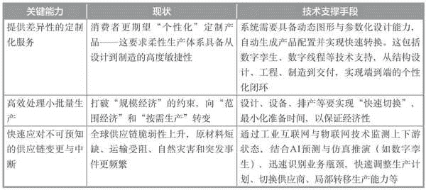

2017年我在《中国工业评论》发表《智能制造为不确定性而生》，提出企业应对不确定性的驱动力是成本代价。为对冲不确定性，企业常付出提前生产、备库、定期检修、大宗套期保值、层层自检厂检客户检等代价，造成资源浪费与效率损耗。

VUCA背景下，不确定性从外部蔓延至内部，从线性系统演变为高度耦合的复杂系统。战略、组织、客户关系、产品规划、交付、成本库存、人力、技术创新等全维度皆在波动。

经济学家科斯指出，企业本质是资源配置机制。当下企业核心任务是在有限资源与动态市场间，构建快速、精准、低风险的配置能力，在复杂约束下求最优。

提升应对能力关键在于建立面向不确定性的快速响应与协同决策体系。谁能实现客户需求即时洞察、精准预判、智能排产、高效履约并具备实时沟通与动态调整，谁就能抢占先机。计划、决策、协同的本质都是应对不确定性的系统手段，背后依赖的已不是经验与静态规则，而是以数据为燃料、以AI为引擎的智能决策系统。

这些系统的价值不仅在提效与资源利用率提升，更在于降低不确定性带来的风险与成本，从被动应对转向主动预判与快速响应。企业发展正是在不确定与确定间循环演化，能否识别关键变量、构建可预期反馈、快速做出最优决策，决定了其在波动环境中的生存能力。

在AI与数据技术加速渗透的今天，制造企业必须主动拥抱AI数智转型，在变化中把握确定性。唯有掌握变化，才能驾驭复杂；唯有快速适应，才能持续领先。 EXr6287u6NNVz+GYLY+7SGN8EvPKHDRD0R2fs+hJH6FUGuD/ntK17kx1EckHp5InRbOjsqs+vx5PQzEkttGAOg==

## 1.2　AI时代每家企业都是智能体组织

当AI成为新底座，企业不再是静态架构，而是一个具备感知、决策、行动能力的智能系统——企业智能体。

我们正见证从传统科层制向数据驱动、智能决策、自我优化的智能体组织的转变。这是技术革命，也是组织进化。从管理人到激活人，从流程治理到智能协同，是领先企业的必修课。

### 企业进化终局：成为数字化的生命体

企业智能体像生命系统，具备三类子系统，如图所示。

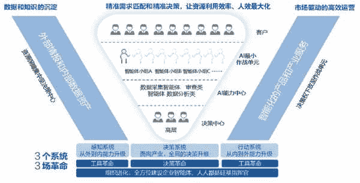

· 感知系统：企业的眼睛和耳朵，对外实时捕捉市场与行业信号，对内监控运营状态。
· 决策系统：企业的大脑，基于AI算法与沉淀的Knowhow，对业务和产业做出最佳判断。
· 行动系统：企业的手脚，把策略转化为最小作战单元的高效执行，完成市场反馈闭环。

三者构成数据、知识与行为的闭环，从信息输入到智能反应实现系统协同。

传统企业反应慢、效率低、信息孤岛；智能体组织则拥有感知—决策—行动的实时自适应能力，像生物体一样快速判断并行动。

### 感知、决策、行动三大系统：支撑企业智能体运行的神经网络

构建企业智能体，关键在三大系统的设计与融合。

**感知系统：数据与知识的中枢沉淀**

感知系统是企业的感官平台，目标是做到360度全感知：外部情报、行业趋势、客户行为、竞争动态，以及内部流程、运营数据、员工行为、设备状态。

需要三种能力：
· 数据采集：通过RPA、爬虫、Agent  、IoT、ERP、CRM、MES等实现实时采集与打通。
· 知识沉淀：搭建企业知识库，将信息结构化、可复用。
· 语义理解：利用NLP与语义识别解析非结构化信息，如客户反馈、政策文件，形成可供AI使用的知识。

它把感知层数据转化为可计算、可判断、可预测的输入，是决策的数据底座。例如一家山东医药企业借此可在5分钟内掌握全球最新靶点研究。

**决策系统：实现精准匹配与资源最优配置**

决策系统是智能体的中枢，本质是把业务逻辑模型化、资源配置算法化、决策过程自动化。

AI时代的决策系统具备模拟、预测、优化能力：
· 需求预测与匹配：基于历史订单、市场行为、季节性训练模型，做销售预测、库存预警、排产优化。
· 资源调度优化：对人财物进行多维度算法优化，通过仿真推演给出建议。
· 多智能体协同决策：实现供应链、财务、销售等跨部门的AI辅助动态协调。
· 从局部最优到全局最优：支持链路级、网络级的系统性决策。

波士顿咨询2024年《未来已来：AI组织进化论》指出，高成熟度AI企业共同特征是“决策闭环+实时优化”，基于执行反馈持续修正决策，完成从经验到智能的跃迁。

**行动系统：以市场为导向的高效执行**

行动系统是企业之手，决定洞察能否变响应、决策能否变结果。

AI时代的智能行动系统以Agent+RPA+自主执行引擎为核心，目标是提升响应速度、降低执行成本、增强敏捷性，实现市场变化驱动资源自动流转。

核心能力：
· Agent驱动自动执行：优化方案自动下发至执行系统，销售预测可自动触发产线调整，安全库存预警可自动生成采购单。
· 以RPA为核心的协同执行：处理标准化高频事务，如发票核验、表单填写、系统对接。
· 端到端业务联动：营销自动化→销售推荐→订单响应→产线排程→物流调度，形成无缝协同。
· 智能产品与产业服务：嵌入AI的产品实时获取使用数据，反向驱动升级，如远程诊断、预测性维修、按用量计费。

行动系统的原则是即时、透明、联动，打通洞察—判断—执行的最后一公里。

目前多数企业自动化条件不足，根因是数据标准化与业务规则化基础薄弱，需要以AI思维重构业务流程，通过岗位重塑、流程再造提升核心能力。下图为某制造企业用RPA+Agent重构物资采购并做岗位重塑的示例。

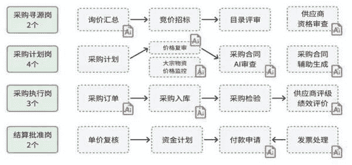

三大系统协同形成闭环：感知让企业看得清、决策让企业想得透、行动让企业做得到。它们相互感应、动态联动，才能从数字化运营迈向智能化运营，在高度不确定市场中实现稳定增长与资源最优。 EXr6287u6NNVz+GYLY+7SGN8EvPKHDRD0R2fs+hJH6FUGuD/ntK17kx1EckHp5InRbOjsqs+vx5PQzEkttGAOg==

## 1.3　1个模型和3场效率革命

AI深度融入运营，技术不再只是工具更新，而是推动业务、组织、决策全面升级。为此提出S-TOP模型，以业务场景为起点，系统梳理组织、工具、决策的协同关系，助力企业实现高人效、高韧性、高响应。

### S-TOP模型：以场景驱动的闭环优化

S-TOP包含四个维度：S场景、T工具、O组织、P决策。

它回答四个根本问题：
· 从哪里出发？以真实业务任务为起点，找准痛点与机会。
· 用什么提效？以AI工具为杠杆，推动内容与流程自动化全员提效。
· 如何协作？培养AI思维，打造H型人才，推动人机大规模协同。
· 如何决策？借助数据与算法实现决策升维，从经验驱动到前置判断与全局优化。

其中场景是逻辑起点。转型不应先问用什么工具，而应先问解决什么问题、落在哪个场景。只有从具体场景出发，才能选对工具、设计组织、构建决策逻辑，如图所示。

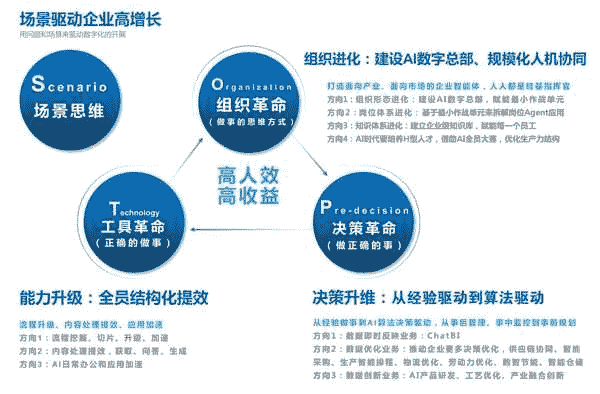

**模型底层逻辑：三场效率革命构成转型铁三角**

数字制造的三重重塑：从场景出发的效率跃迁

在数字工业浪潮里，技术与商业模式同时加速迭代。制造企业一边捕捉新机会，一边承受转型焦虑。对工厂而言，人工智能数字化不是简单的系统替换，而是对业务流程、组织形态、企业文化乃至价值创造逻辑的整体刷新。要在新一轮竞争中立足，核心在于同步推动三场提效革命：组织重塑、工具升级、决策升维。

组织层面解决的是人的意愿与活力问题，决策层面解决的是事情方向是否正确，工具层面解决的是事情如何正确且高效地完成。三者首尾相连形成转型铁三角，构成闭环优化系统，相互支撑：组织是承载主体，人工智能人才的密度与结构决定执行力；决策是中枢大脑，关乎企业航向与资源投向；工具是放大支点，承载日常作业与能力跃迁。场景则是牵引要素协同演进的起点，没有明确场景就没有方向，也形不成闭环。

场景驱动：让技术回归价值锚点

Scenario 代表原点，人工智能数字化必须与核心业务战略深度绑定，用真实问题与具体场景牵引推进，成效才真实可量化。转型的起点是痛点识别与场景拆解：

· 哪些流程环节属于痛点、难点、堵点、突破点？
· 哪些任务可以结构化、可自动化？
· 哪些决策高频却高度依赖个人经验？

只有锚定关键场景，技术、组织与工具才能形成有机整体，推动实质性提效。

S-TOP 模型中的 TOP 不仅指 Tool、Organization、Pre-decision 的缩写，更象征 Top Practice 标杆导向，鼓励企业基于自身场景向行业领先水平对齐能力建设与路径。多数企业的困点不在于技术投入不足，而在于路径模糊、落地不系统。S-TOP 模型正是回答企业从哪里入手、如何系统推进的关键框架。

### 组织重塑：建立人工智能能力中心，激活最小作战单元

传统企业的组织像金字塔，强调分工与层级管控。智能时代更需要神经网络式的结构——扁平、高效、联动性强，能够快速响应内外变化。变革核心在于重新定义做事方式与人与智能体协作的模式。

组织重塑的本质，是重构工作方式与人机协同的底层逻辑。

过去数字化多以流程型组织为主，从端到端梳理 L1 到 L5，识别断点与瓶颈并推进优化。但一旦涉及判断与决策节点，流程常中断，需要转到流程体系之外处理。因此企业不得不借助消息机制、预警系统、异常管理来推动信息找人。随着智能体规模化推广，企业正加速向智能协同组织演进。智能体能够自主识别意图、触发任务、闭环处理，组织不再依赖层层传递，而是更去中心化、更具弹性。

建议从岗位出发，构建人工智能最小作战单元：让每个业务岗位都配备智能助手，具备感知数据、辅助判断、执行任务的能力，推动业务在一线即可完成高效决策与闭环。

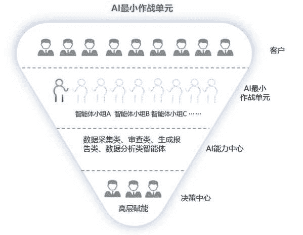

智能化时代的组织形态呈现新特征：

· 倒三角协作结构：弱化层级，强化前线授权，让一线员工拥有更高响应自主权与协作能动性。
· 人与智能体的作战单元：每个岗位都配备智能助手，实现感知—判断—执行闭环，推动业务在一线完成高效决策与闭环，形成真正意义上的协同。
· 平台型管理者角色：管理者职责由控制转向赋能，提供工具、资源、文化支持，构建组织自进化机制。

人工智能不只是一个工具，而更是组织能力再造的引擎。这场革命不在于职位重新排列，而在于让组织运转的底层逻辑从经验加流程走向数据加智能体。

每家企业都应自问：感知系统是否足够敏锐？决策系统是否足够智能？行动系统是否足够高效？更进一步，每个员工是否已具备人工智能协作力，这将决定企业能否真正迈入高人效、高收益的新范式。

人工智能正在让企业成为具备生命特征的智能体组织。它可以自我感知市场、自主判断趋势、高效推动执行。未来企业的智能化程度，将直接决定其存在方式、增长方式与领先方式。

当每个人都被激活后，企业整体智力将跃升。企业不再只是组织结构的集合，而是一个拥有神经系统的生命体：看得见、想得明白、动得起来。

### 工具升级：能力跃迁，推动全员结构化提效

在人工智能时代，工具不再只是单纯的辅助软件，而是企业能力的杠杆，让每个人都能更聪明、更结构化地完成工作。

工具升级的核心是结构化提升人效。

过去企业提升效率依靠人海战术，如今是人与智能协同——一个人加工具，可以完成过去需要整个团队才能完成的任务。底层逻辑包括：

· 流程智能化重构：借助人工智能打通任务链路，依据业务规则实现自动分配、过程监控与即时决策，让系统整体响应速度显著提升。
· 知识标准化嵌入：将判断逻辑、行业经验与最佳实践封装进工具，使工具不仅能执行任务，还具备知识即服务的属性。
· 人机协同普及化：通过构建人加人工智能的协作单元，确保每个环节都能借助智能、发挥所长。

工具革命的意义，不是让人更努力，而是让工作本身更智能。

例如浙江某制造企业在人力资源招聘环节引入人工智能工具重构流程：从简历筛选、自动评估匹配度到智能邀约面试，全过程实现自动化，人力资源团队只需聚焦于高潜力候选人的深度沟通与决策。最终，简历处理效率提升 80%，初筛准确率超过 90%，招聘周期明显缩短。

企业推动人工智能工具落地的关键，是让工具融入流程设计、制度机制与任务分工。当人的能力与工具的智能真正融合，企业才能迈入全员结构化提效的新阶段。

### 决策升维：数脑替代人脑，从经验驱动到算法驱动

今天企业面临的最大挑战，不再是是否有数据，而是如何用数据做更聪明的决策。传统基于经验与层级的决策方式，正逐步让位于数据驱动、模型决策、人工智能参与的智能决策体系。决策正在升维。

人工智能赋能企业决策可分为三个层级，不仅是工具与系统的升级，更是企业能力、结构与组织认知的深度重构。

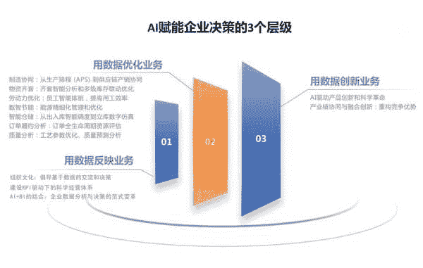

用数据反映业务

这一层级让业务看得见、理解得透。这是企业数据化决策的起点，通过数据分析工具实现数据可视化、可追溯、可交互。在此，数据主要承担反映器角色，帮助管理者回答三个问题：发生了什么？为什么发生？现在情况如何？

例如，通过对话式商业智能进行问答式分析，可以让数据真正用得起来、问得出来。业务人员可以直接询问关键业务问题，如本月产线良品率变化趋势怎样？哪几类客户退货率最高？系统会自动从数据中找出答案，以图表、结论、建议的形式呈现，真正实现问答即洞察。

这一层级价值在于：打破数据壁垒，人人可问人人可用；减少对报表的依赖，实现即时分析与即时决策；建立数据文化，以数据为依据推动协作与共识。

在此层级，企业从拍脑袋决策进化为看数据决策，实现了从直觉到事实的第一步升级。

用数据优化业务

这一层级让业务算得准、算得快、做得好。企业不再满足于数据回顾与可视化，而是希望借助人工智能与算法实现流程智能调度、资源动态配置、策略实时优化，真正实现从事后管理、事中监控到事前规划的转变。

企业有很多场景需要通过数据来进行决策优化，例如产品研发创新、智能配方、工艺流程优化、产品自动报价、采购高效评估、货仓物流规划、产能规划、生产智能排产、设备预测性维护、风控、订单分配、订单履约风险、数智化节能等。这些场景的共同点是需要建立数据采集—规则建模—决策优化—系统执行—反馈修正—持续学习的闭环。

在此层级，企业会出现明显变化：人工智能不仅辅助人决策，而且承担部分自动决策职能，使得业务流程响应更快、准确性更高、成本更低。这意味着企业正式进入决策的算法驱动阶段，是决策升维的关键阶段，也是组织能力的结构性进化。

用数据创新业务

如果说前两个层级是用数据做得更好，那么用数据创新业务则是用数据做过去做不到的事，即通过人工智能技术重构业务模式、产品设计，甚至企业边界。

这代表着决策不再是对现有业务的优化，而是创造新的业务与增长模式：

· 人工智能驱动的产品创新与科学革命：例如智能产品设计、人工智能生成新材料、人工智能发现新药等。
· 产业融合协同创新：数据打通企业之间的协作链条，从单点突破走向产业链整体优化。

在此层级，人工智能成为创新的共同体成员，决策从效率提升跃迁为创新突破。

企业的决策力决定了在人工智能时代的进化速度。从对话式商业智能的人人问数，到算法优化的系统调度，再到数据创新的重构边界，每一步都是企业认知、工具、机制与文化的全面升级。

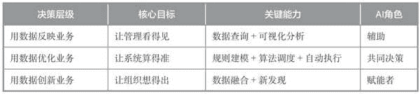

在人工智能时代，经验驱动不再是竞争优势，而是潜在瓶颈。唯有迈向算法驱动的决策体系，企业才能真正释放数据价值，进入智能生产、智能经营、智能组织的新时代。

始于场景，终于组织，赋于工具，成于决策

S-TOP 模型之所以重要，是因为它不仅是一种指导企业行动的思维方式，更是一套面向人工智能时代的效率重构方法论。它帮助企业从场景切入到组织重构，从工具赋能到智能决策，提供一条从局部突破到整体重构的路径，内核逻辑可总结为：始于场景，终于组织，赋于工具，成于决策。

公元一世纪普鲁塔克提出忒修斯之船悖论，S-TOP 模型的本质正是这艘不断更替的船。它并非一成不变的静态结构，而是一个可以在不同场景中持续迭代、演进的动态系统。每一次场景重构、工具更新、能力替换，都是对木板的调整，但系统的核心身份与方向仍然得以保留。

因此 S-TOP 模型并不追求一次性的完美升级，而是通过持续适应变化，维持系统本体的一致性与进化力。

未来竞争不再是谁拥有人工智能，而是谁真正重构了自己的 S-TOP 模型，完成从单点创新走向全局智能的跨越。EXr6287u6NNVz+GYLY+7SGN8EvPKHDRD0R2fs+hJH6FUGuD/ntK17kx1EckHp5InRbOjsqs+vx5PQzEkttGAOg==

# 2 人工智能应用方向、路线图和共识

2.1 人工智能是人的延伸，解放身心
2.2 人工智能路线图：人智配合九宫格
2.3 人工智能推动业务增长的三个共识
2.4 人工智能落地实战共识：信息流转速度决定企业经营效率 EXr6287u6NNVz+GYLY+7SGN8EvPKHDRD0R2fs+hJH6FUGuD/ntK17kx1EckHp5InRbOjsqs+vx5PQzEkttGAOg==

## 2.1 人工智能是人的延伸，解放身心

要真正理解人工智能的价值，需要回到人这个核心维度。自动化、数字化、人工智能技术的兴起标志着人类与工具关系的大变革。从最初的手工劳动到机械化生产，再到信息化与智能化，技术的本质始终在于扩展人类能力边界。今天在人工智能与数字化工具加持下，我们迎来一个全新的协作模式：通过技术解放人类体力与脑力，让人聚焦更具价值的任务，推动人与工具深度融合。

### 员工一天的任务类型分布

我们从员工一天的任务类型分布开始思考，如下图所示。

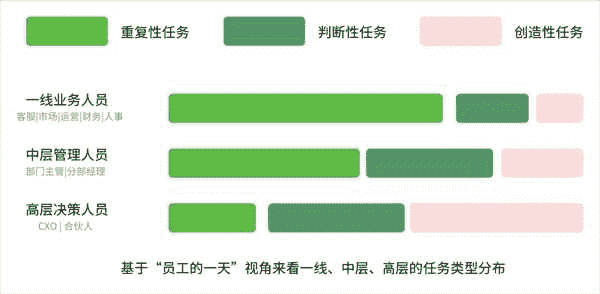

一个典型的职场人工作任务可分为三类：

· 重复性任务：如数据录入、信息分享、文档处理等流程执行与标准化作业，这类工作占据大量时间，尤其在客服、运营、人力资源、财务等一线岗位中，比例高达 70%~80%。
· 判断性任务：需要依据经验或数据进行分析与决策，如业务流程优化、风险评估、资源调配等，整体占比约 15%~20%。
· 创造性任务：依赖人的创新思维与战略眼光，如产品创新、战略规划等，占比通常不到 10%。

建议企业以这三类任务为切入点，制定人工智能导入优先级与应用策略。

· 对于重复性任务：通过人工智能技术手段实现高效自动化，可大规模替代。
· 对于判断性任务：通过数据赋能提升决策能力，可大量优化。
· 对于创造性任务：提供支持与灵感激发，人工智能成为人的第二大脑，可赋能。

### 人机协同的三种应用范式：执行式人工智能、决策式人工智能、创造式人工智能

在人工智能时代，员工的三类任务对应三种人机协同应用范式：执行式人工智能、决策式人工智能、创造式人工智能。这三种范式不是割裂的技术模块，而是相互协同、层层递进，构成企业组织进化的人机协同飞轮系统，如下图所示。

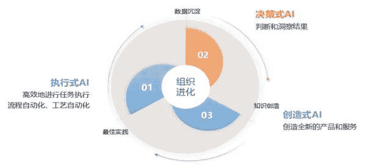

执行式人工智能：减少重复性劳动，推动流程自动化

· 主要任务：数据录入、报表生成、订单录入、财务对账、工艺标准执行等。
· 应用特征：基于流程标准化与规则驱动，实现自动化大规模处理。
· 技术基础：RPA、智能体、对话式商业智能、OCR 识别、自然语言处理等。
· 赋能价值：减少基层员工的重复性劳动，实现全员自动化加速，从解放蓝领到向解放白领发展。

决策式人工智能：辅助判断，提升决策质量与响应速度

· 主要任务：供应链优化、市场预测、生产排程、库存物资智能配料等。
· 应用特征：依赖结构化或半结构化数据，通过建模找出相对最优解。
· 技术基础：机器学习、数据建模、知识图谱、智能推荐引擎等。
· 赋能价值：为中高层提供决策建议，提升判断力、减少不确定性，在不完美信息中寻找相对最优路径。

创造式人工智能：激发灵感，成为人的第二大脑

· 主要任务：产品创新、策略构思、内容策划、场景创新等。
· 应用特征：结合大模型、企业知识库与行业趋势，实现共创模式。
· 技术基础：生成式人工智能、机器学习、深度学习等。
· 赋能价值：自动扫描市场趋势、用户痛点与技术前沿，输出颠覆性创意与概念，捕捉新机会。

创造式人工智能不仅是助手，更是联合发明家，可打破既有行业边界，探索跨界融合的可能，推动从产品思维、系统思维到生态创新思维的跃迁。

人工智能不再只是工具，而是员工能力的放大器、组织结构的重构器、企业演化的加速器。EXr6287u6NNVz+GYLY+7SGN8EvPKHDRD0R2fs+hJH6FUGuD/ntK17kx1EckHp5InRbOjsqs+vx5PQzEkttGAOg==

## 2.2 人工智能路线图：人智配合九宫格

### 企业人机协同九宫格模型

人机协同九宫格模型是一个系统性框架，从两个维度对人工智能与人类协同场景进行划分，共分为九大类应用场景，为企业推进人工智能应用提供清晰路径，如下图所示。

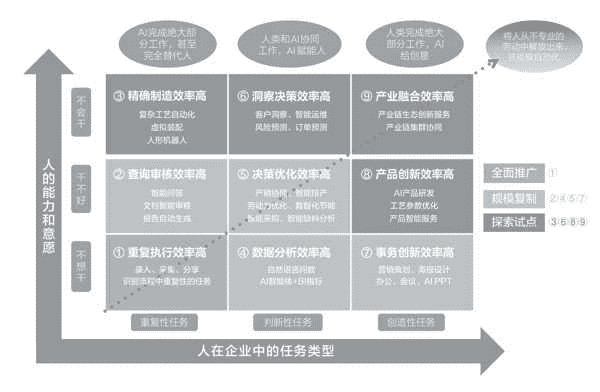

横向维度体现任务复杂度，从左侧的重复性任务、中间的判断性任务到右侧的创造性任务，展现任务难度的递进关系。纵向维度则反映人的参与意愿与能力，从底部的人不想干、中部的人干不好到顶部的人不会干，每一层级代表不同的智能化需求与人工智能能够参与的深度。这两个维度揭示了人工智能介入程度的差异和人机协作的不同模式。

### 企业人工智能落地路线图

九宫格模型不仅是企业理解人工智能能力方向的参考框架，更代表企业人工智能落地的全景式路线图。从左下角到右上角，构成一条清晰的推进路径：从任务替代到流程重构，再到业务创造，从人工智能解放体力到解放脑力，逐步实现人工智能从局部赋能到全域渗透的演进过程。

在这个模型中，第①格位于左下角，代表人工智能落地的起点，也是企业最容易推动、最应全面普及的基础场景。它通常聚焦于标准化、重复性强的事务流程，例如各类信息录入、采集、共享，具有投入小、见效快的特征，是人工智能认知与接受度的破冰区域。

九宫格的第②、④、⑤、⑦格，是企业实现人工智能规模复制的核心区域。这些场景具备高度的流程通用性和可复制性，例如智能问答、文档智能审核、各类报告生成、对话式商业智能报表生成、决策优化等，可以形成局部可复制、整体可扩展的能力体系。

至于九宫格的第③、⑥、⑧、⑨格，则代表人工智能探索的前沿地带，是企业进行前瞻性试点与战略性投入的关键区域。这些格子通常涉及高度复杂、不确定性强、跨领域融合的任务，例如人工智能驱动的产品创新、柔性自动化应用、设备预测性维护、产业融合创新。因为具有较高的不确定性与技术门槛，所以适合具备一定基础的企业进行探索试点。

以下是针对各个九宫格应用的描述。

### 重复性任务被大规模替代

人工智能在重复性任务中展现强大的自动化能力，例如数据录入、文档处理、简单客服等。通过 RPA 加人工智能，这些任务可以被高效、准确地完成，从而解放人力、提高工作效率。以溢达集团为例，仅在物流场景的报关及产地证、订舱、发票处理、库存、快递等场景就有 120 多个自动化执行应用，大幅提升物流效率。具体从以下三个维度描述。

九宫格① 重复执行效率高

AI 九宫格落地与业务增长共识

重复性经营环节借助 RPA 与生成式智能向无人化演进，典型如财务报表自动汇总、人事档案自动归档。标准化作业流由智能代理承载，数据录入、文件整理等底层劳动被自动化接管。

宫格二 检索核验提速
· 跨域智能问答：打通结构化与非结构化信息，建立统一查询入口，员工以自然语言提问即可迅速获得精准答案，提升获取效率与准确度。
· 智能文档审校：AI 自动抽取合同、发票的关键要素并对照规则，实现高精度复核与异常预警，缩短人工核查时间并降低差错率。
· 报告自动生成：依托数据自动抽取与模板填充，快速产出业务简报、分析摘要、会议纪要，提升交付规范性与时效。

宫格三 精密制造提效
· 多工序自动化执行：AI 与工业控制协同，实现焊接、打磨、喷涂等环节的高精度自主运行，提升一致性与良品率。
· 虚拟装配仿真：利用数字孪生在虚拟环境预演装配流程，提前暴露问题、优化工艺路径，减少试错成本。
· 人形机器人导入：部署具备感知与执行能力的人形机器人，替代人工完成高危、高强度或精密操作，增强柔性制造能力。

### 判断类工作的升级方向
AI 在分析、预测、决策上优势明显，通过海量数据挖掘可提供更快更准的判断。例如供应链管理、风险评估等场景可获得有价值洞察，具体表现为：

宫格四 分析效能提升
· 从集中分析到全员自助：数据使用不再局限于少数分析师，自助平台让全员快速获取洞察，实现人人数据驱动。
· 智能报表体系：自动生成的动态报表与可视化图形，快速呈现业务全貌，支持趋势研判与多维拆解。
· 对话式 BI：用自然语言问数替代传统查数，业务人员即时拿到决策所需数据，压缩响应周期。

宫格五 决策效率提升
· 资源利用最优：智能排产与能耗优化实现生产资源动态调度与能源最优配置，提升产能与运营效率。
· 供应链智能化：算法优化采购策略、精准预测库存、智能规划物流路径，推动供应链从被动响应转向主动预判。
· 人力配置优化：借助智能招聘与人力预测，实现人员最优匹配与用工弹性，增强人岗适配科学性。

宫格六 洞察与决策提速
· 设备预测性维护与流程挖掘：基于传感器与流程日志提前识别设备隐患与流程瓶颈，实现主动维护与持续改进。
· 市场趋势研判：大数据与模型预测消费行为及行业发展，帮助企业把握未来需求并抢占机会。
· 风险管理与智能风控：构建实时数据风控引擎，识别异常交易与潜在风险，提升防御与合规能力。

### 创造类工作的赋能方向
AI 除处理重复劳动外，还能为创造提供灵感与效率支撑，具体表现为：

宫格七 事务创新效率提升
· 营销策划与视觉物料：从创意生成到视觉输出，AI 快速完成文案、广告图、品牌物料制作，释放创意团队产能。
· 办公会议与演示：一键生成会议纪要、提炼要点、制作演示文档，让日常事务更专业高效，知识即时沉淀复用。

宫格八 产品创新效率提升
· AI 辅助研发：参与需求分析、方案设计与功能建模，缩短研发周期，提升响应速度与产品命中率。
· 工艺参数自优化：基于历史数据与仿真，自动推荐最优工艺参数组合，实现性能提升与成本下降双赢。
· 产品智能服务：把 AI 嵌入产品，实现远程监控、预测性维护、按需升级，推动产品从一次性交付转向持续服务。

宫格九 产业融合效率提升
· 生态创新服务：通过 AI 与数据平台构建产业生态服务，打通上下游资源，提供协同研发、共享服务、金融支持等复合能力，推动共生共创。
· 区域集群协同：借助数字化平台与智能调度，实现区域产业集群资源共享、产能互补与物流协同，提升整体反应速度与运行效率。

整体来看，企业推进 AI 应以九宫为路线图，分阶段推进：先普及第一格夯实认知基础，随后复制第二、四、五、七格扩大能力版图，同时试点第三、六、八、九格把握未来方向，从而系统推动 AI 嵌入业务、流程与组织，实现从使用 AI 到以 AI 运营的跃迁。EXr6287u6NNVz+GYLY+7SGN8EvPKHDRD0R2fs+hJH6FUGuD/ntK17kx1EckHp5InRbOjsqs+vx5PQzEkttGAOg==

## 2.3 AI 驱动业务增长的三大共识

### 干法 1 回归用户原点，成为用户运营商
2003 年任正非在《在理性与平实中存活》提出，企业要建立以用户需求为导向、以生存为底线的管理体系，摆脱对个人判断的依赖。体系规范运行后，企业灵魂不再是个体，而是持续响应用户需求。客户是最稳定长期的变量，以用户为原点才具备可持续性。

该讲话揭示了华为组织变革的核心：围绕用户需求、流程驱动、制度化运行的现代企业体系，打造穿越周期能力。这一理念在华为系统化落地，形成了《华为客户法则》等成果。

这不仅是管理升级，更是长期主义战略选择。转型需打破以产品为中心范式，重构商业模式与价值交付：
· 把用户需求放在设计与运营起点。
· 联合上下游伙伴构建跨企业跨领域的协同生态。
· 提供产品、服务、数据、内容、体验一体化的组合价值。

转型后企业不再只是制造者，而是升级为用户运营商，借助 AI 与数字化建立持续高频的深度链接，实现 24 小时在线感知、预测与响应。互动频率与响应速度提升，反向驱动内部运营优化，进入智能化用户运营新阶段。

以曾服务的一家无锡锅炉设备制造企业为例，其经历了三个阶段：
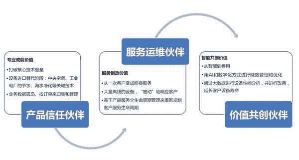

转型 1.0 产品信任伙伴：以专业打破技术壁垒
· 机遇：赶上进口替代浪潮，中央空调、工业电厂节水、海水净化等关键技术突破，驱动高技术含量产品增长。
· 问题：高速扩张带来数据孤岛，需按订单归集管理，同时追求效率提升、成本下降、齐套性提高。
· 路径：以订单为龙头、设计为依托、计划为核心管控，通过合同号、产品编号贯穿业务，实现订单闭环。
· 目标：信息流与数据及时、准确、可视、共享。

转型 2.0 服务运维伙伴：服务创造价值，从一次性到终身服务
· 机遇：基于产品全生命周期重塑客户服务生命周期，通过数字化迭代。
· 问题：大量离线设备只能被动响应。
· 路径：以客户视角重构业务流程与数据，建立统一服务平台。
○ 面向服务，基于 AIoT、CallCenter、移动化重构服务系统。
○ 面向设备，远程监控水泵出口压力、蒸汽流量、冷凝出水温度、冷气、本体排烟温度、冷凝器进水温度及异常。
○ 面向客户，建设设备管理平台，构建故障知识库。
○ 面向现场，建设服务 App，覆盖全生命周期流程管理。

转型 3.0 价值共创伙伴：智能共创，从智能到善用
· 机遇：借助大数据分析设备性能并改善，延长寿命。
· 路径：优化商业模式，用 AI 与数字化进行能效管理与优化，按创造价值与效果与客户分润。服务关系从买卖转向价值共创伙伴。

数字化不再是工具，而是资产与资源。以用户需求为导向建立数字化经营体系，成为用户运营商是 AI 转型的原点，要求在组织、运营、技术等多维度变革，实现以用户为中心的业务重塑，包括围绕用户设计组织、基于场景创新、设计提升体验的互动方式。

唯有真正树立以用户为中心意识，企业才能更好地适应市场变化与竞争格局，这是立身之本。

### 干法 2 高价值进击，从局部优化到全价值链创新
当前竞争已演变为产业链对产业链。聚焦工厂内部的段段优化边际效益递减，真正优势来自贯穿研发、生产、供应链到服务的全价值链创新。AI 与数字化深度融合，构建跨企业跨产业协同创新网络，形成高价值进击新范式。

核心是三阶段跃升：企业级运营效率提升 1.0，产业级价值链协同 2.0，社会级平台生态运营 3.0，如下图所示。
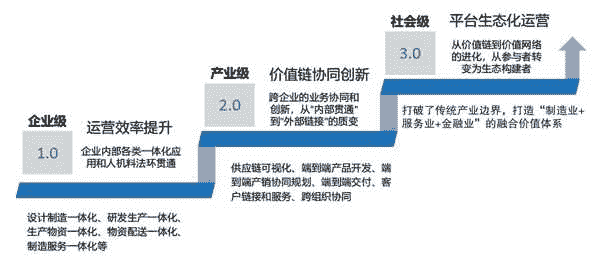

1.0 阶段：段段效率优化与孤岛困境
目标是提升内部环节效率与质量。典型做法是引入 MES、ERP、PLM、财务等系统实现局部自动化。但普遍出现工具先进、系统割裂的孤岛。

例如服务的一家汽车零部件企业 JL，投入 180 万元引入 MES 后单线效率提升 23%，但设备综合效率仅提升 7%。根源是数据标准不统一，计划与实际偏差。

破局关键是推动研发、采购、制造、服务整体协同，实现内部数据贯通，如设计制造协同、研发生产协同、生产物资协同、物资配送协同、制造服务协同等。

2.0 阶段：跨企业价值链协同与创新
标志从内部贯通到外部链接，智能生产与服务贯穿产业价值链，本质是价值流动重构。

企业视野延伸至全产业链，价值流动涵盖原材料采购、设计研发、制造执行、物流配送到客户服务的端到端重构。下表为依据麦肯锡灯塔工厂资料整理的端到端价值链场景类型及主要应用方向，包括供应链可视化、端到端产品开发、端到端产销协同规划、端到端交付、客户链接与服务及跨组织协同。
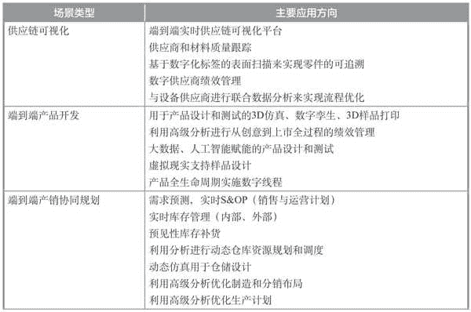
续表
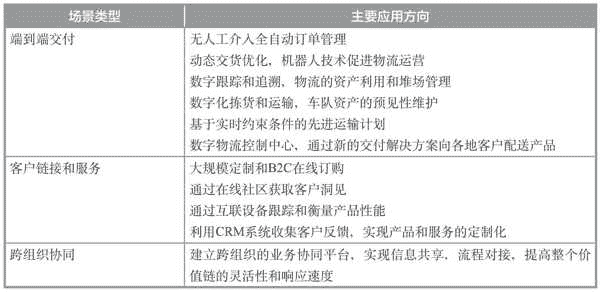

数字化若突破工厂范畴延伸至全产业链，企业敏捷度大幅提升，催生新的运营模式，最短时间以最小成本获得更高回报。

3.0 阶段：生态化平台运营实现指数增长
形成主导力后，企业进化为产业平台构建者与运营者，从链条管理者转为价值网络主导者，推动产业资源、能力、数据重组。

IDC《工业互联网生态 2.0 白皮书》指出，平台型企业通过外部化寻源、制造、渠道、金融等能力，构建服务加交易综合赋能体系，主要有两类核心赋能平台，如下表所示。
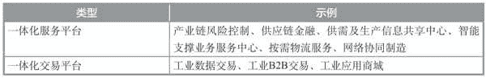

进入 3.0 是质的飞跃，从价值链到价值网络进化。工业互联网平台成为资源配置中枢，企业角色从参与者变为生态构建者。核心是平台化运营，平台既是技术载体也是价值枢纽，通过开放资源能力数据给外部伙伴形成协同创新生态。

高价值进击是系统级价值重构，需 1.0 打通信息链，2.0 实现价值链重构与上下游共创，3.0 迈向平台化运营实现跨生态价值共生。率先完成跃迁的企业不仅是效率领先者，更将重新定义行业规则。

### 干法 3 产品再定义，边界融合，服务闭环
产品再定义、边界融合
我们正经历快速的产品数字化创新，数据已成为实物产品的内在属性，如同 DNA。越来越多产品具备智能与信息特征，成为物理实体与虚拟空间的复合系统。产品使用产生大量新数据，可被监测、控制、分析。设备、人、物之间的联系愈加密切，系统连系统、小系统组成大系统。产品泛在连接使客户、企业、产品融为一体，企业可在制造、使用、维护、回收全生命周期提供服务、掌控产品，形成服务闭环。

以美国约翰·迪尔为例，已从传统物理制造商转型为集成化产品系统提供商，从制造农机转向销售农场服务，如下图所示。
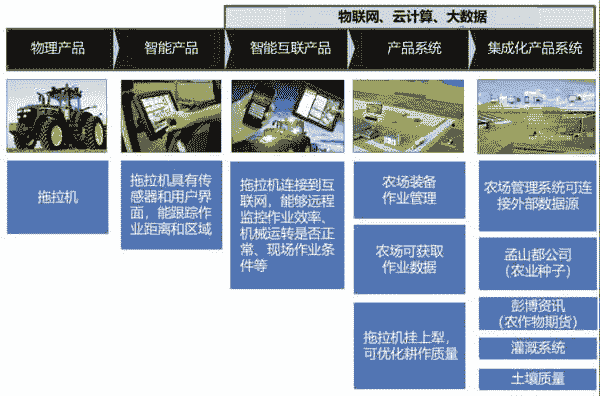

通过数据与服务重塑农耕流程。拖拉机、联合收割机、耕作机、搅拌设备均可通过云平台互联协同。客户不仅拥有收割播种设备，还可享受系统智能服务，实现先进智能农场管理。

智能服务包括：
· iTEC AutoLearn 系统——自动记录学习操作员田间转向头部控制行为，降低疲劳并提升效率。
· ExactEmerge 质量保证体系——支持高速精准播种，通过真空计量、Curve Compensation、Auto-Load 与实时文档记录实现种子精准投放与作业一致性。
· ICA2 系统——配备两台高速摄像头持续监测并自动调整割台参数，保持破碎率低于 1%，提升收割质量与产量。
· Active Yield 系统——通过谷仓装载传感器持续校准流量传感器，实现自动校准与精确产量采集。
· Active Fill 同步控制系统——利用 GPS 自动同步青贮机与拖拉机装卸作业，实现精准同步卸粮，减少损耗。
· GoHarvest 收割机驾驶模拟装置——提供真实反馈效果的收割机操作模拟，培训预演作业功能，降低误操作停机风险。
· 360 度 3D 摄像——提供全景三维视角，提升辅助驾驶与自动化识别能力。

注：以上信息主要来源于 PTC、约翰·迪尔官方质量保障说明文档、Agritechnica 展会报道，由“转型有术”整理。

无形决定有形，服务闭环
产品交易方式、形态与效能被重新定义，无形服务与协同网络决定新价值。企业从提供实体产品转向提供复杂产品服务系统。服务关系从短期交易向长期服务转变，从买卖关系向客户价值共创伙伴转变，如下图所示。
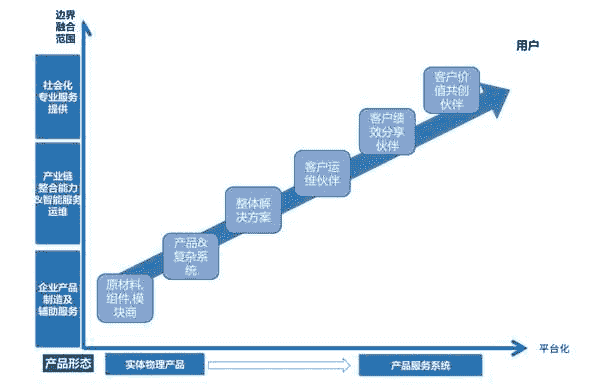

下面介绍六种基于产品的新型智能化服务应用趋势，如下图所示。
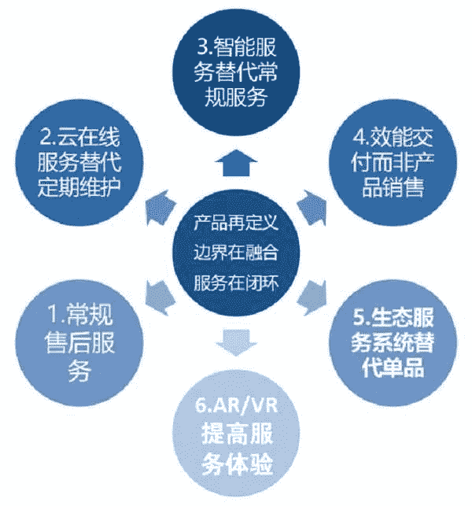

趋势 1：常规售后服务
多数制造企业仍以产品为核心，提供标准化售后服务，包括客户信息管理、产品档案管理、三包服务、定期巡检保养、维修维保、零配件销售，部分延伸至供应链金融。越来越多企业通过一物一码等数字化手段实现产品全生命周期与全渠道动态监控，提升服务水平与满意度。

趋势 2：云在线服务替代定期维护
工业产品在线服务与远程运维是服务化转型关键机会。随着数字化智能化提升，设备替代人工、复杂度提高、运行节奏加快，停机损失巨大。传统定期检修将被远程实时监控、远程故障诊断、远程维修快速替代。小松 KOMTRAX 系统、沈鼓云、陕鼓云等均属此类实践。

趋势 3：智能服务替代常规服务
与云在线实时服务不同，智能服务更侧重对产品制造、使用信息深度挖掘，实现更高自主功能与增值服务。如大型装备制造企业可从基础维修、增强性服务向预测性维护、寿命拓展转型，提供故障知识库建模与智能分析等增值服务，如罗尔斯·罗伊斯 TotalCare、东芝机械预测性维护系统、大金工业空气网络服务、蒂森克虏伯电梯 MAX 应用等。

趋势 4：效能交付而非产品销售

当产品具备实时可见与智能自主调控能力后，单纯靠卖断获利的模式开始失效。租赁、按结果付费等服务化形态把交易的起点延后为合作的起点，供给方与需求方也从一次性购买关系转向持续运维关系。典型做法是：

· 凯撒空压机不再按主机报价，而是把压缩空气作为服务包交付，自己负责安装、保养与系统优化。
· 索尼克林提供清洁设备的租用与样机互换，大修时可免费借用，并采用按清洁效果结算的合约，客户不买硬件，只为结果买单。

**趋势5：生态化服务取代单品对垒**
产品一旦嵌入更大的运营网络，竞争就不再是件件硬件的比拼，而是体系与体系的较量。关注点从设备本身转移到以智能终端为底座的柔性服务与生态整合能力。

约翰迪尔是鲜明样本。它不再局限于出售农机，而是搭建起精准农业解决方案的完整网络。竞争重心从制造农机转向运营农业，从硬件厂商演进为农业系统服务商。实质是用生态锁定客户、提升粘性，构建产品、服务与数据的复合价值壁垒，形成高复购、高壁垒的经营形态。

**趋势6：AR/VR 让服务体验跃升**
AR/VR 能在研发、制造、使用等环节营造虚拟化体验场景，提供超预期的沉浸感，从而改变营销、研发、操作与维护的方式，成为未来制造服务竞争的重要高地。沃尔沃可在2500公里外远程操控挖掘机，曲美、顾家则用AR/VR打造线下体验中心，一站呈现全部家居，突破实体陈列的物理限制。

这些新型服务正在加速形成新的商业形态，使企业由面向产品的传统服务走向面向使用，再走向面向效果的服务体系。EXr6287u6NNVz+GYLY+7SGN8EvPKHDRD0R2fs+hJH6FUGuD/ntK17kx1EckHp5InRbOjsqs+vx5PQzEkttGAOg==

## 2.4 AI落地实战共识：信息流转快慢决定经营效率

### 干法4 定架构：EA是数字化转型的底层方法论
数字经济下，竞争已从资源规模转向敏捷与智能。麦肯锡研究显示，七成数字化项目因缺少系统规划而失败，成功案例多把企业级架构作为底层方法。

**缺失架构常见的乱象**
未做系统设计的组织往往出现：

· 系统各自为政：按部门需求上马系统，各系统互不连通，形成数据壁垒，协同效率受损。
· 流程断点多：缺乏整体规划导致流程多处脱节，部门各管一段，沟通成本攀升。
· 规范化不足：各部门执行标准不一，操作随意拖累整体效率。
· 数据混乱：内外数据分散存储、标准不统一，难以利用，制约数据驱动决策。

数字化转型涉及数据、技术、流程与组织，是复杂的系统工程。没有方法论就会重蹈覆辙。正如基因指导生物构造、蓝图指导建筑、规划指导城市，公司数字化同样需要科学架构支撑。EA正是这样一套系统化实践方法论，如下图所示。

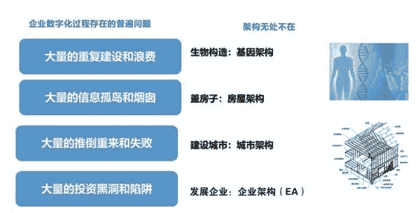

借助EA可形成全局应用蓝图，支撑战略落地，划清系统边界避免重复建设；可梳理数据资产，建立统一规范，实现信息无边界流动，释放数据价值；还能打造数字业务平台，提升敏捷创新能力。因此EA不仅是转型的底层方法论，更是提升业务能力、实现战略目标的关键抓手。

**架构上承战略、下驱落地**
没有清晰战略就谈不上有效规划，没有规划业务与流程便无法高效运转。公司战略决定要建怎样的铁塔，EA则是这座铁塔的设计蓝图，系统设计是落地效果图。架构既承接战略，又指导项目实施，确保业务对齐战略、IT对齐业务，实现战略不偏、系统不重、数据不孤。

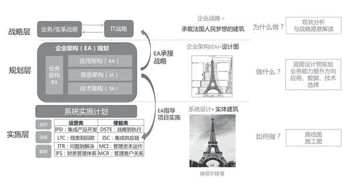

EA的核心是为转型提供顶层设计，通过蓝图与路线图确保战略实现。它以原则与实践帮助组织应对业务、信息、流程与技术的变革。EA通常由四部分构成，包括业务架构、信息架构、应用架构与技术架构，各部分关系如下图所示。

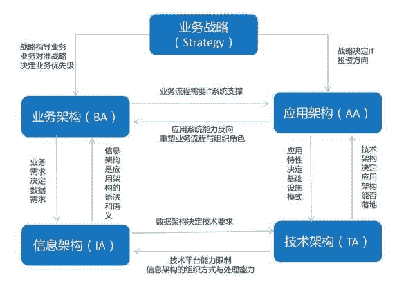

业务架构：界定商业模式、业务周期与实现框架，明确商业模式、组织、治理及关键业务流程，驱动数据、应用与技术层发展。

信息架构：聚焦业务运行与决策需要的数据对象、模型、流转与规范，通过业务对象实现与业务、应用、技术层的集成。

应用架构：规划各类应用系统的边界、功能模块、集成路径与流程支撑，以业务流程为驱动确保系统协同。

技术架构：界定支撑应用与数据服务的软硬件平台，包括基础设施、网络、安全与云资源等，为转型提供技术底座。

架构的价值不在于画图，而在于打通战略落地路径、消除信息壁垒、提升协同效率、支撑敏捷业务。在方法论中，业务层为灵魂，信息层为语言，应用层为结构，技术层为地基，四者协同构成全景能力框架。

### 干法5 通流程：流程体系是企业的神经系统，必须全链贯通
流程是战略落地的交付机制。正如彼得·德鲁克所言，有效率的企业在外看似平淡，因为每个人都知道流程怎么走，内部循环良性运转。

**APQC全链设计框架**
调研中部门墙现象普遍，部门割据导致流程断点、信息被锁，整体效率与创新受损。全链视角要求重新审视业务全程，从客户需求识别到满足的完整链路无缝衔接。

企业构建流程体系可参考APQC发布的跨行业流程分类框架PCF，如下图所示。该框架自1992年发布已迭代至v7.4，被IBM、华为、卡特彼勒、小松等广泛使用，将流程划分为五级，帮助企业梳理流程目录、标准与优化路径。

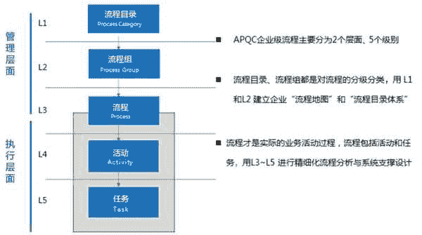

稳定高效的流程能在不同时间、人员、条件下产出一致结果，保证业务连续性和可控性。

**华为的三类流程体系**
华为结合PCF实践，总结出运营流程、使能流程、支撑流程三类体系，形成横向拉通、纵向集成的全面体系，如下图所示。

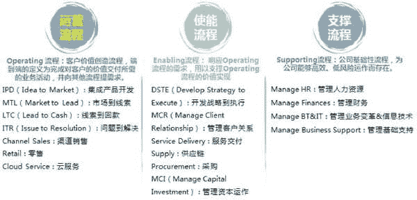

运营流程：创造客户价值的核心全链流程，包括研发、营销、销售、交付、售后等。华为的IPD、MTL、LTC、ITR均为典型，直接面向客户价值交付。

使能流程：为运营流程提供支持与响应，如DSTE、MCR等，确保运营顺畅。

支撑流程：企业基础性流程，如Manage HR、Manage Finances等，保障公司稳定高效运行。

三类流程相互支撑，构成完整经营体系，提升运营效率与竞争力。

**信息流动速度是经营效率的标尺**
企业经营本质是价值流运转，资金、原料、信息在流动，而信息流是主脉络。流转速度决定响应能力、生产节奏与市场把握力。

提升速度的关键在两点：

（1）提高业务系统集成率。销售、库存、财务、物流等多系统协同，通过集成实现实时流转。

· 数据一致性提升，降低运营风险与维护成本；
· 消除壁垒，订单可从CRM自动流向ERP、库存与物流，形成闭环；
· 统一数据源支撑分析与自动化报表，提升决策质量与速度。

集成涉及流程重构、数据标准化与业务规则协调，需战略统筹、分步实施。

（2）推进全链路信息自动流转。

· RPA推动流程自动化，通过模拟人工操作完成重复性任务，适合老旧系统间集成；
· Agent推动流程自主化，通过感知、理解与决策能力处理复杂逻辑，实现全链智能化。

流程不是流程部门的专属，它是企业运营底盘。建设全链、标准化、智能化的流程体系，才能从低效协调走向高效运行，从依赖个体走向系统驱动，从标准响应走向智能应变。流程领先的企业，未来才具备可持续创新与扩张能力。

### 干法6 选场景：聚焦经营核心议题，精准构建新能力
2023年“转型有术·深圳分会”上，一位制造业总经理提出：数字化到底能带来什么具体价值？投入产出比能否算清？这正是管理者核心关切：转型要看得见成效、算得清回报、能落地。

AI与数字化的落地必须回答：解决了哪个真实经营难题？创造了哪些可持续新能力？唯有如此才能从技术工程走向经营工程。

**以问题为导向，锚定D Q C I四维度**
建议聚焦交期D、质量Q、成本C、创新I四个主线识别能力建设方向。

· 交期D：提升全链交付能力，提高履约率与准确率，优化排程与资源配置，加速研发出图与生产响应；
· 质量Q：全流程管控，从源头减少变更，提升产品与服务质量，降低返修与投诉；
· 成本C：通过技术手段优化流程、供应链与资源配置，降低运营与生产成本；
· 创新I：依托新技术与数据驱动，推动产品、服务与商业模式持续优化。

企业可基于客户价值链切片分析，在营销、生产、交付、服务环节寻找数字化切入点。“转型有术”总结的场景能力提升图如下所示。

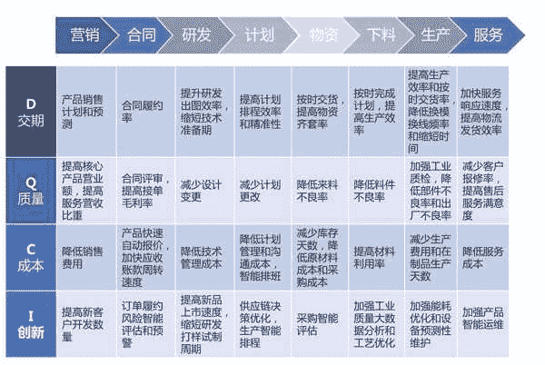

**VV AI场景矩阵**
推进AI转型的关键是选对场景而非做多场景。提出的VV AI场景矩阵以速赢度与价值为双轴，帮助排序聚焦，如下图所示。

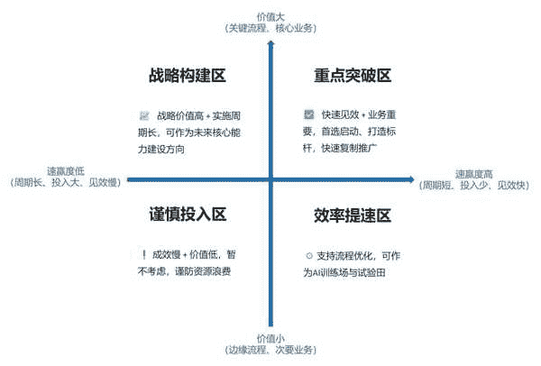

重点突破区 高价值×高速赢：核心业务场景，短期见效，如订单履约、智能客户服务、产销协同，宜优先启动并形成标杆。

战略构建区 高价值×低速赢：需要长期投入的基础能力，如数据中台、智能工厂、产品创新平台，为未来竞争蓄力。

效率提速区 低价值×高速赢：投入小、见效快，如流程自动化、报表自动生成、审批优化，用于短期提效与经验积累。

谨慎投入区 低价值×低速赢：冷门低频业务信息化，短期回报低，建议审慎投入。

转型本质是能力升级，选场景等于回答要建设何种新能力、解决哪些真实问题。用清晰问题意识加科学场景策略，才能在AI浪潮中找到长期竞争力路径。

### 干法7 复用化：从“数出一孔”到“数据全链通达”
AI转型推进中，数据壁垒、重复录入、系统割裂是常见顽疾。如何管理、利用与复用数据，成为释放价值的关键。企业应遵循数出一孔理念，数据从唯一源头流出，在价值链中高效复用，这既是技术问题也是管理思维转变。

**数出一孔思维：精准采集与分类是基础**
数出一孔强调一次录入、源头唯一，避免重复与壁垒。核心是明确采集哪些数据、如何分类。曾服务的苏州SK工厂在三个月内实现全业务数字化运营，关键在于基于流程梳理的数据体系可快速复制。

**全面梳理业务流程：** 对产品、合同、生产、发货、验收、回款等全流程梳理，明确数据采集与复用场景。例如采购、质量、生产环节数据可共享。

**数据先分好类，数字化才有根**

制造现场的信息种类繁多，第一步是按属性拆分、打上标签并判断是否值得采集，避免堆积与重复。常见的归类方式如下：

· **文档类：** 入厂检查规范、作业指导书、工艺规程书、生产装配检查规范、出厂质证书、包装作业指导书等。
· **单据类：** 生产计划单、物料采购申请单、送货单、入库单、生产准备单、领料单、生产订单、工程周转单、出库单、发运单等。
· **表样类：** BOM 明细表、工程检查表等。
· **标识类：** 工卡、发车卡、各类 RFID 标识卡或标签、设备标识等。
· **设备类：** 机器人、自动导引车等。
· **报表类：** 质量报表、生产作业日报、设备统计报表、人力统计报表等。

这层划分表面是技术整理，本质是管理思维的体现，也是培养全员数据意识的基础。框架搭好后，每个环节该采集什么数据就清晰了。范围明确后再选采集工具才是落地的事。

大量制造企业的业务系统建设跨度长达二三十年，数据类型、来源和规模持续膨胀，系统联通、信息共享与质量把控因此变得复杂。数据不准、不及时、难找到、难读懂，已成为转型的主要阻力。主数据治理是守住质量和共享的底线，尤其是源头数据尤为关键，例如产品研发、工艺规格、客户档案、统一会计科目、物料主数据等。

规范主数据的管理，能形成统一的管理标准与口径，让各部门在采集、处理、存储时保持一致。

**全链复用：让数据在组织内外持续流动复用**

价值链复用的要义是实现数据在内部与外部的高效流动与多次利用。关键在于两点：源头自动化和流转复用机制。

**源头自动化**：数据录入涉及销售、财务、物流、生产等多方，尽可能减少手工介入、提高自动化程度，才能降低人为差错。借助设备联网、工业物联网、AI 视觉识别等手段，可实现自动采集，提升准确度与时效性。
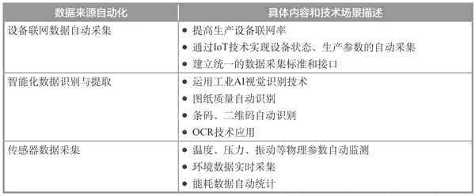

**建立流转与复用机制**：通过系统集成打通数据通道，让系统自动产出表单与报告。

· **流程设计预留复用路径**：一笔订单可自动派生报表、发货通知、备料计划，以“数据驱动业务”为逻辑构建自动化流程，将数据沉淀为资产，支撑智能分析与决策。
· **集成标准化传递**：打通 ERP、PDM、OA、供应链等系统接口，实现数据标准化、表单标准化、格式统一，消除信息孤岛，支持多场景复用，避免数据中途中断。
· **自动产出报表与分析**：基于统一数据源，系统自动生成经营报表、生产日报、质量分析等，加快管理与决策节奏。

曾合作的一家杭州半导体企业董事长贺总提出：“数据只录一次。”这不仅是简化录入，更是对数据价值观的重塑，要求摒弃局部最优惯性，以全链贯通为目标做系统设计，推动一次采集、多点复用。

截至 2024 年 7 月公开信息，该企业单据报表均由系统自动生成，日均自动产出上千张，覆盖经营分析、销售、质量、制造、设备、仓储、技术、工艺等核心业务。

从“数出一孔”到“全链复用”再到“报表自生成”，是数字化成熟度提升的路径，也是迈向高效率、快响应、低成本运营的必经阶段，更是打造智能协同运营的关键。

### 干法 8 一线化：决策下沉到现场

如今竞争比拼的是决策的速度与精度。传统层级决策反应慢、脱离实际，已难支撑敏捷。必须把决策权下沉到现场，打造即时化、高频决策机制。

**决策下沉：近现场的人最懂问题**

英特尔创始人安迪·格鲁夫在《给经理人的第一课》里说，决策权不应只看职位，而应交给掌握知识技能的人。靠近现场的人更了解问题本质。“一线化”的核心是从命令控制转向信任赋能，把权力交给贴近客户、贴近现场的团队。

落地要点：

· **信息实时化，让现场看见全局**：依托 ERP、CRM、IoT、大数据平台，实现总部与前线的数据双向流动。
· **信任与授权，让现场敢于行动**：明确前端团队的决策边界，建立基于信任的激励机制。授权是有边界的自主，现场人员可依据数据与经验成为第一解决者。
· **快速反馈与迭代，让现场改得快**：建立高频反馈机制与迭代流程，前后台高效协作，从静态决策转向动态适应。

正如丰田汽车 CEO 丰田章男所说，遇到危机总要去现场找答案，这不仅是管理哲学，更是不确定时代组织韧性的体现。

**数字化做底座，实现即时管理**

实时采集、分析、可视化打破信息滞后失真，为现场即时决策提供支撑。

2023 年 12 月参观施耐德无锡灯塔工厂，其 SIM 五级即时化管理体系是典型样本。SIM 是生产运营的即时沟通与处理机制：

· **SIM1 员工级**：一线员工掌握产量、反馈异常、跟踪当日重点。
· **SIM2 产线级**：线长牵头质量、工艺、安全、仓储等团队，检视加工损失、工单异常、设备效率、WIP 齐套。
· **SIM3 车间级**：多部门协同解决问题，超 5 天未解流转至 SIM5。
· **SIM4**：部门经理一对一沟通汇报。
· **SIM5 总经理级**：面向经理层的汇报与沟通。

分层让问题在合适层级解决，避免无效层报。核心是数据驱动加层级协同，横向打通生产、质量、物流壁垒，纵向通过反馈实现问题自动分类与升级，数字与 AI 平台承担信息枢纽角色。

**层级职责会：运营的日常引擎**

2024 年 7 月走访霍尼韦尔码捷工厂，其 T1～T4 层级职责会议体系印象深刻，尤其是每日 15 分钟的 T2 会已成制度，确保现场问题快速识别并闭环。

· **T1 会议**：面向班组长和一线员工。
· **T2 会议**：面向主管、班组长及工程、质量、设备等支持人员。
· **T3 会议**：面向部门经理与职能主管。
· **T4 会议**：面向总经理及高层。

层级职责会议即 Tiered Accountability Meeting，以指标管控为核心、以问题快速反馈解决为主线。价值在于紧盯指标快速闭环、消除信息壁垒实现跨部门协同、坚持现场驱动、治理柔性适配。

关键内容包括层级指标管理、借助电子看板与 BI 报表识别异常与机会、明确责任人、截止时间与行动方案、通过 A3 报告、RPS 等形成闭环追踪、问题升降级制度。

层会不是会议形式的变化，而是管理方式的升级。“层会不是天天找问题，而是天天解决问题；不是层层传话，而是层层闭环。”

在 AI 时代，竞争本质是决策效率与执行力。面向现场的即时高频决策体系能提升运营效率，激发现场成为转型主角，让数据说话起点有准数、终点有正确决定。

### 干法 9 平民化：人人可开发

化用刘禹锡的话，“AI 正飞入寻常企业中”。技术不再高高在上，代码不再是少数人专利，技术民主化到来。平民程序员与平民科学家出现，重塑能力边界与创新边界：工人能调算法参数、销售能建预测模型，创新源泉从精英智慧转向全员创造。

**让现场成为转型真正主角**

最大障碍是技术与业务割裂。AI 转型常被视作 IT 或管理层的事，现场被动接受工具。真正的落地力量在现场，只有让基层从被动执行转向主动参与，转型才能扎根业务、创造价值。

**工具变简单，参与意愿提升**

零代码、低代码、智能体搭建工具与 AI 编程工具普及，非技术人员也能拖拉拽搭建应用，如质量检查表单、异常上报系统。现场创新既提效又增强数字化思维与主人翁意识。

2020 年在柳钢做标杆包装时，其自动化室仅 3 人开发上百个应用、400 多个表单，打造透明化数字工厂。当员工能瞄准真实业务问题、用数据思考、用技术解决，转型就从口号变竞争力。

推进全员开发通常经历三个阶段：

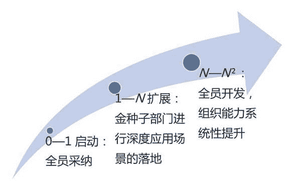

**0-1 启动：全员采纳**
让每个人拥有数字化入口。在阿里钉钉负责新制造业务时，常用低门槛高频场景启动：全员考勤、请假、食堂、寝室进出等；个人福利类应用如运动打卡、学习积分、内部商城；HR、OA、财务、IM 等刚需应用。关键是建立使用习惯。

**1-N 扩展：金种子部门深度应用**
基础习惯形成后，选择有意愿部门做深度场景落地。工具平台至关重要，零代码、智能体工具经简单培训即可激发参与热情。2019 年拜访朝阳轮胎郑总时，其先做安全器材点检、设备巡检，再扩展到生产管理统计、成品日报、物资出门申请、班组安全管理、能源管理、质量管理等，一年产生百万条现场生产数据，真正服务现场。

**N-N²：全员开发，组织能力系统性提升**
各部门都有懂数字的人能自主规划时，IT 转向支撑角色，企业进入全员开发阶段。此时需做应用治理，管理业务部门产生的系统资产增删改查。全员开发让业务人员参与转型，快速解决长尾零散需求，植入创新管理与数据意识。

2022 年敏实集团举办全员 RPA 创新大赛，业务人员自主开发大量机器人，覆盖财务自动化、订单处理、报表生成、数据结构化等，源于现场对痛点的深刻理解。

技术平民化的终极目标不是让每个人都成程序员，而是让每个人都能用技术工具更好地解决问题、创造价值。当这成为基本素养，企业才能实现跨越式发展。

### 干法 10 即时化：人机交互范式的变革，从 GUI 到 LUI

从鼠标点击到语音对话，从图形按钮到自然语言指令，人机交互正经历深刻范式革命。过去 GUI 推动数字化革命，如今 LUI 加速迈向智能时代。

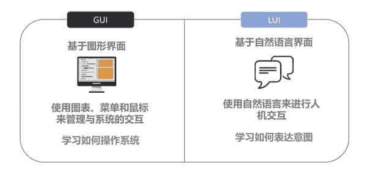
这场变革不仅是交互方式更新，更是技术基础、认知逻辑与效率结构的全面重构。LUI 兴起标志智能化交互成为主流，系统从可操作进化为能理解语言并主动协作，重塑我们理解和使用技术的方式。

**为什么从 GUI 走向 LUI**

LUI 基于大模型与自然语言处理，让“问答即流程起点”“对话即业务洞察”成为可能，深刻影响服务设计与管理者体验。

· **GUI — 降低门槛但路径固定**：自 80 年代起，GUI 用窗口、图标、菜单、按钮降低复杂度，但用户需按既定路径操作，多系统协同与非结构化任务时效率受限。
· **LUI — 语言成为操作系统**：LUI 以自然语言为介质，核心从“点哪里”变为“表达意图”，系统负责理解、联想并执行。语言成为最通用入口。

在 2024 年 6 月“转型有术”走进研华昆山工厂的活动中，邓总分享了 LUI 在企业中的典型实践：

对话即入口，让系统读懂业务意图

- 实时盘点当日生产运营的异常指标与告警信息，一目了然。
- 用 ChatBI 自然提问“本月空压机用电量相比上月有什么变化”，直接得到环比对比。

这类跨维度、即时性的追问，传统 BI 往往响应迟缓。LUI 能自主解析提问背后的意图、调取对应数据、完成分析并给出可执行的建议，明显加快管理层的判断节奏。

LUI 的关键在于把自然语言变成系统入口，把后台工具变成贴身协作者。使用者不需要先学操作规则，通过日常对话就能让技术真正围绕业务运转。

**智能化的本质：从行为操作到思维协同**

图形界面的交互是点对点的点击，语言界面的交互是意图对系统的沟通。背后的跃迁在于系统是否具备理解与推理的能力。

**语言即意图：系统从被动应答转向主动理解** ——LUI 的分水岭不在于是否支持语音，而在于能否读懂语义。语言驱动的场景正在落地：

- 人力资源管理：“帮我升一级”或“新增一名员工，姓名响哥，运营部，P13，三天后入职”，系统即可自动补齐入职流程。
- 行政事务：“帮我订10月20日上海飞广州，下午1点到3点之间价最低的机票。”
- 设备操控：车间里可用语音指令实时调节空压机转速。

这些例子显示，系统正从机械执行者变为智能理解者，推动业务流程从被动响应转向主动执行。

**从工具到搭档：LUI 催生人机共创** ——进阶的 LUI 不仅能听懂，还能主动给建议、纠正输入、补全信息，并支持多轮协商。系统角色因此从被动服务转向主动共创，例如：

- 写文章或方案时提供结构化思路；
- 数据分析时推荐更合理的口径；
- 编写代码时补充可能遗漏的安全逻辑。

交互形态正从一次性点击变为持续协商，AI 由被动工具演进为主动搭档，深度嵌入各工作角色与业务场景。

**LUI 的核心价值：搭建人与智能系统之间的认知桥梁** ——LUI 不只是更自然的交互，更是连接人的意图与复杂系统能力的桥梁，它重新定义了人与技术的关系：

- GUI 更看重人学习系统，LUI 更看重系统理解人；
- GUI 靠操作完成任务，LUI 靠语言驱动协同；
- GUI 贴合功能，LUI 贴合认知。

我们正进入人人配备智能伙伴的阶段。未来的系统不会再等待用户去适应，而是主动读懂需求、辅助判断、协同完成任务。技术从工具变为伙伴，系统主动适应人。

从点击到语言，从操作到协同，从系统驱动到人机共创，LUI 正在推动一场深刻的智能交互变革。这不仅关乎效率，更关乎未来组织的协作方式、创新逻辑与技术底座。

# 3　组织升级之路：从个体卓越到智能协同
3.1　底层洞察：组织变革兼是管理科学也是心态重塑
3.2　规律：敬畏人的无限潜能就能激活无限潜能
3.3　方向：迈向高频进化的智能体
3.4　进化实践：从人本文化到规模化人机协同
3.5　以人为先，夯实企业 AI 转型的根基

数字化浪潮中，技术革新与组织进化是推动企业变革的两大引擎。技术重塑商业模式，组织优化释放生产关系。只有两者协同演进，才能实现高质量转型。

3.1　底层洞察：组织变革兼是管理科学也是心态重塑

重温泰勒百年前的证词，可更清晰把握当下变革的内在逻辑：

“科学管理不是计件工资，不是工时研究，不是奖金制度……科学管理是一场全面的心理革命。”

——1912年，泰勒在美国国会作证时的表述

泰勒的科学管理常被误读为效率工具，实质强调的是管理者与劳动者之间信任关系与心理态度的根本改变。在人机协同、边界重塑的今天，这一心理革命的意义更突出。

### 从规则到心态：科学管理的本质是共识而非管控

泰勒明确指出，科学管理不是新的核算制度，也不是单向的效率手段，而是双方认知、价值观与行为模式的转变。这要求：

- 用协作替代对抗，管理者与员工成为共创绩效的伙伴；
- 用信任替代猜疑，管理的起点是激发善意而非防范恶意；
- 用目标一致替代本位主义，围绕问题共担共解。

这场心理革命无法靠文件与流程完成，需要文化认同与关系重建。

### 三个落地切口

**推动员工自我管理与自主驱动**

传统管理依赖他律，新型组织更依赖自律。员工从被动执行转向主动应对变化、解决问题、创造价值。

山姆·奥特曼在2024年9月的博文中提到：

我们即将进入每个人都拥有个性化 AI 助理的时代。

在制造企业，这些助理可帮助员工监控产线良率、平衡率、能耗，并自动给出优化建议。

我们已进入人机共生的智能组织时代，个体生产力被无限放大，每个人都可拥有多个数智分身，承担多样任务。

在此背景下，员工的自我管理与自我驱动成为效率与适应性的源头。真正的科学管理首先要释放人性潜能。

**让优秀者被看见，让每个声音被听见**

心理革命的落点是归属感与存在感。当员工感受到价值被看见、被尊重，才更愿意投入创新。

2018年拜访春风动力时，高总分享了“春风动力的一天”厂内专栏，由18位高管轮流撰写每日动态，全员可评论互动。

在他看来，这是一个舞台，让优秀员工被看见，提升凝聚力。表面是日报，实质是企业思想窗口、透明通道与温暖港湾，让每个人感受到组织的鲜活变化与归属。

新时代企业需重构与员工的关系。当员工感到自己是成功的一部分，就会投入愿景实践，形成自驱文化。这种可参与的透明感，是文化温度的体现。

**构建“视人为人”的组织文化**

真正的科学管理必须建立在人本土壤之上。要将员工视为有独立思想与情感的个体，而非完成任务的工具。

2023年6月，与近30位制造企业总经理赴日本Avex研学。无锡制造企业总经理沈总提问：“员工失误是否罚款？”

Avex高管表示公司没有罚款规定，也不会因此解雇员工。公司秉持“三心经营”理念，用意识之心、关怀之心、共同成长之心培养人才。即便2008年雷曼危机收入骤降40%~50%，会长仍表示宁可动用个人财产也不裁员，因为员工是企业财富。

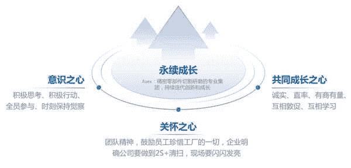

这种对人的极致尊重构成了信任纽带。科学管理的灵魂不在制度，而在文化。

从泰勒出发可更深刻理解，科学管理是一场信任建设的革命，是激励方式、关系模式与价值认同的重塑。

在智能化、人机协同的新阶段，企业成功不仅取决于技术先进，更取决于是否完成从“控制人”到“成就人”的转型：

- 员工能够自我驱动，组织才能敏捷响应；
- 个体被真正看见，团队才有凝聚力；
- 企业视人为人，文化才有生命力。

正如泰勒所言：“科学管理的第一步，是心理革命。”

3.2　规律：敬畏人的无限潜能就能激活无限潜能

在不确定与高速变化的时代，企业如何保持韧性与活力、激发员工潜力与创造力，是核心命题。

古希腊哲学家赫拉克利特说“世界的本原是火”，象征持续能量与变化。员工正是企业发展的火种。德鲁克提出“每个人都是自己的CEO”，员工不仅执行，更是洞察与创见的来源。从现场改善到技术突破，创造力始终影响企业命运。张瑞敏曾言：“企业营造什么环境，员工就会成为什么样的人。”海尔的“以人为本”即是系统实践。

**日航逆转：敬畏潜能是最强的经营策略**

2023年6月参访京瓷公司，了解危机应对的第一原则是保持敬畏与爱心，激发员工无穷潜能并维持全员经营。

京瓷高管讲述了稻盛和夫拯救日航的故事。接手第一天上午开高管会，充满制度与市场抱怨；下午他走向一线，询问“你怎么看”。被高管视为难题的问题，一线员工早有解法。

随后三个月，稻盛和夫通过走访、座谈、大会等方式与3万名员工握手并反复询问意见。好点子如泉涌，日航10个月扭亏为盈。

稻盛和夫认为，困难无法自行解决时，应向下属与一线寻求智慧。只有敬畏员工的无限潜能，才能真正释放潜能。全员参与是克服困难与转型的关键。

**松下众智经营：把每个人当成经营者**

在松下PHP资料馆看到松下幸之助的名言：“最强的经营，是凝聚众人智慧的经营。”

这不是理想主义，而是长期践行的哲学——每个员工都是岗位经营者，以主人翁姿态思考与持续改进。

松下认为竞争力不仅靠流程制度，更靠愿意同心同行的群体。因此坚持“先育人，再谋事”，鼓励员工将自己视为责任人与决策者，主动优化创新。公司下放决策权，让贴近市场与生产的人参与决策，实现快速反应。

这一理念可追溯至1920年。战后日本经济波动、失业攀升，松下于1920年3月成立“步一会”，倡导步调一致、精诚团结、脚踏实地。“步一会”让员工空前团结，推动生产与销售繁荣。

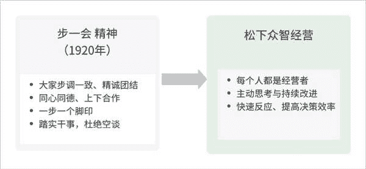

**创美伊索谱：让每个人成为创新者**

事业成败关键在人，人才是发展前提。经营方法再好，执行者仍是人。

在苏州服务创美工艺时，公司以独特方式推动全员创新。总经理解纯生说：“经营第一步，是确保人才创造性。”设备流程差异缩小，差距在人、创意与感性智慧。为此创美建立内部创新系统——伊索谱。

伊索谱英文ISOAP，践行ISO标准化理念，将标准化渗透到思想、研发、生产与管理。中文“伊索”借伊索寓言之意，集众智、谱科技篇章。每年两次成果发布会，员工自由组队或单人申报，从立项、数据量化、资源配置到成果展示、CEO颁奖，形成自下而上创新闭环。

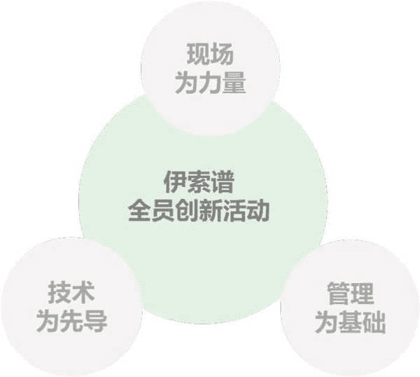

在创美，人不是管理对象，而是知识与价值的共创者。2014年董事工场长金吉光提到，公司成立内部科学技术协会，将普通岗位员工视为科技变革实践者。伊索谱使集团超越“管理与被管理”关系，形成持续优化的创造道场。

从日航全员参与、松下自主责任经营到创美伊索谱，这些案例指向同一命题：企业的根本在人，组织的上限在人心链接。

当企业敬畏员工潜能、赋权于人，就能释放集体创造力。反之，用制度控制、用规则束缚，只会耗尽创造力。

当老板具有无限性，就能造就员工的有局限；当企业敬畏员工的无限性，就能链接员工的无限性。

心胜，则事胜。企业经营本质是对人心的经营。转型背后不只是技术升级，更是人力价值重估。企业的本质不是流水线，而是赋能场。不能仅靠金钱驱动，更需尊重、信任与成长机制，让员工主动参与、持续提升，组织才具备再生能力。

3.3　方向：迈向高频进化的智能体

**制造范式转向：从持续改进到高频创新**

当前正处产业变革交汇点。从精益制造到智能制造，企业正经历范式转型：从以效率优化与流程改善为核心的“持续改进”，转向以数据、算法、软件为基础的“高频创新”。

过往工业以丰田主义为标杆，看板拉动、零库存、持续改善为全球提供模板。但在AI、大数据、物联网快速发展的今天，企业最大挑战已不是“把事情做对”，而是“做正确的事情”，并在实践中不断自我学习与进化。

**为何中国企业不能跳过丰田主义**

多家中国制造企业希望一步到位迈入智能制造，却忽略精益地基尚未夯实。

丰田主义并非凭空出现，而是泰勒科学管理、美国工业工程、5S、质量管理等思想的演进。从1950年代起，丰田结合资源匮乏现实，发展出准时化生产、看板系统、持续改善Kaizen、零缺陷等精益体系TPS。

德、美、日等制造企业深度导入精益。中国企业40年高速增长依赖人口红利，粗放发展，缺乏对流程、标准、质量、效率的深度认知，也难沉淀数据资产与过程能力。不少企业基础数据采集、标准作业流程、现场管理系统仍不完善。

精益水平决定数字化起点。离开精益地基，数字化和智能化如同沙上高楼。没有精益就没有高质量结构化流程数据，也没有持续改进的文化基因。

因此，中国制造企业要从数字化获益，不能越过丰田主义，必须以精益为基础筑牢底层操作系统。

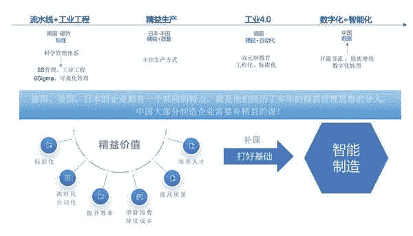

**“特斯拉主义”兴起：AI原生、软件定义、高频进化**

特斯拉主义不只是数字化制造，而是一种底层认知不同的组织形态。它并非否定精益，而是突破其边界。特斯拉从一开始就不是单纯造车公司，而是一个以数据为核心、以算法驱动的AI原生智能体组织，系统逻辑闭环、自反馈、自演化。其典型特征如下图所示。

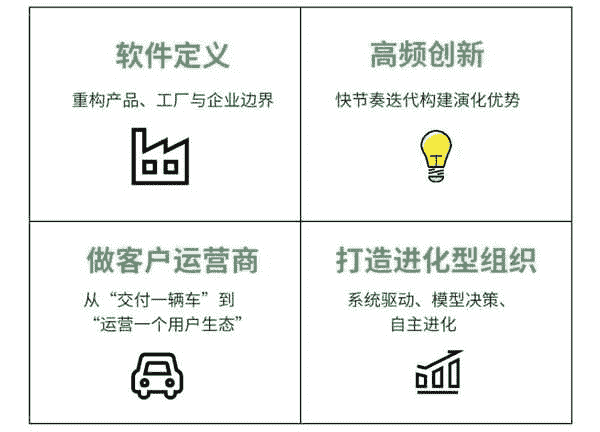

**软件定义：重构产品、工厂与企业边界**

特斯拉最本质颠覆来自“软件定义一切”。

- 每辆车都是运行百万行代码的智能终端，可通过OTA持续优化。
- 工厂产线由MES、APS与AI模型软件协同动态控制，打破传统自动化静态逻辑。
- 企业内运作以Warp-ERP、自动化财务、CRM等统一平台打通端到端流程与数据。

这意味着特斯拉是一个持续运行的算法平台+软件系统+制造执行体。产品、生产、服务皆由代码定义，决策逻辑逐步由模型主导。

**高频创新：快节奏迭代构建演化优势**

丰田主义强调持续改善，特斯拉主义更强调高频创新。

特斯拉进化样本：从造车工厂到持续演化的智能体

研发节奏上，特斯拉的内部迭代速度通常是传统整车厂商的两到三倍。产品升级不靠换代周期，而是靠远程推送实现。自动驾驶能力的增量、导航策略的打磨，都能在线完成并开启。创新早已超出车身本身，渗透到产线工艺、供应链配合以及组织接口设计之中。

支撑这种接近日更的试错能力，前提是整体系统化。产品骨架、跨部门协作接口、共用技术平台都要实现内部高度凝聚、外部低度耦合，组织才能进入快速试错的进化循环。

**从交付一台车到经营一个用户生态**

对传统制造来说，交车即终点；对特斯拉来说，交车只是起点。每位使用者的行驶轨迹、偏好、充电习惯会实时回流云端，成为训练模型和优化体验的素材。用户与系统保持持续对话：路线被不断优化、内容被个性化推荐、故障可被远程诊断、服务可被在线预约，形成完整闭环。

特斯拉提供的是持续的关系运营，而非一次性硬件买卖。用户同时是数据来源、模型参与者和产品共创者。这套逻辑的核心是平台化的客户经营，企业获取的是全生命周期价值，而非单次交付利润。

**进化型组织：培养系统而非管控流程**

组织层面，特斯拉更像一个自我演化的智能体。它抛弃僵化的科层分工，转向任务牵引、模型协作、信息流动的去中心化形态。算法、工程、制造、信息技术、AI安全等能力被聚合进平台协同单元，打破职能壁垒。

激励围绕任务闭环展开，强调组织学习速度而非固化KPI，核心是激活有行动力的工程师个体与组织的演化能力。公司不是在管人，而是在打磨系统、优化模型、调度智能，形成人、系统、任务的三元协同。这正是未来组织需要的自演化能力。

软件定义、高频迭代、客户经营、进化组织，四条线索共同勾勒出特斯拉主义的内核。它既是技术路线，也是一种组织哲学：以感知-决策-行动为闭环来构建智能体。

### 范式比较：丰田主义与特斯拉主义

丰田主义和特斯拉主义，哪个更契合当下？

加里·哈默尔指出，丰田像一个会思考的系统，靠人的智慧实现持续改进；特斯拉则借助数字化手段加速学习，实现持续创新。两者不是新旧对立，而是不同的发展路径。企业可以根据产业成熟度、技术实力、人才结构与客户诉求，自行选择演进方式。特斯拉所代表的以AI为底座的范式，为全球制造提供了一个新的参照模型。

从丰田到特斯拉，不是方法的替换，而是认知的跃迁。从“把事做对”转向“让系统自己学会做对的事”。未来的组织将不再完全依赖人管人的方式应对复杂性，而是逐步演化为具备自我感知、自我学习、自我调度、自我修复能力的自组织形态。

如果说丰田主义是打地基的砖石，特斯拉主义就是面向未来起飞的轨道。二者承前启后。对中国制造而言，拥抱精益、融合数字、进向智能，是一条必须持续走下去的进化之路。

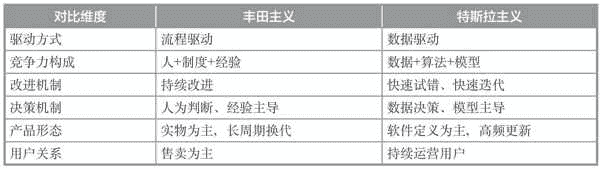

## 3.4　进化实践：从人本文化到规模化人机协同

### 干法 11　让人成为人：建立以人为本的人机共生文化

1994年，连线杂志主编凯文·凯利在《失控》里写道：人造物越来越像生命，生命也越来越像工程。这句话预示了人机边界的模糊与关系重塑。如今在通用大模型与智能体的推动下，变革加速：人在协作中如何被解放？人机关系会走向何处？工作与组织又将如何重塑？

**人机协作的三层演进：从体力替代到创造释放**

下图呈现了人机协作的发展层次。

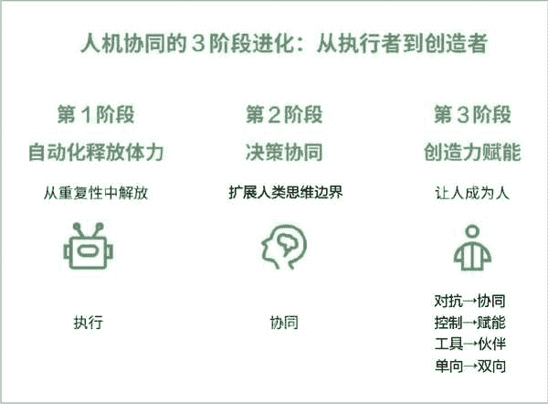

**第一层：自动化减负，从重复中抽身**

智能体出现后，标准化、重复性任务得以自动化。企业将复杂流程拆成可执行单元，由RPA与AI模块承担。人类不再耗在录入、归档、校对上，而是转向更有创造性与战略性的工作。制造场景中，AI可完成质检、数据分析、物料调度，人则聚焦流程优化与质量提升。

解放的关键不在替代，而在增强。AI负责规则执行，人类负责目标设定与结果评估，各司其职。

**第二层：决策共创，拓展思维边界**

过去人决策、机执行，如今大模型打破界限。Agent能理解自然语言、完成多步推理与规划，成为真正的业务搭档。产品上市前，Agent可基于行业资料自动产出市场分析、竞争态势与推广建议，辅助战略筹划。

这种协同不削弱判断，而是通过智能反馈与联想，拓宽思维边界、提升决策质量。

**第三层：创造力赋能，回归人的本质**

AI对创造性工作的重塑最具颠覆性。模型通过自训练与语言生成，助力科研、设计、营销等领域进行趋势预测、方案生成与技术模拟。宝马引入生成式设计平台后，工程师设定强度、重量、成本目标，AI即自动输出优化方案。

在共创模式里，人提供目标、伦理判断与创意火花；AI提供知识、生成、组合与反馈能力。人从执行者变为系统设计者、策略制定者与意义赋予者，价值回归本源。

**从工具到伙伴**

随着协作深化，人机关系发生四重变化：从对抗到协同，从控制到赋能，从工具到伙伴，从单向到双向。AI可记忆、理解、联想，并通过多轮互动形成反馈-修正-再反馈闭环。

因此AI不应被视为冰冷机器，而是能共感、共创、共生的智能存在。

**哲学层面：文化先于技术**

人机关系是社会哲学议题。技术应为人服务而非控制人；智能应激发主体性而非制造依赖；未来是共同进化而非零和替代。

让人成为人的关键，不在回避技术，而在借助人机共生，把人重新放回选择、判断、创造与思考的主体位置。

### 干法 12　组织进化：建设 AI 数字总部，赋能最小业务作战单元

数字经济下，组织生存逻辑在变。金字塔结构因信息滞后、层层传导、响应迟缓而显笨重。企业需要更扁平、更敏捷、更数字化的形态。

从美军太空军的数字原生转型，到华为“让听得见炮火的人决策”，从AWS原子化服务到海尔人单合一，头部企业都在探索同一方向：人工智能数字总部的构建与最小业务作战单元的赋能。

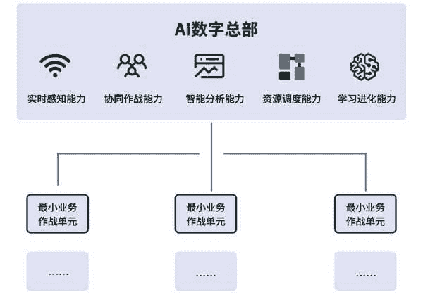

**智能数字总部：组织的大脑**

人工智能数字总部是新型组织的中枢。它借助AI与数字化整合资源、优化决策、赋能一线，实现敏捷响应与持续进化。和传统总部不同，它：

从实体办公转向虚拟网络；从集中管控转向平台赋能；从层层审批转向实时决策；从封闭系统转向开放生态。

成熟的数字总部应具备五大能力：实时感知、协同作战、智能分析、资源调度、学习进化。通过物联网与边缘计算构建神经系统，实时捕捉研发、生产、客户、市场动态；通过统一平台打通跨部门与跨组织协作；借助大数据与AI提供预测性洞察；实现人财物的动态调度；以运营数据持续优化规则与模型。

它不是发号施令的塔楼，而是赋能协调的系统。竞争的关键不再是总部规模，而是数字总部的聪明度与进化力。

**赋能最小业务作战单元**

最小业务作战单元是能独立达成特定业务目标的最小团队，分布在组织与客户触点，拥有目标、资源与决策权。人工智能赋能下，单元应具备清晰OKR、高度自主权、按需AI能力中心支持、基于实时数据的快决策能力、对市场需求的小时级响应。

华为B端铁三角与SpaceX把大项目拆成极小工程单元的做法，均印证了这一逻辑。

**数字太空军：时间线作战**

美军太空军自成立即以数字原生为核心，构建分布式实时数字总部，形成分钟级战场感知、AI驱动威胁分析、全球动态资源调度与跨层级无缝协作。其时间线作战机制将数周决策压缩至分钟级。

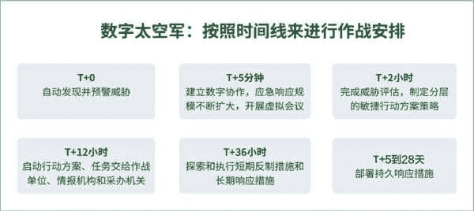

建设人工智能数字总部与赋能最小单元，既是技术升级，更是理念、结构与文化的重构。当实时感知、快速决策与高效执行形成闭环，企业即可在不确定环境中以速度、智能与协同赢得优势。

### 干法 13　知识流动：打造企业级知识库，赋能每一个员工

在人工智能驱动下，知识管理成为核心竞争力。传统模式是池塘式，知识分散孤立；现代企业需向水库式跃迁，再迈向矿泉水式，将知识转化为即时可用智能资源，激活群体智能，让每个员工被知识赋能。

**企业知识管理的三种形态**

知识管理的演进呈现三种形态。

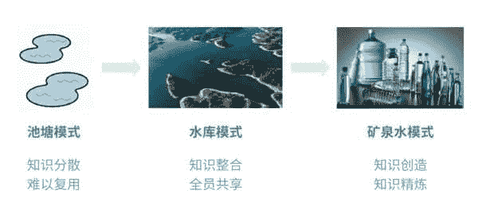

**从池塘到水库：整合的革命**

池塘式特征是各部门自建库、数据割裂、标准不一。信息靠口口相传，经验锁在老员工脑中。结果是重复劳动、经验流失、响应迟缓。

水库式则通过企业级知识库整合全域内外数据，形成统一中枢。知识从个人资产变为组织资产。关键步骤包括统一分类体系与平台、建立贡献更新机制、标签化与元数据管理、构建采集审核归档分发治理闭环。

某跨国电子企业建立全球共享平台后，新品开发周期缩短40%，客户问题解决提速60%。

**从水库到矿泉水：精炼与创造**

水库解决了集中存储，但价值提取不足。矿泉水式强调精炼加工与创造应用，让员工基于既有知识孵化新方案、新方法，实现无中生有。

企业级知识库的高频场景包括研发设计、生产制造、客户服务、销售支持等。唯有明确场景，知识才从资料变成生产力。

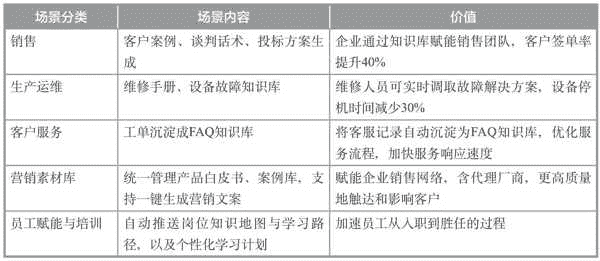

结合野中郁次郎SECI模型，企业知识创造可分为社会化、外化、组合化、内化四阶段，从隐性到显性再到行动。建立知识贡献激励机制，能持续累积数字资产。佳沃集团已沉淀数万知识文档，并通过AI调用辅助决策。

**私有知识资产是护城河**

人工智能时代，数据趋同，私有知识资产不可复制。方向有三：专家经验与工艺Know-how的结构化与模型化；标准化流程、SOP、模板的沉淀；知识资产入表提升企业价值。

知识库建设不仅是技术项目，更是组织进化关键。通过系统化管理打破信息孤岛，让知识流动、复用、创新。顶级咨询公司上线人工智能知识平台后，顾问可自然语言检索近百年案例与专家洞察，实现智慧规模化复用。

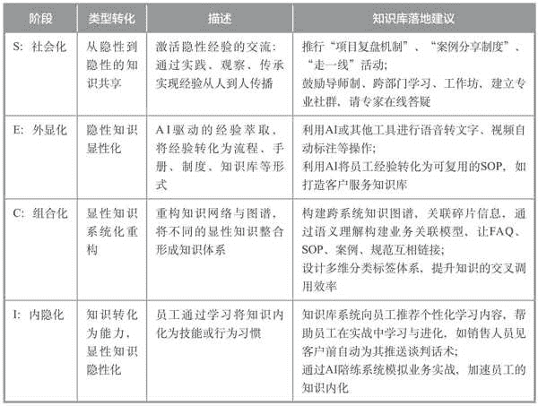

知识活起来，组织才真正进化

协作方式正在被智能提示改写：系统会自动把关联资料、图表串联起来，还会主动给出可以交流的内部同行建议。

竞争的焦点已从占有信息转向信息如何在组织内部运转。当知识库从静态资料堆变成会思考的工作伙伴，每位成员都能调用上百年沉淀的集体经验，企业才具备持续进化的底气。

知识库只是起点。真正聪明的公司不靠存量取胜，靠知识是否持续循环并不断再生。以私有知识资产构建壁垒，并依托 SECI 模型实现创造闭环，就能点亮全员超脑，让知识在生成式智能时代直接转化为战力。 EXr6287u6NNVz+GYLY+7SGN8EvPKHDRD0R2fs+hJH6FUGuD/ntK17kx1EckHp5InRbOjsqs+vx5PQzEkttGAOg==

3.5 人本优先，智能转型的地基怎么打

2024年4月17日，人力资源和社会保障部联合另外八个部门发布《加快数字人才培育支撑数字经济发展行动方案（2024—2026年）》。方案要求紧贴企业需求办班，培养既懂产业又懂数字的复合型队伍，提升从业者的数字素养与专业水平，推动产业数字化与高质量发展。按此指引，企业要搭建素质优、结构合理、分布均衡的高水平数字人才梯队，才能带动转型与创新。

干法 14 打造 H 型人才：让人人具备 CAIO 意识

数字化浪潮下人才形态在持续演进：从 I 型到 T 型，再到 π 型，如今在生成式智能加持下，H 型复合人才正成为转型的核心推力。

什么是 H 型人才
H 型是智能时代稀缺的复合力量，同时拥有深厚专长功底与强劲的智能应用力。他们不仅具备 T 型人才的纵深，更擅长把实务难题转化为智能可协同优化、自动执行的任务，实现人机配合下的效率跃升、判断升级与创新突破。可以说，他们是连接人类思考与机器智能的枢纽，推动工作从单人完成转向人机合力。

H 型的核心结构：双支柱加横向联动
双支柱专长能力：像字母 H 的两根竖线。一边是专长支柱，在生产、财务、营销、研发等领域沉淀深厚，能提炼工作逻辑；一边是智能支柱，熟练运用大模型、RPA、数据分析等工具，能调度 Agent 数字员工协同作业。
横向联动能力：具备系统化的配合思维，能在专长与智能之间搭建桥梁，设计最优协作流程，让专长知识与智能能力融合产生 1+1>10 的效果。

价值公式：H 型价值 = 领域理解力 × 智能增益系数
领域理解力决定能否看清问题本质，是判断智能应用方向的基础。
智能增益系数决定效率放大的倍数，能把智能有效嵌入流程，让专长技能产生指数级提升。

角色定位：每个岗位的首席智能官
H 型可以看作企业的 CAIO，即首席智能官。这里的 CAIO 不是职位头衔，而是一种能力身份：在各自专长领域用智能思维改造工作、放大效能、创造价值。他们不是纯技术专家，而是懂智能的实务操盘手，负责主导智能与实务融合，训练和管理数字分身，推动组织智能化升级。他们在企业里扮演硅基员工指挥官的角色，引领再造与转型。

能力模型：落地力 × 判断力 × 创造力
落地力，即智能工具链掌控。用智能思维寻找 10 倍、100 倍效率提升点，调度工具与数字劳动力高效完成复杂任务。案例中，某智能财务专家用 OCR+RPA 自动处理发票与对账，将月均 3000 张发票审核从 80 小时压缩到 4 小时，错误率从 5% 降至 0.1%，把财务人员解放到分析和决策。
判断力，即数据驱动洞察。智能时代数据是核心资产，从海量信息中提炼洞察并做出正确判断，是竞争关键。某制造企业资深计划员借助智能排程系统，将生产计划制定时间从 3 天缩短到 2 小时，准确率提升至 90%。
创造力，即智能增强创新。用智能工具推动模式、产品与流程创新。某医药科技企业研发人员结合临床数据与大模型，开发出预测药物副作用的智能系统，使新药研发周期缩短 40%。

人才画像与典型场景
H 型处在碳基智慧与硅基能力的交汇点，通过独特的人机协同系统让工作价值指数增长。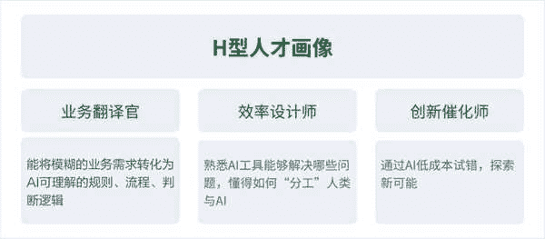
业务转译者：充当内外技术与实务需求的桥梁，识别可智能赋能的环节，把模糊需求转化为智能可执行的规则、流程与判断逻辑。
流程架构师：精通大模型、RPA、BI、低代码等工具，善于设计人与机器协作模式，把智能能力嵌入流程与岗位。
创新助推者：借助生成式智能低成本试错，快速探索多种可能性，例如迅速生成上百种产品设计原型。

下表中的案例展示了 H 型在不同领域的价值。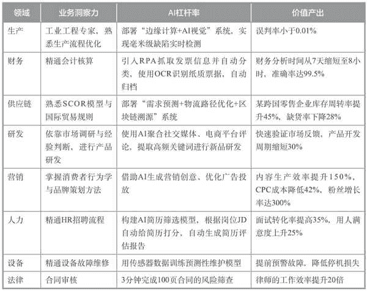

对组织的影响与培养路径
未来组织将从金字塔式的人岗责结构，转向以 H 型为节点的“人机共生网络”，硅基员工密度提升带来生产力结构性变化。正如工业革命催生工程师阶层，智能革命正在塑造新一代硅基指挥官。他们既守护传统专长，又驯化数字员工。谁先培养出岗位级的 CAIO，谁就能在智能时代实现降本增效、敏捷创新与组织进化。

培养方法：
跨部门合作与知识共享，让实务部门与智能技术团队深度融合。
智能技能培训与认证，提升基础素养与工具能力。
设立内部智能创新平台，提供资源支持员工尝试。
实践人机协同项目，从小场景真实工作切入。
建立导师制度，促进经验与技能传承。
构建学习型组织文化，鼓励持续拥抱变化。
招聘时重视学习能力、跨域知识与智能热情。

在智能时代，企业生产力的核心 KPI 是人均 Agent 数量，竞争力取决于 H 型占比，即智能人才密度，而非总人数。

智能时代 H 型的十大行动倡议
智能的价值不在于替代人，而在于让人更好，前提是愿意思考、敢于变革。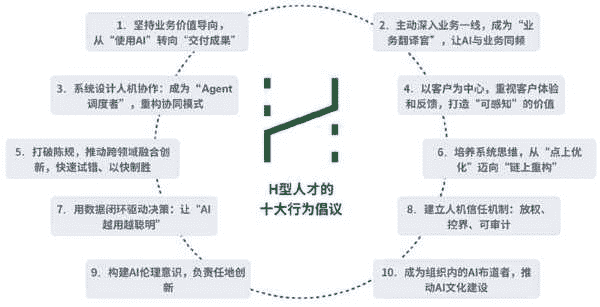
1. 坚持商业成果导向，从“使用智能”转向“交付成果”。以可度量商业价值为检验标准，如成本降 30%、效率提升 5 倍、满意度提升 15%。
2. 主动深入一线，成为“业务转译者”，让智能与实务同频。精准把需求转成智能可执行的任务与规则。
3. 系统设计人机协作，成为“Agent 调度者”，重构协同模式。明确人与智能的角色、分工与决策权限，理解 MCP 与 A2A 协议推动的自主代理趋势，人类角色转向目标制定与协同编排。
4. 以客户为中心，重视体验与反馈。利用智能洞察需求，快速响应，推动产品迭代与服务升级。
5. 打破陈规，推动跨领域融合创新，快速试错。整合知识、技术与场景，低成本试错加速迭代。
6. 培养系统思维，从“点上优化”迈向“链上重构”。关注智能对组织、生态与长期战略的全局影响。
7. 用数据闭环驱动决策，让“智能越用越聪明”。建立数据-洞察-行动闭环，反馈优化模型。
8. 建立人机信任机制，放权、控界、可审计。让智能在清晰范围内自主决策，人类聚焦高价值创造。
9. 构建智能伦理意识，负责任地创新。关注隐私、公平、偏见，建立伦理审查机制。
10. 成为组织内的智能布道者，推动智能文化。分享知识与最佳实践，营造开放协作氛围。

历史反复证明，每轮技术革命最终解放的都是人。蒸汽机解放体力，计算机解放脑力，智能将解放创造力。但解放不会自动发生，需要打破思维枷锁重塑组织。正如一代汽车司机要忘掉马车习惯，今天组织也要放下工业思维。转型的成败不取决于技术先进度，而取决于认知升级。唯有解放思想，才能真正解放生产力。

干法 15 先破思维，再释放产能

我在多次峰会与培训中常问：第一代汽车最易坏的部件是什么？多数人答发动机、轮胎，正确答案是方向盘。因为大量司机来自马车行业，习惯用缰绳停车，开车时猛拉方向盘，导致损耗。

这个细节揭示：旧思维是新技术落地的隐形阻力。如今很多企业把智能简单叠加旧管理，忽视了这是场生产力革命。必须先解放思想，才能解放生产力。

智能转型的最大挑战：意识与能力
上世纪初，多家马车厂商坚持“人们习惯马车”，把马车做得更豪华，拒绝汽车，最终被淘汰。而威廉·杜兰特收购别克、雪佛兰、凯迪拉克，打造通用汽车，证明真正的转型始于思维改变。

德勤调研 145 家中国企业，其中国企占 77%，六成受访者认为最大挑战不是技术落地，而是缺乏统一转型愿景、高管与骨干理念不足、技术与实务场景脱节。

意识问题表现为：
战略定位模糊，方向不明推进缓慢；
高层认知不足，项目难持续；
认知深度不够，停留在表面，易走弯路；
文化阻力，传统惯性与抵触情绪。

解放思想的关键路径：意识觉醒到机制变革
意识觉醒：认识到智能不仅是效率工具，更是认知延伸与组织能力升级。智能只是人类意图的延伸器，不懂战略、不识生态、不判伦理。应问“我们能让智能做什么”而非“智能能做什么”。脱离实务场景，智能难落地。

机制变革：让创新成为日常行为。三大机制创新：
容错机制，允许试错，鼓励探索新解法。
协同机制，推动人机协作流程再设计，而非人补智能漏洞，让各自发挥优势。
激励机制，奖励用智能解决问题并产生成果的行为，而非仅看传统 KPI。

智能转型是一场思想革命。技术再强也无法替代人的决策、判断与创造。解放思想，才能解放生产力；让人发挥主体作用，才能释放智能最大价值。

### 干法 16 决策层认知决定落地高度
ChatGPT、Sora、RPA、Agent、AI 编程等概念持续涌现，人工智能早已超出技术尝鲜范畴，正在重塑企业效率、商业模式和竞争根基。
业内常把人工智能转型说成战略级工程，工程最终是雷声大雨点小还是贯穿全盘，关键不在技术先进度，而在掌舵者的认知颗粒度与推动决心。

**人工智能不是系统换代，而是经营逻辑的重写**
把转型交给 CTO 或信息化负责人去研究，是典型的认知偏差。转型的本质不是工具替换，而是工作方式、组织机制、价值创造方式的系统性重构。

2023 年，我走访了一家为医疗企业代工设备的公司，向总经理请教为何把人工智能列为核心管理思想。他说管理者要从依靠人工解决运营问题的旧习惯，转向依靠人工智能解决运营问题的逻辑，并总结了三层体感：
·若仅把人工智能当作降本增效的工具，公司大概率只配一位 IT 经理或人工智能工程师，按需承接、一年做几项；
·若把人工智能看作提升运营能力的体系，需要组建人工智能创新部或研究院，主动感知业务需求并有节奏迭代；
·若把人工智能当作实现经营目标的思想，就要做到全员理解、全员会用、全员参与。以长期规划把人工智能当作基础设施，用人工智能思维解决运营问题，用人工智能驱动流程再造。

人工智能时代，企业的经营逻辑迁移如图示。

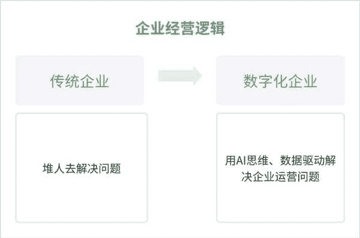

这不是 IT 换代，而是经营方式的革新。革新不能靠技术专家推动，必须由懂业务、定方向的最高负责人亲自布局。比如远东控股要求管理序列全员掌握人工智能应用，先做应用摸底，再让高、中、基层找寻 10 倍、100 倍乃至更高的效率增益点。

**认知深度决定转型的力度、深度与速度**
在 2024-2025 年调研近 50 家制造企业后发现一个共性：负责人对人工智能理解越透彻，企业启动越早、推进越深、效果越好。

力度：能否提升为一把手工程
项目到底由 CIO 主导还是负责人亲自挂帅，是力度分水岭。走在前列的公司都是负责人亲自定战略、配资源、建机制，因为他们清楚：这不是上线一套系统，而是整套能力模型的迭代。
若负责人不深度介入，企业往往停留在试点，形不成战略合力。

深度：能否融入主流程与决策核心
表层是给现有流程做加法，深层是重塑业务本身。
是提效还是重新定义客户价值？是替代岗位还是把人升级为超级个体？是做个助手还是打造人工智能驱动的智能业务体？
只有认知到位，人工智能才能进入企业主干流程，否则长期徘徊在边缘。

不少企业仍在试用阶段，让部门用工具写内容、做客服机器人、优化流程，尝到甜头却未触及组织、能力、人才体系的重构。最终只剩点状智能，陷入局部优化陷阱。
领先者会反问：哪些核心流程可被重写？能否重构客户旅程？能否为员工配专属 Agent 解放重复劳动？能否孵化新业务与新产品？宁德时代、华为、字节跳动早已把人工智能当作组织级战略资产。

速度：能否快迭代快复制快放大
人工智能时代，认知后的行动速度更关键。
有没有试点-复盘-复制-推广的牵引力？敢不敢为人工智能清场旧流程、旧机制？是否以平台化视角构建能力而非碎片化撒网？
这决定项目是停留在 PPT，还是形成规模化成果。

现实中企业状态各异，下表呈现。

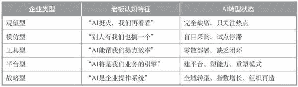

你的公司处在何种状态？想走向何处？认知是否准备升级？一句话，负责人认知多深，转型就能走多远。认知不到位，行动永远浅表。谁先用人工智能重构组织，谁就抢到下一轮增长引擎，起点永远是顶层认知。

### 干法 17 以赛代练让认知落地
技术不是最大障碍，人心才是落地的真正变量。

从少数人懂到全员理解，是转折点
谈落地时常听到：跟我有什么关系？是技术部的事吧？会不会被替代？这种局部认知让技术闭门造车、业务围观、管理观望、员工焦虑，难成整体动能。
要实现整体转型，必须让人工智能进入每个岗位、每个流程。不是人人写代码，而是人人读懂方向、找到定位、把人工智能思维嫁接到本职工作。

**竞赛驱动+训战结合，打通认知壁垒**
研究上千家企业的经验后，结论很简单：讲一百次，不如让员工用一次解决真实问题。
竞赛驱动与训战结合正是从这个真相出发的学习机制，不是培训、通知、宣讲，而是让组织动起来、赛起来、战起来。

什么是竞赛驱动
用竞赛倒逼能力建设与成果转化，让员工在真实业务问题中建立认知、使用习惯与价值感知。
·设定主题，如数据算法黑马赛、数据创新赛、RPA 创新赛；
·激发动力，用奖金、曝光、晋升与跨部门协作；
·营造氛围，形成人人参与、人人开发、人人创造的文化。

什么是训战结合
边学边用、学即用、用即练，在真实场景沉淀能力。
·训练不是 PPT，而是 Agent 实操、场景搭建、Prompt 设计；
·实战围绕真实流程、问题、客户、数据部署人工智能+业务任务；
·融合成学-用-改-复盘-再用的内生闭环。

阿里有句土话：虚的事实着做，实的事虚着做。大赛、评奖、发文是虚的，培养人、释放每个人的能力才是实的。
某整车企业 2019 年举办的首届商业智能软件大赛是典范。公司数据资源丰富但利用碎片化，为培养全员分析力，集结 6 大条线 35 支战队 113 名选手，覆盖研发到营销全流程，成果遍地开花，成为数据创新盛宴。

**大赛落地四步：招募、赋能、角逐、表彰**
大赛是集体行动学习，核心是激励员工主动寻找人工智能与业务的结合点，涌现应用、转变思维、埋下创新种子，并形成实战人才梯队。

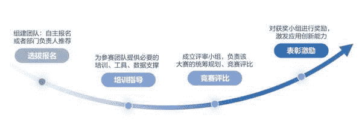
选拔报名：全员发布海报，自愿报名或部门推荐，覆盖营销、运营、采购、财务、精益、信息、人力、计划、制造、品质等，鼓励跨部门组队。
培训指导：按素养分层提供线上线下培训、工具与数据支持，制定赛事人才培养计划。
竞赛评比：设领导小组与评审团统筹推进，分初筛与决赛路演，聚焦经营、营销、研发、质量、生产、工艺等难点，阐述背景、难点、规划与成效。
表彰激励：对优秀个人与团队表彰宣传，并可作为人才认定、岗位聘用、职级薪级调整的参考，激发学习与创新热情。

除大赛，企业还可出台《数据应用创新项目管理办法》，把数据应用提升到与管理创新同等高度，建立长效激励与数据驱动文化。
技术易得，人心难转。员工能否信任、愿不愿试、能否感知价值、组织能否形成人机协同文化，才是关键。唯有从被动接受到主动探索，从畏惧到使用，从旁观到参与，人工智能才不止于概念。这靠机制、氛围、赛制、实战反馈慢慢转人转心。
最优路径：竞赛驱动、以建助变、训战结合、转人转心。
全员转型是系统工程，每位员工的思维转变都是一段与人工智能共成长的历程。

### 干法 18 把能力沉淀在业务线
**转型的核心在业务端，不在技术端**
很多企业掉进技术陷阱：项目归 IT 或数据部管、业务团队缺席、平台上线后业务不用。技术与业务割裂，导致试点顺利、规模化受阻。因为价值不在技术多强，而在是否深入业务、嵌入流程、融入日常。

能力下沉意味着：
·业务先行而非技术先行，业务是价值源；
·人工智能服务业务而非业务围着人工智能转；
·不是能不能用，而是能否建在一线、植入日常、打通流程。

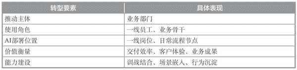
推动实践的方法是：建组织、定标准、搭体系。

**建组织：成立人工智能学习与创新中心**
可由业务、技术、HR 共同组建。中心围绕战略梳理岗位需求，盘点人才，建立数字人才培养体系并嵌入职级体系，输出企业所需人才。
培养可分三步走。

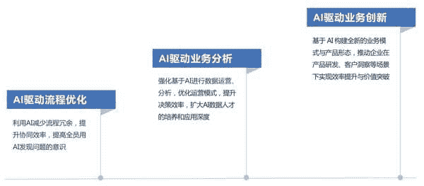
通过人工智能驱动流程优化、业务分析、业务创新，提供针对性能力提升方案。未来组织不是谁懂人工智能，而是哪里都有人工智能。每一个人都是使用者与推动者，每一个流程都是智能增强对象，每一次协同都是人机共创。

**定标准：人工智能数字人才能力素质模型**
转型期必须人才标准化。通过调研、访谈、对标，提炼符合自身业务特征的能力素质模型，推动业务人员向人工智能+业务的 H 型复合人才升级。

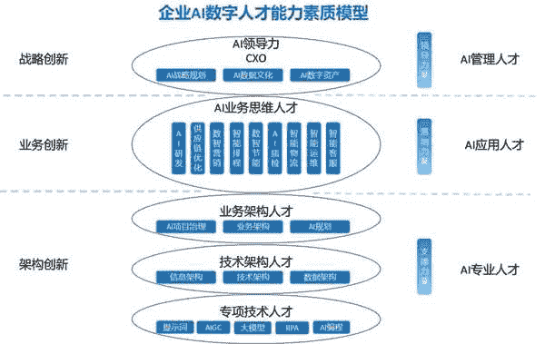
培训可分四类：
·人工智能业务思维培训，提升思维与业务可人工智能化场景发掘能力；
·业务架构培训，涵盖人工智能业务规划、流程优化、模型创新；
·技术架构培训，聚焦信息、技术、数据架构选型与实施；
·专项技术培训，如 Prompt、AIGC 办公提效、大模型、RPA、人工智能编程，推动专项技术与业务结合。

H 型人才兼具业务深度与技术广度，是人工智能时代的竞争力。

**搭体系：3W1H 学习飞轮**
构建长效培养体系，回答为谁培养、培养什么、在哪培养、如何运营。

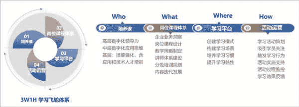
·WHO：高层强化领导力，中层强化应用能力，基层强化技能；
·What：建立企业自有教材，用自家实践案例影响员工；
·Where：线上大学与线下主题讲堂，提供按需即时学习场景；
·HOW：以项目化运营营造学习氛围，监控效果并反馈。

能力下沉不仅是战术，更是一种信仰：相信人工智能可普惠到每个岗位，让人工智能真正走向一线、走进流程。EXr6287u6NNVz+GYLY+7SGN8EvPKHDRD0R2fs+hJH6FUGuD/ntK17kx1EckHp5InRbOjsqs+vx5PQzEkttGAOg==

# 4 工具革命 打通感知决策行动全链路
工具革命的核心是效能从手工到智能的跃迁，人类对工具的依赖只会加深，拉开差距的不是工具本身，而是组织能否解放思想并释放工具潜能。这种思维与应用的差异，正是未来竞争的关键。EXr6287u6NNVz+GYLY+7SGN8EvPKHDRD0R2fs+hJH6FUGuD/ntK17kx1EckHp5InRbOjsqs+vx5PQzEkttGAOg==

4.1 底层思考 工具演进：从解放双手到解放大脑
人类史就是一部工具史。从石器到工业机械再到计算机，人类不断用工具延伸能力。工业 1.0 到 3.0 以工具驱动为主，目标是解放双手；工业 4.0 则以智能驱动为主，目标是解放大脑。
这一演进背后是管理思想的持续迭代。从泰勒的科学管理，到德鲁克的知识型组织，再到西蒙的有限理性与认知决策理论，工具革命与管理变革相互塑造，共同构成现代工业社会的支撑。

### 工具四次跃迁：从扛活到放脑

**工业1.0：蒸汽把体力解放出来**
18世纪蒸汽机落地，人类第一次大规模摆脱手工束缚。工具那会更像身体的延伸，把繁重重复的物理活接走，人从亲手做变成在旁看管。

**工业2.0：电与流水线把组织系统化**
19世纪末泰勒提出科学管理，推标准化、分动作计时、效率优先，员工被视作可被调节的流程单元。20世纪初电气化与流水线成熟，福特模式带来可复制、低成本的高速量产。法约尔提出计划、组织、指挥、协调、控制五职能，进一步把企业锁进制度—流程—执行的框架。人被嵌进标准流程，工具主要服务产能与成本，把重复劳动拆成模块，实现规模经济。

**工业3.0：信息技术带来认知配合的萌芽**
20世纪中后期计算机普及，第三次工业革命展开。自动化控制、ERP、CAD走进企业。整体仍是卸下手工负担，但工具开始带上信息处理属性，能梳理海量数据、辅助研判与流程优化。管理转向信息导向与流程导向，精益生产、戴明全面质量管理、野中郁次郎的知识管理流行，企业更重视数据驱动与流程再造。工具开始为大脑做逻辑归纳，为脑力释放积累条件。

### 工业4.0：工具开始解放大脑

2011年德国在汉诺威工博会提出工业4.0，2013年写入国家战略，人类进入智能制造与认知协同阶段。人工智能、大数据、物联网、边缘计算一起构建智能工厂、数字孪生、预测性维护等复杂系统，工具介入感知、分析、判断与优化。

工具拥有部分认知能力，能在复杂情境下自主决策与自我优化，并与人协作完成任务、提出建议、预警风险、重构流程。这正是管理长期思考的核心：人类认知边界、决策方式、知识与信息的组织方式。

诺贝尔奖得主赫伯特·西蒙指出人类理性有限，信息不完备、算力受限、时间紧迫，只能追求满意解而非最优解。他区分程序性决策与非程序性决策：

· 程序性决策：重复度高、规则明确，适合流程自动化。
· 非程序性决策：复杂度高、结构模糊，需要判断与创造。

工业1.0至3.0为企业处理程序性任务提供了数据基础。工业4.0的人工智能开始进入非程序性决策领域，能处理模糊逻辑、复杂系统与语义理解，让管理者摆脱信息处理与事务判断，聚焦战略设计与价值判断。

### 管理范式演进：从流程中心到全人中心

**重心从流程转向人**
传统管理以流程最优化为逻辑，岗位清晰、操作统一、层级分明，人被视为执行者，思维、情绪与创造力被弱化。

在智能系统辅助下，人力资源的价值被重塑。系统承接标准化程序性事务，人转向提出问题、设定愿景、应对模糊挑战等更具战略性与创造性的工作。范式从以流程为核心转向以人为核心，不再只追求控制与效率，而是激发主动性。

**从流程思维走向全人思维**
工业化管理依赖流程思维：标准化、可复制、可控，目标是提升效率。对不确定性环境而言，僵化流程易成为创新阻碍。全人思维把人看作完整个体而非岗位填充物，要求营造激发潜能的环境：

· 从控制到赋能：给予自主权与决策空间，促进自组织与跨界协同。
· 从绩效考核到成长支持：关注学习力、长期发展与成就感，而非短期绩效。
· 从产品功能到用户体验：研发设计兼顾心理感受，避免技术异化。

全人思维是人本主义管理的体现，对工具带来的认知解放作出回应。当流程不再是唯一秩序来源，组织需依靠有温度的个体与有弹性的结构应对不确定。

从工业1.0到4.0，工具轨迹清晰：从体力延伸到认知扩展，从卸下手工负担到释放脑力。更深层的变化是管理思想转型：从人是资源到人是创新的主体。技术的价值不在于取代人，而在于让人成为人，让人做真正值得人做的事。

## 4.2　规律：快又便宜才会被选

工具迭代从未停歇。从石器到智能体，从蒸汽机到大模型，每一次更替都遵循朴素规律：更快更稳的淘汰笨拙，更低价格的打开边界。这是技术演进的标尺，也是商业竞争的核心逻辑。

### 效率决定能否活下来
效率是工具演进的首要驱动。从磨制斧头到蒸汽机，从流水线到人工智能，工具的核心使命是用更少资源完成更多事。例如：
· 农业社会铁器替代石器，耕作效率提升。
· 工业革命蒸汽机替代人力畜力，运输制造效率跃升百倍以上。
· 机械化制造让纺织速度从每小时数米升至上千米。
· 自动化时代工业机器人实现全天候高精度操作。
· 智能时代智能体替代重复劳动并切入脑力工作，如自动化预测、主动推荐、辅助决策。

历史显示，一旦传统方法在效率上被颠覆，便迅速失去生存空间，如打字机被键盘取代、传真被邮件淘汰、人工客服被语音与文本机器人取代。效率革命带来范式切换，崛起的原因往往是更快更稳更自动化，而非更完美。

### 价格决定能否普及
效率说明先进，价格说明能否扩散。改变社会结构的工具从来不是最顶尖的，而是最多人用得起的。

许多划时代技术起初昂贵复杂，仅限科研或高端企业。随着迭代与规模化，成本快速下降，打破壁垒走向大众：
· 计算机从政府专用巨型设备演进为人人可用的智能手机。
· 3D打印从高端制造象征走向医疗、建筑、教育等平民场景。
· 人工智能从机构与巨头的专利能力走向云计算与轻量化模型支撑的全民使用。

市场经济下，成本优势决定命运。强大却昂贵的工具只能小范围存在，“足够好且足够便宜”的工具才能打开普及口子。人们选择工具不是因为炫酷，而是更省力省钱省时间。每一种改变世界的工具都遵循实用主义铁律。

在智能驱动的加速时代，效率与成本仍是胜负手。真正的竞争优势不在于炫技，而在于谁能让更多人以更低成本获得更高效率。

## 4.3　方向：感知—决策—行动闭环成为新工具的应用范式

当技术重塑组织运行方式，新一代工具革命的核心是以多模态人工智能为代表的智能系统。它融合视觉、语言、语音识别与生成，让系统能读懂合同、听懂客户、看懂图像，并自动驱动流程与内容生成。不仅推动内容处理自动化，也驱动流程自动化与业务智能化。

### 理解力是新工具的核心：多模态人工智能崛起
多模态人工智能是企业认知升级的关键，能同时处理图像、文本、语音、视频，构建新的感知系统。能力集中于四方面：
· 视觉理解：CV+OCR识别合同、发票、图像与视频帧文字。
· 语言理解：NLP解析自然语言，理解条款、意图与业务文档。
· 语音理解：ASR+NLU把语音转为可操作信息，自动建单或生成会议纪要。
· 内容生成：LLM自动撰写总结、报告、邮件与演示文稿。

融合后系统首次具备“理解世界”的能力，而非仅执行指令。企业竞争力从线性流程执行转向感知—决策—行动闭环响应。
多模态人工智能让机器不仅能看听读，更能理解判断决定。这就是新方向：用理解力驱动自动化，用自动化释放创造力。

### 3个层次的自动化：数据、内容与流程
多模态人工智能不是单点突破，而是对企业运营基本单元的数据、内容、流程三层的全面重塑。

**数据自动化：从沉睡信息到可用资产**
大量PDF、扫描件、语音、视频仍沉睡于非结构化形态。多模态人工智能将其转化为资产：
· OCR+CV自动抽取合同发票数据。
· NLP解析报告、邮件与客户留言。
· 语音识别转写电话与会议内容。

数据进入数据湖与知识图谱后，支撑BI分析、实时监控与推荐。数据自动化节省采集成本，让企业拥有全量认知视角。

**内容自动化：从理解到生成**
理解之后是自动表达与创造。多模态技术结合大模型，可：
· 自动撰写报告、总结、邮件。
· 自动填表、生成任务单。
· 一键摘要文档与会议纪要。
· 图文视频一体化生成：配图、PPT、短视频。
· 在客服销售中提供个性化回复。

人员从枯燥搬运与反复打磨中解放，转向战略策划与洞察。

**流程自动化：从执行到判断**
传统RPA能执行流程但看不懂任务。加入多模态人工智能后，流程系统具备感知多样化输入—决策判断—自动执行动作的闭环，推动流程智能化应用。

**流程挖掘+流程切片：看见真实流程，才能重构真实效率**
优化前提是看见。借助流程挖掘与流程切片，企业基于日志与行为数据重构实际运行路径，识别瓶颈、等待、分支与重复点。用数据洞察替代拍脑袋设计，优化有据可依。

**流程自动化+智能化：让流程自动跑**
路径明确后，RPA可自动化规则任务。引入Agent后，流程不仅自动运行，还能智能选择路径、预警异常、执行调整，实现从解构到智能化的升级。

**流程节点加速：让每一步更快更准**
多模态人工智能可嵌入具体节点提供组件级增强：
· 一句话生成任务单。
· 聊天记录转工单自动触发流程。
· 文档解析、视频识别、OCR自动填单。
· 发票、表单、报告结构化建单。

嵌入智能组件后，流程整体得以升级优化。

人工智能让流程不仅跑得快，更跑得对、跑得稳、跑得灵活。

### 工具革命新范式：感知—决策—行动闭环
多模态人工智能使流程系统首次拥有完整感知—决策—行动能力闭环。
企业运行逻辑从“人找数据、人跑流程”转向“数据自流、流程自触发”，效率、准确性与响应能力实现系统性跃升。

理解力即竞争力。工具第一次能读懂人类语言与信息，唤醒沉睡数据，让创作更智能高效，业务真正进入自治时代。未来企业底层能力不仅是信息获取，更是信息理解与流程自主能力。越早构建看得懂、听得清、说得明白、能自动做事的系统，越能在智能时代立于不败。

看得见才能管得住，读得懂才能跑得快，系统自动理解业务才是真正的企业大脑。

## 4.4　企业感知系统的能力升级：数据与内容的处理和沉淀

### 干法19　人工智能辅助精准获取信息和洞察情报
打造企业数字感官系统，实现从信息力到洞察力的跃迁。

**海量数据精准获取：打造企业的数字感官系统**
在人工智能加持下，获取信息不再难，稀缺的是从繁杂数据中提炼可行动洞察。传统人工整理报告、浏览新闻、口耳相传方式面对瞬息市场、政策与竞争，显滞后偏差。

人工智能重塑企业信息能力：
· RPA+大模型+知识图谱+多模态分析构建7×24小时数字感官系统。
· 实时感知市场动态、技术趋势、舆情风险、供应链异常。
· 从被动收集转向主动生成洞察报告，赢得先发优势。

**人工智能辅助精准获取信息典型应用场景**
下表是部分场景的详细介绍，供参考。

**从统一推送到千人千面的智能情报**
人工智能不仅提升采集速度，更推动信息服务从通用推送向个性化订阅进化：
· 研发：专利地图、技术趋势→提升创新命中率。
· 市场：舆情监控、用户反馈→敏捷调整品牌。
· 销售：竞品定价、机会识别→动态营销。
· 供应链：原材料预测、风险评估→提前预警。
· 管理层：行业简报、战略洞察→数据驱动规划。

岗位化个性化分发避免信息骚扰，让每人收到与职责最相关内容。

**自动智能文献打标分类与系统性洞察优势**
人工智能可自动对大量报告、论文、简报打标分类，形成高效内容索引，支持主题抽取、语义标签、摘要生成、图表识别，用于知识库建设，提升检索效率与复用率。自动标注可节省80%整理标记时间。

基于大模型+私有语料构建人工智能情报助手，支持问答式信息获取，可在行业研报、技术文献、专利中查找答案并返回结构化摘要、引用路径与后续建议。

人工智能赋能下，企业竞争核心不再是谁掌握更多信息，而是谁更快更深地将其转化为洞察。从精准获取到智能分发，再到智能感知、快速响应、预测判断，是数字感官系统的核心。

未来最强的企业不是信息最多的企业，而是用人工智能形成系统性洞察优势的企业。

### 干法20　人工智能增强智能问答和加速知识流动
知识即资产，只有能被提问、理解、使用时才产生价值。

**企业的知识困境：信息太多，回答太难**
随着业务复杂度与数据体量增长，企业知识体系面临三大瓶颈：
· 信息孤岛：ERP、CRM、OA、文档库、流程系统数据分散。
· 非结构化内容占比高：PDF、邮件、会议纪要、政策文件、手册占比超80%，难以利用。
· 问答成本高：新员工入职、业务查询、销售找参数仍依赖人找人反复问。

大量知识沉睡成沉默资产。人工智能是打破瓶颈的关键。

**人工智能问答典型应用场景**
下表从业务场景出发，结合行业实践详解人工智能如何赋能各部门智能问答并量化价值。

**从问答助手到企业认知入口**
人工智能问答的价值在于推动知识管理进化：
· 由搜索式向对话式转变：自然语言提问取代关键词检索。
· 由工具型向角色型转变：各部门拥有人工智能助理、人工智能顾问。
· 由内容查找向知识生成转变：不仅回答，还能自动总结政策、生成报告、推演方案。

过去知识静态，今天人工智能让知识流动、发声、连接。融合结构化与非结构化内容的智能问答助手不仅是效率工具，更是企业认知入口。

在人工智能时代，谁掌握智能内容问答能力，谁就掌握组织内部的认知领先权。

### 干法21　人工智能提升智能文档处理的精准性

**文档智能：从读字到读意**

信息过载的当下，企业持续产生大量非结构化材料：合同、汇报、投标文件、合规文书、财务报表等。这类材料的准确性、合规性与内在逻辑，直接关乎声誉与运营风险。

长期以来的人工复核受困于几类问题：
· 人手负荷大，处置速度慢
· 判断依赖个体经验，易出现遗漏
· 内容结构繁杂，跨章节关联难理清
· 复核结果难追溯，经验难以沉淀

在自然语言处理、知识图谱与大模型推动下，文件处理正经历第三次跃迁。
· **1.0 人工阶段：** 全凭经验，效率波动且不稳定
· **2.0 数字化阶段：** 以信息化手段提升存取检索，认知仍停留在识别文字层
· **3.0 智能阶段：** 依托语义解析、多模态洞察与知识推理，实现由认字到通盘把握的跨越

行业正由机器辅助人工，转向人机协同、智能主导，变化集中在四个维度：
· **作业形态：由逐项串行转向多线并行。** 人工逐份查阅易慢易漏，系统可同步核验结构完整性、语义合理性与法规符合性，覆盖面与速度同步提升
· **判断依据：由经验主导转向知识主导。** 以往依赖资深人员直觉，如今通过历史案例与法规文本构建知识网络与推理链，形成类专家判断，降低对个体依赖
· **反馈方式：由只给结论转向过程可解释。** 不仅给出合规与否，还要标出风险来源、呈现依据并提出改进建议，让复核路径透明可追溯
· **协作关系：由被动执行转向主动共创。** 系统从工具成长为决策搭档与风险哨兵，人聚焦关键判断与策略，把重复劳动交给机器

**智能文档处理常见落地场景**

场景与价值对应关系见下表。

**案例：** 某车企每年需审核超过30万份供应商材料，涵盖PPAP、APQP等。引入智能审核后，处理时长缩减86%，风险识别能力提升40%，质量与合规风险明显下降。

**从读字到洞察全貌的关键突破**

**语义理解：突破字面局限**
传统方法多靠关键词匹配或规则，难以应对模糊表达。主流NLP已能做到：
· 跨段落跨章节建立语义关联，判断条款前后是否自洽
· 识别合同政策中常见的模糊用词，如“应当”“可以”
· 基于语境提示潜在冲突，例如与法规相悖的表述
以合同复核为例，系统可自动捕获限制性条款、免责条款、付款义务等风险点，实现内容理解、语义识别与隐患预警。

**规则结构化：知识网络与规则引擎结合**
审核需要制度、行业标准与内控规范支撑，人工智能可：
· 构建领域知识图谱，形成可推理的审核逻辑网
· 通过实体识别与关系抽取定位关键要素
· 融合规则引擎与逻辑模型，实现自动判定与风险评分
在汽车、医药、化工、能源等强监管行业，可训练定制化模型，使审核规则随法规变化自动更新。

**多模态一体化复核：文表图合一**
企业文件多为图文混排，包含表格、印章、图像。基于多模态模型可：
· 自动识别文档结构，区分页眉页脚目录正文附录
· 理解并校验表格，核对数值合理性与合计一致性
· 验证签章并做OCR比对，防止篡改与图文不一致
由此实现的不再是单纯认字，而是对整体的把握，提升复杂文件的整体准确度。

人工智能的价值不是文字识别，而是一次范式转变：从识别到理解，从匹配到推理，从静态输出到人与机器共同创造。由事后把关转向过程预警，由被动合规转向主动防控。最终目标是通过协同，让审核更高效精准，推动风险管理与合规体系迈向智能化新阶段。

### 干法 22　AI 加速各类数据与报告自动生成

把人从重复整理中解放出来，才能聚焦判断、设计与创新。

**从模板化输出到个性化洞察**
组织每天沉淀大量结构化与非结构化数据：销售日报、运营周报、市场分析、财务预测、政策跟踪、行业情报、投标方案、管理例会材料等，既要及时又要专业，既要全面又要深入。
现实痛点：
· 数据提取与更新缓慢，多靠手工汇总
· 撰写缺乏规范，质量受个人经验牵制
· 内容空洞松散，难支撑关键决策
· 协作流程混乱，版本难控、可复用性差
· 报告频次高、期望高，形成文山会海
· 难以按管理层、甲乙方、专家视角切换风格

以大模型、自动化分析、知识图谱为代表的生成式人工智能，正释放报告生成的新生产力。不仅能自动采集处理数据，还能生成语境适配、结构严谨、逻辑通顺的专业报告，实现从数据加工到洞察表达的跨越。

**AI报告生成典型场景**
下图梳理了主要场景。
场景描述与价值评估见下表。

**五大技术支撑智能报告**
底层由五部分构成。
· **自然语言生成 NLG：** 基于大模型理解上下文并生成符合语境的结构化报告，从读懂数据到写出结论
· **数据分析引擎：** 提供趋势分析、同比环比、异常检测与预测建模，提升逻辑与专业度
· **知识图谱支持：** 提供语义骨架，帮助理解专业术语关联，提升内容严密性
· **语境工程：** 设计说什么、怎么说、对谁说，让产出更对口、得体、实用
· **多模态融合：** 融合文本、图像、表格、语音等输入输出，实现从数据展示到场景还原

五大能力协同，形成新一代智能报告体系，可按岗位、层级、风格定制千人千面报告。同一数据能同时生成高管摘要、业务详析、技术报告。报告正由信息的终点变成数据到决策的起点。人工智能不仅能生成报告，还能给出运营优化建议与决策模拟，实现从报到策的演进。 EXr6287u6NNVz+GYLY+7SGN8EvPKHDRD0R2fs+hJH6FUGuD/ntK17kx1EckHp5InRbOjsqs+vx5PQzEkttGAOg==

4.5　企业行动系统的能力升级：流程挖掘、升级、优化、加速

### 干法 23　流程挖掘：打开全价值链的效率之眼

只有看见真实流程，才能重构真实效率。

**为何进入挖掘时代**
早期流程多靠人工画图定义，与实际执行脱节，因为：
· 真流程存在于日常运营，而非图纸
· 有流程不等于有效率
· 现场充满例外、绕路与返工
真正需要的是流程发现。流程挖掘基于数据还原真实路径，可视化瓶颈与偏差，实现持续监测与全链提升。

**流程挖掘：企业的透视仪**
通过ERP、CRM、BPM等系统的事件日志，还原运行实况。
**发现：数据驱动还原真实路径**
可回答实际流与设计流是否吻合、哪些环节被绕过、任务是否反复、执行方式是否统一。基于系统记录，避免访谈偏差。
**合规：智能比对偏差**
自动对比实际路径与标准流程，识别非授权操作、缺失控制点、超时瓶颈、审批合规率与异常原因。
**优化：驱动再设计与智能升级**
打通系统壁垒，形成端到端视图，可动态调整路径、自动化高频环节、重构跨系统协同，为Agent提供优化图谱，实现流程自适应。

**典型应用场景**见下表。
流程挖掘是流程智能化的眼睛，可判断哪些流程值得优化、哪些环节可交Agent、哪些节点是瓶颈。它让分析从猜测走向客观可视。在转型深水区，流程挖掘已从加分项变为必备基建。用数据发现真相、用可视化看清全局，才能持续迭代、提升敏捷与韧性。

### 干法 24　流程切片：基于场景进行全流程分析，识别优化方向

基于场景系统拆解，再针对因果链进行切片分析，可聚焦关键环节，识别优化方向。

**切片核心：切得清、看得透、改得准**
流程切片将整体流程按业务场景切分为子流程或关键节点，核心思想是精准聚焦。
· 聚焦高价值或高频痛点场景
· 基于关键点、日志、行为数据客观切割
· 针对切片定制改善方案，避免一刀切
如同CT切片，企业可从不同角度扫描运行内在结构。常见切法包括角色切片、时间切片、异常切片、区域渠道切片、事件切片。

**流程切片6步法**
**1. 全景梳理：流程地图**
构建端到端全景图，呈现采购到交付等关键环节，或聚焦单一流程如采购询报价，明确申请、询价、比价、审核等步骤，为切片提供结构基础。
**2. 场景聚焦：锁定切片点**
在全景图上寻找高频且痛点集中的场景，从人机料法环角度审视，如重复填报、异常提价、补单、付款偏差等，锁定优先点。
**3. 深度剖析：构建因果变量链**
将场景重构为因果系统，覆盖直接因素与潜在因素，如质量或供需异常，需追溯原材料、操作、设备、制度与衔接等多重原因，明确是什么问题与为什么发生。
**4. 识别关键影响因素**
梳理影响因素与数据来源，识别缺失并通过自动化采集补齐。对数据做准备度与重要度分类，确保分析可靠。
**5. 精准分析：数据驱动诊断**
按给谁看、看什么、促什么行为设计看板与模型。现场关注偏差趋势，管理关注效率与战略。通过可视化锁定根因。
**6. 优化闭环与持续改进**
基于洞察制定短期与长期改进，如强化供应商制程控制降低异常率。形成梳理-聚焦-剖析-准备-诊断-优化的闭环，实现数据驱动运营。

**典型应用场景**见下表。
工单流程优化切片分析可将工单流程切为5个关键切片，每个切片对应优化单元。
通过切片思维，企业从被动等待整体升级，转向从小场景切入优化。关键不是头痛医头，而是基于场景系统拆解、因果链切片，转向精准优化，找到可被人工智能与数字化改造的点，真正降本增效。

### 干法 25　流程自动化：RPA 完成重复性、规则型任务

把重复交给机器，人回归创造。

**瓶颈藏在无数重复动作里**
很多流程是在演进中自然形成，充斥低效手工环节。麦肯锡研究显示，企业30%~50%的工作可被自动化。典型低价值高频事务包括：
· 财务报销单核对与录入
· 销售数据整理与分析
· 采购申请流转与审批
· 客户信息校验与更新

隐形效率杀手：被低估的规则重复

开票信息登记、归档、核对账目；报表获取、汇总、排版美化。表面上看是零碎的日常，内里却高度同质：规则清晰、路径固化、循环进行、失误率偏高，却难以用常规手段改善。年复一年，这类事项被当成固定损耗默默接受，无形中压制了整体提效的空间。

往往真正起效的改进，并非大刀阔斧，而是从一个极微小的重复环节切入。

把规则活交给软件机器人的思路

机器人流程自动化 RPA 正是为此类规则作业而生。它像是企业内部不会下班的软件同事，可长时间不间断运行，用极高的准确度处理大量标准化操作。

与偏重感知与认知的 AI 不同，RPA 更偏向操作与执行，更接近数字世界的机械臂。底层逻辑是用程序模拟人工动作：

· 在浏览器里打开页面、填写表单、按下按钮；
· 抓取邮件附件、解析 PDF 文件内容；
· 登录 ERP、CRM、财务系统并导出所需数据；
· 在 Excel 中复制粘贴、生成图表、导出报表文件；
· 自动存储、更名、归档文档；
· 触发审批流、发送邮件或推送通知。

RPA 与 AI 结合后，形成智能流程自动化 IPA。它不仅能执行，还能具备判断能力，比如自动抓取票据关键字段、识别报表异常、理解语义意图，为自动化注入更强的智能属性。

先盘点、再分级、后试点

推动升级的第一步是系统盘点，筛选出高频、规则化、反复耗时的工作，评估自动化带来的价值，如人力释放、差错下降、周期缩短。依据价值与可行性构建优先级矩阵，优先在价值高且落地易的场景验证。

常见部门的应用方向包括：

· 研发设计：BOM 维护、PDM 图纸同步、CAD 外发、主数据维护；
· 财务会计：开票登记、对账核验、应收应付处理、税务申报、银行流水核对；
· 采购管理：供应商信息维护、采购订单生成、合同录入与付款处理；
· 销售支持：客户资料更新、合同上传、报价单生成、CRM 同步；
· 质量管理：不合格品处理流程，合规文档的自动收集、整理与推送；
· 人力资源：简历筛选、员工信息更新、入转调离办理、考勤管理、绩效数据收集；
· 客服运营：订单处理、工单分类、自动 FAQ、投诉登记；
· 报表分析：跨系统数据抽取、清洗、合并，自动生成日报或周报；
· 法务合规：合同编号分配、风险词条标注、档案归档；
· IT 运维：服务器巡检、权限变更、设备维护、系统更新与监控预警；
· 物流仓储：订单处理、配送跟踪、库存监控、快递申请、发货单生成；
· 报关业务：进出口申报单处理、订单录入与审核；
· 政策与行业监测：监管政策下载、行业信息汇总、简报推送。

案例：深圳一家制造企业借助 RPA 实现国内客户订单自动识别与打印，国际订单自动转为箱单、发票、发货单打印，采购订单自动生成与打印，市场招标信息自动获取。订单业务处理效率提升 71%，每年节省超过 8000 小时人力。

从人做流程到人做关键判断

RPA 升级的核心，是把不适合人做的重复低价值劳动交给软件机器人，释放人力去承担更具创造性与战略性的工作。流程自动化不是技术噱头，而是组织力、响应力与执行力的重塑。它不只属于大企业，中小企业同样适用。任何渴望提升运营效能、减少无效劳动、释放人力价值的组织，都可借此开启新效率阶段。

### 干法 26　流程智能化：Agent 重构企业业务流程

不懂 Agent，就不懂 AI 时代的管理。

从流程自动化到流程自主化的四阶段跃迁

企业流程智能化是一个渐进过程，认知、决策与自主性持续提升。

演进路径从早期自动化工作流，到当下主流的 LLM 增强工作流，再到正在兴起的初级自主 Agent，最终走向多 Agent 协同系统。

RPA 流程自动化：完成结构化重复任务，已成熟

最初企业用 RPA 实现报销录入、对账等基础自动化。流程以规则驱动，效率明显提升，但灵活性与智能性不足，本质上仍是机械的任务执行器，缺乏对语境与目标的理解。

LLM 增强的工作流：让流程具备理解力，当前主流

引入大模型后，流程从机械执行转向意图理解。可在工作流节点嵌入大模型，处理非结构化数据，如文本、语音、文档，实现自动摘要、智能检索、辅助决策。这是多数 AI 工具型应用的现状，局部智能化，整体仍以人为中心。

自主 Agent：迈向感知与自执行，正兴起

当大模型从插件变为规划者，流程进入真正智能化阶段。Agent 能将复杂目标拆解为子任务，自主调用基于 MCP 的浏览器、API、代码解释器等工具，实现端到端闭环。例如接收异常订单处理目标后，自主查询、生成分析报告并给出建议。代表产品包括 Manus、Genspark、Flowith、ChatGPT 智能体、扣子空间、百度心响等，标志企业开始探索自主 Agent 应用。

多 Agent 协同系统：构建智能团队，未来方向

企业将搭建智能协作网络，由多个专业 Agent 分工协作，如同团队处理复杂任务。例如客服 Agent 负责沟通，风控 Agent 把控风险，财务 Agent 处理账务。在 A2A 协议与 MCP 技术支撑下，形成分布式智能团队，实现跨部门、跨流程的高度协作。

流程智能化典型场景

“转型有术”整理的部分典型场景如下表所示。

续表

《企业 AI Agent 应用蓝皮书》整理了 13 大部门共计 160 个 Agent 应用场景清单。

企业 Agent 落地遵循二八定律

实践中常被忽视的是：搭建 Agent 容易，让它好用很难。打造 Agent 不是一次性采购工具，而是持续训练、深度调校的人机协同工程。

二八定律显示：约 20% 时间用于创建 Agent，80% 时间用于训练与调优。

创建 Agent 类似招一个 AI 新员工，周期较短即可上线。真正决定价值的是训练。只有长期磨合，Agent 才能掌握业务逻辑、具备自主判断与协作能力，真正融入流程。

这如同师傅带徒弟，入门时只能按指令操作，成长来自长期磨炼与反复复盘。企业需要教会 Agent 业务知识、工作逻辑与边界规则，没有捷径。

“打造一个 Agent DEMO 很快，打造一个有用的 Agent 需要时间。”

这体现了 Agent 落地的长期主义。创建只是起点，长期训练迭代才是关键。走出买机器的误区，以培养徒弟的心态持续打磨，Agent 才能成长为值得托付的数字同事与智能伙伴。

在人机深度融合的新商业时代，流程正从线性操作演化为 Agent 驱动的动态系统。Agent 不仅是效率工具，更是重塑流程逻辑、连接组织能力、驱动持续创新的关键引擎。它让流程具备理解、决策与学习能力，推动企业从规则执行走向智能协同。

### 干法 27　流程加速：AI 自动建单推动效率提升

AI 自动建单，让流程从起点就跑得更快。

AI 自动建单带来的革新

建单是企业高频的基础动作。传统手工建单依赖人工录入、逐项填写、反复核对，效率低且易错，已成为效能瓶颈。典型问题包括：效率低下难以支撑大规模业务；易出错影响后续环节；人力成本高重复劳动浪费资源；数据利用率低分散非结构化难以分析；客户体验差响应慢错误多。

AI 自动建单通过自然语言处理、语义识别、规则建模等技术，从非结构化数据中自动抽取关键信息，按预设规则自动创建各类工单、报表或记录。不仅提升建单效率，更是对业务流程的深度再造。

AI 自动建单聚焦三个环节，如下图所示。

提取：智能信息提取与规范化

· 多源识别：从客户语音留言、邮件文本、聊天记录或纸质扫描件中识别并提取结构化关键信息；
· 语义理解与实体识别：理解文字背后的含义，准确识别客户名称、产品型号、故障描述、时间地点等实体；
· 信息规范化：按预设字段与格式统一处理，避免人工习惯差异导致数据不一致，为后续分析奠定基础。

例如用户说“下周二到周四请年假照顾家人”，AI 会解析出请假类型、起止时间、天数、事由并自动填入表单。某大型制造企业安全管理系统实践中，输入“彭军工号 2221，3 月 8 日发现二车间设备 A89 轴承有裂缝”，系统自动提取发现人、工号、时间、位置、问题描述，5 分钟的手工录入缩短至 30 秒。填报速度比传统方式快 5-8 倍，字段准确率超 98%。

整合：自动化问题整合与分类打标

AI 基于规则与机器学习模型自动整合问题并精准打标。

· 智能整合：将分散的反馈整合为完整清晰的问题描述；
· 精准分类打标：识别关键词自动标记为重大客诉、批量客诉等，为统计分析、优先级排序与资源分配提供依据；
· 提升一致性：克服人工打标标准不一的问题。

自动化：自主触发后续流程，推动流程协同优化

信息提取、整合、分类串联后形成端到端自动化流程。

· 自动触发后续流程，如重大客诉自动分配给高级处理人员并紧急通知，售后维修自动创建维修工单并推送，新客户咨询自动同步至 CRM；
· 减少人工干预，降低人为错误与延迟；
· 提升整体效率，业务流转更顺畅。

AI 自动建单典型场景

应用潜力覆盖企业运营各环节，部分典型场景如下表所示。

续表

AI 自动建单不仅是效率升级，更是流程自动化重构。从数据入口智能生成到流程联动自动触发，再到组织整体运转效率的提升，AI 正在让建单这一曾被视为微小琐碎的动作，成为降本增效与提升数据质量的关键。

### 干法 28　流程加速：OCR 从字符识别到智能解析

从字符识别到语义理解，OCR 正在加速业务流程智能化升级。

被精准识别困住的制造业效率

传统 OCR 核心能力是字符识别，通过图像预处理、特征提取、字符匹配把纸质文档转为可编辑文本，但在制造业复杂场景中局限明显。

非结构化数据读不懂。一张图纸可能含文字、表格、尺寸标注、公差符号；一份工单可能夹杂英文技术参数、中文备注与手写批注。传统 OCR 只能输出文本块，无法理解尺寸标注与技术要求的逻辑关系，也无法区分手写批注与正式内容的优先级。

多语言多版式理不清。全球化制造中文档涉及中、英、德、日等多种语言，同一类文档可能出现表格版、图文版、简化版等十余种版式。传统 OCR 依赖固定模板，版式一变就失效。

业务流程连不上。传统 OCR 输出是静态文本，需人工二次录入系统才能触发后续流程，难以实现来单即录、验单即审的实时响应。

制造业需要的是能理解文档的 Agent，让机器不仅识别字符，还能理解业务结构与语义，自动完成信息提取、分类、映射与流转。

OCR 技术演进：从感知到认知

OCR 进化分为三个阶段，每阶段对应文档处理能力的跃升。

基础识别阶段：解决有没有的问题。早期基于模式匹配与简单图像处理，仅适用于标准印刷体，依赖固定模板，对低质量图像识别率低。

版式分析阶段：解决在哪里的问題。随着计算机视觉进步，OCR 开始关注文档结构，能定位文字位置并划分标题、表格、正文等元素。例如 Google Cloud Vision 的 Layout Analysis 可自动划分页眉、页脚、表格、图片区域。

智能解析阶段：解决为什么的问题。大模型与多模态学习融合推动 OCR 进入语义理解时代。智能解析 OCR 可理解上下文，关联业务规则，并驱动流程自动化。例如通过 NLP 解析技术参数逻辑关系，基于企业知识库验证信息有效性，并将结构化数据直接写入 ERP、MES、PLM，触发采购订单生成、生产排程更新等。

智能解析 OCR 典型场景

在制造企业落地的典型场景如下表所示。

续表

OCR 正从字符识别迈向语义理解，重塑制造业核心流程。从数字化、结构化到语义化，再到流程自动化，智能解析 OCR 正在构建灵活的数据驱动引擎。未来，每一单、每一份报告、每一份合同都将不再是静态文件，而是能理解、触发并执行的流程起点。

### 干法 29　应用加速：AI 编程是企业应用开发的“新杠杆”

人人都能成为开发者，AI 打破技术壁垒，赋能全员提升创造力。

AI 代码生成成为企业 AI 应用的首要场景

生成式 AI 快速发展，企业正经历深刻效率革命，传统软件开发流程被重塑，开发者角色与工作方式发生改变。AI 编程与自动化代码生成成为企业 AI 转型的核心驱动力。

Menlo Ventures 2024 年企业 AI 使用情况调查显示，代码生成以 51% 的比例位居企业 AI 应用场景首位，远超聊天机器人 31% 与企业搜索 28%，如下图所示。这标志着 AI 编程正改变开发模式，成为企业第一生产力。

**人机共创，让编码效率进入新阶段**

根据公开数据，GitHub Copilot 的使用者已突破百万，借助该工具生成的代码段占比超过四成，编码速度平均快了约五成半。工作形态正从“人独自撰写”转向“人与模型协同撰写”，产出规模被放大，也打开了以往难以触达的创新空间。

**交付逻辑迁移：从交付代码到交付可用场景**

智能编程带来的不仅是速度的提升，更是交付对象的位移。过去交出来的是技术模块或代码片段，如今交出来的是可直接落地的完整业务场景，包含界面、流程、逻辑与数据。

场景化交付通常具备这些特征：
· **需求以业务语言描述：** 智能体能理解“基于仓库日志生成异常预警系统”这类业务表述。
· **原型快速成型：** 通过提示词把需求转译，压缩传统周期，很快得到可验证的原型。
· **验收看业务是否可用：** 衡量标准不再是代码量或技术指标，而是业务能否真正使用。
· **持续闭环打磨：** 业务人员可随时调整提示词，系统自动优化，形成动态迭代。

这一变化不仅提升效率，也重塑了协作关系。企业不再只是做系统开发，而是构建能够即时激活业务价值的解决方案。

**开发权下放：从递交需求到自主实现**

“人人皆可开发”正从口号变为现实。随着智能编码工具普及，软件开发的门槛在下降。产品经理、制造工程师、质量管理员、设备维修人员等非 IT 角色，也能通过自然语言与智能体协作生成前端界面、业务逻辑、设备接口。

趋势带来三大变化：
· **开发者角色迁移：** 从写代码的执行者转向系统设计师、提示词工程师和平台构建者，重心从代码量转向协作方式与智能体使用效率。
· **业务与技术融合：** 智能体充当业务人员的代码翻译，使其能把业务想法直接转为自动化程序，大幅缩短从构想到上线的周期。
· **组织边界扩张：** 开发从专职技术团队扩展为泛开发生态，一线员工也能自助开发，提升业务响应与 IT 配合。

例如，某制造企业生产计划科的工程师，未等待信息技术部门开发物料追溯系统，便借助智能助理通过自然语言对话，快速生成了一个整合物料批次号、工单流转状态、质检数据的可视化查询小程序，从需求提出到场景上线实现小时级转化。过去这类开发需两周，如今一天内可完成，且更贴近一线。

未来软件开发不再是“我提需求你来写”，而是“我借助智能体自助实现”。角色重塑倒逼组织变化，企业需构建让智能体、开发者与业务一线形成扁平、实时、弹性共创的新协作体系。

智能化编码引发的不仅是工具变化，更是生产关系与能力结构的深度重塑。若要释放“人人皆可开发”的潜力，让智能化编程从试点走向体系化落地，企业需要在组织建设、流程机制、人才策略与资产管理上做系统部署。 EXr6287u6NNVz+GYLY+7SGN8EvPKHDRD0R2fs+hJH6FUGuD/ntK17kx1EckHp5InRbOjsqs+vx5PQzEkttGAOg==

# 5　决策革命：实现企业资源利用率最大化

5.1　底层思考：基于数据+算法重构决策机制

5.2　规律：从单目标决策到多目标平衡，最大化企业资源利用率

5.3　方向：数据从反映业务到优化业务，走向创新业务

5.4　用数据反映业务：实现全局、全程、分级实时用数据

5.5　用数据优化业务：实现从事后分析到事前决策的优化

5.6　用数据创新业务：实现创造新产品和重构新产业 EXr6287u6NNVz+GYLY+7SGN8EvPKHDRD0R2fs+hJH6FUGuD/ntK17kx1EckHp5InRbOjsqs+vx5PQzEkttGAOg==

## 5.1　底层思考：基于数据+算法重构决策机制

### 诺奖启示：企业也需要“数字试管”

2013 年诺贝尔化学奖颁给三位科学家，表彰他们在复杂化学系统计算模型方面的突破，让实验从实体试管转向虚拟世界。这一成果揭示：计算机不仅能计算，还能试探甚至决策，以低成本高效率提升研发效率。2024 年诺贝尔化学奖再次印证该趋势，David Baker、Demis Hassabis 与 John Jumper 因计算蛋白质设计和蛋白质结构 AI 预测获奖，宣告 AI 已成为理解和塑造自然的核心工具。

这一思路被企业借鉴。过去重大决策多依赖经验、直觉和有限数据，试错成本很高。如今借助数字孪生与智能算法，企业也能像科学家一样把经营活动放入“数字试管”反复模拟、验证与优化，实现从“先执行后评估”到“先仿真优化再执行”的转变。

在西门子安贝格工厂，数字孪生覆盖产品、产线和制造全过程。每一次参数调整或工序变更，都能先在虚拟系统中推演，再反馈到真实产线。

其底层逻辑是：把原先依赖人判断且试错成本高的环节，迁移到可计算、可仿真、可优化的虚拟空间，实现低风险高效试错。

### 决策优化的基础：构建数字孪生，连接现实与虚拟

数字孪生是现实与虚拟的桥梁，是智能决策的底层关键。它不仅是可视化手段，而是一个涵盖数据采集、建模与决策反馈的动态闭环。

体系可分为三大层次：现实数字化→虚拟建模→虚拟优化仿真。
· **现实数字化：** 通过全面采集，打通客户、订单、库存、设备、环境、物流、售后等环节，把碎片化业务流和信息流整合为结构化数据。核心是业务数字化。
· **虚拟建模：** 将采集数据结构化建模，把经验、规则、历史行为模式抽象为模型，如库存流动模型、客户行为模型、排产模型、供需平衡模型等。业务人员的隐性经验变为可引用分析的模型资产。
· **虚拟优化仿真：** 基于模型借助遗传算法、强化学习等技术，模拟多种策略并寻找最优路径。

企业中的数字孪生可以是产品级，如发动机运行状态监控；流程级，如智能工厂产线模拟；系统级，如供应链供需平衡模拟；甚至组织级，如战略决策模拟。它既提升对现状的可感知能力，也提升对未来的可预测能力。

因此，数字孪生不仅是数字化的映射工具，更是推动智能决策、降低试错成本、驱动持续优化的核心引擎。 EXr6287u6NNVz+GYLY+7SGN8EvPKHDRD0R2fs+hJH6FUGuD/ntK17kx1EckHp5InRbOjsqs+vx5PQzEkttGAOg==

## 5.2　规律：从单目标决策到多目标平衡，最大化企业资源利用率

### 从单目标到多目标平衡：决策机制的升级

传统制造与管理中，决策常围绕单一目标：最大化产能、最小化库存、压缩成本或保障交付。但现实里多目标常相互冲突，如何平衡成为智能化转型的关键。随着智能排产、供应链优化、产能分析技术发展，决策逻辑正从“单点最优”走向“多目标协同”。

企业运营目标从来不是单一。在不同场景下，既要追求按时交付率最大化，又要兼顾设备利用率、库存周转率、成品率，同时考虑切换成本、能耗等多重诉求，如下图所示。传统方式常以单一 KPI 为核心设计流程，却忽略整体效率。

例如，企业引入多目标协同优化理念：在保障交付率最大化的前提下，适度牺牲设备利用率或库存周转率，实现全局最优而非局部最优。

这一转变不仅是工具迭代，更是认知升级：
·从关注单一指标转向理解指标间平衡关系。
·从依赖静态规则转向动态权重调整与实时反馈。
·从单点最优转向全局博弈与最大化资源利用率。

多目标优化看似复杂，却更贴近真实运行。只有看见复杂性、用模型表达、靠系统执行，企业才能迈入灵活高效、极致利用资源的新阶段。

### 从刚性规则到柔性规则：构建动态决策机制

实现多目标优化的前提是建立灵活可控的规则库体系。规则通常分两类：
· **计划相关规则：** 如物料清单替换、设备产能、客户优先级、交货等级、紧急插单等。
· **排产相关规则：** 如换线时间、工装模具冲突、资源共享、质量标准、投料顺序优化、人员约束等。

每条规则都可视为约束条件或优化变量。在智能化系统中，企业能按业务特性灵活定义、启用、停用或调整规则。例如高峰期选择“交付优先”规则模板，淡季切换为“能效优先”或“成本最小化”模板，实现动态策略切换。

更关键的是形成“数据—规则—模型”闭环：
·数据实时反映运行状态。
·规则定义优化边界与优先级。
·模型在约束下计算最优执行路径。

企业可随时调整规则权重，实现快速适配与柔性决策。规则库是一个覆盖“人—机—料—法—环—数”的全要素配置平台，突破传统 MES/ERP 的流程固化和模型僵化，使企业能从整体资源视角应对高频波动与突发场景，实现低成本敏捷动态决策。

### 从低频确定决策走向高频不确定决策

过去企业决策依赖相对稳定的外部环境与可预测的内部逻辑。年度预算、季度调整、月度复盘构成典型的低频决策体系。而今天变化常态化、动态化、反馈实时化。决策机制正在从相对确定性的低频走向高度不确定性的高频。

当下竞争不再是谁掌握更多信息，而是谁能更快做出反应。数字化最大革命不在于数据汇聚规模，而在于基于时间维度的决策重构：
·决策周期从天级降至分钟级、小时级降至秒级。
·新品上市从 6 个月缩短到 7 天内测试上线。
·供应链结算从月度核算演进到每日自动处理。

时间成为战略资源。竞争力来自单位时间内完成的有效决策。我在多个场合分享过“智能制造是一场时间减史”，它正优化企业从合同签约到订单评审、生产设计准备、物资采购、生产安排、订单交付的全过程。例如报价周期缩短、研发出图效率提升、生产周期缩短、服务响应提升，背后是企业必须以高频响应机制替代原有低频决策逻辑。

**组织形态正从金字塔层级制走向分布式液态：** 高层不再是唯一决策者，而是平台搭建者；一线员工通过数据系统拥有更多即时决策权；AI 与人类共同构成人机混合决策机制。

谁能在混沌中保持极快决策节奏，谁就能在不确定中赢得确定主动权。从低频到高频、从确定到不确定、从组织控制到敏捷响应，这是一种深刻的规律性变化。 EXr6287u6NNVz+GYLY+7SGN8EvPKHDRD0R2fs+hJH6FUGuD/ntK17kx1EckHp5InRbOjsqs+vx5PQzEkttGAOg==

## 5.3　方向：数据从反映业务到优化业务，走向创新业务

数字化转型中，数据的角色在根本性转变。过去数据只是记录与汇报，是结果归档；如今它已成为反馈神经、决策引擎与创新催化剂。数据的价值不再局限于看见过去，而是驱动企业洞察现在、预演未来、创造新生。企业利用数据决策的演化大致分为三阶段：用数据反映业务→用数据优化业务→用数据创新业务，如下图所示。

### 用数据反映业务：构建全局、全程、分级实时的可视化系统

让数据“看得见”是数字化的第一步。核心目标是让企业具备对业务全局和细节的感知能力，避免信息孤岛与判断滞后。
· **全局：** 打通 MES、ERP、WMS 等系统，统一主数据与流程模型。
· **全程：** 覆盖订单从售前、签约、生产准备、计划、执行到交付服务全过程。
· **分级：** 不同角色看到不同粒度看板——车间一线看进度，中层看问题瓶颈，高层看业务规划趋势。

案例：某机械制造企业部署物联网数据采集系统，将 20 多个工序数据接入统一平台，管理者可在移动端实时查看工序状态，实现“离场管理”。

### 用数据优化业务：从事后分析转向事前决策

数据只有进入优化环节才能释放价值。企业正从报表统计走向实时预测与优化。

传统应用多聚焦事后统计：产能报表、成本分析、交期达成率等。现在更关注未来：明天会出什么问题？哪个订单需提前准备？哪个设备有隐患？

要实现转变，需构建实时优化算法与预测模型：
·数据+规则→异常识别。
·数据+模型→未来预测。
·数据+算法→优化方案。

### 用数据创新业务：从产品创造到价值重构

数据的最高价值不仅是提效降本，更是催生新业态与增长方式。核心是让数据从改进现有流程转向创造全新价值，主要体现在两方向。

**AI 驱动的产品创新**
数据与 AI 正重塑产品创新全过程：
·需求预测：分析市场趋势与用户行为，提前洞察潜在需求。
·智能设计：AI 自动生成多种设计方案，减少人为局限。
·虚拟测试：利用仿真与数字孪生，大幅降低试错成本。
·快速迭代：创意到原型周期缩短，研发成本显著降低。

**产业融合创新**
数据不仅推动单点创新，更重构产业生态：
·构建跨企业跨区域的产业数据平台，实现产能共享与资源互补。
·通过实时需求联动，催生“共享产能服务”“智能协同制造”等新业态。

用数据创新的本质，不是让流程跑得更快，而是让企业走出一条新路。它赋予企业新的认知与组织能力，实现从产品创新到产业价值的系统重构。未来，谁能率先把数据从信息资产转化为创新资产，谁就能引领产业变革的下一个周期。 EXr6287u6NNVz+GYLY+7SGN8EvPKHDRD0R2fs+hJH6FUGuD/ntK17kx1EckHp5InRbOjsqs+vx5PQzEkttGAOg==

## 5.4　用数据反映业务：实现全局、全程、分级实时用数据

### 干法 30　组织文化：倡导基于数据的交流与决策

基于数据的组织文化转变核心是：从依赖经验直觉走向依赖数据与科学。数据不仅是数字集合，更是科学决策依据和改进管理的工具。

**数据驱动决策面临的挑战**

我曾在朋友圈看到案例，企业上线 CRM 系统后，老板想看销售报表，高层问中层，中层问底层，底层做 Excel 表，中层汇总后发给老板。逐级加工时效差，人工干预多，可靠性不足，信息不对称，导致沟通效率低、决策质量差。

出现这种情况是因为系统间数据标准不一难以共享，业务线上线下双循环，系统使用率低，未真正实现数据驱动经营。结果老板和员工仍依赖传统方式如 Excel，而非直接从系统取数。

企业每天产生海量数据，包括生产、物料、产品、财务、质量、销售等。因 PDM、ERP、OA、供应链等系统在不同时期建设，数据接口、格式、基础字段、数据标准、业务表单标准化不一致，数据孤岛严重。若能有效管理分析，将带来巨大价值。据统计，90%制造企业经营与系统脱节，未实现自动化经营分析，数据未真正发挥作用。

现场信息反馈不及时、生产过程不透明、异常响应慢，可能导致质量追溯困难，进而造成库存、资金等资源浪费，形成管理黑盒，绩效无参照、决策无依据。

**企业理想经营状态**

在激烈竞争中，数据已成为关键资源。数据驱动能更有效地指导决策、优化流程并创造更大价值。

**数据驱动决策的重要性**

数据驱动决策依托收集、分析、解释，而非直觉。它能提升透明度与可预测性，降低风险，帮助企业在复杂多变市场保持敏捷。

**数据驱动经营分析的理想时间分配**

在数据驱动企业中：
·50%时间用于基于 KPI 的经营分析决策——将原始数据转化为洞察，识别趋势、预测变化、制定战略。
·40%时间用于动态异常管理——快速响应异常，使风险最小化。
·10%时间用于数据收集——通过自动化减少人工投入，释放人力用于高价值活动。

这种分配体现了对数据深度利用和对经营决策的重视。大多数传统企业经营状态与数据驱动企业的对比如下图所示。

制造企业数字化经营分析的核心在于实现数据自动化采集与流转。意味着从生产线到供应链，从销售点到客户服务，所有数据都能实时收集、处理和分析。自动化提高了效率和准确性，减少人为错误与延误，使企业反应更快。

通过深入分析，企业能发现新商业机会，优化流程，提高质量，降低成本，增强客户满意度，从而实现价值增长。

**让员工成为数据的主人**

2024 年 6 月，我拜访上海一家阀门制造企业，CEO 苏总问我：“数据文化如何落地？”我从员工思维、员工能力、数据治理三方面介绍。

**员工思维：从“要我用”到“我要用”**

落地首先要解决认知与态度。企业需在内部营造数据驱动氛围，并通过业务场景正向反馈逐步内化理念。
·创新活动塑造氛围
○举办数据创新大赛，如景旺电子“数据分析赋能营”、东风商用车“BI 创新大赛”，降低陌生感，激发兴趣。
○设立场景分享会和跨部门交流会，推动理念传播。
·嵌入业务形成闭环

让数据思维从日常工作中长出来

把数据思维局限在主题活动或宣贯大会里，热度很难维持。真正起作用的做法是把分析习惯和判断方法嵌入到生产作业、销售抉择、客户反馈等具体环节中，让结果可以直接关联到交付、成本、复购等业务成效，员工在做事时自然体会到信息带来的价值。

最高管理层的示范是前提
当最高决策者与高管在复盘、绩效考核、问题改善等场合坚持以事实作为依据，并通过分析带来可验证的经营收益，团队才会相信信息牵引的价值。这种自上而下的正向循环，是培育长期数据意识的关键。

把分析能力延伸到每一位员工
分析不应只停留在管理层。Gartner 曾提出降低使用门槛、让普通岗位也能参与分析的概念，正是为了让更多人能在实操中借助信息做判断。

面向前线的赋能是重点
○ 工具下沉：提供自助式报表或对话式查询等低门槛产品，让班组和车间快速上手。施耐德电气的 SIM 即时化管理体系就是典型，班组长和车间主任能直接用工具看清本组生产状况。
○ 分层传递：霍尼韦尔的层级职责会议把分析能力按岗位分层传递，从管理者到基层都能用信息推动自己的工作。

全员成长要有清晰路径
○ 入门启蒙：面向全体提供工具与方法的基础课程，建立初步的信息敏感度。
○ 场景实训：把学习与库存管理、客诉处理等真实业务结合，在实践中掌握应用。
○ 习惯固化：把分析嵌入日常机制，比如每周的信息例会，形成观点必须有依据的工作默契。

信息治理是文化落地的底座
没有可用信息，驱动就成了空谈。核心在采集和联通两方面。

采集要走向自动化
减少手工录入，保证准确与一致。制造现场可通过传感器和物联网实现产线实时采集，避免手工延迟与误差。采集要一次到位、规范留存，避免重复录入和手工整理。

复用要靠联通
治理效率取决于复用程度。打通各系统接口，消除信息孤岛，让信息在部门间自由流动。依靠集成系统与智能报表工具实现自动生成与实时刷新，减少人工干预。

建设要分层推进
思维上，最高层率先垂范，带动全员形成以信息指导业务的共识。
能力上，靠工具赋能与分层培训，让前线也能用信息解决问题。
治理上，靠采集自动化与系统集成，提升质量与复用水平。

对企业来说，这不是单纯的技术替换，而是一场组织变革。只有让信息进入每个业务场景，让员工在使用中获得反馈，信息牵引才算真正落地。

### 干法 31　建设 KPI 驱动的科学经营体系

以关键绩效指标为核心构建数据驱动的智能运营。

先把经营目标讲清楚，对应的指标有哪些；每个指标的信息源是什么，能否自动采集；信息如何与具体业务动作一一对应。

再识别制约指标的瓶颈，制定改进方案，选用合适的数字化工具提升效率并持续评估效果。

关键绩效指标是衡量经营成效的抓手。设定清晰、可量化、可追踪、有时间维度的指标，能让全员围绕共同目标协同。指标要紧贴日常工作，可作为绩效评估依据。即时化指标信息能真实反映经营状态。统一指标应用中心可实现指标集中管理、价值挖掘与实时应用。

体系的两大支柱是指标矩阵与层级职责会议。
目标是靠信息推动日常改善，把战略拆成可执行的动作。
○ 指标矩阵：量化关键指标，实现长期、中期、短期目标全员对齐。
○ 层级职责会议：以不同层级会议追踪进度，快速闭环问题。

指标矩阵
结构：
○ 横向维度：财务、质量、交付、安全、库存等核心业务指标。
○ 纵向维度：公司级、部门级、班组级、个人级逐级分解。
动态更新：随业务变化及时调整，避免僵化。

层级职责会议
会议落地体现工厂执行力，确保问题在最低层级解决。
面向科学经营的层级职责会议示例如下表所示。

运行逻辑：
自下而上反馈：Tier 4 未解决则升级至 Tier 3 及更高层。
数据驱动：各层会议需准备前置数据，如 Tier 3 需展示前 24 小时生产指标。

当各层会议都实现指标化、信息化，围绕指标与问题运转并据此决策，企业目标达成效率与竞争力会自然提升。欧姆龙上海的 1m-10m-100m 工厂经营 KPI 文化与施耐德无锡的 5 级 SIM 即时化管理，本质都是靠数字化实现层级会议与现场问题的闭环。

关注先行指标，从事后管控到事前优化
数字化转型中常见指标体系不全。指标通常分滞后与先行两类。滞后指标回顾过去，先行指标预测未来，同时关注两者决策更全面。

滞后指标：衡量已发生事实
特点：确定性强，反映已发生事实；验证性强，用于检验过往决策效果。
示例：订单准交率反映一段时间内按时交付情况；齐套率反映一段时间内物资齐套情况。
作用：评估绩效、总结经验，为后续决策提供参考。

先行指标：预测趋势并前置优化
特点：前瞻性强，能提前预测方向；不确定性存在，属于预测。
示例：订单平均转计划天数，可判断营销与计划协同效率。
作用：提前规划、策略优化，应对未来变化。

不同管理域的滞后与先行指标对照如下图所示，实践中先行指标意义更大。

### 干法 32　AI+BI：企业数据分析与决策的范式变革

在 AI 与数据智能融合的趋势下，企业正在经历认知与决策模式的重构。ChatBI 的出现让“人人都是分析师”从愿景变为现实，AI+BI 正重塑数据资产管理能力与决策响应速度。

技术成熟度变化
Gartner 2024 年 9 月发布的中国数据分析与人工智能成熟度曲线显示，传统数据中台与数据治理已进入泡沫低谷期，难以满足实时与灵活需求。与此同时，增强型数据分析、组装式数据分析、决策智能、数据资产管理、数据共享与数据编织等技术将在未来 2-5 年进入主流。

大模型应用最受关注，可将分析自动化、可视化，降低门槛。未来 2-3 年，大模型将深度嵌入分析流程，重塑 BI 团队角色：提供更智能的分析能力、产出更深层的洞察、服务更广的用户，包括一线业务与运营。

从报表到对话的演进
BI 发展史就是解放分析人员的过程，经历三个阶段：
传统 BI：依赖 IT 产出固定报表，业务被动等待，响应慢、灵活性差。
自助 BI：业务可自行操作数据生成分析报告，无需 IT 介入，提升了时效性，但仍需一定数据基础。
AI+BI：自然语言交互即可获取分析报告。管理者问“某产线 OEE 不达标的原因”，系统可自动输出影响因素并生成可视化报告。某消费电子企业已实现从 CEO 到一线销售均可通过对话获取销售洞察，无需专业分析团队。

这带来根本变化：分析从固定指标转向实时对话；系统不仅给数据，还能自动生成洞察与策略建议；技术门槛大幅降低，人人可分析成为可能。

从业务数据化到数据资产化
转型浪潮中，企业正从记录运营的信息化迈向创造价值的资产化。

关键步骤：
采集与接入：整合内部 CRM、MES、OA 等系统信息、外部渠道信息与公开信息，通过数据中台实现集中管理与标准化。
治理与标准化：通过清洗、脱敏、聚合与归因，将原始信息转化为高质量资产，保障质量一致性。
建模与标签化：基于业务需求构建指标体系、标签体系与客户画像，如围绕生产效率、设备状态、供应链建立模型。
AI 驱动分析：结合大模型、LangChain 与 RAG 知识库，支持多轮问答、语义理解与意图识别，快速响应复杂问题。

价值实现是指把分析结果应用于设备 OEE 分析、供应链优化、质量预测、自动化营销等真实场景。资产化的终点是闭环应用，提升竞争力。

ChatBI 典型场景
在 2024 年 7 月的“转型有术”活动中，某集团 CIO 分享了两个场景：列出逾期 60 天以上且金额超 500 万元的应收账款及对应客户；分析 2024 年 5 月销售额异常高但利润下降的原因。

这些问题涉及自然语言识别、自动拆解、取数、归因分析等技术挑战。

ChatBI 典型应用场景举例如下表所示。

这些案例显示 ChatBI 推动企业从“看数据”到“用数据”，人人可成为数据驱动决策者。

AI+BI 已从概念走向落地。ChatBI 降低门槛、提升效率与实时性，让人人都是分析师成为现实。对企业而言，这是技术升级更是管理与决策方式的系统迭代。未来随大模型与 Agent 成熟，ChatBI 将成为转型核心应用。率先实现“问答即洞察”的企业，将在数据驱动时代赢得优势。

## 5.5　用数据优化业务：实现从事后分析到事前决策的优化

### 干法 33　决策优化：从单一场景突破到价值链协同优化

在复杂多变的商业环境中，传统决策常局限于单一部门或场景，难以满足价值链协同需求。数字化转型要求从点状优化转向链式协同与网状优化，实现整体效益最大化。

决策优化的演进

1.0 单一场景优化
针对生产排程、库存管理、物流配送等局部环节进行优化。局部可见效，但易产生全局次优。例如生产为追求设备利用率而过量生产导致库存积压；采购为压价大批量采购导致资金占用上升。

某制造企业仅对待执行订单做排程优化，未考虑上游原材料波动与下游需求变化，整体效益受限。

局限：局部最优不等于全局最优；忽视跨部门协同效应；难以应对市场动态变化。

2.0 跨部门协同优化
打破信息壁垒，通过信息共享与流程协同实现跨部门联合优化，通常涉及 2-3 个关联部门，如生产与库存、采购与生产、销售与生产。

这不仅是技术问题，更是管理问题，需要重塑绩效考核，从单一部门 KPI 转向联合 KPI。

某家电企业打通销售预测、生产计划、采购计划信息流，以市场需求驱动决策，以客户满意度与资金周转率为核心指标建立跨部门联合考核。库存周转率提升 30%，客户满意度显著提高。

3.0 价值链协同优化
以价值链理论为基础，优化范围延伸至供应商与客户，构建端到端协同网络。

优化目标从成本最小化扩展为客户满意度、环境影响、社会责任等多维综合优化，推动运营模式生态化。竞争从企业对企业变为生态对生态。

某服装企业通过实时采集门店销售与社交媒体趋势，协同供应商快速响应需求，从设计到上架缩短至 2-3 周，远快于传统 3-6 个月。

企业可并行推进三类优化：单点快速见效、跨部门改善整体效益、价值链打造生态竞争力。

典型应用场景

从销售到制造再到服务，决策优化已深入关键业务。

决策优化在企业中的四大典型应用场景如下图所示。

别混淆，看见与选择

数字化转型讨论里，数字孪生和决策优化常被并列，也常被当成一回事。两者作用不同，却能形成配合。下面先做个快速对照。

一句话概括，孪生侧重把现实照进虚拟让企业看得清，优化侧重在清晰图景上挑出最优做法。

常见业务落地场景整理如下，供参考。

续表

续表

落地难点与破局思路

从单点提效到全链协同，既是技术升级也是管理认知变化。实际推进中，企业多会卡在组织、流程、数据和方法层面。

· 多团队联动受阻：优化往往跨越多个业务线，利益分歧与信息隔阂会拖累整体。
· 流程不规范、目标模糊、规则缺失：没有标准作业与清晰目标，模型难以发挥。优化需要明确的业务逻辑作支撑。
· 数据质量不足：优化对数据依赖度高，缺失、错误或滞后都会削弱可信度。
· 数据打通困难：ERP、CRM、SCM 等系统分散，技术与管理复杂度叠加，形成孤岛。
· 建模与算法选型难：真实场景复杂，把问题抽象为模型并挑选合适算法需要很强专业性。

对应做法：

· 高层战略背书：优化需要高层投入，才能压下组织阻力，推动落地。
· 组建跨职能小组并设定联合指标：打破边界，让业务、技术与数据人员共事，用跨单元指标统一责任与激励。
· 构建业务孪生模型：通过调研与建模，把流程、资源、约束映射到虚拟环境，提供贴近实际的上下文。
· 统一数据底座与质量治理：搭建一体化数据平台，打通系统壁垒，加大清洗校验投入，确保数据准确、完整、及时。

把这些做好，局部改进就能扩展为全局协同，帮助企业在复杂环境下作出更准、更快的判断。

决策优化是数字化与高质量发展的核心驱动力。从点状突破到协同再到全价值链共赢，企业正走向更智能、更高效的运营。优化没有终点，只有持续试炼，才能逼近理想状态：一个高度协同、持续自优、价值最大化的商业生态。

### 干法 34　数字孪生：从“以虚映实”到“虚实共生”

数字孪生是物理对象的虚拟镜像，通过实时采集现实数据，在数字空间构建与实体同步的模型。其核心在于以虚映实，实现可视、可预测、可优化。

**跃迁路径**

作为工业 4.0 的关键支撑，数字孪生正重塑现实与虚拟的关系。从以虚映实到虚实共生，经历了从辅助理解到智能决策再到深度协同的演进，如下图所示。

**以虚映实 L1：单向映射**

借助实时数据在数字空间复刻物理实体的状态与变化，实现可视化镜像。本阶段重点是呈现：把流程、设备状况、资源流动等建模展示，让企业看清发生了什么。

常用技术有三维呈现、设备建模、数据采集与汇聚。代表性应用包括工厂布局仿真、设备状态看板、能耗监控等。该阶段尚无预测反馈能力，但提供了感知层基础。

**以虚控实 L2：双向交互**

在单向映射上增加双向通道，形成实时闭环。系统不仅能看，还能调控。

依赖实时采集、物联网传感器融合、工业网关与远程控制。企业可通过模型调节设备参数或启停设备，提升高危环境与关键工序的管控效率。

**以虚预实 L3：预测推演**

从感知控制迈向洞察未来。核心是预判，通过虚拟仿真推演多种情景下的系统行为，提前发现风险并预调资源。

依赖多源异构建模、动态仿真引擎、AI 预判算法。系统基于历史数据训练，结合实时数据做趋势分析与异常检测。

**以虚优实 L4：决策优化**

在预判基础上给出最优解。重点是运行优化，通过 AI 优化与强化学习，在虚拟空间模拟不同策略，找到最优运行参数与管理方案，提升资源利用率与稳定性。例如产线排产顺序在虚拟环境评估后选优。标志着从辅助决策向策略建议转变。

**虚实共生 L5：自主协同**

高阶形态，虚拟与现实形成协同体。虚拟模型与现实并行运行，形成人-机-模型三元协同，实时感知、给出优化建议并动态调整，实现实时闭环。

核心价值是联动与自适应，构建真正的虚实一体操作系统。

从映射到共生，每一步都在扩展认知与控制边界，企业也从信息孤岛走向数据贯通，从人工经验走向智能决策。数字孪生正演变为企业智慧中枢，承载感知、思考、决策、执行。

**制造业全生命周期的应用场景**

数字孪生深度融入研发到运维的全流程，实现对人机料法环的全面建模、实时映射与智能决策。常见场景如下表所示。

续表

续表

**私有数据、专属模型、专有工具构成 AI 时代护城河**

数字孪生的真正价值不在于精美镜像，而在于成为智能运行的核心引擎。在生成式 AI 普及背景下，差异化取决于私有数据、专属模型、专有工具的深度融合，三者构成护城河，如下图所示。

**私有数据是底座：采集与实时性瓶颈**

高精度孪生需要全量、实时、多模态数据。现实中设备老旧、系统割裂导致数据孤岛，传统工厂仍靠人工录入或离线存储。

应对思路：推动设备物联网化升级，部署传感器与边缘采集；引入数据治理实现异构系统统一接入；识别关键数据断点，优先打通高价值通道。

私有数据包括结构化运营财务数据，也包括图像、语音、视频等非结构化数据。感知越全面、颗粒度越细，智能系统的响应与优化能力越强。

**专属模型是核心：构建难度与专业门槛**

数据是原料，模型是认知能力。企业需在研发、销售、生产、预测等多层面建模，提升数字世界认知。

企业需要的是匹配自身流程、管理逻辑与行业特征的垂直模型，具备业务嵌入强、数据驱动强、场景适配强的特点。

例如研发设计中辅助参数调整与仿真验证；销售预测中预测渠道销量与库存变化；生产物流中进行多目标排程、人力优化与仓储推演。企业应建设由多个模型组成的 Agent 群落，在多场景自适应运行。

**专有工具是载体：打造企业智能行动系统**

数据是感知，模型是思考，工具是行动。智能演化模块展示 AI 能力如何通过工具转化为生产力，终极目标是打造数字孪生 Agent 系统，专有智能工具是载体。

工具覆盖规划如 APS、运营如设备预测性维护与产线仿真、协同如智能排班与物流调度、执行如 RPA 与控制系统联动，实现从数据到决策再到执行的闭环。

基于孪生的闭环能力构成真正的护城河：源头数据独有形成信息壁垒，中枢模型高度定制匹配战略流程，末端工具落地实现业务即时优化。

赢得 AI 时代不能只靠通用模型或单点工具，而要在数据、模型、工具三位一体中建立系统能力，完成从点状智能到系统智能的进化。

数据是资产，模型是能力，工具是战力。企业必须三者同步发力，构建独一无二的智能护城河，最终目标是打造一个高度协同、动态优化、持续演进的数字孪生商业 Agent 系统，在复杂市场中实现降本增效与价值增长。

## 5.6　用数据创新业务：实现创造新产品和重构新产业

### 干法 35　AI 驱动产品创新和科学革命

AI 正引发前所未有的科学革命，并重塑产品研发范式。从 AlphaFold 破解蛋白质结构，到制药、材料发现的突破，AI 已成为创新与发现的核心引擎。

2024 年 Google DeepMind 发布的报告 *A New Golden Age of Discovery：Seizing the AI for Science Opportunity* 引发关注。报告指出，我们正站在 AI for Science 黄金时代的门槛，AI 从工具升级为发现伙伴，推动科学从人主导机辅助走向人机共创与智能发现，其影响同步波及产品与科学世界。

**产品创新：以低成本实现高频试错与迭代**

**从用户洞察到 AI 共创：需求生成的变革**

传统开发始于问卷与市场反馈。AI 时代升级为智能生成式洞察，实时分析社交媒体、搜索趋势、用户评论等非结构化数据，生成情绪热力图与潜在需求图谱，发现传统调研难以捕捉的前沿趋势。

DeepMind 提出“AI 将帮助我们发现那些我们甚至不知道我们不知道的事”。这意味着 AI 不仅能解释显性需求，还能预测隐性动因，成为早期洞察雷达与战略需求生成器。

**从“设计—验证”到“生成—验证”：开发流程的双轮驱动**

AI 改变了节奏与逻辑。设计阶段生成式 AI 可快速输出概念草图、结构模型、营销文案，缓解创意瓶颈。中期迭代中参与 A/B 测试、画像分析、行为路径预测与情感反馈，推动千人千面精细调优。后期优化基于使用行为反馈推演功能优先级并自动提出改进建议。

产品开发不再是线性流程，而成为 AI 驱动的生成-验证飞轮：持续生成、实时验证、不断优化。

例如西门子通过 AI 仿真在制造前完成多版本验证与性能评估；航空航天借助 AI 根据性能要求自动生成轻量化高强度结构，提升设计效率与精度。

**AI 助力快速试错与版本迭代：从原型到共创**

AI 不仅能提方案，还能模拟用户行为、预测使用路径，提前发现问题。通过强化学习与数字孪生构建虚拟用户交互模型，可在线测试使用路径、点击率、功能热区，优化体验并提升留存与转化。

产品设计从发布即完成走向上线即演化，以低成本实现高频率试错迭代。

**科学革命：知识发现、实验设计与理论构建的新范式**

AI 重构科研流程，推动从人类驱动向智能共生演化。

**AI 生成假设：科学从“验证式推理”走向“生成式思维”**

传统科学强调归纳-推理-实验-验证。AI 大模型与图神经网络可从复杂数据中自动生成假设与解释框架。

例如 AlphaFold 在 2020 年成功预测 98.5% 的人类蛋白质结构，加速新药研发；MIT 的化学 GPT 可预测新分子合成路径；伯克利用 AI 筛选数百万种潜在新材料；国内药明康德、恒瑞医药布局 AI 制药，百图生科推出免疫大模型加速抗体研发。

AI 不仅是推理机器，更是理论生成工具，可能提出人类未曾设想的物理法则、材料结构或化学组合。

**实验自动化：加速验证，实现科研提速**

在材料科学、天体物理、化学合成等领域，AI 与自动化实验平台结合形成自动化实验室。

例如英国利物浦大学的机器人化学家，可基于前次结果自动选择下一次实验，8 天完成 688 次实验，效率约为人类千倍。科研从人等实验转向实验等人，实现真正提速。

AI 正同步驱动产品世界与科学世界。未来最具竞争力的组织，不仅懂 AI，更能构建 AI 驱动的发现-验证-共创系统。

### 干法 36　产业链协同与融合创新：重构竞争优势

在 AI 牵引、技术融合与市场剧变下，企业创新不再单打独斗，而是走向产业链、生态圈、协同体的系统重构。

**产业边界正在消失**

过去 40 年中国制造完成从模仿到自主创新的跃迁，过去 10 年数字化快速提升。进入 AI 时代，企业核心挑战不再是更快更强，而是价值链是否具备抗波动与快速响应能力，数据能力知识能否外部协同共享，是否具备产业级平台化生态创新能力。

产业融合创新把视野从企业内部拓展到产业网络，融合上下游的数据、算法与资源，打破壁垒，实现共创共赢，如下表所示。

**产业融合创新的 3 种典型路径**

这不是简单的协作加强，而是创新逻辑的根本转变。

**从“链式协同”到“平台化组织”：** 关键从“我如何更快”转向“我如何让大家都更快”。

· **链式协同：** 以核心企业为中心组织上下游共享数据与计划。如华为通过 ISC+两层智能供应链与全球集中管理本地响应的 GSC 架构，在统一数字平台上协调全球数百家伙伴与一级供应商，实现敏捷协同。
· **平台化组织：** 构建开放平台吸引开发者、客户、合作方共同创新。如阿里云工业互联网平台聚合设备厂商、工业软件商与制造企业共同开发行业解决方案。

**从“技术共建”到“标准共创”：** 融合创新不仅是技术对接，更是认知、标准、接口的统一。

以标准共塑价值

2023年通用汽车把 uServices 接口规范提交至 COVESA，推动车载服务接口在行业内趋向统一，为软件定义汽车的未来生态铺设规范底座。同年，工业互联网联盟 IIC 公布的 Connectivity Framework，着力厘清通用协议与互联能力，让不同厂商、设备与平台间的数据交换与操作兼容化为现实。

产业层面的实质跃升，多源于标准的联合打造，这正是技术协作升级为体系能力的关键拐点。

**由链上协同走向价值再造：** 更深度的融合创新，不是单为提效降本，而是开掘并创造新的价值增量与商业形态。

农业机械赛道里，约翰·迪尔把旗下农机整体接入 John Deere Operations Center 云平台，实时收集位置、作业轨迹、发动机状态、土壤湿度、播种密度、作物长势等多元数据，并与卫星遥感、气象信息、农艺知识库等外部资源融合，形成完整的农业数据底座。更关键的是，平台对农户开放的同时，也向农艺顾问、作物科研人员、种子企业、农业金融机构等伙伴敞开，共同参与农事决策、田间管理、产量预测与运营优化。这一做法既提升了生产效率与资源配置，也让约翰·迪尔从“设备制造商”演进为“农业智能基础设施提供商”，实质改写了其在产业链内的角色与收益结构。

这些案例指向同一结论：产业融合的内核，是跨组织重塑价值创造逻辑，从交付产品转向共建场景、从线性传递转向协同涌现。融合的终极指向，不是把旧事做得更快更好，而是共同发明新事。

**创新被平台重新塑造**

我们正进入组织边界被技术消解、产业格局被协同改写的阶段。企业创新的底层逻辑正在迁移：从以自身资源为中心的内部优化，转向以连接、共享、共创为基础的网络化创新体系。企业需要从“单体做强”走向“产业共同进化”：

·从聚焦企业核心竞争力，转向培育生态系统编排能力。
·从依赖单点能力，转向系统协同、跨域融合与平台化交付。
·从封闭研发，转向开放共享、产业级实验室与共创机制。

在人工智能、数据与连接技术的驱动下，我们迈向“企业间协同价值大于企业内效率”的时代。未来，谁能搭建起可扩展、可信赖、高频互动的产业协同网络，谁就能在技术、组织、商业三个层面获取指数级杠杆。企业的边界不再由产权划定，而是由其所接入的价值网络决定。EXr6287u6NNVz+GYLY+7SGN8EvPKHDRD0R2fs+hJH6FUGuD/ntK17kx1EckHp5InRbOjsqs+vx5PQzEkttGAOg==

# 6　AI 场景成熟度评估：SMART 模型

6.1　定位：评估 AI 场景成熟度与价值落地的框架

6.2　模型结构：SMART 模型的五大维度解读

6.3　落地：用 SMART 模型把握方向、节奏与优先级

6.4　AI 转型是一场持久战，需要方向感与战略定力 EXr6287u6NNVz+GYLY+7SGN8EvPKHDRD0R2fs+hJH6FUGuD/ntK17kx1EckHp5InRbOjsqs+vx5PQzEkttGAOg==

## 6.1　定位：评估 AI 场景成熟度与价值落地的框架

AI 升级已不只是短期项目，而是一次深度的组织变革，牵动流程再造、能力重塑与文化演进。实践中企业常碰到方向不清、路径不顺、节奏失衡三大困境。试点也许成功，复制推广却难以为继。根源不在技术本身，而在缺乏覆盖技术、组织、流程、价值等多维度的综合评估框架。

SMART 模型正是为此而设。它以标准化 Standardization、建模化 Modelling、自动化 Automation、人力解放 Release、技术创新 Technology 五大维度，帮助企业厘清升级方向、协调推进节奏、持续优化智能组织能力。SMART 并非简单的打分表，而是一套衡量 AI 场景落地成效与成熟度的多维评估工具，引导企业从试点建设走向体系化运营，如下表所示。它关注的不只是项目是否上线，更关注数据质量、模型水平、流程联动、人机协同、技术演进等底层基础，帮助判断“AI 做得是否扎实”以及“能否复制、是否值得放大”。

这五个维度构成从数据标准化起步 S，经建模化 M 形成洞察，再靠系统自动化 A 产生行动力，最终由组织解放效应 R 与技术创新 T 闭环的完整链路。

SMART 模型可用于单场景评估，也可横向对比多场景，通过对比可形成企业级的 AI 能力雷达图，帮助管理层发现瓶颈、调配资源、统一节奏。它像一把丈量 AI 能力质量的标尺，涵盖从输入到执行、从认知到创新的全流程评估。EXr6287u6NNVz+GYLY+7SGN8EvPKHDRD0R2fs+hJH6FUGuD/ntK17kx1EckHp5InRbOjsqs+vx5PQzEkttGAOg==

## 6.2　模型结构：SMART 模型的五大维度解读

### 标准化（S）：AI 落地的“地基工程”

S 维度衡量数据采集、流程描述、信息分类等方面的一致性、规范性与结构化程度。对 AI 而言，数据价值不在于数量，而在于规范程度。若把数据比作土壤，标准化就是让土壤肥沃、均匀、可耕种的基本功。

**评估维度**

多数 AI 项目“死于数据”，根因是数据颗粒度不一、接口不标准、标签混乱、记录不一致。训练与部署效果高度依赖标准化水平。

· **采集标准化：** 是否采用条码、RFID、IoT 等自动化方式采集？能否降低人为差错？
· **结构标准化：** 是否建立统一的数据字段、编码规则、命名体系？
· **流程标准化：** 业务流程是否流程化、文档化，并具备建模基础？
· **平台标准化：** 是否搭建统一数据平台？数据是否打通？是否具备权限、元数据管理能力？

**评估建议（0～5 分等级）**

标准化评估可从采集、结构、流程、平台等层面进行特征描述，如下表所示。

标准化不是纯技术活，而是组织学会用 AI 语言的共识。它是智能化的前提。

·没有标准，就没有高质量数据。
·没有高质量数据，就难训出有效模型。
·没有有效模型，就难实现智能决策与效能释放。

在 AI 时代，标准化从幕后支持变为地基工程，决定企业是否具备智能化的可塑性。

### 建模化（M）：让业务知识“结构化、可重复、能复用”

M 维度衡量企业能否将业务流程、专家经验与判断规则系统化为可执行、可复用、可优化的模型。模型不仅是算法载体，更是智能系统持续进化的知识引擎。

在 AI 落地中，数据是原料，模型是大脑。能否把经验转化为系统，决定智能化深度与可持续性。建模化越高，系统的适应性与扩展性越强。

**建模的两大方向**

**知识建模（Knowledge Modelling）**

将隐性专家经验、判断逻辑结构化为可计算、可推理形式，常见方式包括：

· **知识图谱：** 构建业务要素关联网络，支撑智能问答与语义检索。
· **规则库/决策表：** 把判断逻辑显性化，支撑业务规则自动执行。
· **推理引擎：** 基于规则与上下文实现复杂问题自动分析与解答。

**案例：** 安徽某大型装备制造企业基于历史维修记录、故障案例与专家经验，构建设备故障知识图谱，覆盖失效模式、工况异常范围与对应解决方案，可快速定位故障、给出处理建议，显著压缩平均检修时长。

**算法建模（AI/Data Modelling）**

以结构化或非结构化数据为基础训练可执行 AI 模型，支撑业务预测与优化，例如：

· **分类模型：** 识别异常产品、描绘客户画像。
· **预测模型：** 需求预测、销量预测、设备故障预测。
· **聚类模型：** 客户分群、品类优化等。

**案例：** 某制造企业基于历史工艺参数与质检数据构建缺陷预测模型，实现提前预警，良品率提升 12%。

**评估建议（0～5 分等级）**

建模化评估建议如下表所示。

建议建立“模型资产中心”，统一管理模型全生命周期（设计、训练、验证、部署、反馈），形成可持续的智能中枢。

建模是组织把经验变标准、标准变智能的必经之路。企业 AI 进化能力不在于模型多复杂，而在于能否持续构建、复用、管理模型。从经验型组织迈向模型型组织，是知识的结构化再生。

### 自动化（A）：规模化人机协同

A 维度衡量业务场景中是否从人驱动流程转向系统自动运行。自动化关乎机制与规则，而非是否使用工具。若标准化解决地基，建模化解决认知，自动化则是 AI 系统的执行层，决定落地效果。

**自动化的 5 个演进阶段**

自动化的 5 个演进阶段如下表所示。

从流程自动化到智能执行，再到自主闭环，标志着企业正向以 AI 为核心的数字自治组织迈进。

**评估建议（0～5 分等级）**

自动化的评估建议如下表所示。

自动化是 AI 从概念走向实效的分水岭。真正的智能系统不仅要给出建议，更要承接任务、推动流程、闭环决策。只有 AI 能驱动任务流转，企业才能从“用 AI”迈向“以 AI 运营”。

### 解放效应（R）：解放体力、脑力与心力

R 维度衡量人力释放程度，是检验 AI 是否真正赋能人的关键。

解放效应不仅看效率，更看角色升级——AI 是否帮助员工摆脱琐碎，聚焦高价值工作；是否改善人机协作体验，而非增加负担。

AI 的目标不是替代人，而是释放人。

不少企业 AI 上线后效率数据好看，员工却抱怨系统增多、工作更碎、决策仍需人拍板。这是典型的“人机脱节”：系统不懂人、流程不顾感受、工具增负不减负。解放效应正是要解决这一问题，以人为本。

**解放效应的三大维度**

解放效应的三大维度如下表所示。

解放的意义不是削减工作量，而是让人专注更有价值、更具创造性的工作。

**评估建议（0～5 分等级）**

解放效应的评估建议如下表所示。

把“解放人”纳入 AI 系统设计原则，而非只追技术指标。激励员工使用 AI，而非被动适应。评估 AI 成效要关注人在系统中的位置是否被尊重。智能系统的终极价值，在于让组织中每个人获得解放与成长。

### 技术创新（T）：业务战略性差异

T 维度衡量 AI 转型是否实现技术结构性创新，并转化为产品、工艺或服务的重大突破与商业模式重构。

关键不在于是否用了 AI，而在于是否带来质变与价值重构。

**技术创新的三大方向**

**产品迭代与创新**

· **新品发布/升级速度：** 是否借助技术快速推出新品或迭代。
· **市场反馈：** 新品的市场占有率、客户满意度、与竞品的差异化优势。

**工艺优化**

· **生产流程优化：** 如通过智能监控与反馈实现缺陷率下降、设备稼动率提升。数字制造与数智制造可推动工艺优化、设备迭代与柔性生产，实现效率与质量双升。
· **生产周期缩短：** 如数字制造大幅缩短换模、调整产线的周期。

**服务模式创新**

· **服务效率提升：** 智能预警与预测在维保、物流、客服中的实际效果。
· **用户体验改善：** 技术驱动的主动服务、智能推荐提升满意度。

**评估建议（0～5 分等级）**

技术创新的评估建议如下表所示。

续表

技术突破是 AI 转型最具战略意义的部分。它体现企业应用深度，也决定未来竞争位置。EXr6287u6NNVz+GYLY+7SGN8EvPKHDRD0R2fs+hJH6FUGuD/ntK17kx1EckHp5InRbOjsqs+vx5PQzEkttGAOg==

## 6.3　落地：用 SMART 模型把握方向、节奏与优先级

SMART 模型不仅是概念，更是可评估、可运营、可演进的实战体系。落地可分三步：定方向、控节奏、定机制。

**定方向：评估现状，识别短板，聚焦发力点**

通过 SMART 模型对现有 AI 项目或潜力场景量化打分，可生成：

· **能力雷达图：** 直观呈现五维能力分布，识别薄弱环节，例如下图对工艺参数优化与供应商评估的量化评分。
· **场景热力地图：** 按业务单元或子公司定位高潜力场景与关键短板，为资源配置提供依据。

**示例：** 某制造企业评估发现设备运维场景建模化 M 得分偏低，暴露知识萃取与算法工程不足，随后组建“运维模型共建小组”，集中强化数据建模与算法训练，快速补齐短板。

**控节奏：按阶段推进能力建设**

不同转型阶段侧重不同维度——初期聚焦标准化 S 与建模化 M，中期聚焦自动化 A 与解放效应 R，长期实现技术突破 T，如下表所示。节奏控制确保转型循序渐进。

**定机制：定期评估，持续监控与修正**

让 SMART 发挥作用关键在于评估反馈闭环：

· **定期评分与更新雷达图：** 每季度或半年对场景五维评分并绘图，沉淀能力演进曲线。
· **资源与业务挂钩：** 将评估结果纳入决策。
○ S 与 M 不达标的场景暂不立项。
○ 得分高的场景优先获得算力、资金等资源。
· **纳入绩效与激励体系：** 把五维得分与团队 OKR、专项激励对齐，让评估结果影响行为，形成内生 AI 文化。

SMART 不仅是测评工具，更是战略思维与组织认知框架。它帮助企业明确 AI 转型中该做什么、不该做什么，保持方向清晰、行动高效。EXr6287u6NNVz+GYLY+7SGN8EvPKHDRD0R2fs+hJH6FUGuD/ntK17kx1EckHp5InRbOjsqs+vx5PQzEkttGAOg==

## 6.4　AI 转型是一场持久战，需要方向感与战略定力

企业 AI 转型绝非一时的技术升级，而是系统性的认知重构与组织进化，是一场马拉松，拼的是战略定力与持续演进能力。

在这一持久战中，SMART 模型不仅是评估工具，更是引领方向的智能化战略地图：

·以标准化 S 夯实数据地基。
·以建模化 M 提炼知识与经验。
·以自动化 A 构建智能执行体系。
·以解放效应 R 释放体力、脑力与心力。
·最终以技术突破 T 实现战略性业务创新。

这一逻辑构成企业从“用 AI 做项目”到“以 AI 运营组织”的跃迁路径。

企业不能停留在单点试验与样板示范，而应以系统性评估与能力建设为抓手，构建可复制、可迭代、可扩展的 AI 转型体系。唯有如此，AI 才能从工具与外设变为战略、文化与运营的一部分。

真正领先的企业，不是用技术最多的，而是最先建立 AI 内生能力的。

通过 SMART 模型，我们不仅能看到当前能力坐标，更能看到持续进化的潜能与路径。

AI 转型是马拉松，只有不断评估、迭代、改进，才能迎接智能时代的挑战与机遇。EXr6287u6NNVz+GYLY+7SGN8EvPKHDRD0R2fs+hJH6FUGuD/ntK17kx1EckHp5InRbOjsqs+vx5PQzEkttGAOg==

# 结语

未来已来，只是分布得还不均匀

我们正处在一个前所未有的技术跃迁点。人工智能，不再是硅谷实验室里的前沿模型，也不再是少数科技巨头的专属工具，而正在悄然深度嵌入每一家企业的日常经营、组织结构与业务逻辑中。

从“提效工具”到“能力系统”，从“辅助角色”到“决策引擎”，AI 的身份正在系统性升级。

美国科幻作家威廉·吉布森（William Gibson）曾言：“ **未来已来，只是分布得还不太均匀。** ”这句话，精准描绘了当前 AI 在企业中的落地差异。

在一些企业中，AI 已落地生根，成为推动 **3 场效率革命** —— **工具革命、组织革命、决策革命的核心引擎** ：

·它帮助企业构建 AI 能力中心，推动全员数字化，打通“人+系统”的双脑结构。
·它深入业务一线，从局部试点迈向全链协同，实现系统性跃迁。
·它让组织从经验驱动迈向模型驱动，从响应变化走向预测变化。

与此同时，也有大量企业仍停留在“概念包装、技术跟风、工具采购”的初级阶段。AI 未能融入业务流程，人与系统割裂，项目投入看得见、产出却摸不着。所谓“分布不均”，正是这种能力分化、路径分裂的真实写照。

本书提出的 36 个 AI 干法，并非一套标准答案，而是一条组织进化的路线图。它帮助企业：

AI 转型四策：从认知升级到运营重塑

先更新认知框架，形成对智能技术的科学判断。
打通组织层级和文化惯性的阻塞，激发团队的创造潜能。
把数据沉淀为可复用资源，夯实模型能力根基。
以流程再造为杠杆，完成从工具使用者到智能化运营主体的跃迁。

这是一个以长期主义为底色的思考。

未来并非自然降临，它属于那些主动拥抱变革、持续迭代自身、敢于突破既有边界的组织。

AI 转型绝非速决的战役，而是一场长期攻坚和系统重塑。它考量的不只是技术进阶，更牵动内部认知重塑、文化夯实和战略定力的重建。

真正智能的企业，不是装上了工具，而是让工具重塑产品形态、运营体系和服务关系。

此刻正是起步之时。

我们期待和志同道合的企业携手，驾驭这场波澜壮阔的智能浪潮，共同迈向数据驱动决策、模型支撑结构、算法赋能能力的全新纪元。 EXr6287u6NNVz+GYLY+7SGN8EvPKHDRD0R2fs+hJH6FUGuD/ntK17kx1EckHp5InRbOjsqs+vx5PQzEkttGAOg==

# 后记
“转型有术”10 年之约

“转型有术”自创立以来已累计运营两年半以上。起初提出服务一亿工业人群的愿景，之后坚定聚焦标杆案例研究这条主线，始终在迭代中成长，致力于打造国内制造业数字化转型案例知识的核心阵地。

2023 年 4 月 12 日启动首期标杆案例分享，同期明确使命、愿景与价值观：
· **使命：** 让优秀方法得到关注，推动国内企业数字化转型实现普遍成功。
· **愿景：** 为行业挖掘标杆，分享数字化转型的更多优解。
· **价值观：** 开放、利他、实学、共创。

2024 年初推出《数字化转型场景术语词典》《101 案例集》系列，同步打磨课程体系。如今已累计推出近百节《10 分钟 AI 微课堂》，以及近三十门具版权的教材课程。这种坚持如同培育孩子，每个阶段都要走得扎实稳健。

2024 年元旦直播中，响哥指出以标杆提炼可复制方法体系是核心竞争力，如下图所示。

同时他郑重承诺用十年时间深耕“转型有术”，并写下对联：
· **上联：** 下笨功夫拆标杆做好知识。
· **下联：** 结真硬寨打呆仗建根据地。
前五年聚焦上联，打造企业转型方法论的输出平台，与深耕十余年或服务客户超千家的品牌共同沉淀优质内容。我们自定位为笨功夫团队，用踏实投入把内容做到位。
后五年落实下联，在全国布局分支，构建长期价值据点，真正助力企业数字化转型广泛成功。

截至 2025 年 8 月 17 日，“转型有术”已：
· 汇编 2836 个转型案例。
· 深度拆解 197 份重点案例。
· 举办 98 场头部 AI 领域专家分享。
· 构建 26.7 万规模的制造业垂直专业社群。

1300 多年前崔颢写下《黄鹤楼》，写尽旅愁和历史沧桑；李白因难以及，留下“眼前有景道不得，崔颢题诗在上头”的感慨；百年之前毛泽东立于江岸，以“极目楚天舒”再赋黄鹤楼时代意蕴。黄鹤楼能成为文化丰碑，正因在不同历史节点总有人赋予其新使命和诗意。

今天，每个企业都可比作黄鹤楼，好的方法就是诗。
愿每个企业都能寻得属于自己的诗篇。

如你正在打造标杆，或手头有成熟做法，欢迎关注“转型有术”视频号并与我们联系，一起推动中国制造业数字化转型的普遍成功。 EXr6287u6NNVz+GYLY+7SGN8EvPKHDRD0R2fs+hJH6FUGuD/ntK17kx1EckHp5InRbOjsqs+vx5PQzEkttGAOg==
