# ChatGPT律师实战：AI重塑法律工作的12个案例

**PREFACE**

# **序言**

**写作缘起**

人类对人工智能的憧憬已延续近百年，而 ChatGPT 的登场堪称一次颠覆性突破，它让全社会真切体会到通用人工智能并非遥不可及，而是时间问题。

对法律圈而言，这项工具至少解决了两大痛点：把过去只能想象的技术手段变成了可用的现实；也在一定程度上缓解了律师个人精力有限的困局。往后极有可能诞生能强力吸纳案源的超级律师个体。

法律人拥抱 ChatGPT 这类 AI 产品已是必然大势，越早掌握越吃香。

我本是程序员，我的爱人轩珍珍是执业律师。长期交流中，我们都形成了同一个诉求：如何用计算机领域的思路处理律师的繁杂事务？早年我们曾把律师工作场景与传统编程技术结合做过尝试，但效果不理想便搁置了。ChatGPT 的出现，让当年受限于技术条件而无法落地的律师辅助系统构想真正实现了，这是一次从零到一的跨越，既难能可贵也意义重大。

市场上现成的工具离律师的真实需求仍有差距，我们只能自建。从头搭建后，我们围绕律师工作特点，在 ChatGPT 基础上构建了一系列微观解决方案，先自己使用，效果远超预期。

因此，本书围绕“让 AI 服务律师工作”这一核心，将法律、计算机科学、人工智能、系统动力学、大客户销售、符号学、技术科学、传播学、知识管理、组织经验萃取等多个领域的思想融会贯通，沉淀为 12 个可落地实战案例。读者既能获得方法论指导，也能直接拿到可开箱使用的方案。

本书主要面向律师群体，尤其是青年律师。因为内容紧扣律所实务痛点，解决方案具体直接。其他法律从业者同样可参考借鉴，AI 原生系统的创业者也能从中获得设计灵感。

**读者画像**

●**律师群：**本书首先为律师写作，特别是青年律师，可直接用现成 AI 工具解决日常难题。
●**法律相关从业者：**大量方案不限于律师，法学教育、合规、法务等领域均可借鉴。
●**AI 应用创业者：**书中法律场景的 AI 解决方案可作为产品原型参考。

**本书亮点**

●**体系化：**各章节前后呼应，围绕人机协作构建完整方法论。包含 21 份表格、12 个实战案例、6 个 GPTs 子系统、3 条快捷指令并据此搭建 1 个自动化流程，全部作为随书资源开放。
●**即用性：**提供可直接用的 GPTs，无需改动即能体验，附录给出详细配置参数，可一键复制到个人账号。
●**原创性：**首次提出“律师职业增长飞轮”“隐性案源开发”“律师案源获取黄金圈法则”“四阶段主导模型”“可能性倒三角形”“人类选择的比萨斜塔”“渐进式复盘”“渐进式知识管理”“超级律师个体”“流程生长”“间接工作”等诸多概念，形成本书独特的内容指纹。
●**跨界性：**以帮助青年律师工作为目标，以 AI 赋能律师的方法为路径，融合多学科视角。

**阅读指引**

本书大体安排如下。

●第一章：梳理法律界对 ChatGPT 的不同态度及行业接受走向。
●第二章：解析 ChatGPT 的底层原理并展望其发展方向。
●第三章：以职业发展路径为线索构建专业律师成长的驱动系统。
●第四章：说明如何把人工智能与律师成长路径结合，提升服务效能。
●第 5～8 章：分别以渠道与案源、检索研究、案件分析、文书撰写与合同审核为主题，每章配有 AI 实战演示。
●第 9、10 章：聚焦复盘与知识管理，对其他知识工作者亦有借鉴价值。
●第 11、12 章：探讨大模型私有化部署及提升回答精准度的方法，适合对大模型使用较为谨慎的读者。
●第十三章：对未来进行展望，为感到迷茫的读者提供参考视角。

各章并非孤立，而是层层递进、相互关联。本书结构如图 1 所示。

一种阅读方式是从首章起顺序研读，由浅入深再整合技能。另一种方式是带着问题定向查阅。表 1 列出了常见问题，读者可按需跳转。

鉴于以 ChatGPT 为代表的大模型仍在演进，为帮助读者判别回答质量，我们特别设计了“大模型法律问题回答质量评分体系”，见附录 C，书中所有由 ChatGPT 生成的法律回答均据此做了客观点评。提醒读者在使用时务必兼顾便利性与准确性与可靠性。

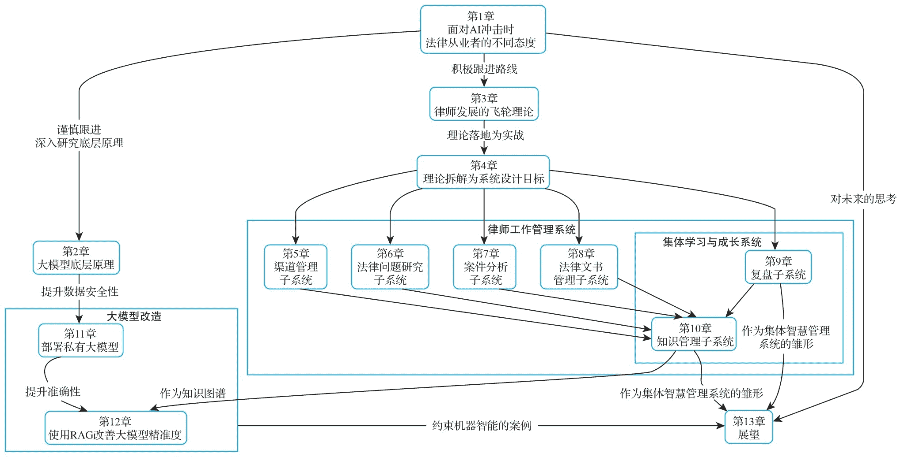

图 1 本书内容结构

表 1 读者的常见问题

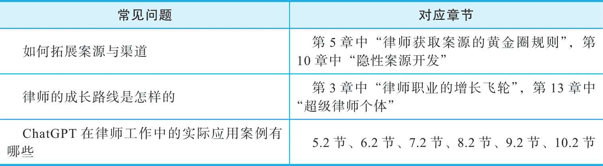

**勘误与支持**

书中所涉 AI 工具与系统可在表 2 所列地址获取，按需阅读并自行定制。另整理一份跨领域阅读书单，涵盖律师职业方法论、AI 与法律交叉、基础 AI 知识、认知科学与隐喻、技术组合创新、系统动力学与飞轮、复盘方法、知识管理、自然法、集体智慧、脑机接口及大客户销售策略等，地址为 https://agate-zenobia-063.notion.site/fb9f0fd15a7e421787f81cb000f8b062?pvs=4。

阅读中如有疑问，可通过电子邮箱 xiwh123@gmail.com 或微信公众号“轩律师办案手记”联系我们。

表 2 本书涉及的 AI 工具及系统

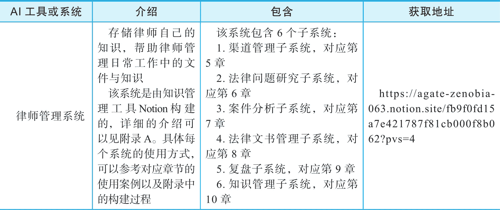

（续）

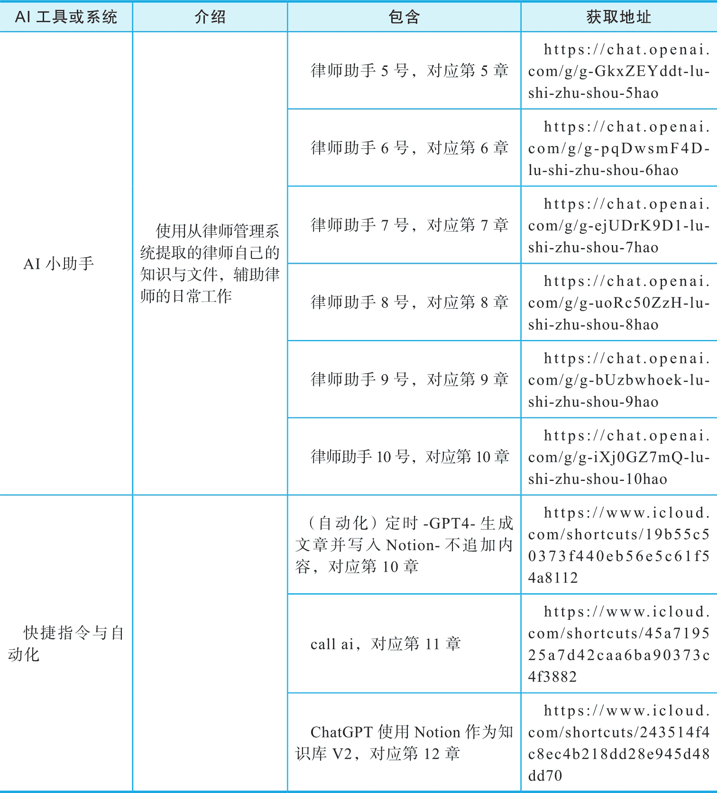

**致谢**

感谢母亲长期坚定支持，让我少了后顾之忧，养成终身受益的阅读习惯。

感谢妻子轩珍珍律师，本书是我们的共同结晶。

感谢罗雨露老师的邀请与督促，没有他就没有写作的念头与坚持，也无法将三年积累汇集成书。

徐伟浩

# **第一部分**

# **冲击：ChatGPT 的横空出世**

谈及人工智能，有个形象的比喻：好似你在站台远望一列火车。起初只是远处的点，移动缓慢甚至令人发倦。等它临近，便会骤然掠过身侧，回过神来想追已追不上。

ChatGPT 正是这样一辆疾驰的智能列车，闯入法律行业。我们猝不及防地接受现实——AI 奇点的预告已然到来，后续会怎样展开？

**CHAPTER 1**

## **第一章**

## **震荡：AI 翻动的行业版图**

AI 与法律的结合可追溯至 20 世纪 60 年代，早期因技术局限，并未对法律界产生实质冲击。ChatGPT 出现后，行业变化明显。本章围绕三方面展开。

●人：行业领袖与普通律师的观点与心态变化。
●事：传统律师工作被冲击及新的工作形态。
●行业：AI 对法律本身及法律业态的影响。

**1.1**

**ChatGPT：新时代的标志**

**1.1.1 AI 与法律：历史回溯**

AI 与法律的联动始于 20 世纪 60 年代。初期的应用集中在基础信息处理与文本分析，属于弱人工智能阶段的被动尝试。那时出现的 AI 法律系统可模拟律师或法官的决策，为特定问题给出建议，但受限于技术，应用范围窄，多用于教学与研究。弱人工智能时期的典型系统见表 1-1。

进入 21 世纪后，算力提升与大数据兴起推动 AI 在法律领域快速扩张。机器学习与自然语言处理技术的突破，让 AI 在法律分析、预测与咨询上更具能力。这一阶段出现了可做案例研究、合同审查与风险评估的进阶工具，通过海量文献与案例分析提升效率与准确度。

尽管进步显著，AI 在法律应用仍面临挑战。核心难题是如何保证 AI 输出的法律建议符合伦理与专业规范，同时数据隐私与安全风险也在同步攀升。

表 1-1 弱人工智能时期的 AI 法律系统

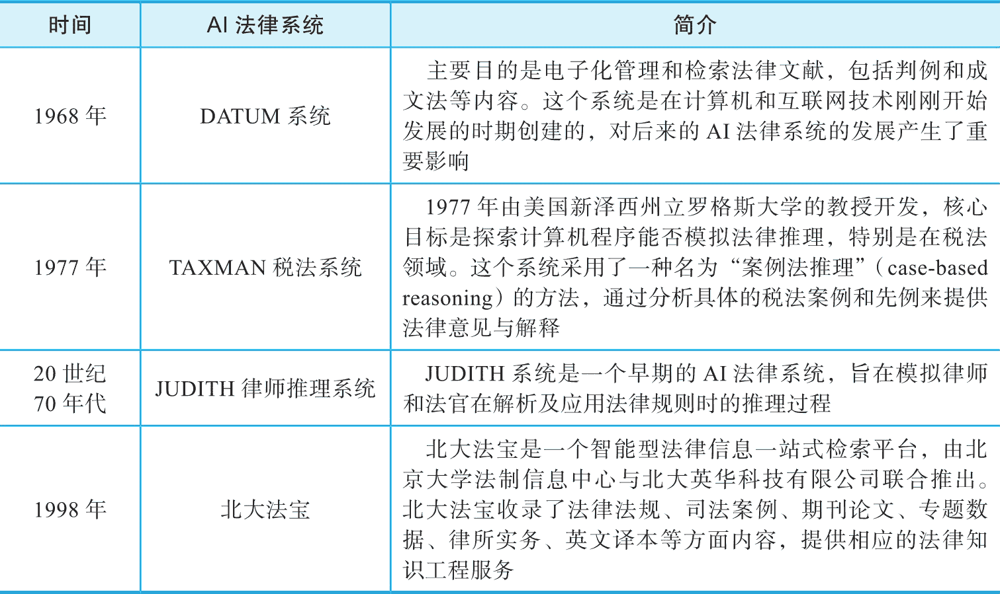

**1.1.2 ChatGPT 的诞生：一次技术跃迁**

ChatGPT 标志着 AI 发展进入新篇章。它在语言处理与文本分析上达到前所未有的水准，能以更自然直观的方式与用户互动。这使其在法律咨询、文件起草、研究辅助等方面展现巨大潜力，AI 应用从后台数据处理走向与律师、客户的直接对话。

**1.背景与演进**

ChatGPT 由 OpenAI 研发，基于 GPT，即生成式预训练变换器架构。GPT 始于 2018 年，核心是为理解与生成自然语言而设计的深度学习模型。2020 年 GPT-3 发布后技术跃升，语言理解与生成能力令人瞩目。ChatGPT 正是在此基础上构建，可通过自然语言交互、提供信息、解答疑问、协助编程与写作，如例 1-1 所示。

**例 1-1 ChatGPT 对语言的理解**

**提问：**我的蓝牙耳机坏了，我应该去看牙科还是耳科？

**ChatGPT：**这问题像是开玩笑！中文里“蓝牙耳机”里有“牙”“耳”二字，但与“牙科”或“耳科”并无关联。蓝牙耳机坏了应联系厂商客服或去电子维修店，而非去医院。若是玩笑，则都不必去。

**2.技术特征与突破**

ChatGPT 的一大创新在于强大的语言生成能力，通常能产出连贯、相关、逻辑自洽的文本，大幅模糊人机交流边界。它在处理复杂查询、完成特定任务、编程辅助与创意写作上表现突出。ChatGPT 回答法律咨询问题如例 1-2 所示。

其在大规模数据上的学习能力也引人关注，可从海量文本中提炼语言模式与知识点，使其在法律等诸多领域应用前景广阔。

**例 1-2 ChatGPT 回答法律咨询问题**

**提问：**什么是隐名股东？

**ChatGPT：**隐名股东又称匿名股东，指在公开与官方记录中不直接显示身份的公司股东。此种安排通常为保护隐私或出于商业考量，可能通过信托等第三方实体持有股份。

在不同法域中，对隐名股东的接受度差异较大，部分国家要求披露股权结构与实际受益人，以符合透明度与反洗钱要求。

**点评：**

准确性 4 分、完整性 4 分、清晰度 3 分、相关性 4 分、专业性 2 分。

该回答简要说明了隐名股东的定义、存在原因及法律体系差异，对初识者够用，但对实务需求仍显不足，例如具体实现方式、权利义务保障、风险及我国司法实践等专业内容需补充。

**3.对法律行业的影响**

在法律领域，ChatGPT 打开了新的可能性，如图 1-1 所示。它可辅助律师快速检索案例与法规，解释法律概念与条文，提供更深洞见，也能协助起草与审阅文件，提升效率。

同时也带来挑战，如如何确保 AI 生成建议的准确性与合规性，如何处理交互中的误解与错误。

**4.未来展望**

技术常被短期高估、长期低估。当前大家经历了一波对 ChatGPT 的短期高估与回落，但长期来看影响仍被低估。

展望将来，ChatGPT 及同类技术有望进一步重塑法律行业面貌，在研究、案情分析、客户服务等环节作用更明显。随着从业者适应与应用，法律服务将更高效、可及、个性化。

总之，ChatGPT 的出现意味着技术革命，也对传统法律实践与教育构成挑战与机遇。随着 AI 持续进步，法律行业将面临更多变革，深刻影响律师工作方式与法律服务未来。

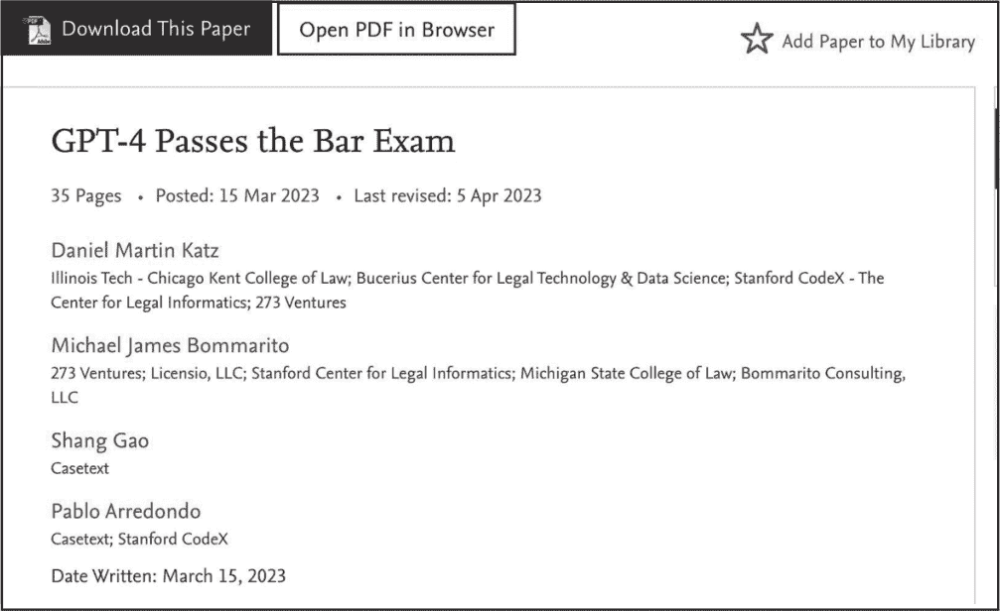

图 1-1 GPT-4 成功通过美国律师资格考试，分数高于 90%人类考生

（来源：https://papers.ssrn.com/sol3/papers.cfm?abstract_id=4389233）

**1.2**

**行业的即时反应：惊讶与好奇**

ChatGPT 等 AI 技术迅速进入法律行业后，法律从业者呈现多元复杂的态度。

**1.接纳与担忧并存**

部分律师对 AI 持积极态度，如表 1-2 所示，认为 ChatGPT 可显著提升效率，尤其在数据处理、法律研究、文档审阅上。例如借助 AI 可快速调取与分析过往案例，增强咨询与辩护力度。

另一部分则表达担忧，认为 AI 在理解复杂法律问题与人类情感上仍有限，过度依赖可能削弱服务的个性化与人性化。也担心敏感信息处理带来的隐私与安全问题。

表 1-2 部分法律专业人士对 AI 技术的态度

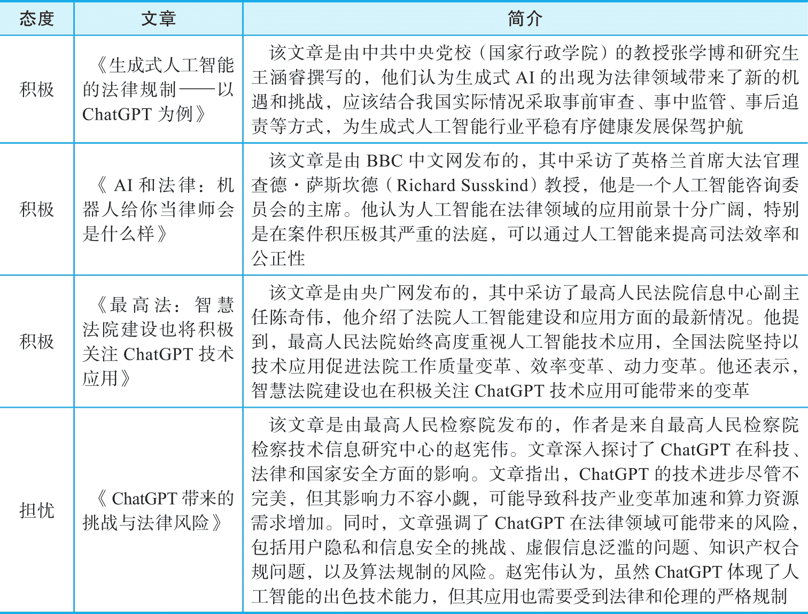

**2.职业未来的再思考**

部分从业者关注 AI 对职业的影响，如表 1-3 所示。他们认为 AI 可能改变律师职责与工作内容，文档整理、初步查询等重复性工作或被替代，律师需将重心转向需深厚法学功底、批判思维与创造性解决方案的领域。

他们普遍强调 AI 是辅助而非替代，未来律师需具备利用 AI 优化流程的能力，也呼吁法学教育纳入 AI 相关课程，培养适应力与创新力。

表 1-3 律师对自身职业未来的思考

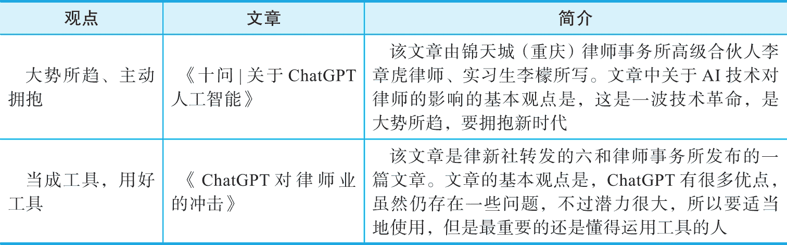

**3.伦理与职业责任的讨论**

在伦理与职业责任层面，讨论广泛展开。重点是如何在保持职业伦理标准下使用 AI。

也有观点指出，立法者与实务者需审视与更新现有法律框架，以指导 AI 在法律领域的合理使用。相关管理规定的出台如表 1-4 所示。

表 1-4 相关管理规定的出台

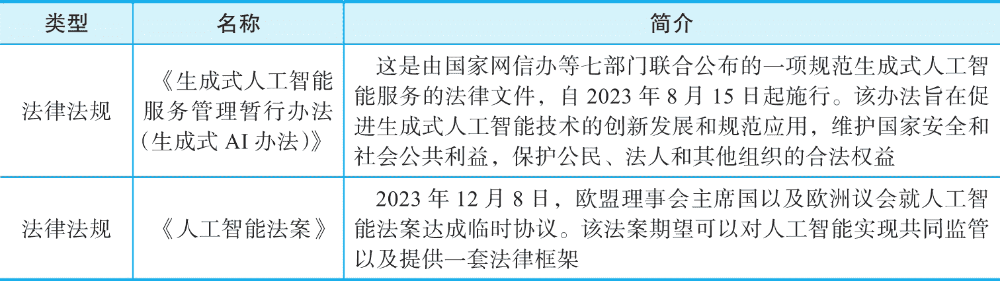

**4.创新与合作的期待**

一些从业者看好 AI 的创新潜力。认为 AI 可催生新商业模式与服务形态，如高效在线咨询、AI 驱动的法律分析工具等，提升质量与效率，并扩大服务覆盖。

法律从业者普遍主张跨界协同，倡导法务人员与工程师、数据科学家以及其他领域专家联手协作，以充分释放人工智能在法律服务中的潜能，相关代表性法律大模型整理于表1-5。他们认为，只有通过跨学科的配合，才能更透彻地理解技术边界，并推动法律服务的创新发展。

表1-5 部分法律大模型

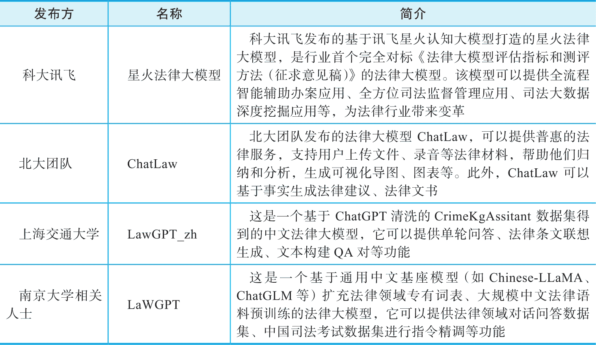

总体来看，行业内部对ChatGPT及同类AI技术进入法律场景的评价呈现多元且深度的特征。讨论覆盖技术采纳、职业前景、伦理边界和协同创新等多个层面，折射出对这一新兴工具审慎而全面的审视。

**1.3**

**律师心态的演变：由抵触走向接纳**

ChatGPT等AI在法务行业加速渗透的同时，普通律师的心理轨迹也在同步调整。从律师自身视角出发，面对技术冲击时心态究竟经历了怎样的变化？

**1.3.1 从质疑、轻视为始的初步认知**

多数执业律师接触AI概念的时间集中在2020年左右。GPT-3发布时业内已有耳闻，但当时绝大多数人并未投入关注，心底既有怀疑也有轻视，普遍觉得这项技术声势虽大却离落地遥远。

2022年底ChatGPT在各平台迅速走红。某段视频中博主与ChatGPT多轮对话，对方应对自如且语气近似人类，让人直观感受到人工智能的发展速度。两年前多数人视而不见，短短时间后它已光速向前。

人工智能能力跃升是不争的事实，但结合国内司法生态判断，律师群体短期内不会因此被整体冲击。近年来中国经济快速发展，法律修订频率加快，一部主法常伴随多部司法解释，再加行政法规与各法院文件繁多，体系复杂且内部存在冲突。面对疑难案件，往往陷入剪不断理还乱的困境。即便最高法持续推出解释与指导性书籍，司法适用难题仍未根本缓解。因此律师、法官、检察官都需基于对法律的理解结合案情作出合理论证。如有法官提到其办理建设工程案件的体会，“实际施工人突破合同相对性向发包人主张工程款”的适用在2011至2023年间发生明显变化，前后判例结论大相径庭，同一类案件可能因法律适用变动而逆转胜负。法官在个案中必须调动法律知识与事实认知作出公正解释，以减少当事人损失。这种融合事实判断与法律判断的主观裁量，远非ChatGPT所能替代。

当然工作可分主观与客观。对比需要创造与深度思考的主观性劳动，ChatGPT更擅长高重复性、有固定流程的客观性任务。例如曾有同行借助AI工具快速梳理近五年法定节假日的准确日期，帮助当事人完成加班事实的举证，显著简化了繁琐流程并提升效率。对AI输出的准确性，不少律师仍存疑虑。律师需要的是准确、高效且任劳任怨的助手，若质量不稳反而需二次返工，耗费精力。

**1.3.2 理解与应用的逐步深化**

掌握并运用ChatGPT及类似工具是一个渐进且富有启发的进程。

AI可助力律师快速成文，提升写作效率。对刚独立执业的青年律师而言，运营公众号是打造个人品牌的重要路径，但写稿耗时低效。借助AI可缓解创作压力：先选取一篇高流量文章让AI拆解其结构和核心要点；再将自己积攒的材料输入AI，要求其按前述框架组织；随后针对各段落下达具体指令，引导其进行延伸与个性化创作；最终形成具独特见解的新稿。

AI可帮助律师迅速把握陌生领域的法规及司法观点，为后续研究指路。许多律师常接到紧急求助，要求就不熟悉的问题即时回应。若按常规检索法条、案例，效率低下且焦虑。可先向AI提出问题，快速锁定相关法律规定、行业禁止性条款及司法实践倾向，再结合客户具体情况据此提出初步建议。

AI可辅助合同审查。对不少律师而言审阅合同近似“苦役”，越推敲越觉复杂。轩律师尝试了几种用法：面对不熟悉的合同，可指令AI“假设你是一名律师，请从专业角度审核此条款，指出风险并提出修改建议”。AI会先列出风险点，律师据此追问具体法条依据，再对照条文定位关键条款，最后可通过精准指令让AI润色措辞完成修改。

AI可模拟庭审，拓宽抗辩思路。庭审准备时常不确定对方或法官会从何角度切入。可与AI角色互换进行试验，指令为“你是一名专业律师，现就上述事实提出你的专业答辩意见”。待回复后继续追问，循环迭代以完善庭前预案。AI凭借快速整合知识的能力，可帮助规避因行业或法律知识缺位导致的失误；通过扮演不同角色交流，可减少思维偏差；借助多角度交叉提问，还能避免因疏忽造成的遗漏。

**1.3.3 应用提升伴随的问题暴露**

实践中发现了几个使用痛点。其一，检索精准度不足，复制内容较多，且复制的条文不乏已失效条款，而AI自身并不知晓其时效性。若律师盲目依赖，易形成错误认知。其二，使用AI需要律师学会有效提问。AI提供的信息虽丰富，但多为通用普适内容，缺乏对问题本质的深层剖析与解决方案。

进一步将AI嵌入律师工作流时，还需对现有技术进行改造。本书第二、三部分将介绍如何对ChatGPT类工具做简易改造以助力实务。例如通过RAG检索增强生成来提升检索精准度，该内容将在第十二章展开。再如有效提问能力的培养，实质是提升律师的学习与思考能力。大模型落地后，优质答案不再稀缺，提出好问题的能力才是核心，这部分将在第九章和第十章重点阐述。

**1.4**

**律师应对之道：由传统向变革**

**1.4.1 传统实务面临的挑战**

随着ChatGPT等AI在法律领域普及，传统法律工作遭遇前所未有的挑战，既影响工作方式，也重塑客户服务模式。

**1.对律师工作方式的挑战**

**（1）自动化与效率的演变**

ChatGPT类工具可自动完成大量文档审查与法律研究，对依赖人力的传统模式构成重大改变。法宝GPT界面如图1-2所示，它正由传统检索工具转型为问答式平台。律师需学会使用并管理这些工具，提高效率的同时解读与应用AI提供的结论。

**（2）技能需求的转变**

AI在实务中作用扩大后，律师所需能力也在调整。除传统法律分析与辩论能力外，对技术的理解与运用成为必备素养。

**2.对客户服务模式的变革**

在人工智能高速发展的当下，客户处理法律问题时日益依赖大型模型如OpenAI的ChatGPT。由此引发的疑问是：在此趋势下，人们是否仍会持续寻求律师服务？

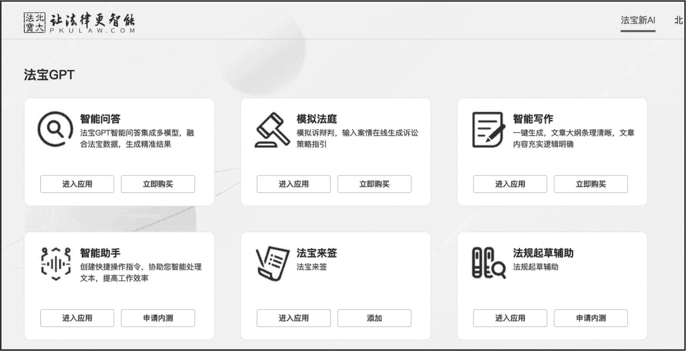

图1-2 法宝GPT

首先需认识到，即便AI在提供初步咨询、起草标准合同或解答基础法律问题上表现突出，也无法完全取代人类律师。法律实践不仅关乎知识传递，更涉及复杂人际关系的理解、道德判断和特定情境下的决策。例如在敏感且复杂的诉讼中，需要律师的经验、直觉与专业判断，这是算法难以复制的。

另外AI应用也带来伦理与责任难题。当AI提供的建议出现错误时，责任应由谁承担？当前法律体系对此尚无明确规则，因此人类律师的专业判断与责任承担机制仍不可或缺。

不过这一趋势确实对客户服务模式形成冲击。律师需要反思服务方式，探索与AI结合的新路径，提供算法覆盖不到的价值，如更深入的策略咨询、个性化服务和情感支持。同时律师可借助新技术提升效率与质量，如利用AI进行案例研究与文档审核。

总之，人工智能在法律领域的应用愈发广泛，但律师的作用并未消失，反而是行业自我革新与发展的契机。律师应拥抱技术变革，将其作为提升服务质量与效率的工具，同时继续发挥其在复杂法律事务与人际关系处理中的独特作用，从而保持职业竞争力并为客户提供更全面、人性化的服务。

**3.对法律本身的冲击**

人工智能的影响不仅限于具体条文与司法实践，更深层次冲击法律体系的基础——宪法。

人工智能会影响宪法吗？这个问题看似反常，却常被忽视。人们多聚焦版权、刑法等议题，而宪法层面的影响同样真实。

宪法是国家根本法，规范政府组织、权力分配与公民基本权利，为社会运行提供框架。随着AI快速发展，原有宪法框架面临新挑战：

●决策自动化：AI可自动处理海量数据，可能使决策更依赖技术而减少人工干预，影响政府运作方式与决策透明度。
●隐私与监控：AI强化数据采集与监控能力，可能冲击隐私权，挑战宪法对个人信息保护的规定。
●劳动力市场变化：自动化导致的就业结构变化可能需政府调整社会福利与劳动法，以保障受影响群体。
●法律与伦理挑战：算法偏见、责任归属等新问题需新法律框架，这可能影响宪法中公平正义原则的规定。

人工智能法律问题的部分研究见表1-6。在AI时代，需重新思考法律的内容与功能。AI发展不仅是技术问题，更是伦理、法律与社会问题，需在保护公民权利与促进技术发展间寻求平衡，可能意味着修改现有法律或制定新规。

表1-6 人工智能法律问题的一些研究

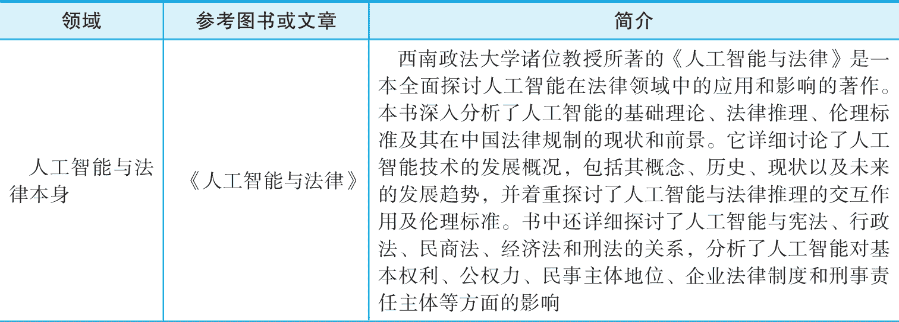

（续）

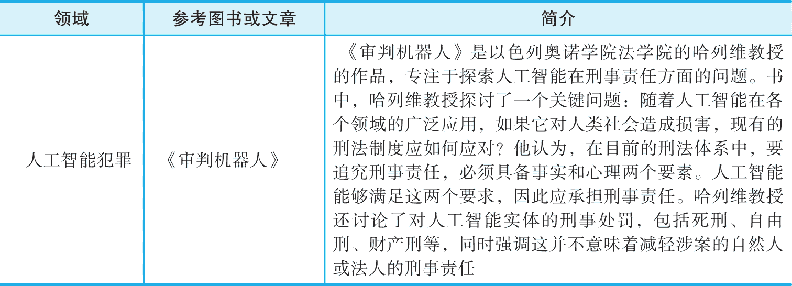

**1.4.2 接受新技术：转型与融合**

观察过去两次新技术发展历程可发现，技术演进通常经历四个阶段，可称作“四个主导阶段”，见表1-7。

表1-7 四个主导阶段：新技术发展的四个阶段

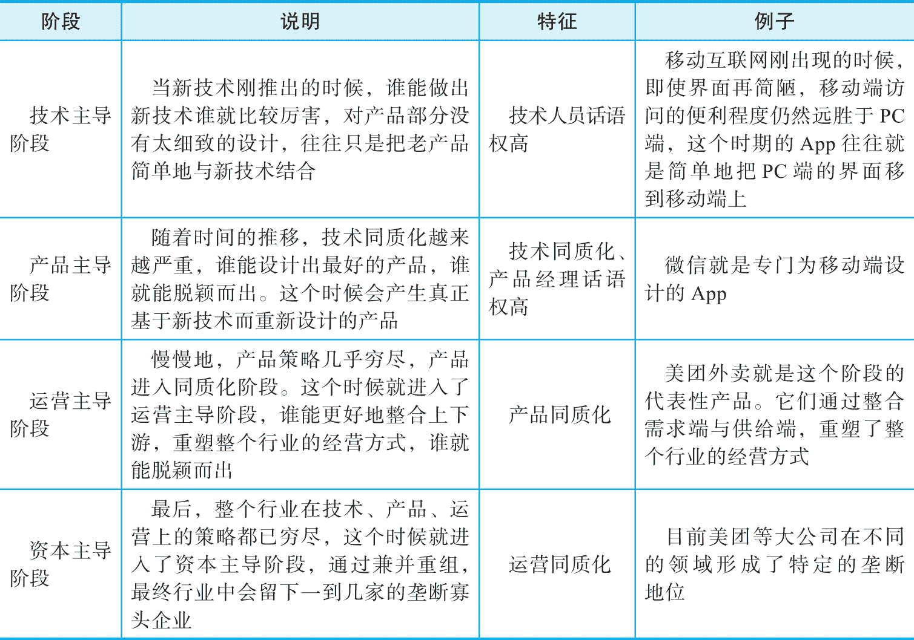

将以ChatGPT为代表的大模型对法律行业的影响划分为四个阶段，可对未来作出预判并提前准备。

**1.技术主导阶段（影响2.5%～16%的行业从业者）**

目前大模型与法律结合仍处技术主导期，可见于：仅发布法律垂直大模型，AI工具仅实现简单法律知识问答。该阶段技术与应用场景结合较为粗糙，但属阶段性现象。随着演进，部分现阶段用法会被淘汰，如专有法律大模型可能被通用大模型配合专业提示词取代。

该阶段受众对应技术采用生命周期的“早期使用者”，预计影响2.5%～16%的从业者。

应对策略是使用现阶段产品，但勿沉迷，要以目标为导向将产品当作工具，在实践中形成自身方法论。

**2.产品主导阶段（影响16%～50%的行业从业者）**

受众对应“早期大众”，预计影响16%～50%的从业者。

至此阶段，法律行业才出现真正与大模型融合的产品。技术主导期的产品只是与旧工具简单叠加，缺乏创造性。当前观察中，ChatGPT与谷歌推出的Gemini通过摄像头与语音交互的功能才属真正的产品创新。截至2023年底，Gemini仍在演示阶段，尚未进入产品主导期。

该阶段需真正将技术用起来并深度融合产品。借助产品势能可快速助力个人品牌传播。围绕产品会出现新的法律议题，如人机协同犯罪、AI错误责任归属、AI版权等，提前研究可抢占话语权。好产品应具独特设计、开箱即用、解决特定问题且易用，而非旧产品的简单拼接。

**3.运营主导阶段（影响50%～84%的行业从业者）**

受众对应“晚期大众”，预计影响50%～84%的从业者。

该阶段需从行业整体视角思考问题，对旧问题设计新解法，涉及行动预先设计、非诉设计及律师经营方式调整。但此阶段任务非本书重点，亦非普通律师可推动。

**4.资本主导阶段（影响84%～97.5%的行业从业者）**

受众对应“晚期大众”，预计影响84%～97.5%的从业者，仍有约2.5%的人不接受新技术。

该阶段任务与律师关系不大，可不必过多考虑。不过需警惕大律所垄断行业的可能，据情况决定是否提前加入大所或在特定领域深耕。

CHAPTER 2

## 第二章

## 格物：技术革新，ChatGPT崛起

ChatGPT究竟是什么？本章尝试从律师熟悉的领域切入，用通俗方式解释ChatGPT的底层原理、优势及其在法律中的潜在应用。

章末将延续第一章的讨论，基于技术革新视角，进一步探索ChatGPT的未来走向及其对法律行业的可能影响。

**2.1**

**背后的技术：理解ChatGPT的工作原理**

**2.1.1 基础技术解析**

本节将从律师熟悉的自然法入手，逐步引导读者理解ChatGPT的内部机理。

注意：文中偶尔会以代码计算精确值，但代码并非重点。读者可忽略编程细节，不影响对核心内容的把握。

**1.法律：从大自然到自然法**

自然法概念源于古老哲学与法学理论，主张法律根基在于自然规律与人类本性。该思想认为所有法律与社会规范应反映自然的基本原则。例如经典法学著作《法学阶梯》将自然法与罗马法融合，并据此重构罗马法；20世纪战争反思推动自然法复兴，最终促进《世界人权宣言》的诞生。

自然法理论认为部分权利与原则是自然赋予的。如生存、自由、追求幸福被视为基本权利，折射出生物生存繁衍等自然真理。在演化过程中，人类形成诸多生存与互动的基本原则，如种群繁衍启发家庭与社会结构理解，进而形成婚姻制度，并衍生抚养关系等法律规范，如《中华人民共和国婚姻法》《中华人民共和国未成年人保护法》等。

当前法律制定与解释常参考自然法原则，如在讨论人权、公正与道德时，自然法提供重要视角。这种对话体现了人类社会对自然规律的理解与尊重。

如何将自然界规则借鉴至法律？这涉及更底层的语言即符号本身的思考，接下来需引入符号学的概念。

**2.符号学：概念类比**

符号学研究符号及其在人类交流中的作用。符号不仅指文字语言，还包括一切表达与理解世界的符号系统。该系统使我们能把复杂概念拆分为易懂部分，如法律文本借助特定术语与结构传递复杂法理。

人类常借助类比与隐喻理解新概念。如把时间比作流水是一种结构类比，帮助理解时间的连续与不可逆；把商业营销比作战役则是一种深层隐喻，揭示营销策略的复杂与竞争性。类比与隐喻是人类认知的根本特征，使未知与已知相联。

我们自然会从熟悉事物出发，通过类比创造新的模式化事物，如从自然规则到自然法。类比示意如图2-1所示。

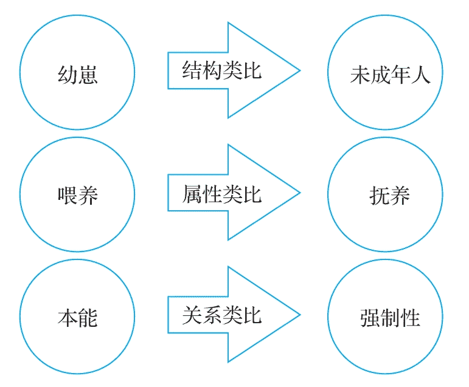

图2-1 从自然规则到自然法的类比

再深入一点，类比正是我们理解陌生符号意义的方法。

词义靠距离来定位

后结构主义把语言意义看作相对且由关联建构的产物。换句话说，陌生词汇并非自足，它的内涵要靠与其他已知词汇的区别与联系来确立。我们能识别“西瓜”，很大程度上是因为它在词网中与“苹果”“梨”“衣服”保持着明确的界限。由此人们常会下意识地追问“××和××到底差在哪”。这种追问暴露了大脑归纳事物时的底层逻辑。

大脑似乎习惯用距离来给概念定坐标，关联越强位置越近，如图 2-2。计算也能模仿这种方式，下面引入稠密词向量这一表征手段，看看机器如何衡量概念远近。

**3. 从类比到稠密词向量**

**（1）语料库**

假设一套极简语料，仅包含四条关于气味的描述句，如表 2-1 所示。

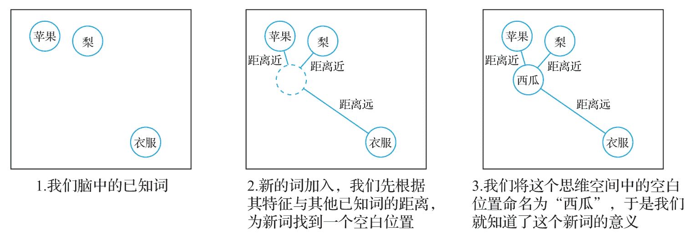

图 2-2 通过距离定位新词坐标

表 2-1 关于香味描述的超简单语料库

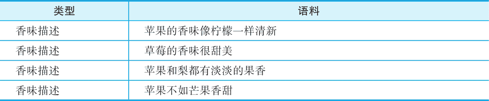

**（2）共现矩阵**

可统计词与词的共现情况，得到共现矩阵，如图 2-3 所示。

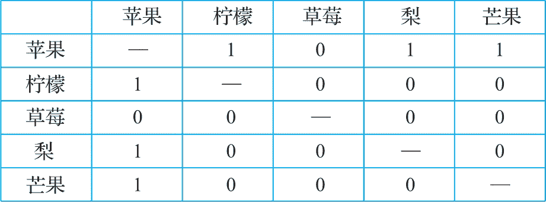

图 2-3 共现矩阵

通过代码清单 2-1，可算出词向量。

**代码清单 2-1 使用奇异值分解提取词向量的 Python 代码**

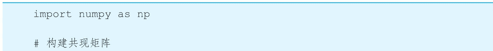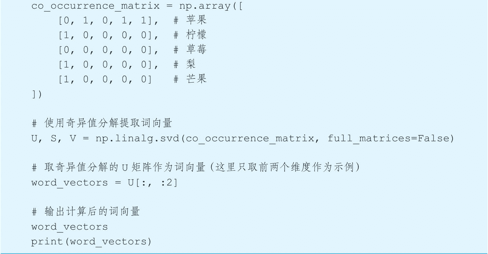

输出结果如下。

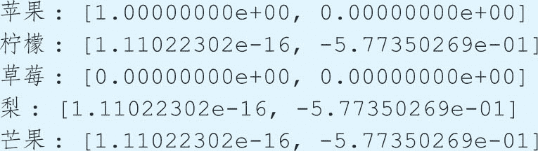

**（3）勾股定理与余弦相似度**

语料过于简陋，导致几类水果的向量几乎重合。为更直观，用代码清单 2-2 把苹果与柠檬的向量在二维平面上绘出，草莓的直线被忽略，因数据不足草莓未与其他水果共现，如图 2-4 所示。

代码清单 2-2 绘制二维矩阵的 Python 代码

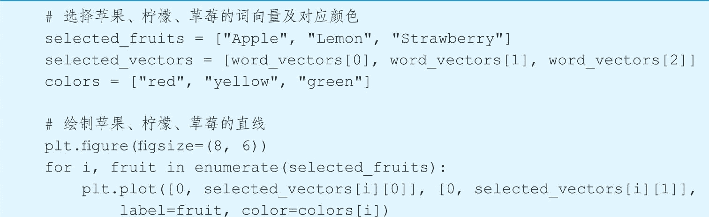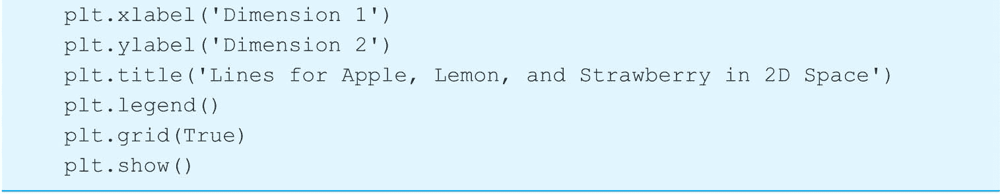

依据勾股定理，边长²=苹果向量²+柠檬向量²，通过代码清单 2-3 可算出苹果与柠檬两向量间的边长为 1.1547005383792515。该边长即欧几里得距离，反映两者相关强弱。

代码清单 2-3 通过余弦定理计算欧几里得距离的 Python 代码

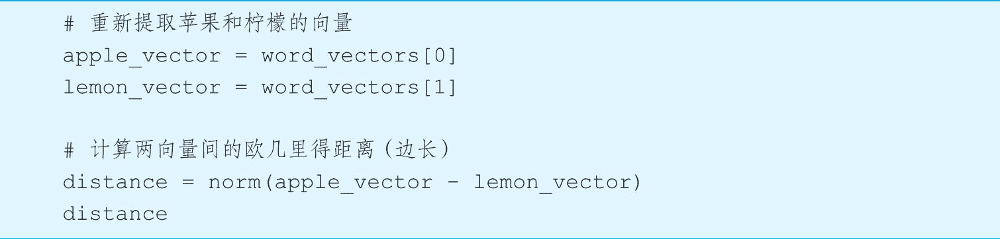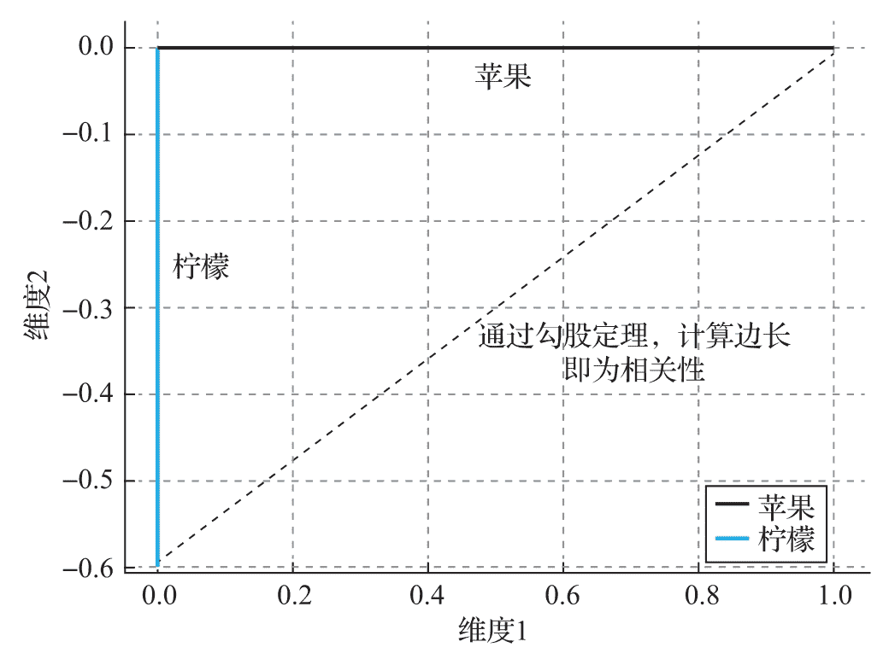

图 2-4 勾股定理计算向量间边长

此极简案例有助于理解原理。实践中更常用余弦相似度。代码清单 2-4 计算出苹果向量与其他四种水果向量的余弦相似度，结果见表 2-2。

代码清单 2-4 计算余弦相似度的 Python 代码

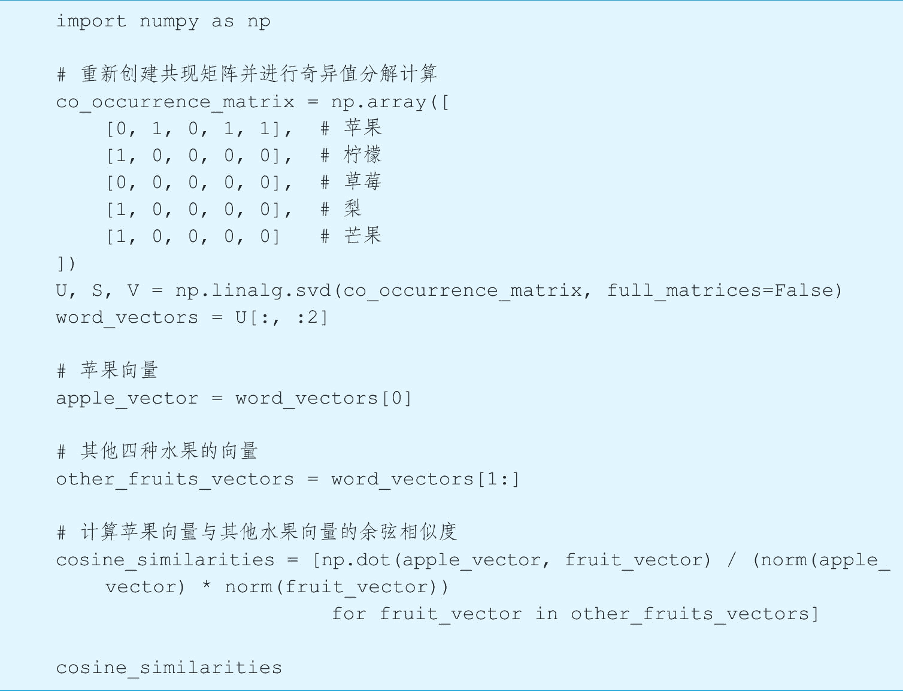

**表 2-2 苹果向量与其他四种水果向量的余弦相似度** ^(²)

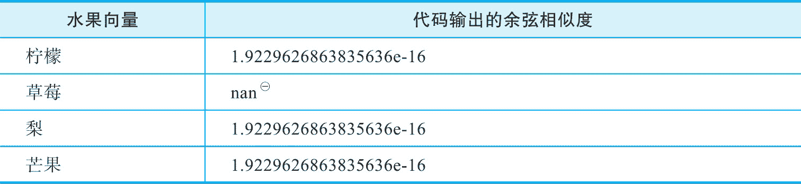

本例仅在香味这一单一维度上比较苹果与其他物品的接近程度。现实里水果还有营养、口感、大小、成熟期、经济价值、文化象征等诸多维度，这便引出了稠密词向量的意义。

**（4）稠密词向量**

稠密词向量是用数学形式表达词汇语义的一种方式。做法是把词映射到一个高维实数空间，通常几百到几千维，每一维承载某种语义特征。这样一个词就由稠密的实数向量代表，词与词的语义关系可通过向量运算体现。

与传统独热编码不同，稠密向量本身携带语义信息，含义相近的词其向量也更接近，因此可用于句法分析、语义分析等任务。

ChatGPT 背后的 Transformer 语言模型正是基于稠密词向量技术。下面介绍其实现方式。

**4. Transformer：稠密向量如何成为变压器**

具体而言，ChatGPT 建立在 Transformer 机器学习架构之上。Transformer 由编码器和解码器构成。

编码器内部设有词嵌入层，把文本中每个词映射为稠密向量，这些向量保留了语义。随后向量送入自注意力机制，计算彼此的相关性并学习语义，再进入前馈全连接层深化特征。这一过程都依赖稠密向量提供的语义基础。

解码器也有类似的词向量映射和自注意力结构。编码器提取的语义信息经注意力机制传递给解码器，指导其对输入文本进行预测或理解。

经过大规模文本训练后，模型学会了把词汇映射为语义向量并利用向量间关系进行理解与生成。可以说，稠密词向量为 ChatGPT 提供了表示和学习语义的关键基础，使其能够建模词汇间的语义关联，完成语言理解和对话。稠密词向量让 ChatGPT 感知到语言的语义空间。

于是 ChatGPT 就可以开始生成文本了。

**5. ChatGPT 产出文本的底层机制**

网上常说人本质上是复读机，这在某种程度上成立。遇到与已有问题相似的新问题时，我们往往直接复用之前的答案或稍作修改。ChatGPT 本质上也是如此。

在理解语言之后，ChatGPT 的文本生成本质上是一个搜索过程，它依据预设的语料库来推演下一句话。具体来说，接收到的语言先被转为向量，然后在训练时形成的大规模语料向量空间中寻找匹配，再在匹配区域向下扩展。

生成文本的核心是计算后续术语的概率分布，如图 2-5 所示。首先根据前文判断可能的句式，注意力机制会评估多种生成路径并选择最可能者。其次在选定句式后判断随后应出现的术语是什么，如此迭代直至文本完成。

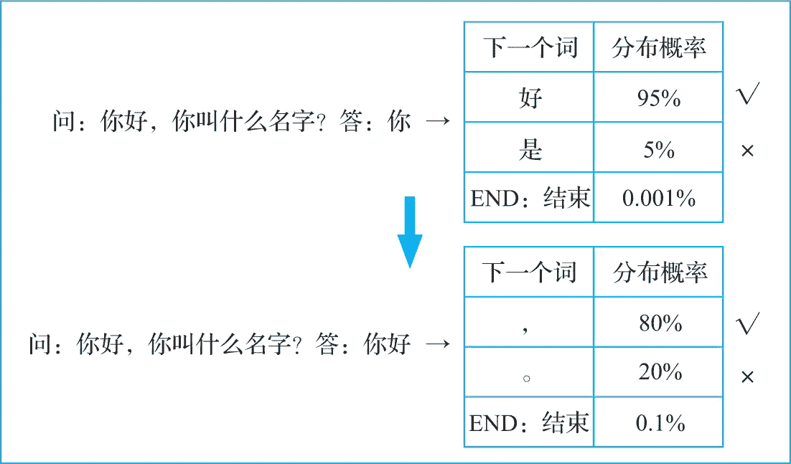

图 2-5 ChatGPT 只是不断生成后续术语

技术上总结，ChatGPT 作为先进的自然语言处理工具，其核心是 2017 年由谷歌团队提出的 Transformer 深度学习架构。该架构迅速成为自然语言处理的革命性技术。

Transformer 的核心是注意力机制，使模型能够聚焦输入的不同部分以提升预测精度。处理自然语言时，模型可集中于句子的关键词，忽略无关信息，从而更好把握语境。例如在翻译任务中，注意力机制帮助模型聚焦源语言中与目标词直接相关的部分。

生成文本时，ChatGPT 通过预测最可能的后续词来构建句子，这一过程基于已有词汇和语境，保证连贯性。为了提升多样性和创造性，模型还会权衡多种词汇组合再择优。

**2.1.2 ChatGPT 的特质与优势**

ChatGPT 的研发标志着人工智能在自然语言处理领域的重大突破，其主要特点如下。

**1. 高级语言理解能力**

ChatGPT 能够理解并生成复杂的自然语言，如例 2-1 所示。它在大规模预训练中习得了丰富的语言结构和词汇，能处理不同风格包括俚语和双关语，从而实现自然流畅的对话。

**例 2-1 大模型的语言理解能力**

**提问：**请解释一下下面的这个故事，不同的意思是什么意思？

小明：阿强，这是我的一点意思。

阿强：你这是什么意思？

小明：没什么意思，意思意思。

阿强：你这人真有意思。

小明：其实也没有别的意思。

阿强：那我就不好意思了。

小明：小意思小意思。

**ChatGPT：**

这个对话展示了中文中“意思”一词的多重含义和微妙的语境使用。每一句话都使用了“意思”，但每次都有不同的含义：

1.小明：阿强，这是我的一点意思。

这里的“一点意思”通常指的是小礼物或者好意，表达敬意或感谢。小明可能是在给阿强一个小礼物或者表示某种感激。

2.阿强：你这是什么意思？

阿强这句话的“什么意思”可能表示困惑或质疑。他可能不明白小明的意图，或者是在问小明为什么要这么做。

3.小明：没什么意思，意思意思。

小明这里的“没什么意思”意味着他的行为没有特别的目的或深意。而“意思意思”是一种常用语，表示只是象征性的行为，没有太多的重要性。

4.阿强：你这人真有意思。

这里的“有意思”可能是阿强对小明的行为表示赞赏或觉得有趣，也可能带有一点戏谑或轻松的语气。

5.小明：其实也没有别的意思。

小明再次强调他的行为没有其他深层的含义，只是单纯的好意或礼貌。

6.阿强：那我就不好意思了。

“不好意思”在这里可能表示阿强对小明的礼物或好意感到有些不安或尴尬，因为接受了小明的好意。

7.小明：小意思小意思。

最后，小明再次强调自己的行为只是小小的表示，没有太多的重要性，是出于礼貌或好意。

整个对话体现了中文中“意思”这个词的灵活性和丰富的文化内涵。通过不同的语境，相同的词语可以表达多种不同的情感和意图。

**2. 上下文感知与连贯性**

与传统规则系统相比，ChatGPT 能保持对话的历史连贯，提供更相关的回复。它记住对话记录，理解前后文关系，从而给出更准确的回答。大模型的上下文能力如例 2-2 所示，在第二个问题时结合上文推断了提问意图。

**例 2-2 大模型的上下文理解能力**

**提问：**中国民法典的全称是？

**ChatGPT：**中国民法典的全称是《中华人民共和国民法典》。

**提问：**宪法呢？

**ChatGPT：**中国的宪法全称是《中华人民共和国宪法》。

**3. 个性化与适应性**

ChatGPT 能根据用户输入调整回答风格与内容。它可以模仿用户语言风格，适应不同对话场景，提供更个性化的交流体验，如例 2-3 所示。

**例 2-3 大模型提供个性化的回答**

**提问：**回答一个律师的问题：“根据中国法律，劳动者与用人单位就工伤保险待遇赔偿问题达成和解后，是否还可以通过仲裁或者诉讼主张权利？”

**ChatGPT：**根据中国法律，劳动者与用人单位在工伤保险待遇赔偿问题上达成和解后，是否还可以通过仲裁或诉讼主张权利，主要取决于和解协议的内容以及和解是否符合法律规定。

一般而言，如果和解协议是在双方自愿、平等的基础上，依法订立的，并且和解内容没有违反法律强制性规定，那么和解协议具有法律效力，劳动者在和解协议范围内原则上不能再通过仲裁或诉讼主张权利。这是因为和解协议的目的就是为了解决争议，避免诉讼，双方一旦达成和解，就应当按照和解协议执行。

然而，如果和解协议的内容违反了法律规定，如低于法律规定的工伤赔偿标准，或者和解过程中存在胁迫、欺诈等情形，导致和解协议无效或可撤销，劳动者仍然可以通过仲裁或诉讼的方式主张自己的权利。

此外，根据《中华人民共和国工伤保险条例》等相关法律法规，对于工伤保险待遇的赔偿问题，有些权利是劳动者不可放弃的，即使在和解协议中放弃，该放弃也是无效的。因此，劳动者在这些不可放弃的权利方面，仍然可以通过仲裁或诉讼主张权利。

总之，是否可以通过仲裁或诉讼主张权利，需要具体分析和解协议的内容以及和解的合法性。建议在处理此类问题时，最好咨询专业律师，以便得到准确的法律意见。

**提问：**回答一个小孩子的问题：“根据中国法律，劳动者与用人单位就工伤保险待遇赔偿问题达成和解后，是否还可以通过仲裁或者诉讼主张权利？”

**ChatGPT：**当然，我可以用更简单的话来解释：

想象一下，如果你在学校里不小心摔倒了，然后老师和你的家长决定给你一些糖果作为安慰。如果你觉得糖果够多，你就接受了，那么事情就算解决了。但是，如果你回家后觉得因为摔倒很疼，糖果太少了，不够公平，你可能会想要再和老师或家长谈谈，看看能不能得到更多的糖果。

在中国，如果一个工人在工作时受伤了，他和他的公司可以达成一个协议，决定公司给他多少钱作为补偿。如果工人觉得这个补偿合适，他就接受了，那么他就不能再去要求更多的补偿了。但是，如果工人觉得这个补偿不够，或者觉得在达成协议时有不公平的地方，他还是可以去找专门解决争议的机构（比如仲裁机构）或者法院，尝试得到更多的补偿。

所以，关键是看工人是否觉得那个协议是公平的。如果不公平，他还有机会通过其他方式争取自己的权利。

**点评：**

准确性 4 分、完整性 5 分、清晰度 4 分、相关性 5 分、专业性 5 分。

第一次回答从和解协议效力、赔偿标准公平等方面正面地回答了提出的问题。逻辑表达清晰，引用了相关的法律文件。从律师的角度来说，该回答的专业度尚可。

第二次回答所给出的结论具备一定专业性，且解答过程非常具有个性化，主要从小朋友的生活日常出发来解读问题，通俗易懂。

**4. 多功能性**

ChatGPT 不仅能对话，还可执行文本生成、摘要、翻译、问答等多种任务，如图 2-6 所示。这使其成为多用途工具，可应用于不同场景与行业。

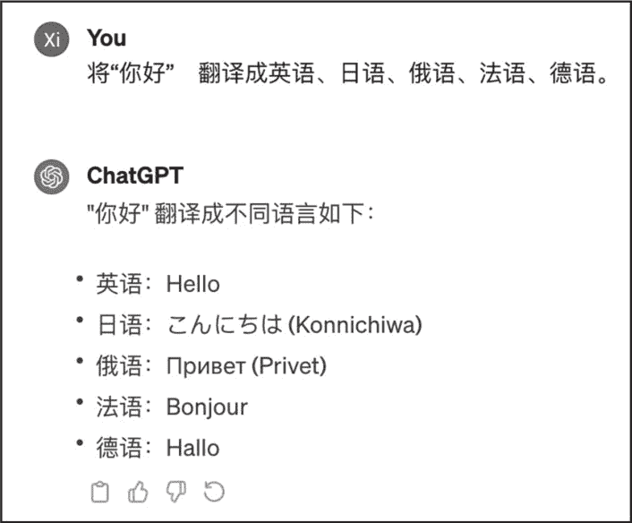

图 2-6 大模型熟悉各种语言

**5. 实时反馈与迭代学习**

ChatGPT 能从用户反馈中学习并改进，如例 2-4 所示。通过互动，它能更好地理解用户需求与偏好，持续优化性能。

**例 2-4 大模型根据用户的反馈进行改进**

**提问：**什么是抗辩权？

**ChatGPT：**抗辩权是法律术语，指的是当事人基于一定的法律事实拒绝履行其义务或要求的权利。

这通常出现在合同或债务关系中，当事人可以根据特定的条件或事实，合法地拒绝执行其合同义务或支付债务。例如，如果一方违反了合同条款，另一方可能拥有抗辩权，可以合法地拒绝履行其合同下的义务。

抗辩权的运用必须基于合理的法律理由，这些理由通常被明确地规定在法律中。抗辩权的存在是为了保护当事人不受不公平或不正当的要求的影响。它是一种防御性的法律策略，使个人或实体可以在特定情况下保护自己免受法律责任。

**提问：**太啰唆了，请总结为一句话。

**ChatGPT：**抗辩权是当事人基于特定法律事实合法拒绝履行义务或支付债务的权利。

**点评：**

准确性 4 分、完整性 4 分、清晰度 4 分、相关性 5 分、专业性 3 分。

该回答默认从普法的角度简单介绍抗辩权的定义、行使依据、行使方式、行使目的。整体内容没有明显错误。当提问者要求 ChatGPT 进行总结时，配合输出了“一句话”式的总结，可以在一定程度上满足律师的个性化需求。

**6. 数据处理与分析能力**

ChatGPT 能处理和分析海量文本数据。2023 年 11 月发布的 GPT-4 Turbo 拥有 128000 个 token 的上下文窗口，约合 6.4 万汉字。在法律领域，这意味着它可快速分析案件文件、法学文献等，为律师提供有价值的洞察。

总体而言，ChatGPT 在自然语言处理上的先进能力使其成为强大工具，尤其适合语言与文本密集型领域如法律。其高度适应性、灵活性与多功能性使其成为法律专业人士值得考虑的技术方案。随着技术演进，其在法律领域的应用将愈发广泛深入。

**2.2**

**跨越界限：AI 技术在法律领域的落地**

**2.2.1 法律研究与分析**

在现代法律实践中，ChatGPT 这类 AI 工具在研究与分析方面扮演着日益重要的角色，主要应用包括：

**1. 高效的法律信息检索**

ChatGPT 能迅速从大量法律文献中提取相关信息，包括案例法、法规、学术论文等。依据特定关键词或法律问题提供精准信息，极大提升研究效率。

**2. 案例分析与先例研究**

借助 ChatGPT 进行案例分析有助于律师更深入理解特定法律问题的演进。它能快速梳理大量案例，找出相关先例，助力构建更有力的论证。

**3. 法律文档的起草与分析**

ChatGPT 可辅助律师起草合同、诉状、法律意见书等法律文书。同时能分析文书语言与结构，提出改进建议，确保准确与专业。

**4. 风险评估与合规性分析**

在合规与风险管理方面，ChatGPT 可识别潜在法律风险与合规问题。通过分析法律文件与业务活动，预测潜在法律挑战，帮助企业与律所做出更明智决策。

**5. 跨领域法律研究**

法律问题常涉及金融、科技、国际法等多个领域。ChatGPT 可跨领域检索与分析，提供全面视角与深入洞察，帮助律师全面把握复杂案件，如例 2-5 所示。

**例 2-5 大模型提供跨领域意见**

**提问：**

作为一名律师，我正在为一位客户提供咨询，他打算在欧盟启动一家基于区块链的金融科技创业公司，提供跨境支付服务。他对欧盟的通用数据保护条例（General Data Protection Regulation，GDPR）表示担忧，特别是如何在提供服务的同时遵守这些规定。他想知道，针对这种服务，GDPR 有哪些特定要求？我们需要采取哪些措施来确保其业务符合 GDPR 的规定？

**ChatGPT：**

面对区块链金融科技创业公司的经营场景，GDPR 对欧盟居民个人信息提出了系统性的合规要求，数据最小化、隐私设计、用户授权、跨境流动规范、数据主体行使权等都是刚性门槛。提供咨询时，律师可围绕以下八个抓手展开：

1. **先把商业模式和数据流盘清楚**。深入了解客户到底采集了哪些个人信息、出于什么目的、在何种环节处理、怎样与链上技术交互，厘清数据生命周期中的每一个触点。

2. **把保护写进产品设计**。建议在研发早期就植入加密、匿名化等技术手段，让信息在链上存储与使用时具备技术层面的保障。

3. **运营要透明并取得合法授权**。协助客户拟定易懂的隐私政策和用户协议，用通俗语言说明信息用途，并在必要情形下获取明确许可。

4. **跨境流动必须合规落地**。若信息需传出欧盟范围，要依规采用标准合同条款等工具，或确保接收方所在地区提供相当的保护水平。

5. **保障用户权利可操作**。系统需能响应用户的查阅、更正、删除等请求，并提供清晰的通道。

6. **视情况配置数据保护官**。结合业务规模和处理敏感度，评估是否需要任命一名 DPO 来统一监督。

7. **准备好泄漏应急响应**。建立数据泄露与安全事件的通报机制，确保在法定期限内向监管机构和受影响用户披露。

8. **保持持续复盘**。规则与技术都在变化，建议定期检视处理活动和既有措施，及时补位。

对外部顾问而言，还应提醒客户引入专业数据保护顾问对技术方案与运营流程做穿透式校核，并为团队安排常态化合规培训，这才是长期可持续的做法。

**点评：**

实务中客户常抛来新颖问题，初次接触容易无抓手。上述回答模拟了这种情境，为律师梳理了八个方向的概览，提供了初步的思路框架。只是内容相对概括，未触及具体法条细节，后续仍需律师通过追问和检索来细化方案。

6.法律适用趋势和模式识别
借助海量法律数据的归纳，大模型能够捕捉司法适用及规则演进的脉络，比如某个细分领域的裁判倾向或立法走向。这种洞察对制定诉讼策略和业务规划具有很强的参考价值。

7.语言分析和证据评估
在证据与证词审查中，大模型可以对表述进行细化拆解，找出前后矛盾或可能误导之处，如例 2-6 所示，对筛选关键证据很有帮助，尤其是在案情复杂的诉讼里。

**例 2-6 大模型对于语言的深入分析**

**提问：**

我是一名律师，目前正在处理一起涉及工作场所事故的案件。以下是一名目击者的证词摘录：“我在事故发生时在现场。那天早上，我看到杰克在事故现场附近忙碌着。大约在上午10点左右，我听到了一声巨响，随后我立刻跑向声音来源的地方。到达现场时，我看到杰克站在一边，看上去似乎并未受伤。事实上，直到我听到巨响之前的几分钟，我都没有看到杰克离开过那个区域。”根据这段证词，请分析是否存在不一致之处或潜在的误导信息。

**ChatGPT：**

从这段陈述里，有几个值得推敲的点：

1.**观察位置与视野范围**。证人声称当时在场并能清楚看到杰克在事发附近活动，说明其自称拥有较为清晰的视野。但实际站位、遮挡物以及观察距离是否真能支撑该结论，需要进一步核实。

2.**时间线的自洽性**。证人提到约10点听见巨响，同时又说在巨响前几分钟并未见杰克离开。若“几分钟”与事故发生的精确时间对不上，就存在杰克可能在未被注意的时间窗口内移动的可能性。

3.**对伤情的判断依据**。证人仅根据外观认为杰克“似乎并未受伤”，这种目测结论并不可靠，最终仍需医疗鉴定来确认。

4.**记忆与解读的偏差风险**。对事发前后人物的位置描述，容易受事后信息、个人偏见或心理暗示影响而失真。

建议结合现场监控、其他证人说法及当事人自述进行交叉验证，同时对证人的观察角度和记忆可靠性做更细致的勘查，再下结论。

**点评：**

该回答从视野、时间、伤情判断、记忆偏差四个维度拆解了证词的潜在问题，逻辑清晰、解释具体，对办案有一定参考价值。不过实务中律师更应采用现场还原等方法来检验证词的不合理之处，此类分析最多作为初步筛查工具。

8.增强法律教育和专业培训
大模型能够提供模拟案例、交互式问答和定制化练习，帮助法学院学生和年轻律师在实操感中掌握知识点，提升应用能力。

9.促进法律服务的自主化
研究和分析效率提升后，法律服务成本有望下降，更多公众能触达专业支持，法律服务的普惠化程度随之提高。

10.面向未来的技术准备
随着Legal Tech的成熟，掌握并熟练使用ChatGPT这类工具，已成为律师的核心竞争力之一，有助于个人提效，也帮助机构保持技术领先。

2023年8月，正值国内大成律所分家动荡期，全球顶尖律所之一的Dentons与微软合作，内部上线了面向律师的法律版ChatGPT——fleetAI，如图2-7所示。该工具仅限律所内部使用，旨在提升服务客户的效率，巩固其行业领先地位。

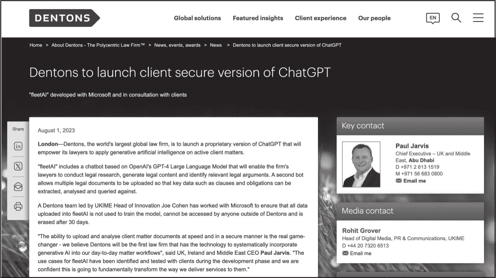

图 2-7 Dentons 律所与微软合作，推出内部用的法律版 ChatGPT

总体而言，ChatGPT等AI工具在法律研究与分析上的效率优势明显，正在重塑传统工作范式，为从业者提供强有力的协同能力。未来随着技术迭代，其在法律行业中的角色将愈发关键。

2.2.2 优化客户服务
在法律行业，客户体验是竞争力的核心。ChatGPT等AI的应用为服务升级提供了新路径。其在客户服务方面的典型应用场景如表2-3所示。

表 2-3 ChatGPT 在优化客户服务方面的部分应用场景

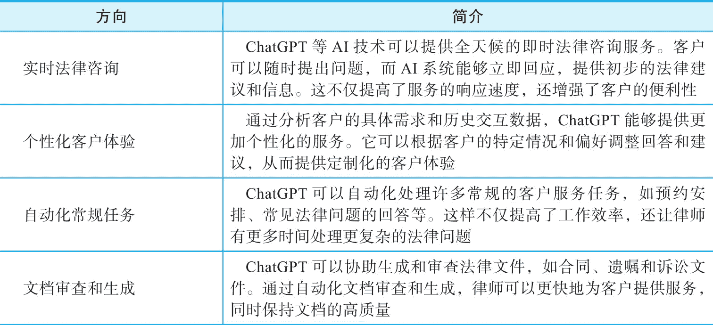

（续）

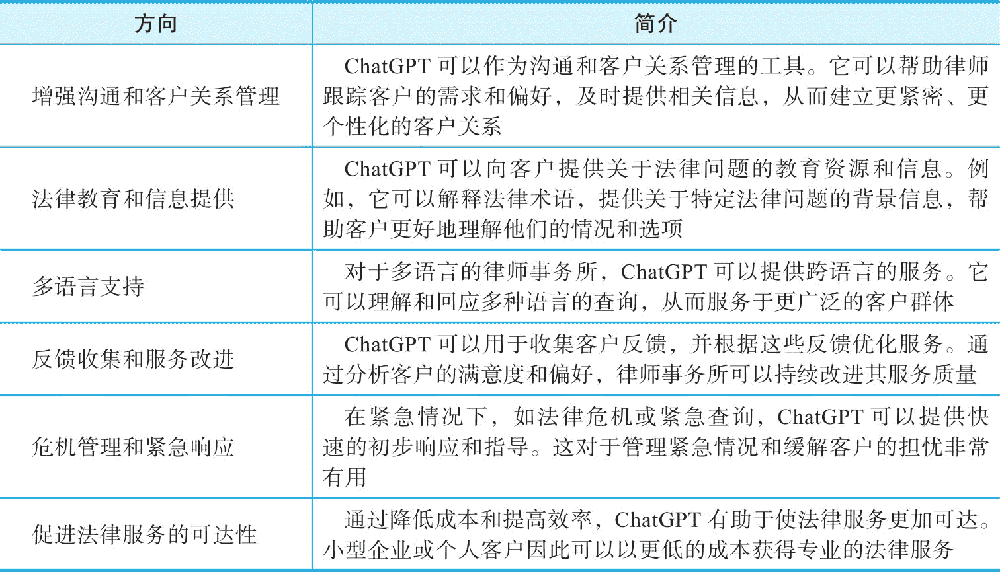

2.3
未来展望：技术发展对行业的长远影响
2.3.1 持续的技术创新
1.对称性：未来有多少技术创新的可能性
要判断技术走向，先要看技术从何而来。组合进化是核心逻辑：任何新技术都由旧技术重新组合产生。掌握了现存技术清单，就能通过两两或多多组合推演未来方向。但组合数量随底层技术增多呈指数级膨胀，若底层有3种技术，下一层就有9种，再下一层81种，形成头大底小的倒三角，即“可能性的倒三角形”。

可能性的倒三角形如图2-8所示，ChatGPT已集合了6项现有技术，后面还有10项同类未被利用的技术。若做六六组合，扣除ChatGPT本身，还有约3002种新的技术方向。基于这三千多种可能，再做二次组合，数量更加庞大，还能分析吗？

注意，本节所说的对称性是指在理论层面，技术组合的进化是中性的，从下往上呈指数增长，形成倒金字塔，这是无干预的自然结果。

但在真实历史中，发展路径往往不对称。技术会沿着某一方向不均衡地纵向攀升，直至失衡停滞。于是引入“人类选择的比萨斜塔”的概念。

2.非对称性：人类会选择其中哪种可能性
（1）人类选择的比萨斜塔，显而易见的上层组合
人类选择的比萨斜塔如图2-9所示，技术演进呈现出惊人的一致性：不是横向铺开，而是基于已有技术做纵向叠加，形成斜塔形态。

一种做法是整体嫁接。比如ChatGPT+语音处理，刚推出时仅支持文字对话，后来加入语音互动。再如ChatGPT+计算机视觉，即当前多模态大模型的主战场。ChatGPT已具备识图、绘图能力，后续又接入视频生成，并与AR、VR、元宇宙结合。

另一种做法是快速叠加创新。即便语音融合未臻成熟，机器人结合的探索已在进行。未来几年，ChatGPT与更多尚未连接的技术领域建立联系几乎是必然的。

在触及理论极限前，此类纵向叠加效果显著。但斜塔意味着不稳定，是否会倒塌？

（2）倒塌：触到天花板，底层组合产生的新分支后来居上
任何技术都有上限，随着纵向叠加持续推进，可选组合逐渐枯竭，技术触顶后会进入停滞期。此时，底层技术的突破会催生新组合，支撑下一轮跃升，并指引新的发展方向。

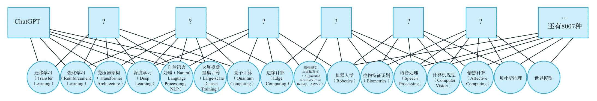

▲图 2-8 可能性的倒三角形

￥￥

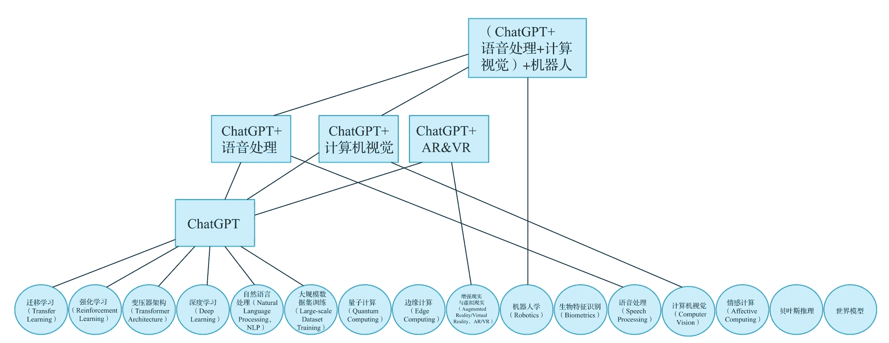

图 2-9 人类选择的比萨斜塔
OpenAI的崛起就是例证。Transformer早期分化为BERT和GPT两条线，2018-2021年间业界更看好BERT方向，资源集中投入；而OpenAI默默深耕GPT路线。虽然BERT一度火热，后期却遇瓶颈，GPT凭借数据规模扩张持续增强，最终以ChatGPT引领行业走向。

GPT是否就是终点？未必。短期和中期看，GPT仍将占据主流，直到人类现有数据被基本吸纳，其后或将显现局限。

总体而言，技术选择空间很大，但未来两到三年内，ChatGPT更可能通过与现有技术的简单组合，拓展服务边界，实现持续发展。

2.3.2 法律行业的预测与趋势
1.基于系统动力学的影响
从律师视角做简化的系统动力学分析，如图2-10所示。ChatGPT提升了文书撰写效率，却缩小了律师与当事人之间的知识信息差，对律师的咨询价值产生冲击，主要体现在：

一是收入分化。知识差被抹平后，无法提供超越大模型基础能力的律师将面临费率下行；而能提供稀缺专业判断的律师因供给稀缺，收费反而提升。

二是案源渠道变化。案源正从熟人介绍转向互联网平台，律师收入需向平台让渡一部分。ChatGPT普及后，普通用户习惯先向对话机器人提问，若机器人叠加推荐功能，便可能形成新的渠道垄断，让律师的线上获客从依赖搜索引擎转向依赖大模型。

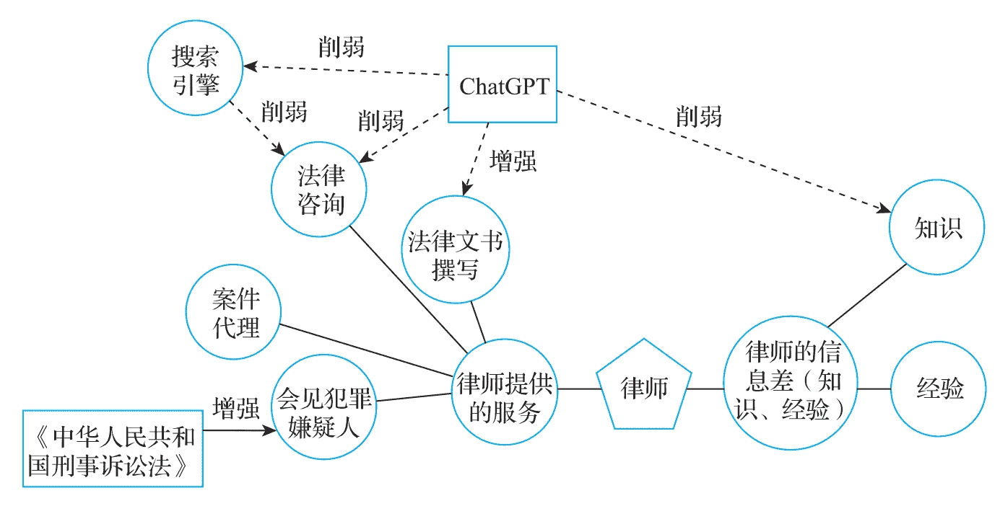

图 2-10 ChatGPT 对律师工作的影响

2.基于技术采用生命周期的预测
1.4节总结了技术发展的四个主导阶段，受技术采纳生命周期启发而得。基于此，对未来五年大模型法律服务在法律界的普及做出简要预测，如图2-11所示。

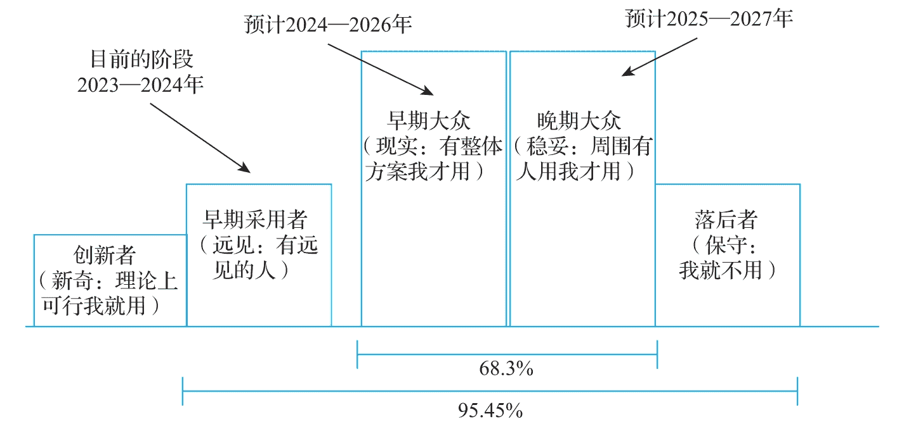

图 2-11 预测 ChatGPT 等大模型法律服务的普及程度
大模型触达不同人群时，其演进态势对应四个阶段：触及创新者与早期采用者为技术主导期，触及早期大众为产品主导期，触及晚期大众则进入运营主导与资本主导期。各阶段的应对策略在第一章已有阐述。

CHAPTER 3
## 第三章
## 正心：新挑战下律师的变与不变
本章以系统动力学为方法，基于律师收入模型提出建设性建议，探讨ChatGPT对律师行业的积极影响，并延伸至整个法律行业，思考如何更好地服务社会和谐。

3.1
职业路径的改变：机遇与挑战
3.1.1 职业发展的旧路径：增长飞轮
律师职业发展的增长飞轮如图3-1所示。实线代表正向增强回路：专业能力提升后通过持续输出专业内容，提升个人品牌知名度，进而带来更多案源和收入，积累复杂办案经验，经验反哺能力，形成自我强化的循环。

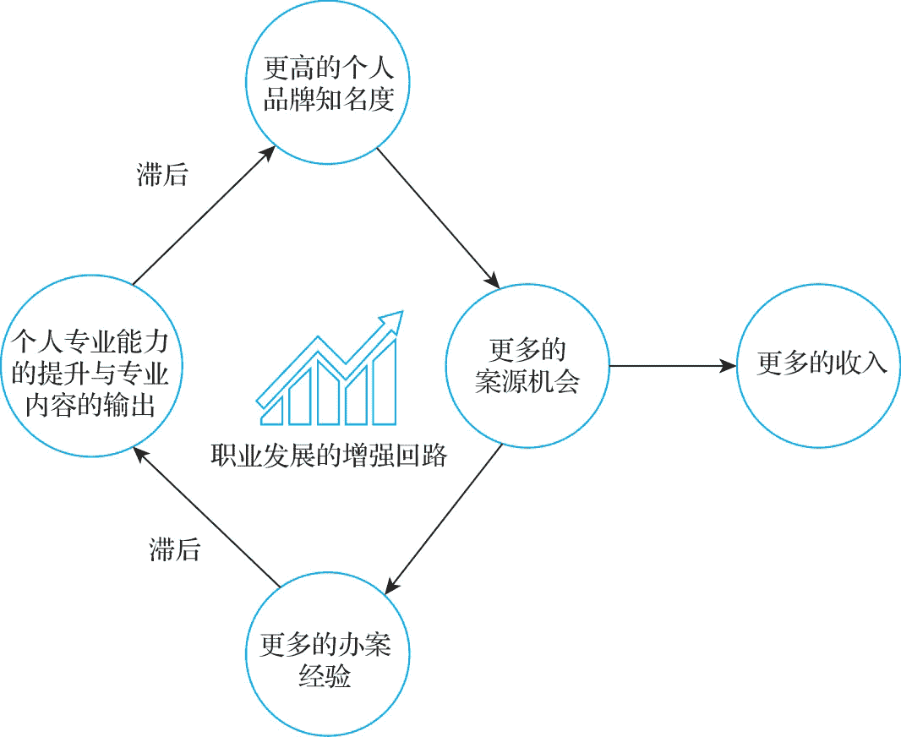

图 3-1 律师职业发展的增长飞轮

1.延迟的反馈
图中存在两条滞后线。持续输出内容不等于品牌即刻变现，可能需要半年到几年才显现效果；案件数量增加也不等于能力立刻提升，若缺乏复盘总结，成长会明显滞后。

2.艰难的推动
飞轮起点是“专业能力提升+专业内容输出”。律师起步依赖法学教育、司法考试、实习与执业资格。职业中期需聚焦细分领域，通过争议焦点研究和疑难案件积累来深耕。但案源获取依赖品牌知名度，形成先有鸡还是先有蛋的困境。

青年律师往往只能被动推动飞轮。一类路径是进入红圈所等平台，承受高强度工作，借平台声量建立个人品牌；另一类路径是独立执业，从零做起，用内容输出一点点积累案源和经验，艰难转动飞轮。

3.1.2 职业发展的新路径：ChatGPT 影响增长飞轮
ChatGPT对律师增长飞轮产生两个增强作用和一个减弱作用，如图3-2所示，虚线代表减弱方向。

积极面在于，大模型可辅助法律知识检索、经验提炼、专业内容撰写，帮助律师更快总结案例、提升输出效率，从而增强品牌建设。

消极面在于，大模型在一定程度上侵占客户入口，挤压中间环节，并加剧律师之间的收入差距。虽然AI无法完全替代律师，尤其是中国司法制度下部分工作必须由律师完成，但其对案源和价值链的冲击不容忽视。

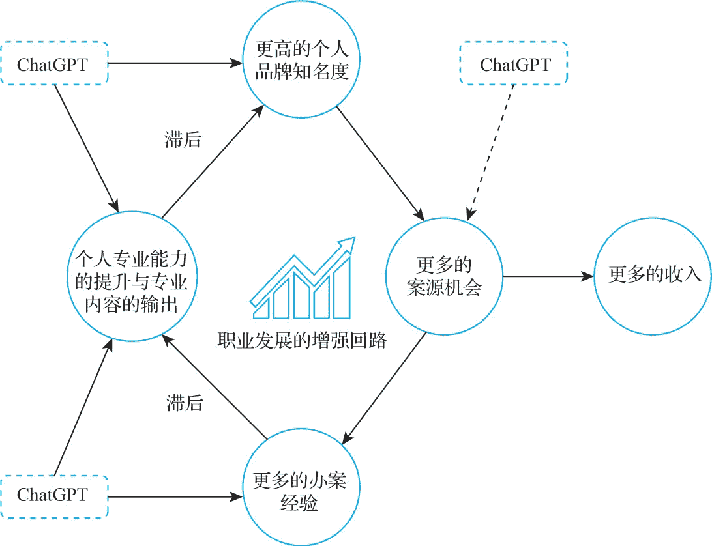

图 3-2 ChatGPT 对律师职业发展的增长飞轮的影响

先做个定调，文中第一个限定是“在一定程度上”。最直观能被替代的工作就是法律咨询。这类业务本身不直接产生收入，却是所有案源的入口。谁掌握了第一次咨询，谁就掌握了后续业务的主动权。

第二个限定是“现实中做不到”。现实如何并不决定结果，客户的信念更重要。如果客户普遍相信 ChatGPT 这类工具已能处理律师事务，咨询需求就会向 AI 服务靠拢。

要破局，不能靠个体单打独斗，必须由律协或头部律所协同发力，避免互联网巨头垄断案源入口。该层面的讨论已超出本书范围。

**3.1.3 职业增长的隐形刹车：调控回路**

增长飞轮描绘的是律师职业的理想上升路径。现实却是许多律师走偏了，甚至转行。司法部年度报告显示，2022 年 30 岁以下律师人数较 2021 年减少两万余人。还有一批律师选择原地踏步。背后显然有隐蔽的调控回路在拖慢飞轮。

制约律师职业发展的调节回路如图 3-3 所示，核心症结在于短期与长期无法兼顾，对短期问题的过度聚焦催生了负向循环。

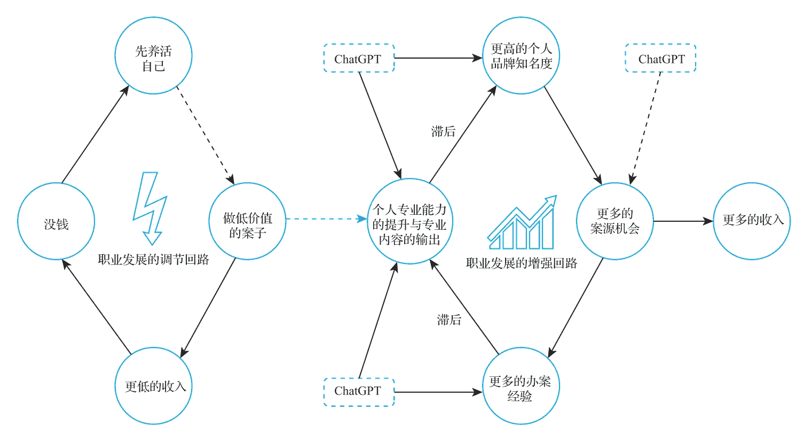

图 3-3 制约律师职业发展的调节回路

**1. 初阶律师的压力困境**

刚入行的青年律师处境艰难。毕业即为助理，无法独立出庭，只能跟随有证律师。想拿执业证，就得在律所承受低薪酬、高强度的状态，等待每年屈指可数的指标名额。

更致命的是案件结构单一，且无缘高价值业务。

**2. 在受雇与自主之间摇摆的雇员律师**

业内共识是“受雇无出路，再高的薪水最终都要自主”。共识的另一面是独立后生意的艰难。

于是授薪律师陷入两难：一边担心长期受雇阻碍成长，一边又害怕独立后收入断层。

**3. 独立初期艰难的执业者**

独立初期的业务开展确实不易。如前所述，这个阶段的产出需要时间沉淀，缺乏资金储备几乎难以熬过阵痛期。

独立执业常被形容为“必胜策略”，即在受挫时加倍投入。其本质是资源博弈：资源充足时，即便概率和赔率不利，也能靠持续加码逼对手先耗尽。

独立之后，比拼的已不是个人能力高低或成败概率，而是启动时是否拥有足够的资金垫。没有充足的现金流支撑，即便单个案件胜率 80%、盈亏比 1:10，独立律师仍会被迫每月与对手进行全押消耗，一旦失利就无法翻盘，往往在成功到来前就已耗尽。

**4. 最核心的陷阱：低价值循环**

回到增长飞轮模型，最核心的驱动力是个人专业能力。独立与否并非本质，真正的陷阱是被困在低价值案件里。要跳出循环，就要拓宽案件类型，拿下高价值业务，深度参与谈案环节，从而迭代专业能力。10.2.3 节会具体展开个人能力与知识储备的关系。

我们清楚目标，但现实阻力不小。

**3.1.4 突破调控回路的关键一跃**

**1.“更上一层”思路**

青年律师该如何自处？

《黑客与画家》提出的“更上一层”理论可以借鉴：面对强敌时，主动选择更困难的路线。我们将其迁移到律师成长语境，图 3-4 展示了不同选择带来的不同结局。律师生涯是一连串的选择，如同在楼梯间决定上行还是下行。我们主张青年律师在关键节点推动成长飞轮向上，而不是沉溺于低价值案件处理，掉入自我调节的内耗，最终稀释自我价值。经过一次次的正确选择，个人成长会加速，同行间的差距也会拉开。

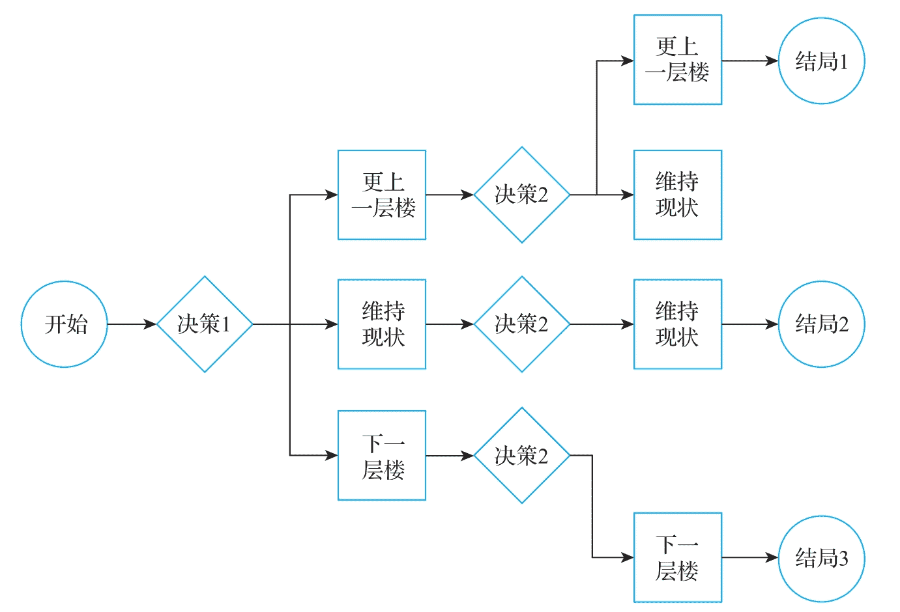

图 3-4 不同的选择带来不同的结局（1）

选择的微小差异会累积成天壤之别。图 3-5 显示，若每次选择都能积累 1% 的优势，持续 365 次，最终结果会是原来的 37.8 倍；反之每次落后 1%，365 次后只剩 0.03。时常被引用的“失之毫厘，谬以千里”正是此意。当遇到卡点时，应逼自己一把、搏一搏，而非取易行之径，时间会把优势放大。

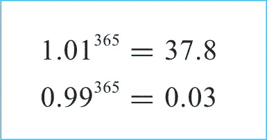

图 3-5 不同的选择带来不同的结局（2）

这种精神并非律师独有。在一次访谈中，李开复谈到美国限制芯片出口对国内研发的影响时指出，虽难但须接受现实，不能放弃，而应挑更艰难的任务。这种不退缩的理性态度，正是律师可学习的品格。

**2.ChatGPT 带来的平凡到卓越的跃迁**

做低价值案件的根本问题是信息差。认知决定命运可拆解为：信息差决定假设→假设决定认知→认知决定选择→选择决定命运。选择本质上是对未知路线的无知，这点将在 10.2.3 节深入讨论，认知不足时问不出真正有力的暗示类问题。

ChatGPT 在这里扮演什么角色？它承载的是相互关联的世界知识。借助它，我们能像福尔摩斯一样，从看似无用的细节反向推演出全貌，再据此重构假设、升级认知与选择，最终影响命运。

正确运用 ChatGPT，可以搭建渐进式复盘与渐进式知识管理的体系，即便案件看似平庸，也能萃取经验，最大化提升专业能力，如图 3-6 所示。从平凡中提炼伟大，就是跳出调节回路、进入增长飞轮的那次关键跃迁。具体方法将在第九章和第十章展开。

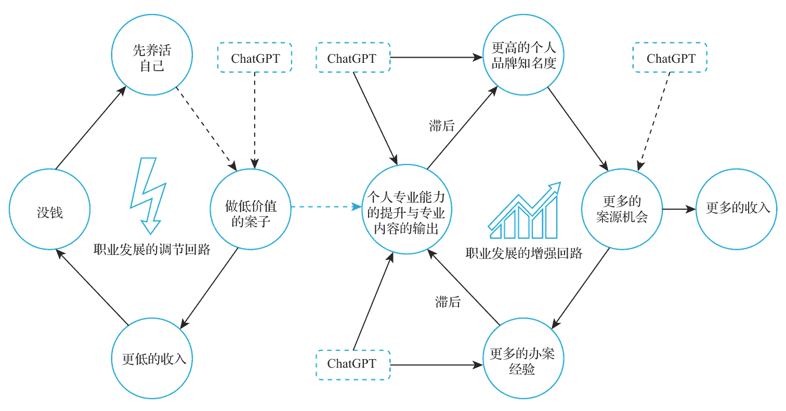

图 3-6 正确使用 ChatGPT，实现惊险一跃

**3.2**

**客户服务的演变：预期与现实**

客户！客户！客户！

为客户提供更高质量服务是律师的底线，却也是最容易被遗忘的一点。

各行业都易掉进竞争的坑：注意力被对手牵走，反而忽视了客户本身。有个教育培训行业的案例颇具启发。管理者接到下属报告说课程被抄袭，反思后认为正因为课程的独特性不足才容易被复制，于是转向服务质量的提升。他判断，卓越的客户服务是竞争对手无法复制的护城河。

律师行业亦然。面对同行竞争，始终要自问专业是否够格，是否还能为客户提供更高质量服务。若担心工作被 ChatGPT 抢走，这一道问询就更必要。

**3.2.1 AI 时代客户预期的改变**

**1.增长飞轮对客户预期的必然挤压**

增长飞轮的必然副产品是对客户预期的忽视。随着飞轮加速，会撞上发展上限——律师的时间，如图 3-7 所示。案件越多，单个律师越忙不过来。

为保收入，有两条路：一是增客保价。时间精力有限，除去睡眠一天最多 16 小时工作，客户持续增加必然牺牲服务质量。即便带团队，因客户冲着名律师而来，忙不过来就只能转给团队成员，质量难以保证；若花钱请高水平授薪律师分担，利润又会被大幅侵蚀。二是提价筛选客户。在服务时长受限前提下减少客户数，做到极致服务，但代价是部分案件需外放，案源渠道逐渐失控。

这并非律师特有困境。顶级医疗资源稀缺、一号难求；优质企业稀少、估值高企；优质教育资源珍贵、竞争激烈。

客户只能接受，却未必满意。

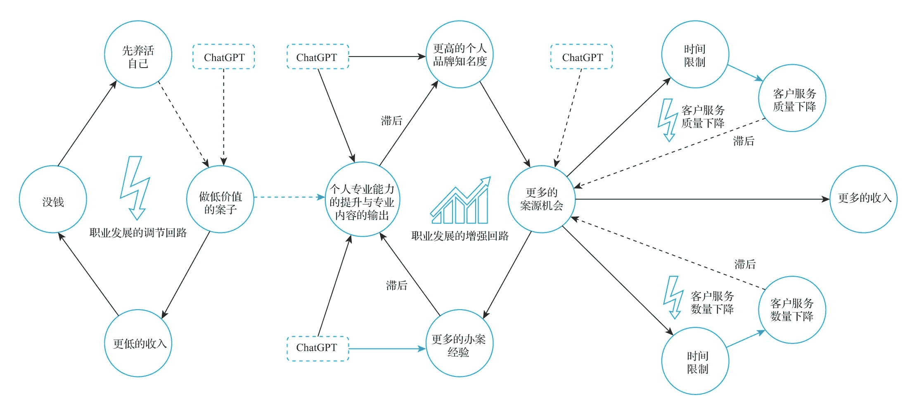

图 3-7 增长飞轮遇到发展上限

**2.ChatGPT 带来的预期迁移**

ChatGPT 出现后，客户开始设想绕过律师，因为他们看到了另一条路径的可行性。

是否真正可行不重要，重要的是客户的认知以及这种认知对行业的冲击。系统动力学与增长飞轮的影响已在前文论述，这里不再赘述。

同时，客户开始期待律师像 ChatGPT 一样即时响应，并做得比它更好。这是否可能？是可行的。

**3.2.2 基于 AI 提升服务效率与质量**

**1.借助 AI 优化能力系统**

图 3-7 中右侧出现的两个调节回路，根源正是律师时间的硬约束。若能削弱该约束，由时间限制引发的服务数量与质量下滑便会缓解，客户服务质量反而可得到保障甚至提升。

ChatGPT 能做到吗？至少能部分做到，如图 3-8 所示。第二部分会详细论述 ChatGPT 如何帮助律师形成个人系统或半系统来削弱时间限制。10.2.2 节还将介绍一个可在律师休眠时仍不眠不休工作的自动化小工具。

**2.聚焦个人品牌与系统化**

《发条原则》指出，企业应找到团队的“蜂后职能”，即增长飞轮，并把所有资源投入其中。

在 AI 工具与传统信息技术的加持下，律师可聚焦两件事：一是持续通过专业能力的提升与输出，打造个人品牌；二是把专业能力沉淀为可复用的系统，并不断打磨完善。最终目的都是为更多客户提供更好的服务。

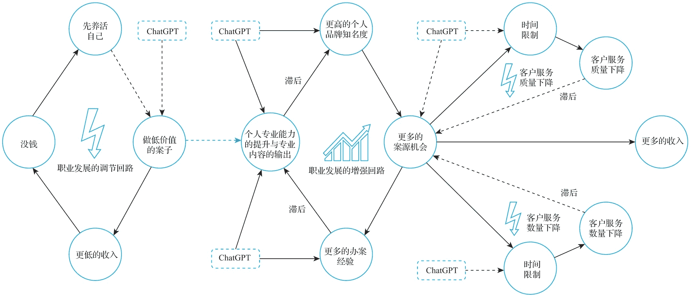

图 3-8 ChatGPT 可以削弱时间的限制

**3.3**

**法律实践的变革：效率与伦理考量**

**3.3.1 法律实践的循环与调控回路**

**1.促进社会和谐的正循环**

法律在不同国家有不同理解，并无绝对对错。中国特色是法律与政策高度结合。律师作为法律体系的一环，凭借专业能力推动程序正义，与法律从业者共同为法治环境和社会和谐贡献力量，如图 3-9 所示。

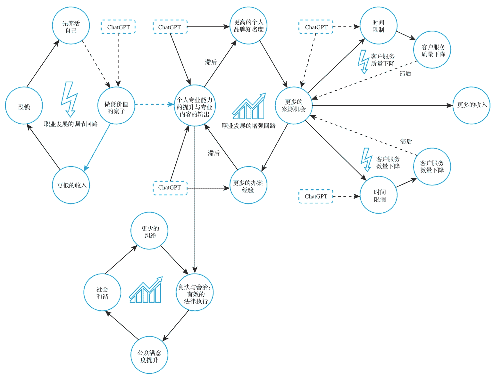

图 3-9 社会和谐正循环

**2.阻碍社会和谐的调控回路**

生活具体，法律存在滞后与漏洞。制约有效执法的调节回路如图 3-10 所示，主要揭示了法律滞后性、执法成本与执法力量对法治环境的影响。

作为成文法国家，中国法律常显滞后，难以跟上社会与经济结构的快速变化。旧规定对新纠纷形态可能不再适用。为弥补滞后，法律常设“其他情形”等兜底条款。

执法力量与执法成本同样关键。例如诉讼时效制度就是国家在权衡执法成本后做出的制度安排，用于平衡资源配置、确保法律有效实施，也体现了法律实践的复杂性。

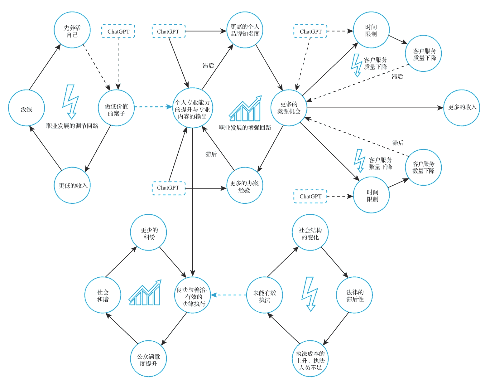

图 3-10 制约有效执法的调节回路

**3.3.2 ChatGPT 对社会和谐的正面影响**

ChatGPT 不仅能辅助律师提升专业能力，更好地服务当事人、促进程序正义，还能帮助执法人员减轻工作负担、提升执法效能，如图 3-11 所示。

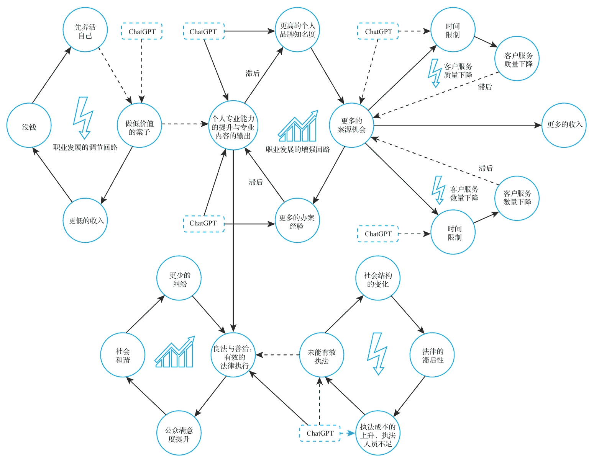

图 3-11 ChatGPT 对有效执法的正面影响

**3.3.3 ChatGPT 对社会和谐的负面影响**

任何事物都有两面。AI 工具带来的社会结构巨变，恰是调节回路负向作用的推动力，如图 3-12 所示。

本章以系统动力学为框架，构建了律师从专业能力到收入水平的端到端系统，并引入 ChatGPT 等变量，力求引导其向有利方向发展与应用。

第四章将对第一部分做回顾，并为第二部分做铺垫。

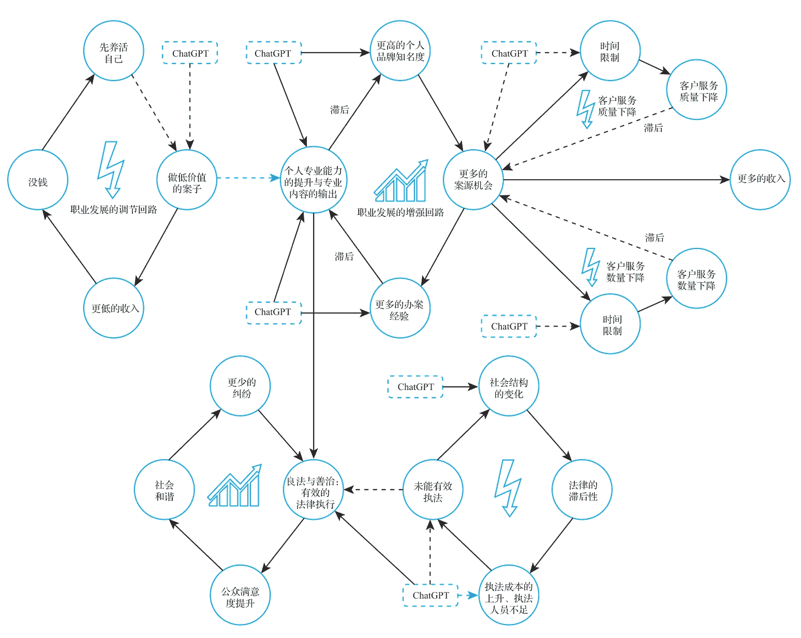

图 3-12 ChatGPT 对社会结构的负面影响

CHAPTER 4

## 第四章

## 诚意：塑造律师的新角色

ChatGPT 等 AI 技术的普及，对所有职业都是冲击。未来每个人都需与 AI 融合，成为一个系统。律师的新定位，就是深度结合 AI，让个人相当于一家律所的管理中枢，在保证质量前提下压缩处理事务的单位时间。

这个系统是什么样？第三章已有交代。本章承接第三章，概括性讨论如何通过 ChatGPT 对系统各节点进行优化，让核心飞轮越转越快，并为后续细节分析做概念铺垫。

**4.1**

**优化工作流程**

很多人对 ChatGPT 的使用还停留在提示词层面。提示词技巧只是“招式”，内功才是根本。

ChatGPT 不是实现从 0 到 1 的工具，而是把 9 分做到 10 分的锦上添花。它必须建立在律师已有管理体系之上。设想管理 100 名大学生，若没有制度、流程和信息化系统，只能无从下手。只有先搭建体系，把人纳入其中运转，公司才能动起来。因此，先有自己的系统，才能用好 AI，AI 的特性是“遇强则强”。

于是我们在第二、三部分先搭建一系列简易系统，再引入 ChatGPT，形成人机协同的智能系统，如图 4-1 所示。

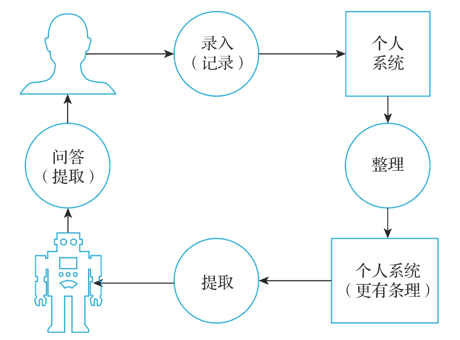

图 4-1 人机协作的智能系统

基于律师职业发展的增长飞轮，本章先初步介绍工作流程的优化思路，并在第二部分的业务场景下展开深入讨论。

**1.通过 ChatGPT 实现“更高的个人品牌知名度”**

拆解“更高的个人品牌知名度”：“更高”属于传播学范畴，“个人品牌”涉及营销中的关键词与品类概念，“知名度”可理解为产品领域的爆款现象。综合起来可操作的手柄是：关键词、品类、传播渠道与方式、传播性、爆款产品。

我们先构建一个关键词与渠道模型用于记录业务数据，如图 4-2 所示。再搭建一个 GPTs，将自然语言转化为编程语言，并结合自有数据进行问答。

举例：提问“哪种渠道拓展案源最好？”

问题在 GPTs 中被转为数学问题“统计各案源渠道的成单率”，再转为代码问题“用 Python requests 读取渠道表，并用 Pandas 统计成单率”。GPTs 生成 Python 代码，经 Zapier 执行后返回“渠道A 30%，渠道B 80%”。最终回答为：基于过去三个月渠道表统计，渠道B最佳，因其成单率 80% 为最高，其余建议如下……

再举例：提问“我该如何提升个人品牌的知名度？”

问题被转为数学问题“计算产品与个人品牌所属关键词下爆款产品的相似度”。ChatGPT 会邀请提供两篇文章，对比相似度，得出“相似度 40%”。最终回答：过去三个月品牌建设文案与关键词下爆款文案相似度仅 40%，从推荐机制看传播难度大，建议先提升文案的相似度以提高传播效率，从而获得更高知名度，除此之外还有以下建议……

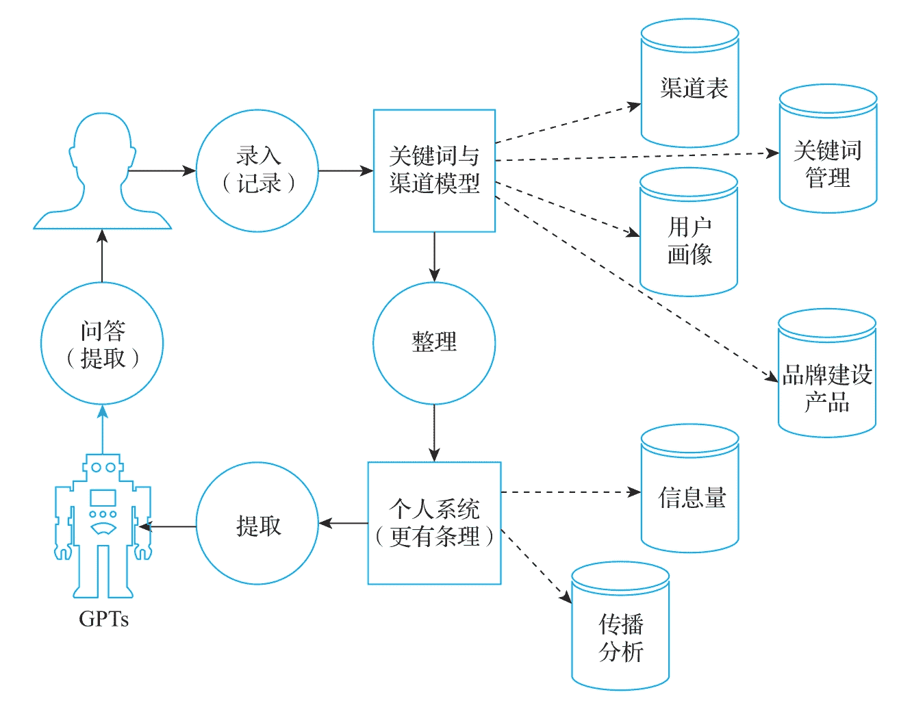

图 4-2 关键词与渠道模型

前面两个例子只作简要说明，具体展开将在第五章系统论述。工具层面也不必担心，本书会把文中提到的 GPTs 全部提供使用，并说明自建方式，方便读者在自己的环境中搭建。

**2.借助 ChatGPT 提升个人专业能力**
所谓能力提升，核心在于以实用主义思路开展法律问题研究，细化内容对应第六章。第九章与第十章关于经验提炼和知识体系构建的讨论，是对该主线的补充延伸。

**3.借助 ChatGPT 弱化时间限制的影响**

**（1）压缩案件分析与代理策略的耗时**
为了让案件分析与代理策略环节更顺畅，第六章会先给出一个用于判定法律问题的决策树。有了这棵树，这一环节的推进难度会明显下降。第七章则会搭建一个 GPTs，只要把案情描述输入进去，模型就能自动归类，并按该类问题的决策树生成分析初稿。

**（2）加速法律文书起草与合同审核**
绝大多数法律文书都不必从零撰写。为了提升效率，我们会先收集大量现成范本。起草时只需让 ChatGPT 把具体要素填入模板即可。对应到第八章，会搭建一个文书模板库加 GPTs，把法律分析材料上传后，模型会自行补全并输出所需文书。同时该 GPTs 也能做合同审核，上传模板或合同后会从多角度给出审查意见。

**4.2**
**重构元认知**
在元认知重塑层面，我们会讨论以下议题，并在第三部分的相应场景里演练。

**1.从低价值案件中汲取更多办案经验**
低价值案件里也能学到东西吗？答案是可以，因为世界具有同构性和普遍联系。

其一，第二章介绍 ChatGPT 底层原理时，用符号学视角描述人学习新词新概念的过程，其中涉及类比思维。而类比之所以管用，正是因为世界是同构的。

其二，基于同构假设，可判断标的金额不同并不影响案件结构和适用法条，所以低标的案件同样能提供经验。

其三，若“低价值”指案件复杂度低，或我们只能批量处理其中某个环节而无法参与全案，而世界是普遍联系的，那么“低价值”问题往往只是视角局限。需要先从全局着手，再落实到局部。

可能会有读者质疑，经验不足的青年律师如何做到全局思考。这恰好体现 ChatGPT 的强大之处：它凭借内部世界模型，能由现象推因、由局部推总。换言之，模型可以借自身知识提出新视角，帮助拓宽思考边界。

第九章和第十章会用 GPTs 搭建一种对话式复盘框架，如图 4-3 所示。通过一系列追问，从现象窥见成因，从局部推演出整体，用提问照亮盲点，用知识检验假设。经过检索、研究与复盘后，形成处理同类问题的方法论并存入 GPTs 知识库。再次遇到类似问题时，询问自建的 GPTs，它会先结合已有沉淀作答，避免重复犯错。

图 4-3 复盘框架

**2.以 ChatGPT 促进专业能力成长与专业内容产出**
在检索、研究、复盘等工作借助 ChatGPT 完成，并不断累积知识库后，会逐渐形成一套知识体系。其中既有行业常识，也有对某一领域的深度研究和独特经验，无数法学概念及其关联构成复杂的专业网络，由此实现个人能力的跃升。

谈到专业内容产出，写作的难点在于把网状思维线性化。很多人以为线性化最难，其实若思维是空白的，所谓的输出就是拿一根线去牵一个不存在的网。而一旦有了网状结构，线性的呈现就相对容易。

首先要明确输出对象与输出内容是什么，如图 4-4 所示。律师面向大众与同行时，内容取向应有区别。面向大众，要紧扣社会热点，切入公众关注点，用大众可接受的表达方式，比如讲故事，结合经脱敏的案例做普法。面向同行，要聚焦实践难点，如争议焦点，输出自己研究得出的独到见解，在行业共识之上增加新的认知增量。

图 4-4 输出内容与输出对象

其次是输出方式，这取决于篇幅。

几十到几百字的短输出，面向大众时可从概念中挑一个案例，简述案情与结果；面向同行时可从概念中提炼一个争议点，直接给出结论与逻辑，或用故事加结论的形式呈现。

一千到几千字的中输出，面向大众时可从概念中挑选数个案例，分面向展开讲解，再在理论层面做衔接，把概念完整阐释一遍；面向同行时仍需先提炼争议点给出结论与逻辑，再完整阐释概念，随后举例，最后回归个人见解做深入剖析。

几万到几十万字的长输出，面向大众时可从核心概念出发，把与其关联的概念一并提取，形成一个以核心概念为圆心的微型知识体系，先概述该体系，再按“中输出”方式分别论述各概念，最后汇总成系统性长文；面向同行的大体流程相似，主要差异在于大众向更重案例、轻理论，同行向更重体系化与基于研究的个人见解。

第十章会构建一个知识体系。借助快捷指令搭建的自动化流程，只需睡前输入一个主题，AI 便会在夜间运行，第二天早晨即可获得一篇草稿，稍作修改即可发布，且不存在侵权风险。

**4.3**
**深度掌控 AI**
出于对隐私与安全的考量，需要把类 ChatGPT 大模型部署在本地电脑上，并以代码方式与之交互。这样做有三点好处：

●安全：模型在本地运行，断网也能用。
●稳定：模型文件固定，输出更可预期。
●灵活：可对模型做深度定制，释放更强能力。

这部分实践涉及基础编程，挑战性较大，并非开箱即用，读者可跟随第四部分的操作演示与效果图尝试。

面对新时代对律师提出的新要求，挑战不小。让我们一起迎接。

# **第二部分**

# **融合：AI 时代的人机协作方式**

从本部分开始，由理论转向实操。

如图所示，律师工作流程覆盖面极广，受篇幅与定位限制无法全盘覆盖。本部分聚焦案件线索阶段与代理阶段，探讨 AI 优化路径。

本部分以 GPTs 为基础，但不限于 GPTs。读者也可参考 GPTs 的指令自行构建提示词，效果等价。

结构如下：

先依据各章主题及涉及的信息，构建信息表，多表关联后形成子系统。本部分将围绕不同主题搭建四个子系统。

再引入 ChatGPT 对这些微型系统进行操作。常规做法是搭建一个 GPTs，用来封装对 ChatGPT 的复杂操作。

图 律师的工作流程

以上两个环节不展开系统与 GPTs 的实现细节，而是聚焦功能与使用，让读者能直接用本书提供的配套 GPTs 实践。

最后会深入数据结构与 GPTs 的具体实现，帮助有兴趣的读者自行搭建。

**CHAPTER 5**

## **第五章**

## **渠道与案源**

本章聚焦律师渠道评估与个人品牌推广策略，并涉及部分案源筛选内容。想快速了解案源的读者可直接阅读 5.3 节与 10.2.3 节。

本章从两个问题切入，先搭建渠道管理子系统并录入数据，再构建 GPTs“律师助手 5 号”封装对系统数据的分析，以回答以下问题，如图 5-1 所示。

●从哪些渠道拓展案源更有效？
●如何提升个人品牌的知名度？

图 5-1 律师助手 5 号

**5.1**
**渠道管理子系统**
我们已设计一套关键词分析的数据结构，用来存储与管理相关信息，包括渠道信息表、咨询信息表等。具体搭建方式见附录 A.6.1。共享的 Notion 模板中已录入样例数据。Notion 可作为知识管理工具使用，本书的律师管理系统即基于其构建，附录中会共享。

下面浏览样例数据，随后用已搭建好的 GPTs 操作该微型系统。

**5.1.1 渠道信息表**
该表记录咨询业务的来源渠道，并做简单统计，如图 5-2 所示。

**5.1.2 咨询信息表**
该表记录客户咨询的简要介绍与基本情况，并关联概念表与渠道信息表，如图 5-3 所示。GPTs 回答第一个问题时会用到这两类信息。

▲图 5-2 渠道信息表

￥￥

图 5-3 咨询信息表

**5.1.3 发布渠道信息表**
此表记录个人内容输出的渠道，便于检索，如图 5-4 所示。本例中主要记录各渠道上发布的“我的文案”与“爆款文案”。

图 5-4 发布渠道信息表

**5.1.4 概念表**
概念表即关键词信息表，不仅涉及后续讨论的专业领域，还关联咨询信息表、我的文案表与爆款文案表，如图 5-5 所示。其中“专注领域”即“专业领域”，将在 5.4 节详述。

图 5-5 概念表（关键词信息表）

**5.1.5 我的文案表**
该表记录个人创作的文章等内容，如图 5-6 所示。对应前文的两个输出对象，内容可分为面向大众与面向同行两类。表内关联概念表，并记录文章首日阅读量及发布渠道。

图 5-6 我的文案表

**5.1.6 爆款文案表**
如图 5-7 所示，该表记录各专业概念下阅读量较高的文章。结合我的文案表，可用于 GPTs 回答第二个问题。

图 5-7 爆款文案表

**5.2**
**引入 ChatGPT**
有了数据后，需要借助 ChatGPT 做分析。

在该系统中，ChatGPT 扮演核心角色，实现任务自动化与智能化，提升效率与精准度。它主要用于分析和决策，比如选择专业领域、确定最佳案源渠道、提升品牌知名度。它会把自然语言问题自动转化为数学与代码问题，执行后结合结果作答。例如把“从哪些渠道拓展案源更有效”转化为可计算问题并给出答案。总之，ChatGPT 是系统中的核心工具，负责数据分析与决策支持。

**5.2.1 筛选拓展案源的最佳渠道**

**1.实战**
第四章已介绍 GPTs 处理“从哪些渠道拓展案源更有效”这一问题的逻辑，下面动手演练。利用已开发的 GPTs“律师助手 5 号”，提问后它会从渠道管理子系统获取相关数据请注意，回答中使用的数据与图 5-2 一致，并据此提出建议，如图 5-8 所示。

图 5-8 GPTs“律师助手 5 号”回答问题

**2.GPTs 解密**
GPTs 如何完成上述操作？内部配置如下。

## Rules1：如果我问你“从什么渠道扩展案源最好？”这个问题，你需要先按照下面的要求执行 Action，并结合返回结果回答我。

Step 1.按下面的要求执行 Action，如果提示没有 Action，则刷新后再执行一次。

Step 2.先对返回结果进行总结，然后结合该返回结果，添加你的独到见解，综合起来回答我的问题。回答格式如下。

一、返回结果总结

二、结合结果与问题的回答

三、新的想法、独到的想法（需要与返回结果总结内容不同）

四、行动建议

配置后，匹配到特定问题时，ChatGPT 会按预设执行两个步骤，如图 5-9 所示。

第一步是执行 Action，即在 Zapier 上运行一段 Python 代码关于 Zapier 说明见附录 B。为保证稳定性，执行信息以 JSON 格式编写。

该 Python 代码调用 Notion API 搜索渠道信息表内容并获取结果。其中 Authorization 为 Notion API Key，本书申请了专用密钥，可只读访问我们的 Notion 模板库。URL 中 databases 后面的/45bc3df39da14cb088e93464410e5e75/为渠道信息表 ID。filter_properties 指获取哪些页面属性。获取后遍历结果取出每行的名称 Name 与咨询数量，拼接后返回给 ChatGPT。注意最后一行必须为 output={'result':×××} 这种结构，才会被 Zapier 提取返回给 ChatGPT，否则逻辑成功也无法获取。Notion API 详见附录 A。

图 5-9 GPTs 配置后 ChatGPT 的执行步骤

配置中包含一条提示，若未出现 Action 则刷新一次。这是为规避 GPTs 调用 Zapier 的一个漏洞。实测中偶尔出现内部信息未更新、首次调用无 Action 的情况，加上该提示后，ChatGPT 会刷新 Action 列表再调用一次，通常就成功了。

第二步是定义返回结果格式。首先让 GPTs 总结返回结果，以确认是否真的获取到数据。然后要求结合结果作答，接着提出额外独到观点，以避免思维盲区，最后给出行动建议。

以上是回答第一个问题的 GPTs 设置，感兴趣的读者可自行搭建，只需修改代码中的 Notion 密钥与表 ID 即可。

接下来实践第二个稍复杂的问题。

**5.2.2 打造个人品牌知名度**

**1.实战**
与 ChatGPT 的问答如例 5-1 所示，先提问“我应该如何让我的个人品牌拥有更高的品牌知名度？”模型会反问“请问是关于哪个专业领域的？”可任选主题，如“被查封财产自行处置”。此时模型不会直接作答，而是先收集信息，要求发送该领域的个人文章。这些文章对应我的文案表，直接复制即可。发送后，ChatGPT 会先生成十个关键词，随后要求发送该领域的爆款文章，对应爆款文案表。模型同样会基于爆款文章生成十个关键词，最后综合作答。

**例 5-1 与 ChatGPT 的问答**

**提问：**我应该如何让我的个人品牌拥有更高的品牌知名度？

**ChatGPT：**请问是关于哪个专业领域的？

**提问：**被查封财产自行处置。

**ChatGPT：**请将你在该专业领域的文章发给我看一下。

**提问：**

被查封的财产可否由被执行人自行处置？

财产已经被查封，被执行人能否和法院沟通由自己处置财产，并将获得对价用于偿还申请执行人？答案是可以，但有前提。我们将从法律规定及司法实践梳理该问题。

一、关于被执行人自行处置已被查封财产的法律规定

1.法律层面规定若是被查封的财产或者当事人双方不同意拍卖时，法院可以选择进行变卖。

**《中华人民共和国民事诉讼法》第二百五十八条**财产被查封、扣押后，执行员应当责令被执行人在指定期间履行法律文书确定的义务。被执行人逾期不履行的，人民法院应当拍卖被查封、扣押的财产；不适于拍卖或者当事人双方同意不进行拍卖的，人民法院可以委托有关单位变卖或者自行变卖。国家禁止自由买卖的物品，交有关单位按照国家规定的价格收购。

2.司法解释层面规定法院可以准许被执行人自行变卖财产，但需从价格、期间进行控制及监督。

**《最高人民法院关于人民法院执行工作若干问题的规定（试行）》**33.被执行人申请对人民法院查封的财产自行变卖的，人民法院可以准许，但应当监督其按照合理价格在指定的期限内进行，并控制变卖的价款。

被查封资产能否由债务人自行变现？规则要点与实务拆解

三、司法层面的双重规范
最高法院先后发布两份执行指引形成基本框架。《关于在执行工作中进一步强化善意文明执行理念的意见》率先明确，当债务人请求自行处置时，法院须对价款实施管控且限定处置时限，最长不得超过60天。《关于进一步完善执行权制约机制加强执行监督的意见》作了补充，遇到买受人已确定的情形，只要申请执行人同意或成交价足以覆盖执行债权，法院可批准直接交易，法院自行设定的处置时限上限为90天。

**《最高人民法院关于在执行工作中进一步强化善意文明执行理念的意见》三、依法适当采取财产变价措施。**9.适当增加财产变卖程序适用情形。要在坚持网络司法拍卖优先原则的基础上，综合考虑变价财产实际情况、是否损害执行债权人、第三人或社会公共利益等因素，适当采取直接变卖或强制变卖等措施。

（1）被执行人申请自行变卖查封财产清偿债务的，在确保能够控制相应价款的前提下，可以监督其在一定期限内按照合理价格变卖。变卖期限由人民法院根据财产实际情况、市场行情等因素确定，但最长不得超过 60 日。

（2）被执行人申请对查封财产不经拍卖直接变卖的，经执行债权人同意或者变卖款足以清偿所有执行债务的，人民法院可以不经拍卖直接变卖。

（3）被执行人认为网络询价或评估价过低，申请以不低于网络询价或评估价自行变卖查封财产清偿债务的，人民法院经审查认为不存在被执行人与他人恶意串通低价处置财产情形的，可以监督其在一定期限内进行变卖。

（4）财产经拍卖后流拍且执行债权人不接受抵债，第三人申请以流拍价购买的，可以准许。

（5）网络司法拍卖第二次流拍后，被执行人提出以流拍价融资的，人民法院应结合拍卖财产基本情况、流拍价与市场价差异程度以及融资期限等因素，酌情予以考虑。准许融资的，暂不启动以物抵债或强制变卖程序。

被执行人依照 9（3）规定申请自行变卖，经人民法院准许后，又依照《最高人民法院关于人民法院确定财产处置参考价若干问题的规定》第二十二、二十三条规定向人民法院提起异议的，不予受理；被执行人就网络询价或评估价提起异议后，又依照 9（3）规定申请自行变卖的，不应准许。

**《最高人民法院关于进一步完善执行权制约机制加强执行监督的意见》**17.探索建立被执行人自行处置机制。对不动产等标的额较大或者情况复杂的财产，被执行人认为委托评估确定的参考价过低、申请自行处置的，在可控制其拍卖款的情况下，人民法院可以允许其通过网络平台自行公开拍卖；有确定的交易对象的，在征得申请执行人同意或者能够满足执行债权额度的情况下，人民法院可以允许其直接交易。自行处置期限由人民法院根据财产实际情况、市场行情等因素确定，但最长不得超过 90 日。

小结：整体看，各文件侧重点不同，规定并不完全统一，适用上存在难度。共性可归纳为：其一，债务人可提出自行变卖申请；其二，法院有权裁量准许而非必须准许；其三，变卖过程中法院须对价格与期限进行监督与控制；其四，民事诉讼法及两份司法解释均要求取得申请执行人同意。

二、实务中法院如何把握
案例一：徐州市云龙区人民法院允许被执行人自行处置财产案
案件简介：徐州某园林公司与徐州某置业公司商品房销售合同纠纷一案，经法院判决，置业公司返还园林公司购房款 4300 万元并支付利息损失。该案涉案标的达 5000 余万元。判决生效后，园林公司向云龙法院申请强制执行。云龙法院在执行过程中对被执行人名下部分银行账户和房产进行查封。被执行人置业公司向法院提出申请：一、解除对其部分银行账户的冻结，以备其发放职工工资、扣缴税款、办理拆迁户退款使用；二、解除对其房产的查封，由其自行销售并保证将购房款缴纳至法院指定账户。

法院处理办法：为保证双方权益，云龙法院多次召集双方当事人并积极与住建、不动产、税务、市场监督、银行等部门沟通，协调财产处置、销售监管、利息计算、税费缴纳等事宜，又多次实地前往置业公司调查了解情况，最终制定出审慎严谨的保障措施并取得申请人园林公司的同意，解除了对置业公司名下部分银行账户的冻结和房产的查封：一是置业公司所有房屋销售款全部汇入固定账户，每日向法院报告房产销售明细及进出账流水，法院工作人员不定时至置业公司现场检查；二是联合不动产登记交易中心、住建局等相关部门对置业公司房产销售情况动态监督，一旦发现相关部门监测情况与该公司上报情况不一致，将立即停止置业公司自行处置行为；三是将置业公司相关案件情况通报给其母公司，通过其母公司督促其尽快履行。

案例二：长春市宽城区人民法院允许被执行人自行处置财产案
案件简介：2019 年 6 月 18 日，借款人黄某、张某向长春某村镇银行股份有限公司借款人民币 500000 元，双方签订了借款、抵押等合同，约定借款期限为 12 个月，黄某以其名下房屋为该笔借款提供抵押担保。同时，双方共同向公证处公证赋予该合同强制执行力，即黄某、张某在借款期限到期后不能履行还款义务，村镇银行有权向人民法院申请强制执行。一年后，黄某、张某二人未能按照借款合同的约定如期履行还款义务，2021 年 5 月 7 日，村镇银行依据执行公证书向法院申请强制执行，并申请评估拍卖借款人黄某名下的抵押房产。拍卖的流程时间长、程序烦琐、工作量大，有时虽然经过法院大量工作，也会出现房屋拍卖未能成交导致徒劳无功的结果。

法院处理办法：法官首先与申请执行人取得联系，向其释明被执行人自行处置财产的益处，并征得其同意。随后，法官又与被执行人黄某联系，向其详细讲解自行处置财产的执行方式，并告知黄某，他可以根据法院出台的规定在一定期限内自行出售房屋，售出的房款用以偿还银行欠款，但是黄某在前期必须配合法院做好房屋现场调查工作，期限过后房屋仍未售出，黄某必须主动搬离该房屋，法院将依法对房屋进行网络询价并挂网拍卖。在听完法官的讲解后，黄某十分感动，当场表示愿意自行处置财产，并表示需要 40～50 天时间自行出售房屋，逾期未售出自己会主动搬离并积极配合法院所有的执行工作。

小结：上述案例均来自法院的公众号。司法实践中，法院允许被执行人自行处置财产的共性条件为：第一，财产处置存在困难；第二，取得申请执行人的同意；第三，法院在时间、价格、处置过程进行监督，对于重大财产处置需要联合较多部门统一工作。此外，据了解，经申请执行人同意，被执行人也可通过提供担保的方式，请求法院解除查封，自行处置财产。

三、法院准许自行处置被查封财产的风险
实践中，若未提供担保或未获申请人同意，法官通常不会放行当事人自行处置，更不会主动解封，主要顾虑在于风险较大：首先，申请执行人可能对出售价格不满，认为过低。若法院未经同意擅自解封，易被投诉、提执行异议，乃至被追责国家赔偿。其次，被执行人未按承诺将价款缴至法院账户。最后，自行处置可能拉长案件周期，事态若未按预期发展，法官的审限将被拖延，影响结案质量。

声明：文章仅为作者观点，不视为正式法律意见或建议，仅供讨论交流使用。

ChatGPT：
根据您提供的材料，我提取出十个核心概念：查封财产、自行处置、法律规定、司法实践、执行债权、申请执行人同意、财产变卖、价格监督、案例分析、风险考量。

请把该专业领域内阅读量最高的爆款文章发给我看一下。

提问：
执行实务|房屋被法院查封了，被执行人还能自行卖房还债吗？
以下内容省略，感兴趣可自行查阅 Notion 模板

ChatGPT：
根据您提供的爆款文章，我归纳出十个核心概念：法院查封、房屋拍卖、被执行人、卖房还债、执行债权、申请执行人同意、司法拍卖、风险考量、执行和解协议、信任建立。

现从五个维度回应您的问题：
一、相似度评分：以爆款为基准，您的文本与之相似度约7分。两者均围绕被查封房屋自主处置展开，但您的论述更侧重规范依据与司法案例。
二、推荐概率：爆款标题更直接回应大众疑问，导语与结构更具吸引力，更易被推荐系统与普通读者看到。
三、综合答复：要提升个人品牌可见度，可借鉴爆款的直给式标题与导语，叠加您在法律领域的专业深度与案例分析，兼顾大众与专业读者。
四、额外思考：可在文中加入问答、互动评论或案例投票，提升参与感与传播力。
五、行动建议：尝试撰写面向普通读者的入门解读，用通俗语言解释复杂法律问题，并通过社媒与专业平台持续互动。

2.GPTs 解密
GPTs 内部配置如下。
## Rules2：如果我问你“我应该如何让我的个人品牌拥有更高的品牌知名度？”这个问题，你需要按照下面的要求执行。
Step 1.首先你需要回问我“请问是关于哪个专业领域的？”
Step 2.我回答专业领域后，你需要回问我“请将你在该专业领域的文章发给我看一下。”
Step 3.我发给你文章之后，你先概括一下文章的十个关键词，然后你需要回问我“请将该专业领域内阅读量最高的爆款文章发给我看一下。”
Step 4.我发给你爆款文章之后，你先概括一下爆款文章的十个关键词，然后你需要从下面五个角度来回答我：
一、以爆款文章为基准，我的文章与爆款文章的相似度打分，1～10分，1分代表最不相似，10分代表最相似，你觉得可以打几分？
二、你觉得哪篇文章更容易被推荐系统推荐，更容易被普通大众查看？
三、结合上面的判断，综合性地回答我最初的问题。
四、给出上述回答之外的思考。
五、给出下一步的行动建议。
上述配置不涉及代码，较为直观。主要解释为何要对比同领域爆款。推荐系统倾向推送与爆款受众相似的内容，原理包括用户兴趣画像、内容相似度分析、协同过滤、关联规则挖掘、反馈循环与群体效应等。文章风格接近爆款，更容易被传播。ChatGPT 可自然语言完成相似度分析，并通过多轮对话逐步提取参数。

5.3
律师获取案源的黄金圈规则
很多律师对案源焦虑，但案源是专业能力提升后的自然副产品，切勿本末倒置。
独立执业后律师大致经历四个阶段，可称为案源黄金圈，如图 5-10 所示。
●起步阶段：依托个人关系获取案源，让亲友知道你从事律师工作。
●早期阶段：渠道推广，让更多人看见你。
●中期阶段：让同行认可你的专业，通过专业能力获取转介案源。此阶段靠谱的青年律师具优势，核心在于个人增长飞轮与他人的调节回路对接，如与律所、大律师、小律师及同事、同城律师建立联系。
●后期阶段：打造个人品牌，让客户主动打听你。

图 5-10 律师获取案源的黄金圈规则
独立执业到第三阶段才逐渐稳定，而推动进入第三阶段的关键是专业能力的提升。
为何是专业能力？律师职业发展自然带来案源，但受时间限制产生调节回路，传统做法是与更靠谱的青年律师或更专业的律师合作。老律师的调节回路与新律师的增长飞轮形成连接，连接的基础是新律师的专业与靠谱。
当事人最终需要律师，案源最终落在某位律师手中。时间和专注力有限，案件会分配给专业匹配且时间合适的律师。这种无意识机制构成高效调节，这正是律师群体存在的意义，先有群体后有律所组织。
所以获客关键在于能否专业胜任案件。律师增长飞轮的核心要素是专业能力。

图 5-11 律师之间的合作
第四阶段同样要求足够专业，才能让客户主动找上门。相比之下，第二阶段不可持续，若专业不足，品牌传播成本会超过推广投入，后期难度指数级上升，利润被渠道吞噬。
因此需持续提升专业能力，进行专业输出。这条路漫长，但正是难关筛选出坚持者，道路并不拥挤。

5.4
选择专业领域来拓宽案源
律师宜同时布局三个领域：一是大众覆盖面广的，如婚姻、劳动争议、债务、继承；二是垂直细分领域，如劳动争议中的继续履行、婚姻中的跨境婚姻等，最好选择增速快、供需友好的赛道；三是个人兴趣爱好，如人工智能与法律等。
原因有二。首先平衡短期与长期。短期为生存，前期靠人脉与网络推广，覆盖面需广以最大化获客。长期需聚焦，在细分领域建立优势。其次规避风险。三个领域可分散单点故障，若增加兴趣领域，更愿投入时间深耕。投入时间的差距往往比智力差距更关键。
可通过百度指数筛选热门方向，或参考案由目录中裁判文书数量统计，如图 5-12 所示。
表 5-1 专业领域方向及其关键词对应的百度指数

（续）

注：百度指数整体日均值基于 2023 年全年数据计算。

5.5
小结
本章借助渠道管理子系统与律师助手 5 号 GPTs，演示筛选扩展案源渠道与打造品牌知名度的案例。
有个性化需求可参考附录 A 及附录 B 配置参数，自建渠道管理子系统与 GPTs。

图 5-12 威科先行的案由目录中的裁判文书数量

CHAPTER 6
## 第六章
## 检索与研究
本章将构建新的 GPTs，即律师助手 6 号，并以劳动争议中“违法解除”为案例，介绍律师如何借助 ChatGPT 辅助案件检索与研究，如图 6-1 所示。与第五章类似，数据将存入 Notion 模板。

图 6-1 律师助手 6 号

6.1
法律问题研究子系统
本章新增 2 个信息表，并与既有概念表形成关联。配置参数见附录 A.6.2 节。

6.1.1 裁判文书信息表
该表记录研究法律问题时检索的裁判文书内容，如图 6-2 所示。检索渠道包括裁判文书网及北大法宝、威科先行等，后续研究会用到其中四份文书。

6.1.2 裁判实践决策树表
该表记录生成的决策树，如图 6-3 所示，具体含义在 6.2 节案例中说明。

▲图 6-2 裁判文书信息表
￥￥

图 6-3 裁判实践决策树表

6.2
引入 ChatGPT：对“违法解除”案例的研究
1.实战
通过具体法律问题的研究，讲解该 GPTs 的使用方法。

**案例喂养出来的裁判预测树：违法解除篇**

研究怎么开始？先把要深挖的法律议题告诉助手。

用户表示想启动一次法律问题研究。系统回问聚焦的具体领域。用户给出“违法解除”。系统接着要求提供相关的裁判文书。

随后把（2023）青 01 民终 3856 号 青海紫华建设工程有限公司、吴元宁劳动争议民事二审民事判决书全文约 3949 字放进 Notion 表单后推送。模型给出的回应里，用 Mermaid 画出的判断树对应图 6-4：

图 6-4 裁判规则决策树（1）

系统说明：基于本次提交的判决材料，先搭建一棵围绕“违法解除劳动合同”的判断树，用以推演同类案件的裁判走向。需要强调，这棵树目前只建立在本次资料上，后续案例越多会越迭代。

如果还能继续提供文书，会据此更新这棵裁判决策树，让服务更精准。

紧接着上传（2023）陕 0103 民初 20934 号 冯磊与西安麦龙环境工程有限公司劳动争议一审民事裁定书，约 1168 字，同样存入 Notion 表单。回馈如下，判断树更新为图 6-5：

图 6-5 裁判规则决策树（2）

系统说明：收到（2023）陕 0103 民初 20934 号的新材料后，对先前的树做了迭代。本案不仅涉及劳动合同是否成立、是否构成违法解除，还牵涉工资被拖欠、年休假未休、加班费等其他争议。更新后的决策树如下：

现在这棵树在处理劳动争议时覆盖面更广，既看劳动合同有无和解除是否违法，也纳入了未签书面合同以及工资拖欠、未休年休假、加班费等情形，能更细致地拆解同类案件的裁判结果。

如手头还有文书，欢迎继续提供，会持续完善。

随后上传（2023）粤 01 民终 18731 号 龚浩森、广州众之爱服饰有限公司劳动争议民事二审民事判决书，约 3506 字。系统回复如下，判断树更新为图 6-6：

系统说明：基于（2023）粤 01 民终 18731 号的最新内容，再次迭代劳动争议的判断树。本案核心是劳动关系的确认问题，尤其是在存在争议时如何认定劳动关系。更新后的树如下：

图 6-6 裁判规则决策树（3）

本次迭代在树中新增了“劳动关系是否存在”这一判断节点，并区分“能够证明”和“无法证明”两种分支，使劳动关系确认类案件的分析更完整。

继续提供文书，会进一步细化。

再上传（2023）粤 01 民终 34660 号 广州九尾信息科技有限公司、张高劳动争议民事二审民事判决书，约 12764 字。系统回复如下，判断树更新为图 6-7：

系统说明：结合（2023）粤 01 民终 34660 号，再次更新判断树。本案主要讨论劳动合同解除、绩效工资的核算与支付，以及违法解除的赔偿金问题。更新后的树如下：

图 6-7 裁判规则决策树（4）

本次更新把劳动合同解除、绩效工资计算与支付、违法解除赔偿金都纳入考量，使得涉及解除及绩效工资计算的劳动争议分析更周全。

如有更多材料，请继续补充，会持续优化。

在持续投喂案例之外，也可以对判断树本身提出质疑。

用户提问：没有劳动合同时，才需要判断是否存在劳动关系吧？
系统回应：判断是对的。在劳动争议中，通常只有缺少书面合同时，法院才需要先判断是否存在事实劳动关系。若认定存在事实劳动关系，用人单位往往需要承担与正式劳动合同相近的法律责任，比如支付二倍工资、经济补偿等。基于这个逻辑，对判断树做了调整：

这棵树清晰地呈现了劳动争议的关键判断标准：是否有劳动合同、是否构成事实劳动关系、劳动合同解除是否合法等，为预测裁判结果提供了框架。

除质疑外，还可以对细节做扩充，判断树以 Mermaid 呈现如图 6-8。

用户提问：关于是否存在事实劳动关系，能否再细化？
系统回应：可以。事实劳动关系的认定一般发生在没有书面合同时。法院通常会综合以下要素判断：

1. 是否提供劳动：劳动者是否实际为用人单位工作。
2. 是否有报酬：提供劳动是否获得相应报酬。
3. 劳动的规律性与持续性：工作是否具有一定的规律和持续性，而非临时偶发。
4. 是否具有从属性：劳动者是否受用人单位的管理、约束，比如作息、工作内容与方式。
5. 劳动条件的提供：用人单位是否提供工作场所、工具等条件。

若上述要素基本满足，一般会认定存在事实劳动关系。此时用人单位可能需要承担支付二倍工资、经济补偿金等与正式合同相似的责任。

判断树中补充了这一层的判断逻辑：

这棵树为判断事实劳动关系是否存在并据此决定是否支持劳动者诉求提供了清晰路径。

点评：

上面展示的正是随着案例不断输入，判断树逐步丰富的过程。模型在接收不同案例后自行归纳出法院的裁判要素和推理路径，并生成判断树。最终基本能够呈现劳动争议核心问题的裁判思路。律师只要持续输入同类案例，就能获得法官的裁判思路镜像。

案例越多，生成的裁判判断树就越详尽，也可以对生成的树提出质疑，要求细化、补充法律依据等，受篇幅限制此处仅作示范。最终形成的判断树可辅助后续法律研究。

接下来的研究仍需律师亲自把关，不能完全依赖 AI，因为 AI 操作存在较大风险。例如对裁判规则的价值判断就不宜交给 AI，这涉及当事人切身利益，AI 不会承担后果，而人要用肉体和精神承担后果。类似价值判断必须由人亲自作出，这类议题深远，需要律行业深入思考，本文不再展开。

图 6-8 调整之后的决策树

当对一个法律问题研究越深入，便会形成自己的判断树，这项工具在后续办案中会发挥重要作用。

**2.GPTs 解密**

GPTs 内部到底做了什么配置？大致如下。

规则1：如果用户说“我想研究一个法律问题。”，执行流程如下。第一步，系统先回问“请问是什么法律问题？”。第二步，用户回答具体问题后，系统再问“请提供相关的裁判文书内容。”。第三步，用户发送文书后，系统用 Mermaid 语法生成一棵决策树，用于判断法院会如何判决这类案件，从而让律师对法院的判决结果有预测。并提示“请提供更多裁判文书内容，帮助我更新这个裁判决策树，从而更好地为您服务。”

生成要求：不使用 Python 代码；可把部分裁判文书的案号放到决策树的节点上作为例子，直接显示在图上，只显示案号；非首次生成时，生成后检查是否可优化表达和逻辑，若可以则重绘；根节点统一为“案件起点”；是和否的判断写在线上。

第四步之后用户再发新文书，就更新这棵树，重复上述流程。

规则99：如果不匹配任意预设问题，不调用 Action，直接作答。

细心的读者会发现，提示词的设计更偏向实用主义，不仅看法律是怎么规定的，更看司法实践中到底怎么判。第三章提到过，法律是具体的。具体本质上是一种贝叶斯思维，通过对现实的观察反向验证假设。比如骰子理论上每个面概率都是 1/6，若实际观测到 3 点出现频率异常高，就说明骰子工艺有问题，3 点那面偏重。真实世界的法律也是如此。

因此提示词更关注同类案件在司法实践中的具体裁判方式，并据此构建裁判规则判断树，更好地服务当事人。这正是律师的价值所在，司法实践充满细节和地域差异，发现不合理之处，律师也可以在能力范围内努力，推动程序正义。

**6.3**

**小结**

本章借助“法律问题研究子系统”中的数据，用律师助手 6 号 GPTs 演示了对“违法解除”案例的研究。

有个性化需求的读者可参考附录 A 及附录 B 的配置参数，搭建自己的法律问题研究子系统和 GPTs。

**CHAPTER 7**

## 第七章

## 案件分析

本章将搭建一个新的 GPTs，即律师助手 7 号，并通过一个具体劳动争议案件说明律师如何借助 ChatGPT 辅助案件分析，如图 7-1 所示。本章数据均存入 Notion 模板。

图 7-1 律师助手 7 号

**7.1**

**案件分析子系统**

**7.1.1 提示词构建表**

为实现提示词的动态构建，我们设计了提示词构建表，如图 7-2 所示，该表与第六章的裁判实践判断树表关联，并通过公式自动生成提示词。

图 7-2 提示词构建表

**7.1.2 案件分析表**

我们设计了案件分析表用于保存案件分析信息，如图 7-3 所示。

图 7-3 案件分析表

**7.2**

**引入 ChatGPT**

**7.2.1 对劳动争议案件的分析**

**1.实战**

我们挑选一个具体的劳动争议案件，讲解如何用 GPTs 辅助分析。

用户提问：请帮我分析一下这个案子。
系统回问：请问是什么案子？
用户描述：张三于 2017 年 5 月入职被告处从事井下支护工作，每年签订一次劳动合同至年底。2023 年 3 月下旬，在双方劳动合同履行期间，被告没有任何缘由地将原告停岗，原告多次要求继续工作，被告均拒绝，并于 2023 年 4 月底通知原告办理离职手续，停岗期间未向原告支付工资及缴纳社保。

系统回应：

根据提供的信息，该案属于劳动合同争议。可按以下路径分析：

1.存在劳动合同：张三与被告每年续签，说明存在正式劳动合同。
2.单方解除合同：被告在合同期内无故停岗并要求办理离职，属于单方解除。
3.检查解除程序：被告未提出合法解除理由，程序上不合规。
4.违法解除：因缺乏正当理由和合法程序，构成违法解除。
5.应付赔偿金：违法解除需支付赔偿金，同时涉及停岗期间未发工资及未缴社保问题。

接下来可构建鱼骨图来生成起诉状：

该鱼骨图为诉讼方向和请求提供了结构化支撑。第一层为诉求，第二层为支持诉求的必要条件，第三层为相关法律依据，最后一层为所需证据。

点评：

准确性 3 分、完整性 3 分、清晰度 4 分、相关性 5 分、专业性 4 分。

本次回答模拟了模型分析案件、给出办案思路及判断树的过程。整体上抓住了违法解除、经济赔偿、拖欠工资及社保等问题，并给出了诉求、证据、法律依据。但从专业角度仍有不足：诉求是否遗漏未休年休假工资？社保能否在劳动争议中主张，是否需另行行政稽核？证据层面，被告无正当理由解除合同的举证责任是否在原告？我国法上解除理由的合法性需由用人单位承担证明。

可见，对于相对简单的案件，律师可借助大模型分析案情，减轻部分工作量。

模型生成的 Mermaid 为字符串，我们可在律师助手 7 号聊天窗口引入其他 GPTs 进行可视化，如图 7-4 所示。利用模型生成案件分析鱼骨图如图 7-5 所示，这是模型在 2024 年 1 月新推出的功能。亦可用 Notion 自带的可视化功能。

▲图 7-4 引入其他的 GPTs 进行可视化

￥￥

图 7-5 利用 ChatGPT 生成案件分析鱼骨图

**2.GPTs 解密**

该 GPTs 内部配置如下。

规则1：如果用户说“请帮我分析一下这个案子。”，执行流程如下。第一步，系统先回问“请问是什么案子？”。第二步，用户发送案子信息后，系统需要先分析，该案件属于下面的哪种情况的哪个具体分支。

情况 1：违法解除

第三步，最后，系统需要构建一个鱼骨图，用于生成起诉状，鱼头是诉讼方向与诉讼请求，鱼骨图的第一层是支持诉讼方向和诉讼请求的充分必要条件，第二层是相关法律依据，第三层是所需要的证据，以 Mermaid 语法表示出来。

规则99：如果不匹配上面的任意一个预设问题，那么不需要调用 Action，直接回答用户的问题即可。

这里把第六章研究的判断树保存在 Mermaid 中，再通过 GPTs 对话生成鱼骨图。

为何选用鱼骨图？是要把律师的起诉状与法官的“要件审判法”关联，形成端到端流程。要件审判法基于大前提、小前提、结论结构，将审判拆解为九步：锁定权利请求，寻找基础规范，分解规范要件；检索诉讼主张，整理诉讼争点，证明要件事实，认定要件事实；要件归入，做出裁判。详见邹碧华法官的《要件审判九步法》。律师的起诉状先陈明诉讼请求，再讲事实、理由、证据、总结，与法官审判方法对应，这就是端到端，如图 7-6 所示。

上述配置正是把第六章得到的判断树反转成鱼骨图，为撰写起诉状做准备。提示词会越来越长，可通过 Notion 的提示词构建表自动生成。

**7.2.2 与 ChatGPT 进行不设限的法律探讨**

除了使用 GPTs 的预设问题，我们也可以直接与模型探讨案件的法律分析。探讨过程如下。

起诉状与裁判逻辑：对应图解

**提问：**假设你来代理，帮我梳理一下下面这个案子的事实脉络、证据清单以及证据的分量如何。

张三于 2017 年 5 月入职被告处从事井下支护工作，每年签一次劳动合同到年底。2023 年 3 月下旬，合同还在履行期，被告无任何理由把原告停岗，原告多次要求复工被拒，并于 2023 年 4 月底被通知办理离职，停工期间工资没发、社保也没缴。

**分析：**本案劳动者张三主张合同履约期被用人方无端停工，且停工期间报酬和社保均被拖欠。下面从事实、证据、效力三方面拆解：

### 1. 事实脉络
- **劳动关系成立**：张三 2017 年 5 月起在被告处工作，每年续签劳动合同，足以认定双方存在合法劳动关系。
- **停工事实**：2023 年 3 月下旬被告单方停止其工作，4 月底直接通知办离职。
- **欠薪欠保**：停工期间用人单位未支付工资、未缴纳社会保险。

### 2. 需要准备的证据
- **劳动合同文本**：证明关系存在及期限。
- **停工相关凭证**：书面停工通知、邮件、短信、工作群记录等，能坐实停工行为。
- **薪酬与社保凭证**：工资条、银行流水、社保缴费记录，用以证明停工期未履行给付义务。

### 3. 证据效力
- **劳动合同**：证明力强，能直接锁定劳动关系性质与期限。
- **停工通知**：书面形式效力高，能明确时间与事实。若仅口头，需靠录音、证人证言等间接补强。
- **工资社保记录**：硬证据，可直接证明用人单位在停工期是否履行了支付与缴纳义务。

### 4. 法律判断
依现行劳动法，用工单位在合同期内无正当理由单方停工且不发薪、不缴保，属违法。劳动者可依据劳动合同法主张未付工资、补缴社保及经济补偿等。

### 5. 操作建议
- 尽快归档劳动合同、工资单、社保记录及各类沟通记录。
- 可先走劳动监察或仲裁，后续诉讼追讨欠薪、社保补缴及赔偿。
- 建议引入专业律师把关证据合法性与诉讼策略。

**提问：**请辨析本案的法律事实，并说明哪些行为符合合法行为六要件，哪些构成违法？请逐步分析。

**分析：**按法律行为的构成要件逐项检视：

### 法律事实
1. **劳动关系存在**：2017 年起每年续签，关系持续。
2. **无故停工**：2023 年 3 月起用人单位无理由停止安排工作。
3. **欠薪欠保**：停工期内未发工资、未缴社保。

### 合法行为分析
合法需同时具备主体合格、权限合法、意思表示真实完整、内容合法、程序合法、形式合法六要素：
- **主体合格**：张三与被告均具备订立劳动合同的主体资格。
- **权限合法**：用人单位有管理和用工的权限。
- **意思表示真实**：初次及历年续签均在双方真实意愿下完成。
- **内容合法**：劳动合同本身属于合法行为。
- **程序、形式合法**：签约程序及书面形式符合要求。

### 违法行为分析
- **无故停工**：违反合同履行原则与劳动者权益保护规定。
- **停工不发薪、不缴保**：违反《劳动合同法》《社会保险法》明确义务，对劳动者生活造成实质损害。
- **主观过错与社会危害**：行为损害劳动者权益并破坏劳动秩序，体现过失或故意。

### 结论
签订劳动合同合法，但停工及欠薪欠保行为违法，侵害劳动者合法权益，可依法主张赔偿并收集证据支撑诉求。

**提问：**本案程序上有哪些瑕疵？请详细说明。

**分析：**主要集中在停工与解除的程序合规性：

### 1. 停工程序
- **理由缺失**：劳动法仅在劳动者严重违纪、经济性裁员等法定情形下允许停工，本案无任何合法依据。
- **通知缺位**：理想做法应以书面形式告知停工理由、期限及劳动者权利，缺乏此环节构成程序瑕疵。

### 2. 解除合同程序
- **通知义务**：解除应提前 30 日书面通知或支付代通知金，本案未见合规通知。
- **理由正当性**：无法定事由即解除，属于违法解除。
- **协商缺失**：未见双方协商解除的记录，单方操作不符合规定。

### 3. 薪酬与社保程序
- **工资支付**：合同有效期内即便停工，用人单位仍负有支付工资义务。
- **社保缴纳**：在职期间应连续缴纳，停工期中断缴纳违法。

### 4. 合规性总结
上述法定程序均未履行，构成程序违法，可作为主张赔偿的重要依据，劳动者可向劳动监察或仲裁委投诉。

**提问：**请说明本案事实如何导致劳动关系形成、变动和终结。

**分析：**

### 法律关系的形成
**劳动合同签订**：2017 年起双方每年续签，形成正式劳动关系。依《劳动合同法》，劳动合同应载明工作内容、报酬、工作时间等核心条款。

### 法律关系的变动
1. **停工**：2023 年 3 月单方停工，实质变更了工作地点、内容等履行方式，属单方变更合同。
2. **欠薪欠保**：停工期未支付工资、未缴社保，进一步变更了报酬给付义务，违反法定义务。

### 法律关系的终结
**解除劳动合同**：2023 年 4 月底通知办离职，表面上终结关系。但缺乏合法理由与法定程序，解除行为违法。

### 结论
关系经历成立→变更→终止三个阶段，变更与终止均涉嫌违法，用人单位可能承担补发、补缴及补偿责任。

**提问：**本案法律责任怎么认定？责任人是谁？应承担什么？能否免责？如何计算？

**分析：**

### 1. 如何确定责任
以法律义务是否被违反及是否造成损害为标准。本案用人单位停工、欠薪、违法解除均违反《劳动合同法》《社会保险法》，造成损害。

### 2. 责任主体
被告公司作为用人单位，是唯一责任主体。

### 3. 应承担的责任
- 经济补偿金，因违法解除需按司法规格支付。
- 补发停工期工资。
- 补缴停工期社保费用。
- 赔偿因停工、解除产生的其他实际损失。
- 如法院认为必要，可要求公开道歉。

### 4. 免责情形
免责通常限于不可抗力或劳动者严重违纪违法。本案无相关证据，用人单位难获免责。

### 5. 量化方式
- 工资与社保金额按合同标准计算。
- 经济补偿按工龄与月工资数计算。
- 其他赔偿依实际损失认定。
- 维权产生的合理律师费、仲裁费亦应由用人单位承担。

**提问：**劳动者可以主张哪些具体请求？

**分析：**
1. **补发工资与补缴社保**：追讨停工期未发工资及未缴社保。
2. **经济补偿**：基于违法解除主张补偿。
3. **赔偿金**：求职成本、收入损失等额外损害。
4. **道歉声明**：如名誉受损可主张。
5. **费用赔偿**：律师费、仲裁费等合理支出。
6. **恢复工作**：如仍愿回岗，可主张复职，具体需法院判断可行性。
7. **程序选择**：先劳动仲裁，不服可诉讼。

操作路径：整理合同、工资单、社保凭证、沟通记录→咨询律师→向劳动仲裁委申请仲裁→必要时诉讼。

**提问：**若进入诉讼，被告公司可能如何抗辩？

**分析：**
1. **主张合法停工或解除**：称因经营困难、绩效不达标、违纪等提出，需提交财务报表、绩效评估、处分记录。
2. **合同解释**：对合同条款作有利于己的解释，证明行为有合同依据。
3. **程序合规抗辩**：声称已提前通知并支付补偿，需提供通知书、转账凭证。
4. **淡化责任**：否认全部责任或降低损失程度，称劳动者可另觅工作。
5. **援引免责条款**：若合同含不可抗力或特定解除条款，试图适用。
6. **攻击证据**：质疑劳动者证据真实性、关联性、保全程序。
7. **反诉**：主张劳动者违纪、泄密等，要求赔偿。

**提问：**如何事先防范和应对这些情况？

**分析：**
1. **文件留存**：保存最新劳动合同、工资单、社保凭证及全部书面沟通。
2. **工作记录**：详细记录工作日志、加班、特殊事件，争议时及时书面反映并留存回复。
3. **内部沟通**：遇到问题先走正式渠道向主管或HR反映，要求书面回复。
4. **法律素养**：定期了解劳动法规更新，必要时参加培训。
5. **预案准备**：感觉被不公对待时及早咨询律师，准备法律行动。
6. **支持网络**：建立同事、行业人脉，加入工会或职业协会获取援助。
7. **保持职业**：避免给用人单位提供合法解除的口实。

**提问：**事件发生后，开庭前有哪些补救措施？

**分析：**
1. **细化证据**：完整记录事件时间、地点、人物、经过，收集劳动合同、工资流水、社保记录、邮件短信等全部材料。
2. **专业咨询**：尽早聘请劳动法律师评估案情，制定诉讼或仲裁策略并准备法律文书。
3. **尝试和解**：在诉讼前可通过律师与用人单位协商和解，争取尽快拿到欠薪与补偿，减少诉讼成本。

劳动纠纷开庭前行动清单

在律师陪同下，可先尝试与用人单位展开协商调解。调解模式成本可控、效率较高，常见成果为一次性补偿、岗位恢复或其它形式的救济安排。

和解文件建议提前拟出草案，将各项约定逐条明确，确保公平合理。

### 4.**提交劳动仲裁申请**
- 若协商未果，则启动仲裁程序，向属地劳动仲裁委员会递交申请。我国劳动争议多实行仲裁前置。
- 依据法条与事实，准备好仲裁申请书及支撑性证据。

### 5.**心理和情绪支持**
- 面对可能拉锯的诉讼，当事人心理状态尤为关键。可考虑心理咨询或加入互助小组，保持情绪稳定。
- 保持与家人、朋友、同事的沟通，争取理解与陪伴。

### 6.**准备证人和证言**
- 梳理可能出庭的证人，提前沟通确认其作证意愿，并在仲裁或法庭上提供有利陈述。
- 为证人陈述制定提纲，保证内容相关、证明力充足。

### 7.**公文及法律文件的审核**
- 仔细核查所有相关法律文件，避免遗漏影响案情的关键信息。
- 提前准备庭审陈述和证据展示方案，模拟庭审流程，确保正式开庭时表达清晰、权益得到有效维护。

通过上述补救动作，张三可以为即将到来的法律程序做好充分准备，并在整个过程中保持主动，从而最大程度维护自身合法权益。这些措施通过多维度准备与策略组合，指向最优法律结果。

**提问：**作为律师，在事件发生后，开庭前，有哪些补救措施？

**ChatGPT：**对律师而言，事件发生后到开庭前，核心在于全面布控案件、为当事人构建有力主张。可采取的重要补救措施如下：

### 1.**初始咨询与案件评估**
- 与当事人进行详细首次会谈，全面了解经过和背景。
- 收集劳动合同、工资单、往来记录等全部相关资料。
- 开展法律评估，厘清法律依据、风险点与胜诉可能。

### 2.**证据搜集与整理**
- 锁定并收集书面文件、邮件、短信、证人证言等支持材料。
- 安排对潜在证人的访谈，固定关键证词并判断可信度与影响力。

### 3.**法律策略的制订**
- 在法律框架下结合已收集证据，制定详细诉讼策略。
- 探讨和解空间，权衡利弊，判断是否推进和解。

### 4.**准备法律文书**
- 起草诉状、答辩状、证人名单、证据清单等必要文件。
- 准备庭审所需的书面陈述及法庭提交材料。

### 5.**案件管理与客户沟通**
- 管理案件全部日程，包括截止日期、会议、听证时间等。
- 定期向当事人通报进展，确保其了解重要法律步骤与决策。

### 6.**模拟庭审和证人准备**
- 对关键证人进行庭前辅导，通过模拟问答提升其在真实庭审中的自信与准确度。
- 视情况开展模拟庭审，检验论点有效性及可能的审判动态。

### 7.**探讨和解可能性**
- 与对方律师沟通，探索和解空间。评估和解建议是否符合当事人最佳利益。
- 起草和解协议草案，进行谈判，确保条款契合当事人期望与需求。

### 8.**法庭程序的准备**
- 准备开庭陈述，包括开案陈词、证人询问、交叉质询策略与结案陈词。
- 确保所有法庭材料按序齐全，便于庭上有效展示。

通过上述补救措施，律师可在开庭前为客户提供全面法律支持，最大限度保障权益，并为庭审争议做好充分准备。

**点评：**

准确性 4 分、完整性 5 分、清晰度 4 分、相关性 5 分、专业性 4 分。

该回答展示了律师与 ChatGPT 协作讨论案件的场景，体现了律师如何通过精准提问让 ChatGPT 服务于自身。总体来看，回答紧扣问题，内容相关且具备专业度。案例相对简单，未来随着 ChatGPT 能力提升，律师也可借助其处理更复杂案件。

**7.3**

**小结**

本章调用了“案件分析子系统”中的数据，借助律师助手 7 号 GPTs，演示了“对劳动争议案件的分析”。

有个性化需求的读者可参考附录 A 及附录 B 的配置参数进行调整，构建属于自己的案件分析子系统与 GPTs。

**CHAPTER 8**

## **第八章**

## **法律文书撰写与合同审核**

本章将搭建一个新的 GPTs，即律师助手 8 号，并通过具体案例说明律师如何借助 ChatGPT 辅助撰写法律文书，如图 8-1 所示。本章涉及的数据同样会存入 Notion 模板中。

图 8-1 律师助手 8 号

**8.1**

**法律文书管理子系统**

**8.1.1 法律文书模板表**

法律文书模板表主要记录常用法律文书模板，方便律师需要时经简单修改即可快速使用，如图 8-2 所示。

图 8-2 法律文书模板表

**8.1.2 法律文书表**

法律文书表即具体的法律文书实例，如图 8-3 所示。

图 8-3 法律文书表

**8.2**

**引入 ChatGPT**

**8.2.1 民事起诉状的撰写**

**1.实战**

以一则具体的劳动争议案件为例，讲解该 GPTs 的使用方式。

**提问：**请生成民事起诉状。

**ChatGPT：**请问是关于什么事情的？

**提问：**

张三于 2017 年 5 月入职被告处从事井下支护工作，每年签订一次劳动合同至年底。2023 年 3 月下旬，在双方劳动合同履行期间，被告没有任何缘由地将原告停岗，原告多次要求继续工作，被告均拒绝，并于 2023 年 4 月底通知原告办理离职手续，停岗期间未向原告支付工资及缴纳社保。

**ChatGPT：**

民事起诉状

原告：张三，男，xx 年 xx 月 xx 日出生，住址：[原告住址]。

被告：[被告公司全称]，住所地：[被告公司注册地址]，法定代表人：[法定代表人姓名]，职务：[法定代表人职务]。

案由：劳动合同争议。

诉讼请求：

要求被告立即支付原告停岗期间的工资及应缴纳的社会保险费用，合计人民币[具体金额]元；

要求被告赔偿原告经济损失人民币[具体金额]元；

要求被告承担本案的诉讼费用。

事实与理由：

原告张三于 2017 年 5 月入职被告公司，担任井下支护工作，双方自 2017 年起至 2023 年间每年签订一次劳动合同，合同期至每年年底。2023 年 3 月下旬，尽管原告与被告之间的劳动合同尚在有效期内，被告却无故将原告停岗，停止了原告的工作安排。原告在停岗期间多次向被告提出继续工作的要求，但被告均予以拒绝，并于 2023 年 4 月底通知原告办理离职手续。在此期间，被告未向原告支付任何工资及缴纳社会保险。

原告认为，被告的行为违反了《中华人民共和国劳动法》《中华人民共和国劳动合同法》等相关法律法规的规定，侵犯了原告的合法权益。原告因被告的违法行为遭受了经济损失，故提起诉讼，请求法院依法判决。

此致：

×××人民法院

附：本诉状副本份

起诉人：张三

年 月 日

[请根据具体情况填写相应的信息，如原告住址、被告公司全称、注册地址、法定代表人姓名及职务、具体金额等详细信息。]

**点评：**

准确性 3 分、完整性 4 分、清晰度 3 分、相关性 5 分、专业性 3 分。

这是 ChatGPT 生成的一份起诉状。从必备要素看，具备原被告身份、案由、诉讼请求、事实与理由、管辖法院。但仍存在问题：

案由不够精准，应为劳动争议。

诉讼请求存在多处错误。例如应请求支付某年某月某日至某年某月某日的工资；请求支付违法解除劳动合同的经济赔偿金，而非经济损失；补缴社会保险不属劳动争议受案范围，不应列入诉讼请求。

程序上，提问者要求生成起诉状，但 ChatGPT 可在执行指令的同时提醒中国劳动争议案件应先行劳动仲裁，建议明确案件阶段并在必要时咨询律师，以完善方案。

该起诉状并不完美，这与 ChatGPT 当前能力及提问者的引导相关，因此本书也将讲解如何通过有效提问提升其服务律师的效果。

**2.GPTs 解密**

GPTs 内部做了如下配置。

## Rules1：如果我跟你说“请生成民事起诉状。”这句话，你需要按照下面的要求执行。

Step 1.首先你需要回问我“请问是关于什么事情的？”

Step 2.我发给你用 Mermaid 语法显示的案件说明后，你需要按照下面的格式，生成民事起诉状。

**民事起诉状**

原告：

被告：

案由：

诉讼请求：

事实与理由：

此致：

×××人民法院

附：本诉状副本 份

起诉人：

年 月 日

起诉状格式可在“中国审批流程信息公开网”（https://splcgk.court.gov.cn/gzfwww/）上检索，如图 8-4 所示，以“民事起诉状”为关键词搜索，使用搜索结果中的浙江省高级人民法院发布的民事起诉状（https://splcgk.court.gov.cn/gzfwww/sszn/details?id=ff8080815a5ef25f015a896c243a3953）。

图 8-4 在中国审批流程信息公开网搜索“民事起诉状”

此外，合同范本可从国家市场监督管理总局的合同示范文本库（https://cont.12315.cn/）中下载，如图 8-5 所示。

图 8-5 国家市场监督管理总局的合同示范文本库

**8.2.2 合同审核**

**1.实战**

**提问：**请帮我审核合同。

**ChatGPT：**

请提供合同内容。

**提问：**

下面是《建设项目工程总承包合同》的一部分，请帮我看一下有什么风险？

**第 4 条 承包人**

**4.1 承包人的一般义务**

除专用合同条件另有约定外，承包人在履行合同过程中应遵守法律和工程建设标准规范，并履行以下义务：

（1）办理法律规定和合同约定由承包人办理的许可和批准，将办理结果书面报送发包人留存，并承担因承包人违反法律或合同约定给发包人造成的任何费用和损失；

（2）按合同约定完成全部工作并在缺陷责任期和保修期内承担缺陷保证责任和保修义务，对工作中的任何缺陷进行整改、完善和修补，使其满足合同约定的目的；

（3）提供合同约定的工程设备和承包人文件，以及为完成合同工作所需的劳务、材料、施工设备和其他物品，并按合同约定负责临时设施的设计、施工、运行、维护、管理和拆除；

（4）按合同约定的工作内容和进度要求，编制设计、施工的组织和实施计划，保证项目进度计划的实现，并对所有设计、施工作业和施工方法，以及全部工程的完备性和安全可靠性负责；

（5）按法律规定和合同约定采取安全文明施工、职业健康和环境保护措施，办理员工工伤保险等相关保险，确保工程及人员、材料、设备和设施的安全，防止因工程实施造成的人身伤害和财产损失；

（6）将发包人按合同约定支付的各项价款专用于合同工程，且应及时支付其雇用人员（包括建筑工人）工资，并及时向分包人支付合同价款；

（7）在进行合同约定的各项工作时，不得侵害发包人与他人使用公用道路、水源、市政管网等公共设施的权利，避免对邻近的公共设施产生干扰。

**4.2 履约担保**

发包人需要承包人提供履约担保的，由合同当事人在专用合同条件中约定履约担保的方式、金额及提交的时间等，并应符合第 2.5 款[支付合同价款]的规定。履约担保可以采用银行保函或担保公司担保等形式，承包人为联合体的，其履约担保由联合体各方或者联合体中牵头人的名义代表联合体提交，具体由合同当事人在专用合同条件中约定。

承包人应保证其履约担保在发包人竣工验收前一直有效，发包人应在竣工验收合格后 7 天内将履约担保款项退还给承包人或者解除履约担保。

因承包人原因导致工期延长的，继续提供履约担保所增加的费用由承包人承担；非因承包人原因导致工期延长的，继续提供履约担保所增加的费用由发包人承担。

**4.3 工程总承包项目经理**

4.3.1 工程总承包项目经理应为合同当事人所确认的人选，并在专用合同条件中明确工程总承包项目经理的姓名、注册执业资格或职称、联系方式及授权范围等事项。工程总承包项目经理应具备履行其职责所需的资格、经验和能力，并为承包人正式聘用的员工，承包人应向发包人提交工程总承包项目经理与承包人之间的劳动合同，以及承包人为工程总承包项目经理缴纳社会保险的有效证明。承包人不提交上述文件的，工程总承包项目经理无权履行职责，发包人有权要求更换工程总承包项目经理，由此增加的费用和（或）延误的工期由承包人承担。同时，发包人有权根据专用合同条件约定要求承包人承担违约责任。

4.3.2 承包人应按合同协议书的约定指派工程总承包项目经理，并在约定的期限内到职。工程总承包项目经理不得同时担任其他工程项目的工程总承包项目经理或施工工程总承包项目经理（含施工总承包工程、专业承包工程）。工程在现场实施的全部时间内，工程总承包项目经理每月在施工现场时间不得少于专用合同条件约定的天数。工程总承包项目经理确需离开施工现场时，应事先通知工程师，并取得发包人的书面同意。工程总承包项目经理未经批准擅自离开施工现场的，承包人应按照专用合同条件的约定承担违约责任。工程总承包项目经理的通知中应当载明临时代行其职责的人员的注册执业资格、管理经验等资料，该人员应具备履行相应职责的资格、经验和能力。

4.3.3 承包人应根据本合同的约定授予工程总承包项目经理代表承包人履行合同所需的权利，工程总承包项目经理权限以专用合同条件中约定的权限为准。经承包人授权后，工程总承包项目经理应按合同约定以及工程师按第 3.5 款[指示]做出的指示，代表承包人负责组织合同的实施。在紧急情况下，且无法与发包人和工程师取得联系时，工程总承包项目经理有权采取必要的措施保证人身、工程和财产的安全，但须在事后 48 小时内向工程师送交书面报告。

4.3.4 承包人需要更换工程总承包项目经理的，应提前 14 天书面通知发包人并抄送工程师，征得发包人书面同意。通知中应当载明继任工程总承包项目经理的注册执业资格、管理经验等资料，继任工程总承包项目经理继续履行本合同约定的职责。未经发包人书面同意，承包人不得擅自更换工程总承包项目经理，在发包人未予以书面回复期间内，工程总承包项目经理将继续履行其职责。工程总承包项目经理突发丧失履行职务能力的，承包人应当及时委派一位具有相应资格能力的人员担任临时工程总承包项目经理，履行工程总承包项目经理的职责，临时工程总承包项目经理将履行职责直至发包人同意新的工程总承包项目经理的任命之日止。承包人擅自更换工程总承包项目经理的，应按照专用合同条件的约定承担违约责任。

4.3.5 发包人有权书面通知承包人要求更换其认为不称职的工程总承包项目经理，通知中应当载明要求更换的理由。承包人应在接到更换通知后 14 天内向发包人提出书面的改进报告。如承包人没有提出改进报告，应在收到更换通知后 28 天内更换项目经理。发包人收到改进报告后仍要求更换的，承包人应在接到第二次更换通知的 28 天内进行更换，并将新任命的工程总承包项目经理的注册执业资格、管理经验等资料书面通知发包人。继任工程总承包项目经理继续履行本合同约定的职责。承包人无正当理由拒绝更换工程总承包项目经理的，应按照专用合同条件的约定承担违约责任。

4.3.6 工程总承包项目经理因特殊情况授权其下属人员履行其某项工作职责的，该下属人员应具备履行相应职责的能力，并应事先将上述人员的姓名、注册执业资格、管理经验等信息和授权范围书面通知发包人并抄送工程师，征得发包人书面同意。

**4.4 承包人人员**

**4.4.1 人员安排**

承包人人员的资质、数量、配置和管理应能满足工程实施的需要。除专用合同条件另有约定外，承包人应在接到开始工作通知之日起 14 天内，向工程师提交承包人的项目管理机构以及人员安排的报告，其内容应包括管理机构的设置、各主要岗位的关键人员名单及注册执业资格等证明其具备担任关键人员能力的相关文件，以及设计人员和各工种技术负责人的安排状况。

关键人员是发包人及承包人一致认为对工程建设起重要作用的承包人主要管理人员或技术人员。关键人员的具体范围由发包人及承包人在附件 5[承包人主要管理人员表]中另行约定。

**4.4.2 关键人员更换**

承包人派驻到施工现场的关键人员应相对稳定。承包人更换关键人员时，应提前 14 天将继任关键人员信息及相关证明文件提交给工程师，并由工程师报发包人征求同意。在发包人未予以书面回复期间内，关键人员将继续履行其职务。关键人员突发丧失履行职务能力的，承包人应当及时委派一位具有相应资格能力的人员临时继任该关键人员职位，履行该关键人员职责，临时继任关键人员将履行职责直至发包人同意新的关键人员任命之日止。承包人擅自更换关键人员，应按照专用合同条件约定承担违约责任。

工程师对于承包人关键人员的资格或能力有异议的，承包人应提供资料证明被质疑人员有能力完成其岗位工作或不存在工程师所质疑的情形。工程师指示撤换不能按照合同约定履行职责及义务的主要施工管理人员的，承包人应当撤换。承包人无正当理由拒绝撤换的，应按照专用合同条件的约定承担违约责任。

**4.4.3 现场管理关键人员在岗要求**

除专用合同条件另有约定外，承包人的现场管理关键人员离开施工现场每月累计不超过 7 天的，应报工程师同意；离开施工现场每月累计超过 7 天的，应书面通知发包人并抄送工程师，征得发包人书面同意。现场管理关键人员因故离开施工现场的，可授权有经验的人员临时代行其职责，但承包人应将被授权人员信息及授权范围书面通知发包人并取得其同意。现场管理关键人员未经工程师或发包人同意擅自离开施工现场的，应按照专用合同条件约定承担违约责任。

**4.5 分包**

**4.5.1 一般约定**

承包人不得将其承包的全部工程转包给第三人，或将其承包的全部工程支解后以分包的名义转包给第三人。承包人不得将法律或专用合同条件中禁止分包的工作事项分包给第三人，不得以劳务分包的名义转包或违法分包工程。

**4.5.2 分包确认规则**
分包事项与分包主体的界定，应当以专用合同条款为准。条款中未事先列示的分包内容，承包人可在工程推进期间分批向发包人提交申请，发包人自收到申请之日起14日内作出批复或反馈。未经发包人书面许可，承包人不得对外实施分包。若发包人于14日内既不批准也不提出异议，承包人可自行选定分包人，但确定后须及时通知发包人。

**4.5.3 分包人资质门槛**
分包人必须具备国家法律法规要求的资质等级，不达标者不得承接。承包人负有对分包人资质进行审查的法定义务。

**4.5.4 分包现场管控**
承包人须对分包人的作业进行必要协调与监督，确保其严格遵守国家分包管理相关规定。承包人应向工程师报送分包方主要管理人员的名单，并对分包人员实施实名制管理，涵盖进退场控制、登记造册、证照办理等环节。

**4.5.5 分包价款结算与支付**
1. 除第2项或专用合同条款另有约定外，分包合同价款由承包人与分包人自行结算，发包人未经承包人同意不得直接向分包人付款；
2. 经生效法律文书要求发包人向分包人支付价款的，发包人有权从应付承包人的工程款中扣除相应金额后直接支付给分包人，并书面通知承包人。

**4.5.6 连带责任**
承包人对分包人的行为向发包人负责，承包人与分包人就分包工作对发包人承担连带责任。

**4.6 联合体约定**
4.6.1 经发包人同意以联合体方式承包工程的，各成员应共同与发包人签署合同协议书，全体成员对合同履行向发包人承担连带责任。

4.6.2 承包人应在专用合同条款中明确联合体各成员的工作分工、费用收取、发票开具等事项。各成员实际承担的工作内容须与其依法取得的资质资格相匹配，并具备相应的项目管理体系与能力；内部分工不得据此免除各方对发包人的合同责任。

4.6.3 联合体协议经发包人确认后作为合同附件。合同履行期间，未经发包人同意不得变更成员、调整其负责范围，或修改与本合同履行相关的协议内容。

**4.7 现场勘查义务**
4.7.1 除专用合同条款另有约定外，承包人对依据发包人提供的基础资料所作的解读与推断承担责任，若因资料错误或遗漏导致推断失实，按第2.3条提供基础资料的约定处理。承包人发现基础资料存在明显错误或疏忽时，应及时以书面形式通知发包人。

4.7.2 承包人应自行勘察施工现场及工程实施条件，充分了解当地气象、交通、风俗习惯等与工程完成相关的情况。承包人提交投标文件即视为已实地踏勘现场及周边环境，已充分评估环境对工程可能产生的影响并自愿承担相应风险，除4.8款难以预料施工风险的情形外，视为在整个合同工作中已合理预估责任与风险。

**4.8 难以预见的施工风险**
难以预见的施工风险指有经验的承包人在施工现场遇到的无法预见的自然物质条件、非自然障碍及污染物，包括地表以下物质条件和水文条件，以及专用合同条款约定的其他情形，但不包括气候条件。

承包人遇到此类情况时，应采取合理措施继续施工，并及时通知工程师并抄送发包人。通知应说明风险内容、难以预见的理由及拟采取的处理方案。工程师应及时发出指示，构成变更的按第13条变更与调整执行。因采取合理措施增加的费用及延误工期由发包人承担。

**4.9 质量管控要求**
4.9.1 承包人应按合同约定的质量标准建立有效质量管理体系，确保设计、采购、加工制造、施工、竣工试验等各环节质量，并按国家规定以质量保修责任书形式约定保修范围、期限及责任。

4.9.2 承包人应按第8.4款项目进度计划约定向工程师提交工程质量保证体系及措施文件，建立完善的质量检查制度并报送相应质量文件。对发包人和工程师违反法律规定和合同约定的错误指示，承包人有权拒绝执行。

4.9.3 承包人应对其人员进行质量教育和技术培训，定期考核劳动技能，严格执行相关规范和操作规程。

4.9.4 承包人应按法律及合同约定对设计、材料、工程设备及全部工程内容和施工工艺进行全过程质量检查与检验并做好记录，编制工程质量报表报工程师审查。同时应按规定进行现场取样试验、工程复核测量和设备性能检测，提供试验样品、提交试验报告及测量成果等配合工作。

智能审核视角
这份《建设项目工程总承包合同》节选覆盖面较广，涉及承包方义务、履约担保、项目经理职责、分包规则等核心要点。以下从风险角度给出提示与优化建议：

1.承包人义务 第4条
风险：责任边界设定偏宽，涵盖许可办理、质量、安全、环境保护等，容易因管理疏漏产生额外成本与责任。
建议：对各类义务的履行标准与范围进行明确细化，尽可能具体化执行方式。

2.履约担保 第4.2条
风险：担保有效期及条件若表述不清易引发争议。
建议：明确约定担保金额、形式、期限，以及工期延长导致额外费用的承担主体。

3.工程总承包项目经理 第4.3条
风险：变更与代理机制可能导致管理不连贯与效率下降。
建议：增设项目经理更换流程与要求，确保交接平稳。

4.分包 第4.5条
风险：分包不当可能带来质量、安全及法律风险。
建议：严格审核分包方资质，厘清管理监督责任，确保合规。

5.联合体 第4.6条
风险：成员间责任分配不明易导致归属不清。
建议：在合同中详细约定各方权利义务及对外连带责任。

6.工程质量管理 第4.9条
风险：质量责任界定不清可能引发质量问题。
建议：强化质量管理体系要求，明确控制程序、检查机制、不合格品处理等。

综合建议
合同应更具可操作性，减少模糊空间；风险分配应公平平衡；条款需符合当地法律及行业规范；应增设应对紧急及不可预见情形的安排，明确双方权利义务。

点评
准确性4分、完整性3分、清晰度4分、相关性4分、专业性3分。
该回复模拟了智能体审核合同的场景。提问所引材料为施工合同示范文本节选，概括性较强。智能体的意见强调需结合工程实际将承包人责任、项目经理更换等条款具体化，能为法律从业者提供审核思路。

因未指定审核视角，且示范文本冲突较小，智能体未从双方利益角度过度展开。律师使用时可将单条款或关联条款单独提审，并明确审核立场，再要求给出意见。

**2.GPTs 解密**

GPTs 内部其实为如下配置。

## Rules2：如果我跟你说“请帮我审核合同。”这句话，你需要按照下面的要求执行。

Step 1.首先你需要回问我“请提供合同内容。”

Step 2.我发给你合同内容后，你需要对合同进行审核，对可能的法律问题进行把关，判断是否合法，是否对等平衡，是否具体明确，是否具有可操作性。

**8.3**

小结
本章调用“法律文书管理子系统”数据，借助律师助手8号 GPTs，演示了起诉状撰写与合同审核两类实操。读者如有个性化需求，可参照附录A及附录B配置参数，搭建专属的法律文书管理子系统与GPTs。

# 第三部分

# 升级：知识管理与认知提升

建立个人知识体系的必要性源于一个矛盾：律师常需在极短时间内对棘手问题做深度且前瞻的判断。深度要求至少触及问题的第二、三层，厘清细节背后的细节；前瞻要求既解当下之困，又治本防复发，还要择优。这几乎是不可能完成的任务，决策跨度以年计，而现实思考时间可能只有数秒。

“台上一分钟，台下十年功。”十年间若能逐年积累问题要素，面对难题时不是即兴思考，而是串联既有积累，从而实现短时思考与长时决策的统一。

第九章与第十章均采用渐进式思考模式设计。前者解决远见决策需求，后者实现思考与决策的统一。

渐进式思考是将复杂议题拆成小而可管理的思考单元，利用碎片时间处理。其好处有三：无需大块时间，随时记录灵感，过程可中断续接；可借助讨论与阅读汇集多元观点并格式化记录；避免思维碎片化，因结构自上而下拆解，单元可自下而上重组。

渐进式思考通过结构化、可累积时间和集体智慧保障连贯性。它不是碎片化，而是通过父子关联、场景与尝试关联、场景与概念关联实现重组。总思考时长更长，跨度数月甚至数年，并融入生命与工作体验。拆分后可共享共研，利用群体智慧穷举最优路径。

本部分将借助渐进式思考优势，帮助律师处理结案复盘。

**CHAPTER 9**

## 第九章

## 渐进式复盘

如图9-1、图9-2所示，本章构建人机协作复盘系统，并封装ChatGPT操作形成律师助手9号GPTs，辅助案件复盘并将复盘成果串成新工作流程。数据存储于Notion模板。

▲图9-1 人机协作的复盘系统

￥￥

图9-2 律师助手9号

该系统以渐进式复盘为核心，将具体问题场景与最优解关联，助力建立问题到答案的最短链路，进而控制情绪、塑造工作直觉。

**9.1**

复盘子系统
复盘子系统由场景表、想法表、任务或事件表三张表构成。场景表记录问题描述，通常为“什么困难+如何处理”句式。想法表与场景表关联，记录处理思路。任务或事件表关联想法表或场景表，关联场景表表示问题反复出现，关联想法表表示想法进入尝试并标注成功或失败。

**9.1.1 场景表**

场景表主要记录问题场景，多为“如何处理”类问题，如图9-3所示。既可记录工作中的处理难题，也可记录客户常见法律问题。

图9-3 场景表

**9.1.2 想法表**

想法表记录对“如何处理”问题的解决方案，如图9-4所示。状态分为想法、尝试、尝试成功、尝试失败。若同一场景下某想法尝试成功次数最多，则为该场景最佳实践。

图9-4 想法表

**9.1.3 任务或事件表**

任务或事件表记录与问题场景相关的事件，可作为成功或失败案例关联到想法表，如图9-5所示。

图9-5 任务或事件表

**9.2**

导入ChatGPT

**9.2.1 复盘：怎么了？为什么？怎么样？**

1.实战
例9-1 使用ChatGPT辅助复盘

提问：请帮我复盘这个案例。
ChatGPT：请把需要复盘的案例、预期目标、实际结果这三项发给我。
提问：在某省某县级市，一起劳动争议案件中，劳动者被违法解除劳动合同，证据充分的情况下作为原告起诉，当地法院出于对企业的保护，未支持劳动者，以双方均未提交充分证据为由驳回请求。预期目标：法院支持劳动者请求。实际结果：法院以证据不足驳回。
ChatGPT：
怎么了？这个案例与同类案例有哪些不同让你感到意外？可能体现在以下三个差异：
1.证据看似充分却被认定不足；
2.法院对企业的明显保护倾向；
3.劳动争议本应偏向劳动者，本案判决却与预期相反。
提问：
实际判决中的举证责任判断与法律规定存在偏差。法律本为保护劳动者而分配举证责任给用人单位，但执行中法院对劳动者举证要求过苛，却未审视用人单位证据。
ChatGPT：
为什么这个偏差会让你惊讶？是否基于以下假设？
1.法院会公正依据证据充分性判断，不受外界影响；
2.法律对劳动者保护的规定如举证责任分配会被严格执行；
3.法院会严格审查用人单位证据以保证公正。
提问：
假设就是按法律规定行事即可。劳动者已初步证明解除事实，此时用人单位应就解除合法性举证，不能举证则承担不利后果。我们能提供的证据是与用人单位主管领导的聊天记录，假设法院会认可此类证据。
ChatGPT：
既然失败，是否说明你原有的充分必要条件存在错误或遗漏？基于现有事实，要达成目标还需补充哪些条件？参考三点：
1.除了依赖法律规定的举证分配，还需预判法院对证据的接受度及地方保护主义可能带来的偏见；
2.需准备多元证据类型，弥补单一证据局限；
3.加强案件法律逻辑构建，尤其证据法律效力论证。
提问：
新假设：增加限定条件。一线城市倾向劳动者，三四线城市更倾向用人单位。三四线城市诉讼需更强证据。劳动者举证需更充分，如与法人、人力主管、总经理等聊天记录进一步确认解除事实，最好取得加盖公司公章的解除书面文件。
ChatGPT：
基于新假设，应如何调整行为？哪些需修改、哪些不再做、哪些需增加？先给出参考：
需要修改的行为：
加大证据收集力度，除聊天记录外，还应获取内部文件、通知书、劳动合同、考勤记录等正式材料及第三方证言。
在三四线城市需针对性准备，通过引用法律条文、提供先例支持、寻求当地法律环境专业咨询等方式应对。
不要再做的行为：
避免仅依赖单一证据类型，不能一概而论。
不应忽视用人单位的反证策略，需多角度预测与准备。
需要增加的行为：
开展地域性分析，考虑一线与三四线城市法律环境与判决倾向差异，制定相应诉讼策略。
加强与熟悉当地法律环境的资深律师合作，提升准备质量。
提问：
若是三四线城市，应指导劳动者把证据收集做得更彻底。举证方面需进一步补强，如与法人、主管人力领导、总经理等聊天记录，进一步确认解除事实，最好拿到盖有公司公章的解除书面文件。

**劳动争议复盘速览**

一、基本情况
预设目标：法院应站在劳动者一方支持诉请。
落地结果：法院认为双方举证均未达标，诉求未获支持。
案情经过：劳动者遭遇违法解除，有一定材料支撑，但裁判方向与预期不符。

二、梳理过程
偏离点：法官对举证责任的认定与现行规则存在落差，对劳动者证明要求过于严苛。
原先错误预设：误以为法院会严格按法定举证分配裁判，实践中明显受到地域因素影响。
修正后的成功条件：在三四线城市办理同类案件时，需准备更丰富、更有力的证据，如解除通知原件、加盖公章的书面文件等。
新的行动方式：帮助劳动者全面取证，涵盖关键人员的聊天记录、各类书面凭证等，并结合当地法院的审理偏好来准备材料。

三、场景化沉淀
适用场景：在县域或地级市处理劳动争议时，如何提升固证质量与诉讼准备效率。
新洞察：胜负很大程度上取决于取证的系统性与对地方司法习惯的把握，因而应重点锁定用人单位法人、人力负责人等核心人物的直接证据，务必拿到解除的书面凭证，并与熟悉本地法律环境的律师深入沟通，以提高胜诉概率。

如图 9-3、图 9-4、图 9-5 所示，以上内容可分别填入复盘子系统的场景表、想法表和任务或事件表。想法表初始状态设为“想法”，待实践时改为“尝试”，成败皆可将相关任务挂靠到该想法中。同场景下尝试成功次数最多的想法，可被确认为该场景的最佳实践。

**2.GPTs 解密**

该助手内部设置了如下规则。

## Rules1：如果我说“请帮我复盘这个案例。”, 你需要按以下流程执行。

Step 1. 先回复“请提供待复盘案例、预定目标和实际结果这三项要素。”
Step 2. 收到案件说明、目标与结果后，先问“哪里不对劲？这个案子与同类案件相比，有什么异常之处让你感到意外？是否集中在下面三个维度？这里提供三个参考方向。”
Step 3. 我说明差异后，接着问“为何这个差异会让你惊讶？是否因为你默认了某些成功条件是达成目标的充分必要条件，而现实证明这些条件并不必然带来成功？”随后结合我的案情描述，列出我可能默认的充分必要条件。
Step 4. 我确认或补充假设后，问“既然结果不理想，是否说明你原来的充分必要条件存在错误或遗漏？基于现有事实，要达成既定目标，还需要补充或修正哪些条件？这里先提供三条可参考的修正方向。”
Step 5. 我反馈需要调整的条件后，问“基于新的假设，具体该如何操作？哪些行为要调整、哪些要停止、哪些要新增？对这几个问题我先各给出两个参考答案。”
Step 6. 我回应后，输出本次复盘总结，结构如下：

一、基本情况
案例预定目标、实际结果、过程细节。

二、梳理过程
差异点、原假设的偏差、新的成功条件、新的行为模式

三、整理为场景与新想法
场景：把上述内容提炼为“如何做某事”的问题
新想法：把新的成功条件与行为模式整理成“成功可能需要……，所以应该……”的句式。

设计思路如下。
首先，“怎么了”类提问用于让律师察觉异常。观察者只能基于自身视角，复盘要照亮盲区，就要先捕捉视野中看似正常实则有差异的现象。该问题可自答，也可让模型提供备选。
其次，“为什么”类提问用于挖掘潜在假设。人们对成功常有隐含的必要条件判断。此环节需严谨，避免因事实不清先入为主，也避免陷入情绪化。提问应以“怎么样”收束。
最后，“怎么样”类提问用于提炼建设性做法。渐进式复盘不要求一开始就给出方案，而是先从多角度产生想法，再按“想法→尝试→最佳实践”的路径迭代，最终沉淀最优解。

**9.2.2 提取：这件事怎么办**

**1.实战**
如例 9-2 所示，针对常见痛点抽取“怎么办”的结果。

**例 9-2 模型对“怎么样”问题的回答**

**提问：**扫描纸质证据时卡纸导致页码错乱，该怎么处理？

**ChatGPT：**

###知识库类似结果总结
在处理大批量纸质证据扫描归档时，尤其页数上千的情况，一个实用做法是提前在纸质卷宗上手工写好页码。这样电子版自带页码，方便后续查找引用。

###结合结果与问题的回答
针对扫描卡纸致页码错乱，可采取以下措施：
1.**扫描前手工编号：**对所有纸质材料预先写页码，即使出现卡纸也能按手写序号还原顺序。
2.**即时核查重排：**一旦发现乱序，立即停机，按预先标记的页码手动重排纸质件，恢复正确顺序。
3.**分批作业：**将大宗材料拆成若干小批扫描，单批出问题不影响整体顺序。

###新的想法、独到的想法
-**选用自动进纸扫描仪：**条件允许时使用带自动进纸功能的设备，可降低卡纸概率并提升效率。
-**边扫边备份核对：**每扫完一定页数就保存电子文件并与纸质件核对，确保页码一致，避免后期大规模返工。

###行动建议
1.**预先准备：**给纸质证据编号，确认扫描设备是否适配大批量作业。
2.**分批操作：**分批次扫描，每批完成后核对电子页码。
3.**备份核对：**定期备份电子文件并与原件核对，保持一致。
4.**设备投入：**考虑配置自动进纸扫描仪，提升准确率与效率。

**2.GPTs 内幕解析**

内部配置如下。

## Rules2：如果我提出与“怎么”“怎样”“怎么样”相关的问题，你需要先按以下要求执行，并结合返回结果作答。

Step 1. 在知识库的律-场景表中检索相似问题场景及对应解决思路。
Step 2. 若检索到则进入 Step 3；若未检索到则先简化关键词再检索一次，第二次仍未找到则进入 Step 3。
Step 3. 先归纳知识库中律-场景表里的检索结果，再结合检索结果与你的额外见解给出综合回答。回答格式如下。

一、知识库类似结果总结
二、结合结果与问题的回答
三、新的想法、独到的想法（须与知识库总结不同）
四、行动建议

要使该配置生效，还需完成以下操作。
1）导出场景库问题场景。进入“待下载”视图后点击右上角“…”执行 Export 命令，如图 9-6 所示。

图 9-6 从场景库中导出问题场景内容
2）选择导出格式。导出格式选 CSV，Include databases 选 Current view，如图 9-7 所示。

图 9-7 选择导出格式为 CSV
3）解压缩导出的压缩包。解压后会有两个 CSV 文件，文件名较短的即为所需文件，如图 9-8 所示。
4）将 CSV 上传为 GPTs 知识库。将文件上传到 GPTs 配置中的 Knowledge，注意上传后自动勾选 Code Interpreter，请勿取消，如图 9-9 所示。

▲图 9-8 解压缩后的结果
￥￥

图 9-9 将 CSV 文件上传到 GPTs 配置中的 Knowledge 中

代码清单 9-1 自动检索信息

上述代码的大致逻辑是用 Python 框架，根据“扫描”“纸质证据”“卡纸”“页码乱”等关键词，从上传的 CSV 中检索内容并输出。下面是各部分的说明。
“import pandas as pd” 表示引入数据处理库，pandas 常用于数据清洗与分析。
“knowledge_source_path=...” 和“knowledge_df=pd.read_csv(...)” 表示加载知识源 CSV，设定文件路径并读取，读取结果存入 knowledge_df 变量，该对象为 DataFrame 表格结构。
“query_keywords=...” 定义检索关键词列表，用于定位扫描纸质证据卡纸导致页码错乱的相关记录。
“relevant_info=knowledge_df[knowledge_df['问题场景'].str.contains(...)]” 表示按关键词筛选相关行，使用正则“或”关系匹配任一关键词，忽略大小写并跳过缺失值。
最后的“relevant_info” 输出满足条件的记录，可供后续分析展示。

**9.3**
**流程生长：由最佳实践组成的动态决策树**

零散的思考单元最终会串成完整、复杂且可自学习的思考体系，并成长为工作流程。
从渐进式复盘构建流程分四步：选定术语、展开状态、关联场景、抽取并连接最佳实践。下面以实际案例演示。

**1.选择术语**
可选择一个或多个术语，如概念表中的“律师流程各阶段”，如图 9-10 所示。

▲图 9-10 选择术语
￥￥
**2.展开状态**
若只选一个术语，则展开其状态并以相对概念作为阶段，实现闭环；若选多个术语，则以因果链作为阶段。律师流程各阶段可展开为“案件线索阶段、委托阶段、代理阶段、庭审阶段、结案阶段”，如图 9-11 所示。

图 9-11 展开律师流程各阶段的状态
**3.关联场景**
有意识地把复盘场景映射到各阶段并打标签，如图 9-12 所示，可看到不同处理阶段的具体应对措施。

图 9-12 将复盘场景关联到阶段
**4.抽取并连接最佳实践**
把最佳实践抽取出来，按阶段调整顺序连接成流程，如图 9-13、图 9-14 所示。保留最佳实践作为素材，提炼要点后用箭头串联并修正顺序，便形成一套可迭代的工作流程。该流程动态灵活，随复盘不断丰富完善。

▲图 9-13 将最佳实践抽取出来
￥￥

图 9-14 将最佳实践连接起来

**9.4**
**小结**
本章借助“复盘子系统”数据，结合律师助手 9 号 GPTs，演示了提取与复盘两类应用。
有个性化需求的读者可参考附录 A 及附录 B 的配置参数，自行构建复盘子系统与 GPTs。

**CHAPTER 10**

## 第十章

## 渐进式知识管理

本章构建知识管理子系统，并封装 ChatGPT 操作，打造律师助手 10 号 GPTs，介绍律师如何借助 ChatGPT 管理知识并将知识整理成对外文章，如图 10-1 所示。本章数据均存于 Notion 模板。

图 10-1 律师助手 10 号

系统如何体现渐进性？如图 10-2 所示，先前各子系统几乎都与概念表关联。随着关联加深，对概念的理解逐渐完善，这正是渐进式思想。

图 10-2 各子系统与概念表的关联

仅了解概念本身不够，本章进一步探讨概念间关系与概念深层的隐喻。第九章用“为什么”察觉假设，本章则深入挖掘假设背后的隐喻。当对法律概念的含义充分掌握后，还需对外输出。以上为本章任务。

**10.1**
**知识管理子系统**
本节补全概念体系的最后拼图，形成完整知识概念架构。这样才能真正理解一个概念，实现有问有答、深入浅出，并能结合场景做深谋远虑的行动决策。当提到某个概念时，可迅速调取相关信息，提升阅读与对话中的表达敏感度。

**10.1.1 法律法规表**
该表将概念与法律法规关联，可快速定位概念涉及的法规，如图 10-3 所示。

图 10-3 法律法规表
**10.1.2 法条表**
法条表需同时关联法律法规表与概念表，如图 10-4 所示，本例补充了宪法与劳动法的部分条文。

▲图 10-4 法条表
￥￥
**10.1.3 假设的重构表**
假设的重构表如图 10-5 所示，其作用在 10.2.1 节详述，这里暂不展开。

图 10-5 假设的重构表
**10.1.4 文案初稿表**
文案初稿表如图 10-6 所示，其上游为场景表，下游为文案表。

图 10-6 文案初稿表

**10.2**
**引入 ChatGPT**
打通知识管理的最后拼图后，用法规概念表串联各章知识点，形成对法律概念的立体理解。这还不够，本节引入 ChatGPT 探究概念关系与深层隐喻，并将所学转化为对外输出，回到律师职业增长飞轮，提升专业能力与个人品牌影响力。

**10.2.1 探究假设背后的隐喻**
本节构建一个 GPTs，通过挖掘假设背后的隐喻来重塑世界模型。

**1.实战**
如例 10-1 所示，针对 9.2.1 节的复盘结果，探究假设的来源与成因。

**例 10-1 使用 ChatGPT 加深对概念的理解**

**提问：**请帮我深入复盘我的假设。
**ChatGPT：**请提供之前的复盘总结内容。
**提问：**

败诉复盘：举证缺口里藏着的地域变量

**一、案情回溯**
最初的预期是法院会支持劳动者的诉求。判决下来后却以双方材料均不充分为由驳回。事后看，劳动者确实遭遇了违法解除，也拿出了部分凭证，但最终走向与预判相差甚远。

**二、偏差拆解**
法官对证明责任的把握与法条表述出现了偏移，对劳动者举证的要求被抬高。过去的失误在于默认法院会严格按规范分配证明责任，现实中裁判却受到了明显的地域倾向。修正后的胜诉条件要把地域差异纳入考量，尤其在县域及三四线区域，需要更完备、更具说服力的书面单证，例如解除通知书、加盖公章的正式函件。对应的操作是帮助当事人做到全链条取证，涵盖与法人、人力负责人等关键主体的聊天记录、书面证据，并结合本地法院的审理习惯提前预判。

**三、场景化新思路**
聚焦中小城市的劳动争议，如何提升取证与诉讼准备效率。核心认识是：成败多取决于取证是否足够彻底，以及对本地司法实践的理解深度。因此要优先取得与用人单位法人、人力负责人等直接沟通的一手证据，必须拿到劳动合同解除的书面凭证，并与熟悉当地法律环境的 counsel 沟通，以提高胜诉概率。

**模型推演**

1. 你原先默认的前提是：法院会完全照法条公平分摊举证任务。
2. 本次事件的出发概念是：法院应站在被违法解除的劳动者一边；目标概念是：法院在个案中能客观公正地分配举证义务，保护劳动者权益。
3. 从出发到目标，你旧假设背后隐藏的隐喻是：法院像一盏无私的灯塔，在夜里为迷路的船只指路。实际上这盏灯的光被地域差异造成的雾霾削弱，并不能让所有案件都顺利靠岸。
4. 出发点与目标不变，修正后的假设与隐喻为：法院更像要在不同气象下通行的港口，三四线等不同地区的司法气候，即实践差异和地域惯性，对案件走向影响巨大。因此作为航行者，律师与劳动者必须依据海域即法律环境和天气即地域特性，备足导航工具即证据和航海图即对本地法院特点的认知，才能精准领航，最终抵达维权的目的地。

**2.GPTs 解密**

内部规则设定如下。

## Rules1：若用户说“请帮我深入复盘我的假设。”需按要求执行。

Step 1. 先询问“请提供之前复盘总结的内容。”
Step 2. 收到内容后按格式回复。

一、你之前的假设是这样的
二、这件事的出发点基于这个概念，而目标关联这个概念
三、从出发概念到目标概念，你的旧假设背后是如下隐喻，这里是一个生动的隐喻
四、新的假设，还是同样的出发和目标，修正的隐喻是这样的，这里是一个生动的隐喻

为何这样设计？2.1.1 节提到，我们对概念的把握由符号、词汇间的距离与关联构成，形成脑中的虚拟世界即世界模型。基于模型产生假设，基于假设产生行动，行动结果反过来校准模型。

注意所谓的“看见”其实是模型先行假设再经行动验证。那这层间接之眼是什么？就是内心的隐喻，即比喻。

诸葛亮在《前出师表》中写道“不宜妄自菲薄，引喻失义，以塞忠谏之路也。”其中“引喻失义”可作“隐喻失义”理解。例如夏桀把自己比作太阳，与民众如日照万物，最终失去民心而亡。李世民常言水能载舟亦能覆舟，把君民关系比作船与水，因而敬畏民意，终成明君。简言之，内心构建错误的世界模型会导出错误的假设与行为。

在 9.2.1 节的复盘里，我们先问“怎么了”，再问“为什么”，再问“怎么办”，并未深究假设来源，因为复盘重在解决问题。而本章聚焦知识管理，故需追问“为何会这样想”。因此 GPTs 的指令聚焦两个核心问题：旧假设基于何种隐喻，新假设基于何种隐喻。这看似简单，实则意味着旧世界观的解构与新世界观的重建。

**10.2.2 知识输出：通过快捷指令定时生成新文章**

本节演示如何在智能手机上搭建自动化流程，利用 iPhone 实现夜间自动执行，第二天早上查看成果。

**1.实战**

我们实现的效果是：每天早晨打开手机进入 Notion，文案初稿表中会自动新增一篇约千字的文章，如图 10-7 所示。

图 10-7 文章初稿表

每篇都千字左右，挑一篇质量尚可的稍作润色即可发布；若不满意，可继续让系统生成同类话题。体验上仿佛有专人代笔。

**例 10-2 法庭里的心理战：青年律师如何以判例说服法官**

**标题：**法庭里的心理战：青年律师如何以判例说服法官

在繁华都市中心，李明，一名颇具潜力的青年律师，快步走进充满历史与现代气息的庭审大楼。眼神里既有智慧也有对法律事业的热忱。李明自幼对法律情有独钟，尤其痴迷刑事辩护。

他不仅是法律文献的痴迷者，也是一名狂热的篮球迷，常用球场释放压力。性格坚韧，却内心藏着一丝遗憾，觉得案件说服力仍显不足。

当下他接手的是一起重大财产纠纷，是职业生涯的重要考验。被告方律师团队强大资源充足，而他代理的是一位因意外陷入困境的单亲母亲。他明白这不仅是法律博弈，更是正义与贪婪的较量。

庭审紧张凝重，每个人表情如凝固雕塑。李明深吸一口气开始陈述，却在抛出首个关键判例时遭遇阻力，法官对非本院判例接受度极低，直接动摇策略。压力如潮水涌来，他开始怀疑自身能力乃至初心。

李明没有放弃，回顾过往成败。他意识到说服关键在于使用更贴近本院的判例，尤其是审理法官本人作出的判决。于是调整方向，搜寻与本案相近且时间邻近的本院案例。经不懈努力，他找到数个要点案例并巧妙融入辩护。

随着陈述推进，法庭气氛悄然变化。法官从严肃转为沉思，同行低声议论。最终李明说服了法官并赢得尊重，这不仅是对专业能力的肯定，更是对坚守正义的赞誉。

这次经历让他明白，青年律师不仅需扎实法律功底，更要学会依据法官偏好与案情灵活运用判例。无论困难多大，都不应放弃初心，正是初心推动他在法律路上持续成长。

对青年律师而言，李明的经历既是胜诉案例分析，也是心灵觉醒。它提示我们，法庭内外唯有持续学习、勇于挑战与坚守正义，才能成为更好的法律人。

**2.解密**

围绕三方面解析该功能原理。

首先是“自动化”。

为实现上述场景，我们把“提醒事项”“ChatGPT”“Notion”三款应用串联起来。先在提醒事项新建列表“文案输出”，把想写的素材粘贴进去，如图 10-8 所示，素材源自 9.1.1 节复盘系统的场景表，如图 10-9 所示。

▲图 10-8 提醒事项的配置

￥￥

图 10-9 场景表

如图 10-10 所示，在“快捷指令”App 中构建指令。指令先在提醒事项中查找列表名为“文案输出”且状态为未完成的任务。查到多条后逐条取出，每条作为一个主题。可自行设定重复次数，如一个主题写十篇，本例演示设为1，表示单主题生成一篇。然后把“目标读者”变量设为提醒事项的备注内容。

如图 10-11 所示，下一步构建提示词，提示词如例 10-3 所示。“{{目标读者}}”为上方设定的变量，“{{重复项目}}”为当前循环的提醒事项标题。先把提示词存为变量，再发送给 ChatGPT 指定 GPT-4 回答，生成结果如例 10-4 所示。

▲图 10-10 快捷指令的开头部分

￥￥

图 10-11 快捷指令的中间部分

**例 10-3 快捷指令的提示词**

你现在是一个新媒体作家，请参考最下面的问题、问题关联事件、解决问题的想法，文章的目标读者是{{目标读者}}，写一篇文章。

文章要求如下：

1.标题要吸引人。

2.内容的前半部分是生动的故事，要有冲突，要有场面感。

3.故事的主角要让目标读者要有带入感，主角要有细节描写，体现个人爱好与性格，以及过去经历，内心的遗憾，心中的梦想，人际关系，财务情况，注意这些描写都要与接下来的冲突有关系。

4.冲突要让目标读者有临场感、视觉感，能引起情绪的变化，冲突的场景要让目标读者有同感，自己平时也遇到过或者可能会遇到。描写冲突的时候，要多描写在冲突前后主角情绪变化的细节。情绪的变化可以从主角本身、观察者视角、环境的描写等进行不同机位体现。冲突的所在的物理场景也可以描写一下。

5.结尾是总结升华，读完之后有获得感。

参考内容如下：

{{重复项目}}

**例 10-4 最终生成的与 ChatGPT 的对话**

**提问：**

你现在是一个新媒体作家，请参考最下面的问题、问题关联事件、解决问题的想法，文章的目标读者是青年律师，写一篇文章。

文章要求如下：

1.标题要吸引人。

2.内容的前半部分是生动的故事，要有冲突，要有场面感。

3.故事的主角要让目标读者要有带入感，主角要有细节描写，体现个人爱好与性格，以及过去经历，内心的遗憾，心中的梦想，人际关系，财务情况，注意这些描写都要与接下来的冲突有关系。

4.冲突要让目标读者有临场感、视觉感，能引起情绪的变化，冲突的场景要让目标读者有同感，自己平时也遇到过或者可能会遇到。描写冲突的时候，要多描写在冲突前后主角情绪变化的细节。情绪的变化可以从主角本身、观察者视角、环境的描写等进行不同机位体现。冲突的所在的物理场景也可以描写一下。

5.结尾是总结升华，读完之后有获得感。

参考内容如下：

问题：如何用判例说服法官？

问题相关的事件：

解决该问题的想法：{"想法":"最好找本院的，就是受理管辖法院的本院的案例，然后年份儿越相近的越好，最好是找他本人做出的判决，如果本人做出的判决找不到的话，那就找他们法院出的这种判决，然后再就是找年份儿相近的判决，能够说服他最好。或者如果这也达不到的话，那就直接找他上级人民法院的案例，那他上级人民法院如果找不到的话，那就可以往上找，找北京高院的案例，北京高院如果不行的话，看看有没有最高人民法院的这个判例。"，"是否最佳实践":"true"，"当前状态":"尝试成功"}，{"想法":"如果是其他法院的案例，法官会以并不是本院的判例，也并不是上级法院的案例，也并不是那种公开的判例为由，然后拒绝。法官会说我们国家并不是判例法国家为由，拒绝采纳这个案例的裁判意见。"，"是否最佳实践":"false"，"当前状态":"尝试失败"}

**ChatGPT：**

**标题：**法庭里的心理战：青年律师如何以判例说服法官

---

在繁华都市的中心，李明……（文本内容见例 10-2。）

拆解回复，第一行是标题，其余为正文。拆分后写入 Notion。主题文章写完后把对应任务标记为已完成，然后进入下一循环，如图 10-12 所示。

全部完成后在快捷指令中做自动化配置，如图 10-13 所示。之后只需把写作任务丢进提醒事项，ChatGPT 会在夜间自动工作，第二天即可查看成果。不满意可让其再写十篇挑选最佳。

其次是“具体”。

从例 10-4 的参考内容可见，设计思路是输出不讲空泛道理，而是围绕具体场景讲做法。因为大道理人人皆知，关键在于怎么做。阅读本质是外包思考，现代人信息过载决策疲劳，读者需要的是可直接使用的打包方案，即开即用。

最后是“冲突”。

▲图 10-12 快捷指令的最后部分

￥￥

图 10-13 快捷指令的自动化配置

上述提示词借用了小说写作技巧。小说核心是人物与情节，情节的核心是冲突，有冲突人物才变化。

冲突从何而来？复盘过程提供了大量素材，即“怎么样”的问题。因此提示词要求把“怎么样”的问题转化为冲突，增强代入感。

**3.改造**

使用时可按习惯改造。

首先可替换大模型。演示使用的是 ChatGPT iOS 版，截至 2024 年 3 月，尚未见其他大模型 App 支持快捷指令，不过未来可能支持，可按需更换。也可换成本地私有部署模型。

其次可替换多维表格。初期选择少所以用 Notion，但市场上多维表格产品增多，附录 A 有优缺点评测，可按喜好更换。

**4.可视化故事**

本节以例 10-2 为蓝本，通过 ChatGPT 绘图功能为文章生成插画。

如例 10-5 所示，直接把文章首段复制给 ChatGPT 下达绘图指令，它会解析并设计插画，如图 10-14 所示。

**例 10-5 构建第一张插画的提示词**

绘图：在繁华都市的中心，李明，一位年轻有为的律师，步履匆匆地走进了城市的司法宫殿——一座充满历史与现代交融气息的庭审大楼。他的眼中不仅闪烁着智慧的光芒，还有那份对法律事业的无限热情。李明从小就对法律充满了浓厚的兴趣，尤其是对刑事案件的辩护充满了独特的见解和热情。

图 10-14 ChatGPT 画的第一张插画

发现回复为英文后，提示 ChatGPT 用中文回复并输出图像种子值，如例 10-6 所示。种子值用于保持系列图像中人物面部稳定。生成第二张插画时在提示词末尾加入种子值，如例 10-7 所示。可看出图 10-15 中主人公打篮球且面貌基本一致，说明生成稳定。注意例 10-7 中加入了仅画打球场景的约束。

**例 10-6 要求 ChatGPT 用中文回复并输出图像的种子值**

**提问：**用中文回答我。

**ChatGPT：**这是一幅描绘李明——一位年轻有为的律师，正在匆匆走进城市中心司法宫殿的插图。图片捕捉到了庭审大楼古老与现代元素的动态对比，以及城市的活力气氛，反映了李明对法律事业的决心和热情。

**提问：**输出图像的种子值。

**ChatGPT：**图像的种子值是 2957603420。

**例 10-7 构建第二张插画的提示词**

**提问：**这张重新画一下，只画打篮球。

李明不仅是一位热爱阅读法律文献的学者，还是一位狂热的篮球爱好者，常常利用业余时间在球场上释放压力。他的性格坚韧不拔，但内心深处隐藏着一丝不易察觉的遗憾——他总觉得自己在处理案件的过程中还缺少某种关键的说服力。种子值 2957603420。

图 10-15 ChatGPT 画的第二张插画

可在文章中加入多幅插画，既提升感染力，也降低阅读门槛，增强体验。

**10.2.3 隐性案源开发**

本节演示如何用 ChatGPT 快速生成隐性案源开发所需的问题清单。

何为隐性案源开发？该概念源于对 SPIN 销售方法中“需求开发”概念的创新诠释。

首先区分案源开发与咨询。客户需求分显性与隐性。显性需求即客户主动找律师咨询。律师常说的没案源，往往指咨询少即显性需求少。其实真正的蓝海是身边的隐性案源。很多律师不会挖掘这些隐性案源，就像家有良田万亩却不会做饭而挨饿。

在业务复盘中经常会发现，客户主动求助时带来的案件，往往已经沉寂三四年，甚至长达六七年，如图 10-16 所示。这一漫长的间隔期里，潜在的需求其实始终存在，只是长期以隐性形态潜伏，因为当事人尚未正式发起咨询，所以没有被捕捉到。只有在真正开展沟通的那一刻，这份需求才浮出水面。将隐性的诉求转化为可落地的显性机会，核心在于构建一套针对性的提问体系，如图 10-17 所示。

▲图 10-16 案源期

￥￥

图 10-17 隐性案源开发

**1.实战**

下面以例 10-8 为例说明操作路径：先把拟推广的法律服务品类与目标客户画像录入系统，同时把相关的裁判文书纳入知识库，例如在自建库中以“计算机软件开发合同纠纷”检索到相应判决。随后 ChatGPT 即可依据这些输入自动产出用于挖掘隐性案源的问题清单。

**例 10-8 借助 ChatGPT 生成 SPIN 风格的隐性案源挖掘清单**

**提问：**请为我生成一份隐性案源挖掘的问题清单。

**ChatGPT：**

1.请说明您提供的法律服务产品的具体种类。
2.本次拜访对象的职业或相关背景信息是什么？
3.请提供该领域三篇裁判文书作为参考资料，以便更精准判断风险并制定问题。

**提问：**

1.常年法律顾问服务中的合同审核模块，例如一年可审核 50 份合同的付费套餐。
2.一家软件外包企业的负责人。

**ChatGPT：**

信息已收到：

1.产品为常年法律顾问服务，核心是合同审核，如一年审核 50 个合同的服务包。
2.拜访对象为软件外包企业老板。

为进一步评估，请提供三篇涉及软件外包企业法律问题的裁判文书，这样才能梳理常见风险并输出详细清单。

**提问：**

第一篇：

上海××信息科技有限公司与××（上海）信息科技股份有限公司计算机软件开发合同纠纷二审民事判决书

**ChatGPT：**

已收到第一篇。请继续提供另外两篇同类裁判文书，以便完成整体分析并形成清单。

**提问：**

第二篇：

上海××数码创意科技股份有限公司与北京××科技发展有限公司计算机软件开发合同纠纷一审民事判决书

**ChatGPT：**

已收到第二篇。请提供最后一篇相关裁判文书，便于完成风险梳理和清单编制。

**提问：**

第三篇：

××××股份有限公司与北京××计算机技术有限责任公司、王小京、张飞虎软件开发合同纠纷案

**ChatGPT：**

三篇文书已齐全，现基于材料进行风险拆解并生成面向软件外包企业老板的隐性案源挖掘问题清单。

###分析结果：

三份判决可归纳出软件外包企业在履约中常见的法律风险：

1.**履约延期**：未能在约定期限内完成开发，导致对方主张延期损失。
2.**条款理解分歧**：对合同条款尤其是技术参数和交付标准存在不同解读。
3.**验收标准不清**：交付环节缺乏明确标准或流程而引发争议。
4.**知识产权归属**：开发过程中产生的知识产权归属及使用权问题。
5.**合同解除或终止处理**：中途取消或提前终止时权利义务处理不当引发纠纷。

### SPIN 问题清单生成：

####一、背景类问题

-贵司在承接软件开发或外包项目时，一般遵循怎样的合同约定和内部流程？
-过往项目中，是否因技术指标或交付标准不明确导致过纠纷？
-公司是否有统一合同模板？在条款中设置了哪些风险控制点？

####二、痛点类问题

-是否曾因交付延期被要求赔偿、或影响客户口碑？
-在开发过程中，客户是否出现过中途变更需求或提高验收门槛的情况？对进度有何影响？
-遇到合同解释分歧时，通常如何处理？是否演变成过法律后果？

####三、暗示类问题

-如果一次延期造成的经济损失或赔偿额超过一个项目的利润，你会如何衡量这项风险？
-若能建立更细致的合同审核与风险评估机制，是否能有效降低此类损失和纠纷概率？

####四、需求效益类问题

-在合同条款与项目管控方面，你认为需要怎样的专业支持来规避潜在法律风险？
-是否考虑过让法律顾问尽早介入，优化合同以减少未来纠纷？

####五、核实类问题

-我们刚才讨论的合同风险与项目管理议题，是否覆盖了你最关心的部分？还有哪些未提及？

####六、利益陈述

-我们提供的常年法律顾问服务涵盖合同审核、风险评估、争议解决等，可帮助明显降低合同带来的法律风险，确保项目按期交付、质量达标，并最大程度减少经济损失。

####七、下一步进展类问题

-如果该服务符合你的预期，我们是否可以安排一次详细的方案介绍，或直接为你的下一个项目提供法律审查？

这套清单能帮助你系统性地与潜在客户展开对话，识别其潜在法律需求，为递送服务产品奠定基础。

**2.GPTs 解密**

GPTs 内部配置如下。

## Rules2：如果我跟你说“请帮我生成隐性案源挖掘问题清单。”这句话，你需要按照下面的要求执行。

Step 1.首先你需要做参数收集，从我这里了解到我提供的法律服务产品，我这次要见的对象的相关信息（如职业等）。

Step 2.紧接着，你还需要我提供三篇关于这个领域的裁判文书作为参考资料。

Step 3.确定三篇裁判文书以及参数都收集全了之后，你就从我提供的三篇裁判文书中，提取客户可能遇到的法律上的风险。

Step 4.分析完风险之后，你就可以回应我了，使用 SPIN 的思想来生成问题清单。问题清单应该分为七个部分：

一、背景类问题

应是与痛点相关的问题。

二、痛点类问题

痛点类问题，要从背景问题引申出来，并且之后可以方便提出暗示类问题。如果有些痛点类问题过于让人难受，可以问目标与现状，以及中间的差距，从而引出痛点类问题。

三、暗示类问题

这一步要多生成一些内容，重点是放大痛点带来的经济上的损失，以及人力成本、机会成本。这里引申的成本，要高于我们产品的价值，这样才值得购买产品来解决问题。

四、需求效益类问题

用于引导出明确需求来。重点就是两方面，要么是增加收益，要么是降低成本。

五、核实类问题

用于确定该讨论的问题是否都已讨论了。

六、利益陈述

用于将我们的产品特征与客户的明确需求结合起来，陈述对客户的利益点。注意，这个时候才开始提及我们的产品。

七、下一步进展类问题

要么成交，要么邀请进行下一步。总之得有进展。

上述提示词用于生成隐性案源开发过程所需要的问题清单。

需要注意的是，开发隐性案源并不容易，最难的是其中的暗示类问题。暗示类问题背后的因果关系如图 10-18 所示，律师需要真正理解案件领域，才能洞察事件背后的一切可能走向。这就又回到了最初的起点：必须不断提升自己的专业能力。这一刻，专业能力与案源建立联系。不够专业，是问不出好的暗示类问题的，也就做不好隐性案源开发，自然就只能去争夺竞争极其激烈的显性案源。所以，一些律师才会抱怨自己的案源少。

不过，我们借助 ChatGPT 的帮助，仍然可以预先建立起初步的问题清单，在这个基础上再依靠自己的专业能力进一步完善，这是第一步。

图 10-18 暗示类问题背后的因果关系

注：实线表示增强效果，虚线表示削弱效果。

**10.3**

**小结**

本章借助“知识管理子系统”中的素材，调用律师助手 10 号 GPTs，演示了探究假设背后的隐喻、知识输出、隐性案源开发三个应用场景。

有定制化需求的读者，可参考附录 A 及附录 B 的配置参数进行调整，搭建属于自己的知识管理子系统与 GPTs。

至此，我们基于 5.1.4 节的概念信息表，把全部知识点串联起来。例如提到“劳动争议”这一法律概念时，就能获取完整的关联内容，如图 10-19 所示。

图 10-19 基于概念信息表串联的知识结构

# **第四部分**

# **再思：准确性与隐私**

ChatGPT 虽然优点突出，但也并非十全十美。最受关注的两大短板，一是数据安全性，二是回答可信度。因此在第十一章，我们将通过部署私有大模型来解决隐私安全问题。在第十二章，则通过 RAG 方法来提升回答的可信度。

**CHAPTER 11**

## **第十一章**

## **隐私性：部署私有大模型，提升隐私数据安全**

本章将手把手演示如何在本地电脑上部署大模型并启动为服务。本次演示用的机器是 2023 年上市的 MacBook Pro，搭载 Apple M2 Pro 芯片，内存 32GB。采用的部署方案在性价比与操作便捷度上较为均衡。

**11.1**

**获取大模型**

部署前首先要明确选用哪个模型，再将其下载到本地。

**11.1.1 大模型选择**

截至 2024 年 3 月 9 日，部分可私有化部署的大模型及条件见表 11-1，按需选用。其中 MMLU 用于衡量模型知识与理解能力，得分越高越强。参考基准，人类专家在 MMLU 上约 89 分，GPT-4 为 86.4，GPT-3.5 为 70。需注意表中模型多为量化或微调版本，实际表现会略低于标准版，但差距不大。

表 11-1 部分适合个人计算机的可以私有化部署的大模型及相关条件

**11.1.2 Hugging Face**

Hugging Face 是一家聚焦人工智能与自然语言处理工具研发的科技公司，为研究者和开发者提供开源社区平台与模型中心，类似一个免费的模型网盘。截至 2024 年 3 月 9 日，平台上已有 54 万个模型，任何人均可自由下载。

图 11-1 Hugging Face 的模型中心

如图 11-2 所示，我们在 https://huggingface.co/lmstudio-ai/gemma-2b-it-GGUF/tree/main 上下载了一个体积较小的模型，先保存在本地以便后续使用。

图 11-2 下载模型

**11.2**

## **部署私有大模型**

部署私有大模型可选的工具有 llama.cpp、text-generation-webui、KoboldCpp、LoLLMs Web UI、Faraday.dev、ctransformers、llama-cpp-python、candle、LM Studio 等。

其中 LM Studio 操作相对简便，我们就以它为例演示本地部署流程。

**11.2.1 安装 LM Studio**

第一步，如图 11-3 所示，打开 https://lmstudio.ai/ 下载对应操作系统的安装包，我选择了首个版本。

图 11-3 LM Studio 官网界面

第二步，运行安装包完成安装。在 macOS 上只需双击安装包拖入应用程序文件夹，Windows 上双击安装包按“下一步”即可。

安装完成后启动 LM Studio，主界面如图 11-5 所示。

图 11-4 LM Studio 的安装

图 11-5 LM Studio 主界面

**11.2.2 部署大模型**

操作很简单，如图 11-6 所示，将已下载的模型文件复制到指定文件夹即可。LM Studio 自带模型目录，也可自行创建，如图 11-7 所示。

图 11-6 LM Studio 的模型文件夹

**11.2.3 与大模型进行对话**

如图 11-8 所示，首先点击左侧 New Chat 新建对话，再在顶部模型切换区选择目标模型，最后在输入框提问即可开始对话。

▲图 11-7 LM Studio 本地模型列表

￥￥

图 11-8 与本地的大模型进行对话

**11.3**

**部署为服务**

除直接对话外，还可将大模型启动为服务，这样就不局限于 LM Studio 应用，可通过程序等方式调用。

**11.3.1 使用 LM Studio 启动服务**

在 LM Studio 中启动服务非常方便。如图 11-9 所示，点击 Start Server 按钮后按钮变暗，下方日志显示“Success！HTTP Server listening on port 1234”，即部署成功。

图 11-9 启动为服务

**11.3.2 使用 curl 调用测试**

图 11-9 右上方提供了用 curl 调用大模型的示例。如代码清单 11-1 所示，我们复制修改后的 curl 命令到终端进行尝试，如图 11-10 所示，模型很快返回了回复。

代码清单 11-1 修改后的 curl 调用命令

图 11-10 使用 macOS 的终端发送 curl 命令调用大模型

上述 curl 命令用于向本地服务器的 API 发送 HTTP 请求，获取聊天模型的响应。下面是各部分的说明。

“curl http://localhost:1234/v1/chat/completions\”表示基础命令与目标 URL。curl 是常用命令行工具，这里向 http://localhost:1234/v1/chat/completions 发起请求，对应本地 1234 端口的聊天模型 API。

“-H"Content-Type:application/json"\”为请求设置头部，说明发送数据为 JSON 格式。JSON 是一种轻量数据交换格式，易于读写和解析。

“-d '{"messages":[…]”指定发送的数据。数据为 JSON 对象，包含：

●messages：消息数组，每个对象有 role 与 content。role 为 system 或 user，content 为内容。此处包含一条系统欢迎语和一条用户请求。
●temperature：控制生成随机性，0.7 表示适度多样。
●max_tokens：最大生成 token 数，-1 表示默认无限制。
●stream：是否使用流式返回，false 表示一次性返回。

返回 LM Studio 后，可看到下方新增日志，如图 11-11 所示，正是模型生成与返回的过程。

图 11-11 LM Studio 输出的日志

**11.3.3 使用 Python 调用测试**

把模型的网络接口打开之后，就能用代码去驱动它，下面就以 Python 来演示，如图 11-12。

先按代码清单 11-2 新建一个叫 call.py 的文件，随后在终端里用 python3 call.py 启动它。

图 11-12 通过 Python 脚本驱动本地大模型

代码清单 11-2 call.py

这段示例说明了怎样借助 OpenAI 官方的 Python 客户端去连本地部署的模型，而不是连到 OpenAI 的云端。下面的内容对代码做一个逐点拆解。

from openai import OpenAI 这句是从 openai 库里引入 OpenAI 类，要用官方 API 功能的前提是先把 openai 包安装好。

client=OpenAI（base_url="http://localhost:1234/v1"，api_key="not-needed"） 这句新建了一个 OpenAI 实例 client，通过 base_url 指定去本地电脑的 1234 端口通信，而不是默认的 OpenAI 云端。

注意：本地服务这里假设不需要密钥，所以写 api_key="not-needed"，实际是否需要要看服务器的具体配置。

创建 completion 时有几个参数值得留意。

●model="local-model"：用来指定模型名，这里 local-model 只是示例，实际要换成本地服务上可用的名字。注释里说该字段暂时未被使用，但通常它就是用来选模型的。
●messages：一个列表，里面放两条消息字典，每条都有 role 和 content。role 有 system 或 user，content 是具体内容。这里先让 system 说“你是一个友好的助手”，再让 user 问“介绍一下你自己”，模拟一次对话。
●temperature=0.7：控制输出随机性的旋钮。值越大越发散不确定，值越小越保守偏向高概率答案。

print（completion.choices[0].message） 用来把模型生成的回复打出来。completion.choices 是回答列表，取第 0 个，再取它的 message 部分。

综合起来，这段代码通过连本地服务，实现了一个简单的对话，能让用户和本地部署的模型交流。

运行后得到的日志见代码清单 11-3。

代码清单 11-3 执行 call.py 后的日志

这段输出是跑 call.py 后产生的，展示了一个 ChatCompletionMessage 实例。下面解释各字段。

●content='...'：生成的文本内容，这里是一段欢迎语，介绍了助手能回答问题、完成任务、提供信息和提醒。文本中 friendly assistant 保持了英文原样，没有被翻译。
●role='assistant'：表明这条消息来自助手角色，也就是模拟聊天中的模型方。
●function_call=None：说明本次对话没有触发函数调用。
●tool_calls=None：说明本次对话也没有调用外部工具。

总体来看，这是通过本地或远程的 OpenAI 兼容模型交互后得到的文本回复，像是一个友好的开场白。

**11.4** **用内网穿透把私有服务放到公网**

按 11.2 节和 11.3 节的方法，电脑在身边时就能随时用私有大模型了。但如果只带手机没带电脑，该怎么用呢？

如图 11-13，我们可以借助内网穿透工具打通手机与电脑上私有大模型的网络。

图 11-13 用内网穿透连上本地私有大模型

内网穿透能让一台能上网的电脑被互联网上的其他设备主动访问到。市面上实现方式很多，可以租一台便宜的云服务器自己部署 FRP，https://github.com/fatedier/frp，也可以直接用商业内网穿透服务，比如花生壳。下面以花生壳为例说明。

**11.4.1** **花生壳的下载与安装**

先打开花生壳官网 https://hsk.oray.com/，如图 11-14 所示，点右上角“注册”建账号并完成实名认证。注册完成后点左侧“立即下载”，进入如图 11-15 的下载页，选对应系统的安装包。本地打开后一路下一步完成安装，macOS 会跳转到 App Store。

▲图 11-14 花生壳官网首页

￥￥

图 11-15 花生壳下载页面

装好后打开的界面如图 11-16 所示。

图 11-16 花生壳主界面

**11.4.2** **内网穿透的配置**

先点图 11-16 里的“增加映射”，如图 11-17 进行设置。内网端口填 1234，因为 11.3.1 节把 LM Studio 的服务设在了 1234 端口。外网域名是之前购买好的，直接在下拉框里选。

图 11-17 花生壳映射配置

再点右下角“保存”，保存后的页面如图 11-18 所示。

图 11-18 保存成功后的界面

最后做个验证，把图 11-12 代码里的链接换成图 11-18 提供的访问地址，如图 11-19 所示，再次调用，结果依然正常返回，说明私有大模型已经可以从公网访问了。

图 11-19 用 Python 程序验证公网调用

**11.5** **在手机端调用私有大模型**

下面通过 iOS 快捷指令实现图 11-13 的场景。

注意：安卓端可通过 Termux 装一个虚拟 Linux 再跑 Python，技术门槛较高，本书不展开，有需求可发邮件到 xiwh123@gmail.com 咨询。

新建一个名为“call ai”的快捷指令，配置参考图 11-20。第一步弹出对话框让用户输入问题，第二步的细节见图 11-21，用来模拟 curl 的调用方式。后面几步负责解析返回数据，只保留回答内容，最后把内容展示出来。

▲图 11-20 快捷指令整体配置

￥￥

图 11-21 获取回答内容的配置

点图 11-20 右下角的运行按钮，快捷指令会先弹出输入框，如图 11-22 所示，在里面输入问题。

点“完成”后，首次运行会弹出网络地址确认提示，如图 11-23 所示，点“允许”，这个提示只会出现一次。

稍等片刻会弹出结果对话框，如图 11-24 所示，这就是本地部署的私有大模型的回复。

▲图 11-22 问题输入框

￥￥

▲图 11-23 权限确认弹窗

￥￥

图 11-24 私有模型返回的消息

**11.6** **小结**

本章通过自建私有大模型，在一定程度上缓解了使用商业大模型带来的数据安全顾虑。好处是数据完全可控，缺点是受限于个人电脑性能和能拿到手的开源模型智力水平，毕竟并非所有机构或个人会把自己研发的大模型免费开源，所以能稳定部署的模型通常不会太强，34B 以下的基本不太好用。

这就是一个权衡问题，要根据具体场景对数据安全的诉求来选择。

CHAPTER 12

## 第十二章

## 准确性：通过 RAG 增强可靠性

大模型的准确性是现实中绕不开的问题。

法律工作对文字严谨性要求极高，稍有不慎就会产生严重后果。比如 2023 年 6 月 24 日，Arstechnica 报道过美国两名律师因用 ChatGPT 捏造六份子虚乌有的文件作为法庭材料而被处罚的案例。

本章将介绍如何用 RAG 结合知识图谱来提升 ChatGPT 输出的质量。

**12.1** **RAG 与知识图谱**

实操前先补一些前置概念。

**12.1.1** **什么是 RAG**

RAG 是把信息检索和文本生成结合起来的自然语言处理范式。它的目的就是增强语言模型的知识问答能力，通过先检索相关资料再生成，让输出更准确、更丰富。

在 RAG 流程里，收到一个问题后模型先检索，从维基百科或专业知识库等大型文档库里找到相关段落，然后把这些检索结果作为上下文喂给生成模型，比如基于 Transformer 的模型，再基于上下文给出答案。检索提供信息量，生成提供灵活性，特别适合问答、摘要等需要外部知识的任务。

**12.1.2** **怎样实现 RAG**

实现 RAG 大致分三步：准备文档库、搭建检索、接入生成模型，并把它们串起来。

**1.准备文档数据库**

需要一个信息丰富的文档集合，可以是维基百科、专业书籍、论文集等，并对它们做索引以便快速检索。常用 Elasticsearch、Solr 等搜索引擎。例如，把一批法学文章按“标题”和“内容”两个字段索引到 Elasticsearch 中。

**2.设置检索机制**

索引完成后，需要一个根据用户问题找相关文档的机制。通常先把自然语言查询转成搜索引擎能理解的形式，再用 BM25 等基于词频的相关性打分函数来排名。

下面用 Python Elasticsearch 客户端演示，见代码清单 12-1。

代码清单 12-1 检索相关信息

这段代码用 Python 连接 Elasticsearch。Elasticsearch 是开源全文检索引擎，支持实时存储、搜索和分析海量数据。

from elasticsearch import Elasticsearch 导入官方客户端类。

es=Elasticsearch（） 创建客户端实例，默认连本地 9200 端口，若部署在别处可传地址参数。

query="法律是怎么形成的？" 定义查询问题。

response=es.search（index="cosmology"，body={"query": {"match":{"content":query}}}） 执行搜索，指定索引 cosmology，用 match 查询在 content 字段里匹配 query。

documents=[hit["_source"]for hit in response['hits']['hits']] 从返回结果里取出命中文档的 _source，放到 documents 列表。

这样就能拿到与问题相关的内容，供后续使用。

**3.集成生成模型**

再接入一个文本生成模型，如 GPT-3.5，把检索到的文档和问题一起作为输入生成答案。见代码清单 12-2。

代码清单 12-2 用外部知识改进 ChatGPT 回答

这段代码演示如何结合检索结果调用 OpenAI API 生成回答。

import openai 导入客户端库。

openai.api_key='your-api-key' 设置 API 密钥，需替换为自己的。

context="\n\n".join（[doc['content']for doc in documents]） 把检索到的多篇文档内容拼接成一个长字符串，用双换行分隔，形成上下文。

prompt=f "问题：{query}\n 上下文：{context}\n 答案：" 构造最终提示，包含问题、上下文和答案占位。

response=openai.Completion.create（...） 调用 API，指定模型 engine="davinci"，传入 prompt，并限制 max_tokens=100。

这样检索到的外部知识就能被模型利用，生成更可靠的回答。

`print(response.choices[0].text.strip())` 这句能够把 GPT-3.5 模型回传的内容直接输出。response.choices 里装的是模型这次生成的若干候选答案，这里只取第 0 个。text 属性保存的是该候选的实际文本内容，strip() 则用于清理首尾的空白字符。

总体来看，这段示例演示了怎样把用户的提问与一批相关文档作为上下文一起输入 GPT-3.5，从而得到信息更饱满、相关性更强的回答。

**4.整合系统**

把检索、组装、生成这些模块串联起来，就能跑通一个完整的流程。用户输入问题后，系统先借助检索机制找到最相关的文档，再把文档与原问题一并送入生成模型生成答案。

这只是最简化的一种蓝图，真实落地会更复杂，涉及检索算法的优化、生成模型的定制化、大规模数据的处理等。但掌握这个框架，已足以搭建一个基础的 RAG 原型。

**12.1.3 什么是知识图谱**

知识图谱是一种结构化语义知识库，可以追溯到早期的语义网络，用来保存实体之间的关联与属性。它由节点表示法律实体或概念，边表示实体间的法律关系，形成图状结构，便于把海量法律信息组织起来，并支撑复杂查询与案例分析。

在法律场景里，常见用途包括案例研讨、法律推荐、问答系统、文书自动化理解等。有了图谱，法律从业者能更直观地把握案件全貌，提供更精准的建议。例如可以构建专用法律图谱，帮助律师快速理解不同案型、相关法条与先例判决的联系。

一个典型的法律图谱包含三类要素。

● 实体 Entities：图中的节点，指法律领域的对象、概念或事件，如“合同法”“北京市”或“某律所”。
● 关系 Relations：连接节点的边，表达实体间的法律关联，如“适用于”“位于”或“代理”。
● 属性 Attributes：附加在实体上的描述，用来刻画具体法律特征，如生效日期、适用范围或条文内容。

以一个简化例子说明，假设有一个案件图谱。

**（1）实体**

● “商标侵权案件”：一种常见案型。
● “北京知识产权法院”：国内的专业法院。
● “中华人民共和国商标法”：核心法规。
● “北京市”：地理位置。

**（2）关系**

● “商标侵权案件” —[适用于]→ “中华人民共和国商标法”：审理时要依据该法。
● “商标侵权案件” —[审理于]→ “北京知识产权法院”：由该院管辖。
● “北京知识产权法院” —[位于]→ “北京市”：法院坐落在北京。

**（3）属性**

● “商标侵权案件”：案号、提交日期等。
● “中华人民共和国商标法”：实施日期 1983 年 3 月 1 日、修订历史等。
● “北京知识产权法院”：成立年份、地址等。
● “北京市”：人口、面积等。

这样组织后，图谱既能帮助律师迅速理清案件与法条的对应，也能支撑复杂检索，比如“找出所有由北京知识产权法院审理的商标侵权案件”或“列出所有与《中华人民共和国商标法》相关的案型”，从而提升效率与决策质量。

**12.1.4 使用多维表格模拟知识图谱**

严格来说图谱需要图数据库，但在理解原理后，可以用手头常见的工具来模拟，比如 Notion 这类多维表格。

下面对律师管理系统的裁判文书表、法律法规表、概念表做少量调整，让裁判文书表增加案型字段并与概念表关联，再新增两个表，形成简易图谱，如图 12-1 所示。

图 12-1 简单的的知识图谱

**1.法院表**

法院表如图 12-2 所示，为了捕捉“商标侵权案件” —[审理于]→ “北京知识产权法院”以及“北京知识产权法院” —[位于]→ “北京市”这两类关联，新增法院表，并与裁判文书表、城市表建立关联。

**2.城市表**

新建城市表并与法院表关联，如图 12-3 所示。

▲图 12-2 法院表
￥￥

图 12-3 城市表

**12.2**
**RAG+知识图谱，改善 ChatGPT 回答质量**

了解前置知识后就可以实战，先看效果再拆解实现。

**1.实战**

启动快捷指令“ChatGPT 使用 Notion 作为知识库 V2”，它会提示输入问题。如图 12-4 所示，输入“找出所有由北京知识产权法院审理的商标侵权案件”。

随即弹出提示框，如图 12-5 所示，说明已识别查询意图，匹配到首个表，需要在该表检索“北京知识产权法院”关键词。需要注意，本例有两张候选表，“法院表”（tn001）与“城市表”（tn002），ChatGPT 需要根据问题意图挑出正确的检索表。

▲图 12-4 输入问题
￥￥

图 12-5 意图识别

快捷指令随后展示检索到的知识，如图 12-6 所示。仔细看，这正是图 12-2 法院表的“内容汇总”列里的内容，说明 ChatGPT 成功拿到所需信息。

拿到内容后，ChatGPT 会结合资料与自身知识给出建议，如图 12-7 所示。它先告知在私有知识库找到两起相关案件，同时建议去裁判文书网进一步检索，最后把资料与建议整合给出综合回答。

▲图 12-6 知识搜索结果
￥￥

图 12-7 最终回答

**2.快捷指令解密**

效果不错，那指令是怎么做的？下面逐步拆开。

第一部分如图 12-8 所示。先获取用户输入的问题并暂存为变量“用户问题”；然后把问题嵌入提示词，要求 ChatGPT 按特定结构输出。

第二部分如图 12-9 所示，提示词构建完成后调用 ChatGPT。这里选用 GPT-3.5，因为问题相对简单，速度更快且效果足够。实际对话如例 12-1 所示，最终结果如图 12-5 所示。为稳妥，使用匹配规则“\{.*?\}”，表示从大段文字中抽取包含“{”“}”的内容。抽取后转为字典，再取关键字并设为变量“查询关键字”。

▲图 12-8 第一部分
￥￥

图 12-9 第二部分

例 12-1 第二部分与 ChatGPT 3.5 的对话

提问：
我们现在有两个表，一个是法院表（tableName 为"tn001"），一个是城市表（tableName 为"tn002"）。判断问题“找出所有由北京知识产权法院审理的商标侵权案件”需要从哪个表里检索，并从该问题中提取一个用于在该表搜索的单词。输出格式应为：
{"tableName":"要搜索的表名","keyword":"要搜索的单词"}

ChatGPT：
{"tableName":"tn001","keyword":"北京知识产权法院"}

第三部分如图 12-10 所示。先确定检索哪个表并设为变量 tableName。随后定义词典存放两个数据库 ID：table001-id 对应法院表，table002-id 对应城市表，其值即为两表的 database id。还需要填入 Notion API 密钥，因为调用 API 需要它，密钥存为变量 notionKey。

配置完成后，第四部分进行判断，先把 tableName 转为文本。如图 12-11 所示，若 tableName 为 tn001，则把变量 databaseid 设为 table001-id 的值；若为 tn002，则设为 table002-id 的值。

▲图 12-10 第三部分
￥￥

图 12-11 第四部分

第五部分是兜底分支，如图 12-12 所示，若未命中任何条件则结束本次快捷指令。

接下来从知识图谱取数。本例后端用 Notion 作为知识图谱，通过 Notion API 调用。

如图 12-13 所示，第六部分调用 Notion API 获取信息，请求配置如图 12-14 所示，随后从返回结果中抽取字段。抽取操作延续到第七部分，如图 12-15 所示。

▲图 12-12 第五部分
￥￥

▲图 12-13 第六部分
￥￥

▲图 12-14 请求的详细配置
￥￥

图 12-15 第七部分

第八部分完成抽取后进入核心环节，如图 12-16 所示。结合从知识图谱获取的知识，构建新的提问让 ChatGPT 做综合回答。为提升质量，这里选用 GPT-4 模型。

如图 12-17 所示，第九部分把获取的回答（见例 12-2）和之前信息汇总展示，效果如图 12-7 所示。

▲图 12-16 第八部分
￥￥

图 12-17 第九部分

例 12-2 第九部分与 ChatGPT-4 的对话

提问：
请结合下面参考资料，综合性地回答问题“找出所有由北京知识产权法院审理的商标侵权案件”。回答格式如下：
1.结合参考资料的回答
2.额外的思考与补充
3.综合性意见
参考资料如下：
法院名称：北京知识产权法院。成立年份：2014 年 11 月 06 日
地址：北京市海淀区彰化路 18 号
审理的案件汇总：裁判文书名称：台州某 1 电子商务有限公司与合肥市某 2 生物科技有限公司侵害商标权及不正当竞争纠纷一案二审民事判决书。相关法律概念：@商标侵权
裁判文书名称：李贵印等与海南纯绿农业研发有限公司侵害商标权纠纷二审民事判决书。相关法律概念：

ChatGPT：
1.结合参考资料的回答：
根据提供的信息，北京知识产权法院成立于 2014 年 11 月 06 日，地址位于北京市海淀区彰化路 18 号。在审理的案件中，提及了两起商标侵权的案件。第一起案件是台州某 1 电子商务有限公司与合肥市某 2 生物科技有限公司侵害商标权及不正当竞争纠纷一案的二审民事判决书。第二起案件是李贵印等与海南纯绿农业研发有限公司侵害商标权纠纷的二审民事判决书。这两个案件均涉及商标侵权的法律概念。

2.额外的思考与补充：
在查找由北京知识产权法院审理的商标侵权案件时，除了通过裁判文书名称识别外，还可以考虑搜索裁判文书网等法律信息平台，通过筛选法院名称、案件类型等条件进行搜索。此外，了解商标侵权的相关法律概念和典型案例，有助于更深入理解这类案件的特点和审理标准。值得注意的是，商标侵权案件不仅涉及民事责任，还可能触及刑事责任，具体要根据案件事实和法律规定综合判断。

3.综合性意见：
若要找出所有由北京知识产权法院审理的商标侵权案件，可以通过以下步骤操作：首先，访问裁判文书网等专业法律文档查询平台，使用高级搜索功能，设置法院名称为“北京知识产权法院”，案件类型为“商标侵权”进行检索。其次，阅读检索结果中的案件简介或判决书摘要，以确认案件是否属于商标侵权。最后，整理和归纳案件信息，以便于分析和研究。同时，应持续关注新的判决和裁定，以保持信息的时效性和完整性。

**12.3**
**小结**

关于 Notion 多维表格的全局设置请见附录 A 与附录 B，其中提供了构建方法与配置参数。

本章构建了一个快捷指令，通过它与 ChatGPT 沟通，回答会更准确。指令基于 RAG 设计，后端以 Notion 作为知识图谱。

到这里，或许有读者意犹未尽。实际上本书构建的律师管理系统中 21 张表及其关联关系本身就是一个超级知识图谱。有兴趣的读者可参考本章配置方法，搭建更庞大的个人图谱。

**CHAPTER 13**

## 第十三章

## 再出发，率先拥抱新时代

本章讨论一些更严肃的话题：机器智能最终会走向何方？人类的未来是什么？这些对律师行业又意味着什么？

**13.1**
**机器智能的未来走向**

谈机器智能的未来，先要看它的物理边界，即物理学上的极限。当机器智能逼近这一物理边界时，就接近其未来形态。

我们基于两个假设来探讨边界：其一，机器智能受物理法则约束；其二，正如 2.3.1 节所论述的技术本质，所有人类知识和技术都是组合进化而来，机器智能也处于同样的进化框架。

在此基础上，机器智能的边界并非无限，而是受限于技术组合的可能性。逻辑上看似无穷，物理上却是有限的，主要受能源消耗制约。

当机器智能逼近边界时，它将在可知领域趋近于全知，随后可能停止发展。若它突破边界继续演进，将是一次颠覆性事件，对人类构成多维度挑战。这会迫使我们重新审视人机关系，包括重新定义智能、重新思考人类身份等。

**13.2**
**人类智能的未来**

**13.2.1 人类智能的上限**

先看人类智力的边界。

很多人觉得 ChatGPT 很聪明，是因为它懂得很多，但一旦进入人类熟悉且专业的领域，其表现就会明显逊色。这说明人类并不笨，只是知识广度不及 AI，即记忆提取速度不及 AI。说到底，是知识提取速度太慢。

把人脑思考类比为计算机 CPU 计算，可分为两个阶段：外部信息进入，以及内部思考/计算，如图 13-1 所示。这两个阶段的速度差异巨大。若把计算速度设为 1，信息进入速度可能只有 1/100 万。

由此可知，人类智力的边界在于人与人之间的信息传输速度，即信息进入人脑的速度逐渐逼近人脑自身的计算速度。

图 13-1 外部信息的进入与内部的思考计算过程

**13.2.2 集体智慧的融合**

明确边界后，就能想象人类智力逼近边界时的景象，如图 13-2 所示。届时人际之间会形成智慧融合，成为一种集体生命体。个体将拥有外脑来存储信息，并通过脑机接口快速把信息加载进大脑。

本书第九章已构建了这种集体智慧形成机制的雏形，第十章则构建了外脑的雏形。

图 13-2 集体智慧体与脑机接口

**13.3**
**法律的未来图景**

有一种“大过滤器”假设，认为文明发展到最后可能因内因或外因而毁灭。人工智能威胁就是潜在危险源之一。

因此在人工智能“横行”的未来世界，法律是否仍具效力难以断言。我们能做的，是约束人工智能的应用，使其朝更有利于人类发展的方向演进。

**13.4**
**律师的未来：超级个体出现**

回到律师本身，未来会怎样？

科技发展会持续放大人与人之间的差距，如图 13-3 所示。即使两人基础分仅差 1 分，在科技放大下分数呈指数增长，差距会变为 1%、2.1%、4.1%、8.5%、17.6%……越拉越大。对律师而言，这意味着增长飞轮中个人时间限制的调节回路可能被打破，从而出现“超级律师个体”。

图13-3 技术放大个体之间的落差

愿这本作品能起推手作用，助你在 AI 时代抢占先机，迈出通向超级个体的第一步。

下面概括了青年律师向超级律师跃迁的四段进阶路径。

**13.4.1 信息化**

首段是信息化。从纸质手记、靠脑子死记，到数字协同、把记忆外包给系统。

书里附带一套可直接复制的律师管理系统，作为进入信息化的起点。尤其是第十章的知识管理思路，把所有素材最终收敛到一个检索词，工作中遇到难题先在脑中提炼关键词，再去个人系统里调用。

完成信息化后可获得的增益。

●卸除大脑的记忆负荷，让头脑只做思考的事。
●知识以数字形态沉淀并相互链接，产生复利效应。
●检索加速，碰到问题能迅速定位关联资料，减少知识读写延迟。
●协作更顺畅，以平台为枢纽实现多人协同，操作痕迹留存于系统，便于后人复用，也降低人员变动带来的知识流失。
●为将来铺路：积累专属的 AI 语料，信息皆由自己录入，可靠性更高。

**13.4.2 流程化**

第二段是流程化。由过去高度紧张、手算心算把各环节过一遍，变为凭标准流程与核对清单下意识逐项勾选。

第九章给出一套特殊的复盘框架，规避流水账式总结，帮助律师把日常经验提炼成方法与流程，形成个人化的办案 SOP。

流程化落地后带来的效果。

●繁琐思考被拆解，单次思考范围受控，上次结论被保留，大脑可渐进式推进，把庞大课题像愚公移山一样啃下，同时腾出空间做创造性思考。
●用制度防呆，减少因担心出错而产生的焦虑。
●为将来铺路：每个流程节点的输入与输出须界定清晰，让思考链上的环节可逐步被 AI 取代。

**13.4.3 间接工作**

第三段是间接工作。为方便区分，把人工直接上手的工作叫直接工作，而通过指令驱动 AI 完成、人不直接介入的工作叫间接工作。

此阶段要把第二阶段沉淀的流程节点，以间接方式重构为提示词，逐步让 AI 接管。做法是设计微提示词，即拥有明确输入与输出、把输入转为输出的提示。设计完成后即可替代流程中的人工环节。

在 ChatGPT 场景下，每个微提示词可做成一个 GPTs，用 @ 的方式串成链路。

举例。第二阶段设计了一个两步流程：第一步案件分析，输入案情输出法律意见；第二步起草起诉状，输入法律意见输出模板。第二阶段两步皆由律师手工完成。第三阶段变为：

律师@GPTs 分析案件助手：这是案件情况……

GPTs 分析案件助手：生成的法律意见是……

律师@GPTs 起草起诉状助手：交给你了

GPTs 起草起诉状助手：生成的起诉状模板为……

这只是简化演示，完整的律师工作流至少含 4 个大环节、40~50 个小步骤。

建立间接工作后的好处。

●人脑摆脱重复机械思考，专注创造性思考与未知探索。
●个人最佳智力状态被固化为提示词，避免因睡眠、情绪、年龄、精力、利益关联、成见或刻板印象导致决策质量波动。
●可用外部智力对流程特定环节强化优化，实现超出个人智力上限的产出。
●为将来铺路：为 AI 自动化做准备。

**13.4.4 AI 自动化**

第四段是自动化。让律师管理系统与流程从 5×8 小时扩展到 7×24 小时运转，实现自主运行。比如 10.2.2 节的例子，即便在睡眠时，系统仍在默默工作。

实现 AI 自动化后的收益。

●突破人体精力上限，睡梦中系统也在自动思考与运行。
●工作生活更均衡，休假期间系统照常运转。
●人脑进一步解放，去处理更本质、更创造性的问题。

**13.5**

**小结**

本章由宏观到具体，讨论了机器未来、人与未来的关系、法律议题与律师前景，并给出了青年律师走向超级个体的四阶段路线图。

# **附录**

**Appendix A**

## **附录 A**

## **Notion 的使用与数据的备份及导出**

本书搭建系统时，数据存放选用 Notion 的多维表格 Database。它类似 Excel，却增添了多人协同与表间关联，可视为轻量化数据库，因而可在其上模拟简易软件功能。我们借助 21 张相互关联的表，搭建了一个简化版的“律师管理系统”，作为与 AI 协作的基座。相对传统架构，AI 近似前端界面，多维表格近似后台管理与部分前端，AI+多维表格是一种 AI 原生应用的构建思路。

多维表格目前很流行，被看作无代码平台的重要方向。较早支持的是 Airtable，后来 Notion 二次重构时借鉴了该思路。随着 Notion 流行，其他产品也纷纷跟进，如飞书云文档的多维表格、企业微信的智能表格。部分产品支持数据本地保存以保障安全，如 Collections Database 等。也有开源项目提供完整源码供自托管，如 NocoDB、APITable 等。有耐心的用户用 Excel 的数组公式+TEXTJOIN 也能实现类似效果，但过于费时费力。

本书以 Notion 为例，并不代表只能用 Notion。部分多维表格产品的优劣见表 A-1，大家按需选择。数据可通过 CSV 格式定期备份，在不同多维表格间导入导出迁移，无需担心丢失。

表 A-1 部分多维表格产品的优缺点

**A.1 Notion 的注册**

注册 Notion 很便捷，进入 https://www.notion.so 后，首页如 A-1 图所示，按页面指引完成账号创建即可。

图 A-1 Notion 注册界面

**A.2 创建 Database**

以下以法规库和法条库为例说明创建方法。

**1.创建并初始配置法律法规库**

按图 A-2 新建法规库，并按表 A-2 进行初始设置，配置完成后效果如图 A-3，务必完全一致。

图 A-2 新建法规库

表 A-2 法规库的初始配置

图 A-3 初始配置完成并填入部分数据后的法规库

**2.创建并初始配置法条库**

法条库结构更复杂，一个法规库可对应多个法条库。先看初步效果如图 A-4，随后按步骤配置到位。

图 A-4 法条库初显效果

参照图 A-5 的步骤，新建法条库，并按表 A-3 配置。

表 A-3 法条库的初始配置

（续）

图 A-5 新增子法条

代码清单 A-1 至代码清单 A-3 内容相近，下面重点讲解代码清单 A-1，其他略。

代码清单 A-1 主要作用是把子法条名称与当前法条的简要总结、观点摘要拼接在当前法条名称下方。拆解如下。

代码清单 A-1 法条库一层子树字段的脚本配置

代码清单 A-2 法条库二层子节字段的脚本配置

代码清单 A-3 法条库三层子节字段的脚本配置

**A.3 Notion 数据的定期备份**

可通过导出 CSV 方式定期备份。

首先点按 TableView 右上角的 Open as full page 按钮，如图 A-6。

图 A-6 点击 Open as full page 按钮

随后在打开的页面中，右键点按右上角的“…”，在弹出菜单中选择 Export 命令，如图 A-7。

图 A-7 点击 Export 命令

接着出现弹窗，如图 A-8 所示，点击 Export format 下拉框，选择 Markdown&CSV 选项，再点右下角的 Export 按钮开始下载。

图 A-8 调整下载的文件格式

如图 A-9 所示，下载完成后本地会得到一个 zip 压缩包，解压后通常有两份 CSV 文件，其中 all.csv 即为所需备份。几乎所有多维表格类产品都支持该格式上传。

图 A-9 解压缩界面

**A.4 模板**

觉得配置麻烦的读者无须担心，我们已把整套系统配置好并作为模板提供，链接 https://agate-zenobia-063.notion.site/fb9f0fd15a7e421787f81cb000f8b062?pvs=4 可直接复制到自己的 Notion 中，也可通过邮箱 xiwh123@gmail.com 获取。打开界面如图 A-10 所示。

图 A-10 模板首页

图 A-10 中每个“▶”符号均可展开，展开效果如图 A-11 所示，所有涉及的表都在此处。

如图 A-12 所示，点击页面右上角的 Duplicate 按钮，即可一键将模板复制到自己的 Notion。

▲图 A-11 展开效果图

￥￥

图 A-12 复制到个人 Notion

**A.5 开通 Notion API**

**A.5.1 创建 integration 并获取密钥**

首先打开 Notion API 配置页 https://www.notion.so/my-integrations，点击左侧 New integration 按钮，如图 A-13 所示。

图 A-13 点击 New integration 按钮

随后跳转到 integration 配置页，如图 A-14 所示，主要填写名称后点击右下角 Submit。

图 A-14 integration 配置界面

提交后，点击左侧 Secrets 进入 Secrets 页面，如图 A-15 所示，再点击右侧 Show。

图 A-15 查看 Secrets

如图 A-16 所示，点击右侧 Copy 保存该密钥，它是获取 Notion 数据的“钥匙”。

图 A-16 获取密钥

**A.5.2 配置权限**

出于安全考虑，密钥默认无数据访问权限，需单独授权。

若希望该 Notion API 密钥可访问“律师管理系统”下页面及其中所有 Database，可点击页面右上角的“…”，选择 Connect to→gpt use 选项，如图 A-17 所示。

图 A-17 配置访问权限

**A.5.3 通过代码调用 NotionAPI**

配置完成后即可通过 API 获取 Notion 数据，如代码清单 A-4 所示。

代码清单 A-4 Python 调用 Notion API

以下为逐行说明。

①“import requests”：导入 requests 库，用于发起 HTTP 请求。

②“import json”：导入 JSON 库，用于处理 JSON 数据。

③“url='https://api.notion.com/v1/databases/{your databaseid}/query?filter_properties=title&filter_properties=eOfa'”：设置请求 URL，需将 {your databaseid} 换成自己的数据库 ID。filter_properties 用于指定筛选属性，先不加该参数调用一次接口，再从中挑选所需属性 ID 作为参数。

④“headers={...}”：定义请求头，需将 {your notion Secrets} 换成个人密钥，同时指定 API 版本与内容类型。

●“'Authorization': '{your notion Secrets}'”：授权头。

●“'Notion-Version':'2022-06-28'”：指定 API 版本。

●“'Content-Type':'application/json'”：指定发送数据类型为 JSON。

⑤“response=requests.post（url，headers=headers）”：向 URL 发起 POST 请求并附上请求头，获取响应。

⑥“response_json=response.json（）”：将响应内容转为 JSON。

⑦初始化空字符串“content_str=""”，用于拼接条目信息。

⑧“for item in response_json['results']:”：遍历 results，每个 item 代表数据库一条记录。

⑨“content_str+='\\n'+item['properties']['Name']['title'][0]['plain_text']+'渠道有'+str（item['properties']['律-咨询数量']['rollup']['number']）+'个咨询'”：从属性中提取 Name 与律-咨询数量并格式化后追加到 content_str。

注意：此处使用“\\n”表示换行，实际应使用“\n”。

⑩“output={'result':content_str}”：将拼接字符串封装为字典，键为'result'。

代码清单 A-5 Notion API 的返回值

**A.6 Notion 表格参数全集**

想看更细的读者可以直接深入。这里要提醒的是，如果真的准备动手搭，细节必须做到位，一处标点或空格的偏差，就可能导致整个配置失效。

**A.6.1 第五章涉及的表格设置**

**1. 渠道信息表配置**
渠道信息表的字段安排参考表 A-4。

表 A-4 渠道信息表字段说明

**2. 咨询信息表配置**
咨询信息表的字段安排参考表 A-5。

表 A-5 咨询信息表字段说明

（续）

**3. 发布渠道信息表配置**
发布渠道信息表的字段安排参考表 A-6。

表 A-6 发布渠道信息表字段说明

**4. 概念表/关键词信息表配置**
概念表即关键词信息表，其字段安排参考表 A-7，该表后续会持续扩充，是核心表之一。

表 A-7 概念表/关键词信息表字段说明

（续）

**5. 我的文案表配置**
我的文案表的字段安排参考表 A-8。

表 A-8 我的文案表字段说明

**6. 爆款文案表配置**
爆款文案表的字段安排参考表 A-9。

表 A-9 爆款文案表字段说明

**A.6.2 第六章涉及的表格设置**

**1. 裁判文书信息表配置**
裁判文书信息表的字段安排参考表 A-10。

表 A-10 裁判文书信息表字段说明

（续）

**2. 裁判实践决策树表配置**
裁判实践决策树表的字段安排参考表 A-11。

表 A-11 裁判实践决策树表字段说明

**A.6.3 第七章涉及的表格设置**

**1. 提示词构建表配置**
示例中该表命名为“律师助手 7 号的提示词构建表”，其字段安排参考表 A-12。

表 A-12 律师助手 7 号提示词构建表字段说明

**2. 案件分析表配置**
案件分析表的字段安排参考表 A-13。

表 A-13 案件分析表字段说明

**A.6.4 第八章涉及的表格设置**

**1. 法律文书模板表配置**
法律文书模板表的字段安排参考表 A-14。

表 A-14 法律文书模板表字段说明

**2. 法律文书表配置**
法律文书表的字段安排参考表 A-15。

表 A-15 法律文书表字段说明

**A.6.5 第九章涉及的表格设置**

**1. 场景表配置**
场景表的字段安排参考表 A-16。

表 A-16 场景表字段说明

（续）

**2. 想法表配置**
想法表的字段安排参考表 A-17。

表 A-17 想法表字段说明

（续）

**3. 任务或事件表配置**
任务或事件表的字段安排参考表 A-18。

表 A-18 任务或事件表字段说明

**A.6.6 第十章涉及的表格设置**

**1. 法律法规表配置**
法律法规表的字段安排参考表 A-19。

表 A-19 法律法规表字段说明

**2. 法条表配置**
法条表的字段安排参考表 A-20。

表 A-20 法条表字段说明

（续）

**3. 假设的重构表配置**
假设的重构表的字段安排参考表 A-21。

表 A-21 假设重构表字段说明

**4. 文案初稿表配置**
文案初稿表的字段安排参考表 A-22。

表 A-22 文案初稿表字段说明

**A.6.7 第十二章新增表格设置**
第十二章新增了 2 张 Notion 表格，均包含一个相同的字段“内容汇总”。

**1. 法院表配置**
法院表的字段安排参考表 A-23。

表 A-23 法院表字段说明

**2. 城市表配置**
城市表的字段安排参考表 A-24。

表 A-24 城市表字段说明

## 附录 B

## GPTs 搭建指南

为了让大家直接上手使用，本书共搭建了 6 个 GPTs，并附上了全部配置参数。
下面以第五章的 GPTs“律师助手 5 号”为案例，手把手演示如何按书中参数创建 GPTs。

需要说明的是，GPTs 只是使用 ChatGPT 的一种便捷形态，还能通过快捷指令调用 ChatGPT。第 10、11、12 章我们提供了 3 个快捷指令示例。

**B.1 GPTs 概览与设计思路**

GPTs 是 OpenAI 在 2023 年 11 月开发者大会发布的一款官方工具，用来帮助用户打造专属 AI 助理。其思路可追溯到传统聊天机器人。

传统聊天机器人的处理链路是“领域→意图→参数提取→任务执行→回复”。GPTs 也是同理。

先由一个 GPTs 承载特定领域；再由 Conversation starters 代表一个意图，或在提示词里让 ChatGPT 自行做意图识别。识别意图后进入参数提取，本质是让 ChatGPT 通过提问收集必要信息，像填表一样。信息收集完就执行任务，这一步对应 GPTs 中的 Actions，可选。最后生成综合回复。

**B.2 新建 GPTs**

首先在 ChatGPT 网页端点击“Explore GPTs”按钮，见图 B-1。

图 B-1 打开 Explore GPTs 入口

接着点击右上角的“Create”按钮，见图 B-2。初始空白页如图 B-3。

▲图 B-2 点击 Create 按钮

￥￥

图 B-3 初始空白页

然后对空白页进行配置，配置后效果如图 B-4。

图 B-4 配置完成后的页面

最后需要配置 Actions，这一步较为复杂，下面展开说明。

**B.3 Actions 配置说明（可选）**

**B.3.1 创建 Actions**
如图 B-5 所示，点击“Create new action”按钮，并把代码清单 B-1 中的代码复制到 Schema 区，示例代码见 https://agate-zenobia-063.notion.site/fb9f0fd15a7e421787f81cb000f8b062?pvs=4，如图 B-6。随后点击左上角返回，返回后 Actions 配置项会发生变化，说明配置成功，如图 B-7。

▲图 B-5 点击 Create new action 按钮

￥￥

▲图 B-6 配置 Schema

￥￥

图 B-7 返回后 Actions 的变化

代码清单 B-1 配置 Schema

配置完 Actions 之后怎么用？由于这里使用的是 Zapier 的 AI Actions，还需要在 Zapier 上完成权限配置。

**B.3.2 在 Zapier 上授权 Actions**
Zapier 是一款在线自动化工具，能把成千上万网站的 API 打通，形成个人工作流。这里用的是 Zapier 的 AI Actions，可与其他网站联动并使用其内置功能。

先注册 Zapier 账号，然后打开 https://actions.zapier.com/，首页如图 B-8。点击左侧菜单的 My Actions，进入后如图 B-9。再点击 OpenAI 下的 Manage Actions，进入后如图 B-10。

这里我已使用过，所以存在其他配置，均可通过右下角 Add a new action 创建。重点看律师助手 5 号用到的 action“ExecutePythonCode”，在图 B-10 上方开关为开启状态。点击 action 标题进入配置页，如图 B-11。

▲图 B-8 Zapier AI Actions 首页

￥￥

图 B-9 Zapier My Actions 界面

该 action 基于 Zapier 自带的 action“Code by Zapier：Run Python”修改，用于执行 ChatGPT 传入的代码，命名为“ExecutePythonCode”。最后点击右下角 Done 保存即可。

▲图 B-10 Manage Actions 界面

￥￥

图 B-11 ExecutePythonCode 配置页

至此配置完成，如图 B-12 所示，GPTs 提示词最底部的链接即对应 Zapier 里的该 action 链接。

图 B-12 Zapier Actions 与 GPTs 提示词的对应关系

**B.4 保存与发布**

最后一步是保存发布。如图 B-13，点击右上角 Create 按钮，会弹出如图 B-14 的窗口。

在图 B-14 中可根据需求选择“Only me”“Anyone with the link”“Publish to GPT Store”。本书附赠的 GPTs 采用的是 Anyone with the link。这里我们选择 Only me，然后点击下方 Share 按钮，会出现创建成功的界面如图 B-15。最后点击 View GPT 即可进入刚创建的 GPT 对话页。

▲图 B-13 点击 Create 按钮

￥￥

▲图 B-14 Share GPT 弹窗

￥￥

图 B-15 创建成功界面

**B.5 GPTs 配置参数总览**

**B.5.1 律师助手 5 号配置**
GPTs 律师助手 5 号的参数见表 B-1。

表 B-1 GPTs 律师助手 5 号配置明细

（续）

**B.5.2 律师助手 6 号配置**
GPTs 律师助手 6 号的参数见表 B-2。

表 B-2 GPTs 律师助手 6 号配置明细

（续）

**B.5.3 律师助手 7 号配置**
GPTs 律师助手 7 号的参数见表 B-3。

表 B-3 GPTs 律师助手 7 号配置明细

（续）

**B.5.4 律师助手 8 号配置**
GPTs 律师助手 8 号的参数见表 B-4。

表 B-4 GPTs 律师助手 8 号配置明细

（续）

**B.5.5 律师助手 9 号配置**
GPTs 律师助手 9 号的参数见表 B-5。

表 B-5 GPTs 律师助手 9 号配置明细

（续）

（续）

**B.5.6 律师助手 10 号配置**
GPTs 律师助手 10 号的参数见表 B-6。

表 B-6 GPTs 律师助手 10 号配置明细

（续）

## 附录 C

## 大模型法律问答质量评分体系

目前以 ChatGPT 为代表的大模型仍在演进中，为帮助读者判断法律问答质量，本书专门设计了一套“大模型法律问题回答质量评分体系”。

该体系共包含准确性、完整性、清晰度、相关性、专业性 5 个维度，每个维度 1～5 分，评分细则见表 C-1。将各维度分数相加得到总分，总分范围 1～25 分。依据总分可划分等级，见表 C-2。

表 C-1 大模型法律问答质量评分细则

表 C-2：大模型法律问答质量分级表

# **相关阅读推荐**

* * *

1.  1.  奇异值分解即 Singular Value Decomposition，英文缩写 SVD，在线性代数领域是一种核心的矩阵分解方法。——编辑注↩︎

2.  1.  在 Python 代码里，nan 代表 Not a Number，用来表示一种未定义或无法表示的数值。↩︎

3.  1.  SPIN 由 Situation 情景性、Problem 探究性、Implication 暗示性、Need-Payoff 解决性 四个英文词组的首字母组成，故 SPIN 销售法指在营销活动中运用事实探询、问题诊断、影响引导、需求认同这四类提问技巧来发掘、厘清并引导客户需求与期望，从而不断推进销售进程、为成交创造基础的方法。↩︎