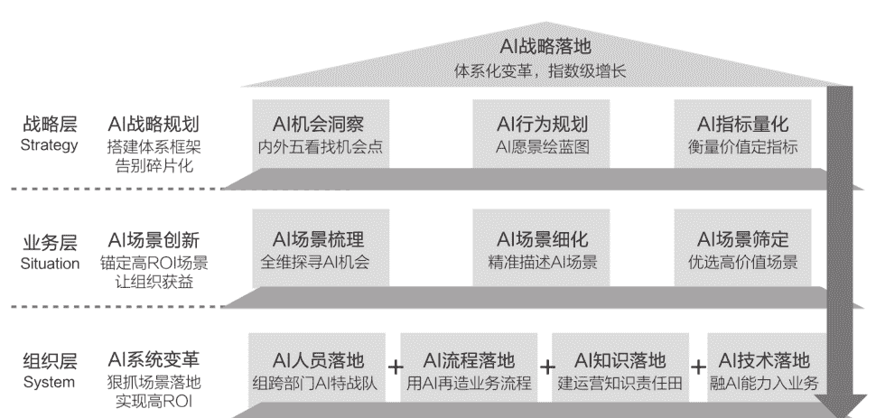
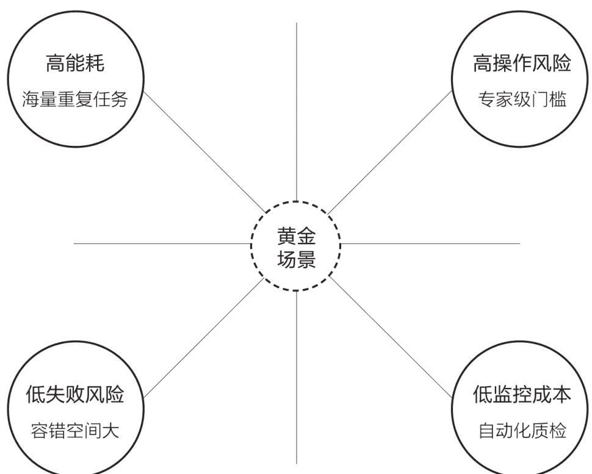

# AI战略落地：体系化变革，指数级增长

## 前言

过去两年，AI像一台意外启动的发动机，轰然点燃了企业的好奇心；市场的讨论度也点燃了管理者内心深处的技术焦虑。

曾几何时，我们惊叹AI能改写文案、生成图像、自动编码；转眼之间，会议纪要、客服助手、销售文案，也都可以一键生成。技术“奔跑”得太快，管理却常常跟不上脚步。AI能否被应用、如何应用、应用于何处、如何核算成本与收益，已成为横亘于众多企业面前的一道无形高墙。

许多企业的AI落地旅程，始于一次“模型采购”，止于一个“原型展示”。预算已投入，系统已部署，演示PPT亦收获掌声，然而一旦真正投入使用，AI却成了“装饰品”。原因何在？企业不仅缺乏方法，亦缺乏路径——既不知从何着手，亦不知由谁主导，更不知如何衡量成果是否真正落地。

本书旨在献给希望将AI战略真正落地的企业与管理者。

如何让AI不再局限于技术部门的演示项目，而成为业务部门业绩增长的核心引擎？

为此，我们提出一套全新方法论体系——“李家贵3S AI战略落地”方法论，即Strategy（战略）、Situation（业务）、System（组织）。该方法论如同一张路线图，帮助企业回答以下三个方面的关键问题。

（1）战略层面，精准锚定方向：AI如何服务于企业的长期目标？企业如何遴选重点发力领域并锁定AI机会点？

（2）业务层面，精选场景：AI在哪些环节上能够创造真实价值？企业如何从“痛点”与“亮点”中筛选出最具杠杆效应的场景？

（3）组织层面，搭建系统：组织、人才、流程、知识、技术、运营如何形成闭环，使AI真正落地生根？

本书分为三大篇，各篇层层递进，形成“从战略蓝图到系统部署”的完整落地闭环。

第一篇为AI战略规划，旨在帮助企业洞察趋势、发现机会，构建清晰的AI愿景与主线行动路径。通过“五重透镜法”——看战略、看客户、看行业、看自身、看技术，全面锁定AI应用的切入点；再以“蓝图+举措+指标”的方式，将AI有机嵌入企业整体战略节奏中。

第二篇为AI场景创新，聚焦“落于哪儿”的问题。企业可依托系统化的场景创新方法：对齐场景、头脑风暴、SCAMPER创意法、设计思维与SWOT分析法、旅程图与商业模式画布，全面梳理潜在场景、精炼优先场景，最终形成“有‘钱’景、有路径、有边界”的可执行方案。

第三篇为AI系统变革，回答“如何落地”的问题。无论是AI人才、流程，抑或是知识与技术体系，读者均可在本篇中找到清晰的构建逻辑与落地节奏：从最小可行的提示工程方案，到复杂系统中的RAG与AI Agent架构；从知识清单与审核机制，到系统综合落地与ROI考核机制，全面构建企业以AI构筑竞争优势的基础体系。

与其说这是一本书，不如说这是一套可执行、可复制、可迭代的AI战略“施工图”。

我们力求以通俗语言阐释复杂概念，并以实际工具与表单支撑方法落地；读者无须掌握编程或算法，只需要明晰“业务在哪、问题在哪、价值在哪”。各章均配备大量实操方法、评估表格与执行清单，从战略推演到场景设计，从指标构建到系统部署，皆贴近真实工作情境，并充分考虑落地需求。

我们坚信，AI并非少数专家的专利，而应成为全体企业员工皆可参与的能力平台。

当下，正是AI战略落地的最佳时机。请勿再让AI仅停留于会议发言、墙面展示或文件归档；让其真正融入流程、写入指标、直面客户、汇入利润表。

## 导语

随着AI的快速发展，越来越多的企业认识到其在提升竞争力方面的巨大潜力。

AI被视为企业转型的重要工具，但在实际操作中，许多企业仍面临严峻挑战。虽然AI的应用前景广阔，但多数企业未能将其与核心业务目标深度融合，导致应用效果未达预期。这一现象的背后，存在若干关键问题：在AI战略落地的过程中，企业往往忽视若干核心要素，最终使AI的价值未能充分释放。

AI的真正价值不仅在于技术本身，更在于如何将技术与业务目标深度结合。

### 一、AI落地面临系统级挑战

事实上，企业在AI转型过程中所面临的困难并非单点，而是系统性的，具体表现为三大核心难题：

1.  找不到方向——AI战略与业务目标脱节，缺乏指向业务价值的清晰蓝图；
2.  找不到场景——场景识别的方法缺失、机会零散，难以量化ROI；
3.  难以系统落地——缺乏完善的流程、机制和组织支持，成果停留于一次性工具培训阶段，难以规模复制。

这些问题不仅是技术层面的难题，更是企业在推进AI应用时，未能从战略设计、场景识别、流程落地等多个维度系统谋划AI应用与实施所致。因此，企业对于AI的应用往往局限于零散的工具培训，难以形成可持续的业务成果。

### 1.找不到方向

许多企业在开始实施AI战略时，未能将其与核心业务目标紧密结合。AI必须与企业的核心业务目标对接，成为实现战略目标的关键驱动力，而非简单的技术堆砌。战略脱节使AI的引入看似增强了技术竞争力，实则未对企业的业务运营产生实质性影响。

不少企业在初期应用AI时，将其视为“技术堆砌”的工具，忽视其与企业战略的融合。缺乏明确战略目标的AI应用，往往陷入“盲目跟风”的困境，企业引入AI的初衷未能实现，最终导致AI战略沦为技术演示，并未实质提升业务效能。

### 案例分析：某制造企业的AI战略脱节

在华南某工业新城，深耕印制电路板领域二十余年的“恒曜电子”（化名）依托高密度互连板迅速壮大，客户遍布全球。然而，近年来市场竞争愈发激烈：订单单价逐年下探，库存却居高不下。董事长在年会上拍板，要“以AI为业务开创新路”，随即推出雄心勃勃的“AI跃迁计划”。

为期三天的内部训练营声势浩大——所有中层干部与数字化部门员工悉数到场。讲师在大屏上演示：利用DeepSeek一键抓取全球前沿资讯，自动排版成董事会简报；借助同一模型，数分钟内即可生成像素风闯关小游戏，并将产线数据接入，呈现炫目的可视化大屏。掌声此起彼伏，手机快门声不断。数字化部门总经理从箱中取出刚印好的《AI工具实战手册》，人手一册，气氛被推至顶点。

培训当晚，学员分组实战：制造部门小组借助AIGC，将企业资源计划需求文档由“散点愿望”梳理为逻辑清晰的规格书，两小时内完成以往需三天的工作；另一组实现董事会资料每周自动爬取、翻译与排版，连CEO都频频点赞。

那一刻，众人真切地相信：AI就是救命稻草。然而，热潮退却同样迅速。培训结束后，无人负责将这些“炫技”场景纳入年度指标，亦无流程与预算支撑持续迭代。产线KPI仍聚焦于良品率与交付周期；销售仍守着报价单讨价还价；数据部门忙于修复旧系统缺陷。不到两个月，DeepSeek账号登录次数骤降，大屏仪表盘蒙尘，企业资源计划需求再度回归Excel手填。

当企业开始季度复盘时，财务图表冰冷：营业收入、毛利率未出现显著改善。高层困惑：技术明明先进，为何救不了业绩？原因正指向最初被忽略的问题——AI并未与“提升生产效率、降低成本、抢占高价值订单”等核心目标深度对齐。缺乏明确的业务牵引、跨部门的量化指标及与收益挂钩的激励机制，AI项目只能开花却难结果。

恒曜电子的案例折射出众多企业的通病：将AI视为一场声势浩大的“技术秀”，而非围绕战略目标设计的“业务引擎”。唯有先回答“AI究竟要助我们赢得哪一场战役”，再决定培训内容、部署方案与考核指标，技术的价值才能在利润表上得到真实体现。

这一案例说明，AI战略必须与企业核心业务目标深度对接，制定清晰的战略蓝图。唯有如此，AI战略方能成为企业的核心竞争力，而非单纯的技术工程。

### 2.找不到场景

即使企业已确立清晰的AI战略方向，识别最适宜的应用场景仍然是一个难题。诸多企业缺乏系统的场景识别方法，致使AI应用机会呈碎片化分布。企业因而难以精准评估AI应用效果，亦无法令AI投资达致预期回报。当多个小规模试点项目并行推进时，场景识别框架的缺位必将使资源投入碎片化，规模效应无从谈起。

> 金句：“科学的AI场景识别方法，决定了企业项目成功的概率。”

### 案例分析：点状创新下的AI场景迷航

初夏，位于华东科创园区的某消费金融独角兽企业召开战略例会。巨幕上红白相间的演示文稿依旧夺目：智能呼叫外呼量已逾亿次，累计通话时长逾十万个小时；智能面审每月自动处理订单逾万笔；智能审批风控引擎累计处理请求数百万笔；智能客服年度服务客户近百万人次，一次性问题解决率达90%；智能催收将首月逾期回收率提升至逾60%，后续阶段回收率提升近50%；智能质检自动审听语音逾十万个小时，每月可替代数十名质检专员工作量。六枚图标如红色指示灯闪烁，台下掌声雷动，企业似乎已凭AI技术攻城略地。

片刻热烈之后，会议室随即转为安静。技术负责人坦言，六个项目是各部门“各显神通”孵化出来的，下一步方向尚无定论。运营中心拟将AI应用于会员留存；风险团队正研究资产证券化场景；营销部门建议尝试生成式广告脚本。然而上述设想仍停留于白板便笺，无一纳入实施排期。

资源呈碎片化：算力租赁、大模型微调、数据标注均各自独立申请预算。拟拓展第七个场景，却无人阐明其优先级的判断逻辑，更别提能否迁移现有成果了。高管们发现企业已步入盲区：点状创新虽光彩夺目，然缺乏可持续“发掘—验证—扩散”的通用方法。

财务汇报进一步凸显困惑：各部门ROI测算标准各异——或按人力节省计算收益，或按转化率衡量增收，抑或仅关注逾期率降幅。六组数字并列却互不兼容，更无法推演“若追加五千万元投入，新增场景可贡献的利润是多少”的结论。

在会议即将结束时，一位副总裁坦言：“我们现在不是缺技术，也不是缺想象力，而是缺一把尺子去丈量更多场景的可能性。”六枚图标依旧闪烁，却彼此隔绝。企业已临新关口：没有可复制的方法，就找不到下一个场景；找不到下一个场景，再亮的成绩也只能停在半山腰。

该案例表明，企业亟须构建标准化场景识别框架，科学地筛选出最具潜力的AI应用场景。

### 3.难以系统落地

AI的规模化成功不仅取决于方向与场景选择，更依赖于完备的流程、机制与组织保障。若仅止步于工具导入，而缺乏体系化管理和组织支撑，AI便难以在企业内部持续应用并释放长期业务价值。

诸多企业在引入AI后，往往缺乏完善的流程支持和跨部门的协同机制，致使项目无法长效运转，甚至因反馈体系不健全导致AI的应用在短期内失效。即便局部项目初见成效，若缺乏持续资源注入与流程迭代，亦难以复制推广，最终只是局部业务的成功。

### 案例分析：某生物科技AI落地困境

初春清晨，江畔的“溯源生科”（化名）园区薄雾弥漫，玻璃幕墙内却人声鼎沸。公司刚结束一场声势浩大的“AI降本增效大赛”——八个部门、十三支队将海报铺满走廊：从“供应商谈判助手”“数字人科普官”，到“仓库零差错视觉质检”，创意之盛令评委几乎无驻足之地。CEO望着列队演示的队伍，寄望AI进一步压缩成本曲线。

热潮退去，难题浮现。

首先是“人”：生产主管熟稔发酵参数，却不懂提示词撰写；算法工程师代码迅捷，却不解“摇瓶恒pH”之意。项目团队应配多少业务骨干、多少数据工程师，乃至长期编制如何设置，皆无定论。

接着是“技”：会上“AI Agent”“RAG”“微调”等术语此起彼伏，然论及框架选型、算力配置，众人皆低头检索手机。部分小组将ChatGPT视为万能胶，却因数据滞留内网防火墙，致使演示仅能在员工笔记本运行。

最后是“流”：公司要求各队在八周之内交付最小可行产品，却未绘制完整流程图。生产、质量、供应链仍凭U盘传递表格，接口位置、数据流向仅凭口头约定。

知识亦呈碎片化。历年累积的SOP、检测报告与工艺参数散落于个人硬盘；有的小组竟将内部文档整包上传至公有模型，第二天即遭法务叫停。八周后的复盘会景象如大梦初醒：部分原型仅能单次运行；部分模型因样本不足而过拟合；更多项目还困在数据清洗中。

财务部门欲核算ROI，却发现各业务线算法各异——有人关注人力节省，有人重视转化率，有人只关注不良率。高管眼见“碎片繁花”终成浮萍，纵有佳绩亦难复制。

溯源生科的案例为我们留下了清晰剖面：点子不缺、技术不缺，缺的是能把点子打磨成“可复刻工序”的刻刀。若无流程、机制与组织之脊梁，再绚丽的场景亦不过水面烟火，转瞬即逝。

### 二、“李家贵3S AI战略落地”方法论

为了帮助企业有效应对AI战略落地所面临的系统性挑战，我提出了“李家贵3S AI战略落地”方法论，也就是“李家贵3S AI战略屋”模型（见图0-1）。该方法论为一套全面框架，旨在系统化推动AI自战略设计至执行落地。通过整合战略、业务与组织三个层面，“3S方法论”为企业提供了清晰的路线图，助力企业在AI转型中实现最优成效。

图0-1 “李家贵3S AI战略屋”模型

在这一方法论中，企业需要从战略层、业务层和组织层三大关键层面出发，结合具体的执行步骤，确保AI战略与企业核心目标的深度融合。每一层级都有独特的任务和目标，从而确保AI在企业中的全面落地和长远发展。

### 1.战略层

在战略层，企业首先需要有一个清晰的AI战略规划，确保其能够与企业的整体战略目标紧密对接。AI战略规划不仅要引入技术工具，更要将AI作为实现企业长期目标的关键驱动力。为了达到这一目标，企业在战略层应着重完成以下几个关键任务。

首先，AI战略规划需要与企业目标充分结合，确保技术引入服务于长远发展。AI不仅是提升效率的工具，更是推动创新和提升核心竞争力的关键驱动力。企业应制定清晰战略框架，确保其与业务目标一致。

其次，AI机会洞察要求企业深刻理解内外部环境，尤其需要掌握行业与市场五大关键机遇。企业应据此及时调整并优化自身的AI战略规划，以灵活应对市场与技术之变。

再次，AI行动规划可以进一步帮助企业绘制AI战略的实施路径。通过完整的AI战略规划，企业能够明确哪些领域应优先应用AI，哪些场景能够最大化提升业务价值。这一步为AI的具体执行提供指导，确保每一项行动都有明确的目标。

最后，AI指标量化至关重要。企业需要设定清晰的量化指标，确保每一项AI任务具备可衡量标准，这不仅有助于评估项目的效果，也能够帮助管理层在项目执行过程中作出科学决策，最大限度地推动项目的成功。

### 2.业务层

在业务层，企业需要将AI应用到具体的业务场景中，确保AI能够为具体业务创造价值。为了实现这一目标，企业在业务层应着重关注以下几个方面。

首先，AI场景创新是业务层的关键任务之一。企业需要通过创新的方式来识别和创建高ROI的场景，确保AI的应用能够直接提升业务价值，而非流于表面技术导入。

其次，AI场景梳理帮助企业全面探索AI应用的场景。通过全方位分析，企业能够识别出各个业务环节中最适合AI介入的点，并确保这些场景能够有效提升企业的运营效率或客户体验。

再次，企业应进一步开展AI场景细化。在这一过程中，企业会精准地定义每个场景的实际需求和价值目标，并细化应用AI的方式。这一步骤是确保AI能够切实带来业务提升，避免脱离实际需求。

最后，AI场景筛定确保企业能够从海量的业务场景中锁定最具潜力和价值的AI应用场景。通过这一过程，企业可以优先选择那些能够带来最高投资回报的场景，集中资源进行优先部署，从而最大化AI应用的ROI。

### 3.组织层

在组织层，企业需要为AI的应用提供强有力的支持，确保AI能够在日常运营中有效落地。这不仅是技术引入的问题，更是企业整体架构和组织文化的转型问题。企业在组织层应着重解决以下几个方面。

首先，AI系统变革是组织层的关键任务之一。企业需要通过技术驱动组织架构的转型，推动各部门之间的协作与信息共享。AI的引入不仅要提升工作效率，还需要推动企业运营模式的革新。

其次，AI人员落地是确保AI能够顺利应用的基础。企业应当培养专门的AI人员队伍，并确保这些人员能够在组织内充分发挥作用。专业人员的引进和培养，能够确保技术的成功落地和优化。

再次，企业需要进行AI流程落地。通过对现有流程的优化和再造，企业需要确保技术能够与现有业务流程无缝对接，实现从数据采集到决策执行的全流程自动化。

另外，AI知识落地也是组织层的重要环节。企业需要构建有效的知识体系，将AI应用中的技术和经验积累起来，并通过组织内的知识共享与学习，确保技术成果能够在企业全范围内得到应用和传承。

最后，AI技术落地为组织层的终极目标。企业必须将技术与业务需求深度结合，确保技术能够在具体运营中产生持久业务价值，全面提升创新能力。

通过“李家贵3S AI战略落地”方法论，企业可于战略、业务、组织三个层面系统推进AI战略应用，确保其与企业长期目标深度对接，并在日常运营中高效落地。各层面协同共进，合力破解战略、场景与系统落地难题，充分释放技术潜能，为企业带来可持续的竞争力。

该方法论确保AI战略应用超越技术范畴，成为驱动企业转型升级的核心力量，这不仅帮助企业打破技术应用的瓶颈，还能促进企业各项业务流程的优化和创新，助力企业在AI时代确立领先优势。

## 第一篇 AI战略规划

### 选方向——方向不对，AI白费

AI战略的关键不在于“是否实施”，而在于“向何处实施、如何实施、为什么实施”。方向一旦偏差，再强大的模型也难以驱动企业业务增长，再充沛的资源也可能被错配浪费。因此，AI战略的第一要义在于选对方向——方向不对，AI白费。

本篇将从三个层面展开，构建一套系统性、结构化的AI战略规划框架。

第一章聚焦“AI机会洞察”，通过“看战略、看客户、看行业、看自己、看技术”五重透镜，帮助企业从宏观战略到微观流程进行全景扫描，系统识别最具投资价值的AI场景。

第二章进入“AI行动规划”，引导企业在明确方向后制定清晰的AI愿景与主线举措，围绕降本增效、第二曲线增收及商业模式创新三大路径，构建真正可落地的AI行动蓝图。

第三章则进入“AI指标量化”，将战略路径与实施举措拆解为清晰的KPI，纳入绩效闭环，确保AI战略不止于宣言，而是渗透到企业管理与资源配置的日常节奏中。

AI是一项系统重构工程，而非孤立的技术部署。唯有当企业同时具备清晰的方向感、强有力的行动方案以及可度量的执行指标，AI才能真正从愿景走向现实、从概念跃升为增长引擎。本篇正是这段征程的起点。

### 第一章 AI机会洞察

在AI战略规划中，识别潜在AI机会点是企业成功转型的关键。如前文所述，企业AI战略必须与业务目标紧密对接，首要之务在于以系统性洞察精准把握市场与技术的变化，锁定最具潜力的AI应用场景。只有凭借系统性洞察，企业方能在复杂多变的市场中找准方向，释放AI的价值潜能。

AI机会洞察不仅是对既有数据的简单分析，而且是基于多维度视角的综合评估。在这一过程中，我们将从多个维度出发，全面分析影响企业AI战略的各类因素。借助以下“五维动态”洞察，企业可精准识别最契合自身的AI应用场景，确保AI投资创造最大业务回报。

## 1.1 看战略

“看战略”要求企业以其自身的愿景、使命及中长期经营目标为锚，确保AI战略始终嵌于企业总体发展蓝图中，而非受制于当下资源约束或局部痛点。

要真正“看”到战略，企业需要先搭建一套“双维坐标”：横轴刻画业务流程能力的成熟度；纵轴刻画产品（或服务）多样化的程度。坐标交叉可衍生出四种典型经营形态——以标准化与效率为核心的“量产”、依靠创新夺取先机的“发明”、在既定流程上迭代优化的“持续改进”以及依据客户个性化需求进行柔性组合的“客户化量产”。

随着时间推移，这四个象限又映射为“量产—发明—持续改进—客户化量产”四个演进阶段，每一阶段都对应特定的流程范式、组织结构与信息系统侧重点：初期强调灵活协作与定制系统；中期看重流水作业与信息下行控制；随后转向跨部门数据互通与闭环优化；最终实现模块化运营与实时智能决策。

“看战略”需要特别注意不同的战略阶段，AI应用的侧重点是不同的，一般有如下四个战略阶段。

### 1. 量产阶段

规模化生产时期，企业最缺的是速度和稳定性。除了用视觉模型做质检、用预测算法做设备维护，企业还可以把AI客服植入一线，让机器人全天候解答标准问题，受理退换货，从而进一步释放人力。得益于低代码/无代码工具，业务人员几乎不必写一行程序就能搭出FAQ交互与工单流转，把“服务”像螺丝一样嵌进标准流程，既不占产能，又能提升客户好感度。

在量产场景里，企业的当务之急是用更少的经费把同一件事做得更快、更稳，并不必急着使用大模型，机器视觉、传统异常检测、规则驱动对话机器人这种“极度成熟的小工具”就足以撬动成本曲线。

AI流程依旧遵循“感知—判断—执行”的单循环逻辑：高清工业相机或日志采集器把数据送进轻量算法，模型毫秒级判断“合格/不合格、异常/正常”，并立即将结果回写到产线或客服系统，强调低延迟与零中断。

AI组织层面，只需要在现有生产、质检、客服班组旁边加一个“模型运维组”，日常盯着良品率曲线和报警阈值，每周小步快调；一线员工通过拖拉式界面调用机器人，无须懂编程。

系统架构奉行“稳”字：边缘侧用压缩后的机器视觉模型就地推理；中心侧只做数据归档与月度复盘；核心KPI只有良品率、停机时长、一线一次解决率，其他花哨功能暂时“靠边站”。如此既不增加复杂流程，也无须高端算力，却能把单位成本一毫米、一毫米地压低，把稳定性一秒、一秒地拉高。

### 2. 发明阶段

当“谁先出新品、谁先赚钱”的观点成为竞争主旋律时，AI流程通常升级为“灵感孵化—数字验证—商业评估”三步跑。

第一步，设计师或产品经理只需要输入几个关键词，生成式模型（如 Stable Diffusion、DALL·E或Midjourney）即可在数秒内产出上百张概念草图、配色方案或功能组合；

第二步，虚拟仿真平台接手，把草图投进数字孪生环境，快速演算材料强度、工艺可行性与单件成本，让不靠谱的创意止步于屏幕；

第三步，可行方案进入商业评估，由LLM结合市场数据自动估算售价区间、目标客户与上线节奏，帮助决策层拍板“是否做、何时做”的问题。

为了让以上三步跑顺滑落地，企业常将传统“职能墙”改造为跨域“创意战队”：产品、设计、算法、营销四岗位人员围坐一张大桌，任何人都能即兴调用模型试错，灵感不再卡在流程里。底层技术栈采用“云原生沙盒+多模型路由”：算力随叫随到，模型日更迭代，审批表从几十页精简成线上“一键立项”，真正做到“创意来电，算力秒接”。

某大型建筑设计院受房地产新开工锐减冲击，面临生存突围压力。引入上述AI流程后，先用生成式模型为业主产出多套立面与空间草图，再用BIM数字孪生系统对结构强度、节能指标与造价进行自动校验。原本需要耗时两三周的概念方案，如今两三天便能完成，并自动筛掉不合格设计。

随后，LLM结合当地造价数据库和竞品售价撰写一份商业化建议书，帮助院方与业主快速定稿。平均投标成本下降35%，设计迭代速度提升4倍，更因“AI风格”催生了独特的新中式、超低能耗等创意方案，在红海市场重获议价权。

由此可见，发明阶段不再靠人海战术，而是让算法承担大部分试错与筛选工作，团队则将时间投入真正有价值的创意打磨与商业决策中。

### 3. 持续改进阶段

市场趋于成熟后，效率提升常源于毫厘之间。企业可先用AI数据分析拉通生产与运营指标，生成自动化看板；再用智能搜索（RAG+语义检索）调取内外最佳实践，辅助工程师定位瓶颈。分析结果自动回写到排产、物流或定价算法中，每一次微小改动都会沉淀为下一轮优化素材，形成“数据拉通—流程挖掘—在线实验”的自循环，推动效率持续爬坡。

在C端市场，客户留存往往因一个标题、一句标语或一次推送而改变。此时，AI流程要围绕“数据拉通—流程挖掘—在线实验”的逻辑实施分秒级微调。首先，将App埋点、点击流、支付凭证与社媒反馈统一汇入指标工厂；随后，用流程挖掘还原真实体验路径，精准定位客户流失屏与转化节点。最后，A/B Test引擎联合多臂老虎机或强化学习算法，对不同故事线、选题角度、文案风格进行并行测试，实时评估留存率、转化率与客单价提升幅度。

若测试表明“在DeepSeek推理结果页顶部加一行商品推荐可带来2.3%的商品交易总额抬升”，系统即自动放大流量；若效果转凉，则即时回滚。

AI组织多采用“双中台”模式：营销团队与产品运营并属“流程卓越中台”，专责实验设计与KPI；数据科学家与算法工程师归入“模型算法中台”，负责特征生成、策略更新与灰度发布。

双方共用同一张实时仪表盘，谁的调参带来更多增量，系统即时打分并按收益分配算力配额。系统强调“统一与自治”：数据、特征、模型、服务全部驻留语义中台，通过推理网关实现秒级灰度；任何KPI偏离阈值即触发自动回滚，确保坏版本不会拖累整体表现。

如此一来，每一次小改动都像带息存款一样——今天多0.5个百分点，明天跌0.3个百分点，复利效应不断累积，最终把微小差距汇成可观优势。

### 4. 客户化量产阶段

当企业既要规模又要个性化时，AI咨询可将两件看似矛盾的事并行推进。多模态大模型实时理解客户语言、图片甚至情绪，生成专属画像；随后像咨询顾问一样，依据规则引擎把标准化模块灵活组合，输出“千人千面”的产品或方案。

当企业需兼顾规模与个性化时，AI咨询可将两项看似矛盾的目标并行推进：多模态大模型实时解析客户语言、图像乃至情绪，生成专属画像；继而依托规则引擎，将标准化模块灵活组合，输出千人千面的产品或方案。

银行可借助AI实现动态定价、定制授信；家居品牌可即时生成符合户型与审美的灯光方案。前台体验仿佛量身定制，后台生产却仍能批量高效，实现规模化与个性化统一。

此阶段，企业已将知识库、客户画像与AI工具养得“肌肉饱满”。后台数据治理体系把产品文档、供应链信息、客户行为和客服对话整理得井然；多模态大模型可随时解析客户文字、图片乃至语气，将兴趣、预算、风格偏好拼成一张鲜活画像。

需求信号一经捕获，规则引擎便如同拼乐高一样，按既定规则自动调用标准化模块生成专属方案并即刻生成订单；生产、物流或数字交付系统随即无缝响应，交付结果实时回传并持续完善客户画像，使后续推荐愈发精准。

组织结构划分为三环：前台洞察负责“听懂客户在说什么”；中台编排负责“把需求翻译成工厂或系统能执行的动作”；后台保障则盯住“产能、库存、合规、风险”。

三环之间以API松耦合方式连接，各自均可独立升级，互不拖累。技术栈采用事件驱动架构：云端大模型主攻理解与创意生成，边缘侧轻量微服务负责秒级决策与风控校验。商务人员借助“拖拉拽”界面即可搭建轻量级AI Agent——既可查询合同条款，又能即时生成报价方案，还能自动触发供应链下单。客户的感受就像有专属顾问一样，而企业仍以批量化成本实现大规模交付，真正把“千人千面”与“千万件同款”收入同一张利润表中。

## 1.2 看客户

如果说“看战略”为企业指明北极星，那么“看客户”便是观测海面潮汐的灯塔——唯当确认浪潮的方向与节律，航船方可沿既定坐标疾速前行。随着数字化基础设施愈发完备，AI已由“数据分析工具”演进为“实时市场显微镜”，它把眼前千丝万缕的评论、交易、对话与图像梳理成清晰的客户脉搏，帮助企业在毫秒级修正产品与服务。

### 1. 锁定人群

要弄清“谁在买、谁在用”。传统做法依赖季度调研，等报告出炉时，客户早已更换了手机号。如今，多模态大模型可同时对接社交媒体信息流、POS（Point of Sale，销售终端）流水与CRM标签，如同经验丰富的人口学家一般，实时梳理年龄、地域、数字素养与购买力四条核心线索。

该模型将客户头像、文本信息、消费频次等数据输入向量数据库后，能自动呈现增量人群与流失高危人群的特征轮廓。某美妆零售商借助这套AI客户画像动态面板，发现“Z世代”对纯素配方的讨论量急剧上升，而35岁以上客户对功效抗老类产品的搜索量翻倍，于是迅速将线上导购话术拆分为“清爽护肤系列”与“功效抗老系列”，同时对货架结构进行相应微调，最终使季度客单价提升近8%。

### 2. 监测体验

客户体验并非一条平稳的直线，其中的高峰与低谷都蕴含着机会。AI将这一变化曲线的监测精度提升至秒级：由RAG技术驱动的网络爬虫每天抓取竞品、新品的客户评论，GPT-4o则通过情绪识别与主题聚类技术，为这些反馈贴上“功能、价格、服务、情绪”四重标签。

一旦某一标签在24小时内的出现频次呈现三倍标准差的异常增长，系统会立即推送“体验地震警报”，并附带可执行的修复建议。如某连锁咖啡品牌正是通过该系统，及时捕捉到“纸吸管影响口感”的负面反馈趋势，仅用两天时间完成吸管材料的替换，并在小程序发布公告告知消费者，此举使品牌连续两周的差评率下降六成，而品牌讨论度反而逆势上涨。

### 3. 重塑付费

客户不仅在改变“要什么”，也在改变“怎么付”：一次性购买逐渐转变为订阅模式，所有权让位于使用权，单一交易向生态协同方向发展。AI在此过程中扮演“商业模式策展人”的角色。

多模态大模型在读取合同条款、竞争定价与宏观数据后，能瞬间生成分层定价、增值捆绑或收益分成等仿真方案，管理层可通过一键操作完成方案比价与落地执行。一家物流领域的SaaS（Software-as-a-Service，软件即服务）企业借助该技术发现，大客户最关注“高峰期服务保障”，于是将费率调整为“基础费+保障费+弹性费”的三段式结构，最终使客户续约率从81%提升至93%。

### 4. 升级平台

销售模式发生变化后，数字平台不能“穿姑娘的衣服跳大妈的舞”（喻指平台模式与销售需求不匹配）。B2C需要实现“千人千面”；B2B需要注重“并行协同”；B2B2C（网络购物商业模式）则需要兼顾两端需求。

与之相对应，企业需要同步搭建客户数据平台，以沉淀客户全景画像；搭建智能交互平台，实现语音、文本、视频与增强现实的贯通；搭建价值兑现平台，承接从报价、签约、履约到售后的全流程服务。三大平台通过事件驱动架构相互串联，统一事件总线实现“下单—风控—库存—物流”的毫秒级联动，AI可在任一节点介入，既提升前台客户体验的精细度，又保障后台数据的闭环管理。

### 案例分析：如何看银行业的AI实践

银行业对“看客户”的实践探索尤为深入。某全国性银行构建了一套“AI客户体验矩阵”：前台为员工配备智能问答助手，新人培训周期缩短40%；虚拟数字客服实现7×24小时在线服务，回复率达98%。中台嵌入编码辅助工具与坐席助手，流程自动化覆盖开发、服务、行政三条业务线；实时数据分析模型对KPI进行监控，一旦客户留存率出现下滑，便自动推送弹窗提醒并发放优惠券。

后台通过统一向量空间，将信贷审批、风险预警、反欺诈与反洗钱报告生成等环节串联，实现“条款—特征—异常”的一跳定位，合规核查时效从T+1（次日完成）压缩至小时级；投研助手与机器人交易助手将策略刷新频率提升至秒级自适应水平。从客户视角来看，他们能同时获得安全感与便捷度的双重保障；从银行视角来看，合规成本降低的同时，客户终身价值得以提升，真正实现“稳”与“快”的有机统一。

“看战略”与“看客户”通过北极星指标形成协同联动：战略明确发展方向，客户动态则揭示何时需要加速推进、何时需要调整策略。只有将AI提供的实时洞察嵌入战略罗盘，企业才能在复杂多变的市场环境中持续校准发展方向——既不盲目追逐市场热点，也不错过关键转折点。此时的AI，已不再是业务流程中“锦上添花”的辅助工具，而是连接战略目标（灯塔）与客户动态（海面）的实时纽带，助力企业稳步前行。

## 1.3 看行业

继“看战略”厘清方向、“看客户”感知需求之后，“看行业”如同深海声呐，能够实时捕捉宏观政策调整、技术迭代趋势与市场供需格局变化。这一环节既检验前两项工作是否协同对齐，也决定AI资源投向的最终环节。若忽视行业潜在风险，企业往往会面临“技术追逐热点而偏离核心、场景落地缺乏焦点”的问题；反之，基于行业动态持续校准方向，才能确保战略、客户需求与企业能力三者实现同频共振。

### 1. 拆解差异

不同行业赛道对AI的渴求大相径庭：制造业的核心痛点在于良品率提升与生产排程效率优化；能源业聚焦于电源与负荷平衡调节及安全冗余保障；建筑业追求设计与施工一体化流程提速；服务业则着重比拼服务体验优化与客户黏性增强；生物医药行业更是呈现出截然不同的发展特征——该行业不生产传统工业产品（如螺丝），也不从事物流运输业务（如搬运包裹），而是以分子研发为核心产品，将临床试验视为核心“生产流程”。

因此，“看行业”的第一步是精准梳理各行业痛点并形成画像，再针对每类痛点匹配适配的算法技术：强化学习用于实时调度优化，知识图谱用于保障合规管理与可追溯性，AIGC模型则用于内容创新与分子结构研发创意生成。

### 2. 驱动智造

在智能工厂场景中，AI技术将设备温度、振动频率与功率信号转化为统一的时序向量；机器视觉系统精准识别产品瑕疵，强化学习优化生产节拍，实现设备停机率与产品报废率同步下降；在重载炼厂场景中，边缘侧轻量型AI模型可完成毫秒级闭环控制，云端大模型则对上万条生产配方进行复盘分析，持续迭代优化最佳生产工艺。

### 3. 调度能源

在智慧电网体系中，AIGC模型整合气象数据、用电负荷数据与电价数据，实现分钟级调度指令下发；油田、管网与变电站借助多智能体算法构建“自组织”协同机制，远程运维机器人可即时修复泄漏问题。实施结果显示，能源集成调度效率显著提升，安全冗余阈值有效提高。

### 4. 筑造空间

AI与BIM融合的引擎，可将2D草图一键转换为3D可施工的工程图，参数化设计系统自动计算建筑光照与风压数据；施工现场摄像头实时核验钢筋规格、模板尺寸与混凝土浇筑厚度，数字孪生技术将塔吊、混凝土运输车辆调度至最短路径，建筑项目从“概念设计到交付验收”的流程周期被压缩成“半程马拉松”。

### 5. 赋能服务

多模态AI大模型同步解析文本、语音与图像信息，洞察客户情绪变化，并据此实时调价格、改文案、换路线；路径优化算法与仓网数字孪生技术使货物揽收时长缩短两成，智能授信系统与动态定价机制加快资金周转速度，AIGC可定制“千人千面”的旅行方案——服务体验从“被推销”升级为“被理解”。

### 案例分析：某生物医药公司监测竞争、把握先机

在这个脱敏虚拟案例中，我们聚焦“一款原用于治疗血液肿瘤的T细胞衔接双特异抗体向自身免疫疾病领域转型”的全链路洞察流程，展示AI如何实现从信号捕捉到战略落地的闭环支持。

AI情报平台每日对文献数据库、临床研究登记网站及投资者信息披露渠道进行“巡航”。当系统检测到“恶性血液病治疗药物在难治性自身免疫疾病患者中呈现积极疗效”这一罕见关联信号时，会立即将其标记为“适应证拓展高价值事件”，并同步整合核心数据片段推送至产品线负责人。

依托自然语言理解与事件聚类技术，该平台不仅呈现单条信息内容，还能自动生成包含“研究方法、患者背景、疗效指标”三要素摘要，确保研发团队在数分钟内完成“是否启动深度追踪”的首轮判断。

随后，多模态AI模型对公开研究摘要及学术会议信息开展深度数据抽取，重点聚焦细胞因子峰值变化、免疫球蛋白水平波动、神经毒性评分等六大安全评估维度，并利用因果推断分析框架，还原“低剂量、阶梯式给药”与“轻度不良反应发生率”之间的关联性。

系统输出的分析结果不再局限于风险等级划分，而是通过可解释性知识图谱直观呈现“给药剂量—细胞因子变化—临床症状”的作用路径，帮助临床团队快速理解“用药安全性可控，但需要密切监测首剂给药后患者反应”的结论。

当竞争情报模块接入知识图谱后，全球十余条同类管线被自动聚类并绘制成可视化竞品网络。分析显示，第一梯队的几家企业已经完成早期验证，正筹备中期临床试验；第二梯队聚焦分子结构优化与多靶点设计；新进入者则围绕成本与给药便利性方面进行优化展开布局。

AI综合靶点重叠程度、临床研发阶段、资本市场关注度等因素计算竞争强度，给出“中高”竞争风险评分，同时提出建议：企业要么通过差异化技术路线实现突破，要么通过合作模式快速抢占市场卡位。

时序预测模型整合专利申请动态、监管机构会议纪要及学术会议排期等多维度数据，对行业未来18个月的发展趋势给出三条高置信度核心判断：一是给药方式大概率从持续静脉滴注逐步过渡到皮下注射长效制剂；二是多靶点融合技术将成为下一轮创新热点，双特异抗体向三特异抗体的技术升级趋势已较为明确；三是狼疮肾炎、硬皮病等临床需求高度未满足领域，将成为行业重点布局方向。在此基础上，模型进一步指出“低亲和性CD3（分化簇）靶点结合域+长半衰期分子骨架”是最具差异化潜力的分子设计路径。

系统最终生成一份交互式行业情报数据包，包含竞争格局分析棋盘、临床试验推进路线图、风险预警雷达图及商务合作机会时间轴。报告明确三条并行行动方案：一是在极重症患者群体中，通过同情用药路径开展样本量N≤6的小范围验证研究，以最短周期获取真实生物标志物变化数据；二是寻求与拥有多靶点分子工程平台的合作方联合研发三特异抗体分子，扩大对B淋巴细胞和浆细胞的靶向覆盖范围；三是与具备长效给药载体技术的企业携手，共同开发每周一次给药的皮下注射剂型，在提升患者用药依从性的同时降低住院治疗成本。

该案例表明，“看行业”并非单纯的外围信息扫描，而是与“看战略”“看客户”共同构成动态自适应决策闭环：当行业洞察模块发现潜在市场拐点信号时，系统会同步将该信号映射至战略镜头（调整资源配置比例）与客户镜头（挖掘需求机会）。通过这种“三镜合一”的实时校准机制，企业能够在技术创新前沿、客户价值创造与风险控制底线之间维持动态平衡，使AI真正成为支撑企业跨周期增长的可靠引擎。

## 1.4 看自己

继“看战略”厘清方向、“看客户”感知需求、“看行业”洞悉暗流之后，企业还需要将视镜头掉转，深入审视自身核心能力——“看自己”。

只有将内部能力、资源与流程的真实状态投射到同一张坐标系里，才能准确判断战略是否具备落地条件、行业机会能否有效承接以及客户价值能否切实兑现。在此场景下，AI的角色不再是外部洞察工具，而是组织的“数字诊断系统”：它以数据为基础、以模型为支撑，将分散在各部门、各系统的运营数据信号，构建实时动态的能力图谱，为管理层提供可视化、可调控、可迭代的自我评估报告。

### 1. 量化体检

“看自己”的首要任务是让企业“测得到”。AI驱动的对标分析平台会自动汇聚企业资源计划、客户关系管理、生产执行系统、HR等系统的运行日志，并实时抓取行业标杆企业的公开财务报告、项目案例与岗位招聘信息；多模态大模型通过语义解析技术，将这些非结构化文本数据转化为统一评估指标，如数据资产完备度、算法研发效率、业务自动化率、人才结构多样性等。

随后，系统运用神经网络技术将内部评估指标与行业平均水平映射到同一分析维度，生成一张“能力雷达图”。管理者只需要快速查看，即可清晰掌握企业在哪些维度具备优势，在哪些维度存在短板。

### 2. 映射差距

有了量化坐标，下一步便是实现“差距一键计算”。AI 将能力雷达图与价值流（涵盖产品开发、市场营销、合作生态等环节）进行矩阵化叠加分析，自动标注出“对营收贡献度高但能力薄弱”的关键短板。例如，某云服务企业发现，其在“行业解决方案开发”节点的平均交付周期比行业标杆企业慢40%，而该节点对新签订合同的贡献度高达65%。

系统进一步通过流程挖掘算法，对上万条项目执行记录进行复盘分析，明确瓶颈主要集中在“需求澄清”和“技术选型”两个环节，并给出可落地的优化方案：引入RAG技术，结合大模型自动生成技术栈模板，利用知识图谱复用行业最佳实践经验。

### 3. 优化流程

识别出能力差距后，AI会将改进计划拆解为“最小可执行闭环单元”。流程数字孪生模块首先模拟在不同资源投入场景下的“时间—成本—风险”曲线，为管理层的投资决策提供数据支持；随后，强化学习代理模型被部署到实际业务系统中，实时动态调整任务排程、资源分配与权限设置。

例如，某银行的风控部门在“模型校验—数据入湖—规则下发”业务链路中引入强化调度模型后，模型迭代周期从月度压缩至周度，坏账率同步下降0.4个百分点。系统会自动将这一改进成果记入“能力成长曲线”，形成组织学习的数字化档案。

### 4. 激活人才

除了硬性的流程优化，软能力同样关键。AI人才能力盘点工具通过解析员工简历、绩效数据与协作网络信息，绘制“人才技能雷达图”。当系统发现“AIGC提示词设计师”或“数据治理专家”等关键岗位稀缺时，会联动招聘API推送候选人画像，并根据岗位需求热度与市场薪酬水平自动确定招募优先级。

同时，智能学习引擎会依据员工个人技能缺口与业务发展需求，精准推荐微课程、交流社群与导师资源，真正实现“一个能力指标对应一条成长路径”。

### 5. 改进闭环

最后，“看自己”并非一次性的评估工作，而是持续的自我进化过程。AI通过事件驱动架构，实时监测价值流中的KPI变化，一旦某一指标偏离预设的“北极星区间”，便立即触发模型重新计算与资源重新分配机制。

例如，当市场端监测到“客户留存率下滑可能由交付延迟导致”的信号时，系统会反向追溯“供应—交付”节点的自动化率与人力负荷情况，并在后台自动扩容RPA机器人配额或弹性云资源配置，确保调整策略快速落地。通过这一机制，组织能够形成“数据采集—能力评估—差距定位—方案部署—指标回写”的完整闭环，将自我进化内化为日常运营的固有节奏。

“看自己”使企业如同量子传感器一般，对自身能力与外部机会保持同频共振：战略明确发展方向，客户需求提供市场信号，行业环境给出约束条件，而自我评估则确保每一次资源投入都建立在可验证、可迭代的能力基础之上。借助AI的实时监测与闭环调度，企业能够在快速变化的市场环境中保持健康的运营弹性，将“能力差距”转化为下一轮增长的核心杠杆。

## 1.5 看技术

沿着“看战略”“看客户”“看行业”“看自己”的分析框架，最后一块关键拼图是“看技术”。技术浪潮的演进往往先于商业落地半步——精准把握便能借势突破，反应迟缓则可能面临颠覆风险。“看技术”主要从以下六个维度展开关注。

### 1. 选型模型

模型是一切智能化工作的发动机。过去两年，大型开源模型逐步从“基本可用”向“高效好用”升级，其中国产模型阵营表现尤为活跃。DeepSeek凭借完备的研发生态与算力联盟支持，已成为当前国产大模型主流选择。

然而，技术选型不能仅关注参数指标，还需要综合评估生态完备程度与未来演进潜力：DeepSeek在推理速度、中文数据覆盖范围及授权合规性方面优势显著，但在函数调用场景中，千问的插件化能力更具灵活性；另有部分垂直领域模型（如法律、医疗专业模型）经过小样本微调后，可实现“以小博精”的目标。研发团队需要在“通用模型—垂直模型”的选择光谱中动态调整策略：把通用模型当地基；把行业专模当尖兵；把快速蒸馏的小模型当边缘轻骑。

### 2. 打磨提示词

提示词是连接语言与算法的“技术胶水”，其长期价值不亚于模型本身。随着SFT、LoRA等轻量级微调技术的普及，提示词已从“人工编写一句话”演进为“编排多轮交互意图、嵌入系统约束条件、耦合工具调用”的复合型技术脚本。

提示词工程的演进方向主要有两条。一是模板化——通过参数化占位符设置与变量动态注入，使单一提示词可适配多种业务场景；二是自动化——让模型实现提示词自我迭代，在少样本输入场景下自动寻找最优方案。企业应建立“提示词资产库”，通过版本控制、A/B Test与可观测性指标，对提示词全生命周期进行系统化管理，将“灵感型写法”沉淀为“工程级资产”。

### 3. 治理知识

模型本身天然缺乏领域专属知识，RAG架构因此成为连接企业知识库与模型能力的关键桥梁。当前技术应用的挑战并非在于检索功能实现，而在于知识治理：文档多源异构、元数据缺失、权限粒度粗放都会让检索结果“雾里看花”。

新一代知识治理解决方案正将质量评估、知识颗粒度切分与上下文压缩等功能整合到同一技术流水线，并采用向量存储与符号索引双栈并行的架构，确保“找得到”与“信得过”双重目标兼顾。对企业而言，首要工作是将PDF、PPT、代码仓库、客服对话记录等全部转化为结构化数据，再通过细粒度权限标签与时间戳管理维护数据“新鲜度”，否则RAG技术只能实现基础“检索”功能，无法达成“增强”模型能力的核心目标。

### 4. 搭建平台

AI Agent平台决定了AI 技术工程化落地的上限水平。目前，LangChain生态系统最为成熟，其插件与模板已覆盖从数据接入到多模态推理的整个流程；Dify主打“开箱即用”的可视化配置功能，适用于中型团队快速启动项目；HiAgent在权限管控与私有化部署方面更契合大型组织的需求。

AI Agent平台在选型时应重点关注三个维度指标：成本（云服务费用与人力投入）、风险（技术深度依赖与潜在技术债务）、时间（从PoC到正式生产部署的周期跨度）。行业最佳实践为“核心能力自主研发+框架组件即插即用”：将提示词管理、RAG模块、监控系统等通用组件下沉为标准化微服务，通过平台实现业务流程编排，既避免对单一框架过度依赖，也减少重复开发带来的资源浪费。

### 5. 编排流程

智能体工作流的兴起推动“模型调用链”升级为“业务流程引擎”。关键问题在于：自动化应推进至何种深度？全托管智能体在复杂业务场景中易陷入“幻觉循环”，而全人工干预流程又耗时失速。合理方案是“人机共编”：以业务流程建模符号或数据序列化格式编写的流程脚本定义关键节点，将模型决策逻辑嵌入节点内部，同时通过异常监控与流程回滚机制提供风险兜底保障。

从长远发展来看，AI生成的流程脚本将与人工编写脚本深度融合：模型先自动生成流程草图，人类再补充约束条件、设置KPI、确定SLA，最终由监控系统将运行数据反馈给模型，形成“生成—优化—反馈”的自循环优化机制。

### 6. 升级算力

底层硬件算力决定了AI技术应用的性能上限。过去国产GPU存在“价格高、供应少”的问题，当前正迎来“性价比”提升的关键拐点：新一代8位或4位量化技术，可实现千亿参数模型在单张GPU卡上运行，小型推理集群不再高不可攀。与此同时，异构算力调度技术与云边协同架构，能够将“按秒计费”的GPU资源拆解为任务级片段分配，显著降低算力峰值成本。

企业需建立“算力预算管理池”，利用AI预测模型负载需求并动态参与云GPU资源竞价；针对数据安全要求高或超低时延需求的场景，可引入国产GPU进行自有互联网数据中心部署，既能规避核心技术“卡脖子”风险，又能构建成本竞争的护城河。

“看技术”让企业如同手握指南针的攀岩者，既能抬头望向山峰明确方向，又能低头找准脚下落点稳步前行：模型选型如同确定攀登路线；提示词打磨好比提供精准抓点；知识治理类似铺设稳固岩面；AI Agent平台与流程编排则像搭建阶梯；而算力升级如同补给缆绳，为整个智能化进程提供持续稳定的底层支撑。

只有将这些技术节点与“看战略—看客户—看行业—看自己”的四重透镜洞察体系实时联动，企业才能在AI技术应用的峭壁上稳步向上攀登，真正实现技术落地与业务增长的协同，而非停留在“空中画饼”的空想阶段。

为了大家便于记忆，我总结了口诀和秘诀速记（如表1-1）。

### 表1-1 口诀和秘诀速记

| 看什么 | 口诀 | 秘诀速记 |
| :--- | :--- | :--- |
| 看战略 | “先定北极星，再点燃AI火箭” | **锁定阶段 → 对齐打法** • 定位象限：用“双维坐标”将企业精准归类至量产、发明、持续改进、客户化量产四大象限，明确发展阶段； • 匹配任务：针对不同象限制定差异化AI任务清单——量产抓降本、发明抓创意、持续改进抓数据复利、客户化量产抓个性化规模； • 锚定目标：将阶段KPI（如良品率、研发周期、客户留存率等）与北极星指标绑定，输出“一张战略路线图+一套里程碑节点”，确保方向统一 |
| 看客户 | “盯住脉搏，才能踩准节拍” | **三锁流程** • 锁人群：通过多模态客户画像实时分层，精准圈定增量人群与流失高危人群； • 锁需求：结合RAG技术与情绪识别算法，生成可视化“需求词云”，直观呈现需求优先级； • 锁变化：秒级监测客户评论、交易数据等实时脉冲，当数据出现三倍标准差异动时自动触发预警 |
| 看行业 | “用声呐听浪，借势领航” | **痛点画像 + 行业经验** • 拆赛道痛点：制造=良品率，能源=源荷平衡，医药=临床周期…… • 建行业知识图谱，沉淀法规、专利、工艺要点等行业经验 |
| 看自己 | “先照镜子，再上赛道” | **数据可收 + 差距可查** • 全量接入企业资源计划、CRM、生产执行系统、HR等系统日志数据，自动映射生成“能力雷达图”，可视化呈现内部能力现状； • AI对标分析工具，将内部指标与行业均值置于同一维度比对，以“红灯”标识短板环节； • 利用流程数字孪生技术与强化调度算法开展沙盒试验，全程记录“差距定位→改进方案→收益转化”全链路，形成可迭代的自我优化机制 |
| 看技术 | “握好指南针，攀高不迷路” | **五大“武器一表掌”** 模型：通用LLM打底，垂直专模做“尖兵”。 • 模型选型：以LLM为技术基座，搭配垂直领域专业模型作为“尖兵”； • 提示词优化：采用“模板化配置+自动寻优”模式，通过版本控制、A/B Test管理提示词生命周期，将其沉淀为工程级资产； • RAG架构：采用“向量存储+符号索引”双栈架构，结合细粒度权限管控，确保知识“找得到、信得过” • AI Agent平台搭建：核心能力自主研发，框架组件即插即用；通过业务流程建模符号或数据序列化格式实现人机协同编排； • 算力管理：采用“公有云训练+私有GPU推理”混合模式，结合模型量化（8位/4位）与云边协同技术，降低成本 |

## 案例实践

某证券公司经过“看战略—看客户—看行业—看自己—看技术”五重透镜，将宏观方向、市场需求、行业暗流、内部底盘与技术路径串联成一张可执行的落地蓝图。以下是这家公司的具体操作实践。

### 锚定战略：AI化组织，抢占增量

面对佣金率下滑与投顾模式重构的双重压力，管理层将“全面AI化”确立为未来三年的“北极星目标”，希望依托数据智能在高端财富管理、机构量化交易与智能投研三大赛道实现突破。战略蓝图强调资源集中，而非遍地开花：一方面通过智能化提升研究、交易与服务效率，另一方面凭借差异化能力换取估值溢价，从而在日趋激烈的证券行业竞争中占得先机。

### 洞察客户：解码十亿级账户诉求

客户洞察平台显示，资产规模在十亿元以上的量化私募与超高净值客户已将“AI驱动的策略研发”与“生成式资产配置”视为核心诉求。他们既需要延迟更低、可编程性更高的量化框架，也期待券商借助大模型快速梳理全球宏观信息并输出定制化组合。公司据此将“机构策略沙盒”和“财富顾问Copilot”确定为旗舰场景，既满足了高端客户的深层需求，也为新业务开辟了增长空间。

### 扫描行业：赛道加速，友商先行

行业对标结果显示，多家大型券商已搭建“应用—服务—模型—基础”四层AI架构；部分友商更将大模型问答、代码生成与文生图封装为标准API，率先落地智能问答与摘要提取功能。竞争态势表明，若想在“高端量化+智能投顾”赛道掌握话语权，公司必须在算法深度和工程效率两个维度同步提速，否则将被动跟随友商节奏。

### 剖析自己：盘点底盘，锁定短板

内部能力雷达图清晰呈现了信息化积累、量化业务需求、技术-业务融合以及持续投入四大优势，同时暴露了两大短板：一是研究所、投顾部与IT部门的知识库长期分散，难以支撑统一的RAG检索；二是提示词写作多依赖个人经验，缺乏版本管理与共享机制，导致资产沉淀效率低下。管理团队据此将知识治理和提示词资产化纳入年度关键任务，要求在预算和资源配置上给予优先倾斜。

### 聚焦技术：定框架，配武器

技术路线采取“核心自研+生态即插”的组合策略。DeepSeek被选定为通用大模型，以保障中文金融语料覆盖度与自主可控性；Dify负责AI Agent平台的私有化部署，便于权限管控与插件扩展；自研提示词工具链内置模板化功能与A/B Test机制，助力研究、量化、投顾团队共享最佳实践；RAG Flow统一管理研报、法规、合同与日志等多源文档，采用向量索引与符号索引并行的方式，确保可检可溯。流程层面在人工编写工作流外嵌入智能体工作流，形成“模型草拟—人工校审—系统落单”的闭环；算力层则采用“公有云训练+国产GPU私有推理”的双轨模式，兼顾成本控制与安全保障。

### 落地行动：从蓝图到里程碑

公司设定了清晰的时间表：三个月内完成知识库治理与提示词资产库建设，交付“研报智能摘要”与“研判要点快手图”两款最小可行产品；六个月内推出机构量化策略沙盒，支持客户一站式调用历史分笔数据、因子库与生成式解读功能；九个月内上线面向高净值客户的财富顾问Copilot，以多模态形式展示资产配置方案、市场情绪分析与风险敞口评估，并支持通过自然语言调整参数。全年滚动监控客户资产增长率、模型调用稳定率与AI贡献收入占比三项核心指标，一旦数据偏离阈值即触发策略重算，确保AI建设真正服务于业务增量提升与客户体验优化。

通过“五重透镜”，该公司既避免了“只谈技术不谈场景”的空转问题，也规避了“只谈需求不谈底盘”的脱节现象，将AI真正嵌入价值流，构筑起从研究到交易、从投顾到运营的智能护城河。

## 第二章 AI行为规划

在完成AI机会洞察后，企业进入战略执行的关键环节——AI行为规划。在此阶段，企业需依据洞察所得的机会点，明确AI应用的方向、目标及具体实施步骤。AI行为规划不仅是技术层面的任务，更是保障AI战略有效落地、创造最大业务价值的核心环节。

在AI机会洞察阶段，企业已通过“五重透镜”的方法识别出潜在的AI应用场景，明确了市场需求、前沿技术、行业趋势及自身能力差距。接下来，企业的核心任务是依据这些洞察，制定明确的AI愿景与实施主线举措，确保AI战略与企业长远战略目标紧密衔接，推动业务价值落地。

### 2.1 定义AI愿景

AI 愿景是企业AI战略的核心灵魂。它并非一句口号式的技术宣言，而是一套跨越数年、贯穿业务全流程的未来坐标系，指引企业以AI持续创造价值、引领变革、赢得未来。一个具备真正影响力的AI愿景，必须拥有三重关键特质：业务关联性、战略前瞻性、创新持续性。这三点缺一不可，共同构成“可落地、可指导、可激活”的愿景基础。

#### 1. 业务关联性

AI愿景首先需要“接地气”——必须与企业主营业务深度绑定，而非漂浮于技术迷雾之中。它应立足于核心KPI，清晰告知所有人：“我们为何开展AI工作，最终要达成何种结果。”

例如，若某银行当前战略目标为“提升客户生命周期价值”，其AI愿景不应空泛表述为“打造智慧银行”，而应明确为“以AI构建主动服务的客户运营体系，实现从开户到流失全链路的智能化客户管理”。

唯有如此，AI才能让业务部门真正“用得上”“看得见”“愿意投”。

接地气的AI愿景应能让每位业务负责人在听完后点头说：“对，这正是我们需要攻克的主战场。”它是一种强耦合的表达——并非将AI生硬嵌入业务，而是让AI长在业务血肉之中，成为实现战略目标的关键路径。

#### 2. 战略前瞻性

AI 愿景不应仅围绕当下战略痛点定义，而需要具备“拉长焦距”的视野——洞察行业演进趋势、市场格局重构以及技术迭代后可能开拓的新增长空间。

例如，某快消品企业当前面临渠道下沉与成本压力的问题，若其AI愿景仅聚焦于解决“智能排产”或“语音助手提效”等问题，那它只是一个功能规划，而非战略愿景。相反，具有穿透力的愿景或许是：构建数据驱动的自适应供应链体系，让AI助力我们在十万家夫妻店中精准预测需求、动态定价、自动补货。此类愿景才真正着眼于三年、五年后的行业新秩序。

AI战略的本质是企业面向未来的一次组织投射，其愿景必须领先市场半步甚至一步。企业需要敢于突破当下人力补位的思维模式，从“解燃眉之急”转向“布长期之局”。若企业无法思考三年后的AI价值，很可能连半年后的技术布局都难以做好。

#### 3. 创新持续性

AI愿景的价值不仅在于明确“我们要做什么”，更在于为企业开拓新的增长视角——或是重塑客户体验，或是革新商业模式，或是极致压缩效率边界。无论切入点是什么，它都必须具备鲜明的创新性。

创新性首先体现在视角的新颖性：是否从客户端重构路径？是否重新定义价值创造方式？是否打破传统组织运行机制？例如，某家装公司提出的AI愿景是，以AI重构设计师与客户的互动模式，缩短90%的选材决策时间，让每位客户都能拥有“千人千面的数字样板间”。该视角具有典型的“体验重构”特征。

其次是持续性。AI并非“一锤子买卖”，而是一项需要持续训练、优化与反馈的系统工程。有创新性的AI愿景需要考量：企业是否有能力持续供给数据？是否能沉淀知识资产？是否具备可自我演进的机制？若缺乏此类“演化能力”的设计，AI愿景可能在上线三个月后“燃尽”。

一个有影响力的AI愿景，应如一条双曲线——前端破局，能打造亮点；后端长跑，能积蓄动能。它不仅要回答“AI能做什么”，更要阐明“AI将如何长期改变我们的工作方式”。

有影响力的AI愿景必须以业务目标为核心锚点，具备未来3～5年的前瞻布局能力，同时拥有从0到1再到N的创新与持续演化机制。愿景的优劣，决定了AI战略是走在趋势前沿，还是局限于工具箱内。唯有明确愿景，AI战略落地才有清晰的起点与明确的终点。

### 2.2 列举主线举措

AI愿景一旦定义，企业就像在地图上标注出远方的灯塔一样，接下来的关键在于铺设通往灯塔的主干道（主线举措）。这些主线举措并非零碎的AI尝试，而是一套与业务主航道高度耦合、具备战略推动力的AI落地行动路线图。它们聚焦于三个层次：降本增效提质，以应对当下经营压力；增收第二曲线，以打造未来增长点；创新商业模式，以迈向行业重塑的新大陆。

#### 1. 降本增效提质

当下多数企业推进AI技术的应用，首要方向往往是“旧城改造”——即运用AI优化原有流程、提升效率、降低成本、增强稳定性。在此方向上，AI已成为运营优化的“智能燃料”，围绕四个维度展开深度赋能。

第一，降低成本。企业广泛采用AI替代高人力成本的重复性岗位，如智能客服、文档审核员、数据录入员等，将原本需要数十人完成的流程压缩为一套7×24小时在线的自动化系统。即便在内容生产领域，AI也能显著降低创意、脚本、剪辑等流程的外包费用。

第二，提高效率。AI助力决策提速、流程缩短。例如，在制造业中，预测性维护模型可提前排查设备故障，大幅缩短停工时间；在物流业中，AI调度算法能智能规划路线，实现分钟级响应；在财务领域，RPA+AI组合可使发票审核、账目对账效率提升3倍以上。

第三，提升质量。AI通过标准化流程、数据驱动判断，减少人为失误，实现质量一致。例如，电子制造领域的AI质检系统以像素级精度识别微瑕疵，性能远超人工；在客服场景中，AI能精准识别客户情绪波动，提升服务满意度。

第四，降低风险。在金融、法律、安防等高风险场景中，AI已成为风险预警的前哨。反欺诈模型、信用评分系统、合规检查AI Agent正逐步替代人工抽查，为企业提供更早、更精准的预警机制，避免风控滞后。

这些举措并非锦上添花，而是雪中送炭，是企业AI战略落地的“第一站”，助力组织以最务实、最可衡量的方式建立AI信任基础与组织协作机制。

#### 2. 增收第二曲线

在“旧城改造”之外，更让企业振奋的是——AI能否为企业带来新的收入增长？答案是肯定的。AI可开辟“第二曲线”，不仅助力原有收入实现跃升，更能解锁全新收入来源。

第一种路径是老场景增收。例如，AI驱动的精准营销可通过客户画像、情绪识别、购买行为预测，实现“千人千面”的推荐。广告内容更契合客户兴趣，点击率与转化率自然提升。在电商领域，AI助理能依据客户偏好生成个性化推荐页面，显著提高复购率。

第二种路径是新产品创收。众多企业正借助AI催生全新服务：如将AI自动生成报告、法律事务初审、健康状况分析等服务打包为SaaS产品销售，或者推出基于AI的会员功能（如写作助手、客户服务辅助工具），这些新产品本身就是新的收入来源。

第三种路径是体验驱动的转化放大。AI不改变产品本身，却能优化客户使用流程，使其更顺畅、更智能，进而“激活”原本沉默或流失的客户。例如，某保险客户可能因无法理解冗长条款而放弃购买，AI可将条款压缩为10秒语音摘要，并辅以案例模拟，最终提高转化率。这类以“体验重构”为驱动的增收方式，已成为新消费、金融、电商、教育等领域争夺第二曲线的关键。企业若能率先部署AI，往往能比竞争对手更早“撞线”。

#### 3. 创新商业模式

真正意义上的AI跃迁，不止于增效和增收，还在于创新商业模式。这是战略眼光下的“AI蓝海”打法：用AI改变行业的价值分配规则，让收益从其他领域流进来。

一是计费模式的改变。例如，传统软件按授权收费，而AI时代的SaaS已向“按结果付费”“按使用量付费”演进。OpenAI、DeepL等先行者已不再销售软件，而是销售“能力用量”或“翻译句数”，大幅降低客户试用门槛，扩大市场潜力。

二是价值转移的杠杆。以AI模型免费获取流量、通过数据训练反哺产品升级已成为不少创业公司的经典策略。例如，语音识别服务开放接口供客户免费使用，吸引开发者形成数据闭环后，再推出付费增强服务。

三是平台角色的升级。AI不再是工具，而是新型连接器。例如，AI知识中台可连接客户、员工、代理商与内容专家，企业由此转型为“知识分发商”；再如，AI模型训练平台可聚合多方数据与开发者，企业从“解决方案供应商”跃升为“生态主导者”。

这些创新模式的落地门槛虽高，但一旦成功，往往具备极强的“先发红利”与“生态壁垒”，能够帮助企业在未来5～10年的市场变革中占据制高点。

综上所述，AI战略的核心举措既要从内部撬动效率提升与成本优化，又要从外部挖掘客户价值并实现收入增长，最终需要具备打破原有范式、重构规则的能力。这三条路径并非彼此孤立，而应同步推进、互为支撑。在每一条路径上，企业都需要针对性地设计AI项目、分配资源、明确KPI，并在组织内部逐步建立AI协同与反馈机制。唯有如此，AI愿景才能从“纸上坐标系”转化为“组织飞轮”，真正驱动企业跨越下一个增长周期。

## 第三章 AI指标量化

AI战略不是PPT上的愿景宣言，而是企业可感知、可衡量、可迭代的行动系统；衡量的核心，是一套量化的AI指标体系。企业能否把AI战略真正嵌入业务场景，关键在于能否将第二章所述的行为规划转化为具体的KPI，并纳入统一的绩效管理框架，实现持续跟踪与闭环优化。

AI属于“指数型技术”，战略执行却常遵循“线性管理”原则。唯有通过精细化、阶段化、数字化的KPI设计，方能让这辆“火箭车”驶入企业管理的既定轨道，而非沦为“空中楼阁”。

### 3.1 关联AI愿景

AI指标量化的首要步骤，并非考量技术能力的强弱，而是判断其能否服务于企业既定的战略路径。AI指标量化的核心原则在于必须紧扣AI愿景、对准主线举措，而非在边缘流程上盲目施策、分散发力。例如，在第二章提及的“降本增效提质”“增收第二曲线”“创新商业模式”三条主线中，每条主线均应配备对应的KPI指标矩阵：降本增效类KPI需聚焦“处理时间减少率”“单位成本下降幅度”“自动化覆盖率”；增收类KPI需聚焦“转化率提升比例”“生命周期总价值增长额”“新业务收入占比”；创新类KPI则聚焦“新模型上线数量”“AI驱动新服务营收占比”“新收入来源金额”。

此类KPI的优势在于能将战略愿景中“提升客户满意度”“打造智能运营体系”等抽象目标，转化为具体的数据指标，落点清晰，可有效避免资源内耗。

KPI的设定不可泛泛而谈，更不可由AI团队单独制定。它需要通过“业务+数据+技术”三方协作，明确哪些指标是真正支撑AI战略的“主战场”（核心目标），哪些属于“非关键输入项”；并借助仪表盘对“主战场”（核心目标）进行优先跟踪，集中资源推进关键任务落地。

### 3.2 强化量化机制

AI指标量化能够驱动的业务增长的关键不在于指标本身，而在于其可量化属性。凡是无法用数据衡量的KPI，均属于“伪KPI”。

举例而言，若“提升客户满意度”未配套具体的指标，便是一句无实际意义的空话；而“通过智能客服将客户首次响应率提升至90%，并将客户满意度评分提高至4.5分以上”这句话则包含了可量化、可追踪、可归责的KPI。我们还可以进一步补充细化指标，如“AI自动处理工单占比达到70%”“智能推荐准确率超过85%”“AI推荐转化率达到12%”，这样的细化指标使各业务单元能够明确方向、精准发力。

AI指标量化能够倒逼企业复盘战略与举措的可行性。指标一旦设定，企业需要回答以下问题：是否具备支撑该KPI的业务数据？数据质量与算力资源是否充足？若无法满足要求，问题症结何在？这一过程实质上也是对前两章内容的校验与反向推导。

众多企业正是在AI指标量化过程中发现战略设计存在的盲区。例如，AI愿景过于宏大但缺乏数据支撑，或者主线举措设计不合理导致指标难以落地。因此，AI指标量化不仅是管理工具，更是战略落地的核心抓手与风险筛错机制。

在实践层面，我们建议为每个主线举措设定3～5个核心KPI，并在指标文档中明确以下要素：指标定义、计算方式、数据来源、负责人、达成时间、评估频率。同时，企业需要建立专门的KPI复盘机制，每月滚动检查指标进展，必要时调整目标或拆解实施路径，确保指标始终具备动态适配性，而非仅作为一次性完成的“打卡任务”。

### 3.3 纳入绩效体系

最后，AI指标量化真正发挥价值的关键在于，企业将其纳入自身整体的绩效与运营管理体系，实现指标、资源与激励的深度联动。否则，再漂亮的KPI文档，也只会沦为墙上的装饰海报，无法产生实际作用。

领先企业的实践方式为，将AI战略中的KPI纳入与财务KPI同级的考核体系，由战略部门统一管理，并纳入绩效会审、季度复盘与目标兑现流程。例如，某头部制造企业将“AI驱动的产线预测准确率提升20%”设定为与“产值增长率”“毛利率提升幅度”并列的季度考核指标，同时要求责任单位与技术部门签署责任书，确保AI战略中的KPI具备对等管理权重。

部分企业则进一步深化实践，将AI战略中的KPI进行“财务化”处理，直接纳入财务目标与OKR体系及奖金分配机制。某互联网企业设立专项AI激励基金，依据AI战略中的KPI的完成程度进行滚动分配，最高激励系数可达2.5倍。这一举措大幅提升了技术、业务、产品团队的协同积极性，真正形成“指标—行动—收益”的正向循环。

与此同时，为避免AI战略中的KPI陷入“技术炫技”的误区，需要明确以下三项核心机制。

- 权责清晰：指标的设定主体、责任主体与追踪主体要一一对应，确保责任可追溯；
- 数据透明：所有KPI必须接入BI仪表盘，实时更新数据，企业全员开放可见；
- 复盘常态：每月召开一次KPI回顾会议，每季度召开一次指标对齐会议，形成完整的战略闭环。

只有将KPI纳入与“真金白银”挂钩的考核体系，它才能真正成为企业资源投入与策略选择的指引工具，而非AI团队自说自话的演示素材。

AI指标量化并非一项技术工作，而是一项保障战略落地的制度性工程。其推进需遵循三个层层递进的步骤：第一步，围绕AI愿景设定方向性指标，确保资源投放不被分散；第二步，强化量化机制，将每个目标转化为量化数据，使其成为可管控、可优化的管理单元；第三步，将指标纳入企业统一绩效机制，与资源分配、激励机制深度联动，真正形成管理闭环。

当AI从战略蓝图中生长出来、在管理体系中站稳脚跟，并通过持续复盘实现动态进化时，一个高效、务实、可持续的AI落地体系才算真正成型。这是AI战略从“愿景”迈向“现实”的“最后一公里”，也是企业能否成功进化为智能企业的核心试金石。

## 第二篇 AI场景创新

### 造场景——场景为王，抓住AI“牛鼻子”

在AI战略落地的路径上，“方向要对，场景要准”始终是决定成败的分水岭。若战略规划为AI赋能指明了航向，那么场景创新便是真正牵动结果的“牛鼻子”。本篇围绕“造场景”这一核心任务，系统拆解企业如何从0到1构建一个具备真实业务价值、优质客户体验、高效落地能力与可持续性的AI场景池。

企业应用AI并非炫技，更不是孤立的工具部署。真正具备价值的AI应用必然根植于具体业务场景、嵌入组织核心流程、服务企业核心目标。本篇从“对齐场景”开始，通过构建战略约束框架，明确AI服务的价值方向与资源边界；再依托“头脑风暴+挑战句”的方法发散创意，并借助SCAMPER创意法、设计思维与SWOT分析法等工具，对创意进行系统性提炼、验证与聚焦。

本篇将引导读者经历从“点子流”到“场景湖”，再到“场景图”，最终到“场景池”的完整流程——不仅强调创意的广度，还注重落地的深度与价值的闭环；不仅描绘客户旅程的每个关键触点，还拆解组织内部运营AI场景的具体路径；不仅追求技术的可行性，还详尽测算投入产出比、设计运营机制与制定风险控制方案。

在AI时代，企业不再需要“多一点AI”，而是需要“精准聚焦一个场景”。本篇期望帮助企业构建一套结构化、模块化、可复制的AI场景创新体系。这不仅是一次场景梳理，更是一次认知跃升——推动AI从概念走向应用，从技术走向价值，从探索走向规范化经营。

## 第四章 AI场景梳理

### 穷尽场景机会，输出一个“场景湖”

AI场景梳理是AI战略落地的重要环节，其核心目的是对市场上潜在的AI应用场景进行全面扫描、科学筛选与系统归类，最终形成清晰的“场景湖”。

在此过程中，企业将通过多维度洞察、技术可行性验证及场景优先级评定，挖掘最能推动业务发展的AI应用机会。通过这一系列动作，企业可确保每个场景均能为战略目标提供有效支撑，并实现应用场景的价值最大化。

AI场景梳理并非单纯的技术导向行为，而是必须与企业战略目标紧密对接。在场景选择与优先级排序阶段，企业应聚焦于可直接推动核心业务目标的场景，而非停留于技术的炫酷展示与盲目探索。

例如，若企业的战略目标为提升客户满意度与运营效率，那么在梳理AI场景时，需要优先考量可直接影响客户服务质量、优化客户体验及实现流程自动化的场景。

### 4.1 对齐场景

在开展任何AI场景梳理工作前，最重要的步骤并非“脑洞大开”，而是确保“方向要对”。这一方向源自企业的AI战略主张——企业期望通过AI最终达成何种目标？服务哪些业务及领域？解决哪些核心痛点？

正如建造航母前需先确定航线，在构建“场景湖”之前，团队必须围绕AI愿景、AI举措与AI指标三大要素，建立清晰的对齐机制，明确创意探索的边界范围。这一过程被我们定义为“设立战略约束框架”。“框架”的作用并非限制创新，而是避免探索偏离方向。AI场景梳理的价值不在于展示技术实力，而在于切实服务于业务增长。其中，对齐愿景为了确保方向不偏离；对齐举措为了确保资源不分散；对齐指标为了确保成果可衡量。

唯有这三条路径形成闭环，后续有关AI场景的工作才不会沦为缺乏坐标的“海上漂流”。

接下来，我们将逐一拆解这三条路径，详细说明如何“对齐AI愿景”“对齐AI举措”“对齐AI指标”。

#### 1. 对齐AI愿景

AI愿景是整个AI战略的“指南针”，它决定了企业应用AI的核心动因，以及期望通过AI实现的变革方向。一个优质的AI愿景，需具备足够的前瞻性与清晰度，同时能够拆解为可落地的具体目标。

在实际工作中，我们建议企业将AI愿景浓缩为三句话，其可称为“AI北极星宣言”。

- 第一句：描绘企业期望通过AI为客户创造的长期价值，如“打造个性化服务体验”“让客户从等待中解放”等；
- 第二句：阐明AI对业务或行业的赋能路径，如“通过智能推荐提升业务转化率”“依托AI预测设备故障、降低运维成本”等；
- 第三句：明确企业在AI变革中期望达成的角色定位，如“成为行业智能化发展的引领者”“建设内部效率最优的智能工厂”等。

例如，某大型保险公司提出的AI愿景为：我们期望通过对AI的应用，使每位客户的保障方案更契合需求，触达更迅捷、理解更充分；使销售人员减少表单填写，增加客户陪伴时间；使公司成为业内首家实现智能核保、智能理赔全流程自动化的保险服务商。三句话分别厘清客户价值、内部运营目标、行业定位，为后续场景设计提供明确导向。

在明确了AI愿景后，所有AI场景的构想、筛选与试验都必须围绕这一“蓝图”推进。愿景如同一张俯瞰图，它不会告诉你每一步要怎么走，却能明确核心方向。当团队在发散创意时，任何与愿景无关的想法，即便技术层面再炫酷，也要果断剔除。因为偏离愿景的AI应用，终究无法为企业创造系统性价值。

#### 2. 对齐AI举措

明确了愿景后，接下来需聚焦三个核心问题：企业当前拥有哪些资源？AI战略实施已推进至何种阶段？未来3—6个月计划重点突破哪几项任务？这正是“对齐AI举措”需要承担的核心任务。

所谓AI举措，是指企业已确定推进的AI项目实施路线、关键资源排布等，它们共同构成实现AI愿景的实际路径。一个常见的误区是，AI战略仅停留于愿景层面的口号宣传，却缺乏中期推进计划。而对齐AI举措的核心是构建一张“AI作战地图”，确保每个场景的发起与选择均能遵循既定路线、依托现有资源、契合推进节奏。

这张“AI作战地图”包含三项关键内容。

- AI项目路线图：梳理过去一年、当前阶段及未来半年内企业规划或已获批的AI项目。例如，“智能客服一期已上线，二期聚焦工单预测功能，计划于第三季度启动实施”“营销自动化模型已完成训练，待接入CRM系统”；
- 关键资源排布：为每项AI举措明确可调度的资源要素，包括数据源状态（是否已完成清洗与标注）、算法团队人员规模、预算额度、技术依赖条件（如算力支持、外部接口权限）等；
- 资源跨部门依赖图谱：识别每项举措涉及的核心协作部门及关键人员的职责分工，避免项目因“部门墙”的问题阻碍效率推进。

对齐AI举措的核心价值在于“避免重复造轮子”。例如，在场景设计阶段，若已知“智能标签系统”已开发完成并投入使用，则可围绕该系统的现有能力拓展新应用场景（如个性化通知推送、客户分群转化预测），无须重新构建同类系统，降低资源浪费。

更重要的是，对齐AI举措能让团队有一种“现实感”，确保头脑风暴产出的创意并非脱离实际的空想，而是可以快速对接资源、启动验证的具体操作方案。创意转化为实际产品的核心前提，在于其依托现有资源基础完成从“想法”到“落地”的闭环。

#### 3. 对齐AI指标

最后且最重要的一环，是对齐AI指标，即构建一套与业务指标深度打通的“场景评估标准”。AI战略并非技术展示，其必须对业务目标负责任，而业务目标的核心载体便是指标。

一个AI场景是否值得投入资源，是否符合优先级排序，归根结底取决于其能否推动业务价值增长。这要求我们在筛选场景前，先行设定3～5个“北极星指标”，并明确每个指标的量化目标与监控方法。这些指标通常源于以下三个核心维度。

- 客户价值维度：如客户满意度、服务首次响应时长、客户留存率等；
- 运营效率维度：如人均工单处理量、工单自动关闭率、AI模型调用成本等；
- 财务贡献维度：如人力成本节省金额、AI驱动的订单转化率提升比例、客户生命周期总价值提升幅度等。

对齐AI指标的本质，是让所有AI创意均能“清晰测算投入产出”。每个AI场景都必须明确最终需提升的具体指标、预估提升幅度、衡量方式及数据监控来源。例如，若某AI客服场景计划提升“问题解决率”，则需要配套定义问题类型分类标准、解决率统计口径、对照组设置逻辑等关键要素。

此外，还需要为这些指标配置“在线监控面板”或“实时指标看板”，确保后续AI场景梳理过程具备完整的数据闭环。实施效果是否达标，需以数据为依据。

对齐AI指标可避免AI战略陷入“愿景喊得响、举措走得乱”的困境，转而实现“明确目标方向、规划资源投入、界定成果标准”，真正构建从战略目标到场景落地的“指标牵引闭环”。

### 4.2 发散场景

在完成AI愿景、AI举措与AI指标的对齐后，企业即可“放心大胆地撒网”，启动AI场景创意发散工作。此阶段的核心任务并非对创意进行精雕细琢或立即评估其可行性，而是从多重视角出发，生成数量充足的AI“种子想法”。这一过程类似设计原型前的草图绘制阶段，需先让所有潜在可能性充分呈现，再逐一检验其实际价值。

此阶段的核心逻辑可概括为两个关键词“量多”“边界清晰”。

所谓“量多”，是指该阶段的目标并非即刻筛选出10个最优场景，而是力求产出上百条具备可能性的创意——只要方向基本契合战略、痛点相对明确，均需先记录存档。

而“边界清晰”则强调，所有创意必须锚定在前期设定的指标边界之内，不可脱离战略方向随意发挥。这种“受控的自由”，是提升创意效率与后期场景转化率的关键前提。在实践中，我们通常将该发散阶段拆解为以下四个步骤。

#### 1. 设定挑战句

AI场景的创意从何而来？并非始于“天马行空”的想象，而是立足于“问题导向”。设定挑战句是指在头脑风暴正式启动前，由主持人向团队明确提出一个与业务指标紧密关联的“挑战命题”，为全体成员的思考划定聚焦方向。

所谓挑战句，通常呈现为类似以下的问题形式。

> “若客服中心需要在一年内将人工座席数量减少50%，同时将客户首答率提升至85%，我们应通过何种方式实现？”或“若需要在不增加预算的前提下，将会员续费率提升至20%，AI可在其中发挥哪些作用？”

挑战句需要具备以下三个关键特征。

- 目标清晰：必须明确指向具体指标，如“订单转化率”“客户首答率”“人均效能”等，避免模糊表述；
- 边界具体：包含明确的时间限制、资源约束或部门范围限定，倒逼团队以“有限动作”解决复杂问题；
- 贴近一线：最好源于真实业务部门的实际痛点，具备共鸣感，能够有效激发业务人员的参与热情与深度思考。

设定挑战句并非一个单纯的语言组织行为，更是一次团队认知的聚焦过程。它向团队传递核心认知：AI的价值不在于技术酷炫，也不在于迎合技术趋势，而在于解决实际业务问题、提升业务指标、创造业务价值。当所有创意均从真实业务痛点出发，其后续转化为落地场景的概率也将大幅提高。

#### 2. 创意大爆发

挑战句被设定后，团队随即进入“创意自由爆发”阶段。这是整个“场景湖”建设过程中最具创造力的环节：团队成员被鼓励打破限制，自由提出各类创意，只要不明显违背基本逻辑或伦理规范，创意均可纳入“点子池”。

为提升创意产出的效率与广度，我们建议为“点子生成”设定以下三条黄金规则。

- 15字以内精简表述：每个点子需要在一句话内清晰表达，保持“颗粒度粗、方向感强”的状态，避免冗余描述；
- 暂缓评判原则：点子暂不分优劣，优先实现全量收集，避免因提前评价抑制团队创意发散；
- AIGC工具辅助：将挑战句拆解为多个提示词，借助AI工具（如ChatGPT、DeepSeek等）生成补充性点子，丰富创意维度。

同时，主持人可通过卡片墙、白板贴、在线脑图工具等载体同步收集点子。此阶段的核心目标并非追求创意深度，而是拓展广度——产出数量越多，潜在可能性越丰富，越容易筛选出具备实际价值的“种子点子”。

需特别强调的是，利用AI工具生成的点子是本阶段的“创意加速器”。当团队思维仍处于热身阶段时，AI工具可依托海量行业语料与过往案例，快速输出数十甚至上百条灵感参考。这些点子能成为激发团队思考的“创意引爆器”，显著提升头脑风暴的启动效率。

经过40～60分钟的集体创意环节，团队通常可产出至少80～120个点子，形成初始“点子池”，为后续的冷评筛选与聚焦提炼奠定基础。

#### 3. 冷评与筛选

冷评筛选常用的方法简洁且高效：为每条点子标注“OK”或“？”标签，分别代表“可纳入后续评估”与“需要进一步观察待定”。实施过程中需强调以下两条核心原则。

- 快速决策，禁止辩论：无须陷入细节分析，不针对逻辑展开争论，仅判断点子方向是否具备潜在价值；
- 群体评议，权重倾斜：由团队成员各自独立标注标签，最终选取高频被标记为“OK”的点子进入下一环节，避免平均化打分导致优质创意被遗漏。

这一“粗筛”环节，如同初步滤除创意中的浮沫，留存那些真正有机会沉淀为落地场景的“金种子”。根据实践经验，在初始收集的上百条点子中，冷评阶段通常可筛选出20～30条“中选点子”，进入下一阶段进行深度打磨。

该阶段亦可引入AI工具辅助筛选：通过点子聚类、行业语料库比对、模型量化评分等方法，辅助判断哪些点子具备行业成熟度，哪些点子已有落地案例支撑或创新潜力，为人工筛选提供数据层面的参考依据。

#### 4. 场景雏形验证

冷评筛选完成后，团队的工作视角需要从“广撒网”转向“定目标”。主持人将从“中选点子”中筛选出5～7条“高潜力点子”，专项小组开展初步验证，核心围绕三个问题展开：该点子能否支撑KPI的提升？是否具备基础资源支持？优先在哪个部门试点更合适？

此阶段无须制定完整方案或启动项目立项，需要重点完成以下三项核心任务。

- 商业价值估算：若该点子落地实现，可支撑哪项KPI提升？预估提升幅度约为多少？
- 技术可行性评估：是否具备现成技术能力支撑？现有技术需要微调还是重构？能否快速接入企业现有系统？
- 上线场景梳理：优先在哪个业务流程、部门或客户触点试点最合理？谁是该场景落地的核心负责人？

此阶段的核心目标是将“创意灵感”转化为“种子候选场景”，为后续进入SCAMPER创意法奠定基础。经过本轮聚焦验证，通常可留存10个“场景雏形”，这类雏形需具备路径清晰度、技术方向明确性与KPI承接具体性三大特征。

以上即为发散场景阶段的四个完整步骤：从设定挑战句，到创意大爆发、冷评与筛选，再到场景雏形验证，每一步均为后续“精炼场景—验证场景—归档场景”环节夯实创意基础。在“场景湖”整体构建逻辑中，发散场景阶段相当于“集水区”，其质量直接决定创意来源的广度、方向与业务的贴合度，以及潜力转化的可能性。

### 4.3 精炼场景

在发散场景阶段，我们初步生成了一批创新点子。这些点子如同原矿，虽闪耀着创意光芒，但仍显粗糙、缺乏体系，无法直接投入落地实践。接下来的任务，便是将这些创意纳入系统化加工流程，逐步打磨为“可落地的候选AI场景”。

这一过程的核心工具，就是结构化创意法——SCAMPER。SCAMPER作为经典的结构化创新工具，其名称由七个字母组成，分别对应七种创新策略，具体内涵如下。

- S—替代（Substitute）：现有业务流程中的传统人工步骤，是否可通过AI替代？
- C—组合（Combine）：能否将两项已有的AI能力或业务能力结合，产生“1+1>2”的乘法效应？
- A—适应（Adapt）：是否可通过微调AI模型的参数或逻辑，使其适配另一相似业务场景？
- M—修改（Modify）：仅调整AI提示词、核心参数或关键环节，能否实现效率提升或客户体验改善？
- P—换用（Put to other uses）：是否可将某项已具备的AI能力迁移至其他业务流程中？
- E—消除（Eliminate）：是否可借助AI技术简化、消除业务中的冗余操作或流程节点？
- R—倒置（Reverse）：是否可打破原有业务流程顺序，依托AI重构客户体验路径或业务逻辑？

#### 1. 替代（Substitute）

替代的本质是借助AI接管业务流程中的重复性劳动，使人力资源投入创造性工作。若将工作流程比作一个乐队，“替代”的作用便是将使用“节拍器”的角色交给零误差的AI系统，让人们从单调机械的基础任务中解放，转而聚焦于策略制定、问题解决等高阶思维活动。

以瑞典支付创企Klarna为例，其通过融合自然语言处理技术与知识图谱，用AI系统替代了700名人工客服座席的基础服务工作，实现7×24小时不间断响应，服务效率较人工提升3倍；而释放的员工则专注于VIP客户深度服务、复杂需求处理等核心场景。目前，此类AI替代模式已广泛应用于工业质检、仓储物流、金融风控等领域。

要真正落地替代策略，需解锁“三把钥匙”。

- 颗粒切片：锁定可标准化、高重复度的动作；
- 数据燃料：确保为AI系统提供高质量、高覆盖率的训练数据，如同为机器提供“优质燃油”；
- 信任机制：通过灰度上线、人工复核、效果迭代的方式，逐步验证AI可靠性。

需强调的是，替代并非简单的“减员降本”，而是推动组织结构与分工模式的重构，最终实现高效的人机协作新范式。

#### 2. 组合（Combine）

组合的核心魅力，在于将两个或多个看似独立的要素深度融合，产生“1+1>2”的复合增益效应。例如，电商平台拼多多通过“低价拼团模式+熟人社交场景”的组合打法，让推荐算法与社交裂变机制形成协同联动，最终快速引爆3亿客户流量，实现客户规模的指数级增长。

AI时代的组合创新更具模块化、可复用的特征。以AI智能体为例，其核心逻辑是将大语言模型、定制化提示词、插件API、垂直领域知识库及业务工作流编排功能封装成标准化的“插口式单元”，具备低耦合、高复用的特性——销售场景的AI智能体可一键调用CRM系统与自动报价系统；研发场景的AI智能体则能自动完成代码部署、功能测试与缺陷修复。

成功落地组合策略，需掌握“三件法宝”。

- 交叉雷达机制：主动发现不同要素间的潜在协同点；
- 接口引擎建设：确保不同模块之间数据流通顺畅；
- 激励放大器设计：让参与组合落地的各方均能获得实际红利。

需明确的是，组合的力量不在于要素的简单叠加，而在于打破业务边界、技术边界与组织边界之后，对原有流程或模式的重新定义。

#### 3. 适应（Adapt）

适应的核心在于将通用AI模型通过“点对点”的精准微调，适配到特定业务场景中。以客服领域的一款AI模型为例，某企业借助低秩适应微调技术，仅使用3%的西班牙语、阿拉伯语等多语标注数据，便成功将原本仅支持英语的AI模型迁移至西班牙语、阿拉伯语的客服场景，最终模型的意图识别准确率与回复准确率均突破90%，满足了多语言市场的服务需求。

适应的显著优势在于成本低、迭代快、回报高。落地适应策略的核心秘诀可概括为“三要素”。

- 通用模型底座：选择技术成熟、泛化能力强的通用AI模型；
- 少量场景标注数据：收集场景核心需求相关的少量高质量数据；
- 实时反馈闭环：将适配后的模型投入场景试用，通过客户反馈、业务数据持续优化模型参数，逐步提升适配精度。

一旦实施此策略，企业每新增一个适配场景，所需要的边际成本会持续递减，而模型的复用价值会不断递增。适应策略可视为企业的“算法雇佣军”策略——随需而动，随地生花。

#### 4. 修改（Modify）

修改是提示词工程的核心艺术。某电商团队通过分钟级提示词迭代，快速测试20组邮件营销文案，仅半小时内便将邮件打开率从14.6%提升至22.3%。这一效果背后的核心逻辑是，AIGC的输出表现高度依赖提示词的结构设计与语气表达。

修改的范畴不止于提示词，还涵盖对业务流程、AI模型结构、客户交互设计的优化。例如，在智能客服场景中，通过为AI模型增加上下文记忆功能，有效解决客户重复表述的问题，让服务体验更连贯，也使机器人的响应“更有人味”。

修改的核心是“快速试错+指标驱动”。可以将未来的AI模型比作正在煲汤的锅，提示词如同调味料，需要通过不断测试、持续调整，直到输出效果符合业务指标与客户需求，就像煲汤需反复调试味道以满足食客口味一样。

#### 5. 换用（Put to other uses）

换用的精彩之处在于跨界复用：曾服务于A场景的AI能力，被迁移至B场景后重新发挥核心价值。例如，原本用于医疗领域的影像识别模型，经改造后应用于航空发动机探伤场景，准确率不降反升；又如，广泛应用于安防领域的“人脸识别”技术，被养猪场改造为“猪脸ID”系统，用于实时监测猪的健康状态与活动轨迹，有效降低了养殖管理成本。

这类“老兵调岗”的策略，能让已落地的AI算法在新领域持续发挥作用，极大延长了技术的生命周期，避免资源浪费。换用的核心逻辑在于企业重新审视已有的AI能力，并结合新场景的业务逻辑，找到技术迁移的适配切入点，实现“旧能力新价值的转化”。

#### 6. 消除（Eliminate）

消除的核心目标是删繁就简，将业务流程中的冗余步骤“隐藏”至AI系统后台，实现客户体验与运营效率的双重优化。最典型的案例是L3级交易智能体，它将传统交易流程中的“聊天推荐→跳转页面→手动下单”多环节模式重构为“对话即下单”的极简模式，客户无须切换界面，在一个对话框内即可完成需求表达、方案确认、订单提交的全流程操作。

成功消除冗余流程需要把握三个关键要点。

- 触点扫描：精准识别可简化的冗余触点；
- 隐形搬运：通过AI技术将冗余步骤转移至系统后台自动完成，不对客户可见；
- 信任透明：通过实时反馈让客户感知操作进度，建立流程信任。

技术层面，这一过程依赖事件驱动机制、多系统API集成、AI模型智能决策的协同配合；客户体验层面，则实现了“轻点一下，万事俱备”的便捷效果。

当AI技术将复杂流程藏入后台，客户只需要直接享受“结果前置”的丝滑体验——这种简化不仅能显著降低客户操作门槛、提高交易转化率，更能让品牌的服务体验实现质的跃升，形成差异化竞争优势。

#### 7. 倒置（Reverse）

倒置是通过逆向思维重构业务流程的创新策略。例如，教育领域的“先考后学”模式，让学生先完成测试，再带着明确问题参与课程，学习效率反而超越“先学后考”的传统路径；客服领域则将传统“先问人、再问AI”的咨询流程倒置为“先问AI，再问人”的新模式，使70%的常规工单通过机器人自动化消解，大幅减轻人工客服压力。

倒置的核心是打破固有流程顺序，重新排列任务环节。将客户最关注的“价值交付”前置，把复杂的计算、数据处理、流程衔接等操作，后置于AI系统后台。

落地倒置策略需把握三个关键。

- 感知前置：让客户优先获取核心价值；
- 执行后移：将支撑价值交付的复杂操作交由AI系统后台完成；
- 降级可控：当AI无法满足需求时，能快速切换至人工或备用流程，保障服务稳定性。

在AI时代，通过倒置重排业务链路顺序是打造差异化体验的重要利器。敢于逆向而行，企业才能突破传统流程的局限，走出一条难以被模仿的创新路径。

为了大家便于记忆SCAMPER创意法，我总结了口径和秘诀速记（如表4-1）。

**表4-1 口径和秘诀速记**

| AI 创新策略 | 口诀 | 秘诀速记 |
| :--- | :--- | :--- |
| 替代（Substitute） | “让AI接班” | 将完整的人工工作流替换为 AI 工作流，AI 系统可实现 7×24 小时不间断运转，承担重复性、标准化任务；人类则从专注于创意构思、战略决策等高价值工作 |
| 组合（Combine） | “五件神器合体成智能体” | 把大语言模型、定制化提示词、插件 API、垂直领域知识库及业务工作流编排功能这五项核心要素，像乐高积木一样灵活组合——即插即用、快速适配，一旦完成整合，就能爆发强大的场景化能力 |
| 适应（Adapt） | “微调一针，场景百用” | 微调是成本最低的适应策略，仅用少量标注数据，经过几小时训练就能实现一模型多场景的复用 |
| 修改（Modify） | “一分钟调整提示词，加半匙盐使整锅鲜” | 通过分钟级的提示词迭代优化，能快速打磨出 AI 输出的“细腻口感”；客户体验相关指标可随提示词调整实时提升 |
| 换用（Put to other uses） | “老兵调岗再封神” | 将已在成熟场景验证的 AI 能力，跨领域迁移至新业务场景复用；研发成本被多次分摊稀释，一份算法能力可在多个“业务战场”发挥价值 |
| 消除（Eliminate） | “机器人升级为智能体，少一步就是惊喜” | 让传统的机器人升级为智能体，将冗余的操作环节转移至 AI 系统后台自动完成；前台交互仅需一步即可达成目标，直接使转化率上升、客户流失率下降 |
| 倒置（Reverse） | “价值先给到，复杂藏后台” | 颠覆传统业务链路顺序，优先向客户交付核心价值，而支撑价值交付的复杂计算、数据处理、流程衔接等操作交由 AI 后台系统完成，为客户带来颠覆式的便捷体验 |

### 4.4 验证场景

AI场景落地不能依赖直觉决策，更不能仅凭一份PPT中的创意点子就投入开发。真正能为企业创造业务价值的AI项目，必须经过严谨的验证流程。验证的核心是回答一个关键问题：这个AI场景的点子真的值得投入吗？它是否拥有真实的需求支撑、清晰的技术路径、匹配的企业能力与明确的回报空间？

在验证场景阶段，我们引入两套互为补充的方法论，从不同维度完成场景评估。

一是设计思维——聚焦客户视角，用“共情—定义—构思—原型—测试”流程快速验证场景是否贴合真实业务痛点，以及客户体验是否符合预期；

二是SWOT分析法——聚焦企业视角，综合评估优势、劣势、机会、威胁，冷静评估场景的战略价值与落地风险，确保场景与企业资源能力匹配，具备可持续推进的潜力。

两套方法论结合使用，既能保证场景从客户需求出发，具备真实使用价值，又能从企业战略立场出发，审慎衡量其资源投入性价比、战略牵引作用与长期回报潜力，为场景是否进入开发阶段提供科学决策依据。

#### 1. 设计思维

设计思维的核心目标并非激发团队创意，而是通过使用快速原型搭建+真实场景测试的模式，在资源投入最小化的前提下，精准确认AI场景是否满足“真痛点、真可用、真有用”的核心标准。

我们将经典设计思维的“共情、定义、构思、原型、测试”五个阶段升级为更适配AI场景的“AI加速版”流程，借助AI技术手段将传统手工驱动的验证流程，转化为智能闭环。

##### 共情：洞察痛点

在设计思维的共情阶段，核心任务是精准洞察客户痛点——找准痛点的价值，甚至胜过制定千万套解决方案。Airbnb的“照片治愈”案例便是经典证明：平台初期房源预订率低迷，创始人通过逐句分析客户留言，才发现核心痛点是“房源照片模糊、与实际环境不符”；随后亲自为房源拍摄高清实景图，直接推动预订率翻倍。若这一场景放在AI时代，情感分析模型可自动处理客户评论、客服通话及交互时的表情数据，仅需要几分钟就能提炼出相同的洞察结论，大幅缩短痛点挖掘周期。

进入AI时代，在共情这个阶段，AI不仅是数据分析工具，更是“客户心声”的捕捉者。传统的共情往往依赖访谈与观察，但在AI场景下，这种方法难以覆盖多样化客户群体、适配复杂使用环境。通过引入自然语言处理与情感分析模型，团队可以在海量客户评论、社交媒体对话与客服录音中，自动提取客户的情感关键词与痛点主题。

通过AI驱动的“多模态共情平台”，能够将文字评论、通话录音及表情包等多种形式的客户反馈聚合为可视化的“痛点地图”，帮助团队在短时间内获得对客户真实需求的深刻洞察，而非仅凭少量访谈产生的片面结论。

AI像配备了“情绪雷达”的望远镜一样，天然擅长在信息洪流里捕捉痛点：它能扫遍微博、应用商店、贴吧等平台的碎片化评论，自动归并情绪浓度；它能在客服录音里嗅出怒气与失望；还能通过摄像头捕捉眉峰紧皱、瞳孔放大、嘴角微翘。文字、声音、表情三线合流，AI把稀疏信号织成完整的痛点地图，让团队比客户自己更早发现“不舒服”。

要把这种洞察力从巧合升级为可复制的体系，需要一套硬核的体系。

第一步，搭建多模态感知底座：埋点代码需要如光纤般密布于企业前端App，将日志、音频、视频全部上传至统一“数据湖”；同时在门店、客服、社群等各交互节点布设摄像头与声学探头，使客户的每一个“微表情”与“叹息声”均可被精准记录。

第二步，实现多模态互证：文本情感标签、语音情绪特征与面部表情特征须交叉比对，唯有三路信号一致指向同一痛点，系统方可触发预警机制，保证“误报少、抓痛准”。

第三步，始终聚焦高价值场景：以业务指标先行锁定交易总额高、客户留存关键且投诉集中的核心流程，再注入感知资源。如此既可避免陷入海量数据困境，又能确保每一次情绪波动的上升均在指标中寻得对应落点。

##### 定义：聚焦挑战

在定义阶段，团队需将共情得到的客户洞察转化为具有战略意义的设计挑战。这一阶段的难点在于如何在众多痛点与需求中提炼出最具创新价值的机会点。

AI可通过因果关系建模与优先级排序算法，对客户痛点进行定量评估与关联分析，识别出对业务指标贡献最大的“关键痛点”。例如，在教育行业，AI在分析学生学习数据与教师反馈后，发现“学习动机下降”与“个性化辅导资源不足”乃普遍且影响深远的瓶颈；在健康管理领域，AI分析健康问诊记录与可穿戴设备数据，则可将“慢性病管理主动性低”与“远程监护体验欠佳”确定为亟待解决的设计挑战。

通过这种以数据驱动的“机会识别”，团队可以将有限的资源聚焦于最有价值、最具可行性的创新方向。

定义阶段如同校准光圈：在繁星般的痛点中仅保留最亮的一颗，并将全部资源集中于该点。正如业界所言：“问题定得准，方案才跑得远。”若共情是以显微镜寻找痛点，定义便是以瞄准镜锁定靶心：将情绪数据转译为商业语言，再从十余个机会中遴选能够撬动业务指标的“一级矛盾”。

最具代表性的案例来自一家在线教育平台。在共情阶段，AI发现学生抱怨繁杂：题库太难、教师太忙、界面太花。然而，经因果关系建模推演，系统识别出对留存曲线影响最大的因素为“学习动机骤降”。平台随即将资源集中于“激励体系+反馈回路”，推出阶段徽章、AI打卡陪练与即时成就可视化。三个月后，课程完课率提升28%，CAC反而下降15%。事实证明，相较资源平均分配，精准锁定一处核心痛点可显著降低成本。

AI在聚焦挑战方面具备与生俱来的优势：其可跨越表象噪声，利用因果关系建模与优先级排序算法将“看似相关”与“真正致命”剥离开来。文本情感得分、语音情绪幅度与行为日志埋点被输入同一因果网络，系统自动计算从痛点到业务指标的路径关联权重。当红线粗至设定阈值时，即锁定关键痛点。相当于为每一条“抱怨”赋予ROI，使决策不再依赖主观判断。

##### 构思：爆出方案

构思阶段如同点燃导火线——靶心既已锁定，便需要一次性填足火药。业界金句言简意赅：“灵感须狂野，筛选须迅捷。”传统头脑风暴依赖满墙便利贴，效率常受时间、人力与视角掣肘；迈入AI时代，大模型化身7×24小时运转的“创意涡轮”，可在秒级输出百条思路，并借算法瀑布快速沉淀精华，使团队从“缺创意”解放到“挑创意”。

进入构思阶段，AI的角色从“分析者”变为“合作者”。借助大模型生成能力，团队可以从通用知识库中获取灵感，或者在提示词中注入具体的业务场景与客户需求，生成大量初步创意方案。

一例来自某智慧社区项目。团队令GPT-4依次扮演社区运营专家、客户体验设计师、政策顾问等角色，分别输出社区活动策划、智能化服务及合规管理建议，终于上百条方案中筛选出最具创新性的三种业态，并融合多元视角予以优化。该“AI角色扮演”模式显著拓宽思维边界，并提升创意产出的效率与多样性。

又一例来自某功能饮料新锐品牌的新品策划。团队令DeepSeek同时扮演运动营养专家、品牌营销总监、法规合规官、供应链经理与可持续包装设计师五种角色。各角色依据自身人设分别提出配方灵感、营销故事线、法规避坑清单、原料采购方案及环保包装概念。10分钟内生成150条构思初稿。随后，大模型以向量聚类去重，将相似点子折叠为20组主题；继而调用商业评分模型，按投入产出比打分，自动高亮3组“最具爆点且最易落地”的方案：低糖支链氨基酸口味、咖啡因一电解质双配方，以及纯植物瓶身环保系列。原本需要三轮会议方可完成的人工筛选，如今半小时内即可完成，团队遂将节省的时间投入配方配比与叙事细节的深耕。

##### 原型：快速造样

在原型阶段，AI赋能的低代码与无代码平台让团队能够以极低的技术成本，将创意快速转化为可操作的交互界面或服务流程。

在某新零售体验中心项目中，团队借助AI可视化组件生成器，仅用两日即搭建“智能导购机器人界面”“AR商品展示模块”“会员互动墙”等初步交互原型。客户可在原型内操作，系统亦自动记录点击路径、停留时长及表情识别数据，帮助设计师即时发现可用性缺陷与沉浸度痛点。

原型阶段犹如落地的“排雷车”——将纸面火花铸成可点可触的半成品，再以真实客户撞击缺陷。“造得快、摔得早、改得勤”历来是此阶段铁律。过去搭建原型需要排期、写代码、协调前端，动辄数周。在AI时代，低代码叠加生成式UI如同施工机器人，拖拽拼块即可起楼，原型周期被压缩至48小时以内。

比较有参考价值的商业范例是一家全国股份制银行的“秒批小额贷”项目。创意阶段定下三颗“金种子”：一键额度评估、活体风控、场景化分期。决策层要求两周内给出可操作的原型。团队把Copilot级代码生成器、对话式API自动化管理工具与合规规则库接进低代码平台。

- 组件拖拽：生成式UI工具依据Figma草图自动输出Vue.js组件，仅需要微调配色即可投产；
- 对话编排：智能体自动化管理工具把征信、风控、额度算法封装为API租户，业务人员拖线即可编排流程；
- 数据合成：大模型依据合规库实时生成5万条虚拟申请样本，填充测试环境；
- 云端推演：压力测试脚本由DeepSeek自动补全，10分钟完成运行并标定瓶颈接口。

48小时后，“填写身份证→活体检测→秒出额度→一键签约”原型已可真实连通沙盒征信；管理层现场体验后即刻锁定三处体验生涩点，需求回流再耗时一日，当周评审即拍板最小可行产品。原本需要四周的排期，被“AI施工队”压缩至3天。

##### 测试：量化验证

在测试阶段，AI的分析与评价能力发挥至极致。传统客户测试受样本数量与人工成本限制，难以实现多维度、多场景的真实反馈；而AI驱动的“在线客户实验平台”可在短时间内把原型推送至不同区域、不同人群，开展A/B Test，并通过多模态数据采集（包括点击日志、摄像头采集的面部表情热力图、语音交互情绪分析等）完整捕捉客户的主观体验与客观行为。

某医疗App在优化过程中，借助A/B Test平台对预约挂号流程、在线问诊交互、健康报告可视化三大模块进行对比实验，并依据自动生成的客户易用性指数与满意度热力图进行迭代，最终将整体转化率提升18%，客户留存率提升22%。

测试阶段是最后一道闸——把看似完美的原型扔进真实“水流”，看它是激起浪花还是直接进水。“上线前多翻车，上线后少趴窝。”

传统可用性测试受限于样本量和人工记录，往往“统计显著”却与业务脱钩；在AI时代，在线实验平台与多模态遥测把每一次点击、每一声叹息、每一次皱眉悉数纳入数据库，再由算法将真相逐行写入指标面板。

下面的例子来自某互联网医院对“在线问诊”流程的迭代。原型推出“一站式挂号—问诊—支付”后，团队以AI实验平台对三大模块实施A/B Test：A组沿用旧流程，B组新增语音导诊与智能病历生成功能。

系统于24小时内将新流程推送至10%的客户流量，多模态采集三路数据——点击轨迹、摄像头捕捉的面部表情热力图、语音情绪分布。算法自动计算“客户易用性指数”与“购买率抬升曲线”，结果显示，新流程使表情紧张度下降15%，问诊完成率提升18%，支付转化率提升9%。证据链一经呈现，产品经理当晚便把流量扩大至70%，并于次日凌晨自动全量发布。

当循环结束，团队即开启下一轮“共情—定义—构思—原型—测试”。这种设计思维+敏捷迭代的模式，使创新过程不再是耗时数月的“高墙研发”，而是如流水线般的CD价值，并在每一次迭代中进一步聚焦客户需求、验证技术可行性、量化业务价值。

前文所述的机器学习运营与持续运营互为支撑：大模型在原型与测试中不断优化，测试所收集的海量真实数据反哺数据治理与大模型训练；更新后的模型能力随即被嵌入新一轮原型，形成真正意义上的“AI设计闭环”。

设计思维在AI创新体系中的最大价值并非体现为某一阶段的具体工具或技术，其价值在于使团队，尤其是一线业务与技术人员，形成以客户为中心、快速试错、数据驱动决策与持续改善的思维习惯。

> “团队必须像科学实验一般持续提出假设、进行小批量试验，并在数据与反馈的驱动下迅速修正”，这正是设计思维与AI技术融合后的精髓。凭借该思维方式，企业才能在瞬息万变的市场环境中敏锐捕捉客户需求的细微变化，快速响应并创造可落地、可持续演进的创新产品与服务。

#### 2.SWOT分析法

客户维度的验证完成后，我们需要进一步从企业层面对场景实施“理性筛选”。设计思维关注“是否存在客户价值”，SWOT分析法则衡量“场景是否值得做，企业是否做得起”。

针对每一个AI场景，沿“内部能力”与“外部环境”二个维度展开“四象限”分析，团队可迅速判别场景所处象限，区分“高价值—高可行”与“前景可期—路径漫长”两类，并为各候选场景设定投资优先级，制订相应治理预案。

##### 优势

AI时代的优势并非仅体现在资源丰厚，而在于能否对固有长板实施精准度量与指数级放大。企业的专利壁垒、品牌资产、供应链韧性以及多年积淀的行业隐性知识，这些静态“存量”一旦接入AI扫描系统，即可瞬时转化为动态势能。

知识图谱与流程挖掘引擎如同企业的CT一样，可将合同、专利、客服对话、生产日志悉数拆解为节点与边，自动生成“优势热力图”。

例如，某老牌制造商通过图谱比对发现，自家在高精度轴承的良品率领先同行2.7%，却长期封存于车间报表而未被市场认知；AI将该隐性优势标红，提示管理层可向高端装备领域延伸。

将“优势热力图”输入推荐算法后，优势即转化为个性化竞争利器：电商平台可使“口碑最稳的自有品牌”在新客首页优先曝光；B2B工厂可借助强化学习动态调整报价，将“交付周期短”的长板兑现为更高溢价。

对于高度专业的算法模型，迁移学习又能把单点技术积累快速克隆到相近场景，高精轴承的质检模型经微调后于一周内即可完成风电齿轮箱适配，实现优势溢出。

##### 劣势

再强健的机体亦存在薄弱之处。对多数企业而言，制约AI创新的并非技术本身，而是沉积多年、未曾根除的“老病根”——它们犹如悬挂于赛车尾部的沙袋一般，动力愈大，阻力愈尖锐。

首要症结在于数据破碎与“血脉紊乱”。信息系统随部门壁垒逐一开启竖井式建设，客户表、销售表、运营表“各自为政”，标签标准五花八门。销售部门欲实施千人千面策略，数据科学家却无法获得同一客户的完整画像；风控部门欲实时决策，却因仓库数据24小时延迟而受制。“黄金淤埋于地底，队伍却于地表干渴行军”。

第二个短板体现为人才梯队断层。顶层配备博士，基层皆为操作员，中层却缺少兼具业务理解与数据能力的“转译者”。产品经理不懂特征工程，算法工程师不谙业务KPI，沟通依赖猜测，迭代依赖争执，落地自然迟滞。更为严峻的是，“非黑即白”的绩效文化令一线员工对试错敬而远之，人人畏避风险，创新被裹覆保险膜。

第三块顽石在于遗留架构与成本包袱。既有的企业资源计划、CRM、生产信息化管理系统彼此孤立，接口陈旧，系统更迭成本高昂。每上线一项AI服务，便如为老宅强行加装中央空调一般，墙体老化、线路过载，算力账单动辄攀升至数千万元，财务部门只得紧急限电。技术债务越滚越大，预算被“吃老本”锁死。

最后，合规与安全惯性亦成为隐形枷锁。数据出境、模型可解释、隐私合规均需要层层审批，流程繁复如“九曲十八弯”。当市场窗口仅开启三个月，审批流程却长达半年，机会遂在层层文件夹中悄然湮灭。

上述劣势并非不可化解，却警醒企业：若内功不修，再先进的AI技术亦难施展拳脚。唯有打通数据壁垒、补齐梯队缺口、精简架构成本、简化审批流程，方能让后续“机会”真正拉满马力。

##### 机会

AI时代的机会如同三阵同时吹入企业风帆的顺风。“外部浪潮助推，内部桨叶拨动，船速自会提升”。若能借满“三阵风”，即可放大长板、补齐短板，驶向新的增长曲线。

第一阵风来自行业数字化浪潮。制造业追求“黑灯工厂”，零售业追求“千人千面”，金融业追求“毫秒风控”，医疗业追求“在线诊治”——几乎每条赛道都在破旧立新。当同业尚处于概念验证阶段，率先铺就数据底座与模型中台的企业，即可将预测性维护、智能定价、动态风控同步复用于多条业务线。“需求井喷+模型快速复制”使得同样的开发投入可换取成倍的业务增量。

第二阵风来自政策与资本双重红利。各国政府竞相重金投入算力建设、数据开放与补贴发放；资本市场亦将AI纳入募资说明书，“不投资AI，等于缺席未来”。资金、人才、算力如同输血管道，主动对接具备潜力的团队——只要商业模式自治，试错成本与融资门槛便同步下降。传闻中某中型保险公司一年内连续获批两笔政府基金，专攻坚“智能核保—智能理赔”闭环，新保费收入“逆市”增长25%，即为政策东风助推的缩影。

第三阵风来自技术融合催生的新蓝海。5G使“数据上云”延迟降至毫秒级；边缘计算将实时推理嵌入机械臂与无人货柜；物联网将离散设备联结成数据天网。技术拼图逐一就位，新的应用场景随之涌现——智慧矿山实时避险、车路协同即时定保……每一块拼图皆构成新增收入池。先行者凭借“小模型+轻架构”高速推进，“一口气吃下一类场景”便可锁定细分头部。

##### 威胁

尽管机会空前，AI创新仍面临不容忽视的威胁。在当前的AI热潮里，最让企业头疼的三块“绊脚石”分别源于监管、竞品与算力。

第一块绊脚石源于监管。一旦模型涉及个人隐私、金融授信、医疗诊断等敏感领域，监管部门即会划定红线。某股份制银行曾因风控模型“可解释性不足”被监管部门责令暂停放贷，团队耗时半年重写日志、补充可解释性材料与文档，市场窗口已然关闭。为避免被“一纸禁令”截断，企业须在系统上线前将数据来源、算法逻辑、结果解释纳入合规清单，并如年检般定期复核，而非待事故爆发后亡羊补牢。

第二块绊脚石源于同质化竞争。开源大模型与低代码平台已将技术门槛降至地板级；同业创业公司数月即可复制聊天机器人，并以一折价格争夺客户。防御的关键在于将优势固化于外部难以触及的维度——如十年沉淀的维修工单、独家渠道网络、线下服务链条。功能可被复制，独家数据与深度服务难以迁移，唯有使产品深度绑定自有数据或封装流程，领先优势才不是“明天就被抄走”的浮云。

最后一块绊脚石源于算力不稳。GPU价格呈过山车式波动；出口管制一旦收紧，云厂商就会同步提价，硬件交付周期延长，模型训练只得排队等待。解决方案并非单一路径死扛，而是“三条腿走路”——公有云弹性扩容、私有服务器托底、边缘端运行轻量模型，并部署监控脚本，当算力费用超出阈值时自动降档，将超支风险锁定于预算范围。

做好这三件事：合规预案提前嵌入流程、以独家数据构筑护城河、以多元算力预留后路，企业方可在乘风起飞之际踩得住油门、踩得住刹车，不至于在暗流里翻船。

##### 组合战略

在完成 SWOT分析后，企业手中所握的是一幅可重新排列的拼图。仅知晓自身具备何种优势、劣势、机会与威胁，仍停留于“读懂病历”；唯有将这些要素交叉配对并转化为行动方案，方属真正的“开具药方”。

管理学界将此交叉分析法归纳为以下四种经典组合。

- SO战略（优势×机会）——以最强底牌抢占最大顺风；
- ST战略（优势×威胁）——将优势化为盾牌，对冲外部暗流；
- WO战略（劣势×机会）——借助机会弥补劣势，化缺口为跑道；
- WT战略（劣势×威胁）——于最薄弱处增设钢筋，以体系化方案降低风险。

接下来的部分，便是将SWOT要素重新“串联放大”，形成SO、ST、WO、WT组合战略，从而助力企业将分析结果转化为可执行路径。

###### SO战略（优势×机会）：乘风破浪，智领未来

此战略指企业以既有强势资源抢占外部新兴机会，使优势乘风加速。企业所构建的海量数据平台恰成此股“顺风”的最佳燃料。Netflix依托结构化播放记录与非结构化弹幕评论，借助AI预测模型评估剧情热度，并据此调整内容投资，实现订阅量与留存率同步提升；其业务由单纯“内容分发”升级为“内容自制”，将数据优势与流媒体行业蓝海充分耦合。

零售巨头沃尔玛充分发挥其数据优势：AI将历史销售、天气、社交媒体热度等多源信息提炼为需求预测模型，门店补货精准率提升10%，库存资金占用率下降，顾客满意度提升，传统供应链得以迈入实时智能维度。

###### ST战略（优势×威胁）：未雨绸缪，韧性筑防

此战略系以自身长板为盾牌，预先对冲外部风险，使红海浪潮无法撼动船体。

随着大模型开源及同质化竞争加剧，技术本身已难以构成壁垒，差异化应用才是护城河。某消费电子品牌依托内部“敏捷小组+智能中台”的高协同机制，将AIGC嵌入设计流程，单日即可输出数百款外壳配色、纹理及配件组合，月度新品数量由3款增至20款，成本亦同步下降。对手虽可复制算法，却无法复制其迭代节奏与生态速率；与云厂商、高校及芯片商开展的深度联合研发，使其在算法迭代方面始终领先纯采购模式半个身位，由此化解资源集中化带来的威胁。

###### WO战略（优势×机会）：补齐短板，化危为机

此战略强调借助外部机会与合作生态弥补内部短板，将劣势转化为增长引擎。

众多企业面临AI复合型人才缺口之困境。依托政策补贴与资本热潮，某制造集团与高校共建“AI应用研究院”，并采用教授领衔团队“揭榜挂帅”的模式。同时引入AI学习助手，为员工自动规划学习路径。三个月内，60%的产线工程师掌握Python数据分析脚本，传统产线改造方案持续涌现。企业原有人才瓶颈在外部教育、开源社区与政府补贴的协同作用下得以突破，形成“内育外引”的良性循环。

###### WT战略：化解风险，稳健前行

此战略旨在最薄弱处增设钢筋，以系统性方案同步削减短板与外部风险。

人才断层叠加激烈竞争，最易引发系统性风险。某区域银行推行“T型人才”计划：AI自动识别高流失风险岗位，推荐微课与岗位轮换；重复性高的审核工作由大模型承接，员工得以转岗至洞察分析与CRM岗位。留才、育人与降本同步实现，弱点不再成为竞争者的突破口。

同时，多模态合规监测贯穿模型上线流程，确保隐私保护、算法歧视等敏感事项在灰度阶段即被拦截，规避监管与声誉双重风险。企业将“人才匮乏、风险高企”的双重劣势转化为稳固的人才护城河与安全底座。

在明确四种经典战略组合方向的基础上，还需要借助“落地作业表”将宏观战略拆解为可操作的微观任务。表4-2即为此提供衔接，它系统地梳理了优势、劣势、机会与威胁所对应的创新问题、应用示例及工具/落地提示，便于企业按图索骥，将抽象战略迅速转化为可执行项目清单。

##### 表4-2 AI×SWOT工具箱

| SWOT 维度 | 创新问题 | 应用示例 | 工具 / 落地提示 |
| :--- | :--- | :--- | :--- |
| 优势 | 企业现有的 AI 数据、模型或团队拥有哪些独特竞争力？该竞争力应如何进一步放大？ | 拥有大规模客户行为数据，可据此训练行业定制化模型；企业在自然语言处理领域已形成完整闭环经验 | 梳理核心模型与数据资产矩阵，优先推动优势模型在高价值场景复用 |
| 劣势 | 在企业自身哪些 AI 能力或资源的短板可能拖慢项目进度？应如何快速补齐或规避？ | 缺少标注团队，致使训练集规模不足；模型上线后运维门槛高，监控体系不完善 | 制定“短板补齐计划”：临时引入外包标注，使用云端 AutoML 服，建立自动化监控流水线 |
| 机会 | 行业内或跨行业有哪些新兴场景正借助 AI 快速爆发？企业可在哪些细分领域切入并形成差异化？ | 金融业对智能反欺诈需求激增；制造业已引入视觉检测与增强现实巡检方案 | 搭建“机会雷达”：定期检索核心领域的开源项目，形成跨部门分享机制 |
| 威胁 | 来自竞争对手、监管政策或技术变革的潜在风险有哪些？如何借助 AI 实时监控并确定应对预案？ | 竞争对手推出开源大模型免费 API；新颁布的隐私法规限制部分客户数据的使用；模型可解释性不足，带来合规风险 | 建立“威胁预警中心”：配置实时技术与舆情监控，定期评估合规风险；策划备选模型与多源数据策略 |

### 4.5 归档场景

验证场景阶段结束后，AI战略的“造梦期”正式画上句号。此时，我们已拥有一份历经业务验证、技术打磨与KPI校验的“候选场景清单”。然而，要将这些候选场景真正转化为企业可管理、可运营、可调度的战略资产，仍需要历经最后一个重要阶段——归档。所谓“归档”，并非将场景封存于文档或汇总于PPT，而是通过一系列结构化加工，将其沉淀为一张“AI场景湖”地图——该地图须能回答以下三个问题。

1. 场景之间是否已形成聚类？可否实现模块化管理与复用？
2. 场景是否存在冗余、重复或时机未熟等问题，须予以去重或暂缓？
3. 每个可执行场景是否已明确标注负责人、资源需求、上线时间及预估价值，并完成信息汇总？

归档的意义，在于完成从“创意原矿”到“战略矿产”的最终提纯，使AI战略得以拥有一幅可量化、可管理、可扩展的实施蓝图。

#### 1.聚类

第一步是将所有候选场景基于语义嵌入与KPI关联性进行自动聚类，形成若干“主题岛屿”。聚类的核心目的有以下三点。

- 识别主线价值链：厘清哪些场景聚焦“客户增长”，哪些场景旨在提升“运营效率”，哪些场景用于压降“成本风险”；
- 发现场景簇而非单点：避免后续孤立部署与碎片化运作，转而以“一主场景带多子场景”的方式实现累积效应；

#### 2.去重

第二步为去重。尽管各场景均可能蕴含独特创意，但在验证与打磨过程中，往往不可避免地出现一批技术路径高度重叠的方案。例如，两个场景均旨在提升客户转化率，一个采用语义标签推荐，另一个采用行为评分推荐，本质上可能调用的是同一模型与同一数据源。此时须果断“合并同类项”，避免资源内耗。

去重涵盖以下三种操作。

- 合并“场景双胞胎”：技术路线与目标一致，仅呈现形式不同，则合并为一个主场景，并保留描述最清晰、指标最完整的版本；
- 暂存“概念炫技项”：诸如“XR试衣镜”“语音3D建模客服”等虽具前沿性却成本高、短期无明确需求之场景，归入“远期观察区”；
- 劝退“脱靶方案”：若某些方案虽具亮点，却偏离企业KPI主线或技术上不可行，应明确标注“不建议实施”，防止再度误入。

去重操作既可由人工研判，亦可结合AI评分辅助。通过设定“ROI估值”与“资源成本”双变量，绘制“性价比雷达图”，助决策者明晰哪些场景宜优先执行、哪些需要保留观察、哪些可暂缓搁置。最终，场景数量将由前一轮的10～15个进一步压缩至5～8个核心可执行场景，为项目正式启动提供“优先级清单”。

#### 3.汇总

归档的终极目标并非撰写报告，而是构建一套可管理、可运营、可调度的战略资产系统。

当五个阶段悉数完成——场景对齐、场景发散、场景精炼、场景验证、场景归档——企业即实现由“野外采矿”到“智能建库”的战略跃迁。原本零散的AI灵感，终被驯化为一张“有边界、有组织、有路径”的“AI场景湖”地图。

此湖图不仅是指引当下AI战略落地的参照系，更将成为未来项目优先级管理、资源调度与能力复制的核心依据。只要机制设计得当，它就能持续扩张、自动更新、不断产生复利，最终演变为企业AI战略永续进化的“中央水系”。

## 第五章 AI场景细化

### 画出两个“场景图”

在上一章，我们对AI场景进行了初步梳理，获得了若干候选场景。然而，这些场景目前仍停留在概念阶段，缺乏清晰的商业价值支撑。

为将候选场景转化为可落地的应用场景，需对其作进一步细化与打磨。此环节的核心任务是借助“客户旅程图”与“内部经营画布”，对候选场景进行深度加工与完善。

可将前文的“场景湖”视作一张仅含候选场景与场景描述两列的Excel表格，信息颗粒度粗疏。

由于头脑风暴旨在快速汇集创意，并未触及具体应用与商业价值。因此，接下来我们需要将这些候选场景进一步加工，补充细节，让它们更具客户价值和商业价值。

客户旅程图用于洞察客户在关键接触点的行为与需求，确保各AI场景精准匹配客户价值；内部经营画布则从商业视角评估场景的可行性，促使技术创新转化为可持续的商业回报。

两图并用，可清晰刻画各AI场景的价值路径，确保创新构想兼具客户价值与商业价值。

本章将系统阐述如何基于候选场景，并依托客户旅程图与商业模式图逐一解析、梳理，使企业在细化AI场景时，不仅止步于概念，更能以数据驱动的方式实现价值最大化，为后续原型验证与产品开发奠定坚实基础。

### 5.1 绘制旅程路径

通过客户旅程图逐触点还原客户行为

在AI场景的细化过程中，客户旅程图是一项至关重要的工具，它能够帮助企业全面理解并完整还原客户从初次接触品牌到最终转化为忠实客户的整个过程。

在此过程中，AI创新工具箱不仅能够协助企业优化每一个触点的体验，还能全面提升客户整个旅程的效率与成效。

绘制客户旅程图的关键在于将AI技术深度嵌入客户的每一个触点，确保其均能获得智能优化。通过这一方式，企业能够更加精准地提升客户体验，并确保所有营销、服务及互动环节均能创造最大化的商业价值。

具体而言，企业应将客户旅程划分为：品牌认知、兴趣培养、购买决策、使用体验、忠诚维系与口碑传播几个关键触点阶段。每一个触点阶段均蕴含技术应用的契机，企业可在这些关键触点上运用AI技术进行优化，在提升转化率的同时，增强客户的全链路体验，进而推动业务目标的实现。

借助客户旅程图的精确描绘，企业得以更清晰地识别各环节痛点与机会，并为后续AI场景的优化提供有效指引。接下来，我们将深入探讨如何在每一个触点嵌入AI技术，以进一步提升客户体验并实现商业目标。

#### 1.客户旅程阶段

在旅程最前端——品牌认知触点阶段，AI技术可帮助企业实现“智能投放+热点洞察”的闭环决策。传统广告投放往往基于粗颗粒度客户画像与历史经验；借助AI技术驱动的营销云平台，企业可实时抓取社交媒体、行业新闻及舆情数据，结合自然语言处理与情感分析模型，自动识别热点话题与客户兴趣的动态变化。

基于上述洞察，智能投放系统可生成多版本创意文案与视觉素材，通过A/B Test快速验证不同人群、不同渠道的投放效果，并自动调整投放预算与素材组合，最大化广告触达率与品牌曝光ROI。

进入兴趣培养与购买决策触点阶段，企业需要在个性化推荐、智能客服、无缝体验三方面着力。AI推荐引擎不再局限于协同过滤或规则引擎，而是融合RAG技术与多模态建模，将客户历史行为、实时浏览情况与社交影响因素统一纳入并召回排序模型，实现“语义+协同+内容”的深度个性化。

在实际操作中，当客户在电商平台浏览商品时，系统会实时检索其历史收藏、搜索关键词及社交媒体行为，并结合最新商品特征与库存情况，推送最具转化潜力的商品列表，提升“兴趣—购买”转化率。

智能客服依托大模型与对话管理技术，为客户全旅程提供“7×24”小时的陪伴。相较关键词匹配或树状菜单，系统以意图识别、槽位抽取及多轮对话策略，在复杂语境中保持上下文一致，输出契合客户需求的专业解答。

当客户咨询商品功能或售后保障时，系统不仅能准确理解自然语言，还可依据客户画像与历史交易记录，推荐最适配的套餐或服务方案；如遇高风险场景（如重大投诉或合规咨询），可自动升级至人工座席，并在转接界面呈现聊天机器人对话记录与推荐动作，助力人工客服即时接手，全面提升服务效率与客户满意度。

无缝体验旨在实现跨渠道、跨场景的“旅程闭环”。客户可能于社交平台获悉广告，继而通过App浏览，随后赴线下体验店试用，最终回归线上完成购买，全流程贯穿多重触点。

AI技术凭借跨渠道数据贯通与实时追踪模型，将客户在各渠道的行为串联为统一的“数字足迹”，并于各节点实时推送差异化互动内容。例如，品牌App可在客户线下门店试衣结束后，即时发放优惠券或提醒跨渠道会员权益，引导其返回线上完成购买；同时，把线下体验数据（试穿时长、颜色偏好等）回流至推荐引擎，持续优化后续推荐效果。

在使用体验触点阶段，AI技术更多地赋能于商品与服务之中。对于软件及在线商品，可嵌入“智能助手”“嵌入式帮助”与“自动化诊断”模块：当客户使用过程中遇到障碍时，系统既能自动检测并诊断错误，又能以自然语言或弹窗形式提供简明解决步骤；对于物联网或智能硬件商品，AI技术可结合边缘计算实时监测设备状态与客户操作习惯，自动调优配置或推送固件升级建议，确保商品始终处于最佳运行状态，并通过电子邮件或App通知客户，使其及时了解优化结果，持续增强使用体验感知。

在忠诚维系触点阶段，宜将AI技术引向情感运营与社群构建的深层领域。企业可依据客户画像及行为特征，将客群划分为高净值、潜力与流失风险三类，并针对不同类别制定差异化的忠诚度激励策略。

系统通过动态预测客户生命周期价值，自动为各客群分配专属权益与活动，如生日关怀、专属折扣、定制化内容推送或邀请加入品牌私域社群，并实时监测参与度与转化效果，迭代优化激励方案，使客户在“被看见”与“被关怀”的过程中自发成为品牌忠实客户。

口碑传播触点阶段既是客户旅程的收官，亦是下一循环的起点。系统可借助社交聆听与多模态情感分析，自动抓取客户在社交平台、论坛及视频评论中的反馈与创意内容，对高质量客户生成内容进行价值评估与标签化处理，并将优秀点评或案例于品牌官网、社交矩阵及营销活动中进行二次传播。

同时，系统通过客群相似度分析，将具潜在影响力的“种子客户”纳入品牌“粉丝运营计划”，为其提供优先体验、创作激励或合作机会，形成“品牌—核心粉丝—更大社群”的裂变增长机制。

在客户旅程的持续循环中，AI技术不仅实现了精准触达与智能服务，更赋予了企业动态调整与自我进化的能力。

系统通过对各阶段数据与体验指标的实时监测，可于发现旅程瓶颈（如中途弃购率升高、净推荐值下降或投诉热点集中）时，启动自动化诊断与优化流程：调用因果推理模型定位问题根源，并基于历史最优方案库自动生成改进行动建议，同时协同业务流程下发任务工单，闭环跟踪改进成效。

由此，客户旅程演进为不断学习、持续增强的智能系统，使企业在激烈竞争环境中始终保持“客户导向的敏捷调整”能力。

客户旅程不仅是AI创新工具箱的核心组件，更是企业践行“以客户为中心”数字化转型战略的重要实践场域。

通过在品牌认知、兴趣培养、购买决策、使用体验、忠诚维系与口碑传播关键触点阶段深度植入AI技术，企业可实现客户触点智能化、服务体验差异化、运营流程自动化三大跨越，最终构建“感知—决策—执行”的全链路智能闭环，持续赋能业务增长与品牌价值提升。

#### 2.客户旅程行为逻辑

在构建AI技术驱动的客户旅程时，既要运用先进算法与技术，也要深入理解客户在决策过程中的心理变化与行为逻辑。

典型客户从“做功课”到“做决策”依次经历三大阶段：一为信息收集与疑虑阶段，二为认同与信任阶段，三为最终决策与价值溢出阶段。唯有将上述阶段与AI能力深度耦合，方能显著放大体验与转化效能。

当客户进入信息收集与疑虑阶段，往往会对商品或服务产生疑虑与担忧：功能适配性的疑虑、品牌信誉的疑虑，乃至对自身需求能否被准确理解的困惑。

此时，系统可通过实时抓取行业报道、客户讨论及权威机构发布的白皮书，运用自然语言处理技术对信息进行情感与主题分析，自动生成“对比清单”及“事实校验”摘要。

客户只需要在品牌官网或社交媒体平台发起简短询问，系统即可在数秒内呈现包含优劣对比、真实客户评价、专家观点的可视化报告，帮助客户迅速澄清疑惑、消除顾虑。

进入认同与信任阶段，客户开始寻求与其价值观、使用场景及心理预期高度契合的信息。

该阶段的核心问题在于获得认同，即客户需确认自身选择的正确性。此时，由AI技术驱动的个性化内容与社区互动尤为关键。

系统可依据客户历史行为及兴趣标签，推送高度相关的成功案例、应用场景演示视频及同类客户的真实体验；聊天机器人可模拟“品牌大使”角色，通过对话识别客户具体痛点，并以叙事化方式呈现解决方案，使客户不仅知晓“是什么”，更能理解“为何如此”。

这种定制化内容体验显著提升了客户对品牌的情感认同与信任度，为最终购买决策奠定坚实基础。

最终决策与价值溢出阶段，是指客户在综合比对多方信息后作出选择，并期待获得超预期体验。

在此阶段，客户同样期待超预期体验，其核心需求在于确认已掌握的信息能够转化为切实价值。AI技术在此阶段的作用，在于将购买流程中的各阻力点压缩至最低，并即时向客户推送最优行动方案。例如，在电商场景中，系统可自动识别客户在比价时关注的核心要素（价格、运费、配送时效、售后保障等），并在结算页面实时呈现最优组合及叠加优惠。

在B2B服务场景中，系统可在询盘阶段主动提供行业报告与渠道对比分析，并在合同签订前预先输出项目实施方案及投入产出比预测，使企业客户在正式合作前即可预见价值、产生信任，从而显著提升成交率与客户满意度。

将上述三个阶段与客户旅程关键触点阶段（品牌认知、兴趣培育、购买决策、使用体验、忠诚维系、口碑传播）衔接，即可形成“头部冷启动—中部兴趣培育—尾部价值放大”的闭环。

在品牌认知阶段，AI扮演“情报解析器”角色；在兴趣培养与购买决策阶段，其升级为个性化助教和决策加速器；在使用体验与忠诚维系阶段，则转为“智能运维管家”和“情感连接者”，通过实时监控与情感分析，使客户在使用过程中持续获得关注与呵护；在口碑传播阶段，AI又以“社交聆听器”和“内容孵化器”身份，捕捉优质客户生成内容并促进裂变式传播，形成全新增长回路。

值得指出的是，B2B业务与B2C场景在客户旅程设计上均遵循上述闭环，但在路径与节奏上各有侧重。B2B客户旅程更注重“触达—引导—初次合作—常规运营”四大阶段，各阶段均可通过AI实现“洞察—推荐—评估—优化”的闭环。

例如，在初次合作阶段，系统可依据意向客户的行业与规模差异，自动生成定制化业务方案与实施计划，并结合历史项目数据评估风险与收益，提升商机转化效率；在常规运营阶段，系统可通过AI技术驱动的运营中台，实时监控KPI，预测潜在风险并推送优化建议，确保客户生命周期价值最大化。

客户旅程不仅是AI创新工具箱的重要组成部分，更是业务设计的灵魂。

将客户旅程设计与行业实践相结合，企业可在每一个客户的触点上实现情感共鸣、智能辅助、超预期体验，从而在纷繁复杂的市场竞争中脱颖而出。

### 5.2 标注痛点、亮点、AI机会点

#### 在客户旅程图中标注痛点、亮点、AI机会点

在客户旅程图的基础上，需要对各阶段的场景进行详细标注，明确客户的痛点、亮点以及AI机会点。这一过程的核心是通过数据驱动分析，精准地识别出每一个触点的关键需求和优化空间。

##### 1.标注痛点

在客户旅程图中，最值得标注的，往往不是客户欢呼的地方，而是他皱眉的瞬间。所谓“痛点”，就是客户最不满、最难受的地方。其表现形式可能是支付响应延迟、缺乏引导的报错页面或是被忽视的需求。痛点既标志着客户体验的中断，也预示着客户流失的高风险区域。因此，精准识别痛点是AI应用的首要切入点。

识别痛点，不能仅靠直觉或访谈印象，而要尽量依靠数据。例如，在电商平台下单阶段，若大量客户长时间停留于商品详情页却未下单，应首先排查信息完整性、评价充分性或比价便利性。痛点通常隐匿于这些“未转化”的行为之中。借助客户点击轨迹、页面停留时长及客服问题聚类等手段，企业可逐步还原客户真实的耐受临界点。

更重要的是，痛点不是一成不变的，其具有动态演化特征。部分痛点属于普遍性不满（如等待时长过长），部分则源于个性化偏差（如产品描述与客户身份不符）。需要将痛点标注与客户画像耦合，以形成更具人文维度的洞察。

在AI策略的制定中，标注痛点不只是为了修补缺陷，更是为了找到客户愿意为之买单的改进方向。这一步，是让AI解决真问题的起点。

##### 2.标注亮点

相较于痛点带来的不适，亮点是客户心动的瞬间，是能够促使客户主动好评、复购并推荐的关键环节。企业常聚焦于纠错，却易忽视对优势的放大；而AI的真正价值，不仅在于修补缺陷，更在于增值体验。因此，在客户旅程图中标注亮点，是识别客户已在内心给予“五星好评”的环节。

亮点的识别同样以数据为依据。例如，在客户完成下单后的回访问卷中，哪个流程满意度评分最高？在客服通话记录中，哪些对话模式最易获得客户致谢？这些均为亮点线索。

社交媒体上的自发分享、好评截图、客户自制教程与攻略，亦为亮点外溢的信号。企业应将这些原本“无形”的客户偏好显性化、结构化，并纳入AI优化的优先序列。

AI对亮点的价值并非创造，而是放大既有优势。若某阶段推荐算法精准度极高，可通过再训练、A/B Test及交叉推荐，将这一算法优势扩展至更多场景；若某客服场景下的聊天机器人因流畅自然获客户好评，则可将该交互流程模板化并复用于其他高频问答。亮点并非终点，而是AI优化的起点；卓越体验应当倍增，而非孤立存在。

##### 3.标注AI机会点

完成痛点与亮点标注后，接下来就是标注AI机会点了。所谓“机会点”，是指AI可发挥作用的具体场景，要么是替代人工，要么是增强能力。AI并非万能工具，不应面面俱到；亦非装饰品，而应在关键时刻释放杠杆价值。

机会点的识别遵循两项原则：一是任务适合AI执行；二是AI可提升体验。

例如，在引导客户完成决策的过程中，AI可通过语义理解精准判断客户意图，并提供个性化商品推荐；在支付失败后，可即时识别常见错误并推送引导页面，减少人工介入。在此类“高频、高负荷、可结构化”的场景中，AI是天然的“强兵”。

还有一些机会点，是对亮点的放大，对痛点的缓解。

例如，在理赔申请环节，AI可借助OCR与知识图谱技术快速识别发票并匹配理赔条款，显著缩短等待时间；在品牌传播环节，可通过客户情绪分析优化短片剪辑，提升点击率和转化率。

对企业而言，每一个机会点均为可落地、可量化、可迭代的AI着力点。借助“痛点—亮点—机会点”三位一体标注法，企业可在客户旅程图中构建AI应用蓝图，既精准定位问题，又系统放大优势。该方式不仅提升AI的实用性，也能确保其可管理、可控制、可复现。

### 5.3 绘制内部经营画布

在客户旅程图绘制完成后，AI场景落地的经营工程才正式启动。以往业界强调“以客户为中心”，但在AI战略落地语境下，光“看得到客户”远远不够，还要“管得住自己”。所谓“内部经营画布”，就是画价值、画运营、画能力、画成本。

本质上，内部经营画布是企业将战略转化为可量化结果的内部运作机制。其不再停留于战略口号或流程文件，而是通过一张能够定目标、运行流程、配置资源、核算收益的画布，支撑各AI场景实现激活、运转与营利。企业在落地AI场景时，外部客户旅程图决定“价值消费主体”；内部经营画布则回答“价值如何生产与兑现”。

该画布采用四段式企业透视结构，并在各环节嵌入AI项目的独特属性。该逻辑结构不仅使管理者清晰识别各环节作用与挑战，亦为一线团队提供可遵循、可验证的执行依据。

#### 1.画价值

企业推进AI场景的首要步骤，并非立项或开发，而是清晰、准确、量化地界定AI所能带来的商业价值。

所谓“画价值”，并非空泛宣称“AI先进”“AI能够提升效率”，而是将价值主张具体化、指标化、可量化核算，使之转化为可说服CEO与CFO的一组指标、一套公式及一张未来现金流预测表。

第一，价值需要以指标呈现。它必须对应企业的真实业务目标，如提升首年保费、增加客户终身价值、降低客户获取成本、提升转化率、减少投诉率等。上述数据并非演讲稿的装饰，而是投资评审会决定项目是否继续推进的核心依据。若AI带来的变化无法被指标衡量，则该场景缺乏足够的商业驱动力。

第二，价值彰显需要借助对比来实现。应通过“介入前”与“介入后”的效果差异来量化增量价值。可采用A/B Test：在无AI条件下，一年可完成多少订单、处理多少客户问题、实现多少回款；引入AI后，于同等人力与预算条件下，结果能否显著跃升。此举既为评估项目可行性提供基础，也为后续ROI测算及资源申请建立信任依据。

#### 2.画运营

价值一经确定，不应停留于纸面或脑海，它必须“跑起来”——从概念至交付、模型至产品、愿景至客户真实体验，该路径构成画运营的关键。

画运营的过程旨在回答一个关键问题：企业如何使前述定义的价值真正抵达客户，并实现持续迭代优化？

首先，企业要想清楚价值的触达方式。AI的价值并非自云端凭空而降，它必须嵌入客户与员工日常的使用路径中，成为看得见、摸得着、能用起来的“交互节点”。

例如，金融领域的AI理财助手需要嵌入微信小程序、App页面及智能语音通道；企业内部智能客服或风险预警模块需要内嵌于CRM或企业资源计划系统，成为业务人员工作流中的“无声伙伴”。

触达方式的设计决定AI的使用频次与实际效果，绝不能让技术成果“躺”在后台系统吃灰。

其次，企业要构建闭环交付机制。AI部署并非一次上线即告完成，更是要考虑如何建立持续服务。

卓越的运营体系应该像一条自动化的高铁线路一样，从需求触发至响应生成、从服务调用至结果验证，各环节均设监控，各步骤均有反馈。如果某一环节的数据无法回流、模型无法更新、客户无法自助查询，该场景即无法形成完整的AI价值链。

最后，模型需要具备迭代节奏。AI项目的特殊性在于，其不像传统软件开发那样一次便可稳定运行，它在真实运营中持续吸收新数据、修正旧偏差、适配新场景。

MLOps平台、A/B Test与客户反馈机制构成了运营中的“健康循环系统”，只有三者持续运转，才能持续提升AI的输出质量与客户体验。

画运营的真正目标是让价值在流程中高效流转。其并非单一部门职责，而是需要数据、产品、运营、客户服务等多部门协同。保证每一环节顺畅，价值才不会“掉链子”。

#### 3.画能力

画运营之后，企业须面向资源池审慎自问：我们是否真正具备相应能力？该问题现实且严峻。若前两个环节界定“企业想要做什么”，那么画能力环节旨在诚实面对“企业能不能做成”。

在AI项目中，能力的第一核心是数据体系。数据并非金矿，而是水源；缺乏水源，系统便无法运转。

完善的数据体系需要具备统一的数据中台、标准的数据格式、稳定的数据采集与传输机制，以及严格的数据标签体系与质量控制机制。若企业内部数据呈孤岛式分布，业务系统与数据系统脱节，再先进的算法也难以施展。

第二核心是模型平台与算力资源。AI的效能取决于底层算力的供给水平。企业需要评估自身是否配备GPU或张量处理器训练平台；是否建立标准化的训练与部署流程；能否支持多模型并行、快速上线及灰度发布。上述能力构成AI项目“跑得快”的底层硬件基础。

第三核心是人才与组织架构的匹配。数据工程师、算法科学家、业务产品经理、流程优化专家是否齐备？他们之间是否建立有效协作机制，以及项目级别的“AI联合指挥部”？

如果团队能力断层或协同不足，哪怕技术再强，也难以落地一个高质量的AI场景。

第四核心是外部生态协同能力。AI无法仅依靠企业孤军奋战完成目标，云服务商、高校实验室、开源社区、行业标杆客户及系统集成商均可成为能力延伸。企业应建立一个“能力联盟”，以合作实现快速试错与资源互补。

最终，画能力应形成一张清晰的能力雷达图，通过这张图识别差距、制定补强策略。能力并非目标，而是通向目标的桥梁；缺乏桥梁，再远的愿景也是空中楼阁。

#### 4.画成本

最后，是很多企业最容易忽视的一个环节：画成本。AI看似高端，但一旦进入工程化阶段，其资源消耗往往远超预期。若未将成本清晰呈现，再完美的场景也只能沦为理想主义的泡影。

AI项目的成本主要分为两部分：建设期成本与运营期成本。建设期的投入集中于数据清洗与标注、算法设计与调参、算力资源采购等方面，这一部分通常属于资金密集型投入，回报并不显著。许多项目正是在建设期耗尽预算，最终半途夭折。因此，需借助开源框架、云资源弹性租赁、最小可行产品思维等手段，控制初期烧钱速度。

运营期的成本则分布于模型监控、模型再训练、系统维护、安全合规、客户支持等多个方面。尤其在模型上线后，若缺乏机器学习运维工具链与自动化支持，维护成本将如滚雪球般持续扩大，严重侵蚀投资回报率。此外，还需考虑AI项目中最难测算却又最致命的一项——风险成本。数据合规风险、模型偏误风险、系统故障风险、舆情危机风险等，这些“黑天鹅”事件的发生概率虽低，但一旦爆发，代价巨大。因此，企业需要为此预留“风险应急预算”，并在项目初期即设立“红线监控”与“熔断机制”。

画成本的本质是制作一张投资评估表，其目的并非压缩预算，而是确保每一笔投入都能与价值产出、能力提升及运营闭环一一对应。

若某AI项目缺乏明确的ROI公式、无法估算回本周期、未进行风险预判并制定应急措施，则该项目更应被视为一笔风险投资，而非一项理性的经营决策。

画价值、画运营、画能力、画成本共同构成一幅完整的企业内部经营画布。它既不是停留在战略层面的抽象构想，也不是战术层面的零散指令，而是兼顾“愿景—流程—资源—财务”的系统工程，是将AI战略落地从“听起来不错”转化为“干起来靠谱”的方法论工具。

### 5.4 固化画像模板

当客户旅程图绘制完毕，痛点、亮点与AI机会点已清晰标注，内部经营画布逐步完善后，AI场景便初具轮廓。然而，若要真正进入可筛选、可评估、可复用的阶段，企业仍需要迈出关键一步：将所有洞察固化为结构化字段，统一为标准化的场景画像模板。这一步，是从“场景图”迈向“场景池”的“临门一脚”。

该模板的核心目标，是将前期分析的七项关键动作——标准痛点、标准亮点、标准AI机会点、画价值、画运营、画能力、画成本——全部标准化至一张结构化表格，确保每一个场景均拥有完整、具体且可对比的画像。此举不仅为了归档，更为筛选、评估与后续管理提供共通语言与坐标体系。

我们将这一结构化表格称为“七画画像”，对应的七个字段如下。

#### 字段一：痛点（客户流失点）

该字段从客户旅程图中提炼“客户最想逃离的时刻”，需要以数据为依据，描述AI场景中存在的核心问题及客户的不满，并明确其表现形式。该字段是AI解决真问题的起点，标明“哪里不爽，哪里就有改进空间”。

#### 字段二：亮点（客户喜爱点）

与痛点相对应，该字段标注了当前企业已在旅程中表现突出的环节。无论是客户主动反馈的满意场景，还是数据所呈现的高转化路径，亮点均为AI放大优势、提升体验的关键入口。标注亮点，有助于识别哪些环节可进一步优化、复制或迁移。

#### 字段三：AI机会点（介入点）

该字段是AI可有效介入的场景节点，需要明确介入方式及其解决的问题类型。该字段不仅展示AI的适配性，也需要指明介入后的预期改善指标。

#### 字段四：价值（业务回报点）

该字段是连接AI投入与企业战略的桥梁，需要以财务与非财务语言描述AI带来的商业价值。每一个AI场景必须在此字段阐明“为何值得投入”。

#### 字段五：运营（落地路径点）

即AI从构想到上线，再走向客户体验的全过程。该字段需要回答AI嵌入的业务流程节点、客户感知方式、是否嵌入主流程及如何实现闭环反馈等问题。若无运营的路径，即便ROI再高也难以落地。

#### 字段六：能力（资源与基础点）

该字段用于评估企业当前是否拥有完整的数据体系支撑、是否具备模型平台与算力资源、是否拥有合适的人才与组织架构、是否具有外部生态协同能力。能力字段帮助决策者判断“企业能否做成”。

#### 字段七：成本（经济账本点）

该字段不仅记录企业的建设期成本，还需要记录企业的运营期成本及可能面临的风险成本。该字段是最终判断ROI的逆向制约维度，确保“不是花得起，而是撑得住”。

借助“七画画像”，企业可将每一个AI场景编号、打标、归档、对比，从而将零散创意转化为可排序、可筛选、可打分的战略候选项。更重要的是，该模板不仅适用于立项阶段，也将在后续原型开发、效果验证、投产评审等流程中持续使用，构成企业AI场景落地的“数字卡片”与“项目指纹”。

第六章将深入探讨如何基于该模板进行场景筛定，构建企业专属的高价值“小场景池”。

## 第六章 AI场景筛定

### 构建高ROI“小场景池”

在上一章，我们借助客户旅程图、内部经营画布对AI场景进行了细化，确保每一个场景均具备明确的客户价值与商业价值。

接下来，我们进入场景筛定阶段。在此阶段，企业面临的挑战是如何从数百个创意场景中筛选出具有高ROI、可持续且具备商业化潜力的“小场景池”。

为确保筛选出的场景既符合商业目标，又能在实际运营中实现最大效益，我们引入“场景筛选工具表”与“场景量定评估表”等工具。

### 6.1 场景筛选

在数百条创意汇聚的“场景湖”中，最终得以进入“小场景池”的，通常并非最炫目的概念，而是同时满足下列四个黄金场景：高能耗、高操作风险、低失败风险及低监控成本（见图6-1）。

之所以将四项指标并列，是因为企业在落地AI场景之际，需同步把ROI推向极大值，并将合规与运营开销压至极小值：高能耗与高操作风险提示规模化节流或高附加值增收的可能性；低失败风险与低监控成本则为企业兜住不可预见的运营风险。唯有当两端力量在同一坐标系内趋于平衡，才契合“投一分算力，省十分成本或放大百倍效能”的商业常识。

#### 1.高能耗

高能耗并不是指GPU温度，而是指人力算力在流程中被大规模、无差别地消耗。例如，客服日均被调用十万次、外包电销月拨数百万通电话、夜间CI要跑遍数千条脚本——这些都属于“海量、重复、弱差异”场景。

人在此过程中不仅容易疲劳，还需承担高昂培训与排班成本；AIGC一旦接管，即可瞬间释放大量工时，压缩知识维护支出，并将响应速度由秒级提升至亚秒级。因此，高能耗成为企业验证AI回报最快的“燃料缸”：扳动一次，财务表上的数字就跟着跳一次。

#### 2.高操作风险

高操作风险意味着流程本身处于“知识密集区”，规则复杂且随外部环境频繁更新。合同审核工作需要同步最新判例与地方性法规，大额授信审批必须即时响应央行新政，客户洞察需融合行业黑名单及实时舆情。

人在这样的操作中既耗神又易错，任何疏漏均可能招致罚款或诉讼。将RAG、知识图谱与推理链嵌入大模型，就像为发动机增设涡轮增压一样：信息更新实时在线，输出过程可追溯，人类专家仅需要在关键节点作出判断，即可实现“专家两倍速”。然而，若要使AI场景真正落地，增压器与防火墙需要在蓝图阶段即写入系统，而非事后加装补丁。

#### 3.低失败风险

低失败风险的核心问题并不是“能否百分之百准确”，而是“万一出错，企业是否付得起学费”。社交媒体文案出现错字可在后台撤回，新品命名不合预期可立即重新生成，小额票据OCR漏检一位数字可由财务事后补录。此类流程的机会成本仅需要几次点击或数分钟加班即可计量，既无罚单，又不涉及生命安全风险，从而为团队提供宽阔的试错空间。

企业若在这些“浅水区”内快速迭代提示词、蒸馏交互日志并磨合人机界面，既能持续输出小额价值，也能为未来向高压场景迁移打牢训练基础。

#### 4.低监控成本

再强的发动机也需要可靠的刹车功能。低监控成本场景的理想状态是让系统自主亮绿灯、拉红灯，再通过抽样使少量人工精准介入。例如，CI脚本通过率稳定在98%以上即保持绿灯，一旦跌破阈值便自动向工程师推送警告；账单对账先由规则引擎为每条记录打分，仅高操作风险样本进入人工复核队列。

当监控侧只需要原先百分之几的人力，企业便敢将更多长尾流程交由自动化处理，从而进一步缩小ROI的分母，使高层对投放AI的决策更加笃定。

#### 5.组合指标

将高能耗与高操作风险合并为“价值密度”，将低失败风险与低监控成本合并为“风险可控度”，便得到一张“金矿地图”。

高价值密度且高风险可控度的区域被定义为“金矿区”。批量客服、低客单价电销、自动化测试流水线等场景都归属此类：发动机高效、刹车灵敏，投产后数周内即可实现工时压缩及客户满意度回升。若价值密度高而风险可控度低，则归入“深水区”。

合同审核、跨境税务合规、医疗影像诊断等场景利润丰厚，但必须同步引入知识图谱增强检索、规则引擎及多重审核等防护机制，否则稍有不慎即会翻船。低价值密度且高风险可控度的区域则命名为“珍珠滩”。

社交媒体文案生成、新品命名、小额票据OCR虽单笔收益有限，但凭借高频调用即可积少成多，也是企业积累数据、优化流程的理想试验场。价值密度与风险可控度皆低的区域被划为“沙洲区”，如内部公告排版、低频行政报表转换等；其ROI目前较低，宜列为远期期权，待成本下降或法规放宽后再行评估。

企业的投资顺序由此清晰可见：优先在金矿区实现立竿见影的节流与增效，继而在珍珠滩稳步积累数据与经验，待配备深水装备后再进入深水区，沙洲区则静待外部条件成熟。至此，ROI最大化与风险最小化不再相互掣肘，而是同步映射于同一张金矿地图之上，伴随企业由试点至扩张再到深耕的全过程。

在锁定金矿区后，企业仍需要统一标尺，进一步甄别哪些创意可率先投入。场景筛选工具表（表6-1）将价值密度与风险可控度按十分制进行量化（最小分度为0.1），通过汇总得分，企业能够快速判定场景能否晋级“小场景池”，并为后续ROI评估奠定基础。

**表6-1 场景筛选工具表**

表格使用说明：总评分=打分×权重。建议阈值：总评分大于等于3.5，可晋级“小场景池”；否则补充数据或暂缓。

| 维度 | 核心提问 | 打分（1~5） | 权重 |
| :--- | :--- | :--- | :--- |
| 高能耗（调用频次、人工时、算力成本） | 任务是否海量、高频、重复，且目前由大量外包/非雇员承担？ | | 0.40 |
| 高操作风险（法规复杂、流程多变、经验壁垒高） | 该流程出错是否会触发法规/合规方面的罚款？业务规则更新频率与复杂度如何？ | | 0.40 |
| 低失败风险（出错代价、回滚机制） | 若模型输出错误，能否快速回滚且忽略损失？ | | 0.10 |
| 低监控成本（质检人力、指标易得性） | 质量信号能否通过自动指标/小比例抽样实现监控？ | | 0.10 |

### 6.2 场景评估

在完成场景的初步筛选后，我们已将数量众多的创意场景精简为少数值得深究的候选场景。然而，初步的判断虽然能筛掉明显不合适的选项，但在面对最终决策阶段时，“值得做、做得成、可持续运作”三大问题依旧横亘于决策者面前。

为此，我们引入价值评估、成熟度评估与可持续评估三大关键维度的评估体系，对候选场景进行定量评估，以提供更为严谨的决策依据。

#### 1.价值评估

对于任何AI场景，首要且核心的问题为“这个场景能创造什么价值”。价值评估需要以可量化的财务与非财务指标为依据，而非主观臆断。我们建议从以下两个子维度展开评估。

第一，价值是否可度量。具体来说，企业需要明确场景能否通过保费、每客户平均收入、CLV、CAC等KPI衡量，并进一步核查上述指标是否已纳入企业的主KPI体系。若指标提升与核心经营目标脱钩，则其价值贡献存疑。例如，仅提升注册客户数而未同步提升转化率及收入，即不具备优先立项价值。

第二，ROI是否可计算。企业应回顾过去三年该场景的ROI（技术投入、渠道费用、营销支出等是否为企业带来实际增长），并建立长期ROI模型，预测未来三年能否保持正向收益。例如，2024年保费收入虽同比增长31%，但若渠道费用同期翻倍导致边际成本上升，则仍需要谨慎投入。评估表中建议引入ROI计算模板，涵盖初始开发费、年度运营费、算法升级费、人力支持费等，并估算潜在收益曲线，以作出科学决策。

#### 2.成熟度评估

当价值确认无误后，下一步便是检查场景是否具备实施落地的土壤。这一部分评估围绕三个核心子维度展开：业务成熟度、数据成熟度、技术成熟度。

在业务成熟度方面，首先，要明确指定场景的业务负责人，并确保其在OKR或KPI中承担结果责任。其次，要确保相关业务流程、SOP及合规规则已经成文并定期迭代，流程混乱、例外不清的场景，即使价值再高，也难以快速落地。再次，客户触点（官网、App、小程序、客服系统、合作渠道等）应完成数字化改造，并通过埋点实现数据采集与客户行为监测。最后，该场景必须与企业整体战略方向保持一致。

在数据成熟度方面，首先，要确认冷启动所需数据（客户画像、保单记录、理赔信息等）充分、明确且可调取。其次，要关注场景是否具备流式数据采集，确保核心指标、操作日志与客户标签可流式采集并形成处理闭环。再次，数据治理结构必须健全，涵盖质量标准、数据血缘、权限控制、脱敏策略等。最后，接口的易用性与稳定性是关键，确保可为业务、算法及合作伙伴提供API或SQL服务，并配套SLA监控。

在技术成熟度方面，应评估企业是否具备支撑该场景的底座能力。例如，云原生架构是否支持弹性扩展，大数据平台是否稳定，大模型平台是否满足合规与安全要求；是否存在可复用的成功经验或样板项目；是否建立DevSecOps，实现CI和CD，灰度发布，自动化监控与容量管理；是否具备风险识别与应急响应机制；是否完全符合《网络安全法》《数据安全法》《个人信息保护法》及行业监管要求。

#### 3.可持续评估

诸多AI场景上线后并未失败，却逐渐失速乃至停摆，根源在于“后劲不足”。因此，可持续性评估构成整个评估体系不可或缺的一环，需要从以下四个子维度逐项验证。

第一，业务目标。评估每一场景是否设立清晰、可量化、可追踪的季度与年度运营指标，如续保率、复购率、净推荐值等，并明确对应的运营负责人。若仅有技术目标而无业务目标，则无法衡量运营成效。

第二，数据机制。评估是否建立实时数据支撑体系，对客户行为、销售转化、客服满意度、理赔效率、客户留存等KPI进行监控，并在出现异常时自动触发警告。

第三，资源匹配。评估预算、人员、系统资源是否能够长期支持场景的持续运行与迭代。其中人员评估不仅包括数量，更涵盖人岗匹配、技能结构与IT支持水平。

第四，治理机制。应设立复盘机制、季度OKR回顾、持续优化流程及跨部门例会等制度，从组织层面保障场景不断进化。例如，可将销售顾问的佣金与AI营销助手的使用效果KPI挂钩，形成正向激励。

唯有价值明确、成熟度扎实且可持续能力强的场景，才值得被纳入落地优先级清单。我们建议采用五分制设计场景量定评估表（如表6-2），并通过工具实现自动评分与加权，最终将综合得分与资源供给、战略节奏相结合，形成决策矩阵，辅助管理层科学排序、精准落地。

**表6-2 场景量定评估表**

##### 一、业务价值 40%（BV，Business Value）

| 编号 | 关键要素 | 评估问题 | 参考佐证 |
| :--- | :--- | :--- | :--- |
| V1 | 价值是否可度量 | 通过哪些可量化的财务或非财务指标度量该业务场景？ 现有指标是否已纳入企业的主整体 KPI 体系？ | 已披露首年保费、续保率、复购率和净利润等，须检查是否覆盖 CLV、CAC 等指标 |
| V2 | ROI 是否可计算 | 过去三年相关 ROI 为多少？ 若延伸到未来三年，ROI 是否仍为正？ | 2024 年首年保费同比增长 31%，但渠道费用增幅较高，需要建立长期预测模型 |

##### 二、业务成熟度 10%（BR，Business Readiness）

| 编号 | 关键要点 | 评估问题 | 参考佐证 |
| :--- | :--- | :--- | :--- |
| B1 | 明确业务负责人 | 该场景是否已指定对投资与结果负责的业务负责人？ | 任命文件、OKR 或 KPI 归属 |
| B2 | 流程与规则固化 | 业务流程、SOP 及合规规则是否已经成文并定期迭代？ | 流程图、制度、审计记录 |
| B3 | 客户触点数字化 | 与客户/合作伙伴的触点（官网、App、小程序、客服系统、合作渠道）是否已完成数字化？ | 触点清单、埋点数据 |
| B4 | 战略一致性 | 场景是否与企业整体战略方向保持一致？ | 战略对齐评审纪要 |

##### 三、数据成熟度 10%（DR，Data Readiness）

| 编号 | 关键要点 | 评估问题 | 参考佐证 |
| :--- | :--- | :--- | :--- |
| D1 | 冷启动数据充分 | 0 到 1 阶段是否拥有范畴清晰、完整、易获得的业务知识或数据（客户画像、保单记录、理赔信息）？ | 数据字典、源系统盘点 |
| D2 | 持续数据产生 | 场景运行过程中的核心指标、操作日志、客户标签是否可流式采集并形成处理并闭环？ | 流式数据管道、日志示例 |
| D3 | 数据治理 | 是否设立质量规则、数据血缘、权限控制和脱敏策略，满足监管及内部治理？ | 数据目录、质检报告 |
| D4 | 接口易用性与稳定性 | 分析与应用接口是否对业务、算法及合作伙伴易用，是否可观测？ | API 文档、服务水平协议 |

**续表** 表格使用说明：在运用表6-2时，需要先对各关键要素依据其评估问题与参考佐证打分：表现优异5分；基本满足3分；明显不足1分。

##### 四、技术成熟度 10%（TR，Technology Readiness）

| 编号 | 关键要点 | 评估问题 | 参考佐证 |
| :--- | :--- | :--- | :--- |
| T1 | 技术可行性 | 现有云原生架构、大数据平台、大模型平台等是否满足合规与安全要求？ | 架构图、压力测试、渗透测试 |
| T2 | 经验复用 | 内部是否有成功经验可复用/借鉴 | 复用方案、指标对比 |
| T3 | DevSecOps与站点可靠性工程 | 是否已覆盖场景全生命周期的CI和CD、灰度发布、自动化监控警告与容量管理？ | 流水线配置、监控面板 |
| T4 | 合规与隐私 | 是否符合《网络安全法》《数据安全法》《个人信息保护法》及行业监管要求？ | 合规评估报告 |

##### 五、业务可持续运营 30%（CO，Continuous Operation）

| 编号 | 关键要素 | 评估问题 | 参考佐证 |
| :--- | :--- | :--- | :--- |
| L1 | 业务目标清晰 | 是否设定季度与年度运营指标（如续保率、复购率、净推荐值等） | 已披露 95%+ 续保率，需要确认季度追踪与负责人 |
| L2 | 数据机制 | 是否有数据监控 KPI | 需要验证数据完整性 |
| L3 | 资源匹配 | 预算、人员与资源系统是否能够长期支持场景的持续运行与迭代 | |
| L4 | 治理机制 | 是否设立持续改进机制？ | 需要核查销售顾问的佣金与 AI 营销助手 KPI 的挂钩情况 |

若同一关键要素含多条子问题，可先分别打分再取平均值作为该关键要素得分。完成逐项打分后，分别计算五大类别——业务价值、业务成熟度、数据成熟度、技术成熟度与业务持续运营的平均分，再按既定权重（依次为40%、10%、10%、10%、30%）加权相加，得到综合得分。

综合得分=40%×BV+10%×BR+10%×DR+10%×TR+30%×CO。

综合得分可用于快速判断场景成熟度：

- 4.0分及以上意味着场景可直接投入或快速扩张；
- 3.0～3.9分表示场景需要聚焦短板后再投入；
- 低于3.0分则建议系统性补齐短板再进行评估。

整个过程应以客观证据为基础，并在工具（如Excel或商业智能看板）中自动计算以减少误差；同时建议每6—12个月复评一次，并在AI战略变动时适当调整权重，以保持评估的及时性与准确性。

## 案例实践

过去十余年，一家聚焦AI技术研发创新平台，悄然将遍布全球的专利、学术论文、化学式与生物序列等碎片化信息清洗，汇聚为海量高质量数据，并据此织就绵密知识图谱。某个周一清晨，平台知识产权、材料、药研、算法与产品五条业务线骨干聚在一起，共同确立目标：把研发与知识产权决策所需要的时间压缩70%以上，并将模型幻觉率降至行业最低。为确保方向不偏，他们先在白板写下清晰KPI：检索速度、撰写成本、监测频次及幻觉率，全部纳入年度OKR。

随后，他们开展头脑风暴。计时器一按，场景创意如爆米花般蹦出：自然语言专利检索、抗体序列比对、材料配方探索、技术问答、一键专利撰写……共列出三十余项机会。他们将点子投入设计思维与SCAMPER创意法两架“榨汁机”：把“替换”对准传统布尔检索，以“放大”聚焦冗长权利要求撰写，并通过访谈锁定工程师最突出的效率瓶颈；SWOT分析法显示，通用大模型在垂直语境中幻觉率高是最大短板，于是平台决定自研两款领域大模型补位。

创意过多，他们将场景归入“知识产权、研发、生命科学、材料科学”四大“湖区”，并为每个场景贴上统一模板：痛点、价值、ROI，随取随用的“场景湖”档案馆由此成形。随后，产品经理绘制两幅核心场景图。

第一幅为专利检索与监测闭环图。客户以自然语言提问，AI Agent即在全球专利库执行语义检索、RAG证据召回与重排，数分钟内生成带引用的专家级报告，将原本耗时数日的检索压缩至数分钟；随后，监测智能体每周追踪新专利与论文，推送“创新速递”周报，帮助企业主动布局知识产权，且GPU与训练成本保持可控。

第二幅为聚焦生物医药与材料智能调研图。当研发人员提问“某新电池材料是否可行”时，系统即跨模态整合专利、论文与市场数据，输出结构化情报：技术成熟度、关键挑战、空白专利区及潜在配方，将原本耗时数周的外包咨询周期缩短一半以上。

场景图绘制完后，他们用“场景量定评估表”逐条打分：业务价值表现优异，技术成熟度表现优异，业务可持续性运营表现优异。“语义检索+周报监测”与“跨模态调研报告”成为首批落地的“小场景池”，通过低代码工作流编排上线，每半年复评一次，ROI持续攀升。

至此，这家AI技术研发创新平台将深厚行业数据、自研领域大模型与RAG技术熔于一炉，铸成“全天候知识产权与创新顾问”。从检索、撰写到监测、调研，曾断裂的链条被串成紧凑工序，显著降低幻觉风险，为专家赢回宝贵创造时间——正如当年他们在白板上写下的愿景：今朝已落地生花。

## 第三篇 AI系统变革

**抓落地——不搞散装AI，狠抓系统落地**

在前两篇内容中，我们分别从AI战略规划与AI场景创新两个角度，为企业构建了AI战略的坐标系与应用的广阔空间。

然而，真正能够撬动企业跃迁的，在于AI能力深入企业的土壤，转化为人人可用、事事可控、系统闭环的“新质生产力”。这便是AI系统变革的核心命题。

很多企业在推进AI转型时，易陷入“散装AI”的误区：各部门分头作战，项目星罗棋布却缺乏统筹，工具杂糅拼凑，表面看似热闹非凡，实则系统割裂、成效参差。

究其根源，在于缺乏系统化的落地机制。AI并非插件，而是系统；AI亦非某一部门的“炫技工具”，而是企业共用的“能力底座”。因此，企业必须以系统建设为出发点，秉持整体思维，推进深度落地。

本篇提出了AI系统变革的四大关键抓手：人员、流程、知识与技术。这四者并非孤立运作，而是互为支撑、层层嵌套，共同构建起企业AI转型的“基础操作系统”。

人员落地是基础。没有企业，就没有执行力；没有人员的升级就没有AI的赋能。企业需要率先完成从认知到岗位的AI角色重构，组建具备“AI就绪”能力的人才梯队。

流程落地是桥梁。AI绝非外部附加工具，而应该嵌入业务流程、系统架构及协同机制，实现人、机、数据与AI之间的多维耦合。

知识落地是底座。无论是问答机器人，抑或智能决策系统，其背后的“知识库”均为AI核心能力的沉淀载体。唯有构建起结构化、标准化、可治理的知识体系，AI才能持续进化。

技术落地是加速器。从提示词到RAG，从智能体到综合AI系统，本篇将引导企业系统梳理当前主流AI架构的落地路径，并识别各技术在应用中的适配边界与最佳实践。

AI系统的变革，不是一个项目，而是一项系统工程。它既需要企业中每一个角色的深度参与，也需要对系统的每一个模块予以重构。本篇将带领读者循序渐进，从人员到流程、从知识到技术，逐步搭建起属于企业自身的“能力底座”，让每一份AI投入都转化为看得见、可持续、可复制的业务价值。

## 第七章 AI人员落地

AI系统变革有赖于关键岗位的集结、能力结构的重塑与思维模式的跃迁。接下来，我们将聚焦“AI人员落地”，系统阐述AI组织建设的四个演进阶段。

在准备阶段，管理层能否真正理解AI的战略价值并亲身参与数据驱动试验，往往决定企业能否跨越“只谈愿景、不见行动”的门槛；在初级阶段，基层的多面手能否在无保障的环境下跑通最小闭环，是AI信任感能否生根的关键；在中级阶段，跨部门团队如何突破协作黑洞，将“口头对齐”转化为“机制闭环”，决定了AI项目能否从个体成果跃升为组织能力；在高级阶段，各类专业化新角色能否高效协同，构建数据质量、客户体验与系统弹性之间的良性互促关系，决定了企业能否建成真正可持续、可扩展的智能底座。

### 7.1 准备阶段

数字化时代最稀缺的资源正从资本转向注意力。彼得·德鲁克曾提醒管理者：“今天企业的竞争已不再是产品与产品之间的较量，而是认知与认知之间的交锋。”当一家公司的CXO首次在董事会会议中认真探讨“大模型意味着什么”时，企业的命运已悄然转向。

首先，真正的“就位”并非在管理层名片上加印“首席AI官”的职衔，而是促使他们在思维模式上完成一次系统性的跃迁。在此之前，诸多决策仍依赖经验主义与层级复核：预算能否通过往往取决于谁的话语权更具分量，项目收尾则全凭最高决策者“拍板”决定。

而AI技术的引入意味着必须以数据、概率与实时反馈重新定义权力结构——指标需要由“研究与试验发展经费率”转为“大模型上线90天后自动化率提升幅度”；流程需要由层层审批转向基于API的快速迭代与验证；绩效评估需要从“项目一次性验收”转变为“模型迭代曲线的陡峭程度”。

这种思维模式的跃迁并非一蹴而就。某跨国快消集团在2022年将AI纳入董事会年度议题之前，高管集体参加了为期三个月的“AI思维训练营”：每周投入两个小时剖析一家同行的AI引入经典案例；每隔两天即在内部Yammer社区就“一条业务线能否被预测算法重构”展开辩论；最终由CFO率队，采用蒙特卡罗法测算项目的ROI。

该训练营使管理层首次依据数据而非职级本能研判风险；也让他们认识到，若未能率先具备“AI就绪”的能力，后续人员布局将难免失衡。

其次，要“氛围造水”。若CXO仅将AI挂在PPT结尾的“未来畅想”之中，基层员工只会视其为隔靴搔痒。然而，当CEO在季度全员大会上公开展示一款借助 GPT-4自动完成80%篇幅的季度业绩报告原型，并坦言自己也在ChatGPT中练习提示词写作时，组织文化即被定向重塑：从“观望”转为“试做”，从“怕错”转为“快错快改”。那一刻，预算与试验田自然浮现，内部的“AI布道师”也随之获得话语权。

最后，管理层还需要构建一条由学习直通落地的短路径。众多企业在研讨会只留下满桌便签，半年仍未能落地一个AI场景，因为它们缺乏将灵感转化为可执行任务的机制。

成熟的做法是，管理层将“AI战略优先级”纳入OKR，并设立30天概念验证窗口期——任何由副总裁及以上级别的管理者提出的AI创意，都必须在30日内完成可运行原型，否则便自动归档。如此一来，前端人员可迅速获取资源，也能促使管理层在决策之际审慎权衡投入产出，而非仅留一句“回头研究”。

当CXO对数据驱动决策有了切身体验，对AI伦理与监管框架具备前瞻认知，对“试验—复盘—再试验”的逻辑产生肌肉记忆时，准备阶段才算真正“就位”。此后的“招兵买马”、流程再造与平台建设，才能在统一的战略认知下呈指数级展开。

### 7.2 初级阶段

当管理层作出“可以试一试”的决策后，企业往往选择从成本低、风险小、回报快的边缘场景切入：例如，采用现成的SaaS服务实现客服智能分流，或者聘请一名算法工程师为销售部门制作个性化报价脚本。

此阶段的人才配置极为精简，常见模式为“一名业务先锋+一至两名全栈工程师”。他们需要同时承担需求分析、数据清洗、模型调用、接口调试乃至运维监控等多重职责，项目整体呈现出“内部创业”的特征。

由于人才储备薄弱、流程繁杂，早期项目常遇陷阱：业务文档与模型版本无法对齐；数据字段朝令夕改致使训练集报废；前端按钮早已就绪，后端模型却迟迟未输出结果。

尽管如此，初级阶段的意义仍不可低估——其效用堪比“探矿队”，帮助企业在最短时间内掘出首块“可炼矿石”，并披露初步指标：客服响应时长缩短30%，自动报价准确率达85%，基层员工首次尝到“AI提效”的甜头。正是这份可量化的早期战果，为后续资源扩编与跨部门协作赢得了预算与信任。

当管理层亮起绿灯，组织往往选择在不影响核心经营的“边角地带”先行试水，以MVP迅速积累“第一桶信任”。一家中型连锁零售商将“智能标签生成”确立为首试场景：营业员每日需要在后台为上百件新品撰写促销文案，该事务既耗时又单调，却极适合采用开箱即用的大语言模型。于是，一支由“一名业务主管+全栈工程师+一个访问密钥”组成的“微型先锋队”应运而生。

最初三周，团队遭遇诸多挫折：提示词中因使用“限时秒杀”导致生成文案通篇夸张，被品牌部退回；大模型在更换温度参数时未锁定随机种子，导致上线页面文案风格一夕变调，引发客户投诉。

然而，正是这一“试验—复盘”循环，使团队掌握了“约束词+示例对话+过滤器”的组合策略，也让管理层看清“免费午餐”背后潜藏的成本——模型调用费率是否可控，法律条款是否允许广告夸张表述，品牌一致性如何通过后处理得以坚守。

与此同时，团队还完成另一项隐性收获：将AI能力沉淀至业务部门。工程师将提示词模板封装为可视化表单，使不懂代码的导购员只需要填写“商品特点、目标客群、语气风格”即可生成促销文案，平均耗时从8分钟降至90秒。

更为重要的是，首次尝到“AI提效”甜头的基层员工，在企业内部Slack频道主动分享“十则最具吸引力的AI促销文案”，令原本对新技术敬而远之的资深同事也开始好奇：“是否在仓储管理中也引入AI盘点系统？”这种自下而上的“自传播”使原本孤立的试点“边角地”迅速升级为后续在“大片区”扩张的种子。

然而，初级阶段的最大风险在于“英雄主义”：因项目规模小、角色重叠，常过度依赖一两名“十项全能”的工程师。一旦其休假或离职，即模型无人监控、数据无人更新，项目便陷入停滞状态。不少企业曾在此阶段受挫：客服机器人上线一周后，知识库因“菜单更新”不同步而继续给出过期价格，导致投诉量瞬间翻倍。

经验表明，一旦最小闭环跑通后，企业需要在第一时间将“职责分摊”写入自己的SRE手册，并将模型日志监控、异常阈值警告与回滚策略实现全面自动化，否则成功便会悄然流失。

初级阶段的试验更接近一次“内部编程马拉松”：在持续迭代与纠错中前行，以可视的业务收益换取管理者的后续投资。只要项目能在三个月内交出ROI为正的成绩单，AI便能在组织内扎下第一根“信任桩”。

### 7.3 中级阶段

随着试验工作不断推进，各部门对AI的需求呈指数级涌现：客服需要多轮对话，财务需要自动报表，风控需要实时征信。此时，原先全栈模式的弊端被急剧放大——业务口径不统一，数据字段反复修正，模型生命周期缺乏监管，技术部门与算法团队相互推诿接口不兼容问题。

特别作战部队（以下简称“特战队”）的战法源于二战期间“联合特遣队”的概念，将炮兵、工兵、通信兵整合进同一装甲车，使前线任何情报都能通过秒级共享机制即时传递。迁移至企业场景，便是将业务专家、产品经理、AI应用工程师、AI数据工程师、前端与后端开发工程师、测试与运维工程师纳入同一个飞书群、一张项目管理看板。

每日上午9点，业务代表汇报前一日指标：客服自动解决率为78%，距KPI仍有4%的缺口；AI应用工程师随即展示模型召回的误判样本；数据工程师追踪4月至5月对话语料的分布漂移；运维工程师报告GPU队列排队时长激增。所有问题即时归档：是提示词需要微调、召回向量库需要增量更新，还是无线网格网络容量不足？业务代表当场确定业务负责人与预计完成时间。

得益于这种“仪表盘共享机制”，“特战队”通常能在两周内冲刺交付一次可投产的功能升级：客服问题自主解决率提升3%，运维报警次数锐减一半。更重要的是，原本割裂的链路被熔铸为“一条高速传动轴”——业务定义目标、数据保障弹药、技术保障火力，模型如同坦克炮管，在最短时间内精准命中既定坐标。

然而，特战队也会遇到“协作黑洞”：项目规模扩大后，若仍以口头协商方式同步数据口径与API定义，难免出现差错。一家保险公司在推广智能核保时曾遭遇失利：风控部门临时更改保单字段，模型版本尚未同步，导致400多张保单被错误拒赔，险些引发舆情危机。“特战队”从此建立了“变更冻结窗口”与“影子流量沙盒”：任何新增字段、算法调整必须提前48小时申请冻结，并在低流量环境运行满24个小时后，才可合并至主干分支。

在配比上，特战队遵循“1业务：1数据：2技术”的黄金比例。实践表明，当技术投入不足，业务的理想只能停留在PPT；当数据供给不足，模型因数据枯竭而失效；当业务输入不足，技术容易陷入“炫技”。三方力量保持动态平衡，项目节奏才能如钟摆般规律前进。到这一阶段，企业往往能显著压缩“创意到价值”的时间：过去需要一个季度才能落地的流程重构，现在一个冲刺周期即可完成并常规上线。

### 7.4 高级阶段

“特战队”模式解锁了快速扩张的可能，却埋下了“规模病”隐患：模型数量、并行链路、算力成本与合规关卡均随场景呈指数级增长。若缺乏专职角色持续承担“打磨数据—调优体验—统筹底座”的任务，系统将因复杂度激增而崩塌。

于是，在高级阶段引入由“AI训练师、AI运营师、AI架构师”构成的三角支撑体系，让AI应用从“战术爆发”走向“战略稳态”。

AI训练师的使命是确保数据真实、标签准确、样本鲜活。他们就像牧场管理员一样每日巡查数据牧场，发现“病羊”立即隔离，为“新羊”接种标注疫苗，并将“老羊”转移至冷存档区归档。若没有这套数据防疫体系，模型精度终将因“分布漂移”而骤降。

某头部银行在信用卡风控模型上线半年后，发现模型准确率从92%降至74%，追根溯源后发现：新兴消费品类的交易语义未能及时标注，导致模型误判。引入AI训练师后，他们利用主动学习工具每周抽样1000笔异常交易，标记置信度低的样本供风控专家标注，模型准确率在一个月内恢复并超越上线水平。

AI运营师则驻守“体验最前线”。在AIGC对话场景中，每一条提示词都是“指挥棒”。温度高低、惩罚率大小、系统消息顺序均会使回答质量产生天壤之别；假日促销、突发公关、法规更新皆需要AI运营师实时调优。

某大型电商的AI运营师将提示词管理纳入CI/CD流水线：新品类上线自动在系统消息中插入“三段式品牌简介”，折扣期一过自动替换为“常规售后模板”。他们还开发了“风险敏感词雷达”脚本，实时扫描回答内容并评分，超过阈值的会话在毫秒级被切换至人工坐席。同样的任务若交由产品经理兼任负责，往往需要两天才能上线，客户体验早已跌至谷底。

AI架构师则像城市规划师一样。面对几十个业务域、上百个模型、数千条API调用，他们设计消息总线（主干道）、灰度网关（高架桥）、向量检索集群（地下管网）、GPU弹性池（供水系统）与合规审计接口（治安闸口）。

哪个模型部署于公有云，哪个模型必须留在私有边缘节点，采用何种调度策略可节省夜间闲置GPU中40%的闲置资源，均由AI架构师最终裁定。如果没有这个“城市规划师”，“特战队”容易各自构筑“烟囱式”系统，导致底层库重复、接口不兼容、日志格式各异。

三角支撑体系如何形成闭环？每天早上10点，AI训练师提交最新样本分布报告，指出医疗问诊场景“儿童罕见病”标签不足；AI运营师立即在提示词内增加“若遇罕见病，先输出温馨提醒”；AI架构师则评估是否需要单独为儿童问诊租用一套推理链，避免与成人医疗模型混合部署造成队列阻塞。

下午4点，AI运营师发现回答满意度出现波动，判断为提示词冲突；AI训练师便安排在晚上11点时进行增量训练；AI架构师调度夜间闲置算力并备份旧模型，确保次日早上6点新模型灰度上线。数据质量、体验品质与系统稳定性即可在24小时内完成一次闭环优化。

当这个三角形进入稳定运行状态，企业终于拥有了“自我学习的能力底座”：新数据自动完成归档、标注、迭代训练；新提示词自动上线并滚动A/B Test；新算力自动按需伸缩，相关费用也会准确结算至业务部门。

此时，AI已从管理层的创新项目，蜕变为像电力一样随开随用的基础设施。即使业务需求暴增，系统也能在监控仪表盘的阈值警告触发前自动分流；即使法规骤然更新，合规闸口也能一键替换敏感词库，并自动启用全链路加密功能。

从此，企业真正步入“智能供应链、智能生产、智能服务”三线并进的新时代：模型与业务像DNA的双螺旋一样，一面复制、一面进化，持续演进。

当管理层的思维框架得以跃迁、边缘试点成功启动、“特战队”业务高效推进、三角支撑体系稳态扩张，AI人员落地的四个演进阶段至此完成。

回望来路，每一步之所以能承上启下，皆凭“对的人”在“对的节点”撬动杠杆：管理层点燃愿景；试水团队蹚出路径；“特战队”搭建骨架；AI训练师、AI运营师、AI架构师让骨架长出肌肉与神经。

未来，当AIGC持续演进，AI系统这套组织与人员的“活机体”也将随之迭代，在一次又一次的AI场景磨砺中，成为企业最难被模仿、最难被超越的护城河。

## 第八章 AI流程落地

### 用AI再造业务流程

过去，企业的流程设计多服务于人工操作，以岗位分工、审批制度为核心，强调规范、稳健和层层把关；而在AI时代，流程必须转向数据驱动与自动流转，强调可拆解、可调用、可学习。否则，AI只能浮于表层，做些“表演性工作”，无法真正嵌入企业肌理。

接下来，我们将聚焦一个关键问题：如何让AI真正“落进流程中，而非“贴在流程”上？我们提出一个“四步跃迁”模型：识别能力边界、分解任务颗粒、定义任务分工、流程全面重构。每一步都如同为AI装配齿轮、打磨接口、优化协同机制。只有完成四步跃迁，AI才可能成为流程内的“可靠引擎”，驱动企业实现指数级提效。

### 8.1 识别能力边界

AI并非万能钥匙，盲目使用就像让拖拉机参加世界一级方程式锦标赛（F1比赛）一样荒谬。因此，首要之事是厘清AI于何种场景能够游刃有余，于何处尚需要人工辅助，以及哪些潜能尚待探索。

AI擅于处置重复、标准化的任务，如自动生成报告、数据校验、邮件分类等。如DeepSeek-R1-0528，其能在广告创意、客服响应等领域迅速且高效地达成目标。但对于涉及情感判断、复杂决策或高度创意之事——如长期战略规划、艺术创作、创新设计，AI尚不能全然取代人类。同时，AI的瞬态与幻觉问题，限制了它在需要持续上下文记忆或高准确性的场景中的应用。

厘清AI的能力边界，是设计高效AI流程的关键。企业若能明确界分可做的任务、不可做的任务、待扩展的任务，便能有效规避过度倚赖AI所引致之风险与成本浪费。

#### 1. 可做的任务

首先，AI在数据处理与任务自动化领域展现了卓然的能力。依托机器学习与自然语言处理技术，AI可在海量数据中自动抽取特征、生成报告、监控趋势并完成预测。

DeepSeek-R1-0528就是一个典型的例子。在许多内容生成与数据分析场景中，该模型可迅速输出高质量的解决方案；在处理规则明确、重复性高的作业环节时，其表现尤为优异。比如，在内容管理、数据校验、邮件分类等简单的工作流程中，其可秒级响应并显著降低人为差错率。

以创意文案与广告视频生成为例，DeepSeek-R1-0528可依据既定主题自动输出富有创意的内容，并随市场需求动态调整策略，从而大幅提升创意工作的效率。对于那些标准化程度高、可自动化处理的任务，AI显然是不可或缺之助手。

同时，AI的快速计算能力使其在毫秒级即可给出决策结果，这对于那些需要及时作出响应的场景尤为关键。DeepSeek-R1-0528在智能客服系统中的应用就是一个典型的案例。面对海量咨询，该模型可实时生成答复，并通过持续深度学习不断优化匹配精度。它既能处理常规查询，还能应对一定的复杂提问，提供高度匹配的答案。

#### 2. 不可做的任务

尽管AI在大量数据处理与任务自动化领域表现出色，但它的能力仍存在根本性局限，这些挑战限制了其在某些场景中的发挥；尤其是在针对复杂任务，以及需要高度创造力和情感判断的领域，AI的能力显得相对薄弱。

具体而言，基于LLM技术的AI，其认知边界在某些特定场景中无法与人类思维及判断能力比肩。以下结合莫拉维克悖论与LLM固有的特性，对AI不可做的任务作详细分析。

首先，莫拉维克悖论指出，人类认为简单的任务，AI往往举步维艰；反之，AI能够高效地执行一些在人类看来复杂的任务。在许多案例中，AI无法像人类一样灵活地处理看似简单但富有多重背景信息的日常任务。

例如，尽管LLM可以生成大量的数据或处理大量的文献分析工作，但其仍难以完全理解人类的情感、文化的背景及复杂的社会动态。在此类情境中，人类的直觉与经验恰往往能够有效弥补AI的不足。

LLM的瞬态特性是其一个明显的局限：模型本身缺乏持久的记忆或上下文追踪机制，所以他们在多轮对话中无法自发回溯前文，这时就需要额外的软件或系统承担上下文管理工作。

例如，当对话轮次递增，AI难以将既往的对话内容与当前任务精准衔接，致使其在处理长期、需要语境一致的任务时出现断层，效率与准确性随之递减。

更进一步，LLM的概率性质令其响应带有一定的随机性，这意味着相同的输入内容可能会产生不同的输出内容。这种随机性可能导致信息的不一致性和可靠性问题。

例如，在自动化报告生成或客户服务场景中，AI输出内容会与实际情况不完全匹配，给客户带来困惑或误导。

再者，LLM还会出现幻觉问题——输出的内容虽看起来合理，但实际可能是错误的。这种现象多见于信息匮乏或语义深度不足的对话中。一旦需要AI在专业领域生成专业内容时，它可能会错误地引用过时或不准确的数据，从而误导客户。例如，在法律咨询或医疗建议中，若AI没有遍览最新法规或诊疗指南，可能会给出错误的建议，导致严重的后果。

由于LLM依赖于预训练数据，无法实时更新或获取外部动态信息，因此它的知识和分析始终是“过时”的。特别是在面对快速变化的行业发展或社会环境时，它无法直接获取最新的趋势或事件，这使得它在某些情境下无法为客户提供实时的、精确的分析和建议。

另外，LLM的资源消耗是一个不容忽视的挑战。训练与运行需要巨量算力、能耗以及高昂的成本，这影响了其在大规模应用中的可扩展性和可访问性，进而使得一些企业无法高效地部署和使用AI技术，尤其是在资源有限或预算紧张的情况下。

LLM在处理特定领域任务时也面临问题。尽管它是通用型模型，但对于特定领域的深度理解和应用仍有一定的局限性。特别是在医学、法律、工程等专业领域，LLM需要更多的专业数据才能表现出色，否则很可能出现理解偏差，影响任务执行质量。

另一个明显的局限是，LLM往往产生冗余的内容，即“废话连篇”问题。由于LLM在生成文本时倾向于选择更多的语句或解释，有时会过多地延伸问题的边界，而不是直接提供精准、简明的回答。这在需要高效、简洁沟通的环境中，尤其是客户支持和技术支持的场景，可能导致客户体验的降低。

LLM缺乏自主探索的能力。当前的AI仅仅是在已有的知识基础上进行压缩和再组合，它无法像人类一样进行自主探索和连续增量学习。这意味着，尽管它能够处理大量现有知识，但它无法像人类一样在未知领域进行自主的探索和创新。这使得AI在一些需要创造性思维和自我学习的场景中表现不佳，如艺术创作、创新设计等领域。

#### 3. 待扩展的任务

随着技术不断进步，AI的各项能力也在逐步扩展。例如，DeepSeek-R1-0528已能在创意设计领域提供较为成熟的支持，如生成网页游戏等。

未来，AI有望进一步提升多任务处理的能力，甚至跨越多个领域进行自我学习与适应。DeepSeek-R1-0528的这一模型已展现其强大潜力，能够根据具体场景调整工作内容，甚至自动生成符合要求的网页和互动式内容。

这意味着，随着LLM技术的演进，原本属于人工作业的领域，特别是那些既复杂又有巨大价值的任务，可能会逐渐被AI补充或替代。例如，未来AI可能成为企业营销决策的有力助手，在数据分析和客户行为预测方面，能够不断学习并优化决策规则，从而提供更精准的市场趋势分析与策略建议。

因此，识别AI的能力边界，我们不仅要关注其现有技术水平，还要密切关注技术发展趋势。随着像DeepSeek-R1-0528这样的先进模型不断迭代，AI的能力将持续扩展，逐步进入更多的领域，解决更复杂的问题。在此过程中，我们需要为未来可能的任务扩展做好准备，逐步实现AI在更多场景中的应用，尤其是那些传统意义上由人类主导的复杂任务。

通过合理任务分配和充分理解AI的能力，结合其强大的数据处理与计算优势，我们可以更好地发挥AI的潜力，推动业务高效运转，并持续促进技术创新。

### 8.2 分解任务颗粒

识别了AI的能力边界后，我们需要将工作流程拆解为适配AI处理的最小单元，使每一单元的输入清晰、规则稳定、可脚本化执行，以确保AI系统精准运行。

分解任务颗粒的核心，是把复杂任务切分为可迅速、准确完成的微任务。这样每个任务都能够得到迅速且准确的处理。由此，工作流程中的不确定性显著降低，效率随之提升。

例如，在客户服务场景中，可先将客户问题与具体解决方案分解，再处理客户的反馈。借此，AI可以专注于处理每个任务中最关键的部分，而不被其他复杂的任务所干扰。

通过将任务分解为微观的单元，团队还能够更好地管理和优化工作流程。每个任务可以被独立分析，这有助于发现工作流程中的瓶颈部分。团队可识别哪些任务仍依赖人工，哪些任务具有自动化潜力。由此，工作流程中可优化的任务得以迅速识别，从而为提升整体效率提供了新的视角和解决方案。

任务分解必须明确每个任务的目标和期望输出。例如，在在线商城订单处理流程中，可将整个流程分解为订单接收、支付验证、库存查询、物流安排、客户通知等独立环节。每个环节目目标清晰，可依据其具体需求，选择合适的AI技术予以处理。通过精细化的分解，AI技术可以在不同的环节中发挥最大的效用。

在分解过程中，我们还需要考虑不同环节间的依赖关系。例如，支付验证必须在订单接收完成后进行，库存查询要在支付验证后执行，物流安排则在库存查询完成后展开。这就要求我们在设计工作流程时，必须明确各个环节的顺序与条件，确保整个流程顺畅高效。

精细化的任务颗粒分解是AI在工作流程中高效应用的关键，它能够帮助我们在设计流程时充分利用AI的优势，同时合理划分人类与AI之间的协作界面。通过这种方式，不仅可以提高工作效率，还能够确保高质量地执行任务，为企业带来更大的收益和更好的业务流程。

### 8.3 定义任务分工

当完成任务颗粒分解后，我们必须明确哪些任务由AI负责，哪些任务必须由人工介入。在划分职责时，应遵循“能力边界与风险承受度”原则。

针对标准化、可量化且高频的任务，如批量数据清洗与自动报表生成，AI可以全面接管；涉及战略创新、合规审查或高层决策的任务，则由人工最终把关。若AI输出错误的风险较低，系统可自动重试或报警；若决策失误代价较高，AI仅提供智能辅助，向人工提交草案与风险提示。

以客服流程为例，当客户咨询常见问题（如账户余额、密码重置）时，AI可在数秒内给出准确答复，并将少数异常或复杂请求转交人工；对于数据分析任务，AI可定期拉取各类KPI并生成可视化图表，人工可基于这些图表深入洞察异常趋势、制定优化策略；在合同审签过程中，AI负责关键词检索与高风险条款标注，最终仍需要由法务专家审阅并决定是否签署，以切实把控合同风险。

为了保证人机协作的闭环优化，企业必须设计清晰的交接点与反馈机制。AI在完成每个任务后，应将结果自动推送至人工看板或发送邮件，并附上必要的背景信息；人工在复核或决策后，也须将修改意见和最终结果录入系统，形成“人机协作学习集”。当AI性能低于设定阈值时，系统应自动触发警告，将后续任务交由人工处理，确保流程不因技术异常而中断。

随着业务的发展，企业需要对分工模式进行动态调整。企业应定期召开人机协同复盘会，评估各个环节的效率与质量，并据此更新分工规则与模型的训练数据。通过持续迭代，AI可在真实场景中不断进化，企业员工亦能持续积累经验，最终实现“人机合一”的最佳协同状态，为企业带来指数级的效率提升与创新能力的增强。

### 8.4 流程全面重构

完成上述三个步骤后，企业就能基于AI的能力、任务颗粒分解与任务分工重新编排业务流程，消除信息多头流转、角色重叠与反馈滞后。

当流程复杂得如缠绕的线团一样，任一节点变动即牵动全身。流程重构的意义，在于先将线团理顺：厘清起点与终点，锁定关键节点，再利用AI将那些重复、低附加值的环节自动化。如此既可减少反复沟通，也可让团队将时间投入在真正能创造价值的领域。

想象一下你在高速公路上开车：旧流程如错综复杂的环形立交桥，车流因指示不明而拥堵；新流程则似清晰的主干道，匝道标识明确，出口设感应信号灯。驾驶员一旦明晰路线，通行效率随之提升。

旧流程的主要弊病在于信息的多头输入、角色重叠与反馈滞后。业务人员提出想法后，信息需要在电话、邮件及群聊中反复流转；等产品经理理解后，研发人员又发现接口无法对齐，项目遂陷入僵持。重构后，我们将流程收束为单一链路：

- 第一步：业务部门编制业务方案，明确预期收益与衡量指标；
- 第二步：业务人员与产品经理现场确认技术可行性，双向校准目标与优先级；
- 第三步：产品经理结合系统结构，将业务方案拆解为详细需求清单；
- 第四步：产品经理与研发人员进行预评审，确定接口、排期及风险点，随后进入开发迭代。

将信息流比作物流：旧流程需要经历多次转运，每抵一站就要拆包点货；新流程则像“干线直发”，中途不拆包、不换车，效率随之倍增。

在重构流程时，企业常将其拆分、串联再聚合，既要将复杂流程分解为最小可执行单元又要按节奏衔接为完整链路，最终根据价值目标打包成高价值的交付物，具体参考“拆、串、聚”九步法（如表8-1）。

#### 表8-1 “拆、串、聚”九步法

| 阶段 | 步骤 | 说明 |
| :--- | :--- | :--- |
| 拆 | 1. 划定流程边界 | 一句话阐明起点与终点 |
| 拆 | 2. 划分各角色“泳道” | 通过 RACI 明确各角色职责与时序，避免任务重叠或遗漏 |
| 拆 | 3. 业务动作拆解 | 判断业务动作是否输入清晰、规则稳定、可脚本化执行 |
| 串 | 4. 标注触发条件 | 在时间轴和事件轴上标注 |
| 串 | 5. 明确输入输出 | 字段来源、校验规则、落地系统及下游调用方需要逐一对齐 |
| 串 | 6. 固化异常规则 | 建立“停机坪”与“兜底网”，确保异常场景可安全回退 |
| 聚 | 7. 串信息流 | 为各交接口制定 API 契约，确保上游输出便是下游输入 |
| 聚 | 8. 关注点划分 | 业务侧聚焦转化率、成本与满意度，技术侧聚焦稳定性、响应时间及错误率 |
| 聚 | 9. 输出文档 | 流程图、需求说明书、测试用例与监控指标一次性提交，进入评审闭环 |

首先是“拆”：企业必须将流程分解至最小可执行单元，如同将城堡拆为积木。应先划定流程边界——一句话阐明起点与终点，就像为拼图固定边框；随后以RACI模型划分各角色“泳道”，避免“众人拾柴火却歪”；继而将业务动作拆解至输入清晰、规则稳定、可脚本化执行的颗粒度，若未达标则继续细化。

接着是“串”：企业应将拆解后的单元按节奏衔接为完整链路。为每个动作标注触发条件——时间轴上的T-1、T0、T+10如同节拍器，事件轴上的状态变更则如鼓点；明确每个动作的输入与输出——字段来源、校验规则、落地系统及下游调用方需要逐一对齐；最终固化异常规则，为流程搭建“停机坪”与“兜底网”，确保在假期、客户拒绝或合规限制等场景下能够安全回退。

最后是“聚”：企业需要将散沙固结为金砖。应先为各交接口制定API契约，确保上游输出便是下游输入，即串信息流；再将关注点划分为“价值流”与“信息流”——业务侧聚焦转化率、成本与满意度，技术侧聚焦稳定性、响应时间及错误率；最终输出一套完整文档：流程图、需求说明书、测试用例与监控指标一次性提交，进入评审闭环。

“拆、串、聚”九步法看似烦琐，实则就像烘焙蛋糕一样：准备食材、配比、搅拌、烘烤、装饰，缺一步都会影响口感。只要流程按部就班，就能呈现松软可口、外观精美的“业务蛋糕”。

流程重构并非流程再造，而是企业协同方式的升级。借助“拆、串、聚”九步法，企业先像外科医生一样剖开流程、定位病灶，再像拼装积木一样构建新结构，最终用数据量化价值。

由此，AI得以充分发挥优势，企业人员也能将创造力聚焦于更高阶的决策与创新。

## 第九章 AI知识落地

在AI战略落地的全过程中，最容易被忽视，却最能决定成败的变量，并非技术，亦非算力，而是知识。

然而，在我们调研的众多利用AI技术的项目中，一个普遍痛点是，系统已部署，效果却欠佳；场景已识别，价值却未爆发。其根源在于知识未能落地，AI缺乏“营养”——知识仍分散于员工头脑、流程表单、PDF文档与口耳相传的经验之中，尚未转化为AI可理解、可调用、可持续演化的结构化知识资产。

系统如同一位训练有素却被蒙住双眼的工匠，看得见工具，却看不见图纸。

接下来，我们以“AI知识落地”为核心课题，系统梳理知识在AI时代如何完成从静态文档向智能资产的跃迁。我们以“盘、建、管、营”四步法为主线，明确指出，唯有知识先行落地，AI才能生根；唯有知识持续流动，AI才能持续赋能。

### 9.1 盘：梳理知识清单

企业在部署AI战略时，首要任务往往并非立即着手技术构建，而是对自身已有知识资产进行全面梳理与结构化编目。

这并不是为了增加管理负担，而是因为任何AI系统——无论是智能体还是AIGC，都离不开准确、清晰、易获取的知识作为驱动力。若没有结构化知识资产，AI便如一名失忆的驾驶者，既无法辨识方向，也无法规划路径。

LLM的兴起，并未减轻企业在知识管理上的负担，反而对其提出了更高的要求。尽管LLM在语言理解与生成方面表现优异，但其本身并不具备权威的知识来源，易产生幻觉，即生成错误或虚假信息。

因此，它们亟须借助结构清晰的结构化知识资产，如基于RAG技术为其提供最新、可靠的知识参考，以降低错误发生的概率。由此可见，结构化知识资产对于AI而言，已从锦上添花变为不可或缺。

随着监管机构对AI治理与合规问题的日益重视，企业既要管理自主采购的AI工具，又要防范“影子AI”风险，即员工未经授权擅自使用AI工具，以避免数据泄露及合规风险。因此，构建结构化知识资产清单，已成为AI战略中不可或缺的基础环节。为帮助企业迅速启动此项关键工作，我建议使用简明易记的“四定法”——定范围、定来源、定目录、定先后。该方法可助力企业迅速建立结构化知识资产的知识清单，形成清晰的AI知识落地路线图。

#### 1. 定范围

明确知识清单边界的同时，还需要界定暂不纳入清单的内容，以防后续知识收集无限膨胀。企业可以选择以产品线、业务流程或服务场景为单元，逐层细化梳理。这种定范围的做法，可显著提升后续编目效率，并降低管理复杂度。

知识清单的首要任务不是收集资料，而是为行动划定边界——无范围必失控。企业首先要回答：本知识清单服务于谁？内部员工、客户，还是专为客服智能体提供支撑？服务对象不同，知识清单的广度与深度也随之变化。例如，面向客服智能体的知识清单可聚焦常见问题、产品说明与故障排除；面向内部员工培训的知识清单则需要涵盖制度、政策与流程。

在实践中，可借助“三问”迅速锁定范围：谁来用？用来干什么？不纳入什么？

**谁来用？** 是供内部员工自助查询，供人工客服自动应答，还是供智能体即时检索？员工手册可粗，客服脚本要细，智能体则要求高度结构化。

**用来干什么？** 目标场景决定主题深浅。若首要任务是降低客户来电率，则优先聚焦“产品说明与故障排查”；若核心诉求为内部流程合规，则优先收录“制度政策与审批标准”。企业必须将KPI写入清单，以硬指标约束收口；若把想到的都收入知识清单，终将沦为信息垃圾场。

**不纳入什么？** 这一步同等重要。一些公开新闻、社交热评虽可洞察舆情，却时效短、可信度低；尚未发布的产品设计稿或涉密合同，若权限未厘清就导入知识清单，易埋下泄密隐患。与其事后删改，不如前期就打好“排除标签”，将上述内容置入“备查区”或另设安全分区。

在实际运作中，企业可先绘制一张“主题-场景”矩阵：横轴列出“产品A、产品B、客户来电率、内部流程合规”等主题，纵轴列出“客户自助、客服辅助、专家检索”等场景。凡是同时命中主题与场景的交叉格，即纳入“首批梳理范围”。这样一来，既能覆盖核心痛点，又可确保清单规模可控、进度可测。

#### 2. 定来源

定好范围后，企业需要系统梳理所有可能包含相关知识的来源，就像“寻宝”一样，确保知识点无一遗漏。

内部来源包括显性和隐性两个方面。显性知识包括产品说明、培训材料、FAQ文档、SOP、CRM数据、企业资源计划订单数据等，这些都是最直接的来源；隐性知识则潜伏于资深员工经验、客服对话记录、电子邮件及会议纪要之中，需要通过结构化访谈与挖掘工具萃取。

外部来源同样不可忽视，如行业报告、技术白皮书、竞争对手公开信息等，其可作为补充与参考，使知识清单与行业变化、客户需求同步。但是，外部来源仅作为辅助参考，核心仍以内部来源为主。

若再细分，可将来源归为四类：显性文档、结构化数据、隐性经验、外部公开。

- 显性文档——FAQ文档、SOP、培训PPT、制度手册等，多存放于企业网盘等。知识清单必须记录“物理路径+版本号+维护部门”，以便后续批量同步。
- 结构化数据——CRM数据、产品信息营销管理数据、工单日志、API文档等，常隐于数据库或业务系统。必须与IT部门核对字段含义、刷新频率，避免抽数时踩雷。
- 隐性经验——产品经理的逻辑判断、客服主管的提问技巧、专家口述的审核规则等。可通过深度访谈、协议分析等方式摘录为“经验条目”，并在知识清单中标注“需转显”。
- 外部公开——行业报告、技术白皮书、竞争对手公开信息等。因其更新快、真伪难辨，所以在知识清单中必须附加“校验负责人+复核周期”。

通过这一阶段对知识来源的盘点，企业可获得一张完整的知识来源“地图”，其中包括知识存储位置、责任团队、更新频率及访问权限等要素。

#### 3. 定目录

定好了来源，企业需要为知识清单建立清晰、可检索的目录。这一步非对知识清单进行再次雕琢，而是为每一张知识清单生成结构化登记卡片。

具体而言，每张登记卡片应含以下关键元数据。

- 知识标题或摘要：一句话阐明知识主旨。
- 知识类型：常见问答、操作指南、政策规则、产品介绍等。
- 主题分类：如客户服务、销售支持、技术规范等。
- 知识形态：文档、视频、音频、数据表或其他。
- 存储位置与系统：精确至文件夹或数据库表。
- 维护负责人：对该知识清单负责的人员。
- 更新频率：知识的更新频率，判断其时效性。
- 访问权限：全员可读或限定角色。

借由元数据登记，企业可快速厘清知识“家底”，避免后续调用或更新时“找不到负责人”的尴尬。

目录层级可采用“主题—子主题—知识条目”三级树：顶层列产品、服务、流程、政策等主题；中层列子主题；底层列知识条目标题。每个条目需要附带唯一编号、所属主题、文件路径、负责人、版本号、访问级别及与业务系统的关联点。

层级不必过深，三级即可。层级过浅易混淆，过深则易检索冗长。大量实践表明，若条目可于3秒内被定位，AI检索的有效命中率可提升20%以上。当目录呈树状展开时，业务部门可一眼洞见知识空缺与冗余，便可优先级补缺。

#### 4. 定先后

并非所有条目均需要立即结构化并接入RAG流程；梳理知识清单的最后一步是为其赋予优先级标签。最常用的做法是绘制一个“2×2”矩阵，以战略价值为横轴、加工成本为纵轴：

- “高价值—低成本”的条目优先投入，如常见故障排查，其素材现成、结构统一；
- “高价值—高成本”的条目必须单列预算并经法务审核；
- “低价值—低成本”的条目可批量自动化处理，有余力时释出；
- “低价值—高成本”的条目暂且搁置。

AI的战略价值可对照业务KPI测算：可直接促进营收、减少罚款或缩短工时者得分高；加工成本则根据素材结构、脱敏需求与授权难度评估。

只有当知识清单通过可用性审查时——条目元数据完备、来源合法、负责人明确、合规达标，方可进入下一阶段；否则暂存“待加工池”，以防稀释内容质量。经过这样的分批拉动，高ROI场景率先落地并产生收益，随后持续滚动补充，使知识清单、大模型与AI治理能力形成螺旋上升的正反馈。

这种先后处理的模式能够帮助企业高效配置资源与时间，令知识清单的构建更具操作性，并避免过度消耗。

通过“四定法”，企业能迅速构建一张清晰高效的知识清单，这种结构化方法不仅为后续AI知识生产指明方向，也能够支撑AI治理、合规与风险防控。

知识清单看似基础，却决定了企业AI战略能否真正顺利落地。只有当企业真正拥有明确的知识地图和清晰的资源优先级时，企业才能规避盲点，真正激发AI的战略价值，使其成为企业发展的强劲引擎，而非徒具形式的陈设。

### 9.2 建：落地知识体系

如何将零散信息锻造成可持续演进的“企业大脑”？接下来，我们将从知识生产、知识审核、知识应用三个维度阐述知识体系搭建，并明确三大关键角色。

- 生产者——负责把业务经验与数据沉淀为标准知识。
- 审核者——负责把关知识的真实性、完整性与合规性。
- 应用者——含员工、客户及日益重要的AI Agent，其消费知识为企业创造价值。

三者构成闭环，既保障知识的质量与时效，又让知识于应用中再生、迭代，最终驱动企业提升效率、持续创新。

#### 1. 知识生产

知识生产的第一环节是“造血”。该环节不仅要解决“谁来写、写什么、怎样写”三大难题，还要兼顾应对结构化与非结构化知识的双重挑战。

我们将看到产品经理、业务骨干与数据工程师如何协同，将分散在数据库、文档及个人脑海中的“散落珍珠”整合为高价值的“知识项链”，并为后续的知识应用奠定基础。

在知识生产阶段，团队成员必须具备深厚的专业背景与丰富的实践经验，能够产出符合企业需求的高质量知识；需要深入理解业务流程与应用场景，确保所提供的知识准确、可操作且具备实际价值。

例如，产品经理与运营人员通常构成知识生产的核心力量，因为他们直接掌握最前沿的产品信息与市场动态。在当前的企业经营实践中，知识生产已成为首要难题。

##### (1) 知识生产的核心挑战

企业在实际运营中面临诸多知识生产难题。首先，专业知识分散且结构复杂，缺乏统一管理，使得将其整合成高质量知识库变得异常棘手。

其次，企业积累的数据类型多样，既包含结构化知识，也包含非结构化知识。处理这些异构数据需要投入大量的人力进行整理与清洗，而低质量或残缺的信息将直接影响知识的准确性。

最后，各部门“各自为政”，形成知识孤岛；跨部门在协作时，信息不对称现象突出。例如，当市场部需要研发部支持时，若无法直接获取技术流程文档，就只能多次往复沟通确认。这种低效协作的根源在于缺乏统一的知识共享平台。与此同时，因缺少标准化的知识沉淀机制，同一问题在不同岗位可能生成多版本解答，既耗费时间，又损害专业形象。

例如，同一家企业的客服人员曾对“如何重置密码”给出截然不同的解答，致使客户对其专业性产生质疑。此外，企业的知识库呈动态演进态势，业务流程与市场环境的持续变化要求知识库具备可持续更新机制，否则，过时的知识将导致决策偏差。可见，企业如何高效生产、整合并维护知识，已成为数字化转型进程中亟待破解的核心命题。

##### (2) 结构化知识生产

结构化知识是指存储于数据库、业务系统中的数据与规则，如产品信息表、业务流程表等。这类知识生产需要实现技术与业务的紧密结合。

企业通常指派AI数据工程师或知识工程师专门负责此环节，要求其既精通数据处理，又深谙业务内涵。他们的首要任务是梳理业务所需的关键数据，明确这些数据分布于哪些数据库及字段，并厘清各字段所承载的业务语义。

继而，企业要构建数据管道，将不同来源的结构化数据抽取、转换并加载至统一的知识库。例如，在构建RAG系统时，需要对多格式领域的知识进行预处理，随后将处理后的信息存至适宜的业务系统中，并实现查询与文档匹配等环节。

此过程无异于将分散的数据资产转化为可检索的知识条目，其技术复杂度不可小觑，需要应对数据格式不统一、索引策略设计、检索效率调优等诸多技术挑战。

在结构化知识生产中，确保数据的准确性与完整性是首要原则。知识库若存在讹误或遗漏，将直接削弱下游应用的输出可信度。因此，AI数据工程师或知识工程师反复核对关键数据，并建立数据校验规则与更新流程。

同时，为使结构化知识切实服务于业务场景，知识库的组织方式应契合业务逻辑。最佳实践要按产品线、业务流程等对知识进行分类组织，而非无序堆叠。

例如，可将知识库顶层划分为产品研发、市场营销、客户服务等类别，每个类别之下再细分具体流程或主题，形成脉络清晰的知识图谱。此类结构化分类可提升知识检索效率，并有利于不同角色的员工迅速定位所需信息。

结构化知识生产还需要兼顾其与大模型应用的对接。在RAG等企业级智能模型应用中，往往需要将结构化的知识向量化，并构建索引以供模型检索。

这意味着在知识生产阶段就要为后续检索做准备，如合理拆分数据粒度、挑选合适的嵌入向量模型等。只有当结构化数据被正确地预处理并索引，智能模型才能快速准确地从中召回相关知识片段，为客户查询提供依据。

结构化知识生产是一项技术驱动与业务指导并重的系统性工程：既要打通数据管道、优化检索索引，又要确保知识库的组织契合业务场景，实现数据向知识的价值跃迁。

##### (3) 非结构化知识生产

非结构化知识包含了以文档、表格、图片等形式承载的知识，通常由业务人员在日常工作中产出，如技术白皮书、客户邮件等。

非结构化知识生产的首要业务是对零碎的知识进行系统化与结构化的梳理，以便将其纳入企业知识库并予以统一管理。常见情形为大量业务规章与流程被嵌入Excel表格，表格内常含大量条件判断与文字说明，从技术视角来看，这个表格属于非结构化文本，难以直接被AI即时理解与检索。

对此，可以先运用大模型等AI工具对Excel表格的内容执行净化与问答抽取，自动生成初步的问答。这些问答将使隐含于单元格批注中的业务规则显性化，如以下问答。

问：在何种条件下执行流程X？

答：当满足Y且Z时执行。

随后，由业务专家对生成的问题予以校核与完善，确保表格内容被准确转写为可用的知识库。

对于Word等这种含文字、图表甚至图片的文档，其处理步骤更为复杂。首先需要将文档中嵌入的图片进行OCR，将其文字内容提取出来。

同时，先进的文档解析技术还能识别版面布局与元素类型，实现文本、表格、图片、公式等多元要素的提取。业界领先的方案通常采用视觉分析与文本解析相结合的策略。例如，先将文档转为图片，继而执行页面布局分析、表格识别、文字识别，最终依据原有段落结构予以归并及后续精炼。经上述步骤，原本图文杂糅之文档被转化为纯文本或结构化数据，以便后续索引与深度加工。

对于纯图片形式的知识（如流程图截屏、手写笔记等），OCR不可或缺，它能够将原本不可检索的图片信息转化为可检索的文本。在非结构化知识生产过程中，统一规范与消弭歧义至关重要。

若同一问题存在多种答复口径，必须通过知识库建设予以统一。业务团队在整理文档时，应协同相关部门厘定标准答案，将冲突或过时的信息予以淘汰，确保“一问一答、一致口径”。

对于涉及多部门协作的知识（如内容审核流程，既涉及品牌合规；又涉及法律合规），需要联合相关部门共拟知识条目，明确各环节职责与审核要点，形成脉络清晰、层级分明的流程文档。知识生产团队可以扮演协调者角色，汇集各部门的意见并整合为统一的流程文档，再以流程图或步骤清单的形式呈现在知识库，以便查询与执行。

AI工具的兴起正显著降低非结构化知识的处理难度。诸多知识管理系统已集成智能文档解析与内容生成能力。例如，国产知识管理工具达观智能知识管理系统凭其独创的版面分析技术与大模型引擎，能够从文档中智能提取结构化数据，显著提升文档深度解析与关键信息定位的效率。又例如，葡萄城团队开源的GC-QA-RAG方案，会在知识库构建阶段自动生成问答条目，相较传统逐段切片方式，其能够更精准地构建知识库并优化检索问答性能。

上述实践表明，通过人机协同，企业可高效地将海量非结构化的信息转化为可用知识：AI承担初步提取、分类、摘要及问答生成工作，再由业务专家审校完善，从而既确保效率又确保质量。

##### (4) 知识生产的方法论与实践建议

针对上述结构化和非结构化知识生产的挑战，企业应建立一套系统的方法论来指导知识生产团队的工作。以下步骤与建议融合了行业最佳实践。

- 明确知识定位与服务对象

首先要确定知识库服务的对象和用途——它是为一线客服快速查询答案，为管理层决策提供依据，还是面向整个企业的学习平台。定位不同，侧重点也不同。总体而言，知识库应被视为企业的“集体记忆”，承载业务经验、流程规范、产品方案等各方面的知识资产。明确这一点有助于激发各层级人员对知识沉淀的重视。

- 组建多专业协作团队

知识生产并非某一部门的专属职责，而是需要产品、运营、技术等专业部门的协同。行业实践表明，有效的做法是划分不同角色的职责：由内容创作团队（通常由产品经理、资深业务骨干等组成）专注于内容的撰写与提炼；运营团队负责知识的应用推广与反馈收集；管理层则进行全面监督与资源支持。这样的组织保障能确保知识生产既专业准确，又贴近实际需求。

- 梳理知识范围与来源

全面盘点企业现有的知识资产与数据源。对于结构化知识，应明确关键指标及数据库位置；对于非结构化知识，需罗列出重要文档、表格等。某案例显示，一家企业的知识内容散落在约4000篇文档、2000条论坛帖及50000条问答帖中，分布于多个平台，给精准查询带来极大困难。只有先摸清知识现状，才能制定具有针对性的生产策略。必要时，可借助自动脚本爬取各类文档目录，或利用文本分类模型对零散内容进行初步聚类与归档。

- 制定知识提取与加工流程

针对不同类型的知识，应制定标准化的提取流程与工具链。例如，结构化知识可经由ETL，通过配置脚本定期从业务数据库抽取并更新数据；文档类资料则适用文档解析流水线，借助OCR、布局分析等步骤提取内容；对于社区帖子等半结构化知识，可采用爬虫结合大模型摘要的方式，抽取有价值的问答对。

值得借鉴的是问答对预生成技术：将文档按章节自动生成问答对，再由人工筛选，以构建更精炼的知识条目。

知识生产既是一门科学，也是一门艺术。它要求我们既掌握先进的工具和方法，又深刻理解企业自身的业务脉络。面对知识散落、生产困难的挑战，企业管理者与AI工程团队需携手打造高效的知识生产流程。

从梳理数据到提炼经验，从技术赋能到制度保障，每一步都关系到知识库的最终质量与成效。值得庆幸的是，越来越多的行业实践证明，投入时间与资源建设企业知识库是富有价值的——它将终结“人走知识失”的困境，打破信息孤岛，降低沟通与培训成本，成为企业数字化转型道路上的智慧引擎。

#### 2. 知识审核

“好钢还需火候足。”在知识注入系统之前，必须经历一道严密的知识审核流程。接下来，首先介绍以RAGAS为代表的机器评估框架——如何完成大批量的机器评测；再说明业务专家如何通过角色分离、跨部门会签与动态复盘，为知识库把守最后一关。凭借“机审+人审”的组合拳，企业才能确保知识资产的纯度、权威性与可溯源性，为后续应用奠定坚实根基。

在企业构建AI知识体系的过程中，知识库就像整个系统的大脑一样，而知识入库过程就像向大脑注入“记忆”一样。倘若这些记忆掺杂错误、矛盾或模糊的信息，不仅无法提升AI智能水平，反而会滋生新的风险。

因此，在知识正式入库之前，必须设置一道严密的“审核关卡”，确保所有内容真实、准确且贴合业务。

知识审核不仅是一个质检流程，更是体系能力的集中体现。它决定了企业知识资产的纯度、可用度与可持续生命力。为兼顾效率与成本，现在的知识审核流程普遍采用“先机审、后人审”的机制：机器先完成大规模初筛，筛查潜在缺陷；业务专家再进行深度研判与专业裁决。

RAGAS正是专为RAG系统而生的自动化评估工具，使机器在审核环节发挥前所未有的作用。

然而，知识审核从来不只是技术议题，更是企业的组织能力与合作机制的挑战。从工具选择、流程设计、角色分工，到多部门协同，企业必须构建一整套体系化机制，才能使知识审核既高效可靠，又能持续迭代、历久弥新。

下文将围绕这一关键环节，系统拆解知识审核的全流程，并引入RAGAS的前沿实践，为你揭示知识质量控制的核心密码。

##### (1) 机器审核

机器审核担当第一道防线。以RAGAS评估框架为例，RAG系统可一次性输出召回率、覆盖率、答案相关度与事实一致性等多维指标，并对每个知识条目进行打分。

分数即风险热力图：得分过低的条目会被系统自动标记为“高危”，暂缓入库；得分中等的条目进入人工复核池；得分高的条目才有资格进入候选区。借此机制，企业通常可将80%以上明显低质的内容挡于门外，使有限的人力集中攻克真正棘手的“疑难杂质”。

###### 知识链接：什么是RAGAS？

我们如何评判RAG系统的优劣？其检索是否精准，生成回答是否正确？为此，RAGAS应运而生。

RAGAS就像一台专为RAG系统定制的“体检仪”，从四个关键维度：上下文精确率、上下文召回率、回答忠实度与回答相关度，对系统进行全面评估。该框架不仅帮助开发者发现检索或生成回答环节的“短板”，更为大模型与企业知识的高质量衔接提供量化基准。

RAGAS将RAG系统流程的关键环节拆分为上述四个维度，构建了一套科学、系统的质量量化分析机制。

###### 维度一：上下文精确率

机器自动检索与客户问句相关的外部文档。上下文精确率衡量的是检索结果中真正与问题相关的信息占比，就像“信噪比”一样，指出系统“找到的”知识中有多少是真正有价值的。

###### 维度二：上下文召回率

上下文召回率评估系统是否遗漏关键知识。其将检索结果与人工标注的“标准答案必须出现的上下文”比对，衡量是否捕获关键知识。

###### 维度三：回答忠实度

在生成回答时，大模型可能“自说自话”或凭空杜撰。回答忠实度检验输出语句是否均可由检索上下文推导而出——即每个语句是否皆有依据，衡量的是回答的真实性与可靠性。

###### 维度四：回答相关度

即使内容真实，生成的回答必须“言简意赅”地回应客户的询问，并覆盖所有关键信息；否则回答相关度就会很低。

以上四个维度共同构成一个端到端的评估体系，RAGAS无须大量人工标注，凭借模型内评估和少量的真实标注数据，实现了较高的评价效率与成本优势。

##### (2) 人工审核

再精巧的算法也无法彻底取代人工审核，人工审核始终是知识入库的终极兜底。经验丰富的业务专家会重点核查三件事。一，事实是否准确，数据、法规与结论能否经得住推敲；二，内容是否真正契合业务场景，回答口径与一线业务场景是否一致；三，内容是否遵循企业合规要求及品牌调性。

为避免“既当运动员又当裁判员”，知识创作者与业务专家必须角色分离，由不同人员担任。若出现“一问多答”的情况，审核团队需要对多个回答进行比对取舍，最终沉淀唯一权威答案，杜绝知识库内部自相矛盾。

##### (3) 跨部门审核

当知识横跨多部门时，单一团队难以进行全面把关。企业通常邀请法务、风控、市场等多部门的业务专家共同参加评审，在知识入库前达成共识。为避免流程拖沓，需要指定一名“知识管理员”作为总调度，由其发起评审、跟踪进度、汇总意见并推动知识入库。这种跨部门的会签机制既保障知识的完整性，又使审核权责落到实处。

##### (4) 动态审核

知识审核工作不能停留在“过关即结束”的静态思维，还需要引入动态复盘。每周汇总机器审核与人工审核的“命中”和“误杀”情况，及时修订审核规则或提示词；每季度发布质检报告，列出常见问题与优秀案例，为下一个迭代周期提供行动指南。由此，知识库可在持续的“清洗—沉淀—复盘”闭环中不断提纯、增值，而非随时间推移被噪声与冗余侵蚀。

##### (5) 审核人员的资质

审核人员必须是业务专家，他们既要负责把关知识质量，又要确保知识能够在业务操作中得到有效应用。因此，审核人员通常来自一线业务部门或与核心业务相关的领域，他们能够从业务实际需求的角度进行审核，确保知识的准确性和可操作性。

#### 3. 知识应用

知识若未能落地，便如同尚未点燃的柴火，难以释放价值。只有让知识在各类业务场景中被高效调用，并持续回流至知识库，企业才能实现“以应用促管理”，使知识库成为源源不断的创新引擎。

企业只有让知识库中的知识被有效应用，才能实现其真正价值。因此，在知识体系中，知识应用起着核心驱动作用。具体而言，业务场景是引领知识管理的“龙头”，应用过程中所创造的价值则是知识管理的内在引擎。

下面将从三个方面展开：一，阐明知识应用如何成为知识管理的“龙头”；二，识别不同类型的知识消费者；三，阐述如何重塑知识应用流程，以保障知识应用的成功。

##### (1) 知识应用是知识管理的“龙头”

知识管理的最终目标，在于推动知识转化为行动。正如学界所强调，知识如果不加以应用，便毫无价值；只有通过应用，知识才能解决问题并激发创新。换言之，实现知识的“可行动化”是知识管理的首要任务。

例如，丰田公司的“改善”哲学，持续引导员工将新知识运用于生产流程优化，体现了知识应用对企业持续改进的驱动作用。可以说，知识管理在知识获取、存储、共享等环节的所有投入，都是为了更好地应用知识。

一旦知识在业务场景中得到应用，便会创造实际价值，并反向验证和强化知识管理的意义。从业务场景角度来看，哪里有业务的应用场景，哪里就需要知识的有效供给。业务场景既是知识应用的起点，也是其导向：只有深入业务场景，将知识嵌入具体流程，才能确保知识被及时获取与应用。

每一个业务场景中对于知识应用的正向价值产出（如解决客户问题、提升运营效率）都是知识管理的内在引擎，促使企业更加重视知识的积累与应用。因此，知识应用作为知识管理的“龙头”，要求企业始终以“能否在实际业务场景中落地”为导向，建设与评估知识库。换言之，知识管理要实现“以用促管”，让知识应用带动知识持续生产与优化。

##### (2) 识别知识消费者

提升知识应用的成效，首要之务在于厘清“谁”在消费知识。不同知识消费者的诉求迥异，这直接决定了知识应用的形态与路径。

- **内部员工**

内部员工是知识应用的核心群体。典型的初级场景便是通过企业内部知识库进行自助问答：当员工遇到问题时，优先在自助知识库中检索解决方案。调研表明，绝大多数员工在遇到问题时，更倾向于借助数字化手段自助获取帮助，而非直接寻求人工支持。一套完备的自助知识库可让员工迅速检索流程指引、问题对策等信息，独立解决问题，就像企业内部的搜索引擎一样，显著降低对业务专家或支持部门的依赖，并同步提升响应速度与工作效率。

以IT部门为例，其常设内部知识库供全员查询，“如何配置新电脑”“VPN故障如何排查”等高频问题皆可在自助知识库内检索到标准化解决方案。员工通过搜索和阅读知识条目获取所需知识，实现了知识的即时应用。

- **外部客户**

很多企业为客户搭建知识获取平台，如在线知识库、FAQ等自助服务系统。外部客户可借助检索产品文档、教程及故障排查指南等资料，自行完成问题定位与解决，无须人工客服介入。此类知识应用场景显著优化客户体验：客户可享受7x24小时不间断支持，即时获得解答，满意度随之提升；企业则减少客服进线量，降低支持成本。

由此可见，无论内部员工还是外部客户，当人以知识应用者的身份出现时，自助式的知识获取均为提升效率与满意度的有效途径。

- **AI Agent**

随着AI的发展，AI Agent正成为新兴的知识应用主体。

在终极应用场景中，AI Agent可直接读取企业知识库，并基于其中的知识自动执行任务或解答问题，相当于让机器充当知识应用者。此类机器可将静态知识库转化为动态智能系统，能够理解上下文并以前所未有的效率提供知识服务。相较于传统搜索，AI Agent可精准理解客户意图，生成高相关性答案，显著缩短人们获取信息的时间并提升答案的准确性。

例如，在客服场景中，聊天机器人依托常见问题知识库，自动回应高频重复咨询；在内部支持场景中，智能助手可检索内部文档并提供解决方案。由此可见，知识应用者不再局限于人类，AI Agent本身也在应用知识，为人类提供决策支持与自动化服务。这一趋势要求企业在构建知识体系时兼顾机器可读性，令知识得以被算法高效解析与利用。

##### (3) 重塑知识应用流程是知识应用成功的催化剂和秘诀

在明确知识应用者后，我们要聚焦知识应用流程。

许多企业现有的知识应用流程效率普遍低下：在传统模式下，当员工遇到问题时多先分散检索资料、查阅文档，只有碰到障碍时才会求助专家或客服。这种单一路径的信息传递迟滞，致使问题解决周期过长，知识价值难以及时释放。

为充分释放知识应用价值，必须对知识应用的流程重新设计，使知识得以更快速、顺畅地被应用。以售后顾问支持为例，过去客服在为客户解决问题时，如果缺乏某方面知识，往往先自行检索资料，仍无法解决时再联系公司的客服中心。这种做法效率低，且易因沟通环节出现滞后。

为提高效率，企业可将流程重构为“双环模式”。

**自助优先**：客服首先在企业知识库中检索答案，并以知识库问答为核心环节。若知识库中的答案已准确回应了问题，客服可立即回复客户并继续后续工作，实现“一站式”解决。

**智能补充**：若知识库中的答案不完善或缺失，客服可转由人工支持——例如，联系客服专家。客服专家介入解决问题后，将新增答案反馈到知识库中，完善内容，实现知识迭代。

通过“先知识库、后人工”的流程，企业实现知识应用的闭环优化。常见问题多在第一环节由知识库解决，仅疑难复杂问题进入第二环节由人工处理。

这种流程带来的效益显著：自助式知识检索可压缩一线支持诉求，缩短响应时间，节约支持成本；同时，支持团队也能从重复问答中解放，将精力投入到更复杂的事务处理与知识库内容优化中，实现由被动“救火”向主动优化的转变。

更重要的是，每一次人工支持均为知识库“添砖加瓦”，经由反馈机制持续丰富知识体系。此流程重塑正是知识成功应用的秘诀：让知识流动起来，在应用中完善，在完善后更好地被使用，形成正向循环。

另一典型案例是借助AI Agent重构知识应用流程，显著提升研发与决策效率。以往在复杂销售的研发协同的场景中，当销售人员在与客户洽谈业务时，常需研发工程师随行提供专业知识的支持，导致研发人员疲于奔波，难以专注于实验与研发。

如今，引入AI Agent后，销售人员可携数字助手同行，由数字助手实时提供产品技术知识与方案建议，研发工程师则留守后方，专注核心工作。

阿里巴巴某技术团队部署AI Agent辅助日志分析与问题诊断，使故障排查效率提升了50%以上；同时将资深工程师的经验沉淀至AI Agent，令团队成员快速获取专家知识，整体研发效率随之提升，并促进知识在团队成员间的传承与共享。

可见，重塑知识应用流程并借助智能化手段，可成为激发知识应用潜能的催化剂：一方面，知识得以更快、更准地被调用；另一方面，人力资源获得解放，以创造更高价值。

聚焦知识应用并优化其流程，对企业运营与创新能力具有直接推动作用。知识能够迅速抵达需要的人手中，这意味着决策可更明智、更高效，避免因信息滞后而贻误时机。调研数据显示，拥有有效知识管理体系的企业，其决策速度较同业快50%；且因知识共享机制高效，创新构想不断涌现，催生很多新产品与改进举措。当知识应用得顺畅时，员工在解决问题时可以少走弯路，企业运营成本也随之下降（有效的知识管理可将运营成本压缩近20%）。

由此可见，强化知识应用终将转化为企业的创新动力与竞争优势。通过识别知识应用者、重塑知识应用流程并持续改进，企业得以真正实现“以用促管”，令知识这一宝贵资产在应用中持续创造新价值。

### 9.3 管：划分责任田

我们调研发现，众多企业都存在一种“共享幻觉”：知识好像云端空气一样，大家都能用，却无人维护；人人觉得知识重要，却无人愿担其责。结果是，知识库成为堆放文件的“数字仓库”，而非可用、可控、可运营的“智能资产”。

在AI战略落地体系中，知识必须具备经营视角，就像一块块耕地一样：每一块都必须明确“种什么、谁来种、种得如何”的问题，才能形成可持续耕作的制度循环。因此，我们提出知识责任田机制，以“定边界、定负责人、定考核、调边界、调协同、调文化”的“三定三调”路径，帮助企业从根本上解决“知识无人种”的难题，使知识真正落地生根，长出业务价值的“金穗”。

#### 1. 定边界

一切管理的起点，皆在于厘清边界。没有清晰的归属划分，就无法形成稳定的责任机制，知识自然无人维护。所谓“定边界”，就是为每一类、每一个知识确立权属，就像颁发“土地证”一样，绘就覆盖企业全景的“知识责任地图”。

在AI加持下，企业知识类型已发生巨大变化，其不再局限于传统文档与PPT，还包括流程脚本、训练数据、标签体系、客户旅程图、算法规则、问答对话等知识资产。尤其是在使用了RAG系统、AI Agent等前沿技术架构后，知识边界愈发脆弱、繁复，稍有模糊，便容易出现“找不到负责人”“半途而废”等协作难题。

因此，企业必须从“知识类型”与“业务归属”双维度入手，搭建知识地块划分体系。首先，宜采用“数据—文档—流程—经验”四象限视角，对现存知识进行全景盘点；其次，沿业务线、产品线、服务线切入，厘清哪类知识属于哪个团队，在哪一链路生成与使用。

在具体方法上，企业可借知识资产登记表、责任矩阵、边界标注模板等工具辅助归属识别，将知识条目与组织单元一一映射，构建完整的“地块编号+负责人+更新周期”三元模型。自此，知识不再是漂浮的资源，而成为“登记在册”的“有主之田”。一旦边界清晰，后续的认领与管理工作才能展开，避免责任“浮于云端”。

#### 2. 定负责人

定了边界，接下来就是为每块“责任田”找一个真正的“田主”，即知识管理负责人。该角色既不是“文档管理员”，也不是“知识录入员”，而是兼具战略价值认知与跨部门协同能力的复合型管理者。

在知识管理中，如果没有一个清晰且权威的负责人，就如同一块农田既没有承包人，也没有种植计划，即使土壤肥沃，也难生嘉禾。我们认为，“田主”需要具备“三栖能力”——懂业务、通AI、善沟通。懂业务，才能精准确认本部门或本职能的关键知识资产、可沉淀经验，以及必须标准化的流程；通AI，AI时代的知识管理已不是上传文档与PPT即可，其更涉及知识图谱构建、提示词优化、内容拆分与结构重构等新型技能，“田主”必须能听懂技术团队的专业术语，并甄别AI生成内容的可信度；善沟通，知识更新与维护常横跨多个部门，“田主”需要在不同利益间穿针引线、协调资源、争取支持。

在组织层级上，我们建议由二级部门副职及以上人员担任“田主”，以确保权威与资源调度力。在实际操作中，可设“责任田竞聘制”遴选“田主”，并配套一份《知识管理岗位说明书》，明确其职责边界、考核周期、工作内容及激励方式，使“获选者”不仅有名分，也有工具与机制支持发挥效能。自此“有田有人种”，知识管理就不再是“志愿者”模式的管理，而是一种“经营型动作”，正式步入体系化轨道。

#### 3. 定考核

责任能否真正落地，关键在于是否兑现，而不是是否有人认领。若知识“田主”仅挂名而不担责，将导致知识更新周期模糊、内容质量无人问责、使用率持续下降，最终使知识库沦为“数字坟场”。

因此，企业必须引入强制性的考核机制，将知识管理成果纳入业务部门的KPI或OKR体系，以可量化的方式衡量知识“田主”的履责质量。考核不应仅关注是否上传文档与PPT，而应全面涵盖内容准确率、使用频率、自助解决率、客户满意度等多个维度。例如，准确率可通过智能问答系统的命中率及纠错反馈量化；使用频率可统计知识条目被调用的次数；自助解决率可衡量系统中的知识对人工服务的替代比例；客户满意度则通过查询后的问卷反馈评估。对于更高层次的设置，可设定“知识节约工时”“客户投诉减少量”“业务转化率提升”等业务指标，将知识效益与业务效益绑定。

同时，考核必须形成闭环：既要设定明确指标，也要建立周期性评估机制与调整策略。建议每季度或每半年开展一次责任田工作回顾，由部门自评、跨部门互评及知识管理委员会审查三方联合完成，兼顾数据驱动与主观判断。若连续两个周期考核不合格，应更换负责人，建立“能上能下、能进能出”的动态管理机制。考核结果还应与激励机制联动，将其与个人年终奖、晋升通道或荣誉体系挂钩。

例如，对表现卓越的知识“田主”，可授予“知识经营先锋”“年度最佳‘田主’”等称号，并在企业大会公开表彰，使其成为企业瞩目的“知识能手”，而不是幕后无名者。通过考核与激励的双向驱动，知识管理不再是“软性任务”，而是具备刚性约束的责任闭环。这一制度化设计，既避免无人负责的局面，又有效提升企业知识治理的规范性与持续性。

#### 4. 调边界

企业的知识边界并不是一成不变的，而是随着技术能力的演进、业务架构的调整及战略的升级而持续变化。尤其在AI战略落地的过程中，新场景不断生成，原有知识可能因角色调整、工具替代或业务流程再造而边界模糊，甚至直接失管。因此，责任田边界必须具备动态演进的能力，我们称为“调边界”，对知识进行定期复盘、动态修订，确保各责任田始终契合当下的业务场景与知识应用逻辑，同时避免名义归属与实际操作脱节。

在实际操作中，建议每季度召开一次责任田共识会，由业务、技术、合规三个部门联合对现有知识条目归属逐条复核，重点识别以下情形：一是“多头管理”的知识条目，即多个团队同时维护或使用同一知识点，需要明确主责与协作关系；二是无人认领的孤主知识，需要锁定对应流程的责任部门并指定“田主”；三是新生内容，如提示词、AI运行日志、客户反馈等尚未入库的知识，需要判定是否纳入责任田并设定维护机制。

责任田共识会的输出结果应形成一份结构化文档，包括《知识边界更新清单》《知识再归属说明》《调整后责任田地图》，并统一纳入知识中台系统，确保线上线下版本一致。

调边界的过程本身是团队能力达成共识的过程。通过定期讨论，团队可形成对知识治理的统一认知，避免“你以为他在管、他以为我在管”的尴尬局面。

边界清晰，才能防止责任漂移；定期更新，才能避免治理失焦。更重要的是，该制度化的动态维护机制为后续知识协同、风险防控与智能推荐奠定坚实的基础，让知识不再“长了翅膀就飞走”，而是始终处于可控、可管、可调的状态。

#### 5. 调协同

随着知识形态日趋复杂，越来越多的知识条目不再由单一部门独立管理。例如，AI生成的客服回应既需要契合业务场景，又需要涉及技术与合规审查；一段用于保险人员推荐的提示词既来自销售场景，又包含算法逻辑与风控要求。

这种知识“跨界共生”的趋势，意味着我们必须告别“单田单主”的传统责任划分，进入“多主共管”的协同治理阶段。

所谓“调协同”，即在既有责任田机制之上，引入更为复杂、精细的共管结构。

首先，必须构建RACI协作模型，对每个知识条目的维护过程进行角色拆解，该模型既可避免“多头修改”的混乱，也可防止“众人皆待他人动手”的延宕。

其次，建议每类共管结构均设立虚拟小组，由相关部门共同派人制定与审查内容，并依托协作平台或知识中台系统实现版本协同与操作留痕，确保有据可查、责任可溯。例如，某银行在推行智能客服知识库时，专设“话术治理小组”，由客服、AI Agent、合规三方共管每一句话术的生成、测试与发布，每个知识条目均留存历史版本、负责人及审核记录。

更进一步，企业可制定《跨部门知识共管手册》，统一定义共管情形分类、权限分配及冲突调解流程等管理规则，打通知识协同的制度接口。通过“共建、共审、共享”机制，打破“各扫门前雪”的壁垒，使知识成为跨团队资产、跨系统连接器与跨场景赋能源。

调协同的本质，不仅是技术系统的贯通，更是团队信任的建立与协作文化的养成，是AI战略落地中最具黏性的“组织胶水”。

#### 6. 调文化

责任田机制若仅停留在制度与流程层面，仍难以扭转企业内“知识是外卖、不是自种”的根深蒂固的观念。许多企业虽然划定了边界、任命了负责人、建立了考核机制，但知识更新迟缓，质量参差不齐，响应滞后。其原因并非制度缺位，而是文化断层——员工普遍缺乏“知识即生产力、管理即职责”的内在共识。

因此，调文化是责任田机制中最隐性却最具决定性的环节。其目标是让“种田”由任务升华为荣誉，使“贡献知识”成为团队中的一种身份标识，而非负担。

首先，企业文化的塑造必须从高层管理者做起。高层管理者的态度决定文化的高度。若其不主动表态，不参与知识建设，则中层管理者与一线员工很难真正投入。

因此，建议高层管理者通过年会致辞、战略信函、典礼表彰等方式，公开强调知识管理的重要性，并对卓越的知识“田主”与内容贡献者予以高度评价。

例如，某制造企业总裁曾在年中大会上说道：“谁能让知识库活起来，我就让谁的绩效奖金翻倍。”这句看似朴实的表态，却极大激发了知识管理团队的热情。

其次，中层管理者是企业文化落地的关键“催化剂”。他们要将责任田纳入本部门的日常管理，并以知识指标为团队绩效考核的重要组成部分。更重要的是，中层管理者必须以身作则，亲自参与到知识的创建、评审与复盘中，使团队看得见“领导也在种田”。

同时，企业应鼓励部门内开展“知识共建日”“经验分享周”“最佳知识之星”评选等活动，使知识建设成为团队荣誉之源。

再次，在一线员工层面，企业必须构建“贡献—反馈—激励”的闭环机制，让员工在贡献知识后能够即刻感知价值反馈并获得相应奖励。例如，设置知识条目点赞与评论机制，当这个知识条目在帮助他人成功解决问题时，贡献者便能收获即时提示。再如，建立“知识金币”积分系统，积分可兑换培训机会、节日礼品及内部荣誉，使知识化为切实的个人收益。一家科技公司在知识管理平台设置“成长树”图谱：员工每贡献一个知识条目，成长树就长出一片叶子；当知识被多次引用或点赞时，成长树便开花结果，显著增强员工的成就感。

最后，企业要意识到文化的塑造不是一蹴而就的，而是一个长期浸润的过程。企业可以通过“故事+制度+仪式”结合的方式不断强化自身的文化基因：讲述知识贡献者的成长故事，让员工见贤思齐；制定科学透明的知识激励规则，让员工“愿意做”；设定仪式化场景，如“知识上岗仪式”“‘田主’就任典礼”“季度复盘圈”等，让制度充满温度。

当“种田”不再是任务，而是一种被广泛认同的荣誉与归属，知识管理才真正从“系统工程”升华为“信仰工程”。

因此，调文化不是责任田机制的附属项，而是其最终能否真正落地生根的灵魂。无文化支撑，再完整的制度也是空转；有文化滋养，即使制度未尽完备，也能推动“自愿耕田”的自生机制。

AI战略落地的本质，是让企业更像一个“学习型生态系统”；而责任田机制的文化塑造，则是该生态系统里最根本的水土保持工程。

为了便于大家记忆，我整理了一个口诀表（如表9-1）。

### 表9-1 “三定三调”——责任田口诀表

| 要点 | 口诀 | 秘诀速记 |
| :--- | :--- | :--- |
| 定边界 | 有田必有主，有主必负责 | 每块责任田必须“挂牌确权”，明确边界、落实归属、设定维护周期 |
| 定责任 | 定人看本事，挂责看绩效 | 选“三栖田主”：懂业务、通AI、善沟通，具备职级与跨部门协调能力 |
| 定考核 | 指标挂绩效，闭环看成效 | 建立多维评价体系，纳入KPI或OKR体系，周期评估，优胜劣汰，确保“田主”有责有动力 |
| 调边界 | 共识定边界，地图常更新 | 每季度召开知识田共识会，随业务与AI能力动态调整知识归属，地图即时更新 |
| 调协同 | 一田多主，分责共管 | 建立RACI模型，虚拟小组共建共审，协同有序运转 |
| 调文化 | 上下同心，种田成荣誉 | 高层管理者表态、中层管理者认领、一线员工共建，以“故事+制度+仪式”三重机制驱动，激发内驱力 |

### 9.4 营：建立精准运营机制

如果说知识清单梳理提供了知识管理的边界与地图，知识体系落地明确了流程与角色，责任田划分落实了职责与治理，那么知识的精准运营机制则以此为基础，驱动静态框架向动态循环演进，成为知识管理由建设迈向运营的核心引擎。知识管理由此迈入运营阶段，实现了“活知识、真闭环、强反馈”，使之成为企业持续竞争优势的核心动能。

精准运营的本质，在于以系统化的原则、精细化的标签、高效的复盘迭代及成功案例的固化复用，确保每个知识条目精准地为业务决策与AI赋能提供有效支持。

任何知识运营都不是一次性工程，而是一场长期主义的接力赛，只有建立起持续的运营机制，才能真正激活知识资产的无限潜能。

本节将从精准运营原则、精准运营策略、精准运营迭代及精准运营实践四个维度，逐一展开详细论述，帮助企业搭建起真正有生命力的知识精准运营机制，让知识的“精准度”持续提升，全面赋能企业决策、业务创新与AI战略落地。

#### 1. 精准运营原则

知识运营的起点必须精准。要实现真正的精准运营，就必须建立清晰的运营原则，作为所有运营行动的“指南针”和“标尺”。

第一个原则便是确保知识入库时的“源头精准”，即从知识进入系统的第一步开始，所有条目就必须结构清晰、来源权威、逻辑严密，避免后续产生连锁式的错误传播效应。任何模棱两可的描述、不严谨的结构、未经验证的内容，都将成为知识运营的“地雷”，给客户带来误导。

其次，要建立精准的纠错反馈机制。知识并非一经发布就一劳永逸，业务和环境总是在持续变化，错误在所难免。因此，知识运营必须及时发现并修正错误知识，通过主动的巡检机制、客户反馈通道等方式，确保错误信息能迅速被发现并高效处理。在高风险的行业或场景，如金融、医疗、法律等领域，必须实施“双重校验”策略，即知识在AI生成回答后必须再经过人工复审或二次自动核查，确保知识输出的精准与安全。

在技术投入的精准性方面，要坚持“价值驱动”的原则，即将资源集中投放到高频、高价值、明显影响业务绩效的知识条目上，而对于低频、边缘化的知识条目采取更经济的人工修正模式。这种精准投入的原则使得知识运营成本可控且效益可观。精准运作原则贯穿知识的全生命周期，从而确保知识库始终保持高质量、低风险和高效率，为企业后续的精准运营提供坚实的保障。

#### 2. 精准运营策略

知识若要实现精准运营，首先必须赋予其明确的属性。通过分类分级与标签体系的双轮驱动，知识条目才能获得更高的精准度，使系统得以快速、准确地检索所需知识。

精准运营的第一步是“分类分级”。企业知识形态呈高度多样化，其敏感度与业务价值各异，亟须构建多层级的分类体系。例如，可划分为个人级、部门级与公司级：个人级知识主要以个人经验与备忘为主，敏感度较低；部门级知识多以流程规范与业务指导为主，服务于部门内日常运营；公司级知识涵盖战略方向、重大决策及跨部门协作，必须接受最高级别的审核与权限控制。精准的分类分级不仅增强了知识的安全性，亦显著提升了知识审核与更新的效率。

精准运营的第二步是“打标签”——为知识赋予精准的元数据标签。标签体系是实现知识精准运营的重要基石，每条知识不仅要有明确的分类属性，还要标注知识类型、业务领域、适用场景、更新周期及敏感等级等元数据标签。这些标签可帮助系统在检索知识时精准过滤候选项，使知识与业务需求快速匹配，避免产生信息过载的“选择困难症”。

分类分级与标签体系协同构建知识精准运营策略的基础架构。每一个知识条目均拥有精准的“身份证”，可随时响应和调用，为企业精准运营提供坚实支撑。

#### 3. 精准运营迭代

知识运营并不是静止的状态，而是一个动态演进的过程。因此，精准运营必须构建数据驱动的复盘迭代机制，持续审视、优化并调整知识库，以提升其精准性。

精准运营迭代必须率先构建数据驱动的复盘机制，依托客户交互日志、模型响应日志与业务指标日志三张“底片”，实时追踪知识条目的实际表现，如知识的检索成功率、客户反馈满意度、模型问答准确率等。这些数据通过自动采集、脱敏处理及可视化呈现后，团队可精准识别知识库中的薄弱环节，进而制定针对性的改进策略。

在复盘过程中，运用PDCA循环，实现精准运营的持续迭代。各阶段均依托明确的数据与指标进行决策与行动，摒弃主观臆断与极端倾向，扎扎实实地实现精准改进。团队经持续复盘，识别知识库的缺陷与冗余，及时调整知识内容、分类体系及标签策略，持续提升知识库精准度，确保其与业务需求紧密契合。

精准运营迭代机制助力企业快速响应内外部变化，持续优化知识库，实现知识运营长期价值的提升，推动企业的知识体系向精准高效的方向持续演进。

#### 4. 精准运营实践

知识运营的最高境界是实现知识管理经验的精准复制与沉淀，促使最佳案例在企业内部广泛扩散，并推动企业整体知识管理水平的提升。

精准运营实践环节旨在通过典型行业案例与内部成功实践案例的共享，将抽象的方法论具象化，实现成功经验与失败教训的精准复用。

例如，某大型制造企业通过精准运营策略，将生产线异常问题处理的效率提升至三倍以上；某电商平台依托精准运营迭代，显著提升客服问答准确率与客户满意度；某商业银行运用精准运营策略中的分类分级机制，实现信贷审批知识实时精准更新，大幅降低风险与人工成本。

通过上述典型实践，企业可洞见精准运营机制的实际价值，理解运营机制如何切实驱动业务价值提升。同时，企业应将最佳案例固化为标准流程与操作手册，形成可复制的模板，供其他部门、团队或业务场景快速应用。这种精准运营实践的共享不仅提升了企业内部知识管理的整体成熟度，也加速了知识运营方法论在企业内部的落地与扩散。精准运营实践环节将最佳实践沉淀为企业的核心能力，实现知识管理从单一成功迈向可持续精准复制，使知识真正成为企业的持续竞争优势。

## 第十章 AI技术落地

人员、流程、知识已经各就各位，最后一步便是将我们已经准备好的“燃料”注入发动机，使AI真正驱动“车轮”——这就是接下来要解决的难题：聚焦于如何逐级封装、贯通并嵌入能力模型，最终让一线员工随手即用、业务指标肉眼可见。

AI技术落地是AI系统变革的关键一跃：使AI能力自蓝图跃入实战，由试验田融入主战场，从概念工具化、模块化，终至系统化，全面驱动企业业务引擎。

技术落地并非冷冰冰的技术实现，而是一场跨越人员、流程、知识的重构之旅。所解决的，不仅是“能否跑通”，更是“跑得准、跑得快、跑得久”的系统性命题。

我们从最轻的触点出发——提示词，这一人机协作的语言接口，被重新定义为企业的“思维翻译器”。随后，我们转入RAG系统，这一模块成为知识驱动AI的主干通道。更进一步，步入AI Agent时代：大模型不再孤军奋战，而被嵌入由提示词、插件、知识库与工作流构成的AI Agent中，化为可执行、可触发、可协作的数字劳动力。

最后，我们将视角提升至全局：由点到面，系统阐释综合AI系统的落地路径——如何将AI能力深度嵌入产品、平台与运营闭环中，实现业务系统中AI与传统IT的混排协作。AI真正落地的那一刻，并不是模型上线的那一天，而是其在真实任务中替你赢回时间、降低成本、创造胜算的那一刻。

### 10.1 提示词落地

大模型时代的第一生产力，不是算力、参数，而是提示词。AIGC在客户服务、报告撰写、策略规划、方案生成、代码补全及知识抽取等场景中，都需要人类通过语言明确其应该做什么、怎么做、做到什么程度。提示词就是人机协同的语言接口，也是激发AI生产力的关键触发指令。

当下多数企业使用提示词的方式仍处在原始阶段：想到一句问一问，若结果不满意，则归咎于模型“笨”。如今，提示词仍被普遍视为“打几行字”的临时动作，而不是一项系统工程。结果是，AI试点效果平庸，真正要上生产线时却“掉链子”。

本节旨在帮助你在构建提示词能力上从“写几句”到“建体系”，从“靠感觉”到“有结构”，从“个体经验”到“组织标准”，使其从一项个人技能升级为组织AI能力的基础设施。

#### 1. 提示词流程

我们常说“AI用得好不好，提示词是核心”。但很多人理解的提示词，只是“写一句话”，仿佛是一种灵感、一种创意、一种运气。其实，真正有质量的提示词，不是“写”出来的，而是“策划”出来的。

我们把提示词写作比喻为一次高效协作的“人机共舞”。在这段协作中，人与AI各司其职：人决定方向与边界，AI负责自动生成，人再进行判断与优化。为了帮助企业规范提示词的使用方式，我们提出一个流程型模型——“262”法则，简单来说，20%设计提示词—60%AI生成执行—20%人工评估、打磨，贯穿提示词的整个生命周期。

**第一阶段：前20%的工作，提示词不是“写字”，而是“定调”。**

前20%的工作，就是人类对任务“思考与建模”的过程。很多人在写提示词时习惯说“帮我写一个策划案”或“给我一个提案”，这就好比对人说“请你写一篇文章”，既没说主题，也没说受众，更没说目的。你不给AI信息，它就只能凭“平均认知”胡乱猜。

真正有效的提示词，往往是在这20%的工作中，补全了90%的信息量。比如，你可以把提示词写成以下这样。

> 你是一位熟悉年轻女性美妆消费心理的营销专家，请基于以下市场数据和产品资料，用口语化、带情绪感染力的风格，写一段200字以内的文案，重点强调优惠截止时间，语言风格类似李佳琦。数据见附件。

这样的提示词，其实已经把角色、场景、目标、风格等限制条件全部交代清楚。AI自然知道“怎么做才叫做好”。

怎么才能写出好的提示词？有三个关键词需要把握：全局、创新、目标。

##### （1）全局视角：让提示词站在“商业GPS”上构图

在动笔之前，你需要超越局部与当下的局限，将自身置于一张“战略导航图”上，以全局视角审视。全局不仅涵盖企业五年规划、部门年度OKR，更指该指令在知识链、流程链及价值链中的确切定位——其目的在于降本增效，抑或开辟新赛道。为此，你需要反思以下四个问题：

- ①其与企业KPI的直接关联点是什么；
- ②其将涉及哪些关键流程，触发哪些部门协同；
- ③若失败，其对财务或风控指标的最坏影响是什么；
- ④若成功，其能否沉淀为可规模复制的模板。

唯有先绘制横跨“战略—流程—指标—闭环”的全景草图，再反向推导提示词需要约束或放权的边界，才能避免AI在局部优化中迷失方向，确保输出直接命中盈利目标。

##### （2）创新思维：提示词不是“问百度”，而是“写剧本”

初学者常误将ChatGPT视为万能搜索工具，随口一问便期望AI能够给出新点子。然而，创新绝非随机拼凑，它是经系统设计的“概念发射器”。在策划阶段，你必须像编剧一样为AI构建场景、矛盾、角色及冲突四要素：

- ①场景——业务所处情境；
- ②矛盾——短期瓶颈与长期目标的张力；
- ③角色——关键参与者及其KPI；
- ④冲突——存在哪些反直觉或跨界的切入视角。

随后，运用并列提示、对立提示、重力提示逐层缩小范围，既设定边界，又提供突破路径。这样，大模型才能在限定范围内实现“爆炸式”探索，而非在“信息森林”徘徊。当AI输出三个截然不同且可落地的创意方案时，你便可判定该提示词已有效激发创新因子。

##### （3）目标雕刻：把“大—中—小”三层目标刻进提示词骨架

目标模糊，AI就像蒙眼奔跑一样，目标过于宽泛，输出必然平庸。前20%的工作阶段必须形成“目标拆解树”：战略级目标（Why）、业务里程碑级目标（What）、对话级目标（How）。例如，“提升20%的转化率”属战略级目标；“30日内上线AB版着陆页”属业务里程碑级目标；“请提供5条差异化卖点及对应着陆页结构”为对话级目标。

当你在撰写提示词时，需要将这三层目标凝练为三行注解并置入指令主体：首先声明最终KPI及其量化口径；其次锁定交付物颗粒度与格式；最后附加可量化的验收标准（字数、引用数、对照样例）。只有三层目标同框，AI才能在单次响应中实现价值、结构与细节三者合一的效果，你才能在后续20%阶段用尺子说话，而不是靠感觉拍板。

**第二阶段：中间60%的工作，让AI成为稳定的“生成流水线”。**

当你完成提示词的构思后，就进入执行阶段。这一阶段的主角是AI。提示词在这个阶段变为你写给AI的“工作说明书”，指导它按照你设定的方式去完成任务。

很多人以为，只要把提示词交给AI，它就能完成全部工作。但在实际应用中，这种“一模型打天下”的做法效率低、错误多。更合理的做法，是把任务拆分成不同模块，然后交给最合适的AI去做它最擅长的事。

就像一个项目需要项目经理、设计师、文案师、工程师协同完成一样，AI也有“长项”和“短板”：有些模型擅长长文本分析，如Claude 4，它特别适合读几十页的报告然后提炼要点；有些模型擅长语言表达，如GPT-4.5，它能写出生动自然的文案、脚本；有些轻量模型专门用于表格提取、文字识别、语音转文字等任务；还有一些模型能自动进行文件读取、图片文字提取、系统登录等。

此时，你需要组建一支AI小队，根据任务不同安排模型搭配。例如，你需要撰写一份产品策略报告，可以这样安排。

- 用OCR模型读取纸质调查问卷；
- 用向量数据库召回类似策略报告；
- 用Claude 4整理已有资料、归纳要点；
- 用GPT-4.5生成一版表达清晰、逻辑完整的策略草案；
- 用Markdown生成结构化格式；
- 最后交给AI审校工具检查语法、标点、错字。

整个过程就像一条智能流水线一样，而提示词就是设定每个环节“该干嘛”的工艺指令。这时，人的角色就不再是“写一句话”，而是如工厂的管理者一样设定流程、选择工具、检查效果。你只需要看几个关键指标就能评估AI的执行效率，例如，它产出的内容数量够不够（吞吐量）；错误率高不高（失败率）；有没有用对模型、浪费资源（资源利用率）。

**第三阶段：后20%的工作，精加工与提示词复用机制。**

你已写好提示词，AI也完成了任务，这一步，轮到人来把关了。很多人以为，只要AI生成了结果即可，其实真正决定结果是否能用的，是人的判断——也就是这最后20%的工作。

这一阶段，看似工作量不大，但它是成败的关键环节。因为AI生成的结果，可能有以下三种情况。

第一种情况：结果优秀，可以直接用。

此时，你只需要稍作润色，如改几个语气词、调下排版，即可作为正式内容发布。这种情况说明提示词设计得当，模型选择合适，流程顺畅，可直接进入交付环节。

第二种情况：结果方向对了，但不够精准，需要修改提示词再生成一次。

如果内容大致正确，但少了你想要的数据，或者风格不够正式，此时的重点不是人工修改AI生成的内容，而是看提示词哪里写得不够清楚，如是否漏写了字数要求、输出格式、引用标准等。若在优化提示词后，重新生成的结果质量提升，说明提示词正在“成长”。

第三种情况：结果完全不行，AI帮不上忙，只能靠人来做。

此时无须灰心。AI不是万能的，尤其当问题需要复杂判断、专业经验或对细节极其敏感时，如法律判断、品牌语言调性、微妙的情感把握等。若反复调试仍得不到理想结果，说明该任务目前更适合人工处理。你可以选择人工接管，或者暂时搁置，等待更成熟的技术或数据条件。

关键在于知晓如何判断结果是否可用。而这种判断力，并不是靠“拍脑袋”决定的，而是来源于两个方面。一是对业务的专业理解，知晓客户需求与合格标准；二是对AI的理解与经验积累，知晓其能力边界、盲点及易错场景。

正因如此，AI能否转化为生产力，最终取决于人的判断力。你判断准确，即可放手让AI高效运行；你判断失误，则容易误用AI输出，甚至造成损失。

更进一步，当你确认某个提示词表现优异，可将其“收藏”至提示词模板库，并记录改进思路，作为后续优化经验。这样，你就把判断力转化成组织的知识资产。

#### 2. 提示词框架

如果“262”法则是提示词的“时间安排表”，那么“CHAT”法则就是提示词的“语言构造图”。它回答了一个关键问题：在写提示词时，应包含哪些内容，才能使AI真正“听明白”你要做什么。

在大量实践中我们发现，很多AI表现不稳定，并不是模型能力不足，而是提示词过于模糊、单薄、随意——如同给新员工下达“去处理一下”这样的指令。

##### C-Character（角色）：给AI一张“上岗证”。

你让AI扮演谁，它就会用谁的思维方式、话语风格和专业视角来回应你。这就是提示词中角色的意义。

很多时候，你写一句“请帮我写一份市场分析报告”，AI回了一篇“作文式”的泛泛描述；但如果你说：“你是一名拥有10年快消行业经验的品牌策略顾问，请从专业角度撰写一份针对Z世代消费行为的市场分析”，AI立刻会以一副“专家口吻”来回应你。这就是角色设定的魔力。

设定角色，有三个好处。

- 压缩上下文：不同角色有不同知识边界，能让AI聚焦特定领域，减少幻觉。
- 塑造语言风格：客服语气、律师术语、营销话术完全不同，角色决定表达方式。
- 锚定业务目标：角色通常与KPI绑定，如销售注重转化率，HR注重岗位匹配度。

为使角色更具体、更有“血肉”，我们推荐使用“5W1H”角色深描法。

Who（身份）——你的身份与资历是什么？

When（时间）——你所处时期及具备的经验年限？

Where（地点）——你所在的地域或行业？

Why（动机）——你为什么做这件事？

What（范围）——你的职责和关注的维度？

How（方法）——你想要如何达成目标？

例如：“你是一名拥有10年消费品销售经验，常驻广州，擅长用客户旅程图优化终端销售流程的渠道经理”，这个角色信息一旦设定好，AI的思维方式、话语风格和专业视角都将发生质变。

##### H-History（背景）：给AI装一段“上下文记忆”。

很多提示词效果不佳，并不是写得不热情，而是提供的信息太空泛、太抽象，让AI无从判断上下文。如果你说：“帮我写一份年报摘要”，但没告诉它企业的主营业务、读者对象、目的，它只能从海量信息中随意拼凑模板。就像让一个不了解产品的实习生去参加客户答辩，自然讲不出门道。

“背景”是提示词的地基，是支撑AI生成有针对性结果的“世界观”构建材料。没有背景，AI只能靠“猜”；背景越全，生成的结果越准。

我们建议将提示词的背景补充拆解为三个方面。

（1）任务缘由：为什么现在要做这件事？——上级要求、指标下滑、客户投诉还是新品上线。AI只有明确你的动机，才会在语言中体现紧迫感或结构重点。

（2）对象特征：内容写给谁？老板、客户、公众还是合作方？对象不同，内容深浅、语言风格、专业术语密度都要不同。

（3）环境约束：是否只能引用内部数据？是否不能超限制字数或不能用第一人称？这些约束是防止AI“跑题”的边界墙。

以下这个写法就非常完整。

> “你是一名熟悉银行营销与风控政策的合规顾问。附件是我们支行最新的线上活动方案，另附去年审计整改清单。请识别潜在合规风险，特别是与个人信息使用相关问题，并给出修改建议。”

**小技巧：** 把背景材料标成“附件1”“附件2”并嵌入提示词里，也可提供历史对话、表格或图像，帮助AI构建知识库；必要时使用RAG技术，让它边写边调整知识库中的知识条目。

##### A-Ambition（目标）：给AI一个“对得准的靶心”。

如果说角色决定了“AI以谁的口吻说话”，背景决定了“AI在哪个环境说话”，那么目标就是告诉AI“到底做到什么程度才算成功”。没有目标的提示词，就像模糊不清的KPI一样，无法衡量，也无法管理。

生成的结果不如意，往往不是模型笨，是指令太含糊。一句“请写一份AI趋势分析报告”，到底是1000字还是300字？是写给技术人员还是市场新人？要不要引用？要不要预测？全没交代，结果自然“千人千面”。

因此，我们建议使用经典的“SMART”目标设定法。

S-Specific（具体）：具体说明主题、对象、角度。

M-Measurable（可量化）：给出字数、段落数、要点数等量化指标。

A-Achievable（可实现）：难度别超出AI能力。

R-Relevant（相关）：与当前背景强相关，不要偏题发挥。

T-Time-bound（时限）：内容基于最新数据、当季事件或特定期限。

例如，一个模糊版提示词如下。

请总结一下电动车行业趋势。

一个精练清晰的提示词如下。

请基于2024年第一季度的全球销量数据，提炼电动车行业三大增长驱动力，并注明数据来源，字数不超过500字。

这样的目标设定，让AI无从逃避，必须命中要点。

##### T-Task（任务）：告诉AI如何“交作业”。

即使你已设定角色、背景与目标，AI还是可能交出一份“结构错乱”的作业。其原因在于，它不清楚你需要的格式、内容模块数量，你是否需要罗列要点、插入表格等具体要求。这就需要你在提示词中增加最后一项——任务说明。

任务说明帮助AI理解：你想要的回答不仅内容正确，还要结构、形式、表达方式都正确。

我们推荐以下两种方式来设定任务。

细节描述法：明确输出的格式要素，如“请分为三级标题”“每一段后附一句总结”“用Markdown轻量级标注语言输出文本”“列出5点结论并用项目符号表示”。

**样例参考法：** 直接给AI一个示例，它会自动学习格式、语气、结构，完成新的任务。

比如，下面这个提示词就非常完整。

> 你是一名资深公文写手。请根据附件的调研记录，撰写一份“项目推进方案”，使用政府公文风格，包含三级标题；字数1200～1500；并以表格列出目标、举措、负责人、进度4栏；结尾不使用第一人称。

这样的提示词，不仅能使AI控制内容结构，甚至能让AI自动符合公文排版习惯。

#### 3.提示词专家

当你掌握了提示词的流程和框架后，下一步即进入专业化写作阶段：不仅要能写，更要写得准、写得快、写得稳——最终形成可复用、可调用、可共享的知识资产。

这一阶段，便应用专家级提示词的写作体系。

我们将专家级提示词的写作拆解为三大关键动作。

1. 构造种子提示：一次性交付清晰的完整思维路径。
2. 明确输出格式：借助提示词工具，提升结构质量与交付效率。
3. 打磨迭代与提示词资产化：让提示词成为可调用的组织智力。

这三个步骤看似简单，实则每一步都在提升AI与业务融合的深度。

（1）种子提示：一次性交付清晰的完整思维路径。

“种子提示”是提示词写作的第一步，也是最重要的一步。它不是一段通用描述，而是一次性为AI提供完整的角色、背景、目标、任务，就像在开工前已经把全套蓝图、施工手册、场地状况交给承包方一样。

专家写提示词的第一个本能，就是在开头补全一切上下文信息。

你是一位具有10年金融行业经验的战略顾问，当前我们小组正在基于下午的头脑风暴会议纪要，收集各类银行客户在数字化转型中的痛点和场景需求。请帮助我们梳理出20种最典型的痛点，并对每种痛点提出相应的解决思路。请将结果按3栏表格输出：痛点编号、痛点描述、解决方案简述。

在这一提示词中，角色、背景、目标、任务一气呵成，AI的响应自然就会直接进入任务状态，而非先持续几轮对话去猜测真实需求。

**小提示：** 种子提示不是把任务甩给AI，而是在提示词中就替AI想好整套“解题框架”。

（2）明确输出格式：借助提示词工具，提升结构质量与交付效率。

在完成种子提示的初步构建后，很多人都会遇到这样的问题：虽然提示词写得较为完整，但AI生成的结果却依然“格式混乱、结构失控”——你想要表格，它输出段落；你要求三点总结，它偏要铺陈叙述。这时候，问题往往不是AI的能力，而是提示词在输出结构和表达格式上的引导还不够清晰具体。

在实践中，这一步不再依靠手写提示词完成，而是借助一批专业的提示词辅助工具，实现结构增强、逻辑补全、格式模板化。目前实战中表现突出的三款工具是：PromptPilot、扣子空间、Kimi提示词专家。

它们各具特色，是提示词写作从“能写”迈向“写得准、写得快、写得稳”的重要助推器。

##### ■ PromptPilot：提示词工程化的“结构利器”

PromptPilot 是专为提示词工程设计的开源工具，最大的优势是可以将提示词拆解成模块化的结构单元（如角色块、背景块、目标块、格式块），并支持A/B Test、版本控制、输出追踪等进阶功能。客户不仅可以清晰地看到提示词的每一部分结构，还可逐步调整某一段的表达方式，进而比较新旧版本在模型响应质量上的差异。这种工程思维，让提示词真正进入“调参—验证—封装—标准化”的循环路径。

更重要的是，PromptPilot还支持提示词模板库的构建。客户可将“项目汇报写作”“客户分析结构”“五段式建议书”等常用结构整理成模块模板，当客户再次执行同类任务时，只需要替换角色或背景变量，即可快速生成专家级提示词，显著提升团队提示词的复用效率。

##### ■ 扣子空间：提示词结构“所见即所得”的可视化搭建平台

扣子空间是一款低门槛、高灵活性的AI Agent构建平台。它内置了大量提示词模板，客户可像制作幻灯片一样通过拖拽、勾选方式配置提示词的结构与输出要求。

例如，你希望AI输出一个分段报告、三个要点并附带表格，客户只需要在界面上点击相应选项，提示词结构就自动生成了，无须记忆复杂格式指令。

对于没有太多提示词写作经验的客户来说，扣子空间就像一个“提示词写作引导器”，让结构编排从“凭感觉”生成变成“看得见、调得动”的清晰过程。同时，它还能为不同场景推荐合适的角色设定、格式约束与内容逻辑，极大降低了上手门槛，特别适合希望快速启动提示词知识资产库建设的企业。

##### ■ Kimi提示词专家：提示词写作的“智能审校员”

Kimi提示词专家的功能并不能直接帮你生成提示词，而是扮演一个“结构审校+优化建议”的辅助角色。它能自动识别客户撰写的提示词中是否存在结构不完整、语义歧义、格式要求模糊等问题，并给出专业化的优化建议。

比如，它会提醒你“目标设定不够具体，是否加入字数限定？”“结构不明确，建议加上段落格式说明”，它甚至会指出“角色信息太模糊，建议加入时间坐标和任务场景”。

这种专家级提示词的“语法纠错+逻辑润色”，极大地提升了提示词的稳定性和模型理解力，避免了因提示词模糊导致的生成结果偏差。

（3）打磨迭代与提示词资产化：让提示词成为可调用的组织智力。

最后，我们将提示词从“一次写作”转化为“长期资产”。

**微调反馈：** 第一次生成回答后，你发现有的要点未表述清晰，有些数据缺失，有些风格存在偏差，这些并非错误，而是优化提示词的宝贵训练数据；

**小步改写：** 你可以通过追加提示进行二次输入，如“请补充第3条中的数据依据”“请将风格调整得更轻松一点”等；

**提示词封装：** 一旦你的提示词表现稳定，你就可将其录入提示词知识资产库，贴上标签（如“营销场景”“项目汇报”“500字以内”等），下次调用仅需要替换个别关键词，即可实现批量生成。团队中的高手，往往不是一个能够写出好的提示词的人，而是拥有由百余条高质量提示词构成的提示词知识资产库的人。更进一步，你可以围绕高频任务（如撰写日报、项目提案、客户回访总结）开发提示词工作流，实现一键调用、多模型串联与自动生成，使提示词升级为组织AI工作的标准化流程引擎。

提示词撰写作并非终点，而是下一轮复制、扩展与优化的起点。

## 案例实践

凌晨两点，朗钛医疗全球采购总监林彤被一通电话惊醒：一枚关键芯片的代工厂因台风全面停电，预计两天无法恢复生产。月底需要交付给三十家医院联盟的高端监护仪即刻陷入缺料危机，违约金高达三亿余元。董事会要求她在清晨八点前提交“应急采购方案”“预算增幅测算”“交付排期”三份文件——以往这套材料需要五个部门协同、至少三个工作日方可完成。

林彤取出白板，遵循“262”法则进行首轮拆解：前20%的工作，她并未急于撰写提示词，而是先行从全局视角对事件进行系统梳理。

她首先绘制供应链断点地图，列出风险评分最高的五条路径，随后将追加成本、交付极限、法律责任三项硬性指标置于白板中央作为靶心。紧接着，她将董事会关注的核心诉求提炼为三点硬性要求：延期不得超过五天；成本增幅不得高于8%；替代方案不少于两套并附带风险预案。唯有如此，后续提问方能精准聚焦。

目标确定后，她采用“CHAT”法则撰写第一版提示词。C-Character（角色）设定为“具备十五年医疗器械供应链经验的顾问”；H-History（背景）是补充停电背景、原排期及候选供应商信用等级；A-Ambition（目标）是锁定成本、交付极限、法律责任三项硬性指标；T-Task（任务）是要求输出方案总览、详细分析、关键风险、决策流程图四部分，并指定使用Markdown一种轻量级标注语言输出文本。提示词撰写完成后，她将草稿提交至Kimi提示词专家，指令其以资深编辑标准对歧义进行校勘、补全字段并统一格式。Kimi提示词专家返回的修改意见包括替换模糊词汇、压缩冗余描述、显式声明数据来源占位符。这样一来，提示词兼具专业深度与一致输出格式，确保生成内容可直接嵌入报告。

中间60%的工作，林彤将分析任务分配至不同模型：长文评估与法律条款交由Claude 4处理，成本测算由GPT-4.5完成；OCR小模型负责扫描发票，轻量RAG于内部数据仓检索历史采购价格。各模型结果以JSON一种轻量级的数据交换格式互传，再由简易脚本汇总至Markdown报告。清晨六点，第一版内容已成型；她仅用十五分钟核对关键数据，随后增补“若再次停电，将直接切换至供应商B”的风险声明。

后20%的工作依赖人工判断。林彤逐条对照白板上的三项硬性指标确认方案A与方案B。二者均处于安全阈值内。她凭借专业经验再次核查物流干线飓风预报，确认无二次中断高风险后，完成两套方案的定稿工作。清晨八点整，林彤将PDF文件发送至董事会群，文件命名为《监护仪M22 供应链应急双方案（台风版）》。董事长在电话中称赞：“凌晨危机，清晨决策，这才是真正的AI生产力。”

### 10.2 RAG系统落地

在企业内部成功部署RAG系统，从来不是一件简单的事。

表面看来，RAG系统仅需要将LLM与企业现有知识文档对接；实质上，其涵盖数据治理、技术选型、组件配置系统集成、安全合规及长期运营等诸多环节，是一项需要长期运营的系统性工程。若处理失当，极易在短期试点后沦为一项被弃用的尝试，甚至引发员工对AI的抵触情绪。

为避免“看似智能、实则难用”的窘境，我们将这一节的内容设计为一个完整的落地链条：看得懂、拆得清、选得准、搭得快至用得稳，循序渐进，旨在使读者不仅明晰RAG系统的本质，更掌握其实施路径、适用边界及后续价值持续释放机制。

首先，我们将回溯RAG系统的发展脉络，阐释其由关键词匹配、语义检索至模块化演进的能力边界迁移，从而精准评估组织当前所需系统的成熟度等级。

继而，拆解RAG系统的技术构成，涵盖前处理、处理中与后处理三大模块，明确各模块在整体流程中的职责与作用。

随后，深入剖析选型环节的关键决策点，包括知识结构耦合度、向量数据库能力、安全机制与权限设计等，并就主流开源框架在功能、性能与生态维度的差异提供具体选型建议。

之后，进入实施阶段，梳理企业由原型验证至生产级系统的完整实施路径与关键注意事项。

最终，强调RAG系统上线后的运营管理，涵盖知识内容更新、权限治理、客户反馈机制与KPI追踪，确保系统“用得下去”，而不是“搭起来就结束了”。

这个落地链条并非理论性概述，而是一张面向企业的技术路线图。我们坚信，当RAG系统不再被视为孤立的技术“拼图”，而是演进为知识库运营的基础设施，企业才真正迈入AI驱动的新阶段。

愿本节能助力每一位决策者与技术负责人，在喧嚣的AI浪潮中，锚定可落地的确定性方案。

#### 1.看得懂

RAG系统的发展，体现了AI由“知识封闭”走向“知识开放”的必然趋势。其演进历程可划分为三大阶段，每一阶段均标志着系统在理解力、灵活性与智能水平上的显著提升。原始RAG系统为最早形态，核心流程为客户提出问题后，系统依托关键词匹配算法（如TF-IDF、BM25）从知识库检索相关文本段，并将其作为上下文与客户问题一并输入LLM，以生成回答。

该方式工程实现简洁、计算开销低，适于快速搭建原型；然而，其对同义词敏感度不足、上下文理解能力弱，易检索冗余片段，易诱发模型产生事实性幻觉。为克服上述缺陷，高级RAG系统应运而生。其将关键词检索升级为语义检索——借助稠密嵌入模型将问题与文档块映射至同一语义空间，通过向量相似度实现匹配；同时引入神经重排序模型，对初选段落依上下文再次排序，从而显著提升相关性与连贯性。此外，高级RAG强化向量数据库能力，支持百万级文档的实时索引，已成为企业级生产环境的主流范式。

随着应用复杂度的提升，企业亟须灵活组合模块并实现定制化优化，模块化RAG系统由此诞生。该系统采用可插拔（插件式）设计，将切片、嵌入、索引、检索、生成、权限、审核等功能以独立服务形式封装，支持混合检索（稀疏关键词+稠密向量）、可插拔提示词策略及通过API集成外部知识源，从而满足企业在法务、财税、技术支持等垂直场景对精度与合规的严苛要求。

从原始RAG系统到模块化RAG系统的演进，体现的不仅是技术手段的迭代，更是系统架构与智能能力的跨越式提升。未来，随着AI Agent嵌入RAG系统流程中，系统将迈向代理式RAG系统，具备主动任务规划、外部工具调用及在线反馈学习三重能力，并逐步演化为自适应知识系统。

#### 2.拆得清

完整的RAG系统由相互耦合的技术组件构成，我们可将其划分为前处理、处理中与后处理三大阶段。各阶段均包含关键模块与明确技术关注点，共同支撑系统的智能问答能力与运行稳定性。

前处理阶段的核心职责为完成知识清洗与结构化任务。首先，文档解析模块负责从PDF、Word、网页及数据库等多源格式中提取纯文本，并进行标准化处理，包括清除格式干扰要素、提取元数据（作者、时间、标签）、执行OCR识别及去重等。

随后，文本切片模块依据段落、句子、滑动窗口或语义边界策略将文档拆分为粒度适中的块；嵌入模块再将各文本块转换为高维语义向量，为后续语义索引奠定基础。

处理中阶段负责实现核心的RAG链路。嵌入向量被写入向量数据库，并通过分层可导航小世界等近似最近邻算法实现高速语义检索。

检索模块将客户问题转换为向量后，依据预设相似度阈值与排序策略检索文本块；同时支持混合检索（关键词+向量）、元数据过滤、查询重写及结果重排序，以提升检索准确率。检索内容与客户问题被组装为增强提示词，并送入LLM生成回答。

后处理阶段旨在保障输出质量、安全性与治理合规，通常包含审核与评估、安全与脱敏、知识治理三个子模块。审核与评估模块对生成内容进行质量检测，包括事实准确性、来源引用完整性及是否存在事实性幻觉，并建立反馈闭环；安全与脱敏模块负责敏感数据识别与处理，涵盖个人可识别信息脱敏、嵌入向量加密及访问权限隔离；知识治理模块则从全局视角定义知识分类体系、设定更新频率、维护数据血缘与版本控制，实现知识的全生命周期管理。

RAG系统并非简单的“检索+生成”叠加，而是多模块共同构成的智能知识基础设施。唯有各模块协同运行，系统方能在性能、准确性与安全性之间取得可持续平衡。

#### 3.选得准

##### 构建企业级RAG系统时，选型阶段的决策近乎直接决定项目能否长期稳定运行。卓越的选型方案不仅可缩短部署周期、提升问答准确性，还能减少后期调优与运维的人力投入。RAG系统选型需要从以下核心维度展开系统性评估。

第一，知识库与RAG系统之间的数据耦合模式。企业知识源通常混杂结构化数据与非结构化文档。理想的系统应具备混合数据摄取与统一嵌入能力，支持动态更新、增量索引及元数据标注等关键能力。支持实时向量更新的平台可显著降低知识延迟，尤其适用于金融、制造、法律等高频更迭场景。

第二，向量数据库的性能与功能。应重点验证：是否支持高维向量；是否提供动态分片机制；可否实现混合检索；可否完成元数据过滤。Milvus适用于大规模高并发场景，Weaviate便于处理多模态内容，PG-Vector依托PostgreSQL生态，适合轻量级或本地部署。评估指标还需要包括查询延迟、QPS上限、数据持久化与水平扩展能力。

第三，安全机制与权限管理能力。企业环境必须落实基于角色的访问控制、内容脱敏、数据隔离与审计能力。当多部门共享同一个RAG系统的场景时，平台需要确保A部门员工无法检索B部门的私有知识，并支持日志溯源与异常访问警告。Presidio为主流个人可识别信息脱敏工具，Weaviate等平台已支持基于标签的权限过滤。

第四，元数据治理与调优能力。优质的系统必须支持为每个切片级知识块附加文档ID、章节名、来源路径、标签等元数据，以实现高效过滤与精准调试。若系统无法贯通“原始文档—切片—向量—输出结果”之间的全链路可追溯路径，将严重制约后续调优与审计能力。

第五，操作复杂度与生态活跃度。在主流的开源技术栈中，我们建议优先评估RAGFlow：其集成切片、嵌入、向量检索、提示词调优与AI Agent编排等功能，并提供Web可视化界面与流程化操作，显著降低部署与维护门槛。RAGFlow更契合企业“快速启动、渐进扩展”的实施路线。

最后提醒，RAG系统的选型不宜“一步到位”，而应遵循“渐进升级”策略。可先行采用轻量化组合打通主流程、验证客户需求；随业务场景扩展，再引入更强大的向量引擎、模型切换机制或知识治理体系，以控制初期投入与试错成本。

在锁定渐进升级策略后，企业需要将市面主流方案纳入统一评估矩阵，拆解其优势与局限，助力团队迅速厘清按需拣选、少走弯路。表10-1提供流行开源RAG系统框架的对比，帮助你快速判断“先试哪一家、后扩何处”，可与前述选型原则形成闭环。

##### 表10-1 流行开源RAG系统框架对比

| 框架 | 关键特性 | 部署方式 | 典型用例 | 优势 / 突出特点 |
| :--- | :--- | :--- | :--- | :--- |
| LangChain | 模块化组件、LLM 代理、管道编排 | Python/JS/云 | LLM代理、复杂管道、聊天机器人 | 框架高度可定制，集成生态广泛，可灵活构建复杂 AI 应用 |
| LLaMA | 文档感知、数据连接器、索引构建 | Python（本地/云） | 文档问答机器人、知识库检索 | 其专注数据摄入与索引构建，可支撑文档感知型 AI 应用 |
| Haystack | 模块化组件、Hugging Face 集成、多语言 | Docker / Kubernetes / Hugging Face Spaces | 企业级问答系统、内部文档搜索 | 框架与 Hugging Face 深度集成，可稳健支撑企业级问答系统 |
| RAGFlow | 深度文档理解、可视化 Web 界面、GraphRAG、Agentic 推理 | Docker | 法律 / 结构化文档处理、复杂文档问答 | 尤其擅长解析 PDF 等复杂文档结构与表格，并原生支持代理式 RAG 系统 |
| HIAgent (Quivr) | GenAI 第二大脑、高速、安全、多文件兼容、高级知识库、低代码 Flow、多模型 | Docker / REST/gRPC/WebSocket API | 个人生产力助手、企业知识管理、多模态应用 | 强调客户对数据的完整控制与安全合规，同时支持多文件类型与多模型集成 |
| txtAI | 轻量级、语义搜索、向量数据库 | Python（本地） | 轻量级本地开发、快速原型 | 框架轻量，易上手，适于小型项目与快速迭代 |

#### 4. 搭得快

在搭建RAG系统的过程中，企业应遵循由小及大、由简入繁、快速闭环的原则，优先构建闭环原型系统，再逐步扩大覆盖范围。

第一步，部署向量数据库、嵌入模型、RAG 框架及文档处理管道等核心组件。开源方案中，PG-Vector结合PostgreSQL适于快速试点，Milvus面向大规模场景，RAGFlow则因高度集成、操作简单且具备前后端可视化能力，被广泛用于原型验证（POC）。部署初期建议手动上传少量已清洗文档，验证向量生成与检索准确性，确保“知识—向量—检索—生成”最小可行链路的贯通。

第二步，组件定制与二次开发。在实际业务场景中，企业常需对原始文档执行更复杂的解析任务，如表格结构提取、图文混排转写等，需要开发定制解析器；还需要依据原始文档语义调整默认切片规则，按条款、问答对、章节等语义单元切分。部分企业还需要针对特殊权限控制、脱敏逻辑及接入单点登录体系等需求，开发专属中间层API接口，此类工作均构成实施阶段的重要环节。

第三步，与现有系统集成。企业级RAG系统并非孤岛，需要与CRM系统、企业资源计划、知识管理平台、自动化办公平台及AI Agent中台等联动。集成过程需要兼顾接口协议、身份同步机制，并关注交互方式设计——例如，客户提问是否通过既有的即时通信客户端（如钉钉、企业微信）输入、是否展示出处引用、是否可一键反馈答案质量等。

第四步，提示词调优与效果评估。在系统上线初期，应预设标准问题集，对不同提示词模板的响应准确率、上下文一致性及引用合理性进行对比测试；团队选取最优模板后将其部署至生产环境，并对提示语设计实施分场景版本化管理，为后续AI Agent集成奠定基座。

综上，RAG系统的实施不仅是“技术工程”，更是“组织工程”，涉及跨部门协作、数据安全审查、IT基础设施对接与长周期调优。因此，建议企业从试点做起，建立“实施—反馈—优化”闭环迭代机制，不断完善系统闭环，逐步扩展知识库范围与使用场景。

#### 5. 用得稳

一旦RAG系统上线后，团队的运营重点便从“搭建平台”转向“持续供能”，通过不断注入高质量知识、提升响应质量与客户体验，保障系统长期价值。运营的本质，在于让RAG系统保持可持续生命力；其关键不仅在于技术运行是否稳定，更在于知识是否保持时效、准确且可信，并可持续为客户所用。

第一，知识内容的持续更新是运营的核心。高质量知识库并非一次性工程，而是随业务演进持续补充、修订与扩展的动态体系。内容运营团队必须建立定期审查机制，对入库内容的时效性、准确性及引用性进行复查，剔除过时资料，合并重复文档并修正切片级错误；同时应构建内容反馈通道，依据客户提问中的“未命中信号”及纠错信息反向补充缺失内容，从而逐步弥合知识盲区。

第二，运营团队需要对系统行为层关键指标实施持续监控，指标涵盖搜索命中率、生成响应时间、答案满意度、事实性幻觉率及引用命中率等维度；运营团队必须借助日志分析或评估工具（如RAGAS）开展定量跟踪，精准识别系统瓶颈（如嵌入模型质量不足、向量检索失败、提示词上下文构造失误等），并据此针对性调整算法策略或数据结构。

第三，运营过程必须纳入权限与合规管理。随着知识范围扩大，系统必将涉及组织敏感数据与内部经验，运营方需制定并落地基于角色的访问控制模型、文档分级体系与审核机制，确保不同角色访问对应数据。通过标签组管理、向量级隔离及脱敏处理，建立数据可读性分级、权限可精细化管控、来源可全程追溯的内容管理规范，这是推动RAG系统在大中型企业可持续运行的基石。

第四，运营阶段应强化“知识生态”的构建。RAG系统不应仅作为被动问答平台，而应成为释放员工知识价值的“活体网络”：汇聚各部门经验，反哺培训与决策。为此，可推行“RAG评估”机制，邀请内部专家参与知识标注、沉淀话术模板、优化切片策略，并通过内训与激励机制鼓励知识共享。

最终，运营的终极目标是让RAG系统从“可用”迈向“好用”，从“好用”走向“必用”。这不仅要求技术稳定、响应迅捷，更需要在每一知识场景中精准助力客户达成目标。长期来看，当系统内容结构稳定、反馈循环闭环、知识质量达标时，RAG系统将从AI工具演进为企业决策与运营的底层基础设施，如同电网、水管一般，成为企业日常运行不可或缺的底层基础设施。

### 10.3 AI Agent落地

#### 1. AI Agent的构成

企业级AI Agent的可用性并非仅依赖大模型，而是由模型、提示词、插件、知识库与工作流五要素协同构成。

这五要素可类比为AI Agent的核心脏腑：模型是大脑；提示词作为承载意图的形式化指令；插件是手脚工具；知识库是记忆库；工作流则扮演神经束角色，将各环节有序串联。只有各要素精密配合，AI Agent才能完成感知、思考与行动。

以国家电网“营销供电方案AI Agent”为例，该AI Agent可从客户对话中识别用电需求，调用知识库与专家模型拆解任务，并通过插件对接业务系统，自动生成多套供电方案并比较优劣，以近乎全流程自动化方式替代原人工方案编制。

此案例背后正是模型、提示词、插件、知识库与工作流五要素的合力。在实践中，这些组件的组合极为复杂——模型能力参差、提示词精妙与否影响上下文理解、插件选择决定可用边界、知识库质量左右专业准确度、工作流设计则关系任务衔接顺畅度。组件丰富，组合方式将呈指数级增长；若设计失当，易衍生功能失衡之AI Agent。因此，在AI Agent落地之际，必须系统考量这五要素的配比，并从架构层面确保其协同运转，以产生1+1+1+1+1＞5的协同增益效应。

#### 2. AI Agent的选型

AI Agent的选型，常直接左右项目成败。现阶段行业方案按许可证属性可划分为开源与闭源两大阵营：开源平台以Dify与LangChain为代表；闭源平台则包括火山引擎HiAgent与百度千帆；此外，微软开源的AutoGen框架亦可作为前沿技术参照。

##### (1) 开源平台选型

Dify与LangChain各具优势。Dify定位为低代码可视化平台，提供一站式AI应用开发界面；即便非技术背景员工，也可借助图形界面以拖拉方式快速搭建应用，显著降低构建门槛。其组件与工作流模板开箱即用，多模型切换便捷，对追求快速原型及标准化交付的团队非常友好。

相较之下，LangChain为纯代码框架，被业界誉为构建LLM的“万能瑞士军刀”。其模块化程度高，可深度定制复杂逻辑，并具备极为丰富的第三方集成生态。专业开发团队青睐LangChain，因为其扩展性卓越，支持本地部署与自有数据控制，且允许按需自定义组件。

然而，LangChain对开发能力要求较高，学习曲线陡峭，没有技术背景的客户若直接上手，往往容易摸不着门道儿。反观Dify，其以低代码封装常用AI Agent能力，使产品经理乃至业务人员均可参与AI应用定义与数据运营。

不过Dify的框架相对固定，若面临极端定制化需求，开发者仍需要绕过UI进行二次开发，因此，二者取舍应基于团队技能与项目需求：若追求快速交付与低门槛，宜优选Dify；若强调深度定制与灵活性，则优选LangChain。

##### (2) 闭源平台选型

若企业希望借助成熟厂商的能力，火山引擎HiAgent与百度千帆为国内两大领先平台。HiAgent基于智能体DevSecOps理念打造企业AI中台，提供从模型接入、提示词编排、插件管理、知识库接入到工作流配置的一站式平台。

它内置丰富插件及行业AI Agent模板，企业无须从零开发，即可通过低代码方式快速搭建生产级AI Agent。

HiAgent还支持模型精调与私有化部署，可深度集成企业内部系统。相比之下，百度千帆定位为“大模型+AI Agent工厂”平台，提供预先构建的“AI Agent家族”，覆盖能源、交通、医疗等众多行业场景；企业可直接选用成熟AI Agent并立即投入使用，亦可使用其AppBuilder定制专属AI Agent。

百度千帆亮点在于强大多模态与工具集成能力，如其“AI AgentPro”支持多AI Agent协同及复杂任务自主规划，使AI Agent得以调用企业内外各类服务（通过MCP协议等）完成任务。百度千帆深度适配百度自有文心大模型体系，在中文理解与本土化支持方面具备天然优势。

总体而言，HiAgent倾向提供全链路开发运维能力，适合注重过程管控与自主迭代的团队；百度千帆则更突出预制AI Agent与百度生态，适合亟须借鉴行业最佳实践并迅速落地的场景。

二者都是国产平台，于数据安全、中文处理及本土生态兼容性方面显著优于国外方案，并均配备厂商支持与服务保障。当然，选择闭源平台伴随厂商锁定与成本投入，需要结合预算与长期战略综合评估。

###### 前沿趋势参考

AutoGen可作为AI Agent演进新方向的代表。AutoGen专注多个AI Agent协作，允许多个AI Agent彼此对话、分工合作以解决复杂任务，擅长将大型问题拆解并交由不同角色代理共同完成，在自动化工作流领域具有显著潜能。

例如，系统可设置一个AI Agent负责任务规划，一个AI Agent负责代码生成，一个AI Agent负责结果校验，这种“群体智能”范式被视为代理式AI的下一阶段。AutoGen目前仍处于研究导向阶段，其生态成熟度尚不及前述主流平台，但其对话式多AI Agent理念为企业提升AI Agent的自主性提供了新思路。随着技术演进，未来主流AI Agent平台有望集成类似AutoGen的多AI Agent调度能力，以进一步扩展AI Agent应用边界。

没有“放之四海而皆准”的完美平台，唯有贴合企业场景与团队能力的方案方为上选。选型时应综合考虑易用性、插件生态、提示词支持、系统集成难易及本土化适配等因素。选型决策报告必须包含多维度的比较分析，旨在以最小试错成本选择可使自家企业AI Agent价值显著放大的方案。

#### 3. AI Agent的部署

确定平台与方案后，下一步就是将AI Agent投入运行。以Dify为例，其提供简洁高效的部署途径：官方支持使用Docker容器单命令部署，仅需要一条指令即可于本地服务器完成整套系统安装，显著降低运维门槛；即便技术储备有限的IT人员，依文档操作也可迅速完成配置。

实践中有团队从零拉取镜像至环境配置，仅用不到30分钟的时间就完成原型系统搭建，可见其部署之高效。部署模式通常分为两类。

##### (1) 本地部署（私有化部署）

将AI Agent平台安装在企业自己的服务器或本地机房内。好处是数据“不出域”，保证了敏感信息的安全。而且本地部署可以更方便地对接内部数据库、OA系统等，网络延迟低、集成定制灵活度高。这也是许多对数据合规要求严苛的行业（如金融、医疗）偏爱的方式。

例如，火山引擎HiAgent等平台均支持本地化部署，并提供审计日志、本地模型托管等功能，为企业提供充分安全保障。需要注意的是，企业需要自担硬件投入、系统升级与性能监控职责，对IT基础设施及团队能力提出更高要求。

##### (2) 云端部署

借助云服务商的平台来托管AI Agent。如使用百度千帆这样的公有云平台或由厂商提供SaaS服务。优势在于启动快、维护省心，不需要关心底层扩容和运维，随用随开（按需启用），弹性伸缩方便。如果企业没有富余的算力和运维人力，云端部署可让AI Agent以最快速度上线。此外，云平台往往预集成了丰富工具和API，如百度千帆可以直接调动百度的大模型和插件生态，企业减少重复集成工作量。

云端部署的挑战在于数据安全和系统对接：“上云”意味着部分数据要传输到云端，需确保供应商有完备的安全措施和合规认证；同时，云端AI Agent要访问企业内网系统可能需要打通VPN专线或使用混合云架构。混合部署也是折中思路——敏感数据和核心能力部署于本地，其他功能交云端处理，从而既保证安全又享受云便利。

无论哪种部署形式，一个重要原则就是贴近业务、贴近数据。也就是说，AI Agent“跑”（部署位置）的地方最好就是离业务系统和数据源最近的地方。

对于客服类AI Agent，部署在本地机房直连客服数据库能避免网络瓶颈；对于市场分析类AI Agent，放在云端便于调用各种在线接口数据。部署完成后，还需要设置必要的监控与防护：如对接日志系统实时监视AI Agent运行状态，配置请求并发和超时策略防止异常，开启访问控制并保障只有授权调用方才能调用等。

只有部署得稳，才能为后续大规模应用打下基础。在此过程中，充分体现了本地部署对数据安全与系统集成的价值。

#### 4. AI Agent的运营

AI Agent上线只是起点，真正的考验在于运营团队的持续运营，让它在企业环境中不断发挥价值。围绕运营，我们重点从以下五个方面展开。

##### (1) 丰富插件生态

插件决定AI Agent的可用边界，是提升价值密度的关键杠杆。如同为AI配备望远镜与机械臂，可显著拓展其能力边界。运营阶段应不断丰富和优化插件生态，为AI Agent接入更多高价值工具。如接入企业内CRM系统、邮件日程、数据仪表盘乃至第三方API服务，使AI Agent得以扩展操作范围与感知维度。插件数量越充足且质量优良，AI Agent可解任务边界就越宽。需注意的是，插件生态建设并非求多求全，而要贴合需求、有深度，针对常用场景开发高可靠性插件。

有专家指出，AI Agent最大的不同在于会使用工具，其价值能否充分释放，取决于生态是否具备充足的高质量工具。因此，运营团队应主动引入和开发插件，并建立评估机制淘汰低效插件，不断拓展AI Agent解决问题的疆界。

##### (2) 基础培训

再智能的AI Agent，若交由缺乏使用能力的员工也难产生价值。对非技术员工而言，AI Agent配置中繁杂的参数与组合方式（模型选型、提示词模板、插件开关、知识库调用方式等）犹如“陡峭高峰”。

若缺乏针对性的培训，常出现不敢使用、使用不当或调优失败的情形。运营团队在运营时必须投入对一线使用者的基础培训：聚焦常用组合的场景化教学，以简明语言与直观案例讲解AI Agent的用法。例如，教客服人员选择知识库对话模式回答客户提问；教市场专员借助插件工作流批量生成周报。培训内容避免空讲参数理论，而是通过企业日常业务场景的实例演练，让员工明白在哪些任务下使用哪个AI Agent、需注意哪些提示技巧等。

正如甲骨文公司的一份指南所言，别忘了对员工进行培训，确保他们了解如何充分利用现有AI Agent。只有把复杂技术场景化、简单化，才能驱散非技术员工心中的“AI恐惧”，激发他们用AI Agent提效的积极性。

##### (3) AI Agent商店构建

若说插件是扩展AI Agent能力的“零件”，那么成品AI Agent目录就是“整机展厅”。建立企业内部AI Agent商店，将成熟好用的AI Agent应用打包上架，供客户单次点击即可试用，对降低试错门槛、提高客户黏性至关重要。

众多团队运营一段时间后，会沉淀出多个成功案例，如“政策问答AI Agent”“报销助手AI Agent”“竞品情报AI Agent”等。将其汇集成库、分类陈列，相当于给内部员工提供一份AI应用“点菜菜单”。他们无须“白纸起步”，只要按说明选用现成AI Agent即可获得业务支持。

一方面，这降低了不同团队探索AI应用的门槛；另一方面，AI Agent商店促进优秀解决方案得以复用，大幅提升AI应用覆盖率。百度千帆就提供了“AI Agent家族”概念，企业既可选成熟智能体，也可自主开发定制，通过AI Agent工厂加速行业AI落地。

##### (4) 客户生态构建

要让AI Agent在组织内“落地生根”，还需要培育良性客户生态圈，涉及授予职责、物质激励和荣誉激励。

首先，可指定“AI Agent负责人”或“AI领航员”等角色，让对AI Agent感兴趣且熟悉业务的骨干担任部门AI Agent推广大使，承担培训指导、需求收集职责（即授予职责），他们相当于各部门“播撒AI火种的人”。

其次，引入激励机制，将AI Agent应用成效与团队/个人利益挂钩。例如，某销售团队因善用AI Agent线索挖掘工具业绩提升，可给予特别奖金；鼓励员工提出AI Agent新点子并试运行，效果显著者给予创新奖励（即物质激励）。

再次，打造荣誉体系，营造崇尚AI创新氛围，如评选“年度最佳AI Agent应用奖”“十佳AI先锋”等，对积极使用并贡献AI Agent实践经验的员工予以表彰，荣誉可结合物质奖励或晋升优先考虑（即荣誉激励）。

通过授予职责、物质激励、荣誉激励三管齐下，逐步培养企业内部AI Agent生态圈：有人负责、有利可图、有口皆碑，员工使用热情自会上涨。当大家看到自动化助手带来效率红利且自身价值得到体现，AI Agent自然会从新奇事物变为日常工作不可或缺的“好搭档”。

##### (5) 最佳实践分享

运营成熟标志之一，是能够从个别优秀用例中萃取普适方法论，并在团队内外传播推广。每当某个AI Agent在实际业务中取得显著成效时，运营团队都应复盘，总结关键成功要素，提炼最佳实践模式，随后通过内部沙龙、案例白皮书、对外交流等形式分享。一方面，团队内部分享让其他部门复制经验，加速AI应用扩散。例如，工厂人力资源部门开发“面试官AI Agent”显著提高筛选效率，制造部门即可借鉴思路打造“质检AI Agent”。通过内部知识共享，成功案例成为全公司的学习范本。另一方面，对外部传播（不涉密前提下）也能提升企业AI转型品牌形象，如在行业论坛介绍自家AI Agent落地故事，既获声誉又结交更多AI生态伙伴。

同时，外部交流亦可反哺自身AI Agent优化。把个案成功升华为方法论，再让方法论反哺更多实践，AI Agent运营便进入良性发展快车道。正如前文强调：AI战略落地最终看价值，价值提升往往来自对成功经验的不断复用和放大。通过最佳实践分享，企业内部对AI Agent的信任感与使用意愿都会“水涨船高”，整个AI应用水平将实现指数级提效。

在AI Agent运营阶段，既要不断拓展能力边界（插件、生态），又要夯实内部土壤（培训、客户社区），同时善于汲取和传播成功经验。只有将运营机制扎牢做实，AI Agent才能像“越干越熟、越用越强”的新员工一样，在企业中真正发挥长久生产力价值，成为业务流程中不可或缺的“数字同事”。

### 10.4 综合AI系统落地

前面我们讲了提示词落地、RAG系统落地与AI Agent落地，它们各自能够有效地解决特定业务问题，仍属“单点突进”。企业想要真正释放AI整体价值，需要跨越“单点应用”阶段，进入更高阶的“综合AI系统落地”，也就是将AI能力深度融入现有产品、平台和运营体系，使AI在各环节与原有IT能力紧密融合，形成融合式整体解决方案。

接下来我将分三个方面解析如何实现这一融合。

#### 1. 产品落地

产品落地的前提是“业务驱动”，而非“技术主导”。产品经理需要从真实业务痛点和客户需求出发，梳理现有业务系统逻辑与规则，明确哪些环节适合交给AI模型，哪些环节继续使用成熟的非AI方法，最终形成包含AI与非AI模块的融合方案。

以电商商品推荐为例，AI可精准捕捉客户偏好并生成个性化推荐。当客户历史数据不足或模型输出置信度低于预设阈值时，产品经理必须定义兜底逻辑，如退回传统畅销榜单推荐，以确保产品体验稳定、风险可控。

在此过程中，建议参考亚马逊PRFAQ方法论，帮助团队在产品构思阶段清晰定义目标客户、核心价值、行为路径与落地条件，从而深入理解业务需求、提升产品可落地性。

团队常会陷入“AI本位”思维，试图用AI解决所有问题。传统IT工具有时更高效。举个例子，某业务流程API调用，算法工程师耗费数日仍未调试成功，Java工程师以效率优先为原则，仅用两个小时便解决问题。此案例提醒我们，应坚持“谁更高效谁上场”的原则，避免技术偏见阻碍进程。

技术团队宜以微服务形式封装部署AI模型，通过异步调用、缓存与降级策略保证调用稳定高效，避免前端响应迟滞；并设计完整数据采集与分析体系，持续监控模型实际表现。上线后，产品、算法与工程团队应密切配合，通过灰度发布与A/B Test，以点击率、转化率、客户停留时长等业务指标校验模型效果，而非单纯依赖实验室指标。

必须建立敏捷迭代机制：客户反馈与异常请求须迅速回流至模型标注与训练系统，持续推动模型更新。产品、算法与工程团队通过每日短会对问题及时处置，确保模型真正融入日常运营。只有当系统撤出AI功能后，流程性能显著下降或无法完整执行时，才能确认实现“闭环打通”，此时AI不再是可选附件，而已成为业务系统必不可少的一环。

#### 2. 平台落地

当AI能力在产品端被证明了价值后，下一阶段目标便是将AI系统全面融入企业核心业务系统，我们称这一过程为平台落地。这意味着AI将由“单点突进”升级为企业运行基础设施，深度融入CRM、企业资源计划等核心业务系统。

实现平台级融合的关键，在于搭建统一的智能中台与标准化API网关体系。外部应用与合作伙伴统一经由网关访问AI服务，网关集中负责认证、权限管控、流量限流及计费，避免各部门独立搭建接口导致的混乱；内部服务则借助服务网格完成流量管理，实现异常自动降级与服务自动切换，确保企业内系统升级过程平稳无感。

企业衡量深度集成是否成功的标准非常清晰：去除AI系统后，流程是否仍可顺畅运行？若答案为否定，即表明AI系统已深度嵌入业务逻辑，成为流程运转的必要条件。为达成此目标，企业需要组织跨职能专项团队：业务流程专家重新设计节点顺序与角色职责，技术架构师负责制定接口标准与数据权限策略，运维团队实时监控资源占用与性能表现，合规团队明确业务红线与数据审计要求。

AI系统在嵌入过程中，企业必须防范两类典型误区：其一，部门“各自为政”，搭建独立AI服务接口，导致数据孤岛与无法复用；其二，浅层集成，仅在客户界面增加AI按钮，却未促使AI生成回答真正参与后续业务流程。两类误区均使AI系统无法发挥实效。企业必须坚持统一数据标准、日志策略与监控规范，促使AI生成回答真正参与后续业务流程，而非仅停留在表层。

通过平台级集成，企业得以沉淀通用特征库、模型管理系统与性能监控平台，未来新增场景可快速接入与复制，大幅降低企业整体AI能力建设成本与周期。

#### 3. 运营落地

综合AI系统上线并非项目终点，而是AI运营起点。真正的挑战在于建立数据驱动的持续运营体系，使AI系统长期保持高效稳定，并随业务变化持续演进升级。

企业首要搭建“双监控”体系：一方面监控AI系统自身性能，包括准确率、召回率、对话轮次、幻觉率等；另一方面监控AI系统运维情况，包括响应延迟、资源占用、并发压力与错误率。一旦发现指标超阈值，立即触发自动告警与降级机制，确保AI服务稳定不中断。

其次，企业应引入成熟MLOps流程：当新数据积累至一定量级或监控发现性能下滑，AI系统自动触发模型再训练、离线评估与灰度发布；新旧模型并行对比，表现优者自动替换旧版本，所有版本迭代均有详细记录可供回溯，确保系统升级安全、可审计。

AI运营落地更需要引入一线业务反馈机制。客服人员对AI自动回答的纠错、销售人员对客户意向评分的反馈、质检人员对AI生成回答的标注与修正，均需要转化为可量化工单。企业建立标准化运营闭环：针对意图识别错误，训练师优化提示词或微调意图识别模型；针对知识缺失，补充知识库内容；针对检索问题，优化召回与搜索策略；针对生成内容不佳，调整模板与示例语料。每一问题均形成反馈回路，驱动下一轮模型迭代与能力优化。

由此，企业将构建出数据驱动飞轮：业务场景产生数据，数据驱动模型学习，模型能力优化业务流程，再反向拉动更多数据。AI便成为企业内生能力，持续稳定创造价值，实现长期、自我进化的运营闭环。

## 附录

尽管本书力求通俗易懂，但鉴于AI战略处于前沿管理实践阶段，文中难免出现英文术语。为方便阅读，特制作中英文对照表（见附录），以备查阅。

## 中英文对照表

| 英文单词 | 中文详细解释 |
| :--- | :--- |
| “262” 法则 | 人机协作时间配比: 20%( 前半部分 )由人工设目标, 60%( 中间部分 ) 由 AI 执行, 20% ( 后半部分 ) 由人工精修与决策 |
| A/B Test | 对照实验: 同时上线 A、B 两个版本，通过统计显著性比较效果差异的方法 |
| AI | Artificial Intelligence，AI: 模拟人类感知、理解、推理与决策的技术体系 |
| AI Agent | Artificial Intelligence Agent，AI 智能体: 具备环境感知、任务规划与行动执行能力的智能实体，可独立自主地完成既定目标 |
| AIGC | Artificial Intelligence Generated Content，生成式 AI: 利用 AI 自动生成文本、图像、音频、视频等多媒体内容的技术 |
| API | Application Programming Interface，应用程序接口: 软件之间调用功能或数据的标准化接口 |
| AUC | ROC ( Receiver Operating Characteristic curve，受试者工作特征曲线 ) 下与坐标轴围成的面积 |
| AutoGen | 微软发布的多智能体协作框架，可构建具备任务分工能力的智能体网络 |
| BI | **Business Intelligence**，商业智慧：通过数据分析与数据展现技术支持业务决策的技术与方法总称 |
| BLEU | **Bilingual Evaluation Understudy**，机器翻译一致性评测指标；数值越高，生成文本与参考译文越接近 |
| BMC | **Business Model Canvas**，商业模式九宫格：用九个要素描述并分析企业商业模式的工具 |
| CAC | **Customer Acquisition Cost**，获客成本：获取一个新客户所消耗的全部营销与渠道费用 |
| ChatGPT | **OpenAI** 发布的对话式大型语言模型产品（基于 **GPT** 系列） |
| CHAT | 提示词编写框架：**Character**（角色）、**History**（背景）、**Ambition**（目标）、**Task**（行动）；用于提升指令清晰度与生成质量 |
| CI/CD | **Continuous Integration/Continuous Delivery**，CI/CD：自动化构建、测试与发布的软件开发流程 |
| Claude | **Anthropic** 公司推出的大型语言模型系列（如 **Claude-3**） |
| CLV | **Customer Lifetime Value**，客户终生价值：衡量单一客户在整个合作周期内可带来的累计收益 |
| CRM | **Customer Relationship Management**，CRM：用于维护客户数据与销售流程 |
| CSV | **Comma-Separated Values**，逗号分隔值格式：一种常见的数据导出与结构化存储格式 |
| DAU | **Daily Active Users**，日活跃客户数量：衡量产品每日使用人数的核心运营指标 |
| DevDay | **Developer Day**，开发者日：**OpenAI** 等公司面向开发者发布新功能的年度活动 |
| DevSecOps | **Development-Security-Operations**，开发—安全—运维一体化流程 |
| Embedding | 向量嵌入：将文本、图像等非结构化数据编码为高维向量，便于相似性检索与语义理解 |
| ETL | **Extract Transform Load**，数据抽取、转换与加载过程；用于数据仓库建设与数据集成 |
| E2E | **End-to-End**，端到端：从输入到输出无须人工干预的自动化流程或模型架构 |
| F1-Measure | F1 分数：基于 Precision 与 Recall 的综合评价指标 |
| Falcon Arabic | 阿布扎比技术创新研究院发布的开源大型语言模型系列 |
| FAQ | Frequently Asked Questions，常见问题解答：集中记录高频问答供客户自助查询 |
| GPU | Graphics Processing Unit，GPU：用于并行加速深度学习模型训练与推理 |
| History | CHAT 提示词框架中的“背景”，为模型提供任务上下文与已有信息 |
| KPI | Key Performance Indicator，关键绩效指标：量化衡量项目或业务目标完成度的核心数据 |
| LangChain | 一个支持构建大模型应用（如 RAG 系统）的 Python 框架，整合 Prompt、Memory、Tool 等模块 |
| LLaMA | Large Language Model Meta AI，Meta 公司开源的大型语言模型系列 |
| LLM | Large Language Model，大型语言模型：基于海量文本训练，具备生成与推理能力的深度学习模型 |
| LoRA | Low-Rank Adaptation，低秩适应：用于 LLM 的轻量化微调技术，通过参数插值实现低成本适配 |
| MLOps | Machine Learning Operations，机器学习运维：涵盖模型训练、部署、监控与迭代的工程体系 |
| Milvus | 专为大规模向量检索设计的开源数据库系统，适配 AI 搜索与 RAG 系统 |
| OCR | Optical Character Recognition，OCR：将影像文字转换为可编辑文本 |
| OKR | Objectives and Key Results，目标与关键成果法：用可量化结果衡量目标进展的管理工具 |
| PDCA | Plan-Do-Check-Act 循环：持续改进与质量管理的经典闭环方法 |
| POC | Proof of Concept，概念验证：用最小原型验证技术或商业可行性 |
| PRFAQ | Press Release and FAQ，亚马逊产品方法论：在产品设计阶段，团队应先撰写产品发布新闻稿及客户常见问题解答 |
| Prompt Engineering | 提示词工程：设计有效提示以引导大模型输出符合预期内容的过程 |
| RACI | Responsible Accountable Consulted Informed：职责矩阵，用于明确项目中各方责任与沟通方式 |
| RAG | Retrieval-Augmented Generation，RAG：通过外部知识检索提升大型语言模型回答准确性的技术框架 |
| RAGAS | Retrieval-Augmented Generation Assessment Score：用于评估 RAG 输出质量的工具集合 |
| RAGFlow | 一种开源 RAG 工具框架，具有低代码、快部署特性，适用于企业知识接入 |
| ROI | Return on Investment，投资回报率：衡量投入资金带来收益的比例 |
| RPA | Robotic Process Automation，机器人流程自动化：用软件机器人自动执行重复性办公流程 |
| SDK | Software Development Kit，软件开发工具包：向开发者提供接口、示例代码与文档 |
| SCAMPER | 创意思考工具：Substitute（替换）、Combine（组合）、Adapt（借鉴/调整）、Modify（修改/放大或缩小）、Put to other use（再利用）、Eliminate（去除/精简）、Reverse（颠倒/重排）；用于激发创新灵感 |
| SFT | Supervised Fine-Tuning，监督微调：利用标注数据对大模型进行再训练，以适配具体业务场景 |
| SLA | Service Level Agreement，服务级别协议；规定系统可用性、性能与支持响应时间等指标 |
| SOP | Standard Operating Procedure，标准操作流程：规范化、可复制的作业指引文档 |
| SRE | Site Reliability Engineering，站点可靠性工程：以软件工程方法提升系统可用性与运维效率 |
| SWOT | Strengths Weaknesses Opportunities Threats 分析法；评估优势、劣势、机会与威胁的战略工具 |
| Task | CHAT 提示词框架中的“行动”：对模型明确输出格式、步骤或流程的具体指令 |
| TCO | Total Cost of Ownership，整体拥有成本：评估系统部署后长期运营的全面成本 |
| UX | User Experience，客户体验：衡量 AI 工具或系统在实际使用中对客户的友好度与易用性 |
| Vector Database | 向量数据库：专用于存储与检索高维嵌入向量的数据库系统，依托近似最近邻（ANN）算法实现毫秒级语义相似性搜索，为 RAG 提供可扩展的上下文检索能力。常见实现如 FAISS、Milvus |
| Vector Store | 向量存储库：用于持久化保存与高效检索嵌入向量的存储组件，依托近似最近邻（ANN）算法在毫秒级完成语义相似性搜索，为语义搜索与 RAG 提供关键支撑 |
| Zero-shot / Few-shot | 零样本 / 少样本学习；LLM 在缺乏或仅提供少量示例条件下完成预测任务的能力 |