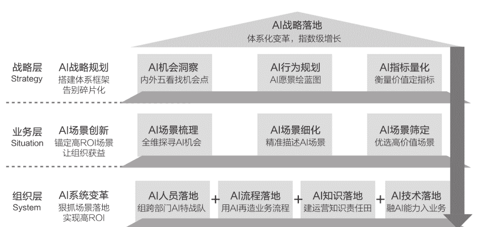
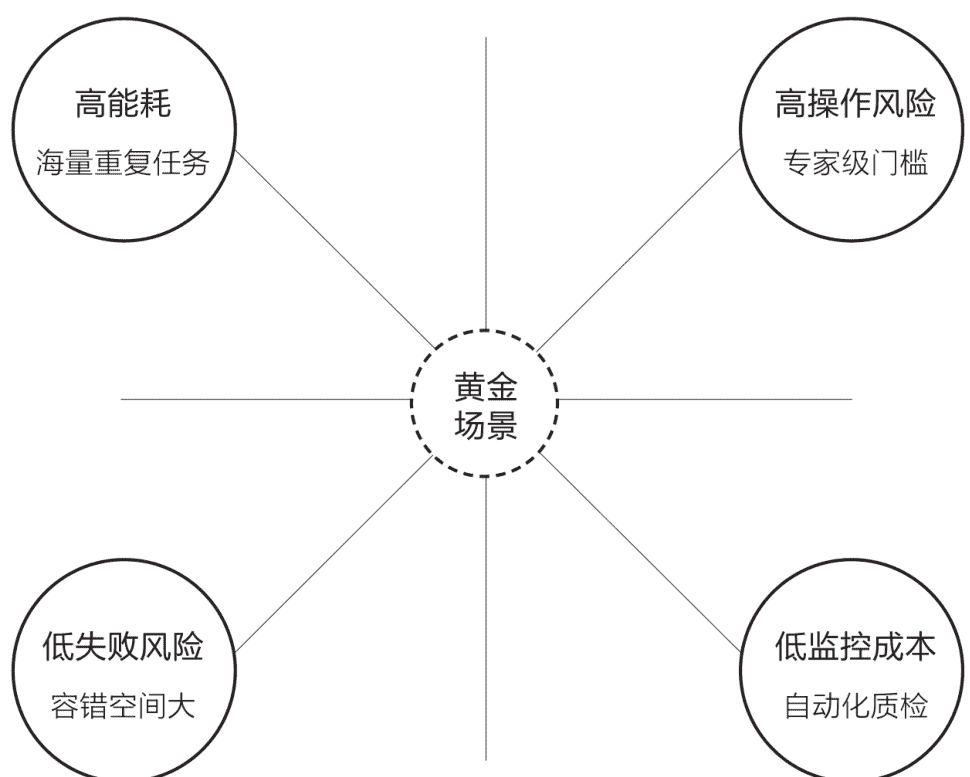

# 让智能真正落地：从蓝图到执行的增长闭环

## 前言

近两年，智能以发动机突启的方式点燃了企业的关注与管理层的不安。市场热度推高了内部的决策焦虑。

曾经我们为文稿润色、图像合成、代码辅助而惊叹，今天的会谈纪要、客服对话、销售话术也可以瞬间生成。技术跑得比管理快得多。用不用、用到哪、怎么用、怎么算投入产出，已成许多组织面前的无形屏障。

太多公司的智能化进程，始于采购一个模型，终于一场演示。预算花了、平台搭了、汇报也得赞，真正进入日常就成了摆设。症结不在工具本身，而在方法与路径的缺位。大家不知道先从哪里切入、由谁主责、如何判断是否产生价值。

这份梳理写给想把智能战略真正兑现的管理者与团队。

如何让智能跳出技术部门的表演区，成为推动业务业绩的核心引擎？

我们提出一套可复用的体系——“李家贵3S智能落地”框架，即战略、业务态势、组织系统。它像一张路线图，回答三层关键问题。

战略上找准锚点：智能怎样服务于长期目标？聚焦哪些赛道、捕捉哪些机会点？

业务上甄选场景：在哪个环节能产生可感知的价值？从痛点与亮点里挑出杠杆最大处？

组织上织成闭环：架构、人才、流程、知识、技术、运营怎样咬合，让智能真正扎根？

全书分三篇，层层递进，形成从蓝图到部署的完整回路。

第一篇智能战略规划，聚焦趋势洞察与机会捕捉，构建清晰愿景与主线行动。用“五重透镜”审视战略、客户、行业、自有能力与技术，锁定切入点，再以“蓝图+举措+指标”把智能嵌进公司整体节奏。

第二篇智能场景创新，回答落在哪的问题。依托场景对齐、头脑风暴、SCAMPER创意、设计思维与SWOT、旅程图与商业模式画布等方法，梳理潜在场景、精炼优先场景，形成有商业价值、有实施路径、有边界约束的可执行方案。

第三篇智能系统变革，回答如何落地的问题。从最小可行提示方案到RAG与智能体架构，从知识清单与审核机制到整体部署与投资回报考核，建立企业以智能构筑竞争优势的基础体系。

与其说是书，不如说是一套可执行、可复制、可迭代的智能战略施工图。用通俗语言解释复杂概念，用工具与表单支撑落地。不需要懂编程或算法，只要弄清业务在哪里、问题在哪里、价值在哪里。各章配方法、评估表与执行清单，从战略推演到场景设计，从指标构建到系统部署，都贴近真实工作情境。

我们相信，智能不应是少数专家的专利，而应成为全体员工可参与的能力平台。

现在正是推动智能战略落地的窗口期。不要让智能停留在发言稿、墙面展示或归档文件里，要让它写入流程、写入考核、直面客户、汇入利润表。

## 导语

伴随智能的快速演进，越来越多的公司看到它对竞争力的拉升作用。

智能被视作转型的利器，但实操中，企业仍面临严峻挑战。前景广阔，却多未能与核心业务目标深度绑定，效果大打折扣。背后是若干关键要素被忽视，价值未能充分释放。

智能的价值不只在技术本身，更在于技术与业务目标的深度结合。

### 一、落地困境的系统性根源

企业的智能化转型困难不是单点问题，而是系统性难题，具体表现为三大困境：

1. 方向不清——智能战略与业务目标脱节，缺少指向业务价值的清晰蓝图；
2. 场景迷失——缺少场景识别方法，机会分散，难以量化回报；
3. 体系缺位——缺少流程、机制和组织支撑，成果停留在一次性培训，难以规模复制。

这些问题并非纯技术难题，而是企业在战略设计、场景识别、流程落地等多维度未做系统谋划所致。于是智能的应用常局限于零散工具培训，难以形成可持续的业务成果。

### 1.方向感缺失

不少企业启动智能战略时，未能与核心业务目标紧密挂钩。智能必须对接核心目标，成为战略落地的驱动力，而非技术堆砌。战略脱节让智能看似提升了技术形象，却对业务运营毫无实质影响。

初期把智能当作“技术叠加”的不少企业，忽视了与战略的融合。缺乏明确目标的智能应用，容易陷入盲目跟风，初衷落空，最终沦为技术演示，业务效能未提升。

案例分析：某制造企业的战略错位

华南某工业新城的“恒曜电子”深耕印制电路板二十余年，依托高密度互连板做大做强，客户遍及全球。近年订单单价下滑，库存高企。董事长年会上拍板“以智能开创新路”，推出“智能跃迁计划”。

三天内部训练营规模盛大，中层与数字化部门全员参与。讲师演示用DeepSeek快速抓取全球资讯自动排成董事会简报，几分钟生成像素风小游戏并接入产线数据做可视化大屏。掌声不断。数字化总经理发下《智能工具实战手册》，气氛达到高潮。

当晚学员实战：制造组用AIGC把ERP需求文档从零散愿望梳理成清晰规格书，两小时完成往常三天的工作；另一组实现董事会材料每周自动爬取、翻译、排版，CEO连连称赞。

那一刻大家都觉得智能是救命稻草。但热度很快退去。培训后无人把这些“炫技”纳入年度指标，也无流程与预算支撑迭代。产线KPI仍盯良品率与交付周期，销售仍靠报价单博弈，数据部门忙于修旧系统。不足两月，DeepSeek登录频次骤降，大屏蒙尘，ERP需求又回Excel手工填写。

季度复盘时财务图冷冰冰：营收、毛利率无明显改善。高层困惑：技术很先进，为何救不了业绩？根源在最初被忽略的对齐问题——智能并未深度服务于“提升生产效率、降本、抢高价值订单”等核心目标。缺乏业务牵引、跨部门量化指标与收益挂钩激励，项目只能开花不结果。

恒曜案例折射通病：把智能当声势浩大的技术秀，而非围绕战略目标的业务引擎。只有先回答“智能要帮我们赢哪场仗”，再定培训、部署与考核，技术才会在利润表上显现价值。

该案例说明，智能战略必须深度对接核心业务目标，建清晰蓝图，才能成为竞争力而非单纯技术工程。

### 2.场景迷失

即便战略方向已定，识别合适的应用场景仍是难题。多数企业缺系统化识别方法，导致智能机会碎片化，难以准确评估效果，也无法获得预期回报。多个小试点并行时，框架缺位会使资源分散，规模效应无从谈起。

金句：“科学的智能场景识别方法，决定了企业项目成功的概率。”

案例分析：点状创新下的场景迷航

初夏，华东科创园区的某消费金融独角兽召开战略会。屏幕上六大成果仍在闪：智能外呼超亿次、累计通话十万小时；智能面审月处理万单；智能审批风控处理数百万请求；智能客服年服务近百万人次，一次解决率90%；智能催收首月逾期回收率超60%，后续提升近50%；智能质检自动审听十万小时，月省数十人工作量。掌声雷动，似乎已攻城略地。

热烈后随即安静。技术负责人坦言，六个项目是各部门自发孵化的，下一步方向不明。运营想做会员留存，风控研究资产证券化，营销提议生成式广告脚本，均停留在白板，无排期。

资源碎片化：算力租赁、大模型微调、数据标注各自申请预算。想开第七个场景，却无人说明优先级依据，更别说成果复用。高管发现企业进入盲区：点状创新光鲜，却缺乏“发掘—验证—扩散”的通用方法。

财务汇报更显困惑：各部门ROI口径各异，有的算人力节省，有的算转化增收，有的只看逾期率下降。六组数字并列不兼容，无法推演追加五千万投入能带来多少利润。会议结束时副总裁感慨：“我们不缺技术、不缺想象力，缺一把尺子丈量场景潜力。”六枚图标依旧闪烁却彼此隔绝。没有可复制的方法，就找不到下一个场景；找不到下一个场景，再亮的成绩也只能止步半山腰。

该案例显示，企业亟需标准化场景识别框架，科学筛选最具潜力的应用场景。

### 3.体系难以成形

智能规模化成功不仅靠方向与场景，更靠完备的流程、机制与组织保障。仅做工具导入而无体系化管理与组织支撑，智能难以持续应用并释放长期价值。

诸多企业引入智能后缺流程支持与跨部门协同，项目难以长效运转，反馈机制不健全导致短期失效。即便局部见效，缺乏持续资源与流程迭代，也难以复制推广，最终只是局部成功。

案例分析：某生物科技落地困境

初春，江畔“溯源生科”园区薄雾中人声鼎沸。公司刚结束“智能降本增效大赛”——八个部门十三支队海报铺满走廊，从“供应商谈判助手”“数字人科普官”到“仓库零差错视觉质检”，创意爆棚。CEO寄望智能压缩成本曲线。

热潮退后，难题浮现。

人：生产主管懂发酵参数不懂提示词，算法工程师代码快却不懂“摇瓶恒pH”。团队该配多少业务骨干、多少数据工程师，编制如何设定，均无定论。

技：会上“AI Agent”“RAG”“微调”等术语此起彼伏，讲到框架选型、算力配置众人纷纷查手机。部分小组把ChatGPT当万能胶，因数据在内网防火墙后，演示只能在个人笔记本运行。

流：要求八周交付最小可行产品，却无完整流程图。生产、质量、供应链仍靠U盘传表，接口与数据流向靠口头约定。

知识碎片化：多年SOP、检测报告、工艺参数散落个人硬盘。某小组甚至整包上传内部文档至公有模型，第二天被法务叫停。八周复盘时，部分原型只能单次运行，部分模型因样本不足过拟合，更多项目卡在清洗数据。

财务想算ROI，却发现各业务线口径不同——有人算人力节省，有人看转化率，有人只盯不良率。高管眼见“碎片繁花”成浮萍，再佳绩也难复制。

溯源生科案例清晰剖面：点子不缺、技术不缺，缺的是把点子打磨成可复刻工序的刻刀。无流程、机制与组织支撑，再绚丽场景也只是水面烟火，转瞬即逝。

## 二、“李家贵3S智能落地”框架

为应对智能战略落地的系统性挑战，我们提出“李家贵3S智能落地”方法论，即“李家贵3S智能战略屋”模型（见图0-1）。该框架系统推动智能从战略设计到执行落地。通过整合战略、业务与组织三层，为企业提供清晰路线图，助其在转型中取得最优成效。

图0-1 “李家贵3S AI战略屋”模型

该方法论要求企业从战略层、业务层、组织层出发，结合具体执行步骤，确保智能与核心目标深度融合。每层各有任务，共同保障智能全面落地与长远发展。

### 1.战略面

战略面首要任务是构建清晰的AI战略规划，确保与企业整体目标紧密对接。智能不仅是效率工具，更是推动创新与提升核心竞争力的驱动力。为达此目标，战略面需完成以下关键任务。

首先，AI战略规划须与企业目标充分结合，确保技术引入服务于长期发展。智能应被定位为实现战略目标的关键力量。

其次，智能机会洞察要求深刻理解内外部环境，把握行业与市场的五大关键机遇，据此灵活调整优化战略。

再次，AI行动规划帮助绘制实施路径，明确哪些领域优先应用智能、哪些场景能最大化业务价值，为具体执行提供指引。

最后，AI指标量化至关重要。设定清晰可衡量指标，既便于评估效果，也帮助管理层科学决策，推动项目成功。

### 2.业务面

业务面要把智能落到具体业务场景，确保创造真实价值。重点关注以下方面。

首先，AI场景创新是业务层核心任务。通过创新方式识别与创建高ROI场景，确保应用直指业务价值而非表面导入。

其次，AI场景梳理帮助全景探索智能应用点。通过全面分析，识别业务环节中最适合智能介入的节点，提升运营效率或客户体验。

再次，企业需开展AI场景细化，精准定义每个场景的实际需求与价值目标，并细化智能应用方式，避免脱离实际。

最后，AI场景筛定让企业从海量场景中锁定最具潜力与价值的应用。通过此过程优先投入高回报场景，最大化ROI。

### 3.组织面

组织面为智能应用提供支撑，确保日常运营中有效落地。这不仅是技术问题，更是架构与文化转型。

首先，AI系统变革是组织层关键任务。以技术驱动组织架构转型，推动部门协作与信息共享，推动运营模式革新。

其次，AI人员落地是成功基础。培养专业智能人才队伍，确保其在组织内发挥作用，保障技术落地与优化。

再次，企业需进行AI流程落地。对现有流程优化再造，确保技术与业务流程无缝对接，实现数据采集到决策执行的全流程自动化。

另外，AI知识落地是重要环节。构建有效知识体系，沉淀技术与经验，通过组织内共享与学习，让成果在全范围复用与传承。

最后，AI技术落地是组织层终极目标。将技术与业务需求深度结合，确保在具体运营中产生持久业务价值，全面提升创新能力。

通过“李家贵3S AI战略落地”方法论，企业可在战略、业务、组织三层系统推进智能应用，确保与长期目标对齐，并在日常运营中高效落地。三层协同破解战略、场景、系统难题，释放技术潜能，带来可持续竞争力。

该方法论让智能战略超越技术范畴，成为驱动转型的核心力量，打破应用瓶颈，促进流程优化与创新，帮助企业在智能时代确立领先优势。

## 第一篇 AI战略规划

### 选方向——方向不对，智能白费

智能战略的关键不在是否实施，而在向何处实施、如何实施、为何实施。方向偏差，再强模型也难驱动业务增长，再多资源也可能错配。因此，智能战略首要之义是选对方向——方向不对，智能白费。

本篇从三层面构建系统化智能战略规划框架。

第一章聚焦“AI机会洞察”，以“看战略、看客户、看行业、看自身、看技术”五重透镜全景扫描，系统识别最具投资价值的智能场景。

第二章进入“AI行动规划”，在方向明确后制定清晰愿景与主线举措，围绕降本增效、第二曲线增收与商业模式创新三大路径，构建可落地行动蓝图。

第三章进入“AI指标量化”，将战略路径与举措拆解为清晰KPI，纳入绩效闭环，确保智能战略不止于宣言，而是渗透管理与资源配置日常。

智能是系统重构工程，而非孤立技术部署。只有具备清晰方向感、强行动方案与可度量执行指标，智能才能从愿景走向现实、从概念跃升为增长引擎。本篇是这段征程的起点。

### 第一章 AI机会洞察

在智能战略规划中，识别潜在机会点是转型关键。如前所述，智能战略必须与业务目标紧密对接，首要之务是以系统性洞察把握市场与技术变化，锁定最有潜力的应用场景。只有凭借系统性洞察，企业才能在复杂市场中找到方向，释放智能价值。

智能机会洞察不仅是数据分析，更是多维度综合评估。借助“五维动态”洞察，企业可精准识别最契合自身的智能应用场景，确保投资创造最大业务回报。

## 1.1 看战略

“看战略”要求企业以自身愿景、使命及中长期经营目标为锚，确保智能战略始终嵌于总体发展蓝图，而非受制于当下资源约束或局部痛点。

# 战略地图：双轴透视四类经营形态

要让战略变得可视，先搭起一张双维坐标。横向刻画业务流程成熟度，纵向刻画产品与服务的多样化程度。两轴相交可归纳出四种典型经营样态：以标准化与规模效率为核心的大规模复制、以创新抢占先机的探索开创、在既有流程上持续打磨的精益改进、以及按客户个性化需求柔性组合的柔性复制。

随时间推移，四象限会演化成一条进阶路径：大规模复制→探索开创→精益改进→柔性复制。每一步都有对应的流程范式、组织形态与信息系统侧重：起步强调灵活协作与定制化系统；中期偏向流水化作业与自上而下的信息管控；随后转向跨部门数据贯通与闭环优化；最终抵达模块化运营与实时智能决策。

看战略的关键是分阶段匹配人工智能的落点，可归纳为四个阶段。

### 1. 量产阶段
规模化生产最看重速度与稳定。除了视觉模型做质检、预测模型做设备保养，还能把智能客服放到一线，让机器人全天候解答标准化问题、处理退换，释放人工。借助低代码无代码平台，业务人员不用写代码就能拼装问答与工单流转，把服务像零部件一样嵌进标准流程，不挤产能还能提升好感。

量产场景的核心是“用更低成本把同样事情做得更快更稳”，不必急于上大模型。机器视觉、传统异常检测、规则驱动的对话机器人这类成熟的小工具，就能撬动成本曲线。

运行逻辑保持“感知-判断-执行”的单循环：工业相机或日志采集把数据送入轻量模型，毫秒级判定合格/不合格、异常/正常，并立即写回产线或客服系统，强调低延迟与不中断。

组织上在生产、质检、客服班组旁增设模型运维小组，盯良品率曲线与报警阈值，每周小步迭代。一线人员通过拖拽界面调用机器人，无需编程。

系统架构讲求稳：边缘端用压缩后的视觉模型本地推理，中心端仅做归档与月度复盘。核心指标只有良品率、停机时长、一线一次解决率，其他花哨功能先放一边。如此既不增加流程复杂度，也不消耗高端算力，却能一毫米一毫米压低单位成本，一秒一秒拉高稳定性。

### 2. 发明阶段
当竞争焦点变成谁先推出新品谁先赚钱，人工智能流程升级为“灵感孵化-数字验证-商业评估”三步走。

第一步，设计师或产品经理输入几个关键词，生成式模型如 Stable Diffusion、DALL·E、Midjourney 就能在数秒内产出上百张概念草图、配色或功能组合；
第二步，虚拟仿真平台把草图投入数字孪生环境，快速演算材料强度、工艺可行性和单件成本，让不靠谱的创意止在屏幕前；
第三步，可行方案交给 LLM，结合市场数据自动估算售价区间、目标人群和上线节奏，帮决策层判断做不做、何时做。

为了让三步顺畅，企业往往把职能墙拆成跨域创意战队：产品、设计、算法、营销围坐一桌，人人都能即时调用模型试错。底层技术栈是云原生沙盒加多模型路由，算力即需即到，模型日更，审批从几十页压缩成线上“一键立项”。

某大型建筑设计院受房地产新开工锐减冲击，引入上述流程后，先用生成式模型为业主产出多套立面与空间草图，再用 BIM 数字孪生校验结构强度、节能指标与造价。原本需两三周的概念方案缩短到两三天完成，并自动筛掉不合格设计。随后 LLM 融合当地造价库和竞品售价撰写商业化建议书，帮助院方快速定稿。平均投标成本降 35%，设计迭代速度提升 4 倍，还因“AI 风格”催生出新中式、超低能耗等差异化方案，重获议价权。

发明阶段的核心是让算法承担试错和筛选，团队把精力集中在真正有价值的创意打磨和商业决策上。

### 3. 持续改进阶段
市场趋于成熟后，增益来自毫厘之间。可先用人工智能数据分析打通生产与运营指标，生成自动化看板；再用智能检索 RAG+语义检索调取内外最佳实践，辅助工程师定位瓶颈。分析结果自动回写至排产、物流或定价算法，每次微调都沉淀为下一轮优化素材，形成“数据联通-流程挖掘-在线实验”的自循环。

在 C 端，客户留存可能因一个标题、一句文案或一次推送而改变。人工智能流程围绕“数据联通-流程挖掘-在线实验”做秒级微调：先把 App 埋点、点击流、支付凭证与社媒反馈汇入指标工厂；再用流程挖掘还原真实体验路径，精准定位流失屏和转化节点；最后对照实验引擎联动多臂老虎机或强化学习，对不同故事线、选题角度、文案风格并行测试，实时评估留存率、转化率与客单价。

若测试显示在推理结果页顶部加一行商品推荐可带来 2.3% 的商品交易总额提升，系统即自动扩量；若效果转弱则即时回滚。

组织上多采用“双中台”：营销和产品运营归流程卓越中台，负责实验设计与 KPI；数据科学家与算法工程师归模型算法中台，负责特征生成、策略更新与灰度发布。双方共用实时仪表盘，按收益分配算力配额。系统强调统一与自治：数据、特征、模型、服务驻留在语义中台，通过推理网关实现秒级灰度，KPI 偏离阈值即自动回滚。

每一次小改动像带息存款，今天多 0.5 个百分点，明天跌 0.3 个百分点，复利累积最终把微小差距汇成可观优势。

### 4. 客户化量产阶段
企业既要规模又要个性时，人工智能咨询能把两件看似矛盾的事并行推进。多模态大模型实时理解客户语言、图片甚至情绪，生成专属画像；随后借助规则引擎把标准化模块灵活组合，输出千人千面的产品或方案。

银行可实现动态定价和定制授信，家居品牌可即时生成贴合户型与审美的灯光方案。前台体验像量身定制，后台生产仍保持批量高效。

此时知识库、客户画像与人工智能工具已养得很“厚实”。后台数据治理把产品文档、供应链信息、客户行为和客服对话整理清晰；多模态大模型随时解析文字、图片和语气，拼出兴趣、预算、风格偏好。需求信号一经捕捉，规则引擎像拼乐高一样自动调用标准模块生成专属方案并下单；生产、物流或数字交付即时响应，交付结果回传持续完善画像。

组织划分为三环：前台洞察负责“听懂客户在说什么”；中台编排负责“把需求翻译成工厂或系统可执行动作”；后台保障盯住产能、库存、合规、风险。三环以 API 松耦合连接，可独立升级。技术栈采用事件驱动：云端大模型负责理解与创意生成，边缘轻量微服务负责秒级决策与风控校验。商务人员用拖拉拽界面搭建轻量人工智能 Agent，可查合同、生成报价、自动触发供应链下单。客户感受到专属顾问，企业仍以批量化成本实现大规模交付，把“千人千面”与“千万件同款”放进同一张利润表。

## 1.2 看客户
如果说看战略是北极星，看客户就是观测海面潮汐的灯塔。数字化基础设施成熟后，人工智能从数据分析工具演进为实时市场显微镜，把评论、交易、对话与图像梳理成清晰的客户脉搏，帮助企业在毫秒级修正产品与服务。

### 1. 锁定人群
弄清楚谁在买、谁在用。传统季度调研等结果出来时客户早换手机号。如今多模态大模型可同时对接社交媒体信息流、POS 流水与 CRM 标签，像人口学家一样实时梳理年龄、地域、数字素养与购买力四条线索。把头像、文本、消费频次导入向量库后，能自动呈现增量人群与流失高危人群轮廓。

某美妆零售商借助动态客户画像面板，发现 Z 世代对纯素配方的讨论量急剧上升，35 岁以上客户对功效抗老搜索量翻倍，于是把线上导购话术拆分为“清爽护肤”与“功效抗老”，并微调货架结构，季度客单价提升近 8%。

### 2. 监测体验
体验曲线的高峰与低谷都藏着机会。人工智能把监测精度提到秒级：RAG 驱动的网络爬虫每日抓取竞品新品评论，GPT-4o 通过情绪识别与主题聚类打上“功能、价格、服务、情绪”四重标签。一旦某标签 24 小时内出现频次异常增长三倍标准差，系统推送“体验地震警报”并附修复建议。

某连锁咖啡品牌通过该系统及时捕捉到“纸吸管影响口感”的负面趋势，两天内完成吸管材料替换并在小程序公告，差评率连续两周下降六成，品牌讨论度反而逆势上涨。

### 3. 重塑付费
客户在改变“要什么”，也在改变“怎么付”：一次性购买向订阅转变，所有权让位于使用权，单一交易向生态协同演进。人工智能扮演商业模式策展人。

多模态大模型读取合同条款、竞争定价与宏观数据后，能瞬间生成分层定价、增值捆绑或收益分成等仿真方案，管理层可一键比价落地。一家物流 SaaS 企业借助该技术发现大客户最关注高峰期服务保障，于是把费率调整为“基础费+保障费+弹性费”三段式，客户续约率从 81% 提升至 93%。

### 4. 升级平台
销售模式变化后，数字平台不能“穿姑娘衣服跳大妈舞”。B2C 要千人千面，B2B 要并行协同，B2B2C 要兼顾两端。对应需要搭建客户数据平台沉淀全景画像、搭建智能交互平台贯通语音文本视频增强现实、搭建价值兑现平台承接报价到售后全流程。三平台通过事件驱动架构串联，统一事件总线实现下单、风控、库存、物流毫秒级联动，人工智能可在任一节点介入，提升前台精细度并保障后台闭环。

案例分析：银行业人工智能客户体验矩阵。某全国性银行前台为员工配智能问答助手，新人培训周期缩短 40%；虚拟数字客服实现 7×24 小时在线，回复率达 98%。中台嵌入编码辅助与坐席助手，流程自动化覆盖开发、服务、行政。实时数据分析监控 KPI，客户留存率下滑即自动弹窗提醒并发放优惠券。后台通过统一向量空间串联信贷审批、风险预警、反欺诈与反洗钱报告生成，实现条款-特征-异常一跳定位，合规核查从 T+1 压缩至小时级；投研助手与机器人交易助手把策略刷新提至秒级自适应。客户获得安全感与便捷度双重保障，银行合规成本下降、客户终身价值提升，实现稳与快的统一。

看战略与看客户通过北极星指标联动：战略定方向，客户动态揭示何时加速何时调整。把人工智能实时洞察嵌入战略罗盘，企业才能在复杂市场中持续校准，既不盲目追热点也不错过转折点。人工智能不再是锦上添花的辅助，而是连接战略目标与客户动态的实时纽带。

## 1.3 看行业
看战略厘清方向、看客户感知需求后，看行业如同深海声呐，捕捉宏观政策、技术迭代与市场供需变化。它检验前两项是否协同，也决定人工智能资源投向。若忽视行业风险，企业易出现技术追热点偏离核心、场景落地缺焦点的问题。

### 1. 拆解差异
不同赛道对人工智能的渴求不同：制造业重良品率与排程效率，能源业重电源负荷平衡与安全冗余，建筑业重设计施工一体化提速，服务业重体验优化与粘性，生物医药则以分子研发为核心产品、临床试验为核心流程。

第一步是精准梳理各行业痛点画像，再匹配算法：强化学习用于实时调度优化，知识图谱用于合规与可追溯，AIGC 用于内容创新与分子结构创意生成。

### 2. 驱动智造
智能工厂里人工智能把设备温度、振动、功率转为统一时序向量，机器视觉精准识别瑕疵，强化学习优化节拍，停机率与报废率同步下降。重载炼厂中边缘轻量模型完成毫秒级闭环控制，云端大模型复盘上万条配方持续迭代最佳工艺。

### 3. 调度能源
智慧电网里 AIGC 整合气象、用电负荷与电价数据，实现分钟级调度指令下发。油田、管网、变电站借助多智能体算法构建自组织协同，远程运维机器人即时修复泄漏，能源集成调度效率提升，安全冗余阈值提高。

### 4. 筑造空间
人工智能与 BIM 融合可将 2D 草图一键转 3D 可施工图，参数化设计自动计算光照与风压。施工现场摄像头实时核验钢筋、模板、混凝土浇筑厚度，数字孪生调度塔吊与混凝土车至最短路径，项目从概念到交付周期被压缩到“半程马拉松”。

### 5. 赋能服务
多模态人工智能同步解析文本、语音、图像洞察情绪，实时调价格、改文案、换路线。路径优化与仓网数字孪生使揽收时长缩短两成，智能授信与动态定价加速资金周转，AIGC 可定制千人千面旅行方案，服务从“被推销”升级为“被理解”。

案例分析：某生物医药公司监测竞争把握先机。人工智能情报平台每日巡航文献、临床登记与投资者披露。当检测到“恶性血液病药物在难治性自身免疫疾病患者中现积极疗效”这一罕见关联信号时，标记为适应证拓展高价值事件并推送。

自然语言理解与事件聚类自动生成研究方法、患者背景、疗效指标摘要，研发团队数分钟内完成是否追踪判断。随后多模态人工智能深度抽取细胞因子峰值、免疫球蛋白波动、神经毒性评分等六大安全维度，用因果推断还原低剂量阶梯给药与轻度不良反应的关联。可解释知识图谱呈现给药剂量-细胞因子变化-临床症状路径，结论为安全性可控但需密切监测首剂反应。

竞争情报模块接入知识图谱后，全球十余条管线被聚类可视化。第一梯队已完成早期验证筹备中期试验，第二梯队聚焦分子结构优化与多靶点设计，新进入者围绕成本与给药便利性优化。人工智能综合靶点重叠、研发阶段、资本关注度给出中高竞争风险评分，建议差异化技术路线或合作抢卡位。

时序预测模型整合专利动态、监管会议纪要、学术排期，对未来 18 个月给出三条高置信判断：给药方式从持续静脉滴注转向皮下注射长效制剂；多靶点融合与三特异抗体升级成为热点；狼疮肾炎、硬皮病等未满足需求成重点布局方向。并指出低亲和性 CD3 靶点结合域加长半衰期分子骨架最具差异化潜力。

系统生成交互式情报包，提出三条并行方案：在极重症患者中开展 N≤6 小样本同情用药验证；与多靶点分子工程平台合作研发三特异抗体；与长效给药载体技术企业合作开发每周一次皮下注射剂型。

该案例表明，看行业不是外围扫描，而是与看战略、看客户构成动态自适应决策闭环。行业洞察信号同步映射到战略镜头与客户镜头，通过三镜合一实时校准，企业能在创新前沿、价值创造与风险底线间保持平衡，使人工智能成为跨周期增长引擎。

## 1.4 看自己
看战略、看客户、看行业后，企业需把镜头调转审视自身核心能力。把内部能力、资源与流程真实状态投射到同一坐标，才能判断战略是否可落地、行业机会能否承接、客户价值能否兑现。此时人工智能的角色是组织的数字诊断系统，以数据为基础、以模型为支撑，构建实时动态能力图谱，为管理层提供可视化、可调控、可迭代的自我评估。

### 1. 量化体检

看自己：把内在能力变成可视化坐标

组织要做自我体检，首先得让运转数据可度量、可横向比。依托AI对标机制，系统会自动汇集企业ERP、CRM、MES、HR等系统的运行日志，同时抓取行业标杆的公开财报、项目案例与招聘信息。多模态大模型通过语义解析，将这类非结构化文本归一为统一评判维度，例如数据资产完备度、研发效能、业务自动化程度、人才构成多样性等。

维度统一后，神经网络把内部得分与行业均值投射到同一坐标系，形成一张能力全景图。管理者无需钻进细节，即可一眼分辨出优势区与短板区。

### 2. 映射差距
有了量化坐标，差距就能即时算清。AI把能力全景图与价值流矩阵叠加，价值流覆盖产品研发、市场营销、生态协作等环节，系统会自动标注出“营收贡献高但能力偏弱”的关键节点。例如某云服务商发现，其行业方案交付周期比标杆慢四成，而该环节对新签合同的贡献占比达65%。

随后流程挖掘对上万条项目执行记录进行回溯，锁定瓶颈集中在需求澄清与技术选型两处，并给出可落地的改进建议：引入检索增强生成，让大模型自动产出技术栈模板，借助知识图谱复用行业最佳实践。

### 3. 优化流程
识别差距后，AI把改进方案拆解为最小可执行闭环单元。流程数字孪生模块先在不同资源投入场景下模拟时间、成本、风险曲线，为投资决策提供依据；随后强化学习代理部署到真实业务系统，实现任务排程、资源调配与权限设置的实时动态优化。

以某银行风控部门为例，在模型校验—数据入湖—规则下发链路上引入强化调度后，模型迭代周期由月度压缩至周度，不良率同期下降0.4个百分点。系统会自动把该改进结果记入能力成长曲线，形成组织的数字化学习档案。

### 4. 激活人才
硬流程之外，软实力同样关键。AI人才盘点工具解析员工简历、绩效数据与协作网络，绘制人才技能全景图。一旦发现AIGC提示词设计师、数据治理专家等关键岗位稀缺，系统会联动招聘接口推送候选人画像，并依据岗位需求热度与市场薪酬自动排序招募优先级。

同时，智能学习引擎结合个人技能缺口与业务发展方向，精准推荐微课程、交流社群与导师资源，实现一个能力指标对应一条成长路径。

### 5. 改进闭环
自检不是一次性体检，而是持续进化。AI采用事件驱动架构实时监测价值流中的KPI，一旦指标偏离预设的北极星区间，便触发模型重算与资源再分配机制。

例如市场端捕捉到客户留存率下滑可能源于交付延迟的信号后，系统会逆向追溯供应—交付节点的自动化率与人力负荷，并在后台自动扩容RPA机器人配额或弹性云资源，确保策略快速落地。如此形成数据采集—能力评估—差距定位—方案部署—指标回写的完整闭环，把自我进化内化为日常运营节奏。

看自己让企业像量子传感器一样，与自身能力与外部机会保持同频共振：战略指明方向，客户需求提供信号，行业环境给出边界，自我评估则确保每次资源投入都可验证、可迭代。借助实时监测与闭环调度，企业能在变化中保持运营弹性，把能力差距转化为下一轮增长杠杆。

## 1.5 看技术：指南针与脚手架
沿着看战略、看客户、看行业、看自己的分析框架，最后的关键拼图是看技术。技术浪潮通常领先商业落地半步，精准把握就能借势突破，反应迟缓则易被颠覆。看技术主要聚焦六个维度。

### 1. 选型模型
模型是智能化工作的发动机。过去两年开源大模型从基本可用走向高效好用，国产阵营尤为活跃。DeepSeek凭借完整的研发生态与算力联盟，已成为当前主流选择。

选型不能只看参数，还需综合评估生态成熟度与未来演进潜力。DeepSeek在推理速度、中文语料覆盖与授权合规上占优，但在函数调用场景中，通义千问的插件化能力更灵活；部分垂直领域模型经小样本微调后可实现以小博精。研发团队需要在通用模型、垂直模型、轻量化蒸馏模型的光谱中动态调整：通用模型作地基，行业专模作尖兵，小模型作边缘轻骑。

### 2. 打磨提示词
提示词是连接自然语言与算法的技术胶水，其长期价值不亚于模型本身。随着SFT、LoRA等轻量微调技术普及，提示词已从单句人工编写演进为编排多轮交互意图、嵌入系统约束、耦合工具调用的复合脚本。

演进方向有二：一是模板化，通过参数化占位与变量注入让同一提示适配多场景；二是自动化，让模型在少样本条件下自我迭代寻找最优方案。企业应建立提示词资产库，借助版本控制、A/B测试与可观测指标，把灵感式写法沉淀为工程级资产。

### 3. 治理知识
模型本身缺乏领域专属知识，RAG架构成为连接企业知识库与模型能力的关键桥梁。当前难点不在检索实现，而在知识治理：多源异构文档、元数据缺失、权限粒度粗放都会导致检索结果模糊。

新一代方案把质量评估、颗粒度切分、上下文压缩整合进同一流水线，采用向量存储与符号索引双栈并行，保证找得到也信得过。对企业而言，首要工作是把PDF、PPT、代码仓库、客服对话等全部结构化，并以细粒度权限标签与时间戳维护数据新鲜度，否则检索增强只能做到基础检索而非能力增强。

### 4. 搭建平台
AI Agent平台决定工程化落地的上限。LangChain生态最为成熟，插件模板覆盖数据接入到多模态推理全流程；Dify主打开箱即用的可视化配置，适合中型团队快速启动；HiAgent在权限管控与私有化部署上更贴合大型组织需求。

选型需关注成本、风险、时间三要素。最佳实践是核心能力自主研发加框架组件即插即用：将提示词管理、RAG模块、监控系统等通用组件下沉为标准化微服务，通过平台编排业务流程，避免对单一框架过度依赖与重复开发。

### 5. 编排流程
智能体工作流把模型调用链升级为业务流程引擎。核心问题是自动化推进到何种深度，全托管易陷入幻觉循环，全人工则效率受限。合理做法是人机共编：用业务建模符号或数据序列化格式定义关键节点，模型决策逻辑嵌入其中，并辅以异常监控与流程回滚保障风险。

长期来看，AI生成的流程脚本会与人工脚本深度融合：模型先生成草图，人类补充约束、KPI与SLA，监控数据再反馈给模型，形成生成—优化—反馈的自循环。

### 6. 升级算力
底层硬件决定应用性能上限。国产GPU过去存在价格高、供应不足的问题，如今正迎来性价比拐点：8位或4位量化技术可让千亿参数模型运行在单卡，小型推理集群不再高不可攀。异构调度与云边协同还能把按秒计费的GPU拆解为任务级片段，降低峰值成本。

企业需设立算力预算池，利用AI预测负载参与云GPU竞价；对安全要求高或低时延场景，可引入国产GPU自建数据中心，既规避卡脖子风险，也构建成本护城河。

看技术如同攀岩者手握指南针，既能仰望方向也能落点扎实：模型选型定路线，提示词提供抓点，知识治理铺设岩面，Agent平台与流程编排搭阶梯，算力升级则提供持续补给。把这些技术节点与战略、客户、行业、自身的四重洞察实时联动，企业才能在AI峭壁上稳步攀升，实现技术落地与业务增长协同。

表1-1 口诀和秘诀速记

| 看什么 | 口诀 | 秘诀速记 |
| :--- | :--- | :--- |
| 看战略 | “先定北极星，再点燃AI火箭” | **锁定阶段 → 对齐打法** • 定位象限：用“双维坐标”将企业精准归类至量产、发明、持续改进、客户化量产四大象限，明确发展阶段； • 匹配任务：针对不同象限制定差异化AI任务清单——量产抓降本、发明抓创意、持续改进抓数据复利、客户化量产抓个性化规模； • 锚定目标：将阶段KPI（如良品率、研发周期、客户留存率等）与北极星指标绑定，输出“一张战略路线图+一套里程碑节点”，确保方向统一 |
| 看客户 | “盯住脉搏，才能踩准节拍” | **三锁流程** • 锁人群：通过多模态客户画像实时分层，精准圈定增量人群与流失高危人群； • 锁需求：结合RAG技术与情绪识别算法，生成可视化“需求词云”，直观呈现需求优先级； • 锁变化：秒级监测客户评论、交易数据等实时脉冲，当数据出现三倍标准差异动时自动触发预警 |
| 看行业 | “用声呐听浪，借势领航” | **痛点画像 + 行业经验** • 拆赛道痛点：制造=良品率，能源=源荷平衡，医药=临床周期…… • 建行业知识图谱，沉淀法规、专利、工艺要点等行业经验 |
| 看自己 | “先照镜子，再上赛道” | **数据可收 + 差距可查** • 全量接入企业资源计划、CRM、生产执行系统、HR等系统日志数据，自动映射生成“能力雷达图”，可视化呈现内部能力现状； • AI对标分析工具，将内部指标与行业均值置于同一维度比对，以“红灯”标识短板环节； • 利用流程数字孪生技术与强化调度算法开展沙盒试验，全程记录“差距定位→改进方案→收益转化”全链路，形成可迭代的自我优化机制 |
| 看技术 | “握好指南针，攀高不迷路” | **五大“武器一表掌”** 模型：通用LLM打底，垂直专模做“尖兵”。 • 模型选型：以LLM为技术基座，搭配垂直领域专业模型作为“尖兵”； • 提示词优化：采用“模板化配置+自动寻优”模式，通过版本控制、A/B Test管理提示词生命周期，将其沉淀为工程级资产； • RAG架构：采用“向量存储+符号索引”双栈架构，结合细粒度权限管控，确保知识“找得到、信得过” • AI Agent平台搭建：核心能力自主研发，框架组件即插即用；通过业务流程建模符号或数据序列化格式实现人机协同编排； • 算力管理：采用“公有云训练+私有GPU推理”混合模式，结合模型量化（8位/4位）与云边协同技术，降低成本 |

案例实践
某证券公司以五重透镜串联宏观方向、市场需求、行业暗流、内部底盘与技术路径，形成可执行的落地蓝图。

锚定战略：AI化组织，抢占增量
面对佣金率下滑与投顾模式重构压力，管理层把全面AI化设为未来三年北极星目标，聚焦高端财富管理、机构量化交易、智能投研三大赛道，强调资源集中以换取效率与估值溢价。

洞察客户：解码十亿级账户诉求
客户洞察显示，十亿级量化私募与超高净值客户核心诉求为AI驱动策略研发与生成式资产配置。公司据此推出机构策略沙盒与财富顾问Copilot，满足深度需求并开辟新增长点。

扫描行业：赛道加速，友商先行
对标显示多家大型券商已搭建应用—服务—模型—基础四层AI架构，部分友商已将大模型问答、代码生成等封装为API。竞争态势要求公司在算法深度与工程效率同步提速。

剖析自己：盘点底盘，锁定短板
内部雷达图显示信息化积累、量化业务需求、技术业务融合与持续投入为优势，知识库分散与提示词缺乏版本管理为短板。管理层把知识治理与提示词资产化列为年度重点。

聚焦技术：定框架，配武器
技术路线为核心自研加生态即插。通用大模型选DeepSeek保障中文金融语料覆盖与可控性；Dify负责Agent平台私有化部署；自研提示词工具链支持模板化与A/B测试；RAG Flow统一管理研报、法规、合同与日志，采用向量与符号索引并行。流程上人工工作流外嵌智能体，形成模型草拟—人工校审—系统落单闭环；算力采用公有云训练加国产GPU私有推理双轨。

落地行动：从蓝图到里程碑
三个月内完成知识库治理与提示词资产库，交付研报智能摘要与研判要点快手图；六个月内推出机构量化策略沙盒；九个月内上线财富顾问Copilot。滚动监控客户资产增长率、模型调用稳定率、AI贡献收入占比，偏离阈值即触发策略重算，确保AI服务业务增量与体验优化。

第二章 AI行为规划
完成机会洞察后，企业进入执行关键环节——AI行为规划。基于洞察确定方向、目标与实施步骤，这既是技术任务更是保障战略落地、创造业务价值的核心。

2.1 定义AI愿景
AI愿景是战略灵魂，不是口号而是跨越数年贯穿业务的未来坐标系。具备影响力的愿景需兼具业务关联性、战略前瞻性、创新持续性。

1. 业务关联性
愿景必须接地气，与主营业务深度绑定并立足核心KPI。例如银行若目标为提升客户生命周期价值，AI愿景应明确为构建主动服务客户运营体系，实现从开户到流失全链路智能化。唯有如此业务部门才愿用、看得见、肯投入。

2. 战略前瞻性
愿景不应只解当前痛点，需拉长焦距洞察行业演进与技术迭代带来的新增长空间。快消品若只聚焦智能排产则是功能规划，若愿景是构建数据驱动自适应供应链，助力十万家夫妻店精准预测与动态定价，才具备穿透力。AI战略是面向未来的组织投射，必须领先市场半步。

3. 创新持续性
愿景价值在于开拓增长视角，重塑体验、革新模式、压缩效率边界。家装公司提出以AI重构设计师客户互动，缩短90%选材决策时间，让客户拥有千人千面数字样板间，即为体验重构。AI需持续训练优化，企业应具备数据供给、知识沉淀与自我演进机制，否则上线后迅速衰减。好的愿景前端破局、后端长跑，既回答能做什么，也阐明如何长期改变工作方式。

AI愿景先行：从战略锚点到落地闭环

真正有穿透力的AI蓝图，绝不只是技术话术堆叠，必须扎根经营现实，具备三到五年向前看的能力，并内置从零突破到规模复制的演化机制。蓝图的高低，决定战略是引领潮流还是困在工具清单里。没有清晰的方向，落地既找不到起点也看不到终点。

### 2.2 主线举措拆解
愿景确认后，企业相当于在地图上钉下了灯塔，下一步是铺设通向灯塔的主干道。这些主干道不是零散的试点，而是一套与主营航道深度耦合、具备战略牵引力的行动路线图。整体可归纳为三类：应对当下经营压力的提质降本、面向未来的第二增长曲线、以及重塑行业规则的商业模式再造。

#### 1. 提质降本增效
存量业务里推进智能化，多是“旧城改造”逻辑，用智能手段把流程打磨、成本压缩、稳定性强化。其赋能集中在四个层面。

首项，压低成本。人力密集且重复的岗位逐步被智能化替代，比如智能客服、文档审核、数据录入，原本需要数十人完成的链条变为7×24小时在线的自动化体系。内容生产侧，创意、脚本、剪辑等环节的外包费用也能明显压缩。

次项，加速。智能化让决策更快、流程更短。制造业里预测性维护能提前捕捉设备隐患，减少停机；物流里智能排程可实现分钟级响应；财务里机器人流程自动化叠加智能模型，让发票审核、账目对账的效率提升数倍。

再项，提升质量。流程标准化与数据驱动的判断减少人为差错。电子制造环节的视觉质检可做到像素级瑕疵识别，远超人工；客服场景中情绪识别让服务感知更精准。

末项，控险。金融、法律、安防等高风险领域，智能化成为预警哨位。反欺诈模型、信用评估、合规智能代理逐步替代人工抽查，提供更早更精准的风控信号，避免滞后。

这些动作不是锦上添花，而是雪中送炭，是建立内部信任与协作的第一站。

#### 2. 增收第二曲线
盘活存量的同时，更关键的是智能化能否创造新收入。答案是肯定的，它既能拉升现有收入，也能打开全新来源。

第一条是老场景增收。基于画像、情绪与行为预测的精准营销实现千人千面，广告匹配度与转化率随之提升。电商里智能助手可按用户偏好生成个性化推荐页，提高复购。

第二条是新产品创收。将自动写报告、法律初审、健康分析等能力打包成订阅制产品售卖，或推出会员增值功能如写作助手、服务助手，形成独立收入。

第三条是体验驱动的转化放大。产品本身不变，但使用流程被优化后体验更顺滑，能激活沉默或流失用户。比如保险条款经智能化压缩为10秒语音摘要并配案例模拟，转化率明显改善。这种由体验重构带来的增收，已成新消费、金融、电商、教育等领域抢占第二曲线的关键，先发者更容易占领先机。

#### 3. 重塑商业模式
真正的跃迁在于用智能化改写价值分配规则，让收益跨界流入。

一是计费方式变革。传统软件按授权销售，智能时代的订阅软件正转向按结果付费、按用量付费。先行者不再卖软件，而是卖能力用量或翻译量，试用门槛降低，市场潜力扩大。

二是价值转移杠杆。用模型免费获取流量、再用数据反哺产品升级，成为不少创业公司的打法。如语音识别接口免费开放吸引开发者形成数据闭环，再推出付费增强服务。

三是平台角色升级。智能化从工具变为连接器。知识中台可连通客户、员工、代理商与专家，企业转型为知识分发商；模型训练平台可聚合数据与开发者，企业从方案商跃升为生态主导者。

该类模式门槛高，但一旦站稳，先发红利与生态壁垒都很强，能在未来五到十年占据制高点。

总体来看，核心举措要兼顾内部效率与成本优化、外部价值挖掘与收入增长，并具备打破范式、重构规则的能力。三条路径需同步推进、相互支撑，每条路径都要设计针对性项目、配置资源、明确关键绩效指标，并在组织内建立协同反馈机制。唯有如此，愿景才能从纸面坐标变成组织飞轮，驱动下一个增长周期。

## 第三章 AI指标量化
智能化战略不是幻灯片宣言，而是一套可感知、可衡量、可迭代的行动体系。核心在于一套量化指标体系，能否把战略真正嵌入业务，关键在于把行为规划转化为具体关键绩效指标并纳入统一绩效框架，实现持续追踪与闭环优化。

智能化属于指数型技术，管理却常走线性路径。只有精细化、阶段化、数字化的指标设计，才能让这辆火箭车驶入轨道，而不是空中楼阁。

### 3.1 关联AI愿景
量化起点不是比技术强弱，而是看能否服务既定战略路径。指标必须紧扣愿景、对准主线举措，而非在边缘流程分散发力。以三条主线为例，每条都需要配套指标矩阵：提效降本类聚焦处理时长下降率、单位成本降幅、自动化覆盖率；增收类聚焦转化率提升幅度、客户生命周期价值增量、新业务收入占比；创新类聚焦新模型上线数、智能驱动新服务营收占比、新收入来源金额。

这样能把“提升满意度”“打造智能运营体系”等抽象目标转为具体数据，避免资源内耗。指标不可空泛，也不可由技术团队单独制定，需要业务、数据、技术三方共建，区分核心目标与非关键输入项，并用仪表盘优先跟踪主战场，集中资源推进落地。

### 3.2 强化量化机制
指标能驱动增长的关键在于可量化，无法用数据衡量的关键绩效指标都是伪指标。举例来说，“提升客户满意度”若无数据配套就是空话；而“通过智能客服把首次响应率提升至90%，满意度评分提高到4.5以上”则可量化、可追踪、可归责。进一步细化为“智能自动处理工单占比70%”“智能推荐准确率超85%”“智能推荐转化率达12%”，业务单元才能明确方向、精准发力。

指标还会倒逼复盘可行性。设定后必须回答：支撑指标的业务数据是否齐备？数据质量与算力是否充足？若不足，症结在哪？这实质是对前两章的校验。很多企业在量化过程中发现愿景过高却缺数据，或主线设计不合理导致指标难落地。因此指标量化既是管理工具，也是战略校准与风险筛查机制。

建议为每个主线设定三到五个核心关键绩效指标，并在文档中明确定义、计算口径、数据来源、负责人、达成时间、评估频率。同时建立月滚动复盘与动态调整机制，避免指标变成一次性打卡。

### 3.3 纳入绩效体系
指标真正发挥价值的前提是纳入整体绩效与运营体系，与资源、激励深度联动，否则只是墙上海报。

领先企业把智能化关键绩效指标与财务关键绩效指标同级考核，由战略部门统一管理，纳入绩效会审与季度复盘。例如头部制造企业把“智能驱动的产线预测准确率提升20%”与产值增长率、毛利率提升并列考核，要求责任单位与技术部签署责任书。

部分企业进一步财务化处理，将智能化关键绩效指标纳入目标与奖金分配。某互联网企业设立专项激励基金，按完成度滚动分配，最高激励系数2.5倍，大幅提升协同积极性，形成指标—行动—收益正向循环。

为避免技术炫技误区，需明确三项机制：权责清晰，设定、责任、追踪主体对应；数据透明，所有指标接入商业智能看板实时更新并全员可见；复盘常态，每月回顾、每季对齐，形成完整闭环。只有与真金白银挂钩，关键绩效指标才能成为投入与决策的指引。

量化并非技术活，而是一项制度性工程。第一步围绕愿景设定方向性指标，防止资源分散；第二步把目标转为可管控数据单元；第三步纳入统一绩效机制，与分配、激励联动。当智能化在管理体系中站稳并持续进化，落地体系才算成型，这是从愿景到现实的最后一公里，也是检验智能企业能力的试金石。

## 第二篇 场景为王的智能化创新
### 造场景：以场景锁定价值核心
落地路上，方向要对，场景要准。战略指明航向，场景创新则牵动结果。本篇围绕“造场景”系统拆解企业如何从零到一构建具备真实业务价值、良好体验、高效落地与可持续性的场景池。

应用并非炫技或孤立部署，必须根植于具体业务场景、嵌入核心流程、服务战略目标。从对齐场景起步，以战略约束框架明确价值方向与资源边界；再用头脑风暴与挑战句发散创意，借助SCAMPER、设计思维、SWOT等工具进行提炼、验证与聚焦。

全程经历从点子流到场景湖，再到场景图，最终到场景池，不仅强调创意广度，更注重落地深度与价值闭环；既描绘客户旅程的关键触点，也拆解内部运营路径；既评估技术可行性，也测算投入产出、设计运营机制与风险控制。

智能化时代不需要多一点智能化，而是精准聚焦一个场景，建立结构化、可复制的场景创新体系，推动智能化从概念到价值，从探索到规范经营。

## 第四章 场景梳理的完整路径
### 拓展机会，形成场景湖
场景梳理是战略落地的关键环节，核心是对潜在应用场景进行全面扫描、科学筛选与系统归类，形成清晰的场景湖。通过多维度洞察与可行性验证，挖掘最能推动业务发展的机会，确保每个场景都支撑战略目标并实现价值最大化。

场景梳理不是技术导向，必须与企业战略紧密对接，聚焦能直接推动核心业务目标的场景，而非炫酷展示。

### 4.1 对齐场景
开展梳理前，最重要的是确保方向正确。方向源自智能化战略主张：期望达成何种目标、服务哪些业务、解决哪些痛点？正如造船先定航线，构建场景湖前需围绕愿景、举措、指标建立对齐机制，明确探索边界。这被定义为设立战略约束框架，作用是避免偏离。对齐愿景保证方向不偏、对齐举措保证资源不散、对齐指标保证成果可衡量，三者闭环后后续工作才有坐标。

#### 1. 对齐愿景
愿景是战略的指南针，决定核心动因与变革方向。优质愿景需前瞻且可拆解为落地目标。建议浓缩为三句话的北极星宣言：第一句描绘为客户创造的长期价值，如打造个性化体验、解放等待；第二句说明赋能路径，如智能推荐提升转化、预测故障降低运维成本；第三句明确角色定位，如成为行业智能化引领者、建设最优智能工厂。

例如某保险公司愿景为：让保障方案更匹配、触达更迅捷；让销售减少填表、增加陪伴；成为业内首家智能核保、智能理赔全自动化的服务商。清晰指向客户价值、运营目标与行业定位，为场景设计提供导向。所有创意都应围绕蓝图推进，偏离愿景的炫酷技术难以创造系统性价值。

#### 2. 对齐举措
明确愿景后需回答：有哪些资源、战略推进到哪、未来三到六个月重点是什么。这正是对齐举措的任务。举措是指已确定的项目路线与资源排布，构成实现愿景的实际路径。对齐的核心是构建作战地图，确保场景选择遵循路线、依托资源、契合节奏。

作战地图包含三项内容：项目路线图，梳理过去一年、当前及未来半年规划的项目；关键资源排布，明确数据源状态、算法团队规模、预算、算力与接口权限等；跨部门依赖图谱，识别协作部门与关键人员分工，避免部门墙阻碍。

对齐能避免重复造轮子。如智能标签系统已上线，可在此基础上拓展个性化推送、分群预测等应用，降低浪费。它让创意更具现实感，能快速对接资源并启动验证。

#### 3. 对齐指标
最关键的一环是建立与业务指标深度打通的场景评估标准。智能化必须对业务负责，核心载体是指标。筛选场景前需先设定三到五个北极星指标，并明确量化目标与监控方式，维度通常包括客户价值如满意度、首次响应时长、留存率；运营效率如人均工单处理量、自动关闭率、模型调用成本；财务贡献如人力成本节省金额、智能驱动订单转化提升、客户生命周期价值增幅。

对齐指标让每个创意都能测算投入产出，需明确提升的具体指标、预估幅度、衡量方式与数据来源。例如提升问题解决率，就需定义问题分类、统计口径、对照组逻辑等，并配置在线监控面板，形成数据闭环，避免愿景响、举措乱，实现目标方向、资源投入、成果标准的牵引闭环。

### 4.2 发散场景
完成愿景、举措、指标对齐后，可大胆撒网启动创意发散。此阶段不是精雕或评估可行性，而是从多视角生成充足的种子想法，类似原型前的草图绘制，先让所有可能性充分呈现，再逐一检验价值。

# 先堆量后定形：AI场景从发散到可落地的完整打法

这个阶段的底层逻辑只有两件事：要够多，要有框。

够多，意味着目标不是立刻挑出十个最优解，而是先把上百个有可能的方向全盘记录下来，只要大体符合战略、痛点是真实的，就先放进池子。 有框，则是所有想法必须落在前期划定的指标边界里，不能脱离战略随意发挥。这种可控的开放，是保证创意效率和后期转化率的前提。 实操上，发散阶段拆成四步走。

#### 1. 设定挑战句
点子不是凭空想象出来的，而是从问题出发。挑战句要在头脑风暴之前，由主持人给出一个紧扣业务指标的命题，把全员的思考拽到同一个聚焦线上。

典型的挑战句长这样：
> 如何在一年内把客服中心人工座席砍掉一半，同时把客户首答率拉到85%？ 或者，在预算不增加的情况下，如何用AI把会员续费率推到20%？

一条有效的挑战句要满足三点：
- 指向明确：必须对准具体的业务指标，比如订单转化率、首答率、人均产出，避免空话。
- 边界清晰：写明时间限制、资源限制或部门范围，用有限条件逼出创造力。
- 一线扎根：最好来自业务部门的真实痛点，有共鸣才能让业务同事真正参与进来。

定挑战句本质上是统一认知：AI的价值不在炫技，而在解决真问题、拉升真指标。

#### 2. 创意大爆发
挑战句确定后进入自由放电阶段。鼓励团队打破常规，只要不违背基本逻辑和伦理，所有想法都先收进点子池。

为了保证产出效率，通常执行三条规则：
- 一句话卡住：每个点子用15字以内精简表达，颗粒粗、方向准，别写长篇大论；
- 先收后评：暂时不做优劣判断，追求全量收集，评价过早会扼杀发散；
- AI助力扩量：把挑战句拆成多个提示词，用ChatGPT、DeepSeek等工具批量生成补充灵感。

收集可以用卡片墙、白板贴或在线脑图同屏进行。此时的目标是广度而非深度。AI工具在这里是加速器，团队思维刚热身时，它能基于海量行业案例快速吐出数十到上百条灵感，起到引爆作用。

一场40～60分钟的集体头脑风暴，通常能产出80～120个原始点子，形成初步的点子池。

#### 3. 冷评与筛选
从海量到可研，要做一轮快速粗筛。给每个点子贴“OK”或“？”标签，OK代表可进入下一步评估，？代表暂缓观察。

操作要守住两条原则：
- 快决策不争论：别抠细节，不展开逻辑辩论，只判断方向是否有潜力；
- 多人独立投票：每人自行标记，最后取高频被选为OK的点子，避免平均主义淹没好创意。

这一步相当于把浮沫滤掉，留下有机会成型的金种子。实践中，上百条原始点子通常能筛出20～30条中选点子，进入深加工。

AI也能参与筛选，通过点子聚类、与行业语料库比对、模型量化打分等手段，辅助判断成熟度、是否有落地先例或创新空间，为人工决策提供数据参考。

#### 4. 场景雏形验证
筛完要收敛。主持人从中选点子里挑出5～7条高潜力项，由专项小组做初步验证，重点回答三问：能否拉动KPI？有没有基础资源支撑？先在哪个部门试点最合适？

不需要完整方案，只完成三件事：
- 商业价值估算：落地后能撬动哪项KPI，预估提升幅度大概多少；
- 技术可行性判断：现有能力能否直接用，需要微调还是重构，能否快速接入现有系统；
- 试点路径梳理：最合适的业务流程、部门或客户触点是谁，核心负责人是谁。

把灵感变成种子候选场景，为后续SCAMPER精炼做准备。这一轮下来，通常能保留10个场景雏形，它们具备路径清晰、技术方向明确、KPI承接具体三个特征。

发散阶段相当于场景湖的集水区，堆量和定框做得好不好，直接决定后续精炼、验证、归档的质量和转化可能。

### 4.3 精炼场景
发散得到的点子像原矿，有光但粗糙。下一步要把它们系统化打磨成可落地的候选场景。核心工具是结构化创新法SCAMPER。

- S—替代 Substitute：把流程里可标准化的重复人工环节交给AI；
- C—组合 Combine：把两项AI或业务能力叠加，产生乘法效应；
- A—适应 Adapt：对通用模型做点对点微调，适配相似场景；
- M—修改 Modify：只改提示词、参数或关键环节，提升效率或体验；
- P—换用 Put to other uses：把已验证的能力迁移到新流程；
- E—消除 Eliminate：用AI把冗余步骤藏到后台，简化前端体验；
- R—倒置 Reverse：打乱原有流程顺序，重构价值交付路径。

#### 1. 替代（Substitute）
本质是用AI接管重复劳动，让人做创造性工作。类比乐队，AI负责零误差的节拍器，人去做策略和决策。

瑞典支付公司Klarna用自然语言处理加知识图谱替代了700个人工客服的基础服务，实现7×24小时响应，效率提升约3倍，人手则转向VIP深度服务。类似模式已普及到质检、仓储、风控等领域。

落地要解锁三把钥匙：锁定高重复可标准化的动作切片；准备高质量高覆盖的训练数据；通过灰度上线、人工复核、效果迭代建立信任。替代不是裁员，而是重构人机分工。

#### 2. 组合（Combine）
把独立要素深度融合，产生1+1>2的效果。拼多多靠低价拼团与熟人社交组合，让算法与裂变协同，快速获取3亿用户。

AI时代的组合更模块化。大语言模型、定制提示词、插件API、垂直知识库、业务流编排可以像乐高一样插拔复用。销售智能体可一键调用CRM和自动报价，研发智能体可自动部署测试修复。

成功要点：交叉雷达发现协同点；接口引擎保证数据顺畅；激励放大器让参与方都获益。组合的价值在于打破业务、技术、组织的边界后重新定义流程。

#### 3. 适应（Adapt）
把通用模型通过少量微调适配特定场景。某客服企业用低秩适应微调，仅用3%的多语标注数据，就把英语模型迁移到西语和阿拉伯语，意图识别和回复准确率均超90%。

优势是成本低、迭代快。关键三要素：选一个泛化强的通用底座；准备少量高质量场景数据；建立实时反馈闭环持续优化。边际成本随场景增加而下降，复用价值不断累积。

#### 4. 修改（Modify）
提示词工程的精髓。某电商团队半小时内迭代20组邮件营销提示词，把打开率从14.6%拉到22.3%。

修改不止提示词，还包括流程、模型结构、交互优化。智能客服加上下文记忆后，重复表达减少，体验更连贯。核心是快速试错加指标驱动，像煲汤一样不断调味，直到效果达标。

#### 5. 换用（Put to other uses）
跨界复用旧能力。医疗影像识别模型改造后用于航空发动机探伤，准确率不降反升；安防人脸识别被改造成猪脸ID监测猪只健康，降低养殖成本。

老兵调岗能延长技术生命周期。关键是重新审视手上AI能力，结合新场景业务逻辑找到迁移切口，实现旧能力新价值。

#### 6. 消除（Eliminate）
删繁就简，把冗余步骤藏到后台。L3交易智能体把“聊天推荐→跳转→手动下单”简化为“对话即下单”，全流程在一个对话框完成。

把握三点：扫描可简化的触点；用AI把冗余步骤搬进后台自动完成；通过实时反馈保持客户信任感。结果是操作门槛下降、转化率上升，体验实现质变。

#### 7. 倒置（Reverse）
逆向重构流程。教育里的先考后学，先做测试再带着问题上课；客服把“先问人再问AI”倒置为“先问AI再问人”，70%常规工单被机器人消化。

核心是把客户最关心的价值交付前置，复杂计算和流程衔接后置到AI后台。落地要点：感知前置、执行后移、降级可控。链路重排是打造难以复制差异化体验的关键。

**表4-1 口诀和秘诀速记**

| AI 创新策略 | 口诀 | 秘诀速记 |
| :--- | :--- | :--- |
| 替代（Substitute） | “让AI接班” | 将完整的人工工作流替换为AI工作流，AI可7×24小时不间断处理重复标准化任务；人专注创意构思和战略决策等高价值工作 |
| 组合（Combine） | “五件神器合体成智能体” | 把大语言模型、定制化提示词、插件API、垂直领域知识库及业务工作流编排功能像乐高积木一样灵活组合，即插即用，整合后释放强大的场景化能力 |
| 适应（Adapt） | “微调一针，场景百用” | 用少量标注数据做微调，几小时训练即可实现一模型多场景复用，成本最低 |
| 修改（Modify） | “一分钟调整提示词，加半匙盐使整锅鲜” | 分钟级提示词迭代打磨AI输出口感，客户体验指标可随调整实时提升 |
| 换用（Put to other uses） | “老兵调岗再封神” | 将成熟场景验证的AI能力跨领域迁移复用，研发成本被多次摊薄，算法在多战场持续发光 |
| 消除（Eliminate） | “机器人升级为智能体，少一步就是惊喜” | 把冗余操作环节移至AI后台自动完成，前台一步达成目标，转化率上升、流失率下降 |
| 倒置（Reverse） | “价值先给到，复杂藏后台” | 颠覆传统链路顺序，优先交付核心价值，支撑交付的复杂计算和流程交AI后台完成，带来颠覆式便捷 |

### 4.4 验证场景
AI项目不能靠PPT感觉决策。真正的业务价值需要经过严谨验证，核心问题是：这个点子值得投吗？有没有真实需求、技术路径、企业能力匹配和回报空间？

验证常用两套互补方法：设计思维，从客户视角看痛点和体验是否真实；SWOT分析，从企业视角看优势、劣势、机会、威胁，评估战略价值和落地风险。两者结合，既保证需求真实，又保证资源投入划算。

#### 1. 设计思维
目标不是再想创意，而是用最小成本验证场景是否真痛、真可用、真有用。我们把它升级为AI加速版流程。

##### 共情：洞察痛点
共情阶段要精准找到痛点。Airbnb早期预订率低，创始人逐条读留言发现照片模糊是主因，亲自拍高清图后预订率翻倍。AI时代，情感分析模型可自动处理评论、通话、表情数据，几分钟萃取洞察。

AI是客户心声的捕捉器。通过NLP和情感分析，可从评论、社交对话、客服录音中批量提取情绪关键词和痛点主题。多模态共情平台能把文字、录音、表情聚合为可视化痛点地图，避免样本偏差。

AI像装了情绪雷达的望远镜，能扫遍平台碎片评论、嗅出录音里的怒气、捕捉眉头紧锁等微表情，多线信号织成完整痛点图，让团队比客户更早发现不舒服。要把洞察固化为体系，需要可复制的采集、分析、归并机制。

让AI把设计思维变成可复制的增长

想让人工智能真正拉动产品进化，核心在于把用户的真实状态看得更清、听得更准、算得更对。实操上通常走三步。

第一步，铺起全感知的采集层。把埋点脚本像神经末梢一样布进企业App前端，让日志、音频、影像一起汇入统一的数据中台；同时在门店、客服、社群等关键触点布置成像设备和声学探头，把每一个细微表情变化和叹息都完整留存。

第二步，让多模态相互印证。文本情绪标注、语音情绪纹路、面部表情特征要做交叉校验，只有三路线索都收敛到同一个困扰时才触发预警，才能把误报压下来、把命中率提上去。

第三步，把算力与感知押在高价值战场。先用交易总额、留存率、投诉密度等经营指标圈出核心流程，再把感知能力投放进去，避免在海量信息里迷路，也确保每次情绪波动都能在业务指标上找到对应落点。

##### 定义：聚焦挑战

从共情到定义，本质是把用户洞察转译成有战略重量的设计命题。难点在于从众多困扰里挑出最值得投入创新的那个点。

人工智能借助因果建模和优先级排序，对各条痛点进行量化评估和关联分析，找出对业务指标贡献最大的关键项。比如教育行业，分析学习行为和教师反馈后，会把学习动力走低和个性化辅导资源不足识别为核心瓶颈；健康管理领域，结合问诊记录和可穿戴数据，则会把慢性病管理的主动性不足和远程监护体验不佳锁定为设计挑战。

这种基于数据的机会识别，让资源聚焦在价值最高、可行性最强的方向。定义就像调光圈，从繁星般的问题里只保留最亮的那颗，把力量集中投过去。业内常说问题定得准，方案才走得远。共情是用显微镜找痛点，定义则是用瞄准镜定靶心，把情绪数据转译成商业语言，从十几个机会里挑出能撬动指标的一级矛盾。

典型案例来自一家在线教育平台。共情阶段学生抱怨题库难、老师忙、界面花。经因果推演后，系统发现真正拉低留存的是学习动机的骤降。平台于是集中做激励体系和反馈回路，上线阶段徽章、人工智能打卡陪练、即时成就可视化。九十天后完课率提升28%，获客成本反而下降15%。相比平均用力，精准锁定核心痛点更省钱。

人工智能在聚焦挑战上天然占优。它能穿过表象噪声，用因果网络把看起来相关和真正致命区分开。文本情绪分、语音情绪幅度和行为埋点一起进入同一因果网络，系统自动计算痛点到业务指标的路径权重。权重超过阈值就锁定关键痛点，相当于给每条抱怨贴上投入产出比，决策不再靠主观。

##### 构思：爆出方案

靶心锁定后，就要快速填满弹药。行业经验很简洁，发散要猛，收敛要快。传统头脑风暴受时间、人力和视角限制，生成式大模型则像全天候运转的创意引擎，秒级产出大量思路，再用算法沉淀精华，让团队从缺创意转向挑创意。

进入构思阶段，人工智能从分析者变成协作者。既能从通用知识库找灵感，也能在提示词里注入具体业务场景和客户需求，批量生成初步方案。

某智慧社区项目里，团队让 GPT-4 分别扮演社区运营专家、体验设计师、政策顾问，输出活动策划、智能服务和合规建议，从上百条方案里筛出三种最具创新性的业态并融合优化，思维边界明显拓宽。

某功能饮料新品策划中，团队让 DeepSeek 同时扮演运动营养专家、品牌营销总监、法规合规官、供应链经理、可持续包装设计师五种人设。十几分钟内产出150条初稿，再用向量聚类去重折叠成20个主题，随后用商业评分模型按投入产出比打分，高亮出低糖支链氨基酸口味、咖啡因加电解质双配方、纯植物瓶身环保系列三条最具爆点且可落地的方向。原本要三轮会议的人工筛选，半小时完成，省下的时间用于配方和叙事打磨。

##### 原型：快速造样

原型阶段，可视化编程平台让创意低成本变成可交互的界面或流程。

某新零售体验中心仅用两天借助人工智能可视化组件生成器搭出智能导购机器人界面、AR商品展示模块、会员互动墙等初步原型。客户可在原型内操作，系统自动记录点击路径、停留时长和表情识别数据，帮助设计师即时发现可用性和沉浸度问题。

原型就像落地的排雷车，把纸面想法铸成半成品，再用真实客户撞出缺陷。造得快、摔得早、改得勤是铁律。过去要排期写代码，动辄数周；现在可视化编程叠加生成式 UI 像施工机器人，拖拽拼块即可成型，周期压缩到48小时以内。

有参考价值的商业案例是一家全国性股份制银行的秒批小额贷。构思阶段定了三颗种子：一键额度评估、活体风控、场景化分期。要求两周内出可操作原型。团队把类 Copilot 代码生成工具、对话式 API 自动化管理工具和合规规则库接入可视化编程平台：

- 生成式 UI 依据设计稿自动输出 Vue 组件，微调配色即可投产；
- 智能体把征信、风控、额度算法封装成 API，业务人员拖线编排流程；
- 大模型按合规库生成五万条虚拟申请样本填充测试环境；
- DeepSeek 自动补全压力测试脚本，十分钟跑完并标定瓶颈接口。

两天后填写身份证到活体检测再到秒出额度并一键签署的原型已连通沙盒征信，管理层现场体验即锁定三处体验生涩点，需求回流一天，当周评审就拍板最小可行产品。原本四周的排期被压缩到三天。

##### 测试：量化验证

测试阶段是人工智能分析与评价能力的集中体现。传统可用性测试受样本和人工限制，人工智能驱动的在线客户实验平台可在短时间内把原型推向不同区域人群做 A/B 实验，并通过点击日志、面部表情热力图、语音情绪分析等多种模态采集完整还原主观体验和客观行为。

某医疗 App 对预约挂号、在线问诊、健康报告可视化三大模块做对比实验，依据自动生成的易用性指数和满意度热力图迭代，最终转化率提升18%，留存率提升22%。

测试是最后一道闸，把看似完美的原型扔进真实水流。传统测试常统计显著却与业务脱钩，人工智能时代的在线实验平台把每一次点击、每一次叹息、每一次皱眉都写入数据库，再由算法把真相逐行写进指标面板。

某互联网医院的在线问诊迭代中，原型加入一体化挂号到问诊再到支付后，A 组沿用旧流程，B 组新增语音导诊和智能病历生成。24 小时内新流程推给10%流量，多模态采集点击轨迹、表情热力图、语音情绪分布。算法自动计算易用性指数和购买率抬升曲线，结果显示表情紧张度下降15%，问诊完成率提升18%，支付转化率提升9%。证据链一呈现，产品经理当晚把流量扩至70%，次日凌晨全量发布。

循环结束即开启下一轮共情到定义到构思到原型到测试。设计思维叠加敏捷迭代，让创新不再是耗时数月的重工程，而是像流水线一样持续聚焦需求、验证可行性、量化业务价值。

大模型在原型与测试中不断优化，测试收集的真实数据反哺数据治理和模型训练；更新后的模型能力又嵌入新一轮原型，形成真正的设计闭环。

设计思维在人工智能创新体系中的最大价值不是某一个工具，而是让一线业务和技术人员养成围绕用户、快速试错、依据数据做判断、持续改进的习惯。

团队必须像科学实验一样持续提出假设、做小批量试验，并在数据与反馈驱动下迅速修正，这正是设计思维和人工智能融合的精髓，企业才能在瞬息万变的市场中捕捉需求细微变化，快速响应并创造可落地、可持续演进的产品与服务。

#### 2.SWOT 评估

客户价值验证后，还需从企业层面理性筛选场景。设计思维回答有没有价值，SWOT 回答值不值得做、做做得起。针对每个人工智能场景沿内部能力和外部环境两个维度做四象限分析，就能快速判断是高价值高可行，还是前景可期但路径漫长，并据此排优先级和治理预案。

##### 优势

人工智能时代的优势不只是资源多，而是能否把既有长板度量并指数级放大。专利壁垒、品牌资产、供应链韧性、多年沉淀的行业隐性知识，这些存量接入人工智能扫描后会瞬间变成动态势能。

知识图谱和流程挖掘引擎像企业 CT，把合同、专利、客服对话、生产日志拆成节点和边，自动生成优势热力图。某老牌制造商通过图谱比对发现，自家高精度轴承良品率领先同行2.7%，却长期埋在车间报表里；人工智能把这项隐性优势标红，提示向高端装备延伸。

把热力图输入推荐算法，优势就变成个性化竞争利器：电商可让口碑最稳的自有品牌优先曝光；B2B 工厂可借助强化学习动态调价，把交付周期短的长板兑现为溢价。迁移学习还能把单点技术克隆到相近场景，高精轴承质检模型微调一周内适配风电齿轮箱，实现优势溢出。

##### 劣势

机体再强健也有薄弱处。制约人工智能创新的往往不是技术本身，而是沉淀多年的老病根，像赛车尾部的沙袋，动力越大阻力越尖锐。

首要症结是数据破碎和血脉紊乱。系统按部门竖井建设，客户表、销售表、运营表各自为政，标签标准不一。想做千人千面却拿不到完整画像，想实时决策却因数据延迟24小时受制。

第二是人才梯队断层。顶层有博士，基层是操作员，中层缺懂业务又懂数据的转译者。产品经理不懂特征工程，算法工程师不谙 KPI，沟通靠猜测，迭代靠争执。

第三是遗留架构和成本包袱。ERP、CRM、生产信息化各自孤立，接口陈旧，上人工智能服务像给老宅加中央空调，墙体老化、线路过载，算力账单动辄上千万，财务只能限电。

最后是合规与安全惯性。数据出境、模型可解释、隐私合规审批繁复，市场窗口三个月，审批却要半年，机会在文件夹里湮灭。

##### 机会

人工智能带来的顺风向企业吹来三重东风。第一重是行业数字化浪潮。制造业要黑灯工厂，零售要千人千面，金融要毫秒风控，医疗要在线诊治。率先铺好数据底座和模型中台的企业，可把预测性维护、智能定价、动态风控复制到多条业务线，实现需求井喷和模型快速复用。

第二重是政策和资本双重红利。政府重金投入算力、数据开放与补贴，资本把人工智能写进募资说明书。资金、人才、算力像输血管道，只要商业模式闭环，试错成本和融资门槛同步下降。某中型保险公司一年内获批两笔政府基金攻坚智能核保到智能理赔，新保费逆市增长25%。

第三重是技术融合催生新蓝海。5G 把上云延迟降到毫秒，边缘计算把实时推理嵌入机械臂和无人货柜，物联网把离散设备连成数据天网。智慧矿山实时避险、车路协同即时定保等场景随之涌现，先行者用小模型加轻架构迅速锁定细分头部。

##### 威胁

热潮之下仍有三大阻碍。监管是最硬一块。涉及隐私、授信、诊断的模型一旦可解释性不足就可能被叫停，某股份制银行因风控模型可解释性问题被责令暂停放贷，市场窗口关闭。必须在上线前把数据来源、算法逻辑、结果解释纳入合规清单并定期复核。

同质化竞争是第二块阻碍。开源大模型和可视化编程把技术门槛拉到地板，同业数月即可复制聊天机器人。防御关键在于把优势固化到难以触及的维度：十年沉淀的维修工单、独家渠道网络、线下服务链条。功能可复制，独家数据和深度服务难以迁移。

算力不稳是第三块阻碍。GPU 价格波动、出口管制导致提价和交付延迟。应对是三条腿走路：公有云弹性扩容、私有服务器托底、边缘端运行轻量模型，并部署监控脚本，费用超阈自动降档。

##### 组合战略

SWOT 分析给出病历，组合战略给出药方。管理学归纳为四种经典配对。

###### SO 组合（优势×机会）：乘风破浪，智领未来

用既有强势资源抢占新兴机会。Netflix 依托结构化播放记录和非结构化弹幕评论，用人工智能预测剧情热度，调整内容投资，实现订阅量和留存率双升，业务从内容分发升级为内容自制。沃尔玛把历史销售、天气、社交热度多源信息提炼为需求预测模型，补货精准率提升10%，库存占用下降，顾客满意度提升。

###### ST 组合（优势×威胁）：未雨绸缪，韧性筑防

以长板为盾对冲外部风险。某消费电子品牌依托敏捷小组和智能中台把 AIGC 嵌入设计流程，单日输出数百款外壳配色和配件组合，月度新品从3款增至20款且成本下降。对手可复制算法，复制不了迭代节奏和生态速率；与云厂商、高校、芯片商深度联合，使其在迭代上始终领先半个身位。

###### WO 组合（劣势×机会）：补齐短板，化危为机

借助外部机会弥补内部短板。面对人工智能复合型人才缺口，某制造集团与高校共建人工智能应用研究院，采用教授领衔的揭榜挂帅模式，并引入人工智能学习助手为员工规划路径。三个月内60%产线工程师掌握 Python 数据分析，传统产线改造方案持续涌现。内育外引形成良性循环。

###### WT 组合：化解风险，稳健前行

在最薄弱处增设钢筋，同步削减短板和外部风险。某区域银行推行 T 型人才计划：人工智能识别高流失风险岗位并推荐微课和轮岗，重复性审核工作由大模型承接，员工转向洞察分析和 CRM。留才、育人、降本同步实现。

同时多模态合规监测贯穿模型上线流程，确保隐私保护和算法歧视等敏感事项在灰度阶段即被拦截，规避监管与声誉双重风险。

##### 表4-2 AI×SWOT工具箱

| SWOT 维度 | 创新问题 | 应用示例 | 工具 / 落地提示 |
| :--- | :--- | :--- | :--- |

| 优势 | 组织里的数据、模型和人才有哪些对手抄不走的底牌？如何把底牌做厚？ | 沉淀了全量用户行为日志，能用来训练行业专属定制模型；自然语言处理已跑通从研发到商用到反馈的完整闭环 | 先把核心模型和数据资产梳理成图谱，让优势模型优先进入高价值场景复用 |
| 劣势 | 落地时哪些能力或资源短板会拖慢节奏？如何快速补齐或绕开？ | 没有专职标注团队导致样本规模跟不上；模型上线后运维门槛高，监控体系不完善 | 启动短板补齐专项：短期引入外包标注，接入云端 AutoML 服务，同时搭建自动化监控与告警流水线 |
| 机会 | 行业内或跨行业有哪些新兴场景正在借助 AI 爆发？企业可在哪些细分赛道形成差异？ | 金融风控对智能反欺诈需求激增；制造侧视觉质检与 AR 巡检已进入规模化 | 建立机会雷达：定期检索核心领域的开源项目，形成跨部门内部分享与评估机制 |
| 威胁 | 竞争对手、监管或技术变革会带来哪些风险？如何实时感知并制定预案？ | 竞品推出开源大模型免费 API；新隐私法规限制部分客户数据使用；模型可解释性不足带来合规风险 | 建立威胁预警中心：配置实时技术舆情监控，定期评估合规风险；准备备选模型与多源数据策略 |

### 4.5 场景归档

验证收尾后，AI 战略的造梦期正式结束。手上已有一份经业务验证、技术打磨、KPI 校验的候选清单。但要让这些候选真正变成可管、可运、可调度的战略资产，还需要最后一个环节——归档。归档不是把方案封进文档或 PPT，而是通过结构化加工，沉淀为一张“AI 场景湖”地图。这张地图要能回答三件事。

1. 各场景是否已形成聚类，能否实现模块化管理与复用？
2. 场景间是否存在冗余、重复或时机未熟，需要去重或暂缓？
3. 每个可执行场景是否已明确负责人、资源需求、上线时间与预估价值，并完成信息汇总？

归档的意义在于把创意原矿提纯为战略矿产，让 AI 战略拥有一幅可量化、可管理、可扩展的实施蓝图。

#### 1.聚类
第一步是基于语义嵌入与 KPI 关联性对全部候选进行自动聚类，形成若干主题岛屿。聚类的核心作用有三点。

- 厘清价值主线：区分哪些聚焦客户增长，哪些面向运营提效，哪些用于压降成本风险；
- 从单点到群落：避免孤立部署与碎片化运作，转向以一主场景带多子场景的方式积累效应。

#### 2.去重
第二步是去重。验证打磨过程中，技术路径高度重叠的方案不可避免。例如两个场景都指向提升转化率，一个用语义标签推荐，一个用行为评分推荐，本质可能调用同一模型与同一数据源，这时要果断合并同类项，避免资源内耗。

去重包含三种操作。

- 合并场景双胞胎：技术路线与目标一致，仅呈现形式不同，合并为主场景，保留描述最清晰、指标最完整的版本；
- 暂存概念炫技项：诸如 XR 试衣镜、语音 3D 建模客服等前沿性强但成本高、短期无明确需求的，归入远期观察区；
- 劝退脱靶方案：方向偏离企业 KPI 主线或技术上不可行，明确标注不建议实施，防止反复误入。

去重可人工研判，也可结合 AI 评分辅助。通过设定 ROI 估值与资源成本双变量绘制性价比雷达图，帮助决策者判断哪些优先执行、哪些保留观察、哪些搁置。最终场景数量由前一轮的 10～15 个压缩至 5～8 个核心可执行场景，形成启动优先级清单。

#### 3.汇总
归档的终极目标不是写报告，而是构建一套可管理、可运营、可调度的战略资产体系。

当场景对齐、发散、精炼、验证、归档五步走完，企业就从野外采矿跃迁到智能建库。零散的 AI 灵感被驯化为一张有边界、有组织、有路径的“AI 场景湖”地图。

这张地图不仅是指引当下落地的参照系，更是未来项目优先级、资源调度与能力复制的核心依据。机制跑通后，它会持续扩张、自动更新、不断产生复利，最终演变为企业 AI 战略永续进化的中央水系。

## 第五章 AI场景细化

### 画出两个“场景图”
上一章我们拿到了若干候选场景，但它们仍停留在概念层面，商业支撑不够清晰。

要让候选真正落地，需要进一步细化。核心是用“客户旅程图”与“内部经营画布”对候选进行深度加工。

前文的“场景湖”本质上是只有场景名加描述的两列粗表，颗粒度很粗。头脑风暴追求快速收敛想法，并未涉及具体应用与商业价值。现在需要补充细节，提升客户价值与商业价值。

客户旅程图用于洞察关键触点的行为与需求，确保智能场景精准匹配客户价值；内部经营画布从商业视角评估可行性，推动技术创新转化为可持续回报。

两图并用，能把价值路径画清楚，确保创新兼顾客户价值与商业价值。本章说明如何基于候选场景，借助旅程图与商业模式图逐一拆解，使细化工作不止于概念，而是以数据驱动实现价值最大化，为原型验证与产品开发打基础。

### 5.1 绘制旅程路径

通过旅程图逐触点还原用户行为
在细化阶段，旅程图是关键工具，能完整复盘用户从首次接触品牌到成为忠实用户的全过程。

AI 工具箱既能优化每个触点的体验，也能提升整段旅程的效率与成效。

绘制要点是把智能技术深度嵌入用户的每个接触点，实现全覆盖的智能化优化。这样能更精准提升体验，让营销、服务、互动各环节产生最大商业价值。

旅程可划分为品牌认知、兴趣培养、购买决策、使用体验、忠诚维系、口碑传播六个阶段。每个阶段都是技术落地的机会，企业可在关键节点用 AI 优化，提升转化与全链路体验。

借助精确的旅程描绘，能更清晰识别各环节痛点与机会，为后续优化提供指引。

#### 1.用户旅程阶段
品牌认知阶段，AI 可实现“智能投放+热点洞察”的闭环。传统投放靠粗画像与经验；借助 AI 营销云，可实时抓取社媒、行业资讯与舆情，结合自然语言处理与情感分析模型，自动捕捉热点与兴趣变化。

基于洞察，智能投放系统可生成多版文案与视觉素材，通过 A/B 实验快速验证不同人群、渠道的效果，并自动调整预算与素材组合，最大化触达率与品牌曝光回报。

进入兴趣培养与购买决策阶段，需在个性化推荐、智能客服、无缝体验三方面发力。推荐引擎已超越协同过滤或规则，融合 RAG 与多模态建模，把历史行为、实时浏览、社交影响统一纳入召回排序，实现语义+协同+内容的深度个性化。

在电商场景中，用户浏览时系统会实时检索历史收藏、搜索词、社媒行为，结合最新商品特征与库存，推送转化潜力最高的商品列表，提升兴趣到购买的转化。

智能客服依托大模型与对话管理技术，提供 7×24 陪伴。不同于关键词匹配或树状菜单，系统通过意图识别、槽位抽取与多轮对话，保持复杂语境下的上下文一致，给出专业解答。

用户咨询功能或售后时，系统不仅能理解自然语言，还能依据画像与交易记录推荐最适配的套餐；遇到高风险场景如重大投诉或合规咨询，自动转人工，并在转接界面展示机器人对话记录与建议动作，助力人工快速接手，提升效率与满意度。

无缝体验追求跨渠道、跨场景的闭环。用户可能在社媒看到广告，在 App 浏览，在线下门店试用，最终线上完成购买，全程贯穿多个触点。

AI 凭借跨渠道数据贯通与实时追踪模型，把各渠道行为串联为统一的数字足迹，并在各节点推送差异化互动。例如 App 可在线下试衣后即时发放优惠券或提醒跨渠道会员权益，引导回流线上完成购买；同时把线下体验数据回流到推荐引擎，持续优化后续推荐。

使用体验阶段，AI 更多赋能产品与服务本身。对软件和在线商品，可嵌入“智能助手”“内置帮助”“自动化诊断”：使用受阻时自动检测并诊断错误，以自然语言或弹窗给出简明解决步骤；对物联网或智能硬件，AI 结合边缘计算实时监测设备状态与操作习惯，自动调优配置或推送固件升级建议，保持最佳运行状态，并通过邮件或 App 通知用户，持续增强感知。

忠诚维系阶段应转向情感运营与社群构建。企业可依据画像与行为把用户分为高净值、潜力、流失风险三类，制定差异化激励策略。

系统动态预测用户生命周期价值，自动为各群分配专属权益与活动，如生日关怀、专属折扣、定制内容推送或邀请加入私域社群，并实时监测参与度与转化，迭代优化方案，让用户在被看见与被关怀中自发成为忠实用户。

口碑传播既是旅程收官，也是下一轮起点。系统借助社交聆听与多模态情感分析，自动抓取社媒、论坛、视频评论中的反馈与创意，对优质 UGC 进行价值评估与标签化，并在官网、社媒矩阵、营销活动中二次传播。

同时，通过客群相似度分析把具潜在影响力的“种子用户”纳入粉丝运营计划，提供优先体验、创作激励或合作机会，形成品牌—核心粉丝—更大社群的裂变增长。

在持续循环中，AI 不仅实现精准触达与智能服务，更赋予企业动态调整与自我进化能力。系统实时监测各阶段数据与体验指标，发现瓶颈如中途弃购率升高、净推荐值下降或投诉热点集中时，启动自动化诊断与优化：调用因果推理模型定位根因，基于历史最优方案库自动生成改进建议，并协同业务下发工单闭环跟踪成效。

由此，旅程进化为不断学习、持续增强的智能系统，让企业在竞争中始终保持客户导向的敏捷调整能力。

#### 2.旅程行为逻辑
构建 AI 驱动的旅程，既要用算法，也要理解决策心理。典型用户从“做功课”到“做决策”经历三个阶段：信息收集与疑虑、认同与信任、最终决策与价值溢出。只有把三阶段与 AI 能力深度耦合，才能放大体验与转化效能。

信息收集与疑虑阶段，用户常对功能适配、品牌信誉、需求理解产生疑虑。此时系统可实时抓取行业报道、用户讨论、权威白皮书，用自然语言处理做情感与主题分析，自动生成“对比清单”与“事实校验”摘要。

用户在官网或社媒发起简短询问，系统数秒内呈现含优劣对比、真实评价、专家观点的可视化报告，帮助快速澄清疑惑、消除顾虑。

进入认同与信任阶段，用户开始寻求与价值观、使用场景、心理预期高度契合的信息，核心是获得认同。此时 AI 驱动的个性化内容与社区互动尤为关键。

系统可基于历史行为与兴趣标签推送相关成功案例、场景演示视频、同类用户的真实体验；对话机器人模拟“品牌大使”，通过对话识别痛点，以叙事方式呈现解决方案，让用户明白“是什么”更懂“为什么”。

这种定制化体验显著提升情感认同与信任，为购买决策奠基。

最终决策与价值溢出阶段，用户在综合比对后做出选择并期待超预期体验。核心需求是把已掌握的信息转化为切实价值。AI 的作用是把购买流程阻力降到最低并即时推送最优行动方案。

例如电商场景，系统可自动识别用户比价关注要素——价格、运费、时效、售后，并在结算页实时呈现最优组合与叠加优惠；B2B 场景中，系统在询盘阶段主动提供行业报告与渠道对比，并在签约前预输出实施方案与投入产出比预测，让客户提前预见价值、产生信任，显著提升成交率与满意度。

把三阶段与旅程关键触点衔接，形成“头部冷启动—中部兴趣培育—尾部价值放大”闭环。品牌认知阶段 AI 扮演“情报解析器”；兴趣培育与购买决策阶段升级为个性化助教与决策加速器；使用体验与忠诚维系阶段转为“智能运维管家”与“情感连接者”；口碑传播阶段则以“社交聆听器”与“内容孵化器”身份捕捉优质 UGC 并促进裂变。

B2B 与 B2C 在闭环遵循一致，但在路径节奏上不同。B2B 更注重“触达—引导—首次合作—常规运营”四大阶段，各阶段均可实现 AI 驱动的“洞察—推荐—评估—优化”闭环。

例如首次合作阶段，系统据行业与规模差异自动生成定制化方案与计划，结合历史项目数据评估风险收益，提升商机转化；常规运营阶段，通过 AI 驱动的运营中台实时监控 KPI，预测风险并推送优化建议，确保用户生命周期价值最大化。

### 5.2 痛点、亮点与 AI 机会标注

在旅程图基础上，需要对各阶段场景做详细标注，明确痛点、亮点与 AI 机会点。核心是通过数据驱动精准识别每个触点的关键需求与优化空间。

##### 1.标记痛点
旅程图中最值得标注的往往不是用户欢呼处，而是皱眉处。痛点即用户最不满、最难受的地方，可能是支付响应延迟、无引导报错页或被忽视的需求。痛点标志体验中断，也预示流失高风险区，因而是 AI 应用的首要切入点。

识别痛点不能仅靠直觉或访谈，要尽量依赖数据。例如电商下单阶段，若大量用户长时间停留详情页却不下单，应先排查信息完整性、评价充分性或比价便利性。痛点常隐藏在“未转化”行为中。借助点击轨迹、停留时长、客服问题聚类，可逐步还原用户真实耐受临界点。

更重要的是痛点具有动态演化特征。部分是普遍性不满如等待过长，部分源于个性化偏差如描述与身份不符。需把痛点标注与用户画像耦合，形成更具人文维度的洞察。

在 AI 策略制定中，标注痛点不仅为修补缺陷，更为找到用户愿意买单的改进方向。这是让 AI 解决真问题的起点。

##### 2.标记亮点
与痛点带来的不适相反，亮点是用户心动的瞬间，是促使其主动好评、复购、推荐的关键环节。企业常聚焦纠错而忽视优势放大，而 AI 的真正价值在于增值体验。因此在旅程图中标注亮点，就是识别用户已在内心给出“五星好评”的环节。

亮点识别同样以数据为依据。例如下单后回访问卷中哪个流程满意度最高？客服通话记录中哪些对话模式最易获致谢？这些都是亮点线索。社媒自发分享、好评截图、用户自制教程亦是亮点外溢信号。应把这些无形偏好显性化、结构化并纳入 AI 优化优先序列。

AI 对亮点的价值不是创造而是放大。若某阶段推荐算法精准度极高，可通过再训练、A/B 实验、交叉推荐把优势扩展到更多场景；若某客服场景聊天机器人因流畅获好评，可把交互流程模板化复用于高频问答。亮点不是终点而是优化起点；卓越体验应倍增而非孤立存在。

##### 3.标记 AI 机会点
完成痛点与亮点标注后，接下来标注 AI 机会点。机会点指 AI 可发挥作用的具体场景，或替代人工或增强能力。AI 并非万能，不应面面俱到；也不只是装饰，要在关键时刻释放杠杆价值。

识别遵循两原则：任务适合 AI 执行；AI 能提升体验。例如引导决策时，AI 可通过语义理解精准判断意图并提供个性化商品推荐；支付失败后可即时识别常见错误并推送引导页，减少人工介入。此类高频、高负荷、可结构化场景是 AI 的天然强兵。

还有一些机会点，是对亮点的放大，对痛点的缓解。例如理赔申请环节，AI 借助 OCR 与知识图谱快速识别发票并匹配条款，显著缩短等待；在品牌传播中，通过情绪分析优化短片剪辑，提升点击与转化。

对企业而言，每个机会点都是可落地、可量化、可迭代的 AI 着力点。借助“痛点—亮点—机会点”三位一体标注法，可在旅程图中构建 AI 应用蓝图，既精准定位问题又系统放大优势，提升实用性并确保可管理、可控、可复现。

### 5.3 绘制内部经营画布

# 先自检内部，再谈AI落地

客户旅程图完成之后，真正的工程化工作才算启动。行业过去高喊以客为先，在智能化落地的语境里这只是起点。感知到用户动向只是第一步，还要把自身的执行机能管住，于是出现了自我经营的画布：先把回报讲透、把运转理清、把资源盘点、把开销算准。

这张画布的本质，是把战略意图转化为可执行可核算的结果。它不再是口号或流程文档，而是一套能定目标、通流程、配资源、看回报的工作底座。外部的旅程图回答谁来买单，内部的自检画布回答价值如何生产与兑现。

采用四段式透视，并在每一段注入智能项目特有的属性。管理层借此看清每环的作用与难点，一线团队借此拿到可落地可复核的执行指引。

#### 1. 价值量化
推进智能化方案的第一步，不是立项也不是写代码，而是把商业回报讲清楚、量化出来、能算账。

所谓价值量化，不是空谈先进或提效，而是把主张拆成指标、公式和未来现金流预测，让决策层都能点头。

第一，回报要挂钩真实经营目标。要对应首年保费、客户终身价值、获客成本、转化率、投诉率等业务主线。这些数字不是演讲装饰，而是评审会上是否继续推进的依据。测不出来，就缺商业驱动力。

第二，回报需要对比来凸显。用介入前后的增量说话。A/B对比实验是常用做法：在同等人力预算下，未上智能前一年能成交多少单、处理多少问题、回款多少；引入后结果是否明显跃升。对比既是可行性依据，也是后续投入产出测算和资源申请的信任基础。

#### 2. 运营落地方案
价值确定后不能停在纸面，得跑起来。从概念到交付、从模型到产品、从愿景到真实体验，这就是运营要梳理的路径。

核心问题是：怎么让定义的价值稳定抵达用户，并持续迭代优化。

先想清楚触达路径。智能的价值不会自动从云端掉下来，必须嵌入用户和员工的日常使用路径，成为看得见、用得上的交互节点。比如金融里的智能理财助手要嵌进小程序、App页面及智能语音通道；企业内部的智能客服、风险预警要嵌进CRM、ERP，成为业务人员工作流里的隐形搭档。触达方式决定使用频次和最终效果，别让成果躺在后台吃灰。

再建闭环交付机制。上线只是开始。要从需求触发到响应生成、从服务调用到结果验证，每一步都有监控、每一步都有反馈。数据回不来、模型不更新、用户查不到，价值链就断了。

还要给迭代定节奏。智能系统不像传统软件一次成型，要在真实运行中不断吸数据、纠偏差、扩场景。MLOps平台、A/B测试、用户反馈机制构成运营的健康循环，三者持续运转，输出质量和体验才会不断变好。

搭运营的意义是让价值在流程里顺畅流动，它不是单部门的事，需要数据、产品、运营、客服等多方协同，链条才不会掉链子。

#### 3. 能力盘点
运营路径画完，要冷静自问：我们真的能做成吗？前两步讲要做什么，这一步讲能不能做。

智能能力的第一块基石是数据体系。数据不是待开采的金矿，是让系统运转的水源。需要统一的中台、规范格式、稳定采传机制、严谨标签体系和质量管控。数据孤岛、业务与数据脱节，再强的算法也无处施展。

第二是模型平台与算力。效能受底层算力制约。要评估是否具备GPU/TPU训练环境，是否有标准化的训推流程，是否支持多模型并行、快速上线、灰度发布。这决定项目跑得快不快。

第三是人才与组织匹配。数据工程师、算法科学家、业务产品经理、流程优化专家是否齐备？协作机制和项目级的AI联合指挥部是否建立？团队断层或协同失灵，技术再好也落地不了。

第四是外部生态协同。智能不是单打独斗，云厂商、高校实验室、开源社区、标杆客户、系统集成商都能延伸能力。建立能力联盟以合作试错、互补资源。

最终要形成一张能力雷达图，找差距、定补强策略。能力是通往愿景的桥，没桥，愿景就是空中楼阁。

#### 4. 成本测算
最容易被忽略，却决定生死。智能工程化后资源消耗远超预期，成本不明，场景就只能停留在想象。

成本分建设期和运营期。建设期集中在数据清洗标注、算法设计调参、算力采购，属于资金密集型，回报滞后。很多项目卡在建设期就烧光预算。需用开源框架、云资源弹性租用、最小可行产品思路控制前期失血。

运营期成本在模型监控、再训练、系统维护、安全合规、客户支持上。模型上线后若缺MLOps和自动化，维护成本会像滚雪球一样侵蚀回报。更难估算的是风险成本：数据合规、模型偏误、系统故障、舆情危机，概率低但后果致命。要预留风险应急预算，项目早期就设红线监控和熔断机制。

算成本的本质是做一张投资评估表，让每一笔投入都能对应价值产出、能力提升和运营闭环。没有清晰的投入产出公式、回本周期、风险预案，项目就更像风险投资，而非理性经营决策。

定价值、搭运营、审能力、算成本，四块拼成完整的自我经营画布。它兼顾愿景、流程、资源、财务，是把人工智能战略从听起来不错变成干起来靠谱的方法论。

### 5.4 画像固化模板
旅程图完成、痛点亮点机会点标清、内部画布也逐步成型，场景轮廓初现。要进入可筛选、可评估、可复用阶段，还需把洞察固化为结构化字段，形成标准化场景画像模板。这是从场景图到场景池的关键一步。

模板的目标是把标准痛点、标准亮点、标准AI机会点、画价值、画运营、画能力、画成本七项动作全部结构化到一张表格，让每个场景都有完整、可比的画像，为筛选、评估、管理提供统一语言。

我们称之为七画画像。

#### 字段一：痛点（客户流失点）
从旅程图中提炼客户最想逃离的时刻，用数据说明场景的核心问题和不满，标明哪里不爽、哪里有改进空间。

#### 字段二：亮点（客户喜爱点）
标注旅程中已表现突出的环节，无论是客户口碑还是高转化数据，亮点是AI放大优势、提升体验的入口。

#### 字段三：AI机会点（介入点）
明确AI可介入的节点、介入方式和解决的问题类型，并指明介入后的预期改善指标。

#### 字段四：价值（业务回报点）
用财务与非财务语言描述AI带来的商业价值，回答为何值得投入。

#### 字段五：运营（落地路径点）
描述AI从构思到上线再到用户体验的全过程，回答嵌入的业务节点、客户感知方式、是否进主流程、如何闭环反馈。

#### 字段六：能力（资源与基础点）
评估数据体系、模型平台算力、人才组织、外部生态协同是否齐全，判断能否做成。

#### 字段七：成本（经济账本点）
记录建设期、运营期及风险成本，构成ROI的逆向约束，确保不是花得起，而是撑得住。

借助七画画像，每个场景可编号、打标、归档、对比，从零散创意变成可排序、可打分的战略候选。它贯穿立项、原型、验证、投产评审，成为场景落地的数字卡片和项目指纹。

第六章将围绕此模板展开场景筛定，构建企业专属的高价值小场景池。

## 第六章 AI场景筛定

### 构建高ROI小场景池
客户旅程图和内部经营画布让每个场景都有客户价值和商业价值的底座。下一步是筛定：从海量创意里挑出高投入产出、可持续、有商业化潜力的“小场景池”。为此引入场景筛选工具表和场景量化评估表。

### 6.1 场景筛选
在场景湖里，最终入池的往往不是概念最炫的，而是同时满足四个黄金条件：消耗高、操作风险高、失败代价低、监控负担低。

把四项并列，是因为落地AI要同时把投入产出拉大、把合规运营开销压小。消耗高和操作风险高指向规模化降本或高附加值增收，失败代价低和监控负担低则兜住运营不确定性。只有两端平衡，才符合投一分算力，省十分成本或放大百倍效能的常识。

#### 1.高频消耗
指人力算力在流程中被大规模、无差别消耗。比如客服日均十万次呼叫、外包电销月拨百万通、夜间CI跑数千条脚本。这类海量、重复、低差异场景，人工易疲劳、成本高。AIGC接管后可释放大量工时、压缩知识维护、把响应从秒级提到亚秒级，是验证回报最快的燃料缸。

#### 2.操作风险高
流程处于知识密集区，规则复杂且常变。合同审核要跟随判例与地方法规，大额授信要即时响应央行新政，客户洞察要融合黑名单与实时舆情。人操作易错且耗神，出错可能招致罚款或诉讼。RAG、知识图谱、推理链加持大模型，能让信息实时更新、过程可追溯，人只在关键节点判断，实现专家级效率。但增压器和防火墙必须在设计期就植入。

#### 3.失败代价低
核心不是百分百准确，而是出错代价能否承受。社交媒体文案错字可撤回，新品命名不合适可重生成，小额票据OCR漏一数字可人工补录。机会成本小、试错空间大，适合在浅水区快速迭代提示词、蒸馏交互日志、磨合人机界面，积累经验再向高压场景迁移。

#### 4.监控负担低
强发动机需要可靠刹车。监控成本低的场景能让系统自亮绿灯红灯，再用抽样实现精准人工介入。比如CI通过率稳定在98%以上保持绿灯，跌破即告警；账单对账先用规则引擎打分，仅高风险样本人工复核。监控人力大幅下降，才敢把长尾流程交给自动化，投入产出分母随之缩小。

#### 5.组合指标
把高频消耗和操作风险高合并为价值浓度，把失败代价低和监控负担低合并为风险可控度，得到一张金矿地图。

价值浓度高且风险可控度高的金矿区，如批量客服、低客单电销、自动化测试流水线，投产数周即可见工时压缩和满意度回升。价值浓度高但风险可控度低的深水区，如合同审核、跨境税务合规、医疗影像诊断，利润高但需知识图谱、规则引擎和多重审核护航。价值浓度低但风险可控度高的珍珠滩，如社交文案生成、新品命名、小额票据OCR，单笔收益有限但高频可积少成多，是试验场。两项都低的沙洲区，如内部公告排版、低频报表转换，投入产出偏低，宜作为远期期权。

投资顺序清晰：先金矿区立竿见影，再珍珠滩积累数据经验，配齐装备后进深水区，沙洲区待条件成熟。

锁定金矿区后，用场景筛选工具表统一标尺，按十分制量化价值浓度与风险可控度。总评分≥3.5可晋级小场景池。

**表6-1 场景筛选工具表**
表格使用说明：总评分=打分×权重。建议阈值：总评分大于等于3.5，可晋级小场景池；否则补充数据或暂缓。

| 维度 | 核心提问 | 打分（1~5） | 权重 |
| :--- | :--- | :--- | :--- |
| 高能耗（调用频次、人工时、算力成本） | 任务是否海量、高频、重复，且目前由大量外包/非雇员承担？ | | 0.40 |
| 高操作风险（法规复杂、流程多变、经验壁垒高） | 该流程出错是否会触发法规/合规方面的罚款？业务规则更新频率与复杂度如何？ | | 0.40 |
| 低失败风险（出错代价、回滚机制） | 若模型输出错误，能否快速回滚且忽略损失？ | | 0.10 |
| 低监控成本（质检人力、指标易得性） | 质量信号能否通过自动指标/小比例抽样实现监控？ | | 0.10 |

### 6.2 场景评估
初步筛选后，候选场景已精简，但值不值得做、做不做得成、能不能持续仍需更严谨判断。引入价值评估、成熟度评估、可持续评估三维体系。

#### 1.价值评估
核心问题是场景能创造什么价值，需可量化而非主观判断。

第一，价值是否可度量。要明确能否用保费、ARPU、CLV、CAC等KPI衡量，且这些指标已纳入企业主KPI体系。若指标提升与经营目标脱钩，优先度存疑。

第二，ROI是否可计算。回顾过去三年该场景的投入产出，建立未来三年投入产出模型，涵盖开发费、年度运营费、算法升级费、人力支持费及潜在收益曲线。以数据而非感觉决策。

#### 2.成熟度评估
价值确认后，要看落地土壤。围绕业务成熟度、数据成熟度、技术成熟度展开。

业务成熟度：有无明确业务负责人并承担OKR/KPI？流程SOP和合规规则是否成文并迭代？客户触点是否数字化、埋点是否到位？是否与整体战略一致？

数据成熟度：冷启动数据是否充足可调取？能否流式采集核心指标、操作日志、客户标签？数据治理是否健全，含质量标准、血缘、权限、脱敏？接口是否易用稳定并提供API/SQL及SLA监控？

技术成熟度：云原生架构是否支持弹性扩展？大数据和大模型平台是否合规安全？是否有可复用样板？DevSecOps、CI/CD、灰度发布、自动化监控容量管理是否就位？风险识别应急响应机制是否完善？是否符合网络安全法、数据安全法、个人信息保护法等监管要求？

#### 3.可持续评估
很多场景上线不死却失速，根源是后劲不足。可持续性评估需从多个子维度逐项验证。

AI场景怎么选、何时算真正落地

要让AI形成可感知的业务势能，关键不在堆砌功能，而在把场景挑准并把闭环跑通。先用可持续运营的四条自检标准过一遍，再用量化评估表做客观排序，就能大幅降低试错和无效投入。

让场景持续运转的四根支柱

以指标领航。每条场景都应绑定清晰、可度量、可追踪的季度与年度经营目标，比如续保率、复购率、净推荐值等，并明确对口负责人。没有业务牵引的技术验证，成效无法判定。

数据要形成闭环。必须建立面向业务的实时数据支撑，对客户行为、销售转化、服务满意度、理赔时效、客户留存等核心KPI持续监控，异常时自动触发预警。

资源要能兜底。预算、人力、系统是否足以支撑场景长期运行与迭代，是关键判断。人员评估的重点不在人头数，而在岗位适配度、技能结构和IT支撑水位。

治理要常态化。复盘机制、季度OKR复盘、持续改进流程、跨部门例会等制度必须落地，从组织层面保障场景持续进化。比如把销售顾问的佣金与AI营销助手的使用效果KPI挂钩，形成正向激励。

只有方向明确、成熟度扎实、可持续能力充足的场景才值得进入落地优先级。建议采用五分制搭建场景量化评估表，通过工具自动打分加权，再结合资源供给与战略节奏形成决策矩阵，助力管理层科学排序、精准投入。

**表6-2 场景量定评估表**

##### 一、业务价值 40%（BV，Business Value）

| 编号 | 关键要素 | 评估问题 | 参考佐证 |
| :--- | :--- | :--- | :--- |
| V1 | 价值是否可度量 | 该场景价值可通过哪些财务或非财务量化指标体现？这些指标是否已纳入企业整体KPI体系？ | 已披露首年保费、续保率、复购率与净利润，需核查是否覆盖CLV、CAC等指标 |
| V2 | ROI 是否可计算 | 近三年相关业务的投资回报率表现如何？外推未来三年是否仍为正向？ | 2024年首年保费同比增长31%，但渠道费用同步走高，需建立长期预测模型 |

##### 二、业务成熟度 10%（BR，Business Readiness）

| 编号 | 关键要点 | 评估问题 | 参考佐证 |
| :--- | :--- | :--- | :--- |
| B1 | 明确业务负责人 | 场景是否已指定对投入与结果负总责的业务Owner？ | 任命文件、OKR或KPI归属 |
| B2 | 流程与规则固化 | 业务流程、SOP及合规规则是否已成文并定期迭代？ | 流程图、制度文件、审计记录 |
| B3 | 客户触点数字化 | 官网、App、小程序、客服系统、合作渠道等触点是否完成数字化？ | 触点清单、埋点数据 |
| B4 | 战略一致性 | 场景方向是否与企业整体战略保持一致？ | 战略对齐评审纪要 |

##### 三、数据成熟度 10%（DR，Data Readiness）

| 编号 | 关键要点 | 评估问题 | 参考佐证 |
| :--- | :--- | :--- | :--- |
| D1 | 冷启动数据充分 | 0到1阶段是否具备边界清晰、完整易得的业务知识或数据，如客户画像、保单、理赔信息？ | 数据字典、源系统盘点 |
| D2 | 持续数据产生 | 运行过程中的核心指标、操作日志、客户标签能否流式采集并形成处理闭环？ | 流式数据管道、日志样例 |
| D3 | 数据治理 | 是否设立质量规则、数据血缘、权限控制与脱敏策略，满足监管及内部治理？ | 数据目录、质检报告 |
| D4 | 接口易用性与稳定性 | 分析与应用接口是否对业务、算法及合作伙伴友好，且具备可观测性？ | API文档、服务水平协议 |

**续表** 表格使用说明：在运用表6-2时，先依据评估问题与参考佐证对各关键要素打分：表现优异5分；基本满足3分；明显不足1分。

##### 四、技术成熟度 10%（TR，Technology Readiness）

| 编号 | 关键要点 | 评估问题 | 参考佐证 |
| :--- | :--- | :--- | :--- |
| T1 | 技术可行性 | 现有云原生架构、大数据平台、大模型平台是否满足合规与安全要求？ | 架构图、压力测试、渗透测试报告 |
| T2 | 经验复用 | 内部是否有可复用或借鉴的成功经验？ | 复用方案、指标对比 |
| T3 | DevSecOps与站点可靠性工程 | 是否覆盖全生命周期的CI/CD、灰度发布、自动化监控告警与容量管理？ | 流水线配置、监控面板 |
| T4 | 合规与隐私 | 是否符合《网络安全法》《数据安全法》《个人信息保护法》及行业监管要求？ | 合规评估报告 |

##### 五、业务可持续运营 30%（CO，Continuous Operation）

| 编号 | 关键要素 | 评估问题 | 参考佐证 |
| :--- | :--- | :--- | :--- |
| L1 | 业务目标清晰 | 是否设定季度与年度运营指标，如续保率、复购率、净推荐值等 | 已披露95%+续保率，需确认季度追踪与负责人 |
| L2 | 数据机制 | 是否建立KPI监控体系 | 需验证数据完整性 |
| L3 | 资源匹配 | 预算、人员、系统资源能否长期支撑持续运行与迭代 |  |
| L4 | 治理机制 | 是否设立持续改进机制 | 需核查销售顾问佣金与AI营销助手KPI挂钩情况 |

若同一要素含多条子问题，可先分别评分再取均值。完成逐项评分后，按五大类别分别取平均分，再按权重40%、10%、10%、10%、30%加权求和，得出综合得分。

综合得分=40%×BV+10%×BR+10%×DR+10%×TR+30%×CO。

综合得分用于快速判断成熟度：
- 4.0分及以上，场景可直接投入或快速扩张；
- 3.0～3.9分，需聚焦短板后再投入；
- 低于3.0分，建议系统性补齐短板后再评估。

全流程需以客观证据为依据，通过Excel或商业智能看板自动计算以减少误差，建议每6—12个月复评一次，并在AI战略变动时适当调整权重，保持评估的及时性与准确性。

**案例实践**

十余年来，一家深耕AI研发的创新平台，将全球分散的专利、论文、化学式与生物序列进行清洗整合，形成海量高质量数据并构建知识图谱。某周一清晨，知识产权、材料、药研、算法与产品五条线骨干会合，确定目标：将研发与知识产权决策时间压缩七成以上，并把模型幻觉率降至行业最低。为避免跑偏，他们先在白板上写下可纳入年度OKR的KPI：检索速度、撰写成本、监测频次与幻觉率。

随后开展头脑风暴，产出自然语言专利检索、抗体序列比对、材料配方探索、技术问答、一键专利撰写等三十余个机会。通过设计思维与SCAMPER创意法，将“替换”瞄准传统布尔检索，以“放大”聚焦冗长权利要求撰写，并通过访谈锁定工程师核心效率瓶颈；SWOT分析指出通用大模型在垂直语境下幻觉率高，于是自研两款领域大模型予以弥补。

创意过多后，将场景归入知识产权、研发、生命科学、材料科学四大“湖区”，并为每个场景建立统一档案：痛点、价值、ROI，形成可随时调用的“场景湖”。

产品经理随后绘制两张核心场景图。

第一张为专利检索与监测闭环。客户用自然语言提问，AI Agent在全球专利库执行语义检索、RAG证据召回与重排，数分钟内生成带引用的专家级报告，原本需数日的检索被压缩至数分钟；监测智能体每周追踪新文献，推送“创新速递”周报，帮助企业主动布局，GPU与训练成本可控。

第二张聚焦生物医药与材料智能调研。研发人员询问“某新电池材料是否可行”，系统跨模态整合专利、论文与市场数据，输出技术成熟度、关键挑战、空白专利区与潜在配方，将原本数周的外包咨询周期缩短一半以上。

场景图完成后，用场景量定评估表逐项打分：业务价值、技术成熟度、业务可持续运营均表现优异。“语义检索+周报监测”与“跨模态调研报告”成为首批落地的“小场景池”，通过低代码工作流编排上线，每半年复评一次，ROI持续攀升。

至此，该平台将深厚行业数据、自研领域大模型与RAG技术融合，打造“全天候知识产权与创新顾问”，让检索、撰写、监测、调研形成紧凑工序，显著降低幻觉风险，为专家赢回创造时间，正如白板上的愿景得以落地生花。

## 第三篇 AI系统变革

抓落地——不搞散装AI，狠抓系统落地

前两篇分别从战略规划与场景创新构建了坐标系与应用空间。然而真正撬动跃迁的，是AI能力沉入企业土壤，转化为人人可用、事事可控、系统闭环的新质生产力，这正是AI系统变革的核心。

不少企业陷入“散装AI”误区：各部门各自为战，项目星罗棋布却缺乏统筹，工具拼凑，表面热闹实则割裂，成效参差。其根源在于缺乏系统化落地机制。AI不是插件，而是系统；不是某部门的炫技工具，而是企业共享的能力底座。必须以系统建设为出发点，秉持整体思维推进深度落地。

本篇提出AI系统变革的四大抓手：人员、流程、知识与技术。四者互为支撑、层层嵌套，共同构成企业AI转型的“基础操作系统”。

人员落地是基础。没有人员升级就没有AI赋能，需完成从认知到岗位的AI角色重构，组建具备“AI就绪”能力的人才梯队。

流程落地是桥梁。AI应嵌入业务流程、系统架构及协同机制，实现人、机、数据与AI的多维耦合。

知识落地是底座。无论问答机器人还是智能决策系统，背后“知识库”都是核心能力沉淀。唯有构建结构化、标准化、可治理的知识体系，AI才能持续进化。

技术落地是加速器。从提示词到RAG，从智能体到综合AI系统，需系统梳理主流AI架构的落地路径，识别适配边界与最佳实践。

AI系统变革不是单一项目，而是系统工程。需要全员深度参与与模块重构，从人员到流程、从知识到技术，逐步搭建企业专属“能力底座”，让每一份AI投入转化为可见、可持续、可复制的业务价值。

## 第七章 AI人员落地

AI系统变革有赖于关键岗位集结、能力重塑与思维跃迁。接下来聚焦“AI人员落地”，阐述组织建设的四个演进阶段。

在准备阶段，管理层能否真正理解AI战略价值并亲身参与数据驱动试验，决定能否跨越“只谈愿景、不见行动”的门槛；在初级阶段，基层多面手能否在无保障环境下跑通最小闭环，是AI信任感生根的关键；在中级阶段，跨部门团队能否将“口头对齐”转为“机制闭环”，决定项目能否从个体成果跃升为组织能力；在高级阶段，各类专业化新角色能否高效协同，决定企业能否建成可持续、可扩展的智能底座。

### 7.1 准备阶段

数字化时代最稀缺资源正从资本转向注意力。管理者竞争已不再是产品之争，而是认知之争。当一家公司的CXO首次在董事会认真探讨“大模型意味着什么”时，企业命运已悄然转向。

真正的就位不是在名片上印上“首席AI官”，而是完成思维模式的系统跃迁。此前决策多依赖经验与层级复核。AI引入后必须以数据、概率与实时反馈重塑权力结构——指标从“研发经费率”转为“上线90天自动化率提升幅度”；流程从层层审批转向API驱动的快速迭代；绩效从一次性验收转向模型迭代曲线的陡峭程度。

这种跃迁并非一蹴而就。某跨国快消集团在2022年将AI纳入董事会议题前，高管集体参加三个月“AI思维训练营”：每周两小时剖析同行经典案例；每两天在内部社区辩论“某业务线能否被预测算法重构”；最终由CFO率队用蒙特卡罗法测算ROI。训练营让管理层学会用数据而非职级研判风险，也让后续人员布局避免失衡。

其次，要营造氛围。若CXO仅把AI放在PPT结尾的未来畅想，基层只会视作隔靴搔痒。当CEO在季度全员会上展示由GPT-4自动完成80%篇幅的业绩报告原型，并坦言自己也在练习提示词写作时，组织文化即被重塑：从观望到试做，从怕错到快错快改。预算与试验田随之出现，内部AI布道师获得话语权。

最后，管理层需构建学习直通落地的短路径。许多企业研讨会只留下便签，半年仍无场景落地，因缺乏将灵感转化为可执行任务的机制。成熟做法是将“AI战略优先级”纳入OKR，并设立30天概念验证窗口——副总裁及以上提出的管理者创意必须在30日内完成可运行原型，否则归档。这样既让前线快速获资源，也倒逼管理层审慎权衡投入产出。

当CXO对数据驱动决策有切身体验，对AI伦理与监管有前瞻认知，对“试验—复盘—再试验”形成肌肉记忆时，准备阶段才算真正就位。此后招兵买马、流程再造与平台建设才能在统一认知下指数级展开。

### 7.2 初级阶段

管理层亮绿灯后，企业常从成本低、风险小、回报快的边缘场景切入：如用现成SaaS实现客服智能分流，或请算法工程师为销售制作个性化报价脚本。

此时人才配置精简，常见为“一名业务先锋+一至两名全栈工程师”。他们需同时承担需求分析、数据清洗、模型调用、接口调试与运维监控，项目呈现“内部创业”特征。

因储备薄弱、流程繁杂，早期项目易遇陷阱：业务文档与模型版本对不齐，数据字段反复变动导致训练集报废，前端按钮就绪后端模型却迟迟无输出。

尽管如此，初级阶段意义重大——如同探矿队，帮助企业在最短时间内挖出首块可炼矿石，并披露初步指标：客服响应时长缩短30%，自动报价准确率达85%，基层员工首次尝到AI提效甜头，为后续资源扩编与协作赢得预算与信任。

一家中型连锁零售商将“智能标签生成”作为首试场景：营业员每日需为上百件新品撰写促销文案，耗时单调且适合用大语言模型。一支由业务主管、全栈工程师与一个访问密钥组成的微型先锋队应运而生。

最初三周遭遇挫折：提示词中使用“限时秒杀”导致文案夸张被品牌部退回；更换温度参数未锁定随机种子，上线文案风格突变引发投诉。但正是试验—复盘循环，让团队掌握“约束词+示例对话+过滤器”组合策略，也让管理层看清“免费午餐”背后的成本——调用费率、法律条款、品牌一致性如何守住。

团队还将AI能力沉淀至业务部门：提示词模板封装为可视化表单，非技术导购只需填写商品特点、目标客群、语气风格即可生成文案，耗时从8分钟降至90秒。基层员工在Slack频道主动分享“十则最具吸引力的AI促销文案”，让原本敬而远之的资深同事开始好奇仓储管理能否引入AI盘点。自下而上的自传播使孤立试点升级为扩张种子。

初级阶段最大风险是“英雄主义”：过度依赖一两名十项全能工程师，一旦休假或离职，模型无人监控、数据无人更新，项目即停滞。不少企业在此受挫：客服机器人上线一周后，因知识库未同步菜单更新而给出过期价格，投诉量瞬间翻倍。

经验表明，最小闭环跑通后，需第一时间将职责分摊写入SRE手册，并把模型日志监控、异常阈值告警与回滚策略自动化，否则成功会悄然流失。

初级试验像内部编程马拉松，以可视业务收益换取管理者后续投资。只要三个月内交出ROI为正的成绩单，AI便在组织内扎下第一根信任桩。

### 7.3 中级阶段

随着试验推进，各部门对AI需求指数级涌现：客服要多轮对话，财务要自动报表，风控要实时征信。原先全栈模式弊端被放大——业务口径不统一，数据字段反复修正，模型生命周期缺乏监管，技术与算法团队互相推诿接口问题。

“特战队”战法源于二战联合特遣队概念，将业务专家、产品经理、AI应用工程师、AI数据工程师、前端后端开发、测试运维整合进同一飞书群与项目看板。

每日上午9点，业务代表汇报前日指标：客服自动解决率78%，距KPI差4%；AI应用工程师展示误判样本；数据工程师追踪4-5月对话语料分布漂移；运维工程师报告GPU队列排队时长激增。所有问题即时归档：是提示词需微调、向量库需增量更新，还是网络容量不足？业务代表当场确定负责人与完成时间。

得益于“仪表盘共享机制”，特战队通常能在两周内冲刺交付一次可投产的功能升级：客服自主解决率提升3%，运维报警次数锐减一半。更重要的是，原本割裂链路被熔铸为“高速传动轴”——业务定义目标、数据保障弹药、技术保障火力，模型如坦克炮管在最短时间内精准命中坐标。

项目规模一旦拉大，即便是打法很硬的精干小队也容易被协同问题拖住。数据口径和接口定义若仍靠口头对齐，失误率会直线上升。一家财险公司在推智能核保时就栽过跟头，风控侧临时改动了保单字段，模型版本没跟上，最终400多张保单被错拒，差点酿成舆情。事后团队设立了两道护栏：变更冻结期与影子流量沙盒。新增字段或算法调整须提前48小时报备冻结，并在低流量环境平稳运行满24小时以后，才允许合并到主干。

在人头配比上，团队一直坚守业务1：数据1：技术2的黄金结构。经验显示，技术投入不够，业务想法很难走出PPT；数据供给不足，模型会因缺料而失灵；业务输入不足，技术容易沦为表演。三方保持动态平衡，推进节奏才会像钟摆一样稳定。进入这个阶段，创意到价值的转化明显变快：过去整条流程改造要一季度，现在一个冲刺就能上线常态化。

### 7.4 高级阶段
特战队打法打开了扩张空间，也埋下规模病的隐患：模型数量、并行链路、算力开销与合规关卡都会随场景指数级攀升。若没有专人持续打磨数据、优化体验、夯实底座，系统会在复杂度升高时迅速失稳。

于是高阶阶段引入由人工智能训练师、人工智能运营师、人工智能架构师构成的三角支撑，把应用从战术爆发带向战略稳态。

训练师的核心职责是让数据真实、标注准确、样本保持新鲜。可以把它比作数据牧场的看场人，日检数据牧场，发现“病样”即刻隔离，给新样打上标注疫苗，把陈旧样本转入冷存档。缺少这套数据防疫机制，模型精度会因分布漂移持续下滑。

一家头部银行的信用卡风控模型上线半年后准确率从92%跌到74%，溯源发现新兴消费品类的交易语义没及时补标。引入训练师后，团队用主动学习每周抽取1000笔异常交易，把置信度低的样本交给风控专家标注，一个月内准确率回升并超过上线水平。

运营师守在体验一线。在AIGC对话场景里，每条提示词都相当于指挥棒，温度、惩罚系数、系统消息排序都会让回答质量天差地别；节假促销、突发公关、法规更新都需要运营师实时调参。

某大型电商把提示词管理接入CI/CD：新品类上线时系统消息自动插入三段式品牌简介，促销结束自动切回常规售后模板。团队还上线风险敏感词雷达脚本，实时打分会话内容，超阈值对话在毫秒级转人工。同样工作若由产品经理兼任，通常要排两天，客户感受早已受损。

架构师像城市规划师统筹底层。面对数十个业务域、上百个模型、数千条API调用，他们规划消息总线、灰度网关、向量检索集群、GPU弹性池与合规审计接口。模型放公有云还是私有边缘、夜间如何调度节省四成闲置算力，均由架构师拍板。缺了这个角色，各小组容易自建烟囱，底层库重复、接口不兼容、日志格式混乱。

三角如何形成闭环？每天10点，训练师提交最新样本分布报告，指出医疗问诊场景中儿童罕见病标签不足；运营师随即在提示词里增加“遇罕见病先给出温馨提醒”的规则；架构师评估是否要为儿童问诊单独租一套推理链，避免与成人模型混排导致队列阻塞。

下午4点，运营师监测到满意度波动，判断为提示词冲突；训练师安排当晚11点做增量训练；架构师调度夜间闲置算力并备份旧版，确保次日清晨6点新模型灰度上线。数据质量、体验品质、系统稳定可在24小时内完成一次闭环优化。

三角运转稳定后，企业就拥有自我学习的能力底座：新数据自动归档、标注、迭代训练；新提示词自动上线并滚动A/B测试；算力按需伸缩，费用自动分摊到业务单元。

此时人工智能不再是管理层的创新项目，而是像电力一样随开随用的基础设施。需求激增时系统可在告警前自动分流；法规突变时合规闸口可一键替换敏感词库并启用全链路加密。

企业真正迈向智能供应链、智能生产、智能服务的三线并进：模型与业务像DNA双螺旋，一边复制一边进化，持续演化。

当思维框架跃迁、试点启动、小组高效推进、三角支撑稳态扩张，从管理层愿景、试水团队、特战队到三师的四个演进阶段就此完成。回望全程，每一步能承上启下，关键在于对的人在对的节点撬动杠杆。

## 第八章 AI流程落地
### 用AI再造业务流程
过去流程设计服务于人工操作，以岗位分工、审批制度为核心，强调规范、稳健和层层把关。而在人工智能时代，流程必须转向数据驱动与自动流转，强调可拆解、可调用、可学习。否则人工智能只能浮于表层，做表演性工作，无法真正嵌入企业肌理。

核心问题是如何让人工智能真正落进流程里，而非贴在流程上。我们提出一个四步跃迁模型：厘清能力边界、拆解任务颗粒、明确任务分工、全面重构流程。每一步都像为人工智能装配齿轮、打磨接口、优化协同。只有走完四步，人工智能才可能成为流程内的可靠引擎，驱动指数级提效。

### 8.1 识别能力边界
人工智能并非万能钥匙，盲目使用就像让拖拉机上赛道一样不合理。首要任务是搞清在哪些场景游刃有余、哪些需要人工补位、哪些潜力待挖掘。

人工智能擅长处理重复且标准化的任务，如自动生成报告、数据校验、邮件分类。以DeepSeek-R1-0528为例，它能在广告创意、客服响应等领域快速高效交付。但对涉及情感判断、复杂决策或高度创造性的工作，如长期战略规划、艺术创作、创新设计，仍难以完全替代。人机瞬态与幻觉问题也限制了它在需要持续上下文或高准确性场景的应用。

厘清边界是设计高效流程的关键，明确能做、不能做、待扩展的任务，才能避免过度依赖带来的风险与浪费。

#### 1. 可承接的任务
人工智能在数据处理与任务自动化上优势明显。依托机器学习和自然语言处理，能从海量数据中自动抽取特征、生成报告、监控趋势并做预测。

DeepSeek-R1-0528是典型代表，在内容生成与数据分析场景可迅速输出高质量方案，在规则明确、重复性高的环节表现尤为突出。例如内容管理、数据校验、邮件分类等，响应在秒级且大幅降低人为差错。

在创意文案与广告视频生成上，能依据主题自动产出创意内容，并随市场需求动态调整策略，大幅提升创意效率。其毫秒级计算能力也使其适合需要即时响应的场景，如智能客服，面对海量咨询实时生成答复并通过持续学习优化匹配。

#### 2. 不宜交付的任务
尽管在大量数据处理上出色，能力仍有根本局限，尤其在复杂任务和高度创造、情感判断领域较弱。

结合莫拉维克悖论和大语言模型特性，常在人类认为简单的多背景日常任务上失灵，例如难以完全理解情感、文化背景与社会动态，人类直觉与经验能有效弥补。

大语言模型缺乏持久记忆，多轮对话中无法自发回溯前文，需额外系统管理上下文。随着轮次增加，容易出现断层，效率与准确率下降。

概率性导致输出随机，相同输入可能得到不同结果，影响一致性与可靠性。自动化报告或客服中，可能与实际情况不符。

幻觉问题也常见，输出看似合理实则错误，尤其在信息匮乏或专业深度不足时。在法律、医疗等专业领域，若引用过时数据，会造成严重后果。

依赖预训练数据，无法实时更新，知识存在滞后，难以把握快速变化的行业趋势。资源消耗高，训练与运行成本大，影响大规模应用的扩展性。

在特定专业领域深度不足，医学、法律、工程等需要大量专业数据才能发挥，否则易出现理解偏差。还有冗余内容问题，倾向于过度解释，降低沟通效率。

当前人工智能缺乏自主探索能力，只能在已有知识上压缩重组，无法像人类一样进行持续增量学习与创新，艺术创作、创新设计等场景表现受限。

#### 3. 可延伸的任务
技术进步带来能力外延。例如DeepSeek-R1-0528在创意设计上已能提供成熟支持，如生成网页游戏等。

未来多任务处理能力有望提升，并跨领域自我学习与适应，模型可根据场景调整工作内容并自动生成符合要求的网页和互动内容。这意味着原属人工作的复杂高价值任务，未来可能逐步被人工智能补充或替代，如成为营销决策助手，在数据分析和客户行为预测上持续优化策略。

识别能力边界既要看现状，也要跟踪趋势。随着模型迭代，人工智能将进入更多领域解决更复杂问题，需提前布局任务扩展。

### 8.2 分解任务颗粒
明确能力边界后，需要把工作流程拆解为适配人工智能的最小单元，确保输入清晰、规则稳定、可脚本化执行。

核心是把复杂任务切分为可快速准确完成的微任务，降低不确定性，提升效率。如在客服场景，先将问题分类与解决方案拆分，再处理反馈，人工智能可专注关键部分。

微观化分解也有助于管理和优化流程，每个任务可独立分析，快速定位瓶颈，识别可自动化环节，推动整体效率提升。

分解必须明确目标与期望输出。例如电商订单处理可拆为订单接收、支付验证、库存查询、物流安排、客户通知等独立环节，各环节目标清晰，可选用合适人工智能技术介入，发挥最大效用。

同时要考虑环节依赖关系，如支付验证需在订单接收后进行，库存查询在支付验证后，物流安排在库存查询后。设计流程时必须明确顺序与条件，保证顺畅高效。

### 8.3 定义任务分工
任务颗粒确定后，需明确哪些由人工智能负责，哪些必须人工介入。遵循能力边界与风险承受度原则。

标准化、可量化、高频任务如批量数据清洗、自动报表生成，可由人工智能全面接管。涉及战略创新、合规审查、高层决策的任务，需人工最终把关。风险低时系统可自动重试或报警；决策代价高时，人工智能仅提供辅助，向人工提交草案与风险提示。

以客服为例，常见问题如账户余额、密码重置可由人工智能秒级应答，异常复杂请求转人工。数据分析中，人工智能定期拉取KPI并生成可视化图表，人工基于图表洞察异常并制定策略。合同审签时，人工智能负责关键词检索与高风险条款标注，最终由法务专家审阅决定。

为保证闭环优化，需设计清晰交接点与反馈机制。人工智能完成后将结果推送至人工看板并附背景信息，人工复核后将修改意见录入系统，形成人机协作学习集。性能低于阈值时自动触发告警并交由人工，确保流程不中断。

### 8.4 流程全面重构
完成上述三步后，可基于人工智能能力、任务颗粒与分工重新编排业务流程，消除信息多头流转、角色重叠与反馈滞后。

当流程像缠绕的线团，任一节点变动牵动全局。重构的意义在于先理顺线团，厘清起点终点，锁定关键节点，用人工智能自动化重复低附加值环节，让团队聚焦价值创造。

旧流程像错综复杂的立交桥，指示不清易拥堵；新流程像清晰主干道，匝道标识明确，出口设感应信号，路线清晰效率提升。

重构时常采用拆、串、聚思路，将复杂流程分解为最小执行单元，按节奏衔接为完整链路，最终按价值目标打包为高价值交付，参考“拆、串、聚”九步法。

#### 表8-1 “拆、串、聚”九步法

| 阶段 | 步骤 | 说明 |
| :--- | :--- | :--- |
| 拆 | 1. 界定流程范围 | 用一句话明确起点与终点，确定边界 |
| 拆 | 2. 划分各角色泳道 | 通过RACI厘清职责与时序，避免重叠遗漏 |
| 拆 | 3. 业务动作细化 | 判断动作输入是否清晰、规则是否稳定、可否脚本化 |
| 串 | 4. 标注触发条件 | 在时间轴和事件轴上标记触发点 |
| 串 | 5. 明确输入输出 | 对齐字段来源、校验规则、落地系统及下游调用方 |
| 串 | 6. 固化异常规则 | 建立停机坪与兜底网，确保异常可安全回退 |
| 聚 | 7. 串联信息流 | 为各接口制定API契约，上游输出即下游输入 |
| 聚 | 8. 关注点划分 | 业务侧关注转化率、成本与满意度，技术侧关注稳定性、响应时间与错误率 |
| 聚 | 9. 输出文档 | 流程图、需求说明书、测试用例与监控指标一次性提交，进入评审闭环 |

拆解是起点。先把整条业务线拆到可以直接上手执行的最小颗粒，就像把一座复杂建筑拆成可搬运的模块。第一步是框定边界，用一句话说清这条流程从哪儿开始、到哪儿结束，给拼图先定好边框。再用RACI把每个环节的角色画成泳道，明确谁拍板、谁执行、谁配合、谁知情，避免人人都做却没人负责的混乱。随后把具体动作继续细分，直到每个动作的输入、规则、输出都清晰到可以写成脚本，如果还模糊就继续拆。

衔接是骨架。把拆好的单元按节奏串成完整链路。在时间维度上给每个动作标注触发点，比如T-1、T0、T+10，像节拍器一样拉齐；在事件维度上用状态变更作为鼓点，推进下一步。每个动作都要对齐输入来源、校验规则、落地的系统、下一个环节的调用方，确保信息不掉链子。最后把异常情况固化成预案，给流程建起停机坪和兜底网，假期、客户拒绝、合规限制等特殊场景也能安全回退。

聚合是成型。把松散单元固化成可交付的资产。先为所有交接口写清楚API契约，让上游的输出就是下游的输入，实现信息流的贯通。再把关注点分层，业务侧盯转化率、成本、满意度，技术侧盯稳定性、响应时长、错误率，分开看又互相印证。最后一次性输出流程图、需求说明、测试用例、监控指标，送入评审闭环。

拆串聚这套方法看起来步骤多，实则像做一道讲究流程的菜，备料、配比、火候、出品缺一环，味道就变。流程走通之后呈现出来的不是纸面文档，而是松软可口、结构清晰的业务成品。流程重构不是推倒重来，而是协同方式的升级。用这套思路，企业先像医生会诊一样打开流程找病灶，再像搭积木那样重建新结构，最后用数据量化价值。如此一来，AI才能真正发挥长处，人的创造力也能集中到更高阶的决策与创新上。

## 第九章 AI知识落地

在AI落地全链路里，最容易被忽略却决定成败的变量不是模型也不是算力，而是知识。

实地调研里很多项目都出现同样症状：系统已经上线，效果却平平；场景已经识别，价值始终没爆发。根本原因在于知识没真正落地，AI缺了“营养”。员工脑袋里的经验、表单里的记录、PDF文档、口口相传的做法，都还停留在散点状态，没有变成AI能读懂、能调用、能持续进化的结构化资产。系统就像训练有素却被蒙住眼的工匠，手艺在，但图纸看不见。

下面以AI知识落地为核心，把知识从静态文档向智能资产跃迁的路径梳理清楚。以盘、建、管、营为主线，核心判断是知识先行，AI才能扎根；知识持续流动，AI才能持续赋能。

### 9.1 盘：梳理知识清单

部署AI战略的第一步，往往不是搭模型，而是把自家现有的知识资产盘清并结构化编目。

这并非为了增加管理负担，而是任何智能体或AIGC应用，都需要准确、可获取的知识作为燃料。没有结构化知识支撑，AI就像失忆的司机，分不清方向、规划不了路线。

LLM的崛起并没有降低知识管理的难度，反而提高了要求。模型理解和生成很强，但没有权威来源就容易幻觉。必须借助结构化、可靠的知识作为参考，比如基于RAG的检索增强，把错误率降下来。监管对AI治理和合规的关注也在提升，自建工具要管、影子AI也要防，必须先把知识资产清单化。建议用简明的四定法打开局面：定范围、定来源、定目录、定先后。

#### 1. 定范围

先划边界，再谈收集。范围不清，知识收集就会失控。企业可以按产品线、业务流程或服务场景切分，逐层细化。

知识清单的价值不在于堆资料，而在于给行动划线。要先回答：这份清单为谁服务？是内部员工自助、客服应答，还是智能体检索。对象不同，广度和深度不同。面向客服智能体的清单聚焦常见问题、产品说明、故障排除；面向员工培训的清单则要覆盖制度、政策、流程。

实践中用三问快速收口：
谁来用？是内部自助查询、人工客服辅助，还是智能体即时检索。员工手册可粗糙，客服脚本要精细，智能体则要求高度结构化。
用来干什么？目标场景决定内容深浅。降低来电率就优先收产品说明和排障；做内部合规就优先收制度政策和审批标准。KPI要写进清单，用硬指标约束边界，否则清单会变成信息垃圾场。
不纳入什么？公开新闻、社交热评时效短可信度低；未发布的设计稿、涉密合同权限不清就不能贸然入库。宁可在前期打上排除标签，放进备查区，也不事后删改。
落地时可以画一张主题-场景矩阵，横轴是产品A、B、来电率、合规等主题，纵轴是客户自助、客服辅助、专家检索等场景。交叉命中格子才纳入首批范围，既保重点又控规模。

#### 2. 定来源

范围定好后，需要把知识可能藏身的地方全部摸清，像寻宝地图一样不留死角。

内部来源分显性和隐性。显性知识是产品说明、培训材料、FAQ、SOP、CRM数据、ERP订单数据等，最容易拿到；隐性知识藏在资深员工经验、客服对话、邮件、会议纪要里，需要访谈和挖掘工具提炼。
外部来源包括行业报告、技术白皮书、竞争对手公开信息，作为补充参考，但核心仍以内部为准。

细分可归为四类：
显性文档，如FAQ、SOP、培训PPT、制度手册，多在网盘。清单里要记物理路径、版本号、维护部门，便于批量同步。
结构化数据，如CRM、营销数据、工单日志、API文档，沉在数据库或业务系统。要和IT核对字段含义、刷新频率，避免抽数出错。
隐性经验，如产品经理的判断逻辑、客服主管的提问技巧、专家的审核规则。通过深度访谈转为经验条目，标注需显性化。
外部公开，如行业报告、白皮书。因更新快真伪难辨，需标注校验负责人和复核周期。
盘点结束后会得到一张知识来源地图，包含存储位置、责任团队、更新频率、访问权限。

#### 3. 定目录

来源明确后，要为清单建可检索的目录。给每条知识生成一张登记卡片，元数据至少包含：
知识标题或摘要，一句话说清主旨；
知识类型，如问答、操作指南、政策规则、产品介绍；
主题分类，如客户服务、销售支持、技术规范；
知识形态，文档、视频、音频、数据表等；
存储位置与系统，精确到文件夹或表名；
维护负责人；
更新频率；
访问权限，全员或角色限定。
目录结构建议用主题-子主题-知识条目三级树：顶层是产品、服务、流程、政策，中层细分，底层是条目标题。每条带唯一编号、主题归属、文件路径、负责人、版本号、访问级别、业务系统关联点。
层级保持三级即可，过浅混淆、过深难检索。实践显示，条目能在3秒内定位，AI检索命中率可提升20%以上。树状展开后，业务部门能一眼看到空缺和冗余。

#### 4. 定先后

不是所有条目都要立刻结构化接入RAG。用2×2矩阵判断：横轴战略价值，纵轴加工成本。
高价值低成本优先，如常见故障排查，素材现成结构统一；
高价值高成本单独列预算，需法务审核；
低价值低成本可批量自动化，有余力再做；
低价值高成本暂缓。
战略价值对照业务KPI：能促收、降罚、减工时得分高；加工成本看素材结构、脱敏难度、授权难度。
只有条目元数据完备、来源合法、负责人明确、合规达标，才进入下一阶段；否则放待加工池。分批推进让高ROI场景先落地，再滚动补充，形成知识清单、大模型、AI治理的正向循环。

知识清单看似基础，却决定AI战略能否真正落地。只有地图清晰、优先级明确，企业才能避开盲点，让AI成为增长引擎而非摆设。

### 9.2 建：落地知识体系

零散信息如何锻造成可进化的企业大脑？从知识生产、审核、应用三维度展开，并明确三大角色：
生产者负责把业务经验和数据沉淀为标准知识；
审核者把关真实性、完整性和合规性；
应用者包括员工、客户和AI Agent，通过消费知识创造价值。
三者闭环保障质量与时效，让知识在应用中再生迭代。

#### 1. 知识生产

知识生产的起点是造血，要回答谁来写、写什么、怎么写的同时兼顾结构化与非结构化。产品经理、业务骨干、数据工程师协作，把数据库、文档、个人经验里的散落珍珠串成项链。
生产阶段需要专业背景和实战经验，输出要准确、可操作。产品经理和运营常是核心力量，他们掌握最新产品信息和市场动态。目前企业最头疼的正是知识生产。

##### (1) 知识生产的核心挑战
专业知识分散、结构复杂，缺乏统一管理，整合困难。数据形态多样，结构化与非结构化混杂，清洗整理耗时，且低质量信息直接影响准确性。部门壁垒导致知识孤岛，跨部门协作信息不对称，市场部要研发流程文档只能反复沟通。缺少标准化沉淀机制，同类问题出现多版本答案，像客服对重置密码给出不同指导，损害专业形象。知识库还需动态演进，业务和市场变化要求持续更新，否则过时知识导致决策偏差。

##### (2) 结构化知识生产
结构化知识存于数据库和业务系统，如产品信息表、流程表。生产需技术与业务结合，通常由AI数据工程师或知识工程师负责，先梳理关键数据、分布位置、字段业务语义，再建数据管道抽取、转换、加载到统一知识库。
RAG系统构建时多格式知识要预处理，再入库并支持查询和匹配。过程涉及格式统一、索引设计、检索效率调优等。数据准确性和完整性是底线，需校验规则和更新流程。组织方式要贴合业务，按产品线、流程分类，而非堆砌。
对接大模型时，结构化数据需向量化建索引，生产阶段就要考虑粒度拆分和嵌入模型选择。只有预处理正确，模型才能召回精准片段。

##### (3) 非结构化知识生产
非结构化知识以文档、表格、图片呈现，由业务日常产出。要把零碎内容系统化结构化后入库。Excel里常藏大量条件判断和文字说明，难以直接被AI理解。可用大模型先做净化与问答抽取，把单元格批注显性化为问答，再由业务专家校核完善。
Word类文档含文字、图表、图片，需OCR提取图片文字，结合版面分析识别布局、表格、公式，整理成纯文本或结构化数据。手写笔记、流程图截屏等纯图片也依赖OCR。
生产中必须统一规范、消弭歧义，多部门协作的知识要共拟条目，明确职责和审核要点，形成清晰流程文档。AI工具已大幅降低难度，如达观智能知识管理系统用版面分析加大模型提取结构化数据；葡萄城的GC-QA-RAG在构建时自动生成问答，比传统切片更精准。人机协同下，AI负责初筛、分类、摘要、问答生成，专家审校完善，效率与质量兼顾。

##### (4) 知识生产的方法论与实践建议
明确知识定位与服务对象，判断是为一线客服查询、管理决策还是企业学习，定位决定侧重点。知识库应被视为集体记忆，承载业务经验、规范、方案等。
组建多专业协作团队，内容创作、运营推广、管理监督分工协同。
梳理知识范围与来源，盘点文档、数据分布，制定针对策略。
制定知识提取与加工流程

**从堆积到增值：让企业知识跑通提炼-质检-使用-经营闭环**

不同形态的知识需要不同的采集带。结构清晰的数据适合用抽取转换与加载流水线，配合定时脚本从业务系统里拉取刷新；以文件为载体的资料则要走解析通道，通过文字识别和版面结构分析把内容拆出来；论坛、社区这类松散的讨论更适合先用网络抓取拿下原始帖，再让大模型做概括，浓缩成可用的问答对。

业界常用的一种优化手是提前批量造问答：把长文档按章节切块，指令模型一次性生成大量问答样本，再由人工挑选精简，形成入库的基础条目。

工具只是手段，对业务的理解才是前提。知识制造既讲方法也讲体感，需要工程团队与业务管理者一起把流程标准化。从梳理源数据到提炼可用经验，从技术赋能到制度兜底，每个环节都在决定最终资产的质量。大量案例显示，持续投入知识沉淀是高回报的事，它能终结人走茶凉，打破信息孤岛，压缩沟通与培训成本，成为转型的智慧底座。

#### 2. 知识审核
写入系统之前必须过一道质量关。下面先说以 RAGAS 为代表的自动化评测思路，再说业务专家怎样通过分工、跨部门会签和持续复盘把守末端。机器初筛加人工终审的组合，才能保证资产的纯度、权威和可追溯，为后续使用打底。

在 AI 知识体系里，知识池相当于大脑，入库相当于记忆写入。若记忆里混进错误、冲突或模糊信息，不仅不提升智能，还会带来风险。所以正式上架前要设审，确保内容真实、准确且贴合业务。

质检也是能力的外显。如今主流是先自动后人工：先让模型做大批量初筛，把明显缺陷筛掉；再由专家做深度判断。RAGAS 就是为检索增强场景设计的自动化体检，让机器在质检环节发挥更大作用。

审核既是技术议题，也是组织协同议题。工具选择、流程设计、角色分工到跨部门配合，都需要体系化机制支撑，才能兼顾效率与可持续。

##### (1) 机器审核
机器审核是第一道防线。以 RAGAS 框架为例，检索增强系统可一次性给出召回、覆盖、答案相关性与事实一致性等多维分值，并给每条条目打分。

分数可视作风险热图：分值偏低的条目自动标记为高危暂缓入库；中等分进入人工复核队列；高分才进入候选区。这样通常能挡住八成以上的低质内容，让人力聚焦真正棘手的疑难杂质。

###### 知识链接：什么是RAGAS？
如何判断检索增强系统的好坏？检索是否准，生成是否对。RAGAS 就是为此而生的自动化体检工具。它从检索片段精确度、检索片段召回度、答案忠实度与答案相关度四个角度全面评估，帮助开发者找到检索或生成的短板，也为大模型与企业知识的高质量衔接提供量化基准。

RAGAS 把关键流程拆成四个维度，构建一套科学的质量量化体系。

###### 维度一：检索片段精确度
机器依据用户问题去找外部文档。精确度衡量检索结果里真正相关信息所占比例，就像信噪比，说明系统找到的知识里有多少是有用的。

###### 维度二：检索片段召回度
召回度评估是否遗漏关键知识。它把检索结果与人工标注的“标准答案必须出现的背景材料”对比，判断关键信息是否被捕获。

###### 维度三：答案忠实度
生成时模型容易自说自话。忠实度检验输出语句能否从检索到的背景材料推导出来，每个陈述是否有依据，衡量回答的真实可靠程度。

###### 维度四：答案相关度
内容真实还不够，还要简明扼要地回应用户问题并覆盖关键点，否则相关度会下降。

四个维度构成端到端评估。RAGAS 不需要海量人工标注，依靠模型自评与少量真实标注即可实现较高效率与成本优势。

##### (2) 人工审核
再精巧的算法也无法完全替代人工，人工始终是入库的最终兜底。资深业务专家主要核三点：事实能否经得起推敲，数据、法规与结论是否准确；内容是否契合真实业务场景，口径是否与一线一致；是否符合合规要求与品牌调性。

为避免既当运动员又当裁判员，创作者与审核专家必须分离。若出现一问多答的情况，审核团队需要比对取舍，沉淀唯一权威答案，避免池内自相矛盾。

##### (3) 跨部门审核
知识横跨多部门时，单一团队难以全面把关。通常会邀请法务、风控、市场等相关专家共同评审，入库前达成一致。为避免流程拖沓，设一名知识管理员总调度，发起评审、跟踪进度、汇总意见并推动入库。跨部门会签既保证完整性，也让权责落地。

##### (4) 动态审核
审核不能一审了之。要引入动态复盘。每周汇总机器与人工审核的命中与误杀情况，及时调整规则或提示词；每季度发布质检报告，列出常见问题与优秀案例，为下一轮迭代提供指引。知识池才能在清洗-沉淀-复盘的闭环中持续提纯，而非被噪声侵蚀。

##### (5) 审核人员的资质
审核人必须是业务专家，既要把关质量，也要保证知识在业务操作中可用。通常来自一线业务或核心领域，能从真实需求角度判断准确性和可操作性。

#### 3. 知识应用
知识不落地就释放不了价值。只有让知识在业务场景里被高效调用并回流，企业才能实现以用促管，让知识池成为持续创新的引擎。

知识应用是知识管理的核心驱动。业务场景是知识管理的龙头，应用创造的价值是内在引擎。

##### (1) 知识应用是知识管理的“龙头”
知识管理的终点是让知识变成行动。不被应用的知识没有价值，只有通过应用才能解决问题和激发创新。

比如丰田的改善哲学，就是持续把新知用在生产优化上。知识获取、存储、共享的所有投入，都为应用服务。

知识一旦在场景中被使用，就会产生实际价值并反向强化知识管理的意义。业务场景既是起点也是导向，只有嵌入具体流程，知识才会被及时获取和使用。每一次正向产出，都在推动企业更重视积累与应用。知识管理要以能否落地为导向建设和评估知识池，实现以用促管。

##### (2) 识别知识消费者
明确谁在用知识，直接决定应用形态。

- **内部员工**
内部员工是核心使用者。典型场景是企业内部知识池自助问答，员工遇到问题先在池里检索。调研显示多数员工更倾向数字化自助，而非直接求助他人。完善的自助池提供流程指引和对策支持，降低对专家的依赖，提升响应和效率。IT 部门的内部池里，电脑配置、VPN 排查等高频问题都有标准化答案，员工即时自助解决。

- **外部客户**
很多企业为客户建在线知识池、FAQ 等自助平台。客户可自助检索产品文档、教程和排查指南，减少人工客服介入。体验是全天候支持，满意度提升，企业客服量下降。

- **AI Agent**
智能体是新兴的知识使用者。终极场景下，智能体可直接读取知识池并自动执行任务或答疑，把静态池变为动态智能系统。它能精准理解意图，生成高相关答案，缩短信息获取时间。客服机器人基于 FAQ 知识池自动回复，内部助手检索文档给出解决方案。机器也成为知识使用者，要求知识具备机器可读性。

##### (3) 重塑知识应用流程是知识应用成功的催化剂和秘诀
明确使用者后，要聚焦流程。传统路径是员工先分散检索，卡住了再找专家，信息传递迟滞，解决周期长。

可重构为双环模式。

**自助优先**：客服先在知识池检索，答案准确就一站式回复客户。

**智能补充**：池里不完善时转人工，专家解决后把新答案回写到池里，实现迭代。

先知识池后人工的闭环，让常见问题在第一环节解决，疑难才进入人工。自助检索压缩一线诉求，节约成本；团队从重复问答中解放，专注复杂事务和池的内容优化，完成由救火到主动优化的转变。

每一次人工支持都在为知识池添砖加瓦，形成应用-完善-再应用的正向循环。

另一个案例是智能体重构研发协同。过去销售需要研发随行提供技术支持，研发被大量占用。现在销售可带数字助手同行，实时获取技术方案，研发留在后方聚焦核心工作。阿里某技术团队用智能体辅助日志分析与故障诊断，排查效率提升超 50%，资深工程师经验被沉淀，团队整体效率和传承能力同步提升。

聚焦知识应用并优化流程，能直接推动运营与创新。知识快速抵达人手，决策更明智高效。研究显示，有效的知识管理体系可让决策速度比同业快 50%，创新想法不断涌现；知识共享高效还能把运营成本压缩近 20%。通过识别使用者、重塑流程并持续改进，企业才能真正实现以用促管。

### 9.3 管：划分责任田
调研发现很多企业有“共享幻觉”：知识像空气人人可用却无人维护，人人都觉得重要却无人担责。知识池沦为数字仓库。

在 AI 战略落地中，知识需要经营视角，像耕地一样明确种什么、谁来种、种得如何。我们提出知识责任田机制，用“三定三调”路径解决无人种的难题。

#### 1. 定边界
管理的起点是厘清边界。没有归属就没有稳定责任。定边界就是为各类知识确立权属，像发土地证一样绘制知识责任地图。

AI 加持下知识类型已扩展到流程脚本、训练数据、标签体系、客户旅程图、算法规则、对话问答等。检索增强与智能体让边界更模糊，易出现找不到负责人、半途而废。

应从知识类型和业务归属双维度划分。先用“数据-文档-流程-经验”四象限盘点现状，再沿业务线、产品线、服务线厘清生成与使用归属。

可借助资产登记表、责任矩阵、边界标注模板把条目与组织单元映射，形成“地块编号+负责人+更新周期”三元模型。知识从漂浮资源变成有主之田。

#### 2. 定负责人
边界定了要找“田主”，即知识管理负责人。角色不是文档管理员，而是懂业务、通 AI、善沟通的复合管理者。

没有权威负责人，农田再肥也难产出。“田主”需懂业务，能锁定关键资产和必须标准化的流程；通 AI，涉及图谱构建、提示词优化、内容拆分与重构，能甄别 AI 内容可信度；善沟通，能跨部门协调。

建议由二级部门副职及以上担任。可用责任田竞聘制遴选，配套岗位说明书明确职责、考核周期与激励。有田有人种，知识管理才从志愿者模式走向经营化。

#### 3. 定考核
责任落地靠兑现。必须把知识管理纳入部门 KPI/OKR，用量化指标衡量履责质量。考核不只看是否上传，而要看准确率、使用频率、自助解决率、客户满意度等。准确率可通过命中率与纠错反馈量化，使用频率统计调用次数，自助解决率衡量对人工服务的替代比例。

更高阶可绑定“知识节约工时”“投诉减少量”“业务转化提升”等业务指标。建立闭环评估，每季度或半年由部门自评、跨部门互评和知识管理委员会联合审查。连续不达标应更换负责人，形成能上能下机制。结果与年终奖、晋升、荣誉挂钩，让知识经营有刚性约束。

#### 4. 调边界

企业掌握的知识范围并非静止不变，它会随技术能力的提升、业务架构的改造与战略方向的升级而持续位移。AI 战略落地过程中，新应用场景不断涌现，存量知识因岗位调整、工具替代或流程再造而出现归属模糊、甚至失控。责任田的划分必须具备弹性调节能力，即调边界，通过周期性复盘与动态校准，让每一块田始终贴合当前场景与使用逻辑，防止名义归属与实际操作脱节。

落地实践上，建议按季组织一次责任田对齐会，由业务、技术、合规三方联合，对现有知识条目逐项复核，重点排查三类情况：其一，多头维护的知识点，同一内容被多个团队同时使用或更新，需厘清主责与协作关系；其二，无人认领的知识孤岛，需追溯至对应流程的责任部门并指定田主；其三，尚未入库的新生内容，如提示词、模型运行日志、客户反馈等，需判断是否纳入责任田并建立维护机制。

对齐会成果要固化为结构化文件：《知识边界变更清单》《知识再归属说明》《更新后责任田地图》，并统一接入知识中台，保持线上线下版本一致。

调边界本身也是团队达成共识的过程。定期讨论能够形成统一的知识治理认知，避免出现“你以为他负责、他以为你负责”的尴尬。

边界清晰可遏制责任漂移，持续更新可防止治理失焦。更关键的是，这套制度化的动态维护机制为后续知识协同、风险防控与智能推荐奠定基础，让知识始终可控、可管、可调，不会长了翅膀就飞走。

#### 5. 调协同
知识形态日益复杂，越来越多条目无法由单一部门独管。例如大模型生成的客服回复，既要匹配业务场景，又需经技术与合规审查；用于保险人员推荐的提示词同时涉及销售场景、算法逻辑与风控要求。

这种跨界共生的趋势，要求放弃“单田单主”的传统划分，进入“多主共管”的协同治理阶段。

所谓调协同，就是在既有责任田机制之上叠加更精细的共管结构。

第一，要构建RACI协作模型，对每个知识条目的维护全程进行角色拆解，既能避免多头修改的混乱，也能防止人人等待他人行动的拖延。

第二，可按共管类型设立虚拟小组，由相关部门派员共同制定与审阅内容，并借助协作平台或知识中台实现版本协同与操作留痕，确保可追溯、可问责。例如某银行在推进智能客服知识库时，专门成立话术治理小组，由客服、AI Agent、合规三方共管每句话术的生成、测试与发布，每个条目均留存历史版本、负责人与审核记录。

更进一步，企业可制定《跨部门知识共管手册》，统一界定共管情形分类、权限分配与冲突调解流程，打通协同的制度接口。通过共建、共审、共享，打破各扫门前雪的壁垒，使知识成为跨团队资产、跨系统连接器与跨场景赋能源。

调协同的本质不仅是系统贯通，更是信任建立与协作文化的养成，是人工智能战略落地中最具粘性的组织胶水。

#### 6. 调文化
责任田若仅停留在制度流程层面，很难扭转企业内部“知识是外卖、不是自种”的固有观念。不少企业划了边界、任命了负责人、建立了考核，却仍出现更新迟缓、质量参差、响应滞后，根源是文化断层——员工缺乏“知识即生产力、管理即职责”的内在共识。

调文化是责任田机制中最隐性也最关键的环节，目标是让种田从任务升华为荣誉，使贡献知识成为身份标识而非负担。

文化塑造必须自上而下。高层态度决定高度，若高层不表态、不参与，中层与一线很难真正投入。建议高层通过年会致辞、战略信函、表彰典礼等公开强调知识管理价值，并高度评价优秀田主与内容贡献者。某制造企业总裁曾在年中大会说，谁能让知识库活起来，我就让谁的绩效奖金翻倍，这句话极大激发了团队热情。

中层是落地的催化剂。要把责任田纳入部门日常管理，以知识指标作为团队绩效考核的重要部分，并以身作则亲自参与知识的创建、评审与复盘，让团队看见领导也在种田。同时鼓励开展知识共建日、经验分享周、最佳知识之星评选等活动，让知识建设成为荣誉来源。

在一线员工层面，要构建贡献—反馈—激励的闭环。设置点赞评论机制，当知识帮助他人解决问题时贡献者获得即时提示；建立知识金币积分体系，积分可兑换培训机会、节日礼品与内部荣誉。某科技公司在平台设置成长树图谱，每贡献一条知识就长一片叶子，被多次引用或点赞就开花结果，显著增强成就感。

文化塑造非一日之功，可用故事加制度加仪式的组合持续强化：讲述贡献者的成长故事让员工见贤思齐，制定透明激励规则让人愿意做，设置知识上岗仪式、田主就任典礼、季度复盘圈等仪式化场景让制度有温度。

当种田不再是任务而是被广泛认同的荣誉与归属，知识管理才能从系统工程升华为信仰工程。

调文化不是附属项，而是责任田能否生根落地的灵魂。没有文化支撑，再完整的制度也会空转；有文化滋养，即使制度未尽完善，也能自发形成自愿耕田的机制。

人工智能战略落地的本质是让企业更像学习型生态系统，而责任田的文化塑造则是该生态最根本的水土保持工程。

### 表9-1 “三定三调”——责任田口诀表

| 要点 | 口诀 | 秘诀速记 |
| :--- | :--- | :--- |
| 定边界 | 有田必有主，有主必负责 | 每块责任田必须“挂牌确权”，明确边界、落实归属、设定维护周期 |
| 定责任 | 定人看本事，挂责看绩效 | 选“三栖田主”：懂业务、通AI、善沟通，具备职级与跨部门协调能力 |
| 定考核 | 指标挂绩效，闭环看成效 | 建立多维评价体系，纳入KPI或OKR体系，周期评估，优胜劣汰，确保“田主”有责有动力 |
| 调边界 | 共识定边界，地图常更新 | 每季度召开知识田共识会，随业务与AI能力动态调整知识归属，地图即时更新 |
| 调协同 | 一田多主，分责共管 | 建立RACI模型，虚拟小组共建共审，协同有序运转 |
| 调文化 | 上下同心，种田成荣誉 | 高层管理者表态、中层管理者认领、一线员工共建，以“故事+制度+仪式”三重机制驱动，激发内驱力 |

### 9.4 营：建立精准运营机制
知识清单梳理提供了边界与地图，知识体系落地明确了流程与角色，责任田划分落实了职责与治理，精准运营机制则在此基础上驱动静态框架向动态循环演进，成为知识管理由建设迈向运营的核心引擎。知识管理由此进入运营阶段，实现活知识、真闭环、强反馈，成为企业持续竞争优势的动能。

精准运营的本质，是以系统化原则、精细化标签、高效复盘迭代及成功案例固化复用，确保每个知识条目精准支撑业务决策与人工智能赋能。知识运营不是一次性工程，只有建立持续机制才能激活知识资产的长期潜力。

#### 1. 精准运营原则
知识运营的起点必须精准。首要原则是源头精准，即知识入库第一步就要结构清晰、来源权威、逻辑严谨，避免后续连锁错误。任何模棱两可的描述、不严谨的结构、未经验证的内容都会成为地雷。

其次要建立精准纠错反馈机制。业务与环境持续变化，错误不可避免。运营必须及时发现并修正，通过主动巡检与客户反馈通道实现快速处理。在金融、医疗、法律等高风险场景，需实施双重校验，即大模型生成后必须经人工复审或二次自动核查，确保输出安全。

技术投入也要遵循价值驱动原则，将资源集中投向高频、高价值、直接影响业务绩效的条目，对低频边缘知识采用更经济的人工修正模式。这种精准投入让成本可控、效益可观，并贯穿知识全生命周期，为后续运营提供高质量低风险的高效保障。

#### 2. 精准运营策略
实现精准运营首先要赋予知识明确属性，靠分类分级与标签体系双轮驱动提升精准度。

第一步是分类分级。企业知识形态多样、敏感度与价值各异，需构建多层体系。可分为个人级、部门级、公司级：个人级以经验备忘为主，敏感度低；部门级以流程规范与业务指导为主，服务日常运营；公司级涵盖战略方向、重大决策与跨部门协作，需最高级别审核与权限控制。精准分级提升安全性和审核效率。

第二步是打标签，为知识赋予元数据标签。标签体系是精准运营的基石，除分类外，还要标注知识类型、业务领域、适用场景、更新周期、敏感等级等元数据，帮助系统在检索时快速过滤匹配，避免信息过载。

分类分级与标签共同构成精准运营的基础架构，每个知识条目拥有清晰身份证，随时响应调用。

#### 3. 精准运营迭代
知识运营是动态演进过程，必须构建数据驱动的复盘迭代机制，持续审视优化。

迭代应先搭建数据复盘机制，依托客户交互日志、模型响应日志、业务指标日志三张底片，实时追踪条目表现，如检索成功率、客户满意度、问答准确率等。数据经采集、脱敏、可视化后，可精准定位库中薄弱环节并制定改进策略。

复盘中运用PDCA循环实现持续迭代，各阶段依托明确数据与指标决策，摒弃主观臆断。通过持续复盘识别缺陷与冗余，及时调整内容、分类与标签策略，提升精准度并保持与业务需求的紧密契合。

该机制帮助企业快速响应变化，长期优化知识库，推动知识体系向精准高效演进。

#### 4. 精准运营实践
知识运营的最高境界是实现经验的精准复制与沉淀，让最佳案例在内部扩散并提升整体水平。

实践环节通过典型行业案例与内部成功案例共享，将方法论具象化，实现成功与失败教训的复用。

如某大型制造企业通过精准运营将生产线异常问题处理效率提升三倍；某电商平台依托迭代机制显著提高客服问答准确率与客户满意度；某商业银行运用分类分级机制实现信贷审批知识实时精准更新，大幅降低风险与人工成本。

通过这些实践可洞见机制的实际价值，并将最佳案例固化为标准流程与操作手册，形成可复制模板供各部门快速应用。共享机制提升内部成熟度，加速方法论落地，使知识真正成为持续竞争优势。

## 第十章 AI技术落地
人员、流程、知识已各就位，最后一步是将准备好的燃料注入发动机，让人工智能真正驱动业务车轮，即如何逐级封装、贯通并嵌入能力模型，让一线员工随手可用、业务指标可视。

人工智能技术落地是变革的关键一跃，使能力从蓝图跃入实战，从试验田融入主战场，从概念工具化、模块化到系统化，全面驱动业务引擎。

落地并非单纯技术实现，而是一场跨越人员、流程、知识的重构，解决的不仅是能否跑通，更是跑得准、跑得快、跑得久的系统命题。

从最轻触点提示词出发，人机协作的语言接口被重新定义为企业的思维翻译器。随后进入RAG系统，成为知识驱动人工智能的主干通道。进而步入AI Agent时代，大模型被嵌入提示词、插件、知识库与工作流构成的Agent中，化为可执行、可触发、可协作的数字劳动力。

最后提升到全局视角，由点到面阐释综合人工智能系统的落地路径，如何将能力深度嵌入产品、平台与运营闭环，实现业务系统中人工智能与传统IT的混排协作。人工智能真正落地的时刻不是模型上线那天，而是它在真实任务中替你赢回时间、降低成本、创造胜算的那一刻。

### 10.1 提示词落地
大模型时代的第一生产力不是算力或参数，而是提示词。AIGC在客服、报告撰写、策略规划、方案生成、代码补全、知识抽取等场景中，都需要人类用语言明确做什么、怎么做、做到什么程度。提示词是人机协同的语言接口，也是激发人工智能生产力的关键触发指令。

当前多数企业仍处于原始使用阶段：想到一句问一句，结果不满意就归咎模型笨。如今提示词常被视为打几行字的临时动作，而非系统工程，导致试点平庸、上线掉链子。

本节帮助你在提示词能力上从写几句到建体系，从靠感觉到有结构，从个体经验到组织标准，使其从个人技能升级为组织人工智能基础设施。

#### 1. 提示词流程
常说人工智能用得好不好提示词是核心，但很多人理解的提示词只是写一句话，像灵感或运气。真正高质量的提示词不是写出来的，而是策划出来的。

提示词写作可比喻为人机共舞。人在前，人决定方向与边界，人工智能负责生成，人再判断优化。为规范使用，我们提出262法则：20%设计提示词、60%人工智能生成执行、20%人工评估打磨，贯穿全生命周期。

第一阶段，前20%的工作提示词不是写字而是定调。前20%是人类对任务思考与建模的过程。很多人习惯说帮我写个策划案或给我个提案，等于对人说请你写篇文章，既无主题也无受众与目的。人工智能只能凭平均认知乱猜。

有效提示词在前20%就补全90%信息。如：请扮演一位深谙年轻女性美妆消费心理的营销专家，基于以下市场数据和产品资料，用口语化、带情绪感染力的风格，写一段200字以内的文案，重点强调优惠截止时间，语言风格类似李佳琦。数据见附件。

此提示已交代角色、场景、目标、风格等限制条件，人工智能才知道怎么做才算好。

写好提示词把握三个关键词：全局、创新、目标。

##### （1）全局视角：让提示词站在商业GPS上构图
动笔前需超越局部局限，将自身置于战略导航图上审视。全局涵盖企业五年规划、部门年度OKR，更指该指令在知识链、流程链、价值链中的定位——是降本增效还是开辟新赛道。可反思四个问题：与企业KPI的直接关联点是什么；涉及哪些关键流程、触发哪些部门协同；若失败对财务或风控指标的最坏影响是什么；若成功能否沉淀为可规模复制的模板。

唯有先绘制跨战略、流程、指标、闭环的全景草图，再反推提示词的约束或放权边界，才能避免人工智能在局部优化中迷失方向，确保输出命中盈利目标。

##### （2）创新思维：提示词不是问百度，而是写剧本
初学者常把ChatGPT当万能搜索，随口提问期望新点子。创新绝非随机拼凑，而是系统设计的概念发射器。策划阶段要像编剧为人工智能构建场景、矛盾、角色、冲突四要素：场景，即业务情境；矛盾，即短期瓶颈与长期目标的张力；角色，即关键参与者及其KPI；冲突，即反直觉或跨界切入视角。

随后运用并列提示、对立提示、重力提示逐层缩小范围，既设定边界又提供突破路径。如此大模型才能在限定范围内实现爆炸式探索，而非在信息森林徘徊。当人工智能输出三个截然不同且可落地的创意方案时，可判定提示词已有效激发创新因子。

##### （3）目标雕刻：把大中小三层目标刻进提示词骨架
目标模糊人工智能像蒙眼奔跑，过于宽泛输出必然平庸。前20%需形成目标拆解树：战略级目标Why、业务里程碑级目标What、对话级目标How。例如提升20%转化率属战略级；30日内上线AB版着陆页属业务里程碑级；请提供5条差异化卖点及对应着陆页结构为对话级。

撰写提示词时需将三层目标凝练为三行注解置入指令：声明最终KPI及量化口径，锁定交付物颗粒度与格式，附加可量化验收标准如字数、引用数、对照样例。只有三层目标同框，人工智能才能在单次响应中实现价值、结构、细节合一，后续20%阶段才能用尺子说话而非靠感觉拍板。

第二阶段，中间60%的工作，让人工智能成为稳定的生成流水线。

# 从构思到交付 让指令真正运转起来

构思收敛后就进入落地执行。此时主角换成模型，指令稿从创意变成写给模型的任务说明书，用来驱动它按设定的方式完成工作。

很多人以为把指令丢给单一模型就能包办所有，实际操作中单模型通吃效率低、出错率高。更合理的做法是把整体工作拆成模块，再交给在该模块上表现最强的模型。就像项目需要经理、设计、文案、工程协同一样，模型也有擅长点和短板。

例如 Claude 4 在长文本阅读与要点归纳上突出，适合消化数十页报告；GPT-4.5 在自然表达上更流畅，适合撰写文案脚本；轻量级模型擅长表格抽取、文字识别、语音转写；也有模型可以自动读取文件、提取图文信息、完成系统登录等。

这时要组建协作组，按任务搭配模型。以撰写产品策略报告为例的流程：

- 用 OCR 模型把纸质问卷转为可编辑文本；
- 用向量库召回过往相似策略；
- 用 Claude 4 梳理资料并提炼要点；
- 用 GPT-4.5 生成逻辑清晰、表述流畅的草案；
- 用标记语言把内容组织成结构化格式；
- 最后交给审校工具检查语法、标点与错字。

整体像一条智能流水线，指令稿就是每个环节的工作单。人的定位从写句子变成流程设计师，负责搭建工序、挑选工具、验收结果。可参考三个指标评估执行效率：产出是否充足即吞吐量；错误是否可控即失败率；是否用对模型造成浪费即资源利用率。

**收尾 20% 人工质检与指令复用**

模型跑完后，需要人做最后把关。很多团队以为生成即交付，实际上决定可用性的还是人的判断，这就是最后 20%。

生成结果通常有三类。

第一类，直接可用。稍作语气润色、排版调整即可发布，说明指令设计合理、模型搭配合适、流程顺畅，可直接交付。

第二类，方向对但不精准。内容大致正确，却缺数据或风格不够正式。这时不应手工改写模型输出，而应回看指令是否写清了字数、格式、引用规范等。优化指令后重跑质量提升，说明指令在成长。

第三类，基本不可用，模型帮不上忙。遇到需要复杂研判、专业经验或对细节极度敏感的问题，如法律判断、品牌调性、微妙情感把握，即使反复调优也得不到理想结果，就要人工接管或暂缓，等待技术更成熟。

能否准确判断可用性，取决于两方面：对业务的专业理解，清楚客户需求与合格标准；对模型能力边界、盲区与易错场景的积累。模型能否变成生产力，最终看判断力是否准确。

当某条指令表现稳定，就把它收入指令模板库，并记录优化思路，形成组织知识资产。

#### 2. 指令构造框架

如果 262 法则是时间安排表，那么 CHAT 框架就是语言构造图。它回答写指令时应包含哪些要素，才能让模型真正听懂。

实践中模型不稳定，多半不是能力问题，而是指令太模糊、太单薄，像对新人说“去处理一下”。CHAT 提供了四个骨架。

##### C-Character 人设：给模型一张上岗证

让模型扮演谁，它就用什么思维、话术和专业视角回应。人设能压缩上下文、塑造语言风格、锚定业务目标。

比如只说“帮我写市场分析报告”，得到往往是泛泛的作文式内容；改成“你是一名有 10 年快消经验的品牌策略顾问，请从专业角度撰写面向 Z 世代的市场分析”，输出立刻带有专家口吻。

人设可做 5W1H 深描：Who 身份资历、When 所处时期经验年限、Where 地域行业、Why 动机、What 职责维度、How 达成方法。例如“你拥有 10 年消费品销售经验，常驻广州，擅长用客户旅程图优化终端销售的渠道经理”，思维和表达会发生质变。

##### H-History 上下文：给模型装记忆

指令效果差，常因上下文信息空泛。写年报摘要时不说明主营业务、读者、目的，模型只能拼凑模板。

上下文是地基，建议补全三点：任务缘由，为何现在要做；对象特征，写给老板、客户还是公众，决定深浅和术语密度；环境约束，比如只能用内部数据、字数上限、是否禁用第一人称。

完整写法示例：“你是一名熟悉银行营销与风控政策的合规顾问。附件是支行最新线上活动方案及去年审计整改清单。请识别个人信息使用相关的合规风险并给出修改建议。”材料可标注附件 1、附件 2，或提供历史对话、表格、图像，必要时结合 RAG 边写边查。

##### A-Ambition 预期：给模型一个明确靶心

人设决定口吻，上下文决定场景，预期决定成功标准。没有预期的指令无法衡量。

模糊指令“写一份 AI 趋势分析报告”，模型不知道是 300 字还是 1000 字、给谁看、是否引用。建议用 SMART：Specific 具体主题对象角度；Measurable 可量化字数段落要点数；Achievable 难度匹配能力；Relevant 强相关不跑题；Time-bound 基于最新数据或期限。

比如把“总结电动车行业趋势”改成“基于 2024 年第一季度全球销量数据，提炼三大增长驱动力并注明来源，控制在 500 字内”，模型就必须命中要点。

##### T-Task 交付要求：告诉模型交什么作业

人设、上下文、预期齐全后，还需说明输出形式。否则结构会混乱。

推荐两种方式：细节描述法，明确格式如“分为三级标题、每段加一句总结、用标记语言输出、列 5 点结论并用项目符号”；样例参考法，直接给一个示例让模型模仿格式和语气。

完整示例：“你是一名资深公文写手。请依据附件调研记录撰写‘项目推进方案’，采用政府公文风格，包含三级标题，字数 1200-1500，用表格列出目标、举措、负责人、进度四列，结尾不用第一人称。”

#### 3. 专家级指令写作

掌握流程和框架后，进入专业化写作：写得准、快、稳，形成可复用资产。专家级写作拆为三步。

（1）种子指令：一次性交付完整思维路径

种子指令在开头就补全人设、上下文、预期、交付要求，像开工前把蓝图、手册、场地全交给承包方。

示例：“你是一位有 10 年金融行业经验的战略顾问，我们正以下午头脑风暴纪要为基础，收集银行客户数字化转型的痛点和场景。请梳理 20 个典型痛点并给每条提供解决思路，结果以三列表格输出：痛点编号、痛点描述、解决方案简述。”模型直接进入任务状态，无需多轮猜测。

（2）明确输出格式：借助工具提升结构质量

种子指令写完后常出现格式失控。此时可用指令工程工具增强结构。目前常用的有 PromptPilot、扣子空间、Kimi 指令专家。

PromptPilot 是开源工程化工具，支持把指令拆成人设块、上下文块、预期块、格式块，并做 A/B 测试、版本控制、输出追踪，方便调参验证和模板库建设。

扣子空间是可视化 Agent 搭建平台，内置大量模板，可拖拽勾选生成结构，适合快速设定分段报告、要点加表格等输出要求，降低上手门槛。

Kimi 指令专家扮演智能审校员，自动识别结构不完整、语义歧义、格式模糊等问题，给出优化建议，如补充字数限制、明确段落格式、细化人设时空信息。

（3）打磨迭代与资产化：让指令成为组织智力

第一次生成后发现要点不清、数据缺失、风格偏差，这些都是优化数据。小步改写可追加指令“补充第 3 条数据依据”或“风格更轻松”。稳定后封装入库，打标签如营销场景、500 字内，下次替换关键词即可批量生成。高频任务还能做成工作流，实现一键调用和多模型串联。

指令写作是起点，后续是复制、扩展和优化的循环。

案例实践

凌晨两点，朗钛医疗全球采购总监林彤接到电话：关键芯片代工厂因台风停电，预计两天无法恢复。月底要交付三十家医院联盟的高端监护仪面临断料，违约金超三亿。董事会要求清晨八点前交出应急采购方案、预算增幅测算、交付排期三份文件，过去需要五部门协同三天。

她按 262 法则先做前 20% 的梳理。绘制供应链断点地图，挑出风险评分最高的五条路径，把追加成本、交付极限、法律责任三项硬指标放在中心，提炼董事会三点硬要求：延期不超五天、成本增幅不超 8%、至少两套替代方案带风险预案。

再用 CHAT 写首版指令。人设设为“具备十五年医疗器械供应链经验的顾问”；上下文补充停电情况、原排期、候选供应商信用；预期锁定成本、交付、法律三项指标；交付要求输出方案总览、详细分析、关键风险、决策流程图，并用标记语言输出。提交 Kimi 指令专家校勘，得到替换模糊词、压缩冗余、显式数据来源占位符的建议，指令兼具深度与一致格式。

中间 60% 分派给不同模型：Claude 4 处理长文评估和法律条款，GPT-4.5 做成本测算，OCR 小模型扫描发票，轻量 RAG 在内部数据仓检索历史采购价。各结果以 JSON 互传，经脚本汇总成标记语言报告。清晨六点初稿完成，她花十五分钟核对关键数据，补充“若再次停电直接切换供应商 B”的风险声明。

后 20% 靠人工判断。对照白板三项硬指标核验方案 A、B 均在安全阈值内，再根据物流干线飓风预报确认无二次中断风险后定稿。八点整发送 PDF《监护仪 M22 供应链应急双方案（台风版）》至董事会群，董事长称赞这是真正的 AI 生产力。

### 10.2 RAG 系统落地

企业内部部署 RAG 并非只把大模型接上文档。它涉及数据治理、技术选型、组件配置、系统集成、安全合规和长期运营，是需要持续维护的系统工程。若操作不当，试点后易被弃用，甚至引发员工抵触。

落地要遵循看得懂、拆得清、选得准、搭得快、用到稳的链条。首先回溯 RAG 从关键词匹配到语义检索再到模块化演进的能力边界，评估组织需要的成熟度。随后拆解技术构成：前处理、处理中、后处理各模块职责。选型时关注知识结构耦合度、向量数据库能力、安全机制与权限设计，并结合开源框架的功能、性能和生态做比较。

进入实施，梳理从原型验证到生产级系统的完整路径和注意事项。上线后要做运营管理：知识内容更新、权限治理、用户反馈、KPI 追踪，确保系统持续可用而非搭完即止。

检索增强与智能体落地实践指南

这不是概念层面的梳理，而是一份可以直接在企业内部落地的行动地图。当检索增强生成从散落的技术组件升级为支撑信息运营的基础设施时，组织才真正进入以人工智能驱动的新阶段。希望下面的框架能帮助决策人和技术负责人，在纷繁的 AI 讨论中锚定可验证、可复制的确定路径。

#### 1.看得懂
检索增强的演进折射出人工智能从封闭记忆向开放记忆的转向。整体可概括为三次跃迁，每一次都在理解力、灵活性与智能程度上实现明显提升。

起步阶段的做法比较朴素：用户提问后，系统用 TF-IDF、BM25 等关键词匹配手段在资料库中挑出相关片段，与问题一起喂给大语言模型产出答案。该路径实现快、算力占用低，适合做快速验证，但对同义词不友好、语义理解薄弱，易召回冗余内容并诱发事实性幻觉。

为弥补缺陷，第二代方案出现。检索从关键词转向基于语义的检索，借助稠密表征模型把问题与文档块映射到同一语义空间，用向量相似度完成匹配；同时引入神经重排模型对初筛结果做二次排序，相关性与连贯性明显改善。存储侧也强化向量库能力，支持百万级文档的实时索引，成为生产级环境的主流做法。

随着业务复杂度攀升，可插拔式架构应运而生。切分、嵌入、索引、召回、生成、权限、审核等能力被封装为独立服务，支持稀疏关键词与稠密向量的混合召回、可插拔的提示策略，以及通过 API 接入外部知识源，足以满足法务、财税、技术支持等对精度与合规要求严苛的垂直场景。

从初代到组件化不仅是技术迭代，更是架构与智能能力的跨越。未来当智能体嵌入检索增强流程，系统将进入代理式阶段，具备任务主动规划、外部工具调用、在线反馈学习等能力，逐步演进为自适应知识系统。

#### 2.拆得清
完整的检索增强由多个耦合部件构成，可按准备、执行、输出三段拆解。每一段都有明确关注点，共同支撑问答质量与运行稳定。

准备段的核心是信息清洗与结构化。文档解析模块需从 PDF、Word、网页、数据库等多源格式中抽取纯文本，进行格式净化、元数据提取、OCR 识别与去重。随后分块模块按段落、句子、滑动窗或语义边界把文档切成合适粒度，嵌入模块再把各块转为高维语义向量，为后续索引奠基。

执行段实现核心链路。向量写入向量库后，通过 HNSW 等近似最近邻算法完成快速语义召回。召回模块把用户问题向量化，按相似度阈值与排序策略检索文本，同时支持混合召回、元数据过滤、查询改写与重排，提升命中质量。召回内容与问题组装为增强提示，送入大模型生成答案。

输出段负责质量、安全与治理，包含审核评估、安全脱敏、知识治理。审核评估检测事实准确性、引用完整性与幻觉情况并形成反馈闭环。安全脱敏处理个人可识别信息抹除、向量加密与访问隔离。知识治理则定义分类体系、更新频率、数据血缘与版本控制，实现全生命周期管理。

检索增强并非召回与生成的简单叠加，而是多部件协同的信息基础设施。只有各环节协同运转，系统才能在性能、准确性与安全性之间保持可持续平衡。

#### 3.选得准
企业级检索增强的挑选几乎决定项目能否长期稳定。合适的方案能压缩上线周期、提升问答水平并降低后期运维成本。评估可围绕以下维度展开。

其一，资料库与检索增强间的数据耦合方式。企业信息源兼具结构化数据与非结构化文档，理想平台需具备混合摄取与统一向量化能力，并支持动态更新、增量索引与元数据标注。支持实时向量更新的方案能显著降低金融、制造、法律等高频变更场景的信息延迟。

其二，向量存储引擎的性能与功能。需验证是否支持高维向量、动态分片、混合召回与元数据过滤。Milvus 适合大规模高并发，Weaviate 擅长多模态处理，PG-Vector 依托 PostgreSQL 生态适合轻量或本地部署。评估指标包括查询延迟、QPS 上限、持久化与水平扩展能力。

其三，安全机制与权限管理。企业环境必须落实基于角色的访问控制、内容脱敏、数据隔离与审计。多部门共用时，平台要确保部门 A 无法检索部门 B 的私有信息，并提供日志溯源与异常告警。Presidio 是常用的个人可识别信息脱敏工具，Weaviate 已支持基于标签的权限过滤。

其四，元数据治理与调优能力。优质系统应允许为每个分块附加文档 ID、章节名、来源路径、标签等元数据，实现精准过滤与调试。若无法贯通原始文档、分块、向量、输出结果的全链路追溯，后期调优与审计会受限。

其五，操作复杂度与生态活跃度。在开源技术栈中，RAGFlow 值得优先评估。它集合了分块、向量化、向量召回、提示调优与智能体编排，并提供 Web 可视化界面与流程化操作，能显著降低上线与维护门槛，更契合企业快速启动、逐步扩展的节奏。

方案挑选不宜一次性到位，建议采用渐进升级策略。先用轻量组合打通主流程、验证需求，再随场景扩展引入更强向量引擎、模型切换或信息治理体系，以控制投入与试错成本。锁定策略后，可用统一评估矩阵对比主流方案。

表10-1 流行开源框架对比

| 框架 | 关键特性 | 部署方式 | 典型用例 | 优势 / 突出特点 |
| :--- | :--- | :--- | :--- | :--- |
| LangChain | 模块化组件、LLM 代理、管道编排 | Python/JS/云 | LLM代理、复杂管道、聊天机器人 | 框架高度可定制，集成生态广泛，可灵活构建复杂 AI 应用 |
| LLaMA | 文档感知、数据连接器、索引构建 | Python（本地/云） | 文档问答机器人、知识库检索 | 其专注数据摄入与索引构建，可支撑文档感知型 AI 应用 |
| Haystack | 模块化组件、Hugging Face 集成、多语言 | Docker / Kubernetes / Hugging Face Spaces | 企业级问答系统、内部文档搜索 | 框架与 Hugging Face 深度集成，可稳健支撑企业级问答系统 |
| RAGFlow | 深度文档理解、可视化 Web 界面、GraphRAG、Agentic 推理 | Docker | 法律 / 结构化文档处理、复杂文档问答 | 尤其擅长解析 PDF 等复杂文档结构与表格，并原生支持代理式 RAG 系统 |
| HIAgent (Quivr) | GenAI 第二大脑、高速、安全、多文件兼容、高级知识库、低代码 Flow、多模型 | Docker / REST/gRPC/WebSocket API | 个人生产力助手、企业知识管理、多模态应用 | 强调客户对数据的完整控制与安全合规，同时支持多文件类型与多模型集成 |
| txtAI | 轻量级、语义搜索、向量数据库 | Python（本地） | 轻量级本地开发、快速原型 | 框架轻量，易上手，适于小型项目与快速迭代 |

#### 4.搭得快
搭建检索增强应遵循由小到大、由简到繁、快速闭环的原则，先做最小闭环原型再扩大覆盖。

第一步，部署向量库、嵌入模型、检索增强框架与文档处理管线。PG-Vector 加 PostgreSQL 适合试点，Milvus 面向大规模，RAGFlow 因集成度高、操作简便且前后端可视化常用于 POC。初期手动上传少量清洗文档，验证向量生成与召回准确性，确保信息-向量-召回-生成的最小链路贯通。

第二步，组件定制与二次开发。业务中常需更复杂的解析，如表格结构提取、图文混排转写，需开发定制解析器；分块规则也需按条款、问答对、章节等语义单元调整。部分公司还需为特殊权限、脱敏逻辑、单点登录等开发中间层 API。

第三步，与现有系统集成。企业级检索增强不应孤立，需与 CRM、ERP、知识管理平台、自动化办公及智能体中台联动。集成时兼顾接口协议、身份同步，并设计交互方式，例如在钉钉、企业微信内提问、是否展示引用来源、是否支持一键反馈答案质量。

第四步，提示词调优与效果评估。上线初期预设标准问题集，对比不同提示模板的准确率、语境一致性与引用合理性，选优后部署到生产并做分场景版本管理，为后续智能体集成打基础。

检索增强实施既是技术工程也是组织工程，涉及跨部门协作、安全审查、IT 对接与长期调优。建议从试点开始，建立实施-反馈-优化的迭代闭环，逐步扩展信息范围与应用场景。

#### 5.用得稳
系统运行后，运营重心从搭建转向持续供能，通过不断注入高质量信息提升响应质量与体验，保障长期价值。

首先是信息内容的持续更新。知识库是动态体系，需定期审查时效性、准确性与引用性，剔除过期资料、合并重复文档、修正分块级错误，并通过客户提问的未命中信号与纠错信息反向补充缺失内容，弥合盲区。

其次是行为层指标的持续监控。需跟踪搜索命中率、响应时延、满意度、幻觉率、引用命中率等，用日志分析或评估工具如 RAGAS 进行量化，精准定位瓶颈，如嵌入模型质量、向量召回失败、提示构造失误，并针对性调整策略或数据结构。

再次是权限与合规纳入运营。随着信息范围扩大，必须落地基于角色的访问控制、文档分级与审核。借助标签管理、向量级隔离与脱敏处理，建立可读性分级、权限精细管控、来源可追溯的管理规范。

最后强化信息生态建设。检索增强不应仅是被动问答，而应成为释放员工信息价值的活体网络。推行内部专家参与的信息标注、话术沉淀与分块优化，通过内训与激励促进信息共享。

最终目标是从可用到好用到必用。技术稳定、响应迅捷是基础，更要在每个信息场景中精准助力决策。当内容结构稳定、反馈闭环完整、质量达标时，检索增强将从 AI 工具演变为企业决策与运营的底层基础设施。

### 10.3 智能体落地
#### 1.智能体的构成
企业级智能体的可用性不只取决于大模型，而是模型、提示词、插件、知识库、工作流五要素共同决定。

可类比为核心脏腑：模型是脑，提示词是承载意图的指令，插件是手脚工具，知识库是记忆，工作流是神经束。五者精密配合才能完成感知、思考与行动。

以国家电网营销供电方案智能体为例，智能体能从客户对话识别用电需求，调取知识库与专家模型拆解任务，通过插件对接业务系统自动生成多套供电方案并比选，近乎全流程自动化。

实践中部件组合极其复杂，模型能力参差、提示质量影响理解、插件决定边界、知识库质量左右专业度、工作流关系衔接顺畅度。若设计不当易出现功能失衡。因此落地时必须系统考量五要素配比并从架构层面保障协同，以实现 1+1+1+1+1>5 的增益。

#### 2.智能体的选型
选型直接影响成败。当前行业方案大致分为开源与闭源两类。开源以 Dify、LangChain 为代表，闭源有火山引擎 HiAgent、百度千帆，微软 AutoGen 可作为前沿参考。

##### (1) 开源平台选型
Dify 走可视化拖拽路线，提供一体化开发界面，非技术人员也能拖拽搭建应用，降低门槛。组件与工作流模板即开即用，多模型切换便捷，适合追求快速原型与标准化交付的团队。

LangChain 则是纯代码框架，被视作构建 LLM 的瑞士军刀。模块化程度高，可深度定制复杂逻辑，第三方集成丰富，支持本地部署与数据自控，适合专业开发团队追求高度可扩展的场景。但学习曲线陡峭，非技术用户上手困难。

Dify 以可视化封装常用能力，让产品经理与业务人员也能参与定义与运营。极端定制需求下仍需绕过界面二次开发。选择建议：追求快速交付选 Dify，强调深度定制选 LangChain。

##### (2) 闭源平台选型
火山引擎 HiAgent 基于智能体 DevSecOps 理念构建企业 AI 中台，提供模型接入、提示编排、插件管理、知识库接入到工作流配置的全链路能力。内置丰富插件与行业模板，支持可视化搭建生产级智能体，并可模型精调与私有化部署。

百度千帆定位为大模型加智能体工厂，提供预置的智能体系列，覆盖能源、交通、医疗等场景，企业可直接选用或用 AppBuilder 定制。其亮点是强多模态与工具集成，AgentPro 支持多智能体协同与复杂任务规划，可通过 MCP 协议调用内外服务，且对中文理解与本土化支持强。

总体看 HiAgent 偏向全链路开发运维管控，适合注重过程迭代的团队；千帆突出预制智能体与百度生态，适合快速落地行业最佳实践。两者在数据安全、中文处理与本土兼容性上优于国外方案，但需权衡厂商锁定与成本。

###### 前沿趋势参考
AutoGen 是多智能体协作的代表，允许多个智能体对话分工解决复杂任务，擅长拆解大问题交由不同角色完成，在自动化工作流领域潜力显著。例如规划智能体、代码智能体、校验智能体协同工作，形成群体智能范式。目前仍偏研究导向，成熟度不及主流平台，但其对话式多智能体理念为提升自主性提供了新思路。

没有放之四海而皆准的完美平台，选型应综合易用性、插件生态、提示支持、集成难易与本土适配，形成多维度比较报告，以最小试错成本放大价值。

#### 3.智能体的部署
确定平台后进入运行。以 Dify 为例，官方支持 Docker 单命令部署，本地服务器即可完成安装，运维门槛低。不少团队从镜像拉取到环境配置 30 分钟内完成原型搭建。

部署模式主要有两类。

##### (1) 本地部署（私有化部署）
将智能体平台安装在企业自有服务器或机房内。数据不出境，敏感信息安全可控；更方便对接内部数据库、OA 系统，网络延迟低、定制灵活。这也是金融、医疗等对合规要求严苛行业偏好的方式。

AI 智能体落地实战：部署形态与持续运营的关键路径

私有化与私有云是当前主流的本地化方式之一。火山引擎 HiAgent 等产品均提供本地化运行选项，并自带审计留痕、模型就地托管等安全配套，能够显著提升可控性与合规性。采用此形态意味着企业要自行负责硬件投入、版本升级与性能巡检，对 IT 基础架构和运维团队的能力提出更高要求。

##### (2) 云端部署
借助公有云厂商平台或厂商侧 SaaS 服务来承载智能体，例如百度千帆类平台。优势在于上线迅速、运维负担轻，无需自建扩容体系与日常维护，按需计费、弹性伸缩，企业即便算力与人力有限也能快速投产。云平台通常已预置工具链与 API 生态，千帆可直接调用百度大模型及插件资源，企业可节约重复集成的成本。

云端模式的主要短板集中在数据安全和系统联通。上云意味着部分业务数据会流出企业边界，需核验供应商是否具备完整的安全管控与合规资质；智能体要访问内网系统，往往需打通 VPN 专线或采用混合云架构。折中做法是混合部署，敏感数据与核心能力保留在本地，非敏感功能交由云端承载，既守住安全边界，又享受云的便利。

无论选择何种形态，都应遵循靠近业务、靠近数据的原则。智能体运行位置最好与业务系统与数据源尽可能贴近。客服类智能体部署在本地机房直连客服数据库，可避免网络抖动；市场分析类智能体放在云端，则更利于调用各类在线接口。部署完成后要补齐监控与防护：接入日志系统实时查看运行状态，设定并发与超时策略防止异常，开启权限管控确保只有授权主体可调用。部署稳固后，后续规模化应用才有基础，这也体现了本地化部署在数据安全与集成深度上的价值。

#### 4. 智能体的运营
上线只是起点，持续产生价值靠运营。围绕运营重点聚焦五个维度。

##### (1) 丰富插件生态
插件决定智能体的能力边界，是提升价值密度的关键杠杆。运营期应持续丰富并打磨插件生态，将企业内部 CRM、邮件日历、数据看板乃至第三方 API 接入，使智能体的感知与操作范围不断扩展。插件的数量与质量越高，可解决的任务范围越广。建设插件并非追求数量，而是结合实际需求做深度供给，聚焦高频场景打造高可靠组件。

业界普遍认为，智能体的核心差异在于会使用工具，价值释放程度取决于工具生态是否足够优质。因此运营团队要主动引入与自研插件，建立评估与淘汰机制，持续拓展问题解决边界。

##### (2) 基础培训
再强的智能体，交给不会使用的员工也难以发挥。对非技术人员而言，模型选型、提示词模板、插件开关、知识库调用方式等配置组合十分复杂，容易产生畏惧。缺乏针对性培训常出现不敢用、错用或调优失败。

运营必须投入面向一线的场景化基础培训，用通俗语言与直观案例讲清用法。例如教客服在知识库对话模式下快速应答客户问题，教市场同事借助插件工作流批量生成周报。少讲参数原理，多做业务实例演练，让员工明白在什么任务中使用哪款智能体、如何给出有效指令。正如甲骨文实践指南所强调，别忘了让员工学会充分使用现有智能体。把技术复杂性降维到业务场景，才能消除对 AI 的恐惧，激发提效意愿。

##### (3) 智能体商店构建
若把插件视作零件，那么内部智能体目录就是整机展厅。搭建企业级智能体商店，把成熟可用的应用打包上架，员工一点即可试用，能有效降低试错成本、提升粘性。

运营一段时间后，团队会沉淀出政策问答智能体、报销助手智能体、竞品情报智能体等成功案例。把它们归类上架，形成内部 AI 点菜单，员工无需从零起步，按说明选用即可。商店一方面降低各团队探索门槛，另一方面促进优秀方案复用，提升 AI 覆盖率。百度千帆提出的智能体家族思路类似，企业既可选用现成智能体，也能自主定制，通过工厂化加速落地。

##### (4) 客户生态构建
要让智能体在组织内扎根，需要职责、物质、荣誉三重激励共同作用。

先授予职责，设立智能体负责人或 AI 领航员，由熟悉业务且对 AI 感兴趣的骨干担任推广大使，负责培训指导、需求收集，是各部门的火种播撒者。

再引入物质激励，把智能体应用效果与团队个人利益挂钩。比如销售团队因使用线索挖掘智能体业绩提升，可给予专项奖励；鼓励员工提出新点子并试点，效果显著给予创新奖金。

最后打造荣誉体系，评选年度最佳智能体应用、十佳 AI 先锋等，对积极使用和贡献经验的员工表彰，荣誉可与物质奖励或晋升挂钩。

职责、利益、口碑三管齐下，生态才会良性运转。当员工看到效率红利与自身价值同步提升，智能体才能从尝鲜工具变为日常搭档。

##### (5) 最佳实践分享
运营成熟的标志是能把单点成功提炼成方法论并传播。每当某个智能体取得显著成效，就要复盘提炼关键要素，形成最佳实践，通过内部分享会、白皮书、外部分享等形式推广。内部复用可加速扩散，如人力资源的面试官智能体经验可被制造部门借鉴打造质检智能体；对外分享则提升企业 AI 转型品牌形象并结识生态伙伴。

外部交流也能反哺优化。把案例升华为方法论，再用方法论驱动新实践，运营进入正循环。正如前文所说，AI 战略看的是价值，而价值来自对成功经验的复用与放大。持续分享会让信任感和使用意愿水涨船高，推动整体 AI 水平指数级提升。

运营阶段既要拓宽能力边界，也要夯实内部土壤，还要会萃取与传播经验。机制扎实了，智能体才能像越用越熟的新员工一样，长期稳定创造生产力，成为业务流程中不可或缺的数字同事。

### 10.4 综合 AI 系统落地
提示词落地、RAG 落地、智能体落地都能解决单点问题，但仍属单点突进。要释放 AI 整体价值，需要进入综合 AI 系统落地阶段，把 AI 能力深度嵌入产品、平台与运营体系，形成融合式整体解决方案。

#### 1. 产品落地
产品落地要以业务需求为出发点，而不是以技术为先导。产品经理需从真实痛点出发，梳理业务系统逻辑，明确哪些环节适合 AI，哪些仍由成熟非 AI 方式承接，形成融合方案。

以电商推荐为例，AI 可基于用户偏好生成个性化结果，当历史数据不足或置信度低于阈值时，需设定兜底逻辑，如回退到畅销榜推荐，保证体验稳定。建议参考亚马逊 PRFAQ 方法论，清晰定义目标用户、核心价值、行为路径与落地条件，提升可落地性。

要避免 AI 本位思维，传统 IT 有时更高效。某流程 API 调试，算法工程师耗时数日未果，Java 工程师两小时解决，说明应坚持优先选择效率更高方案的原则。

技术侧建议以微服务封装模型，用异步调用、缓存与降级保证稳定，避免前端卡顿；建立完整的数据采集与分析体系，持续监控表现。上线后产品、算法、工程协同，以点击率、转化率、停留时长等业务指标验证效果，而非仅看实验室指标。

建立敏捷迭代机制，反馈与异常迅速回流至标注训练，团队每日短会快速处置。只有当系统撤掉 AI 后流程明显受损或无法完整执行，才能确认闭环打通，AI 成为业务系统的必要部分。

#### 2. 平台落地
产品验证价值后，下一步是把 AI 融入企业核心业务系统，形成平台级能力，深度嵌入 CRM、ERP 等系统。

关键是搭建统一智能中台和标准化 API 网关。外部应用和伙伴统一通过网关访问 AI 服务，集中做认证、权限、限流与计费，避免各部门自建接口混乱；内部服务借助服务网格做流量治理，实现异常自动降级与切换，让系统升级无感。

衡量深度集成的标准很直接：去掉 AI 后流程是否还能顺畅？若不能，说明 AI 已嵌入业务逻辑。实现需要跨职能团队协同：业务专家重塑流程节点与角色，架构师制定接口标准与数据权限，运维监控资源与性能，合规界定红线与审计要求。

要防范两类误区：一是部门各自为政导致数据孤岛和接口重复；二是浅层集成，仅在界面加个按钮，AI 输出并未进入后续业务流程。必须统一数据标准、日志与监控规范，让 AI 生成结果真正参与后续流程而非停留在表面。

平台级集成可沉淀通用特征库、模型管理与监控平台，新场景接入更快速，整体建设成本与周期大幅下降。

#### 3. 运营落地
综合 AI 系统上线只是运营起点。真正的挑战是建立数据驱动的持续运营体系，让系统长期高效并随业务演进。

首要搭建双监控：一是模型性能监控，包括准确率、召回率、对话轮次、幻觉率等；二是运维监控，包括响应延迟、资源占用、并发压力、错误率。指标超阈即触发告警与降级，保证服务稳定。

引入 MLOps 流程，当数据积累或性能下滑时自动触发再训练、离线评估与灰度发布，新旧模型对比，优者自动替换，版本全程可审计。

运营还需一线业务反馈闭环。客服的纠错、销售的意向评分反馈、质检的标注修正都要转成工单。针对意图错误优化提示词或微调模型，知识缺失补充知识库，检索问题优化召回策略，生成质量不佳调整模板与示例。每一次问题都形成反馈回路，驱动下一轮迭代。

最终形成数据飞轮：业务产生数据，数据驱动学习，模型优化业务，业务再产生更多数据。AI 成为企业内生能力，持续稳定创造价值，实现自我进化的运营闭环。

## 附录

尽管本书力求通俗易懂，但鉴于 AI 战略处于前沿管理实践阶段，文中难免出现英文术语。为方便阅读，特制作中英文对照表（见附录），以备查阅。

## 中英文对照表

| 英文单词 | 中文详细解释 |

| :--- | :--- |

| “262” 法则 | 人机协作时间配比: 20%( 前半部分 )由人工设目标, 60%( 中间部分 ) 由 AI 执行, 20% ( 后半部分 ) 由人工精修与决策 |

| A/B Test | 对照实验: 同时上线 A、B 两个版本，通过统计显著性比较效果差异的方法 |

| AI | Artificial Intelligence，AI: 模拟人类感知、理解、推理与决策的技术体系 |

| AI Agent | Artificial Intelligence Agent，AI 智能体: 具备环境感知、任务规划与行动执行能力的智能实体，可独立自主地完成既定目标 |

| AIGC | Artificial Intelligence Generated Content，生成式 AI: 利用 AI 自动生成文本、图像、音频、视频等多媒体内容的技术 |

| API | Application Programming Interface，应用程序接口: 软件之间调用功能或数据的标准化接口 |

| AUC | ROC ( Receiver Operating Characteristic curve，受试者工作特征曲线 ) 下与坐标轴围成的面积 |

| AutoGen | 微软发布的多智能体协作框架，可构建具备任务分工能力的智能体网络 |

| BI | **Business Intelligence**，商业智慧：通过数据分析与数据展现技术支持业务决策的技术与方法总称 |

| BLEU | **Bilingual Evaluation Understudy**，机器翻译一致性评测指标；数值越高，生成文本与参考译文越接近 |

| BMC | **Business Model Canvas**，商业模式九宫格：用九个要素描述并分析企业商业模式的工具 |

| CAC | **Customer Acquisition Cost**，获客成本：获取一个新客户所消耗的全部营销与渠道费用 |

| ChatGPT | **OpenAI** 发布的对话式大型语言模型产品（基于 **GPT** 系列） |

| CHAT | 提示词编写框架：**Character**（角色）、**History**（背景）、**Ambition**（目标）、**Task**（行动）；用于提升指令清晰度与生成质量 |

| CI/CD | **Continuous Integration/Continuous Delivery**，CI/CD：自动化构建、测试与发布的软件开发流程 |

| Claude | **Anthropic** 公司推出的大型语言模型系列（如 **Claude-3**） |

| CLV | **Customer Lifetime Value**，客户终生价值：衡量单一客户在整个合作周期内可带来的累计收益 |

| CRM | **Customer Relationship Management**，CRM：用于维护客户数据与销售流程 |

| CSV | **Comma-Separated Values**，逗号分隔值格式：一种常见的数据导出与结构化存储格式 |

| DAU | **Daily Active Users**，日活跃客户数量：衡量产品每日使用人数的核心运营指标 |

| DevDay | **Developer Day**，开发者日：**OpenAI** 等公司面向开发者发布新功能的年度活动 |

| DevSecOps | **Development-Security-Operations**，开发—安全—运维一体化流程 |

| Embedding | 向量嵌入：将文本、图像等非结构化数据编码为高维向量，便于相似性检索与语义理解 |

| ETL | **Extract Transform Load**，数据抽取、转换与加载过程；用于数据仓库建设与数据集成 |

| E2E | **End-to-End**，端到端：从输入到输出无须人工干预的自动化流程或模型架构 |

| F1-Measure | F1 分数：基于 Precision 与 Recall 的综合评价指标 |

| Falcon Arabic | 阿布扎比技术创新研究院发布的开源大型语言模型系列 |

| FAQ | Frequently Asked Questions，常见问题解答：集中记录高频问答供客户自助查询 |

| GPU | Graphics Processing Unit，GPU：用于并行加速深度学习模型训练与推理 |

| History | CHAT 提示词框架中的“背景”，为模型提供任务上下文与已有信息 |

| KPI | Key Performance Indicator，关键绩效指标：量化衡量项目或业务目标完成度的核心数据 |

| LangChain | 一个支持构建大模型应用（如 RAG 系统）的 Python 框架，整合 Prompt、Memory、Tool 等模块 |

| LLaMA | Large Language Model Meta AI，Meta 公司开源的大型语言模型系列 |

| LLM | Large Language Model，大型语言模型：基于海量文本训练，具备生成与推理能力的深度学习模型 |

| LoRA | Low-Rank Adaptation，低秩适应：用于 LLM 的轻量化微调技术，通过参数插值实现低成本适配 |

| MLOps | Machine Learning Operations，机器学习运维：涵盖模型训练、部署、监控与迭代的工程体系 |

AI 术语速览

做 AI 产品的过程中，各种英文缩写会反复出现。下面把核心概念用更简洁的说法梳理一遍，便于团队快速对齐认知。

**Milvus**
一个为超大规模向量相似性查找而生的开源方案，常被用在智能检索和 RAG 架构里承担检索层角色。

**OCR**
Optical Character Recognition 的简写，核心能力是将图片或扫描件里的文字抽取出来，变成可修改的文档内容。

**OKR**
Objectives and Key Results，强调先明确目标再用可度量的关键结果来跟踪进展的管理思路。

**PDCA**
Plan-Do-Check-Act 的循环框架，通过计划、执行、核查、处理不断迭代，实现质量提升和持续优化。

**POC**
Proof of Concept，指用最小可行原型来验证某个技术或商业设想是否具备落地可能。

**PRFAQ**
Press Release and FAQ，源自 Amazon 的产品工作方法，要求在方案成形前先写对外发布稿和预期用户问答，用来倒推需求。

**Prompt Engineering**
通过精心设计输入指令，让大语言模型产出更贴合预期的回答的技术。

**RACI**
Responsible Accountable Consulted Informed 的责任划分矩阵，明确项目中谁执行、谁拍板、谁提供意见、谁需要知情。

**RAG**
Retrieval-Augmented Generation，利用外部知识库的检索结果来补充生成式模型的输出，提升事实准确度。

**RAGAS**
一套专门衡量 RAG 系统生成结果质量的评估指标和工具集合。

**RAGFlow**
开源的 RAG 搭建套件，主打无需大量编码和快速上线，方便企业把内部文档接入问答系统。

**ROI**
Return on Investment，用来计算投入资本所产生的收益占比。

**RPA**
Robotic Process Automation，借助软件机器人自动完成高重复度的办公任务。

**SDK**
Software Development Kit，为开发者提供 API、示例程序和配套说明，助力快速集成。

**SCAMPER**
创意激发框架，包含替换、合并、改编、改变、另作他用、删减、逆向七个动作，帮助打开思路。

**SFT**
Supervised Fine-Tuning，基于带标签数据对基座模型做二次训练，让其更贴合特定业务需求。

**SLA**
Service Level Agreement，约定系统在线率、性能表现以及技术支持响应速度等服务标准。

**SOP**
Standard Operating Procedure，把作业步骤固化成标准化、可复用的操作指南。

**SRE**
Site Reliability Engineering，用软件工程手段来保障系统稳定并提升运维效率。

**SWOT**
优势、劣势、机会、威胁分析模型，用于审视内部资源与外部环境的战略评估。

**Task**
在 CHAT 提示结构中代表行动，用来明确告知模型所需输出的格式、流程或步骤。

**TCO**
Total Cost of Ownership，衡量系统从上线到长期运行所需总花费。

**UX**
User Experience，评估产品在使用场景下对用户的友好程度和操作便捷性。

**Vector Database**
面向高维向量存储与查找的专用系统，借助近似最近邻算法可在毫秒内完成语义相似匹配，为 RAG 赋能可伸缩的上下文支撑，典型方案有 FAISS 与 Milvus。

**Vector Store**
负责长期保存嵌入向量并提供快速检索的组件，同样基于近似最近邻原理实现毫秒级语义匹配，是语义检索与 RAG 的核心底座。

**Zero-shot / Few-shot**
分别指模型在无示例或仅有少量示例的情况下即可完成推理任务的能力。