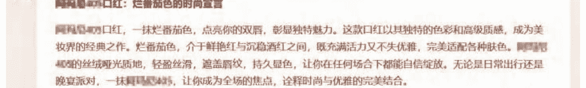

# 提问驱动的公文写作：AI高效密码本

# 自序一

## 从信息过载到精准提效

《AI 提问大师：解锁公文写作的高效密码》成书的动因，是对当下信息社会组织诉求的长期体察，以及对生成式人工智能潜能的持续挖掘。多年以来，我一直投身于助力企业完成智能化转型，以数字经济实践专家的身份为大量机构提供培训与咨询，并在广东省科技创业导师、华南理工大学工商管理学院校外导师、中山大学管理学院“互联网+”创新创业大赛导师的岗位上，深刻感受到各类组织对智能变革的迫切期待。无论是巨型集团还是初创团队，都被海量信息淹没，急需一种能够筛除噪音、锁定焦点并迅速给出答案的精准工具。2023年起，文心一言、豆包、Kimi 等产品集中涌现，2025 年春节前 DeepSeek 的横空出世，让这一需求彻底临界。金融、医疗、教育等不同行业的痛点与收获各异，但提升竞争力与创新力的共识是一致的，找到与人工智能的结合入口至关重要，而官方文书撰写正是极具代表性的场景。

官方文书是政府机构、企事业单位行政运转的核心载体，承担着信息传递、决策落实、内外沟通的职能，记录着组织管理与发展的全貌。规范统一、风格稳定、高效的文书，是保障运转顺畅、提升执行效能的重要支撑。随着生成式智能的加速演进，传统文书起草方式正迎来根本性改写。智能系统不仅提供强力工具，更带来了新的方法论。

智能系统在文书起草中的价值日益凸显。它能最大限度减少错别字与输入失误，提升稿件文字品质；通过反复对话训练，使行文风格保持高度一致，帮助机构维持稳定的对外形象。更关键的是，智能系统可高效承接重复性劳动，显著释放创作者的时间与精力，让人更聚焦核心内容构思与逻辑打磨，从而整体提升文书的质量与价值。

本书的核心意图是系统介绍如何借助智能工具提升文书起作的质量与效率。书中阐释了智能指令提问的运行机理，涵盖提示语的作用与意义、模型选择对提问效果的影响，以及优质提示语的构建方法。通过深入讨论提问技巧，例如让提问更具体、明确、清晰，以及通过变换提示形式来优化提问，本书帮助读者掌握与智能系统高效沟通的能力。此外，书中还提供大量实战提问技巧，助力读者在不同写作场景中灵活使用智能工具。

愿本书成为您文书写作路上的得力伙伴，在信息泛滥与写作压力面前找到属于自己的高效路径。我相信，生成式智能将成为提升文书撰写质量与效率的核心引擎，为各类型组织的健康运转与发展提供强力支撑。

最后由衷感谢支持本书创作的伙伴，你们的智慧让本书得以成形。感谢谢盛斌、张辰、黄信焕、黎展波、许仲璟、王春阳、宋森、万文慧、刘苗、李泽江、简进峰。谨以此书献给所有在文书撰写领域持续探索与实践的同仁，愿在智能助力下创作出更高质量、更有价值的文本。

骆仁童

2025年2月

# 自序二

## 与智能体的有效对话

数字化浪潮席卷全球，生成式智能正深刻重塑工作与生活方式。作为长期关注科技与管理融合的实践者，我切身感受到智能工具对企业管理、文书撰写乃至整体组织运行的深远影响。这种影响不仅在于效率提升，更在于它为组织打开了全新的价值创造空间。

智能系统的出现为企业带来前所未有的变革机遇。它不仅能大幅提效，还能激发创造力，成为工作生活不可或缺的助手。与此同时，如何向系统发问、如何通过追问获得更高价值的输出、如何借助互动最大化优势，已成为新的课题。

智能系统也让传统工作模式发生迁移。以文书写作为例，文书是政府机构与企事业单位内部沟通、外部交流的重要载体，其价值不言而喻。但传统方式常出现格式不规范、内容良莠不齐、效率偏低等问题。智能系统的到来为破解这些难题提供了思路与方法，如何合理使用智能系统大幅提升文书撰写质量与效率，使写作更轻松高效，也是值得深入探讨的问题。

基于此，我带领团队打造了科技云平台。这是一款依托深度学习与海量数据训练的智能辅助工具，能够理解自然语言并生成连贯智能的回答，显著提升文书撰写效率与质量。平台不仅可快速生成高质量文书内容，还能在格式规范、语言表达等方面给出专业建议与指导。

本书在介绍文书撰写基础知识与技巧的同时，结合了科技云等智能工具的实际应用案例，帮助读者理解并掌握智能工具与文书撰写的融合之道。学完本书，读者即可掌握利用智能工具高效撰写决议、公告、通知等15类常见文书的方法，在日常工作中游刃有余。

展望未来，智能系统将在更多领域发挥关键作用。无论商业场景还是个人工作生活，智能系统都将成为不可或缺的伙伴，帮助我们应对信息时代挑战，提升效率与生活品质。

感谢您选择阅读本书，愿它助力您更好地运用智能工具提升文书撰写能力，在职场中取得更大成就。同时也希望科技云平台能成为您写作路上的智能助手，陪伴您更高效、更智慧地工作。

高军

2025年2月

# 第一章

## 理论篇

## 智能指令与提问技巧入门

### 1.1 AI指令的提问原理

#### 1.1.1 提示语的功能与价值

在数字化时代，生成式智能的崛起是一场深刻变革，而如何向系统提问正是连接人类思维与机器能力的桥梁。在进入具体提问方法前，先厘清提示语的功能与价值至关重要。提示语看似简单，实则是开启高效协作的钥匙。

提示语是用户向系统下达的任务指令，它能帮助我们开启与“智能伙伴”的顺畅交流，清晰传达需求与想法，从而获得更精准的答案。这一技术让系统能够理解并执行从简单问答到复杂内容创作的各类任务。

优质提示语的价值首先体现在提效上。恰当的提示可以帮助我们提出更明确的问题，快速获取预期回答，减少冗余噪声，从海量信息中筛出价值。例如在数据分析领域，通过精心设计的提示，可让系统迅速生成所需统计图表，使分析师更专注于解读与策略制定。

其次，优质提示能降低错误率。系统虽强却非万能，通过合理设计提示引导输出，选择合适的关键词、限定输入范围或增加特定约束，可有效减少错误。提示还能让非专业人士也能便捷享受智能红利。在信息海洋中航行，提示语就是指引方向的灯塔，帮助我们避开暗礁。

再次，优质提示提升可解释性。工作学习中常遇繁琐任务，而模型往往复杂黑箱。通过巧妙组织提示，可让系统产出更易理解、更易解释的结果，减少试错迭代。举例来说编程场景下，即使是初学者，也能借助简单提示让系统生成复杂代码片段甚至完整程序，既提升效率也提供学习素材。

最后，灵活使用提示能满足个性化需求，让系统更懂你。每个人的需求与偏好各异，提示设计可引导系统生成更贴合的回答，并通过示例或反馈逐步训练模型，使其行为更贴近个人习惯，如同贴心的私人助理，提供定制化服务。

随着技术演进，提示语正从单一文本扩展为包含图像、视频等多模态综合指令，智能系统将在各领域发挥更大作用。因此主动学习提示方法尤为重要，后文将结合文书撰写场景给出实操示例。

#### 1.1.2 智能指令的底层运行逻辑

在探究智能指令奥秘前，先了解其底层逻辑有助于更好驾驭工具。这就像看懂魔术原理后更能欣赏表演，也能自己创造奇迹。

与系统互动时，文字、语音或图像输入构成了指令提示。首先进入数据输入与预处理阶段。系统如同勤勉书记员，对输入进行整理转换。语音指令会经语音识别转为文字，图像指令会经图像识别提取颜色、形状、纹理等关键特征，为后续分析做准备。

随后进入理解解析环节。自然语言处理技术在此发挥核心作用，挖掘文本背后语义，洞察用户真实意图。对非文本指令，系统则启用模式识别，就像戴上透视眼镜，准确解析输入信息。这一环节决定了后续行动方向。

接着，系统依据预训练模型进行推理决策。这些模型是系统的“大脑”，基于海量数据学习形成，对当前输入及上下文进行预测，给出最符合需求的输出方案。过程复杂且具不确定性，但数据驱动的推理赋予系统强大适应与创造力。

然后，系统执行对应操作，将推理结果转化为具体行动，可能是回答问题、生成文本或识别对象。执行结果即时反馈给用户，并被记录用于评估成效，同时为未来决策提供参考。更重要的是，系统会根据用户反馈持续自我学习优化，像渴望进步的学生不断提升服务能力。

以智能音箱为例，说“播放周杰伦的《青花瓷》”时，指令先转文字，经自然语言处理理解意图，再根据音乐库与用户偏好模型快速播放。若版本或音量不符，再次下达指令，系统即据反馈调整，不断优化服务。

由此可见，构造高质量精准提示，就是掌握激活系统能力的钥匙，让系统成为工作生活中的得力助手。

#### 1.1.3 优质提示语具备哪些特征

优质提示语首先需要表达直接明了。它应像明镜般准确反映用户意图与需求。下指令时使用简洁易懂的语言，既利于系统快速理解，也让使用者自身更轻松。若提示充满晦涩术语或复杂结构，不仅系统会困惑，使用者也会迷失。因此避免过度复杂符号与结构，确保信息准确传递，是构建优质提示的第一步。

同时，优质提示应具备较高通用性。它能灵活适配不同主题与场景，如同万能模板，在同一类任务中保持稳定效果。以内容创作为例，一个高通用性的提示，无论用于科技产品文章还是历史事件文案，都能稳定产出高质量结果。通用性提升效率，也降低学习成本。

生成稳定性同样重要。同一提示多次输入时，应稳定输出符合预期的结果。若结果每次差异巨大、质量波动，则提示不可靠。稳定性保障了体验的一致性与可预测性，增强用户信任。

在特定场景中，精心设计的提示能让系统发挥更大创造力，得到更具匠心的答案。

请用小红书的种草风格，写一篇关于“阿玛尼405口红(烂番茄色)”的种草推文，内容里需要多用点emoji小表情，整体需要活泼可爱的语气，最后加tag，200字

💄 阿玛尼405口红，烂番茄色的绝美诱惑来啦！✨

亲们，这支口红真的是我的心头好～❤️ 颜色超级显白，涂上它，秒变元气少女！🌹 质地丝滑顺滑，不干不腻，刚刚好～💄 不管是日常出行还是约会逛街，都能完美hold住！💖

而且哦，这个烂番茄色真的是超级百搭，不挑肤色，谁涂谁美！🌹 薄涂清新自然，厚涂气场全开！💄

快来一起get这支绝美口红吧！让你的妆容瞬间提升好几个档次！💄

#阿玛尼405 #烂番茄色 #口红种草

### 1.2 提问技巧入门

#### 1.2.1 提问的基础能力

在借助智能系统助力文书撰写时，掌握基础提问技巧就像配备专业工具箱，能让写作之旅更为顺畅高效。其中具体、明确、清晰的提问是有效使用系统的关键。

具体性是精准写作的起点。向系统求助时，要像狙击手锁定目标，将问题聚焦于核心。例如撰写公司新项目启动报告，不应只问“如何写报告”，而应提出“请指导我撰写一份关于公司新项目启动的详细报告，包含背景、目标、预期成果与当前进展”。这样的指令能让系统迅速抓住重点，提供细节丰富的指导。

明确性是沟通无误的前提。在文书语境下，明确提问能帮助系统准确理解意图。比如优化会议纪要时，应明确表达“我需要精简这份纪要，突出关键决策与责任分工，同时保持语言正式简洁”。明确指示让系统有的放矢，给出精准修改建议，确保纪要专业实用。

清晰性是保障问题易解的基础。清晰提问如同绘制简洁蓝图，让系统按图索骥。例如询问通知撰写方法时，应清晰提出“请说明内部员工通知的标准格式，以及开头、主体、结尾的写作要点，确保信息传达准确”。清晰指令帮助系统快速把握核心，给出实用模板与步骤。

#### 1.2.2 通过变换提示形式优化提问

与系统互动时，巧妙变换提示表述形式往往能显著提升回答质量与精准度，就像指挥家微调手势便能演奏出更和谐乐章。

第一种是概括总结追问。这要求先理解系统观点，再请其用简洁语言提炼。例如讨论市场调研报告后，可问“请基于你提供的数据，总结当前市场主要趋势与潜在机会”。这种追问帮助梳理核心要点，快速抓住重点。

第二种是延伸扩展追问，用于深入挖掘话题。在初步了解后，提出相关深入问题促使系统提供更多信息。如讨论新公司政策后可追问“该政策对公司长期发展有何具体影响？实施中可能遇到哪些挑战？”引导系统多角度分析，提供全面视角。

第三种是强化自洽追问，用于增强对话合理性与说服力。听到系统观点后，可引用其他事实与数据加以印证。例如系统指出某地旅游业蓬勃发展，可追问“该地区增长是否得益于新开通交通线路？当地旅游资源开发是否也起推动作用？”追问丰富信息，增强信任度。

第四种是联系上下文追问，有助于理解背景。当对话题背景不熟时，可提出相关问题获取上下文。如讨论碳排放事件时可问“该行业碳排放管理现状如何？与同类行业相比有何特殊性？”帮助建立完整背景认知。

最后一种是聚类分类追问，用于整理归纳信息。面对大量信息时，通过分类快速理清思路。如讨论产品时可问“这些产品可分为哪几类？各自特点与优势是什么？”让系统协助归类，使整体情况更清晰。

通过变换提示形式优化提问，能更精准引导系统输出，贴合需求，提升工作效率，也带来更丰富深入的知识收获。

在下一章，我们将介绍五种指令提示的“万能公式”，帮助大家提升与系统沟通提问的质量，开启高效精准富有启发性的对话之旅。

# 第二章 方法篇：提问实战技巧

## 2.1 标准化提问与内容生成（STAR结构）

STAR与CARE：让提示词更结构化、更有穿透力

把一次完整的指令拆成四个可执行的环节，模型就能更快抓住重点。STAR 把一次交互拆成情境 Situation、任务 Task、行动 Action、结果 Result，四块拼起来就是一套可落地的提示框架。

情境负责交代事情发生的环境，让模型先吃透来龙去脉。任务负责点明在该情境下要做的核心工作，给出明确方向。行动负责把做法细化，提供可操作的步骤。结果负责划定终点，说明期望的交付形态和效果。

> 情景：交代问题发生的背景与环境
> 任务：要达成的具体目标、面临的挑战或难点
> 行动：针对问题需要采取的具体做法
> 结果：实施后期望得到的效果或产出

### 2.1.1 给定标准，高效提问

标准化提示像为模型设定节拍的舞步，靠清晰有序的逻辑让模型迅速抓住核心。STAR 以简洁明快、逻辑顺畅著称，成为搭建标准化指令的基础框架。

标准化提问的用武之地很广。

#### 【例】整理会议记录
用 STAR 能搭出一套标准问题，引导模型产出高质量记录。
情境定为公司季度业绩分析会，任务是梳理会上关键数据与决策点，行动是提炼数据指标、讨论结论和后续计划，结果是要一份简明扼要、具备指引性的记录。

> 情境：我让同事在最近的季度业绩分析会上做了速记
> 任务：速记内容零散重复，需要拎出关键数据和决策点
> 行动：请帮我整理材料，并输出一份完整的年度工作会议纪要，要包含数据指标、讨论结果和下一步行动计划
> 结果：得到一份简洁、清晰、有指导性的纪要

按此提示，模型能快速理解会议重点，提炼关键信息并按要求成文。

同样的方法可迁移到市场调研报告撰写、产品讨论纪要、客户反馈整理等。预设标准后，还能根据偏差优化提示，指出问题点并给出更清晰定义或更具体的例子，同时补充背景信息提升准确度。

#### 【例】市场调研报告
撰写市场调研报告时，可先把标准定为分析目标市场的消费者行为与偏好，并用已有数据或同类报告作为示范。把标准拆成数据收集、分析方法、结果呈现等可执行步骤，模型就能更有条理地推进。

### 2.1.2 生成多样化的问题集
从浅入深地设计问题，能逐步挖出更全面深入的信息。先问基础，再追细节，就像一层层搭建知识塔。

#### 【例】想了解“人工智能”相关的知识
先问基础：“关于人工智能能介绍一些信息吗？”得到基本定义后，提取关键词如人工智能、计算机科学、模仿人类智能、系统等，再生成标准化问题：“人工智能在计算机科学里如何实现？核心目标是什么？如何模仿人类智能？能构建哪些系统？”把问题反投给模型，可得到实现方式、目标、模仿机制、应用系统四个维度的详细回答。确认完整后继续迭代，例如追问“医疗诊断工具系统具体怎么用？”模型会展开数据分析、病症检测、辅助诊断、个性化治疗、快速筛查和减负等细节。

也可以按不同场景生成多样化问题。

#### 【例】撰写报告、请示公文
场景是撰写市场趋势分析报告，可问：“怎样收集分析市场数据写出有说服力的趋势报告？”“报告中怎样展示图表和分析结果？”“结论部分怎样给决策者明确指引？”涵盖数据、展示、结论全流程。

场景换成请示文件，问题聚焦格式与要点：“请示的标准格式是什么？开头怎样抓注意力？”“怎样清晰阐述事项背景与重要性？”“怎样提出合理建议与预期效果？”帮助形成逻辑清晰的内容。

#### 提问思路

- 1. 以知识为切入点提问：在提问时能够从知识层面进行询问，如基本概念、定义、计算方法、应对手段等方面。
- 2. 从分析的视角提问：可依据自身所掌握的知识对想要探究的知识加以分析，然后按照分析的流程、结果或者存在的问题向AI提问。
- 3. 从求证的维度提问：可以对现有的结论产生疑问并提问。

#### 追问思路
- 1. 关键词追问：用已知关键词锚定主题，保证问题精准
- 2. 探寻式追问：在得到基础答案后，进一步深挖信息
- 3. 演示性追问：要求模型示范执行任务，获取灵感
- 4. 对比式追问：把两个或多个概念、方法并置对比，加深理解

## 2.2 联系上下文提问（CARE结构）
CARE 框架由背景 Context、行动 Action、结果 Result、示例 Example 四个要素组成，适合多材料关联与分析。

背景为模型提供讨论的基座，行动明确要执行的任务，结果说明期望达成目标，示例通过案例帮助模型更快理解并提高完成质量。

> 背景：设定讨论的上下文
> 行动：描述提问者想让模型做什么
> 结果：期望的目标或效果
> 示例：提供说明性案例

### 2.2.1 根据上下文信息提问的技巧
连贯的提问能提升全局认知。引用前文、善用“这个问题”“以上要点”等指代词，能让模型保持前后文。

#### 【例】撰写新项目启动议案
先问：“怎样写一份有说服力的项目启动议案？”得到目标明确、背景阐述、可行性分析等建议后，追问：“基于这些要点，能否帮我搭一个议案大纲？”模型会据此具体构思。

也可以逐步追加限定条件。推荐旅游景点时，依次补充环境优美、遗迹多、人少、消费中等、个人喜好、预算等，答案会更贴合。

提出问题后别止步于表面答案，要从回答里找新切口。

#### 【例】撰写关于公司新政策实施的纪要
先问：“怎样写一份清晰准确的政策实施纪要？”得到记录要点、明确步骤、责任分配等建议后，再问：“在撰写时，有哪些技巧能确保要点准确传达并便于执行？”可获得更具体的写作要点。

#### 【例】撰写市场拓展议案
公司面临竞争加剧和成本上升，需提交市场拓展议案。

> 背景：公司处于竞争激烈、成本上涨的环境，需通过拓展提升份额和盈利
> 行动：撰写市场拓展议案，阐述策略、目标市场、投入和收益预测
> 结果：说服管理层批准，预计一年内份额提升10%，利润增长至少20%
> 示例：参考行业成功案例，如某公司进入新兴市场并推出定制化产品实现双增长

示例可通过导入文件或联网查询补充。结合前后文提问可进一步细化，例如：“根据我们最近的市场调研报告，某地区潜在需求未被挖掘，怎样在议案中提出针对该地区的进入策略？”

### 2.2.2 多文档“投喂”，跨领域学习
多文档输入能让模型构建知识体系，整合分析并发现跨领域联系。

投喂前需做文本预处理，去除特殊字符。

#### 【例】竞品分析
导入三份医疗机构的竞品调研报告，覆盖医务管理、患者服务、数字化等。用CARE训练模型掌握报告结构后提问：“在数字化比较中，哪家表现突出？”模型会对比分析并给出针对性结论，如A机构在学术社交和医学信息突出，B在病历管理突出，C在医患沟通突出。

#### 【例】撰写多人会议纪要
导入多份部门项目会议纪要，构建项目进展知识库后问：“哪些项目遇到关键技术难题？各部门方案是什么？”可快速把握整体与协作情况。

#### 【例】跨领域提问：气候变化对经济发展的影响
先提供气候变化、全球变暖、经济发展相关文档，训练后提问：“气候变化怎样影响经济和贸易？”

模型会覆盖自然灾害损失、农业与食品供应、海平面上升威胁港口与供应链、能源转型影响传统能源贸易、法规政策限制、绿色经济投资机会、风险管理与保险等，揭示多维度影响并给出应对思路。

跨领域提问关键是明确跨领域属性并提供充足背景。

#### 【例】补充背景信息：气候变化对经济发展的影响
提供全球气候模式、各国经济结构、国际贸易规则背景后追问：“应对气候变化的政策中，哪些对国际贸易直接产生影响？”可进一步深挖。

当需要深度思考时，结合多源数据与多角度提问。

#### 【例】深度思考：气候变化对经济发展的影响
导入多份关于成因、影响、应对、国际协议的文档，先提取关键词如温室气体排放、极端气候、可再生能源等，再提出多角度问题。

模型交流实例：

导入关于气候变暖原因、影响、应对、国际协议的若干文档。

地球温度上升的缘由有哪些？
> 主要因人类活动排放二氧化碳、甲烷等温室气体增强温室效应，森林砍伐削弱吸碳能力，工业与交通释放大量气体，城市化与土地利用改变影响气候。

气候变化对人类社会和生态系统有什么潜在影响？
> 极端天气频发威胁生命财产，海平面上升威胁沿海，农业减产引发粮食安全问题，生态系统受压导致物种灭绝与失衡。

有效应对措施有哪些？
> 减排、提高能效、减少交通碳排放、保护森林、推广可持续农业、发展可再生能源、推进国际合作与减排目标。

国际社会采取了哪些措施？协议作用是什么？
> 签署巴黎协定设国家减排目标，设立绿色气候基金，推进能源政策鼓励可再生能源。协议促集体行动，减少排放、降低变暖风险、保护生态。

持续向AI输入多元资料、不断提炼关键词、变换提问角度，就能牵引它进入深度思考模式，从而在多份文档的交叉分析与综合中挖出更有价值的结论。我们用CARE结构来设计承接上下文的追问，既能发挥AI的分析力，也能激活它的创造力，让复杂问题的研判更清晰，为战略决策提供更扎实的支撑。

提问思路

- 1. 从知识层面切入提问：在提问时可以站在知识基础上展开，比如基本概念的界定、原理说明、计算规则、应对方法等。
- 2. 从分析视角切入提问：结合自身掌握的知识对关注点进行拆解，再按分析流程、结论或发现的矛盾向AI提问。
- 3. 从验证视角切入提问：对已有结论产生怀疑并据此提问，检验其合理性。

#### 追问思路

- 1. 补充背景信息
  - 明确专业领域：比如医学场景可指明心血管、肿瘤等专科或病种，让AI给出领域适配的回答。
  - 提供个人背景：学历、资质、工作经历等信息有助于AI给出更贴合的建议。
- 2. 推动对话深入
  - 聚集多源数据：持续上传材料、补充文档，覆盖不同观点。
  - 提取关键词：从资料中筛出核心词或短语，帮助AI锁定关键概念。
  - 多维度提问：从不同角度设问，促使AI全面审视与综合。

## 2.3 APE框架：精准概括与追问

APE结构由行动、目的、期望三要素组成。

行动指明要完成的任务，给AI划定工作方向。目的说明任务背后的意图与背景，帮助AI理解动机。期望则具体描述希望达成的结果，为AI设定明确目标。

借助APE，我们能把任务、意图与结果界定清楚，让AI的辅助更高效，工作质量与效率同步提升。

> 行动：具体任务。
> 目的：意图或目标。
> 期望：想要的结果。

### 2.3.1 提取关键信息，让AI进行概括

工作与生活中信息量庞大，能快速从大量文本中抓取要点是一项稀缺能力，AI在这方面优势明显。当我们给出概括标准，AI就能按需提炼核心，节省时间并提升处理效率。下图展示了用AI做概括、总结与追问的流程。

来看如何用APE指导AI完成信息萃取。

#### 【例】环保购物袋的内容营销方案

把环保购物袋的产品资料、目标市场信息、目标人群画像等素材喂给AI，AI理解后即可用APE发出指令。

指令示例：

> 行动：为新上市的环保购物袋制定内容营销策略。
> 目的：在目标受众中形成传播声量，提升环保认知，受众为对可持续发展有热情的环境保护人群。
> 期望：推动预购量提升至少15%。

行动让AI明白要做什么，目的让AI理解营销不仅是卖货更是理念传播，期望则给出量化指标便于评估。缺少目的与期望，AI会按自身理解随意归纳；加上约束，方向才更可控。

通过APE把复杂任务拆成清晰要素，AI更容易执行。也要注意为AI设定明确的概括标准，相当于提供筛选器，让信息提炼更精准。

#### 【例】对文献进行概括

手上有一份联合国教科文组织发布的《AI时代学生能力框架》，概括标准可定为“提取学生在AI时代应具备的核心能力与需遵循的关键原则”。明确后，AI就会聚焦相关内容给出凝练归纳。

AI对话示例
上传文献后提问：
请概括这份文献的主要内容，重点提炼AI时代学生应具备的核心能力与关键原则。

> 在AI浪潮下，联合科教文组织发布学生能力框架以助教育体系转型。框架提出四项核心能力：以人为本的思维，认识AI为人类工具，保持批判性并维护自主决策；AI伦理，负责任地使用、设计与实践AI，关注隐私、算法偏见等风险；AI技术与应用，掌握基础知识并通过实践加深理解；AI系统设计，培养问题解决、创造与设计思维。并强调五大原则：AI批判性思维、人本互动优先、环境可持续、能力发展的公平性、终身学习。应用建议包括对齐国家AI战略、建设跨学科课程、设计本地化前瞻课程等。

评估AI输出可从四方面看：
- 上下文理解度：是否基于对话历史生成回应。
- 准确性：是否存在事实错误。
- 连贯性：逻辑是否通顺、语言是否自然。
- 实用性：是否满足需求并提供可操作信息。

提问思路

提出简洁明确的问题，要求AI概括或总结。

例如：
“请概括这篇文章的核心内容。”
“能否为这份报告生成摘要？”
“这篇新闻的要点是什么？”

#### 追问思路

可补充细节让AI回答更准确。

例如：
“你是否理解文中某些特定概念或细节？”
“文中提到的数据、事实或案例能展开吗？”
“你如何解读文中某部分的含义？”
“对文中观点、理论或研究的看法是什么？”
“对文章结构或组织方式有何评价？”
“有什么建议能帮助我更好理解这篇文章？”

### 2.3.2 高效阅读与提炼海量信息

AI擅长快速阅读并从海量数据中抽取要点，这对解读复杂文献与报告、支撑决策至关重要。

#### 【例】撰写毕业论文

一名创新科技管理专业的学生在写《AI技术与组织变革》的毕业论文，需要解读大量文献。他提供一篇参考论文的文献信息，与AI互动快速获取要点。例如提问：“我正在写关于AI与组织变革的论文，请解读这篇文献的核心观点。”AI不仅概述主要内容，还解释了“感知享乐属性与实用属性是否影响顾客满意度进而影响品牌关联度”等具体论点，帮助学生快速把握关键。

AI对话示例
参考论文：Magno, F. and Dossena, G. (2023), "The effects of chatbots'attributes on customer relationships with brands: PLS-SEM and importance-performance map analysis", The TQM Journal, Vol. 35 No. 5, pp. 1156-1169.
概括研究内容并重点分析方法与结果。

> 论文研究聊天机器人的享乐属性与实用属性是否影响顾客满意度，进而影响品牌关系。研究采用在线问卷对意大利消费者进行便利抽样，数据分析使用PLS-SEM与重要性-绩效图分析。发现享乐与实用属性均正向影响满意度并改善品牌关系，IPMA显示系统质量与聊天体验有待提升。假设验证显示信息质量与聊天体验对满意度有正面影响，系统质量无显著影响，满意度正向影响品牌关系。结论强调设计时应重视信息质量与情感体验。

与AI互动可快速提炼海量信息，节省时间并提升效率，适用于学术、管理和公文写作等场景。

提问思路

#### 1 遇到难懂概念时要求解释：阅读中碰到专业术语可让AI通俗解释，帮助理解。
#### 2 寻求进一步建议：对某主题感兴趣但不知如何入手，可让AI提供资料线索与研究建议。
#### 3 针对特定问题提问：直接就感兴趣的问题提问，要求AI从给定文章中提取相关信息作答。

#### 追问思路

1 提供关键信息：给出文献标题、作者、出版日期等，便于AI定位信息源。
2 指定阅读范围：信息较多时告知具体段落、关键词、条款号或内容范围。
3 明确深度需求：说明需要摘要、核心观点、数据、案例等哪类提炼。
4 追加细节要求：要求更详细作答，获得更有价值的信息。清晰提问与追问能让信息摘要更具针对性。

## 2.4 SAGE结构：分步推进提问

SAGE由情况、行动、目标、期望组成。

情况提供背景与上下文，是理解问题的基础。行动明确要执行的步骤。目标定义期望达成的效果。期望进一步细化结果，为AI提供具体指引。

借助SAGE，任务边界更清晰，AI更能高效助力。

> 情况：背景描述。
> 行动：需要做什么。
> 目标：最终要达成的效果。
> 期望：希望得到的结果。

### 2.4.1 聚类提示性追问

在SAGE信息处理中，聚类提示性追问是常用方法，能帮助组织与理解大量数据。先让AI整理内容，再明确聚类规则，最后根据反馈优化。

#### 【例】宜家公司AI战略发展历程

先让AI梳理宜家AI战略的时间线，得到的结果按时间罗列但缺乏结构。通过聚类提示，要求按阶段分类，效果更清晰。

> 情况：分析宜家AI战略发展历程。
> 行动：查资料整理宜家AI战略的时间节点，按阶段呈现。
> 目标：清晰表达宜家AI战略的分阶段演进。
> 期望：提供分类后的信息并归类说明。

聚类后脉络更清楚：早期探索期 2015—2020年，以SPACE10成立、IKEA Place AR应用、收购Geomagical Labs为主；发展期 2021—2023年，呼叫中心转型为设计顾问、推出IKEA Kreativ等；成熟应用期 2024年以后，ChatGPT聊天机器人、AI工具箱、运营供应链应用等。

通过提示聚类规则并让AI归并同类信息，可快速把握关键并做出更明智决策。使用控制引导提示能进一步优化聚类规则，高效获取关键数据。

#### 【例】手机消费者群体分析

作为手机公司市场总监，需对消费者进行细分以制定策略。指令：“我是手机公司市场总监，消费者群体在变化，请把相似群体分组并说明聚类规则。”AI给出一般流程但未给出具体规则。

未使用聚类提示时，AI回复：
1. 数据收集方面，要搜集和消费者有关的数据，像购买行为、产品偏好、年龄、性别、地理位置、收入水平等信息都在收集范围内。

让AI聚类更有用，先把流程和提问拆清楚

消费者分群不是只有跑一个算法那么简单，背后是一套从特征到策略的闭环。把流程拆开来做，既能保证结果可信，也方便用提示词把控AI的输出。

**一、从特征到落地的七个关键环节**

特征筛选要跟着问题走。先看业务要回答什么，再从数据里挑能说明问题的变量。购物轨迹像是购买频次、消费金额，偏好侧面像是品牌倾向、功能诉求，以及地理分布等，都是常用的输入。

数据预处理要把质量先稳住。做清洗去噪，补全或剔除缺失值，做标准化等操作，让不同维度在同一尺度上可比。

选算法要匹配数据形态。K均值、层次聚类、DBSCAN 都是业界常用的分组工具，具体用哪个看数据分布和业务解释性。

确定群数需要客观指标。肘部法则、轮廓系数这类方法可以帮助找到既稳定又有区分度的分割点，决定把人群拆成几个子群。

执行聚类时按既定参数跑。把每一条消费者记录放进对应的簇，得到初步的分群结果。

解读结果要回到业务语言。逐个簇看它的行为特征、购买偏好、需求倾向，形成可读的画像，而不是只看数字。

制定策略要做差异化运营。基于画像给出产品定位、促销玩法、营销触达等针对性方案，提升匹配度和市场份额。

以上是一套常见做法，具体业务和数据不同，规则自然要做调整和自定义。

要让AI给出更落地的规则，可以进一步追问请它细化依据。追问后AI会给出多维度分组思路，例如：

按购买行为看，把高频高客单的活跃用户、低频低客单的沉默用户、以及尚未转化的潜在用户区分开。

按产品偏好看，分出看重性能派和看重设计派，按品牌喜好、功能需求做切割。

按地理位置看，按区域或城市切分，便于做地方化运营。

按年龄性别看，按青少年、中年、老年等阶段和性别做细分，匹配不同产品线。

按偏好特征看，把追求健康绿色、追求性价比等价值观做分组。

按生活方式看，把旅行动物派和居家宅系等兴趣标签区分，便于做活动主题。

按渠道偏好看，线上主力用户和线下门店用户分开，渠道策略也跟着变化。

这些只是示例，实际应用中要结合业务目标和数据情况灵活改写。

**二、在公文写作里控制聚类提示**

写多问题请示时，提示的控制同样重要。先让AI关注每个问题的关键要素，再按紧急程度、重要性、涉及部门等维度做聚类。比如把所有预算类问题归为一组，人力调配类归为一组，再按紧急度细分，AI就能输出带描述和处理建议的清单。

### 2.4.2 分类追问的应用思路

用SAGE结构处理信息时，分类式追问能快速定位关键点。通过明确的分类指令引导AI抽取要素。

平板电脑市场分析为例，需要从大量评论里筛出性能、设计、续航等要素。先让AI把提到续航的评论单独拎出来，再进一步要求按反馈性质分类，比如把电池寿命的正面评价归一类，负面反馈归一类，就能看清满意度、痛点和改进方向。

提问思路可以这样组织：

情境：在海量评论中定位续航相关信息。
行动：抽取所有涉及续航的评论，并按反馈性质分类。
目标：把正面评价和负面反馈分开。
期望：得到清晰分类、问题点和优化建议。

对话示例：先给评论，让AI筛选续航相关内容，得到若干正面案例。接着要求分类，得到问题清单和建议清单。若分类仍粗，还可以让AI按性能功耗、电池续航、拍照、音质、设计、系统体验等更细的维度再分，获得更精细的洞察。

信息管理和决策时，生成分类提示并引导AI的分类思路，能更快抓住要点、更好组织信息。

### 2.4.3 样本示范与关键词引导的追问

在引导AI写作时，给出样本是最直接的校准方式。AI会模仿样本的风格、结构和语气，提高相关性。

写员工惩罚决定为例，先给出事件概述、认定和处理要点。AI初稿在事实层面达标，但在警示力度上不足。此时用范例追问引导：“请在保持事实的基础上，结合下方范例，增强措辞的严肃性和警示效果。”范例里用更重的定性、更明确的后续影响和更严格的流程表达。参照后，AI会把表述调整得更具威慑力，包含罚款、严重警告、再教育培训、签署确认等要素，并强调零容忍和后续监督。

关键词的选择也会改变回答焦点。以“AI在挖掘市场需求方面的优势”与“价值”为例。

问优势时，AI更侧重能力点：海量数据处理效率、深度模式挖掘、情感分析做画像、趋势预测、个性化推荐等。

问价值时，AI更侧重业务收益：快速挖掘隐藏行为模式、精准把握需求细节、早期预警新兴需求、为战略提供依据、提升营销转化等。

可见，词序、权重和替换都会影响AI的理解角度，提问时要按目标灵活调整。

追问思路可以分三类：

条件追问：设定筛选条件，帮助AI确定分类规则和原则。
建议追问：用建议的方式让AI按思路重新分类，或帮助其评估生成内容的优劣。
否定或纠错追问：直接指出已生成内容的问题，让AI据此修正。

## 2.5 角色设定、自洽追问与纠错框架

ROSES结构包含角色、目标、场景、期望、步骤五个要素，能稳定引导高质量输出。

角色界定AI的身份背景，如“十年经验的数字营销顾问”。
目标说明要达成的结果，如“下季度电商流量提升30%”。
场景提供背景，如“刚上线环保家居新品线”。
期望明确成果形式，如“一份详细的SEO策略”。
步骤给出执行路径，如“做全站SEO审计、做关键词研究、优化页面元标签与描述、搭建反向链接体系”。

以传媒公司企业文化建设为例，设定角色为HR，目标是提升创新与协作并增强社会责任感，场景是创新项目已上但氛围未形成，期望是得到落地策略。结构化提问后AI会给出更具体建议。若建议不够具体，可追问如何在日常工作中激发创新和协作，AI会给出奖励机制、培训、团队活动等可执行点。

通过角色设定和ROSES结构，能让AI在错误中学习、逐步收敛到精准答案。

> 定期开展创意工作坊与头脑风暴，让员工畅所欲言，碰撞出更多创新火花。
> 配套创新类培训与资源，帮助团队补强创新力，例如设计思维、跨界协作等主题课程。

> 2. 团队氛围的培育：
> 推进周期性的团建活动，强化成员间的信任感与配合度。
> 设立协作类表彰，对在集体项目中表现突出的个人与小组给予认可。
> 突出跨部门协同的价值，拆除信息孤岛，提升资源共享效率。

> 3. 成长学习的支持：
> 搭建多元化学习资源与晋升通道，助力员工不断吸收新知与新技能。
> 支持员工主动充电，参加行业沙龙或线上学习，并提供相应资助与激励。

> 4. 以绩效为导向的激励安排：
> 构建公开公平的绩效考核框架，确保付出能够被客观衡量。
> 建立绩效奖赏机制，对高绩效人才进行表彰与回馈，激发主人翁意识与创造力。

> 整体来看，传媒企业的HR在打造文化时，核心应放在点燃创新活力与强化协作意识上。通过完善激励、提供学习支撑、营造积极的工作环境，能够让企业文化真正落地，并为长期发展提供动能。

在让AI扮演角色的过程中，常常会出现一个诉求：希望模型呈现出足够的专业水准。达成这一目标通常依赖强化训练与提问关键词的精细化设计，借助这种方式能显著提升回答的精准度和相关性。

强化学习是AI持续进化的机制，通过环境反馈中的正负信号，不断调整行为策略。实践中，高效的策略之一就是在追问中植入指向明确的关键词。

其一，表达要简洁清晰，规避模糊或歧义的表述。其二，关键词要能体现出所期望的专业身份。

【例】撰写一篇关于“AI工具对企业行政工作的影响”的材料
可以明确要求：“请围绕数据分析与决策支持、人力资源管理与招聘、客户服务与沟通优化、安全与隐私风险、成本管理与资源优化、未来发展与趋势展望这六个维度，完整呈现‘AI工具对企业行政工作的影响’。”如此设定，模型更易把握意图，并给出系统化内容。

当模型给出初步答案后，需要对内容进行校验。若发现不够准确或偏离预期，可采用自洽追问的方式指出问题并要求修正。例如在前述主题下，若角度不够实用，可将可用的角度作为前提继续追问。再如，若在“AI工具对人力资源管理的影响”中未涉及招聘流程自动化，可追问：“招聘环节中，AI如何实现简历自动筛选，从而提升招聘效率？”这种纠偏不仅能修正当前结果，也能提升后续回答的全面性。

不断优化提问关键词并引导模型进行强化学习，有助于获得更精准的信息，同时促进模型在特定领域的知识沉淀与理解加深，进而提供更高质量的服务。

追问思路
1. 你是谁，即为AI设定具体角色。
2. 做什么，即明确任务目标。
3. 怎么做，即给出执行要求，可用“必须”“注意”等强化约束。
4. 不要做，即列出禁止行为，如“不要跑题”“不要超出字数”等。
5. 输出内容，即限定输出形式，如“输出文本”“只输出修改部分”等。

### 2.5.2 自洽式追问，明确纠错
当AI的回答存在明显错误且与预设角色不符时，可通过自洽式追问促使其纠错，并在后续交互中提供更贴合需求的回应。

【例】人力资源管理的六大模块是哪六个？
在实操中，自洽追问有多种形式。可以直接指出错误并给出正确信息，要求模型更新知识库；也可以用提问引导其自我反思。例如问：“你提到的‘人力资源信息系统’是否属于人力资源管理的六大模块之一？如果不属于，正确的六大模块应包括哪些？”这种方式既能纠正错误，也能加深对概念的理解。

AI对话片段示例
人力资源管理的六大模块具体是哪六个？
> 人力资源管理通常由六大模块构成，覆盖组织内所有人力相关事项。
> 其一为招聘与招聘管理，涵盖岗位发布、面试、筛选、录用等，目标是获取匹配业务的人才。
> 其二为培训与发展管理，聚焦职业成长与技能提升，涉及培训计划、继续教育、晋升等。
> 其三为绩效管理，包括标准制定、绩效评估、反馈机制与激励体系，有助于提升表现。
> 其四为员工关系管理，关注雇佣双方关系，处理冲突、劳动关系及营造良好工作氛围。
> 其五为薪酬福利管理，涉及薪酬结构、福利方案、健康保险、退休规划等，确保报酬公平。
> 其六为人力资源信息系统，用于管理员工档案、薪酬、绩效、培训等数据，提高管理效率。
> 各模块协同运作以实现人才发展与业务匹配，不同规模组织可根据需要做相应调整。

你提到的“人力资源信息系统”是否属于人力资源管理的六大模块之一？如果不是，那么正确的六大模块应该是哪些？
> 感谢指正。依据您提供的资料，人力资源管理六大模块更新如下：
> 其一，人力资源规划，关注员工需求预测与策略制定，涵盖岗位需求、劳动力分析等。
> 其二，招聘与配置，负责发布岗位、面试选聘、人员到岗安排。
> 其三，培训与开发，旨在提升技能、支持职业发展、保障胜任力。
> 其四，绩效管理，包含目标设定、评估、反馈、激励与发展支持。
> 其五，薪酬福利管理，聚焦薪酬设计与福利供给，确保公平待遇。
> 其六，劳动关系管理，涵盖与工会或员工代表协商、争议处理、关系维护及制度建设。
> 已按您提供的信息更新，后续将据此给出准确答复。

另一种做法是，首次回答错误时，直接进行否定并给出正确定义引导自洽。

【例】人力资源管理的三支柱模型是哪些？
若模型初次回答为招聘与用人、培训与发展、绩效管理与奖励，可明确纠正：“很抱歉，你的前述回答不准确。‘人力资源三支柱模型’即HR Three-Pillar Model，通常指专家中心、人力资源业务伙伴和共享服务中心，请在后续对话中牢记。”通过这种方式，模型可在错误中学习，后续输出更准确。

自洽式追问不仅能纠错，还能促进知识积累。进一步结合多角度追问，可推动模型实现高度自洽与持续改进，最终产出更全面深入的内容。

【例】马斯洛需求层次理论
当回答基本正确但不够全面时，可用多角度追问拓展。例如从历史纵向提问其理论意义，模型可能阐述其在心理学、管理学、心理治疗、教育等领域的影响，丰富理解。

再从横向对比激励理论，询问“马斯洛需求层次理论的优势在哪？”模型可能指出其整合性、层次性、关注个体差异与自我实现概念，以及跨领域应用广度。

通过明确纠错与多角度追问，可引导AI生成更优质、更贴合需求的内容。

#### 追问思路
多角度追问形式多样：
- 1. 横向追问：从平行层面展开，如不同地区表现、不同群体态度、其他领域的类似现象，有助于避免以偏概全。
- 2. 纵向追问：沿时间或因果链深入，如从表面现象追溯到深层原因。
- 3. 逆向追问：反向推导，从结果回溯过程或从目标倒推条件，有助于突破惯性思维。
- 4. 上下文追问：在更大语境中审视，如前后情节、数据背景等。

本章介绍的五大提问结构“万能公式”，有助于更清晰地整理材料与提问思路。但不必将其视为束缚，掌握其理念后可在实践中灵活运用。下一章将结合公文写作实际体例展开操作介绍。

# 第三章 基础入门案例篇：向AI提问，生成和优化公文文本

## 3.1 常用的AI写作工具

### 3.1.1 DeepSeek
DeepSeek由国内AI团队深度求索推出，在2025年春节后迅速走红，成为全球关注焦点。凭借强推理能力和开源策略，它被誉为开源大模型中的领先者，在性能与成本上兼具优势。

DeepSeek的核心特质：
- **强大的推理能力**
  相较传统模型，DeepSeek借助强化学习等技术，能更深入理解问题并补充用户未提及的细节，输出更具逻辑与创造性。
- **开源共享**
  模型权重可免费使用与修改，降低了使用门槛，为行业研究提供参考。
- **多语言支持**
  支持中文、英文等多语种，适用范围更广。
- **高效的内容生成**
  可产出自然流畅的文本，适用于文案、代码、学术写作等场景。

使用方式：
目前提供网页端 https://chat.deepseek.com/ 和移动端App，也可通过腾讯元宝等平台切换模型使用。

### 3.1.2 豆包
豆包AI助手由字节跳动推出，基于豆包大模型构建，具备自然语言理解与上下文把握能力，可根据需求提供解答与方案。模型在海量语料与知识库上训练，知识储备丰富。

主要特性：
- 多语言支持：覆盖中文、英文等多种语言。
- 个性化交互：基于输入与历史记录提供定制化服务。
- 实时更新：知识库与参数可动态刷新，保持时效性。
- 安全性：注重隐私与数据合规，保障用户输入安全。
- 文本生成：支持纯文本、Markdown、HTML、代码等输出格式。

豆包支持网页、桌面客户端、小程序与H5端。在网页端左侧菜单可进入“AI智能体”，搜索“公文写作”即可结合本书技巧开展写作。

### 3.1.3 Kimi
Kimi由月之暗面科技有限公司开发，创始人为清华大学杨植麟教授，团队汇聚多家科技巨头人才，以强技术与多语对话能力快速成长。

特性与能力：
- 长文本处理：支持20万字至200万字输入输出，可处理长文献、报告、合同并进行摘要分析。
- 多文档分析：可同时处理多达50份PDF，提炼要点并支持追问深挖。
- 多语言支持：擅长中英文对话，支持TXT、PDF、Word、PPT、Excel等格式。
- 实时联网搜索：结合搜索结果提供全面准确的答案。

目前支持网页、客户端与小程序端。

### 3.1.4 文心一言
文心一言是百度研发的大语言模型产品，在国内具有较高知名度。用户可通过指令与模型交互，获取信息、灵感与创意输出。

特性与能力：
- 多语言支持：支持中英文等多语种交互。
- 知识图谱：构建实体关系网络，实现结构化知识抽取。
- 深度学习技术：对海量文本进行特征学习，具备强自然语言处理能力。
- 可扩展性：可通过数据与算力提升性能。
- 应用广泛：适用于智能客服、问答、翻译、文本生成等。

支持中文、英文、日语、韩语等输出，支持纯文本、Markdown、HTML等格式，可上传文档与图片理解内容。支持语音输入转文本，但暂不支持语音输出。

使用方法：支持网页、客户端、小程序、H5端，需注册百度开放平台账号登录。

### 3.1.5 科技云
科技云 Technology Cloud 是基于大语言模型的AI对话程序，上线后迅速吸引用户关注。

特性与能力：
- 文本生成：基于海量数据训练，输出自然流畅、格式统一的文本，适用于创意写作。
- 对话管理：可参与多轮对话，保持上下文连贯。
- 上下文理解：捕捉长序列依赖，生成摘要与回应。
- 内容推荐：基于上下文推荐相关信息或行动。
- 文本分类与标签：可用于分类与标注任务。

目前仅支持网页端，注册后可使用基础版，付费Plus用户可解锁高级数据分析等测试功能。

## 3.2 公文写作入门

### 3.2.1 公文的特点
在复杂多变的组织管理环境中，公文是传递信息、管理事务、决策执行与行为规范的重要载体。其核心价值在于承载组织意志、体现决策权威、发挥沟通桥梁作用。

对管理者与撰写者而言，理解公文特性至关重要。公文最显著的特征是正式性。公文采用法定格式与规范语言，具有权威性与法律效力，是组织决策与工作的关键工具。因此撰写时必须严格遵循格式与语言规范，避免产生歧义的模糊表述。

### 3.2.2 公文写作要点
公文的效力很大程度上取决于行文规范。作为正式书面沟通工具，其表达方式直接影响信息清晰度与组织专业性。

公文写作需使用正式用语与规范术语。因其常在多层级、多部门甚至对外传递，避免口语化表达、俚语或非正式语言尤为重要，这有助于统一理解并提升专业度。

术语与缩写的处理需统一且解释到位。对读者陌生的专有名词首次出现应加以说明，全文保持一致，避免混淆。

表达应明确简洁。冗长复杂的句式易导致误解，简洁表达有助于快速抓住重点。每句宜承载一个清晰概念，减少赘余，以提升可读性与沟通效率。

让公文更通透：讲理、守一、配AI一起写

把事情讲明白、合规范，是公文的第一要求。全篇思路要贯通、信息要层层递进，框架利落，读者才能快速抓住要义。衔接词可以适当点缀，但别做成流水线式的套路，用自然的表达和合理的结构来保持连贯。

语言风格必须稳定统一。口径一会一变，阅读体验会断层，也会影响公信力。

引入生成式模型后，起草效率明显提升。第二章提到的五类提问方式，正是提升人机协作效果的抓手。虽然很多工具已经积累了公文常识，但准确度和规范度仍参差不齐，提问的颗粒度直接决定产出质量。

想把表达水平拉满，第四章汇集的经典句式可以直接拿来做提示词，让模型更贴近标准。

### 3.2.3 公文的基本分类

借助大模型生成各类文种很方便，可受训料偏差影响，初稿往往需要反复校对。不同机关对文种的运用也有差异，厘清文种属性和适用场景是提升效率的前提。下面按五大板块梳理特征与细分。

#### 3.2.3.1 指令决策类：决议、决定、命令（令）

这类文种权威性最强，是组织决策与管理的核心载体，包含决议、决定、命令。

决议主要承载重大决策与工作导向，十分庄重，受法规格式约束，对成员具有约束作用。属性上体现庄重、决策功能、规范、清晰、合法合规、权威。

决定聚焦具体事项的明确规范，用严谨正式的措辞体现上级要求，带有强制力。属性为严肃、强制、清晰。

命令强制程度最高，由有权机关发布，涵盖重大行政举措，如发布令、行政令、嘉奖令、任免令。属性为重要、权威、强制最强。

此类型文书使用要格外谨慎，既是决策载体，也是权威与效率的体现，必须严格遵守格式与规范，确保内容准确权威。

#### 3.2.3.2 信息发布类：公报、公告、通告

用于向内外传递重要信息与重大事件，兼具公开性与新闻性。包含公报、公告、通告。

公报由高级别机关发布，涉及国内外重大事件，强调信息公开与广泛传播，具有新闻性。常见有刊物公报、会议公报、统计公报、联合公报等。属性为重要、公开、新闻。

公告侧重广泛性与一事一文，主体和内容多样，常用于影响面广的事项。常见有要事性、政策性、任免性、法定性等。属性为广泛且单一。

通告偏法规性与实务性，多与地方法规相关，用于约束特定对象行为，提供具体工作指导，覆盖面广。常见有知照性、办理性、禁管性等。属性为法规性、实务性、广泛性。

发布时要把握新闻性与时效性，才能在管理与社会交往中发挥作用。

#### 3.2.3.3 工作沟通类：意见、通知、通报

保障事务顺利推进的常用工具，包括意见、通知、通报。

意见具有多向性、针对性、多样性，可向上级提建议、向下级传达指示、向同级提协作建议。

通知使用最广泛，具有多样性、广泛性、指导性、时效性。适用于多场景，收发对象多，事项常带时限。类型有批转性、转发性、发布性、事务性、任免性、告知性等。

通报侧重传递典型事例，具有典型性、引导性、时效性、真实性。用于表彰、批评或情况通报，引导价值导向，需实事求是。

起草时要注重信息准确，格式规范，内容清晰可指导。

#### 3.2.3.4 上下行文类：报告、请示、批复

用于层级沟通与决策落实，包含报告、请示、批复。

报告自下向上汇报工作、总结经验，以叙述说明为主，具有单向性、概括性、实践性，类型多样。

请示是向上级请求指导或批准的文种，内容多为权限外事项需批复后执行，通常有对应批复。请示应切实可行且在上级权限内。类型有求示性、求准性、求助性，属性包括答复性、单一性、针对性、超前性、可行性。

批复是对请示的回应，针对性强、简明不赘述，具有指导性与权威性。类型有批示性批复和批准性批复，属性为被动性、针对性、权威性、简明性。

#### 3.2.3.5 机关往来类：议案、函、纪要

连接部门、协调合作的关键文种，包括议案、函、纪要。

议案内容为提交人大审议的重大事项，涉及立法、决策、任免，具有定向性、政策性、时限性。分为立法性、决策性、任免性等。

函用于机关间正式沟通协商，具有平等性、广泛性、单一性，适用主体多元，类型多样。

纪要用于记录会议决策与讨论要点，具有纪实性、概括性、条理性，需真实客观反映情况，风格简明，便于快速掌握要点。形式要求完整权威，指导后续行动。

### 3.3 用AI写指令决策类公文

### 3.3.1 决议

决议常见分为批准性、阐述性、公布性。以批准性决议为例，可先提供范文让模型按格式结构重写。例如提问：“我需要一份针对Z县的工作决议，请参照我提供的范文和资料整理成规范的决议。”

批准性决议公文范文：

______县人大常委会关于批准______年财政预算变动的决议

（______年______月______日______会议通过）

〔〕______号

______县人大常委会根据______县财政局提交的《关于______县______年预算变动的报告》，经过充分审查和深入讨论，作出如下决议：

根据______县财政局所提交的《关于______县______年预算变动的报告》，本县将在______年停止对______项费用的征收，因此，______年______县财政预算计划由______万元下调至______万元。

本决议是在结合审计工作报告及县人大常委会的审查意见的基础上作出的，充分考虑了预算变动的必要性和合理性，也符合______县未来财政发展的需要。

______县人大常委会

______年______月______日

抄送：______，______，______，______

______年______月______日印发

提问提示词示例：

内容主题是“Z县关于批准2024年财政预算变动的决议”。
落款日期写为××年××月××日。
Z县财政预算金额由100万元降为80万元。
结论要点是，结合审计工作报告和Z县人大常委会的审查意见，批准《关于Z县2024年预算变动的报告》，批准2024年的财政预算变动。
印发日期写为××年××月××日。

提问时要把结构要素拆开告知：标题、成文日期、正文含决议根据、决议事项、结语等，模型才能更精准生成。

但模型初稿常存在格式与逻辑问题，例如对文本真实含义理解不足，导致表面通顺但不合理。因此需要审校并继续追问，提示要分点细化。

得到的模型首次输出：

#### Z县关于批准2024年财政预算变动的决议

本决议依据Z县财政局提交的《关于Z县2024年预算变动的报告》作出。

该报告提出，建议Z县财政预算由100万元下调到80万元。

结合审计工作报告和Z县人大常委会的审查意见，决议如下：批准《关于Z县2024年预算变动的报告》，批准2024年的财政预算变动。

Z县人大常委会

××年××月××日

初稿语句通顺，但存在表述细节偏差、冗余，且未体现关键细节。为提升准确性，需让提示更清晰，例如补充“主体段落要自然展开，不要用条目罗列”“突出2024年财政预算的调整”等要求。

追问提示词优化示例：

- 标题定为“Z县人大常委会关于批准2024年财政预算变动的决议”。
- 成文日期写为××年××月××日。
- 该决议依据Z县财政局提交的《关于Z县2024年预算变动的报告》作出。
- 报告提出，2024年将停止某项收费的征收，建议Z县财政预算由100万元降到80万元。
- 结论要点是，结合审计工作报告和Z县人大常委会的审查意见，批准《关于Z县2024年预算变动的报告》，批准2024年的财政预算变动。
- 署名单位为Z县人大常委会，印发日期为××年××月××日。
- 正文按范文结构分段展开，不要用条目罗列。
- 强调2024年财政预算的调整。

优化指令后的模型修改稿：

#### Z县人大常委会关于批准2024年财政预算变动的决议

××年××月××日

Z县人大常委会根据Z县财政局提交的《关于Z县2024年预算变动的报告》，经过充分审查和深入讨论，特此决定：

鉴于Z县财政局所提出的《关于Z县2024年预算变动的报告》，根据该报告的建议，本县计划在2024年停止对某项费用的征收，以此为基础，决定将2024年Z县财政预算由100万元调减至80万元。

本决议是在结合审计工作报告及县人大常委会的审查意见的基础上作出的，充分考虑了预算变动的必要性和合理性，也符合Z县未来财政发展的需要。

特此决定。

Z县人大常委会

××年××月××日

实际应用中仍需根据具体情况微调，以保证质量。阐述性决议和公布性决议格式与批准性基本一致。

### 3.3.2 决定

日常使用中，企业多用奖惩性决定和变更性决定，党政机关多用法规性决定和指挥性决定。

可把不同结构要素以关键词形式明确告知模型，提升生成准确度。以变更性决定为例，先提供规范范文，让模型对照格式重写。

变更性决定公文范文：（略）

提问提示词示例：

- 撰写角色是T公司行政人员，目的为撰写T公司组织结构变更的决定。
- 请拟定标题。
- 正文开头用一段话说明变更缘由和目的：为提高员工数字化水平，优化运作效率，经董事会批准，作出如下任免决定。
- 分条列出决定内容：李某因身体原因不再担任公司副总裁；原研发总监王某升任公司研发中心负责人；原华东大区市场经理张某升任公司市场总监。
- 结尾对新任命人员提出期望要求。

得到的模型首次输出：

T公司管理层变动决定

公司全体员工：

为提升公司运营效率，更好地应对市场变化，经董事会批准，鉴于当前公司业务发展需求，为优化组织架构，推动公司持续稳健发展，现作出如下关于公司组织结构的变更决定。

李某因身体情况，不再担任公司副总裁职务。在此，衷心感谢李某为公司发展付出的努力与贡献。

原研发总监王某提升为公司研发中心负责人。王某在研发工作中展现出卓越的专业能力与领导素养，相信担任研发中心负责人后，能带领团队在技术创新上取得更大突破，为公司产品竞争力提升注入强大动力。

原华东大区市场经理张某提升为公司市场总监。张某在华东大区市场拓展方面成绩斐然，期望张某在新岗位上，统筹市场全局，进一步拓展公司市场份额，提升公司品牌影响力。

对于新任命的王某和张某，公司寄予深切厚望。希望你们在新的岗位上，充分发挥自身优势，积极担当作为，紧密团结团队，以创新的思维和高效的执行力，积极参与公司战略决策与日常运营，为公司发展注入新活力，携手推动公司迈向新的发展高度。

本次组织结构变更决定自[具体生效日期]起正式生效。相信在新的组织架构下，全体员工携手共进，T公司定能在激烈的市场竞争中再创佳绩，实现长远发展目标。

T公司行政部

[决定发布日期]

初稿存在标题不规范、正文冗长、指令未完全执行等问题。可进一步优化提示词，明确标题格式、强调正文简洁、结尾精炼。

追问提示词优化示例：

标题定为“T公司内部关于组织结构变更的决定”。

正文开头用一段话简要介绍管理层变动缘由和目的：为了提高员工的数字化水平，优化组织的运作效率，经董事会批准，作出如下任免决定。

# 让AI写公文更规范：提示词迭代实操笔记

把人事变动的要点先理顺，再让模型去填充细节。本次必须保留的信息有三项：甲某因健康理由卸任副总裁一职；原研发总监乙某调任研发中心负责人；原华东大区市场经理丙某提拔为市场总监，同时在结尾对两位新上任者作出简要期许。

未优化提示时，模型给出的《Y企内部组织架构调整决定》面向全员，说明为提高管理效率、跟上市场变化、强化数字化素养而调整人事。其一交代甲某主动申请不再担任副总裁，董事会审议通过并致谢；其二肯定乙某在研发总监岗位上的领导力与创新成果，任命其全面负责研发中心的战略规划、技术创新与团队建设；其三肯定丙某在华东大区任职期间的业绩与拓展能力，任命其主导企业整体市场营销策略的制定与执行。结尾勉励乙某与丙某发挥专长、参与决策、协同团队推动发展，并要求全体配合，自发布之日起生效。

提示词细化后得到的终稿更贴合公文规范：《关于Y企管理人员任免的决定》。开头说明为适应市场竞争与企业战略，经董事会批准优化架构，以提升数字化素养并激励年轻人才。具体任免表述为：对甲某致谢并祝身体健康；乙某升任研发中心负责人，要求发挥专业优势带领团队获取更多创新成果；丙某升任市场总监，相信其能发挥销售专长推动业绩提升。随后对新任者提出工作要求，强调发挥领导力、参与企业决策、与团队紧密协作。决定自【日期】起执行，结尾以新班子带领下保持竞争优势收束。

同类思路可搬到奖惩类决定，先给范文再补充要素即可复用。法规性决定与指挥性决定的框架与上述基本一致。

### 3.3.3 命令（令）
命令类文种较多，常见有发布令、行政令、嘉奖令、任免令，在党政机关与企事业单位中应用广泛。以嘉奖令为例，可先给出范文，再用指令“请参照范文的格式与结构重写一篇嘉奖令”引导模型学习。

提问示例：作为Z省政府工作人员，需起草Y县甲某同志的嘉奖令；标题需含发文机关、事由与文种；主送机关为各市、县人民政府；正文需写明甲某于【日期】抗震救灾中义无反顾投入危险救援；决定授予嘉奖奖章和证书，由Y县召开大会颁发并号召学习其精神；落款为Z省政府，成文时间【日期】。

模型初稿《Z省政府关于嘉奖Y县甲某同志的嘉奖令》在标题规范与重点凸显上仍有不足。

优化后的提问拆解为：标题定为“嘉奖令”，标题下写主送机关“各市、县人民政府”；正文首段写明甲某于【日期】抗震救灾关键时刻置个人安危于不顾抢救十余名群众；随后分条列出嘉奖事项：一、授予嘉奖奖章和证书；二、授权Y县召开大会颁发并号召党员群众学习其精神；落款为Z省人民政府，时间【日期】。

优化后得到《嘉奖令》，先描述甲某置个人安危于不顾投入抢险、成功救援十余人的英勇事迹，肯定其体现的责任与担当，继而分三项作出决定：一、授予嘉奖奖章和证书；二、授权Y县政府召开大会颁发；三、号召全省党员和群众学习其精神。文末署名Z省人民政府并注明日期。

至此结构与内容已接近要求，最后仍需人工复核逻辑、格式与用语的准确性。其他命令类文种撰写逻辑基本相同，可提供范文并要求依格式生成。

### 3.4 用AI撰写信息发布类公文

#### 3.4.1 公报
日常使用最广的是统计公报。可提供范文训练模型，让其掌握标题、成文时间、正文首段及层级小标题的骨架，再填入数据。数据量大时可分批输入，按模块整理。

例如要求“严格按范文格式与结构重写一篇教育事业发展统计公报，包含标题、成文时间、正文第一段及一级标题，其他内容可省略”。模型输出格式为“【年份】年全国教育事业发展统计公报”，署发布单位和发布日期，正文第一段交代当年教育在现代化建设中的定位与进展，之后列出一、综合、二、学前教育、三、义务教育、四、特殊教育、五、高中阶段教育、六、高等教育、七、民办教育等一级标题。其他类型公报由专职机构起草，组织思路一致。

#### 3.4.2 公告
公告正文通常包含事由、事项与结语。通过提供目标文体的范文，让模型模仿格式与结构。

政策性公告的常规做法是结合通用结构提出指令。例如撰写企业员工福利调整公告，可提示：标题《M企员工福利调整公告》，文号【编号】，正文需写明年休假增至8天、免费体检范围扩大至家庭成员、新增RZ职业资格认证免费培训计划，执行时间【日期】，疑问联系人力资源部，落款M企及日期。

模型回复为《M企员工福利调整公告》，文号后列出年休假调整、自2025年1月1日起年休假8天；体检优化；RZ认证免费培训；另加持续关注与改进条款，最后告知联系方式。

政府类示例为××县税务局调整个人所得税优惠政策公告，发布日期后说明为优化税收环境、减轻负担依据税法，结合县情经县政府批准调整。自【日期】起居民工资薪金起征点调至每月【金额】元；对本县注册小微企业投资者个税可享一定比例减免，细则另行通知；同时强调加强征管服务优化办税。落款××县税务局及日期。

要事性、法规性、任免性公告使用较少，任免性通知将在通知类中介绍。

#### 3.4.3 通告
通告可分为知照性、办理性、禁管性三类。结构均含标题、正文、落款。

以禁管性通告为例，提示可写：“撰写一篇禁管性通告，标题为‘禁止在市区内燃放烟花爆竹通告’。正文明确禁放区域、时间范围及违法后果，落款××市人民政府，日期【日期】。”

范文示例《××市人民政府禁止在市区内燃放烟花爆竹通告》说明为加强环境管理、保障公共安全，根据大气污染防治法和烟花爆竹安全管理条例，决定在市区全面禁止燃放。通告正文定义烟花爆竹、列禁放区域、说明自【日期】起全时段禁止、安全要求、违规处罚等，请市民自觉遵守并举报违规行为。落款盖章及日期。

知照性和办理性通告格式相同，初稿生成后需在格式和内容上进一步优化，并人工核查逻辑、规范性和语言准确性。

### 3.5 用AI撰写工作沟通类公文

#### 3.5.1 意见
意见分为实施性、指导性、呈报性、呈转性。以实施性意见为例，正文应包含实施背景与目的、具体措施与要求、对下级的指导期望。

例如提示：“请撰写关于实施生态保护工程的实施性意见，正文需明确重要性和紧迫性，重点阐述指导思想、基本原则、目标规划，具体实施步骤和保障措施。”

范文《××市人民政府关于实施生态保护工程的意见》开头向各区县政府及部门发文，依据环境保护法提出意见，明确总体目标为全面提升生态环境质量，实现经济社会与环境保护协调发展，之后分主要任务、保障措施，强调各地区各部门重视并落实，自发布之日起施行。

经过训练，模型能更高效完成此类公文撰写。

#### 3.5.2 通知
通知分为批转性、转发性、发布性、事务性、任免性、告知性。前三类多用转述式写法，后三类多用直述式写法，指令中需明确类型。

以事务性通知为例，提示：“请撰写事务性通知，标题为‘关于公司年度考核结果的通知’。正文需涵盖年度考核结果概述、评价细则、奖惩措施和改进计划。”

范文《关于公司年度考核结果的通知》文号公司行政发【编号】，致各部门主管、各分支机构经理。说明为全面评估工作表现进行考核，现将结果通知如下。一、年度考核结果；二、评价细则基于工作业绩、绩效目标达成、工作质量和团队合作；三、奖惩措施；四、改进计划。结尾提供咨询方式并感谢付出。落款公司及日期。

其他类型通知同样需明确目的、内容和要求，以确保信息准确传达。

#### 3.5.3 通报
通报用于传达重要信息、表彰先进、批评错误或通报情况。正文是核心，需清晰传达目的，依据事实、语言简洁庄重，具有教育意义，常加入归纳总结指令。

例如表彰通报的指令：“请以公司人力资源部名义，结合所提供材料和通报模板结构，撰写表彰通报。标题应体现表彰主题，正文先简要说明缘由，再详细列出被表彰对象事迹贡献，接着阐述奖励措施，最后提出教育意义和期望要求。”

范文《关于表彰______同志的通报》说明为总结成绩、激励先进、弘扬典型而发布。介绍______同志过去一年表现突出、作出卓越贡献，详细描述事迹，列出授予荣誉和奖励，强调其经验值得借鉴，希望其保持职业道德和工作激情。落款A公司。

____年____月____日

## 3.6 AI赋能上下行公文的快速成文

### 3.6.1 报告
按照使用目的，报告大致可归为工作汇报、情形说明、建议递交、答复事项与资料呈报五种，骨架基本一致。
若要让模型生成工作报告，可这样设定指令：“请起草一份工作报告，标题要点明主题，开头简要交代起草背景与目的，正文按条列呈现进展、成效、遇到的难题，结尾给出下一步安排与建议。”

示范文本：
某某市质检局关于加强本市____监管的建议报告
质检局〔〕____号
秉持安全优先、防范为主的工作方针，为维护公众生命财产权益、营造和谐环境，本局已对全市____现状展开全面摸查。现将摸查情况汇报如下。
一、本市____总体概览略
二、本市____存在的突出问题略
三、强化本市____监管的若干建议略
某某市质量技术监督局
____年____月____日
____年____月____日印发
写作提醒：起草时必须提供充分背景，指令不清易致模型偏离。其他报告类型的思路相近，都要把目标、内容和要求说清，确保信息准确、传达顺畅。

### 3.6.2 请示
请示的核心在正文，要把事项与理由说清楚。
例如因设备损坏需购置新设备，可提示：“请拟一份请示，事由为设备损毁需购置新设备，标题体现请示目的，正文先说明受损缘由及对工作的不利影响，再论证采购的必要性与预算，最后以请求批准收束。落款署呈报人。”

示范文本：
关于紧急购置____设备的请示
致____部门负责人
本人使用的____设备因____原因意外受损，已由外部专业机构完成检测。检测结论为该设备已彻底损毁，无法修复。此事严重干扰日常工作，对即将开展的项目任务亦造成不利影响。
基于实际工作需要，需在七日内紧急购置一台新的____设备以恢复正常，预算约____元。此次采购涉及公司预算及计划外支出，特此报备。
恳请审议批准，以便及时恢复工作效率，确保项目任务顺利推进。
以上请审阅。
呈报人：____
〔具体日期〕

### 3.6.3 批复
批复与请示相对，正文要把批复缘由、事项和具体意见表述清楚，以引导下级明确后续动作。对前文请示作出批复，可提示：“请撰写针对‘设备损毁需购置新设备’请示的批复，标题明确主题，正文先概括收到的请示内容，再明确是否批准，接着说明具体批复意见和建议，最后提出对后续工作的指导要求。”

示范文本：
关于紧急购置______设备的批复
______〔请示申请人〕：
你提交的《关于紧急购置______设备的请示》〔____年____月____日〕已收悉。综合评估你的工作需求及当前财务状况，现批复如下：
一、同意你在一周内紧急购置一台新的______设备，预算上限为______元。
二、鉴于此次属紧急采购，可免除常规采购流程。但购置后须完整保留发票和采购凭证，以备财务核对。
三、采购完成后，请尽快通知______设备部门办理相关管理手续，确保新设备及时投入使用。
四、今后请加强设备维护，避免类似情况再次发生。
某公司行政部
〔具体日期〕

### 3.7 AI生成机关往来类公文

#### 3.7.1 议案
假设需撰写一份人事任免议案，可提示：“请撰写一份人事任免议案，标题体现主题，正文先说明任免的背景和原因，再具体列出被任免人员的姓名、原职与新职，阐述任免必要性和预期效果，最后请求上级机关或权力机构审议。”

示范文本：
某县人民政府关于提请任免相关同志职务的议案
函〔〕______号
县人大常委会：
依据《地方各级人民代表大会和地方各级人民政府组织法》及相关规定，县级政府主要职务的任免需制定方案，提请本级人大常委会审议批准。
经研究决定，我县拟作如下人事调整：
- 任命______同志为某县______局长；
- 免去______同志某县______局长职务；
- 任命______同志为某县______局长；
- 免去______同志某县______局长职务。
上述任免建议已由县人民政府领导班子充分讨论并一致通过，按程序经县级相关部门初审。
我们认为，此次人事调整契合我县当前工作实际……
根据《地方各级人民代表大会和地方各级人民政府组织法》第五十条，现提请县人大常委会审议。
某县人民政府
______年______月______日

#### 3.7.2 函
函按作用分为发函和复函。
例如拟写举办MM活动的发函，可指令：“请以某市文化局名义，向某市政府撰写一封关于举办MM活动的发函，标题点明主题，正文先说明合作背景和目的，再列出具体合作事项和期望，阐述必要性和预期效果，最后提出期望和请求。落款为发文机关名称，成文日期为×年×月×日。”

发函示范：
〔××文〔2025〕××号〕
关于恳请协作举办MM活动的函
某市政府：
为深化文化交流合作，促进两地人民情谊，我局拟于E年F月2日至15日在某市举办“MM文化节”活动。鉴于贵市在文化活动组织方面的丰富经验，诚邀贵市选派文化团队参与活动并开展交流展示。
为保证活动顺利举办，恳请贵市提供以下支持……
请贵市在收到本函7个工作日内回复，以便我方推进后续准备。如有疑问，请随时与我局联系。
感谢贵市对我市文化工作的支持！
此致敬礼！
某市文化局
×年×月×日

复函指令示例：“请以某市政府名义，起草对《关于请求协助举办MM活动的函》的复函，结合补充信息作出答复，落款为发文机关名称，日期为×年×月×日。”

复函示范：
关于协助举办MM活动的复函
某市文化局：
贵局《关于请求协助举办MM活动的函》〔xx文〔2025〕xx号〕收悉。经研究，我市同意选派文化团队参与“MM文化节”活动并进行交流展示。
针对贵局提出的支持事项，我市将按以下方式协助……
我市将全力配合做好各项筹备工作，确保活动圆满成功。如有其他需求，请随时与我市文化广电旅游局沟通。
感谢贵局的邀请与支持！
此复。
某市人民政府
x年x月x日

#### 3.7.3 纪要
使用AI撰写纪要时，清晰的指令能引导出规范内容。例如需撰写项目进度会议纪要，可提示：“根据提供的会议记录，撰写一份某公司的会议纪要，标题反映会议主题，正文先说明会议基本信息〔时间、地点、主持人、参会人员〕，再记录主要内容和讨论结果，列出决定事项和行动计划，最后注明完成日期和记录人。”

示范文本：
某公司×年上半年度营销会议纪要
议题：上半年度业绩回顾与下半年度规划
时间：×年×月×日〔星期五〕上午10:00—12:00
地点：某公司3楼会议室
主持人：总经理张某某
记录：行政助理李某某
参与人员：总经理张某某；销售部谭某某、杜某某；研发部高某某、罗某某；财务部程某某
会议内容及议定事项：
上半年度业绩回顾：销售额增长12%，净利润下降3%。净利润下滑主因生产成本上升和销售代理费用增加。
各部门工作汇报：
销售部：新产品市场反馈良好，建议加大视频广告投放。
研发部：计划下半年度推出新版本，正在进行产品优化。
财务部：利润空间收窄，需开展降本增效。
第四季度战略规划：以提升产品质量和控制成本为核心。
会议决定与行动计划：
- 加大视频媒体广告投入，提升市场影响力。负责人：谭某某
- 新产品版本计划于×月×日前发布。负责人：高某某
- 成立成本控制小组，负责降本工作。负责人：程某某
纪要完成日期：×年×月×日
纪要完成人：李某某
撰写纪要需注意语气客观中立、措辞得体。无论是办公会议纪要还是联席会议纪要，都要明确目的、内容和要求，确保纪要具有针对性和可操作性。

# 第四章 进阶案例：优化指令提升写作质量

## 4.1 指令型公文的常用表达与强化技巧

#### 4.1.1 决议
决议通用结构：标题、发文机关标识、开头、主体、结尾、署名、成文日期。
开头通常以“现作出如下决议”收束。

【例】采用STAR结构撰写股东会决议
指令要点：S情景需整理临时股东会议决议；T任务结合市场竞争加剧、业务拓展需求和内部管理优化现状撰写决议；A行动需考虑资金流动性、成本控制和未来投资计划，确保财务可行，突出紧迫性；R结果按要求整理完整公文。

初稿要点后可追问整合近三年经营数据并体现董事会专项调研结论，补充财务考量要求标注资产负债率≥70%、量化经营性现金流缺口并与行业均值对比，并在表述上使用“刻不容缓”“重大风险”等词汇，采用规范决议表述。

优化后修改稿保留背景与依据、财务考量、决议内容、执行与监督、结论五部分，语言更严谨。

#### 4.1.2 决定
决定通用结构：标题、发文机关、文号、发文日期、引言、主体、结尾、落款。
【例】采用SAGE结构撰写公司奖励决定
背景信息为疫情冲击下员工张某在隔离期间坚持研究填补技术空白，公司拟以奖金和荣誉奖励以激励创新并实现从实验室到产线的转化。
指令要素包括情况描述、行动方案设计、目标支撑、期望输出。经格式优化后形成符合公文规范的决定文本，并在结尾附上附件要求。

# MEMS攻关标杆获公司重点加持

鉴于张某在MEMS传感器芯片攻坚中的核心作用，公司启动专项激励，以带动整体创新氛围。

职级跃升
授予首席微电子架构师序列，并享有列席公司技术决策委员会、参与核心技术研讨的资格。

资源倾斜
配套组建5人技术突击组，开放合计800万元高端EDA工具使用权限，确保后续研发顺畅推进。

###### 三、配套机制
1. 极端环境研发标准化。由获奖人牵头制订《芯片设计应急工作法》，明确极端工况下设计、验证与交付标准，成果须在2024年10月底前完成并报备。
2. 技术传承责任制。获奖人每年需承担不少于8名后备人才培养任务，每季度开展一次专题培训，保证核心技术可复制、可沉淀。
3. 技术路线决策授权。赋予3次技术路线自主拍板权限，相关试错成本在30%以内不计入部门考核，以鼓励大胆探索。

本项安排自公布之日起生效，由人力资源中心协同技术管理中心落地执行。公司号召全体同仁以张某为标杆，践行“危中寻机、创新破局”的战略导向。获奖团队须落实技术转化与人才梯队建设责任，审计监察部门将按季度跟进落实情况。

××科技股份有限公司
印章
2024年6月25日

###### 附件：
1. 《MEMS传感器芯片技术创新说明》
2. 《抗疫研发专项奖励实施细则》
3. 《技术传承责任书》模板

### 4.1.3 命令类文书

命令类文书的常规框架

标题：一般由发文机关、事由和文种构成，如《××市人民政府关于××的命令》。
编号：多用“×府令〔年份〕第×号”形式。
开头：交代发布命令的动因、依据或目标，常以“为……”起笔，简要说明背景与法规政策依据。
主体：写明下级机关、有关人员必须执行或遵守的具体事项，内容须准确、具体、条理清晰。
结尾：通常以“本命令自发布之日施行”“望遵照执行”等语句收束。
发文机关署名与日期：

#### 【例】依CARE思路更新某市强化烟花爆竹安全管理的行政令

指令要点：

背景层：2024年全市旧城改造项目激增，甲区乙街道等23个片区因建筑废料堆积、临时板房密集，火灾风险指数较普通区域提升187%。原禁燃名录未覆盖动态施工区，传统固定地理围栏管理失效，需要调整和更新相关表述。

行动层：请在示例基础上，结合背景进行表述调整，整合问题解决与行政令更新需求。

结果层：输出一份完整的加强烟花爆竹安全管理的行政令。

示例层：

××市人民政府关于加强烟花爆竹安全管理的行政令

×令〔2024〕第2号

为切实保障人民群众生命财产安全，防止因燃放烟花爆竹引发火灾、爆炸等安全事故，根据《烟花爆竹安全管理条例》等法律法规，现就加强全省烟花爆竹安全管理工作作出如下决定：

一、……具体管理措施
二、……相关部门职责
三、……法律责任追究

本行政令自发布之日起施行。各地、各部门要切实履行职责，确保烟花爆竹安全管理各项措施落到实处。

[发文机关署名]

×年×月×日

可参考的模型产出：

××市人民政府关于加强烟花爆竹安全管理的行政令
×令〔2025〕第5号

根据《烟花爆竹安全管理条例》《建设工程安全生产管理条例》等规定，针对旧城改造区域特殊风险，现就加强全市烟花爆竹安全管理补充规定如下：

###### 一、动态禁燃区管理
- 全市在建旧改项目自取得施工许可证之日起，自动纳入烟花爆竹禁燃区名录，通过“城市安全码”平台实时更新公示。
- 住建部门应在施工围挡设置电子警示标识，接入应急管理指挥系统实时监测。

###### 二、特殊区域管控
- 甲区乙街道等旧改重点片区实行“可燃物日清”制度，施工单位需每日17时前完成建筑废料转运。
- 布设智能监测设备集群，对非法储存、运输烟花爆竹行为实施声光报警与轨迹追踪。

###### 三、协同监管机制

###### 四、责任追究

本行政令自2025年1月1日起施行，由市应急管理局与相关部门共同负责解释。

××市人民政府

2024年12月20日

## 4.2 信息发布类公文常用表述

### 4.2.1 公报

公报的通用结构：

- 标题：根据公报类型和内容确定，如会议名称加“公报”，事项内容加“公报”或直接写为“公报”。
- 日期：
- 开头：简要介绍背景或目的。
- 主体：详细阐述相关事项或会议内容、决定、结果等。
- 结尾：总结意义或提出要求、号召。
- 落款：一般省略。

#### 【例】采用APE思路编制教育统计公报

指令要点：

行动：请基于2023年度教育事业发展核心数据，编制一份结构完整的《2023年全国教育事业发展统计公报》。要求包含学前教育、义务教育、高等教育等各阶段发展情况，重点呈现师资建设、教育公平、信息化建设等关键领域数据。

目的：全面展示我国教育现代化建设成果，为教育政策的制定提供数据支撑，向社会公众传递教育发展信心。

期望：采用“总—分—总”结构，包含核心数据表；使用对比数据展现年度进步；语言简洁规范，符合统计公报文体特征。

可得到的初稿：

##### 2023年全国教育事业发展统计公报

一、总体情况

2023年全国教育总投入达6.2万亿元，同比增长8.7%。各级各类学校53.71万所，在校生2.91亿人。

二、各类型教育发展

###### 1. 学前教育
- 在园幼儿4 623.5万人
- 普惠性幼儿园覆盖率89.3%
- 专任教师学历达标率98.6%

###### 2. 义务教育
- 巩固率95.5%，提高0.8个百分点
- 96.2%的县通过均衡发展评估
- 特岗教师招聘6.8万人

三、重点领域进展

四、存在问题与改进方向

补充追问后的修改要点
在开头增加全面概述，用统筹表述来统领全文；调整各类型发展情况为按阶段归类的数据并补充教师队伍与教育数字化战略的数据；用强调句式说明教育现代化对整体稳定运行的关键作用；将问题部分转为发展展望。

修改稿要点
中华人民共和国教育部
2023年全国教育事业发展统计公报
教发〔2024〕12号

2023年，全国教育系统深入贯彻党的二十大精神，加快推进教育现代化，主要发展指标再创新高。本公报致力于通过系统且深入的分析，全方位总结2023年度全国教育现代化建设进程及各级各类教育发展成果，旨在为各方提供翔实、准确的统计信息参考。现公报如下：

###### 一、事业发展概况
总体规模、在校生、投入等核心数据。
核心进展：劳动年龄人口平均受教育年限、财政性教育经费占比等。

###### 二、各学段发展详情
学前普惠、义务均衡、高等内涵式发展数据表及要点。

###### 三、重点攻坚成效
强调教育体系现代化对整体稳定发展的重要支撑作用。
1. 教师队伍建设
2. 教育数字化战略

###### 四、发展展望
2024年将重点推进县域普通高中发展提升、职业教育融合试验区、人工智能赋能教育创新工程。

教育部发展规划司
2024年3月15日

### 4.2.2 公告

公告通用结构
标题：关于______的公告
发布单位、发布日期
引言：公告事由
事项：公告的具体事项
结语：注意事项/特别提示、附件、联系方式
落款与盖章、生效日期

#### 【例】STAR思路撰写防灾公告

情景：某县遭受强降雨袭击，24小时降雨量突破历史极值，多条河流超警戒水位，部分低洼地区出现内涝险情。县委、县政府迅速启动防汛Ⅰ级应急响应，组织全县干部群众投入抗洪抢险工作。

任务：基于上述背景，生成一份具有号召力和鼓舞性的公告，需突出全县上下团结协作成果、典型事迹和集体精神，呼吁群众继续保持警惕。

行动：参考提供的材料，采用“总—分—总”结构，先概述事件背景，再分点总结措施与成果，最后提出号召。

结果：输出一份格式规范、情感充沛的要事公告。

可得到的回复要点
某县人民政府关于成功防御强降雨灾害的公告
2024年6月15日，我县遭遇百年一遇持续性强降雨，在县委、县政府坚强领导下，全县上下团结一心，成功防御此次强降雨灾害。提前转移危险区域群众1.2万户3.8万人，调集冲锋舟62艘、沙袋20万条，对17处险工险段实施24小时巡查值守。成立12支党员突击队，成功处置管涌险情47处，抢通中断道路38公里，供电供水部门2小时内恢复90%受灾区域基础保障。目前灾后重建工作已全面展开。

### 4.2.3 通告

通告通用结构
标题：[单位/机构名称]关于[通告主题]的通告
引言：简要说明发布通告的背景、目的或依据。
主体：详细说明通告的具体内容，包括要求、措施、注意事项等。
结语：强调执行通告的重要性和必要性。
落款、发文日期

#### 【例】SAGE思路撰写职工医疗保险报销通告

背景：为规范报销流程，确保款项及时、准确发放。
行动：明确办理对象、办理事项说明、办理要求、办理流程、其他说明。
目标：确保通告内容符合国家医保政策及单位内部管理规定，语言简洁清晰。
期望输出：生成一份格式规范的通告模板，包含标题、正文分点说明、落款单位和日期，并使用正式公文用语。

可得到的回复示例
××单位关于职工医疗保险报销的通告
全体职工：为规范职工医疗保险报销流程，确保报销款项及时、准确发放，现将有关事项通告如下：
一、办理对象：公司全体在职职工，包括正式职工、合同制职工等。
二、办理事项说明
三、办理要求
四、办理流程
请各位职工高度重视此次医疗保险报销事项，及时准备并提交相关材料，确保个人医疗权益得到保障。特此通告。
××单位人力资源部
×年×月×日

## 4.3 工作沟通类公文常用表述

### 4.3.1 意见

意见通用结构
标题：“发文机关+事由+文种”或“事由+文种”
主送机关
开头：常用“为此，特提出如下意见”“为促进……，特提出如下意见”等过渡语
主体：阐述见解办法，是意见的核心部分
结尾：提出希望、要求
成文日期、发文机关署名并加盖公章

【例】CARE思路撰写某县环境整治工作呈报意见
背景：为YY县生态环境局撰写呈报意见，向上级汇报阶段性成果、现存问题及后续建议。
行动：在示例基础上结合背景和资料进行表述调整，先概述背景，再分点归纳成效与问题，最后提出建议。
结果：输出一份完整的新呈报意见。

可得到的回复要点
关于YY县环境治理工作的呈报意见
YY市生态环境局：
我县自推进工业三废治理与清洁能源替代工作以来，取得阶段性成效。现将有关情况报告如下，并提出后续建议：
一、工作成效：工业三废治理成效显著，太阳能替代传统烧煤稳步推进。
二、存在问题：设备维修类专业人才短缺，资金投入缺口较大。
三、意见与建议：强化技术人才支撑，加大资金保障力度。
特此呈报，请审阅。
YY县生态环境局
x年x月x日

### 4.3.2 通知

通知通用结构
标题：通常由发文机关、事由和文种构成
主送机关
开头：写明发文的原因、目的或依据
主体：具体阐述通知的内容，包括要求、措施、方法等
结尾：通常包括执行要求、联系方式、生效日期等
落款：包括发文机关署名和成文日期

【例】ROSES思路起草公司年度考核结果通知
角色：作为公司行政部经理，根据《××公司章程》及2024年度考核标准，协助起草一份正式的《关于2024年度员工绩效考核结果的公示通知》。
目标：规范公示流程、强化激励机制、保障公平性，设置未达标员工改进计划与申诉通道。

公文写作实战拆解与范例参考

绩效考核公示撰写要点

情境设定在2024年考核收官、2025年1月转入结果公示与年终奖兑付阶段，文件需要全员传达并归档备查。撰写时要紧扣章程条款，以考核等级汇总表和奖金核算规则为依据，行文按“依据说明—结果公布—激励安排—改进要求—发放节点”推进，语言要严谨不产生歧义。

示范改写

2024年度绩效考核结果公示

各部门及全体同事：

根据公司章程相关规定和本年度考核办法，人力资源委员会已完成评审，现将2024年度考核结果予以公示。详情可通过企业内部办公平台人事栏目考核公示模块，以及行政部公告栏查阅。公示期内如有异议，请按规定流程提出申诉。

一、公示安排
（一）范围：全体在职员工，含试用人员；
（二）时间：2025年1月5日至2025年1月12日；
（三）查询方式：线上人事公示专区与行政部公告栏。

二、激励办法
（一）A档，占比前10%，授予年度优秀员工称号，颁发荣誉证书，并按附件一发放一次性奖励；
（二）B档，占比11%至30%，绩效奖金上调20%；
（三）C/D档，需制定个人改进方案，经直属主管审核。

三、申诉与改进
（一）未达标人员应根据结果制定改进计划；
（二）申诉截止2025年1月12日，书面材料提交至人力资源部邮箱 hr@xxx.com；
（三）考核委员会在收到材料后5个工作日内完成复核并反馈。

四、年终奖发放
（一）发放比例按等级确定：A档150%、B档130%、C档100%、D档50%；
（二）预计2025年1月20日前划入员工薪酬账户。

附件：
1. 2023年度员工考核等级汇总表
2. 绩效奖金发放标准说明

抄送：管理层备案

××股份有限公司 行政部
2024年12月31日

### 4.3.3 通报

通报写作常用框架
- 标题：发文机关加关于加主题加通报，或直接主题加通报。
- 前言：交代成文背景、目的或依据。
- 主体：
  * 表彰类：详细说明先进事迹、成效及示范价值，可举例；
  * 批评类：指出问题、经过、责任主体及后果；
  * 情况类：客观陈述事实、进展或调查结论。
- 结语：
  * 表彰类：提出学习倡议；
  * 批评类：强调纪律要求、整改措施或处理决定；
  * 情况类：明确后续工作或行动要求。
- 落款与日期：发文机关署名，必要时加盖印章。

APE结构的安全检查通报示例

起草要点为以企业视角撰写2024年第三季度安全生产专项检查通报，归纳主要问题并提出分级整改，体现警示教育。补充要求正文采用“问题描述加条款引用”表述，整改分为立即、限时、长期三类，并加入典型事故警示。

某制造有限公司 文件
安委〔2024〕15号
签发人：某人

关于2024年第三季度安全生产专项检查情况的通报

各生产部、安监科、设备部、人力部：

为保持安全形势稳定，公司于2024年9月10日至9月30日开展第三季度专项检查，覆盖冲压、焊接、动力中心等8个重点部门，共排查隐患47项，现将情况通报如下：

一、检查概况
1. 范围：设备安全防护、消防通道及应急设施、特种作业资质、管理制度执行情况。
2. 依据：《中华人民共和国安全生产法》第二十八条、第三十二条，《企业安全生产标准化基本规范》GB/T 33000—2016相关条款。
3. 总体评价：形势总体可控，个别部门管理存在漏洞。

二、主要问题清单
（一）现场安全管理类19项，如冲压车间、焊接车间等；
（二）设备设施类15项，如动力中心、仓储区等；
（三）人员操作类13项，如装配车间等。

三、整改要求与责任分工
隐患类型、整改措施、责任部门、完成期限、处罚依据分项列明。例如安全警示标识褪色须立即更换为反光材质；变压器接地线腐蚀需24小时内停用设备并更换；叉车无证操作须在12月31日前完成全员培训。
特别警示：9月15日冲压车间发生机械伤害未遂，操作人员未佩戴防护手套，暴露培训缺位，相关车间主任已诫勉谈话并扣减当月安全绩效。

四、工作要求
1. 立行立改：立即类隐患自通报印发后24小时内完成，报告经部门负责人签字后报安监科；
2. 长效监管：纳入年度安全生产考核，整改不力取消评优资格；
3. 警示教育：各车间于10月25日前组织全员学习并开展自查。

附件：1.《2024年第三季度安全隐患整改台账》 2.《重点部门安全生产复查计划表》

某制造有限公司 安全生产委员会
2024年10月25日
抄送：总经理办公室、市应急管理局监管二科

## 4.4 上下行文类公文经典表述及强化句式

### 4.4.1 报告

报告常规要素：标题简明，发文机关标识、发文字号、签发人、上行文需注明，主送机关，开头交代背景目的，主体阐述事实分析建议，结尾提出请求或总结，附件清单、成文日期、印章、抄送。

SAGE结构案例：加强城市垃圾分类管理建议报告

以市生态环境局名义向市政府提出建议，问题包括分类设施不足、居民参与度低、执法依据不明确。报告按现状分析、问题梳理、具体措施组织，措施涵盖宣传教育、设施建设、执法强化。

关于加强城市垃圾分类管理的建议报告
发文机关标识：市生态环境局文件
发文字号：市生态环境局（20××）第×号
主送机关：市政府

鉴于当前垃圾分类管理存在短板，特提建议如下：
一、现状分析
二、存在问题
三、建议措施：强化宣传教育、完善分类设施、提升执法力度

望市政府采纳实施，共同推进垃圾分类工作。

附件：垃圾分类管理现状调研报告
×年×月×日
印章：市生态环境局印章

### 4.4.2 请示

请示要素：标题为机关加事由加请示，发文标识，发文字号，主送机关，缘由、事项、结语，落款、日期、附件。

STAR结构案例：项目实施方案细节请示

场景为市级重点工程需多部门协同，任务为明确资金筹措、土地使用权调整、监督评估机制。文书要素完整、表述清晰。

某局关于明确某项目实施方案细节的请示
×年××局字第××号
××市人民政府办公厅：

为确保项目高效推进，现就实施方案若干细节请示如下：
一、资金筹措方式及比例分配请明确指导原则；
二、土地使用权调整问题请求政策支持与协调；
三、监督评估机制构建望给予专业指导。

以上事项对项目至关重要，请予明确指示。

××局
×年×月×日

### 4.4.3 批复

批复要素：标题为机关加关于加请示事项加批复，发文标识，发文字号，主送机关，开头引述来文并表态，主体针对请示答复，结尾用“此复”等，落款日期。

STAR结构案例：城市绿化规划方案批复

对园林局上报方案原则同意，提出科学规划、部门协同、监督检查与宣传要求。

××市人民政府关于对《××市城市绿化规划方案》的批复
××府发〔20××〕××号
××市园林局：

你局《关于上报〈××市城市绿化规划方案〉的请示》收悉。经研究，批复如下：
一、原则同意方案实施；
二、实施中注重科学布局，加强部门沟通；
三、你局牵头监督检查，做好宣传普及。

此复。

××市人民政府（印章）
×年×月×日

## 4.5 机关往来类公文经典表述及强化句式

### 4.5.1 议案

议案要素：标题包含机关、事由、文种，主送同级人大或常委会，案由说明背景理由，案据提供依据，方案提出建议措施，结语请求审议，落款日期。

STAR结构案例：立法性议案

提请审议《××市垃圾分类管理条例》，说明必要性与主要章节。

××市人民政府关于提请审议《××市垃圾分类管理条例》的议案
××市人民代表大会常务委员会：

为破解垃圾处理难题，依据国家法规结合本地实际，制定条例十分必要。主要包括总则、分类标准、投放管理、收运处理、监督保障、法律责任等，配套宣传措施。恳请审议批准。

××市人民政府（盖章）
×年×月×日

### 4.5.2 函

函要素：标题由机关、事由、文种构成，主送机关，开头说明缘由，主体一事一函，结尾礼貌性用语，落款署名日期。

ROSES结构案例：询问函

以公司工作人员身份向相关部门询问业务办理问题并请求解答，行文简洁明确。

## 公文写作实操：询问函与会议纪要的拆解与重写

在实际工作中，业务推进常会卡在某个环节，这时一份清晰的咨询函能快速推动进展；与此同时，会议结束后把讨论成果固化成纪要，也是落地执行的关键。下面把两种通用公文的写作思路和范例重新梳理一遍。

### 咨询函的场景与写作逻辑

**场景**
在办理某项业务的过程中，某一具体环节出现异常或不确定，需要向主管部门咨询该环节的执行规范、材料明细以及常见问题的处置方式。

**解决思路**
通过正式的询问函请主管部门给出明确说明，帮助企业消除操作盲区，确保业务顺利完成。

**写作步骤**
按照以下要点来组织询问函，实际使用时需结合具体情况填充。
问题说明：把遇到的困惑写具体，例如“办理××业务时，××环节出现了以下情况，具体表现为××”。
结尾表述：表达希望尽快得到回复的意愿，并表示可以配合提供补充信息，例如“恳请贵部门尽快予以答复，以便我司妥善推进××业务。如有需要，我司愿随时配合提供资料或协助核实”。

**咨询函范例**

#### 关于××事项的咨询函

××部门：

我司近期在办理××业务过程中碰到一些疑问，特此致函征询，请予指导。

办理××业务期间，我们发现××环节存在困难，具体情况是××。

针对上述情况，希望了解以下内容：

1. ××环节的标准操作流程及具体要求；
2. ××环节需要准备的材料清单及格式规范；
3. ××环节易出现的典型问题及对应的处理建议。

恳请贵部门尽快回复，以便我司顺利完成××业务。如需补充资料或现场配合，我司随时配合。

此致
询问

××公司（盖章）
×年×月×日

### 4.5.3 纪要

纪要的常用框架一般包括：

- 标题：[会议/座谈/联席/汇报等]会议纪要
- 日期：x年x月x日
- 地点：如有，写明具体召开地点
- 参会人员：列出姓名及职务，可按单位或职务排序
- 缺席人员：如有，列明姓名及缺席原因
- 会议主持：主持人姓名及职务
- 会议记录：记录人姓名

会议议题：
1. 议题一
2. 议题二
......

会议内容：
对每个议题分别记录讨论要点、形成的意见、决策结果及任务分工。

决议事项：
列出会议达成的具体决定，包含责任主体与完成时限。

下一步行动计划：
依据决议，明确后续推进步骤、时间节点和责任划分。

其他事项：
记录会上提及但未形成决议的重要信息或建议。

附件：
如有相关文件或报告，列出清单。

**以APE结构生成用户体验改进座谈会纪要的指令**

作为公文撰写人员，请按机关纪要标准格式，撰写x年xx公司用户体验改进座谈会的完整纪要，要求议题典型、讨论过程结构化、分工明确。

行动要点：
现在请帮忙整理本次座谈会的纪要，确保信息直观易查。根据提供的会议资料，形成一份完整的纪要。

纪要要素要求：
1. 以“用户体验改进”为核心主题
2. 包含公文标准要素：时间、地点、参会人员、主持人/记录人
3. 设置三个典型议题
4. 会议内容采用三段式：问题反馈—讨论过程—结论产出
5. 区分已决事项与待定事项

目的：完整呈现用户代表的反馈、参会人员的讨论及具体建议，使纪要既能全面反映会议内容，又能指导后续工作。

期望：输出一份要素齐全、讨论脉络清晰、具有实操指导价值的纪要范例，符合公文规范且信息呈现直观。

**可参考的纪要示例**

#### 用户体验改进座谈会纪要

x年x月x日

xx公司会议室

参会人员：产品经理小赵、设计师小王、客服代表小李及部分用户代表
会议主持：产品经理小赵
会议记录：设计师小王

会议议题：
1. 用户反馈的收集与分析
2. 产品界面与功能优化建议
3. 用户体验提升策略探讨

会议内容：
用户代表围绕使用体验展开分享，反馈集中在界面设计、功能实用性以及客服响应速度等方面。参会人员据此展开讨论，提出界面优化、功能调整的具体方向，并探讨通过增强用户互动、改进客服流程等举措提升体验的思路。

决议事项：
设计组需结合用户反馈，于当月内完成界面优化方案。
客服部门应优化服务流程，确保用户问题得到及时有效响应。

待定工作：
设计组与产品经理需进一步沟通，确保优化方案契合产品定位。
客服部门需制定详细的流程优化方案，并于×月×日前提交。