# AI驱动生意：底层重构与落地打法

---

## 第一章

### 洞察拐点：智能正在改写经营规则

---

### 未来十年为何属于智能赛道

生意场上，窗口期决定成败。它关乎嗅觉与资源配置，抓住了就能抢跑。智能不只是技术标签，而是一股重写经营法则的浪潮，正在改变玩法、判断方式和产业版图，推动商业从经验主导转向模型主导。

#### 从科幻印象到日常应用：智能在中国落地的深度

提起智能，很多人脑中先出现电影里的机器人。事实上在中国商业图景里，智能早已从概念变为常态：微信支付借助智能做交易风控，百度搜索依赖智能实现信息精准匹配，抖音短视频通过智能完成个性化分发。在全球互联网用户最大的市场里，智能产业正进入加速期。

对小体量经营者而言，智能既是让流程更顺的润滑剂，也是拉开差距的加速器。善用它，既能压降成本提效，也能实现弯道超车。

#### 效率跃升：智能重新定义业务运转

智能擅长接管重复耗时的环节，比如资料整理、客户应答、库存盘点等，让人把精力留给创造价值的事。

线下门店里，智能可以拆解客流与购买偏好。商汤的智能摄像头能实时采集店内行为，分析货架热度与补货需求，为销售额提升提供技术支撑。

电商运营里，可用阿里云的智能客服做到24小时在线咨询，无需扩充客服团队；借助百度智能云的自动投放工具，精准触达目标人群，降低广告试错投入。

自媒体与职场创作者，先用文心一言、豆包、Kimi等写作助手生成初稿，再配合剪映的智能剪辑快速成片，整体产出速度大幅提高。

总体看，智能已渗入商业全链路，从用户画像到产品设计，从生产优化到售后服务，系统性重构了经营流程。

#### 判断进化：智能成为商业的中枢

商业本质是决策，决策快慢取决于信息深度。面对中国的数据洪流，智能凭借大数据分析与机器学习，为经营提供深度与速度的双重加持。

实体店主可通过腾讯云的智能分析工具研究周边消费习惯与竞品动向，精准制定新品推广或定价策略；公司可借助百度的预测模型评估市场进入的可行性，避免盲目投入；自媒体创作者也能通过抖音后台的算法洞察粉丝喜好，有针对性地优化内容获取流量。

#### 创新孵化：智能催生新业态

智能不止优化存量业务，更在孕育全新商业形态。无人驾驶、智能医疗、智能教育等领域在中国持续涌现，引领者都抓住了智能红利。

例如企业可开发垂直领域的智能小程序解决行业痛点；门店可用智能打造个性化服务，如人脸识别为VIP客户推送专属优惠；创作者则能利用智能工具生成吸睛视觉素材，迅速抢占市场。

#### 中国：智能崛起的沃土

放眼全球，中国是智能发展的黄金舞台。政策持续发力：2025年《政府工作报告》明确提出持续推进“人工智能+”行动，推动数字技术与制造优势、市场优势深度融合，鼓励大模型广泛应用。14亿人口带来海量数据资源，腾讯、字节跳动、阿里巴巴等头部科技公司的持续投入，让DeepSeek、Kimi、智谱、豆包等本土新势力层出不穷，发展速度超乎预期。

这意味着小体量商家能借本土化工具挖掘新需求；实体店可通过微信生态的智能小程序打通线上线下转化；自媒体可借助抖音、快手的算法红利积累粉丝，拿到第一桶金。

智能绝非遥远的未来概念，而是正在重塑格局的现实力量。20年前互联网改变世界，如今智能正在重塑商业世界。对于善于洞察趋势、善用工具的人，未来十年将是乘风破浪的黄金期。你是否准备好用智能破局？行动就是答案。

---

### 小体量商家的困境与突围路径

> “同等预算下，对手借助智能一天能产出上百条营销内容，你却还在核算员工加班费。”

这是大量小体量商家的现状：一边是智能带来的效率革命，一边是传统模式的举步维艰。资源稀缺、竞争加剧、效率低下、创新不足多重压力叠加时，智能正成为切开困局的关键利器。

#### 企业生存的四大难题

1. 竞争白热化，生存空间被挤压
电商平台爆发式扩张、传统行业加速数字化、头部企业凭资本技术优势，导致众多小体量企业举步维艰。依赖价格战、促销等传统获客手段难以为继，必须突破同质化才能站稳脚跟。

2. 人手不足，运营成本承压
小体量企业普遍缺人，老板身兼多职，既要管日常运营，又要亲自处理客服、营销、库存等前线事务，导致繁忙低效。招人留人成本高企，运营压力持续攀升。

3. 数字化滞后，数据价值流失
多数企业认同数字化重要，却因资金、技术、人才不足陷入“想转转不动”的困境。仍靠人工处理数据，缺乏智能系统支撑，导致效率低、决策慢、竞争力衰退，错失商机。

4. 营销回报低，用户定位不准
流量成本攀升、广告费用上涨，企业既难以承担平台高昂投放，又缺精准画像工具，常出现“预算花完找不到人”的尴尬，投入产出比长期低于行业均值。

#### 从困境到生机：智能的五大突围点

##### 1. 用智能压低成本，重塑费用结构
人工成本是小体量企业的最大痛点。引入智能后，大量繁琐工作可被自动化。

智能客服可处理常规咨询，减轻人工压力；电商平台中智能能自动管理库存、优化价格、监控订单，大幅节省人力与时间；实体店借助智能管理系统自动分析销售数据、预测热销品、调整陈列，减少库存积压与浪费。

##### 2. 精准捕捉高价值人群
流量获取成本越高，粗放撒网越无效。智能通过分析海量用户行为，实现精准锁定。

基于消费历史、搜索偏好、社交互动预测用户兴趣，推送定制化广告，避免无效曝光，节省投放费用。

##### 3. 让数据主导判断，告别经验主义
很多企业决策依赖经验或直觉，缺乏数据支撑。智能能深度挖掘市场数据、用户反馈、销售记录，为决策提供依据。

例如帮助商家发现销售趋势、预测未来热销品，避免资金占用；评估促销活动效果，制定最优营销策略。

##### 4. 体验升级，打造差异化壁垒
消费者需求日益个性化，提升体验成为竞争关键。智能通过大数据分析掌握每位客户的购买习惯与偏好，实现定制化服务。

电商智能推荐系统依据历史购买和浏览行为推送匹配商品；在线客服借助智能自动处理高频问题，提升服务效率与满意度。

##### 5. 产品创新，洞察市场空白
智能不仅提升运营效率，也为创新提供支撑。通过分析用户行为数据，可洞察需求、发现空白市场与消费趋势。

例如通过社交媒体数据分析预测新品接受度，帮助企业提前布局研发。

在技术迭代远超商业周期的当下，智能已不是可选项，而是小体量企业的生存必需品。当对手还在用Excel做报表时，先行者已在云端构建智能商业飞轮。下个月的利润表，或许就取决于今天的选择。

---

近年来流量成本持续走高，企业投放困境加剧。往年相对稳定的广告效果，今年在同等预算下点击率和转化率明显下滑。大平台费用攀升，获取流量的难度加大，即便重金投入也难见回报。但智能的出现为流量争夺提供了新思路。

#### 一 精准营销：只触达对的人
智能具备“读心”般的能力，能通过上网记录、购物习惯、点赞评论等数据把握用户喜好。比如爱看搞笑视频的用户会持续收到同类内容，常买运动鞋的用户会被推荐跑步袜。这种画像能力让企业告别盲投，直接触达潜在用户。

同时智能能实现个性化推荐，电商浏览后即时推荐心仪款式，视频平台浏览后精准推送同类型内容。既省广告费，也提升用户好感，成交率自然提高。

#### 二 投放更聪明更省钱
过去广告投放靠经验和感觉，现在智能投放系统改变了规则。它能分析不同受众、不同时段的数据，动态优化投放，实现预算最大化。

- **智能出价**：实时监测效果，效果差就降投，效果好就加投，确保资金合理使用。
- **创意优化**：测试图片和文案吸引力，自动选用最佳版本。例如发现“限时抢购”比“限时优惠”更有效时自动切换。
- **反作弊与流量清洗**：识别假点击、误操作等无效流量，避免资金浪费。

**案例**：某二线城市餐饮店引入智能广告优化后，系统依据点击率、转化率等数据自动调整内容和投放时段，广告费用下降约15%，销售额却明显提升。自动优化不仅节省人力，更避免了过度投放的浪费。

#### 内容创作：流量的新抓手
内容是吸引流量的钩子，智能在此也能大展身手。它可根据热点自动生成文章和视频脚本，分析爆款要素优化标题和配图，甚至把内容翻译成多语种助力出海。

未来智能将更智能，在流量竞争中发挥更大作用。企业若能搭上这趟快车，就能在激烈市场中抢占先机，实现弯道超车。当你还在为流量发愁时，不妨向智能求助，或许能找到新出路。

---

### 以DeepSeek为代表的工具变革本质

2025年，DeepSeek的大模型迅速在社交媒体引发热潮，被誉为大模型赛道的黑马，甚至被称作神秘的东方力量。它的走红让国内用户真切体验到大语言模型的强大，推动全民学习热潮，而背后是一场深刻的工具革命。这场革命围绕技术创新展开，聚焦如何用先进工具让各行业决策更高效、更精准。

#### 工具革命的核心：释放时间与精力
DeepSeek所代表的工具革命，价值在于以低成本撬动高效能，尤其对小体量企业主而言，时间即金钱。借助智能工具，数据分析、信息处理、市场调研等繁琐环节效率大幅提升，成本随之下降。

例如，实体店主需分析顾客偏好、销售情况、管理库存，工作繁琐易错。借助DeepSeek等智能工具，只需设定关键词和目标，系统就能自动梳理热销商品、复购倾向客户，并给出产品调整建议。

#### 落地中国市场：深度融合本土生态
中国市场环境和用户行为独具特色，DeepSeek等工具能精准捕捉这一特点，并与社交平台、电商平台、搜索引擎等本土生态深度融合。

以电商为例，DeepSeek整合淘宝、京东、拼多多等平台数据，可精准分析商品热度、竞争态势，并结合社交媒体评论和行为优化产品定位与营销策略。

例如，聚焦女性时尚的电商从业者，可借助DeepSeek综合搜索数据、用户评价、社交热点等多维度信息，精准定位当季流行款式、颜色、面料，甚至洞察顾客对某款商品的不满，进而优化产品或调整库存。这不是简单的大数据分析，而是一个实时反映市场动态的智能利器，让企业在瞬息万变的竞争中保持先机。

#### 三 降低决策成本：从试错到精准
传统模式下，企业靠经验或大规模调研做决策，试错成本高。新品上市或促销策划往往要反复尝试，耗费大量人力物力。

DeepSeek等智能工具出现后，企业可提前洞察趋势、预测顾客反应、模拟不同决策结果，如同一副透视镜，让决策更从容精准。

#### 四 智能工具的未来：从助手到战略伙伴
随着技术迭代，DeepSeek等智能工具正从单纯助手演变为企业的战略伙伴。它们不仅节省时间和人力，更深度参与业务决策，优化运营模式，提升核心竞争力。

展望未来，DeepSeek的能力将更强，不止分析过往销售数据，还能通过多平台数据对接精准预测行业发展趋势，提前告知未来一年的消费潮流。这种前瞻性预测能力，能帮助企业提前布局，引领市场。

#### 五 如何用工具革命赋能业务
企业利用这场由DeepSeek引领的工具革命，关键在于善用智能工具实现降本增效与精准决策。无需组建技术团队，也无需编程能力，理解工具逻辑并熟练使用，就能在业务中快速见效。

市面上常见智能工具整理如下表1-1，学会使用，企业就等于拥有了智能的商业大脑，在复杂市场中找到方向。

表1-1 常见AI工具表

| 场景 | 工具名称 | 核心功能 | 适用场景示例 |
| :--- | :--- | :--- | :--- |
| 选品预测 | DeepSeek | 供应链数据分析、痛点挖掘、关键词分类，提供选品指令模板 | 中小电商卖家快速筛选潜力品类，分析竞品差评进而优化产品 |
| 选品预测 | AMZShark | 亚马逊市场分析、广告管理、关键词优化 | 亚马逊卖家分析竞品数据，追踪广告效果 |
| 选品预测 | Google Trends | 全球搜索趋势分析，识别季节性需求 | 实体店选品参考区域热销品类 |
| 选品预测 | 店雷达 | 1688 数据监控、竞店比价、供应链对接 | 国内电商/跨境卖家寻找源头工厂 |
| 选品预测 | Trendify | AI 爆款趋势预测、短视频热词抓取 | 独立站/亚马逊卖家预测高潜力产品 |
| 文案创作 | DeepSeek | 爆款选题生成、短视频文案撰写、多平台分发 | 实体店老板制作短视频获客内容 |
| 文案创作 | Get 智能写作 | 热门话题推荐、智能重写、标题生成 | 自媒体新手快速产出公众号/小红书文案 |
| 文案创作 | 秘塔写作猫 | 智能纠错、风格优化、模板库 | 提升文案专业度，适配营销/品牌场景 |
| 文案创作 | Canva | 一键生成各类文案，初稿速成 | 自媒体文案设计，适配社交媒体场景 |
| 图片制作 | 搜狐简单 AI | AI 生成无版权插图，支持关键词/风格选择 | 自媒体快速制作文章配图、社交媒体封面 |
| 图片制作 | 醒图 | 人像精修、场景化滤镜、一键模板 | 实体店产品图优化、小红书/抖音配图 |
| 图片制作 | 美图秀秀 | 多样化修图功能（裁剪/调色/贴纸）、手机端便捷操作 | 自媒体快速处理商品图、生活 vlog 配图 |
| 图片制作 | Canva | 多风格模板、文生图片、免费素材库 | 企业宣传配图设计，工作汇报 PPT 制作 |
| 视频工具 | 讯飞绘镜 | 文生视频、分镜设计、影视级渲染 | 教学视频制作、电商产品演示 |
| 视频工具 | PixVerse | 多风格视频生成（动画/3D/数字）、8K 画质 | 自媒体创意内容制作、短剧创作 |
| 视频工具 | 即梦 AI（剪映旗下） | 文生视频、AI 配音、虚拟人形象 | 自媒体口播视频生成、知识类教学视频 |
| 视频工具 | 可灵 AI（快手） | 物理世界模拟、1080P 高清视频、2 分钟长视频 | 历史场景重现、地理风光展示 |

省钱、省力、放大能力，这就是以DeepSeek为代表的智能工具的本质。它打破技术门槛，让高科技成为企业的得力帮手。2025年的中国市场，这股浪潮已势不可挡。率先应用智能工具的企业已尝到甜头：成本降了，效率高了，收入涨了。下一章将手把手教你如何运用这些工具，从零开始重塑商业模式。

## 第二章 钱流向：直播电商的AI化转型

### 2025趋势：24小时AI数字人直播成标配

凌晨三点的直播房间里，依然有声音在热情推介商品，屏幕那头的买家很少想到，这位“深夜加班的带货人”其实是由程序在操控。到了2025年，这样的画面已经变成电商常态，京东、淘宝、拼多多等头部平台正借助技术升级，把直播带货推向真人带货与智能数字带货双线并行的新局面。

数字主播的出现，不只是技术尝鲜，更是一次重塑商业效率的变革。它能做到全时段服务、基于数据的洞察和极低的运营开销，为中小商家打开新的流量突破口。接下来围绕技术实现与落地，梳理智能直播和商业的关联。

#### 从人播到数播：直播形态的演进
直播电商起步时，人工带货是绝对主角，靠个人魅力、专业素养和即时互动带动成交。随着竞争加剧与技术进步，人播模式的短板暴露：人力成本高、在线时长有限、难以实现千人千面。智能数字主播正是在这些痛点下应运而生。

京东的商业化探索相对成熟。2024年，“采销东哥”数字形象空降直播间，复刻了标志性手势与宿迁口音，通过多模态交互讲解商品，40分钟观看峰值冲到1300万，单场成交5000万元，订单量环比增长7.6倍。截至2025年3月，京东云言犀系统已服务超9000家品牌，累计带货GMV超140亿元。

浙江义乌国际商贸城的Chinagoods市场大脑系统，打通了7.5万家实体摊位与直播电商数据。当地一位80后老板娘对着镜头只说“1、2、3、4、5”，10分钟后就能生成阿拉伯语、西班牙语、英语等多语种的产品介绍短片。借助大模型，她把袜子生意延伸到中东、南美、南非，年销量突破2000万双。技术正在打破跨境的语言壁垒，让中小企业也能参与全球竞争。

### 数字主播带来的四个颠覆性优势
数字主播的核心竞争力在于强数据分析、全时段在线、个性化推荐和精准互动。在中国市场，人工智能从简单的语音助手发展到可带货的智能带货人，不仅能模仿真人语气，还能根据实时数据调整话术、优化推荐，并通过互动提升黏性。以下从价值与落地两维度解析其颠覆性优势：

#### 1. 长周期在线，流量获取的持续引擎
数字主播可连续在线。对于深夜或非黄金时段仍有购物需求的用户，数字形象能即时答疑、精准推荐，并通过智能交互构建个性化场景，让任意时段的购物都更沉浸，为品牌带来前所未有的覆盖面。例如童装品牌巴拉巴拉用“深夜AI接力”，夜间订单有效转化，数字形象贡献的GMV保持稳定提升。

#### 2. 成本结构重塑，实现低成本高效率的运营模式
相比人工带货，数字形象的制作与运营成本明显下降。京东云言犀的成本不足真人的十分之一，且无需额外设备，一台电脑加一名运营人员即可开播。这种低投入高效率的模式尤其适合中小微企业和个人带货人。

#### 3. 个性化互动，提升用户体验
数字形象能根据观众提问提供定制化推荐和解答，增强体验并提高转化。接入大模型后，还能实时生成直播脚本，甚至加入幽默元素，让内容更生动有趣。

#### 4. 技术赋能，推动行业创新
人工智能不仅提升效率，还带来更多创新可能。直播中可实时监测库存并调整话术，确保内容与商品状态一致；结合VR、AR技术，能为观众营造沉浸式购物体验。未来用户甚至可戴上VR设备，进入与数字主播同在的虚拟商场。

### 中小企业借助智能数字直播的实操路径
对中小微企业而言，借助智能数字直播能突破人力限制，提升竞争力。可参考以下做法：

#### 1. 选择合适的智能直播平台
可与成熟平台合作获取技术和流量支持，技术能力强的企业也可自研数字主播，降低对中间平台的依赖。

#### 2. 精准数据分析
利用数字直播的数据分析功能，通过大数据洞察潜在客户需求与行为，优化产品推荐和销售策略。

#### 3. 个性化打造数字形象
根据品牌调性和目标人群，定制专属数字形象，提升用户认同感。

#### 4. 优化供应链管理
数字主播能依据实时市场需求快速调整推荐策略，避免滞销，提升商品流转效率，为商家带来更可观的销售业绩与利润增长。

提示：各平台对人工智能生成内容有不同规范，例如哔哩哔哩、抖音、快手要求对人工智能生成内容做显著标识。使用前须详细了解规则，避免法律风险。

人工智能并非替代人，而是进化。2025年，数字主播直播已从试验走向规模化，成为直播电商的基础设施。它解放了人力，却没有削弱“人”的价值。当人工智能完成80%的标准化工作，人工带货人可聚焦创意构思与情感连接，这才是对人货场的真正再造。对经营者而言，关键在于找到技术理性与人文表达的平衡点。

### 02 打造24小时不断电的智能数字直播
想在淘宝或小红书带货，却因镜头恐惧、时间紧张而犹豫。传统直播依赖人工实时在线，而智能直播让“无人也能开播”成为现实。数字形象作为智能直播的核心，能实现24小时间歇带货，补足流量空档。下面拆解智能直播的类型、技术和应用场景，并给出操作指引。

#### 智能直播的类型
- 1. 数字人直播
人工智能生成的虚拟人物，可高度还原外貌、语言和行为，适用于带货、娱乐等场景，能24小时展示商品、讲解细节，摆脱生理心理限制，保持稳定输出。
- 2. 自动化商品展示与智能推荐
基于自然语言处理，系统能理解实时提问，结合图像识别与数据分析，根据观众需求智能推送商品。
- 3. 自动游戏直播
人工智能控制游戏角色进行直播，观众可观看操作或通过弹幕影响行为。

#### 关键技术：数字形象技术详解
##### 1. 数字形象技术是什么
数字形象是由代码构建的数字形象，具备真人部分特质。在直播中通过技术与观众互动，充当虚拟主播。
- 说话能力：语音合成技术生成自然语音
- 面部表情：人脸识别技术模拟喜怒哀乐
- 实时反应：情感识别技术根据反馈即时调整行为

##### 2. 数字形象的分类
**克隆真人型**：以真实人物为原型，需获授权以规避版权，适合个人IP化运营。京东“采销东哥”即属此类；美团等平台的标准化播报也多用此方式。
**虚拟化形象型**：以原创动漫角色、3D建模为主，创意空间大。苹果emoji自定义、哔哩哔哩洛天依、哪吒等都属此类，但开发成本高且需注意IP合规。

##### 3. 数字形象的技术实现
**线上方案**：利用现有平台和软件快速搭建直播间，无需真人参与，适合中小微企业和个人。
**本地部署自行训练**：定制开发部署在本地，功能更强但成本更高，适合有特殊需求的大型企业。

##### 4. 平台选择
市场上提供数字形象服务的平台包括硅基智能、腾讯智影、华为云MetaStudio、商汤如影、百度智能云曦灵等。线上演示以易企秀作为驱动平台。

小红书上的数字直播需先完成形象训练并下载，作为短视频素材使用。若要做实时直播，需硬件和算法优化支持，并借助平台做实时渲染、商品配置、装修及智能回复。本地部署资源消耗大，本文展示的是成熟平台的轻量化方案，费用通常在数千到数万元，需按需选择。

小红书是内容与电商结合的平台，对不擅长出镜或时间有限的用户，数字直播是理想解法。以下以小红书搭建数字直播间为例：

##### 实战
###### 步骤1 开通小红书直播权限
- 1. 开通店铺
个人版无需认证费，企业版年费600元。个人版凭身份证或身份证加营业执照即可秒开，初期保证金1000元；企业版需营业执照等资质，3-5个工作日入驻，保证金不低于2万元。开店后即可上架商品。
- 2. 开通店铺自播权限
企业商家登录pro.xiaohongshu.com，经内容与互动-直播管理申请；个人商家在App我的页面-右上角pro-更多服务中申请。

###### 步骤2 在易企秀搭建直播数字形象
通用流程分四步：直播装修、直播讲品、直播互动、确认开播。
1. 直播装修：选择主播形象、直播间装饰贴片、直播背景。
2. 直播讲品：添加商品、添加商品话术、添加开场白。
3. 直播互动：公屏问答与主播问答均可设置关键词触发回复，支持文本或音频。
4. 确认开播：点击开始直播后，系统会给出开播检测建议。

###### 步骤3 使用小红书直播助手进行数字直播
进入直播助手页面，在平台搭建好内容后开播。采集窗口不支持抠绿，需提前设置好背景图。选择直播进程，添加摄像头置于第二图层防封，点击开始直播。手机端在商品列表-直播计划-关联计划中上架商品，检查声音后正式开播，可在实时跟播与数据大屏查看数据。

#### 四 未来直播场景畅想
##### 1. 多模态实时生成创作直播空间
DeepSeek等模型降低训练成本，多模态技术将催生更多功能。人工智能可识别并生成文字、图片、视频、语音，通过云端与本地模型实时抓取评论指令，动态渲染图像、语音或数字形象并推流，打造沉浸式互动。如GPT-4o的吉卜力风格图片生成可用于搭建人工智能自动出图直播间，用户付费获取原图即成盈利点。

##### 2. VR与AR融合的沉浸体验
VR、AR发展将让人工智能无人直播更具沉浸感。观众可通过VR设备虚拟试用商品，或身临其境参观产品场景，大幅提升趣味与互动。

### 智能直播黄金法则：五步法打造爆款直播间
搭建好智能直播间后，关键在于提升品质。以下以首步为例：

##### 实战
##### 步骤1 精准把握用户需求
多次直播后可从后台导出数据，但直接解读难度大。借助人工智能数据分析能力可快速洞察需求。先收集观众年龄、性别、互动、观看时长、购买记录、搜索关键词等数据，再用提问模板让人工智能生成画像。

提问模板：根据文档中的数据，帮我做一个关于直播观众的用户画像分析。数据包括：【内容】。

示例指令：根据文档中的数据，帮我做一个关于直播观众的用户画像分析。数据包括：观众年龄、性别、观看时长、互动频率、购买历史、搜索关键词等。

人工智能会据此生成画像，明确该推什么产品、如何互动，实现精准决策。

- 观看时长
  - 单场平均停留大约47分钟，属于中上水平，说明观众粘性较好。
  - 超过一半的观众，单次观看时间落在40至60分钟区间。

- 互动频率
  - 场均互动约15次，约三成的观众属于高活跃层，单场互动达到20到25次。

- 购买历史
  - 人均下单次数约3.2次，复购5至7次的重度消费人群占比约20%，年龄主要集中在31到34岁。

###### 3. 兴趣与需求洞察

高频搜索词 Top5 分类：

- 肤质/肤况相关
  集中在油皮、干皮、敏感肌的品类检索，如“油皮粉底液推荐”“干皮气垫推荐”“敏感肌卸妆水”。

- 平价/学生党友好
  “平价口红试色”“学生党化妆品”“国货彩妆测评”等词出现频率较高。

综合停留时长、消费记录与搜索偏好，模型能够给出选品与互动优化的建议。例如针对以年轻女性为主的电商直播，交叉分析后会发现舒适休闲服饰的兴趣更突出，直播内容就应重点围绕该类品类展开。

##### 步骤 2 增强互动性与娱乐性的 AI 内容创作

先明确直播主题，如“春季时尚新品”“健身穿搭指南”；再按以下提问模板向模型提问。

> 提问模板（内容创作）：
>
> ```
> 请基于当前流行的社交媒体话题，生成适合该直播主题的创意文案和互动话题。话题方向是【输入直播主题】，面向的受众是【输入目标用户群体】。
> ```

借助该模板，模型可依据社媒热度趋势生成创意文案与互动话题，提升直播的趣味性与参与度。

参考指令：

```
请基于当前流行的社交媒体话题，生成适合该直播主题的创意文案和互动话题。话题方向是春季时尚新品，面向的受众是 25~35 岁，喜爱时尚，活跃于微博、抖音等平台的女性。
```

###### 成果示例:
> 已深度思考 (用时 15 秒) ▼
> **直播主题创意文案**
> **标题:** 2025 春季时尚大赏: 从 T 台到日常, 解锁你的 "春日焕新" 秘籍
> **开场文案:**
> "姐妹们! 春天不止是樱花和微风, 更是衣柜大换血的最佳时机! 2025 春季的时尚圈又玩出了哪些新花样? 是柔雾水彩色系、复古丹宁回潮, 还是 "随时海滩" 的慵懒度假风? 今晚直播间, 帮你一键解锁明星同款穿搭灵感, 揭秘 "Z 世代" 最爱的 "淡人穿搭" 法则, 还有超多新品首发福利! 点击关注, 点亮小铃铛, 眼紧潮流不掉队!"
> **核心亮点:**
> **1. 趋势解析:** 结合巴黎、米兰、中国国际时装周等秀场灵感, 拆解 2025 春季五大关键词——"柔软权利套装" (职场温柔力量), "梦幻水彩" (薄纱 + 手绘印花), "丹宁回潮" (解构牛仔 + 复古灰调), "随时海滩" (都市度假风), "淡人穿搭" (中式极简 + 云朵轻盈感)。
> **2. 新品实测:** 现场试穿 TUMI 途明轻量化旅行箱 (19 Degree Lite 系列)、江南布衣 "零浪费再生羊毛大衣" 等可持续单品, 种草兼具颜值与环保的春季必入款。
> **3. 互动福利:** 参与话题讨论即可抽奖获得限量款秘鲁风情包袋挂饰、天猫新势力周联名礼盒!

模型据此可输出互动话题与直播文案，并提供提升参与感的做法，如征询穿搭偏好、设置互动抽奖等。

##### 步骤 3 精准获客, 智能化流量引入

先明确目标人群并描述特征，例如25~35岁、教育程度较高、追求独立个性、活跃于哔哩哔哩或抖音的女性。再使用以下提问模板。

##### ● 提问模板（精准获客）：
> 我的目标用户群体是【用户画像或特征】。请基于这些特征，帮我分析哪个社交平台／广告投放策略最能吸引他们，推荐适合这些用户的广告投放平台、时段和策略。

该模板可让模型依据画像推荐最合适的流量引入方案，避免无效投放。

###### **参考指令：**
> 我的目标用户群体是 25~35 岁、喜爱时尚、活跃于微博或抖音等平台的女性。请基于这些特征，帮助我分析哪个社交平台／广告投放策略最能吸引她们，推荐适合这些用户的广告投放平台、时段和策略。

###### 成果示例：
🌐 已深度思考（用时 14 秒） ▼
###### **1. 基本人口统计特征**
针对 25~35 岁时尚女性用户群体的特征，结合其活跃平台（微博、抖音等）及消费行为偏好，以下从平台选择、广告策略、投放时段及优化方向提供综合建议：
###### **一、核心平台选择: 抖音为主战场，微博为辅助阵地**
####### **1. 抖音的核心优势**
- **用户高度匹配:** 抖音 25-35 岁女性用户占比超过 60%，且平台内容以时尚、美妆、生活方式为主，用户对潮流敏感度高，适合穿搭类内容种草与转化。
- **流量爆发力强:** 依托算法推荐机制（如流量池叠加、实时热点追踪等），新账号或新品也能快速触达目标用户，短视频 + 直播的强互动形式更易激发购买欲。
- **功能支持完善:** 提供 "DOU + 加热""千川投流" 等推广方式，支持精准定向（年龄、兴趣、消费行为），广告主可高效触达潜在客户。
####### **2. 微博的辅助价值**
- **话题传播与品牌沉淀:** 适合发起时尚话题（如 #2025 春日穿搭天花板 #），通过超级话题、热搜联动扩大声量，结合用户生产内容（UGC）形成长尾效应。

##### 步骤 4 提高转化率，AI 辅助销售

提问前先收集直播期间观众行为数据，如停留时长、点赞、评论及互动情况；再使用以下模板提问。

**提问模板（提高转化率）：**
> 根据直播间观众的行为数据，请给出个性化产品推荐，帮助提高转化率。哪些产品最有可能在接下来的直播中带来销量？

借助该模板可实时解读观众行为，获取基于数据的个性化推荐，提升成交。

**参考指令：**
> 根据文档中直播间观众的行为数据（如观看时长、互动频率、产品点击量等），请给出个性化产品推荐，帮助提高转化率。在当前观众行为模式下，哪些产品最有可能在接下来的直播中带来销量？

###### 成果示例：
- 腮红: 17 次
- 眉笔: 15 次
- 高光: 13 次
- 卸妆水 / 油: 12 次
- 化妆棉: 10 次
- 化妆刷: 8 次
- 眉胶: 7 次
**结论:** 粉底液、口红、防晒霜是用户点击最频繁的产品，需作为核心推广对象。

模型会依据行为推荐适配商品并提出互动策略。例如发现某连衣裙观看时长与点赞量领先，建议主播强化讲解并补充不同尺码与配饰搭配，以提升转化。

##### 步骤 5 数据反馈与优化——持续提升直播效果

先汇总直播数据，包括销售表现、观众互动、流量来源、内容参与度等；再向模型提问改进建议，涉及产品展示时长、互动话题设置、流量来源优化等。

> **提问模板（直播效果优化）：**
> 请根据本次直播的销售数据、观众互动情况和流量来源，给出优化建议。哪些环节需要调整以提升下一次直播的效果？

该问题可帮助每次直播后获得模型分析的反馈与改进策略，持续优化表现。

**参考指令：**
> > 请根据本次直播的销售数据、观众互动情况和流量来源，给出优化建议。哪些环节需要调整以提升下一次直播的效果？

###### 成果示例：
根据直播销售数据、互动情况及流量来源分析，以下是优化建议：
###### 1. 流量来源效果评估
统计各流量来源的转化率与贡献价值（筛选订单量等于 1 的用户）：
| 流量来源组合 | 订单量 | 总销售额（元） | 平均客单价（元） | 平均互动（点赞+评论+分享） |
|:---|:---|:---|:---|:---|
| **推荐页 + 笔记引流** | 18 | 7890 | 438 | 38 |
| **关注页 + 商品页** | 15 | 6740 | 449 | 41 |
| **群聊 + 商品页** | 12 | 5980 | 498 | 44 |
| **推荐页** | 10 | 4320 | 432 | 32 |
| **关注页** | 14 | 5670 | 405 | 35 |
| **群聊** | 8 | 3450 | 431 | 28 |
###### 结论：
- 高转化渠道：推荐页 + 笔记引流、关注页 + 商品页、群聊 + 商品页的转化率与客单价均较高，需重点维护。
- 低效渠道：纯群聊或纯推荐页流量转化率低，需优化内容匹配度。
###### 2. 互动行为与销售关联分析
- 高互动用户（点赞 + 评论 + 分享 >30 次）：贡献了 60% 的销售额，客单价平均约为 462 元。

模型会结合数据提出具体优化建议。例如上一场某款产品转化偏低但互动较高，会建议增加其展示时长并减少其他产品的讲解，从而提升转化。

通过以上五个步骤，结合具体人工智能工具与提问方式，可实现直播电商的精准引流、内容优化、转化提升与持续迭代，在竞争中建立高效爆款直播间。

## 第三章 智能选品与预测

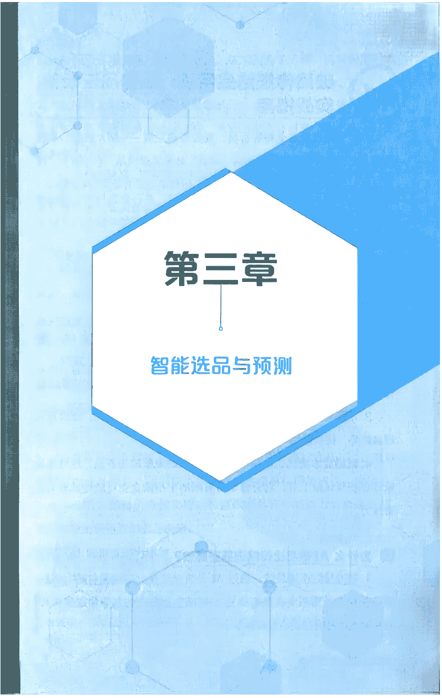

### 01 破局传统选品困境：智能选品三步打法实操指南

一位义乌小商品经营者曾感慨，自己选品靠朋友推荐、平台热搜和第六感，结果“爆款”很快变成滞销品，仓库成了“时尚坟场”。人工智能的介入把这种盲目选品升级为科学探矿，用数据穿透市场迷雾，让选品从跟风转向造风。本节介绍如何用智能选品提升成功率。

选品如探矿，传统老板扛着铁锹盲挖，智能系统则能一键生成藏宝图。

#### 传统选品的困境
- 1. 经验依赖性强，风险高。传统选品主要依赖老板或采购团队的“直觉”，缺乏数据支撑，易因个人偏好导致选品失败。
- 2. 数据收集与分析效率低。手动整理销售数据、竞品信息、用户评论，耗时耗力且难以全面覆盖多维数据源。
- 3. 市场预测能力薄弱。无法实时捕捉消费者需求变化，难以预判爆款趋势，错失最佳入市时机。
- 4. 试错成本高昂。新品市场表现不佳的现象较为普遍，这可能导致库存积压风险上升，对资金储备有限的中小微企业可能造成较大经营压力。

#### 为什么 智能选品 比传统选品更高效？
- 1. **精准预判市场趋势。** 通过 人工智能 分析全球各大电商平台的大数据，提前 3~6 个月预测潜在热销商品，帮助企业在市场竞争加剧前布局，避免因入场过晚而面临红海竞争。
- 2. **识别蓝海市场，避免价格战。** 人工智能 通过竞争分析，能快速找到低竞争、高利润的细分市场，避免进入高度内卷的红海市场。
- 3. **提升决策效率，降低试错成本。** 智能选品可以在几分钟内完成过去需要耗费几周时间的数据分析，大幅缩短选品周期，从而降低时间成本和人力成本。
- 4. **个性化选品，匹配特定市场需求。** 基于 人工智能 技术的需求分析系统，通过整合用户搜索行为、社交媒体趋势等多维度数据，精准识别不同区域及消费群体的商品需求特征，从而优化选品策略，提升销售转化效率。

简单来说，智能选品通过数据驱动实现精准决策，能有效规避市场风险，提高选品成功率！

#### 智能选品第一招：趋势雷达

智能选品第一招：趋势雷达——锁定蓝海赛道。用 DeepSeek 实时检测市场动态和用户需求变化，精准锁定“还没火但即将火”的品类，避免“起大早赶晚集”。

##### AI 实战

假设你是一个即将入驻淘宝的新商家，需要进行选品。可面对种类繁多的商品类目，却不知道如何选品才能抓住市场机会。别担心，DeepSeek 能为你提供数据支持，快速识别具有市场潜力的商品类目，辅助你做出更明智的选品决策。

###### 步骤 1 筛选高潜力品类
- **提问模板（筛选爆款品类）：**
> 分析【平台名称】最近【一段时间，一般是 30 天】搜索热度上升的关键词，排除头部品牌垄断品类，筛选出 TOP10 潜在爆款品类。
- **参考指令：**
> 分析淘宝、拼多多、小红书最近 30 天搜索热度上升的关键词，排除头部品牌垄断品类，筛选出 TOP10 潜在爆款品类。
- **成果示例：**
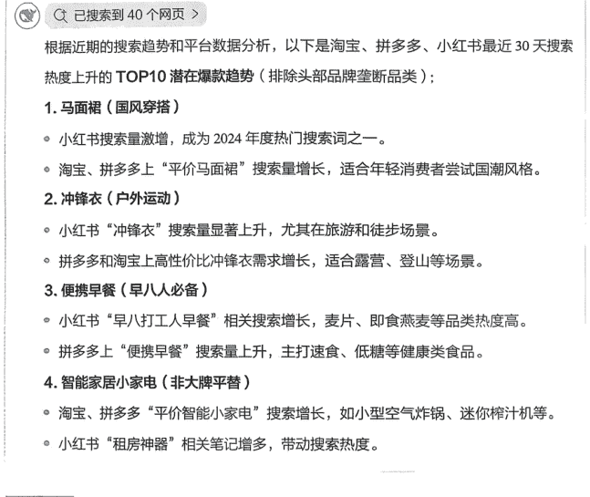
- **1. 马面裙（国风穿搭）**
  - 小红书搜索量激增，成为 2024 年度热门搜索词之一。
  - 淘宝、拼多多上"平价马面裙"搜索量增长，适合年轻消费者尝试国潮风格。
- **2. 冲锋衣（户外运动）**
  - 小红书"冲锋衣"搜索量显著上升，尤其在旅游和徒步场景。
  - 拼多多和淘宝上高性价比冲锋衣需求增长，适合露营、登山等场景。
- **3. 便携早餐（早八人必备）**
  - 小红书"早八打工人早餐"相关搜索增长，麦片、即食燕麦等品类热度高。
  - 拼多多上"便携早餐"搜索量上升，主打速食、低糖等健康类食品。
- **4. 智能家居小家电（非大牌平替）**
  - 淘宝、拼多多"平价智能小家电"搜索增长，如小型空气炸锅、迷你榨汁机等。
  - 小红书"租房神器"相关笔记增多，带动搜索热度。

###### 步骤 2 分析高潜力品类市场情况
- **提问模板（市场潜力）：**
> 分析【品类】行业的现状、未来发展潜力、消费者需求等特点。
- **参考指令：**
> 分析冲锋衣行业的现状、未来发展潜力、消费者需求等特点。
- **成果示例：**
🔍 已搜索到 50 个网页 >
####### 冲锋衣行业现状、未来发展潜力及消费者需求特点分析
######## 一、行业现状分析
1. **市场规模与增长**
   - 中国市场：2025 年中国冲锋衣市场规模已突破百亿元，年复合增长率达 10% 以上，主要受益于户外运动普及和消费升级。
   - 全球市场：预计 2025 年全球冲锋衣市场规模超 100 亿美元，亚太地区（尤其是中国）为主要增长引擎。
   - 销售渠道：线上销售占比 55%，电商平台（如天猫、京东）成为主要增长点，线下实体店向体验式消费转型。
2. **竞争格局**
   - 国产品牌主导：探路者、骆驼、凯乐石等本土品牌占据 60% 市场份额，主打性价比和本土化设计。
   - 国际品牌竞争：北面（The North Face）、哥伦比亚（Columbia）、始祖鸟（Arc'teryx）等国际品牌占据 30% 份额，聚焦高端市场。
   - 新兴品牌崛起：蕉下等互联网品牌及运动品牌（如安踏、李宁等）跨界进入，推动行业多元化竞争。
3. **产品趋势**
   - 功能创新：GORE-TEX、PTFE 等高科技面料广泛应用，防水、透气、防风仍是核心卖点。
   - 时尚化：冲锋衣从专业户外装备演变为潮流单品，亮色系、小香风、法式穿搭等风格涌现。
   - 环保材料：可持续面料（如再生聚酯纤维）需求上升，品牌推出环保系列以迎合消费者偏好。

###### 步骤 3 交叉验证真实性
在决策前，用淘宝生意参谋或小红书后台数据查看"冲锋衣"近期的搜索量和笔记互动量，确认其趋势上升的真实性。

###### 步骤 4 确定品类方向
冲锋衣未来市场潜力仍可观，是蓝海赛道，锁定该品类。

#### 智能选品第二招：需求洞察显微镜

智能选品第二招：需求洞察显微镜——从差评反推精准改良。用 DeepSeek 挖掘用户真实痛点和购买原因，直击市场真实需求。

##### AI 实战

已确定选择冲锋衣品类，但面对市场上五花八门的款式和功能宣传，你不确定用户到底需要什么。如果盲目地选品或是生产可能会导致库存积压，这样既浪费时间，又白白耗费资金。接下来不妨让 DeepSeek 帮助你剖析用户真实需求。

###### 步骤 1 挖掘产品痛点
**提问模板（高频需求点）：**
> 挖掘【平台名称】上用户对【品类】的真实痛点以及购买原因，分析用户评论和讨论中的高频需求点。
**参考指令：**
> 挖掘小红书上用户对冲锋衣的真实痛点以及购买原因，分析用户评论和讨论中的高频需求点。
**成果示例：**

####### 小红书冲锋衣用户真实痛点与购买原因分析
######## 一、用户购买冲锋衣的核心原因
1. **功能性需求**
   - 防水、防风、透气：用户最关注冲锋衣的基础性能，尤其是户外爱好者，强调"暴雨不湿身""大风天保暖"等实际体验。
   - 三合一设计：可拆卸内胆的冲锋衣受欢迎，适应多种天气，如"春秋单穿外壳，冬天加内胆"成为高频评论。
2. **时尚与穿搭适配性**
   - 潮流化设计：亮色系（红、黄、渐变）冲锋衣在小红书被广泛种草，用户认为"冲锋衣不再是土味户外装，而是酷飒穿搭单品"。
   - 百搭性：用户喜欢冲锋衣与瑜伽裤、工装裤、长裙等搭配，形成"山系风""小香风"等风格，满足日常通勤和户外需求。
3. **高性价比**
   - 替代羽绒服：许多用户提到"不是羽绒服买不起，而是冲锋衣更有性价比"，认为冲锋衣能穿三季（春秋防风、冬季加绒），性价比更高。
4. **社交媒体种草效应**
   - KOL 推荐：用户被小红书博主"真实测评"和"穿搭分享"种草，尤其是"防水实测""保暖性对比"等内容影响购买决策。
   - 明星同款效应：北面、始祖鸟等品牌因明星带货成为热门选择。
######## 二、用户真实痛点
1. **功能性缺陷**
   - 不保暖：部分用户吐槽"冲锋衣只防风不保暖，冬天单穿冻成狗"，尤其是低价款填充不足。
   - 透气性差：长时间穿着后"闷汗""内衬湿透"，影响舒适度。

###### 步骤 2 定位用户需求
**提问模板（需求挖掘）：**
> 用户在购买【品类】时最关心的三个方面是什么？
**参考指令：**
> 用户在购买冲锋衣时最关心的三个方面是什么？
**成果示例：**

小红书用户真实诉求：硬壳外套到底买什么

把平台真实笔记和行业拆解对照起来，硬壳外套的购买决策主要被两类诉求拉动。

1. **功能仍是入场券**
   - 防雨抗风和透气是被反复提及的要点。不少笔记提到下大雨时内部依旧干爽、强风环境下不易被灌风，对极端天气下的稳定防护有明确要求。
   - 透气舒适度很敏感。长时间徒步登山场景中，闷热出汗、内层潮湿的差评不在少数，持续运动时的散热体验会直接影响复购意愿。
   - 保暖认知有分歧。可拆卸内胆的组合结构更受青睐，但低价款常被吐槽仅挡风不聚热。消费者更倾向轻薄高效的保暖技术，比如热反射涂层这类有技术感的卖点。

2. **颜值与场景适配成增量**
   - 设计走向潮流化。高饱和色如荧光黄、渐变紫，拼接版型、修身剪裁是种草高频词汇，硬壳外套搭配瑜伽裤、户外风通勤等穿搭在平台持续走热。
   - 使用场景在破圈。用户排斥传统户外感，希望单品能自然衔接通勤、城市休闲等日常场合。
   - 个性化需求增强。对撞衫频率高的抱怨明显，小众联名、定制配色在年轻人群中溢价能力更强。

选品前建议先在小红书搜索“冲锋衣痛点”“冲锋衣推荐”，翻看真实笔记确认高频抱怨是否与模型判断一致。再到淘宝、拼多多查看成交量前十商品的评价，核实防水、款式、价格是否仍是核心关注点。上架时优先锁定防护扎实且颜值在线的产品，并在标题、详情页、投放文案里把这两大卖点前置，直击用户顾虑。

#### 第三斧：成本透视

成本透视的核心是把全链条算清楚，避免当冤大头。用 DeepSeek 模拟整链成本与市场反馈，打破只盯进货价的老思维。

##### 实战操作

款式与功能卖点已确定，但在 1688 上面对多家报价和激烈竞争时难以抉择，担心定价失误侵蚀利润。这时可让 DeepSeek 把全链成本算明白并给出决策参考。

###### 步骤 1 了解市场行情

**提问模板（竞争情况）：**

> 拆解【平台】上不同供应商的价格带、品质差异与交期，以及当前市场竞争态势与价格敏感度。

**参考指令：**

> 拆解 1688 上多家供应商的价格、质量和交货周期，并结合淘宝、拼多多的竞争格局与价格敏感度。

**成果示例：**

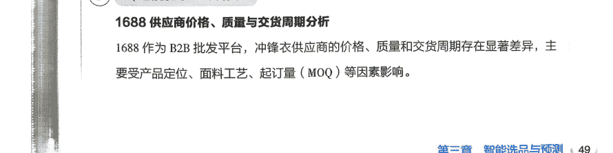
####### 1. 价格区间分析

- 低端（100~200元）：多为单层PU涂层面料，防水指数3000~5000 mm，适合日常防风防泼水需求，如"户外单层冲锋衣"批发价85~120元。

- 中端（200~300元）：三合一冲锋衣（可拆卸内胆）为主，防水指数5000~8000mm，如"杰格狼王三合一冲锋衣"标价168~238元。

- 高端（300~500元）：采用PTFE防水膜或进口面料，防水10000mm+，如"亚马逊专业冲锋衣"320~450元。

####### 2. 质量评估

| 价格区间 | 防水性能 | 透气性 | 工艺细节 | 面料真实性 |

|:---|:---|:---|:---|:---|

| 100~200元 | 短时防小雨 | 一般，易闷热 | 基础缝制，部分压胶 | 部分虚标"GORE-TEX同级" |

| 200~300元 | 中大雨防护 | 较好 | 全压胶，防水拉链 | 部分国产PTFE膜达标 |

| 300元+ | 暴雨级防护 | 优异 | 精密做工，强化易损部位 | 进口膜或高端自主研发 |

###### 步骤 2 设定合理售价

> **参考指令：**

在保证质量的前提下，如何选择性价比最高的供应商，并设定合理的售价？

> **成果示例：**

已深度思考（用时 32 秒）

在保证质量的前提下选择高性价比供应商并制定合理售价，需要一套系统化的评估体系和定价策略。以下是分步骤的解决方案：

####### 一、供应商筛选三维评估模型

1. **质量验证体系**

   - 硬性指标：要求供应商提供CNAS认证的检测报告（防水≥8000 mm，透湿≥5000 g/㎡/24h）。

   - 工艺核查：重点检查压胶宽度（≥13 mm）、缝线密度（≥8针/3 cm）等关键工艺参数。

   - 样品测试：进行5次洗涤后防水测试，性能下降不超过20%。

###### 步骤 3 交叉验证真实性

DeepSeek 的成本模拟很实用，但数据可能有偏差。建议登录 1688 实际询价，确认供应商的报价和交货周期，并在淘宝或拼多多搜索"冲锋衣"查看当前主流价格区间，确保 DeepSeek 的建议贴近现实。同时，可以在下单前，与多家厂商沟通邮寄样品并测试防水性能，并在淘宝或拼多多投放小规模广告（预算 500 元），观察该定价下的点击率和转化率，验证市场接受度。

###### 步骤 4 定位决策

通过测评，选择福建某供应商作为主要合作伙伴，同时在营销中强调防水功能性和时尚设计，确保利润与销量的平衡。

通过这三把"斧头"，你锁定了冲锋衣这一潜力品类，通过需求洞察明确了用户的核心诉求，再通过成本透视优化了供应链和定价策略。这是一个环环相扣的决策流程，让你在电商运营中不仅快人一步，更能稳操胜券。

用 AI 选品的本质是开卷考试——答案都在用户嘴里，你只需要学会提问。赶紧打开 DeepSeek，严格按照流程进行操作，第一个 AI 选品方案就诞生了！

### 02 破解跨境选品迷局

学会用 DeepSeek 做国内选品后，下一步要理解跨境与本土选品的差异。无论是刚入局的小团队还是深耕多年的跨境老手，都可按此框架提升成功率并规避坑点。

本土与跨境像是两个赛场。阿里巴巴国际站面对的是全球买家，1688 服务的是国内市场，市场属性的根本不同决定了选品与运营策略必须切换。

#### 确定选品目标——从当地市场需求出发

选品不是挑热销榜单，而是要精准捕捉当地需求、趋势与消费痛点。商品定位、价格敏感度、文化适配度差异很大。跨境选品的核心是判断市场需求与文化匹配度。DeepSeek 的数据汇总能力可帮助快速获取精准的市场信号。

##### 实战操作

确定目标平台如亚马逊、TikTok、Temu、AliExpress 等，并明确经营模式，本次以自备货的跨境店为例，示范地区选俄罗斯，平台选 Ozon。

###### 步骤 1 确定推荐品类

**提问模板（推荐品类）：**

> 我计划【时间】在【平台】开【品类】店，结合当地消费习惯、季节气候、文化背景与过往电商周期数据，建议布局哪些品类？

**参考指令：**

> 我打算 2025 年 4 月在 Ozon 开店，结合俄罗斯的消费习惯、气候变化、文化背景及历史电商周期数据，推荐哪些品类？

**成果示例：**


基于俄罗斯市场的消费习惯、季节性需求、文化背景及 Ozon 平台的销售数据，以下是 2025 年 4 月起适合布局的品类推荐及具体策略分析：

- **一、季节性品类：夏季与过渡性需求**

  - **1. 夏季户外与清凉用品**

    - 防晒与露营装备：俄罗斯夏季（6-8 月）气温升高，防晒霜、太阳镜、遮阳帽等需求激增。此外，露营帐篷、野餐垫、便携式烧烤架等户外用品在春夏过渡期开始畅销。

    - 清凉家电：小型风扇、便携空调、制冷饮水机等小家电因物流成本低且适配俄罗斯夏季需求，销量表现突出。

  - **2. 家居季节性产品**

    - 防蚊用品：夏季蚊虫活跃，防蚊网、电蚊拍、驱蚊喷雾等家居防护类产品需求上升。

    - 季节性家居装饰：如轻薄的窗帘、凉席等，符合俄罗斯消费者因天气调整家居环境的习惯。

- **二、长期稳定增长的刚需品类**

  - **1. 3C 电子与智能设备**

    - 手机及配件：俄罗斯本土 3C 供应链薄弱，中国的高性价比手机、耳机、智能手表等需求旺盛，尤其注重产品功能创新（如防水、长续航等）。

    - 小家电：电动牙刷、美容仪、空气炸锅等小体积、高附加值产品更易通过物流限制，且佣金率较低。

###### 步骤 2 适当删减

DeepSeek 的推荐往往宽泛，可凭判断剔除不合时节品类，如夏季已至可去掉防风外套、保暖内衣，再从剩余品类中筛选感兴趣的方向。

#### 科学验证选品——步步为营地持续验证

DeepSeek 无法实时抓取跨境站商品数据，需进一步验证是否可一件代发、是否属蓝海、是否有利润空间等。

##### 实战操作

**步骤 1** 分别安装浏览器插件

可选择 DeepL、OZONBIGSELL、火山翻译并注册登录，三者均免费。

- DeepL：把对话内容译为俄文。
- OZONBIGSELL：查看 Ozon 商品属性、费用、竞品等信息。
- 火山翻译：翻译 Ozon 网页内容。

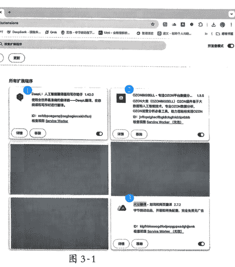

**步骤 2** 插件应用

1. 用 DeepL 插件把关键词译出，如太阳镜。
2. 在 Ozon 检索该词，优先看首页是否有中国发货商品，送达时间 10~15 天的。若无，说明竞争不充分需另选。若发现销量不错的单品则进入下一步。

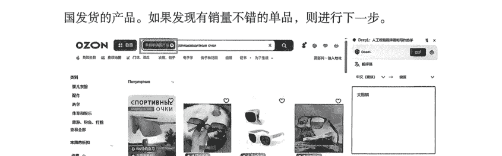

图 3-2

3. 用 OZONBIGSELL 下载单品信息。点击悬浮蓝按钮的“产品查询”，在弹窗中点“导出数据”，即可获取关键词在 Ozon 首页的数据，多导出几页供 DeepSeek 分析。

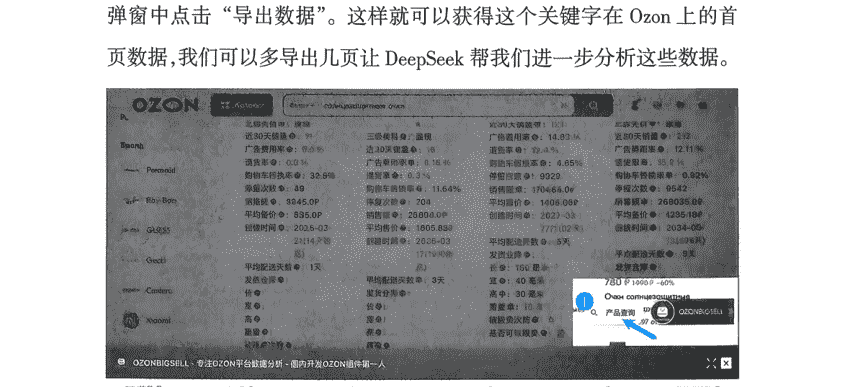

图 3-3

###### 步骤 3 可行性分析

把品类数据上传 DeepSeek 做可行性研判。确认可做跨境店后，需重点分析竞品价格与利润，需借助真实数据判断是否跟进。

**参考指令：**

> 按你的建议，我现在锁定太阳镜作为跨境店选品，已查到 Ozon 上中国发货太阳镜的销售数据，请据此分析是否值得跟进。

**成果示例：**

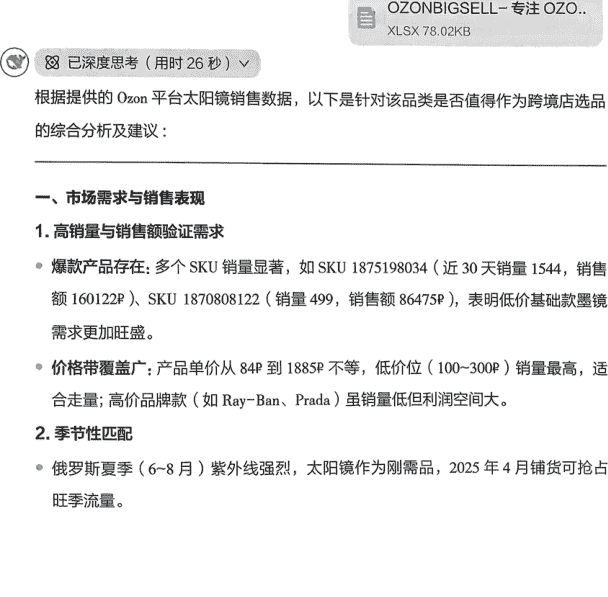
####### 二、竞争点与风险点

1. 市场竞争激烈

- 跟卖现象普遍：多个SKU被跟卖2~8次（如SKU 1893467991被跟卖3次），需通过差异化设计（如防蓝光、偏光功能）或品牌合作进行突围。

- 低价内卷严重：无品牌产品（без бренда）占比超90%，需避免陷入纯价格战。

2. 退货率与质量风险

- 部分产品退货率高：如SKU 1925062913退货率50%，SKU 1890999653退货率56.6%，需严格把控供应链质量，优化产品描述（如标注材质、UV防护等级等）。

3. 广告成本压力

- 广告费用率两极分化：部分新品广告费率超200%（如SKU 1896717192为238.47%），需精细化投放（如聚焦高转化关键词、利用Ozon促销活动）。

此时 DeepSeek 的输出已具备很强参考价值，明确可跟进竞品、潜在风险与运营建议。后续可在表格中筛选合适商品，再通过识图与文字描述在 1688 等集采平台找到同款，快速上架验证。

#### 选品方向有误——及时动态调整选择

掌握方法不代表万无一失。若初期方向验证后发现季节不合、竞争力不足等问题，可通过新提示词调整方向。

**参考指令：**

> > 智能手机壳已被太多本土卖家占据，中国发货根本打不过，能否推荐中国卖家销量高且增速快的品类，我不想与本土卖家硬卷。

成果示例：

结合俄罗斯需求与中国供应链优势，以下是避开本土红海、适合中国发货的高增速潜力品类及运营思路：

##### 一、避开红海，聚焦本土难替代的垂直赛道

###### 1. 智能家居与小家电

推荐理由：
- 本土供应薄弱：俄罗斯智能家居渗透率不足 15%，技术有限，高度依赖进口。
- 高附加值轻物流：体积小、溢价空间大，适合跨境直发。

细分方向：
- 智能清洁配件：扫地机器人刷头、滤网、迷你吸尘器车载款。
- 环境调控小家电：USB 加湿器、便携空气净化器。
- 厨房创新工具：智能电热杯、折叠电煮锅。
- 数据支撑：Ozon 2024 年智能小家电年增速超 45%，中国卖家占比达 68%。

###### 2. 创意 3C 数码周边

推荐理由：
- 本土设计迭代慢，消费者偏好新奇功能。
- 配件类供应链成熟，可快速补货。

细分方向：
- 办公/游戏场景：iPad 磁吸类纸膜、手机散热背夹。
- 健康监测：蓝牙体温计、紫外线消毒盒。
- 个性化配件：AI 图案定制手机壳、磁吸充电宝。

明确新方向后重复步骤一与步骤二即可。按此三步法，可持续找到高增长、低竞争的爆款。

### 03 获取本土化爆款的密码

海外爆款逻辑不能直接搬到中国。例如某卖家模仿海外“太阳能猫窝”，因中国城市养宠家庭空间小、光照不足，转化率不足 0.3%。本土化捕捉需结合平台流行趋势与 AI 工具。

#### 清楚定位本土化"战场"

选品前先定义目标区域与人群：是华南新手父母、东北户外爱好者，还是江浙沪精致白领？

思考三问：
1. 产品最适合哪个地域？考虑气候、文化、经济水平。
2. 该地域哪些特定人群是核心目标？年龄、性别、职业、兴趣。
3. 资源在哪个区域更有优势？供应链、物流、人脉。

#### 二 搜集本土化"情报"

AI 需要素材，素材来自反映本土特色的信息。可从以下渠道获取：

##### 1. 社交媒体平台

**抖音/快手**：观察本地用户热门内容、挑战、本地梗、方言段子，了解生活方式与关注点。

**小红书**：搜索“地域 + 关键词”，如“广州周末去哪儿”“成都小吃探店”，查看本地种草笔记与消费偏好。

**微博**：关注本地资讯博主、同城话题，了解热点事件与居民讨论。

##### 2. 本地生活与点评平台

**大众点评/美团**：查看本地热门餐厅、店铺评价，了解消费习惯与口味偏好。

##### 3. 电商平台

**淘宝/京东/拼多多**：搜索“地域 + 品类关键词”，如“四川特产”，观察推荐与商品标题中的地域描述。

##### 4. 本地新闻与论坛

关注本地政府官网、新闻门户、地方论坛，了解政策导向、大型活动、社区热点。

##### 5. 搜索引擎

**百度/搜狗**：搜索“地域 + 关键词”，观察搜索趋势变化。

以小王为例，他在广东做线上茶具，发现夏季凉茶本地热销。锁定广东省，核心人群为 25~45 岁重养生、有饮凉茶习惯的消费者。

搜集线索：
1. 小红书搜“广东凉茶”，用户分享自制配方、讨论祛湿下火功效。
2. 大众点评高分凉茶店多强调“真材实料”“古法熬制”。
3. 本地新闻提到今夏广东可能持续高温。

#### 启动 AI 大脑——用 DeepSeek 挖掘洞察

把线索喂给 DeepSeek，做深度分析、趋势预测与创意生成。

##### 提问模板

###### 模板 1：区域趋势与需求分析

> **角色：**
> 你是一位经验丰富的中国市场分析师，尤其擅长洞察特定地域的消费趋势和本土化需求。
>
> **背景信息：**

用AI捕捉在地商机：从洞察到落地的实操方法

> 我们聚焦的市场地域是【输入目标地域】，核心用户是【输入目标人群特征】。

> 当地可捕捉的信号 / 情报如下：

> 1.【输入观察到的现象 1】

> 2.【输入观察到的现象 2】

> 3.【输入观察到的现象 3】

> 4.【（可选）输入其他相关信息】

>

> **请据此完成：**

> 基于上述情报与你掌握的市场认知：

> 1. 梳理【目标地域】里【目标人群】在【相关品类】上的尚未被满足的细分需求与痛点。
> 2. 融合【目标地域】的文化基因，如饮食习惯、气候条件、生活节奏等，展望未来3~6个月内与【相关品类】相关的在地化新品或服务可能走红的路径，至少列出3个具体方向。
> 3. 针对每个方向，简述其走热的内在机理与可操作的机会点。

>
> **呈现要求：**
>
> 以清晰的结构呈现，突出在地特色与可落地机会。

###### 模板2：在地化产品创意生成

**身份定位：**

你是一名擅长把地域特色转化为产品语言的产品经理，对中国本土需求有深入理解。

**背景资料：**

计划在【输入目标地域】推出面向【输入目标人群特征】的【输入产品大类】。

当地呈现的显著特征为：

1. 【输入地域特点1】

2. 【输入地域特点2】

3. 【输入地域特点3】

4. 【（可选）输入其他相关信息】

**任务：**

结合地域特征与人群需求，为【产品大类】构思3~5个带有【目标地域】本土烙印的创新概念。

每个概念需包含：

1. 品名与核心卖点，体现本土特色与优势。
2. 典型使用场景，解决何种具体问题或满足何种需求。
3. 在地化要点，如何融入当地口味、习俗、文化等。
4. 差异化竞争力，相较现有市面产品有何不同。

**呈现要求：**

概念要具体、有想象力，且与【目标地域】的本土特质紧密结合。

###### 模板 3：在地化传播角度挖掘

**身份定位：**

你是一名精通中国区域化营销的策略专家，擅长提炼能引发本地用户共鸣的沟通点。

**背景资料：**

拟在【输入目标地域】推广【输入你的产品/服务】，客户为【输入目标人群特征】。

当地显著特征：

1. 【输入地域特点 1】

2. 【输入地域特点 2】

3. 【输入地域特点 3】

4.【（可选）输入观察到的本地热议话题或流行语】

**任务：**

为【产品名称 / 核心卖点】构思3~5个可精准触达【目标地域】用户的本土化传播角度或宣传语。

**要求：**

1. 传播角度 / 口号，简洁有力，易引发共鸣。
2. 人群触点，适合在哪些本地化渠道或场景投放，如本地KOL、社区活动、方言内容等。
3. 沟通的核心价值，强调产品如何契合本地需求与文化。

**呈现要求：**

营销点要接地气，体现对【目标地域】文化与用户心理的理解。

##### 实战场景示范

沿用前文提及的小王使用“模板 1”向 DeepSeek 提问的案例。

**参考指令：**

**角色：**

你是一名经验丰富的中国市场研究者，擅长洞察区域消费趋势与本土化需求。

**背景信息：**

目标市场为中国广东省，目标人群为25~45岁、重视健康养生并习惯饮用凉茶的都市群体。

观察到的本地化现象：

1. 小红书上大量用户分享自制祛湿凉茶配方，并讨论不同配方功效。
2. 大众点评上主打“真材实料”“古法熬制”的凉茶铺评分普遍较高。
3. 媒体预测今年广东夏季持续高温，湿热程度可能高于往年。

**任务：**

基于以上信息及你的市场知识：

1. 分析广东省25~45岁养生人群在夏季饮品/养生产品上的未被满足需求与痛点。
2. 结合广东文化特色，如凉茶文化、汤文化、对食材的重视，预测未来3~6个月内与夏季养生饮品相关的本土化产品或服务可能受欢迎的方向，至少3个。
3. 对每个方向简要说明受欢迎的潜在原因与市场机会。

**呈现要求：**

用清晰结构作答，突出本土特色与可执行机会。

###### 成果示范：

已深度思考（用时 30 秒）

###### 一、尚未满足的细分需求与痛点梳理

####### 1. 便利性与传统工艺的冲突
- 用户希望保留古法熬制凉茶的养生价值，却缺乏时间自制。
- 现有即饮凉茶常被评价为工业化口感，难以满足“真材实料”期待。

####### 2. 科学适配与个性化缺口
- 广东人讲究体质差异，如湿热、阴虚等，但市面配方单一，缺乏精准适配方案。
- 年轻用户对中医理论理解有限，需要更直观的养生指引。

####### 3. 场景延伸与体验升级诉求
- 传统凉茶铺装潢单一，难以满足都市人群的审美与社交需求。
- 高温湿热下，用户对“养生+解暑”复合功能的需求未被充分覆盖。

###### 二、未来 3~6 个月可能走红的方向预判

####### 方向 1：即食型古法凉茶浓缩液/冻干粉
- **在地特色：**
  结合凉茶配伍智慧，采用透明化熬制流程，如标注药材产地、熬煮时长，并通过现代工艺实现便利化。
- **机会点：**
  满足居家/办公随时养生的需求，可搭配气泡水、牛奶DIY。
  通过小红书/KOL传播“3秒复刻老铺滋味”的体验，塑造“传统但不落伍”的品牌调性。

通过上述分析，小王获得了兼顾广东本土特色与用户痛点的产品方向。

#### 四 验证与迭代——让市场检验

人工智能给出的方向只是基于数据的推演，最终可行性仍需市场验证。可从三方面入手。

##### 1. 小范围试探
**MVP最小可行产品**：快速做一个简化概念，如少量手工凉茶包，通过朋友圈、本地社群预售或试用收集反馈。
**线上问卷/调研**：面向目标区域用户，了解其对AI生成概念的兴趣度与购买意愿。
**关键词测试**：在电商平台用AI建议的关键词，如“冻干祛湿凉茶”“办公室养生茶包”投放小额广告，观察点击与转化。

##### 2. 竞品深度拆解
检索AI建议的方向是否已有同类产品？其定价、评价、用户反馈如何？可借助飞瓜数据、蝉妈妈等工具辅助分析抖音、小红书上的竞品表现。

##### 3. 数据交叉验证
再次审视百度指数、电商搜索量等数据，验证AI预测的趋势是否与真实用户行为相符。

#### 五 落地执行——打造在地化爆款

验证后确定最有潜力的方向即可落地。

**产品打磨**：据测试反馈优化配方、口味、包装，强化本土特色与核心卖点。
**渠道选择**：挑选最适合触达区域用户的渠道，如本地生活服务平台、区域电商、本地社群、区域线下门店合作等。
**营销推广**：运用DeepSeek挖掘的本土化营销点，与本地KOL合作，创作方言、本地梗、生活场景内容，在目标用户活跃平台精准投放。
**持续优化**：上线后持续关注用户反馈与销售数据，利用AI工具监控本地市场动态，不断迭代产品与策略。

##### 注意事项：

1. DeepSeek等AI工具的输出仅为建议，需结合商业判断与实际市场筛选验证。
2. 工具与平台持续更新，保持学习探索心态。
3. 涉及飞瓜数据、蝉妈妈、百度指数等工具，需自行了解最新功能与使用方法。

把握在地化爆款密码，不再依赖直觉与运气。通过“明确战场→信息搜集→AI洞察→市场验证→落地执行”五步法，结合DeepSeek等AI的信息处理与创意生成能力，可系统性识别区域市场的差异化商机，做出更精准决策。

### 04 DeepSeek 快速生成产品分析报告

在竞争激烈环境下，市场变化快、产品周期短。中小微企业需要实时监测、竞品追踪与需求洞察，但传统分析耗时费力且门槛高。DeepSeek能在短时间内生成专业报告，解决这一难题。

#### 为什么用 DeepSeek 做产品分析？

假设你是一位电商负责人，计划推出新护肤品。传统方式需收集数据、整理分析、撰写报告，可能耗时数周。

DeepSeek的优势：
- 对复杂需求快速响应，显著缩短报告生成时长。
- 自动整合多源公开数据，如行业报告、企业财报并交叉验证。
- 一键生成可视化图表，支持柱状图、SWOT等常用模板。

#### 如何让 DeepSeek 听懂需求？

新手常抱怨内容太泛，根源在于提问不够精准。记住黄金公式：定义目标、限定范围、明确交付。

##### 1. 锁定核心问题，5W1H原则
- What：分析对象？
- Why：分析目的？
- When：时间范围？
- Where：地域范围？
- Who：目标人群？
- How：分析方式？

错误示范：“给我一些咖啡店的数据。”
正确示范：“请分析2025年上半年中国一线城市咖啡市场的增长态势，聚焦年轻白领的消费偏好与行为，并以销量与用户评价为依据。”

##### 2. 设定分析框架，用模板拆解
DeepSeek对结构化需求响应更佳，推荐“四层漏斗法”。
- 行业层：规模、趋势、政策。
- 竞争层：主要品牌、份额。
- 用户层：画像、偏好、痛点、动机。
- 数据层：关键指标、来源。

##### 3. 校准输出结果，三个验证动作
AI内容需人工复核，重点看：
- 数据时效性：政策、销量是否为最新。
- 逻辑一致性：内容清晰、分析合理、无前后矛盾。
- 商业洞察深度：是否提供有价值的洞察与建议。

##### AI 实战

假设你是一家运动手环品牌负责人，计划用AI分析市场机会。

**步骤 1  输入指令**

**参考指令：**

```
请按照以下框架生成 2025 年运动手环市场的分析报告：
行业层：市场规模、增长趋势、相关政策（如健康科技补贴等）。
竞争层：小米、华为、Fitbit 等品牌的市场份额对比。
用户层：年轻消费者的运动习惯、健康意识。
数据层：引用 Statista 和 IDC 的数据，需用饼图展示市场份额。
```

**步骤 2  拿到 AI 生成结果**

AI会自动抓取相关数据，生成含市场规模、主要品牌、消费者偏好等内容的报告，并给出针对性建议，如“推出具备社交功能的运动手环，满足年轻用户需求”。

**成果示范：**

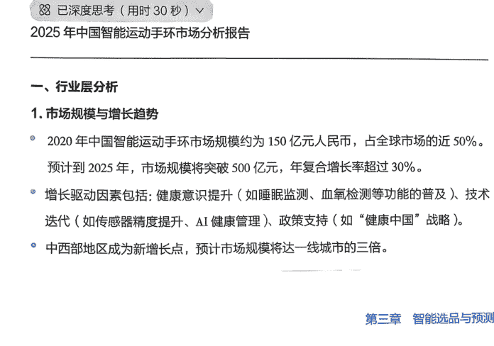

##### 2. 政策环境

- 政府通过税收优惠、研发补贴推动智能硬件创新，重点扶持国产芯片与传感器以降低进口依赖。
- 2025年《提振消费专项行动方案》提出以旧换新，鼓励购买智能手环等健康设备。
- 简化市场准入流程，优化审批，降低企业运营成本，加速产业链完善。

##### 步骤 3 校准优化

据AI报告，可进一步调整提示词，如“增加电池续航的消费者偏好分析”，让报告更贴合实际需求。

#### 进阶技巧：让报告更有业务价值

##### 1. 关联KPI：提问中绑定业务目标
目标是“提升某品牌市场份额5%”，可提问：“请分析2025年上半年某品牌在目标市场的表现，聚焦份额变化、竞品策略及用户反馈，结合KPI提出改进建议。”

##### 2. 预判决策需求：加入风险预警与应对建议
发现“原材料价格上涨可能推高成本”，可提问：“请分析2025年上半年某行业原材料价格走势，预判对成本的影响，并提出应对建议，如寻找替代供应商或调整定价。”

##### 3. 提供针对性建议
不要停留在分析层面，要让AI给出具体行动，如优化包装、调整定价、加强社交媒体营销等。

DeepSeek虽具备强大信息处理、分析与推理能力，但不能替代思考。它只是把耗时耗力的机械劳动交给AI，释放精力用于决策判断。合理使用AI，可为业务决策提供有力支撑。赶快试试，让AI成为市场分析的好帮手。

### 05 抖音小店潜力爆款预测

在抖音动态流量环境下，准确预判潜力商品是提升运营效率的关键。本节演示如何结合抖音生态数据工具与AI大模型，精准挖掘爆款潜质商品。

#### 核心思路：数据洞察 + AI预测 = 精准选品

利用专业数据工具捕捉平台实时动态、热门趋势、用户偏好与竞品表现。
借助AI，如DeepSeek，对海量信息进行深度分析、模式识别与趋势预测，生成选品建议与策略。

#### 如何准确预测抖音爆款商品

##### 1. 明确赛道与目标用户
开始前需清晰：
- 主营品类是什么？如女装、家居日用、美妆护肤、零食、母婴等。
- 核心目标用户画像如何？如年龄、性别、地域、兴趣、消费习惯、刷抖音时段等。

##### 2. 利用数据工具收集关键信息
常用工具：
- 蝉妈妈：提供抖音直播、短视频、商品多维度数据，适合分析达人带货、爆款榜单、行业趋势。
- 飞瓜数据：功能类似，提供全面抖音电商数据。
- 抖店罗盘：官方后台工具，关注店铺经营数据、流量来源、商品表现、用户画像。

关注点：热门趋势、竞品分析、用户洞察。

**热门趋势：**
- 近期销量、销售额、增长率飙升的商品榜单。
- 热门话题、挑战、BGM关联商品。
- 直播带货放量品类。
- 搜索量快速增长的关键词。

**竞品分析：**
- 同类目优秀竞品的价格、卖点、材质、设计。
- 竞品营销方式：短视频内容、直播话术、投放策略。
- 用户评价与反馈。

**用户洞察：**
- 目标用户近期关注内容。
- 抖店罗盘提供的用户画像。

##### 3. 整合信息，用 DeepSeek 进行深度分析与预测
将第二步收集的信息结构化输入DeepSeek，进行提炼、分析与预测。

##### 4. 小范围测试与快速迭代
AI给出高潜力选项后，需小范围测试：
- 测款：选1~2款潜力产品，小批进货或一件代发，低成本试水。
- 内容测试：制作不同风格、卖点的短视频小流量投放，观察点击率、转化率、评论。
- 直播测试：在直播中引入新品，观察互动与转化。
- 收集反馈：关注评论、私信，了解真实看法。
- 策略调整：表现好则加大投入，不佳则止损优化，循环“数据收集→AI分析→测试验证”。

**注意事项：**
1. 数据时效性：建议使用24小时内更新的实时数据。
2. 平台规则：选品与推广须遵守抖音平台规则与政策。

#### 用 DeepSeek 进行深度分析的提问模板

结构化提问可提升回答质量。提供三个参考模板，可按需微调。

##### 模板 1：趋势分析与品类机会挖掘
作为资深抖音电商选品专家，请基于以下信息，分析【你的行业/品类，如女装/家居日用】在未来【时间范围，如1~3个月】可能出现的爆款与潜力细分品类。

已知信息：
1. 目标用户画像，如25~35岁女性、一二线城市、重性价比与款式、常在晚8~10点刷抖音。
2. 近期抖音趋势，如“美拉德”穿搭持续火热、便携小家电搜索上升等。
3. 数据平台观察，如某商品本周销量飙升300%、关键词搜索指数增长。
4. 竞品动态，如竞品A主推某材质，用户评价集中在某方面。

请分析：
1. 结合信息，哪些细分品类或产品特性最可能成为下一个爆点？
2. 是否存在未被满足的用户需求或市场空白？
3. 有哪些潜在“黑马”产品值得关注？说明理由。

##### 模板 2：特定产品潜力评估与优化建议
考虑在抖音小店上架【具体产品名称或描述，如可折叠便携式电热水壶】，目标用户为【目标用户画像】。

已知信息：
1. 产品特点：主要卖点、材质、规格、预估价格等。
2. 市场观察：抖音上已有类似产品，销量最好为某品牌，价格区间，用户评论关注便携性、烧水速度与安全性。

3. 核心资源盘点

请以抖音爆款操盘手的视角，对这款商品的起量空间做一次专业研判，并给出可落地的优化思路：

1. 在当前抖音生态下，该商品跑出爆款的概率有多大？请从需求热度、竞争态势、产品差异化等维度展开判断。
2. 若要提升走红概率，在产品形态、功能配置、价格带或投放打法上有哪些优化空间？
3. 针对该商品，有哪些新颖的短视频内容方向或直播带货的切入方式？

模板 3：爆款因子组合与创意孵化

请扮演熟稔抖音爆款规律的产品策划，为【你的品类/行业】面向【目标用户画像】设计一款具备潜力的产品。

请结合以下可能的爆款要素/趋势进行推演：

- 要素 1：【如国潮文化】
- 要素 2：【如情绪价值/解压】
- 要素 3：【如便携/多功能】
- 要素 4：【近期抖音热点或流行梗，如“听劝”】
- 要素 5：【特定材质或工艺，如环保材料】

请输出 3~5 个在抖音具备传播可能性的产品概念，每个概念包含：

1. 产品名称/描述。
2. 核心卖点，需融合上述要素。
3. 目标用户痛点/痒点。
4. 初步定价区间建议。
5. 简述该概念为何有机会在抖音火起来。

把数据工具的洞察和 DeepSeek 等大模型的分析预测能力打通，就能更精准把握市场动向，发掘并孵化属于自己的抖音小店爆款，让模型真正成为助力生意增长的得力助手！

---

## 第四章

## 用更少投入做流量：流量变革

#### 01 老式获客的五大硬伤

在竞争白热化的当下，流量是企业存续的核心命脉。哪怕产品不错，没有流量支撑也极易被淹没。过去常见的获客方式，看似有效，实则暗藏五大硬伤。本节拆解传统获客的底层痛点，为后续人工智能赋能获客提供依据。

##### 硬伤 1：获客开销持续攀高，盈利被挤薄

众多商家反映，平台投放费用逐年上涨，投产比却持续走低。以淘宝直通车为例，点击单价从几年前的 0.5 元左右涨到 3~5 元，中小商家利润被严重侵蚀。根源是流量红利退去、平台议价权增强。供给小于需求时，竞价机制推高价格，商家陷入内卷。

破解思路：借助人工智能做精准投放。利用人群画像、行为预测等手段锁定目标人群，减少无效曝光，提升转化效率。

##### 硬伤 2：留存弱，复购乏力

线下门店活动时人声鼎沸，结束后门可罗雀；线上用户一次性下单后难再触达，复购率普遍不足 10%。本质是传统渠道缺乏粘性。商家与用户仅形成单次交易，未建立长期价值连接。

破解思路：用人工智能驱动私域运营。搭建标签体系，通过个性化推荐、会员分层等方式增强粘性，拉动复购，例如按偏好推送定制化商品。

##### 硬伤 3：投放不准，转化打折

在社交媒体投放广告时，常出现引流成本高昂、成交却很低的情况。如抖音信息流点击率尚可，实际付费不足 1%。本质是流量质量参差不齐。传统定向偏粗放，如年龄、地域，忽视真实需求与行为特征。

破解思路：用人工智能做精准匹配。解析用户评论、搜索词挖掘潜在需求，实现千人千面的内容推送，例如为敏感肌用户推荐温和型护肤品。

##### 硬伤 4：过度依赖平台，抗风险弱

商家常因平台规则调整如搜索权重变化导致流量骤降，业务受重创。如 2022 年某平台算法更新后，部分商家排名下降 50% 以上。本质是商家被动适应规则，缺乏自主获客能力。

破解思路：用人工智能构建私域池。借助企业微信、小程序等工具把用户沉淀到自有渠道，实现去平台化运营，例如用户扫码入群享受专属福利。

##### 硬伤 5：数据割裂，决策缺依据

多数企业仍靠 Excel 手工统计，维度单一、效率低下。如某实体店只统计日客流，却无法追踪消费轨迹，本质是数据资产未被利用。传统获客下各渠道数据割裂，难以形成全局洞察。

破解思路：用人工智能整合与分析。通过跨平台采集、自动化报表，为企业提供画像、转化漏斗等可视化工具，例如用人工智能生成用户行为热力图，直观呈现高转化区。

你是否也被传统获客的五大困局困住？不必焦虑，人工智能已带来突破性解法，提供低投入、高效率、精准触达的新型获客方式。接下来一起探索如何用人工智能赋能业务，开启低投入获客新篇章！

### 人工智能流量矩阵搭建

#### 02 搜索流量：智能 SEO 玩法

上一节拆解了传统获客的五大伤点，不少老板会焦虑：“难道只能眼睁睁看成本涨？”其实人工智能驱动的智能流量矩阵正让“小预算撬动大效果”成为现实，用便利店的预算做出连锁店的效果。本节围绕搜索、内容、社交三大板块，教你搭建全方位流量生态。

##### 常规 SEO 与智能 SEO

###### 1. 什么是常规 SEO

通俗说，常规 SEO 是通过技术与策略优化网站或内容，提升其在百度、搜狗、360 等搜索引擎自然排名，吸引免费精准用户。主要包含四个要素。

**关键词：** 用户在搜索框输入的词，即用户会用什么词找到产品。
**内容质量：** 提供有价值、原创且与关键词高度相关的内容。
**站内技术优化：** 结构、加载速度、移动端适配等。
**外链建设：** 其他高质量站点指向你的链接。

常规 SEO 需要长期投入与专业团队，对中小微企业门槛高、见效慢。

###### 2. 人工智能驱动的智能 SEO：新时代流量密码

如今已从搜索引擎时代转向平台时代，“种草”搜小红书，购物搜拼多多、淘宝，教程搜抖音，解惑搜大模型。人工智能尤其是大语言模型如 DeepSeek，正在改写 SEO 规则。

**更懂意图：** 模型能精准理解查询背后的真实需求，而非仅匹配字面词。
**创作提速：** 模型可辅助甚至主导高质量内容生成，大幅降低成本与时间。
**个性化与预测：** 模型能分析行为、预测搜索趋势，提前布局内容。
**数据洞察：** 模型能快速处理海量数据，提炼优化建议。
**长尾流量：** 指搜索量不高但意图明确的长词组合，如“夏季透气小白鞋女学生推荐”。单个流量小，但汇聚起来巨大且精准，模型大幅简化了发现与覆盖过程。

智能 SEO 的核心是借助模型提升效率与效果，尤其挖掘满足长尾需求。

##### 以小红书为例，教你玩转智能 SEO

小红书已不只是分享社区，更是生活方式搜索引擎与种草决策入口。用户主动搜索、被动接受推荐，因此掌握其 SEO 对低投入获客至关重要。

借助模型特别是 DeepSeek，从选题、关键词、内容创作到发布互动，全流程优化笔记，提升被目标用户搜到与看到的概率，最终实现高效种草与引流。

###### 1. 掌握平台规则

小红书流量靠“搜索 + 推荐”双轮驱动。

- **主动搜索：** 用户在顶部搜索框输入关键词找内容。笔记标题、正文、话题标签中的关键词直接影响排序。
- **个性化推荐：** 首页 Feed 流依据兴趣标签、互动历史、停留时长推送。优质且高互动的笔记更容易进入推荐池，获得爆发流量。

###### 2. 影响笔记命运的关键因素

- **匹配度：** 内容与用户搜索词的契合度。
- **内容价值与质量：** 是否原创，能否提供实用信息、情感价值或娱乐价值，图文精美度，视频清晰流畅度等。
- **互动数据：** 点赞、收藏、评论、分享，尤其是发布初期的互动率直接影响后续推荐量。
- **账号垂直度与权重：** 长期深耕领域、持续产出优质内容、积极互动，可提升账号权重。
- **话题标签：** 帮助平台理解内容分类，连接感兴趣用户。
- **时效性与热点：** 结合季节需求或当下热点，更易获得关注。

##### 模型实战

###### 步骤 1 精准定位，深耕你的“一亩三分地”

平台鼓励内容垂直细分。找准擅长领域持续深耕，更易建立账号标签与用户认知。

**提问模板（账号定位）：**

> 我准备在小红书聚焦【业务内容】领域，初步目标用户是【初步设想的用户特征】。请帮我分析：
> 1. 该领域/定位在小红书的竞争激烈程度如何？
> 2. 这类目标用户通常关注哪些具体话题？
> 3. 他们常用的搜索词有哪些特征？
> 请给出建议，助我更精准切入。

**参考指令：**

> 我准备在小红书聚焦手工皮具制作领域，初步目标用户是追求生活品质的手工爱好者。请帮我分析：
> 1. 该领域/定位在小红书上的竞争激烈程度如何？有哪些主要细分方向？
> 2. 这类目标用户通常关注哪些话题？偏好何种笔记风格，如干货教程、情感分享、精美图文展示？
> 3. 他们常用搜索词有何特征，如偏疑问句、是否喜欢看测评？
> 请给出建议，助我更精准切入。

**成果示例：**

- 一、竞争激烈程度与细分方向分析
  - 1. 竞争激烈程度
    - 数据显示，小红书家居类内容在 2023~2024 年搜索量增长 403%，手工皮具作为家居/时尚垂直品类，用户需求持续增长，尤其追求个性与品质的群体。
  - 竞争特点：
    - 头部品牌稀少：市场以中小品牌和个人工作室为主，缺乏垄断品牌，但部分原创设计师账号如“匠心皮具坊”已积累粉丝。
    - 内容同质化：多集中于基础教程或成品展示，缺乏深度场景化、情感化内容。
    - 平台监管趋严：小红书重点打击水军与劣质内容，强调真实用户分享，对合规原创更友好。
  - 2. 主要细分方向
    - 手工皮具可聚焦差异化细分：
    - 高端定制：婚庆、商务礼品场景，强调“一对一设计”“私人定制”。
    - 环保可持续：植物鞣革、再生皮革等，契合年轻用户可持续消费关注。
    - 小众风格：复古风、极简主义、二次元联名等，满足细分审美。
    - 功能性产品：如防猫抓皮具、多功能收纳包，兼顾实用与设计。
    - 教学与工具评测：新手工具选购指南、工艺技巧进阶课程。

###### 步骤 2 挖掘热门关键词

小红书关键词口语化、场景化、情绪化，长尾词与疑问句丰富。用户不仅搜产品，更搜解决方案、体验与灵感。

**平台内挖掘**：利用搜索框下拉联想与相关搜索、观察热门笔记标题与标签用法、关注官方话题活动。

> 提问模板（生成标题及关键词）：

我的小红书账号专注于【你的细分领域】。目标用户是【用户画像】。
请生成一批适合笔记标题、正文和话题标签的关键词与短语。要求：
1. 包含用户痛点/需求。
2. 包含场景化描述。
3. 包含情绪/效果词。
4. 表达形式多样。
请至少生成【几】个，并简单分类。

**参考指令：**

> 我的小红书账号专注于一人食快手菜谱。目标用户是经常加班的年轻独居白领。请生成一批适合小红书笔记标题、正文和话题标签的关键词与短语。
要求：
1. 包含用户痛点/需求，如省时、健康、简单易学。
2. 包含场景化描述，如下班后、周末宅家。
3. 包含情绪/效果词，如治愈、幸福感、手残党也能做。
4. 表达形式多样，含长尾词、疑问句、口语化表达。
请至少生成 20 个，并简单分类，如痛点类、场景类、效果类、教程类。

###### 成果示例：


----- 痛点需求类 -----

1. 下班累瘫还要开火？

2. 独居怎么吃才不凑合？

3. 厨具不全也能做

4. 拒绝外卖焦虑症

5. 冷冻食材急救指南（长尾 + 场景）

6. 租房党必备懒人食谱（痛点 + 场景）

----- 场景具象类 -----

7. 深夜加班回家 10 分钟吃上热乎饭

8. 出租屋小厨房食谱定制计划

9. 微波炉拯救计划（电器场景）

10. 周末备菜冷冻公式

11. 电饭锅的隐藏技能

12. 一人食不浪费精确用量表

----- 情绪效果类 -----

13. 有手就会的治愈系料理

14. 锅气带来的幸福感

15. 社畜的精致倔强

16. 零翻车手残友好

17. 仪式感不费劲

18. 空盘行动的成就感

###### 步骤 3 玩转话题标签

标签可精准分类内容，锁定目标受众，提升垂直流量触达，是引流路标。一般使用 3~10 个。可组合大类标签+细分精准标签+内容主题标签+品牌/活动标签。

###### ●提问模板（智能标签推荐）：

这篇小红书笔记核心内容是关于【笔记内容概要】，关键词是【关键词1】【关键词2】。请推荐 8~10 个合适的话题标签。组合要求：
1. 1~2 个大行业/品类标签。
2. 3~5 个更精准细分标签。
3. 2~3 个与笔记具体内容紧密相关标签。

**参考指令：**

这篇小红书笔记核心内容是关于“春季敏感肌护肤心得”，关键词是“敏感肌修复”、“保湿面膜”。请推荐 8~10 个合适话题标签。组合要求：
1. 1~2 个大行业/品类标签，如 #护肤。
2. 3~5 个更精准细分标签，如 #敏感肌修复。
3. 2~3 个与笔记具体内容紧密相关标签，如 #空瓶记、#xx 精华测评。

**成果示例：**

⊙ 🧠 已深度思考（用时 30 秒）

###### 行业/品类标签（2 个）
#护肤、#春季护肤
（泛流量入口，覆盖基础人群 + 季节热点）

###### 精准细分标签（5 个）
#敏感肌修复、#换季护肤、#保湿面膜推荐
#屏障修护、#干敏皮护理
（痛点场景 + 功效 + 产品类型精准锁定目标用户）

###### 内容强相关标签（3 个）
#空瓶记、#护肤心得、#春日护肤计划
（强化内容属性，增加同类笔记曝光）

###### 优化技巧

1. 产品关联：若笔记提及具体面膜品牌，可将 #保湿面膜推荐 换成 #XX面膜实测。
2. 痛点升级：增加 #烂脸急救、#红血丝护理 等具象化标签，吸引精准流量。
3. 热点借势：可按时令穿插季节标签，如 #樱花季护肤、#三八节礼物 等。

在小红书生态里，“酒香也怕巷子深”。优质内容需配合精准运营才能突破流量壁垒。

**思维转变：** 从“发布”思维转向“内容发现优化”思维，先研究算法与用户需求，再针对性创作，让内容自带流量基因。通过关键词布局、标签优化与互动运营，主动引导推荐系统。

**模型是加速器：** DeepSeek 等模型工具是强大的选题库、文案助手、数据分析师，能大幅提升小红书内容创作与优化效率。

**持续优化：** 平台算法与用户偏好不断变化，需保持学习，持续测试、分析、优化策略。

掌握模型驱动的小红书内容优化方法，可在以“种草”为主的平台更高效触达精准客户，实现降本增效。实践出真知，立即动手尝试！

##### 三 其他平台的智能 SEO 应用

不同平台搜索逻辑与用户习惯不同，智能 SEO 侧重点也应区别。

###### 第一类 内容平台（抖音、知乎、哔哩哔哩等）

**特点：** 用户多为寻找经验、攻略、测评、知识、娱乐。算法更看重内容质量、互动如点赞评论收藏完播率及账号权重。

**智能 SEO 玩法：** 研究平台热搜词与话题标签，借助模型挖掘符合平台风格的选题与关键词。

> ●**提问模板**（内容类平台选题）：

我是【身份/业务】，目标用户是【用户画像】。请结合最近【平台名称】的热门趋势，为我策划 5 个关于【产品/服务】的内容选题。要求选题能吸引点击与互动，并自然融入关键词【核心关键词】。请给出标题与简单内容方向。

内容创作上，模型可辅助生成笔记文案、视频脚本、回答草稿，重点优化标题与开头。注意内容要有用或有趣。

发布优化需合理使用平台推荐标签；封面/首图吸引眼球；发布时间卡点。做好互动维护，积极回复评论，提升内容热度。利用模型分析评论，了解用户反馈与新需求。

###### 第二类 纯电商平台（淘宝、拼多多、京东等）

**低成本获客：从精准搜索到社交裂变的完整链路**

**搜索端：购买意图最强的转化阵地**
电商平台里，主动敲字进来的用户通常已经带着下单心态。排序与推荐都围绕点击、收藏加购、最终成交的转化效率展开。

选词建议先广后精。先用生意参谋、多多情报通、京东商智等官方后台，把搜索词、关联词、飙升词、高转化词导出为原始词表；再把词表交给 DeepSeek 这类大模型做归类、重组和口语化改写，生成更贴合场景的长尾标题。

标题生成提问参考：
> 我的商品是【品名及核心卖点】，目标人群是【用户画像】。下面是从平台工具导出的核心词、属性词、长尾词【词表】，请按【平台名】规范组合出 10 个标题，要求关键词覆盖充分、语句顺畅、卖点突出。

搜索标题是流量的第一道门槛，在平台字数上限内尽量填入高相关关键词。常用组合是核心词 + 属性词 + 使用场景 + 卖点修饰。

标题诊断提问参考：
> 这是我在【平台】上现用的标题【旧标题】，核心关键词是【列出】。请分析优缺点，并给出 5 个优化建议，使其更符合站内搜索规则、提升曝光。

详情页对排名的影响弱于标题，但好的描述能把点击转为成交。AI 可协助撰写条理清晰、卖点突出的详情文案。

详情撰写提问参考：
> 请为【产品名】写一份详情页文案。卖点包括【卖点1】【卖点2】【卖点3】，目标人群是【画像】。请分点说明产品特点、使用场景、规格参数，语气按【风格要求】。

对中小商家和自媒体来说，纯手工 SEO 成本高且效率低。将大模型作为外脑，能同步提升关键词挖掘、内容生产与投放效率，在流量成本上涨时用更低投入获取精准搜索流量。

#### 03 内容流量：全媒体矩阵

单一平台的红利在收敛，跨平台协同的矩阵更稳健。只是多平台运营、内容差异化、效果复盘工作量庞大，AI 能把流程变得更轻。

##### 一 认知基础——主流平台的差异在哪里
起盘先要弄清各平台的受众、内容分发方式与变现打法。吃透差异，内容才更易扎根。

以下是主流平台特征对比表 4-1：

##### 表 4-1 主流媒体平台特点及差异化分析表

| 平台 | 类别 | 人群特征 | 分发逻辑 | 变现空间 | 核心价值 |
|:---|:---|:---|:---|:---|:---|
| 微信公众号 | 社交/内容发布 | 覆盖面广，熟人关系强，黏性高 | 以订阅为主，社交与看一看为辅 | 内容付费、广告 | 深度沉淀、私域运营、信任度高 |
| 微信视频号 | 短视频/直播 | 依托微信生态，基数大，中老年渗透高 | 好友点赞社交推荐+兴趣推荐 | 直播带货、广告 | 可连接公众号/小程序/社群，裂变快 |
| 抖音 | 短视频/直播 | 偏年轻用户，主城区活跃度高 | 强兴趣匹配算法，流量集中 | 直播带货、广告 | 娱乐性强、爆发力高、使用时长长 |
| 快手 | 短视频/直播 | 下沉市场好，社区氛围浓 | 算法推荐+关注，兼顾长尾创作者 | 直播带货、广告 | 社区黏性强、信任电商基础好 |
| 小红书 | 生活方式/种草社区 | 女性占比高，主城区年轻用户多 | 搜索+推荐，真实实用要求高 | 广告、品牌合作 | 种草心智强、消费决策影响大 |
| 哔哩哔哩 | 视频社区 | 95后起步为主，圈层分明，黏性强 | 兴趣推荐+关注+社区互动驱动 | 广告、会员、直播 | 社区文化独特、内容质量要求高、忠诚度高 |
| 微博 | 社交/媒体平台 | 覆盖广，热点发酵地 | 热搜驱动、社交传播、信息流推荐 | 广告、品牌活动 | 热点捕捉快、传播速度快 |
| 知乎 | 问答/知识社区 | 高学历专业人士多，求知欲强 | 搜索+推荐，重专业深度 | 内容付费、广告 | 知识分享、专业形象塑造 |

##### AI 加持——让矩阵搭建更自动化

认清差异后，如何快速定制并分发内容是难点。AI 能在创作与策略优化上赋能，实现跨平台高效运营。

##### 实操演示

**环节1 可跨平台复用的内容生产**
跨平台创作参考问法：
> 请基于【平台A】和【平台B】的差异，围绕【主题】用【内容形式】写一篇内容，并分别适配两个平台的调性。

参考指令：
> 请按抖音和微信的差异，写一篇“春日护肤指南”的图文，并适配两边特点。

示例成果：
> 封面标题：春日护肤3分钟速成！和黑头、敏感说再见
> 一、清洁为王！温水+氨基酸洁面
> 1.画面：冷水/热水对比肤感，氨基酸洁面泡沫特写。
> 2.文案：“春天气油增加！温水配氨基酸洁面，去油不伤屏障。”
> 3.动作：手势演示打圈，字幕提示“T区清洁20秒。”
> 二、急救补水“夹心”湿敷
> 1.画面：化妆棉浸水分层敷脸，加速动效。
> 2.文案：“干敏皮救星！拍三层化妆水，深层补水不黏。”
> 3.产品推荐：展示含透明质酸、B5的平价水，贴品牌logo。
> 结尾互动：“你春天的护肤痛点是？评论区抽防晒喷雾。”
> 标签：#春日护肤 #素颜神器 #沉浸式护肤
> 解读：抖音要短平快、视觉冲击、节奏紧；微信要深度解析、专业建议、便于收藏。

**环节2 运营后迭代优化**
内容优化参考问法：
根据导入的【平台数据反馈】，调整【发布/互动策略】以提升【流量/互动率】。

参考指令：
导入小红书数据后，基于反馈优化发布策略提升互动。

示例成果：
根据3月美妆博主数据，建议如下：
####### 1. 聚焦高互动类型
教程类表现好：“眼线教程”“春日清新妆教程”互动率高于种草类。建议增加步骤拆解、手把手技巧，标题带“教程”“手把手”。
痛点解决类易传播：“持妆一整天”“修容秘籍”等分享率高。建议围绕“持妆”“急救”“懒人技巧”做内容。
####### 2. 优化重复主题
“绝美腮红搭配”标题复用数据波动大。建议避免同标题重复，用差异化标题如“黄皮必看！腮红选色技巧”，并结合季节热点。
“卸妆好物分享”互动依赖产品亮点。建议增加成分对比、实测视频，或发起“卸妆痛点”投票引导讨论。

输出解读：可据此筛选高互动类型、调发布时间、做个性化回复。搭建矩阵是系统工程，AI 在策划、创作、优化、分发、分析各环节提效，能让品牌和个人更快形成稳定流量生态。

#### 04 社交流量：裂变加速器

内容和搜索负责入口，社交流量负责指数级扩散。它依托人际关系链，通过自发分享实现传播，转化效率往往高于纯广告。

社交流量的核心是信任。熟人推荐的触达成本低、信任度高。

##### 裂变的关键五大机制
1. 价值驱动分享：内容够实用、有趣、有共鸣，用户才愿意主动发。
2. 利益驱动分享：用优惠券、红包、解锁权益、抽奖等激励分享，是最常见的裂变玩法。
3. 社交货币驱动：分享能塑造“懂行、潮流、有爱”等形象，内容成为社交资本。
4. 互动参与驱动：测试、投票、挑战等强互动内容，用户会分享结果并拉好友。
5. 关系链激活：引导@好友、发指定群组，直接唤醒社交网络。

##### AI 为裂变提供强助力

###### 1. 创意策划
目标：设计符合用户心理和平台特性的裂变方案。
提问模板1（创意生成）：
我为【产品/服务】策划一个微信裂变活动，目标是【目标】。结合微信常见玩法如任务宝、群裂变、分销等，给我【N】个方案，含机制、用户路径、奖励、风险点。
提问模板2（创意优化）：
分析这个裂变规则【草案】是否清晰，有无薅羊毛漏洞，如何优化提升参与和分享意愿。

###### 2. 素材智能生成与优化
提问模板1（分享文案）：
为【活动主题】生成【N】条朋友圈分享文案，要求口语化、有吸引力，突出利益点。
提问模板2（海报文案）：
提炼海报核心卖点和行动指令，要求简洁有力，扫视即抓住。活动是【简述】。
提问模板3（视觉建议）：
为海报建议视觉元素，突出【关键词】的感觉，可用于绘画工具。

###### 3. 用户行为预测与精准触达
AI 可基于历史行为分层，识别超级用户/KOC，推送更高奖励；还能预测活跃时段，实现时机触达。

###### 4. 效果监测与智能分析
导入数据后，AI 可解读 K factor、渠道分享率、流失环节；舆情监控也能实时捕捉负面反馈。

##### 实战演练
假设一家新开咖啡馆想靠社交流量提升本地知名度并引流。

**步骤1 活动策划**
参考指令：
为咖啡馆设计微信群裂变，目标是周边3公里居民和白领。形式为“邀请3位好友入群送免费咖啡券”，细化流程、种子启动、群内维护。

成果示例：
**一、三阶段推进**
1. 预热3天：制作强视觉海报，二维码 + “前50名邀请满3人送甜品券”。入群自动回复“回复【拿铁】看规则，输入【进度】查达标”。阶梯奖励：邀3人中杯咖啡券72小时，邀5人大杯+甜品5折，邀10人本月饮品8折VIP。
2. 执行7天：10:00/16:00群内播报进度与邀请王，设置实时排行榜小程序，发放朋友圈话术模板和带编号邀请海报。
3. 转化闭环：核销需到店发带定位朋友圈，核销当场买任意产品减5元；核销后推送充200送30储值优惠。

**步骤2 素材生成**
参考指令：
为上述活动生成海报主副标题及转发分享语。

成果示例：
**组合一 紧迫感**
主标题：【3人成团！立抢免费咖啡】
副标题：前50名加赠甜品券｜扫码组队解锁咖啡特权
**组合二 社交货币**
主标题：隔壁王姐已领8杯！你的咖啡特权待激活
副标题：邀请好友组咖啡联盟→享VIP折扣+神秘盲盒
**组合三 场景化**
主标题：周一续命神器到账！3步0元领咖啡
副标题：办公楼/小区专属福利群｜扫码领通关密语
**转发语**
1. 咖啡搭子速来！组3人小队白嫖咖啡，前50名抢甜品→【链接】
2. 救命！老板在群里狂撒免费咖啡！手慢无→【链接】
3. 周边3公里紧急通知：扫码进“咖啡救援群”领生存物资！→【链接】

**步骤3 AI 绘画生成海报**
如图 4-2，打开智谱清言，在左侧菜单选择 AI 画图，输入提示词即可生成海报。提示词可参照上述标题与文案。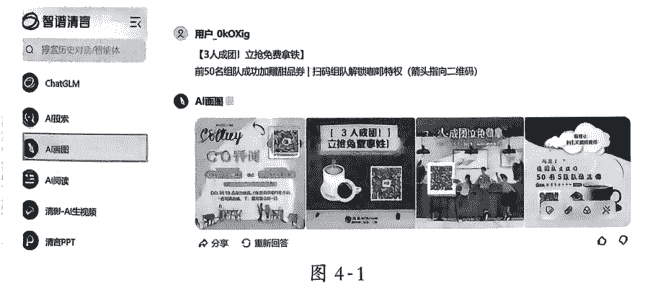
图 4-1

**步骤4 效果分析**
活动结束后整理数据导入 DeepSeek 分析。
提问模板（效果分析）：
本次咖啡馆微信群裂变共带来【N】个新用户，平均邀请人数【N】，【初始渠道】裂变效果最佳。

社交流量是矩阵中最具爆发力的部分。结合 AI 在策划、素材、触达、分析上的能力，能以低成本实现裂变式增长。搜索提供精准入口，内容建立信任，社交引爆传播，三者结合是中小企业低成本获客的关键。

#### 05 利用 AI 捕捉流量

小红书是重要的发现和种草阵地，一篇爆款笔记可带来可观曝光与转化，但持续产出符合平台调性的高质量内容难度大。常见痛点是灵感枯竭、不懂“小红书体”、时间不足。

借助 AI 能显著提升创作效率与质量，更容易捕捉流量红利。

##### 小红书爆款笔记创作实战流程
在开始前，确保账号定位清晰、用户画像明确，并对平台风格与规则有基本认知。

##### AI 实战操作手册

####### 步骤 1 | 用大模型探选题，找准用户在意点

选题决定上限。借助大模型能迅速筛出一批既贴合账号定位、又容易引发共鸣的方向。

**提问模板（跨平台内容创作）：**
> 我的小红书账号聚焦【你的赛道/领域】，核心受众是【用户画像】。请结合近期平台上大家热议的热点或痛点，给出 5 个笔记选题建议，并解释每个选题的亮点与受欢迎逻辑。

**参考指令：**
> 我在小红书做家居收纳干货，粉丝主要是想改善居住品质的都市年轻人。请结合当下小红书的热点或痛点，推荐 5 个可落地的笔记方向，并说明亮点和传播原因。

**成果示例：**
已深度思考（用时 30 秒）▼
1. “零花费旧物改造法：奶茶袋 / 牛仔裤变成居家好物”
亮点：主打零成本与环保再利用，把年轻人身边常见的奶茶袋、牛仔裤、卷纸筒等废弃物改造成抽屉隔板、墙面收纳袋等实用物件。
受欢迎原因：贴合年轻群体可持续生活理念，操作门槛低、视觉效果直观、易于模仿。小红书近期“旧物改造”搜索明显上升，“奶茶袋妙用”等案例多次发酵，此类内容易触发互动和“抄作业”热潮。

2. “小户型空间榨干术：1㎡玩出10倍收纳”
亮点：直击都市人空间焦虑，给出垂直利用、多功能家具搭配、隐藏式收纳等思路，例如冲孔板收纳墙、床底隐藏储物箱等。
受欢迎原因：契合小红书“家生活场景化”趋势，用户既要物理空间优化，也要精神满足感。类似“洞洞板平替”曾引发高讨论，实用性强且性价比高的内容更易爆。

####### 步骤 2 | 批量生成吸睛标题，提升首屏点击率

在小红书，标题就是流量开关。让模型产出多组备选，再择优测试。

**提问模板（标题生成）：**
> 我要发一篇小红书图文，核心是【笔记核心要点】。请生成 8 个具备吸引力的标题，要求带入关键词【具体关键词】，可使用数字、符号或痛点词、亮点词增强吸引力。

**参考指令：**
> 我要写一篇关于奶茶袋做抽屉分隔盒的小红书图文，请给出 8 个吸睛标题。要求包含关键词“0元改造”，并使用数字、符号或痛点词。

**成果示例：**
1. 0元改造奶茶袋！秒变抽屉收纳神器，省钱又环保。
2. 奶茶袋别扔！0元改造成抽屉分隔盒，收纳力MAX。
3. 0元改造计划，用奶茶袋DIY抽屉分隔盒，收纳控狂喜！
4. 废物利用大法，奶茶袋变身抽屉分隔盒，0成本搞定！
5. 0元改造奶茶袋，1个袋子搞定杂乱抽屉收纳！
6. 奶茶袋还能这样用，0元DIY抽屉分隔盒，整洁度翻倍。
7. 0元改造小妙招，奶茶袋秒变收纳盒，省下买分隔盒的钱！
8. 懒人收纳福音，用奶茶袋0元做抽屉分隔盒，告别凌乱。

####### 步骤 3 | AI 写初稿，快速搭笔记骨架

提效最明显的环节。让模型按小红书体输出可直接打磨的草稿。

**提问模板（笔记初稿）：**
```
请帮我写一篇小红书笔记的草稿。
标题：【取上一步选择或修改后的标题】。
核心要点：【清晰列出你想表达的核心内容，尽量具体】。
写作要求：模仿小红书用户喜欢的【语气风格】。
段落清晰，自然融入关键词【关键词 1】和【关键词 2】。
结尾：简单引导用户【互动行为】。
```

**参考指令：**
> 请帮我写一篇小红书笔记的草稿。
> 标题：0元改造小妙招，奶茶袋秒变收纳盒，省下买分隔盒的钱！
> 核心要点：
> 1. 手残党也能学会，小小奶茶袋摇身一变成为收纳盒；
> 2. 变成收纳盒后想拿什么一目了然，“J”人看了极度舒适。
> 写作要求：模仿小红书用户喜欢的姐妹分享式/干货教程式语气，段落清晰，自然融入关键词“零成本”和“DIY”。
> 结尾：简单引导用户点赞、收藏、评论交流。

**成果示例：**
**0元改造小妙招，奶茶袋秒变收纳盒，省下买分隔盒的钱！**

姐妹们！谁懂啊！！喝完奶茶的袋子别急着扔，今天教你们一个零成本的 DIY 收纳法，手残党也能轻松 get √，收纳控狂喜！

**“手残党”友好，3步搞定！**
1. **剪**：把奶茶袋洗干净，沿着侧边剪开，平铺成一个长方形。
2. **折**：按抽屉大小折叠成小格子，用双面胶固定边缘。
3. **塞**：放进抽屉，分格收纳小物件，口红、发夹、数据线统统归位！

**一目了然拿取超方便**
改造后的奶茶袋收纳盒，分区清晰，再也不用在抽屉里大海捞针啦！本人终于体会到了“拉开抽屉就舒适”的快乐！

**小tips**：厚实的奶茶袋更耐用哦，喜茶、奈雪的袋子都很适合！

姐妹们快试试！0元改造真的香。
你的抽屉也需要“整理术”吗？点赞收藏学起来。
评论区交出你的奶茶袋改造作业，让我看看谁的收纳最整齐！

#DIY收纳 #零成本改造 #奶茶袋妙用 #收纳整理 #废物利用

####### 步骤 4 | AI 优化词与标签，提升被看见概率

确保笔记既能被搜索检索，也能被推荐分发。

**提问模板（关键词与标签）：**
> 这篇小红书笔记是关于【笔记主题】的。
> 请帮我：
> 推荐【几】个可以自然加在笔记正文里的相关关键词。
> 推荐【几】个合适的小红书话题标签，要包含常用的大类标签和精准的细分标签。

**参考指令：**
> 这篇小红书笔记是关于“奶茶袋秒变收纳盒”。
> 请帮我：
> 推荐 7 个可以自然加在笔记正文里的相关关键词。
> 推荐 8 个合适的小红书话题标签，要包含常用的大类标签和精准的细分标签。

**成果示例：**
✅ 已深度思考（用时 30 秒）∨
**推荐关键词（可自然融入正文）**
1. 废物利用
2. 环保收纳
3. 省钱妙招
4. 手工 DIY
5. 抽屉整理
6. 奶茶袋改造
7. 零浪费生活
8. 居家好物

**推荐话题标签（#）**
大类标签（流量高）
1. # DIY 手工（覆盖手工爱好者）
2. # 收纳整理（吸引收纳需求用户）
3. # 废物利用（突出环保主题）
4. # 省钱小技巧（精准戳中省钱党）

####### 步骤 5 | AI 辅助构思画面呈现

优质画面是笔记的门面。虽然现在无法直接出图，但可以提供拍摄与设计思路。

**提问模板（封面与配图）：**
> 我的小红书笔记的主题是【笔记主题】。请给些关于“封面图”设计和“内页配图”选择的建议。要求图片风格【风格描述】，并能突出内容的核心亮点。

**参考指令：**
> 我的小红书笔记的主题是“奶茶袋秒变收纳盒”。请给些关于“封面图”设计和“内页配图”选择的建议。要求图片风格干净治愈、色彩鲜明，并能突出内容的核心亮点。

**成果示例：**
1. 核心亮点突出
   - 构图：展示【奶茶袋→收纳盒】的对比图（左：原袋；右：成品），直观体现改造效果。
   - 配色：选用奶茶色系（暖棕/奶白）+ 明亮点缀色（如薄荷绿、浅粉），干净治愈又吸睛。
   - 文字：加粗标题关键词，如“0元改造”“奶茶袋变收纳盒”，字体简洁（推荐手写体或圆体）。

2. 场景化拍摄
   - 背景：纯色桌布（浅灰/米白）或木质桌面，搭配小物件（剪刀、胶带等 DIY 工具）增加生活感。
   - 角度：俯拍或 45° 斜拍，突出收纳盒的分格细节。

**示例封面创意：**
- 奶茶袋和成品并列摆放，旁边写“Before & After”。
- 手拿收纳盒摆拍，加标签“省下20元！”。

####### 步骤 6 | 人工精修与发布
AI 输出只能当初稿，品质靠人工打磨。具体优化流程如下：
- **事实核查**：确保所有信息准确无误，尤其是产品功效、价格、数据等。
- **个性化注入**：融入个人的真实体验、独特观点和品牌风格，让笔记有“灵魂”。
- **语言润色**：修正AI可能存在的生硬或不自然的表达，使其更流畅、更具人情味。
- **排版优化**：调整段落、重点、标记、表情符号的使用，提升阅读体验。
- **最终审核**：确认内容符合小红书社区规范。

完成精修后，搭配优质图片或视频，在合适的时间发布。AI 是内容创作者的强大助手，能把你从重复写作中解放，让你聚焦创意策划、用户互动和效果优化。熟练掌握借助 AI 高效创作的方法，能显著提升生产力与竞争力。需要强调的是，AI 无法完全替代创作者，最终打动用户的仍是内容的真实价值、独特视角和真诚表达。

#### 06 日常流量运营：热点抓取 + 快速生产
在掌握平台精细化运营、内容适配、AI 辅助创作及主动截流等策略后，还需关注维持流量持续活跃的关键环节——日常运营。与追求长期效应的 SEO 不同，日常运营更侧重即时连接，抓住当下热点，实现“短、平、快”的触达。其中，“热点抓取 + 快速生产”的组合尤为重要。本节拆解实战步骤，阐明这套日常流量运营的核心打法。

##### 热点运营的战略价值与核心原则
巧妙结合热点能带来显著增益，其战略价值体现在四个方面。
**提升曝光机会**：平台算法往往会对热门话题给予流量倾斜，相关内容更容易被推荐。
**激发用户互动**：用户对正在讨论的热点关注度高，更易产生评论、分享等行为。
**品牌形象升级**：及时响应热点，反映账号关注时事、贴近用户，有助于塑造敏锐度和亲和力。
**吸引新用户**：吸引泛兴趣用户，扩大潜在受众。

但“蹭热点”需遵循三大原则：寻找关联、注重质量、防范风险。

##### 如何构建高效的“热点雷达”系统
**1. 明确需要关注的“热点”范围**
（1）行业动态与新闻：与账号业务直接相关的政策变化、技术突破、市场趋势等。
（2）平台内热点：微博、抖音、B站、知乎、小红书等平台的热榜、热门挑战等。
（3）社会文化热点：引发广泛社会讨论的事件或现象，需谨慎判断相关性。
（4）竞品与同行动态：关注同品类的热门内容或活动。

**2. 搭建信息收集矩阵（人工 + 工具 + AI）**
（1）人工巡查：每日固定时间浏览主要目标平台的热榜 / 发现页，以及行业资讯网站或 App。
（2）关键词订阅/监控：利用微信公众号或微博等平台的关键词订阅功能；进阶可使用舆情监控工具。
（3）AI 辅助信息聚合：利用 AI 定期扫描和总结信息。
（4）团队协作与信息沉淀
- 飞书文档/多维表格：创建一个共享的“热点追踪表”。字段建议：热点事件/关键词、来源链接、发现时间、发现人、相关性评分、初步结合创意、负责人、状态。
- 飞书群聊：建立“热点快速反应”群。
- 飞书日历/提醒：对可预见的热点提前设置提醒。

**3. 快速评估与切入点选择**
（1）评估三问：这个热点与目标用户/品牌真的相关吗？能提供独特的价值或视角吗？现在介入还来得及吗？
（2）AI 辅助寻找结合点
**提问模板（热点结合角度）：**
```
当前热点是【热点事件/话题简述】，我的业务是【业务、内容方向】。
请帮我快速构思 2~3 个可以结合这个热点进行内容创作的切入角度，要自然、有价值，避免生硬。
```

###### 4. 快速决策机制
针对高时效热点，必须建立分钟级响应机制：关键决策人需在1小时内完成“热点评估→策略制定→执行授权”的全流程，建议通过飞书群进行即时沟通。

####### （1）确定内容形式与发布平台
根据热点性质、切入角度和时效性要求，迅速决定最合适的内容形式。

####### （2）文案/脚本极速起草
利用AI，基于确定的热点、角度和平台，快速生成内容初稿。
> 请围绕热点【热点事件、话题】和我确定的角度【你的切入角度】，帮我写一份用于【平台名称】发布的【内容格式，如微博文案、小红书笔记要点、短视频口播稿】的初稿。要求紧扣热点，观点清晰，语言【风格要求，如客观中立、风趣幽默】，控制在【大致字数、时长】左右。

####### （3）标题/封面文案快速生成
AI可以迅速提供多个结合热点的、吸引眼球的标题或封面文案选项。

####### （4）视觉元素构思
AI可以根据热点内容，快速提供有关搭配如图片风格、表情包或者简单的图表设计思路等。

###### 5. 标准化流程与工具提效（推荐使用飞书）
- 内容模板库：在飞书知识库或文档中预先创建好不同类型热点内容的模板。
- 素材库共享：将常用品牌标志、标准配色、免版权图片/视频片段等素材存储在飞书云空间。
- 飞书任务/项目管理：快速创建任务，分解步骤，明确负责人和截止时间。
- 飞书文档/表格协作：多人同时在线编辑文稿、脚本，实时评论反馈。

###### 6. “人机结合”的快速审核与润色机制
在追求时效性的同时，必须建立“人工+AI”双重审核体系，重点关注真实性、风格一致性、差异化润色。

###### 7. 及时发布与互动运营
内容制作完成后第一时间发布，并密切关注发布后的用户反馈，及时参与评论区互动。

把“追热点”变成日常智慧，建立敏锐监控机制和高效响应流程，善用协同工具与 AI 加速创作，即使是资源有限的团队也能在热点浪潮中快速发声。

### 三大低成本获客打法

### 07 矩阵打法：“10个账号”管理术
内容优化、平台适配、AI 应用、热点运营多为单账号策略。当需要规模化扩影响、精准覆盖细分人群时，账号矩阵更有效。
账号矩阵不是简单多开号，而是运营一组关联互补的账号网络实现协同效应。“10个账号”是象征数量，需按业务与资源定。

#### 一 账号矩阵的战略价值：为何多线作战
- **扩大覆盖与流量入口**：覆盖更多关键词、兴趣点与细分市场。
- **提升抗风险**：避免单账号违规限流导致业务中断。
- **精准触达**：为不同人群定制内容与沟通，提升转化。
- **承载多元目标**：不同账号分别承担品牌宣传、用户教育、活动推广、直接销售、客服、行业交流等职能。

**小号先行验证，低成本试错**：挑少数账号做试验田，尝试新调性、新玩法或新变现方式，用有限投入先看效果。

#### 矩阵搭建：先定航向再分工

##### 1. 明确矩阵的整体战略方向
起步要把最终结果说清楚。比如把小红书某个垂类打成头部影响力集群、用抖音为特定电商商品引来大量精准人群并促成成交，或搭建覆盖用户全生命周期的服务闭环。

##### 2. 为每个账号配差异化定位
围绕总目标，给矩阵里的每个号定一个独特的人设。以10个号为例，常见分工如下：

- **旗舰号1~2个**：扛品牌官方形象，发布权威资讯、核心产品解读和重磅活动通告，风格偏正式完整。
- **引流号3~4个**：覆盖面更广，内容偏热点结合、娱乐轻科普，主要负责撬动泛人群初步关注，可合规分流到主号或细分号。
- **垂直/细分号3~4个**：扎进特定品类、用户痛点、使用场景或专业领域，内容要求专业深入，用来承接高意向用户并促转。
- **人设号1~2个**：以创始人、行业专家、资深用户或虚拟IP的个人形象出现，输出经验分享、幕后故事和生活方式，拉近情感距离。
- 可选 **转化/活动号1~2个**：聚焦硬广销售、优惠促活、直播带货等，需严格遵守平台营销规范，部分平台对这类号有明确限制。
- 可选 **生态链接号1个**：面向上下游供应商、下游渠道或合作伙伴，发布行业动态和合作机会，搭建商业生态。

##### 3. 把内容与风格细化到号
给每个已定位的账号明确主题方向、呈现形态图文视频直播、更新节奏、语言语感和视觉规范。要做到号间差异明显，同时在需要时能体现品牌统一性。

#### 用智能化手段提效运营

##### 1. 协同生产与分发
矩阵运营不是简单搬运，而是在统一策略下做高效协同。

- 素材复用、角度重塑：以深度报告、产品发布会等核心资产为源头，做千人千面式的改编，按号定位调整切入点、话术和视觉后投放。
- 用大模型提速：借助DeepSeek等快速产出不同定位号的初稿、标题和脚本。
- 内联导流：在规则允许范围内，通过评论互动、转发、简介引导等方式实现号间自然流转，避免生硬强推影响体验。

❓ 矩阵规划提问模板：
> 我的主营业务是【业务名称，如企业级SaaS管理软件】。打算在【平台名称，如知乎】做一个号矩阵，初步想做5个号。请帮我规划这5个号各自的【角色定位，如品牌号、产品功能详解号、行业洞察号、客户案例号、创始人IP号】，并给出每个号的内容方向和风格建议。

##### 2. 多号商机集中管理

###### 方案A 飞书轻量版
用飞书多维表格搭建矩阵账号客户咨询总表。按号类型建独立工作表，如旗舰号数据、引流号数据等。

表格列标题示例如表4-2：

**表4-2 视频数据信息表**

| 视频标题 | 发布时间 | 点赞数 | 收藏数 | 评论数 | 评论内容 |
|:---|:---|:---|:---|:---|:---|
| | | | | | |

团队按咨询量设定巡查频率，如每半小时看一遍各号后台私信评论，把新增有效线索手动录入或截图粘贴。利用飞书表格的提醒筛选排序功能做管理。

使用飞书多维表格的智能回复。功能示例如图4-2：

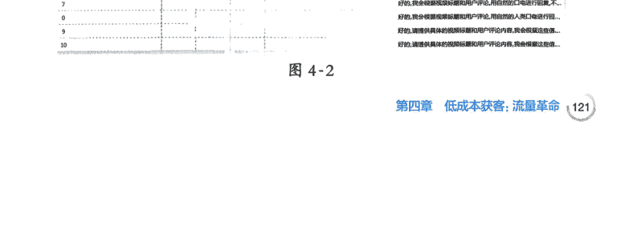

图4-2

**第四章 低成本获客：流量革命 121**

###### 方案B 专业工具备选
市面上已有聚合多平台后台的SCRM或社媒管理工具，如聚客引擎等，需自行调研目标平台的支持度和合规性。

说明：这类工具多有使用成本，且受平台API开放程度影响，中小团队初期可优先方案A。

##### 3. 标准化应答流程
- 建知识库：在飞书知识库沉淀FAQ库、标准话术库、产品资料库等，便于团队统一口径快速查阅。
- 大模型辅助起草：对常规问题或流程化咨询，用模型基于知识库生成回复初稿。

提问模板生成标准回复初稿：
> 用户通过【账号名称】咨询【问题类型，如退换货规则】。请根据我们的标准规定【粘贴规定要点】，帮我写一个清晰礼貌的回复初稿。

- 人工复核润色：模型输出必须经人工严格复核，结合具体语境做细节调整和个性化润色，确保准确且走心。

##### 4. 精准沟通与转化

###### （1）沟通渠道匹配如表4-3

**表4-3 沟通渠道适配表**

| 沟通渠道 | 适用场景 | 运营要点 |
|:---|:---|:---|
| 群聊 | 低客单品推广、社群运营、活动通知 | 定期输出内容、机器人辅助、话题引导 |
| 一对一私信 | 高客单咨询、隐私需求、定制服务 | 人工实时响应、专业话术、隐私保护 |

###### （2）转化路径设计
- 明确下一步：每次沟通都设置清晰行动引导，如点击链接领取试用。
- 平台内闭环：最终导向平台自带交易入口完成购买，如小红书抖音店铺链接、微信小程序商城等。

###### （3）大模型辅助销售
私信沟通中，销售可借助模型快速查资料、提炼客户需求并给出下一步沟通建议。

提问模板销售沟通辅助：
> 我正在与一位意向客户就【产品/服务名称】进行私信沟通，以下是对话要点：【粘贴沟通摘要】。客户目前主要顾虑是【总结客户顾虑】。
> 请帮我分析：
> 1. 如何能有效打消客户的这个顾虑？
> 2. 下一步我应该如何沟通才能更好地推动他在平台内下单？

##### 5. 推荐工具与核心价值如表4-4

**表4-4 工具推荐及核心价值表**

| 功能模块 | 工具推荐 | 核心价值 |
|:---|:---|:---|
| 战略规划 | DeepSeek、ChatGPT | 矩阵架构设计、内容策略生成 |
| 协同管理 | 飞书多维表格、知识库、即时通讯 | 信息集中管理、团队高效协作 |
| 内容生产 | 剪映、Canva、AI绘画工具 | 多形式内容快速制作 |
| 专业管理 | SCRM系统、社交媒体管理平台 | 多账号数据整合、自动化运营 |

号矩阵不是堆数量，而是系统化运营思维，需要全局观、清晰定位、高效协同和精细化沟通思维。合理搭建结构、厘清各号职责，结合大模型和飞书等工具提效，并按场景匹配沟通转化策略，即使资源有限的中小团队也能实现多号高效管理，在低成本下实现规模化获客与可持续增长。

落地需要持续规划、踏实执行和基于数据反馈的动态优化，是在激烈流量竞争中构建差异化优势的关键一环。

### 08 门店获客：AI数字人直播加切片短视频联动
在掌握矩阵逻辑后，可引入第二种低成本打法：AI数字人直播配合短视频切片引流。该模式旨在缓解中小微企业直播人力时间成本高的痛点，实现常在线、可规模化生产内容并高效引流。

若矩阵包含多号，理论上可部署多组AI数字人同步直播，既覆盖更广用户与细分领域，也产生海量回放素材。这一素材库可作为低成本生产短视频的富矿，经切片处理后源源不断产出符合短视频消费习惯的内容。

#### AI牵引直播切片：从海量回放到精准短视频
过往人工需从数小时甚至数十小时回放中逐帧筛选精华，效率低且耗人。AI介入可大幅简化流程。

##### 1. 回放素材管理与智能分析
- 系统化归档：按账号名称+直播日期+主题标签分类云端存储，如美妆旗舰店2025-05-01新品专场，便于快速检索。
- AI辅助找亮点：利用直播平台或第三方工具生成文字实录，导入模型分析。

提问模板挖掘回放亮点：
> 这是AI数字人直播【账号名/场次标识】的部分文字记录：【粘贴10~20分钟的文字记录】。
> 请帮我识别出其中包含以下特征的片段请列出片段原文及简要理由：
> 1. 清晰介绍产品核心卖点的部分。
> 2. 解答用户常见痛点的部分。
> 3. 宣布优惠信息或活动的部分。
> 4. 可能引发用户兴趣或共鸣的互动金句部分。

- 音视频智能分析：依声音强度、语速变化、情绪波动等自动识别高光时刻，如观众互动峰值段。

##### 2. 智能化剪辑与内容优化
- AI智能剪辑：使用剪映专业版智能识别精彩片段等功能自动初剪，但仍需人工复核与调整以契合品牌调性与营销目标。
- AI自动生成字幕：利用剪映、网易见外工作台、讯飞听见等工具自动识别语音生成时间轴字幕，准确率高，节省打轴时间，仅需少量校对。
- AI辅助生成文案与描述：为切片短视频生成吸睛标题、简介或描述。

提问模板切片视频文案：
> 这个短视频切片的核心内容是【简述切片内容，如AI主播演示了xx产品的防水性能】。
> 请帮我为这个发布在【目标平台，如抖音】的短视频写一个吸引人的标题和简短描述。

##### 3. 人工精修与标准化输出
- 人工审核：检查剪辑逻辑、字幕准确性、节奏感。
- 添加元素：统一片头片尾、品牌Logo、背景音乐、特效及明确行动号召。
- 标准化输出：确保格式、分辨率、时长符合各平台规范。

##### 4. 多渠道分发——拓展流量边界
- 主阵地：原生平台账号矩阵
将切片按内容与定位分发至抖音、小红书等矩阵账号，核心动作挂车销售，直接关联店铺商品链接，实现即看即买，转化效率最高。
- 流量拓展：电商平台视频渠道
把普适性强、展示清晰的优质切片同步至拼多多、淘宝、京东等平台视频板块，利用其庞大购物用户基数提升曝光与认知，相当于在各大商场投放动态广告。转化链路相对间接，但对品牌展示与流量补充价值显著。

主阵地成交+电商平台曝光组合可在控成本前提下最大化流量池。

技术融合塑造增长新范式。AI数字人直播、AI直播切片、账号矩阵、多渠道分发与平台内挂车成交构成极具创新性与成本效益的低成本获客转化闭环，为中小微企业突破人力与时间限制提供规模化在线营销路径。

关键在于熟练运用技术工具、搭建高效工作流如飞书协同，并坚持用户价值导向与合规性。

### 09 AI助力热点话题挖掘
第三种低成本打法是策划具备天然讨论潜力的热点话题，激发用户参与、评论与分享，提升内容自然传播与账号活跃度。话题指用户普遍关心的争议议题、选择困境或现象。

AI在此扮演选题探测器与内容架构师，帮助高效发掘话题并设计引发良性讨论的呈现方式。需把握尺度，确保符合平台规范与社区价值观。

#### 用共鸣撬动参与
核心逻辑是依托AI数据分析挖掘目标客群关注且观点多元或存在困惑的话题，创作能激发热烈且友好讨论的笔记，通过专业互动建立信任，将讨论热度转化为店铺访问与转化。

价值体现在：
- 激发评论欲望：促使用户表达观点、分享经验，提升评论量。
- 提升互动数据：评论、点赞、收藏、转发助推推荐。
增强用户黏性：话题讨论形成社群氛围，提升粉丝黏性。

#### AI加持挖掘与生成可讨论内容

##### 实战路径
步骤1 利用AI发现领域讨论潜力股
- 提问模板挖掘讨论话题：
> 我现在做的内容是【内容领域，如职场沟通技巧】，请针对我的内容帮我生成一系列的争议话题，让我可以在【平台，如小红书】上发布获取更多流量，要求不能违反平台的规定，并且可以引起读者热烈的讨论。

步骤2 筛选话题并确定切入点
人工筛选：从AI提供的话题里挑出与内容规划、账号定位匹配且易引导讨论的议题。
确定呈现角度：客观呈现多方观点，如分析向上汇报利弊。
提出开放问题，如你认为职场新人最应先提升哪种能力？
分享带思考的个人经历，如我曾因xx做法在职场沟通上踩坑……

步骤3 利用AI梳理观点与构建框架
- 提问模板1梳理观点：
> 针对话题【选定的话题，如职场中情商和智商哪个更重要？】，请帮我分别列出情商更重要和智商更重要的主要论点和常见理由。

第四章 低成本获客：流量革命 129

- 提问模板2设计大纲：
> 我想就话题【选定的话题】，创作一篇【内容格式，如小红书笔记】。计划【你的呈现方式，例如：先分享一个个人小故事，然后提出一个开放问题让大家讨论】。请帮我设计一个简单的内容结构大纲。

步骤4 AI加持快速生成内容初稿
把话题、角度、大纲、目标平台、格式及期望语气告知AI。

- 提问模板1生成初稿：
> 根据这个大纲【粘贴大纲】,请围绕话题【选定的话题】,为【平台名称】平台撰写一篇【内容格式】的初稿。请使用【语气风格】的语言，并在结尾处设计引导用户在评论区分享看法的语句。

- 提问模板2生成讨论型标题：
> 为这篇关于【选定的话题】的讨论性内容，生成5个用于【平台名称】的标题，要能引起用户的好奇心和讨论欲。

步骤5 积极引导与管理讨论
及时回应：发布后关注评论区，对有价值评论回复、点赞或置顶。
引导方向：适时追问、总结提炼观点，引向更有建设性的方向。
维持氛围：管理偏离主题或不友好评论，保持良好氛围。

##### 案例分享
假如一家大码女装实体店想通过内容获流引至门店。

###### 参考指令：
我现在是一个大码女装博主，请你针对我的行业帮我生成一系列值得讨论的话题，让我可以在小红书上发布获取更多流量，要求一定不能违反平台的规定，并且可以引起读者热烈讨论。

###### 成果示例：
- 一、大码女装是否被过度美化？
  - 商家总说大码女装也能穿得时尚，但实际收到的衣服版型既显胖又廉价，是设计问题还是消费者期待过高？
  - 切入点：结合部分用户吐槽大码女装设计敷衍显胖更严重的现象，探讨商家是否真正理解大码群体需求。
  - 争议点：用户可分享踩雷经历或推荐真正显瘦的品牌，形成商家 VS 消费者对立讨论。

AI加持的热点话题生成策略核心在于借助AI挖掘能激发深度思考与表达的议题，并通过精细内容设计引导有价值社区讨论，实现低成本提升互动与传播。用智慧引导讨论而非制造争议。成功关键在于运营者的选题智慧、内容把控与引导能力，以提供价值、促进交流为前提，结合人工思考与精细运营，方能安全有效服务获客目标。

## 第五章
短视频引流：获客新篇章

### 爆款视频的黄金公式

#### 服装行业：抓住眼球的六个开场模板
当前服装短视频同质化严重，用户常在数秒内划走。如何在前3秒牢牢抓住注意力并激发观看与购买欲？多数商品因缺乏创意与拍摄技巧难以持续产出有故事内容。不妨借助AI快速生成开场创意、场景设定与镜头提示，提升吸引力，在激烈赛道中突围。

##### 模板1：变装对比

短视频起势开场与分镜实操手册

用换装切入极易抓人，先让人物以日常穿搭登场，再以转场迅速切至高光造型。常见的衔接可以是顺势转圈、打响指、画面瞬黑再亮等，无缝完成切换，视觉冲击会瞬间被放大，上身效果的惊艳感也随之凸显。

**提问范式：瞬间换装开篇**

我正在为【服装风格描述】制作短片，请策划一个“瞬间换装”的开头。
要求：
1. 换装前置于【换装前场景与状态】。
2. 换装后放置于【换装后场景与氛围】。
3. 构思一个自然的衔接创意。
4. 写出1~2句旁白或屏幕文案，突出换装带来的【效果】。

参考指令
为法式复古连衣裙做短视频，请规划“瞬间换装”开头。
要求：1.换装前在普通居所穿居家服。2.换装后到优雅咖啡馆窗边。3.想一个自然过渡创意。4.写1~2句旁白或屏幕文案，突出气质提升与氛围感。

成果示意
【分镜 - 法式复古连衣裙瞬间换装】
换装前 2秒
画面：俯拍，女主宽松居家服盘腿坐毛毯，四周散落抱枕与咖啡杯。
色调：柔和米白，模拟自然光。
行为：左手托腮，右手随意搭在杯边。
衔接设计 1秒
近景：居家袖口拂过咖啡杯，蒸汽模糊画面。
运镜：手持镜头随杯子轨迹划半圆，雾气散去场景已换。
换装后 5秒
环境：法式咖啡馆靠窗，雕花铁艺桌椅配蕾丝窗帘，外是虚化巴黎街景。
造型：真丝发带扎慵懒低马尾，珍珠耳钉与裙领蕾丝呼应。
动作：1.指尖挑耳侧碎发；2.整理裙摆捕捉腰线特写；3.托腮望窗外侧脸微笑。

模板2：细节特写

画面直接切至单品亮点，聚焦面料、纽扣、复古工艺、剪裁等，精准拿捏在意品质的用户。

**提问范式：产品细节**
我的产品是【服装及其最突出的1~2个细节】。请策划“细节特写”短视频开头。
要求：1.画面锁定在【具体细节】。2.用1~2句文案点出细节的【价值、特点】。3.建议一种运镜方式。

参考指令
产品是真丝衬衫，带珍珠母贝纽扣和法式袖口。请设计“细节特写”开头。
要求：1.画面聚焦珍珠母贝纽扣光泽/袖口精致褶皱。2.用1~2句文案点出高级感/工艺难度/设计巧思。3.建议运镜方式。

成果示意
【分镜 - 真丝衬衫细节特写开头】
镜头1：纽扣诞生 3秒
运镜：微距由虚焦推进，珍珠母贝表面浮现虹彩光斑。
光线：侧逆光穿透半透明母贝，在面料投下细碎光晕。
动态：指尖轻抚纽扣，呈现天然纹理随角度变化。
镜头2：袖口交响曲 4秒
运镜：手持带呼吸感缓慢横移，呈现法式袖口立体褶皱。
构图：袖管自然垂落形成建筑感弧线，露出内层手工拱针缝线。
细节：腕部轻转时，真丝随光影流动呈现雾面到缎光渐变。

模板3：场景融入

把服饰自然植入真实生活或工作场景，呈现通勤、约会、度假、居家等不同情境下的适配度，便于用户代入。

**提问范式：场景融入**
我想推广【服装类型和风格】。请策划“场景融入”短视频开头。
要求：1.设定一个明确场景。2.描述模特穿此衣在场景中的动作/状态。3.用1~2句文案营造氛围，点明服装与场景的联系。

参考指令
想推广适合周末出游的碎花长裙。请设计“场景融入”开头。
要求：1.设定具体场景。2.描述模特穿衣在场景中的动作/状态。3.用1~2句文案营造氛围，点明服装与场景联系。

成果示意
已深度思考（用时31秒）
【分镜 - 碎花长裙场景融入开头】
晨光野餐篇 8秒
场景：金合欢树下野餐布，藤编篮露法棍尖，玻璃瓶插新鲜洋甘菊。
镜头1 3秒
低角度跟拍：裙摆拂过沾露草地，逆光中花藤图案与真实雏菊重叠。
动作：赤脚小跑时手指轻提裙摆，露出系带罗马凉鞋。
镜头2 3秒
环绕运镜：后仰倒在野餐布时裙摆旋开，碎花与树影斑驳在面料流动。
细节：发间夹同色山茶花，指尖捏樱桃梗与裙摆红莓图案呼应。
镜头3 2秒
俯拍转场：抛起草帽落下时切远景，人物融进夏日花园油画构图。

模板4：痛点解决

先呈现常见穿搭痛点如显胖、难搭、不合身，引发共鸣后再以产品作解法，激发了解欲望。

**提问范式：解决痛点**
我的产品是【服装及其解决的痛点】。请策划“痛点解决”短视频开头。
要求：1.先快速展示穿搭痛点。2.紧接着展示穿上产品后的改善效果。3.用对比强烈的文案强调效果。

参考指令
产品是高腰阔腿裤，能遮盖腿部赘肉、显腿长。请设计“痛点解决”开头。
要求：1.先快速展示穿紧身裤显得腿粗/比例不好。2.紧接着展示穿上产品后腿部线条流畅/视觉拉长比例。3.用对比强烈文案强调效果。

成果示意
已深度思考(用时 26 秒)
【分镜 - 高腰阔腿裤痛点解决开头】
痛点展示 3秒
镜头：推拉运镜拍试衣间镜子。
色调：模特穿紧身牛仔裤侧身站立，裤管腿中部勒出明显赘肉。
动作：手机从口袋滑落，弯腰时臀部挤压褶皱暴露。
光线：冷调白光刻意强化不完美线条。
音效：塑料绷紧的“吱呀”声。
解决方案 5秒
特写：手机落地瞬间切黑屏，响起布料抖开的“唰”声。
运镜：慢镜头从裤腰旋转下拉，展现垂坠面料滑落过程。
动作：①单手扣金属纽扣特写；②后退三步时裤腿呈流动波浪形。
高光时刻：模特转身时鼓风机吹动裤管，形成腿侧笔直流畅线条。

模板5：潮流引入

结合当季流行色彩、元素或搭配风格，让产品紧跟趋势，吸引时尚年轻用户。

**提问范式：潮流开头**
我想展示我的【服装】符合今年流行趋势。请策划“潮流引入”短视频开头。
要求：1.开头提及或展示当前【流行元素、色彩、风格】。2.快速切入展示产品如何体现这一潮流。3.文案点明潮流名称和产品特点。

参考指令
想展示香芋紫针织开衫符合今年流行趋势。请设计“潮流引入”开头。
要求：1.开头提及或展示温柔紫色系/BM风。2.快速切入展示产品如何体现这一潮流。3.文案点明潮流名称和产品特点，“今年超火的香芋紫，温柔又显白，这件开衫闭眼入！”

成果示意
已深度思考（用时30秒）
【分镜 - 香芋紫针织开衫潮流开头】
潮流锚点 3秒
镜头：手机屏幕特写，界面停在 Pantone 年度色/小红书 #BM风话题页。
动作：美甲手指滑动，画面聚焦“温柔紫色系”热搜词条。
道具：散落桌面流行单品，如格纹BM裙/紫色眼影盘/薰衣草干花。
色调：冷白打光营造数码时尚感。
产品破题 5秒
运镜：1.镜头随手指捏住屏幕中“香芋紫”关键词向外拉出；2.虚实转场后，关键词变成真实开衫衣角；3.360°环绕展示时，阳光穿透针织孔洞形成光斑雨。

模板6：反差对比

通过材质、价格、搭配效果等对比，突出独特卖点，凸显优势。

**提问范式：产品对比**
我的产品是【服装及其对比优势】。请策划“反差对比”短视频开头。
要求：1.设定一个对比对象或概念。2.通过视觉或文案直接对比，突出产品优势。3.文案要有冲击力。

参考指令
产品是平价但设计感不输大牌的连衣裙。请设计“反差对比”开头。
要求：1.设定对比对象为相似款大牌价格标签/普通材质与产品优质面料对比。2.通过视觉或文案直接对比，突出性价比/设计感高。3.文案要有冲击力，如“百元价格，千元质感”“平替天花板”。

成果示意
```
【分镜脚本 - 平价连衣裙反差对比开场】

价格暴击版（6秒）

对比组：
左屏：奢侈品店同款连衣裙（贴 ¥ 3999 价签）。
右屏：本品同角度展示（贴 ¥ 299 价签）。

运镜：
1. 手持镜头摇晃拍摄左屏"贵价裙"，突然被剪刀剪断吊牌。
2. 吊牌落地瞬间，右屏"平价裙"从同位置升起。
3. 双屏合并时用面料特写转场，展示相同垂坠度。

超现实对比：
1. 用 AR 技术将大牌 Logo 替换成本品吊牌。
2. 收银机吐出长达 3 米的购物小票突然被剪断。
3. 试衣镜裂痕特效，裂缝两侧呈现不同价格。
```
请按如下顺序操作：
1. 选择最适合产品和目标用户的1~2个开头模版。
2. 打开 DeepSeek 或同类创作模型。
3. 复制并修改对应提问模版，填写产品信息和要求。
4. 从模型输出的多个创意中，挑选出1~2个最满意的创意。
5. 根据建议，快速制定剧本和画面。
6. 立即拍摄或制作开头片段。
注意事项：
1. **严控光线**: 避免过度曝光或曝光不足，确保光线明亮柔和，减轻后期压力。
2. **精简背景**: 选择简洁或契合服装风格的场景，防止视觉干扰。
3. **加快节奏**: 前 3 秒务必以强冲击力内容抓住眼球，避免拖沓。
4. **突出主体**: 切勿因追求创意而忽视产品展示，要让服装卖点第一时间清晰呈现。

02 餐饮行业：引爆流量的十种剧情模版
餐饮短视频容易拍成流水账式菜品展示，缺少故事性和吸引力，难以激发探店欲望和下单行为。可利用智能创作策划情节、塑造人物、设计对话，为美食视频注入灵魂，生成能引发共鸣或好奇的内容框架。

模板1：食材溯源

重点展示食材从产地到餐桌的过程，突出新鲜、优质和来之不易，建立质量信任感。

**提问范式：食材溯源**
我们餐厅主打【特色菜品】，核心食材是【食材名称】。请设计“食材溯源”短视频剧情结构。
要求：1.包含场景：【产地场景】→餐厅后厨处理→成品呈现。2.突出食材【特点】。3.结尾引导【行为】。4.构思1~2句点睛旁白，强调【价值】。

参考指令
餐厅主打舟山海鲜面，核心食材是当日捕捞的大黄鱼。请设计“食材溯源”剧情结构。
要求：1.包含场景：渔船捕捞/码头挑选→餐厅后厨处理→成品呈现。2.突出食材鲜活度/稀有性/产地优势。3.结尾引导到店品尝。4.构思1~2句点睛旁白，强调“从大海到舌尖，只需x小时”。

成果示意
⚙️ 已深度思考（用时31秒）
《鲜·时》舟山海鲜面溯源短视频分镜脚本
【开篇：渔船捕捞】
画面：凌晨四点，舟山海域被朦胧微光笼罩，渔船引擎声划破寂静。
镜头：广角航拍渔船驶向东海渔场，渔民撒网动作特写。
旁白：“凌晨四点，第一网大黄鱼跃出中国黄金海域”。
【过渡：码头挑选】
画面：晨光中的沈家门渔港，渔获倾倒至不锈钢操作台。
镜头：特写鱼身金鳞闪烁，鱼鳃鲜红张合，质检员翻看鱼眼、按压鱼腹。
字幕：“每条舟山大黄鱼需经过三次筛选，仅3%达到入店标准。”

模板2：大厨揭秘

由主厨出镜展示招牌菜独特烹饪技巧或秘方，塑造专业形象，增加神秘感和权威性。

**提问范式：人物揭秘**
我是【餐厅类型】的主厨，我想通过短视频展示我们【招牌特色】。请设计“大厨揭秘”剧情结构。
要求：1.着重展示【关键步骤、独特之处】。2.营造【氛围】。3.需要有主厨少量同期声或旁白，分享心得、理念。4.结尾暗示核心秘方仍有保留，鼓励用户到店体验。

参考指令
我是一家重庆火锅店主厨，想展示招牌特色秘制牛油锅底炒料过程。请设计“大厨揭秘”剧情结构。
要求：1.着重展示多种辣椒配比。2.营造匠心氛围。3.需要主厨少量同期声或旁白，分享心得、理念，“好锅底，是火锅的灵魂”。4.结尾暗示核心秘方仍有保留，鼓励用户到店体验。

成果示意
🧠 已深度思考 (用时 27 秒) ▾
《沸腾之魂》重庆老火锅炒料秘籍分镜脚本
【启幕：香料矩阵】
画面：晨雾中的朝天门码头，吊脚楼窗台挂满红辣椒串。
镜头：特写布满老茧的手展开泛黄牛皮纸，露出“光绪廿年”字样。
主厨独白：“重庆火锅的密码，藏在三代人调校的这张方子里”。
【精髓：黄金配比】
画面：原木长案陈列七种辣椒（石柱红/子弹头/二荆条等）。
镜头：铜秤砝码精准移动，主厨指尖拂过辣椒堆成的小山。
字幕：“3：2：1 魔鬼比例——增色·提香·炼魂三重奏”。

模板3：顾客故事

采访或跟拍真实顾客，讲述其与餐厅或某道菜的情感联系、特殊记忆或喜爱理由，利用口碑效应激发共鸣。

**提问范式：顾客故事**
我们是一家【餐厅类型】，我想制作“顾客故事”短视频。请构思一个剧情。
要求：1.设定顾客【身份和背景】。2.故事围绕【核心点】展开。3.重点突出顾客对菜品/环境/服务的喜爱。4.结尾可以是其推荐语或祝福。

参考指令
我们是一家社区温馨小馆，想制作“顾客故事”短视频。请构思一个剧情。
要求：1.设定顾客为附近上班族。2.故事围绕加班后的深夜食堂展开。3.重点突出顾客对菜品/环境/服务的喜爱。4.结尾可以是其推荐语或祝福。

成果示意
```
已深度思考（用时 20 秒）
```
###### 《深夜解忧铺》社区食堂温情故事分镜脚本
【序幕：城市脉搏】
画面：写字楼格子间灯光渐次熄灭，手机显示 23:17。
镜头：跟拍高跟鞋踩过路灯下梧桐叶，西装外套下露出绷带包扎的手腕。
旁白：“陆瑶的第 47 次加班，被一碗当归鸡汤救赎。”
【初遇：推门时刻】
画面：街角暖黄灯笼在风中摇晃，“拾味小馆”木牌特写。
镜头：玻璃门推开时风铃轻响，全景展示原木吧台/手写菜单/老客留言墙。
服务员自白：“老规矩？当归鸡多加菌菇？”

模板4：沉浸式体验

放大烹饪或交互过程中的声音和视觉细节，如煎炸声、切割声、咀嚼声等，布置高清特写，刺激感官激发食欲。

**提问范式：沉浸式画面**
我想为我们的【菜品】制作“沉浸式体验”短视频。请帮我设计关键的声音和画面节点。
要求：1.突出核心声音。2.建议拍摄关键特写镜头。3.不需要过多旁白，可用少量文字标签提示。

参考指令
想为招牌爆汁炸鸡排制作“沉浸式体验”短视频。请帮我设计关键的声音和画面节点。
要求：1.突出核心声音，如炸制时滋滋声、咬下去酥脆声、肉汁流淌的声音。2.建议拍摄关键特写镜头，如金黄酥脆外皮、切开后饱满肉汁，拉丝芝士。3.不需要过多旁白，可用少量文字标签提示。

成果示意
《黄金声宴》爆汁炸鸡排沉浸式分镜设计
【00:00 — 00:03】声音预热
画面：黑屏中渐入油锅细微气泡声。
文字标签：“独家 180℃黄金油温准备中”。
【00:04 — 00:08】视觉暴击
镜头：4K 微距拍摄带冰晶鸡排浸入油锅。
声效：炸裂的“滋——”声持续 4 秒后渐强。
慢动作捕捉：油泡在鸡排表面“跳探戈”。
【00:09 — 00:12】酥脆宣言
特写：不锈钢夹轻敲鸡排表面。
声效：三层脆响（表层脆片/中层蜂窝/底层焦壳）。
文字标签：“独家三重复脆工艺”。

模板5：制作过程快放

将耗时较长的烹饪过程进行快放，配动感音乐，或延时慢放配舒缓音乐，节奏明快，适合展示工艺复杂的菜品。

**提问范式：过程快放**
我们店的【菜品】制作过程有观赏性，但耗时较长。请设计“制作过程快放”短视频结构。
要求：1.列出关键【制作步骤】。2.建议在快放中穿插1~2个慢动作或特写镜头，突出关键细节。3.推荐一种背景音乐风格。

参考指令
我们店手工比萨制作过程有观赏性，但耗时较长。请设计“制作过程快放”短视频结构。
要求：1.列出关键制作步骤，如揉面/擀皮/铺料/烘烤。2.建议在快放中穿插1~2个慢动作或特写镜头，突出关键细节，如撒芝士/拉丝效果。3.推荐一种背景音乐风格。

成果示意
🤔 🤖 已深度思考（用时 32 秒）
以下是为您设计的“手工比萨制作过程快放”短视频结构方案：
【视频结构】
**00:00 — 00:03 开场（全景）**
- 木纹操作台全景镜头，渐显品牌 Logo。
- 背景音效：面粉袋抖落的簌簌声。
**00:04 — 00:12 揉面快放（中景 + 俯拍）**
- 快进 4 倍速呈现面团揉制过程。
- 穿插慢动作特写（0.5 倍速）：手指按压面团回弹的特写。
**00:13 — 00:20 酥脆宣言**
- 快进 6 倍速展示面饼成型过程。

0.3倍慢镜定格抛饼脱手瞬间。

##### 模板6：互动挑战乐趣
围绕主推菜品设计可参与的小型竞技或互动，例如大胃王PK、限时吃完、辣度比拼、蒙眼猜味、创意吃法DIY等。形式活泼易共鸣，特别适合带动年轻用户分享。

###### 提问示例（乐趣挑战）：
> 想用【特色产品】做推广，请为【具体形式】写一个“挑战乐趣”短剧。

要点：
1. 规则说明清晰，奖品设置具体。
2. 呈现挑战中的搞笑瞬间、紧张氛围和参与者表情。
3. 结尾号召更多人参与或到店品尝。

###### 参考指令：
> 要推超大份麻辣小龙虾，请为“顾客到店剥虾速度挑战”设计“挑战乐趣”短剧。

要点同上。

###### 成果示例：
为“麻辣小龙虾剥虾速度挑战”拟定的短视频方案：

【规则设计】
30秒黄金：
1. 30秒内剥出完整虾肉。
2. 虾肉需通过“完整度检测”，画面展示检测板。
3. 日冠军：当日消费免单 + 专属“剥虾战神”围裙。
4. 周冠军：全年8折卡 + 巨型龙虾玩偶。

【分镜脚本】
00:00—00:03 悬念开场
- 红油小龙虾特写，机械女声倒计时“3、2、1！”
- 全景：5组挑战者同时抬手准备。

##### 模板7：节日时令限定
结合春节、中秋、情人节等节点或夏冬等季节，推出限定菜品或套餐，制造稀缺感和仪式感，借势拉动短期消费。

###### 提问示例（时令氛围）：
> 我们将在【节日/季节】推出【限定菜品/套餐】，请设计一个“节日时令限定”短视频推广结构。

要点：
1. 画面融入节日/季节元素。
2. 突出限定性、特殊意义和诱惑点。
3. 文案营造节日氛围、温暖感和稀缺感。
4. 明确供应时段与预订方式。

###### 参考指令：
> 圣诞节要上热红酒配树根蛋糕套餐，请设计“节日时令限定”短视频结构。

要点同上。

###### 成果示例：
圣诞限定套餐分镜与推广结构：

**【0~3秒】开场吸睛**
画面：飘雪街道全景推向橱窗，圣诞树上挂着“限定”吊牌。
音效：铃铛声+圣诞前奏。
字幕：“圣诞魔法，限时降临。”

**【4~8秒】产品诱惑**
画面：热红酒冒白雾肉桂棒转动；慢镜头切树根蛋糕，巧克力酱流淌；壁炉火光映出套餐全景，配圣诞红丝带。

##### 模板8：餐厅日常幕后
记录营业前准备、后厨整理、员工互动等真实状态，拉近距离，体现专业、卫生和人情味。

###### 提问示例（餐厅幕后）：
我想用短视频呈现【餐厅名】的日常运营，传递【核心价值】，请设计“餐厅日常幕后”剧情结构。

要点：
1. 捕捉关键场景。
2. 强调细节。
3. 可加入老板或员工简短心声/对话。
4. 风格纪实/温馨。

###### 参考指令：
想展示“老王家面馆”日常，传递“用心做好每一碗面”的理念，请设计结构。

要点同上。

###### 成果示例：
老王家面馆纪实风格剧情结构：

###### 【0~5秒】破晓
画面：晨光中挂钟指向4:30，秒针声；铁门拉起的摩擦声，暖黄灯光从门缝溢出。
字幕：“每天比太阳早起2小时。”

###### 【6~15秒】食材仪式
画面：老王布满老茧的手轻按鲜肉纹理，同期声“这块后腿肉要弹而不柴”；三名员工排线择菜，嫩菠菜在清水里打转。

##### 模板9：对比选择
同时展示店内几款人气单品，或为选择困难用户提供搭配建议。集中呈现多样性，刺激多点尝试并帮助快速决策。

###### 提问示例（产品推荐）：
我们店有几款热门【食品类型】，顾客常犹豫选哪个，请设计“对比选择”短视频结构。

要点：
1. 快速呈现2~3款人气单品诱人特写。
2. 旁白/文字简述口味/特点。
3. 可给出搭配建议/适合人群。
4. 结尾用有情绪推力的句子。

###### 参考指令：
我们有多款热门甜品，顾客常犹豫，请设计结构。
可用“小朋友才做选择，我全都要！”或“今天你想翻牌哪一个？”作结尾。

###### 成果示例：
短视频标题：【甜蜜选择题】成年人当然全都要！
时长：1分50秒

1. 暴击开场 0:00—0:15
镜头：熔岩蛋糕切开巧克力浆慢镜头+ASMR；草莓拿破仑酥皮碎裂微距；抹茶慕斯切面4K特写。
字幕：“让选择困难症暴击的三重诱惑”。

2. 味觉档案 0:16—0:50
产品A：火山熔岩。镜头：热刀融化冰激凌，冷热碰撞。

##### 模板10：文化故事
挖掘菜品的历史渊源、地域文化或创始人故事，提升品牌格调，建立情感联结。

###### 提问示例（挖掘底蕴）：
我们招牌菜【菜名】背后有一段动人【历史/文化故事】，请设计“文化故事”短视频结构。

要点：
1. 开头引出历史人物/传说/地域特色。
2. 用动画/情景再现/讲述生动呈现故事。
3. 自然过渡到本店菜品及特点。
4. 结尾升华文化价值或情感连接。

###### 参考指令：
招牌菜东坡肉背历史故事，请设计结构。
结尾可如“品尝的不只是美味，更是一段历史”。

###### 成果示例：
短视频标题：【一口千年】东坡肉里的文人烟火气
时长：2分30秒

1. 开篇 水墨画卷 0:00-0:25
镜头：宣纸晕染浮现“北宋元丰二年”印章；动画竹简展开苏轼《猪肉颂》。
旁白：“九百多年前，一位被贬黄州的诗人，用困顿中的智慧让粗鄙猪肉化作传世珍馐。”

2. 故事篇章 文人庖厨 0:26—1:10
动画苏东坡挽袖立于柴灶，百姓抬猪致谢；特写手稿“慢著火，少著水”六字；灶火叠化现代厨房。

##### 操作流程
1. 按餐厅特色与营销目标挑选1~2个最适配的剧情结构。
2. 启动DeepSeek。
3. 复制并改写对应提问示例，填入餐厅与菜品信息。
4. 分析AI生成的梗概、场景建议与文案，进行细化。
5. 制定拍摄计划，准备道具与场景。
6. 投入拍摄与剪辑。

##### 注意事项
1. 画面表现力：避免食物颜色暗沉、质感干瘪，通过合理布光提升饱和度，用专业构图增强吸引力；人物肤色需自然还原。
2. 节奏把控：严控时长，避免冗长铺垫或过度展开烹饪，突出核心、精简情节、保持紧凑。
3. 信息完整性：文案与画面必须清晰呈现店名、具体地址或区域、招牌菜品及优惠活动，让观众迅速获取核心价值。
4. 行动引导：设置明确消费引导，通过口播、字幕、评论区置顶告知到店或参与方式，强化转化。
5. 内容真实性：杜绝过度美化或虚假宣传，如实呈现菜品、外观、环境与服务，避免预期落差损害口碑。

#### 本地服务类：直击转化的短文案

本地服务具有无形、即时等特点，短视频传递价值与建立信任难度较大，文案是关键。可用AI生成脚本、标题、字幕、评论引导等，大幅提升效率。以下5个模板可单用亦可组合。

##### 模板1：精准定位用户痛点
开头直接点出目标用户最头疼的问题，用疑问句、场景描写或直述引发共鸣。

###### 提问示例：
> 我提供【服务类型】，目标用户是【用户群体】，核心痛点是【列举】。请写5个能引发共鸣的短视频开头文案。

###### 示例提示：
产后修复瑜伽，目标产后妈妈，痛点身材走形、盆底松弛、腰酸背痛、没时间运动。

###### 示例输出：
【文案1】画面凌乱婴儿用品+妈妈疲惫背影
“生完孩子肚子松垮、腰酸背痛？”
“每天喂奶哄睡根本没时间运动？”
字幕放大“碎片时间也能修复！”
“每天跟练7分钟，找回产前挺拔体态。”

##### 模板2：承诺明确效果
明确告知服务后可获得的改变，用数字、对比或感官描述增强可信度。

###### 提问示例：
> 我的服务是【服务类型】，能帮助用户实现【具体效果】。请写5句短视频文案，清晰承诺效果，含数字或具体改善。

###### 示例提示：
青少年视力矫正训练，能延缓近视加深、提升裸眼视力、改善用眼习惯。

###### 示例输出：
1. 【每天15分钟！】科学训练延缓近视加深，坚持3个月年增长平均减缓50%，裸眼视力提升2行视力表。

##### 模板3：展示专业建立信任
通过资质、流程、案例、环境等消除疑虑，建立信任。

###### 提问示例：
> 我们是【服务类型】，拥有【专业优势】。请写几句短视频文案突出专业性与可靠性。

###### 示例提示：
高端齿科诊所，从业15年专家团队、德国进口设备、上千例成功案例。

###### 示例输出：
**专业版**
“15年匠心沉淀，德国精工护航。”
“2000+笑容背后的精准医疗哲学。”

##### 模板4：制造稀缺紧迫感
用限时优惠、名额限制、时效提醒制造紧迫，促进行动，明确日期、剩余名额与损失。

###### 提问示例：
> 我们为【服务项目】做促销，提供【具体优惠】。请写几句有紧迫感的短视频文案引导立即行动。

###### 示例提示：
新开普拉提体验课，前50名99元。

###### 示例输出：
原价399！体验价99！
“前50名立省300元抢鲜体验！”
“手速决定折扣，名额秒减中。”

##### 模板5：引导清晰行动
明确告知下一步动作，用指令性词汇并提供便捷路径，如点链接、私信、评论、电话、到店地址。

###### 提问示例：
> 我的本地服务是【服务类型】，希望用户通过短视频【期望动作】。请写5个清晰直接的行动召唤文案放视频结尾。

###### 示例提示：
上门家电清洗，希望用户点链接预约/评论留言报价/私信咨询。

###### 示例输出：
- 【立即预约！】点击下方蓝色链接，30秒完成清洗预约！专业团队上门。

##### 本地服务操作流程
1. 明确服务、目标用户与本次视频核心转化目标。
2. 启动DeepSeek。
3. 按5大要素使用对应提问示例生成素材，可多条备选。
4. 组合运用：痛点+效果+信任+行动召唤。
5. 结合服务与品牌特性润色。
6. 应用到脚本、标题、字幕、评论互动。

##### 注意事项
1. 避免文案与画面脱节，确保主题高度契合。
2. 避免过度承诺，立足真实优势合理呈现。
3. 避免缺乏信任铺垫，先输出价值内容或情感共鸣再引导转化。
4. 避免行动指令不清晰，在关键节点给出明确便捷路径。
5. 不要忽略本地化信息，突出地址、服务范围、联系方式，强化本地感知。

### AI时代短视频玩法
04 日更100条视频的流水线：DeepSeek + 剪映

生成式智能下短视频规模化生产与分发路径

生成式智能普及后，如何把爆款方法论变成可复制的短片量产与分发体系？本篇聚焦用模型加自动化工具重塑传统作业方式，助你快速搭建可视化内容矩阵，实现可复用的流量增长。

当下热点更迭极快，旧流程很难跟上。过去靠人工一天产出几条已属极限，现在模型成熟让“短片制造流水线”成为现实，不仅能系统化供给，还能冲击单日上百条量级。能否落地，关键在方法组合与工具选择。下面以实操演示，用 DeepSeek 的智能创作能力配合剪映的便捷剪辑能力，搭建专属产线。

这条产线的底层逻辑是对创意、稿件、制作环节做标准化与自动化处理，在大幅提升效率的同时，用数据回流牵引选题方向优化。人的分工逐步转向策略制定、流程打磨与质控，集中在决策与调校上。

**必须准备的组件：**

- DeepSeek：国内主流对话式大模型，擅长文本理解与多轮生成，可当编剧大脑使用。
- 剪映专业版：门槛低的大众化剪辑软件，其“图文转片”能力是批量成片的关键，手机与电脑通用。
- 豆包：擅长从视频链接里提取口播稿，可配合完成爆款拆解与灵感挖掘。
- 可选 飞书文档多维表格：适合稿件管理与批量处理，高产量场景更顺手。
- 可选 热点与选品洞察工具：如飞瓜数据、蝉妈妈、考古加、巨量算数、生意参谋等，用来洞察趋势与用户需求，指导选题方向。

##### 从零搭建到高产

**实操演示**

###### 阶段一 定位对标与素材采集

锁定与业务属性契合且数据表现优秀的对标作品。

做法：

- 在抖音、小红书等目标阵地用产品、服务或领域关键词检索。
- 关注行业头部与优秀同行，拆解其热门作品。
- 借助选品、热点工具查找近期热选题与爆款清单。

关键动作：见到数据好、风格匹配的作品复制链接，建立5到10条左右的灵感素材库。

###### 阶段二 让模型拆解爆款并复用到自有定位

让模型识别爆款成功要素，提炼可复用的公式。

做法：
1. 把收集的视频链接粘贴到豆包，后面追加“请把该视频的完整口播文案提取出来”，即可获得口播稿。注意，DeepSeek并不支持直接读取外链，提取工作由豆包完成。

参考指令示例：
> 这是我在抖音看到的一个读书分享视频，链接如下。请帮我把该视频的口播文案完整提取出来。
帮我提取以上视频文案。

2. 将提取的稿件与视频主题一起交给DeepSeek做原因分析。

提问模板：
> 【粘贴豆包提取的爆款文案】请分析这段文案为何能获得高传播与共鸣。

以知识变现博主、读书分享赛道为例，按短平快带货定位，可在此视频为起点，批量生成一批标题与稿件，为下一步成片做准备。

参考指令示例：
> 这段文案治愈了我的焦虑，想读给你听听…请记住：你这一生最可靠的贵人，是不断向上的自己…
请分析这段视频文案为什么能火？

成果要点：直击焦虑与内耗痛点、颠覆性叙事、情绪共鸣强等。

3. 结合爆火原因与账号定位，指令模型生成对标稿件。

提问模板：
> 我现在运营一个【账号定位、方向】，希望通过短视频【达到的效果】，请结合前面的拆解结构和文案特点，帮我生成20条约300字的稿件，每条搭配一本热销书，并输出标题。

参考指令：
> 我现在运营读书博主，希望通过短视频介绍书来带货，请结合前面的拆解结构和文案特点，帮我生成20条约300字的稿件，每条搭配一本畅销书，并输出标题。

###### 阶段三 用剪映把稿件变成成片

把模型输出的脚本快速转为成片。

方法：
- 打开剪映专业版，进入“图文成片”，点“自定义输入”。
- 把DeepSeek输出的单条脚本粘贴进去，点击“生成文案”，剪映会识别文本作为旁白或字幕基础。挑选合适的音色，点击“生成视频”，建议选用“智能匹配素材”。
- 进入编辑窗口做微调，无需深度创作也能得到可发布的原创成片。

“单日上百条”是效率提升的象征，落地需要团队协作与流程优化：有人负责找素材、有人负责审脚本、有人负责精剪、有人负责发布。批量生产需兼顾质量，避免低质堆砌损害权重。初期可用数量做测试，后期聚焦数据表现好的内容迭代。模型生成内容务必人工润色，保持独特性，遵守版权与阵地规范。

该流程在移动端同样可行：DeepSeek＋豆包＋剪映手机版即可搭建移动产线。

借助DeepSeek做智能脚本创作，配合剪映“一键成片”，能形成“找对标→模型解析→模型创作→工具生产→数据优化”的闭环。对中小微企业与个人创业者而言，这是低成本规模化内容营销的重要抓手。飞书多维表格也可用于脚本批量生成，小红书笔记批量也可借助DeepSeek＋Canva实现。

#### 05 智能去重与平台适配：DeepSeek + 剪映 + 闪剪

前文已能实现单日上百条的流水线，但把同一条视频原样投放到抖音、小红书、B站等阵地，效果差甚至被判低质重复。不同阵地的用户偏好、社区氛围、分发逻辑差异显著。接下来演示如何用模型二次创作与形式变换做“量体裁衣”，并借助数字人技术提升差异化与效率。

智能去重不是同义词替换，而是基于阵地特性调整切入点、叙事节奏、语言风格、视觉呈现与引导方式，在保留核心信息价值的前提下做表达适配。

**核心工具：**
- 大语言模型：DeepSeek，用于稿件改写与阵地化适配。
- 视频剪辑工具：剪映专业版/App，用于非数字人视频的风格化制作。
- 数字人生成工具：闪剪，用于快速生成数字人口播视频。

## 从统一稿件到阵地定制

**实操**

### 步骤1 为抖音、小红书、B站量身改写稿件

把批量生成的通用稿件针对抖音、小红书、B站做差异化改写。

方法：再次调用DeepSeek，使用更具体的指令。

提问模板：
> 你是一位精通小红书 / 抖音 / 哔哩哔哩阵地内容生态和用户喜好的资深口播内容优化师。
原始脚本：这是我基于【简述原始脚本的核心主题、产品】创作的一条通用短视频口播。
【粘贴上一节生成的具体脚本】
任务：请将以上原始口播文案改写成更适合在小红书 / 抖音 / 哔哩哔哩发布的口播文案。
改写要求（根据目标阵地调整）
【针对小红书】：
【针对抖音】：
【针对哔哩哔哩】：
输出三个阵地的纯口播文字，不添加其他任何内容。

###### 步骤2 选择生产工具——数字人还是风格剪辑

依据改写后稿件特点选择生成方式。

适合数字人（闪剪）：
口播型内容：知识科普、产品讲解、经验分享、观点输出。
不方便真人出镜但需“人感”。
追求极致效率，信息传递型内容。

适合风格化剪辑（剪映）：
产品展示类：需要实拍、特写、场景演示。
Vlog/生活记录类：强调真实感与氛围。
快节奏卡点类：对视觉、音乐配合要求高。
需要多样化模板、特效与转场。

###### 步骤3 实际生成

**闪剪实操：快速生成数字人口播视频**
1. 登录闪剪平台领取免费算力。
2. 选择匹配品牌调性的数字人形象。
3. 粘贴DeepSeek改写后的阵地定制脚本。
4. 调整背景、语速、音色并预览效果。
5. 导出并下载最终数字人视频。

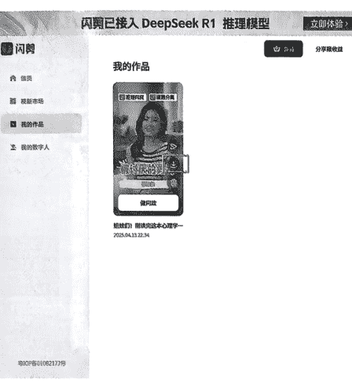

##### 剪映实操：切换风格智能匹配
1. 打开剪映“图文成片”。
2. 导入阵地定制脚本。
3. 选择匹配阵地的风格/模板：抖音选节奏快转场多视觉冲击强的模板；小红书选清新美观生活化或教程风格；B站可选信息量大、分段清晰的模板。
4. 智能匹配素材后手动微调，适配阵地调性。
5. 选用不同背景音乐风格。
6. 生成并导出。

##### 步骤4 审核与发布
1. 内容核对：脚本是否与阵地版本一致。
2. 视觉检查：数字人口型是否自然；剪映视频风格是否匹配。
3. 阵地格式：确认比例，如抖音/小红书多为9:16竖屏，B站横竖皆可。
4. 合规性：检查违规词、诱导分享，AI内容按阵地要求标注。
5. 发布到对应阵地。

##### 重要提醒：阵地规则与内容价值
1. “去重”不是“伪原创”，核心是提升用户体验与阵地适应性。
2. 关注各阵地对AI内容的规则变化，注意标注要求，避免风险。
3. 价值是根本，内容需提供信息、娱乐或情感共鸣。
4. 数字人形象需确保授权覆盖商业用途。

掌握批量生产与智能适配后，可更高效地规避重复风险，实现信息精准触达。模型是放大器，策略与用户洞察才是驱动力。

### 06 自动批量上传并管理多平台内容

制作完成后需高效分发。手动逐台上传效率低，建议使用统一管理平台，实现“一视频多阵地发”与“多视频同阵地管”。推荐易媒助手。

**安装及使用教程：**
1. 搜索易媒助手，到官网下载软件，如图 5-12。
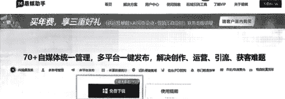

图 5-12
2. 使用微信扫码登录，如图 5-13，登录即送 7 天会员。
（注：有个人版、企业版，其他收费标准详见官网）

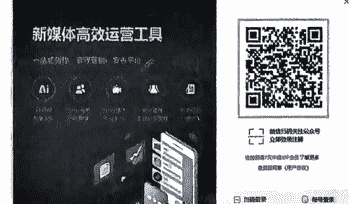
图 5-13
3. 登录后点击账号，添加账号，根据提示登录你要运营的阵地和账号，如图 5-14。
第五章 短视频引流：获客新篇章 179
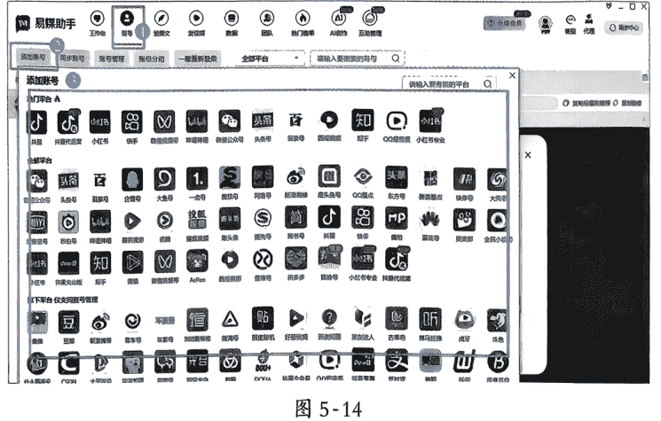

4. 先进入“发视频”入口，启动批量发布任务，将待投放的视频逐条加入清单，操作示意见图5-15，上传环节按系统提示执行，流程参考图5-16。

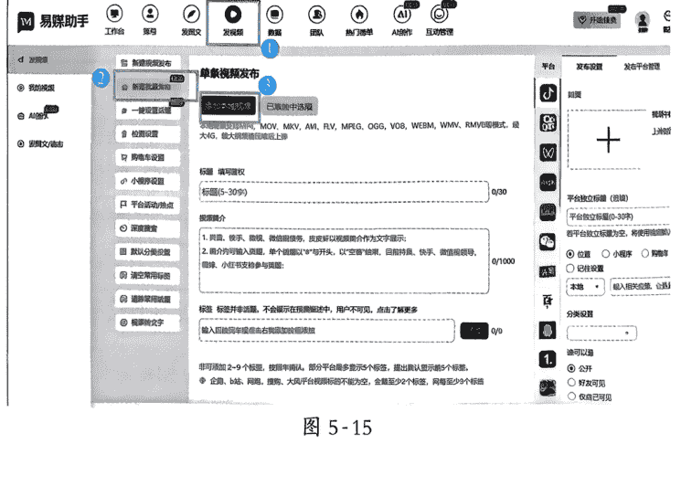

180 AI搞定生意

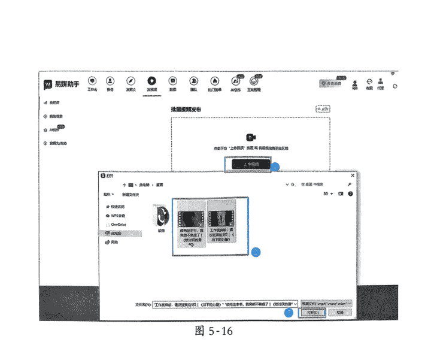

5. 全部素材上传完毕后即可配置标题。若视频文件在上传前已命名，系统会自动沿用文件名作为默认标题，无需再改；如需自定义，可打开批量设置标题功能，按视频上传的先后顺序逐行填写，标题数量必须与视频数量一致且顺序对应，否则会出现错位，具体示范见图5-17、图5-18。

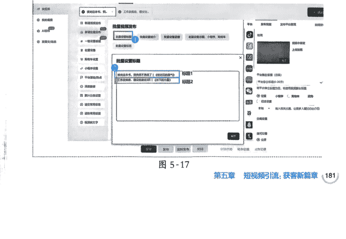

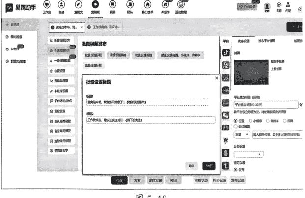

图 5-18

6. 同理可批量设置视频简介见图5-19、话题见图5-20、标签见图5-21，另外位置信息、小程序、购物车、团购等模块也支持批量配置见图5-22。作品获得不错流量后，可以再去探索批量变现的做法。

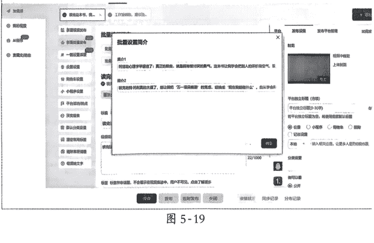

图 5-19

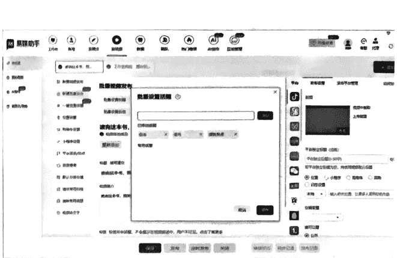

图 5-20

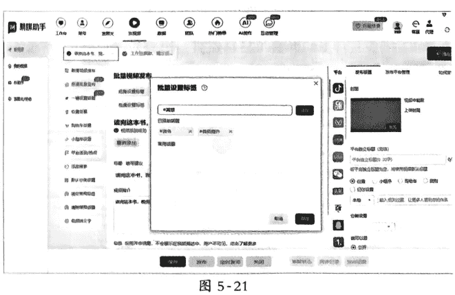

图 5-21

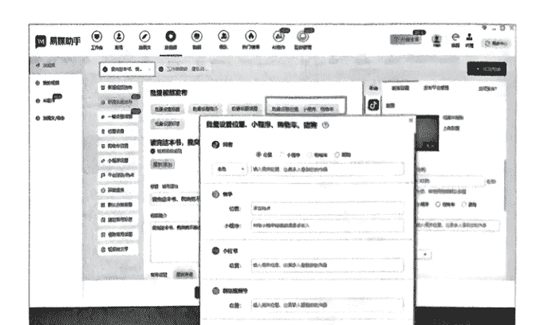

7. 核对完各项信息后即可一键批量发布，具体界面见图5-23。

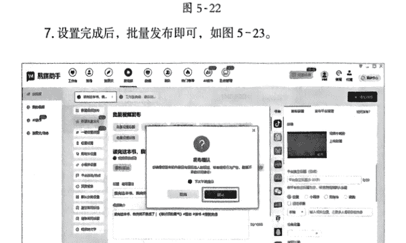

注：该平台还提供诸多矩阵账号的批量管理能力，可参考图5-24，

184 AI 搞定生意

对这类工具感兴趣的读者可以深入研究，使用得当能在获客变现上省不少心。

#### 视频教程（全新剪映教程已上线）

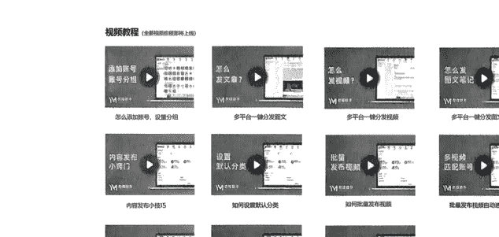

图 5-24

学完本节，你应已掌握借助短视频实现商业变现的方法，建议学以致用，搭建自己的短视频流量渠道，把曝光闭环成收益。

# 第六章

## AI 实战攻略：全场景解决方案

### 电商智能增长组合拳

#### 01 淘宝：标题优化 + 竞品监控

##### 平台特点

1. 国内综合电商龙头之一，买家规模庞大，商品品类全覆盖。
2. 流量来源以搜索和“猜你喜欢”等推荐为主，近几年直播、短视频等内容类流量的占比明显提升。
3. 竞争激烈、同质化严重，核心在于获取精准人群、提升点击与转化。
4. 官方工具“生意参谋”可提供全方位的数据支撑。

##### AI 实战

**步骤 1 深挖关键词，生成高点击率标题**

淘宝标题直接影响搜索排序和点击表现，AI可以辅助完成优化。

（1）**挖掘关键词**：结合生意参谋数据、淘宝下拉提示、竞品标题及用户评价等信息，利用AI进行归纳、聚合与筛选，最终形成核心词、属性词、长尾词、营销词、热搜词的组合。

（2）**生成高点击率标题**：在选定关键词基础上，遵循淘宝标题规范如长度限制、禁用词等，并以突出卖点、营造稀缺感、加入数字符号等方式提升吸引力，批量产出多条候选标题供挑选或测试。

- 提问模板（标题生成）：

我正在淘宝销售一款【产品详细描述】。请帮我生成 10 个符合淘宝规则的商品标题。

要求：

1. 包含【核心词】。

2. 包含【重要属性词】。

3. 融入可能的【营销词或场景词】。

4. 考虑近期热搜趋势。

5. 标题【长度】。

6. 避免堆砌关键词，语句尽量通顺且吸引人。

**参考指令：**

我正在淘宝销售一款 2025 新款纯棉女士白色 T 恤，宽松版型，印有简约字母图案。

请帮我生成 10 个符合淘宝规则的商品标题。

要求：

1. 包含核心词：T 恤女，白色 T 恤。

2. 包含重要属性词：纯棉，宽松，短袖，2025 新款，简约。

3. 融入可能的营销词或场景词：百搭，内搭，显瘦，ins 风，通勤。

4. 考虑近期热搜趋势。

5. 标题长度在 30 个汉字（60 字符）左右。

6. 避免堆砌关键词，语句尽量通顺且吸引人。

**成果示例：**

😎 已深度思考（用时 37 秒）∨

根据淘宝搜索引擎优化规则和用户搜索习惯，结合近期 "ins 风通勤穿搭" "显瘦上衣" 等热搜趋势，为您生成以下 10 个商品标题（每个标题均控制在 30 个汉字以内）：

1. 2025 新款纯棉白色 T 恤女宽松短袖 ins 风百搭显瘦上衣

2. 纯棉白色 T 恤女 2025 夏装新款宽松短袖百搭显瘦内搭 ins 风上衣

3. ins 风纯棉宽松 T 恤女 2025 新款白色短袖简约字母显瘦打底衫

4. 白色 T 恤女 2025 夏装新款纯棉宽松短袖 ins 风百搭通勤上衣女

5. 纯棉白色短袖 T 恤女 2025 新款宽松显瘦 ins 风简约字母通勤上衣

6. 2025 夏季新款纯棉白色 T 恤女宽松短袖百搭内搭 ins 风显瘦上衣

7. 白色纯棉 T 恤女 2025 夏装宽松短袖 ins 风简约字母通勤显瘦上衣

8. 2025 新款 ins 风纯棉白色 T 恤女宽松短袖显瘦简约字母百搭上衣

9. 纯棉宽松白色 T 恤女 2025 夏装新款短袖 ins 风通勤显瘦打底衫

10. 2025 夏季 ins 风纯棉白色 T 恤女宽松短袖百搭显瘦简约通勤上衣

**步骤 2 捕捉关键信息，实时监控竞品**

知己知彼，百战不殆，AI可以辅助竞品观测。

（1）**关键信息追踪**：关注竞品标题关键词变化、主图、详情页更新、价格调整、促销活动、销量走势、评价尤其是差评等。

（2）**策略分析**：AI可辅助解读竞品的运营打法，如促销手段、卖点优化、差评处理方式等，为自身提供参考。因 DeepSeek 无法直接访问外部链接解析，可借助“豆包”等AI工具完成内容解析。

- 提问模板（电商竞品分析）：

> 请分析这个淘宝竞品【粘贴竞品标题或链接】。假设它近期销量增长较快，请从标题关键词选用、主图视觉呈现、详情页逻辑、促销手段和用户评价反馈这几个角度，推测其可能的成功原因和运营策略。我应该如何借鉴或差异化竞争？

**参考指令：**

```
请分析这个淘宝竞品【淘宝】7 天无理由退货 https://e.tb.cn/......点击链接直接打开或者淘宝搜索直接打开。假设它近期销量增长较快，请从标题关键词选用、主图视觉呈现、详情页逻辑、促销手段和用户评价反馈这几个角度，推测其可能的成功原因和运营策略。我应该如何借鉴或差异化竞争？
```

第六章 AI 实战攻略：全场景解决方案 189

**成果示例：**

##### 一、竞争激烈程度与细分方向分析

###### 1. 竞争激烈程度

该淘宝商品近期销量增长较快，可能在标题关键词选用、主图视觉呈现、详情页逻辑、促销手段和用户评价反馈等方面存在优势，以下是对其成功原因和运营策略的推测，同时提出可借鉴的经验与差异化竞争策略：

**（1）标题关键词选用**

- 成功原因："女"精准定位目标群体，提高搜索精准度；"春秋季"贴合季节性需求，在相应季节能吸引更多有需求的消费者；"长袖衬衣"是商品核心属性，便于消费者快速识别商品类型；"花苞领一字肩"突出设计亮点；"一见钟情"增加情感吸引力，激发消费者兴趣。

- 运营策略：深入研究目标市场及消费者的搜索习惯，挖掘与商品属性、风格、适用场景等相关的高频关键词，并合理布局到商品标题中，从而提升商品在搜索结果中的曝光率。

- 借鉴与差异化：借鉴其精准定位和突出卖点的关键词抽取方式。差异化可挖掘竞品未覆盖的长尾关键词，如特定场合（约会、通勤）、面料独特性等相关词汇，吸引更细分的消费群体。

**请按如下顺序操作：**

1. 打开淘宝 App，搜索你的核心产品词。

2. 观察搜索结果页面排名靠前的 5～10 个商品的标题，记录它们常用的关键词和表达方式。

3. 将你记录的关键词和你的产品简介输入上述标题并生成提问模板，生成几个新标题草稿。

**注意事项：**

1. 规避违规风险词：标题中切忌使用淘宝规定的风险词、违规词。AI 生成后务必进行人工复核。

2. 不要过度堆砌关键词：过度堆砌关键词将会影响用户体验，可能被平台降权。

3. **懂得监控 ≠ 照搬**：监控是为了解对手情报、思路，而不是简单抄袭，要结合自身产品定位做差异化。

4. **注意数据合规性**：在使用第三方工具监控竞品时，需注意遵守平台规则，同时确保数据隐私合规。


#### 拼多多：智能定价 + 裂变活动设计

##### 平台特点

1. 社交裂变和低价策略推动快速增长，用户对价格敏感度高。
2. 商业形态以工厂直供和农产品直销为核心。
3. 平台活动如百亿补贴、限时秒杀、多多果园等对流量影响很大。
4. 运营重心在于引流、拼单转化、活动运营。

##### AI 实战

**步骤1 分析成本与竞品，给出动态调价建议**

在价格战中，定价策略至关重要，AI可以辅助智能定价。

（1）**成本与竞品分析**：基于产品特性、竞品定价、平台运营成本、用户价格预期等多维度数据，AI可辅助测算盈亏平衡点并给出有竞争力的价格区间。

（2）**动态调价建议**：AI模型可根据销量、库存、活动节奏、竞品调价等实时数据，动态给出定价建议，以实现流量最大化或利润最大化。

**提问模板（辅助定价）：**

我的产品【产品描述】在拼多多的成本价为【X元】。目前平台竞品中：最低售价为【Y元】，行业主流价格为【Z元】。现计划报名【xx活动】，该活动要求售价低于日常定价。请帮我分析：

1. 日常销售中具有价格竞争力的合理定价区间？

2. 为实现【运营目标】，活动价建议设置为多少？

3. 除了价格，还能通过哪些方式体现性价比？

**参考指令：**

我的产品手机壳在拼多多的成本为3元。目前平台竞品中：最低售价为5元，行业主流价格为9.9元。现计划报名限时秒杀活动，该活动要求售价低于日常价。请帮我分析：

1. 日常销售中具有价格竞争力的合理定价区间？

2. 为实现既能吸引用户又能保证微利营销目标（或战略性引流），活动价建议设置为多少？

3. 除了价格，还能通过哪些方式（如赠品、规格差异等）体现性价比？

**成果示例：**

**一、日常销售价位建议（平衡竞争力和利润）**

推荐价格区间：6.9元~7.9元

逻辑分析：

1. 避开低价血拼：当前最低价为5元（利润约1元，扣除运费后可能亏损），若跟进此价格将导致利润极低甚至出现亏损，且拼多多用户对低价商品的质量和服务容忍度较低，易引发差评。

2. 锚定主流价格策略：主流价9.9元，利用用户对"低于10元"的天然好感，定价7.9元既能与9.9元形成对比（突出2元价差优势），又比最低价5元高2.9元，通过价格差异暗示品质更好。

3. 利润保障：假设单件成本3元，平台扣点约2%（0.15元），运费1.5元，单件利润约7.9-3-1.5-0.15=3.25元，可支撑后续推广或活动让利。

执行建议：

- 主图强调"性价比标签"：如"防摔爆款·省2元""比9.9更超值"，弱化价格对比，强化品质感知。

- 搭配小规格赠品：如赠送"屏幕湿巾（成本0.1元）"，提升价值感。

**步骤2 生成活动创意，设计规则与撰写文案**

裂变是拼多多的核心，AI可支持裂变活动设计。

（1）**活动创意生成方案**：基于平台营销功能如拼团、砍价、助力、分享券等，结合不同营销目标拉新、促活、清库存等，由AI智能生成多样化裂变策划方案。

（2）**设计规则与文案撰写**：AI可辅助设计易懂的活动规则、吸引参与的分享文案及有效的对话引导话术。

> **提问模板（裂变活动策划）：**

为我的拼多多店铺【店铺名、主营类目】策划为期一周的社交裂变活动。

目标：提高店铺关注度，并推广新品【新品名称】。

要求：

1. 【活动形式】采用拼多多平台支持的成熟玩法。

2. 设计详细的【活动规则】。

3. 撰写吸引客户的活动主标题和分享引导文案。

4. 设置【风控措施】和控制活动成本。

**参考指令：**

> 为我的拼多多店铺水果批发（主营柑橘类水果）策划为期一周的社交裂变活动。

> 目标：提高店铺关注度，并推广新品沃柑。

要求：

1. 活动形式采用拼多多平台支持的成熟玩法，如邀请好友助力免费拿/多人拼团享超低价。

2. 设计详细的参与方式、成功条件、奖励机制。

3. 撰写吸引客户的活动主标题和分享引导文案。

4. 设置同一 ID 的参与次数限制，添加反刷单监测机制和控制活动成本。

**成果示例：**

结合拼多多平台特性和柑橘类水果消费场景，为您设计以下社交裂变活动策划方案：

##### 一、活动主题设计

主标题："0元抢3斤沃柑！邀5位好友立即免费领"

副标题：万人疯抢！新品沃柑上线，拼团立减30元，限量500箱秒杀

##### 二、双活动并行机制（兼顾拉新与转化）

▶ 活动一：沃柑尝鲜助力赛

✓ 参与方式：关注店铺→进入"免费领沃柑"活动页→生成分享链接邀请好友助力

✓ 成功条件：24小时内集满5人助力（含至少2位新关注用户）

✓ 奖励机制：

- 前200名完成：3斤沃柑免费包邮

- 第201名~1200名完成：享9.9元购（原价29.9元，限量1000份）

✓ 进度展示：实时更新"已助力人数/剩余名额"进度条

▶ 活动二：超级拼团日

- 拼团规则：

  - 3人成团价：19.9元/5斤（日常价29.9元）

  - 10人团专属价：15.9元/5斤（仅限社群链接参与）

  - 额外激励：团长每成功邀请满3人，可额外赠200g金橘试吃装

**请按如下顺序操作：**

1. 在拼多多 App 中搜索你的主营产品，筛选出销量最高的3~5个商品链接。

2. 分析定价策略及 SKU 设置、当前参与的平台活动以及商品评价中的用户反馈痛点。

3. 基于上述调研结果，使用裂变活动策划提问模板生成初步方案。

- **注意事项:**

1. **简化规则:** 活动规则需清晰易懂，复杂的规则会降低用户参与度。

2. **风险预案:** 提前准备客服响应方案，应对可能激增的咨询量。确保供应链和库存承压能力，避免爆单导致断货。

3. **合规性:** 时刻关注平台政策变动，确保活动符合规则。

#### 03 闲鱼：自动生成高转化文案库

##### 平台特点

- 1. 业界领先的二手交易平台，流量巨大，用户互动性强。
- 2. 商品具有非标准化特性，赢得客户信任是成交关键。
- 3. "鱼塘"社区具有独特社交属性。
- 4. 运营关键在于打造真实可信、信息详细的优质商品文案和视觉素材，同时通过高频互动形成转化闭环。

##### AI 实战

##### 步骤 自动生成高转化文案库

二手交易中打动买家的往往是真实具体的描述。AI可高效生成结构完整、细节丰富且语气诚恳的文案初稿，卖家再结合实际情况修改，即可逐步建立自己的文案库。

##### AI 文档生成要点：

- (1) **填写描述:** 包含物品名称、品牌型号、新旧程度（几成新/使用时长/瑕疵说明）、功能是否齐全、配件情况、转手原因（增加可信度）、期望价格、交易方式等。

- (2) **场景化/故事化:** 加入项目的使用场景、相关故事或情感联系，增加吸引力。

- (3) **精准关键词:** 包含用户可能会搜索的关键词。

- (4) **真诚语气:** 语气诚恳，如对于有瑕疵的物品应如实描述，避免过度吹嘘。

##### 提问模板（文案生成）：

> 我准备在闲鱼上出售一个【物品详细描述】，我想把它卖给【目标人群】。

请帮我写一段闲鱼商品文案。要求：

1. 包含【所有关键信息】。

2. 说明转手原因。

3. 描述使用体验或优点。

4. 如实说明细微瑕疵（如果有的话）。

5. 语气真诚，像和朋友介绍一样。

6. 包含可能的搜索关键词。

###### 参考指令：

> 我准备在闲鱼上出售一个仅使用过两次的豆浆机，型号是 XXXXX-XXXX，带全套配件和说明书。我想把它卖给注重健康的上班族/小家庭。

请帮我写一段闲鱼商品文案。要求：

1. 包含品牌型号、新旧程度、功能、配件、价格【可写面议或心理价位】、交易方式为同城自提。

2. 说明转手原因：使用频率低。

3. 描述使用体验或优点：打出的豆浆很细腻，操作方便，清洗简单。

4. 语气真诚，像和朋友介绍一样。

5. 包含可能的搜索关键词：豆浆机，家用，低噪音。

###### 成果示例：

【标题】[ 豆浆机 XXXXXX-XXXXX ] 99新 家用低噪音 带全套配件和说明书 健康早餐神器

【正文】

姐妹/兄弟看过来！转手一台几乎全新的豆浆机 XXXXXX-XXXXX，仅用过两次（真·吃灰预警），全套配件 + 说明书！因为家里饮食调整，使用次数太少，转给更需要的人。

亲测好用：

- ✅ 打出来的豆浆超细腻，豆渣几乎无感，不用过滤直接喝。

✅ "傻瓜式"操作，按键一按就搞定，上班族也能快速喝上热乎豆浆。

✅ 清洗超省心！刀头可拆卸，内胆不沾涂层，水一冲就干净！

✅ 低噪音设计，不用担心吵醒家人邻居，20分钟速成，不用早起。

适合人群：

面向独居人士、小家庭、健康爱好者、追求无添加豆浆的上班族，以及需要为宝宝做辅食的宝爸宝妈，现诚意转让。（想换咖啡机才忍痛出，刀前求轻拍）

心理价位 XXX 元（可小刀），同城可自提，外地可走邮寄。

关键词：# 家用豆浆机 # 低噪音 # 健康小家电 # 闲置转让

PS：实物超新无划痕，包装盒都在，送人自用都体面！需要看细节图随时戳我。

##### 请按如下顺序操作：

- 1. 选择一个你身边想出手的闲置商品。

- 2. 打开闲鱼 App，搜索相似商品，多参考几个同类商品的文案描述。

- 3. 使用上述提问模板，输入你的商品信息，生成一段文案草稿。

##### 注意事项:

- 1. 确保信息不失真: AI生成内容必须基于事实, 不能过分隐藏瑕疵或夸大优点。

- 2. 文案切勿千篇一律: 完全依赖AI可能导致文案缺乏个性, 建议加入个人真实感受。

3. 视觉素材先行：闲鱼用户浏览时先看图再看字，文案再出色，若主图不精或缺少短视频很难获得停留。
4. 互动必须闭环：不能只发信息不回音，回复速度与态度直接影响买家信任与成交达成。
5. 规则底线要熟：提前梳理平台禁止上架的品类与交易限制，避免违规导致下架或限权。

#### 04 抖店：短视频脚本制作与直播表达升级

##### 平台特征
- 1. 以兴趣带动消费，内容形态以短视频与直播为主。
- 2. 流量分配高度依赖算法，完播、互动、转化是衡量内容价值的关键维度。
- 3. 运营重点是稳定产出高质量内容，并持续提升直播间的参与感与成交效率。

##### AI 应用
第一阶段 从创意到框架的快速落地
爆款短视频是抖店起量基础，模型可辅助把灵感转化为可执行的框架。
（1）创意挖掘：结合商品卖点、受众画像与抖音当下热点，推导出多条呈现方向与表现手法。
（2）框架搭建：按平台观看习惯生成结构，包含开场钩子、节奏剪辑、反转节点、BGM切点等，并给出画面建议、核心口播、字幕要点及购物车引导语。可结合第五章方法细化。

📌 提问示例（抖店短视频脚本）：
> 请为我的抖音小店商品【商品说明】写一个15到20秒的种草脚本。
目标：突出【产品亮点】，引导用户点击购物车下单。
要求：
1. 前三秒制造抓点，直击痛点。
2. 中段快速展示使用流程与效果。
3. 呈现多种使用场景。
4. 结尾口播配合字幕明确下单指引。
5. 推荐适配的背景音乐风格。

###### 参考示意：
> 请为便携迷你榨汁机写一个15到20秒的种草脚本。
目标：突出便携与快速榨汁，促使用户点击购物车购买。
要求：开场呈现想喝鲜榨却嫌外卖贵不健康；中段数秒完成一杯；场景包括办公室、健身房、宿舍；结尾口播引导下单；推荐音乐风格。

###### 成果示意：
【15秒种草脚本】
建议BGM：明快电子流行，配合剪辑音效
0-3秒 痛点引入
画面：左手举奶茶店标价28元果汁，右手滑外卖App
画外音：“一杯果汁30块？糖分爆表还肉疼！”配扣钱音效
4-8秒 产品冲击
快剪：单手取出掌心大小榨汁机→投入水果→按键后倒出细腻果汁，3秒计时音效
画外音+字幕：“宿舍、健身房、办公室，3秒即得，无线便携”
9-12秒 场景切换
健身后饮用、办公桌旁、同宿舍床头使用
13-15秒 收口促单
产品旋转+购物车弹窗，口播：“鲜榨随时喝，点击下方购物车把健康带回家”

第二阶段 用AI激活直播，提升成交话术
直播转化决定GMV，模型可助力表达升级。
（1）流程规划：生成完整直播脚本，安排讲解、互动、福利、催单环节。
（2）话术库构建：针对开场、卖点说明、常见问答、质疑处理、催单等场景产出专业话术。
（3）实时辅助趋势：高级应用可解析评论区，输出即时建议或问题汇总。

提问示例（直播催单）：
> 我在抖音直播卖【商品名】，库存紧张，请给出几段有说服力、制造紧迫感、推动即时下单的话术，可结合优惠。

参考示意：网红芝士饼干，活动为限时买一赠一。

成果示意：
话术1 倒计时压迫
“家人注意！今天芝士饼干放血价，原价59现买一赠一，库存只剩30组，预计撑3分钟，已秒掉10组只剩20，想抢的赶紧下单”
话术2 场景刺激
撕包装声+拉丝特写：“听见酥脆声了吗？整块车打芝士不是粉末，今天买一赠一再送39元收纳罐，粉色礼盒只剩8组，弹幕扣粉色”
话术3 名额限定
“19:27，买赠还剩13分钟，明天恢复原价，最后15组库存，现在开始倒数，想要赠品马上点购物车”

操作建议：
- 先锁定店铺主推单品
- 用脚本示例让模型生成15秒初稿
- 用催单示例让模型生成三条话术

注意事项：
- 避免同质化，初稿需结合主播风格与现场互动调整
- AI只是工具，创意与真诚互动才是核心
- 严格遵守社区与电商规范，避免违禁词与虚假宣传
- 核对链接与优惠券设置，避免引流无法成交

#### 05 亚马逊：Listing智能优化与评论管理

##### 平台特征
- 1. 全球跨境电商龙头，覆盖欧美日等主流市场
- 2. 排名由A9算法决定，产品与品牌为核心
- 3. 用户评价显著影响决策与权重
- 4. FBA物流是优势但规则复杂
- 5. 运营重心为Listing优化、广告投放、评论管理与库存精细化

##### AI 应用
步骤一 精选关键词，高质量撰写Listing
Listing是运营基石，可实现智能优化。
（1）关键词挖掘：结合搜索趋势、竞品词与广告数据，找高相关高转化的核心词与长尾词
（2）文案撰写：按平台规则与目标市场阅读习惯，撰写符合算法偏好、突出卖点、简洁清晰的标题、五点描述、商品描述、搜索词

🔵 提问示例（Listing优化）：
我的商品是【商品说明】，目标人群是【目标人群】。请撰写5条有吸引力的英文要点，每条不超过500字符，并附中文翻译。
要求：突出特性与优势；包含相关关键词；每点以大写开头，强调优势；使用美国市场说服性语言。

参考示意：记忆棉旅行颈枕，受众常旅客、上班族。突出人体工学、便携、可水洗外套、赠眼罩；关键词旅行颈枕、飞机枕、记忆棉枕头。

成果示意：
1. ERGONOMIC SUPPORT CRADLES YOUR NECK IN ANY POSITION
...

步骤二 评论洞察与智能反馈
评论是生命线，AI可赋能运营。
（1）监控与分析：自动抓取新评，通过情感分析识别差评与好评要点
（2）差评应对：给出沟通、公开回复或申诉建议，可生成回复草稿
（3）好评利用：提炼认可卖点反哺Listing与广告，可邀请优质买家参与活动，注意合规

● 提问示例（评论分析）：
请分析我的商品【商品名】的亚马逊差评【粘贴文本】，总结主要抱怨，并起草专业且有同理心的公开回复，中英文版。可提供服务说明。

操作建议与注意事项同上，强调避免堆砌关键词、严禁刷单诱导、注意文化差异、及时妥善处理差评、多策略协同。

#### TikTok：海外标签库构建与趋势捕获

##### 平台特征
- 1. 用户基数庞大，年轻化明显
- 2. 电商功能在英美快速增长
- 3. 内容驱动，短视频为主，推荐机制与抖音相近
- 4. 运营核心是本地化内容、善用标签获取流量并紧跟潮流

##### AI 应用
步骤一 多维度标签组合，构建本地化库
标签是分发关键，可构建本地化库。
（1）多维度挖掘：按目标国家、品类，结合热点、文化习俗与用户兴趣，抓取并分类热门、利基、长尾标签
（2）组合推荐：根据视频内容与推广目标智能推荐最优组合

提问示例（本地化标签）：
> 我想在TikTok推广【产品类型】，目标地区【国家/地区】。请生成25个英文标签并附中文翻译，需含宽泛类、细分类、热门类、地区类。

步骤二 实时监测趋势词，生成创意脚本
捕捉趋势是成功的关键，可辅助抓取并创作。
（1）趋势监控：追踪区域爆款挑战、热门音乐、特效、话题关键词
（2）创意结合：基于趋势生成与产品结合的短视频创意或脚本

提问示例（趋势-脚本）：
> 在【地区】TikTok上，【主题】相关话题流行。我的产品是【商品说明】。请构思几条短视频创意，将趋势与产品结合，推荐标签，提供中英双语脚本与标签建议。

收尾画面选用整屋整洁的全景收束，最后定格在品牌标识上。

互动引导：带上话题 #叠叠乐魔法 分享你的收纳巧思！

### TikTok 标签打法拆解
推荐执行顺序：
- 先进入 TikTok 客户端，如有地区切换功能就切至目标销售市场。
- 检索同品类关键词，翻看热门视频，手工记录创作者常用的标签词。
- 套用前文的提问模板，把产品和目标市场填入，产出一批备选标签。

需要留意：
- 标签不要滥用：堆砌大量不相关热词会让流量不准或被限流。
- 别盲目蹭热度：内容与商品结合生硬会适得其反。
- 尊重在地文化：标签和内容要符合目标市场的文化、宗教和法规。
- 跟上平台规则：TikTok 的算法和电商政策常变，需持续追踪。
- 视频质感要足：低画质、非本地化的素材很难获推。

#### 独立站：SEO 长尾词拓展 + 用户画像建模

##### 平台特点
- 自建站拥有最高自主权，可自行掌控品牌形象、用户数据、消费体验。
- 流量仰赖自建：搜索优化、社媒投放、付费广告、邮件营销等都要自己做。
- 经营重心在品牌打造、私域沉淀与用户精细化运营。
- 数据归属商家，便于做深度分析和个性化营销。

##### AI 实战

##### 步骤 1 挖掘长尾词库，匹配精准内容
SEO 是独立站稳定获取免费流量的关键，AI 借助长尾词扩展能显著放大效果。
- 海量词生成：基于核心品类，AI 可产出搜索者可能使用的长尾词，通常由三个及以上词组成，意图更明确。
- 意图归类与内容规划：AI 可辅助判断长尾词背后的搜索意图，例如获取信息、比较产品、寻找购买入口等，进而规划博客、FAQ、产品页或落地页等内容。

提问模板 长尾关键词扩展：
> 我的独立站售卖【产品/服务】，核心词是【产品描述】。请帮我扩写【几】个相关的英文长尾词，并附中文译文，覆盖：
> - 产品特性。
> - 用户类型 / 使用场景。
> - 用户痛点 / 需求。
> - 竞品对比。

参考指令：
我的独立站售卖手工皮革钱包，核心词是"手工皮钱包"。请扩写 20 个相关英文长尾词并附中文翻译，覆盖：
- 产品特性，例如头层牛皮钱包、简约风格牛皮钱包。
- 用户类型 / 使用场景，例如男士皮钱包、送给父亲的钱包礼物。
- 用户痛点 / 需求，例如如何保养皮钱包、最耐用的钱包。
- 竞品对比，例如手工制作钱包与机器制作钱包对比。

成果示例：
已深度思考 用时 20 秒
以下为生成的 20 个英文长尾词及中文翻译，覆盖 5 大维度。结构参照 Google Keyword Planner 与 Semrush 逻辑，并结合购买决策场景：

####### 一、产品特性 材质 / 风格
- 1. Full-grain leather wallet with minimalist design → 头层牛皮极简设计皮钱包
- 2. Hand-stitched vegetable-tanned leather wallet → 手工缝制植物鞣皮钱包
- 3. Slim leather card holder with RFID protection → 超薄皮质 RFID 防盗卡包
- 4. Vintage distressed leather bifold wallet → 复古做旧双折式皮钱包

####### 二、用户类型 / 使用场景 礼物 / 人群
- 1. Luxury leather wallet gift for groomsmen → 新郎伴郎团高端皮钱包礼物
- 2. Handmade leather wallet for minimalist lifestyle → 极简生活方式人群手工皮钱包
- 3. Personalized leather wallet for anniversary gifts → 周年纪念定制刻字皮钱包
- 4. Leather wallet organizer for business professionals → 商务人士多功能皮钱包

##### 步骤 2 整合多维数据，细分用户画像
精准营销的前提是理解用户，AI 可助力画像建模。
- 多源数据整合分析：AI 能融合网站分析、问卷调研、CRM 购买记录、社交互动等数据，完成统一处理与深度挖掘。
- 用户分群与画像生成：基于算法，系统可自动把用户分为高价值客户、流失风险客户、新客等，并为每群生成画像，涵盖人口属性、兴趣偏好、行为习惯、痛点需求与触媒偏好。

提问模板 用户画像建模：
> 根据我们独立站后台分析，约 15% 的用户呈现以下特征：【列出洞察】。请据此构建名为“品牌忠粉”的用户画像 Persona，包含：
> 1. 基本信息 推测。
> 2. 目标与动机。
> 3. 痛点与挑战。
> 4. 对产品/品牌的期待。
> 5. 常用的信息渠道。
> 6. 适合的营销策略 如何触达与维系。

参考指令：
根据后台分析，约 15% 用户特征为：年龄 30~45 岁，多次购买高客单定制款，站内停留久，主要由 Instagram 引流，新品邮件打开率高，反馈常提到“独特性”“品质”。请据此构建“品牌忠粉”画像，包含：
- 1. 基本信息 推测。
- 2. 目标与动机。
- 3. 痛点与挑战。
- 4. 对我们产品/品牌的期望。
- 5. 常用的信息渠道。
- 6. 适合的营销策略 如何触达和维系。

成果示例：
已深度思考 用时 29 秒
用户画像 Persona：品牌忠粉
名称：匠心追求者 The Craftsmanship Loyalist
######## 1. 基本信息 推测
- 年龄：30~45 岁
- 性别：均衡分布，男性约 55%，女性约 45%
- 地理位置：北美、西欧、亚太等一线城市的高收入区域
- 职业：中高收入专业人士，如企业高管、创意从业者、自由职业者、企业家、奢侈品收藏者
######## 2. 生活方式：
- 倡导少而精的消费观，追求品质大于数量
- 重视可持续与工匠精神，偏好有品牌故事的产品
- 在社交圈扮演品味意见领袖角色

##### 请按如下顺序操作：
- 访问 Google 搜索引擎。
- 输入核心产品词，记录搜索框自动补全与底部“相关搜索”的长尾词组。
- 选用上述长尾词扩展模板，挑一个词组继续拓展。

##### 注意事项：
- 避免关键词与内容脱节：单纯堆词而不做高质量原创会造成“词文割裂”，影响 SEO。应以关键词为轴构建内容矩阵，确保价值与搜索意图匹配。
- 定期刷新画像：画像必须基于真实数据，脱离实际的理想化模型会误导策略。需定期用调研、行为数据、交易回溯验证，并随市场更新标签体系。
- 数据隐私合规：收集、存储、使用用户数据要严格遵守 GDPR、CCPA 等法规，做好加密与授权流程，避免泄露风险。
- 保持长期视角：SEO 与精准营销都需要积累，建立季度评估机制，通过持续优化内容与分群策略实现可持续增长。

### 实体店数智转型王炸组合

#### 08 服装业：AR 试衣镜，快速引流线下门店

##### 一 服务业实体店问题现状
网购冲击下，实体服装店面临多重困境：自然到店客流下滑；试衣意愿低、转化不佳；高峰期试衣间排队，体验受损；难以收集试衣偏好数据。

##### 二 AR 虚拟试衣镜 + 线上精准引流
AR 试衣镜通过摄像头捕捉身形，如图 6-1，结合增强现实与高精度 3D 服装模型，顾客站立即可实时预览不同款式、颜色的上身效果，挥手即可快速换搭。

在抖音、小红书、视频号等渠道发布展示 AR 试衣镜趣味与便捷性的短视频或图文，突出“到店体验黑科技”“一分钟试 N 件”“好友云穿搭”等亮点，激发好奇心，引导线下打卡，实现线上引流。可搭配 LBS 广告定向触达商圈周边人群。


图 6-1

##### AI 实战

###### 步骤 1 设备选型
市面上有独立一体机如图 6-2、壁挂屏、可集成到普通镜子或手机 App 的方案。据预算与客群选择适配供应商与产品。检索词：“AR 试衣镜供应商”“AI 虚拟试衣”

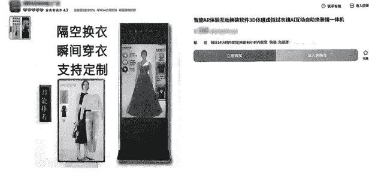
图 6-2

###### 步骤 2 内容准备
需将主推款式做 3D 建模后导入系统，如图 6-3，部分供应商提供建模服务。

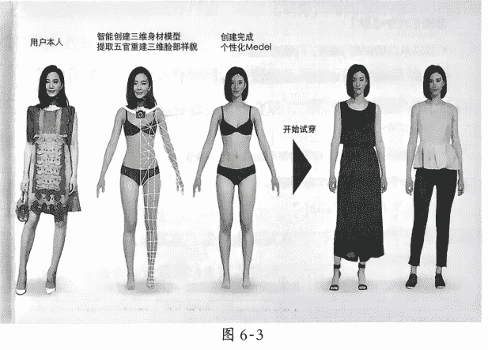
图 6-3

###### 步骤 3 线上推广
策划“AR 试衣体验官招募”“晒 AR 试穿照赢好礼”等活动持续造势，引流到店。可借助 DeepSeek 生成推广文案与短视频脚本。

提问模板 推广短视频脚本：
> 为我的服装店引进的 AR 试衣镜写一个吸引【用户群体】到店打卡的【发布平台】短视频脚本。突出科技感、趣味性和试衣效率。

参考指令：
为我的服装店引进的 AR 试衣镜写一个吸引年轻人到店打卡的抖音短视频脚本，突出科技感、趣味性和试衣效率。

成果示例：
🧠 已深度思考 用时 15 秒
【抖音短视频脚本：未来试衣间奇遇记】
背景音乐：科技感电子音效 + 节奏流行音乐混搭
分镜 1：0~3 秒
- 镜头从店铺玻璃门推进，门缝透出蓝光。
- 字幕：“听说 XX 商场藏着一面魔镜？”
- 音效：科幻启动声“嗡——”。
分镜 2：4~7 秒
- 全景展示 AR 试衣镜，镜面浮现动态粒子特效。
- 女生伸手触碰镜面触发涟漪。
- 字幕：“0.1 秒换装术启动！”
分镜 3：8~12 秒
- 快速剪辑：
  - 手指滑动空中菜单，衣服自动换装 朋克装→职业装→汉服。
  - 男生试西装瞬间变身 007 特效。
  - 闺蜜同框试装，镜中出现虚拟偶像同款。
- 字幕：“1000+ 穿搭组合，不用脱衣试到爽！”
分镜 4：13~17 秒
- 趣味镜头：
  - 女生试夸张礼服时出现虚拟红毯背景。
  - 男生试运动装时镜中出现虚拟篮球场。
  - 情侣试装时自动生成 CP 穿搭评分。
- 音效：游戏得分声“叮！SSS 级搭配！”。

###### 步骤 4 店内引导
培训店员引导顾客使用 AR 试衣镜，并基于虚拟试穿效果给出搭配建议，促进成交。

AR 试衣镜的核心价值：
- 引流吸睛：新奇科技体验，尤其吸引年轻客群，提升进店率。
- 提效转化：降低试穿门槛，场景化试穿，提升试穿频次与购买概率。
- 优化体验：缩短试衣时间，缓解排队压力，减少退换。
- 数据赋能：记录试穿数据，需合规，用于分析爆款与偏好，反哺选品运营。

##### 请按如下顺序操作：
- 手机搜索“AR 试衣”或“虚拟试衣”，下载 1~2 个主流品牌 App，体验移动端功能。
- 在小红书搜索“AR 试衣镜”，观看实体店体验视频，了解实际效果与用户反馈。
- 思考该技术能解决哪些具体问题，投入与回报如何。

##### 注意事项：
- 成本效益评估：硬件与建模初期投入高，需结合客流与预期转化测算 ROI，优先在核心门店或高单价品类试点。
- 技术效果验证：受限于技术，低端设备或蕾丝、褶皱等复杂面料还原可能偏差。务必要求供应商现场演示，重点测试材质还原与动态贴合。
- 内容维护成本：新款需持续建模与更新，建议“爆款优先建模”机制，先做销量前 30% 款式，降低常态维护成本。
- 数据隐私合规：摄像头采集影像需显著提示用途，仅用于试穿效果，禁止存储生物特征，确保采集、传输、删除全流程合规。

#### 09 餐饮业：AI 推荐菜品更新与定价

##### 餐饮业实体店问题现状
菜单同质化严重，难以突围；顾客选择困难影响点餐效率；凭经验定价导致利润流失或滞后市场；时令菜迭代慢，错失营销节点；食材浪费严重。

##### AI 销售数据分析 + 智能菜单推荐 / 动态定价
借助 POS 系统或餐饮数据分析软件，结合 AI 算法挖掘历史销售、会员消费、线上评价及天气等外部因子，识别热销/滞销菜品、黄金组合、顾客偏好与价格敏感区间。

基于分析结果可做：
- 推荐/优化新品菜单：建议下架长期滞销菜，根据偏好研发潜力新品，生成“本周人气王”“今日主厨推荐”等动态菜单。
- 智能定价建议：依成本、成交量、佣金、竞品价、供需关系给出精细定价，实现高峰低谷动态调价。
- 个性化推荐：对接会员系统或点餐小程序，按消费记录为顾客推送个性化菜品。

##### AI 实战

###### 步骤 1 数据基础
确保 POS 能记录销售数据，数据越完整，AI 分析越精准。

###### 步骤 2 工具选择
评估现有 POS 是否自带高级分析与 AI 推荐功能。若无，可引入第三方餐饮数据分析 SaaS 或 AI 营销工具如图 6-4。
检索词：“智慧餐饮 POS”“AI 菜单优化”“餐厅数据分析”

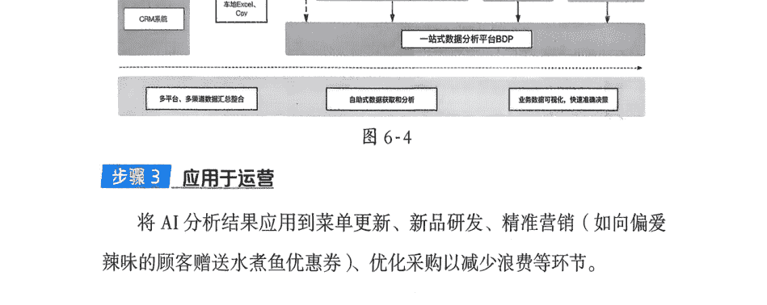
图 6-4

###### 步骤 3 应用于运营
把 AI 结果用于菜单更新、新品研发、精准营销如向偏爱辣味客户推送水煮鱼券、优化采购减少浪费。

###### 步骤 4 利用 AI 辅助
用 AI 分析大众点评等评论提炼口味关键词；让 AI 依据推荐食材组合生成创意菜名与推荐语。

参考指令：
分析以下关于我餐厅的 50 条大众点评评论：
1. 牛排三分熟，肉汁足，配菜芦笋老了。
2. 喜欢芝士焗龙虾，虾肉弹，酱汁偏咸。
3. 餐前面包硬，黄油结块，鹅肝煎得刚好。
4. 意面选了肉酱款，面煮软了，肉粒少。
5. 靠窗座安静，惠灵顿牛排酥皮脆，牛肉略柴。
6. 蘑菇汤奶油味浓，喝多会腻，面包篮收费贵。
7. 三文鱼排煎得嫩，柠檬酱太酸，土豆泥绵密。
8. 不爱羊排膻味，点了菲力牛排，火候准。
9. 提拉米苏酒浸够了，可可粉少，甜度过头。
10. 停车场难找，服务员指错路，牛舌薄切量少。
……

成果示例：
已深度思考 用时 20 秒
基于 50 条评论的总结：
一、顾客常提口味偏好
1. 熟度要求精准
- 多次提到熟度把控问题，偏好肉汁充足的牛排，反感干柴。
2. 酱汁偏好两极
- 喜欢浓郁但要求平衡，如“酱汁偏咸”“柠檬酱太酸”。
- 部分顾客认为酱汁掩盖主味。
3. 食材新鲜敏感
- 高频提到海鲜新鲜问题。
- 对蔬菜状态要求高，3 条批评配菜老化/不新鲜。
4. 甜点甜度争议
- 普遍反映甜品过甜，提拉米苏、马卡龙、焦糖布丁均被指甜度过头。
- 期待层次感，如“可可粉少”“奶油带冰碴”。

AI 销售数据分析结合智能菜单推荐与动态定价的核心价值：
1. 提效增收：优化菜单结构与定价，提升客单价与利润率，强化坪效。
2. 体验升级：精准捕捉偏好，提供个性化推荐，缩短决策时间，提升满意度。
3. 风险管控：数据驱动研发与定价，降低盲目决策风险，避免滞销与浪费。
4. 运营优化：销量预测指导采购，减少食材损耗，提升供应链效率。

**餐单定价优化执行指引**

**推荐操作顺序**
1. 进入 POS 后台调取销售明细，锁定一段周期内销售额排位前三与后三的菜品，并同步计算各自的毛利情况。
2. 回顾菜单更新的频率与依据是什么，并梳理现行的定价逻辑。
3. 筛选 1 至 2 家提供智慧餐饮或餐饮数据分析服务的供应商，整理其对外宣传的智能能力点。

**执行要点**
1. **数据质量管控**：确保销售、库存等基础数据完整可信，定期清理误录销量等异常记录，避免脏数据干扰模型结论。
2. **人机决策结合**：AI 建议需结合厨师研发经验、品牌定位如高端线品质要求及本地消费习惯综合考量。例如系统推荐低价套餐时，需判断是否与高端形象相符。
3. **动态调价审慎落地**：价格调整频率受控，建议单日不超过 3 次，避免高频波动影响顾客体验；招牌菜等敏感品类保持价格稳定，仅对非核心品类做小幅浮动，幅度控制在 ±10% 以内。

#### 10 美业升级：智能肤发评估＋预约调度

##### 一 行业痛点梳理
用户对自身肤质、头皮与发质的真实状态认知不清，服务匹配高度依赖技师主观经验，精准度受限；高峰期咨询电话集中，前台手工录入易出错；顾客爽约率高导致档期空置；技师排班与房设设备调度繁琐。

##### 二 核心工具组合
智能检测仪依托高清影像与图像识别，对皮肤、头皮或发质进行扫描。算法可自动解析水油平衡、毛孔、色斑、敏感度、头皮健康、毛囊状态、发丝受损等指标，并输出可视化报告，为后续项目与产品匹配提供客观依据。

SaaS 智能预约排班系统可实现：
1. **多渠道自助预约**：用户可通过微信小程序、App 或网页随时完成预约。
2. **智能排班**：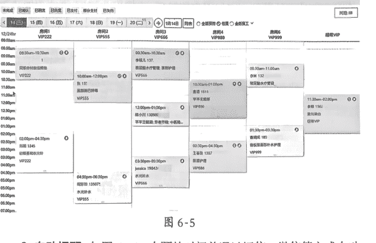
图 6-5
依据技师空闲、技能标签及客户偏好自动推送可用档期，提升资源利用。
3. **自动提醒**：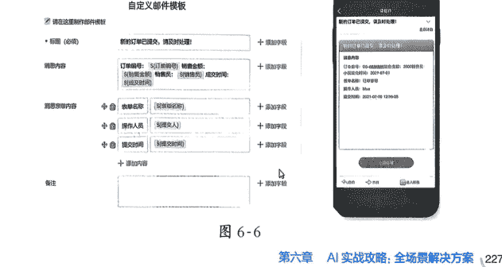
图 6-6
预约前以短信或微信方式推送提醒，有效降低爽约率。
4. **会员管理与营销**：整合会员档案，按标签如油性肌肤、烫染受损发质进行精细化运营。

##### 落地五步
###### 步骤 1 引入检测
采购专业肤质或头皮检测设备，选型关注检测维度、准确性、报告专业度及使用体验。检索词：AI 皮肤检测仪、智能头皮检测仪、美业检测设备。

###### 步骤 2 选择预约系统
评估美业 SaaS 平台，重点看排班定制化、营销能力、数据统计及与检测设备的联动。检索词：美业预约系统、美容院管理软件 SaaS、发廊智能排班。

###### 步骤 3 融合流程
将智能检测前置，以报告为依据为客户匹配适配项目与产品，提升专业感知与客单价。预约数据可回流至检测环节，形成历史轨迹。

###### 步骤 4 人员培训
技师需掌握设备操作与报告解读能力；前台需熟练使用预约系统。

###### 步骤 5 推广应用
以免费智能肤质/头皮检测为引流活动，将链接或小程序码投放至各渠道。可借助 DeepSeek 辅助撰写科普图文或短视频普及肌肤头皮知识。

**参考指令**
撰写一篇小红书笔记，介绍智能皮肤检测的价值，引导用户到店免费体验并附上预约方式。

**成果示例**
🧠 已深度思考（用时 15 秒）▼
【黑科技护肤体验！智能皮肤检测到底有多神奇？】
姐妹们！今天必须安利一个我最近发现的宝藏项目——智能肤质检测！
以前总觉得美容院检测都是“大概看看”，直到体验了这个黑科技才知道什么叫“精准到毛孔”！
**检测的 5 大超能力**
① **3 分钟看穿肌肤底牌** 连隐藏色斑、毛孔堵塞都给你扒得清清楚楚。
② **定制专属护肤方案** 结合肌肤年龄、敏感度、锁水能力，连成分适配度都算好，再也不用盲目跟风。
智能检测仪与智能预约排班系统的组合优势：
1. **提升专业形象与信任度**：科学数据比口述推荐更具说服力。
2. **提高客单价与复购**：精准推荐促进转化，良好体验带来回头。
3. **提升人力效率**：自动化预约提醒解放前台，减少空档损失。
4. **精细化客户管理**：基于数据提供个性化服务与营销。

**建议执行顺序：**
1. 搜索并浏览几款智能皮肤/头皮检测设备的产品介绍及演示视频。
2. 调研本地是否已有美容院或发廊提供此类检测，可优先实地体验。
3. 试用 1-2 个美业预约小程序或 App 客户端，感受预约流程。

**执行要点：**
1. **成本与准确性**：专业设备投入不低，低价设备可能影响准确性与专业度。
2. **数据隐私与安全**：涉及面部、头皮生物信息，需严格遵循隐私合规。
3. **系统集成问题**：检测、预约、收银、会员系统间的数据打通存在技术壁垒。
4. **避免过度营销**：检测后应基于专业建议，避免过度推销引起反感。

#### 11 酒店业：客房语音助手＋收益动态定价

##### 一 现状痛点
夜间需求响应滞后、前台人力成本高且重复咨询多、客房设备操作繁琐、定价依赖经验难以实时跟随市场，收益难以最大化。

##### 二 核心方案
客房智能语音助手，如图 6-7，可在房内部署智能音箱，通过语音控制灯光、空调、窗帘、电视，查询天气交通、酒店服务信息如 Wi-Fi 密码、早餐时间、健身房位置等，并呼叫客房服务。

图 6-7

收益管理系统 PMS 利用算法实时解析历史经营、预订、竞品房价、本地活动、天气、航班及搜索热度等多维信息，如图 6-8，预测未来需求并给出最优价格建议，实现一房一价和实时变价，最大化收益。
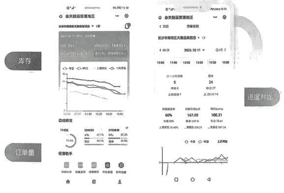
图 6-8

##### 落地五步
###### 步骤 1 部署语音助手
与智慧酒店方案商合作，选型智能音箱硬件及后台平台，完成硬件安装、网络配置、系统对接如客控与服务呼叫系统及知识库录入。检索词：智慧酒店语音助手、AI 酒店客控、酒店智能音箱。

###### 步骤 2 实施 PMS
选择 PMS 供应商，导入历史经营数据训练模型。安排专人或智能辅助监控系统建议，结合实际进行定价决策与发布。检索词：酒店收益管理系统 PMS、酒店动态定价 AI、酒店数据分析。

###### 步骤 3 整合应用
语音助手与 PMS 可组合增值服务套餐，如延迟退房、自助早餐优惠。PMS 数据还能反映哪些房型客人对语音助手使用率更高。

###### 步骤 4 人员培训
培训前台与客房服务人员熟悉语音助手功能及 PMS 定价逻辑，提升服务与价格解释能力。

###### 步骤 5 信息维护
定期更新语音助手知识库，确保服务与周边信息准确。可利用 DeepSeek 批量生成常见问答，人工校对后导入。

**参考指令**
为酒店客房语音助手生成 20 组关于设施、服务及周边信息的常见问答。
**成果示例**

以下是为酒店客房智能语音助手设计的 20 组常见问答，涵盖酒店设施、服务及周边信息：
**酒店设施相关**
1. **问：** 酒店早餐几点开始供应？在哪里用餐？
   **答：** 您好！自助早餐于每日早上 6:30~10:00 在 2 楼“云尚餐厅”供应，凭房卡即可用餐。
2. **问：** 酒店有健身房吗？开放时间是什么时候？
   **答：** 24 小时健身房位于 3 楼，刷房卡即可进入，内有跑步机、力量训练设备等。
3. **问：** 游泳池是否免费开放？需要预约吗？
   **答：** 恒温泳池位于 4 楼，住店客人可免费使用，开放时间为 8:00～22:00，建议携带泳帽入场。
4. **问：** 房间内的 Wi-Fi 密码是多少？
   **答：** 连接网络“Hotel_Guest”，密码为房号 + 入住日期后四位，如需帮助可联系前台。
语音助手结合收益动态定价的优势：
1. **提升客房体验与满意度**：提供便捷智能个性化服务。
2. **提高运营效率，降低人力成本**：分担前台与客房工作，PMS 自动处理定价。
3. **提高酒店收益**：动态定价匹配市场需求，提升 RevPAR。
4. **增强科技感与性价比**：吸引偏好科技体验的年轻客群。

**建议执行顺序：**
1. 搜索“智慧酒店”或“AI 酒店”，阅读报道与案例，了解用户评价。
2. 在携程、飞猪预订时关注“智能客房”、“AI 语音助手”等标签，对比定价与评价。
3. 思考核心客群画像、科技接受度，以及引入系统的收益与挑战。

**执行要点：**
1. **集成复杂性与成本**：语音助手需深度对接客控、PMS 等系统，硬件维护、软件更新、知识库维护需持续投入。
2. **语音识别准确率**：口音、语速差异会影响识别效果，需选择成熟技术商。
3. **隐私合规与用户自主**：需明确告知隐私政策，提供物理关闭选项。

#### 12 家居业：AR 虚拟陈列＋售后智能质检

**行业挑战**
线上买家具靠想象，尺寸不符、风格不搭导致退货率高；线下展示空间有限；大件安装后质量问题如划痕的责任判定难，处理周期长。

**方案说明**
AR 虚拟货架 App 如图 6-9，允许用户用手机摄像头将按真实比例的家具 3D 模型投放到实际空间，可移动旋转，预览效果、尺寸与风格协调性。

图 6-9

智能图像识别售后质检指用户反馈质量问题后，通过 App 上传照片或视频，后台利用图像识别与机器学习分析问题类型如划痕、裂纹、污渍、严重程度，并与出厂标准比对，生成初步质检报告，加速处理。

##### 落地四步
###### 步骤 1 开发 AR 功能
自研或外包，或使用电商平台、第三方技术公司提供的 SDK 或 AR 服务集成到 App 或小程序。检索词：AR 家居、虚拟货架 App 开发。

###### 步骤 2 推广 AR 应用
在商品详情页、社交媒体、线下门店推广 AR 功能，引导下载使用。

###### 步骤 3 搭建质检系统
选择公有云视觉服务如阿里云、腾讯云、百度云，结合业务二次开发。用高分辨率正品及瑕疵图片训练模型，提升准确率。设计上传指引与后台流程，智能初判后人工复核确认。

###### 步骤 4 整合售后流程
将质检结果与客服、工单系统打通，实现快速响应、定责与处理。可利用 DeepSeek 生成用户拍摄指引说明。

**参考指令**
为家居产品售后智能质检功能写一份清晰的用户拍摄指引，说明拍摄角度、光线及部位。

**成果示例**
已深度思考（用时18秒）
以下是为家居产品售后质检设计的用户拍摄指引模板：
**家居产品售后质检拍摄指引**
**拍摄前准备**
1. 使用手机后置摄像头。
2. 关闭美颜/滤镜。
3. 清洁表面污渍。
4. 移除无关物品，保持背景简洁。
**光线要求**
**推荐：** 白天自然光非直射，或室内多盏顶灯加台灯补光。
**避免：** 单侧强光阴影、昏暗开闪光灯反光、逆光模糊。
AR 虚拟陈列结合智能质检的优势：
1. **降低退货率，提升转化**：所见即所得，减少尺寸风格不符退货。
2. **增强购物体验与决策信心**：在家试摆，提升购买意愿。
3. **提升售后效率与满意度**：智能加速质检，快速解决问题。
4. **降低后期成本**：减少上门鉴定或返厂成本。
5. **实现数据积累与产品优化**：质检数据帮助发现设计缺陷与易损点。

**建议执行顺序：**
1. 下载宜家 IKEA Place 或其他 AR 放置功能 App 体验。
2. 思考 AR 预览能解决顾客哪些顾虑。
3. 设想划痕反馈场景下，智能如何优化处理流程。
4. 搜索“AI 质检”、“图像识别缺陷检测”，了解应用案例。

##### 注意事项：
1. **AR 效果与建模成本**：高保真效果依赖高质量 3D 模型，批量建模成本高。
2. **设备兼容性与性能**：AR 对手机硬件有要求，需考虑用户设备覆盖。
3. **质检准确率**：对复杂综合性问题识别有限，仍需人工介入。
4. **用户接受度**：需引导用户正确使用 AR 与智能质检拍摄。
5. **系统开发与集成**：整合至现有业务流程需技术投入。

### 本地生活服务智能升级方案

#### 13 美团/大众点评：智能评论回复与爆款套餐打造
随着线上获客成本上升，餐饮、零售、休闲娱乐、生活服务等本地商家更依赖“家门口”流量。美团、大众点评、小红书、抖音同城号、微信视频号构成本地生活新阵地，智能可帮助精准获客、积累口碑、促进到店转化。

**平台特点**
美团与大众点评是中国本地生活的核心基础设施，涵盖信息检索、评价、交易、营销。用户决策受评价、评分、排名影响显著。商家运营重点在于维护口碑、优化套餐代金券设计、提升搜索排名、强化用户沟通。

##### AI 实战
###### 步骤 1 判断情感与关注点，快速构建高效回复模板
海量评价与咨询既是资产也是负担，智能可赋能评论问答自动回复。
1. **判断情感与关注点**：自动识别评论情感如负面、中性、疑问，并按口味、服务、环境、价格等分类。
2. **个性化回复模板生成**：基于内容与情感生成不同语气、含关键信息、体现态度的回复草稿，商家审核后发布。
**提问模板智能回复：**
```
请分析以下这条来自【平台名称】的用户评论/提问：

【粘贴评论或提问内容】

要求：

1. 判断评论的情感倾向和主要关注点。
2. 生成一个专业、礼貌、针对性强的回复草稿。
3. 如果是负面反馈，要表达歉意并说明改进措施或意愿。
4. 如果是好评，要表达感谢并适当突出优点。
5. 如果是提问，要清晰准确地回答。
```
**参考指令**
请分析以下大众点评用户评论/提问：上菜耗时较长，多次催促，不过菜品风味尚可。
要求：判断情感倾向与关注点；生成专业礼貌针对性强回复草稿；负面反馈需表达歉意并说明改进；好评需感谢并突出优点；提问需清晰回答。
**成果示例**
已深度思考（用时24秒）
**分析及回复：**
**1. 情感倾向与关注点分析：**
- 情感倾向：中性偏负面，用户不满上菜速度但肯定味道。
- 主要关注点：服务效率上菜慢影响体验；菜品味道获认可。
**2. 针对性回复草稿**
- 标题：关于您反馈的用餐体验说明
###### 步骤 2 提炼爆款数据，组合高转化套餐方案

# AI驱动门店增长闭环

美团和大众点评上的组合套餐承担着获客和留客双重职能，借助生成式模型可以更快把爆款组合孵化出来。

**一、信息聚合**
把本店的成交记录、评论里高频出现的菜名、周边对手的套餐打法、平台类目的热销榜单等数据拎到一起，由模型归纳出消费偏好并揪出市场空白。

**二、方案产出与定价**
基于洞察，模型能给出多种组合思路，比如用于引流的双人餐、客单更高的四人餐、工作日午市餐等，并给出在吸引力和毛利间取得平衡的价位建议。

**套餐设计提问参考框架：**

> 我经营的是【店铺类型】，到店均客单约【金额】。店里常卖的品项有【A、B、C】，顾客评论里经常夸【口味/菜品】。附近同行的热门组合大致是【竞品组合及特点】。
>
> 请为【目标人群】定制一份【人数】人拼单组合。
>
> 要求：
> 1. 按【品类】合理搭配，突出自家辨识度。
> 2. 相比单点要明显省钱。
> 3. 起一个让人想点单的名字。
> 4. 简要说明配方的逻辑。

**示例提问：**

> 我做的是川味火锅，均客单约80元。畅销品有毛肚、雪花肥牛、手打虾滑，客人常赞麻辣锅底和红糖糍粑。附近竞品多为基础肉拼+素拼+酸梅汤。请为年轻情侣设计一份双人团购组合，要求荤素、锅底、小吃、饮品搭配均衡，体现特色且具划算感，并命名并说明理由。

成果示例：

思考完成

组合名称：【怦然心动·双人麻辣盛宴】158元

组合内容：

锅底三选一
- 招牌牛油麻辣锅
- 番茄麻辣鸳鸯锅，适合拍照
- 菌汤麻辣鸳鸯锅，解辣更养生

**落地推进建议**

1. 进入美团/大众点评商家后台，调出最近5条用户反馈，包含好评、差评、中评和提问。
2. 挑1-2条，用上述回复思路生成草稿，和日常回复作对比，提炼模型版的优点。
3. 把效果好的模型回复按标签归类，如#感谢、#服务致歉、#菜品推荐，方便快速调用。
4. 在后台看套餐成交数据，找出销量最好和最差的组合，初步判断成因。

**操作提示**

1. 回复要有人味，过度依赖模板会显得机械，严重差评建议人工接手。
2. 差评要查根源，模型只能优化话术，品质和服务问题要从经营端改。
3. 套餐建议要能落地，要结合出品能力、成本结构和用户反馈调整。
4. 描述和信息必须符合平台规范。

#### 14 小红书：热点捕捉与路线规划

##### 平台画像
小红书以年轻女性用户为主的生活方式分享社区，核心是种草，内容消费-场景体验-交易转化的链路已形成。图文短视频为主，重真实体验和社交互动。附近功能与本地生活内容流量大，商家需优质笔记、社区互动和达人合作并重。

##### AI应用
###### 步骤1 监测社区热度，感知消费趋势
小红书是洞察本地消费风向的窗口，AI可抓取区域热点。

1. 内容监测与解析：在合规前提下借助监测工具抓取指定区域如#上海周末去处、#广州探店或行业如#咖啡探店、#宝藏小店的笔记。
2. 热点提炼：模型解析文本、图片、标签与互动数据，归纳热门打卡点、玩法、风格与用户关注点。

**热点分析提问框架：**

假设监测到近期小红书【城市】+【行业】相关笔记高频出现关键词【xx】。请分析：

1. 这些热词体现了目标用户的哪些偏好与需求？
2. 我的【店名+特色】有哪些点可与热点结合？
3. 能策划哪些笔记主题或活动来借势？

**示例提问：**

假设近期深圳下午茶笔记高频词为氛围感、宠物友好、创意甜点、人少景美。请分析用户偏好，评估黄氏甜品店主营广式甜品如双皮奶、烧仙草、水果冰沙的契合点，并给出可借势的笔记主题与活动。

成果示例：

⏱ 已完成思考

1. 用户偏好拆解
格调氛围：用户追求社交场景的仪式感与美学体验，重视环境、餐具、灯光，满足拍照与情绪价值。隐性需求是通过场景彰显生活品味。
适合携宠：养宠人群希望人宠同行，寻找兼顾消费与宠物陪伴的场所。隐性需求是借携宠社交结识同好。
新奇甜品：对传统甜品审美疲劳，追求视觉冲击、味觉创新或DIY互动。隐性需求是获取社交谈资，提升潮流感知。
清静美景：反网红扎堆，偏爱小众安静有专属感的空间。隐性需求是在城市中找到松弛的避风港。

###### 步骤2 规划路线，打造爆款笔记
城市漫步、一日游、周末探店路线是小红书的爆文类型，AI可辅助串线。

1. 路线创意生成：基于文艺之旅、吃货地图、遛娃好去处等主题，将商家与周边POI串成逻辑路线。
2. 笔记内容辅助：为每个点撰写推荐语、拍摄角度与互动话题。

**路线规划提问框架：**

> 我想发一篇【城市+主题】的探店路线笔记，推广【店名+地址+特色】。请规划3-5个地点的路线，要求包含我的店铺，地点集中且符合主题，给路线起吸引人的标题，并为每个点写2-3句推荐语。

**示例提问：**

> 想发广州老城区怀旧之旅的探店路线，推广位于敬梓里文创社区的复古杂货铺，请规划3-5个地点，要求包含敬梓里，地点符合怀旧复古且集中，给标题并写推荐语。

成果示例：

已完成思考

【时光机启动！西关复古记忆一日打卡｜老广私藏5个宝藏路线】

路线：敬梓里文创社区→永庆坊记忆银行旧物仓→钟书阁永庆坊店→陈添记鱼皮→泮塘五约历史街区

敬梓里文创社区
推开木门进入复古乌托邦，迷宫式空间藏着杂货惊喜，80年代霓虹、绝版连环画和胶片相机组成怀旧市集，二楼露台可拍到李小龙故居同款机位。

永庆坊记忆银行旧物仓
青砖骑楼下是时光储藏室，老式收音机、铁皮玩具、搪瓷缸还原70-90年代生活，大红电话亭和古董电视墙出片率高。

**执行步骤**

1. 在小红书搜索【城市】+【行业】，切到最新或附近页。
2. 快速浏览10-15篇笔记，记录反复出现的地点、话题与风格。
3. 选定一个热点，用上述分析框架思考与自家店铺的结合方式。

**注意事项**

1. 重视热点时效，避免追冷饭导致投入产出失衡。
2. 品牌植入要自然，硬塞商业信息易被用户排斥。
3. 内容调性要对齐，画质与文案风格与平台主流一致才有推荐。
4. 发布后及时互动，回复评论私信提升粘性。

#### 15 视频号：本地爆款脚本与社交裂变追踪

##### 平台画像
视频号依托微信生态，社交传播能力强，用户年龄层广，公私域联动顺畅，可把流量导向微信群、小程序与个人号。运营重点是关系链传播、信任感建立与私域沉淀。

##### AI应用
###### 步骤1 生成同城爆款，撰写真实感脚本
视频号更重真实生活化，AI可产出脚本模板。

1. 模板创意生成：结合本地服务特色与微信属性，生成店主的一天、顾客故事、匠心工艺、邻里福利等模板。
2. 细节填充：填充场景、对话、情绪表达，并加入点赞评论转发收藏等引导。

**脚本提问框架：**

> 为我的【本地实体店类型】创作一个适合微信视频号的短视频脚本。主题展现【主要内容】，吸引周边居民关注。风格真实温暖生活化。结构：开头【描述】，中间【描述】，结尾【描述】。请给出画面与旁白/对话。

**示例提问：**

> 为社区花店创作视频号脚本，展现温馨日常与人情味。开头清晨阳光照进店里店主整理花材特写，中间与熟客互动包装花束并介绍当季花材小知识，结尾店铺全景店主微笑问候并引导欢迎常来坐坐，带地址或地标。

成果示例：

《巷角花房日记》脚本模板

开头 晨光序曲 5秒
画面：清晨7点阳光透过木窗，花上水珠折射光斑，店主修剪玫瑰。
旁白：晨光与花香一起醒来，巷角花房已备好今日温柔。
字幕：XX社区 8:00AM

中间 人情与匠心 15秒
画面：门铃响，碎花裙老太送咖啡说百合该换了，店主指着黄百合。
对话：
店主：张姨，刚到的云南百合香味淡，张叔过敏也能放。
张姨：就你记得最清楚！

###### 步骤2 社交裂变追踪，优化转化
发券、拼团、推荐有礼时需追踪效果，AI可辅助分析。

1. 传播路径解析：借助后台数据解析微信内的传播路径、关键节点与转化。
2. 用户行为洞察：解析参与用户的特征与互动行为，为精准营销提供依据。
实践中裂变追踪通常依赖微盟、有赞等第三方工具或自建系统，AI主要负责数据解析与洞察。

**操作建议**

1. 打开微信发现→视频号→附近，观看5-10个本地商家的视频，感受风格与互动。
2. 挑一个喜欢的视频拆解结构，思考是否可用上述模板复刻。

**注意事项**

1. 风格要适配平台，直接搬运抖音硬广易水土不服。
2. 强化社交互动，内容要能激发点赞评论转发。
3. 承接链路要完善，流量进来后需导向微信群、小程序等私域。
4. 裂变规则要合理，繁琐或奖励不足会引起反感。
5. 提前部署追踪工具，否则无法量化效果。

### 自媒体变现革命
#### 16 知识付费：课程大纲自动生成

自媒体创作者无论全职还是副业，都面临效率与变现问题。AI正在重塑选题、生产、连接与商业化全流程，尤其在知识付费领域，AI是提升研发效率的关键。

##### 行业痛点
知识付费通过付费社群、课程、电子书、训练营变现。创作者常卡在把零散知识体系化、保证逻辑递进与覆盖全面，以及匹配不同水平学员节奏上。

##### AI应用
AI可快速生成结构清晰、内容全面的大纲框架，创作者只需填充个性化与实操经验。

###### 步骤1 明确课程要素
确定课程主题、目标学员画像与核心学习目标。

###### 步骤2 生成初始大纲
把要素输入AI，指定章节数量或总时长，生成章节与小节清单。

**生成大纲提问框架：**

我想设计一门在线课程，主题是【详细课程主题】。目标学员【学员画像】。课程目标【具体学习成果】。请生成包含【几】个主要章节的详细大纲，要求逻辑清晰由浅入深，每个章节下设【几】个小节，覆盖【核心知识领域】，适当标注实操作业或案例分析。

**示例提问：**

> 设计“零基础小白的Python入门”，目标是想转行的大学生或职场新人，目标是掌握基础语法、能写简单爬虫并具备自学能力。请生成10个章节的大纲，每章3-5小节，覆盖环境搭建、基础语法、数据类型、函数、面向对象基础、常用库、项目实战等，标注作业。

成果示例：

《零基础小白Python入门》大纲，共10章，40-50小时

第1章 编程认知与环境搭建 3小时
1.1 什么是编程、程序员的思考方式
1.2 Python特点与应用场景
1.3 安装Python与开发环境配置
1.4 VS Code/PyCharm基础配置
1.5 第一个程序Hello World与调试【实操作业】

第2章 Python基础语法 5小时
2.1 变量与基础数据类型
2.2 注释规范与命名PEP8
2.3 运算符
2.4 输入输出高级用法
2.5 调试基础与常见错误【案例：计算器程序】

###### 步骤3 迭代细化
多轮对话让AI对特定章节展开，补充要点、示例、练习与引入总结。

**细化大纲提问框架：**

> 请把上轮大纲中【章节名称】的每个小点细化，给出核心讲解要点2-3个、一个示例代码或应用场景、一个练习思考题或小作业。

**示例提问：**

> 请细化“第1章 编程认知与环境搭建”每个小节，给出2-3个核心讲解要点、一个示例或场景、一个练习。

成果示例：

已完成思考

针对第1章的细化设计，每个小节包含核心知识点、示例场景与练习任务：

###### 1.1 编程本质与程序员思维拆解

**核心讲解要点：**
- 编程的本质是把人类自然表达转译为机器可按条执行的指令集
- 程序员的核心能力是把大问题拆小、规划执行步骤、再把步骤写成代码
- 人对模糊信息有容忍空间，机器则要求绝对精确、不可歧义

**类比场景：**
用“做番茄炒蛋”来映射编程的思路路径：

```python
##### 伪代码示例
准备食材(["鸡蛋", "番茄", "盐"])
热锅(油=10mL)
if 鸡蛋未打散:
    打散(鸡蛋)
煎炒(鸡蛋, 时间=2分钟)
混合(鸡蛋, 番茄)
调味(盐=3g)
```

**思考练习：**
把“网上下单付款”这一件事拆成5步，用中文伪代码的形式写出来

##### 建议操作顺序
1. 先锁定一个你足够熟悉、能做成课程的知识板块
2. 明确想教的人群是谁，学完后应达到什么能力水位
3. 套用第一套AI提示词框架，把信息填入，让模型产出一版初稿大纲，并校验框架是否通顺

**关键提醒：**
1. 防止内容空洞与同质化：过度依赖模型容易产出泛泛说辞，缺少创作者个人洞见与实战沉淀。大纲仅作骨架，具体血肉需要自行填充
2. 防止逻辑松散：模型输出常出现条理不清或重复累赘，必须人工逐条梳理、调整模块顺序，保证递进顺畅
3. 不要忽略教学设计：优质课程不只是知识罗列，还要考量讲授方式、互动环节、学习体验，这些只能由作者自行设计
4. 版权必须合规：模型产出的案例、引用等要核查出处，避免侵权。建议以模型输出为灵感，结合个人表达风格与真实案例重构

#### 17 带货账号：混剪去重与评论区互动

##### 平台特性
带货号主要靠短视频或直播种草获取佣金，核心阵地为抖音、快手、淘宝等。核心痛点是素材有限，直接搬运易被判重复限流；评论区咨询集中且高度重复，回复迟缓会降低转化。

##### AI 实战

###### 第一步 素材拆解重组，批量产出多版本
在平台规则内，用有限素材做出“看上去不一样”的多条内容，提升效率与覆盖面，模型可辅助混剪去重

1. 提供混剪思路：模型可依据原始素材特点，提出多种剪辑方案，包含改变叙事结构如痛点先行、效果前置、提问互动，调整画面顺序、更换音乐音效、加入不同转场特效、植入不同使用场景或情绪、调整旁白侧重点等
2. 产出差异化元素：可批量生成不同标题、封面文案、片头片尾、字幕贴纸等，提升视频间区分度

####### 提问范例 混剪思路
> 我手上有一段30秒的产品展示素材，内容是【简述素材内容】。想做成5条抖音带货短视频防止重复，请给出5种不同的混剪修改思路，要求改动点具体明确。

####### 参考指令
> 我有一段30秒的核心产品展示视频素材，内容是演示一款多功能料理棒打果泥的过程。我想把它制作成5个用于抖音带货的短视频，以避免被判重复。请提供5种不同的"混剪"修改思路，要求改动点明确具体。

####### 成果示例
以下是5种针对料理棒产品视频的差异化混剪方案，每种方案均有明确的可执行操作点：

######## 方案一：痛点解决型快剪
- 剪辑结构：痛点镜头3秒 + 产品特写2秒 + 使用过程15秒 + 效果展示10秒
- 具体操作：
  1. 开头用手机拍摄的手抖镜头展示普通搅拌机笨重难用；
  2. 产品特写时添加“单手就能操作”的动态文字；
  3. 将原视频打果泥过程加速1.5倍，重点保留食材飞溅的慢动作；
  4. 结尾用分屏对比传统搅拌机残留果渣 vs 料理棒细腻效果。

######## 方案二：场景延伸混搭
- 剪辑结构：早餐7秒 + 辅食7秒 + 下午茶7秒 + 甜品7秒 + 产品图2秒
- 具体操作：
  1. 将原素材拆分成4个7秒和1个2秒片段，分别配不同场景字幕；
  2. 添加对应音效，如早餐场景加煎蛋声；
  3. 用画中画展示产品在不同容器中的使用；
  4. 结尾用九宫格拼贴展示打碎坚果/冰块/肉馅等扩展功能。

###### 第二步 识别高频问题，生成多风格回复
快速准确响应用户评论能有效提升转化，模型可赋能评论区互动
1. 常见问题识别与回复生成：训练模型识别评论区中关于价格、使用、规格、发货、售后等常见问题，并结合预设知识库生成标准、礼貌且准确的回复初稿
2. 多版本回复库：针对同一问题，生成多种语气如热情、专业、简洁，或包含不同引导如引导私信、引导看置顶、引导进入直播间的回复选项，供运营者挑选

> 提问范例 评论回复生成：
> 请针对以下这条带货视频下的用户评论，生成【几】个不同的回复草稿。评论：“这个【产品名】老人用方便吗？怎么保修？”

回复要求
1. 第一个回复：简洁明了，直接回答
2. 第二个回复：热情详细，并强调产品适合老人的特点
3. 第三个回复：解答问题，并引导用户进入直播间了解更多

####### 参考指令
请针对以下这条带货视频下的用户评论，生成3个不同的回复草稿。评论：“这个多功能料理棒老人用方便吗？怎么保修？”回复要求见上。

####### 成果示例
已深度思考
以下是根据要求生成的三版差异化回复方案：

**第一版 简洁版**
> “您好！本产品净重仅0.3kg，单手操作简单，支持七天无理由退货。整机一年保修，电机部分三年保修，保修期内免费上门取件。购买后可联系客服预约操作指导服务。”

**第二版 情感化详细版**
> “感谢您的关注！我们的料理棒专门为长辈设计了防滑手柄和大按键，0.3kg超轻机身对手腕零负担！整机一年保修且支持以旧换新，电机核心部件更有三年超长质保！购买后我们会赠送操作教学视频，子女不在身边也能轻松学会。现在下单还送贴心食谱手册哦！”

**第三版 直播导流版**
> “您问对人啦！这款料理棒采用无级变速设计，老人家轻轻旋转就能调节速度，操作超简单！核心部件全国联保三年。点击头像进入直播间，现在正在演示长辈使用技巧，进直播间还可领取专属优惠券！”

##### 建议操作顺序
1. 找一段现有的产品视频素材
2. 使用AI“混剪思路”模板，构思2种不同的混剪修改方法
3. 找到一个热门带货视频，查看其评论区，选择一条常见用户提问。用AI“评论回复生成”模板，生成回复初稿

**关键提醒：**
1. “去重”需兼顾创新与合规：平台算法持续升级，只做表面伪原创风险升高，内容层面的微创新更重要
2. 剪辑质量与用户体验优先：为去重而胡乱剪辑会损害观感，影响转化
3. 切勿忽略真实互动：不能只靠模型回复，表达强烈购买意愿或有深度问题的评论应及时人工介入
4. 重视版权：确保使用的原始视频素材已获授权，避免侵权

#### 18 个人IP：地域人设建模与跨平台分发

##### 打造个人IP流程简介
个人IP通过持续产出特定领域或风格的内容积累粉丝信任与影响力，进而通过广告、品牌合作、知识付费、电商带货等方式变现。核心在于打造辨识度，需关注差异化定位、人设塑造、人设一致性、跨平台分发与调性适配

##### AI 实战

###### 第一步 提炼地域文化，定制本土人设
深耕本土或具地域特色的IP，如方言博主、本土探店达人，模型可辅助地域人设立模
1. 地域文化元素挖掘：重点分析地域的文化习俗、方言俚语、饮食习惯、生活节奏、网民关注热点、地标景观等
2. 人设要素建议：结合创作者自身特点和目标人群，建议人设的性格特征、语言风格、内容选题方向、互动方式等

####### 提问范例 地域人设立模
> 我想打造一个基于长沙市的个人IP，内容方向是【内容领域】，目标粉丝是【粉丝画像】。
> 请帮我分析：
> 1. 长沙本地文化中有哪些有趣的梗、俚语或生活习惯可以融入人设？
> 2. 结合“爱吃、会玩、有点辣”的初步想法，为这个IP设计更具体的性格特征、说话方式和内容选题偏好。
> 3. 建议一个符合人设的IP昵称和一句标志性的口号。

####### 参考指令
> 我想打造一个基于长沙的个人IP，内容方向是美食探店和本地生活分享，目标粉丝是喜欢新潮、热爱美食的长沙年轻人。
> 请帮我分析：同上

####### 成果示例
已深度思考
为你设计的“长沙新潮美食生活IP”打造方案：
**一、长沙文化梗与生活习惯挖掘**
**1. 方言梗：**
- “塑普”口音：“真的啵”拖长尾音、“蛮！”厉害、“你要哦该咯？”你想怎样
- 自嘲式幽默：“长沙只有冬夏两个季节”“在长沙出门要带伞，不是防晒就是防暴雨”
**2. 生活细节：**
- 凌晨2点还在排队的夜宵文化
- “嗦粉比约会重要”的早餐仪式感
- 自带塑料板凳社交的街边小店文化
**3. 本地暗号：**
- “不怕死、耐得烦、吃得苦霸得蛮”的湖湘精神
- 对茶颜悦色季节限定款的执念
- “解放西的夜晚比白天精彩”

###### 第二步 拆解核心内容，适配多平台分发
同一份核心内容在不同平台发布需要量体裁衣，模型可辅助跨平台分发
1. 内容智能改写与适配：将一篇核心稿件根据不同平台特性自动改写或提炼成适合小红书、抖音、微博、公众号、哔哩哔哩等多个平台的版本
2. 发布效率提升：模型可辅助生成各平台所需的标题、摘要、标签、封面文案等，甚至结合多平台管理软件实现部分自动化发布

####### 提问范例 跨平台内容改写
我写了一篇关于【主题】的详细文章。
【文章内容】
请帮我将核心内容和观点，分别改编成适合以下平台的发布格式：
1. 小红书笔记：提炼5~7个要点，配上吸引人的小标题和表情符号，强调实用性和避坑，引导用户收藏。
2. 抖音短视频脚本60秒：选取最核心的3个建议，用快节奏、口语化表达，开头设置悬念，结尾引导用户看主页或评论区。
3. 微博140字内：概括核心观点，加上1~2个相关话题，可以是一个提问引发互动。

####### 参考指令
我写了一篇关于“如何挑选适合新手的相机”的详细文章。…请帮我将核心内容和观点，分别改编成适合以下平台的发布格式：同上

####### 成果示例
已深度思考
**一、小红书笔记：**
新手选相机必看！看完这篇立省3000元！
**①【需求三连问！】**
**用途**：Vlog选翻转屏+4K | 人像要大光圈
**预算**：机身+镜头+配件分开算！新手建议5000元档够用
**便携**：单反<微单<卡片机
**②【传感器是爹妈！】**…
**④【避雷指南！】**…

##### 建议操作顺序：
1. 思考你自己的IP定位和感兴趣的某个地域。用AI“地域人设建模”模板，生成一些初步的人设想法
2. 找一篇你写过的文章或者脚本，用AI“跨平台内容改写”模板，尝试将其改编成适合在微博发布的短文脚本

**关键提醒：**
1. 注意人设要契合自身条件：模型建议的人设需要结合自身真实特质，否则容易“翻车”
2. 内容同质化：模型改写可能缺乏新意，导致各平台内容相似度过高，需要人工润色和调整
3. 分发效率≠效果：自动化分发不等于有效触达，仍需关注各平台的用户画像差异和数据反馈，进行优化

---

## 第七章

### 用户分析与成交

### AI 用户画像分析

#### 01 AI 用户画像：精准洞察你的“上帝”

用户画像早已成为商业共识，是理解目标用户、驱动产品设计与营销决策的基础。传统画像多为经验主义，准确性有限。如今AI可基于海量数据动态更新，实现深度精准洞察

##### AI 构建用户画像的核心步骤

###### 1. 多源数据汇总
首先需全面收集有关用户的各种数据，包括：
- （1）来自POS、ERP、电商后台等的交易数据：购买记录、订单金额、购买频率、使用的优惠券等
- （2）行为数据：来自网站分析工具的网站/App的浏览路径、停留时长、点击行为、搜索关键词、购物车行为等
- （3）来自客户管理系统、会员系统等的基本信息：用户注册信息、会员等级、断层等
- （4）互动数据：社交媒体评论/点赞/分享、客服聊天记录、商品评价、表单反馈、邮件打开/点击率等
注意：数据的收集和使用必须严格遵守《中华人民共和国个人信息保护法》等相关法律法规，获取用户授权，并确保数据安全

###### 2. 数据清理与整合
将从不同渠道汇总的数据进行清理、标准化和整合，为后续分析打好基础

###### 3. 特征提取
从整合后的数据中提取有意义的特征维度，例如计算RFM值、用户活跃度、价格敏感度、特定商品类别偏好度、评论情绪倾向得分等

##### RFM 模型
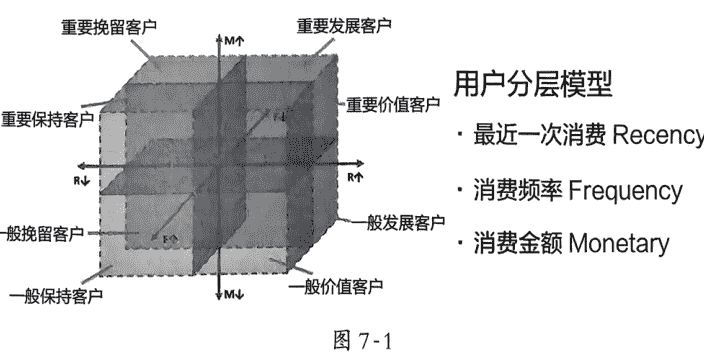

###### 4. AI 智能分群
这是关键一步。运用无监督机器学习算法如K-Means、DBSCAN等，让模型自动将具有相似特征的用户聚合到一起，形成不同的客户细分群体。你不需要事先设定分群数，模型会根据数据本身的结构找到最优化的分群方式

###### 5. 画像生成与解读
模型为每个自动分出的群体“画像”。该画像通常包含：
1. 画像名称/标签：给这个群体起个形象的名字，如“高价值尝鲜者”“价格敏感的学生党”“忠诚复购的妈妈群”。模型可根据群体的显著特征自动生成标签
2. 核心特征总结：用简洁的语言描述这个群体的典型特征
3. 数据支撑：市场定义了本群体的关键数据指标，如平均客单价范围、常购品类、活跃时间段等
4. 痛点与需求：结合评论、聊天记录等文本数据的模型分析结果，提炼该群体的核心痛点并继续满足需求
5. 营销建议：基于形象特征，对外提出营销策略建议

##### 借助 AI 工具实现用户画像的方法与路径
1. 集成AI的平台：许多现代CRM系统、客户数据平台、营销自动化工具已内置了AI用户分群和画像功能
2. BI与数据分析工具：一些高级商业智能工具或数据分析平台也能实现
3. 利用AI进行定性数据分析：即使没有复杂系统，也可利用AI提升对现有定性数据的洞察力，为构建更精准的手工画像或验证模型分析结果提供支持。例如，将收集到的用户评论、访谈记录等文本输入给模型，帮助提炼核心观点、识别用户情绪、发现不同用户群体的差异化需求

##### AI 实战

###### 步骤1 收集数据
假如你经营一家在线花店，想了解不同类型用户的购买动机和关注点，可将近期的用户评论进行收集，形成文档

###### 步骤2 挖掘画像线索
将形成的文档上传至DeepSeek后，进行提问

**提问模板**（提炼用户画像雏形）：
> 请分析我上传的数据，并从中提炼出至少【几】种不同的用户画像雏形
> 请描述：

# 从用户评论里拆解可用的画像

在做在线花店的用户研究时，可以先围绕三点提问：
1. 各类画像可能在什么动机下、什么场景会下单？
2. 他们对花店最看重的点是什么？
3. 他们可能在哪些环节感到不顺心？

请为每个画像初稿配上几个核心标签。

**可直接套用的提问方式：**

> 我最近梳理了我们线上花店近50条用户评价，内容涵盖送花用途、鲜花品质、包装、配送速度、客服态度等维度。请基于这些反馈，总结出至少三种用户画像雏形，并分别说明：购买动机与典型场景、最在意的服务要素、潜在的痛点。为每个画像拟定几个标签，例如“浪漫送礼者”“生活美学家”“企业客户”等。

**改写后的示例输出：**

🧠 已完成思考

**画像雏形 1：情感表达型送礼者**

**核心标签：** 节假日驱动、重仪式感、追求精致体验

**1. 购买动机和场景**
- 节日、纪念日或人生节点需传达心意，例如情人节、母亲节、生日、升职等。
- 典型场景：给伴侣制造惊喜、给长辈送祝福、向老师或客户表达谢意。

**2. 最看重的方面**
- 配送是否准时，评论里多次提到“差点误事”“保密做得好”。
- 包装是否精致，评论里有“包装高级”“太丑”“很浪漫”等极端评价。
- 客服是否贴心，出现“客服推荐很到位”“服务很周到”等描述。

**3. 潜在痛点**
- 实物包装与图示不符。
- 配送出现延误。
- 贺卡、细节用心度不足。

**操作建议**
1. 在电商、社交媒体、客服记录等渠道挑出5~10条真实反馈。
2. 通读后尝试归类，思考每类的需求与不满。
3. 把提炼的关键信息填入上面的提问模板，检验AI结果是否吻合你的判断，或是否发现新视角。

**使用时的注意点**
1. 数据孤岛问题：画像准不准取决于数据是否全面、准确、打通。
2. 隐私合规是底线：收集、存储、分析必须符合《个人信息保护法》，取得授权并做好安全。
3. 算法黑箱困境：分群结果有时难以解释，需要结合业务经验验证。
4. 标签固化与偏见规避：画像是历史数据的总结，要避免刻板印象，注意用户会动态变化。

#### 02 用AI做产品痛点调研，找到真实需求
先搞清客户是谁，再深挖使用过程中卡在哪里、心里真正想解决什么。痛点本质是未被满足的需求，是产品成功的起点。用户付费是因为痛点被化解，整个产品生命周期都需要持续做痛点调研。

##### AI如何读懂用户的吐槽与期待
AI凭借自然语言处理能力，能从海量非结构化文本中自动识别真实诉求。常见来源包括：
1. 线上评论：淘宝、京东、美团、大众点评、应用商店、小红书、知乎等。
2. 社交媒体：微博、抖音、快手上对品牌产品的讨论。
3. 客服记录：聊天、邮件、电话转文字。
4. 社区论坛：垂直论坛、兴趣社群的帖子。
5. 问卷开放题答案。

##### AI在痛点调研里的常见用途
1. 洞察现有产品问题：用户最常抱怨的功能、易困惑的操作、最需改进点、频次与情绪强度。
2. 挖掘潜在新需求：从相关领域讨论中发现未被满足的需求点。
3. 竞品优劣分析：看用户喜欢竞品什么、哪里可做差异化打击。
4. 优化营销表达：用用户原话提炼痛点词汇，提升广告、介绍和话术共鸣。

##### 如何用AI工具开展痛点调研
**提问模板（产品种草类——场景化）**
请为我的【产品名及类型】写一条朋友圈种草文案。
目标：用生活场景呈现产品的安静体验，引发向往。
场景描述：【简述场景】
要求：
1. 第一人称分享感受。
2. 重点描述产品体验与好处。
3. 自然提及产品名称或特征。
4. 不硬广，结尾流露喜爱。
5. 【文案风格】。
6. 建议配图。

**参考指令：**
请为智飞牌降噪耳机写一条朋友圈种草文案。目标是通过生活场景展现安静体验。场景：周末下午在嘈杂咖啡馆戴耳机看书。要求：第一人称、描述世界安静下来的专注与放松感、自然提及产品名、不直接广告、文艺小确幸有质感、配图建议。

**成果示例：**
已深度思考

##### 在咖啡馆听见雪落的声音
周末的拿铁总自带交响：咖啡机声、隔壁谈判、勺子撞杯。
指尖轻触耳廓，智飞牌降噪耳机启动，世界被按了静音键。
书页翻动声成为唯一声轨，热气有了慢镜头，喧嚣像被隔离在玻璃外。
原来专注是最奢侈的松弛。

【配图建议：木桌俯拍，书页旁放白色的降噪耳机，背景虚化】

##### AI实战
**步骤 收集数据**
假设你要分析一款在线协作文档App的应用商店差评。

**提问模板（差评分析）：**
我收集了【产品在××渠道/应用商店的中差评】。请帮我：
1. 识别列出用户抱怨最多的3~5个核心痛点并排序。
2. 每个痛点配1~2句能体现具体困扰的原文引用。
3. 分析哪些痛点情绪最强烈。
4. 评论里是否提出具体改进建议，列出。
5. 基于分析给出2~3个优先迭代方向。

**参考指令：**
我收集了我们的在线协作文档App在应用商店100条一星二星差评，请按以上要求分析。

**成果示例：**
已深度思考

1. 核心痛点排序
（1）多人协作同步延迟/冲突，约30%评论提到同步、覆盖、卡顿。
（2）移动端操作体验差，约25%提到手机卡顿、误触、闪退。
（3）模板少且质量低，约20%提到模板老旧、更新慢。
（4）格式兼容性差，约15%提到导入丢失。
（5）价格贵、性价比低，约10%提到不值。

2. 原文引述
协作：我这边改完半小时对方没同步，沟通浪费太多时间；多人编辑常被覆盖，之前工作白费。
移动端：手机编辑卡顿严重，选字困难；经常闪退，内容直接丢失。

**操作顺序**
1. 到平台筛选差评或中评。
2. 快速读5~10条，手动归纳1~2个反复出现的问题。
3. 用模板输入给AI，对比结果是否更系统、是否发现新细节。

**注意事项**
1. 避免单一渠道偏差，多渠道交叉验证。
2. 留意幸存者偏差，反馈者多为极端用户。
3. AI对反讽、口语理解有限，关键结论需人工确认。
4. AI能识别症状，如卡顿，但根本原因需技术排查。

#### 03 AI聊天机器人：从接待到成交的话术升级
画像和痛点厘清后，如何转化为有效沟通并成交是关键。AI聊天机器人正从简单的关键词回复，升级为具备理解、记忆、生成能力的“话术大师”，实现24小时在线、高效响应甚至主动挖掘销售机会。

现代AI机器人具备：
1. 深层理解意图，不依赖关键词，能处理口语、错别字。
2. 多轮对话，记住上下文，保持连贯。
3. 生成自然、带温度的个性化回复。
4. 通过持续互动不断学习，准确度提升。

##### 一 AI聊天机器人的核心价值
1. 降本增效：自动处理70~80%重复咨询，释放人力，24小时在线成本低。
2. 提升体验：即时响应，减少等待，服务口径一致。
3. 促进转化：售前引导、答疑、消除顾虑、完成简易下单。
4. 数据沉淀：对话记录成为宝贵资产，用于优化产品与服务。

##### 二 常见应用场景
1. 网站/App访客接待与引导。
2. 电商前置咨询：规格、材质、价格、库存、优惠。
3. 售后支持：订单、物流、退换货、故障排查。
4. 本地生活服务预订咨询。
5. 自媒体粉丝互动答疑。
6. 微信生态客服。
7. 线索筛选与收集。

##### 如何部署与优化
1. 明确目标与场景：渠道、解决的问题、降本提效或获客转化。
2. 选择工具：
   - 第三方SaaS：网易七鱼、智齿、晓多、Udesk、Intercom、Zendesk等，可视化快速上线。
   - 基于大模型定制：用DeepSeek API结合企业知识库，灵活性更强，可本地部署保安全。
3. 构建知识库：产品信息、FAQ、活动规则等分类录入并持续更新。
4. 设计对话流程：预测用户提问、设计引导问题、设定转人工条件。
5. 持续监控优化：分析对话记录、点赞点踩反馈、迭代知识库与策略。

##### AI实战
**步骤1 给AI喂原料**
参考指令：
请结合产品说明书，为我的智能空气净化器AI客服生成知识库，包含但不限于：
1. 适用面积？不同型号
2. 滤网多久更换、在哪买
3. 除甲醛效果与检测报告
4. 噪音大小、是否适合卧室
5. 如何连接App远程控制
6. 保修政策
7. 竞品优势
要求：准确简洁、语气专业友好，可引导查看详情页。

**成果示例：**
已深度思考

####### 智能空气净化器AI客服知识库
######## 1. 适用面积
答：本机适用60~90㎡，CADR颗粒物600m³/h，甲醛200m³/h，适合中大户型客厅卧室办公室。更大空间建议选其他型号，可官网查询。

######## 2. 滤网更换
初效3~6个月，活性炭6~12个月，HEPA 12~24个月。购买渠道：官方App/官网、京东天猫旗舰店、授权门店。App会提示更换时间。

**步骤2 设计对话引导**
参考指令：
请为AI客服设计一个用户首次访问网站停留超15秒的的主动问候与后续引导流程，目标是了解意图并提供帮助。

####### 客服开场白与意图分流设计

机器人首次出场时会这样打招呼：“您好，欢迎咨询！有什么需要我帮忙的吗？关于商品、活动或订单，您可以直接告诉我。”

随后根据用户的第一句回复，把会话拆成不同走向：

1. 提到具体商品 → 先给基础介绍，再追问具体关心的点。
2. 提到优惠活动 → 介绍当前正在进行的权益，并引导领取流程。
3. 表示看看就好 → 推荐热销款或热门品类。
4. 长时间沉默或离开 → 礼貌收尾，表达随时欢迎回来。

基于以上分流绘制流程图，用通俗语言说明运行逻辑。

思考完成（耗时 21 秒）

####### 主动发起与对话分流方案

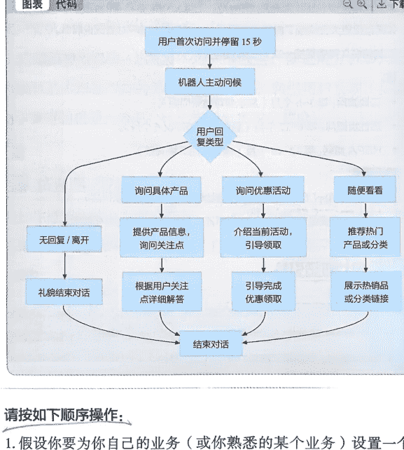

##### 建议操作顺序

1. 先想一个你熟悉的业务，梳理用户最常出现的三类咨询。
2. 用第一套模板为这三类咨询写出标准回复，检查表述是否清楚完整。
3. 打开两到三家大型品牌官网，体验它们客服机器人的主动打招呼、意图识别和下一步引导方式。

##### 使用要点

1. **合理设定预期**：智能客服无法完全替代真人。遇到复杂问题、情绪波动或需要深度共情的场景时，能力有限，要避免期望过高。
2. **保持知识库新鲜**：知识库不全或更新滞后，是表现差的常见原因。要持续投入，保证内容准确完整并及时迭代。
3. **坚持人机协作**：必须预留便捷的人工转接入口，并配备高效的坐席后台，让服务无缝衔接。
4. **保障体验**：流程混乱、响应慢、答非所问都会严重损害感受。设计时要规划清晰的对话路径，提升速度与准确率。
5. **数据保护**：聊天记录可能包含敏感信息，必须做好系统安全与合规，防止泄露。

### 私域转化组合拳

#### 04 沟通脚本智能助手

在客服对话、社群互动、销售跟进等场景里，每一次交流都是建立信任、传递价值和推动转化的机会。沟通脚本的质量直接决定成交结果，但多数运营与销售面临的痛点是：

1. **表达技巧不足**：不会用合适的语言引发用户共鸣，容易陷入无效寒暄或自说自话。
2. **制作效率偏低**：为不同客户与场景撰写个性化脚本耗时耗力。
3. **质量参差不齐**：团队沟通能力差异大，难以保持统一服务水准与转化效果。
4. **复杂场景应对乏力**：面对疑问、异议或挑剔时，往往不知如何接话。

##### 智能创作的核心价值

智能系统在文本理解与创作上优势明显，私域沟通脚本生成功能相当于为团队配备一位永不疲倦、储备丰富、懂沟通的金牌教练。主要体现在：

1. **效率大幅提升**：依据场景与需求快速产出多版脚本方案，大幅缩短构思时间。
2. **质量优化与标准化**：学习优秀销售话术范式，结合商品知识库，输出结构完整、逻辑清晰、表达精准且具说服力的内容，提升整体沟通水平。
3. **个性化精准触达**：结合用户画像标签、行为轨迹和痛点分析，为特定人群生成千人千面的沟通内容。
4. **全场景覆盖**：从破冰问候、商品介绍、活动邀约、关怀回访、疑难解答、异议处理到催单成交，全流程均可支持。
5. **快速迭代优化**：可生成不同风格版本进行A/B测试，并依据转化数据持续优化。

##### 智能脚本的核心应用场景

1. **新客破冰引导**：为新加微信好友或社群新成员生成欢迎语和需求探询脚本。
2. **商品价值塑造**：依据用户画像突出其最在意的利益点进行商品介绍。
3. **活动预告邀约**：撰写社群活动、直播、新品发布等预热文案。
4. **潜在客户培育**：针对有意向未成交客户，在考虑期、对比期输出非打扰式推进脚本，激活购买欲。
5. **用户关怀维护**：生成祝福、生日问候、使用小贴士、回访问卷等提升粘性的内容。
6. **高频问题标准化**：为社群常见提问建立统一解答脚本库。
7. **异议处理**：针对价格、效果、竞品对比等常见质疑生成有理有据的化解脚本。
8. **成交催化**：在犹豫期制造稀缺感、提醒优惠时效，推动临门一脚。

##### 如何用智能系统生产高效私域脚本

###### 1. 明确沟通要素

（1）**目标对象**：谁？画像特征？例如刚生完的宝妈，关注安全与效果。
（2）**沟通场景**：何时何地？微信群公告、一对一私聊、朋友圈评论回复，还是咨询后跟进？
（3）**核心信息**：要传达什么？商品卖点、活动信息、优惠政策？
（4）**沟通目的**：希望用户做什么？了解商品、参与活动、下单、消除疑虑？
（5）**期望语气**：专业、亲切、幽默还是权威？

###### 2. 给系统足够背景

输入越具体，输出质量越高。需提供商品/服务详情、用户标签、痛点、活动规则、价格、相关事件等。

###### 3. 使用场景化指令

####### 步骤1 为特定人群定制推荐脚本

**提问模板**（私聊推荐脚本—针对特定画像）：

```
请帮我为【产品】写一段微信私聊话术，推荐给【客户画像标签】。
```

推介商品是：【商品名称及核心功效】。

交流目的：激发兴趣并引导了解详情。

要求：

1. 开头自然引入，可结合过往咨询或普遍痛点。
2. 重点说明商品如何针对性解决客户痛点。
3. 强调商品的【其他优点】。
4. 结尾【给出明确下一步指引】。
5. 整体语气【语言风格】。

**参考指令：**

请为菲芝品牌护肤顾问写一段微信私聊脚本，推荐给“长期熬夜导致皮肤暗沉的年轻白领”。

推介商品是菲芝亮肤精华，主打改善暗沉、提亮肤色。

交流目的：激发兴趣并引导了解详情。

要求：开头结合暗沉痛点；重点说明对熬夜脸暗沉的改善机制；强调成分温和、吸收快、用户好评；结尾发送测评文章链接并告知体验装活动；语气专业又贴心，像朋友分享。

**成果示例：**

> 思考完成（耗时 18 秒）

【菲芝护肤顾问小菲】私聊脚本：

XX姐晚上好，最近是不是又在加班？看你之前提到暗沉问题，今天给你带来适合熬夜族的提亮精华——菲芝亮肤精华！

它选用双重黄金配比烟酰胺与维C衍生物，24小时抑制黑色素堆积，同时中和熬夜产生的自由基。很多用户反馈一周就能感觉黄气减淡，肤色更透亮。

配方采用3重温和缓冲技术，敏感肌也能用，质地像露水般快速吸收不黏腻。

现在正好有免费体验装申请，我已附上测评文章链接，想先试用3天感受下提亮效果吗？

##### 步骤2 智能助力活动预热

**提问模板**（社群活动预告脚本）：

请为【社群主题】写一条活动预告。

活动主题：【活动名称】。

活动亮点：【如专属福利】。

活动时间：【具体时间】。

参与方式：【线上/线下】。

交流目的：吸引预约/关注并激发讨论。

要求：清晰说明价值与亮点；包含全部关键信息；结尾引导互动；语言活泼贴合社群氛围。

**参考指令：**

请为职场女性护肤分享群写一条活动预告。

活动主题：新时代女性护肤直播课。

活动亮点：知名美妆老师主讲，直播间专属福利。

活动时间：3月25日晚8点。

参与方式：群内发送直播链接。

交流目的：吸引预约并激发讨论。

要求：说明价值、给出时间参与方式、结尾引导互动如“想听的扣1”、语言活泼。

**成果示例：**

思考完成（耗时19秒）

【职场靓肤情报站】活动预告！

姐妹们注意！明晚8点《通勤妆越化越暗沉？3招打造职场发光肌》直播开课。

3月25日晚8点，本群同步直播链接。

看点：明星美妆导师李琳拆解早C晚A高效公式；连麦解答口罩闷痘、电脑肌、差旅急救；直播专属1元面膜福袋与亮肤精华抽奖。

参与方式：今晚12点前扣【1】预约；当天置顶通知并@全员；留言你的护肤难题，老师现场点名解答。

现场还有5分钟打工人唤醒操与价值899元护肤礼盒放送，手慢无！

##### 步骤3 智能设计价格异议应对话术

**提问模板**（处理价格异议）：

当客户说“你们的【商品类型】比【竞品品牌】贵很多”，请给出三种思路：

- 思路一：成分价值法，强调专利成分、浓度、实验数据。
- 思路二：场景化解法，换算日均成本、与其他消费对比。
- 思路三：风险承诺法，支持试用、过敏包退、附加服务。

要求：每种思路含对比维度、数据支撑、情感认同。

**参考指令：**

客户说“你们的抗老精华比欧莱雅贵很多”，请生成三种应对思路并包含对比、数据、情感共鸣。

**成果示例：**

思考完成（耗时 26 秒）

**思路一：成分价值法**

“你很专业！我们第三位成分是独有超导黄金视黄醇专利，活性浓度0.3%黄金配比，比常规视黄醇温和2倍见效快1.5倍。”

数据：第三方检测显示连续使用28天，法令纹减淡度比同类高41%，相当于每天多花3毛钱获得加倍效果。

共鸣：“这个年纪选抗老，有效成分就是‘硬通货’，每一滴都在为十年后的肌肤存钱。”

**思路二：场景化解法**

“早晚使用可达120天，日均约4.9元，比中杯奶茶还便宜三分之一。”

对比：“咖啡只提神4小时，精华却在帮你冻结时光，相当于每月少喝3杯奶茶，换来同学会上更冻龄的自己。”

共鸣：“有客户算完日均价后说，这张脸值得更好的投资。”

###### 4. 人工复核与个性化润色

智能系统生成的是标准稿，需要人工精修。检查：

（1）信息是否准确无误？
（2）是否符合品牌调性与个人风格？
（3）语境下是否自然得体，避免生硬机械？
（4）是否需要结合具体聊天记录做个性化调整？

###### 5. 建立脚本库并持续优化

把效果好的脚本按场景、用户类型归类，形成团队共享库，并根据实际转化反馈不断迭代提示词。

##### 实操顺序建议：

1. 回想私域中常见场景，如“向老客户推荐新品”。
2. 明确推荐目标、商品卖点与客户特征。
3. 套用首个模板让系统生成草稿。
4. 手动润色，使口吻更自然。

##### 重要提醒：

1. **避免机器人感**：直接复制缺乏温度会适得其反，必须加入个人思考。
2. **场景匹配**：A场景的脚本错用于B场景，或对错客户类型使用不当会效果反转，使用前需判断适用性。
3. **灵活应变**：不要机械灌输，要关注用户反馈及时调整策略。
4. **商品为本**：商品本身有硬伤或无法满足核心需求，再完美的脚本也无法成交。

#### 05 裂变活动自动策划

私域增长不能仅靠一对一沟通和常规内容。想要实现指数级增长或短期爆发，“裂变”不可或缺。但策划一场成功的裂变活动需要创意、人性洞察、精密规则和平台合规把握，智能系统可充当超级智囊和架构师。

##### 智能系统在裂变策划中的作用

1. **创意激发与头脑风暴**：明确目标、用户、预算与资源后，系统可基于助力、拼团、砍价、集卡、分销、打卡、趣味测试等模式生成多套创意方案。
2. **方案细化**：将创意拆解为主题、起止时间、参与流程、规则细则、奖励设置、风险控制、推广计划等完整执行方案。
3. **规则与合规初检**：推敲规则清晰度与严谨性，结合平台规则要点排查风险，但不能替代专业法律意见。
4. **营销素材生成**：快速产出群公告、推文、朋友圈文案、分享引导语及海报、H5的信息布局建议。
5. **效果预测与参数优化**：基于过往数据训练模型预测参与人数、裂变系数K值等，并给出奖励力度、门槛等参数优化建议。

##### DeepSeek实战步骤

###### 步骤1 智能创意激发

**提问模板**（裂变活动创意）：

我运营一个【业务类型】，主要通过微信群和公众号服务【用户画像】。

我想下月策划一个线上裂变活动，目标是【明确目标】，预算【大致预算与奖品】。

请提供3~5个适合微信生态的裂变创意，说明：1. 活动名称；2. 核心玩法；3. 主要吸引点。

**参考指令：**

我运营在线瑜伽课程平台，通过微信群和公众号服务25~40岁注重健康的女性。下月想做线上裂变，目标为公众号增粉2000，预算低，以课程优惠券或电子资料为奖品。

请给出3~5个微信生态裂变创意并说明名称、玩法、吸引点。

**成果示例：**

> 思考完成（耗时 28 秒）

针对微信生态的低成本增粉方案：

######## 创意一：“好友助力解锁瑜伽秘籍”

######### 核心玩法

用户生成专属助力海报，邀请好友扫码关注公众号，达标后解锁奖励。

第3人助力送《办公室肩颈放松指南》电子书；第5人助力送经期舒缓瑜伽课7折券；第8人助力送定制体态评估报告。

######### 吸引点

阶梯奖励激励持续分享；资料直击职场女性痛点；虚拟奖品零物流成本。

######## 创意二：“7天瑜伽蜕变挑战赛”

######### 核心玩法

用户每日跟练公众号1分钟短视频，截图打卡发朋友圈并带话题+公众号二维码。

累计打卡3天送冥想入门音频课；累计7天送年度课程8折卡；朋友圈集赞满50获直播课连麦权。

######### 吸引点

朋友圈对比图引发关注；短期承诺提升参与率；社交货币属性强化传播。

###### 步骤2 智能方案细化

**提问模板**（选定创意后细化）：

我决定采用【活动名称】。请详细策划执行方案。

核心玩法：老用户A分享链接/海报给好友B，B完成【指定动作】，A获得1次助力。集满【数量】次助力，A可获得【奖品】。

请细化：1. 活动周期建议；2. 详细规则：生成与分享方式、有效助力判定标准、单用户奖品上限、助力有效期；3. 奖品价值说明。

闺蜜同行，瑜伽课免单助力 · 落地执行手册

核心机制说明
老学员 A 将专属活动入口或海报推送给新朋友 B，B 在官方微信号完成关注并按提示回复关键词后，系统为 A 增加 1 次助力。累计 6 次助力后，A 可领取指定瑜伽课程的免单权益，面值按实际课程定。

1. 时长规划建议
预热：活动上线前 48 小时，通过图文推文与社群口播造势。
执行：上线后连续 7 天为集助力窗口，提升紧迫感。
兑奖：活动截止后 24 小时内完成券发放与名单公示。

2. 细化规则
1）专属入口的生成与分发
用户在微信号内发送关键词“闺蜜瑜伽”进入活动页，点击“创建我的海报”。系统生成带个人邀请码的专属二维码，海报上突出课程免单金额、剩余天数与当前进度条。

2）有效助力的判定
B 需为近 7 天内从未关注过本号的新粉丝。
关注后需在 24 小时内回复“助力+邀请码”完成绑定。
每笔助力需与有效关注行为匹配，否则不计入。

3）获奖频次与名额控制
同一用户活动期内最多领取 1 张免单券。
总名额设上限，按助力完成先后顺序发放，额满即止。

4）助力有效窗口
单次助力自 B 完成关注起 72 小时内有效，助力累计有效期与活动执行期一致，到期未满 6 次视为放弃。

3. 奖品价值说明
免单券对应指定主题瑜伽课，如骨盆修复、塑形核心等，市场价约 299 元。券为电子形式，领取后 30 天内预约上课，避免价值稀释。

4. 用户参与流程简述
A 发起→A 在活动页生成专属海报→A 将海报分享给 B→B 扫码关注并回复助力指令→系统校验后为 A 加 1 次→A 继续邀约直至凑齐 6 次→提交信息领取免单券。

5. 防作弊要点
新粉校验：通过关注时间戳与openid 去重，7 天内重复关注不计。
行为校验：关注后必须完成关键词回复才算有效。
频次限制：同一微信号每日最多为不同人助力 3 次，同一邀请码累计助力人数设上限。
设备/IP 校验：异常高频、同一设备多号操作加入人工复核。
成本熔断：设置单日新增粉丝上限与预算封顶。

6. 传播文案节奏
预热期：强调社群专属福利、组队免单机会，制造稀缺感，引导用户保存入口。
进行期：每日进度播报、榜单激励、晒单案例，刺激二次分享。
收尾期：倒计时提醒、最后冲刺提示、兑奖进度公示，增强信任。

执行提示
活动设计要紧扣拉新与活跃目标，避免只为裂变而裂变。规则需简洁易懂，奖品与女性用户自我提升诉求匹配。技术层面要保证海报生成、助力统计、券发放链路稳定，客服响应及时。活动结束后需复盘新增粉丝质量、分享转化率、获客成本与后续留存，为下一轮优化提供依据。

朋友圈内容创作辅助要点
朋友圈是私域维护与品牌形象展示的重要位点。借助工具可实现选题策划、风格切换、场景定制、痛点提炼与互动设计，提升产出效率。常用类型包括价值分享、日常展示、互动提问、案例见证、产品种草与活动告知。创作时需明确人设与目的，搭配场景化细节与真实感受，合理控制营销内容占比，避免刷屏。

数据化运营基础思路
中小型私域应坚持目标驱动、小指标聚焦、工具简化的原则。优先跟踪 3-5 个核心指标，如成交总额、转化率、人均消费、复购率等。以 Excel 为起点完成描述、对比与趋势分析，逐步向可视化看板升级。AI 可用于智能填充、图表推荐、自然语言查询与自动洞察，帮助快速解读经营数据并转化为运营动作。

3. 外卖占比下滑、差评攀升，根因可能有哪些？

###### 参考指令：
我经营一家小餐馆，下面是上个月的经营快照：
1. 总营业额 8 万元，环比涨 5%，同比涨 10%。
2. 外卖在总营收中占 40%，环比下降 5 个点。
3. 午市营收 3 万元，环比基本持平。
4. 晚市营收 5 万元，环比上涨 8%。
5. 销量前三的菜依旧是红烧肉、酸菜鱼、麻婆豆腐，跟上个月完全一样。
6. 差评 15 条，环比多 5 条，集中在“上菜慢”和“打包盒漏油”。

请帮我梳理：
1. 这组数据里有哪些向好信号，又藏着哪些风险？
2. 下一步该聚焦哪几个环节去优化？
3. 外卖占比下降与差评增多，背后可能是什么原因在作祟？

###### 成果示例：
已深度思考（用时 17 秒）

####### 一、数据亮点与风险点拆解

######## 向好信号
**1. 整体生意在扩张**
- 营收环比 +5%、同比 +10%，说明经营打法在起效，客群或复购频次在扩大。
- 晚市营收 +8%，晚间时段吸引力明显增强，可能是菜品、活动或服务在发力。

**2. 核心单品很稳**
- 月度 Top3 菜品连续不变，经典款已形成稳定客群，是持续造血的底盘。

**3. 堂食在补位**
- 外卖占比在降但总营收仍涨，侧面说明堂食客流或客单价在提升，晚市拉动明显。

######## 隐忧与风险
**1. 外卖渠道在失血**
- 外卖占比环比掉 5 个点，可能跟平台排名、配送体验或口碑受损有关。

**2. 午市增长乏力**
- 午市营收环比零增长，白领午餐需求没吃透，或被周边竞品分流。

**3. 差评激增伤口碑**
- 差评环比涨 5 条，增幅 50%，核心痛点是上菜速度和打包盒渗油，会直接打击复购和外卖评分。

**4. 成本端可能承压**
- 晚市放量带来人力、备货压力，需要盯紧利润是否同步跟上。

##### 请按如下顺序操作：
1. 挑一份你手边能马上拿到、覆盖至少两项核心指标且带时间对比的数据表。
2. 导入 Excel/WPS，简单做一条折线图，先看走势。
3. 算出最近一个月的环比增速：环比增速 =（本月值-上月值）/上月值 ×100%。
4. 看完趋势后，写下它让你产生的好奇或困惑，用上面的提问范式去问 AI，获取分析思路。

##### 注意事项：
1. “数据≠信息≠洞察≠行动”：原始数字要加工才能变成信息，再提炼成可执行的洞察。别把未经处理的数字直接当决策依据。
2. **指标口径要统一**：统计用户数要说明是注册/活跃/付费；算销售额要明确是否含平台补贴，避免口径不一致导致失真。
3. **警惕样本偏差**：只用一次活动的样本就推普适结论会误导。样本得有代表性。
4. **定性反馈别忽略**：评论、访谈等定性信息能解释数字背后的情绪，两者结合才完整。
5. **保持迭代思维**：分析不是一次到位，从基础指标起步，逐步加维度，持续优化。

#### 02 用智能报表把隐形问题揪出来
在搞清数据分析的价值后，难点在于如何从各类报表里定量抓住问题。需要像侦探盘问线索一样，让数据主动报警。

##### 一 报表是问题线索库，不只是结果看板
很多人只看报表要结果：上个月卖了多少、本月流量怎样。报表第一层价值是结果，第二层更关键，是藏着问题信号的数据库。波动、异常、偏离预期都可能是风险或机会的提示。

##### 二 中小企业常用的人工盘点信号
###### 1. 销售类
（1）**销售额/利润率非计划骤降**：或因竞争加剧、产品吸引力衰退、价格错位或负面事件。
（2）**退货率/差评率突增**：多指向品质、物流体验差或描述不符。
（3）**客单价持续走低**：促销过猛、高价品滞销或消费意愿下降。
（4）**核心品类销量偏离目标/历史**：要复盘策略、库存与竞争态势。
（5）**产品排名非预期波动**：爆款更迭或生命周期拐点。

###### 2. 流量类
（1）**总访问量/活跃用户断崖下跌**：技术故障、平台降权、主引流渠道失效或统计口径问题。
（2）**流量来源结构突变**：搜索流量骤降提示 SEO 出问题；社交流量锐减提示运营失效。
（3）**跳出率高/停留时间短**：内容不匹配、加载慢、体验差。
（4）**转化漏斗某环节流失率飙升**：该环节存在明显阻碍。

###### 3. 用户/会员类
（1）**获客成本持续抬升**：引流效率下降。
（2）**流失率升高**：产品吸引力不足或维护不到位。
（3）**复购率/活跃度下滑**：黏性减弱，生命周期价值下降。
（4）**会员转化率低**：权益或运营策略有问题。

###### 4. 库存类
（1）**周转天数过长/周转率过低**：资金占用，滞销风险。
（2）**呆滞库存**：选品或采购失误，面临贬值。
（3）**补货缺口或断货**：预测不准或供应链响应慢。
（4）**会员转化率低**：权益设计或运营策略待优化。

###### 5. 财务类
1. **成本异常抬头**：原材料、营销、人力成本需核查与管控。
2. **毛利率低于行业或预期**：定价、成本结构或品类结构失衡。
3. **营业利润持续为负或骤减**：生存红灯，需盯回款与开支。

##### 智能报表如何助力
1. **自动化异常检测与预警**：可设阈值，如差评率>5%就发邮件；系统还能基于历史模式自动识别异常。
2. **交互式探索与钻取**：发现总销售额下滑后，可一层层下钻到品类-单品-区域-渠道，快速定位源头。
3. **自然语言解读与摘要**：AI 自动生成本期亮点、变化与关注点，降低图表门槛。
4. **初步智能关联提示**：如转化率下降时提示页面加载时间增加，需人工验证。

##### 四 实操心法：像侦探盘问报表
1. **找基准**：数字需对比，上月、去年同期、目标或行业均值。
2. **找异常**：对比基准，哪些指标正向或负向偏离？幅度多大？
3. **找源头**：异常是全局还是局部？用时间、产品、渠道、用户、地域等维度下钻。
4. **找关联**：异常是否伴随其他指标联动？如投诉增加是否与新版上线同步？
5. **提假设**：基于分析给出可能原因。
6. **寻证据**：设计验证，如看广告素材跳出率、问客服反馈，确认根因。

##### AI 实战：解读报表的弦外之音
假如你运营一家小连锁咖啡店，A 店本月顾客满意度从 4.7 降到 4.3，但销售额和客流基本稳定。差评集中在“等太久”和“新品拿铁口感差”。

###### 参考指令：
我们是连锁咖啡店，A 店上月满意度由 4.7 明显跌至 4.3。销售额与客流变化不大。差评主要反映等待时间过长与新品拿铁口感不佳。
请分析：
1. 满意度跌但生意稳定，可能说明什么？
2. 等待时间与新品口感，哪个对评分伤害更大？为什么？
3. 除直接原因外，还有哪些潜在因素？
4. 接下来如何诊断和改进？

###### 成果示例：
> 已深度思考（用时 17 秒）

####### 1. 评分下跌但生意稳定，隐含信号
- 早期预警：客户已用评分表达不满，但行为尚未改变，属于“沉默抗议”阶段。
- 问题新发：新品口感差印证是新增变量，需核查新品上线时间与评分拐点。
- 客群结构可能在变：老客流失被新客补上，需看会员复购。
- 服务容忍度临界：等待可能已超 15 分钟心理线。

####### 2. 痛点影响度对比
**等待时间**
- 覆盖面广，研究显示约 61% 差评涉及等待，高峰期单杯耗时多 4.2 分钟。
- 连带效应：易引发温度下降、员工态度急躁等次生投诉。

**新品口感**
- 情绪烈度更高，平均情绪值 -0.83，高于等待的 -0.65。
- 传播风险：约 34% 差评提到“不好意思推荐给朋友”。

**结论**：等待是基础体验破坏者，新品是价值感知杀手，需双线并进。

##### 请按如下顺序操作：
1. 选一份带异常信号的业务报表。
2. 回答异常具体是什么。
3. 列出至少两个可能原因的假设。
4. 把异常与假设输入 AI，获取更全面的角度。

##### 注意事项：
1. **把握全局**：别被细枝末节波动带偏，关注整体趋势与战略方向。
2. **明辨因果**：A、B 同时涨不等于 A 导致 B，需更严谨验证。
3. **规避噪音**：短期小幅波动多为噪音，聚焦持续显著变化。
4. **重视定性**：报表只能给数字，用户访谈、客服反馈才能解释本质。

#### 03 AI 预测市场需求
复盘过去只是看后视镜，要看前方的路就得预测需求。AI 正成为望远镜和导航仪。

##### 为什么要预测市场需求
1. **优化库存**：避免畅销缺货与滞销积压，降本增效。
2. **指导营销**：把握淡旺季，合理排促销、预算与排班。
3. **辅助新品与选品**：捕捉趋势，提高立项成功率。
4. **规避风险**：提前感知市场收缩，争取调整时间。
5. **提升资源效率**：按区域与渠道需求优化物流、仓储、人力。

##### 中小微企业如何借力 AI 预测
1. **用现有工具内置预测**：Excel/WPS、Power BI、Tableau、行业 SaaS。
2. **AI 定性预测洞察趋势**，更易落地：
   （1）**分析社媒内容**：让 AI 梳理小红书、抖音、微博上的热议话题、达人推荐，识别消费新偏好。
   （2）**解读搜索指数**：用百度指数、微信指数、Google Trends 观察关键词热度起伏。
   （3）**挖掘评论反馈**：从用户评论中提炼不满与期待，指向改进型或新功能需求。

##### AI 实战：用 AI 洞察市场先机
假如你做国潮服装网店，想提前布局选款。

###### 提问模板（趋势预测）：
请分析最近【时间范围】在小红书、抖音、微博上“国潮服装”出现的流行趋势与设计风格。
要求：
1. 归纳 3~5 个具体趋势点。
2. 分析目标用户画像。
3. 预测未来【时间范围】热度走势：持续、爆发还是降温。
4. 给出 2~3 条可落地的选品或设计建议。

###### 参考指令：
请分析近半年小红书上“国潮服装”领域的新趋势与热门元素。
要求：
1. 识别 3~5 个具体趋势，如传统纹样、汉服改良版型、色彩搭配、IP 联名等。
2. 分析吸引的用户群体。
3. 预测下一季度热度变化。
4. 给网店提供 2~3 条选品或设计建议。

###### 成果示例：
已深度思考（用时 17 秒）

####### 一、小红书“国潮服装”趋势拆解（2024.10-2025.04）
######## 1. 趋势点识别
**（1）马面裙日常化改良**
- 特点：裙长缩短至八分/六分，面料轻薄化，刺绣简化，更适合通勤逛街。
- 元素：与牛仔裤、衬衫混搭；侧拉链提升便利性。
- 支撑：淘宝“新中式”搜索同比涨 12 倍，马面裙成拜年服爆款。

**（2）簪花配饰氛围感**
- 特点：借鉴蟳埔女簪花，材质从绒花扩展到亚克力、金属，强调浪漫与文化符号。
- 场景：拍照打卡、短视频，节庆与赏花季热度飙升。
- 支撑：小红书相关笔记超 55 万篇。

请按如下顺序操作：
1. 把业务关键词输入 AI 模板，让 AI 帮助洞察先机。

2. 打开百度指数或微信指数，拉取目标词近一年乃至更长时段的检索曲线，仔细审视起伏形态。
3. 评估：该走势属于持续走高、短期爆破，还是存在季节性循环？是否真的能带来业务增量？

需要留意
1. **认识预测边界：** 模型必然存在偏差，市场处于持续演进中。智能手段只能提升命中概率、削弱不确定性，无法根除风险，故必须配套容错设计与应急预案。
2. **确保输入质量：** 预判的可信度建立在完整、长周期、多维度的输入之上。样本不足或质量低劣，结论便会失真。
3. **防范突发冲击：** 算法主要依托历史规律，对从未出现过的黑天鹅事件，如自然灾害、重大政策转向、技术颠覆等，难以提前捕捉。

### 运营数据智能监测

#### 04 库存周转优化

##### 一 库存的双面属性，周转速度决定价值
对以实物销售为主的企业，无论线上还是线下，库存都是双刃。适量保有可以满足客户需求、保证履约，成为业绩助推器；一旦过量，就会占用资金、推高仓储管理支出，还要承担贬值、损耗与现金流紧张的风险。

衡量库存效率的核心指针之一是周转快慢，本质是商品变现的速度。速度越快，资金回笼越快，使用效率越高，积压与损耗风险越低。过快也会引发缺货，所以目标并非盲目做高，而是借助智能化监测把周转调到既能保障供给、又能控制成本与风险的健康区间。

##### 二 传统模式常见的短板
中小微企业在库存环节常见问题：
1. **账实脱节：** 手工记录、流程松散导致账面与实物不符，决策缺乏可靠依据。
2. **经验拍板：** 补货量依赖主观判断，易出现供需错配。
3. **断货与积压并存：** 热销品频繁缺货错失订单，滞销品却堆满仓位。
4. **资金沉淀：** 大量现金被压在商品上，制约周转与再投入。
5. **工具缺位：** 缺少追踪、分析与预警手段，问题多靠事后才发现。

##### 三 智能化监测如何盘活库存
引入智能化监测与机器学习，能让库存管理更科学。
###### 1. 数据准确及时是前提
规范作业与分层管控才能实现账实一致：
（1）**流程规范**
建立标准化的收发与盘点作业规范。
（2）**分层管控实现账实一致**
**基础层：** 部署条码扫描与智能收银，实现进销存实时采集。
**进阶层：** 上线 ERP/WMS 规范业务流程，形成库存动态预警闭环。
**高阶层（可选）：** 预算允许时采用 RFID 技术，实现批量秒级盘点。

###### 2. 关键指标自动化追踪与预警
（1）**指标体系：** 系统可自动核算周转次数、周转天数、动销率、售罄率等，并以可视化图表呈现趋势。
（2）**智能告警：** 可自设阈值，或让算法捕捉异常，如“某单品动销率连续三周低于10%”，并通过钉钉、企业微信、邮件推送。

###### 3. 算法驱动的需求预测为补货导航
（1）**预测是关键：** 算法可结合市场需求，预测未来一段时间内各 SKU 的需求，结果直接指导采购、生产与补货节奏。
（2）**多因子融合：** 优秀模型会综合历史销量、季节性、促销计划、节假日、天气、搜索热度等信号。

###### 4. 智能分层与差异化运营
（1）**自动分层**
算法按销售额贡献、利润贡献或出库频次等，按帕累托法则自动把 SKU 划成三级。
（2）**策略差异化**
**第一梯队：** 贡献大、品种少，需重点监控、保持较高安全库存、严禁缺货，提升供应链响应。
**第二梯队：** 贡献中等，常规管理，保持合理库存。
**第三梯队：** 品种多贡献低，需严格控量，可按单采购生产，定期清理滞销，避免资源浪费。
（3）**动态更新**
算法可随市场变化实时调整分类，保持策略时效。

###### 5. 智能补货提示与建议
（1）**缺货预警：** 综合当前库存、在途量、均销速度、采购生产提前期，提前预判未来若干天可能断货的商品。
（2）**再订货点智能计算：** 再订货点 = 均日销量 × 提前期 + 安全库存。算法可依销量波动与期望服务水平动态测算安全库存，并判断何时触发补货。
（3）**订货量建议：** 结合订货成本、持有成本与需求预测，建议最优单次订货批量，以降低整体库存成本。

##### 四 落地路径与工具选择
1. **起步：** 还在手工记账，先用表格或基础进销存把数据理顺，确保账实相符。
2. **发展：** 业务扩张后可引入 ERP、WMS，或零售电商的智能收银/中后台系统，自带基础分析与预警。
3. **智能化：** 选择具备需求预测、智能补货、动态安全库存等功能的 SaaS 或 ERP 模块；若系统可导出数据，也可借助外部分析工具做预测后反馈决策。

##### 算法实战：解读库存报表，制定优化方案
假设此前一季库存分析报表指标不理想，需要改进。

###### 提问模板（库存分析与优化）：
某企业上一季库存报表显示：
1. 整体库存周转次数为 xx 次，低于行业均值 x 次。
2. 平均周转天数约 xx 天。
3. 分层分析显示，第三梯队商品占 SKU 总数 x%，却占用约 x% 的库存总金额。
4. 热销款 A 属于第一梯队，上一季断货 x 次，每次约 x 天。
请：
1. 这些数据反映的核心管理问题是什么。
2. 针对周转偏低和第三梯队占比过高，给出 3 条具体改进建议。
3. 针对热销款 A 断货，给出 2 条预防措施。
4. 后续应重点监测哪些指标或引入哪些工具来提升精准度？

###### 参考指令：
某服装电商此前一季库存报表显示：
1. 整体库存周转率为 2.5 次，低于行业平均的 4 次。
2. 平均库存周转天数约为 146 天。
3. 经分层，第三梯队商品占 SKU 总数 60%，占用约 40% 的库存总金额。
4. 热销款 A 为第一梯队商品，上季断货 2 次，每次持续约 5 天。
请：
1. 解读这些数据背后反映的核心库存管理问题是什么。
2. 针对周转率低和第三梯队库存占比过高的问题，提出 3 条具体的优化建议。
3. 针对热销款 A 断货的问题，提出 2 条预防措施。
4. 为了更精准地管理库存，下一步应该重点优化哪些数据监测指标或引入哪些管理工具？

###### 成果示例：
> 已深度思考（用时 17 秒）
####### 一、数据背后反映的核心库存管理问题
######## 1. 周转效率明显不足
周转 2.5 次 vs 行业 4 次，周转天数 146 天远超服装行业合理的 90 天内，说明货物流转缓慢，资金沉淀严重，易产生过季贬值与仓储成本上升。
######## 2. 库存结构失衡
低效 SKU 占比过高，60% SKU 占用 40% 资金，违背二八法则。资金被滞销品占用，挤压第一梯队采购预算，形成“滞销占资→缺钱补爆款→丢单”的恶性循环。
######## 3. 预测与补货机制失效
热销款 A 两次断货每次 5 天，暴露缺货成本评估不足。若日均 100 件，5 天损失 500 件，按客单 200 元计直接损失 10 万元，并伴随客户流失风险。

请按如下顺序操作：
1. 选出最关键的 1~3 个产品。
2. 用当前库存除以近期日均销量，估算还能卖多久？天数是偏长还是偏短？
3. 回顾过去半年，这几款是否出现过断货或长期积压？
4. 把估算和担忧，如“xx 产品库存过剩/不足”，代入上述提问模板，让算法诊断问题与改进方向。

需要留意：
1. **别忽略持有成本：** 除采购价外，还要计入仓储、管理、资金占用、损耗与过期成本，这些隐性成本往往更高。
2. **系统协同是关键：** 销售数据若不能及时传导到库存与采购，会导致信息滞后、响应迟缓，流程协同很重要。
3. **指标需平衡：** 为提高周转而过度压低安全库存，易导致频繁缺货损害体验；为降采购成本一次性大批量进货，又易积压。需综合权衡。

## 05 预防客户流失

获客成本往往是留客成本的数倍甚至数十倍，老客贡献稳定复购与口碑推荐。但流失多是悄无声息，等到停止消费、转向竞品时已晚。因此要从事后补救转向事前干预，利用智能监测与算法预判，在风险苗头出现时及时挽回，提升盈利与竞争力。

##### 传统流失管理的痛点
1. **感知滞后：** 多靠客户主动反馈或长期沉默才察觉，错过最佳挽留窗口。
2. **归因困难：** 缺乏体系化分析，难以判断根因是价格、产品、服务还是竞品吸引。
3. **策略低效：** 一刀切的挽留手段如群发优惠券，易造成资源浪费。
4. **成本高昂：** 挽回已流失客户投入大且成功率低。

##### 算法如何充当客户关系的预警系统
算法通过海量用户行为分析，像资深客户经理一样捕捉流失前兆并预测风险。
1. **智能监测流失先兆指标：**
（1）**活跃度：** 登录频率下降、在线时长缩短、核心功能使用减少、社区互动停滞。
（2）**交易：** 购买频率降低、客单价下滑、停止购买高价值产品、促销响应变差、购物车放弃率上升。
（3）**服务交互：** 负面评价增多、客服投诉异常、推荐接受度下降。
（4）**参与度：** 邮件打开点击率下降、不再参与会员活动、退出社群。
（5）**强信号：** 订阅制服务访问取消页、临近续费未续费等。
2. **预测流失风险：**
（1）**模型训练：** 用历史留存与流失样本训练逻辑回归、决策树、随机森林、梯度提升等模型，学习关联特征。
（2）**风险评分：** 上线后对活跃用户打分，预测未来一段时间流失概率并分级。

##### 3. 深挖流失驱动因素
（1）**模型洞察：** 通过特征重要性分析识别关键因子，如“连续两次投诉未解决”是高价值用户流失的强预测因子。
（2）**画像与反馈分析：** 用算法分析已流失用户的行为、交易记录与评论、解约原因文本，深入理解离因。

4. **触发自动化与精准挽留**
（1）**自动化触达：** 对中低风险或价值一般用户自动触发标准化动作，如个性化关怀、专属挽留券、调研邀请。
（2）**人工精准干预：** 对高价值高风险用户系统预警，提示客户经理或客服一对一沟通，提供定制方案。

##### 实施路径与工具选择
1. **数据为基：** 需要完善的客户数据，包括基础信息、交易历史、关键行为节点、互动记录，CRM 或 CDP 是理想载体。
2. **从监测起步：** 若暂无复杂模型，至少建立核心先兆指标的手工/半自动监测，如定期筛出“超过 x 天未登录/购买”用户。
3. **利用现有平台：** 多数营销自动化、CRM、CDP 已集成活跃度分析、分层与基础流失预警。
4. **引入专业服务：** 如神策数据、GrowingIO、火山引擎增长分析、Mixpanel、Amplitude、Gainsight、ChurnZero 等，提供分群、行为路径与流失预测。
5. **大模型辅助：** 可用 DeepSeek 等工具输入收集信息，辅助制定挽留策略与话术。

##### 算法实战：分析流失原因，构思挽留策略
若付费会员续费率近期下滑，需找因并制定对策。

###### 提问模板（分析流失原因并设法挽留）：
我们是一款【产品/服务类型】的付费会员产品，近期续费率下降了 x%。未续费用户反馈主要为：【总结反馈要点】。
请：
1. 分析反馈背后导致续费率下降的核心原因，至少 3 点。
2. 针对每个原因提出 1~2 条具体可操作改进建议或挽留策略。
3. 设计一封简短的邮件或 App 消息，用于回访近期未续费用户并温情挽留，可包含小额优惠或福利。

###### 参考指令：
我们是一款在线设计工具的付费会员产品，近期续费率下降了 5%。未续费用户反馈主要提到：“价格偏高，平时用得不多”“新功能更新慢，和免费版差别不大”“找到了更好用的替代品”“客服响应不及时”。
请：
1. 分析反馈背后导致续费率下降的核心原因，至少 3 点。
2. 针对每个原因提出 1~2 条具体的、可操作的改进建议或挽留策略。
3. 设计一封简短的邮件或 App 消息，用于回访近期未续费用户并温情挽留，可包含小额优惠或福利。

###### 成果示例：
####### 一、核心原因分析及对应策略
######## 1. 价值感知失衡
隐藏问题：用户认为价格敏感度高于使用价值，缺乏高频使用动力。行业数据显示工具类产品周活低于 3 次时续费率下降 60%。
######## 2. 产品差异化钝化
隐藏问题：付费会员体系缺乏成长性，未形成“越用越值”的正向循环。头部设计工具平均 45 天推出会员专属功能，并设置功能解锁进度条。
######## 3. 情感连接断层
隐藏问题：缺乏用户生命周期管理，未建立“工具 + 社区”生态黏性。流失用户平均互动次数仅为活跃用户的 1/8。

####### 二、改进策略建议
######## 1. 动态价值体系构建
推出“活跃度兑换”计划：每月使用满 10 次可获代金券，次年续费自动抵扣。上线“智能订阅”模式：账户季度休眠自动降级，恢复使用享专属折扣。
######## 2. 阶梯式功能生态
建立“核心功能 + 实验室功能”双轨制，每月推出 2 个会员专属实验功能。开发“创作轨迹”功能，自动生成用户作品年鉴，凸显长期价值。

请按如下顺序操作：
1. 思考业务中哪些用户行为下降可能预示流失，如内容创作者粉丝不再互动，电商老客长期未下单。
2. 尝试筛出 10 个符合“流失前兆”的用户。
3. 设想现在挽留他们会用什么方法、说什么话。
4. 使用提问模板设计挽留活动，构思一个简单激活活动。

##### 风险提示：
1. **避免因果误判：** 算法发现的相关性不等于因果，如“购买 A 产品用户流失率高”可能是该群体本身易流失，需深入验证。
2. **摒弃一刀切策略：** 对高风险用户使用相同挽留手段效果有限，应结合用户价值与离因做差异化挽留。

3. **克制频次，尊重用户边界**
挽留触达要适度，过于密集或内容脱节会让用户产生反感。操作时必须以用户意愿为先，露出清晰易用的退订入口，并在全流程中严格落实个人信息保护法规。

4. **权衡投入产出，聚焦高价值人群**
挽留不是零成本动作，需先算清挽留单客的投入与该客后续可创造的价值。预算应向高潜力客群倾斜，避免为留客而进行亏损交易。

#### 06 用数据让定价更聪明

定价是经营最核心也最纠结的环节。抬高价格担心无人问津，压低价格担心利润被吃掉，跟随对手又容易掉进价格战。传统做法多停留在成本加价或简单对标同行，忽视了需求结构、价值感知与市场动态，更像经验猜谜。借助数据与算法，企业可以把定价从主观博弈变成可验证的决策，在保持竞争力的前提下逼近利润最优。

##### 一 老派定价的典型误区

中小企业在定价上常踩以下坑：

1. **只看成本**：内部成本加上固定毛利比例，不考虑产品对用户实际价值和付费意愿。
2. **盲目跟随**：把价格压到主要对手略低或持平，忽略品牌定位、成本结构与产品差异。
3. **缺乏弹性**：定价后长期不动，错过提价增利或降价放量的时机。
4. **一价通用**：对不同用户、渠道、时段一视同仁，忽略需求波动与客群差异。

##### 二 AI 如何提供定价支撑

整合内外多源数据，能让定价更科学、更动态、更精细：

**1. 测算价格敏感度**
这是智能定价的基础。系统梳理历史成交在不同价位下的销量变化，并剥离促销、季节、竞争等干扰，估算产品或细分人群对价格变动的敏感程度。
（1）**高敏感**：价格微调需求大幅波动，多见于非刚需、竞争激烈的品类。策略上提价需谨慎，降价促销拉动更明显。
（2）**低敏感**：价格变动对需求影响有限，多见于刚需、强品牌或具备独特价值的产品。策略上具备一定提价空间。

**2. 竞品价格全天候监控与解读**
工具可自动抓取主要对手在各线上渠道的价格信息：
（1）**即时预警**：对手调价尤其是降价时快速推送。
（2）**策略解读**：分析对手的定价逻辑是成本导向、价值导向还是价格战打法，以及调价后的市场反应，为决策提供参考。

**3. 动态调价思路**
在特定场景下，依据实时需求、库存、竞争、时点、用户行为等因素自动调价。
（1）**常见场景**：机票、酒店、网约车、共享单车、电商闪购、生鲜临期折扣。
（2）**中小企业应用**：频繁改动基础牌价操作成本高易引发反感，可把思路用于促销时段折扣、分层清仓、定制服务按复杂度报价等。

**4. 促销定价优化**
（1）**复盘历史**：评估不同折扣深度、满减门槛、券种对销量、销售额、利润率及新客获取的影响。
（2）**方案推荐**：基于清库存、拉新或提升客单价等目标，建议合适的促销形式、力度和周期，以最大化投资回报。

**5. 新品定价参考**
（1）**可比品区间**：功能定位相近产品的市场价格带。
（2）**成本构成**：直接成本与间接成本。
（3）**价值判断**：基于特性及目标用户痛点评估感知价值。
（4）**早期反馈**：分析用户对价格的预期与接受度，从而给出合理区间及策略建议，如先低后高的渗透策略或先高后低的撇脂策略。

##### 实施路径与工具选择

1. **夯实数据基础**：准确的成本数据、带价格与时间标记的销售记录，以及尽量完整的对手价格信息。
2. **先手工探索**：在引入系统前，用Excel手动分析不同价格点的销售表现，跟踪主要对手价格，建立初步敏感度认知。
3. **用好现有平台**：部分电商或SaaS已提供基础比价、促销效果分析或简易调价规则。
4. **引入专业工具**：市场上有智能定价优化软件和服务商，自动化程度更高，适合规模企业，但费用较高。
5. **大模型辅助思考**：可将DeepSeek等模型输入市场信息、销售数据、成本与对手价格，让其分析策略优劣、解读敏感度报告或构思促销方案。

##### 人工智能实战：定价策略思考

假设准备推出现有电动自行车产品的升级款，定价上存在犹豫。

###### 提问模板（定价策略选择）：

> 我们计划推出产品A的升级版A⁺。A⁺相比A的核心升级为【列出2~3点】。旧款A售价为X元，成本为Y元；升级版A⁺预估成本为Y+Z元。市场上同类功能对手价格在P至Q元之间。品牌定位为【具体定位】。
> 请帮我分析：
> 1. A⁺的大致合理售价区间是多少？理由？
> 2. “高价先行后降”与“中等价位渗透”各自优缺点？哪种更合适？
> 3. 是否停售旧款A？或新旧并存形成价格带？利弊？
> 4. 新品上市初期可配合哪些定价相关促销来吸引首批用户？

###### 参考指令：

我们准备推出电动自行车A的升级版A⁺。A⁺主要改进为续航从50公里提升至80公里，增加GPS定位防盗和智能手机应用联动。旧款A售价3000元，成本2000元；A⁺预估成本2500元。具备相似续航与智能功能的对手价格在3500至4500元之间。品牌定位为中高端。
请分析上述四个问题。

###### 参考要点：

**1. 合理区间建议：3800~4200元**
- 成本加成看，2500元成本下3800~4200元毛利率约34%~40%，与旧款33%相近，符合中高端定位。
- 功能溢价明显，续航提升60%加防盗与应用联动支撑溢价。
- 对手低端3500元可能功能不足，高端4500元品牌溢价更高，3800~4200元居中上，既体现升级又留促销空间。
- 旧款3000元到新款需有明显升级感，但不宜过高导致用户转向对手高端。

##### 操作建议

1. 选定一个核心产品或服务。
2. 写出当前定价逻辑，如成本加价或对标对手。
3. 假设提价10%，预估销量会下降多少？依据是什么？
4. 用提问模板把产品信息、定价逻辑及提价影响输入模型，获取新视角或假设质疑。

##### 注意事项

1. **避免静态思维**：市场、竞争与需求在变，定价需定期复盘调整。
2. **重视品牌与感知价值**：定价是价值沟通，低价可能伤品牌，高价需有足够感知价值支撑。
3. **防止恶性竞争**：过度依赖对手调价易陷入你降我降，最终伤害行业。
4. **遵守法规**：须遵循《价格法》等，避免价格欺诈、价格歧视、垄断定价。个性化定价需审慎处理公平与透明。
5. **部门协同**：定价涉及销售、市场、产品、财务，需统一战略并确保执行。

### 风险防控指南

#### 07 生成内容合规防线

人工智能带来效率的同时也放大风险，从生成内容合规到数据安全再到算法偏见，每一环都可能伤及声誉与法律地位。仅盯着效率不够，必须建立负责任、安全合规的使用机制。

人工智能在文案、图视频脚本上的生成能力极大解放生产力，却也让违规风险快速累积。在中国市场，广告宣传、内容导向、数据隐私监管趋严，内容合规是电商、自媒体、本地生活等依赖内容获客企业必须时刻紧绷的线。稍有不慎可能被下架限流，严重则面临罚款甚至关停。

##### 人工智能生成内容常见合规风险

1. **虚假夸大宣传**：出现“最”“第一”“绝对”“国家级”等绝对化用语，或对功效、性能、获奖等不实描述，违反广告法与反不正当竞争法。
2. **版权与知识产权侵权**：生成内容与已有作品高度相似，或使用未授权素材。
3. **敏感信息与价值观偏差**：涉及政治、历史、民族、宗教不当表述，或出现性别、地域歧视等违背核心价值观内容。
4. **违反平台规则**：无意触碰微信、抖音、小红书、淘宝等平台的社区规范，如禁售品类、诱导分享、违规引流。
5. **泄露商业秘密或个人隐私**：输入敏感内部资料或用户数据给人工智能处理，或生成内容泄露训练数据中的隐私。
6. **事实性错误与“幻觉”**：人工智能可能一本正经编造数据、错误知识或误导信息。

##### 三 “机器初筛 + 人工二次审核”审查机制

**1. 明确合规基线，建立内部规则库**
（1）梳理业务相关的法律法规如广告法、互联网信息服务管理办法、个人信息保护法及平台规则，明确禁止项与高风险领域。
（2）结合品牌定位制定内部发布标准、风格指南与禁忌清单。
（3）把规则结构化入库，便于查询与训练审查工具。

**2. 用人工智能做初步筛选与风险提示**
（1）关键词与规则匹配：自动扫描违禁词、绝对化承诺等高风险表述。
（2）相似度比对：初步排查抄袭风险。
（3）进阶视觉审核：检测图片视频中的品牌标识、未授权肖像、低俗暴力元素等。

**3. 强化人工二次审核**
（1）复核机器预警，由懂法律、平台规则、行业与品牌的人判断是否实质违规及修改方式。
（2）审查机器盲区：整体价值观、公序良俗、隐晦歧视、争议风险、品牌调性匹配度。
（3）处理模糊地带：结合经验与审慎原则判断。
（4）最终发布权在人。

**4. 建立流程与责任制**：明确创作、机器初筛、人工复核到发布的全流程、负责人与时限。

**5. 持续迭代**：定期更新规则库，培训审核人员，将人工发现的新问题反馈优化工具。

##### 中小微企业落地建议

1. 优先严格审查广告物料、产品详情、合同文本、官方声明等高风险内容。
2. 把大模型作为合规助手，用明确指令检查特定风险点。
3. 建立内部自查清单，要求创作者与审核者发布前逐项核对。
4. 小团队更要重视，创始人一条不当言论就可能引发危机，合规意识需全员落实。
5. 涉及法律解释、复杂版权或重大发布时，咨询专业律师或合规顾问。

##### 人工智能实战：辅助文本合规自查

###### 提问模板（广告法禁用词检查）：

请依据《广告法》，检查以下护肤品文案是否含禁止的绝对化用语、虚假宣传或保证性承诺，并明确指出问题句。

【粘贴文案】

###### 参考指令示例与要点：

文案中“7天粗糙感隐退，28天细纹淡化，肌肤弹润仿佛按下‘年轻键’”属于以具体时间承诺效果的保证性表述，且“初生”“年轻键”隐含绝对化效果。
“72小时长效锁水”若无权威检测证明，易构成虚假宣传。
“直达肌底”“激活自愈力”等使用医疗术语或暗示医疗作用，违反化妆品宣传规定。

###### 提问模板（平台规则初步检查）：

我为抖音同城号写了一段探店视频脚本，推广新开餐厅。请评估是否存在违反社区规定或商业推广规范的风险，如过度诱导线下交易、不实优惠、拉踩商家等。

【粘贴脚本】

###### 参考评估要点：

真实性风险：如“法国主厨都偷偷打卡”需可验证佐证，建议改为“法国蓝带背景主厨坐镇”等可核查表述；隐藏菜单需真实存在，避免概念宣传。
价格信息风险：价格划线“298→198”需有近期真实销售凭证，建议表述为“市场同类均价298，本店开业特惠198”并保留30天价格记录；限时活动周期必须与商家实际一致。

- 字幕中请明确标注活动起止区间，例如 8.1～8.3。

建议操作顺序：

1. 选定一段你最近创作或接触过的商业宣传文本，比如产品介绍、广告语或活动通告。
2. 回顾《中华人民共和国广告法》中不得滥用的表述。没底的可以先问：“广告法禁止的绝对化用词有哪些？”
3. 将梳理出的禁用词与所选宣传文本逐项核对。
4. 借助 AI 提问模板再次复核，补齐遗漏并获取更具体的法规依据。

提醒事项：

1. **不要过度依赖 AI 审查**：AI 仅作辅助，会出现漏判误判，人工复核仍是底线，必要时应咨询专业法务。
2. **规则需动态更新**：法律与平台规范会演变，用过时标准自查风险很大。
3. **非文本素材也要审**：图片、视频等视觉内容同样存在合规风险。
4. **流程要落实到位**：制度形同虚设、执行松散，风险防控会失效。

#### 08 数据安全防护

在 AI 普及的当下，信息被视作新时代的战略资源，是驱动模型运转与智能化应用的底层燃料。信息既能创造商业价值，也暗藏安全隐患。随采集、存储、处理与使用规模呈指数级扩张，防护难度同步上升。

一旦发生失密、滥用或损毁，不仅带来巨额经济损失与行政处罚，特别是在我国《网络安全法》《数据安全法》《个人信息保护法》三法联动的强监管背景下，还会重创用户信任与品牌口碑。对“AI 老板”而言，构建牢固的信息防线是必须亲力督战的生命线工程。

##### AI 时代中小微企业信息防护要点

资源有限的中小微企业同样能够且必须采取务实举措加固防护：

###### 1. 坚持信息最小化
（1）**需求导向采集**：只获取与业务目标及 AI 应用直接相关的必要信息，摒弃先大批量采集再筛选的粗放模式。
（2）**定期清理**：对已无使用价值或超出保存期限的记录，及时做安全销毁或匿名化。

###### 2. 建立信息分级分类
（1）**敏感项识别**：全面盘点企业信息资产，区分核心商业机密、用户个人信息尤其是姓名、身份证号、手机号、住址、生物特征等敏感字段，以及普通业务记录。
（2）**差异化防护**：按敏感等级配置不同强度的访问控制、加密与审计策略，核心敏感信息必须采用最高级别保护。

###### 3. 强化访问控制与权限管理
（1）**最小权限原则**：严格限制员工只能接触完成工作必需的最小信息与系统权限，从源头削减外泄风险。
（2）**强身份校验**：强制使用复杂口令，对数据库、AI 平台、CRM 等关键系统启用多因素认证，如短信验证码、动态令牌。
（3）**周期性权限审计**：定期复核更新权限，及时回收离职人员账号，保持权限有效可控。

###### 4. 审慎甄选第三方 AI 工具与平台
（1）**尽职调查**：启用前细读服务协议、隐私政策、安全白皮书。重点关注存储地是否在境內、是否用于训练通用模型、有哪些安全措施、泄密责任如何界定、是否符合国内法规。
（2）**优先可信供给方**：选择安全声誉良好、通过权威认证如 ISO 27001、提供清晰数据处理协议的大型云厂商或知名 AI 企业。
（3）**签订处理协议**：涉及大规模个人信息时，与供给方签署协议，明确双方安全责任义务。

###### 5. 采用加密与脱敏技术
（1）**传输加密**：API 调用、上传等网络传输环节必须使用 SSL/TLS 等加密协议。
（2）**存储加密**：数据库、服务器、云存储中的敏感信息需加密保存。
（3）**信息脱敏**：在数据分析、模型训练局部环节、内部测试等非必要场景，对个人信息进行脱敏，如部分数字用 * 替换、姓名模糊化、地址区域化，可借助 AI 进行智能脱敏。

###### 6. 提升全员安全意识
（1）**人为风险居首**：多数泄密源于员工疏忽或操作失误，如点击钓鱼邮件、使用弱口令、随意拷贝信息。
（2）**常态化培训**：定期面向全体员工尤其是接触敏感信息及 AI 工具的人员开展培训，强化法规要求、制度规范与安全操作，如识别钓鱼攻击、设置强口令、禁止使用未授权软件。

###### 7. 落实基础技术防护
（1）**系统与软件更新**：及时为操作系统、数据库、应用软件、安全设备打补丁，修复已知漏洞。
（2）**边界防护**：部署防火墙、入侵检测/防御系统，保护网络边界。
（3）**终端安全**：安装并更新杀毒软件，对员工设备实施安全管理。
（4）**备份与恢复**：制定并执行定期备份计划，确保遭受丢失或勒索软件攻击时能快速恢复。

###### 8. 制定应急响应预案
（1）**风险前置思维**：基于安全事件可能发生的假设，提前制定应急响应流程。
（2）**职责清晰**：明确事件发生后谁负责响应、如何分级、如何隔离受影响系统、如何溯源、何时通知监管与用户、如何补救恢复。

##### AI 在信息防护中的积极作用

AI 不仅带来挑战，合理运用也能成为防守助手：

1. **智能威胁检测**：AI 驱动的 SIEM、入侵检测系统可从海量日志与流量中发现异常模式，识别新型未知攻击。
2. **自动化运维**：辅助完成告警分类、初步响应、漏洞扫描结果分析等重复性安全任务。
3. **用户行为分析**：识别账号被盗或内部威胁的异常操作模式。
4. **选型决定效果**：中小企业可选用内置 AI 安全能力的云服务、安全软件或托管安全服务。

##### AI 实操：理解风险，起草规范

**场景1**：让员工了解使用公司外在线 AI 工具的风险。

###### 参考指令：
请帮我起草一份面向员工的内部通知或邮件，提醒他们在使用外部在线 AI 工具尤其是需上传公司文件或输入业务信息的工具时需要注意的信息安全风险。

要求：
1. 说明可能风险，如信息泄露、隐私侵犯、知识产权风险、信息被用于模型训练等。
2. 给出简明操作建议，如仔细阅读用户协议、不上传敏感信息、优先使用公司批准工具、及时退出账号等。
3. 语气正式，强调重要性。

###### 成果示例：


####### 主题: 关于规范使用外部在线 AI 工具的数据安全提醒

尊敬的各位同事:

随着人工智能技术的广泛应用，外部在线 AI 工具（如 ChatGPT、Copilot 等）为日常工作提供了便利，但也存在潜在的数据安全风险。为确保公司核心信息资产与客户隐私的安全，现就使用此类工具时的注意事项强调如下：

######## 一、潜在风险提示

1. **数据泄露与隐私侵犯**：上传文件或输入业务信息至第三方平台时，可能因平台安全漏洞或管理不善导致敏感数据泄露，包括客户信息、财务数据等。

2. **知识产权风险**：公司内部文档、设计图纸等可能因上传至外部工具而被视为平台资产，存在被第三方获取或滥用的法律风险。

3. **数据用于模型训练**：部分 AI 工具的隐私条款允许其将用户输入内容用于模型训练，可能导致公司机密信息被永久留存并二次传播。

**场景2**：制定小型公司信息安全内部行为规范。

###### 参考指令：
请为小型公司起草“数据安全行为规范”核心要点 5~7 条，涵盖密码管理、邮件安全、软件使用、信息存储与分享、移动设备安全、异常情况报告等，要求语言简洁易记。

###### 成果示例：
已深度思考（用时 15 秒）

####### 小型公司数据安全行为规范核心要点

######## 1. 密码管理
- 使用 8 位以上混合字符（字母 + 数字 + 符号），严禁共享密码，每 90 天强制更新。

######## 2. 邮件安全
- 不点击可疑链接/附件，对外转账需电话二次确认，敏感信息邮件需标注"机密"并加密。

######## 3. 软件使用
- 仅安装公司批准的正版软件，禁止私自下载破解程序，系统补丁需 7 日内完成更新。

######## 4. 数据存储与分享
- 内部传输用加密企业网盘，外发文件需主管审批，客户敏感数据禁止上传公共云平台。

######## 5. 移动设备防护
- 工作手机/电脑启用指纹/人脸解锁，公共 Wi-Fi 需连接企业 VPN，设备丢失后24小时内报备 IT 部。

######## 6. 异常响应机制
- 发现账号异常、病毒警告或数据泄露，立即冻结账户并上报安全负责人，禁止自行处置。

建议自检步骤：

1. 思考你业务里最关键的信息，例如核心客户名单，目前存放在哪里？除你之外还有谁可查看或修改？
2. 上次修改访问该系统密码是什么时候？密码复杂度如何？是否开启二次验证？
3. 你或员工是否会把含客户信息的文件通过微信、QQ 上传到在线转换工具处理？
4. 用第一条参考指令，结合你或员工可能使用的第三方工具，让 AI 梳理潜在风险。

提醒事项：

1. **杜绝一阵风培训**：一次培训结束就放任不管，制度挂墙无人执行，安全意识必须融入日常。
2. **避免重技术轻管理**：买了昂贵设备却内部流程混乱、权限不清，效果大打折扣。
3. **纠正合规认知偏差**：对《网络安全法》《数据安全法》《个人信息保护法》的理解不准，会导致措施不到位。
4. **重视物理与环境安全**：服务器存放环境、网络设备物理接触、打印资料管理也属安全范畴。
5. **预案需演练**：没有预案会手忙脚乱，有预案却从未演练，实战难以有效执行。

#### 09 规避算法偏见

AI 在效率提升与精准预测上能力突出，但其阴暗面是算法偏见。AI 并无主观恶意，偏见源于设计、训练或应用过程中无意识地学习、复制并放大了人类社会已有的偏见，对特定群体产生系统性不公。对企业而言，识别与规避偏见既是技术问题，也是商业伦理与社会责任问题。

##### 偏见从何而来，并非 AI 有意为之

根源通常是训练信息本身就存在偏见。若历史信息反映了社会偏见，例如招聘信息男性为主、某区域信贷违约率高，模型会继承并强化这些关联。信息代表性不足也会导致偏差。

1. **设计与特征选择的无心失误**：选模型、定目标函数或挑选特征时可能引入偏见。例如居住邮编看似中立，却与种族、收入强相关，间接导致歧视性判断。
2. **人为主观偏见注入**：人工标注信息或评估模型时，个人偏见会“污染”系统，导致标注不一致，训练结果出现偏差。

##### 算法偏见对业务的潜在危害

1. **结果不公与歧视**：招聘中过滤合格的少数群体、营销推送不当广告、风险评估对某群体更差等。
2. **品牌受损与信任流失**：偏见被曝光会引发公众质疑，损害形象。
3. **法律与合规风险**：全球对算法公平与反歧视监管趋严，有偏见系统可能面临诉讼与处罚。
4. **错失商机**：偏见算法无法服务好被边缘化的用户群体，损失潜在市场。
5. **强化社会不公**：大规模应用下，有偏见算法会固化甚至加剧现实不平等。

##### 中小微企业规避算法偏见的实用策略

中小微企业多为 AI 技术的使用者，但不能置身事外：

1. **提升认知保持警惕**：管理者与员工需了解偏见危害，使用 AI 辅助决策时保持批判思维。
2. **审视决策与建议**：不能把 AI 输出当真理。要追问依据是什么？不同人群结果是否系统性差异？是否符合常识与公平？
3. **审慎选择第三方工具**
   （1）**询问供应商**：选招聘、营销、客服类工具时，主动了解其如何识别与缓解偏见、信息来源、是否提供公平性测试报告或伦理准则。
   （2）**关注透明度**：优先选择能说明算法原理、信息使用、局限性的供应商，避免完全黑箱。
4. **关注自身信息质量与代表性**：向 AI 提供信息时，确保信息准确完整，并思考是否均衡代表目标用户。若存在明显偏差，需意识到可能导致偏见。
5. **坚持人在回路与人工复核**
   （1）**关键决策人工把关**：招聘录用、重要客户分级、高风险内容发布等，AI 仅作参考，最终由人工决策。
   （2）**建立反馈与申诉机制**：允许员工或用户对不公平结果提出质疑，并建立调查纠正流程。
6. **小范围测试与持续监控**：上线前小范围测试，观察不同人群表现差异；上线后持续监控，定期评估偏见累积效应。

##### AI 实操：提升偏见意识，辅助内容审查

**提问模板**：
> 请简单解释，在招聘流程中使用 AI 进行简历筛选时，可能因哪些原因对【特定人群】产生算法偏见？偏见会以什么形式表现？

**参考指令**：
> 请简单解释，在招聘流程中使用 AI 进行简历筛选时，可能因哪些原因对女性候选人或年龄较大候选人产生算法偏见？偏见会以什么形式表现？

**成果示例**：
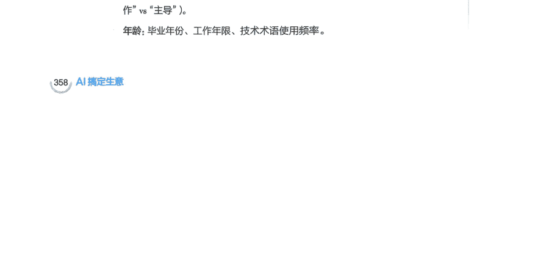

####### 一、导致偏见的常见原因

######## 1. 历史数据存在偏差

- 训练 AI 的数据集如果来自历史上存在性别或年龄歧视的招聘记录（如男性主导的行业、偏好年轻候选人的岗位），算法会继承并放大这些偏见，认为"过去成功的候选人特征"即正确标准。

######## 2. 间接特征关联

- 算法可能通过非直接特征推断性别或年龄。例如：

  - **性别：** 社团经历（如"女子社团"）、兴趣爱好（如"育儿"）、用词风格（如"协作" vs "主导"）。

  - **年龄：** 毕业年份、工作年限、技术术语使用频率。

######## 3. 自然语言处理（NLP）的局限性

- 简历中的描述可能隐含性别或年龄标签。例如：

  - 女性更可能提及"家庭责任"或"非连续工作经历"（如育儿假），算法可能误判为"不稳定"。

建议自检步骤：

1. 回想最近在网上看到的让你觉得“不舒服”或“不对劲”的广告推荐或内容推送。
2. 推测推荐背后的用户画像假设，该假设是否带有性别、年龄、消费能力等刻板偏见？
3. 用提问模板让 AI 解释该场景可能存在的偏见类型及成因。

提醒事项：

1. **破除技术中立错觉**：技术会嵌入人的价值观与选择，AI 并非天然客观。
2. **洞察隐蔽性**：偏见多隐藏在信息模式与算法关联中，不易察觉。
3. **公平衡量困境**：公平性的定义与量化复杂，缺乏统一标准，治理难度大。
4. **厘清责任主体**：损害发生时责任归属开发者、信息方还是使用者仍在讨论，企业作为使用者至少应审慎选用。
5. **关注伦理建设**：AI 伦理与治理框架仍在发展，企业应主动学习，将伦理考量贯穿 AI 应用全流程，实现科技向善。

## 结语

这本书是写给在国内市场里打拼的中小微创业者、电商掌柜、门店经营者，以及做自媒体副业的朋友的。核心目标是送出一本能读懂、能学会、能直接用到业务里的 AI 实战手册。

我们不聊玄乎的技术概念，只聚焦真正能见效的方法和工具：怎么引流、怎么优化日常运营、怎么促成成交、怎么整体提效。内容覆盖商业底层在 AI 冲击下的变化、直播运营、选品打法、流量和内容生产；从平台玩法到私域深耕；从数据化决策到组织调整与风险防控。想为普通创业者画出一张看得清、能跟上的行动地图。希望它既是你在实操时的随身工具箱，也是踩坑前的安全提示。

成书过程中，多位深耕人工智能伦理、商业模式创新、数字经济治理的老师提供了关键启发。他们的前瞻研究和深度洞察，帮助我们把技术浪潮的宏观脉络看得更清楚，在此致以真诚的敬意。

正如古话所说，道理要靠实践才通透。AI 浪潮此起彼伏，这本书充其量是一个切入口。真正的成长来自你把方法搬进自己的生意场景里去尝试、去碰壁、去迭代、去创新。AI 本身不是终点，它是通往更高效、更智能、更有创造力工作方式的新起点。

大势滚滚向前，持续学习并敢于动手的人才站得住。愿这本书能给你拥抱 AI 的勇气和思路。

感谢阅读，谢谢信任！

---

### 每个生意人都可上手 AI

### 用工具重塑商业竞争力

#### 行业场景 AI 落地方案

- 实体门店：短视频获客到成交实操，配套5个行业案例拆解
- 电商经营：平台洞察、引流转化打法，涵盖7大平台实战手册
- 本地生活：同城获客策略，对应4大核心阵地实战图
- 自媒体变现：内容生产与裂变玩法，覆盖知识付费到带货全链路

#### 打造直播体系

- AI 选品与爆款预判模型

#### 流量矩阵实操

- 30秒出片的行业爆款视频方案，配行业开场模板与剧情结构库

#### 智能提效工具

- 私域智能话术系统 + AI 驱动的裂变活动加速

标点视界

B.D.HORIZON

ISBN 978-7-5317-6735-0

定价：69.80元