# AI摄影绘画实战宝典

# 前言

## ■ 编写初衷
本书面向初学者编写的实战型教材，围绕AI绘画实操展开，从创作方法到优化思路再到落地案例进行全流程讲解，帮助读者熟练掌握AI摄影绘画。学习内容能提升个人创作能力，也契合科技兴国、实干兴国的号召。全书收录八十余个针对性案例，每个案例皆配有教学视频，手把手演示制作过程。

## ■ 本书亮点
同步教学视频：所有软件操作案例均录制了配音讲解视频，还原书中操作步骤，读者可图文结合或单独观看，像观看教学影片一样掌握要点。

素材与范例：随书提供十余个源文件和近八十个成品效果，涉及人像、艺术、游戏美术、电商广告等领域，便于直接使用并提升熟练度。

干货方法：全书梳理AI摄影绘画核心技巧，涵盖关键词获取、图像生成、短视频制作、作品优化及各类摄影绘画创作，从入门到进阶，学习效率更高。

关键词汇整：为加速文案产出与绘画复现，本书整理了各案例的核心关键词，可直接套用快速获得相近效果。

全程图解：借助四百余张配图，对软件功能、案例演示、效果展示作可视化呈现，内容更直观，便于举一反三创作出更多作品。

AI绘画提示词库：提示词是AI绘画关键，本书额外提供一万五千余条提示词，助力高效绘制丰富画面。

## ■ 使用提示
截图基于文心一言、文心一格、ChatGPT、Midjourney、剪映等工具的实际界面，因出版周期较长，界面与功能可能已更新，请以书中思路灵活迁移。文中使用的ChatGPT为3.5版，Midjourney为5.2版，剪映电脑版为4.5.2版。

另外，相同关键词在不同AI工具中每次生成结果可能存在差异，观看扫码教程时建议聚焦关键词撰写思路与操作步骤。

## ■ 版权说明
书中及随书资源所用图片、模板、音视频等素材版权归原公司、网站或个人所有，本书仅作教学引用，无侵权意图，特此声明。

## ■ 作者支持
本书由楚健主编，视频素材与拍摄协助人员有高彪等人，谨此致谢。作者水平有限，如有疏漏请指正，联系微信：2633228153。

# 第1章 AI摄影文案创作

生成AI摄影图或短视频前，需先准备驱动用的文案即关键词。本章聚焦文心一言与ChatGPT的使用技巧，帮助读者更快产出满意的AI摄影文案。

## 1.1 文心一言的常用操作

文心一言是百度推出的知识增强对话模型，可与人交流并辅助创作。在制作摄影图或短视频时，可先用它生成相关文案。以下介绍几类常见用法。

### 1.1.1 用系统推荐的提示词交流
【效果展示】：打开文心一言首页后，系统会主动推荐若干对话模板，点击即可体验对话功能，效果如图1-1。

操作流程如下。
1. **STEP 01** 进入文心一言主页，可见系统推荐的多条提示词模板，选择所需模板，如图1-2。
2. **STEP 02** 执行后，AI会迅速给出贴合模板的回答，反应快且相关度高，效果见图1-1。

> **专家指点**
>
> 直接套用推荐模板能快速开启对话，获取基础内容。但推荐模板数量有限，有时难以满足个性化文案需求。

### 1.1.2 输入自定义提示词交流
【效果展示】：除推荐模板外，还可在输入框自行撰写指令与AI沟通，使用自定义提示词交流的效果如图1-3。

操作流程如下。
1. **STEP 01** 进入文心一言主页，在底部输入框内填入想要AI解决的问题或具体要求，如图1-4。
2. **STEP 02** 点击发送按钮或按Enter键，即可获得AI回复，效果见图1-3。

### 1.1.3 用 / 符号调用指令中心
【效果展示】：可在文心一言的指令中心收藏常用模板，需要时在输入框输入 / 正斜杠即可调出。使用 / 符号对话的效果如图1-5。

操作流程如下。
1. **STEP 01** 在文心一言主页输入框输入“/”，列表中会出现已收藏的提示词模板，选择其一，如图1-6。
2. **STEP 02** 选定后模板会自动填入输入框，适当修改内容后发送，即可得到AI回复，效果见图1-5。

### 1.1.4 重新生成内容
【效果展示】：对AI的生成结果不满意时，可点按“重新生成”让其再写一次，效果如图1-7。

操作流程如下。
1. **STEP 01** 在文心一言主页输入提示词并发送，获得回复后点击“重新生成”按钮，如图1-8所示。请列出拍摄微距照片的5个要点
微距摄影要点整理如下：
1. **景深把控**：微距镜头景深极浅，主体清晰背景虚化，拍摄时需注意景深范围。
2. **稳定性**：微距对抖动敏感，建议使用三脚架或支撑物，避免呼吸触碰导致模糊。
3. **镜头选择**：微距镜头效果最佳，支持时也可尝试长焦镜头实现微距效果。
4. **光线掌控**：光线影响显著，应避开直射强光造成硬阴影，可用柔光板或反光板柔化。
5. **手动调焦**：自动对焦在近距离可能不准，建议手动设定焦点并锁定后再拍摄。
希望以上内容对你有帮助。
2. **STEP 02** 系统会再次向AI发送相同指令并重新生成回复，效果见图1-7。也可在回复下方点选“更好”“更差”“差不多”来评价两次回答。

> **专家指点**
>
> 重新生成后，文心一言会保留历史回复，可点击右侧翻页按钮如“2/2”查看之前的版本。

## 1.2 ChatGPT的常用操作

ChatGPT是一款具备文本生成能力的对话机器人，可借助它获取AI摄影文案。下面介绍三种基础用法。

### 1.2.1 直接对话
【效果展示】：登录后打开对话窗口，即可输入任意问题或话题，ChatGPT会作答并提供相关信息。直接对话的效果如图1-9所示。

调用150字左右描述某个摄影作品的画面

这幅作品呈现雾气弥漫的山脉景象。前景是沐浴晨光的翠绿松林，轮廓在薄雾中若隐若现。远处山体被朦胧雾气遮蔽，显得神秘壮观。

远方山峰隐约可见，如同古老仙境，雾气环绕峰顶，宛若通往仙境的大门。整幅画面静谧神秘，令人沉醉。

摄影师捕捉了雾气在大自然中的独特美感，营造出诗意画面，让观者感受到自然的神秘与雄浑。这张照片把人带入幽静仙境，令人赞叹自然之美与奥秘。

操作流程如下。
1. **STEP 01** 打开ChatGPT对话窗口，点击底部输入框，如图1-10。
2. **STEP 02** 在输入框内输入需求，例如“请用150字左右描述某个摄影作品的画面”，如图1-11。
3. **STEP 03** 点击发送或按Enter，ChatGPT会按要求生成内容，效果见图1-9。

### 1.2.2 重新生成文案回复
【效果展示】：收到回复后可进行简单评估，觉得有用可点复制，若参考价值不高可点输入框上方的“Regenerate重新生成”，ChatGPT会基于同一问题给出新答案。效果如图1-12。

操作流程如下。
1. **STEP 01** 完成一次对话后，点击输入框上方的“Regenerate”按钮，如图1-13。
2. **STEP 02** 稍等片刻即可获得新的回复，效果见图1-12。

ChatGPT对同一问题的多次回复会以“2/2”“3/3”等形式标记，反复点击“Regenerate”可获取多种不同的AI摄影关键词。

### 1.2.3 对话窗口的管理
【效果展示】：每次登录后默认进入新窗口，历史对话会保存在左侧导航面板，可新建、删除、重命名。重命名效果如图1-14。

操作流程如下。
1. **STEP 01** 打开ChatGPT，点击任一历史对话窗口，再点击窗口名称右侧的“编辑”按钮，如图1-15。
2. **STEP 02** 进入名称编辑框，修改对话名称，如图1-16。
3. **STEP 03** 点击“确定”完成重命名。

> **专家指点**
>
> 左侧导航的“删除”会整段清除当前对话。为避免误操作，平台会弹出确认提示。

## 1.3 文案提示词的编写技巧

ChatGPT的输出质量取决于输入的提示词，掌握编写技巧才能稳定获得有效的AI关键词。以下为常用技巧。

### 1.3.1 向ChatGPT提供实例参考
向ChatGPT求助AI关键词时，可先给出具体范例让它分析要素，再据此生成新关键词。提供实例时应确保示例可生成图像。

例如可输入“画一幅现实主义画作的AI绘画关键词是‘Realistic imagery, Caspar David Friedrich style, 3D, black, white, red and blue, 8K（大意为：逼真图像、卡斯帕·大卫·弗里德里希风格、3D、黑色、白色、红色和蓝色、8K分辨率）’，请分析这段关键词包含哪些要素？”，让ChatGPT先理解结构，如图1-17。

随后在同一对话窗口继续输入“根据上述关键词，给出画一幅抽象画作的AI绘画关键词”，即可得到对应的抽象画关键词，如图1-18。

### 1.3.2 模仿优秀艺术作品风格
创作艺术感强的AI绘画时，可引导AI模仿摄影师、画家、漫画家、导演、设计师等优秀作品的风格。尤其是有故事或意境的作品，可先让ChatGPT按某艺术家风格写故事，再提炼场景关键词用于绘画。

例如输入“请模仿欧·亨利的风格，写一个200字左右的爱情故事”，可得到回复，如图1-19。

再输入“请根据上述故事，提取出5个可以呈现影片的关键场景”，即可获得场景提炼，如图1-20。

请根据上述故事，提取出5个可以展现影片的关键场景

影片可呈现的关键场景如下：
1. **集市相遇**：小镇热闹集市上，艾米莉与查尔斯初次眼神交汇，擦出心动火花。
2. **咖啡馆交流**：两人于小咖啡馆深入交谈，展现个性与吸引力。
3. **夜晚漫步**：星光下共同漫步，分享梦想与渴望，氛围浪漫亲密。
4. **分别时刻**：生活责任迫使分离，火车站或机场告别显露出挣扎与不舍。
5. **重逢时刻**：最终在美景背景下重逢，情感高潮彰显爱情坚韧不朽。

这些场景帮助观众跟随主人公旅程，体会爱情故事与时间距离的考验。

### 1.3.3 赋予ChatGPT特定身份
给ChatGPT设定角色相当于提供了语言风格和话题方向的暗示。例如让它扮演AI摄影师提供建筑摄影关键词，可输入“假如你是一位AI摄影师，请提供一些创作建筑类摄影作品的关键词建议”，可得到回复，如图1-21。

假如你是一位AI摄影师，请提供一些创作建筑类摄影作品的关键词建议

作为AI摄影师，创作建筑摄影可参考以下关键词，帮助明确方向与风格：
1. **城市风光**：捕捉高楼、街道、广场、桥梁等城市建筑景观。
2. **建筑细节**：聚焦窗户、门廊、装饰、纹理等局部特写。
3. **现代建筑**：表现创新设计与极简风格，突出线条与几何。
4. **历史建筑**：探索古建筑、城堡、教堂、遗迹，体现历史氛围。
5. **建筑内部**：拍摄室内装饰、楼梯、天花板、家具等内部美感。
6. **光影效果**：利用光影突出轮廓、阴影、反射，营造戏剧感。
7. **季节天气**：记录雨中、夏季阳光下等不同环境下的建筑变化。
8. **城市夜景**：夜晚拍摄建筑灯光效果，呈现迷人夜色。
9. **建筑与自然**：将建筑与水景、树木、山脉结合，构图和谐。
10. **人物与建筑**：加入人物突出尺度比例，体现人景互动。

这些关键词有助于明确拍摄重点，创作出引人入胜的建筑摄影作品，也可组合使用形成独特系列。

再例如输入“假如你是一位AI摄影师，请提供一些生成摄影艺术作品的关键词建议”，也可得到对应建议，如图1-22。

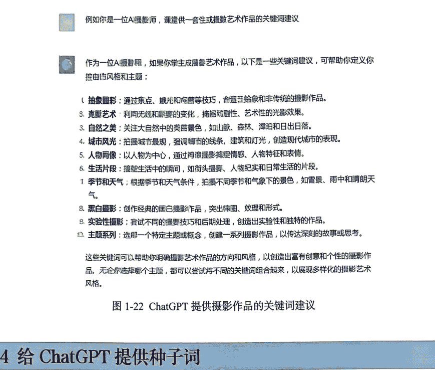

### 1.3.4 给ChatGPT提供种子词
种子词是希望出现在生成文本中的关键词。加入种子词能帮助ChatGPT更快定位相关信息，生成更有效的答案。例如输入“请根据以下种子词生成8个AI摄影关键词：专业摄影、冷暖色调、干净简洁”，即可获得关键词，如图1-23。

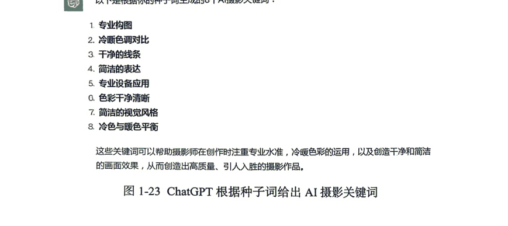

还可加入具体绘画工具进行优化。例如输入“请根据以下种子词提供可以运用AI绘画软件生成图像的关键词。种子词如下：专业摄影、冷暖色调、光线柔和”，ChatGPT会给出符合要求的AI绘画关键词，如图1-24。

> 请根据以下种子词提供可以运用AI绘画软件生成图像的关键词。种子词如下：专业摄影、冷暖色调、光线柔和

打造专业摄影质感的AI绘画提示词

> 从基础种子词出发，这组提示词可以直接喂给智能绘图模型：

- 1. 摄影艺术风格
- 2. 色彩温度调整
- 3. 柔和光线渲染
- 4. 专业摄影效果
- 5. 冷暖色彩平衡
- 6. 艺术化的光影
- 7. 专业后期处理
- 8. 光线与色彩表达

把上述词汇组合进提示，模型更容易把握画面的调性与质感，从而产出具备专业摄影质感、冷暖和谐、光线柔和的艺术作品。

图 1-24 ChatGPT 给出的达标 AI 绘画关键词

### 1.3.5 扩大 ChatGPT 思路广度

想让模型给出更具创意的摄影类提示词，可以在提问末尾加上引导句 “What are some alternative perspectives？”，这种发散式提问能打开思路。

例如输入“请提供能够生成星空摄影图片的 AI 绘画关键词”，得到的建议比较常规，如图 1-25 所示。

> 请提供能够生成星空摄影图片的AI绘画关键词

> 生成星空摄影图片的AI绘画关键词包括：

- 1. 星空夜景：用于指导AI生成夜晚星空的场景。
- 2. 银河系：以指导生成银河系中的星星和星云。
- 3. 星星和星座：帮助生成明亮的星星和特定的星座。
- 4. 极光：用于创建北极光或南极光的效果。
- 5. 星空风景：指示AI绘制具有山脉、湖泊或其他自然元素的星空风景。
- 6. 星轨摄影：生成星轨效果，强调星星的运动轨迹。
- 7. 夜空色调：为画面指定冷暖的夜空色调，如蓝色或紫色。
- 8. 天文观测：用于生成望远镜或天文台的场景。

这些词能帮助绘画模型理解你对星空摄影的具体诉求和风格取向，从而生成更符合预期的成片。

图 1-25 ChatGPT 给出的较为常规的 AI 绘画指导建议

把问题改为“请提供能够生成星空摄影图片的 AI 绘画关键词，What are some alternative perspectives？”，模型的回复会更丰富，如图 1-26 所示。

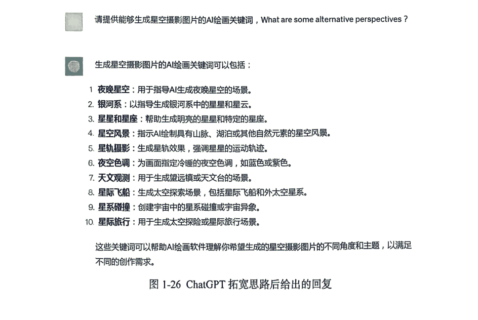

## 1.4 生成 AI 摄影关键词的技巧

在生成式绘画中，提示词的精准度直接决定成片效果。描述不清会浪费大量试错时间，这时借助 ChatGPT 来生成提示词效率很高。本节介绍几种实用方法。

### 1.4.1 直接提问获取关键词

在绘画流程里，关键词就是一段文字或简图，用来给模型提供创作起点。它通常涵盖想要的主题、风格、元素和情绪，作用是让模型按既定方向生成照片。

写好提示词至关重要，它会影响风格走向、画面内容和整体质感。好的提示词能点燃模型的创造力，帮助它准确读懂意图，从而生成更贴合预期的艺术品。通过不同类型的词，可以探索插画化、写实风景或抽象艺术等多种方向。

【效果展示】：生成 AI 作品时若不知如何组织词句，可直接向 ChatGPT 求助，让它帮你把画面拆解成可用关键词。直接提问的效果如图 1-27 所示。

形容得再细致点，重点说说色彩方面的特点

梵高《向日葵》的绘画特点关键词，重点描述色彩方面的特点：

- 1. **鲜艳的黄色**：花朵以饱满明亮的黄为主，视觉冲击强烈，像阳光洒落，传达出生命力与欢快。
- 2. **橙色的高光**：橙色点缀在花瓣上，强化了立体与质感，让花朵更丰润。
- 3. **深绿色背景**：暗沉的绿与明黄形成强烈对比，使向日葵更突出。
- 4. **分层的色彩**：多层油彩叠加带来丰富的色阶变化，提升画面深度与情感张力。
- 5. **情感的体现**：明快色调不仅是写实，更是艺术家对自然的热爱与对生命的赞颂。
- 6. **后印象派的风格**：色彩服务于感受而非客观复刻，是后印象派强调情绪表达的典型。

图 1-27 直接提问获取关键词的效果

具体操作方式如下。

STEP 01 在 ChatGPT 输入框里输入“请以关键词的形式，列出梵高《向日葵》的绘画特点”，得到的回答已经相当全面，可直接挑选使用，如图 1-28 所示。

请以关键词的形式，列出梵高《向日葵》的绘画特点

梵高《向日葵》的绘画特点关键词：

- 1. **鲜艳的色彩**：明亮的黄色和橙色色块，以及深绿色背景。
- 2. **浓重的油画笔触**：粗糙的笔触和画布上的油画层次感。
- 3. **静态的构图**：五朵向日葵在画布上等间距排列，构图简单而平衡。
- 4. **自然主题**：描绘了向日葵的自然美，表达了梵高对大自然的热爱。
- 5. **情感的表达**：通过色彩和笔触表达了内在的情感，传达了艺术家的情感和情感。
- 6. **后印象派风格**：突出了后印象派艺术风格，强调感觉和情感而不是客观复制。
- 7. **生命力和活力**：画中的向日葵展现出强烈的生命力和活力，吸引观者的注意。
- 8. **光影效果**：通过色彩的变化和笔触的运用，呈现出光影的效果，增强了画面的深度和立体感。

图 1-28 ChatGPT 列出的关于梵高《向日葵》绘画特点的关键词

STEP 02 若想把色彩说得更细，可继续追问“形容得再细致点，重点说说色彩方面的特点”。模型会针对色彩进行二次细化，得到更多可用词，效果见图 1-27，这就是直接提问获取关键词的方法。

将图 1-27 中的关键词译成英文后，可直接喂给 Midjourney 生成对应画面。

AI 摄影绘画创作 完全自学一本通

> ▶ 专家指点

使用 AI 绘画工具时，通过编写和微调关键词来引导模型，作品会更贴合个人偏好，参与感更强，也能影响创意和风格的输出。

### 1.4.2 多轮对话提炼关键词

【效果展示】：ChatGPT 是个强大的对话助手，可通过多轮交流逐步提炼出想要的摄影提示词。下面以“雪山风光”为例说明多轮对话的用法，效果如图 1-29 所示。

简短一些，仅保留关键词，并使用逗号将关键词隔开，翻译成英语

Snowy mountain, bright moon, vast snowfield, dancing elves, ice blue dresses, violinist, notes, ancient castle, blue light.

图 1-29 ChatGPT 的回答结果

具体步骤如下。

STEP 01 在输入框中输入“请根据我给你的 idea（主意），详细描述一个富有创意的画面，然后使用逗号分隔描述里的关键词。idea：雪山风光”，ChatGPT 会给出一段较长的文案，如图 1-30 所示。

请根据我给你的idea（主意），详细描述一个富有创意的画面，然后使用逗号分隔描述里的关键词。idea：雪山风光

在这个创意的画面中，我们看到了壮丽的雪山风光。在高耸入云的雪山山巅，一轮明亮的圆月悬挂在夜空中。山脚下是一片广袤的雪原，覆盖着洁白的积雪。

在雪山的对面，一群精灵舞者在雪原上翩翩起舞，她们穿着流动的冰蓝色裙子，宛如雪花飘舞。她们的舞姿轻盈而优美，像是在与自然交融，与雪山和月光共舞。

一位小提琴手坐在雪地上，手中的小提琴发出悠扬的旋律，奏响了美妙的音乐。音符如同雪花一般飘落，营造出神秘而迷人的氛围。

在远处的山谷中，一座古老的冰雪城堡傲然耸立，城堡的尖塔和墙壁上闪烁着寒冷的蓝光，仿佛是冰雪女王的宫殿。

这个画面中的关键词包括：雪山、明亮的圆月、雪原、精灵舞者、冰蓝色裙子、小提琴手、音符、古老的城堡、蓝光。这个画面充满了神秘和创意，展现了自然与艺术的完美结合。

图 1-30 ChatGPT 给出的较长文案信息

STEP 02 文案过长时，可追加指令“简短一些，仅保留关键词，并使用逗号将关键词隔开，翻译成英语”，模型会精简并给出英文词组，效果见图 1-29。

把图 1-29 的英文词复制到 Midjourney 的 imagine 指令中，粘贴到 prompt 输入框回车，即可生成对应图片。

### 1.4.3 用表格组织关键词

【效果展示】：与 ChatGPT 对话时，也可以用表格来组织输出。效果见图 1-31 所示。

微距摄影有哪些主题类别，请用表格回答

以下是微距摄影常见的主题类别，使用表格回答：

| 主题类别 | 描述 |

| :--- | :--- |

| 昆虫和小动物 | 捕捉微小昆虫、蜘蛛、蝴蝶和其他小型生物的特写。 |

| 植物和花卉 | 突出花朵、叶子、树木等植物的细节和纹理。 |

| 珠宝和首饰 | 拍摄珠宝、戒指、项链等精致的珠宝首饰。 |

| 食物和烹饪 | 捕捉食物的细节，如水果、蔬菜、糕点和烹饪过程。 |

| 矿物和宝石 | 拍摄矿物、宝石、晶体等坚硬物质的微观结构。 |

| 眼睛和面部特写 | 以微观角度拍摄人眼、面部特写，突出微小细节。 |

| 电子设备 | 捕捉电子设备的微小元件，如电路板、芯片和电子连接。 |

| 钟表和机械 | 拍摄手表、钟表机芯、机械设备的微观细节。 |

| 水滴和雨珠 | 通过微距镜头捕捉水滴、雨滴、露珠等的形态和反射。 |

| 艺术品和手工艺 | 突出绘画、雕塑、手工艺品等艺术品的微小细节。 |

| 微观摄影 | 拍摄微观世界中的抽象、非常规主题，如泡沫、水纹等。 |

这些主题类别为微距摄影提供了多样性和创意的机会，使摄影师可以探索微观世界中的奇妙之处，并捕捉微小细节。

图 1-31 通过表格的形式生成关键词的效果

操作方法：

- STEP 01 输入“微距摄影的画面构思分几个部分，尽量全面且详细，用表格回答”，模型会以表格形式归纳，如图 1-32 所示。
- STEP 02 接着追问“微距摄影有哪些主题类别，请用表格回答”，即可拿到大量主题词，效果见图 1-31，可据此提取关键词。

AI 摄影绘画创作 完全自学一本通

微距摄影的画面构思分几个部分，尽量全面且详细，用表格回答

以下是微距摄影画面构思的详细部分，使用表格回答：

| 部分 | 描述 |

| --- | --- |

| 主题选择 | 选择微距摄影的主题，如昆虫、植物、珠宝等。 |

| 背景设计 | 选择或设置合适的背景，以突出主题，并控制景深。 |

| 光线控制 | 考虑光线来源和方向，使用自然光或人工光源，以获得理想的效果。 |

| 镜头和设备 | 选择合适的微距镜头或装备，以满足拍摄需求。 |

| 焦距和对焦点 | 调整焦距和对焦点，以确保主题清晰并突出。 |

| 构图和角度 | 考虑构图原则，如黄金分割、对称等，选择合适的拍摄角度。 |

| 快门速度和光圈 | 设置适当的快门速度和光圈，以控制曝光和运动模糊。 |

| 使用辅助工具 | 使用三脚架、遥控器或闪光灯等辅助工具，提高稳定性和控制。 |

| 后期处理 | 使用后期处理软件，如调整色彩、对比度和锐度，增强画面效果。 |

这些部分构成了微距摄影作品的全面构思，确保拍摄出高质量、精致的微距照片。

图 1-32 ChatGPT 以表格的形式给出回答

继续针对构图、色彩、背景、风格等提出更具体的问题，回答会更精准，关键词也更精确。

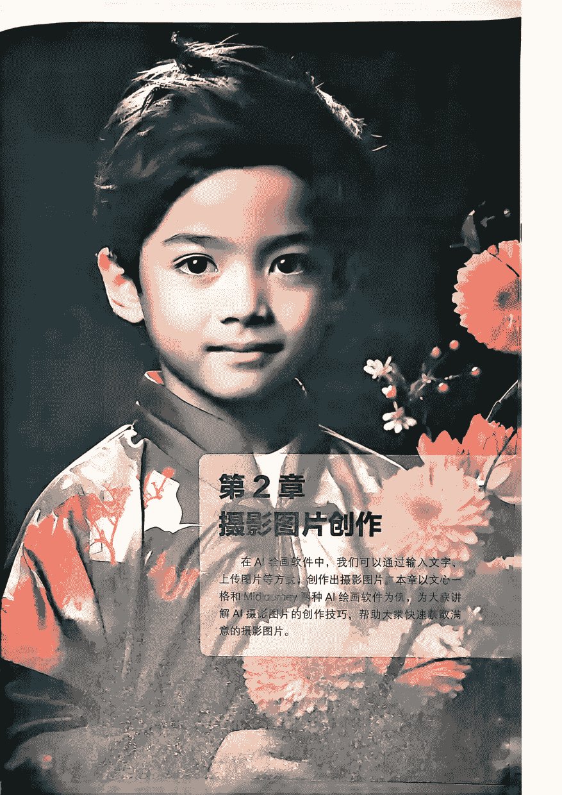

## 2.1 利用文心一格创作图片

文心一格依托百度在自然语言处理与图像识别方面的积累和海量数据，支持自定义关键词、画面类型、比例、数量等参数，可快速生成媲美人工创作的高质量画作。即使提示词相同，每次生成也可能出现差异。本节介绍基础操作。

### 2.1.1 使用推荐模式创作图片

【效果展示】：新手可先用文心一格的“推荐”AI绘画模式，只需输入创意词，模型即可自动生成。效果见图2-1。

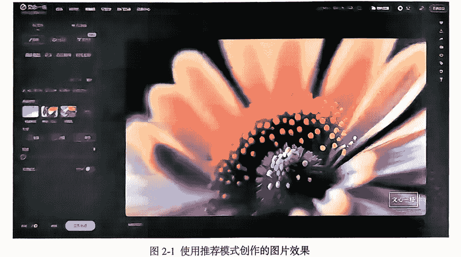

具体操作：

- STEP 01 登录文心一格，点击“立即创作”进入“AI创作”页面，❶在输入框填入关键词，如“微距摄影，花朵，高分辨率，光线柔和”；❷点击“立即生成”，如图2-2所示。
- STEP 02 稍等片刻即可看到生成结果，见图2-1。

> ▶ 专家指点

不满意可再次点击“立即生成”重绘；想看细节可点击图片放大查看。

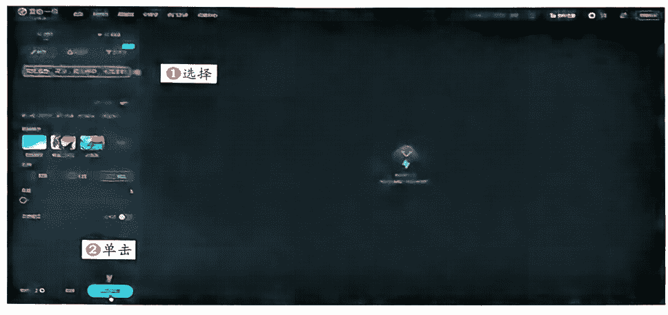

图 2-2 使用推荐模式创作图片的具体操作方法

### 2.1.2 使用自定义模式创作图片

【效果展示】：切换到“自定义”模式可设置更多关键词和参数，让结果更贴合需求。效果见图 2-3。

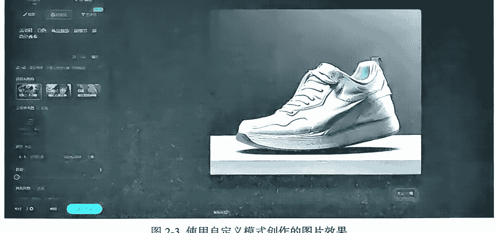

图 2-3 使用自定义模式创作的图片效果

操作步骤：

STEP 01 进入“AI创作”页面，①切到“自定义”选项卡；②输入关键词，如“运动鞋，白色，商品摄影，超细节，超高分辨率”；③把“选择 AI 画师”设为“创艺”；④点击“立即生成”，如图 2-4 所示。

AI 摄影绘画创作 完全自学一本通

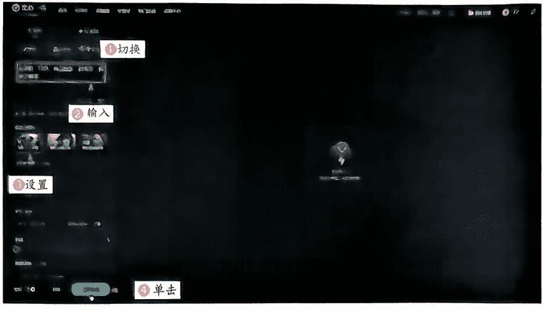

图 2-4 使用自定义模式创作图片的具体操作方法

STEP 02 等待片刻即可得到自定义作品，效果见图 2-3。

### 2.1.3 通过上传参考图创作图片

【效果展示】：文心一格支持上传参考图，并用文字描述修改点，实现风格迁移。效果见图 2-5。

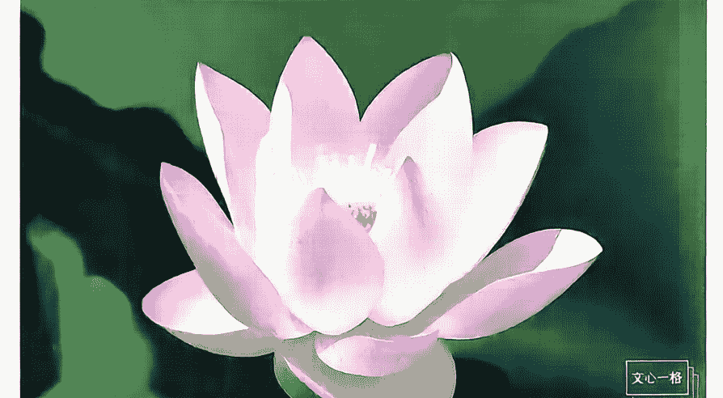

图 2-5 通过上传参考图创作的图片效果

操作步骤：

STEP 01 在“自定义”选项卡中，❶输入关键词如“荷花，中心构图，柔和的光线”；❷把“选择 AI 画师”设为“创艺”；❸点击“上传参考图”下的按钮，如图 2-6 所示。

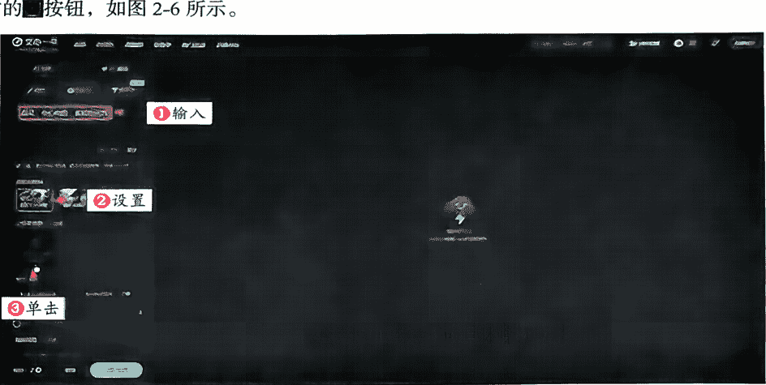

图 2-6 通过上传参考图创作图片的具体操作方法

STEP 02 弹出“打开”对话框，选择参考图，如图 2-7 所示。

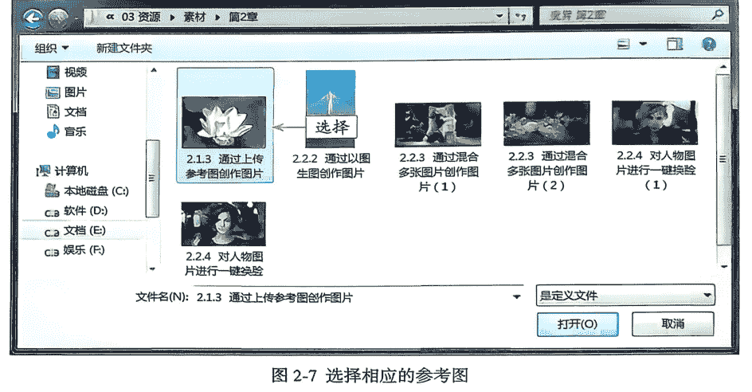

图 2-7 选择相应的参考图

STEP 03 点击“打开”上传，并把“影响比重”设为“7”，数值越大参考图影响越强。

STEP 04 ❶在下方继续设置“尺寸”为“16：9”、“数量”为“1”；❷点击“立即生成”，如图 2-9 所示。

AI 摄影绘画创作 完全自学一本通

图 2-8 设置“影响比重”选项

图 2-9 设置参数并单击“立即生成”按钮

STEP 05 生成完成后即可看到基于参考图的相似画面，效果见图 2-5。

## 2.2 利用 Midjourney 创作图片

Midjourney 是基于人工智能的绘画工具，支持文字、图片等提示输入，能生成符合要求的图像。高质量产出需要大量模型训练和艺术设计认知。本节介绍 6 种基础操作。

### 2.2.1 使用文字内容创作图片

【效果展示】：Midjourney 主要靠 imagine 指令和关键词驱动，建议使用英文词。模型不区分大小写，词间用逗号或空格分隔。效果见图 2-10。

图 2-10 使用文字内容创作图片的效果

下面介绍使用文字内容创作图片的具体操作方法。

### 2.2.1 基础生成与变体操作

STEP 01 打开 Midjourney 页面底部的命令输入区，输入“/”唤出菜单，从列表中点选 imagine 指令，见图 2-11。

STEP 02 进入 imagine 指令后方的提示词框，填入想要的主题关键词，见图 2-12。

STEP 03 按下 Enter 提交，Midjourney Bot 立即开始渲染，并在界面上显示生成进度，见图 2-13。

STEP 04 片刻后会得到 4 张初稿。点击 V3 按钮，见图 2-14。V1~V4 按钮的作用是分别以对应编号的图片为蓝本，重新变体出 4 张新作。

STEP 05 系统会以第 3 张图为参考，生成一组新的 4 张变体，见图 2-15。

STEP 06 若对变体都不满意，可点按循环按钮🔄，见图 2-16。如弹出二次确认，直接点提交即可继续。

STEP 07 循环后再次得到 4 张图，点按 U4 按钮，见图 2-17。

STEP 08 系统将在第 4 张图基础上进行细节加描并放大展示，效果见图 2-18。

STEP 09 底部功能区还能继续操控。例如点 Vary（Strong）并提交，会以该图为模板生成差异较大的 4 张；点 Vary（Subtle）并提交，则生成差异较小的 4 张，见图 2-19。Strong 指强变体，Subtle 指微变体。

STEP 10 对应点按 U 按钮即可对单张图进行精修放大。示例中点开图 2-19 两张图的 U1，效果见图 2-10。

### 2.2.2 以图生图创作新图

【效果展示】：Midjourney 的 describe 指令可先解析一张参考图并给出可用的提示词，再结合该图链接创作出风格相近的新图，这类用法常被称为以图生图或垫图。提示词即关键词或指令的统称，也有人称之为咒语。相关成果见图 2-20。

下面说明具体操作流程。

STEP 01 在页面底部输入框输入“/”，从弹出的列表中选择 describe 指令，见图 2-21。

STEP 02 点按上传按钮，见图 2-22。

STEP 03 弹出打开对话框，选择本地图片，见图 2-23。

STEP 04 点打开，将图片载入输入框后连按两次 Enter，见图 2-24。

STEP 05 Bot 会根据上传图生成 4 组关键词。复制关键词或点下方 1~4 按钮，即可以该图为模板生成新图，见图 2-25。

STEP 06 在生成的预览图上右键，选择复制图片地址，见图 2-26。

STEP 07 在图片下方点 1 按钮，见图 2-27。

STEP 08 弹出 Imagine This! 对话框，在 PROMPT 框中先粘贴图片链接，再空一格填入关键词，也可自行修改，见图 2-28。

STEP 09 点提交，以参考图为蓝本生成 4 张新作，见图 2-29。

STEP 10 点 U3 放大第 3 张，效果见图 2-20。

### 2.2.3 多图混合创作

【效果展示】：Midjourney 的 blend 指令可一次性上传 2~5 张图，提取各图特征后融合生成一张新图。融合效果见图 2-30。

#### A) 图像融合创作

1. 在输入框输入“/”，从选项中选择 blend 指令，见图 2-31。
2. 出现两个图框，点左侧上传按钮，见图 2-32。
3. 在打开对话框中选定图片并点打开，见图 2-33。
4. 将图片填入左侧图框，右侧图框同法添加另一张图，见图 2-34。
5. 按 Enter，Midjourney 自动融合并输出 4 张新图，此为未加描述指令的裸融合效果，见图 2-35。
6. 点 U4 放大第 4 张，效果见图 2-36。

### 2.2.4 人物一键换脸

【效果展示】：InsightFaceSwap 是 Discord 官方的人像处理插件，可批量精准替换人脸且保留背景。换脸效果见图 2-36。

STEP 01 在底部输入框输入“/”，在列表左侧点 InsightFaceSwap 图标■，见图 2-37。
STEP 02 在列表中选择 saveid（保存 ID）指令，见图 2-38。
STEP 03 填入 idname（身份名称），8 位以内英文或数字均可，见图 2-39。
STEP 04 点上传按钮，上传一张面部清晰的人物照，见图 2-40。
STEP 05 按 Enter 完成 idname 创建，见图 2-41。
STEP 06 用 imagine 指令生成人像并放大其中一张，效果见图 2-42。
STEP 07 在图片上右键，选择 APP | INSwapper（替换目标图像面部），见图 2-43。
STEP 08 InsightFaceSwap 机器人即刻完成面部替换，效果见图 2-44。
STEP 09 另可在输入框输入“/”选择 swapid（换脸）指令，见图 2-45。
STEP 10 输入已创建的 idname，并上传待换脸的底图，见图 2-46。
STEP 11 按 Enter 调用 InsightFaceSwap 机器人替换底图人脸，效果见图 2-36。

### 2.2.5 种子值锁定风格

生成图片时从噪点逐渐清晰的过程，其起点即 seed。Midjourney 会为每张图随机分配种子，也可用 --seed 指定。相同种子加相同关键词可得到一致风格，便于连贯场景或角色。效果见图 2-47。

STEP 01 生成图片后，点消息上方的添加反应图标，见图 2-48。
STEP 02 弹出反应对话框，见图 2-49。
STEP 03 在搜索框输入 envelope，点选信封图标，见图 2-50。
STEP 04 点私信图标查看 Bot 回复，见图 2-51。
STEP 05 可看到 Job ID 与图片种子值，见图 2-52。
STEP 06 调整关键词后，用 imagine 指令在末尾加上 --seed 以及种子数值，再次生成，效果见图 2-53。
STEP 07 点 U1 放大第 1 张，效果见图 2-47。

### 2.2.6 关键词标签保存

【效果展示】：使用 prefer option set 指令可将常用关键词存为一个标签，后续调用即可免重复输入。效果见图 2-54。

STEP 01 在输入框输入“/”，选择 prefer option set 指令，见图 2-55。
STEP 02 在 option 输入框填入标签名，如 BQ1，见图 2-56。
STEP 03 点增加 1 按钮，在选项列表选择 value 参数值，见图 2-57。
STEP 04 在 value 输入框填入要固定的指令关键词，见图 2-58。
STEP 05 按 Enter 将关键词存入服务器并绑定标签名 BQ1，见图 2-59。

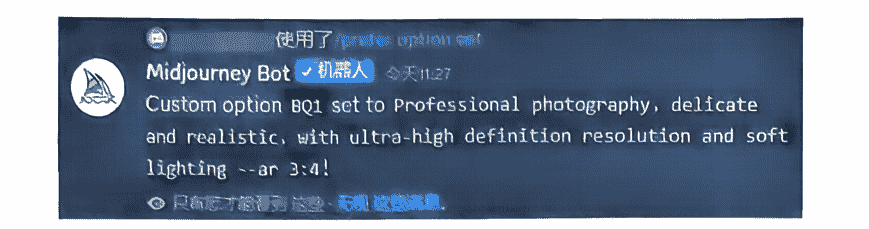

图 2-59 储存关键词并添加标签

STEP 06 用 imagine 输入关键词后在末尾加上 --BQ1 调用标签，见图 2-60。

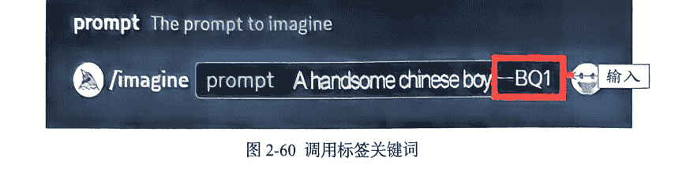

图 2-60 调用标签关键词

STEP 07 按 Enter 生成，Midjourney 会自动加入 BQ1 标签内容，效果见图 2-61。

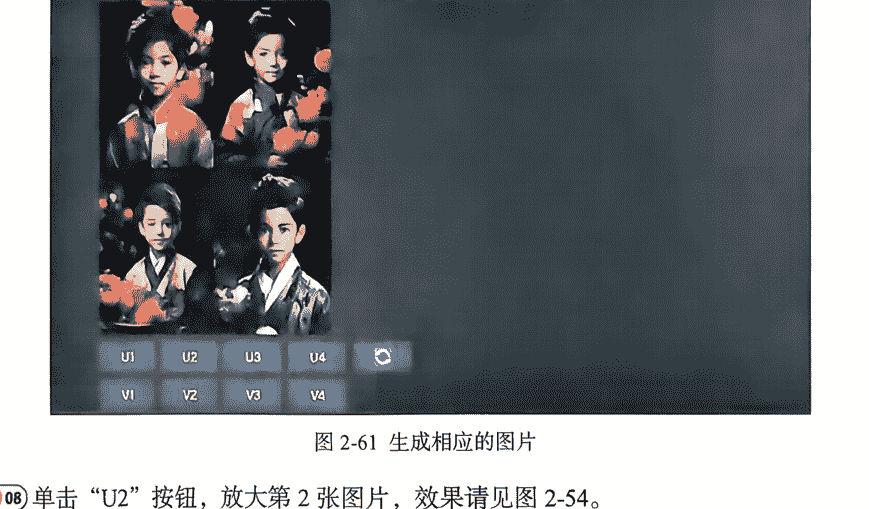

图 2-61 生成相应的图片

STEP 08 点 U2 放大第 2 张，效果见图 2-54。

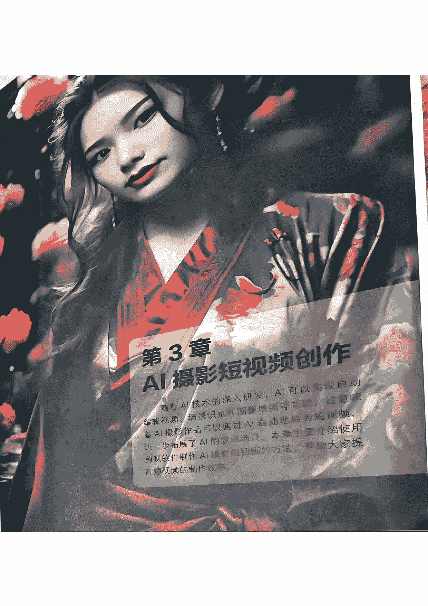

## 第 3 章

### AI 摄影短视频创作

随着 AI 能力不断深化，自动剪辑、场景识别与图像增强已可将 AI 摄影作品便捷转为短视频，拓展了创作边界。本章聚焦剪映软件制作 AI 摄影短视频，提升效率。

## 3.1 利用剪映生成 AI 短视频

剪映提供强大的 AI 视频制作能力，支持快速剪辑、画面调节、文字与音乐添加。本节以中餐馆美食宣传短视频为例，讲解从文案关键词到素材再到剪映成片的全流程。

### 3.1.1 获取绘画文案关键词

【效果展示】：制作前需先明确画面主体，让 AI 知道要画什么。以中餐馆美食为例，可先让 ChatGPT 生成绘画文案关键词，见图 3-1。

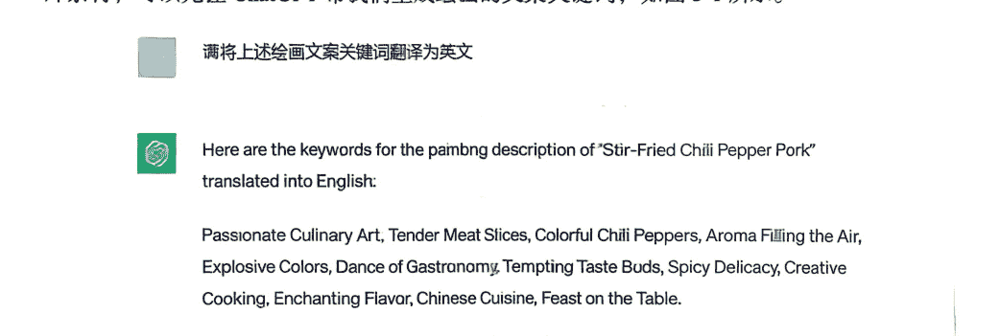

操作说明。

- 1. STEP 01 在 ChatGPT 输入框提问，如“请你充当 AI 绘画师，提供一道辣椒炒肉的绘画文案关键词，字数在 50 字以内”，见图 3-2。

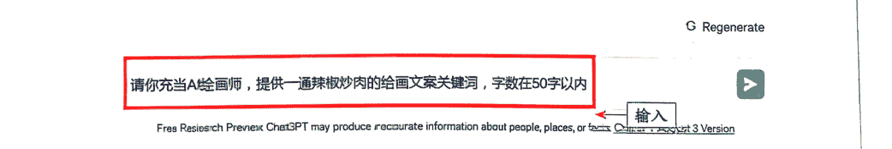

- 2. STEP 02 点发送，稍等后即可获得关键词，见图 3-3。
- 3. STEP 03 接着输入“请将上述绘画文案关键词翻译为英文”，见图 3-4，获取英文版。

> ▶ 专家指点
若对文案不满意，可点 Regenerate 让 ChatGPT 重新生成。

STEP 04 在新指令下获得英文翻译，效果见图 3-1。确认无误后复制到 Midjourney 作为绘画指令。

同理可让 ChatGPT 为小炒黄牛肉、红烧鱼、麻婆豆腐生成关键词并翻译，效果见图 3-5。按需提炼后整理成英文指令即可进入绘画。

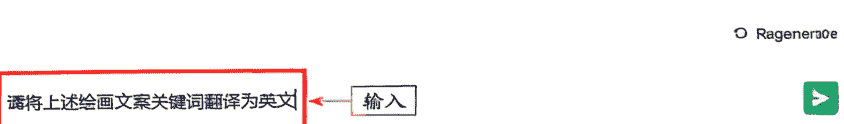

图 3-4 在输入框中输入指令 2

### 3.1.2 生成摄影图片素材

【效果展示】：借助 ChatGPT 或文心一言获得文案关键词后，可用 Midjourney 等 AI 绘画工具绘制所需素材，见图 3-6。

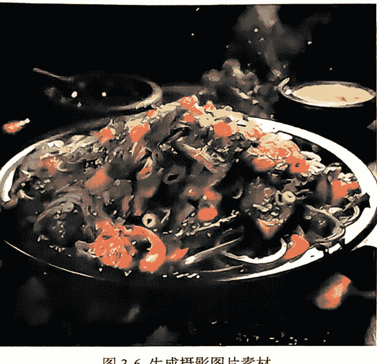

图 3-6 生成摄影图片素材

下面介绍利用 Midjourney 生成摄影图片素材的具体操作方法。

**STEP 01** 打开 Midjourney 后，通过 imagine 指令把 ChatGPT 提供的第一道中式菜肴关键词填入，按回车，系统会一次性产出 4 张辣椒炒肉的视觉成果，示例见图 3-7。

**STEP 02** 从四张初稿里挑出最满意的一张，本例选用第1张，点击对应的 U1 即可，如图 3-8 所示。

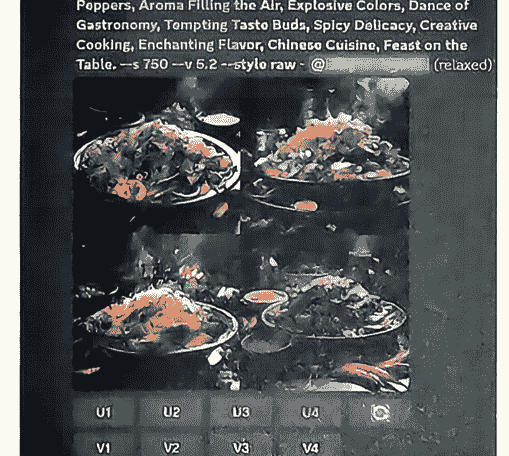

图 3-7 四张辣椒炒肉的生成效果

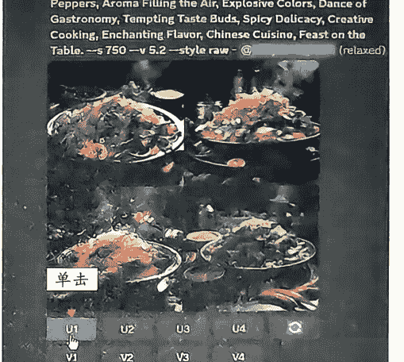

图 3-8 点按 U1 按钮的界面

**STEP 03** 确认后，Midjourney 会在所选图片基础上做细节加强并放大，呈现效果见图 3-6。

沿用此套流程也能生成小炒黄牛肉、红烧鱼、麻婆豆腐的画面，分别对应图 3-9、图 3-10、图 3-11。

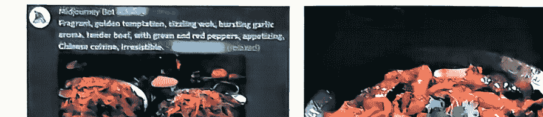

图 3-9 小炒黄牛肉生成图

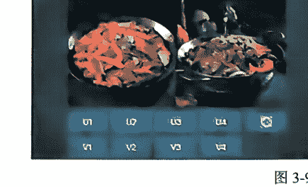

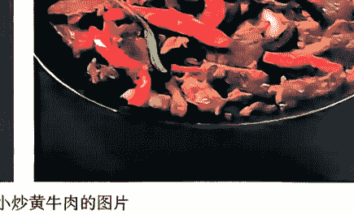

图 3-10 红烧鱼生成图

图 3-11 麻婆豆腐生成图

### 3.1.3 制作摄影短视频

【效果展示】：借助剪映的模板功能，能快速拼出多种风格的短片，并且可以把模板里的视频或图片替换成自己的素材，方便编辑和发布美食摄影短视频。最终成片截图见图 3-12。

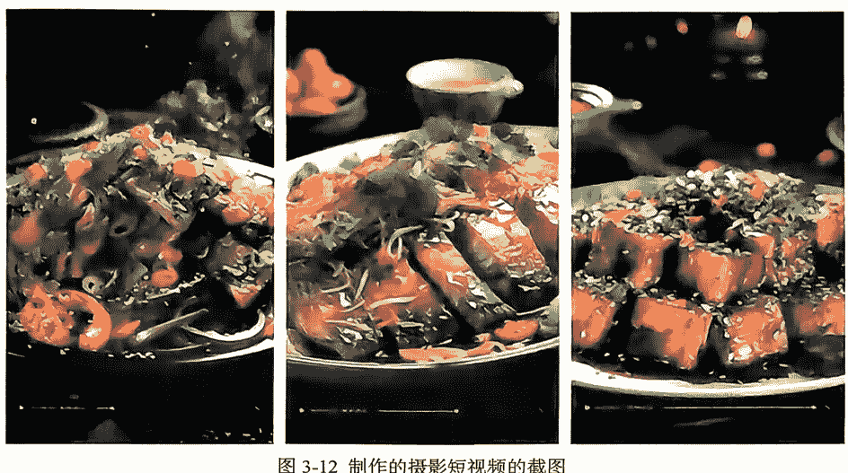

下面详细说明中餐厅美食摄影短视频的制作流程。

**STEP 01** 在电脑端启动剪映，首页左侧导航里点“模板”，如图 3-13 所示。

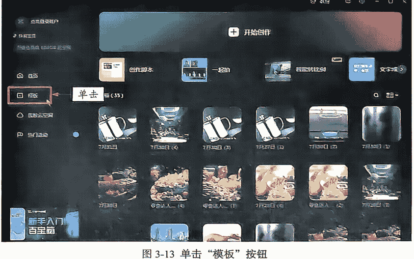

> ▶ **专家指点**

用统一模板能保证视觉调性和品牌形象一致，提升辨识度和专业感，利于宣传推广。

**STEP 02** 进入模板页面后，调整筛选条件，对模板进行定位，如图 3-14 所示。

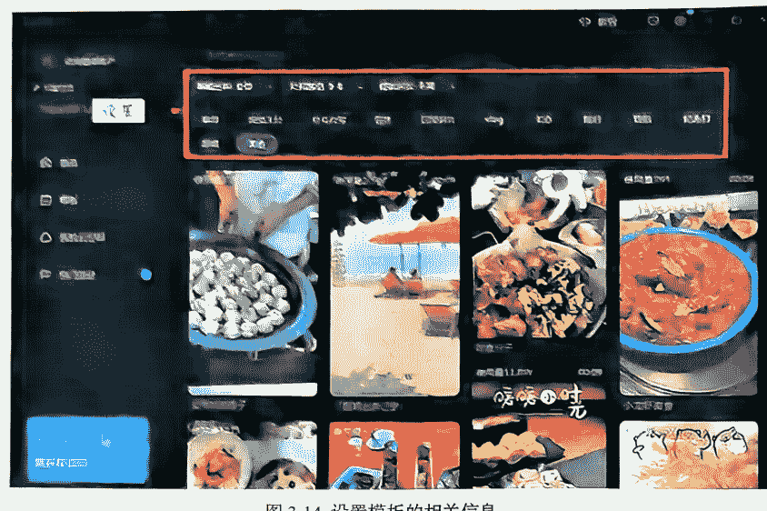

图 3-14 为模板设置筛选信息

STEP 03 按回车搜索匹配的视频模板，选定后点“使用模板”，如图 3-15 所示。

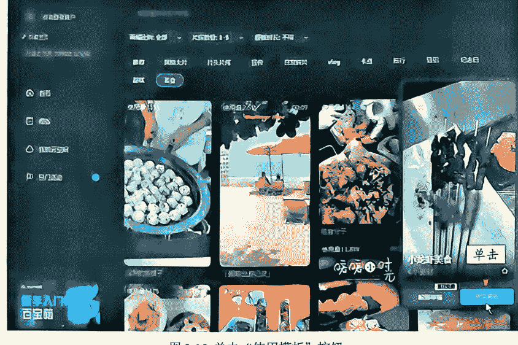

图 3-15 点击使用模板按钮

STEP 04 模板下载完成后进入编辑界面，在时间线里点第一个视频片段的“导入”按钮，如图 3-16 所示。

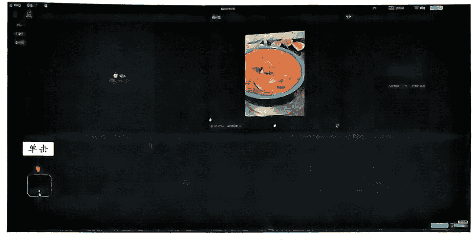

图 3-16 点击导入按钮

**STEP 05** 随后弹出“请选择媒体资源”窗口，在此挑选对应的图片素材，如图 3-17 所示。

**STEP 06** 点“打开”后，图片会被填入视频片段并同步保存到本地资源库，见图 3-18。

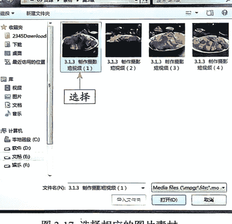

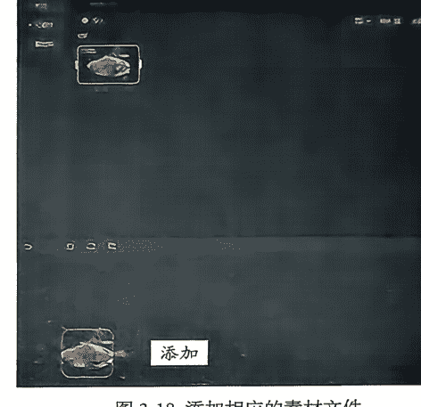

图 3-17 选择对应图片素材

图 3-18 素材已添加至项目

**STEP 07** 按同样方式补齐其他图片，完成后点击“完成”，如图 3-19 所示，即可结束制作。

**STEP 08** 在播放器里点 ▶ 预览，確認没问题后即可获得中餐美食摄影短视频，截图如前图 3-12。

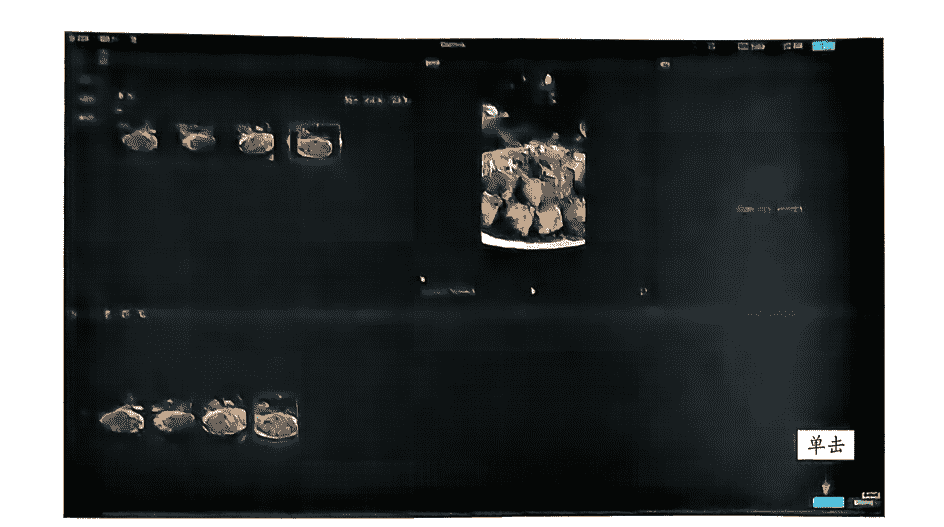

图 3-19 点按完成按钮

## 3.2 剪映软件的 AI 短视频新玩法

除了模板生成，剪映还提供许多 AI 新玩法。可以利用“图文成片”输入文字和图片自动生成有质感的视频，视频编辑和图片玩法也能把静态图做出动感效果。下面介绍剪映制作 AI 短视频的几种思路。

### 3.2.1 使用文字制作公益短视频

【效果展示】：剪映的“文字成片”功能很强，只需输入文案，AI 就会自动配图、配音、配乐，替换内容后就能迅速产出作品，大大节省剪辑时间。用文字制作公益短视频的示例截图见图 3-20。

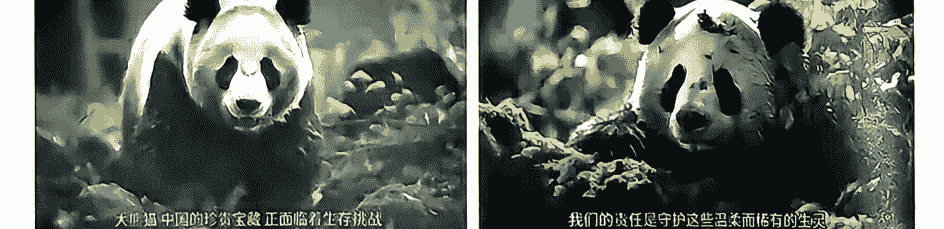

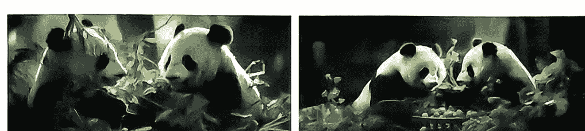

图 3-20 文字成片制作公益视频截图

下面以制作保护大熊猫公益短视频为例说明操作。

**STEP 01** 在电脑端打开剪映，首页点“文字成片”，如图 3-21 所示。

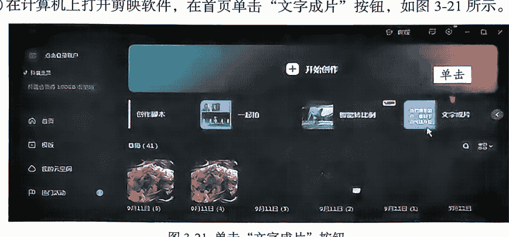

图 3-21 点击文字成片入口

**STEP 02** 弹出对话框后，把视频文案粘贴进去，如图 3-22 所示。

**STEP 03** ❶ 点击“生成视频”；在展开菜单中 ❷ 选择“智能匹配素材”，如图 3-23 所示，让 AI 按文字自动匹配画面，生成初稿。

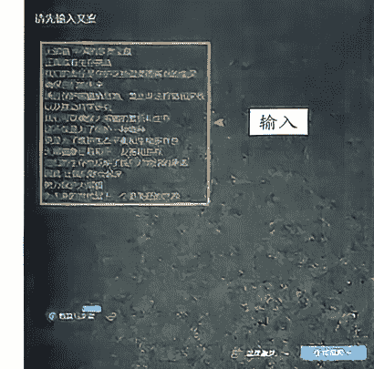

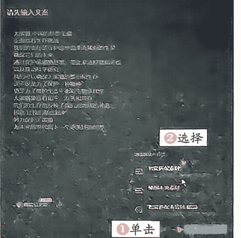

图 3-22 输入视频文案内容

图 3-23 选用智能匹配素材选项

STEP 04 稍等片刻，剪映会调取素材并生成视频雏形，如图 3-24 所示。

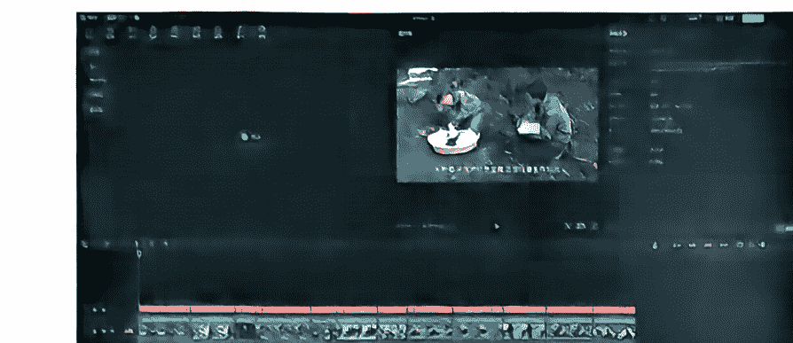

图 3-24 视频雏形生成效果

STEP 05 把鼠标移到第一个不合适的素材上，右键选择“替换片段”，如图 3-25 所示。

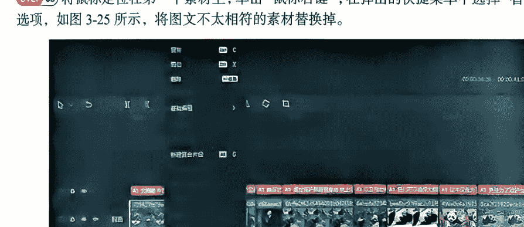

图 3-25 选择替换片段指令

STEP 06 弹出媒体资源选择框，❶ 挑选合适的图片；❷ 点“打开”，如图 3-26 所示。

STEP 07 在替换确认框里点“替换片段”，图片就会替换到对应位置并加入本地库，如图 3-27 所示。同理可替换其他不匹配素材。

STEP 08 在播放器中点 ▶ 预览，确认无误后点“导出”即可输出成品。

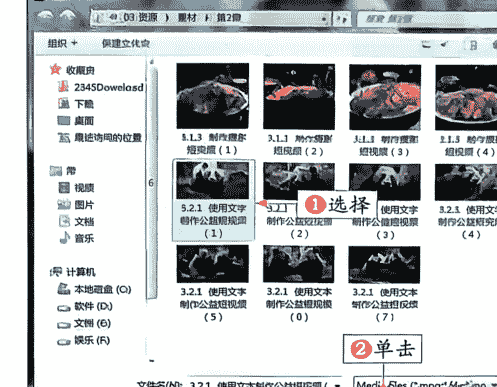

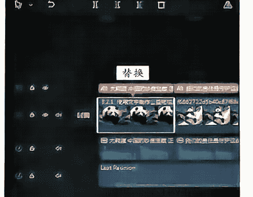

图 3-26 点击打开按钮

图 3-27 完成素材替换

### 3.2.2 使用图片制作变身短视频

【效果展示】：剪映 App 的“图片玩法”能为照片增加趣味效果，比如把真人变成漫画形象。图片制作变身短视频的截图见图 3-28。

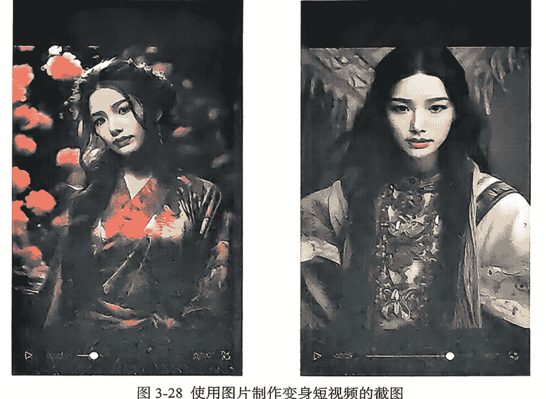

图 3-28 变身短视频效果截图

下面演示用图片制作变身短视频的操作。

STEP 01 在手机打开剪映 App，点击“开始创作”，如图 3-29 所示。

STEP 02 进入“最近项目”页，❶ 选一张图片素材；❷ 点“添加 (1)”，如图 3-30 所示。

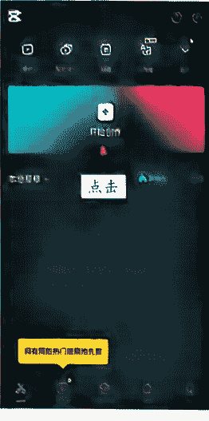

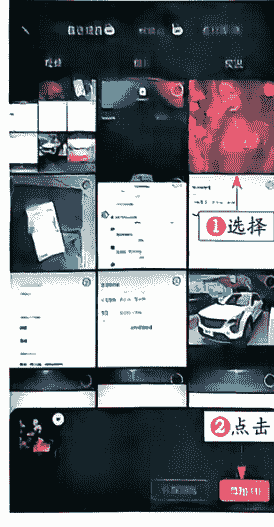

STEP 03 进入编辑页，❶ 选中素材；❷ 点“复制”，如图 3-31 所示，复制一份图片。

STEP 04 回到主工具栏，按顺序点“音频”→“音乐”，如图 3-32 所示。

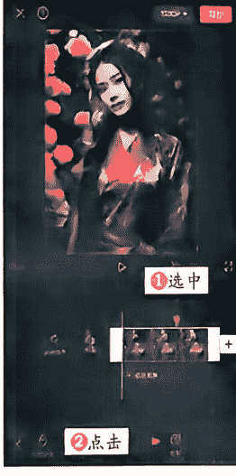

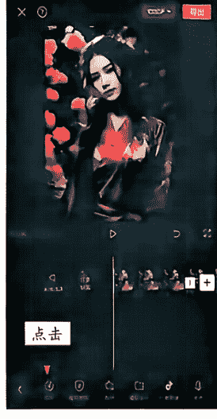

STEP 05 进入后选择“国风”分类，如图 3-33 所示。

STEP 06 挑选合适的音乐，点右侧“使用”按钮，如图 3-34 所示，音乐即加入音频轨。

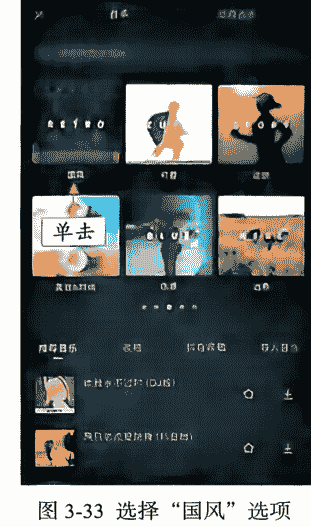

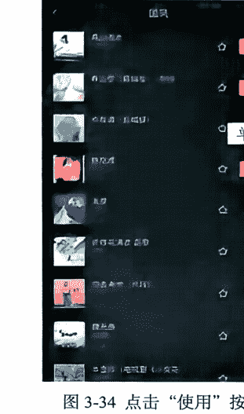

STEP 07 拖动时间轴到视频尾部，点击“分割”，如图 3-35 所示。

STEP 08 选中后半段音乐，点“删除”，如图 3-36 所示，去掉多余部分。

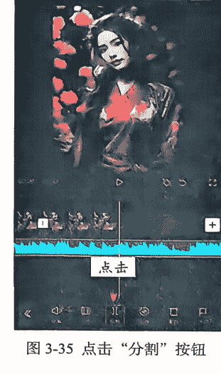

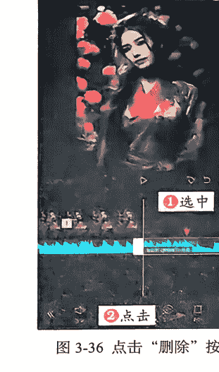

STEP 09 点击素材中间的“|”打开转场面板，在“光效”里 ① 选“炫光”；② 点“✔”，如图 3-37 所示，为视频加转场。

STEP 10 回到主工具栏，拖到开头位置，依次点“特效”→“画面特效”，如图 3-38 所示。

## AI 摄影绘画创作 完全自学一本通

STEP 11 在“基础”分类里，❶ 选“变清晰”特效；❷ 点“✔”，如图 3-39 所示，为第一段素材加特效。

STEP 12 系统会显示特效作用范围，可按需调整，如图 3-40 所示。

STEP 13 把时间轴拖到第二段素材开头，点击“图片玩法”，如图 3-41 所示。

STEP 14 进入“AI 写真”页，❶ 选“异域”风格；❷ 点“✔”，如图 3-42 所示，给第二段素材施加玩法，实现人物变身。

# 第 3 章 AI 摄影短视频创作

图 3-41 点击图片玩法入口

图 3-42 确认按钮（3）

STEP 15 点“播放” ▶ 预览效果。

# 摄影优化篇

# 第 4 章 参数优化

每个 AI 绘画工具都有参数可调，通过调整参数能优化 AI 摄影图的呈现。本章以文心一格和 Midjourney 为例讲解参数技巧，帮助快速提升成图质量。

## 4.1 文心一格的参数设置

使用文心一格生成图片时可按需设置参数，平台支持画面类型、比例与数量、风格、修饰词、画师、排除内容等，可单调可多调。下面介绍文心一格参数设置要点。

### 4.1.1 设置图片的画面类型

【效果展示】：文心一格提供多种画面类型，如“智能推荐”“唯美二次元”“中国风”“艺术创想”“明亮插画”“梵高”“超现实主义”“插画”“像素艺术”“炫彩插画”等。设置后效果见图 4-1。

图 4-1 不同画面类型的呈现效果

下面演示画面类型的设置方法。

1. **STEP 01** 进入“AI 创作”页，❶ 在输入框填入关键词；❷ 在“画面类型”区点“更多”，如图 4-2 所示。

2. **STEP 02** 展开后在列表中选择“艺术创想”，如图 4-3 所示。

3. **STEP 03** 点“立即生成”，即可得到艺术创想风格的作品，效果见图 4-1。

# 第 4 章 参数优化

### 4.1.2 设置图片的比例和数量

【效果展示】：文心一格除了画面类型，还能调节图片比例（竖图、方图、横图）和生成数量（最高 9 张）。设置后效果见图 4-4。

下面说明比例与数量的设置。

STEP 01 进入“AI 创作”页，❶ 输入关键词；❷ 将“比例”设为“方图”、“数量”设为“2”，如图 4-5 所示。

AI 摄影绘画创作完全自学一本通

图 4-5 比例与数量设置界面

STEP 02 点“立即生成”即可获得两张作品，效果见图 4-4。

### 4.1.3 设置图片的画面风格

【效果展示】：在文心一格“自定义”模式下，输入关键词后可用“上传参考图”功能上传一张参考并设置“画面风格”，生成特定风格。效果见图 4-6。

图 4-6 指定画面风格的生成效果

下面介绍设置方法。

STEP 01 在“AI 创作”页切换到“自定义”，❶ 输入关键词；❷ 把“选择 AI 画师”设为“创艺”，如图 4-7 所示。

图 4-7 选择创艺画师

STEP 02 点“上传参考图”下方的“➕”，在打开对话框里选择参考图，如图 4-8 所示。

图 4-8 选择参考图文件

STEP 03 点“打开”上传后，调整“影响比重”、“尺寸”、“数量”，如图 4-9 所示。

STEP 04 点“画面风格”输入框，弹出面板后选择“矢量画”标签，如图 4-10 所示，即可设定为矢量画风格。

AI 摄影绘画创作 完全自学一本通

STEP 05 点“立即生成”，即可得到对应风格图片，效果见图 4-6。

### 4.1.4 设置图片的修饰词

【效果展示】：添加修饰词能提升出图质量，且可叠加使用。设置后效果见图 4-11。

下面介绍修饰词设置。

STEP 01 在“AI 创作”页的“自定义”里，❶ 输入关键词；❷ 将“选择 AI 画师”设为“创艺”，如图 4-12 所示。

STEP 02 在画师下方把“尺寸”设为“16:9”、“数量”设为“1”、“画面风格”设为“矢量画”，如图 4-13 所示。

图 4-12 选择画师选项

图 4-13 相关参数设置

STEP 03 找到修饰词对应的输入区，点击后会弹出选择面板，在面板里选中“cg 渲染”标签，就能把该描述词写入输入框，见图 4-14。
STEP 04 用同样的流程，再把“摄影风格”作为修饰词加入，见图 4-15。

图 4-14 单击“cg 渲染”标签

图 4-15 添加“摄影风格”修饰词

> ▶ 专家指点

> cg 是计算机图形（computer graphics）的缩写，是使用计算机来创建、处理和显示图形的技术。

点按“立即生成”按钮，系统便会产出画质更细腻、摄影质感更强的图像，效果参见图 4-1。

### 4.1.5 设置图片的艺术家风格

【效果展示】：在文心一格的“自定义”AI 绘画模式里，可加入关于艺术家风格的关键词，来模仿特定艺术家的绘画手法，得到相应的视觉呈现。调整后的示例见图 4-16。

图 4-16 生成相应艺术家风格的图片效果

下面介绍具体的设置流程。

1. 在“AI 创作”页面的“自定义”选项卡中，❶在输入框里填入对应关键词；❷把“选择 AI 画师”设为“创艺”，如图 4-17 所示。
2. 在画师选项下方，把“尺寸”设为“4:3”、“数量”设为“1”、“画面风格”设为“水彩画”，如图 4-18 所示。
3. 点开修饰词输入区，在弹出的面板里点击“写实”标签，如图 4-19 所示，即可把该修饰词填入输入区。
4. 在“艺术家”输入区填入目标艺术家的名字，如图 4-20 所示。

# 第 4 章 参数优化

图 4-17 设置“选择 AI 画师”选项

图 4-18 设置相应的选项

图 4-19 单击“写实”标签

图 4-20 输入相应的艺术家名称

STEP 05 按下“立即生成”，即可得到对应艺术家风格的图像，具体效果参见图 4-16。

### 4.1.6 设置不希望出现的内容

【效果展示】：在文心一格“自定义”AI 绘画模式中，可利用“不希望出现的内容”选项，降低特定元素被生成的概率，效果如图 4-21 所示。

AI 摄影绘画创作 零基础自学一本通

图 4-21 生成相应的图片效果

操作步骤如下。

STEP 01 在“AI 创作”页“自定义”选项卡中，❶在输入框填入关键词；❷把“选择 AI 画师”调为“创艺”，如图 4-22 所示。
STEP 02 在画师选项下方，把“尺寸”设为“3:2”、“数量”设为“1”、“画面风格”设为“矢量画”，如图 4-23 所示。

图 4-22 设置“选择 AI 画师”选项

图 4-23 设置相应的选项

STEP 03 打开修饰词的输入框，在面板中选择“写实”标签，如图 4-24 所示，将该描述词加入输入区。
STEP 04 在“不希望出现的内容”输入框里写入“人物”，如图 4-25 所示，可降低人物出现的几率。

图 4-24 单击“写实”标签

图 4-25 输入“人物”

STEP 05 点击“立即生成”，即可得到预期画面，效果参见图 4-21。

## 4.2 Midjourney 的参数设置
Midjourney 既能通过关键词调控材质、风格与背景，也能借助多种参数改变生成效果，产出更出色的作品。合理运用这些参数对提升成像质量至关重要，本节将介绍一些常用参数，让创作更得心应手。

### 4.2.1 设置版本型号
Version 指版本型号，Midjourney 会定期更新并优化算法。从 2022 年 4 月到 2023 年 8 月，已推出 5 个大版本，其中 version 5.2 目前表现最优。

目前可调用的版本有 version 1、version 2、version 3、version 4、version 5、version 5.1、version 5.2，可在词尾加上 --version 1 或 --v 1、--version 2 或 --v 2 等来指定，未写则默认使用最新版。

例如在关键词末尾加上 --v 4，就能以 version 4 产出图像，效果如图 4-26 所示。

AI 摄影绘画创作

图 4-26 通过 version 4 版本生成的图片

保持相同关键词，把末尾的 --v 4 改为 --v 5.2，就能以 version 5.2 生成图像，效果如图 4-27 所示。

图 4-27 通过 version 5.2 版本生成的图片

分别点开图 4-26、图 4-27 中的“U1”按钮，可得到放大图，如图 4-28 所示。对比可见，version 5.2 产出的画面真实感更强。

图 4-28 对应图片的放大图

### 4.2.2 设置图像比例
Aspect rations 指令用于修改生成图像的宽高比，通常写作 7 : 4 或 4 : 3。注意冒号为英文格式且数字为整数。Midjourney 默认比例为 1:1，效果如图 4-29 所示。

图 4-29 默认宽高比效果

可在关键词后添加 --aspect 或 --ar 来指定比例。例如在图 4-29 的关键词后加上 --ar 16:9，就能生成横向图像，效果如图 4-30 所示。注意生成或放大时最终尺寸或有微调。

图 4-30 生成相应尺寸的图片

### 4.2.3 设置变化程度
在 Midjourney 中使用 --chaos 简写为 --c 指令，可影响结果的多样性，激发创意。--chaos 取值 0 ~ 100，默认 0，数值越大创造力越强。

输入相同关键词时，较低的 --chaos 值结果更稳定，风格与构图相似度高，如图 4-31 所示；较高的 --chaos 值会产出更多意外组合，风格与构图差异较大，如图 4-32 所示。

图 4-31 较低 --chaos 值生成的图片

图 4-32 较高 --chaos 值生成的图片

### 4.2.4 设置图像质量
在描述指令后加入 --quality 简写为 --q 指令，可改变画质，高质量需要更长时间处理细节。质量越高，每次生成消耗的 GPU 分钟数也越多。

例如用 imagine 输入关键词，并在末尾加上 --quality .25 指令，即可快速生成细节较少的图像，效果如图 4-33 所示，画面偏模糊，观感较差。

图 4-33 生成很不详细的图片

用相同关键词并在末尾加上 --quality .5 指令，即可生成不太详细的图像，效果如图 4-34 所示，与不使用参数时相近。

图 4-34 生成不太详细的图片

继续用相同关键词并在末尾加上 --quality 1 指令，即可生成细节更丰富的图像，效果如图 4-35 所示。

图 4-35 生成有更多细节的图片

需要注意，并非 --quality 值越高越好，有时较低值效果更佳，这取决于创作预期。例如抽象风格绘画较低值更合适。

### 4.2.5 设置风格化程度
在 Midjourney 中使用 --stylize 指令，可让成像更具艺术性。较低的 --stylize 值生成的图像与关键词关联紧密但艺术性较差，效果如图 4-36 所示。

图 4-36 较低的 --stylize 值生成的图片

较高的 --stylize 值生成的图像非常有艺术性，但与关键词关联度下降，AI 自由度更大，效果如图 4-37 所示。

图 4-37 较高的 --stylize 值生成的图片

### 4.2.6 设置不出现的元素
在关键词末尾加上 --no 什么 指令，可让画面中不出现相关内容。例如在关键词后添加 --no plants 指令，表示生成的图片中不出现植物，效果如图 4-38 所示。

图 4-38 添加 --no plants 指令生成的图片

### 4.2.7 设置图像的完成度
在 Midjourney 中使用 --stop 指令，可停止正在进行的 AI 绘画任务，然后直接出图。若不使用 --stop 指令，则默认生成步数为 100，得到的图像清晰翔实，效果如图 4-39 所示。

图 4-39 没有使用 --stop 指令生成的图片

步数越少，中断越早，图像越模糊。如图 4-40 所示，为使用 --stop 50 指令生成的图片，50 代表步数。

图 4-40 使用 --stop 50 指令生成的图片

### 4.2.8 设置参考图的影响权重
【效果展示】：在 Midjourney 中以图生图时，使用 iw 指令可以设置参考图的影响权重，即调整参考图与文案对生成图片影响的比重。iw 值 .5 ~ 2，越大参考图影响越大，如图 4-41 所示。

图 4-41 设置参考图影响权重的效果

# AI 摄影绘画创作 实战篇下 — 5.周

下面介绍设置参考图影响权重的具体操作方法。

在 Midjourney 中使用 “describe” 指令上传一张参考图，并生成相应的关键词，如图 4-42 所示。

点击生成的图片，在弹出的预览图中单击“鼠标右键”，在弹出的快捷菜单中选择“复制图片地址”选项，如图 4-43 所示，复制图片链接。

调用 “imagine” 指令，将复制的图片链接和第 2 段关键词粘贴到输入框中，并在后面输入 “--ar 3:2” 和 “--iw 2” 指令，如图 4-44 所示。

STEP 04 按 “Enter” 键，即可生成与参考图的风格极其相似的图片，效果如图 4-45 所示。

图 4-45 生成与参考图的风格极其相似的图片

STEP 05 单击 “U1” 按钮，生成第 1 张图的大图，效果请见图 4-41。

# 第5章

## 构图优化
构图是传统摄影创作中不可或缺的部分，主要通过有意识地安排画面中的视觉元素来增强照片的感染力和吸引力。在 AI 摄影中使用正确的构图关键词，可以优化摄影绘画作品，协助模型生成更富有表现力的图像。

## 5.1 构图视角优化设置
在 AI 摄影中，构图视角是指镜头位置和主体的拍摄角度，通过合适的构图视角，可以增强画面的吸引力和表现力，为照片带来最佳的观赏效果。

本节主要为大家介绍几种控制 AI 摄影构图视角的关键词，帮助大家生成不同视角的照片。

### 5.1.1 正面与背面视角的设置
在日常的拍摄过程中，正面与背面视角是常见的构图视角，能够展示主体的大部分区域和形态特点。

正面视角 Front view 也称为正视图，是指将主体对象置于镜头前方，让其正面朝向观众。这种构图方式的拍摄角度与被拍摄主体平行，并且尽量以主体正面为主要展现区域，效果如图 5-1 所示。

在 AI 摄影中，使用关键词 Front view 可以呈现被拍摄主体最清晰、最直接的形态，表达出来的内容和情感相对真实有力，很多人都喜欢使用这种方式来刻画人物的神情、姿态等，或呈现产品的外观形态，以达到更直观的效果。

背面视角 Back view 也被称为后视图，是指将镜头置于主体对象的后方，从其背后拍摄的一种构图方式，适合强调被拍摄主体的背面形态和表达情感的场景，效果如图 5-2 所示。

在 AI 摄影中，使用关键词 Back view 可以突出被拍摄主体的背面轮廓和形态，并能够展示出不同的视觉效果，营造出神秘、悬疑或引人遐想的氛围感。

图 5-2 背面视角效果

### 5.1.2 侧面与斜侧面视角的设置
侧面视角分为右侧视角 Right side view 和左侧视角 Left side view 两种。右侧视角是指将镜头置于主体对象的右侧，强调右侧的信息和特征，或突出右侧轮廓中有特殊含义的场景，效果如图 5-3 所示。

图 5-3 右侧视角效果

在 AI 摄影中，使用关键词 Right side view 可以强调主体右侧的细节或整体效果，制造视觉上的对比和平衡，增强照片的艺术感和吸引力。

左侧视角是指将镜头置于主体对象的左侧，常用于展现人物的神态和姿态，或突出左侧轮廓中有特殊含义的场景，效果如图 5-4 所示。

图 5-4 左侧视角效果

在 AI 摄影中，使用关键词 Left side view，可以刻画被拍摄主体左侧的样貌、形态特点或意境，并能够表达某种特殊的情绪、性格和感觉，或者给观众带来一种开阔、自然的视觉感受。

斜侧面视角是指从一个物体或场景的斜侧方向进行拍摄，这种视角可以给照片带来一种动态感，并增强主体的立体感和层次感，效果如图 5-5 所示。

图 5-5 斜侧面视角效果

想表现斜侧面取景时常用的关键词有：45° Shooting 对应 45° 角拍摄、0.75 Left view 对应 3/4 左侧视角、0.75 Left back view 对应 3/4 左后侧视角、0.75 Right view 对应 3/4 右侧视角。

## 5.2 构图法则优化用法

构图就是在拍摄过程中通过调视角、布主体、管画面元素来塑造视觉呈现的方式。本节集中讲解 3 组基础构图思路。

### 5.2.1 前景构图设置

前景构图 Foreground composition 的核心是用前景物来强化主体，制造冲击力和艺术感，如图 5-6 所示。

图 5-6 前景构图效果

通常离镜头近的物件算前景，位于主体之后且更远的物件或环境则属于背景 Background。

在 AI 摄影里加入 Foreground 关键词，能让画面色彩更丰富、层次更分明，整体更饱满、更有趣。必要时还能起到引导视线、吸引注意的作用。

### 5.2.2 对称构图设置

对称构图 Symmetry composition 让被摄物在画面中呈现左右、上下或对角线对称，形成平衡且具美感的效果，如图 5-7 所示。

图 5-7 对称构图效果

AI 摄影中用 Symmetry 关键词，可以营造冷静稳重、平衡耐看的视觉，带来舒适感，同时突出主体印象。

### 5.2.3 框架构图设置

框架构图 Framing composition 是在画面里增设一个或多个“边框”，把主体框住，更好地凸显主体并增加层次感与美观度，如图 5-8 所示。

图 5-8 框架构图效果

AI 摄影里 Framing 可搭配多种边框使用，像树枝、山体、花草等自然形成的框，也像狭窄通道、建筑、窗户、阳台、桥洞、隧道等人造框。

### 5.2.4 常见构图用法

通过不同的构图关键词，AI 主体可以呈现最佳观感，从而调出想要的氛围。摄影师拍不同题材时会叠加多种构图手法。下面介绍 3 种常用构图。

微距构图 Macro composition 专注拍摄微小物体，最大化细节与纹理的视觉冲击，适合花卉、小动物、美食或生活小物，效果如图 5-9 所示。

AI 摄影里用 Macro composition 关键词，能把小主体的纹理、线条、色彩、形态大幅放大，打造惊艳独特的视觉空间，体现神秘、精致与美感。

中心构图 Center the composition 是把主体放在画面正中央，尽量贴合对称轴，让主体极其突出集中，效果如图 5-10 所示。

图 5-9 微距构图效果

图 5-10 中心构图效果

AI 摄影中使用 Center the composition 能有效凸显主体形象与特征，适用于花卉、鸟类、宠物、人像等。

消失点构图 Vanishing point composition 让画面中线条或物体的近端汇聚到同一消失点，以表现空间深度与错落感，效果如图 5-11 所示。

图 5-11 消失点构图效果

AI 摄影里用 Vanishing point composition 可增强立体感，通过塑造空间提升冲击力，适合城市风光、建筑、道路、铁路、桥梁、隧道等。

### 5.2.5 创意构图用法

摄影师会根据流行风格选用更具创意的构图，下面介绍引导线、对角线、三分法、斜线 4 种思路。

引导线构图 Leading lines composition 利用画面中的直线或曲线引导观众视线，让画面更有趣味与表现力，效果如图 5-12 所示。

图 5-12 引导线构图效果

AI 摄影中 Leading lines 需要结合道路、建筑、云朵、河流、桥梁等场景元素，巧妙地把视线从一端带向另一端，最终落在主体上。

对角线构图 Diagonal composition 用物体、形状或线条在画面中形成对角线，增强动感与层次，效果如图 5-13 所示。

AI 摄影里用 Diagonal composition 可把主体或关键元素沿对角线安放，产生张力，吸引注意力。

三分法构图 Rule of thirds composition 又称三分线构图 Three line composition，把画面横竖均分三份，把主体或重点放在分割线或交点上，提升平衡感并突出主体，效果如图 5-14 所示。

AI 摄影中用 Rule of thirds 可让主体平衡放置，视觉张力均衡，更好传达主题与情感。

斜线构图 Oblique line composition 利用对角线或斜线组织画面，带来独特视觉效果与动感，效果如图 5-15 所示。

图 5-15 斜线构图效果

AI 摄影里用 Oblique line composition 能在画面中制造自然流畅的视觉引导，让目光沿线条移动，聚焦特定区域。

## 5.3 镜头景别用法

镜头景别指的是主体与镜头的距离，决定主体在画面中的大小，比如远景、全景、中景、近景、特写。本节介绍 5 种常用景别。

### 5.3.1 远景用法

远景 Wide angle 也称广角视野 Ultra wide shot，以较远距离拍摄场景或大环境，呈现开阔视野与大范围画面，如图 5-16 所示。

AI 摄影中使用 Wide angle 能让人物、建筑等与环境融合，突出宏大壮阔与自然风貌，还能表现人与环境的关联，烘托氛围、衬托主体，增加层次感。

图 5-16 远景效果

### 5.3.2 全景用法

全景 Full shot 把整个主体完整呈现在画面中，方便观众了解形态、外貌与特点，感受气质与风貌，效果如图 5-17 所示。

图 5-17 全景效果

AI 摄影里用 Full shot 能完整呈现被摄对象的自然状态、姿态与尺寸，也可作为补充元素烘托氛围、强化主题，更生动地体现情感与心理变化。

### 5.3.3 中景用法

中景 Medium shot 通常把人物上半身即膝盖以上纳入画面，既展示部分背景又让主体更突出，效果如图 5-18 所示。

图 5-18 中景效果

中景景别重在表现事物主要部分，常以动作情节取胜，环境退居次要。

AI 摄影中使用 Medium shot 可让主体充分占据画面，便于观众产生共鸣，同时营造真实自然、文艺感强的画面，为照片注入生命力。

### 5.3.4 近景用法

近景 Medium close up 把人物头部肩部通常胸部以上完整展示，突出面部表情与细节，效果如图 5-19 所示。

AI 摄影里用 Medium close up 能很好表现人物情感细节。

一方面突出面部细节如表情、眼神、嘴唇，反映内心世界与情绪状态；另一方面为观众提供更丰富信息，帮助更准确理解场景。

### 5.3.5 特写用法

AI 摄影里用 Close up 可把视线聚焦到主体某个部位，强化表达并带来强烈视觉感受与情感共鸣。

特写 Close up 是把主体局部或细节放大呈现，强调重要性，如人头部的特写，效果如图 5-20 所示。

图 5-20 特写效果

# 第 6 章

## 光线与色调优化

光线与色调是摄影的关键，能带来强视觉吸引力与情感表达，传达创作意图。在 AI 摄影中优化它们，可生成更具表现力的照片。

## 6.1 常见光线用法

在 AI 摄影里加入光线关键词，可营造不同画面效果与氛围感，如阴影、明暗、立体感。通过光源角度、强度等关键词，可突出或柔化主体，调节氛围、增强表现力。本节介绍几种常见光线优化。

### 6.1.1 顺光用法

顺光 Front lighting 指主体正对光源被直接照亮。AI 摄影中使用 Front lighting 能让主体更亮、更生动，轮廓分明具立体感，还能把主体与背景分离，增强层次，效果如图 6-1 所示。

顺光还能营造充满活力与温暖的氛围。需注意光线过强或角度不当易导致过曝或阴影过重。

### 6.1.2 侧光用法

侧光 Raking light 是从侧面斜射的光线，常用来强调纹理与形态。AI 摄影中使用 Raking light 可突出表面细节与立体感，同时加强色彩对比与明暗反差。

对人像来说，Raking light 能强化面部轮廓，让五官更立体，塑造独特气质，效果如图 6-2 所示。

图 6-2 侧光效果

### 6.1.3 逆光用法

逆光 Back light 也称背光，指光线从主体后方照来。AI 摄影中使用 Back light 能营造强烈层次与立体感，让轮廓更清晰，生成人像与风景都很出色。

在绘制夕阳、日出、落日、水面反射等场景时，Back light 可产生剪影与色彩渐变，带来极具艺术性的画面，效果如图 6-3 所示。

图 6-3 逆光效果

### 6.1.4 顶光用法

顶光 Top light 是从上方垂直照射的光线，投影会落在下方。Top light 非常适合食品饮料类 AI 摄影，提升视觉诱惑力，效果如图 6-4 所示。

图 6-4 顶光效果

### 6.1.5 边缘光用法

边缘光 Edge light 是从侧面或背面照来的光线，常用于强调形状与轮廓。它能自然划分主体与背景边界，增加对比与视觉效果。

AI 摄影中使用 Edge light 可突出形态与立体感，适合人像与静物，效果如图 6-5 所示。

图 6-5 边缘光效果

> ▶ 专家指点

边缘光在强调轮廓的同时也会产生一定剪影效果，需控制光源角度，避免光斑与阴影不协调。

### 6.1.6 轮廓光用法

轮廓光 Contour light 是勾勒主体轮廓线条的侧光或逆光，能产生强烈视觉张力与层次，提升观感。

AI 摄影中使用 Contour light 可让主体更清晰、生动，整体观赏性更强，更易吸引注意力，效果如图 6-6 所示。

图 6-6 轮廓光效果

## 6.2 特殊光线用法

光线对 AI 摄影至关重要，能营造自然氛围与光影，突显主题，也可掩盖不足。掌握特殊光线关键词用法，能有效提升作品质量与艺术价值。本节介绍几种特殊光线优化技巧。

### 6.2.1 特殊光线常用技巧

特殊光线通常需摄影师用反光板、闪光灯等控制，多用于商业摄影，常见有冷光、暖光、柔光、晨光和亮光 5 种。

冷光 Cold light 色温较高，多呈现蓝白等冷色调。AI 摄影中使用 Cold light 可营造寒冷、清新、高科技的氛围，突出纹理与细节。

例如生成人像时加入 Cold light 可赋予青春活力与时尚感，效果如图 6-7 所示。同时常搭配 In the style of soft、Light white and light blue 等关键词增强效果。

图 6-7 冷光效果

暖光 Warm light 色温较低，多呈现黄橙红等暖色调。例如人物照片加入 Warm light 会让画面更柔和，人物更显质感，效果如图 6-8 所示。

图 6-8 暖光效果

AI 摄影中使用 Warm light 可营造温馨、舒适、浪漫的氛围，突出色彩与质感。

柔光 Soft light 是柔和温暖、低对比度的光线。AI 摄影中使用 Soft light 可带来自然柔美的光影，渲染情感与氛围。

例如人像中加入 Soft light 能营造温暖舒适感，弱化皮肤毛孔纹理等小瑕疵，让人像更柔和美好，效果如图 6-9 所示。

图 6-9 柔光效果

晨光 Morning light 是日出时段的光线，柔和温暖且光影丰富，能产生独特美妙效果，如图 6-10 所示。

图 6-10 晨光效果

在AI作图里加上Morning light，画面会呈现出柔和的阴影、色彩过渡也更细腻，硬朗的暗部几乎看不到，特别适合人像和风景区。它的亮度不会刺眼，主体显得通透自然、层次分明，情绪和氛围也更容易被带出来。

Bright top light指的是顶部的强光，用它能做出很有冲击力的光感，阴影会变得硬而直，像是从上方垂直压下来，呈现效果见图 6-11。

图 6-11 亮光效果

### 6.2.2 专业特殊光线的设置

除了前面说的几种常用特殊光，实际拍摄里还有一批更专业的光线方案，常出现在影视制作中，比如太阳光、黄金时刻光、体积光、赛博朋克光和戏剧光。做AI摄影时，这些词也能直接调用。

太阳光（Sun light）就是太阳直射的自然光，也叫 Natural light 或 Day light。AI里加入这个词，主体会被非常明亮坚决的光照到，色彩显得鲜明生动又很真实，阴影也很有质感，具体效果看图 6-12 所示。

图 6-12 太阳光效果

赛博朋克光（Cyberpunk light）是电影和艺术作品里常用的氛围光，用来强化未来感和科幻味道。AI中使用它，会得到高对比、饱和度很高的色彩配上几何切割的光影，视觉张力瞬间拉满，效果如图 6-13 所示。

图 6-13 赛博朋克光效果

> ▶ 专家指点

Cyberpunk源自Cybernetics控制论和Punk朋克摇滚，合起来指一种反主流的科技文化。如今它已演变成独立的文化流派，核心是探讨人与科技的矛盾，为观众提供思考的空间。

黄金时段光（Golden hour light）指的是日出日落前后约一小时的“金色时刻”，光线柔和温暖偏金黄。AI里用Golden hour light，画面会多出金黄橙红的暖调，主体更显立体、顺眼、舒服，层次也明显更丰富，效果如图 6-14 所示。

立体光（Volumetric light）是光线穿过尘埃、雾气、树叶或烟雾这类有密度的介质后产生的有体积感光束。AI里同义的词还有丁达尔效应（Tyndall effect）、圣光（Holy light）等，用它们能塑造出很强的光影通透感，效果如图 6-15 所示。

戏剧光（Dramatic light）是用来制造戏剧氛围的光，常见于影视和艺术摄影，用来强化张力和情绪。AI里加上Dramatic light，主体会更跳脱，独特性更突出。它通常配合深色调、大面积阴影和高对比度来制造强烈的情绪冲击，效果如图 6-16 所示。

图 6-16 戏剧光效果

## 6.3 流行色调的优化设置

色调是照片整体色彩、亮度与对比度的综合，后期靠它来塑造氛围感。在AI摄影里，不同的色调关键词能直接调动情绪，强化表现力。合理增减饱和度和亮度，就能让主题和主体特征传达得更准确。

### 6.3.1 亮丽橙色调的设置

Bright orange tone是高亮高饱和的橙色调，能带来活力、兴奋和温暖的观感，常用来点亮画面重点。它特别适合户外、日出日落、运动竞技这类题材，加入后画面更有立体感和瞬间张力，效果如图 6-17 所示。要注意控制饱和度，免得颜色太冲破坏整体和谐。

图 6-17 亮丽橙色调效果

### 6.3.2 自然绿色调的设置

Natural green tone偏柔和温馨，用它能快速营造出草木、森林的自然气息，甚至带点童年的回忆感，常用在风光或环境人像上，效果如图 6-18 所示。

图 6-18 自然绿色调效果

图 6-20 糖果色调效果

### 6.3.5 枫叶红色调的设置

Maple red tone是一种高级感的暖调，能营造温暖温馨、浪漫优雅的氛围。AI里用它，画面会更有情绪和活力，适合风景、肖像、建筑等题材。它会放大红色元素的冲击力，带出复古温暖、略带甜美的感觉，效果如图 6-21 所示。

图 6-21 枫叶红色调效果

### 6.3.6 霓虹色调的设置

Neon shades tone是夸张亮丽的色系，特别适合城市夜景、潮流人像、音乐演出等场景。用它能制造时尚前卫、带点奇异的氛围，冲击力很强，印象深刻，效果如图 6-22 所示。

图 6-22 霓虹色调效果

# 第 7 章

## 风格渲染优化

AI摄影的风格渲染，就是用AI绘图工具呈现出的美学取向和个人创意，涉及构图、光线、色彩、题材、渲染质量和处理手法等多个维度，用来体现独特的视觉语言和审美。本章重点拆解风格渲染的优化思路。

## 7.1 艺术风格的优化设置

艺术风格是作品里独有的个性化表达，折射出创作者对画面的理解与感知。接下来介绍6类常见艺术风格的调校技巧，帮你建立审美体系，提升作品品质和表现力。

### 7.1.1 抽象主义风格的设置

Abstractionism抽象主义重在形式和色彩，用构成、纹理、线条把真实景象转译成抽象影像，突破常规审美，效果如图 7-1 所示。AI里常用的关键词有：Vibrant colors鲜艳色彩、Geometric shapes几何形状、Abstract patterns抽象图案、Motion and flow动感流动、Texture and layering纹理层次。

### 7.1.2 纪实主义风格的设置

Documentarianism纪实主义追求记录真实生活、情感和经验，忠实描绘自然与现实，挖掘时代社会文化背后的意义，呈现能引发共鸣的生活瞬间，效果如图 7-2 所示。AI关键词推荐：Real life真实生活、Natural light and real scenes自然光与真实场景、Hyper-realistic texture超真实纹理、Precise details精准细节、Realistic still life逼真静物、Realistic portrait逼真人像、Realistic landscape逼真风光。

图 7-2 纪实主义风格的图片效果

### 7.1.3 超现实主义风格的设置

Surrealism超现实主义挑战常规，追求超越理性逻辑的景象与感受，效果如图 7-3 所示。它强调用影像表达想象与情感，展现创作者的内心世界。AI关键词：Dreamlike梦幻感、Surreal landscape超现实风景、Mysterious creatures神秘生物、Distorted reality扭曲现实、Surreal still objects超现实静物。

图 7-3 超现实主义风格的图片效果

> ▶ 专家指点

超现实风格不执着于客观对象，而是映射创作者的内心感受与情绪，因其突破常规，往往给观众带来极强的视觉冲击。

### 7.1.4 极简主义风格的设置

Minimalism极简主义主张去繁就简，以精炼形式呈现事物本质，画面干净平静更有力量，效果如图 7-4 所示。AI常用词：Simple简单、Clean lines简洁线条、Minimalist colors极简配色、Negative space负空间、Minimal still life极简静物。

图 7-4 极简主义风格的图片效果

### 7.1.5 印象主义风格的设置

Impressionism印象主义侧重情绪与氛围表达，多用柔和温暖的色彩和光线，结合景深虚化营造流动感，效果如图 7-5 所示。AI关键词：Blurred strokes模糊笔触、Painted light彩绘光、Impressionist landscape印象派风景、Soft colors柔和色彩、Impressionist portrait印象派人像。

### 7.1.6 街头摄影风格的设置

Street photography街头摄影关注社会生活与人文关怀，捕捉日常中易被忽略的人与事，效果如图 7-6 所示。它强调现场光线、色彩、构图，追求真实记录与情感。拍摄地不限于街头，公共空间也算。AI关键词：Urban landscape城市风光、Street life街头生活、Dynamic stories动态故事、Street portraits街头人像、High-speed shutter高速快门、Street Sweeping Snap扫街抓拍。

图 7-6 街头摄影风格的图片效果

## 7.2 渲染品质的优化设置

随着单反、手机摄影普及和社交媒体兴起，大家对图片渲染品质的要求越来越高，这也推动摄影技术不断进化。渲染品质涉及清晰度、色彩还原、对比度、阴影细节等，目标是让画面更真实生动自然。AI里也能用关键词提升渲染质量，增强作品的专业感。

### 7.2.1 摄影感的设置

Photography摄影感是AI作图的常用词，它模拟光圈、快门、感光度等相机参数来控制光影、清晰度和景深。加入后画面亮暗部细节都更丰富，光影对比更强烈，效果如图 7-7 所示。

图 7-7 添加关键词 Photography 生成的图片效果

### 7.2.2 真实感的设置

Quixel megascans render能强化三维场景的真实度，并自动补充地面、岩石、植被、道路、水体、服装等细节，让作品更可信更有艺术性，效果如图 7-8 所示。

图 7-8 添加关键词 Quixel megascans render 生成的图片效果

AI 摄影绘画创作 完全自学一本通

Quixel Megascans是资源丰富的虚拟素材库，材质模型纹理都极逼真，助力个性化创作。

### 7.2.3 虚幻引擎的设置

Unreal Engine虚幻引擎主要用于虚拟场景搭建，能带来惊人的真实感，效果如图 7-9 所示。Unreal Engine由Epic Games打造，可生成高质量三维图像与交互体验，广泛应用于游戏影视建筑等领域。AI中使用它，能在虚拟环境里搭建场景角色，高度还原真实世界的画面。

### 7.2.4 光线追踪的设置

Ray Tracing光线追踪用于高质量渲染与光影模拟，能让场景更逼真、材质细节更出色，画面更自然优美，效果如图 7-10 所示。Ray Tracing是基于计算机图形学的渲染技术，能更精确模拟光线与物体的交互，从而生成更真实的影像。

### 7.2.5 C4D 渲染器的设置

C4D Renderer能帮助生成极其逼真的CGI场景与角色，效果如图 7-11 所示。C4D Renderer即Cinema 4D的渲染引擎，支持物理渲染、标准渲染、快速渲染等多种方式。AI里使用它，可制作逼真三维模型、纹理与场景，并做定向光照、阴影、反射等处理，营造震撼视觉。

### 7.2.6 V-Ray 渲染器的设置

V-Ray Renderer可实现高质量图像渲染，呈现逼真角色与虚拟场景，效果如图 7-12 所示，同时还能降低画面噪点，提升细节表现。V-Ray Renderer是高保真3D渲染器，在光照、材质、阴影上都很逼真，能产出高品质图像与动画。

图 7-12 添加关键词 V-Ray Renderer 生成的图片效果

V-Ray Renderer是一种高保真的 3D 渲染器，在光照、材质、阴影等方面都能达到非常逼真的效果，可以渲染出高品质的图像和动画。

# 摄影案例篇

# 第8章 人像摄影绘画实战案例

# 用 AI 创作视觉作品：人像、动物与植物

人像一直是影像创作里最受欢迎的方向，拍摄也好手绘也好，核心都离不开人物表达。借助生成式工具，产出效率明显提升。下面用几组可直接套用的实操案例，快速掌握 AI 人像绘制的流程。

人像类创作门槛不高，借助模型可以迅速得到可用的成片。本节通过几个实操步骤，带你从文字到成像完整走一遍。

## 8.1 让 ChatGPT 先输出人物画像
先在 ChatGPT 里提问，拿到一个角色的外观设定，见图 8-1。

> 请用150字左右描述某个中国女性的形象

这位女性散发着出众的优雅与从容。五官精致，肌肤白皙透亮，眼眸明亮却有深度，透出聪慧独立的特质。一头乌黑长发整齐垂落肩头，如瀑布般自然。身上披着华贵的旗袍，剪裁与纹样都体现出传统工艺的细腻与雅致。

画面捕捉到她的姿态与神情，让人感受到自信的魅力。背景或为带有东方韵味的庭院或古刹，进一步强化文化底蕴与东方之美。

整体气质独特，也折射出中国女性坚韧与美的特质。传统与当代在此交融，引发对文化与女性力量的思考。

图 8-1 人物描述的文本示例

再让 ChatGPT 把上述描述提炼成英文提示语，见图 8-2。提炼出的英文即可直接用于生成。

> 从上述女性形象中提炼出一段关键词并翻译为英文

A Chinese woman exudes elegance and confidence with her beautiful features, bright eyes, and flowing black hair in a traditional qipao, showcasing a blend of traditional and modern elements, symbolizing the strength and beauty of Chinese women.

图 8-2 英文提示语的抽取结果

## 8.2 将英文描述导入 Midjourney 生成预览
拿到英文描述后，可直接喂给 Midjourney 产出照片。流程如下。

操作一 激活 Midjourney 的 imagine 功能，把 ChatGPT 产出的英文提示粘贴到输入区，见图 8-3。

图 8-3 把提示语粘贴到输入区

操作二 回车提交。系统会一次性返回四张预览，见图 8-4。

图 8-4 初次生成的四张预览

## 8.3 追加写实指令提升真实感
观察上一批结果，仅用描述生成的图还不够写实，需要加入摄影类指令。做法如下。

操作一 再次打开 imagine 面板，沿用之前提示，在末尾补充写实向描述，例如 “photography like realism（像摄影般的真实感）”，见图 8-5。

图 8-5 加入写实描述后的输入

操作二 发送后，四张更接近摄影质感的预览会呈现，效果见图 8-6。

图 8-6 Midjourney 输出的写实效果

## 8.4 为背景补充细节让画面更饱满
在提示里补充环境细节，能让画面更生动有趣，具体如下。

操作一 在上一步提示后追加环境描写，例如 “behind her is a view of the mountains（她的身后是群山的景色）”，见图 8-7。

AI 细影绘画创作 完全自学一本通

图 8-7 增加环境描写的输入

操作二 回车后，系统会产出四张带细节的成片，层次明显丰富，效果见图 8-8。

图 8-8 增加细节后的生成效果

## 8.5 调整光色营造氛围
在提示里加入光线与色彩的表述，可提升整体质感。

操作一 继续在提示末尾加入光色描述，如 “soft light, vibrant colors（柔和的光线，充满活力的颜色）”，见图 8-9。

128

第 8 章 人像摄影绘画实战案例

图 8-9 增加光色描述的输入

操作二 回车后，系统将产出四张影调更逼真的图片，效果见图 8-10。

图 8-10 光色调整后的效果

## 8.6 提高分辨率与构图比例
【效果展示】：最后加上提升画质的提示，并适当改变画幅比例，让视野更开阔，效果见图 8-11。

提升成片质量的操作步骤如下。

操作一 在 Midjourney 唤起 imagine 功能，沿用前一步提示并增加 “8K resolution（8K 分辨率）--ar 4:3”，见图 8-12。

129

AI 摄影绘画创作 完全自学一本通

图 8-11 最终成片示例

图 8-12 增加分辨率与比例的输入

操作二 回车，画面会变得更清晰细腻且真实，从中挑选最合适的一张放大，效果见图 8-11。

# 第9章 动物影像 AI 实战案例

动物题材在摄影里很受欢迎，从可爱的小猫小豹到威猛的狮子，都很有表现力。除了实地拍摄，现在也能用 AI 绘画来创作动物摄影作品。本章讲解动物摄影绘画的实战技巧。

## 9.1 确定动物主角
操作一 在 Midjourney 通过 imagine 指令输入描述主体的提示，如 “A newly born leopard on the grassland（草原上刚出生的豹）”，如图 9-1 所示。

图 9-1 输入主体描述

操作二 回车，生成对应的动物预览，如图 9-2 所示。

图 9-2 主体生成的预览

## 9.2 调整画面景别
操作一 在 Midjourney 通过 imagine 指令输入相应的提示，如图 9-3 所示。

图 9-3 增加景别描述的输入

操作二 回车，即可改变画面的景别，更好地展示动物形象，生成相应的动物图片，效果如图 9-4 所示。

图 9-4 景别调整后的效果

## 9.3 改变视角增加张力
操作一 在 Midjourney 通过 imagine 指令输入相应的提示，如图 9-5 所示。

图 9-5 增加视角描述的输入

操作二 回车，即可改变拍摄角度，生成相应的动物预览，如图 9-6 所示。

AI 摄影绘画创作 完全自学一本通

图 9-6 视角改变后的效果

## 9.4 控制光源位置塑造氛围
操作一 在 Midjourney 通过 imagine 指令输入相应的提示，如图 9-7 所示。

图 9-7 增加光线描述的输入

操作二 回车，即可改变画面中的光线角度，生成相应的动物效果，如图 9-8 所示。

图 9-8 光线调整后的效果

## 9.5 选择构图布局
操作一 在 Midjourney 通过 imagine 指令输入相应的提示，如图 9-9 所示。

图 9-9 增加构图描述的输入

操作二 回车，即可调整画面的构图方式，生成相应的动物效果，如图 9-10 所示。

图 9-10 构图调整后的效果

## 9.6 指定影像风格与尺寸

【效果展示】：影像风格是创作者在表达时采用的一套手法和特征，能反映个人取向。可根据喜好和创作目的选择合适的风格来提升画面效果。例如，在上一节的基础上，增加描述风格的提示，如“animal photography style（动物摄影风格）”，并添加尺寸提示，如 --ar 3:4，通过 Midjourney 生成效果，如图 9-11 所示。

图 9-11 设置尺寸与风格后的效果

下面介绍设置动物图片摄影风格的操作步骤。

操作一 在 Midjourney 通过 imagine 指令输入相应的提示，如图 9-12 所示。

图 9-12 输入风格与尺寸

操作二 回车，生成相应的动物效果，即可改变画面的摄影风格，呈现出真实、自然的动物形象，如图 9-13 所示。选择其中最合适的一张放大，效果如图 9-11 所示。

图 9-13 风格调整后的效果

# 第 10 章 植物影像 AI 实战

植物摄影是一种把花、草、树木等作为主体进行拍摄的领域，专注于捕捉植物世界的美丽和细节。本章介绍植物摄影绘画的操作技巧，帮助快速创作出高质量的作品。

## 10.1 用 describe 反推描述词
在 Midjourney 中使用 describe 指令可以快速获取描述图片的提示，减少提炼时间。具体做法如下。

操作一 在 Midjourney 选择 “describe” 指令，点击 “上传图” 按钮。弹出 “打开” 对话框，选择相应的图片，点击 “打开” 按钮将植物图片添加到输入框中，如图 10-1 所示。

图 10-1 点击打开按钮

操作二 连续敲两次回车，随后 Midjourney 会根据上传的植物图生成 4 段提示，如图 10-2 所示。

图 10-2 生成的四段描述

## 10.2 把描述词用于 imagine 生成
在使用 describe 生成提示后，可选择一段合适的提示输入到 imagine 指令中生成画面主体。做法如下。

- 操作一 在生成的提示中选择一段复制并粘贴至 imagine 指令中，然后做适当修改，如图 10-3 所示。

图 10-3 把提示粘贴到 imagine

- 操作二 回车，生成画面主体，如图 10-4 所示。

图 10-4 生成的主体画面

## 10.3 设置画面宽高比
横向画面能容纳更多景物，可用 aspect rations 参数把比例设为 4:3，具体做法如下。

操作一 通过 imagine 指令输入相应提示，然后在已有提示基础上添加参数 --ar 4:3，如图 10-5 所示。

图 10-5 输入提示并添加 --ar 4:3

操作二 回车，即可将画面比例更改为 4:3，效果如图 10-6 所示。

图 10-6 更改比例后的图片

## 10.4 调整渲染精度
用 quality 参数提高渲染质量可以让生成的图像产生更多细节，从而使图片更精美，具体做法如下。

操作一 通过 imagine 指令输入相应提示，然后在已有提示基础上添加参数 --quality 1（该参数不会显示在生成图片的上方），如图 10-7 所示。

图 10-7 输入提示并添加 --quality 1

操作二 回车，即可改变画面的渲染质量，效果如图 10-8 所示。

图 10-8 提升渲染质量后的图片

## 10.5 用 stylize 调整艺术取向
【效果展示】：使用 stylize 参数调整植物图片的艺术风格，可以使生成的画面更具艺术性，效果如图 10-9 所示。

图 10-9 用 stylize 参数设置风格后的效果

先介绍一下如何借助 stylize 参数来调节画面的艺术风格。

STEP 01 先用 imagine 命令填入想要的关键词，并在已有提示词后追加 --stylize 100，输入示例见图 10-10。

图 10-10 演示在输入框中加入 --stylize 100 参数

STEP 02 按下回车键即可得到更具艺术气质的成图，效果参考图 10-11。

图 10-11 呈现更具艺术感的生成结果

STEP 03 点击 U4 按钮将第4张作品放大查看，放大后的效果如图 10-9。

# 第 11 章

## 风光摄影实战演练

风光摄影聚焦于自然景致与户外环境的记录，旨在呈现大自然的壮美与多样，例如山峦、湖泊、河流、林海、晨昏与星空等。本章将围绕 AI 绘画的工作流，讲解风光类作品的实操要点，帮助你快速产出满意的画面。

## 11.1 界定风光画面的核心主体

把画面里想要突出的主体说清楚是第一步。我们可以借助 Midjourney 绘制出主体的预览，具体做法如下。

STEP 01 在 Midjourney 中调用 imagine 输入主体相关的提示词，写法参考图 11-1。

图 11-1 imagine 输入主体关键词的示例

STEP 02 按下 Enter 后即可生成主体预览图，结果如图 11-2。

图 11-2 生成的主体效果图

## 11.2 为画面增添细节描述

细节描述能让模型更准确地理解创意意图。可在上一步的词组基础上补充环境细节，例如 “the mountaintop is covered in white snow，sunlight, professional photography（山顶覆盖白雪，阳光照射，专业摄影感）”，再重新生成。操作步骤如下。

STEP 01 在 Midjourney 中调用 imagine 输入包含细节的关键词，参考图 11-3。

图 11-3 输入加入细节描述的关键词

STEP 02 回车后即可得到补充细节后的成图，效果如图 11-4。

图 11-4 增加细节关键词后的生成效果

## 11.3 指定风光画面的色调氛围

色调直接影响情绪表达。不同配色会营造不同的氛围。以上一组词为例，指定色调如 “soft colors（柔和色调）”，再让 Midjourney 生成，操作如下。

STEP 01 在 Midjourney 中通过 imagine 输入加入色调描述的关键词，见图 11-5。

图 11-5 输入包含色调指引的关键词

STEP 02 按 Enter 生成指定色调后的图片，效果如图 11-6。

图 11-6 指定色调后的成图效果

## 11.4 调整画面的参数设置

参数能进一步优化细节表现。在上一步词组基础上加入 “4K --chaos 60” 这类参数，可让画面更精细真实，具体步骤如下。

STEP 01 在 Midjourney 中通过 imagine 输入带参数的关键词，示例如图 11-7。

图 11-7 输入加入参数的关键词

按 Enter 后得到参数调整后的结果，如图 11-8。

图 11-8 设置参数后的成图效果

## 11.5 指定风光作品的艺术风格

明确风格有助于传达情感与观点。可在原有词组后追加风格描述，如 “the documentary style（纪实主义风格）”，再生成。具体做法如下。

在 Midjourney 中通过 imagine 输入加入风格词的关键词，参考图 11-9。

图 11-9 输入包含风格描述的关键词

按 Enter 后得到指定风格的成图，效果如图 11-10。

图 11-10 指定艺术风格后的生成效果

## 11.6 设置画面的输出尺寸

【效果展示】：尺寸选择会影响视觉呈现。可在上一组词基础上加上 --ar 4:3 来设定比例，直接生成，如图 11-11 所示。

图 11-11 设置画面比例后的效果

- STEP 01 在 Midjourney 中通过 imagine 输入带比例参数的关键词，参考图 11-12。

- STEP 02 按 Enter 生成带尺寸设置的图片，如图 11-13。点击对应放大按钮查看，例如点 U3，效果即为图 11-11。

图 11-12 输入含尺寸参数的关键词

图 11-13 生成设置尺寸后的效果图

# 第 12 章

## 建筑摄影实战演练

建筑摄影专注于记录建筑体与结构，呈现其设计、材质、构造与环境关系。该领域兼具技术与审美要求，需要良好的构图意识和画面控制力来表现建筑的独特性。

## 12.1 上传建筑参考图

仅靠文字提示有时难以达到预期。此时可先准备一张相似的建筑图片，上传至 Midjourney 作为参考，具体流程如下。

- STEP 01 ①点击输入框左侧的加号 ⊕；②在弹出列表中选择“上传文件”，如图 12-1 所示。

- STEP 02 在打开对话框中，①挑选要上传的参考图；②点击“打开”，如图 12-2 所示。

- STEP 03 上传后文件区会显示该图片，如图 12-3 所示。

- STEP 04 按 Enter 即可将建筑参考图导入 Midjourney，如图 12-4 所示。此后即可基于它进行后续操作。

## 12.2 基于参考图生成画面主体

参考图上传成功后，可复制其链接并追加关键词来生成主体。具体步骤如下。

STEP 01 在 Midjourney 中点开已上传的图片，放大后右键选择“复制图片地址”，如图 12-5 所示。

图 12-5 选择复制图片地址的菜单

STEP 02 在 imagine 输入框粘贴图片链接，并在后面加上关键词 “A cross river bridge”（一座跨江大桥），如图 12-6 所示。

图 12-6 粘贴链接并添加主体关键词

STEP 03 按 Enter，Midjourney 会根据链接与关键词生成 4 张建筑摄影图，如图 12-7 所示。

AI 绘画创作 完全自学一本通

图 12-7 生成的 4 张建筑摄影图

## 12.3 调整建筑图片的构图方式

可为建筑图设定合适的构图，例如斜线构图 oblique line composition，以获得更好的视觉效果，具体操作如下。

- 1. 在 Midjourney 中通过 imagine 粘贴参考图链接并输入主体与构图关键词，如图 12-8 所示。

图 12-8 粘贴链接并输入构图描述关键词

- 2. 按 Enter 即可调整构图并得到对应效果，如图 12-9 所示。

第 12 章 建筑摄影绘画实战案例

图 12-9 调整构图后的效果

## 12.4 设置建筑图片的相关参数

当对成图有特定要求时，可通过参数调节。例如将画质设为 8K，画面比例设为 16:9，具体步骤如下。

- STEP 01 在 Midjourney 中通过 imagine 粘贴参考图链接并输入主体、构图与参数关键词，如图 12-10 所示。

图 12-10 粘贴链接并输入参数关键词

- STEP 02 按 Enter 调整参数并生成更符合需求的图片，如图 12-11 所示。

AI 摄影绘画创作 完全自学一本课

图 12-11 参数调整后的生成效果

## 12.5 优化建筑摄影的出图表现

【效果展示】：可在上一节的结果基础上做简单调整，优化出图效果，如图 12-12 所示。

图 12-12 调整后的出图效果

下面介绍优化出图的具体步骤。

STEP 01 若对上一节某张图满意，可点对应的 U 按钮查看大图。例如点击 U4，效果如图 12-13 所示。

图 12-13 点击 U4 后的放大效果

STEP 02 此时可点击 Vary（strong）或 Vary（Subtle）按钮，例如点 Vary（strong），即可得到 4 张新的建筑摄影图，效果如图 12-14 所示。

图 12-14 Vary 后生成的 4 张新图

STEP 03 若对其中一张满意，再点对应的 U 按钮查看，例如点 U1，效果即为图 12-12 所示。

# 第 13 章

## 美食摄影实战演练

美食摄影聚焦于食物与饮品的视觉呈现，优秀作品既能引发食欲，也能传递故事与情感。本章通过实战案例讲解美食类 AI 绘画的创作技巧。

## 13.1 借助 ChatGPT 提取美食关键词

在 ChatGPT 中输入指令，让其输出中式美食的外观描述，例如图 13-1 所示。

请用150字左右描述某种中餐美食的外观

麻辣火锅是中国极具代表性的中餐之一。视觉上，火锅置于火红锅底，锅底火焰跳动，画面极具动感。锅中盛满各式食材，薄切牛肉、羊肉、虾、鱼丸与时蔬混杂，绿色蔬菜、红色辣椒、白色豆腐交织出绚丽的色彩。中央是浓郁的麻辣汤底，辣椒与花椒香气扑鼻，红油漂浮其上，形成强烈对比。食材在滚烫汤中涮煮，吸收汤汁后变得鲜嫩，辣与麻交织刺激味蕾。整个过程互动性强，是中餐体验的典型代表。

图 13-1 获取美食内容描述

再次提问让其提炼关键词并译成英文，如图 13-2。提炼出的英文词组即可用于生成。

从上述中餐美食外观的描述中提炼出一段关键词并将其翻译为英文

关键词翻译：

"A fiery red pot base with thinly sliced ingredients, including vegetables, immersed in a rich and spicy soup base emitting the aroma of chili and Sichuan peppercorns, with red oil floating on the boiling pot. The ingredients become tender and flavorful as they soak up the broth, creating an interplay of spiciness and numbing sensation in this unique Chinese culinary experience."

图 13-2 提炼出的英文关键词

## 13.2 输入关键词自动生成美食图

获取关键词后，可直接在 Midjourney 中使用。生成流程如下。

STEP 01 在 Midjourney 中调用 imagine，输入 ChatGPT 给出的关键词，如图 13-3 所示。

图 13-3 输入美食关键词

STEP 02 按 Enter，Midjourney 会生成 4 张对应图片，如图 13-4 所示。

图 13-4 生成的 4 张美食图

## 13.3 加入摄影指令提升真实感

从上一节结果可见，直接用关键词生成的图真实感不足。加入专业摄影类指令可改善，具体操作如下。

STEP 01 在 Midjourney 中调用 imagine 输入关键词，并在其基础上追加真实感提示如 “photography like realism（像摄影般的真实感）”，如图 13-5 所示。

图 13-5 加入真实感关键词的输入

STEP 02 按 Enter 后，画面真实度明显提升，效果如图 13-6 所示。

图 13-6 提升真实感后的生成效果

## 13.4 补充细节元素丰富画面

在提示词中加入细节描写，能让画面更生动。操作如下。

STEP 01 在 Midjourney 中调用 imagine 输入关键词，例如在上一节基础上增加 “there are some ingredients next to the hot pot（火锅旁边放着一些食材）”，如图 13-7 所示。

AI 摄影绘画创作 零基础学一本通

图 13-7 加入细节元素的输入示例

STEP 02 按下 Enter 键后，Midjourney 会输出四张对应画面，细节元素比之前更加丰富，效果见图 13-8。

图 13-8 Midjourney 产出的图片效果

## 13.5 调整美食画面的光线和色彩

为进一步提升视觉张力，可以在提示词里补充光线和色彩相关的描述，让美食图更美观，操作流程如下。

STEP 01 呼出 Midjourney 的 imagine 指令，输入对应提示词，可在上一步基础上追加光线色彩描述，例如 “soft light, gorgeous colors（柔和光线，绚丽色彩）”，示意图如图 13-9。

图 13-9 提示词输入示例

STEP 02 回车后，Midjourney 会产出四张图片，整体影调更逼真，见图 13-10。

图 13-10 生成效果示例

## 13.6 提升美食图片的出图品质

【效果展示】 最后可加入提升成图质量的关键词并适当调整画面比例，以获得更开阔的视野，提升美食图的整体品质，效果参考图 13-11。

图 13-11 成图质量提升效果

具体操作步骤如下。

STEP 01 在 Midjourney 中使用 imagine 指令，基于上一轮提示词追加 “8K resolution（8K 分辨率）--ar 4:3”，如图 13-12 所示。

图 13-12 关键词输入示例

STEP 02 按下回车，生成的画面更清晰细腻真实，如图 13-13 所示，挑选满意的一张放大后效果如图 13-11。

# 第 13 章 美食摄影绘画实战

图 13-13 清晰细腻的生成结果

# 第 14 章

## 微距摄影绘画实战

从萌宠到猛兽，微距摄影都能表现。除了实拍，也可以用绘画软件创作微距作品，本章介绍实战技巧。

## 14.1 生成微距图片的主体效果

先确定微距想要呈现的主体，再用关键词生成相应画面，具体步骤如下。

STEP 01 在 Midjourney 中用 imagine 指令输入主体描述，例如 “An insect perched on the grass（昆虫栖息在草上）”，如图 14-1。

图 14-1 关键词输入示例

STEP 02 回车后即可得到微距主体效果，见图 14-2。

图 14-2 主体生成效果

## 14.2 设置微距图片的画面景别

可通过景别控制让主体更突出，在原提示词上加上景别描述如 “close up（特写）”，具体做法如下。

STEP 01 用 imagine 指令输入调整后的关键词，如图 14-3。

图 14-3 关键词输入示例

STEP 02 回车后景别发生变化，主体更贴近镜头，效果见图 14-4。

图 14-4 景别调整后效果

## 14.3 设置微距图片的拍摄角度

拍摄角度也可以自定义，在原词基础上加入角度描述如 “frontal shooting（正面拍摄）”，操作如下。

STEP 01 用 imagine 指令输入含角度描述的关键词，如图 14-5。
STEP 02 回车后即可改变对应微距图片的拍摄角度，生成相应的微距图片效果，如图 14-6 所示。

图 14-5 输入相应的关键词

图 14-6 生成相应的微距图片效果

## 14.4 设置微距图片的光线角度

在原提示词上加入光线角度描述，如 “backlight shooting（逆光拍摄）、raking light（侧光）”，操作如下。

STEP 01 在 Midjourney 中通过 imagine 指令输入相应的关键词，如图 14-7 所示。

图 14-7 输入相应的关键词

STEP 01 按 “Enter” 键，即可改变画面中的光线角度，生成相应的微距图片效果，如图 14-8 所示。

图 14-8 生成相应的微距图片效果

## 14.5 设置微距图片的构图方式

可进一步设定构图，提升视觉魅力，例如加入 “macro composition（微距构图）”，操作如下。

STEP 01 在 Midjourney 中通过 imagine 指令输入相应的关键词，如图 14-9 所示。

图 14-9 输入相应的关键词

STEP 02 按 “Enter” 键，即可调整画面的构图方式，生成相应的微距图片效果，如图 14-10 所示。

图 14-10 生成相应的微距图片效果

## 14.6 设置微距图片的摄影风格

【效果展示】 在先前提示词上加入风格描述如 “animal photography style（动物摄影风格）”，并加上尺寸参数 --ar 16:9，生成效果见图 14-11。

图 14-11 风格设定后效果

# AI 摄影绘画创作自学全书

具体操作步骤如下。

用 imagine 指令输入对应关键词，如图 14-12 所示。

图 14-12 输入相应的关键词

回车后画面风格改变，主体更显真实自然，如图 14-13，挑选最佳图放大后效果如图 14-11。

图 14-13 生成相应的微距图片效果

# 第 15 章 星空摄影绘画实战

星空摄影能记录繁星、星云等夜空之美，常需在低光污染环境下进行。本章介绍星空绘画技巧，帮助快速产出高质量作品。

## 15.1 用 describe 指令生成星空的关键词

可用 describe 指令从参考图提取星空关键词，具体如下。

STEP 01 在 Midjourney 选择 describe 指令，点击上传，打开对话框选定星空图片并导入输入框，如图 15-1。

图 15-1 打开图片对话框

STEP 02 连续按两次回车，系统会基于上传图片生成四组关键词，见图 15-2。

图 15-2 生成的关键词

## 15.2 用 imagine 指令生成星空的画面主体

得到关键词后，挑一段合适的粘贴到 imagine 指令生成主体，具体如下。

STEP 01 从生成的词组中复制一段至 imagine 指令并稍作修改，如图 15-3。

图 15-3 关键词设置示例

STEP 02 按 “Enter” 键，生成星空图片的画面主体，如图 15-4 所示。

图 15-4 主体生成效果

## 15.3 用 aspect ratios 参数设置星空的画面比例

横向构图容纳景物更多，可用 aspect ratios 参数把比例设为 6:5，具体如下。

STEP 01 用 imagine 指令输入关键词并追加 --ar 6:5，如图 15-5。

图 15-5 添加比例参数

STEP 02 按“Enter”键，即可将画面比例更改为 6:5，效果如图 15-6 所示。

图 15-6 比例调整后效果

## 15.4 用 quality 参数设置星空的画面渲染质量

调整 quality 参数可增加细节，提升观感，具体如下。

STEP 01 用 imagine 指令输入关键词后加入 --quality 1，如图 15-7 所示（该参数不会出现在图上）。

图 15-7 添加质量参数

STEP 02 按 “Enter” 键，即可改变画面的渲染质量，效果如图 15-8 所示。

图 15-8 质量提升后效果

## 15.5 用 stylize 参数设置星空的画面风格

【效果展示】 stylize 参数可赋予星空图艺术风格，效果见图 15-9。

图 15-9 艺术风格效果

操作步骤如下。

STEP 01 用 imagine 指令输入关键词并追加 --stylize 50，如图 15-10 所示。

图 15-10 添加风格参数

STEP 02 按 “Enter” 键，即可生成 4 张更具有艺术性的星空摄影图片，效果如图 15-11 所示。

STEP 03 点击 U2 放大第2张，效果如图 15-9 所示。

图 15-11 艺术性生成结果

# 第 16 章

## 黑白摄影绘画实战

黑白摄影以灰度呈现主题情感，通过对比和构图传达意境。本章介绍黑白绘画实操技巧。

## 16.1 描述黑白摄影的画面主体

创作时先明确主体内容，用 Midjourney 生成主体，具体如下。

STEP 01 用 imagine 指令输入关键词，如图 16-1。

图 16-1 关键词输入示例

STEP 02 按“Enter”键，生成画面的主体，效果如图 16-2 所示。

图 16-2 主体生成效果

## 16.2 补充黑白摄影的画面细节

补充细节可让画面更丰富，例如在原词上加入 “water plants grow around, sunlight, professional photography, delicate and realistic, ultra-high definition resolution（水草环绕，阳光，专业摄影，细腻逼真，超高清分辨率）”，操作如下。

STEP 01 用 imagine 指令输入含细节的关键词，如图 16-3。

图 16-3 关键词输入示例

STEP 02 按“Enter”键，即可生成补充画面细节关键词后的图片效果，如图 16-4 所示。

图 16-4 细节补充后效果

## 16.3 指定黑白摄影的画面色调

指定色调可营造氛围，帮助表达情感，例如加入 “black and white tone（黑白）”，操作如下。

STEP 01 用 imagine 指令输入含色调的关键词，如图 16-5。

图 16-5 关键词输入示例

STEP 02 按 “Enter” 键，即可生成指定画面色调后的图片效果，如图 16-6 所示。

图 16-6 色调设定后效果

## 16.4 设置黑白摄影的画面参数

通过参数可进一步微调细节，例如加入 “8K --chaos 50”，操作如下。

STEP 01 用 imagine 指令输入含参数的关键词，如图 16-7。

图 16-7 关键词输入示例

STEP 02 按 “Enter” 键，生成设置画面参数后的黑白摄影图片效果，如图 16-8 所示。

图 16-8 参数调整后效果

## 16.5 指定黑白摄影的艺术风格

想要单色画面带上特定氛围，可在提示词里加一个风格指向。比如在已有词组后追加 the documentary style 纪实主义风格，就能驱动 Midjourney 按该调性作图。操作如下。
STEP 01 在 Midjourney 的 imagine 命令区填入含风格的词串，示范见图 16-9。

图 16-9 词组输入示例
STEP 02 敲回车后，系统会按指定风格输出单色图，参考图 16-10。

图 16-10 指定风格后的成片
## 16.6 单色比例设定
【效果展示】：若需特定画幅，可在原提示末尾加上 --ar 6:5，得到对应比例的成片，示例图 16-11。

图 16-11 比例调整后效果
具体流程如下。
**步骤 01** 用 imagine 在 Midjourney 填入已加入比例参数的提示，可参考图 16-12。

图 16-12 提示词输入示例
**步骤 02** 回车后可获得带比例的成片，见图 16-13。若要进一步放大，可点对应键，例如点 U3，呈现效果与图 16-11 相同。

图 16-13 生成后画面
> ▶ 专家指点
即使提示里写了 black and white tone，模型仍可能混入彩色。做纯单色作品时，建议从结果中挑完全去色的画面再精修。

# 第 17 章
## 商品拍摄实操案例
商品拍摄的重点是把产品的形态、细节与卖点视觉化，以吸引潜在买家并推动转化。本章以产品短视频制作为例，拆解从文案到成片的关键环节。
## 17.1 获取商品文案关键词
【效果展示】：制作产品短视频前，可先借助 ChatGPT 批量产出描述性关键词。以水果店为例，先让模型为香蕉撰写绘画文案，效果见图 17-1。
> 请将上述文案关键词翻译为英文
> "Banana: Graceful curves, sunny golden hue, smooth skin enfolding soft flesh. The smile of natural beauty, emitting freshness, full of nature's allure."
图 17-1 水果店文案关键词
获取关键词的具体做法如下。
STEP 01 在 ChatGPT 对话区下指令，例如“请你充当 AI 绘画师，描述香蕉的外观，并给出约 50 字文案关键词”，参考图 17-2。

图 17-2 首次指令示例
STEP 02 发送后，模型会返回香蕉的描述性文案，见图 17-3。
> 请你充当AI绘画师，描述香蕉的外观，并给出50字左右的文案关键词
> 香蕉：曲线柔美，阳光金黄，光滑的外皮包裹着柔软的果肉。自然之美的微笑，散发着清香，充满了自然的诱惑。
图 17-3 香蕉文案示例
STEP 03 继续在对话中输入“请将上述文案关键词翻译为英文”，如图 17-4，让模型完成英译。

图 17-4 翻译指令示例
STEP 01 在新指令下，ChatGPT 会按需输出英文版，效果与图 17-1 相同。
同理可让模型为苹果、葡萄、橙子等撰写描述，再统一译成英文，为后续 AI 绘画做准备。
## 17.2 生成商品拍摄素材

【效果展示】：拿到 ChatGPT 或文心一格生成的文案后，即可用 Midjourney 绘制对应的水果图像，参考图 17-5。

图 17-5 生成的摄影素材
使用 Midjourney 制作素材的操作如下。
STEP 01 在 Midjourney 用 imagine 输入 ChatGPT 给出的关键词并加上必要参数，回车后会得到 4 张香蕉图，如图 17-6。
STEP 02 从 4 张结果里挑出最合适的，这里选第 1 张，点按 U1 键，如图 17-7。
STEP 03 执行后，系统会在该图基础上做更精细的刻画并放大，效果见图 17-5。

图 17-6 四张香蕉初稿

图 17-7 U1 放大示例
同法可批量制作苹果、葡萄、橙子的图像并保存下来作为视频素材。
## 17.3 完成商品短视频制作
【效果展示】：借助剪映的模板功能，能快速把图片拼成产品短视频，截图见图 17-8。

制作流程如下。
STEP 01 打开剪映，在首页左侧导航点“模板”，进入模板页并按需求筛选，如图 17-9。

STEP 02 按回车搜索相关视频模板，选定后点“选用模板”，如图 17-10。

图 17-10 使用模板按钮
STEP 03 模板下载完成后进入编辑页，在时间线里点第 1 个视频片段的导入键 ➕，见图 17-11。

图 17-11 导入素材按键
STEP 04 弹出“请选择媒体资源”对话框，从中挑选准备好的图片素材，如图 17-12。
STEP 05 点“打开”即可把图片加入片段，同时同步到本地媒体库，见图 17-13。
# AI 摄影绘画创作 完全自学一本通

图 17-12 素材选择界面
图 17-13 素材已添加
STEP 06 用同样方式追加其他水果图片，点“完成”即可结束制作，如图 17-14。

图 17-14 完成制作按钮
STEP 07 在播放器里点播放 ▶，即可预览最终的产品拍摄短视频。

# 第 18 章 商业摄影绘画实战案例
商业摄影服务于广告、营销等商业场景，目的是为品牌、产品或服务打造视觉内容。本章仍以产品短视频为例讲解实操要点。
## 18.1 获取商业短视频标题
【效果展示】：直接在 ChatGPT 中输入关键词就能快速得到一批短视频标题，效果见图 18-1。

操作说明如下。
STEP 01 ① 在 ChatGPT 输入区输入如“请为我生成 10 个商业摄影短视频的标题”；② 点发送或按 Enter，如图 18-2。

STEP 02 执行后，模型会按要求输出标题列表，效果与图 18-1 相同。
## 18.2 获取商业短视频正文
【效果展示】：除了标题，还能让 ChatGPT 生成配套正文，示例见图 18-3。
以“家居装饰点亮你的生活”为标题，生成150字左右的短视频正文内容
“家居装饰点亮你的生活”
家，是温馨和快乐的源泉。我们相信，家居装饰可以为您的生活注入更多的美丽和幸福。
无论您喜欢简约现代、经典复古还是地道民族风，我们的家居装饰系列都能满足您的需求。从精致的壁画到温暖的装饰灯具，从柔软的沙发到独特的艺术品，我们提供的每一件物品都经过精心挑选，以为您的家带来更多个性和风格。
家，应该是一个反映您品味和故事的地方。让我们的家居装饰成为您的创意画布，让您的家变成一个独特而令人愉悦的空间。点亮每一个日常瞬间，让您的生活更加精彩。无论您是要改善您的起居室、卧室、厨房还是办公室，我们都有多样的选择等待着您的挑选。一起打造一个令人陶醉的家吧！
图 18-3 正文生成效果
具体操作如下。
STEP 01 ❶ 在输入区里写明需求，如“以‘家居装饰点亮你的生活’为标题，生成 150 字左右的短视频正文内容”；❷ 点击发送 ▶ 或按 Enter，见图 18-4。

图 18-4 发送按钮位置
STEP 02 模型会即时返回对应正文，具体效果见图 18-3。
## 18.3 生成商业短视频内容
【效果展示】：拿到标题和正文后，可用剪映一键成片，效果见图 18-5。

STEP 01 复制 ChatGPT 生成的正文，进入剪映首页点“文字成片”，在弹出的对话框粘贴内容，如图 18-6。
STEP 02 ① 点“生成视频”键；在展开选项中，② 选“智能匹配素材”。如图 18-7。

STEP 03 执行后即可得到一条初版短视频，如图 18-8。

图 18-8 初版短视频
STEP 04 根据需要替换素材并调整细节，完成内容的二次优化，如图 18-9。该视频的画面参考图 18-5。

图 18-9 内容优化后
> ▶ 专业提示
剪映会依据粘贴的正文自动生成字幕，可选中字幕条手动修改，例如删除多余标点。
## 18.4 商业短视频剪辑加工
【效果展示】：成片后可通过滤镜、特效、转场等进一步加工，效果见图 18-10。

滤镜操作步骤如下。
- STEP 01 ① 点“滤镜”；② 切换到“室内”分类，如图 18-11。
- STEP 02 选好滤镜后点右下角“添加到轨道”，如图 18-12。

- STEP 03 执行后会显示滤镜作用范围，如图 18-13。

图 18-13 滤镜使用范围
STEP 04 调整作用范围，可将其覆盖到整段视频，如图 18-14。加滤镜后的画面效果见图 18-10。

图 18-14 滤镜应用到全片
## 18.5 快速导出商业短视频

剪辑满意后即可导出。导出流程如下。
STEP 01 在处理界面右上方点“导出”，如图 18-15。
STEP 03 在弹出的导出对话框中 ❶ 设置导出参数；❷ 点“导出”，如图 18-16。

STEP 04 随后会弹出进度对话框，显示导出状态，如图 18-17。

STEP 05 当提示“发布视频，让更多人看到你的作品吧！”时即表示导出成功，如图 18-18。此时点“打开文件夹”即可查看成品。

图 18-18 导出成功提示
# 第 18 章 商业摄影绘画实战案例

扫一扫关注“有艺”
阅读本书过程中如有疑问，可关注“有艺”公众号，通过公众号中的“读者反馈”功能与我们取得联系。此外，通过关注“有艺”公众号，您还可以获取艺术教程、艺术素材、新书资讯、书单推荐、优惠活动等相关信息。

投稿、团购合作：请发送邮件至art@phci.com.cn

ISBN 978-7-121-48481-0

定价：79.00 元

扫一扫了解更多艺术资讯
责任编辑：高 鹏
封面设计：田晨晨