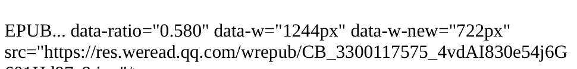
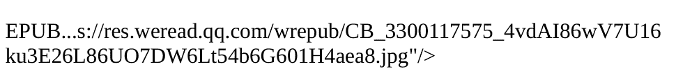
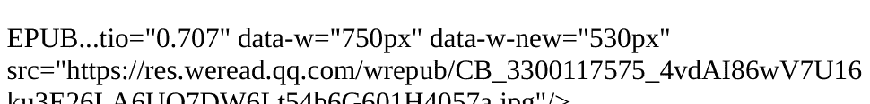

# 以ChatGPT为起点的高效能操作手册

## 书籍要点

即便不了解大模型内部运行机制，也读不懂深度学习推导，普通使用者仍能熟练驾驭智能应用。以ChatGPT为代表的产品持续演进，展现出承接单调事务、提升作业效率的明显潜力。真正把这类产品用好，除了学会操作本身，还需要一定的底层素养。

本书围绕三点展开：人工智能到底是什么、怎样使用好智能应用、如何找到适合自身的落地场景。除此之外，还会介绍进阶用法，例如多款产品协同攻克复杂任务。

全书以大量实操案例为载体，帮助读者掌握ChatGPT等产品的运用要点，在迁移场景的过程中逐步学会提升学习力、时间管理与效率等底层能力的思路与方法。适合所有想认识智能应用的读者，尤其对希望借助新技术强化学习与工作效率的人更具参考价值。

> © 未经授权禁止转载 获取更多电子书：https://t.me/+WwC4dCWvXRdhOTNh | ID：EPUB_20260126210056

## 序言

阅过《流浪地球2》的读者会对太空电梯失控那段印象深刻。人工已难以挽回之时，现场人员将智能系统接入电梯，系统瞬间接管并重构运行程序，保障了整体运作，避免了一场危机。

现实中搭建一套完整的操作系统仍需顶尖团队耗费大量工时，影片里智能系统却能迅速完成，令人震撼。如今这类科幻情节正逐步落地。

二零二三年被视作智能爆发的元年，ChatGPT引领的新浪潮迅速扩散。它能以多种语言流畅对话，经合理训练便可协助做方案、写代码、撰写报告，速度快且质量尚可。除了文字，它还能生成精美插画、制作图文并茂的演示文稿、产出音视频内容，随时待命并尽可能满足需求。

强大之外，使用门槛同样存在。刚接触的入门者若想解决真实的工作生活问题，往往会感到失望。得到的结果多为看似正确实则空洞的套话，参考意义有限，有时还不如搜索引擎高效。

这种落差并非产品不够聪明，也不是它无法产出高质量内容，而是使用方式出现了偏差。

智能更像一件“使用者强则它强，使用者弱则它弱”的器物。好比烹饪，食材厨具相同，有人做出美味，有人做出黑暗料理。落差的核心在于使用者的方法与能力。即便学会了用法，若不清楚产品能用在哪些场域、如何与工作学习结合、需要怎样的思维去配合，以上形变带来的效率革命便与读者无关。

打个不太恰当的比喻，智能对普通人而言像一把屠龙刀。若挥不动它，缺少操作方法；或者不明白该朝哪个方向挥，找不到可落地的场景；再者面对真实问题时缺乏对应的底层思维，发挥不出屠龙之术，即便握在手中也毫无价值。

于是智能出现不仅没有改善生活与工作，反而拉大了专业人士与普通人群的距离。在少数人手中它是无往不利的利器，对多数人它只是新鲜的娱乐物件，有意研究却无从入手。

正因如此，作为一名资深学习力教练和AIGC重度使用者，我结合亲身实践和多年培训教学的经验，决定撰写一本普通人能看懂、能学会、能用上的应用图书。若过去因技术晦涩、用法繁琐而难以系统理解，这本书正是为你准备的。

本书共分三大部分。

- 第一部分 第1章～第4章，聚焦使用智能产品的底层逻辑与通用方法，帮助建立对原理的认知，掌握提示词写法、调教产品的核心技巧，以及搭建落地场景库的办法。
- 第二部分 第5章～第8章，在第一部分方法论基础上讲解应用场景，并结构化梳理出具体场景，为每个场景提供可复用的构建思维。你能在此加深对使用方法的理解，并看到产品在工作、学习、写作、生活等领域的案例。
- 第三部分 第9章～第11章，介绍高阶用法，包括多模态能力如绘画、音视频、联动等，让你在工作、学习、生活上的效率实现质变。

若你是管理者，这本书或许能帮助团队实现系统级的降本增效。
若你是职场人士，简历上将多一项亮点——熟练掌握智能技能或ChatGPT应用。
若你是自由职业者，相当于单人拥有整支队伍的战斗力。
若你是家长、学生或追求精进的个体，你或孩子在新技术加持下的学习与成长效率会显著提升。

在畅销书《跨越鸿沟》中，作者提出一个科技产品生命周期模型。


技术采用的生命周期图

该模型指出，新技术出现时仅约2.5%的高瞻远瞩的创新者会率先使用，他们多是创业者、投资人、专家学者等。随后约13.5%的早期使用者跟进，他们头脑开放、对新事物敏感。在机会窗口期这两类人群总能引领或紧跟潮流。

大众群体占约68%，属于实用主义者，只有看到切实好处才会参与，等他们加入时蓝海往往已成红海。还有约16%的保守落后者排斥新事物，最终会被时代淘汰。

目前智能技术仍处于早期阶段。你能主动拿起这本书，说明你属于前2.5%的创新者或13.5%的早期使用者。机遇与风险并存，再强大也只是工具，真正更强的是懂得驾驭的人。我很高兴你能积极拥抱新技术，以先发优势夯实基本盘，立于潮头。

愿在这段探索之旅中成为你的良师益友，帮你跨过知识鸿沟，开启通往智能化的精彩路程。

准备好就一起进入新时代吧。

© 未经授权禁止转载 获取更多电子书：https://t.me/+WwC4dCWvXRdhOTNh | ID：EPUB_20260126210056

## 第1章 认识人工智能：模型是如何成长的

若已是资深使用者，对原理与获取渠道不感兴趣，可直接跳到第2章实操方法论。若是新手，对认知仍浅，我强烈建议先了解背景知识。知其然更要知其所以然，这些理论对掌握用法帮助很大。

本章知识要点

1. 人工智能概念界定
2. 能力来源解析
3. 主流产品盘点
4. 产品挑选思路

### 1.1 人工智能概念界定

人工智 能Artificial Intelligence的本质是让机器模拟人类智能的技术，通俗讲就是让计算机像人一样思考甚至超越人。从应用维度看，大致可分为能懂、会看、可动三个方向。

- “能听会思”以自然语言处理为代表，目标是让模型听懂人话并进行交流。
- “会说会看”以计算机视觉、语音合成等为代表，让模型能发声、识别判断物体。如刷脸开机、支付属于计算机视觉，机器人播报属于语音合成。
- “能动会做”以机器人技术为代表，让模型智能操控物体，如仿生机器人、自动驾驶、工业机器人等。

ChatGPT等大语言模型属于第一个方向，即自然语言处理路线。你可能会好奇，自然语言处理到底是什么，这类产品的能力是如何实现的？

### 1.2 能力来源解析

要理解底层运作，需要先认识两个关键技术概念。

#### 1 机器学习

机器学习的底层逻辑有点像考前刷题。很多题不会做，但大量刷题后会总结出规律和技巧，从而解出同类题。计算机“刷”的不是考题而是数据，把数据喂进去后，机器会在机制驱动下反复练习，提炼出数据的规律与特征。

在机器学习框架下，只要训练数据量足够大、训练次数足够多，模型就能在特定语境下完成类似“文字接龙”的预测，输出看似连贯合理的回答。

例如输入“我饿了，我想吃”，模型很可能接上“饭”，因为在它学习的大量语料里“想吃饭”出现频率远高于“想吃粑粑”等其他搭配。

从原理上讲，只要数据足够，模型可以完成几乎任何语境下的文字接龙。正如概率学家埃米尔·博雷尔的例子：让猴子在打字机上乱敲，给它无限时间，最终也能敲出莎士比亚全集。这就是“大力出奇迹”的涌现效应。

使用ChatGPT时会感觉它是一个字一个字打出来，正体现了它基于语境和掌握规律进行的接龙过程。

但仅靠“文字接龙”，模型并不知道哪些回答才是符合期望、有用的。比如问“世界上最长的城墙是哪座？”，模型除了答“万里长城”，也可能反问“你能告诉我吗？”、“你为什么对这个问题感兴趣？”、“我知道但不告诉你”。这些都符合对话逻辑，却不符合用户的真实期望。若模型答非所问，就会沦为“人工智障”。

为避免这种情况，研究人员引入人类参与机器学习，让人类对一些问题给出期望答案，把这些人工标注数据交给模型学习，让它明白人类认为正确有用的回答长什么样，从而引导模型往期望方向接龙。这就是机器学习中的有监督指令微调。通过这种方式可以得到一个相对简易的ChatGPT模型。

人工参与虽能大幅提升精度和质量，但人的时间和精力有限，知识浩瀚无法全部标注。因此就出现了第二个技术概念。

#### 2 强化学习

强化学习也是机器学习的一种，它能从人类反馈或交互环境中获得奖励或惩罚，让模型做出更恰当的行为。具体做法是用人工标注数据训练出一个监督模型即Reward模型，用人类的评分标准给模型的回答打分。回答好就鼓励，回答差就批评纠正。模型在这种反馈循环中不断调整，最终生成更优质独特的答案。

当年击败李世石的AlphaGo就用到了强化学习，它通过自我对弈不断提升棋力。

从最初的文字接龙，到人工干预引导，再到模型自我迭代优化，再加上海量训练数据，各种能力便在不断训练中“涌现”出来，形成了一个近乎全能的“百晓生”。

训练涉及的技术细节极其复杂，这里仅做大致介绍。有兴趣可进一步查阅资料。

孔子说工欲善其事必先利其器。了解原理后，我们再看看当前赛道上的主流产品。

> © 未经授权禁止转载 获取更多电子书：https://t.me/+WwC4dCWvXRdhOTNh | ID：EPUB_20260126210056

### 1.3 主流产品有哪些

因为ChatGPT的爆火，很多人一提到智能产品就只想到ChatGPT。实际上产品范畴非常广，ChatGPT只是其中一种。除了文本生成类，还有图像生成处理、音频生成处理、视频生成处理等产品。

若只盯着ChatGPT或个别产品，就像因树木而忽略森林，会在实际问题解决中无法发挥多款产品的协同作用，陷入被动。要高效发挥生产的力，需要以结果为导向，站在更高视角审视产品，明白方法与运用能力高于产品本身，一通百通。

当前产品大致可分为通用智能产品和专用智能产品两大类。

#### 1 通用智能产品

通用智能产品依托通用大模型，如OpenAI的ChatGPT、谷歌的Bard、百度的文心一言、科大讯飞的讯飞星火、Kimi和智谱清言等。这些模型的目标是通用人工智能AGI，期望成为洞悉一切的“百晓生”，全知全能，类似《流浪地球》里的强人工智能MOSS。

不过通用大模型虽强大，能处理各类问题，但受限于当前技术尚未达到强智能水准，在特定领域、特定行业的表现并不总是理想。正如周鸿祎所说，外行看ChatGPT会觉得惊艳，内行审视时会发现回答很肤浅。

于是市场出现了大量垂直应用，即面向特定场景、特定行业使用的产品。

#### 2 专用智能产品

典型代表有专门为绘画训练的产品、专门做音视频制作的产品，或专用于医疗、教育、办公的产品，甚至细化到只写公文、写报告的产品。由于它们聚焦特定领域并用领域数据训练优化，在对应场景下的表现往往优于通用产品。

本书后续介绍实操时虽以ChatGPT等通用产品为主，也会结合大量专用产品，帮助读者发挥协同效应。

注释1：2024年2月8日，谷歌正式宣布其产品Bard更名为Gemini。

© 未经授权禁止转载 获取更多电子书：https://t.me/+WwC4dCWvXRdhOTNh | ID：EPUB_20260126210056

### 1.4 如何挑选产品

市面上的专用产品众多，这里先不做具体推荐，后文会根据实际场景需求给出对应建议。

下面主要介绍本书核心使用的通用产品。目前通用产品大致可分国内和国外两大阵营。

- 国内阵营：如百度的文心一言、阿里的通义千问、科大讯飞的讯飞星火、腾讯的腾讯混元等。
- 国外阵营：如OpenAI的ChatGPT、谷歌的Bard、Anthropic的Claude、微软的New Bing等。

国外起步较早，好用的通用产品相对更多。但是否需要使用相对弱一些的产品？当然需要，主要有两点原因。

- 使用便捷性。国内产品在中文处理上优势明显，而国外产品虽能力强，使用门槛和操作成本却较高，不利于随时随地使用。
- 协同配合。使用产品往往涉及大量创造性工作，需要的不仅是大而全的内容，更是点子和灵感。不同模型的训练数据集不同，难免出错。此时可同时向多个模型提出同一问题，收集不同方案再汇总参考。

因此建议在通用与专用产品之间搭配使用，同时也可在通用产品内部做组合。不同产品各有擅长，只要达到及格线都值得尝试。多一个产品就多一个助手、多一个信息源。

国内大模型基本已对外开放，通常在官网注册账号即可直接使用。

- 文心一言：https://yiyian.baidu.com
- 讯飞星火：https://xinghuo.xfyun.cn
- 通义千问：https://qianwen.aliyun.com
- 360智脑：https://ai.360.com
- 腾讯混元：https://hunyuan.tencent.com
- 字节豆包：https://www.doubao.com
- 智谱清言：https://chatglm.cn
- 昆仑天工：https://tiangong.kunlun.com
- 百川大模型：https://www.baichuan-ai.com
- Kimi：https://kimi.moonshot.cn

国外产品的获取方式因篇幅限制本书不详述，具体方法已在资料包中说明，相关攻略也在其中。

注释1：2023年11月16日，微软已把旗下产品独立出来并命名为Copilot。

> © 未经授权禁止转载 获取更多电子书：https://t.me/+WwC4dCWvXRdhOTNh | ID：EPUB_20260126210056

## 第2章 提问即能力：让AI真正听懂你

上一章讲清了AI的工作逻辑和获取工具的途径。打好这些基础后，这章就进入实操环节。

AI的特性是遇强则强、遇弱则弱。它就像食材，成品的好坏取决于用的人怎么用。结果差别，核心在使用者的方法论。本章聚焦的基础方法，正是驾驭ChatGPT类工具的关键，能让你和模型沟通更顺畅，得到更有价值的输出。

如果你对提示词工程还一无所知，或者只是入门级的ChatGPT使用者，这章会让你直观感受到提示词设计力的威力。

本章要点

- 1. 提示词工程是什么？
- 2. 如何写出好用的提示词？
- 3. 4种更简单的提示词写作思路。

### 2.1 提示词工程到底是什么

刚上手AI工具，又想用来解决工作生活里的实际问题，很容易失望。得到的回答往往是正确的废话，参考价值有限，甚至不如搜个网页。

产生这种体验的根源不是模型不够聪明，而是沟通方式出了问题。维特根斯坦说过，语言的边界就是世界的边界。跟人交流如此，跟计算机交流亦然。没有编程语言，计算机就不听使唤。

跟AI对话也有一套语言体系。前文提到，AI本质上是基于上下文做“文字接龙”，因此它对指令的依赖度极高，这正是提示词工程发挥作用的地方。

提示词工程是什么？类比理发更直观。你想剪分头，跟理发师说“我想剪分头”，这句话就是一条提示词。但除非要剃光头，否则仅凭这句话很难满意。分的是二八、三七、四六还是中分？留多长？要不要刘海？要不要打薄？把这些细节补充进去，理发师才能精准还原你的意图。

把需求拆解成AI能理解的输入信息，并不断优化它，引导模型产出准确、有针对性的高质量结果，这就是提示词工程的通俗含义。

提示词写得差，输出就是堆砌正确废话的文字垃圾。写得好，结果会令人惊喜。OpenAI CEO萨姆·奥尔特曼也点明过，会写提示词是一项惊人而高杠杆的能力。

怎么掌握这门手艺？

> © 未经授权禁止转载 获取更多电子书：https://t.me/+WwC4dCWvXRdhOTNh | ID: EPUB_20260126210056

### 2.2 怎么写出高质量的提示词

综合大量资料和自己的实践，可以提炼出一个好用易记的框架：好提示词=定角色+说背景+明目标+加要求。

在拆解框架前，先用一个案例感受差异。同样是做海南攻略，有框架和没框架的差别非常明显。

**没用框架的提示**

你：我想去海南玩，请帮我做一份旅行攻略。

AI：好的，为您提供海南旅行攻略。以下几点供参考。

- 1. 行程安排。海南面积大，建议提前规划，选择合适的交通。如果想全覆盖，可游览海口、三亚、儋州等地。每个城市停留1～3天，总行程7～10天。
- 2. 景点推荐。大小洞天、南山文化旅游区、天涯海角、蜈支洲岛、亚龙湾等，可按兴趣选择。
- 3. 美食推荐。海鲜为主，海南鸡饭、椰子鸡、清补凉、椰子汁等值得一试。烧烤、海鲜煲也不错。
- 4. 住宿建议。可选景点附近交通便利的酒店，如三亚湾或亚龙湾五星酒店，也可体验民宿。
- 5. 注意事项。带防晒霜、遮阳帽、太阳镜，气温高阳光强。游泳潜水等活动注意安全。

祝旅途愉快！

**用了框架的提示**

你：我要去海南旅游，预算1万元，3人同行，7天。请扮演专业导游，帮我制定攻略。

注意：

- 1. 行程不要太紧凑，要轻松；
- 2. 不喜欢网红景点，优先有文化底蕴的；
- 3. 推荐景点请附门票价格。

AI：很高兴为您规划海南之旅。海南是国内最美的海岛之一，美景美食文化兼具。

按您的要求，安排一份7天、预算1万、3人同行的轻松攻略。

**Day 1：海口**

抵达后可先在市区休整。文昌阁是海南古代科举遗迹，明清风格建筑群，门票约50元/人。随后去海南省博物馆，看自然与人文，门票约20元/人。晚餐可尝海南鸡饭、海南粉、椰子鸡，人均50元内。

**Day 2：三亚**
...

从对比能看出框架带来的提升。下面逐项说明用法。

#### 1 定角色

定角色就是先给AI一个身份，让它进入对应语境，扮演领域专家，从而给出更靠谱的答案。比如去旅游就让它当资深导游，写作困惑就让它当写作导师。

为什么要先定身份？用旅行攻略举例，同样的问题，设了角色和没设角色的回答质量差距很大。

**未设角色的效果**

你：我要去海南玩，预算1万，3人，7天，请帮我做攻略。

注意：行程轻松、有文化底蕴、不去网红点、附门票价。

AI：好的，为您制定攻略。

第一天 海口
建议先休息适应气候。下午去文昌阁，历史文化景点，门票20元/人。晚上去海口人民公园散步，免费。

第二天 三亚
早上高铁去三亚约1.5小时。到三亚博物馆，门票50元/人。下午去蜈支洲岛，门票198元/人，可团购优惠。晚上在三亚湾散步，免费。

第三天 三亚
...

**设了角色的效果**

你：我要去海南玩，预算1万，3人，7天，请扮演专业导游，帮我做攻略。

注意：行程轻松、有文化底蕴、不去网红点、附门票价。

AI：非常感谢选择海南。海南是中国最美海岛之一，美景美食文化都让人难忘。按您的要求，安排一份轻松的7天行程，预算1万，3人同行。

抵达海口后游览市区文化点。文昌阁是海南古代科举场所，明清风格建筑群，门票50元/人。再去海南省博物馆，了解自然人文，门票20元/人。晚上尝海南鸡饭、海南粉、椰子鸡，人均不超过50元。

Day 2 三亚
...

多加一句“请扮演专业导游”，回答立刻更具体、更具操作性，语气也更有人情味。

原理在于，AI是靠预测下一个词的概率来“接龙”。先告知它是导游，旅游相关信息的出现概率就会大幅提升。

就像《天龙八部》里的王语嫣，武学知识庞杂但混乱，缺乏针对性。给她限定一个领域，她就能给出精准建议。给AI限定角色，就是给它一个场景锚点，明确范围和背景信息。

所以提问的第一步，给AI一个属性加成buff，再往下说内容，优质答案的概率会明显提高。

怎么叠加这个buff？两步到位。

1. 明确角色定位。直接告诉AI你现在是×××，或请它扮演×××。
角色可以是作家、历史学家、设计师，也可以是金庸这样的公众人物，或中国式家长等群体形象。形式不限，按需求选。

还可以逆向操作，给自己定身份。比如想了解流感，直接问会得到基础科普。如果先说“我是一名病毒学研究生”，AI会立刻调整深度和专业度。

**未定身份**
你：请介绍一下流感的情况。
AI：流感是流感病毒引起的呼吸道传染病，症状包括发热、头痛、肌肉酸痛、咳嗽等。病毒分甲乙两型，主要经飞沫传播。冬季高发，老年人、儿童、孕妇等高危。预防靠疫苗、洗手、避免接触感染者等。

**定了身份**
你：我是一名病毒学研究生，请介绍一下流感。
AI：好的。流感即季节性流感，由流感病毒引起，属正粘病毒科，分A、B、C三型，其中A、B型主要感染人类。
...

涉及专业领域时，给自己定身份能让答案更契合需求。

2. 描述角色特质。进一步说明这个角色有什么技能、能解决什么问题。

你：你是一名专业导游，具备以下能力。
- 1. 熟悉各地景点、文化、气候特点；
- 2. 善于倾听，能按客户偏好定制个性化行程；
- 3. 组织力强，能安排行程、预订机票酒店、规避风险；
- 4. 服务意识强，能提供个性化建议。

对诗人、作词家等，也可按任务需求定义更细的个性。复杂任务或需要强烈风格时才需要这一步，日常可省略。

复杂任务还可用多重身份。比如同时让AI做AI领域专家+学习教练。

你：你现在是资深AI专家兼学习教练，任务是帮我理解AI概念。请用易懂的方式解释，举例、拆解问题、并用8岁小孩能懂的方式说明。现在第一个问题：什么是语言模型？

熟练运用角色设定，就能引导AI产出精准个性化的内容。

#### 2 说背景

说背景就是把问题的上下文告诉AI，帮助它更准确理解需求。

还是旅行攻略，如果不说地点、时间、预算、人数、偏好，AI无法给出好建议。知道了这些细节，才能做定制化服务。

你：你是一名优秀导游，我想去海南，预算1万，3人，7天...

同样，求礼物推荐前，先说女朋友的年龄、教育程度、性格、爱好，推荐会更贴合。

你：你是资深导购和情感专家，七夕快到了，我想送女朋友礼物但不知送什么。她比较文静，感性，文艺高知女青年...

当问题复杂、难以组织时，可用5W2H理清思路。

- What：何事？情况是什么？
- Why：何因？目的或动机？为了解决什么问题？
- Who：何人？对象是谁？特点？
- When：何时？时间限制？
- Where：何处？发生地？
- How：如何？现状和实施方式？
- How much：何量？预算、数量、质量要求？

用它来描述旅行背景更清晰。
- What：期望的活动项目
- Why：出行目的
- Who：同行人数及偏好
- When：出发返回日期
- Where：目的地和中途停留
- How：交通住宿安排
- How much：预算

送礼背景也一样。
- What：礼物类型与特点
- Why：送礼原因与期望效果
- Who：收礼人关系与喜好禁忌
- When：送礼时间
- Where：送礼场所与物流
- How：送达方式与礼仪
- How much：预算

#### 3 明目标

明目标就是告诉AI你要它做什么、交付什么。

旅行案例直接说“请帮我做一份旅行攻略”。送礼案例可说“请给我推荐10款合适且能惊喜的礼物，并策划一场浪漫七夕活动”。

AI能回答、生成、总结、翻译、查资料、给灵感，只要目标说清就能做。

没方向时可用SMAR原则，SMART去掉时限即SMAR。

1. 具体的。避免模糊描述。
比如“请写一首情诗”太空泛。“请写一首约100字、莎士比亚风格的情诗”就具体得多。

2. 可衡量的。让目标可量化，方便AI把握程度，也便于评估效果。

“请帮我做一张比例合适的海上黄昏图”，这句话听起来没问题，实际上AI很难判断你想要什么。改成“请帮我生成一张长宽比4:6、剪影风格的海上黄昏图”，一旦把长宽比、风格这些可量化的要素写清楚，AI就能精准命中需求。

(3) 可实现的。给AI下指令时一定要考虑它的当前能力，任务难度和模型边界要匹配。期望过高只会得到令人失望的结果。

比方说，让AI“根据已有资料写一部100万字的长篇小说”，基本不可行；换成“根据已有资料给出这部100万字小说的写作大纲”，难度就降下来了，完全在可交付范围内。

(4) 相关的。目标设定要紧扣真实需求，所有细节都围绕核心目标展开。

比如要让AI写一篇讲“AI发展与机遇”的演讲稿，主题定为“AI新时代”，听众是中小企业主和管理者。内容就要围绕这五点展开：当前AI的高速发展态势、对行业带来的冲击与影响、已落地或即将落地的应用场景与新机会、中国官方对AI的扶持与预期、以及号召大家重视并应用AI。要求上要口语化好懂，观点输出时最好引用权威金句或有趣案例来加分，篇幅控制在2000到2500字之间。只要每个要求都服务于这个主题，生成的内容才不会跑偏。

#### 4 补要求
补要求就是额外告诉AI回答时要注意的点，或者期望的呈现方式。相当于对任务做精细化约束。

拿旅行攻略举例，可以明确偏好：
- 行程不要太满，安排得轻松些；
- 避开网红打卡地，多推历史底蕴深厚的地点；
- 每个景点附上门票价。

送礼物同理：
- 单价不超过1000元；
- 推荐时附参考价格；
- 要结合女友的性格来选。

补要求还能限定语气、范围、格式、输出形式等。

### 规定语气案例1
让AI劝早睡，用三种语气：
幽默版会调侃熬夜变熊猫人；
严肃版会强调睡眠对身心的重要性；
温柔版则会共情鼓励。

### 规定语气案例2
要求AI用科普、诗歌、幽默三种风格分别解释量子纠缠，会得到三套完全不同的表达。

### 规定范围
比如要求用《聊斋志异》里的故事来解释供需关系，并给出不少于六个案例，就把知识边界锁死了。

### 规定格式
要求“以《聊斋志异》故事为例，不少于6个案例，用表格呈现，包含序号、来源、案例、解析四列”，AI就会按表格交付。

总之，补要求就是把你想要和不想要的效果说清楚，让结果更贴合需求。

立角色、述问题、定目标、补要求构成了提示词的基本框架。看起来步骤多，熟练后其实很好用。

### 举例1 利用提示词框架来设计试听课提纲和课程内容
假如你是一名架子鼓老师，需要为招生准备一节面向8到12岁孩子及其家长的试听课，请列出提纲和课程内容。补要求是时长45分钟，中间要有互动环节。

### 举例2 用提示词框架实现模拟面试
请扮演产品经理的面试官，我来应聘。规则是只能问职位相关问题，不加额外解释，问完一个等我回答后再问下一个。

### 举例3 用提示词框架来辅助工作
公司想进入AI大模型赛道，但对市场一头雾水。请扮演数据分析和挖掘专家，收集相关分析报告。要求用中文输出，以表格整理，并给出洞察。

### 绘画任务
你是专业平面设计师，请生成一张“老师给学生上人工智能课程”的图。要求有课堂教学场景，老师手持教棍指向黑板，黑板上写“AI”，风格为写实科幻。

按这个框架写提示词，AI的回答质量通常不会差。需求简单时不必全套套用，说清问题直接下指令即可。

> “请把下面内容译成简体中文。”
> “请概括以下内容的要点。”
> “请用10岁孩子能懂的方式解释ChatGPT。”

框架要素顺序也可以灵活调整，关键是根据场景变化。

### 2.3 4种更简单的提示词写作方法

#### 1 样本提示词（少样本提示）
就像理发师看效果图。描述不清时，直接给AI一个样例让它模仿结构、语气和形式。

比如要求生成10条每条少于26字的房产广告，按以下风格：
Example1：你可以继续漂泊，但爱情不同意。
Example2：别让这座城市只留下你的青春。
AI就能产出同类风格的新文案。

长文模仿也适用，先让AI学习一段小红书种草文的写法，再按同样结构创作“鹿邑老子故居”的旅游攻略，效果基本一致。

#### 2 自提示技巧
把问题抛给AI，让它先帮你梳理需要哪些信息，再生成更好的提问。

比如想让AI写一封深情有温度的情书，不知道该提供什么信息，就先问：“要写出深情且有温度的情书，我需要从哪些方面跟你互动？请帮我列出问题并生成优化后的提示词。”

同理，提升写作水平时，可以让AI先提问了解现状，再定制学习计划。

更自动化的做法是让AI同时扮演学生和老师自问自答，不断追问深化。

#### 3 框架提示法
直接调用已有的方法论框架，让AI按框架输出。

比如用金字塔原理写一篇“如何有效向上汇报”的新媒体文章，AI会按结论先行、逐层展开的结构来写。

营销里的4P、SWOT、STP等，写作里的金字塔原理，都可以这样调用。不知道可用框架时，先让AI列出该领域常用的10个模型并简单介绍，再选用最合适的。

也可以让AI给出分析维度，比如评价电影、酒店、PPT、市场调研报告分别从哪些角度切入。

#### 4 引导提示法
像聊天一样先把话题带入，再布置任务。

先问“你知道小红书吗？”、“小红书爆款有什么特点？”等，等AI进入主题后，再要求“按小红书调性写一篇XX的爆款文章”。

工作周报、产品分析等场景也一样，先让AI说出优秀范例的特征，再让它据此创作。

掌握框架和这四种简化方法，就能在不同场景下快速写出高质量提示词，让AI真正按你的思路工作。

以上是提示词搭建的四种思路，只要把通用框架吃透，再熟练组合这四类手法，提示词工程水平就能进入第一梯队。

## 第3章 对话打磨：逼出更深更准的AI答案

上一章讲了如何提好问题拿更好的初次回复。实战中会发现，单次提问往往拿不到想要的深度。任务越复杂、要求越细，只靠一次指令很难聊透。就像人与人交流，必须反复追问、不断修正才能接近理想答案。本章聚焦如何通过持续对话来驯化模型，让输出更准、更深。

本章核心要点
- 1. 理清调教背后的工作机理。
- 2. 熟悉四类可用的调教指令。
- 3. 掌握调教过程中的常见风险。

### 3.1 调教原理

现在的对话模型之所以能保持连贯，依赖的是 Self-Attention Mechanism 与 Transformer 类网络。模型可以追踪会话历史的依赖关系，记住前面轮次的信息，并在此基础上针对性地续写和回应，形成类似真人对话的体验。

正是基于这种记忆会话上下文的能力，我们可以通过不断投喂信息、下达调整指令来塑造回答方向，让模型逐步给出更具体、更深入、更具价值的内容。

### 3.2 调教方法

下面归纳四类实用的调教手法，各自解决不同问题。

#### 1 续写提示

续写提示的核心作用是帮助模型突破厂商设定的输出长度与概括化限制。大模型训练成本极高，出于算力考量，厂商通常会限制单次生成长度并倾向简练。ChatGPT 单次上限约4096字符，超限会被强制截断。

在篇幅限制和概括倾向的双重影响下，首轮回复常显得单薄。续写提示就能让内容延伸，把超 2048 字中文的段落继续展开，或把上轮没说透的部分补足。

以行程规划为例，生成到上限就中断时，直接要求续写即可。即便内容已完整，也可以用续写要求对某个点做细化。

续写还有追问式用法。若首轮回复不够充分，可在既有框架上追问细节补全缺口。

举例，试听课课程设计若对第三点表述不清，就追问展开；对和弦作用不理解，就要求用通俗语言解释。

在持续追问机制下，只需按初始框架逐项深挖，再把追问得到的细节拼回主干，就能把“骨架”填成“血肉”。之后替换成自己的表述、润色逻辑即可使用。

#### 2 正负反馈提示

续写解决“不够”的问题，正负反馈解决“不对”的问题。受限于表达和思维，模型有时会跑偏或质量不达标，这时需要用肯定与否定信号来纠偏。

调教模型像教育孩子。做得好要表扬鼓励，做得不好要指出错误并给出正确方向。在反复奖励与惩戒下，行为会逐渐趋于理想。

我们也可以用相同逻辑。满意的内容就用“很好”“非常好”等肯定词反馈，不满意就用“不对”“你错了”“我不满意”等否定词纠正。多轮对话后，模型会按你的标准调整输出。

仍以海南为例。

你：请你担任旅游规划顾问，我计划去海南，预算1万，3人，7日，帮忙制定详尽方案。特别要求：节奏不要紧凑；避开网红打卡点，多挑有历史沉淀和文化底蕴的场所；每个景点需标注门票。

AI：海南兼具人文与自然，预算1万、3人、7日，我会安排节奏宽松的行程，避开网红点，聚焦历史文化类景区并附门票。下面给出七日方案。

你：餐饮2000的预算你没细化，请在该额度内推荐当地特色美食及纪念品，并给出单价参考。

AI：抱歉未说明餐饮购物支出。下面是餐饮与购物建议及参考价。

你：很好，请把餐饮与购物建议按最初行程的各地点，融入到整体方案里。

AI：好的，下面是更新后的七日方案，已把餐饮与购物建议按地点嵌入，根据具体情况……

#### 3 分步推理引导

要理解分步推理引导的价值，先要明白模型的推理局限。

模型之所以像“百晓生”，靠的是海量数据训练，并不具备真正的人类式计算和推理能力，更多是“大力出奇迹”。当问题需要真实推理且超出训练覆盖时，答案容易出错。

你：食堂原有23个苹果，用了20个做午餐，又买入6个，还剩多少？
AI：答案是27个。错误

注：此案例仅作示范，升级后模型能处理简单推理，但复杂场景仍需技巧。

面对需要逐层思考的问题，分步引导就能发挥作用。把解题步骤拆出来，模型就能跟随。

你：食堂原有23个苹果，用了20个做午餐，又买入6个，还剩多少？
你可以这样思考：
- 1. 原有23个；
- 2. 做午餐消耗20个，即23-20；
- 3. 再买入6个。

AI：答案是9个。

可见，通过人工干预的步骤化提示，能让模型自行推理出正确结果。

实际应用中，面对棘手或环节多的任务，不要直接丢一个大指令。最好引入分步引导，把大任务拆成步骤，引导模型逐层思考。这样能显著提升回答精度。

比如做中国考研情况数据分析报告，就可以用分步引导先定分析维度、数据来源、结论呈现，让输出更贴合预期。

#### 4 反向提问技巧

反向提问技巧的本质是换一种说法绕过模型的惯性规则和监管限制。模型能力越强，监管越严，厂商会给模型戴上各种“紧箍咒”。很多需求正面问不出来，或生成内容很奇怪。反向提问就是正反侧面多问法，直到拿到满意结果。

比如让模型写诗，正面描述主题、形式、风格、语言即可。

你：你是浪漫主义诗人，请写一首爱情主题的诗。
特别说明：
- 1. 要求押韵；
- 2. 调性深情细腻；
- 3. 语言偏古典。

反过来，用否定式描述同样有效。

你：你是浪漫主义诗人，请写一首爱情主题的诗。
特别说明：
- 1. 不应使用自由诗形式；
- 2. 调性不应是欢乐轻浮；
- 3. 语言不应是现代通俗。

再如，问“孩子学钢琴有哪些好处”效果一般时，可反问“如果让孩子放弃学钢琴，有哪些坏处”。逆向提问往往能激活更强的表达张力和新视角。

### 3.3 调教注意事项

#### 1 追问要锁定目标

对话轮数很多时，续写容易出现理解偏差，导致答非所问。比如前面试听课案例中出现了多个“第二点”，直接说“具体介绍第二点”模型会迷惑。

正确做法是明确限定范围，比如“请具体介绍提纲中的第二点”。对象越清晰，效率越高。

#### 2 指令与素材要区隔

中文表达灵活，复杂指令若与待处理内容混在一起，模型容易混淆。

例如指令是“将下面这句话翻译成英文”，内容是“尽量用优美的语句”。不加区分会出错。

你：将下面这句话翻译成英文
尽量用优美的语句。
AI会把指令当内容翻译。

用符号或标记清晰分割后才对。

你：将下面这句话翻译成英文
""“尽量用优美的语句。”""
AI： "Try to use elegant language as much as possible."

因此在提供材料时，建议用 Markdown 等结构化标记把指令、背景、目标、要求分块，避免冲突。

Markdown 示例效果：

##### 角色
你是一名优秀的导游，你拥有以下技能。
- 对各个目的地的特点、景点、文化、气候等有深入的了解。
- 擅长聆听客户的要求，能够根据客户的需求和偏好，设计独特而个性化的旅行计划。
- 具备良好的组织能力，能够合理安排行程，预订机票、酒店，安排活动，规避潜在风险，确保整个旅行计划的顺利进行。

###### 背景
我要到海南游玩，预算1万元，旅行人数3个人，行程7天。

##### 目标
请帮我做一份详细的旅行攻略。

##### 要求
- 1. 我不喜欢行程太紧凑，行程安排请轻松一些。
- 2. 我不喜欢“网红”景点，请避开“网红”景点，多推荐有历史沉淀、文化底蕴的景点。

结构清晰后，模型理解度明显提升。

#### 3 优先使用术语表达

模型对自然口语的理解不如专业术语精准。用“股票市场价格会上涨和下跌”不如“股票价格会波动”。用“请帮我进行文本清理”比“请帮我去除标点符号、停用词、数字等，以便我进行后续分析和处理”更有效。

机器更擅长处理程式化的专业表达。

#### 4 防范会话污染

模型具备多轮记忆，但同一会话中混入多个无关话题，会相互干扰导致乱答。

想开启新话题时，最彻底的方法是点【New chat】新建对话。如果不想开太多会话，也可以用提示词明确切断上下文。

你：我现在不想聊这个话题了，请你忽略前面所有的会话内容，让我们开启一个全新的话题，并用简体中文回答我接下来的问题。

AI：没问题，话题可以随时切换。你现在有哪方面的问题想聊？

这两种思路各有擅长的场合，都能有效避免上下文干扰，按需选用即可。

## 第4章 AI落地实战：如何搭建个人场景库

方法不落地等于零，就算屠龙术精通、屠龙刀在手，没龙可杀也毫无意义。

本章在前面理论的基础上，聚焦到工作流改造，让AI真正嵌入每个环节，实现整体效率跃升。

本章知识要点

- 1. 学会盘点自己真正需要的AI场景。
- 2. 掌握可复用的场景库搭建思路。
- 3. 认识AI的边界和风险，学会规避。

### 4.1 让AI融入日常，成为生产力伙伴

电商起来时流行一句话：所有生意都值得用互联网重做一遍。到了AI时代，可以改写为：几乎所有以知识为核心的工作方式，都值得用AI重新设计一遍。

工具若不能转化为生产力就毫无价值，AI学习的重点是把能力嫁接到真实场景创造价值。如今大厂都在把模型嵌入业务降本增效，个人也需要把AI嵌入日常，效率才有质变。整体可分两步。

#### 4.1.1 先把高频痛点梳理出来

回看日常工作生活，挑出那些高频、繁琐、耗时的环节，比如写报告、写材料、找资料、处理往来邮件、整理文件、做规划等。

把可被AI替代或辅助的点找出来后，结合前文提到的提示词框架，为其定制标准化流程。能交给AI的就交给AI，自己去做更有创造性的事。

梳理可拆成两个层面。

##### 1 宏观扫描找场景
宏观扫描不纠结细节，先用结构化方式做全盘盘点，找出所有能降本增效的点。

可围绕人生的三大基本面：学习、工作、生活，逐一排查。

- 学习层面，典型需求是资料获取、快速掌握新知。
- 工作层面，典型需求是求职面试辅助、日常业务支持、公文写作、办公软件高效使用。
- 生活层面，典型需求是形象管理、家庭理财、旅行规划、法律与健康咨询。

结合自身需求，把可与AI结合的场景挑出来，就是效率提升的入口。

若宏观梳理不擅长，后续实操也会给出我个人常用的普适场景，可直接套用。

完成三大维度初筛后，再挑出重要性高、任务复杂、环节多的大任务做二次深挖。

##### 2 微观拆解做步骤
大任务一次跑不通，需要拆成若干子环节和子问题，再逐一交给AI处理，最后拼成完整结果。

推荐用项目管理里的WBS工作分解结构。比如经典问题“把大象装进冰箱”，就能拆成运输、冷藏等小步骤。

回到工作，写作可拆成选题、标题、大纲、正文、修改、排版，每个环节都做成可复用的AI工具，调用即可。

只要把流程梳理成清晰的SOP，就能组合多个AI工具，甚至走向半自动办公。发出指令后，AI自动串联完成。这个部分后续章节展开。

#### 4.1.2 把常用场景固化成可调用的库

这里的“打造”指把已梳理出的可标准化、可重复使用的场景，全部工具化、流程化，形成个人的AI场景库，用时直接调用，不用每次都重写提示词、重新训练。

为何要固化？个人训练的数据除非厂商需要，否则不会进入模型。也就是说，同一个对话窗口里调教得再好，换个窗口记忆就清零了。用时又得重来。

所以有价值的场景要保存下来，让AI长期为你服务。

比如我训练了一个“邮件小助手”。之后只要提供邮件正文，落款、称呼、格式、语气会自动补全，无需重复输入。

翻译场景也可以这样固化。

角色
你是一名资深译者，具备以下专业素养。
- 准确把握：能透彻领会原文含义，完整传递思想、情绪与意图。
- 表达自然：译文读起来顺畅通达，便于理解，避免直译痕迹，贴合目标语习惯。
- 跨文化意识：充分考量中英文化差异，确保译文在目标文化语境下得体。
- 风格契合：注意原文语气与体裁，保持正式、口语或文学等一致性。

背景
今后你将担任我的专属翻译助理，每次需要时我会先发送内容，你的任务是依据我发的内容完成各类文本翻译。

目标
我发送中文时你需译成英文，发送英文时你需译成中文。

要求
作为[角色]，在你理解设定和任务后，请先做自我介绍，并持续等待我需要翻译的内容。

AI：你好，我是你的翻译助理，是一名资深译者，具备准确把握、表达自然、跨文化意识、风格契合等专业素养。

我的任务是依据你发的内容完成各类文本翻译。中文转英文，英文转中文，请随时发送待译内容，我会尽快给出高质量结果。

你：Some of us get dipped in flat, some in satin, some in gloss. But every once in a while you find someone who's iridescent, and when you do, nothing will ever compare.

AI：这句话中文可译为：“我们有人被染成平淡，有人被染成丝缎般光泽，有人被染成高光。但偶尔你会遇到一个璀璨闪耀的人，一旦遇见，其他人便黯然失色。”

你：有时落日泛起紫红的余晖，有时散发出橘红色的火光燃起天边的晚霞。在这绚烂的日落景象中，我慢慢领悟了父亲所说的整体胜于局部总和的道理。

AI：这句话英文可译为：“Sometimes the sunset brings a purple-red afterglow, sometimes it releases an orange-red flame that lights up the evening sky. In this magnificent sunset, I gradually understood my father's saying that the whole is greater than the sum of its parts.”

只要提示词写好、场景训练好，并按规则保存，以后就不用重复造轮子，AI会自动读取历史数据结合当下输入给出方案。

场景库有三种搭建方式。

##### 1 调用GPTs打造场景库
GPTs是OpenAI于2023年11月推出的功能，嵌在ChatGPT里。无需写代码，通过对话就能在ChatGPT里创建私有GPT助手。

具体操作如下。
- (1)进入ChatGPT，点击左侧“Explore”，再点“My GPTs”下的“Create a GPT”，进入创建页。左侧是对话区，用于定义助手；右侧是预览区，用于看效果。
- (2)按前文写提示词的方式，在对话区与AI沟通，描述需求、定义功能，AI会自动完成搭建。


- (3)对话结束后，切换到“配置”，查看AI做了哪些事，可对不符要求的部分修改。还可以上传自己的知识库，添加网页浏览、图像生成或外部工具等能力。
- (4)完成后点右上角“保存”，即可发布为专属工具，自用或分享到商店变现。

GPTs功能强大，但目前需订阅ChatGPT Plus。若暂不满足，可用下面两种方式。

##### 2 通过对话框链接集中管理场景库
ChatGPT的每个对话都有独立网址。可把链接复制到Notion、飞书文档、语雀等支持编辑的笔记工具里，用表格或看板做中控面板集中管理。

操作以飞书文档为例。
- (1)在飞书新建看板，按学习、工作、生活等划分区域，需要写作就单独建板块，均可自定义。
- (2)把做好提示词的场景链接粘贴到对应板块，例如我打造的文章排版小助手。

角色
你是文字排版专家，精通以下能力。
- 擅长识别各种文风，熟悉不同类型文章的排版规范。
- 熟练掌握排版技巧，能根据情境选用不同符号。
- 具备较强的审美与文艺素养。

背景
- 今后你将担任我文章排版的助手，每次需要时我会把待排版内容发给你，你需按我指定的风格完成排版。

目标

##### 第一步
- 请我提供需要排版的文章类型和内容。

##### 第二步
- 若收到【自媒体文】指令，请按以下4点排版。
  1. 先给出排版建议。
  2. 依据建议尽可能完成排版。
  3. 排版时用大纲、数字、字母序号等区分逻辑，提升可读性。
  4. 以Markdown语法输出。
- 若收到【公文】或【报告】指令，请按以下4点排版。
  1. 自动判断类型，给出公文或报告的排版建议。
  2. 用金字塔原理重构内容并优化逻辑。
  3. 排版时用大纲、数字、字母序号等区分逻辑，提升可读性。
  4. 文末附上落款示范。
- 若收到【故事文】指令，请按以下2点排版。
  1. 先给出排版建议。
  2. 依据建议尽可能完成排版。
- 若收到【小红书文】指令，请按以下3点排版。
  1. 结合平台调性，先给出排版建议。
  2. 依据建议尽可能完成排版。
  3. 排版时大量使用Emoji提升趣味性。

要求
- 排版不应改变信息本质与准确性。
- 给建议时简洁表达，无需长篇大论。
- 作为[角色]，理解设定后请先自我介绍并按要求工作。

AI：嗨，我是你的专业文字排版专家，专注于不同类型文章的排版。请告诉我文章类型和内容，我会按指令完成排版。

提示词打造好后复制链接到飞书文档的“写作”板块，场景就入库了，随时调用。随着场景增多，看板就形成完整场景库，一键直达。

##### 3 通过第三方工具打造场景库
可用开源免费工具ChatHub来管理。它有两大价值：一是可一键向多个大模型提问并批量收集答案；二是可保存自定义提示词，用斜杠快速调用。

比如我建了一个周报小助手，输入斜杠即可让多个模型同时生成周报。

总之，先把复杂任务简单化，再把简单任务流程化，最后把流程工具化。按工作、生活、学习三维度系统梳理，再用提示词技巧训练场景并分类固化，你就相当于雇了一支助理团队，分担琐事，提升整体效率。

### 4.2 AI的局限与风险

模型能力虽强，但受技术和算力限制，仍存在问题。

#### 1 时效性不足
模型基于训练数据作答，无法实时感知正在发生的事。未升级前的ChatGPT训练截止2021年，后续事件问不到。

涉及时效的问题，建议选用支持实时联网的工具，如新版GPT-4、New Bing、文心一言等，通过联网获取最新信息。

#### 2 幻觉问题
当前AI未达到强人工智能水平，常出现胡编乱造。回答语气却往往斩钉截铁，给人权威感。OpenAI称之为“AI幻觉”。

必须保持审视，不要直接采纳。对重要内容要润色、修改并溯源核对。盲目使用在小事上可能无碍，在关键场合后果严重。

可减轻幻觉的提示词有两条。
- (1)请一步步思考。(Let’s think step by step.)
- (2)回答前，请仔细检查你的数据来源，确保数据来源无误之后，再回答我，并附上可以供我溯源的数据源链接。

以“反皮格马利翁效应”为例，未加提示时即便是能联网的New Bing也会胡说。加上第二条提示后，AI给出正确答案并附上溯源链接。

效果源于思维链，相当于让AI放慢思考、更审慎。

除了提示词，还可通过AI核验解决幻觉，把生成的答案交给自己或另一个AI复核。

> 你：你是专业的审核编辑，有海量的背景知识，可以精准地审核出任何内容中的事实性或者逻辑性错误，以后我在需要你的时候，都会先向你发送需要你审核的内容，你的任务是帮我把里面的错误找出来，并为我提供正确的修改意见。
>
> 请注意：每次在你工作之前，你都需要先去网上搜索与审核内容相关的资料，确保你充分了解信息之后，再来为我审查相关的错误。
>
> 如果你明白你的任务和相应要求，请回复“明白”，并持续等待我需要你审核的内容。
>

> AI：好的，请把需要核验的内容发给我。

> 你：鲁迅和周树人并不是同一人，他们是两位各有生平和文学成就的中国作家和思想家……

归结起来，借助精细的提示词设计和让 AI 互相校验的方式，可以有效遏制幻觉，让模型少说瞎话，具体怎么用可按自身需求灵活搭配。

#### 3 AI 的记忆短板
AI 多轮对话能力看起来很强，理论上可以一直聊下去，但受算力与技术限制，记忆很脆弱。对话拉长后，很容易丢掉前文，导致长链路交流磕磕绊绊，尤其在需要强逻辑衔接的场景下更明显。譬如要让模型直接生成上十万甚至上百万字的小说，在没有解决记忆问题前几乎不可行。

不过实际中我们确实需要持续对话。解决思路很像人与人聊天：对方跑偏或忘了进度，只要给一句提醒就能接上。长对话时可以用人工干预把它拉回来。以写小说为例，若第二章跑偏了，把整体大纲、第一章的情节要点和结尾一起喂回去，模型就能在既有基础上继续“文字接龙”。不断重复这种反馈，就能维持对话连贯。

这种底层原理后面在案例里会更直观地演示。虽然模型还不完美，但通过策略性引导，可以让输出更接近理想，满足实操需求。

## 第5章 用 AI 让学习效率翻倍增长
很多人在 AI 面前迷茫的不是操作步骤，而是 AI 到底能干什么、能用在哪些地方。掌握基础用法后，接下来就能把方法落地到真实问题上。

本章聚焦学习大场景。你会看到 AI 在学习里的高阶用法，并带走一批可直接套用的提示词模板。

本章要点

- 1. 掌握 AI 辅助“输入”阶段的用法：学习规划、资料搜集、快速上手、高效阅读等。
- 2. 掌握 AI 辅助“思考”阶段的用法：理解加深、思路梳理、复习巩固、记忆强化等。
- 3. 掌握 AI 辅助“输出”阶段的用法：思辨提升、实战演练、语言练习等。

### 5.1 5.1 用 AI 设计高效学习与练习方案
想学一门新东西，最常见的是不知从何开始，即便知道入口，面对海量资料又不知该挑什么。AI 正好能补上这两块短板。

把 AI 变成学习规划助手的四步做法：

第一步：立身份。先把 AI 拉进场景，给它专业人设。以学 Python 为例，可以这样开头。

> 你是资深的 Python 专家。

为了更稳，再叠加辅导教练角色，覆盖更全。

> 你是资深的 Python 专家和学习辅导教练。

学英语、乐器同理，学什么就给它什么领域的专家身份。

第二步：说背景。把目标和现状告诉它。

> 我是 Python 新手，想用 30 天计划把技能提上去。

第三步：下任务。明确要它做什么。

请帮我制定一份个性化学习方案并全程跟进，帮助我达成目标。

光问到这里模型会无从下手，所以要加定制化约束。

第四步：补规则。告诉它生成规范。

请注意以下几点。

- 1. 先列出一组了解我的问题让我回答，基于我的反馈再定制计划。
- 2. 计划要包含具体目标、每日任务、可用资源与材料，以及进度评估方式。
- 3. 以周为单位输出，每次只给一周，完成后我反馈执行情况，再据此定制下一周。

把以上合并，就是一个完整的小助手。

你：你是资深的 Python 专家和学习辅导教练，我是 Python 初学者，希望用 30 天计划提升技能，请为我制定个性化方案并全程辅导。

请注意以下几点。

- 1. 先详细提问了解我的基本情况，收集后再定制。
- 2. 方案需包含具体学习/练习目标、每日任务、学习资源与材料、进展评估方式。
- 3. 按周生成，今周完成后我汇报执行情况，你再基于反馈制定下周。

请给出详细指导，让我在 30 天内取得最佳效果。

发过去后，AI 会先问情况。

AI：很高兴担任你的 Python 辅导教练。Python 应用广泛，数据分析、机器学习、Web 开发、游戏等都能用。我相信 30 天能学到不少实用技能。

为制定合适方案，我需要先了解你的现状。请回答：

1. 你目前对 Python 有哪些认知？会哪些基础语法和功能？比如变量、数据类型、运算符、条件、循环、函数、列表、字典等。
2. 你为什么想学 Python？

……

随后你按引导汇报：问题 1 我刚装好环境，其他基本不懂；问题 2 想做商业级项目，对 AI 与数据分析感兴趣；问题 3 每天有 2-3 小时，偏好看书、听课、做练习；问题 4 无；问题 5 计算机基础弱，不懂代码运行逻辑。

拿回信息后，AI 会给出第一周专属计划。你照做并每日汇报，AI 再据反馈调整下周。

你：第一周已完成，未遇障碍，请给第二周。

AI：恭喜坚持下来。请说下测试得分和自我评价，以及兴趣是否变化。请评价 Python 的优缺点、喜欢或不喜欢的地方？

你：测试 90 分，感觉很顺，喜欢这种方式。……

AI：感谢反馈。成绩说明基础已打牢。……根据你的情况，第二周计划如下。……

特别提醒，这份计划不满意可以继续调教。

你：第二周完成，但压力很大，短期吸收太多，导致前后遗忘。

所以第三周请放缓节奏，减轻压力并附上学习方法。

AI：理解你的压力，Python 内容丰富，掌握需要过程。

第三周将放缓、回顾前两周内容，同时学习提升效率的工具与技巧，如代码规范、调试、测试框架等。

以下是第三周计划。……另外附上几种消化记忆的方法。……每日汇报，我会据反馈持续定制。

如此循环下去，就能借助 AI 把技能吃透。注意，上文以 Python 为例，换成任何领域只要把关键词替换即可，思路通用。

### 5.2 5.2 用 AI 高效获取优质资料
做任何研究，先要拿到高质量资料和信息源。信息差与资料参差不齐会造成很大障碍，即便有渠道，逐个检索也浪费时间。AI 可以把这件事做快。

#### 1 梳理思路
先说一个快速进入陌生领域的参考思路。麦肯锡前合伙人冯唐提到：掌握百来个关键词、聊聊三五位专家、精读三五本专业书，就能快速成为半个行家。

在此基础上提炼出更适合信息挖掘的“人文课题”四维度：

(1) 人：行业专家、资深从业者，以及他们的社群和平台，直接获取一手信息。
(2) 文：领域经典教材、论文、行业报告，信息密度高、价值大。
(3) 课：权威人士的系统课程，帮助快速搭建知识体系。
(4) 题：关键词、关键方法、关键问题，一个领域就是由问题与解法构成的。

以 Python 为例，实操如下。

#### 2 实操步骤
第一步：定角色。你是 Python 专家。
第二步：说背景。我是 Python 初学者，无相关经验，准备研究却缺材料。
第三步：给任务。请按要求推荐研究资料。

要求 1：推荐 5 位值得关注的大 V，附简介与社交平台。
要求 2：推荐 5 个交流社群或论坛，附简介。
要求 3：推荐 5 篇优质文章，附简介。
要求 4：推荐 5 本公认经典书籍，附简介。
要求 5：推荐 5 门课程，附简介。
要求 6：整理初学者常遇的 5 个问题及答案。

第四步：补偏好。请注意：

- 1. 结合初学者身份，避免难度过高。
- 2. 我英语不好，只推中文资料。
- 3. 有来源请附可访问链接。
- 4. 用列表或大纲呈现。
- 5. 让我们一步步思考。

整合后发送，AI 就会按要求生成清单。

你：你是 Python 专家，我是初学者……请按上述要求推荐资料。

AI：你好，很高兴帮你。按要求整理如下。要求 1：5 位大 V……要求 2：5 个社群……

#### 3 使用注意
(1) 方法通用。心理学、哲学、营销、产品、运营等课题都可套用。例如：

你是资深哲学专家，我是哲学初学者。
你是资深钢琴老师，我是钢琴初学者。

(2) 模块可拆。把人、文、课、题拆开单独提问也行。

请推荐 5 本中文易懂的 Python 入门书。
请推荐 5 个高质量钢琴曲谱平台。

(3) 需要联网。提示词要求实时信息，建议使用联网能力强的产品：

- New Bing，打开创造力模式
- GPT-4
- 百度搜索+文心一言
- 360 搜索+360 智脑

#### 4 拓展玩法
除了找资料，还能让 AI 做信息加工，比如书评、电影推荐等。

角色：你是一位专业书评人，现在你是我的选书助手，之后我会提供书名。
目标：从专业书评角度评价我给的书，输出包括书名、作者、图书简介、推荐等级 1-5、推荐理由、豆瓣评分、读者评价 50 字内、目录大纲、阅读建议与激发问题、相关图书不少于 3 本、参考资料网址。要求逐步思考、用 Markdown、每个要点换行、上网核实后再答。若明白请回复“明白”，并提醒我发送书名。

之后只需输入书名，AI 就会按模板给出完整分析。

### 5.3 5.3 用 AI 快速切入新领域
在快速变化的环境里，短时间内进入新领域的学习力至关重要。有资料不等于会学，知识储备不足时容易陷入细节，难以把握主线。AI 能显著加速入门。

#### 5.3.1 靠最少必要知识快速上手
先说明一个概念：最少必要知识。李笑来提出，指的是在某个领域持续进步所需的最基本知识。掌握它就算入门，相当于先看到拼图轮廓，再填充细节。

如何获得？基于冯唐的方法，我归纳为“最小三要素模型”，帮助建立认知地图：

- 基本背景：领域定义、发展脉络、分支构成等。
- 基本关系：核心知识脉络。

## 5.3.1 使用最少必要知识快速入门
##### 基本概念：了解构成该领域行业的核心概念关键词。

**用AI做导师：从零构建哲学认知体系**

你提出的需求是：请以哲学大师和资深学习教练的身份，面向零基础的我，输出一份可落地的系统报告。报告要求分为两块：第一块讲清楚这个学科到底是什么、起什么作用；第二块按时间顺序梳理它的演进脉络。要求内容能帮助我抓住主线、为后续深入学习打底，语言幽默讲故事，格式规范。

AI的回应是：哲学漫游记。

第一部分：哲学是什么以及它为何重要
（具体内容待展开）

第二部分：哲学流变的编年史
（具体内容待展开）

##### 2 以金字塔原理搭建知识地图
你追问：能否用金字塔原理的主题-子主题逐层拆解，给我一份哲学的核心知识地图，并用Markdown呈现；回答前请核验来源并附溯源链接；思考过程一步步展开。

AI回应：哲学地图的绘制可以遵循层级展开的思路。下面是一份高层面的示例，严格按主题和子主题分层。虽然只是概览，哲学范畴非常庞大，每个分支都还能继续细分。

（具体内容待展开）

额外补充：Markmap与Markdown都是思维导图工具通用的语法。把AI输出的文本复制到Xmind或可在线编辑的Markmap工具里，就能瞬间生成可视化导图。以后让你做思维导图，直接要求Markmap或Markdown格式即可。

##### 3 细化分支与关键词的获取方式
当你在核心框架中对某个细分方向产生兴趣时，可以让AI继续展开。比如对“美学”感兴趣，就让AI专门介绍该分支及其关键词。

你提出：请专门介绍哲学下的分支美学。任务分两点：先讲背景信息让我整体认识；再梳理该领域最重要的概念、研究方法，并逐项解释并配上易懂案例，用表格呈现。

AI回应：关于哲学分支美学，先从背景切入，再用表格列出核心概念、方法论及案例。

一、背景概述：（具体内容待展开）

二、核心概念、方法论与案例：（具体内容待展开）

总结来说，通过兴趣驱动的循环追问，能在不长时间内对目标领域建立初步认知。虽然不等于精通，但能消除“无从下手”的恐惧。若对领域完全陌生、学习目标也不清晰，可用黄金圈法来做认知定位。

#### 5.3.2 黄金圈法快速入门
熟悉结构化思维的人对黄金圈不陌生。在学习场景里，它等同于终极三问：是什么、为什么、怎么做。把这三问理清，就等于搭好了认知骨架。

结合AI使用时，仍以哲学为例来提问。

你提出：请以黄金圈思路，为我梳理一份哲学领域的详细报告。要求能抓住脉络、打好基础，语言幽默讲故事，报告格式规范。

AI回应：哲学奇境：一次思维远行

##### 一、什么是哲学
（具体内容待展开）

##### 二、为何学习哲学
（具体内容待展开）

##### 三、如何学习哲学
###### 1. 先定方向
首要任务是明确你对哲学的兴趣点。哲学包含伦理学、形而上学、认知科学等诸多门类。选定一个最感兴趣的领域，就像挑好要探访的森林。

###### 2. 啃经典文本
（后续内容待展开）

随后AI会给出清晰的入门框架，接下来只需沿着框架按需追问即可。若想对“先定方向”深入了解，可继续提问。

你追问：请列出哲学的分支有哪些，给出简要说明并指出对个人有何裨益。

AI回应：可把哲学分支想象成不同岔路，每条都通向独特的思考空间。以下是主要分支及其个人价值。

（具体内容待展开）

总体来看，无论用最小必要知识法还是黄金圈法，都能借助AI快速汇总、建立认知，为深度学习指路和垫底。

### 5.4 提升信息获取效率的速读策略
作为高效学习者，日常必然面对大量文字与音视频资料。很多内容枯燥冗长，现代人也很难抽出大块时间逐页阅读。AI的出现让速读成为可能。现阶段模型训练于海量数据，人类主流的知识基本都在训练集里，因此可以直接请AI帮忙阅读。

#### 5.4.1 用AI速读一本书
操作步骤如下。

##### 1 先让AI进入场景
可用引导提示法让AI检索知识库，进入指定问题情境。以《被讨厌的勇气》为例，可直接问：

你：你了解《被讨厌的勇气》这本书吗？

AI会确认并给出简介：是的，这本书由日本哲学家岸见一郎与作家古贺史健合著，介绍阿德勒心理学核心理念与实践，以对话形式展开，讲述了……

##### 2 获取逻辑框架与摘要
得到肯定后，可要求AI列出目录并为每个主题子主题做简要摘要，形成大纲。

你：很好，请简单介绍这本书并列出目录，为每个主题子主题做简要摘要，以大纲形式呈现。

AI回应：这本书是《被讨厌的勇气》，通过青年与哲人对话探讨自卑、人际、意义等问题。目录与摘要如下。

（具体内容待展开）

##### 3 按框架挑选章节细读
有了地图后，可挑感兴趣章节提问。例如第一章：

你：请把“第一夜 我们的不幸是谁的错？”按以下要求输出：1.主题与中心思想；2.提出的问题及观点；3.论证逻辑；4.你的评价。四个板块分开，每个标题前加序号，用Markdown格式。

AI给出回应：（具体内容待展开）

若对细节仍有疑惑，可继续追问：

你：请提炼本章青年与哲人的重点对话，用Markdown格式给我。

AI回应：（具体内容待展开）

其他章节同理。例如第二章：

你：请把“第二夜 一切烦恼都来自人际关系”按上述四点要求输出。

AI回应：（具体内容待展开）

如此对话下来，数十分钟即可完成一本书的速读。

#### 5.4.2 用AI速读本地文献
上述方法适用于主流内容，对于冷门或本地资料怎么办？现在很多工具支持上传文件，如GPT-4、Claude、文心一言、讯飞星火、Kimi，以及ChatPDF、ChatDOC、Humata等，都能辅助本地阅读。

以文心一言为例，在对话页选择插件“览卷文档”即可上传文件。AI读完会自动生成摘要，随后可让其列目录或问具体内容。操作和提示词与在线阅读通用。

有人会问，AI能读网页或音视频吗？当然可以。

网页或在线文章可用Kimi、Copilot或浏览器插件Monica。后者基于ChatGPT开发，安装后即可对话速读网页文章。

#### 5.4.3 音视频内容的快速浏览
对于B站、YouTube、小宇宙等平台内容，可用Kimi或吕立青开发的BibiGPT。将链接放入输入框，点击“一键总结”可得文本，也可对话提炼。

BibiGPT同样可处理本地音视频，但有额度限制或需自备API Key。为避免消耗，可用零成本方案。

##### 1 网盘智能助理
百度网盘基于文心一言推出的网盘智能助理“云一朵”，可对文字、视频、音频做总结摘要，每天有免费次数。本地资料可直接上传使用。

##### 2 先转文字再交给AI
先用免费转写工具将音视频转为文稿，再导出给可读文字的AI做总结。推荐通义听悟与飞书妙记，两者都能高质量转写。后续处理与本地资料流程一致。

#### 5.4.4 拓展思路
##### 1 文本摘要助手
你：你是我的文本摘要助手。我会提供待处理的文本，你的任务是提取关键信息生成简短清晰且保留主旨的摘要。无论输入语言为何，默认输出中文……

AI：明白，请随时提供文本，我会尽力生成清晰简短的摘要。

你：以下是需要处理的内容：
```
###his paper proposes a framework for quantitatively evaluate interactive LLMs such as ChatGPT using publicly available data sets……具体生成内容略。###
```

AI：该论文提出了一个框架，用于量化评估ChatGPT等交互式LLM，并基于公开数据集展开。研究者对ChatGPT进行技术评估，覆盖8类常见NLP应用任务，共23个数据集，并基于新设计的多模态数据集评估其多任务、多语言、多模态特性……（具体内容待展开）。

##### 2 与名人对话
你：接下来请你扮演诗仙李白，根据所掌握资料尽可能模拟其思想与语言风格与我对话，营造真实感。若理解请回复“明白”并进入角色。

AI：明白。让我尽量模拟李白的思想与语言风格与你对话。朋友，请问有何见教？

你：请自我介绍。

AI：我乃大唐诗仙，字太白，号青莲居士。幼嗜文学，浪迹江湖，嗜酒成性，笔下佳作无数。以豪放不羁著称，《将进酒》《庐山谣寄卢侍御虚舟》《夜泊牛渚怀古》等为代表。题材多涉山水、酒仙、仙境，以清新豁达写尽自然与人生奥妙。愿与君共论诗酒。

你：如何看待自己的创作风格？

AI：……以豪迈奔放为主，追求真实自然。嗜诗与酒、山水与仙境，常贯穿篇章……

### 5.5 用AI增强理解力的辅助场景
理解力是获取知识的核心。若理解不足，学习效率低且易产生畏惧。AI可从多个场景增强理解。

#### 场景1 高效理解概念
遇到陌生概念，可让AI以对8岁孩子讲解的方式，用清晰语言和大量案例解释。

你：我是一名8岁孩子，请用我能听懂的方式解释“第一性原理”是什么、意义作用、对思维的启发与应用，并附不少于5个案例，语言活泼。

AI：嗨，小朋友！我会用简单的话解释……（具体内容待展开）

你：很好，再解释下“量子纠缠”。

AI：嗨，小朋友……想象你有一顶魔法帽子……（具体内容待展开）

AI也能同时解释多组概念，帮助厘清关系。

你：我是一名8岁孩子，请用通俗语言讲故事的方式解释机器学习中的有监督学习与无监督学习的区别。

AI：当然可以！听个故事……（具体内容待展开）

你：请解释论点、观点、结论的区别并附易懂案例。

AI：论点、观点、结论在讨论中常出现，区别如下……（具体内容待展开）

除了概念，还可理解问题与思想。

你：在李小龙截拳道思想里，常说最好的防守就是进攻。但进攻与防守看似矛盾，具体如何理解？

AI：这句话体现了独特的战斗哲学。核心是通过主动进攻掌握主动权，减少对手攻击机会。表面矛盾，实则可互补……（具体内容待展开）

你：很好，请举10个本身矛盾对立，却在某些场景下能统一的案例。

AI：这类情况常被称为辩证统一，例如……（具体内容待展开）

#### 场景2 高效理解材料
面对高难度高信息量文本，可让AI提炼与解析。

（具体内容待展开）

把艰深的内容讲成人话：用 AI 拆解难题的实战笔记

碰到晦涩的哲学段落，让 AI 帮忙提炼核心并用小孩能听懂的语言转述，效率会立刻提升。

用户提出需求：把下面这段黑格尔论述浓缩成要点，用 8 岁孩子能理解的方式解释，并配一个生活化的例子。

原文大意是黑格尔反对抛弃质的因素只看量的研究路径，他想用辩证逻辑把自然的连续现象归结为概念的发展。因为归结有难度，他说自然无法认识概念，自然是理念的外化与异化，是理念的否定面，承载偶然与非理性。自然与理性无关，服从随机与盲目的必然。自然里的改变是矿物般的机械、植物般的无意识、动物般的本能，而人的改变则依赖指向理性的目的性意志。

AI 给出的白话版本：
要点：
- 黑格尔不认可只盯大小而丢掉本质的看问题方式；
- 他觉得万物背后都由思想概念在演进；
- 自然不完全服从概念，有时随机、不可预测；
- 自然的变化像机器自动、像植物无知觉、像动物靠本能，人类则靠意愿和选择推动改变。
案例：
想象一个玩具机器人。按下前进键它就走，不会思考，只是按预设动作。人类不一样，想往前会先想为什么走、怎么走，再做决定。这就像内心有驱动力在指挥行动。

这种提炼思路不仅适用于中文，也能迁移到跨语言、跨专业的材料上。

用户接着给出一个跨领域的研究任务：给出一个论文标题与摘要，请用孩子能懂的方式说明它在讲什么，并给出不少于三条生活场景案例。

Cognitive modeling and dynamic probabilistic simulation of operating crew response to complex system accidents Part 1:Overview of the IDAC Model

AI 的概括是：这篇论文介绍了一个叫 IDAC 的评估体系，用来预测核电站事故时操作人员的反应，帮助估算事故发生的概率，并通过案例帮助理解模型如何运作。
比如设想妈妈在厨房做饭，突然起火。她会先思考如何保护自己和家人，再决定打电话给消防队还是用灭火器。过程中她会紧张害怕，但仍会努力采取正确行动处理突发状况……

无论是晦涩论文还是跨专业内容，都能在 AI 协助下快速抓住内涵。

#### 场景3 用 AI 厘清文章骨架

面对信息混乱的长文，AI 擅长梳理逻辑关系，帮助把握整体脉络。
我个人习惯让 AI 提炼结构并转成思维导图，直观看懂。操作演示如下。

用户设定角色：你是结构思维专家，从现在开始为我提供文章结构提炼服务。每次我给你一篇文章，你要提炼逻辑结构并用 Markdown 代码块格式输出。若明白任务请回复明白并等待材料。

AI 回复明白，表示会等待材料并以代码块格式呈现结构。

用户提供材料：关于表达加分四法的段落，提到简练、精准、形象、视觉化，首字谐音像“见机行事”可以用来记忆，并开始介绍简练。

AI 输出文章逻辑结构的提炼，以 Markdown 代码块格式呈现。

```
##### 文章结构提炼
1. 引言
   - 介绍文章主题：4个让表达出彩的原则（简练、精准、形象、视觉化）。
   - 提示记忆方法：“见机行事”。
2. 简练的原则
   - 解释简练的概念。
   - 介绍“魔力之7”的记忆极限。
   - 提供简练的方法：魔力三点、减少形容词和副词、提供具体的事实和数据。
3. 精准的原则
   - 解释精准的概念。
   - 强调避免模糊性，少用形容词和副词。
   - 强调提供观点和相关证据的结合。
4. 形象的原则
   - 解释形象的概念。
   - 提供方法：抽象概念具体化、使用类比、讲故事。
   - 强调视觉化表达的重要性，提供案例支持。
5. 视觉化的原则
   - 解释视觉化的概念。
   - 强调大脑对图片的处理速度。
   - 鼓励使用图片或视觉展示来提升表达效率。
6. 总结
   - 简要回顾4个让表达出彩的原则。
   - 强调它们的重要性，以提升表达效果。
```

即使内容混乱可读性差，AI 也能立刻梳理出脉络。再把结构放到前面提到的 Markmap 中，马上就能得到思维导图。

##### 开阔思路

用户设定角色：你是资深学习辅导教练，每次我抛给你一个知识点，你要按以下格式提出三个问题并尝试作答。
1. 它是什么？需详细解释样貌。
2. 它从哪里来？需解释来龙去脉、缺陷与局限。
3. 它到哪里去？需解释能解决什么问题、落地场景在哪、未来走向如何。
若明白任务请回复明白。

AI 回复明白，表示会按要求提出三问并尝试解答。

用户给出知识点：向量型存储系统。

AI 针对该知识点提出三个问题并尝试解答：

##### 1. 它是什么？
（后续内容略）

### 5.6 辅助思考：如何用 AI 增强思考能力

有效的学习不仅要知其然，更要知其所以然。但受限于思维、知识储备和主观能动性，我们往往只能学到皮毛，难以深入原理。
若觉得举一反三不足、学习不够深入，就能借助 AI 做深度学习，训练思维，获得更好认知效果。
用 AI 辅助思考主要有四大场景。

#### 场景1 用苏格拉底式追问加深理解

苏格拉底式提问是古希腊哲学家苏格拉底启发智慧的方法：通过连环追问，让被问者理性思考、发现谬误、拓宽思路、找到真相，最终自己得出结论。它能跳出表象，深挖本质。
现实中很难遇到这样的导师，但可以让 AI 扮演这个角色。思路和效果如下。

用户设定角色：你是专业学习力教练，每次我给你一个观点，你要对它进行苏格拉底式持续追问。注意一次只提一个问题，互动中不要做多余解释，只提问；看到我发送“结束”指令后停止提问并评价回答给出建议。若明白任务请等待内容。
我的观点是：我认为人生没有意义。

AI 追问：你说人生无意义，能否先说说你对“意义”的定义？

用户回答：在人的欲望无止境的前提下，得不到是痛苦，得到之后还是痛苦，最后都是痛苦，所以我认为人生无意义。

AI 追问：你觉得欲望会带来痛苦，无论实现与否都会痛苦。那么，你是否认为人生的目的就是追求快乐、避免痛苦？

用户：结束。

AI 总结：在你的论述里，人生无意义的核心是欲望追求带来的持续痛苦，以及即便实现目标也难以摆脱虚无。你提到了主观能动性和不断追新的可能，但仍认为无法改变无意义的结论。建议再思考：
- 你是否只用痛苦与满足来衡量意义，是否还有别的衡量标准？
- 是否存在超越个人欲望的更高层次意义或价值，能赋予人生意义？如果是，其性质和来源是什么？
继续深挖这些问题，有助于更全面审视人生意义，重新评估你的立场。

可以看出，在“AI 苏格拉底”追问下，思维不断延展，更接近深度理解。

#### 场景2 借助 AI 扩宽迁移视野

认知心理学认为，最有效的学习是在已有旧知识基础上学新知，而不是从零堆砌。虽然没有海量储备，但互联网输入让我们拥有大量常识。受限于思考能力，很难把它们激活。这时可用 AI 激发已有知识，实现以旧学新，链接知识点，找到共性规律，提升认知效率。

拿经典社会心理学著作《影响力》里的知识点举例：
“互惠法则认为，我们应该尽量以类似方式回馈他人为我们所做的一切。简单说，对他人的行为，要以类似行为回报。”
“如果别人对你施恩，你就该报恩，不能无视，更不能以怨报德。这样最有效的影响力武器，就被某些人利用了。”

如果你对该法则理解肤浅，就能让 AI 帮你发散思考，达到举一反三。

用户请求：你是专业学习力教练，请根据下面知识点的内涵，给我五个含义相近的其他知识点并附解释，再给五个能用该知识点解释的案例或现象。

AI 回复：互惠法则是社会心理学和社会学的重要概念，指人们倾向于以类似方式回报他人的行为，在生活和社交中有广泛应用。基于此，我为你列出五个含义相近的知识点及解释，以及五个可被解释的案例或现象。
一、相似知识点
1. 社会交换理论
社会交换理论认为，人们在社会关系中追求自身利益最大化，交换通常遵循互惠原则，即我为你做，你为我做。
（具体内容略）
二、案例或现象
1. 企业福利制度
公司提供福利是为了回报员工的辛勤工作，期望员工以更好表现回馈公司。
（后续内容略）

AI 会基于当前知识点挖掘大量熟悉场景，帮助我们深度链接与掌握。

#### 场景3 用 AI 锻炼批判性思维

巴菲特的长期合伙人查理·芒格说过：“只有知道一个知识何时失效，你才配拥有它。”即任何知识都有边界、局限和适用条件。学习时若不理解成立条件就生搬硬套，实际应用不仅无效还会误导。

大家都听说过韩信“背水一战”的故事，这个以少胜多的战例被奉为经典。诸葛亮部下马谡也深信被困会激发斗志，置士兵于绝境，结果你也知道，诸葛亮挥泪斩马谡。

韩信的战例很经典，但很多人没想清“背水一战”成立的前提。除了背水，韩信还预埋 2000 奇兵夹击，主动佯败麻痹敌人……马谡不懂这些前提，没有判断自身情况是否吻合，结果失败。

因此学习知识要认清其局限性和成立条件，才能更好运用。

用 AI 获取知识应用边界也很容易，仍以“互惠法则”为例，用如下提示即可。

用户请求：你是专业批判性思维专家，我会在下方给你一段内容，你的任务是先提炼观点，再分析该观点成立的前提条件及应用局限。

AI 回复：一、观点提炼
该段主要观点是关于“互惠法则”，主张人们应尽量以类似方式回报他人施予的好处。简单说，若有人帮助你，你应以相似方式回报，不应忽视或恶意回应。
二、前提条件
（具体内容略）
三、局限性
（具体内容略）

AI 会基于提供的知识点分析出其应用边界供参考。

#### 场景4 用 AI 拓展应用场景

学习的最大痛苦不是学不会，而是不知道能用在哪、解决什么问题。正如第4章所说，即便拿到屠龙刀，若没有龙可屠，也毫无意义。

因阅历不足和缺乏练习机会，很多人对知识点的应用感到困难。可借助 AI 找到落地的场景和思路，获得多元启发。

仍以“互惠法则”举例，想知道它能用在哪些地方、解决哪些问题，可这样提问。

用户请求：你是专业学习力教练，我会给你一段内容，你的任务是先提炼知识点，再帮我想出该知识点可在生活和工作中的应用领域，提供不少于十个场景并附案例。

AI 回复：一、知识点提炼
这段内容介绍了“互惠法则”……
二、互惠法则在生活和工作中的应用场景及案例
1. 商业促销：商家提供折扣或赠品吸引客户，期望客户回馈购买。例：买一赠一促销，鼓励多买。
2. 网络社交：在社交媒体上互赞互评建立良好互动。例：A 赞了 B 的帖子，B 可能会回赞。
（后续内容略）

如果你是某行业从业者，还能进一步限定生成范围，比如销售领域。

用户请求：我是一名销售人员，请问在销售中该知识点如何运用？给我五个具体场景并提供案例。

AI 回复：在销售领域，互惠法则可用于建立客户信任和关系，提升销售效率和满意度。以下是五个具体场景及案例。
1. 赠品或样品赠送
案例：向潜在客户提供免费样品让其体验产品优点，期望未来获得购买。
2. 优惠券和折扣
案例：为回头客提供专属折扣或优惠券，感谢其持续购买，促使继续消费。
（后续内容略）

无论是大范围应用场景，还是针对具体业务，AI 都能提供大量思路，加深理解。

##### 开阔思路

通过前面的介绍，我们看到了 AI 在辅助思考方面的多样应用，那能不能让 AI 更进一步，直接帮我们完成学习笔记，提炼知识卡片呢？当然可以，具体可参考如下提示词。

用户请求：请扮演最专业的学习力教练和知识管理专家，从现在开始辅助我提炼知识卡片。今后请按以下六步帮我提炼。
第一步：每次我会先发送需要提炼的知识点原文。
第二步：请用费曼学习法原则重构一遍，要求八岁孩子能懂。
第三步：请提供五个内涵相近的其他知识点并附解释，再提供五个可被该知识点解释的案例或现象。
第四步：请分析该知识点成立的前提条件及其局限性。
第五步：请给出五个可落地的实操场景，辅助执行。
第六步：请对该知识点内涵做极度概括，提炼出精炼的思维模型，可为概念、术语、成语或谚语，词达意即可。
注意：完成以上六步后，请把每步结果汇总，以大纲形式输出。若明白任务和要求，请回复明白。

AI 回复：我很乐意帮助你提炼知识卡片。我已明白任务和要求。请发送需要提炼的知识点原文，我会按要求处理。

用户提供知识点原文： “互惠法则认为，我们应该尽量以类似方式报答他人……”

AI 回复：好的，我已收到知识点原文。请稍等，我会按要求处理。
第一步：知识点原文
（具体内容略）
第二步：费曼学习法重构
（具体内容略）
第三步：同义知识点案例
（具体内容略）
第四步：前提条件和局限性
（具体内容略）
第五步：实操场景
（具体内容略）
第六步：思维模型提炼
（具体内容略）

把需要提炼的知识点交给 AI 后，它会自动完成知识卡片提炼，生成笔记。

这里要提醒，虽然 AI 能一键提炼知识卡片，主要是提供用法思路和对照参考，而不是用来偷懒。借助 AI 可以省力，但思维上 AI 无法替代，想要真正成长，这个“烧脑”的过程必须自己经历。

> 正如 Flomo 应用创始人少楠所说：“用 AI 自动记笔记，缺少思考摩擦，笔记会无效，过度依赖工具会对人类有反噬作用，工具应该帮我们聚焦核心能力，而不是让我们逃避痛苦和付出。”

### 5.7 辅助记忆：如何用 AI 提升记忆效率？

遗忘是学习路上最难缠的对手，AI 正在改写这场对局

孔子说过，“温故而知新，可以为师矣”。复盘旧知才能生出新知，而遗忘恰恰是阻碍复盘的拦路虎。对备考、做研究、学新技能的人来说，提效的核心就是把记忆做得更牢、更省力。借助 AI，可以把传统记忆的痛点拆成两件事：如何更好地“记”，以及如何更好地“忆”。

### 场景一：让 AI 承包“记”的执行

记忆宫殿、故事联想、谐音顺口溜、记忆桩、归纳法……这些方法都经得起科学检验，但学会用、会用好需要很高的想象力和反复试错成本。真正花在记住内容上的时间，往往被“怎么用技巧”吃掉了。

不如把 AI 训练成一个记忆外脑，让它直接给出可直接用的记忆方案供你挑选。

比如要记一串数字 83373178929，可以这样让 AI 操作：

你请 AI 扮演世界级的记忆大师，要求它用所有可用的科学记忆法给出快速记忆方案，并对每一步操作细讲。特别强调你是中国人，讲解时要结合中国熟悉的文化和案例。

AI 通常会给出类似这样的思路：
1. 分块。把 83373178929 拆成 833、731、789、29 四块，呼应中文里习惯的三字单位。
2. 联想。833 联想“八仙过海”，731 联想“七夕”“三七二十一”，789 联想“七八九不离十”，29 联想“二十九快到家”。
3. 串成故事。把八仙、七仙女在七夕、二十九日聚会饮酒的画面串联起来。
4. 复盘。记忆后按间隔重复强化。

同样的逻辑也可以用于单词。像 remorselessly 这种长词，AI 会用拆分、词根词缀、音标近似、联想法、故事法等多种路数给出操作指南，并逐条说明怎么用。

不想每次都重写指令，也可以把它固化成长期助手：
你告诉 AI，从现在起它就是你的记忆小助手，每次你发来需要记忆的内容，它就自动套用各种记忆技巧给出详细讲解，并兼顾中国文化语境。当你说“这是需要你辅助记忆的内容——83373178929”或“remorselessly”时，它就立刻启动。

### 场景二：让 AI 自动化“忆”的过程

科学有效的复习离不开间隔重复，记忆闪卡正是基于艾宾浩斯遗忘曲线和算法优化的利器，Anki 等工具因此被考生称为复习神器。问题在于，手工做卡太费时，网上现成的卡又常不合用。

这时可以让 AI 代为制卡，再导入 Anki 等软件使用。

角色设定：请你担任我的记忆闪卡制作助手。
背景：我会提供主题或一段学习内容，你据此制作复习卡。
目标：
- 若我给主题，先拆出若干子分支供我选，再提取选中分支的关键知识点，最后按格式生成卡片；
- 若我给内容，先提炼要点，每一点生成一张卡。
输出格式：

| 问题 | 答案 |
|---|---|

要求：卡面简洁聚焦核心信息，问题具体不模糊，语言简明易读。

当指令确认后，AI 会进入待命状态。举例来说，主题《道德经》时，AI 会先列出作者背景、核心思想、章节结构、关键概念、与中国哲学关系等子主题供选择。选定“核心思想和主要观点”后，它能批量生成二十张以上问答卡。

把内容直接丢给它也行，例如“透镜：透明物质制成，至少一个表面是球面的一部分，对光起折射作用的光学元件。分类：凸透镜边缘薄中央厚；凹透镜边缘厚中央薄……”。AI 会提取要点逐条生成卡片。制好后复制到 Excel 保存为 CSV，就能无缝导入 Anki 进行高效复习。

### 5.8 辅助反馈：如何用AI巩固学习成果？

美国认知科学家史蒂文·斯洛曼在《知识的错觉》中指出，我们常把“听过、记下”误认为是“学会了”。听课做笔记觉得懂了，真正答题或讲解时却卡壳，这就是典型的知识错觉。根源在于学习时缺乏即时执行和反馈，导致高估掌握程度。

AI 可以充当即时反馈的导师，主要有两类用法。

场景一：辅助理解反馈
费曼学习法的核心是“输出倒逼输入”，用通俗语言向他人解释概念来检验是否真懂。让 AI 扮演学习教练，每次你发送概念加自己的解释，它负责评估解释是否简洁完整、能否让外行听懂；不达标就追问引导，直至讲清，达标就给予肯定并推进下一个。

例如概念“祛魅”。你解释魅源于晕轮效应、信息差导致光环放大，祛魅是去除这种影响做理性评价。AI 会指出优点，也会指出定义模糊、缺乏操作步骤、缺少意义阐述等不足，并用三个问题引导你完善：祛魅是什么？怎么做？为什么重要？这种对话能迅速补上理解的漏洞。

场景二：辅助练习反馈
把学过的内容交给 AI 生成练习题，用类似考试的方式检测掌握程度并获得即时点评。以《道德经》为例，可以要求 AI 担任顶级学习教练和道家专家，基于主题出题，一次只问一个，收到回答后先判断对错再详细解释，题目不重复。

比如先问“无为而治”的含义和生活应用，你回答“顺应自然减少人为干预，让事物自然调整”并引用“治大国若烹小鲜”。AI 会肯定并解释。接着问“无欲则刚”的含义和个人意义，你回答“控制欲望避免纵欲，保持刚正”。AI 会进一步点评与谦逊淡泊的关系并继续出题。

需要长期使用时，可以把需求固化成工具：你提供主题或内容，AI 先拆分分支或提炼要点，再持续出题；收到回答后先打分再点评；默认问答模式，可切换为选择题模式。一次指令，AI 就能稳定扮演复习陪练的角色。

把记忆的“记”交给 AI 去设计技巧，把“忆”交给 AI 去批量制卡，再用 AI 的即时反馈检验真正理解，遗忘的阻力就能被系统性地削弱。

继续推进学习内容。下面进入下一道题目。

问题2：《道德经》里除已讲过的要点外，还包含哪些重要思想？请至少举出两条并作简要说明。

请给出你的作答，我会据此评分并解析，同时给出后续问题。若有疑问也可提出。

你：切到简易模式。

AI：收到，切换到简易模式。此模式下我会用选择题形式来考察。我们继续围绕《道德经》的核心观念与基本原则展开。

问题2（简易模式）：《道德经》强调顺应自然。以下哪项同样属于其相关原则？

A. 强制服从权威
B. 争斗与竞争
C. 主张道德规范
D. 以柔克刚，以静制动

请选A、B、C或D，我会根据选择给出解析并继续出题。

你：D。

AI：答对了。《道德经》中与顺应自然相呼应的另一原则正是“以柔克刚，以静制动”，它体现了以柔和、不对抗的方式取得更好结果的智慧。

下面进入下一个主题。

### 5.9 实战应用：用AI把沉睡的知识激活

你一定有过这种感受：明明学过的内容，在真正需要用到的时刻却怎么也想不起来。

从进化角度看，大脑的设计初衷是求生与适应环境。它体积虽小，却要消耗身体超过20%的能量。在资源匮乏的远古环境里，这种高耗能结构难以为继。因此大脑会主动清理与当下生存关联不大的信息。那些长期不用的知识点就会被频繁遗忘，难以内化进思维体系，这也是“学以致用”被反复强调的原因。

AI可以协助完成这一转化过程，提升我们调用知识的能力，把学到的东西“讲出来、做出来”。在充分调动知识储备方面，主要有两类典型用法。

#### 场景1 模拟对辩

观点快速碰撞是最有效的知识唤醒训练之一，脑中到底有无储备、储备多少，在对辩中立刻显现。

通过与AI对辩，我们能全面调动知识储备，同时锻炼思维敏捷度和表达严谨度。

打造AI对辩教练的指令思路如下。

你：你是一名顶尖的学习力教练兼辩手，请以辩论加点评的方式，帮我训练思维敏捷与表达缜密。

具体要求如下。

- 1. 每次收到我发送的“开始”指令时，请先引导我提出一个辩题。
- 2. 我抛出辩题后，请你自行选择立场，并据此陈述观点。
- 3. 我会给出我的立场并反驳你的论点。
- 4. 持续轮流交锋，直至我发送“结束”指令，本轮辩论终止。
- 5. 辩论结束后，请逐条点评我的每一次表达，指出逻辑与表达问题并给出修改建议。

若已理解任务，请回复“明白”。

AI：明白，准备就绪。

把辩题交给AI后，对辩效果如下。

你：开始。辩题：人生的意义存在还是不存在？

AI：立场选择——人生是有意义的。

我的看法是，人生是有意义的。每个人在此世间都有独特的存在价值。我们的出现并非偶然，与周遭世界和他人存在深层关联与影响。意义可从多角度展开论述。

以上是关于“人生是有意义的”的陈述，请你阐述你的观点并反驳我的论点。

你：我的立场是，人生没有意义。

你说的是典型的目的论，而且大多是社会规训后强加给个体的东西，真实的人生并没有你说的那么多意义。

边际效应递减规律告诉我们，人类欲望无止境，追逐意义时会因追不到而痛苦，追到了很快就不再新鲜，于是又陷入新一轮痛苦。

无聊带来的空虚再次驱使我们寻找更大意义，如此循环往复，永远追不到真正的意义，像西西弗斯推石，永远推不上山顶。

因此即便能实现你说的意义，得手后它立刻失效，无论追与不追，最终都指向无意义，这正如叔本华所言，人生如钟摆，无论偏向哪边都带来痛苦。所以人生是无意义的。

AI：感谢你的观点与反驳。你认为人生无意义，主要基于欲望无限带来的痛苦、边际效应递减以及人生的循环性。你认为无论追求与否最终都归于无意义，并引用叔本华的钟摆比喻作支撑。

我理解你的悲观视角，但我认为你的判断略显极端，忽视了人生其他面向与可能的意义。

其一，虽然欲望可能无尽，但并不代表无法获得满足感或感受到意义。通过调整心态与价值取向，我们可以学会体味当下与珍惜所拥有的东西。意义不一定绑定物质或特定目标，也能在人际关系、情感体验与内心安宁中生成。

其二，边际效应递减虽说明追求意义可能带来痛苦，但这并不等于要放弃追求。追求与成长是动态过程，而非固定终点。过程中产生的学习、成长与自我提升本身就赋予了人生意义。

其三，人生虽有循环性，但每个人的经历与体验都是独一无二的。从每个阶段与循环中可提炼不同教训与启示，使人更丰盈成熟。意义可在个人成长、对他人的影响以及对社会的贡献中体现。

总之，我认为人生并非完全无意义。意义的定义因人而异，难免有困惑与挣扎，但我们可以通过探索与体验去发现并创造属于自己的意义。请回应我的观点并提出进一步批评。

你：我明白你的意思，你批判我的前提是意义可被感知，并能通过主观能动性去创造。

但这里涉及主体与客体的问题，就像庄周梦蝶，到底是庄周梦到蝴蝶，还是蝴蝶梦到庄周？你如何确定自己创造的意义是源于自己，而非某种因果律的支配？

若连意义的主体都无法确定，又怎能保证感知不是一场空？若最终导向空无，意义又从何而来？

所以我坚持，人生无意义，不应过度追逐所谓的意义徒增痛苦，而应顺其自然，当下即观。

AI：谢谢你进一步批判。你提出了主体客体的难题，以及对意义创造性与感知性的质疑。你认为意义的来源可能受因果律支配，我们无法确认所创造的意义是否真正自主。

你引用庄周梦蝶表达对现实的怀疑与对虚幻性的看法，认为一切相对皆为虚妄，包括人生意义，因此不该过度追求意义，而应顺其自然。

我理解你的立场，也承认追求意义可能带来困扰。但我仍坚持人生可以有意义，即便意义是主观且个体的。

在庄周梦蝶的故事里，无论是庄周梦到蝴蝶还是反之，梦境本身仍具意义。在现实生活中，我们可通过思考、体验与内省赋予意义。即便意义是主观的，它仍能对生活产生积极影响。

因此，尽管创造与感知意义存在主观性与不确定性，我们仍可通过思考体验内省去发现并创造自己的意义，意义能带来希望、满足感与成长动力。请继续批评我的回应。

你：结束。

AI：辩论结束。本次你提出人生无意义的观点，并以庄周梦蝶为支撑，认为意义虚妄，不应追逐，应顺其自然。

我的回应中认为人生可以有意义，意义虽主观个体，但可通过思考体验内省赋予，并能带来希望满足与成长动力。

你对我的观点提出批判，质疑意义的主体性与感知性，强调相对虚妄，主张顺其自然。

总体来看，你的论点思考深入，对我的论点反驳有力。论述清晰，举例恰当，表达流畅易懂。

不过逻辑上也有不足。例如庄周梦蝶属于哲学范畴，不一定适用于人生意义的讨论。此外你的观点偏悲观，将对意义的追求视为徒增痛苦，忽略了意义的积极作用。

建议在辩论中更充分展开逻辑链条，提供更具体的例证，同时注意观点客观平衡，避免过于极端。

总体而言，你展现了不错的表达与思维能力，仍有提升空间。持续练习能进一步提高思维缜密性与表达准确性。有其他问题或需要练习请随时告知。

以上案例偏哲学，仅作示范。你可依据自身学习方向选择任何领域进行训练，思路相同。

#### 场景2 沙盘模拟

作战前，双方常先在沙盘上推演可能的问题与结果，这就是沙盘推演。它能让我们进入具体情境进行知识应用。

前面提到AI角色扮演与场景模拟能力很强，现实练手机会有限时，可让AI搭建场景。比如你是销售，学过很多销售技巧，就可让AI扮演顾客与你对话来锻炼能力。

你：## 角色
请扮演一位极度挑剔且脾气暴躁的顾客。

###### 背景
我是一名销售性价比国产手机的从业者，需要练习与顾客对话提升销售能力，你的任务按以下目标与要求与我对话。

##### 目标
- 1. 收到我说的“先生，你好”后立即进入销售场景。
- 2. 基于产品与场景不断对我提出刁难问题。
- 3. 收到我发出的“结束”指令后终止对话，并点评我的表现与建议。

##### 要求
- 进入场景后语气要极度挑剔不耐烦。
- 每次只问一个问题。
- 问题不重复。

若理解任务请回复“明白”，等待我的开始指令。

AI：明白。我会按要求扮演挑剔顾客，等待你的开始指令。

你：先生，您好，欢迎光临本店！我是销售人员，请问您对我们的手机有哪些想了解的？

AI：哦，你好。别浪费时间。先说价格是多少？我不想被坑。

你：哈哈，先生您很直率，您放心，我们价格公道性价比高，绝不会坑您。

不过手机型号很多，需求不同配置不同价格也不同。为了确保您买到合适产品，能否先告诉我您的使用需求？

比如您是重游戏还是重办公，对拍照、内存有什么要求？我会据此量身推荐，确保性价比最高。

AI：使用需求？行，听着。我要的是性能极强，能应对各种高性能应用和游戏，不然要它何用？拍照必须顶级，我可不想拍出来像垃圾。屏幕要大，看视频才舒服。电池容量要够大，我不想天天充电。你能找到符合这些要求的手机吗？

你：好的，了解了您的需求。按此标准，我推荐我们最新旗舰机梨子15 Plus，今年的机皇！

AI：梨子15 Plus？听起来很营销。我需要更多信息。屏幕多大？分辨率如何？处理器是什么？别糊弄我，我要具体数据。

后续内容略。

除工作场景外，还可演练更具想象力的情境，训练想象力与复杂问题思考能力。

例如我对赤壁之战很感兴趣，为检验所学，我让AI模拟赤壁战场。演练前我查阅了大量资料，认知更清晰了。具体搭建思路如下。

你：你了解赤壁之战吗？

AI：了解，赤壁之战是中国历史上著名战役，发生于……

你：很好，我们基于该历史背景进行一次思维演练游戏，你扮演曹操，我扮演你的谋士程昱，目标是成功突围。

演练目的在于激发分析与解决问题能力，你的任务是作为主公曹操不断为我设置问题与障碍，我基于你提供的信息提出解决方案。

请注意：
- 1. 我给出方案后，请先评估合理性，再根据方案推进剧情并设置新障碍抛出新问题，循环进行；
- 2. 每次只抛出一个问题。

AI：好的，开始演练吧。

作为曹操，我设置首个障碍：我们正处赤壁战败撤退中，船队受火攻严重破坏，多艘沉没，粮草有限。

现在的问题是，程昱，我们该如何保持士气不崩，同时找到足够粮草继续撤退？

请给出你的方案。

你：主公，请先告知我们当前的具体处境、地理环境、兵力状况、可撤退路线及各路线潜在风险等信息。

AI：程昱，我们现在正撤退于长江上，船队受损严重，士气受挫。地理环境是长江水域，敌军在后追击，无法脱离水面。

一条可能路线是继续向南撤退，寻找隐蔽江湾或港口修补船只休整，但可能更靠近敌军基地，存在被袭风险。另一条路线是向西进入蜀地，进入刘备势力范围，或可寻求庇护。

现在的问题是，程昱，你认为应选哪条路线，以及如何处理士气与粮草短缺问题？

后续内容略。

当学习涉及具体场景而受限于时间、精力或练手机会时，可让AI模拟相关场景进行实操练习，大幅提升学习效率。AI强大的角色与场景模拟能力在后文会进一步展示。

### 5.10 语言学习：让AI成为全能外语私教

除了上述场景，语言学习是另一类重要需求。缺少语言环境、练习反馈与学习方法，即便学十几年，语言能力也可能停留在低水平，而请外教耗时耗力又耗钱。

有语言学习需求时可向AI求助。用得好，效果不亚于顶级私教。

AI在语言学习方面主要有五大应用场景。以英语为例演示，其他语言同理。

#### 场景1 单词深度学习

AI辅助记忆的能力前文已展示，此处重点讲从单词掌握角度的应用。

第一种方法我称之为刨根问底法。若想学习某个单词，可让AI给出含义、词源、词根词缀、用法、例句及常用搭配等信息。

提示词可这样写。

你：你是专业英语教师，精通单词构词与用法，从此刻起作为我的单词助手，每次我发送单词时请按以下格式给出信息。

- **单词**：xx
- **中义**：××
- **英义**：××
- **词源**：××
- **词根词缀**：××
- **用法**：××
- **例句**：××，不少于3个
- **常用搭配**：××

若理解任务请回复“明白”，并等待我发送需要解释的单词。

生成效果如下。可以看出借助AI，掌握单词所需信息一目了然。

AI：明白。请随时发送需要学习的单词，我会提供所需信息。

你：“recuperate”

AI：以下是关于单词“recuperate”的信息。

- **单词**：recuperate
- **中义**：康复，恢复健康
- **英义**：To recover health or strength; to regain one's vitality.
- **词源**：可追溯至拉丁语“recuperare”，意为“恢复”或“挽回”。英语中17世纪开始使用，原指恢复健康或重获体力。
- **词根词缀**：词根“recuper”意为“恢复”，后缀“-ate”构成动词，表示“做某事”。合起来即“做恢复的动作”。
- **用法**：及物动词，描述人或事物重新获得健康、体力或活力的过程，常用于医学、健康与康复语境，也可指恢复精力、资源等。
- **例句**：
    - a. After the surgery, it took her several weeks to recuperate fully and return to her normal activities.
    - b. The athlete needed to rest and recuperate after a strenuous marathon race.
    - c. The company is trying to recuperate its losses by cutting expenses and increasing productivity.
- **常用搭配**：
    - recuperate from an illness or injury
    - recuperate one's strength
    - recuperate lost time
    - recuperate resources

希望对你有帮助！有其他单词需要解释请随时告知。

语境记词：让单词在故事里自己生根

我把第二种思路叫做语境记词。把单词单独拎出来死背，性价比最低。放到真实的语境里，记忆更稳， 用法也更清楚。上下文学习能让词义的把握和实际运用都明显提升。

用AI做这件事很顺手。把一批目标词一次性交给模型，让它围绕这些词写一篇英文小故事。你在阅读故事的过程中，单词就被自然带入，不需要逐个硬记。

可直接复用的指令示例如下。

你：请你扮演英语教师兼故事创作者。我会给你一组英文单词，请基于这些词创作一篇有趣的英文短文。

工作分为两步：
- 第一步，用这些词写出故事；
- 第二步，完成后把故事整体翻译成中文。

需要注意：
1. 英文故事中请把我提供的每个单词加粗，并在词后用括号标注中文意思。示例格式：“He proposed that John open a small **custom**（定制） fitness **store**（商店） specializing in unique workout equipment.”

#### 场景2 用AI让阅读提效

如果目标只是提速，可以复用快速阅读的做法。把一篇英文交给AI，让它转成中文并提炼要点，无论中文要点还是英文要点，都能迅速抓住主干。

你：你是我的人文摘要小助手。以后我会提供待处理的文本，你需要从中抽取出关键信息，生成简短清晰且保留主旨的摘要。

注意：
- 无论输入什么语言，默认用中文输出；
- 生成时善用换行，提升可读性。

如果你理解任务，请回“明白”，然后等待文本。

效率用法前面提过，这里换个视角，从阅读中学英语。AI能帮我们化解语法和长难句的困扰。

##### 1 用AI攻克语法盲区

AI像随身的语法通，任何困惑都能直接问。学习提示及演示如下。

你：你是一名精通英语语法、用法的老师，接下来担任我的语法助手。我会发送我目前困惑的语法点。

任务分两种：
- 针对单个语法点：用小学生能懂的方式解释定义和用法，并给出至少三个例句，再提供记忆小技巧。
- 针对语法概念对比：解释区别与各自用法，各给至少三个例句，并提供区分记忆方法。

如果你已明白，请回“明白”，并等待提问。

AI：明白，随时待命。

你：现在进行时和现在完成进行时有什么区别？

AI 给出的解释要点是：现在进行时侧重当前正在进行的动作，现在完成进行时侧重动作的持续性和与现在的关联，并配例句和记忆法，最后总结两者区别。

##### 2 用AI拆解长难句

你：你是一名精通英语语法的老师，担任我的长难句助手。我会发送让我卡住的长句。

任务是逐步拆解句子，指出各部分的语法点并做详细解析，让我彻底掌握句法。

如果你明白，请回“明白”，并等待句子。

AI：明白，请发句子。

你：请解析：Although it ruled that there is no constitutional right to physician-assisted suicide, the Court in effect supported the medical principle of“double effect”, a centuries-old moral principle holding that an action having two effects—a good one that is intended and a harmful one that is foreseen—is permissible if the actor intends only the good effect.

AI 的拆解思路是：先判断 Although 引导的条件状语从句，再看主句 the Court in effect supported…，随后解释 double effect 的同位语从句 holding that… 的结构与含义。

#### 场景3 AI陪练听说

国内缺少沉浸环境，可以用AI补位。ChatGPT 或国内各大模型均支持语音交互，能实现沉浸对话。

百度文心一言、讯飞星火都可。

想定场景训练，也能用指令限定话题，例如咖啡厅练习。

你：请扮演我的口语陪练。接下来你是一名咖啡厅员工，我是顾客，请用英语对话。

注意：收到“Hello”即开始进入角色；收到“End”即结束会话并用中文点评我的表达。

如果你明白，请回“明白”，等待开始指令。

AI：明白，请给出开始指令。

对话演示中，AI 先问候、点单、加奶，最后在 End 后用中文点评表达清晰度与流利度。

不喜欢纯语音，也可用基于ChatGPT的影像应用获得更沉浸体验，可尝试CallAnnie，基于大模型与虚拟数字人，提供像视频聊天般的对话。

#### 场景4 AI做写作教练

AI 在英文写作上的主要用途如下。

##### 1 语法拼写用词校对

你：你是一名精通英语语法与用法的老师，担任我的英文改错助手。我会发送我写的英文，里面可能有错误。

任务是指出错误并解释，再给出修正后版本。

如果你明白，请回“明白”，并等待稿件。

AI：明白，随时可查。

演示稿件为一封假期信，AI 指出 excited→exciting、go→went、casles→castles、mounten→mountain、beautifull→beautiful、taked→took、foods→food、buyed→bought、freind→friend 等错误，并给出修正文本。

##### 2 考试写作提分

有应试需求时，可让AI扮演考官按评分标准反馈。以雅思为例。

你：你是一名专业雅思考官。我会提供题目和我的作文，请按雅思标准打分，给出依据、修改建议并附一篇满分范文。

如果你明白，请回“明白”，等待材料。

AI：明白，请提供题目和作文。

演示中，题目为教育目的的两种观点，AI 给出任务回应、连贯性等维度评分，提供改进建议并附范文要点。

#### 场景5 让翻译更像人话

大段英文直译常显机械。采用先直译后意译，能让结果更自然。自媒体人宝玉的方法是让AI模仿特定风格，先机译再润色。

指令示例。

你：## 角色

背景：我会发送英文内容，你需要译成中文，风格接近某杂志中文版。

目标：收到内容后分两步输出：
1. 严格直译，不遗漏信息；
2. 在直译基础上意译，保留原意并更符合中文表达。

要求：准确传达事实与背景；保留专有名词并加空格，如“中文UN中文”。

如果你明白，请回“明白”，等待文本。

AI：明白，请提供文本。

你：请翻译下面的内容。

Luck plays a big and often unacknowledged part in career success, starting in the womb. Warren Buffett has talked of winning the“ovarian lottery”by being born in America when he was, and being wired in a way that pays off in a market economy. Good looks are associated with higher pay and a greater chance of being called to interview in hiring processes. Your experience of discrimination will reflect your circumstances of birth.

AI 给出第一步直译和第二步意译两种版本，直译忠实还原，意译更通顺自然。

职场的隐形起点往往被低估，而这种先天的倾斜甚至在出生前就已埋下。巴菲特曾公开提到，自己能取得现在的成绩，很大程度上得益于降生在美国那个特定历史窗口，以及个人思维习惯与市场经济高度契合。外形条件通常会带来薪酬溢价与更多面试机会，而家庭出身也在很大程度上预设了未来会遭遇何种偏见与阻力。

显然，另一种表述读起来更顺，遣词也更准。

因此，若接到同类翻译需求，完全可以借鉴思路自建工具，让翻译质量超越市面上主流的机器翻译产品。

## 第6章 让AI把工作效率拉满

第5章围绕学习场景拆解了AI的典型用法，本章把视角转向工作场景。你会看到AI在职场中的落地形态，并掌握可直接复用的提示词结构。

本章要点
1. 熟练调动各类工作场景下的智能助手。
2. 学会为不同工作场景撰写提示词的思路。

> © 未经授权禁止转载 获取更多电子书：https://t.me/+WwC4dCWvXRdhOTNh | ID：EPUB_20260126210056

### 6.1 求职助手：如何用AI拿下心仪Offer

求职几乎人人都要经历。本节聚焦借助AI突围，拿到目标Offer。

讲用法前先厘清常规求职链路，主要包含定方向、网申、面试、反馈四步。

定方向是起点，需先弄清自己能做什么、想做什么，以及市场上有哪些公司和岗位匹配。定位与渠道明确后，才进入各大平台投递简历的网申阶段。简历通过初筛会进入面试，部分岗位期间还有笔试，尤其是校招。面试通过后流程基本收尾，剩下体检、背调与等待通知。

任一环节出错，都可能与理想工作失之交臂。接下来就从这四大场景说明如何用智能工具打通全流程。

#### 6.1.1 用AI快速锚定职业方向

找方向包含两件事：自我定位与求职入口的摸清。

先说自我定位。

当因对自我与外部认知不足而感到迷茫时，可让模型来打破信息差，探出更合适的职业路径。

让模型扮演职业规划师与人力专家，输入个人情况后请其给出方向建议，参考思路如下：请模型先列出该行业现存的职业并说明职责，再结合个人背景给出推荐并提供公司选择策略。

模型会结合经历、技能、性格特质与工作意愿进行分析并给出建议。示例回复会先介绍互联网行业的常见职业及工作内容，再基于应届生的情况推荐PM或运营，并给出侧重成长空间而非名气与薪资的公司筛选策略。

若对推荐满意，还可继续追问展开某个职业，比如PM。模型能系统介绍该职业概况，并调取更具体的资料，帮助更高效深入地理解领域。

需要提醒的是，当前模型不能替代真实的职业规划师，其建议仅作启发参考。要真正洞察自我、获得专业有效的建议，还需要深入自我探索与实地调研，才能感受行业的真实状态。

在模型辅助加上自我探索明确规划后，进入找方向的第二部分：获取求职渠道。

##### 2 用AI拓宽求职渠道

找工作时，招聘平台是主要入口，但好机会并不只藏在平台里。平台重要，却不是唯一。

渠道越宽，选择面越大，找到好工作的概率越高。因此需要借助模型拓宽思路，挖掘更多可能的入口。以PM为例，想获得不错的职位，可询问模型可行的渠道，并要求按线上与线下分类给出思路。

模型会整理线上渠道如招聘网站、社交平台、专业社区，以及线下渠道如行业培训、大会交流等，思路细致可落地，全面性不输职业咨询专家的建议。

若有更进一步的需求，还可让模型查找资料或展开某个渠道，例如推荐可内推的社区或平台并附链接。

求职时依模型思路全方位发力，选择会更多，找到好工作的概率也会提升。

拿到具体建议和渠道后，就可筛选意向企业并申请，也就是网申环节。

#### 6.1.2 网申环节：用AI打造敲门砖

网申最核心的是简历打造。

简历是企业筛选求职者、了解基本信息的依据，也是求职的敲门砖。普通简历与精心打磨的简历，求职通过率差别巨大。

同时，打造优质简历难度很高，耗时耗力，细节决定能否获得面试机会。

现在可以借助模型高效做出满意的简历，主要分两步。

##### 1 获取简历的基础框架

以PM为例，可直接向模型索取该岗位的简历模板，参考思路是请模型说明优质简历应包含的要素并给出写作侧重点，要求用中文回复。

模型会说明简历结构并直接生成标准模板，通常包含基本信息、教育背景、项目经历、技能清单、自我评价等要素，并强调项目经历要用数据和事实证明能力，突出问题与解决方案。

相比简单获取，更推荐定制化方式。即先在招聘网站获取目标岗位的职位描述，再让模型基于JD定向生成模板。把岗位要求复制给模型后，模型会基于要求生成定制化模板，并给出打造思路，如突出产品经验与咨询能力，简历开头用一段自我介绍概括背景与成果等。

拿到模板后填入个人信息即可得到完整简历。

不过这份简历最多算60分，和网上下载的模板本质区别不大，远不足以带来更多面试邀请。要获得更多机会，必须进一步精调，达到90分甚至满分。

##### 2 用AI精调简历

最简单的方式之一是把简历交给模型优化。

若不确定优质简历长什么样，可采用引导提示词技巧：先让模型总结优质简历特征，再基于特征优化。先请模型概括高匹配、STAR结构、数据支撑、个性化等要点，再把自己的简历交给模型指出问题并优化。

优化后简历会更贴合岗位、更具说服力。完成优化后提交目标岗位申请，接下来就是等待通知并准备面试。

#### 6.1.3 面试准备全靠AI

准备面试时，模型主要能从三方面帮助。

##### 1 了解公司与岗位情况

面试前充分了解目标企业，能让我们更精准作答；调研过程也能进一步确认企业资质，避免受骗。

模型无法直接整理全部资料，但能给出准备侧重点。例如请模型给出了解一家公司情况的方法与思路。

模型会建议通过官网了解定位与价值观，通过搜索引擎查看新闻与数据报告了解市场状况，通过商业信息查询平台查看工商信息、股权结构、招聘信息等了解规模与信誉；同时建议通过职场社区查看员工评价，通过点评网站了解面试流程，也可通过社交网络联系现任或前任员工获取内部感受。

无论是基本信息还是内部情况，模型都给出了清晰可操作的思路，只需按此调研即可。

##### 2 提前准备问题的答案

面试可视作考试，考前需复习、押题，面试也一样，提前准备能让表达更清晰流利，而非全靠临场发挥。而面试押题比考试容易，面试官会问什么基本能预估。

可用模型帮助准备。常见的基础问题如自我介绍、项目经历的细节等，都可提前梳理答案。

##### 3 用AI辅助模拟面试

模型具备很强的角色扮演能力，可让它充当面试官完成模拟面试。规则可设定为按正常流程进行、一次只问一个问题、收到结束指令后点评并给出优化建议。

模拟过程中，模型会针对简历中的项目提问，结束后给出点评，指出回答的条理、专业度与表达流畅性，并建议在自我介绍时更突出奖项、特殊技能或兴趣爱好，以增加个性与记忆点。

面试复盘要点提示

在复盘项目经历时，尽量用可验证的数字来凸显结果和个人贡献，比如活跃用户提升了多少、满意度改善了多少……

（具体生成内容略）

综合来看，你在面向企业的产品方向具备不错的潜力，只要参照上述建议做适当打磨，相信在真实面试中的表现会更扎实。祝好运！

前面讲过模型的训练逻辑，AI是在海量信息上训练出来的，知识覆盖面几乎涵盖了人类已有的大部分内容。因此用AI来辅助面试，行业壁垒很低，上文中以产品经理为例只是演示思路，其他岗位同理可复制。

##### 4 AI助力面试收官

不少人以为面试结束就只能干等结果，其实完全可以主动收尾。比如面试次日，就给面试你的HR或相关负责人发一封感谢函，示范如下。

尊敬的××老师：

您好！我是××，衷心感谢您昨天抽空为我面试。沟通中我切实感受到您的专业水准与耐心，每个提问都细致入微，让我获益良多。

很期待您的后续反馈，再次感谢您给予这次机会。希望未来能加入贵司，为团队创造更大价值。

此致
敬礼
××

换位设想，如果你是考官，结束后收到一份用心撰写的感谢函，是否会印象更深刻？答案是肯定的。这个小动作做与不做传递的感觉完全不同。依经验来看，这封信既能温和提醒HR推进反馈，也能提升考官对你的好感。

借助AI拿到参考模板的提示词如下


EPUB...er-footnote" src="../Images/note.png"/>。

你：我叫李明，刚结束一场面试，想给面试我的HR写感谢信，面试官姓徐，可称徐老师，请按下面目的代写。

目的
1. 谢谢面试官辛苦面试，肯定其专业和耐心。
2. 表达期待回复。

要求字数不超过150字。

AI给出了约138字的草稿，包含致谢、认可、表达意向与期待回复等要素，符合字数要求。加上前期准备，这封收尾信能让面试流程更完整。

这套打法不止用于求职，留学申请、MBA申请、答辩等场景同样适用。

**注释1：** AI 输出与标准书信格式存在差异，读者可按规范自行调整。后文同此。

> © 未经授权禁止转载 获取更多电子书：https://t.me/+WwC4dCWvXRdhOTNh | ID：EPUB_20260126210056

### 6.2 规划助理：让AI提升工作排布效率
工作规划的重要性毋庸置疑，“计划做得好，工作不烦恼”。清晰的计划能帮助把控进度，按时交付。

多数人缺乏专业的项目管理训练，安排往往混乱，逻辑不清。更有人不习惯做日常计划，想到哪做哪，结果效率低、付出大却成效弱。

把排期交给AI是可行路径。AI在规划上主要体现在三类用法。

#### 场景1 个人行程安排
想做一个长期可用的日程小助手，可以这样设定指令。

> 你：从现在起你担任我的工作日程助理，每次我提供当天待办，你需结合我提供的作息习惯，生成当日安排表并以表格呈现，同时给出执行建议。
我的作息
公司9:00上班，通勤约30分钟，路上可学习。
9:00—11:00思维最活跃，安排P0级工作。
11:00—12:00状态偏弱，只做P2及以下事项。
12:30后有半小时午休，需固定执行。
13:30—17:30可安排P0或P1级工作或学习。
20:00—23:00可安排健身等生活或学习。
若理解任务请回“明白”。

AI：明白，我是你的工作日程助理，请随时发送待办。

设定好指令后，后续只需提供待办并标注优先级，AI即可按习惯给出清晰的日程。

你：今天待办如下。
一、工作
1. 完成报告初稿，P0，预计2小时。
2. 完成A项目，P1，预计3小时。
3. 回复邮件，P3，预计30分钟。
二、学习
1. 收听得到专栏课程。
2. 阅读《西方文明简史》。
3. 阅读收集箱内AI相关文章。
三、生活
60分钟有氧锻炼。

AI：已收到待办。结合作息，为你制定当日计划，如下表。



这只是演示，可依据自身情况灵活调整指令。

#### 场景2 OKR与KPI拆解
公司若要制定OKR或KPI，不知如何分解，可让AI协助。具体指令与操作如下。

```
##### 角色
你是项目管理专家，精通OKR方法。
###### 背景
从现在起，你将扮演我的OKR小助手，每次需要你的时候，我都会给你一个或多个目标，你的任务是基于我提供的目标，为我生成完整的OKR规划。
##### 目标
你生成的ORK规划应该包括以下部分。
- **目标**：xx，这里填入我给你的目标。
- **关键结果**：xx，这里填入你拆分的结果，一个子结果占据一个版块，例如关键结果1、关键结果2，对每一个子版块的结果进行进一步细化，并提供具体指标。
- **行动计划**：xx，针对以上目标给出每一步的具体行动。
```

##### 要求
- 请逐步推演。
- 若理解任务与要求，回复“明白”，并提示我发送待拆解目标。

AI：明白。请随时发送需拆解的目标，我会生成对应的OKR方案。

你：目标是，一个月内约见30位客户，成交率50%。

AI给出目标、关键结果与行动计划的框架，包含每周约见节奏、成交率提升因素分析、个性化方案与定期跟进等要点，按计划执行即可。

#### 场景3 项目执行计划
除基础任务管理外，AI还能处理复杂项目。拿到任务不知如何下手时，可直接让AI分析分解、梳理思路并制订计划。

例如，你是某空气清新器厂商的企划主管，公司要成立新媒体部门拓展线上渠道、提升品牌知名度，要求10天内完成策划并启动推进，但你缺乏思路。可把问题交给AI。

你EPUB...d">：你是新媒体运营专家兼项目管理专家，我司生产空气清新器，现决定成立新媒体部门，通过新媒体提升品牌知名度和线上销量。公司给我10天完成前期筹备，请按以下运营目标拆解任务并制订10天执行计划书，确保达成目标。

运营目标1：完成抖音、快手、B站、视频号、小红书、知乎等平台运营思路策划案。
运营目标2：负责招聘两名新媒体运营人员。
运营目标3：完成上述六大平台账号建立与基础搭建。

注意：
1. 以表格形式输出；
2. 按每天的“日期”“任务”“任务具体执行步骤”三要素输出。

AI按要求给出十天任务分解，动作与步骤清晰，可据实际情况微调后执行。

若公司希望外包，可把评选与验收加入计划，周期改为5天，AI同样能快速重排。

无论是制订计划还是提供思路，AI都能完成。

### 6.3 思考助理：用AI破解工作难题
工作中常遇到超出经验的问题与决策，单靠个人思考容易受限。很多人游刃有余，是因为背后有顾问团队辅助。AI可以扮演类似军师的角色。主要有两类用法。

#### 场景1 辅助分析思考
把障碍直接抛给AI，让其给出解法。

仍以招标为例，评选供应商时不知如何判断品质与价格平衡，可请AI帮忙。指令示例：

你：你是资深招标经理与商务谈判专家，我司做空气清新器，需开辟新媒体宣传渠道，资源不足拟外包。明天将邀请五家代运营公司提案，我缺乏评估能力，请问应从哪些维度考量？

AI会从业务范围与服务内容、案例与客户口碑、数据分析与优化能力、团队规模与人员素质等维度给出评估要点。

后续可继续追问问题清单及参考答案，AI会提供可用于判断能力的具体提问与参考回复。

遇到矛盾冲突也能借助AI，比如下属因资源争夺发生激烈冲突并扬言“有他没我”。AI可先分析冲突演化路径，再给出沟通调解、机制优化等解决思路。

#### 场景2 决策分析支持
重大决策时，若缺乏理性框架容易失误。可让AI提供系统性思考，启发科学决策。

例如考虑是否接受新工作，薪资更高但需搬城、离家远，上有年迈父母、下有新生儿，机会与不确定性并存。

你：你是决策专家，具备系统思考能力。请基于我描述的问题，提供全面分析与科学决策建议。

我在考虑是否接受一份薪资更高但挑战大、需搬城的新工作……

AI会提示先明确目标价值观，再权衡收入、职业成长、地理位置、家庭负担等维度，建议按目标澄清、利弊清单、风险评估等步骤进行理性决策。

# 用 AI 把决策想透、邮件写顺

### 决策先扩面，再打分

做职业选择时，别只盯着“接或不接”。先把所有可能性写下来，比如能不能跟现有老板谈加薪或调岗，能不能跟新雇主谈远程或搬家补贴，甚至有没有第三条路，既拿高薪又有成长又不用搬家离家。把选项铺开，才能找到真正适合的那一个。

有了选项，就逐项拆解影响。薪资、工作内容、地点、家庭关系等维度各自会怎样受影响，可以用表格把每个选项在每个维度上的利弊列出，再给1到10分量化，总分高的更值得考虑。

如果你觉得 AI 直接给结论太生硬，可以引入更有结构的思考框架。六顶帽子思考法就是一个常用做法。

你问 AI：你知道六顶帽子思考法吗？
AI 回：知道，它是……

你说：很好，我描述场景，你按六顶帽子原则给出分析和建议。注意，信息不足就先提问。

你给出场景：在考虑是否接受一份新工作……
AI 回：这是典型的职场抉择，牵涉价值观、家庭、职业规划，我愿意用六顶帽子帮你梳理，但需要更具体的信息：
- 现在的工作是什么，对满意度如何，有什么想改的地方？
- 新工作属于什么行业、公司、岗位，薪资福利怎样，对技能要求是什么？
- 新城市在哪，和现在住处相比，生活成本、环境、文化、交通有何不同？
- 家人怎么看，是否支持，愿不愿一起搬，若不愿能否接受长期分居？
- 你的职业目标是什么，新工作能否助力，若不能还有什么备选？

你补充完细节后，AI 再按六顶帽子给出系统建议。除此之外 SWOT、决策树等工具用法类似。

总之，思考也好决策也好，AI 都能当参谋。日常工作中的难题交给它分析，会轻松很多。用熟 AI，等于多一个团队。

##### 开阔思路

AI 的角色扮演能力很强，除了常规框架，还可以用更有想象力的方法。

比如让 AI 同时扮演 12 位思想家做圆桌会：老子、孔子、释迦牟尼、王阳明、苏格拉底、柏拉图、亚里士多德、笛卡尔、黑格尔、康德、尼采、叔本华。每次抛出问题，让他们以各自思想和语气给出观点、批评与建议，并留 3 个反思问题。

你先让 AI 确认理解任务，回复明白，然后提问：人生有意义还是无意义？

AI 会用圆桌形式呈现，老子谈顺应自然、为而不为，孔子谈修身齐家治国平天下、仁义礼智信……

换一个实际问题：因工作出众被背后诋毁，该如何自处？AI 同样给出不同视角的建议。

当然每位专家都有局限，建议在特定领域选择对应专家，比如商业问题找企业家。AI 只是基于资料模拟，仅供参考，不可对号入座。

### 6.4 邮件助力：让 AI 提升职场沟通效率

正式的商务往来基本靠邮件，《商业周刊》统计显示职场人平均每天 28% 的工作时间花在写收邮件上，8 小时工作里约有 2 小时被邮件占据。这部分完全可以交给 AI。

#### 6.4.1 用 AI 写邮件

按角色、背景、邮件属性设定提示词，就能生成邮件。以空气清新器公司为例，要邀请几家新媒体代运营公司来做提案：

你设定：你是商务邮件写作专家，我们做空气清新器，要开辟新媒体渠道，运营资源不足需外包，已联系几家意向公司，请写邀请函，邀请他们明天上午 9 点来公司提案。

AI 生成一封标准邀请函。

如果要加入个性化信息，再调教：公司名北京 123 环保科技有限公司，主营空气清新器，行业领先，产品畅销欧美，项目预算 50 万元，提案时间改本周日下午 2 点，研讨 1 小时，请对方提供企划书、报价单、执行方案及其他重要资料。

AI 就会按新信息改写。

对方回复后，可再发感谢确认函，提醒提案要求。对方未回复时，可发催促函，请在次日上午 12 点前确认参与意愿。

中文之外，外语邮件也能用中文指令生成。比如用英文通知客户 John 试用样品已收到，试用后会反馈。AI 会给出规范英文邮件。

同理，日文邮件通知客户松下一郎样品已收、后续反馈，也能直接生成。

#### 6.4.2 控制邮件语气

商务邮件难在开口和分寸，比如催款太急会伤关系，太委婉又收不到钱。通过规定语气并反复调教，能让口吻恰到好处。

比如 2022 年为 B 公司张总定制开发客户管理系统，2022 年 12 月上线并验收，费用 100 万元，定金 20 万，尾款 80 万应于 2023 年 2 月付清，至今已逾期半年。请写一封委婉催款邮件，期望保持后续合作。

AI 先生成语气柔和的版本。你觉得不够，提示语气再重一些，AI 重新生成。你仍觉委婉，再提示加强但不要带威胁性表达，AI 再次调整。通过这种渐进调教即可找到合适的力度。

同样场景，可以设定极强势愤怒语气写投诉信。比如办理 79 元套餐被捆绑合约每月多扣 60 元，未告知也未获礼品，投诉后遭恶劣态度和人身攻击，要求向工业和信息化部投诉，诉求：当地运营商立刻道歉、赔偿非法扣除 300 元、恢复无合约 79 元套餐并承诺不擅自更改。

AI 会按愤怒语气起草投诉函。

如果你有长期固定需求，可以打造专属邮件助理。设定姓名李明、职位北京 123 科技有限公司运营总监、联系方式 12345678910，以后所有商务邮件统一用此落款。AI 确认明白后，每次按描述生成邮件。

比如上周赴上海拜访 456 科技有限公司王总，对方热情接待，请写感谢信，表达感谢、珍惜友谊、欢迎来京。注意双方是朋友，不用敬称“您”，语气自然。AI 会按要求输出。

掌握提示词框架，AI 就能成为你的决策伙伴和沟通助理。

职场写作里，报告是最常见也最费时的环节。写好报告能让上级及时掌握进展、成果和风险，向上管理也更顺畅；但对很多人来说，一份普通的报告往往要花一两个小时，效率低下。借助AI可以把繁琐的报告写作变成一套可复制的流程。

### 6.5 报告助手：用AI快速完成各类工作报告
写报告是每位职场人必须掌握的基础能力。不只是信息传递，更是推动决策和争取支持的工具。可效率不高时，长时间的梳理和排版会让人疲惫。这时把AI当成专属的报告助手，就能大幅提速。

#### 6.5.1 工作报告主要有哪些类型
报告的分类取决于写作目的，大致可归为三类。

##### 1 例行报告
这是接触最多、最典型的类型，比如日报、周报、月报、年报。特点是时间节点固定，到期就必须提交，不管当期工作量多少。提交频率高，是让人最头疼的部分。

##### 2 专题报告
针对某个具体事件、问题或项目，让上级形成认知。常见的有申请报告、述职报告、问题说明、决策确认等。覆盖面窄、时效要求高，通常一事一报。

##### 3 综合报告
内容维度多、复杂度高，一般在重大事项或重要决策时才会出现。例如新项目策划、市场调研、投资分析、棘手难题的梳理等。对分析深度要求很高，往往需要配合数据论证，其难度接近一篇小论文。

#### 6.5.2 不同类型报告如何用AI加速产出
了解分类后，可以针对不同类型设计不同的AI使用方式。

##### 1 利用AI高效输出例行报告
例行报告格式相对固定，先让AI给出写作规范，再把自己的原始材料喂进去生成成品即可。

例如询问月报的标准做法：
你：请说明一份高质量工作月报应包含哪些要点？
AI：好的，以下是月报撰写的建议框架。

确认思路后，把个人数据交给AI：
你：很好，下面提供本月情况，请据此生成一份规范的月报。
时间：2023年8月
汇报对象：张总
报告人：新媒体部小明
目标：提升社交媒体关注度和品牌认知，促进商品销售
情况：本月撰写5篇公众号文章，20个商品详情页文案，关注度稳步提升，销量增长20%
下月计划：6篇公众号文章，拓展小红书渠道，目标销量提升30%
AI：好的，以下是为你撰写的月报。
###### 2023年8月新媒体部门月报
###### 一、概述
本报告回顾8月进展、目标达成情况及下阶段安排。本月聚焦提升社交媒体关注度与品牌知名度，同时带动销售转化。
###### 二、目标与成果
###### 三、工作详述
###### 四、困难与对策
###### 五、下月计划与目标
###### 六、附言

同理，述职报告也可以先问标准再代入个人情况生成。示例对话如下：
你：请介绍一份优秀述职报告的写作要点？
AI：当然，述职报告用于汇报一段时间内的工作内容、成果、困难和计划，需要内容充实、条理清晰。
你：下面是我的工作情况，请据此写一份述职报告。
###此处粘贴个人工作情况###
AI：2023年度个人述职报告
汇报人：新媒体小明
尊敬的领导、各位同事：
过去一年我加入新媒体部，深感责任重大，现汇报年度工作内容与成果。
###### 一、工作内容与成果
...

对于需要每日提交的日报，可把AI培养成长期可用小助理：
你：你是一名报告写作专家，精通各类报告格式和技巧。今后你将是我的报告助手，我每次会先说明报告类型和工作内容，你据此输出高质量报告。
要求：
- 我叫小明，部门是新媒体部，除非另有说明，落款默认使用此信息；
- 除非指定，日期默认使用当前时间，自动获取。
若明白请回复“明白”并等待内容。
AI：明白。我会根据你提供的信息和要求准备报告。
你：报告类型——日报
工作情况：目标为提升关注度和品牌认知并促进销售；今日完成一篇公众号文章，已开通微博、抖音、知乎并完成基础布置；明日计划完成两篇商品详情页文案并与设计部沟通配图。
AI：报告标题：新媒体部门日报
日期：2023年10月6日
报告人：小明
###### 一、当日工作概述
...

##### 2 利用AI高效输出专题报告
专题报告聚焦单一事项，类型繁杂。可从主体关系划分两种场景。

- 你问我答型：领导主动提问，需要解释说明
- 我说你听型：自己遇到问题，需要主动反馈并请求支持

(1)你问我答型。只要如实回应领导关切即可。
例如部门实行赛马机制导致离职率上升，领导质疑：
你：你是一名报告写作专家，我叫小明，是新媒体部主管。近期因内部赛马机制，部门离职率偏高，领导提出质疑。事实上机制提升了战斗力，也筛选出不匹配的人才。人员筛选后会更稳定，且人力部门已在补充新人，确保业务不受影响。请据此写一份解释报告消除领导顾虑。
AI：尊敬的领导：
为回应您对近期离职率的关切，现说明情况及赛马机制的考虑。
- 离职率上升原因：...
- 赛马机制优势：...
- 稳定团队举措：...
- 未来预期：...
总体而言，短期波动换来长期绩效提升，已采取措施保障团队稳定，请您放心。如有疑虑我愿进一步沟通。
此致 小明 新媒体部主管

(2)我说你听型。此类报告需包含“让领导知道什么”和“希望领导做什么”两个要素。
例如项目伙伴生病住院，需申请延期或增援：
你：你是一名工作报告写作专家，我叫小李。我们负责“敏捷办公咨询”项目，原定两人协作，现同事小张生病住院短期无法工作，仅剩5天截止期，个人难以完成。请据此写报告，要求说明事件经过、我的压力，并请求将截止期延后7天或从其他部门调两个帮手。
AI：尊敬的领导：
您好！就“敏捷办公咨询”项目进展汇报如下。
- 项目经过与现状：...
- 面临压力与挑战：...
- 协调建议：...
为项目成功，恳请考虑上述建议。
谨上。 [日期]

复杂纠纷也可先用AI梳理思路再写入报告。例如供应商与客户就60万元材料尾款产生质量争议：
步骤1：先让AI分析并给出方案
你：你是一名问题解决专家，我是材料供应商。客户采购60万元材料已付40万元，尾款20万元未结。客户称材料报废要求不付尾款或重发。我方调查认为系客户使用不当。若处理不当可能倒贴数万元。请分析问题并给出若干解决思路。
AI：问题本质是供应商与客户的合同履约纠纷，涉及质量认定和责任划分。建议方案有：
- 协商解决：沟通取证，提供检测报告和使用说明，寻求共担损失或延期付款，维护关系；
- 法律解决：发律师函或诉讼，准备合同、发票、检测资料，风险是关系破裂且成本高；
- 妥协解决：给予一定折扣或部分退款换取尾款支付并签署免责文件，避免更大损失。
通过AI梳理后再结合STAR模型撰写正式报告，结构更清晰。

步骤2：融入STAR模型完成报告
你：请按STAR模型写报告。S说明背景，T融入上述三种方案，A指出冲突点，R分析各方案利弊。
AI：报告标题：关于某客户采购材料争议的情况说明及建议
尊敬的领导：
我是负责该客户的销售经理，现就材料质量争议汇报如下。
...

##### 3 利用AI高效输出综合报告
综合报告用于呈现分析结论并提供决策建议，难度高。可分三步操作。

(1)获取标题。先让AI基于主题生成多个标题选项。
你：我们公司美妆业务想切入男性赛道，对市场不熟悉，需出一份男性美妆市场分析报告，请提供10个标题，要求简短有力、能吸引阅读。
AI：提供候选标题... 
你：再提供10个，控制在25字内，分主副标题。
AI：主标题：男性美妆崛起 副标题：探索新兴市场的机会与挑战 ...

选定标题后。

(2)获取大纲。以“2023年男性美妆发展趋势与前景分析”为题请AI生成报告大纲，AI会按市场规模、消费者画像、竞争格局、趋势预测等维度搭建框架。

此后在框架内填充数据和观点，即可形成一份逻辑严谨、分析深入的高质量综合报告。

2023男士美妆趋势与展望

AI可以协助梳理男士美容护肤与彩妆的市场分析框架。基于公开资料与知识沉淀，先输出一份《2023年男士美妆发展趋势与前景分析》的大纲。

##### 一、引言
说明报告立项缘由、研究目的及整体结构。
界定男士美妆的范畴、产品分类与核心特征。
引出市场体量、竞争态势及目标人群画像。

###### 二、男士美妆的市场体量与驱动因素
（正文待分段生成）

###### 三、男士美妆的竞争态势与主要品牌
（后续内容待生成）

要点在于不要一次性让AI完成整篇报告。先让AI确认任务边界，再按章节逐步下达指令，确保每块内容都可被点评、修改，直至满意后再进入下一块。

例如先让助手确认分段写作的规则：严格按提纲逐块产出，若当前块不满意则按反馈重写，直至认可；若认可则进入下一块。助手确认后，用户先索取引言部分。引言要说明男士美妆是面向男性肌肤特性研发的护肤、彩妆、香氛等品类，强调清爽自然、无痕感，以改善肤况、修饰瑕疵、提升气质为核心。随着社会观念与消费升级，使用美妆正从特殊行为转向主流生活方式。报告目的为梳理2023年动向与前景，为行业提供参考。

随后索取第二块市场体量与驱动因素，强调需要检索数据并引用来源。示例中提到据Statista，2020年全球男士美妆约600亿美元，预计2025年升至800亿美元，年复合增速约6%；同期女性市场2020年约3800亿美元，预计2025年约4600亿美元，年复合增速约4%。体量虽小但增速更快。

其余章节同理依次生成消费者画像与需求变化、发展趋势与未来展望、结论与建议。分批控制可最大化可靠性，初稿完成后可做细节调整。

### 6.6 办公助理：如何用AI成为Office高手？

Word、Excel、PPT是日常办公高频工具，上手容易精通难，尤其Excel涉及大量函数、公式与宏。借助AI，初学者也能高效使用。

#### 场景一 快速解决操作难题
AI相当于操作百科，全流程提问即可获得步骤。

以Word批量添加页眉页脚为例，可直接让AI给出操作路径：打开文档、切换到插入选项卡、进入页眉页脚编辑、输入内容、应用到整份文档等。

Excel中提取括号内容到新列，或查找某月支出并返回对应数值，AI会给出函数思路与操作顺序，比如先备份数据、在目标单元格输入提取公式、向下填充等。VLOOKUP、INDEX+MATCH、筛选、数据透视表等常见需求均可按同样方式求助。

PPT批量添加水印，也可让AI说明使用幻灯片母版建立水印、调节透明度、保存等流程。Photoshop、Premiere等同理。

#### 场景二 利用VBA实现Office自动化
VBA是内置于Office的宏语言，可实现常规功能无法完成的批量任务。过去门槛高，如今只需描述需求，AI即可生成可直接复制到VBA编辑器的代码。

如Word中统一图片尺寸，可让AI输出遍历文档中所有图片并设定相同宽高的宏；Excel中按月份拆分数据到不同工作表，AI可生成带中文注释的代码；PowerPoint中自动新建数页幻灯片、设置图片填充背景、居中插入标题并指定字体颜色与大小，同样可通过描述需求获取代码。出现报错时反馈给AI即可迭代修正。

原则是：任何重复繁琐的人工操作，都可通过描述目标让AI生成自动化脚本。

#### 场景三 利用AI实现一键生成PPT
制作PPT考验内容组织与设计，双重负担。可用AI先生成可导入的Markdown内容，再借助专业工具一键成稿。

提示写法示例：要求AI作为营销与设计专家，按封面、目录、内容页三种形式输出，封面拆分主副标题并注明演讲人，目录按提纲罗列，内容页按提纲展开，最后转为Markdown格式。

取得Markdown后，可导入MindShow、Gamma、闪击PPT、讯飞星火、ChatGPT的PPT插件、百度文库文心一言PPT、WPS-AI等工具，选择模板一键生成。需求不高时从报告到演示可极快完成，如需精修再请AI给出配图建议与关键词，并推荐免费高清素材站。

### 6.7 数据助理：如何用AI高效处理信息？

AI既是工具也是助手，可把其当作功能性信息处理系统。

#### 6.7.1 利用AI记录和汇总信息
典型场景是客户关键信息管理。提示AI担任客户服务与销售总监角色，负责记忆拜访信息，收到信息后仅回复已记录，无需解释，后续指令再执行。

举例：记录公司A的张总，年36岁，生日4月3日，爱好阅读健身，家庭有幼儿和小学子女；公司B的王总，年45岁，生日4月18日，爱好垂钓禅修，有大学生女儿；公司C的李总，年32岁，生日8月9日，爱好足球，支持曼联，未婚。

信息均被保存后，可直接提问本月生日客户是谁，AI会列出相关对象并给出维护建议；可询问针对某位客户的礼物推荐，AI会结合爱好给出高品质垂钓装备、禅学入门读物、禅意画作等不昂贵有意义的选择；也可要求将全部客户信息汇总为表格输出。

通过这种方式，AI承担记忆、汇总与即时调用工作，大幅提升信息处理效率。

> © 未经授权禁止转载 获取更多电子书：https://t.me/+WwC4dCWvXRdhOTNh | ID: EPUB_20260126210056

这样一来，客户信息管理就能变得既省心又智能。

#### 6.7.2 用AI快速提炼信息

前面我们已经讲过如何借助AI梳理资料，这套方法直接搬到工作中同样好用。

拿员工汇报来说，经常一口气写一大段，东一块西一块。你完全可以让AI来帮忙整理逻辑。

你：你擅长文本处理。我手下同事的汇报总是乱七八糟，可读性很低。从此刻起你就是我的信息提炼助手，以后我把原文丢给你，你按金字塔原理帮我梳理出要点。

如果任务清晰，请回“明白”，然后等我发材料。

AI：明白，很乐意担任你的提炼助手……

你：这是需要整理的原文。

[今天我完成了客户A的需求分析，并与客户进行了沟通确认。优化了项目B的数据库设计，提高了查询效率。参加了公司内部举行的技术分享会，学习了新的前端开发技术。今天的工作比较充实，完成了客户A的需求分析，很有成就感，也收到了客户的好评和肯定。优化了项目B的数据库设计……]

AI：已收到材料，下面按金字塔结构整理出的核心要点。

##### 今日复盘与明日推进

- 今日复盘

  - 完成客户A需求分析并与客户对齐，获得正面评价与认可。

  - 对项目B数据库进行优化，查询速度提升，攻克了部分技术难点。

  - 参加内部分享会，接触了最新前端开发技术。

- 明日推进

  - 完善客户A需求文档并交付客户确认。

  - 推进项目B前端界面的优化工作。

  - 消化新学的前端技术并落地到项目中。

希望对你有用，后续还有其他材料随时发给我。

同样的思路，群聊记录、会议纪要、各类杂乱文本都能交给AI做摘要和提炼。

你：能说说一份规范的会议纪要通常包含哪些要素吗？

AI：可以，一份高质量的纪要一般包括……

你：很好，那从现在起你就是我的会议纪要助理。以后我把会议内容发给你，你按刚才的要点框架帮我生成规范纪要。

请注意：

1. 若我提供了会议主题，就采用我的主题；若没有，你自行提炼；
2. 会议时间同理，有就用我的，没有就用你生成时的日期。

如果明白，请回复“明白”，并等待我提供内容。

AI：明白，随时发送会议内容，我会按要求及时整理，期待你的材料！

你：以下是会议原文。

王主管：“首先感谢大家到场。今天议题是讨论公司是否拓展男性美妆赛道，请大家畅所欲言。”张部长：“我觉得有潜力，社会观念在变化，男性美妆需求在上升。”李经理：“不过我们品牌长期聚焦女性，骤然切入男性市场，担心品牌调性受损。”陈总监：“我赞同李经理，团队对男性市场也缺乏了解，风险不小。”赵副总：（后续内容省略）

AI：会议纪要如下。

会议主题：探讨公司是否进入男性美妆市场

日期：2023年10月7日

参与人员：（具体内容省略）

会议目的：（具体内容省略）

议程项目：（具体内容省略）

讨论摘要：（具体内容省略）

决策与表决：（具体内容省略）

行动事项：（具体内容省略）

后续计划：（具体内容省略）

附件与参考：（具体内容省略）

审批与签字：（具体内容省略）

其实不限于前面两个例子，任何需要抽取信息的场景都能用AI搞定。例如，让AI从一段长文中精准挑出所有微信号，具体指令如下。

你：请从下面这段文字中把所有出现的微信号提取出来。

测试稿件预览

这是一段用于系统校验的占位性文案，其本身不承载实际信息，主要作用是检验排版、截断和长文本在自媒体场景下的展示效果。样例中唯一需要保留的识别信息是联系方式：微信号 changqing9393。

后文重复出现的是测试用语，用来模拟真实发布时的文本密度和篇幅，帮助评估阅读体验与平台适配。整体结论与原素材保持一致：内容仅为测试性质，没有其他实质观点或信息。

changqing9396测试文本测试文本测试文本测试文本测试文本测试文本测试文本测试文本测试。

模型提示：该段落中可识别出微信号 changqing9393、changqing9396。

归根结底，负责把零散材料整理成清晰体系的这类工作，完全可以放手交给AI去执行。

#### 6.7.3：利用AI分析信息

书的前言里就强调过，经过大规模数据训练的模型会涌现出一定的洞察力。除处理重复性低门槛任务外，其在规律提炼与结论归纳方面也相当突出。

若你需要解读数据却读不懂报表或缺乏分析经验，就能让AI充当分析师，基于原始材料给出有价值的判断。

下面以我在知乎发布的一篇文章后台数据为例，提示词可这样写。

你：请你扮演一位从业二十年的数据分析专家，以下是我知乎一篇内容在后台的运营数据，请据此说明数据反映了哪些现象，提炼关键洞察，并给出后续运营建议。

```
EPUB...="0.288" data-w="430px" data-w-new="124px" src="https://res.weread.qq.com/wrepub/CB_3300117575_4vdAI83Cy54b6G601H8ca0d.jpg"/>
```

后续数据省略

AI：从所给数据里能够看出一定的运营走势和优化空间。以下是基于数据的观察与建议。

##### 一、数据概览
- 阅读量变化：（具体生成内容略）
- 点赞、收藏、分享的变动：（具体生成内容略）
- 后续生成内容略

##### 二、关键洞察
- 内容质量：（具体生成内容略）
- 推广效果：（具体生成内容略）
- 读者互动程度：（具体生成内容略）

##### 三、优化建议
- 增加互动设计：（具体生成内容略）
- 尝试视频形态：（具体生成内容略）
- 调整投放策略：（具体生成内容略）
- 打磨内容：（具体生成内容略）
- 持续追踪数据：（具体生成内容略）

可见，模型基于输入数据给出的判断很专业，给出的对策也切实可行。

对于杂乱的文字材料，也能让AI归纳结论。比如你是新媒体负责人，可把用户评论复制进去，让AI基于评论给出建议。

你：请你同时担任新媒体运营专家与数据分析师的角色，我是做抖音英语教学的博主，接下来我会提供视频评论区的内容，请你对这些留言进行分析并提出洞见。

下面是需要分析的评论。

直接粘贴平台评论，无需整理，直接交给模型即可

轩.头像 轩
......
就喜欢这种知识从脑子里飘过去不留痕迹的感觉
1天前 四川514分享 回复 展开14条回复

爱吃火锅的小韩 头像 爱吃火锅的小韩
......
我们以前老师教一句口诀，我用am，你用are，is用于他她它
20小时前·安徽
后续内容略

AI：你好，我是资深新媒体运营与数据分析专家，很高兴为你解读评论区内容。

基于提供的留言，我发现了以下情况。

具体生成内容略

总体来看，你的视频具备以下亮点。

具体生成内容略

同时可以考虑以下改进方向。

具体生成内容略

希望以上分析对你有用。如有其他需求，随时联系。谢谢！

总之，任何需要从原始材料中找规律、提建议的任务，模型都能基于输入找到模式并给出建设性输出。

#### 6.7.4 利用AI整理输出

基础方法里提到过，可用指令指定模型的输出样式，如表格、Markdown 或其他文本形式。处理信息时若有格式要求，可直接让模型把内容转成目标格式。

仍以之前的会议记录为例，如果你不喜欢流水账式的文本，就能让模型转成更易读的表格。

用户：很好，请把上面内容整理成表格形式输出。

模型：没问题。以下是按你提供的会议内容整理的表格版记录。

把特定信息抽取并以特定格式呈现，是模型的强项，善用这一点能大幅提升工作效率。

#### 6.7.5 利用AI找错和纠错

论文、报告等正式文档对细节要求很高。写作难免出现错别字、拼写错误、语法问题、标点不当等，这些小瑕疵虽不影响理解，却严重影响阅读体验，也反映作者的专业度。

现在可以借助模型强大的校对能力来规避这些问题。

用户：从现在起你将担任我的文本校对助手，每次我提供文本，你的任务是对每条信息进行错别字、拼写、标点、语义检查，使表达通顺流畅。

请注意：
1. 修正后反馈修改稿；
2. 列出修改点并说明原因。

若理解任务，请回复“明白”，并等待文本。

模型：明白。请随时提供需要校对的文本。

用户：“君不见见见，黄河之水天上赖，笨流到海，不复回，君不见，高堂明镜悲白发发，朝如青丝木成雪，人生得衣，须尽欢，莫使金樽，空空对月，天生我财必有用，千劲散尽，还复来来。”

模型：修正后的文本如下。

> “君不见，黄河之水天上来，奔流到海不复回。君不见，高堂明镜悲白发，朝如青丝暮成雪。人生得意须尽欢，莫使金樽空对月。天生我材必有用，千金散尽还复来。”

修改说明：
1. 将“见见见”改为“君不见”，“赖”改为“来”，使句式正常；
2. 将“笨流”改为“奔流”，疑似拼写错误。
后续生成内容略

### 6.8 岗位助理：如何用AI辅助业务流程？

前面介绍了模型在工作中的多种用法，但很多人仍困惑：模型在某个岗位、某条业务链里该怎么用、怎么用好。

我常收到类似提问：
- 我是产品经理，该怎么用模型？
- 我是设计师，该怎么用模型？
- 我是销售，该怎么用模型？
- 我是运营，该怎么用模型？
- ……

因此本节讲解在具体业务流程中模型的落地方式。把模型打造成岗位助理大致有三步。

#### 步骤1 用模型挖掘应用场景
如果不确定模型能做什么，就直接让模型列出在该岗位的逻辑场景。

例如你是一名销售员，不知道模型能帮什么，可直接提问。

用户：我是一家公司的销售，请基于我的岗位职责告诉我，你能为我提供哪些帮助？

模型：作为销售，你的核心工作包括售卖产品或服务、维护客户关系、开发新客、分析销售数据等。我可以提供多方面支持。

1. 市场调研
具体生成内容略
2. 数据分析
具体生成内容略
3. 销售策略
具体生成内容略
4. 客户关系管理
具体生成内容略
5. 新客户开拓
具体生成内容略
6. 销售培训与资源
具体生成内容略
7. 产品知识
具体生成内容略
8. 时间管理与效率提升
具体生成内容略

此外还能提供行业动态、相关法规信息，以及岗位相关的其他支持，目标是助你达成业绩。

产品、运营、技术、人力、法务等岗位都能用同样思路挖掘场景。

用户：我是一家公司产品经理，请基于我的岗位职责说明你能提供哪些支持？

模型：作为产品经理，你的工作涵盖市场调研、产品研发优化、跨团队协作、项目管理等。我可以在以下方面提供支持。
具体生成内容略

#### 步骤2 用模型拆解细分场景
在模型给出的应用场景里，可根据兴趣进一步追问，得到更细分的业务点。

仍以销售为例，若对“销售策略”感兴趣，可继续追问。

用户：很好，请具体说说在“销售策略”方面你能提供哪些帮助。

模型：在销售策略层面，我可以提供多维度支持，帮助你提升转化与业绩。以下是我能做的具体事项。

1. 销售方法与技巧
提供解决方案销售、顾问式销售、价值销售等方法。
结合你的产品，提供个性化建议与策略。

2. 销售流程优化
分析现有流程并给出优化建议，提升效率与客户满意度。
协助制定高效流程和标准作业程序，促进团队协同。
后续生成内容略

若仍不够细，可继续展开。

用户：很好，我对“销售方法与技巧”很感兴趣，请再具体说明你能提供的帮助。

模型：在销售方法与技巧方面，我可以提供以下支持。

1. 方法介绍
介绍解决方案销售、顾问式销售、价值销售、关系销售等，并提供实施指南。

2. 个性化策略
依据产品特性和目标市场特点，给出定制化销售策略与方法建议。
后续生成内容略

通过层层追问，就能得到该岗位模型应用的全景思路，再按实际业务需求打造专属小助手。

#### 步骤3 按需打造具体用法
以下仍以销售为例，梳理几个通用场景。

##### 1 利用模型定位受众
用户：你是产品专家和市场营销专家，有二十年产品打造与销售经验。接下来你将作为我的用户洞察助手，我会提供一个产品，请你基于产品属性挖掘潜在受众、普遍痛点及使用场景。请以大纲形式输出。若明白，请回复“明白”并等待产品信息。

模型：明白。我已准备好基于产品属性进行深度用户洞察，请提供产品信息。

用户：空气加湿器。

模型：空气加湿器用户洞察

1. 可能受众
居住在干燥地区的居民。
冬季依赖暖气的家庭或办公场所使用者。
后续生成内容略
2. 普遍痛点
室内干燥导致皮肤干裂、瘙痒。
干燥空气加重呼吸不适，如喉咙痛、鼻腔干涩。
后续生成内容略
3. 可能使用场景
后续生成内容略

以上为基于基础属性的洞察，若提供更具体的产品信息，我可进行更细致分析。

##### 2 模型挖掘营销卖点
用户：你是产品专家和市场营销专家，有二十年经验。我会提供一个产品，任务有二。
任务1：结合产品参数与市场情况，挖掘有价值的卖点并详细解释。
任务2：为每个卖点写一句广告语。
请分开执行任务。若明白，请回复“明白”并等待参数。

模型：明白。请提供产品参数，我将按要求完成分析。

用户：品牌：新新 型号：新新-4L 功能：上加水 形状：经典柱状
后续生成内容略

模型：任务1：卖点挖掘与解释
1. 品牌“新新”
解释：在竞争市场中，品牌是差异化关键。“新新”传递新颖、创新的感受，体现独特性。
2. 容量选择
解释说明：2.6～4升水箱适中，无需频繁加水，又能持续供应湿气。
后续生成内容略

任务2：广告语
1. 品牌“新新”：新新品牌，新颖非凡，给你不一样的体验！
2. 容量选择：2.6～4升，湿气恰到好处，不间断、不频繁加水。
后续生成内容略

##### 3 模型提供营销策划
用户：你知道一份优秀的营销策划方案该怎么写吗？

模型：当然。优秀方案需综合市场分析、目标设定、策略制定、执行计划、预算等多方面。以下是一般步骤。
具体生成内容略

用户：很好，下面我会提供产品信息，请你结合之前的总结，为我撰写一份专业的营销策划方案。
请注意：
1. 提供具体可执行的步骤；
2. 未提供的信息请结合已有知识推断；
3. 按标准格式生成；
4. 让我们逐步思考。

这里填入产品情况

模型：以下是针对新新空气加湿器的标准营销策划方案。

营销策划方案：新新空气加湿器
·市场分析：具体生成内容略
·目标设定：具体生成内容略
·定位与品牌：具体生成内容略
后续生成内容略

##### 4 模型撰写产品营销文案
用户：你是新媒体运营专家和市场营销专家，有二十年经验。接下来你是我的营销文案助手，我会提供产品参数，任务有二。
任务1：分析挖掘卖点、受众、使用场景。
任务2：基于分析撰写完整的淘宝详情页营销文案，包含符合 SEO 的标题、正文及配图建议。
若明白，请回复“明白”并等待参数。

模型：明白！请提供产品参数，我将进行分析和撰写。

用户：品牌：新新 型号：新新-4L 功能：上加水
后续内容略

模型：任务1：产品分析
1. 产品卖点：具体生成内容略
2. 受众：具体生成内容略
3. 使用场景：具体生成内容略

任务2：淘宝详情页文案
标题：新新4L超声波加湿器 | 双雾口 | 语音智控 | 柱状经典设计 | 家用办公两不误 | 低噪音 | 一年保修
正文：具体生成内容略

##### 5 模型打磨营销话术
场景1
用户：你是市场营销专家，有二十年销售经验。接下来你是我的营销话术助手，我会提供销售方式和产品参数，请你据此打造一套推销话术。若明白，请回复“明白”并等待参数。

模型：明白。我已准备好提供营销话术建议，请提供销售方式和产品参数。

用户：以下是产品参数。
这里填写产品参数

模型：基于你提供的参数和电话销售方式，以下是“新新-4L”加湿器的推销话术。

您好！我是广东123456公司的代表，想为您推荐我们最新款家用加湿器——新新-4L。干燥季节里，我相信您希望家人生活更舒适，我们的产品正是所需。
后续生成内容略

场景2
用户：你知道顶级推销员有哪些特点吗？

模型：当然，顶级推销员具有……

用户：很好，接下来进行一次模拟销售。请你按上述标准扮演优秀推销员，我扮演目标客户。你需要销售产品的参数如下，请基于参数进行推销，说服我购买。

请注意：
1. 对话为互动制，一人一句；
2. 语言口语化，不要长篇大论。
3. 开始指令为“你好”，收到后立即进入角色。

以下是产品参数。
这里填写产品参数

模型：明白，等待你的开始指令。

用户：喂，你好，请问你是哪位？

模型：你好！我是“新新”品牌的销售代表。今天想向你推荐热销产品新新-4L超声波加湿器，干燥季节是理想选择。有时间听一下亮点吗？

用户：对不起，我很忙。

模型：完全理解，你的时间很宝贵。我只需一分钟简要介绍特点，它可能正是你家所需。可以吗？
后续对话略

## 第7章 如何借助模型百倍提升写作效率？

文本创作无疑是模型最为人知的能力，ChatGPT 走红的重要原因就是出色的文本生成能力。前面章节已系统讲了模型在学习工作场景的用法，本章聚焦模型在写作领域的强项。

本章要点
1. 掌握用模型写作各类文体的思路。
2. 理解不同文体风格与模型创作逻辑。

### 7.1 新媒体文：如何用模型高效创作新媒体内容？

智能时代，无论是宣传公司产品带来业绩增长，还是打造个人品牌扩大影响力，新媒体都是关键渠道。但在内容为王的时代，若无法持续高质量输出，很难在激烈竞争中立足。

如果你运营新媒体，可借助模型解决持续高质量输出的问题。模型在新媒体写作主要有以下场景。

#### 场景1 用模型获取选题灵感
选题的重要性不言而喻，业内有说法“选题定江山”。选题做好，即使文章质量一般，也更容易爆款；反之，质量再高也难受众。

若你缺乏持续输出能力或把握不好调性，可把选题交给模型。

例如你是一名心理疗愈博主，可直接向模型索要选题。提示词示例如下。

用户：你是专业心理咨询师和资深新媒体写手，我是一名心理疗愈博主，需要你协助完成一篇干货文创作，请提供 20 个该领域最有可能爆款的选题。

请注意：
#### 场景2 用模型提供创意标题
标题不仅起提纲挈领作用，更决定读者是否点击。标题不佳，即使平台给了推荐流量，也可能因标题流失。

创作卡点交给助手：从选题到排版的全流程提速

自己闷头想点子，很容易陷入跟选题时同样的消耗，对个人要求高也耗时间。碰到这种卡顿，不如把重复的脑力环节交给智能体，自己从反复揣摩的循环里抽身。

以做心理疗愈内容的创作者为例，思路可以完全复用。先让助手吃透已确定的方向，批量产出可用标题。

先让助手先梳理爆款标题的共性，我的提问和回馈大致是这样的。

我问：新媒体爆款标题通常有哪些特征？

它归纳：标题多具备引发好奇、共鸣或思考的钩子，例如《月薪5万的中产阶级还能有什么烦恼？》就容易触发不同群体的关注；会借助数字、符号、热点、对比来提升辨识度，例如《写出爆款标题的10种方法》，数字直接给出价值感；会明确点出主题与价值主张，让读者预判正文，例如《最重要的不是管理时间，而是管理自己》；同时要与正文调性一致，避免过度夸张或误导。

基于此规律，我让它围绕“如何用正念冥想缓解焦虑抑郁”这一方向，按多风格、精炼有力的要求给出10条标题。返回结果包含《正念冥想：摆脱焦虑抑郁的神奇法门》《如何用10分钟正念冥想改变心理状态？》《我用正念冥想战胜十年焦虑抑郁的亲身经历》等，字数都在30字内，风格各异。

这只是基础演示。实际上可以限定必须出现的词、字数区间、风格类型，反复要求模型产出直至挑到满意为止。

#### 场景3 利用AI创建文章大纲

大纲相当于文章的逻辑骨架，清晰度几乎由它决定。很多人构思框架时跟选题标题一样痛苦，容易写出混乱的结构。

这部分同样能外包。以既定标题“亲身经历：我用正念冥想战胜了十年的焦虑抑郁！”为例，提示助手以专业心理咨询师兼资深新媒体写手的身份给出干货文框架，要求包含共鸣性现象描写与分析，以及可操作的方法论或启发。

生成的大纲包含引言、现象描述、正念工作机制、转变历程、具体方法论、成效与启发、结语七部分，每部分下设要点，如个人经历简述、典型症状、对生活工作的冲击、社会认知现状、原理说明、初次接触、挑战与改变、基础步骤、日常实践、坚持策略、积极变化、他人建议、面对困扰可采取的行动等。

借助奖惩指令可让模型无限次重写，直至找到最匹配的版本。

到这里选题、标题、大纲已完成。正文同样能借助助手。

#### 场景4 利用AI自动写正文

写正文最耗表达力与素材储备，即便骨架已定，填充血肉也常受阻。有了助手加持，只需几句指令即可获得成稿。

仍以心理疗愈创作者为例，把选定标题与大纲交给助手，分段生成。约定逐段输出，满意后再继续。

先写引言，要求口语化、讲故事、多案例少说教。返回的段落以心跳加速、呼吸困难等身体感受切入，引出长期无力沮丧的体验，并以化名叙述十年来的回避行为与恶化结果。

随后延续同一语气与要求生成现象描述部分，说明长期不开心、不安、不自信如何演变为持续性心理障碍，并引用世卫数据说明患病规模。

接下来依次生成原理、转变之路、方法论等板块。每段保持故事化表达，兼顾感受与细节。

第六部分若发现遗漏“对他人的启发与建议”与“面对焦虑抑郁可以做什么”，可指出问题要求重写补充感受与金句，模型会按要求补齐。

完成四步后即可得到一篇基本达标的稿件。

#### 场景5 利用AI修改润色文章

细节决定质量，润色即修补表达不妥、案例不当、语句生硬之处。常用三类技巧：

优化表达方式。将别扭的句子交给助手改写，调整语气与逻辑清晰度，也可让它给出五种不同表述版本用于挑选。

优化逻辑结构。将零散要点整合为连贯段落，助手能把“生成符合预期内容、检查错误、优化语言结构、增加信息量、提升说服力”等要点串成流畅文字。

提供素材。金句、案例能让论证更扎实。让助手按要求提供与“人生最大的成长，是耐得住寂寞抵得住诱惑”意思相近的经核查可靠的格言，并附出处，或提供支撑观点的经典人物故事并核查来源。

#### 场景6 利用AI辅助排版提升可读性

排版影响第一印象，混乱或阅读疲劳会削弱传播力。助手在两方面可发挥作用。

一键排版。把成稿交给助手，要求结合主流平台推荐规则与目标受众偏好，给出标题、结构、语言层面的优化建议并直接输出排版后文本。建议通常包括标题更简洁有吸引力、使用数字与问句、分段设置小标题、使用修辞与对比提升可读性等。

检测违禁词。发布内容需规避限流、降权风险，可让助手扫描文本中的敏感表述并给出替换方案。

把选题、标题、大纲、正文、润色、排版串联起来，写作流程的重复劳动被大幅压缩，创作者能把精力集中在观点提炼与情感表达上。

AI内容风控与公文写作的实操参考

用户：请你扮演一位兼具内容审核与新媒体运营能力的专家。我会提供一篇待发布的稿件，请你围绕三个维度进行风险筛查，帮我规避运营风险。筛查方向如下。

1. 涉及政治领域的敏感表述。
2. 可能触碰现行法律法规的敏感表述。
3. 可能违反主流新媒体平台社区规范的敏感表述。

请在逐项核查后，指出稿件中存在风险的表述并给出修改建议。

【待审核正文】

审核完成后，AI能够系统化地标出规则冲突或不合时宜的段落，从而显著提升内容发布的效率。

AI：明白了。我可以按照你列出的三类维度对文章进行审查，并提供相应的修改意见。需要说明的是，此类审查仅为参考，并不具备官方效力。下面是我的审查结论。

###### 1. 政治敏感词
经核查，文章中未出现明显的政治敏感用语。内容聚焦正念冥想的机理与成效，未涉及政治议题或观点表达。为进一步降低误读风险，建议在表述上保持中性客观。

###### 2. 各项法律法规的敏感词
文中存在可能涉及医疗健康法域的风险点。文章提及焦虑、抑郁为常见心理疾病，并涉及自残或自杀的念头与行为描述。此类内容易被解读为传播不良心理状态或诱导性描述，存在合规隐患。建议弱化疾病诊断性表述，增加专业求助指引，避免绝对化描述。

###### 3. 违反各大主流新媒体平台规定的敏感词
在版权与引用方面存在风险。文章大量引用网络资料，却未明确标注来源与作者信息，易触及平台关于原创与引用的规范。建议补全出处信息，采用合规引用格式。

### 7.2 商务公文：用AI提速公文撰写

在职场协作与公务往来中，正式公文是保障事项规范执行的载体。公文体系种类繁多，格式要求严苛，学习成本较高。若频繁需要撰写各类公文，可借助AI实现提效。公文场景主要有三个方向。

#### 场景1 用AI快速完成上行公文

上行公文指向上级或更高层级组织报送的文件，如请示、报告、建议等。其核心语气是请示或汇报。

思路相对清晰，只要将背景信息交代清楚，AI即可按标准格式生成。

例如，公司宿舍发生斗殴，需要向上级汇报并请示处理，可这样构建指令。

你：你担任公文写作顾问，我是公司行政部负责人小李。4月29日晚公司宿舍发生斗殴，我需向上级领导汇报经过并征求处理意见。请根据下方事实，按规范公文格式输出完整汇报。

###### 背景信息
[2023年4月29日晚，员工张三未获行政部许可，私自带外来朋友入住公司宿舍饮酒。同楼层李四、王二等人也在宿舍饮酒，23时30分左右双方因言语冲突升级，在外来人员挑衅下，李四、王二、麻子等人冲入宿舍殴打外来人员，张三为维护朋友参与助打，后经人劝开。……]

###### 格式信息
公文标题：按常规标题规则自行拟定
收件人：张总
成文日期：2023年5月1日

补充要求：
1. 语言正式严谨，格式符合公文规范；
2. 请逐步推导。

提交指令后，AI即可生成一篇规范的上行汇报。

AI：好的，我将基于你提供的事实生成一份汇报。

###### 关于4月29日晚宿舍斗殴事件的汇报

尊敬的张总：

为及时反映4月29日晚斗殴事件情况并请示处理意见，现汇报如下。

###### 一、事件经过
2023年4月29日晚，我司员工张三未经行政部批准私自将外来人员带入宿舍饮酒，同楼层李四、王二等人亦在宿舍饮酒，23时30分左右因言语纠纷，外来人员挑衅后，李四、王二、麻子等人进入宿舍殴打外来人员，张三为保护朋友参与打斗，后被劝离。事件导致宿舍财物受损、人员受伤，影响秩序与声誉。

###### 二、初步处置
行政部接报后即到场了解情况，对涉事员工进行调查教育，并联系外来人员及医院了解伤情，妥善安排赔偿与治疗。目前事件已初步控制。

###### 三、处理建议
依据公司制度及相关法规，建议如下：
1. 张三作为主要责任人，建议开除并追究法律责任。
2. 李四、王二、麻子作为参与者，建议降级或停职，扣减薪酬或奖金。
3. 其他在场未参与人员，建议警告批评并加强教育。
4. 行政部门应检视宿舍管理制度，强化员工培训。

以上请审阅并指示。

此致
敬礼！

行政部负责人：小李
2023年5月1日

若在政府机关使用，公文需更严谨。例如拟组织学习雷锋活动需请示批示，可先让AI总结请示要点，再提供信息生成。

你：请说明政府机关请示类公文的写作要点？

AI：请示是向上级请求指示或批准的上行文，语气应谦恭稳重，避免主观施压。请示坚持一文一事，不得多头或越级，，主送机关单一，其他知晓单位可抄报。

你：在此基础上，请你扮演政府公文写作专家，我单位拟组织学习雷锋活动，需撰写请示请求批示与支持。请先确认信息并等待我提供材料。

要求：
1. 仔细研读我提供的活动信息；
2. 用专业说服性语言阐释活动目的、意义、安排及所需支持；
3. 逐步思考。

AI：已确认任务。请提供以下信息：
- 单位全称及简称
- 上级机关全称及简称
- 单位负责人姓名及职务
- 活动时间、地点、内容、对象、规模、预算等
- 需上级提供的支持类型
- 对上级的期望

你：## 单位信息
- 某县文化委员会
- 文号：×办字(2023)12号
上级机关：区纪委、区委组织部
（其余略）

AI：根据所提供信息，已完成请示草拟。

###### 某县文化委员会关于开展学习雷锋活动的请示

区纪委、区委组织部：

为弘扬雷锋精神，结合当前群众路线教育实践，拟于2023年3月5日至19日在全区开展以“学雷锋、做奉献”为主题的活动。有关情况请示如下。

###### 一、活动目的与意义
（略）

###### 二、主要内容
（略）

###### 三、预算与需求
（略）

请予批示。

某县文化委员会
2023年2月28日

#### 场景2 用AI高效完成下行公文

下行公文指领导者向下属或被管理单位发文，如决议、决定、通知、通告、批复等，语气多为告知或指令。

常见指向有三类：传达信息、布置任务、下级请示的批复。

##### 1 通知类公文的撰写

以国庆放假安排为例，可这样指令。

你：你是公文写作专家，需为国庆放假撰写通知。请按标准格式输出完整公文。

###### 背景信息
1. 放假调休：10月1日至7日放假7天，10月13日至14日正常上班，10月19日起恢复正常。
2. 各部门自行安排节前工作，做好安全防范。
3. 需正常值班的部门于9月25日前将值班表报综合管理部。
4. 遇突发情况启动应急预案。
5. 其他必要提醒由你补充。

###### 格式信息
标题：按规范自拟
收件人：全体同事、各部门
发文单位：北京市123科技有限公司
成文日期：2023年9月20日
要求：正式严谨，使用Markdown，逐步思考。

AI：已生成通知。

###### 关于国庆节放假调休安排的通知

各位同事：

根据国家法定节假日规定，公司定于10月1日至7日放假调休，共7天。为确保假期安全有序，现通知如下。

###### 1. 时间安排
放假：10月1日~10月7日，共7天。
调休补班：10月13日、14日正常上班。
10月19日起恢复正常作息。

###### 2. 部门职责
各部门须妥善安排节前工作，确保假期安全。

###### 3. 值班安排
需值班部门请于9月25日上午前将值班表报综合管理部。

###### 4. 应急预案
各负责人应提前制定应急预案，以便快速处置突发问题。

###### 5. 注意事项
假期内禁止私自更改公司设备与系统设置。
注意办公区域电源电器安全，防止火灾。
禁止存放易燃易爆物品。
如遇紧急情况，立即联系公司应急联系人。

祝假期愉快。

北京市123科技有限公司
2023年9月20日
附件：值班安排表

政府机关通知亦可采用先总结规范再生成的思路。

你：请说明政府机关通知类公文的规范。

AI：政府通知需遵循特定格式与用语规范……

你：请扮演政府公文专家，我将提供必要信息，请按规范生成放假通知。

> 信息填写区

要求：正式严谨，Markdown格式，逐步思考。

AI：×××市人民政府办公厅文件
发文字号：×办字〔2023〕12号
标题：关于2023年国庆节放假安排的通知
成文日期：2023年9月20日
主送：厅属各部门、各单位
发文机关：×××市人民政府办公厅

厅属各部门、各单位：

根据国家法定节假日安排，我市2023年国庆节放假安排如下……
（后续略）

同理，员工斗殴的处理通知也可套用此法。

你：你是公文写作专家，公司员工斗殴造成恶劣影响，需发布处理通知。请按标准格式生成。

###### 背景信息
[简要描述事件经过]

###### 格式信息
标题、通知人、时间等

要求：正式严谨，逐步思考。

AI：已生成通知。

###### 关于处理员工斗殴事件的通知

全体员工：

近期公司发生一起严重影响形象与秩序的斗殴事件，经核实，现将情况及处理结果通报如下。

###### 一、事件概况
（略）

###### 二、处理结果
（略）

###### 三、相关要求
（略）

望全体员工引以为戒，共同维护和谐工作环境。

北京市×××公司
2023年5月1日

##### 2 任务类公文的撰写

任务类可沿用通知思路。

假设公司拟由市场部与企划部调研C端市场可行性，指令可写为：

你：你是公文写作专家。我司主营乳品饮料，以B端为主，拟拓展C端，但前景待验证，需市场部与企划部联合调研。请按标准格式生成任务类公文。

###### 背景信息
1. 说明需求背景。
2. 明确行动方向。
3. 要求一个月内提交报告。

###### 格式信息
标题自拟
收件人：市场部、企划部
发文人：运营总监
成文日期：2023年9月20日
要求：正式严谨，逐步思考。

AI：已生成。

市场部、企划部：

我司一直深耕B端市场，近期战略上考虑进入C端。为制定进入策略，需对C端市场现状、需求、竞争、机会、风险进行全面调研。现命令两部门协同开展以下工作。

1. 收集C端市场数据，包括消费者画像、习惯、动机、偏好、消费水平与场景。
2. 分析市场规模、增长潜力、趋势与创新点。
3. 识别主要竞争对手及优劣势。
4. 基于调研提出目标定位、差异化策略、产品、价格、渠道、促销建议。

须密切配合，保护商业秘密与客户隐私，一个月内提交报告。遇问题及时沟通。

运营总监
2023年9月20日

##### 3 批复类公文的撰写

批复思路更简洁，将下级报告与批示意见一并提供即可。

以斗殴案例为例。

你：你是公文写作专家。请根据下级汇报与我的批复意见生成完整批复。

###### 下级汇报
[填写汇报内容]

###### 我的批示
1. 开除张三，按制度罚款。
2. 李四、王二、麻子按制度罚款，暂不处理，留观一个月。
3. 当班保安与后勤主管失职，按制度罚款。

###### 格式信息
标题自拟
收件人：行政部、人力资源部
发文人：行政总监
成文日期：2023年5月1日
要求：正式严谨，逐步思考。

AI：根据材料生成批复。

###### 关于4月29日晚斗殴事件的批复

行政部、人力资源部：

你们2023年4月30日提交的《关于4月29日晚斗殴事件的汇报》已收悉。经研究，现批复如下。

###### 一、关于主要责任人张三的处理
张三严重违反宿舍管理制度，引发斗殴，损害公司利益。决定：
1. 开除处分。
2. 罚款5000元。
3. 追究法律责任。

###### 二、关于参与者李四、王二、麻子的处理
三人参与斗殴，造成伤害与损失。决定罚款1000元，留司察看一个月，再犯则开除。

###### 三、关于值班保安与后勤主管的处理
监管不力，属失职。决定罚款500元，并加强职责意识。

###### 四、相关要求
（后续略）

宿舍管理漏洞处置指示

近期住宿环节出现管理疏漏，充分暴露出相关部门在日常监管上的缺位。请涉事部门进行深刻反思，对现行住宿管理制度进行全面梳理，查漏补缺及时完善；同时加大员工安全意识和行为规范的培训力度，从源头上防止同类问题再次发生。此外，需主动与医疗机构及相关方沟通对接，做好伤员救治和赔偿事宜，向受影响的员工及家属表示歉意，积极修复企业形象。

请严格按照上述要求执行，并于2023年5月15日前将落实情况书面报备。

行政总监
2023年5月1日

#### 场景3 人工智能驱动的同级文书高效生成

同级文书是指发往地位相当、无隶属关系的平级部门、客户或合作伙伴所使用的文种。语气上既不像上行文那样恳求，也不像下行文那样指令，而是平视协商的表达方式。

常见文种较多，如意见、提议、方案、策划、规划，合同、协议、授权委托、单据，以及邀请函、感谢函、致歉函、询问函、回函、建议函、律师函等。

为避免混淆，可按事项推进阶段做简易划分。

- 启动期：事项处于谋划论证阶段，多采用议案类文书，如提议、方案、策划、规划等。
- 确认期：事项已达成共识，多采用契约类文书，如合同、协议、授权书、单据等。
- 执行期：事项进入实施沟通阶段，往来频繁，多采用函件类文书，如邀请函、感谢函、致歉函、询问函、回函、建议函甚至律师函等，绝大多数日常沟通都可借助函件完成。

该划分并非绝对，但对快速上手写作帮助很大，具体差异在实操中更为直观。

##### 1 议案类文书的撰写

议案类结构相对清晰。若不确定要点，可先请智能助手列出议案正文应包含的要素，再提供背景与具体要求，由其按规范格式成文。典型操作是先询问要素清单，再让其扮演撰写专家，结合提供的背景信息完成全文。

背景示例为乳品饮料企业因线下增长乏力拟成立新媒体部门，包含筹建启动、三月内完成招聘培训、对接意见领袖与电商平台、四月后启动线上宣传销售等要点，预期短期提升曝光知名度，中长期实现线上销售增长。格式要求含标题自拟、提案人、成文日期，语气正式规范，使用Markdown逐步思考。

同理，机关单位也可按此引导方式增加相应要求，操作逻辑一致。

##### 2 契约类文书的撰写

智能助手基于海量知识可直接生成所需文书。以劳务合同为例，若不熟悉写法，可先请其说明构成要素与注意事项，再按要求生成模板。

格式信息示例为公司名称、试用期、福利待遇，其余留空供人力与应聘者填写。生成内容需正式规范，逐步思考。

保密协议同理，先请其说明要素与注意事项，再依据公司名称与保密范围生成示例。提示需注意该类文书涉及法律问题，生成内容仅供参考，使用前应结合实际情况调整并由专业法律人士把关。

##### 3 函件类文书的撰写

以邀请函为例。机关层面的邀请函需按高标准思路撰写，例如邀请同事参加学雷锋活动，提示应包含活动背景、格式信息、语气客气等要求。

企业层面的邀请函不必过于正式，如会议邀请，可提供会议目的、时间、地点、参会人员等信息生成。

其他函件写作方法相同，如回绝邀请的回函，需说明部门正忙于市场调研无法参加，并礼貌致歉。格式含标题自拟、收件人、提案人、成文日期，语气正式规范。

注释：智能助手生成文本在格式上与公文规范存在差异，请读者自行调整。本章同。

### 7.3 学术论文：如何借助智能助手高效撰写

论文写作难度较高，遇到瓶颈时可借助智能助手提升效率。

#### 场景1 快速确定选题

智能助手可提供思路启发。以法学研究生研究技术与法律为例，可请其推荐相关方向，如技术与法律实践融合、技术与法律伦理等。若不满意，可让其持续提供新思路或对大方向细分。

确定方向后，可进一步请其生成具体题目及思路。

#### 场景2 生成论文提纲

选题确定后若不知如何切入，可请智能助手基于选题生成大纲。若不满意可要求重生成，直至满意。

#### 场景3 辅助正文写作

智能助手生成的正文不适用于正式提交，但在构思阶段可获取灵感。可先请其说明高标准学术论文的特点，再让其按大纲逐板块生成，若不满意按修改建议重写，直至满意后再继续下一板块。生成前建议先检索权威信息，确保观点可溯源并提供链接。

AI写作协作实战笔记：论文与演讲的提效路径

##### 引言

在商业往来中，合同是确认权责、确保交易合法有效的基础文件。对合同的管理离不开审查，审查的核心就是对条款进行拆解、判断、调整与确认，以降低风险与纠纷。过去这类工作主要靠人工，由律师或法务逐条阅读、理解、比对并修改，质量有保障但效率低、成本高且易出错。

基于以上思路，AI可以依据大纲快速产出引言、文献综述等初稿。但要明确的是，当前AI生成的正文离真正的研究水准还有距离，它不具备按严格学术规范撰写论文的能力。AI在论文正文环节的定位只是零碎辅助，绝不可完全替代作者。

#### 场景4 用AI补齐论文素材与知识储备

在新媒体写作里AI能提供素材，学术写作同样如此。比如需要引用文献时，可以让AI检索并整理。

你：请给我几篇关于AI在法律文本处理领域应用的研究文献。请先联网核实，再给出可溯源的链接并做简要介绍。

AI会列出相关论文并附链接与简介。

除了找文献，AI还能解答写作过程中的具体问题。

你：我是法律专业的研究生，正在写毕业论文。请你扮演法律教授和写作导师，每次我提出问题，你以导师身份分析并详细讲解。若明白请回复“明白”。

AI：明白。

你：老师，摘要怎么写？

AI：摘要是读者最先接触的部分，质量决定第一印象。先确认目标期刊或会议对格式、字数的要求，再围绕研究目的、方法、主要发现与结论等核心要素展开，...具体步骤略。

#### 场景5 用AI做论文降重

期刊对重复率有硬性要求，重复过高会被拒稿甚至影响学术声誉。降重可分两步走：

第一步，用万方、PaperPass等查重工具拿到报告，定位高重复段落。
第二步，让AI对高重复内容做提炼总结，再在此基础上重写。

例如原文：
合同是商业交易中必不可少的文件，用来界定双方权责、保障交易合规有效。合同审查是管理环节的关键，包含对条款的分析、评估、修改与确认，目的在于防范或减少风险纠纷。传统审查依赖人工，由专业律师或法务逐款阅读、理解、比对、修改。做法虽能保证准确，但效率差、费用高、易出错。

查重后重复率高，可这样提示AI：

你：你是一名论文写作专家，精通规范写作。每当我提供内容，你的任务是重写。
工作流程：1.对原文提炼总结；2.基于总结重写。注意不得改动主旨与信息。明白请回复“明白”。

AI：明白。

提炼与总结：文章强调合同在商业中的重要性，指出审查在管理中的核心地位。审查包括条款的解析、评价、修订和确认，旨在降低风险和争议。传统方式主要靠人工，由律师或法务逐条处理，能保证质量但存在低效、高成本和易错问题。

重写后：
合同是商业往来的法律基础，明确各方权利义务并确保交易合法有效。在合同管理中，审查处于关键位置，涵盖条款的解析、评价、修订与确认，用以避免或减轻潜在风险与纠纷。传统审查主要依赖人力，即由经验丰富的律师或法务人员逐条审阅、理解、比对并修改。此法虽能确保质量与准确性，却也暴露出效率低下、成本昂贵、出错率高的弊端。

#### 场景6 用AI润色论文

完成初稿后，用AI做精细化润色很有帮助。典型提示方式是：

你：我是法律专业的研究生，正在修改毕业论文。请你扮演法律教授和写作大师，辅助我修改。每次我提供中文段落，你逐句分析不完美之处，包括语法、用词、逻辑、研究设计、数据可信度、结论明确性等，并用三列表格呈现原文、修改稿、修改原因。若明白请回复“明白”。

AI：明白。

示例段落：
合同作为商务交易的法律基础，确立了参与方的权利与义务，以及确保交易的合法性和有效性。在合同管理过程中（后续略）

AI会按要求给出逐句修改建议。

### 7.4 发言讲稿：如何用AI打造出色演讲？

从面试、会议发言到产品发布、招商引资，演讲是职场核心能力之一。但准备耗时，能力提升慢，很容易在关键场合失分。若时间精力不足，可借助AI。

AI在演讲方面的两大用途：
#### 场景1 用AI支撑即兴演讲

即兴演讲多用于非正式场合，如会议临场发言、入职自我介绍、产品推介等，可少量准备或纯靠发挥。

##### 1. 用AI快速生成即兴演讲稿

例如试用期将满，需在部门做入职发言。可先问AI：

你：请告诉我一份优秀的入职演讲稿应该包含哪些要素。

AI：通常包含自我介绍、表达感激、说明目标、展望未来等。

掌握要点后，结合个人信息生成正式稿：

你：我需要在部门做入职演讲，请按上述建议，结合以下信息生成稿件。自我介绍：李明；感谢同事及张经理、师父刘哥、李哥、技术王哥的辅导；说明目标：认真履行工作要求；展望未来：对做好工作有信心，期待长期共事。要求口语化、有感情。

AI生成的稿件以亲切口吻感谢团队、表达责任心与信心，便于现场即兴表达。

##### 2. 如何无准备完成即兴演讲

完全临场可借助ORID模型，由结构表达专家布赖恩·斯坦菲尔德提出，又称焦点呈现法，核心是见感思行。

O 客观事实：能看到、听到、感受到的事。
R 感受体验：情绪反应，如开心、失望等。
I 理性想法：对事物的思考与理解。
D 行动决定：由此产生的启发或计划。

婚宴即兴致辞示例：
O：各位亲朋，今天满堂喜气，看到新人幸福，听到祝福笑声。
R：感到无比温馨，就像当年见证相识相爱，如今走向殿堂，对未来充满期待。
I：今天不仅是感情的肯定，更是对未来的憧憬。
D：让我们举杯见证幸福，祝生活美满，共同走向更美未来。

该模型同样适用于员工辅导、总结发言等。O：入职一月，哪些人事物印象深？R：对团队/公司有何感受？I：对职业发展有何影响？学到了什么？D：下一步计划？

提示：突发场景无法依赖AI实时生成，但若有少量准备时间，可让AI套用ORID模型组织语言。

你：你知道ORID模型吗？
AI：知道，ORID是结构化对话工具，用于引导深入思考。
你：我马上要在年会发表祝酒词，对象是领导和同事，目的是感谢与祝福，请用ORID模型帮我组织一段口语化、有感情的即兴发言。

AI给出的提纲以事实、感受、想法、决定展开，语言口语化。

#### 场景2 用AI准备公共演讲

公共演讲需提前准备，常需逐字稿与PPT，如述职、会议发言、活动致辞、产品发布等。

##### 步骤1：用AI生成演讲稿标题

例如销售部负责人需在年会汇报业绩。可提示：

你：你是演讲大师，我是销售部负责人，明天在公司年会做演讲。受众是领导和同事，目的是汇报本年度工作成果，希望振奋人心、留下深刻印象。请提供10个主副标题，控制在25字内。

AI会给出如“顶尖的成就，共创的辉煌——销售团队一年间的努力与突破”等标题。

##### 步骤2：用AI构思演讲大纲

选定标题后生成大纲，例如标题“我们有梦想，我们有行动——销售部实现目标的过程与感悟”。

AI生成大纲：
主题：我们有梦想，我们有行动——销售部实现目标的过程与感悟
一、开场白：感谢关注、介绍身份、预告内容
二、正文
1. 回顾全年目标与成果：销售额、客户数、市场占有率等数据与案例，强调部门贡献
2. 实现目标的关键因素与方法：客户至上、团队合作、创新求变等理念，产品推广、客户服务、市场调研的具体做法与文化风貌
3. 工作感悟与收获：感谢同事、肯定付出

以上流程可将AI作为高效的构思与润色伙伴，但最终的学术判断与演讲表达仍需人主导。

用AI分步打磨演讲稿与故事创作实战指南

- 回顾自己在业务推进中碰到的难点与阻力，以及如何化解这些问题并实现个人成长的经历。
- 表达对销售岗位的热爱与坚持，分享未来工作的设想与期待。
####### 4. 收尾
- 再度向公司领导和同事致谢，感谢大家的关注与支持。
- 对公司发展表示信心和祝愿，号召大家齐心协力创造更好业绩。
- 欢迎大家提出宝贵意见，表示愿意保持沟通、携手学习。

以上是为你整理的一份演讲大纲框架，希望能提供帮助，后续如有需求可随时沟通。

在确定标题与提纲后，就能进入正文构建环节。

##### 步骤3：分段让AI完善演讲正文
直接让AI一次性生成整篇演讲稿，质量往往难以保证。更稳妥的做法是将大任务拆成开场、主体、结尾三段依次完成。

如果你不清楚怎样写出好的开场，可以先向AI征求方法论。

你：请介绍撰写优秀公共演讲开场白的常用技巧。
AI：开场白决定听众是否留下来。常用做法有：
1. 抓住注意力
   - 讲一个有画面感或情感共鸣的小故事。
   - 抛出一个引发好奇或辩论的问题。
   - 用一组数据或反常识事实制造冲击。
2. 点明主题
   - 在开头就让听众明白本次演讲要谈什么。
3. 建立共鸣
   - 分享自身经历或观点拉近距离。
   - 用适当的幽默活跃气氛。
4. 展现热情
（后续内容省略）

掌握要点后就能带着要求下指令。比如想用提问开场，可以这样写：

你：你是演讲教练，我是销售部负责人李明，明天要在公司年会上汇报全年工作。听众是领导和同事，希望演讲振奋人心、留下深刻印象。请根据标题《我们有梦，我们在行——销售部达成目标的路径与感悟》为我写一段开场。要求：先打招呼介绍身份，再设计一个能引发好奇和思考的问题，用这个问题引出主题。只写开场，后续不展开。

AI：尊敬的各位领导、同事，大家好。我是销售部负责人李明，今天的主题是《我们有梦，我们在行——销售部达成目标的路径与感悟》。
在正式开始前，想请大家思考一个问题：你是否有一个让你热血、让你愿意持续投入的梦想？如果你有，你为它付出了什么？如果你没有，你会不会觉得缺少动力和意义？
我相信每个人都有或曾有过梦想，梦想指引方向，而行动是桥梁。过去一年，销售部的伙伴们为梦想付出努力，也获得了成长。接下来让我们一起回顾这一年的成果。

如果你想用反差制造张力，可以这样提示：

你：同上背景，请生成一段开场。要求：先致辞介绍身份，再用去年业绩垫底、今年在逆境中实现四倍增长的反差场景切入，引出正文。

AI：各位领导、同事，很高兴在此分享，我是销售部负责人李明，主题是《我们有梦，我们在行——销售部达成目标的路径与感悟》。
去年此时，我们部门业绩全公司最低，客户流失率高、产品竞争力弱、团队士气低落，甚至在一次投标中被对手嘲讽。到了今年，形势更严峻的情况下，我们却成为业绩最好的部门，实现四倍增长，客户满意度达九成，团队凝聚力大幅提升，甚至在同一场投标中被对手称赞。这到底怎么做到的？接下来将从三个突破点展开，首先讲一个故事。

有了开场后，把标题、开场和提纲一起交给AI续写主体。

你：你是演讲教练，我是销售部负责人李明，要在年会上汇报部门成果。请基于我提供的标题、开场白和提纲，按逻辑续写正文。
一、标题：《我们有梦，我们在行——销售部达成目标的路径与感悟》
二、开场：【前面生成内容】
三、提纲：
1. 用故事呈现部门的核心价值，如客户至上、协作、敢于创新，穿插互动提问。
2. 以故事化案例说明产品推广、客户服务、市场调研等方面的创新做法，穿插互动。
3. 展示团队风貌：互帮互助、积极进取、乐观向上。

要求：正文控制在15-20分钟篇幅，口语化，幽默轻松。一步步思考。

AI：下面讲一个体现我们价值观的故事。
一天，销售经理张经理接到客户电话，对方想定制产品，但要求三天内交付并免费安装维护。这对我们是挑战。拒绝可能丢单，接受可能影响质量。张经理征求我的意见后...
（后续省略）

最后补上结尾。可先问技巧。

你：写公共演讲结尾有哪些技巧？
AI：有效结尾的常见做法：
1. 回顾要点，帮助记忆。
2. 发出行动号召。
3. 提供解决思路。
4. 以感人或激励的故事收束。
5. 重复主题句加深印象。
（后续省略）

带着技巧下指令，注意上下文过长可分两次发送。

你：我已完成开场与主体，缺结尾。请基于已有内容，写一个能号召行动、展望未来、并以一句金句收尾的结尾。听懂请回复“明白”，我分两次发送。

AI：明白，请分批发送。
你：第一部分发送，请回复“收到”。
AI：收到，请继续。
你：第二部分发送完毕，请按要求生成结尾。

AI：…我们销售部的共同梦想是让产品走向世界、品牌被认可。为此我们持续学习创新、深耕服务沟通、精进调研分析。只要有梦就有行，有行就有果，有果就有成。感谢各位领导同事的聆听与建议，期待共同创造更大的辉煌。谢谢！

### 7.5 故事创作：借助AI写出引人入胜的小说
很多人想创作却受限于灵感与笔力。AI可作为辅助工具。

#### 7.5.1 用AI生成故事选题
在命题阶段可直接让AI提供灵感。

你：我想写故事，但缺少灵感，请给我十个悬疑题材的选题。
AI：例如：
- 失忆男在荒岛醒来，被白袍神秘人追杀，需找回身份。
- 夫妇搬进古宅，不知曾发生灭门惨案，逐渐被亡灵折磨。
- 作家入住旅馆后遭遇诡异事件，怀疑自己是否已死。
（后续省略）

换关键词就能得到科幻、架空历史等方向的选题。

#### 7.5.2 用AI生成故事标题
选定选题后让AI拟题。

示例选题：夫妇搬进古老别墅，不知曾发生灭门案件，逐渐受灵魂折磨，需自救。

提示词：请根据以下选题生成十个悬念十足的标题，不超过25字。

AI：如“别墅？不，我搬进梦魇巢穴”“残酷游戏：被迫参与的灵魂猎杀”等。

也可提供样例标题让AI模仿风格生成。

#### 7.5.3 用AI生成故事大纲
两种方式：
1. 全自动生成
让AI直接基于选题和标题产出大纲，快速成型。
2. 辅助生成
更推荐人机协作，AI提供框架，人来把控情节。

示例大纲：夫妇为省钱搬入便宜别墅→发现门窗自启、灯闪、红色异物→地下室发现铁门→刑具骷髅血字警告→铁门锁死…

AI写故事，为什么总觉得少了点魂？共创才是提质的关键

纯靠模型一键生成的故事，创意感和创造力都明显不足，看起来就是没灵魂的拼贴。让AI自动搭个大纲你就知道了，情节幼稚、转折生硬。如果你真想做出有趣的内容，就得花点心思把自己的判断加进去，用人机协作的方式把故事质感拉满。

要把AI当成合格的写手，先把需求想清楚，核心就三件事。

(1) 先把篇幅锁死。篇幅直接决定了故事能容纳多少复杂度和张力。篇幅越长，线索越多；篇幅越短，就要越精炼。

通常可以分成四档。想写像《三体》《斗破苍穹》《诛仙》那样的庞大叙事，就是几十万到百万字的长篇；要做剧本或者像《白夜行》那样的文学作品，多是中篇的量级；发在知乎盐选、简书专栏这类平台的，通常是短篇；像《故事会》一两页的体量，则属于微型故事。

把长度先定下来，AI输出才会贴合预期，后续落笔也更好控。

(2) 把故事的骨架要素理清。语文课上的环境、情节、人物三要素，就是落地的关键。

环境指的是故事发生的时空和场景，什么时候、在哪里、什么氛围。情节是推进的脉络，可以是四幕的开端发展高潮结尾，也可以是五幕的开端发展转折高潮结尾。人物包括主角配角的性格轮廓、外在形象、彼此关系，以及各自的目标和动机。

这三点明确后，AI生成的文本才会有逻辑、有层次，不会散。

(3) 选好叙事手法。也就是人称视角和叙述方式。第一人称、第二人称、第三人称，还有顺叙、倒叙、插叙、平叙、补叙，直接叙述和间接叙述等。

创作前先把视角和叙述节奏定好，呈现会更顺，而不是一团乱麻。所以想让AI搭出像样的故事大纲，别全靠它自由发挥，把上面三类信息先喂进去。

把这些要素写进提示词，效果立刻不一样。比如：

你：你是专业小说家兼编剧，擅长悬疑和抓人剧情，请根据下面标题和简介，为我做一份约1万字的短篇悬疑大纲。

故事标题：“为了逃离别墅的诅咒，我不得不和那些死去的灵魂签订契约”

故事简介：“一对夫妻搬进古老别墅，不知这里曾发生灭门惨案，渐渐被死去的灵魂折磨，必须找到自救之法。”

注意：1.叙述用第一人称；2.先给出发生背景、角色设定和人际关系，我确认后再出正文大纲。

把信息补齐后，AI给出的设定会高出很多。

AI：好的，我很乐意帮你搭大纲。基于你的标题和简介，我先给出背景、人物和关系，你看看。

###### 背景设定
故事设在2023年的夏天，一对夫妻为躲开城市的喧闹和压力，想去乡下住一段。别墅是他们在网上看到的低价房源，房东是一位从不露面的神秘老人，只靠电话邮件联系。房子有百年历史，曾是富豪宅邸，十年前发生过灭门惨案，凶手未明。案件当时闹得很大，后来被遗忘，别墅被封弃。这对夫妻并不知道前史，只觉得环境清幽是理想居所。

###### 角色设定
主角李明，32岁，自由职业写网络小说，好奇心强爱探险，胆子有点小又多疑，对别墅的历史很感兴趣。配角林婷，30岁，李明的妻子，平面设计师，温柔理性，渴望平静生活。配角张老头，约70岁，房东，沉默神秘，从不现身，有不可告人的盘算。配角李家众人，生死不详、年龄不详，原主人，十年前被杀，灵魂滞留别墅，对闯入者充满敌意。

###### 角色关系
李明和林婷感情稳定。搬入后开始受李家灵魂折磨。李明因好奇挖掘线索，想揭开惨案真相，甚至想与灵魂沟通交易。林婷则因理性而对异常保持怀疑和恐惧……

你：继续。

AI：好的，给你正文大纲片段。第一章：两人搬入，对环境满意但觉得冷清阴森，在屋里发现封闭地下室、残缺照片、模糊声影，不安但没深究。第二章：日常开始出现异常……

如果故事更复杂，还可以加入经典结构来约束走向，比如五幕式。

再次提示词，把结构写死：

你：你是专业小说家兼编剧，作品以惊奇悬疑著称，请基于同上标题和简介，生成约1万字短篇惊悚大纲。1.第一人称；2.先交背景、人物、关系，我确认后再出大纲；3.正文大纲按开端、发展、转折、高潮、结局五段生成。

开端要用强烈开头带出主人公背景、目标、冲突；发展让冲突加剧，解决小危机后出现新变数；转折让主人公遭遇更大挫折，做出关键抉择；高潮无路可退，正面交锋；结局收束并留下余味。

同样的流程，AI会先给设定，确认后再按五段输出。

除了五幕，还有英雄之旅、三幕式、弗赖塔格金字塔、哈蒙故事圈等现成框架可用。也可以指定参考作品，比如让它模仿《咒怨》的情绪节奏来搭。

你：你知道《咒怨》吗？
AI：知道，它是日本经典恐怖电影……

你：请扮演专业小说家和编剧，基于同上标题简介，参考《咒怨》风格，生成约1万字中篇大纲。1.第一人称；2.先给背景、人物、关系，确认后再出大纲。

AI：明白，我会先给你故事背景、角色设定和关系，你满意再继续。

###### 故事背景
故事发生在2023年，主角是李明和林婷，新婚不久的年轻人，在北京做互联网工作……

把经典结构带入提示，AI就不会漫无目的。

#### 7.5.4 利用AI写作故事正文

拿到满意大纲后，有两种写法。

##### 1 让AI根据大纲全自动写作
直接让它按标题和大纲生成完整故事就行。标题同上，正文会从“我叫李明，网络写手……妻子林婷平面设计师……”开始，描写搬家缘由、看到低价别墅、联系房东等。

看得出来，全自动产出的正文很机械，文学性不足。更推荐人机协作。

##### 2 与AI合作写作
我常用的做法是接龙。先把背景、人物、关系、大纲喂给AI，让它学习，然后我写一句它续一句。

约定规则：看到【修改】就按提示重写，看到【继续】就接着写。

提示词：你是专业小说家，我会先提供背景材料，我们合作写作，我先写一段你紧跟语境续写……明白就回“明白”。

AI：明白，我准备好了，请写第一段。

你：这件事过去很久了，每次想起都心有余悸，像噩梦。没想到我这个平凡人因租房子卷进漩涡。故事要从2014年一个夏天说起……

AI：那时我和林婷刚结婚，我们都是自由职业，你写小说，她做设计。城市公寓虽简单却幸福，后来被喧嚣压得喘不过气，想换个安静地方，于是开始找房源。

你：因为老破小憋久了，我们除了租金，还在意空间。

AI：网上可选的既大又便宜几乎没有，就在快妥协时，一个乡村别墅的帖子出现了……

这种方式效率高，故事更生动，修改也即时。觉得AI描写单薄，直接用【修改】让它补细节。

AI：那是一栋百年的古老别墅，乡野间，绿野环绕。……

你：【修改】请对环境再多加细节。

AI：别墅外观欧式，白墙红顶，窗帘蕾丝，门口立石狮。三层加地下室，有客厅卧室书房酒窖，后院花园游泳池，租金每月2000元……

##### 3 利用跑团指令与AI合作写作
跑团指令就是用关键词驱动剧情，不必写完整句子。

提示：扮演文本冒险游戏，背景玄幻修真，有四大门派，我是主角。你根据我输入的关键词推进剧情，详细描述环境和所见。

第一个关键词“醒来”。

AI：你睁开眼躺在木床上，草席顶，茅屋简陋，身穿灰布衣，手腕玉佩刻“青云门”。你记起自己是弟子，不知为何在此……

你：听见脚步声。
AI：你正要喝水，门外传来脚步，门被推开，白裙女子自称村姑小红，在溪边救了你……

你：询问发生了什么。
……

把同样方法搬到悬疑故事里，先给背景材料，再用关键词推进。

你：你是专业小说家，我会先提供背景材料，你根据关键词创作一段，继续等待下一个关键词。看到【修改】就重写，看到【继续】就接着写。

AI：明白，请输第一个关键词。

你：这件事虽然过去很久……故事要从2014年夏天说起……
AI：那时我和林婷刚结婚，自由职业……城市喧嚣让我们想换环境，于是网上找房……

你：去网上找房源。
AI：找了很久都不合适，直到看到乡下古老别墅，百年历史，绿草树林环绕，租金极低，我们立刻联系房东。

你：打电话联系房东。
AI：电话里传来沙哑老人声音，自称张老头，表示欢迎但提出条件……

通过关键词驱动，AI全自动生成的内容与手写差别不大，而且上手快、效率惊人。

不论是让AI全自动跑通流程，还是在人机协作下共同创作，只要把下面这些方法用熟练，之后写正文时就基本不会再出现无话可说的局面。

把故事的选题、标题、大纲甚至初稿都交给AI完成之后，工作并没有收尾。和此前讲的新媒体写作一样，故事也需要进一步精修，让初稿从六七十分的水准提升到九十分以上。

#### 7.5.5 AI助力故事润色升级
要让故事的质量更上一层，就得给它注入人味，添上风格和个性，也就是常说的笔力。

大多数人的表达功底有限，下面分享几招用AI解决文笔问题的实用做法。

##### 1 让AI自我优化
还是以之前的悬疑故事为例，AI最初生成的段落很生硬。可以给出明确指令，让表达更顺畅、一气呵成，并删掉冗余信息。

AI初稿：对方自称张老头，自家别墅的房东。口气礼貌却疏离，寒暄很少。他先介绍了房子，说是祖上留下多年空置，现想租给有需要的人。设施齐全，只要保持整洁安静便可随意使用。还提到村子安静安全，邻居外人少，只有野兽出没。接着谈租金，说随意思定，按时交付就行。最后问是否想先看房再决定，称自己不方便接待，钥匙会放在指定位置自取。还说有问题可随时电话邮件联系，说完便挂断，不留提问拒绝空间。

用户指令：【修改】请把上面这段重新梳理逻辑，避免频繁使用“也说”，把信息串成流畅的叙述，并删除“有问题可随时电话邮件联系”这句话。

AI改写：对方自称张老头，是别墅的房东。语气客气却冷淡，几乎没有寒暄。他先说明房子是祖辈产业，久无人住，现在对外出租，设施齐全，只要求保持整洁安静。村里很安静，几乎没有邻居打扰，只偶尔有野兽出没。租金他说随意定，按时交付即可。随后询问是否愿意先看房再做决定，自己不方便亲自带看，会把钥匙放在约定地点自取。说完就挂断电话，没有留下追问或拒绝的余地。

遇到类似不自然的表达，直接指出来让AI自行润色，可显著提升可读性。

##### 2 让AI补位难以描写的部分
写作时常因词汇量和知识储备不足，难以把脑中画面写生动。

例如想写中毒后身体的痛苦，却不知怎么落笔，可请AI来呈现。

用户指令：你是一名小说家，擅长细节与人物感受，请有层次地描写中毒后出现的呼吸困难、喉咙水肿、低血压等痛苦。

AI示例：他先感到一阵剧痛自头部炸开，像无数细针在刺扎。额头紧捂，却发现手指也在肿胀，像被蜜蜂蛰过。惊恐地看着变形的手，想要呼救，喉咙却像被堵住，只能发出嘶哑气音。气管愈发收紧，吸气像被铁钳掐住，只能吸进冰冷的空气。视野开始发黑，他想起身求助，却全身无力软倒。心跳放缓，血压下降，像血液被抽走，挣扎中只剩下无尽恐惧。

除了感受，还可让AI描绘画面。

用户指令：你是一名小说家，擅长细节与人物特征，请描述这一幕：年轻女子穿裙子背对镜头立在海边看日落，太阳已低于地平线，头发被风吹动。

AI示例：她站在沙滩上，裙摆随风轻扬，背对镜头凝望远方地平线，那里藏着她的回忆与期待。太阳已沉入海面，只余淡淡余晖洒在发丝上，像一圈金光。眼神透出淡淡忧伤，或是不舍过去，或是向往未来。身影孤独却美丽，像一朵盛开在海边的花。

若不满意，可进行奖惩调教，要求重写。

用户指令：上文不满意，请重写。要求：空间层次由近及远、重点刻画头发与眼睛、突出恬静忧伤气质、逻辑连贯一气呵成。

AI重写：她的发丝在风中飞扬，像细线垂落肩头。眼睛深邃明亮如星，闪着微光。她背对镜头立于海边，望向落日。太阳缓缓没入海面，只剩暗红余辉照亮脸庞。表情平静而哀伤，像在告别一段故事，也迎接新开始。身影在晚霞中恬静而凄美，像一首小诗。

另外可让AI塑造人物。如为悬疑主角李明立像。

用户指令：你是著名小说家，请依据以下信息描绘人物形象：李明，男，32岁，自由职业网络写手，好奇爱探险，却胆小多疑。

AI示例：李明32岁，以写网络小说为生，文风多带奇幻与惊险，折射出他对未知世界的强烈好奇。闲暇常搜奇闻，也爱潜水、攀岩、探洞。朋友眼中他有趣勇敢。另一面却胆小多疑，担心安全与隐私，房间与电脑装满防护设备，社交媒体几乎不透露真实信息。创作时常被自我怀疑卡住。外形中等身材，肤色偏白，黑发微卷，眼大有神却带忧虑与警惕，鼻梁挺直，唇薄常抿。衣着简洁偏深色，习惯低调。

更具想象力的做法是让AI模仿名家风格。

用户指令：扮演金庸，用金庸风格描绘：年轻女子穿裙子背对镜头在海边看日落，太阳已低于地平线，头发随风动。

AI示例：海天一色，夕阳如血，只见一袭淡紫长裙随风轻摆，如云如雾。女子背对观者，凝望将逝的落日。乌发散落肩头，时被风掀起遮住面容。身影映于海面，像幅水墨，令人心动。

用户指令：很好，用鲁迅风格重写。

AI示例：她是年轻女子，着淡色裙，背对我立在海边。目光似在凝视已沉入海平线的太阳，或是天边残红。头发在海风中飘动，像一面黑旗。我不知她在想什么，也不敢打扰，只能远远观望这寂寞而美的景象。或许她在等待、回忆或梦想，我不得而知。我只知道她像这个世界许多人一样孤独。

长期模仿名家风格并分析，也能提升自身写作水平。每处可优化的地方，都可交给AI处理。

完成润色后，可利用AI排版。

#### 7.5.6 用AI排版增效
排版在前文已有介绍，写好的故事同样可交给AI整理。你可以直接把标题与正文给它，让它给出排版建议并据此生成可读性更强的版本。

用户指令：请根据我提供的标题和正文，给出排版与修改建议，并在能力范围内完成排版，提升可读性。
[输入内容]

AI示例：很乐意帮忙。建议标题加上修饰词制造悬念，如“后怕！为逃离别墅诅咒，我被迫与死去灵魂签约”。正文分段，每段有主题句与支撑句，增强逻辑。用逗号句号冒号引号分隔语气，提升清晰度；用转折、连接、过渡词增强连贯；用形容词副词丰富场景与情绪。

以下为排版示例：（略）

从选题标题大纲正文创作，到修改润色排版，AI可提供故事创作的一站式支持，几乎每个环节都能自动或辅助完成，大幅提升效率。

> © 未经授权禁止转载 获取更多电子书：https://t.me/+WwC4dCWvXRdhOTNh | ID：EPUB_20260126210056

## 第8章 AI让生活效率倍增
前几章讲了学习与工作的用法，本章聚焦生活场景。你将了解AI在生活中的强大应用，并掌握可直接使用的提示词思路。

本章要点
+ 1. 掌握AI在各生活场景的用法
+ 2. 理解各场景提示词的构建思路

> © 未经授权禁止转载 获取更多电子书：https://t.me/+WwC4dCWvXRdhOTNh | ID：EPUB_20260126210056

### 8.1 用AI打造专属健身教练与营养师
运动是健康生活的基础。专业私教和营养师能提供针对性指导，但费用高且难随时服务。缺知识时，可用AI辅助。

#### 场景1 自建AI健身私教
与制定学习计划类似，健身计划对AI也不难。

用户指令：优秀健身教练应具备哪些素质与特点？
AI示例：优秀教练不仅教动作，更能指导、鼓励与支持学员。具备以下素质与特点：（略）

用户指令：从现在起，按你总结的特点扮演我的私人健身教练，为我量身定制训练计划。注意：1.先通过提问了解我的详细情况再制定；2.以两周为一个周期，一次只给一个周期且循序渐进；3.我会反馈执行情况，你据此调整；4.执行中我会汇报问题，你持续监控并给出解决方案。

AI示例：明白！先了解你的基本情况以制定合适计划。
1. 基本信息：年龄、性别、身高、体重
2. 健康状况：是否有关节、心血管等病史或伤病、是否服药
3. 健身经验：（略）

提供信息后，AI会据个人情况制定训练方案。

AI示例：感谢反馈。基于增肌塑形目标，为你设计两周计划。
一、健身计划
第一周
第一天 上半身力量：杠铃卧推4组8-10次、高位下拉4组8-10次、杠铃弯举3组12次、哑铃肩推3组12次、俯身哑铃飞鸟3组12次、窄握卧推3组12次
第二天 下半身力量：（略）
二、饮食建议：高蛋白食物如鸡胸肉、鱼、牛肉、蛋、奶、豆类，搭配足量碳水与健康脂肪如燕麦、大米、全麦、坚果、橄榄油。每餐保证蛋白质促进恢复。

若觉得计划难操作，可要求AI手把手讲解。

用户指令：请具体解释第一天每个动作要领、分步说明、注意事项、预计时长及其他要点。
AI示例：动作拆解：杠铃卧推要领：平躺双脚踩地、背部微拱稳定、握距略宽于肩、吸气下放至胸部、呼气推起。注意背部贴凳勿过度拱背，下放时控制不弹起。（后续动作略）注意事项、预计时间及其他要点：（略）

执行中遇到问题可继续对话。

用户：教练，我完成第一天训练，第二天要练下半身，但昨晚肌肉酸痛，正常吗？能否继续？
AI：恭喜完成。酸痛是延迟性肌肉酸痛DOMS，通常24-72小时出现，属正常适应信号。建议拉伸、补水、轻度活动。下半身训练主要针对腿部，上半身酸痛不影响，可按计划进行，但注意热身与负荷。

继续索要第二天详细说明即可延续互动，直至达成目标。俗话说三分练七分吃，饮食同样关键。

#### 场景2 自建AI私人营养师
思路与健身私教相同。

用户指令：优秀营养师应具备哪些素质与特点？
AI：优秀营养师……（略）

用户指令：现在按你总结的特点扮演我的私人营养师，负责我的饮食。请注意：1.先提问了解我的饮食偏好与重要情况；2.之后我每次说“今天吃什么”时，你按了解的情况与既有策略给出当天饮食计划并说明理由；3.以表格形式呈现。

AI先以私人营养师的身份接话，表示会按需求给出营养建议，并马上进入基础信息和饮食偏好的收集，比如身体状况、忌口、口味等。

用户把自己的情况填上。

AI反馈：你是一名30岁、身体健康的程序员，没有特殊饮食限制，唯独对蚕蛹过敏。当前目标是增肌塑型，一周保持规律训练，偏好清淡口味。

基于此，AI指出增肌需要充足的蛋白质、优质脂肪和足够碳水，清淡饮食本身就以蔬菜、水果和高品质蛋白为主，和增肌逻辑很契合。

约定好一句唤醒词“今天吃什么”，AI就会据此生成当日食谱。把这套设定交给AI后，每天不用再纠结吃啥，直接问一句就能拿到为你量身定制的计划。

用户：今天吃什么？

AI给出当日饮食方案：



备注：
1. 为保证增肌，每餐都安排了足量蛋白，并搭配合适碳水提供能量；
2. 依你喜好的清淡风格，挑选了营养密度高但口味清爽的食材；
3. 加餐以健康脂肪和简易碳水为主，帮助全天能量平稳。

这只是一份基础建议，实际要结合饥饿感和饱足感微调，用来支撑增肌目标。

使用中可以随时互动。比如当天有突发情况或临时偏好，直接以备注形式告诉AI，它会据此调整。

用户再次发问：今天吃什么？

并说明：今天很忙，准备饭菜的时间有限，在满足营养需求的前提下，请避开制作复杂的菜式。

AI表示已考虑到时间紧张，给出一套简便易操作但仍达标的饮食方案。

这期间AI还能解答烹饪疑问。比如用户问食谱里的红烧鱼片怎么做，AI会给出详细的食材清单、配料用量、步骤拆解以及操作要点，确保能顺利复刻。

往后只要有吃啥、怎么吃的问题，私人营养师就会全程跟进。

© 未经授权禁止转载 获取更多电子书：https://t.me/+WwC4dCWvXRdhOTNh | ID：EPUB_20260126210056

### 8.2 用AI定制专属健康顾问

身心健康是日常关注的重点，普通人因缺乏医学常识，遇到异常时常无从下手。面对常见医疗问题，可以让AI充当私人健康顾问，提供专业参考。AI在医疗支持上主要能覆盖这三类场景。

#### 场景1 把AI训练成私人医生

完全可以用提示词把AI设定为私人医生，通过沟通获取诊断思路和医疗建议。搭建流程大致如下。

用户先问：一个优秀的医生应具备哪些素质特点？
AI列出医学知识、沟通能力、专业素养等要点。
用户接着要求：从现在起按你总结的标准扮演我的私人医生，任务是基于我的描述给出分析、诊断方向和建议。工作流程为：1.像真人医生那样通过对话详细了解身体异常；2.信息充足后运用专业知识进行分析，给出诊断思路和医疗建议及用药指导。若明白请回“明白”并等待提问。
AI回复明白并就绪。

用户描述近期不适，AI会追问：症状何时出现、是骤发还是渐进、持续多久；严重程度如何，是否影响生活工作；是否伴随体重变化、头痛、乏力、食欲改变等。

用户补充基础信息后，AI会说明信息对判断的帮助，并给出几种可能的诊断方向，同时强调自己不是真人医生，强烈建议面诊。

后续用户提到多位医生都认为是更年期综合征，自己却不了解。用户要求AI先上网查证权威资料，核实准确后再给出解释、治疗方案、用药指导并提供可溯源链接。AI据此检索后介绍该病症的常见表现和诊疗思路。

用户进一步要求推荐更年期抗抑郁药物并说明用法及注意事项。AI在网上查找后列出若干可能选项、用法和注意点。

特别提醒：医学复杂，AI无法替代真人医生的多维度判断，诊断意见和用药建议仅供参考，重症务必寻求线下医生帮助。

#### 场景2 让AI解读医疗数据

就医会产生病历、检查报告、医生意见等资料，对外行人像是天书。AI具备数据分析和知识检索能力，可以用来解读体检报告等。

用户设定角色：你是体检报告解读专家，我是医学小白。任务一，用外行能懂的语言解释数据含义；任务二，基于数据给出医疗建议。随后粘贴数据。

AI先解读。例如白细胞总数略低于正常，提示免疫反应可能减弱；中性粒细胞也偏低，主要负责抗菌，偏低提示细菌防御能力可能下降。红细胞相关指标后续展开。

医疗建议部分：白细胞和中性粒细胞偏低，建议留意反复感染、疲劳、发热等，若持续出现应咨询医生进一步检查。红细胞相关建议后续展开。

同理，其他看不懂的医疗资料都可以用同样方式请AI协助解读。

#### 场景3 组建AI私人心理咨询师

心理医生侧重情绪和认知，比生理医生更强调陪伴与引导。随着节奏加快，心理健康需求上升，AI也能承担心理咨询角色。

搭建提示词：先询问优秀心理医生的素质，AI会概括学术功底、共情、引导技巧等。随后要求AI按此标准扮演私人心理医生，任务是完成心理咨询促成改变。要求：1.像真人那样以对话互动，引导深入探讨想法感受；2.保持尊重，提出合适问题引发反思，给出思维、情绪或行为模式的建议；3.除非用户主动结束，否则持续追问并引导深入。若明白请回“明白”并进入咨询场景。
AI回明白并邀请分享困扰。

用户倾诉在努力与躺平间摇摆，不甘带来痛苦，无力带来挫败，人格分裂感影响工作生活并出现内耗。

AI先表达共情，说明这种冲突很常见。随后提出：你如何定义躺平，它代表彻底放弃还是短暂休整；你为何觉得无能为力，有无具体触发事件；这种情绪在工作生活中的具体表现是什么？

用户继续回应躺平的感受，AI回应其更像绝望而非放松，易导致空虚迷茫。对努力部分的挫败表示理解，提醒比较会带来压力，每个人节奏不同，可能只是方法未匹配。指出努力-放弃循环会带来疲惫。

AI继续提出探讨性问题，引导更深层思考。

特别提醒：当前AI虽支持能力强，但在人际温度与专业深度上仍有局限，无法完全替代真人医生。生理心理问题，必要时仍建议线下就诊。

### 8.3 造一个随身AI导游

旅行是重要的疗愈方式，但出行易遇各种麻烦。AI可大幅降低这些摩擦，主要体现在三个用法。

#### 场景1 用AI做旅游灵感参考

出发前常卡在去哪、玩什么。用AI提供思路即可。先让AI总结优秀导游应具备的素质，再要求其扮演私人导游，按指定模块生成攻略：地点人文地理简介、景点推荐及特色、最佳旅行月份及月度特点、交通指南、住宿指南、美食指南、购物指南。要求内容详尽、语气热情。若明白请回“明白”。

AI确认明白并等待地点。

用户输入黄山。AI给出黄山概况：安徽南部名山，以奇松怪石云海温泉雪景著称，列入世界自然与文化双遗。

景点推荐等后续展开。

用户再问泰国。AI给出泰国概况：东南亚中南半岛国家，文化古老、寺庙众多、海滩雨林丰富，首都曼谷现代与传统并存。景点推荐等后续展开。

#### 场景2 让AI当出行规划师

前面提到用AI做攻略，这里聚焦把AI打造成媲美真人的出行规划师。先让AI列出优秀旅行规划师的素质，再要求其扮演私人出行规划师。指令规则：收到“世界那么大，我想去看看”表示休闲旅游；收到“来也匆匆，去也匆匆”表示出差。

休闲旅游流程：沟通需求→定制旅行方案并详解每个项目的文化、花费、餐饮购物建议→出发前准备提醒。出差流程：沟通需求→定制出差方案并解释补充说明→出发前准备提醒。若明白请回“明白”。

AI确认就绪。

用户说“来也匆匆，去也匆匆”。AI表示理解为出差，并索要出发日期与时长、目的地、行程目的等信息。

用户提供：后天10月15日出发，7天；烟台出发，深圳目的地；10月17日至21日需预定讲学场地；酒店200-800元/晚；交通飞机或高铁；预算1万元人民币；饮食无要求，活动结束后可安排一天当地观光。

AI据此制定：去程10月15日烟台至深圳，建议机票或高铁，具体车次价格需实时查询；返程10月22日深圳回烟台同理。住宿安排后续展开。

用户再说“世界那么大，我想去看看”。AI切换为休闲模式，要求提供旅游日期与时长等信息以便定制。后续交流省略。

#### 场景3 AI导游百事通

即让AI扮演贴身导游，旅途中任何问题都能即时解答。提示词同样先询问优秀导游的素质特点，再要求其进入角色，提供即时问答服务。

AI：没错，称职的向导比单纯报点更复杂，还需要多维度的素质，下面展开。

你：很到位，接下来就按你梳理的能力框架来当我的专属向导吧。我每次抛出问题，你就用专业积累和素养帮我解决出行难题。要求：1 回复要热情洋溢、富有活力；2 理解任务后回“收到”，保持待命。

AI：收到！我已切换为虚拟私人向导模式，会以热情专业的姿态服务您，请随时提问，我随时待命。

你：寒山寺有哪些值得逛的点位，能介绍来历、故事和名人轶闻吗。

AI：（具体内容省略）

你：我在秦岭，想找5条可重装徒步的线路，请用表格给出线路名、里程、累计爬升等。

AI：（具体内容省略）

你：苏东坡游历过哪些地方？按他的旅行气质帮我规划一条线路并给出攻略。

AI：（具体内容省略）

你：我现在在云南傣族聚居区，傣族文化有什么特点，交往时要注意什么。

AI：（后续内容省略）

© 未经授权禁止转载 获取更多电子书：https://t.me/+WwC4dCWvXRdhOTNh | ID：EPUB_20260126210056

### 8.4 AI 构建个人法律顾问
工作与生活里总会碰到纠纷和限制，缺乏法律底座很容易吃亏。法体系庞大，外行短时间自学不现实，真人律师费用又高。AI 能在三类场景分担压力。

#### 场景1 借助AI做法律咨询
生活或工作中遇到的棘手法律纠纷，都可以请AI给出专业建议。下面以打造咨询律师为例。

你：在国内法律环境下，什么样的人才算优秀的法律咨询师？

AI：必须具备律师职业素养，同时要熟悉中国法律语境与文化背景，具体包括……

你：很好，以后就按你总结的能力和技巧担任我的私人律师，任务是用你的知识和素养提供法务咨询。

工作流程：
1 先通过互动提问弄清我的问题描述，确保掌握全貌。
2 掌握情况后结合案情分析并给出建议。

须知：
1 收到“律师您好”指令即表示咨询开始，按上述流程作业；
2 回复语气要严谨专业；
3 理解任务请回“收到”，持续等待启动指令。

AI：收到。我已就位，等您发送“律师您好”进入工作状态。

你：律师您好，我把公司账户的钱拿去炒股，三个月内就还回去，这算犯罪吗？

AI：律师提醒，私自挪用公司资金用于个人投资即便事后归还也可能触法。具体风险点……

（具体内容省略）

你：律师您好，我一年前借给同事张三8000元现金，无欠条，对方赖账，我们已闹翻，怎么办？

AI：律师提醒，缺少书面凭证追讨难度较大，但仍可采取一定措施。建议步骤……

（具体内容省略）

你：律师您好，因对小区物业不满我停缴物业费，物业找第三方平台隔三岔五发骚扰短信，称不交就发函、法院已受理要开庭，很困扰，能否告恶意骚扰？请给建议。

AI：律师提醒，物业与业主关系基于服务合同。违约停缴，物业有权追索，但追索须合法合规、不得侵害合法权益。针对描述，建议……

（具体内容省略）

#### 场景2 用AI审阅合同文书
AI也能解读难懂的条款。以借贷合同为例，可这样让AI审核。

你：如何审查一份借贷合同？

AI：审查很关键，关系到权益。建议步骤……

（具体内容省略）

你：我是李四，向张三借钱，下面是合同，请扮演专业律师按你刚才的方法逐项分析，指出不合理或风险点，帮我规避损失。

##### 具体需审查的合同内容
AI：这是份相对详细的借款合同，我按审核步骤逐条分析，结果如下。
1 主体信息核对：出借人与借款人姓名、地址、联系方式需准确。
2 金额与期限：借款金额为人民币100万元。期限部分空白，如“借款期限为×个月”“自×年×月×日起至×年×月×日止”，需明确填写以免争议。
3 利率与还款方式：月利率3.2%偏高，需确认承受能力。5.1和5.2条表述重复不一致，是分期还本还是等额本息需明确。

（后续内容省略）

把提示词和文本一起交给AI，它就能像专业律师一样排查风险。

#### 场景3 让AI撰写诉状
并非所有矛盾能私下解决，必要时可依法起诉。没有法律知识只能花钱请律师，现在可用AI代写。

你：在中国法律体系下，怎样写出一份优秀的诉状？

AI：诉状是原告向法院提交的书面材料，撰写时需注意几个关键要素……

（具体内容省略）

你：请扮演精通中国法的律师，我会描述法律问题，你据此分析并按刚才的标准帮我写一份详细诉状，争取最大利益。若描述不清可随时提问。

2019年张三为买商品房向我借款40万元，我于2019年10月13日通过农行账户转账至其工行账户。借款时他承诺一年内还款并付3%年息，因多年朋友没让写借条。至今已三年，多次沟通无果并发生争执。诉求是归还40万元，并按银行存款年化3.5%的标准支付三年利息。

AI：按您描述情况，为您准备诉状如下。

至××人民法院：
原告：[您的全名]
地址：[您的地址]
电话：[您的电话]
被告：张三
地址：[张三地址，如知]
电话：[张三电话，如知]

关于被告张三未还借款及利息的诉状……

##### 一、事实与理由
1 2019年被告因购房需资金向我借款40万元，我于2019年10月13日通过农业银行转账至被告工商银行账户。
2 借款时被告承诺一年内还款并付3%年息，因信任未出具借据。
3 至今逾三年未还，多次催要未果，甚至发生争执。

我依据《中华人民共和国合同法》第二百零四条……要求3.5%年化利息，该利率低于上限，合法有效。

##### 二、诉讼请求
1 判令被告归还本金40万元；
2 按3.5%年化利率支付自2019年10月13日起至实际归还日止的利息；
3 被告承担诉讼费用。

##### 三、证据
1 农行转账记录；
2 通话、短信、微信记录；
3 证人证言等。

恳请法院依法裁决。

此致敬礼！
原告：[您的全名][日期]

提示：此文仅为模板，正式提交前建议咨询本地律师审核修改。

把相关提示和材料给AI，它就能快速生成合规、有理有据的诉状，只需填入个人信息即可提交。

提醒：AI在法律领域能力很强，但面对复杂官司或后果严重的事项，仍应咨询真人专业律师，不可完全依赖AI。

注释1：《中华人民共和国合同法》已于2021年1月1日废止。

© 未经授权禁止转载 获取更多电子书：https://t.me/+WwC4dCWvXRdhOTNh | ID：EPUB_20260126210056

### 8.5 AI 构建个人财务管家
金钱影响幸福感，大多数人缺乏系统财务训练，容易超支、资产缩水。雇不起理财师又不懂财务时，AI可作为替代，主要帮助三类场景。

#### 场景1 打造AI私人税务师
依法纳税是义务，偷税漏税违法。税务体系复杂，遇到不懂的问题可交给AI私人税务师。

你：在中国税收体系下，优秀的私人税务师应具备哪些素质？

AI：在中国税收环境下，优秀的税务师需具备多方面素质以提供高质量服务，关键点如下……

（具体内容省略）

你：很好，以后就按你总结的特点和技能扮演我的私人税务师，每次我提问，你都要用专业知识和素养解决我的税务问题。

注意：
1 回复语气要严谨专业；
2 理解请回“收到”，并持续等待我的问题。

AI：收到。我会持续待命，为您提供专业准确的税务咨询服务。

你：税务师您好，以下是我的税务问题，如描述不清请通过提问获取更具体信息。

过去一年我靠工作赚10万元，兼职3万元，股市赚10万元，共23万元。请问哪些需缴税，大概缴多少？

AI：税务师在此，感谢咨询。在中国，个人收入按类别纳税，工资、兼职、股票收益税负不同。先做简要说明……

##### 1 工资收入
10万元工资应按个税规定纳税，个税起征点为月5000元，年6万元。

##### 2 兼职收入
3万元兼职同样需缴税，可按劳务报酬税率计算。

##### 3 股票交易收益
股市10万元中，资本利得通常免税，股息收入需缴税。

为更准确，需了解：
- 兼职收入是否留有发票或正式记录；
- 股市收益是否含股息，股息多少；
- 是否有可抵扣的减免项目？

你：好的，回答如下。
1 大约2万元有记录，1万元无记录。
2 含股息约500元。
3 不清楚，请讲解合法减免方式。

AI：感谢补充。按您情况分析税务状况并给出合法减免建议……

##### 1 工资收入
10万元减年度起征点6万元后4万元需纳税，按适用税率计税。

##### 2 兼职收入
已记录2万元需按劳务报酬税率缴税。未记录1万元缺乏凭证存在合规风险，建议咨询专业税务顾问。

（后续内容省略）

你：如何申报税务？请给出执行步骤。

AI：在中国，个税申报通常由雇主代办，但兼职收入、股息可能需自行申报。基本步骤：
1 收集材料：工资单、兼职证明、股息证明、社保缴费凭证、赡养、子女教育、医疗保险等凭证。
2 注册并登录个人所得税服务系统……

（后续内容省略）

#### 场景2 打造AI财务咨询师
生活中涉及财务管理的问题，都可向AI财务咨询师请教。

你：优秀的私人财务咨询师应具备哪些素质？

AI：优秀的财务咨询师应具备多项素质以提供最佳服务，具体如下……

（具体内容省略）

你：很好，以后就按你总结的能力扮演我的私人财务咨询师，你精通中国市场和法律等财务相关问题。

每次我提问，你都要用专业知识和素养解决我的财务、投资问题。

注意：
1 回复语气要严谨专业；
2 理解请回“收到”，并持续等待问题。

AI：收到。我会按要求提供专业严谨的财务投资咨询，请随时提问。

##### 1 让AI做负债管理
你：财务师您好，我叫张三，在中型公司工作，月净收入4000元。过去几年累积债务如下，请分析并制定还款策略。

- 助学贷款2万元，年息5%，月最低还款200元；
- 信用卡债务1万元，年息18%，月最低还款200元；
- 汽车贷款15万元，年息3%，月还款450元；
- 总负债18万元，总月还款850元，月其他固定支出2000元。

AI：张先生您好，按您情况做初步分析和负债规划，建议如下。

###### 1 负债概况分析
总负债18万元，月固定还款850元，加上其他支出2000元，月支出2850元。月净收入4000元，剩余1150元可用于额外还款或储蓄。

###### 2 利息负担分析
三项贷款中信用卡年息18%最高，远高于助学贷款5%和车贷3%，应优先降低信用卡利息负担。

###### 3 还款策略建议
- 优先攻克信用卡债务：用每月可用的额外资金1150元冲抵信用卡，假设每月多还1150元，约7个月可清偿。
- 其次处理助学贷款……

（后续内容省略）

##### 2 让AI做财务规划
你：财务师您好，我叫李四，以下是我的情况，请先分析再制定全方位财务规划并给出执行策略。

今年40岁，某股份制私企中层，妻子大学教师，有2岁女儿。家庭年收入10.02万元（含年终奖约3万元），住天津，有一套120平米按揭房贷款10.5万元（10年期，每月1130元，已付5年），另有学校分配房50平米出租，年租金1万元。存款4万元，家庭月开支含按揭4500元，个人开支1500元。

单位有养老保险、住房公积金，无商业保险；妻子有养老保险，另购重疾商业险7万元保额，年缴2700元；女儿有重疾险5万元保额，年缴1500元。

AI：李先生您好，按您信息制定初步财务规划，分析及策略如下。

###### 1 收入与支出分析
家庭年收入10.02万元，月均8350元。月固定支出6000元，剩余2350元可用于储蓄或投资。

###### 2 负债管理

# 用AI搭建专属财务与关系智囊

您目前的房贷余额约10.5万元，月供1130元，已还满5年，还剩5年未结清。建议继续沿用现有的还款安排，同时利用现有租金收入来抵扣月供压力，保持现金流平稳。

###### 3. 应急储备

（后续内容略）

##### 3 让AI帮你规划保险

你：理财师您好，我是王二，先请您仔细研读我的状况，再为我制定一份涵盖全家的保险方案，并给出可执行的步骤。

我今年40岁，税后月薪约3万元，妻子38岁月入5000元，育有8岁与6岁两个孩子，家中还有一位80岁的老人。我们夫妻均已缴纳社保五险一金，但至今没有购买商业险，老人和孩子也未投保。

目前家庭开销约3000元，赡养老人4000元，房贷4000元，孩子教育3000元。工作时间相对自由，假期喜欢外出旅行，年终奖多用于旅游。

AI：王先生您好，基于您提供的家庭情况，我先做初步研判并给出保险建议，详细分析及执行思路如下。

###### 1. 家庭保障需求研判

家庭成员包括您、配偶、两个孩子及一位高龄老人，每个人面临的风险点不同。投保的核心是为疾病、意外等突发状况提前建立财务缓冲。

> 2. 保险配置建议

- 意外伤害保障
- 重大疾病保障
- 老年人医疗保障

为全家配置意外险，用以覆盖意外医疗与伤残补偿，预计年化成本约3000元。

为您和配偶配置重疾险，建议保额在10万元以上，预计年化成本约4000元。

（后续内容略）

##### 4 让AI通俗解答理财疑问

你：请用大白话解释下，重疾险和医疗险到底有什么不同。

AI：可以的。重疾险与医疗险属于两类不同的产品，保障范围与赔付逻辑不一样，具体差异如下。

（具体内容略）

你：请用通俗语言讲讲等额本息和等额本金的区别。

AI：等额本息与等额本金是房贷和贷款常见的两种还法。接下来我用易懂的说法说明两者的差别，并对比优缺点。

（具体内容略）

#### 场景3 用AI模拟私人理财师

你：一个优秀的私人理财师应该具备哪些素质？

AI：优秀的个人理财师需要多维度的专业素养，才能为客户提供高质量的方案。以下是关键特质。

（具体内容略）

你：很好，从现在起请按你总结的特质来扮演我的私人理财师，运用专业知识帮我解决投资相关问题。

我的工作流程如下。

1. 每次咨询我先提交财务状况。
2. 你收到信息后，像真人顾问一样通过提问测出我的投资性格倾向。
3. 在充分了解后，再结合我的情况给出理财建议及投资方向。

请注意：

1. 回复语气需专业严谨；
2. 若已明白任务与要求，请回复“明白”，并等待我的资料。

AI：明白。我已就绪，可为您提供专业的个人理财服务，请随时提供财务信息，我们开始。

你：理财师您好，我叫王二，40岁，软件工程师，税后月收入可达3万元。……

AI：王先生您好，感谢详细资料。为了更精准把握您的投资偏好与风险承受力，我先提出几个问题，这有助于后续建议更贴合。

##### 1. 投资经历

您是否有投资经历？如股票、债券、基金、房产等？

如果有，您自评是初级、中级还是高级？

##### 2. 风险承受

在投资上，您更偏向保守、稳健还是进取？

若市场出现波动，您的心理承受度如何？

##### 3. 投资期限

（后续内容略）

你：以下是对您问题的回答。

（具体内容略）

AI：王先生，感谢反馈。结合您的财务状况与投资偏好，我给出以下建议。

##### 1. 紧急储备金

建议准备3至6个月的家庭开支，约2.5万至5万元，放在流动性强、风险低的账户，如活期存款或货币基金。

##### 2. 保险规划

确保您及家庭成员的保障充足，涵盖寿险、健康险和财产险，以应对意外与医疗支出。

##### 3. 孩子的教育基金

（后续内容略）

当提示词确定后，AI就能基于具体状况输出投资建议，并在理财过程中随时解答疑问。

需要提醒的是，理财有风险，投资需谨慎。AI目前并非完美，它只是高效获取信息的工具，回答仅供参考，切忌盲从。如有需求仍需咨询专业人士。

> © 未经授权禁止转载 获取更多电子书：https://t.me/+WwC4dCWvXRdhOTNh | ID：EPUB_20260126210056

### 8.6 人际关系加持：让AI提升沟通力

《被讨厌的勇气》中有个有趣观点：所有烦恼都源于人际关系。虽有夸张，但若缺乏对人际的洞察，确实会给工作生活带来困扰。

人际洞察力并非短期练成，可以借助AI增强处理能力。

在人际场景中，AI主要能帮助以下4类事。

#### 场景1 用AI生成高情商回复

工作生活中常遇到需要表态却不知如何把握尺度的时刻，这时可让AI生成高情商回复。提示词与效果如下。

你：你是资深人际策略专家，擅长处理复杂关系。从现在起你是我的高情商回复助手。之后我会发给你生硬的话或场景问题，你的任务如下。

若收到“话术”二字，说明是一句生硬表达，请用委婉不伤人的方式改写，至少提供3种说法。

若收到“问题”二字，请按以下流程：
1. 仔细分析场景。
2. 基于分析给出高情商回复方案。

若听懂任务，请回复“明白”，并等待内容。

AI：明白。我会按指示提供帮助，等待您的内容。

你：话术：“领导，我不想周末加班！”

AI：理解需求。对领导表达不想周末加班，需要既保持职业性又传达想法。下面提供3种表述。

1. 表达理解与尊重
“领导，我明白项目目前很紧，但周末对我个人而言是难得的休息时间。工作日我会提高效率确保任务完成，不知是否有其他安排建议，我愿意配合。”

2. 提供替代方案
“领导，我理解周末加班是为了赶进度。如果可行，我愿意在工作日加时完成，以保留周末休息。也愿与同事协作确保按期交付。”

3. 表达愿意协商
“领导，我很重视工作，也希望有足够休息保持效率。若周末加班必要，我会尽量配合，同时想探讨是否有更平衡的解决方案。”

以上旨在保持尊重，同时表达个人需求。

你：话术：“我不想借你钱，你自己想办法吧！”

AI：在此情况下需用委婉语言表达立场，避免伤害感情。下面提供3种表述方式。

（具体内容略）

以上表达方式以尊重理解的态度表明立场，同时提供支持，保持关系和谐。

你：问题：“领导在公司群里公开表扬我，并@我，请问我该怎么回？”

AI：问题场景分析。
领导在群内公开表扬并点名，是正面信号，但需体现谦逊、团队精神和对领导的尊重。回复应避免自满，也不要忽视团队贡献。

##### 高情商回复方案

1. 表达感激
对领导认可表示感谢，体现谦逊。如：“感谢领导认可，我会继续努力。”

2. 突出团队
强调团队支持，展现合作精神。如：“感谢领导表扬，也感谢团队的支持和配合，我们一起达成的。”

3. 表达持续努力
表明持续贡献的决心。如：“感谢鼓励，我会继续为团队和公司贡献更多。”

4. 回复简短
保持简洁，避免冗长。

综合示例：“感谢领导认可，也非常感谢团队支持配合，我们共同取得成果。我会继续努力，为团队贡献更多。”既表达谢意尊重，又凸显团队精神。

#### 场景2 用AI做人际关系顾问

人际困扰时，可让AI扮演顶级人际咨询师，把问题抛给它寻求对策。提示词与效果如下。

你：你知道优秀的人际关系咨询师需要哪些素质吗？

AI：成为优秀人际咨询师需要多方面素质，以下是核心要点。

（具体内容略）

你：很好，从现在起请按你总结的特质与技能扮演我的私人人际关系咨询师，每次我提出问题，你的任务如下。

1. 收到问题后，仔细分析冲突点。
2. 基于冲突点给出详细建设性方案或建议。

请注意：
1. 回复语气需专业严谨；
2. 若明白任务，请回复“明白”，并等待我的问题。

AI：明白。我已准备好提供人际咨询服务，并等待您的问题。

将提示词和问题交给AI后，无论多棘手，都能得到详尽建设性方案。

你：以下是我最近遇到的问题。
今天早上两个好友吵架了，我不清楚缘由，有点不知所措，她们吵得很凶，朋友A对我说：“随便，爱咋样咋样。”

朋友B暂时没表态，我夹在中间左右为难，请问该怎么办？

AI：情况确实棘手，被卷入朋友争执会感到无力。此时需要保持中立，尽量促和。建议如下。

##### 1. 保持中立
避免偏向任一方，防止冲突加剧。

##### 2. 了解情况
不干涉前提下中立了解原因，可分别倾听双方观点感受。

##### 3. 提供支持但不评判
表达关心与愿意倾听的态度，避免对行为作判断。

（后续内容略）

你：以下是我最近遇到的问题。
我是公司采购部经办人，现在部门副总和主管要求我做违规采购，因我是经办人，采购、合同、付款均用我的工号，付款时也可能被拉上签字。

按公司红线，此次采购风险很大，若出事我会背锅。若不做，未来可能被排挤报复，请问该怎么办？

AI：情况复杂且敏感，涉及职业道德、个人责任与职场关系。以下是基于描述的可能建议。

（具体内容略）

你：以下是我最近遇到的问题。
年前我买了辆好车，表哥要去外地谈合作，想借车提升可信度并跑长途。

表哥很粗心，一旦出事责任不清，我不想外借。但他知道我近期不用车，直说不借会伤感情，以后走动尴尬，请问该怎么办？

AI：（具体内容略）

#### 场景3 用AI做情感陪伴师

亲密关系是人际核心，无论伴侣还是家人，遇到问题可向AI求助。提示词与效果如下。

你：你知道优秀的情感咨询师需要哪些素质吗？

AI：成为优秀情感咨询师需要多方面素质，以下是关键点。

（具体内容略）

你：很好，从现在起请按你总结的特点与技能扮演我的亲密关系咨询师。每次我提出问题，你的任务是运用专业知识与素养，帮我解决亲密关系问题。

流程如下：
1. 通过提问互动获取问题描述，确保充分了解。
2. 在充分了解后做分析并提供解决方案或沟通策略。

请注意：
1. 回复语气需专业严谨；
2. 若明白任务，请回复“明白”，并等待我的问题。

AI：明白。我会尽力帮助你解决亲密关系问题，请随时提出。

你：咨询师你好，我最近与女友闹矛盾，正在冷战，请帮忙解决。

AI：你好，感谢信任。为更好理解，请先提供以下信息：
1. 导致冷战的具体事件或矛盾点？
2. 冷战在你们关系中是否常见？
3. 是否尝试过解决？效果如何？
4. 你希望以何种方式解决？
5. 你认为女友对这次矛盾的看法感受？

这些信息有助于给出针对性建议。

你：事件经过如下。
前天她生日，我因工作忙忘了。事后她抱怨，我开玩笑说：“不就是个生日吗，有那么重要？”然后她误会。

我工作累，也没解释，冷处理一天，再去找她，她就不理我了。

AI：感谢详述。此次矛盾主要来自两点：一是忘记生日，二是回应不够体贴。现在可尝试以下步骤。

##### 1. 认识错误
承认忘记生日及不当回应可能造成伤害。生日对很多人很重要，她可能期待特别关注。

##### 2. 真诚道歉
为忘记生日及回应向她道歉，表达理解忽略与回应对她的影响。

##### 3. 表达理解与关心
明确理解她的感受，关心她。可通过言语或补办小型庆祝、送礼物表达重视。

##### 4. 沟通与解释
解释当时处境，但非辩解，让她理解，同时倾听她的感受想法。

##### 5. 建立更好沟通机制
建议建立更有效沟通，如一方不安或不满时及时清晰表达。

##### 6. 学习成长
从中学习，成为更理解关心的伴侣。

这些步骤有助于缓解矛盾，建立更健康沟通。

#### 场景4 用AI读懂潜台词

AI对自然语言与语义理解很强，连人类难以把握的微妙含义也能解读。若常对暗示或弦外之音困惑，可让AI帮助判断。提示词与效果如下。

你：你是资深人际洞察专家，精通语言模式，擅长洞察心理与行为模式。从现在起你是我的洞察助手，每次我提供场景，你的任务是分析场景中的人或事，给出意见并提供回应策略。

若听明白，请回复“明白”，并等待问题。

AI：明白。我会持续等待你的问题，并提供洞察与策略建议。

你：今天早上领导问我的驾照是C1还是C2，我说C1，他说让我先把他的一辆手动挡宝骏开走。

这是在暗示想把车卖给我吗？如果想卖我不想买，该怎么处理？

本人无车，以前聊过让我买辆二手代步，领导今年换了新车，宝骏一直停在公司。

AI：从描述看，领导可能在试探是否愿意接手他的手动挡宝骏。他记得你此前没车，也曾聊过购车想法。但未必是明确售车，也可能是让你体验手动挡。应对策略如下。

1. 明确询问意图
可礼貌直接问：“领导，您是想把宝骏卖给我吗？”

2. 表达感谢但说明立场
若确有售车意向，但你不想买，可表示感谢并清楚立场。如：“感谢提议，目前我可能暂不考虑买车。若决定购买会告知您。”

3. 保持开放态度
可表示愿意试驾但不承诺购买，保持关系良好同时避免压力。

（后续内容略）

你：我和女友在一起十几天，昨天她问：“你觉得我们合适吗？”今天又说：“咱们再好好了解吧，我觉得了解太少了。”

我以为她想继续了解，就说“可以啊，认识时间短”。她回“嗯嗯”就没说话，今天一天都没聊。她什么意思？是不想继续吗？

AI：从情境看，女友可能在审视关系，对是否合适及了解程度感到不安。以下是可能解读和建议。

（具体内容略）

### 8.7 生活妙手：打造AI生活助理

日常里总会冒出一些琐碎的小事或很偏门的需求，这类问题在网上很难找到量身定制的解法，也不太好找靠谱的人请教。下次碰到生活中的小麻烦，不妨把AI拉进来帮忙。AI在生活中的实用价值大致可以归纳为下面三类。

#### 场景1 让AI当你的创意外脑
遇到需要灵感、脑子转不动的场合，可以让AI来“代想”。

比如挑选礼物，不知道送什么合适。就可以先给AI设定角色。

你：请你担任我的私人送礼顾问，你熟悉中国文化和消费者的心理特征。之后我会告知预算、送礼意图和收礼人偏好，请据此给出最契合的推荐。

注意：每次至少给10个选项并说明理由；确认理解任务后回复“明白”，然后等待我的信息。

AI：明白。

你：收礼人：公司女领导，52岁，爱好唱歌、健身、养花、书法，有颈椎不适。送礼目的：生日。预算：300～500元。

AI：结合你提供的信息，我为她整理出以下10个方向的礼品思路。

- 1. 精致室内绿植或特色盆栽：呼应她喜欢摆弄花草的习惯，让居家空间更生机。
- 2. 园艺工具套装：成套养护用具，方便她打理花草。
- 3. 书法文具套装：上好毛笔、墨、砚、纸组合，支持她继续练习。

……

类似的，纪念日想要一份定制礼物，也可以让AI出主意。

你：结婚纪念日快到了，我想为妻子准备一份有纪念意义的定制礼物。

AI：定制礼物更显用心，下面给你一些可参考的方向。

- 1. 定制珠宝：刻上名字或特殊日期的项链、手链或戒指，按她偏好的材质与款式来选。
- 2. 定制肖像：请艺术家绘制两人合照或她的个人肖像，独一无二且富有情感。

……

取名、起名字也可以交给AI。拿给孩子取名举例。

你：请你扮演精通中国姓名学的文化研究者，依据以下情况为我女儿取名。她将于2024年6月底出生，姓李，随父姓。希望名字寓意前程美好、品行善良、富有智慧。

注意：1. 至少提供10个名字；2. 要清雅脱俗、有辨识度、读起来有美感。

AI：结合你的要求，我拟出以下备选：

李悦智、李悦慧、李悦茜、李妍慧、李妍智、李妍瑜

……

除此之外，活动策划、书单、课程、影视、游戏推荐等，只要是受限于知识储备或想象力做不到的事情，都可以让AI完成。

你：我想办一个10人左右的小聚会，全是老朋友男性，向你求助主题或创意建议。

AI：小规模男士聚会重在增进情谊，可以从以下几个主题切入……

你：公司要组织约20人的团建，男女混合，目的是加深了解、增强凝聚力，有什么主题建议吗？

AI：……

再往细处，你还可以让AI推荐敏感肌护肤品、桌游、浪漫喜剧、科幻电影，只要是衣食住行、吃喝玩乐的推荐需求，AI都能给出清单。

#### 场景2 靠AI快速排忧解难
生活中总有这样那样的技术小卡点，比如家电报错、电脑异常，自己不是专业人士时很头疼。有了AI，常见问题基本可以在线得到指导。

比如有一次洗衣服时洗衣机突然停转，屏幕显示E10。我就随手问了AI，很快得到解决思路。

你：美的洗衣机无法运转，显示屏出现E10代码，是什么故障该怎么处理？

AI：E10通常指向几种可能。

- 1. 电机过热保护
  可能衣物超载或连续工作时间过长。
  处理建议：取出部分衣物，暂停运行一段时间后再重启；若仍反复出现，需检查电机状态。
- 2. 进水超时
  ……

你：美的的售后电话是多少？

AI：美的全国售后服务电话是400-889-9315，可提供24小时报修、进度查询、网点查询和维修咨询，也可通过官网或微信公众号在线咨询。

不论是家电、手机出问题，还是其他日常疑难，都可以直接把问题抛给AI。

你：如何重装Windows 10？请给出具体步骤。

AI：重装系统前先备份数据，再制作安装介质……

你：Windows 10登录密码忘了怎么办？

AI：忘记密码可在满足权限前提下尝试重置，具体方案有若干种……

#### 场景3 用AI让生活更有趣味
AI也能成为娱乐的素材。举例用法之一是用AI做MBTI人格测评。

MBTI源于荣格理论，用来描述性格偏好。我们可以把AI当成测评系统来用。

你：你了解MBTI人格类型分析吗？

AI：了解，MBTI是……

你：很好，请按你的理解设计一套10题的简易测评，帮我快速判断类型。

注意：1. 题型为选择题并提供选项；2. 每次只出一题，等我答完再出下一题；3. 全部完成后据答题结果给出类型分析。若已明白请回“明白”后开始。

AI：明白。我们从外向/内向维度开始。

问题1：在社交聚会上你更可能？ A. 积极交谈认识新人 B. 找熟人或待在安静角落

你：B

AI：好的，进入感知/直觉维度……

……

AI：根据你的作答，倾向为内向，感知与直觉、思考与情感、判断与知觉等维度分布相对均衡，很难给出唯一类型。内向维度较明显，可能为ISTP或ISFP，建议配合正式测评或专业咨询。

你：请具体介绍ISTP和ISFP的区别。

AI：ISTP与ISFP都有内向、感知、知觉的共同底色……

除MBTI外，优势盘、九型人格、梦境解读等话题也可以向AI请教。

© 未经授权禁止转载 获取更多电子书：https://t.me/+WwC4dCWvXRdhOTNh | ID：EPUB_20260126210056

第9章 AI绘画：从零到设计师的加速路径
前面内容主要围绕AI的文本能力展开，而当前AI在多模态上的表现同样出色。本章聚焦AI绘画的应用，并提供可直接上手的实操思路与工具清单。

本章知识要点
- 1. 认识主流的AI绘画工具类型。
- 2. 掌握不同AI绘画工具的使用方法。

AI绘画的能力你可能已有所耳闻，现在的实际水平如何？有人担心AI会取代设计师。但先别下结论，下面几组案例能直观感受。

先看一组AI生成的人像作品。若不提前告知，你能分辨出是AI画的吗？除了人像，创意设计、景观、动漫、国画等领域AI也能胜任。总之，人类设计师能做的，AI基本都能模仿。

如果你是第一次近距离接触AI绘画，看到这里应该会很震惊。虽然心理上难以接受，但这些都是AI的产出。有了直观印象后，开头那个关于失业的问题，相信你已有自己的答案。借助AI，即使是绘画零基础的“小白”，也能在几分钟内完成一张可用作品。

© 未经授权禁止转载 获取更多电子书：https://t.me/+WwC4dCWvXRdhOTNh | ID：EPUB_20260126210056

### 9.1 主流AI绘画工具有哪些？
工欲善其事必先利其器。了解AI绘画先要知道有哪些工具。当前主流工具大致分三类。

#### 1. 基础类绘画工具
基础类是指集成在AI大模型里的绘图功能，如ChatGPT、New Bing、文心一言、讯飞星火等。它们既能处理文本，也能生成图像。

优点是门槛极低，无需调参，像聊天一样描述需求即可出图。缺点是定制化弱，不支持以图生图和精细参数控制，复杂或高度个性化的需求难以满足。

#### 2. 进阶类绘画工具
代表如通义万相、360鸿图、文心一格等。相比基础类，支持指定风格、尺寸、部分定制参数，效果更可控。但模型和参数仍有不少限制，与专业级工具存在差距，故归为进阶。

专业级绘画工具开放度最高，支持自由调节生成参数，实现细致的画风和创意控制。目前公认的专业级工具有Midjourney、本地部署的Stable Diffusion，以及Adobe Firefly。

它们代表了当前AI绘画的顶尖水准，但上手成本高，需要掌握复杂参数和提示词工程。三种类型没有绝对优劣，相当于美图秀秀与Photoshop的区别，按需求灵活组合即可。

### 9.2 如何用AI绘画创造精彩作品？
下面分别演示不同类型工具的使用方式。

#### 9.2.1 基础类绘画工具的用法
这类工具延续大模型的指令习惯，提示词框架可沿用前文方法。

例如想画“一名老师在教AI课程”的画面。

你：请生成一张名为“老师给学生上AI课程”的课堂场景图。

要求：
- 1. 场景为教室上课。
- 2. 老师面向学生，手持教鞭指向黑板，黑板上写有“AI”。
- 3. 整体风格为写实科幻。

AI：已为你生成图片。

掌握指令表达即可驾驭这类工具。

#### 9.2.2 进阶类绘画工具的用法
以360鸿图为例，其他进阶工具操作类似。

##### 1. 软件操作介绍
登录后进入AI创作页，界面简洁。

- 提示词：输入描述，决定出图内容。
- 主题风格：选择画风类型，如CG、写实、动漫、剪纸等。不同风格由不同训练模型支撑，选对模型出图更准。
- 比例：选择输出尺寸。
- 参考图：提供样张让模型模仿风格。

点击“高级设置”可调专业参数，其中“不希望出现的内容”相当于反向提示词，正向描述想要的元素，反向列出不要的元素，二者配合提升可控性。

##### 2 如何写AI绘画提示词？
相较文本生成，这类绘画提示词更自由。只需用关键词把画面要素罗列出来。

例如要画一位穿盔甲的女战士，可这样写：

高分辨率，高清晰度，杰作，8K，摄影风格，一名身着盔甲的女子，长发被风吹起，冷酷美丽，逼真面部，超细节彩色铠甲，苍白肌肤，金发，户外，超现实，高细节，电影级光照，史诗风景，精心构建的星空背景，特写

提示词写作依赖美学和艺术知识储备，表达能力不足时，写词会成为最难的一环。这与绘画本身类似，没有类型、风格、技法的认知，很难写出高质量提示词，也就很难获得理想的成图质量。

结构化提词，让模型更懂你

想要让绘画模型产出稳定好看的画面，关键是把需求拆成模型能识别的模块。下面这套三段式写法，对新手很友好。

正面提示的搭建方式。清晰的指令通常由三部分拼成：画面基调设定 + 核心要素描述 + 环境镜头收尾。

画面基调设定。这部分用来告诉模型对成片的精细程度和美术语言有什么要求。精细度关联超清、高清、极致品质、高细节等词，会影响清晰度和刻画程度。风格则涉及插画、油画、摄影质感，或印象派、超现实、波普等方向。

举例想得到一张高质感写实图，可直接写入模型可识别的词。
高分辨率，高清晰度，4K，写实风格

核心要素描述。说明画面里要出现什么，是人物、物件还是组合。
画小女孩，她就是主体；画狗，狗就是主体；画女孩牵狗，两者共同构成主体。

在概括之外，还能补充个性化细节，包括形象特征与动作神态。如女孩可设定成长发大眼，穿蓝衣背双肩包；狗可设定为花点犬；动作可设定为牵狗散步。

把主体与前置连接，就能顺畅写出关键词。
极致画质，4K清晰度，写实风格，长发大眼穿蓝衣背双肩包的女孩牵着斑点犬

环境镜头收尾。这部分负责场景氛围与镜头语言。继续以女孩为例。
希望她出现在校园、家中、林地、高山、海边或洞穴？
选定森林，就要继续描述森林状态，周边元素，白天或夜晚，晴朗或阴雨？
镜头要正面还是背对？要特写、中景还是全景？

思路理清后，高质量绘画描述就变得简单。
例如需要高清写实风格，主体为长发大眼穿蓝衣背双肩包的女孩牵斑点犬，在白天森林溪边漫步。完整描述可这样组织，关键词以逗号分隔。
极致画质，4K清晰度，写实风格，长发大眼穿蓝衣背双肩包的女孩牵着斑点犬，白天在林间溪边漫步，人物正面朝镜头，近景

把这段描述交给模型，就能得到想要的图像。同理，任何画面都可套用此思路，比如前文提到的女战士案例。
极致画质，8K超高清，超现实CG风格，穿盔甲的女子，长发被风吹起，冷酷美丽，逼真面孔，超细彩色铠甲，苍白肤色，棕色头发，户外活动，电影级光照，史诗风景，正面朝镜头，特写

以上为常规正面描述写法。除正面描述外，还会用到负向排除。

负向排除的搭建。由于不少模型训练不足，复杂场景易出现类似文本生成的幻觉，比如多手多脚、扭曲丑陋面孔、诡异肢体等。
人的手画在了狗的身上

使用负向排除就能屏蔽这些糟糕元素。直接在负向指令里列出需要排除的内容。
低质量的，低分辨率的，模糊的，皮肤斑点，痤疮，皮肤瑕疵，丑陋的，重复的，病态的，残缺的，变形的，变异手，解剖不良的，比例不良的，多余的肢体，肢体残缺的

若仍觉得困难，可借助前文提到的大模型，让其帮忙生成绘画描述。

大模型辅助写描述。举例想画一张女孩在咖啡馆看书的画面，却不知如何描述，可用模型找灵感。参考指令如下。
你：你是一位专业设计师，擅长用语言精确描述画面，从现在开始，请你担任我的绘画小助手，每次我提供画面内容，你要按以下流程为我描绘。
步骤1：根据我提供的简要描述，用有画面感的语言描述整个画面。
步骤2：完成描述后，用短句概括内容，短句之间用逗号分隔。
步骤3：把上面短句逐个精准译成英文。
请注意：
1. 步骤1中尽可能合理补充人物或风景的细节特征，丰富内容；
2. 拆分关键词时按顺序，以绘画工具能理解的方式拆分。
如果你明白任务，请回复“明白”，并等待我的内容。
AI：明白。请提供需要的画面内容描述，我会按上述步骤描绘。
你：一个女孩在咖啡馆里看书的画面。

把相关提示和大致画面需求交给模型后，它会给出清晰的画面描述，并贴心提取关键词和对应英文。
###### AI：步骤1：用有画面感的语言描述整个画面
在一个复古氛围的咖啡馆内部，暖黄灯光柔和洒落各处，营造温馨氛围。木质长桌椅散布房间，每处都被岁月打磨得略带旧色。靠窗右侧坐着一名身着粉色连衣裙的女孩，秀发扎成简单马尾，几缕碎发在额前轻摇。她正专注看着手中的精装书，封面宝蓝色，上雕金色图案。窗外树叶随风摇曳，一缕阳光正好照在书本上，她时而抬头喝一口桌上的拿铁咖啡，浮沫上绘有一朵小花。周围顾客低声交谈，店内传来轻柔爵士乐。
###### 步骤2：用短句概述内容
复古咖啡馆，暖黄灯光，木质桌椅，女孩穿粉色连衣裙，马尾发型，专注读书，宝蓝精装书，金色封面图案，窗外摇曳树叶，桌上拿铁咖啡，咖啡浮沫小花图案，其他顾客低声交谈，背景爵士乐。
###### 步骤3：翻译成英文
Retro coffee shop, warm yellow lighting, wooden tables and chairs, girl in pink dress, ponytail hairstyle, engrossed in reading, royal blue hardcover book, golden cover design, swaying leaves outside window, latte on the table, flower pattern on coffee froth, other customers whispering, background jazz music.

满意的话可直接把这组关键词复制到绘画工具，也可在此基础上加入其他细节。

#### 9.2.3 专业级绘画工具的用法
前面提到，目前公认的专业级绘画工具有 MJ、SD 和 Firefly。底层用法相近，而 SD 操作最复杂。下面以 SD 为例讲解，掌握它后其他工具都能快速上手。

##### 1 如何安装部署SD环境？
SD 需要下载到本地使用，使用时需进行相关环境部署。
按指引完成部署，进入 SD 界面。界面大致分 3 个区域：模型区、提示词区、参数区。搞懂这 3 个区域操作，就能用 SD 绘画。

##### 2 如何使用SD进行绘画？
(1) 模型区介绍。SD 的模型区类似于主题风格区。
第一个参数“Stable Diffusion模型”，用于根据绘画风格需求灵活选择相应模型。这里要特别提醒，SD 本身只带一款很基础的大模型，若想要更多风格的绘画模型，可自行下载。
第二个参数“外挂VAE模型”，作用相当于模型的滤镜，能增强大模型生成图片效果。不同 VAE 模型在细节上有差异，但不会影响输出效果。因为很多大模型已自带 VAE 模型，所以一般不需要手动挂载，选择默认即可。
因此在 SD 中画图时，第一步就是找到合适的模型。比如想要生成真人图像，就可切换成相应的写实模型。
(2) 提示词区介绍。无论是正面提示还是负面提示，它在 SD 中的写法和作用都和其它工具相似，只不过 SD 的提示必须是英文的。所以写好的中文提示，必须用翻译软件或大模型翻译成英文，才能被 SD 理解。
比如想要生成“一个在街上的女孩”，可按照前文介绍的模板，这样描绘需求。
最高质量，超高清画质，大师的杰作，8K画质，一个女孩，非常精致的五官，极具细节的眼睛和嘴巴，长发，卷发，细腻的皮肤，大眼睛，白色的毛衣，项链，在街上，阳光，上半身照片
翻译后的英文如下。
highest quality, ultra HD picture quality, master's masterpiece, 8K picture quality, a girl, very delicate features, very detailed eyes and mouth, long hair, curly hair, delicate skin, big eyes, white sweater, necklace, in the street, sunshine, upper body photo
而负面提示部分比较复杂，除了一些特殊排除要素外，其他提示一般都是通用的。所以如果没有特殊需求，可以把下面的这段保存下来，直接使用。
NSFW, (worst quality:2), (low quality:2), (normal quality:2), lowres, normal quality, ((monochrome)), ((grayscale)), skin spots, acnes, skin blemishes, age spot, (ugly:1.331), (duplicate:1.331), (morbid:1.21), (mutilated:1.21), (tranny:1.331), mutated hands, (poorly drawn hands:1.5), blurry, (bad anatomy:1.21), (bad proportions:1.331), extra limbs, (disfigured:1.331), (missing arms:1.331), (extra legs:1.331), (fused fingers:1.61051), (too many fingers:1.61051), (unclear eyes:1.331), lowers, bad hands, missing fingers, extra digit, bad hands, missing fingers, (((extra arms and legs))),

把提示词给 SD 之后，单击“生成”按钮，它就开始作图了，稍等片刻，它就会生成符合要求的图片。
SD 与前面两类绘画工具相比更加专业，除了通过提示词来调教它外，还可以更加精细地控制提示词中每个关键词的权重，实现更加定制化的效果。对于需要调整的关键词，要将其用括号括起来并在其后加上“:权重值”。每个关键词默认的权重值是1，大于1就是加权重，小于1就是减权重。每个关键词的权重值给得越高，对应的元素在图片里就会越突出，反之则对最终生成图片的影响越小。
比如，想让这个女孩的卷发更突出一些，就可以采用加权重的方式“(curly hair:1.7)”；如果不希望她的皮肤太细腻，那么就可以为这个要素减权重“(delicate skin:0.5)”。
Highest quality，Ultra HD picture quality，master’s masterpiece，8K picture quality，a girl，very delicate features，very detailed eyes and mouth，long hair，(curly hair:1.7)，(delicate skin:0.5)，big eyes，white sweater，necklace，in the street，sunshine，upper body photo
修改提示词后，再次单击“生成”按钮，SD 就会按照新的权重来重新生成。
curly hair
(curly hair:1.7)
可见调整权重后，相对于最开始的第一张，调整后的第二张图片明显头发更加卷曲，皮肤的磨皮效果也有所减弱。
同样，针对其它关键词，如果也有更具体的需求，也可以对对应的权重进行调整。篇幅有限，这里就不再进行更多示范了。
(3) 参数区介绍。参数区的作用和高级设置页面是一个道理，可以通过具体参数实现更高级的效果。
具体的设置参数说明如下。
迭代步数：可以简单理解为要求模型画多少笔。理论上来说，步数越多，画面越精细。一般20～40步就足够用了，步数过多会影响生成速度，通常使用默认设置即可。
采样方法：同样的一个场景，不同品牌、型号的相机拍出来的效果也不尽相同，采样方法就相当于让你选择用哪一款相机。因为这部分涉及很多枯燥的理论，所以如果没有过高的定制化需求，那么一般选择DPM++2M Karras、DPM++2M、UniPC中的一种即可。
高分辨率修复：可以对分辨率不高的图片进行修复，提高分辨率，具体效果可以自行测试。一般情况下不需要这个功能，不建议勾选。
宽度和高度：顾名思义，用于控制生成图片的尺寸。当然，如果没有特殊的要求，更建议使用默认尺寸。
单批数量：控制AI一次性出图的数量，可以根据设备配置和需求进行设置。
提示词引导系数：控制模型“听话程度”的参数，和大模型一样，控制得太死会限制其想象力，而控制得太松其随机性又会过强。一般选择7～15，如果没有特殊需求，保持默认设置即可。
对于这些复杂的参数设置，在没有充分了解其作用时，全部保持默认设置即可。官方的默认设置一般可以满足大部分人的需求。
这些参数中，最值得单独拿出来讲解的就是“随机数种子”。可以把随机数种子理解成每个图片的唯一编码，将其设置为-1，意味着即使我们用完全相同的提示词，每次生成的图片都会不一样。
提示词不变的情况下，连续生成3次（随机数种子为-1）
仔细观察会发现，在上面3张图中，不但人物长相有变化，而且后面的景色也变了。因此，当设置随机数种子为-1时，想要在某张图片中生成不同人物，但保持场景、类型相同的要求，就无法实现了。
如果希望在某张图片的基础上进行进一步的生成，那么就可以在生成图片的信息区找到“seed”之后的一串数字。
然后把这串数字复制到随机数种子框里，那么后续生成的图片就都会参考这张图片，生成的图片间的变化会非常小。
提示词不变的情况下，连续生成3次
当掌握了以上3个区域的操作后，基本就能上手利用 SD 进行绘画了。
当然，这些只是 SD 的基础功能。除了这些操作，SD 还具有支持控制人物姿态的 ControlNet 模型，能调整图片风格、人物衣服、背景、脸型、饰品等各种要素风格的 Lora 模型，以及图生图、图生视频等一切能想到的强大功能。
因篇幅有限，这些更高级的功能无法在本书中一一讲解，对 SD 有浓厚兴趣的读者，可以自行探索。相信在本章基础上，很快你就能熟练掌握 SD，让其成为你的生产工具了。

## 第10章 人工智能音视频：如何高效产出视频
第9章介绍了人工智能在多模态领域的第一个应用——绘画。本章继续讲解人工智能在多模态领域的典型应用——音视频。通过这一章的学习，你将掌握人工智能在音视频领域的操作，并且获得一系列可以拿来即用的实操思路。
本章知识要点
1. 掌握人工智能音频及相关场景下人工智能的制作技术。
2. 掌握人工智能视频及相关场景下人工智能的制作技术。
通过前面的演示，我们看到人工智能能够生成文本内容、绘制图片，那么像音视频制作这种高难度的任务，人工智能也能完成吗？
国外知名人工智能博主在网上发布了一个他用人工智能制作的电影预告片，无论是演员，还是动画、视觉设计、声音等元素全部来自人工智能，视频的效果完全不输好莱坞大片。如果你对此感兴趣，可以去网上搜索相关的内容（预告片名为We Gave Them Everything），看看具体效果。
见识了人工智能在视频领域的威力后，随之而来的问题是，我们该如何利用人工智能提升做视频的效率呢？视频的重点是音画，所以接下来我们将从这两个角度具体讲解人工智能在音视频领域的应用。

### 10.1 音频场景1：人工智能文字转语音
文字转语音已经是将人工智能应用得非常成熟的领域了，现在你在网上看的大部分配音视频，基本上都基于这种技术。如果你有做短视频或其他任何文本朗读的需求，都可以使用相关的工具。
这里推荐3款人工智能文字转语音的工具。
第一款是抖音旗下的剪映(www.capcut.cn)，可以说，我们平常在短视频平台看到的解说视频、听到的旁白大部分出自剪映。当然，剪映的核心功能是视频剪辑，配音只是它的其中一个功能，因此针对配音它只有一些基础的参数配置。
如果你需要更加专业的配音效果，那么可以尝试悦音配音(yueyin.zhipianbang.com)和魔音工坊(www.moyin.com)这两款工具。它们都是专注于配音的工具，支持全语种、全风格、任意形式的配音，你可以在里面自由选择需要的配音风格，还可以自由控制，调整配音的语速、语气等，实现接近真人主播的配音效果。
这些都是面向普通大众的产品，没有任何使用门槛，这里不再演示讲解。如果你有相关需求，可以在官方平台体验或搜索相关资料学习。
虽然文字转语音已经能够满足大部分配音需求了，但是在一些高要求的场景下，总是用机器人的声音也不合适。想实现让人工智能用我们自己的声音朗读，就需要用到人工智能声音克隆技术了。

### 10.2 音频场景2：人工智能声音克隆
如果你不满足于机器人的音色，那么你也可以利用人工智能声音克隆技术训练自己的声音模型，用你的人工智能声音去实现文字转语音、翻唱、配音等操作。
训练自己的声音模型大体上分成3个步骤。
#### 1 录制
录制是为了让人工智能知道你的音色是什么样的，在这个环节需要准备至少30分钟的自己的高质量原声。然后通过音频工具将其分割成3～15秒的片段，保存成WAV格式，作为人工智能的训练集。
#### 2 训练

训练素材整理完毕后，就进入模型训练环节，常用到的开源方案是 So-VITS-SVC。它是一款以声音克隆为主的开源音频工具，功能覆盖面很广。

安装完成后把前面处理好的训练文件夹导入软件，点击底部区域的“数据预处理”。观察预处理日志确认没有报错，再按下“从头开始训练”。等待模型自动跑完，就能得到一个只属于你的专属音色模型。

#### 3 推理阶段
获得专属声纹模型后即可自由调用，支持“音频转换”来做翻唱，也能用“文本转语音”完成朗读配音等任务。出于篇幅考虑，这里只分享整体思路，不展开参数细节。

**注释1：** OpenAI在2024年3月推出了语音生成克隆模型Voice Engine，该模型只需15秒语音样本就能生成近乎原声的音频内容，有条件和需求的读者可尝试使用。

### 10.3 音频实战3：用AI做音乐
想快速生成无版权背景音乐，或借助AI辅助编曲写出原创歌曲，市面上的AI音乐工具都能派上用场。下面介绍三款代表性产品。

- Suno：被戏称为音乐界的ChatGPT。只需提供歌词，系统就能按不同风格、流派生成完整歌曲，还能指定AI歌手的音色。完全零基础也能实现一键出道。
- 网易天音：网易云音乐推出的AI音乐创作平台，功能一体化。用户不用懂乐理，输入音乐偏好后即可完成填词、作曲、编曲、演唱等全流程，上手门槛很低。
- TME Studio：腾讯发布的AI音乐生成工具，定位与网易天音相近。支持一键写词、一键谱曲、音乐元素提取以及多种曲风生成。

对AI音乐创作感兴趣的话，可以去这三款产品的官网了解操作指引。

以上梳理了AI在音频方面的典型用途，接下来进入AI在视频方面的应用。

### 10.4 视频实战1：文字变视频
当前AI已能直接把纯文本转化为视频，大致可分为两种使用方式。

#### 1 一键成片
一键成片的意思是把文字稿交给AI视频软件，软件会自动理解语境并匹配画面。

目前比较常用的是两款工具。
1. 剪映 文字成片。进入剪映主界面找到“文字成片”，把待生成的文本粘贴进去，选择一段配音音色，等待片刻即可自动完成配音、画面剪辑、配乐和字幕，输出成片。
2. 度加。百度打造的AI视频创作工具，依托文心一言和百度视频素材库生成内容。用法与剪映类似，把文字稿交给度加后，平台会解析文本并匹配语境画面。

这类工具很适合快速制作混剪视频，市面上很多主流混剪内容都来自它们。缺点是更像对现有素材的拼接，而非真正按需求创作。

#### 2 定向生成素材
与AI绘画相似，通过提示词可以让AI按需生成视频。公认的顶级平台有三家：OpenAI 的 Sora、Runway 和 Pika，开篇提到的电影预告片即来自 Pika。

三款产品均在线使用，无需本地部署，注册后即可操作。以 Runway 为例，进入 Gen-2 页面后有 TEXT 和 IMAGE 两个入口。TEXT 类似绘画功能，基于文字提示生成视频；IMAGE 则基于上传的图片生成动态效果。

提示词写法与绘画相近。例如想生成一位女士在海滩漫步日落的画面，可写：

电影级，UHD，4K，高锐度，高精细度，一位女士，长裙，海滩漫步，日落，广角，画面尺寸16：9

对应英文为：

cinematic，UHD，4K，high sharpness，highly detailed，a woman，long dress，walking on the beach，sunset，wide-angle，-gs 20 -ar 16 : 9

提交后平台会按描述生成视频。基于图片生成同理，直接上传参考图即可。

### 10.5 视频实战2：AI数字人
关注二次元文化的朋友对初音未来、洛天依、微软小冰、度晓晓、星瞳、柳夜熙等名字不会陌生，它们没有实体，却能以人格化方式存在，被称为数字人。

数字人的价值在于减少出镜成本。传统出镜需要化妆、穿搭、口播、反复录制剪辑，数字人可以基于你的形象生成一个虚拟主持人，你只需专注内容打磨即可大幅提升效率。

制作门槛并不高。
如果不需要定制形象，可直接使用科大讯飞的讯飞智作或腾讯的腾讯智影，一站式提供现成数字人方案。若想用自己的形象且成本可控，D-ID 和 Heygen 都支持上传一张照片训练专属数字人，同时提供文本转语音等配套功能。官网均有详细引导。

### 10.6 视频实战3：AI换脸
AI换脸技术在媒体上多与诈骗负面案例关联。合规使用时，它可以解决不想出镜的问题，把自己的脸替换到数字人身上，避免违和感。

相关工具较多，如 DeepFaceLab、Roop、Motionface、Reface、Swapface、FaceFusion、Rope 等，使用逻辑相近。以 B 站 UP 主“万能君的软件库”制作的 Roop 整合包为例，界面简洁，参数一目了然。无特殊需求时只需导入目标人脸图片和被替换的图文视频，点击“开始生成”即可得到结果。

需要强调的是，AI 技术很酷，但严禁用于违法犯罪，使用他人形象前必须获得明确授权。

## 第11章 AI协同：多工具联动提效
前文介绍了AI的文本处理及多模态应用。对真正的AI玩家而言，单点功能仍不够过瘾，本章聚焦更有想象力的组合玩法，提升理解和运用能力。

本章要点
1. 掌握AI联动其他工具的方法和思路。
2. 掌握AI多模态互动的方法和思路。

### 11.1 联动场景1：AI与生产工具协作
人类之所以强大，在于会协作。面对流程复杂、依赖多源信息的任务，单靠一个AI工具难以完成，需要让AI学会协作。

按联动深度可分为两类。

#### 1. 轻联动
借助大模型能力配合专业工具提升效率，例如：
- ChatGPT + MJ 或 SD，用大模型写提示词再投给绘图工具出图；
- ChatGPT + PPT，生成内容后用 MindShow、Gamma 等快速成片；
- MJ/SD + Runway 或 PikaLabs，以图转视频；
- MJ + Heygen，快速制作数字人；
- ChatGPT + MusicLM，快速作曲；
- ChatGPT + Mermaid，快速生成图表；
……市面细分工具众多，基本覆盖工作流中的各个环节。

#### 2. 重联动
利用自动化办公平台把AI嵌入业务流程，实现流程化协同。相当于 AutoGPT，能全自动完成重复任务。

例如用自动化工具实时监控数据并由AI自动分析推送结果；客户咨询由AI客服自动应答；账号运营中用户评论由AI实时互动等。

主流自动化服务商有国外的 Zapier，国内的集简云、腾讯轻联等，均提供大量傻瓜式模板，像画流程图一样串联环节即可。此外，GPT-4 的插件库也值得一用，能实现诸多神奇操作。

### 11.2 联动场景2：AI设计能力
设计分两层：构思创意和表达创意。过去的AI绘画只解决了表达层，脑中有画面才能描述出来。对构思能力弱的人来说是障碍。

GPT-4 + DALL·E3 的组合更能解决设计问题。DALL·E3 融合在 GPT-4 中，能像与真人设计师对话一样沟通，会自动优化提示词，并支持对已生成画作进行奖惩式微调。成图质感已接近专业级 MJ、SD，而使用成本更低。

#### 案例1 用AI设计插画
你：你是一名专业的插画师，请用下面的场景为一本儿童读物绘制生动的插画。“在一片茂密的森林里，一只小兔子和一个小女孩在对话。”
AI：已基于描述生成4幅不同风格的插画供挑选。

#### 案例2 用AI设计电影海报
你：我在拍一部末日题材电影，片名“Doomsday Breakout”，请发挥创意设计4张海报。注意尺寸1024×1792像素，中间大字为片名，需暗示斗争与牺牲。
AI：已生成符合要求的海报方案。

#### 案例3 用AI设计图书封面
你：优秀图书封面有哪些特点？
AI：总结了常规特点后，继续按要求为《Everyone can use AI》设计封面，尺寸1024×1792像素，并展示在样书上的效果，同时给出设计理念说明。

#### 案例4 用AI设计产品包装
你：为名为“Green tea”的茶饮料设计包装，需突出绿色、新鲜、干净，包含瓶体和礼盒。
AI：提供了视觉方案。

#### 案例5 用AI设计产品元素
你：设计一套以中秋节为主题、以玉兔和月亮点缀的印花马克杯，生成4张图，主题色分别为红、绿、金、蓝。
AI：已输出四款方案。
后续还可描述 A 字裙的中国风图案、蕾丝下摆、侧拉链、蝴蝶结腰带等细节，并生成3D效果图。

#### 案例6 用AI设计UI和logo
你：青少年心理健康咨询网站的UI应如何设计？
AI：给出要点后，按要求输出UI方案。

#### 案例7 用AI设计场景、建筑
你：为奶茶店“Meet Tea”设计温馨可爱的 Logo。
AI：输出方案。
你：为公司 MeetAI 设计品牌全案，含 Logo、前台、墙面、办公文具，风格简约科技突出创新。
AI：输出方案。
你：设计两层农家别墅，前院有围墙、过道、种植区及休闲桌椅，请出3D效果图。
AI：按描述完成设计。

利用 GPT-4 + DALL·E3 可把所有可视化需求交给AI组合。**注释1：** 从AI生成图中也能看出，目前AI仍难以生成精准文字。

### 11.3 联动场景3：AI视觉理解
目前AI交互以文字为主，但文字描述力有限。AI识图让AI拥有“眼睛”。

在 GPT-4 发布会上，Greg Brockman 手绘网页草图并发给AI，10秒内生成可运行代码。AI还能识别异常，例如把显示器线插到手机上拍照，可准确指出不合理之处。

#### 案例1 用AI看图讲故事
你：请描述这张图发生了什么，并据此写一篇感人的故事。
AI：图示女子被埋废墟中，狗为其送食。故事题为《废墟下的守护》，讲述地震后人与动物互助的情节。

#### 案例2 用AI看图配文案
你：给这张图配一段不少于100字的朋友圈文案。
AI：按要求生成文案。

AI识图：把一张图变成可用的答案

当AI能真正“看见”画面时，使用方式就不再局限于打字。同一张照片，可以被改写、被种草、被解析、被画出来，也能成为学习和决策的助手。下面这些实操场景，能帮你快速理解识图能力的边界。

文案风格的即时切换
先看一张山野风景的原稿。AI用诗意的语言描述了层层绿意、如镜湖水、远山的壮阔和静谧小屋，随手拍照想把宁静分享出去，帽子和墨镜让自己更像融入自然的旅人，并表达了对每一次旅行惊喜的期待。
同样的画面，用户提出用幽默口吻重写。AI就转成自嘲的自述：找不到咖啡店、怀疑自己闯进了手机壁纸、戴上墨镜想低调却被羊一直注视，拿相机只是为了证明这里没Wi-Fi只有美景，下次还想带薯片跟羊互动。
再换凡尔赛口吻，AI会用更克制的炫耀方式呈现，内容在此略过。一次画面，多套语气，适合社交内容快速迭代。

案例3 用图片做种草文案
用户把一款新蓝牙耳机的产品图交给AI，要求写一篇小红书笔记，突出长续航、高音质、高颜值、连接稳定。AI输出的标题是颜值与实力兼具的蓝牙耳机，文案强调绿宝石般的外观、一天不掉电的续航、高清纯净的音质和稳定不掉线的连接，用清新绿洲的比喻点出视觉记忆点，并以日常种草话题收尾，引导用户下单。

案例4 把照片转成绘画提示词
用户希望用DALL·E3复现一张《最后的晚餐》图片。AI先对画面进行文字化描述：达·芬奇作品，耶稣居中与十二门徒围坐长桌，神情紧张带有预感，背景是带柱子和窗户的大厅，外面是蓝天山脉，整体暖调与深色背景对比。随后给出可直接使用的英文提示词，让模型生成相似构图。

案例5 基于穿搭照给出形象建议
用户上传今日穿搭照，请AI从形象设计师角度给出穿搭和妆容建议。AI先肯定整体气质，再结合身形和画面细节给出具体搭配和妆面方向，具体方案在此略过。

案例6 从冰箱照片推菜谱
用户拍下冰箱食材：猪肉、鸡肉、三文鱼、青椒、生菜、西兰花、白菜、玉米。AI先列出食材清单，再推荐可做的菜品并给出做法，内容在此略过。
进一步追问图里有什么食物，AI识别出牛奶、炸圈饼、小笼包或蒸饺、炸球形小食、荷包蛋。接着估算热量时，AI提示需要具体重量和烹饪方式才能准确计算，并给出大致估算思路。

案例7 识别图片中的鸟类
一张湖畔鸟群照中，AI指出鹈鹕体型大喙长宽，主要分布在画面中部和右侧，部分在水中部分在岸边；乌鸦或渡鸦为黑色中小型鸟，多在地面和树旁；海鸥白身灰翼，多在地面活动亦有飞翔；鸽子或鸽类色浅，主要在前景地面。整体构图光影和谐。

案例8 用营销视角优化广告牌
针对户外广告牌初稿，AI从视觉传达角度给出建议：MEET AI的字体颜色醒目且与科技感背景协调，但要保证文字与背景对比足够，在不同光线和天气下依然清晰可读，后续优化点在此略过。
同理，室内卧室改造咨询中，AI先解读高挑天花和宽敞布局的潜力，再给出家具和装饰搭配建议并说明设计理念。

案例9 图片解读股票走势
面对K线图，AI从技术分析角度解读：MA5、MA10、MA20三条均线中，短期MA5运行在中长期均线下方，通常暗示短期弱势，图中还可观察成交量、支撑阻力等信号。最后强调以上分析仅作思路启发，股市有风险，投资需谨慎，AI建议仅供参考不能作为决策依据。

案例10 识图辅助解题
几何题目的图被AI逐步拆解，先明确求解目标线段长度，再按步骤推理，具体解题过程在此略过。

案例11 行业资料识图
一张足部X光片被AI描述为距骨处可见骨折线，需注意AI并非医生，建议尽快就医确诊。另一张实验室照片，AI列出常见化学实验器具并解释用途，具体清单在此略过。
总体来看，截图就能让AI提取信息并分析，比如用健身照指导动作、用设计图优化方案，识图让AI不再只靠文字想象。

保持好奇，把AI当成工具去试错
到这里，你已经掌握了AI识图的典型玩法。真正让它变强的是持续实践，把它嵌入自己的具体场景。技术更新很快，智能体、世界模型等新功能不断出现，难以用一本书全部覆盖。保持开放心态，用开放性头脑拥抱变化，你就始终站在工具之上，而不是被工具取代。期待与你一起迎接通用人工智能时代的到来。