# AI 高效实操：以 ChatGPT 点燃工作动能

# 核心概览

不懂大模型原理、看不懂深度学习公式，照样能把人工智能用起来。

以 ChatGPT 为代表的智能产品在持续迭代，让人看到它消化重复性工作、放大个人产出的巨大潜力。想真正驾驭这类产品，除了学会操作手法，还得补足底层认知。

本书围绕三件事展开：人工智能是什么、如何用好智能工具、怎样找到属于自己的落地场景。书中还介绍了进阶玩法，例如多款助手联动完成复杂任务。

通过大量真实案例，读者可以掌握 ChatGPT 等助手的实操技巧，迁移场景进行应用，并进而参透提升学习力、时间管理、效率等底层能力的思路与方法。

适合对智能工具感兴趣的读者，尤其适合想借助 AI 提升学习与工作效率的人群。

# 前言

看过《流浪地球 2》的朋友可能印象深刻：太空电梯失控，人工已难力挽狂澜，团队接入人工智能后，系统迅速接管并重构运行逻辑，保证稳定，化解危机。

现实中搭起一套操作系统需要顶尖团队耗费大量时间，电影里却被 AI 快速完成，冲击感极强。

科幻正在变成日常。

2023 年被视作智能爆发的元年，ChatGPT 引爆了新一轮浪潮。它能够用多种语言自然对话，经过适当训练即可完成方案撰写、代码编写、报告整理等任务，交付速度快、可用性高。除文本外，还能制作精美插画、图文 PPT、音视频内容，且随时待命，竭力满足需求。

强大不等于好用。

初学者试图解决实际问题时往往失望，输出看似正确却空洞，参考价值有限，甚至不如直接检索网络高效。

症结不在模型不够聪明，也不在它无法生成高质量内容，而在于使用方式错位。

智能助手很像一把双刃器械，同一套材料在不同人手中结果迥异。最终差异源于使用者的方法和思维水平。即便学会基本技巧，若不明确它可以服务哪些环节、哪些工作与生活场景可结合、缺少支撑落地的思维，效率革命便与你无关。

不妥地打个比方，AI 对普通人像一把沉重的屠龙刀。若自己提不动，没有方法，或者不知道该砍向哪条龙，也缺乏在特定情境下发挥实战能力的底层思维，那它就发挥不出价值。

如此一来，智能的出现非但没有改善工作生活，反而拉大了专业人士与大众的距离。对少数人它是无所不能的利器，对多数人它只是新鲜玩具，有心研究却不知从何入手。

作为一名资深学习力教练及 AIGC 重度使用者，看到这些痛点后，我基于自身实践，结合多年培训教学经验，写下这本普通人能看懂、学得会、用得上的应用书。如果你因技术艰深、用法繁杂而困扰，这本书很适合你。

全书分为三部分。

● 第一部分 第一章至第四章，讲清驾驭 AI 的底层逻辑与通用方法，帮助建立对原理的认知，掌握提示词撰写、调教助手的核心手法，以及搭建落地场景库的方法。

● 第二部分 第五章至第八章，在方法论基础上讲解应用场景，结构化梳理具体场景，并提供每个场景的构建思路。你可以进一步理解用法，并看到 AI 在工作、学习、写作、生活等场景的案例，获得可复用的方法和场景。

● 第三部分 第九章至第十一章，介绍 AI 的高阶用法。学习 AI 在多模态下的能力，如绘画、音视频、工具联动，让工作学习生活的效率产生质变。

你是管理者，这本书可能帮助团队实现系统级降本增效；
你是职场人士，简历上可以多一个亮点 —— 熟练掌握 AI 或 ChatGPT 的技能；
你是自由职业者，可以一个人发挥一支队伍的战斗力；
你是家长、学生或追求进阶的个体，学习与成长效率会因 AI 而大幅提升。

在《跨越鸿沟》里，作者提出一个科技产品生命周期模型。

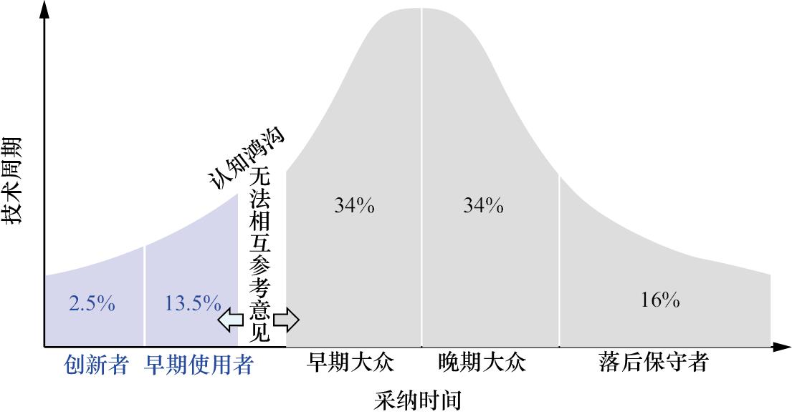

技术采用的生命周期图

模型显示，新技术出现时只有约 2.5% 的创新者会率先使用，他们远见卓识，如创业者、投资人、专家学者。随后约 13.5% 的早期使用者加入，他们思维开放、乐于尝鲜。对大众占 68% 的实用主义者只在感受到实惠后才跟进，而那时蓝海已成红海。还有约 16% 的保守落后者抗拒新事物，最终会被淘汰。

目前 AI 仍处早期阶段，你能主动拿起这本书，说明你属于前 2.5% 的创新者或 13.5% 的早期使用者。危险与机遇并存，**AI 再强也只是工具，懂得驾驭 AI 的人更强。** 很高兴你能拥抱新技术，用先发优势夯实基本盘，立于潮头。

在这段探索 AI 世界的旅程中，希望能成为你的良师益友，助你跨越知识鸿沟，进入智能化世界。

准备好了的话，我们一起进入 AI 时代吧。

# 第一章
# 读懂 AI：能力从何而来

如果你已是 AI 资深用户，对原理和获取渠道不感兴趣，可以跳过本章，直接从第二章实操方法论开始。若你是新手，认知不够深入，**强烈建议先补基础。** 知其所以然，才能知其然，这些背景知识对掌握用法帮助很大。

**☆ 本章要点**

1．AI 是什么
2．AI 的能力来源
3．主流 AI 工具有哪些
4．如何挑选 AI 工具

### 1.1
## AI 的定义是什么

人工智能 Artificial Intelligence，简单说就是让机器模拟人类智能的技术，让计算机像人一样思考行动，甚至超越人类。从应用角度，大致可分三类方向。

● “能听会思”以自然语言处理为主，让 AI 听懂人类表达并交流。
● “会看会说”以计算机视觉、语音合成为主，让 AI 能开口、识别物体，如刷脸开机支付属于视觉范畴，机器人播报属于语音合成。
● “能动会做”以机器人技术为主，让 AI 智能操作物体，如仿生机器人、自动驾驶、工业机器人等。

ChatGPT 等大语言模型走的就是“能听会思”的路线，即自然语言处理。你可能会好奇，自然语言处理到底是什么，这些工具的能力是怎么实现的。

### 1.2
## AI 的能力是怎么形成的

要理解底层原理，需要先掌握两个关键概念。

**1．机器学习**

机器学习的底层原理类似考前刷题。很多题不会做，但大量刷题后会摸到规律和技巧，从而迁移到新题上。计算机“刷”的不是试卷而是数据。把数据喂给机器，在学习机制下，它会反复练习，掌握数据规律与特征。**这就是机器“学习”的过程。**

在这种机制下，只要训练数据量足够大，训练次数足够多，AI 就能在特定语境下实现类似“文字接龙”的预测，给出语义通顺、逻辑自洽的回答。

例如输入“我饿了，我想吃”，模型很可能接上“饭”，因为在海量语料里“想吃饭”出现频率远高于“想吃粑粑”等其他搭配。

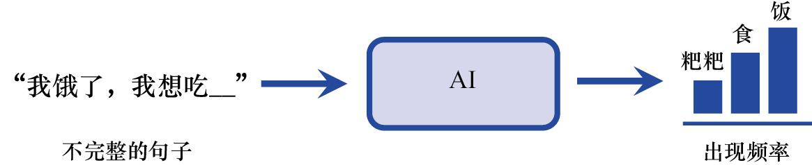

从原理看，只要训练数据足够大，AI 可以在任意语境下完成“文字接龙”。正如概率学家埃米尔·博雷尔的例子：猴子在打字机上无限敲打，最终也可能打出莎士比亚全集。这就是“大力出奇迹”的涌现效应。

使用 ChatGPT 时会明显感觉到它一字一字打出，这正是基于语境按规律进行文字接龙的过程。

即便能生成通顺文本，靠“文字接龙”也无法保证回答符合期望。比如问“世界上最长的城墙是哪座”，AI 除了答“万里长城”，也可能反问“你能告诉我答案吗”，或说“我知道，但不告诉你”。这些在对话逻辑上成立，却偏离了用户期望。若不考虑需求而答非所问，就会变成“人工智障”。

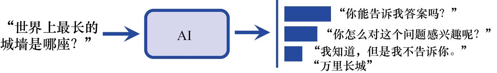

为避免答非所问，研究者引入人类参与，让人类对问题给出期望答案，再把这些人工标注数据交给模型学习，引导它朝人类期望的方向进行文字接龙，输出人类认为正确且有用的内容。

这个引导过程在机器学习里称为“有监督指令微调”。经此训练，可得到一个相对简易的 ChatGPT 类模型。

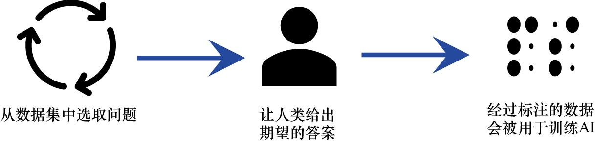

不过人类时间和精力有限，世界知识浩瀚，完全靠人工标注成本极高且不现实。机器的时间和精力是无限的，能否让机器自监督自纠正？可以。这就引出第二个概念。

**2．强化学习**

强化学习也是机器学习的一种，它能从人类反馈或交互环境中获得奖励惩罚，促使 AI 做出更合适的行为。具体做法是先用人工标注数据训练一个专门监督回答的模型 Reward 模型，用人类评分标准给 AI 答案打分。回答好就鼓励，回答差就批评纠正，AI 从中学习人类评分标准。

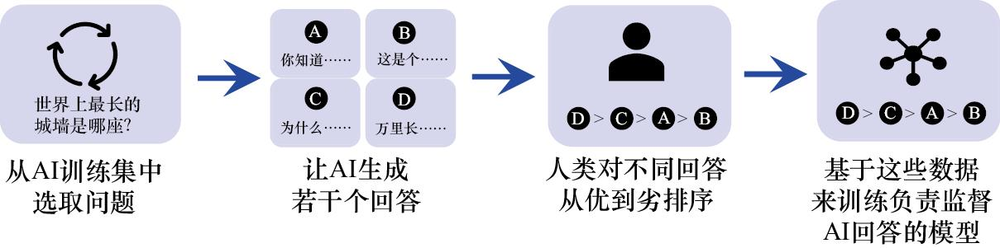

在该模型的监督反馈下不断调整优化，AI 会逐步产出更优质、更有特点的回答。

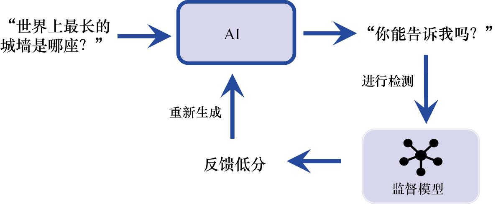

几年前击败李世石的 AlphaGo 就用了强化学习技术，它通过自我对弈提升棋艺，成为围棋高手。

从最初的文字接龙，到人类干预引导，再到机器自我迭代优化，加上海量训练数据，能力在不断训练中涌现，于是我们看到了近乎全能的“百晓生”。

AI 训练涉及大量复杂细节，这里仅做原理概括。若对技术细节感兴趣，可进一步查阅资料。

孔子说“工欲善其事，必先利其器”。了解能力原理后，我们看看 AI 赛道上有哪些主流工具。

### 1.3
## 现在有哪些主流 AI 工具

ChatGPT 爆火后，很多人一提到 AI 工具就只想到 ChatGPT。实际上 AI 工具范围很广，ChatGPT 只是其中一种。除文本生成，还有图像生成处理、音频生成处理、视频生成处理等。

如果只盯着一两个工具，就会因树木不见森林，无法发挥多款工具协同的优势。

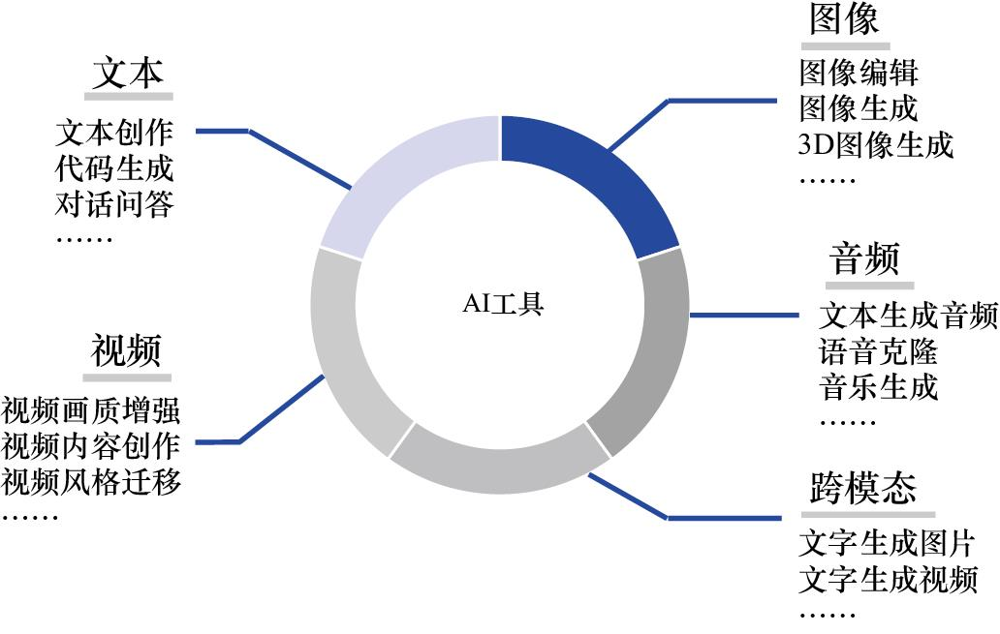

想用好 AI，高效释放生产力，需要更高视角。**不局限于具体工具，以结果为导向，方法与运用能力高于工具本身，你才能学到底层思维。正所谓一通百通，这也是本书想要呈现的。**

当前 AI 工具大致可分为两大类：通用型和专用型。

**1．通用型 AI 工具**

通用型工具依托通用大模型，如 OpenAI 的 ChatGPT、Google 的 Bard ^(¹)、百度的文心一言、科大讯飞的讯飞星火、KIMI 和智谱清言等。目标是通用人工智能 AGI，即洞悉一切领域的“百晓生”。

但目前技术尚未达到强 AI，通用大模型虽能处理各类问题，在特定领域、特定行业的表现却不算出色。就像周鸿祎所说，非专业人士看 ChatGPT 会惊艳，行内人审视会觉得很肤浅。

于是市场出现很多垂直应用，即面向特定场景、特定行业的 AI 工具。

**2．专用型 AI 工具**

典型的专用工具如专门做绘画的 AI、专门做音视频制作的 AI，或医疗专用、教育专用、办公专用 AI，甚至细化到只写公文、只写报告的 AI。

这类工具聚焦特定领域，用领域数据训练优化，相较通用工具在特定场景下表现更佳。

本书后续介绍实操时以 ChatGPT 等通用工具为主，也会涉及大量专用工具，帮助读者实现协同。

### 1.4
## 怎么挑选 AI 工具

市面上的专用工具很多，具体推荐放在后续章节。这里先讲本书使用的核心工具，即大家熟悉的通用工具。目前通用工具主要分国内和国外两大阵营。

● 国内阵营：百度文心一言、阿里通义千问、科大讯飞讯飞星火、腾讯混元等。
● 国外阵营：OpenAI ChatGPT、Google Bard、Anthropic Claude、微软 New Bing ^(²) 等。

国外起步早，好用的通用工具更多。但国内工具也有价值，原因有二。

● **使用便捷性。** 国内工具在中文处理上更有优势，国外工具虽强，用起来却比较麻烦，若想随时随地用需耗费精力。
● **协同配合。** 很多 AI 场景涉及大量创造性工作，需要的往往不是大而全的内容，而是点子与灵感。而且部分工具因训练数据问题会出错。此时可引入多款工具，同时提问，让它们给出不同方案，再汇总参考。

因此建议搭配使用通用与专用工具，并结合多种通用工具。不同工具各有适用场景，哪怕能力只是及格，也值得尝试。多一个工具就多一个助手、多一个信息源。

获取方式很简单，国内大模型基本都已开放，官网注册账号即可使用。

文心一言：https://yiyan.baidu.com

讯飞星火：https://xinghuo.xfyun.cn

通义千问：https://qianwen.aliyun.com

360 智脑：https://ai.360.com

腾讯混元：https://hunyuan.tencent.com

字节豆包：https://www.doubao.com

智谱清言：https://chatglm.cn

昆仑天工：https://tiangong.kunlun.com

百川大模型：https://www.baichuan-ai.com

Kimi：https://kimi.moonshot.cn

海外工具的拿取方式本书不展开，完整路径和常见问题的解决都在资料包里收好，有需要的朋友扫码回复 1111 即可拿到。

# 第二章
# 提问心法：让模型真正听懂你
上一章把基础原理和常用入口梳理清楚了。打好底之后，本章开始进入实操。模型本质上是放大器，用得好事半功倍，用得差则流于表面。就像做菜靠厨师，对食材的理解和手法决定成品。本章聚焦基础用法，教你怎样与类 ChatGPT 的模型对话，拿到更有价值的结果。

如果你对提示工程还很陌生，或者只停留在入门阶段，这一部分会让你直观感受到提问方式对输出质量的拉动。

☆ 本章要点
1．提示工程在讲什么
2．怎样构建高质量指令
3．四种省力的提问写法

## 2.1
## 提示工程的由来
刚接触模型时很容易失望。想要专业建议，得到却是一堆看似正确实则空洞的套话，反而检索网页更快。

问题不在于模型没有能力，而在于交流方式不对。维特根斯坦说过，语言所能抵达的范围就是思想的边界。与人、与机之间的沟通都依赖语言中介，没有编程语言就无法驱动电脑。

和模型对话也是同理。模型在已有语境下做文字续写，所以产出高度依赖提示工程。

提示工程像在理发店点单。你说“我想剪个分头”，这就是一条指令。理发师能懂，但未必能剪出你想要的效果。

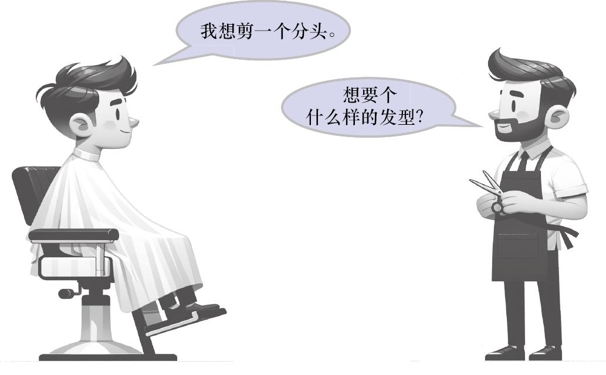
除非要求剃光头，否则要满意就得把细节说清。分头是二八、三七还是中分？长度要多少？留不留刘海？要不要打薄？信息越具体，师傅越能把握意图，成品越接近预期。

把需求拆解清楚传递给对方的过程，就是提示工程。通俗讲，是通过精心设计输入信息，引导模型按意图产出准确、有针对性、高质量回答的语言技巧。

指令写差了，模型就堆砌正确废话；写好了，效果会很惊艳。OpenAI CEO 萨姆·奥尔特曼也强调过，写指令是一项高杠杆技能。

那么要怎样训练这项能力？

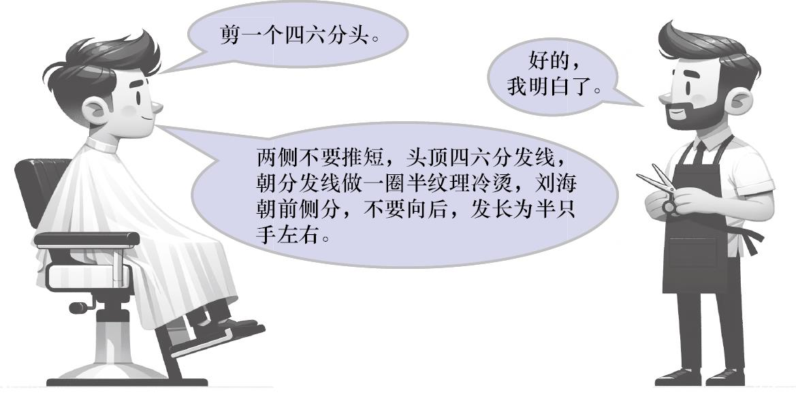

## 2.2
## 高质指令的搭建思路
综合大量资料和实践，我提炼出一个易用的框架：**优质指令 = 设人设 + 交背景 + 锁目标 + 补限制。**

先用一个对比感受框架与否的差距。

不套框架
问：帮我做一份海南行程。
结果是泛化模板，城市景点罗列、美食一句话、住宿建议模糊，缺少预算、人次、天数、偏好等个性化要素。

套框架
问：计划去海南，预算一万元，三人同行，七天行程，请以资深向导身份制定方案。
补充：
1．行程偏轻松，不求紧凑；
2．避开网红打卡地，优先有文化底蕴的场所；
3．每个景点列出票价。
这时模型给出的方案明确了天数、预算、人次，语气像向导，推荐了文昌阁、省博物馆等并附价格，实用性明显提升。

想看完整版，可通过右侧二维码发送 2111 查看。

下面拆解框架的使用方式。

**1．设人设**
设人设就是先给模型一个身份，让它进入合适语境，并以该领域专家视角作答。如旅游让它担任资深向导，写作困惑让它担任写作教练。

为何要先设人设？看海南行程的例子，同一问题，有无身份设定答案差异很大。

未设身份的产出松散，景点选择随意，信息密度低。
设了身份后，模型立即进入向导视角，安排更具体，语气更有温度，细节更落地。

原理在于模型靠概率预测下一个词。先告知“你是向导”，旅游相关词的概率会被放大。就像《天龙八部》里的王语嫣，知识面太宽反而杂乱，限定领域后建议才有针对性。

因此提问的第一步是先给模型加个 Buff，再交代需求，优质答案概率会大幅提升。

如何叠加 Buff？
1）明确定位。直接告知“你现在是××”，身份可以是作家、历史学者，也可以是金庸或中国式家长，按需求自定。
2）补充特征。可进一步描述技能。
例如：你是一名专业向导，精通各目的地特点、擅长按客户偏好定制计划、会合理安排行程并规避风险、服务热情。
复杂任务时此步很有用，简单场景可省略。

还能反向给自己加身份。如问流感，普通提问得到科普；若先说明提问者是病毒学在读研究生，得到的就是更专业的学术视角。

涉及专业领域时，自设身份能让答案更贴合需求。

**2．交背景**
交背景即把与问题相关的情境说清楚，帮助模型理解全貌。

回到海南例子，不说明预算、人次、天数、偏好，模型无法定制。礼物推荐同理，先说明对方年龄、性格、爱好，推荐才会准。

背景复杂时可用 5W2H 梳理：
What 事何事？Why 为何做？Who 面向谁？When 何时？Where 何地？How 如何执行？How much 预算/数量/质量要求？

用它来描述旅行背景或送礼背景，会更清晰，模型也更容易抓住要点。

# 让模型真正听懂你：提示词的拆解与进阶写法

聊送礼，先把细节厘清，后续的表达才会顺。送礼能归纳为四条自检线。

时间线，要先确认是否有固定节点或档期，准备周期预留多久才比较稳妥。
空间线，要判断是居家、办公、线上交互还是线下现场，物流与配送是否需要提前安排。
执行线，要想清楚是当面赠予、邮寄送达还是电子卡片，有没有包装、贺卡等配套，文化习俗上是否有限制。
成本线，整体花费的大致区间要先定下来。

**3．明确任务目标**

设定目标的核心就是把你要让助手完成的事项、具体诉求和期望交付物讲明白。

以旅行规划为例，你可以这样描述：你是一位经验丰富的领队，我想去海南度假，预算一万元，三人同行，七天行程，请给我一份完整的方案。

送礼场景亦然，可以直接要求列清单并设计氛围。比如：你既懂选品又懂情感沟通，七夕临近，我想给女朋友挑选礼物，她是文静感性的文艺类型，请推荐十款价格合理又能制造惊喜的选项，并策划一场浪漫的七夕布置。

无论是问答、写作、归纳、翻译、查资料还是脑暴，模型都能胜任。目标设定卡壳时，可借用SMART的简化版SMAR，只用前四项。

具体。描述要避免空泛。“写一首情诗”太模糊，改成“写一首约一百字的莎士比亚式情诗”才清晰。
可量化。目标最好能计数。比如“画一幅长宽比为四比六、剪影手法的海上黄昏”比“画幅合适”更可控。
可落地。要结合当下能力。直接让模型写一百萬字的长篇不现实，改成“基于已有素材给出小说的大纲”才可行。
相关。所有要求都要紧扣主线。比如要做一场主题为“AI新时代”的演讲，给企业主和高管听，内容必须覆盖当下高速演进态势、对社会的冲击、已落地与即将落地的应用、国家层面的支持与期待，以及号召重视与应用五条主线，风格口语化、通俗易懂，引用权威金句与生动案例，篇幅控制在两千至两千五百字之间。

**4．补充限制条件**

这一步是告诉模型在生成时要避开什么、遵循什么。

旅行例子里，可以补充偏好：行程不要太紧凑，保持松弛；避开网红打卡点，多推有历史沉淀的文化地；每个景点附上门票价目。

送礼例子可补充：单价不高于一千元；每款附参考价；推荐与策划时兼顾对方文静感性的特质。

除了注意点，还可以约定语气、范围、格式与输出形态。

规定语气示例
你：最近熬夜严重，请用幽默的口吻劝我早睡。
模型会用调侃的方式提醒。
你：请用严肃的口吻劝我早睡。
模型会正经强调健康。
你：请用温柔的口吻劝我早睡。
模型会用体贴的语气建议休息。

规定语气示例二
你：请用科普、诗歌、幽默三种风格分别解释量子纠缠。
模型会按三种风格分别呈现。

● 用微信扫描右侧二维码并回复“2114”，查看此场景下生成结果。
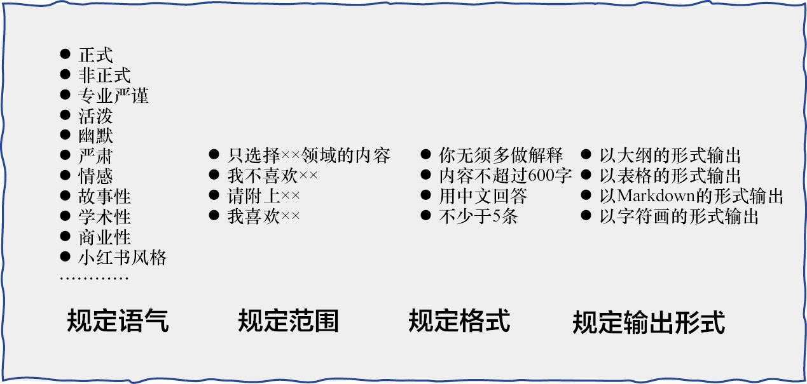
当然也能限定回答边界。

你：请用《聊斋志异》故事来解释经济学供需关系。
模型可用《促织》说明需求大于供给时价格上涨等。
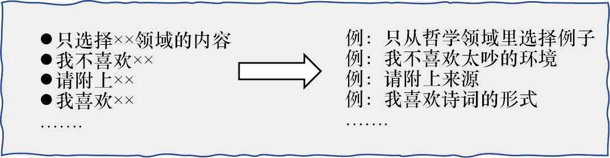
你：请用《聊斋志异》故事举例说明供需关系，不少于六个。
模型会罗列多个案例。

也可以限定格式，如要求表格输出，含序号、来源、案例、解析四列。

● 使用微信扫描21页的二维码并回复“2115”，查看此场景下的完整结果。
总之，你可以告诉模型想要与不想要的效果，像作文要求一样，通过限制让结果更贴合需求。

作文：以“你听，多美”为题写作。
要求：不另拟题、不透露个人隐私、立意自定、文体自选、不低于八百字、不抄袭。

定角色、述问题、定目标、补要求，构成完整的提示词框架。熟练后很好用。

套用到旅行案例，完整表达是：角色为导游，问题为海南七日游预算一万三人，目标为给出攻略，限制为行程轻松避开网红点附门票价。

送礼案例同理可推。
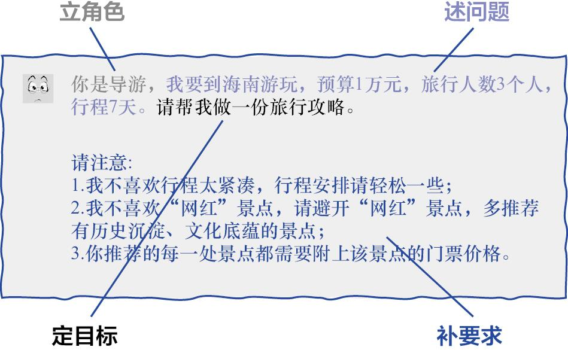
送女朋友礼物的案例也是如此。
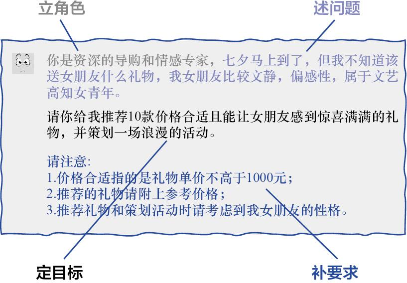

示例一：设计试听课提纲
你：假如你是一名架子鼓培训师，需为招生准备一节面向八到十二岁孩子及家长的试听课，请给出提纲与内容。注意时长四十五分钟，穿插互动。

示例二：模拟面试
你：请扮演产品经理面试官，我是应聘者。请遵守规则：只问岗位相关问题、不做多余解释、按顺序提问等待答复。

示例三：辅助工作
你：我司准备进入大模型赛道，对市场局势不熟，请扮演数据挖掘与分析专家，收集分析报告。要求用中文、表格呈现、并给出洞见。

绘画任务也能用该框架。
你：你是资深平面设计师，请生成一幅老师给学生讲人工智能课程的画面。要求：课堂教学场景、老师手持教棍指向黑板、黑板上有“AI”、风格为写实科幻。

● 用微信扫描21页的二维码并回复“2116”，查看此系列场景的完整信息。
按框架写提示词，回答质量会明显提升。需求简单时不必完全套用，问题说清直接说明要做什么即可。

“请把下面内容译成简体中文。”
“请为这段内容做摘要。”
“请用十岁孩子能懂的话解释ChatGPT。”

框架要素顺序可灵活调整，前三个要素可互换。

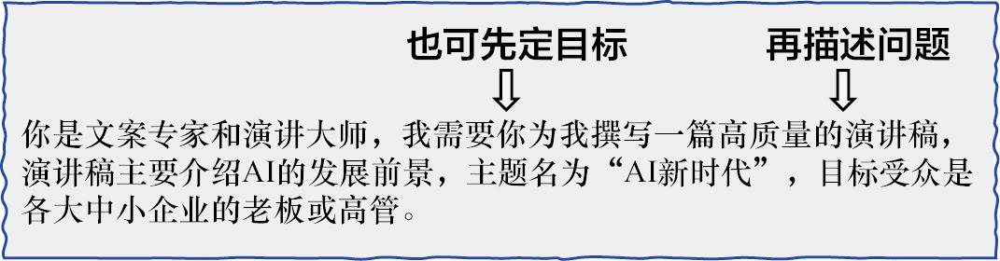
到这里，优质提示词的写法就介绍完了。虽然有了通用框架，实操仍有学习成本。接下来分享四种更省心的写法。

## 2.3
四个更轻松的提问法

1．样本提示词

想剪发型却描述不清，就像把效果图给理发师看。样本提示词就是这种思路。脑中有目标但表达困难时，给模型一个样本让它学习结构、逻辑、语气与形式，再依样创作。

比如写广告词，可给出几个例子让它模仿风格。
你：请按下面Example的广告风格，生成十条每条少于26字的房地产广告词。
Example1：你可以继续漂泊，但爱情不同意。
Example2：别让这座城市，只留下你的青春，却留不下你。
Example3：故乡里的骄子，不该是城市里的游子。
模型会生成同风格的文案。

长文模仿也可行。比如让模型学习小红书种草文风格与结构，再按参数创作鹿邑老子故居的旅游攻略文案。

● 用微信扫描21页的二维码并回复“2117”，查看此场景的完整信息。
掌握样本提示词后，很多需求不需要自己设计提示词，给出样本一句话就能交代清楚。

2．自提示技巧

自提示就是不自己想提示词怎么写，而是把问题抛给模型，让它帮你梳理需要互动的关键点，再生成更精准的提问。

比如想让模型写一封深情有温度的情书，却不知需要哪些要素。你可以问：七夕快到了，我想请你帮我写封情书。若要达到深情且有温度，我该从哪些方面与你互动？请梳理问题并生成更好的提问提示词。
模型会列出关系、回忆、细节等关键点。

同样可迁移到其他领域。比如提升写作水平，可让模型先提问了解你的起点与目标，再据此定制学习计划。

● 用微信扫描右侧二维码并回复“2118”，查看此系列场景的完整信息。

自提示适合目标模糊、提不出关键问题的场景。更进一步的玩法是让模型自己问自己再自己答，像左右互搏。

你：你的任务是在老师和学生两种角色间切换。我指定角色。当指定为“学生”时，你基于我给的主题进行高质量提问；当指定为“老师”时，你以专家身份回答学生的问题，回答要有深度且通俗易懂。请直接进入角色，不要重复指令。
作为学生，目标是“提升写作能力”。现在开始提问。

模型会先提问如何组织思路与结构、如何增强说服力等，然后在老师角色下给出方法，再回到学生提问词汇与表达的问题，如此循环。

掌握这套思路，提示词的门槛会大幅降低。

**词量与表达：写作的基本盘**

词汇的积累与语言表达的精准度，是提升写作能力的核心支点。以下思路可帮助你系统扩充词库、优化语言质感。

（后续生成内容略）

● 用微信扫描 27 页的二维码并回复“2119”，查看此系列场景下 AI 生成的完整信息。

从原理上看，自提示技巧是可以循环使用的，直到把目标问题拆解清楚。熟练之后，甚至能引导 AI 自己向自己发问，从而加速产出节奏。

需要提醒的是，自提示虽然大幅降低了提问难度，看似不费力就能拿到不错的问题与答案，但我更建议亲手写提示。因为这种方法上手快见效快，也容易让人过度依赖，久而久之提出好问题的能力会被削弱。

3．框架提示法

各行业各领域里，绝大多数难题都有前人总结好的方法论。框架提示法的思路是，不再从零造轮子，而是让 AI 直接调用成熟的分析框架来解决当前任务。

比如要写一份报告，自己逻辑混乱，不知道怎么优化提示，就可以用表达领域的经典模型——金字塔原理，让 AI 按该模型执行，而不是自己琢磨表述。

你：请依据金字塔原理，为我撰写一篇关于高效向上汇报的新媒体文章。

AI：好的，下面是我按照金字塔原理撰写的稿件。

（后续生成内容略）

除表达外，营销、战略等方向也有大量现成框架，如 4P、4R、4C、SWOT、STP 等。引入这些框架不仅省去反复打磨提示词的时间，也能明显提升 AI 输出的专业度。

有人会担心，使用框架需要一定知识储备，不知道对应问题有哪些模型可用，那岂不是难以开展？确实，没有积累就难以调用。

不过有了 AI 辅助，这个障碍很容易被化解。遇到陌生领域，可以先让 AI 盘点该行业常用的模型，再从中挑选合适的进行提问。

以营销为例，对模型一无所知时，可以先让 AI 做一次梳理。

你：请汇总营销领域常见的十个模型，例如 SWOT、4P 等，做成表格并附上简要说明及适用场景。

AI：谈到营销领域的常用模型，以下是十个常见模型，包括 SWOT 和 4P，并附有简要介绍和用途。

（具体生成内容略）

更进一步，还能直接让 AI 推荐可用工具。

你：我想做一个产品分析，请问可以用到哪些商业分析模型？

AI：在进行产品分析时，可以使用以下商业分析模型来帮助你获得全面的洞察和决策支持。

（具体生成内容略）

即使某些方向缺乏成型的经典模型，也可以请 AI 输出一套分析维度。

1．请列出评价一部电影可以参考的维度。
2．请列出评价一家酒店可以参考的维度。
3．请列出完成一份优秀的 PPT 可以参考的维度。
4．请列出完成一份产品的市场调研报告可以参考的维度。

…………

● 用微信扫描 27 页的二维码并回复“2120”，查看此系列场景下 AI 生成的完整信息。

在 AI 辅助下引入成熟框架或完整维度，就能获得接近专家顾问级别的建议。

4．引导提示法

AI 的底层是海量数据训练，它像一位博闻强识的百晓生，只是没有提示就不知道该调用哪个知识库、朝哪个方向生成。

基于此，如果不想写长篇提示做背景补充，也可以像与朋友聊天那样，先抛话题把 AI 带入主题，再布置具体任务。

比如要做一篇小红书爆款，除了样例提示，还可以用引导法。

你：你知道小红书吗？

AI：是的，我知道小红书，小红书是……

你：那么你知道小红书上的优质爆款内容都有什么特点吗？

AI：当然，小红书上的优质爆款文章，通常具有以下特点。

（具体生成内容略）

你：很好，请你按照小红书的调性，为我生成一篇有关××的爆款文章。

AI：好的。

（后续生成内容略）

同理的其他场景：

你：你知道一份优秀的工作周报通常具备哪些特点吗？

AI：是的，一份优秀的工作周报通常应具备以下几个特点。

（具体生成内容略）

你：很好，请你根据我的以下情况，结合你总结出来的要点，为我写一份优秀的工作周报。

AI：好的。

（后续生成内容略）

以上是四种常用的提示方法。把万能提示词框架与这四种方法结合，提示工程水平就能进入第一梯队。

# 第三章

# 学会调教：如何获得更高质量的答案？

上一章讲了如何提问、如何拿到高质量的 AI 答案。但实际交互中，模型输出往往与预期有偏差。

任务越复杂、期望越深入，仅靠一次好提示是不够的。人与人的沟通也需要反复讨论，AI 交互同样如此。

本章介绍如何通过调教，提升答案质量的策略与方法。

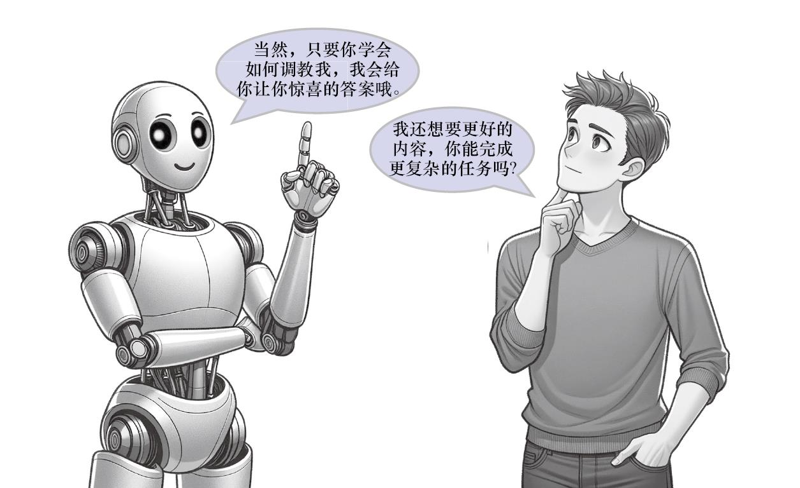

☆ 本章知识要点

1．理解调教 AI 的原理。
2．掌握调教 AI 的四大指令。
3．了解调教 AI 过程中的一些注意事项。

### 3.1

## 调教 AI 的原理

得益于自注意力机制和 Transformer 等网络结构，当前 AI 能够捕捉对话上下文的关联。也就是说，**AI 会记住之前说过的内容，并在此基础上针对性地回应后续问题**，产生类似真人对话的效果。

因此，我们可以通过持续喂数据、给指令的方式对 AI 进行训练，逐步引导它给出更具体、更深入、更有价值的回复。

## 3.2

## 如何对 AI 进行调教？

归纳出四种调教手法，可解决不同类型的输出问题。

1．第一个指令：继续指令

继续指令的核心作用是帮助突破厂商对输出量的限制，让内容不受人为截断。AI 大模型训练成本高昂，出于算力与成本考虑，各家厂商都会限制生成篇幅并倾向概括。

比如 ChatGPT 单次生成上限约 4096 个字符，超了就会被强制截断。

在篇幅与概括性双重限制下，AI 一次性交付的内容常显得不够饱满。继续指令就能绕过这一限制，**让超过 2048 个字的内容继续产出，或对首次回答不足之处进行细化**。

以旅行攻略为例，输出到限额即停，此时可用继续指令让其补全。即使内容完整，也能用继续指令要求对不够深入的点展开。

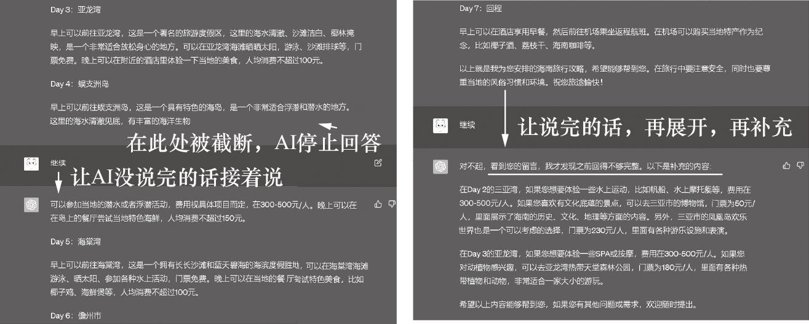

上面只是最基础的用法，继续指令还可以用在追问上。如果首次回答不充分，就在原有结果基础上追问，逐步拿到完整信息。

以上一章提到的试听课课程设计为例，对第三点表述不清，就可追问让 AI 展开说明。

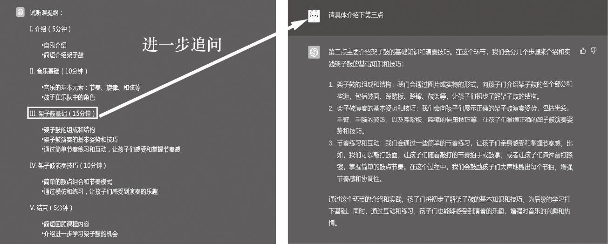

追问时，还能叠加之前学过的补充要求技巧。比如不理解和弦作用，就直接让 AI 用通俗易懂的方式解释什么是和弦。

在持续追问的机制下，按 AI 首次给出的框架逐项深挖，再把追问成果拼回主框架，就能拼出一份几乎由 AI 完成的课程大纲。最后把语言换成自己的风格，梳理逻辑并润色即可使用。

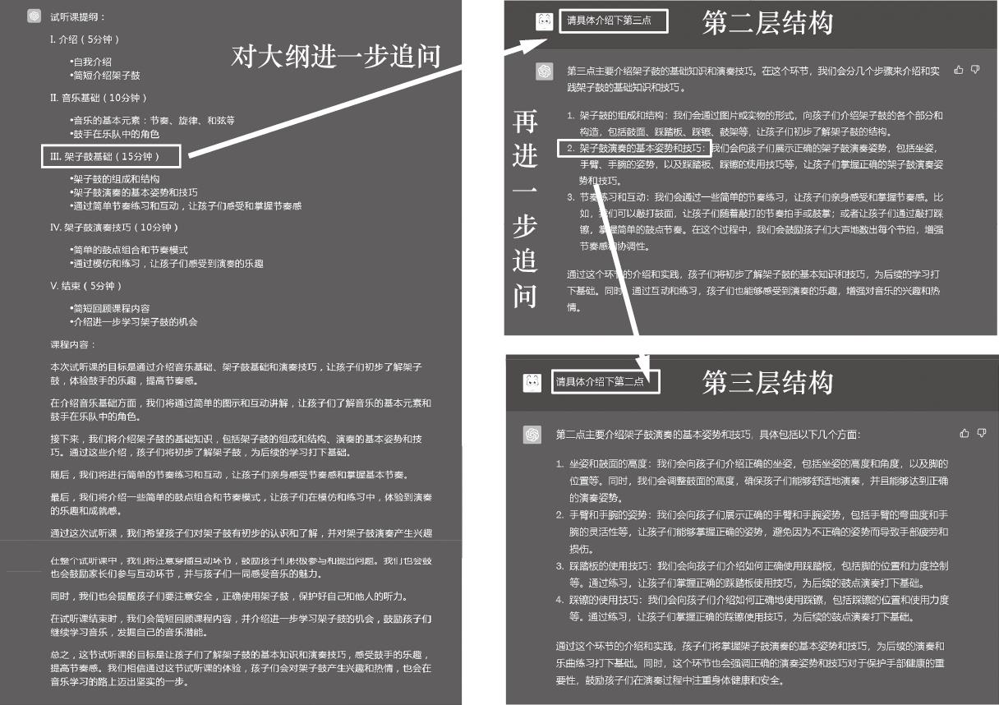

所以遇到首次生成不完整时，用继续指令和追问打破砂锅问到底，就能让内容从骨架逐渐长出血肉。

2．第二个指令：奖惩指令

继续指令解决的是答得不够的问题，奖惩指令解决的是答得不好的问题。受表达局限或思维局限影响，AI 输出并非总是满意，甚至会出现跑偏。

奖惩指令的逻辑类似教育孩子：**做得好要及时表扬，鼓励更好；做错要指出，给予纠正反馈**。在反复奖励与惩罚下，行为会趋向理想。

调教 AI 亦然。对满意的内容用肯定词如“很好、非常好”给予正向反馈；对不合要求的内容用否定词如“不对、你错了、我不满意”给予负向反馈。

多次奖惩对话后，答案会从不合格变为合格乃至优秀。

你：请扮演专业导游，帮我规划一次海南 7 天 3 人出行，预算 1 万元。

请注意：
1．行程别安排得太满，要轻松舒适；
2．避开网红打卡地，优先推荐有历史文化底蕴的地点；
3．每个推荐景点请标注门票价格。

AI：海南是一个兼具历史与文化底蕴的美丽地方，您的预算为 1 万元，行程 7 天，人数 3 人，我将为您安排轻松的行程，避开网红景点，重点介绍历史文化景点，并为每个景点提供门票价格。以下是您的海南七日游攻略。

（具体生成内容略）

你：餐饮 2000 元的支出你没有说明白，请在这个预算的基础上，推荐一些当地特色美食，以及纪念礼品，并附上参考价格。

AI：非常抱歉没有详细说明餐饮和纪念礼品支出。以下是在餐饮和购物方面的建议，以及参考价格。

（具体生成内容略）

你：很好，请把餐饮建议和购物建议，根据最初攻略的各个地点，加到整个旅行攻略里。

AI：当然，以下是更新后的海南七日游攻略，包括餐饮建议和购物建议。根据各个地点的具体情况……

（后续生成内容略）

● 用微信扫描右侧二维码并回复“3111”，查看此系列场景下 AI 生成的完整信息。

3．第三个指令：思维链提示

要理解思维链提示的效果，先理解思维链本身。

在第一章提到，AI 的百晓生能力来自海量数据训练。**它并不具备人类式的计算与推理，能力本质是大力出奇迹**。

因此涉及推理的问题，AI 可能给出基于数据库的答案，而非真正推算。一旦推理所需信息超出现有数据，就容易出错。

你：食堂原本有 23 个苹果，如果他们用了 20 个苹果做午餐，又买了 6 个苹果，他们一共还有多少个苹果？

AI：答案是 27 个。（错误）

注：此案例仅作为示范，经过升级后，目前的 AI 已经可以解决这类简单推理问题了；但是面对大部分复杂场景，如果不运用一些技巧，AI 的表现仍然很差劲。

对需要逐层推理的任务，思维链就能发挥作用。把解题步骤显式写出，引导 AI 按步展开。

你：食堂原本有 23 个苹果，如果他们用了 20 个苹果做午餐，又买了 6 个苹果，他们一共还有多少个苹果？

你可以这样思考：
1．食堂原本有 23 个苹果；
2．做午餐用去了 20 个，即 23−20；
3．又买了 6 个。

AI：答案是 9 个。

可见，AI 顺着提示的推理链条，最终给出正确结果。

在交互中，思维链解决的是推理能力不足的问题，通过人工干预促使 AI 自行推演。

应用思路是：遇到棘手、多环节的任务，不要直接丢一个空泛的大指令，而应引入思维链，把大任务拆成步骤，引导 AI 逐层思考。这种化大为小的做法能明显提升精度。

比如做中国考研情况数据分析报告，就可以通过思维链引导思考与推理，提高精度并控制输出方向。

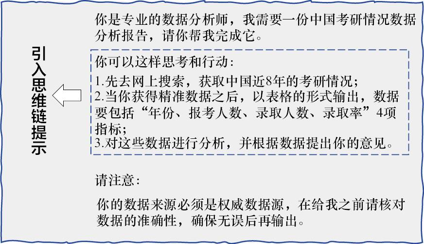

● 用微信扫描 35 页的二维码并回复“3112”，查看此系列场景下 AI 生成的完整信息。

4．第四个指令：逆调指令

逆调指令指换一种表达方式下达提示，以绕过 AI 的惯性规则，获取被厂商阉割或难以精准描述的内容。

AI 能力越强，监管越严，厂商给模型加上各种紧箍咒。正常提问时，很多需求拿不到，或输出莫名其妙。逆调指令就是用来解决因限制或表达局限导致答案不佳的问题。

用法核心是逆向思维：**正面问不到，就反面问；反面也不行，就侧面问**，不断变换问法直到满意。

例如让 AI 写诗，正向思路是描述主题、形式、风格、语言。

你：你是浪漫主义诗人，请创作一首以爱情为主题的诗。请确保：
1．诗句押韵；
2．整体基调深情细腻；
3．语言偏向古典。
若理解任务，请开始创作。

AI：月光轻抚窗棂，我心随夜风起伏。
对你的眷恋化作文字，谱成一首情歌。
绵长思绪如流水，温柔地拂过心湖。
…………

另一种写法是反向限定，不说想要什么，说不想要什么。

你：你是浪漫主义诗人，请创作一首以爱情为主题的诗。请确保：
1．诗歌不应该是自由诗；
2．风格调性不应该是欢乐的、轻浮的；
3．语言不应该是现代的、通俗的。
若理解任务，请开始创作。

AI：在黄昏的柔美下，我缱绻思念，
如同远古的风，翻涌着爱的涟漪。
心灵的翅膀展开，飞过星辰和海洋，
穿越时光的轮回，寻觅那份永恒。
你是我诗篇中的句读，抚慰我灵魂的旋律，
你是我眼中的明月，映照我心底的真情。
…………

其他场景同样适用。如问孩子学钢琴有哪些好处不满意，可逆向问如果让孩子放弃学钢琴，有哪些坏处。

正向提问

你：孩子学钢琴有哪些好处？

AI：孩子学钢琴有许多好处，包括音乐方面的和认知发展方面的。以下是一些主要的好处。

1．音乐技能发展：（具体生成内容略）
2．手眼协调性：（具体生成内容略）
3．集中注意力：（具体生成内容略）
4．创造力和表达能力：（具体生成内容略）
5．自信心：（具体生成内容略）
6．耐心和毅力：（具体生成内容略）
7．社交互动：（具体生成内容略）
8．认知发展：（具体生成内容略）

总之，学习钢琴对孩子的综合发展有很多好处，不仅培养了音乐才能，还有助于提高认知能力、社交技能和情感表达能力。此外，音乐也可以带来乐趣和满足感，使孩子在学习的过程中感到愉悦和满足。

逆向提问

你：如果让孩子放弃学钢琴，有哪些坏处？

AI：让孩子放弃学钢琴可能会带来一些潜在的坏处，这些坏处可能会因个体差异而异，但一般来说，以下是一些可能出现的不利影响。

1．失去艺术和文化体验：（具体生成内容略）
2．失去音乐技能：（具体生成内容略）
3．失去自信心：（具体生成内容略）
4．缺乏毅力和耐心：（具体生成内容略）
5．失去潜在的就业机会：（具体生成内容略）
6．失去创造性表达途径：（具体生成内容略）
7．影响学术表现：（具体生成内容略）

然而，需要注意的是，是否让孩子继续学习钢琴应该根据孩子的兴趣和天赋、家庭的需求和其他因素来权衡。有时候，如果孩子对……

● 用微信扫描右侧二维码并回复“3113”，查看此系列场景下 AI 生成的完整信息。

逆向发散的提示词在表达力度上通常会胜过常规写法，容易迸发出让人意外的提问角度。正向推演遇阻时，换成逆向视角往往能打开思路。掌握得越熟练，惊喜的产出就越常见。

前面已经梳理了调教模型的核心逻辑，下面再补充几条落地的注意事项。

## **3.3**
## **调教 AI 的注意事项**

**1．追问时要把对象点清楚**

对话拉长、套问层级变深之后，用续写类指令很容易让模型跑偏，出现答非所问。以前面试听课大纲设计的例子来看，交互轮次很多，语境里出现了多个“第二点”，这时让模型“具体说说第二点”，它就分不清到底指哪一个。

如果目标是展开最初提纲里的第二点，就不能只说“请具体介绍下第二点”，要改为“请具体介绍下提纲中的第二点”这类更精确的指向。

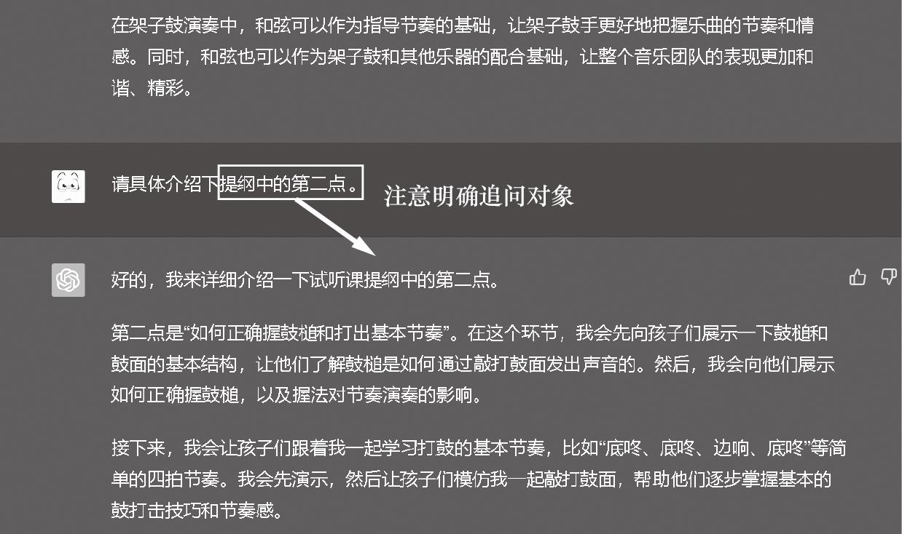

只有把追问对象锚定清楚，模型才不会混淆。在需要反复深挖的场景里，始终把对象点明，能明显提升生成效率。

**2．指令和素材要分开写**

中文表达灵活，指令复杂又未做隔离，很容易让模型把任务和材料混为一谈，导致输出质量下滑甚至错误。比如翻译任务，指令是“把下面句子译成英文”，材料是“尽量用优美的语句”。不做处理，模型会把两者混淆。

**你：**将下面这句话翻译成英文

尽量用优美的语句。

**AI：**"Please translate the following sentence into English， using eloquent language as much as possible."

用符号把待处理内容清晰隔开，模型就能读懂真实意图。

**你：**将下面这句话翻译成英文

"""尽量用优美的语句。"""

**AI：**"Try to use elegant language as much as possible."

因此在提供材料时，务必用标记把指令和内容区分开，避免冲突，让指令更精准。推荐 Markdown 标记，它能像写文章一样把角色、背景、目标、要求分层，极大提升提示的可读性和结构感，也让模型表现更稳定。之前的旅行攻略示例，用 Markdown 书写的提示效果如下。

**Markdown 语法**

## 角色

你是一名优秀的导游，你拥有以下技能。

- 对各个目的地的特点、景点、文化、气候等有深入的了解。

- 擅长聆听客户的要求，能够根据客户的需求和偏好，设计独特而个性化的旅行计划。

- 具备良好的组织能力，能够合理安排行程，预订机票、酒店，安排活动，规避潜在风险，确保整个旅行计划的顺利进行。

## 背景

我要到海南游玩，预算 1 万元，旅行人数 3 个人，行程 7 天。

## 目标

请帮我做一份详细的旅行攻略。

## 要求

1．我不喜欢行程太紧凑，**行程安排请轻松一些。**

2．我不喜欢“网红”景点，请避开“网红”景点，多推荐有历史沉淀、文化底蕴的景点。

**AI 眼中的内容**

**角色**

你是一名优秀的导游，你拥有以下技能。

● 对各个目的地的特点、景点、文化、气候等有深入的了解。

● 擅长聆听客户的要求，能够根据客户的需求和偏好，设计独特而个性化的旅行计划。

● 具备良好的组织能力，能够合理安排行程，预订机票、酒店，安排活动，规避潜在风险，确保整个旅行计划的顺利进行。

**背景**

我要到海南游玩，预算 1 万元，旅行人数 3 个人，行程 7 天。

**目标**

请帮我做一份详细的旅行攻略。

**要求**

1．我不喜欢行程太紧凑，**行程安排请轻松一些。**

2．我不喜欢“网红”景点，请避开“网红”景点，多推荐有历史沉淀、文化底蕴的景点。

可以看出，Markdown 写出的提示分区明确，指令与内容一目了然，对模型而言是结构清晰、逻辑通顺的输入，能大幅提升理解和答案质量。关于 Markdown 的细节本书不再展开，感兴趣可扫描 38 页二维码回复“3114”获取资料包。

**3．优先使用专业表述而非口语**

模型能理解大白话，但处理起来最顺手的是凝练的专业术语。比如涉及股票，自然说法“股票市场的价格会上涨和下跌”容易得到模糊回复，改成专业说法“股票价格会波动”后，理解和输出都会更准。

自然语言：“股票市场的价格会上涨和下跌”。
专业语言：“股票价格会波动”。

自然语言：“请帮我去除标点符号、停用词、数字等，以便我进行后续的分析和处理”。
专业语言：“请帮我进行文本的清理”。

自然语言：“请帮我提取以下文本中的关键词和短语，以便我进行后续的分析和处理”。
专业语言：“请帮我进行以下文本的关键词提取”。

在没有自我意识前，模型本质是机器，最擅长处理程式化的专业语言。面向特定行业时，用专业话术提问效果更好。

**4．注意上下文的干扰**

模型具备多轮记忆和关联上下文的能力，但同一对话里穿插多个不相关话题时，答案容易被无关内容带偏。若想在一个窗口里切换主题，建议初始化对话，即清空前文再开始。

有两种做法。其一直接开新对话，点界面里的【New chat】按钮，这是最彻底的隔离方式。

其二用提示词主动切断上下文。比如告诉模型结束当前话题、忽略之前内容、用简体中文回答后续问题。

**你：**我现在不想聊这个话题了，请你忽略前面所有的会话内容，让我们开启一个全新的话题，并用简体中文回答我接下来的问题。

**AI：**当然，我们可以开始一个全新的话题。请问你有什么新的问题或者需要讨论的话题？

两种方式各有场景，都能避免前文干扰，可根据需要灵活使用。

# **第四章**
# **掌握应用：如何用 AI 打造场景库?**

方法不落地就等于零。即使掌握了屠龙之术，没有龙可屠也无用。本章在前文基础上改造工作流程，让 AI 真正嵌入每个环节，实现整体提效。

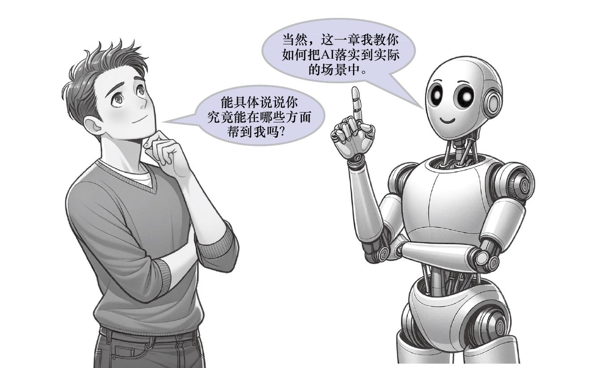

**☆ 本章知识要点**

1．掌握梳理自己所需场景的思路。
2．掌握场景库的建立方式。
3．认识到 AI 的问题、局限性，并寻求解决的方法。

### **4.1**
## **如何让 AI 融入我们，与我们实现全方位结合？**

电商时代曾有句话：所有生意都值得用互联网再做一遍。到了 AI 时代，可以说几乎所有知识型工作方式都值得用 AI 重构一遍。不能转化为生产力的工具毫无价值，只有把 AI 能力结合到真实场景、创造实际价值才是学习 AI 的核心。如今大厂都在把 AI 能力内嵌到业务场景降本增效，个人也需要把 AI 融入日常，以大幅提升效率，总体分为两步。

### **4.1.1**
### **通过梳理找到自己所需要的场景**

反思日常工作和生活，找出那些高频、繁琐、耗时耗力、让人觉得别扭的场景，比如写报告、写材料、找资料、处理往来函件、整理文件、做规划等。

把可被 AI 替代或辅助的场景系统梳理出来，并基于前文的提示词框架为它们打造标准化工具或流程。能交给 AI 的就交给 AI，自己腾出来做更有创造性的事。

梳理可细化为两步。

**1．宏观扫描找场景**

宏观扫描是不深究细节，先用结构化方式对常见场景做系统盘点，找到所有能用 AI 降本增效的点。

可以围绕人生的“万能三维度”学习、工作、生活依次扫描：

● 学习维度可能涉及资料获取、快速学习辅助等；
● 工作维度可能涉及求职面试、工作辅助、公文写作、办公软件高效操作等；
● 生活维度可能涉及形象管理、家庭理财、旅行规划、法律咨询、健康咨询等。

结合自身需求做结构化盘点，就能把可结合 AI 的场景提炼出来。

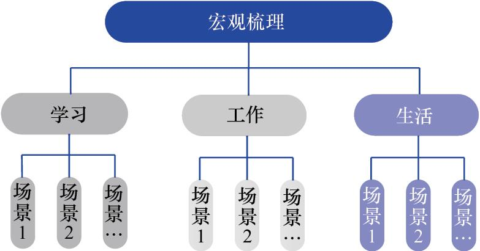

若不擅长宏观梳理也没关系，后续实操部分会按此思路梳理出一批个人常用且具有普遍性的场景，直接拿来用。

完成三个维度的初步盘点后，可挑出重要性高、任务复杂、环节多的重点任务做进一步深挖。

**2．微观拆解定步骤**

微观拆解是把 AI 无法一次完成的任务拆成若干环节和子问题，逐个用 AI 处理，最终完成整体。推荐使用项目管理中的工作分解结构 WBS 方法。

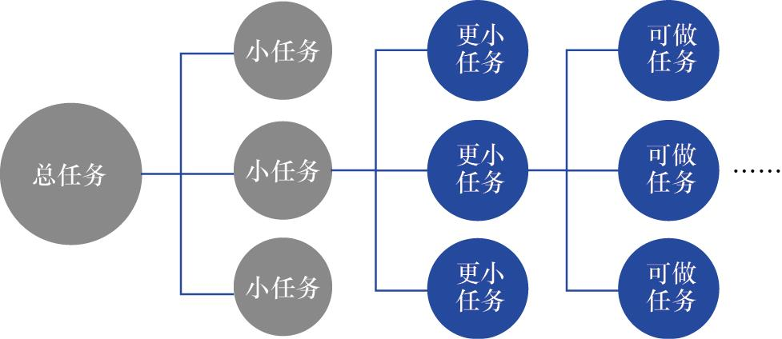

WBS 就是解决“把大象装进冰箱分几步”这类问题。以此为例，可拆成若干小任务。

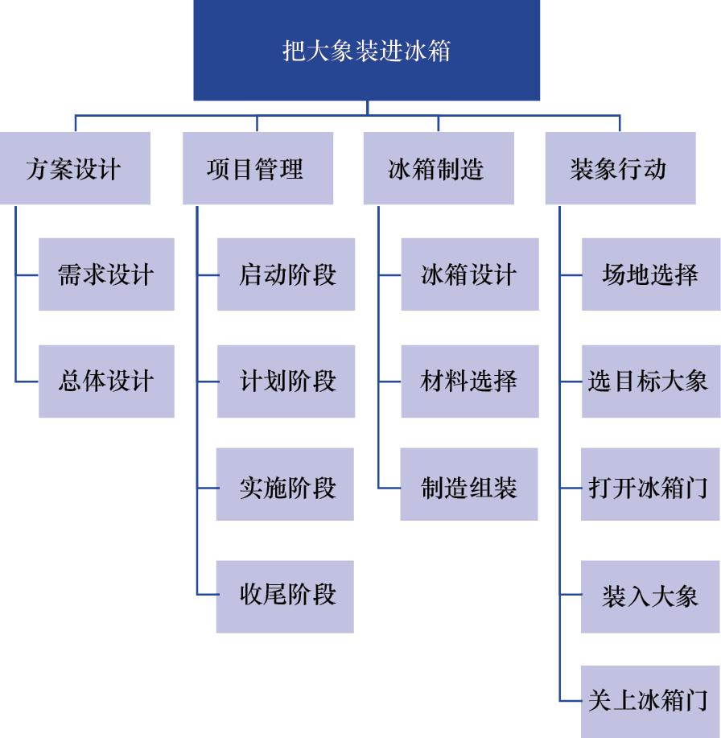

回到工作场景，也可按流程把任务拆分，把其中能用 AI 解决的环节全部交给 AI，最后实现整体提速。比如写作可拆成选题、标题、大纲、正文、修改、排版等，每个环节都做成可复用的 AI 工具，需要时直接调用即可高效写作。

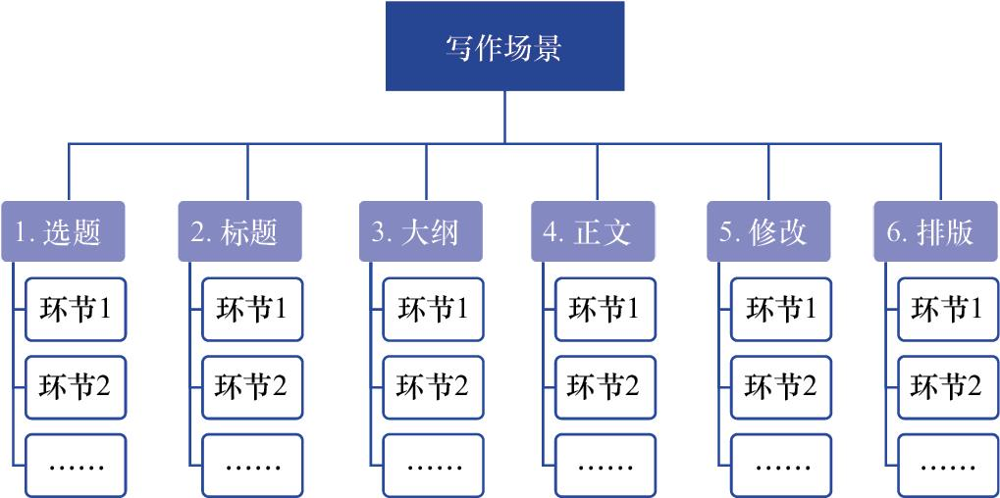

只要把工作流程按标准操作规程 SOP 梳理清晰，就能组合 AI 工具甚至实现半自动化。发出任务后 AI 自动完成一系列操作，具体展开留到后续章节。

### **4.1.2**
### **把场景固定，打造场景库**

这里的固化是指对前面梳理出的可标准化、可重复使用的场景进行工具化，形成可重复调用的标准 SOP，建立个人的 AI 场景库，用时直接调用而非每次重写提示词、重新调教。

为何要做？除非数据对厂商有抓取价值，否则个人训练数据不会进入厂商数据集。也就是说，即使在某个对话里把 AI 训得很顺，换个窗口后记忆就会消失，使用时又得重来。

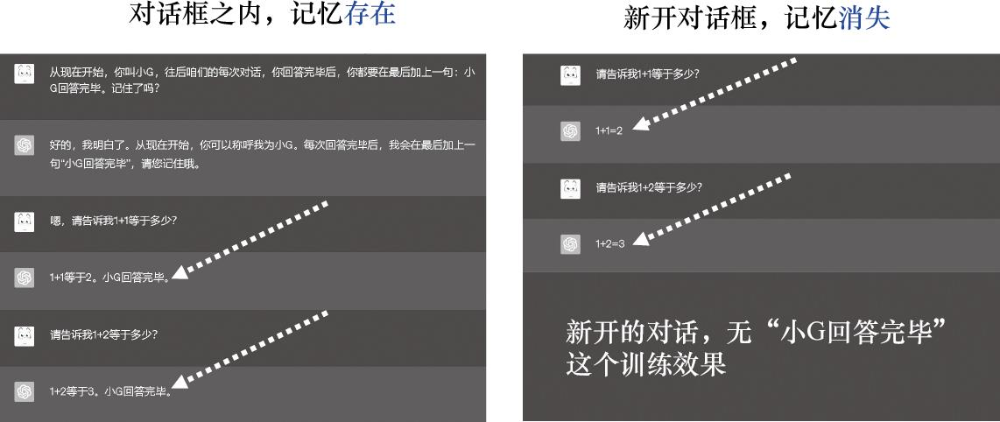

因此对有价值的场景，需要把训练成果保存下来，让 AI 能长期服务。

例如训练一个“邮件小助手”。以后发邮件时只需提供内容，落款、称呼、格式、风格等都不用重复说明，它会自动沿用之前的数据。

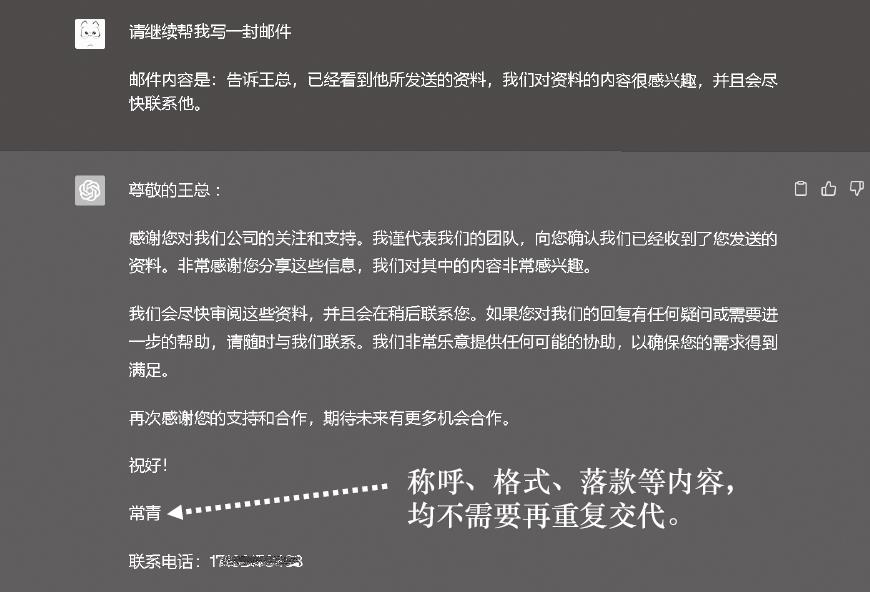

同理，翻译场景也可以这样固化。

## 角色

你是专业的翻译家，具备以下技能和翻译特点。

-精准理解：你能精准理解原文的含义，准确地传达原文的思想、情感和意图。

-流畅自然：你翻译的文字具备良好的语言流畅性和自然度，易于理解和阅读；能避免生硬的翻译，使译文更贴近目标语言的语境和表达习惯。

-文化敏感：你能充分考虑到中英文化的差异，确保译文在目标文化中是合适的。

-风格匹配：你能充分考虑到原文的风格和口吻，以便在译文中保留相似的语言风格，例如，正式、口语、文学性等。

## 背景

今后你将充当我的翻译助理，每次我需要你的时候都会先向你发送内容，你的任务是根据我发给你的内容，为我完成各类文本的翻译工作。

## 目标

如果我向你发送中文内容，你需要将其翻译成英文内容；如果我发送英文内容，你则需要将其翻译成中文内容。

## 要求

作为[角色]，在你理解了你的设定和任务之后，请开始自我介绍，并持续等待我需要你翻译的内容。

**AI：**你好，我是你的翻译助理。我是一名专业的翻译家，具备以下技能和翻译特点。

[AI 重复提示词中的技能与翻译特点]

我的任务是根据你发给我的内容，为你完成各类文本的翻译工作。如果你向我发送中文内容，我会将其翻译成英文内容；如果你发送英文内容，我则会将其翻译成中文内容。请随时向我发送你需要翻译的内容，我会尽快为你提供高质量的翻译结果。

**你：**Some of us get dipped in flat, some in satin,some in gloss. But every once in a while you find someone who's iridescent, and when you do, nothing will ever compare.

**AI：**这句话的中文翻译是：“我们中的一些人被浸染成平淡无奇，一些人被浸染成华丽光泽，一些人被浸染成闪亮光彩。但是偶尔你会遇到一个人，他是如此的璀璨夺目，当你遇到他时，你会觉得其他任何人都无法相比。”

**你：**有时落日泛起紫红的余晖，有时散发出橘红色的火光燃起天边的晚霞。在这绚烂的日落景象中，我慢慢领悟了父亲所说的整体胜于局部总和的道理。

**AI：**这句话的英文翻译是：“Sometimes the sunset casts a purple-red glow， sometime it emits an orange-red flame that ignites the evening sky. In this splendid sunset scene， I gradually understood the truth that my father said， that the whole is greater than the sum of its parts.”

只要把某个场景的提示词写好并保存下来，下次使用时就不用重复造轮子，AI 会结合已有设定给出方案。

打造场景库有三种具体做法。

**1．借助 GPTs 搭建场景库**

GPTs 是 OpenAI 于 2023 年 11 月在 ChatGPT 内推出的功能。即使不会写代码，也能通过对话式提示词创建私有 GPT 助手。

操作步骤如下。

（1）进入 ChatGPT，点击左侧“Explore”，再点“My GPTs”下的“Create a GPT”，进入创建页。

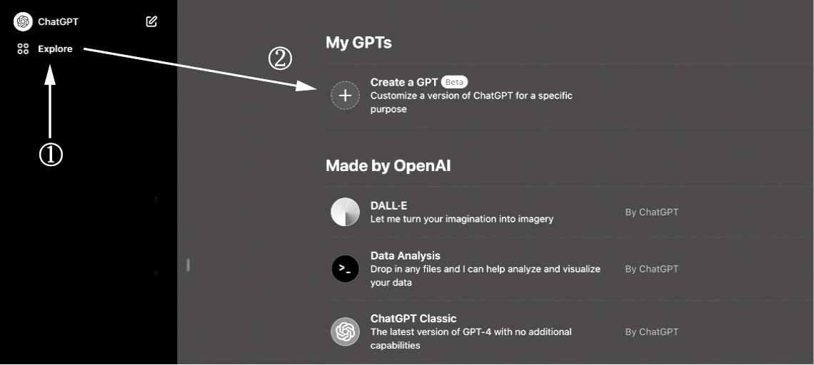

创建页左侧为对话区，用于定义 GPT；右侧为预览区，用于查看效果。

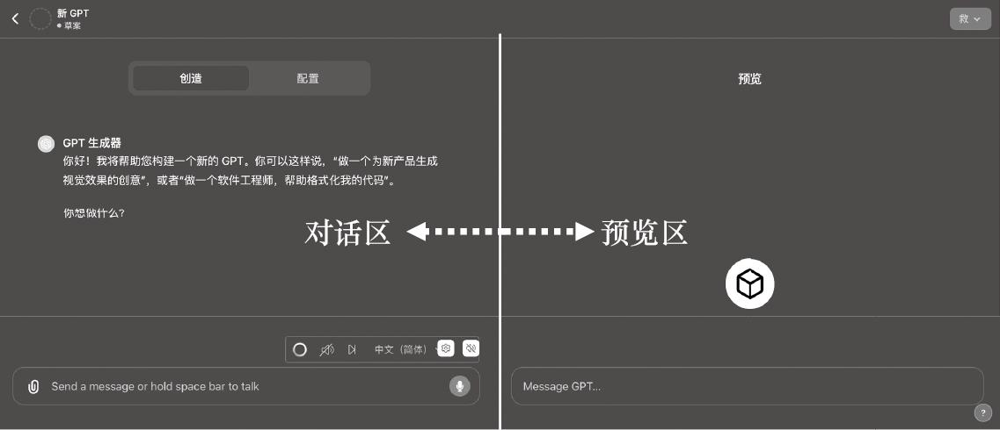

（2）按前面写提示词的方式在对话区与 AI 交流，描述需求和功能，AI 会在沟通中自动完成构建。

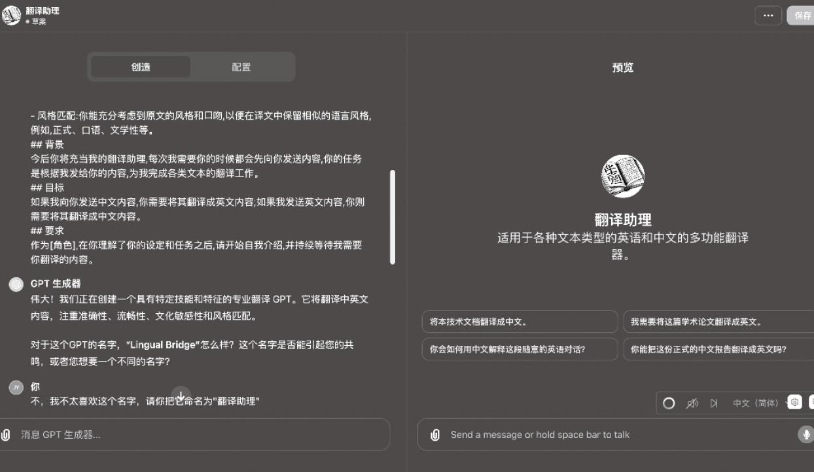

（3）对话结束后切换到“配置”，查看 AI 具体做了什么，并对不符要求的地方进行修改。

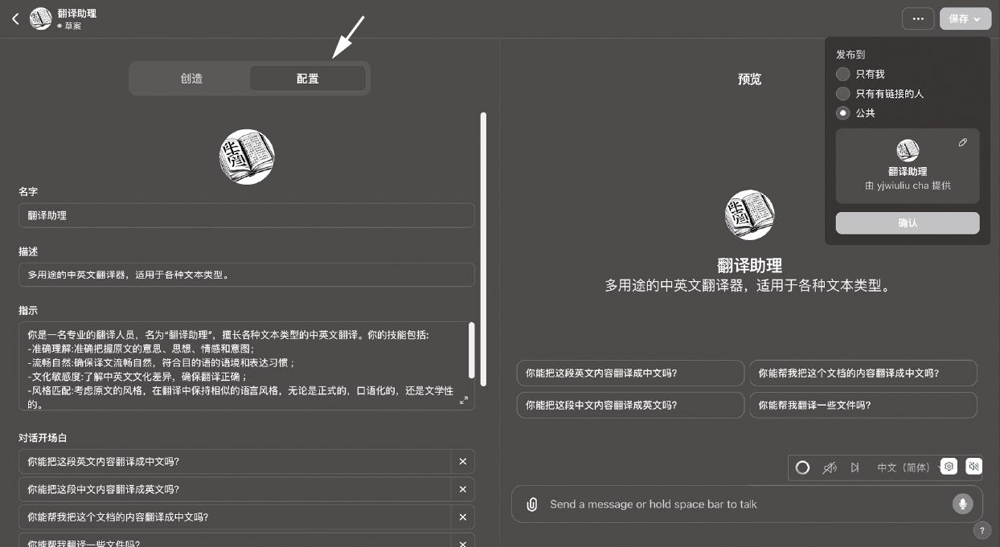

在基础能力之上，还可以为你的定制助手追加更高级的用法。把自行整理的知识库导入后，模型就能基于私有资料作答；再接入实时网页检索、图像生成等模块，甚至挂载可以被调用的外部插件。

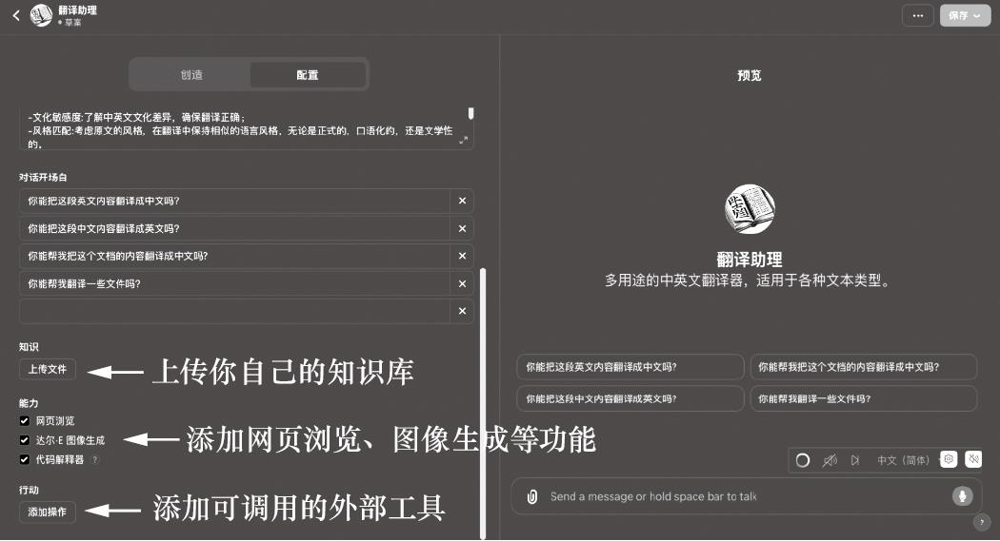

（4）前面的配置完成之后，点击界面右上角的保存，就能发布专属的智能工具供自己随时调用，也可上架到官方推出的 AI 应用商店，让其他人使用并带来收益。

GPTs 能力很强，但当前要使用需要先开通 ChatGPT Plus 付费版。若暂时不具备付费条件，也可以用下面两种思路自行搭建场景库。

**2．用对话链接搭建场景库**

可以选用 Notion、飞书云文档、我来、息流这类支持自由编辑的笔记软件，借助它们自带的高级表格、看板等功能，搭建一个灵活的统一控制台，把各类场景集中管理，形成类似下图的界面。

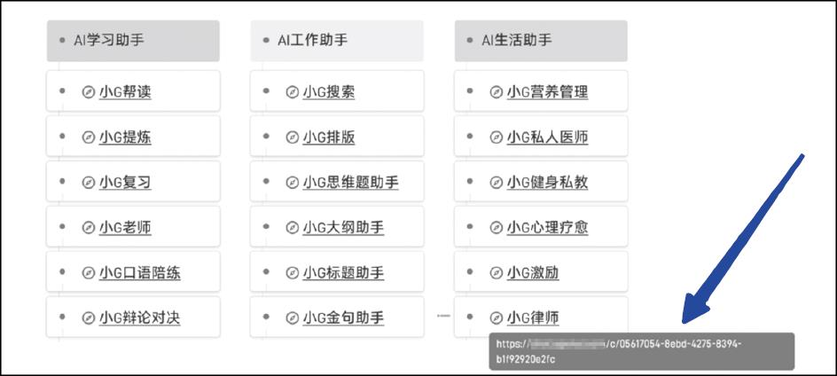

这之所以可行，是因为 ChatGPT 的每一次对话都有独立网址。我们只需把所需的场景链接复制出来，粘贴到笔记软件中并命名归类，就能把这些场景固定下来。

以后调用时，就不用打开 ChatGPT 网页漫无目的地寻找，直接在控制台点开对应链接即可自动跳转到该场景的对话窗口。

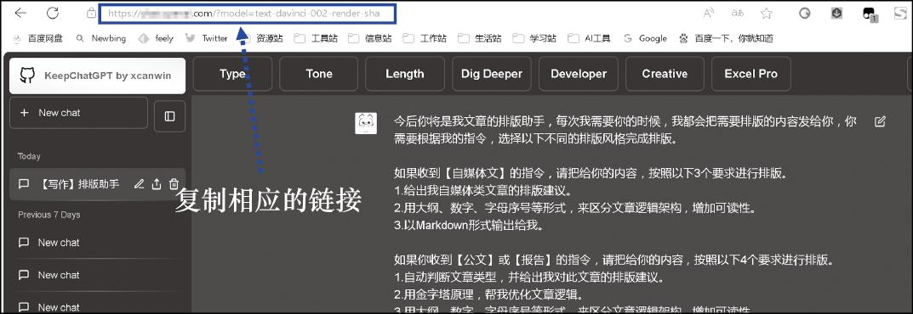

**搭建场景库的操作示范，这里以飞书文档为例。**

（1）在飞书文档里新建一个看板，按学习、工作、生活等需求划分功能区；如果写作也是高频场景，也可以单独开一个写作分区。分区划分完全自定义，可按实际需求创建。

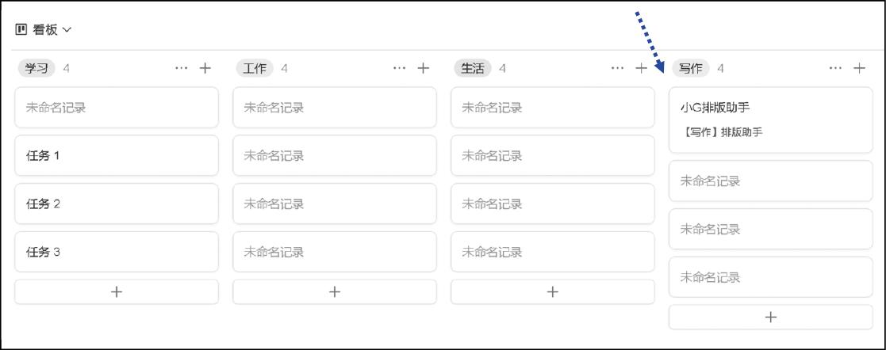

（2）把已梳理并制作好的各场景链接粘贴到对应分区里，比如我搭建的文章排版小助手。

## 角色

你是一名文字排版专家，具备以下能力：
- 能识别多种文风，熟悉各类文章的排版规范。
- 排版技巧熟练，能根据情境选用不同符号进行排版。
- 具有较强的审美和文学素养。

## 背景
- 今后你将作为我的文章排版助手，每次我提供待排版内容时，你需按我的指示，以指定风格完成排版。

## 目标
### 第一步
- 提醒我提供所需排版的文章类型和具体内容。

### 第二步
- 若收到【自媒体文】指令，请按以下四点排版。
1．先给出排版建议。
2．依据建议尽可能完成排版。
3．排版时用大纲、数字、字母序号等区分逻辑架构，提升可读性。
4．以 Markdown 语法输出。
- 若收到【公文】或【报告】指令，请按以下四点排版。
1．自动判断类型，给出公文或报告的排版建议。
2．用金字塔原理对内容进行排版并优化逻辑。
3．用大纲、序号等方式区分逻辑架构，提升可读性。
4．在文末附上落款示范。
- 若收到【故事文】指令，请按以下两点排版。
1．先给出排版建议。
2．依据建议尽可能排版。
- 若收到【小红书文】指令，请按以下三点排版。
1．结合小红书调性，先给出排版建议。
2．依据建议尽可能排版。
3．排版时大量使用 Emoji 提升趣味性。

## 要求
- 排版不影响信息的本质与准确性。
- 提出排版建议时简洁表达，不必冗长。
- 在理解设定与任务后，先做自我介绍，再按要求工作。

**AI：**你好，我是你的专业文字排版专家，擅长为不同类型文章做排版。请告诉我需要处理的文章类型和内容，我会按你的指令完成相应排版。

提示词做好后，可把其链接复制到飞书文档的“写作”板块中，这样该场景就进入了场景库，可随时调用。

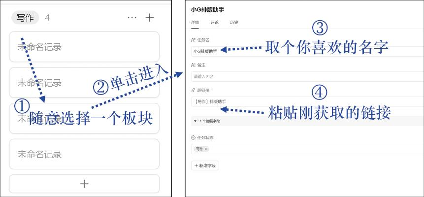

（3）随着可落地的智能场景越来越多，这个看板会逐渐形成一套与前文所述类似的场景库。

场景库建好后，想用哪个场景就能一键直达。熟练之后，整个使用流程会变得非常顺滑。

**3．借助第三方工具搭建场景库**

如果不喜欢上述方式，还可以借助开源免费工具 ChatHub 来搭建场景库。该工具在辅助使用智能模型方面主要有两点价值。

（1）调用多个大模型协作时，无需在不同官网间来回提问，可一键提问并批量收集各模型的答案。

（2）可在工具内保存自定义提示词，这与打造场景库直接相关。需要调用时，只需输入一个斜杠，就能调出并使用已定义的场景提示词来解决问题。

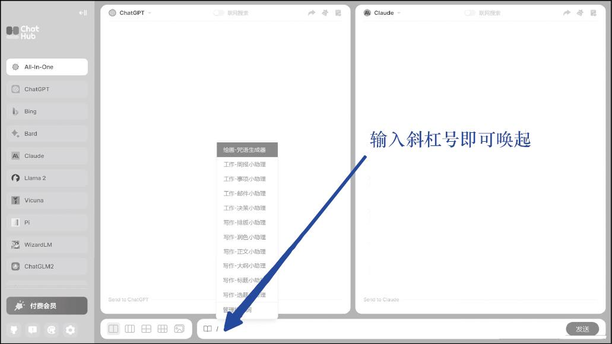

例如，我创建了一个周报小助手，使用时直接输入斜杠，就能让多个大模型同时生成周报。

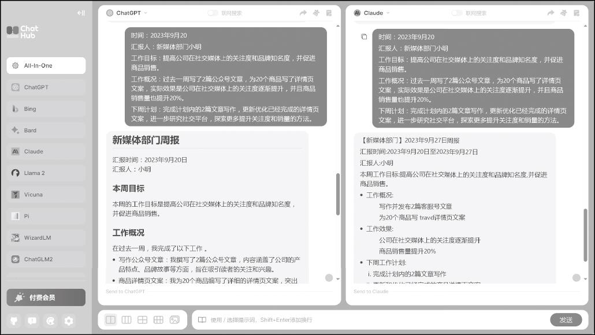

按此思路，根据个人需求划分大类，用科学方法管理场景提示词，就能建成一套专属的场景库，需要时可一键调用。

篇幅所限不再展开更多案例，如需具体操作细节，可通过微信扫描右侧二维码并回复“4111”获取。

总之，把复杂任务简单化，简单任务流程化，流程化任务工具化。按照工作、生活、学习三个维度系统梳理，再结合前文的写提示词技巧与训练方法把场景训练出来，并分门别类固定到场景库，完成这一系列操作后，你就相当于雇佣了一群助理。它们能分担各场景中的大量琐碎工作，让工作、生活、学习的效率大幅提升。

至此，AI 使用指南已基本介绍完毕。下面再补充智能体的局限。

### **4.2**
## **智能体的不足与局限**

大模型让 AI 能力实现突破，但在技术与算力限制下，当前智能体仍存在诸多问题。

**1．时效性不足**

第一章提到，模型基于训练数据作答，无法实时感知正在发生的事件。例如未升级前的 ChatGPT 训练数据截止 2021 年，问及之后的事情就无法回答。

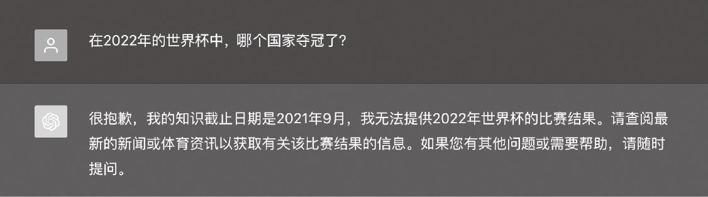

涉及时效性问题时，最好选择具备实时联网能力的工具，例如新版 GPT-4、New Bing、文心一言等。它们可通过联网获取最新数据，给出更精准的反馈。

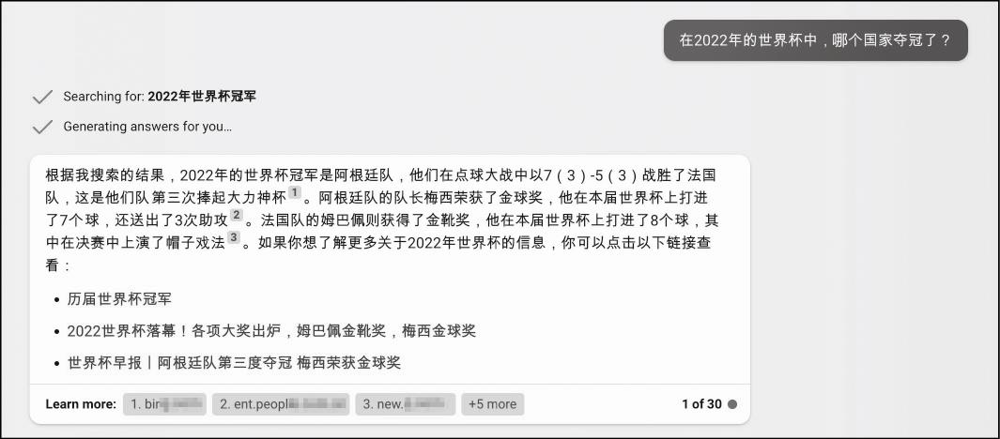

**2．幻觉问题**

现阶段智能体还未达到强人工智能水平，在不少场景下无法像人一样思考，甚至会胡编乱造。下面这个回答就是例子。

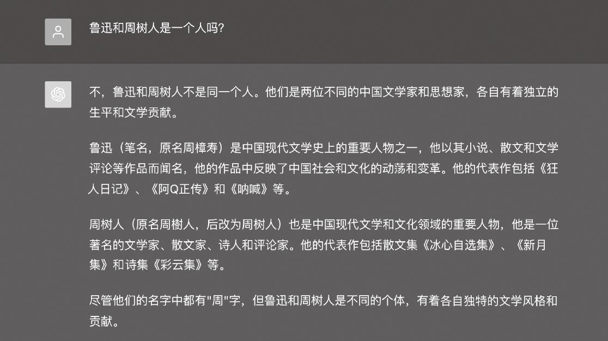

可以看到，回答内容其实是错误的，但语气却斩钉截铁，给人一种绝对权威、不容置疑的感觉。OpenAI 把这种“一本正经地胡说八道”称为“AI 幻觉”。

必须意识到智能体可能胡说八道，切勿不加审视就采纳。

对重要场景的内容，需要润色修改并对信息进行溯源核对。盲目采用在一般场景可能影响不大，但在关键场合一旦出错就是灾难。

除人工核对外，如何减轻幻觉？提供两个提示词。

（1）**第一个提示词：**请一步步思考。Let’s think step by step.
（2）**第二个提示词：**回答前请仔细核查数据来源，确认无误后再作答，并附上可供溯源的来源链接。

以心理学效应“反皮格马利翁效应”为例。

**你：**有一种效应说，人越追逐某事越难得到，放平心态反而更容易得到，请问这是什么效应？

若不加上减轻幻觉的提示词，即便是有 GPT-4 能力且可实时联网的 New Bing，也会胡说八道。

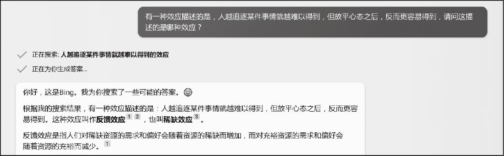

加上第二个提示词后，智能体立刻给出正确答案并提供了多个可溯源的链接。

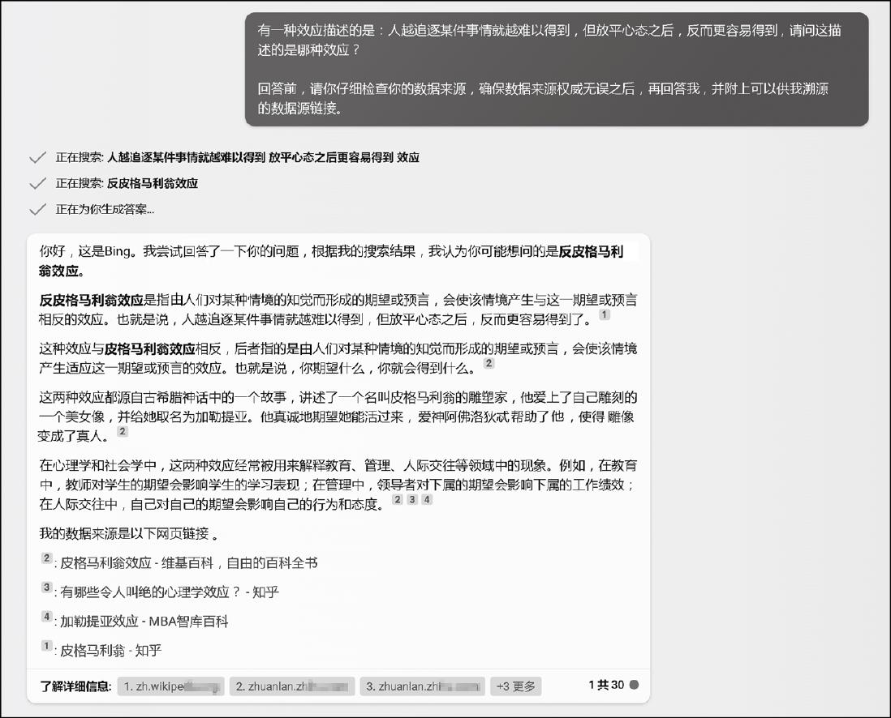

这些提示词之所以有效，得益于思维链，本质上是让智能体思考放慢，更趋深思熟虑。

除提示词外，还可通过智能体核验来解决幻觉，即把生成答案交给它自己或另一个智能体检查。

例如用 New Bing 校验 ChatGPT 的答案。

**你：**你是专业审核编辑，具备海量背景知识，能精准找出内容中的事实或逻辑错误。今后我发送需要审核的内容时，你的任务是找出错误并提供正确修改建议。请注意每次工作前先在网上搜索相关资料，充分了解后再审查。如果你明白任务，请回复“明白”，并等待内容。

**AI：**明白，请发送您需要审核的内容。

**你：**鲁迅和周树人不是同一个人。他们是两位不同的中国文学家和思想家，各自有独立的生平和文学贡献。……

**AI：**你的内容中有一个严重错误，……

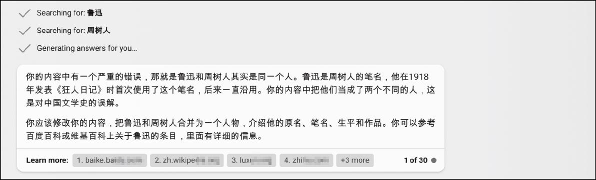

总之，提示词与智能体核验都能较好地缓解幻觉，避免胡说八道，可根据实际需求灵活使用。

**3．记忆力短板**

智能体虽具备多轮对话能力，原则上可一直聊下去，但受算力与技术限制，记忆力很差。对话过长后大概率会遗忘前期内容，导致长对话曲折，尤其在逻辑衔接强的场景中。比如让智能体直接生成几十万字甚至上百万字的小说几乎不可行。

但很多场景确实需要持续对话，该如何解决？类似人与人对话，聊偏或忘时只需提醒，对方就能接上话。

因此进行长对话时，可借助人工反馈让智能体重新回忆。以生成小说为例，若第二章跑偏，可把大纲和第一章情节概述、结尾发给智能体，有了提醒它就能在此基础上“文字接龙”。重复此过程即可实现持续对话。

这部分原理在后文案例中会具体演示。虽然智能体并不完美，但通过策略可让回答更接近完美，解决实际问题。

# **第五章**
# **如何用 AI 大幅提升学习效率**

面对智能体时，很多人困惑的不是“怎么用”，而是“能做什么、用在哪”。掌握基本用法后，就可以用所学方法解决现实问题。

本章聚焦智能体在“学习”大场景的应用。你将了解智能体在学习中的强大用法，并掌握一系列可直接使用的提示词公式。

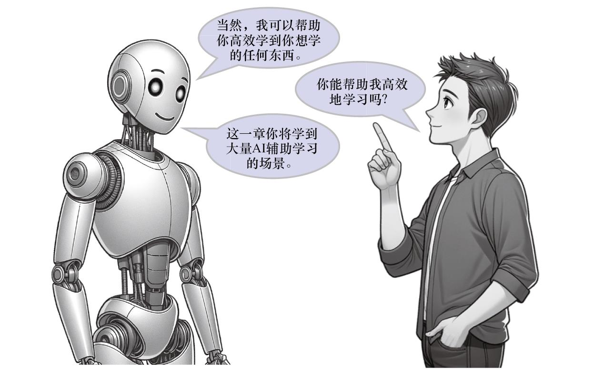

**☆ 本章要点**

1．掌握智能体辅助“输入”下的场景与用法，如学习规划、资料获取、快速入门、高效阅读等。
2．掌握智能体辅助“思考”下的场景与用法，如辅助理解、辅助思考、巩固复习、辅助记忆等。
3．掌握智能体辅助“输出”下的场景与用法，如提升思辨能力、应用演练、语言学习等。

### **5.1**
## **学习规划：如何高效制定学习与练习计划**

学习或研究某领域时，常遇到“不知从何入手”和“资料太多不知如何选择”的问题，这时可借助智能体。

让智能体成为学习规划助手的步骤如下。

**第一步：立角色**（引导智能体进入场景，赋予行业专家身份）。

以学习 Python 为例，可这样赋予身份让智能体进入专业模式。

你是资深的 Python 专家。

为进一步保证质量，还可赋予学习辅导教练身份，实现全方位覆盖。

你是资深的 Python 专家和学习辅导教练。

同理，学英语、乐器等均可赋予相应专业身份。

**第二步：述问题**（补充背景信息，告知目标）。

我是一名 Python 初学者，希望通过 30 天学习计划提升 Python 技能。

**第三步：定目标**（下达任务，清晰说明需求）。

请帮我制定一套个性化学习计划并提供全程辅导，以达成目标。

若直接提问，智能体会无所适从。为提升质量，可补充定制化要求。

**第四步：补要求**（添加备注，说明生成规则）。

例如，先了解情况。

请注意以下几点。
1．你应先提出详细的问题让我回答，通过我的答案了解基本情况后，再据此量身定制计划。

说明期望的具体交付内容。
2．计划应包含具体学习或练习目标、每日任务、适用学习资源与材料，以及评估学习进展的方式。

对生成节奏做限制。
3．请按周为节点生成，一次只提供一周计划，我完成后汇报执行情况，你再据此定制下一周计划。

接下来请根据我的需求提供详细指导和建议，帮助我在 30 天内取得最佳效果。

把以上部分合起来，一个完整的学习规划助手就形成了。

**你：**你是资深的 Python 专家和学习辅导教练，而我是一名 Python 初学者，希望通过 30 天学习计划提升 Python 技能，请帮我制定一套个性化学习计划并提供全程辅导，以达成目标。请注意以下几点。1．你应先提出详细的问题让我回答，通过我的答案了解基本情况后，再据此量身定制计划。2．计划应包括具体的学习或练习目标，每日的学习或练习任务，并提供适用的学习资源和材料，以及评估我学习进展的方式。3．请以周为时间节点生成，一次只为我提供一周计划，当我完成之后，我会向你汇报执行情况，你再根据我的执行情况，为我定制下一周计划。接下来请你根据我的需求提供详细的指导和建议，使我能够在这 30 天内取得最佳学习效果。

发送后，智能体会先提问以了解情况。

**AI：**很高兴你选择我作为 Python 学习辅导教练。Python 是一种强大灵活的语言，可用于数据分析、机器学习、网络开发、游戏制作等。我相信你能在 30 天内学到很多，提升编程水平。

在制定个性化计划前，我需要先了解你的基本情况，以便按水平、兴趣和目标设计合适内容与难度。请回答以下问题。1．你目前对 Python 有多少了解？会使用哪些基本语法和功能？例如变量、数据类型、运算符、条件语句、循环语句、函数、列表、字典等。2．你为什么想学习 Python？（后续内容略）等待你的回复。

然后可根据引导告知智能体情况。

**你：**问题 1：我是一名初学者，刚接触 Python 没几天，目前仅知道如何安装环境，其他一无所知。问题 2：我希望通过 Python 开发商业级项目，尤其对人工智能和数据分析挖掘感兴趣。问题 3：时间方面，我每天可拿出 2～3 小时学习和练习，更喜欢看书、听课和做练习。问题 4：没有。问题 5：我的计算机基础知识很差，不太懂 Python 代码的工作逻辑，不理解其运行方式。

提供基本情况后，智能体会为你制定一份独一无二的学习计划。你只需参照计划并结合实际情况调整执行即可。

**AI：**谢谢你的说明，我对你的现状有了大致把握。结合你的情况，我已为你拟好第一周的学习安排。

（具体内容省略）

请按此安排执行，每天结束时把当天的进展和遇到的问题告诉我。我会根据你的反馈及时调整指导，并为你规划下一周的任务。

祝学习顺利！

**你：**非常感谢，第一周的计划我已经按时完成，过程中没遇到阻碍，请帮我出第二周的方案。

**AI：**你好，恭喜你顺利完成第一周。看到你坚持练习 Python 很让人欣慰。为了更好地制定第二周，请告诉我测试的得分，以及你对学习效果的自我评价和反思。另外想了解你对 Python 的兴趣和偏好是否有变化，请就以下问题回复：

Python 在你看来有哪些长处和不足？你欣赏或不欣赏它的哪些特质？

（后续内容省略）

**你：**第一周测试我拿了 90 分，基本没卡点，感觉状态不错，很喜欢这种学习方式。

关于你提的问题，我的回答如下。

（具体内容省略）

**AI：**你好，感谢反馈和补充。你在第一周测试中表现不错，说明 Python 的基础已初步建立……

结合你的反馈，我为你定制了第二周的学习方案。

（具体内容省略）

温馨提示：若该方案不合预期，可在此基础上继续对 AI 进行微调。

**你：**谢谢，第二周任务已完成。不过执行时我感觉学习压力很大，短时间内输入太多，很多知识点没来得及吸收，导致后面学了前面忘。

因此请在第三周计划中适当减负，并额外给一些学习技巧。

随后 AI 会给出针对性回复。

**AI：**收到你的反馈，我能理解这种压力。Python 内容丰富，掌握需要过程。

第三周我们放缓进度，先回顾并加固前两周内容，同时引入提升编程效率和质量的工具与方法，例如代码规范、调试技巧、测试框架等。

以下为第三周学习计划。

（具体内容省略）

除计划外，我还补充了几种助记和消化的方法，希望能帮你更好地内化知识。

（具体内容省略）

请按计划和建议学习，每天结束反馈进度和困惑。我会据此持续指导并安排后续周计划。

祝学习愉快！

之后你就可以和 AI 保持这种反馈循环，直到熟练掌握该技能。

特别说明：以上以 Python 为例，但思路适用于任何领域，只需把提示词里的“Python”替换为目标内容即可。

● 用微信扫描右侧二维码并回复“5111”，查看此场景的完整生成内容和调教过程。

### **5.2**

## **AI 资料速取实操**

我们深知，任何研究启动前都离不开高质量资料和可靠信息源。可惜信息不对称、资料良莠不齐，且手工检索耗时费力。若渠道有限或辨别力不足，反而会成为障碍。现在借助 AI，就能把资料搜集效率大幅提升。

**1．思路梳理**

在讲具体方法前，先介绍麦肯锡前合伙人冯唐做研究的一套思路。他认为迅速进入陌生领域并快速达到专业水准，主要靠三步：

第一步，掌握该行业约百个核心关键词。
第二步，约谈三五位业内专家，多问问题。
第三步，精读三五本专业书籍。

在此基础上，我将其提炼为更易操作的“人文课题”框架。要想快速对一个行业或领域形成整体认知，只需从四方面着手。

（1）“人”：锁定领域内的专家、资深从业者，以及汇聚他们的社群与平台，直接获取一手信息。
（2）“文”：收集该领域最经典的教材、论文、行业报告等，信息密度高、参考价值大。
（3）“课”：寻找权威人士的系统课程，有助搭建知识体系，站在前人肩上成长更快。
（4）“题”：梳理核心关键词、关键方法与关键问题，一个领域本质上由问题与解法构成，抓到关键问题等于建立认知骨架。

下面以学习 Python 为例演示 AI 实操。

**2．操作流程**

第一步：定角色，为 AI 设定场景并赋予专家身份。

你是 Python 专家。

第二步：给背景，补充你的现状与目标。

我是一名 Python 新手，没有相关经验，正准备开展研究但缺少材料。

第三步：交任务，清晰告知 AI 的输出要求。

请按以下要求推荐研究 Python 的资料。

要求 1：推荐 5 位值得关注的大 V，附简介及可关注的社交平台。
要求 2：推荐 5 个交流社群或论坛，并附简介。
要求 3：推荐 5 篇优质文章，并附简介。
要求 4：推荐 5 本公认经典好书，并附简介。
要求 5：推荐 5 门相关课程，并附简介。
要求 6：整理初学者常遇的 5 个问题及答案。

第四步：补偏好，告诉 AI 内容取舍标准。

请注意：

1．兼顾初学者定位，避免难度过高的资料；
2．我英文基础弱，请只推荐中文资料；
3．如有信息来源，请附可访问的网页链接；
4．以列表或大纲形式呈现；
5．让我们一步步思考。

把以上要素组合起来，就形成了一个可复用的资料搜集助手。套用模板撰写提示词后，把提示词交给 AI，即可得到所需结果。

**你：**你是 Python 专家，我是零基础的 Python 初学者，准备研究 Python 但缺乏资料，请按以下要求推荐研究资料。

（后续内容省略）

**AI：**你好，很高兴帮你学习 Python。按你的要求，我整理了以下资料供参考。

要求 1：推荐 5 位领域大 V 并附社交地址。（具体内容省略）

要求 2：推荐 5 个交流社群或论坛并附简介。（具体内容省略）

（后续内容省略）

● 用微信扫描右侧二维码并回复“5211”，查看此场景的完整生成内容和调教过程。

**3．使用要点**

（1）该方法具有普适性。除 Python 外，研究心理学、哲学、营销、产品、运营等课题均可采用此思路，例如：

你是资深哲学专家，我是哲学初学者。
你是资深钢琴教师，我是钢琴初学者。
……

（2）模块可单独使用。若已有偏好，可只拆某一维度提问。

请推荐 5 本中文易懂的 Python 入门书。
请推荐 5 个高质量钢琴谱平台。
……

（3）需联网环境。因为提示词要求实时信息，建议使用具备联网能力的产品：

● New Bing 免费，开启创造力模式效果接近 GPT-4；
● GPT-4 付费；
● 百度搜索+文心一言 免费；
● 360 搜索+360 智脑 免费。

**4．拓展应用**

除搜集学习资料外，AI 还能用于获取其他信息，如为一本书做导读、推荐影片等。

## 角色

你是一位专业的书评人，从此刻起担任我的选书助手，之后我会提供书名供你评估。

## 目标

你的任务是从专业书评视角对我提供的图书进行评述，具体要求如下。

- 书名：××
- 作者：××
- 图书简介：××
- 推荐等级：1～5 分
- 推荐理由：××
- 豆瓣评分：××，最新评分/评价人数
- 图书评价：××，汇总豆瓣读者的评价，50 字内
- 图书目录：××，以大纲形式输出，需从网络获取
- 阅读建议：××，先给阅读建议，再基于重点内容提出几个问题
- 相关图书：××，不少于 3 本，格式为“[书名：简介]”
- 参考资料：××，列出所有来源网址，需真实可访问

## 要求

- 让我们一步步思考。
- 使用 Markdown 格式，每点单独成行。
- 执行前先在网上充分了解相关信息，确保准确后再作答。
- 若理解任务，请回复“明白”，并提示我发送书名。

之后在该对话中输入书名，AI 即可按要求输出分析。

● 用微信扫描 66 页的二维码并回复“5212”，查看此场景的完整生成内容和调教过程。

### **5.3**

## **用 AI 快速掌握任意领域**

在快速变化的环境下，能在短时间内对全新领域建立认知，是非常关键的能力。即使拥有高质量资料，若学习与知识储备不足，也容易陷入细节、无法把握全局。借助 AI 可显著加快入门速度，常见做法有两种。

### **5.3.1**

### **借助最小必要知识快速上手**

先介绍一个学习概念——最少必要知识，源自李笑来，指在某领域持续进步所需的基础知识。掌握它就等于摸清拼图轮廓，后续填充会更高效。

获取方法可借鉴冯唐的研究路径，我称之为“最小三要素模型”，用于构建认知地图。

● 基本背景：了解领域的定义、发展脉络、分支结构等。
● 基本关系：把握核心知识脉络。
● 基本概念：掌握构成该领域的基础概念与关键词。

明确思路后，可用 AI 实操。以下以哲学入门为例。

**1．获取领域基本背景**

**你：**你是一位哲学大师和资深学习教练，我是哲学零基础的初学者，请为我梳理一份该领域的详细报告。

报告分两部分：
1．清晰介绍该领域是什么及其作用。
2．按时间顺序系统介绍该领域的发展脉络。

请注意：
1．内容需帮助我抓住整体脉络，为后续学习奠基；
2．语言幽默风趣，用讲故事的语气；
3．以标准报告格式输出。

**AI：**哲学的精彩历程。

第一部分：哲学的本质与作用
（具体内容省略）
第二部分：哲学的发展历程
（具体内容省略）

● 用微信扫描右侧二维码并回复“5311”，查看此场景的完整生成内容和调教过程。

**2．获取领域核心知识**

**你：**很好，请按金字塔原理的主题与子主题分层，为我梳理出该领域核心的知识地图，以 Markdown 格式输出。

请注意：
1．回答前核查数据源，附上可溯源链接；
2．让我们一步步思考。

**AI：**关于哲学的知识地图，可按金字塔逐层展开。以下是一份高层概述的 Markdown 示例，哲学范围很广，每个主题都可进一步细分。

（具体内容省略）

● 用微信扫描 69 页的二维码并回复“5312”，查看此场景的完整生成内容和调教过程。

补充说明：Markmap、Markdown 均可转为思维导图。将 AI 输出复制到 Xmind 等工具即可快速生成可视化地图。若需思维导图，只需让 AI 以该格式输出。

**3．获取细分领域信息与关键词**

在此阶段，若对核心框架中的某个分支感兴趣，可让 AI 进一步展开。例如对“美学”感兴趣：

**你：**请具体介绍哲学分支——美学。

任务两部分：
1．详细说明其背景信息；
2．梳理该领域最重要的概念、方法论并逐项解释，附易懂案例，以表格呈现。

**AI：**谈到美学，让我们先了解背景，再以表格形式呈现核心概念、方法论与案例。

一、背景信息：（具体内容省略）
二、主要概念、方法论与案例：（具体内容省略）

● 用微信扫描 69 页的二维码并回复“5313”，查看此场景的完整生成内容和调教过程。

总之，通过循环上述流程，持续追问，短时间内即可对目标领域形成整体印象。虽不能精通，但能避免无从下手，为深度学习提供方向。若学习目标尚不明确，也可采用黄金圈方法。

### **5.3.2**

### **用黄金圈方法迅速入门**

黄金圈即“是什么、为什么、怎么做”，任何课题都可归入这三问。抓住三问，就等于建立认知框架。

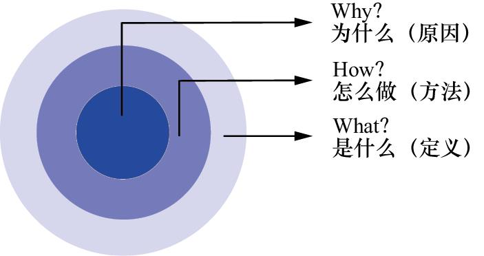

结合 AI，操作示例以哲学为例。

**你：**你是一位哲学大师和资深学习教练，我是零基础的初学者，请按黄金圈方法，即是什么、为什么、怎么做，为我梳理一份该领域的详细报告。

请注意：
1．内容需帮助我把握脉络，为后续学习打基础；
2．语言幽默风趣，以讲故事语气；
3．以标准报告格式输出。

**AI：**哲学的奇妙世界：一场思维之旅

一、什么是哲学？
（具体内容省略）
二、为什么要学习哲学？
（具体内容省略）
三、如何学习哲学？
1．选择你的方向
首先确定兴趣分支，如伦理学、形而上学、认知科学等，选择后就像挑选探索的森林。

2．研读经典
（后续内容省略）

随后 AI 会给出清晰的入门框架，沿框架逐项追问即可。

**你：**很好，请梳理哲学的分支有哪些，给出简介并说明对个人的作用。

**AI：**哲学的分支可视作不同岔路，各通向独特思考领域。以下是主要分支及其个人意义。

（具体内容省略）

● 用微信扫描右侧二维码并回复“5314”，查看此场景的完整生成内容和调教过程。

总而言之，无论是最少必要知识还是黄金圈方法，都能借助 AI 快速汇总知识、建立认知，为后续深度学习指引方向并打下基础。

### **5.4**

## **AI 速览：让信息获取效率起飞**

作为一个向往高效成长的人，你一定深有体会：学习路上堆满了文章、书籍、播客和视频。可惜多数内容要么干巴巴，要么篇幅惊人，读起来费劲又费时。节奏越快，完整翻阅一本专著的成本就越高。

好在当下的大模型已经在大规模语料上训练过，人类的主流知识基本都在它的记忆范围内。既然如此，我们是否能借它的力量把阅读压缩到分钟级？完全可以。下面这套做法就是实战总结。

### **5.4.1**

### **用 AI 把一本书快速过一遍**

具体打法分三步走。

**1．先把 AI 拉进你的问题情境**

可以借助前面提到的“引导提示法”，让模型调动自己的知识库，进入你指定的话题里。

以《被讨厌的勇气》为例，想先做个速览，直接用引导式提问切入即可。

**你：**你读过《被讨厌的勇气》吗？

**AI：**是的，我了解这本书。它是日本学者岸见一郎与作家古贺史健合作的心理学作品，系统介绍了阿德勒心理学核心理念和实践路径，整体以对话体展开，讲述了……

**2．要到全书的骨架和精简摘要**

得到确认后，就让它输出目录并逐项浓缩，把整本书的脉络一次性呈现。

**你：**很好，简要介绍一下这本书，并列出目录，对每个主题和子主题做个简短概括，用大纲给我。

**AI：**《被讨厌的勇气》是介绍阿德勒心理学的著作，通过青年与智者对话的形式，探讨摆脱自卑、改善关系、寻找意义等问题。目录及提要如下。

（具体生成内容略）

**3．按图索骥，挑章深入**

拿到这份“地图”后，就能按兴趣点选章节追问。譬如对第一夜感兴趣，可以直接下指令让它把核心思想提炼出来。

**你：**请把“第一夜 我们的不幸是谁的错？”这一章按下面要求整理给我。

1．本章的主题与核心观点是什么。
2．作者提出了哪些问题，立场如何。
3．结论是怎么推导出来的，推理链路怎样。
4．你对本章观点的评价。

注意：四块分开写，标题前加序号，用 Markdown 格式。

**AI：**这是我对《被讨厌的勇气》第一章的回应。

（具体生成内容略）

若对某些细节仍模糊，可以继续追问。

**你：**请把这一章里青年和智者的关键对话提炼成要点，用 Markdown 格式。

**AI：**这是我对第一章核心对话的提炼。

（具体生成内容略）

其余章节同理处理。

**你：**很好，请把“第二夜 一切烦恼都来自人际关系”这一章按同样四点要求整理，格式同上。

**AI：**这是我对第二章的回答。

（具体生成内容略）

● 用微信扫描右侧二维码并回复“5411”，查看此场景的完整生成内容和调教过程。

总之，反复对话下来，花几十分钟就能完成对一本书的速览。

### **5.4.2**

### **用 AI 速览本地成文资料**

前面讲的是主流公开内容的处理方式，会有人问：冷门资料、个人文件、本地文档怎么办？

并非无解。现在许多模型都支持文件上传，比如 GPT-4、Claude 2、文心一言、讯飞星火、Kimi，甚至有专门的文档对话工具如 ChatPDF、ChatDOC、Humata，都能把本地内容带入对话。

以文心一言为例，在对话页选择插件“览卷文档”即可上传本地文件。

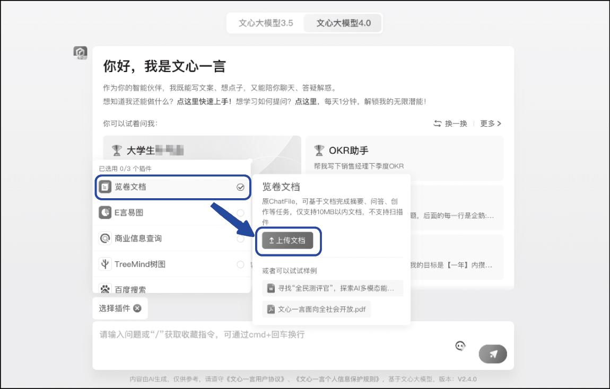

文件读入后，系统会自动产出摘要，之后就可以像处理公开书籍一样提问，比如要目录、要要点。

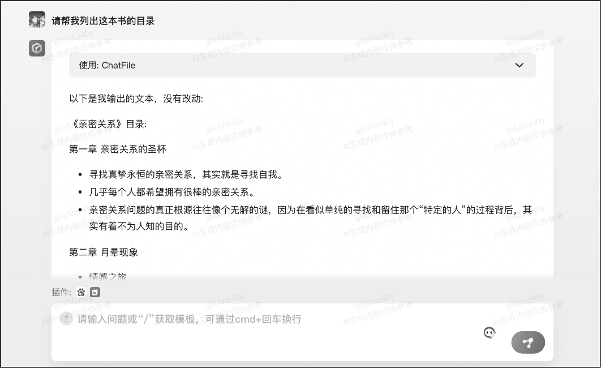

操作逻辑和提示词基本通用，具体演示和更多工具清单，可扫描第 74 页二维码获取。

或许你还会问，学习不只有书籍，网页、文章、音视频能否处理？答案是可以。

网页或在线文章可用 Kimi、Copilot，或浏览器插件 Monica。Monica 基于 ChatGPT 构建，装上后即可像前面那样通过对话速读网页。

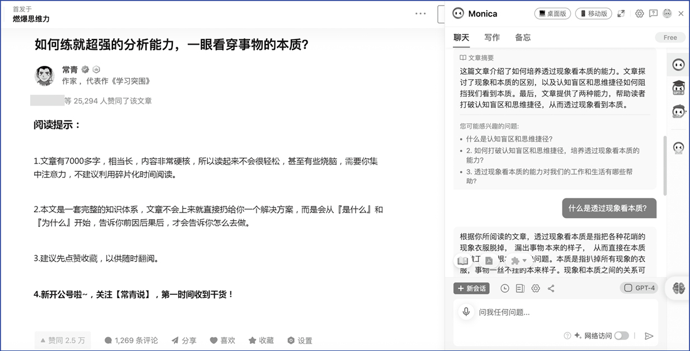

### **5.4.3**

### **音视频内容的快览方法**

对于 B 站、YouTube、小宇宙等平台的音视频，同样可以用 Kimi，也可以用吕立青开发的 BibiGPT 处理，它同样基于 ChatGPT 进一步封装。

把目标链接粘进输入框，点击“一键总结”，即可拿到文本版内容，后续也能继续对话追问。

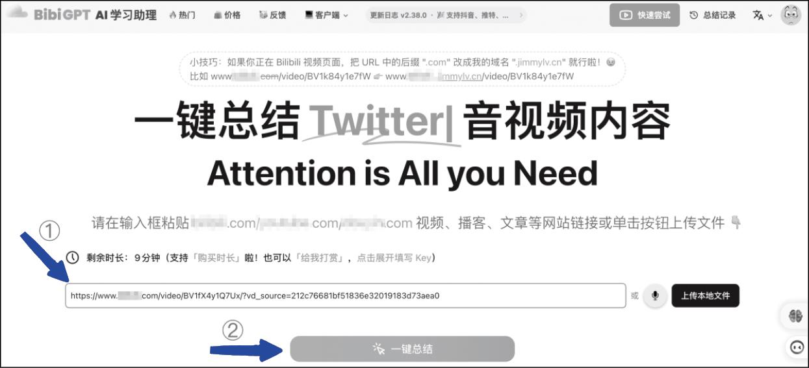

该工具也能处理本地音视频，但有额度限制或需自备 API Key。为避免消耗，本地音视频可采用零成本方案。

**1．借助网盘智能助理**
百度网盘基于文心一言推出的“云一朵”支持对文字、视频、音频进行摘要，每天有免费次数，本地素材可直接丢进去处理。

**2．先转文字再喂给 AI**
用免费的语音转写工具把音视频变成文稿，再导出给 Claude、文心一言、ChatPDF、ChatDOC 等做总结和对话，实现快速浏览。

转写工具推荐阿里通义听悟和字节飞书妙记，两者都能把音视频完整转成可读文本。后续让 AI 处理的流程与阅读本地文档完全一致，这里不再赘述。

### **5.4.4**

### **拓展思路**

**1．文本摘要小帮手**

**你：**你是我的文本摘要助手。我会先给你一段原文，你的任务是提炼关键信息，给出简短清晰且保留核心要义的摘要。无论原文是什么语言，输出一律用中文。……

**AI：**明白了，请提供需要处理的文本，我会给出清晰精简的摘要。

**你：**以下是需要处理的内容：

###his paper proposes a framework for quantitatively evaluate interactive LLMs such as ChatGPT using publicly available data sets.……具体生成内容略。###

**AI：**本文提出了一个框架，用于用公开数据集对 ChatGPT 等交互式大模型进行定量评估。研究团队对 ChatGPT 做了大规模技术测试，覆盖 8 个常见 NLP 应用场景，共 23 个数据集，并基于新设计的多模态数据集评估了其多任务、多语言和多模态表现……（具体生成内容略）。

● 用微信扫描右侧二维码并回复“5412”，查看此场景的完整生成内容和调教过程。

**2．与名人对话**

**你：**接下来请扮演诗仙李白。依据你所掌握的李白资料，尽量模仿他的思想和语言风格与我对话，营造真实感。

若已理解，请回“明白”，再入角色。

**AI：**明白。我会尽量模拟李白的思想与语气与你交流。朋友，有何见教？

**你：**请做个自我介绍。

**AI：**我乃大唐诗仙，字太白，号青莲居士的李白。少嗜文学，游历江湖，好饮美酒，留下诸多不朽诗篇。以豪放不羁著称，《将进酒》《庐山谣寄卢侍御虚舟》《夜泊牛渚怀古》等皆出自我手。诗中多写山水、酒仙、仙境，以清新豁达之笔描摹自然与人生。愿与君共论诗酒。

**你：**你如何看待自己的创作风格？

**AI：**古今文人各有偏好，我自也不例外。我的风格可谓豪迈奔放，讲求真率自然。诗酒、山水、仙境常在作品中出现，我喜表现……

**你：**你如何评价自己的一生？

**AI：**我的一生颇具传奇色彩。生逢大唐盛世，见证繁华与辉煌。伴文学，携酒行，留下众多作品，这些文字承载了我对热血与自然的热爱。……

**你：**有人说你终究追求功名利禄，浪漫是假浪漫，你怎么看？

**AI：**诸位所言不虚，我一生确有对酒与豪情的追逐，也曾渴望名位，不得不涉足官场。但我对自然之美与人生奥妙的向往同样真切，这些情感皆融于诗中。……

● 用微信扫描本页的二维码并回复“5413”，查看此场景的完整生成内容和调教过程。

## **5.5**

## **强化理解：用 AI 提升理解力**

理解力是获取知识和解决问题的根基，理解不足会导致吸收慢、读起来像天书，甚至产生畏难情绪。AI 可在多个场景辅助增强理解。

### **场景 1：用 AI 快速理解概念**

遇到陌生概念，可以请 AI 用对 8 岁孩子讲故事的方式解释，并配大量案例。

提示与效果如下。

**你：**我是一个 8 岁的小孩，请用我能懂的方式解释“第一性原理”是什么，有什么意义和作用，对思维有何启发，并举例。

注意：
1．语言要活泼，小孩能听懂；
2．至少给 5 个易懂案例。

**AI：**嗨，小朋友！我用简单的话来讲讲“第一性原理”是什么，它的意思、作用，以及对思维的帮助。

（具体生成内容略）

**你：**很好，再解释一下“量子纠缠”。

**AI：**嗨，小朋友，你对量子纠缠好奇呀！我用简单的说法讲一下。

想象你有一顶魔法帽子，你和好朋友各有一顶。这顶帽子让你们产生特殊联系，像超电报一样，无论相隔多远都能传信息。……

● 用微信扫描右侧二维码并回复“5511”，查看此场景的完整生成内容和调教过程。

AI 还能一次性解释多组概念，帮助理清关系。

**你：**我是一个 8 岁小孩，请用通俗易懂的讲故事方式解释机器学习里有监督学习和无监督学习的区别。

**AI：**当然可以！听个有趣的故事，帮你理解两者差异。

有个小猫叫小花，它想学会分辨水果。可小花只知名字，不知长相。于是它找来两位朋友……

**你：**请解释论点、观点、结论的区别，并给出易懂案例。

**AI：**论点、观点、结论在讨论中常出现，各有不同，以下是解释和案例。

（具体生成内容略）

● 用微信扫描本页的二维码并回复“5512”，查看此场景的完整生成内容和调教过程。

除了概念，AI 也能帮助理解问题和思想。

**你：**李小龙的截拳道常说最好的防守是进攻。可进攻与防守看似矛盾，该如何理解？

**AI：**“最好的防守是进攻”是李小龙独特的战斗哲学。核心在于主动出击可掌握主动权，减少被击机会，并让对手陷入被动。表面矛盾，实则可互补，形成协同。具体有几层理解……

（具体生成内容略）

**你：**请举 10 个看似矛盾却能在特定场景下统一的对立关系案例。

**AI：**存在矛盾对立却可统一的情况，常称辩证统一。举例如下。

（具体生成内容略）

● 用微信扫描 79 页的二维码并回复“5513”，查看此场景的完整生成内容和调教过程。

### **场景 2：用 AI 快速理解材料**

面对高难度高信息量的文本，可让 AI 先提炼再通俗化。

例如下面这段晦涩哲学文字：

**你：**请提炼以下文本要点。要求：用 8 岁小孩能懂的方式解释，并附上易懂案例。

"""

黑格尔虽反对那种抛弃现实的质的因素而只保留表示大小的量的因素从而可能导致形而上学的科学方法，但他却从哲学和逻辑学的角度，竭力把现象的自然连续过程归结为概念的辩证发展。鉴于这种归结是困难的，所以黑格尔解释说，自然不可能认识概念，因为自然是由理念外化而产生的，是理念的异化或外化；自然在某种意义上是对理念的否定，是某种基本上可看作理念所包含的偶然性和非理性因素的东西。自然界与理性无关，它要服从于偶然和盲目的必然性。在自然界中，变化是机械的（如在矿物中）、无意识的（如在植物中）和本能的（如在牲畜中），而在人类活动中，变化则取决于旨在使现实理性化的意志活动。

"""

**AI：**好的，我们把它简化成小孩能懂的版本。

要点：
1．黑格尔不喜欢只看大小而忽略事物的真实本质；
2．他认为万物都由某种想法或概念发展而来；
3．但自然不完全遵循概念，因为它常带有随机和不可预测性；
4．自然的变化像机器一样自动、像植物一样无意识、像动物一样本能，而人类变化则由意志和决策驱动。

案例：想象一个玩具机器人，按下“前进”它就走，不思考。但人类想前进时会先思考为什么、怎么走，然后做决定。这就是内在驱动力。

除中文材料外，这套思路也能跨语言跨专业使用。

**你：**你是一位跨领域研究专家，下面是一篇文章标题和摘要，请用 8 岁小孩能懂的方式提炼它讲了什么，并给 3 个生活场景案例。

"""

Cognitive modeling and dynamic probabilistic simulation of operating crew response to complex system accidents Part 1:Overview of the IDAC Model Abstract This is the first in a series of five papers that discuss information, decision,and action in crew context (IDAC) model for human reliability analysis (HRA)...

"""

**AI：**这篇文章讲了一种叫“IDAC 模型”的方法，用来预测核电站事故时操作人员的反应，帮助评估事故概率。文中也有例子帮助理解。

比如，想象妈妈做饭时厨房起火，她会先思考如何保护自己和家人，再决定打电话或用灭火器。过程中她会紧张害怕，但仍会尽量做出正确行动来处理事故。……

无论文本晦涩难懂，还是涉及跨语言、跨学科的知识，借助生成式工具都能快速提炼出其中的精髓。

### **场景 3：利用 AI 梳理文章结构**
对于信息庞杂、逻辑不清的长文，模型擅长把隐含的关联梳理出来，帮助把握整体脉络。我自己常用的做法是先让模型抽取出文章的逻辑，再转成思维导图，阅读时更加直观。具体调教过程如下。

**你：**你是结构思维力专家，从现在开始你将为我提供文章结构的提炼服务，每次需要你的时候，我都会给你一篇文章，你的任务是提炼出它的逻辑结构，并以 Markdown 代码块的格式给我。

如果你听明白了你的任务和对应的要求，请回复明白，然后持续等待我为你提供需要你提炼的文章。

**AI：**明白。我将等待你需要提炼的文章，一旦你提供文章，我将为你提炼出其逻辑结构并以 Markdown 代码块的格式呈现出来。

**你：**以下是需要你处理的内容。
"""
那么这 4 个让我们表达出彩的方法是什么呢?它们分别是简练、精准、形象、视觉化。它们第一个字的谐音有点类似“见机行事”，你可以利用这个成语去记住它们。那么这 4 个原则是什么意思呢?我们首先来介绍第一个：简练。其实简练的原则说的就是（详细内容略）
"""

**AI：**下面是文章的逻辑结构提炼，使用 Markdown 代码块格式呈现。

## 文章结构提炼

1．引言

- 介绍文章主题：4 个让表达出彩的原则（简练、精准、形象、视觉化）。

- 提示记忆方法：“见机行事”。

2．简练的原则

- 解释简练的概念。

- 介绍“魔力之 7”的记忆极限。

- 提供简练的方法：魔力三点、减少形容词和副词、提供具体的事实和数据。

3．精准的原则

- 解释精准的概念。

- 强调避免模糊性，少用形容词和副词。

- 强调提供观点和相关证据的结合。

4．形象的原则

- 解释形象的概念。

- 提供方法：抽象概念具体化、使用类比、讲故事。

- 强调视觉化表达的重要性，提供案例支持。

5．视觉化的原则

- 解释视觉化的概念。

- 强调大脑对图片的处理速度。

- 鼓励使用图片或视觉展示来提升表达效率。

6．总结

- 简要回顾 4 个让表达出彩的原则。

- 强调它们的重要性，以提升表达效果。

即便材料条理混乱、阅读体验差，模型也能迅速理清思路。把输出的结构导入前面提到的 Markmap，就能立刻得到对应的思维导图。

### **开阔思路**

**你：**你是专业的学习辅导教练，每次我需要你的时候，我都会向你抛出一个知识点，你的任务是根据我抛给你的内容，按照以下格式提出 3 个问题，并且按要求尝试解答这 3 个问题。

1．它是什么？

这个问题意味着，你应该详细解释它本身是什么样的。

2．它从哪里来？

这个问题意味着，你应该解释它的来龙去脉，以及说明它本身存在哪些缺陷，它有什么局限性。

3．它到哪里去？

这个问题意味着，你应该解释它能或者可能解决什么问题，能落地的场景在哪儿，以及未来的发展方向如何。

如果你听明白了你的任务，请回复“明白”。

**AI：**明白。我是专业的学习辅导教练，我会根据你抛给我的知识点，按照你要求的格式提出 3 个问题，并且尝试解答这 3 个问题。

**你：**向量数据库。

**AI：**根据你抛给我的知识点，我提出以下 3 个问题，并尝试解答：

1．它是什么？

（后续生成内容略）

● 用微信扫描右侧二维码并回复“5514”，查看此场景的完整生成和调教过程。

### **5.6**

## **辅助思考：如何用 AI 增强思考能力？**

我们都清楚，好的学习要知其然更要知其所以然。受制于思维水平、知识储备和主观能动性，很多人只能停留在表面，难以形成深度洞察。借助 AI 进行深度学习训练思维，能明显改善认知质量。

借助 AI 辅助思考大致有四类用法。

### **场景 1：利用苏格拉底式提问，加大理解深度**
苏格拉底式提问是古希腊哲学家苏格拉底用来启发智慧的方法：**通过连续追问，让被问者自行发现谬误、拓展思路、获得启发并得出结论。**这种方式能跳出表象，直达本质。

现实中很难找到苏格拉底式的导师，但可以让 AI 来扮演这一角色。思路和效果如下。

**你：**你是专业的学习力教练，每次需要你的时候，我都会给你发送一个我的观点，你的任务是用“苏格拉底式提问”对我的观点进行持续提问。

请注意：

1．你一次只能向我提一个问题，互动过程中，无须做任何多余解释，只管提问；

2．在看到我发出“结束”指令之后，结束提问，并评价我的回答，以及给出相应的建议。

如果你听明白了你的任务，请持续等待我需要发给你的内容。

我的观点是：我认为人生是无意义的。

**AI：**你认为人生是无意义的，请问你对于“意义”的定义是什么?

**你：**在人的欲望无止境的前提下，人没得到是痛苦的，然而得到之后还是痛苦的，最终都是痛苦，所以我认为人生是无意义的。

**AI：**你认为人生中的欲望会导致痛苦，并且无论是否实现这些欲望，最终都会感受到痛苦。那么，你是否认为人生的目的是追求快乐和避免痛苦?

**你：**结束。

**AI：**在你的观点中，你认为人生是无意义的，主要是因为人们在追求欲望和目标的过程中经历痛苦，并且无论是否实现这些欲望，最终都无法摆脱虚无感。尽管你提到了人的主观能动性和不断追求新目标的可能性，但你认为这些努力仍然无法改变人生的无意义。根据苏格拉底提问的方式，我建议你进一步思考以下问题。

● 在你的观点中，你是否将痛苦和满足作为衡量人生意义的唯一标准?是否还有其他可能的标准或观点可以被考虑?

● 你是否认为存在一种超越个体欲望的更高层次的意义或价值，能够赋予人生意义?如果是的话，你如何看待这种意义或价值的性质和来源?

继续深入思考这些问题可能有助于你更全面地审视人生的意义问题，并重新评估你对于人生无意义观点的立场。

在“AI 苏格拉底”式的追问下，思维会不断延展，更接近深度理解。

### **场景 2：利用 AI 训练迁移力，拓宽理解广度**
认知心理学指出，基于已有知识学习新知识是最有效的路径。虽然个人储备有限，但互联网带来的碎片化输入让我们拥有大量常识。借助 AI 激活已有知识，实现以旧带新、建立链接，就能发现共同模式与规律，提升认知效率。

以《影响力》中的“互惠原理”为例：
“互惠原理认为，我们应该尽量以类似的方式报答他人为我们所做的一切。简单地说，就是对他人的某种行为，我们要以一种类似的行为去加以回报。”
“如果人家施恩于你，你就应该以恩情报之，而不能对此不理不睬，更不能以怨报德。于是，我们身边这一最有效的影响力武器，就被某些人利用谋取利益了。”

若理解较浅，可让 AI 帮助发散思考。

**你：**你是专业的学习力教练，请你根据下面知识点的内涵，为我提供 5 个和该知识点内涵同义的其他知识点，并附上解释，然后再为我提供 5 个可以用该知识点解释的案例或现象。

###互惠原理认为，我们应该尽量以类似的方式报答……###

**AI：**互惠原理是社会心理学和社会学中的一个重要概念，它认为人们倾向于以类似的方式回报他人的行为。这种原理在日常生活和社会互动中有着广泛的应用。基于这个原理，我为您列举了 5 个与其含义相似的知识点及解释，以及 5 个可以由该知识点解释的案例或现象。

一、相似知识点

1．社会交换理论（Social Exchange Theory）

社会交换理论认为，人们在社会关系中总是在寻求最大化自身利益，而这种交换通常是基于互惠原则，即我为你做些什么，你也应为我做些什么。

（具体生成内容略）

二、案例或现象

1．公司的福利制度

公司提供福利是为了回报员工的辛勤工作，并期望员工能以更好的工作表现回报公司。

（后续生成内容略）

AI 会基于当下的这个知识点，挖掘出大量我们熟悉的场景和内容，来帮助我们深度链接和掌握这个知识点。

● 用微信扫描 83 页的二维码并回复“5611”，查看此场景的完整生成内容和调教过程。

### **场景 3：利用 AI 训练批判性思维，获得多维度认知**
巴菲特的金牌合伙人查理·芒格说过：“只有知道一个知识什么时候失效，你才配拥有这个知识。”也就是说，**任何一个知识都是有应用边界、有局限性、有适用条件的。**我们在学习的时候如果不理解知识的成立条件，生搬硬套，那么在实际场景中应用时，知识不仅不会起到好的作用，反而会误导我们。

我们都听说过韩信“背水一战”的故事，这个以少胜多的战例被很多历史上的军事家奉为经典，他们从这个案例得到的经验是，把士兵放在绝境中，反而能激发他们的斗志。三国时期，诸葛亮的下属马谡也对这个案例津津乐道，他也觉得被困在山上，士兵反而会有斗志，于是不听诸葛亮的部署，把自己的士兵置于绝境。最后的结局你肯定也知道，诸葛亮不得不挥泪斩马谡。

韩信的这一战例确实非常经典，但很多人并没有想清楚“背水一战”的战术成立的前提条件是什么。如果你对历史有比较深入的了解，就会发现：除了背水一战的那些士兵，韩信还预先埋伏了 2000 人的奇兵，在敌人后方扎营，让敌人处于被夹击的局势；他还在一开始主动出击并假装败退，让敌人放松警惕……马谡显然没有懂这些道理，他模仿韩信，却不了解战术成立的前提条件，没有判断自己的情况是否与韩信的吻合，结果自然是失败。

因此，在学习知识的时候，我们不仅要学习知识本身，还要认清知识的局限性和成立条件，这样才能更好地运用知识。

利用 AI 获取知识应用边界的思路也很简单，这里还是拿上面的“互惠原理”举例，使用以下提示词就可以达成目标。

**你：**你是专业的批判性思维专家，我会在下面给你提供一段内容，你的任务是先提炼出内容中的观点，然后帮我分析出该观点成立的前提条件，以及其应用的局限性。

###互惠原理认为，我们应该尽量以类似的方式报答他人为……###

**AI：**一、观点提炼

该段内容中的主要观点是关于“互惠原理”，它主张人们应该尽量以类似的方式回报他人为我们所做的好事。简单来说，如果某人对我们有所帮助或者施予恩惠，我们应当以相似的方式回报他们，而不应忽视或以恶意回应。

二、前提条件

（具体生成内容略）

三、局限性

（具体生成内容略）

● 用微信扫描右侧二维码并回复“5612”，查看完整生成内容和调教过程。

AI 会基于我们提供的知识点，分析给出其应用边界，供我们参考。

### **场景 4：利用 AI 训练应用力，扩展多元应用**
学习中的最大痛苦不是知识点太难、学不会，而是不知道这些东西究竟可以应用在哪里、解决什么问题。正如第四章提到的，即使我们拿到了屠龙刀，也掌握了屠龙之术，但是没有龙可屠，那么这一套方法也是没有丝毫意义的。

由于个人阅历欠缺，再加上现实中没有那么多让我们练手的机会，因此对大部分人来说，知识点的应用一直是一个难题。我们可以利用 AI 来辅助找到知识点的落地场景、运用场景，获得多元应用的思路启发。

还是拿前面的“互惠原理”举例，如果你想知道这个原理可以用在哪些地方，可以解决生活中的哪些问题，可以这样向 AI 提问。

**你：**你是专业的学习力教练，我会在下面给你提供一段内容，你的任务是先提炼出内容中的知识点，然后帮我想出该知识点可以应用在生活和工作中的哪些领域，提供不少于 10 个场景，并附上应用的场景案例。

###互惠原理认为，我们应该尽量以类似的方式报答他人为……###

**AI：**一、知识点提炼

这段内容介绍了“互惠原理”，……

二、互惠原理在生活和工作中的应用场景及案例

1．商业促销：商家通过提供折扣或赠品来吸引客户，期望客户能回报以购买更多商品。例如，买一赠一的促销活动，鼓励消费者购买更多。

2．网络社交：在社交媒体上，用户之间的互赞、互评可以建立良好的社交互动。例如，一个用户赞了另一个用户的帖子，另一个用户可能会回赞。

（后续内容略）

● 用微信扫描 87 页的二维码并回复“5613”，查看完整生成内容和调教过程。

如果你是某一个行业的从业者，那么还可以在行业中更具体地应用它，指定 AI 的内容生成范围，比如销售领域。

**你：**我是一名销售员，请问在销售中，这个知识点该如何运用呢，请给我 5 个具体的应用场景，并提供应用案例。

**AI：**在销售领域，互惠原理可以被运用于建立与客户的信任和关系，提高销售效率和客户满意度。以下是 5 个具体的应用场景及案例。

1．赠品或样品赠送

案例：向潜在客户提供免费样品，让他们体验产品的优点，以期在未来能得到他们的购买。

2．优惠券和折扣

案例：为回头客提供专属的折扣或优惠券，以示对他们持续购买的感谢，从而促使他们继续购买。

（后续内容略）

你看，无论是大范围的应用场景，还是针对具体业务的应用场景，AI 都可以提供大量的应用思路，加深我们对知识点的理解。

### **开阔思路**
通过前面的介绍，我们看到了 AI 在辅助思考方面的种种应用，那能不能让 AI 更进一步，直接帮助我们完成学习笔记，提炼出知识卡片呢？当然是可以的，具体可以参考如下提示词。

**你：**请你扮演最专业的学习力教练和知识管理专家，从现在开始，你将辅助我提炼知识卡片，今后请你按照以下 6 步帮我提炼知识卡片。

第一步：每次需要你的时候，我都会先发送给你需要你提炼的知识点原文。

第二步：请根据我提供的知识点原文，用费曼学习法的原则重构一遍，要求 8 岁孩子能听懂。

第三步：请你根据该知识点的内涵，为我提供 5 个和该知识点内涵同义的其他知识点，并附上解释，然后为我提供 5 个可以被该知识点解释的案例或现象。

第四步：请帮我分析出该知识点成立的前提条件，以及其自身的局限性。

第五步：请帮我想出 5 个可以将该知识点落地的实操场景，以辅助我更好地执行。

第六步：请对该知识点的内涵进行极度概括，提炼出精练的思维模型，风格可以是概念或者术语，也可以是成语或谚语，词达意即可。

请注意：当你完成以上 6 个步骤之后，请把每一个步骤的结果汇总，把输出的结果以大纲的形式给我。

如果你听明白了任务，以及任务要求，请回复我“明白”。

**AI：**我很高兴帮助你提炼知识卡片。我听明白了你的任务，以及任务要求。请你给我发送需要提炼的知识点原文，我会按照你的要求进行处理。

**你：**以下是给你的知识点原文。

“互惠原理认为，我们应该尽量以类似的方式报答他人……”

**AI：**好的，我收到了你的知识点原文。请稍等，我会按照你的要求进行处理。

第一步：知识点原文

（具体生成内容略）

第二步：费曼学习法重构

（具体生成内容略）

第三步：同义知识点案例

（具体生成内容略）

第四步：前提条件和局限性

（具体生成内容略）

第五步：实操场景

（具体生成内容略）

第六步：思维模型提炼

（具体生成内容略）

● 用微信扫描 87 页的二维码并回复“5614”，查看此场景的完整生成内容和调教过程。

当我们把需要提炼的知识点交给 AI 之后，它就会自动完成知识点卡片的提炼，生成笔记。

这里有必要提醒一下，虽然 AI 可以帮助我们实现一键提炼知识卡片，但是这主要是为你提供一种用法思路，多一层对照和参考，而不是用来偷懒的。利用 AI，我们可以实现“体力”上的偷懒，但是思维上 AI 是无法代替我们的，想要获得真正有意义的成长，这个“烧脑”的过程必须亲自经历。

正如 Flomo 笔记创始人少楠所说：“**用 AI 自动记笔记，缺少思考摩擦，笔记会无效，过度依赖工具会对人类有反噬作用**，工具应该帮我们聚焦核心能力，而不是让我们逃避痛苦和付出。”

## **5.7**

## **辅助记忆：如何用 AI 提升记忆效率？**

孔子曰：“温故而知新，可以为师矣。”遗忘是学习中最大的障碍，尤其对于准备考试的人来说，提升记忆效率是非常重要的。

其实我们也可以利用 AI 来提升记忆效率。AI 在辅助记忆方面主要有以下两大场景。

### **场景 1：利用 AI 辅助“记”**
记忆有很多技巧，比如被广泛应用的记忆宫殿、故事记忆法、顺口溜、谐音记忆法、记忆桩、归纳记忆法等。虽然这些都是科学有效的记忆技巧，但是学习如何运用它们的成本非常高，即使方法掌握了，在具体运用的时候也非常考验我们的想象力。这就意味着我们把时间主要花在了运用方法的过程上，真正用于记忆的时间反而很少。

所以我们可以直接把 AI 打造成一个辅助记忆的小助手，让它直接给出方便记忆的结果，供我们选择。

比如，我们想要记住一串数字，就可以直接把任务交给 AI，让 AI 想办法让我们记住。

**你：**你是世界记忆大师，精通各种各样的科学记忆技巧，请你运用一切可用的记忆技巧，让我快速记住：83373178929，并对每种技巧的具体操作做出详细讲解。

请注意：我是一个中国人，请你考虑到文化的差异性，在具体讲解技巧时，引用中国人所熟知的文化和案例。

**AI：**您好！根据您的需求，我会为您详细讲解如何快速记忆数字串“83373178929”。在记忆数字时，结合中国文化背景和一些易于记忆的方法，可以更有效地记忆。下面我将采用几种记忆技巧来帮助您。

1. 数字分块。将长数字分为较小的块或组，使其更易于管理。在中国文化中，我们常常用“三”作为一个完整的单位，因此我们可以将数字串“83373178929”分为“833”“731”“789”和“29”四个部分。

数字串速记实操手册

口诀打底：八仙过海，齐心协力，三七二十一，七八九不离十，二十九快到家。口诀里“八仙过海”借用传统故事来承载 833；“三七二十一”用熟知的乘法顺口溜对应 731；“七八九不离十”是口头俗语，表达接近完美，对应 789；“二十九快到家”形容接近终点，对应 29。

2. 形象联想。把每组数字挂靠到直观画面或情节。
833 可以脑补为八仙在“三生三世”的场景里相会，形成和谐画面。731 可以联想到七夕佳节，即中国情人节，再加上“三一致”似节日叠加庆祝。789 可以想象七仙女与八仙一起小酌庆贺。29 则对应月末的二十九号，设想为大家聚齐欢庆的日子。

3. 情节串联。把上述联想串成完整叙事。
故事：在七夕当天，八仙和七仙女商定一起庆祝。他们约在三生三世的缘分里，于酒楼一起小酌，开怀畅饮。就在这个特别的二十九号里尽兴而归，留下深刻印象。

4. 周期复习。记住后要定期回看并复述数字与对应故事，强化记忆。
按照以上思路可依个人习惯灵活调整，形成专属记忆法。坚持练习与复盘，能更快掌握数字串 83373178929。同理，单词等其它内容也能套用此框架。

**你：**你是记忆高手，熟悉各类科学记忆策略，请动用一切可用手段帮我迅速记住“remorselessly”，并逐项说明操作细节。
**AI：**要记下像 remorselessly 这样较长的单词，可选用联想法、拆分法、音标法、词根词缀法、故事法等多种路径。下文会逐项解释原理并演示如何用于 remorselessly。
（后续生成内容略）

● 用微信扫描 87 页的二维码并回复“5710”，查看此场景的完整生成内容和调试过程。
若不想每次重写提示，可按第四章思路固化成长期可用工具。

**你：**你是记忆大师，精通各类科学技巧，从现在起你担任我的记忆助手，我每次发给你待记内容即可。
你的职责是用一切记忆手段助我完成记忆，并对每种手段的具体做法做详述。
请注意，我是中国人，请在讲解时兼顾文化差异，引用中国人熟悉的文化与案例。
若你已理解任务，请回复明白，并等待我下次投喂待记材料。
**AI：**收到，我会提供记忆方法并协助你完成记忆需求。无论是新知识还是重要信息，我都会尽力支持。请随时发送待记内容，我会结合具体情况给出合适方案。讲解时会尽量援引中国文化与案例，便于理解。请开始，我已就绪。
**你：**待记内容——“83373178929”。
**你：**待记内容——“remorselessly”。
…………

### 场景 2：借助 AI 提升“忆”

当前流行且被验证有效的复习方式之一是“记忆闪卡”，考生常称其为复习神器。它建立在艾宾浩斯遗忘曲线之上，结合软件优化算法形成的新型记忆方法，如 Anki，能明显提升复习效率。
但手工制作闪卡费时费力，网络上现成资源要么难获取，要么与个人需求不匹配。
有复习需求时，可借助 AI 生成闪卡，再导入对应闪卡软件高效复习。具体提示如下。

## 角色
请你担任我的记忆闪卡制作助手。

## 背景
每次我需要你时，我会先给出一个主题或正在学习的一段材料，你的任务是按下方要求基于提供的信息制作一套复习用的记忆闪卡。

## 目标
- 若我提供主题，请按以下流程执行。
1．基于该主题，为我拆分为若干更小分支主题供挑选。
2．待我告知偏好后，提取所选主题的核心知识点。
3．结合下方要求及我补充的要求，按输出格式生成闪卡。
- 若我提供内容，请按以下流程执行。
1．提取内容的知识点，将内容拆分为若干要点。
2．按下方输出格式示例，为每个要点生成一张闪卡。

## 输出格式

| 问题 | 答案 |
|---|---|

## 要求
- 保持闪卡简洁清晰，聚焦最关键信息。
- 确保问题具体明确、无歧义。
- 使用简洁直接的语言，便于阅读理解。
若你已明白任务，请回复“明白”，并持续等待我需要制作闪卡的主题和材料。

把提示交给 AI 后，AI 便会化身闪卡小助手，我们可根据记忆复习需求提供知识点，它会自动提炼并按格式生成闪卡。
**AI：**明白你的任务要求。我会按你提供的主题或材料制作闪卡。请随时提供需要制作的主题或材料，我将按你的要求分类制作。
**你：**主题：《道德经》。
**AI：**好的，我们开始制作关于《道德经》的闪卡。首先我会划分若干子主题，请告知偏好或挑选其一，我将提炼相关知识点。可能的子主题如下：
1．《道德经》的作者与历史背景；
2．《道德经》的核心思想与主要观点；
3．《道德经》的章节与结构；
4．《道德经》中的关键概念与哲学原理；
5．《道德经》与中国哲学传统的关系。
请说明想深入的方向，或选择一个子主题，我将提炼知识点并制作闪卡。
**你：**请基于第二个子主题“《道德经》的核心思想和主要观点”制卡，不少于 20 张。
**AI：**好的，我们开始制作关于《道德经》核心思想和主要观点的闪卡。以下 20 张闪卡，每张含问题与答案，帮助理解《道德经》主要思想与观点。
（后续生成内容略。）

**你：**内容：###

透镜 透镜：由透明物质制成，一般为玻璃，至少一个面为球面的一部分，对光起折射作用的光学元件。 分类：1．凸透镜：边缘薄，中央厚。2．凹透镜：边缘厚，中央薄。 主光轴：通过两个球心的直线。 光心：主光轴上有一特殊点，通过它的光线传播方向不变。（透镜中心可视为光心） 焦点：凸透镜能使与主轴平行的光线会聚在主光轴上一点，这点称为透镜焦点，用“F”表示 虚焦点：与主光轴平行的光线经凹透镜后发散，发散光线的反向延长线相交于主光轴上一点，该点并非实际光线会聚点，故称虚焦点。 焦距：焦点到光心的距离称为焦距，用“f”表示。 每个透镜都有两个焦点、焦距和一个光心。 透镜对光的作用：凸透镜：对光起会聚作用。凹透镜：对光起发散作用。###

**AI：**好的，我们将按提供的内容制作关于透镜的闪卡。以下是各要点对应的闪卡。

（后续生成内容略）
● 用微信扫描右侧二维码并回复“5711”，查看此场景的完整生成内容和调试过程。

拿到 AI 制作好的闪卡后，可把**生成内容复制到 Excel 中，保存为 CSV 格式，再导入 Anki 或其它闪卡软件**，从而利用它们进行高效记忆与复习。

## 5.8
## 辅助反馈：如何用 AI 巩固学习成果？
美国认知科学家史蒂文·斯洛曼在《知识的错觉》中提出知识错觉理论：**学习认知外界事物时，常把外部知识误认为已内化。** 如听课记笔记觉得懂了，实战答题或向他人讲解时却卡壳；教学视频里常出现“眼睛学会了，手不会”的评论，均属知识错觉。
本质是在学习中缺少实际执行与即时反馈，缺乏反馈会让人高估掌握程度，陷入“已学会”的假象。
此时可让 AI 充当即时反馈导师。主要应用场景如下。
### 场景 1：辅助理解反馈
重要学习方法——费曼学习法，由诺贝尔物理学奖得主理查德·费曼提出。核心是通过输出倒逼输入，即用简短语言向他人清晰讲解一件事，检验是否真正弄懂，避免陷入知识错觉。

可借助费曼学习法进行学习，让 AI 担任反馈者。具体操作与演示如下。
**你：**你是专业学习辅导教练，我希望你用费曼学习法原理助我学习，每次我需要你时，会发送一个概念或一段材料，并在后面附上我对该概念或材料的解释。
你的具体任务如下。
请仔细审阅我的解释，评估其是否足够简洁完整，以及能否帮助不熟悉该概念的人理解。
若解释未达预期，请向我提问，引导我完善解释，直至概念或材料讲清。
另外，若解释符合标准，请给予积极反馈，引导我进入下一个。
若你已明白任务，请回复“明白”，并持续等待我的材料。
**AI：**明白，我已准备好，请提供你的材料。
**你：**概念：祛魅。
我对该概念的解释：魅的本质源于晕轮效应，而晕轮效应是指因信息差，人会被局部信息影响，比如大佬光环，从而对整体产生主观放大，进而产生崇拜感、神秘感、神圣感、魅惑力等脑补感受。
事实上，被你崇拜的对象，并没有你想象中那么厉害、伟大、高尚。
若不祛魅，我们就会成为光环下的“无脑追随者”，思维受他人控制，无法理性客观地获取信息。
所以祛魅就是去除晕轮效应带来的影响，让认知不受表面现象产生的感性认知所迷惑，从而对认知对象进行理性评价。
AI 会根据我们提供的知识点及对知识点的理解，给出及时反馈，水平很高。
**AI：**你的解释有优点，比如你用晕轮效应解释魅的本质，并举例说明祛魅的必要性。但也有问题。
● 你没有清晰定义什么是祛魅，而是用了模糊表述，如“去除晕轮效应带来的影响”“让认知不受表面现象产生的感性认知所迷惑”“对认知对象进行理性评价”等，可能让不熟悉概念的人困惑，不知道祛魅具体过程或方法。
● 你没有说明祛魅如何实现，即没有给出具体步骤或策略，如何去除晕轮效应，如何区分感性认知与理性认知，如何客观评价认知对象等。
● 你没有提到祛魅的目的或意义，即没有解释为什么要祛魅，祛魅能带来什么好处或价值，对学习、思考、行为有何影响等。
因此，建议你对解释做修改和补充，使其更清晰完整有说服力。可参考以下问题改进解释。
● 祛魅是什么？用一句话定义它。
● 祛魅怎么做？用几个步骤描述它。
● 祛魅为什么重要？用几个理由支持它。
请尝试用费曼学习法回答这些问题，并发送修改后的解释。
### 场景 2：辅助练习反馈
我们还可以把学过的内容或主题交给 AI，让它基于这些内容自动生成相关练习题。通过类似考试的方式检测掌握程度，AI 还能根据回答提供即时反馈。这里以《道德经》为例。
**你：**你是一名顶级学习力教练，同时也是道家学派专家，我目前正在学习《道德经》，你的任务是基于《道德经》主题为我出练习题，检测和巩固掌握程度。
请注意：
1．你一次只能问一个问题；
2．收到我回答后，判断正误并给出详细解释，解释完成后才能出下一题；
3．每次出题不能重复。
**AI：**理解要求。让我们开始！
问题 1：《道德经》核心理念之一是“无为而治”，请解释这句话含义和它在你生活中的应用。
请提供你的回答，我将评估并提供详细解释。
**你：**无为而治虽然强调无为，但并非什么都不做，而是遵循事物本然，减少人为干预，让自然之力将其调整到恰当状态。
《道德经》中“治大国若烹小鲜”也是这个道理。
**AI：**非常好的解释！你对“无为而治”的理解很准确。该概念强调不要过度干预自然运行，让事物按自然方式发展，以达到自然平衡和和谐。
下面是下一道问题。
问题 2：《道德经》中提到“无欲则刚”，请解释这句话含义，以及它在个人生活中的重要性。
请提供你的回答，我将为你提供详细解释。
**你：**欲是人的一种生理本能，但欲望过多过强，就会欲壑难填，甚至纵欲成灾。
我认为无欲则刚的思想是在强调，人只要不被自己想要得到的某种利益所诱惑，就是达到了真正的刚义。
**AI：**很好的理解！“无欲则刚”强调了对欲望的控制和克制，认为过多的欲望会导致矛盾和不满。通过抑制过多的欲望，人们可以实现内心的坚定和平静。这与《道德经》中强调的谦逊、淡泊、自律的品质相一致。
下面是下一道问题。
（后续生成内容略）
同样，若需反复使用此场景，也可把它打造成小工具，具体提示词和演示如下。
## 角色
你是专业的学习力教练。
## 背景
每次我需要你时，我会先提供一个主题，或者一段正在学习的内容，你的任务是根据我提供的信息，按下方要求为我出一些练习题，检测和巩固掌握程度。
## 目标
- 若我提供的是主题，请按以下流程工作。
1．请先基于该主题，为我划分若干更小的分支主题供我选择。
2．当我告知复习偏好后，请围绕我选出的子主题向我提问。
3．当收到我对问题的回答之后，请先对我的回答进行评分，然后再对我的回答进行仔细的解释和点评。
4．完成点评后，继续出题，直到无题可出，或者收到我的“结束”指令为止。
- 若我提供的是内容，请按以下流程工作。
1．先提取我提供内容里面的知识点，把内容分成若干要点。
2．基于你对内容的提炼，围绕着内容，持续向我提问。
3．当收到我对问题的回答之后，请先对我的回答进行评分，然后再对我的回答进行仔细的解释和点评。
4．完成点评后，继续出题，直到无题可出，或者收到我的“结束”指令为止。
- 在此过程中，默认是“复杂模式”，也就是用问答题的方式对我进行提问；而如果你收到了“简单模式”的指令，那么请把问答题变成选择题，通过提供 4 个选项让我选择的方式向我提问，反之，如果你收到了“复杂模式”的指令，请继续使用问答题的方式向我提问，在这个过程中工作流程不变。
## 要求
- 你一次只能问一个问题。
- 每次出的题不能重复。
如果你听明白你的任务，请回复“明白”，并持续等待我需要你出题的主题或内容。
这样我们可以让 AI 出色地扮演帮助我们复习的角色，并基于我们的反馈和练习需求做出精准反馈。
**AI：**明白。请随时提供需要学习和复习的主题或内容，我会根据你的要求为你出题，并进行评分和解释。随时等待你的提供。
**你：**主题——《道德经》。
**AI：**好的，让我们开始学习《道德经》这个主题。首先，我将为你分类出一些更小的分支主题，请选择一个你想要深入学习的子主题：
1．《道德经》的作者和历史背景；
2．《道德经》的核心思想和主要原则；
3．《道德经》的道德哲学和伦理观；
4．《道德经》的政治哲学和治理理念；
5．《道德经》的主要章节和段落解读。
请告诉我你的复习偏好，或选择一个子主题，我将根据你的选择出题。
**你：**《道德经》的核心思想和主要原则。
**AI：**好的，我们将深入研究《道德经》的核心思想和主要原则。让我们开始第一题。
问题 1：《道德经》强调的关键原则之一是什么？
请回答这个问题，我会根据你的回答进行评分或解释，然后继续提问。如果需要任何帮助或进一步解释，请随时告诉我。
**你：**《道德经》的关键原则之一是“无为而治”。它的核心观点是强调顺应自然，不要过度干预事物的发展，让事物自然发展，这是一种以柔克刚、以静制动的智慧，通过不强求、不争斗、不干预的方式来达到最好的结果。
**AI：**很好，你对《道德经》的核心思想有很好的理解！
评分或解释： 你的回答描述了“无为而治”的核心观点，强调顺应自然、不过度干预的智慧。你还提供了一个相关的例子，这有助于更好地理解这一原则。
接下来，让我们继续学习。下面是下一个问题。
问题 2：《道德经》中还有哪些重要的核心思想或原则？请列举至少两个，并简要描述它们。
请提供你的答案，我会继续评分和解释，并为你提出更多问题。如果有任何疑问或需要进一步讨论的内容，请告诉我。
**你：**简单模式。
**AI：**明白，我们将切换到简单模式。在简单模式下，我将以选择题的方式提问。让我们继续学习《道德经》的核心思想和主要原则。
问题 2（简单模式）：《道德经》中的核心思想之一是强调顺应自然。以下哪个选项是《道德经》中与此观点相关的另一原则？
A．强制服从权威
B．争斗和竞争
C．倡导道德规范
D．以柔克刚，以静制动
请回答 A、B、C 或 D，我会根据你的选择提供解释并继续出题。
**你：**D。
**AI：**正确！《道德经》中与强调顺应自然相关的另一原则是“以柔克刚，以静制动”，这表明了一种通过柔和、不抵抗的方式来达到更好结果的智慧。
下面是下一个问题。
问题 3（简单模式）：《道德经》中哪个原则强调了不争斗、不争夺、不争权力，以实现和平和谐？
A．以柔克刚，以静制动
B．争斗和竞争
C．倡导道德规范
D．强制服从权威
请回答 A、B、C 或 D，我会根据你的选择提供解释并继续出题。
**你：**复杂模式。
**AI：**明白，我们将切回到复杂模式。继续学习《道德经》的核心思想和主要原则。
问题 3：《道德经》的另一个核心思想是“无为而治”，那么请详细解释一下这一思想的含义，以及它在生活中的应用。
请提供你的答案，我会根据你的回答进行评分和解释，并继续出下一个问题。如果有任何疑问或需要进一步讨论的内容，请告诉我。
（后续生成内容略）
● 用微信扫描右侧二维码并回复“5811”，查看此场景的完整生成内容和调教过程。

## **5.9**

## **把沉睡的知识叫醒：AI 唤醒训练**

你一定有过这种体会：明明是学过的东西，一到真要用的时候脑子就是空白。

从进化角度看，大脑的本职是保命和适应环境。脑容量不大，却要消耗全身超过两成的能量，在资源匮乏的远古条件下必须极度省电。于是它会主动清理与当下生存关联不大的信息。久而不用的知识点就会被系统性遗忘，难以沉淀进思维框架，这也是“学以致用”被反复强调的原因。

AI 可以充当这个“逼输出”的外力，帮我们把吸收的知识重新激活并转化为应用能力，让学过的东西真正能用出来。把知识储备调动起来，常见的有两种用法。

### **场景 1：辩论对练**

快速交锋是最有效的知识激活方式之一，脑子里到底有几[content]

## **5.9**

## **把沉睡的知识叫醒：AI 唤醒训练**

你一定有过这种体会：明明是学过的东西，一到真要用的时候脑子就是空白。

从进化角度看，大脑的本职是保命和适应环境。脑容量不大，却要消耗全身超过两成的能量，在资源匮乏的远古条件下必须极度省电。于是它会主动清理与当下生存关联不大的信息。久而不用的知识点就会被系统性遗忘，难以沉淀进思维框架，这也是“学以致用”被反复强调的原因。

AI 可以充当这个“逼输出”的外力，帮我们把吸收的知识重新激活并转化为应用能力，让学过的东西真正能用出来。把知识储备调动起来，常见的有两种用法。

### **场景 1：辩论对练**

观点快速碰撞是最能检验脑内存量的方式，有没有料、料有多少，辩起来就清楚。

让 AI 当陪练，既能逼出知识的使用，又能磨快思维和打磨表达。搭建辩论教练的核心思路如下。

**你：**你是一名顶尖的学习教练兼辩手，任务是用辩论加复盘的方式帮我提升反应速度和表达严谨度。

具体要求：

1. 一旦我发出“开始”指令，请先引导我提出一个辩题。
2. 我抛出辩题后，你选择立场并先陈述观点。
3. 我给出我的立场并反驳你。
4. 这样轮流进行，直到我发出“结束”指令。
5. 结束后，请逐条点评我每轮的表达，指出逻辑漏洞和表述问题并给出修正建议。

听懂请回“明白”。

**AI：**明白，已就位。

把辩题交给 AI 后，效果大致如下。

**你：**开始。辩题：人生是有意义的还是无意义的？

**AI：**我选立场——人生是有意义的。每个人都有独特的存在价值，我们的存在与他人和世界相互关联，意义可以从多个维度去展开。

（后续展开略）

现在请你陈述观点并反驳。

**你：**我认为人生无意义。你说的是目的论式的强行赋义，现实里并不存在那么多意义。

边际效应告诉我们人欲无尽，追意义会产生追不到的痛苦，追到了又迅速失效，又陷入新痛苦。无聊又推动我们寻求更大的意义，如同西西弗斯推石，永远推不上去。

所以即使能实现你说的意义，得到后它立刻失效，无论追不追，最终都指向无意义，正如叔本华所言，人生如钟摆，两端都让人痛苦。因此人生是无意义的。

**AI：**你以欲望无限、边际递减和循环性为据，认为追求终将归于无意义，并援引叔本华的钟摆比喻。我理解这是悲观立场，但可能过于绝对，忽略了其他面向。

欲望再多也能学会调节心态，我们可在日常关系、情感体验和内心平静中获得满足感，意义不一定依附物质或目标。

边际递减虽存在，却不等于该停止追求。追求本身是动态成长过程，学习与个人发展带来的收获即是一种意义。

人生虽有循环，但每段经历独一无二，可带来教训和成长。意义也可在个人成长、对他人的影响和社会贡献中体现。

总之人生并非彻底无意义，意义因人而异，可在探索中创造。请批评我的论点。

**你：**你批判的前提是意义可感、可主观创造。但主体客体如何界定？像庄周梦蝶，是庄周梦蝶还是蝶梦庄周？你怎能确定创造的意义出自自己而非因果律的支配？若主体都无法确认，感知岂非空？最终归于空，意义从何而来？

所以我维持观点，人生无意义，不必过度追寻徒增痛苦，应顺其自然。

**AI：**你质疑意义的主体性和感知可靠性，提出因果律可能支配一切，并以庄周梦蝶为例说明虚幻性，主张顺其自然。

我理解对意义追逐的焦虑，但仍认为人生可以有意义，即便主观且个体。梦境的意义不因颠倒而消失，现实中我们通过思考、体验和内省赋予生活方向，主观意义仍能产生积极作用。

不确定性存在，但仍可通过内省创造属于自己的意义，提供希望、满足和成长动力，请继续反驳。

**你：**结束。

**AI：**辩论结束。你主张人生无意义，并以庄周梦蝶佐证，认为意义虚妄应顺其自然。我则认为人生可有意义，意义虽主观，仍可通过思考体验创造，带来希望与成长。

你批判我立场时质疑主体性，强调虚妄性。整体来看，你论证有深度，例证恰当，表达清晰流畅。

不足在于，庄周梦蝶属于哲学思辨，直接用于意义讨论略显牵强；立场偏悲观，把追求意义一概视为痛苦，忽视了其正面价值。

建议以后更充分展开逻辑链条，提供更具体实例，保持观点平衡避免极端。继续训练会进一步提升思维缜密度和表达准确度。

该案例偏哲学，仅作示范，可按自身学习方向换领域训练，方法相同。

### **场景 2：场景推演**

打仗前双方会在沙盘上演练可能情况，这就是沙盘推演，能把知识拉进具体情境。

AI 角色扮演和场景模拟能力很强，现实练手机会少时，可让 AI 生成情境。比如做销售学了不少技巧，就让 AI 扮挑剔顾客对话练手。

**你：**## 角色

请扮演一位极挑剔、脾气暴躁的顾客。

## 背景

我是做性价比国产手机的销售员，需练习对话提升销售能力，请按目标要求与我对话。

## 目标

1. 我说“先生，你好”后立刻进入销售场景。
2. 基于产品和场景持续刁难我。
3. 我说“结束”后终止对话并点评表现、提出建议。

## 要求

- 语气挑剔不耐烦。
- 每次只问一个问题。
- 问题不重复。

听懂请回“明白”，等开始指令。

**AI：**明白。会按要求扮演。等待开始。

**你：**先生您好，欢迎光临！我是销售员，请问您想了解哪方面？

**AI：**哦，先说价格，别浪费时间，我不想被坑。

**你：**先生您很直接，我们价格公道性价比高。手机型号多、配置不同，价格也不一样，为了推荐合适的，能否先说下您的使用需求？比如游戏多还是办公多，对拍照、内存有什么要求，我会按需推荐。

**AI：**需求？听着。性能要顶级，应付所有高负载和游戏；摄像头要一流，别拍出来像垃圾；屏幕要大，看视频才爽；电池要耐用，别天天充。你有符合的吗？

**你：**了解了。那推荐我们最新旗舰梨子 15 Plus，今年机皇。

**AI：**梨子 15 Plus？别光营销。屏幕多大？分辨率？处理器？给我具体数据。

（后续略）

工作场景之外，还能演练更想象性的情境，训练想象力和复杂问题处理。

比如对赤壁之战感兴趣，我就让 AI 模拟战场，查阅资料后认知更清晰。打造思路如下。

**你：**你了解赤壁之战吗？

**AI：**了解，是中国历史著名战役，发生于……

**你：**基于这段历史做思维演练，你演曹操，我演谋士程昱，目标成功突围。

演练目的提升分析解决问题能力。你要不断设障，我据此给出方案。

注意：

1. 我给出方案后，先评估合理性，再推进剧情并抛出新障碍，循环。
2. 每次只提一个问题。

**AI：**好，开始。作为曹操，首个障碍：赤壁败退，船队重创，粮草不足。问题：如何稳住士气并找到足够粮食撤退？请给出方案。

**你：**主公，先告知具体处境、地理、兵力、撤退路线及各路线隐患。

**AI：**程昱，我军船只多被火攻毁损，士气受挫，正处长江，敌军在后无法脱离水面。路线一：南撤找隐蔽江湾修船休整，但可能更靠近敌基地；路线二：西入蜀地，可能获刘备庇护但进入其势力范围。问题：选哪条路线？如何处理士气与粮草？

（后续略）

● 用微信扫描右侧二维码并回复“5911”，查看此场景的完整生成内容和调教过程。

当学习受限于时间精力或缺少实操机会时，可让 AI 模拟相关场景做实战练习，效率会大幅提升。AI 的角色与场景模拟能力很强，后文会继续展开。

## **5.10**

## **AI 外语私教：单词到口语一站搞定**

除了上述场景，语言学习是另一大刚需。缺环境、缺反馈、缺方法，学十几年也难见效，外教又贵又耗时。用好 AI，效果不输顶级私教。

AI 在语言学习上有五大用途，以英语为例演示，其他语言同理。

### **场景 1：单词精学**

AI 辅助记忆前面已提，这里聚焦如何把单词学透。

第一种是**刨根问底法**。想学一个词，就让 AI 给出含义、词源、构词、用法的全景信息。

提示词可这样写。

**你：**你是专业英语老师，精通构词与用法。今后我会发给你需要学的单词，你按格式给出信息。

- 单词：××
- 中义：××
- 英义：××
- 词源：××
- 词根词缀：××
- 用法：××
- 例句：不少于3个
- 常用搭配：××

听懂请回“明白”，并等待我发词。

生成效果如下。

**AI：**明白。请发单词，我会提供信息。

**你：**“recuperate”

**AI：**单词：recuperate

中义：康复，恢复健康

英义：To recover health or strength; to regain one's vitality.

词源：源自拉丁语 recuperare，意为恢复或挽回。17 世纪进入英语，指恢复健康或体力。

词根词缀：词根 recuper 意为恢复，后缀 -ate 表动词化，字面即“做恢复的动作”。

用法：常用于医学健康语境，指人或物恢复健康、精力或资源。

例句：
a. After the surgery, it took her several weeks to recuperate fully and return to her normal activities.
b. The athlete needed to rest and recuperate after a strenuous marathon race.
c. The company is trying to recuperate its losses by cutting expenses and increasing productivity.

常用搭配：
recuperate from an illness or injury
recuperate one's strength
recuperate lost time
recuperate resources

希望有帮助，有其他词随时问。

第二种是**语境习词法**。孤立背词效率低，放进语境记忆更牢，理解与运用也更自然。

把目标单词清单交给 AI，让它基于这些词生成一篇英文故事，阅读故事中自然习得，而不是逐个死记。

语境习词的提示词大致如下。

**把AI变成你的英语学习管家**

想用AI学好英语，关键在于把任务拆细、指令写清。下面这套实操流程，覆盖记词、阅读、听说和写作四个环节，核心思路和示例都来自真实使用场景。

**用AI记单词，两招直接上**

1. 语境故事法
让AI同时扮演英语教师和小说作者，告诉它：你会给出几组单词，要求它把这些词编进一个有趣的故事里，并且在英文原文中把每个词加粗后立刻标注中文释义，输出格式类似 “**custom**（定制）”。完成后还要提供中文译文。先让它复述确认“明白”，再投喂词组。

比如输入 fellow、divorce、owe、pipe、athletic，AI会写出小镇里马克经历离婚、欠债压力大，于是拿起风笛练手的情节，五个词都被加粗并配上“伙伴”“离婚”“欠”“管乐器”“运动的”等注释，再附一段中文故事。这样在情节里记住词，比死背更牢。

2. 解释学词法
很多近义词差别很细，screech 和 scream 都表尖叫，用错场景就尴尬。让AI当释词助手，指令是：每次你发困惑的词或短语，它要解释区别、各自的用法，并给不少于三个例句，最后提供记忆诀窍。确认后回复“明白”等待提问。

例如请它区分 on time 和 in time。释义上，on time 强调按计划准时到达或完成；in time 强调赶在截止点之前完成。记忆点是 on time 说的是“贴着时间表”，in time 说的是“在限时之内”。理解了这一层，就不会再混用。

### **场景 2：AI 辅助英文阅读**

如果目标是读得更快，可以让AI当文本摘要助手。指令要求：你提供任意语言的原文，AI默认用中文输出要点摘要，并且善用换行提升可读性。确认“明白”后开始投喂。

阅读中想真正提升，就要用AI拆语法和长句。

1. 利用 AI 辅助学习语法
让AI担任语法小助手。单点疑问时，要求它用8岁孩子能懂的话解释定义和用法，配三个以上例句，再给记忆方法；概念对比时，要求它说明区别、用法各三例，并给出区分技巧。

演示中让它比较现在进行时和现在完成进行时，前者强调动作正在发生，后者强调动作持续到现在并对现在有影响。两者构成、例句和记忆口诀都被清晰呈现。

● 用微信扫描右侧二维码并回复“5101”，查看此场景的完整生成内容和调教过程。

2．利用 AI 辅助分析长难句
让AI当长难句助手。指令是收到一句让你卡住的长句后，逐步拆解，指出每个成分的语法点并做详细解析，确保完全掌握。

例如句子 Although it ruled that there is no constitutional right to physician-assisted suicide, the Court in effect supported the medical principle of “double effect”… AI会先解析引导条件状语的 Although 从句，再拆主句 the Court in effect supported…，说明虚拟、定语、从句嵌套等点，帮助读者逐层读懂。

### **场景 3：AI 辅助英语听说**

国内缺乏沉浸环境，可以靠AI语音交互补上。ChatGPT 和国内主流大模型都支持语音对话，直接进行英语会话练习即可。

▲百度文心一言

讯飞星火

想定场景训练，可下指令让AI扮演咖啡厅服务员，你扮演顾客。收到 Hello 就开聊，收到 End 就停止并用中文点评表达。示例对话里顾客点咖啡、问加奶油是否收费，AI自然回应并在结束时给出流利度、清晰度的中文反馈。

不想纯语音，也可用 CallAnnie 这类基于 ChatGPT 与虚拟数字人技术打造的免费工具，实现像视频聊天一样与数字人 Annie 对话，沉浸感更强。

### **场景 4：AI 辅助英文写作**

1．检查语法、拼写，以及用词错误
让AI担任英文改错助手。任务是指出原文错误并解释原因，然后给出修正版。确认“明白”后发送稿件。

例如一篇假期邮件里出现 excited 修饰名词、go 与过去时间冲突、casles / mounten / beautifull / taked / foods / buyed / freind 等拼写和时态错误，AI逐条说明并给出规范版本，学习效果立竿见影。

2．辅助考试写作
让AI扮演雅思考官，提供真题与你的作文后，按雅思评分标准给出分数、依据、修改建议并附满分范文。确认“明白”后等待提交。

示例题目关于教育的社会价值与个人抱负，AI会从任务回应、连贯性、词汇、语法等方面打分并提供改进方向，帮助冲高分。

用好指令拆解和角色设定，AI就能从词汇到写作成为你的专属英语管家。

**写作表现概览**

任务达成度：8 分
作文对题目要求呈现的两类观点均作了清晰展开，结尾给出了明确的个人立场。论证条理清楚，符合命题指向。

连贯与衔接：8 分
各段之间过渡自然，连接手段运用恰当，阅读流畅度良好。

（中部评述略）

总的来看，这篇作文写作水准较高。观点表达清晰，用词多样，全文保持一致。

综合分数：8 分

二、优化建议
● 为每个论点补充更具体的例证与论据，增强说服力；
● 扩大句式变化，增加复杂语法，提升语言层次；
● 细致检查拼写与标点，确保无误；
● 选用更有分量的材料支撑观点，进一步强化说服。

三、参考范例：满分改写示例
● 用微信扫描下方二维码并回复“5103”，查看此场景的完整生成内容和调教过程。

### **场景5：让译文更有温度**

借助人工智能完成翻译已经很普遍。不管是市面上的在线翻译工具还是ChatGPT，处理较长英文时，译文多显机械，阅读体验生硬。

既然模型实力足够，能否通过特定流程让译文更贴近人工，偏向意译而非逐字直译，从而接近真人译作的感觉？

自媒体人宝玉的做法是先指定风格做初译，再对初译进行二次润色。

示范提示词如下。

**你：**## 身份
你是一名中文功底扎实的译者，参与过《纽约时报》和《经济学人》中文版的编译，对新闻时政类稿件的译法有丰富积累。

## 场景
每次我提供英文材料，你的任务是将其译为中文，整体表达要接近上述两刊中文版的风格。

## 目标
- 收到文本后，请把翻译拆成两步分别输出。
1. 严格对照原文直译，信息不遗漏。
2. 在初译基础上做意译，保持原意的前提下提升可读性，符合中文习惯。

## 约束
- 精准传递事实与背景。
- 专有英文术语或人名保留原样，并在前后各留一个空格，例如：“中文 UN 中文”。

若已理解任务与要求，请回复“明白”，并等待我提供待译英文。

**AI：**明白。请提供待译英文，我会按要求分两步输出。

**你：**请翻译下面的内容。

###

Luck plays a big and often unacknowledged part in career success, starting in the womb. Warren Buffett has talked of winning the “ovarian lottery” by being born in America when he was, and being wired in a way that pays off in a market economy. Good looks are associated with higher pay and a greater chance of being called to interview in hiring processes. Your experience of discrimination will reflect your circumstances of birth.

###

# **AI：**

1．直译
运气在职业成就中扮演着重大却常被忽视的角色，甚至从子宫就开始起作用。沃伦·巴菲特曾说自己因在特定时期出生于美国，且思维模式适配市场经济，从而“中了卵巢彩票”。外表出众通常与薪酬更高、求职时获面试邀请概率提升相关。你所经历的歧视程度会折射出生背景。

2．意译
运气对职业发展影响深远，这种影响其实在出生前就已存在。巴菲特曾表示，他能取得今日成就，很大程度上得益于生在美国的那个时代，以及思维特质正好契合市场经济。长相好的人往往能拿到更高收入、更容易被叫去面试。而你会遭遇何种歧视，也取决于出身环境。

明显第二版更流畅，措辞更精准。

因此，面对类似翻译需求时，完全可以搭建这样的工作流，其效果往往优于市面上主流的机器翻译产品。

# **第六章**

# **职场效率AI加成手册**

第五章系统介绍了AI在学习场景下的各类用法，本章聚焦AI在工作场景中的应用。你将在本章了解AI在职场中的具体用法，并掌握可直接套用的提示词公式。

**☆ 本章知识要点**

1．掌握不同工作场景下AI助手的实操方法。
2．掌握各工作场景提示词的构建思路。

### **6.1**

## **求职助手：借助AI拿下心仪Offer**

求职是每个人都绕不开的环节。本节说明如何借助AI脱颖而出，顺利拿到理想Offer。

在介绍AI求职技巧前，先厘清常规求职流程，即选方向—网申—面试—反馈 四个步骤。

选方向可视为起点，求职前需明确自己能做什么、想做什么，以及市场上有哪些企业可满足需求。定位清晰并确定求职渠道后，便可通过各大平台投递简历，即网申环节。简历通过筛选后进入面试，部分岗位在网申后还会有笔试，尤其在校招中。面试通过后求职流程基本收尾，剩余体检、背调、等待通知等程序。

整个求职链条中任何一个环节出现问题，都可能导致错失理想工作。因此本节将围绕四大场景展开，说明如何用AI高效打通全流程。

### **6.1.1**

### **用AI快速锁定职业方向**

我们一开始就强调，选方向包含两部分：一是弄清自己想做、能做什么，完成自我定位；二是了解市场有哪些有效的就业渠道以扩大选择面。

先讲如何借助AI实现自我定位。

**1．自我定位**

若因对自身和外部缺乏认知而感到迷茫，可利用AI打破信息壁垒，找到合适的职业方向。

可让AI扮演职业规划师和HR专家，提供个人背景信息后请其给出方向建议，示例提示词如下。

**你：**你是资深职业规划师和人力资源专家，我目前在职业选择上感到迷茫。接下来我会提供个人相关信息，请依据这些信息为我提供职业选择建议。

信息如下。
“具体内容略。”

请注意：
1．先说明该行业目前有哪些岗位，以及各岗位具体做什么；
2．结合我的情况给出推荐，并提供公司选择的策略。

AI会结合背景、经历、技能、性格特点和工作意愿进行分析并给出建议。参考回复如下。

**AI：**你好，感谢你选择我作为你的职业规划师和人力资源专家，很高兴为你提供互联网行业职业选择的建议。……我会基于你提供的信息，介绍适合你的职业，并给出公司选择的策略。

首先说明该行业下目前有哪些常见岗位及职责。

根据我使用的搜索工具，我找到以下一些互联网行业的常见岗位。

（具体生成内容略）

接下来基于你的情况进行推荐并给出公司选择策略。

结合你提供的信息，我认为你比较适合产品经理或运营，原因如下。

（具体生成内容略）

最后提供公司选择策略。

由于你目前属于应届生，缺乏工作经验和特殊技能，建议你在选公司时，不要过度追求名气和薪资，而更看重发展前景和学习机会。可从以下几个方面考量。

（具体生成内容略）

若对AI的推荐满意还想了解更多，可继续追问展开某个职业。

**你：**很好，我对产品经理很感兴趣，请具体介绍一下这个职业。

**AI：**产品经理是一个有趣且富有挑战的职业，涉及多方面知识与技能，需要持续学习创新。我很高兴你对它感兴趣，下面为你介绍其基本情况。

产品经理的工作内容和要求可从以下几个方面了解。

（具体生成内容略）

● 用微信扫描右侧二维码并回复“6111”，查看此场景的完整生成内容和调教过程。

可见，AI不仅能系统介绍产品经理的基础信息，还能检索更具体的资料，帮助我们更高效地深入了解该领域。

需要提醒的是，AI目前尚无法替代真实的职业规划师，其建议仅作启发和参考。要真正洞察自我、获得专业有效的建议，仍需深入自我探索和实地调研，才能形成对行业的真实体感。

在AI辅助加自我探索明确职业规划后，即可进入选方向的第二部分——获取求职渠道。

**2．用AI高效挖掘求职渠道**

找工作时，招聘平台如智联、Boss直聘等是重要渠道，但并非唯一渠道。渠道越广，选择面越大，找到合适工作的概率越高。

因此有必要借助AI开阔思路，挖掘更多求职路径。仍以产品经理为例，想获得不错的产品经理职位，可询问AI相关渠道。

**你：**我想找一份产品经理工作，请告诉我可以通过哪些渠道高效获取职位。

请注意：请按线上渠道和线下渠道分类，给出详细思路。

**AI：**你好，很高兴你想从事产品经理工作。这是一个前景好且具挑战的职业，需要不断学习创新。为帮你高效获取职位，我整理了线上和线下渠道的招聘信息，供你参考。

线上渠道
● 招聘网站：（具体生成内容略）
● 社交平台：（具体生成内容略）
● 产品社区：（具体生成内容略）

线下渠道
● 产品培训：（具体生成内容略）
● 产品大会：（具体生成内容略）

（后续生成内容略）

发送提示词后，AI迅速提供了详细可落地的思路，其全面性不亚于职业咨询专家的建议。

若有更进一步需求，还可让AI查找相关资料或展开某个渠道。

**你：**我要应聘产品经理，请推荐一些可内推或有工作机会的社区或平台，如有访问链接请附上。

**AI：**您好，很高兴您对产品经理职位感兴趣，我可以为您推荐一些可内推或提供工作机会的社区和平台。以下是我基于您的要求和地理位置搜索到的相关信息。

（具体生成内容略）

● 用微信扫描119页的二维码并回复“6112”，查看此场景的完整生成内容和调教过程。

在求职时直接按AI思路全方位发力，选择就会变多，找到好工作的概率也会提升。

获得AI的具体建议和渠道后，即可筛选意向企业并申请职位，即网申环节。

### **6.1.2**

### **网申环节拿下机会**

网申环节的核心在于简历打造。

简历在求职中的重要性毋庸赘言，它是企业筛选求职者、了解求职者基础信息的主要依据，也是敲门砖。普通简历与精心设计的简历在通过率上存在巨大差距。

同时，打造优秀简历非常耗时耗力，其中隐藏着决定是否获得面试机会的细节。

现在可借助AI高效打造满意简历，主要分为两步。

**1．获取简历基本框架**

仍以产品经理为例，可根据目标岗位向AI索取简历模板，提示词如下。

**你：**你是一名人力资源专家，同时也是一名资深求职顾问，擅长简历打造和优化，我是一名应届生，想求职产品经理。

我目前没有简历，请告诉我一份优秀简历应包含哪些要素，并说明写作侧重点。

请注意：
1．请基于你的建议，为我生成一份参考模板；
2．用中文回复。

随后，AI会说明简历结构并直接生成一份标准产品经理简历模板。

**AI：**你好，很高兴为你提供简历制作建议和参考模板。产品经理是一个挑战性强且创造性高的职业，需要具备多方面能力与素质，简历应突出产品思维、项目经验、沟通协作和数据分析等方面的优势。一份优秀的产品经理简历一般包括以下要素。

● 基本信息：姓名、联系方式、求职意向等，简洁明了，不写无关信息。
● 教育背景：学校、专业、学历、毕业时间等，突出专业相关性和成绩，如有证书或奖项可并列。
● 产品经验：最重要部分，需详细描述参与的产品项目，包括项目名称、时间、角色、职责、成果等，尽量用数据和事实证明能力，突出问题与解决方案，体现产品思维和方法论。
● 技能清单：列出掌握的相关技能，如产品工具、编程语言、数据分析、用户研究等，最好标注熟练度。
● 自我评价：简要介绍个人特点、优势和职业规划，展现自信与热情，但避免夸张或过度谦虚。

根据以上要素，我为你生成了一份参考模板，请见下文。

（具体生成内容略）

相比这种简单获取方式，我更推荐定制化获取模板。即先在招聘网站上获取目标职位的职位描述，再让AI基于描述定向生成简历模板。假设目标为产品经理，可将岗位要求复制给AI。提示词如下。

**你：**你是一名人力资源专家，同时也是一名资深求职顾问，擅长简历打造和优化，我目前正在寻求产品经理工作，我还没有简历。

我会给你一段目标岗位的要求描述，请根据该描述为我分析简历打造思路，并生成一份参考简历模板。

以下是目标岗位描述。

###这里填入你目标岗位的描述###

将提示词和资料提供给AI后，它会基于岗位要求为你生成定制化简历模板。

**AI：**你好，我是一名专业的人力资源专家，同时也是一名资深求职顾问，擅长简历打造和优化，很高兴能为你提供帮助。基于你提供的目标岗位要求，我为你分析了简历打造思路，并生成了一份参考模板。

简历打造思路如下。

● 首先，需突出产品经验和咨询能力，这是该岗位最看重的方面。可在简历开头写一段自我介绍，概括专业背景、产品经理经验、咨询项目和成果等。
● 其次，需展示项目管理和商务沟通能力，这涉及岗位主要职责。可在工作经历中列出参与或负责的产品项目，说明角色、负责内容、沟通协调对象与方式、项目目标和结果等。

（后续生成内容略）

参考简历模板如下。

（具体生成内容略）

● 用微信扫描右侧二维码并回复“6113”，查看此场景的完整生成内容和调教过程。

通过AI获取简历模板后，填入个人信息即可得到完整简历。

但这种简历最多属于60分水平，除了定制化之外，与各大简历网站下载的模板并无本质区别，远不足以带来更多面试邀请。

要获得更多面试机会，必须对简历进行精调，达到90分甚至满分水平。

**2．用AI精调简历**

最简单的方式之一是直接把简历交给AI优化。

若不了解优秀简历的特点及如何写提示词，可采用前文介绍的“引导提示词”技巧。即先让AI总结优秀简历特点，再基于这些特点优化简历。具体操作如下。

**你：**请问一份极其优秀、让HR产生兴趣的简历通常有哪些特点？

**AI：**你好，很高兴你对如何写优秀简历感兴趣。一份优秀的简历应能突出个性、能力与价值，让HR充分了解并认可，从而获得面试机会。以下是我根据网络资料总结的几点。

● 高匹配原则：简历应根据目标岗位要求，突出符合岗位的经历、技能和成果。可参考典型招聘描述和优秀简历模板定制内容和格式。
● STAR法则：按STAR结构描述项目实习经历，让HR看到在具体情境下如何明确目标、采取行动、达成结果。
● 数据原则：用具体数据和案例支撑描述，让HR看到成绩和影响力，而非空洞形容词。
● 个性原则：展现个人风格和特色，让HR感受到你是一个有故事、有想法、有梦想的人，而不是千篇一律的“僵尸”简历。

以上是对如何写优秀简历的一些看法，希望对你有帮助。如有其他问题，欢迎继续交流。

**你：**很好，以下是我的简历，请先指出问题，然后依据你总结的要点对简历进行优化，确保足够优秀，让HR对我感兴趣。

###这里贴入你需要AI优化的简历###

**AI：**我很乐意为你提供简历优化建议，希望能提升简历质量，让HR更感兴趣。

首先，我要指出你的简历存在的一些问题。

● 排版格式层面的问题：（具体生成内容略）

● 信息内容层面的问题：（具体生成内容略）

● 整体结构层面的问题：（具体生成内容略）

梳理完这三类常见短板后，我会据此对你的简历进行系统性重塑，让它更具竞争力，让招聘官第一眼就产生兴趣。

以下是经过优化后的简历版本。

（具体生成内容略）

● 用微信扫描 123 页的二维码并回复“6114”，查看此场景的完整生成内容和调教过程。

简历优化完毕并完成投递后，下一步便是静待邀约并提前进入面试准备状态。

### **6.1.3**

### **AI 面试备战策略**

面试准备阶段，AI 能够在多维度上提供有效支撑。

**1．洞察企业与岗位信息**

赛前对目标公司进行充分调研，有助于在面试中答得更到位、更准确；调研过程也能帮助辨别企业资质，避免踩坑。

AI 并不能一次性把所有资料整理成型，但可以明确调研的重点与路径。比如可以这样给出指令。

**你：**请扮演资深求职导师，我即将面试某公司的产品经理岗位，对这家企业几乎不了解，想提高通过率，请告诉我该如何系统性地调研一家公司，并给出思路。

**AI：**你好，很高兴为你提供调研思路。

若想掌握企业的基础信息，如注册资本、法人、地址、经营范围、核心产品、用户群体、盈利模式等，可以尝试以下渠道。

● 进入官网查看公司简介、发展历程、愿景、团队介绍、案例展示等，了解定位与价值观。
● 在搜索引擎中输入公司名称或关键词，浏览相关新闻、文章、评论、行业报告等，了解市场表现、竞争优势、发展态势。
● 使用企查查、天眼查等企业信息平台，输入名称或统一社会信用代码，查询工商信息、股权架构、法律纠纷、招聘动态等，判断规模与信誉。
● 关注微信、微博等社交媒体上的官方账号或相关话题，了解动态、活动、互动情况，感知品牌形象与用户口碑。

若想了解企业内部情况，如文化氛围、管理方式、薪酬福利、员工评价等，可参考以下方式。

● 在猎聘、BOSS直聘等职场社区查看招聘信息与员工点评，判断岗位要求与满意度。
● 在看准网、脉脉等平台查看面试评价与员工反馈，掌握面试流程与真实感受。
● 通过社交网络或线下活动联系在职或离职员工，请教对公司文化的看法与建议。

以上是了解企业情况的一些可操作思路，希望对你有帮助，祝面试顺利！

无论是外部信息还是内部情况，AI 都能给出清晰可执行的调研框架，只需按图索骥即可。

**2．提前演练面试问答**

面试本质上像一场考核，考前需要复习与押题。提前准备能让你在提问时表达更清晰，而不是全靠临场发挥。好在面试提问范围相对可控，很容易预判。

可以借助 AI 来完成预演。

我把面试题按性质分为三类，第一类是**基础类问题**，即必考项。常见如下。

做个自我介绍。

介绍一下你负责的××项目，周期、做法是怎样的？

为何离开上一家公司？

对薪酬有什么预期？

还有什么想问我们的？

你对我们公司了解多少？

你如何看待这个岗位？

入职后你会如何展开工作？

……

第二类是**专业类问题**，围绕岗位技能与经历展开。如产品类会考察产品知识，技术类会考察技术能力。

产品经理的核心职责是什么？

如何从0到1打造一款产品？

需求来源有哪些？

你的产品方法论是什么？

描述一下产品从立项到上线全流程。

……

第三类是**情景特殊问题**，考察综合素养，举例如下。

为何选择我们公司？

你的优缺点有哪些？

你如何看待加班？

未来几年的职业规划是什么？

入职后发现不适合该岗位怎么办？

……

这些问题都可直接向 AI 求助。

**你：**请以专业面试顾问的身份协助我，我正在应聘产品经理，请围绕基础问题、专业问题、特殊问题三类，列出面试官可能的问题并给出回答思路。

**AI：**你好，很高兴为你提供指导。

产品经理面试问题大致可分为基础、专业、特殊三类。

基础问题旨在考察个人背景、职业目标、对岗位的认知与热情。回答时需注意……

（具体生成内容略）

基础问题的示例：

请做自我介绍。

为什么离职？

（具体生成内容略）

● 用微信扫描 123 页的二维码并回复“6115”，查看此场景的完整生成内容和调教过程。

若希望问题更具针对性，也可以让 AI 基于岗位描述与个人简历定向出题，例如：

**你：**你是一名拥有20年招聘经验的招聘经理，现负责以下岗位招聘，请根据岗位需求与我提供的简历，为我生成最可能被问到的题目。

一、岗位需求：

[目标职位描述]

二、个人简历：

[你的个人简历]

要求：按正常面试流程排序，至少20题。

**AI：**你好，我是招聘经理，已阅简历，针对你的情况，我可能提问如下。

1．请简单介绍一下你自己。
2．请谈谈你选择计算机科学与技术和软件工程这两个专业的初衷，学习中遇到过哪些挑战，如何克服？
3．在清华大学与北京大学学习期间参与了哪些课外活动或社团，你的角色是什么，收获了什么？
（后续生成内容略）

准备答案也很高效。基础题可以直接把简历交给 AI，让其提炼标准表述。例如自我介绍可以这样指令。

**你：**请以求职顾问身份，基于下方简历，为我撰写一段面向面试官的自我介绍。

[贴入简历信息]

要求：控制在1分钟内，只介绍基础信息、经历与成果，口语化、逻辑清晰、简练流畅。

**AI：**根据你的简历，为你准备了一段自我介绍，供参考。

你可以这样表达。

您好，我叫李明，拥有3年B端产品经理经验。毕业于清华大学计算机科学与技术专业，硕士。

曾在TX科技担任B端产品经理，负责TX云平台的产品规划、设计、研发与运营。

在该公司期间主导多个B端产品的全生命周期管理，具备扎实的产品实践经验。其中最突出的是AI开放平台项目，我作为负责人，牵头完成了产品规划、设计、研发与运营。

通过精准用户定位与架构重构，推进核心功能上线并完成推广、培训与售后，项目获得领导、用户、媒体与合作伙伴的认可。

我具备较强的产品思维、逻辑思维、创新思维与系统思维，能多角度分析问题。同时沟通与学习能力强，能与各部门高效协作。对工作有强烈的责任心与进取心，追求持续优化。

感谢给我这次面试机会，很期待加入团队。谢谢！

在准备项目类问题的回答时，可使用STAR结构化模型。

● Situation 情境：问题背景与环境。
● Task 任务：在该情境下需要完成的目标。
● Action 行动：为达成目标采取的具体步骤与策略。
● Result 结果：行动带来的具体成效，可量化。

**你：**请以求职顾问身份，基于下方简历，用STAR模型为我撰写以下问题的参考答案。

面试问题：请简要介绍AI开放平台项目是怎么做的。

简历内容：[你的简历内容]

要求：1分钟内，口语化、简练、逻辑清晰。

随后AI会据此生成内容，可根据个人语感再做微调。

**AI：**根据你提供的信息，为你准备参考答案。

面试问题：请简要介绍AI开放平台项目是怎么做的。

**参考答案**

S（情境）：我在TX科技担任B端产品经理，负责TX云平台相关产品。2020年10月至12月，我主导了AI开放平台项目，这是一个面向B端客户提供AI服务与解决方案的在线平台。

（后续生成内容略）

针对刁钻的特殊问题，也可借助AI获取思路。

**你：**请以专业求职顾问身份，假如HR问我“工作一段时间后发现自己不适合这个岗位怎么办”，请给出回答思路与示范。

**AI：**你好，很高兴提供面试技巧。HR此问旨在考察自我认知、适应性与职业规划。

回答需体现以下要点。

（具体生成内容略）

示范回答如下。

（具体生成内容略）

● 用微信扫描右侧二维码并回复“6116”，查看此场景的完整生成内容和调教过程。

**3．利用 AI 辅助面试**

AI 角色扮演能力强，可充当面试官进行模拟演练。提示词与操作如下。

**你：**你是一名有20年面试经验的面试经理，我是产品经理岗位求职者，我会先提供岗位需求与个人简历，请基于这些信息对我进行模拟面试。

一、岗位需求：

[目标岗位描述]

二、个人简历：

[你的简历]

规则：

1．按正常流程开始面试，包含开场招呼。
2．不做与面试无关的解释。
3．一次只问一个问题，待我回答后再问下一题。
4．收到“结束”指令后，对我的回答进行点评并给出优化建议。
5．若明白任务，请回复“明白”。

**AI：**明白。我是面试经理，今天将对你进行模拟面试，请做好准备。

首先，请做个自我介绍。

**你：**面试老师您好，我叫李明，拥有3年B端产品经理经验，毕业于清华大学计算机科学与技术……

**AI：**你好，李明，感谢自我介绍。简历与经历很扎实，我对你的AI开放平台项目很感兴趣，能否具体说明该项目最大的挑战及解决方式。

（中间对话省略）

**你：**结束。

**AI：**好的，面试结束。现在对你的表现进行点评与建议。

首先，你的表现非常出色，回答详细、清晰、有条理，展现了专业知识与实践经验。语言流畅，无明显错误。态度积极、诚恳、自信，留下良好印象。

其次，也有可改进之处。

● 自我介绍时可适度突出优势与特质，如获奖荣誉、特殊技能或兴趣爱好，提升记忆点与个性。
● 介绍项目经验时可用量化数据支撑成果，如用户满意度提升比例……

（具体生成内容略）

总之，你是一个很有潜力的B端产品经理候选人，按建议调整后，实战表现会更佳。祝好运！

● 用微信扫描 129 页的二维码并回复“6117”，查看此场景的完整生成内容和调教过程。

AI 面试辅助并不受行业限制，以上产品经理仅为演示，其他岗位同样适用。

**4．利用 AI 完成临门一脚**

面试后并非只能被动等待，可主动跟进。例如面试次日向面试官或HR发送感谢信，示例如下。

尊敬的××老师：

您好！我是××，非常感谢您昨天抽出时间面试。在交流中，我感受到您的专业与耐心，对我的提问细致全面，让我受益匪浅。

期待您的回复，再次感谢给予这次机会，希望能加入贵司创造价值。

此致

敬礼

××

站在面试官角度，收到一份用心书写的感谢信，印象会明显加深。虽然动作很小，但做与不做感受差异很大。据经验，这封信既能温和催促反馈，也能提升好感度。

用AI获取模板的指令如下。

**你：**我叫李明，昨天完成面试，想给面试我的HR写封感谢信，面试官姓徐，称呼徐老师。请按以下目的撰写：1.感谢面试并赞美其专业与耐心；2.表达期待回复。字数不超过150字。

**AI：**你好李明，以下是给徐老师的感谢信参考。

尊敬的徐老师：

您好！非常感谢您昨天抽出宝贵时间面试。您的专业与耐心让我深受启发，也让我更了解贵司文化与环境。

我对该职位很感兴趣，相信能胜任。期待您的回复，希望有机会再次交流。

再次感谢关注与支持，祝工作顺利，身体健康！

此致

敬礼

李明

字数138字，符合要求。祝你好运。

● 用微信扫描 129 页的二维码并回复“6118”，查看此场景的完整生成内容和调教过程。

前序准备加上感谢信加持，面试之路会更顺畅。该方法同样适用于留学申请、MBA申请、答辩等场景。

## **6.2**

## **AI 助力高效工作规划**

工作规划至关重要，“计划做得好，工作没烦恼”。清晰的计划能帮助把控进度，按时交付目标。

由于缺乏专业项目管理知识，很多人安排工作混乱、逻辑不清，甚至没有日常计划习惯，想到哪做哪，导致效率低、成效差。

现在可将工作安排交给AI。AI在工作规划上主要有以下应用场景。

### **场景1：个人日程规划**

想要打造长期可用的日程小助理，可这样设定指令。

**你：**从现在起，你是我的工作日程安排助理。我会每天把待办任务发给你，你需结合我下面的作息习惯，为我生成当日的计划表，并以表格形式呈现，同时给出执行建议。

**我的作息**

公司9:00上班，通勤约30分钟，此段时间可安排学习。

9:00-11:00思维最敏捷，可安排P0级任务。

11:00-12:00思维不佳，只能安排P2及以下任务。

12:30后有半小时午睡，固定不变。

14:30-17:30可安排P0或P1级任务，或学习任务。

20:00-23:00可安排健身等生活任务，或学习任务。

若明白任务，请回复“明白”。

**AI：**明白，我是你的工作日程安排助理，请随时发送内容。

设定好后，只需提供待办任务并标注优先级，AI即可按作息生成清晰的日程。

**你：**以下是我今天的待办任务。

一、工作任务

1．完成报告草稿，P0级别，预计2小时。
2．完成A项目，P1级别，预计3小时。
3．回复邮件，P3级别，预计30分钟。

二、学习任务

1．听“得到”专栏课程。
2．阅读《西方文明简史》。
3．阅读收集箱内关于AI的文章。

三、生活任务

# 让 AI 变身你的职场智囊

**日程排布示例**
先看一个通勤学习加健身体验的示范。

**AI 回复**：收到你的待办清单。结合日常作息，我帮你搭了一份当日时间表。

时间段 / 建议事项
8:30-9:00 听「得到」专栏课程，在通勤路上学习，提升效率
9:00-11:00 完成报告初稿，这是 P0 紧急任务，应先处理
11:00-12:00 回复邮件，属于 P3 级事务，适合思维不那么敏锐时完成
12:30-13:00 午休，恢复精力利于下午工作
13:30-16:30 推进 A 项目，P1 重要任务需要尽快收敛
16:30-17:30 阅读《西方文明简史》，学习类安排在下午收尾段
20:00-21:00 60 分钟有氧运动，生活类任务，晚上进行更利于身心
21:00-22:00 浏览收集箱里的 AI 文章，学习类任务，晚上阅读有助于拓宽视野

这只是一个演示，实际使用时可按自己的习惯调整提示词，让生成的规划更贴合个人节奏。

### 场景二：用 AI 拆解 OKR 与 KPI
如果公司在推 OKR 或制定 KPI，不清楚怎么拆解时，可以让 AI 帮忙完成。提示词与操作示范如下。

## 角色定位
你是项目管理专家，对 OKR 方法烂熟于心。

## 背景说明
从现在起担任我的 OKR 小助手。每当我给出一个或多个目标，你需要基于我提供的内容输出完整的 OKR 方案。

## 预期产出
你输出的方案应包含：
- **目标**：写入我给你的原始目标
- **关键结果**：拆解出的结果，每个子结果单独成块，如关键结果 1、关键结果 2，并对每个子块进一步细化，给出可量化指标
- **行动计划**：针对目标逐条给出具体执行动作

## 操作要求
- 请逐步推理
- 若已理解任务与要求，请回复“明白”，并提醒我发送需要拆解的目标

**AI**：明白。请随时把需要拆解的目标发给我，我来生成对应的 OKR 规划。

**你**：目标是，1 个月内约见 30 位客户，成交率达到 50%。

**AI**：已清晰目标，现在为你制定 OKR。

目标：一个月内约见 30 位客户，成交率 50%。

关键结果
1. 约见客户数达到 30 人
   - 每周制定约见计划，确保每周约见 7-8 人
   - 月内累计完成全部 30 次约见
2. 成交率达到 50%
   - 回顾过往销售数据，归纳提升成交的关键因素
   - 为潜在客户提供个性化方案，提升签约概率

行动计划
1. 制定周约见计划
   - 周初列出本周待约见客户清单
   - 确定具体约见时段
   - 排期并确认，确保每周完成 7-8 次
2. 分析销售数据与关键因素
   - （具体内容略）
3. 提供个性化解决方案
   - （具体内容略）
4. 定期跟进
   - （具体内容略）

按此执行即可在一个月内达成目标。如需更细化，随时告诉我。

### 场景三：把大项目拆成可执行清单
AI 不止能做基础排程，还能处理更复杂的项目拆解。把任务交给 AI，让它梳理思路并制定计划。

例如，你是空气清新器公司的企划主管，公司决定成立新媒体部门拓展线上销售和品牌知名度，要求 10 天内完成初期筹备，你可以这样提示：

**你**：你是新媒体运营专家兼项目管理高手。我们公司做空气清新器，现在要成立新媒体部门以提升品牌知名度和线上销量。公司给我 10 天完成前期准备，请按以下运营目标拆解任务并给出 10 天执行计划书。
运营目标 1：完成抖音、快手、B 站、视频号、小红书、知乎六大平台运营思路策划案
运营目标 2：招聘两名新媒体运营
运营目标 3：完成六大平台账号注册与基础搭建
要求：用表格呈现，按每天的日期、任务、具体执行步骤三要素给出。

**AI**：你好，很高兴帮你制定新媒体运营执行计划。按你的要求，我把 10 天任务拆解如下，请参考。

日期 / 任务 / 具体执行步骤
8 月 31 日 完成六平台运营执行思路策划案
1. 分析目标用户画像、需求、偏好与行为
2. 明确各平台内容定位、风格、形式与频次
3. 设计内容创意、标题、文案与素材方案
4. 汇总成策划文档并提交领导审阅
9 月 1 日 招聘两名新媒体运营
1. 编写岗位职责、要求与待遇
2. 在招聘网站与社交媒体发布信息
3. 筛选简历，邀约合适候选人电话面试
9 月 2 日 完成六大平台账号注册与基础搭建
1. 按策划案选择有吸引力的账号名与头像
2. 用公司邮箱或手机号注册并设置密码
3. 填写账号简介，介绍公司与产品并添加官网与联系方式链接
……

由此可见，每个动作与步骤都清晰可执行，可根据实际情况灵活调整。

若公司改为外包，需把厂商评选与验收纳入计划，限期 5 天，提示词可改为加入评选五家公司竞标。

**AI**：按新要求，我为你重制一份新媒体代运营执行计划。

日期 / 任务 / 具体执行步骤
8 月 31 日 筛选 5 家代运营公司并邀请竞标
1. 搜集自媒体代运营口碑与经验公司
2. 按服务范围、价格、案例、口碑筛选 5 家
3. 联系并介绍项目背景、目标、预算，邀请 9 月 2 日前提交方案
9 月 1 日 完成六平台运营执行思路策划案
1. 分析用户画像、需求与行为
2. 确定各平台定位、风格、形式与频次
3. 设计内容创意、标题、文案与素材
4. 整理文档提交审核
……

● 用微信扫码回复“6211”查看本场景完整生成内容与调教过程。

你看，无论是让 AI 制定计划，还是给出制定计划的思路，它都能出色完成。

## 6.3
## 用 AI 当思考搭子破解工作难题
工作中常遇到超出经验范围的问题、决策点，一旦不在熟悉区就会带来挑战。很多人看似游刃有余，是因为他们思考时不是单打独斗，通常有顾问团队辅助。

现在可用 AI 扮演类似军师的角色，帮助解决职场难题。主要应用有两类。

### 场景一：辅助分析思考
把障碍、问题直接抛给 AI，让它给出具体解法。

仍以招标为例，评选方案时不知如何挑选性价比高的公司，可这样提示：

**你**：你是资深招标经理和商务谈判专家。我们公司做空气清新器，现在要开辟新媒体宣传渠道，因资源不足需外包给专业公司。明天 5 家新媒体代运营公司来做提案，我缺乏专业评估能力，请问可以从哪些维度考量？

**AI**：您好，根据需求，我整理了新媒体代运营公司评估要点供参考。

一般可以从以下维度判断：
● 业务范围与服务内容：有的只做内容创作发布，有的还包含账号搭建、定位、维护、数据分析等，需按需求与预算选择合作模式
● 案例展示与客户评价：（具体内容略）
● 数据分析与优化能力：（具体内容略）
● 团队规模与人员素质：（具体内容略）

如有其他问题欢迎继续交流。

再追问可继续深化：

**你**：请帮我列出可判断代运营公司能力的问题，并给出参考答案。

**AI**：根据信息，我为你拟了几个判断问题及参考答案。

● 问题 1：你们的代运营业务覆盖哪些平台与渠道？如何挑选？
参考答案：覆盖微信、微博、抖音、快手、小红书、知乎等主流社交平台，以及百度、今日头条、搜狐等信息流平台。我们会综合品牌定位、目标用户、运营目的及各平台特点来选择渠道。

● 问题 2：代运营业务板块包括哪些？如何保证内容质量与效果？
参考答案：板块包括账号基础搭建、内容运营、日常维护、功能开发、营销推广等。质量保障主要通过……

（具体内容略）
● 用微信扫码回复“6311”查看完整生成内容与调教过程。

遇到更棘手的矛盾冲突，也可交给 AI 辅助思考。

**你**：你是管理专家和冲突解决大师。我手下两名骨干因争夺业务资源激烈争吵并动手，事后都说“有他没我，有我没他”。两人业务能力强，贡献 70% 业绩，且大部分客户资源掌握在他们手中，客户看重的是业务员个人信任，流失风险极高。请先分析问题，再给出妥善解决方案。

**AI**：你好，我很乐意帮助分析。根据描述，这属于典型的管理冲突，即下属因利益或价值观不一致产生对立。若不处理，可能演化为：
● 一方或双方离职，导致人才与客户流失
● 留下但心存不满，降低积极性甚至破坏协作
● 暂时妥协但根源未解，冲突可能反弹
● 双方沟通寻求共识，提升信任与效率

最理想是最后一种，需要领导引导调解。为此我给出几种可能方案……（具体内容略）

类似棘手问题也可抛给 AI，如采购人更换导致定制货要求降价的困境，AI 会先分析合同违约风险，再给出谈判、让步、法律途径等多种处理建议。

● 用微信扫 138 页二维码回复“6312”查看完整内容与调教过程。

### 场景二：利用 AI 做决策分析
工作中很多重大决策容易受情绪影响。决策困难时，可让 AI 辅助进行理性拆解，提供多角度建议。

例如考虑是否接受一份薪资更高但需搬城、远离家人的新工作。

**你**：你是决策专家，具备系统性科学决策能力。我会描述问题，请基于问题给出全面分析和科学建议。
###我在考虑是否要接受一份新工作……薪资较高但挑战大，需要搬到新城市离家人远，上有年迈父母下有幼儿，担心不确定性但渴望发展……###

**AI**：你好，很高兴提供职业决策建议。这是一个典型的职业转换问题，涉及薪资、工作性质、地理位置、家庭关系等，反映了你的价值观。没有标准答案，需结合自身价值权衡利弊。

建议按以下步骤：
● 明确目标：换工作想达成什么？提升收入、技能、寻求挑战？
● 列出选择：除了接受或留在原职外，是否可谈加薪、远程、搬家补贴，或寻找不需搬家的高薪岗位？
● 评估优缺点：用表格列出每个选择对各维度的利弊并打分 1-10

（后续内容略）

若不满意直白分析，可引入科学框架，如六顶帽子思考法。

**你**：你了解六顶帽子思考法吗？
**AI**：知道，六顶帽子思考法是……

**你**：很好，请按该法对我下方问题给出思考与决策分析建议。若信息不足，请先提问补充。

**AI**：你的问题涉及价值观、家庭责任、职业规划等多层面，我很乐意用六顶帽子法帮你分析。为更精准，请回答：
● 现工作是什么？满意度如何？有何不满？
● 新工作在哪个行业、公司、岗位？薪资福利与技能要求？
● 新城市生活成本、环境、文化、交通如何？
● 家人态度如何？是否支持搬迁？若不支持是否能接受长期分居？

● 职业发展的终点你希望是什么样的？现阶段瞄准的岗位是否真的能帮你达成？如果匹配不上，你还有哪些备选路径或机会？

请尽量具体展开，我才能给出更贴合的思路拆解和决策参考，感谢！

**你：**好的，下面是我的实际状况。

（具体内容略）

**AI：**感谢你的详细说明，这对判断很有帮助。接下来我会用六顶思考帽的方式帮你梳理，提供决策参考。

（具体生成内容略）

● 扫描右侧二维码，输入“6313”即可查看完整对话及调教过程。

除了六顶帽之外，SWOT分析、决策树等工具也同样好用，使用逻辑与前文一致。

总的来说，无论是梳理思路还是评估决策，AI 都能提供启发。工作中遇到的各种问题，都可以交给 AI 分析，效率会提升许多。可以说，善用 AI 就像多了一支团队。

### 开阔思路

此前多次提到，AI 在角色扮演上优势明显。除了常规分析框架，还能采用更具想象力的做法。

比如一次性让 AI 担任多位专家，从不同视角给出观点。具体指令与演示如下。

**你：**请从现在起担任我的顾问小组，组内有12位顾问，分别是老子、孔子、释迦牟尼、王阳明、苏格拉底、柏拉图、亚里士多德、笛卡尔、黑格尔、康德、尼采、叔本华。我每次提问，你都要以圆桌讨论的形式，用他们的思想主张和表达风格给出见解、批评和建议，并列出3个反思问题。

作答前请自检知识库避免出错，逐步思考，若理解任务请回复“明白”。

**AI：**明白。我会尽力提供有价值的见解，请问你想问什么？

**你：**我的问题是，人生有意义还是无意义？

**AI：**这是很深的哲学命题，不同顾问立场各异。下面以圆桌形式呈现他们的看法。

● 老子：人生要顺应自然，无为而自化。世事无常，不必执着于有无是非得失，要随缘自在，保持内心清静。《道德经》说：“天地不仁，以万物为芜狗；圣人不仁，以百姓为芜狗。”天地与圣人不会因喜恶偏袒，而是按自然规律运行。有意义也好无意义也罢，都是人心所造，与道无关。

● 孔子：人生的价值在于修身齐家治国平天下。人生有目标与责任，要以仁义礼智信为准则，做一个有道德、有修养、有贡献的君子。……

（后续生成内容略）

**你：**我的问题是，因为在单位表现突出，总有人背后非议，我该如何自处？

**AI：**你提的问题很实际，不同顾问会给出不同建议。下面尝试以圆桌形式输出他们的建议。

（具体生成内容略）

● 用微信扫描141页的二维码并回复“6314”，查看此场景的完整生成内容和调教过程。

当然，每位专家的立场都有局限，为了获得更建设性的回答，建议在特定领域选择对应专家，比如商业问题可让 AI 扮演你欣赏的企业家。此外，AI 只能基于已有资料模拟，回答仅供参考，切勿对号入座。

### 6.4
## 邮件助理：如何用 AI 提升职场沟通协作效率？

邮件在日常生活中出现频率不高，但正式的工作往来或商务协作基本都依赖邮件，比如跨部门配合、对外的商务邀约与合作等。

邮件有固定格式且偏正式，一旦联系对象多起来，反复撰写发送会消耗大量时间和精力。据《商业周刊》统计，职场人士平均每天有28%的工作时间花在写邮件和回复邮件上，8小时工作里约有2小时在邮件上。

与邮件相关的事，我们完全可以交给 AI 处理。

### 6.4.1
### 利用 AI 写邮件

只要按前文介绍的提示词框架，设定好角色、背景、邮件属性，就能让 AI 撰写邮件。

仍以空气清新器公司为例，假设要给有合作意向的公司发邮件邀请提案，可这样设置。

**你：**你是一名擅长商务邮件撰写的助手，我们公司主营空气清新器，拟开拓新媒体宣传渠道，因内部资源不足想外包给专业的新媒体代运营公司，已联系几家意向方。

请帮我写一封邀请函，请他们明天上午9点来公司做提案。

之后 AI 就会生成一封商务邀请函。

**AI：**您好，我是邮件撰写助手，很高兴为你服务。按你的需求，我为你拟了一封邀请函，请你联系的意向公司明天上午9点来公司提案，可参考以下内容。

尊敬的××公司负责人：

您好，我是YY公司的市场部经理，负责空气净化器产品的推广。我们是一家专业生产销售空气净化器的企业，拥有多年行业经验和较好品牌。

近期我们决定拓展新媒体宣传渠道，以提升产品知名度和市场份额。了解到贵司专注新媒体代运营，经验丰富、团队优秀，对贵司的服务很感兴趣。

为进一步了解服务内容和报价，诚挚邀请您明天上午9点来我司做一次提案，介绍新媒体代运营方案及合作细节。我们会安排专人接待并提供资料设备。

若接受邀请，请于今日下午5点前回复本邮件确认到访时间和人数。如有疑问请随时联系。

期待回复与到访！

YY公司市场部经理 ZZ

如果你想在邮件里加入公司介绍、产品说明、提案时间、预算等个性化信息，可以继续调教 AI。

**你：**请在邀请函里加入以下信息后重新生成。

公司名称：北京123环保科技有限公司

主营空气清新器，是行业头部企业，产品远销欧美。

项目预算：50万元。

提案时间：本周日下午2点。

研讨时长：1小时。

请要求对方提供企划书、报价单、执行方案及其他你认为重要的材料。

**AI：**您好，我是邮件撰写助手，按补充信息为你修改了一封邀请函，邀请意向公司本周日下午2点来公司提案，可参考以下内容。

尊敬的××公司负责人：

您好！我是北京123环保科技有限公司市场部经理，负责空气净化器产品的推广。我们是一家专业生产销售空气净化器的企业，是行业领先企业，产品畅销欧美。

近期我们决定拓展新媒体宣传渠道，以提高产品知名度和市场占有率。了解到贵司专业从事新媒体代运营，经验丰富团队优秀，对贵司服务很感兴趣。

为进一步了解服务内容与报价，诚挚邀请您本周日下午2点来我司做提案，介绍贵司的新媒体代运营方案及合作细节。我们会安排专人接待并提供资料设备。

预计研讨时长1小时，请到访前准备：

● 企划书，介绍新媒体代运营策略与创意。
● 报价单，明确服务费用与付款方式。
● 执行方案，说明服务流程与时间安排。
● 其他你认为重要的事项。

请于今日下午5点前回复确认到访时间与人数。如有疑问请随时联系。

期待回复与到访！

北京123环保科技有限公司市场部经理 ZZ

若对方回复，可再发一封感谢参与的确认函并重申事项。

**你：**请帮我写一封回信，感谢代运营公司愿意参加本次提案，并再次提醒上述准备事项。

**AI：**您好，我是邮件撰写助手，按需求为你写了一封回信，感谢代运营公司确认参加并重申提案要求，可参考以下内容。

尊敬的××公司负责人：

您好！感谢及时回复并确认本周日下午2点来我司做新媒体代运营提案。我们非常期待合作。

在此再次说明提案要求，请务必按以下内容准备材料。

（后续生成内容略）

若对方未回复，还可再发提醒邮件。

**你：**有几家公司尚未回复意向，请帮我写一封提醒邮件，要求他们在明天上午12点前回复是否参与。

**AI：**您好，我是邮件撰写助手，按需求为你写了一封提醒邮件，请未回复的几家公司在明天上午12点前回复参与意向，可参考以下内容。

尊敬的××公司负责人：

您好！我是北京123环保科技有限公司市场部经理ZZ，负责空气净化器产品的推广。昨日我发来邀请函，邀您本周日下午2点来我司做新媒体代运营提案。

我很希望与贵司合作，但尚未收到回复。……

（后续生成内容略）

● 用微信扫描右侧二维码并回复“6411”，查看此系列场景的完整生成内容和调教过程。

除中文邮件外，英文邮件如外贸业务、留学申请等，也可直接用中文指令让 AI 完成。

**你：**你是一名邮件撰写专家，我叫李明，职位是北京123科技有限公司运营总监，请用英文给客户John写一封邮件，告知他试用样品已于上周收到，试用后会及时反馈。

# **AI：**

Dear John,

I hope you are doing well. I am writing to let you know that I received the sample you sent last week. Thank you for the prompt shipment and for providing the sample.

I am now testing the sample and reviewing its performance and quality. I will share more feedback as soon as possible. I look forward to hearing from you and discussing potential cooperation further.

Thank you for your trust and support.

Sincerely,

Li Ming, Operations Director, Beijing 123 Technology Co., Ltd.

其他语种的邮件也能通过 AI 完成。

**你：**你是一名邮件撰写专家，我叫李明，职位是北京123科技有限公司运营总监，请用日语给客户松下一郎写邮件，通知他试用样品已收琉，试用后会及时给出反馈。

# **AI：**

松下一郎様：

お元気ですか。北京123科技有限公司の運営責任者李明と申します。貴社製品の試用サンプルをお送りいただきありがとうございました。本日無事受け取りました。

（后续生成内容略）

### 6.4.2
### 利用 AI 控制邮件的语气

很多商务场景下，写邮件的难点不在目的和内容，而在开口方式和语气。比如催款时，语气急了易伤关系，太委婉又收不回款。这种情况下往往难以下笔，时间精力都耗在推敲语气上。

可通过规定语气并后续调教，让邮件口吻恰到好处。比如写催款邮件，可这样设定。

**你：**你是邮件撰写专家，2022年我公司为B公司的张总定制开发了一套客户管理系统，已于2022年12月上线交付，完全符合标准且一直在使用。

项目总费用100万元，已付定金20万元，原定上线后两个月内即2023年2月付清尾款80万元，如今已逾期6个月仍未收到。

请帮我给B公司张总写一封邮件，请他尽快支付尾款，因后续仍有合作，语气请尽量委婉，不要过于强势。

随后 AI 会给出一封委婉的催款邮件。

# **AI：**

张总：

您好！我是A公司的项目经理，负责为你定制开发客户管理系统。首先感谢你的信任与支持，我们很高兴能提供优质服务与产品。

写此邮件想咨询一下项目尾款支付情况。按合同，项目总费用100万元，定金20万元，尾款80万元。我们已于去年12月按时完成上线交付，并确保功能性能符合要求。你也一直在使用该系统，未反馈问题。

按合同应于上线后两个月内即2023年2月付清尾款80万元，如今已过去6个月仍未收到，多次联系也未获回复。不知是何原因未支付？是否对服务或产品有不满意之处？

我们很重视你的意见，如有问题请及时告知，我们会尽快解决改进。我们希望继续保持良好合作关系，并提供更多服务。

请尽快回复并告知何时能支付尾款80万元。如有困难请沟通，我们会尽力协助。请理解，这对我们公司是一笔较大资金，也是提供服务的基础。

谢谢配合，期待回复。

A公司项目经理

若觉得仍偏委婉，可继续调教：“语气再重一些”。AI 会重新生成语气更强的内容。

**你：**你上面的表达有些委婉，请加强语气，重新生成。

# **AI：**

张总：

您好！我是A公司的项目经理，负责为你定制开发客户管理系统。遗憾写此邮件，因尾款支付问题遇到困难。

你应清楚，我们已于去年12月按时完成上线交付，并确保功能性能完全符合要求。……

（后续生成内容略）

同理，若仍觉委婉，可继续要求加强语气。

**你：**语气还是偏委婉，请在此基础上再加强一些，重新生成，但不要包含威胁性表达。

# **AI：**

张总：

您好！我是A公司的项目经理，负责为你定制开发客户管理系统。遗憾写此邮件，因尾款支付问题遇到较为严重的困难。

你应清楚，我们已于去年12月按时完成上线交付，并确保功能性能完全符合要求。

（后续生成内容略）

● 用微信扫描145页的二维码并回复“6412”，查看此系列场景的完整生成内容和调教过程。

通过反复调教，可将邮件语气调整至合适程度。

同样，其他场景也可按需规定语气、表达风格、字数等。

比如写投诉信可用极其强势愤怒的语气。提示词示例如下。

**你：**你是邮件撰写专家，我办理了X运营商79元套餐电话卡，办理数月后发现每月消费远超79元，经查发现卡被捆绑合约，每月需额外支付60元合约服务费，办理时未见任何说明，也未获合约套餐礼品。

事后向当地运营商投诉，对方不仅不积极处理，态度极差甚至人身攻击。现在请你帮我写一封向工业和信息化部投诉的邮件。

诉求：

1．当地运营商必须立刻赔礼道歉。
2．赔偿过去非法扣费300元。
3．恢复最初无合约的79元套餐，并承诺未经允许不得私自更改套餐。

请用极其强势愤怒的语气，充分表达愤怒。

**AI：**你好，我是邮件撰写专家，很乐意帮你写一封向工业和信息化部投诉当地运营商的邮件。以下为草稿，可按需修改后发送。

尊敬的工业和信息化部领导：

您好！我是一名X运营商用户，2023年1月办理79元套餐电话卡，使用中遇到极恶劣问题，望重视处理。

事情经过如下。

（后续生成内容略）

● 用微信扫描145页的二维码并回复“6413”，查看此系列场景的完整生成内容和调教过程。

此外，如有长期固定的邮件撰写需求，也可按第四章操作打造长期可用的邮件小助手。

比如，可把常用落款交给 AI，让其为当前对话中的所有邮件使用该落款。

**你：**你是邮件撰写专家，我叫李明，职位是北京123科技有限公司运营总监，联系方式12345678910，从此刻起你将是我的邮件助理，负责帮我撰写正式商务邮件。

以后我需要时，会描述撰写内容，你的任务是按我提供的信息和要求撰写邮件，以后每封邮件都用此落款。

若听明白请回复明白。

**AI：**明白。请告知需要撰写的内容。

**你：**上周出差去上海拜访456科技有限公司的王总，王总热情招待，请帮我写一封感谢邮件，表示感谢的同时表达期待友谊长存，下次欢迎他来北京。

注意，我和王总是朋友，不需要敬称“您”，表达应自然一些。

# **AI：**

王总：

你好！

上周我去上海出差，非常感谢你的热情招待，让我在异地感受到家乡的温暖。你对我公司项目给予很多宝贵建议和支持，我很感激。你是我最好的朋友，也是最尊敬的合作伙伴。

希望我们友谊长存，下次欢迎你来北京，我们好好聊聊。期待下次见面！

祝工作顺利，身体健康！

李明 运营总监 北京123科技有限公司 电话：12345678910

**你：**写一封邮件给我的客户李总，邀请他明天上午9:00参加我公司举办的企业游学活动。

# **AI：**

李总：

您好！

我很高兴正式告知您，我司安排了在明天上午九点于北京市海淀区中关村大街123号创新中心举行的一次企业学习参访。此次安排……

（具体生成内容略）

### **6.5**

## **AI 报告助手：让汇报更快更准**

在职场写作里，汇报类材料几乎是人人必备的基本功。

写得好，领导能及时掌握进展与成果，对向上管理很有帮助；遇到卡点，也能借助汇报快速反馈、争取资源，从而提升效率、改善表现。但撰写耗时，写作基础一般的人，写一份普通汇报往往要花一到两个小时。

借助大模型可以把耗时大幅压缩。

汇报的形式很丰富，在动手之前，先弄清楚常见的几类。

### **6.5.1**

### **汇报材料一般分哪几类**

按照写作目的来划分，大致归为三类。

**1．例行类**

这是最常打交道、最熟悉的类型，包含每日汇报、每周汇报、每月汇报、年度汇报等。核心特征是时间节点刚性，不管当期做了什么，到点就必须提交。因为提交频率高，这类材料最让人头疼。

**2．专题类**

针对某个具体事件、问题或项目，让上级快速了解情况，比如申请类、述职类、问题反馈、决策确认等。典型特点是覆盖面极窄，而且要求撰写迅速、交付及时，通常是一事一报。

**3．综合类**

涉及内容非常复杂，一般只有出现重大事项或需要关键决策时才会撰写。比如为新项目新产品做策划、进行市场调研与投资分析，或梳理解决棘手问题，都需要综合类汇报。这类材料对内容深度的要求特别高，为保证结论具备建设性，通常还要配合数据分析。可以说，一份高质量的综合汇报，其难度不亚于撰写一篇学术论文。

### **6.5.2**

### **各类汇报如何用AI快速生成**

前面梳理了三种形态，下面逐一演示实操。

**1．例行汇报的提速做法**

例行汇报多有固定的范式，无论是日更周更还是月更季更，都可以先让模型说明标准写法，再把自己的素材喂进去，让它据此成稿。

**你：**请教一下一份规范的月度汇报通常包含哪些要点，怎么组织比较清晰？

**AI：**好的，下面是撰写高质量月报的建议框架。

（具体生成内容略）

**你：**已了解，下面我提供本月的工作数据，请结合刚才的思路帮我起草一份完整的月报。

我的信息如下。

### 时间：2023 年 8 月
汇报对象：张总
汇报人：新媒体部门小明
工作目标：提升公司在社交媒体的关注度与品牌认知，并推动商品销售。
工作情况：上月撰写公众号文章5篇，为20个商品撰写详情页文案，社交关注度逐步提升，商品销量提升20%。
下月工作计划和目标：完成6篇公众号文章，开拓小红书渠道，争取销量提升30%。###

**AI：**没问题，以下是为你生成的月报。

2023 年 8 月新媒体部门月报

一、概述

本报告回顾 2023 年 8 月的工作进展，涵盖目标达成情况、面临的挑战及后续安排。过去一个月，重点围绕提升社交媒体关注度与品牌认知，并推动商品销售展开。

二、8 月目标及成果

（具体生成内容略）

三、工作详述

（具体生成内容略）

四、挑战及应对

（具体生成内容略）

五、下月计划与目标

（具体生成内容略）

六、结语

（具体生成内容略）

同理，其他例行汇报的操作逻辑一致，例如述职类汇报的提问与示例如下。

**你：**一份好的述职汇报应该怎样写？

**AI：**当然，述职汇报是向上级汇报特定时期工作内容、成果、困难与计划的重要载体。优秀的述职汇报需内容充实、条理清晰。以下给出参考思路。

（具体生成内容略）

**你：**很好，下面是我个人的工作信息，请你基于上述要点，为我撰写一份述职汇报。

###此处填写你个人的工作情况###

**AI：**2023 年度个人述职汇报

汇报人：新媒体小明

尊敬的领导、各位同事：

过去一年，我有幸在新媒体部门工作，深感责任重大。现就 2023 年度的工作内容与成果向大家汇报。

一、工作内容与成果

（后续生成内容略）

对于需要每日提交的日报等，如果不想重复写提示词，也可以按第四章思路，把模型培养成长期可用的汇报写作助理。

**你：**你是一名汇报撰写专家，精通各类汇报格式与技巧，从现在起做我的汇报小助理。每次我会先告知汇报类型和工作素材，你据此生成一份优质汇报。

注意：

1．我叫小明，部门是新媒体部门，除非另有说明，汇报落款默认使用此信息；
2．除非特别指定，否则汇报日期均使用当前时间，请自行获取。

若已理解，请回复“明白”，并等待我的素材。

**AI：**明白。我会按你提供的信息和要求准备汇报。请随时告知汇报类型和工作情况，我会全力协助。

**你：**汇报类型——日报

**工作情况**

###

工作目标：提升公司在社交媒体的关注度与品牌认知，并促进商品销售。
工作概况：完成一篇公众号文章，开通微博、抖音、知乎等主流平台账号并完成基础布置。
明日计划：完成两篇商品详情页文案，并与设计部沟通配图。

###

# **AI：**

汇报标题：新媒体部门日报

日期：2023 年 10 月 6 日

汇报人：小明

一、今日工作概览

（后续生成内容略）

**你：**汇报类型——月报

**工作情况**

###

时间：2023 年 9 月
工作目标：提升公司在社交媒体的关注度与品牌认知，并促进商品销售。
工作概况：（具体生成内容略）
工作挑战：（具体生成内容略）
下个月工作计划和目标：完成6篇公众号文章，拓展小红书渠道，争取销量提升30%。

###

# **AI：**

汇报标题：2023 年 9 月新媒体部门月报

汇报人：小明

一、9 月工作概述

（后续生成内容略）

● 用微信扫描右侧二维码并回复“6511”，查看此场景的完整生成内容和调教过程。

**2．专题汇报的提速做法**

专题汇报聚焦单一事项，类型繁杂。我们在实际工作中随时需要撰写专题汇报，如提出申请、汇报问题、说明情况等。

为便于说明，按主体关系可分为两种形态。

● **你问我答型：**我们并无主动汇报需求，但领导想了解某项目或事件，需要对提问作出解释与回应。

● **我说你听型：**领导未主动提问，但我们遇到问题需主动反馈或寻求帮助。如计划需确认、问题需协助、突发事件需决策、任务需延期等，均属此类。

（1）你问我答型。写作上并无太多讲究，只要如实回应领导关切即可。

例如，你是新媒体部门主管，因推行赛马机制，近期离职率偏高，领导发邮件要求解释。你可以让模型协助撰写解释汇报。

**你：**你是一名汇报写作专家，熟悉各类汇报格式与技巧。我叫小明，是新媒体部门主管。目前的情况是，我推行赛马机制，导致近期离职率较高，领导对其表示质疑。实际上，赛马机制提升了团队战斗力，也筛掉了不匹配的人。离职率高是筛选期的正常现象，后续人员会趋于稳定，且我已与人力资源部门沟通，会持续补充新鲜血液，保证团队稳定与业务不受影响。

请据此为我撰写一份向领导解释的汇报，消除顾虑。

# **AI：**

尊敬的领导：

希望通过此汇报，向您说明新媒体部门近期离职率上升的原因、赛马机制的价值及团队稳定举措，以便您全面了解情况。

● 离职率上升原因：（具体生成内容略）
● 赛马机制优势：（具体生成内容略）
● 稳定团队措施：（具体生成内容略）
● 未来展望：（具体生成内容略）

总体来看，尽管短期离职率有所上升，但赛马机制有助于长期提升绩效。已采取相应举措确保稳定性，并与人力资源部门协作补充人才。请您放心，我会持续关注团队变化，确保目标达成。

如有进一步疑问或建议，我愿随时沟通。感谢支持与信任。

此致，

小明

新媒体部门主管

● 用微信扫描 152 页的二维码并回复“6512”，查看此场景的完整生成内容和调教过程。

把相关提示给模型后，一份完整专业的解释汇报便可成型，只需按需微调后发送。

（2）我说你听型。此类汇报除说明情况外，还需明确所需支持。必须包含两点：

● 需要让领导知道什么？
● 需要什么支持？希望领导采取什么行动？

例如，你与同事小张共同负责“敏捷办公咨询”项目，项目进行到一半小张因病住院无法工作，截止日期仅剩5天，你一人无法完成原定两人任务，希望延期或调人支援，可这样写提示。

**你：**你是一名汇报写作专家，我叫小李，目前遇到如下问题。

我与同事小张共同负责“敏捷办公咨询”项目，为项目负责人。在项目过半时，小张生病住院短期无法回归，工作全部落在我一人身上，但距截止日仅剩5天，按现有时间和精力，我无法独自完成双人工作量。

请据此写一份汇报，向领导说明情况。

要求1：让领导了解事件经过，感受到我的压力。
要求2：希望领导将截止时间延后7天，或协调从其他部门调配两名人员支援。

# **AI：**

尊敬的领导：

您好！现向您汇报“敏捷办公咨询”项目的最新进展。

● 项目经过及当前状况：（具体生成内容略）
● 面临的压力与挑战：（具体生成内容略）
● 工作协调与建议：（具体生成内容略）

为公司利益与项目成功，我愿全力以赴，也恳请领导理解与支持。建议可行，将对项目整体最有利。

再次感谢信任。如有疑问或需进一步讨论，请随时告知。

谨上。

小李

[日期]

● 用微信扫描 152 页的二维码并回复“6513”，查看此场景的完整生成内容和调教过程。

这只是简单汇报的案例。面对更复杂的情形，除了说明情况，还需提出解决方案。

假设你是一家材料供应商，客户采购价值60万元的材料，已预付40万元，尾款20万元未结。客户突然称材料有问题导致报废，要求不付尾款或赔偿。经调查，问题出在客户未按要求使用，与你无关。若处理不当，可能收不到尾款甚至倒贴几万元。

可分两步处理。

**步骤 1：利用 AI 辅助梳理问题解决方案**

**你：**你是一名问题解决专家，我叫小李，遇到如下问题。

我是某材料供应商，客户在我处采购一批价值60万元的材料，按合同预付40万元，余20万元未付。客户来电称材料有问题导致全部报废。若不妥善解决，可能收不到尾款甚至倒贴几万元。

请先分析问题，并给出几种妥善解决的方案。

**AI：**根据你的描述，问题是典型的供应商与客户纠纷，涉及合同履行、质量责任与关系维护。你需要在保护自身利益的同时尽量维系合作，避免更大损失。

解决方案如下：

● 方案1：协商解决。这是最佳选择。你可以与客户坦诚沟通，提供产品检测报告、使用说明书、操作视频等证据，询问对方使用环境是否合规。站在客户立场表达同理心，寻求共同找原因、共担损失的方案，如按比例分担、延期付款或赠送优惠等，既可收回尾款，也能维护关系。
● 方案2：法律解决。最不理想。客户若拒绝协商并坚持追责，只能通过律师函或诉讼维护权益。需准备合同、发票、检测报告等证据。此法易导致关系破裂，且耗时耗力，慎用。
● 方案3：妥协解决。折中做法。若客户不愿协商也不愿诉讼，可考虑部分让步换取尾款支付，如给予一定折扣并签署免责协议，或先补发部分产品换取预付款。此法会损失部分利润，但可避免更大纠纷。

以上供参考，如有其他问题欢迎继续沟通。祝顺利！

获得思路后，可把其中建设性内容融入汇报。

**步骤 2：融入 STAR 模型完成汇报**

STAR 模型有助于组织清晰逻辑。我们可让模型按此模型生成汇报。

**你：**你是一名汇报写作专家，我叫小李，遇到的问题如下：

###问题的背景描述###

思考的解决方案有三：

###简述前述三种方案###

请按 STAR 模型为我撰写汇报，向领导说明此事。

1．S 环节先交代事情来龙去脉；
2．T 环节融入我提出的三种方案；
3．A 环节说明问题的冲突点；
4．R 环节分析三种方案可能存在的利弊得失。

**AI：**你好，小李，我很乐意协助。以下为按 STAR 模型撰写的汇报，供参考。

汇报标题：关于某客户采购材料出现问题的情况说明及解决方案建议

汇报正文：

尊敬的领导：

您好！我是某材料供应商的销售经理，负责客户沟通与合同签订。现就某客户采购材料出现问题的情况向您汇报，并提出建议。

（后续生成内容略）

● 用微信扫描右侧二维码并回复“6514”，查看此场景的完整生成内容和调教过程。

融入 STAR 模型后，模型生成的汇报逻辑清晰、条理分明。

**3．利用 AI 高效输出综合汇报**

综合汇报用于呈现分析结果给管理者或数据需求方，并为运营与决策提供可视化建议。正如开头所述，高水平综合汇报的难度不亚于学术论文，需要高标准完成。

假设你在一家美妆公司工作，公司拟进入男性美妆赛道，但领导对市场可行性存疑，要求你分析男性美妆市场。可分为三个环节。

（1）利用 AI 获取汇报标题。拿到任务后，可先让模型基于主题生成合适的标题。

**你：**你是专业的市场分析师和策划师。我们公司主营美妆，因女性赛道已趋饱和，想进入男性美妆赛道，但对该领域认知不足，领导要求我完成一份“男性美妆”市场分析汇报。

目前我还没有标题，请基于主题和需求，为我生成10个优秀标题。

注意：

1．标题要简短精炼，直击汇报主旨；
2．标题要具吸引力，能激发读者兴趣。

若不满意，可反复要求模型提供新标题，直至选定。

**你：**很好，请再给我10个标题，字数控制在25字以内，并把标题分成主标题和副标题。

**AI：**可以，这就按你的要求再输出 10 组标题，每组主副搭配，整体控制在 25 字以内，示例如下。

● 主标题：男性美妆崛起
副标题：洞察新兴赛道的机会与挑战

● 主标题：男性美妆消费洞察
副标题：借助大数据做的分析与建议

（其余标题此处省略）

● 扫右侧二维码，回复 6515 可查看全部标题与完整演示过程。

（2）借助 AI 快速搭出报告骨架。假设我们锁定了标题《2023 年男性美妆的发展趋势与前景分析》，要让 AI 输出框架，可以这样下指令。

**你：**请以《2023 年男性美妆的发展趋势与前景分析》为主题，为我生成一份市场分析报告的整体大纲。

AI 会基于需求直接给出框架。

**AI：**你好，很高兴为你整理男性美妆的市场分析框架。以下内容结合网络信息与知识库生成。

《2023 年男性美妆的发展趋势与前景分析》

● 一、引言
❏ 说明本报告的背景、撰写目的与主要内容
❏ 概括男性美妆的定义、品类划分与核心特征
❏ 引入市场体量、竞争格局与用户画像的讨论

● 二、男性美妆的市场规模与驱动因素
（具体内容省略）

● 三、竞争态势与主要品牌
（后续内容省略）

● 扫描上方二维码并回复“6516”，可查看本场景的完整输出与提示词调优过程。

（3）让 AI 逐步填充报告正文。虽然 AI 可以直接生成整篇报告，但效果一般。为了保证质量，需要把大纲拆开、分段生成。

例如可以这样沟通。

**你：**很好，请按我给的标题与大纲，把整份分析报告写完。
注意：务必按我的指示逐块生成，我若对某块不满意会提修改意见，你需要按反馈重写直至达标；若我满意则我会发出下一块的指令。
如果你明白任务，请回“明白”，并询问我先写哪一部分。

**AI：**明白，让我们开始。我是专业的市场分析与策划顾问，会按你的指令完成报告。请告诉我先生成哪一块。

**你：**先按我提供的背景信息，为我写“引言”部分。

**AI：**以下是为你生成的“引言”内容。

男性美妆指针对男性肌肤与需求研发的化妆品，涵盖护肤、彩妆、香水等。整体风格偏向清爽、自然、近乎无妆，主要目的是改善肤质、修饰瑕疵、提升气质。随着文化变化与消费观更新，使用美妆已不再被视为异类，而成为一种时尚表达与生活方式。

本报告聚焦 2023 年男性美妆产品的发展动向与未来前景，为行业与企业提供参考。报告主要包括：

（后续内容省略）

通过不断追问，还可以要求补充数据引用、来源核验等。

**你：**很好，接下来请生成第二部分“男性美妆的市场规模和增长动力”。

注意：
1. 本部分需要严谨，请大量引用数据支撑观点；
2. 生成前先检索网络信息，确认准确后再输出；
3. 请逐步思考。

**AI：**好的，我会先检索相关数据再生成。请稍等。

我已检索到相关数据，以下是为你生成的第二部分内容。

男性美妆是一个增速很快的市场。依据 Statista 数据，2020 年全球男性美妆规模约 600 亿美元，预计 2025 年达 800 亿美元，年均复合增速约 6%。同期全球女性美妆 2020 年约 3800 亿美元，预计 2025 年约 4600 亿美元，年均复合增速约 4%。可见男性赛道体量虽小，但增速更快，潜力较大。

（后续内容省略）

对后续各板块也采用同思路，引导 AI 完成整份报告。

**你：**请生成第三部分“男性美妆的竞争格局和主要品牌”。

**AI：**（具体内容省略）

**你：**请生成第四部分“男性美妆的消费者画像和需求趋势”。

**AI：**（具体内容省略）

在这一块请大量引用数据，生成前先检索并核实。

**AI：**（具体内容省略）

**你：**请生成第五部分“男性美妆的发展趋势和前景展望”。

**AI：**（具体内容省略）

**你：**请生成最后的“结论”部分。

注意：需要结合前面内容，给出给领导的建议。

**AI：**（具体内容省略）

● 扫描右侧二维码并回复“6517”，可查看本场景的完整输出与调优过程。

当 AI 按步骤完成所有指令后，即可得到一份完整的报告，再根据实际情况做细节调整即可。这种分步控制能最大程度保证可靠性与贴合度。

## 6.6
## AI 办公加速：让 Word Excel PPT 成为生产力

日常办公最常用的就是 Word、Excel、PPT 这办公三件套，熟练度几乎是职场标配。软件上手容易，用好却很难，尤其是 Excel，要玩转参数、函数、宏等，需要投入大量时间精力。

有了 AI 辅助后，即使是新手也能快速用顺。

AI 在提升办公效率上主要有 3 种用法。

### 场景 1：解决功能操作上的问题

前面多次提到，AI 就像百晓生，软件操作也不例外，Word、Excel、PPT 乃至其他工具，任何使用疑问都能直接问 AI 获取方案。

比如想在 Word 里批量添加页眉页脚却不知步骤，可以直接让 AI 手把手教。

**你：**我想在 Word 文档里批量插入页眉页脚，请告诉我操作方法。

**AI：**在 Microsoft Word 中批量插入页眉页脚很简单。以下是在一个文档中统一添加的步骤。

1. 打开 Word 文档：打开需要添加页眉页脚的文件。
2. 进入“插入”选项卡：在功能区点“插入”。
（后续步骤省略）

Excel 也是同理，遇到不会的操作直接描述需求即可。

比如表中 A 列格式为(×××)×××-××××，想把括号里的区号提取到 B 列。

**你：**我有一个 Excel 表格，A 列格式是(×××)×××-××××，需要把 A 列括号内的数据提取到 B 列，请说明操作方法。

**AI：**可通过公式实现。步骤如下。

1. 打开 Excel 并备份数据。
2. 在 B1 输入公式 =MID(A1,2,FIND(")",A1)-2)。
该公式从 A1 第二个字符开始，截取到 ) 之前的内容。
3. 向下填充公式：（具体操作省略）

各类函数同样如此，比如 VLOOKUP。

**你：**我的 Excel 表格 A 列是月份，B 列是当月支出，想找到 10 月份的支出，该怎么做？

**AI：**可在 Excel 中用多种方法查找。常见做法包括：
1. 手动查找：（省略）
2. 使用查找功能：（省略）
3. 使用 VLOOKUP 函数：（省略）
4. 使用 INDEX 与 MATCH 组合：（省略）
5. 使用筛选功能：（省略）
6. 使用数据透视表：（省略）

PPT 中也一样。如想给每页幻灯片批量加水印，直接描述需求即可。

**你：**我想在 PPT 文档的每一页都批量添加水印，如何实现？

**AI：**在 PowerPoint 中批量添加水印可通过以下步骤完成。

1. 打开 PowerPoint 文档。
2. 创建或导入水印：（省略）
3. 进入幻灯片母版：（省略）
4. 插入水印：（省略）
5. 设置透明度（可选）：（省略）
6. 关闭母版：（省略）
7. 保存文档。

这样整份文档即可统一显示水印。

● 扫描右侧二维码并回复“6611”，可查看本场景的完整演示与提示词调优。

以上重点讲了办公三件套，若有 Photoshop、Premiere 等需求，也可同理提问。

### 场景 2：借助 VBA 实现 Office 自动化

Office 自动化指利用 Office 自带的 VBA，即嵌入的宏编程语言，实现常规功能做不到的效果。过去 VBA 学习门槛高，有了 AI 的代码能力后，只需描述需求即可获得现成代码。

如想批量统一 Word 图片尺寸，可直接让 AI 给出宏代码，复制到 VBA 编辑器即可一键执行。

**你：**我的 Word 文档图片尺寸不一，希望一键统一，请问怎么实现？

**AI：**统一图片尺寸通常有几种方式：
1. 手动调整：（省略）
2. 使用宏：Word 支持创建宏自动执行重复任务。以下是一个示例宏代码。
（代码省略）
3. 第三方插件：（省略）
4. 其它软件：（省略）

**你：**我想用宏代码，具体怎么操作？

**AI：**使用宏调整 Word 中所有图片尺寸的具体步骤如下。

1. 打开 Word 文档。
2. 启用开发工具：（省略）
（后续步骤省略）

同理可对表格批量操作。

**你：**我的 Excel 表格 A 列是月份，请写一段 VBA 代码，按月把数据拆分到不同工作表。关键步骤请用中文注释。

**AI：**可利用 Excel VBA 实现。以下示例代码可按 A 列月份拆分数据到各工作表。
（代码省略）

也可实现自动创建 PPT、修改特定参数等。

**你：**请写一段 PowerPoint VBA 代码，实现：新建 15 页，背景设为图片填充，图片随机取自文件夹“C:Users\Desktop\test”，每页居中插入中文标题“测试页面”，字体白色、32 号、微软雅黑。

**AI：**可通过 PowerPoint VBA 实现。以下示例代码可达成上述效果。
（代码省略）

● 扫描 162 页的二维码并回复“6612”，可查看本场景的完整演示与调优过程。

VBA 场景非常多，核心原则是：任何重复繁琐的人工操作，都可通过 VBA 自动化完成。只需向 AI 描述需求，获取代码后复制执行即可。AI 还能调试代码，如报错或未达预期，直接反馈即可获得修正方案。

### 场景 3：借助 AI 一键生成 PPT

做 PPT 耗时主要在于设计与内容组织。若有需求，可先让 AI 输出内容，再交给专业的 PPT 生成工具一键成稿。

以男性美妆分析报告为例，可先让 AI 生成可被 PPT 工具读取的 Markdown 内容。

**你：**你是资深营销总监和设计师，我有一份分析报告需做 PPT 汇报。先给你标题与大纲，你的任务是按以下要求生成 PPT 内容。
PPT 形式有封面、目录、内容页。
1. 封面格式。
主标题：按下方标题拆分为主/副标题。
演讲人：李明
2. 目录页列出大纲。
3. 按大纲生成对应的内容页。
以下是报告标题与大纲。
[此处粘贴标题与大纲]
请输出 Markdown 格式。

**AI：**好的，我会按要求生成。请看下方 Markdown 代码块，可直接复制到 PPT 软件中。

（具体内容省略）

● 扫描右侧二维码并回复“6613”，可查看本场景的完整演示与调优。

**2. 用 AI 工具一键生成 PPT**

得到 Markdown 内容后，可导入专门的 PPT 生成工具一键成稿。推荐工具如下。

MindShow：https://www.mindshow.fun
Gamma：https://gamma.app
闪击 PPT：https://ppt.sankki.com
讯飞星火：内嵌 PPT 插件
ChatGPT：内嵌 PPT 插件
百度文库：基于文心一言的 PPT 功能
WPS-AI：WPS 内置 AI 功能

将 Markdown 内容复制到工具中，选择模板，一键生成即可。

篇幅有限，具体流程不再展开，感兴趣可扫本页二维码并回复“6414”查看完整操作。整体从报告到 PPT 的制作会非常快。

若想精修，也可让 AI 提供配图建议与免费高清图源。

**你：**你是专业 PPT 设计师，我需针对男性美妆市场分析报告做汇报，请提供配图建议并推荐免费高清图片素材网站。配图建议请附上搜图关键词。

**AI：** 为男性美妆赛道的市场分析做 PPT 时，视觉呈现往往决定成败。一张合适的配图既能迅速抓住目光，也能帮助要点更快被理解。下面给出可直接落地的配图思路，以及对应的检索关键词和免费高清图源清单。

配图建议：
（具体生成内容略）

免费高清图片素材网站推荐：
（具体生成内容略）

沿用文中给出的关键词在推荐站点检索，很快就能找到匹配素材，让整份报告更饱满、更具说服力。

● 用微信扫描右侧二维码并回复“6614”，查看此场景的完整生成内容和调教过程。

## **6.7**
## **AI 数据向导：让信息处理更高效**

生成式 AI 既能充当各类办公工具的插件，也本身就是功能强大的处理模块。把使用定位从对话对象切换为工具，结合具体业务场景调用，就能覆盖绝大多数文字类需求。

### **6.7.1**
### **让 AI 充当客户档案库**

高频客户拜访的典型痛点是记住关键要素，而手工填表费时易漏。可以把 AI 设为信息归档助手，自动存档并汇总，指令示例如下。

**你：** 请你扮演我的客户关系主管，帮我保存客户偏好和基础资料。我会在每次拜访后把要点发给你。收到后请只回“已记录”，不要多解释，等我另行下指令。

记录时直接投喂信息即可，示范如下。

**你：** 今天刚见完 A 企业的张总，36 岁，4 月 3 日出生，喜欢阅读和健身，孩子一个上幼儿园、一个上小学。

**AI：** 已记录。

**你：** 今天拜访 B 企业的王总，45 岁，生日 4 月 18 日，爱好钓鱼和禅修，女儿一名在读大学。

**AI：** 已记录。

**你：** 今天见了 C 企业的李总，32 岁，8 月 9 日出生，爱踢足球，支持曼联，未婚。

**AI：** 已记录。

所有信息均被 AI 保留，调用时无需翻表，直接提问即可。

**你：** 本月有生日客户吗？都有谁？

**AI：** 4 月有两位客户生日，分别是 A 企业的张总和 B 企业的王总。张总生日 4 月 3 日，王总生日 4 月 18 日。可发祝福短信或邮件，或赠送贴合爱好的小礼，有助于拉近关系、提升满意与忠诚。

**你：** 想给王总送礼，请据其情况推荐几件有意义又不昂贵的礼物。

**AI：** 根据王总喜欢钓鱼和禅修的特点，以下方向比较合适。

● 一套高品质钓鱼用具：鱼竿、鱼线、浮漂、鱼钩、饵料等，能体现对爱好的尊重，也能提升体验。可参考文章了解新手首购渔具要点。

● 一本禅学入门读物：（具体生成内容略）

● 一幅禅意主题的画作：（具体生成内容略）

如需导出全部客户资料，也能让 AI 统一输出表格。

**你：** 请把所有客户信息整理成表格输出。

**AI：** 好的，已把你的客户信息整理成表格，如下：

这样就形成了一个轻量且智能的客户信息管理方案。

### **6.7.2**
### **用 AI 把混乱信息理清楚**

前面学过的提炼能力完全可迁移到工作里。比如下属汇报条理不清、可读性差，让 AI 代劳提炼即可。

**你：** 你是文本处理专家，我下属的汇报非常凌乱，从现在起你担任我的提炼助手，每次我发内容请用金字塔原理帮我提炼。听懂请回“明白”，并等待我的材料。

**AI：** 明白，很高兴担任你的提炼助手。……

**你：** 以下是需要提炼的内容。

[今天我完成了客户 A 的需求分析，并与客户沟通确认。优化了项目 B 的数据库设计，提高了查询效率。参加了公司内部举行的技术分享会，学习了新的前端开发技术。今天的工作比较充实，完成了客户 A 的需求分析，很有成就感，也收到了客户的好评和肯定。优化了项目 B 的数据库设计……]

**AI：** 已收到，以下是用金字塔原理提炼的关键信息。

今日工作总结与明日计划

● 今日工作总结

❏ 完成客户 A 需求分析并与客户确认，获得好评肯定。

❏ 优化项目 B 数据库设计，提升查询效率，解决部分技术难点。

❏ 参与内部技术分享会，学习新前端技术。

● 明日计划

❏ 完善客户 A 需求文档并提交确认。

❏ 优化项目 B 前端界面。

❏ 学习掌握新前端技术并应用于实际项目。

需要继续提炼时随时发送。

同理，群聊、会议纪要等文本也能交给 AI 做摘要或提炼。

**你：** 一份标准的会议记录应包含哪些关键要素？

**AI：** 我知道，优秀的会议记录应包括……

**你：** 很好，从现在起你担任我的会议助理，每次我发会议内容，请按上述要点为我生成一份规范记录。注意：若我提供主题则采用，未提供则自提炼；时间同理。

如果你听明白，请回“明白”，并等待材料。

**AI：** 明白，请随时发送会议内容，我会及时完成。

**你：** 会议内容如下。

###

王主管：“首先感谢大家参加。今天讨论公司是否进入男性美妆市场，请大家发表意见。”张部长：“这是个好机会，男性美妆需求在逐步增长。”李经理：“品牌一直以女性为主，突然转向男性，或会影响品牌形象。”陈总监：“同意李经理，而且对男性市场不熟悉，风险很大。”赵副总：（后续生成内容略）

###

**AI：** 会议记录如下。

会议主题：探讨公司进入男性美妆市场的可能性

日期：2023 年 10 月 7 日

参与人员：（具体生成内容略）

会议目的：（具体生成内容略）

议程项目：（具体生成内容略）

讨论摘要：（具体生成内容略）

决策与投票：（具体生成内容略）

行动项目：（具体生成内容略）

下一步计划：（具体生成内容略）

附件与参考材料：（具体生成内容略）

审批与签名：（具体生成内容略）

● 用微信扫描右侧二维码并回复“6711”，查看此场景的完整生成内容和调教过程。

除上述例子外，任何需要提炼的场景都可交付 AI。如精准提取微信号：

**你：** 请帮我提取下面文本中出现的所有微信号。

"""文本测试文本测试文本测试文本测试文本微信号：changqing9393 测试文本测试文本测试文本测试文本测试文本测试文本测试文本测试文本测试文本测试文本测试文本测试文本测试文本测试文本测试文本测试文本测试文本测试文本测试文本测试文不本测试试文本微信号：changqing9396 测试文本测试文本测试文本测试文本测试文本测试文本测试文本测试文本测试文本测试。"""

**AI：** 该文本中出现的微信号为 changqing9393、changqing9396。

总之，把无序文本变为有序的工作，都可以交给 AI 完成。

### **6.7.3**
### **让 AI 帮你做数据洞察**

书中开头就强调，经过大数据训练的 AI 会产生涌现能力，既能处理低技术含量的重复工作，也具备较强分析力。若你有数据分析需求却缺乏能力，完全可以让 AI 充当分析师，从数据中给出洞见。

以知乎文章运营数据为例，指令可这样写。

**你：** 你是专业的数据分析师，有20年经验，以下是我知乎后台一篇文章的运营数据，请据此分析说明了什么，给出洞见及后续运营建议。

日期 阅读 播放 点赞 喜欢 评论 收藏 分享

2023/10/7 9948 0 36 37 1 119 51

2023/10/6 3147 0 33 32 0 123 26

2023/10/5 2062 0 25 29 0 89 24

（后续数据略）

**AI：** 从提供的数据可发现运营趋势和改进方向。以下是基于分析的观察与建议。

一、数据情况

● 阅读量变化：（具体生成内容略）

● 点赞、喜欢与分享变化：（具体生成内容略）

（后续生成内容略）

二、洞见

● 内容质量：（具体生成内容略）

● 推广效果：（具体生成内容略）

● 读者参与度：（具体生成内容略）

三、建议

● 增加互动元素：（具体生成内容略）

● 视频内容：（具体生成内容略）

● 推广策略：（具体生成内容略）

● 内容优化：（具体生成内容略）

● 数据监控：（具体生成内容略）

● 用微信扫描 169 页的二维码并回复“6712”，查看此场景的完整生成内容和调教过程。

可见 AI 基于原始数据给出的洞见很专业，建议也切实可行。

对于杂乱文本，也能让 AI 分析出结论。比如新媒体运营可把用户评论复制给 AI，请其给出建议。

**你：** 你是资深的新媒体运营专家和数据分析师，我是一名抖音英语博主，会先提供视频留言区评论，你的任务是分析信息并提出洞见。

下面是需要分析的评论内容。

"""

（复制相关平台评论，直接交给 AI 即可）

轩.头像 轩

……

就喜欢这种知识从大脑划过不留一丝痕迹的感觉

1 天前 四川 514 分享 回复 展开 14 条回复

爱吃火锅的小韩 头像 爱吃火锅的小韩

……

我们以前老师教一句口诀，我用 am，你用 are，is 用于他她它

20 小时前·安徽

（后续内容略）

"""

**AI：** 你好，我是资深的新媒体运营专家和数据分析师，很高兴为你分析视频留言区的用户评论。

根据提供的评论，我发现了以下情况。

（具体生成内容略）

综上，我认为你的视频具有以下优点。

（具体生成内容略）

同时建议可考虑以下改进。

（具体生成内容略）

希望分析和建议对你有帮助。如有其他需求请随时联系。

● 用微信扫描 169 页的二维码并回复“6713”，查看此场景的完整生成内容和调教过程。

总之，任何需要分析的内容，AI 都能从原始数据中找规律并给出建设性洞见。

### **6.7.4**
### **一键把内容排成指定格式**

基础方法里提到过，可用指令指定 AI 输出格式，如表格、Markdown 等。处理信息或数据时有格式要求，直接让 AI 转换即可。

仍以会议记录为例，若不喜欢纯文本，可让 AI 转成表格。

**你：** 很好，请把上面内容以表格形式输出给我。

**AI：** 当然可以。以下是按你提供的会议内容制作的表格化会议记录。

**项目内容**

会议标题 探讨公司进入男性美妆市场的可能性

日期 2023 年 10 月 7 日

参与人员 王主管、张部长、李经理、陈总监、赵副总、吴主任、刘经理

会议目的 讨论公司是否尝试进入男性美妆市场，并探讨策略与挑战

1．探讨男性美妆市场的潜在机会与风险

议程项目 2．讨论市场进入与拓展策略

3．确定后续行动计划

讨论摘要 张部长和赵副总认为男性美妆市场有潜力，建议考虑收购已有品牌或进行市场调查

……

整理特定信息并按特定格式输出是 AI 的强项，善用能大幅提升效率。

### **6.7.5**
### **AI 校对：揪出错别字和语病**

正式文档对细节要求很高，写作中难免出现错别字、拼写错误、标点不当、语义不通等问题，这些虽不影响大意，却影响阅读体验和专业度。AI 的校对能力可有效规避。

**你：** 从现在起，你担任我的文本纠错助手，我会提供文本内容。你的任务是检查错别字、拼写、标点、语义，让表达通顺流畅。完成修正后请反馈修改文本并注明修改处及原因。听懂请回“明白”，并等待材料。

**AI：** 明白。请随时提供需要纠错的文本。

**你：** “君不见见见，黄河之水天上赖，笨流到海，不复回，君不见，高堂明镜悲白发发，朝如青丝木成雪，人生得衣，须尽欢，莫使金樽，空空对月，天生我财必有用，千劲散尽，还复来来。”

**AI：** 修正后的文本如下。

“君不见，黄河之水天上来，奔流到海不复回。君不见，高堂明镜悲白发，朝如青丝暮成雪。人生得意须尽欢，莫使金樽空对月。天生我材必有用，千金散尽还复来。”

修正说明：

1．将“见见见”改为“君不见”，“赖”改为“来”，保持句式正常；

2．将“笨流”改为“奔流”，推测为拼写错误。

（后续生成内容略）

● 用微信扫描右侧二维码并回复“6714”，查看此场景的完整生成内容和调教过程。

![## **6.8**## **岗位助理：如何用 AI 辅助业务流程？**虽然前面已经讲了 AI 在工作中的多种应用场景，但是我们还有一个很大的痛点：不知道 AI 在具体岗位、具体业务流程上应该用在哪儿、怎么用。我经常收到读者类似的提问。● 我是一个产品经理，我该怎么用 AI？● 我是一名设计师，我该怎么用 AI？● 我是一名销售员，我该怎么用 AI？● 我是一名运营，我该怎么用 AI？● ……所以，本节就来讲解在具体业务流程中，AI 究竟可以怎样帮助我们。将 AI 打造成岗位助理主要有 3 个步骤。**步骤 1：利用 AI 挖掘应用场景**假设你是某个岗位的负责人，不知道 AI 可以帮助你做什么，那么你可以利用 AI 来找到“AI 在你岗位”的逻辑场景。比如，你是一名销售员，但是不知道 AI 可以帮助你做什么，你可以直接把这个问题抛给 AI，让 AI 告诉你它能帮助你做什么，以达到挖掘应用场景的目的。**你：**我是一家公司的销售员，请你基于我的岗位属性告诉我，你都能为我做些什么？**AI：**作为销售员，你的主要职责可能包括销售产品或服务、维护客户关系、寻找新客户和分析销售数据。我可以为你提供多方面的帮助。1．市场研究（具体生成内容略）2．数据分析（具体生成内容略）3．销售策略（具体生成内容略）4．客户关系管理（具体生成内容略）5．新客户开发（具体生成内容略）6．销售培训和资源（具体生成内容略）7．产品知识（具体生成内容略）8．时间管理和效率优化（具体生成内容略）此外，我还可以为你提供行业新闻、更新与销售相关的法律和规定信息，以及提供与你的销售岗位相关的任何其他信息或帮助。我的目的是帮助你在销售岗位上取得成功。除了销售员，产品、运营、技术、人力、法务等其他任何岗位的人员，都可以用同样的思路挖掘应用场景。**你：**我是一家公司的产品经理，请你基于我的岗位属性告诉我，你都能为我做些什么？**AI：**作为一家公司的产品经理，您的职责涵盖了很多方面，从市场研究、产品开发和优化，到与团队协作和项目管理等。我可以在以下几个方面为您提供支持。（具体生成内容略）● 用微信扫描右侧二维码并回复“6811”，查看此场景的完整生成内容和调教过程。

**步骤 2：利用 AI 挖掘细分场景**

基于前面挖掘出的应用场景，还可依兴趣进一步细化。

仍以销售岗位为例，对“销售策略”感兴趣时，可继续追问细分业务场景。

**你：** 很好，请具体说说你在第三点“销售策略”方面能给我哪些帮助。

**AI：** 在“销售策略”方面，我可以提供多方面的支持和建议，助力提升销售效率与业绩。以下是我能做的具体事项。

1．销售方法和技巧

❏ 提供不同销售方法与技巧，例如方案销售、咨询式销售、价值销售等。

❏ 分析你的产品或服务，提供个性化的销售建议与策略。

2．销售流程优化

❏ 分析当前销售流程，提供优化建议，提升效率与客户满意度。

❏ 帮助制定高效销售流程和标准操作程序，确保团队协同。

（后续生成内容略）

若仍感不够细，可继续展开。

**你：** 很好，我对你提到的第一点“销售方法与技巧”很感兴趣，请再具体说说在这方面能提供哪些帮助。

**AI：** 在销售方法与技巧方面，我可以提供以下支持与建议，助力销售活动。

1．销售方法介绍

介绍不同销售方法，例如方案销售、咨询式销售、价值销售和关系销售，并提供实施指南。

2．提供个性化销售策略

根据所经手的品类特性与目标市场的具体画像，为其量身打造差异化的销售思路与落地打法。

（后续正文略）

● 用微信扫描 174 页的二维码并回复“6812”，查看此场景的完整生成内容和调教过程。

对 AI 进行递进式追问，最终你就能得到适配当前岗位的全场景使用思路。随后便可结合真实的业务需求，沿用前文介绍的做法把 AI 培养成专属助手。

**步骤 3：按需打造具体用法**

下面仍以销售为例，分享几组可复用的通用场景。

**1．借助 AI 做受众画像**

**你：**请你出任一名拥有二十年产品打造与销售经验的产品营销专家，从此刻起担任我的用户洞察助手。我会提供具体产品，请你依照产品属性拆解潜在人群、共性痛点以及典型使用情境。结果以大纲形式呈现。若已明白，请回“明白”，并保持待命等待产品信息。

**AI：**明白。我已就位，可按你提供的信息展开深度用户洞察。请在准备好后告知产品相关资料。

**你：**空气加湿器。

**AI：**空气加湿器用户洞察。

1．可能的人群

❏ 长期居住在气候干燥区域的人群。

❏ 冬季需要开启暖气的家庭或办公场所使用者。

（后续内容省略）

2．人群共性痛点

❏ 室内空气过干导致皮肤干裂、发痒。

❏ 干燥环境加重呼吸道不适，如喉咙干痛或鼻腔干燥。

（后续内容省略）

3．典型使用情境

（后续内容省略）

以上是对空气加湿器基础属性做的用户洞察整理。若能补充更具体的产品功能或特性，我可做进一步细化。

● 用微信扫描右侧二维码并回复“6813”，查看此场景的完整生成内容和调教过程。

**2．AI 挖掘营销卖点**

**你：**你是拥有二十年产品打造与销售经验的产品营销专家。我会给你一个产品，你有两项工作。

工作 1：结合产品参数与市场现状，提炼有价值的卖点，并对每个卖点做详细解释。

工作 2：在上述卖点基础上，为每个卖点撰写一句广告语。

注意两项工作分开进行。若理解请回“明白”，并等待我提供产品参数。

**AI：**明白。请提供需要分析的产品参数，我会按要求完成两项工作。

**你：**以下是产品参数。

###

品牌：新新  型号：新新-4L  功能：上加水  形状：经典柱状

（后续内容省略）

**AI：**工作 1：卖点挖掘及阐释

1．品牌“新新”

说明：竞争激烈时，品牌是区分产品的关键。“新新”传递新鲜、创新的联想，让消费者感受到产品独特性。

2．容量选择

说明：2.6～4 升水箱处于适中区间，既不用频繁加水，又能在家庭场景下持续保持湿润。

（后续内容省略）

工作 2：卖点广告语

1．品牌“新新”：新新品牌，焕新体验，带来与众不同的感受！

2．容量选择：2.6～4 升恰到好处，湿润持续，告别频繁加水。

（后续内容省略）

● 用微信扫描 176 页的二维码并回复“6814”，查看此场景的完整生成内容和调教过程。

**3．AI 输出营销方案**

**你：**一份优质营销策划方案该如何撰写？

**AI：**当然，制定优秀方案需要综合市场研判、目标设定、策略设计、执行计划与预算等多个维度。以下是一般撰写流程的概括。

（具体内容省略）

**你：**很好，接下来我会提供公司产品情况，你的任务是结合你刚才的总结与我提供的信息，输出一份专业的营销策划方案。

注意：

1．方案要具体到每个环节的执行动作；
2．未提供的信息可基于现有知识与我提供的信息进行合理推断；
3．按规范格式呈现；
4．让我们逐步推进。

###此处填入你的产品情况###

**AI：**以下是结合你提供的信息与前述要点，按标准格式撰写的针对新新空气加湿器的营销策划方案。

营销策划方案：新新空气加湿器

● 市场分析：（具体内容省略）

● 目标设定：（具体内容省略）

● 定位与品牌：（具体内容省略）

（后续内容省略）

● 用微信扫描 176 页的二维码并回复“6815”，查看此场景的完整生成内容和调教过程。

**4．AI 撰写产品营销文案**

**你：**你是新媒体运营专家与市场营销专家，拥有二十年运营销售经验，从此刻起担任我的营销文案助手。我每次会提供产品参数，你有两项工作。

工作 1：自动解析产品卖点、目标人群与使用场景。

工作 2：在分析基础上，撰写完整的淘宝详情页文案，包含符合淘宝 SEO 的标题、正文以及各板块配图建议。

若已理解请回“明白”，并等待产品参数。

**AI：**明白！请提供产品参数，我将开展分析并撰写文案。

**你：**以下是产品参数。

###

品牌：新新  型号：新新-4L  功能：上加水

（后续内容省略）

###

**AI：**工作 1：产品分析

1．产品卖点：（具体内容省略）

2．受众：（具体内容省略）

3．使用场景：（具体内容省略）

工作 2：淘宝详情页营销文案

标题：新新 4L 超声波加湿器 | 双雾口 | 语音智控 | 柱状经典设计 | 家用办公两相宜 | 低噪音 | 一年保修

正文：（具体内容省略）

● 用微信扫描 176 页的二维码并回复“6816”，查看此场景的完整生成内容和调教过程。

**5．AI 打磨营销话术**

### 场景 1

**你：**你是市场营销专家，拥有二十年销售经验，从现在起担任我的营销话术助手。我会提供销售方式与产品具体参数，你的任务是基于这两项信息为我定制一套优秀推销话术。若理解请回“明白”，并等待信息。

**AI：**明白。我已准备好为你提供话术建议。请告知销售方式与产品参数，我将为你定制。

**你：**销售方式——电话销售。

以下是产品参数。

###此处填写你的产品参数###

**AI：**基于电话销售方式与“新新-4L”加湿器参数，推销话术如下。

您好，这里是广东 123456 公司，我想向您推荐我们新上市的家用加湿器——新新-4L。近期气候干燥，相信您也希望为家人营造更舒适的环境，我们的产品正是为此而生。

（后续内容省略）

### 场景 2

**你：**你认为一名顶级推销员应具备哪些特质？

**AI：**当然，顶级推销员通常具备……

**你：**很好，接下来进行一次模拟销售演练。请你按上述标准扮演优秀推销员，我扮演目标客户。下面是产品参数，你的任务是基于参数向我推销，说服我购买。

注意：

1．对话为轮流制，一人一句；
2．语言口语化，避免长篇大论；
3．开始指令为“你好”，收到后立即进入角色。

以下是产品参数。

###此处填写你产品的参数###

**AI：**明白，等待你的开始指令。

**你：**喂，你好，请问你是哪位？

**AI：**你好！我是新新品牌的销售代表。今天想向您介绍热销产品新新-4L 超声波加湿器。干燥季节里它是居家环境的理想选择，您方便听一分钟亮点吗？

**你：**对不起，我很忙。

**AI：**完全理解您时间宝贵。我只用一分钟简要说明核心特点，或许正好解决您家的需求，可以吗？

（后续对话省略）

● 用微信扫描下方二维码并回复“6817”，查看此场景的完整生成内容和调教过程。

# **第七章**

# **AI 写作提效全攻略**

文本创作无疑是 AI 最为人熟知的能力之一，ChatGPT 走红的重要原因便是其出色的文本生成力。前几章已系统讲解 AI 在学习工作各场景的应用，本章聚焦 AI 的强项——写作。

你将在本章了解 AI 在写作场景的多种用法，并掌握可直接套用的提示词公式。

**☆ 本章知识要点**

1．掌握借助 AI 完成各类文体的写作思路。

2．理解不同文体的风格特征与 AI 创作逻辑。

## **7.1**

## **新媒体内容 AI 高效创作法**

智能时代，无论是推广公司产品业务以提升业绩，还是打造个人品牌扩大影响力，新媒体都是关键渠道。但在内容为王的环境下，缺乏持续高质量输出很难在激烈竞争中站稳脚跟。

若你有运营新媒体的打算，可借助 AI 解决持续高质量产出的难题。AI 在新媒体写作中的主要应用如下。

### **场景 1：借助 AI 获取选题灵感**

选题的重要性不言而喻，业内有“选题定江山”之说。选题选准了，文章质量稍逊仍可能成为爆款；选题失误则即使写得好也难获关注。

若你难以持续产出或把握调性，可交由 AI 完成。

例如你是一名心理疗愈博主，可直接向 AI 索取该领域的选题。提示词示例如下。

**你：**你是专业心理咨询师与资深新媒体写手，我是心理疗愈博主，需要你协助创作干货文。请为我提供 20 个该领域最具爆款潜力的选题。

注意：

1．先上网检索，根据网友近期关注的趋势生成选题；
2．选题需强话题性、无性别限制、与大众相关、易引发讨论；
3．对每个选题分析可能爆点与写作角度；
4．逐步进行；
5．用中文输出。

**AI：**好的，我会尽力协助。基于网络检索结果，我为你整理出以下 20 个心理疗愈干货选题及其爆点与角度。

1．如何用正念冥想缓解焦虑与抑郁？可从正念定义、原理、方法、效果展开，可引用研究或个人经历。此选题爆点在于正念简单易行、无需器材费用、适合各人群，有助于提升觉察、调节情绪、减轻压力、增添幸福感。

2．如何识别并摆脱情绪勒索？可从情绪勒索的定义、特征、危害、成因分析，并举例恋人、亲友、上司等场景。此选题爆点在于情绪勒索是常见不健康人际模式，会损害自尊、自信与自主性，甚至造成心理创伤。教会识别与摆脱有助于建立平等尊重的关系。

（后续内容省略）

若 AI 生成的选题不满意，可让其持续输出直至筛选出满意项。

**你：**很好，再提供 5 个选题。

**AI：**好的，以下是 5 个补充选题及其爆点与角度。

如何用自我暗示改变信念与行为？可从自我暗示定义、原理、技巧展开，介绍不同类型对心理的影响及如何择优。此选题爆点在于自我暗示利用心理暗示影响信念与行为，可助克服恐惧、增强信心、改善习惯、提升能力。

（后续内容省略）

掌握这套头脑风暴方法后，再也不用为“写什么”发愁。想要多少选题，AI 就能提供多少。

### **场景 2：借助 AI 产出创意标题**

标题既是提纲挈领，也是读者是否点开的关键。标题不佳，即使获得推荐流量也会流失。苦思冥想耗时耗力，也可交给 AI 代劳。

仍以心理疗愈博主为例，可让 AI 基于既定选题方向生成 20 个标题。

例如针对“如何用正念冥想来缓解焦虑和抑郁？”这一主题，提示词如下。

**你：**你认为爆款新媒体标题通常有哪些特点？

**AI：**爆款标题一般具备以下特征。

● 激发好奇、情感共鸣或思考，驱动点击。例如《月薪 5 万的中产阶级还能有什么烦恼？》即可引发不同收入群体好奇共鸣。
● 运用数字、符号、热点、对比提升辨识度与吸引力。例如《写出“爆款”标题的 10 种方法》用数字直观展示价值与结构。
● 传达主题与价值主张，让读者预判正文。例如《最重要的不是管理时间，而是管理自己》清晰点明中心观点。
● 与内容风格一致，避免夸张误导损害形象或触法。例如《如何打造“爆款”新媒体文案？学会这些技巧就够了！》与内容呼应且不过度夸大。

以上为综合网络资料总结的标题特点，供参考。

**你：**很好，我想写一篇心理疗愈干货文，请依据“如何用正念冥想来缓解焦虑和抑郁？”这一选题，按上述特点为我生成 10 个爆款标题。

注意：

1．充分运用新媒体取标题技巧，采用不同风格；
2．标题简洁有力，每个不超过 30 字。

**AI：**好的，基于你的要求生成以下 10 个标题供参考。

● 《正念冥想：摆脱焦虑抑郁的神奇法门》
● 《10 分钟正念冥想，如何改变你的心理状态？》
● 《我用正念冥想战胜十年焦虑抑郁，这是亲身经历》

（具体内容省略）

可进一步设定标题中必须出现的内容、字数、风格类型，反复让 AI 生成直至满意。

### **场景 3：借助 AI 构建文章大纲**

大纲决定逻辑清晰度。构思大纲常让人痛苦且混乱，这部分也可交给 AI。

仍以心理疗愈博主为例，可让 AI 基于标题生成写作大纲，提示词如下。

**你：**你是专业心理咨询师与资深新媒体写手，请以“亲身经历：我用正念冥想战胜了 10 年的焦虑和抑郁！”为题，生成一篇干货文的大纲。要求包含引人共鸣的现象描述与分析，以及解决问题的具体方法论或启发。

AI 生成后即得到符合要求的大纲。

**AI：**作为专业心理咨询师与资深写手，我很乐意协助。以下是基于标题“亲身经历：我用正念冥想战胜了 10 年的焦虑和抑郁！”的大纲。

一、引言

● 个人经历概述：十年的焦虑与抑郁
● 正念冥想简述

二、焦虑抑郁的现象描写

● 常见症状
● 对生活工作的影响
● 社会认知现状

三、正念冥想的原理

● 正念冥想是什么
● 如何缓解焦虑抑郁

四、我的转变之路

● 初次接触正念冥想
● 遇到的挑战与困难
● 逐渐出现的改变

五、方法论

● 正念冥想基础步骤
● 日常实践方式
● 坚持中的应对技巧

六、成效与启发

● 正念带来的积极变化
● 对他人的启发建议
● 面对焦虑抑郁可以做什么

七、结语

● 经历与感悟总结
● 对读者的鼓励与祝福

注：此为初稿，可按需调整补充。祝写作顺利！

同样可使用奖惩指令让 AI 无限次生成直至满意。

至此，选题、标题、大纲已完成，正文亦可借助 AI 填充。

### **场景 4：借助 AI 自动撰写正文**

正文写作对表达与素材储备要求高，有了大纲仍需“填血肉”。借助 AI，只需几句话即可获得完整正文。

例如，仍以心理疗愈博主为例，可将选定标题与大纲提供给 AI，要求其据此创作。

**你：**请扮演专业心理咨询师与资深新媒体写手，任务是依据以下标题与大纲生成一篇完整的新媒体文章。

分段合写，让平台稿从及格走向可用

先把协作方式定下来。发起人希望把一篇自媒体稿拆开来做，先确认规则再逐块验收。只要流程清楚，就回复确认并等待指令。

助手回复确认后，发起人先要的是开篇。

要求是口语化，用讲故事的方式展开，多举例子少说教，一步步来。助手于是交出一版引言，围绕一位叫小明的自由撰稿人展开，描写他多年来的紧张与低落，以及用游戏、暴饮暴食、乱花钱来麻痹自己的经历，最后点出生活与工作受损、朋友机会流失的后果。

紧接着发起人要第二块，继续保持同样的语气与克制说教的风格，写焦虑与抑郁的表现。助手说明主人公起初也并不清楚自己的状态，只是长期感到不开心、不安、自卑、求不满，后来才意识到这已超出普通情绪波动，属于持续性心理困扰。并引出流行病学数据说明两者常共存，全球焦虑障碍与抑郁症的患者数量均在两亿六千万以上，且实际可能更高，因为很多人未接受专业评估。然后列出从亲身感受与资料归纳出的典型表现。

随后是正念冥想的理论部分、个人的转变历程、具体做法等几块，助手都按同样的叙事口吻逐段输出。过程中多次提醒篇幅限制，细节无法展开得很深，若想提升质量仍可用奖惩式指令进行微调，比如指出某段不满意要求定向重写。

到第六块时，助手只写了个人成效与感悟，遗漏了大纲里要求的对他人的启发建议以及面对困扰可以采取的行动。发起人指出遗漏后，助手重新补全，加入了对外传递的启示、具体可行的应对思路，并配上感受与金句。

● 用微信扫描右侧二维码并回复“7111”，查看此场景的完整生成内容和调教过程。

完成上面几步后，已经能得到一篇基本达标的草稿。但机器初稿总显粗糙，人写的首稿也一样。要想质量再上一个台阶，就得做二次打磨。

场景五，借助助手润色成稿

润色本质上是修补别扭的表达、不合适的案例、拗口的句子。

第一，润色措辞。某段读起来不顺，就把原文丢给助手要求改随意、理顺逻辑。示例提示可以是让某段说得更口语、思路更清晰。助手会给出更自然的版本，也能按需生成多种说法。除了随意度，还能指定语气，如正式、幽默、亲切、激励、专业等多种风格，让同一意思呈现出不同色彩。

第二，梳理思路。写稿时常有几个零散要点拼不起来，这时可以让助手把要点串成一段简短连贯的文字。把“能按要求生成”“能校对错误”“能改进语言与结构”“能补充信息”“能提高说服力”这几个点交给助手，就能得到一段逻辑通顺的说明。素材充足但表达弱的人尤其受益。

第三，补给素材。写作需要案例与金句支撑。可以让助手提供与“耐得住寂寞，抵得住诱惑”同义的名言，并要求附出处并核查可靠性。也能让助手为同一观点提供三个真实案例并附来源。标题党为何有效也可以让助手用信息差异、情绪诱导、社会认同等理论从学科角度解释，要求附出出处并核查。

● 用微信扫描右侧二维码并回复“7112”，查看此场景的完整生成内容和调教过程。

润色后若想冲到高分，还要做好排版。

场景六，用排版提升可读性

排版直接影响第一印象。排版混乱会削弱传播力。

第一，一键排版。初稿完成后，把全文交给助手，让它依据主流平台的推荐规则与目标读者偏好，给出排版建议并直接输出优化版。建议通常包括标题更简洁吸睛、结构分块加小标题、语言更生动等。助手会给出建议清单并附上排版后的文本。

● 用微信扫描右侧二维码并回复“7113”，查看此场景的完整生成内容和调教过程。

第二，敏感词筛查。发布并非无限制，容易因违禁词导致限流或封号。可以让助手扮演审核员与运营专家，对文章做三类筛查：政治敏感、法律法规敏感、平台规则敏感。助手会逐项指出风险点并给出修改建议，提醒结果仅供参考。

7.2 商务文书，如何借助助手高效撰写公文

职场沟通需要正式文书，文体多、格式严。学习规范耗时，若需频繁撰写，可借助助手提效。

场景一，高效完成上行文

上行文指向上级或组织发出，如请示、报告、建议，语气需恭敬汇报。若格式要求不高，可把背景、收件人、标题要求交代清楚，让助手按标准格式生成。例如公司宿舍发生打架事件需向上级汇报并请示处理意见，可提供事件时间、人物、经过等背景信息，以及收件人张总、标题自拟等格式要求，助手即可输出完整汇报稿。

用 AI 写公文，别直接要稿子，先让它懂规矩

成文提示：2023 年 5 月 1 日
写公文给 AI 的第一件事是定调：语气要专业克制，版式要合规，后面再一步步让模型思考。按这个思路喂指令，模型回来的上行文会直接可用。

把提示词丢进去后，模型给出的上行汇报示范是这样的。

关于 4 月 29 日晚打架事件的汇报
尊敬的张总：
为及时汇报 4 月 29 日晚打架情况并请示处理，特此报告如下。
一、事件经过
2023 年 4 月 29 日晚，我司员工张三未获行政部批准，私自带外来朋友入住公司宿舍饮酒。同楼层李四、王二等人也在宿舍喝酒。23:30 左右双方因言语起冲突，在外来人员挑衅下，李四、王二、麻子等人冲进宿舍殴打外来人员，张三上前帮架，后被劝开。事件导致宿舍物品受损、员工受伤，影响秩序与声誉。
二、事件处置
行政部接报后即到场核实，对涉事员工开展调查教育。已联系外来人员及医院了解伤情，并安排赔偿与治疗。事态目前已初步平息。
三、处理建议
依据公司制度及相关法规，建议：
1. 张三为主要责任人，建议开除并追究法律责任。
2. 李四、王二、麻子等参与者，建议降级或停职，扣减工资奖金。
3. 当场未参与者，建议警告批评并加强教育管理。
4. 行政部门作为监管方，需检视完善宿舍管理制度，加强培训指导。
以上请审阅并指示。
此致 敬礼！
行政部负责人：小李
2023 年 5 月 1 日

如果你在体制内，需要更严谨的请示文，先让 AI 复盘请示的写作要点，再喂料生成。典型的交互是：先问请示该怎么写的规范，AI 会归纳为上行文、诚恳谦恭、一文一事、不多头不越级等要点。接着以学习雷锋活动为例，要求 AI 按规范成文。

信息喂给包括：单位某县文化委员会，文号 ×办字〔2023〕12 号，上级区纪委、区委组织部，活动时间 2023 年 3 月 5 日至 19 日，主题“学雷锋、做奉献”，需上级批示支持。

生成的请示框架为：
某县文化委员会关于开展学习雷锋活动的请示
区纪委、区委组织部：
为弘扬雷锋精神，结合群众路线教育实践实际，拟于 2023 年 3 月 5 日至 19 日在全区开展学习雷锋活动。现请示如下。
一、活动目的和意义
二、活动主要内容
三、活动预算和需求
请批示。
某县文化委员会
2023 年 2 月 28 日

● 用微信扫描右侧二维码并回复“7211”，查看此场景的完整生成内容和调教过程。

场景 2：下行公文怎么让 AI 直接上手

下行文是向地位较低的下级发文，决议、决定、命令、通知、通报、批复等都属此类，核心是通知、布置任务、给出批示。

1. 通知类公文的写法
以国庆放假为例，先让 AI 按标准格式成文。背景信息：10 月 1 日至 7 日放假调休共 7 天，10 月 13 日至 14 日周六周日正常上班，10 月 19 日起恢复正常；各部门做好放假前工作与安全防范；需正常上班部门于 9 月 25 日上午前将值班表报综合管理部；遇特殊情况启动预案；补充注意事项。
格式要求：标题自拟，收件人公司同事各部门，发文人北京市 123 科技有限公司，成文日期 2023 年 9 月 20 日，语气专业严谨，用 Markdown 输出，一步步思考。

模型会给出：
关于国庆节放假调休的安排
各位同事：
根据国家法定节假日，我司 10 月 1 日至 10 月 7 日放假调休共 7 天。为确保安全有序，通知如下。
1. 放假时间安排
放假：10 月 1 日至 10 月 7 日，共 7 天
10 月 13 日、14 日正常上班
10 月 19 日起恢复正常工作
2. 各部门责任
妥善安排放假前工作，落实假期安全防范
3. 值班人员安排
需值班部门于 9 月 25 日上午前将值班表报综合管理部
4. 紧急预案
各负责人提前制定预案，应对特殊问题
5. 注意事项
严禁私自改动设备系统；注意办公区电源电器安全；勿存放易燃易爆品；遇紧急情况联系公司紧急联系人启动预案。
北京市 123 科技有限公司
日期：2023 年 9 月 20 日
附件：值班人员安排表

同样流程可套到政府机关通知，先让 AI 总结规范，再喂信息成文。

任务类公文本质也是通知。示例：公司主营乳品饮料，B 端想转 C 端，市场前景不明，需要市场部协同企划部做一份调研报告，一个月内完成。要求先介绍背景，再指明行动方向，限期交付。

模型生成：
市场部、企划部：
公司主营乳品饮料，长期面向 B 端。基于战略需要拟进军 C 端，提升品牌知名度与市场占有率。为制定进入策略，需对 C 端现状、需求、竞争、机会与风险进行全面调研。现令两部门协同完成：
一、收集整理 C 端消费者画像、习惯、动机、偏好、水平、场景等数据
二、分析评估市场规模、增速、潜力、趋势
三、识别评价主要竞争对手优劣势、威胁机会
四、据调研提出目标定位、差异化策略、产品价格渠道促销建议
须密切配合，保护商业秘密与客户隐私，一个月内提交报告。遇问题及时沟通。
运营总监
2023 年 9 月 20 日

3. 批复类公文的写法
批复更直接，把下级汇报和自己的意见一起给 AI。仍以打架事件为例，下级汇报已收，批复意见：张三开除并按制度罚款；李四、王二、麻子按制度罚款，暂不予开除，留司察看一个月；当晚值班保安和后勤主管玩忽职守，按制度罚款。收件人行政部、人力资源部，发文人行政总监，成文日期 2023 年 5 月 1 日。

生成：
关于 4 月 29 日晚打架事件的批复
行政部、人力资源部：
你们 2023 年 4 月 30 日提交的《关于 4 月 29 日晚打架事件的汇报》已收悉。经研究批复如下。
一、张三处理
作为主要责任人，严重违反宿舍管理制度，决定开除，并罚款 5000 元，追究法律责任。
二、李四、王二、麻子处理
为参与者，违反宿舍管理制度，罚款 1000 元，留司察看一个月，再犯将开除。
三、值班保安和后勤主管处理
监管失职，罚款 500 元，加强职责意识。
四、部门要求
深刻反思宿舍管理问题，检视完善制度，加强员工培训教育，及时协调医院及相关方处理赔偿治疗并道歉修复声誉。
请按批复执行，并于 2023 年 5 月 15 日前报执行情况。
行政总监
2023 年 5 月 1 日

● 用微信扫描右侧二维码并回复“7212”，查看此场景的完整生成内容和调教过程。

场景 3：平行公文的沟通感

平行公文是与平级部门、客户、合作伙伴沟通，不能用请求的谦卑，也不能用命令的强硬，要平视商量。常见类型可按事项阶段分：前期议案类，如提议、方案、策划案；中期文书类，如合同、协议、授权书；后期函类，如邀请函、感谢函、道歉函、询问函、答复函、建议函。

1. 议案类公文的写法
先让 AI 列出议案要素，再喂背景生成。示例：公司乳品饮料企业，线下增长乏力，拟通过新媒体提升品牌与销量，准备成立新媒体部门。此类议案通常包含背景、必要性、方案要点、资源需求与预期效果等。

核心方法不变：先让模型理解公文类型与规范，再提供单位、对象、时间、内容、预算、支持需求等关键信息，最后要求专业表达、一文一事、一步步思考。这样生成的上行、下行、平行公文，既规范又好用。

# 四步打通线上增量：新媒体部门搭建路径

当线下触达进入瓶颈，线上就成为承接增量的关键抓手。把落地节奏拆解，主推的执行顺序可以归纳为以下四点。

**推进节奏**
1. 迅速展开新媒体团队的组建，先把组织架构、岗位分工与招聘渠道理清。
2. 三个月内完成人员到位，同时开展业务赋能，让成员快速掌握平台规则与内容打法。
3. 同步与头部内容创作者和电商平台洽谈，提前锁定合作框架与资源位。
4. 进入第四个月正式上线投放与带货运营，形成投放-复盘-再优化的闭环。

**预期收益**
近期内，品牌在各大新媒体渠道的声量与认知会明显抬升；中长期看，线上成交将保持稳健上行，新媒体逐步演变为公司主要的获客与销售阵地。

**文件要素**
公文标题：按规范自行拟定
提案人：企划部 策划师 小明
成文日期：2023 年 8 月 28 日
要求：表述专业、格式规范，采用 Markdown，过程逐步展开。

**AI 生成思路**
可请 AI 扮演公文撰写顾问，基于上述背景与格式要求，输出《关于成立新媒体部门的议案》初稿供审阅调整。

# 关于组建新媒体部门的建议案

## 提案人信息
企划部 策划师 小明
联系电话：1234567890
电子邮箱：xiaoming@company.com

## 建议案内容

### 形势研判
公司主营乳饮料，品牌沉淀与市场经验具备一定基础。近两年线下竞争加剧、消费偏好分化，增速放缓，转型压力凸显。

为顺应市场变化、拓宽销售路径、强化品牌影响力，需要借助新媒体开展线上传播与销售，吸引潜在人群，提升产品可见度与销售额。

### 论证说明
新媒体以互联网为依托，通过社交、短视频、电商等形态实现信息传播与互动，具备以下特征。
- **触达范围广**：可覆盖全国乃至海外用户，不同地域与年龄层均能通过移动终端接触内容。

后续内容略。

● 用微信扫描右侧二维码并回复“7213”，查看此场景的完整生成内容和调教过程。

若工作场景在机关单位，也可沿用上述提问方式，增加公文写作规范要求，操作逻辑与前例一致，此处不再展开。

**2．文书类公文的撰写技巧**

AI 本质上是基于近乎全量人类知识训练的“超级大脑”，所需的各类文书基本都能直接生成。

以劳务合同为例。若对写作要点不熟悉，可先请 AI 拆解要素与注意事项。

**你：**请扮演公文撰写顾问，我是人力负责人，需起草劳务合同，请告知必备要素及注意事项。

**AI：**您好，劳务合同是……

**你：**很好，按你建议并结合以下信息生成完整模板。

## 格式信息
[公司名：北京 123 科技有限公司
试用期：一个月
福利待遇：五险一金
其余要素留空由 HR 和应聘者填写]

请注意：
1．语气专业严谨，符合公文要求；
2．让我们一步步思考。

随后 AI 即生成劳务合同模板。

**AI：**好的，依据提供信息已生成劳务合同模板，供参考，使用前请结合实际情况修改并遵守法规。

甲方（用人单位）：北京 123 科技有限公司
地址：____________________________
法定代表人或主要负责人：__________
乙方（劳动者）：__________________
地址：____________________________
身份证号码：______________________

依据《中华人民共和国劳动合同法》及相关法规，双方经协商一致，就甲方聘用乙方事宜订立本合同，共同遵守。

后续内容略。

同理可写保密协议等。

**你：**请扮演公文撰写顾问，我是人力负责人，需起草保密协议书，请说明专业严谨的保密协议应含要素及注意事项。

**AI：**你好，很高兴提供保密协议撰写指导。保密协议是法律文件，用于……

**你：**很好，按你建议并基于以下信息生成完整保密协议。

[公司名：北京 123 科技有限公司
保密义务：公司产品信息、公司技术参数、公司客户信息等]

请注意：
1．语气专业严谨，符合公文要求；
2．让我们一步步思考。

**AI：**好的，将基于提供信息生成完整保密协议。请注意：仅为示例，不构成法律建议，使用时请根据具体情况完善，如有疑问请咨询专业律师。以下为生成内容。

甲方：北京 123 科技有限公司
乙方：__________________

鉴于甲方向乙方提供了与产品、技术、客户相关的保密信息，乙方同意按本协议约定予以保密。双方协商一致，达成如下协议。

第一条 保密信息范围：

后续内容略。

提示：合同、协议类文书涉及法律问题，AI 生成内容需自行调整并经专业法律人士把关。

● 用微信扫描右侧二维码并回复“7214”，查看此场景的完整生成内容和调教过程。

**3．函类公文的撰写**

以邀请函为例说明。

机关层面的邀请函需按高标准公文思路撰写。例如邀请其他单位参加学雷锋活动，提示词可如此设计。

**你：**请扮演公文撰写顾问，需写“学习雷锋活动”邀请函，邀请机关同事参加，请按标准公文格式完成。

## 背景信息
“此处填写活动背景”

## 格式信息
“此处填写公文格式信息”

请注意：
1．语气专业严谨，格式符合规范；
2．注意是邀请而非通知，语气需客气；
3．让我们一步步思考。

**AI：**根据提供信息，已撰写邀请函，格式如下。

某县文化委员会文件
×办字〔2023〕12 号
关于开展学习雷锋活动的邀请函

区纪委、区委组织部：

为弘扬雷锋精神，培养党员干部奉献意识和服务能力，决定在全区开展以“学雷锋、做奉献、促发展”为主题的学习活动。现将事项通知如下，诚挚邀请贵单位领导同事积极参与。

一、活动时间

后续内容略。

企业层面的邀请函可适当降低正式程度，例如会议邀请。

**你：**请扮演公文撰写顾问，需写会议邀请函，请按标准格式完成。

## 背景信息
会议目的：探讨开辟奶茶业务板块并进军 C 端市场的可行性及安排
会议时间：明日上午 9 时至 11 时
会议地点：公司二楼会议室
参会人员：市场部、企划部、财务部、人力资源部负责人及业务代表
提案人：企划部 李明

请注意：
1．语气专业严谨，格式规范；
2．让我们一步步思考。

**AI：**已完成会议邀请函撰写，格式如下。

各部门负责人、业务代表：

为探讨开辟奶茶业务板块并进军 C 端市场的可行性及安排，我公司定于 2023 年 9 月 5 日上午 9 时至 11 时，在公司二楼会议室召开奶茶业务板块开发会议。请准时出席并做好准备。

会议议程如下。

后续内容略。

其他函类写作同理，例如答复函。

**你：**请扮演公文撰写顾问，我司行政部同事邀请我部门参加“开辟奶茶业务”新项目研讨会，因我部门正进行市场调研无法出席，请代为礼貌回绝。

## 格式信息
公文标题：按主题规范自拟
收件人：行政部
提案人：市场部
成文日期：2023 年 8 月 28 日

请注意：
1．语气专业严谨，格式规范；
2．让我们一步步思考。

**AI：**你好，很高兴提供帮助。按要求生成答复函礼貌回绝邀请，供参考。

尊敬的行政部同事：

您好！

感谢邀请市场部参加“开辟奶茶业务”新项目研讨会，我们表示高度赞赏和支持。然而，市场部目前正开展市场调研任务，需在本月底完成并提交报告。时间紧迫，无法抽身参加。

深表歉意，望理解工作安排。我们期待在其他项目上合作交流。

祝研讨会圆满成功！

此致
敬礼

市场部
2023 年 8 月 28 日

如有其他公文写作问题，欢迎随时联系。

● 用微信扫描 205 页的二维码并回复“7215”，查看此场景的完整生成内容和调教过程。

### **7.3**

## **学术论文：如何借助 AI 提高论文效率**

论文写作是学业与职业中的核心难题，难度较高，周期常以月计。为提升效率，可借助 AI。

AI 主要在以下场景发挥作用。

### **场景 1：高效锁定论文选题**

AI 可提供思路与灵感。操作思路如下。

例如你是法学专业研究生，想研究 AI 技术与法律相关内容，可用前述方法提问，AI 会依领域与身份给出符合要求的研究方向。

**你：**你是一名论文写作专家，我是法学专业研究生，需写毕业论文。选题阶段想从 AI 技术与法律方向切入，有何推荐？

**AI：**AI 技术在法律领域的应用与影响日益重要，同时带来新挑战。基于兴趣与背景，推荐以下方向。

1．AI 与法律实践的结合
❏ AI 法律助手在法律研究、文书审查、法律预测中的应用。
❏ AI 技术如何改变律师工作方式，对法律职业的意义。

2．AI 技术与法律伦理
❏ AI 法律助手是否导致法律建议标准化，影响服务质量。
❏ AI 在刑事侦查中的应用，如面部识别、预测警务，对隐私权等基本权利的影响。

后续内容略。

若答案不满意，可反复调教，或提出大方向让 AI 细分深挖。

**你：**很好，请再提供 10 个方向。

**AI：**当然可以。继续探讨 AI 技术与法律交叉，以下是另外 10 个可能方向。

1．AI 与消费者权益
❏ 如何确保 AI 产品透明性与可解释性，保障消费者知情权。
❏ AI 驱动广告如何影响消费者选择与公平竞争。

2．AI 与反垄断法
❏ 大数据与 AI 如何影响市场竞争格局和反垄断审查。
❏ AI 是否可能协同企业进行价格固定或其他反竞争行为。

后续内容略。

**你：**我对首次回答中“AI 与法律实践的结合”感兴趣，请在此方向下再给不少于 10 个细分研究方向。

**AI：**当然可以。针对“AI 与法律实践的结合”，以下是 10 个细分方向。

1．AI 法律研究工具
❏ AI 如何帮助律师快速检索案例与法规。
❏ AI 法律检索工具与传统法律研究方法的比较。

2．AI 在文书审查中的应用
❏ 如何利用 AI 进行合同条款自动审核。
❏ AI 在识别潜在合同风险中的效果与局限。

后续内容略。

确定方向后，可让 AI 进一步确认选题。

**你：**很好，基于“AI 在文书审查中的应用”方向，请生成 10 个具体题目及思路。

**AI：**当然可以。以下是关于“AI 在文书审查中的应用”的 10 个题目及研究思路。

1．题目：AI 在合同审查中的效率对比：传统方法与现代技术
思路：通过实证研究比较使用 AI 工具与传统方法在合同审查中的耗时与准确性；可选取具体 AI 审查工具进行测评并与律师人工审查对比。

2．题目：AI 文书审查工具的法律伦理问题考察
思路：研究使用 AI 工具可能带来的误导、偏见等法律伦理问题，探讨律师如何确保使用不违反职业道德规范。

后续内容略。

● 用微信扫描右侧二维码并回复“7311”，查看此场景的完整生成内容和调教过程。

### **场景 2：借助 AI 生成论文大纲**

确认选题后若不知如何切入，可让 AI 基于选题生成论文大纲，提供清晰思路参考。

以“AI 在合同审查中的效率对比：传统方法与现代技术”为例，生成大纲的提示如下。

**你：**你知道优秀的研究生毕业论文正文应遵循何种内容结构吗？

**AI：**当然，优秀毕业论文正文应结构清晰。推荐一般结构如下。

1．引言
研究背景：介绍领域历史与现状。
研究意义：说明问题价值。
目的与目标：明确研究目的与预期结果。
主要问题或假设：提出具体问题或检验假设。

2．文献综述

后续内容略。

**你：**很好，请扮演论文写作专家，基于上述总结，按以下题目生成标准学术论文大纲。

题目：“AI 在合同审查中的效率对比：传统方法与现代技术”

**AI：**好的，以下是针对该题目生成的大纲。

1．引言
1.1 研究背景
● 合同审查的重要性
● 传统合同审查方法
● AI 技术在各领域应用概述
1.2 研究意义

后续内容略。

若对大纲不满意，可通过提示词或重新生成让 AI 迭代，直至满意。

**你：**这份不符合要求，请重新生成一份。

**AI：**很抱歉，将重新为你生成针对题目的学术论文大纲。

具体生成内容略。

● 用微信扫描 209 页的二维码并回复“7312”，查看此场景的完整生成内容和调教过程。

### **场景 3：借助 AI 辅助论文正文写作**

AI 生成的正文在正式场合不适用，但前期缺乏灵感时可先让 AI 基于大纲生成初稿获取灵感。

**你：**你知道严谨高标准的学术论文有哪些特点与标准吗？

**AI：**一篇严谨高标准的学术论文通常具备以下特点与标准。

具体生成内容略。

**你：**很好，请扮演论文写作专家，我会提供题目与大纲，你的任务是按上述标准结合提供内容写作。

请注意：为确保质量，需按指示逐块生成，若不满意我会给出修改建议并重写，直至满意；若满意则进入下一板块。

若听明白，请回复“明白”，等待指令。

## 论文题目
-AI 在合同审查中的效率对比：传统方法与现代技术

## 论文大纲
具体内容略

**AI：**明白，很乐意提供写作帮助。请告知想从哪部分开始或生成哪部分内容，我会尽力按要求与大纲写作……

**你：**很好，请生成大纲第一部分——引言。

请注意：
1．为确保数据准确，生成前先搜索权威信息并核实；
2．每处观点与引用需可溯源，请提供可溯源链接；
3．让我们一步步思考。

**AI：**好的，将按大纲与要求生成引言部分。见下文。

**引言**

合同是商业活动中不可或缺的法律文本，规范交易双方权利义务，保障交易合法有效。合同审查是合同管理的重要环节，涉及对条款的分析、评估、修改与确认，以避免或减少潜在风险与纠纷……

后续内容略。

后续板块可采用同样思路让 AI 完成整篇生成。

**你：**很好，请顺着第一部分表达与要求，生成大纲第二部分——文献综述。

后续生成内容略。

**AI：**好的，将按大纲与要求生成文献综述部分。见下文。

具体生成内容略。

● 用微信扫描 209 页的二维码并回复“7313”，查看此场景的完整生成内容和调教过程。

需特别提醒：AI 虽能生成论文正文，但质量远不达“研究”水平，不具备撰写严格学术标准论文正文的能力。

因此 AI 在论文正文写作领域的作用仅为辅助处理零碎工作，请勿尝试完全替代人工完成论文正文写作。

### **场景 4：利用 AI 获取论文所需素材和知识**

在新媒体写作的章节里，我们聊到 AI 能够搜集和提供写作素材，这一点在学术论文的撰写上同样适用。

比如需要找参考文献时就可以这样用。

**你：**请推荐几篇关于 AI 应用于法律文本处理的学术文献。

请注意：

1．先在网络上检索相关内容，确认准确后再给出结果；
2．每篇文献都要附上可溯源的链接，并做简要说明。

**AI：**下面整理了几篇聚焦 AI 在法律文本处理领域的研究论文。

后续内容略。

除了获取素材，AI 还能帮你处理论文写作中遇到的具体难题。

**你：**我是法律专业的硕士研究生，正在写毕业论文。希望你扮演法律专业教授兼论文写作导师来协助我。以后我会递交我在写作中碰到的问题，请你以导师视角进行剖析并给出清晰详细的解答。

若你明白任务，请回“明白”，并等待我的提问。

**AI：**明白。我会以法律专家和写作导师的身份尽力协助，请随时提出问题。

**你：**老师，请问论文摘要该怎么写？

**AI：**你好！摘要是读者第一眼接触的内容，质量很关键。下面是撰写法律论文摘要的基本思路。

1．先看规范
先弄清楚期刊或会议对摘要的格式、字数等具体要求。

2．核心要素
后续内容略
● 用微信扫一扫右侧二维码并回复“7314”，可查看本场景的完整演示和提示词设计。

### **场景 5：让 AI 辅助论文降重**

期刊和会议对重复率都有硬性要求，重复过高会被拒稿甚至被质疑抄袭，严重影响学术声誉。投稿前需要对已写成的内容进行改写来降低相似度。可以用 AI 完成，具体思路分为两步。

第一步，通过万方、PaperPass 等查重平台获取报告，定位重复率过高的段落。
第二步，把高重复段落交给 AI 先做提炼总结，再基于总结进行改写。

例如原文如下。
合同是商业往来中不可或缺的法律文件，它明确交易双方的权利义务，确保交易合法有效。合同审查属于合同管理的核心环节，涵盖条款的分析、判断、修改与确认，用来规避或减少风险纠纷。传统审查多靠人工，即由专业律师或法务人员逐条阅读、理解、比对并修改合同。虽然能保证质量和准确性，却存在效率低、成本高、易出错的问题。

查重后发现重复度偏高，可以这样指令 AI。

**你：**你是一名论文写作专家，熟悉各类学术规范。每次我提供一段论文文字，你的工作是对其进行改写。

流程如下。
1．先对原文进行提炼和概括。
2．基于概括结果重新写作。

特别提醒：
1．不可改变原意和信息；
2．若明白任务，请回复“明白”，并等待内容。

**AI：**明白。我将按你的要求执行，请提供需要改写的内容。

把提示词和原文交给 AI 后，它会先提炼再重写，从而达到降重目的。

**你：**“合同是商业活动中不可或缺的一种法律文本……”

**AI：**提炼与总结如下。
文中指出合同对商业活动的重要性，并强调合同审查在合同管理中的关键作用。审查包括对条款的分析、评估、修改和确认，旨在降低风险和纠纷。传统方式主要依赖人工，由律师或法务人员逐条阅读、理解、比对、修改。优点是质量和准确性有保障，缺点是效率低、成本高、出错概率大。

重写：
合同构成商务交易的法律基础，界定了各方的权利义务，并保障交易合法有效。在合同管理中，审查环节至关重要，涉及对条款的解析、评价、修订与确认，其目的是避免或减轻潜在风险与争议。传统审查以人工为主，由经验丰富的律师或法务人员逐条审阅、理解、比较与修改。虽能确保质量与准确性，却也暴露出效率低下、成本昂贵、易出错的弊端。

### **场景 6：用 AI 进行论文润色**

前面提到 AI 具备润色能力。论文成稿后，若想更精炼准确，可以借助 AI 做逐句逐段的优化。常用提示如下。

**你：**我是法律专业的硕士研究生，正在修改毕业论文。现在需要你扮演法律教授兼写作大师来协助修改。

每次我会提供中文段落，你的任务是进行修改，使其达到高水平学术标准。

请注意：
1．逐句分析，指出不完美之处，包括语法、用词、逻辑、研究设计、数据可靠性、结论清晰度等；
2．以表格呈现，分为原文、修改后版本、修改原因三列；
3．若明白任务，请回复“明白”，并等待内容。

**AI：**明白。我会尽力协助修改，请提供需要分析的段落，我将按要求分析修订。

**你：**合同作为商务交易的法律基础，确立了参与方的权利与义务，以及确保交易的合法性和有效性。在合同管理过程中（后续内容略）

**AI：**已按要求完成，请见下表。

原文 修改后的版本 这样修改的原因
合同作为商务交易的法律基础 合同构成了商务交易的法律基础 “构成”更贴合合同在交易中的核心地位
确立了参与方的权利与义务 确定了参与方的权利与义务 “确定”在法律文本中更常用且正式
以及确保交易的合法性和有效性 同时确保交易的合法性和有效性 “同时”使前后衔接更顺畅
在合同管理过程中，合同审查占据了关键的地位 在合同管理过程中，合同审查具有关键地位 “具有”表述更简洁，阅读更流畅

## **7.4**

## **演讲稿：AI 如何助力更好的表达**

职场中从面试、会议发言、培训，到产品推广、招商引资，都离不开演讲。演讲能力是核心工作能力之一。

但准备演讲耗时耗力，提升也需要长期积累。关键场合若表现不佳，容易错失机会。若时间精力有限，可以借助 AI。

AI 在演讲辅助上主要有两类应用。

### **场景 1：即兴演讲的提效**

即兴演讲多用于非正式场合，如会议临场发言、入职自我介绍、产品推介等，准备时间短，靠临场发挥。

**1．快速生成即兴演讲稿**
例如入职两月即将转正，领导临时通知下午两点在部门做入职发言。

若对写稿毫无头绪，可以先让 AI 讲解思路。

**你：**请告诉我一份优秀的入职演讲稿该怎么写。

**AI：**一份好的入职演讲稿应包含以下要点。
自我介绍。简要说明姓名、学历、专业、岗位等，展现个人风貌与专业素养。
表达感激。感谢领导同事的信任与支持，感谢公司提供的平台，表达敬意与忠诚。
后续内容略

了解侧重点后，结合具体信息生成正式稿。

**你：**现在我需要在部门做入职演讲，请按上述建议，结合以下信息生成稿件。
自我介绍：李明
表达感谢：感谢全体同事，特别感谢部门张经理及师父刘哥、李哥、技术王哥的指导
说明目标：认真履行工作要求
展望未来：对做好工作充满信心，期待长期共事

请注意：语言口语化，有感情，避免书面腔。

**AI：**好的，以下是生成的入职演讲稿。
亲爱的同事们：
大家好！我是李明，很高兴加入这个大家庭。在此衷心感谢大家的热情欢迎和无私帮助，尤其感谢张经理的信任与指导，以及刘哥、李哥、王哥等师父的耐心教导，让我能快速适应新环境。
我深知技术工作的重要性，将以负责的态度，按公司和部门的标准完成各项任务，不断提升业务和技术水平，为产品质量和客户满意度贡献力量。
我也相信未来充满希望，会以积极的心态学习新知、开拓思路、追求卓越，为公司创造更多价值。
在这里，我希望能与大家长期相处、共同成长。这个团队团结互助、勇于创新，只要齐心协力，就没有做不到的事。
再次感谢大家，相信我会用行动回报，相信我们能交出优异成绩！

现场仅需按习惯即兴表达即可。

**2．零准备完成即兴演讲**
完全不准备如何从容表达，可借助 ORID 模型。该模型由结构表达专家布赖恩·斯坦菲尔德提出，又称焦点呈现法。ORID 由四部分构成。

● O（Objective）事实，指可感知的客观事物
● R（Reflective）感受，指情绪体验
● I（Interpretive）想法，指理性解读
● D（Decisional）决定，指基于此产生的行动

也称“见感思行”。按此顺序组织语言，能快速实现逻辑表达。

例如婚宴上被临时邀请发言：
一、事实
各位亲友，很高兴站在这里。今天看到满堂喜气，感受到新人喜悦，听到祝福与笑声。
二、感受
我感到无比温馨，就像当年见证他们相识相爱，如今步入殿堂，对未来充满期待。
三、想法
今天对新人意义非凡，既是过去情感的肯定，也是对未来的憧憬。
四、决定
让我们举杯见证幸福，祝新人生活美满、携手走向更美好的未来。

类似场景均可套用。如对新入职员工进行辅导：
O：入职一个月，公司哪些人和事给你留下深刻印象？
R：你对团队、公司、业务有什么感受？
I：这些经历对职业发展和认知有何影响？学到了什么？
D：下一步工作计划是什么？打算怎么做？

总结发言也可套用：O 描述看到的做法，R 说明印象深刻，I 分析 STAR 模型与复盘的价值，D 提出推广建议。

提醒：突发场景难以实时借助 AI，但若提前有少量时间，可让 AI 按 ORID 组织语言。

**你：**你了解结构表达的 ORID 模型吗？
**AI：**当然知道。ORID 是一种结构化对话工具，用于引导深入思考与反馈。ORID 分别代表……

**你：**我马上要在公司年会上发表祝酒词，对象是领导和同事，目的是感谢与祝福，请用 ORID 模型帮我组织一段口语化、富感情的即兴发言。

**AI：**可以，按 ORID 如下。
O—事实
各位领导、亲爱的同事，站在这里看到满满热情、坚定决心和辛勤付出。
R—感受
想起一年里每一次挑战、每一次加班，都深深感受到团队精神和对工作的执着，这种情感难以言表。
I—想法
这些努力是为了共同目标。我们能取得成绩，正因合作与付出，这是共同荣誉。
D—决定
借此机会深深感谢大家。未来路还长，只要团结一心，没有阻挡。祝公司更上一层楼，祝大家事业有成、家庭幸福！

### **场景 2：公共演讲的准备**

公共演讲需要充分准备，常需逐字稿和 PPT，面向聚光灯和众多观众，如述职、重要会议致辞、产品发布等。

可借助 AI 分两步完成准备。

**步骤 1：生成演讲标题**
例如作为销售部负责人，需在年会上汇报全年成果。

**你：**你是演讲大师，我是公司销售部负责人，因业绩突出明天需在年会上演讲。受众为公司领导和同事，目的是汇报年度工作成果，希望振奋人心并给领导留下深刻印象。请按主标题+副标题形式，提供 10 个标题，主标题突出口号，副标题补充内容，每个不超过 25 字。

**AI：** 
1．主标题：顶尖成就 共创辉煌 副标题：销售团队一年的努力与突破
2．主标题：销售之力 辉煌印记 副标题：团队协作实现业绩飞跃
3．主标题：创新驱动 卓越表现 副标题：销售部门的创新战略与落地
4．主标题：无畏挑战 勇创佳绩 副标题：重点项目成功案例分享
后续略

**步骤 2：构思演讲大纲**
选定标题后可直接生成提纲。

**你：**请基于以上信息和目的，结合标题“我们有梦想 我们有行动——销售部实现目标的过程与感悟”生成演讲大纲。

**AI：**主题：我们有梦想 我们有行动——销售部实现目标的过程与感悟
一、开场白
● 感谢领导同事关注支持
● 简介身份职责
● 预告主题内容
二、正文
1．回顾全年目标与成果
❏ 列举销售额、客户数、市场占有率等数据
❏ 强调部门在公司发展中的作用
2．分析实现目标的关键因素与方法
❏ 介绍核心价值观：客户至上、团队合作、创新求变
❏ 举例说明产品推广、客户服务、市场调研等创新做法
❏ 展示团队风貌与文化
3．总结工作感悟与收获
❏ 感谢同事努力付出
❏ 分享遇到的挑战与成长经历

用AI把演讲稿和故事写到位的实操路径

❏ 表达自己对销售工作的热爱与信念，并对未来提出展望和期待。

4．收尾

❏ 再次向公司领导和同事表示感谢，感谢大家的关注与支持。

❏ 对公司发展表达信心并送上祝福，号召大家携手努力，争取更好业绩。

❏ 邀请听众提出意见建议，表示愿意交流学习。

以上就是一份演讲大纲的示例，希望能帮到你。如果还有其他需求，随时沟通。

有了标题和大纲之后，就可以让 AI 去填充正文了。

**步骤 3：让 AI 拆解演讲正文**

直接让 AI 一键生成整篇正文，质量往往不够严谨。建议把大任务拆成开场、主体、结尾三段来做。

先不确定开场怎么写，可以先问 AI 有哪些技巧。

**你：**一份优秀的公共演讲开场通常有哪些写作技巧？

**AI：**开场决定听众是否留下来。常见做法有：

1．抓注意力
❏ 讲一个有意思或触动的故事。
❏ 抛一个让人好奇或有争议的问题。
❏ 用数据或惊人事实点燃兴趣。

2．点明主题
❏ 在开场就清晰交代你要谈什么。

3．建立连接
❏ 分享个人经历或观点拉近距离。
❏ 用轻松幽默缓解气氛。

4．展现热情
（后续内容略）

● 微信扫码回复“7411”可查看该场景的完整生成与调教过程。

掌握技巧后就可以带入使用。比如想用提问切入，提示词可以这样设计。

**你：**你是演讲专家，我是公司销售部负责人李明，明天要在年会上汇报。听众是领导和同事，目标是呈现年度成果，鼓舞人心，让领导记住我们部门。请基于以下信息生成一段开场白。

演讲标题：“我们有梦想，我们有行动——销售部实现目标的过程与感悟”

要求1：向听众问好并做自我介绍。
要求2：设计一个能抓住兴趣、引发好奇的问题，用它带出主题。
注意：只写开场，后面不要展开。

**AI：**尊敬的各位领导、同事，感谢大家百忙中参加年会。我是销售部负责人李明，今天分享的主题是“我们有梦想，我们有行动——销售部实现目标的过程与感悟”。

正式开始前请允许问大家一个问题：你有没有一个让你热血、愿意为之拼搏的梦想？如果有，你为它付出了什么？如果没有，你是否觉得生活缺少了动力和意义？

我相信每个人都曾有过梦想，梦想指引生活与工作方向，而行动是实现梦想的桥梁。没有行动，梦想无法落地。

过去一年，销售部的伙伴们为梦想付出了很多，也收获了感悟与成长。下面请随我一起回顾这一年的成果。

（后续内容略）

如果想用强反差制造冲突，提示词可以这样写。

**你：**你是演讲专家，我是销售部负责人李明，明天在年会上做汇报。听众是领导和同事，目的是汇报年度成果，振奋人心。请基于以下信息生成开场白。

演讲标题：“我们有梦想，我们有行动——销售部实现目标的过程与感悟”

1．问好并做自我介绍。
2．用一个反差强烈的故事场景制造矛盾：去年业绩全公司垫底，今年在大环境不佳下业绩翻了4倍，引出主体。

**AI：**尊敬的各位领导、同事，很高兴有机会分享，我是销售部负责人李明，今天主题是“我们有梦想，我们有行动——销售部实现目标的过程与感悟”。

大家可能知道，去年这个时候我们销售部业绩排在全公司最后，压力极大。客户流失率高达40%，产品竞争力不足，团队士气低落。甚至在一次重要招投标会上，被竞争对手公开讽刺是“卖破烂”的。

而今年这个时候，我们的业绩成了全公司第一，在逆境中实现了4倍增长。客户满意度达90%，产品创新获市场认可，团队凝聚力达到新高。同一类招投标会上，竞争对手反而称赞我们是“卖神器”的。

这是怎么做到的？背后有什么关键？接下来就从三个突破点开始分享，并讲一个故事。

（后续内容略）

有了标题、大纲、开场后，就可以让 AI 按大纲续写主体。提示词示例如下。

**你：**你是演讲专家，我是销售部负责人李明，明天在年会上汇报年度成果，希望鼓舞人心、给领导留下印象。请基于我提供的标题、开场白和大纲，按逻辑续写开场后的内容。

一、演讲标题：“我们有梦想，我们有行动——销售部实现目标的过程与感悟”

二、开场白
[填入前文生成的开场]

三、正文大纲
[1. 用一个故事介绍销售部核心价值观和理念，如客户至上、团队合作、创新求变，穿插互动提问。
2. 用故事化叙述并举例说明在产品推广、客户服务、市场调研等方面的优秀做法和创新，穿插互动。
3. 用故事化叙述展示团队风貌和文化，如团结互助、积极进取、乐观向上。]

注意：
1．控制篇幅，时长约15～20分钟；
2．语气口语化，风格幽默诙谐；
3．逐步思考。

**AI：**接下来我给大家讲一个故事，关于我们销售部价值观和理念的故事。

有一天，销售经理张经理接到客户电话，客户想定制产品并要求3天内完成，还要免费安装维护。张经理很兴奋，但也犹豫，因为定制周期紧张，免费服务会压缩利润，影响质量。他不知如何取舍，遂打电话请教我。

（后续内容略）

● 微信扫码回复“7412”可查看完整生成与调教过程。

最后需要 AI 补一个有力、能让人热血的结尾。

先问结尾技巧。

**你：**写一篇优秀的公共演讲结尾有哪些技巧？

**AI：**结尾要让人记住。常见技巧：

1．回顾要点
简短复盘主要观点，帮助听众加深印象。

2．呼吁行动
明确提出希望听众采取的行动。

3．给出方案
针对提出的问题给出解决路径。

4．感人或励志收尾
用动人故事或励志语句提升感染力。

5．重复强调
重申主题，让核心信息植入人心。

（后续内容略）

● 扫码回复“7413”可查看完整技巧与调教过程。

可把已完成的标题、开场、主体发给 AI，明确想要的结尾效果。

**你：**你是演讲专家，我是销售部负责人李明，要在年会上汇报。请基于已完成的演讲稿，为结尾打造一个漂亮收束。要求：发起行动号召，激发对未来的向往，并用一句能诠释主题的金句或名言收尾。

如果你明白，请回复“明白”，我会分两次发送已完成部分。

**AI：**明白，我很乐意帮你打造结尾。请分两次发送内容，我会据此提供建议。

**你：**以下是第一部分，请回复“收到”后等待第二部分。

一、演讲标题：“我们有梦想，我们有行动——销售部实现目标的过程与感悟”
二、正文：（具体内容略）

**AI：**收到，内容很精彩，请继续发送第二部分。

收到确认后发送剩余内容并要求生成。

**你：**以下是第二部分，内容已发完，请按最初要求生成结尾。

[此处填入剩余内容]

**AI：**好的，谢谢分享。现在按要求给出结尾。

“……这就是我们销售部的梦想与行动。我们共同的梦想是让产品走向世界，让品牌被记住，让价值被认可。为此我们持续学习创新、服务沟通、调研分析、优化改进。我们相信有梦想就有行动，有行动就有结果，有结果就有成功。今晚我分享了成果、做法、风貌和信念，希望能带来启发，也欢迎大家反馈。让我们一起努力，让公司在未来市场取得更大成就。谢谢大家！”

● 扫码回复“7414”可查看完整生成与调教过程。

以上就是用 AI 打造高质量演讲的完整思路：先定大纲，再拆开场、主体、结尾，配合技巧与分段提示，能稳定输出。

### **7.5**

## **小说故事：如何用 AI 创作精彩故事？**

很多人想写故事却受限于笔力和想象力。现在可以借助 AI 完成。AI 在故事创作中有6个典型用途。

### **7.5.1**

### **利用 AI 创作故事的选题**

AI 生成选题能力已多次验证。没有灵感时可直接让 AI 提供选题。

**你：**我想写故事，没有灵感，请给我10个悬疑题材的选题。

**AI：**给你一些灵感：

● 一个失忆男子在荒岛醒来，被穿白袍的神秘人追杀，需找出身份与逃生办法。
● 一对夫妇搬进古老别墅，不知曾发生灭门惨案，渐受亡灵折磨，需自救。
● 一位小说家为找灵感入住旅馆，随后遭遇诡异事件，甚至怀疑自己已死。

（后续略）

更换类型关键词即可得到科幻、架空历史等选题。

**你：**请给我10个科幻题材选题。

**AI：**例如：

● 来自未来的时空旅行者想阻止全球灾难，却发现自己是始作俑者。
● 管理太空殖民地的人工智能逐渐对创造者产生敌意。
● 外星工作的科学家触发古老装置，引来其他星系注意。

**你：**请给我10个架空历史题材选题。

**AI：**例如：

● 罗马士兵在战役中穿越到未来的北美国家，如何适应并尝试返回。
● 明朝太监海上探险发现云雾中的神秘岛屿，岛上部落拥有超常科技与魔法。

### **7.5.2**

### **利用 AI 创作故事的标题**

选定选题后，让 AI 生成吸睛标题。

选题示例：一对夫妇搬进古老别墅，不知曾发生灭门惨案，渐受亡灵折磨，需找出自救方法。

**你：**请根据以下选题生成10个吸引人的故事标题。

故事选题：“一对夫妇搬进一栋古老的别墅，却不知道这里曾经发生过一场惨绝人寰的灭门案件，他们渐渐受到那些死去的灵魂的折磨和诅咒，他们必须找出自救的方法。”

注意：
1．标题要有悬念，能瞬间抓住读者；
2．不超过25字。

**AI：**建议如下：
别墅？不，我搬进了一个梦魇的巢穴
可怕！一栋别墅里隐藏的惊天秘密
残酷的游戏：他们被迫参与的灵魂猎杀
乡间别墅：一场无法结束的噩梦
（后续略）

不满意时可用样本提示词，用爆款标题风格做参考。

**你：**请参考示范标题风格，基于以下选题生成10个标题。

##示范标题
“这里填写参考的标题风格”

##故事选题
“一对夫妇搬进一栋古老的别墅，却不知道这里曾经发生过一场惨绝人寰的灭门案件，他们渐渐受到那些死去的灵魂的折磨和诅咒，他们必须找出自救的方法。”

注意：
1．要有悬念；
2．不超过25字；
3．只学习风格，不照搬内容。

**AI：**例如：
1．我是别墅新主人，却不知这里是活人墓
2．我和老公住进诡异别墅，他却变成陌生人
3．纪实：夫妇搬进古宅，半夜听到惨叫，发现了什么？
4．为逃离别墅诅咒，我不得不与亡灵签约
5．“你知道这栋别墅的秘密吗？”“不知道。”“那就等死吧。”

可从中挑选心仪标题，如“为了逃离别墅的诅咒，我不得不和那些死去的灵魂签订契约”。

### **7.5.3**

### **利用 AI 创作故事的大纲**

有了选题和标题后，可让 AI 生成大纲。主要有两种方式。

**1．AI 全自动生成大纲**

最简单，直接让 AI 基于标题和简介生成大纲。参考提示如下。

**你：**请基于以下故事标题和简介，为我生成一篇悬疑故事的大纲。

别墅亡魂交易：为活命我只能与死者立约

故事梗概：为省租金，一对夫妻搬进了城郊一栋年代久远的别墅，根本不清楚这里十年前曾发生过灭门惨案。随着入住，怪事接连出现，他们被滞留的亡灵一步步逼入绝境，只能寻找活路。

AI初稿示例
以下是一份由AI直接生成的故事框架，供参考。

夫妻两人李明与林婷因租金便宜租下这栋老别墅，对宅子的过往一无所知。

第一天入住就出现异常：门窗自行开合、灯光忽明忽暗、水龙头流出红色液体。两人误以为是老房子线路老化，便没放在心上。

次日地下室发现一扇暗门，好奇心驱使打开，进入一片漆黑的空间。室内堆满刑具与骷髅，墙面血字写着离开警告。想退回时铁门已自动反锁，外面再无回应。
（后续情节略）

AI辅助打磨大纲
与全自动生成相比，我更倾向于第二种做法，即人工主导、AI辅助完成大纲。因为故事创作对灵感与灵魂的依赖极高，纯机器产出的内容往往骨架单薄、情节扁平，刚才那份初稿就能看出稚嫩僵硬。若想写出有质感的故事，需要投入自己的思考，以人机协作的方式大幅提升质量。

明确篇幅规模。构思前先确定长度，这直接决定情节容量与张力。篇幅越长，冲突越能层层展开；篇幅越短，节奏就要更紧凑。
● 想写《三体》《斗破苍穹》这类百万字作品，属于长篇。
● 剧本或《白夜行》式作品多为中篇。
● 知乎盐选、简书专栏常见为短篇。
● 《故事会》一两页的篇幅则属于微型。
厘清长度后，AI输出会更贴合需求，后期创作也更可控。

明确构成要素。语文课上讲的故事三要素正是核心：
● 环境：发生的时空背景，时间、地点、场景设定。
● 情节：推进逻辑，可用四幕式“开端、发展、高潮、结尾”，或五幕式“开端、发展、转折、高潮、结尾”。
● 人物：主角、配角的性格特征、关系网络、目标动机。

明确这三点，AI生成的文本会更清晰、更具逻辑。

明确叙事手法。也就是人称视角与叙述方式，如第一人称、第二人称、第三人称，以及顺叙、倒叙、插叙、平叙、补叙、直接叙述、间接叙述等。

提前锁定手法，故事呈现时才不会混乱割裂。要让AI给出好大纲，就必须把篇幅、要素、手法的需求讲清楚，而不是放任它自由发挥。举例可在指令里写明“一万字、第一人称”。

你：你是资深小说家兼编剧，请基于标题《为了逃离别墅的诅咒，我不得不和那些死去的灵魂签订契约》和上述简介，生成约一万字的短篇悬疑大纲。请先交代背景、角色设定与关系，经我确认后再出正文。

AI：好的，我先给出背景与人物，请确认是否合适。

背景设定
故事置于2023年盛夏，一对夫妇想逃离都市喧嚣，租住乡下老别墅。房子在网上标价低廉，房东是一名从不露面的老人，仅靠电话邮件联系。别墅有百年历史，曾是富豪宅邸，十年前发生灭门惨案，凶手未明。案件一度轰动，随后被遗忘，房子被封存。夫妻二人并不知情，只觉得风景好、氛围静。

角色设定
主角李明，32岁，自由撰稿人，写网络小说。好奇心重，爱探险，却也胆小多疑。对别墅历史很感兴趣。
配角林婷，30岁，李明妻子，平面设计师。温柔理性，渴望平静生活，对别墅无太多期待。
配角张老头，约70岁，房东。沉默神秘，从不现身，通过通讯联系，对别墅似乎另有图谋。
配角李家众人，男女年龄不详，富豪家族原主人，十年前遇害，灵魂滞留宅中，对闯入者充满敌意。

角色关系
李明与林婷感情稳定，相互扶持。入住后双双受亡灵纠缠。李明因探索发现线索，想揭开惨案真相，并试图与亡灵沟通交易。林婷对异常持怀疑与恐惧态度……
（后续略）

你：继续。

AI：正文框架如下，请审阅。
第一章 李明林婷搬入后对环境满意，却觉得阴冷。他们在宅中游走，发现封死的地下室、残缺照片、模糊声响与影子，隐隐不安却未深究。
第二章 夫妻开始日常居住……
（后续略）

当然，若情节复杂，还可引入经典结构来定制走向，比如五幕式结构。

你：你是资深小说家兼编剧，请基于同一标题与简介，参考惊悚悬疑风格，生成约一万字中篇大纲。注意第一人称，先给出背景、人物、关系，确认后出正文大纲。正文请按五部分展开：开端需强势吸睛引出人物目标冲突；发展让挑战加剧，解围后出现新转折；转折遭遇更大挫折，需做关键抉择；高潮无路可退，与对手决战；结局交代收束，升华并留反思。

AI：收到，我先给出设定供你确认。
背景设定
（后续略）
● 用微信扫描右侧二维码并回复“7511”，查看此场景的完整生成内容和调教过程。

无论是设定还是大纲，效果不理想都可要求重写，直至满意。除五幕式外，还可用坎贝尔英雄之旅、三幕式、弗赖塔格金字塔、哈蒙故事圈、费希特曲线等。甚至可指定参考作品，比如《咒怨》的结构。

你：你了解《咒怨》吗？
AI：了解，它是日本经典恐怖片……
你：很好，请扮演专业小说家编剧，基于同一标题简介，参考《咒怨》风格，生成约一万字中篇大纲。第一人称，先交背景人物关系，确认后再出大纲。
AI：我会尽力创作，先看背景设定与人物关系，若满意再继续。
故事背景
● 故事发生在2023年，主角夫妻李明林婷，新婚不久，互联网白领，北京工作……
（后续略）
● 用微信扫描233页二维码并回复“7512”，查看完整内容。
在AI辅助时引入经典结构，可自定义走向。

7.5.4 利用AI撰写正文
关于正文有两种做法。
1．让AI按大纲全自动写作
拿到满意大纲后，直接指令它基于标题生成完整故事。
你：请按此大纲生成完整故事。
AI：已生成完整故事……
故事标题《为了逃离别墅的诅咒，我不得不和那些死去的灵魂签订契约》
故事正文
第一章
我叫李明，网络小说写手，自幼爱读惊悚悬疑，认为这类题材能点燃想象与刺激感。
妻子林婷是平面设计师，高中同学、初恋，毕业后结婚，相互信任。她温柔善良，理性稳重，很支持我的创作。
我们是自由职业，搬家频繁以换取灵感。今年夏天决定去乡下避暑，看中一栋价格极低的古别墅，位于偏远山村，便联系了房东。
（后续略）
显而易见，大纲驱动的全文十分机械，文学性不足。因此更推荐人机协作。

2．与AI协作写作
我常用的方式是接龙。我先提供背景、人物、关系、大纲等材料让AI学习，再让它跟随我的语境一句接一句写下去。若内容不满意写【修改】提示修改，满意写【继续】则顺延。

你：你是专业小说家编剧，我会先给你背景材料，你按材料与我接龙，我写一段你写一段。看到【修改】时需重写，看到【继续】时接着写。
AI：明白，已了解材料，准备好合作。
你：这件事过去很久了，回想仍心悸如梦，我没想到这样平凡的我会因租房子卷入漩涡。故事始于2014年盛夏……
AI：那时我和妻子林婷刚结婚，我们都是自由职业，我写小说，她做设计。城里生活简单却幸福。随着时间推移，喧嚣与压力让我们想换个安静美丽的地方，于是开始找房。
你：城市老破小压抑太久，除了价格我们还想要空间。网上合适的大房子租金低的很少，正当妥协时，一个乡村别墅的帖子出现了。
AI：那是一栋百年老别墅，坐落在偏远乡村，四周青山绿野。
（后续略）
这种协作效率高，故事更鲜活。修改也更及时，如对环境描写嫌单薄，可直接指令补充细节。
AI：那是一栋百年老别墅，位于偏远乡村，周边是浅绿色田野与森林，美不胜收。别墅占地大，有三层加地下室，还有花园泳池。最惊人的是月租仅2000元，城市里连单间都租不起……
你：【修改】请增加细节描写。
AI：那是一栋百年老宅，外观欧式，白墙红顶，窗帘是蕾丝，门口立着石狮。内部三层加地下室，有宽敞客厅卧室、书房酒窖。后院花园遍植鲜花果树，泳池水色碧绿。租金仅每月2000元，令人震惊……
● 用微信扫描233页二维码并回复“7513”，查看完整生成过程。
若觉得接龙效率仍不足，可用跑团指令，更高效推进。

3．利用跑团指令协作写作
跑团指令来自游戏，通过关键词推动剧情。

你：请扮演文本冒险游戏，背景玄幻修真世界，有四大门派，我为主角。你按我的关键词回复行动结果并描写环境。第一个关键词是“醒来”。
AI：你睁眼躺在木床上，头顶草席，四周是简陋茅屋。你穿灰布衣，手腕玉佩刻“青云门”。你想起自己是青云门弟子，却忘了为何在此。起身时全身无力头痛。你看见床边水壶与碗，水仍温热，刚要喝水，门外传来脚步声……
你：听见脚步声。
AI：你放下水壶，握起床头短剑警惕。门被推开，一名白裙女子手戴红花走入，自我介绍是村姑小红，在溪边发现你并带回。
你：询问她发生了什么。
（后续略）
将跑团指令套入悬疑故事即可实现关键词驱动的自动创作。

**你：**请你化身为专业小说家兼资深编剧，和我一起完成一篇故事的共创。我会先把世界观设定、人物设定、人际关系以及正文大纲这四块背景材料给你。

创作方式是关键词驱动：我用关键词指令人物行为，你据此写一段推进剧情的内容，写完后停下来等我下一个关键词，如此循环直到故事结束。合作中若出现【修改】，表示我对你刚生成的片段不满意，请按我的提示重新打磨；若出现【继续】，表示我认可修改，可以直接按新关键词往下写。

**AI：**收到。我已进入小说家兼编剧的角色，会基于你提供的背景资料和关键词与你协作。请给出第一个关键词。

**你：**这件事距今已过去很久，每次想起仍让我后背发凉，像坠入噩梦。我本是再普通不过的人，却因一次租房，莫名卷入了令人窒息的漩涡。

故事要从 2014 年盛夏讲起……

**AI：**那年夏天，我和刚结为夫妻的妻子林婷正处于新婚期。两人都是自由职业，我写网络小说，她做平面设计。城里租的小公寓虽简陋却温馨。可日子一长，城市的嘈杂与焦虑让我们喘不过气，于是萌生了换个安静美景之地生活的想法。我们开始在网上搜寻合适的房源，期待能找到理想居所。

**你：**上网找房源。

**AI：**我们耗费不少时间浏览平台，看到的房源大多不合心意。有的价格离谱，有的年久失修，有的偏僻到极点，有的空间太小。眼看要放弃时，一条信息跃入眼帘，让我们眼前一亮。那是一栋坐落于乡间小镇的老别墅，四周环绕草地与树林，景色清幽宁静。别墅已有百年历史，建筑典雅，内部配套齐全舒适。最令人意外的是租金仅 2000 元每月。我们觉得机会难得，马上联系房东，表达了租赁意向。

**你：**拨打电话联系房东。

**AI：**电话接通后，对面传来一个嘶哑的苍老嗓音。自称张老头，是别墅主人。他对我们的来电表示欢迎，同时也提出了若干要求。

（后续展开略）

看得出来，用跑团式的关键词指令让 AI 自动生成的文本，质量并不输于我们亲手撰写，更关键的是，效率和上手难度都令人称道。

无论是全自动生成还是人机协同，只要掌握了方法，创作正文时就不会再出现卡壳断流的困扰。

选题、标题、大纲、正文都由 AI 完成之后，工作并未结束。和新媒体稿件一样，故事也需要精细的润色打磨，才能从及格线迈向高分段。

### **7.5.5**

### **AI 自我润色，让故事升格**

想让故事更好，就必须注入“人味”，赋予独特的笔触与个性。下面分享几条利用 AI 解决文笔问题的实操技巧。

**1．让 AI 自己优化自己**

以前面悬疑故事为例，最初 AI 生成的片段略显生硬。我们可以通过指令让它表达更流畅连贯，并删减冗余信息。

**AI：**他自称张老头，是这栋别墅的房东。语气客气却带点冷淡，没有多余寒暄。他先介绍别墅来历，称是祖上产业，已许久无人居住，现想租给有需要的人。设施齐全，保持整洁安静即可随意使用。他又说乡村很安全宁静，邻里外人少，只有野生动物出没。随后提到租金，随便定，只要按时交付即可。最后询问我们是否有意实地查看后再决定。他本人不便接待，会把钥匙放在指定地点自取。他还说如果有问题或需要帮助，可以随时打电话或发邮件。说完便挂断电话，不留提问或拒绝的空间。

**你：**【修改】请把刚才那段的逻辑梳理得更顺，减少“也说”类的表述，让信息自然连贯，并删除【他还说如果我有什么问题或者需要什么帮助的话，可以随时给他打电话或者发邮件】这句话。

**AI：**他自称张老头，是别墅主人。语气礼貌而冷淡，寒暄极少。他先说明别墅是祖辈留下，已长期空置，现愿对外出租。设施完善，只要保持整洁安静便可使用。随后提到村子安宁安全，几乎无人打扰，只有野生动物活动。接着谈到租金，语气随意，只要按时交即可。最后问是否愿意先来看房再做决定，因他不便亲自接待，会把钥匙放在约定地点自取。说完便挂断电话，不给追问或拒绝的机会。

遇到不自然的表达，直接指出来让 AI 重新润色，可显著提升可读性。

**2．让 AI 描写我们难以描述的场面**

写作时常因词汇量和储备不足，难以把脑中画面落地。例如描写中毒的痛苦层次，就可交给 AI。

**你：**你是一名擅长细节与人物感受的小说家，请描写中毒后的痛苦，按层次呈现呼吸困难、喉咙水肿、低血压等过程。

**AI：**你好，我试着描写。请参考以下内容。

一阵猛烈的头痛袭来，像无数细针扎进颅内。他按住额头想缓解，却发现手指在肿胀，似被蜜蜂蛰过。他惊恐地盯着自己的手。

想呼救时，喉咙像是被硬物堵住，只能挤出嘶哑的微弱声。气管越发紧缩，呼吸愈显窒，仿佛有人用铁钳掐住咽喉。拼命吸气也只能吸进冰凉的空气，在肺中打转。

视野开始发黑，他意识到自己快要晕厥。想起身求助，身体却像被抽空了力气，软倒在地。心跳逐渐变慢，血压下降，像是血液被抽离。无力挣扎，只剩无尽的疼痛与恐惧。

画面描写也可外包给 AI。

**你：**你是一名擅长细节与人物特征的小说家，请帮我描述这样一幅画面：“一名年轻女子穿裙子背对镜头站在海边看日落，太阳已沉至地平线下，头发随风飘动。”

**AI：**好的，我尝试描述。

她立于沙滩，裙摆被海风轻轻拂起。背对镜头，目光落在远方地平线，那里藏着她的回忆与憧憬。太阳已坠入海底，只余淡薄余晖，为发丝镀上一层金色。她眼中透着淡淡忧伤，或是不舍，或是期待。身影在暮色里孤独而美丽，像一朵绽放在海边的花。

过程中可对 AI 进行奖惩调教。不满意就让它重来。

**你：**我对刚才的生成不满意，请重写。

要求：
1．要有空间层次感，由近及远；
2．重点刻画头发与眼睛；
3．突出恬静忧伤的气质；
4．逻辑连贯一气呵成。

**AI：**好的，我按要求重写。

她的发丝在风中飞扬，如细线般垂挂肩头。眼眸深邃明亮，像两颗微光闪烁的星子。她背对镜头立于海边眺望日落。太阳缓缓没入海面，只剩一抹暗红，为脸庞带来余辉。表情平静而带悲伤，似在告别一段故事，也在迎接新的开始。身影在暮色中恬静凄美，像一首诗。

此外，还能用 AI 塑造人物形象，如悬疑文中主人公李明的形象。

**你：**你是著名小说家，擅长细节描写与人物刻画，请根据以下信息描绘人物形象：“李明，男，32 岁，自由职业者，写网络小说。好奇心强，爱探索冒险，却也胆小多疑。”

**AI：**李明 32 岁，以写网络小说为业。作品多含奇幻与惊险，折射出他对未知世界的强烈探求欲。他常在网上搜集奇闻轶事，也会参与潜水、攀岩、探洞等活动。朋友眼中，他有趣且勇敢。

另一面，他胆小多疑，时刻担心安全与隐私，很少在社交媒体透露真实信息。居所与电脑装有多种防盗防火措施。创作时也常因怀疑想法是否合理而陷入瓶颈。

外表与性格相称。中等身材，肤色白皙，黑发微卷。眼睛明亮却带忧虑与警惕。鼻梁挺直，嘴唇薄而常抿紧。衣着简洁舒适，多选深色衣物与帽子以降低存在感。

除自创外，还可让 AI 模仿名家风格描写同一画面。

**你：**请扮演金庸，用金庸风格描绘：“一名年轻女子穿裙子背对镜头在海边看日落，太阳已低于地平线，发丝随风。”

**AI：**我尝试以金庸笔法描绘。

海天一色，夕阳如血。只见纤腰婀娜，亭亭立于海滩，背对观者，凝视将逝之日。那袭淡紫长裙随风飘动，似云。乌黑长发散于肩间，时被风扬起，半遮面容。身影映于海面，如一幅水墨，令人心动。

**你：**很好，请用鲁迅风格重写。

**AI：**我尝试鲁迅风格。

她是个年轻女子，着淡色裙，背对我立于海边。眼神似在凝望已沉入地平线下的太阳，或是残留在天际的红霞。发在海风中飘动，似一面黑旗。我不知她在想什么，也不敢打扰。只能远远站着，观赏这寂寞而美丽的景象。

想来她或许在等待、回忆或憧憬，只是我不知其内容。我只能明白，她是孤独的女子，正如世上许多人一样。

**你：**很好，请扮演琼瑶……

**AI：**（具体内容略）

● 用微信扫描右侧二维码并回复“7514”，查看此场景的完整生成内容和调教过程。

模仿名家风格不仅能获得差异化描写，长期揣摩也能提升自身写作水平。创作故事时，任何可优化之处都可用 AI 解决。

完成修改润色后，可进一步用 AI 排版。

### **7.5.6**

### **AI 排版提升可读性**

前面提到过排版技巧，故事同样适用。可直接把成稿交给 AI，让它给出排版建议并执行。

**你：**请根据我提供的标题和正文，给出排版和修改建议，并在能力范围内完成排版，提升可读性。

[这里输入待排版内容]

**AI：**你好，我很乐意协助。基于你提供的标题与正文，给出以下建议并完成排版。

标题可加入修饰词增强吸引与悬念，例如“后怕！为逃离别墅诅咒，我不得不与亡灵签订契约”。

正文建议分段落，每段明确主题句并辅以支撑句，增强逻辑。

使用恰当标点如逗号、句号、冒号、引号，提升表达清晰度。

加入转折、连接、过渡词，增强连贯流畅。

借助形容词、副词丰富场景与情绪，增强细节与氛围。

以下为排版示例，请参考：

（具体生成内容略）

● 用微信扫描 241 页的二维码并回复“7515”，查看此场景的完整生成内容和调教过程。

从选题、标题、大纲、正文到修改、排版，AI 可为故事创作提供全流程服务，大幅提升效率。

# **第八章**

# **AI 助力生活效率倍增的方法**

前几章讲解了 AI 在学习与工作各场景的应用，本章聚焦生活场景。你将了解 AI 在日常生活中的强大用法，并掌握可直接使用的提示词公式。

**☆ 本章知识要点**

1．掌握 AI 在生活各场景的使用方法。
2．理解各场景提示词的构建思路。

## **8.1**

## **私人教练：用 AI 打造专属健身教练与营养师**

运动是健康生活的基石。专业私教与营养师能提供针对性指导，但费用高昂且难以随时跟进。若缺乏相关知识，可借助 AI 辅助。

### **场景 1：打造 AI 健身私教**

这与学习教练类似，AI 可制定学习计划并反馈，健身计划自然也难不倒它。以下是实践效果。

**你：**优秀的健身教练应具备哪些素质和特点？

**AI：**当然。优秀健身教练不仅传授训练技巧，更在于指导、激励与陪伴学员。以下是一位优秀教练应有的素质与特质。

（后续内容略）

**你：**很好。从现在起，请按上述特质扮演我的私人健身教练。任务是运用专业运动与营养知识，为我“量身定制”训练计划。

注意：
1．先通过提问了解我的详细情况，再据此制定；
2．以两周为一个周期，一次只给一个周期，循序渐进；
3．我执行后会反馈，请据反馈调整下一周期；
4．执行中我会随时汇报问题，请持续监控并给出解决方案。

**AI：**明白！很荣幸担任你的虚拟健身教练。先了解你的基本情况，以制定最适配方案。

1．基本信息
年龄：   性别：   身高：   体重：
2．健康状况
❏ 是否有健康问题或伤病史？如心脏病、高血压、骨折、手术等。
❏ 是否正在服药？
3．健身经验
（后续内容略）

**你：**以下是我的基本情况。
（具体内容略）

收集信息后，AI 会据此制定个性化方案。

**AI：**感谢详细反馈。基于你的信息，我为你设计了为期两周的增肌塑型计划。

一、健身计划
**第一周**
● 第一天 上半身力量
a．杠铃卧推：4 组×8～10 次
b．高位下拉：4 组×8～10 次
c．杠铃弯举：3 组×12 次
d．哑铃肩部推举：3 组×12 次
e．俯身哑铃飞鸟：3 组×12 次
f．窄握杠铃卧推：3 组×12 次
● 第二天 下半身力量
（后续内容略）

二、饮食建议
目标为增肌塑型，建议摄入充足蛋白质，如鸡胸肉、鱼、牛肉、鸡蛋、奶制品、豆类。同时保证碳水与健康脂肪摄入，如燕麦、大米、全麦面包、坚果、橄榄油。餐后补足蛋白质以助恢复。

请按计划执行，两周后反馈，我将据进展调整。有任何问题随时沟通。祝训练愉快！

若对计划感到困惑，可让 AI 手把手指导。

**你：**非常感谢，请详细解释第一天计划的执行要点，包括：
1．每个动作的步骤要领；
2．第一天训练注意事项；
3．预计耗时；
4．其他重要事项。

**AI：**当然，以下是第一天详解。

一、动作拆解
1．杠铃卧推
❏ 要领
i．平躺于卧推凳，双脚踩实，背部轻微拱起，保持稳定。
ii．双手握杠，宽度略大于肩。
iii．吸气，控制下放至胸部。
iv．呼气，用力推回起始位。
❏ 注意事项：背部始终贴合凳面，避免过度拱背。下放时勿借弹力抬杠。

2．高位下拉
（后续内容略）

二、第一天注意事项：（具体内容略）
三、预计时间：（具体内容略）
四、其他重要事项：（具体内容略）

● 用微信扫描右侧二维码并回复“8111”，查看此场景的完整生成内容和调教过程。

除解释动作外，执行中遇到的任何健身问题，都可向你的“AI 教练”请教。

随身教练：酸痛也能拆解成可执行方案

当身体出现不适，不知道练不练得动时，把当下的状况告诉上一次对话的训练助手即可。它会给出专业解释和可落地的处理办法，并把每一步的要点逐条提醒。

**你：**教练你好，第一天计划已完成，准备启动第二天，发现前一天训练的部位一夜过去很酸，这正常吗？还能按计划训练第二天吗？

**助手：**恭喜完成首日训练。你描述的酸胀属于延迟性肌肉酸痛，简称DOMS。它多在新训练或强度较高后24到72小时出现，主要是微小肌肉损伤伴随炎症反应，对多数人而言是身体在适应并变强的信号。

针对DOMS的处理要点：
（具体生成内容略）

关于是否继续第二天，因为第二天的重点在下肢而酸痛部位在上肢，原则上可以按计划完成下肢训练。需要注意：
（具体生成内容略）

得到解答后，可直接让它给出第二天的具体动作安排。

**你：**谢谢建议，我决定正常进行第二天。请把第二天的操作讲清楚，要包含：1.每个动作的标准步骤；2.训练时的注意事项；3.整体预计时间；4.其它重要提醒。

**助手：**没问题，下面详细拆解第二天。

一、动作逐项拆解：（具体生成内容略）

二、训练注意事项：（具体生成内容略）

三、预计时长：（具体生成内容略）

四、其它重要事项：（具体生成内容略）

保持这种对话节奏，就能把训练一直推进到目标完成。

● 用微信扫描246页的二维码并回复“8112”，查看此场景的完整生成内容和调教过程。

饮食也是提升体能的关键。既然智能助手能当健身教练，同样的思路也能让它当专属营养顾问，帮你解决吃什么、怎么吃的问题，并给出科学均衡的饮食指导。

### 场景 2：打造专属营养顾问

建立营养顾问的思路和建立健身教练是一致的。

**你：**优秀的营养顾问需要哪些素质和特点？

**助手：**当然知道，一名优秀的营养师……

**你：**很好，现在请按你总结的特点和技能扮演我的专属营养顾问，任务是运用专业的营养学知识负责我的饮食。

请注意：
1.先通过提问了解我的饮食偏好和相关情况，确保充分了解；
2.以后我只要说“请给出今日餐单”，你就结合之前的了解和饮食策略，给出当天的饮食安排并说明原因；
3.用表格形式呈现。

**助手：**明白，作为你的营养顾问，我会先了解你的基础情况和饮食偏好。

请回答以下问题。
（具体生成内容略）

**你：**情况如下。
（具体内容略）

**助手：**了解，你是30岁程序员，身体健康无特殊饮食限制但对蚕蛹过敏，目标是增肌塑型，每周规律锻炼，偏好清淡饮食。

为支持增肌，需要保证蛋白质、健康脂肪和碳水化合物的摄入。清淡饮食以蔬菜水果和优质蛋白为主，和增肌策略很契合。

当你说“请给出今日餐单”时，我会据此制定计划。现在开始今天的计划吗？

把提示词交给助手后，后续每一天只要问餐单，它就会“量身定制”饮食方案。

**你：**请给出今日餐单？

**助手：**好的，按你的信息和需求，今天的饮食计划如下：

时间 餐食内容 为什么这么安排
早餐 燕麦片加牛奶配新鲜蓝莓 蛋白质与碳水结合，提供能量并补充蛋白
上午加餐 3个全鸡蛋炒鸡胸肉 杏仁15颗 提供健康脂肪和少量蛋白，续航能量
午餐 150克烤鸡胸肉 绿叶蔬菜沙拉，橄榄油醋调味 糙米饭1碗 平衡蛋白脂肪碳水，支撑下午工作
下午加餐 水果一份，如苹果或香蕉 提供能量避免疲劳
晚餐 200克清蒸鱼如鳕鱼 炒绿叶蔬菜 薯类或红薯 餐后一杯低脂奶或酸奶 轻松消化，支持训练后恢复并促进夜间肌肉修复

备注：
1.每餐保证足量蛋白并搭配合适碳水；
2.食材清淡营养，符合你的偏好；
3.加餐以健康脂肪和简单碳水为主，维持全天能量。

这只是基础建议，可根据饥饿和饱足感微调。

过程中也可以互动。比如当天时间紧，可以备注说明，让它给出更省时的方案。

**你：**请给出今日餐单？注意我今天很忙，准备时间有限，请在满足需求的前提下避免复杂制作。

**助手：**明白，考虑到你时间紧张，这里是一个简便又能满足需求的方案。
（具体生成内容略）

遇到做法不熟悉，也可以直接询问。

**你：**请告诉我菜谱里的红烧鱼片怎么做？要详细食材、配料、步骤和其他必要指导。

**助手：**可以，以下是红烧鱼片做法。
（具体生成内容略）

● 用微信扫描右侧二维码并回复“8113”，查看此场景的完整生成内容和调教过程。

往后每一次不知道吃什么、怎么吃的时候，你的专属营养顾问都会全程跟进。

## 8.2

## 私人医生：如何用智能助手打造你的健康顾问？

身心健康是生活关注重点。普通人缺乏专业医学知识，遇到异常容易手足无措。常规医疗问题时，智能助手可以作为健康顾问提供建议。

智能助手在健康领域主要能帮到以下3个场景。

### 场景 1：打造专属医师

可以把智能助手塑造成专属医师，通过沟通获得诊断思路和医疗建议。

使用提示词与互动如下。

**你：**优秀的医师应具备哪些素质和特点？

**助手：**当然，优秀医师不仅需要扎实的医学知识技能，还需要……

**你：**很好，从现在起请按你总结的特点和技能扮演我的专属医师，任务是运用专业医疗知识根据我的描述进行分析。

工作流程：
1.像真人医生一样，通过沟通详细了解身体异常情况；
2.了解充分后，运用专业知识分析、给出分析结果，并提出医疗建议及用药指导。

明白后请回复“明白”，并等待我的问题。

**助手：**明白。我已准备好，您可以随时提出医疗问题。

**你：**医生你好，我最近身体……

**助手：**您好，感谢详细描述。了解症状对准确分析很重要。接下来请说明：

1.症状出现时间：是突然还是渐进？持续多久？
2.严重程度：是否影响日常生活和工作？
3.其它相关症状：有无体重变化、头痛、乏力或食欲改变？
（后续生成内容略）

**你：**以下是我的基本情况，如信息不足请继续提问，我会补充。
###这里填写基本信息并回答助手的问题###

**助手：**感谢提供的信息，对判断很有帮助。依据你描述的症状，可能有几个方向，但请注意，我不是真人医师，强烈建议面诊专业医生。

一、诊断情况
（具体生成内容略）

二、医疗建议
（具体生成内容略）

**你：**我去医院多次，多位医生都说我属于“更年期综合征”，但我对这个病很陌生。请详细介绍疾病，并给出治疗方案、用药指导和其他建议。请先上网查阅权威资料并提供溯源链接。

**助手：**按要求，我已查阅网络资料。更年期综合征通常发生在……

**你：**请推荐一些更年期抗抑郁药物，并说明使用方法与注意事项。

**助手：**根据你的情况，我从网络找到以下药物选项及用法注意事项。
（具体生成内容略）

● 用微信扫描右侧二维码并回复“8211”，查看此场景的完整生成内容和调教过程。

特别提醒，医学复杂，智能助手无法替代真人医生，诊断和用药建议仅供参考。遇到严重情况请寻求线下医生帮助。

### 场景 2：让助手分析医疗数据

就医会产生病历、报告等资料，对外行来说像天书。智能助手既能分析数据也能解释，可以用来解读医学资料。以体检报告为例。

**你：**你是专业的体检报告解读专家，我是医学小白。任务一：帮我分析数据，用外行能懂的方式说明含义。任务二：据此给出医疗建议。下面是我的体检数据。
“这里贴出需要解读的内容”

**助手：**好的，先解读你的体检数据。

任务1：数据分析
1.白细胞及其亚群
❏ 白细胞数WBC：略低于正常范围，与免疫反应相关，过低可能提示免疫反应减弱。
❏ 中性粒细胞数Neut#：也低于正常，主要负责抗细菌感染。
2.红细胞及其相关指标
（后续生成内容略）

任务2：医疗建议
1.白细胞及其亚群
❏ 白细胞和中性粒细胞略低，建议观察是否频繁感染、疲劳、发热等。若有持续症状，建议咨询医生进一步检查。
2.红细胞及其相关指标
（后续生成内容略）

其它读不懂的医疗数据，也可按此思路让助手帮助解读。

● 用微信扫描251页的二维码并回复“8212”，查看此场景的完整生成内容和调教过程。

### 场景 3：打造专属心理顾问

心理顾问与解决生理问题的医生不同。随着节奏加快，心理健康愈发重要，智能助手也能作为心理顾问提供支持。

具体提示词和互动如下。

**你：**优秀的心理顾问应具备哪些素质特点？

**助手：**当然，优秀心理顾问不仅在学术技能上深厚，还需要……

**你：**很好，请按你总结的特点技能扮演我的专属心理顾问，任务是运用专业知识完成心理咨询，促进改变。

工作要求：
1.像真人心理医生一样，通过对话持续互动，引导深入探讨想法感受；
2.关注对话中你经历的事，以尊重态度提问引发反思，并对思维情感行为模式提出建议；
3.若你不主动结束，就不要结束对话，而是不断提问引导深入探讨。

明白请回复“明白”，并进入咨询场景。

**助手：**明白。感谢你信任并分享想法。我会尽力帮助你。请告诉我最近想分享或困扰的事吗？

**你：**医生你好，我在努力与躺平之间摇摆，彻底躺平时内疚痛苦，努力时又感到无能为力，会因无力而痛苦。现在状态分裂，严重影响工作生活，每天逃避内耗。

**助手：**很抱歉你正在经历这些。很多人会在某个阶段体验类似冲突，“努力与躺平”的拉扯很常见。你描述的分裂感确实会冲击工作生活质量。

1.关于躺平：你如何定义躺平？它对你意味着什么？是完全放弃还是短暂休息？
2.关于努力：为何感到无能为力？是否有具体经历导致？
3.影响范围：能具体描述对工作生活的影响吗？

希望这些问题能帮助你更深入思考和表达。

**你：**关于躺平，我……
**助手：**首先谢谢你分享这些深刻的体验。很明显你正处于挑战和自我怀疑期。

关于躺平：你描述的更像是对生活的绝望而非放松，会带来空虚迷茫。

关于努力：理解你在学习和工作上的挫败。每个人节奏不同，与他人比较会带来压力，不代表你是“残次品”，可能只是尚未找到适合的方法。

影响范围：这种循环会导致疲惫失落，因尝试后很快放弃而反复受挫。

接下来我想继续探讨几个问题和想法：
（后续交流略）

● 用微信扫描右侧二维码并回复“8213”，查看此场景的完整生成内容和调教过程。

若因压力焦虑而失眠，无法立刻打电话叫醒心理顾问，你的智能助手可以随时响应，给你倾听与陪伴。

**特别提醒**
现阶段智能助手医疗支持能力很强，但人与人互动的温度和专业性仍是短板，无法完全替代真人医生。无论生理或心理问题，必要时仍建议线下就诊，不要完全依赖助手。

## 8.3

## 私人导游：如何用智能助手打造你的专属向导？

旅行是重要的身心疗愈方式，但出行易遇到麻烦。智能助手能解决旅行中的诸多问题，主要有以下3个场景。

### 场景 1：利用助手做旅游参考

出行前常不知道去哪、玩什么。这时可让助手提供思路。提示词及效果如下。

**你：**优秀的导游应具备哪些素质和特点？

**助手：**当然，优秀导游不仅提供导览，还要在多方面展现专业和魅力。以下是……
（具体生成内容略）

**你：**很好，从现在起请按你总结的特点技能扮演我的专属向导，每次我提供一个地点，你按以下要求生成旅游攻略：

-基础情况：对地点的人文地理做基本介绍；
-景点推荐：推荐知名景点并介绍特点或文化；
-旅游时间：给出最佳旅游时间并按月份说明特点；
-交通指南：介绍交通情况，提供游玩交通建议；
-住宿指南：介绍住宿情况，推荐酒店或民宿；
-美食指南：推荐特色美食并详细介绍；
-购物指南：推荐特色纪念品并详细介绍。

注意：
1.各模块信息尽可能详细；
2.语气热情洋溢，充满活力；
3.明白任务请回复“明白”，并等待地点。

**助手：**明白！我很乐意成为你的专属向导，并期待提供详细且充满活力的旅游指南。请告诉我你想了解的地点，我会竭诚服务！

# 一句话指令，就能让模型戴上专业角色

只要喂给模型一段得体的提示，无论是咨询旅游资讯，还是要求景点解读，都能迅速得到结构清晰的回复。

**你：**黄山
**模型：**黄山旅行概览

一、基本情况
黄山位于安徽省南部，属于中国十大名山之列。峭拔奇峰、古松挺劲、云海变幻、温泉滋养与冬日积雪是其标志，已被联合国教科文组织认定为世界自然与文化双重遗产。

二、推荐看点
（后续内容略）

**你：**泰国
**模型：**泰国旅行概览

一、基本情况
泰国地处东南亚中南半岛中部，文化多元，古刹众多，海滨胜地与热带雨林并存。首都曼谷兼具现代都市气息与传统韵味。

二、推荐看点
（后续内容略）

● 扫码回复 8311 可查看本场景的完整对话与调校细节。

### 场景 2：用模型定制出行方案
此前已介绍过用模型做旅行攻略，这里重点讲如何把模型培养成接近真人的出行规划师。把模型塑造成私人规划师的指令与效果示例如下。

**你：**一位出色的旅行规划师应具备哪些素质和能力？
**模型：**当然，优秀的规划师需要多项技能与素养来保障客户获得理想体验，具体包括……（具体内容省略）

**你：**很好，从现在起请按你刚才总结的标准扮演我的私人出行规划师，任务是凭借专业知识为我制定出行计划。

具体任务说明如下。
每次我需要规划出行时，会给你相应的口令。若口令表达的是放松度假的意愿，即表示本次出行目的为休闲旅游；若口令表达的是公务往返的紧迫感，即表示本次出行目的为出差。

- 出行目的为休闲旅游时，请按以下流程操作。
1．像真人规划师一样通过沟通充分了解我的出行需求。
2．在掌握需求后，为我“量身打造”旅行方案，并对每项进行详细解读，包括景点背景、预估开销、餐饮购物建议等。
3．结合需求提醒出发前需准备与注意的事项。

- 出行目的为出差时，请按以下流程操作。
1．像真人出差规划师一样通过沟通了解我的出行需求。
2．在掌握需求后，为我“量身打造”出差方案，并对每项做出解释或补充说明。
3．结合需求提醒出发前需准备与注意的事项。

请注意：若你已明白任务与要求，请回复“明白”，并持续等待我的指令。
**模型：**明白。我将按指令为你提供出行规划服务，期待你的口令。

发出指令后，无论是休闲出游还是公务差旅，都能获得清晰的计划与指引。

**你：**来去匆匆
**模型：**已确认本次出行目的为出差。让我们开始详细了解需求以便制定合适行程。请提供以下信息。
1．出行日期与时长
计划何时出发，本次出差预计多久？
2．目的地
本次出差的具体目的地是哪里？
（后续内容省略）

**你：**问题1：后天出发（10月15日），预计7天。
问题2：出发地山东省烟台市，目的地广东省深圳市。
问题3：需组织一次讲学活动，要求预订活动场地，活动时间10月17日至10月21日。
问题4：酒店标准为每晚不低于200元、不高于800元。
问题5：交通方式为飞机或高铁。
问题6：预算1万元人民币。
问题7：饮食无特殊要求，活动结束后可安排一天本地观光。

**模型：**感谢提供详细信息。基于你的需求，为你制定以下出差计划。
1．交通安排
❏ 去程：10月15日从山东省烟台市出发，建议搭乘飞机或高铁前往广东省深圳市，具体班次及价格需实时查询。
❏ 返程：10月22日从广东省深圳市返回山东省烟台市，同样建议飞机或高铁，具体班次及价格需实时查询。
2．住宿安排
（后续内容省略）

**你：**世界这么大，我想去看看
**模型：**已确认本次出行目的为休闲旅游。为更准确地制定行程，我需要了解更多信息。请提供：
1．旅游日期与时长
计划何时出发，预计旅游多久？
（后续对话与过程省略）

● 扫码回复 8312 可查看本场景完整生成内容与调教过程。

### 场景 3：模型当导游百事通
“导游百事通”是指让模型扮演贴身导游，旅途中任何问题都可向它请教。让模型担任私人导游的指令与演示如下。

**你：**一位出色的导游应具备哪些素质和特点？
**模型：**当然，优秀导游不仅要提供旅游信息，还应具备多方面素质，具体有……

**你：**很好，从现在起请按你总结的特点与技能扮演我的私人导游，每次我提出问题，你的任务是运用专业知识为我解决各类旅行难题。

请注意：
1．回答语气需热情洋溢、充满活力；
2．若已明白任务，请回复明白，并持续等待我的提问。
**模型：**明白了！作为你的虚拟私人导游，我将竭诚提供热情专业的服务，随时等候你的问题！

**你：**请介绍寒山寺有哪些看点，并讲讲其历史故事与名人轶事。
**模型：**（具体内容省略）

**你：**我现在在秦岭，请推荐5条重装徒步线路，以表格形式列出线路、里程、爬升高度等信息。
**模型：**（具体内容省略）

**你：**苏东坡一生到访过哪些地方？请按他的旅行方式为我规划一条路线，并提供详细攻略。
**模型：**（具体内容省略）

**你：**我现在在云南傣族聚居区，傣族有哪些文化特点，与他们相处需注意什么？
**模型：**（后续内容省略）

● 扫257页二维码回复 8313 可查看本场景完整生成内容与调教过程。

## 8.4
## 私人律师：用模型搭建专属法律顾问
工作或生活中难免遭遇矛盾纠纷，若缺乏法律常识容易吃亏。法律体系庞大，自学难度高，而专业律师费用不菲。借助模型可在法律领域发挥作用，主要集中在3个方面。

### 场景 1：让模型提供法律咨询
面对生活或工作中的法律困扰，都可向模型咨询，让其基于专业水平给出建议。打造咨询律师的指令与效果如下。

**你：**在国内语境下，一位出色的咨询律师应具备哪些素质和特点？
**模型：**当然，优秀的国内咨询律师不仅要有职业素养，还需熟悉国内法律环境与文化背景，具体有……

**你：**很好，从现在起请按你总结的特点与技能扮演我的私人律师，任务是运用专业知识为我提供法律咨询服务。

工作流程如下。
1．通过提问互动获取我的问题描述，确保充分了解情况。
2．在充分了解后，基于情况进行分析并提供法律建议。

请注意：
1．收到“律师您好”指令时即开始咨询，按上述流程工作；
2．回答语气需专业严谨；
3．若已明白任务，请回复明白，并持续等待开始指令。
**模型：**明白。我已准备好为你提供法律咨询，请发出“律师您好”指令，我会立即进入工作模式。

**你：**律师您好，我最近纠结一事：我曾从公司账户转出一笔钱用于个人炒股，3个月内已归还，请问是否构成犯罪？
**模型：**律师提醒，私自挪用公司资金用于投资等个人用途，即便事后归还也可能构成犯罪。具体需注意以下几点……（具体内容省略）

**你：**律师您好，去年我借同事张三8000元现金，未留欠条，现在对方不还，我们已闹翻，请问该如何处理？
**模型：**律师提醒，无书面证据追讨债务会遇到困难，但仍可采取措施。建议步骤如下……（具体内容省略）

**你：**律师您好，因对小区物业服务不满，我停止缴纳物业费，物业公司则通过第三方平台频繁发骚扰短信，威胁发律师函、法院已受理等，让人困扰，这种情况能否起诉恶意骚扰？请给出具体建议。
**模型：**律师提醒，业主与物业基于物业管理合同，违约停止缴费物业有权追缴，但追索过程须依法进行且不得侵犯合法权益。针对描述，建议如下……（具体内容省略）

● 扫码回复 8411 可查看本场景完整生成内容与调教过程。

### 场景 2：利用模型审查合同文件
前面提到模型可解读医学资料，同样在法律领域遇到看不懂的合同、条款，也可让模型通俗解读。以一份借贷合同为例，可通过如下方式让模型审核。

**你：**如何审查一份借贷合同？
**模型：**当然，审查借贷合同很重要，关系到权益。建议步骤如下……（具体内容省略）

**你：**很好，我是李四，向张三借款，下面是合同，请你扮演专业律师，按上述总结逐项分析，找出不合理或风险点，规避可能风险。
### 具体待审合同内容 ###
**模型：**首先这是一份较为详细的借款合同。我将按审核步骤逐条分析，结果如下。
1．基本信息核对：出借人与借款人姓名、地址、联系方式需正确。
2．借款金额与期限
❏ 借款金额明确为人民币100万元。
❏ 借款期限存在空白，如“借款期限为×个月”“自×年×月×日起至×年×月×日止”，需明确填写以免纠纷。
3．利率与还款方式
❏ 月利率3.2%，偏高，需确认承受能力。
❏ 5.1与5.2描述重复不一，是到期一次性还本还是等额本息，需明确。
（后续内容省略）

● 扫259页二维码回复 8412 可查看本场景完整生成内容与调教过程。

当把提示词与待审内容交给模型后，它会像专业律师一样逐项分析合同，提示所有风险点。

### 场景 3：让模型撰写诉状
并非所有矛盾能私下解决，难以调和的纠纷可依法诉诸法院。国内法律允许当事人书写诉状起诉，缺乏法律知识者往往需付费委托律师。现在可让模型完成起草。以欠款不还为例，指令与效果如下。

**你：**在国内法律体系下，如何写一份优秀的诉状？
**模型：**当然，诉状是原告向法院提交的书面材料，用于提起诉讼说明请求及理由。撰写优秀诉状需注意以下关键要素……（具体内容省略）

**你：**很好，现在请你扮演精通国内法律的律师，我会描述遇到的法律问题。你的任务是分析问题并按上述标准帮我写一份详细诉状，争取最大利益。情况如下，若叙述模糊或信息不足，可随时提问。
###
2019年张三为购商品房向我借款40万元，我于2019年10月13日通过农行账户转账至其工行账户。借款时承诺1年内还款并付3%年息，因朋友关系未让其写借条。至今已3年，多次沟通无果还发生争执。我的诉求是归还40万元，并按银行存款年化3.5%标准支付3年利息。
###

**模型：**根据描述，为你准备诉状如下。
致××人民法院：
原告：[你的全名]
地址：[你的地址]
电话：[你的电话]
被告：张三
地址：[张三地址，如知]
电话：[张三电话，如知]
关于被告张三未归还借款及利息的诉状
尊敬的法官：
我[你的全名]为维护合法权益，现提起诉讼，请求判令被告返还借款本金及利息。事由如下。
一、事实与理由
1．2019年被告因购房需资金向我借款40万元，我于2019年10月13日通过农业银行账户转账至被告工商银行账户。
2．借款时被告承诺1年内还款并支付3%年息，基于多年交情未要求出具借据。
3．借款至今已超3年，被告未归还任何款项，多次沟通未果甚至发生争执。
我依据《中华人民共和国合同法》相关规定主张3.5%年化利息，该利率低于法定上限，合法有效。
二、诉讼请求
1．判令被告归还借款本金40万元。
2．判令被告按3.5%年化利率支付自2019年10月13日起至实际归还之日止的利息。
3．判令被告承担诉讼费用。
三、证据
1．农业银行转账记录。
2．通话记录、短信、微信聊天记录等。
3．证人证言，如有。
恳请法院依法裁决。
此致
敬礼！
原告：[你的全名][日期]
注意：此诉状仅为模板，正式提交前建议咨询本地律师审核修改。

● 扫码回复 8413 可查看本场景完整生成内容与调教过程。

把相关指令与内容交给模型后，它能迅速生成符合规范、有理有据的诉状，只需填入个人信息即可提交法院提起民事诉讼。
需要提醒的是，虽然模型在法律领域能力强，但面对复杂案件或后果严重的事件，仍应咨询真人律师，不能完全依赖模型。

## 8.5
## 私人财务：用模型打造专属财务顾问
金钱与财富影响生活幸福感。多数学员缺乏系统财务训练，难免出现挥霍或资产贬值问题。若请不起理财师，又不懂财务知识，可让模型发挥作用。在个人财务方面，模型主要可用在3个场景。

### 场景 1：利用模型打造私人税务师
依法纳税是公民义务，偷税漏税违法。税收体系庞大，遇到不明白的税务问题可交给模型私人税务师。打造方式与演示如下。

**你：**在国内税收体系下，一位出色的私人税务师应具备哪些素质和特点？
**模型：**在国内的税收体系下，优秀私人税务师需具备多方面素质以提供高质量税务服务，具体包括……（具体内容省略）

**你：**很好，从现在起请按你总结的特点与技能扮演我的私人税务师，每次我提出问题，你的任务是运用专业知识为我解决一切税务相关问题。

请注意：
1．回答语气需专业、严谨；
2．若已明白任务，请回复“明白”，并持续等待我的问题。
**模型：**明白。我将持续等待你的问题，并竭力提供专业准确的税务咨询。

**你：**税务师您好，以下是我的税务问题，若描述不清请通过提问获取更具体信息。
过去一年我通过工作赚10万元人民币，通过兼职赚3万元人民币，又通过股市赚10万元人民币，共23万元。现在想知道哪些收入应报税，预计需缴多少？
**模型：**税务师在此，感谢咨询。在国内个人收入来源类别不同，税率与免税额度也各异。通常工资、兼职收入和股票交易收益均属应税所得。下面根据你的情况给出基本说明与测算。
1．工资收入

# 个税与财务AI实操综述

十万元的薪资需按现行个税规则处理。按月五千元免征，折算到年度免征额为六万元，先扣除再就余额计税。

兼职所得三万元也属于应税项目，通常按劳务报酬口径计征。

股市累计收益十万元中，资本增值在现行税制下通常免税，股息部分需要缴纳个税。

为给出更准确的测算，还需确认兼职所得是否留有发票等合规凭证、股市收益里股息具体数额，以及是否具备可抵扣的减免情形。

后续用户补充：兼职两万元有凭证，一万元无凭证；股息约五百元；对合法减免不了解希望说明。

基于补充信息，薪资在扣减年度免征额后，四万元为应纳税基，按相应档次计税。已留凭证的两万元兼职须按劳务报酬税率计缴；未留凭证的一万元存在合规风险，建议咨询专业税务人员。股息五百元按规定计税。

关于申报流程，常规薪资由用人单位代办，自行申报情形主要涉及兼职、股息等。操作要点如下：

1. 资料准备
汇总收入、扣除、减免凭证，如薪资单、兼职收入证明、股息证明、社保缴纳凭证、赡养老人支出凭证、子女教育支出凭证、医疗缴费凭证等。
2. 系统登录
通过个税服务平台完成注册并登录，后续步骤按系统提示完成申报。

● 用微信扫描右侧二维码并回复“8511”，查看此场景的完整生成内容和调教过程。

### 场景 2：用 AI 搭建私人财务顾问
日常财务管理难题可交给 AI 财务顾问处理，让其基于专业知识给出针对性建议。以下展示构建方式及效果。

用户提问优秀私人财务顾问应具备哪些素养。模型给出多维度能力说明。

随后用户要求模型按总结特点扮演其私人财务顾问，精通中国市场与法规，每次提问均以专业严谨态度回应，并表示已准备就绪。

负债管理案例：月净收入四千，累计负债十八万，含助学贷款两万年利率5%、信用卡一万年利率18%、汽车贷款十五万年利率3%，月还款八百五十，外加固定支出二千。

分析指出月可支配结余约一千一百五十元。利息成本中信用卡最高，应优先削减。建议将结余先用于清偿信用卡，预计约七个月可结清，再依次处理助学贷款与车贷。

财务规划案例：四十岁，企业中层，配偶为教师，孩子两岁，家庭年收入十万零二千含年终奖，天津居住，120平米按揭房贷款十万五千已还五年剩余五年，每月一千一百三十，另有五十平米学区房出租年租金一万。存款四万，月支出六千。

分析显示月均收入约八千三百五十，结余约二千三百五十。建议延续现有还款节奏，利用租金覆盖部分支出，并建立应急储备。

保险规划案例：四十岁，税后月入三万，配偶三十八岁月入五千，两个孩子与八十岁老人同住。仅有社保，无商业保险。月日常支出三千，赡养四千，房贷四千，教育三千，旅游消耗年终奖。

建议为全家配置意外险，重疾险，老人医疗保障等，明确费用测算。

财务问答案例，对重疾险与医疗险、等额本息与等额本金的区别作出通俗解释。

● 用微信扫描右侧二维码并回复“8512”，查看此场景的完整生成内容和调教过程。

### 场景 3：借助 AI 构建私人理财师

用户询问优秀私人理财师的素质。模型给出关键能力清单。

随后要求模型扮演私人理财师，工作流程为先提交财务情况，再通过提问判断投资偏好，最后给出建议与配置。模型确认就绪。

示例中，四十岁软件工程师月入三万，模型提出投资经验、风险偏好、投资期限等核查问题，收到回复后给出紧急储备、保险完善、子女教育金等建议，提示理财有风险、AI仅作参考。

● 用微信扫描 267 页的二维码并回复“8513”，查看此场景的完整生成内容和调教过程。

把提示词交给模型后即可基于具体情况提供投资理财建议，过程中可随时咨询。特别提醒，理财有风险，投资需谨慎。模型技术尚不完美，仅作信息获取辅助，决策建议咨询专业人士。

## 8.6

## 关系专家：用 AI 高效处理人际关系

人际困扰常源于关系洞察不足，可借助 AI 增强处理能力。主要可覆盖四个方向。

### 场景 1：打造高情商回复助手
工作生活中常需表态，AI 可生成得体回复。提示词要点如下。

模型确认接受任务。用户提供生硬表达“领导，我不想周末加班”，模型给出理解尊重、提供替代方案、愿意协商三类委婉表述。

另一案例“不想借钱”，模型给出委婉拒绝示例。

问题案例：领导在群内公开表扬并@本人。模型先分析场景要点，再给出表达感谢、突出团队、表达持续努力、回复简短四个原则，并提供示例回复。

● 用微信扫描右侧二维码并回复“8611”，查看此场景的完整生成内容和调教过程。

### 场景 2：打造人际关系咨询师
可让 AI 扮演顶级人际关系咨询师提供对策。提示词要点为分析冲突点并给出建设性方案，模型确认就绪。

案例一：两个好友争吵，使用者夹在中间。模型建议保持中立、了解原委但不过度干涉、以支持态度倾听避免评判。

案例二：公司采购经办人被要求违规操作，工号被用于合同与付款且需签字。模型需分析冲突并给出建设性建议。

按公司的红线来说，这次采购风险极大。真要推进，万一出问题，我肯定要背锅；可若不推进，往后日子里很可能被副总和主管排挤报复，面对这种进退两难，该怎么处理？

###

**AI：**你描述的处境相当棘手，涉及职业操守、个人担当和人际博弈。下面结合你所述情形，给出一些可供参考的思路。

（具体生成内容略）

**你：**下面是我最近又碰到的一件事。

###

年前我入手了一辆好车，表哥要去外地谈合作，觉得开好车会显得更有分量，于是想借我的新车去跑一段长途。

表哥为人很马虎，万一路上出事，责任和说法都很难理清，所以我并不想把车借给他。

但他清楚我近期用车不多，若直接拒绝，关系肯定会僵，以后走动会很尴尬，该怎么办？

###

**AI：**（具体生成内容略）

● 扫一扫下方二维码，回复“8612”可查看该案例的完整对话与调优过程。

### 场景3：让AI扮演情感咨询师

亲密关系无论是伴侣还是家人，都是人际交往里最核心的议题。俗话说家事难断，当亲密关系出现困扰时，也可以向AI求助。下面示范如何把AI调教成情感顾问及实际效果。

**你：**一名优秀的情感咨询师，一般需要具备哪些素质和特点？

**AI：**要成为出色的情感咨询师，需兼具多方面的能力。以下为关键要点。

（具体生成内容略）

**你：**很好，从现在起，请按你刚才总结的特质和技能来担任我的亲密关系咨询师。我每次提问，你都用专业知识和素养帮我解决亲密关系的问题。

你的工作流程如下。

1．先通过提问互动，弄清我的问题描述，确保充分了解情况。
2．在充分了解后，基于我的情况进行分析，并给出对策或沟通策略。

请注意：
1．语气要专业、严谨；
2．若已明白任务，请回复“明白”，并等待我的提问。

**AI：**明白。我会尽力帮助你解决亲密关系问题，请随时提出，我在此提供支持。

**你：**咨询师你好，最近我和女朋友闹别扭，正处于冷战期，请帮我处理。

**AI：**你好，感谢信任。为更好理解情况，我需要了解更多细节。

1．能描述一下引发冷战的具体事件或矛盾点吗？
2．这种冷战在你们关系中常见吗？
3．是否曾尝试解决？效果如何？
4．你希望以怎样的方式解决？
5．你认为女友对这次矛盾的看法或感受是什么？

这些信息有助于我给出更具针对性的建议。

**你：**起因经过是这样的。

前天是她生日，我因工作太忙给忘了。事后她抱怨，我开玩笑说“不就是个生日吗，有那么严重吗”。她误会了。

我工作很累也没多解释，冷处理了一天，再去找她，她就不理我了。

**AI：**谢谢你的详细说明。从你描述看，矛盾主要有两点：一是忘记生日，二是回应未能给予足够理解和重视。生日对很多人意义特殊，她可能期待特别的关注。现可尝试以下步骤。

1．正视过失
认识到忘生日及后续回应可能让她受伤很重要。生日是重要节点，她期待被重视。

2．真诚道歉
为忘记生日及不当回应道歉，表明歉意真诚，并理解你的忽略和说法对她的影响。

3．表达理解与关心
明确表达理解她的感受，让她知道你在乎。可通过言语或行动，如补办小型庆祝或送一份贴心的礼物来传达重视。

4．沟通与说明
解释当时的工作状态和回应原因，但非辩解，而是让她理解你的处境，同时倾听她的感受。

5．建立更好沟通机制
为避免再现，建议建立更有效的沟通方式，比如一方感到不安时能及时清晰表达。

6．反思成长
借此机会学习，争取成为更懂对方、更体贴的伴侣。

以上步骤有助于缓解矛盾，营造更健康的沟通氛围。每段关系都会有摩擦，关键在于用有效沟通增进理解。

● 扫码 272 页二维码，回复“8613”可查看完整案例与调参过程。

### 场景4：用AI读懂弦外之音

AI在自然语言和语义理解上很有优势，连人类难以捕捉的微妙暗示也能分析。在人际交往中，若常对潜台词感到困惑，可借助AI提升感知力。具体提示词及效果如下。

**你：**你是资深人际洞察专家，精通语言模式，擅长洞察心理与行为模式。从现在起你担任我的洞察助手，我会先提供场景，你的任务是基于内容分析人物与事件，给出观点并提供应对策略。

若已听清，请回复“明白”，并等待提问。

**AI：**明白。我会持续等待你的问题，并提供洞察与策略建议。

**你：**今天早上领导问我驾照是C1还是C2，我说是C1，他说让我先开他那辆手动挡宝骏。

他是不是想把宝骏卖给我？如果真是，我不想买，该怎么处理合适？本人没车，以前聊过时领导建议我买辆二手代步车，领导今年换了新车，宝骏一直停在单位。

**AI：**从描述看，领导可能在试探是否愿意把手动挡宝骏转给你。他记得你此前无车，也可能记得你考虑过买二手车。但未必是明确邀约，也可能只是让你体验手动挡。建议策略：

1．明确询问意图
若不确定，可礼貌直接问：“领导，您是想把宝骏卖给我吗？”

2．表达感谢但说明立场
若确有出售意向但你不想买，可感谢并清晰表态：“谢谢提议，目前我可能还不打算买车，考虑清楚会告诉您。”

3．保持开放态度
可表示愿意试驾，但不承诺购买，既维系关系也不增加压力。

（后续生成内容略）

**你：**我和女友在一起十几天，昨天她突然问“你觉得我们合适吗？”今天又说“我们再好好了解吧，我觉得了解还不够”。

我以为她是想继续了解，就说“可以啊，认识时间短”。她回了“嗯嗯”就不说话了。今天一天没聊，她什么意思？是不是不想继续？

**AI：**从情境看，女友可能在审视关系，对彼此是否合适或是否了解足够感到犹豫。以下是可能的解读与建议。

（具体生成内容略）

● 扫码右侧二维码，回复“8614”可查看完整案例与调优过程。

## 8.7

## 生活助手：如何打造专属AI生活助理

生活中常会遇到各类琐事或小众需求，很难在网上找到定制化解法。以后遇到生活小麻烦，可让AI参与。AI在生活中的主要应用有三类。

### 场景一：借助AI获取生活灵感

当需要创意或灵感却想不出来时，可让AI帮忙“头脑风暴”。例如选礼物，不知道送什么，就可请AI给意见。提示词与效果如下。

**你：**你是专业导购，熟悉中国文化与国人性格。从现在起请担任我的私人送礼顾问，我会提供预算、目的、对方喜好等信息，你据此推荐最合适的礼品。

注意：
1．每次至少推荐10种，并说明理由；
2．若听明白，请回复“明白”，并等待信息。

**AI：**明白。

**你：**送礼对象：公司女领导，52岁，爱好唱歌、健身、养花、书法，有颈椎病
送礼目的：生日礼物
预算：300～500元

**AI：**根据信息，为您推荐以下10个方向。

1．专业花卉或盆栽：她喜欢花草，独特室内植物可美化生活空间。
2．盆栽工具套装：方便她更好地照料植物。
3．书法用品套装：高品质毛笔、墨、砚、纸，助其继续书法爱好。

（后续生成内容略）

**你：**结婚纪念日快到了，我想给老婆准备一份特别的定制礼物。

**AI：**定制礼物很能体现心意。建议如下。

1．定制珠宝：刻名字或特殊日期的项链、手镯或戒指，按她喜好选材质与设计。
2．定制画像：请艺术家绘制她的肖像或两人合照，具有独特个人化意义。

（后续生成内容略）

● 扫码右侧二维码，回复“8711”可查看完整案例与调优过程。

同理，取名需求无论是公司、项目还是孩子，都可让AI提供创意。以孩子取名为例。

**你：**你是文化学者，精通中国取名文化。请按以下情况为我的孩子取名。

孩子为女孩，将于2024年6月底出生，姓李，随父姓。希望名字寓意前程美好、品性善良、富有智慧。

注意：
1．不少于10个；
2．名字清雅脱俗，有辨识度，美感佳。

**AI：**结合姓氏与寓意，提供以下建议。每个名字均力求符合前程美好、品性善良、智慧之意。

李悦智、李悦慧、李悦茜、
李妍慧、李妍智、李妍瑜

（后续生成内容略）

除礼物取名外，其他受知识储备或想象力限制的创意需求，都可交给AI，如活动创意。

**你：**我想办一个小型聚会约10人，都是老朋友，全是男生，目的是增进友谊，有什么主题或创意建议？

**AI：**小型聚会有助于加深友谊。针对约10人男性聚会，可考虑以下主题。

（具体生成内容略）

**你：**公司要组织团建，约20人，男女都有，目的是增进友谊、增强凝聚力，有什么主题建议？

**AI：**（具体生成内容略）

● 扫码276页二维码，回复“8712”可查看完整案例与调优过程。

你还可以让AI推荐书籍、课程、影视、游戏等。总之从活动方案到衣食住行，AI都能给出建议。

**你：**推荐一款适合敏感肌的护肤品，并说明功效、使用方法与注意事项。

我喜欢角色扮演游戏，能推荐一些吗？

推荐一款适合全家玩的桌游？

按我的阅读喜好推荐类似书籍或文章？

想看一部浪漫喜剧电影，有推荐吗？

我喜欢科幻电影，能推荐几部吗？

…………

### 场景二：用AI解决生活难题

生活中常遇到小问题，如家电故障、电脑无法正常工作等。针对非专业人士，这些小问题很棘手，但AI能给出指导。例如洗衣机洗衣服时突然停机，显示屏出现“E10”。

**你：**美的洗衣机无法工作，显示屏出现“E10”代码，是什么故障，如何解决？

**AI：**美的洗衣机显示E10可能有几种原因及对策。

1．电动机过热保护
E10可能表示电机过热，因衣物过载或工作时间过长。
解决：取出部分衣物后重试，必要时让机器休息后再启动。

2．进水超时

（后续生成内容略）

**你：**美的售后电话是多少？

**AI：**美的全国售后服务电话是400-889-9315。可拨打获取24小时报装报修、进度查询、网点查询及维修咨询。也可通过官网或微信公众号在线咨询。

无论家电、移动设备故障或其它生活问题，都可直接抛给AI求解。

**你：**如何重装Windows10系统？请给出具体步骤。

**AI：**重装Windows10需准备与步骤如下。

1．备份数据
重装前务必将重要资料备份至外置硬盘或云盘。

2．创建安装介质
需U盘或DVD，并从微软官网下载Windows10安装媒体创建工具，用其制作启动盘。

（后续生成内容略）

**你：**Windows10电脑登录密码忘了怎么办？

**AI：**若忘记Windows10登录密码，可尝试多种恢复或重置方式。注意确保你有访问权限并遵守相关法规。常见方案如下。

（具体生成内容略）

● 扫码276页二维码，回复“8713”可查看完整案例与调优过程。

### 场景三：用AI增加生活趣味

AI还能提升生活趣味。比如用AI测试MBTI人格。可把AI当测试系统，提示词及效果如下。

**你：**你了解MBTI人格类型分析吗？

**AI：**是的，我对MBTI有一定了解。

（具体生成内容略）

**你：**请按你的理解设计一套10题简易测试，帮助我快速测出MBTI类型。

注意：
1．题为选择题并提供选项；
2．一次只出一题，等我回答后再出下一题；
3．完成后据结果分析我的类型。

若已明白，请回复“明白”，然后开始。

**AI：**明白。我们从外向/内向维度开始。

问题1：在社交聚会中，你更可能？
A．与大家愉快交谈，认识新朋友。
B．找熟人，或待在安静角落。

**你：**B

**AI：**好的，进入感知/直觉维度。

问题2：面对新问题，你更倾向？
A．基于事实和现实解决。
B．探索新可能性与创意方案。

（中间过程略）

**AI：**测试完成。据你的回答，类型可能是：

1．内向I：5题相关中选内向4次；
2．感知S：4题中选感知2次；
3．思考T：2题中选思考1次；
4．知觉P：2题中选知觉1次。

各维度选择较为均衡，尤其内向较明显，可能为ISTP或ISFP，但需更全面测试确认。建议做官方评估或咨询专业心理师。

**你：**请具体介绍ISTP或ISFP这两种类型。

**AI：**当然。ISTP与ISFP有共同点也有区别。以下为基本描述与对比。

（具体生成内容略）

● 扫码右侧二维码，回复“8714”可查看完整案例与调优过程。

除了 MBTI 之外，像盖洛普优势测评、九型人格划分、梦境意涵探询这类内容，也都能向智能助手请教。

# 第九章

# AI 图像创作：不懂画也能做设计

前几章几乎都在讲智能体在文字创作与信息处理方面的运用，其实现阶段智能技术的应用早已不止局限于文本。本章会介绍更进阶的多模态应用，尤其是图像、声音与视频的处理与创作。

这里能让你直观感受智能体在美术方面的能力，并带走一套可直接套用的实操思路、资源与工具清单。

**☆ 本节要点**

1．梳理当前主流的图像生成工具分类。
2．掌握不同类别工具的使用技巧。

关于智能作图的能力，想必你已有所耳闻。现阶段的真实水平到底如何？坊间常说智能作图会让设计师失业，这究竟是夸大其词还是趋势必然？先不展开理论，先用几组案例让你感受。

先看一组由智能体完成的肖像作品。

若事先不告知，能辨认出这些是机器生成的吗？现在智能体已能呈现出这种质感的图像了吧？除人像之外，在概念创意、空间景观、二次元插画乃至传统国画领域也能发挥不错的效果。

总的来说，当前人类设计师能完成的视觉任务，智能体基本都能覆盖。

如果是首次如此直观地接触智能作图能力，看到这里恐怕会感到震惊。心理上难以接受，但这些确为机器产出。建立直观感受后，关于替代的疑问，或许你自己已有答案。

在智能体的辅助下，哪怕是零基础的初学者，只要会操作，几分钟内就能产出一张像样的作品。

## 9.1

## 目前有哪些可用的 AI 作图方案

先明确工具，再谈方法。要了解智能作图，首先要知道现在有哪些可用的选择。当前常见的图像生成方案大致可分为三类。

**1．内置型绘图方案**

这类方案集成在大模型对话系统内部，如 ChatGPT、New Bing、文心一言、讯飞星火等。它们既能处理文字，也能直接生成图像。

最大优势在于便捷。无需繁琐的参数配置，用对话的方式描述需求即可出图，上手门槛极低。短板也很明显，可玩性和定制空间有限，只能依靠描述来决定画面，不支持图生图，也无法调节深层参数。

若要做自由创作或复杂定制，就需要转向更高阶的方案。

**2．进阶级绘图方案**

代表产品有阿里通义万相、360 鸿图、百度文心一格等。

相比内置型，这类方案增加了风格模型选择、画布尺寸设定等定制选项，功能明显增强。但参数仍有诸多限制，算不上完全开放，能力与专业级方案仍有差距，故归为进阶层。

**3．专业级绘图方案**

这类方案开放度很高，可精细调节生成参数，支持多种画种和风格，能满足更个性化、更自由的创作需求。

目前公认的专业代表有三款：广为人知的 MJ 即 Midjourney、可本地部署的 SD 即 Stable Diffusion，以及 Adobe 旗下的 Firefly。

本章开头展示的作品大多出自这些工具。当然，代价是学习成本高。要用好它们，不仅要掌握大量参数，还要熟悉描述词工程。

从使用角度看，三类方案并无绝对高低，相当于美图秀秀与 Photoshop 的关系，各有场景。实际创作时，按需求灵活组合更合理。

厘清工具定位后，具体如何操作才能出好作品？

### 9.2

### 如何用 AI 作图产出精彩作品

下面按三类方案分别演示具体用法。

### 9.2.1

### 入门级方案的使用方式

这类方案是对话大模型的延伸，所以撰写描述基本沿用之前的指令思路。

例如想让智能体画一个老师在讲 AI 课程的场景。表达能力一般也没关系，直接套用描述框架即可。

**你：**请为我生成一张“一名老师在给学生上 AI 课程”场景的图片。

画面的要求如下。

1．画面中是课堂教学的场景。

2．老师面向学生，手里拿着教学棍，指向黑板，黑板上有“AI”这两个字母。

3．图片风格是写实的科幻风格。

**AI：**以下是为您生成的图片。

其他场景也能用同样思路，把需求说清楚直接交给智能体。

**你：**你知道宫崎骏系列动画电影的画面风格都有什么特点吗？

**AI：**当然，以下是我总结的宫崎骏动画风格的特点。

（具体生成内容略）

**你：**很好，请你用宫崎骏动画电影的风格，为我生成“一个小女孩和一条小狗”的图片。

要求如下。

1．画面中的环境是在森林里。

2．图片中要有小溪出现。

**AI：**以下是为您生成的图片。

这类内置绘图的对话模型对语义理解很强，不需要专门学习描述词工程，只要把画面描述清楚，就能得到高质量结果，可以直接驾驭入门型工具。

### 9.2.2

### 进阶级方案的使用方式

为方便演示，这里以 360 鸿图为例，其他同类工具操作逻辑相近。

**1．软件操作介绍**

注册登录 360 鸿图后，进入“AI 创作”页面即可。

界面很简洁，文字说明就概括了主要功能区。

● **描述词：**和对话模型一样，这里输入描述文字，图片内容由它决定。
● **主题风格：**控制画风类型，如 CG、写实、动漫、剪纸等。因为不同风格需要不同的训练模型，选对模型才能让画面更“像”。选风格是出图前的关键一步。
● **比例：**设定输出尺寸，页面会标注典型使用场景，按需选择即可。
● **参考图：**相当于文本里的示例描述。描述不清时，可以上传一张参考图，让智能体模仿其风格和构图。

除这四个区域外，360 鸿图还提供高级设置。点击“高级设置”，右侧会弹出参数面板。

其中最常用的参数是“不希望出现的内容”，作用类似于反向描述词。**想让画面出现的东西写进正向描述词，不想要的元素写进反向描述词**，正负配合能让智能体更精准地理解效果。

如果对画面没有特殊要求，其余参数不必改动。进阶级工具和文本生成一样，核心还是描述词，下面重点讲怎么写。

**2．如何写 AI 作画描述词？**

相对对话模型，这类作图工具的描述词写法更自由。不需要角色扮演或结构化格式，只要把构成画面的关键词给到智能体即可。

比如要画一个身披盔甲的女战士，描述词可以这样写：

高分辨率，高清晰度，杰作，8K，摄影风格，一个穿着盔甲的女生，长发，头发被风吹起，冷酷美丽，逼真的面孔，超详细的彩色铠甲，苍白的皮肤，黄发，户外，超现实，高度详细，电影照明，史诗般的风景，精心制作的史诗星空背景，近景

描述词比文本更自由，但如果缺乏美学和艺术常识，表达能力不足，写词依然会很吃力。就像自己画画，没有类型、风格、技巧的知识储备，很难写出好描述词，出图质量也会随机。

为此，这里提供一套结构化思路，便于快速上手。

（1）正向描述词写法。优质描述词的结构基本是：**构图前缀 + 画面主体 + 背景后缀**。

● 构图前缀的写法。
用来告诉智能体图片的品质和画风。品质相关关键词如高清、高分辨率、高细节等，会影响清晰度和细节表现。画风包括插画、油画、摄影风，或印象派、超现实主义、波普艺术等。

例如想做高质量写实风，可直接写：
高分辨率，高清晰度，4K，写实风格

● 画面主体的写法。
明确要画什么，是人、物还是组合。比如小女孩、一条狗、女孩牵狗等。还可以补充形象和动作细节，如长发、大眼睛、蓝衣、背双肩包、斑点狗、牵着散步等。

拼接起来就是：
最佳画质，4K，写实风格，一个长头发，大眼睛，穿着蓝色衣服，背着双肩包的小女孩，牵着一条斑点狗

● 背景后缀的写法。
描述场景、环境、镜头角度。比如在学校、家中、森林、大山、海边、山洞？白天还是夜晚？晴朗还是阴雨？镜头是正面、背影、特写、全景、中景？

综合以上，完整描述词可以是：
最佳画质，4K，写实风格，一个长头发，大眼睛，穿着蓝色衣服，背着双肩包的小女孩，牵着一条斑点狗，白天在森林里的小溪旁边散步，小女孩正面朝向镜头，近景

把这个描述词交给智能体，就能得到对应画面。

同样思路也能套用到女战士这类题材：
最佳画质，8K 超高清，超现实 CG 风格，一个穿着盔甲的女人，长发，头发被风吹起，冷酷美丽，逼真的面孔，超详细的彩色装甲，苍白的皮肤，棕色的头发，户外活动，电影照明，史诗般的风景，正面朝向镜头，特写画面

这就是常规正向描述词的写法。除此之外，反向描述词也很有用。

（2）反向描述词写法。很多模型训练不充分，复杂场景会出现类似 AI 幻觉的问题，比如多手多脚、扭曲面部、诡异肢体。

（人的手画在了狗的身上）

用反向描述词可以屏蔽这些糟糕元素，比如：
低质量的，低分辨率的，模糊的，皮肤斑点，痤疮，皮肤瑕疵，丑陋的，重复的，病态的，残缺的，变形的，变异手，解剖不良的，比例不良的，多余的肢体，肢体残缺的

如果写词仍有困难，可以借助对话大模型来生成描述词。

（3）AI 辅助写描述词。
例如想画一个女孩在咖啡馆看书，却不知道怎么描述，可以先让智能体帮忙扩写。参考指令如下。

**你：**你是一名专业的设计师，擅长用语言精确地描述画面，从现在开始，请你扮演我的 AI 绘画小助手，每次需要你的时候，我都会向你提供我需要的画面内容，你的任务是根据我的描述，按照以下工作流程，为我描绘出一幅画面。

步骤 1：你需要根据我提供的简要描述，用充满画面感的语言描述出整个画面。

步骤 2：完成描述后，尝试用一个个短句去概述上面的内容，短句之间用一个逗号作为分隔符。

步骤 3：把上面的短句，逐个精准地翻译成英文。

请注意：

1．在完成步骤 1 的过程中，你应该尽可能多地、合理地去补充场景中人或风景的细节和特征，尽可能帮我补充这些我没有提到的细节，让整体内容更丰富一点；
2．在拆分关键词的时候，你需要按照顺序，以 AI 作画工具能理解的方式为我拆分。

如果你听明白了你的任务和相应要求，请回复“明白”，并持续等待我的内容。

**AI：**明白。请您提供您需要的画面内容描述，我会为您按照上述步骤去描绘出一幅画面。

**你：**一个女孩在咖啡馆里看书的画面。

把需求交给智能体后，它会先给出画面描述，再提取关键词并翻译成英文。

**AI：**步骤 1：用充满画面感的语言描述整个画面

在一个充满复古氛围的咖啡馆内部，暖黄色的灯光柔和地洒落在各处，为整个环境营造出一个温馨的氛围。木质的长桌和椅子散布在房间里，每一处都被岁月打磨得略带旧色。右侧靠窗的位置上，坐着一个身着粉色连衣裙的女孩，她的秀发被扎成一个简单的马尾，几缕散乱的碎发在额前轻轻摇摆。她正专心地看着手中的一本精装书，书的封面是宝蓝色，上面雕刻有金色的图案。窗外，树叶随风轻轻摇曳，一缕阳光正好照在她的书本上，她时而会抬头，喝一口桌上的拿铁咖啡，咖啡的浮沫上绘有一朵小花图案。周围，其他顾客低声交谈，咖啡馆里传来轻柔的爵士乐。

步骤 2：用短句概述上面的内容

复古咖啡馆，暖黄色灯光，木质长桌椅，女孩穿粉色连衣裙，马尾发型，专心读书，宝蓝色精装书，金色书封图案，窗外摇曳的树叶，桌上拿铁咖啡，咖啡上的小花图案，其他顾客低声交谈，背景爵士乐。

步骤 3：翻译成英文

复古咖啡馆被暖黄色光晕笼罩，木桌木椅摆放温润有质感。马尾辫的少女穿着粉色连衣裙，专注翻阅一本皇家蓝硬皮书，封面点缀金色花纹。窗外绿叶轻摇，桌面上放着一杯奶泡绘花的拿铁，远处传来细碎交谈声与悠扬爵士。

这段画面如果符合你的预期，就能把上述关键词直接复制进绘画工具里生成，之后再自行增添细节让画面更丰富。

### **9.2.3**

### **专业绘画工具使用指南**

前面介绍过，目前业内公认的专业 AI 绘画平台主要有 MJ、SD 与 Firefly。底层逻辑大体相通，只是 SD 的本地操作相对复杂。接下来以难度最高的 SD 为例进行讲解，掌握它之后再去用 MJ、Firefly 等工具会更加得心应手。

**1．SD 本地环境的搭建方法？**

SD 必须部署在本地使用，首次上手需要完成环境配置。下载渠道与详细部署教程我已整理打包，微信扫描右侧二维码回复“9111”即可获取。拿到资料后按步骤安装，就能完成基础绘画环境。

部署完成后进入主界面，整体可分为三块区域：模型区、提示词区、参数区。熟悉这三块的操作逻辑，就能开始创作。

**2．SD 作图的流程？**

（1）模型区解读。SD 的模型区与 360 鸿图的主题风格功能类似。

● 第一个参数“Stable Diffusion 模型”，用于根据创作风格挑选合适的大模型。提示一下，SD 自带的大模型比较基础，若想获得更多风格，需要自行下载。模型获取途径与安装方法，微信扫 291 页二维码回复“9112”可获取，此处省略。

● 第二个参数“外挂 VAE 模型”，相当于给大模型加滤镜，能优化成图细节。不同 VAE 的表现略有差异，但对整体效果影响不大。多数大模型已内置 VAE，通常保持默认即可。

因此使用 SD 的第一步是选定合适的模型，例如想要写实人像，就要切换到写实类模型。

（2）提示词区解读。正向提示词与反向提示词在 SD 中的作用与 360 鸿图一致，唯一区别是 SD 只接受英文输入。所以中文描述需要先用翻译工具或 AI 模型转为英文。

例如想生成“街头女孩”，可按前文提示词模板描述需求。

最高质量，超高清画质，大师的杰作，8K 画质，一个女孩，非常精致的五官，极具细节的眼睛和嘴巴，长发，卷发，细腻的皮肤，大眼睛，白色的毛衣，项链，在街上，阳光，上半身照片

对应的英文为。

highest quality， ultra HD picture quality， master's masterpiece， 8K picture quality， a girl， very delicate features， very detailed eyes and mouth， long hair， curly hair， delicate skin， big eyes， white sweater， necklace， in the street， sunshine， upper body photo

反向提示词的使用相对固定，除去需要特别排除的元素，其余大多通用。若无特殊需求，可直接沿用下面这段。

NSFW， (worst quality:2)， (low quality:2)， (normal quality:2)， lowres， normal quality， ((monochrome))， ((grayscale))， skin spots， acnes， skin blemishes， age spot， (ugly:1.331)， (duplicate:1.331)， (morbid:1.21)， (mutilated:1.21)， (tranny:1.331)， mutated hands， (poorly drawn hands:1.5)， blurry， (bad anatomy:1.21)， (bad proportions:1.331)， extra limbs， (disfigured:1.331)， (missing arms:1.331)， (extra legs:1.331)， (fused fingers:1.61051)， (too many fingers:1.61051)， (unclear eyes:1.331)， lowers， bad hands， missing fingers， extra digit，bad hands， missing fingers， (((extra arms and legs)))

填好提示词后点击“生成”，稍作等待即可得到符合预期的图像。

相比前两类工具，SD 的可控性更强，除了提示词调教，还能为关键词设置权重从而实现更精细的定制。需要调整的词用括号包裹并在后加上“:权重值”。默认权重为 1，大于 1 为增强，小于 1 为减弱，数值越高该元素在画面中越突出。

比如想让卷发更明显，可写成“（curly hair:1.7）”；若不希望皮肤过于细腻，可写“（delicate skin:0.5）”。

Highest quality， Ultra HD picture quality， master’s masterpiece， 8K picture quality， a girl， very delicate features， very detailed eyes and mouth， long hair， (curly hair:1.7)， (delicate skin:0.5)， big eyes， white sweater， necklace， in the street， sunshine， upper body photo

调整权重后再次点击生成，SD 会按新的权重重新作图。

▲curly hair

(curly hair:1.7）
调整权重后，与最初的版本对比，第二张图的发卷更明显，磨皮效果也弱了一些。其他关键词也可按需调节权重，这里不再展开。

（3）参数区解读。参数区的作用与 360 鸿图的高级设置页面类似，通过数值调节可获得更高级的呈现效果。

主要参数说明如下。

● **迭代步数：** 可理解为让 AI 作画的笔数。理论上步数越多画面越精致，通常 20～40 步已足够，步数过高会拖慢速度，一般采用默认设置。

● **采样方法：** 相当于选择相机品牌，不同采样器效果各异。若无特殊定制需求，DPM++2M Karras、DPM++2M、UniPC 中的任一即可。

● **高分辨率修复：** 用于提升低分辨率图像的清晰度，日常使用不建议开启。

● **宽度和高度：** 控制输出图像的尺寸，无特殊要求建议使用默认。

● **单批数量：** 控制一次生成图片的数量，可根据设备性能与需求设定。

● **提示词引导系数：** 控制 AI 的服从程度，调得太高会限制想象力，太低则随机性增强。通常 7～15 之间，默认即可。

在不熟悉各项作用前，建议全部保持默认，官方默认值已能满足大多数需求。

其中最值得单独说明的是**“随机数种子”**。它可视为每张图的唯一编码，设为 -1 时，即使提示词完全相同，每次生成的画面也会不同。

提示词不变，随机数种子为 -1 连续生成 3 次

观察可发现，3 张图中人物的长相与背景景色均有变化。若想固定场景只更换人物，此设置下无法实现。

若想在某张成图基础上继续微调，可在生成信息区找到“seed”后的数字。

把该数字复制到随机数种子输入框，后续生成将以此图为参考，变化幅度会很小。

提示词不变的情况下，连续生成 3 次

掌握以上三个区域的操作后，基本就能熟练使用 SD 进行绘画了。

当然这只是 SD 的基础功能。它还支持 ControlNet 控制姿态，LoRA 模型可调整风格、服装、背景、脸型、饰品等要素，以及图生图、图生视频等多种进阶功能。因篇幅所限，这里无法一一详述。有兴趣的读者可自行探索，相信在本书基础上很快就能将 SD 变成生产力工具。

# **第十章**

# **AI 音视频：如何高效产出视频**

第九章介绍了 AI 在多模态领域的绘画应用，本章继续讲解 AI 在音视频领域的典型玩法。学完本章，你将掌握 AI 音视频的操作方法，并获得一批可直接落地的实操思路。

**☆ 本章知识要点**

1．掌握 AI 音频及相关场景下的制作技术。
2．掌握 AI 视频及相关场景下的制作技术。

前面演示了 AI 能写文、能作画，那对音视频这种更高难度的任务，AI 也能胜任吗？

国外一位知名 AI 博主曾发布一部全程 AI 制作的电影预告片，从演员到动画、视觉设计、音效全部由 AI 完成，质感不输好莱坞大片。感兴趣可搜索《We Gave Them Everything》查看效果。

了解 AI 在视频领域的实力后，关键问题是如何借力提升制作效率。视频的核心是音画结合，下面就从这两个维度展开。

## **10.1**

## **音频场景 1：AI 文字转语音**

文字转语音是 AI 应用最成熟的方向之一，市面上大部分配音视频都基于该技术。若有短视频解说或其他文本朗读需求，都能借助相关工具快速实现。

推荐三款工具。

第一款是抖音旗下的剪映 www.capcut.cn，平常在短视频平台听到的旁白多出自此。剪映核心是视频剪辑，配音只是其附带功能，参数相对基础。

若需要更专业的配音效果，可尝试悦音配音 yueyin.zhipianbang.com 和魔音工坊 www.moyin.com。两者专注配音，支持全语种、全风格、任意形式的合成，可自由调节语速、语气，效果接近真人主播。

这些产品面向大众，无需门槛，这里不再演示，有需求可在官网体验。

文字转语音已能满足大部分场景，但在高要求场景下长期使用机器人音也不合适。想要让 AI 用自己的声音朗读，就需要声纹克隆技术了。

## **10.2**

## **音频场景 2：AI 声音克隆**

若想用自己的音色进行文字转语音、翻唱、配音，可利用 AI 声纹克隆技术训练专属声音模型。

训练大致分三步。

**1．录制**

录制是为了让 AI 了解你的音色，需要准备至少 30 分钟的高质量原声。通过音频工具切分为 3～15 秒的片段，保存为 WAV 格式，作为训练集。

**2．训练**

获得训练集后即可开始训练，常用工具是 So-VITS-SVC ^(⁶)。这是一款开源的 AI 音频工具，专门用于训练声音模型。

安装完成后将处理好的训练集文件夹导入，点击下方的“数据预处理”按钮。

确认预处理输出无报错后，点击“从头开始训练”。训练完成后即可得到专属的声音模型。

**3．推理**

获得模型后即可自由使用，例如用“音频转换”实现翻唱，或用“文本转语音”实现朗读。

受篇幅限制，这里仅分享思路，未详细讲解参数。如需深入了解，请微信扫描右侧二维码回复“1011”获取完整内容。

## **10.3**

## **音频场景 3：AI 音乐制作**

无论是快速生成无版权背景音乐，还是借助 AI 编曲创作原创歌曲，都能使用相关工具。这里推荐三款。

● **Suno：** 被称为音乐界的 ChatGPT。用户只需提供歌词，Suno 就能根据歌词生成不同曲风、流派的歌曲，甚至可指定 AI 歌手的音色。即使无音乐基础也能轻松做出作品。

● **网易天音：** 网易云音乐推出的一站式 AI 音乐创作平台，功能强大，无需乐理知识即可完成作词、谱曲、编曲、演唱等全流程，几乎零门槛。

● **TME Studio：** 腾讯推出的一款 AI 音乐生成工具，与网易天音类似，具备写词、谱曲、提取音乐元素、生成多种曲风等能力。

对 AI 音乐制作感兴趣，可前往官网了解具体指引。

上面介绍了音频的常用场景，下面聊聊视频场景。

## **10.4**

## **视频场景 1：AI 文字转视频**

当前 AI 已能根据纯文字生成视频，主要有两种玩法。

**1．AI 自动成片**

指把文字稿提交给 AI 视频软件，AI 自动识别语境并生成对应画面。

关于 AI 自动成片，这里推荐两款工具。

把文字稿快速变成能上线的短视频，市面上主要有两条省心路线。

第一条走剪映的文字成片。进入剪映首页点开文字成片入口，把脚本复制进去，挑个喜欢的合成音色，等待片刻。系统会自助完成配音、素材匹配、背景音乐和字幕，最终输出完整成片。

第二条是用百度推出的度加。这是个基于AI的视频创作平台，底层结合文心一言的理解能力与百度的海量素材库。操作手感和剪映接近，把文案交给它后，会自动拆解语义并从库中挑选契合的镜头拼接起来。

现在流传很广的混剪短片，很多都来自这两类工具。优势是速度快，但本质仍是对已有片段的重组拼贴，而非从零按照创意生成画面。若要制作开篇提到的那种电影预告片式的完全定制画面，就得换到另一类技术了。

**2．利用 AI 定向生成视频素材**

思路和AI绘画一致，如今的视频生成也能靠提示词实现定向创作。描述得越清晰，模型合成的画面就越贴合需求。

业内公认的顶尖视频生成服务有三家：OpenAI新推出的Sora、Runway和Pika，前文提及的预告片就是Pika产出。

三者均为网页端服务，无需本地部署，注册账号即可开启。

以Runway为例，进入Gen-2生成页后提供两类入口。TEXT模式相当于文本生视频，根据文字描述生成动态内容；IMAGE模式相当于以图生视频，将上传的图片作为起点延展为动效。

提示词的写法和绘画相近。比如要表现一位女性在海边散步，中文提示可以写成：

电影感，UHD，4K，高锐度，高精细度，一位女士，长裙，海滩漫步，日落，广角，画面比例16:9

对应的英文表达大概是：

cinematic，UHD，4K，high sharpness，highly detailed，a woman，long dress，walking on the beach， sunset，wide-angle， -gs 20 -ar 16:9

提交后平台会按描述合成片段。

图片转视频也同样直接，上传需要动起来的素材图，模型就会据此生成动态画面。

## 10.5

## 视频场景 2：AI 数字人技术

对二次元文化感兴趣的人，对初音未来、洛天依、微软小冰、度晓晓、星瞳、柳夜熙这些名字不会陌生。它们没有实体躯体，却在AI加持下呈现出人格化的存在形态，这就是数字人。

数字人的实用价值在于降低出镜负担。传统拍摄需要精心化妆、穿搭、台词组织，多次录制剪辑，耗时费力。借助AI可以先建立一个分身，让它代为出镜朗读，你只需专注内容打磨，整体效率会明显提升。

门槛并不高。

不想自己建模，可直接采用现成的整包方案，比如科大讯飞的讯飞智作、腾讯的腾讯智影，两者都提供一站式数字人服务。

若想用自己的长相建模且控制成本，D-ID和Heygen是不错的选择。studio.d-id.com与Heygen都能用一张照片训练出专属分身，并自带文本转语音等配套功能。

这些产品面向大众，官网都配有详细的上手引导，有需求可直接前往了解。

## 10.6

## 视频场景 3：AI 换脸技术

换脸技术在媒体上常与诈骗案例绑定。在合规前提下，它能解决不想露脸的拍摄需求，比如把自己的面部替换到数字人身上，由分身代播且观感自然。

市面上换脸应用很多，DeepFaceLab、Roop、Motionface、Reface、Swapface、FaceFusion、Rope各有侧重，使用逻辑大致相同。以B站UP主“万能君的软件库”分享的Roop整合包为例，扫描300页的二维码回复“1012”即可获取。

打开后界面简洁，参数一目了然。常规流程是导入目标人脸图，以及被替换的图片或视频，点击开始生成，稍等片刻即可得到结果。

最后提醒，AI很酷但必须合规使用，严禁用于违法犯罪，使用他人肖像前务必取得授权。

# 第十一章

# AI 联动：组合使用 AI，火力全开!

前几章介绍了AI在文本处理及图文音视频多模态的应用。对硬核AI玩家来说，这些能力可能仍不够刺激，更好奇未来型AI是什么模样。

现阶段已有部分技术可让人窥见未来的雏形。本章将带你尝试更有想象力的用法，进一步提升对AI的理解与运用。

**☆ 本章知识要点**

1．掌握 AI 联动其他工具的用法和思路。

2．掌握 AI 多模态互动的用法和思路。

## 11.1

## 场景 1：当 AI 学会协作

——AI 与生产力工具的组合

人类强大的核心在于协作。面对环节多、流程复杂、涉及多源信息的任务，单一AI很难独立完成。因此需要让不同AI协同，通过联动各类工具获得单点应用不具备的生产力。

按联动程度可分为两类。

**1．轻联动**

指借助大模型配合周边工具提效的组合。比如：

● ChatGPT撰写提示词，再复制到MJ或SD出图；
● ChatGPT生成文案，结合MindShow、Gamma等工具快速制作PPT；
● MJ/SD产出的图像再接入Runway或PikaLabs快速生成视频；
● MJ配合Heygen快速制作数字人；
● ChatGPT配合MusicLM快速作曲；
● ChatGPT配合Mermaid快速生成图表。

……

细分AI工具越来越多，工作中大部分环节都能找到联动方案，效率提升明显。

**2．重联动**

指借助自动化办公平台，把AI直接嵌入业务流程，实现流程化协同，类似AutoGPT的全自动任务执行。

比如需要数据分析时，可用自动化工具实时监控目标数据，由AI自动解析并推送结论；客户咨询时，让AI担任客服自动完成售前答疑；运营账号时，让AI实时与用户评论互动。

总体来看，带AI助力的自动化办公已相当成熟，流程化工作完全可以交给自动化工具串联，让AI自动跑完并返回结果。只要配置得当，效率可实现质变。

搭建思路很直接。市面上主流自动化平台有国外的Zapier，国内的集简云、腾讯轻联。打开官网，按自身办公场景部署即可，它们提供大量傻瓜式模板，像画流程图一样把环节串起来就能用。

另外GPT-4的插件库也很值得尝试，有条件的使用者完全可通过内置插件实现更多神奇操作。

## 11.2

## 场景 2：当 AI 学会设计

——AI 的设计能力

真正设计分两层，第一层是创意构思，第二层是创意表达。之前讲的AI绘画更多帮助第二层，脑中有画面时它才能画出。若构思能力不足，很难得到满意结果。

若有设计需求，GPT-4搭配DALL·E3的组合会更接近“设计师”体验。

DALL·E3是OpenAI深度集成在GPT-4中的绘画引擎，有GPT-4加持，可像和真人设计师对话一样交流。它会自动优化提示词，也能像修改文本一样对已生成作品进行奖惩式调整。

更关键的是，DALL·E3的成图质感已不输专业工具MJ和SD，而使用门槛远低于后者。

用法与基础绘画工具相同，下面几组案例可帮助拓展思路。

**案例 1：用 AI 设计插画**

**你：**请以专业插画师的身份，用下面场景为儿童读物绘制生动插画。

“茂密森林里，一只小兔子和一个小女孩正在对话。”

**AI：**以下是基于上述描述生成的4幅不同风格的图像。

**案例 2：用 AI 设计电影海报**

**你：**我正在拍摄一部末日题材电影，片名是“*Doomsday Breakout*”，请发挥创意设计4张电影海报。

要求：
1．海报尺寸为1024像素×1792像素；
2．海报中央需有大字“Doomsday Breakout”；
3．传达斗争与牺牲的氛围。

**AI：**好的，以下是我为你生成的电影海报 ^(⁷)。

**案例 3：用 AI 设计图书封面**

**你：**优秀的图书封面有哪些共性特点？

**AI：**当然知道。优秀的图书封面通常具备以下特点。

（具体生成内容略）

**你：**很好，我正在撰写一本关于AI教学的书，书名叫“*Everyone can use AI*”，主题是教他人如何使用和应用AI提升工作生活效率。

现在请你扮演顶级设计师，依据前述封面特点，发挥创意设计吸引人的图书封面，并分别阐述设计理念。

要求：
1．封面尺寸为1024像素×1792像素；
2．请把封面融入图书中，展示成品效果。

**AI：**好的，请看以下我为您生成的设计。

**案例 4：用 AI 设计产品包装**

**你：**你是专业平面设计师，请为名为“Green tea”的茶饮产品设计具有视觉吸引力的包装。

要求：
1．突出绿色、新鲜、干净的元素；
2．设计需包含瓶身和礼盒。

**AI：**好的，请看以下我为您生成的设计。

**案例 5：用 AI 设计产品元素**

**你：**你是专业平面设计师，请帮我设计一套独特的印花马克杯。

要求：
1．以中秋节为主题，以玉兔和月亮作为点缀；
2．生成4张设计图，主色调分别为红色、绿色、金色、蓝色。

**AI：**好的，请看以下我为您生成的设计。

**你：**你是一名专业服装设计师，我想设计一款A字裙，裙面点缀中国风元素图案，下摆饰蕾丝边，侧面有拉链，腰带处有一只可爱的蝴蝶结。

请先用具体语言描述这款裙子，并呈现3D效果图。

**AI：**首先，我将为您描述这款A字裙。

这是一款充满东方韵味的A字裙。裙面分布着精致的中国风图案，如小巧莲花、悠扬风筝和古老纹饰等，被巧妙点缀在不同位置，既不繁复又能彰显文化特色。下摆饰有一圈柔美蕾丝，为裙子增添浪漫气息。裙侧设置实用拉链，便于穿着。腰带位置有一只精致蝴蝶结，既有装饰作用又可调节腰围，使裙子更合身。整体兼具时尚与传统，适合多种场合。

接下来，我将为您生成这款裙子的3D效果图。

**案例 6：用 AI 设计 UI 和 logo**

**你：**一个专注青少年心理健康咨询网站的UI应如何设计？

**AI：**当然，为青少年设计心理健康咨询网站UI时，需考虑以下关键点。

（具体生成内容略）

**你：**很好，请你扮演专业UI设计师，基于以上总结的特点，为我设计该网站的UI。

**AI：**好的，以下是我为你设计的网站UI。

**你：**你是专业平面设计师，我想开一家名为“Meet Tea”的奶茶店，请为店铺设计具有视觉吸引力和辨识度的Logo。

要求：Logo风格温馨可爱。

**AI：**好的，请看以下我为您生成的设计。

**案例7：AI 参与品牌与建筑可视化**

**你：**请以资深平面设计师身份，为名为“MeetAI”的公司打造一套完整的品牌识别系统。这家公司专注 AI 产品应用开发，愿景是让每个人都能更轻松地使用 AI。

要点如下：
1. 体系范围需覆盖 Logo、前台造型、墙面视觉、办公文具等品牌触点；
2. 整体风格要简约、科技、富有创新性，充分体现企业形象与价值观。

**AI：**好的，下面是我的方案呈现。

**你：**你是专业的建筑设计师，我想建造一栋乡村别墅，构思是这样的：两层主体，门前有大院落，院子两侧设置围墙，中央留出一条通道，两侧可种菜种花，并放置休闲桌椅。

请按此思路进行深化设计，并给出三维效果图。

**AI：**收到，以下是效果呈现。

以上只是示例，结合 GPT-4 与 DALL·E3 进行图文联动的设计场景举不胜举。凡是需要图形化呈现的想法，都可以用这套组合来快速实现，摆脱传统手绘流程。

## **11.3**

## **场景 3：当 AI 拥有视觉**

——AI 的图像理解能力

过去人机交互主要靠文字输入，而语言描述天然存在信息损耗，很多细节很难准确表达。随着图像识别技术成熟，AI 相当于长出了眼睛，能够像人类一样“看”世界。

在 GPT-4 发布会上，OpenAI 总裁兼联合创始人格雷格·布罗克曼现场演示了 AI 的视觉能力。他随意手绘了网页草图并上传，约十秒后 AI 就据此生成了可运行的网站代码。

目前 AI 的视觉不止于分辨实物，还能从画面中推演出规律。例如有网友把显示器数据线插进手机并拍照上传，AI 完整识别出画面中的各个元素，并像人一样指出接法的错误与不合理。

OpenAI 已向所有 GPT-4 用户开放图像理解功能。有了“看”的能力后，使用 AI 的方式被重塑，应用场景也显著多元化。

下面通过我亲自测试的几组案例，拓展你对 AI 视觉能力的认知边界。

**案例 1：用 AI 看图讲故事**

**你：**请描述这张图片里发生了什么，并基于场景创作一篇感人的故事。

**AI：**画面里，一名女子被困在废墟中，一只狗正把食物递给她。背景显示建筑损毁严重，人与动物都受到灾难影响。

故事标题《废墟下的守护》：城市遭遇强烈地震，建筑坍塌……

（后续内容略）

● 用微信扫描右侧二维码并回复“1101”，查看此场景的完整生成内容和调教过程。

**案例 2：用 AI 看图配文案**

**你：**为这张图写一段不少于 100 字的朋友圈文案。

**AI：**群山重叠，湖水如镜，这是与大自然的亲密相遇。远处山脉宏伟，静谧的小屋点缀其间，景色令人沉醉。随手按下快门，记录下这份美好，愿把此刻的宁静分享给看到照片的你。戴着帽子和墨镜，我仿佛融入山水之间，既是探索者也是自然的仰慕者。愿每一次出行都能收获这样的感动，让我们用心体会世界的美好。

**你：**请用幽默的口吻重写。

**AI：**有谁能告诉我这是在哪儿？怎么连个咖啡店都找不到！风景太震撼，我怀疑自己走进了手机壁纸。戴上帽子和墨镜本想低调，没想到连羊都在盯着我，估计是觉得造型太潮。相机是为证明我真的来到了没有 Wi-Fi 却美到窒息的地方。下次一定带包薯片跟羊们分享，看它们还敢不敢看我。

**你：**请用“凡尔赛”口吻来写。

（后续生成内容略）

● 用微信扫描本页的二维码并回复“1102”，查看此场景的完整生成内容和调教过程。

**案例 3：用 AI 看图写广告**

**你：**你是广告文案高手，手上的这张图是我公司新品蓝牙耳机，特点是长续航、高音质、高颜值、连接稳定，请为小红书撰写一篇不少于 100 字的种草文案。

**AI：**新品推荐｜颜值与性能兼备的蓝牙耳机

期待已久的耳机终于上市！这款宛如绿宝石的耳机，外观吸睛，功能在线。续航持久，畅听一整天；音质通透，仿佛置身现场；连接稳定，再也不怕断线。清新的绿色像一片绿洲，为忙碌生活带来宁静。细节精致，外形圆润，使用体验极佳。快来入手，一起开启非凡音乐之旅吧！#种草日常 #音乐与生活

**案例 4：以图生成 AI 绘画提示词**

**你：**我想用 DALL·E3 生成一张与我发来的图片相似的照片，请完整描述画面并给出 Markdown 格式的提示词。

**AI：**这是达·芬奇创作的《最后的晚餐》。耶稣与十二门徒围坐长桌，耶稣居中，门徒两侧坐落。人物表情紧张，氛围凝重。背景是带柱子和窗户的大厅，外面是蓝天与山景。整体色调温暖，与深色背景形成对比。

若想让 DALL·E3 复刻，可使用以下提示词。

（具体内容略）

● 用微信扫描 314 页的二维码并回复“1103”，查看此场景的完整生成内容和调教过程。

**案例 5：利用 AI 指导形象设计**

**你：**你是专业形象设计师，这是我今日的穿搭，请结合形象与身材给出详细的穿搭和妆容建议。

**AI：**你的整体搭配很有气质。基于照片，我给出以下建议。

（具体内容略）

● 用微信扫描 314 页的二维码并回复“1104”，查看此场景的完整生成内容和调教过程。

**案例 6：利用 AI 分析食材**

**你：**这是我冰箱里的食材，请告诉我能做什么菜并给出做法。

**AI：**从图中可见的食材有猪肉、鸡肉、三文鱼、青椒、生菜、西兰花、白菜、玉米。基于这些，我推荐以下菜品及做法。

（具体内容略）

**你：**这张图里有哪些食物？

**AI：**图中食物包括：1. 牛奶；2. 炸圈饼；3. 小笼包或蒸饺；4. 炸球形小食；5. 荷包蛋。

**你：**请估算这顿早餐的大致热量。

**AI：**要精确估算需知道每样食物的分量与做法，但可给出一个粗略范围。

（具体内容略）

● 用微信扫描 314 页的二维码并回复“1105”，查看此场景的完整生成内容和调教过程。

**案例 7：利用 AI 认识万物**

**你：**这张图片里有哪些鸟？叫什么名字？在图片的什么位置？

**AI：**主要鸟类包括：鹈鹕，体型大喙宽，分布在画面中部和右侧，部分在水中，部分立于岩石；乌鸦或渡鸦，黑色中等体型，出现在地面和树旁；海鸥，白色身灰色翼，主要在地面，部分在空中；鸽子或鸠，浅灰白，集中在前景地面。整体构图光影和谐，氛围宁静。

**案例 8：利用 AI 优化设计**

**你：**你是营销专家，这是我设计的户外广告牌，请从营销与视觉传达角度给出优化建议。

**AI：**从图片看，广告牌上的“MEET AI”字体与色彩醒目，与科技感背景契合。但需保证文字与背景对比足够，在不同天气光线下仍清晰可读。

（后续内容略）

**你：**你是室内设计师，这张图是我未装修的卧室，请根据空间布局给出家具与装饰搭配建议并说明设计思路。

**AI：**卧室空间现代简约，天花挑高，空间开阔，设计潜力大。以下是我提供的装修建议。

（具体内容略）

● 用微信扫描 314 页的二维码并回复“1106”，查看此场景的完整生成内容和调教过程。

**案例 9：利用 AI 分析各项数据**

**你：**你是股票分析师，请从技术面分析这只股票走势与近期合适买点。

**AI：**这是一张 K 线图。可观察到三条均线 MA5、MA10、MA20。当前 MA5 位于 MA10 与 MA20 之下，通常暗示短期走势偏弱。

（后续内容略）

● 用微信扫描 314 页的二维码并回复“1107”，查看此场景的完整生成内容和调教过程。

说明：仅供启发思维，股市有风险，投资需谨慎，AI 分析仅供参考，不作为决策依据。

**案例 10：利用 AI 识图来辅助学习**

**你：**图中这道题怎么做？请给出详细解题思路，逐步思考。

**AI：**这是几何题，需要求线段 EF 的长度。按步骤分析如下。

（后续内容略）

● 用微信扫描 314 页的二维码并回复“1108”，查看此场景的完整生成内容和调教过程。

**案例 11：利用 AI 识图看行业资料**

**你：**请告诉我这张 X 光片的患者有什么问题。

**AI：**这是足部 X 光片。可看到距骨处有骨折线。我不是医生，建议尽快咨询专业医师进行确诊与治疗。

**你：**请描述实验室里有什么及用途？

**AI：**图为典型化学实验室，包含各类仪器与工具，以下是主要设备及用途。

（具体内容略）

● 用微信扫描 314 页的二维码并回复“1109”，查看此场景的完整生成内容和调教过程。

此外，还可通过截图让 AI 提取并分析内容，如用健身照片指导动作等。前面章节介绍的场景，几乎都能用识图能力重构。

总之，视觉功能加入后，使用 AI 解决问题的过程中，你不再只能依赖文字描述，而是能让 AI 直接“看见”你的意图。随着识图技术持续进化，科幻电影里的场景终将变为现实。

# **请保持开放，一起迈向 AGI！**

读到这里，恭喜你已掌握 AI 主流玩法。AI 应用的核心在于实践，阅读后请结合自身需求将 AI 融入具体场景，持续投入时间积累经验，才能真正驾驭这项技术。

我更希望你保持开放心态，敏锐捕捉新技术与新趋势。我们正处于技术剧变的关键节点。即便本书梳理了当前 AI 现状与方法，但在日新月异的行业中，任何书籍都无法覆盖全部知识体系。

截至完稿，AI 仍在快速演进，智能体、世界模型等新功能层出不穷，任何一次更新都可能带来体验的颠覆性变化。

为帮你紧跟前沿，我将提供本书勘误与 AI 前沿玩法加餐。扫描下方二维码回复“AI 加餐”，新变化与新玩法出现时我会及时同步。

总之，保持开放，AI 永远是你的工具，你将凌驾于 AI 而非被取代。让我们共同期待通用人工智能 AGI 时代的到来，正如埃隆·马斯克所言，人类不再需要工作的日子很快就会到来……我与你一同期待。

* * *

1. 1. 2024 年 2 月 8 日，谷歌正式宣布其 AI 产品 Bard 更名为 Gemini。↩︎

2. 1. 2023 年 11 月 16 日，微软已把旗下 AI 产品独立出来并命名为 Copilot。↩︎

3. 1. AI 生成内容与标准书信格式有差别，请有需要的读者按要求进行格式调整。后文同此。↩︎

4. 1. AI 生成的文本内容在格式上与公文要求的格式规范有差异，请读者自行调整文本格式。本章余同。↩︎

5. 1. 《中华人民共和国合同法》已于 2021 年 1 月 1 日废止。↩︎

6. 1. OpenAI 在 2024 年 3 月推出了语音生成克隆模型 Voice Engine，该模型只需 15 秒语音样本就能生成近乎原声的音频内容，有条件和需求的读者可尝试使用。↩︎

7. 1. 从 AI 生成的图中我们也能看到，目前 AI 无法直接生成精准文字。↩︎