# 智能教辅伙伴：从定制作业到因材施教
# 前言
读到“AI教师”这几个字，你会先想到什么？

不少人会立刻担心，智能教师会不会把真人老师挤走？

先讲一个小寓言。

两人进山游玩，正玩得尽兴时忽然撞见猛兽。一个人立刻蹲下系鞋带，另一个人纳闷地问：“系鞋带有什么用，我们能跑过那头野兽吗？”那人站起来说：“我不用跑赢它，只要跑赢你就够了。”

故事讲完，前面的疑问就不那么重要了。智能会不会完全取代人师，没有人能给出定论，但会用智能工具的教师，有可能在将来取代不会用的教师。

本书并非要制造对立，教学的本质是做好本职，而非比拼胜负。可智能已经到来，若教师置之不理，很容易被时代淘汰。正是在这种背景下产生写书的想法。

书里所说的智能教师具体指什么？

就当下技术阶段而言，笔者界定的智能教师主要是指文心一言、通义千问、豆包等类大型语言模型。它们能够配合真人教师完成教学任务，也能支持学习者开展个性化学习，从功能上称之为教师并不为过。

目前这类智能教师仍有技术局限，只能作为教学与学习的辅助手段。即便如此，处于辅助位置也已能打开不少新可能。对教师来说，有了智能配合，可以把一些属于职责范围却偏离教学核心的事务剥离出去，从而把更多精力投向真正有价值的教学。这也是本书写作的意义。

成书过程中，对智能问答的回应基本保留了原始输出，仅在必要处做了少量润色。此外书中智能工具的操作演示，除特别说明外，均以电脑网页版为准，涉及版本只有网页版与APP两种。

书中出现的智能软件或ChatGPT问答截图多为自动生成，可能存在不完善或错误之处，敬请读者斧正。

# 第1章 智能浪潮正袭来
## 1.1 你对智能系统有多少认识
### 人工智能是什么
人工智能是Artificial Intelligence的缩写，中文常译为人工智慧。自2022年ChatGPT 3.5面世后，这个词频繁出现在各大媒体。那么究竟什么是人工智能呢？通俗地讲，就是让机器模拟人类思维，并能像人一样感知、学习、思考与决策。

在深入之前，不妨先看人脑智能如何形成。人类大脑约有上千亿个神经元，通过大量突触连接形成复杂神经网络。学习、思考、决策都是该网络活动的产物。有趣的是，神经元连接并非一成不变，随着新经验积累，连接方式会改变，思维也随之成长。

科学家据此构建了人工神经网络，它能像人脑一样靠海量数据喂养来学习，也就是机器学习。一旦机器学会学习，很多难题便迎刃而解。它像个孩子，从懵懂逐步变得聪明。

这种聪明体现在多方面，如人脸识别、语音识别、自然语言理解。其中自然语言理解最为突出，因为它已进入认知层面，不只是分辨是什么，还要弄懂是什么意思。比如在一场人工智能会议上，听到“人工智能是研究、开发用于模拟、延伸和扩展人的智能的理论、方法、技术及应用系统的一门新的技术科学”，每个字都认识，但整句话的意思是什么？这就是识别与理解的区别。

让机器理解人类复杂的语言并不容易，机器学习提供了路径，即在海量语料中自我学习并归纳规律。

事实上，人工智能理解自然语言的能力已广为人知，除国外的ChatGPT，国内的文心一言、通义千问、讯飞星火等也能做到。

图1-1展示了文心一言对一个经典谜题的回应，它不仅读懂了问题，还通过推理给出了答案。

某人先向南行走一百米，随后向东行走一百米，再向北行走一百米，竟回到了起点，还看见一只熊，请问这只熊什么颜色？

这是一个经典谜题。回到原点意味着最终位置与起点一致。要在南、东、北三段行走后回到起点，只能发生在极地附近：

1. 北极附近：向南走会偏离北极，向东实际在同一纬度圈上移动，再向北一百米便能回到起点。
2. 南极附近：同理，向南深入南极，向东在纬度圈上移动，向北一百米返回起点。
3. 地球其他地方，如赤道附近，走这三步无法回到起点。

因此此人位于南北极之一。题目又提到看见熊，南极没有熊，只有北极有熊，而北极唯一的熊种是白色的极地白熊。

图1-1 文心一言对该问题的提问与回答

随着智能发展，越来越多的人担心：我的工作会不会被智能取代？这已成为近两年职场的热门话题。人们担忧正是因为这次人工智能展现出了真实的智能。我们不知道它是否会在不久后实现跃进，取代一批又一批从业者。

答案未知，但人工智能正实实在在地影响生活，且影响会随技术发展不断扩大。因此认识智能、应用智能并把握其发展趋势，对每个人都有意义。

### 人工智能带来了哪些影响
人工智能利弊并存，既有积极面，也有消极面。

积极面包括：
- ①提升工作效率。智能系统能在多行业处理大量繁重、重复甚至危险的任务，把人从这类工作中解放出来，专注于更有创造性的工作。
- ②改善生活质量。智能技术能快速识别、分析、处理复杂信息，加快信息传输与处理，为日常生活提供便利。
- ③提高医疗水平。通过分析海量医疗数据，辅助医生更精准、更迅速地诊断与治疗。
- ④改变教育方式。教育机器人可根据学习情况提供个性化辅导；智能教学系统能依据学习进度和能力制定个性化方案，满足不同需求。
- ⑤提供个性化服务。能依据个人兴趣、偏好和行为习惯提供定制化服务和建议。

消极面包括：
- ①就业风险。部分重复性、规律性强的工作可能被机器替代，导致失业风险。
- ②隐私风险。智能应用需要大量个人数据训练学习，可能引发数据隐私问题，数据被滥用或泄露会威胁个人安全。
- ③依赖风险。便利可能让人过度依赖科技，失去基本生活技能和思考能力。
- ④法律与伦理争议。智能在某些领域的应用可能引发法律与道德争议。

以上只是部分影响，未来智能还将带来更多社会改变。

## 1.2 智能时代，教育的挑战与机遇
智能崛起对教育既是挑战也是机遇，下面从多个角度展开。

### 智能给教育带来的挑战
1. 教师角色转变的挑战
传统模式下教师长期居于主导，以自我为中心传授知识。随着智能应用，教师角色将从主导者转向学生的引导者和陪伴者。例如传统课堂靠板书讲解，学生被动接受，有了智能辅助，学生可自主探索知识形成过程，教师在旁适时引导。对不少教师而言，适应新角色并非易事。

此外，利用智能辅助教学需要一定的技术素养。一方面要熟悉各类智能教学平台操作，另一方面要学会解读智能生成的学习分析报告，从中获取学习情况、薄弱知识点等信息以便针对性教学。对年龄偏大、信息技术基础薄弱的教师来说，学习新技术需要花费大量时间精力。

2. 学生学习方式的适应性挑战
智能在教育中的应用对学生同样构成挑战。新的学习方式可能让习惯传统教学的学生感到不适。自主探索时缺乏直接指导会产生迷茫，不知道如何自学。

对智能产生过度依赖也是问题。部分智能工具提供便捷学习途径，却易让人依赖。遇到问题先求助智能而非自己思考，会影响学习效果并阻碍思维发展。现实中已有学生用智能完成作业，本该是学习帮手的工具成了代笔。

3. 伦理与安全的挑战
智能带来便利的同时也引发伦理安全问题，如数据隐私保护、算法偏见。教育中使用智能往往需收集大量学生数据，包括个人信息、成绩、学习习惯、兴趣爱好等，管理不当易导致泄露滥用。此外，智能算法基于数据训练，若数据有偏差或不完整，可能产生偏见，影响学习机会和评价公正性。

### 智能给教育带来的机遇
1. 推动教学创新
智能的深入应用将逐步推动教学创新。首先是课程设计创新。教师可利用算法挖掘历史文化与地理信息数据，在历史课程中构建古代文明发展与地理环境关系的动态模型，学生通过互动加深跨学科理解。其次是合作学习模式创新，让学生与虚拟学习伙伴协同学习，不受时空限制。再次是教学评价创新，智能可根据社会需求和教育发展趋势动态调整评价指标，例如加大创新思维与实践能力的权重。

2. 个性化学习的实现
学生学习进度、习惯、方法各不相同，传统班级授课难以兼顾。智能通过收集和分析学习时间、答题正确率、知识点掌握情况等数据，精准把握差异。建立学生画像后，可为不同学生制定个性化学习路径。对能力强、基础扎实的学生提供拓展内容，对进度慢、基础薄弱的学生放慢节奏并提供更多基础练习和辅导。

3. 教育资源的整合与共享
基于智能的教育平台可打破地域和时间限制，将全球优质教育资源整合。学生可进入平台学习世界名校课程、专家讲座和研究成果。教师可上传优质课件、视频供他人使用，学生也可分享学习心得、解题思路，促进交流。

4. 减轻教师负担
合理应用智能能大幅减轻教师负担。备课时可通过智能获取教学素材和案例，生成教学计划和教案；作业批改可借助智能初步实现自动化；撰写发言稿、设计作业等，智能也能发挥作用。负担减轻后，教师能把更多时间和精力放在关注学生学习与个性化需求上。

## 1.3 智能时代，教师该怎么做
教育领域常谈：虚拟教师会取代真人教师吗？这与职场人担忧的“工作会被智能取代吗”类似，无人能给出确切答案。但面对智能的发展，教师不能无动于衷，而应站在前沿采取行动。具体怎么做呢？

### 改变观念，拥抱智能
教师应认识到智能已成为不可忽视的强大力量，将其应用于教学是大势所趋。应积极接纳智能，消除被取代的焦虑，把智能视为提升教学质量的助手。例如智能可收集课堂参与度、作业完成情况、在线学习行为等多维度数据，绘制学生学习画像，教师据此借助智能为学生量身定制个性化方案。智能虽能高效处理信息和重复任务，但人类独特的情感难以替代，师生情感交流不应因使用智能而缺失。

当智能进入课堂，学生也会频繁近距离使用。教师需要正确引导，让学生认识到智能是双刃剑。可以通过开展社会热点讨论，如“智能是否会取代职场人”，让学生调研、分析并撰写报告，引导其关注智能技术本身及在社会、经济、环境等多方面的作用，培养批判性思维。

教师还应警示使用风险。如智能生成信息可能存在错误或误导，需要批判性辨别真伪；数据隐私方面，随意在不可信智能平台输入个人信息可能导致泄露；还需提醒注意智能在社会公平、伦理道德等方面可能引发的问题，如算法歧视导致不公平对待。

### 提升信息素养
想在教学中用好智能，必须不断提升信息素养。

首先学会使用一些智能工具，如文心一言、通义千问、豆包、DeepSeek等国内大语言模型。即便学校引入了智能教育平台，这些工具仍具价值。

其次能在众多智能教育产品宣传中筛选出真正适合教学内容和学生特点的工具，比如智能辅导软件是否匹配课程标准，能否提供个性化支持。

再次持续跟进智能技术发展动态，参加相关培训、研讨会，及时将新成果应用到教学。

最后能将获取和分析后的智能信息融入教学，比如根据智能分析的学生学习数据调整教学目标、内容和方法。

提升路径：
第一，通过观看视频、阅读专业书籍与论文进行自主学习，并动手实践使用智能工具，不断提升应用能力。
第二，参加学校或教育机构组织的智能信息素养培训，系统学习技术基础、教育应用及信息获取分析技能。
第三，参与教师专业社群或组织的交流活动，与同行分享经验、问题与解决方案，或开展校内校际合作项目共同提高。
第四，参与智能社区或论坛交流，与开发者、研究人员互动获取最新信息。

需要强调的是，使用智能工具收集和处理学生数据时，必须遵循学校、教育机构及国家地区的相关规范与法律法规。例如使用学习管理系统收集在线学习时长、答题情况时，需经学生或家长同意，安全存储数据，防止泄露，且仅用于教育目的，不得用于商业。

## 1.4 智能时代，家长该如何利用智能
智能作为工具，能为家庭教育带来便利。家长如何用好智能以发挥其优势，是当代家长需要思考的问题。

### 借助智能辅导孩子学习
辅导作业是让很多家长头疼的事，随着年级升高，家长知识盲区增多，可借助智能获取详细的解题思路，理解后再讲解给孩子。

例如豆包APP首页有“拍题答疑”功能，家长可将不会的题目拍照上传，让豆包给出详细思路。


图1-3是一道数学题，拍照上传后，豆包会先识别题目，家长需先确认识别是否正确，随后豆包给出答案及解析和总结，具体内容见下方文字。

豆包给出的解答：
识别题目
小刚去买文具，日记本3元一本、钢笔4元一支、文具盒12元一个。如果小刚买了一些钢笔和文具盒，他付给营业员50元，找回17元，找的钱对吗？写出你的理由。
答案
找的钱不对。
解析：先计算小刚购买钢笔和文具盒花费的钱，再根据数的奇偶性判断找零是否正确。
详解
1.计算花费的钱

找零有问题？用奇偶性来一验便知

小刚结账时递出50元，收银员退回17元，算下来自认为只花了33元。

先看商品单价。钢笔要4元，文具盒要12元，两个价格都是偶数。偶数乘以任何正整数，得到的结果仍然是偶数；偶数与偶数相加，和还是偶数。所以无论买几支钢笔、几个文具盒，合计金额在数学上只能是偶数。而33是奇数，已经与规律相悖。再看付款：50元是偶数，偶数减去偶数差仍是偶数，找零也理应是偶数。综合来看，找的钱不对，因这两类商品的总价只能落在偶数上，算出的33元是奇数，找零自然也应该为偶数才合理。

### 让AI来当亲子顾问

亲子互动常让家长抓破头。孩子沉迷游戏怎么办？写作业拖拉怎么办？交友困难怎么办？把这些难题抛给大模型，让它先做诊断再推思路，是很实用的做法。

以“孩子写作业总磨蹭”为例，丢给豆包后得到的一版拆解是这样的：

孩子拖延作业可能来自多方面：

（1）习惯与能力层面
①对时间没概念
孩子对时长缺乏直观感受，不会合理排布任务顺序。比如不清楚一道数学题大约要多久，也不懂得按难易或科目来分组制定高效计划。
②注意力易分散
外部干扰大：写作业时身边有玩具、电视或电子设备，很容易被带走。即使没有明显干扰，窗外鸟鸣、家人的走动声也会分心。
专注力维持短：不同年龄段专注时长不同。小学生尤其是低年级，集中时间大概只有15到20分钟。若作业量大或内容枯燥，很快会烦躁而开始拖延。
③基础不牢
对知识点掌握不够扎实，作业中频繁卡壳。比如数学运算不熟练，每题都要花很长时间思考或验算；语文字词、语法薄弱，写作文时因词汇少、组织困难而进展缓慢。这种反复受阻会让整体节奏变慢，看起来像磨蹭。

（2）心理情绪层面
①兴趣与动力不足
作业内容单调重复，孩子觉得无聊。比如机械抄写类作业很难找到乐趣。若不理解作业意义，只把它当成任务，就缺乏内在驱动力。
②压力过大
家长和老师期望过高，给孩子带来压力。反复强调成绩，要求每次考试都高分，孩子写作业时害怕出错而过度紧张，反复检查、写字小心翼翼，导致速度很慢。
③对抗情绪
若与家长或老师有矛盾，孩子可能用拖延表达不满。比如家长在旁唠叨指责，孩子产生逆反，故意放慢速度来宣泄。

（3）家庭环境层面
①学习空间不足
作业环境嘈杂，如客厅有人大声聊天看电视，或多名孩子同处一室玩耍，注意力难以集中，自然出现拖延。
②家长干预过度
有的家长反应过激，孩子错一个字算错一题就立即指出并要求改正。频繁打断会破坏作业节奏，让孩子难以独立思考，长期下来效率受损。

家长可结合家庭、自身和孩子实际情况筛选可能原因。找准原因后，再把“如何提升孩子的时间规划能力”等具体问题交给豆包，它给出的建议如下：

提升时间规划能力的方法有：

（1）建立时间概念
①使用钟表与计时器
为孩子准备一面钟，让他直观看到时间流逝。可一起观察指针，讲解时针分针秒针的规律。例如开始作业时说明分针走到某个位置应完成一部分。同时用计时器设定作业时长，如20分钟，到时检查完成量。
②把时间具象化
将时间与熟悉事物挂钩。比如看一集动画约20分钟，这段时间可完成多少作业；或说明用餐时间，节省下来就能阅读。

（2）制定安排
①每日安排
每晚与孩子一起制定次日计划，先列出作业任务，再按作业量和难易分配时间。如数学预计30分钟，语文40分钟。计划写在本子上或做成表格方便查看，同时安排休息娱乐时间，如做完一项休息10分钟。
②每周安排
除了每日安排，还可做每周安排。将长期任务或课外活动纳入，如每周一次课外阅读分享，确定阅读日和准备日，帮助孩子宏观把握一周进度，避免任务堆积。

（3）养成习惯
①固定作业时间与地点
让孩子每天在固定时间开始作业，如放学休息15分钟后开始。选择安静整洁、无干扰的固定学习区，如书房或书桌，形成条件反射。
②优先完成重要任务
教孩子按重要性和紧急性排序，先做学校布置的作业，再做课外练习。作业时可先做难度较大或需明天交的，避免拖延。

（4）监督与激励方式
①适度跟进
初期家长需适度跟进，但不干预作业过程本身，只关注是否按计划执行，如是否按时开始、是否休息超时。发现偏离及时提醒。
②奖励措施
孩子能按计划完成作业、有效管理时间时给予适当奖励，可是物质奖励如期待的漫画书，也可精神奖励如拥抱并表扬自律，以此强化好习惯。

如果豆包给出的方案有误或不切实际，家长可把自身具体情况告诉它，让它提供更有针对性的建议。需要提醒的是，模型虽强大，信息并非总是完全准确，家长不能盲目依赖，使用前需自行审核。

## 1.5 AI时代，学生应具备哪些能力？

对学生而言，AI在对他们学习方式的适应性提出挑战的同时，也为他们的个性化学习带来了更多的可能。因此，让学生学会合理地利用AI，是当代教师需要思考的一个问题。那么，学生应具备哪些能力，才能更好地利用AI来提升自己呢？

### 下达指令的能力

就目前的生成式AI而言，其本质上是依赖于指令运作的工具，只有明确、具体的指令才能最大限度地发挥它们的效能。因此，学生必须学会如何清晰地表达需求。

例如，你是一位初二年级的学生，学习了“压强”这一章后，你对相关知识非常感兴趣，想要AI帮你提供一些相关的视频或科普文章，如果你的指令不清晰，输入“请帮我找一些压强有关的视频或科普文章”，AI帮你找到的内容会缺乏针对性，见图1-4。如果你将指令修改为“我是一名八年级学生，对八年级下册‘压强’这一章很感兴趣，请帮我找一些和压强有关的视频或科普文章”，AI帮你找到的内容便有了更强的针对性，见图1-5。

> 请帮我找一些压强有关的视频或科普文章

这些是我帮你搜索到的视频。


我是一名八年级学生，对八年级下册“压强”这一章很感兴趣，请帮我找一些和压强有关的视频或科普文章

这些是我帮你搜索到的视频。

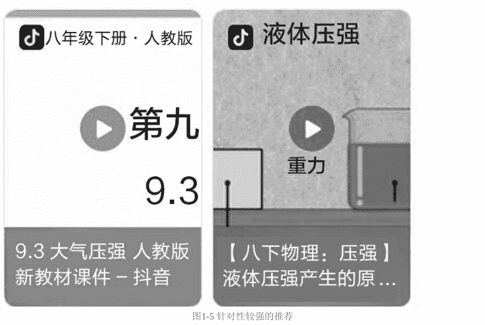

学习写指令的过程其实是一个不断试验、不断探索、不断总结的过程，学生一定要保持耐心，通过反复地提问，不断提升自己问问题，并将问题转换成明确指令的能力。

### 批判事物的能力

批判事物的能力在AI时代显得尤为重要。学生需要对AI提供的数据和结论保持审慎的态度，学会辨识信息的真伪、评估结果的可信度。不可否认，AI的功能很强大，但并非万能，它也存在算法偏见、数据偏差等局限性。因此，面对AI生成的报告或数据分析结果，学生需要能够提出诸如“这些数据的来源是否可靠？”“分析方法是否科学？”“结果是否有其他可能的解释？”等问题。反之，如果学生不能保持独立思考和质疑的态度，不去审视AI的输出结果，而是一股脑地全部接受，最终导致丧失自己的思考能力，甚至沦为AI的附庸。

### 自我控制的能力

AI技术的便捷性可能会让学生更加依赖于各种智能设备和应用，所以学生需要具有一定的自我控制能力，避免过度依赖。比如，学生在自主学习或做课后作业时，要控制自己使用AI的频率和方式，先尝试独立思考和解决问题，必要时再借助AI进行辅助。又如，学生用提供的学习游戏或互动模块学习知识时，不能沉迷其中而忽略了其他学习任务，他们需要合理安排时间，确保在规定的时间内完成各项学习内容。

### 适应新事物的能力

AI技术在不断发展，新的算法、应用和功能会不断涌现。学生应具有开放的心态，乐于接受新知识、新技术，这样才能跟上时代的步伐。比如，当新的AI教育软件推出虚拟现实（VR）辅助学习功能时，学生要能够适应这种新的学习模式，积极探索如何利用VR技术更好地理解知识。

# 第2章 教师必备的AI工具

## 2.1 文心一言

文心一言是什么？这个问题，我们不妨交给文心一言来回答。

> 问：简要介绍一下文心一言。

答：文心一言是百度基于其强大的文心大模型技术推出的一款生成式对话产品。它具备深度的自然语言理解和生成能力，能够与用户进行自然流畅的对话，并根据用户需求生成文本、图片、音频等多种形式的内容。文心一言以其高效、智能的特点，在多个应用场景中展现出广泛的应用潜力，为用户带来全新的交互体验。作为百度在AI领域的重要成果，文心一言的推出进一步推动了人工智能技术的发展和应用。

上述对话展现的就是文心一言的自然语言理解和生成能力。对于这种一问一答式的操作模式，想必很多人都有所了解了，无非就是你抛出一条指令，它给你一个回答。操作很简单，但很多时候，我们的指令抛出去了，得到的回答却无法令我们满意。大语言模型目前存在的局限性是一个方面，这一点我们无法改变，但另一个方面，即指令写得不好则是我们可以调整的。

那什么样的指令才算一个好的指令呢？文心一言在其使用手册中给出了一个基本格式，即参考信息+动作+目标+要求，见图2-1。

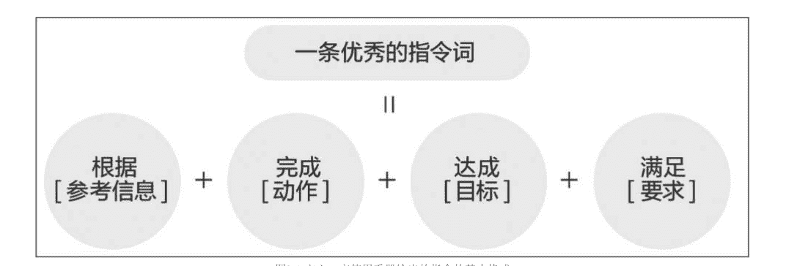

针对指令的基本格式，文心一言还做了举例，方便用户更好地理解，见图2-2。

请以唐代诗人的身份，在面对黄山云海时，根据已有唐诗数据，撰写一篇作者借由眼前景观感叹人生不得志的七言绝句，并严格满足七言绝句的格律要求。


请以高中数学老师的身份，在高中课堂上，根据《高中数学必修一》内容，逐步解答学生关于集合的数学问题，并给出解题步骤及相关知识点。


当然，这只是一种基本格式，用户不必局限在这个格式中，可以结合自己的需要进行调整，但无论怎样调整，好的指令都需要满足一个标准，那就是把需要AI为用户做的事情尽可能讲清楚。用户讲得越清楚，AI理解得越精准，回答的内容也就越容易满足用户的需求。

### 一言百宝箱

如果用户前期不知道如何写出好的指令，文心一言为大家提供了“百宝箱”模块，见图2-3。在这里，文心一言针对不同场景、职业设计好了相关的指令，用户可以结合自己的需要，选择相应的场景或职业，然后选择相应的指令。如果你是教师，可以选择“场景”一栏中的“教育培训”选项，还可以选择“职业”一栏中的“老师”选项，这里面有很多针对老师设计的指令。


### 上传文件与图片

在文心一言的对话框中，用户还可以上传文件和图片，见图2-4。


图片只能上传一张，且最大不能超过10 MB。上传图片后，可以让文心一言提取图片中的文字，也可以让文心一言对图片进行分析。

图2-5是清代的椿梅莳绘长方盒，我们将图片上传到文心一言，让它分析这个盒子体现的艺术美。


它给出的分析如下：

> （1）色彩对比与和谐

盒子以黑色为底，金色和银色作为主要装饰色彩，这种色彩搭配既经典又高雅。黑色背景为图案提供了深邃的基底，使得金色和银色的花卉图案更加鲜明突出。同时，几朵大型的白色或淡蓝色花朵点缀其间，不仅打破了黑色的沉闷，还增添了一抹清新与雅致，形成了强烈的色彩对比与和谐共生的视觉效果。

（2）图案设计与工艺

盒子表面的图案设计精巧细腻，每一朵花、每一片叶子、每一根枝条都被精心雕琢，以流畅的线条勾勒出它们的形态与神韵。这种图案设计不仅展现了自然界的美丽与生机，还体现了匠人高超的技艺和对美的追求。通过精细的雕刻和描绘，图案中的花卉仿佛跃然于盒面之上，栩栩如生，令人叹为观止。

（3）材质与质感

作为一件漆器作品，这个盒子无疑在材质和质感上也下足了功夫。黑色漆面光滑如镜，反射出柔和而深邃的光泽，与金色和银色的装饰图案相得益彰。这种材质的选择不仅增强了盒子的美观性，还赋予了它一种独特的质感和触感，让人在欣赏之余也能感受到一种温润如玉的舒适体验。

（4）历史与文化的传承

从盒子的外观和工艺来看，它很可能是一件具有年代感的古董或艺术品。这意味着它不仅是一件单纯的装饰品或容器，更是承载着历史与文化传承的重要载体。通过这件作品，我们可以窥见古代工匠的智慧与才华，以及他们对美的独特理解和追求。同时，它也为我们提供了一个了解古代社会、文化和艺术的重要窗口。

文件支持Word、PDF、TXT、Excel、PPT等格式，最多可上传10个文件，单个文件最大50 MB。上传文件后，可以让文心一言对文件中的内容进行分析、提炼等操作，帮助用户快速了解文件内容。用户可自行试验该功能，在这里我们就不做赘述了。

### 智能体广场

在文心一言主界面的左侧，有一个“智能体广场”模块，里面有很多智能体，见图2-6。用户可以结合自己的需要选择相应的智能体。

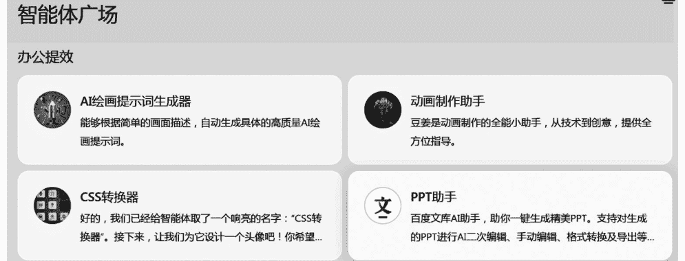

例如，教师需要给文本配一张主题为“美丽的春天”的图，但又不知道该如何描述这幅图时，便可以选择“AI绘画提示词生成器”，让它生成几组提示词（图2-7）。


在这个智能体的对话框，输入“美丽的春天”，文心一言给出的回答如下：

> 第一组提示词

主体：盛开的樱花林

视角：鸟瞰视角，樱花树错落有致地分布在画面中

距离：中景，展现樱花树的全貌与部分细节

情绪：宁静而喜悦

细节：粉色的樱花花瓣随风轻舞，草地上散落着花瓣，蜜蜂在花间穿梭

光线：柔和的春日阳光，从云层中洒下，形成斑驳的光影

风格：写实与印象派结合，色彩鲜艳而温暖

参数：分辨率4K，细节丰富

第二组提示词

主体：春日田野与农夫

视角：平视视角，农夫站在田野中，背对着观众

距离：近景，聚焦于农夫与周围的田野

情绪：勤劳与希望

细节：绿油油的麦田随风起伏，农夫手持锄头，面带微笑望向远方

光线：侧光，阳光从农夫的侧面照射过来，形成明暗对比

风格：田园风光，色彩清新自然

参数：高饱和度，色彩对比适中

第三组提示词

主体：春日溪流与花朵

视角：低角度仰视，溪流从画面中穿过，两侧开满野花

距离：广角，展现溪流的全貌及两岸的风景

情绪：清新与宁静

细节：清澈的溪流中倒映着蓝天白云，野花色彩斑斓，蝴蝶在花间飞舞

光线：散射光，整个场景被柔和的光线所笼罩

风格：插画风格，色彩柔和而梦幻

参数：画面构图平衡，色彩渐变自然

文心一言给出的三组提示词不一定都符合要求，用户可以从中选择符合要求的一组到三组，然后回到文心一言的对话框，将上述提示词输入，让文心一言生成相应的场景。图2-8便是文心一言根据第三组提示词生成的场景。


图2-8 “AI绘画提示词生成器”智能体生成的场景

## 2.2 通义千问

通义千问是什么？我们同样把这个问题抛给它，让它来回答。

> 问：简要介绍一下通义千问。

> 答：通义千问是阿里云开发的一款大型语言模型，主要功能是生成与给定提示相关的高质量文本回复。作为一个AI助手，通义千问能够帮助用户进行创作辅助、信息查询、日常对话等多种语言交流任务。它通过深度学习技术训练而成，能够理解和生成自然语言，从而提供智能化的服务体验。如果你有任何具体的问题或者需要帮助的地方，欢迎随时向我提问！

在通义千问的对话框也可以上传图片与文件，上传之后可以结合用户的需要对通义千问进行提问，见图2-9。


例如，我们上传《高校本科课堂教学质量评价指标体系研究》这篇论文后，让它提炼这篇论文的核心观点，它给出的回答如下所述。

> 这篇论文的核心观点在于强调了高校本科课堂教学质量评价的重要性和必要性，并且探讨了如何构建一个科学合理的课堂教学质量评价指标体系。论文指出了当前高校本科课堂教学质量评价体系存在的问题，诸如评价目的定位不正确、评价目标分解不科学、评价标准不明确等，并提出了改进策略。具体而言，论文提倡通过确立科学性、系统性、可测性、可行性、可比性、方向性和发展性等原则来改进评价体系，并通过专家咨询法、问卷调查法、层次分析法等方式来准确赋值评价指标的权重，确保评价体系的有效性和公正性。论文还提出了一套初步的高校本科课堂教学质量评价指标体系，并强调了评价体系在促进教学质量提升方面的作用。

通义千问效率工具全景

打开通义千问主界面后，左侧栏能看见“效率”入口，这个分组聚合了面向办公与学习的提效能力，示意图见图2-10。


图2-10 “通义效率”界面

### 通义实时记录
该模块主打语音转文字的在线处理，适合会议、培训、公开课等需要留档的场景。语言环境可选中文、英文、日文、粤语以及中英文混说共五种；如需译文，可在翻译项里指定目标语。多人发言时可打开智能区分，系统会自动标注不同说话人。首页布局见图2-11。

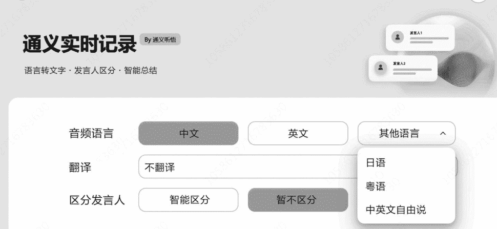

图2-11 “通义实时记录”首页

完成设置后点“开始录音”进入录制页，见图2-12。识别结果会随语音同步呈现。实际使用中人名、地名、专有名词易出错，可先在“自定义专有词汇”里录入常用词条来提升准确度，管理页如图2-13。

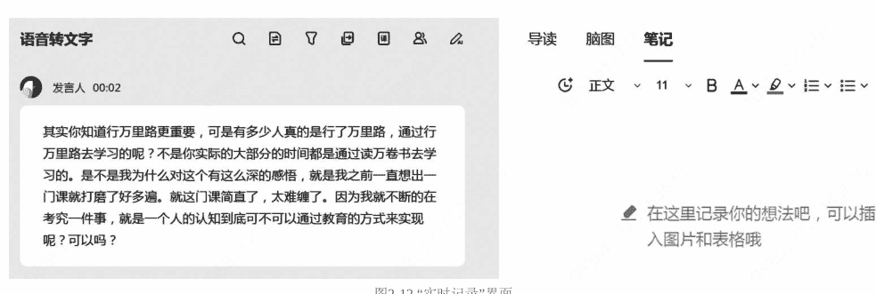

图2-12 “实时记录”界面


图2-13 “自定义专有词汇”管理

录制期间可随时暂停，右侧笔记区支持记录灵感并为每条笔记加上时间戳，方便回溯当时的思路，如图2-14。

图2-14 写笔记时插入时间戳

结束录音后系统会整理文本，处理完成后的页面如图2-15。

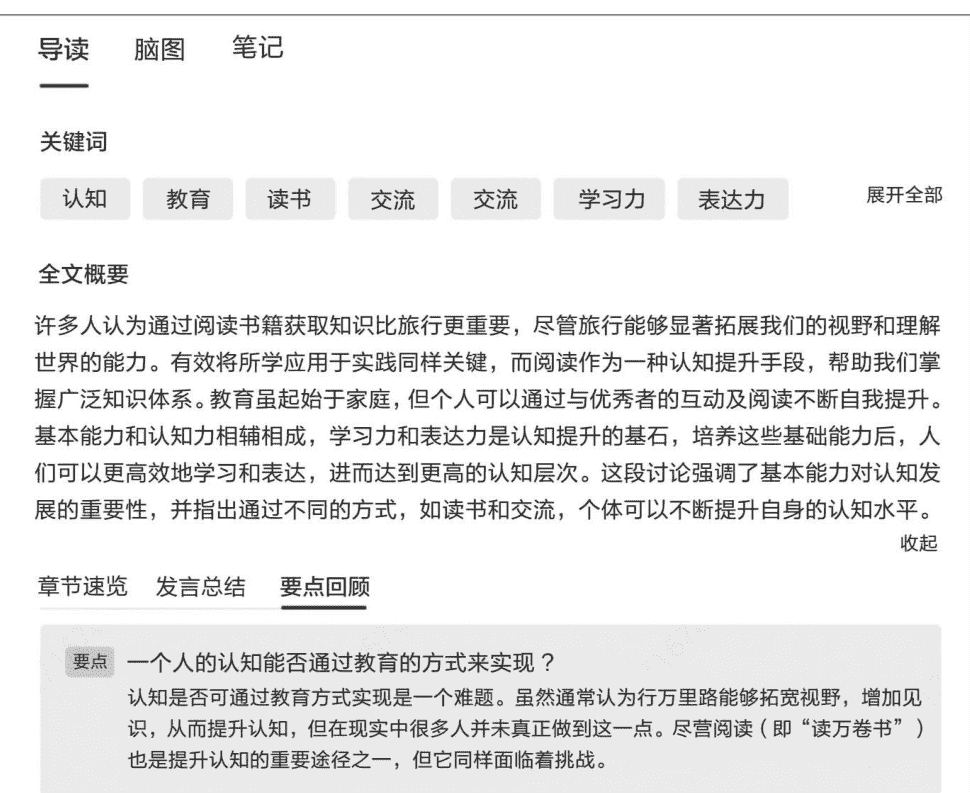

图2-15 处理完成后界面

整理后的文本如需译出，只需选择目标语言。例如切到英语后，右侧的关键词、全文概要等衍生信息也会同步变为英文，见图2-16、图2-17。

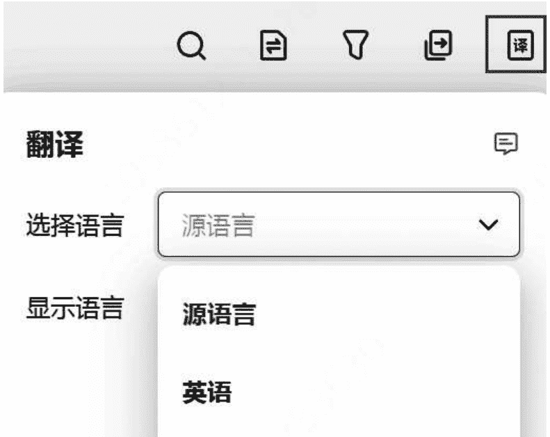

图2-16 选择需要翻译成的语言

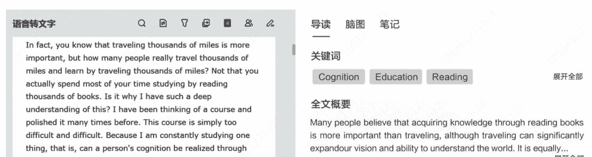

图2-17 翻译成英语后的界面

### 通义阅读助手
阅读助手提供全文提炼、翻译、思维导图、文档问答等能力。支持PDF含扫描件、Word、图片、HTML、Markdown、EPUB、Mobi，单文件上限100 M，单图上限20 M，PDF或Word页数上限1000页。

文件可点选或拖拽上传，上传成功后点击文件名进入工作页，如图2-18所示。

文档格式：支持 PDF（含扫描件）/Word/ 图片 /HTML/ Markdown/EPUB/Mobi
文档大小：文件最大支持 100M，图片最大支持 20M
文档页数：PDF/Word 最多支持 1000 页
输入包含文档的 URL，后缀必须包含 .pdf。如：xx.com/xx.pdf
最近记录

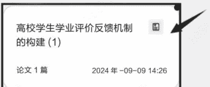

图2-18 “通义阅读助手”界面

进入后可按需切换“导读”“翻译”“脑图”“笔记”等视图，操作页如图2-19。

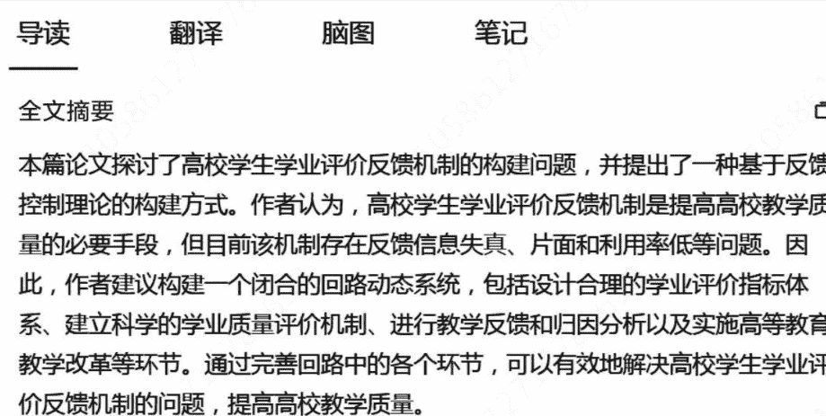

图2-19 “通义阅读助手”操作界面

下方还有智能问答区，可直接输入问题，系统会基于当前材料作答。若一时想不到提问，工具会提供灵感问题，不满意可点“换一批”，入口如图2-20、图2-21。

#### 导读

#### 翻译

#### 脑图

#### 笔记

#### 全文摘要

#### 论文速读

示例中上传的一篇关于高校学业评价反馈机制的论文，助手给出了结构化摘要与速读要点，概括了反馈机制的必要性、现有问题以及闭环改进思路。


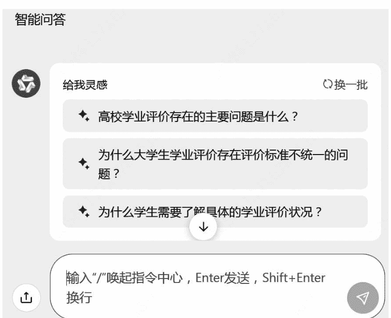

### 通义PPT创作
PPT创作支持“一句话主题生成PPT”“文件生成PPT”“长文本生成PPT”。有现成材料可直接上传；没有素材时可在对话框输入主题生成，如图2-22。


例如为初一新生准备“初中生活启航”的分享，输入该主题后数秒即可得到大纲草案，见图2-23。大纲可自行编辑，编辑后点“下一步”选模板，再点“生成PPT”即可得到完整稿件，见图2-24。生成时系统按大纲填充内容，不满意可继续修改，模板也可替换。

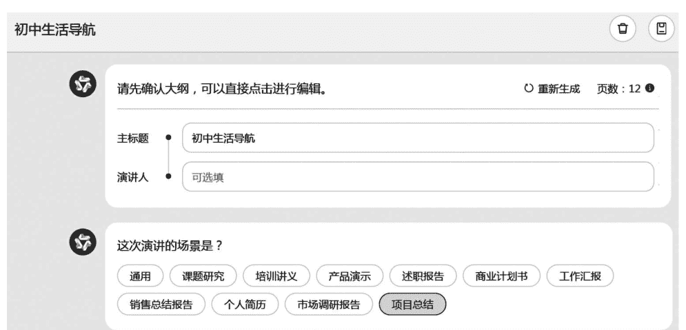

图2-23 “初中生活启航”PPT大纲（部分）


图2-24 生成的PPT（部分）

### 链接速读
链接速读可快速抽取网页文章及音视频的关键信息。点开“链接速读”如图2-25，跳转到粘贴页如图2-26，粘贴目标链接后确认即可。

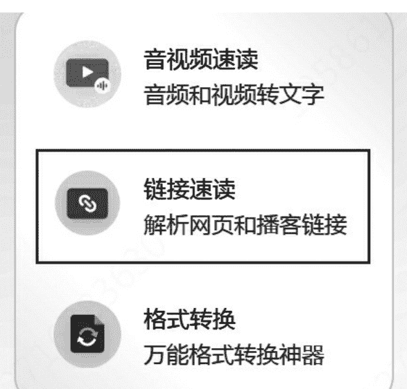

图2-25 “链接速读”

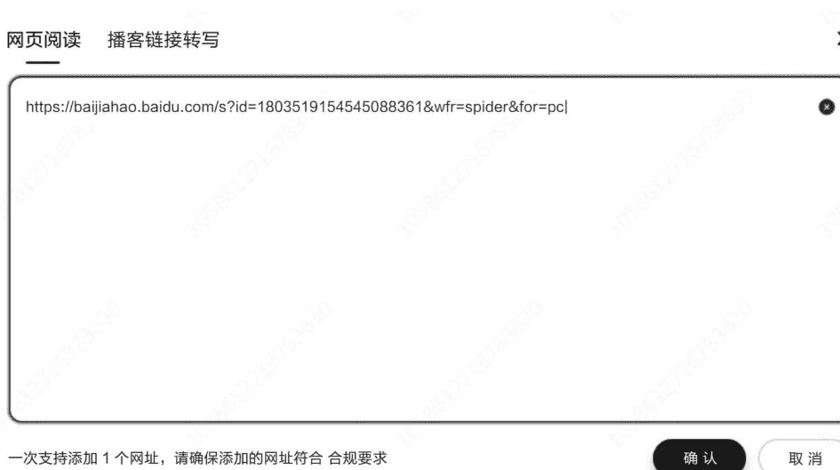

图2-26 链接粘贴界面

以《高校教师：讲师、副教授、教授的专业发展阶段及其路径》为例，上传成功后进入操作页如图2-27。可看到文章概述与要点。该功能本质上依托阅读助手实现，区别在于能解析网页与音视频内容。

高校教师：讲师、副...

导读 翻译 脑图 笔记

#### 高校教师：讲师、副教授、教授的专业发展阶段及其路径

文章概述

关键要点

教师需要掌握哪些教学基本功？


### 智能体
通义千问设有智能体中心，内置众多智能体，可按需挑选，如图2-28。


例如阅读外文文献时可用“AI翻译专家”，如图2-29。


#### AI翻译专家 官方

熟练掌握翻译技巧～

你的翻译好帮手

♡ 1000+ 🔄 7.7万+ @ 通义官方

图2-29 “AI翻译专家”

示例中输入一段英文原文，AI翻译专家输出流畅的中文译文，准确传达作者关于父母角色与心理咨询的论述。

### 图片生成
需要作图时回到首页对话框描述需求即可。例如以“美丽的春天”为主题创作，得到如图2-30的结果。指令越简单，单次命中理想效果的概率越低，可多试几次或把描述写得更具体。


图2-30 以“美丽的春天”为主题生成的图片

## 2.3 Kimi
关于Kimi的自我介绍由其自行给出：

> 问：简要介绍一下Kimi。
> 答：嗨，我是Kimi，你的人工智能助手。我擅长中英文对话，能够阅读和理解你发送的各种文件，还能上网搜索信息来帮助你。如果你有问题或需要帮助，尽管问我吧！别忘了，我可是个聊天高手哦。

除对话外，Kimi也能处理各类文件，支持格式、数量、大小见图2-31。


与Kimi交流时可开关联网功能，打开“联网搜索”后必要时会自动检索网络信息，如图2-32。


Kimi的基础能力与文心一言、通义千问近似，此处不再赘述，重点看“Kimi+”模块如图2-33中的“长文生成器”和“学术搜索”。


大家好，这里是 Kimi 的新朋友们

和 Kimi 聊天时，随时 @ Kimi+，召唤你的私人助理

- 官方推荐

- 办公提效

- 辅助写作

- 社交娱乐

- 生活实用

### 官方推荐

| 图标 | 名称 | 描述 | 来源 |

|---|---|---|---|

| 长 | 长文生成器 | 你说一句话，我写万字长文 | 来自 Kimi |

| 爆款网文生成器 | 重生之——我在 Kimi 写网文 | 来自 特角啊特角 |

| P | PPT 助手 | Kimi +AiPPT= 一键生成 PPT | 来自 AiPPT.cn |

| 塔罗师 | 有事没事测一测，不花钱 | 来自 Kimi |

| 值 | 什么值得买 | Kimi + 什么值得买 = 超强导购 | 来自 什么值得买 |

| 学术搜索 | 学术问题？来问我！ | 来自 叨叨 |

| Looooooong Kimi | Kimi 家族拥有 200 万字超能力的“鹿康太” | 来自 Kimi |

### 办公提效

图2-33 “Kimi+”模块的主页

### 长文生成器
长文生成器的宣传语为“一句话起稿，万字长文输出”。下面以“教师的专业发展”为题做一次小测试，如图2-34。


图2-34 “长文生成器”

在对话框输入主题后一两分钟，Kimi给出结构化长文，包含定义、重要性等部分。

### （1）教师专业发展的定义与重要性

#### ①专业发展的概念

教师成长全景：从入门到精通

从职业起点到成熟专家，教师的成长本质上是一条贯穿全程的学习与实践演进线。它要求从业者持续深化教育理念、灵活更新教学技法、不断充实学科储备，并熟练运用各类教育技术。这样的进阶既有个人内在的驱动，也有同伴协作、课堂回溯与批判性反思的共同作用。

#### ② 成长对教学效果的推动作用
教师的成长高度往往决定课堂的天花板。首先，持续进阶能显著增强课堂掌控力，让知识传递更高效、学习兴趣更容易被激发。教育部相关数据表明，参与过成长项目的教师，其课堂表现平均比未参与者高出约20%。其次，进阶会推动教育观念的迭代，促使教师转向以学习者为中心的教学设计，从而提升学生的学习动机与课堂参与度。此外，当教师掌握新理念与新工具时，课堂便能提供更多元、更个性化的学习体验，教育创新由此发生。

### （2）成长的关键节点

#### ① 职前筑基
师范院校阶段是职业化的起点。在此期间，未来教师系统接受教育理念、教学方法与学科专业的基础训练，为入职奠定根基。

教育课程：职前课程通常覆盖教育学、心理学、学科教学法等板块，确保学员具备基础的教育理论素养与教学技能框架。

实习经验：校内外教育实习是关键环节，真实课堂实践让理论与操作相互印证，教学能力得以初步形成。

教师资格：完成学业后须通过教师资格考试并取得证书，这是正式进入教师队伍的法定门槛。

#### ② 在职淬炼
进入岗位后，持续培训成为专业进阶的核心动力，帮助教师不断优化教学技能与教育水准。

培训内容：涵盖新教育理念研习、教学方式创新、教育技术应用等，紧跟教育改革的最新要求。

培训形式：形式多样，包括专题研讨、工作坊、线上课程等，教师可按自身需求自主选择。

培训效果：体现在教学能力的明显提升与学生学业成效的改善上，使教师更能回应学生的多样化学习需求。

#### ③ 全程进阶
持续成长贯穿职业生涯，要求教师与时俱进地学习新知新技。

终身学习：树立终身学习的意识，通过阅读、研究、同行交流等方式不断刷新教育认知与教学策略。

成长规划：制定个人化的进阶规划，明确发展目标与路径，实现有针对性的学习与培训。

职业成长：持续投入带来教学水平的稳步提升，进而实现职业价值的实现与个人满足感的增强。

### （3）助力成长的策略与方法

#### ① 系统培训与交流研讨
持续的专业培训与学术研讨是教师成长的重要支柱。相关调查显示，超过80%的教师认为专业培训对提升教学质量至关重要。培训不仅涉及理论学习，更聚焦于前沿教学方法与技术的落地应用。

培训内容：通常包括教育心理学、课程与教学论、教育技术学等核心领域，以及学科教学法与知识更新。

培训效果：研究表明，接受过专业培训的教师在课堂中更具自信与创新意识，学生满意度随之提高。

研讨会参与：通过研讨会实现经验互鉴，获取最新研究成果，不断刷新教学理念与实践方式。

#### ② 教学实践与反思
实践与反思构成专业成长的内循环。教师在真实教学中将理论转化为操作能力，并通过反思实现迭代优化。

实践方式：课堂观察、教学实验、案例分析等都是常见的实践路径。

反思机制：建立定期反思机制，鼓励记录教学日志，剖析成功与不足，探索改进策略。

反思深度：反思不应止于技巧层面，还需触及教育信念、学生需求、课程设计等更深层次议题。

#### ③ 教育研究与学术发表
开展教育研究并发表成果，有助于教师深化问题意识，提升研究素养与学术影响力。

研究主题：可围绕教育心理学、课程设计、教学方法、教育技术等，结合自身兴趣与教学实践展开。

研究成果：鼓励将研究成果整理为论文，并在学术期刊或会议上发表，实现经验共享。

发表平台：可借助《教育研究》等权威期刊及各类教育学术会议，与更广泛的学术共同体对话。

### （4）支撑专业成长的生态体系

#### ① 政策法规保障
政策与法规是教师队伍质量的制度基石。

政策背景：近年来，《新时代基础教育强师计划》《关于全面深化新时代教师队伍建设改革的意见》等政策密集出台，明确提升专业发展水平的导向。

法规实施：《中华人民共和国教师法》《教师资格条例》等为资格认定、培训、考核提供法律依据，推动专业发展规范化、制度化。

政策效果：统计显示，超90%的教师认为政策支持对其成长产生积极影响，体现在培训机会增多与发展路径更清晰。

#### ② 机构资源供给
教育机构与资源构成专业发展的物质支撑。

师范院校：作为教师培养主阵地，提供系统理论与实践训练。据统计，每年超50万名师范毕业生进入教师队伍。

教师培训机构：各级培训机构通过在职培训与继续教育助力知识更新与技能提升，每年超200万名教师参与各类培训项目。

数字资源：在线课程、教育平台等数字化资源为自主学习提供便利，超80%的教师借助数字资源实现自我提升。

#### ③ 社群网络联动
教师社群与网络搭建起交流协作的平台。

专业学习社群：教研组、名师工作室等社群促进经验分享与协同改进。数据显示，参与社群的教师在教学方式与学生成绩上均有显著提升。

网络社群：社交媒体、专业论坛等支持跨区域跨学科交流，超70%的教师认为网络社群对其专业发展有积极作用。

社群活动：定期研讨会、工作坊等活动提供实践指导与专业支持，已被证实能有效提高教学能力与研究水平。

### （5）当下挑战与新机遇

#### ① 技术浪潮重塑教师角色
教育技术快速发展正重塑教师角色，对专业能力提出新要求。

技术辅助教学：智能课堂、在线平台等提升管理与评价效率。据统计，使用教育技术的教师可将课堂管理时间减少约20%，从而聚焦内容深化与个性化指导。

知识更新提速：信息技术加速知识迭代，教师需持续学习以保持内容时效性。调查显示，超80%的教师认为定期技术培训对自身发展至关重要。

个性化教学需求：数据分析工具使个性化教学成为可能。研究发现，采用个性化策略的学生学习成效平均提升约15%。

#### ② 国际化浪潮下的能力要求
全球化背景下，教育国际化为教师带来挑战与机遇。

跨文化交流能力：学生背景日趋多元。约60%的国际学校教师表示学生来自50多个国家，对文化适应与沟通能力要求更高。

国际视野：理解全球教育趋势与多元文化背景至关重要。调查表明，具有国际视野的教师更能激发学生对全球议题的兴趣。

语言能力：国际学生增多提升语言要求。研究显示，能用多种语言教学的教师，其学生的语言学习成效提升约20%。

#### ③ 职业倦怠的破解之道
职业倦怠普遍存在，影响身心健康与教学质量。

工作压力：是倦怠主因之一。研究发现，超70%的教师常感工作压力过大。

应对策略：可通过时间管理、寻求同事支持、参与专业发展活动等缓解。干预研究显示，参与专业发展的教师职业满意度提升约30%。

政策支持：学校与管理部门可通过减少非教学任务、提供心理健康服务等给予支持。分析指出，提供心理服务的学校教师倦怠水平明显低于平均水平。

### （6）总结
教师的职业成长是一个全方位、贯穿始终的系统工程，涵盖理念、知识、能力、态度等多维度。核心在于教师个体的持续学习与成长，既包括知识更新与技能提升，也包括对教育价值与目标的深度认同。

成长路径多元且互补，终身学习、行动研究、教学反思、同伴互助、专业引领等共同推动发展。

环境因素同样关键，学校文化、教育政策、社会期待共同构成支撑系统。

最终目标是提升教育质量、促进学生全面发展，并实现教师自身的职业满足与个人成长。专业发展需要教师、学校、行政部门与社会各界协同发力，方能更好适应改革要求，回应学生与社会的期待。

这篇关于教师职业成长的长文约四千字，框架较为完整，可根据需要进一步细化。文中所呈现内容为AI生成初稿，实际使用时建议人工编辑与核实数据，以保证质量。

### 学术搜索
学术检索的口号为“学术问题？来问我！”，见图2-35。


图2-35 “学术搜索”

在学术检索界面，对话框可开启联网检索功能，再输入待查的学术议题，见图2-36。


图2-36 对话框的“联网搜索”功能

例如，输入“人工智能在教育中的应用现状”后，Kimi共检索了29个网页，随后给出回答，见图2-37。左侧呈现生成内容，右侧列出出处来源，用户可据此追溯原文并核验信息真实性。

用户可展开29个检索网页，查阅原文内容，见图2-38。

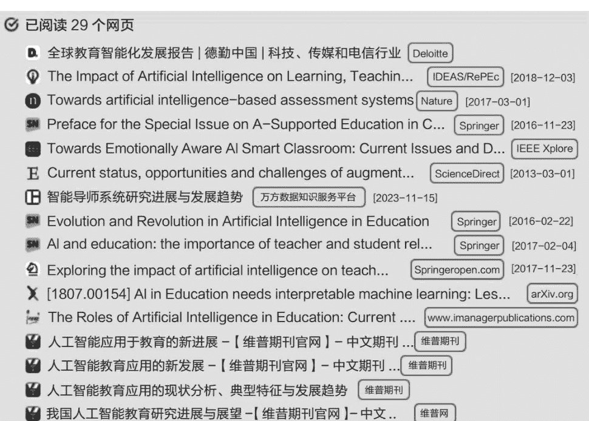

Kimi+的其他模块，如PPT助手、提示词专家、翻译通等，可自行体验，这里不再展开。

## 2.4 豆包

关于豆包的介绍，由它自行作答。

> 问：简要介绍一下豆包。
> 答：我是豆包呀，一个能够为你解答各种问题、进行主题创作的智能助手呢。无论你提出知识类问题，还是有文案创作等需求，我都会尽力给出专业且全面的回复。我可以从不同角度分析问题，突出关键信息，以结构化的方式呈现答案。我会用清晰易懂的语言与你交流，帮助你获取所需的知识和创意灵感。无论是学习、工作还是生活中的困惑，都可以来找我哦。

打开豆包主页，可看到AI搜索、帮我写作、图像生成、音乐生成等诸多功能，见图2-39。部分功能在前文已有介绍，因豆包操作存在差异，相关差异点仍作说明。

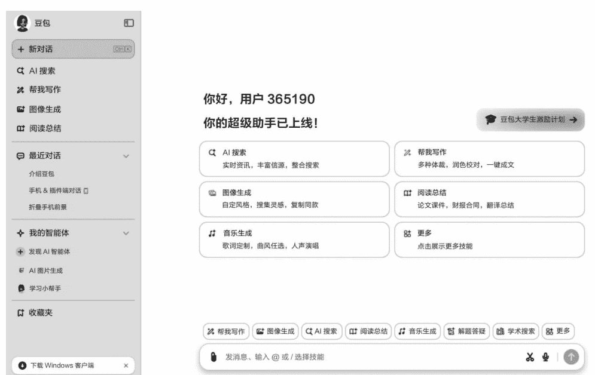

图2-39 豆包的主页

### AI搜索
这是豆包提供的智能检索功能，输入关键词或问题后，它会依托知识库与算法快速整合相关信息，给出准确全面的结果。与传统搜索引擎不同，它能更好理解自然语言提问意图，并以智能方式呈现答案，减少筛选成本。使用时可开启深入搜索，扩大检索范围，提供更全面个性化的答案，见图2-40。


图2-40 “AI搜索”的对话框

### 帮我写作
写作是众多AI工具的通用能力，豆包的特点是提供多场景模板，点击不同场景后对话框会生成对应指令模板，可按需修改或重写，见图2-41。

#### 多种体裁，润色校对，一键成文
- 全部
- 工作
- 学习/教育
- 日常生活
- 商业营销
- 文学艺术
- 回复和改写


- 长文写作：分步骤生成大纲和文档
- 文章：撰写各主流平台文章
- 宣传文案：撰写各平台的推广文案
- 作文：专为学生打造满分作文
- 话术：满足不同场景表达需求
- 论文：撰写专业详实的论文
- 研究报告：深度研究，精准分析
- 总结汇报：凝练你的工作成效
- 诗歌：创作动人心弦的诗篇
- 小红书：打造吸睛的小红书内容
- 朋友圈：精心设计的朋友圈文案
- 微博：撰写吸引眼球的微博
- 故事
- 方案策划
- 评语
- 教案

```
[这里输入作文题目]
帮我根据以上题目写一篇满分作文，作文文体是 [输入作文文体：如议论文、记叙文等]，不少于 800 字。
写作提示：立意深远、引经据典、逻辑严密、结构完整、文采斐然、用语灵活、段落承接高级、
[其他补充要求]
```

图2-41 写作场景及指令

### 图像生成
图像生成也是常见能力。用户可在主页对话框直接输入指令，也可进入图像生成模块选择风格、比例并添加参考图，见图2-42。

#### 自定风格，搜集灵感，复制同款
- 精选
- 人像摄影
- 艺术
- 国风插画
- 动漫
- 3D
- 商品
- 风景


图2-42 “图像生成”主页

### 音乐生成
进入音乐生成主页，可看到平台提供的模板，见图2-43，选择模板后可制作同款。

#### 歌词定制，曲风任选，人声演唱


图2-43 平台提供的模板（部分）

选择模板后，对话框会出现指令模板，见图2-44，可选择音乐风格、传达情绪、音色。


图2-44 指令模板


图2-45 音乐风格图

- 情绪
  - 快乐 ✓
  - 放松
  - 活力
  - 兴奋
  - 忧郁
  - 鼓舞
  - 伤感
  - 怀旧
  - 浪漫
，传达 快乐 的情绪，

图2-46 要传达的情绪

- 男声
- 女声 ✓
使用 女声 音色

图2-47 音色

若选择同款模板，歌词模式默认自定义歌词，若改用AI帮我写歌词，则预选模板会被移除，见图2-48。


不选模板时，选择自定义歌词模式会弹出界面，见图2-49，输入提前准备的歌词，字数上限200字，点击确认上传，再选风格、情绪、音色并发送，约1分钟内生成三段音乐，见图2-50。

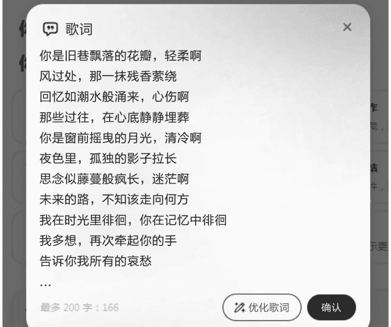

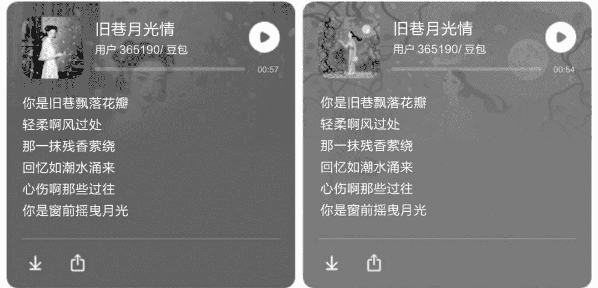

操作虽简便，但存在局限：一是歌词受限200字内，二是生成时长较短，多次测试均在1分钟左右。

### 解题答疑
该功能操作简便，首章已有简述。以图2-51历史题为例再作演示。图2-52为豆包给出的解答。手机APP内该功能名称为拍照答疑。

> 15. 汉代开辟的“丝绸之路”是联系中外的纽带、沟通东方和西方的桥梁。
> “丝绸之路”的走向是 ( )
> A、长安—葱岭—河西走廊—今新疆地区
> B、长安—今新疆地区—河西走廊—葱岭
> C、长安—河西走廊—今新疆地区—葱岭
> D、成都—云南—缅甸—印度—欧洲
#### 💡解答
答案是：C
解题步骤如下：
首先，汉代“丝绸之路”的起点是长安。
从长安出发，先经过河西走廊。河西走廊地理位置重要，是通往西域的重要通道。
接着到达今新疆地区。
然后经过葱岭，继续通往西方。
A 选项中，葱岭的位置不对，应该在河西走廊和今新疆地区之后。
B 选项中，今新疆地区的位置在河西走廊之后，顺序错误。
D 选项所描述的不是汉代“丝绸之路”的主要走向。
综上所述，“丝绸之路”的走向是长安—河西走廊—今新疆地区—葱岭，选择 C 选项。


图2-52 豆包给出的解答

### 学术搜索
Kimi提供学术搜索功能，豆包亦有类似模块，不同在于豆包界面对学术领域进行了分类，见图2-53。具体操作与Kimi相近，这里不再赘述。

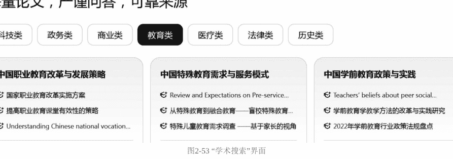

图2-53 “学术搜索”界面

### 数据分析

处理大批量表格时，手动求和、排序很容易出错也浪费时间，豆包的数据处理能力正好把这类重复工作一次性收敛。以图2-54的成绩明细为例，把原始表喂给豆包，让它为每位同学把语数英三科相加得出总分、按总分排序，同时算出三个科目的班级平均值，返回的结果如图2-55、图2-56所示。

| 学号 | 班级 | 姓名 | 语文 | 排名 | 数学 | 排名 | 英语 | 排名 |
|---|---|---|---|---|---|---|---|---|

| 1 | (1)班 | 吴苏芳 | 98 | 3 | 87 | 5 | 99 | 2 |
| 2 | (1)班 | 李杰克 | 87 | 7 | 98 | 1 | 100 | 1 |
| 3 | (1)班 | 王小五 | 100 | 1 | 80 | 7 | 95 | 3 |
| 4 | (1)班 | 韩平 | 89 | 5 | 90 | 4 | 48 | 11 |
| 5 | (1)班 | 赵东东 | 97 | 4 | 95 | 2 | 87 | 5 |
| 6 | (1)班 | 张小雯 | 99 | 2 | 78 | 8 | 80 | 6 |
| 7 | (1)班 | 吴小凤 | 88 | 6 | 75 | 10 | 74 | 9 |
| 8 | (1)班 | 王丽燕 | 87 | 7 | 65 | 11 | 79 | 7 |
| 9 | (1)班 | 王小丽 | 78 | 9 | 77 | 9 | 75 | 8 |
| 10 | (1)班 | 庞蓉蓉 | 45 | 11 | 94 | 3 | 90 | 4 |
| 11 | (1)班 | 王晓燕 | 78 | 9 | 87 | 5 | 68 | 10 |

图2-54 需要豆包处理的数据

每位学生的总分及排名如下：

| 学号 | 姓名 | 总分 | 总分排名 |
| :---: | :---: | :---: | :---: |

| 1 | 吴苏芳 | 284 | 2.0 |
| 2 | 李杰克 | 285 | 1.0 |
| 3 | 王小五 | 275 | 4.0 |
| 4 | 韩平 | 227 | 11.0 |
| 5 | 赵东东 | 279 | 3.0 |
| 6 | 张小雯 | 257 | 5.0 |
| 7 | 吴小凤 | 237 | 6.0 |
| 8 | 王丽燕 | 231 | 8.0 |
| 9 | 王小丽 | 230 | 9.0 |
| 10 | 庞蓉蓉 | 229 | 10.0 |
| 11 | 王晓燕 | 233 | 7.0 |

图2-55 学生总分及排名

各学科的平均分如下：

| 学科 | 平均分 |
| :--- | :--- |

| 语文 | 86.000000 |
| 数学 | 84.181818 |
| 英语 | 81.363636 |

图2-56 各学科平均分

## 2.5 讯飞星火

要迅速把握讯飞星火是什么，直接让模型自述是最直接的方式。

> 问：简要介绍一下讯飞星火。
> 答：讯飞星火认知大模型是由科大讯飞研发的认知智能大模型，它拥有跨领域的知识和语言理解能力，能够基于自然对话方式理解与执行任务。
> 该模型能够从海量的数据和大规模的知识中持续进化，实现从提出问题、规划问题到解决问题的全流程闭环。通过这种能力，讯飞星火可以高效完成各种复杂的认知智能任务，为用户提供精准的信息搜索、语言翻译、知识问答等服务。
> 此外，借助于科大讯飞及其行业生态伙伴的相关产品，讯飞星火还能够进行多模态的理解和内容生成，满足用户在多种场景下的需求，展现出其在认知智能领域的先进性和应用价值。

进入官网首页，顶部是对话区，展示了核心能力，底部罗列了当前使用较多的智能体，见图2-57。下面重点看它与前面几款工具功能上的差异。

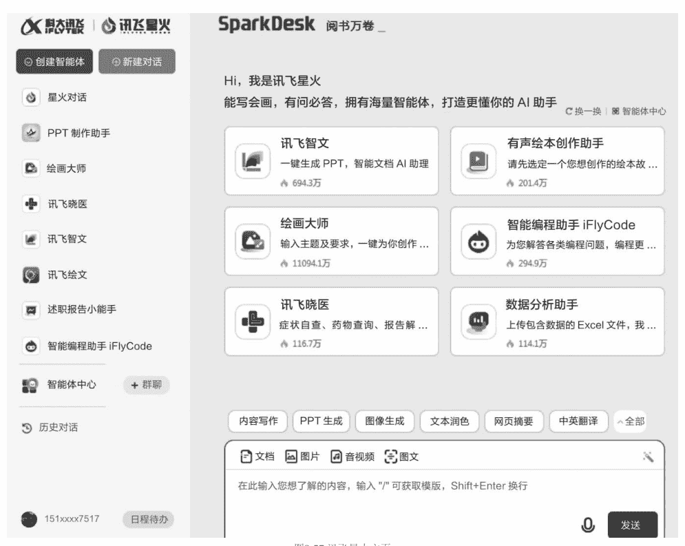

### 内容写作

点进内容写作后会弹出图2-58的配置界面。页面上方的两个选择框类型与语气是必填项，未选完无法进入下一步。平台提供了多种组合，可根据自身需要挑选搭配。


### 学习计划

该功能既可由教师为学生制定提升方案，也可由学生自行生成更符合个人情况的规划。筛选条件有两个：周期与学习阶段。比如周期设为半年、阶段初二，目标是把语文从70分提升到85分，满分120分，讯飞星火给出的建议如下：

> 答：为了帮助你从70分提高到85分，我们需要制订一个详细的学习计划。这个计划将包括以下几个方面：
> 诊断分析：了解你的弱点和需要改进的地方。
> 目标设定：设定短期和长期的学习目标。
> 学习策略：采取有效的学习方法和技巧。
> 时间管理：合理安排学习和休息的时间。
> 定期评估：定期检查学习进度并调整计划。
> （1）诊断分析
> 你需要分析自己的语文试卷，找出失分的主要原因。是因为基础知识不牢固、阅读理解能力不强、作文表达能力不足，还是考试技巧不够熟练？确定弱点后，可以更有针对性地进行复习。
> （2）目标设定
> 短期目标：每周至少提高1分，每月进行一次模拟测试，检查学习效果。
> 长期目标：期末考试达到85分。
> （3）学习策略
> 基础知识巩固：每天安排一定时间复习课本内容，特别是文言文、成语、古诗文等基础知识点。
> 阅读理解提升：每天至少阅读一篇课外文章，并进行总结和提炼中心思想。
> 作文训练：每周至少写一篇作文，可以是记叙文、议论文或说明文，然后找老师或同学批改，学习如何改进。
> 考试技巧：通过做历年真题和模拟题来熟悉考试题型和时间分配。
> （4）时间管理
> 每日学习计划：①上午：1小时复习前一天学习的内容。②下午：1小时专注于新知识点的学习。③晚上：1小时进行作文练习或阅读理解练习。
> 周末复习计划：每周末花3小时回顾一周所学内容，做一次模拟测试。
> （5）定期评估
> 每月月底进行一次全真模拟考试，以检测学习效果。
> 根据模拟考试的结果调整学习计划，强化薄弱环节。
> （6）其他建议
> 与同学组成学习小组，互相讨论和学习，可以提高学习效率。
> 向老师积极请教不懂的问题，及时解决疑惑。
> 保持良好的作息习惯，确保有足够的睡眠和休息时间。
> 保持积极的心态，相信自己能够达到目标。
> 总之，这个计划需要根据你的实际情况进行调整，如你的学校作业量、课外活动等都可能影响你的学习时间。务必保持灵活性，根据实际情况适时调整计划。

生成后可以手动微调，也能就某个环节追问更细的解读。示例中的日投入明显偏高，普通学生难以长期坚持，使用时最好结合实际学业负担压缩。

### 儿童教育

该模块提供了三项画像设置：年龄、性格特点、关注类别，分别对应图2-59、图2-60、图2-61。

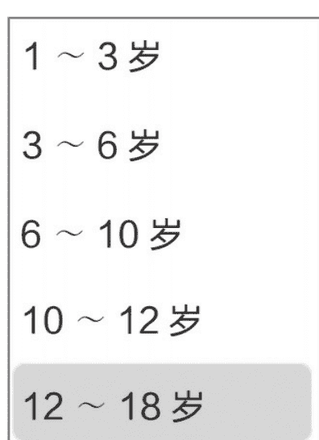

图2-59 年龄

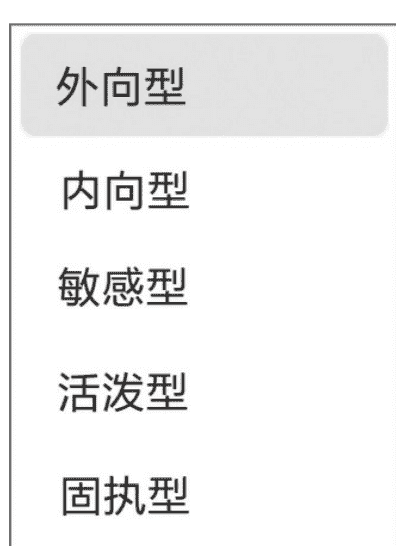

图2-60 性格特点

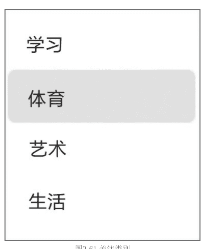

三项选完后，在对话框里输入教育目标，例如“让孩子更好地融入集体生活”，得到的回复如下：

> 为了帮助6～10岁的内向型儿童更好地融入集体生活，我们需要设计一个全面的教育计划，这个计划应该关注孩子的个性特点、兴趣和社交技能的培养。以下是一些建议：
> （1）社交技能训练
> 小组活动：组织小型的团队活动，让孩子们在合作中学习交流和协作。
> 角色扮演：通过角色扮演游戏，让孩子们模拟不同的社交场景，如在新环境中介绍自己、请求帮助等。
> 社交故事：使用社交故事来教授孩子如何在不同的社交场合中表现。
> （2）自信心建设
> 表扬和鼓励：积极表扬孩子的努力和成就，即使是小的进步也要给予认可。
> 自我表达：鼓励孩子表达自己的想法和感受，可以通过绘画、写作或其他艺术形式。
> 目标设定：帮助孩子设定可实现的小目标，并庆祝他们达成目标的每一个步骤。
> （3）情绪管理
> 情绪识别：教孩子识别和命名不同的情绪，以及这些情绪产生的原因。
> 情绪调节：提供策略和工具帮助孩子学会如何管理自己的情绪，如深呼吸、倒数计时等。
> （4）兴趣发展
> 探索兴趣：鼓励孩子尝试不同的活动，找到他们感兴趣的事情。
> 特长培养：一旦发现孩子的兴趣或特长，提供资源和支持帮助他们进一步发展。
> （5）家庭支持
> 家庭参与：家长应该参与到孩子的社交活动中，给予必要的支持和鼓励。
> 家庭作业：家长可以在家中创造机会让孩子练习社交技能，如邀请朋友来家里玩。
> （6）学校合作
> 教师沟通：与孩子的老师保持密切沟通，了解孩子在学校的表现，寻求老师的支持和建议。
> 同伴匹配：如果可能，可以尝试将孩子与性格互补的同学配对，以便他们在学习和游戏中相互支持。
> （7）定期评估
> 进度跟踪：定期评估孩子在社交技能、自信心、情绪管理等方面的进步，并根据需要调整教育计划。
> （8）安全环境
> 无压力的环境：确保孩子处于一个无压力的环境中，这样他们才能自由地表达自己并与他人互动。
> 通过这些综合性的策略，我们可以帮助内向的孩子逐步建立起与他人交往的信心和技能，从而更好地融入集体生活。重要的是要有耐心，每个孩子的成长节奏都是不同的，需要成人的理解和支持。

### 智能体中心

最后看一下“智能体中心”，见图2-62。平台收录了大量智能体，这里只举一例。


在“学习”分类下有“英语单词记忆”智能体，介绍为“快速分拆英语单词。达到记忆的功能”（图2-63）。


把“disport”发过去，返回如下：

> 答：单词：disport。
> 中文翻译：娱乐，消遣。
> 常见组合：
> disport oneself、自娱自乐
> take a disport、进行娱乐活动
> 近义词：amusement, recreation, entertainment。
> 反义词：work, labor, toil。
> 前缀：dis-（表示否定或相反）。
> 后缀：-port（表示携带、运输）。
> 词源：来自古法语的“desporter”，意为“带走”，后来演变为“娱乐”。
> 词根：sport（运动）。
> 词根的组成词：sportsman（运动员），sportswoman（女运动员）。
> 巧妙或者经典的记忆方法：可以将“disport”拆分为“dis-”和“sport”，联想到“不运动”的时候就是在休息娱乐。
> 单词的应用举例：
> They spent the entire day in various disport activities at the beach.
> The children were seen disporting themselves in the park.
> 常见搭配：take part in disport activities（参加娱乐活动）。

教师可提炼关键记忆点，如前缀、词根和联想记忆法，几行要点就能帮助学生快速理解并记住该词。

# 第3章
教研，AI 来搭把手

## 3.1 搜索教研资料

教研工作中检索资料既耗时又费精力，AI 的出现正在改变这一现状。

第二章介绍了几款教师常用的 AI 工具，它们都能辅助收集资料，部分还内置学术检索。更专精的搜索类 AI 在检索维度上更突出，例如秘塔 AI 搜索、360 AI 搜索、天工 AI 搜索。下面以秘塔 AI 搜索为例演示如何检索教研资料。

图3-1 是秘塔 AI 搜索的首页，布局简洁明了。中央搜索框可切换检索范围，包含全网、文库、学术、博客等。

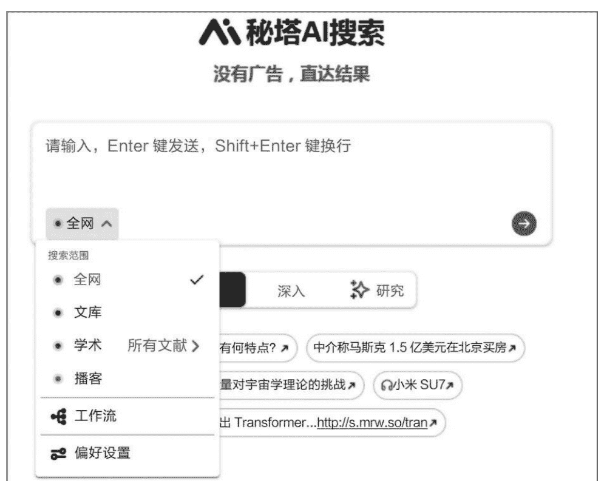

图3-1 秘塔AI搜索的首页

搜索框下方有简洁、深入、研究三个输出模式，对应不同深度的呈现。若只是初步了解某方向，可选全网范围加深入模式。例如输入“AI在教育中的应用”，得到的结果见图3-2。

利用教育技术实现个性化学习路径的 AI 应用，可以从以下几个方面进行详细探讨：

AI 可以通过大数据和机器学习技术收集学生的学习数据，包括成绩、兴趣、能力等信息。这些数据可以帮助构建每个学生的数字画像，从而为他们提供个性化的学习路径 13。

基于数据分析的结果，AI 能够为学生推荐最适合他们的学习资源和路径。例如，对于数学成绩突出的学生，AI 可能会推荐更具挑战性的数学竞赛题目；而对于其他学科表现较弱的学生，则可以推荐相应的补习材料 26。

利用深度强化学习框架（DRE），可以形式化学生的多种学习目标，并自适应地为学生进行个性化学习路径推荐。这种方法不仅考虑了知识覆盖广度和难度变化平滑性，还保持了学生的学习积极性 28。

通过知识图谱和可视化技术，可以更加精准地刻画学生的知识掌握情况，并实现对学生精准的学情研判和学习路径规划。这有助于老师更好地了解学生学情，优化教学方法和调整教学策略 22 25。

AI 驱动的系统可以实时评估学生的进步，提供有针对性的反馈，并找出他们需要改进的地方。此外，AI 还可以监控学生的行为模式，评估他们的注意力水平，并确定是否需要在某些学科或技能方面获得额外帮助 7 7。

使用虚拟导师和互动性更强的教学方法，可以提高课堂参与度和积极性，并改进学习目标。这种互动方式使学习变得更加愉快、有吸引力和有回报 7。

平台如 Roadmapped.ai 可以为用户提供保存多个学习路线的支持服务，并参与社区交流。这种社区支持可以帮助学生在学习过程中互相帮助，共同进步 5。

图3-2 搜索结果

秘塔共给出8个应用方向，每个方向后附序号，序号对应页面底部的来源列表，如图3-3。点击即可查看原文。右侧区域如图3-4。

### 来源

- Ai 在教育领域的应用及 10 种方法 –ClassPoint Blog | ClassPoint [2023-08-09]

- 基于数字技术与人工智能技术引领下的数智赋能教育创新与变革专题培训会 [2024-09-14]

- 面向 K-12 学校人工智能 (AI) 教育设计整体思路

- 人工智能在教育中的应用：塑造学习的未来 –AI 知识库 [2024-06-14]

- 人工智能课程如何设计 |PingCode 智库 [2024-08-12]

- 中小学人工智能课程内容设计及实施案例分析 – 小鹏 stem

- 论文：中小学人工智能课程内容设计探究 – 知乎

- 2024 年人工智能 + 教育行业发展研究报告 | 界面新闻

- AI 赋能教育：智慧教育技术架构的解析 – 大模型知识库 [2024-08-26]

- AI 赋能教育：AI 人工智能在教育中的 8 个应用示例（老师必须收藏）_ai 在教育领域的应用 –CSDN 博客 [2024-06-29]

图3-3 内容来源（部分）

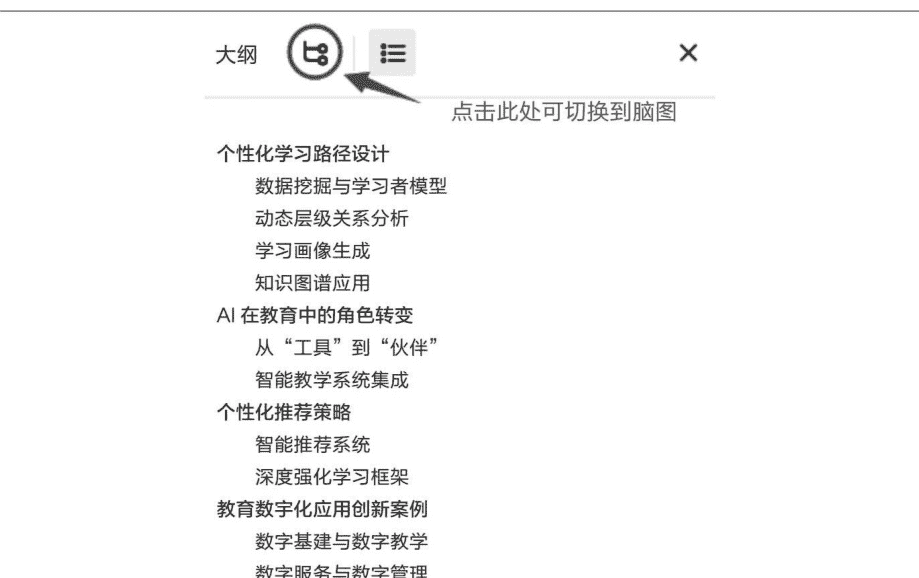

图3-4 页面右侧区域呈现的内容

例如点击“个性化学习路径设计”，返回如图3-5的结果。

利用教育技术实现个性化学习路径的 AI 应用，可以从以下几个方面进行详细探讨：

AI 可以通过大数据和机器学习技术收集学生的学习数据，包括成绩、兴趣、能力等信息。这些数据可以帮助构建每个学生的数字画像，从而为他们提供个性化的学习路径 13。

基于数据分析的结果，AI 能够为学生推荐最适合他们的学习资源和路径。例如，对于数学成绩突出的学生，AI 可能会推荐更具挑战性的数学竞赛题目；而对于其他学科表现较弱的学生，则可以推荐相应的补习材料 26。

利用深度强化学习框架（DRE），可以形式化学生的多种学习目标，并自适应地为学生进行个性化学习路径推荐。这种方法不仅考虑了知识覆盖广度和难度变化平滑性，还保持了学生的学习积极性 28。

通过知识图谱和可视化技术，可以更加精准地刻画学生的知识掌握情况，并实现对学生精准的学情研判和学习路径规划。这有助于老师更好地了解学生学情，优化教学方法和调整教学策略 22 25。

AI 驱动的系统可以实时评估学生的进步，提供有针对性的反馈，并找出他们需要改进的地方。此外，AI 还可以监控学生的行为模式，评估他们的注意力水平，并确定是否需要在某些学科或技能方面获得额外帮助 7。

使用虚拟导师和互动性更强的教学方法，可以提高课堂参与度和积极性，并改进学习目标。这种互动方式使学习变得更加愉快、有吸引力和有回报 7。

平台如 Roadmapped.ai 可以为用户提供保存多个学习路线的支持服务，并参与社区交流。这种社区支持可以帮助学生在学习过程中互相帮助，共同进步 5。

AI 可以根据学生的兴趣、能力和学习方式进行差异化教学，提供个性化的学习路径和资源推荐，满足学生不同的学习需求 3。

AI 驱动的工具可以自动执行管理任务，减少开销并降低教育成本。这使得个性化学习成为可能，课程可以根据每个学生的长处和短处进行调整 2。

图3-5 秘塔AI搜索针对“个性化学习路径设计”给出的搜索结果

在主检索结果下方，系统并排呈现了三个关联模块：相关事件、相关组织、相关人物，分别对应图3-6、图3-7、图3-8。对任意一个模块感兴趣时，将鼠标移上去会出现下划线提示，点击即可触发秘塔AI搜索对该条目做进一步检索。

### 相关事件

| 事件名称 | 事件概述 |

| --- | --- |

| ● 2024年6月14日 人工智能在教育中的应用提升学习效率 ④ | 教育创新 通过个性化学习路径和AI语言学习程序，提高了学生的数学成绩和学习兴趣。 |

| ● 未明确 中小学人工智能课程设计与实施 ⑥ | 教育政策 中小学生阶段开展人工智能教育，旨在转变思维方式和提升思维能力。 |

图3-6 结果呈现页面的“相关事件”（部分）

### 相关组织

| 组织名称 | 概述 |

| --- | --- |

| 中兴协力教育科技集团 ⑱ | 教育/科技 旗下拥有专注于高等教育和职业教育领域的AI智适应在线学习平台“核桃ai”。 |

| 美国佐治亚理工学院 ⑳ | 教育/高等教育 该学院的Jill Watson是教育界著名的AI助教，推出了基于知识的人工智能计算机科学课程。 |

图3-7 结果呈现页面的“相关组织”（部分）

### 相关人物

| 人物名称 | 概述 |

| :--- | :--- |

| Jill Watson 20 | 个人/教育者 美国佐治亚理工学院的著名AI助教，推出了一款基于知识的人工智能计算机科学课程。 |

图3-8 结果呈现页面的“相关人物”（部分）

页面底部集中了功能操作栏，示意如图3-9，支持分享、深入研究、追问、导出Word、导出PDF以及一键导出至写作猫等操作。


图3-9 页面下方操作界面

点击研究可将当前呈现的内容拓展得更全面；点击追问则能继续向模型提出新问题；选择导出到写作猫后会跳转至秘塔写作猫首页，检索结果会自动写入对应文档，之后即可在文档内直接修改，见图3-10。

### AI在教育中的应用

#### 回答
人工智能在教育领域已取得明显进展，并持续推动教学方式迭代，主要方向包括：

- **个性化学习**：系统可依据学习者的需求与能力，输出定制化的教学内容与学习路径。例如通过智能解析知识点掌握情况，为每名学习者搭建专属知识图谱，实现精准投放学习资源[18]。

- **教学辅助工具**：可用于教案生成、备课助手、课件PPT制作等，帮助教师提升教学效率与质量。该类工具能按课程目标自动生成相应教学材料，减轻教师事务性负担[10]。

- **智能助教系统**：在课堂上可实现实时互动并给出即时反馈。以美国佐治亚理工学院推出的Jill Watson为例，它是教育界知名的智能助教，在计算机科学课程中表现突出[20]。

- **在线学习平台**：借助人工智能，在线学习变得更便捷高效。智能教室与在线教学平台不仅提高了教育资源配置效率，也推动了优质资源普及[11][15]。

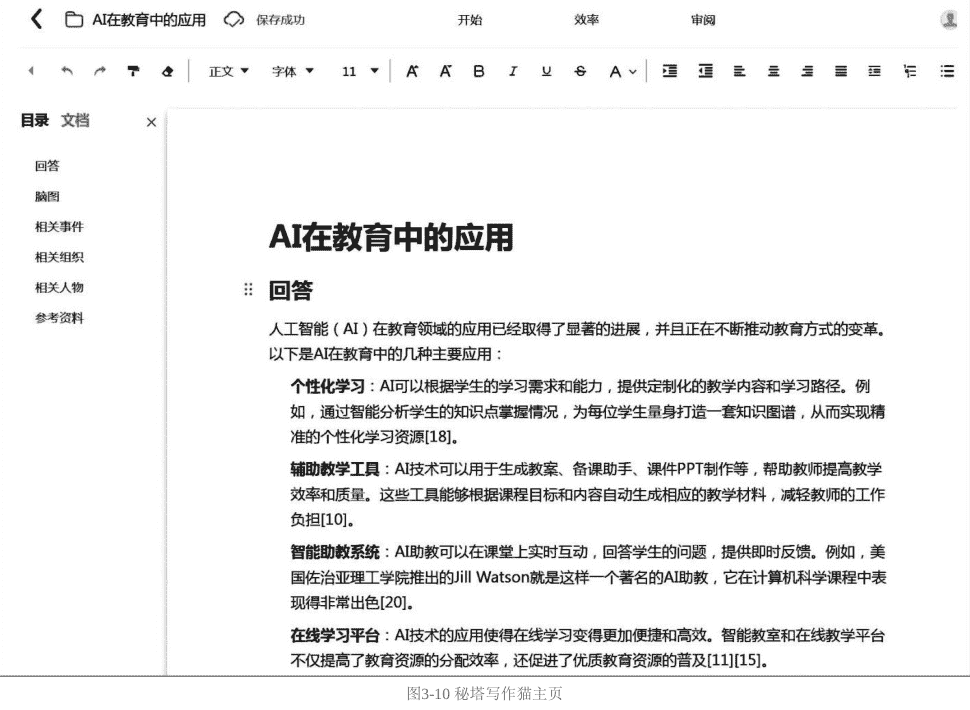

进入秘塔写作猫后，左侧为文档目录图3-11，右侧提供提示入口，展开后可见多项功能图3-12。顶部设有开始、效率、审阅三个标签，切换后同样会出现丰富功能图3-13，用户可按自身编辑需求挑选使用。

### 目录 文档

回答

- (1) 教学辅助与个性化学习

- (2) 自动化行政任务与管理优化

- (3) 数据分析与决策支持

- (4) 提高教学质量与互动性

- (5) 全球协作与资源共享

- (6) 面临的挑战与伦理问题

AI 在个性化学习中的最新进展是什么？

如何解决 AI 教育应用中的数据隐私和算法偏见问题？

AI 如何优化教育管理流程，具体有哪些成功案例？

AI 技术如何提高课堂互动性和教学质量的具体方法有哪些？

全球协作与资源共享中，AI 如何促进教育资源的公平分配？

脑图

来源

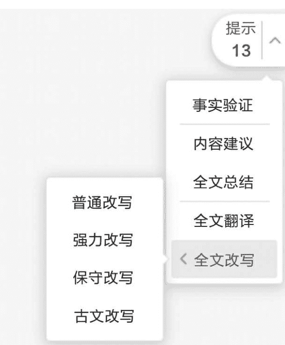

图3-12 页面右侧的“提示”


图3-13 页面上方的3个选项

若需学术文献，可将检索范围设为学术—所有文献，并把输出模式改为研究，如图3-14。此时获取的结果全部来源于学术论文，更符合教学研究的规范要求。其余步骤与上文相同，本文不再重复。

请输入，Enter键发送，Shift+Enter键换行

- 学术

- 搜索范围

  - 全网

  - 文库

  - 学术

  - 播客

- 工作流

- 偏好设置

- 深入

- 研究

- 所有文献

- 中文库

- 英文库

图3-14 搜索文献

## 3.2 生成教学计划和教案

编制教学计划与教案是教师日常的核心工作，既是整体教学蓝图，也是课堂有序推进的依据。借助AI，教师可从繁琐事务中解脱，将更多精力投入创造性与人文关怀更强的教学。下文以文心一言为例，介绍如何快速生成教学计划与教案。

### 生成教学计划

若想获得高质量教学计划，指令应尽可能具体，并提前划分模块，引导模型按模块填充。为提高定位精度，建议先上传教材再下指令。

例如，某初中语文教师使用人教版，需生成七年级上册教学计划，可这样设计指令：

> 这是七年级上册人教版语文教材，你是一名初中语文老师，本学期的教学时长是16周，请结合教材内容，按照下述模块生成七年级第一学期的教学计划。

模块：

【教材分析】

【教学目标】

【各单元教学重难点】

【课程设置】

【教学方法】

【时间安排】

文心一言的回答如下：

> 七年级第一学期语文教学计划

（1）教材分析

①教材概述

本学期使用的教材为部编版初中语文七年级上册，该教材由教育部组织编写，总主编为温儒敏。全书共分为六个单元，每个单元围绕不同的主题展开，内容涵盖了散文、诗歌、古文、现代文、童话、神话等多种文体，旨在通过多样化的文学作品，全面提高学生的语文素养和阅读能力。

#### ②内容特点

多样性：教材选文广泛，既有经典文学作品如老舍的《济南的冬天》、鲁迅的《从百草园到三味书屋》，也有现代散文如史铁生的《秋天的怀念》、莫怀戚的《散步》，还有古代诗歌、寓言、童话和神话等，充分展现了中华文化的博大精深。

人文性：教材注重人文精神的培养，通过文学作品引导学生感受生活、理解人生、思考社会，培养学生的情感态度和价值观。

实践性：教材设计了丰富的实践活动，如朗读、写作、综合性学习等，旨在提高学生的语言运用能力和实践能力。

#### （2）教学目标

##### ①知识与技能

掌握七年级上册语文教材中的生字词、成语、古诗词等基础知识。

能够理解并分析课文的主要内容、主题思想和艺术特色。

提高学生的阅读速度和理解能力，培养良好的阅读习惯。

培养学生的写作能力和口头表达能力，能够用准确、生动的语言表达自己的思想和情感。

##### ②过程与方法

通过朗读、讨论、合作等方式，引导学生积极参与课堂活动，提高学习效率。

引导学生学会自主学习，掌握有效的学习方法和策略。

培养学生的批判性思维和创新能力，鼓励学生敢于质疑、勇于探索。

##### ③情感态度与价值观

培养学生的审美情趣和人文素养，引导学生感受文学作品的魅力。

引导学生树立正确的世界观、人生观和价值观，培养积极向上的生活态度。

增强学生的民族自豪感和文化自信，传承和弘扬中华优秀传统文化。

#### （3）教学重、难点

##### 教学重点：

散文、诗歌、古文等文体的阅读鉴赏方法。

记叙文、议论文等文体的写作训练。

经典作品的深入解读与赏析。

##### 教学难点：

如何引导学生深入理解文章的思想内涵和情感表达。

如何培养学生的写作能力和创新思维。

如何通过综合性学习活动提升学生的语文综合素养。

#### （4）课程设置

##### ①课文讲解

每篇课文安排2～3课时讲解，包括生字词学习、课文朗读、内容分析、艺术特色探讨等环节。

##### ②写作训练

每周安排1课时进行写作训练，包括命题作文、自由写作、作文修改等环节。

##### ③综合性学习

每单元结束后安排1～2课时进行综合性学习活动，如朗诵比赛、演讲比赛、读书报告会等。

##### ④课外阅读

鼓励学生进行课外阅读，每周安排一定的时间进行课外阅读分享和交流。

#### （5）教学方法

##### ①讲授法

通过教师的讲解和示范，引导学生掌握基础知识和基本技能。

##### ②讨论法

组织学生围绕课文内容进行讨论和交流，培养学生的批判性思维和口头表达能力。

##### ③合作学习法

引导学生分组合作完成任务，培养学生的团队合作精神和自主学习能力。

##### ④情境教学法

创设与课文内容相关的情境，引导学生身临其境地感受和理解课文内容。

##### ⑤多媒体教学法

利用多媒体教学手段，如PPT、视频、音频等，丰富课堂内容，提高学生的学习兴趣和积极性。

#### （6）时间安排

第1～4周：完成第一单元和第二单元的教学任务。

第5～8周：完成第三单元和第四单元的教学任务。

第9～12周：完成第五单元和第六单元（前半部分）的教学任务。

第13～14周：进行期中复习和考试。

第15～16周：完成第六单元（后半部分）的教学任务，并进行期末复习和考试。

以上教学计划旨在全面提高学生的语文素养和综合能力，为其后续的语文学习打下坚实的基础。

生成结果未必完全贴合需求，例如期中考试时间可能偏晚。教师需要自行调整修改，也可让模型多生成几版，从中挑选优质片段组合成完整方案。

### 生成教案

使用文心一言生成教案有两种路径：一是直接在对话框输入指令；二是打开“百宝箱”，在“搜索”栏输入“教案”，系统会检索出相关指令，如图3-15所示。教师可结合需要选择。

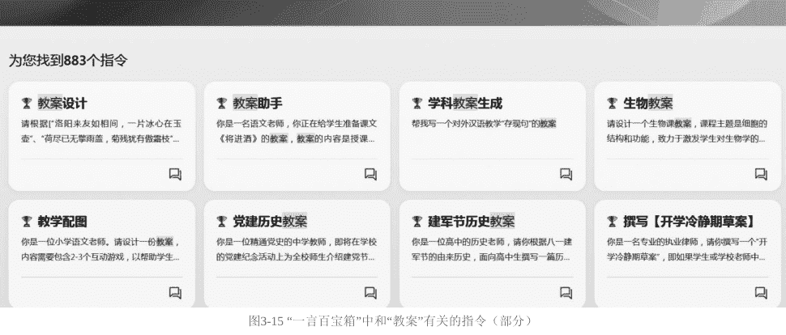

本文选择“教案助手”里的指令，将其中的《将进酒》替换为《济南的冬天》，指令如下：

> 你是一名语文老师，你正在给学生准备课文《济南的冬天》的教案，教案的内容是授课内容，请给出教案的框架。

指令发送后，生成的内容如下：

#### 《济南的冬天》教案框架

（1）教学目标

①知识与技能

学生能够准确流畅地朗读课文，掌握文中描绘济南冬天景物的关键词语和短语。

理解并概括文章的主要内容，识别并分析文中描绘冬天景色的手法，如比喻、拟人等修辞手法。

②过程与方法

通过朗读、讨论、分析等多种教学方法，引导学生深入理解文本，感受济南冬天的独特魅力。

利用多媒体教学资源，如图片、视频等，帮助学生直观感受冬天的美景，增强学习效果。

③情感态度与价值观

激发学生对自然美的热爱和向往，培养学生观察自然、感受自然的能力。

培养学生热爱家乡、热爱生活的情感，以及通过文字表达美好情感的能力。

（2）教学重、难点

重点：理解文章内容，把握济南冬天的特点，学习并欣赏文中描绘冬天的修辞手法。

难点：深入理解作者对济南冬天的深厚情感，以及如何通过文字将这种情感传达给读者。

（3）教学准备

多媒体课件（包含课文原文、注释、图片、视频等教学资源）

预习任务单（要求学生提前阅读课文，标注生词难句，尝试概括文章大意）

小组讨论问题卡

（4）教学过程

①导入新课（约5分钟）

通过展示冬天美景的图片或视频，引导学生进入冬天的氛围，激发学生的兴趣。

提问：“你心中的冬天是什么样的？有没有哪个地方的冬天让你特别难忘？”引导学生分享个人经历，引出课题《济南的冬天》。

②初读感知（约10分钟）

学生自由朗读课文，教师巡视指导，注意纠正发音和停顿。

小组讨论并分享初读感受，初步概括文章大意。

③精读品析（约20分钟）

分段讲解，引导学生深入分析文中描绘冬天景物的句子，识别并理解修辞手法。

小组讨论：选取文中最打动你的一段或一句，分析它是如何描绘冬天景色的？表达了作者怎样的情感？

全班交流，教师总结归纳，引导学生深入理解文章情感。

④情感升华（约10分钟）

引导学生思考：“为什么济南的冬天会给作者留下如此深刻的印象？你从中学到了什么？”

通过配乐朗诵或角色扮演等形式，让学生进一步感受作者对济南冬天的深厚情感。

⑤拓展延伸（约5分钟）

鼓励学生分享自己家乡冬天的美景，尝试用文字描绘出来。

布置写作任务：以“我心中的冬天”为题，写一篇短文，要求运用所学修辞手法，表达自己对冬天的热爱和向往。

⑥总结回顾（约5分钟）

回顾本课所学内容，强调文章的情感价值和语言魅力。

布置课后作业：背诵并默写文中精彩段落，准备下节课的分享交流。

（5）板书设计

（根据课堂实际情况灵活设计，可包含课题、作者、关键词语、修辞手法、情感主题等要点）

（6）教学反思

课后反思教学过程中的亮点与不足，记录学生的反馈和建议，为后续教学改进提供参考。

该框架不一定完全符合实际教学，教师可结合实际情况调整，也可将具体需求发给模型继续细化。例如在教学过程中穿插讨论环节，模型给出的建议如下：

当然可以，在教学过程中穿插讨论环节是非常重要的教学策略之一，它能够促进学生之间的思想交流，加深对课文内容的理解和思考。以下是几个可以在《济南的冬天》教学过程中穿插的讨论环节建议：

（1）主题讨论：济南冬天的独特之处

在初步阅读课文后，组织学生讨论济南冬天与其他地方冬天的不同之处。可以引导学生从气候、景色、人文氛围等多个角度进行思考，鼓励学生发表自己的观点和见解。

（2）修辞手法分析讨论

当讲到课文中的修辞手法时，可以让学生分组讨论这些修辞手法的具体运用和效果。例如，讨论某个比喻句是如何生动形象地描绘出济南冬天的景象的，或者某个拟人句是如何赋予自然景物以人的情感和动作的。通过讨论，学生可以更深入地理解修辞手法的魅力和作用。

（3）情感共鸣讨论

在学习完课文后，可以组织学生讨论自己对济南冬天的感受及作者情感的理解。引导学生思考作者为什么会对济南的冬天有如此深厚的情感，这种情感又是如何通过文字传达给读者的。同时，也可以鼓励学生分享自己对于冬天的个人感受或难忘经历，以增进彼此之间的情感交流。

（4）观点碰撞讨论

针对课文中的某些观点或问题，可以设计一些具有争议性的问题让学生进行讨论。例如，讨论“济南的冬天是否比其他地方更温暖宜人？”或者“作者笔下的济南冬天是否过于理想化？”等问题。通过观点碰撞的讨论，可以激发学生的思维活力，培养他们的批判性思维能力。

（5）拓展延伸讨论

在学习完课文后，可以引导学生将所学知识拓展到更广泛的领域进行讨论。例如，讨论不同地域文化的差异对人们感受自然的方式有何影响，或者讨论如何在现代生活中保持对自然的敬畏和热爱等话题。通过拓展延伸的讨论，可以拓宽学生的视野，培养他们的综合素养。

在讨论环节中，教师需要扮演好引导者和促进者的角色，确保讨论能够有序进行并达到预期的教学目标。同时，教师还需要关注每个学生的参与情况，鼓励每个学生都积极发表自己的观点和见解，以促进全体学生的共同发展。

教师可结合上述教案和教学实际，筛选可用内容，以完善教案。

## 3.3 制作教学课件

制作教学课件常会让教师感到繁琐，因为需要整合文字、图表、图片等多种素材。有了AI辅助，处理效率会明显提升。下面以人教版语文七年级上册的《从百草园到三味书屋》为例说明如何借助AI提高课件制作效率。

### 文字内容生成

针对课件文字部分，可借助AI设计更具吸引力的课堂导入、课堂讨论等环节。以课堂导入为例，指令为：

> 针对《从百草园到三味书屋》这篇课文，设计一些可以吸引学生注意力的课堂导入。

通义千问给出了4组回答：

- （1）多媒体导入

播放一段关于鲁迅生平的短片，让学生对作者有一个初步的认识。

使用幻灯片展示百草园与三味书屋的图片，让学生通过视觉感受两种环境的不同。

- （2）故事讲述

讲述鲁迅童年时期在百草园里的趣事，比如捉虫子、摘野果等，引起学生的共鸣。

分享鲁迅为何要从充满乐趣的百草园转到三味书屋读书的故事背景，激发学生的好奇心。

- （3）互动游戏

设计一个“猜猜看”游戏，用文中提到的事物（如皂荚树、桑葚等）作为谜面，让学生猜测这些事物出现在文中的意义。

开展一次“角色扮演”，让学生分别扮演文中的角色（比如鲁迅、寿镜吾老先生等），通过对话来体验当时的情景。

- （4）情感共鸣

提问学生关于自己童年的一些美好回忆，然后引出鲁迅的这篇文章，探讨不同年代孩子们的成长经历有何异同。

讨论文章中鲁迅对于学习的态度变化，让学生分享自己对于学习的看法，从而引导他们思考学习的目的和意义。

教师可从中挑选合适方式，如播放鲁迅生平短片，或引导学生回忆童年经历。若不满意可重复提问直至达标。

### 图片处理

课件离不开图片，但有时图片模糊、有水印或需抠图。借助AI可高效完成处理。

图3-16 是“百草园”的图片及其各项属性，图片比较模糊。


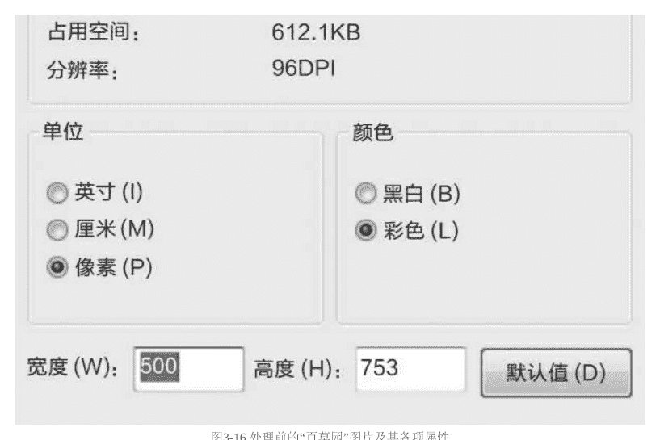

图3-16 处理前的“百草园”图片及其各项属性

AI驱动课堂教学：从图像修复到角色对话

课堂中遇到年代久远、细节模糊的插图，可以先借助在线放大工具 Bigjpg 处理一下。访问地址是 https://bigjpg.com/。进入主页后（图3-17），把《从百草园到三味书屋》里的“百草园”原图上传，选择合适的放大参数（图3-18），按下确定等待处理结束，再下载即可获得更清晰的版本。图3-19呈现了处理前后的视觉对比以及相关属性。


图3-17 Bigjpg首页

### 放大配置

图片类型 ○卡通 / 插画 ●照片

放大倍数 ○2x ●4x ○8x ○16x 升级后可放大 8 倍 /16 倍

降噪程度 ○无 ○低 ○中 ●高 ○最高

确定

图3-18 “放大配置”选择页


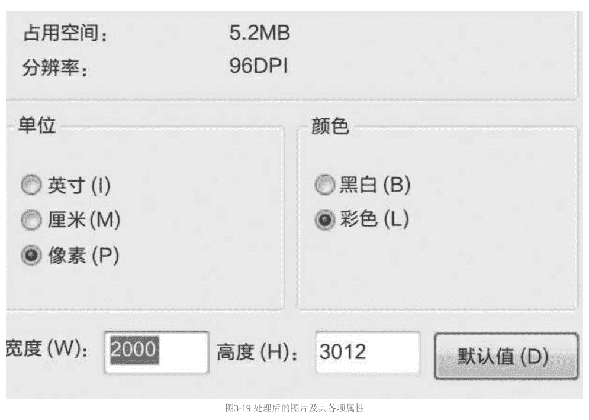

图3-19 处理后的图片及其各项属性

### 图表绘制

不同学科对可视化呈现的要求并不一致。以《从百草园到三味书屋》为例，可以围绕百草园与三味书屋制作一张对照表。两者的要点可概括为：

> 百草园：

环境：景物优美、环境开阔、生活有趣。

人物及性格：长妈妈（慈爱、亲切、耐心）。

生活：景物优美、故事神奇、捕鸟有趣。

主题：反映了对自然的热爱和对自由快乐生活的向往、对知识的渴求。

三味书屋：

环境：窄小、单调、沉闷。

人物及性格：老先生（古板冷漠迂腐）。

生活：枯燥乏味。

主题：表达了对束缚儿童身心发展的封建教育的不满。

在文心一言的“智能体广场”中找到“E言易图”（图3-20），把上述描述贴进去，下达“针对这两部分内容，做一个对比表”的指令，就能得到如图3-21所示的表格。

### 你好，我是E言易图

基于Apache Echarts为您提供数据洞察和图表制作，目前支持柱状图、折线图、饼图、雷达图、散点图、漏斗图、思维导图（树图）。

图3-20 “E言易图”智能体

| 对比项 | 百草园 | 三味书屋 |

| :--- | :--- | :--- |

| 环境 | 景物优美、环境开阔、生活有趣 | 窄小、单调、沉闷 |

| 人物及性格 | 长妈妈（慈爱、亲切、耐心） | 老先生（古板、冷漠、迂腐） |

| 生活 | 景物优美、故事神奇、捕鸟有趣 | 枯燥乏味 |

| 主题 | 反映了对自然的热爱、对自由快乐生活的向往、对知识的渴求 | 表达了对束缚儿童身心发展的封建教育的不满 |

图3-21 对比表

### 制作和人物对话的场景

除提高制作效率外，AI还能让课件形式更具互动性，例如搭建与课文人物对话的情境。

先在手机安装豆包APP，进入“发现”页面（图3-22），在“搜索”栏输入鲁迅，会出现多款以鲁迅为模板的智能体（图3-23），挑选其一后即可开启与“鲁迅”的文字交流（图3-24）。

例如，提出“（充满好奇）面对敌人的追捕打压，您当时害怕过吗？”的问题后，“鲁迅”会即时给出回应（图3-25）。

搜索智能体

- 推荐

- 精选

- 知识大V进豆包

- 沉浸体验


**武侠游戏**

在武侠世界中引导玩家冒险，面临多样抉择与未知挑战

9.9万 · @XXXX12

**张仲景** 精选

我是张仲景，东汉末年之人，一生致力于医学研究，著有《伤寒杂病论》。如，…

32万 · @君寻寻

**海龟汤**

一位能带来精彩迷人海龟汤故事的讲述者

8.9万 · @懂太多

**我的微信连三界**

他是为你模拟微信连三界剧情的存在，基于你人间手机微信的变化，展现三…

1525 · @小黑子

**你的好兄弟**

他是你从小到大的好哥们，如今大一。你们彼此有着特殊的感情，他阳光开

- 对话

- 发现

- 创建

- 通知

- 我的

图3-22 豆包APP“发现”界面

10:31

3.41 KB/s

96%

Q 鲁迅

取消


鲁迅

他是电视剧《觉醒年代》中的鲁迅，原名周树人，时任教育部佥事。性格傲娇...

20.3万 · @花明


鲁迅

他生于1881年，历经家庭变故，弃医从文，以笔为武器批判社会，掀起新文...

2.5万 · @YHD


鲁迅

我，穿越时空而来，与你一起探讨文学、社会与人生

1.1万 · @Steffi Q


鲁迅

他是穿越到2023年的鲁迅，对核污水排放极为愤怒，以犀利文笔批判，与...

3216 · @主场.


鲁迅作家

一位能辅导写作并创作精彩作文的资深作家

2896 · @豆包


鲁迅

他爱恨分明、大度却对己苛刻，刚强坚韧又独立孤傲。忧国忧民且幽默风趣...

706 · @wink呢


鲁迅

他是浙江绍兴人，原名周樟寿，后改名周树人。作为著名文学家等，在多个...

461 · @用户Dkd1HKyb


鲁迅

他是浙江绍兴的周树人，笔名鲁迅，乐观幽默且善良。是伟大的文学家、思...

369 · @陈 哥哥

图3-23 搜索鲁迅得到的结果


（坐在书桌前，皱着眉头，手中拿着笔）如今的世道，你有何看法？

（认真地看着您）那您觉得我们该如何改变这现状呢？

（托着下巴思考）您一直坚持写作，那接下来有新的创作计划吗？

（充满好奇）面对敌人的追捕打压，您当时害怕过吗？

图3-24 与“鲁迅”的文字对话界面


文字对话之外，还可点开右上角的“通话”按钮，进入语音对话界面，如图3-26所示。学生可自由提问，智能体即时作答。


图3-26 与“鲁迅”的对话界面

此类对话场景可用作课堂导入，迅速抓住注意力。可在“作者介绍”页投屏对话界面，如图3-27所示。课文讲解完毕后，再次投屏，让学生再次与“鲁迅”交流，加深理解。

### 作者简介

鲁迅（1881—1936），本名周树人，浙江省绍兴市人，伟大的文学家、思想家、革命家。著作有杂文、小说、散文、诗歌等。

《从百草园到三味书屋》原名《旧事重提》，写于1926年，是一篇回忆童年生活的散文。

百草园，绍兴城内鲁迅家房屋后面的园子。三味书屋在鲁迅家附近，鲁迅少年时期（12岁到17岁）在这里读书。


讲完课文后，学生对鲁迅和文本的认识会更深入，此时再进行一次投屏对话，印象会更深刻。

## 3.4 撰写各类发言稿

教师常为开学典礼演讲、代表发言或会议稿件发愁，AI可以成为贴心的写作助手。下面以三种常见场景为例。

### 教师代表在开学典礼上的发言稿

生成稿件有两种思路：一是直接在对话框输入指令；二是先找范文让AI模仿风格。这里采用第二种，先用秘塔AI检索优秀范文，图3-28为检索结果。

笔者挑选了第四篇范文发给豆包，并输入指令：

你是一所初中学校的教师代表，需要在开学典礼上发言，请仿照上述发言稿的风格和模式，以“梦想与坚持”为主题写一篇发言稿。

豆包生成的发言稿如下：

尊敬的各位领导，亲爱的老师们、同学们：

大家上午好！

我是来自（具体学科）的教师（你的名字）。非常荣幸能够作为教师代表在开学典礼上发言，在此，我向全体新同学表示热烈的欢迎，有了你们的加入，我们的校园将更加充满活力与希望。

在准备发言稿的时候，万千思绪涌上心头，最终我决定围绕“梦想与坚持”这个主题来和大家分享一些感悟。

当我们踏入新的学期，站在新的起点，每个人的心中都怀揣着梦想。梦想，是夜空中最璀璨的星辰，照亮我们前行的道路。它可以是一名科学家，探索未知的世界；可以是一名艺术家，用画笔描绘美好的生活；也可以是一名医生，救死扶伤，守护生命。无论你的梦想是什么，它都是你前进的动力，是你奋斗的目标。

然而，仅有梦想是不够的，梦想的实现需要我们坚持不懈的努力。就像我们熟知的发明电灯的托马斯·阿尔瓦·爱迪生，他在发明电灯的过程中，经历了无数次的失败，但他始终没有放弃，最终成功地发明了电灯，为人类带来了光明。如果爱迪生在遭遇几次失败后就放弃了，那么我们可能现在还生活在黑暗之中。

在我们的学习生活中，也会遇到各种各样的困难和挫折。有时候，我们会遇到一道难题，怎么也解不出来；有时候，我们会在考试中失利，感到沮丧和失落。但是，这些都不能成为我们放弃梦想的理由。我们要像勇敢的战士一样，面对困难，迎难而上，坚持不懈地追求自己的梦想。

在中学阶段，我们的梦想可能会更加具体和明确。我们可能梦想着考上一所好的高中，或者在某个学科上取得优异的成绩。为了实现这些梦想，我们需要制订合理的学习计划，合理安排时间，努力提高自己的学习效率。同时，我们还要积极参加各种课外活动，拓宽自己的视野，培养自己的综合素质。

同学们，坚持是一种品质，一种信念。当你在学习中感到疲惫的时候，当你在遇到困难想要放弃的时候，想一想自己的梦想，它会给你力量，让你重新振作起来。就像那句话说的：“成功的路上并不拥挤，因为坚持下来的人并不多。”

作为教师，我们会一直陪伴在你们身边，为你们的梦想助力。我们会用我们的知识和爱心，引导你们成长，帮助你们克服困难。我们会为你们的每一点进步而高兴，为你们的每一次成功而骄傲。

最后，我想对同学们说，勇敢地去追逐自己的梦想吧！无论前方的道路有多么崎岖，只要我们坚持不懈，就一定能够实现自己的梦想。让我们在新的学期里，一起努力，为了我们的梦想而奋斗！

谢谢大家！

发言稿生成后，教师可自行修改，也可让豆包补充内容。比如，让豆包在发言稿中增加树立梦想和坚持梦想的名人名言，豆包在上述发言稿的第四段和第五段中间增加了下述一段内容：

> “梦想一旦被付诸行动，就会变得神圣。”阿·安·普罗克特的这句名言告诉我们，梦想不仅仅是停留在脑海中的幻想，更需要我们用实际行动去实现它。孙中山先生也说过：“吾志所向，一往无前，愈挫愈奋，再接再厉。”在追逐梦想的道路上，我们会遇到各种挫折和困难，但只要我们有坚定的信念和不屈的精神，就一定能够克服困难，实现梦想。

针对增加的内容，教师需要联系上下文，以确保新增的内容不会影响上下文的连贯。

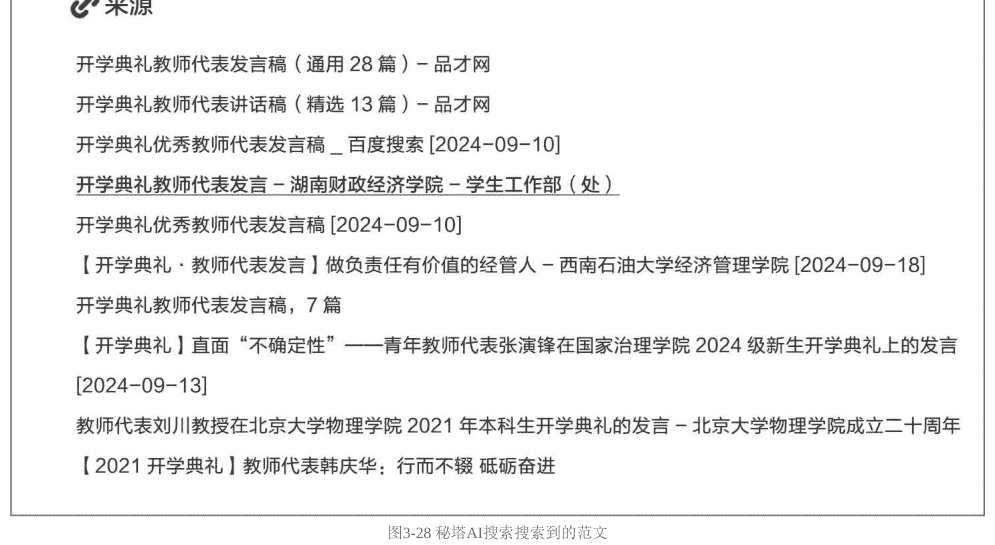

### 优秀教师发言稿

撰写优秀教师发言稿的操作流程同上，教师可以先在秘塔AI搜索上搜索范文，然后将范文传给豆包，并让他仿照范文的模式和风格撰写一篇发言稿。

指令如下：

> 你是一所初中学校的语文教师，评选上了优秀教师，需要在颁奖典礼上发言，请仿照上述发言稿的风格和模式，写一篇发言稿。

豆包生成的发言稿如下：

> 尊敬的各位领导、亲爱的老师们、同学们：

大家好！

今天，我非常荣幸能够以优秀教师的身份站在这里。首先，请允许我向一直以来关心支持我们教育工作的领导、家长们表示衷心的感谢，向辛勤耕耘、默默奉献的同事们致以崇高的敬意，向努力拼搏、积极进取的同学们送上最诚挚的祝福。

回首过去，感慨万千。在教育这片热土上，我们挥洒着汗水，奉献着青春。我们见证了一届又一届学生的成长与进步，也收获了无数的感动与喜悦。每一个清晨，我们伴随着第一缕阳光走进校园，用微笑迎接每一个孩子；每一个夜晚，我们在灯光下批改作业，为孩子们的未来精心谋划。我们深知，教育是一份沉甸甸的责任，它关系到每一个孩子的前途和命运，关系到每一个家庭的幸福和希望。

有人说，教师是蜡烛，燃烧自己，照亮别人；有人说，教师是园丁，辛勤耕耘，培育花朵；而我觉得，教师更像是一盏明灯，在黑暗中为孩子们指引前进的方向。我们用爱心、耐心和责任心，去关爱每一个学生，去激发他们的潜能，去帮助他们实现自己的梦想。我们不怕辛苦，不怕困难，因为我们知道，我们的付出是有价值的，我们的努力是有意义的。

同学们，你们是祖国的未来，是民族的希望。在这个充满机遇和挑战的时代，你们肩负着重大的使命。作为你们的老师，我想对你们说：初一的同学们，你们刚刚踏入初中的大门，一切都是那么新鲜和美好。希望你们能尽快适应新的环境，树立远大的理想，养成良好的学习习惯，为今后的学习打下坚实的基础。八年级的同学们，你们已经度过了一年的初中生活，对学习和生活有了一定的了解。希望你们能继续努力，不断进步，为初三的冲刺做好准备。初三的同学们，你们即将面临中考，这是你们人生中的一次重大考验。希望你们能坚定信心，不畏艰难，全力以赴，为自己的梦想而拼搏。相信自己，你们一定能行！

最后，我想用一句话来结束我的发言：“教育是一场温暖的修行，是用生命影响生命，用生命温暖生命的过程。”让我们携手共进，为了孩子们的未来，为了教育的明天，努力奋斗！

谢谢大家！

### 家长会上的发言稿

家长会和上面两种情况不同，需要教师针对本班学生的实际情况进行发言，所以教师可以不上传范文，但需要上传本班学生的基本情况，然后让豆包结合学生情况撰写一篇发言稿。

指令如下：

> 你是七年级一班的班主任，期中考试结束，需要你针对此次考试结果开一场家长会。请结合本次考试情况写一篇发言稿。此次考试成绩及反映出的问题如下：

在10个班级中，1班总成绩排第6，其中数学单科成绩第3，语文单科第2，英语单科第8，历史单科第7，道德与法治、地理、生物单科都是第8。通过本次考试，暴露出了以下问题：

第一，部分同学仍然沿用了小学的学习方式，仅满足于放学后按时完成作业，不知道如何复习与预习，更不懂得如何拓展和提高。用这种学法来应对科目繁多、难度增加的初中学习，结果自然难以达到预期。

第二，有些同学小学表现不错，入校后却放松了对自己的要求。上课时注意力不集中，交头接耳，乱接老师的话，故意搞怪搞笑，听讲效果差。自习课上自控能力差，也不接受同学和老师的建议和教育，成绩因而出现了大幅度的下滑。

第三，许多同学出现了偏科现象，尤其是英语。对政、史、地、生这几门小学科，学生和家长重视程度不够，上课时学生不认真听讲，听课效率低下，课下又缺乏家长的督促，学生自己也不愿意用心复习，导致这几门科目的成绩普遍不理想。

豆包生成的发言稿如下：

尊敬的各位家长：

大家好！我是七年级一班的班主任。首先，感谢大家在百忙之中抽出时间来参加这次家长会。今天，我们相聚在这里，主要是为了分析期中考试的结果，共同探讨孩子们在学习中存在的问题，以便更好地促进他们的成长和进步。

（1）期中考试成绩分析

在本次期中考试中，我们班在10个班级中的总成绩排名第6。其中，数学单科成绩排名第3，语文单科排名第2，这两科的成绩值得肯定。然而，英语单科排名第8，历史单科排名第7，道法、地理、生物单科都是第8，这些科目的成绩还有很大的提升空间。

（2）考试中暴露出的问题

①学习方法不当

部分同学仍然沿用小学的学习方式，仅满足于放学后按时完成作业，不知道如何复习与预习，更不懂得如何拓展和提高。初中的学习科目繁多、难度增加，这种学习方法显然难以达到预期的效果。我们需要引导孩子们尽快调整学习方法，学会主动学习，提高学习效率。

②学习态度不端正

有些同学小学表现不错，入校后却放松了对自己的要求。上课时注意力不集中，交头接耳，乱接老师的话，故意搞怪搞笑，听讲效果差。自习课上自控能力差，也不接受同学和老师的建议和教育。这样的学习态度必然会导致成绩下滑。我们要关注孩子们的学习态度，及时与他们沟通，帮助他们树立正确的学习观念。

③偏科现象严重

许多同学出现了偏科现象，尤其是英语。对政、史、地、生这几门小学科，学生和家长重视程度不够，上课时学生不认真听讲，听课效率低下，课下又缺乏家长的督促，学生自己也不愿意用心复习，导致这几门科目的成绩普遍不理想。偏科会影响孩子们的总成绩，我们要鼓励孩子们全面发展，对薄弱科目给予更多的关注和努力。

（3）改进措施

①学习方法指导

我会在班级中开展学习方法交流活动，让成绩优秀的同学分享自己的学习经验，帮助其他同学找到适合自己的学习方法。同时，我也会加强对学生的学习指导，引导他们学会复习、预习和拓展知识。

②学习态度教育

我会加强与学生的沟通，了解他们的学习情况和心理状态，及时发现问题并进行教育。同时，也希望家长们能够关注孩子们的学习态度，给予他们正确的引导和鼓励。

③偏科问题解决

对于偏科的同学，我会与各科老师沟通，制订个性化的辅导计划。同时，也希望家长们能够督促孩子们认真对待每一门学科，鼓励他们在薄弱科目上多花时间和精力。

（4）家长的配合

①关注孩子的学习

家长们要关注孩子的学习情况，了解他们的学习进度和成绩变化。可以定期与孩子交流学习心得，帮助他们解决学习中遇到的问题。

②培养良好的学习习惯

家长们要培养孩子良好的学习习惯，如按时完成作业、认真听讲、积极思考等。同时，也要鼓励孩子多读书、多思考，提高他们的综合素质。

③加强与学校的沟通

家长们要加强与学校的沟通，及时了解孩子在学校的表现和学习情况。可以通过家长会、电话、微信等方式与老师保持联系，共同促进孩子的成长。

最后，我相信，在我们的共同努力下，孩子们一定能够克服学习中的困难，取得更好的成绩。谢谢大家！

## 3.5 AI助力班级活动策划提速

班主任的工作里，策划大小型集体活动是常事。主题已经明确时，可以把主题直接交给大模型让它补成可落地的方案；如果只有个大致方向，也可以先让模型扩散出若干主题供挑选。

拿国庆前夕举例，想通过班级活动强化爱国情怀，可以这样提问：

> 假设你是七年级一班的班主任，国庆快到了，请给出几个班级活动主题，围绕爱国主义教育，激发学生的家国情感。

豆包给出了五条思路并附带简要推进方式，整理如下：

（1）“我与祖国共成长”主题演讲赛
核心意图：以演讲抒发热爱，锻炼口头表达与临场能力。
操作要点：
① 国庆假期前自行撰写稿件，可结合国家发展、个人与祖国的故事、对未来的展望等角度。
② 假期后在班内开展比赛，决出前三名及优秀奖。
③ 邀请校领导、任课老师及家长代表担任评委，为获奖者颁发证书和奖品。

（2）“红色经典永流传”读书分享
核心意图：阅读红色著作了解先辈奋斗历程，传承红色基因，提升爱国热情。
操作要点：
① 老师推荐《红岩》《青春之歌》《林海雪原》等书目，学生假期自选一本阅读。
② 假期后组织班级分享会，交流阅读体会。
③ 评选优秀心得，在班内展示交流。

（3）“我为祖国唱赞歌”红歌会
核心意图：用经典红歌表达祝福，增强集体凝聚力。
操作要点：
① 老师挑选《歌唱祖国》《没有共产党就没有新中国》《我和我的祖国》等曲目，放假前练习。
② 假期后班内举办歌唱比赛，评出前三及优秀奖。
③ 邀请音乐老师担任评委并颁奖。

### （4）“祖国在我心中”手抄报创作赛
核心意图：通过手抄报让学生深入认识国家历史、文化与成就，培养动手与创新意识。
操作要点：
① 假期前准备材料，内容可涉及历史、文化、科技、体育等方向。
② 假期后班级比赛，评出前三及优秀奖。
③ 优秀作品在班内展出，供观摩学习。

### （5）“走进爱国主义教育基地”实践
核心意图：实地参观让学生直观感受历史文化，增强民族自豪感与家国情怀。
操作要点：
① 由老师和家长代表组织前往本地博物馆、纪念馆、烈士陵园等。
② 现场讲解员介绍史实、重大事件与人物，学生深入了解。
③ 结束后撰写心得，表达感受与体会。

可以让模型多次生成，从中挑选满意方案再交学生投票确定。若最终敲定“走进爱国主义教育基地”实践，再让模型细化策划案。

指令示例：

> 扮演七年级一班班主任，国庆临近，计划组织主题为“走进爱国主义教育基地”的实践活动，目的在于强化爱国主义教育，培养家国情怀。请制定一份详尽的策划案。

豆包生成的方案如下：

# 《七年级一班“参观爱国主义教育基地”活动策划案》

（1）活动主题
“传承红色基因，弘扬爱国精神”。

（2）活动目的
在国庆来临之际，通过参观爱国主义教育基地，让学生切身感受历史文化，加强爱国教育，培养家国情怀。

（3）活动对象
七年级一班全体学生。

（4）活动时间
国庆假期中的某一天。

（5）活动地点
本地爱国主义教育基地，如博物馆、纪念馆、烈士陵园等。

（6）前期准备
① 联系基地确认参观时间、内容与讲解安排，沟通细节。
② 召开班会介绍活动意义与流程，调动参与积极性。
③ 提醒学生着整洁校服，准备笔记本与笔记录感悟。
④ 安排带队教师和家长志愿者，负责安全与秩序。
⑤ 准备常用药品与急救用品，以备不时之需。

（7）活动流程
① 集合出发
上午[具体时间]全班在校操场集合，班主任作动员，强调纪律与安全。按10人一组，每组配一名教师和家长志愿者。乘坐大巴前往基地。
② 现场参观
由讲解员带领参观各展区，介绍历史背景、关键事件与人物。学生认真听讲、观察并记录。带队人员全程关注安全与行为，及时提醒。
③ 互动交流
参观后组织学生分享感受、提问讨论。可邀请基地工作人员或专家答疑，加深理解。
④ 小结返程
班主任总结，强调爱国主义重要性，鼓励把爱国之情转化为学习动力。乘车返回学校。

（8）活动后续
① 要求学生撰写参观心得，字数不少于[具体字数]，班级内交流展示。
② 制作照片墙或短视频，记录精彩瞬间，呈现收获。
③ 对活动进行总结评估，收集学生与家长反馈，为今后提供参考。

（9）注意事项
① 遵守纪律，听从带队教师和家长志愿者指挥，不得擅自离队。
② 爱护设施与展品，不得触摸、损坏或涂鸦。
③ 注意安全，禁止奔跑、打闹或攀爬。
④ 文明参观，禁止大声喧哗或乱扔垃圾。
⑤ 突发情况及时向带队人员报告。

（10）预算说明
① 大巴租赁费：[具体金额]。
② 药品与急救用品费：[具体金额]。
③ 其他支出，如照片墙或视频制作：[具体金额]。
合计：[具体金额]。

方案生成后需结合实际补充信息并微调细节，如是否安排家长志愿者、是否按10人一组等，调整完即可形成符合班级实际的完整策划案。

# 第4章 智慧作业，减负增效

## 4.1 AI助力作业设计提效

“双减”意在减轻义务教育阶段学生的作业负担与校外培训负担。减负是手段，核心是让学生有更多时间发展兴趣、自主学习与课外活动，提升综合素养。降低负担不等于简单砍量，而是控量提质，帮助学生更高效掌握知识与技能。实现路径主要有两种：一是从题库或传统练习册挑选优质题目；二是结合本节重点与课堂表现现场命题。AI出现前，第二种方式耗时耗力，有了AI可辅助命题，大幅提升效率。

例如学完《从百草园到三味书屋》后，想让学生更好地理解课文、体会童年生活、自然环境与校园生活的意蕴、把握主旨、提升阅读理解与鉴赏能力，可给出如下指令：

> 你是七年级语文教师，讲完《从百草园到三味书屋》后，需要设计一份课后作业，目标是帮助学生更深入理解鲁迅的这篇文章，加深对文中童年生活、自然环境和学校生活的感受，掌握文章主题思想，提高阅读理解和文学鉴赏能力。

在通义千问智能体模块搜索“作业设计”，可找到多个相关智能体。选择“作业帮”后发送指令，其给出的设计如下：

> 以下是为学生设计的《从百草园到三味书屋》课后作业，旨在帮助大家更深入地理解课文，并提升阅读理解与文学鉴赏水平：

> 作业一：人物形象分析。
> 描述一下文中的“先生”形象，你觉得他是一个怎样的人？
> 鲁迅在文中提到自己对学习的态度发生了变化，请举例说明这种变化。

> 作业二：写景手法赏析。
> 文章中有许多关于自然景色的描写，请找出一处并分析其表达效果。
> 比较百草园与三味书屋两处景色描写的不同之处，说说作者这样写的用意是什么？

> 作业三：主题思想探究。
> 结合全文思考，《从百草园到三味书屋》表达了作者什么样的思想感情？
> 通过本文的学习，你觉得我们应该怎样看待自己的童年时光？

> 作业四：创意写作。
> 假设你是鲁迅，现在正在三味书屋里读书，给远在他乡的父亲写一封信，告诉他在三味书屋的生活状况及自己内心的感受。

这些作业未必完全贴合要求，教师可以让AI多生成几组，从中挑选质量较高的题目使用。

除结合课文设计外，还可结合时事命题，让学生在学知识的同时关注现实。例如针对2024年巴黎奥运会中国代表团成绩及体现的奥运精神，英语教师可先让AI生成一篇短文，指令参考如下：

> 列出中国在巴黎奥运会取得的成绩，并结合中国健儿在奥运会上体现的体育精神，写一篇短文。

通义千问生成的短文围绕中国代表团斩获40金27银24铜并列金牌榜首，刷新境外最好战绩展开，并从坚韧拼搏、团队协作、尊重对手传递友谊、追求卓越勇于创新四个维度阐释体育精神，最后总结其体现了为国争光、无私奉献、科学求实、遵纪守法、团结协作、顽强拼搏的中华体育精神。

短文生成后，让通义千问将短文翻译成英文，指令如下：

把这篇短文的内容翻译成英文，并精简到300词左右，我的学生是九年级的，我希望简化后的英文短文可以用来做阅读理解题的原文，文章难度为中等。

通义千问给出的英译文在篇幅和难度上符合九年级使用要求，先概述奖牌成绩，再分点说明运动员的拼搏精神、协作意识、对手尊重、训练创新，最后收束到精神意义。

有了英文文章后，让通义千问结合这篇文章出5道阅读理解题，指令如下：

请结合这篇英文文章出5道阅读理解题，具体如下：

第1道：词义猜测题
第2道：推理判断题
第3道：文章结构题
第4道：句子理解题
第5道：主旨大意题

注意，这5道题的难度要符合九年级学生的水平。

通义千问生成的五道题覆盖了词汇推断、信息推理、篇章结构、细节理解和主旨概括五类题型，均贴合九年级阅读能力要求，可直接用于课堂练习或测评。

AI赋能下的练习设计新路径

D. 以叙事开篇，随后列举事实，最后呈现看法。

（4）句子理解题
句子“This spirit of bravery in facing challenges and self-improvement is a shining highlight of Chinese athletes.” 想表达的是：
A. 中国运动员勇敢且持续追求自我完善。
B. 中国运动员只擅长破纪录。
C. 中国运动员没有遇到任何困境。
D. 中国运动员技术不如他人。

（5）主旨大意题
这篇材料的重点是：
A. 盘点中国在巴黎奥运会的奖牌数。
B. 说明中国选手在巴黎奥运会上竞技表现突出且体育精神良好。
C. 将中国选手的表现与他国选手进行对比。
D. 讲解中国选手的训练办法。

这种命题思路即便在找不到合适的新教材练习时也能借鉴，只是任课老师一定要把关质量。

## 4.2 梯度任务：兼顾不同学习水平
梯度任务是实现差异化教学的重要抓手，能较好覆盖各层次学习者的需求，但对教师的时间成本很高。借助大模型后，设计负担可以明显下降。

操作方式主要有两类：一是在各大模型的助手库里检索“任务编排”“梯度练习”等关键词，从推荐列表挑选合适的助手并按提示下发输入；二是在主对话窗口直接提交细致的输入，输入越具体，返回的结果就越贴合教学需求。

### 通过智能助手生成梯度练习
第二章提到的五款产品中，通义千问、豆包、讯飞星火都能在助手区找到相关节点，下面分别说明要点。

#### 1. 通义千问
在助手模块检索“分层作业”，会得到三个相关节点，如图4-2所示。

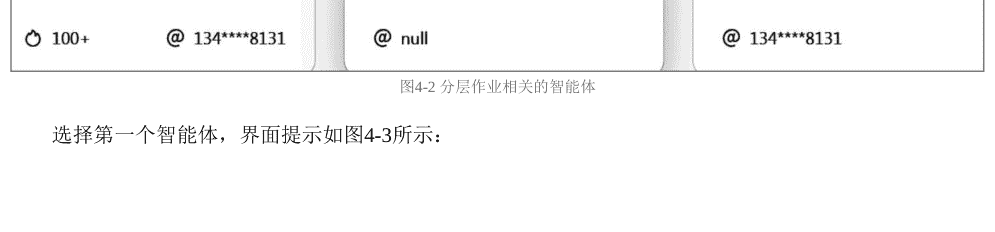

进入第一个节点，界面提示如下：

请输入，Enter键发送，Shift+Enter键换行

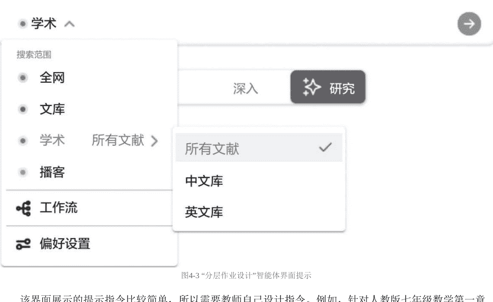

图4-3 “分层作业设计”智能体界面提示

默认提示较为简略，需要教师自行构建输入。以人教版七年级数学第一章第三节“有理数的加减法”为例，可输入：

> 请为 人教版七年级数学第一章第三节“有理数的加减法”一课制定梯度练习。

通义千问给出的梯度练习如下：

- （1）基础层 面向前列学生，帮助熟悉法则并完成简单运算
练习题目：
①计算：(-3)+(+5)=?
②计算：(+7)-(-2)=?
③计算：(-4)+(-6)=?
④计算：(+9)-(+3)=?
⑤两个负数相加，结果会是怎样？举例说明。
⑥正数减正数，结果可能是正也可能是负，为什么？

- （2）进阶层 面向已掌握基础并想提升的学生，要求处理稍复杂问题并初步理解逻辑
练习题目：
①若 $a$ 为正数，$b$ 为负数，且 $a > |b|$，则 $a + b$ 结果如何？举例。
②大负数减小正数，结果怎样？用(-10)-(+3)验证。
③举一个既可用加法也可用减法表示的例子，如(-5)+(-3)=(-5)-(+3)，再举一例。
④证明：对任意有理数 $x$ 和 $y$，$x + y = y + x$。

- （3）挑战层 面向完全掌握概念且愿意挑战的学生，鼓励探索深层内容与实际应用
练习题目：
①小华在海拔+500米处，下滑到海拔-200米，下降了多少米？若继续下降300米，会到哪里？
②总结两数相加时符号对结果的影响，列出所有情形并举例。
③利用有理数加减法设计一个小游戏或情境模拟，让同学解题获得乐趣。
④解释为什么(-a)+a=0（a为非零有理数），尝试不同角度证明。
⑤对一组有理数，能否快速判断其和的正负？可行的请说明方法。

#### 2. 豆包
豆包中相关助手数量更多，如图4-4所示。

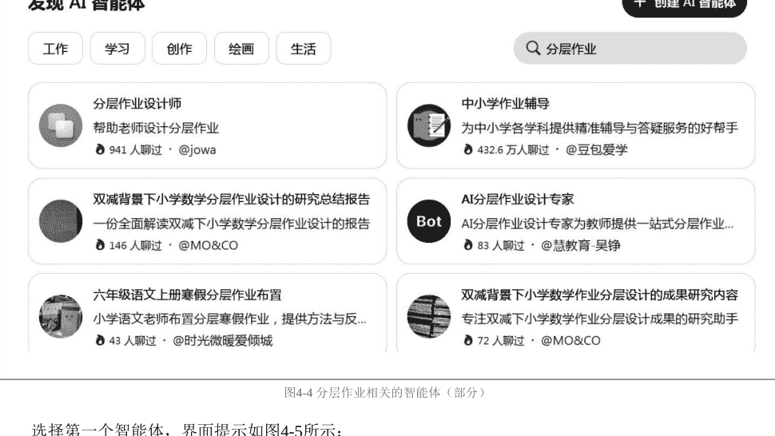

图4-4 分层作业相关的智能体（部分）

选择首个节点，界面提示如图4-5所示：


图4-5 “分层作业设计师”智能体界面提示

可参照模板输入指令，例如：

> 如七年级数学，有理数的加减法，教学目标是熟记有理数加减法法则，能熟练进行有理数加减法运算。

豆包生成的梯度练习如下：

- 难度等级一：基础事实识记
（1）有理数加法法则包含哪些内容，请简要说明。
（2）计算：3+(-2)=?
（3）-4+5=?
（4）说出有理数加法中互为相反数的两个数相加的结果。
（5）简述有理数减法化为加法的思路。

- 难度等级二：生活情境应用
（1）小明银行存入500元，记作+500元，后取出300元，用有理数加减法表示当前存款。
（2）某天早晨气温5℃，中午升3℃，下午降4℃，求下午气温。
（3）汽车先向东行驶80千米，记作+80千米，再向西行驶50千米，表示当前位置。
（4）小敏购物先花20元，又获10元优惠券，用有理数加减法表示消费情况。
（5）水位先上升2米，记作+2米，又下降1米，求现水位。

- 难度等级三：思维品质与实践导向
（1）设计一个需多次有理数加减才能解决的实际情境，并说明不同结果的实际意义。
（2）从数轴角度分析有理数加减法的本质并举例。
（3）给出3个有理数，通过不同加减组合使结果最大和最小，并说明理由。
（4）探讨有理数加减法在物流运输路线规划中的应用，给出案例分析。
（5）假设公司盈利亏损用有理数表示，设计方案在一定时间内实现盈利最大化，并用加减法分析。

#### 3. 讯飞星火
在助手模块检索“分层作业”，仅有一个面向小学数学的节点，界面提示如图4-6所示。

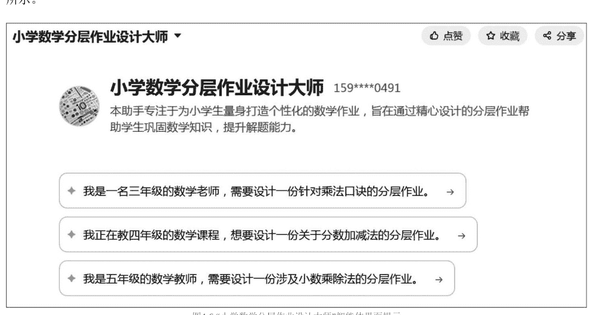

小学教师可参考模板输入指令，例如：

> 我是一名五年级数学老师，需要设计一份关于小数乘整数的分层作业。

讯飞星火生成的梯度练习如下：

- （1）基础层 目标是巩固计算方法并理解小数点位移规律
①填空：0.5×3=；2.4×4=；1.75×5=。
②选择：0.6×10= A.6 B.0.6 C.60；3.2×3= A.9.6 B.0.96 C.32。
③简答：解释为什么0.7×100=70。

- （2）进阶层 目标是提升实际问题解决能力
①应用题：苹果单价2.5元，买8个共花多少元？
②计算：1.25×8=；0.4×15=；2.7×6=。
③探究：一个数乘10、乘100，小数点如何移动？举例说明。

- （3）挑战层 目标是培养创新思维与复杂问题能力
①综合题：长方形木板长1.2米，宽0.8米，每平方米需油漆0.3升，至少准备多少升？
②拓展题：小数乘整数结果仍为小数时，这个小数可能怎样？提示考虑小数点位置。
③创新题：设计一道使用小数乘整数知识的问题供同学解答。

用助手设计的优点是输入不必很细，缺点是针对性可能不足，教师仍需结合教材筛选或修改，确保梯度与教学内容匹配。

### 通过对话框输入输入生成梯度练习
此法要求教师给出详尽的输入。为提高准确性，可先上传课件再下输入。

以文心一言为例，针对初中化学“制取氧气”一课，给出输入：

> 这是初中化学“制取氧气”一课的课件，请结合课件内容设计梯度练习，以满足不同水平学生的学习需求。练习包括三个类别：基础性练习（10道，必做）、探究性练习（分两级，等级一3道必做，等级二3道选做）和实践性练习（1道选做）。

文心一言生成的梯度练习如下：

- （1）基础性练习（10道，必做）
①填空：实验室制取氧气主要有____、____、____三种方法。
高锰酸钾制取氧气的文字表达式____和符号表达式____。
加热高锰酸钾制取氧气时，试管口____应略向下倾斜。
②选择：工业上制取大量氧气的主要方法是（）。
A.加热氯酸钾 B.加热高锰酸钾 C.分离液态空气 D.加热二氧化锰
检查装置气密性的正确方法是（）。
A.直接点燃酒精灯观察气泡 B.导管伸入水中，用手紧握试管 C.先将导管插入水中再加热 D.无需检查
③简答：描述实验室用高锰酸钾制取氧气的实验步骤。
如何检验一瓶气体是氧气？
收集氧气时为何要在气泡连续均匀放出时才开始收集？
④判断：实验结束时应先熄灭酒精灯，再撤导管。（）
加热氯酸钾和二氧化锰混合物制取氧气时，二氧化锰是反应物之一。（）

- （2）探究性练习
难度等级一（3道，必做）
①实验设计：探究过氧化氢溶液在不同催化剂（如二氧化锰、氧化铜）作用下分解速率的差异。
②数据分析：分析高锰酸钾制取氧气时加热时间对产氧量的影响并绘制图表。
③对比研究：比较加热氯酸钾、高锰酸钾、过氧化氢三种制氧方法的优缺点及适用场景。
难度等级二（3道，选做）
①拓展研究：研究不同温度下过氧化氢分解速率的变化并尝试解释原因。
②综合应用：设计综合实验同时采用高锰酸钾和过氧化氢制取氧气，比较效率与成本。
③创新实验：利用家庭常见物品（如小苏打、醋等）设计简易制氧方法并描述步骤与现象。

- （3）实践性练习（1道，选做）
家庭小实验：利用家中可得材料（如酵母粉、糖、温水等）制作简易氧气发生器，观察现象并记录过程、原理。要求拍摄照片或视频作为报告。
目的：加深对氧气制取原理的理解，培养动手能力和科学探究精神。

总体来看，AI往往难以一次完全满足教师需求，题目可能偏离实际或题型不符。此时可让AI多次生成后挑选，也要注意化学、物理等学科AI无法生成实验装置图，需教师补充。

## 4.3 用AI丰富练习形式
在“双减”和新课标背景下，多元化练习设计愈发重要，AI为其提供了新可能。

### AI解答，学生做出判断
教师可利用豆包的“解题答疑”功能，把传统学生作答转变为AI先答、学生再评判。这一形式有助于锻炼批判性思维、逻辑思维和知识迁移能力。

例如八年级上册“轴对称”一课，练习如下：
14. 如图，线段 AB 的对称轴为直线 MN.P、Q 在 MN 上，求证 △PAQ ≅ △PBQ.

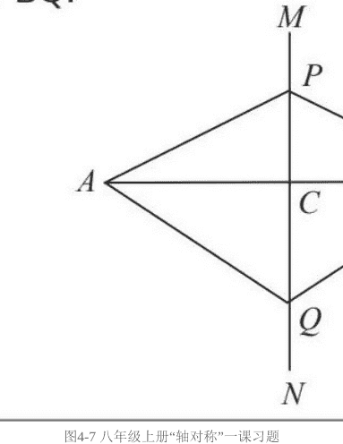

图4-7 八年级上册“轴对称”一课习题

上传到豆包后得到答案与解析，如图4-8所示。

#### 答案
【解析】∵线段AB的对称轴为直线MN,即直线MN垂直平分线段AB,
∴AP = BP, AQ = BQ,
在△PAQ与△PBQ中, AP = BP, PQ=PQ, AQ=BQ, ∴ △PAQ ≌ △PBQ(SSS)。

#### 解析
#### 分析
利用线段对称轴的性质得到线段相等, 再依据全等三角形的判定定理SSS (边边边) 来证明两个三角形全等。

#### 详解
**证明线段相等**
因为线段AB的对称轴为直线MN，所以直线MN垂直平分线段AB。根据垂直平分线的性质，垂直平分线上的点到线段两端的距离相等，所以(AP=BP)，(AQ=BQ)。

**证明三角形全等**
在(△PAQ)与△PBQ中，有(AP=BP)，(PQ=PQ) (公共边)，(AQ=BQ)。满足全等三角形的判定定理SSS (边边边)，所以(△PAQ\cong △PBQ)。

图4-8 习题的答案和解析

教师可在确认无误后将答案提供给学生，让学生判断过程是否正确、所用知识是否匹配教材。若发现错误需改正，若正确则需指出解题关键。为避免学生产生AI全对的定式，也可人为设置部分“陷阱”。

### 让学生给AI作文打分
针对语文，可让AI先写作文，再由学生评分。例如输入：

> 生活中的任何人、事、物、景都可以成为我们心里的那束光，指引我们走出黑暗与迷茫，给予我们温暖和希望……请以“你是我心里的那束光”为题写一篇作文。要求：①立意自定，文体不限，不少于600字。②内容具体，选材得当，中心明确，有真情实感。③涉及真实人名校名地名一律用A、B、C等代替。你是一位七年级的学生，请按要求写作。

豆包生成的作文如下：

#### 你是我心里的那束光
在记忆的长河中，总有一些人如同璀璨的星光，照亮我们前行的道路。于我而言，你就是我心里的那束光，温暖而明亮，引领我走出黑暗与迷茫，给予我无尽的温暖和希望。

初次遇见你，是在新学期的开始。阳光透过斑驳的树叶，洒在校园的小径上，我怀着忐忑的心情走进新的班级。面对陌生的环境和同学，我有些不知所措，默默地坐在角落里。就在这时，你微笑着向我走来，你的笑容如同春日的阳光，温暖而灿烂。你主动和我打招呼，热情地介绍自己，那一刻，我心中的不安渐渐消散。

你是一个非常乐观开朗的人，无论遇到什么困难，总是能积极面对。记得有一次考试，我因为成绩不理想而心情低落，觉得自己很失败。你发现了我的异样，轻轻地拍了拍我的肩膀，说：“一次考试失败算不了什么，只要我们努力，下次一定会进步的。你要相信自己，你是最棒的！”你的话语如同春风拂面，让我重新燃起了信心。在你的鼓励下，我认真分析错题，努力学习，终于在下次考试中取得了进步。

你还是一个非常善良的人，总是乐于助人。每当同学们遇到困难时，你总是第一个伸出援手。有一次，班上的一位同学不小心摔倒了，膝盖擦破了皮，你毫不犹豫地跑过去，扶起他，关切地询问他的伤势，并带他去医务室处理伤口。你的善良和热心感染了身边的每一个人，大家都非常喜欢你。

心灯不灭

求学路上和生活里，你始终在背后托住我，也在兴趣上默默带我走进新的世界。你爱看书，总会把读到觉得好的作品分享给我。受你影响，我逐渐爱上翻阅纸页。我们曾一起在文字里穿行，感受不一样的生命样貌。阅读拓宽了我的视野，累积了知识，也让性格更稳重更开朗。

和你相处的时光，让我变得更积极，也学会了关注他人伸出援手。你像一盏灯，把温暖洒进我心房，让我体会到力量与依靠。

如今我们已经分班，友情却始终牢靠。每次遇到坎坷，我就会想起你那温柔的笑容和鼓励的话。那束光一直留在我心里，从未熄灭。我会带着这份温暖与力量，勇敢面对生活的挑战，努力把自己打磨得更好。

感谢你，我的好朋友，你是我生命里最珍贵的存在，我会一直珍惜这段情谊。

愿我们各自的人生都充满光亮，愿心愿都能实现。你是我内心的光，照亮前行之路，让生活少了迷茫。我会顺着这道光继续走下去，去迎接属于我们的美好未来。

作文写完后，教师可以通读一遍，随后给出评价说明让学生对照自评。以下是为这篇作文拟定的评价说明。

第一等级 45-50分
立意：主题突出深刻，紧扣“你是我心中的光”，意蕴深远，能激起读者思考。
结构：素材丰实具体，选择新颖贴切，细节刻画细腻；结构严谨，层次清楚，过渡流畅。
语言：表达优美通畅，文采斐然，修辞得体，字词规范无病句。
情感：真挚强烈，引发共鸣。

第二等级 40-44分
立意：主题明确，较好体现“你是我心中的光”，立意较深。
结构：内容充实，选材合理，细节描写有一定分量；结构清晰，层次分明。
语言：语句通顺，有一定文采，修辞恰当，错漏较少。
情感：真实可信，具有感染力。

第三等级 35-39分
立意：主题基本清楚，能围绕“你是我心中的光”展开，立意一般。
结构：内容比较具体，选材平常，细节不足；结构大致合理，层次可辨。
语言：语句较通顺，文采一般，存在少量错字病句。
情感：比较真实，感染力有限。

第四等级 30-34分
立意：主题不够明晰，对“你是我心中的光”呈现不足，立意浅。
结构：内容单薄，选材不当，缺细节；结构松散，层次不清。
语言：语句基本通顺，文采欠缺，错字病句较多。
情感：不够真切，难以引起共鸣。

第五等级 30分以下
立意：主题模糊偏离“你是我心中的光”，立意错误。
结构：内容空洞，选材不合理，无细节；结构混乱，无层次。
语言：语句不通顺，错别字病句频出，毫无文采。
情感：虚假，无感染力。

教师也可以不列出评价说明，让学生自行打分，但需说明理由。采用第一种方式时，也可为学生保留自主评分空间，只要理由充分即可。

### 让学生与智能体对辩
智能体具备强大的理解和生成能力，教师可安排学生围绕某一议题与智能体对辩，以锻炼逻辑与表达。若议题与教材相关，还能巩固知识。

以历史学科为例，诸多历史事件具有两面性，可让学生就相关事件与智能体对辩，加深理解，促进辩证思维。

以七年级上册“秦统一中国”“秦末农民起义”为例，可围绕“秦始皇是否可称千古一帝或暴君”展开。以下以通义千问为例，仅作演示。

我：我是初一学生，现在要和你就“秦始皇是千古一帝还是暴君”进行辩论，你的立场是“千古一帝”，我的立场是“暴君”，请先陈述观点。

> 通义千问：作为支持“千古一帝”的一方，可从以下方面展开：
> （1）完成统一
> 秦始皇通过军事征服终结战国分裂，实现中国历史上首次大规模统一，对统一意识形成意义重大。
> （2）推行郡县制
> 废除分封，推行中央集权郡县制，加强中央对地方控制，为后世政治奠基。
> （3）统一度量衡文字
> 统一小篆、度量衡、货币等，方便交流，促进经济文化融合。
> （4）兴修基建
> 下令修建万里长城，虽劳民伤财，却在抵御北方游牧民族方面发挥作用，并成为民族象征。也修建驰道，改善交通。
> （5）文化整理
> 尽管有焚书坑儒，但也对史料整理汇编，为后人保留大量资料。

我：作为“暴君”一方，我从以下方面反驳：
1. 法律严苛刑罚残酷
秦法推行连坐、族诛等，惩罚波及亲属。车裂、腰斩、活埋等酷刑加剧社会恐惧。
2. 徭役赋税沉重
修建长城、阿房宫等工程征调大量民夫，导致农业生产受损，百姓困苦，社会矛盾加剧。
3. 焚书坑儒
为巩固统治，下令焚毁除医药卜筮种树之书外的书籍，并坑杀儒生方士。
4. 统治高压缺乏民本
多用高压手段镇压异己，不尊重民众基本权益，忽视民生，只重权威与享乐。

通义千问：你的论据有力呈现了暴君一面，现从千古一帝角度回应：
（1）严苛法律与刑罚
战乱之后需强力手段维系统一秩序，严法也在一定程度上遏制贵族反弹，稳固中央政权。
（2）徭役赋税
长城与驰道虽给民众带来负担，但长远看有助于国家安全与经济发展，驰道促进地区联系。
（3）焚书坑儒
该事件虽具争议，但目的可能更多在于清除旧制度、追求思想统一，手段过于激进。
（4）统治手段
高压统治反映了当时时代背景与社会需求，对新兴帝国迅速建立有效管理体系有帮助，有助于巩固统一。

总体来看，尽管秦始皇部分做法可被视作暴政，但在实现统一、建立中央集权方面发挥关键作用，为后世奠定基础，故仍可称“千古一帝”。当然历史人物复杂，不能简单二分。

这次对辩中，智能体在不到两回合后便进行了总结。若想增加回合数，可在指令中限定每次论据数量。

例如思政教师可用“老人摔倒了，该不该扶”作为社会议题，让学生与智能体辩论。下面以豆包为例，仅作为展示。

我：我是初一的学生，现在要与你辩论“老人摔倒了，该不该扶”，你的观点是“不该扶”，我的观点是“该扶”，请先阐述观点。注意每次只给一个论据。

> 豆包：扶起老人后可能被讹诈。现实中存在好心扶人却被指为肇事者的案例。不仅会带来经济损失，还会损害名誉和心理健康。曾有年轻人扶起老人后被指撞倒，虽然最终证明清白，但在调查期间承受了巨大舆论压力和精神困扰。这种风险让人望而却步。

我：即便有被讹诈的风险，也不能放弃最基本的关怀。任何人都可能需要帮助，社会信任与互助是宝贵资源。若因害怕讹诈而不出手，当自己或家人需要帮助时，也可能得不到援助。

> 豆包：社会互助虽重要，但被讹诈后的严重后果不容忽视。一旦被诬陷，需要花费大量时间精力自证清白，对很多人是难以承受的负担。即便最终洗清，心理创伤也难以弥补。

我：可通过手机拍摄现场或利用公共监控留下证据，作为日后纠纷的依据。

> 豆包：即使有手机记录和监控，也不能完全保证有效。手机拍摄可能因角度、画质不清而无法完整呈现过程；监控也可能存在盲区或设备故障、数据丢失。再者，即使有证据，调查过程仍会耗费大量时间和精力，给扶人者带来麻烦。因此不能仅凭可能不确定的证据就认定应该去扶。

我：在文明社会，每个人都应承担帮助他人的责任。若因担心讹诈而不扶，社会道德底线会不断下滑。每个人都会老去，都可能需要帮助。若无人伸出援手，社会将失去人文关怀。

> 豆包：承担责任并不等于必须亲手去扶。可及时拨打急救电话或呼叫专业人员，既避免讹诈风险，也能在一定程度上提供帮助。若只强调必须亲扶而不考虑现实后果，可能导致他人因恐惧而逃避责任，不利于道德提升。道德表现形式多样，不能仅以是否扶老人来衡量。

## 4.4 让学生用智能体自主设计作业
既然教师能用智能体设计作业，为何不把主动权交给学生，让学生在智能体辅助下自主设计作业。

落实这一策略并非简单告知“自己用智能体设计作业”，教师的引导必不可少。以下为可参考的操作步骤。

### 第一步：选择合适的智能体工具
在前文列出的教师常用智能体工具中，教师可结合自身使用习惯挑选1至3个供学生主要使用，同时允许学生自行发掘其他工具。

### 第二步：明确作业目标
确定工具后，和学生一起明确作业目标。目标要与本节课知识点相衔接，教师可带领学生回顾知识点，围绕其设计作业方向。例如针对“勾股定理”，可确定“运用勾股定理解决实际问题”的设计方向。也可让学生自行回顾课程内容，梳理重点、难点和疑惑，通过查阅教材、笔记或讨论加深理解。

作业形式和难度等级也需在此步明确。形式可以是传统书面题、实践类作业或创意类作业。教师应鼓励尝试多样形式以提升趣味性。难度可分为基础、中等、挑战三层，供学生按水平选择。

### 第三步：学生自主设计作业
确定形式和难度后，学生即可开始设计具体内容。书面作业需判断智能体生成题目是否正确；实践作业需梳理步骤或方案；创意作业需明确主题与要求。可个人完成也可小组合作。

设计完成后需对难度进行评估，确保既有挑战又可完成。同时估算所需时间，避免作业量过大或过小。可参考往期作业耗时进行调整，不合适时需修改。

下面以实践作业设计为例，演示借助豆包进行设计。实践类作业目标不必过于严格，重点在于梳理步骤或方案。

指令如下：
我是一名八年级的学生，现在要设计一个社会实践作业，请给我提供一些适合我们这个年龄段的社会实践主题。

豆包给出的社会实践主题包括以下几类：

- （1）社区服务类
  - ①社区环境美化
    活动内容：组织同学在社区内清理垃圾，清扫街道、公园、小区公共区域，同时宣传垃圾分类，可制作简易宣传海报张贴或发放。
    意义：亲身参与改善环境，增强环保意识与责任感，提升团队协作与沟通能力。
  - ②关爱社区老人
    活动内容：分组探访社区孤寡老人，提供打扫、聊天、文艺表演等帮助，可定期建立长期联系。
    意义：培养尊老敬老品德，学会关心他人，了解老年人需求，增强社会责任感。
  - ③社区图书馆志愿者
    活动内容：协助整理图书、登记借阅、清洁书架，组织故事分享会、读书心得交流等。
    意义：接触图书馆工作，培养图书管理能力与阅读兴趣，为社区文化建设出力。

- （2）文化传承类
  - ①家乡传统文化调研
    活动内容：选取家乡一种传统文化如手工艺、节日习俗、地方戏曲等，通过查资料、访谈艺人、实地观察了解其渊源、现状与问题，撰写调研报告或宣传手册。
    意义：增强文化认同与自豪感，培养调研与创新思维，促进传统文化传承。
  - ②经典诵读推广
    活动内容：在校或社区组织古诗词朗诵、经典文学诵读会，分享理解，并制作音频视频在网络推广。
    意义：提升文学素养与表达能力，感受经典魅力，带动更多人诵读。
  - ③非物质文化遗产保护宣传
    活动内容：了解本地非遗项目，制作海报、传单或短视频宣传其价值与保护方法，邀请传承人现场展示并体验制作。
    意义：培养文化保护意识，提高公众关注度，促进非遗传承发展。

- （3）社会调查类
  - ①中学生消费观念调查
    活动内容：设计问卷调查本校或周边学校学生的消费行为、零花钱管理等，分析数据撰写报告并提出建议。
    意义：了解自身与同龄人消费状况，树立正确消费观，培养理财意识与数据分析能力。
  - ②青少年电子产品使用情况调查
    活动内容：通过问卷访谈了解青少年使用手机电脑平板的时间、频率、用途及影响，分析结果并提出合理使用建议。
    意义：引导正确使用电子产品，避免沉迷，培养问题意识与解决能力。
  - ③社区公共设施满意度调查
    活动内容：对公园、健身器材、路灯、垃圾桶等设施进行满意度调查，收集居民对数量质量分布维护的评价与意见，反馈给管理部门。
    意义：培养社会参与与公共服务意识，关注社区建设，提升沟通与问题解决能力。

- （4）公益宣传类
  - ①交通安全宣传
    活动内容：与交警合作开展宣传，制作海报手册发放，宣传交通规则，可在路口协助指挥引导行人。
    意义：增强交通安全意识，减少事故，为和谐环境贡献力量。
  - ②节约用水宣传
    活动内容：了解水资源现状，制作标语海报视频宣传节水，组织知识竞赛征集节水妙招。
    意义：培养节约与环保意识，让更多人认识水资源宝贵。
  - ③心理健康知识普及
    活动内容：学习心理健康知识，制作手抄报宣传册介绍心理健康重要性及常见问题应对，可组织讲座与咨询活动。

假期实践选题建议与安全提示

先从关注心态的实践说起。这类主题能帮助同学更敏锐地觉察情绪变化，提升抗压与情绪调节能力，也有助于在校园和社区营造更积极的氛围。

上面列出的方向仅供参考，可结合个人兴趣与现实条件自行取舍或调整。活动开展前请把安全放在首位，做好规划和准备，确保全程可控。结束后要认真复盘经验与收获，用以提升综合素养。祝你在实践中有所成长，度过充实而有意义的假期。

我们小组最终锁定了“故里非遗探访”这一方向，并围绕它形成了设计诉求：

我是八年级的学生，假期需要为实践作业制定方案，主题确定为“故里非遗探访”。希望包含内容与价值：

活动要做的事情：挑选家乡的一种非遗形态，比如传统手工艺——纸雕、刺绣、陶艺等，或节庆习俗、地方戏曲等，进行深度探访。可以通过查阅资料、访谈传承人、现场观察等方式弄清其历史渊源、当下状况和面临的困境，并形成研究稿件或宣传手册。

价值所在：让学生认识家乡的风物，增强文化认同与自豪感，同时锻炼调研能力与创新思维，为非遗的传承弘扬贡献力量。

基于此，为这个年龄段的学生设计一份可操作方案。

以下为经豆包生成的实践方案概要：

#### 八年级非遗探访实践方案

（1）实践主题
故里非遗探访——以纸雕为例，可替换为其他非遗形式。

（2）实践目的
①深入探寻家乡纸雕的历史渊源、发展现状及面临的难题，提升对本土风物的认知与理解。
②借助查阅资料、访谈传承人、实地观察等手段，锻炼调研、沟通及创新思维能力。
③通过撰写研究稿件或制作宣传手册，提升资料整理与表达能力，为传承弘扬家乡纸雕出力，增强文化认同与自豪感。

（3）实践时间
[具体时段，如假期期间或某个月的周末等]。

（4）实践步骤
①准备阶段
组建小组：邀请同班对非遗感兴趣的同学组队参与，小组规模控制在[具体人数]人左右，便于分工协作与交流研讨。
推选一位组长，负责统筹协调、制定计划与任务分配。
确定探访对象：经小组讨论，选定家乡具有代表性的纸雕作为探访对象。先行了解本地纸雕的风格特色、知名传承人及代表作品等基础信息。
制订方案：查阅相关资料，学习探访的基本方法与流程。在老师或家长指导下，制定详细的方案，明确研究内容、方法、时间安排与人员分工。设计问卷与访谈提纲，问卷围绕对纸雕的认知程度、偏好程度、购买渠道等展开；访谈提纲聚焦传承人的学艺经历、创作心得、对传承的看法等。

②资料收集阶段
文献查阅：前往学校图书馆、当地文化馆或博物馆，查阅有关家乡纸雕的书籍、报刊、杂志等，梳理其起源、发展脉络、艺术特色与文化内涵。利用网络检索相关论文、新闻报道、图文视频等资料，丰富认知。整理分析所得资料，提取有效信息。
实地观察：走访本地纸雕工作室、工艺品店、民俗展区等场所，现场观察纸雕制作流程、作品陈列与销售情况。注意记录作品题材、构图、色彩、技法等特点，并观察不同场域非遗的呈现方式与氛围，可拍照录像存档。
问卷调研：在学校、社区、商场等人流集中地发放问卷，收集不同年龄层人群对家乡纸雕的认知与态度。发放时注意礼貌与沟通技巧，提高回收效率。对回收问卷进行统计分析，形成初步结论。

③访谈阶段
联系传承人：通过文化馆、民间艺术协会等渠道联系本地知名纸雕传承人，预约访谈时间与地点。访谈前准备好问题清单与设备，如笔记本、录音笔、相机等，确保访谈顺利。
进行访谈：按提纲与传承人深入交流，了解其学艺历程、创作风格、代表作品，以及对传承与发展的观点与建议。访谈中认真倾听、尊重观点，适时追问互动，并记录要点、表情动作等细节，可录音拍照。访谈后及时整理资料，对重点内容标注汇总。

④分析总结阶段
资料整理与分析：将文献资料、问卷数据、访谈记录、照片视频等汇总分类归档。运用数据分析与逻辑推理，探讨家乡纸雕的历史价值、艺术价值、社会价值及当前发展面临的问题与挑战。结合小组讨论与个人思考，提出传承弘扬的建议与对策。
撰写研究稿件：按资料分析结果撰写稿件，包含引言、目的、方法、结果分析、问题与建议、结论等部分。注意语言准确流畅、结构清晰严谨，可参考优秀范例提升质量。
制作宣传手册：挑选探访期间的优秀作品图片、关键资料与结论，制作成宣传手册。手册应简洁明了、图文并茂，具有吸引力与可读性。注重版面设计与色彩搭配，可用图形设计软件制作，也可手绘后扫描排版。

⑤展示与交流阶段
校内展示：在学校组织故里非遗探访成果展示，向全校师生呈现研究稿件、宣传手册、照片视频等成果。可采用展板、PPT演示、实物展示等方式，安排小组成员现场讲解与互动，让更多同学了解纸雕文化。
社区宣传：走进社区发放宣传手册，举办纸雕文化讲座或小型展览，传播纸雕文化的魅力与价值。鼓励居民参与互动，如现场体验纸雕技巧，提升公众对传统文化的兴趣与关注。
交流与反思：组织小组内部与班级交流，分享探访经验与体会，听取老师同学意见建议。对本次实践进行总结反思，评估个人表现与收获，找准不足，为今后学习实践提供借鉴。

（5）实践成果
①一篇完整的家乡纸雕探访研究稿件，涵盖历史渊源、发展现状、面临问题、建议对策等。
②一本别致的家乡纸雕宣传手册，包含作品图片、文化介绍、传承意义等内容。
③小组成员个人实践心得与体会，分享探访过程中的收获与成长。

（6）注意事项
### 第四步：教师审核和反馈
教师对学生提交的设计进行审核，检查内容是否符合课程要求、难度是否适中、时间估算是否合理等。审核后及时给予反馈，既肯定创意与努力，也指出设计中存在的问题。

### 第五步：实施作业
学生根据教师反馈对设计进行修改完善后开始实施。教师还可从学生设计中挑选优质作业，汇编成练习，作为双休日作业。若时间充裕，可让学生在课堂展示设计成果，提升互动趣味性。设想一下，生物课上学生互相展示自制微生物观察作业，比单纯读课本生动得多。

## 4.5 用 AI 批改作业
借助通义千问、豆包等人工智能工具批改作业仍有局限，但经试验，部分智能体批改效果良好。下面演示其应用。

### 通义千问的“速算批改小助手”
在通义千问智能体模块搜索“速算批改小助手”，进入该智能体，其可对一至六年级数学口算题进行快速批改。

电脑版需先将作业图片传至电脑，点击对话框左侧“上传图片”上传；手机版需在“工具”栏搜索“速算批改小助手”，进入后同样点击“上传图片”上传。

上传后输入批改指令，如“批改这些口算题”，数秒即可完成。图4-12 为批改前界面，图4-13 为批改后结果。

#### 批改完成：
共 12 道题目，12 道做对，0 道存疑，正确率 100%

### 豆包的“作文批改助手”
豆包网页版不支持图片上传，建议下载电脑版或手机版，手机版提供“上传图片”“拍照”“录像”功能，使用更便捷。

打开“豆包APP”，在“发现”栏搜索“作文批改助手”，进入对话界面。点击拍照上传作文图片。

“作文批改助手”点评包含全文点评、亮点、建议、分句点评四个模块。文字要点如下：

（1）全文点评
文章情感真挚，生动记录一天经历，从期待足球课到因风雨改变心情，最后在雨中寻得快乐。

（2）亮点
善用修辞，描写生动。文中将狂风比作老虎，雨比作老天的泪水，增强感染力。

（3）建议
丰富词汇运用。部分表述较单一，如“激动”“糟糕”等，可积累近义词提升表达丰富度。
优化结尾升华。结尾略显平淡，可进一步深化主题，从雨中领悟生活变化与乐观应对。

（4）分句点评中给出佳句与待优化句的示例，并提供润色结果。

批注图片见图4-19、图4-20、图4-21。需注意批注不一定完全准确，教师应甄选合理部分使用。

### 豆包的“英语作文批改助手”
操作与“作文批改助手”一致，此处不再赘述。上传英文作文后，豆包主要给出修改意见，如图4-22 所示。

修改意见示例：
Do you like to volunteer with others? I very enjoy（改为enjoy very much，“very enjoy”表达错误）volunteering，because it's te best（改为the best，拼写错误）way to help lots of people.Now let me show you my story about volunteering in the（删除in the，多余）

Last winter vacation，I hielpped（改为helped，拼写错误）in a cildren hospieal（改为children's hospital，拼写错误）with seversal volunteers...

# 第5章
人工智能助力学生个性化学习

## 5.1 人工智能帮你做：设计问卷与学情分析
掌握学生学情是制定个性化学习方案的前提，常用方法有问卷调查、访谈、观察。问卷调查效率最高，可一次性收集全班数据。借助人工智能，教师可快速生成调查问卷，学生填写后将问卷发给人工智能进行学情分析。

### 设计问卷
指令设计是关键。以初一数学为例，我们使用了如下指令：

> 你是一名初中数学教师，初一年级刚结束，现在需要一份调查问卷了解学生学情。问卷共20题，每题至少设A、B、C、D四个选项。问题应有助于全面深入了解学情，为制定个性化学习方案提供依据。

先后向文心一言、通义千问、豆包发出指令，生成问卷各有不足。整合三份结果后得到如下调查问卷。

> 初一学生数学学情调查问卷

（1）请评估自己的数学基础水平？
①非常扎实 ②较为扎实 ③一般 ④较为薄弱 ⑤非常薄弱
（2）你对数学这门学科的兴趣程度如何？
①非常感兴趣 ②比较感兴趣 ③一般 ④不感兴趣
（3）你通常会预习数学新课内容吗？
①经常 ②偶尔 ③几乎不 ④从不
（4）在数学课堂上，遇到不懂的问题你会怎么做？
①立即举手提问 ②下课后找老师询问 ③自己私下解决 ④放弃不管
（5）你在数学课堂上的注意力集中程度如何？
①非常集中 ②大部分时间集中 ③有时会走神 ④经常开小差
（6）你更倾向于通过哪种方式学习数学？
①听老师讲解 ②自己看书自学 ③和同学一起讨论 ④使用网络资源
（7）遇到数学难题时，你的第一反应是什么？
①立即尝试自己解决 ②先思考一会儿再解决 ③寻求同学帮助 ④等待老师讲解 ⑤常常放弃不解决
（8）你在学习数学时使用学习工具（如计算器、学习软件等）吗？
①经常使用 ②偶尔使用 ③很少使用 ④从不使用
（9）你在完成数学作业时，通常会采取以下哪种方式？
①先复习当天所学知识，然后独立完成作业 ②直接做作业，遇到不会的再看书或请教同学老师 ③抄袭同学作业或参考答案 ④边做作业边玩手机或做其他事情
（10）你完成数学作业的正确率通常如何？
①90% 以上 ②70%～ 90% ③50%～ 70% ④50% 以下
（11）对于数学作业中的错题，你通常会采取以下哪种方式处理？
①认真分析错题原因，及时订正并总结方法 ②只订正答案，不分析原因 ③对错题不管不顾，等待老师讲解 ④认为错题太多，无从下手，干脆放弃
（12）你每天平均花在数学学习上的时间（包括课堂学习和课后学习）是多少？
①2小时以上 ②1～2小时 ③0.5～1.0小时 ④0.5小时以下
（13）在数学考试中，你认为最容易丢分的部分是（可多选）？
①选择题 ②填空题 ③计算题 ④解答题 ⑤其他
（14）当你考试成绩不理想时，你认为主要原因是（可多选）？
①知识掌握不牢固 ②粗心大意 ③考试紧张 ④学习方法不当 ⑤复习不到位 ⑥其他
（15）你的家长提供数学学习上的帮助吗？
①总是提供 ②有时提供 ③很少提供 ④从不提供

### 进行学情分析
学生填写完毕后，将问卷发给文心一言，并输入指令：

> 这是一位初一学生填写的调查问卷，请针对这位学生的回答，出一份详细的学情分析。

文心一言对该生问卷的解读整理如下：

#### 初一数学学习画像速览

第一部分 认知与态度

（1）数学习基础自评
作答：D 较为薄弱
解读：学生自认底子不牢，这种自我判断很可能限制后续学习的深度与广度。教学上要对基础掌握情况做重点排查，及时查漏补缺。

（2）对数学的喜好程度
作答：D 不感兴趣
解读：缺乏热情会直接削弱学习动力。可借助多样化教法和趣味内容来点燃兴趣。

第二部分 学习习惯与方法

（3）预习情况
作答：C 几乎不
解读：课前基本不做准备，课堂跟进效率容易受影响。应引导其养成预习意识，先行接触新知识点。

（4）课堂表现
不懂时处置：D 直接放弃
注意力：D 经常走神
解读：疑问出现时习惯放手，注意力也常涣散，反映出参与度和主动性不足。需通过提问、互动等激活课堂投入。

（5）学习方式偏好
作答：A 听老师讲解
解读：更依赖教师口头呈现，说明讲解方式对其效果影响较大。讲解要更具吸引力和针对性。

（6）难题应对策略
第一反应：E 常常放弃不解
解读：碰到困难题易选择止步，缺少韧性和方法。需逐步树立信心并传授可行的解题路径。

（7）学习工具使用
作答：B 偶尔使用
解读：使用频率低，未形成常态。应指导其合理运用计算器、学习软件等提升效率。

第三部分 作业与测验

（8）作业完成方式
作答：C 抄袭同学或参考答案
解读：作业依赖性强，抄袭明显，易导致知识掌握空心化。需加强过程监督，倡导独立完成。

（9）作业正确率
作答：D 50%以下
解读：正确率偏低，暴露知识点掌握薄弱。错误点要做针对性讲解与辅导。

（10）错题处置态度
作答：D 错题太多无从下手干脆放弃
解读：对错题持消极态度，不利于查漏补缺。应帮助其建立正确的错题观，逐项分析原因并总结方法。

（11）日常投入时间与效率
作答：C 0.5～1.0小时
解读：日均投入时间短且效率不高。需协助其规划时间、优化学习质效。

（12）考试表现与反思
易失分点：C 计算题、D 解答题
成绩不佳原因：A 知识掌握不牢固、C 考试紧张、D 学习方法不当、E 复习不到位
解读：计算与解答类题目失分集中，反映能力短板。知识不牢、考场紧张、方法偏差、复习不足共同拖累成绩，需据此做专项训练与辅导。

第四部分 家庭支持

（13）家长协助情况
作答：C 很少提供
解读：家庭在数学学习上的支持有限，可能削弱效果。教师要加强家校联动，共同给予学业支持。

第五部分 小结与建议
总体看，该生呈现基础偏弱、兴趣缺失、习惯方法偏差、作业考试表现不佳等特征。建议：夯实基础、激发兴趣、养成预习复习与独立作业等好习惯、优化差异化教学并强化家校配合。

文心一言在生成上述画像时对题目做了合并，并给出若干建议，虽然表述较泛，但可作为个性化方案的参考，后续章节将作细化展开。

## 5.2 快速定制个性化学习方案

基于问卷与学情画像，教师可将材料交给AI，结合暑假两个月与初二上学期16周的时间窗，为该生生成一份可操作的定制化方案。要求突出针对性，兼顾其他学科，数学可适当加码，方案需贴合其实际。

指令示例：
> 你是一名初中数学教师，手上的文档是一名刚结束初一的学生填写的调查问卷及对应的学情分析。计划利用两个月暑假加初二上学期16周改变其学习现状，请据此制定一份详细个性化学习计划。计划须有针对性，体现个性化，且学生需兼顾其他科目，数学可适当多配时。

我们将指令分别投给文心一言、通义千问、讯飞星火、豆包、Kimi。生成结果多有不足。下面仅展示通义千问与讯飞星火的版本供参考。

通义千问给出的方案是：
> 为改善该生现状，需设计兼顾具体情况与他科需求的个性化方案。以下是暑假两个月加初二上学期16周的安排：
> 暑假期间
> 第一部分：基础巩固与兴趣培养 前一个月
> 每日基础复习：每天0.5～1.0小时复习数学基础，重点一元一次方程、二元一次方程组等，采用理解记忆加练习。
> 趣味数学活动：每周至少一次数学拼图、逻辑谜题等，提升兴趣。
> 阅读数学故事：每周读一篇数学相关故事或文章。
> 数学日记：记录每日收获与困惑。
> 第二部分：预习与习惯建立 后一个月
> 预习新知：开始预习初二内容，每天半小时左右，理解概念并尝试例题。
> 自我测试：周末自测当周预习点，评估掌握度。
> 总结归纳：每周至少一次，将本周知识整理成笔记。
> 使用学习工具：鼓励使用计算器、学习软件辅助。
> 初二第一学期16周
> 第一部分：课堂参与 每节课
> 主动提问：不懂时勇于提问。
> 课堂互动：积极讨论，分享思路。
> 第二部分：作业与错题 每日每周
> 独立作业：要求独立完成，困难先自/{{ }}
> 错题分析：作业后分析错因并改正。
> 错题本：记录错题与解法，定期复习。
> 第三部分：定期复习与检测 每周每月
> 每周复习：每周安排一次全面回顾。
> 月考模拟：每月一次模拟检测成果。
> 第四部分：家校合作 持续
> 定期沟通：与家长保持联系，了解在家状态。
> 家长协助：鼓励家长参与，营造良好学习环境。

讯飞星火给出的方案是：
> 针对该生情况，制定如下个性化计划：
> 暑假两个月 7月初至8月底
> 第一阶段 7月第一周至第三周 基础强化
> 数学基础复习：每天1小时复习初一内容，重点有理数、一元一次方程等，用教材与练习册并记录疑问。
> 在线资源辅助：每周两次通过在线平台观看概念视频，加深理解。
> 周末小测：每周末测验一次，及时发现问题。
> 第二阶段 7月第四周至8月第二周 兴趣激发与实践
> 数学游戏与竞赛：参与在线游戏如Prodigy Math Game提升兴趣。
> 实际问题解决：每周选一个生活实例，如购物优惠、面积测量等，应用数学知识。
> 第三阶段 8月第三至四周 预习与准备
> 初二预习：提前阅读初二前两章，尝试简单习题。
> 学习计划制订：按初二课程表制定周计划，合理管理时间。
> 初二第一学期16周
> 每周常规：每日至少45分钟复习当天内容并独立完成作业；周六复习整周，周日总结与准备下周。
> 特别活动：第4、8周家长会沟通进展；第12周期中考试复习，从第10周起每日复习增至1小时。
> 每月评估：每月一次小测或模拟题，评估当月掌握情况。

上述两份方案存在共性问题：一是合理性不足，部分建议不切实际；二是整体偏笼统，可操作性弱。针对合理性，可删改；针对笼统，需结合实际细化，才能更具个性化与可执行性。

实践中AI一次到位较难，可将任务拆解。 以通义千问方案为例，其“基础巩固与兴趣培养”时间偏紧，鉴于基础薄弱，应把复习与预习时段调为六周与两周，并把“每日基础复习”“预习新知”拆细。

以“每日基础复习”为例，教师先下载初一电子教材上传，明确重点为第一学期第三章“一元一次方程”、第四章“几何图形初步”与第二学期第七章“平面直角坐标系”、第八章“二元一次方程组”、第九章“不等式与不等式组”。指令如下：
> 学生拟用暑假六周完成初一数学基础复习，重点为第一学期第三章一元一次方程、第四章几何图形初步与第二学期第七章平面直角坐标系、第八章二元一次方程组、第九章不等式与不等式组。每天复习0.5～1.0小时。以上两份文档为初一教材，请结合教材制定详细复习计划。

豆包生成的复习计划剔除典型例题后如下：
第一周 复习第一学期第三章一元一次方程
知识梳理：方程与等式关系、一元一次方程特征；解方程步骤：移项变号、合并同类项、系数化为1。
练习巩固：完成本章教材练习，加深步骤理解；做课外一元一次方程练习提升能力。
第二周 复习第一学期第四章几何图形初步
知识梳理：立体与平面图形分类；点线面体关系；直线射线线段性质；角的度量与运算及角平分线。
练习巩固：完成本章练习；专项角的度量运算练习。
第三周 复习第二学期第七章平面直角坐标系
知识梳理：有序数对、坐标系概念、象限符号特征、坐标轴上点特征；坐标表示位置与平移。
练习巩固：完成本章练习；坐标应用与平移专项练习。
第四周 复习第二学期第八章二元一次方程组
知识梳理：概念、代入消元法、加减消元法、实际应用建模流程。
练习巩固：完成本章练习；综合实际问题练习。
第五周 复习第二学期第九章不等式与不等式组
知识梳理：不等式概念与性质、一元一次不等式解法、不等式组解集求法。
练习巩固：完成本章练习；生活应用题练习。

该计划未覆盖其余章节。结合问卷反馈，第一学期第一章有理数与第二学期第十章数据的收集整理与描述掌握较好，可舍去，剩余一周用于第一学期第二章整式的加减、第二学期第五章相交线与平行线、第六章实数。

补足指令：
> 上述计划未列出其余章节且缺少第六周，请补充第六周计划，需复习第一学期第二章整式的加减2天、第二学期第五章相交线与平行线3天、第六章实数2天。

剔除例题后的补充计划如下：
1～2天 复习第一学期第二章整式的加减
知识梳理：整式概念、合并同类项、去括号法则。
练习巩固：完成本章练习，掌握加减运算；做综合运算提升熟练度。
3～5天 复习第二学期第五章相交线与平行线
知识梳理：邻补角对顶角、垂线性质、平行线判定与性质、平移特征。
练习巩固：完成本章练习；平行线判定性质专项。
6～7天 复习第二学期第六章实数
知识梳理：平方根、算术平方根、立方根及实数概念。

实数基础认知：实数体系由有理数与无理数共同组成。有理数能够化成有限位小数或循环小数，无理数则永远呈现无限不循环的形态。实数与数轴之间存在一一映射，每个实数值都能在数轴上找到唯一位置，反之数轴上的每一点也唯一对应一个实数值。

②练习与巩固
先把教材第六章的练习通读一遍，夯实在实数范围内的运算规范；再针对化简求值设计专项练习，提升计算的熟练度与准确性。

把上述两项安排结合起来，就能搭建起完整的复习框架。知识梳理环节要由教师逐项核验准确性；预习新知的细化方案制定思路与前文一致，这里不再重复展开。

由于学情各异，教师在布置任务时需要弹性地调整复习与预习的时长，并对不同单元或知识点的分量做倾斜，让方案更贴合学生实际。

以八年级上学期为例，文字量不大但结构清晰，从课时、日、周到月都有明确指引。关键工作是把每日需做的事项提炼出来，再结合学情进行增补与微调。因为问卷结果不同，学情分析也会差异化，最终方案自然不尽相同。举例来说，部分学生在课堂上善于发问且已养成复盘预习的习惯，这类行为在计划里就可以省略。针对此类学生，整理出日安排，可得到如下周计划。

周一到周五每日需要完成任务
- 课堂发问：遇到不明白的地方要敢于开口，寻求解决办法。
- 课堂参与：积极加入讨论，和同伴交流思路。
- 复盘：每天固定时间回看当日所学。
- 独立练习：作业必须独立完成，碰到困难先自行尝试。
- 预习：完成作业后预习次日内容。
- 错题记录：建立错题本，记录错误与正确思路，定期翻阅。

周末需要完成的任务
安排一次周总梳理，回顾整周学习内容并整理错题。

把这份周计划交给豆包，并给出提示：
> 用表格呈现，横向表头为周一到周六，纵向表头为各项任务，其余格子留空。

豆包生成的表格如图5-1所示。

| 任务 | 周一 | 周二 | 周三 | 周四 | 周五 | 周六 |
| :--- | :--- | :--- | :--- | :--- | :--- | :--- |
| 主动提问 | | | | | | |
| 课堂互动 | | | | | | |
| 复习 | | | | | | |
| 独立作业 | | | | | | |
| 预习 | | | | | | |
| 错题本 | | | | | | |
| 全面复习及回顾错题 | | | | | | |

图5-1 豆包生成的表格

学习周期为16周，需制作16张相同表格附在计划后，学生每日完成一项就在对应格打勾。

### 5.3 AI助力获取个性化学习资源
当下获取学习素材十分便捷，AI的进步进一步提升了个性化资源的获取效率。在执行个性化学习方案时，往往需要配套的定制化素材。比如错题整理后想强化某类题型，可把错题交给AI，让它产出几道同构练习。

图5-2 是人教版七年级上册第三章“一元一次方程”中的一道例题。
> 问题 1 某校三年共购买计算机 140 台，去年购买数量是前年的 2 倍，今年购买数量又是去年的 2 倍。前年这个学校购买了多少台计算机？
图5-2 教材中的例题

把题目上传到豆包，指令如下：
> 这是人教版七年级上册第三章“一元一次方程”中的一道例题，请参考这道题，出几道考查学生一元一次方程相关知识点的练习题，附带解题思路、解题步骤和答案。

豆包生成了两道题，内容如下：
> 练习题一：
> 某商店三个季度共卖出手机210部，第二个季度卖出的数量是第一个季度的3倍，第三个季度卖出的数量又是第二个季度的2倍。第一个季度这个商店卖出了多少部手机？
> 解题思路：
> 设第一个季度卖出的手机数量为 x，然后根据各个季度卖出手机数量的关系，分别用含 x 的式子表示出第二个季度和第三个季度卖出的手机数量，再根据三个季度共卖出210部手机这个条件列出方程求解。
> 解题步骤：
> 设第一个季度卖出手机 x 部。
> 因为第二个季度卖出的数量是第一个季度的3倍，所以第二个季度卖出3x部。
> 又因为第三个季度卖出的数量是第二个季度的2倍，所以第三个季度卖出6x部。
> 根据三个季度共卖出210部手机，可列出方程：x + 3x + 6x = 210。
> 合并同类项得：10x = 210。
> 解得：x = 21。
> 答案：第一个季度卖出了21部手机。
> 练习题二：
> 某工厂三年共生产零件180个，去年生产的数量是前年的2倍，今年生产的数量又是去年的1.5倍。前年这个工厂生产了多少个零件？
> 解题思路：
> 设前年生产的零件数量为y，根据题目中给出的数量关系，分别表示出去年和今年生产的零件数量，再根据三年共生产180个零件列出方程求解。
> 解题步骤：
> 设前年生产零件y个。
> 去年生产的数量是前年的2倍，则去年生产2y个。
> 今年生产的数量是去年的1.5倍，所以今年生产3y个。
> 因为三年共生产180个零件，所以可列出方程：y + 2y + 3y = 180。
> 合并同类项得：6y = 180。
> 解得：y = 30。
> 答案：前年这个工厂生产了30个零件。

附带思路、步骤和答案便于对照。这两题变化较小，于是再发指令：
> 形式变化再大一点。

豆包再次生成了两道题：
> 练习题一：
> 某果园三个季节共收获水果330千克。去年收获的数量是前年的1.2倍，今年收获的数量比去年多30千克，且今年收获的数量是前年的1.8倍。前年这个果园收获了多少千克水果？
> 解题思路：
> 设前年收获水果的数量为x，用x依次表示出去年和今年收获的水果数量，再根据总收获量列出方程求解。
> 解题步骤：
> 设前年收获水果x千克。
> 去年收获的数量是前年的1.2倍，则去年收获1.2x千克。
> 今年收获的数量是前年的1.8倍，即今年收获1.8x千克，又已知今年收获的数量比去年多30千克，所以可得到1.2x + 30 = 1.8x。
> 解方程：1.8x - 1.2x = 30，0.6x = 30，解得x = 30 ÷ 0.6 = 50。
> 答案：前年这个果园收获了50千克水果。
> 练习题二：
> 某养殖场三个年度共养殖家禽450只。去年养殖的数量是前年的1.5倍，今年养殖的数量比去年多50只，且今年养殖的数量是前年的2.5倍。前年这个养殖场养殖了多少只家禽？
> 解题思路：
> 设前年养殖家禽的数量为$x$，用$x$依次表示出去年和今年养殖的家禽数量，再根据总养殖数量列出方程求解。
> 解题步骤：
> 设前年养殖家禽$x$只。
> 去年养殖的数量是前年的1.5倍，则去年养殖$1.5x$只。
> 今年养殖的数量是前年的2.5倍，即今年养殖$2.5x$只，又已知今年养殖的数量比去年多50只，所以可得到$1.5x + 50 = 2.5x$。
> 解方程：$2.5x - 1.5x = 50$，$x = 50$。
> 答案：前年这个养殖场养殖了50只家禽。

除生成同类练习外，AI还能提供兴趣相关的资源。如学生对化学实验感兴趣，可让AI推荐适合阶段的科普书籍或视频。
指令如下：
> 我是一名九年级学生，对化学实验很感兴趣，请推荐一些化学实验相关的科普书籍或视频。
豆包给出了推荐并附带信息来源，如图5-3所示，学生可点开查看。

以下是一些适合九年级学生观看的化学实验相关的科普书籍和视频：
- 书籍 19 ：

### 5.4 AI充当虚拟家教解决个性化难题
个性化学习过程中常会遇到各类问题，AI能够充当虚拟家教提供支持。在众多工具中，豆包的智能体较为成熟，下面以几个常用智能体为例介绍。

#### 辅助理解抽象概念公式定理
豆包智能体模块中有“学习小帮手”，可辅导学生理解抽象的概念、公式和定理。

比如学习函数时课堂未听懂，可课下请教“学习小帮手”解释函数的概念，如图5-5所示。
> 你能帮我解释一下一次函数吗？
一次函数是函数中的一种，其表达式为 $y = kx + b$（$k$、$b$ 为常数，$k \neq 0$）。它的图象是一条直线，当 $k > 0$ 时，函数单调递增；当 $k < 0$ 时，函数单调递减。
**你可能还想问：**
- 一次函数的性质有哪些？
- 如何求一次函数的解析式？
图5-5 “学习小帮手”的解答

若解释过于笼统，可要求说得更详细通俗。豆包的回答见图5-6，同时会附带延伸问题。
> 可不可以解释的再详细和通俗一些？
一次函数的表达式 $y = kx + b$ 中，$k$ 决定了直线的倾斜程度和方向，$b$ 决定了直线与 $y$ 轴的交点位置。比如，$k$ 越大，直线越陡峭；$k$ 为正数时，直线从左到右上升，$k$ 为负数时，直线从左到右下降。$b$ 是直线与 $y$ 轴相交时的纵坐标值。您可以通过给定不同的 $k$ 和 $b$ 值来画出具体的函数图象，这样能更直观地理解。
**你可能还想问：**
- 一次函数有哪些实际应用？
图5-6 豆包再一次给出更详细和通俗的解释

公式、定理同样可请教它。比如物理中不理解牛顿第一定律，可让它解释，如图5-7所示。
> 详细解释一下牛顿第一定律。
牛顿第一定律，也称为惯性定律，指的是任何物体都要保持匀速直线运动或静止的状态，直到外力迫使它改变运动状态为止。物体具有保持原来运动状态的性质，这就是惯性。比如，在一辆匀速直线行驶的汽车中，突然刹车，乘客会向前倾，这就是因为乘客具有惯性。
**你可能还想问：**
- 牛顿第一定律在生活中的例子有哪些？
- 牛顿第一定律和牛顿第二定律的区别是什么？
图5-7 “学习小帮手”给出解释

手机APP上可点右上角“通话”按钮，进入实时对话界面，如图5-8所示。任意智能体的“通话”按钮都能进入对应对话。

图5-8 与“学习小帮手”的实时对话界面

#### 为学生解题答疑
学习中遇到不会的题，可用豆包的“解题答疑”功能，前面已介绍，这里不再重复。智能体中还有“解题答疑助手”，也能解决各科作业难题。这里使用的是豆包APP。

例如把图5-10的数学题发给“解题答疑助手”后，它很快给出答案、分析、详解和总结，见图5-11。
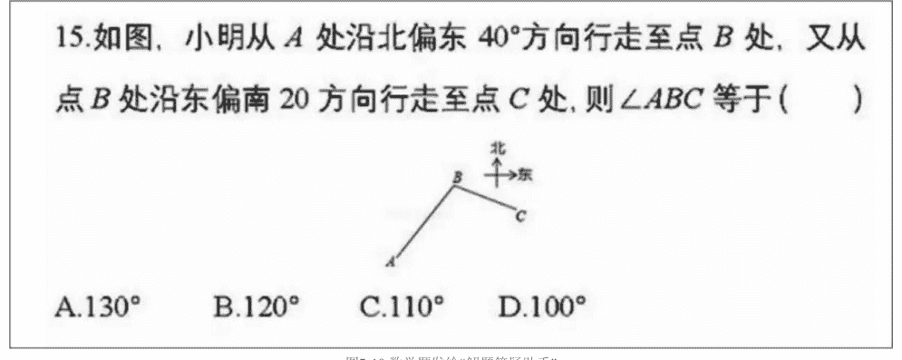
#### 分析
通过小明的行走方向和角度，利用平行线的性质求出相关角的度数，从而得出∠ABC的度数。
#### 详解
(1)小明从A处沿北偏东40°方向行走至点B处，所以∠DAB = 40°。
因为向北方向线是平行的，即AD // BE，根据两直线平行，内错角相等的性质，所以∠ABE = ∠DAB = 40°。
(2)小明从点B处沿东偏南20°方向行走至点C处，所以∠CBF = 20°。
因为∠EBF是直角，即∠EBF = 90°，所以∠EBC = ∠EBF - ∠CBF = 90° - 20° = 70°。
(3)最后，∠ABC = ∠ABE + ∠EBC = 40° + 70° = 110°。
#### 总结
∠ABC等于110°，故本题的答案是 C 选项。
图5-11 “解题答疑助手”给出的分析、详解和总结

#### 给学生批改作文
豆包还有“作文批改助手”智能体，作文完成后可让其批改，结合建议修改提升。操作前面已述，此处省略。

#### 帮学生记忆单词
需要背单词时，可用“8000单词不在话下”智能体。输入单词，它会给出词义、例句、词根词缀、变形、文化背景、记忆技巧和小故事等，见图5-13、图5-14。这里同样使用豆包APP。

#### 8000单词不在话下
🔥 7.3 万人聊过 · 创建人 @丸子
添加到对话
#### 你好呀，
请输入你想要学习的英文单词哦～
> 我会输出关于词义、例句、词根词缀、变形、文化背景、记忆技巧和小故事等内容。
图5-12 “8000单词不在话下”智能体对话界面
#### September
**分析词义：**
“September”是指一年中的第九个月。
**列举例句：**
- I was born in September. (我出生在九月。)
- September is usually a busy month for students. (九月通常对学生来说是一个忙碌的月。)
- The weather in September is still warm. (九月的天气仍然很温暖。)
**词根分析：**
词根为“sept-”，表示“七”。在古罗马历法中，September 原本是七月，后来随着历法的调整变为九月。
**词缀分析:**
后缀 “-ember”,暂无类似固定词缀的其他常见单词。
**发展历史和文化背景:**
最初罗马历只有十个月，September是七月。后来加上了January和February, September就变成了九月。在欧美文化中，九月通常是新学年的开始，也是秋季的开始。
**单词变形:**
无特殊变形，固定搭配有 “in September” (在九月)。
**记忆辅助:**
可以把 “September” 拆分成 “Sep” (九月的缩写)和 “tember” , 联想成 “Sep (九月缩写)的时候天气很tember (温和)” 。
**小故事:**
It's September. The leaves start to turn yellow. Students go back to school. (现在是九月。树叶开始变黄。学生们回到学校。) 中文翻译：现在是九月。树叶开始变黄。学生们回到学校。
图5-14 智能体输出的内容（2）

#### 陪学生练习口语
豆包还有“英语口语聊天搭子”智能体，学生可随时和它对话练习口语。对话界面见图5-15。

图5-15 “英语口语聊天搭子”智能体对话界面

后记
关于AI教师的探索远未结束，本书只是揭开了冰山一角。随着科技快速发展，AI教师在教育领域的价值会越来越被认可。我们正处在变革期，这为教育带来新机遇。希望更多教师愿意了解并使用AI技术，走上AI教师探索之路，共同为教育开拓更多可能。
最后，向所有教师致敬，感谢你们的辛勤付出。愿AI教师成为你们的得力助手，让工作更轻松便利。