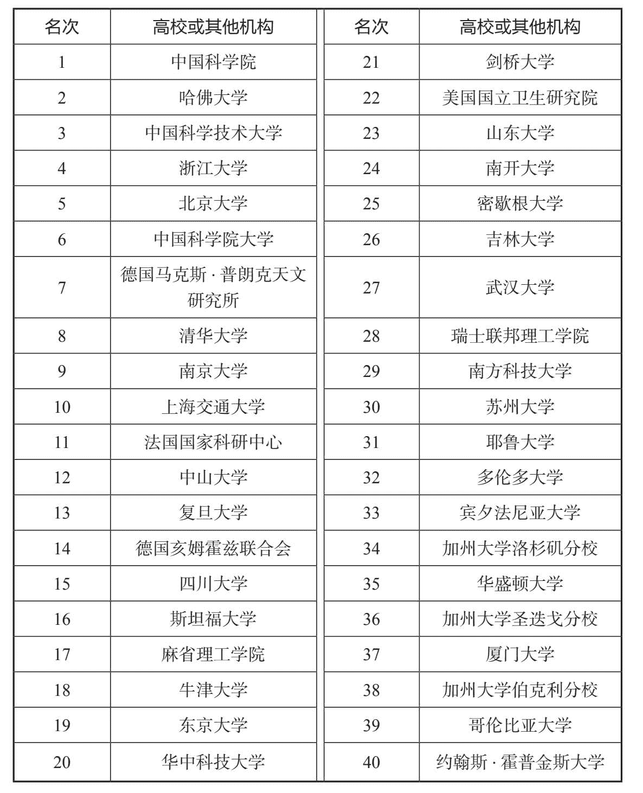
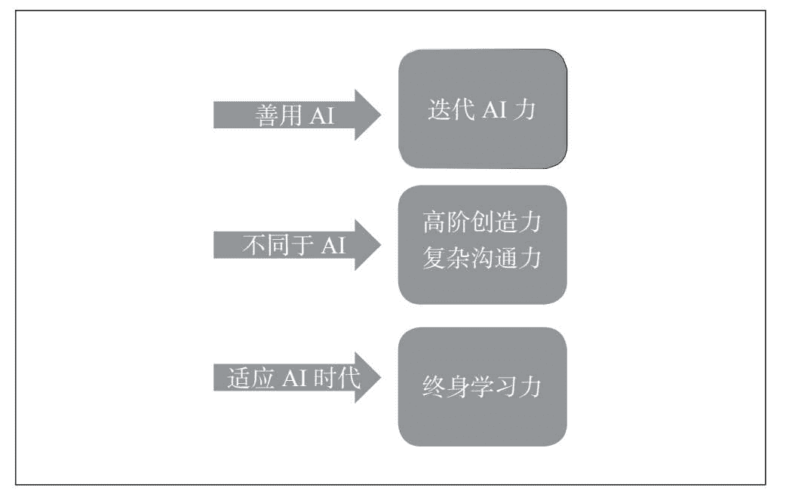
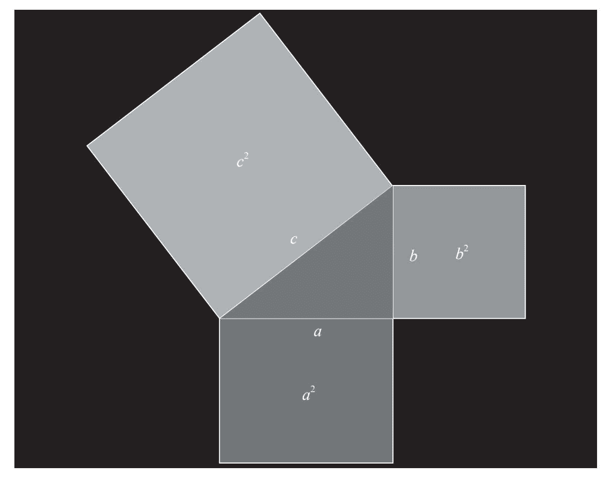
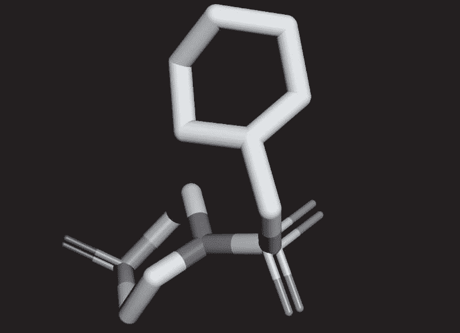

# AI教育革命

# 推荐序 以教育之不变，应 AI 之万变

俞敏洪

新东方创始人

新东方教育科技集团董事长

在新东方，我一直鼓励管理者不断进取，跟上时代，甚至引领某个领域的发展。教育自然是我最心心念念的话题，所以当晓飞给我送来《AI 教育革命》的书稿时，我既感到兴奋，又备感欣慰。20 年来，我见证了他从一线教师成长为深耕教育研究的实践者，从课堂上的知识点传授，到对教育本质的持续追问，这份对教育事业的赤诚与执着，始终未变。而这部著作，正是他将 20 年教育经验与 AI（人工智能）时代浪潮深度融合的结晶，字里行间满是对教育规律的敬畏、对时代变革的敏锐洞察，更有对中国家长与教师的真诚关怀。

AI 技术的爆发式发展，正在重构我们熟悉的世界。从 GPT-4 的横空出世到 DeepSeek 等国产大模型的崛起，从无人装备的惊艳亮相到 AI 智能体走进千家万户，我们真切感受到，人工智能是“引领新一轮科技革命和产业变革的战略性技术”这一判断的深刻内涵。教育作为传承文明、培育人才的核心领域，自然无法置身这场变革之外。

这些年，我走过无数学校，见过太多焦虑的家长和困惑的教师。家长们担心孩子被 AI 淘汰，拼命报各种培训班；教师们纠结于传统教学与新技术的融合，不知何去何从；孩子们则在 AI 的便捷与学习的艰辛之间摇摆。这种焦虑，本质上是对“AI 时代该培养什么样的人”“该如何教”“该如何学”的迷茫。而晓飞的这部书，恰恰为我们拨开了其中很多的迷雾。

书中最打动我的，是其对教育“变与不变”的深刻洞察。晓飞明确指出，AI 时代的教育，并非要颠覆传统，而是要在坚守教育本质的基础上顺势而为。扎实的基础知识、良好的性格品质、健康的社交能力，这些历经时间检验的教育核心，在 AI 时代依然是孩子安身立命的根本。就像中国基础教育的严格训练培养了一代代基础扎实的人才，让中国在全球 AI 人才领域占据半壁江山一样，这种对基础能力的重视永远不会过时。而面对 AI 带来的就业革命，孩子们需要应对的三重竞争——与同龄人的竞争、与 AI 的竞争、与会使用 AI 的人的竞争，更需要以扎实的基础为底气。

同时，晓飞也清醒地看到教育必须变革的方向。AI 让“规模化+个性化+专家级”的教育理想成为可能，让因材施教不再是少数人才能享有的特权；兴趣教育的地位得到空前提升，“热爱”成为孩子突破平庸、对抗 AI 替代的核心动力；而“迭代 AI 力、高阶创造力、复杂沟通力、终身学习力”这“四力”，则为孩子指明了 AI 时代的能力培养方向。这种“守正创新”的教育智慧，既避免了盲目跟风的技术崇拜，也摆脱了故步自封的传统执念，恰是应对变革的关键。

在教育方法上，晓飞的思考同样深入且务实。他提出的“从记忆思维到实践思维”“从答案思维到过程思维”等四大思维转型，直指当前教育的痛点；他倡导的项目式学习、总结复盘、刻意练习等方法，既有脑科学原理支撑，又有丰富的实践案例佐证；他对 AI 教育工具的梳理与应用建议，更是为教师和家长提供了可操作的指南。尤其难得的是，书中没有空洞的理论说教，而是融入了大量中外教育案例、科技新锐的成长故事，还有晓飞自己 20 年的教育实践感悟，读来生动鲜活，极具启发。

教育是一项“农业活儿”，需要耐心与敬畏；但在 AI 时代，教育还需要“信息级”的精准与高效。晓飞的这部书，正是架起了理想与现实之间的桥梁。它告诉我们，AI 不是教育的“敌人”，而是助力教育回归本质的“工具”——AI 可以承担重复性的教学工作，让教师有更多时间关注孩子的情感与成长；AI 可以实现个性化的学习路径规划，让每个孩子都能在适合自己的节奏中进步；AI 可以打破教育资源的壁垒，让偏远地区的孩子也能接触优质的教育资源。

作为一名深耕教育行业 30 多年的从业者，我始终坚信，教育的核心永远是人。AI 可以生成答案，但无法传递情感；AI 可以提供方法，但无法替代陪伴；AI 可以复制知识，但无法培育品格。晓飞在书中也反复强调，教育者的使命在于“点亮”孩子，在于培养孩子的社会情感技能，在于让每个孩子找到内心的热爱与人生的方向。这与新东方“以人为本”的教育理念不谋而合。

当前，中国教育正处在前所未有的变革期，“双减”政策的深化、AI 技术的普及、就业市场的变化，都在推动教育模式的重构。《AI 教育革命》的出版，恰逢其时。它不仅为家长和教师提供了应对变革的“导航图”，而且传递了一种理性与从容的教育态度——不必畏惧 AI 带来的挑战，也不必盲目追捧技术的潮流，只要抓住教育的本质，培养孩子“善用 AI”且“不同于 AI”的核心能力，就能让孩子在未来的竞争中立于不败之地。

晓飞在新东方的 20 年，是中国教育快速发展的 20 年，也是他个人教育理念不断沉淀的 20 年。这部《AI 教育革命》，既是他个人成长的缩影，也是中国教育人应对时代变革的思考与探索。我相信，每一位翻开这本书的家长和教师，都能从中获得启发，找到属于自己的教育答案。

教育的路上，我们都是同行者。愿我们都能以开放的心态拥抱 AI，以坚定的信念坚守教育本质，让每个孩子都能在 AI 时代绽放独特的光芒，拥有选择人生的权利与能力。这既是晓飞写作此书的初心，也是我们所有教育者的共同追求。

是为序。

2026 年 1 月 10 日于北京

# 前言 AI 时代，做不焦虑的家长和老师

进入 21 世纪的第三个十年，时代的变化在不断加速：先是新冠疫情和“双减”政策给中国经济和教育带来巨大且深远的影响；再是 2023 年 GPT-4 的优异表现引发新一轮 AI 热潮，苹果、亚马逊、谷歌、微软、脸书、特斯拉和英伟达等与 AI 强相关的“美股七巨头”，成为全球资本市场的顶级明星。

2025 年春节期间，就在家家户户吃着团圆饭的时候，“杭州六小龙”引发举国热议，DeepSeek 引发美股和 A 股价值重估，很多杭州人都颇感惊讶，自己生活的这座城市突然从“电商之都”进化为“中国硅谷”了。

2025 年 9 月 3 日，纪念中国人民抗日战争暨世界反法西斯战争胜利 80 周年大会在北京隆重举行，无人战斗机、无人战车、无人艇、机器狗等众多智能装备的亮相，让很多人感觉已经身处科幻世界。

“科技是第一生产力。”影响当前和未来的根本变化是 AI 科技的重大突破和快速普及。

2025 年，中美两国的人工智能研究专家纷纷指出，中国在 AI 大模型的发布数量上正迅速追赶美国，尤其在开源领域。DeepSeek、阿里巴巴的通义千问等大模型在性能上与西方顶尖模型的差距不断缩小，甚至在某些基准测试中表现更优。多位行业专家和企业领袖一致认为，2025 年是中国 AI 应用大规模落地的元年，此后 AI 智能体将进入各种工作、学习和生活场景。

基于对 AI 科技发展现状与发展潜力的洞察，中国决策层在 2025 年 4 月做出最新判断——“人工智能作为引领新一轮科技革命和产业变革的战略性技术，深刻改变人类生产生活方式”[[1]](#0004.xhtml_1c5757c07f76caa069cb0c433d166b30)“人工智能技术加速迭代，正迎来爆发式发展”[[2]](#0004.xhtml_7fa70c788a11122aacc59fc1b354d393)。

这样的重大判断在中国是罕见的，其重要性堪比决策层在 2008 年做出的关于信息技术快速发展的战略性论断。2008 年之后，中国的计算机、互联网、移动互联网、5G（第五代移动通信技术）、云计算、区块链、虚拟现实、增强现实等信息技术飞速发展，短短十几年间就实现了整个国家的信息化，中国经济实力大增，我们的生产生活方式，包括教育模式，也发生了显而易见的变化。

决策层判断下一轮的技术革命会爆发在 AI 领域。[[3]](#0004.xhtml_81cbd83e18aa3fd77280bb3939227338)预计今后国家会集中海量资源投向这一颠覆性、战略性技术，充分鼓励创新，加速 AI 技术在各领域的落地应用，带动中国生产力的新一轮跨越式发展。

## AI 技术引发新一轮就业革命

由于在新东方工作，近年来我曾为多所高校的学生做过分享，并且在担任青年联合会委员期间，参与了多次“青年大讲堂”，和大学生交流大学学习期间遇到的问题，以及关于就业的种种困惑。在此期间，我担任多所高校的职业规划导师，希望能够通过分享自己的所见所闻，以及身边很多学生就业的案例，对青年学子有所帮助。

2025 年 AI 技术的突破，让各界专家都意识到，新一轮就业革命已经到来。年轻人对时代的变化是敏感的，他们也已经隐约意识到这一点。2024 年以来，我每次走进高校和大学生分享，他们普遍都会提出类似的问题：面对人工智能的高速发展，大学期间应该如何提高就业能力？大学期间学的专业会对未来的就业产生什么影响？未来的工作岗位到底需要什么样的能力素质模型？他们为此感到迷茫和困惑。

2022 年，中国高校毕业生人数首次突破 1 000 万，此后关于大学生就业难的讨论持续升温。从历年出生人口数量来看，2043 年之后，中国高校毕业生数量才可能低于 1 000 万。就业是民生之本，今后十几年，中国社会面临的最大压力之一是就业压力，这比广泛讨论的老龄化压力要更加紧迫。

以 AI 为代表的第四次工业革命将催生大量高竞争力的新兴产业和高薪酬的就业；但 AI 创造就业岗位的同时，也会消灭就业岗位，这将带来长期的就业压力。2023 年底，中国的就业总人数是 74 041 万，2024 年底是 73 439 万。就业总人数一年减少了 602 万，一部分原因是“60 后”到了退休年龄，还有一部分原因是科技进步提高了生产效率，导致技能不足的劳动者难以就业。

过去的大学生就业难，主要是因为同龄人在竞争不够充裕的优质岗位。随着 AI 的快速进化与普及，从今往后的新一代劳动力，将面临三重竞争：

1. 继续与同龄人竞争，比拼的主要是各自的基础能力与素质。

2. 与 AI 竞争，要么比 AI 更优秀，要么开展差异化竞争，也就是跟 AI 的能力有显著不同。

3.  不擅长使用 AI 的人与擅长使用 AI 的人之间，也会产生竞争。英伟达 CEO（首席执行官）黄仁勋说：“你不会因为 AI 而失业，但会因为会使用 AI 的人而失业。”

学校、家庭和社会的责任是，让孩子们获得足以应对这三重竞争的能力素质，成为 AI 时代需要的人才。

## 两类人才将在就业革命中胜出

近几年，国内外科技专家和教育专家纷纷提出关于未来人才核心素质能力的见解。麻省理工学院计算机博士、《深度工作》的作者卡尔·纽波特[[4]](#0004.xhtml_cb40ddd287e815d42e6621add9d26a29)的观点值得重视，他认为有三种人将在新形势下获得特别的优势，获得时代红利：一是利用人工智能把工作做得漂亮并有创造性的人；二是在所处行业中的顶尖人才；三是拥有资源的人。

第一类和第二类，就是教育界面向 AI 时代的人才培养方向。

第一类人才能够应对上面提到的第三类竞争，他们能利用最强的生产工具极大地提升自己的生产力，跟不擅长利用 AI 的人拉开极大差距。

来看一个例子。2023 年 5 月，华为西安研究所举办了一场软件大赛，参赛者被鼓励使用 AI。尽管相比于 2022 年，赛题的难度翻倍，还增加了几道专业级的挑战题，但仍有 8 位参赛者借助 AI 工具获得满分。更令人惊讶的是，上一届的冠亚军选手在本次大赛中未使用 AI 大模型，结果前冠军的成绩排在了 170 名，前亚军排在了 450 名。软件开发已经悄然从数字化时代迈向了智能化时代。华为云的软件开发工具链 CodeArts 实现了研发全流程智能化开发，编码环节在“读、写、调、测、查”等方面都能实现智能辅助。程序员不用每一行代码都自己写，AI 代码采纳率高达 35%。2025 年，美国脸书、谷歌等顶级科技企业的编程工作，也有 20%~50%是 AI 完成的。

第二类人才能够应对上面提到的前两类竞争，不仅能在跟同龄人的竞争中胜出，也可以在跟 AI 的竞争中胜出。不少专家指出，AI 无法取代行业里的顶尖人才，这是为什么？

Meta 公司首席 AI 科学家杨立昆指出，当前的 AI 大模型都基于自回归预测机制，也就是“猜下一个词或符号”，这是概率，而不是真的理解了规律，自然永远无法超越人类智能。现有的 AI，不光不能触类旁通，而且“举一万才能返三”。对那些没训练过的事情，AI 就是答不出来；对那些小概率事件，AI 就是应对不好。这是刻在骨子里的缺陷。

明白了 AI 技术的本质，我们就能理解为什么一些资深 AI 从业者和观察家会发出如下感慨：

AI 确实能模仿文字，但它永远无法替代真实的行业经验和思考深度……在 AI 时代，你的专业深度就是最强的竞争壁垒。

AI 可以给出 2 万字的分析（汇总、综述），却得不出 3 句话的洞察；AI 的天花板仍然在于，它无法像真正的高手那样给出有价值的洞察——看懂现象背后的本质，指出问题的关键点。要想在 AI 时代立于不败之地，你就必须成为能够产生敏锐洞察、具备真正见识的行业高手。这些高手将因为 AI 的赋能，摆脱重复性劳动的束缚，其学习能力迅速增强，工作效率大幅提升，认知范围迅速扩大，让自身的洞察力得到更好的发挥。

关于适应未来的人才，DeepSeek 创始人梁文锋有着和卡尔·纽波特相似的判断。他刚开始做 AI 大模型的时候，记者问道：“什么是我们（招人）必卡的条件？”

梁文锋回答道：“热爱，扎实的基础能力。其他的都没那么重要。”热爱和扎实的基础能力，能够让人成为所处行业中的顶尖人才。

DeepSeek 的研发人员，大多是清华大学、北京大学、浙江大学、南京大学、中国科学技术大学等名校的年轻毕业生或在读博士生，他们不是在奥林匹克数学竞赛中崭露头角，就是在奥林匹克编程竞赛中拔得头筹，这群年轻人聪明、学习力强，并且热爱探索 AI 的技术潜力，有很强的自驱力。

“热爱”和“扎实的基础能力”在 AI 时代将发挥怎样的作用？我们来看一个离 AI 最近的岗位——程序员。当前 AI 编程工具虽展现出强大的代码生成能力，但其依赖的大语言模型存在根本性局限：缺乏对现实因果关系的理解，且普遍存在事实“幻觉”，缺乏自我纠偏能力。对非专业人士而言，他们难以将复杂任务精准拆解为 AI 可以理解和处理的子任务，这样就不太可能用 AI 编程工具完成较大且较复杂的任务；他们也不具备代码审查能力，既无法识别 AI 的逻辑谬误，也无法修正其技术幻觉。

对程序员而言，其核心竞争力正从“基础代码编写”转向“系统架构设计”与“复杂问题抽象”。满足于机械编码的“执行者”将面临淘汰压力，AI 编程正在倒逼程序员从技术执行层跃升至系统决策层。未来程序员的核心价值，将取决于其驾驭 AI 实现复杂创新的能力，而非编写基础代码的数量。

一个人如果没有“扎实的基础能力”，就读不懂 AI 生成的复杂代码，看不出 AI 编程的漏洞；而那些“热爱”编程的人，自然会用工作时间和业余时间让自己的知识和能力得到提升，使自己能够顺利实现从代码编写到架构设计的跃迁，从事更高层面的脑力劳动。

由于他们能利用 AI 编程放大自己的创造力，因此他们不仅是所处行业中的顶尖人才，也是卡尔·纽波特所说的“利用人工智能把工作做得漂亮并有创造性的人”，这样的人才将获得巨大的时代红利。

## 人才素质模型，未来教育的变与不变

教育的重要问题，是明确要培养什么样的人才。从事教育工作 20 年来，我和其他老师一直在考察、研究面向未来的人才素质模型。出于工作原因，我有幸在南京、天津、厦门、杭州 4 个城市任职，4 个城市虽然各有特色和优势，但都十分重视教育，并且都很重视科技创新教育。近 10 年来，我和同事们也走访了不少世界名校，对留学生和全国多所高校的优秀学生进行访谈，对他们的成长历程、思考维度和未来规划进行考察、调研，搜集并分析了许多学生的成长案例和教师的教育理念与方法，这些工作提供了大量来自一线的素材。

持续多年的一线师生调研和访谈带给我许多启发，再结合“杭州六小龙”等新一代科创企业的企业家案例，我对面向未来的人才素质模型有了初步成形的想法。这些年来，我也一直在思考：在极速变化的时代，教育的哪些方面是始终不变的？哪些方面是必须变化的？随着面向未来的人才素质模型逐渐变得清晰，上述两个问题的答案也开始浮现。

第一，扎实的基础能力。“杭州六小龙”的创始人都受益于中国严格的教育模式；不论是在硅谷、深圳还是在杭州，AI 科创企业的领军人物都是基础扎实的“学霸”；那些熠熠生辉的人文社科英才，都具备海量的知识储备，这为他们的思考力和表达力打下了坚实的基础。扎实的基础能力，对应的是严格的教育训练，这在未来教育中依然是不变的。

第二，被自己的热爱驱动。一个人不是学霸，也可以因自身的热爱而变得不普通。宇树科技创始人王兴兴虽然未就读过顶级名校，但因为自身对机器人的浓厚兴趣，他通过自学打下了扎实的基础，具备了世界一流的创造力。在“情绪经济”腾飞的年代，能玩儿出名堂的“非学霸”，也可以让自己在这一领域比同龄人和 AI 做得更出色。当“热爱”变得重要，个性化兴趣教育（大体上对应当前的素质教育）的地位需要得到极大提升，这是未来教育的一大变化。

第三，擅长利用 AI。DeepSeek 创始人梁文锋自然不用多说，《黑神话：悟空》的制作人冯骥、“哪吒”系列电影的导演饺子，也用 AI 技术极大提升了游戏、动画的制作效率和效果。AI 将与工业、农业、政务、教育、养老、医疗、文娱、软件、信息、金融、商务、法律、交通、外贸等领域深度融合。在人工智能无处不在的未来，擅长利用 AI，就跟今天擅长利用互联网一样，是人们的基础能力。国家正在部署开展的“AI 教育”，将再造教育和学习的基本面貌，实现大规模的因材施教，这是未来教育的最大变化。

## 本书的写作思路

本书的“方向篇”探讨了 AI 时代的教育方向。我综合了自己在教育行业工作 20 年的案例和经验、人才培养的理念，以及 AI 技术与产业的新趋势，围绕“面向未来的人才素质模型”，分三个方面展开论述。

第一章的主题是“基础教育”。严格的基础教育，“德智体美劳”的全面发展，能够培养扎实的基础能力和素质，在 AI 时代依然具有重大意义。其实，文科死记硬背、理科熟练掌握解题套路，这样的学习模式算不上是培养“扎实的基础能力”。“天下武功，唯快不破”，深刻理解公式、定理之后的“快”，既能应对中考、高考，也有助于孩子在 AI 时代长远发展。真正掌握逻辑演绎和实验试错这两个最重要的科学方法论，不仅对高考有用，而且在孩子今后的工作中也大有帮助。

第二章的主题是“兴趣教育”。本章用科学大师和科技新锐的成长案例，探讨了“热爱”在 AI 时代的意义，论述了热爱助力成才背后的脑科学原理，以及家长开展个性化兴趣教育的方法。不是所有孩子都能成为学霸，非学霸也可以通过自己的热爱找到很好的出路，如热爱生活、热爱非遗技艺的李子柒，她不仅广受国人喜爱，还成为推动中国传统文化走向全球的一位代表人物。

第三章的主题是“AI 教育”。AI 技术的突破，将帮助我们实现“规模化+个性化+专家级”的教育理想。“AI 教育”的具体内容包括以下三个方面。

• 将人工智能纳入课程体系，让孩子在 AI 时代具备基本的竞争力，这是 AI 改变教育的一个方面。

• 教师、家长和学生都把 AI 用起来，实现因材施教，推行个性化的知识教育，用更少的时间打下更扎实的基础。学习效率提高了，孩子才有足够时间接受个性化的兴趣教育，这是 AI 改变教育的另一个重要方面。

• 具体到能力素质层面，针对 AI 技术的优缺点，我们要培养“善用 AI”且“不同于 AI”的人才，他们需要具备“四力”：迭代 AI 力、高阶创造力、复杂沟通力和终身学习力。

总之，“方向篇”探讨的是，怎样的教育能够让孩子将来成为“所处行业中的顶尖人才”，以及“利用人工智能把工作做得漂亮并有创造性的人”，从而让他们不仅具备就业能力，还能获得 AI 时代的红利。

本书“方向篇”讲的是教育和学习的方向——“做正确的事”；“方法篇”讲的则是教育和学习的方法——“正确地做事”。

“方法篇”第四章的主题是“AI 时代怎么学”。这一章紧接着第三章，具体论述了应该如何培养迭代 AI 力、高阶创造力、复杂沟通力和终身学习力。第四章的理论基础是脑科学原理和陶行知先生的创造教育思想，上述“四力”都是在持续的实践中不断提高的。

第五章的主题是“AI 时代怎么教”。这一章初步总结出教育者需要实现四个方面的转型：从记忆思维到实践思维，从答案思维到过程思维，从工具思维到团队思维，从成绩思维到人本思维。对 AI 时代教育转型感兴趣的家长和教师，可以参考这四大转型的逻辑和方法。

## AI 时代的教育变革全景图

写完书稿，回过头看我在新东方 20 年的教育历程，我发现自己这些年正是围绕本书论述的几个方面开展工作的：一是进行知识教育，帮助孩子们培养“扎实的基础能力”；二是加强兴趣教育，培养孩子们的“热爱”；三是开展 AI 教育（少儿编程、机器人和科创教育），并积极探索如何用 AI 工具提高教学效率与学习效果。

AI 的快速发展带来了巨大的机遇，但生产力的飞跃也伴随着对就业、社会乃至地缘政治的潜在冲击。对身处这场变革浪潮中的每一个人和每一个组织而言，理解并适应 AI 带来的变化，将是未来生存和发展的关键。

俞敏洪老师近年来与很多企业家做过深度交流，对各行业的智能化、无人化趋势比较了解，因此他强调：“如果用传统思维来培养传统的人才，这个人不管多有能力，都会面临挑战……今天的教育工作者一定要思考：在人工智能和网络大数据时代，什么才是教育和社会最需要的。只有把握未来，教育才不会落后。”

曾任北京十一学校校长的李希贵老师有个洞察：人类的文明，事实上就是教育和技术的赛跑。当教育奔跑的速度能赶上或者超过技术的时候，人们在学校学的知识、技能可以应对技术带来的社会进步，就比较平和从容，反之则会显得焦虑。

本书的写作，主要得益于我在新东方 20 年的教育实践和积累，以及对 AI 专家、教育专家进行的访谈，对教育发展趋势的学习和思考。关于 AI 技术将引发怎样的教育革命，目前学术界和科技界还没有达成共识，尚未形成公认的答案。本书对此进行了初步探索，尝试描绘出“AI 时代的教育变革全景图”，给广大家长和教师提供一些参考，带来一些启示。不足之处，欢迎大家批评指正。

[[1]](#0004.xhtml_8b3f38a4c399e90be62ea5ced8449624) 新华社. 习近平在中共中央政治局第二十次集体学习时强调：坚持自立自强 突出应用导向 推动人工智能健康有序发展.［EB/OL］.（2025—04—26）．https://www.gov.cn/yaowen/liebiao/202504/content_7021072.htm.

[[2]](#0004.xhtml_3666892a0ba94c0b454ab1bcc8038ccb) 央广网. 时政微观察丨来到这个“社区”，总书记再谈人工智能. ［EB/OL］.（2025—04—30）． https://news.cnr.cn/native/gd/sz/20250430/t20250430_527154897.shtml.

[[3]](#0004.xhtml_a330ef4e7307f84b0c6bd5242e6fee1b) 2015 年，国务院发布了文件《关于积极推进“互联网+”行动的指导意见》，此后，移动互联网彻底改变了中国商业。2025 年 8 月，国务院再次发布重要文件《关于深入实施“人工智能+”行动的意见》。财经界普遍认为，十年一遇的重大发展机会已经到来。

[[4]](#0004.xhtml_da648cc87cfd15672c9f11204e09697b) 卡尔·纽波特是乔治城大学计算机科学副教授，还是一位“人气博主”。他创办了在美国广受欢迎的博客“学习黑客”，致力于为大家破解工作和学习领域的成功模式。纽波特还著有《如何在大学里脱颖而出》《如何成为尖子生》《如何考进世界顶尖名校》《优秀到不能被忽视》等畅销书。

# 方向篇 做正确的事：AI 时代教什么，学什么

全球人工智能领域的领军人物、斯坦福大学教授李飞飞指出：AI 不是一个简单的新工具，“AI 是一项文明级的技术”。

教育是文明的一个核心领域，处在时代变革的中心。AI 时代我们必须重估一切教育价值，看清未来的大方向：什么教育是不能动摇的，什么教育是必须变革的。

# 第一章

# 基础教育：AI 时代什么不能变

五经之首的《易经》告诉我们，在变化的世界中，要抓住不变的东西，也就是要把战略建立在不变的事物上。那什么是未来中国教育不变的事物？当前中国教育培养的哪些素质和能力，在 AI 时代仍将熠熠生辉？

2024 年底、2025 年初，全球首款第六代战斗机、DeepSeek 大语言模型、宇树科技机器人、原生鸿蒙操作系统等世界顶级突破性科技集中亮相；科技含量极高的《哪吒之魔童闹海》进入全球影史票房五强，拿下全球影史动画电影票房榜第一。有人感慨，过了个年，仿佛过了一个世纪。如此高密度的重大突破，使得中国人普遍有了科技自主创新的自信。

这些世界一流高科技的领军人物，正是卡尔·纽波特所说的“所处行业中的顶尖人才”，他们都出自中国的本土教育体系。中国现行的严格教育模式有利于培养梁文锋所说的“扎实的基础能力”。扎实的基础能力是工业时代、互联网时代优秀人才的基本素养，在 AI 时代也是如此，这是一个不变的教育方向。

目前 AI 最能产生经济价值的功能是写代码。高水平的程序员能发现“AI 幻觉”在哪里，直接调整一下就能用了，可低水平的程序员察觉到有问题却“无能狂怒”，更低水平的程序员根本没发现程序存在严重问题，“上去就开足马力，卒”。

用 AI 写文章也存在同样的问题。因此在 AI 时代，程序员以及其他知识性工作的门槛实际上是提升了。知识工作者在运用 AI 提高效率的同时，必须具备从第一性原理出发来分析问题的能力，具备迅速分辨真相和幻觉的能力，这些能力都建立在扎实的基本功之上。

# 为什么部分西方国家的教育改革“向东看”

2009 年，上海代表中国首次参与 PISA（国际学生评估项目）测试，就夺得三科第一，超越了西方的“教育明星”芬兰，被伦敦大学教育学院[[1]](page_4_split_6.xhtml_9a4f22fddeeba31c73cd326dac9c3d15)的学者称为“上海奇迹”，改变了西方对中国基础教育“死记硬背”的刻板印象。

## 国际学生能力评估，中国稳操胜券

评价世界各地教育系统的优劣，得有客观标准。PISA 是一个得到世界广泛认可的“黄金标准”。PISA 考察阅读、数学与科学这三个学科，限定 15 岁的学生参加，对应中国的初三或高一。

中国 2009 年在 PISA 中的优异成绩并非昙花一现。在 2012 年的 PISA 测试中，中国学生的成绩进一步引发全球关注。在 2018 年的测试中，中国内地学生的数学成绩是 591 分，排名第二的新加坡是 569 分，中国澳门、中国香港和中国台湾分别是第三、第四、第五名。数学成绩排名第 20 的德国是 500 分。美国学生的数学成绩是 478 分，排名第 37。

在科学成绩排行榜中，中国内地学生以 590 分排名第一，中国澳门、中国香港、中国台湾，以及同属儒家文化圈的韩国、日本，都进入了全球前十名。美国学生的科学成绩是 502 分，排名第 18。在阅读领域，中国内地学生以 555 分夺得冠军，美国学生得了 505 分，位列第 13 名。

儒家文化圈的教育模式是相似的，中国、日本、韩国、新加坡等国在 PISA 中表现优异，而英、美等国表现平平，这引发了部分西方国家教育改革“向东看”的趋势。

浙江大学博士研究生李玥忞在论文《中国基础教育跨国吸引力的研究——基于 242 份英媒 PISA 文本的分析》中，介绍了英国的教育改革历程。

英国教育部在 2010 年颁布了《教学的重要性》白皮书，明确提出：“要实现让学生享受世界一流教育的目标，首要的做法是学习其他国家或地区的先进经验。”在 PISA 排行榜的指引下，凝结着中国文化、社会传统和教育经验的上海数学课程一改过去被西方定义的“他者”地位，进入了英国政策制定者的视野。

2014 年 4 月，中英两国在北京签署《中英双方关于数学教师交流的谅解备忘录》。该备忘录决定英国选派优秀教师到中国学习、接受培训、现场观摩和考察，再邀请中国教师到英国执教和交流，项目完全由英方提供经费。该项目也是西方国家“向东看”寻求教育政策借鉴的潮流中，规模最大、级别最高的一个突出范例。

## 中国人才占据全球 AI 领域半壁江山

未来社会是智能社会，AI 的技术和产业水平决定着世界各国的竞争力。我们再来看看考试成绩优异的中国学生在 AI 领域的全球竞争力。

2025 年 2 月，马斯克的 xAI 公司官宣 Grok 3 AI 模型时，站在“C 位”的是两个华人面孔的科学家。xAI 公司共有 12 位创始人，其中 5 位是华人，包括浙江大学毕业的张国栋和清华大学毕业的戴子航。在 xAI 团队发布的 Grok 4 作战图里，大约 80%的团队成员是华人面孔。

华人成为 AI 企业研发团队的主力，这在美国司空见惯。美国芝加哥保尔森基金会下属智库麦克罗波洛的分析报告指出，2022 年，美国公司和研究机构的顶尖 AI 人才有 38%来自中国大学，超过了来自美国大学的 37%。斯坦福大学教授李飞飞，以及微软 AI 首席科学家邓力，是华人 AI 科学家的代表。

另一项数据更惊人，根据麦克罗波洛智库的最新报告，2022 年，全球顶尖 AI 研究人员［NeurIPS（神经信息处理系统大会）入选论文作者］中，47%的人在中国接受本科教育，在美国读本科的只占 18%，在欧洲的占 12%，在信息技术大国印度的只占 5%。可以说，全球顶尖 AI 人才就来自“两个国家”：一个是中国，一个是“外国”。

除了人才因素，一个国家的 AI 产业实力，高度依赖互联网产业实力，而中美两国几乎瓜分了全球互联网产业，这就形成了一个著名论断：全球 AI 竞争就是中美之争，中美 AI 竞争就是“在华中国人”和“在美中国人”之间的一场智力竞赛。

美国布鲁金斯学会分析指出，中国 AI 人才的巨大优势与中国学生所接受的数学教育密切相关，尤其是线性代数，这是 AI 的基础。2020—2023 年，AI 连续三年成为中国最受欢迎的专业；根据 College Transitions 网站发布的 2025 年美国本科专业受欢迎程度数据，美国最受欢迎的本科专业依然是“商科”，华尔街金融公司是美国名校生就业的首选。

知识经济时代，国家竞争最终是人才之争。中国的理工科硕士占全球的一半左右，博士占 1/3 左右。这跟 2023 年中国工业产值占全球 35%是相匹配的。

2024 年，中国理工农医类博士的招生数量继续提升，总数超过 12 万人，这一数据是美国的 3 倍以上，已经超过西方各国理工农医类博士招生的总和。美国国家科学委员会报告显示，2020—2023 年，大多数八年级学生的数学成绩不达标，该委员会将此称为“STEM[[2]](page_4_split_6.xhtml_84c38eacf84660e1278f62ec914aa308)人才危机”，呼吁迅速改善学生的 STEM 教育。

## 中国的科研实力正在登上顶峰

中国培养了这么多博士，科研实力如何呢？自然指数是公认的非常客观的评价指标。自然指数通过统计各高校、科研院所和机构在国际上最具影响力的 145 种研究型学术期刊上发表论文的数量，评估全球科教机构的科研表现。

在 2012 年的自然指数中，中国排名全球第六。[[3]](page_4_split_6.xhtml_5991a708d8aadc734b8ccc6d48de0444)在 2014 年的自然指数中，中国跃居世界第二。2023 年，中国在自然指数年度榜单中首度超越美国。

2025 年自然指数排名 50 强中，中国共 24 个，差不多占了一半，而且集中在前 20；美国共 17 个，排名大多在 20 名开外（见表 1—1）。

我的母校南京大学在 2025 年自然指数榜单中排名世界前十。南京大学的前身是国立中央大学，1928 年共设文、理、法、教育、农、工、商、医八个学院，是当时中国院系最全、规模最大的大学。南京大学对基础学科的贡献比较大，尤其是物理、化学，在国内和国际都享有比较高的声誉；南京大学的计算机专业，在 2025 年 QS 世界大学学科排名中位列全球第 80 名。

表 1—1 2025 年自然指数榜单

南京大学在基础学科的深厚积淀，为人工智能这一分支奠定了坚实的基础。在 2024 年软科中国大学排名的人工智能专业排名中，清华大学、上海交通大学、南京大学位列中国前三；在校友会的 2024 年人工智能专业排名中，南京大学排名中国高校第一。

2025 年初，南京大学人工智能学院 LAMDA 组，相继斩获 EDA（电子设计自动化）领域顶级国际学术会议 DATE（欧洲设计自动化与测试会议）2025 年最佳论文奖，以及人工智能领域顶级国际学术会议 AAAI 2025 年杰出论文奖。2025 年 4 月，南京大学校友、美国布鲁克海文国家实验室研究员尹伟国团队利用 OpenAI o3 大模型，成功解决了凝聚态物理领域一个 50 年悬而未决的数学难题。2025 年 5 月，南京大学正式发文成立机器人与自动化学院，致力于攻克智能感知、自主决策、精密控制等“卡脖子”技术。

南京大学在人工智能领域蓬勃发展的例子可以证明，基础学科和基础能力在未来是“变化中的不变”。

中国高校在自然指数“霸榜”的背后，是理工科人才数量和质量的持续上升：中国“80 后”接受过高等教育的大概占 29%，“90 后”的高等教育普及率达到 35%，“95 后”达到 45%。随着受过更好教育的“00 后”“10 后”逐步走上科研岗位，中国的自然指数表现将会更加出彩。

数学是自然科学之基础，被誉为“科学的皇后”，这一称号凸显了数学在科学发展中的重要地位和基础性作用。2024 年，来自上海的“90 后”女数学家王艺霖斩获塞勒姆奖；2025 年初，又有三位华人数学家参与破解两项重要数学难题：三维挂谷猜想、狭义希尔伯特第六问题（“从原子到连续介质”的桥梁问题）。

35 岁以下的青年数学家的集体崛起，是近年来中国数学教育体系“本土培养+海外淬炼”模式成果的体现。2025 年初，享誉国际的数学大师丘成桐先生推出新书《我的教育观》，他乐观展望，2030 年后的中国数学将有实力达到世界顶尖水平。

不论是中学生参与的国际竞赛，人工智能领域的人才竞争力，还是高水平科研论文、高素质工程师队伍，中国教育都有卓越的表现，那么，中国教育究竟做对了什么？

# 严格的教育训练：中国科技大爆发的逻辑

爱迪生改进白炽灯的故事大家都听过，为了找到合适的材料做灯丝，他用三四年时间，试验了上千次。当代科研创新的复杂度远超爱迪生当年搞发明创造，反复的试验与失败是家常便饭。科研绝不浪漫，“要能够承受枯燥、重复、失败、压力，还要有能够每天十几个小时持续工作的毅力，这是搞科研的前提”。

## 为什么“严格教育”有利于科技创新

理工科的想象力，是建立在扎实基础之上、具有可实现性的想象力，必须以理性思维、科学训练、丰富经验作为基础。

一方面，中国的严格教育模式能让学生把数理化生的基础打扎实。中国超过西方七大工业国人数总和的工程师队伍，就受益于这个基础，上千万工程师让中国几乎在所有工业领域都做到了世界一流。

另一方面，中国通过中考、高考和考研层层筛选出适合做科研创新的顶尖人才。他们不仅聪明，还在多年的学习过程中习惯了反复演算，能够忍受寒来暑往的枯燥、重复，在经历千百次的失败后继续坚持，这为他们理解复杂系统和解决工程难题打好了基础。在世界各地，中国理工科学生继续深造、攻读博士学位的比例也是最高的。[[4]](page_4_split_6.xhtml_69fa05d642104c926213f9205640623e)这种扎实的功底，也帮助他们在今天快速吸收新技术，解决新问题。正是他们的不懈努力，让中国的自然指数实力超越美国，让中国不断突破“卡脖子”的硬科技。

2023 年，《黑神话：悟空》的制作人冯骥在公司大群给所有同事发了一段话，很能体现创新者永不懈怠的钻研精神：

唯一重要的是继续前进，是以平常心和认真的劲头儿日复一日解决枯燥、困难、琐碎的具体问题，永无止境，永不自满，这是做事最难的地方，但也是最浪漫的地方。最浪漫的地方就是每天做具体的事，做具体而且困难的事情，然后不要觉得自己的成绩达到了什么样的一个高度，永远这样，直到死在路上。

华为是世界顶级的科技创新企业，在 5G、云计算、智能手机、智能驾驶等众多领域有着一流竞争力。华为的大约 20 万员工，绝大部分是中国的教育体系培养出来的。2018 年 3 月，任正非先生在华为内部刊物《华为人》上发表了短文《熵减》，形象而深刻地揭示了严格教育的必要性：

水从青藏高原流到大海，是能量释放的过程，一路欢歌笑语，泉水叮咚，泉水叮咚，泛起阵阵欢乐的浪花。遇山绕过去，遇洼地填成湖，绝不争斗。若流到大海再不回来，人类社会就死了。当我们用水泵把水抽到高处的时候，是用外力恢复它的能量，这个熵减[[5]](page_4_split_6.xhtml_882efa9606b12a48a7a64de55ab29c94)过程多么痛苦呀！水泵叶片飞速地旋转，狠狠击打着水，把水打向高处，你听到过水在管子里的呻吟吗？我听见过：“妈妈，我不学钢琴呀！”“我想多睡会儿。”“妈妈痛，好痛呀！我不要让叶片舅舅打我呀！我做作业了。”

人的熵减是同样的。从幼儿园认字、弹琴；小学学数学；从中学历史、物理到本科、硕士、博士，考试前的不眠之夜……好不容易毕业了，又要接受打 ABC 的考核、末位淘汰等的挤压。熵减的过程十分痛苦，十分痛苦呀！但结果都是光明的。从小就不学习，不努力，熵增的结果是痛苦呀！我想重来一次，但没有来生。

人和自然界，因为都有能量转换，才能增加势能，才使人类社会这么美好。

有些人批判中国教育中的“刷题”和死记硬背，他们只是错误地把这些过程当成了结果和态度。没有方法和思考的“刷题”和死记硬背，才是无效的；勤学苦练，正是任正非先生所说的“熵减”之道。

在过去，扎实的数理基础和勤奋踏实的态度是技术门槛的一部分。在 AI 时代，这依然是绝大部分国家的教育体系迈不过去的门槛。中国的科教兴国战略，需要政府和人民坚持不懈地长期投入，其实大部分发展中国家是学不了的。虽然一些发展中国家的高等教育普及率似乎挺高，但非理工类专业占比非常高（如越南高校以低成本的文科类专业为主），其中还包括社区大学这类跟中国的中专、夜校差不多的学校（社区大学占菲律宾所有大学的 40%左右）。

## 美国教育改革的历程：严格教育变为快乐教育

看过了注重把基本功练扎实的中国教育体系，我们再来看看美国教育模式的演变。

近些年中国教育界倡导的“素质教育”，其实指向的是美国的精英教育。考试成绩好仅仅是最低要求，像谷爱凌那样在学习成绩之外，在素质培养方面还有突出表现，才是真正的追求。这么高的综合素质，只有一流的家庭和学校才可能培养出来。

当前美国大部分家庭和学校流行的是“快乐教育”。孩子明明没学会，老师和家长也不去要求他们努力学习，反而要说“你真棒”“是书本不好”“咱们不学了”（好孩子都是被夸着长大的，教育者要真正看到并夸奖他们各自的闪光点和微小进步，但不能“无脑表扬”）。如此一来，孩子自然会丧失学习的耐心，踢球、唱歌多开心啊。

但一个人如果连中学知识都理解不了，静不下心去学习，自然不可能胜任科研工作。相当一部分人毕业后也无法胜任制造业工厂的工作，因为他们不具备认真负责、迎难而上的工作态度，当前美国重振制造业的一大难点就是招不到足够多的合格工人。

2025 年 1 月，美国总统特朗普在一项行政命令中表示：“70%的八年级学生阅读能力差，72%的八年级学生数学能力差。”美国八年级学生如果能用勾股定理，其数学表现就能排进前 30%了。

特朗普强调，美国教育体系没有达到预期，这正在损害美国的竞争力。其实，在奥巴马总统上任之前，美国教育改革的大方向是看重成绩的严格教育。

1957 年，苏联率先发射人类历史上第一颗人造卫星，引发美国的举国反思。美国人认定导致美国竞争失败的根本原因就是美国教育的失败，提高教育质量事关美国的未来。

但直到 20 世纪 80 年代初，美国教育质量仍然没有明显起色，国家依然处在苏联带来的巨大压力之下。[[6]](page_4_split_6.xhtml_9648175633cc00e45cc6a47398ee64df)因此，从里根、老布什、克林顿到小布什，美国四任总统都在加强基础教育。

1996 年，美国举行了历史上第二次教育高峰会议，时任总统克林顿认同个人努力可以提高学习成绩，赞成峰会关于“高标准、严要求”的决议。

克林顿表示，“你们如果相信你们制定的标准是有道理的，是学生必须掌握的东西，那就不要怕别人指责，说这太残忍、太不公平，也不必顾虑别的什么批评”，“各州光制定出富有实践意义的标准还不够，还得有一套相应的考试制度来配合，考试的目的不应该只是测量学生最低限度的学习能力，而应该是衡量学生掌握了多少所学的知识，学习成绩是否达到了预定的标准”，“没有相应的考试制度，‘高标准’就会变成一句空话”。

美国 2001 年的教育改革强调标准化测试，直接根据学生的考试成绩问责校长和老师，以分数高低决定校长的去留乃至学校是否会被关闭。

美国政府 2002 年签署的《不让一个孩子掉队法案》要求，到 2014 年所有学生的英文和数学都要达到精通的水平。美国白人和亚裔群体受教育水平比较高，其他族群的受教育水平与之相比差距太大，无论如何都无法完成目标。非洲裔、拉美裔等少数族群绝不允许在重要的教育权问题上让步于白人和亚裔，他们掌握了大量选票，足以左右美国选举，在其强烈反对下，美国越来越多的州放弃执行以学习成绩为核心的《不让一个孩子掉队法案》。

特朗普感叹的美国基础教育的衰退，可以直接追溯到奥巴马政府 2015 年签署的《每一个学生成功法》，这一法案把严格教育变为快乐教育。政府再也不在孩子的学习成绩上有所要求，也不再对学校的教育效果进行考核，只要孩子快乐就好。美国基础教育从过于严苛跳到了散漫、片面追求快乐的新极端。

2024 年 12 月，美国印度裔亿万富翁拉马斯瓦米在 X（推特）上发表了一篇长文。他认为，现在这么多顶尖的科技公司高薪雇用外国工程师和移民工程师，不是因为美国人智商低，而是因为美国文化至少从 20 世纪 90 年代开始就一直推崇平庸而非卓越。人们喜欢“舞会皇后”和运动员，而不愿青睐数学奥赛冠军和其他优秀毕业生。美国学生应该多看些书，多参加科学竞赛，少看点儿情景喜剧，少去参加派对。

普通家庭进行快乐教育，精英家庭坚持严格教育，这就是美国教育高度割裂的现状。精英教育培养的人才可以支撑美国的互联网、AI、生物医药等高科技产业，但提供不了成百上千万的优秀工人和专业技术人才，这是近十年美国制造业持续衰败、无力振兴的一个深层次原因。

2025 年，因出版过《虎妈战歌》而背负骂名的华裔教授蔡美儿，以及她的“虎妈教育”[[7]](page_4_split_6.xhtml_866cbff01cb43afcd7391736512ab2fe)重新被美国人追捧。一些美国中产正在进行反思，支持虎妈，成为虎妈。

可能有人会质疑，在推行快乐教育的国家中，还是有芬兰这个成功案例的。

芬兰学生的在校时间是全世界最短的，但芬兰的快乐教育和美国的有根本性的不同。芬兰的政府、社会、学校和家长乃至学生都维护着“教育至关重要”这个共识。

几乎所有新入职的芬兰教师在高中时的成绩都位列全校前 1/3，自 20 世纪 70 年代起，芬兰就要求全国范围内小学及以上的教师必须拥有硕士学位，许多老师还会去读博士。芬兰教育部门还特别注重教师的教学法训练，每位实习老师都会被指派一位在校的资深教师做导师。芬兰孩子学习的过程是放松的、快乐的，但是对待学习的态度是严肃的、严谨的。

总的来说，芬兰教育是严格教育和快乐教育的结合体，这样的成功案例极为罕见。推行纯粹的快乐教育并获得成功的国家，迄今还没有出现。

## 承认严格教育培养基础能力的合理性，是讨论教育改革的前提

新中国成立 70 多年来，实施全民普遍教育，看重理工科教育，“学好数理化，走遍天下都不怕”，这一教育模式有别于美国式快乐教育，可以称作严格教育。中国的港澳台地区，以及同属儒家文化圈的新加坡、韩国、日本，其教育模式跟中国大陆很相似。这些国家和地区都以科教发达、产业竞争力强而著称。

纪录片《他乡的童年》导演周轶君在考察了 10 个国家的不同教育模式之后，发现一个国家的教育模式往往扎根于自身的历史文化。教育代表的其实是一个国家对公民的定义，是一种文化对人的理解。所谓最好的教育是不存在的，适合自己土壤的教育才是最好的。

在新加坡的一所小学，校园标语写着：“新加坡是我们的家，是我们赖以生存的地方。”只有全民努力，才能生存和发展，这是新加坡的处境，新加坡人从小被教育，国家的生存需要每个人努力学习。

新加坡的人均土地资源、金融资源和矿产资源匮乏，关键出路就是开发人力资源。新加坡的处境，也是所有儒家文化圈国家和地区的处境，这是东亚地区严格教育的文化土壤。

截至 2025 年 6 月，美国四大芯片巨头的 CEO 都是华人：英伟达的黄仁勋、AMD（超威半导体公司）的苏姿丰、博通的陈福阳、英特尔的陈立武。这证明了华人奉行的严格理工科教育的优越性。有个评论说得很到位：“在这个‘先问技术，再谈领导力’的时代，能不能把技术吃透，越来越成为一道门槛。从这一点看，STEM 学科依旧是理解世界最有效的路径之一。”

海量的接受过完整专业技术教育的人才，是发展先进制造业的关键，中国政府和民众高度重视制造业，避免经济的空心化，自然要吸取其他国家的教训，不推行快乐教育。在中国文化中，教育是一种信仰，“掌握知识、努力学习被视为一种道德上的责任”，中国人过去要好好读书、认真学习，今后也一样。

中国现行的教育模式，还关系着中国人最看重的社会公平问题。中国的学生规模庞大，每年高考生的数量堪比一个欧洲国家的总人口，打造一个公平、透明的上升通道（教育资源分配机制）至关重要。

2025 年 3 月，新东方举办首届在线家庭教育论坛，清华大学心理与认知科学系主任刘嘉教授[[8]](page_4_split_6.xhtml_87b491e9d94ddef8710949de2a8eb2ee)在和俞敏洪老师对谈时指出：

从大的方面讲，咱们的考试制度，比如高考，可能是目前中国教育体系里最好的制度。因为它给了每个人机会，农村的孩子也能有机会。你想想，要是都像哈佛大学、麻省理工学院的录取方式，要看课外实践、国外经历，那可行吗？穷人家庭有条件把孩子送到国外去游历吗？所以说，咱们这种通过苦读来考试的方式，作用是很大的。高考真真切切地让人们实现了阶层跨越，哪怕身在底层，很贫穷，也有机会走向社会顶端。这是中国高考特别有价值、特别有意义的地方。

今天社会各界研究教育改革，需要在承认现有教育体制合理性的基础上展开讨论，这是中国有教无类的教育传统、追求公平的文化底色和资源有限的基本国情共同决定的。

我们应避免片面地看待教育问题。无论是“快乐教育”“刷题”“死记硬背”，还是“小镇做题家”，这些词往往只是对某种学习方法或阶层身份的描述，并未触及学习本身的意义，也不能代表学习的最终成果。基础教育阶段的核心，始终应当是对学生基本素质与能力的培养。

# 扎实的基础知识：应对“AI 幻觉”和人际竞争

中国的严格教育给学生带来了一些终身受用的素养：扎实的基础知识、认真细致的习惯（马虎就会丢分）、良好的自律性与抗压能力……中国教育的这些优点，在人工智能时代依然很重要。

今天的青少年，如何更好地应对人工智能带来的挑战和机遇？中国科学院院士、西湖大学校长施一公在 2025 年全国两会期间回答了这个重要问题。他强调：

也许过几年，人工智能会成为一门通识课，会带来不同的思维方式；此外，应对人工智能，青年学生更应该关注最基础的知识，因为这是立足的根本，有了这些基础，再去理解、运用人工智能，才能让人工智能为我所用，改变世界、创造未来。

宇树科技创始人王兴兴在浙江理工大学的借书记录曾引发热议，2010 年 9 月至 2013 年 5 月，王兴兴累计借阅图书近 120 册，技术类占比超过 80%。他重复借阅最多的三本书为：

《现代控制系统》（控制论核心教材），7 次。

《物理定律的本性》（费曼经典著作），5 次。

《51 单片机原理及应用》（硬件开发实战指南），5 次。

万丈高楼平地起，赢得国人赞誉的天才创业者，也是老老实实下过苦功夫才掌握基础知识的。

在一个专业领域建立一套系统认知，需要长达数年的系统学习，这就是很多理工科专业需要读到硕士甚至博士的原因。虽然大学里教的知识看似与现实需求有点儿脱节，但其提供了基本的专业知识和思维框架。学生如果想在实际工作中深耕，持续自我学习，就可以在这个框架基础上不断完善，好比饥饿时连吃 5 个包子才有饱腹感，不能说是后面几个包子让自己吃饱的，无视前面吃的包子（大学学习）的基础作用。再厉害的武林高手，也得老老实实扎马步，苦练基本功。

这里要提醒一句，大学教科书要与时俱进，很多专业教科书的内容还停留在十几年前，其中介绍的一些技术已经被新机器和 AI 取代。王兴兴曾公开批评大学教材落伍的问题，老师和学生一定要接触国内外最新版的教材，以免落后于时代潮流。

此外，相比于中学教育的严格训练，大学老师的大部分精力放在课题研究上，对教学的时间、精力投入不够，导致本科生教育不尽如人意。2021 年 3 月，著名神经科学月刊《自然人类行为》发表了一份中美俄印四国联合开展的大规模研究报告（中国牵头的是清华大学和北京大学），该报告基于一项针对四国 3 万余名计算机与电气工程专业本科生的大规模测试。这项测试显示，在本科第一年，中国本科生与美国本科生极为接近，基本在一个水平，大幅高于俄罗斯和印度学生的水平。但经过 4 年本科学习之后，中国大学生的批判性思维、数学和物理技能水平都出现了大幅下降。相比入学时，中国名校毕业生的批判性思维能力下降 17%，普通高校毕业生甚至下降 68%。

这就是为什么不少国人会说自己一生的学习巅峰就是高考结束的时候。调整教师考核指标，加强教学力量，进一步提升本科生的知识水平和思维能力，是中国大学教育改革的重要方向。

## 用严格教育打好的基础，应对无法避免的 AI 幻觉

随着 DeepSeek 的爆火，以及阿里巴巴、腾讯、百度等“大厂”的介入，AI 逐步实现了全民普及。AI 幻觉这个问题也随之引发热议，解决这个问题，恰好需要严格教育打下的基础与养成的习惯。

我让 AI 回答了什么是 AI 幻觉，AI 回答：

AI 幻觉问题是指大语言模型在生成内容时，输出看似合理但实际不符合事实或用户需求的虚假信息。其核心特征表现为：

• 虚构性：模型编造不存在的事实或细节，如杜撰人物、事件或数据。

• 偏差性：因数据缺陷或推理缺陷，生成内容与现实世界存在系统性偏离。

• 合理性伪装：错误信息常以逻辑连贯、细节丰富的形式呈现，具有迷惑性。

来看一位语文老师“水寒”亲身经历的 AI 幻觉。水寒老师把一个问题抛给“文心一言”：“为报倾城随太守”这一句有几种理解方式，哪一种更好？

没想到文心一言张冠李戴，把《江城子·密州出猎》中的太守苏轼和《醉翁亭记》中的太守欧阳修完全混淆了。

苏轼的《江城子·密州出猎》原文如下：“老夫聊发少年狂，左牵黄，右擎苍，锦帽貂裘，千骑卷平冈。为报倾城随太守，亲射虎，看孙郎。酒酣胸胆尚开张，鬓微霜，又何妨！持节云中，何日遣冯唐？会挽雕弓如满月，西北望，射天狼。”

文心一言的编造如下：

“为报倾城随太守”这句诗出自宋代文学家欧阳修的《醉翁亭记》中的一首词《生查子·元夕》，原句为：“去年元夜时，花市灯如昼。月上柳梢头，人约黄昏后。今年元夜时，月与灯依旧。不见去年人，泪湿春衫袖。去年元夜时，花市灯如昼。谁见去年憔悴旧，为报倾城随太守。”

但需要注意的是，最后一句“为报倾城随太守”实际上并不直接出自《醉翁亭记》，而是在某些版本或衍生作品中可能被误植或添加，因为《醉翁亭记》是一篇散文，而此句更接近于词的格式。不过，为了讨论此句，我们可以暂时将其视为一个独立的文学表达。

第二段编得煞有介事，但当着语文老师的面这么干，就是在班门弄斧了。经过水寒老师 4 次指出错误，文心一言才彻底承认自己之前在胡编乱造。

出现幻觉的不只是文心一言，其他 AI 大模型也会如此。顶级科学刊物《自然》称，2024 年，各类 AI 在提到参考文献时，出错率为 30%~90%，而且错误不限于论文标题、第一作者、发表年份等。

AI 出错有个重要原因：它们是根据网络资料进行分析的。众所周知，互联网上存在大量真实性和准确性存在缺陷的伪劣信息，AI 幻觉很难彻底规避。

还有一个原因是，研究人员训练 AI 大模型时所追求的不是准确，而是高分。大模型的回答逻辑和某些高中生写作文有着异曲同工之处：即便对题目涉及的内容只是略知一二，只要能用华丽的辞藻堆砌至规定篇幅，往往也能取得尚可的成绩。大模型也是如此，其不管面对何种问题，无论是否真的胸有成竹，都会不遗余力地输出长篇大论，营造出一副专业解答的模样。

进一步来看，大模型的“表现”是为了得到“高分评价”，这就使得它在回答问题时极有可能去刻意讨好提问者。当用户提出问题时，它会敏锐捕捉提问中的引导性信息，并以此为依据组织答案，顺着提问者的思路进行回复，而非完全基于客观事实。

由于 AI 幻觉的存在，中国著名积极心理学家彭凯平教授不敢启用“AI 数字人”：“有人帮我做了一个虚拟彭凯平，但我不敢让‘他’上线。我本人在社交平台上的发言有控制、有管理，但虚拟彭凯平会说什么我不知道，‘他’有自己产生文本、语言、图像甚至记忆的可能，这也许根本就不是我，很危险。”

我们再来看一个比前边的语文例子更“高级”的 AI 幻觉。

有人问 DeepSeek：“哪吒为什么打不过孙悟空？” DeepSeek 给出了 5 个理由，答案看着似乎非常正确，经过深入分析推敲却很难站住脚。我们来看 AI 提供的其中 3 个理由：

1. 修炼方式：哪吒是肉身成圣，而孙悟空则是通过修炼七十二变、筋斗云等神通，以及食用蟠桃、仙丹等宝物来增强自身实力的。孙悟空的修炼方式更加注重实战能力的提升，这使得他在战斗中更加灵活多变。

2. 战斗经验：孙悟空在《西游记》中经历了无数的战斗，积累了丰富的战斗经验。而哪吒虽然修炼时间更长，但在《西游记》中的战斗经验相对较少，实战经验可能不如孙悟空。

3. 法宝与神通：孙悟空拥有金箍棒这样的神器，以及七十二变、筋斗云等神通，这些能力在战斗中非常实用。哪吒虽然也有乾坤圈、混天绫等法宝，但在《西游记》中，这些法宝的威力似乎并没有完全展现出来。

AI 不存在人类的心虚感，“一篇胡编乱造的文章，可以做到从头到尾神完气足且全程押韵”，以上答案就给人理直气壮、自信满满的感觉，但互联网上的一位高手“血饮”拆穿了它的谎言。

第一个理由错在时间不对。孙悟空打败哪吒出现在《西游记》的第四回，吃蟠桃和仙丹都是第五回的事情。

第二个理由的错误，是因为 DeepSeek 没有好好了解《封神演义》。哪吒参与了公元前 1046 年的牧野之战（比唐代的孙悟空大闹天宫早了 1 000 多年），作为武王伐纣的前锋，哪吒几乎参与了阐教与截教的所有大型战斗。哪吒与孙悟空相遇时，孙悟空还没有大闹天宫，哪吒的战斗经验远比孙悟空丰富。

第三个理由的错误，是因为 DeepSeek 不了解中国神话的知识。在中国的神话体系里，越古老的法宝威力越大，“龙宫的定海神针（孙悟空的金箍棒）是大禹为治水铸造的，但哪吒的乾坤圈原是昆仑山上玉虚宫元始天尊手中的阐教奇宝，哪吒的混天绫是女娲所赐，女娲和元始天尊的法宝难道比大禹手工制造的法宝品阶差吗？”

## 尽信 AI，则不如无 AI

上述两个破解 AI 幻觉的人，要么是基础知识扎实，能够一眼看出 AI 在胡编乱造；要么是认真细致，能耐心查找比对原始资料，从而去伪存真。这两种能力素质，都是中国的严格教育在着力培养的，是 AI 时代信息素养的重要组成部分。还有一个方法是让不同的 AI 相互验证审核，用“魔法”打败“魔法”，这也是 AI 时代必备的信息素养。

古人说“尽信书，不如无书”，今后我们还要意识到，尽信 AI，不如无 AI。不论 AI 的搜索和分析能力多么强大，人类自身都要有“火眼金睛”，能够看出错误知识，发现逻辑漏洞，知道优化方向，而这些都离不开扎实的基础。

“人类的大脑，是最好的‘防幻装置’。”AI 幻觉会带来更多的可能性，有利于艺术和创新，但对更多可能性的利用，需要我们的理性判断和实践检验，“AI 负责天马行空，我们负责去伪存真”。

AI 普遍存在的“讨好型人格”，同样需要使用者本人具备很好的判断力。例如，一位财经作家指出：“AI 时代，财经稿子很好写，不信，你把问题发给 DeepSeek，让它分析一下，然后把稿子念出来，或许你就是比别人强的经济学家了，但这样的稿子有一个通病，那就是观点模糊。因为 AI 的目的是不得罪创作者，那就只能面面俱到，这时候创作者如果不懂经济学，分不清楚，就很难找到根本。”

华为“蓝军部长”潘少钦对 AI 有个非常有趣的比喻：“想一想现在我们对 AI 的各种期望！它要是国际数学比赛金牌选手，在物理、生化领域达到博士水平，还要是编程高手、音乐达人、动画设计大师、国际金奖画家、金牌财务、顶级律师、顶级同声翻译、顶级炒股专家！这不是神才能办到的事情吗？因为神才能无所不知、无所不能！……想一想，当前我们对大模型说的 prompt（提示词工程），是不是有点儿类似对神说的祈祷词？”

如果把越来越强大的 AI 比作“天”，那么我们只有打好知识和思维基础，才能不被 AI 牵着走，做到“我命由我不由天”。

## AI 时代，人与人还是要竞争的

再进一步分析，AI 时代，人与人之间依然是要竞争的。会用 AI 的人胜过不用 AI 的人，用好 AI 的人胜过会用 AI 的人。

张三扎扎实实地学过语文、数学、英语；李四觉得有了 AI，让 AI 去答题、写文章、做翻译就好了，何必辛苦学习。那么，他们俩同时去找工作，公司是会招只会用 AI 的李四，还是会招既会使用 AI 又基础扎实的张三呢？

基础扎实的人利用 AI 的能力会更胜一筹。得到 App 联合创始人“快刀青衣”是资深信息技术专家，他讲述了自己的亲身经历和感悟：

AI 正在高速发展，但一定会到达瓶颈，接下来考验的就是人使用 AI 的能力。我觉得 AI 工具就是同样的一把枪，不同人拿到手里，它的射击精度和敏感性完全是不一样的。人的资源是最宝贵的。

分享一个小故事，（罗振宇）跨年演讲中的一些图片是我用 AI 生成的。作为一个从来没有学过美术的人，有一次，我要调一张电影剧照风格的图片，生成了 300 多张图片，风格一直调不对，找不到突破口。我就找到硅谷的设计师朋友，把我想要的风格描述给他。他想了五六分钟，就扔给我两个词，说你把这两个词加到你的指令词里面。一生成，果然就是我想要的风格。当时我特别惊讶，就问他，这种词是哪里来的？我怎么从来没有见过？他说，这是挪威的一个城市的美术馆里，一幅画下边的描述。他当时觉得这幅画的风格特别奇特，就把这几个词给拍下来了。

回到你公司的场景里，你会发现，AI 的能力再强，也一定比不过专家。等 AI 工具的能力发展到瓶颈期，所有公司用的都是同一款 AI 软件，最后拼的，其实就是你有没有硅谷设计师的那两个指令词。对人的考验，远远高于对软件的考验。

就算 AI 的能力也比专家强了，一个组织、一个行业终归还是需要用人的（下一节会说明理由），那么谁能获得这些工作岗位呢？

一位“老江湖”说得好：柯洁围棋下不过 AI，你也下不过 AI，教授答题答不过 AI，你也答不过 AI，但柯洁依然是赫赫有名的围棋冠军，教授依然是受人尊重的教授。你要是不蒸馒头争口气，竞争过了你的人类同胞，你至于被扫地出门去当个工具人，然后被 AI 和机器人在屁股后面追吗？

AI 时代，越来越多的事情会交给 AI 来做，但人和人还是要竞争的，家长和老师依然不能推行美式快乐教育，这是对孩子的未来负责。

## AI 时代学好数学的意义与方法

俞敏洪老师在新东方首届在线家庭教育论坛上提到要注意 AI 对孩子学习的潜在负面作用：“当孩子非常轻松地在 DeepSeek、豆包上面寻找到任何一个问题的答案时，不管是数学还是英语写作，他都不用动脑子了，稍微懂一点儿的孩子就会以非常快的速度完成老师布置的家庭作业。家长也不能每分钟都盯着不让孩子用人工智能。”

俞老师接着指出，中考、高考的时候是不能带手机的，用 AI 来帮忙做题是完全不管用的，只会对孩子产生不利影响。如果 AI 帮孩子解题，他只要抄下来就行了，孩子有了这样的工具就可以不动脑子了，然而，不再思考对他们成长的杀伤力是巨大的。

从这个角度看，因为中考和高考的存在，孩子还是要老老实实打好基础，尽心竭力地思考，这是中高考在 AI 时代焕发的新意义。

AI 时代，要高度重视语文、数学培养的基础能力。语文，决定孩子能理解多少信息；数学，决定孩子能思考多深。

著名历史学家陈寅恪先生招学生，首先关心的就是学生的数学好不好。为什么？数学好，思维就比较严谨，研究史学需要严谨的思维。数学不一定直接有用，但它可以在无形之中塑造严谨的思维。

数学是编程的基础，要想深入学习 AI，孩子需要具备很好的数学基础（线性代数、概率论、统计学、微积分），数学也是科学、经济学、金融学的基础。孩子只有亲自做数学题目，才能提升自己的数理逻辑思维、深度分析能力。

阿里集团学术委员会主席曾鸣先生对国内外新一代科创企业的用人偏好做过研究，发现它们都喜欢招聘超级聪明、有自驱力、学习能力强的年轻人，DeepSeek 就是这种招聘偏好的典型。这是为什么？因为有了 AI 工具，有了大模型，知识再也不是稀缺资源，真正稀缺的是抽象思考力。优秀年轻人的元认知能力强，能抽象建模，洞察本质，进行第一性原理思考。通用人工智能本质上是概率论的体现，依赖大数据统计来寻找规律和识别模式，此时人类的独特价值在于反向操作，即能够从少量数据中抽象出模型。因此，具备抽象建模能力的人变得极为重要，他们能够在特定领域持续创造新知识，为 AI 提供新的支持，走在 AI 的前面。

进行高度抽象的思考，是判断一个人是否聪明的核心。虽然日常生活中只用得到加减乘除，但我们从小到大一直在学习数学，其中的一个重要意义是让我们的大脑习惯于抽象思考。

著名数学家、教育家苏步青先生曾给青少年写过一本《神奇的符号》，分享了他对学好数学的看法，今天读来依然很有启发性，摘录如下：

1. 学好数学的标志是理解。所谓理解就是不死记硬背，而是反复思考，对概念、定义特别要搞懂。

2. 现在学数学很难，越抽象越难。这里还应该注意不能单打一，学几何就不管代数、学代数不管几何的做法是行不通的。这就要求我们学深学透，才能做到举一反三，融会贯通。

3. 《管子》中有一句话：“思之不得，鬼神教之。非鬼神之力也，其精气之极也。”这句话是提醒我们学习或做学问时要“多思”，想多了，想全了，就能在解题时达到熟练的境地。这里的熟练，是指对基本公式、基本定理、重要常数、基本运算很熟练，能做到“召之即来，来之能战，战之必胜”。这句话讲讲容易，做起来不容易，因此一定要在平时重视基本训练。

4\. 我确实做过 10 000 道（微积分）题，而且还不止这些，可我做的既不是难题，也不是偏题，我是经过大量的基本训练，才达到了熟能生巧的地步，因而不管难题、偏题都能解出来。最后我用 4 个字来归纳——理解、熟练，供青少年朋友参考。

要学好数学，就得学好语文。苏步青先生曾任复旦大学校长，他说过一段话：“欲考复旦大学数学系的学生，若语文不及格，即使他数学再好，也不能录取。”他认为，语文是一种学习工具，是基础的东西，就像工人盖房子需要打地基一样。数学是学习自然科学的基础，而语文则是这个基础的基础。你语文水平低，看不懂讲义，怎么学好数学呢？你要解数学题，连题目要求都不懂，解题非错不可。相反，语文水平提高了，阅读能力增强了，不仅有助于学习数学，还有助于学好其他科学知识。为什么这么说呢？因为语文也是一门科学，它和数学一样，重视逻辑推理；它和其他科学一样，需要通过语言来表达。

苏步青先生认为语文也重视逻辑推理，确实有教育专家指出，培养逻辑思维应从引导孩子精准表述开始。当孩子使用模糊的表达时，家长可以通过具体化训练帮助其建立结构化思维。

例如，孩子抱怨“动画片没意思”，家长可以示范细化表达：“这部动画片的对话重复太多，情节推进缓慢。”这种将主观感受转化为客观观察的对话方式，既锁定了问题核心，又培养了理性表达的习惯。

针对孩子固化的模糊表达习惯，我建议通过“特征描述”互动游戏进行训练。家长可先示范怎样定义常见事物，如“自行车是双轮交通工具，通过脚踏板转动链条产生动力”；还可以引导孩子定义“猫”这类熟悉的动物，要求避开“可爱”等主观形容词，家长可以描述“具有夜视能力，脚底有肉垫，发出喵呜声的哺乳动物”等具体特征。这种训练不仅能提升学术写作中的精准表达能力，而且能帮助孩子在未来的团队协作、亲密关系中准确传递信息，避免很多人际矛盾和认知偏差。

## AI 时代学好语文的意义与方法

教育专家强调的精准表述跟语文课的一个训练重点——“写作”密切相关。小学生会有好几年时间训练造句能力，因为写不对句子，就写不好段落，进而写不好文章。职场中很多人写不好工作报告，就是因为小学时代的词语、句子等基本功训练不过关，“认认真真去入门，这才是一切的开始”。

关于掌握文章结构的技巧，我认为最常见的结构就是最好的。高中必须掌握的议论文由论点、论据和论证构成，这种常见的文章结构看似不起眼，但给领导的汇报、给客户的方案也是这样的写作思路，非常实用。

语文课的写作和阅读训练，本质上是在训练孩子的大脑。AI 的强大与便利会让很多人忽视入门的重要性，但要让孩子明白，“基础不牢，地动山摇”。

除了训练思维，语文还有陶冶情操的重要作用。从前老师和家长都重视背诵经典，如今有了能搜索诗词并创作优美诗词的 DeepSeek 和豆包，如果不考虑中高考因素，背诵唐诗、宋词还有没有意义？俞敏洪老师认为还是要背的，背过三百首唐诗、宋词的大脑和没背过诗词的大脑，对于美的感觉、内心的诗意是不一样的。

公众号“浙江宣传”在文章《AI 时代，学语文还有用吗？》中写道：

我们读“独钓寒江雪”，能体会孤独的况味；读“明月几时有，把酒问青天”，能感受思念的情愁；读“人生自古谁无死，留取丹心照汗青”，能触摸信念的力量；读“烟柳画桥，风帘翠幕”，能品味江南的风韵。

读老舍笔下的《骆驼祥子》，让我们思考祥子悲惨命运与社会的联系；张爱玲的《金锁记》，让我们看清人性幽微的一面；史铁生在《我与地坛》中的反复叩问，让我们揣摩生命的意义，感怀母爱的伟大。

理解人性，陶冶感情，让人更像人，更擅长进行复杂沟通，从而提升孩子相对于 AI 的竞争力，这是学习语文的另一重意义。

中国现有的严格教育模式能给孩子们打下坚实基础，不要让 AI 毁掉这个优势，而是要让 AI 参与进来，让孩子们打下更好的基础。我们将在后续章节论述这些方法。

# 良好的性格品质：“靠谱”在 AI 时代有重大意义

当前和今后相当长一段时间，就业形势严峻，前些年所说的“铁人三项”岗位（外卖员、快递员、网约车司机）都已经饱和了，大学生和失业中年人就业难是社会关注的焦点。但优秀员工始终是稀缺的，有自驱力，有强大的学习能力，敢于承担责任，做事靠谱，又懂得协作的人，是每个组织的宝贵资源。因此有人说：“如果今天有人能够推荐一个这样的人给我，我随时可以提供保底 1 万元的工资，给他介绍工作。而这样的人，太少了。”

## 以三观教育培养负责的、靠谱的人，这是 AI 无法取代的优势

共情能力、责任心、坚毅，这些品质是基础素质能力的重要组成部分，是传统三观教育的重点所在。上文所说的“敢于承担责任，做事靠谱，又懂得协作”，也是人类相对于 AI 的优势所在，是人类员工无法被 AI 员工完全取代的一个关键理由。

尽管 AI 能高效地完成越来越多的任务，但它有一个致命缺陷：AI 本质上是基于预设的算法和程序运行的，它无法理解伦理、情感或社会责任的复杂性，更无法对结果承担道德或法律责任。例如，自动驾驶系统在事故发生后无法被追责，医疗 AI 误诊时也无法自己修正逻辑错误。这种“无主体性”决定了 AI 无法替代人类在关键决策中承担责任。

人类具有独特的情感、价值观和道德观念，能够对自己的行为和决策负责。人类的责任心包含对公平、正义和同理心的综合考量。教育作为个体实现社会化的核心环节，必须培养人类对自身行为的后果认知能力。

例如，在酒店管理课程中，针对前台人员，有一个重要培训是通过客人的语句、动作、微表情，判断其是否对服务不满意，这是 AI 尚未习得的。

再以医疗为例，医生在诊断和治疗过程中，每一个决策都关系到患者的生命健康。虽然 AI 可以辅助医生进行疾病诊断和分析，但最终的治疗方案选择和责任承担必须由医生来完成。公众对教育、医疗等关键领域的信任，建立在人类对最终结果负责的基础上。AI 工具再强大，AI 诊断结果仍需医生签字确认，AI 生成的教案仍需教师审核。只有建立这种责任机制，我们才能维系社会系统的稳定性。

当 AI 系统出现偏差，给出的判断会导致误诊、误治时，人类医生需要主动介入并修正。只有具备责任心的个体，才能在 AI 辅助的决策中主动承担风险，修正错误，避免技术失控带来的系统性危机。

AI 的写作能力越来越强，人类写作的一大优势同样在于自身的责任意识。一位做政策工作的自媒体人指出一种现象：现在媒体、网络太发达，导致信息过载，越来越多的人没有耐心看完几千字的文章，何谈研究问题，解决问题？相比读一篇几千字的文章，调研和思考是非常辛苦的，要跑到一线考察实情、搜集资料、征求意见，还要吃苦冒险，这样才能对一个问题有所了解，进而提出可行的解决方案。调查研究这么辛苦，无法轻松获得道德上的即时满足，于是越来越多的人空谈理论，觉得自己谈的是根本解决之道，不屑于研究具体的问题。认真调查研究之后，再做分析、提方案、写文章，这背后离不开一个人的责任心。这份责任心也是人类相对于 AI 的竞争优势——AI 的分析报告，其资料全都来自网络，它无法实地调研并获得一手信息。

总之，人工智能的进化无法消解人类对责任的需求，反而强化了其必要性。教育作为社会责任的孵化器，必须将培养责任心放在重要地位。责任教育是 AI 时代的“免疫系统”。

## 家长和老师如何培养孩子的责任心

中国教育强调“德智体美劳”全面发展，劳动教育的意义之一正是培养责任感。儿童心理学研究显示，3~6 岁是责任意识萌芽的关键期。幼儿园里值日生制度的设计，本质上是通过照料植物、整理玩具等具体任务，将抽象的责任概念转化为可操作的行为模式。这种切身的认知经验，构成了道德发展的基石，因此家长也很有必要让孩子负责扫地、洗碗、整理房间等。

在家庭环境中，父母可以通过言传身教，为孩子树立责任心的榜样。父母给孩子讲述的历史人物的英勇事迹和责任担当，父母在日常生活中对家庭的付出、对长辈的孝顺、对子女的关爱，都会在孩子幼小的心灵中种下责任心的种子。

芬兰基础教育中流行“现象式学习”，注重让学生把学习问题和现实生活紧密联系起来。中学生可以在模拟城市项目中扮演市长、环保局局长等角色，需要为虚拟社区的可持续发展制定政策。这种沉浸式的责任训练，能让学生在复杂决策中体会行为后果，培养系统思维与道德担当。

类似的做法有“灾难复盘”教学法。学生通过重建福岛核电站辐射水泄漏事件、“3·10”埃塞俄比亚航班坠毁事故等的事故链，理解工程师每个技术决策背后的生命重量。这种批判性思维训练有利于塑造学生对技术后果的敬畏之心。

在学校教育的很多方面，我们都能培养学生的责任心。例如，在实验课上，教师要求学生严格遵守实验操作规程，认真记录实验数据，对自己的实验结果负责，培养他们严谨的科学态度和责任意识。

AI 提出的“学术诚信护照”制度也蛮有意思：将每位学生的实验数据溯源，进行作业原创声明等诚信记录，做成一份伴随学生成长的责任档案。这种可视化的评价体系能将抽象的道德要求转化为可衡量的成长指标。教师还可以要求学生主导 AI 辅助的编程或数据分析项目，并对最终成果负责，如代码错误需要学生而非 AI 承担修复责任。

老师和家长还可以丰富教育形式和内容，为孩子提供更多参与社会实践和承担责任的机会。学校可以与企业、社区合作，建立校外实践基地，让学生在实际工作中体验责任的重要性。家长也可以鼓励孩子参加一些社会实践活动，如社区服务、公益活动等，让他们在实践中锻炼自己的责任心和团队协作能力。

从宏观上说，唯有通过教育塑造责任主体，才能确保人类在 AI 时代不仅是技术的使用者，而且是文明价值的守护者。从微观上说，未来人才和普通人的一个核心差异，是对复杂系统的责任把控能力。

AI 不能保证自己是靠谱的，组织里往往也有不少不靠谱的员工，我们可以把孩子培养成一个靠谱的人，领导可以放心地把工作交给他，这是孩子在 AI 时代重要的竞争力来源。

## 杭州公益中学的品格培养模式

杭州公益中学潘志平校长认为，“亲情是最好的教育资源”，广义的亲情关系具备情感教育的积极本意，能帮助受教育者克服消极情感，主动接受教育者的教育行为，获得全面而健康的发展，“所以，校长要用心去经营校园里的‘亲情场’”。

开学第一天，潘志平校长站在校门口，亲手将入学通知书交到每一名新生手中，并与每个家庭合影留念。他笑着对学生和家长说：“以后阿潘就是你们的伙伴了。”“阿潘”这一亲切的称呼很快拉近了校长与学生的距离。一周后，他亲自下厨为全校师生烹制“阿潘羹”，此后每周一次，雷打不动。后来他还为过生日的学生端上“阿潘生日面”。一碗热汤、一份面条，传递的是温暖，建立的是信任。

除了生活上的关怀，潘志平更注重心灵的沟通。他坚持 21 年手写致学生的信“阿潘和你说说话”，并认真阅读每一封回信。学生的建议被郑重对待，许多合理的意见，如调整课间铃声、优化运动操配乐等，都被学校采纳。这种尊重，让学生感受到自己是学校真正的主人。

在公益中学，亲情教育不是校长一人之事，而是全体教师的共同实践。黄铭老师连续三年、每周五护送一名特殊学生到公交车站；陈鹏老师用“三行情书”为学生写评语；申屠德君老师对一名沉迷游戏的学生进行长达一年半、每周至少两次的家访，最终以真情感动学生重返校园。这些充满温情的教育故事被潘志平结集成册，编为《我们的故事》，成为学校师德培训的生动教材。

潘志平认为，亲情教育的核心在于“角色互换”与“共情体验”。他发起“学生校长”机制，让学生参与学校管理。艺术节邀请保安、食堂师傅共同参与等决策都出自学生之口。在“双减”政策背景下，他鼓励学生“给老师出试卷”，体验命题的难度，促使师生共同反思作业质量。他还设计“一日家长”作业，让学生体验父母的不易。这些创新实践打破了传统的教育者与被教育者之间的界限，在换位思考中深化了彼此的理解。

公益中学的亲情教育并未止步于校园。学校制定了《公益积分制实施办法》，将公益活动量化计入评价体系。学生通过校园值日、爱心义卖、社区服务等积累公益积分，毕业时凭总积分获得“益动中学毕业证”和省级公益证书。这一机制激发了学生的社会责任感，学校设立的“公益中学爱心基金会”连续 10 年通过义卖支持贵州山区小学，许多学生毕业多年后仍坚持参与公益服务。

更令人欣喜的是，亲情教育的影响是长远的。毕业生进入高中后，往往更主动地承担班级责任，投身志愿服务；步入社会后，他们在各自的岗位上敬业奉献，并常常回到公益中学看望“阿潘”校长和老师们。情感一旦建立，就是一辈子的事。

从教 30 多年，潘志平始终坚信教育的本质是“育人”，而亲情，正是唤醒人、发展人、成就人的最好养分。公益中学的实践表明，当教育充满了尊重、信任与爱，学生就能够不仅在学业上进步，也在人格上茁壮成长。这种以亲情为核心的教育模式，已在全国多地生根发芽，为中国基础教育改革提供了宝贵经验。

# 健康的社交能力：回归三次元，开展人文与审美教育

给孩子打下扎实的基础，正面临一个大问题：游戏、短视频和社交媒体，正在大量侵占孩子的时间。AI 让游戏变得更好玩，让短视频的推送更精准，更吸引人，这些正进一步消耗孩子的时间。这既影响打好知识基础，又影响身心健康，还妨碍孩子培养健康的社交能力，成为让很多家长非常头疼的问题。

美国高科技企业家代表人物史蒂夫·乔布斯、比尔·盖茨、埃隆·马斯克都明确表示，应该限制子女使用科技设备，尤其是社交媒体。尽管乔布斯是 iPad 的创造者，但他坚决不允许自己的孩子自由使用 iPad；比尔·盖茨表示，他的孩子直到 14 岁才接触手机。

这些人的孩子成长于互联网时代的早期，家长更容易控制电子设备的渗透。如今，游戏、视频和社交媒体更加吸引眼球，已成为孩子生活中常见的休闲娱乐方式。如何引导孩子正确地使用电子设备，回归真实世界，成为众多家长关切的问题。

## 从手游、网游转向单机游戏

完全禁止孩子玩游戏不太现实，这可能会导致孩子产生逆反心理，他们会觉得被控制，从而更加渴望玩游戏，甚至可能偷偷玩，更容易沉迷。完全禁止游戏会让孩子觉得父母不信任自己，从而引发亲子关系紧张，这样的事情屡见不鲜。此外，孩子需要跟小伙伴有共同话题，别的小朋友看过的动漫和玩过的游戏，孩子如果完全不了解，容易跟自己的社交圈格格不入。

让孩子玩一定时间的单机游戏（如《黑神话：悟空》），避免接触手游和网游，是一种相对科学、更加合理的方法。

从时间控制角度来看，单机游戏对玩家时间的占据较为有限。一般而言，对于普通单机游戏，玩家几十小时就能完成一轮体验，几百小时基本能玩遍游戏内容，上千小时属于重度爱好者才能达到的时长。即使是《文明》系列、《钢铁雄心》系列、《博德之门 3》、《我的世界》这类复杂或开放的游戏，大多数玩家的游玩时长也难超 300 小时。

相比之下，手游、网游的核心目的是抢占玩家时间，恨不得玩家每天投入 10 小时甚至更多，让玩家如同在游戏里“上班”。手游利用人们渴望及时反馈的天性，设置众多日常任务来把人拴死，这对孩子有限的课余时间是一种极大的侵占，不利于孩子合理安排学习与娱乐的时间。

在社交影响方面，单机游戏可以避免孩子过早进入不良社交圈。好的单机游戏专注于提供优质的单人体验，寓教于乐。孩子在玩单机游戏时，更多是与游戏的剧情、机制互动，能在享受游戏乐趣的同时获得知识，以及肢体和思维的锻炼。

例如，策略游戏要求孩子进行决策和规划；动作游戏则锻炼他们的手眼协调和反应速度；模拟建设类游戏，如《大航海时代》《我的世界》《戴森球计划》《塞尔达传说》，可以让孩子尽情探索，满足好奇，敢于挑战，体会生活的真实和乐趣。

孩子通过不断地尝试和挑战来攻克难关，完成复杂任务或达成游戏目标，最终获得自豪感、成就感，这种自豪感和成就感能够增强他们的自信心和坚持精神。

手游则常强调强社交，设置如恋爱、结婚等元素，将玩家绑定。未成年人的心智尚未成熟，容易在这种复杂的社交环境中受到不良影响，分散学习注意力，甚至沾染不良习惯。从盈利模式来看，手游也容易让孩子陷入装备攀比和充值压力。

从产业特点和玩家心态差异上分析，我们也能看出单机游戏的优势。单机游戏开发者之间并非竞争关系，影响玩家购买欲望的主要是游戏品质。一个喜欢某类单机游戏的玩家，往往愿意尝试同品类的其他高质量游戏。单机玩家还存在买了游戏未必玩的情况，这意味着家长不用担心孩子冲动消费购买大量游戏。

然而，手游运营商为争夺有限的玩家游玩时间，处于你死我活的竞争状态，极度强化运营和宣传，不断诱导玩家投入更多时间和金钱。大脑的前额叶与自我控制关系密切，一般要在 20 多岁才能发育成熟。叫停游戏需要耗费相当大的意志力能量。青少年在面对游戏时，因为前额叶还未发育成熟，很难有自制力让自己停下游戏。孩子缺乏足够的自制力和消费意识，很容易陷入手游的“时间陷阱”和“消费陷阱”。

家长可以为孩子挑选一些优质的单机游戏，如益智解谜类的《纪念碑谷》，能锻炼孩子的空间思维能力；历史文化类的《刺客信条》系列，让孩子在游戏中了解不同时期的历史风貌；冒险探索类的《塞尔达传说》，激发孩子的好奇心和探索精神。同时，家长要制定合理的游戏时间规则，比如每天安排 1 小时的游戏时间，既能满足孩子的娱乐需求，又能防止沉迷。

让孩子玩限定时间的单机游戏而非手游，是基于时间管理、社交影响、产业特性等多方面因素的综合考量。这一方法有助于孩子在享受游戏乐趣的同时健康成长，实现娱乐与学习的平衡。

## 脑腐化：严格管理孩子的短视频和社交媒体时间

2024 年，“脑腐化”（brain rot）获选牛津词典的年度词，它是指“一个人精神或认知水平的恶化，尤其是过度消费网络低质量内容或者碎片化内容而导致的状态”。

脑腐化现象的产生与移动互联网的发展紧密相连。《中国网络视听发展研究报告（2025）》显示，截至 2024 年底，我国短视频用户规模已达 10.40 亿，使用率达 93.8%。短视频应用人均单日使用时长达 156 分钟，同比增长 3.1%，居所有互联网应用的首位。

短视频行业为追求流量与收益，精心打造契合人性的算法，用短平快的刺激“轰炸”用户的大脑。人们沉浸其中，看似获得即时快感，实则专注力持续退化。人们习惯了短视频的 15 秒高潮，面对需要深度思考的图书、电影时，便没了耐心。长期如此，人们的学习能力、做事能力都会下降，精神萎靡、认知衰退，陷入脑腐化的泥沼。

儿童和青少年在这场脑腐化危机中首当其冲。脑科学研究揭示，屏幕对孩子大脑发展的侵蚀触目惊心。国际权威期刊《美国医学协会儿科学》刊登了上海儿童医学中心江帆教授团队的一项研究成果，他们通过覆盖 22 万名儿童的生活方式及健康发展研究队列发现：6 岁前日均屏幕使用时间超过 1 小时的儿童，其总智商平均下降 6.7~8.2；3 岁前的屏幕暴露会让认知控制网络发育滞后，出现注意力缺陷和多动行为；3~6 岁儿童日均 4 小时屏幕接触将显著降低语言理解能力，4 岁男孩迈迈因日均玩游戏 3 小时，其语言中枢[[9]](#0011.xhtml_0886f12a676f86b0a6562483650a657a)突触密度仅为同龄人的 73%，连“红色”和“蓝色”都无法准确命名。

类似的研究结果层出不穷。加拿大的一个实验发现，游戏成瘾的青少年的前额叶皮质厚度比同龄人薄 0.5 毫米，相当于提前老化两岁；哈佛大学追踪 5 000 名儿童发现，高频使用手机者的前额叶发育迟缓，自控力受损可能伴随终生。

在情感层面，电子设备也在悄然离间亲子关系，降低孩子的情感感知能力。《美国医学协会儿科学》研究指出，1 岁时日均使用电子设备超 4 小时的儿童，4 岁时的沟通能力发育迟缓风险增加 2.68 倍。现实里，许多孩子因过早接触“电子保姆”，从活泼开朗变得沉默寡言，患上“假性孤独症”，沉溺虚拟社交，在网络世界里大笑，现实中却冷漠地对待亲人朋友。

刘慈欣在《流浪地球》中写道：“最初，没有人在意这场灾难。这不过是一场山火，一次旱灾，一个物种的灭绝，一座城市的消失，直到这场灾难和每个人息息相关。”

电子屏幕正成为阻碍孩子大脑正常发育的“元凶”。在高铁上，我们常见到家长将手机塞给孩子以换取片刻宁静；在咖啡馆，3 岁幼童熟练“刷屏”，母亲却沉浸于闲聊。这些场景折射出一个闭环困境——家长用“电子鸦片”安抚孩子，却在未来责备他们“不够努力”。AI 正变得越来越强大，孩子的大脑却变得越来越迟钝，如果家长放任不管，这将会演变成刘慈欣所说的与每个人息息相关的大灾难。

越来越多的国家正将保护未成年人免受社交媒体负面影响提上议程。2024 年 11 月，澳大利亚联邦参议院通过了一项法令投票，禁止不满 16 岁的未成年人使用社交媒体。根据该法，TikTok（抖音国际版）、脸书、推特、色拉布（Snapchat）、照片墙（Instagram）等社交媒体平台将担负起执行年龄限制的责任，否则将面临最高 5 000 万澳元（约合人民币 2.35 亿元）的罚款。

## 回归三次元，创造丰富的情感体验场景

今天已经有一批人开始有意识地对抗脑腐化，重返三次元。所谓三次元，就是我们触手可及、举目可见的真实世界：清晨菜市场里此起彼伏的叫卖声、蔬菜上未干的露水、鱼摊上溅起的水花，以及博物馆中陈列的千年文物、演唱会现场的万人大合唱……

逛二手市场，学非遗技艺，跑马拉松，享受公园 20 分钟效应、城郊野餐、山地露营、长途旅行……三次元的生活，有着屏幕像素无法承载的温度、分辨率无法还原的细节。重返三次元，是一种真切的生活选择，选择把时间花在真实的人间滋味里。

心灵的培育与人格的塑造离不开真实世界的浸润与体验。家长带领孩子走出封闭的室内环境，走进广阔而生动的大自然，参与丰富多样的实践活动，能够帮助他们在感知、探索与互动中实现全面成长。

大自然是一座无尽的宝库，四季更迭如同缓缓展开的长卷。春天，家长可以和孩子一起观察枝头嫩芽的萌发，聆听鸟鸣与溪水合奏的轻快旋律；夏天，在夜晚辨认星座，感受萤火虫在黑暗中划出光迹的神奇；秋天，一起收集落叶，比较它们的形状与脉络，体会生命循环的静美；冬天，观察霜雪如何覆盖山川，在寂静中理解积蓄与等待的意义。

在这样的过程中，孩子不仅拓宽了对世界的认知，还逐渐建立起对自然万物的敬畏。每一次出行，都是一次无声的教育——山川河流之美，不仅能激发他们的好奇与探索欲望，而且能在潜移默化中培养他们观察、思考和表达的能力。

除了感知自然，参与各类实践活动同样不可或缺。例如，鼓励孩子参加社区公益活动，清洁街道，探访养老院，组织旧物捐赠，能帮助他们跳出以自我为中心的思维模式，学会关注他人的需要，建立责任感与同情心。在手工制作中，孩子从设计、选材到动手完成，锻炼的不仅是操作能力，而且是耐心、专注与创造性思维。

如果这类活动以小组或家庭合作的形式开展，孩子还会在互动中初识规则的意义，学会表达、倾听、协商甚至妥协。这些看似微小的时刻，恰恰是孩子社会情感能力的基石——他们开始明白合作的力量，理解善意与尊重的价值。

家长在这些活动中的陪伴与引导极为关键。无论是共同仰望一片星空，还是一起完成一件手工作品，家长与孩子之间建立的不仅是亲子间的默契，而且是一种共同成长的情感联结。在这些活动中，家长不再是单纯的知识传授者，而是孩子探索世界的同行者和支持者。

可以说，大自然教会孩子如何感受世界，实践活动则教会他们如何参与世界。这两者犹如一对翅膀，托举孩子的认知与情感，让孩子走向更广阔的世界。而这一切，终将内化为他们生命中宝贵的财富：一颗丰盈而温暖的心灵，以及走入社会时不可或缺的共情力、行动力与合作精神。

## AI 时代人文教育的价值

人是社会动物，这是人之所以为人的一个根本属性。让孩子学会社交，实现社会化，是非常基础又至关重要的教育。要培养健康的社交能力，除了多在现实世界中和人互动，人文教育和审美教育也不可或缺，它们有助于理解他人，增强同理心。

管理学大师德鲁克认为，读商科的人要学习短篇小说的写作和诗歌的赏析，因为短篇小说刻画的是人，诗歌赏析关乎情感，而企业管理的核心恰恰是人和情感。

如果经常留意顶尖科学家的言论，你会发现其中很多人高度重视科技时代的人文素养，强调理科生也要学习人文社科。一名中学生向著名生物学家、西湖大学校长施一公院士提问：“目前很多大学在削减人文学科，西湖大学也是科研型大学，您如何看待科技浪潮下人文学科的发展？”

施一公院士表示：“一个现代大学，尤其是科技类的大学，没有人文不成为大学；没有人文情怀的熏陶，本科生是培养不出来的；一个大学如果没有人文底蕴，科技发展也会出问题；人文社科的教育对学生极为重要。”

西湖大学立校后过了 5 年才开始招本科生，其中一个重要原因，就是要筹建通识教育中心，要在文学、历史、哲学、政治学、管理学、经济学、心理学等多个领域进行教学的准备。

人文素养很重要，那如果 AI 也在提升人文素养呢？很多人发现，今天的 AI 已经相当擅长文科知识与技能。不止一位知名作家指出，人的情感、审美、身体感受、体验等微妙的东西，是 AI 暂时无法超越的。情感、审美、价值判断等 AI 还不擅长的领域，正是人文艺术教育的重点。

当前的 AI 还不具备顶尖的人文素养，我们来了解一下其中的技术原理。当前的 AI 大模型，其核心能力建立在对海量文本数据的训练之上，这使得它们能够生成语法正确、逻辑连贯的语句，展现出强大的文本处理能力。然而，这种能力本质上是一种复杂的模式识别和统计学习，而非真正的“理解”。一个明显的例证是，AI 在处理中文多音字时常常选错读音，因为它缺乏根据具体社会语境进行精准判断的能力。

更进一步说，人类沟通中蕴含的丰富意义，往往超越了文字本身，高度依赖于肢体语言、面部表情、语音语调以及具体情境的微妙暗示。而 AI 仅能处理文本符号，必然导致大量承载深层含义的非语言信息丢失。

在沟通中，大量有意义的信息，如情感、语调、语境，就像图像的图层一样，没有被直接表达出来。比如你给朋友发微信：“你可真行。”你不会去说明这句话背后的语气和情绪。无论是人类进行文字聊天，还是 AI 处理语言，这些“图层”都会缺失。然而，人类有能力基于共情和共识来重建和理解这些缺失层，而 AI 不具备这种能力，因此导致了更深层次的理解障碍。AI 沟通不是输在“文字处理”上，而是输在无法触及文字之下那个由人类经验和情感构成的“意义海洋”。

至于社会规则、道德伦理、价值观、人生观、世界观等更为抽象和深层的概念，AI 的理解就更显匮乏。AI 开发者通过引入人类反馈机制，试图引导模型生成更符合人类规范和价值观的文本，从而让 AI 的回应显得更有“人情味”。但这种改进本质上仍然是对人类表达模式的模仿与适配，是模型基于反馈数据调整输出概率的结果，其核心机制依然是学习语言模式（模式匹配）并重现它们，而非真正获得了内在的理解或认同。

因此，面对 AI 技术浪潮，我们对人文学科必须学深、学透，建立起人类自身的优势。复旦大学校长金力表示，文科的重要性不取决于学生数量，而取决于质量。遇到挑战的时候，文科更得做“精”，在技术主导的时代，文科要以思想深度而不是规模取胜。

文科的事实和观点，AI 都能掌握。除了事实和观点，文科还有方法论这个层面，哲学、社会学、政治学等学科都有自身的思维方式和方法论，可以与政府、企业的具体事务相结合。

在学习人文社科的过程中，要能够直接考察原始材料，比如太平天国时期的经济数据、新中国的人口普查数据，从中得出自己的观点，并说服别人接受自己的观点。这个层次才是批判性思维，才是“真正值钱的技能”。一个掌握批判性思维的文科生，如果还能钻研一下最新的科技，会找到很好的工作。

学好人文社科，就能够更深入地理解人性需求。21 世纪以来，中国乃至全球有个共同趋势，那就是精神型产品和服务的爆发式增长，比如游戏、演唱会、文旅、潮玩，这些都不是刚需，但恰恰是非刚需使得其增长上不封顶。例如，问答式 AI 玩具在儿童的生活中大体属于低频需求，但能陪孩子过家家的陪伴式 AI 玩具的需求量就有几倍的增长空间，这样的市场洞察就需要儿童心理学。

学好人文社科，读懂用户的精神需求，在 AI 时代大有用武之地。洞察用户需求，并把产品包装成有情感、有温度的故事，这种市场营销的前端和后端工作，需要良好的人文社科素养。

这样的工作职责，显然不是在大学里玩了 4 年、脑子空空的文科生能够胜任的。今天的 AI 做出来的营销方案都比一般人做的强，更不用说将来越发强大的 AI 工具了。因此，在大学里学文科，一定要学深、学精、学透。

## AI 时代强化审美教育的意义

在过往的文科教育中，审美教育没有得到足够多的重视，音乐课、美术课经常被主课老师抢占。在 AI 时代，审美教育的地位应当得到提升。科技专家指出，随着 AI 迅速降低绘画、视频以及写作等工作的技术门槛，整个社会将步入创造力经济时代，艺术设计以及影视、音乐、小说等内容创作产业将迎来爆发期。那些有鉴别力和鉴赏力（也就是审美能力）的人将借助 AI 的力量成为这些领域的佼佼者。

审美教育，狭义地讲是通过艺术手段对人们进行教育（艺术鉴赏、技能培养），广义地讲是运用自然界、社会生活、物质产品与精神产品中一切美的形式给人们以耳濡目染、潜移默化的教育，以达到美化人们的心灵、行为、语言、体态，提高人们的道德与智慧的目的。宽容、信仰、长期主义、终极关怀等美好品质，都是审美教育的果实。提升了道德与智慧水平，具备了上述美好品质，自然会实现人与人之间的和谐相处。可以说，广义的审美教育从根本上解决了人际交往问题。

审美教育不是简单地教大家什么是好看的，关键在于培养审美能力。我住过十几家云南和西藏的松赞酒店，我觉得松赞酒店之所以做得有口皆碑，正是因为创始人白玛多吉先生[[10]](#0011.xhtml_c7eaf0e831f259e84ca4b790dc9a63be)有高超的审美能力。著名美学家李泽厚先生认为，审美能力（趣味、观念、理想）的形态分为三个层次：悦耳悦目——感观审美；悦心悦意——心灵审美；悦志悦神——崇高审美。建筑精美，把客人当亲人，坐落在藏区神山秀水间的松赞酒店，能让人同时感受到这三种美。

审美能力看似无用，其实有大用。我们当下的任务可以通过 AI 工具来解决，但类似白玛多吉先生构建“大喜马拉雅旅居网络”这样的任务或愿景，要有更高维度的审美能力来做支撑。

审美能力对理科生的长远发展同样很有意义，我们来看著名人工智能科学家潘云鹤先生的故事。

曾任浙江大学校长、中国工程院常务副院长的潘云鹤院士认为：“艺术和科学是推动人类文明进步的两个轮子，缺一不可。科学研究需要形象思维，尤其在提出问题和科学假设时。爱因斯坦常说自己脑中存在很多形象，就是这个道理。同样，艺术家也需要逻辑思维来认识艺术规律，新技术常能带来艺术的新发展，如当前的数字化、智能化大潮让艺术插上新翅膀，飞向新水平。”

这一论断不仅是理论推演，而且源于潘云鹤院士的亲身经历。20 世纪 80 年代，他做研究生毕业论文设计时，瞄准了人工智能与美术图案实用设计的结合，因为在“丝绸之府”浙江，图案设计需要快速和时尚。让人工智能去改造计算机美术，在地毯、印刷品、塑料制品等许多产品的花样翻新、改造升级方面，也有十分诱人的前景。

科研上的先行者经常会遇到知识的裂谷，而创新往往就出现在搭建跨越裂谷的桥梁的过程中。人工智能、数字图案技术、美术设计这三个领域，潘云鹤先生都有涉猎：他在杭州艺术专科学校学过图案设计；在同济大学学过建筑设计，在襄樊市（现为襄阳市）工作时研究过光电扫描提花织机；在研究生阶段，他不但学习了人工智能，还自学了计算机图形学。

潘云鹤将这些知识打通，填补了国内的技术空白。1983 年 6 月，诺贝尔奖和图灵奖获得者、卡内基-梅隆大学教授赫伯特·西蒙在浙江大学参观时高度评价了这项成果。

20 世纪 90 年代初期，潘云鹤先后负责国家 863 重点项目和自然科学基金重点项目，开展了关于形象思维的基础研究，提出了形象思维中的三个形象信息模型，认为形象思维的研究可以改进计算机图形学。著名科学家钱学森先生充分肯定这一成果，写信道：“你对形象思维重要性及抽象思维之不足有深入的分析，这是对 1984 年 8 月会议认识的一次重大发展，使我们对思维学的研究方向更加明确了，我们的任务是找突破口！你指出了突破口，这了不起！”

理科生培养人文艺术的爱好，具备一流的审美能力，有利于实现更大的成就，苹果手机和苹果电脑的创始人乔布斯的故事是这方面的著名案例。潘云鹤院士的体会是：“爱好和特长不一定会成为你的职业，但一定会帮助你创新。几个特长的综合，便形成了优势，如能以此对准问题，往往能取得创新与突破。因为多特长的优势有利于从一种领域的知识去理解与解决另一种领域的问题，这个过程需要联想、综合和替换，如果这种联想、综合或替换是前所未有的，创新和创造就出现了。”

广义的审美教育，接近于人们所说的“美育”。“美育”一词，是民国元年（1912 年）蔡元培先生从德文译出的，“美育者，以陶冶感情、涵养精神、提高人格为务”。

1935 年，蔡元培先生在答记者问时说：“我们提倡美育，便是使人类能在音乐、雕刻、图画、文学里又找见他们遗失了的情感。我们每每在听了一支歌，看了一幅画、一件雕刻，或是读了一首诗、一篇文章以后，会有一种说不出的感觉：四周的空气会变得更温柔，眼前的对象会变得更甜蜜，似乎觉到自身在这个世界上有一种伟大的使命。这种使命不仅仅是使人人要有饭吃，有衣裳穿，有房子住，它同时还要使人人能在保持生存以外，还去享受人生。知道了享受人生的乐趣，同时更知道了人生的可爱，人与人的感情便不期然而然地更加浓厚起来。那么，虽然不能说战争可以完全消灭，至少可以毁除不少起衅的秧苗了。”

蔡元培先生强调，美育对个人和国家有着重大意义：“爱美是人类性能中固有的要求。一个民族，无论其文化的程度何若，从未有喜丑而厌美的……我以为如其能够将这种爱美之心因势而利导之，小之可以怡性悦情，进德养身，大之可以治国平天下。何以见得呢？我们试反躬自省，当读画吟诗，搜奇探幽之际，在心头每每感到一种莫可名言的恬适。即此境界，平日那种是非利害的念头，人我差别的执着，都一概泯灭了，心中只有一片光明，一片天机。这样我们还不怡性悦情吗？心旷则神怡，心广则体胖，我们还不能养身吗？人我之别、利害之念既已泯灭，我们还不能进德吗？人人如此，家家如此，还不能治国平天下吗？”

在国内首创了生命美学的南京大学潘知常教授认为：

爱美，让我们学会看待人生，人生就多了一份“从容”——有眼光；

爱美，让我们学会对待人生，人生就多了一份“包容”——有智慧；

爱美，让我们学会善待人生，人生就多了一份“宽容”——有境界。

蔡元培先生说：“美育是青年人最能感受到生命悦意的事。”知识让我们拥有向前行走的能力，而我们的生命最终走向哪里，却由美来指引。

[[1]](page_4_split_2.xhtml_45a4a88fec3c4dc5539c6db860c35df3) 伦敦大学的教育学连续 12 年蝉联 QS 世界大学学科排名第一。

[[2]](page_4_split_2.xhtml_8a85c69e3a690685e1565d64c1c5a413) STEM 是科学（science）、技术（technology）、工程（engineering）和数学（mathematics）的总称。——编者注

[[3]](page_4_split_2.xhtml_1d74de4b3f684f3030edffe96d90a664) 人民网. 人民日报：中国科研产出排名全球第六 为国际先进力量. ［EB/OL］.（2013—06—22）．http://politics.people.com.cn/n/2013/0622/c1001-21934073.html.

[[4]](page_4_split_3.xhtml_0c4a53b2a1f2ef40621bc8667c5eece6) 根据美国国家科学基金会的数据，多年来，中国一直是美国科学与工程领域国际博士生来源地的绝对第一名。

[[5]](page_4_split_3.xhtml_c1fa53aea3f260ed7313ac4e66979375) 熵代表的是无序，而熵减表示的则是有序。熵减可以简单地理解为从外界吸收了物质或者能量之后，系统的熵降低了，系统变得更加有序了。

[[6]](page_4_split_3.xhtml_88c10ec0e2c13b466507b821a6c03d5d) 1981 年，苏联在波罗的海沿岸集结 50 万大军、上万辆坦克，举行了人类有史以来规模最大的军事演习。1973—1982 年，美国高中生学业能力考试（SAT）成绩大幅滑坡。

[[7]](page_4_split_3.xhtml_3001ae8db1370b156ed12e3effc45929) 蔡美儿教授把两个女儿都送进了哈佛大学，奉行的是在中国人看来也属于非常严格甚至严厉的中式教育：孩子的成绩必须全是 A；在练琴方面，孩子要想吃饭，先要把琴练好。《华尔街日报》曾经做过一次调查问卷，大约有 2/3 的被调查者认为：虎妈蔡美儿苛求的东方教育模式比美国的被动式教育更加有效。

[[8]](page_4_split_3.xhtml_fcc7e9834bd747fb5baa6c1e979e9761) 刘嘉教授是中国科学院“百人计划”入选者，国家杰出青年基金获得者，“万人计划”科技创新领军人才，《最强大脑》幕后首席科学团总设计顾问，现任清华大学基础科学讲席教授，清华大学心理与认知科学系主任，北京智源人工智能研究院首席科学家。

[[9]](#0011.xhtml_6a1ccdb70fc12e97cc5dd978ab488c9e) 语言中枢负责控制人类思维和意识等高级活动，并控制语言表达。

[[10]](#0011.xhtml_ba5f17d5ba4447704d17e7e8f49560ac) 松赞酒店的创始人白玛多吉先生，出生在云南迪庆藏族自治州。他曾与中央电视台合作，制作了多部传递藏地文化的专题片和纪录片。他用 25 年时间打造了 18 家精品酒店，构建起“大喜马拉雅旅居网络”。松赞酒店因其独特的藏式设计和优质的客户服务而闻名，获得了多项国际奖项，TripAdvisor（猫途鹰网站）连续 9 年将它选入“中国最好的 25 家酒店”，《TATLER 尚流》将其列入“全世界最好的酒店”，美国有线电视新闻网将其列入“中国风景最好的 9 家酒店”。

# 第二章

# 兴趣教育：AI 时代的家庭教育定位

专家指出，AI 技术越来越强大，使用门槛也降低了，人人都会写诗、画画、拍视频、写 PPT（演示文稿）、做分析了，这反倒意味着人才的标准提升了，各行各业对员工的创造力、协作力、批判性思维提出了更高的要求。

年青一代将来要成为卡尔·纽波特所说的“在所处行业中的顶尖人才”，除了要具备严格教育打下的扎实基础，还要有对自己选择的工作的深切热爱，正如梁文锋所说的，“热爱，扎实的基础能力。其他都没那么重要”。

热爱也可以理解为“愿力”，一个人如果愿意把自己的时间、精力乃至生命都投入某个领域，将焕发出巨大的力量。这不难理解，一个孩子能够平安、健康地长大，离不开父母默默发愿带来的强大精神力和执行力；一个人能考上理想的大学，离不开自身强大的愿力带来的持久学习力——先有愿力，再有被愿力实现的理想。人是一种活在预期里的生命，因此王阳明先生说：“志不立，天下无可成之事。”孔子曰：“三军可夺帅也，匹夫不可夺志也。”

“杭州六小龙”之一宇树机器人的创始人王兴兴，在接受《中国教育报》采访时，谈及青年人的成长。他建议，年轻人一定要挖掘自己喜欢的东西，并把自己擅长的事情做到足够好，“因为目标和热爱会带你去你想去的地方”。

开展家庭教育，必须懂一点儿多元智能理论。多元智能理论主张将人类智能划分为不同的智力成分，顶尖的棋手、卓越的小提琴手、奥运赛场上的世界冠军与 985 高校里擅长考试的学霸都很聪明，都很有创造力，但他们的聪明是不一样的。

多元智能理论认为，每个人都至少具备语言智力、数学—逻辑智力、音乐智力、空间智力、身体运动智力、人际关系智力、内省智力和自然智力（分辨动植物、地质特征和气候）。每个人都会用自己的方式来发掘各自的大脑资源，智力天赋造就了人与人之间的不同。

当自己的孩子不擅长考试，也就是不具备语言智力、数学—逻辑智力的天赋时，家长还可以去发现和培养孩子的其他智力天赋，非学霸也可以有所创造，有所作为。多元智能理论是个性化的兴趣教育的理论基础。

本章的写作思路是重点分析 AI 时代不仅不会被淘汰，还拥有卓越创造力的不同领域的顶级人才的成长之道，取法乎上，仅得其中。真正找到 AI 时代的教育标杆，助力孩子成为最好的自己，家长对于今后的家庭教育策略就有了“定海神针”。

# 大师的兴趣教育观：丘成桐与李飞飞

无论 AI 淘汰多少人才，AI 科学家和数学家这些创造 AI 的人是不会被淘汰的，因此我们有必要研究在 AI 时代依然熠熠生辉的大师是怎样成长起来的。

## 数学大师丘成桐的成长之道

丘成桐先生认为，做学问的目标就是找到大自然的规律，找到一切有意义的规律，包括物理规律、社会问题的规律等。这些都可以从纯数学的基础上发展出来，因此我们说数学是科学的基础，AI 的基础同样是数学。

丘成桐 26 岁时就证明了“卡拉比猜想”，震惊了数学界。30 岁时，他被普林斯顿大学聘为终身教授。丘成桐先后斩获了菲尔兹奖、麦克阿瑟奖、克拉福德奖、沃尔夫数学奖、马塞尔·格罗斯曼奖和邵逸夫奖。

是什么支持他走得这么远？丘成桐说：“研究数学对我来说，就像下棋一样，是一件越深入越快乐的事情。……解出一道数学题的成就感，绝对比通关一局游戏来得更有意义。……寻求真理的路并不容易，但成功时的喜悦无与伦比，这种喜悦有如看到造物的真谛，并非金钱和权力的感觉所能比拟。”

丘成桐先生是怎样在“数学瘾”的推动下持续成长的呢？

丘成桐的父亲丘镇英是一位饱学之士，年轻时最初学经济学，后来又学了政治学，对文学、历史也都很有研究。20 世纪 50 年代，丘镇英先生任教于香港中文大学的崇基书院。因此，有不少学生到丘镇英家中交流，交流的内容包含西方哲学与儒、道、佛等中国思想的融合。那时还在读初中的丘成桐虽然尚不能理解这些哲学思辨，但在长期熏陶之下，逐渐习惯了比较抽象的学术讨论。丘成桐后来对抽象的数学产生兴趣，这样的学术讨论氛围起到了潜移默化的作用。

丘成桐对数学的兴趣，也跟他父亲的学术研究有关。他读小学时，父亲在写《西洋哲学史》，从古希腊的哲学家开始讲西方哲学的起源，古希腊有好几位重要的哲学家都是数学家，因此父亲便会提到这些哲学家的数学成就，丘成桐听得津津有味，从那个时候就开始觉得数学是重要的学科。

初二时，丘成桐开始真正接触数学，对欧几里得的几何产生兴趣。他说：“兴趣是慢慢培养的，听课时觉得很精彩，很小的数学公理推导出很漂亮的定理，图形也很漂亮，我就觉得很神奇、很有意义。这和老师讲得好有密切的关系。我的中学老师都很好，他们能够由浅入深，慢慢将学生的兴趣激发出来。”

大学时期，丘成桐开始学习高等微积分，在读到用戴德金分割构造实数的方法后茅塞顿开：连最基本的实数系统都可以严格地建立起来，这着实令人兴奋万分。

江西师范大学附属中学的一名学生问：“作为初一年级的学生，如何才能学好数学？”丘成桐表示：“当你要做一门学问，尤其是你真的要做一个出色的科学家时，我觉得很重要的一点，是开始的时候你需要有兴趣并立下志向。”丘成桐强调，学习数学要注重培养兴趣和思维能力，而非仅仅关注做题，不要将做题作为学习的唯一目标。

丘成桐认为，小学生的功课不宜负担太重，对孩子来说，学到多少知识并不是最重要的，兴趣的培养才是决定其终身事业的关键。许多家长都关心过一个问题：普通人能学好数学吗？丘成桐的答案是：“当然可以，关键不在天赋，而在兴趣和努力。……学好数学更多靠后天培养，而不是与生俱来的能力。”

“如果孩子看到公式和符号觉得枯燥无味，那他们很难真正学好数学。兴趣需要被点燃，而不是被压制。”那么如何培养数学兴趣呢？课外阅读是培养数学兴趣的重要途径，他建议大家多读课外书和资料，多听名师讲解，从近现代科学家、数学家的演讲中汲取灵感，培养对数学的浓厚兴趣，并将其转化为持久的热爱。

## 永远充满好奇心：李飞飞的成长之道

李飞飞教授是人工智能领域最重要的科学家之一，2024 年出版了自传《我看见的世界》。这本书的副书名是“人工智能领域的好奇、探索与发现”，第一个词是“好奇”，因为这是李飞飞作为一名 AI 科学家的人生主线，也是生命赐给她的礼物之一。

李飞飞说：“我很幸运，永远都充满好奇心。我认为每个人的好奇心是与生俱来的，刻在我们的 DNA（脱氧核糖核酸）里，是人类区别于其他物种的巨大天赋。对一切感到好奇深刻影响了我的发展，而能保住我的好奇心则要归功于我的父母。我非常幸运，无论生活如何起伏，境遇如何变化，我的父母都不遗余力地保护着我的好奇心，它不断成长，成为一团火焰，照亮着我的生活。”

李飞飞在书中写道，15 岁来到美国时，家里非常贫困，周末她会和爸爸一起去参加庭院拍卖会。这是一件很无聊的事情，甚至不是什么好事。但李飞飞的爸爸怀着旺盛的好奇心去对待生活中的这件小事，他会用那种天真的孩子气的态度对待每个小架子上的东西。“飞飞，快来看这个杯子！上面有一只猫头鹰。”“看看这个园艺工具，我从来没想过可以这么设计，这样可以更容易地拔掉植物。”

爸爸用孩子般纯真的心态来看待一切，对一切感到新鲜和好奇。李飞飞当了几十年的职业科学家才意识到，第一次看到新事物时感到高兴并将这种好奇心保持下去有多么重要，“作为科学家第一次打开一篇论文或第一次接触一种技术时，你必须要有那种喜悦的感觉，必须有好奇心并想要探索下去”。

大学毕业那年，李飞飞顺利收到了世界著名咨询公司麦肯锡的录用信，薪水非常丰厚，比她父母的薪水加在一起还多。但李飞飞的兴趣是研究 AI，虽然那时 AI 是个非常冷门的方向（那时 AI 还没有商业化，无人问津），这意味着她没办法赚到多少钱。虽然生病且没有医疗保障的妈妈非常需要钱，她却是第一个支持李飞飞的人，她对女儿说：“你在苦恼什么呢？追求你所热爱的就行。”

对李飞飞来说，好奇心不仅仅是愉悦或惊奇的情绪，还是一种能让她保持亢奋的状态，这种状态让她很快乐。成为一名科学家会让女儿非常快乐，妈妈知道这一点，她也鼓励女儿这么做。

李飞飞认定人工智能离不开大数据，她带领团队花了三四年时间完成了 ImageNet 项目，从 2006 年开始，一直到 2010 年才建成。它成为人工智能领域有史以来最大的视觉数据集，包含来自世界各地互联网的 1 500 万张图像，每一张都经过精心挑选和标记，涵盖 22 000 个视觉对象类别。它成为所有人工智能算法的重要训练数据集。ImageNet 对深度学习革命产生了巨大的影响，塑造了今天人工智能领域的基本面貌。

李飞飞强调，基于好奇心的研究从根本上来说是与“自由”这个词联系在一起的。当她是大学的研究员或教授时，没有经理或主管告诉她：“飞飞，来普林斯顿大学或斯坦福大学吧，你应该努力做好这三件事。”在大学里，李飞飞只是得到了一张办公桌、一间办公室和一个申请资金的机会，然后就可以做任何她想做的事情。她说：“因为有这种自由，我才有机会做出 ImageNet。”

## 科幻作家郝景芳：努力是一种天赋

丘成桐和李飞飞的成就，离不开数十年如一日的努力坚持。接下来，我们要探讨一个重要问题：坚持的关键是什么？

著名导演李安说：“我觉得坚持梦想，是不可以鼓励的事情。会坚持的人本来就会坚持，不坚持的人（遇到）一点儿挫折或者一点儿不如意，或者不理想，可能就不做了。”

什么样的人是会坚持的人？著名科幻作家郝景芳认为：“只有自己有乐趣的事情，才有可能持续迭代 20 年，持续提升自己的水平。有乐趣的事情才能享受，享受的事情才能坚持。坚持的事情才能娴熟，娴熟的事情才能放松。放松的事情才能游刃有余、硕果累累。”

郝景芳认为，长时间坚持一件事，可以分成“享受型坚持”和“责任型坚持”。两者的区别在于，前者可以给自己充能，后者需要耗费能量。写作、读书、做题、搭电路、跑步、弹钢琴、看报表，对张三来说是耗费能量的，对李四来说可能就是能给自己充电的。

“彼之砒霜，我之蜜糖。这是所有坚持的秘密。”写作就是郝景芳的“享受型坚持”，因此不需要任何促进和激励来保持，也不需要习惯。她就是需要写作，其他事情做得越累，她越需要写作。

郝景芳提出，“努力是一种天赋”。每个人对同一件事的体感是不一样的。有人觉得做数学题累，有人累了就做一会儿数学题。有人做三道数学题需要给自己一些奖励，有人没事儿就奖励自己做三道数学题。

一位和郝景芳同届的清华大学校友，是 40 多岁的金融人士。他天天做题发到一个微信群里，跟小朋友们交流各种方法。嘴里说着“不行不行，不能再做了，再做影响工作了”，但接下来还是天天发解题思路。

享受一件事不是说做这件事就没有任何痛苦。以享受写作的郝景芳为例，她刚开始投稿那几年，总是石沉大海，被杂志编辑和出版社编辑拒稿，发表了作品也无人问津，写到一半写不下去了，怀疑自己的能力与才华，这些都是让她痛苦难堪、感到自卑的事情。但是再痛苦，她也没想过放弃，她觉得这是因为写作的痛苦被写完一篇作品的舒爽感抵消了，最后的净值是正的心理价值。就好比做水疗按摩时肌肉被碾压得痛苦，痛得人嗷嗷叫，但是做完水疗按摩，人出来之后感到全身放松舒爽，整个人都轻盈了。

对郝景芳来说，坚持写作就好像坚持做水疗按摩一样，舒适感本身就是驱动力。如果是单纯靠坚持，那么绝大部分人是坚持不下来的，除非人能从坚持的这件事情中收获快乐和成就感。

就像有些人戒不了游戏瘾一样，有些人也戒不了写作瘾或数学瘾。由乐趣推动的努力，是一种天赋，“注意力在哪里，成就就在哪里”，“做这件事本身，就是最大的奖励”。郝景芳提醒大家，“不要用自己的忍耐，挑战他人的沉迷”。这是事业的法则，也是教育的法则。

## 培养拔尖人才：从他驱、外驱到自驱、内驱

清华大学经济管理学院院长钱颖一教授认为，中国教育在知识能力培养上“均值”高（大家普遍基础扎实，平均能力都不错，整体水平是高的），但人才水平“方差”小，缺少拔尖者（世界级优秀人才）。一个重要原因是太早抢跑，过度教育，没有闲暇时间，这会牺牲掉个性、想象力、真正的兴趣等天才必备的要素。孩子眼里的光、心中的火、内在的元气，在高压教育中熄灭了。

著名管理学家肖知兴教授指出：“如果一个孩子从来都是被父母安排，从来都是按照父母的期望去做事情，这对他的发展是一个巨大的束缚。人，就怕他驱、外驱——别人希望我做什么我就做什么，别人的目光、鲜花与掌声让我去做什么我就做什么。我们要想办法的是让孩子自驱、内驱，所以一定要留白，给孩子空暇，让孩子自己做决定的事情多一点儿，他才能感觉到决策的快乐。”

数学大师丘成桐、AI 专家李飞飞、科幻作家郝景芳等顶尖人才的成长案例告诉我们，给孩子自由探索的时间和空间，让他们顺着天性成长，是 AI 时代教育改革的一个重要方向。

2025 年 3 月，《文汇报》报道，复旦大学高等教育研究所副所长陆一，带领研究团队对拔尖学生的成长历程进行了 10 多年的持续追踪，并在 2017 年和 2023 年面向全国一流大学中入围“拔尖计划”的学生开展了大规模学情调查。

陆一的研究团队用调查数据区分了“兴趣型竞赛生”与“功利型竞赛生”。他们发现，兴趣型竞赛生在大学各方面的表现都更加优秀，他们更相信自己在基础理工科专业学习上有天赋与能力，有更加明确和坚定的长期学术规划。兴趣型竞赛生展现出的创新潜质，如提出新点子、向他人自荐创新想法、力争资源来实现想法等行为，是功利型竞赛生的两倍以上。在学术志趣的各方面，包括科研成果和读博人数等，兴趣型竞赛生也比功利型竞赛生多出数倍。

陆一团队的研究结论是，在高中课内成绩优异的前提下，保有长期持续的科学兴趣比各种超前学习的经历更能预测拔尖学生的大学发展。可以说，真正成大才的关键条件是“才能+兴趣”，而非“才能+目的性努力”。这项调查研究对于重视孩子长远发展的家长颇有参考价值。

## 分析家庭教育战略方向的三个视角

首先，在当前的中国教育模式下，培养孩子的兴趣爱好，开展个性化教育，更多的是家长的责任。中小学在推动学生成长的过程中，通常将培养责任感、学习主动性、荣誉意识和进取精神作为重要目标。教师在教学实践中普遍采用激励机制，通过设立学业评价体系和多元化评优制度，形成具有引导性的竞争环境。这种教育模式，其实已经足够让每个孩子认真对待学习。在他们结束在校时间后，家长要做的，不是继续施加学业压力，而是给予他们发展兴趣爱好的时间和资源，让孩子可以更多地接触能激发他们兴趣的老师。

其次，学校教育大体上属于同质化竞争，但因为中高考的存在，大部分孩子躲不开这样的同质化竞争；学校教育之外，家长应帮助孩子开展个性化的兴趣教育，个性化（差异化）发展是一种更高级的竞争策略，这既能培养出更快乐的孩子，也能培养出在未来更成功的孩子。

再次，AI 时代，高阶创造力是非常“值钱”的，“杭州六小龙”高薪招聘的顶级人才都具备高阶创造力，而高阶创造力离不开浓厚的个人兴趣。清华大学钱颖一教授提出一个说法：创造性思维=知识×（好奇心+想象力）。创新是旧要素的新组合，想要创新，脑子里得有很多旧要素（知识），本书第一章介绍的严格教育就可以为孩子打下很好的知识基础。但同时要注意，过度的严格教育，非常不利于好奇心和想象力的发展。爱因斯坦曾感叹：“好奇心、想象力能在正规教育中幸存下来，简直就是一个奇迹。”那该怎么办？在学校的正规知识教育之外，家庭负责开展兴趣教育，给孩子的好奇心、想象力提供发展的空间，是最具可行性的教育策略。

# 新锐的爱好成长史：梁文锋与王兴兴等人的故事

接下来我们要分析 2025 年在全中国乃至全世界大放异彩的中国年青一代领军人物，是在怎样的环境和理念中成长起来的。他们是不会被 AI 时代淘汰的人才，其成长之道很有借鉴意义。

## 小时候自由发展兴趣爱好

在新西兰的一所学校，老师不会在操场上监督自由活动的学生。孩子可以爬到很高的地方，可以捡起树枝互相追打；他们荡秋千的高度让人心惊胆战，骑着滑板车冲下坡道的速度像飞起来一样。

这样放任，孩子会不会受伤呢？这么多年并没有出过什么大事。校长说，让孩子自己往高处攀爬，其实是把安全控制权交还给了孩子。他们需要学会保护自己，明白什么是安全，什么是自由的边界。多年的研究证明，孩子这样“疯玩”对大脑发育是有利的，对课堂表现和学业有促进作用。

其实，大部分中国“80 后”小时候就是这样自由成长的。

在 DeepSeek 杭州总部的展示厅里，陈列着一台 20 世纪 90 年代的“飞跃牌”收音机，那是梁文锋初中时拆装过 37 次的实验品。边上的标签写着：所有伟大的创新，都始于对现状的“不合理”拆解。

梁文锋自幼对数学表现出超常的敏感度，小学阶段即能通过火柴棒搭建几何模型，解释太阳高度角的变化，并多次在数学竞赛中获奖，被称为“数学新星”。梁文锋在小学时还爱好集邮，他集邮有一个特点叫“以邮养邮”，就是收到邮票后拿去卖，卖后又集回，基本不用花父亲的钱，这是他最初的商业实践。

宇树机器人创始人王兴兴生于 1990 年，他的童年不是消磨在电视机前，而是在家中的废品堆和工具箱边度过的。他常拆解收音机、电视机等家电来研究其内部结构，喜欢捣鼓各种小发明，比如遥控车、模型船、航模飞机、显微镜。

王兴兴搞发明还有过“惊险”经历，他说：“小学的时候，我当时动手制作的有一款风力的小车。初中那三年，我基本上主要在做微型的涡轮喷气发动机。高中的时候，我做可充电的电池，还有别的一些化学试验，甚至把家里搞得乌烟瘴气。我曾经自己玩电解水的试验，电解会产生氯气，我放在一楼，忘记把它关了，第二天起床的时候，楼下全是氯气的味道，因为氯气是比空气重的，它不会跑到上面去，不然的话没准儿我就把自己搞中毒了。”

王兴兴还曾尝试用水泥地代替砂纸打磨木板，成功制作木质航模飞行器，充分体现了其灵活解决问题的能力。这样的适应力在他研发机器人的过程中起到了非常重要的作用。

“哪吒”系列电影导演饺子，小时候性格内向，沉浸在幻想世界。他经常看漫画（如《圣斗士星矢》《七龙珠》），《大闹天宫》《哪吒闹海》等经典中国动画对饺子后来搞动画创作也有潜移默化的影响。

饺子也喜欢自己画画，课本和作业本的空白处都是涂鸦，描绘人物和场景。虽然没上过培训班，但他临摹出来的汽车、街道、植物等城市元素，都很逼真。初中时他的成绩中等偏上，班主任回忆说：“当时他的课桌上，一边放的是书本，一边会放上绘画本，只要是下课的时候，他都会拿出自己的绘画本随手画画。”

## 把自己的爱好保持到成年

其实，不少孩子都有过这样自由自在的童年，但随着年龄的增长，外部强迫变得越来越多。毕业后进入社会，人们做事就更加功利，更多地计较得失，权衡有没有用，强迫自己忽略一个个小愿望，逼着自己实现大家都认可的大计划。这时能够动用的就是有限的意志力，时间一长，人就失去了想做些什么的欲望，甚至丧失了生活的意义感，躺平、沮丧、抑郁随之而来。网络大 V“九边”想了一个词——“躺尸开关”，以此形容一个人在 35 岁之后激情和进取心的彻底消失。

对成年人来说，动用意志力当然很重要，比如控制自己刷短视频、玩游戏的时间；适当控制食欲，经常运动，减少熬夜以保持健康，这些都是很有必要的。科技新锐除了有意志力，还有个极为重要的与众不同之处：他们在进入社会之后，依然在做自己热爱的事情。因为“我想做”，他们的意志力与快乐感一直在良性互动，强大的自驱力，让他们的事业高度远超常人。

《黑神话：悟空》的制作人冯骥，上大学时沉浸在《魔兽争霸》《星际争霸》等游戏里，曾为了玩游戏放弃考研的机会。冯骥在华中科技大学的专业是生物医学工程，但因为痴迷游戏，他毕业后去了一家网络科技公司，做了一名游戏策划师。

2007 年，冯骥发表了一篇长文《谁杀死了我们的游戏？》，对游戏的“道具收费模式”提出强烈质疑，他认为资本异化了网络游戏的制作初衷，使网络游戏被首先定位成一项能够持续赚钱的服务性业务。在冯骥看来，游戏的初衷应该是“创造有趣的东西”。

17 年后，冯骥制作的《黑神话：悟空》上市 3 天销量即突破 1 000 万套，创收 15 亿元，并创下单机游戏同时在线人数全球历史新高。他终于实现了自己的游戏理想，创造出举世公认的“有趣的东西”。

“哪吒”系列电影导演饺子，同样是学医的，最终“不务正业”，去做了自己喜欢的动画片。

1999 年，饺子遵从父母的期望，考入著名的华西医科大学（现为四川大学华西药学院）。大三时，他接触了 MAYA 这一顶级三维动画软件，这点燃了他曾被压抑的创作热情，饺子从那时起开始用心钻研动画创作。毕业后的饺子“弃医从影”，回家专心搞创作。

没有人脉，没有老师，没有专业训练，生活费也得靠母亲每月 1 000 多元的退休金补贴，饺子顶着身边人的种种议论和嘲讽，在母亲的支持下，在家里过着苦行僧式的生活。三年半后，饺子独自一人完成的作品《打，打个大西瓜》一战成名，斩获国内外多个奖项，他终于走出了一条自己喜欢的路。

梁文锋在浙江大学就读时喜欢编程，创业之后唯一的爱好还是编程，成天琢磨怎样做出更好的算法，同事评价他“完全不像一个老板，而更像一个极客”。

他成立 DeepSeek 公司，要做的是通用人工智能，也就是 AGI。公司的目标也很明确：不做应用，而是做研究、探索，这是一种好奇心的驱动。梁文锋想去验证一些猜想，比如他认为人类智能的本质可能就是语言，人的思维可能就是一个语言的过程，你以为你在思考，其实可能是你在大脑里编织语言，这意味着，在语言大模型上可能诞生类人的人工智能。这就是为什么 DeepSeek 最先推出的是 AI 大语言模型。

工作中最让梁文锋兴奋的是，“去搞清我们的猜想是不是事实，如果是事实，我们就会很兴奋了”。他认为，“创新不完全是商业驱动的，还需要好奇心和创造欲”，“这个世界存在很多无法用逻辑解释的事，就像很多程序员，也是开源社区的疯狂贡献者，一天下来很累了，还要去贡献代码。这类似于你徒步 50 千米，整个身体是瘫掉的，但精神很满足”。

## 斯诺克王者的成长之路

2025 年 5 月 5 日，28 岁的赵心童在斯诺克世锦赛决赛中，以 18∶12 战胜“金左手”马克·威廉姆斯，夺得世锦赛冠军。他是中国乃至亚洲首个斯诺克世锦赛冠军。

赵心童出生在一个医学家庭，父亲是一家医院的副院长，母亲是同一家医院的护士。赵心童是家里的独子，但父母并没有安排他学医，赵心童有着典型的兴趣驱动的成长之路。

赵心童对斯诺克的兴趣，源于妈妈给他买的斯诺克玩具（有两张 A4 纸那么大）。后来家里又买了两个书桌大小、可以落地的那种球台。赵心童的父亲说：“看他打得很好，后来我就带他去外面的球房玩儿了一下。那时候他学习成绩挺好，不经意间，我问了句‘考这么好给你什么奖励好呢？’，他脱口而出——去打球！后来只要有空了，我就带他去球房打球。”

20 年前，社会上普遍认为打台球是不学无术，不良少年才会喜欢这项运动。但赵心童的父母认为，斯诺克在国外是绅士运动，没什么不好的，孩子喜欢，那就当爱好去支持。赵心童五年级时，父亲请多位业内人士甚至国手帮忙看看孩子有没有这方面的天赋潜质，很多人看后，都觉得他可以走这条道路。家里阳台很大，父母就专门隔出一部分，设置了斯诺克球房。赵心童上半天学，下午没有重要的课，就跟老师请假回家练球，这样持续到小学毕业。

赵心童的文化课成绩其实挺不错，初中时排在班级前三。他妈妈问他，大学毕业后想从事什么职业。他立刻回答道：“打球！”妈妈回忆说：“他不用思考就回答了，我就想，大学毕业了再打球，那不如现在就让他打球。从那天开始，我就不考虑其他人的话了，尊重儿子的选择。”

“又上学，又打球，两方面都照顾不到，也都学不好。”父母给赵心童办了休学手续，想着孩子能打好就继续打，打不好了再接着回去上学。结果赵心童一路打得都还不错，后来就没再去学校了（姑父帮忙补习文化课），一直专攻台球。从开始打球到现在的这么多年里，赵心童几乎没有说过放弃，“因为他喜欢这个，很快乐”。

2023 年，赵心童在朋友的请求下帮忙下注，不知道这属于严重违规，结果因涉嫌赌球被禁赛 1 年 8 个月。复出之后，他以“业余选手”身份横扫欧洲 Q Tour 赛事，赢得了这届斯诺克世锦赛的参赛资格。

曾三次夺冠的马克·威廉姆斯表示：“我对他（赵心童）从资格赛开赛所做的一切只有钦佩。他已经两年没上场了，但本届世锦赛把每个人都打败了。这项运动有了一位新的超级巨星。”曾排名世界第三的斯诺克名宿尼尔·福尔兹称：“自特鲁姆普和奥沙利文以来，我们从未见过这样的天才。”

赵心童的优异表现，跟他父母的培养心态有很大关系。被禁赛后的赵心童面对的局面是赞助商撤资、舆论嘲讽、排名清零。但他没有受到父母的责备，父母安慰他，鼓励他，并陪他接受专业心理咨询。

一直以来，对于赵心童，父母更多的是支持，让他尽力就好，没有严格要求一定要赢。赵心童的父亲说，练球的这些年，孩子从没叫过苦，他也认为不应给孩子太多压力，只要看到他有努力、有进步就足够了。他的父亲说：“孩子成长过程中，输赢是常事，很多家长可能会脸色不好看，但我和他妈妈都还好，没有埋怨过他，都是鼓励。”

2021 年，陕西省台球协会常务副主席张九峰说，赵心童取得成功与他的家庭有很大关系：“在娃很小时，我们去广东交流，每次有比赛都跟他一起沟通，一步步看着他在全国各种赛事上取得成绩。娃小时候参加比赛，家里人一直陪伴，父母教育得好，孩子品质也很好。对于他取得的大小成绩，赵心童父母都抱有平常心态，这也是他能坚持静心去琢磨和钻研打球到现在的动力。未来，他还有无限的可能。”2025 年，赵心童果然成为斯诺克的王者。

从小生活在爱与鼓励之中，而非压迫和刺激之中，让赵心童有了更能容错，更加坦然、沉稳的心态。在赛场上，赵心童丢球之后很坦然，有时候甚至会微微一笑，随后再起身冲锋。国外的评论员说，这是少有的王者气质。

## 兴趣导向，更容易成功，也更容易幸福

北京大学图灵班以“计算机科学之父”艾伦·图灵命名，由图灵奖得主约翰·霍普克罗夫特主持开设，目标是培养计算机学科的顶尖人才。

约翰·霍普克罗夫特在 15 个国家工作过，作为著名的科学家和教育家，他评价道：“中国是唯一一个将改善教育作为优先事项的国家。”那中国教育的缺点是什么？中国学生把绝大部分时间花在课业学习上，“很多孩子没有机会找出他们喜欢做什么，而这是教育中缺失的重要组成部分”。

霍普克罗夫特曾与许多诺贝尔奖获得者交谈，询问是什么样的规划使他们取得了成功。他们一般都说“我没有规划”。如果一个令人兴奋的机会来了，有人会抓住它；如果这个机会不让人兴奋，他们就不理会了。

获得 2024 年诺贝尔物理学奖的杰弗里·辛顿，坚持训练深度神经网络，这个思路在很长一段时间内备受冷落，没有人认为这是正确的方向，甚至他的论文都不能公开发表。在辛顿的多年坚持下，深度学习从纯学术研究走向了农业、生物学、医学、制造业等领域的应用。辛顿的兴趣，最终改变了人工智能研究的方向。

这些诺贝尔奖获得者一直坚持做自己好奇的事情，“所以学生了解他们自己喜欢什么很重要”。

人生的一大幸事，是天赋和事业的重合，那样的话这个人大概率会取得很不错的成就。我们观察现实生活，不少人可以赚到钱，并不是因为他们吃的苦比别人多，而是因为他们擅长自己所从事的工作。兴趣和天赋是什么关系？互联网大 V“九边”讲得挺好：兴趣属于低配的天赋，它没法把一个人带到天赋的高度，但是依旧可以把一个人带到普通人永远达不到的高度，而且真没那么苦。

作为一位年过八旬的长者，霍普克罗夫特有着宽广的人生视野，他强调兴趣的重要性，不仅因为做自己感兴趣的事情更可能成功，而且因为那样更容易感到幸福。

霍普克罗夫特说：“人只有一次生命，也不必成功，不是所有人都要去获得诺贝尔奖，很多人做自己喜欢的事情虽没有成功，但（从另外的角度看）他们也成功了，因为他们有愉快的生活。……你只有一次生命，你应该享受它。获得教育的重要目的是找出你真正喜欢什么，然后专注于此。”梁文锋、王兴兴、冯骥、饺子和赵心童的成长经历，完美印证了这一观点。

## 发现孩子的兴趣和天赋：家长的角色与策略

很多家长很关心孩子的成绩，新东方在家庭教育方面有个理念：好关系才能带来好成绩。如果亲子关系非常紧张，那么孩子一定会出现各种各样的问题。亲子关系紧张的一个重要原因是，很多家长对孩子的行为过度控制，孩子的自主权严重丧失，引发其消极抵抗（比如各种拖延）或正面冲突。

家长首先要给孩子自由，在时间和空间上的自由。北京大学教育学院副教授丁延庆强调，无论是从实证研究来看，还是基于个人多年的观察和经验，中国教育目前最突出的问题就是“有所不为”没做好，很多教育者在不该管的地方管得太多，对孩子的成长和教育过度关注，过度参与，过度干预。教育者一定要学会放手，在很多方面给孩子留出时间和空间，“让孩子自己做决策，自己玩耍、筹划，自己寻找玩伴（自主性、创造性、社会化，都是小朋友在游戏、互动、娱乐的过程中培养激发出来的），甚至可以自我放空”。

接下来，家长需要构建观察体系，通过 3~5 年的非干预观察期，记录孩子在完全自主状态下的行为偏好。这种自然状态下的选择，往往能真实反映其内在驱动力。

观察之后，家长可以思考，孩子做什么事情时会忘记时间，感到高度投入和愉悦？对哪些技能或知识，孩子掌握得比同龄人更快、更容易？别人经常夸孩子哪方面做得好？除了玩网游、手游，即使没有报酬或回报不确定，孩子也愿意花时间和精力去做的事是什么？

如果有专业评估机制的介入自然更好，家长可借助专业教练的行业经验，识别肉眼难辨的潜在资质，如游泳教练判断的“水感”、音乐老师捕捉的“乐感”。

发展兴趣和天赋的实践路径，可归纳为“三阶培养模型”：初期（5~8 岁）实施兴趣广谱扫描，提供多样化体验的机会；中期（9~12 岁）进行潜能聚焦培养，对显性天赋领域，适度倾斜资源；后期（13 岁以上）建立动态调整机制，根据发展曲线优化培养策略。整个过程需要保持教育定力，避免被短期成果或社会焦虑裹挟，正如那句教育箴言所说的：“每个孩子都有属于自己的时区。”赵心童的父母是这一实践路径的典范。

需要特别强调的是，教育目标应保持理性认知。约 70%的个体属于“广谱兴趣型”，这一人群虽无特长，但多元兴趣同样能构建其充实的人生。家长需要破除“必须培养专才”的执念，认识到适度的兴趣发展对人格塑造的积极意义。就像生态系统需要生物多样性一样，人才结构也需要多层次的兴趣分布。

用耐心代替焦虑，用观察替代干预，用专业评估替代主观臆断，我们就能在静待花开的过程中，发现每个生命独特的绽放方式。

# 脑科学原理：兴趣教育如何培养一流人才

本书第一章论证了中国严格教育模式的合理性，但这并不是说中国的教育不需要改革。多年来，教育界的学者、教师以及广大家长，对现有教育模式的批评不绝于耳，很多观点有其合理性。

比如，清华大学刘嘉教授在认可高考制度公平普惠优点的同时，还指出事情的另一面：“要保证公平，就得舍弃一些东西。高考需要容易量化，只能侧重知识。所以家长得清楚，这只是高考的要求，但不是孩子未来的全部需求。为什么好多学生到了大学就开始躺平？高中的时候，他们目标可明确了，就是考北京大学、考清华大学，就是总分高一些，上个‘985’、‘211’或者其他一本院校。可是，一进大学，他们突然没了这种明确的、可量化的目标，哪怕努力把学分绩点考高，可到底又是为了什么？他们一下子就失去了方向，这是现在大学生面临的最大问题。在我看来，这个时候特别重要的一点就是，一定要找到自己真正的兴趣所在。”

## 过度应试给孩子带来的“无力感”是怎么回事

美国加州大学伯克利分校心理学系教授艾莉森·高普尼克的名作《园丁与木匠》中，有一个经典比喻：许多家长像木匠，拿着尺子和剪刀，把孩子修剪成“标准件”；而聪明的家长是园丁，提供阳光雨露，静待野蛮生长。

脑科学研究发现，童年大脑发育的关键，在于神经元建立“混乱”而丰富的链接。一个时间和行为被过度管理，每天专注于答题训练的孩子，大脑里装满了标准答案，却缺乏生机与活力，其实是被透支了未来。进入社会之后，很多事情没有标准答案，但从小就被规训的大脑缺乏可变性，也就是缺乏不被规则束缚、随时重组思维路径的能力，所以这样的孩子无法在混沌中自己定义问题，创造答案。这对其长远发展显然是极为不利的。

脑科学研究者还从另一个角度揭示了过度应试对大脑的损害。有些孩子从小学业优异，进入高中、大学却突然抑郁、颓废；或是大学毕业后没几年就丧失了斗志，对未来失去动力；有些孩子明明知道该做什么，却总是三分钟热度；还有些孩子长大后不知道自己想要什么，连什么会让自己开心都不清楚，对世界没有兴趣，丧失了生活的意义。

三分钟热度、颓废、丧失意义乃至抑郁，往往不是简单的思想、情绪或心理问题，不是仅靠开导就能解决的，而是在不科学的教育模式的长期影响下，大脑的生理层面出了问题。因此，心理治疗的本质是对生理大脑的修复。

人类现在的大脑是经过几百万年进化而成的，前额叶皮质（前额后面的那部分大脑皮质区域）是很重要的进化成果，它是大脑的命令和控制中心。

前额叶皮质体现的是人类理性、自制的一面，让我们选择去做更难的事。是前额叶皮质让我们拒绝高热量的碳水、油脂和甜品，坚持每周运动，在学校和单位控制好自己的情绪……

大脑还有一个重要部位——伏隔核，这是大脑的快乐中枢。当我们感到快乐的时候，多巴胺神经元就会在伏隔核释放多巴胺，从而刺激我们自发地去做一些事，如吃美食、打游戏、打球、约会、逛街、钓鱼等。

最理想的学习和工作模式，就是让前额叶皮质与伏隔核形成良性互动。

前额叶皮质通过理性思考，确定做一件事会有很多好处，自己要做、想做，于是给自己设定了一个值得努力的目标，然后将这种实现目标的快乐传递给伏隔核，促使多巴胺得到释放，这将驱动行动，最终达成目标。

孩子的大脑发育是一个循序渐进的过程，正如人们常说的“长大了就懂事了”，随着年龄的增长，大脑逐渐成熟完善。在这一过程中，孩子特别需要老师和家长的悉心引导，从而促进他们的大脑中形成上述正向循环机制。

然而，当下社会竞争压力空前巨大，家长普遍对孩子寄予厚望，急切盼望着孩子能够出人头地；学校也面临着升学率的重压。在孩子大脑结构尚未发育健全、功能尚未完善之时，心急如焚的父母和老师往往会采取一些不当的教育方式。他们迫不及待地给孩子施加沉重的外部压力，常常通过强迫手段迫使孩子学习。相对而言，那些能够巧妙引导孩子，促使其前额叶皮质与伏隔核实现良性互动，进而成功激发孩子主动学习热情的家长和老师，是比较少见的。

在外界持续的压力之下，孩子的主动决定能力被削弱，其基本行为模式是被动的，认为“我应该按照学校、老师、家长的要求去做”。这样无法有效刺激伏隔核产生兴奋感，孩子只能动用前额叶皮质的意志力，强迫自己去完成任务。

如果在大脑发育最关键的十几年里，伏隔核一直被压制，无法将努力和快乐联系起来，自驱力非常弱，那么一旦进入大学，外部压力丧失，孩子就会出现躺平、叛逆等问题。

既然理清了问题的由来，那就要反其道而行之，重新激活大脑，重建自驱力的循环，把“要我做什么”转变为“我要做什么”。

具体来说，是要在尽可能短的时间里，更多地完成“想要—行动—实现”的循环，慢慢激发伏隔核的活力。之所以强调短时间，是因为想要激活伏隔核，把理性思考和感性快乐集合在一起，形成内驱力，必须高频刺激伏隔核，使之持续地获得满足。

这就是家长和老师必须还给孩子自由空间的理由。一个孩子如果有很大的自由度（但不是单纯地玩游戏和刷视频，第一章已经论证过，那样会影响孩子的大脑发育），可能一天之内就有几十甚至上百件想做的事，并立刻用行动实现自己小小的愿望，这些愿望和行动虽然渺小，但长此以往，前额叶皮质与伏隔核的良性互动就形成了。

因此，孩子在玩耍的时候，一定要让他好好玩，以此刺激孩子的大脑发育，这样的玩耍是有助于提高孩子自驱力的。上一节介绍的几位“新锐”的成长经历，都符合这个脑科学规律。

## 给孩子创造自由探索的条件

教育史中有一个很有趣的“第十名现象”，又称“中游最有出息定律”。统计发现，一个 50 人的班级中，后来比较有出息的人通常在班级里面的成绩排名为第十名左右。这些学生只用了七成左右的精力考到了第十名，用剩下的时间精力去做自己喜欢的事情，研究自己感兴趣的问题。他们凭着还不错的基本功，再加上学霸所没有的独特的兴趣和专长，最终成为创造性的人才。比起状元和学霸，他们往往是最后的胜利者。

家长如果想让孩子找到自己真正的兴趣所在，就得鼓励他们去探索各种各样的可能性。家长也不是完全放任不管，在给予空间的同时，需要给孩子设立好底线或者边界。孩子得有基本的道德价值观，比如真诚、善良，不能把大量时间花在游戏和短视频上。

俞敏洪老师有个形象的比喻：“不要把家庭变成动物园，要把家庭变成国家公园。全世界的国家公园都是有边界的，但是在这个边界之内，动物们完全可以自由迁徙。而动物园，就变成了一个个笼子，把动物限制得死死的。”孩子出去和同学玩会儿都不行，就属于不允许孩子犯错，不允许孩子去探索、冒险，去从错误中学习，长期来看会有很大的问题。

设定好边界，给孩子自由是第一步，接下来还要给孩子提供探索兴趣爱好的机会。

湖北有一所普通乡村学校，践行兴趣教育理念，在考试成绩和素质提升上实现了双丰收。何欢老师是湖北省黄冈市蕲春县向桥乡白水中学的校长。他刚上任时，学校里死气沉沉：教职工纷纷离职，学生也提不起学习的劲头儿。白水中学被当地老百姓称作“要老师没老师，要学生没学生，要条件没条件”的“三无学校”。

何欢老师在多年的学习深造和教育实践中，形成了一套教学管理的核心理念：人人是自己的主人，舞台是人人的舞台，台上台下都是主角。

何欢老师曾经到英国考察，发现那里的学生可以自主组建各种俱乐部，尽情发展自己的兴趣爱好。他从中受到启发：只有让学生喜欢上学校，才能激发他们对学习的热情。

白水中学虽然没有英国贵族学校那么丰富的资源，但完全可以发掘自己的特色。学校积极组织足球、篮球等体育活动，还鼓励老师通过网络自学跳舞、美术等，然后开设相应的课程。

学校举办运动会时，虽然没有高尔夫球、马球这类贵族运动项目，却设置了推铁环、抖空竹等传统项目。后来随着办学条件的改善，白水中学又陆续开设了电子琴、编程、无人机、3D（三维）打印机等兴趣小组。何欢老师还组织大家开展了校园导游、演讲比赛、读书会、文艺会演、体育节等活动。经过何欢老师的持续努力，每个孩子都能找到一个自己喜欢的领域。

在这些活动中，500 多名学生中有 300 多人获得了奖状。何欢老师说：“我就是要让每一个孩子都能站在聚光灯下，成为焦点。”在课外兴趣活动中，老师与学生有了更多的交流互动，师生关系变得融洽了。何欢校长随后推行的教学方式改革，让老师和学生接受起来都自然而然，水到渠成。

三年之后，这所学校的面貌发生了翻天覆地的变化。很多学生考入了重点高中，甚至有人被清华大学录取。当然，这只是从世俗的“成功标准”来看的。何欢老师坦诚地说：“一开始做这些事的时候，我并不清楚会产生怎样的变化，但我非常确定，帮助孩子们通过兴趣找到人生的方向，比考上大学更重要。”

何欢老师的成功实践告诉我们，并不是只有马术、钢琴、冲浪、到非洲做慈善、到南极做科考才叫素质教育，踢足球、踢毽子、打台球、捏泥人、学种菜也是素质教育，家里有钱送孩子去欧洲游学是素质教育，不花钱在老城区走走，讲讲本地的历史变迁，也是素质教育。

家庭和学校推行素质教育（兴趣教育）不是炫富比赛，而是因地制宜，让孩子德智体全面发展，培养兴趣爱好，找到自己的人生方向。

# “非学霸”的出路，同样是深化个人爱好

AI 时代具备扎实基础能力的学霸不愁没有好工作，那广大“非学霸”就前途渺茫了吗？出路还是有的，在“情绪价值”也有巨大商业价值的今天，爱玩儿的人也有脱颖而出的机会。

## 贪玩的孩子，也可以借助 AI 之力玩出名堂

中国著名商业顾问刘润是我南京大学的师兄，他曾认真回答过一个很有价值的问题：普通人如何成功？有位读者问道：“我是一个很普通的人，想做自媒体，怎样才能取得成功？”刘润回复说：

我知道我的观点很多人未必同意，但还是分享出来。这些年我真的听过很多类似的问题。AI 时代普通人有什么机会吗？出海时代普通人有什么机会吗？“普通人”不知道究竟招了谁，惹了谁，这三个字似乎成了万能“背锅侠”，无限等同于“我怎么样才能不付出什么努力，也不用费力学习什么特殊技能，就能轻松成功”。

前几个月在重庆，我听小马宋老师的一场演讲，他也被提问了类似的问题。小马宋老师的回答，振聋发聩：“如果你这个也不擅长，那个也不擅长，还问我怎么成功，我该怎么回答呢？如果你什么都不会，什么能力都没有，什么优势都不具备，那凭什么是你成功呢？做自媒体也是一样，为什么要强调自己是个很普通的人？当然要不普通才行。否则中国那么多普通人，我们为什么要看你？”

任何时候，任何人，问我类似的问题，我的答案都是一致的，都是两个字：深耕。因为每个行业，都有无数人在做。有所成就的，都是因为做得比别人好。想做得比别人好，就只有深耕。

请注意，这个深耕，不是说一定要去读个博士，或者做出什么国家科技发明，而是方方面面都可以。比如，哪怕你的生活很普通，但你能以别人做不到的方式，表现出普通人的无奈与辛酸，特别能引起大家的共鸣，那就是你的“不普通”，你可以深耕此道，以此成功。总之，不要执着于“普通人如何成功”这个问题，因为问题的答案，就是“不要做普通人”。

即便不是学霸，一个人通过差异化策略也可以变得“不普通”，从而建立自己的核心竞争力。在当前和未来社会，会玩儿，能玩儿出名堂和花样，求职或创业时以丰富的行业实践胜过名校毕业生，非学霸也可以迎来自己的春天。

俞敏洪老师认为，天赋教育、特长教育和兴趣教育在 AI 时代变得更加重要。中国教育选拔高精尖人才的过程是必要的，因为我们需要这些特别厉害的头脑更好地利用、开发和升级 AI 等先进工具，所以我们依然需要北京大学、清华大学。但并非整个世界的发展都要靠这些高精尖人才，或者孩子要有前途就只能成为这样的高精尖人才。

俞敏洪老师讲过一个有成就的大玩家“小鹏”的故事，小鹏开了一个名叫“背包十年”的青年旅社。

小鹏年轻的时候特别喜欢旅游，但是他没钱，他就打工三个月，拼命干活儿。那时候通常一个月挣 3  000 多元钱，三个月大概就是 1 万元钱，他拿到 1 万元钱就不干了，为什么？他觉得：“打工不是我的目的，也不是我的爱好，我的爱好是旅游，1 万元钱差不多就能旅游半年。”对他来说，哪怕睡在屋檐下、桥洞下都没事，他就是去看世界，用心去感受世界，钱用完了再回来打工，他就这样把中国都玩遍了。玩遍中国以后，他还要玩遍全世界，玩遍全世界要花的钱更多，所以他就继续打工。这次可能打工 5 个月，因为要 2 万元钱才能买到最便宜的飞机票，坐最便宜的火车到世界各地去玩。

玩完以后，他就把他拍的照片、写的文字、剪的视频发布出去，结果好多国家的旅游局看到中国还有这样的人，把他们国家的景色介绍得这么好，这些旅游局就开始找他，说你继续来我们这儿宣传，我们给你宣传费用，跟你签约。结果他就变成了一个职业旅行家，他不用再打工了，有人给他钱让他旅游，就这样一路过来，接着他就开始出书。

我之所以知道小鹏，就是因为他出了一本《背包十年》，我一读，觉得这个家伙不错，我就推荐了他的书，结果就互相联系上了。他现在除了在全世界旅游，也已经在中国开了很多青年旅社，年轻人都可以去住，他弄了非常好的、年轻人可以一起聊天的环境，住一晚只要十几元钱、几十元钱，结果就形成了自己的一个事业。

类似小鹏这样的资深玩家、消费者、体验者，持续积累经验、结交同道，有很多机会进入自己喜欢的领域工作：垂钓爱好者做钓鱼直播或进入垂钓行业工作，滑雪爱好者成为滑雪从业者，萌宠爱好者成为萌宠行业从业者，潮玩搜集者成为潮玩设计师，喜欢画画的少年给游戏画地图，喜欢昆虫的人做昆虫标本并在网络上销售，喜欢动漫的人做二次元假发并将其卖给爱好者，无人机发烧友成为无人机工程师，从小喜欢厨艺的人进入甜品或中餐行业……

玩家们有了行业经验之后，可以积极探索如何将 AI 融入这个行业，提升效率，改善体验。近些年有很多爱玩儿的人借助移动互联网平台做直播、短视频获得了成功，未来爱玩儿的人，还是可以借助 AI 平台、AI 工具放大自身的价值。

## 非学霸尤其要从外在竞争转向内在进步

每个人都有自我成长的本能，就像一棵棵小树，拥有阳光和水分，就会努力生长，每天都比前一天更高一点儿。家长和老师要激发孩子的内生上进心，也就是自我成长的本能，而不要盯着别人比拼。

每天用“隔壁家子轩英语好”“班级里子涵数学强”来刺激自己的孩子，只会伤害到孩子；如果说“你这次作文比上次有进步了，总分总的结构很清晰”，孩子就能体会到自我提升的喜悦。

俞敏洪老师强调要激发孩子的内驱力：“我们应引导孩子将关注点从外在的竞争性成绩、班级干部头衔等，转向内在的自我进步。这种进步易于衡量，如孩子昨日还不会背诵的 10 个单词，今日能够熟练掌握，家长就不妨给予及时表扬；又如今天还解不出的数学题，明天成功攻克，即便整体数学成绩尚未显著提升，孩子攻克一道题的进步也值得肯定。这种注重自我成长的‘内卷’，才是真正有意义的。”

“我们应着力培养孩子的上进心，激发他们内心主动学习的动力，鼓励他们追求自己的兴趣爱好，并持之以恒地钻研下去，而非盲目与人攀比。那种‘你成绩比我好，我就要打败你’的竞争心态，实无必要。”

无须与他人比较，专注于自我提升，开辟自己的“战场”，打造属于自己的“池塘”，这是适用一生的成长之道。

高考看的是总分，要补短板，尤其对那种稍微补补就能提高二三十分的科目，更应该投入时间、精力；但进入大学，尤其是进入社会之后，别人看重的是长板，也就是一个人在专业领域的特长与优势。

因此，家长要给孩子创造接触各种事物和活动的机会，从而发现孩子的天分，在孩子天分所在的领域培养他们的兴趣，把他们的兴趣和特长发挥到极致，从而让孩子拥有属于自己的“池塘”，这样就能建立起宝贵的自信心、自尊心。同时，这样也不必在同一个赛道上和别人恶性竞争，孩子学中医、学摄影、学西点都可以，三百六十行，行行出状元，正如俞老师所说：“孩子不是只有学科成绩一条路，种花也是一种学习，研究昆虫也是一种学习，做大厨也是一种学习。”

很多家长担心孩子在 AI 时代，会被 AI 取代，找不到工作。呵护孩子内生的自我成长的力量，就是根本解决之道。一个人如果把自己的特长和爱好做到极致，“一针捅破天”，成为具有稀缺性的人，不仅别人无法替代他，AI 也没法取代他。

网络上有句很受欢迎的话：“每个降临到这个世界的人，都自带粮草和地图。”让孩子保有自己的粮草，能够陪伴他去他该去的地方，这是身为家长的功课。

# 第三章

# AI 教育：AI 技术引发教育革命

AI 时代的教育，既要让孩子打下扎实的知识基础，又要让孩子有足够的时间发展兴趣爱好，帮孩子找到终身热爱，使之成为孩子的终身事业。这两个要求是不是彼此冲突，有可能实现吗？

美国得克萨斯州有一所私立的阿尔法学校，2020 年以来引入并不断完善 AI 助教系统，助力学生实现高效学习。从横向对比来看，美国全国标准化 MAP（学业成长评估测验）结果显示，阿尔法学校学生的成长速度达到同龄人的 2.6 倍；从前后对比效果来看，阿尔法学校在得克萨斯州布朗斯维尔校区的一个二年级班级，一年前的平均数学水平在全国的第 31 百分位，一年后提升到了第 84 百分位。SAT（美国高中毕业生学术能力水平考试）的满分是 1 600 分，阿尔法学校学生的平均成绩高达 1 545 分（全国平均分是 1 030 分），超过了麻省理工学院、哈佛大学的录取分数线。

最神奇的是，这所学校的大部分学生每天只学习三个小时，那些学得快的学生只需学习两个小时——学校的追求就是让学生“用两个小时学到两倍知识”。学校的课程通过 AI 导师平台来完成，采用达标制学习，学生需要完全掌握当前知识点才能解锁新内容。AI 系统会针对每个学生的测评数据提供个性化练习，如果答错，系统就会即时进行讲解并提供额外练习，直到学生理解为止。这种教学模式确保学生没有知识漏洞，也允许学有余力的学生加速前进。

在阿尔法学校，AI 负责打造个性化的知识学习；老师的角色也发生了变化，他们监督学生使用平板电脑或台式机进行自学，并把激励放在孩子能控制的具体行为上。孩子每完成一个学习单元，做对一道题，或者额外多做几节，就能积累“奖励币”，定期在“学生商城”兑换成他们想要的零食、玩具、国际象棋、泰勒·斯威夫特的同款毛衣等，甚至一些更大的奖励。

每天上午以极高的效率完成知识学习之后，下午孩子可以自由开展各种自己感兴趣的课外活动，学校称之为“真实世界实践”。学校的人生技能工作室里有众多项目，学生可以根据自己的兴趣和长处来选择完成哪些项目，锻炼哪些技能：学做感恩节大餐，拍纪录片，去超市实地演练预算，模拟开爱彼迎民宿并做财务规划，组织一次“时间旅行茶会”来体验不同文化的礼仪；围棋、国际象棋、辩论、编程、写作、化学实验、体能训练……孩子的韧性、交流、合作等各种元能力，在课外活动中得到了极大锻炼。

如今，阿尔法学校已经在美国好几个州开设了校区。把三个孩子送进阿尔法学校的家长克莱尔说：“阿尔法学校并没有把我的孩子变成天才，但它让我第一次真切地看到，如果一个系统愿意尊重人性，用激励而不是惩罚，用高密度陪伴而不是灌输的方式教育孩子，那么孩子能以远快于常规的速度掌握必要的知识。最重要的是，他们省下来的时间真的属于自己了。这份自由度和掌控感，可能才是给一个孩子最珍贵的礼物。”

阿尔法学校的教育实验，揭示了 AI 时代实现个性化教育的基本路径：用 AI 实现个性化的学科学习，提升学习效率和效果，再用节省下来的时间开展个性化的兴趣教育。本书第二章介绍了兴趣驱动的个性化教育的必要性，本章则将介绍使用 AI 实现个性化、高效率的学科学习是大势所趋。

# AI 实现“服务规模化”，将引发就业与教育变革

围棋是人类顶级的智力游戏。2016 年 3 月，AlphaGo（阿尔法围棋）与围棋世界冠军、职业九段棋手李世石进行人机大战，AlphaGo 以 4∶1 的总比分获胜，这次比赛震惊了人类社会，AI 的威力给人类留下了深刻印象。

2022 年 11 月，OpenAI 公司[[1]](page_6_split_4.xhtml_be125f7e351e709d3cfc258174ab80a8)发布了聊天机器人程序 ChatGPT，给世人带来又一次 AI 震撼。ChatGPT 能够编写和调试计算机程序，撰写邮件，进行媒体、文学相关领域的创作，包括创作音乐、视频脚本、文案、童话故事、诗歌和歌词等。它还可以用在自动客服、语音识别、机器翻译、情感分析、信息检索等领域。

ChatGPT 显然比 AlphaGo 更全能，它引发了中美两国 AI 大模型的开发热潮，以及学术界和大众对于 AI 是否会改变世界、取代人类的热议。

人工智能的发展大方向指向通用人工智能，这是指具有高效的学习和泛化能力、能够根据所处的复杂动态环境自主产生并完成任务的 AI 智能体，其具备自主的感知、认知、学习、决策、执行和社会协作等能力，且符合人类情感、伦理与道德观念。

简单来说，通用人工智能就是在所有人类能想象的专业领域中，具备与人类同等智慧的 AI 系统。

## AI 大模型发展到 L3 阶段，白领就业受冲击

人工智能已经发展到什么阶段了？OpenAI 发布了实现通用人工智能的 5 个阶段：L1 级别聊天机器人、L2 级别推理者、L3 级别智能体、L4 级别创新者、L5 级别组织者。

2023 年火爆全球的 ChatGPT，记忆力强，知识渊博，但推理能力不强，就是很典型的 L1 级别聊天机器人。

2024 年 AI 技术发展到了 L2 级别，以 OpenAI 公司 2024 年 9 月发布的全新 AI 大模型 o1 为代表。它拥有真正的通用推理能力，不经过专门训练就能直接拿下数学奥赛金牌，甚至能在博士级别的科学问答环节上超越人类专家。

2025 年初，DeepSeek 推出的 DeepSeek–R1 模型，也是 L2 级别推理者。在 OpenAI 公司选择将 o1 大模型闭源，想要垄断强化学习范式的情况下，低成本、高性能的 DeepSeek–R1 却开源了，这极大促进了 AI 大模型的全球普惠，让大模型真正走进了各行各业、千家万户。谷歌公司前 CEO 施密特写道：“这是一个特殊的时刻，一家中国公司成为事实上的开源领导者。”

DeepSeek–R1 逻辑感很强，推理能力很强。梁文锋团队独立探索出了强化学习的新范式，使大模型获得了自我反思的长思维链能力，而长思维链（分解、推理、反思、校正）是人类真正智力的体现。DeepSeek–R1 训练的时候可以没有相关知识，但联网搜索之后，它现看现学，就能快速地把这些知识完美地组合在一起，这种能力让世人惊叹。

DeepSeek–R1 和 OpenAI 的 o1 这两个推理大模型，主要基于文本处理，下一代大模型的发展方向则是多模态，包括视觉、听觉、文本、触觉等多种感官输入和输出方式。这个技术演进方向不难理解，人类智能就同时利用文字、声音、图像、视频等不同类型的数据。

在自动驾驶中，摄像头提供视觉信息，激光雷达提供空间感知数据。这些多模态信息可以使 AI 系统更好地识别障碍物并做出准确的决策。在自然语言处理和计算机视觉领域，多模态模型能够同时处理图像和文本任务，如图文描述生成、视觉问答等，帮助模型实现跨领域的理解和生成。多模态技术可以广泛应用于人机交互、自动驾驶、医疗诊断等场景，有巨大的应用潜力。

L2 级别推理者推出不久，L3 级别智能体就已经“在路上”了。2025 年 3 月，中国公司推出的通用型智能助手 Manus 引发国内外热议。Manus 能够从任务规划到执行实现全流程自动化，如撰写报告、制作表格等，它不仅能生成想法，而且能独立思考并采取行动，直接交付完整的任务成果。

我们可以把 DeepSeek–R1 比作出谋划策的军师、顾问，重点是用它的脑；Manus 则好比是帮忙做事的助理、部下，重点是用它的手（它用脑分析的时候，主要是借助推理大模型的能力）。

Manus 推出之后，AI 公司智谱官方宣布了新一代智能体产品“Auto GLM 沉思”，字节跳动推出了“扣子空间”，百度推出了“心响”……随着入局者不断增加，中国的 AI 智能体产品越来越多。

目前国内外的 AI 智能体还处于初级发展阶段，但这是人工智能发展的大方向，因为它能实实在在提升工作和生活的效率。AI 销售顾问、AI 教师、AI 医生、AI 法律顾问、AI 人力资源招聘官、AI 理财分析师，各种职业的 AI 智能体将会陆续出现。

L2、L3 级别的 AI 技术，对白领工作产生了实实在在的冲击。在传统模式下，创办一家专注于市场趋势分析的小型咨询公司，通常需要雇用几个分析师，薪资、福利、办公场地及管理开支，构成了公司的固定运营成本。

在人工智能技术支持的运营模式下，创业者可以通过订阅高性能 AI 模型，构建自动化的工作流程。例如，创业者可以部署一个 AI 智能体负责实时搜集全球新闻与行业报告，一个智能体专门负责数据清洗和初步分析，再由第三个智能体生成可视化图表和报告草稿，这样的“AI 分析团队”能够不间断地运行。

更重要的是，当业务量增加，需要处理更多项目时，传统模式需要增加人手（意味着成本的明显增加），新模式则无须新增 AI 系统，只需要相应提高 API（应用程序接口）调用频次即可。这意味着边际成本极低，从第一个项目到第一百个项目，主要是增加了一些计算资源消耗，如电力成本。

今后，企业中大量标准化的、重复性的、基于规则的操作流程，如初级客服、初级翻译、外贸直播、简单的财务核算、生成营销视频等，都将迅速被 AI 系统取代。

## AI 机器人在冲刺 L3 阶段，蓝领工作比白领工作更安全

除了 AI 大模型，AI 机器人也是 2025 年的一大科技热点。我们经常能看到国产机器人跳舞、跑步、格斗、前空翻、后空翻、侧空翻的视频。

2025 年 3 月，在机器人足球世界杯 RoboCup 上，中国的人形机器人足球队“清华火神足球队”，以 9∶0 的绝对优势战胜东道主德国队，强势夺冠。中国人做梦都不敢想在人类足球世界杯夺冠，但抢先在机器人足球赛上拿到了世界冠军。

2025 年 3 月举办的中国家电及消费电子博览会展示了 AI 在生活中的最新应用。想在家吃得健康，但又不会做饭怎么办？杭州老板电器自研了全球首个烹饪 AI 大模型“食神”，打开小程序，上传体检报告，“食神”便可自动生成个性化健康饮食方案；选择食谱，准备食材，一键连接数字厨电，灶具就会自动调节火力，锅具也开始自动翻炒，一道菜很快就做好了，这就是很多人想要的“炒菜机器人”。此外，“食神”还能根据不同的节日或场合，推荐具有文化特色的菜品和烹饪方式。

华为在全屋智能领域有深厚的积累，他们研发了一款 AI 睡眠关怀系统，只需在屋内装上传感器，便可无感监测心率、呼吸等生理指标，评估深睡、浅睡等睡眠状态，给出睡眠质量评分。识别到打鼾，系统就联动智能床品升起床头，缓解打鼾状况；监测到辗转反侧、难以入睡，系统就联动全屋灯光、音响、空调等，营造助眠环境。这样整个房间就都智能化了。

但总体来说，AI 机器人的发展落后于 AI 大模型。“杭州六小龙”之一群核科技的创始人黄晓煌指出：“目前的 ChatGPT 或者大语言模型，可以很容易地让机器人理解你的指令，或者它可以看出哪一床被子叠好了，哪一床被子没叠好，但没有办法想象出怎么去叠一床被子。还有一个问题，对机器人来说，它哪怕学会叠被子了，如果被子换个形状，它可能就不会叠了。‘叠被子困境’只是无数家务里面一个非常简单的问题，如果我们攻破了这个问题，以后各种各样的家务也可以用同样的方法去攻破，之后机器人就可以真正替我们做家务。”

小鹏汽车董事长何小鹏参照智能驾驶等级体系，提出机器人可分为 5 个智能等级：L1 级（完全由人控制）、L2 级（基础辅助智能）、L3 级（具身智能和训练监督）、L4 级（自成长智能）和 L5 级（完全自主智能）。

何小鹏预计，到 2026 年，具备 L3 级初阶能力的人形机器人将进入适度规模的商业化量产阶段。未来，随着技术的进一步发展，人形机器人进入 L4 级，将能够执行广泛的复杂适应性和协作性任务，并在最少的人工监督下运行。最终，机器人将达到 L5 级，即通用人工智能或超级人工智能阶段，在法规和机器人法则下完全自主运行。

有不少 AI 专家认为，L3 级的机器人大规模应用还需要 5 年以上才能实现。因此，现在人工智能的发展与大众的直觉判断正好相反，很多需要高学历、高智商的任务，人工智能实现起来更容易，如写报告、写新闻稿、法律咨询、金融精算、写诗、绘画、生成视频、下棋，甚至是科学研究发现新的蛋白质折叠结构。还有很多被认为相对比较简单、文化水平不高的人都可以做的工作，如保洁、保姆、外卖员、司机等，人工智能实现起来却很困难。

因此，很多专家认为，从事体力类、技能类蓝领工作，是 AI 时代很多人的出路。但 5~10 年以后，人形机器人技术走向成熟，到时 AI 会取代多少蓝领工作，现在我们无法给出确定性结论。我们能够确定的是，蓝领中的高手，很难被智能机器人取代，也不用担心被人类同行取代。

一盘看似简单的干炒牛河，背后藏着难以被算法替代的奥秘，因为真正的大厨手中没有一成不变的“秘方”。灶火温度、锅具特性、食材状态，甚至当日的温度和湿度，都要求他瞬间调整手法——这种“眼力”和手上的分寸感，是十几年乃至数十年在灶台前反复锤炼的结果。它不是能被写下的公式，而是融入骨血的直觉。正因如此，一位深谙此道的大师，即使支个小摊，也能凭这旁人难以企及的“手艺火候”，在市场中赢得尊重与不菲的回报。他的核心竞争力，是那份无法被 AI 轻易复制、能精准满足食客期待的稀缺能力。

当下年轻人大多选择高等教育路径，涌入白领职场。愿意沉下心来，花费漫长岁月去精进一门传统手艺的接班人寥寥无几。过去在一条街上就能找到几家炒得好的牛河铺子，如今可能整座城市都难觅几家有真功夫的店面。当需求仍在甚至增长，而掌握核心手艺的供给者却急剧减少时，那些坚持下来、技艺炉火纯青的匠人，便自然步入了“赚钱的黄金时代”。他们的摊位前排起长队，餐品价格不菲却依然门庭若市，因为别处可能只有加热的预制菜，而他们提供的是带着“锅气”的、无可替代的手艺价值。

## 用好 AI 成为刚需，开展 AI 教育有两个重要方面

2025 年 4 月 25 日，习近平总书记在主持中共中央政治局第二十次集体学习时强调，“人工智能作为引领新一轮科技革命和产业变革的战略性技术，深刻改变人类生产生活方式”，“推进人工智能全学段教育和全社会通识教育，源源不断培养高素质人才”。

根据这一指示精神，教育部基础教育教学指导委员会组织专家编写了《中小学人工智能通识教育指南（2025 年版）》。人工智能通识教育将普及人工智能的基本概念、技术原理、应用场景、伦理安全和社会影响，培养学生的人工智能素养，为建设教育强国和科技强国提供人才支撑，这对于提升我国在全球科技和教育领域的竞争力，具有极为重要的战略意义。

中小学人工智能通识教育通过构建分层递进、螺旋上升的教育体系，培养学生适应智能社会的核心素养。小学阶段注重兴趣培养与基础认知；初中阶段强化技术原理与基础应用；高中阶段注重系统思维与创新实践，通过分层递进的课程设计和跨学科融合教学，鼓励学生整合物理、数学、生物等多学科知识，开展人工智能技术创新实践项目，以此深化学生对人工智能技术的系统性认知，强化创新思维与实践能力，为高等教育阶段的专业化学习筑牢根基。

举个现实中的例子。在上海的一所中学，同学们学习光合作用知识时，可以利用 AI 穿梭在神奇的微观世界中，像玩游戏一样，解锁各个知识点，逐步揭开光合作用的奥秘。同学们提问时，AI 还会给出寻找答案的线索、图表、数据等，从而提升大家的学习效果。

作为中国的“数字经济第一城”，杭州在人工智能教育领域也走在国内前列。杭州将编程教育逐步纳入中小学的常规课程体系，为学生提供了系统的编程学习路径。大数据、人工智能、程序设计与算法按照教材规划，让学生从小学五年级开始接触。五年级新增 Python 课程内容，新的高一信息技术编程语言由 Visual Basic 改为人工智能的常用编程语言 Python。

2025 年 2 月，浙江大学与建兰中学共同打造的人工智能创新探究中心正式揭牌。建兰中学首次开设智能成长实验班，将人工智能教育融入学校整体课程研究体系。建兰中学校长陆韵表示，学校期望学生在初中阶段就能接触人工智能的创新与探究，了解智能工具背后的原理，通过这样的学习，孩子们能更好地适应未来社会的发展需求。

将人工智能纳入课程体系，让孩子们在 AI 时代具备基本的竞争力，这是 AI 改变教育的一个方面；教师、家长和学生用 AI 实现个性化的学科教育，以提高学习效率和学习效果，这是 AI 改变教育的另一个重要方面。

2025 年 4 月 15 日，建兰中学的建兰书童 AI Agent 正式发布。在发布会现场，一位教师演示了如何借助智能教育助手解决“排座位”和“分组学习”这类传统难题：系统通过分析大量学情数据，综合考量性格适配、学科互补和社交行为等多个因素，自动生成科学合理的座位方案，显著提升了班级合作效率。另一位中途接班的教师展示了一套多维度学业测评工具，它极大地缩短了教师了解学生学业状况所需的时间，能够快速识别学生的认知薄弱点，并为每个人生成个性化的学习图谱。还有教师分享了该智能助手如何支持中考冲刺阶段的教学工作——通过整合学业表现、心理状态与体能指标等多个维度，为每个学生定制专属备考方案，并可随时跟进调整，使复习过程更加精准透明，既缓解焦虑，也凸显了以学生为中心的教学策略。从情感支持到教学决策，从数学推导到诗词解析，从特长爱好到社团创意，建兰书童 AI Agent 展现的教育图景，让在场的学生发出阵阵惊叹。

2025 年 5 月，浙江大学附属中学的数字智能体“浙附君”正式亮相，这是学校探索“AI +教育”的智能门户。浙附君是聪明幽默的“助教”，也是善解人意的“学伴”：AI 智慧批改能为老师“减负”，让老师腾出更多精力思考有深度的教育；AI 生成错题本能向学生推送同类题，帮助学生“精准补短”。

《杭州日报》报道，浙附君可识别学生的手写体，对英语用词、语法、遣词造句进行批改，有着较高的准确度。不仅是英语作文的批改，浙江大学附属中学已实现对所有作业和考试的智慧测评。信息老师高成英随机打开一个班最近一次月考的分析单，班上学生每道题的得分率便一目了然，分析单还可横向对比整个年级的得分率。“大数据的分析，让任课老师对所在班级的学情有更精确的判断。得分率低的知识点，说明存在盲点，需着重教学；得分率高的知识点，说明学生都掌握了，可以放一放。”在高老师看来，AI 赋能下，精准的教与学正在实现。

浙附君还可以将学生每次作业、考试的错题自动集结成库，节约了大量摘录时间。根据学生的错题情况，系统还会智能推送同类题目，帮助制订学习计划，让学生无须海量刷题，就能实现“精准补短”。

科技专家指出，第一次工业革命和第二次工业革命实现了生产的规模化，今后 AI 能够大规模地复制、优化和扩散人类的经验和专业知识，让人类步入“服务规模化”时代。

AI 实现的服务规模化有四方面的特征：专家级、个性化（定制化）、持续性和普惠性。以围棋训练为例，韩国通过用 AlphaGo 训练棋手，不仅培养出了如申真谞这样蝉联国际大赛冠军的“人工智能流”棋手，还率先培养了大批其他类型的顶尖棋手。传统围棋教学因国手级老师的稀缺，只能服务于少数人，AlphaGo 则实现了围棋教育这一服务的规模化。

教育是用 AI 实现服务规模化的重点领域，浙江大学附属中学推出的浙附君就是一个先行者。AI 时代的教育，将达到“规模化+个性化+专家级”的理想境界。

# AI 技术带来“教育 3.0”：规模化+个性化+专家级

生产力决定生产关系，在农业社会、工业社会和正在到来的智能社会，作为生产关系重要内容的教育体系，有着截然不同的面貌。

## 教育 1.0：延续数千年的精英教育

“教育 1.0”的人才培养模式，是面向少数人的精英教育，这是由整个社会的生产生活方式决定的。

农业社会的基本运行模式是“劳心者治人，劳力者治于人”，贵族或官员管理着劳苦大众。“教育 1.0”的人才培养目标是“具备决策能力”，上层掌握各种知识，负责决策——“肉食者谋”；而下层不必接受学校教育，只需在田地里卖力干活儿，“锄禾日当午，汗滴禾下土”。

由于印刷术的进步，明朝的识字率是中国古代社会的最高峰，学者估计明朝的识字率为 10%~20%，这意味着大部分百姓仍是文盲。到了清朝，由于统治者的愚民政策，识字率又大幅下降了。

在 1500 年的明朝中期，人口有大约 6 500 万，秀才总数约为 3 万，考中举人和进士的分别约为 1 500 人和 300 人，可见统治阶层的人数比例之低。有学者统计，明清两代士绅占全社会人口的比例，在最高的时候也不过 1%左右。

总之，古代社会没有条件和动力去实现大规模的全民教育，不论东西方，推行的都是精英教育。

## 教育 2.0：近现代社会，大众教育决定国家竞争力

进入近现代，大众教育逐步在世界范围内普及。

19 世纪后期，作为世界上最早普及义务教育的国家，普鲁士[[2]](page_6_split_4.xhtml_14152393886735a0c45f49505d16d405)的适龄儿童入学率达到 97.5%，实行普遍征兵制的普鲁士军队成为西欧兵力最多的部队。1870 年爆发普法战争，普鲁士在色当战役中俘虏了法国皇帝拿破仑三世，获得相当于 7 亿两白银的战争赔款，并取代了法国在欧洲大陆的霸主地位。普鲁士元帅毛奇曾骄傲地说：“德意志的胜利，早在小学教师的讲台上就决定了！”

普鲁士教育模式在法国、英国、美国、日本、中国等地的推广，是因为工业革命的需要。

工业社会的基本运行模式，是人配合工厂流水线来完成规模化生产任务。卓别林在经典电影《摩登时代》中，饰演了一名流水线上的普通工人查理。查理的任务是用大扳手拧螺丝（俗称“打螺丝”），由于长年累月地重复，他形成了肌肉记忆，他的动作越来越精准快速，超高的工作效率让他得到了老板的嘉奖。电影中有个喜剧效果（内核是悲剧）：多年的流水线工作，使得查理形成了条件反射，以至于看到圆圆的鼻子和女士衣服上的圆纽扣，也会拿着扳手冲上去，想要拧紧。

这样的大工业生产，需要劳动者具备基本的知识并且有较好的服从性、纪律性，这成为工业社会教育体系——“教育 2.0”的人才培养目标。

普鲁士教育有着军队训练的色彩，例如学生坐在课堂里，像是士兵出操那样，按方形队列排得整整齐齐。从小学一年级起，普鲁士学校就要求儿童不能随意走动，不能随意上厕所，不能抱怨，不能违抗校长和老师的命令。学生提问也像军队出操时那样，先举手，得到长官（老师）的允许才能站起来，得到允许才能坐下去。两百年后，中国的中小学生依然延续着这个模式。

普鲁士教育的人才培养目标是训练服从命令、听指挥的士兵，而工厂，尤其是工业流水线，恰好也需要识字并听话的工人，因此“教育 2.0”非常契合工业革命，被世界各国效仿。

新中国成立之初，采取了“一边倒”的外交战略，从小学到大学的大众教育体系，主要借鉴苏联版的普鲁士教育，大规模培养合格的工人与工程师，为工业化奠定了人才基础。

## 教育 3.0：智能社会能够实现最理想的教育模式

“教育 3.0”的人才培养模式，首先肯定得实现大规模教育，否则就是在开历史的倒车，中国的高中和大学教育普及率是越来越高的；其次，要实现专家级的大规模教育，让小城镇的孩子也能接受国内一流的教育；最后，还要吸收精英教育的优点，因材施教，真正实现个性化教育。

教育的本质是知识的传递与智慧的启迪，但长久以来，顶级教育资源始终被少数精英阶层垄断。从古希腊的师徒传授到现代常春藤联盟的筛选机制，专家级教育始终是稀缺品。而 AI 的崛起，正以颠覆性力量重构这一格局——通过固化人类顶级知识与经验，AI 能让专家级教育突破时空与阶级的限制。

专家能力的核心在于经验积累与隐性知识，但这些往往随着个体生命的消亡而流失。AI 具有从海量数据中识别方式的能力，尽可能地将顶尖专家的决策逻辑、问题解决方式乃至直觉判断转化为可存储、可调用的算法模型，从而放大知识和经验的价值，规模化地为人类提供专家级、个性化的智能服务。

例如，医疗 AI 系统“沃森肿瘤解决方案”通过分析全球顶尖肿瘤专家的数万例诊疗案例，构建出覆盖 97%癌症类型的决策库，使偏远地区的医生也能获得与哈佛大学专家所掌握的相同的治疗方案。这种“知识永生”不仅解决了传统师徒制的效率瓶颈，而且让顶级智慧成为全人类共同的遗产。教育界同样可以借助 AI 的“超能力”，实现质的飞跃。

“教育 3.0”除了“规模化”和“专家级”，还要实现“个性化”。在历史上，培养精英的个性化教育，是无法实现规模化的。

孔子是因材施教的典范，不同学生问同样的问题，他会给出不同的答案。比如，子路和冉有都曾问过孔子：“听到一个道理，马上就要去践行吗？”孔子回答子路说：“有父亲和兄长在，你干什么事情都得先听他们的意见再做。”他回答冉有则说：“听到一个道理就去做做看。”孔子为什么给出截然不同的答案？因为冉有遇到事情往往畏缩不前，孔子就鼓励他立刻去做；子路则比较鲁莽率直，孔子就要求他先向父兄请教之后再行动。

从孔子的故事可以看出，因材施教需要教育者对学生的性格特征、优缺点有深入的了解。孔子有三千弟子，其中贤人只有 72 位，大部分贤人待在孔子身边的时间都挺长的。可见，再高明的老师，也只能对少数学生做到因材施教，因为这样的个性化教育非常耗费时间。

哪怕到了 20 世纪，培养精英的个性化教育也只在顶尖高校或昂贵的私立中小学里存在，这跟古代社会没有本质差别。在公立学校，一个班级几十号人，虽然基础不同，兴趣不一，但每个学生只能接受几乎一模一样的知识教学，个性化教育的落地缺乏基本条件。

随着 AI 技术的发展，同时实现规模化教育和个性化教育的时机终于走向成熟。

我问聊天机器人“豆包”：“Al 如何实现个性化教育？请举几个有画面感的例子。”豆包举了小明学英语和小红学数学的例子，我觉得例子不错，对答案的文字做了精简，展示如下：

AI 先对小明的英语水平进行测试，发现小明的词汇量较低，但语法基础还不错，于是 AI 为他定制了每天学习 30 个新单词的计划。这些单词有不少是根据小明的兴趣爱好来推送的，如小明喜欢篮球，就会有 dunk（扣篮）、hoop（篮筐）等单词。AI 在测试中，通过语音识别，发现小明有发音不准确的地方，例如 th 的发音总是出错，就会有针对性地提供专门的发音练习视频，视频中有形象的口型示范，就像有一位老师在他面前进行纠正一样。

AI 分析小红的数学函数错题类型，发现她出错的主要原因，是对二次函数的图像变换理解不透彻。AI 就为她生成专门的动画教程，随着参数的改变，抛物线像有生命一样进行移动、拉伸和压缩，每一步都有文字解释和语音讲解，让小红能够直观地理解函数变化的过程。接下来 AI 给小红推送练习题，习题的难度根据她的掌握程度递增。AI 就像一位数学教练，陪着她从易到难地攻克难关。

百度开发的聊天机器人“文小言”提供了不少 AI 助力实现个性化教育的现实案例。豆包已经给出中小学生运用 AI 的生动案例，因此我选取文小言介绍的知名大学运用 AI 的例子。大学运用 AI 大体上分为两个方向：智能助教与教学辅助、虚拟仿真与沉浸式学习。

清华大学研发的人工智能助教具备范例生成、自动出题、答疑解惑、运算推理、评价引导等功能。北京邮电大学的“码上”编程平台能够提供代码纠错、问题答疑、代码解释等一对一辅导。美国普渡大学的“课程信号”系统通过分析学生的学习历史、课程表现、努力程度和个人特征，预测学生是否会“挂科”，然后提供早期警告和干预措施，以提高学生的考试通过率。

北京大学的口腔虚拟仿真智慧实验室，融合智能物联、智能管理、智能学习与评估，为学生提供多维度、智能化的虚拟仿真训练环境。首都体育学院搭建了“AI +运动”虚拟仿真教学平台，能够实时监测学生的运动训练情况，并提供科学的训练指导。

AI 正在突破的一个技术是“更大规模的上下文窗口”，这一技术能够显著增强 AI 提供个性化教育的能力。所谓“更大规模的上下文窗口”，简单来说就是“更好的记忆力”。

以想要减肥，向 AI 医生问诊为例。你把自己的年龄、体重、饮食偏好、有没有慢性病、平时会不会容易疲劳、是否经常出汗等情况告诉 AI，拿到了 AI 医生给的治疗方案，两周之后果然瘦了几斤。你前来复诊，想进一步咨询一些问题。但 AI 医生说：“你有什么问题？”你回答：“上次不是说了，我要减肥啊。”它说：“好的，你的年龄、体重是多少？平时爱吃什么？有没有什么慢性病？”如果你懒得再回答一遍，AI 医生就不了解你，于是你只能得到网络上随处可见的标准化减肥建议。

AI 应用“工作记忆”差，记不住几周、几个月前的对话是普遍现象，教育类 AI 出现这个问题，就意味着学生无法得到更连贯、更个性化的服务。“更大规模的上下文窗口”即“更好的记忆力”，它能让教育 AI 提供更精准、更个性化的服务。

AI 时代如何实现个性化教学和个性化的学科学习，实现教育和学习的效率革命？我将在第四章和第五章进行详细论述。

# AI 时代培养人才“四力”，善用 AI 且不同于 AI

未来，劳动力与 AI 既是合作关系，又是竞争关系，人们既要善于运用 AI 工具，又要让自己不同于 AI。善用 AI，就是必须掌握史上最强的生产力；不同于 AI，才不会被智能机器取代。

## 善用 AI 是基础，脱颖而出靠个性

为什么未来的劳动者必须善用 AI？今天不会上网的人跟善于应用互联网的人差不多是两种人了。有“网感”的人已经通过互联网创业、开网店、做主播、做外卖员和网约车司机，实实在在解决了生存和发展问题；而不少老年人，因为不会用智能手机点餐、挂号、买票，已经严重影响了生活质量。在未来社会，不会用 AI 的人和擅长用 AI 的人，也会是两个不同的“物种”。

关注年青一代成长的微信公众号“后浪研究所”和“秋叶大叔”，介绍了几个“00 后”的 AI 创业案例。

上海科技大学计算机科学专业的青柑，从小就爱探索游戏新玩法，初中起便梦想创业，如今她和团队投身 AI 生成图像领域，既为个人和小企业提供图像生成服务，也为大企业定制 AI 图像解决方案。

同样是“00 后”的 April 毕业于北京大学计算机专业，创业方向是虚拟人。她曾做过贴吧吧主、博主，上大学期间做社区类 App（应用程序）时就有了立体数字形象的想法。毕业后，她迅速进入虚拟人和 3D 领域，通过 AI 和 3D 技术将创意转化为 3D 模型，业务从制作虚拟人玩具发展到与美妆、电商品牌合作，制作 3D 打印的 IP（知识产权）文创衍生品。

2003 年出生的李文轩履历优秀，中学时获国际物理竞赛金奖，17 岁进入腾讯实习，2023 年大一时休学投身 AI 赛道创业。他的团队生产面向海外大学生的 AI 智能学习产品，产品上线半年后用户超 4 万，营收超 40 万美元，还登上“2024 胡润 U25 中国创业先锋”榜，完成百万美元融资。

北京大学大二学生贾子昕 2025 年 3 月进入 AI 创业公司实习，仅一周后就回校组队创业，坚信创业是边学边干，AI 赛道值得押注青春。

国外年轻人在 AI 创业领域同样积极，2025 年 AI 编程初创公司 Anysphere 融资 9 亿美元，估值达 90 多亿美元，4 位创始人都是年轻面孔。

大部分人不打算创业，那么打工人的前景如何？规则性（标准化）体力劳动和智力劳动，都可以被智能机器取代。

当前的教育，大体上是在培养同质化的人才。2024 年，清华大学甘阳教授的一番话引发了热议，他直言不讳：“大学越来越像工厂，院系像生产车间。”这个观点不难理解，普鲁士教育模式下的学生们，“被安排进固定的课程，按照既定的标准去学习和考试，每一个动作、每一个思考，都已经被预设好了”。

今天流行的教学模式，专注于“what”（什么）和“how”（如何），也就是审题和解题，不注重讲解“why”（为什么），不深究问题的本源，导致学生缺乏对知识的深入理解。题海战术下，记忆取代了理解。文科注重背诵，背下来就能得分；就连原本应该注重逻辑思考的数学和物理，都变成了对各种解题套路和模板的机械记忆。考试会考的才学，不考的就不学，考试通过了，就再也不学，这样的学习谈不上深度和广度。习惯于这种学习模式的人，在工作中缺乏探究意识、创新精神和深度思考能力，只会循规蹈矩（寻找标准答案）是必然的。

如果学校像工厂和车间，那学生就像是车间流水线上的一颗颗螺丝。螺丝都是标准化的，很容易被替代。过去标准化人才是被同类竞争者替代，将来是被更聪明的 AI 取代。

年轻人如果想在未来社会有一份满意的工作，就必须“不同于 AI”，这正是第二章强调的兴趣驱动的个性化教育所倡导的。

需要注意的是，AI 时代的个性化教育分为两个方面。

首先，用 AI 工具实现个性化的学科学习，不仅能提高学习成绩，还能让学生真正掌握各学科的思维方式，这才是梁文锋强调的“扎实的基础能力”。

其次，有了个性化、高效率的学科学习，孩子们就能有时间和空间发展兴趣爱好，实现兴趣驱动的个性化教育。中国就业培训技术指导中心原主任陈宇在《展望智能时代的就业和教育》一文中指出：“面向孩子的一个好的教育的核心出发点是，我们不再想把孩子们培养成机器了。最重要的是要把孩子们培养成和过去的人不同的人，和今天的机器不同的人，培养成具有人的全部优势，拥有机器不可能拥有的优势的人，或者说完全体现自身个性的人。”

## AI 时代，人才“四力”

爱因斯坦曾说：“所谓教育，就是一个人把在学校所学的全部忘记之后剩下的东西。”一个人把知识全部忘记之后，剩下的就是各种能力素质。我把 AI 时代需要具备的能力素质拆解为“四力”：迭代 AI 力、高阶创造力、复杂沟通力、终身学习力。它们都是与 AI 技术的优缺点密切相关的能力素质，因此放在本章进行阐述。

迭代 AI 力是善用 AI 的能力，AI 工具不断推陈出新，新工具往往效率更高，效果更好，因此必须加上“迭代”两个字。迭代 AI 力首先体现在用 AI 提高学习效率和效果，不再盲目刷题和机械地记忆解题套路；工作之后，则要善于运用各种 AI 工具高效地工作。

不同于 AI 的能力，包括高阶创造力和复杂沟通力。

今天的 AI 已经能完成简单的沟通，客服工作岗位正在被 AI 大量取代，但那些需要情感、直觉、同理心、洞察力的工作仍然需要人来完成，比如 AI 无法取代人类当领导者，很难想象 AI 经理的一通演讲让员工听得热血沸腾；大客户销售也是典型的 AI 很难胜任的工作。因此，复杂沟通力在 AI 时代依然会是很值钱的能力。

可能有人会质疑：AI 也有创造力，创造力不足以成为人类不同于 AI 的能力。

AI 确实已经展现了创造力，音乐生成工具如 Suno 和 Udio 能够通过简单的文本提示生成高质量的音乐作品；AI 能进行海报设计，能将照片变成油画或生成四季变化的效果；AI 也能写诗歌、散文、新闻和公文，AI 写小说的水平已经让著名科幻作家刘慈欣惊叹。

AI 大模型 Kimi 对 AI 的创造力水平做出的评价为：“总体而言，AI 的创造力正在逐步发展，并在特定领域内展现出其潜力。然而，AI 的创造力与人类创造力相比仍有差距，需要进一步的研究和发展来提高其创造力和原创性。”

这也是很多专家对 AI 创造力水平的评价。目前看来，AI 在创造力领域的作用，主要是倒逼人类拿出更高的创造力水平，以及帮助人类发展高阶创造力。

今后的孩子要更好地适应 AI 时代，除了培养善用 AI 且不同于 AI 的前三种能力素质，“终身学习力”也至关重要。随着科技进步，人类社会的发展变化越来越快。农业社会持续了一万年才迎来工业革命；工业社会持续两百年，就迎来了信息科技革命；信息技术才发展了不到一百年，全人类就已经在为智能社会的到来做准备。面对疾速变化的社会，人们的知识和技能会快速落伍，有些工作岗位可能突然就消失了，应对之道唯有终身学习。

总之，未来智能社会的人才需要具备的能力模型为：迭代 AI 力+高阶创造力+复杂沟通力+终身学习力（见图 3—1）。这些内容将在下一章展开论述。

图 3—1 AI 时代，人才“四力”

[[1]](page_6_split_2.xhtml_37851b6525ee3f9e5000000bd9fa1914) OpenAI 最早为非营利组织，于 2015 年底由彼得·蒂尔、埃隆·马斯克等著名投资人和企业家创办，其使命是确保通用人工智能造福全人类。

[[2]](page_6_split_3.xhtml_9919c781950986e59b8689e156ff4b3d) 德意志统一前，普鲁士和奥地利一样，是德意志神圣罗马帝国境内强大的邦国，是当时欧洲列强之一。19 世纪中叶，普鲁士王国取得普丹战争、普奥战争和普法战争的胜利，统一了除奥地利帝国外的德意志，1871 年建立德意志帝国。

# 方法篇 正确地做事：AI 时代怎么学，怎么教

《实践论》论述了实践在认识过程中的地位和作用：一切真知都是从直接经验发源的；要知道梨子的滋味，就得亲自吃一吃；无论何人要认识什么事物，除了同那个事物接触，即生活于（实践于）那个事物的环境中，都是没有法子解决的。

教师、家长和学生掌握 AI 技能，属于典型的实践教育，认知在实践中升华。互联网时代，有“网感”的年青一代开淘宝店，拍短视频、短剧，收入也不错。他们的“网感”，来自对互联网的沉浸式运用，实践出真知。运用 AI 工具提升教育和学习的效率与效果，关键点同样在于老师、家长和孩子大量地运用、实践。

# 第四章

# AI 时代的高效学习之道

有个孩子的逻辑思维很强，但英语语感不好。她的妈妈很有教育智慧，跟英语培训老师说：“我的孩子擅长逻辑思维，所以进行语法教学时，请您不要强调语感，而是把它分析透，讲清这到底是怎么回事，这有利于我的孩子更好地去掌握。”家长通过长期观察孩子，找到个性化的学习路径，孩子就能节省时间，提高学习效率。

AI 这一先进技术，能像这位优秀家长那样，帮助孩子实现个性化的高效学习。时间节约下来了，孩子就可以开展兴趣导向的个性化教育。本章介绍的项目式学习、总结复盘、刻意练习等经典学习方法，不论是用于学科学习，还是用于深化自己的兴趣爱好，都有很好的效果。

这些学习方法在他们未来的职业生涯中也是有益的，能够帮助他们应对 AI 时代疾速变化的就业环境。

# 迭代 AI 力：AI 导师助力个性化高效学习

不少教育专家指出，对善于使用 AI 的学生来说，他们的学习效率能获得很大的提高；对不太自律的学生来说，AI 让偷懒变得更容易。今后教育领域可能更容易出现两极分化的情况。

随着 AI 大模型的发展，越来越多的大学生使用 ChatGPT 完成作业，教师越来越常见到语言生硬但语法完美、看起来不像是人写的论文。如今，从大型州立大学、常春藤名校到职业学院和社区大学，美国大学生在学习的各个环节都开始依赖 AI。一名美国犹他州学生在 TikTok 上配文说：“现在上大学，就是看你的 ChatGPT 用得有多好。”一些美国大学教授为此感到担忧：“AI 不是‘可能’损害人类的创造力或智力，而是已经做到了这一点。”

这一现象正在蔓延到世界各地。来自加拿大安大略省的一名大一新生表示，她第一次用 ChatGPT 作弊是在高三春季学期，大学开学后，她继续使用 AI 做作业，她说：“为什么不用？几乎每次上课，我都能看到别人的笔记本电脑上开着 ChatGPT……我花太多时间刷 TikTok 了，几小时几小时地刷，眼睛疼得难受，根本没法做作业。有了 ChatGPT，本来要花 12 小时写的论文，两小时就搞定。”

为消除 AI 在教育领域的不利影响，2025 年 5 月，中国教育部基础教育教学指导委员会发布《中小学人工智能通识教育指南（2025 年版）》和《中小学生成式人工智能使用指南（2025 年版）》，要求科学规范地推进人工智能全学段教育，禁止学生直接复制人工智能生成内容作为作业或考试答案，限制在创造性任务中滥用人工智能。

全面禁止和放任自流一样，都是不可取的。除了规避 AI 对教育的负面影响，我们还要锻炼迭代 AI 力，发挥 AI 对个性化教育的正面作用。学生要抓住“练习”与“提问”这两个学习的关键环节，真正实现个性化学习。

## 高效“练习”：AI 个性化出题，告别“题海战术”

如今，人们从小到大要连续学习大约 20 年，但什么是学习？学习这个词本身就蕴藏着答案：学+习（练习）。孔子曰：“学而时习之，不亦乐乎？”

大量做练习题是中小学学习中的一个关键环节。传统的出题方式往往依赖教师手动编写或从海量题库中筛选，耗时、费力且难以兼顾每个学生的学习情况，学习的效率和效果会受到显著影响。

AI 个性化出题打破了这一困境，通过对学生的学习数据（如作业完成情况、考试成绩等）进行深度分析，AI 能够精准把握每个学生的知识薄弱点和学习进度，从而生成符合其个体需求的题目。

以数学为例，对于在函数部分学得不够扎实的学生，AI 可以有针对性地生成一系列关于函数概念、性质、图像绘制及应用的题目，从基础到进阶，逐步帮助学生巩固知识。而且，AI 出题的形式丰富多样，除了常见的选择题、填空题、应用题外，还能生成趣味化的题目，如数学故事中的问题求解、数学模型构建等，激发学生的学习兴趣，让学习不再枯燥。

科大讯飞推出的“个性化学习手册”系统[[1]](page_8_split_6.xhtml_deb165cd4176c4accd1208fd60b09757)能够通过日常作业、测验等数据采集，运用知识图谱技术为每个学生生成动态更新的学情报告。例如，一名初二学生的数学报告显示，她对全等三角形证明这个知识点存在理解偏差，系统自动追溯关联到七年级的“几何基础概念”薄弱点。

在精准学情分析的基础上，个性化学习手册为每一名学生量身定制了个性化的学习方案。这些方案包括有针对性的学习任务、练习题和复习计划。个性化学习手册不仅推荐与错题相关的知识点“微课”，帮助学生巩固基础，还提供一系列由易到难的练习题，逐步提升学生的解题能力。

例如，对于英语，个性化学习手册会根据学生的错题情况，推荐相关的语法知识点和词汇练习，同时还提供变式练习，帮助学生从不同角度理解和掌握知识点。这种个性化的学习方式不仅提高了学习效率，还增强了学生的学习信心。

## 常常“提问”：模拟一对一，身边的解惑专家

人们都想有学问，那怎样实现呢？学问这个词本身就是答案：学+问。

让每个学生感到困惑的问题是不同的，一对一教学最有利于个性化答疑解惑，因此能够提升学习的效果。然而，由于师资资源的限制，这种学习模式难以大规模普及。

AI 模拟一对一的出现，为解决这一问题提供了新的思路。例如，秘塔 AI 推出了新功能“今天学点儿啥”，孩子把问题丢给秘塔，它可以设定孩子喜欢的人设、语气风格，马上生成一门课，把这个知识点讲一遍。

借助自然语言处理技术和智能交互算法，AI 能够与学生进行实时互动，解答疑问，就像身边随时有一位专属的辅导老师。无论是学习过程中的知识点困惑，还是作业、考试中的难题，学生都可以随时向 AI 提问，AI 会根据问题的类型和学生的知识背景，提供详细、易懂的解答思路和步骤。

那么，如何判断自己已经真正理解了 AI 的讲解呢？学生可以试试费曼学习法，通过“向他人讲解”倒逼自己深入理解，把复杂的知识转化为简单的语言，从而真正地掌握知识点。

来看一个 AI 模拟一对一的具体案例。在语文学习中，当学生对古诗词的理解存在困难时，AI 可以逐句解读诗词含义，介绍创作背景和诗人的情感表达，甚至通过与其他同类型诗词的对比分析，帮助学生加深理解。

以王昌龄的《芙蓉楼送辛渐》为例，为什么这首送别诗的最后没有表达惜别之情或劝慰好友，却写了一句“洛阳亲友如相问，一片冰心在玉壶”？AI 通过讲述王昌龄遭受谤议的生平故事来解答这一疑问。学生还可以让 AI 模拟王昌龄，与其深度对话，了解诗歌的创作心境、诗人的品格志向。如果对送别诗有进一步了解的兴趣，学生可以列举几首著名的送别诗，让 AI 对它们的创作背景、诗人风格、情感侧重、结构安排等方面进行比较分析。

再来看一个例子。学校里一个英语老师要教上百个学生，很多学生对发音、语法有疑惑，但缺乏提问的对象。AI 能与学生进行英语口语对话练习，纠正发音、语法错误，提供地道的表达方式，提升学生的口语交流能力。以 AI 工具“豆包”为例，学生打开豆包 App，点击“打电话”，然后选择“英语陪练”。等电话接通后学生就可以提自己的需求，比如“适合初中一年级学生的英语对话”，然后就可以练习口语了。

## 用好 AI 的首要方法是多用：大脑的“用进废退”原理

充分用好人工智能导师，关键在于大量地探索、实践，改变我们的大脑结构，从而真正开发出 AI 的巨大潜能。

科学家研究发现，人类的大脑有 860 亿个神经元——接近银河系中恒星的数量，可以说每个人的大脑都是个小宇宙。“用进废退”原理，是我们发挥这个小宇宙巨大潜能的一把钥匙。

“用进废退”这个观点最早由法国生物学家拉马克[[2]](page_8_split_6.xhtml_a6011d46f77f13cd2bb38164d7892c40)提出，是指生物体的器官经常使用就会变得发达，不经常使用就会逐渐退化。例如，蛞蝓、螈、蜘蛛等动物可终身栖息于黑暗的洞穴，它们体内通常缺少色素，眼睛退化或完全没有。不论这些动物在历史上因为何种原因而误入洞穴，它们都已经习惯了黑暗的世界，乃至无法在光明的世界中生存。

懒得运动的人，身体协调性就比较差，笨手笨脚。同样，懒得动脑的人，大脑就会像生锈的链条，难以正常运转。

看来，人的大脑也遵循“用进废退”的法则。这是有科学依据的。

1999 年，美国普林斯顿大学伊丽莎白·古尔德教授在猴子的大脑中发现了新生长的细胞，从此打破了关于哺乳动物脑细胞不再生长的认知。进入 21 世纪，科学家们研究发现，成年人每天能新生 700 多个脑细胞，新脑细胞集中产生在大脑负责记忆、情感和学习的海马区。

科学家还发现，脑细胞是一种越用越多的东西。以色列大学神经学教授伊丹·塞格夫在小白鼠身上做实验，发现解决难题多的小白鼠的脑细胞生长得更快。

科学家研究人类大脑时，也有类似的发现：碰到错误采取回避态度的人，其脑电图显示出平静的绿色；而采取研究态度的人，其脑电图一片火红，这表明大脑很兴奋——处于兴奋状态时，脑细胞生长会加快。

学新东西不仅让脑细胞生长更快，还会让脑细胞之间建立新的和更强的联系；这些联系越多、越强，大脑的弹性就越大，也就越聪明。经过大量的解剖、研究，科学家发现，一个聪明人的大脑和一个笨人的大脑没有生理上的区别，唯一的区别是大脑神经元的连接数。经过长期的学与练，神经元产生大量的连接，能够把各种复杂的事情联系起来，就富有创造力，这个人就聪明。

神经学家研究发现，任何技能和知识的获得都会在大脑里留下真实的物理变化。每个人的大脑都是独特的“硬盘”，每个人独特的经历、技能、知识和情感都会在自己的大脑硬盘上建立独特的神经联系。例如，音乐家的大脑结构与一般人有明显的不同，伦敦出租车司机的脑结构与常人也不一样。

同样，如果学习者不断迭代 AI 知识，强化 AI 使用技能，成为 AI 应用专家，其大脑结构也会和常人不一样。这时学习者就有了“人类智能+人工智能”的双重加持。等将来参加工作，迭代 AI 力将继续助力其腾飞，学习者将成为卡尔·纽波特所说的“利用人工智能把工作做得漂亮并有创造性的人”。

## 宝贵的 AI 隐性知识，需要在长期练习中领悟

强调 AI 学习的实践性，有个重要的逻辑：书本没有为我们提供足够的细节知识来做好一件事情。一件事在操作中涉及的所有细节，不是书本知识可以穷尽的。

1958 年，哲学家迈克尔·波兰尼在《个体知识》一书中，第一次提出“隐性知识”的概念。波兰尼认为：“人类的知识有两种。通常被描述为知识的，即以书面文字、图表和数学公式加以表述的，只是一种类型的知识。而未被表述的知识，像我们在做某事的行动中所拥有的知识，是另一种知识。”

他把前者称为显性知识，而将后者称为隐性知识。隐性知识是指那种我们知道但难以言述的知识，比如学自行车，人们不是看手册学会的，而是骑上去歪歪扭扭摔几跤学会的。隐性知识的基本原理是，大脑神经元建立了联系，但这样的联系非常复杂，我们能感受它，却无法用语言表达。

隐性知识可以划分为两类：技能类，包括那些非正式的、难以表达的技能、技巧、经验和诀窍等；认识类，包括洞察力、直觉、感悟、价值观、心智模式、团队的默契和组织文化等。

很多隐性知识植根于人类身体机能的运用，或对工具的使用，如艺术家演奏与绘画、舞蹈，医生对病人施行手术等。在这些操作技能及艺术技能中存在大量隐性成分。

这类隐性知识往往需要经过反复的亲身实践和体验。管理学大师彼得·德鲁克认为，隐性知识是不可用语言来解释的，它只能被演示证明它是存在的，主要来源于经验和技能，学习它的唯一方法是领悟和练习。AI 领域就有不少隐性知识（如复杂提示词），需要我们在亲身实践中领悟。

# 高阶创造力：儿童教育需要“六大解放”

俞敏洪老师认为，未来教育仍然离不开基础教育，因为一个人想要有创造力、想象力，没有基础教育是不行的，如语文、数学、英语，这些基础的知识或能力还是要掌握的。他说：“在基础教育中，我们也需要进行人工智能的教育了，而更加重要的是必须在基础教育中渗透想象力和创造力的教育，否则我们还是会落后于时代的。”

很多家长感慨，孩子的生活条件和学习条件这么好，却越来越不爱学习了。如果不爱学习，俞老师所强调的各种教育都无从谈起，那么问题出在哪里呢？

## 过度关注导致孩子丧失学习乐趣

在一次儿童访问实录中，研究人员向孩子提问：日常生活里，父母最常叮嘱你的话是什么？其得到的高频回答令人深思：“作业进度怎么样了？”“别磨蹭，快去写作业。”“先把功课完成再玩儿。”

当下不少孩子的生活重心高度集中于学业，学习仿佛成为他们唯一需要专注的事项。这种现象导致学习异化为一项必须完成的任务指标，甚至演变成评判个人价值的单一尺度，而学习本该蕴含的探索乐趣与好奇心却逐渐消退。

这样的教育环境产生了怎样的影响？当学习不再是孩子个体的内在需求，反而承载着整个家庭的殷切期望，周围人对学业的过度聚焦无形中构建起令人紧绷的氛围。在这种环境下，作业的优先级似乎高于孩子本身，孩子成为围绕学业运转的存在。

从心理学视角来看，这种处境类似于持续被外界审视、被客体化[[3]](page_8_split_6.xhtml_ceadb689f7d6504407e7aa3a681410cc)的体验。就像当我们准备做某件事时，若时刻处于他人的目光与催促之中，即便原本对这件事怀有热情，也可能因过度关注而产生畏惧心理，越是担心失误，越容易出错。

现代家庭结构中，多个长辈共同关注一个孩子的情况十分普遍，这加剧了孩子被持续审视的感受。长期处于这种高压状态，会导致个体精神持续紧绷。为缓解这种紧张感，孩子往往会不自觉地启用心理防御机制，主动与学习产生疏离，抑制内心对知识的自发兴趣。当学习成为生活的唯一重心，而孩子却难以从中获得乐趣时，他们只能机械地重复完成作业、应对考试，思维发展受限，创造力与生命力也随之被束缚。

与此同时，数字时代的娱乐产物给孩子的压力提供了一个逃离的出口（同时也是陷阱）：短视频带来的碎片化刺激充满诱惑，极易让人沉溺于即时满足，导致专注力下降，学习能力也在这种冲击下逐渐削弱。

## 把孩子从鸟笼中解放出来

陶行知先生的教育理念，是少年儿童厌学问题、创造力不足问题的根本解决之道。

创造型人才的成长和创造型思维的形成，有赖于民主、自由、和谐、安全的精神环境的长期陶冶和浸染。陶行知先生提出儿童教育的“六大解放”：解放儿童的头脑，使之能思；解放儿童的双手，使之能干；解放儿童的嘴巴，使之能谈；解放儿童的双眼，不要戴上有色眼镜，使眼睛能看事实；解放儿童的空间，使之能到大自然大社会中去取得丰富的学问；解放儿童的时间，使之能学习自己渴望学习的东西。

以下是陶行知先生经典文章《创造的儿童教育》的部分精彩内容，这些内容对今天的家长来说依然很有参考价值。

解放小孩子的双手

中国对于小孩子一直是不许动手，动手要打手心，往往因此摧残了儿童的创造力。一个朋友的太太，因为小孩子把她的一块新买来的金表拆坏了，在大怒之下，把小孩子结结实实打了一顿。后来她到我家里来说：“今天我做了一件极痛快的事，我的小孩子把金表拆坏了，我给了他一顿打。”我对她说恐怕中国的爱迪生被你“枪毙”掉了。

我和她仔细一谈，她方恍然大悟，小孩子的这种行动，原是有出息的可能，就向我们请教补救的办法。我说：“你可以把孩子和金表一块送到钟表铺，请钟表师傅修理，他要多少钱，你就给多少钱，但附带的条件是要你的小孩子在旁边看他如何修理。这样修表铺成了课堂，修表匠成了先生，令郎成了速成学生，修理费成了学费，你的孩子的好奇心就可得到满足，或者他还可以学会修理咧。”

小孩子的双手是要这样解放出来。中国在这方面最为落后，直到现在才开始讨论解放双手。在爱迪生时代，美国学校的先生也是非常的顽固，因为爱迪生喜欢玩化学药品，不到 3 个月就把他开除！幸而他有一位贤明的母亲，了解他，把家里的地下室让给他做实验。爱迪生得到了母亲的了解，才一步步地把自己打造成发明之王。那时美国小学的先生不免也阻碍学生的创造力。我们希望保育员或先生跟爱迪生的母亲学，让小孩子有动手的机会。

解放小孩子的空间

从前的学校完全是一只鸟笼，改良的学校是放大的鸟笼。要把小孩子从鸟笼中解放出来，放大的鸟笼比鸟笼大些，有一棵树，有假山，有猴子陪着玩，但仍然是个放大的模范鸟笼，不是鸟的家乡，不是鸟的世界。鸟的世界是森林，是海阔天空。现在鸟笼式的学校，培养小孩用的是干腌菜的教科书。我们小孩子的精神营养非常贫乏，这还不如填鸭，填鸭用的还是滋养料，让鸭儿长得肥胖的。

我们要解放小孩子的空间，让他们去接触大自然中的花草、树木、青山、绿水、日月、星辰以及大社会中之士、农、工、商，三教九流，自由地对宇宙发问，与万物为友，并且向中外古今三百六十行学习。创造需要广博的基础。解放了空间，才能搜集丰富的资料，扩大认识的眼界，以发挥其内在之创造力。

解放儿童的时间

现在的很多学校把儿童的时间排得太紧。一个茶杯要有空位方可盛水。现在中学有月考、学期考、毕业考、会考、升学考，一连考几个学校。有的只好在鬼门关去看榜。连小学的儿童都要受着夹攻。日间由先生督课，晚上由家长督课，为的都是准备赶考，拼命赶考，儿童还有多少时间去接受大自然和大社会的宝贵知识呢？

赶考和赶路一样。赶路的人把路旁风景赶掉了，把一路应该做的有意义的事赶掉了。除非请医生，救人，路是不宜赶的。考试没有这样的重要，更不宜赶，赶考首先赶走了脸上的血色，赶走了健康，赶走了对父母之关怀，赶走了对民族人类的责任。最要不得的，还是赶考把时间赶跑了。

我个人反对过分的考试制度的存在。一般学校把儿童的全部时间都占据了，使儿童失去学习人生的机会，养成无意创造的倾向，到成人时，即使有时间，也不知道怎样下手去发挥他的创造力了。创造的儿童教育，首先要为儿童争取时间之解放。

总之，要解放孩子的头脑、双手、双眼、嘴巴、空间和时间，使他们充分得到自由的生活，从自由的生活中得到真正的教育。

## 以“六大解放”释放孩子蓬勃的生命力

芬兰权威媒体《赫尔辛基报》曾对全芬兰的家长进行抽样调查，请 20 000 名芬兰家长做了关于“什么是好父母”的问卷。调查结果显示，芬兰父母最在意孩子的兴趣爱好。这与陶行知强调的“六大解放”颇有相通之处。

比如一个中国人亲眼看到 1 岁的芬兰小孩在沙池里吃沙子，妈妈却站在旁边，无动于衷。中国人有点儿看不过去，试探性地问她：“孩子吃沙子，你看见了吗？”她很淡然地说：“我知道，没关系的，他多吃几次就知道沙子不好吃了，他需要通过品尝、尝试，自己做判断。相反，如果他每次想吃的时候，我都阻止他，是阻碍了他的好奇心和探索，不能制止他的行为，他下次还会继续吃。”

芬兰家长将大部分尝试和危险视为孩子成长中必不可少的部分，不因偶尔的吃亏、擦伤、碰伤而阻止孩子的好奇心。

斯坦福大学心理学教授卡罗尔·德韦克指出：“孩子每一次犯错……他们的大脑就会长出一个新突触。”孩子的大脑同样会在犯错中获得成长，因此望子成龙的父母不必过于担忧。孩子系不好鞋带，就给他买不用系鞋带的鞋；孩子进厨房洗碗打碎了盘子，从此不让他进厨房……这是剥夺孩子试错的机会。让孩子在一个“正确”的范围内成长，本质上是在扼杀孩子蓬勃生长的生命力。父母把所有的麻烦事都做好了，孩子就不会做所有的麻烦事了。

## 以“六大解放”防止孩子得“空心病”

“六大解放”本质上是在强调自主动机：做事是出于自己的兴趣、激情、价值观、人生意义、自我认同，所以人在这个过程中充满积极情绪，会得到更多的积极体验，同时不会轻易放弃，这样就形成了一个正面循环。

孩子是天生的学习者，但孩子不愿意被逼着去学习太难或过于简单的知识。在“玩儿”的过程中，孩子探索、体会属于他们的世界会更容易掌握知识，无论是书本上的还是课本之外的知识。通过动手实践，孩子会有一种满足感和自信心，即使失败，至少尝试过。这样他们会更渴望掌握书本上有的或课外的知识，也会更容易记住这些知识。

中国孩子做事很多时候是出于受控动机，就是受他人的控制。比如孩子考试成绩好，父母就奖赏钱或者玩具，这就是典型的直接控制；孩子努力学习才能感到父母的喜爱和朋友的尊重，这是一种间接控制。

经常处于受控动机下的孩子，会活在担心、焦虑等各种负面情绪中，内心不断发生着冲突，很难找到人生的目标和意义。

2024 年 1 月，由新东方集团家庭教育中心主办，新东方浙江学校承办的“浙江新东方家庭教育论坛”，在浙江音乐厅举办。北京大学心理健康教育与咨询中心副主任徐凯文的演讲主题是《父母如何把快乐、健康和创造力还给孩子》，他关于“空心病”的分享，给我留下了深刻印象。

徐凯文老师做过一个统计：北京大学一年级的新生，包括本科生和研究生，其中有 30.4%的学生厌恶学习，或者认为学习没有意思，还有 40.4%的学生认为人生没有意义，现在活着只是按照别人的逻辑活下去而已，其中最极端的就是放弃自己。

这些特别优秀的年轻人在成长过程中没有明显的创伤，生活优渥，个人条件优越，却感到内心空洞，找不到自己真正想要的，就像漂泊在茫茫大海上的孤舟一样，感觉不到生命的意义和活着的动力，甚至找不到自己。

徐凯文老师在演讲中呼吁，家长作为孩子最重要的成长支持者，要竭尽全力保护孩子的创造力和对学习及生命的热情。

教育者要做到陶行知所说的“六大解放”，强化孩子的自主动机，这才是预防“空心病”的良方。

## 以“六大解放”提升孩子的地位，让他们自由发挥

专家指出，在 AI 时代，“规模化复制”将毫无价值，而独特性将成为稀缺资源，“普通人可以因为自己的独特视角、独特感受、独特创造而获得丰厚回报”。最富有个性的人往往最具有创新能力，因此我们必须尊重孩子的心灵自由和心灵世界的独特性。

马克思说：“人创造环境，同样环境也创造了人。”一个人只有在具有“自由精神”的环境里，才能有所发现，有所发明，有所创造，有所前进。

工业社会的教育以课堂为中心，以教师为中心，以教材为中心，以考试为手段，以考分定终身，学生是没有地位的，或者说是没有充分地位的。要培养 AI 时代需要的创造型人才，前提是提升孩子的地位。“六大解放”提升了孩子的地位，创造了“无拘无束的气氛”，满足了提升孩子创造力的前提条件。

《Suki 和 Sula 的早教游戏笔记》一书的作者安潇，从小一直被妈妈鼓励去创造，妈妈会给她留出充足的自由时间，并给她提供颜料、碎布、日记本等开放性的创作材料。妈妈并没有专门教她怎样去创造，她的教育信条是“创造类的活动只需要一直创造就好”。说得直白一点儿，就是让孩子一直自由发挥。安潇长大后，成了漫画作者、动画导演、摄影记者和作家，每一天都在做创造性的工作。

安潇的切身体会是，“创造本身就是快乐的源泉，唯一的学习过程就是不停地去创造，并从中探索和体验快乐。创造力培养，没法写成条条框框的教学课本，因为创造力本身，就是要打破规则。创造力的培养，无非就是让孩子热爱去探索、去寻找，习惯不断去从无到有地塑造，并在这个过程中找到自己的激情和思考”。

她说：“一个从小到大不断创作的孩子，会形成一种思维：永远想要跳出框框去发现有趣的事情，渴望寻找与众不同的解决方案，最兴奋的状态便是从无到有地去塑造。有了这个思维习惯，孩子在各个领域都会显示出创造力。鼓励我把创造变成了生活本身，这就是我妈妈带给我的最好的礼物。”

蒙台梭利教育法推崇儿童的自发冲动，要求给儿童以极大的自由活动权。只要没有逾越道德和法律的界限，家长就可以放手让孩子多做力所能及的事，给他“拆拆”“装装”“试试”的自由；要允许孩子犯错误，给孩子改正的空间，允许他标新立异，做他想做的事情。这样，我们就能保住孩子的学习动机和积极性，也能保住他的自尊，孩子的大脑就不是僵化的，他会不怕失败，勇于进取，放心地发挥创造力和其他各种潜能。

## 安吉游戏：源于中国农村的创造力培养模式

蒙台梭利教育法是意大利教育家的创造，我们再来看一个本土教育案例。20 世纪 90 年代，为破解幼儿园教育“小学化”倾向的问题，浙江省湖州市安吉县率先开展幼儿园课程改革，坚持以游戏为基本活动，以“爱、冒险、喜悦、投入、反思”五大关键词为核心，进行了一场“让游戏点亮儿童生命”的教育革命。近 30 年来，安吉幼教人坚持开展反思性实践，逐步形成享誉世界的“安吉游戏”优质教育模式。2019 年，安吉游戏入选世界经济论坛评出的 16 个未来教育（教育 4.0）模式，这是中国地区唯一入选的，也是世界学前教育领域唯一入选的教育模式。

2019 年，我和安吉游戏创始人程学琴老师做过交流。安吉游戏最让人印象深刻的是它的特色游戏材料，如安吉梯、安吉箱、安吉筒和炭烧积木。

程学琴老师怎么会想到用木块、箱子、水管、梯子这些东西来当游戏材料呢？因为她小时候生活在农村，家里的大木柜、大木桶本来是用来装谷物的，大缸是用来腌菜的，却成了小孩子玩躲猫猫的好地方；她小时候还喜欢爬高，包括爬树、爬竹子、爬阁楼，家里靠在后墙的长梯就成了她和小伙伴的“好帮手”——借助梯子爬到一定的高度，然后从竹子和树上滑下来；她和小伙伴还在河滩垒石头，盖小屋，石头、树枝、木板都是这个游戏的材料。

安吉游戏的特色游戏材料，就是程学琴老师团队受到童年美好游戏经历的启发而挑选、设计出来的。它们是最简单的，又是最复杂的，被称作低结构材料，比如用最简单的砖块，能够搭建出非常复杂的建筑。

程学琴老师对于游戏材料如何激发孩子的想象力和创造力做过深入观察和思考：“那时候，我们为了研发游戏材料，虽然投入了很多，有时还要自掏腰包，却不亦乐乎。你知道为什么吗？因为通过观察，我们看到了自己研发的这些看起来不精美的材料到了孩子手里，玩法那叫一个五花八门。孩子的想象力和创造力一下子就被激发出来了，也把我们带回了美好的童年时光。任意组合的材料带来的是充满变化的环境，为孩子提供了探索复杂的因果关系的空间。孩子在不断的假设和验证中深入探究、运用经验，进行反思和创造，引发深刻而复杂的学习。”

程学琴老师呼吁“用最高程度的放手和最低程度的干预来解放儿童”，这和陶行知先生的“六大解放”理念是一致的。在孩子“玩中学”的过程中，程老师强调要减少玩具、材料对孩子的控制，要可移动，不设定玩法，让孩子能自主决定怎么玩儿。

教师要突破自己，“相信孩子比我们更会玩”，相信空白的、留白的环境对孩子来说有更大的创造空间，从而坚定地把游戏的权利还给儿童。那些童年最难忘的游戏都是成人不在场的，孩子之所以能大胆地做实验或去冒险，能保持好奇，不断发现问题、解决问题，是因为他们清楚地知道不用担心成人的打扰。当他们在游戏中能够随心所欲地表达和实施自己的想法时，主动学习就发生了。

# 复杂沟通力：项目式学习的意义与方法

随着 AI 能做的事越来越多，并且做得越来越好，很多人都在思考：人的价值到底还剩下什么？还有什么是 AI 干不了，或者至少在很长一段时间内干不好的？

郑南宁院士[[4]](page_8_split_6.xhtml_b596f1455362317dfcc4154df9f9ffd9)指出，AI 发展的最大的障碍是人工智能缺乏对世界的感知、理解和常识性知识，因此有时缺乏合理性的行为。德国心理学家设计了一个儿童心理学实验，实验中一个一岁半的儿童和妈妈坐在同一个房间的角落里，一个成年人走进房间，想打开柜门，他一遍遍地撞击着柜门，这时神奇的场景发生了，并没有人直接向这个孩子求助，也没有人向他发出指令，但一岁半的孩子摇摇晃晃走过去，帮助这个成年人打开了柜门。目前 AI 机器人还不具备这样的智能性、灵活性与合作性行为。

当前的 AI 大模型虽然已经在执行多种任务上展现出能力，但其训练基础主要是文本数据。这意味着它们缺乏人类那种通过感官直接与物理世界互动、在实践中亲身体验的学习过程。因此，AI 对现实世界的认知不可避免地存在局限性和偏差，AI 难以真正把握其内在的运行规律和深层次原理。这就好比一个人仅仅通过阅读办公室里的报告和总结，无法真正掌握那些必须身处一线、亲手操作才能领悟到的实践细节和隐性知识。许多重要的洞察和理解，恰恰是在大量的实际操作和现实交互之后才能浮现的。由于在理解复杂的因果关系和物理世界的根本法则方面存在根本性不足，当前的 AI 技术仍需在底层基础层面取得突破性的进展，才有可能实现真正的通用人工智能。

## 缺少一手知识，是 AI 的技术短板

刘润老师认为，一手知识，也就是人类对外界的直接感知，可能是人类在 AI 面前最后的壁垒。

当我们把认知活动拆解为“环境感知—信息处理（决策）—行动执行”的三元结构时，人工智能的优势领域就变得很清晰了：依托海量数据训练形成的决策能力。

因为专家们把人类有史以来积累的能够数字化的知识（互联网上的文章、图片、代码、书籍），几乎都用来训练 AI 模型了。AI 借助先进的算法与强大的算力，解析语言规律，构建知识网络并实现逻辑推演，在信息总结、分析与内容创作等“决策”任务中展现出卓越性能。以医疗诊断为例，AI 系统可以整合数百万份病例数据、最新医学期刊和药品研发报告，在病理分析、治疗方案生成等环节展现出惊人的效率。

尽管 AI 在决策上是个“巨人”，但在感知和行动上还存在巨大的短板。AI 缺乏与真实世界直接交互的能力，它的“感知”是二手的，它没有那些需要在现场才能获得的信息和体验，无法获得那些正在发生的、未被记录的一手知识。

人类对真实世界的沉浸式感知，正在形成新的知识护城河。在商务谈判场景中，顶级谈判专家不仅关注合同条款的文字表述，而且善于捕捉对方转瞬即逝的微表情：瞳孔的瞬间收缩暗示着价格触及心理防线，指尖无意识的敲击节奏暴露了内心的焦虑，甚至空调温度变化导致的肢体语言改变都可能成为重要的谈判信号。这种将环境变量、生理反应与社交语境融合解读的复杂沟通能力，源于人类数百万年进化形成的生物本能。这些是文字和数据无法完全捕捉和传递的体感信息。

这样的一手知识，源于个人的独特体验和直接感知，鲜活并带有场景感。随着技术的进步，AI 看和听的能力会增强，一手知识会增加，但 AI 很难逾越两大障碍：第一，受数据权限与隐私保护限制，大量物理空间与信息场景对 AI 形成天然屏障；第二，即便 AI 具备基础的视听能力，它也难以深入理解信息背后的情感与社交内涵，即 AI 缺乏复杂沟通能力，例如，AI 或许能识别面部笑容，但无法分辨这一笑容背后是真诚还是敷衍。

由此可见，人类在直接感知世界、获取“原生认知”方面存在天然的优势，在未来相当长的时期内仍难以被人工智能替代。这也提示我们，应充分发挥人类的感知优势，积极拥抱真实世界的每一次交互。

能够加深孩子对现实世界的认识，并提升孩子的复杂沟通能力和解决实际问题能力的学习模式，是项目式学习。教师借助 AI 工具完成部分重复性工作后，可以将更多精力投入教学设计，开展探究式、项目式学习，提升学生应对 AI 挑战的内在实力。

## 把社会上的真实挑战变成课程

实践式学习是以色列的古老传统。在犹太人看来，“知”和“行”必须“合一”，学习必须联系实践。犹太法典《塔木德》说得很清楚：“学以致教，学以致用”，“亦学亦行，是虔诚者；既不学又不行，是恶棍”。

来看一个例子。据《塔木德》记载：犹太小孩 8 岁的时候，可以通过做一些“工作”来赚钱，要知道把钱存进银行的储蓄账户；10 岁的时候，懂得每周节省一点儿钱，以备大笔开支使用；11~12 岁的时候，要学会制订并执行两周以上的开销计划，懂得正确使用银行的业务术语……这样的实践型教育培养了犹太人对金钱的敏感，犹太民族因此在金融领域取得了卓越的成就。

经历过近现代科学革命的西方教育界，不难理解“实践出真知”的道理。大部分发达国家已经从灌输式知识教育转向“项目式学习、团队合作学习、多学科融合学习、问题导向式学习、人工智能辅助学习、体验式学习、探究式学习”等模式，教育改革的核心是围绕现实中的挑战来组织学习，注重培养学生解决实际问题的能力。

美国的教育比较强调通过动手实践来学习。中国人学编程，往往是先看一本 Java 教科书，把理论知识学会，然后做作业；美国小孩不会去看这么厚的编程书，他们最多买一本很薄的参考，然后就动手开始编程，不会的话就到网上找，拼拼凑凑，把程序弄出来能运行就可以了。

美国教育强调问问题的能力、解决问题的能力，这也体现在大学教学中。麻省理工学院媒体实验室毕业生潘鹏凯，读了 7 年书却没有真正考过一次试。为什么不考试呢？因为学校不觉得纸面的考试很重要，其实这种学生的学习压力反而更大，因为他们每个学期都要做两三个项目。

这种教学模式背后的逻辑是，学生将来在工作和生活中遇到的哪一件事，不是综合挑战呢？哪怕就是装修个房子，都涉及设计、谈判、财务、管理等多领域的知识。组织一场大型活动，开发一个高精尖产品，就更错综复杂了。真实的世界不是按照领域（学科）来划分的，而是围绕挑战组织起来的。

曾任北京十一学校校长的李希贵老师说，现在连课程这个概念本身都在发生转变。课程是什么？它不是知识的注射器，我们要把社会上的那些挑战，孩子将来会遇到的那些问题，打包浓缩，变成课程，让学生提前体验，提前触发孩子的禀赋。

例如，旅行规划是一个常见的生活场景，北京十一学校丰台小学的王越老师设计了四年级英语学科项目课程“北京旅行规划制订”。学生通过知识竞赛热身，小组用英语展示旅行规划并阐述方案。接下来是学生互评与 AI 导游 Max 点评，最后王老师引导学生思考景点的文化意义。课程融合了语言、文化的学习与批判性思维的锻炼，为后续项目奠基。

参与校园管理也是很好的实践内容。李希贵设立了校长奖学金，获奖者中有一个叫“学生内阁”的组织，成了校园民主的代言人，它在学生军训改革、食堂等方面的建议，很多都被学校采纳了。

在北京十一学校，凡是学生能做的事情，老师都会退到一旁，把空间和机会让给学生。即便是接待美国前驻华大使夫妇，校长也只是在迎接与送别时体现他的存在，致辞、陪同、赠送礼品等任务都交给了学生。

## 当代中国的项目式学习样本

进入 21 世纪，一些有远见的中国教育者开始进行面向未来的教育改革实践。任务式、项目制学习在国内已经有了不少优秀的实践案例。

北京师范大学亚太实验学校的六年级指导老师毕天华，在教课文《十六年前的回忆》（作家李星华纪念父亲李大钊的文章）时，结合戏剧与历史，设计了项目式学习，将主题定为“革命题材课本剧表演”。

毕天华老师向学生提出几个核心问题。问题一：根据课文，你会分几幕排练革命先烈的事迹？问题二：为更好地展现课本剧，你会通过哪些途径了解和丰富革命先烈的事迹？问题三：在表演时，为丰富人物形象，你会设计怎样的动作、神态和语言？学生依据这些驱动性问题，分组设计剧本和表演。

北京师范大学亚太实验学校的八年级指导老师施瑞，围绕地理课中关于咖啡的相关知识，进行了项目式学习设计，主题定为“咖啡旅行记”。施瑞老师设计了一系列问题：作为北京孩子，你喝的咖啡来自哪里，是课本中生产咖啡豆的巴西吗？如果是的话，巴西的咖啡豆是如何“旅行”到北京的？

通过本次项目式学习，学生自主地从地理的角度系统认识咖啡，了解咖啡生产地、运输、传播路线等，绘制咖啡旅行地图。

北京未来城学校的教育模式，以帮助孩子建立解决问题的能力为中心，让孩子理解“我要解决什么问题？”“我为什么要解决这个问题？”“我能够怎么解决这个问题？”

比如，未来城学校让一年级学生讨论怎么布置班级里的图书架。图书应该按什么分类，如何摆放？借书和还书的流程应该是什么样的？

不论是按颜色、大小，还是按内容或主题分类，孩子都在实践中建立了数学中的分类概念；按内容或主题分类的过程中，孩子要翻阅图书来区分内容或主题，这就把语文课也上了；在最终做出分类标准的讨论过程中，这些一年级的小朋友还锻炼了人际交往中的协商能力；书摆放整齐之后，为了接下来找书方便，最好是按照书名的第一个拼音字母来给图书排序，那么接下来就要学拼音了。

这个教学模式，是把要学的知识点都设计在任务里，让孩子在完成任务的同时学到知识。孩子觉得非常有意思，主动性和参与感都很高，没有厌学情绪。甚至很多知识的学习任务，都是孩子自己发起的。

孩子知道学了之后有什么用，自己想学，这时他们的兴趣强烈，学习也就事半功倍。来看一个反面例子，一名高级知识分子在他孩子 3 岁时就拿识字卡片带着孩子认了 1 000 个字，还天天考他，结果后来孩子看到汉字就烦。他不知道为什么要学，自然也就没有任何兴趣。

北京未来城学校给我们的启示是，要先给孩子学习的目的，他才能找到学习的动力。在学习过程中，要帮助孩子建立解决问题的能力。

以上两所学校都是依托名校创办的，教学条件非常好，那么教学条件落后的学校能够开展任务式、项目式学习吗？

我们来看位于北京山区的九渡河小学的教育改革。九渡河小学缺少优秀的老师，于是打了报告，希望市里能给他们派个名师，提升一下教学质量。但是真正的名师有大把的好学校抢着要，他们往往不愿意去这种条件一般的山区学校，最后教育局给他们派了一个新校长。

2020 年 1 月，新校长于海龙上任后，干了一件奇事：他在各个村里贴告示招聘老师，于是很多农民成了学校的教师，有做豆腐的、做灯笼的、剪纸的、养鱼的、养蚕的、养蜂的、榨油的、做饭的……

于海龙校长就让小学生跟着五花八门的老师学五花八门的手艺：做尤克里里，做豆腐，种植果树，养宠物，培育蔬菜……

老师通过合理的任务设计，把各学科的知识埋在真实的任务中。比如，为了做好豆腐，孩子要上科学课，了解磨豆腐的原理，学会用各种计量的工具；为了卖豆腐，孩子要把各项成本核算清楚，把各项收入记录明白，数学课的内容就涵盖进来了；还要上语文课，要给豆腐写广告语，让自己的豆腐卖得更贵或更好……

国家课程标准要求孩子在六年级时学百分数，但是磨豆腐需要计算黄豆和水的比例，所以孩子提前就学会了，而且是兴致勃勃地学会的……在做豆腐、卖豆腐的过程中，孩子学到了多学科的知识，还锻炼了解决实际问题的能力。

九渡河小学给我们的启示是，只要设计好任务，且任务合理（不给低年级学生设计高难度的任务），孩子就会自动在任务中主动学习各学科的知识；问题是最好的老师，带着真问题，去满世界寻找解决方案，这是学习本来该有的样子。

## 项目式学习能够培养孩子的综合能力

于海龙校长运用的是 PBL 教学法，它又被称作“项目式学习”。

项目式学习是少儿机器人编程教育采用的教学模式。做一个机器人，要先有合理的项目构思。比如，机器人如果遇到障碍物会是什么反应？在道路颠簸时，机器人需要改变行走的路径，这样在设计时要保障它能够前进和后退，灵活改变方向；也可以加一个简单的缓冲器，使其碰到障碍物时自动停止，为了防止由于缓冲器过高不容易发现障碍物，可以将缓冲器安装得低一些。孩子除了考虑感知、运动、防护等能力，还要构思外形设计、材料选择、维护便捷性等方面的问题。

少儿机器人团队赛就更复杂了。我们以入选教育部白名单赛事的“世界机器人大赛”为例，它围绕科研类、技能类、科普类设置相关竞赛项目。2015 年起，大赛吸引了全球 20 多个国家的 30 多万名选手参赛，被誉为机器人界的“奥林匹克”。

世界机器人大赛包含团队赛项目，如大学生机器人舞蹈比赛、足球赛等。大赛由城市选拔赛、省级选拔赛、国内锦标赛、国际锦标赛和总决赛组成。通过层层比赛，选手的逻辑思维、编程能力、团队沟通协作和实战应变能力，都能得到全面的考验和提升。

几人一组的比赛是一个整体，孩子要想取得胜利，光有技术实力是不够的，还得让队友更好地了解自己的意图，这就必须要有良好的语言表达能力。在各自的想法出现偏差时，彼此的沟通又是很重要的，大家必须一起协商，比较谁的方案好；或者集思广益，综合各方的想法。学会与人沟通、团队合作，无论是对现在还是对将来的发展都很重要。

我们再来看北京十一学校实行 PBL 教学法的例子。它开设了戏剧课，但目的不仅仅是讲授艺术。北京十一学校的戏剧课不分班，而且是跨年级打通的。要让一出戏剧能够上演，除了一群演员，得有导演、选演员的副导演、编剧，得有人负责搞定服装，得有管剧务的，得有管舞台、灯光、舞美的，还得有卖票、拉赞助、做海报的。学生可以根据自己的喜好与才能，选择各自的工种。整个过程中，学生锻炼了表演能力、组织协作能力、沟通表达能力，能够有机会发现自己的潜力所在。

100 多年前杜威提出“做中学”“以学生为主体”时，PBL 教学法就已萌芽。PBL 教学法是在教师的引导下，“以学生为中心，以问题为基础”，通过采用小组讨论的形式，学生围绕问题独立搜集资料，发现问题，解决问题，以此培养学生自主学习能力和创新能力的教学模式。

通过以上案例，大家能够发现，与传统的以学科为基础的教学法有很大不同，PBL 教学法强调以学生的主动学习为主，而不是传统教学中的以教师讲授为主。

PBL 教学法与传统教学法相比，有以下优势。

第一，PBL 教学法培养的是学生的综合能力，而不是单纯地给孩子灌输知识。孩子遇到问题先商量，大家一起“头脑风暴”，实在缺乏某个知识点时，才会去求助老师。在协同工作的过程中，孩子能够提升组织、协调、合作等人际交往能力。

第二，相比于传统教学的知识灌输和不断刷题，让孩子被动吸收知识，PBL 教学法能令孩子保持对知识的好奇心。比如，九渡河小学先教孩子做口头作文，然后引导他们用文字把自己的想法记录下来，孩子都愿意学习生字，但发现学生字的速度太慢，这时老师再把拼音拿出来，它可以帮人认字，于是孩子学汉语拼音的热情就被激发出来了。

第三，相比于传统教学更多地引导孩子记住标准答案，PBL 教学法更能开发孩子的想象力。PBL 教学法促使孩子经常“开脑洞”，而且老师尽量不插手孩子的讨论（其实不少项目对老师来说也是需要摸索的），很多孩子解决问题的办法是超乎老师想象的。一位专注于 PBL 教学法的老师说：“尽管同样的项目，我已经带过了十几批不同的孩子，孩子的最终解决方案还是常常令我感到惊喜。”

## 项目式学习有建构主义理论做支撑

皮亚杰是著名的认知心理学家，他关于建构主义的基本观点是，儿童在与周围环境相互作用的过程中，逐步建构起关于外部世界的知识，从而使自身认知结构得到发展。

儿童与环境的相互作用涉及两个基本过程：“同化”与“顺应”。同化是指个体把外界刺激所提供的信息整合到自己原有认知结构内的过程；顺应是指个体的认知结构因外部刺激的影响而发生改变的过程。

同化是认知结构数量的扩充，而顺应则是认知结构性质的改变。儿童的认知结构通过同化与顺应过程逐步建构起来，并在“平衡—不平衡—新的平衡”的循环中不断得到丰富、提高和发展。

在皮亚杰的“认知结构说”的基础上，建构主义发展出一套新的学习方法，提倡在教师指导下的、以学习者为中心的学习。

也就是说，它既强调学习者的认知主体作用，又不忽视教师的指导作用，教师是意义建构的帮助者、促进者，而不是知识的传授者与灌输者。学生是信息加工的主体，是意义的主动建构者，而不是外部刺激的被动接受者和被灌输的对象。学生要成为意义的主动建构者，就要在学习过程中从以下几个方面发挥主体作用：（1）要用探索法、发现法去建构知识的意义；（2）在建构意义的过程中要主动去搜集并分析有关的信息和资料，对所学习的问题要提出各种假设并努力加以验证；（3）要把当前学习内容所反映的事物尽量和自己已经知道的事物相联系，并认真思考这种联系。“联系”与“思考”是意义构建的关键。如果能把联系与思考的过程和协作学习中的交流、讨论过程结合起来，学生建构意义的效率会更高，质量会更好。

可以看出，建构主义的学习不是由教师把知识简单地传递给学生，而是由学生自己建构知识的过程，这种建构是无法由他人代替的。学习也不是被动接收信息刺激，而是主动地建构意义，是根据自己的经验背景，对外部信息进行主动的选择、加工和处理，从而获得自己的意义。

## AI 时代，要养成人机结合做项目的习惯

日本著名管理学家大前研一先生有两个孩子，他对孩子的评价为：“不管把他们丢到世界哪一个角落，他们都活得下去。他们就算是赤手空拳，也能靠自己挣一口饭吃。我认为，培养孩子这样的‘生存力’，才是教育最大的目的。”

项目式学习不仅能加深孩子对真实世界的认识，建立相对于 AI 的认知优势和更强的沟通能力，也有利于增强孩子在未来社会的“生存力”，这是开展项目式学习的又一重意义。

AI 时代做项目的综合调度，不局限于人。历史上的刘邦虽在军事、谋略、政务等单项能力方面不及韩信、张良、萧何，却凭借卓越的资源整合与协调能力成就霸业。AI 可以在单项任务上非常厉害，类似于韩信、萧何这样的专才。这启示我们，在 AI 时代，人类的一个关键竞争力在于成为资源整合者——不仅要善于跟人配合，还要善用各种 AI 工具（即下一章将会介绍的“团队思维”），合力解决复杂的现实问题。

《杭州日报》报道，2025 年，浙江大学附属中学的学生周璟雯、吕雨轩、宋佳烜组成的团队自主研发了智能垃圾桶“WistoBin”，这个名字是“智慧”（wisdom）、“定位”（positioning）和垃圾桶（bin）三个单词的融合。这项发明利用 AI 技术，将北斗卫星导航系统的定位、授时、导航等功能，以及当下的电子围栏和全息技术，与垃圾分类工作相融合，不仅可对垃圾桶进行溢满检测、指示垃圾分类，还能规划路线自主清倒，解决了垃圾分类不充分、回收不及时等问题，使得垃圾处理向精细化、高效化、智能化方向发展。在浙江大学附属中学，这样的创造发明还有不少，如学生研发的“校园植物防护系统”“智能导盲杖”等，都为生活难题提供了解决方案。

在浙江大学附属中学的一节政治课上，王鹤老师让学生用所学知识，模拟为杭州写一篇招商引资的推荐语。王老师先让学生动手写，再让他们登录“浙附君”智能体接入 DeepSeek，输入关键词，看看 AI 会写出怎样的文章，然后对比分析两篇文章的优缺点。他说：“未来 AI 势必将融入各行各业，我们希望学生能熟练掌握 AI 的各类工具，更好地启发他们思考。”

浙江大学附属中学老师的思路，大家显然可以用在各种项目式学习上。如今 DeepSeek、秘塔 AI 的咨询水平已经相当不错，学生可以先自主设计项目方案，然后让 AI 也出一版方案，或让多个 AI 出多版方案，再进行对比，吸取 AI 方案的优点。在项目执行过程中，难免遇到各种问题或困难，项目组成员可以先集思广益，再看看 AI 提供的解决办法，这有助于拓宽大家的思路。

孩子的某个技能可能不如 AI，但他们能够调用 AI 来解决现实中的复杂问题。这背后需要一些关键能力的支撑，如批判性思维、跨领域协作、问题诊断分析等综合能力，同时要具备持续学习和快速适应变化的素质，这些能力素质将成为未来职场与创业竞争中的核心优势。

学校、家庭和学生应当多开展培养上述能力素质的项目式学习，这样孩子将更能适应优秀的 AI 工具满天飞的新时代。

# 终身学习力之一：总结复盘，AI 式自我精进

本章前三节介绍了未来社会需要具备的迭代 AI 力、高阶创造力、复杂沟通力的方法，接下来两节将介绍如何提升 AI 时代必须具备的终身学习力，包括养成总结复盘的习惯以及掌握刻意练习的方法。

技术专家指出，机器学习之所以厉害，一个重要原因就是，新的迭代不会是后一次重复前一次的，但是人会同样的错误一犯再犯，一错再错，这是人类学习机制的薄弱环节。

针对人性的这个弱点，孔子说：“君子之过也，如日月之食焉。过也，人皆见之；更也，人皆仰之。”意思是，君子的过错，如同日食、月食。他犯了过错，所人都看得见；他改正了错误，所有人都仰望着他。《左传》中也说：“人非圣贤，孰能无过！过而能改，善莫大焉。”

AI 模型自主分析训练并持续优化的训练模式，被称为“自我迭代优化训练”。例如，DeepSeek Math 模型在解答数学问题时，会对比不同解题路径的正确率，形成自监督[[5]](page_8_split_6.xhtml_b60252a9972def774c5dbafa11ab0454)信号源。

AI 的这种学习模式，对应的是人类的学习方法：总结复盘。终身学习力的本质是不断地自我精进，精进的方法是不断地记录、整理、分析、复盘、迭代、进步。

## 精进的关键机制：试错+复盘

总结复盘有别于科班学习、书本学习，其本质是从自己的经验教训中学习，这种学习显然是个性化的。比如，中学老师强调的“错题本”，就是一种常见且有效的总结复盘模式；再比如，总结复盘还包括深入分析是什么原因造成自己的数学弱，是哪个模块没掌握好，还是哪些基本概念没搞懂，或者是哪些学习习惯很糟糕。

大家都知道，“实践出真知”。那为什么有的人兢兢业业、勤勤恳恳实践了很多年，水平却没有明显进步呢？为什么公司里来的新人，短短三年就升了两级，成了上司呢？

问题的关键在于，有没有把成长的关键机制“试错+复盘”做到位：实践，犯错，认识错误，总结错误，学习，思考，再次实践，提升到新的台阶。

顶级的创造者不会花时间迷惘，而是会多去尝试各种可能性，有错就改。例如，达·芬奇从不止步于自己的第一个想法，而是会继续去想第二个、第三个。哪怕很多“新故事”不合逻辑，甚至看上去一团糟，我们也不要害怕，而是要继续尝试和思考。正如诺贝尔奖获得者李政道所说：“如果所有的错误都犯了，最后的结果当然是对的。”

很多人卡在了“认识错误”这一点上，以至于后边的总结和提高无法进行。不愿承认自己错了，将错误归因于运气不好、条件不足等外部因素，这是人们的自尊心在作祟。

总结复盘在中小学的学科学习中有大用。

举个例子，有不少孩子学习勤奋，天天做很多题，但成绩不理想。如果认真复盘，我们会发现其中不少人的问题是把做题量当成了自己掌握的知识面，这样看似刷了很多题，见了很多题型，但对相关知识点的掌握是一点儿都没提升。况且，考试中的不少题目考的不是一个知识点，而是很多个知识点串联起来的一个系统。

通过复盘找到问题所在之后，就要对自己的学习方法进行迭代更新。首先要从基本概念开始，梳理每一个章节的知识点，找出自己的薄弱项进行专项突破，越细越好；然后要让知识点形成一张知识网，花时间去思考知识和题型之间的结合方式，比如看看分散的知识点是怎么出现在考题中的。

## 复盘的源头和现代手段

复盘原本是个围棋术语，指的是对弈者在下完一局棋之后，把对局的过程再重复一遍。“臭棋篓子”跟“棋道高手”之间的差距，主要在于有没有复盘的习惯。刚开始学棋的时候，大家都不是高手，但有些人会通过复盘，避免一而再，再而三地犯相同的错误，于是他们能够持续进步，而且复盘带来的进步几乎是无止境的。

要想通过复盘成为高手，首先要避免以下心态：这人下棋就是厉害，我下不过他是正常的；这人水平可差了，赢了我不过是运气好；这局输了都赖身边那个谁瞎出主意，给我挖了一个大坑……总之，自己没什么问题！

相比于学习一大堆杀法、定式、变化等知识，更重要的是养成每次下完棋后都复盘的习惯，这是提升自己棋力最有效的方法。在正规的比赛中，对局双方会在赛后第一时间复盘，探讨此局中的妙着俗手，并交流当时的思路，于是每局比赛都成为学习精进的过程。

复盘之后，要总结出在本次对局中，双方都有哪些失误，而决定输赢的关键点是其中哪一次失误。接下来还要做一件重要的事情：梳理出每个失误背后违反的原则，然后记录成一个清单，并长期更新维护。每次下完棋，发现自己违反一条原则时，你就把它的排名向前调整，不时审视这个原则清单，提醒自己加倍注意。这样坚持下来，棋力必然上升。

在每个领域，养成复盘习惯都能让人在一次次实践中学到真知识，从而持续进步。一个记者曾经采访爱迪生，问他的成功经验是什么，爱迪生说：“试验得快，失败得快，调整得快。”

今天我们的条件比爱迪生的更好，更能实现快速试验，不论是考试、炒股（模拟炒股软件），还是战斗（部队模拟训练系统），都可以实现高效学习。第一步，在虚拟环境或一定的保护措施下，快速、大量地犯尽可能多的错误，记得做好过程记录（在期中考、期末考、中考、高考之前大量做模拟卷也是这个思路，如今 AI 出考卷的能力已经不错）；第二步，请求高水平者的帮助，仔细检视自己的过程记录，找到自己犯下的所有错误；第三步，仔细分析这些错误，并对自己的思维和行动模式做出相应的改良，避免再犯类似错误（如今中小学生分析自己的试卷，可以让 AI 帮忙了）；第四步，不断重复，直到可以在无保护的真实环境中去犯错，然后继续重复以上流程。

## 人人可学的复盘方法：曾国藩用心写日记

小美参加朗诵比赛时忘词了，于是她复盘画了流程图：候场时手心出汗，看到评委严肃的表情，大脑突然空白，胡乱说了结尾。经过细致的还原，她发现自己紧张的源头是赛前喝了冰奶茶导致胃痛。

小陆忘带作业，被老师批评了。经过复盘，他发现直接原因是没检查书包；深层原因是睡前玩手机到 22 点 30 分，导致早上犯困；还有个隐藏问题是书桌太乱，作业本被漫画书盖住。

为预防下次再出现忘带作业的问题，他制定了对策：（1）制作“出门检查清单”，贴门口；（2）设置 21 点 30 分自动锁手机；（3）用收纳盒分装学习用品。

当孩子掌握了复盘方法，把“糟糕透了”变成“真有意思”，把“完蛋了”变成“学到了”时，他们就拿到了打开成长之门的钥匙。

为了让复盘常态化、高效化，可以把写日记这个中小学生的常规动作好好用起来。晚清中兴名臣曾国藩就是通过日记进行复盘的典范。

曾国藩并不以聪慧闻名，光是考秀才，他就考了 7 次。在他修炼、精进的历程中，有一个核心关键的动作，就是写日记。虽然公务繁忙，但关于写日记，他不曾间断一日。

曾国藩在日记中，每日审视自己的过失，“吾日三省吾身”（这是他的祖先曾子的修身名言），复盘、发现、反思、更正。

父亲寿辰之际，曾国藩的好友兼同乡郑小珊受邀前往家中祝寿。郑小珊无心说了一句话，让曾国藩感到不悦。他怒火中烧，毫不顾及彼此的情谊，对着郑小珊大声责备起来。郑小珊拂袖而去，两人不欢而散。

曾国藩在日记中复盘这件事，检讨自己“肆口谩骂，忿戾不顾”，完全没有读书人的涵养，而且伤害了朋友的感情。他知错就改，主动登门道歉，与好友冰释前嫌。这件事还让曾国藩意识到，自己在控制情绪方面能力很差，今后要将提升情绪控制能力作为修身的重要科目。

数十年如一日的复盘，让曾国藩的人格和修养不断趋于完善，最终成就了他的丰功伟绩。写日记复盘这个方法，人人可学，我们的德行与才干皆可由此精进。持续坚持，终将铸就核心竞争力，这种能力是 AI 永远无法替代的。

# 终身学习力之二：刻意练习，不怕 AI 抢饭碗

李希贵老师指出一个关键问题：学生现在学的课程远远落后于时代。既然学校教给学生的知识很快就被淘汰了，那我们到底要教给学生什么？他认为，中国的教育要实现从“学历”到“学习力”的转变。

过去人们学了什么知识就具备什么学历，拿到毕业证书就可以找到合适的工作；今后则要通过学习知识培养出学习能力，这样未来不管碰到什么新的技术、新的行业，都能够立刻进入角色。

## 学霸刻意练习，非学霸重复练习

本书开篇讲过，卡尔·纽波特认为，成为在所处行业中的顶尖人才，将获得时代红利。在上一节强调的总结复盘之后，针对发现的薄弱领域进行专项训练提升，这样的刻意练习能让一个人在目前所处行业中或新进入的行业中，成为顶尖人才。

作家吴军曾在谷歌公司工作，他很钦佩“谷歌第一工程师”、美国工程院院士迪恩，后者 50 多岁了仍然在写代码。多年的刻意练习使得他具有独一无二的价值，他的收入比一大半《财富》500 强公司的 CEO 还高。另一位软件工程师奥科，他一个人的代码占了谷歌早期机器翻译系统的一大半——那个团队当时有几十人。吴军感慨道，今天很多软件工程师写了两年代码，就想着怎样指导别人，这样一辈子不会成为稀缺人才。

有专家对“勤快”做了有意思的解读：“主要是指脑子上的勤快，而不是身体上的勤快，要经常想办法来解决问题。‘学渣’起早贪黑刷题，但只是把自己会的题目又刷了 1 000 遍，不会的还是不会；‘学霸’看起来很轻松，保持大脑的活跃状态，经常琢磨那些自己不会的题，或者是一道题的新解法。前者是假勤快，后者是真勤快。”学霸的勤快，就是我们所说的“刻意练习”。

AI 令人惊叹的能力，也是刻意练习的结果。AI 大模型训练与人类的刻意练习共享“目标驱动—反馈迭代”的核心逻辑。

即时反馈与迭代优化方面：人类的刻意练习，通过对比答案或导师的批改意见获得反馈，修正错误；AI 的训练，通过梯度下降和反向传播计算预测误差，自动调整参数。两者均依赖“试错—反馈—改进”的闭环。[[6]](#0027.xhtml_eff54227f42befa2dea43e1e068fa81c)

突破舒适区方面：人类的刻意练习，主动选择略高于当前水平的挑战性任务；AI 的训练，通过课程学习，逐步增加数据难度，或使用对抗训练，生成困难样本，如 GPT-3 训练时混合使用不同难度的文本数据，模拟循序渐进。

## 提高进步效率的 4 个关键要点

只要能够在一个领域持续练习一万个小时，就能成为这个领域的专家，这就是很多人听说过的“一万小时定律”。这个定律只是表明成为专家需要海量时间的练习，每天练习 4 小时，要持续 2 500 天，将近 7 年（当然了，这只是笼统的概括，不少领域不需要一万小时）。

但刻意练习理论告诉我们，练习过程中还要注意方法，不然效果会大打折扣。我们都见过那些看似努力但始终没有取得成绩的人，这往往是因为他们只是每天机械地花上几个小时的时间，却没有找到有效的练习方法。

首次提出刻意练习这个概念的是美国佛罗里达州立大学心理学家安德斯·艾利克森。他在著作《刻意练习》中，提到了提高进步效率的 4 个要点。

第一，练习要具有定义明确的特定目标。例如，孩子经常在一首曲目中拉错音，那么他就可以给自己今天的练习设定一个目标：我今天要练习这首经常出错的曲目，最终能够连续完成三次，并且不犯任何错误。这是把训练内容分为有针对性的小块（比如一首曲目），对每一个小块进行重复练习，直到把这个套路“长”在大脑之中。

第二，练习时注意力必须高度集中。要想取得进步，就必须把注意力集中在任务上，这样才能在这件事上深入；同时，人的注意力是有限的，孩子在集中练习或学习 45 分钟或 1 小时后，需要进行适当的休息，然后再进入专注状态。

第三，练习中要随时获得有效的反馈。老师和教练最重要的作用是提供即时的反馈。约翰·伍登是美国最具传奇色彩的大学篮球教练，他曾经率领加州大学洛杉矶分校队在 12 年内 10 次获得美国大学男子篮球联赛冠军。在他的所有指令中，有 75%是纯粹的信息，也就是做什么动作和怎么做。他最常见的办法是三段论：演示一遍正确动作，表现一遍错误动作，再演示一遍正确动作。

反馈可以让孩子清晰地看到自己哪里做得对，哪里做得不对，及时将练习内容调整到正轨上来；同时，反馈还能够让孩子感受到进步的愉悦感，从而再接再厉。

第四，只在“学习区”练习。科学家考察花样滑冰运动员的训练，发现在同样的练习时间内，普通运动员更喜欢练自己早已掌握了的动作，而顶尖运动员则更多地练习各种高难度的动作。普通爱好者打高尔夫球纯粹是为了享受打球的过程，而职业运动员则集中练习在各种极端不舒服的位置，打不好打的球。真正的练习不是为了完成运动量，练习的精髓是要持续地做自己做不好的事。

当孩子的能力超过身边的同学并且游刃有余时，他就特别容易在这个阶段停留，认为现在的能力已经足够，不愿再克服痛感继续前行，然后他就很可能被后来者迎头赶上。

心理学家把人的知识和技能分为层层嵌套的三个圆形区域：最内一层是“舒适区”，是我们已经熟练掌握的各种技能；最外一层是“恐慌区”，是我们暂时无法学会的技能；二者中间则是“学习区”，只有在学习区里面练习，一个人才可能进步。

如果想得到真正的提升，我们需要迫使自己不断走出舒适区，在离自己极限不远的地方迎接挑战，将新的挑战不断转换为自己的新舒适区，如此循环往复，才能在这件事上持续精进。

## 夸孩子聪明，不如鼓励孩子刻意练习

在教育孩子的过程中，很多家长容易陷入一个误区：将孩子对某项技能的初步掌握，等同于能力出众。这种认知偏差源于家长急于看到孩子成长，渴望用“聪明”的标签证明孩子的天赋。

但学习技能的过程，并非直线上升。孩子初期的快速进步，大多是基于人类本能的模仿能力，这与真正掌握技能精髓相距甚远。如果家长过早用“聪明”定义孩子，这会让孩子产生错误认知，认为自己理应轻松学会所有技能。但现实是，深入学习任何技能都会遭遇瓶颈，这是技能提升的必经之路。

当被灌输“聪明”观念的孩子遇到瓶颈时，挫败感往往比实际困难更具破坏力。他们可能因无法维持“聪明”形象而选择放弃，家长如果这时候给予“不合适就换”的安慰，会让孩子形成“遇挫即退”的习惯。长此以往，孩子看似涉猎广泛，实则无一精通，更丧失了突破困难的能力。

真正的智慧，不在于学习速度，而在于清醒地认识不足，持续努力突破局限。教育孩子的关键是培养他们面对困难的韧性，要让孩子明白：暂时的不足是成长的契机，而非失败的标签。唯有经历枯燥的学习，以刻意练习突破瓶颈，才能实现真正的成长提升。

我们来看一个普通人的成才案例。芭芭拉·奥克利原本在美军服役，后来进了大学校园学理工科，但很快发现自己跟不上课程。26 岁时，她不得不和一帮比自己小的新生一起，补习高中数学。由于找到了学习数理科目的方法，她的数学水平突飞猛进，她一口气拿到了电气工程学士学位和电子与计算机工程硕士学位，并继续拿到系统工程学博士学位。如今她是奥克兰大学的工程学教授，还出了一本教别人学数学的书——《学习之道》。

她用自己以前学俄语的方法学数学，不光追求理解，还追求流利，也就是运用自如。举个例子，奥克利学到一个新的数学公式，牛顿力学里的 F=ma，她会像学到一个新的俄语单词一样，反复演练这个公式在各种不同情况下的用法。比如，如果 F 很大，m 很小，那么这对 a 意味着什么？经历无数次“战斗”，她做到了运用自如，就真正理解了这个公式。中国学生也可以参考芭芭拉的这个刻意练习方法。

## 如何在课程学习中运用刻意练习方法

刻意练习适用于提升自己兴趣爱好的水平，如赵心童练习台球、郑钦文练习网球，也适用于各学科的学习。

我们以数学、作文和英语为例，介绍将刻意练习原理应用于学科学习的具体方法。

数学学习如同搭建精密仪器，每个零件都需要精准打磨。传统的题海战术往往让人陷入低效重复，结构化拆解才是突破瓶颈的关键。

我们先将数学能力拆解为四大核心模块：概念理解、公式推导、解题技巧与计算准确度。我们要在找到自己的薄弱环节，再进行针对性的训练。

当函数题频繁出错时，我们不妨将问题分解，找准病灶：是图像绘制总是偏移，定义域范围判断模糊，还是复合函数嵌套时逻辑断裂？有个学生在三角函数换元法上屡屡碰壁，后来通过专项训练 30 道同类题目，终于建立起参数替换的条件反射。

选择练习题目如同选择登山路线，既不能停留在平缓的熟悉地带，也不该贸然挑战垂直的峭壁。孩子可以从错题本中筛选那些让自己“踮脚才能够到”的题目，这类题目的特征通常是，孩子看似有思路但总在某个环节卡壳。例如，遇到一道需要三种解法验证的几何题，孩子可以先尝试最熟悉的代数法，再强迫自己用向量坐标或空间投影重新解构。

反馈系统的建设往往被学习者忽视。要训练自己养成习惯，在每道题完成后的黄金 5 分钟，思考两个问题：答案步骤是否存在跳步？是否忽略了题干中的隐蔽条件？

想要经常写出优秀的作文，学生不能总靠灵感乍现，而是要事先精密设计。朱自清《背影》中那个蹒跚买橘子的经典场景，是经过精心设计的“情感爆破点”——青布棉袍的质感、月台的间距描写、橘子滚落的速度，每个细节都在为最终的情感冲击蓄能。刻意模仿大师的技法，就像书法临帖般重要。

模块化训练是突破写作瓶颈的利器。学生可以每天早晨用 15 分钟专门锤炼作文的开头：引用泰戈尔诗句的文艺式，抛出惊人数据的悬念式，创设对话场景的沉浸式……

再来看英语学习中的刻意练习。俞敏洪老师刚开始创业时，只是一个从北京大学出来的普通英语老师，那他是怎样在市场竞争中杀出重围的呢？GRE（留学研究生入学考试）要求的是词汇量，俞老师因病休学的一年里，词汇量达到了两万，底子很好，经过进一步的努力积累，在教 GRE 这块，他是当时北京所有老师中的第一。俞老师教 GRE 的特长极大地帮助他在出国培训这一领域站稳脚跟和快速发展。

不论高考还是考研，对英语词汇量都是有要求的，如果词汇量达不到某个规模，就会处在“低水平”这个层次，让人充满挫折感和失落感，非常痛苦。如果存在这个短板，一定不要幻想走捷径，得像俞老师那样，坚决突破自己的舒适区，不断进入英语单词的学习区。词汇量达到一定程度，量变就会产生质变，英语水平自然会实现飞跃。

在刻意练习的过程中，有几个通用的原则：

1. 时间管理，关闭干扰源，每天安排一两个小时进行高度专注的刻意练习，远胜于低效刷题。

2. 记录进步，用学习日志记录每日突破（如“今天掌握了三角函数换元法”），以增强动力。

3. 心理韧性，接受初期进步缓慢，将错误视为改进信号而非失败。

通过以上的刻意练习方法，学生能将学习从“被动接受”转化为“主动塑造”，显著提升数理思维和语言能力。不论是训练自己的爱好，还是训练解题能力，刻意练习的关键在于：少而精的练习，持续迭代的反馈，以及对舒适区的主动突破。

## AI 引发就业动荡，唯有终身学习、持续进化

AI 大模型和智能机器人的飞速发展，对现有工作岗位构成了前所未有的替代威胁。这种技术迭代的速度，远超历史上任何一次变革，引发了人们对下一代所学技能的未来价值的深切担忧：孩子今天投入学习的专业，明天是否可能面临淘汰？

纵观技术发展史，类似的颠覆并非首次。自工业革命以来，无数曾被视为生存必需的传统技艺（如手工抄录、珠算、传统耕作、马车驾驶）都随着更高效机器的出现而逐渐淡出主流。每一次技术替代都看似威胁就业，实则推动了劳动力的历史性迁移。

创造就业的关键驱动力在于人类需求的无限性，当今世界的很多享受是古代世界无法想象的。当机器接管了基础生产时，其释放出的人力并未陷入大规模失业，而是涌向了因生产力解放而得以充分发展的新兴领域：大众教育、全民医疗、专业服务、影视娱乐、信息技术等。这些行业在技术变革之前，要么尚未诞生，要么需求规模受限。

AI 的深入应用将继续遵循这一规律。它替代现有工作的过程，恰恰是挖掘和满足人类更深层、更精细化需求的过程。即使未来 AI 能执行目前所知的所有工作，人类开拓新价值维度的能力也不会枯竭。这些行业在技术变革之前可能并不存在，或是因生产力限制而未充分发展。

例如，空间价值将被开发，将来无人驾驶普及后，人们不再关注驾驶本身，而是将车内空间用于工作、学习、娱乐，由此衍生出新的需求与产业；虚拟世界将被构建，元宇宙发展起来之后，人们会在这个虚拟空间里工作、交易、玩乐。在新领域中，人类将重新定义“重要事务”，创造新的价值体系与经济模式（今天的“谷子经济”[[7]](#0027.xhtml_34c37d5b376f17c101c8f0f165099f17)便是未来的预演）。

工业革命的历史证明，机器替代人力是必然趋势，但人类凭借创新能力与需求开拓，始终能开辟新的发展方向，这是人类将来不会被 AI 彻底取代的根本理由。

总之，孩子们将来要做的很多工作，现在还根本不存在，我们需要担心的不是未来社会严重缺乏工作岗位，而是孩子们能否快速达到新出现的工作岗位的要求。因此，应对未来的最佳教育策略是不让高压教育毁了孩子的蓬勃生机，培养孩子勇于探索、实践，勤于总结、复盘，善于刻意练习，保持终身学习，迭代精进。

[[1]](page_8_split_2.xhtml_9cfd37edc3874dbdc7937d2c14e4b96f) 新东方也研发了自己的 AI 学习系统。“高中工作台”是新东方为教师和学员打造的一款集课程学习、题集练习、学习分析等功能于一体的学习平台。它不仅提供丰富的教学资源，如音视频知识点讲解等，还支持试卷分析和生成个性化学习报告，帮助学生高效学习。

[[2]](page_8_split_2.xhtml_d423d15cd065a0e85f5f1baebd5ffde8) 拉马克是法国博物学家，生物学伟大的奠基人之一。他最先提出生物进化的学说，是进化论的倡导者和先驱。他还是一个分类学家，林奈的继承人。

[[3]](page_8_split_3.xhtml_ea47c57717f5cbe398bf285dae672a2e) 当被持续地凝视时，我们就成了他人的一个客体、一个工具。客体化的本质是个体被视为服务于他人需求的工具，其主体价值被削弱，沦为被支配的“他者”而非平等的“你”。

[[4]](page_8_split_4.xhtml_d249d491f863ad63ad464e5e45f1bba9) 郑南宁院士是人工智能、计算机视觉与模式识别专家，西安交通大学原校长，曾获 2022 年度“吴文俊人工智能最高成就奖”。

[[5]](page_8_split_5.xhtml_748513820e146bf1d661e6457a347c70) 自监督学习是一种机器学习方法，它在没有明确的人工标注的情况下，学习从原始数据中提取的特征。

[[6]](#0027.xhtml_d6936b3ebfb827e9e3826c661df6ede0) AI 的反馈是数学化的，根据“损失值”调整。

[[7]](#0027.xhtml_dbca584d187bf9f88f5d45e1eb9605c5) “谷子经济”是指二次元文化周边经济。“谷子”指的是漫画、动画、游戏等 IP 的周边商品，比如徽章、卡牌、挂件、食玩、盲盒等，“谷子”这个词是英文单词“goods”的音译，其中折射出年青一代愿意为“情绪价值”买单的消费趋势。

# 第五章

# AI 时代的高效教育之道

著名教育家陶行知先生认为，教“用脑的人”不用手，是中国教育的通病。家长和老师一定要自己先把人工智能工具用好、用透，这不仅有利于提升教学效率和效果，也是给孩子做个榜样。

古人云：工欲善其事，必先利其器。这句名言的后边还得加一句话：很多工具我们常以为自己“会用了”，其实只是“能用”，距离真正“理解”还差得远。手机、相机、电脑、办公软件等，我们都在频繁使用，然而一旦遇到问题，就会暴露出我们对技术原理、底层逻辑的无知。今天我们面对 AI 工具也是如此，要跨越从“能用”到“理解”的这道鸿沟，成为专业使用者，从而充分发挥出 AI 的潜能。

AI 作为电力、互联网那样的通用技术，必将广泛应用于各行各业。随着 AI 在教育领域发挥越来越大的作用，不少教育者产生了危机感。化解职业危机，关键在于回归教育的本质，教育者不仅要教书，而且要育人——给孩子提供情感支持和价值观引导，点燃孩子的热情，点亮他们的未来。

# 从记忆思维到实践思维

本书前言中提道，卡尔·纽波特认为，“利用人工智能把工作做得漂亮并有创造性的人”将获得时代红利。这类人可以被称作“AI 创造家”，他们的创造力来自对 AI 的常年实践应用。

提升“迭代 AI 力”，用得多（勤于实践）是关键所在。教师、家长和中小学生不要想着先去阅读人工智能相关的课本和专业书，这样太慢了，要学习人工智能，最重要的就是用起来，先把市面上受欢迎的 AI 工具用熟、用透，行有余力再去了解人工智能的基础理论。

中国大力倡导实践教育的现代教育家是陶行知先生。陶先生被毛主席称为“伟大的人民教育家”。郭沫若曾赞道：“二千年前孔仲尼，二千年后陶行知。”

陶行知先生的实践教育理论，有哲学依据，同时也有自身实践的支撑。

## 陶行知实践教育的哲学源头

卡尔·纽波特强调的“利用人工智能把工作做得漂亮并有创造性的人”，不能靠传统教育模式培养。传统的教育强调课堂教学，忽视实践训练，但实践恰恰是创造力的源泉，忽视实践训练，就会使创造力缺乏源头活水。陶行知先生对此做过深入的研究。

明代思想家重新定义了“格物致知”：把“格物”的“格”定义为“格斗”的“格”。格斗就是正面、近距离地发生冲突，通过近距离接触、互动、冲突、博弈，获知对象的真实状况。所以，“格物致知”的“格物”就是与物格斗、与物博弈、与物互动。他们认为，只有通过这种“格物”，才能够得到真正的认知。

陶行知原名陶文濬，大学期间他推崇明代哲学家王阳明的“知行合一”，认为其提出的“知是行之始，行是知之成”的观念，是改革中国传统教育的一剂良方。为了表示对“知行合一”的信奉，他遂改名为陶知行。

王阳明有个著名的观点：人必须到事上磨炼，只有做事才能证明你是不是真的晓得了，“未有知而不行者，知而不行，只是未知”。

王阳明强调知行合一，不行就是不知。比如，嘴上说孝，却不去躬行实践的人，并不是真的知孝。“就如称某人知孝、某人知弟，必是其人已曾行孝、行弟，方可称他知孝、知弟，不成只是晓得说些孝弟的话，便可称为知孝弟。又如知痛，必已自痛了方知痛；知寒，必已自寒了；知饥，必已自饥了。知行如何分得开？此便是知行的本体，不曾有私意隔断的。”

43 岁时，陶行知在《生活教育》上发文《行知行》，提出与王阳明先生不同的观点，“行是知之始，知是行之成”，突出了实践的意义和作用，推崇“先行而后知”。他从陶知行改名为陶行知，并将这一理念贯穿到当时他在晓庄学校、山海工学团的教育工作中，取得了明显的效果。

陶行知 1927 年在晓庄学校寅会上发表演讲《行是知之始》：

我们先从小孩子说起，他起初必定是烫了手才知道火是热的，冰了手才知道雪是冷的，吃过糖才知道糖是甜的，碰过石头才知道石头是硬的。太阳地里晒过几回，厨房里烧饭时去过几回，夏天的生活尝过几回，才知道抽象的热。雪菩萨做过几次，霜风吹过几次，冰激凌吃过几杯，才知道抽象的冷。白糖、红糖、芝麻糖、甘蔗、甘草吃过几回，才知道抽象的甜。碰着铁，碰着铜，碰着木头，经过好几回，才知道抽象的硬。才烫了手又冰了脸，那么，冷与热更能知道明白了。尝过甘草接着吃了黄连，那么，甜与苦更能知道明白了。碰着石头之后就去拍棉花球，那么，硬与软更能知道明白了。凡此种种，我们都看得清楚“行是知之始，知是行之成”。

富兰克林放了风筝才知道电气可以由一根线从天空引到地下。瓦特烧水，看见蒸汽推动壶盖便知道蒸汽也能推动机器。加利里翁（伽利略）在比萨斜塔上将轻重不同的球落下，便知道不同轻重之球是同时落地的。在这些科学发明上，我们又可以看得出“行是知之始，知是行之成”。

陶行知强调，我们拿“行是知之始”来说明知识之来源，并不是否认闻知和说知，乃是承认亲知为一切知识之根本。闻知与说知必须安根于亲知，方能发生效力。

再之后，陶行知又认识到，“从行到知”只是认识的第一阶段，再由知到行又是认识的更高阶段，于是写了一首小诗：行动是老子，知识是儿子，创造是孙子。这就是他的“行—知—行”理论。“行—知—行”不断循环往复，以至无穷。

## 教育学大师谈实践教育

根据这一认知哲学，陶行知认为，中国教育之通病是教“用脑的人”不用手，不教“用手的人”用脑，所以一无所能。中国教育革命的对策是“手脑联盟”，结果是手与脑的力量都可以大到不可思议。“手和脑在一块儿干，是创造教育的开始；手脑双全，是创造教育的目的。”

“手脑联盟”相比于锻炼分析能力的思辨教育，以及开发记忆力的知识教育，突出了“动手”的重要性，可以说，创造教育的方法论是开展“实践教育”。

关于实践教育，陶行知曾提出不少著名的观点：

我们要活的书，不要死的书；要真的书，不要假的书；要动的书，不要静的书；要用的书，不要读的书。总起来说，我们要以生活为中心的教学做指导，不要以文字为中心的教科书。

教学做是一件事，不是三件事。我们要在做上教，在做上学。不在做上用功夫，教固不成为教，学也不成为学。

要学生做的事，教职员躬亲共做；要学生学的知识，教职员躬亲共学；要学生守的规则，教职员躬亲共守。

陶行知不是独行者，近现代有一批西方思想家抨击灌输式的知识教育，强调实践在教育中的重要性。

卢梭非常反对灌输式教育，主张鼓励儿童自己去获得知识，因为“自己获得的观念比别人传授的观念更加清晰而深刻”。卢梭向教师建议：“教授儿童各种各类的科学，并不是你的职责；你的职责应是使他对于科学感到有趣味，以及当这些趣味较为成熟时，给他们学习科学的方法。”做中学，玩中学，这样的实践教育自然是让孩子对科学产生兴趣的好办法。

19 世纪英国教育家斯宾塞对灌输式教育进行了深刻的批判：“我们对幼年儿童，常凭口授形式，灌输某种观念；教师惯用此法，且认为熟记了这些口授的教材，就已经掌握了其所包含的观念。但是一经简单的考查，即可以发现其结果相反。这种教法的结果，或者徒记其口语，未尝丝毫了解其意义；或者略似了解，其实是模糊不清的。”

马克思主义哲学认为“内因是变化的根据”，灌输式教育正是强调了外因，而忽略了受教育者本身内因的作用。

美国教育家约翰·杜威阐述过为什么受教育者的内因是关键：“思想、观念不可能以观念的形式从一个人传给另一个人。当一个人把观念告诉别人时，对听到的人来说，它就不再是观念，而是另一个已知的事实。这种思想的交流也许能刺激别人，使他认清问题所在，提出一个类似的观念；也可能使听到的人扼杀理智的兴趣，压制他开始思考的努力。只有当他亲身考虑问题的种种条件，寻求解决问题的方法时，他才算真正在思考……如果他不能自己筹划解决问题的方法，自己寻找出路，他就学不到什么；即使他能背出一些正确的答案，百分之百正确，他还是学不到什么。”

根据上述教育理论，相比于灌输知识的传统教育，实践教育显然更能激发学习的内在动力，提升学习的实际效果，这是开展 AI 教育的一大要点。

## 越忙越要“AI 优先”

我们回到真实的生活和工作场景，看看实践教育的重要意义。不少人有这样的念头——“我太忙了，没时间用 AI”。在这方面，刘润老师有个很好的理念——“AI 优先”：

我不是告诉你，你其实不忙，时间就像海绵里的水，挤挤总会有的。我想说的是，既然你这么忙，那这些在忙的事儿，是不是可以问 AI 试试？

你就把它当成一个可以无限提问、不会厌烦、精通多个领域的专家。不管你在忙什么，都先和它讨论讨论。比如，你一天要见 10 个客户，忙得连喝水的时间都没有。那你能不能把 10 个客户的资料发给 AI，让它给个推荐？根据你的产品特性，如果要去掉 3 个最不可能成交的客户，去掉哪 3 个？这样，你是不是就有可能省出许多无效努力？

最初 AI 一定不完美，一定不好用，甚至帮不上你什么大忙。但只要你相信 AI 真的是未来的趋势，那随着你越用越多，它就一定会越来越好用。我的体感是，假如你问 AI 10 次问题，至少有 7 次，你会被它给的答案震惊到。你会忍不住追问：你说得特别好，咱们继续聊聊这个话题？

我们来看几个常见的教育场景。做 PPT 费时费力，如果用好 AI，半小时就能搞定。先用擅长推理的 DeepSeek–R1 梳理思路，生成大纲：“我要做一份关于 AI 在语文教育中如何应用的 PPT，面向的人群是年轻的初中语文老师，要求逻辑清晰，构架完整，以 Markdown 格式输出。”然后打开 Kimi，展开导航，点击 Kimi+，找到 PPT 助手。再把 Markdown 格式的内容发给它，点击“一键生成 PPT”，选择想要的模版，就能直接得到一套做好的 PPT。

会议纪要费时费力怎么办？可以用飞书自带的飞书妙记，或者 Get 笔记、讯飞听见，先录音，让 AI 把录音转化为文字稿。再对 DeepSeek 说：“这是一份会议的录音。我希望你整理出一份会议纪要。分条分点列出会议议题，并附进展情况、解决措施、负责人。以下是录音文字稿。”一份质量不错的会议纪要，马上就做好了。

类似这样提高效率的应用技巧有很多，比如让 DeepSeek 生成 Excel（电子表格）、批量修改 Excel、快速绘制流程图、做演示动画、实现数据可视化……AI 工具用得多了，你就能熟练掌握，极大地提升教学的效率。这样教育者就可以真正腾出时间和精力，去思考和创造。

因此，家长和老师本身一定要接受 AI 教育，而 AI 教育的本质是实践出真知。AI 教育的目的，最终也是用于实践。

## “迭代 AI 力”的本质是以实践促进神经元之间的固定连接

近 10 年的 AI 发展，以深度学习为主要技术路线。这是一种模仿人脑神经元网络的技术，通过对大量数据的训练和学习，使得 AI 能够自动地从数据中学习并提取特征，从而实现智能化的处理和决策。AI 教育也和神经元网络密切相关。

AI 教育作为实践教育，除了符合哲学和教育学的原理，还有脑科学的支撑。有这样一个脑科学实验：同一窝出生的老鼠，被随机分成两组，注射放射性的药水，一组老鼠被设计走比较简单的迷宫，另一组老鼠被设计走比较难的迷宫，走出来后才会找到东西吃。三个月后，老鼠们发育成熟。经解剖发现，走较简单迷宫的老鼠的大脑神经细胞比较少，而走较难迷宫的老鼠的大脑神经细胞较多。

人类大脑的神经元同样对生活环境非常敏感，它们会根据环境变化形成新的连接，或断开已有连接，这种特性叫“神经可塑性”。

我们都有个生活经验：一个技能用得越频繁，掌握得就越熟练，甚至不需要动脑就能做好。比如，骑自行车不需要考虑怎么保持平衡；打字不用盯着键盘找字母；吃饭不用考虑怎么用筷子，想好要吃的菜就行；“软件大神”写复杂的程序就跟我们吃饭似的，谈笑风生之间就可以写出别人看一个礼拜都不太懂的程序。

但我们做这些事并不是不需要动脑，而是大脑动得实在太快了。那大脑为什么动得快呢？是因为大脑中的神经元之间建立了固定连接。

苏联生理学家巴甫洛夫发现了条件反射现象：给狗喂食的时候摇铃，一旦形成了习惯，即使没有食物，一摇铃，狗也会流口水。1949 年，加拿大科学家赫布就如何解释这个现象提出了一个猜想：同时受激发的两个神经元会连接起来。巴甫洛夫给狗喂食的时候，狗的嗅觉细胞闻到了狗食的香味，同时听觉细胞听到了铃声，这两个细胞是同时受刺激的，一旦同时受刺激，它们就连起来了，在连接的地方就形成了学习。下一回，当狗只听到铃声时，这个听觉细胞就被激活，就会刺激口水分泌。

赫布的猜想后来被无数的科学实验证明是对的，被称为“赫布学习定律”。

一旦你激活了这个神经元，另外一个神经元马上就活跃起来，好像它们是连在一起的——神经元之间建立的这种固定连接，就是我们常说的“认知”。

人脑中 860 亿个神经元中的每一个和其他神经元的连接，都是相当随机、极其偶然的，就像我们每天在马路上、地铁里遇到人都是随机的、偶然的。这些只有一面之缘的人，我们今后再碰到，就没有了印象。我们的学习也是一样的，我们在网上看过那么多信息，但能记住的有多少？不到 1%。

对大脑神经元来说，只发生过一次的，等于什么都没有发生。“一回生，二回熟”，神经元也遵循这一社交规律——神经元之间的连接次数越多，带宽就越大，固定性就越强，反应速度就越快。这让我想起鲁迅的一句名言：“地上本没有路，走的人多了，也就成了路。”

有些人大脑受伤失忆之后，连亲人都不认得了，也记不起自己从前的经历，但吃饭、睡觉、上厕所、说话都是没问题的，因为这些事做的次数实在是太多了，神经元之间的连接太强了，成了本能反应。

再来看几个生活中的例子。有时候我们大脑里一直在想各种事，到了单位之后，才发觉自己刚才在不经意间完成了离家之后的关门动作，以及等红灯变绿灯后过马路的动作。这就是反复实践之后，形成了习惯——习惯是一种高带宽的“专线”。小学一年级到三年级的数学和语文，是所有人长大后记得最牢的知识，因为用的次数实在是太多了，神经元之间的连接极其牢固。

同样，学习成绩差是因为神经元的偶然连接，神经元彼此之间只有一根细若游丝、低带宽、随起随灭的“电话线”。我们在生活和工作中见到的那些能够瞬间把握本质、给出解决方案的高手，正是形成了神经元与神经元之间的高带宽的专线联系。

吴伯凡老师这样破解高手之谜：“如果你有这种高宽带的专线联系，一说到某个东西，当别人还在茫茫的 860 亿个神经元当中‘对对碰’的时候，你一瞬间就解决了。别人在不知道这个机制时，就会觉得你是个神人，是‘福尔摩斯’。然而实际上，福尔摩斯不过就是在他的大脑里拥有了一个高带宽的专线。”

不少人所谓的“学了很多道理，还是过不好这一生”，其实就是这些道理在他们的大脑神经元里的连接次数太少，没有形成高带宽的专线（也就是不足以形成新习惯）。真正驱动行动的，还是那些老习惯。

神经元建立连接，从“偶然连接”到“固定连接”，从“低带宽连接”到“高带宽连接”的过程，就是一种练习（实践）的过程。

由孔子创立、王阳明发扬光大的儒家思想特别强调“习”的重要性。孔子强调“学而时习之”，“学”是一个神经元建立初步连接的过程，“习”则是把这种偶然连接固化，形成高带宽的神经元专线。孔子讲“学而时习之”“性相近，习相远”，还有王阳明的著作《传习录》，这里的“习”都是练习、实践的意思。王阳明讲“知行合一”，因为“知”是反复“行”而形成的一个固定的神经元连接。

总之，用 AI 实现高效教学和学习的关键点就是勤于练习、实践，建立神经元之间的固定连接、高带宽连接。

# 从答案思维到过程思维

随着 AI 技术的日益成熟，其强大的数据分析能力、智能交互能力与个性化学习支持能力正深刻冲击着传统教学模式。变革教学模式成为 AI 时代的必然趋势。

前面介绍过浙江大学附属中学运用 AI 智能体“浙附君”的例子，它还能帮助教师打造精品课程。

在教学创新的探索过程中，浙江大学附属中学的年轻教师陈老师为筹备公开课全力以赴，完成细致的备课工作后，他带领学生走进配备了先进技术的微型录播教室进行课前试讲。

随着上课铃声响起，教室中部署的 AI 录课系统自动启动。分布在不同方位的多个摄像头记录着课堂上的每个瞬间。无论是师生间的互动问答，还是小组协作研讨，系统都能智能捕捉关键场景：师生对话时精准识别语音内容，小组合作时特写镜头聚焦细节……AI 录课系统全程以无干扰的方式完成课程记录与数据采集，下课时 AI 系统已快速生成课堂分析报告。

陈老师回到办公室，登录专属教学分析平台，详尽的数据报表随即呈现。从分析结果中，他发现了教学环节存在的不足：教师讲授时间占 47%，比例偏高，学生自主表达空间有限；课堂氛围偏严肃的时间占了 52%，互动性有待增强；口头禅频繁出现，影响教学连贯性……这些精准的数据反馈，为后续备课优化提供了明确的方向。

浙江大学附属中学副校长李鸣介绍，老师在上课时往往是“当局者迷”，不容易察觉一些细节是否处理到位，这套智能录课系统犹如教师的小助手，将传统课堂难以量化的细节转化为可视化数据。在传统教研流程中，一堂优质课需要经历反复打磨，涵盖教师授课、专家评课、教案修订等多个环节。而 AI 录课系统的分析能帮助教师提前规避细节问题，这样专家听课时看到的已是相对成熟的课堂呈现，让评课重点聚焦于教学内容，显著提高了教研效率。

此外，浙附君的分轨录制功能深受教师好评。它可将教师授课、学生发言、课堂讨论等不同教学环节独立录制，教师在课后复盘时无须逐帧查找，能快速定位所需内容，极大地提高了教学反思的效率。值得一提的是，近年来浙江大学附属中学在精品课程建设上屡获佳绩，这套智能录课系统在其中发挥了重要作用。

智能录课系统的重大意义，是帮助教师化解“当局者迷”的困境，持续优化教学过程，从而得到更好的教学结果。

## 用 AI 改革教学模式的几个思路

重构教学评价体系，将评估重心从答案正确性转向思维过程，是教学改革的一个重点方向。俞敏洪老师说，AI 时代老师由知识的传授者，变成知识的引领者，引导学生探索更加广泛而深刻的知识，知识不再是死的记忆。

2025 年 2 月 20 日，全国基础教育大会在深圳召开之际，来自全国各地区的领导和专家在深圳红岭中学数学老师高睿的课堂上，看到了一种新教学模式：师+生+ AI“三元共创”课堂。在个性化学习环节，对基础薄弱的学生，AI 引导其进行苏格拉底式对话[[1]](page_9_split_5.xhtml_2fa3c05f82419fc3d26ebb1eb9586c43)，追根溯源，答疑解惑；基础较好的学生，可以与 AI 讨论多种解题方法和思维路径；基础优秀的孩子，能与 AI 合作探索跨学科创新应用。

借鉴这一思路，教师可以尝试推出“AI 对话日志”。例如，学生在完成数学建模作业时，需提交与 AI 的对话记录，教师重点观察其如何拆解问题、修正提问策略、验证解决方案。

这种关注过程的教学模式有利于提升学生的元认知能力，发展批判性思维。现在的文科学习，很多时候就是让孩子背书，理科学习就是让孩子套公式，越娴熟，得到的分数越高，但这两点恰巧是人工智能最容易替代的。老师和家长可以借助 AI 工具，让孩子在学习过程中获得思维的成长。

作业形态的革新更能彰显 AI 的教育价值。教育者可以尝试“提示词创作大赛”：学生通过精心设计的提示词引导 AI 生成绘画作品，评委根据作品的创意表达、语言精准度、跨媒介转化效果进行评分。这种训练不仅能提升学生的语言组织能力（精准表述提示词），还能培养他们对技术工具的掌控。

辅导作文一直是家长的一大难点。用 DeepSeek 来辅导孩子写作文，不是让它直接写出范文，孩子再抄写一遍，这样只能完成作业，孩子没有得到成长。家长可以让它提供一些可能的写作思路和框架建议，比如“那一刻我长大了”“感谢那个为我提灯的人”这样的题目，DeepSeek 能够提出很好的建议。家长还可以让几个 AI 同时写一个题目，对比一下它们的不同风格，跟孩子一起讨论：你觉得自己写作文更愿意接近哪一篇范文的思路和风格？

语文老师可以不再纠结作文是否由 AI 代笔，而是设计“AI 改稿工作坊”。学生需提交初稿、AI 的修改建议、作文终稿及反思报告，教师重点指导如何将 AI 的反馈转化为写作能力。这种模式有利于学生掌握 AI 工具的使用边界，还能培养人机协同的创作思维。

未来的教育图景应是人与 AI 的共生共荣。2025 年 7 月，西南交通大学学生创新实践中心承办了第五期“交小苗”科学探索营，在 AI 创客区，营员们通过了解编程与电子元件组装，打造出能语音交互的智能机器人小智。具备条件的中学可以尝试“AI 创客项目”，学生团队需在学期内完成智能硬件开发，从需求分析、算法设计到产品迭代，全程借助 AI 工具。当教育真正拥抱技术时，我们培养出的将是能够驾驭 AI 的新一代创造者。

在 AI 重构知识生产方式的今天，比严防死守更重要的是构建人机协同的新型教育生态。唯有将智能技术转化为认知进化的助推器，我们才能培养出既擅长使用工具又不失主体性的未来人才。

## 用 AI 上好理科课程，更好地辅导作业

在理科教学过程中，不少学生很难理解抽象的公式或空间，教师可以借助 AI 工具的动态可视化功能，降低他们的理解门槛（见图 5—1、图 5—2）。

图 5—1 Claude 3 AI 大模型展示勾股定理的动画截图

首先，AI 能实现抽象公式的具象化。通过 AI 编程工具，教师可将几何定理、物理公式转化为可交互的动态模型，如调整圆的半径来观察圆心角与圆周角的变化关系，或模拟力学实验中的参数调整对结果的影响。

其次，AI 能实现 3D 空间构建。对立体几何、分子结构等需要空间想象力的内容，AI 能生成 3D 动态演示，辅助学生多角度观察结构特性。腾讯混元 3D AI 创作引擎，具备文生 3D、图生 3D 以及 3D 动画生成等功能，支持草图生 3D、3D 人物生成，每日享有 10 次免费生成次数，大家可以试试。

图 5—2 用 AI 生成化学分子结构

图片来源：AI 开源学习社区 Datawhale

在辅导数理化作业时，家长可以把孩子不会的题目或做错的题目输入进去，让 AI 给出比较详细的解题思路，或是让 AI 分析这道错题的问题出在哪里，提供有针对性的练习。孩子一步步跟着去推理，在思路上可以得到很多启发。

在跟 AI 对话时，孩子可以告诉它：我现在对这一部分不太理解，做题总是出错，你能不能用启发式教学法（或苏格拉底式对话）来教我学习这部分内容？这样 AI 不会直接给出结论，而是会不断问孩子问题，把问题拆成几个步骤，给予启发和引导，例如，“你认为哪些公式可能相关？”“这个实验条件的改变会导致什么连锁反应？”

费曼提问法也是深入学习数理化知识的好方法。孩子可以先选择一组关键问题，这些问题应该涵盖孩子最关心的主题。每当遇到新知识、新方法或新观点时，孩子都可以将其与已有的问题进行对照，看看能否提供新的答案或启示。通过不断提问和验证，孩子可以深化对问题的理解，同时修正和完善自己的知识体系。

例如，微积分有助于掌握牛顿运动定律；楞次定律是电磁领域的惯性定理，勒夏特列原理则是化学领域的惯性定理，高中生可以借助物理上的楞次定律，理解化学上的勒夏特列原理。

如果光靠孩子自己完成费曼提问法，有时候会遇到困难，这时借助 AI 的渊博知识和推理能力，便能够完成关键的验证环节。

如果孩子看不懂 AI 的推导或讲解怎么办？他可以告诉 AI 自己的实际水平（比如读高一，但数学还是初中水平），AI 可以按不同年龄或年级的理解能力，进行通俗的讲解，帮助孩子更好地理解这个知识概念或公式、定理。例如，DeepSeek 可以用小学生也能听懂的“蛋糕王国的秘密魔法”故事，来形象地解释“虚数”这个高中数学的概念。

AI 教学的最大优势是它可以进行互动讲解。针对这个特点，学习者要养成一个好习惯：在 AI 给自己讲了一部分之后，一定要停下来思考一下。

1. 确认理解。进行自我评估：“我对 AI 刚才讲的每一句话都真正理解了吗？”这有助于识别知识盲点。

2. 提出新问题。基于 AI 提供的信息，尝试提出一个新的问题。例如，在学习某个概念时，可以问：“当初数学家是基于什么原因（或为了解决什么问题）才引入这个概念的？”

3. 深入探究原因。追问能力决定了与 AI 互动的质量，要不满足于表面答案，针对某个现象、原理或方法的“为什么”进行追问。“这背后的深层原因或逻辑是什么？”“这个机制的本质是什么？”“你对这件事有没有更深的洞见？”“近年来有没有更新的研究？”

4. 联系实际应用。将抽象概念或原理与现实世界联系起来。询问：“这个概念或原理在工程师的日常工作中（或在我们熟悉的生活领域，比如电子产品中）是如何被实际应用的？”“××在别的领域有没有应用？”

俞敏洪老师认为，人工智能最核心的能力是层层深入的能力，需要通过提问完成，因此，学生的提问能力已经远远重要于死记硬背。当学习者能够熟练运用这种层层递进、由浅入深的追问方式时，AI 工具就能被引导着提供更为精准、详细和有针对性的讲解，其效果堪比一位能够随时响应、熟悉广泛学科领域的专属辅导者。如此高质量的学习过程能带来让人满意的学习结果。

## 如何用 AI 上体育课

2024 年 4 月，宇视科技在乌镇展示了一系列丰富的文教体 AI 体验项目。未来的体育课可以这样上：

在一条临时铺设的 50 米跑道上，随着 AI 助教一声令下，两名学生同时起跑，设在中途和终点的摄像头会捕捉每个动作，发现踩线、抢跑等违规动作会实时提示。运动报告也即刻呈现在老师的平板电脑上，不仅有测试成绩，还有起跑反应时间、起跑躯干角度、中途速度、冲刺速度等关键参数，同时给出点评与建议：“起跑反应速度表现优异”“预备姿势准备充分”“途中跑速度有提升空间”“建议通过上坡跑、折返跑、高抬腿跑等，加强股四头肌、股后肌群力量训练”……

传统体育课多年来沿袭“一根尺子、一块表、一只哨子吹到老”的方法，有两个问题难以解决：首先，一名教师很难兼顾几十名学生的训练评估、计划考核和数据统计，很多学生无法得到有效的个体化指导和锻炼；其次，在无法留痕的体育教学中，老师很难在极短时间内凭肉眼判断每个学生的每一个动作是否标准，老师掌握学习过程才可能因材施教。

宇视科技新研发的室外 AI 体测一体机、室内 AI 体锻屏、室内 AI 体育教学屏、AI 体测体锻盒等系列装备，集教学管理、课堂教学、精准测试、体能强化、数据评价于一体，可满足学校体育“教、练、测、赛”的全场景需求。

宇视科技的 AI 体锻屏能让孩子们爱上课间活动。单词大作战、数字王国、诗词大会等 50 多种需要组合高抬腿、左右跳、开合跳才能完成的趣味项目，成了小伙伴之间新的游戏和竞赛，经常有小朋友玩儿得满头大汗也浑然不觉。

健康的身体是拥有成功和幸福的基本前提，当前很多学生体能不足，“脆皮大学生”成为网络流行语。除了增加体育课时之外，让 AI 介入体育课和课间活动也是很好的教育改革方向。

# 从工具思维到团队思维

深夜加班时，许多人会向 AI 求助——“帮我写一份行业分析报告”，并期待立刻获得专业内容，结果却得到一篇大学新生水平的敷衍之作。这种失望像极了管理者对新员工说“做份客户分析”，却收到完全不符合预期的成果。问题出在哪里？我们往往在用“工具思维”要求 AI，却忽略了它作为“团队成员”的潜力。

正如刘润老师所言：“你不是 AI 的用户，而是它的老板。”这句话看似简单，却揭示了高效使用 AI 的核心——将 AI 视为需要引导和培养的员工，而非一键解决问题的机器。掌握四大管理法则，能够让 AI 真正成为教育者的“得力助手”。

## 管理 AI 的四大核心法则

法则 1：因材施用——找到 AI 应用的“最佳岗位”

人不是万能的，却总是去幻想“全知全能”的机器人，拥有无穷的法宝、能够解决各种麻烦的机器猫“哆啦 A 梦”就是这一梦想的体现。但现实中的 AI 就像人类创造的一切机器一样，只能以最优的性价比实现特定的应用。

我们运用 AI 的一个常见误区是要求某个 AI 同时擅长研究、写作、设计等任务。其实每个 AI 软件都有独特的优势和短板：AI 或是擅长创意发散，精于文字组织；或是能够生成深度报告，善于整合信息。如果让擅长研究的 AI 去做市场调研，或让文案高手分析大量数据，结果必然不尽如人意。

因此，我们需要了解 AI 的“特长档案”，试用不同的 AI，了解它们各自的优势领域，然后组建“AI 团队”，精准进行任务匹配。

例如，DeepSeek 擅长处理逻辑问题；Kimi 擅长分析超长篇文档；Kimi 和秘塔 AI 擅长写报告，做资料调研；文心一言背靠百度生态，能方便地调用文库、搜索等资源；豆包的语音交互做得好，很会聊天，不少家长和老师会让小朋友跟豆包交互；分析复杂的图表或设计图，也可以让豆包试试。

一个需要特别注意的事项是，AI 擅长迭代优化，如果初次回答效果不佳，不要马上“嫌弃”它，可通过追问细化需求。最后，我们还要接受结果的不完美，正如员工有短板，AI 也有局限性。

法则 2：有效指令——清晰表达需求，拒绝“读心术”

许多人对 AI 的失望源于自身发出的模糊指令。如果你输入“写个德育教学改革方案”，AI 输出的很可能是空洞的内容；如果明确要求“输出 PPT 大纲，分 5 部分，每部分 3 个要点”，结果就会让人满意得多。再比如，你输入“写一份中学生心理分析”，AI 可能泛泛而谈；如果明确要求“分析近 5 年中学生心理健康相关的调研报告，总结三大趋势”，结果将截然不同。

（1）给推理大模型如 DeepSeek–R1 下达指令，要讲清楚“背景信息+直接需求（目标）+约束条件”。

人类交流依赖共同背景，而 AI 对此一无所知，提问时需补充细节。“如何提高孩子的成绩？”这样的问题过于笼统，正确示范是，“孩子上初三，英语薄弱，如何制订在半年内可执行的提高分数的计划？”

DeepSeek–R1 是推理大模型，你不需要告诉它做事的具体步骤，用起来比较简单（就像我们不用指导学霸怎么做题）。但你还是需要告诉它，最终想要达成什么目标，比如“我的英语词汇量大约是 2 000 个，我想在 3 个月之内达到 3 000 个，帮我制订一份详细的学习计划”。它会自己思考、规划、推理、验证，最终找出最优路径。

人们都是在约束条件下做事的。“预算控制在 5 000 元以内”，“幽默风趣的文案”或“专业严谨的报告”，“一篇 500 字的短文”或“一段 100 字以内的摘要”，这些都属于约束条件，要清晰地告诉 AI 这些条件。

（2）如果自己的需求不明确怎么办？可以先让 AI 帮助厘清思路。例如，“我需要分析近 5 年高考作文的命题规律，但不确定重点，请列出关键维度”。

遇到优质内容想要模仿，但自己无法精准拆解其优点时，可让 AI 来做阅读理解，分析其结构并生成类似文本，例如，“请解析以下文案，输出能生成同类内容的提示词”。

当自己的需求比较模糊的时候，可以在 AI 给出答案后继续追问，几个回合下来，自己的需求就表达精准了，AI 给出的答案也接近了自己的需要。

（3）下达指令的另一个办法是角色扮演，通过指令让 AI 模拟特定角色，AI 自动调整语言风格和专业深度之后，其回答会更贴近需求。例如，“扮演资深家庭教育顾问，用简洁的语言输出报告”或“扮演初中英语老师，用幽默的语言讲解过去分词”。

让 AI 进行角色扮演之所以能发挥作用，是因为这与 AI 大模型的训练机制有着密切联系。以医疗领域为例，AI 在学习相关行业数据时，会了解到医生这一职业需要极度谨慎，因为言语失误可能造成严重后果。因此，当要求其扮演医生时，其专业性和严谨性便会相应地提高。

（4）下指令时，给 AI 参考案例。学生听不懂的时候，老师举个例子，他们往往就能理解了。AI 也是如此，提供参考案例能够降低 AI 的理解成本，帮助它非常快速地捕捉需求。例如，“写一个野餐类的小红书爆款标题，参考案例：‘常被婆婆夸干净！我是这样清洁抽油烟机的！’”AI 模仿案例风格，输出了一个还不错的结果：“没有野餐的春天，养不出快乐的孩子！”

（5）对 AI 提要求，最好直来直去。比如，“说人话，简洁点儿”“这个回答很不落地，给我具体的、可操作的步骤”“你说的我根本看不懂，用初中生能听懂的话再解释一遍”。这些指令不客气、不温柔，但能有效地提升答案的质量。

法则 3：人才迭代——保持开放，拥抱 AI“进化速度”

2025 年的春天，很多人都有一个感受：AI 工具的升级速度远超人类的进步速度，新工具层出不穷。例如，有写作者分享，他在使用“Get 笔记”时，直接对着“Get 笔记”讲自己的想法，它能快速、准确地识别，并且会自动优化语句结构，删掉口头禅和冗余词，再加上一些小小的修饰，出来的文字不仅通顺，而且还挺有“朋友圈感”，分享出去几乎不需要再润色。

新出现的 AI 工具往往性能更强大，如 2024 年的“明星工具”GPT-4，几个月后就被 Claude 或 DeepSeek 超越。如果固守单一工具，就像 10 年不换手机，终将被时代淘汰。

刘润老师强调：“在 AI 的世界里，忠诚可能是种负担，而持续尝鲜才是王道。我们对工具没有感情债，只有效率与价值。永远保持开放心态，让最优秀的 AI 为你所用。”

建议大家定期试用新工具，关注行业动态，每周花一两个小时测试新发布的 AI 应用。中国的不少免费工具未必逊色于付费产品。例如，腾讯元宝接入的 DeepSeek“满血版”，功能强大且稳定（能规避 DeepSeek 网站或 App 有时会出现的“服务器繁忙”问题）[[2]](page_9_split_5.xhtml_51b66654d2b90578c4a62528154d6293)。今后，AI 智能体技术的快速发展，将给教育者带来更大的惊喜。

法则 4：打好组合拳——组合使用 AI 工具

既然 AI 工具各有所长，那么教育者可以将不同的 AI 工具组合使用，就像团队里不同员工相互配合完成任务。我们来看几个例子。

听完示范课、观摩课之后想快速做出思维导图，步骤很简单。先用 Get 笔记、讯飞听见或者飞书妙记，把自己的想法或课堂记录转成文字，再把文档传给 DeepSeek，让它提炼要点并输出 Markdown 格式，然后导入 Xmind 等支持 Markdown 的导图软件，就能自动生成思维导图了。

网上有不少优质的教学视频，家长和老师想加快学习进度的话，可以打开开拍、剪映这类能提取视频文案的软件，输入 B 站视频链接获取文字稿，再让 DeepSeek 帮忙做总结、分析，提炼出核心观点。

家长和老师如果想自己做数理化教学视频，可以先用 DeepSeek 写出科普文案，再用即梦这类 AI 视频生成工具，把文案转换成动画视频。

AI 如同一匹“数字千里马”，能否发挥其潜力，取决于我们是否具备“伯乐思维”。从今天起，请尝试用管理者的眼光看待 AI：清晰沟通，而非抱怨 AI“智障”；因材施用，而非追求完美；持续进化，而非固守旧习；强强联合，而非单打独斗。当我们真正将 AI 视为团队伙伴时，教学工作、家庭教育会顺利很多。

## DeepSeek 推荐的七种国产 AI 教育工具

斯坦福大学发布的“AI 指数报告”深度剖析 AI 领域的最新趋势，每年都备受全球瞩目。其最新报告指出：2025 年，中美顶级 AI 模型的性能差距已经缩小到了 0.3%（2023 年这一差距还是 20%），中国模型正在快速追赶美国的领先地位。

在 2025 年 4 月的全球 AI 网站排行榜中，DeepSeek 以 4.8 亿次的访问量，高居全球第二。中国教师和家长完全可以用国产 AI 工具开展教学和辅导了。

截至 2025 年 5 月，中国教师可直接使用的优质国产 AI 教育工具有哪些？我让 DeepSeek–R1 做了推荐，其结果比较符合我的经验，其中大部分 AI 工具出自阿里巴巴、腾讯、百度、字节跳动这四大互联网巨头，改变全球 AI 产业格局的 DeepSeek 自然也入选了。擅长语音识别的科大讯飞，以及在英语教学上有多年积累的网易有道，也在 AI 教育工具的细分领域有着一席之地。

人工智能有三要素——数据、算力和算法。互联网巨头不缺数据和算力，也有一流的算法人才，它们做出顶级的 AI 大模型是情理之中的。在未来的 AI 模型竞赛中，它们依然会是关键玩家。教师、家长和学生可以继续关注这些巨头的产品迭代更新。

以下是 DeepSeek–R1 的推荐内容，供大家参考，我对个别 AI 教育工具做了一些补充说明。

## 一、备课与教学设计工具

1.阿里巴巴“通义千问”

功能：支持多学科教案自动生成、知识点关联图谱构建、试题库智能匹配。

优势：基于阿里云生态，资源库覆盖 K12 至高等教育，支持多模态素材（文本、图表、视频）整合。

适用场景：快速生成课程框架，解决跨学科融合教学的设计难题。

局限：需学校接入阿里云服务，小型机构可能需承担额外成本。

（补充说明：在 AI 搜索领域，阿里巴巴旗下的“夸克”是国内最受欢迎的 AI 产品之一。2025 年 3 月，夸克发布“AI 超级框”，主打拍照搜题和 AI 解题大师两大高频功能，还整合了学习智能体、作业批改、口算练习、AI 写作文、错题本、翻译查词及背单词等功能。夸克的“拍照搜题”功能，可以选择深度解题模式，以“启发式学习”的理念，给出思考过程和详细的解题步骤，最终帮助学生“学懂”。）

2. 百度“文心一言”

功能：AI 辅助编写教案、自动生成课堂互动问题、学科知识答疑（如数学公式推导和历史事件关联分析）、历史/地理知识点多模态呈现。

优势：依托百度搜索数据库，实时更新学科前沿内容；支持语音输入快速备课。

适用场景：文科类主观题的素材整理、理科类复杂概念的简化解释。

局限：生成内容需人工校对，偶有学术表述不严谨的问题。

## 二、课堂互动与学情管理工具

3.  腾讯“元宝”

功能：AI 实时分析学生课堂反馈，动态调整教学节奏；生成个性化学习报告。

优势：无缝对接微信/QQ 生态，家长端同步学情；内置游戏化互动模板，提升学生参与度。

适用场景：在大班制教学中实现分层教学，尤其适合初高中理科课堂。

局限：依赖网络环境，偏远地区可能卡顿。

4.  科大讯飞“智慧课堂”

功能：语音转写板书、AI 监课分析（学生专注度、互动频率）、自动生成课堂实录文本。

优势：方言识别准确率高，适合多方言地区；数据本地化存储，符合教育隐私法规。

适用场景：教师教学行为复盘、公开课效果量化评估。

局限：硬件需搭配讯飞定制设备，初期投入较高。

## 三、作业批改与个性化辅导工具

5. 字节跳动“豆包”智能批改系统

功能：支持作文语法纠错、理科解题步骤分步评分、错题归因分析；自动推送同类习题巩固包。

优势：与抖音生态联动，可生成短视频讲解难点；支持手写体识别。

适用场景：在作业量大的初高中班级，减少教师重复劳动。

局限：对开放性主观题（如哲学论述）评价能力较弱。

（补充说明：豆包聊天机器人很适合做孩子的虚拟伙伴，能陪孩子学东西。比如它可以变成“李白”“杜甫”，和孩子聊古诗，边聊边让孩子增加知识；它还可以给孩子讲题，当孩子听不懂的时候，它也不急，会耐心地换个说法，再讲一遍，确保孩子能理解。值得一提的是，豆包的图片生成效果很受大众认可。）

6\. DeepSeek

功能：开源代码级个性化学习路径规划，支持教师自定义 AI 辅导策略（如“激进型”提高分数的方案）。

优势：低算力需求，普通学校服务器即可部署；允许教师调整算法权重，避免“黑箱化”。

适用场景：竞赛辅导、资优生拔高或学困生基础补缺。

局限：教师需要具备基础编程知识，门槛较高。

（补充说明：DeepSeek–R1 的逻辑推理、数理能力超强，每天被投喂许多中文语料，特别懂中文和中国国情。手机上的 DeepSeek 已经能够辅助完成很多教学工作。例如，在智能备课与教案生成方面，用户输入课程主题和教学目标，它就可以自动生成包含知识点解析、互动环节设计、作业建议的完整教案框架，节省 80%的备课时间；DeepSeek 还支持跨学科资源推荐，如针对语文课中的《岳阳楼记》，可自动关联地理、思政相关内容，生成多维度教学设计。）

## 四、英语口语教学工具

7\. 网易有道 Hi Echo“虚拟人口语教练”

功能：AI 模拟雅思/托福口语考官，实时反馈发音、语法及逻辑得分；生成纠正发音的可视化图谱。

优势：嵌入新课标英语教材，支持课堂小组辩论的 AI 裁判；多角色情景对话（商务、学术等）。

适用场景：中高考口语应试训练、国际课程语言准备。

局限：高级功能需订阅会员，免费版仅限基础对话。

最后，DeepSeek 还提示，教师要注意运用 AI 工具的伦理边界：AI 批改建议仅作为参考，要避免其完全替代人工评价；要关注学生的情感交互需求，防止技术异化教育，这一点正是下一节要谈论的主题。

# 从成绩思维到人本思维

《人类简史》作者赫拉利认为，人之为人最重要的地方，在于我们有意识，AI 不一样，至少目前它还没有意识。比如，AI 下围棋，制胜之时，不会开心雀跃；败北之际，也不会伤心难过；即便遇到对手的精妙棋招，也不会感到压力或焦虑。再比如，人工智能医生能辅助治病，但真正重要的始终是感受，是人类医生对病人的同理心。

赫拉利强调，AI 时代要重视发展社会情感技能，这关系到如何与他人协作。这个技能的基础就是意识。对意识最好的定义也许就是感受痛苦的能力，也包括从痛苦中解脱的能力。生命之所以珍贵，正是因为生命既能感受痛苦，也能摆脱苦难，获得快乐。

随着 AI 在教育领域的能力变得越来越强，一些老师开始担忧自己将被 AI 取代。让教师不被 AI 取代的根本出路是赫拉利强调的“发展社会情感技能”，让教师成为自己小时候最想要的老师的样子——几乎所有人小时候最想要的老师，都是心中有爱，眼中有光，以人为本的。

《叶圣陶教育文集》中有句名言：“教育是农业，不是工业。”叶圣陶先生认为，教师其实就是“老农”，无论农忙农闲，都应该经常站在地头，按照作物的成长周期，对小苗进行观察、甄别和处理，该间苗的时候间苗，该追肥的时候追肥。

乡村教师张桂梅在课堂上，发现女生低头揉眼睛，立刻停下课，轻轻问：“是不是又因为家里农活儿熬夜了？”张老师基于多年观察，对学生家庭背景的了解，对当地社会环境的认知，做出了精准的情感判断，这正是 AI 最不擅长的领域，是今后人类教师最应该有所作为的地方。

## 让数学大师念念不忘的好老师

我们来看数学大师丘成桐先生和他的老师们的故事。小时候的丘成桐一度比较顽皮。在培正中学读二年级期间，丘成桐因为不遵守着装制度（没系领带），被班主任潘宝霞老师留下来谈话。面对犯错的丘成桐，潘老师本来想严厉处理，却临时注意到了他单薄的着装，询问起他家中的情况。

丘成桐把每天吃什么，家里境况如何，一五一十地跟她说了。“你父亲是教授，但你穿不暖，吃不饱？”潘老师感到很震惊（虽然家境困难，丘成桐的父亲却私下资助几个学生完成了学业，当时丘成桐的兄弟姐妹念书的学费，都不见得能交得上）。后来，潘老师送来奶粉和其他一些食物，让瘦弱的丘成桐补充些营养。

丘成桐在自传中写道：“这次事件竟是我的转折点，我被潘老师的好心肠感动了。这么多年来，在记忆中极少有老师或其他学校人员关心过我，我决心不让她失望，发誓努力做个更好的学生。”

后来还有两位老师对丘成桐的发展起到很大作用。丘成桐考入香港中文大学之后，遇到了来自加州大学伯克利分校的年轻学者斯蒂芬·萨拉夫。萨拉夫引荐丘成桐去加州大学伯克利分校求学，并帮助他拿到了最高额的奖学金。每年 3 000 美元的奖学金，让丘成桐没再为学费发愁，他还能省下一些钱寄回香港补贴家用。

在加州大学伯克利分校，丘成桐遇到了他的恩师，著名华人数学家陈省身。丘成桐曾说，陈省身于他而言几乎是父亲一般的存在。“我自己做了一些工作，做得还可以，发表在很好的杂志上，陈先生知道后就很开心。不是普通的开心，他笑起来的样子，就是老师对学生做的学问很赞赏的那种开心。”“有空的时候，陈先生总请我到他家里去聊天，他对我说的话，到今天我依然记着并做到。他说：‘做一个有学问的人，要跟有学问的人做朋友。’这一点是很重要的，现在很多学生没想到（这一点）。”

丘成桐先生的故事能给我们很多启迪。当 AI 帮老师处理了很多教学和行政事务，节省了大量时间时，老师们可以把节省下来的时间用在那些真正重要的教育事项上：给予学生情感支持和价值观引导。

我曾看到一段很好的话，在这里分享给老师们：

技术再好，也替代不了老师摸着头说“你很棒”的温度；

一个鼓励的眼神让自卑的学生第一次举起手；

一次课间的悄悄话挽回了一个想辍学的孩子；

这些才是教育的灵魂啊！

## 每个孩子都有闪光点，教育者不要用分数衡量一切

人是社会动物，都需要真正被他人“看见”，无论是家长还是老师，如果能关注并放大孩子自身的特质，孩子便会充满力量。

很多成绩平平或内心焦虑的孩子，之所以还能坚持上学，往往是因为他们有一些被大家认可的“闪光点”。比如，有的孩子擅长美术，是班级黑板报的“主力创作者”；有的孩子擅长做视频；有的孩子能够做出有意思的小发明；有的孩子在体育赛事中能为年级争光……当这些优点被老师和同学看见并肯定时，孩子会感受到自身的价值。

“唯成绩论”的弊端在于，它只用成绩这一个标准来评判所有孩子，否定了他们在分数之外的一切价值，这对大部分孩子的成长是很不利的。因为不管孩子怎么努力，称得上成绩优秀的，始终只有前 20%甚至前 5%的孩子。

其实，老师的一句“你这次班级大合唱表现真不错”或“你在校运动会为班级争得了荣誉，真棒”，都能给孩子带来前行的动力。因此，在教育中，分数可以是一条评价路径，但绝不能是唯一路径。“德智体美劳”才是教育的全貌，家长和老师要给孩子提供展现其优势和特长的空间，让这些闪光点被看见、被认可，孩子才能更有生命力。

在北京海淀区一所知名中学任教的一位班主任，做过一件虽小却意义深远的事。他对刚上初一的学生说，能考入这所学校，大家在学习用功程度和能力上已经无须再证明什么。随后，他让全班同学每人写一篇题为《奇人》的文章，既可以写自己，也可以写同学，重点发掘那些与成绩无关的、有趣的特质。孩子笔下的内容十分丰富：有的同学擅长用嘴巴打节奏，有的痴迷天文，还有的在音乐方面很有天赋……

这些文章后来被整理成一本书，由老师分发给全班同学。这一做法让孩子得以看见彼此身上不同的闪光点。这位老师从不特意夸奖班里的第一名，也不会苛责最后一名；不会因为谁成绩好就忽视其错误，也不会因为谁成绩差就排挤他。这位老师在班级这个小环境中，营造出相对健康的教育氛围，这样的教育革新，是很多老师都可以有所作为的。

## 教育者的使命感：修炼自己，成就他人

2025 年 5 月，我邀请周雷老师[[3]](#0032.xhtml_f395998b357a08af9d25f24bd367846a)来到杭州，和浙江新东方的新教师分享了他的教育理念。

周雷老师在新东方工作了 20 多年，他认为，在“双减”和新冠疫情之后，新东方人遭遇的最大的一个危机，是身份认同危机——大家是否认同自己老师的身份。认同自己是老师，才有成就他人的动机，才能生出使命感，想要让别人在自己的影响下变得更好，也就是人们常说的“教育是一棵树摇动另一棵树，一朵云推动另一朵云”。这样的身份认同，是新东方的起点和立足点。

新东方一直致力于传播一种朝气蓬勃、奋发向上的精神，一种在绝望中义无反顾地寻找希望的精神，这就是“新东方精神”。任何时候都不要放弃，任何时候都应该往前走，“天行健，君子以自强不息”，这是祖先留给我们的格言，也是我们永久的动力。新东方老师要传递新东方精神，不能满足于把题目讲明白或把知识点讲清楚，我们有没有“点亮”孩子，有没有让孩子从内心中迸发出热情，迸发出积极向上的精神，才是教育事业的真正意义所在。

我也跟浙江新东方的老师们分享过自己从教多年的心得体会。

我从 18 岁读大一时，就在新东方当老师，迄今已经在新东方工作了 20 年。面对台下的众多优秀学生，我会觉得自己备的课永远是不充分的，永远都想着精益求精，追求卓越，因此，是学生让我成为更好的自己。

俞敏洪老师认为教师成长的关键是“点亮”：要先“点亮”自己，也就是修炼自己，让自己足够努力，足够充实，然后努力去“点亮”他人（成就他人），让学生有发展自己兴趣的权利，有选择未来的权利，有成就自己的能力。人工智能时代，老师在人生价值观和情感方面的引导作用更加突出，要成为学生成长的陪伴者，而非学生的管理者，更不是命令者。

在 20 年的教学生涯中，有一些让我印象深刻的学生，其中不仅有成绩特别优秀的学霸，也有成绩一般但很有个性的学生。

有个学生从小跟着家人玩摄影。有一年我去美国，来到他的寄宿家庭。他在地下室里修照片时对我说，有时候留学生活其实是孤独的，但是人必须让兴趣陪伴自己享受这份孤独，并且在享受孤独的过程中创造成就。一个中学生能够说出这样一番话，我当时备受震撼。

这个孩子读高中时，干了一件了不起的事情。他组织来自全中国各地的 50 多人，去厦门拍了一部非常棒的美食纪录片，我觉得质量堪比《舌尖上的中国》。他说自己在留学时，最想念的美食就是在厦门时吃的“古早味”，因此要把这些美食拍成纪录片，让在世界各地求学的留学生都能看到。如果不是充满兴趣，把全部的时间和精力都投入其中，他就不可能小小年纪做出这么优秀的作品。

后来，我的这个学生在纽约大学读了本科，又在澳门取得博士学位，之后在厦门开了一家美食餐厅。2025 年他跟我说，希望自己的餐厅成为厦门的米其林餐厅。从学摄影到拍美食纪录片，再到开美食餐厅，经过坚持不懈的探索和努力，他最终做成了自己想做的事情。

正如英国大文豪莎士比亚所说：“学问必须合乎自己的兴趣，方可得益。”作为教育工作者，我一直在做的就是这样一件事：激励每个学生去找到自己的热爱。

我还有个学生，她高中时成绩挺好的，本可以考上“985”“211”高校，但她想要出国留学，看看更大的世界。她高二暑假时参加了上海的一个模拟联合国的活动，饰演莎士比亚戏剧中的哈姆雷特，其中的著名台词“生存还是毁灭，这是个问题”，击中了她的心灵。她表演的时候，心情是极为复杂的，不知道路在何方，不知道如何选择。

经过全家人的商议，他们决定先让孩子考一次托福，如果分数不错，就出国留学，如果成绩不行就乖乖参加高考。在说服父母的过程中，这个孩子曾拿出一本《亲爱的安德烈》，给妈妈看了一段话：“孩子，我要求你读书用功，不是因为我要你跟别人比成绩，而是因为，我希望你将来会拥有选择的权利，选择有意义、有时间的工作，而不是被迫谋生。当你的工作在你心中有意义，你就有成就感。当你的工作给你时间，不剥夺你的生活，你就有尊严。成就感和尊严，给你快乐。”

这个小朋友特别珍惜这次来之不易的机会，非常努力地学习。她周一到周五的白天在厦门一中上课，晚上到新东方自习室学到 11 点才回家，第二天早晨还过来背单词，背完单词就去学校上课。她每天学十六七个小时，连续坚持了三个月，虽然是从零开始学托福，却考出了非常不错的分数，被美国加州大学洛杉矶分校录取。

她努力拼搏，不是为了给今后相同的生活做彩排，而是为了做自己喜欢的事情，并为自己喜欢的事业做出贡献。她说，阳光总在风雨后，置之死地而后生。我们在她的蜕变过程中，也提供了帮助。

这两个孩子的故事，很好地印证了著名管理学家肖知兴教授的教育观念：“我倾向于认为，一个人在找到他自己的再生机制之前，他的毅力、精力、专注力都是有限的。为什么一上大学所有的人都开始打游戏，所有人都开始睡懒觉，我觉得就是因为他们在高考阶段就已经把那些宝贵的东西透支掉了。当然我这样说有个严格的前提：找到再生机制之前。什么是找到再生机制？那就是找到你内心的热爱，找到命中注定你要做的那一件事情。正如马克·吐温所说，人一辈子有两天最重要，第一天是妈妈把你生下来的那一天，第二天是你明白了妈妈为什么把你生下来的那一天。一旦你找到内心的力量，再生机制就出来了，你就会有源源不断、绵绵不绝、无穷无尽的内心力量。”

10 多年前我看到一段很喜欢的话，上课的时候，我总会跟学生分享这段话：“我们总爱跟别人比学习，比工作，连爱情都要比，以为超过别人就是幸福，以为获得更多就会满足。当我们终于胜过了所有人，拥有了所谓的光鲜生活、华丽爱情后，我们才会发现，我们得到的从来不是我们想要的，我们终于明白幸福从来不是比出来的，幸福就是我们两个刚好相爱。”

以此类推，当一个人和他的兴趣能够永远在一起的时候，他的工作和他的兴趣刚好匹配的时候，这个人就是幸福的。如果能够让孩子拥有选择的权利，让这份幸福在我们的推动下得以实现，我觉得作为老师，我们也是幸福的。教师在做的事情，其实是“点亮”每一个学生，进而改变每个学生乃至家庭的未来，这是我们工作的意义所在。

[[1]](page_9_split_3.xhtml_6a4f9398ab34fc898d94cb6b5fe56f4d) 苏格拉底式对话的特别之处在于，它可以让人完全自由地思考，没有固定教材，只有无止境的发问。苏格拉底认为，这样的对话可使学生澄清自己的理念、想法，使谈论的课题变得清晰，只要一直更正不正确的观念，便能让人寻找到真理。苏格拉底通过屡屡让人陷入推理的自我矛盾中，来达到澄清的效果。

[[2]](page_9_split_4.xhtml_16aefd88e0acea02667d72c63c3be020) 在腾讯元宝 App 里，点击最顶部的模型名称（默认是“混元”），在下拉列表里，选择“DeepSeek”；在网页版里，则要在左下角的对话框附近，找到模型切换选项，选择“DeepSeek”。

[[3]](#0032.xhtml_92138f41562c72bb10c69fde27880b2b) 周雷老师是 1990 年陕西省高考文科状元、北京大学英语文学硕士、新东方集团助理副总裁、新东方家庭教育研究与指导中心主任、中国家庭教育学会理事。

# 后记 一个时代有一个时代的教育

“子在川上曰，逝者如斯夫。”身为“85 后”，我有幸亲历了新中国从农业社会形态、工业社会形态、信息社会形态，到如今智能社会形态呼啸而来的变迁。中国用短短数十年，走完了西方国家 200 多年的工业化与信息化历程，这样的发展速度常常让我心生感慨。

经济基础决定上层建筑，经济形态的快速迭代注定使中国教育模式无法墨守成规。这或许正是进入 21 世纪以来，中国教育界对教育模式展开广泛而深入的思考、探索与争论的核心原因。

过去 20 多年间，中国仿佛成了各种教育模式的实验场。从复古的私塾教育、严格的应试教育到注重全面发展的素质教育、强调实效的职业教育，从本土的孔孟品格教育、陶行知实践教育、蔡元培审美教育到欧洲的蒙台梭利教育、华德福教育，再到美国的精英教育、快乐教育……古今中外的教育理念与方法，几乎都能在这里找到热忱的拥护者，也有不少学校在躬身践行。

2025 年，高性能、低成本且开源的 DeepSeek 问世，让 AI 真正走进中国的各行各业与千家万户，也引发了社会各界对未来教育新一轮的讨论热潮。单是新东方家庭教育论坛上，便涌现出诸多很有洞见的教育新思考，每次都让我收获颇丰。

在聆听、阅读、交流、实践与思考的过程中，我越来越觉得，今后中国教育或许需要妥善处理好以下几重关系。

## 方向与方法的关系

当前中国教育方法（模式）之所以如此多元，核心原因或许在于，长期以来大家对教育的核心方向，即“培养什么样的人才”，尚未形成普遍共识。如今，中美两国政府均明确将 AI 科技列为未来发展的重中之重，各界对未来社会将是智能社会也基本达成共识，这让未来教育的大方向逐渐清晰：培养适应人工智能时代的人才。

结合人工智能技术的优缺点，我们或许能尝试推导出未来人才的素质模型，而每一种素质又对应着可探索的教育路径。沿着这个方向深入钻研与讨论，我们或许有望就未来教育的主要路径逐步达成共识，进而提升人才培养的效率与效果。

## 长期与短期的关系

从长远来看，AI 必然会深刻改变各行各业，包括教育的整体形态；但立足当下，AI 的能力仍有局限，成本仍然较高，其影响暂时还集中在教育的局部领域。“风起于青萍之末，浪成于微澜之间”，我们若因 AI 短期的局限而忽视其长期影响，难免错失先机，尽早投身探索与实践，或许更为稳妥。互联网浪潮中，不少人曾经历过“看不见，看不起，看不懂，来不及”的遗憾，AI 时代的我们，理应以史为鉴，避免重蹈覆辙。

## 理想与现实的关系

很多年轻教师和家长满怀理想主义的育人热忱，却常常被分数导向的教育现实泼冷水。2025 年中国科技领域的爆发式发展，又让人们意识到，中国现有的教育模式并非毫无可取之处。按分数公平录取的社会现实、注重基础训练的教育传统，与“以人为本、因材施教、自由发展”的教育理想，能否找到并行不悖的路径，是困扰许多教育者多年的问题。

AI 科技的发展，或许为理想与现实的平衡提供了新的可能——既能高效地让广大学生打下扎实的知识基础，又能支持他们探索个性化爱好，最终实现自由而全面的发展，达成兴趣与成就的统一。

当然，技术终究只是工具，教育的核心始终落脚于“人”本身。师生间的真诚联结、亲子间的情感共鸣、情感教育的浸润、人格素养的塑造，这些教育中温暖而本质的部分，未必会因 AI 技术的介入而淡化。相反，AI 或许能解放教育过程中的机械性劳动，让教师和家长更有余力专注于孩子的精神成长与个性化关怀，反而更贴近“育人”的本质追求。

## 公平与效率的关系

AI 技术拥有提升教育效率与效果的巨大潜力，但倘若 AI 教育工具仅局限于发达地区或名校，教育差距恐将进一步拉大。因此，在推进 AI 与教育融合的过程中，我们更需重视其普惠性与可及性。

目前，中西部不少学校仍缺乏智能教育所需的经费、装备与专业师资。如果政府、企业与社会能协同推动开发专门用于中国中小学教育的人工智能垂直平台、公共资源库，研发与普及低功耗终端设备，这或许能让偏远地区、资源薄弱的学校的学生也共享智能教育的红利。

## 挑战与机遇的关系

一代人有一代人的挑战，一代人也有一代人的机遇。智能社会中，简单、重复的蓝领与白领工作可能被大规模替代，这或许是今后年轻人将面临的一大挑战；但与此同时，智能社会对高素质、高技能人才的需求激增，比如无人工厂背后，有大量工程师与技工负责研发、调试，AI 大模型、智能体、AI 机器人、无人机、无人驾驶、智能家居等未来产业，也将催生大量高薪岗位，这可能是年轻人即将迎来的重大机遇。

设计出合理的教育方向与方法，让未来一代的机遇多于挑战，是广大教师和家长的使命与担当，亦是我构思与写作本书的初心与动力。

深入探讨未来教育，既需兼具教育学、心理学的视野，又离不开对 AI 科技、社会学、脑科学等学科的涉猎。本书构思与写作期间，我有幸当面请教了科技界、教育界的诸多前辈与专家，也广泛参考了陶行知、丘成桐、李飞飞、萨尔曼·可汗、俞敏洪、刘润、王煜全、郝景芳、陈瑜等人的文章与著作，他们的见解为我打开了诸多思路。在此，谨致以最诚挚的谢意！

# 参考文献

1.陶行知.陶行知教育名篇［M］.北京：教育科学出版社，2021.

2. 丘成桐.我的教育观［M］.北京：中信出版集团，2025.

3. 李飞飞.我看见的世界［M］.北京：中信出版集团，2024.

4. 李希贵.为了自由呼吸的教育［M］.北京：教育科学出版社，2017.

5. 俞敏洪.做自己的追光者［M］.南京：江苏凤凰文艺出版社，2025.

6. 俞敏洪.思行无界［M］.北京：现代出版社，2025.

7. 刘润.进化的力量 4［M］.北京：机械工业出版社，2025.

8. 王煜全.科技自强［M］.北京：电子工业出版社，2023.

9. 刘嘉.通用人工智能［M］.北京：中信出版集团，2025.

10. 秋叶.真红利［M］.北京：清华大学出版社，2025.

11. 萨尔曼·可汗.教育新语［M］.王琦，万海鹏，译.北京：中信出版集团，2024.

12. 萨尔曼·可汗.教育观［M］.万海鹏，王琦，译.北京：中信出版集团，2024.

13\. 凯文·凯利. 5000 天后的世界［M］.潘小多，译.北京：中信出版集团，2023.

14. 卡尔·纽波特.深度工作［M］.宋伟，译.北京：民主与建设出版社，2024.

15. 罗斯·卢金，卡琳·乔治，穆特鲁·库库罗瓦.给教师的人工智能教育［M］.柴少明，译.上海：华东师范大学出版社，2024.