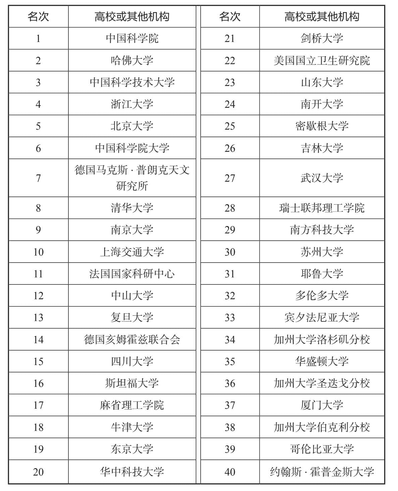
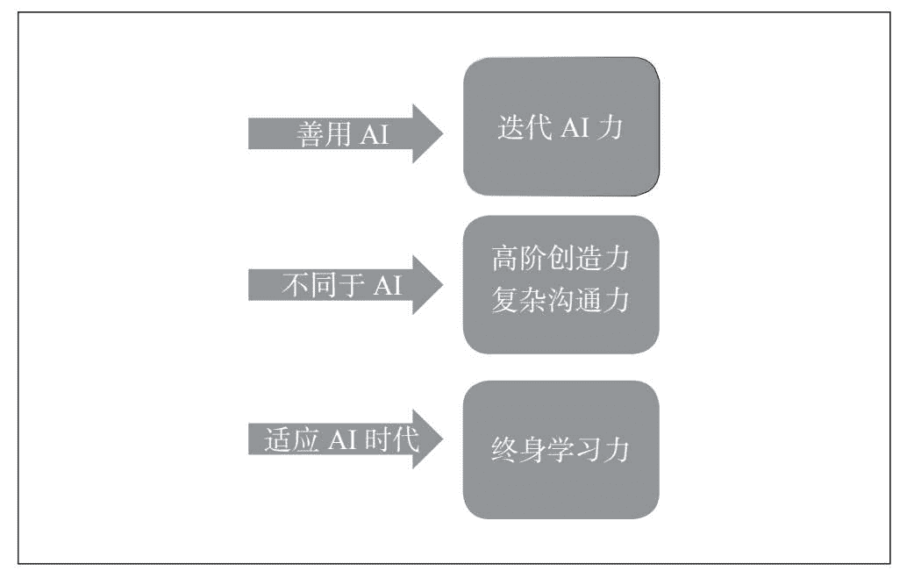
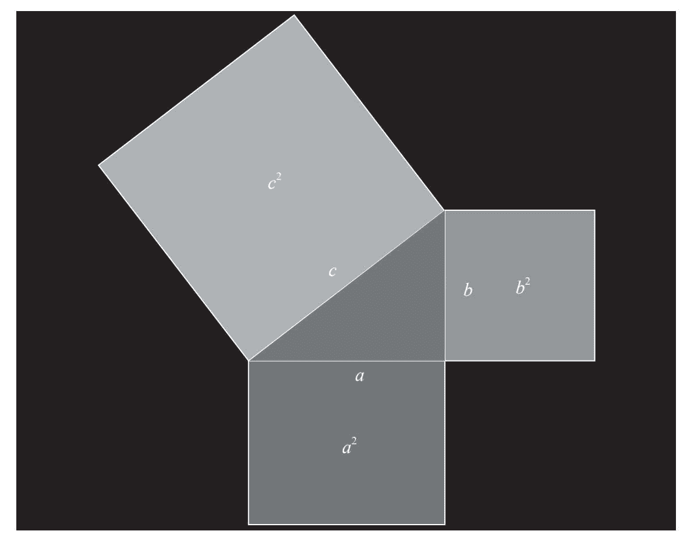
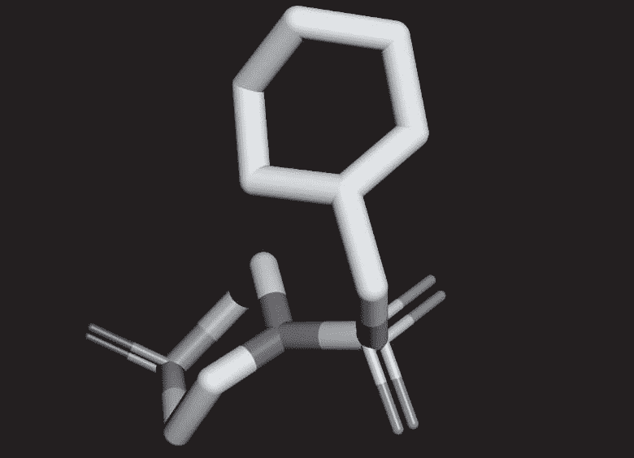

# AI 重塑教与学
# 推荐序 教育的恒常与智能的迭代

俞敏洪

新东方创始人

新东方教育科技集团董事长

在新东方这些年，我常对管理者说要主动求新，跟上时代甚至引领赛道。教育始终是我最放不下的牵挂。所以当晓飞把《AI 教育革命》的书稿递来时，我既有兴奋也有欣慰。二十二年里，我看着他从讲台上的任课教师，成长为深耕教育研究的实践者，从传授知识点转向不断追问教育本质，对这份事业的赤诚从未改变。这部著作是他把二十年教学积淀与生成式智能浪潮深度融合的结晶，字里行间既有对教育规律的敬畏，也有对时代变动的敏锐判断，更带着对中国师生的真诚关怀。

生成式智能的爆发式演进正在改写我们熟悉的世界。从 GPT-4 的走红到 DeepSeek 等国产大模型的崛起，从无人系统的惊艳亮相到智能体走进千家万户，我们切实感受到 AI 被定位为引领新一轮科技革命和产业变革的战略性技术的分量。教育作为传承文明、培育人才的核心场域，必然无法独善其身。

这些年我走访了大量校园，看到焦虑的家长和迷茫的教师。家长担心孩子被智能替代拼命报班；教师在传统课堂与新技术融合间徘徊；孩子则在智能便利与学习艰辛间摇摆。这种焦虑的根源是对 AI 时代该培养何种人才、如何教、如何学的不确定。晓飞的书正为这些困惑拨开了迷雾。

最令我触动的，是他对教育变与不变的洞见。作者认为智能时代的教育不是推倒重建，而是在坚守教育本原的前提下顺势而为。扎实的学识根基、良好的品格修养、健康的社会交往能力，这些经时间检验的核心，在 AI 时代仍是孩子立足的根本。犹如中国基础教育的严格训练造就了一代代底座扎实的人才，让中国在全球 AI 人才版图中占据半壁江山，对基础素养的重视永远不过时。面对由智能带来的就业重构，孩子要应对三层角逐：与同龄人比拼根基、与智能体比拼差异化、与会用智能的人比拼工具力，更需要以坚实底座作支撑。

同时他也清醒指出必须变革的方向。智能让规模化、个性化、专家级三合一的教育理想成为可能，因材施教不再是少数人的特权；兴趣教育的价值被极大放大，对事物的热忱成为摆脱平庸、抵御替代的核心动力；迭代智能力、高阶创造力、复杂沟通力、终身学习力这四项能力，为人才培养指明了方向。这种守正创新的智慧，既避免盲目崇拜技术，也摆脱故步自封，堪为应对变局的关键。

在方法层面，思考同样扎实。他提出从记忆思维到实践思维、从答案思维到过程思维等四大转型，直指当下痛点；倡导项目式学习、总结复盘、刻意练习等路径，既有脑科学依据，也有丰富案例支撑；对智能教育工具的梳理与应用建议，为教师和家长提供了可操作的参考。书中没有空洞说教，而是融入中外案例、新锐成长故事，以及作者本人二十年的实践感悟，读来生动有启发。

教育是需要耐心与敬畏的农活，但在智能时代也需要信息级的精准与效率。这本书架起了理想与现实的桥梁。它告诉我们，智能不是教育的对手，而是助其回归本原的工具。智能可承担重复性教学，让教师把更多时间放在孩子的情感与成长上；智能可规划个性化学习路径，让每个孩子按自身节奏进步；智能可打破资源壁垒，让偏远地区孩子也能触达优质资源。

作为深耕教育三十余年的从业者，我始终相信教育的核心是人。智能能产出答案，却传递不了情感；能给出方法，却替代不了陪伴；能复制知识，却培育不了品格。作者反复强调，教育者的使命是点亮孩子，培养社会情感技能，帮助每个孩子找到热爱与人生方向，这与新东方以人为本的理念一致。

当下中国教育正处大变局，双减深化、智能普及、就业市场变化都在重构教育模式。《AI 教育革命》的出版恰逢其时。它不仅为家长和教师提供了应对变局的导航图，更传递出理性与从容的态度：不必惧怕智能挑战，也不必盲目追捧技术，只要把握教育本质，培养孩子善用智能且不同于智能的核心能力，就能在未来竞争中立于不败。

晓飞在新东方的二十年，是中国教育快速发展的二十年，也是他个人教育理念沉淀的二十年。这本书既是他成长的缩影，也是中国教育人应对时代的思考。我相信每位翻开此书的家长和教师，都能获得启发，找到自己的教育答案。

教育的路上，我们都是同行者。愿我们都能以开放心态拥抱智能，以坚定信念坚守教育本真，让每个孩子在智能时代绽放独特光芒，拥有选择人生的权利与能力。这既是作者写作的初心，也是我们所有教育者的共同追求。

是为序。

2026 年 1 月 10 日于北京

# 前言 在智能浪潮中保持从容

进入二十一世纪的第三个十年，社会节奏在加速：先有新冠疫情与双减政策对经济和教育带来的深远冲击；随后 2023 年 GPT-4 的优异表现掀起新一轮智能热潮，苹果、亚马逊、谷歌、微软、脸书、特斯拉和英伟达等与智能相关的美股七巨头成为全球资本市场的明星。

2025 年春节假期，杭州六小龙引发全国热议，DeepSeek 推动美股和 A 股重新估值，不少杭州人惊讶地发现，自己生活的城市正从电商之都转向中国硅谷。

2025 年 9 月 3 日，纪念中国人民抗日战争暨世界反法西斯战争胜利 80 周年大会在北京举行，无人战斗机、无人战车、无人艇、机器狗等大量智能装备亮相，让人有身处科幻世界的感觉。

科技是第一生产力。当下和未来的根本性变化来自 AI 科技的突破与普及。

2025 年，中美智能研究专家普遍指出，中国在 AI 大模型发布数量上正快速追赶美国，尤其在开源领域。DeepSeek、阿里巴巴通义千问等大模型在性能上与西方顶尖模型的差距在缩小，部分基准测试中甚至更优。多位专家和企业领袖一致认为，2025 年是中国 AI 应用大规模落地的元年，此后智能体将进入工作、学习和生活各场景。

基于对智能发展现状与潜力的判断，中国决策层在 2025 年 4 月作出新判断——“人工智能作为引领新一轮科技革命和产业变革的战略性技术，深刻改变人类生产生活方式”[[1]](#0004.xhtml_1c5757c07f76caa069cb0c433d166b30)“人工智能技术加速迭代，正迎来爆发式发展”[[2]](#0004.xhtml_7fa70c788a11122aacc59fc1b354d393)。

这一判断在中国十分少见，其重要性堪比 2008 年决策层关于信息技术快速发展的战略性论断。2008 年后，中国的计算机、互联网、移动互联网、5G、云计算、区块链、虚拟现实、增强现实等信息技术高速发展，十几年间完成国家信息化，经济实力大增，生产生活方式包括教育模式都发生了明显变化。

决策层判断下一轮技术革命将爆发在 AI 领域。[[3]](#0004.xhtml_81cbd83e18aa3fd77280bb3939227338)预计今后国家将集中海量资源投入这一颠覆性战略技术，鼓励创新，加速智能在各领域的落地，带动中国生产力新一轮跨越。

## AI 冲击下的就业新格局

由于在新东方工作，近年来我为多所高校学生做过分享，并在担任青年联合会委员期间多次参与青年大讲堂，与大学生交流学习与就业困惑。也担任多所高校的职业规划导师，希望以所见所闻帮助青年学子。

2025 年智能的突破，让各界意识到新一轮就业革命已到来。年轻人对时代变化敏感，也隐约察觉到这一点。2024 年以来，我每次走进高校，学生普遍提出类似问题：面对 AI 高速发展，大学期间如何提升就业能力？所学专业对未来就业有何影响？未来岗位需要怎样的能力素质模型？他们感到迷茫。

2022 年，中国高校毕业生人数首次突破 1000 万，此后大学生就业难的讨论持续升温。按历年出生人口推算，2043 年后高校毕业生数量才可能跌破 1000 万。就业是民生之本，未来十几年中国社会最大压力之一是就业压力，这比老龄化更紧迫。

以 AI 为代表的第四次工业革命将催生高竞争力新产业和高薪岗位；但智能创造岗位的同时也在消灭岗位，将带来长期就业压力。2023 年底中国就业总人数为 74 041 万，2024 年底为 73 439 万，一年减少 602 万，部分原因是 60 后退休，部分原因是科技进步提升效率导致技能不足者难以就业。

过去大学生就业难，主要是同龄人竞争有限优质岗位。随着 AI 快速进化普及，新一代劳动力将面临三重竞争：
1. 继续与同龄人竞争，比拼基础能力与素质；
2. 与 AI 竞争，要么比其更优，要么差异化竞争；
3. 不擅长使用 AI 的人与擅长使用 AI 的人之间的竞争。英伟达 CEO 黄仁勋说：“你不会因为 AI 而失业，但会因为会使用 AI 的人而失业。”

学校、家庭和社会的责任是，让孩子获得足以应对这三重竞争的能力素质，成为智能时代需要的人才。

## 就业洗牌中突围的两类人才

近几年国内外科技和教育专家纷纷提出未来人才核心素质的看法。麻省理工学院计算机博士、《深度工作》作者卡尔·纽波特[[4]](#0004.xhtml_cb40ddd287e815d42e6621add9d26a29)的观点值得重视，他认为三种人将在新形势下获得优势：一是利用 AI 把工作做得漂亮且有创造性的人；二是所在行业中顶尖的人才；三是拥有资源的人。

第一类和第二类，正是教育面向智能时代的人才培养方向。

第一类人才能应对第三类竞争，他们能用最强生产工具极大提升生产力，与不擅长用 AI 的人拉开差距。例如 2023 年 5 月华为西安研究所举办软件大赛，参赛者被鼓励使用 AI。尽管赛题难度翻倍并增加专业挑战题，仍有 8 位参赛者借助智能工具拿满分。更令人惊讶的是，上一届冠亚军未使用大模型，本届冠军成绩排到 170 名，亚军排到 450 名。软件开发已从数字化迈向智能化。华为云软件开发工具链 CodeArts 实现研发全流程智能化，编码环节在读、写、调、测、查均可智能辅助，AI 代码采纳率达 35%。2025 年，美国脸书、谷歌等顶级科技企业的编程工作已有 20%~50% 由 AI 完成。

第二类人才能应对前两类竞争，不仅能在同龄人中胜出，也能在与 AI 的竞争中胜出。不少专家指出 AI 无法取代行业顶尖人才。Meta 首席 AI 科学家杨立昆指出，当前大模型基于自回归预测机制，即猜下一个词或符号，这是概率而非真正理解规律，永远无法超越人类智能。现有 AI 不仅不能触类旁通，而且举一万才能返三。对未训练过的事，AI 难以回答；对小概率事件，AI 应对不佳。这是其固有缺陷。

明白 AI 本质，就能理解为何资深从业者会感慨：AI 能模仿文字，却永远无法替代真实行业经验和思考深度……在 AI 时代，你的专业深度是最强竞争壁垒。

AI 可以给出 2 万字分析，却得不出 3 句话的洞察；其天花板在于无法像真正高手那样给出有价值洞察——看懂现象背后的本质，指出关键。要想立于不败之地，就必须成为能产生敏锐洞察、具备真正见识的行业高手。他们因 AI 赋能摆脱重复劳动，学习能力增强，工作效率提升，认知范围扩大，洞察力得到更好发挥。

关于适应未来的人才，DeepSeek 创始人梁文锋的判断与卡尔·纽波特相近。他招聘时被问必卡条件，回答：“热爱，扎实的基础能力。其他的都不那么重要。”热爱和扎实基础能让人成为行业顶尖。

DeepSeek 研发人员多为清华、北大、浙大、南大、中科大等名校的年轻毕业生或在读博士，他们多在奥林匹克数学或编程竞赛中脱颖而出，聪明、学习力强、对 AI 技术潜力充满热爱，自驱力强。

热爱和扎实的基础能力在 AI 时代如何发挥？以程序员为例。当前 AI 编程工具虽能生成代码，但大语言模型存在根本局限：缺乏对现实因果关系的理解，且常出现事实幻觉，缺乏自我纠偏。对非专业人士，他们难以将复杂任务精准拆解为 AI 可处理的子任务，也缺乏代码审查能力，无法识别逻辑谬误和技术幻觉。

程序员的核心竞争力正从基础代码编写转向系统架构设计与复杂问题抽象。满足于机械编码的执行者将面临淘汰，AI 编程倒逼程序员从技术执行层跃升至系统决策层。未来程序员的核心价值取决于驾驭 AI 实现复杂创新的能力，而非编写基础代码的数量。

没有扎实基础，就读不懂 AI 生成的复杂代码，看不出漏洞；而热爱编程的人会用工作时间和业余时间不断提升，让自己顺利实现从代码编写到架构设计的跃迁，从事更高层次脑力劳动。因为能用 AI 放大创造力，他们不仅是行业顶尖人才，也是能利用 AI 把工作做得漂亮并有创造性的人，将获得巨大时代红利。

## 未来人才图谱：教育何变何不变

从事教育二十年来，我和其他老师一直在研究面向未来的人才素质模型。出于工作原因，我曾在南京、天津、厦门、杭州任职，四地都高度重视教育与科技创新。近十年来，我们走访了不少世界名校，访谈留学生和全国多所高校优秀学生，考察成长历程、思考维度与未来规划，收集并分析大量师生案例。

多年一线调研与访谈带来许多启发，结合杭州六小龙等新一代科创企业案例，我对未来人才素质模型有了初步轮廓。这些年我也在思考：在极速变化的时代，教育的哪些面向始终不变？哪些必须变化？随着人才模型逐渐清晰，答案也开始显现。

第一，扎实的基础能力。杭州六小龙创始人均受益于中国严格的教育模式；不论硅谷、深圳还是杭州，AI 科创企业领军人物都是基础扎实的学霸；熠熠生辉的人文社科英才也都具备海量知识储备，为思考力和表达力奠基。扎实的基础能力对应严格的教育训练，在未来仍是不变的。

第二，被自己的热爱驱动。一个人不是学霸，也可因热爱变得不普通。宇树科技创始人王兴兴未就读顶级名校，却因对机器人的浓厚兴趣自学打下扎实基础，拥有世界一流创造力。在情绪经济时代，能玩出名堂的非学霸，也可让自己在该领域超越同龄人和 AI。当热爱变得重要，个性化兴趣教育地位需大幅提升，这是未来教育的一大变化。

第三，擅长利用 AI。DeepSeek 创始人梁文锋自不必说，《黑神话：悟空》制作人冯骥、哪吒系列导演饺子，也用 AI 极大提升了游戏、动画的制作效率与效果。AI 将与工业、农业、政务、教育、养老、医疗、文娱、软件、信息、金融、商务、法律、交通、外贸等领域深度融合。在 AI 无处不在的未来，擅长利用 AI 就像今天擅长使用互联网一样，是基础能力。国家正在部署的 AI 教育，将再造教育与学习的基本面貌，实现大规模因材施教，这是未来教育的最大变化。

## 本书的架构思路

本书方向篇探讨 AI 时代的教育方向。我综合了在教育行业二十年的案例与经验、人才培养理念，以及 AI 技术与产业新趋势，围绕面向未来的人才素质模型展开论述。

第一章主题是基础教育。严格的基础教育，德智体美劳全面发展，能培养扎实的基础能力和素质，在 AI 时代依然意义重大。文科死记硬背、理科熟练套用解题套路，并不算培养扎实的基础能力。天下武功，唯快不破，深刻理解公式、定理之后的快，既能应对中考、高考，也有助于孩子长远发展。真正掌握逻辑演绎和实验试错这两个最重要的科学方法论，不仅对高考有用，在今后工作中也大有帮助。

第二章聚焦兴趣教育。通过梳理科学大师与科技新锐的成长路径，文章讨论了在人工智能时代热爱的重要性，借助脑科学的视角剖析热爱对个人成长的促进机制，并给出家长实施个性化兴趣培养的具体思路。成绩优异不是唯一的成功标准，普通孩子同样可以依托自己的热爱找到长远出路，比如热衷生活记录和非遗手艺的李子柒，她既赢得大众喜爱，也成为推动中华传统文化走向全球的标志性人物。

第三章的主题是人工智能教育。随着大模型能力的快速提升，实现规模化、个性化与专家级并存的教育理想变得更可行。AI 教育主要落到三个维度上。

• 把人工智能作为课程内容纳入教学体系，让学生在智能化社会中拥有基本的竞争力，这是技术重塑教育的首个切入点。
• 教师、家长、学生三方共同使用人工智能，做到因材施教，驱动知识学习的个性化，用更低成本筑牢基础。学习效率提升后，孩子才有时间进行个性化的兴趣探索，这体现了技术改变教育的另一面向。
• 从能力结构看，针对 AI 的优势与局限，要培育既会善用 AI 又拥有机器不具备的特质的人才，核心归纳为“四力”：迭代 AI 力、高阶创造力、复杂沟通力、终身学习力。

总的来说，方向篇要回答的是：什么样的教育能够造就所在行业的顶尖人才，培养出能借助人工智能把工作做得精致且富创造力的人，从而兼具就业能力并分享智能时代的红利。

本书中，方向篇讲的是教育和学习的指向，即做正确的事；方法篇讲的是教育和学习的操作，即正确地做事。

方法篇的第四章谈智能时代怎样学习。在第三章的基础上，进一步细化四项能力的养成路径。章节以脑科学原理和陶行知先生的创造教育思想为基础，强调四力需要在持续实践中不断提升。

第五章探讨智能时代如何教学。总结出教育者需完成的四次转型：从记忆思维转向实践思维，从答案思维转向过程思维，从工具思维转向团队思维，从成绩思维转向人本思维。对教学转型感兴趣的家长和教师，可以参考这四个转型的思路和方法。

## AI 时代的教育变革全景图

书稿完成后，回溯我在新东方二十年的工作轨迹，发现一直围绕本书所说的几个方面展开：一是知识教育，帮助孩子打下扎实基础；二是兴趣教育，培育孩子的热爱；三是人工智能教育，涵盖少儿编程、机器人和科创，并不断探索如何借助 AI 工具提高教学效率和学习效果。

人工智能的快速发展带来巨大机遇，同时也伴随对就业、社会乃至地缘政治的潜在冲击。对于身处这场变革中的每个人和每个组织而言，理解并适应 AI 带来的变化，是未来生存和发展的关键。

俞敏洪老师近年来与许多企业家深入交流，对各行业的智能化与无人化趋势有较深认识，他指出：“若沿用传统思路培养传统人才，即便能力很强也会面临挑战……当下教育工作者必须思考：在人工智能和网络大数据时代，教育和社会真正需要什么。只有把握未来，教育才不会落后。”

曾任北京十一学校校长的李希贵老师认为，人类文明本质上是教育与技术的竞赛。当教育的推进速度能追上甚至超过技术时，学校所学可以应对技术带来的社会变化，人们会更从容；反之则会产生焦虑。

本书的撰写受益于我在新东方二十年的实践沉淀，以及对 AI 专家、教育专家的访谈和对教育发展趋势的研读。AI 技术将如何推动教育革命，目前学术界和产业界尚未达成一致。本书仅作初步探索，尝试描绘“AI 时代的教育变革全景图”，为家长和教师提供参考与启发，缺点之处恳请批评指正。

[[1]](#0004.xhtml_8b3f38a4c399e90be62ea5ced8449624) 新华社. 习近平在中共中央政治局第二十次集体学习时强调：坚持自立自强 突出应用导向 推动人工智能健康有序发展.［EB/OL］.（2025—04—26）．https://www.gov.cn/yaowen/liebiao/202504/content_7021072.htm.

[[2]](#0004.xhtml_3666892a0ba94c0b454ab1bcc8038ccb) 央广网. 时政微观察丨来到这个“社区”，总书记再谈人工智能. ［EB/OL］.（2025—04—30）． https://news.cnr.cn/native/gd/sz/20250430/t20250430_527154897.shtml.

[[3]](#0004.xhtml_a330ef4e7307f84b0c6bd5242e6fee1b) 2015 年，国务院发布了文件《关于积极推进“互联网+”行动的指导意见》，此后，移动互联网彻底改变了中国商业。2025 年 8 月，国务院再次发布重要文件《关于深入实施“人工智能+”行动的意见》。财经界普遍认为，十年一遇的重大发展机会已经到来。

[[4]](#0004.xhtml_da648cc87cfd15672c9f11204e09697b) 卡尔·纽波特是乔治城大学计算机科学副教授，还是一位“人气博主”。他创办了在美国广受欢迎的博客“学习黑客”，致力于为大家破解工作和学习领域的成功模式。纽波特还著有《如何在大学里脱颖而出》《如何成为尖子生》《如何考进世界顶尖名校》《优秀到不能被忽视》等畅销书。

# 方向篇 做正确的事：AI 时代教什么学什么

全球人工智能领军人物、斯坦福大学教授李飞飞说：AI 不是普通工具，“AI 是文明级的技术”。

教育是文明的核心领域，正在时代变革的中心。智能时代需要重新评估教育价值，明确未来的大方向：哪些教育不可动摇，哪些教育需要革新。

# 第一章

# 基础培养：智能时代的不变项

《易经》告诉我们，在变化的世界里要把握不变的事物，以此建立战略。那么未来中国教育的不变点是什么？在智能时代，哪些素质和能力仍然熠熠生辉？

2024年底至2025年初，全球首款第六代战机、DeepSeek 大语言模型、宇树科技人形机器人、原生鸿蒙操作系统等顶尖技术集中亮相；科技含量很高的《哪吒之魔童闹海》进入全球票房前五，拿到全球动画电影票房第一。不少人感叹，春节前后仿佛过了整整一个世纪。突破的高密度，让中国人对科技自主创新的信心明显提升。

这些世界级高科技的带头人，正是卡尔·纽波特所说的“所在行业的顶尖人才”，他们均出自中国本土教育体系。中国现行的严格培养方式有助于形成梁文锋所说的“扎实的基础能力”。扎实的基础能力是工业时代和互联网时代优秀人才的核心素养，在智能时代依然如此，这是教育不变的方向。

当前 AI 创造经济价值最直接的功能是写代码。高水平程序员能识别“AI 幻觉”，稍加调整就能用；中等水平程序员能发现问题却解决不了；水平更低的程序员根本没意识到程序存在严重缺陷，“直接开跑，完蛋”。

用 AI 写文章也存在同样的问题。所以在智能时代，程序员和其他知识工作者的门槛反而提高了。知识工作者在借助 AI 提升效率的同时，必须拥有从第一性原理出发分析问题的能力，以及迅速分辨真伪和幻觉的能力，这些能力都建立在扎实的基本功之上。

# 为什么部分西方教育开始向东亚学习

2009年，上海代表中国首次参加 PISA 测试，便夺得阅读、数学、科学三科第一，超过“教育明星”芬兰，被伦敦大学教育学院[[1]](page_4_split_6.xhtml_9a4f22fddeeba31c73cd326dac9c3d15)的学者称为“上海奇迹”，打破了西方对中国基础教育“死记硬背”的刻板印象。

## 国际学生能力评估，中国保持优势

评价各国教育优劣需要客观指标，PISA 被广泛视为“黄金标准”。PISA 考察阅读、数学和科学，参与者为 15 岁学生，相当于中国初三或高一。

中国2009年的优异成绩并非偶然。2012年成绩再次引发关注。2018年测试里，中国内地数学 591 分排名第一，第二名新加坡 569 分，澳门、香港、台湾位列三到五名。排名第20的德国500分，美国478分排第37。

科学榜单上，中国内地 590 分第一，澳门、香港、台湾以及同属儒家文化圈的韩国、日本都进入前十。美国 502 分排第18。阅读方面，中国内地 555 分夺冠，美国 505 分排第13。

儒家文化圈的教育模式相近，中国、日本、韩国、新加坡在 PISA 上表现突出，而英美等国相对平淡，这促使部分西方国家教育改革“向东看”。

浙江大学博士研究生李玥忞在论文《中国基础教育跨国吸引力的研究——基于242份英媒 PISA 文本的分析》中梳理了英国改革历程。英国教育部 2010 年《教学的重要性》白皮书提出，要实现世界一流教育，首要做法是学习他国先进经验。在 PISA 榜单的指引下，融合中国文化与教育经验的上海数学课程进入英国政策制定者的视野。

2014年4月，中英两国签署《中英双方关于数学教师交流的谅解备忘录》。备忘录规定英国选派优秀教师来华学习、观摩培训，并邀请中国教师赴英交流执教，经费由英方承担。这是西方“向东看”中最具规模、最具级别的一个典型案例。

## 中国人才在全球AI领域占半壁江山

未来是智能社会，AI 技术与产业水平决定国家竞争力。再来看 PISA 成绩优异的中国学生在 AI 领域的全球竞争力。

2025年2月，马斯克的 xAI 发布 Grok 3 模型时，C 位上的是两位华人科学家。该公司 12 位创始人中有 5 位是华人，包括浙江大学毕业的张国栋和清华大学毕业的戴子航。Grok 4 团队作战图显示约 80% 成员为华人面孔。

华人成为 AI 研发主力在美国已是常态。美国芝加哥保尔森基金会下属智库麦克罗波洛分析指出，2022年，美国公司与研究机构的顶尖 AI 人才中 38% 来自中国大学，超过来自美国大学的 37%。斯坦福大学教授李飞飞、微软 AI 首席科学家邓力是典型代表。

更惊人的是，麦克罗波洛智库最新报告显示，2022年全球顶尖 AI 研究人员，即 NeurIPS 入选论文作者中，47% 在中国接受本科教育，在美国读本科的仅 18%，欧洲 12%，信息技术大国印度仅 5%。可以说全球顶尖 AI 人才来自“两个国家”：中国和“外国”。

除了人才，AI 产业实力高度依赖互联网产业实力，中美几乎瓜分全球互联网市场，形成了“全球 AI 竞争就是中美之争，中美 AI 竞争就是在华中国人与在美中国人之间的智力竞赛”的判断。

美国布鲁金斯学会分析指出，中国 AI 人才优势与数学教育密切相关，尤其是线性代数。2020—2023 年，AI 连续三年成为中国最受欢迎专业；College Transitions 网站 2025 年数据显示，美国最受欢迎本科专业仍是商科，华尔街金融公司仍是名校生的首选。

知识经济时代，国家竞争最终是人才竞争。中国理工科硕士约占全球一半，博士约占三分之一，与 2023 年中国工业产值占全球 35% 相匹配。

2024 年中国理工农医类博士招生继续增长，总数超过 12 万人，是美国的 3 倍以上，超过西方各国理工农医类博士招生的总和。美国国家科学委员会报告显示，2020—2023 年大多数八年级学生数学成绩未达标，称之为“STEM[[2]](page_4_split_6.xhtml_84c38eacf84660e1278f62ec914aa308)人才危机”，呼吁改善 STEM 教育。

## 中国科研实力攀上高峰

中国培养了这么多博士，科研实力怎样？自然指数是一个公认的客观指标，通过统计高校、科研机构在 145 种顶级研究型期刊上发表论文的数量来评估科研表现。

2012 年自然指数中国排全球第六。[[3]](page_4_split_6.xhtml_5991a708d8aadc734b8ccc6d48de0444)2014 年跃居世界第二。2023 年中国首次超过美国。

2025 年自然指数 50 强中，中国占 24 个，集中在前 20；美国 17 个，多在 20 名之外（见表 1—1）。

我的母校南京大学 2025 年排名世界前十。南京大学前身是国立中央大学，1928 年设有文、理、法、教育、农、工、商、医八个学院，是当时院系最全、规模最大的大学。南京大学在基础学科的贡献很大，尤其是物理、化学；计算机专业在 2025 年 QS 世界大学学科排名中位列全球第 80。

表1—1 2025年自然指数榜单

南京大学基础学科的深厚积淀，为人工智能提供了坚实基础。2024 年软科中国大学排名中，清华大学、上海交通大学、南京大学位列人工智能前三；校友会 2024 年排名中，南京大学居中国高校第一。

2025 年初，南京大学人工智能学院 LAMDA 组相继获得电子设计自动化领域顶级会议 DATE 2025 最佳论文奖，以及人工智能顶会 AAAI 2025 杰出论文奖。2025 年 4 月，南京大学校友、美国布鲁克海文国家实验室研究员尹伟国团队利用 OpenAI o3 大模型，解决了凝聚态物理领域悬而未决 50 年的数学难题。2025 年 5 月，南京大学成立机器人与自动化学院，聚焦智能感知、自主决策、精密控制等“卡脖子”技术。

南京大学的案例说明，基础学科和基础能力在未来是“变化中的不变”。

中国高校在自然指数上“霸榜”的背后，是理工科人才数量和质量的持续提升：中国“80 后”接受高等教育比例约 29%，“90 后”达 35%，“95 后”达 45%。随着受更好教育“00 后”“10 后”逐步进入科研岗位，中国自然指数的表现会更出色。

数学被誉为“科学的皇后”，凸显其基础地位。2024 年，上海“90 后”女数学家王艺霖获得塞勒姆奖；2025 年初，三位华人数学家参与破解三维挂谷猜想、狭义希尔伯特第六问题等重要难题。

35 岁以下青年数学家的集体崛起，是中国数学教育“本土培养+海外淬炼”模式成果的体现。2025 年初，数学大师丘成桐推出新书《我的教育观》，乐观预计 2030 年后的中国数学将具备世界顶尖实力。

无论是中学生国际竞赛、AI 人才竞争力，还是高水平论文与高素质工程师队伍，中国教育都有出色表现，中国教育究竟做对了什么？

# 严格培养：中国科技爆发的内在逻辑

爱迪生改进白炽灯的故事大家都熟悉，为寻找合适的灯丝他试验上千次耗时数年。当代科研创新的复杂度远超当年，反复试验与失败是常态。科研并不浪漫，“能承受枯燥、重复、失败和压力，有每天十几个小时持续工作的毅力，这是搞科研的前提”。

## 严格教育为何利于科技创新

理工科的想象力建立在扎实基础之上，具有可实现性，必须以理性思维、科学训练和丰富经验为支撑。

一方面，中国的严格教育模式让学生把数理化生的基础打牢。中国工程师队伍规模超过西方七大工业国的总和，得益于此基础，支撑中国在几乎所有工业领域达到世界一流水平。

另一方面，中考、高考和考研层层筛选出适合科研创新的顶尖人才。他们不仅聪明，还在多年学习中养成了反复演算的习惯，能忍受寒来暑往的枯燥，在千百次失败后仍坚持下去，为理解复杂系统和解决工程难题奠定基础。全球范围内，中国理工科学生继续深造、攻读博士的比例最高。[[4]](page_4_split_6.xhtml_69fa05d642104c926213f9205640623e)扎实的功底帮助他们快速吸收新技术、解决新问题。正是不懈努力，让中国的自然指数超过美国，让中国不断突破硬科技“卡脖子”环节。

2023年，《黑神话：悟空》制作人冯骥在公司大群发文，体现了创新者的钻研精神：

唯一重要的是继续前进，是以平常心和认真的劲头日复一日解决枯燥、困难、琐碎的具体问题，永无止境，永不自满，这是做事最难的地方，但也是最浪漫的地方。最浪漫的地方就是每天做具体的事，做具体而且困难的事情，然后不要觉得自己的成绩达到了什么样的高度，永远这样，直到死在路上。

华为为什么能长期站在科技第一梯队？背后是一支大约二十万人的队伍，绝大多数成员都走过中国完整的教育体系。2018 年 3 月，任正非在内部刊物《华为人》上写过一篇《熵减》，用一口水讲透了学习的本质。

水从高原流向大海是自发的能量释放，一路欢快。把水抽回高处则需要水泵硬推，叶片高速旋转把水往上打，管子里会传来呻吟。任正非说，那声音像孩子在喊：“妈妈我不要练琴”“我想多睡会儿”“我不要被叶片舅舅打”。人的成长也是如此：幼儿园认字弹琴，小学算数学，中学背历史物理，一路读到本科硕士博士，考前通宵。毕业后再被 ABC 考核、末位淘汰挤压。熵减的路程很痛，但不走这条路，熵增的代价更痛。没有来生重来一次。

从这个视角看，质疑中国教育“刷题”“死记硬背”的声音其实把手段当成了目的。没有思考的机械刷题当然无效，但刻苦训练本身就是任正非所说的熵减之道。过去数理基础和踏实态度是技术门槛，到了 AI 时代，它依然是多数国家跨不过去的门槛。

中国长期坚持科教兴国，需要政府和民众持续投入，很多发展中国家模仿不了。表面看有些国家高等教育普及率高，实则非理工专业占比畸高，例如越南高校大量低成本文科。菲律宾的社区大学就占全国高校总量的四成左右，水平更接近中国的中专夜校。

## 从应试严管到快乐放养，美国教育怎么变了

中国现在倡导的“素质教育”，本质上指向的是美国的精英教育。分数只是底线，像谷爱凌那样在学业之外有突出素质，才算真正的高标准。这种水准只有顶尖家庭和学校才能托举。

今天大多数美国家庭和学校流行的却是“快乐教育”。孩子没学会也不要求，反过来安慰“你真棒”“是书本问题”“不学了”。好孩子本应得到针对性的鼓励，但无脑表扬会让孩子失去耐性，宁愿踢球唱歌。

一旦连中学的知识都理解不了，就坐不稳科研岗位。美国制造业招工难，很大程度上就是候选人缺乏认真负责和迎难而上的工作习惯。

2025 年 1 月，特朗普在行政命令中点名：70% 的八年级学生阅读能力不足，72% 的八年级学生数学能力不足。能熟练用勾股定理的八年级生，在美国已能排进前 30%。

特朗普认为教育失守正在削弱竞争力。事实上，奥巴马上台前，美国的主流方向是强调成绩的严格教育。

1957 年苏联卫星上天，美国反思教育失败。直到 80 年代初质量仍不见起色。于是里根、老布什、克林顿、小布什四届政府都把基础教育加码。

1996 年第二次教育高峰会上，克林顿支持“高标准、严要求”，他说如果标准是有道理的，就不要怕被指责残忍不公。各州制定标准还必须配套考试，考试不是只测最低要求，而是衡量学生掌握了多少。没有考试，高标准就是空话。

2001 年美国把标准化测试与问责挂钩，按分数决定校长去留乃至学校关闭。2002 年《不让一个孩子掉队法案》要求到 2014 年所有学生英文数学都达到精通。白人和亚裔受教育水平高，其他族群差距太大，目标无法完成。少数族裔掌握选票后，多州放弃了以成绩为核心的执行。

转折点在奥巴马政府 2015 年签署的《每一个学生成功法》。从此政府不再对学习成绩做要求，也不考核学校效果，只要孩子感觉快乐。美国基础教育从过度严苛一头栽进了散漫迎合的极端。

2024 年 12 月，亿万富翁拉马斯瓦米在 X 上长文指出，如今顶尖科技公司高薪聘用外国工程师，不是美国人智商低，而是从 90 年代起美国文化就推崇平庸而非卓越。人们更爱舞会皇后和运动员，却不敬数学奥赛冠军。学生应该多读书多参加科创竞赛，而不是泡在情景喜剧和派对里。

普通家庭走快乐路线，精英家庭坚持严苛，这就是美国教育的分裂。精英能支撑互联网、AI、生物医药等高科技，却提供不了成百上千万的优秀一线技术工人，这十年美国制造业衰败的深层原因之一。

2025 年，因《虎妈战歌》饱受争议的华裔学者蔡美儿重新被美国中产追捧，支持虎妈的人在增加。

芬兰常被拿出来说事。芬兰在校时间全球最短，但快乐与严格并不矛盾。芬兰社会共识是教育至关重要。新入职教师高中成绩多在全校前三分之一，自 70 年代起小学及以上教师必须有硕士学位，很多老师还读博士。实习教师都有资深导师带教。孩子学习过程放松，但对学习的态度是严肃的。纯粹快乐教育取得成功的国家，到现在还没有出现。

## 承认严格教育的价值，是改革的前提

新中国七十多年推行全民教育，重理工，“学好数理化，走遍天下都不怕”。港澳台、新加坡、韩国、日本模式与大陆相近，都以科教发达和产业竞争力著称。

纪录片《他乡的童年》导演周轶君走访十国后发现，教育模式扎根于历史文化，它定义了一个国家对公民的期待。

新加坡小学的标语写着“新加坡是我们的家”。人均资源匮乏，只能靠人力资本，这正是儒家文化圈国家的处境，也是东亚严格教育的土壤。

截至 2025 年 6 月，美国四大芯片巨头 CEO 均为华人：英伟达黄仁勋、AMD 苏姿丰、博通陈福阳、英特尔陈立武。这再次印证了严格理工教育的优势。有人评论，当下先问技术再谈领导力，能否吃透技术已成为门槛，STEM 仍是最有效的世界观之一。

海量的专业技术人才是先进制造业的关键。中国高度重视制造业，避免经济空心化，就必须汲取教训，不走快乐教育的老路。在中国文化里，学习是一种道德责任。

严格教育也关乎公平。中国高考生规模堪比一个欧洲国家人口，需要公平透明的上升通道。

2025 年 3 月新东方家庭教育论坛上，清华大学刘嘉教授在对话俞敏洪时说，高考可能是中国教育体系里最好的制度。它给农村孩子机会。若像哈佛、麻省理工那样看重课外实践和海外经历，穷人家庭能送孩子出国游历吗？苦读考试让阶层跨越成为可能，这是高考最有价值的地方。

因此研究教育改革，必须先承认现有体制的合理性，这由中国有教无类的传统、追求公平的底色和资源禀赋共同决定。快乐教育、刷题、死记硬背、小镇做题家，这些标签只是描述方法或阶层，未触及学习意义。基础教育的核心始终是基本素质和能力的培养。

# 扎实基本功：AI 时代的抗幻觉能力

中国严格教育带来终身受益的素养：扎实基础知识、认真细致的习惯、良好的自律与抗压能力。在人工智能时代，这些依然重要。

2025 年全国两会期间，西湖大学校长施一公表示，AI 可能成为通识课，但青年更应打牢最基础的知识，有了根基才能理解和驾驭 AI，让它为自己所用。

宇树科技创始人王兴兴在浙江理工大学的借阅记录曾引发关注，2010 年 9 月到 2013 年 5 月，他累计借阅近 120 册，技术类占比超 80%。重复借阅最多的三本是《现代控制系统》7 次、《物理定律的本性》5 次、《51 单片机原理及应用》5 次。万丈高楼平地起，赞誉的天才创业者也是老老实实下过苦功的。

建立一门专业的系统认知需要数年积累，这也是理工科常读到硕士博士的原因。大学提供的是专业知识和思维框架，像吃包子，前几个才是饱腹的基础。武林高手也要扎马步。

提醒一点，大学教材需要与时俱进，王兴兴就曾批评教材落伍。老师和学生要接触最新版本。

另一个问题在本科教学投入不足。2021 年 3 月，《自然·人类行为》发表中美俄印四国联合研究，中国牵头为清华和北大，覆盖三万余名计算机与电气工程本科生。入学时中国本科生与美国基本持平，均远高于俄印。四年后，中国学生的批判性思维、数学物理技能大幅下滑，名校毕业生批判性思维下降 17%，普通高校下降 68%。不少人感叹学习巅峰在高考结束时。调整教师考核、加强教学力量，是本科改革的重要方向。

## 为什么严的教育能帮我们抵御 AI 幻觉

DeepSeek 爆火后，AI 幻觉成为热议话题，而解决它恰恰需要严格教育养成的习惯。

AI 幻觉指大模型生成看似合理却不符合事实的内容，特征有三：虚构性、偏差性、合理性伪装。

语文老师水寒曾让“文心一言”分析“为报倾城随太守”。模型把《江城子·密州出猎》中的苏轼和《醉翁亭记》中的欧阳修混为一谈，还编造出《生查子·元夕》里根本不存在的句子。四次纠正后模型才承认胡编。

不止一家如此。《自然》称 2024 年 AI 引用参考文献出错率 30% 至 90%，错误涉及标题作者年份等。

原因一是互联网上充斥低质量信息；二是训练时追求高分而非准确，像高中生写作文，用辞藻堆砌也能得高分。大模型也是如此，总会输出长篇大论营造专业感；三是它会迎合提问者，顺着引导性信息组织答案。

著名心理学家彭凯平就拒绝上线 AI 数字人：本人发言可控，虚拟形象会自行生成文本、图像和记忆，很危险。

更高级的例子是有人问 DeepSeek“哪吒为什么打不过孙悟空”。模型给出五条理由，挑三条看：修炼方式上说哪吒肉身成圣、孙悟空靠蟠桃仙丹；战斗经验上说孙悟空战斗多、哪吒实战少；法宝上说金箍棒更实用。网友血饮拆穿：孙悟空打败哪吒在《西游记》第四回，吃蟠桃仙丹是第五回，时间错了；哪吒参与公元前 1046 年牧野之战，比唐朝大闹天宫早一千多年，战斗经验远超孙悟空。

AI 不心虚，可以从头到尾押韵自洽。没有严格训练打下的基础和质疑习惯，很容易被这种自信满满的胡编带走。严的教育培养的不是刷题本身，而是核查事实、尊重逻辑、承受不适的能力，这正是 AI 时代最稀缺的生存技能。

DeepSeek在某些判断上出现偏差，根源之一是对中国神话脉络的把握不足。中文语境里，法宝的年代越久、来历越古老，地位就越高。龙宫的定海神针，也就是后世说的孙悟空金箍棒，相传为大禹治水时所铸；哪吒的乾坤圈据说是昆仑玉虚宫元始天尊手中的阐教重宝，哪吒的混天绫则是女娲所赐。以此推算，女娲与元始天尊的馈赠，怎会逊色于大禹手工打造之物？

## 对 AI 别盲信
分辨 AI 幻觉的人大致分两类，一类知识底座扎实，一眼就能看出胡编乱造；一类做事细致，愿意去查原始资料做比对，还原真相。这两种素养，正是中国严格教育所强调的，也恰是 AI 时代信息素养的核心。再进一步，可以让不同模型互相校对，用“魔法对魔法”的方式筛查错误。

古人讲尽信书不如无书，今后要清醒地意识到，尽信 AI，不如无 AI。哪怕检索与分析能力再强，人自身也得有火眼金睛，能揪出错误知识、找漏洞、定优化方向，这都离不开扎实的基础。

人脑仍是当下最好的“去幻装置”。幻觉带来艺术创作的可能性，但把可能性转化为成果，需要理性判断和实践检验。让 AI 天马行空，我们负责去伪存真。

AI 常有的讨好型人格，也需要使用者有判断力。有人在做财经稿时发现，把问题丢给 DeepSeek 分析，再念出来就能写篇文章，看似像个经济学家，通病却是观点稀释。因为模型不想得罪创作者，只能面面俱到，用的人若不懂经济学，很难抓住要害。

华为“蓝军部长”潘少钦用一个比喻点破期望错位：我们希望 AI 是国际数学金牌选手、物理生化博士、编程高手、音乐达人、动画设计大师、金奖画家、金牌财务、顶级律师、同声传译、炒股专家……这哪里是人能做到的，分明是神才能无所不知。放到当下，对大模型的提示词工程，有点像在对神念祷词。

把 AI 当成“天”，若知识和思维基础不牢，就会任其牵着走。做到“我命由我不由天”，前提是先打好自己的地基。

## AI 时代竞争仍在人之间
会用 AI 的人赢过不用的人，用得好的人赢过只会用的人。

张三把语文数学英语学扎实了，李四觉得有 AI 出题作文翻译都交给机器，何必辛苦。应聘时，企业更可能要既会用工具又有底子的张三。

得到联合创始人快刀青衣说，AI 发展很快，但终会触顶，考验的是人驾驭工具的能力。工具就像一把枪，射得准不准，看的不是枪，是人。他举过一个例子：为罗振宇跨年演讲做图，他没学过美术，却用 AI 跑了三百张电影剧照风格的图，一直调不出要的感觉。后来找硅谷设计师朋友，对方想了五六分钟，给了两个词加进指令，一下就对了。问是从哪来的，对方说是挪威一座美术馆里某幅画下标的描述。

回到公司场景，AI 再强也比不过真专家。当工具能力趋同、大家都用同一款模型时，拼的不是软件，而是谁手里有那两个“诀窍词”。对人的考验，高于对软件的考验。

即便 AI 超过专家，一个组织仍需要人来扛事。老江湖说得实在：柯洁下不过 AI，你也下不过，教授答题答不过 AI，你也答不过，但柯洁依然是冠军，教授依然受尊敬。若连人类同胞都竞争不过，迟早被扫到工具人行列，被机器追着跑。

AI 会接管越来越多事务，但人与人的竞争不会消失。快乐教育不适合把孩子推向未来。

## 为什么 AI 时代数学更关键，以及怎么学
俞敏洪在家庭教育论坛上提醒，孩子在 DeepSeek、豆包上能秒得答案，数学英语写作都不用动脑，作业完成得快，家长也难盯住每一分钟。可中考高考不允许带手机，靠 AI 做题完全无效，反而养成不动脑的习惯，对成长伤害很大。

因此中高考的存在反而提醒孩子：基础必须老实打，思考必须亲自做，数学语文的基础能力在 AI 时代被重新放大。语文决定能读懂多少信息，数学决定能想多深。

陈寅恪收学生，先看数学好不好。因为数学好，思维才严谨。数学是学 AI 的底层，线性代数、概率统计、微积分是必备，也是科学、经济、金融的基础。只有亲手做题，才能练出数理逻辑与深度分析。

阿里学术委员会主席曾鸣的研究显示，国内外的科创企业都在招超聪明、有自驱力、学习能力强的年轻人。原因在于，知识不再稀缺，稀缺的是抽象思考力。优秀年轻人元认知强，能抽象建模、洞察本质，做第一性原理思考。通用 AI 本质是概率统计，靠大数据找规律，人类的独特价值是反向操作：从少量数据抽象模型。具备这种能力的人能持续创造新知识，引领 AI。

抽象思考是聪明的核心。虽然日常用不上高阶运算，但从小学数学是在训练大脑的抽象习惯。

苏步青在《神奇的符号》里总结：
一是理解，不死记硬背，反复思考概念定义。
二是不能偏科，学几何不管代数不行，要融会贯通。
三是多思，《管子》说“思之不得，鬼神教之”，熟练来自反复琢磨，基本公式定理常数运算要达到召之即来、战之必胜的程度。
四是基本功，苏步青自己做过上万道微积分题，都是基础训练，熟能生巧后难题偏题自然能解。归结为理解、熟练。

学好数学离不开语文。苏步青任复旦校长时说，报考数学系语文不及格，数学再好也不录取。语文是学习工具，是基础的基础。看不懂讲义，做题读不懂要求就会错。语文也重逻辑，精准表达是逻辑思维的起点。

比如孩子说“动画片没意思”，引导他细化为“对话重复，情节推进慢”。通过特征描述游戏训练，先定义自行车是双轮交通工具靠脚踏链条驱动，再定义猫有夜视、肉垫、喵声等。精准表达既提升写作，也改善协作与人际。

## AI 时代语文的价值与培养路径
精准表达与写作训练紧密相关。小学生花几年练造句，不会写句子就写不出段落文章。职场报告写不好，根子多在小学的基础训练。

文章结构有普世规律，议论文的论点论据论证，汇报方案也是同理。AI 再便利也不能忽视入门，“基础不牢地动山摇”。

语文还有陶冶作用。以前老师重背诵，如今 DeepSeek 能搜诗作诗，若只看应试，背唐宋诗还有必要吗？俞敏洪认为有必要，背过三百首与没背过的大脑，对美的感知完全不同。

浙江宣传一篇稿子写道，读“独钓寒江雪”能尝孤独，读“明月几时有，把酒问青天”能品思念，读“人生自古谁无死，留取丹心照汗青”能触信念，读“烟柳画桥，风帘翠幕”能见江南。读老舍《骆驼祥子》思社会，读张爱玲《金锁记》见人性，读史铁生《我与地坛》悟生命与母爱。

理解人性、涵养情感，让人更像人，也更擅长复杂沟通，这是语文给出的 AI 竞争力。要让孩子用 AI，但不被 AI 削弱底子。

# AI 时代最值钱的品格：靠谱
就业难是常态，“铁人三项”岗位已饱和，大学生和中年人都感到压力。稀缺的始终是优秀员工：自驱、学习能力强、敢担责、做事靠谱、会协作。有人直言，能推荐这样的人，随时开保底万元。

## 靠谱是 AI 学不会的人格优势
共情、责任心、坚毅，属于三观教育范畴，也是 AI 难以替代的人格层面。AI 能高效率执行任务，却有致命缺陷：它按预设算法运行，不懂伦理情感社会责任，也无法对结果承担道德法律责任。自动驾驶出事无法追责，医疗 AI 误诊无法自我担责。这种“无主体性”决定了关键决策必须由人扛。

人类有情感价值观，能为行为负责。责任心里包含公平、正义、同理心。教育的核心就是培养后果认知。

酒店管理培训会教前台从客人语气动作微表情判断不满，这是 AI 尚未掌握的。医疗上 AI 可辅助诊断，但最终方案选择与责任必须医生承担。公众信任建立在人负责的基础上。AI 诊断需医生签字，AI 教案需教师审核，责任机制维系社会稳定。

当 AI 偏差导致误诊误治，需要人主动介入修正。只有有责任心的人，才能在 AI 辅助决策中承担风险、纠正错误，防止技术失控。

AI 写作越来越强，人类写作的优势在于责任意识。做政策自媒体的人指出，信息过载让人没耐心读长文，调研思考却很辛苦，要下现场、收集资料、征求意见，还要吃苦冒险。认真调研后分析提方案写文章，离不开责任心。AI 的报告全来自网络，无法实地获取一手信息。

AI 进化不会削弱人类责任需求，反而强化。教育是责任的孵化器，责任教育是 AI 时代的免疫系统。

## 家校如何培养孩子的责任心
中国教育强调德智体美劳，劳动教育就是培养责任感。心理学显示 3 到 6 岁是责任意识萌芽期。幼儿园值日生照料植物、整理玩具，把抽象概念变成可操作行为。

家庭里，让孩子扫地洗碗整理房间，父母言传身教、讲述历史人物的担当，都是种子。

芬兰现象式学习让中学生模拟城市，扮演市长、环保局长，为虚拟社区制定可持续政策，沉浸式体验后果。灾难复盘教学法让学生重建福岛核水泄漏、埃塞俄比亚空难的事故链，体会每个技术决策背后的生命重量，培养对技术后果的敬畏。

学校里，实验课要求严格操作、认真记录，培养严谨与担当。AI 学术诚信护照很有意思：记录实验数据溯源、作业原创声明，形成可视化责任档案。让学生主导 AI 辅助的编程或数据分析项目，并对成果负责，代码错误由学生而非 AI 修复。

校外实践基地、企业社区合作、社区服务公益活动，都能让孩子在真实情境中感受责任。宏观上，唯有塑造责任主体，人类才能做技术的使用者与文明的守护者。微观上，人才与普通人的差距，在于对复杂系统责任的把控。

AI 不能保证靠谱，组织里也不乏不靠谱的人。把孩子培养成靠谱的人，领导放心交事，这本身就是 AI 时代的核心竞争力。

## 杭州公益中学的亲情化品格实践
杭州公益中学潘志平校长认为亲情是最好的教育资源，广义的亲情关系能帮助学生接受教育、健康成长。开学第一天，他站在校门口亲手把入学通知书交到每个新生手中并合影，说“以后阿潘就是伙伴”。一周后他亲手下厨做“阿潘羹”每周一次，后来还有“阿潘生日面”。一碗汤一碗面传递信任。

他坚持 21 年手写信《阿潘和你说说话》，并读每封回信。学生建议如调整课间铃声、优化做操音乐，都被采纳。尊重让学生感到自己是学校主人。

亲情教育是全员实践。黄铭老师连续三年每周五护送特殊学生到公交站；陈鹏老师用“三行情书”写评语；申屠德君老师对沉迷游戏的学生家访一年半、每周两次，最终让其重返校园。这些故事被结集成《我们的故事》，成为师德培训教材。

潘志平反复说，亲情式的培养要落到位置对调和真实体感上。他在公益中学推开“学生当校长”，学校不少日常决策，比如艺术节是否请保安、食堂师傅同台，节目怎么编排，最后的定夺多在学生讨论里形成。顺应双减，他让学生反向给老师命题，亲身体会出题的难度，促使师生一起反思作业的价值。还有“一日家长”这项家庭作业，让孩子记录、模拟父母一天的琐事，很快懂得养家的不易。这些做法冲破了传统教与学的隔阂，在相互理解里拉近距离。

情怀并未止于校门。学校出台《公益积分制实施办法》，把公益行为量化进评价体系。校园值日、爱心义卖、社区服务都能累积积分，毕业时凭总分领取“益动中学毕业证”和省级公益证书。机制把责任感养成了习惯，校内设立的爱心基金会连续十年靠义卖资助贵州山区小学，不少毕业多年学子仍坚持回校参与。

这种影响能延续很久。很多毕业生进入高中后更主动承担班务、投身志愿；步入社会后在各自岗位上踏实肯干，常常会回公益中学看望“阿潘”校长和老师。一段真切的情感联结，往往能伴随一生。

从教三十余年，潘志平坚信教育的本质是育人，亲情是最好的养分。公益中学的实践表明，当校园里充盈尊重、信任和爱，学业和品格会同步成长。这种以情感为核心的模式，已经在多地生根，为基础教育改革提供了可参考的样本。

# 社交能力的重建：从屏幕中走回真实生活

为孩子打好根基正变得困难，游戏、短视频和社交平台占据了大量时间。智能技术让游戏更上瘾，让信息流推送更精准，吸引力被进一步放大。结果学习被拖累，身心受损，社交能力也跟不上，家长普遍焦虑。

多位科技企业创始人公开表示要限制子女接触科技设备，尤其社交媒体。造出平板的创始人却不让孩子随意使用，平板之父的孩子直到十四岁才拿到手机。他们成长于互联网早期，父母还能相对掌控。如今内容更抓眼球，游戏、视频、社交已成日常消遣，如何引导孩子合理使用、回到现实，成为共同难题。

## 用可控单机替代高成瘾联网游戏

彻底禁止游戏不现实，反而易引发逆反，孩子会偷偷玩、更易沉迷，还会觉得父母不信任，亲子关系紧张。另外同龄人有共同话题，孩子若完全不懂身边人聊的动漫游戏，容易被边缘化。

更可行的做法是限定时长玩单机，比如《黑神话：悟空》，远离手游网游。

从时长看，单机相对可控。普通单机几十小时能通关，几百小时可玩遍，上千小时才算重度爱好。即便是《文明》《钢铁雄心》《博德之门3》《我的世界》这类复杂作品，大多数玩家也很难超过三百小时。

手机网游的设计目标就是占据时间，策划希望用户每天投入十小时以上，像上班一样在线。它们利用即时反馈心理，设置大量日常任务把人拴住，对孩子宝贵的课余时间是巨大侵占，不利于学习娱乐平衡。

社交层面，单机能避免孩子过早进入不良圈子。优质单机强调单人沉浸，寓教于乐。孩子更多和剧情机制互动，在乐趣中获得知识、手眼协调和思维训练。策略类需要决策规划，动作类锻炼反应速度；《大航海时代》《我的世界》《戴森球计划》《塞尔达传说》等探索建造类游戏，能满足好奇，培养挑战精神，让孩子体会生活的真实乐趣。

不断尝试攻关后完成任务，孩子会获得自豪感和成就感，从而增强自信和坚持力。手机游戏常以强社交绑定，甚至加入恋爱、结婚等设定，未成熟的心智容易在复杂环境中分心、沾染不良习惯，充值攀比和消费压力也更突出。

从产业逻辑看，单机开发者竞争不激烈，购买动力主要来自作品质量。喜欢某类单机的玩家通常愿意尝试同类高品质作品，且买了不玩很常见，家长不用担心冲动消费。手机运营商为抢夺有限时长展开激烈竞争，不断强化运营和宣传诱导投入。大脑前额叶和自控相关，约二十多岁才成熟，叫停游戏需要巨大意志力。青少年前额叶未熟，自制力不足，容易掉进时间陷阱和消费陷阱。

家长可以挑选解谜类《纪念碑谷》锻炼空间思维，历史文化类《刺客信条》了解不同时代风貌，冒险探索类《塞尔达传说》激发好奇心，并制定比如每天一小时的规则，既满足娱乐又防沉迷。这种基于时间管理、社交影响、产业特性的综合考量，有助于孩子在游戏中健康成长。

## 防御脑腐化：为短视频与社交平台划清边界

2024年，“脑腐化”入选牛津词典年度词，指因过度消费低质量或碎片化网络内容导致精神认知水平下降的状态。

脑腐化和移动互联网紧密相关。一项关于中国网络视听的年度报告显示，截至2024年底，我国短视频用户达10.40亿，使用率93.8%。人均单日使用时长156分钟，同比增长3.1%，居所有互联网应用之首。

平台为流量和收益打造迎合人性的算法，用短平快的刺激轰炸大脑。看似获得即时快感，实则专注力持续退化。习惯了15秒的高潮后，面对需要深度思考的书或电影便失去耐心。长期下来学习和做事能力下降，精神萎靡、认知衰退，陷入泥沼。

儿童青少年首当其冲。脑科学研究触目惊心。国际期刊《美国医学协会儿科学》刊登上海儿童医学中心江帆团队研究，覆盖22万名儿童生活方式与健康队列发现：6岁前日均屏显超1小时的儿童总智商平均下降6.7~8.2；3岁前屏幕暴露会使认知控制网络发育滞后，出现注意力缺陷和多动；3~6岁日均4小时屏幕接触显著降低语言理解能力。4岁男孩迈迈因日均玩游戏3小时，语言中枢[[9]](#0011.xhtml_0886f12a676f86b0a6562483650a657a)突触密度仅为同龄人的73%，连“红色”“蓝色”都说不准。

类似发现不断出现。加拿大实验显示游戏成瘾青少年前额叶皮质厚度比同龄人薄0.5毫米，相当于提前老化两岁；哈佛追踪5000名儿童发现，高频使用手机者前额叶发育迟缓，自控力受损可能伴随终生。

情感层面，电子设备也在悄悄疏远亲子关系，降低情感感知力。研究指出，1岁时日均用电子设备超4小时的儿童，4岁沟通能力发育迟缓风险增加2.68倍。现实里，不少孩子因过早接触“电子保姆”，从活泼变得沉默，出现“假性孤独症”，沉溺虚拟社交，网络上大笑，现实中却冷漠对待亲人朋友。

刘慈欣在《流浪地球》里写道：“最初，没有人在意这场灾难。这不过是一场山火，一次旱灾……直到这场灾难和每个人息息相关。”电子屏幕正成为阻碍大脑正常发育的元凶。高铁上家长把手机塞给孩子换取安静，咖啡馆里3岁幼儿熟练刷屏母亲却在闲聊，这些场景构成闭环困境——家长用“电子鸦片”安抚，未来却责备孩子不够努力。人工智能越强大，孩子大脑越迟钝，放任不管终将演变成和每个人相关的灾难。

越来越多国家把未成年人社交媒体保护提上议程。2024年11月，澳大利亚联邦参议院通过法令，禁止不满16岁未成年人使用社交媒体。TikTok、脸书、推特、Snapchat、Instagram等平台须承担年龄限制执行责任，否则最高面临5000万澳元，约合人民币2.35亿元罚款。

## 重返现实：用真实体验滋养心灵

已有很多人开始对抗脑腐化，重返三次元。所谓三次元就是触手可及的生活世界：清晨市场此起彼伏的叫卖、菜叶上的露水、鱼摊溅起的水花，博物馆里的千年文物，演唱会万人合唱的现场……

逛二手市集、学非遗手艺、跑马拉松、感受公园20分钟效应、城郊野餐、山地露营、长途旅行……现实生活有屏幕像素无法承载的温度和细节。重返现实是选择把时间花在人间真实滋味里。

心灵塑造离不开真实世界的浸润。家长带孩子走出室内、进入大自然，参与多样实践，能在感知、探索、互动中实现全面成长。

自然是无尽的课堂。春天看枝头嫩芽萌发，听鸟鸣和溪流合奏；夏天夜里辨星座，感受萤火划光；秋天收集落叶比较形状脉络，体会生命循环；冬天观察霜雪覆盖山川，理解积蓄和等待的意义。每一次出行都是无声教育，山川之美既激发好奇，也潜移默化培养观察、思考和表达能力。

实践活动同样关键。鼓励孩子参加社区公益、清洁街道、探访养老院、旧物捐赠，有助于跳出自我中心，学会关注他人，建立责任感和同理心。手工制作从设计到完成，锻炼操作能力的同時也培养耐心、专注和创造力。若以小组或家庭合作进行，孩子还能初步理解规则，学会表达、倾听、协商甚至妥协。这些微小时刻是社会情感能力的基石——他们懂得合作的力量，理解善意和尊重的价值。

家长的陪伴和引导至关重要。一起仰望星空、一起完成一件作品，建立的不只是亲子默契，更是共同成长的情感联结。此刻家长不再只是知识传授者，而是探索世界的同行者。大自然教会孩子感受世界，实践教会他们参与世界，两者如双翼托举认知和情感，最终内化为丰盈温暖的心灵，以及进入社会不可或缺的共情力、行动力和合作精神。

## 智能涌现下的人文素养为何更关键

人是社会动物，学会社交、实现社会化是基础而关键的教育。培养健康社交能力，除现实互动外，人文和审美教育不可或缺，它们帮助理解他人、增强共情。

管理学大师德鲁克认为商科学生应学习短篇小说写作和诗歌赏析，因为小说刻画人，诗歌关乎情感，企业管理的核心正是人和情感。

留意顶尖科学家的言论，会发现他们高度重视科技时代的人文素养，强调理科生也要学人文社科。某中学生问西湖大学校长施一公院士：“很多大学削减人文学科，西湖大学是科研型大学，如何看科技浪潮下人文学科发展？”

施一公回应：“现代大学尤其是科技类大学，没有人文就不成其为大学；没有人文情怀的熏陶，本科生培养不出来；大学若无人文底蕴，科技发展也会出问题；人文社科教育对学生极为重要。”西湖大学立校五年后才招本科生，重要原因就是要先建通识教育中心，在文学、历史、哲学、政治学、管理学、经济学、心理学等领域做好教学准备。

人文素养重要，但如果人工智能也在提升人文素养呢？今天的AI已相当擅长文科知识技能，不少作家指出，人的情感、审美、身体感受、体验等微妙之处暂时无法被超越。情感、审美、价值判断等AI不擅长的领域，正是人文艺术教育的重点。

当前AI并未拥有顶尖人文素养。其核心能力建立在海量文本训练上，能生成语法正确、逻辑通顺的句子，展现强大文本处理力，本质却是复杂模式识别和统计学习，而非真正理解。中文多音字常被读错，就是因为缺乏基于具体社会语境的精准判断能力。

人类沟通的丰富意义往往超出文字本身，依赖肢体语言、面部表情、语音语调和情境暗示。AI仅处理文本符号，大量承载深层含义的非语言信息必然丢失。沟通中情绪、语气、语境像图像图层一样未被直接表达，比如微信发一句“你可真行”，背后的语气情绪不会说明。无论人类文字聊天还是AI处理语言，这些“图层”都会缺失。人类能基于共情和共识重建理解，AI不具备这种能力，导致更深层次的理解障碍。AI的短板不在文字处理，而在触及不了文字之下由人类经验和情感构成的意义海洋。

对社会规则、道德伦理、价值观、世界观等抽象概念，AI的理解更匮乏。开发者引入人类反馈机制，试图让模型生成更符合人类规范的文本，看似更有“人情味”，本质仍是对人类表达模式的模仿和适配，是基于反馈数据调整输出概率的结果，核心机制仍是学习语言模式并重现，而非真正获得内在理解或认同。

因此面对AI浪潮，人文学科必须学深学透，建立人类优势。复旦大学校长金力表示，文科的重要性不取决于学生数量而取决于质量。遇到挑战时文科更要做“精”，在技术主导时代，文科应以思想深度取胜而非规模。

文科的事实和观点AI都能掌握，除此之外还有方法论层面，哲学、社会学、政治学等学科都有自身思维方式和方法论，可和政府、企业具体事务结合。学习人文社科时应直接考察原始材料，比如太平天国经济数据、新中国人口普查数据，从中形成自己的观点并说服他人，这才是批判性思维，也是真正值钱的技能。掌握批判性思维的文科生若再钻研最新科技，会找到很好的工作。

学好人文社科能更深入理解人性需求。21世纪以来中国乃至全球精神型产品服务爆发式增长，游戏、演唱会、文旅、潮玩都不是刚需，恰恰是非刚需使增长上不封顶。比如问答式AI玩具在儿童生活中属低频需求，而能陪孩子过家家的陪伴式AI玩具需求量有数倍增长空间，这种洞察需要儿童心理学。

读懂用户的精神需求，在AI时代大有可为。洞察需求并把产品包装成有情感有温度的故事，需要良好的人文社科素养。这种工作绝非大学里混四年脑子空空的文科生能胜任。今天AI做出的营销方案已比一般人强，更不用说未来更强大的工具。因此大学学文科，一定要学深、学精、学透。

## 审美教育升级：培养可被AI放大的鉴赏力

过去文科教育中审美教育重视不足，音乐、美术课常被主课挤占。在智能时代，审美教育的地位应提升。科技专家指出，随着AI迅速降低绘画、视频、写作等工作的技术门槛，社会将步入创造力经济时代，艺术设计及影视、音乐、小说等内容创作产业将迎来爆发。那些有鉴别力和鉴赏力即审美能力的人，将借助AI成为佼佼者。

审美教育狭义上是通过艺术手段进行教育，广义上是运用自然、社会生活、物质和精神产品中一切美的形式对人耳濡目染、潜移默化，以美化心灵、行为、语言、体态，提高道德和智慧。宽容、信仰、长期主义、终极关怀等美好品质都是审美教育的果实。道德和智慧提升后，人和人和谐相处自然实现。广义审美教育从根本上解决了人际交往问题。

审美教育关键不在于教大家什么是好看，而在于培养审美能力。笔者住过十几家云南和西藏的松赞酒店，其口碑源于创始人白玛多吉[[10]](#0011.xhtml_c7eaf0e831f259e84ca4b790dc9a63be)的高超审美。美学家李泽厚认为审美能力分三层：悦耳悦目为感官审美；悦心悦意为心灵审美；悦志悦神为崇高审美。建筑精美、视客如亲、坐落于藏区神山秀水间的松赞酒店，能同时让人感受到这三种美。

审美能力看似无用实则大用。我们当下的任务可用AI手段解决，但像白玛多吉构建“大喜马拉雅旅居网络”这样的愿景，需要更高维度的审美能力支撑。

审美能力对理科生的长远发展同样重要，我们来看著名人工智能科学家潘云鹤先生的故事。

曾主政浙江大学并兼任中国工程院常务副院长的潘云鹤院士反复强调，艺术与科学构成文明进步的双引擎，缺其一便会失衡。科研并非纯粹的逻辑推演，问题提出与假设形成阶段高度依赖形象化的联想，爱因斯坦就曾以脑中丰富的意象来说明其思路来源。艺术同样需要清醒的逻辑以把握规律，而技术迭代持续为艺术打开新空间，眼下数字与智能的浪潮正在让艺术获得更广阔的表现层次。

这一判断并非空谈，而是根植于他本人的实战经历。1980年代读研期间，他把人工智能与美术图案的实用结合作为毕业论文选题，这与浙江素有丝绸之乡的美誉、图案设计对速度与时尚的双重诉求密切相关。让计算机介入美术创作，在地毯、印制品、塑料等产品的纹样更新与升级上具有很强的应用价值。

走在前沿常要跨越知识断层，创新往往产生于搭桥之时。人工智能、数字图案、美术设计三条赛道，潘云鹤均有涉猎：杭州艺术专科学校的图案训练、同济大学的建筑学习、襄樊工作期间的光电扫描提花织机研究，研究生阶段系统学习人工智能并自学计算机图形学。把这些分散的经验串联起来，他填补了国内的空白。1983年6月，获诺贝尔奖与图灵奖的卡内基-梅隆大学教授赫伯特·西蒙来浙大考察时，对这项成果给予高度评价。

1990年代初，他先后主持国家863重点项目和自然科学基金重点项目，开展形象思维的基础研究，提出形象思维中的三种形象信息模型，并认为该成果可推动计算机图形学发展。钱学森先生在回信中写道：“你对形象思维的重要性及抽象思维局限的深入分析，是对1984年8月会议认识的重大发展，使我们对思维学研究方向更加清晰，我们的任务是找突破口！你指出了突破口，这了不起！”

理科出身若能兼修人文艺术并具备审美素养，成就往往更高，乔布斯即为典型。潘云鹤的体会是，爱好与专长未必就是职业，却必然成为创新的助推器。多种专长的叠加会形成合力，一旦对准具体问题就易产生突破。因为跨域迁移需要联想、综合与置换，一旦这种操作前所未见，创造便会发生。

广义的审美教化即美育。美育一词由蔡元培先生于民国元年1912年自德文引进，其要义是以陶冶情感、涵养精神、提升人格为核心。1935年蔡元培在答记者问时说，提倡美育是为了让人在音乐、雕刻、绘画、文学中找回失落的情感。听一曲、看一幅画、读一首诗后，常会产生难以言表的感受，周遭更温柔，对象更甜蜜，人会感受到一种伟大使命，不仅要满足生存需求，更要学会享受生命。懂得享受，便更懂得珍爱，人与人间的情感联系随之加深，冲突的根源也会减少。

蔡元培还指出美育对个人与社会的双重价值：爱美是人类与生俱来的倾向，任何民族都偏好美而非丑。把这种倾向加以引导，小则怡性悦情、进德养身，大则可用于治国平天下。读画吟诗、搜奇探幽时，心中常泛起难以言说的恬适，世俗的是非利害、人我执着暂时消融，心中只剩光明与天机。心旷则神怡，心广则体健，能不养身乎？人我之别、利害之念既已淡化，能不进德乎？人人如此，家家如此，何愁不能治国平天下？

南京大学生命美学创始人潘知常教授提出：爱美让我们看待人生更从容，有眼光；爱美让我们对待人生更包容，有智慧；爱美让我们善待人生更宽容，有境界。蔡元培也说，美育是青年最能体会生命愉悦的方式。知识提供前行的能力，而生命的走向则由美来指引。

[[1]](page_4_split_2.xhtml_45a4a88fec3c4dc5539c6db860c35df3) 伦敦大学的教育学连续 12 年蝉联 QS 世界大学学科排名第一。

[[2]](page_4_split_2.xhtml_8a85c69e3a690685e1565d64c1c5a413) STEM 是科学（science）、技术（technology）、工程（engineering）和数学（mathematics）的总称。——编者注

[[3]](page_4_split_2.xhtml_1d74de4b3f684f3030edffe96d90a664) 人民网. 人民日报：中国科研产出排名全球第六 为国际先进力量. ［EB/OL］.（2013—06—22）．http://politics.people.com.cn/n/2013/0622/c1001-21934073.html.

[[4]](page_4_split_3.xhtml_0c4a53b2a1f2ef40621bc8667c5eece6) 根据美国国家科学基金会的数据，多年来，中国一直是美国科学与工程领域国际博士生来源地的绝对第一名。

[[5]](page_4_split_3.xhtml_c1fa53aea3f260ed7313ac4e66979375) 熵代表的是无序，而熵减表示的则是有序。熵减可以简单地理解为从外界吸收了物质或者能量之后，系统的熵降低了，系统变得更加有序了。

[[6]](page_4_split_3.xhtml_88c10ec0e2c13b466507b821a6c03d5d) 1981 年，苏联在波罗的海沿岸集结 50 万大军、上万辆坦克，举行了人类有史以来规模最大的军事演习。1973—1982 年，美国高中生学业能力考试（SAT）成绩大幅滑坡。

[[7]](page_4_split_3.xhtml_3001ae8db1370b156ed12e3effc45929) 蔡美儿教授把两个女儿都送进了哈佛大学，奉行的是在中国人看来也属于非常严格甚至严厉的中式教育：孩子的成绩必须全是 A；在练琴方面，孩子要想吃饭，先要把琴练好。《华尔街日报》曾经做过一次调查问卷，大约有 2/3 的被调查者认为：虎妈蔡美儿苛求的东方教育模式比美国的被动式教育更加有效。

[[8]](page_4_split_3.xhtml_fcc7e9834bd747fb5baa6c1e979e9761) 刘嘉教授是中国科学院“百人计划”入选者，国家杰出青年基金获得者，“万人计划”科技创新领军人才，《最强大脑》幕后首席科学团总设计顾问，现任清华大学基础科学讲席教授，清华大学心理与认知科学系主任，北京智源人工智能研究院首席科学家。

[[9]](#0011.xhtml_6a1ccdb70fc12e97cc5dd978ab488c9e) 语言中枢负责控制人类思维和意识等高级活动，并控制语言表达。

[[10]](#0011.xhtml_ba5f17e7e8f49560ac) 松赞酒店的创始人白玛多吉先生，出生在云南迪庆藏族自治州。他曾与中央电视台合作，制作了多部传递藏地文化的专题片和纪录片。他用 25 年时间打造了 18 家精品酒店，构建起“大喜马拉雅旅居网络”。松赞酒店因其独特的藏式设计和优质的客户服务而闻名，获得了多项国际奖项，TripAdvisor（猫途鹰网站）连续 9 年将它选入“中国最好的 25 家酒店”，《TATLER 尚流》将其列入“全世界最好的酒店”，美国有线电视新闻网将其列入“中国风景最好的 9 家酒店”。

# 第二章

# AI 时代家庭教育：兴趣如何定锚

业内观察指出，随着生成式能力增强和操作门槛下降，写诗、绘画、拍视频、做演示、做分析等任务已人人可操作，这反而抬高了人才的新标准。各行各业对创造力、协同力、批判性思维的要求在明显提升。

未来的顶尖人才若想进入卡尔·纽波特所说的行业第一梯队，除了严谨教育打下的坚实基础，还需对所选赛道怀有深切热爱，正如梁文锋所言，热爱与扎实的基础能力最关键，其余相对次要。

热爱也可理解为愿力。当一个人愿意把时间、精力乃至生命投入某个方向，就能迸发出强大动能。孩子能平安健康成长，离不开父母默默的愿力与执行力；考入理想学府，也源于自身愿力带来的持续学习力。先有愿力，再有理想。王阳明说志不立，天下无可成之事；孔子也说三军可夺帅也，匹夫不可夺志也。

“杭州六小龙”之一宇树机器人的创始人王兴兴在采访中建议年轻人，要深挖自己真正喜欢的事，并把擅长的领域做到极致，因为目标与热爱会引领人抵达理想之地。

家庭教育需要理解多元智能理论。该理论把人类智能划分为不同维度，顶尖棋手、优秀小提琴家、奥运冠军、擅长应试的学霸都聪明，但聪明的路径各不相同。理论认为每个人至少具备语言智力、数理逻辑智力、音乐智力、空间智力、身体运动智力、人际关系智力、内省智力和自然观察智力。每个人以不同方式开发大脑资源，智力禀赋造就差异。若孩子不擅长考试，即语言与数理逻辑天赋不突出，家长仍可发现并培养其他智力潜能，非学霸同样可以创造与建功。多元智能是个性化兴趣教育的理论基石。

本章重点拆解在人工智能时代难以被替代且具备卓越创造力的顶尖人才成长路径，取法乎上，仅得其中。找到真正可参照的教育标杆，才能帮助孩子成为更好的自己，为家庭教育提供定海神针。

# 大师的兴趣教育观：丘成桐与李飞飞
无论人工智能替代多少岗位，创造人工智能的科学家与数学家不会被淘汰，因此有必要研究这些在人工智能时代依然光彩夺目的大师如何成长。

## 数学大师丘成桐的成长之道
丘成桐认为做学问的目标是发现自然与社会的规律，这些规律可从纯数学中生长出来，因此数学是科学的基础，人工智能的基础亦是数学。

26岁证明卡拉比猜想震动数学界，30岁获普林斯顿大学终身教职，后相继获得菲尔兹奖、麦克阿瑟奖、克拉福德奖、沃尔夫数学奖、马塞尔·格罗斯曼奖和邵逸夫奖。

他表示研究数学像下棋，越深入越快乐。解出一道题的满足感远超通关游戏。求真之路不易，成功时的喜悦无与伦比，仿佛触摸造物的真谛，非金钱权力可比。

丘成桐的数学痴迷源于家庭熏陶。父亲丘镇英是饱学之士，初学经济后转政治，对文学历史亦精通。五十年代任教于香港中文大学崇基书院，常有学生登门讨论西方哲学与儒道佛思想融合。初中时的丘成桐虽未完全理解这些思辨，长期浸润使他习惯抽象学术对话，后转化为对抽象数学的兴趣。

父亲撰写《西洋哲学史》，从古希腊讲起。古希腊多位哲学家兼具数学家身份，父亲提及这些人物的数学贡献，丘成桐听得津津有味，从此觉得数学重要。

初二时他正式接触数学，对欧几里得几何产生兴趣。他回忆兴趣是慢慢培养的，听课觉得精彩，小公理推导出漂亮定理，图形精美，令人惊奇，这与中学老师由浅入深的讲授密切相关。

大学学习高等微积分，读到用戴德金分割构造实数时豁然开朗，最基本的实数系统都能严格建立，令人兴奋万分。

面对初一年级学生如何学好数学的提问，他说做学问尤其是要成为出色科学家时，起点要有兴趣并立志向。他强调学数学要培养兴趣与思维能力，而非只做题。小学功课不宜过重，知识量不是关键，培养兴趣才是决定终身事业的因素。普通人能否学好数学？可以，关键不在天赋而在兴趣与努力，后天培养更重要。

他提醒，若孩子看到公式符号就觉得枯燥，很难真正学好。兴趣需要点燃而非压制。课外阅读是重要途径，多读资料、多听名师讲解，从近现代科学家数学家的演讲中汲取灵感，把兴趣转化为持久热爱。

## 永远充满好奇心：李飞飞的成长之道
李飞飞是人工智能领域的关键科学家，2024年出版自传《我看见的世界》，副标题为人工智能领域的好奇、探索与发现。好奇是她的人生主线，也是生命的礼物。

她说自己幸运地永远充满好奇心，相信好奇刻在DNA里，是人类区别于其他物种的天赋。对一切好奇深刻影响了她的发展，而能保住好奇心要归功于父母。无论境遇如何变化，父母不遗余力地守护她的这团火焰。

15岁赴美时家境贫寒，周末她常随父亲去庭院拍卖。父亲用孩子般纯真的态度对待每个小物件：“飞飞，快看这个杯子上面有猫头鹰。”“看看这个园艺工具，我从来没想过可以这样设计，这样拔植物更方便。”几十年后她才明白，第一次见新事物时的喜悦与保持好奇有多重要。科学家第一次读论文或接触新技术时，必须保有那种喜悦与探索欲。

大学毕业那年她收到麦肯锡的录取信，薪水丰厚，远超父母收入之和。但她对人工智能研究更感兴趣，当时人工智能冷门、没有商业化，意味着收入不高。尽管生病且缺乏医疗保障的母亲急需钱，母亲却是第一个支持她的人：“你在苦恼什么呢？追求你所热爱的就行。”

对李飞飞而言，好奇心是一种让人亢奋快乐的状态。母亲知道成为科学家会让女儿快乐，所以鼓励她。李飞飞认定人工智能离不开大数据，她带领团队花了三年多时间完成ImageNet项目，2006到2010年建成。它成为有史以来最大的视觉数据集，含来自全球互联网的1500万张图像，经精心挑选标注，涵盖22000个视觉对象类别，成为深度学习的重要训练集，塑造了今天人工智能的基本面貌。

她强调，基于好奇的研究与自由密切相关。在大学里没有经理告诉她该做什么，只有一张办公桌、一间办公室和申请经费的机会，可以做任何想做的事。正因这种自由，她才得以做出ImageNet。

## 科幻作家郝景芳：努力是一种天赋
丘成桐与李飞飞的成就离不开数十年如一日的坚持。那么坚持的关键是什么？

导演李安说坚持梦想是不可鼓励的事，会坚持的人本来就会坚持，不坚持的人遇到一点挫折就不做了。

科幻作家郝景芳认为只有自己有乐趣的事，才可能持续迭代二十年、不断提升水平。有乐趣的事才能享受，能享受才能坚持，能坚持才能娴熟，能娴熟才能游刃有余、硕果累累。

她把长时间坚持分为享受型坚持与责任型坚持，前者能给自己充电，后者消耗能量。写作、读书、做题、搭电路、跑步、弹钢琴，对张三是消耗，对李四可能是充电。彼之砒霜，我之蜜糖，这是坚持的秘密。写作就是郝景芳的享受型坚持，不需要激励也不需要养成习惯，她就是需要写作，做得越累越需要写作。

郝景芳提出努力是一种天赋。每个人对同一件事的体感不同。有人觉得做数学题累，有人累了就做数学题。有人做三道题需要奖励，有人没事就奖励自己做三道题。

一位与她同届的清华大学校友，四十多岁的金融人士，天天做题发到微信群与小朋友交流方法。嘴里说着不行不行，不能再做了，再做影响工作了，但接下来还是天天发解题思路。

# 痛并快乐着，才是真正的热爱

有人以为喜欢就等于一路顺风。以作家郝景芳的写作经历为例，起初几年投稿几乎全军覆没，稿件被编辑退回，偶尔发表也无人关注，写到一半卡壳时更会反复质疑自己的天分。种种境遇都让她感到羞耻和自卑。可哪怕再难，她也没想过收手。在她看来，写作的苦闷会被完成一篇后那种酣畅淋漓冲抵掉，算总账心理收益仍是正的。就像去做水疗，按摩师把肌肉推压得人叫苦不迭，做完后却全身松弛轻盈。

对她来说，写作像定期保养，愉悦感本身就是推动力。靠硬撑，大多数人根本撑不住，唯有当一件事情能带来快乐和成就感时，人才能持续下去。有人戒不掉游戏，有人戒不掉写作或数学。由兴趣牵引的投入算是一种天赋，精力投向哪里，成果往往聚向哪里。过程本身就是奖励。郝景芳常提醒，别拿自己的忍耐力去丈量别人的沉迷，这既是做事的逻辑，也是育人的逻辑。

## 从外控到自驱：拔尖人才怎么长出来

清华经管院长钱颖一指出，国内教育在基础和平均能力上水准很高，但顶尖人才的比例偏低、分布不宽。关键问题是起步太早、学习过度，孩子几乎没有喘息时间，个性、想象力和真正的好奇这些天才要素被挤掉了，孩子眼里的光在高压下熄灭了。

管理学者肖知兴强调，长期被父母安排、按父母期待行事会严重束缚成长。人最怕外在驱动，别人希望怎样就怎样。核心是培养内在驱动，要留白，让孩子有决策的空间，体会选择的快感。

数学家丘成桐、AI 研究者李飞飞、科幻作家郝景芳等顶尖人物的成长轨迹说明，给孩子自由探索的时间和空间，顺着天性走，是智能时代教育改革的重要方向。

2025 年 3 月《文汇报》报道，复旦高教所副所长陆一团队追踪拔尖学子十余年，并在 2017 年和 2023 年对入选国家拔尖计划的大学生做过大规模调研。团队把竞赛生分为出于好奇参赛和为结果参赛两类。结果显示，好奇驱动的学生在大学阶段表现更突出，更确信自己在理工基础上有潜力，也有更清晰坚定的长期学术规划。他们在创新行为上更活跃，比如提出新点子、主动推广想法、争取资源落地，频率约为另一类学生的两倍以上；在科研产出、读博比例等指标上也明显领先。

研究结论是，在高中课内成绩优秀的前提下，持续的科学热情比超前学习经历更能预测大学发展。成才的关键是天赋叠加热情，而非天赋叠加功利性的努力，对重视孩子长远发展的家庭有参考价值。

## 家庭教育的三条布局思路

其一，当前教育语境下，培养兴趣、做个性化教育更多落在家庭。基础教育阶段普遍强调责任感、学习主动性、荣誉感和进取心，教师常通过学业评价和多层次评优形成引导性竞争。这种机制足以让孩子认真对待学习。离开校园后，家长要做的不应是继续加压，而应提供探索兴趣的时间与资源，让孩子接触能点燃热情的导师。

其二，学校教育整体偏同质化，中高考让多数孩子难以绕开这种竞争。校外家长应帮助孩子开展个性化兴趣培养。差异化发展是更高阶的竞争策略，既能让孩子更快乐，也更具未来竞争力。

其三，智能时代，高阶创造力很值钱，杭州几家新锐公司高薪招揽的人才都具备高阶创造力，而高阶创造力离不开深厚的个人兴趣。钱颖一提出创造力等于知识乘以好奇心加想象力。创新是旧元素的再组合，需要知识储备，严格教育能打底。但过度严苛不利于好奇心与想象力的生长。爱因斯坦曾感叹，好奇心和想象力能在正规教育中存活简直是奇迹。所以在学校完成知识教育之外，家庭负责兴趣教育，给好奇心与想象力留空间，是最可行的策略。

# 2025 年年轻领军人物的爱好养成样本

他们是 2025 年在国内乃至全球崭露头角的年轻一代，不会被智能时代淘汰，成长路径值得借鉴。

## 童年的放手与拆解

新西兰一所学校，老师不会在操场监督自由活动的孩子。孩子可以爬很高，捡树枝追打，秋千荡得让人心惊，滑板车下坡像要飞起来。放任会不会受伤？多年下来并无大事。校长说，让孩子自己往高处爬，是把安全判断权交还给孩子。他们要学会自我保护，明白自由的边界。研究也证实，这种野性玩耍对大脑发育有利，对课堂表现有促进作用。不少中国 80 后小时候也是这样长大的。

DeepSeek 杭州展厅里陈列着上世纪 90 年代的飞跃牌收音机，那是梁文锋初中时拆装过几十次的实验品。旁边的说明写着：伟大创新都始于对现状的不合理拆解。

梁文锋自幼对数学敏感，小学就能用火柴棒搭几何模型解释太阳高度角的变化，多次在数学竞赛中获奖，被称为数学新星。小时候他还爱集邮，玩出“以邮养邮”的路子，收到邮票后拿去卖再回购，基本不花父亲的钱，这是最早的商业实践。

优必选创始人王兴兴生于 1990 年，童年不是在电视前，而是在家里的废品堆和工具箱旁度过。他常拆收音机、电视机等家电研究内部结构，喜欢折腾遥控车、模型船、航模飞机、显微镜等。

王兴兴有过惊险经历，小学做风力小车，初中三年主攻微型涡轮喷气发动机，高中做可充电电池和化学实验，家里搞得乌烟瘴气。他曾电解水产生氯气放在一楼忘记关，第二天楼下全是氯气味，因氯气比空气重才未中毒。他还用水泥地面代替砂纸打磨木板，成功做出木质航模飞行器，体现了解决问题的灵活性，这份适应力后来在机器人研发中发挥关键作用。

哪吒系列导演饺子小时候内向，沉浸在幻想里。爱看《圣斗士星矢》《七龙珠》，《大闹天宫》《哪吒闹海》等经典动画对他后来创作有潜移默化影响。他喜欢画画，课本作业本空白处全是涂鸦，描绘人物场景很逼真。初中成绩中等偏上，班主任回忆他课桌一边放书本一边放画本，下课就拿出来画。

## 爱好如何延续到成年

不少孩子童年自由，但长大后外部强迫越来越多。进入社会做事更功利，计较值不值，强迫自己忽略小愿望，逼着实现大家认可的大目标。只剩有限的意志力，久了人会失去想做事的欲望，甚至丧失意义感，躺平、沮丧、抑郁随之而来。网络博主九边提出的“躺尸开关”用来形容三十五岁后激情与进取心的消失。

成年人需要意志力，比如控制刷短视频玩游戏的时间，控制食欲、运动、少熬夜保持健康，这些都有必要。科技新锐的不同之处在于，进入社会后仍在做热爱的事。因为我想做，意志力与快乐感形成良性循环，强大的自驱力让事业高度远超常人。

《黑神话：悟空》制作人冯骥上大学时沉迷《魔兽争霸》《星际争霸》，曾为此放弃考研。华中科技大学生物医学工程专业毕业后，因痴迷游戏去网络科技公司做策划。2007 年他发表《谁杀死了我们的游戏？》，质疑道具收费模式，认为资本异化了游戏制作初衷。十七年后，《黑神话：悟空》上市三天销量破千万，创收十五亿，创下单机游戏同时在线全球纪录，他实现了自己的游戏理想。

哪吒导演饺子学医最终不务正业去做动画。1999 年他按父母期望考入华西医科大学。大三接触 MAYA 三维动画软件，点燃被压抑的创作热情。毕业后弃医从影，回家专心创作。没有人脉、没有师承、没有专业训练，生活费靠母亲每月一千多元退休金补贴，在母亲支持下家里过着苦行僧生活。三年半后，他独立完成的《打，打个大西瓜》一举成名，斩获国内外多个奖项。

梁文锋在浙大就读时喜欢编程，创业后唯一爱好仍是编程，天天琢磨更好算法，同事评价他完全不像老板更像极客。他创办 DeepSeek 做通用人工智能 AGI，目标不是做应用而是做研究探索，是好奇心驱动。他想验证人类智能本质可能是语言，思维就是语言过程，这意味着在语言大模型上可能诞生类人 AI。所以 DeepSeek 首推的是 AI 大语言模型。工作中让他最兴奋的是“搞清猜想是否成立，如果成立就会很兴奋”。他认为创新不完全靠商业驱动，还需要好奇心与创造欲。

## 赵心童的斯诺克之路

2025 年 5 月 5 日，28 岁的赵心童在斯诺克世锦赛决赛以 18 比 12 战胜马克·威廉姆斯，夺得世锦赛冠军，成为中国乃至亚洲首个斯诺克世锦赛冠军。

赵心童出生医学家庭，父亲是医院副院长，母亲是护士，独子。父母没有安排学医，他有典型的兴趣驱动成长。

他的斯诺克兴趣源于妈妈买的 A4 纸大小玩具球台，后来家里买了两个书桌大小可落地球台。父亲说看他打得好就带他去球房。那时他学习成绩很好，父亲随口问考这么好想要什么奖励，他脱口而出去打球。之后有空就带他去球房。

二十年前打台球被认为是不良少年爱玩。父母认为斯诺克在国外是绅士运动，孩子喜欢就支持。五年级父亲请业内人士甚至国手看他是否有天赋，多数人认为可以走这条路。家里阳台被隔出一部分设球房。他上半天学，下午没重要课就请假回家练球，持续到小学毕业。

文化课成绩不错，初中排班级前三。妈妈问大学毕业后想做什么，他立刻答：打球！妈妈说那不如现在就让他打，从那天起尊重儿子选择。

又上学又打球顾不过来，父母办了休学手续，打得好继续打，打不好再回学校。结果他一路打得不错，后来没再回校，姑父帮忙补习文化课，一路专攻台球。多年里他几乎没说过放弃，因为喜欢，很快乐。

2023 年他受朋友请求帮忙下注，不知严重违规，因涉嫌赌球被禁赛一年八个月。复出后以业余身份横扫欧洲 Q Tour，拿到世锦赛资格。马克·威廉姆斯说他从资格赛起的表现只有钦佩，两年没上场却把所有人打败。尼尔·福尔兹称自特鲁姆普和奥沙利文以来从未见过这样天才。

他的优异与父母培养心态有关。禁赛后赞助商撤资、舆论嘲讽、排名清零，父母没有责备，反而安慰鼓励并陪他做专业心理咨询。父母更多是支持，让他尽力就好，没有非赢不可的压力。父亲说这些年孩子没叫过苦，不应给太多压力，看他努力进步就够了。输赢是常事，父母从未埋怨，都是鼓励。

从小生活在爱与鼓励而非压迫中，让他更能容错、坦然沉稳。赛场上丢球后他很坦然，有时微微一笑，再起身冲锋。国外评论员说这是少有的王者气质。

## 兴趣是成功与幸福的双向通道

北京大学图灵班由图灵奖得主约翰·霍普克罗夫特主持，目标培养计算机顶尖人才。他在多个国家工作过，评价中国是唯一把改善教育作为优先事项的国家。但中国学生把绝大部分时间花在课业上，很多孩子没有机会找出自己喜欢做什么，而这是教育中缺失的重要部分。

霍普克罗夫特曾与许多诺贝尔奖获得者交谈，问他们成功的规划是什么，他们一般说“我没有规划”。机会来了就抓住，不让人兴奋就不理会。

2024 年诺贝尔物理学奖得主杰弗里·辛顿坚持训练深度神经网络，很长一段时间内备受冷落，论文都不能发表。在他坚持下，深度学习从学术走向农业、生物学、医学、制造业应用。他的兴趣改变了人工智能研究方向。

这些诺奖获得者一直做自己好奇的事，所以学生了解自己喜欢什么很重要。

人生一大幸事是天赋与事业重合，那样人大概率取得不错成就。现实中很多人能赚钱不是因为吃苦更多，而是因为擅长自己所做的事。博主九边说：兴趣是低配的天赋，它带不人到天赋高度，但能带到普通人达不到的高度，而且真没那么苦。

霍普克罗夫特强调兴趣的重要性，不仅因为做喜欢的事更可能成功，也因为那样更容易幸福。他说：人只有一次生命，不必成功，不是所有人都要拿诺贝尔奖，很多人做自己喜欢的事虽没成功，但从另一角度看也成功了，因为有愉快生活。你只有一次生命，应该享受它。教育的重要目的是找出你真正喜欢什么，然后专注于此。梁文锋、王兴兴、冯骥、饺子和赵心童的成长印证了这一点。

## 如何读懂孩子的兴趣与天赋

很多家长关心成绩，新东方理念是好关系才能带来好成绩。亲子关系紧张时孩子会出现各种问题。紧张的重要原因是家长过度控制，孩子自主权丧失，引发消极抵抗如拖延或正面冲突。

家长首先要给孩子时间与空间上的自由。北大教育学院副教授丁延庆强调，中国教育最突出问题是有所不为没做好，很多教育者管得太多，过度关注、参与、干预。教育者要学会放手，给孩子留出时间与空间，让他自己做决策、自己玩耍筹划、自己寻找玩伴，自主性、创造性、社会化都在游戏互动中培养，甚至可以自我放空。

接下来要构建观察体系，通过三到五年非干预观察期，记录孩子在完全自主状态下的行为偏好，自然选择更能反映内在驱动力。

观察后可以思考：孩子做什么会忘记时间、高度投入愉悦？哪些技能或知识他掌握得比同龄人更快更容易？别人常夸他哪方面做得好？除了网游手游，即使没报酬或回报不确定，他也愿意花时间精力的事是什么？

如果有专业评估介入更好，家长可借助专业教练的行业经验识别肉眼难辨的潜在资质，如游泳教练判断的水感、音乐老师捕捉的乐感。

培养兴趣与天赋可以归纳为一个三段式路径。5到8岁是广谱体验期，让孩子接触尽可能多的领域做兴趣扫描；9到12岁进入聚焦期，对已经显现的潜能适当集中投入；13岁以后要建立动态调整机制，依据成长曲线不断优化方向。始终要保持教育定力，不被短期成绩或外部焦虑带偏，正如教育里常说的一句话：每个孩子都有自己的时区。赵心童的父母就完整践行了这条路径。

教育观念上需要保持清醒。约七成的人属于广谱兴趣型，没有突出专长，却能凭借多元爱好过充实的人生。家长要放下非要培养专才的执念，看到适度发展兴趣对人格的价值。人才结构就像生态系统，需要多层次的兴趣分布来维持多样性。

用耐心替代焦虑，用观察替代干预，用专业判断替代主观臆测，才能在等待中看到每个生命独特的绽放。

# 用脑科学解码兴趣教育

本书第一章说明了中国严进模式的合理性，但这并不等于说教育无需变革。长期以来，学界、教师和家长对现行模式的质疑一直存在，多数批评有其道理。

清华大学刘嘉教授一方面肯定高考的公平普惠性，另一方面也指出其代价：“为追求公平就必须舍弃一些东西，高考便于量化所以偏重知识。家长要明白，这只是高考的要求，不是孩子全部的需求。为什么很多学生进了大学就躺平？高中目标很清晰，北大、清华、985、211。可一进大学，可量化的目标消失了，绩点再高也在问为了什么，方向感立刻丢失，这是当前大学生最大的困境。我觉得关键是要找到真正的兴趣。”

## 应试过载为何让人丧失力量

美国加州大学伯克利分校心理学教授艾莉森·高普尼克在《园丁与木匠》里做过经典对比：很多家长像木匠，用尺子和剪刀把孩子修成标准件；睿智的家长像园丁，给土壤、阳光，任其野蛮生长。

脑科学显示，童年神经元发育的重点是建立混而不乱的丰富连接。时间与行为被过度管控、长期刷题的孩子，大脑里塞满标准答案，却失去了生机。进入社会后，大多数问题没有标准答案，而被长期规训的大脑缺乏可塑性，无法重组思路、自行定义问题、创造答案，长远看十分不利。

研究还从另一个侧面指出应试的损害。部分孩子小学成绩优异，到高中大学却抑郁颓废；毕业几年就丧失斗志；明明知道该做却三分钟热度；长大后不知道自己想要什么，连开心的原因都说不清，对世界失去兴趣。

三分钟热度、颓废、空虚乃至抑郁，并非单纯的情绪问题，背后是长期不科学教育导致的大脑生理变化。心理治疗本质上是对大脑生理的修复。

人类大脑经过百万年进化，前额叶皮质是重要的进化成果，负责指令与控制，体现理性与自制，让人能做难而正确的事，如抵制高糖高脂，坚持锻炼，管理情绪。

另一个关键部位是伏隔核，是大脑的愉悦中枢。快乐时多巴胺在这里释放，驱动我们自发去吃美食、打球、约会、逛街等。

理想的学习工作状态是前额叶与伏隔核良性互动。前额叶通过理性判断设定目标，把达成目标的愉悦传递给伏隔核，释放多巴胺驱动行动，最终完成目标。

大脑发育是渐进的，孩子需要引导来形成这种正向循环。但当下竞争压力巨大，家长急于出人头地，学校受升学率牵制。在大脑尚未成熟时，心急的父母老师常以外部压力和强迫推动学习，能巧妙引导两者互动的家长老师很少。

持续压力下，孩子的主动性被削弱，行为模式变为“我该按要求做”。这样无法激活伏隔核，只能靠前额叶意志硬撑。一旦进入大学，外部压力消失，自驱力弱的孩子就会躺平或叛逆。

顺着问题逆推，就要重建自驱循环，把“要我做”转为“我要做”。核心是高频完成“想要—行动—实现”的小循环，持续刺激伏隔核，让理性与感性结合形成内驱力，时间越短越好。

这也是为何要给孩子自由空间。有足够自由度的孩子，一天可能产生几十上百个小愿望并立刻实现，虽小却能长期建立前额叶与伏隔核的良性互动。注意这种自由不是沉迷游戏刷视频，第一章已论证那种行为会损害发育。玩得投入的玩耍本身就有助于自驱力成长。

## 怎么给孩子自由试错的空间

教育史上有个有趣的“第十名现象”，也称中游定律。50人班级里，后来很有出息的人往往排名在十名左右。他们用七成精力拿到中上成绩，剩余时间投入自己喜欢的事，最终凭借扎实基础加独特兴趣成为创造性人才，常比状元走得更远。

想帮孩子找到兴趣，就要鼓励探索多种可能，同时设立底线。给孩子基本的道德价值观，如真诚善良，限制游戏短视频的过度占用。

俞敏洪曾比喻：“别把家变成动物园，要变成国家公园。国家公园有边界，动物可自由迁徙；动物园是笼子。”不允许孩子犯错、不允许试错冒险，长期看会出问题。

边界确定后，还要提供兴趣探索的机会。

湖北一所乡村学校践行了兴趣教育。湖北省黄冈市蕲春县向桥乡白水中学的校长何欢上任时，学校士气低迷，被称“三无学校”。他的核心理念是人人做主人，舞台属于所有人。

他到英国考察后发现学生可自主组建俱乐部发展爱好，于是回校推进。学校组织足球篮球，还鼓励老师自学舞蹈美术开课。运动会不办高尔夫马球，却设推铁环、抖空竹等传统项目。条件改善后又开设电子琴、编程、无人机、3D打印机等兴趣小组，还开展校园导游、演讲、读书会、文艺汇演、体育节等。最终每个孩子都能找到喜欢的领域，500多名学生里300多人获奖。何欢说要让每个孩子站在聚光灯下。兴趣活动改善了师生关系，随后的教学改革更水到渠成。

三年后学校面貌焕新，多名学生考入重点高中，有人进清华。何欢坦言，帮孩子通过兴趣找到人生方向，比考上大学更重要。

他的实践说明素质教育不是马术钢琴出国游学才算，踢毽子打台球种菜也算，逛老城区讲本地历史也算。家庭学校推行兴趣教育不是攀比，而是因地制宜，促进全面发展。

# 非学霸的突围靠深耕爱好

AI 时代，基础扎实的学霸不愁工作，那普通学生就没出路了吗？情绪价值同样有商业价值，爱玩的人也有机会脱颖而出。

## 爱玩也能靠 AI 玩出名堂

南京大学师兄、商业顾问刘润曾回应“普通人如何成功”。读者问做自媒体怎么成功，他说：AI时代普通人有什么机会？“普通人”成了万能背锅侠，等于问如何不努力、不学技能就轻松成功。他在重庆听小马宋演讲，对方直言：“你什么都不擅长，还问我怎么成功？凭什么是你？中国那么多普通人，为什么要看你？”

任何类似问题，他的答案都是深耕。行业里头部者都是因为做得比别人好。深耕不是非要读博发国家级发明，而是可以很具体。哪怕生活普通，却能以独特方式呈现普通人的无奈，就能成为“不普通”而成功。答案其实是：不要做普通人。

差异化策略也能让非学霸建立核心竞争力。会玩、玩出花样、把爱好沉淀为行业实践，能胜过名校背景。俞敏洪认为天赋、特长、兴趣教育在AI时代更重要。中国需要北大清华培养高精尖人才来驾驭AI，但世界发展并非只靠他们，孩子前途不只一条路。

俞敏洪讲过玩家“小鹏”的故事。他开青年旅社“背包十年”。年轻时爱旅游没钱，就打工三个月，月入三千左右，攒一万就去旅游半年，睡桥洞也无所谓。中国玩遍后继续打工攒钱出国玩，拍照片写文字剪视频发布，被多国旅游局找来宣传并签约，从此成为职业旅行家，后来出书并在国内开多家青年旅社，每晚十几到几十元，形成事业。

类似玩家持续积累经验：钓鱼爱好者做直播或进行业，滑雪者成为从业者，萌宠爱好者进入萌宠行业，潮玩收集者成为设计师，画画少年给游戏画地图，昆虫爱好者做标本销售，动漫爱好者做二次元假发，无人机发烧友成工程师，爱厨艺者进入甜品中餐行业。

积累行业经验后积极融合AI，提升效率与体验。过去靠移动互联网直播短视频出圈，未来借助AI工具放大价值的空间更大。

## 从横向攀比转向自我成长

每个人都有自我成长的本能，像小树一样每天长高一点。家长老师应激发内生上进心，而非盯着别人比。

用“隔壁子轩英语好”刺激孩子会伤人；说“你这次作文比上次进步，结构更清晰”孩子才感受到成长的喜悦。

俞敏洪强调内驱力：“把关注点从成绩、头衔转向内在进步。昨日不会背的十个单词今日熟练，就值得表扬；今天做不出题明天攻克，即使总分未变，也是进步。这种自我成长的‘内卷’才有意义。”

“培养上进心，激发主动学习的动力，持之以恒钻研兴趣，而非盲目攀比。你成绩比我好我就打败你，这种心态没必要。”

不与他人比较，专注自我提升，开辟自己的战场，打造自己的池塘，是一生的成长之道。

高考看总分，要补短板；进入社会看长板，即专业领域的特长。家长应创造接触机会，发现天分，在擅长领域培养兴趣，把特长发挥到极致，孩子才有自信心、自尊心，也避免同赛道恶性竞争。学中医、摄影、西点都可以，三百六十行行行出状元。正如俞老师说，种花、研究昆虫、做大厨也是一种学习。

担心被AI取代的家长，核心是呵护内生成长。把特长爱好做到极致，成为稀缺人才，就既难被替代，也难被AI取代。

网上传播的话说：每个人都自带粮草与地图。让孩子保有自己的粮草，陪他走到该去的地方，这是父母的功课。

# 第三章
# AI 教育：技术如何改写学习规则

AI 时代的教育要兼顾扎实的知识基础和充足的兴趣发展时间，帮助孩子找到终身热爱并转化为事业，这两者看似矛盾，是否能同时实现？

美国得克萨斯州私立阿尔法学校自2020年起引入并完善AI助教系统，推动高效学习。横向来看，美国全国标准化MAP测评显示，该校学生成长速度达同龄人2.6倍；纵向来看，布朗斯维尔校区一个二年级班级，一年前数学均值在全国第31百分位，一年后升至第84百分位。SAT满分1600分，该校平均分高达1545分，远超全国平均1030分，已超过麻省理工、哈佛录取分数线。

更关键的是，大部分学生每天只学三小时，学得快的可只用两小时。学校追求“用两小时学到两倍知识”。课程通过AI导师平台完成，采用达标制，知识点未完全掌握无法解锁新内容。AI根据测评数据提供个性化练习，答错即时讲解并追加练习，直至理解。模式保证无知识漏洞，同时允许学有余力者加速。

# 阿尔法课堂：把学习还给孩子自己

阿尔法学校的日常与传统课堂差异很大。学科内容的掌握交给了智能系统，教师的角色转向陪伴与督导，学生用平板或台式机自学，激励点落在他们能自主控制的具体行为上。完成一个单元、答对一题、额外多学几节课，都能累积奖励币，之后到学生商城兑换零食、玩具、棋具、泰勒·斯威夫特同款毛衣等，甚至更大额的奖励。

上午高效消化知识后，下午完全由学生支配，学校称之为真实世界实践。人生技能工作室里摆满项目，学生按兴趣和长处挑选：自制感恩节大餐、拍摄纪录片、去超市实操预算、模拟经营民宿并做财务规划、办一场时间旅行茶会体验异文化礼仪；围棋、国际象棋、辩论、编程、写作、化学实验、体能训练也在其中。韧性、沟通、协作等元能力都在这些实践里被大量锻炼。

阿尔法已在美国多州落地。把三个孩子送入的家长克莱尔说：“学校并没有让孩子变成天才，却让我第一次看到，当机制尊重人性、用激励替代惩罚、用高密度陪伴替代填鸭时，孩子学必备知识的速度可以远超常规。更重要的是省下来的时间真正属于孩子。这种自由和掌控感，或许是最珍贵的礼物。”

这场实验指向智能时代个性化教育的关键：先让智能系统把学科学习做成高度个性化且高效的形态，再用节省的时间做个性化兴趣教育。本书第二章讲的是兴趣驱动个性化教育的必要性，本章讲的是用智能系统实现个性化高效学科学习已成大势。

# 智能服务规模化正改写工作与课堂

围棋向来是顶级智力竞技。2016年3月，AlphaGo与世界冠军职业九段李世石对弈，以4比1获胜，震动社会，也让人直观感受到智能系统的力量。

2022年11月，OpenAI公司[[1]](page_6_split_4.xhtml_be125f7e351e709d3cfc258174ab80a8)发布聊天机器人ChatGPT，再次引发震撼。它能写代码调试程序、写邮件，也能在媒体文学领域创作音乐、视频脚本、文案、童话、诗歌、歌词，还可用于自动客服、语音识别、机器翻译、情感分析、信息检索。

相比AlphaGo，ChatGPT更通用，直接点燃中美大模型研发热潮，也让学界和公众热议智能是否会改变世界、取代人类。

发展主线指向通用人工智能，即具备高效学习与泛化能力、能在复杂动态环境中自主产生并完成任务的智能体，拥有自主感知、认知、学习、决策、执行、社会协作能力，并符合人类情感伦理道德。通俗说，就是在人类能想象的所有专业领域，都拥有与人类相当智慧的系统。

## 推理模型逼近智能助理，白领首当其冲

OpenAI提出实现通用智能的五级路线：L1聊天机器人、L2推理者、L3智能体、L4创新者、L5组织者。

2023年火爆的ChatGPT记忆强、知识广，推理有限，是典型的L1。

2024年技术进入L2，以OpenAI 2024年9月发布的o1为代表。未经专项训练就能斩获数学奥赛金牌，甚至在博士级科学问答中超越专家。

2025年初，DeepSeek推出的DeepSeek-R1同属L2。OpenAI把o1闭源欲垄断强化学习范式时，低成本高性能的DeepSeek-R1选择开源，大幅推动大模型的普惠，让模型真正进入行业和家庭。谷歌前CEO施密特写道：“这是特殊时刻，一家中国公司成为事实上的开源引领者。”

DeepSeek-R1逻辑强、推理强。梁文锋团队独立探索出强化学习新范式，让模型获得自我反思的长思维链，分解、推理、反思、校正是人类智力的体现。训练时模型可无相关知识，联网检索后现学现用，就能把新知识快速组合，令人惊叹。

DeepSeek-R1和o1聚焦文本，下一代走向多模态，涵盖视觉、听觉、文本、触觉等多感官输入输出。人类的智能本身就同时利用文字、声音、图像、视频等多种数据。

自动驾驶中，摄像头提供视觉，激光雷达提供空间感知，多模态信息帮助系统更准识别障碍并决策。自然语言处理与计算机视觉里，多模态模型可同时处理图像和文本，如图文生成、视觉问答，实现跨域理解与生成。多模态在人机交互、自动驾驶、医疗诊断等场景潜力巨大。

L2刚出现，L3智能体已在路上。2025年3月，中国公司推出的通用助手Manus引发关注。它可从任务规划到执行全自动化，如写报告、制表格，不仅能想，还能独立思考并行动，直接交付完整成果。

可把DeepSeek-R1看作出谋划策的军师顾问，重在用脑；Manus更像帮忙做事的助理部下，重在用手，思考时主要借用推理大模型能力。

Manus面世后，智谱官宣Auto GLM沉思，字节推出扣子空间，百度推出心响，入局者增多，国内智能体产品日益丰富。

目前智能体仍处初级，但这是主线，因其能实质提升工作生活效率。智能销售顾问、智能教师、智能医生、智能法律顾问、智能招聘官、智能理财分析师等职业的智能体将陆续出现。

L2、L3技术对白领工作形成实质冲击。过去创办一家专注市场趋势分析的小型咨询公司，通常需雇佣数名分析师，薪资、福利、办公、管理构成固定成本。

在智能系统支撑下，创业者可订阅高性能模型搭建自动化流程。例如部署一个智能体实时采集全球新闻与行业报告，一个智能体负责数据清洗与初步分析，再由第三个智能体生成可视化图表和报告草稿，这套智能分析团队可不间断运行。

更关键的是，业务量增加时传统模式需扩招，成本明显上升；新模式无需新增系统，只需提高API调用频次。这意味着边际成本极低，从第一个项目到第一百个项目，主要只增加电力等计算资源消耗。

未来，企业大量标准化、重复、基于规则的操作，如初级客服、初级翻译、外贸直播、简单财务核算、生成营销视频，都将被系统迅速替代。

## 人形机器人追赶L3，蓝领暂时更稳

除大模型，人形机器人也是2025年科技焦点。大家常看到国产机器人跳舞、跑步、格斗、前空翻、后空翻、侧空翻的视频。

2025年3月，机器人足球世界杯RoboCup上，中国人形足球队清华火神以9比0横扫东道主德国夺冠。在人类世界杯难以想象的战绩，率先在机器人赛场实现。

同月家电及消费电子博览会集中展示智能生活应用。杭州老板电器自研全球首个烹饪智能大模型食神，打开小程序上传体检报告，即可生成个性化健康饮食方案；选定食谱、备好食材，一键连接数字厨电，灶具自动调火、锅具自动翻炒，一道菜很快出锅，这就是人们想要的炒菜机器人。此外食神还能按节日或场合推荐文化特色菜品与烹饪方式。

华为全屋智能深耕，已推出智能睡眠关怀系统，屋内装上传感器即可无感监测心率、呼吸等生理指标，评估深浅睡并给出睡眠质量评分。识别打鼾，系统联动智能床品抬高床头；监测辗转反侧难以入睡，则联动灯光、音响、空调营造助眠环境，整屋智能化。

总体看，机器人发展仍慢于大模型。群核科技创始人黄晓煌指出：当前ChatGPT或大语言模型易让机器人理解指令，或判断哪床被子叠好哪床没叠好，却无法想象如何叠被子。即使学会，换种形状的被子可能就不会了。叠被子困境只是家务里极简单的问题，攻破它后其他家务才可能被同方法攻破，机器人才能真正替人做家务。

小鹏汽车董事长何小鹏参照智能驾驶分级，提出机器人五级：L1完全人控、L2基础辅助智能、L3具身智能与训练监督、L4自成长智能、L5完全自主智能。

他预计到2026年，具备L3初阶能力的人形机器人将进入适度规模商业化量产。未来进入L4，可执行更广泛复杂适应与协作任务，并在最少人工监督下运行。最终达L5，即通用或超级智能，在法规和机器人法则下完全自主运行。

不少专家认为L3大规模应用还需五年以上。所以当下发展与直觉相反：很多需要高学历高智商的任务系统更容易实现，如写报告、新闻稿、法律咨询、金融精算、写诗、绘画、生成视频、下棋、甚至发现新蛋白质折叠结构。而被认为相对简单、文化门槛低的工作，如保洁、保姆、外卖员、司机，系统实现起来却很困难。

因此很多专家认为体力与技能类蓝领工作是智能时代出路。但5到10年后人形机器人技术成熟，会取代多少蓝领，现在无法确定。我们能确定的是，蓝领中的高手很难被机器人取代，也不用担心被同行取代。

一盘看似简单的干炒牛河，背后藏着算法难以复制的秘密。真正的大厨手里没有一成不变的秘方，灶火温度、锅具特性、食材状态，甚至当天温度湿度，都要求瞬间调整手法。这种眼力和手上分寸感，是十几年乃至数十年灶台锤炼出的直觉，不是公式能写下。正是因此，一位炉火纯青的大师即便支个小摊，也能凭旁人难以企及的手艺赢得尊重与高额回报。核心竞争力是系统难以复制、能精准满足食客期待的稀缺能力。

现在年轻人多走高等教育涌入白领。愿意沉下心花漫长时间精进传统手艺的接班人很少。过去一条街能找到几家炒得好的牛河铺，如今一座城市都难觅几家真功夫。当需求仍在增长而掌握核心手艺的供给却急剧减少时，坚持下来的匠人自然进入赚钱黄金时代。他们面前排起长队，价格不菲仍门庭若市，因为别处只有加热的预制菜，而他们提供的是带着锅气、无法替代的手艺价值。

## 智能已成必备，教育需抓两件事

2025年4月25日，习近平总书记在主持中共中央政治局第二十次集体学习时强调，“人工智能作为引领新一轮科技革命和产业变革的战略性技术，深刻改变人类生产生活方式”，“推进人工智能全学段教育和全社会通识教育，源源不断培养高素质人才”。

据此精神，教育部基础教育教学指导委员会组织专家编写《中小学人工智能通识教育指南（2025年版）》。通识教育要普及基本概念、技术原理、应用场景、伦理安全和社会影响，培养智能素养，为建设教育强国和科技强国提供人才支撑，对提升我国全球科技和教育竞争力具有重要战略意义。

中小学通识教育通过分层递进、螺旋上升体系培养适应智能社会核心素养。小学重兴趣培养与基础认知；初中强技术原理与基础应用；高中重系统思维与创新实践，通过跨学科融合，鼓励学生整合物理、数学、生物等多学科知识开展创新实践项目，深化对智能技术的系统认知，强化创新思维与实践能力，为高等教育专业化学习奠基。

例如上海某中学，学生学光合作用时可借助智能系统在微观世界穿梭，像玩游戏一样解锁知识点，逐步揭开奥秘。提问时系统还会给出线索、图表、数据，提升学习效果。

作为中国数字经济第一城，杭州走在智能教育前列。编程教育逐步纳入中小学常规课程，从小学五年级开始接触大数据、人工智能、程序设计与算法。五年级新增Python课程，高一信息技术编程语言由Visual Basic改为Python。

2025年2月，浙江大学与建兰中学共建人工智能创新探究中心揭牌。建兰中学首次开设智能成长实验班，把人工智能教育融入整体课程研究体系。校长陆韵表示，希望初中阶段就能让学生接触智能技术的创新与探究，了解工具背后的原理，更好适应未来社会。

把智能纳入课程体系，让孩子在智能时代具备基本竞争力，是智能改变教育的一个方面；教师、家长、学生用智能系统实现个性化学科教育、提升效率和效果，是另一个重要方面。

2025年4月15日，建兰中学的建兰书童AI Agent正式发布。发布会上，一位教师演示如何用智能教育助手解决排座位和分组学习难题：系统分析大量学情数据，结合性格适配、学科互补、社交行为等自动生成科学座位方案，提升班级合作效率。另一位中途接班的教师展示多维度学业测评工具，大幅缩短了解学生所需时间，能快速定位认知薄弱点并为每人生成个性化学习图谱。还有教师分享该助手如何支持中考冲刺——整合学业表现、心理状态、体能指标等为每个学生定制专属备考方案，随时调整，让复习更精准透明、缓解焦虑，凸显以学生为中心的教学。从情感支持到教学决策，从数学推导到诗词解析，从特长爱好到社团创意，建兰书童展现的教育图景令学生惊叹。

2025年5月，浙江大学附属中学的数字智能体浙附君亮相，成为学校探索AI+教育的智能门户。浙附君既是聪明幽默的助教，也是善解人意的学伴：AI智慧批改为老师减负；AI生成错题本推送同类题帮助学生精准补短。

《杭州日报》报道，浙附君可识别手写体，对英语用词、语法、遣词造句进行批改，准确度较高。浙大附中已实现全作业全考试智慧测评。信息老师高成英打开一个班月考分析单，每道题得分率一目了然，还可横向对比年级。“大数据让任课老师对班级学情判断更精确。得分率低说明有盲点需重点教学，得分率高说明已掌握可放一放。”在他看来，智能系统赋能下精准教与学正在实现。

浙附君还能把每次作业考试的错题自动归档，省去大量摘录时间。系统会据错题智能推送同类题目，帮助制定学习计划，让学生无需海量刷题就能实现精准补短。

科技专家指出，第一次、第二次工业革命实现了生产规模化，未来智能系统将大规模复制、优化、扩散人类经验和专业知识，人类将进入服务规模化时代。

智能实现的服务规模化有四个特征：专家级、个性化定制、持续性和普惠性。以围棋训练为例，韩国用AlphaGo训练棋手，不仅培养出申真谞这样蝉联国际大赛冠军的人工智能流棋手，还批量培养其他类型顶尖棋手。传统围棋教学受国手级老师稀缺限制，只能服务少数人，AlphaGo实现了围棋教育的规模化。

教育是智能系统实现服务规模化的重点领域，浙大附中的浙附君就是先行者。智能时代的教育将达到规模化+个性化+专家级的理想境界。

# 智能时代的教育3.0：规模化、定制化、专家化

生产力决定生产关系。在农业社会、工业社会和正在到来的智能社会，教育体系呈现截然不同的面貌。

## 教育1.0：延续千年的精英培养

教育1.0的人才培养模式是面向少数人的精英教育，由社会生产生活方式决定。

农业社会运行逻辑是“劳心者治人，劳力者治于人”，贵族或官员管理大众。教育1.0培养目标是“具备决策能力”，上层掌握知识负责决策——肉食者谋；下层无需学校教育，在田间劳作——锄禾日当午，汗滴禾下土。

因印刷术进步，明朝识字率达到中国古代峰值，学者估算在10%到20%之间，意味着大多数百姓仍是文盲。清朝受愚民政策影响，识字率大幅下降。

1500年的明朝中期，人口约6500万，秀才总数约3万，中举人约1500人，中进士约300人，统治阶层比例极低。有学者统计，明清两代士绅占全社会人口比例最高时也不过1%左右。

总之古代社会缺乏条件和动力实现大规模全民教育，不论东西方，推行都是精英教育。

## 教育2.0：大众化成为国家竞争力

# 从小学讲台到战场：工业文明如何塑造“听话的劳动者”

近代以降，国民基础教育在全球范围内逐步铺开。19世纪下半叶，普鲁士[[2]](page_6_split_4.xhtml_14152393886735a0c45f49505d16d405)被公认为最早推行义务教育的国家，适龄儿童入学率一度逼近97.5%。实行普遍征兵的普鲁士陆军因此成为西欧兵力最厚的武装。1870年普法战争爆发，普军在色当一役擒获法国皇帝拿破仑三世，索取约七亿两白银的赔款，随后取代法国坐上欧洲大陆的头把交椅。元帅毛奇曾自豪表示：“德意志的胜利，早在小学教师的讲台上就已注定。”

普鲁士教学范式得以在法国、英国、美国、日本、中国等地扩散，核心动力来自工业革命对可控劳动力的需求。工业社会的基本逻辑是让人在流水线上完成大规模重复生产。卓别林在经典影片《摩登时代》中饰演的查理，日复一日用大扳手拧螺丝，久而久之形成肌肉记忆，效率惊人而获嘉奖。影片表面是喜剧，内核是悲剧：长期重复使查理产生条件反射，看到圆滚滚的鼻子或女式纽扣，也会本能地举起扳手去拧。

这种大规模制造需要工人具备读写能力，并拥有强服从与纪律，这就形成了工业时代的教育目标——“教育2.0”。

普鲁士校园充满军营气息，学生端坐讲堂，以方阵整齐排列。从一年级起就严禁随意走动、上厕所、抱怨或违抗校长教师的指令。提问必须先举手经许可方可起立，回答后又须获准才能坐下。两百年过去，中国中小学的课堂秩序仍在延续这一套做法。

普鲁士培养的是服从命令、听从指挥的士兵，而工厂尤其是流水线恰好需要识字且服从的工人，所以“教育2.0”与工业化高度契合，被各国竞相效仿。新中国成立初期推行“一边倒”外交，从小学到大学的国民教育体系主要参考苏联改良版的普鲁士模式，大规模造就工人与工程师，为工业化奠定了人才基础。

## 教育3.0：规模化、专家化与个性化的融合愿景

“教育3.0”的人才培养思路，第一是要真正做到大规模，否则就是历史倒退，中国高中和大学的普及率正在持续攀升；第二是要把专家级的教学大规模化，让乡镇学子也能享受到国内顶尖水平；第三是要吸收精英教育的精髓，做到因材施教，真正实现个性化。

教育的本质是知识传递与智慧点化，但长期以来顶尖教育资源被少数阶层垄断。从古希腊师徒相授到当下常春藤的筛选机制，专家级教育一直是稀缺品。人工智能的兴起正以颠覆性力量重塑格局，通过固化人类顶尖知识与经验，让专家级教育突破时空与阶层的限制。

专家能力的核心在于经验积累与隐性知识，往往随个体生命逝去而流失。智能系统能够从海量数据中提炼规律，把顶尖专家的决策逻辑、问题解决方式乃至直觉判断转化为可存储、可调用的算法模型，从而放大知识与经验价值，规模化地提供专家级、个性化的智能服务。

以医疗智能“沃森肿瘤解决方案”为例，它通过解析全球顶尖肿瘤专家数万例诊疗案例，构建覆盖97%癌症类型的决策库，使偏远地区医生也能获得与哈佛专家同质的治疗方案。这种“知识永生”既破解了师徒制的效率瓶颈，也让顶级智慧成为全人类共同的遗产。教育同样可以借力智能系统的超能力实现质的飞跃。

“教育3.0”除规模化、专家化外，还必须实现个性化。历史上，精英导向的个性化教育难以规模化。

孔子是因材施教的典范，面对同一问题会给出不同答案。子路与冉有都曾问：“听到一个道理，马上就要去践行吗？”孔子对子路说：“有父亲和兄长在，你做事都得先听他们的意见再做。”对冉有则说：“听到一个道理就去做做看。”因为冉有遇事常畏缩，孔子鼓励他立即行动；子路则鲁莽率直，孔子要求他先请教父兄后再行动。

由此可见，因材施教需要教育者对学生的性格、优缺点有深入了解。孔子有三千弟子，贤人仅72位，且大部分贤人跟随时间较长。可见再高明的老师也难以对多数学生做到个性化，因其极度耗费时间。

即便到20世纪，培养精英的个性化教育也只存在于顶尖高校或昂贵私立中小学，与古代并无本质差别。在公立学校，几十人的班级虽基础兴趣各异，却只能接受高度统一的教学，个性化缺乏基本条件。随着智能技术成熟，同时实现规模化与个性化的时机已经到来。

我曾向对话系统“豆包”提问：“人工智能如何实现个性化教育？请举有画面感的例子。”其给出的小明学英语、小红学数学案例经我精简后如下：

系统先测评小明英语水平，发现词汇量偏低但语法基础尚可，于是定制每日学习30个新词的计划。这些单词结合兴趣推送，小明喜欢篮球，便推送dunk、hoop等词。语音识别发现其th发音不准，系统便提供针对性口型示范视频，像有位老师在其面前现场纠正。

系统分析小红数学错题，发现其主要问题是对二次函数图像变换理解不透。系统便生成参数变化时抛物线移动、拉伸、压缩的动画，每一步配文字说明与语音讲解，让小红直观理解函数变化过程。随后推送练习题，难度随掌握程度递增，系统像一位数学教练陪其从易到难攻克难关。

百度对话机器人“文小言”提供了不少智能助力个性化教育的现实案例。鉴于豆包已给出中小学生案例，这里选取文小言介绍的高校案例。大学应用人工智能大致分为智能助教与教学辅助、虚拟仿真与沉浸式学习两大方向。

清华大学研发的智能助教具备范例生成、自动出题、答疑解惑、运算推理、评价引导等功能。北京邮电大学的“码上”编程平台可提供代码纠错、问题答疑、代码解释等一对一辅导。美国普渡大学的“课程信号”系统通过分析学生的学习历史、课程表现、努力程度与个人特征，预测学生是否会挂科，并提供早期预警与干预，以提高考试通过率。

北京大学口腔虚拟仿真智慧实验室融合智能物联、智能管理、智能学习与评估，为学生提供多维度智能化虚拟仿真训练环境。首都体育学院搭建的“AI+运动”虚拟仿真教学平台可实时监测学生运动训练情况并提供科学训练指导。

智能正在突破的技术是“更大规模的上下文窗口”，即更好的记忆力。以向智能医生咨询减肥为例，若两周后复诊，记忆力不足的系统会要求重新提供年龄、体重、饮食偏好、慢性病等信息，只能给出网络通用的标准化建议。而更大上下文窗口能让教育系统提供更连贯、更精准的个性化服务。

智能时代如何实现个性化教学与学科学习效率革命，我将在第四章和第五章详细论述。

# 智能时代的人才塑造：会用智能，更要与智能不同

未来，劳动力与智能既是协作关系也是竞争关系，人们既要善于使用智能工具，也要保持与智能的差异。善用智能意味着掌握史上最强生产力，不同于智能才能避免被机器取代。

## 会用智能是底线，突出个性才算脱颖而出

为何未来的劳动者必须善用智能？今天不会上网的人与善于应用互联网的人近乎是两种人。“有网感”的人已通过互联网创业、开网店、做主播、做外卖员和网约车司机，实实在在解决生存和发展问题；而不少老年人因不会用智能手机点餐、挂号、买票，生活质量严重受损。未来，不会用智能的人与擅长用智能的人，也将是两个不同的物种。

关注年轻人成长的微信公众号“后浪研究所”和“秋叶大叔”，介绍了几例00后的智能创业案例。

上海科技大学计算机科学专业学生青柑自幼爱探索游戏新玩法，初中起便立志创业，如今她和团队深耕智能生成图像领域，既为个人和小企业提供图像生成服务，也为大企业定制智能图像解决方案。

同为00后的April毕业于北京大学计算机专业，曾任贴吧吧主、博主，大学期间做社区类App时萌生立体数字形象的想法。毕业后迅速进入虚拟人和3D领域，通过智能和3D技术将创意转化为3D模型，业务从制作虚拟人玩具发展到与美妆、电商品牌合作，制作3D打印的IP文创衍生品。

2003年出生的李文轩中学获国际物理竞赛金奖，17岁进入腾讯实习，2023年大一时休学投身智能赛道创业。他的团队生产面向海外大学生的智能学习产品，上线半年用户超4万，营收超40万美元，登上“2024胡润U25中国创业先锋”榜，完成百万美元融资。

北京大学大二学生贾子昕2025年3月进入智能创业公司实习，仅一周后回校组队创业，坚信创业是边学边干，智能赛道值得押注青春。

国外年轻人同样活跃，2025年智能编程初创公司Anysphere融资9亿美元，估值达90多亿美元，四位创始人都是年轻面孔。

大部分人不打算创业，那么打工人的出路如何？规则化、标准化的体力与脑力劳动都可能被智能机器取代。

当前教育大体在培养同质化人才。2024年清华大学甘阳教授的言论引发热议，他直言：“大学越来越像工厂，院系像生产车间。”这一观点不难理解，普鲁士教育模式下的学生“被安排进固定课程，按既定标准学习考试，每一个动作、每一个思考都被预设”。

流行教学模式聚焦“what”与“how”，即审题解题，不注重“why”，导致学生缺乏对知识的深入理解。题海战术下记忆取代理解，文科重背诵，就连数学物理也沦为对解题套路与模板的机械记忆。只学考试内容，考过即遗忘，学习缺乏深度与广度。习惯此模式的人在工作中缺乏探究意识、创新精神与深度思考能力，只能循规蹈矩。

如果学校像工厂，学生就像流水线上的标准螺丝。过去被同类竞争者替代，未来将被更聪明的智能取代。

年轻人若想在未来社会拥有一份满意工作，就必须“不同于智能”，这正是兴趣驱动个性化教育所倡导的。

需注意智能时代个性化教育有两层含义。首先，用智能工具实现个性化学科学习，不仅能提高成绩，还能让学生真正掌握各学科思维方式，这正是梁文锋强调的“扎实的基础能力”。其次，有了个性化、高效率的学科学习，孩子才有时间和空间发展兴趣爱好，实现兴趣驱动的个性化教育。中国就业培训技术指导中心原主任陈宇在《展望智能时代的就业和教育》中指出：“面向孩子的一个好的教育核心出发点是，我们不再想把孩子培养成机器。最重要的是要把孩子培养成和过去的人不同的人，和今天的机器不同的人，培养成具有人的全部优势，拥有机器不可能拥有的优势的人，或者说完全体现自身个性的人。”

## 智能时代的四项核心能力

爱因斯坦曾说：“所谓教育，就是一个人把在学校所学全部忘记之后剩下的东西。”一个人把知识全部忘记后，剩下的就是各种能力素质。我把智能时代需要的能力素质拆解为“四力”：迭代智能力、高阶创造力、复杂沟通力、终身学习力。它们都与智能技术优缺点密切相关。

迭代智能力是善用智能的能力，因智能工具不断推陈出新，必须加上“迭代”二字。体现在用智能提高学习效率效果，不再盲目刷题与机械记忆解题套路；工作后则善于运用各类智能工具高效作业。

不同于智能的能力包括高阶创造力与复杂沟通力。

今天的智能已能完成简单沟通，客服岗位正被大量取代，但需要情感、直觉、同理心、洞察力的工作仍需人类，比如智能难以取代人类担任领导者，很难想象智能经理的演讲能让员工热血沸腾；大客户销售也是典型的智能难以胜任的工作。因此复杂沟通力在智能时代依然值钱。

有人会质疑：智能也有创造力，创造力不足以成为人类不同于智能的能力。

智能确实展现了创造力，音乐生成工具如Suno和Udio能通过简单文本提示生成高质量音乐作品；智能能进行海报设计，能将照片变成油画或生成四季变化效果；智能也能写诗歌、散文、新闻与公文，智能写小说的水平已让科幻作家刘慈欣惊叹。

智能大模型Kimi对智能创造力水平的评价是：“总体而言，智能的创造力正在逐步发展，并在特定领域展现出潜力。然而，智能的创造力与人类创造力相比仍有差距，需要进一步研究和发展来提高其创造力与原创性。”

这也是多数专家对智能创造力水平的评价。目前看来，智能在创造力领域的作用，主要是倒逼人类拿出更高创造力水平，以及帮助人类发展高阶创造力。

今后的孩子要更好地适应智能时代，除培养善用智能且不同于智能的前三种能力素质，“终身学习力”也至关重要。随着科技进步，人类社会发展变化越来越快。农业社会持续一万年才迎来工业革命；工业社会持续两百年，迎来信息科技革命；信息技术才发展不到一百年，全人类已为智能社会到来做准备。面对疾速变化的社会，人们的知识与技能会快速落伍，部分工作岗位可能突然消失，应对之道唯有终身学习。

总之，未来智能社会人才需要的能力模型为：迭代智能力+高阶创造力+复杂沟通力+终身学习力（见图3—1）。这些内容将在下一章展开论述。

图 3—1 AI 时代，人才“四力”

[[1]](page_6_split_2.xhtml_37851b6525ee3f9e5000000bd9fa1914) OpenAI 最早为非营利组织，于 2015 年底由彼得·蒂尔、埃隆·马斯克等著名投资人和企业家创办，其使命是确保通用人工智能造福全人类。

[[2]](page_6_split_3.xhtml_9919c781950986e59b8689e156ff4b3d) 德意志统一前，普鲁士和奥地利一样，是德意志神圣罗马帝国境内强大的邦国，是当时欧洲列强之一。19 世纪中叶，普鲁士王国取得普丹战争、普奥战争和普法战争的胜利，统一了除奥地利帝国外的德意志，1871 年建立德意志帝国。

# 方法篇 正确地做事：AI 时代怎么学，怎么教

《实践论》论述了实践在认识过程中的地位和作用：一切真知都是从直接经验发源的；要知道梨子的滋味，就得亲自吃一吃；无论何人要认识什么事物，除了同那个事物接触，即生活于（实践于）那个事物的环境中，都是没有法子解决的。

教师、家长和学生掌握 AI 技能，属于典型的实践教育，认知在实践中升华。互联网时代，有“网感”的年青一代开淘宝店，拍短视频、短剧，收入也不错。他们的“网感”，来自对互联网的沉浸式运用，实践出真知。运用 AI 工具提升教育和学习的效率与效果，关键点同样在于老师、家长和孩子大量地运用、实践。

# 第四章

# AI 时代的高效学习之道

有个孩子的逻辑思维很强，但英语语感不好。她的妈妈很有教育智慧，跟英语培训老师说：“我的孩子擅长逻辑思维，所以进行语法教学时，请您不要强调语感，而是把它分析透，讲清这到底是怎么回事，这有利于我的孩子更好地去掌握。”家长通过长期观察孩子，找到个性化的学习路径，孩子就能节省时间，提高学习效率。

AI 这一先进技术，能像这位优秀家长那样，帮助孩子实现个性化的高效学习。时间节约下来了，孩子就可以开展兴趣导向的个性化教育。本章介绍的项目式学习、总结复盘、刻意练习等经典学习方法，不论是用于学科学习，还是用于深化自己的兴趣爱好，都有很好的效果。

这些学习方法在他们未来的职业生涯中也是有益的，能够帮助他们应对 AI 时代疾速变化的就业环境。

# 迭代 AI 力：AI 导师助力个性化高效学习

不少教育专家指出，对善于使用 AI 的学生来说，他们的学习效率能获得很大的提高；对不太自律的学生来说，AI 让偷懒变得更容易。今后教育领域可能更容易出现两极分化的情况。

随着 AI 大模型的发展，越来越多的大学生使用 ChatGPT 完成作业，教师越来越常见到语言生硬但语法完美、看起来不像是人写的论文。如今，从大型州立大学、常春藤名校到职业学院和社区大学，美国大学生在学习的各个环节都开始依赖 AI。一名美国犹他州学生在 TikTok 上配文说：“现在上大学，就是看你的 ChatGPT 用得有多好。”一些美国大学教授为此感到担忧：“AI 不是‘可能’损害人类的创造力或智力，而是已经做到了这一点。”

AI代写泛滥后，教育该怎么用对AI

这种乱象已不局限于某一个国家。一位来自加拿大安大略省的大一女生透露，她最早在高三上学期尝试用 ChatGPT 完成作业，进入大学后更是延续了这一习惯。她坦言：“用它有什么不对？课堂上几乎人人都在屏幕上打开 ChatGPT……我每天陷在 TikTok 里好几个小时，眼都酸了，哪还有精力写作业。借助 AI，本来得熬 12 小时打磨的论文，两个小时就能交差。”

为了遏制这些负面影响，2025 年 5 月，教育部基础教育教学指导委员会推出了《中小学人工智能通识教育指南（2025 年版）》以及《中小学生成式人工智能使用指南（2025 年版）》，明确要科学有序地在各学段开展 AI 教育，禁止学生直接把 AI 生成的文本当成作业或考试答案交差，也要遏制其在需要创造性的任务中的滥用。

彻底堵死和完全放任都走不通。除了防风险，我们更要培养学生的 AI 迭代能力，让技术发挥个性化学习的正面价值。归根结底，学习的两个核心抓手是“练”与“问”，把握住这两点，才能真正做到因材施教。

## 精准练习：让AI定制题目 告别盲目刷题

人的一生大概要学习二十年，而“学习”二字本身就点出了关键：学要靠习。孔子说：“学而时习之，不亦乐乎？”

大量练习一直是中小学学习的重头戏。过去老师要么自己写题，要么在海量题库里挑，费时费力，还很难照顾到每个人的实际水平，效率自然大打折扣。

AI 个性化出题打破了这种困境。它能深入分析学生的作业完成情况、测验成绩等学习数据，精准定位知识短板和进度，从而生成贴合个体需求的题目。

拿数学来说，对函数掌握不牢的学生，AI 可以按需生成从概念、性质到图像绘制再到实际应用的一组递进题，循序渐进地夯实基础。出题形式也更丰富，除了选择、填空、应用，还能做成数学故事、模型搭建等趣味题，让练习不枯燥。

科大讯飞推出的“个性化学习手册”系统[[1]](page_8_split_6.xhtml_deb165cd4176c4accd1208fd60b09757)就通过日常作业、测验等数据采集，利用知识图谱为每位学生生成动态学情报告。比如一名初二学生的数学报告显示，她在全等三角形证明上存在理解偏差，系统自动回溯到七年级“几何基础概念”这一薄弱源头。

在清晰学情的基础上，手册为学生量身定制学习方案，包括针对性的任务、练习和复习计划。系统还会推荐与错题相关的“微课”帮助夯实基础，并提供由易到难的练习题逐步提升解题力。

英语也是同理，手册会根据错题推荐相应的语法点和词汇练习，并配上变式训练，让学生从不同角度吃透知识点。这种定制化方式既提效也增强了信心。

## 随时发问：AI扮演专属导师 解惑不再难

“学问”二字也给出答案：学习要靠发问。每个学生的困惑点各不相同，一对一答疑效果最好，但受师资限制难以普及。

AI模拟一对一提供了新可能。比如秘塔AI的新功能“今天学点儿啥”，孩子把问题丢进去，可设定自己喜欢的人设和语气，AI立刻生成一堂小课，把知识点讲透。

依托自然语言处理和智能交互，AI能实时对话、即时解惑，就像身边常驻的辅导老师。无论是知识点卡壳，还是作业考试难题，都可以随时提问，AI会结合问题类型和学生背景给出详细易懂的思路和步骤。

怎么判断自己真正听懂了？可以用费曼学习法，尝试向别人复述，把复杂知识转成简单语言，理解才会扎实。

语文古诗词的讲解就是一个好例子。学生若对王昌龄《芙蓉楼送辛渐》的结尾“洛阳亲友如相问，一片冰心在玉壶”感到困惑，为什么不写惜别而写自况，AI会讲述王昌龄遭谤议的生平来解释，还能模拟王昌龄与学生对话，探讨创作心境和人格，同时对比其他送别诗的背景、风格、情感侧重和结构，加深理解。

口语练习也同样便捷。以工具“豆包”为例，打开App点“打电话”，选择“英语陪练”，接通后就能提出“初中一年级水平的英语对话”需求，开始即时纠音纠语法，提升地道表达能力。

## 越用越灵：理解大脑用进废退的法则

充分发挥AI导师的作用，关键在于大量探索和实践，以此改变大脑结构，开发技术的真正潜能。

人脑拥有约860亿个神经元，数量堪比银河系恒星，每个人的大脑都是一个小宇宙。而“用进废退”的原则正是激活这一潜能的钥匙。

这一观点最早由法国生物学家拉马克[[2]](page_8_split_6.xhtml_a6011d46f77f13cd2bb38164d7892c40)提出，器官常用则发达，不用则退化。蛞蝓、螈、蜘蛛等终生栖息黑暗洞穴的动物，体内常缺少色素，眼睛退化甚至消失。懒于运动的人协调性差，懒于动脑的人大脑也会像生锈链条难以运转。

这并非空谈。1999年，普林斯顿大学的伊丽莎白·古尔德教授在猴脑中发现了新生细胞，打破了哺乳动物脑细胞不可再生的旧认知。进入21世纪的研究表明，成年人每天仍可新生700多个脑细胞，主要集中在负责记忆、情感和学习的海马区。

脑细胞也遵循“用越多越多”的规律。以色列大学神经学教授伊丹·塞格夫在小白鼠实验中发现，解题多的小鼠脑细胞生长更快。人类研究也有类似现象：遇到错误选择回避的人脑电图平静如绿，而选择探究的人脑电图一片火红，兴奋状态促进脑细胞生长。

学习新事物不仅加速细胞生长，还会建立更多更强的神经连接，连接越多大脑弹性越大。解剖研究显示，聪明与否的大脑没有本质生理差异，区别在于神经元连接的数量。长期学练形成的丰富联结赋予创造力。

神经学家也发现，任何技能和知识的获得都会在大脑留下真实的物理改变。音乐家、伦敦出租车司机的脑结构都与常人不同。同样，持续迭代AI知识、强化使用技能的人，大脑结构也会随之改变，获得“人类智能+人工智能”的双重加持，这也是卡尔·纽波特所说的用AI把工作做得漂亮且有创造性的基础。

## 隐性技能：AI能力要在实践中内化

强调实践性有一个重要逻辑：书本无法穷尽操作中的细节。

1958年，哲学家迈克尔·波兰尼在《个人知识》中首次提出“隐性知识”。他认为人类知识分两种：一种能用文字、图表、公式表达，另一种是难以言述却在行动中拥有的知识。后者即隐性知识，像骑自行车，不是看手册学会的，而是摔几跤练出来的。它本质是神经元形成了复杂而难以用语言描述的联结。

隐性知识可分为技能类和认识类，前者是难以表达的技巧经验，后者是洞察力、直觉、心智模式等。艺术家演奏绘画、医生手术都充满隐性成分，这类知识必须靠反复亲身实践领悟。管理大师彼得·德鲁克也指出，隐性知识只能靠演示证明，来源是经验与技能，学习的唯一方法是领悟和练习。AI领域同样存在大量隐性知识，比如复杂提示词的设计，也需要在实践中体会。

# 释放创造力：回归陶行知六大解放

俞敏洪认为，未来教育仍离不开基础教育，没有语文、数学、英语等基础，创造力和想象力无从谈起。他强调，基础教育中既要进行AI教育，更要渗透想象力和创造力的培养，否则会落后于时代。

很多家长感慨，孩子条件越来越好却越来越不爱学习。若不爱学习，再好的教育理念也落不了地，症结在哪？

## 过度干预 让学习失去乐趣

一次儿童访谈中，研究人员问父母最常叮嘱的话，高频回答是：“作业进度怎么样？”“别磨蹭，快写作业。”“先把功课做完再玩。”

当下不少孩子的生活重心被学业占据，学习异化为必须完成的指标，甚至成为衡量个人价值的唯一标尺，本该有的探索乐趣与好奇心逐渐消退。

当学习不再是孩子内在需求，而是承载全家期望，过度聚焦会营造紧绷氛围，作业的优先级高于孩子本身，孩子仿佛成了学业运转的工具。

心理学上，这近似于持续被审视、被客体化[[3]](page_8_split_6.xhtml_ceadb689f7d6504407e7aa3a681410cc)的体验。准备做事时若时刻受他人注视和催促，本有的热情也会被压抑，越怕出错越易出错。现代家庭多长辈关注一个孩子的现象普遍，加剧了持续审视感，长期高压下孩子会启用心理防御，主动疏离学习，扼杀了自发兴趣。

数字娱乐也提供了逃离出口：短视频带来的碎片化刺激让人沉溺即时满足，专注力下降，学习能力被削弱。

## 撕开“鸟笼”：陶行知的教育主张

陶行知先生的教育理念正是解决厌学和创造力不足的关键。

创造型人才的成长离不开民主、自由、和谐、安全的精神环境。陶行知提出儿童教育的“六大解放”：解放头脑使之能思；解放双手使之能干；解放嘴巴使之能谈；解放双眼不戴有色眼镜看事实；解放空间使之走向自然和社会汲取知识；解放时间使之学习自己渴望的东西。

解放双手。过去孩子动手就打手心，严重扼杀创造力。陶行知曾讲一个朋友因孩子拆坏金表而痛打孩子的故事，提醒家长别“枪毙”掉未来的爱迪生。他建议把孩子和手表一起送钟表铺修理，让修表铺变成课堂，修表匠变成先生，用学费满足好奇心。

解放空间。从前学校像鸟笼，改良后是放大的鸟笼，仍不是鸟的家乡。孩子需要走出笼子接触山川日月、海阔天空，以及社会各行各业，搜集丰富资料，扩大视野，发挥内在创造力。

解放时间。课业考试排满，月考、期末、毕业考、升学考接连不断，孩子哪有时间接受自然和社会带来的宝贵知识。赶考像赶路，会把路边风景赶掉，把健康、关怀、责任都赶走，更会把时间赶跑。创造教育首先要为孩子争取时间解放。

总之，要解放头脑、双手、双眼、嘴巴、空间和时间，让孩子在自由生活中获得真正教育。

## 用六大解放唤醒孩子的生命力

芬兰权威媒体《赫尔辛基报》曾对2万人进行抽样调查，问家长什么是好父母，结果最在意孩子兴趣爱好，这与六大解放相通。

一位中国人看到1岁的芬兰孩子在沙池里吃沙，母亲却无动于衷，询问时对方淡然回应：让孩子多吃几次自己就知道不好吃了，若每次都阻止，会阻碍好奇心和探索。芬兰家长把尝试和危险视为成长必需的部分，不因小擦伤就阻止好奇。

斯坦福大学心理学教授卡罗尔·德韦克指出，每一次犯错，大脑都会长出新突触。孩子系不好鞋带就买免系鞋带、洗碗打碎盘子就禁止进厨房，都是剥夺试错机会，扼杀生命力。父母把麻烦事都包办了，孩子就永远学不会。

## 六大解放 对抗“空心病”

六大解放本质上强调自主动机：因兴趣、激情、价值观去做事，过程充满积极情绪，更容易坚持，形成正向循环。

孩子是天生的学习者，不愿被逼去学过难或过于简单的知识。在“玩”的过程中探索书本内外知识，反而掌握得更牢，动手实践带来满足感和自信，即使失败也因尝试过而更渴望学习。

中国孩子常处于受控动机：成绩好给钱或玩具是直接控制，为获得父母喜爱和朋友尊重而努力是间接控制。长期处于这种动机下，孩子活在焦虑和冲突中，难以找到人生目标与意义。

2024年1月，在浙江新东方家庭教育论坛上，北京大学心理健康教育与咨询中心副主任徐凯文分享了“空心病”研究：北大一年级新生中，30.4%厌恶学习或觉得学习无意义，40.4%认为人生没有意义，只是按别人的逻辑活着，其中最极端的是放弃自我。

空心一代的困境与创造力守护

成长路径看似顺遂的年轻群体，童年少见明显的创伤，物质条件优渥，能力也算不错，却常说内心发空，找不到真正想追寻的方向，像漂在茫茫海上的独舟，看不见生命的重量，提不起行动的动力，甚至迷失自我。

徐凯文在公开表达中提醒，父母是孩子成长里最关键的支撑，需要竭尽所能守住创造欲和对学习、对生活的热爱。教育者要落实践行陶行知的六大解放，点燃孩子内在的驱动力，这才是抵御空心化的根本路径。

## 让孩子站到中心：六大解放的实践视角
在生成式人工智能普及的时代，靠规模化复制获利的价值在快速贬值，稀缺的是独特性。个体的独特视角、独特感受与独特创造才能带来丰厚回报。个性越鲜明，创新潜能往往越强，所以必须尊重心灵自由和内心世界的差异性。

马克思曾说，人改造环境，环境也在塑造人。只有在自由精神浸润的场域里，人才能持续发现、发明、创造并向前推进。

工业社会的教学常以课堂为核心、以教师为主导、以教材为标尺、以分数定去留，学生的权位长期处于缺位。面向人工智能时代培养创造型人才的前提，是抬高孩子的地位。六大解放通过提升地位来营造无拘无束的氛围，为创造力生长创造条件。

漫画家、动画导演安潇的成长颇具代表性。童年时母亲鼓励她去创造，会预留大段自主时间，并提供颜料、碎布、日记本这类开放材料。母亲没有教“如何做”，只坚守一个信念：和创造相关的事情，就让创造持续发生。换句话说，就是让她尽情自由发挥。成年后她从事漫画、动画、摄影、写作等创作性工作，每天都在产出新物。

安潇自己的体会是，创造本身就是快乐之源，学习就是不断创造并在其中体味乐趣。创造力的培养写不成条条框框的教材，因为创造的本质就是突破规则。核心在于让孩子爱上探索与寻找，习惯从零到有的塑造，并在过程中找到热情与思考。

她提到，从小持续创作会形成一种习惯：总想跳出框架去发现好玩的事，渴望用不一样的解法，最兴奋的是从无到有地搭建。有了这种思维，创造力会在多个领域显现。把创造变成生活方式，这就是母亲给她的最好礼物。

蒙台梭利的方法强调儿童自发的冲动，需要给予极大的自由活动权。在不触碰道德与法律底线的前提下，家长可以放手让孩子做力所能及的事，给拆拆、装装、试试的自由；允许试错并留出改正空间，允许标新立异做自己想做的事。这样既能保护学习动机与积极性，也能保护自尊，大脑不会僵化，不怕失败、敢于进取，创造力与其他潜能才有施展空间。

## 安吉游戏：乡村记忆里长出的低结构游戏
蒙台梭利是意大利教育家的创见，再看一个本土案例。九十年代，浙江省湖州市安吉县率先推进幼儿园课程改革，以游戏为基本活动，以爱、冒险、喜悦、投入、反思五大关键词为抓手，发起让游戏点亮儿童生命的教育变革。近三十年坚持反思性实践，形成了享誉全球的安吉游戏模式。2019年，该模式入选世界经济论坛评出的十六个教育4.0模式，是中国唯一入选，也是学前领域唯一入选。

2019年与安吉游戏创始人程学琴交流时，给人印象最深的是其特色的游戏材料：安吉梯、安吉箱、安吉筒与炭烧积木。

程学琴团队为何选择木块、箱子、水管、梯子这类物件？源于她童年的农村记忆。家里的大木柜、大木桶本用来装粮食，大缸用来腌菜，却成了孩子躲猫猫的好去处；她喜欢攀高，爬树、爬竹子、爬阁楼，后墙那架长梯是伙伴们的帮手，借助梯子爬高再从树上滑下；在河滩垒石头搭小屋，石头、树枝、木板都是材料。

安吉游戏的特色教具，正是在童年美好游戏启发下挑选设计的。它们看起来简单却使用起来很复杂，属于低结构材料，比如最普通的砖块就能搭建出复杂的建筑。

程学琴观察到，研发时投入很大有时还要自掏腰包，却乐在其中。因为这些看似不精致的材料到了孩子手里，玩法五花八门，想象力和创造力一下被点燃，也把大人带回童年。任意组合的材料带来充满变化的环境，为孩子提供了探索复杂因果关系的空间。孩子在假设与验证中深入探究、运用经验、反思与创造，引发深刻而复杂的学习。

她呼吁用最高程度的放手与最低程度的干预来解放儿童，这与陶行知的六大解放理念一致。在玩中学里，要减少玩具与材料对孩子的控制，可移动、不预设玩法，让孩子自主决定怎么玩。

教师要突破自我，相信孩子比我们更会玩。空白、留白的环境对孩子创造空间更大，把游戏的权利坚定地还给儿童。最难忘的童年游戏往往是成人不在场的，孩子能大胆做实验、去冒险，保持好奇不断发现问题解决问题，正因为不用担心成人的打扰。当孩子能在游戏中随心表达并实施自己的想法，主动学习就发生了。

# 复杂沟通与项目式学习：AI时代的能力迁移
随着人工智能能做的事情越来越多、做得越来越好，很多人都在追问：人的价值还剩下什么？还有什么是在相当长一段时间内难以被替代的？

郑南宁院士指出，人工智能发展的最大障碍是缺乏对世界的感知、理解与常识性知识，因而有时行为不合理。德国心理学家做过一个儿童实验，约一年半大的孩子与母亲坐在房间角落，有成年人想开柜门却一遍遍撞门。没有人求助、没有指令，孩子却摇摇晃晃走过去帮忙把门打开。目前的机器人还不具备这种智能、灵活性与合作性。

当下大模型在多项任务上已显能力，但训练基础主要是文本数据。它们缺乏人类通过感官直接与物理世界互动、在实践中亲身体验的学习过程。于是对现实的认知难免局限与偏差，难以把握内在运行规律与深层原理。就像只读办公室报告的人，无法领悟必须身处一线亲手操作才能获得的实践细节与隐性知识。大量洞察恰恰在实际操作与真实交互后才浮现。因在复杂因果与物理法则理解上的根本不足，通用人工智能仍需底层突破。

## AI 的短板在第一手经验
刘润认为，第一手知识，即人类对外界的直接感知，可能是人工智能面前最后的壁垒。

把认知拆成环境感知—信息处理决策—行动执行三步，AI的强项就很清晰：依托海量数据训练出的决策能力。人类可数字化的知识几乎都被用来训练模型，AI凭借算法与算力解析语言规律、构建知识网络、实现逻辑推演，在总结、分析、内容创作等决策任务上表现优异。以医疗诊断为例，系统可整合数百万份病例、期刊与研发报告，在病理分析与方案生成上效率惊人。

可AI在感知与行动上短板明显。它无法与真实世界直接交互，感知是二手的，拿不到只有现场才能获得的信息与体验，也得不到正在发生、未被记录的第一手知识。

人类对真实世界的沉浸式感知正在形成新的知识护城河。商务谈判中，顶级专家不仅看条款文字，还能捕捉瞳孔瞬间收缩、指尖无意识敲击节奏、空调变化引发的肢体语言等细微信号。这种把环境变量、生理反应与社交语境融合解读的复杂沟通能力，源于进化形成的生物本能，是文字数据无法完全捕捉的体感信息。

第一手知识源于独特体验与直接感知，鲜活且有场景感。AI的看听能力会增强，但仍难逾越两大障碍：一是数据权限与隐私保护让大量物理空间与信息场景天然屏蔽；二是即便有视听能力，也难以理解信息背后的情感与社交内涵，缺乏复杂沟通力，比如能识别笑容却分不清真诚与敷衍。

因此，人类在直接感知世界、获取原生认知方面仍有天然优势，在相当长时期内难以被替代。我们应充分发挥感知优势，拥抱真实世界的每一次交互。

能加深现实世界认识、提升复杂沟通力与解决实际问题能力的学习方式，就是项目式学习。教师借助人工智能完成重复性工作后，可投入更多精力做教学设计，开展探究式与项目式学习，提升学生应对人工智能挑战的内在实力。

## 把真实难题搬进课堂
实践式学习是以色列的古老传统。犹太人强调知行合一，塔木德说学以致教，学以致用，亦学亦行是虔诚者，既不学又不行是恶棍。

塔木德记载，犹太孩子八岁可做工赚钱并学会存银行；十岁学会每周储蓄以备大额开支；十一至十二岁学会制订并执行两周以上的开销计划，掌握银行业务术语。这样的实践培养出金钱敏感，也造就了金融领域的卓越成就。

经历科学革命的西方教育界都认同实践出真知。多数发达国家已从灌输式转向项目式学习、团队合作、多学科融合、问题导向、人工智能辅助、体验式、探究式等模式，核心是围绕现实挑战组织学习，培养解决实际问题的能力。

美国更强调动手。学编程，中国人常先啃厚厚的Java书再做作业；美国孩子最多看一本薄参考书就动手，遇到不会就上网拼凑，直到程序能跑。

美国也强调提问与解决问题能力。MIT媒体实验室毕业生潘鹏凯读了七年书却没考过一次试。学校不把纸面考试当回事，反而压力更大，因为每学期都要做两三个项目。

其逻辑在于，工作与生活哪件事不是综合挑战？装修房子就涉及设计、谈判、财务、管理等多领域知识。组织活动、开发产品更是错综复杂。真实世界不是按学科划分，而是围绕挑战组织起来。

原北京十一学校校长李希贵说，课程概念正在转变。课程不是知识注射器，要把社会挑战、孩子未来会遇到的问题打包浓缩成课程，让学生提前体验，触发禀赋。

比如北京十一学校丰台小学王越老师设计的四年级英语项目北京旅行规划制订。学生先做知识竞赛热身，小组用英语展示旅行方案并阐述，接着互评与AI向导点评，最后由老师引导思考景点的文化意义。语言、文化与批判性思维融为一体，为后续项目奠基。

参与校园管理也是好实践。李希贵设立校长奖学金，获奖者学生内阁成为校园民主代言人，其在军训改革、食堂等方面的建议多被采纳。

在十一学校，学生能做的事老师就退后，把空间与机会让出来。接待美国前驻华大使夫妇时，校长只负责迎送，致辞、陪同、赠礼等都交给了学生。

## 国内课堂里的项目式探索
进入二十一世纪，有远见的教育者开始面向未来的改革，任务式、项目制学习出现不少优秀案例。

北京师范大学亚太实验学校六年级指导老师毕天华在讲十六年前的回忆时，结合戏剧与历史，设计项目革命题材课本剧表演。他提出核心问题：课文该分几幕排练？如何通过途径丰富先烈事迹？表演时怎样设计动作、神态、语言？学生在驱动性问题下分组设计剧本与演出。

该校八年级指导老师施瑞围绕地理课的咖啡知识，设计项目咖啡旅行记。问题是：北京孩子喝的咖啡来自哪里，是课本说的巴西吗？巴西咖啡豆如何旅行到北京？学生在项目中自主从地理角度系统认识咖啡的生产地、运输与传播路线，并绘制旅行地图。

北京未来城学校以帮助孩子建立解决问题能力为中心，让孩子理解我要解决什么问题？为什么？怎么做？

比如低年级学生讨论如何布置班级图书架。图书怎么分类、怎么摆放？借还流程怎样设计？按颜色、大小、内容主题分类的实践中，孩子建立了数学分类概念；翻阅图书区分内容主题时，语文也上了；讨论分类标准时锻炼了协商能力；为了方便查找，还会按书名首字母排序，进而学拼音。

这种模式把知识点嵌进任务，学中做，做中学。孩子觉得有趣，主动性与参与感强，没有厌学情绪，甚至很多学习任务是孩子自己发起的。知道学了有什么用，想学的时候兴趣最强，学习事半功倍。反面例子是，孩子三岁就被逼认一千个字天天考，后来看到汉字就烦，因为不知道为什么要学。

启示是，先给学习目的，才能找到动力；过程中要帮助孩子建立解决问题的能力。

教学条件好的学校能做，条件落后的也能做。北京山区九渡河小学缺少优秀老师，市里派不来名师，最后来了新校长于海龙。2020年一月上任后，他在各村贴告示招老师，做豆腐的、做灯笼的、剪纸的、养鱼的、养蚕的、养蜂的、榨油的、做饭的都成了教师。

小学生跟着这些老师学习多样手艺：做尤克里里、做豆腐、种果树、养宠物、育蔬菜。老师通过合理任务把学科知识埋进真实情境。做豆腐要上科学课了解原理、学会计量工具；卖豆腐要核算成本、记录收入，数学就涵盖进去了；写广告语则是语文；磨豆腐需要算黄豆与水的比例，孩子提前兴致勃勃学会了百分数。

九渡河小学的启示是，只要任务设计合理，孩子会在任务中主动学习各学科知识。问题是最好的老师，带着真问题去找解决方案，这才是学习的本样。

## 项目制如何锻造综合素养
于海龙用的是PBL教学法，即项目式学习。

少儿机器人编程教育也是项目式学习。做机器人先要构思项目：遇到障碍物怎样反应？道路颠簸时如何改变路径？需要具备前后进退灵活转向的能力，也可加缓冲器自动停止，安装高度要合适。孩子除了考虑感知、运动、防护，还要构思外形、材料、维护便捷性。

团队赛更复杂。以入选教育部白名单的世界机器人大赛为例，赛事涵盖科研、技能、科普类项目，自2015年起吸引全球二十多个国家三十多万选手，被誉为机器人界的奥林匹克。

大赛包含团队项目如机器人舞蹈、足球赛等，由城市选拔、省级选拔、国内锦标赛、国际锦标赛到总决赛层层推进。选手的逻辑思维、编程能力、团队沟通协作与实战应变能力都得到全面考验。

几人一组的比赛是整体，技术实力不够还不行，要让队友读懂自己的意图，需要良好的语言表达。想法出现偏差时，需要协商比较方案，或集思广益综合各方。学会沟通与团队合作，对现在与未来发展都很重要。

北京十一学校的戏剧课能说明项目式学习的现场感。这门课不按行政班划分，也不按年级分段，混龄混班上课。要把一部戏搬上台，台上演员只是其中一环，还需要导演把控整体、副导演选角、编剧打磨剧本，服装组、剧务组、灯光舞美组各司其职，票务组、拉赞助、做海报同样重要。岗位由学生结合兴趣和长项自选，从排练到公演基本自己扛下来。这样的过程锻炼了舞台表现，也锻炼了组织、协作、沟通表达，在真实任务里摸到自己的潜能。

一百多年前杜威提出做中学、让学生成为主体时，项目式学习的雏形已经显现。PBL 的基本做法是在教师牵引下，让学习围绕真实问题展开，用小组研讨的方式自主搜集材料、辨识问题、寻求解法，从而培养自学与创新的能力。

和以学科讲授、老师讲授为主的传统方式相比，PBL 把主动权交给了学习者，效果差别明显。

第一，培养的是综合协同而非单向灌输。遇到难题先让学生内部碰撞，实在缺一个知识点再去请教老师。协作中组织、协调、人际交往自然被带出来。

第二，保持好奇而非被动吸收。传统课堂靠讲解加刷题，PBL 让学习更有味道。比如九渡河小学先让孩子做口头作文，再引导用文字记录，孩子急着认识字，却发现认字太慢，这时老师引入拼音，帮助认字，学习拼音的积极性被点燃。

第三，打开想象而非死守标准答案。PBL 鼓励发散，老师尽量少干预讨论，很多解法会超出成人预期。有位长期带 PBL 的老师说，同样的项目带过十几届，每届给出的最终方案都会带来惊喜。

## 项目式学习的建构主义根基

支撑 PBL 的是建构主义学习观。认知心理学家皮亚杰认为，儿童在与环境互动中逐步建构对外部世界的认识，认知结构随之发展。互动包含同化和顺应两个过程：把外界信息纳入已有框架是同化，让框架本身因刺激而改变是顺应。同化扩充量，顺应改变质，二者在平衡—失衡—新平衡的循环里不断丰富。

在皮亚杰基础上，建构主义提出在教师指导下以学习者为中心的形态。它既重视学习者的主体作用，也不否定教师的引导。教师的定位是意义建构的助手、促进者，而不是知识的搬运工；学生是信息加工者、意义的主动建构者，而非被动接受者。要成为主动建构者，学习中要做到：用探索发现的方式建构意义；主动收集分析资料，对问题提出假设并验证；把新内容和已有经验联系起来认真思考。联系和思考是意义建构的关键，与协作讨论结合，效率和质量都会更高。学习不是简单传递，而是基于自身经验对外部信息进行选择、加工、处理，形成自己的理解，这个过程无法替代。

## 智能时代，人机协同做项目才是硬功夫

日本管理学家大前研一希望孩子无论被丢到世界的哪个角落都能靠自己生存，培养生存力才是教育目的。项目式学习能让孩子更懂真实世界，相对智能系统建立认知优势，提升沟通能力，也是增强未来生存力的路径。

智能时代的项目调度已不局限于人。刘邦在军事谋略政务等单项上不及韩信、张良、萧何，却凭资源整合与协调能力成就霸业。人工智能在单项任务上像韩信、萧何那样的专才，人类关键竞争力在于做资源整合者，既会与人配合，又善用各类智能工具合力解决复杂现实问题，这就是团队思维。

浙江大学附属中学的案例很典型。2025 年，该校学生周璟雯、吕雨轩、宋佳烜团队自主研发智能垃圾桶“WistoBin”，名字融合智慧、定位与垃圾桶意涵。项目借助人工智能把北斗卫星的定位授时导航、电子围栏和全息技术与垃圾分类结合，实现溢满检测、分类提示、规划路线自主清倒，解决了分类不充分、回收不及时的问题，推动垃圾处理向精细化、智能化发展。类似创造还有校园植物防护系统、智能导盲杖。

该校一节政治课上，王鹤老师让学生先动手为杭州写招商引资推荐语，再登录浙附君智能体接入 DeepSeek 输入关键词，对比人工智能生成文本的优劣。他说，智能系统必将融入各行各业，要让学生熟练掌握工具，更好启发思考。这一思路完全可迁移到各类项目学习：先由学生自主设计方案，再让人工智能给出多版方案对比吸收优点；执行中遇到困难，先集思广益再参考人工智能建议，打开思路。

孩子的单项技能可能不及人工智能，但他们能调用人工智能解决现实复杂问题。这需要批判性思维、跨领域协作、问题诊断分析等综合能力，以及持续学习、快速适应的素质，这些将成为未来职场与创业的核心优势。学校、家庭应多开展这类项目式学习，帮助孩子适应智能工具普及的新时代。

# 终身学习力之一：总结复盘，AI 式自我精进

前面谈了迭代人工智能力、高阶创造力、复杂沟通力的方法，接下来聚焦人工智能时代必备的终身学习力，即养成总结复盘的习惯与掌握刻意练习的方法。

技术专家指出，机器学习厉害之处在于迭代不会简单重复，而人容易反复犯同一错误，这是人类学习的短板。孔子说：君子之过也，如日月之食焉。过也，人皆见之；更也，人皆仰之。左传也讲：人非圣贤，孰能无过！过而能改，善莫大焉。

人工智能模型的自主分析训练与持续优化，被称为自我迭代优化训练。例如 DeepSeek Math 在解数学题时，会对比不同解题路径的正确率，形成自监督信号源。

这一学习模式对应人类的总结复盘。终身学习力的本质是自我精进，精进靠记录、整理、分析、复盘、迭代、进步。

## 进步的底层逻辑：试错加复盘

总结复盘有别于书本学习，是从自身经验教训中学习的个性化过程。常见的错题本就是一种有效复盘；更深层次的是剖析数学弱是因为模块没掌握、概念不清还是学习习惯糟糕。

实践出真知，但为何有人勤奋多年水平平平，新人却三年升两级？关键在于是否把试错加复盘做到位：实践—犯错—认识错误—总结错误—学习—思考—再实践—跃升新台阶。

顶级创造者从不困于第一个想法，会持续尝试。达芬奇总会去想第二个、第三个方案。诺贝尔奖获得者李政道说：如果所有的错误都犯了，最后的结果当然是对的。很多人卡在认识错误，把过错归因于运气、条件，是自尊心在作祟。

总结复盘在学科学习中大有用处。不少孩子做题很多成绩却不理想，复盘后发现问题在于把做题量等同于掌握面，并未提升知识点。考试题目往往是多个知识点串联的系统。

找到问题后要迭代学习方法：从基本概念梳理章节知识点，找薄弱项专项突破；把知识点连成网，思考知识点与题型结合的方式，看分散知识如何出现在考题里。

## 复盘从何而来以及现在怎么用

复盘本是围棋术语，指对局后复盘推演。业余与高手的差距，很大程度上在于是否养成复盘习惯。能避免重复犯错的人才能持续进步，而且进步几乎无止境。

高手首先要避免这些心态：对手厉害输了是正常的；对手弱赢了是运气；输局怪旁边的人出馊主意。总之自己没问题。

比学习杀法定式更有效的是每次下完棋都复盘。正式比赛中，双方会第一时间复盘，探讨妙着俗手和当时的思路，每局都成为学习过程。

复盘后要总结双方失误及决定输赢的关键失误，再梳理每个失误背后的原则，记成清单长期更新维护。下次再犯就把该原则排名前移，定期审视提醒自己。这样棋力必然上升。

在任何领域，复盘都能让人在一次次实践中获得真知。爱迪生说过：试验得快，失败得快，调整得快。

今天的条件比爱迪生时更好，能实现快速试错。第一步，在虚拟环境或保护措施下快速大量犯错并做好过程记录，比如考前大量模拟卷，人工智能出卷能力已不错；第二步，请高水平者帮助检视记录，找到所有错误；第三步，分析错误并改进思维行动模式，避免再犯；第四步，不断重复，直到能在无保护的真实环境中犯错并继续循环。如今中小学生分析试卷也可以借助人工智能。

## 曾国藩日记里藏着人人可学的复盘术

小美朗诵比赛忘词，复盘流程图发现候场手心出汗、看到评委表情大脑空白，源头是赛前喝冰奶茶胃痛。小陆忘带作业，深层原因是睡前玩手机到 22 点 30 分犯困，书桌混乱作业本被盖住。对策是制作出门检查清单、21 点 30 分自动锁手机、用收纳盒分类。

当孩子掌握复盘，把糟糕透了变成真有意思，把完蛋了变成学到了，就拿到成长的钥匙。

让复盘常态化可把写日记用起来。晚清中兴名臣曾国藩是典范。他科考屡次不中，考秀才考了 7 次，精进核心动作就是写日记，公务再忙也不间断。

他每日审视过失，身体力行吾日三省吾身。一次好友兼同乡郑小珊来他家祝寿，随口一句话让他不悦，他怒火中烧大声责备。郑小珊拂袖而去。曾国藩在日记里复盘，自责肆口谩骂，忿戾不顾，伤害朋友感情，知错后登门道歉冰释前嫌。这件事让他意识到情绪控制能力差，决定作为修身重点。

数十年如一日的复盘，让他的品格与修养不断完善，最终成就大业。写日记复盘人人可学，德行与才干皆可由此精进，持续坚持形成人工智能无法替代的核心竞争力。

# 终身学习力之二：刻意练习，守住不被替代的底气

李希贵老师指出，学生现在学的课程远远落后于时代。学校教的知识很快被淘汰，教育要从学历转向学习力。过去靠知识拿毕业证找工作，未来要靠学习能力快速进入新技术、新行业。

## 学霸在刻意练，非学霸在重复刷

本书开篇提过，卡尔纽波特认为成为所在行业顶尖人才能获得时代红利。在总结复盘之后，对薄弱领域进行专项训练提升，即刻意练习，能让人成为稀缺人才。

作家吴军在谷歌工作时很钦佩谷歌第一工程师、美国工程院院士迪恩，50 多岁仍在写代码，多年刻意练习造就独特价值，收入超过多数财富 500 强公司 CEO。另一位工程师奥科一人代码占了谷歌早期机器翻译系统的一大半，当时团队几十人。吴军感慨，很多工程师写两年代码就想指导别人，一辈子不会成为稀缺人才。

有专家这样解读勤快：指脑子勤快而非身体勤快，要常想办法解决问题。学渣起早贪黑刷自己会的题 1000 遍，不会的还是不会；学霸看起来轻松，保持大脑活跃，琢磨不会的题或新解法。前者是假勤快，后者是真勤快，即刻意练习。

人工智能的惊人能力也是刻意练习的结果。人工智能大模型训练与人类刻意练习共享目标驱动—反馈迭代的核心逻辑。

即时反馈与迭代优化方面，人类通过对比答案或导师批改修正错误；人工智能通过梯度下降和反向传播计算预测误差自动调整参数。两者都依赖试错—反馈—改进闭环。

突破舒适区方面，人类刻意练习会主动选择略高于当前水平的挑战任务；人工智能训练通过课程学习逐步增加数据难度，或用对抗训练生成困难样本，如 GPT-3 训练时混合不同难度文本数据，模拟循序渐进。

## 让进步更快更稳的四条要点

一万小时定律说明成为专家需要海量练习，但刻意练习理论强调方法。美国佛罗里达州立大学心理学家安德斯艾利克森在刻意练习中提出四点。

第一，练习要有明确具体目标。比如孩子某首曲目常拉错音，就设定今天练习到能连续三次无错完成。把训练拆成有针对性的小块重复练习，直到套路内化为大脑本能。

第二，注意力高度集中。要进步必须把注意力放在任务上，人注意力有限，集中 45 分钟到 1 小时后需要适当休息再进入专注。

第三，随时获得有效反馈。老师教练最重要的作用是提供即时反馈。约翰伍登是美国传奇大学篮球教练，他率领 UCLA 队 12 年 10 次夺冠。他所有指令 75% 是纯信息，即做什么、怎么做。常用三段法：演示正确动作，演示错误动作，再演示正确动作。

反馈让孩子清晰看到对错，及时调整练习方向；同时带来进步的愉悦感，促使再接再厉。

# 成长藏在挑战带里

花样滑冰的训练对比很有代表性。用同样时长，普通选手倾向于反复打磨已经能熟练完成的套路，顶尖选手却集中在高难度动作上。业余打高尔夫图个轻松，职业选手则刻意找最别扭的站位去攻克最难的球。练习的价值不在于堆时长，而在于持续去碰自己做不好的部分。

当孩子在同龄人里表现游刃有余时，很容易卡在原位。觉得现有水平够用，就不愿承受不适继续往前，后来者便可能反超。

心理学把能力成长画成三层圆。最内圈是已熟练掌握的本领，最外圈是暂时无法触及的范围，中间那一环才是真正能带来进展的带子。想持续精进，就要不断离开已熟练的圈，在接近极限的位置接任务，再把新得到的能力沉淀为新的熟练区，如此循环往复。

# 别急着给孩子贴“聪明”

很多家长会把孩子在某项技能上的早期熟练等同于天赋。根源是急于求证、想用聪明来确认优秀。实际上技能成长并非直线上升。起初的快进步多靠本能模仿，跟真正吃透原理距离很大。过早贴标签，会让孩子形成所有东西都该轻松学会的错觉。

一旦被这种观念裹住的孩子撞上瓶颈，挫败感往往比困难本身更伤人。为了保住形象，他可能直接放弃；家长顺势说换个方向，会固化遇挫就退的习惯。最终看似涉猎面广，实则没有一项扎实，也丧失了熬过难关的能力。

真正的智慧在于看清不足并持续突破。教育该培养的不是上手速度，而是面对困难的韧性。要让孩子明白，暂时的吃力是成长的信号，不是失败的烙印。只有经得起枯燥打磨，用刻意练习冲破瓶颈，才算真正的成长。

芭芭拉·奥克利是典型案例。她先在美军服役，后进入理工科读大学，很快跟不上节奏。26岁时只能和一群比自己小的学弟学妹一起补高一数学。摸索出方法后，水平迅速拉升，之后拿到电气工程学士、电子与计算机工程硕士、系统工程博士，如今在奥克兰大学任教，还著有《学习之道》。

她把学俄语的方式迁移到数学，不仅求理解，更求自如运用。学到牛顿力学 F=ma时，她像记新单词一样在各种情境下反复演练：当作用力很大、质量很小时，加速度会怎样？经过大量实战后，她能自如调用，也就真正掌握了。对中国学生同样有参考价值。

# 学科里如何落地刻意练习

刻意练习既能提升台球、网球等爱好，也适合各科学习。下面以数学、作文、英语为例。

数学像组装精密仪器，每个零件都要精修。题海容易低效，结构化拆解更关键。可把数学能力拆成概念理解、公式推导、解题思路、计算准确度四块，先定位短板再针对训练。

函数题易错时，可细分：图象是否偏移、定义域判断是否模糊、复合函数嵌套时逻辑是否断裂。有位同学在三角函数换元上反复失手，后来集中攻克三十道同类题，才形成条件反射。

选题要像选登山路线。既不能守在平缓的熟悉区，也不要一上来冲垂直峭壁。从错题本里挑踮脚刚好够到的题目：似有思路却总在某个环节卡住。比如一道要三种方法验证的几何题，先用熟悉的代数法，再强制用向量坐标或空间投影重新拆解。

反馈常被忽略。可养成习惯，每道题结束后留五分钟自检：步骤是否跳步、题干的隐含条件是否漏掉。

作文不能单靠灵感。朱自清《背影》里买橘子的细节就是精心设计的情感爆点：青布棉袍的质感、月台的距离、橘子滚落的速度，每个细节都在为最后的情感冲击蓄力。刻意模仿大家技法，就像书法临帖。

模块化训练很有效。比如每天早晨十五分钟专门练开头：引用泰戈尔诗句的文艺式、用惊人数据制造悬念式、用对话场景营造沉浸式，循环练习。

英语的刻意练习同样重要。俞敏洪创业初期只是北大的普通英语老师，休学一年里把词汇量补到两万，后续深耕成为当时北京 GRE 培训的头部名师，由此站稳出国培训市场。

高考、考研对词汇量有门槛。短板时没有捷径，需要主动离开熟悉区进入进阶带。量变到一定程度会迎来质变，英语水平自然跃升。

刻意练习的通用原则有三。第一，时间管理，关闭干扰，每天安排一到两小时高度专注的练习，胜过低效刷题。第二，记录进步，用学习日志记下每日微小突破，保持动力。第三，心理韧性，把初期进展缓慢视为常态，把错误当作改进信号。

如此，学习会从被动接收转向主动塑造，数理思维与语言能力都会明显提升。核心始终是少而精的练习、持续迭代的反馈、主动突破熟练区。

# AI 浪潮下，学习力是通行证

大模型和智能机器人的发展，对现有岗位形成前所未有的替代压力。这种迭代速度远超以往，引发了对孩子所学专业未来价值的焦虑。

历史上已有先例。自工业革命以来，手抄、珠算、传统耕作、马车驾驶等一度必需的技艺，都因更高效机器而淡出。每一次替代看似威胁就业，实则推动劳动力迁移。

创造就业的根本在于人类需求的无限性。机器接管基础生产后，被解放的人力并未大规模失业，而是流向因生产力释放而兴起的新领域：普及教育、全民医疗、专业服务、影视娱乐、信息技术等。

智能系统的应用会遵循同样规律。替代现有工作本身就是挖掘和满足更深层、更精细化需求的过程。即便未来智能系统能执行已知的所有工作，人类开拓新价值维度也不会枯竭。

空间价值将被开发：无人驾驶普及后，车内空间将用于工作、学习、娱乐，衍生新产业。虚拟世界将被构建：元宇宙里人们工作、交易、玩乐。人类会在新领域重新定义重要事务，创造新的价值体系与经济模式，今天的谷子经济就是预演。

工业革命证明，机器替代人力不可避免，但人类凭借创新和需求开拓始终能开辟方向，这是不会被智能系统彻底取代的根基。

总之，孩子未来要从事的许多工作现在并不存在。真正该担心的是他能否快速达到新岗位要求。应对未来的最好教育，是不让高压毁掉孩子的蓬勃生机，培养探索、实践、复盘、刻意练习的习惯，保持终身学习，持续迭代精进。

# 第五章

# 智能时代的高效教学新打法

著名教育家陶行知认为，用脑不用手是当前教育的通病。家长和老师需要先把智能相关工具用好用透，这不仅能提升教学效率和效果，也是给孩子做榜样。

古人说工欲善其事必先利其器，这句话后面还要补一句：很多工具我们以为会用了，其实只是能用，离真正理解还差得远。手机、相机、电脑、办公软件我们都在频繁使用，一旦遇到问题就会暴露对技术原理、底层逻辑的无知。今天面对智能工具也是如此，要跨越从能用到理解的鸿沟，成为专业使用者，才能充分发挥潜能。

智能作为像电力、互联网那样的通用技术，必将广泛应用于各行各业。随着智能在教育领域作用越来越大，不少教育者产生危机感。化解职业危机，关键在于回归教育本质，教育者不仅要传授知识，而且要关注育人，给孩子提供情感支持和价值观引导，点燃热情，照亮未来。

# 从记忆到实践

本书前言提到卡尔·纽波特认为，能利用人工智能把工作做得漂亮且有创造性的人将获得时代红利。这类人可以称作智能创造家，他们的创造力来自对人工智能的长期实践应用。

提升迭代智能能力，用得多是关键。教师、家长和中小学生不要想着先读人工智能的课本和专业书，那样太慢，最重要的就是先用起来，把市面上受欢迎的智能工具用熟用透，有余力再去了解基础理论。

中国大力倡导实践教育的现代教育家是陶行知。陶先生被毛主席称为伟大的人民教育家。郭沫若曾赞道：二千年前孔仲尼，二千年后陶行知。

陶行知的实践教育理论有哲学依据，也来自自身实践支撑。

## 陶行知实践思想的根源

卡尔·纽波特强调的能够利用人工智能把工作做得漂亮并有创造性的人，不能靠传统教育模式培养。传统教育强调课堂教学，忽视实践训练，但实践恰恰是创造力的源泉，忽视实践训练会使创造力缺乏活水。陶行知对此做过深入研究。

明代思想家重新定义了格物致知，把格物的格释为格斗的格。格斗就是正面、近距离发生冲突，通过近距离接触、互动、冲突、博弈，获知对象的真实状况。所以格物致知里的格物就是与物格斗、与物博弈、与物互动。只有通过这种格物，才能得到真正的认知。

陶行知原名陶文濬，大学期间推崇王阳明的知行合一，认为知是行之始、行是知之成，是改革传统教育的一剂良方。为表示信奉，他改名为陶知行。

王阳明提出人必须到事上磨炼，只有做事才能证明是否真的晓得，未有知而不行者，知而不行只是未知。知行合一，不行就是不知。比如嘴上说孝却不躬行，并不是真知孝。就如称某人知孝、知弟，必是其人已曾行孝、行弟方可称知，不成只是会说。知痛必已自痛，知寒必已自寒，知饥必已自饥。知行如何分开？这是知行的本体，不曾被私意隔断。

43岁时，陶行知在《生活教育》上发文《行知行》，提出与王阳明不同的观点，行是知之始、知是行之成，突出实践意义，推崇先行后知。他由陶知行改名为陶行知，并将这一理念贯穿到晓庄学校、山海工学团的教育实践中，取得明显效果。

陶行知1927年在晓庄学校发表演讲《行是知之始》，举例说孩子烫了手才知火热，冰了手才知雪冷，吃过糖才知甜，碰过石头才知硬。太阳地晒过、厨房烧饭尝过几次才知抽象的热。雪菩萨做过、霜风吹过、冰激凌吃过几次才知抽象的冷。吃过白糖、红糖、芝麻糖、甘蔗、甘草几次才知抽象的甜。碰过铁、铜、木头多次才知抽象的硬。行是知之始，知是行之成。

富兰克林放风筝才知电可由一根线从天空引到地下。瓦特烧水见蒸汽推动壶盖便知蒸汽能推动机器。伽利略在比萨斜塔将轻重不同的球落下，才知不同轻重之球同时落地。这些科学发明也印证行是知之始、知是行之成。

陶行知强调，用行是知之始说明知识来源，并不是否认闻知和说知，而是承认亲知为一切知识之根本。闻知与说知必须根于亲知，方能发生效力。

后来陶行知又认识到，从行到知只是认识的第一阶段，再由知到行是更高阶段，于是写诗：行动是老子，知识是儿子，创造是孙子。这就是他的行知行理论，不断循环往复。

## 几位教育大家如何看实践

基于这一认知哲学，陶行知认为中国教育通病是教用脑的人不用手，不教用手的人用脑，所以一无所能。教育革命对策是手脑联盟，手与脑的力量都可以大到不可思议。手和脑一块干是创造教育的开始，手脑双全是创造教育的目的。

手脑联盟相比思辨教育和知识教育，突出了动手的分量，可以说创造教育的方法论就是开展实践教育。

陶行知关于实践教育提出不少著名观点：我们要活的书，不要死的书；要真的书，不要假的书；要动的书，不要静的书；要用的书，不要读的书。总起来说，要以生活为中心的教学做指导，不要以文字为中心的教科书。

教学做是一件事，不是三件事。要在做上教，在做上学。不在做上用功夫，教不成为教，学也不成为学。

要学生做的事，教职员躬亲共做；要学生学的知识，教职员躬亲共学；要学生守的规则，教职员躬亲共守。

陶行知不是独行者，近现代一批西方思想家抨击灌输式知识教育，强调实践重要性。

卢梭反对灌输式教育，主张鼓励儿童自己获得知识，因为自己获得的观念比别人传授的更清晰深刻。卢梭建议教师的职责不是教授各种科学，而是使他对科学感兴趣，并在兴趣成熟时给予学习方法。做中学、玩中学，这样的实践教育是激发兴趣的好办法。

19世纪英国教育家斯宾塞批判灌输式教育：对幼年儿童常凭口授灌输观念，教师认为熟记口授教材就掌握了观念。但一经考查结果相反，要么徒记口语未尝了解意义，要么略似了解其实模糊不清。

马克思主义哲学认为内因是变化的根据，灌输式教育强调外因而忽略受教育者内因。

美国教育家约翰·杜威阐述受教育者内因的关键：思想、观念不可能以观念形式从一个人传给另一个人。当一个人把观念告诉别人时，对听到的人来说它不再是观念，而是另一个已知事实。这种交流也许能刺激别人认清问题、提出类似观念，也可能扼杀理智兴趣。只有亲身考虑问题条件、寻求解决方法时，才算真正思考。如果不能自己筹划方法、寻找出路，就学不到什么，即使背出正确答案也学不到什么。

根据上述理论，相比灌输知识的传统教育，实践教育更能激发学习内在动力，提升实际效果，这是开展智能教育的一大要点。

## 越忙越要先上手 AI

# 把实战放前面

回到日常的工作和学习现场，实践的价值才最清晰。很多人内心都有一个想法：我太忙了，没空接触人工智能。刘润提出了一个思路——先让人工智能优先。

他并不是要说你其实不忙，时间像海绵一样挤挤就有。他想表达的是，既然事情已经这么满了，这些正在进行的事务，是不是可以先交给人工智能试一试。

把它当成一个从不厌烦、可以不断追问、熟悉多个领域的顾问。无论做什么，都可以先和它聊聊。例如一天要见十位客户，连喝水都来不及，是否可以把十份资料一起交给它，让它依据产品特点帮你筛掉三家最难达成合作的？这样就能把精力省下来用在刀刃上。

起初它并不完美，甚至会显得笨拙。但只要认定这是趋势，使用频率越高，效果越顺手。我个人的感受是问十个问题，至少七次会让你惊讶到想继续追问下去。

在教育里同样适用。做演示文稿历来耗时，找对流程半小时就能收尾。先用推理能力较强的 DeepSeek-R1 把思路理清，输出大纲，提示语可以写成：我要做一份关于人工智能在语文教学中如何运用的演示文稿，面向年轻的初中语文教师，要求条理清楚结构完整，请用 Markdown 格式给出。随后打开 Kimi，进入 Kimi+ 找到演示文稿助手，把 Markdown 内容粘贴进去点一键生成，选一个模板就能拿到成品。

会议纪要也可以减负。用飞书妙记、Get 笔记或讯飞听见先录音转文字，再对 DeepSeek 说：这是会议录音的文字稿，请整理成纪要，分条列出议题、进展、应对措施和负责人。很快就能得到可用稿。

类似的提效做法还有很多，比如让模型生成表格、批量修改表格、快速绘制流程图、制作演示动画、实现数据可视化。熟练之后教学效率明显提升，省下的时间才能够真正用于思考和创造。

因此家长和教师首先要自己接受人工智能教育，而人工智能教育的本质就是实践致知，最终目标是回到实践中去用。

# 反复练习让回路加粗

过去十年以深度学习为主导的技术路线在模仿人类大脑神经网络，通过大量数据训练自动提取特征并做出判断。人工智能教育与神经可塑性密切相关。

实践教育之所以有效，除了教育学原理，还有脑科学支撑。有一个经典实验：同窝的老鼠分成两组注射放射性示踪剂，一组走简单迷宫，一组走复杂迷宫，走出迷宫后才能进食。三个月后解剖，走简单迷宫的老鼠神经细胞较少，走复杂的较多。

人类大脑神经细胞对环境极度敏感，会依据环境变化建立新连接或剪断旧连接，这就是神经可塑性。

日常经验也印证这一点：技能使用越频繁越熟练，后来几乎无需刻意思考就能完成。比如骑车不用考虑平衡，打字不用看键盘。表面上不费脑，实际上是神经细胞之间已经形成了固定通路。

巴甫洛夫发现条件反射，1949 年赫布提出猜想：同时被激活的两个神经细胞会连起来。喂狗时摇铃，嗅觉闻到食物香味、听觉听到铃声同时受刺激就连上了。之后只摇铃也能引发流口水。赫布学习定律由此确立。激活一个细胞另一个立刻跟上，这就是常说的认知。

人脑有 860 亿个神经细胞，连接极其随机偶然，像路上偶遇的人，一面之缘就淡忘。网上浏览过海量信息，能记住的不到百分之一。对神经细胞而言只发生一次等于没发生过。

一回生二回熟，连接次数越多，带宽越大，稳定性越强，反应越快。鲁迅说地上本没有路，走的人多了也成路。

有人脑损伤失忆，亲人都认不出，过去经历想不起来，但吃饭睡觉说话却正常，因为重复次数太多，连接已成本能。

我们常在单位才发现自己下意识关了家门、等灯变绿就过马路，这就是反复练习形成的习惯，习惯本质上是一条高带宽的专线。小一到小三的数学语文很多人记得最牢，因为使用频率极高，连接极牢。

反之成绩不佳往往是神经细胞间只有细若游丝的偶然连线。能瞬间抓住本质给出方案的高手，靠的是神经细胞间的高带宽专线。

吴伯凡解释过这个谜：拥有高带宽专线时，一提到某个概念就能立刻反应，而别人还在 860 亿个神经细胞里乱撞，于是觉得你是神人。

很多人道理很多过不好一生，就是这些道理在脑中连接次数太少，没形成高带宽专线，没变成新习惯。真正驱动行为的始终是老习惯。

从偶然连接到固定连接，从低带宽到高带宽，本质就是练习就是实践。

儒家思想特别强调习。学而时习之，学是初步建立连接，习是把偶然连接固化成高带宽专线。王阳明的知行合一也是说知是反复行后形成的稳定连接。

于是用人工智能实现高效教学学习的关键，就是勤于练习，建立神经细胞间稳定且高带宽的连接。

# 从追答案到练过程

随着技术成熟，其分析、交互和个性化支持能力正在冲击传统教学，模式转变势在必行。

浙江大学附属中学用智能体浙附君打造精品课程。年轻教师陈老师备公开课后，带学生进微型录播教室试讲。上课铃响，录课系统自动启动，多机位捕捉全场，师生问答、小组研讨都能被智能识别，语音精准转写，小组特写自动聚焦。全程无干扰，下课后分析报告已生成。

陈老师在平台看到数据：教师讲授占 47%，偏高，学生自主表达空间被压缩；课堂氛围偏严肃的时间占 52%，互动不足；口头禅频繁，影响连贯。这些可视化反馈为备课优化提供了方向。

浙大附中副校长李鸣说，上课时老师常当局者迷，难察细节。系统像小助手，把难以量化的细节变成数据。传统教研要反复打磨、专家评课、教案修订，智能分析能提前规避问题，让专家看到更成熟呈现，评课聚焦内容，效率大幅提升。

浙附君的分轨录制也很受欢迎，教师授课、学生发言、讨论可分开录，复盘时快速定位，提升反思效率。这些年学校精品课程屡获佳绩，智能录课系统发挥了重要作用。核心价值是帮助教师跳出当局者迷，持续优化过程。

## 调整评价与作业的着眼点

重构评价体系，把评估重心从正确性转向思维过程，是改革关键。俞敏洪说人工智能时代老师从知识传授者变成引领者，引导学生探索更广更深的知识。

2025 年 2 月 20 日全国基础教育大会期间，深圳红岭中学数学老师高睿的课堂展示了师+生+人工智能三方共创模式。个性化学习环节里，基础薄弱的学生由人工智能进行苏格拉底式对话[[1]](page_9_split_5.xhtml_2fa3c05f82419fc3d26ebb1eb9586c43)，追根溯源解惑；基础好的学生和人工智能探讨多种解法与路径；基础优秀的学生则和人工智能合作做跨学科创新。

可以借鉴推出人工智能对话日志，比如数学建模作业，要求提交与人工智能的完整对话记录，教师看重的是如何拆解问题、调整提问、验证方案。

关注过程能提升元认知和批判性思维。现在很多文科靠背书、理科靠套公式，越熟练分数越高，但恰恰是最容易被替代的。借助人工智能，学习重点才能转向思维成长。

作业形态也可以创新。比如提示词创作大赛，学生用精心设计的提示词引导人工智能生成绘画作品，评委依据创意表达、语言精准度、跨媒介转化效果打分。这既训练语言组织，也培养对技术手段的掌控。

作文辅导不再让 DeepSeek 直接写范文抄作业，可以让它提供思路和框架建议，比如那一刻我长大了、感谢那个为我提灯的人，再让几个人工智能同步写同一题目，对比风格，和孩子讨论更接近哪种思路。

语文老师可设计人工智能改稿工作坊，学生交初稿、人工智能修改建议、终稿和反思报告，教师重点指导如何把人工智能反馈转化为写作能力，培养人机协同的创作思维。

未来的图景是人机共生。2025 年 7 月，西南交通大学学生创新实践中心承办的第五期交小苗科学探索营在人工智能创客区，营员们通过编程和电子元件组装，做出能语音交互的智能机器人小智。有条件的中学可以开展人工智能创客项目，学生团队在学期内完成智能硬件开发，从需求分析、算法设计到产品迭代全程用人工智能手段。教育真正拥抱技术，培养出的是一代能驾驭人工智能的创造者。

比起严防死守，更重要的是构建人机协同的新型教育生态，把智能技术变成认知进化的助推器。

## 理科教学借助可视化降门槛

理科里很多概念抽象、空间难想象，人工智能的动态可视化能大幅降低门槛，见图 5—1、图 5—2。

图 5—1 Claude 3 人工智能大模型展示勾股定理的动画截图

其一是抽象公式具象化。用人工智能编程工具，几何定理、物理公式可以变成可交互动态模型，比如拖动圆半径观察圆心角与圆周角关系，或模拟力学实验参数变化的影响。

其二是 3D 空间构建。立体几何、分子结构等需要空间想象的内容，人工智能能生成 3D 动态演示，多角度观察结构。腾讯混元 3D 人工智能创作引擎支持文生 3D、图生 3D、3D 动画生成，也有草图生 3D、人 3D 生成，每日有 10 次免费额度。

图 5—2 用人工智能生成化学分子结构
图片来源：人工智能开源学习社区 Datawhale

辅导时，家长可把孩子不会或做错的题输入，让人工智能给出详细解题思路，或分析错题原因并提供针对性练习。孩子跟着一步步推理，思路会得到启发。

对话时可以指定教学法：我对这一部分不太理解，做题总错，你能不能用启发式教学或苏格拉底式对话教我？这样人工智能不会直接给答案，而是不断提问、拆解步骤、给予引导，比如哪些公式可能相关？实验条件改变会引发什么连锁反应？

费曼提问法也很有效。先选一组关键问题，新知识到来时对照旧问题，看能否给出新答案。借助人工智能的知识和推理能力，验证环节会更稳。

如果推导看不懂，可以告诉人工智能自己的真实水平，比如我是高一，数学还在初中水平，人工智能会按年级理解通俗讲解。DeepSeek 甚至能用小学生能懂的蛋糕王国的秘密魔法故事来解释虚数。

人工智能教学的最大优势是互动。养成一个好习惯：人工智能讲一段就停下来思考。

1. 确认理解。问自己：我真的理解了人工智能刚讲的每句话吗？找盲点。
2. 提出新问题。基于信息再问一个新问题，比如当初数学家为了解决什么问题才引入这个概念？
3. 深入探究原因。追问背后的逻辑、本质、深层原因，近年有没有新研究。
4. 联系实际应用。问这个原理在工程师日常或生活中的电子产品里怎么用？在别的领域有应用吗？

俞敏洪认为，人工智能最核心的能力是层层深入，需要提问来驱动。学生的提问能力已远比死记硬背重要。当你熟练运用由浅入深的追问，人工智能就相当于随时响应的专属辅导者。

## 体育课堂也可以更精准

2024 年 4 月，宇视科技在乌镇展示了文教体人工智能体验项目。未来的体育课可以是这样：

在临时 50 米跑道上，人工智能教学助理一声令下，两名学生起跑。中途和终点摄像头捕捉每个动作，踩线、抢跑等违规实时提示。运动报告立刻呈现在老师平板上，有成绩、起跑反应时间、预备姿势角度、中途速度、冲刺速度等，还给出点评：起跑反应优异、预备姿势充分、途中跑有提升空间，建议做上坡跑、折返跑、高抬腿跑，加强股四头肌和股后肌群。

传统体育课长期沿用一根尺子、一块表、一只哨子吹到老，有两个痛点：一名老师很难兼顾几十名学生的评估、计划和数据，很多学生得不到个体化指导；肉眼无法在极短时间判断每个动作是否标准，无法真正因材施教。

宇视科技的室外人工智能体测一体机、室内人工智能体锻屏、室内人工智能体育教学屏、人工智能体测体锻盒等产品，把教学管理、课堂教学、精准测试、体能强化、数据评价整合在一起，覆盖教、练、测、赛全场景。

人工智能体锻屏还能让课间活动变有趣。单词大作战、数字王国、诗词大会等 50 多种需要组合高抬腿、左右跳、开合跳才能完成的趣味项目，成为孩子们的游戏和竞赛，玩得满头大汗也不觉累。

健康的身体是成功的基础，如今脆皮大学生成为流行语。除了增加课时，让智能技术进入体育课和课间活动，是很有前景的教育改革方向。

# 从工具思维到团队思维

深夜还在赶材料时，很多人会下意识对大模型说“帮我写份行业分析报告”，满怀期待点开，却得到一份像大一新生赶作业一样的敷衍稿。这种失望，和领导让新人做客户分析，最后交上来一堆不搭边的东西一样让人难受。症结并不在模型不够聪明，而是我们习惯用工具思维去要结果，却忘了它更像一个需要带教的团队成员。

刘润老师说过一句话很关键：你不是模型的顾客，你是模型的老板。意思就是别指望机器自己开窍，要用带人的方式去引导它。若想让大模型真正成为教育的助力，就要用管理的思路，而不是使用工具的思路。

## 用管理的思路驾驭大模型

原则一：按特长分工，为每款模型找合适岗位

总想找一个什么都会的万能机器人，就像幻想哆啦A梦那样。现实是，模型只能在特定场景里以最优性价比发挥作用。常见误区是让一个系统同时扛研究、写作、设计，结果统统平庸。

每款产品都有自己的长处。深度求索在逻辑推理上很稳；Kimi 处理超长文档很有一手；Kimi 和秘塔在写报告、做资料梳理上效率高；文心一言依托百度生态，调文库、搜资料很方便；豆包的语音交互很自然，聊天很像人，不少老师让孩子拿它当对话伙伴；豆包也能试试解读复杂的图表或设计图。

记住，模型最擅长迭代优化。第一次不理想别急着否定，多追问、把需求收紧就好。就像员工有短板一样，模型也有局限，要学会接受和取舍。

原则二：把话说明白，别指望读心

失望大多来自指令太模糊。说“写个德育教学改革方案”，回来一堆空话；改成“给我一份PPT大纲，5个部分，每部分3条要点”，立即可用。再比如“写一份中学生心理分析”和“梳理近5年中学生心理健康调研，总结出3条趋势”完全不是一个等级。

对推理型大模型如DeepSeek-R1，要给出背景信息+明确目标+约束条件三件套。模型不懂上下文，所以细节要补全。“怎么提高孩子成绩”太笼统，改成“孩子初三，英语薄弱，想在半年内把分数提上来，给个可执行的计划”就清晰多了。推理模型不需要你教步骤，只要说清终点，比如“词汇量现在2000个，3个月内到3000个，给我详细学习计划”，它会自己推演路径。

约束条件也要说透：预算5000元以内、语气幽默风趣、报告要专业严谨、500字短文、100字内摘要，都属于必须明示的信息。

需求不清时，可以先让模型帮你理清思路，比如“我想分析近5年高考作文命题规律，但不知道抓哪些维度，帮我列出关键维度”。模仿优质内容时，让模型先拆解再生成，例如“请解析这篇文案的结构，输出能复刻同类风格的提示词”。也可以在得到答案后持续追问，几轮下来需求会越来越准。

另外，角色扮演很有效。“扮演资深家庭教育顾问，用简洁语言写报告”“扮演初中英语老师，用幽默方式讲解过去分词”，模型会自动调整风格和专业度。提供参考案例也能大幅降低理解成本，比如“写一个野餐类小红书爆款标题，参考：常被婆婆夸干净！我是这样清洁抽油烟机的！”

指令要直白有力。“说人话，简洁点”“这回答太空，给可操作的步骤”“我看不懂，用初中生能听懂的话再说一遍”，不客气但管用。

原则三：跟上进化节奏，保持尝鲜习惯

2025年春天的普遍感受是，大模型迭代比人快。有人分享用“Get笔记”口述想法，它能识别、优化语句、去掉口头禅，还自带朋友圈感，基本不用再改。2024年的明星GPT-4，几个月就被Claude、深度求索超越。死守一个工具，就像十年不换手机。

刘润强调：在智能世界，忠诚是负担，持续试用才是王道。对工具没感情债，只有效率。建议每周花一两个小时摸新品。国内免费产品也很强，比如腾讯元宝接入的深度求索完整版，功能稳定，还能避开官网偶尔的服务器繁忙。随着智能体技术发展，教育场景会迎来更多惊喜。

原则四：工具联动，让模型配合干活

不同产品各有专长，组合使用效果最好。课后想快速做思维导图：先用Get笔记、讯飞听见或飞书妙记把课堂记录转成文字，再丢给深度求索提炼要点并输出Markdown，最后导入Xmind自动生成导图。

想加速学习视频：用开拍、剪映提取哔哩哔哩视频文案，再让深度求索总结核心观点。想做数理化教学视频：先用深度求索写科普文案，再用即梦等AI视频工具生成动画。

模型像一匹数字千里马，能跑多远取决于伯乐思维。用管理者的眼光看模型：清晰沟通别抱怨、按特长分工别求完美、持续进化别固守、强强联合别单打独斗。这样教学和家庭教育会顺畅很多。

## 深度求索推荐的七款国产智能教育应用

斯坦福关于人工智能的年度报告显示，2025年中美顶级模型性能差距已收窄至0.3%，2023年时还是20%。2025年4月全球智能网站榜单里，深度求索以4.8亿次访问位居全球第二。国内教师完全可以用国产产品开展教学。

截至2025年5月，深度求索-R1给出的推荐基本来自阿里、腾讯、百度、字节四大巨头，外加科大讯飞和网易有道，兼顾数据、算力和算法实力。

## 一、备课与教学设计类
1. 阿里巴巴“通义千问”
功能：自动生成多学科教案、搭建知识点关联图谱、智能匹配题库。
优势：依托阿里云生态，资源覆盖K12到高等教育，支持文本、图表、视频多模态整合。
适用：快速搭课程框架，解决跨学科融合设计。
局限：需接入阿里云，小型机构成本可能偏高。
补充：旗下夸克2025年3月推出AI超级框，主打拍照搜题与AI解题大师，还整合学习智能体、作业批改、口算、AI作文、错题本、翻译背词等。拍照搜题可开启深度解题模式，以启发式思路呈现思考过程。

2. 百度“文心一言”
功能：辅助写教案、生成课堂互动问题、学科答疑、历史地理多模态呈现。
优势：连接百度搜索数据库，内容实时更新，支持语音备课。
适用：文科主观题素材整理、理科概念通俗化解释。
局限：输出需人工校对，偶有表述不严谨。

## 二、课堂互动与学情管理类
3. 腾讯“元宝”
功能：实时分析课堂反馈、动态调整节奏、生成个性化学习报告。
优势：打通微信QQ生态，家长端同步学情，内置游戏化互动模板。
适用：大班分层教学，适合初高中理科。
局限：对网络依赖高，偏远地区易卡顿。

4. 科大讯飞“智慧课堂”
功能：语音转写板书、智能监课分析专注度与互动频率、自动生成课堂实录。
优势：方言识别强，数据可本地化存储，符合教育隐私要求。
适用：教学行为复盘、公开课量化评估。
局限：需配套讯飞硬件，前期投入大。

## 三、作业批改与个性化辅导类
5. 字节跳动“豆包”智能批改系统
功能：作文语法纠错、理科解题分步评分、错题归因、推送同类练习。
优势：可联动抖音生成讲解短视频，支持手写识别。
适用：作业量大的班级，减少重复劳动。
局限：开放性主观题评价仍偏弱。
补充：豆包聊天机器人很适合当孩子虚拟伙伴，可扮演李白杜甫聊古诗，也能耐心讲题、换说法再讲。图片生成口碑也不错。

6. DeepSeek
功能：开源代码级个性化学习路径规划，支持教师自定义辅导策略。
优势：算力需求低，普通服务器可部署，可调算法权重，避免黑箱。
适用：竞赛辅导、尖子生拔高或学困生补基础。
局限：需要一定编程基础，门槛较高。
补充：DeepSeek-R1中文逻辑与数理能力强。手机端可快速生成含知识点解析、互动设计、作业建议的完整教案，省时约80%。也能做跨学科资源推荐，如为《岳阳楼记》关联地理、思政素材。

## 四、英语口语教学类
7. 网易有道Hi Echo“虚拟人口语教练”
功能：模拟雅思托福考官，实时反馈发音语法逻辑，生成可视化纠正图谱。
优势：嵌入新课标教材，支持小组辩论AI裁判，多场景对话。
适用：中高考口语、国际课程语言准备。
局限：高级功能需付费，免费版功能有限。

提示：智能批改仅作参考，不能替代人工评价；注意学生情感交互需求，避免技术异化教育。

# 从分数思维转向人本教育

《人类简史》作者赫拉利认为，人之所以为人，在于有意识。模型下棋赢了不会欢呼，输了不会沮丧，看到妙手也不会焦虑。AI医生能辅助诊断，但病人真正需要的仍是医生的共情。智能时代，最该培养的是社会情感技能，它的基础就是意识，也就是感受痛苦并从中解脱的能力。

很多老师担心被模型取代，根本出路正是赫拉利所说的社会情感能力，成为学生小时候最想要的那种老师——有爱、有光、以人为本的。

叶圣陶说“教育是农业，不是工业”，老师像老农，要按作物周期观察、甄别、处理。乡村教师张桂梅上课时见女生低头揉眼睛，立刻停课轻声问“是不是家里农活熬夜了”。这种基于长期观察和对家庭背景的理解做出的情感判断，是模型做不到的。

数学大师丘成桐的经历很典型。他在培正中学因没系领带被班主任潘宝霞留谈，本以为要挨批，老师却发现他穿着单薄，问起家庭状况。得知父亲是教授却家境困难后，潘老师送来奶粉和食物，让瘦弱的丘成桐感动到立志改变。那成为他人生的转折点。

后来，伯克利的斯蒂芬·萨拉夫引荐他留学并拿下每年3000美元的最高奖学金，让他不再为学费发愁。陈省身先生则像父亲一样，经常邀请他回家聊天，叮嘱“做学问要跟有学问的人做朋友”。这些温暖和指引，是算法给不了的。

当模型把备课、行政事务分担掉后，老师应把省下的时间用在情感支持和价值观引领上。技术再好，也替代不了老师拍拍肩说“你很棒”的温度；一个鼓励的眼神能让自卑的孩子第一次举手；一次课间的悄悄话能挽回想辍学的孩子。教育的灵魂在这里。

每个孩子都有闪光点，不是分数能概括的。美术好的孩子是黑板报主力，做视频的孩子有创作力，能动手发明的孩子爱思考，体育好的孩子能为班级争光。当这些特质被看见和肯定，孩子才有力量。

唯成绩论只用一个标准衡量所有人，否定了分数之外的一切价值。“你这次班级合唱表现很不错”“你在运动会为班级争得荣誉，真棒”，比一味追分数更有力量。德智体美劳才是教育全貌，给孩子展示优势的空间，生命力才会更强。

北京海淀一所重点中学的初一班主任，曾做过一件细小却影响深远的事。开学第一次见面，他跟新来的孩子说，能考进这所学校，学习投入和能力已经不需要用分数再反复证明。随后他布置了一篇作文《奇人》，既可以写自己也可以写同学，要求挖掘那些与成绩无关、但很有趣的特质。孩子们的笔触很丰富，有人会用嘴巴打节拍，有人痴迷天文，有人对音乐格外敏感。

这些文章后来被整理成册发给大家。拿到书的时候，学生们第一次真切地看见，班里的每个人都有不同的闪光点。那位老师不会刻意抬举第一名，也不会苛责最后一名；成绩好的出错同样指出，成绩弱的也不会被冷落。就在这个小小的班集体里，他营造出一种尊重个体的、比较健康的氛围。这样的微小革新，多数老师其实都能尝试。

## 师者自修，方能点亮他人
2025年5月，我把周雷老师[[3]](#0032.xhtml_f395998b357a08af9d25f24bd367846a)请到杭州，跟浙江新东方的年轻教师聊聊教育观。

周雷在新东方工作了二十多年。他认为双减和新冠之后，团队遇到的最大困境是身份迷失——大家是否还认同自己是老师。只有先认同教师身份，才会有帮助他人成长的内在动力，才会生出使命感，让学生在自己的影响下变得更好，这就是人们常说的“教育是一棵树摇动另一棵树，一朵云推动另一朵云”。这种认同，也是新东方的根基。

新东方长期提倡积极向上、在绝望中寻找希望的精神，这就是“新东方精神”。无论何时都不放弃，永远往前走，“天行健，君子以自强不息”，既是先人留下的格言，也是持续的动力。身为新东方教师，讲清题目不是终点，关键在于能否点亮孩子，能否让孩子从内心迸发出热情和向上，这才是教育真正的意义。

我也跟浙江新东方的老师们分享了自己的体会。

我十八岁读大一就进入新东方任教，到现在二十年。面对台下优秀的学生，我总觉得备课永不充分，追求精益求精、不断超越，正是学生推动我变得更好。

俞敏洪老师说教师成长的核心是点亮：先点亮自己，即修炼自身，足够努力、足够充实，再去点亮他人、成就他人，让学生拥有发展兴趣、选择未来、成就自我的权利。人工智能时代，教师在价值观和情感层面的引导作用更突出，更应成为成长的陪伴者，而不是管理者，更不是命令者。

二十年教学生涯里，有几位学生印象深刻，既有学霸，也有成绩平平但个性鲜明的孩子。

一位学生从小跟着家人玩摄影。我赴美探访到他寄宿家庭，他在地下室修图时说，留学生活常带孤独，但兴趣能陪伴孤独并在孤独中创造价值。十几岁的孩子能说出这样的话，让我很震动。

高中时他做了一件了不起的事：召集来自全国五十多人，在厦门拍了一部美食纪录片，质感不输《舌尖上的中国》。他说留学时最想念厦门的古早味，想把这些味道记录下来让世界各地的留学生看见。没有全身心的热爱和投入，他不可能那么年轻就做出优秀作品。

此后他在纽约大学读完本科，又在澳门拿到博士学位，后来回厦门开了一家美食餐厅。2025年他告诉我，希望餐厅能成为厦门的米其林餐厅。从摄影到纪录片再到餐厅，他靠持续探索和坚持实现了自己的想法。正如莎士比亚所说，“学问必须合乎自己的兴趣，方可得益。”我一直努力做的，就是激励学生找到真正的热爱。

另一位学生高中成绩不错，本可报考985、211，但她想出国看看更广阔的世界。高二暑假她参加上海的模拟联合国，扮演哈姆雷特，“生存还是毁灭，这是个问题”击中她内心。表演时她心情复杂，前路迷茫。

家人商议后决定先考一次托福，分数达标就出国，否则参加高考。说服父母时，她拿出《亲爱的安德烈》，给母亲读一段话：“孩子，我要求你读书用功，不是因为要你和别人比成绩，而是希望你将来拥有选择的权利，选择有意义、有时间的工作，而不是被迫谋生……当你的工作在你心中有意义，你就有成就感……成就感和尊严，给你快乐。”

她珍惜这次机会，努力程度惊人。周一到周五白天在厦门一中上课，晚上到新东方自习到十一，回家，第二天清晨再来背单词，随后去学校。每天学习十六七小时，坚持三个月，从零开始考出不错的托福成绩，被加州大学洛杉矶分校录取。

她拼搏不是为重复现有生活做彩排，而是为做喜欢的事、为热爱的事业贡献。她说阳光总在风雨后，置之死地而后生。我们也在这段蜕变中给予了支持。

这两个故事印证了管理学家肖知兴教授的观点：“我倾向于认为，一个人在找到自己的再生机制之前，他的毅力、精力、专注力都是有限的。为什么一上大学所有人开始打游戏、睡懒觉，我觉得就是高考阶段把宝贵的东西透支了。当然有前提：找到再生机制之前。什么是再生机制？就是找到内心的热爱，找到命中注定要做的事。正如马克·吐温所说，人生有两天最重要，一天是妈妈把你生下来，一天是你明白妈妈为什么把你生下来的那一天。一旦找到内心的力量，再生机制就启动了，你会拥有源源不断的内在能量。”

十多年前我读到一段喜欢的话，常在课堂分享：“我们总爱跟别人比学习、比工作，连爱情都要比，以为超过别人就是幸福，以为得到更多就会满足。当我们终于胜过所有人，拥有光鲜生活、华丽爱情后，才发现得到的从来不是想要的，我们才明白幸福不是比出来的，幸福就是我们两个刚好相爱。”

由此推断，当一个人的工作与兴趣长期契合，他就是幸福的。若能让孩子拥有选择的权利，让这份幸福在我们的推动下实现，作为教师也会感到幸福。教师的工作本质上是点亮每一个学生，进而改变学生乃至家庭的未来，这就是意义所在。

[[1]](page_9_split_3.xhtml_6a4f9398ab34fc898d94cb6b5fe56f4d) 苏格拉底式对话的特别之处在于，它可以让人完全自由地思考，没有固定教材，只有无止境的发问。苏格拉底认为，这样的对话可使学生澄清自己的理念、想法，使谈论的课题变得清晰，只要一直更正不正确的观念，便能让人寻找到真理。苏格拉底通过屡屡让人陷入推理的自我矛盾中，来达到澄清的效果。

[[2]](page_9_split_4.xhtml_16aefd88e0acea02667d72c63c3be020) 在腾讯元宝 App 里，点击最顶部的模型名称（默认是“混元”），在下拉列表里，选择“DeepSeek”；在网页版里，则要在左下角的对话框附近，找到模型切换选项，选择“DeepSeek”。

[[3]](#0032.xhtml_92138f41562c72bb10c69fde27880b2b) 周雷老师是 1990 年陕西省高考文科状元、北京大学英语文学硕士、新东方集团助理副总裁、新东方家庭教育研究与指导中心主任、中国家庭教育学会理事。

# 后记 时代更迭与教育新生

“子在川上曰，逝者如斯夫。”身为85后，我见证了新中国从农业形态、工业形态、信息形态到智能形态的急速更迭。中国用几十年走完西方两百多年的工业化与信息化历程，这种速度常让我感慨。

经济基础决定上层建筑，经济形态的快速迭代注定教育模式无法固守不变。这或许正是21世纪以来中国教育界持续反思、探索与争论的核心。

过去二十多年，中国仿佛成了教育模式的试验场。复古私塾、严格应试、强调全面的素质教育、注重实效的职业教育，本土孔孟品格、陶行知实践、蔡元培审美，到欧洲的蒙台梭利、华德福，再到美国精英教育、快乐教育……古今中外的理念几乎都能找到拥趸，也有很多学校在实践。

2025年，高性能、低成本且开源的DeepSeek面世，人工智能真正进入各行各业与千家万户，也引发了关于未来教育的新一轮讨论热潮。仅新东方家庭教育论坛上，就涌现出诸多有洞见的新思考，每次都让我收获颇丰。

在聆听、阅读、交流、实践与思考的过程中，我越来越觉得，今后中国教育需要在几重关系上取得平衡。

## 目标与路径的关系
当前教育方法多元化，根源或许在于长期以来对教育核心方向——培养什么样的人才，缺乏共识。如今中美两国均将人工智能列为未来重点，各界对智能社会的判断趋同，这让教育大方向逐渐清晰：培养适应人工智能时代的人才。

结合人工智能的优劣，我们可以尝试推导出未来人才的素质模型，每一种素质对应可探索的教育路径。沿着这个方向深入讨论，或许能就主要培养路径达成共识，提升人才培养的效率与效果。

## 长远眼光 与 短期限制
从长远看，人工智能必然深刻改变教育整体形态；但当下其能力仍有限，成本偏高，影响主要集中在局部。“风起于青萍之末，浪成于微澜之间”，若因短期局限而忽视长期影响，难免错失先机。互联网浪潮中很多人经历过“看不见、看不起、看不懂、来不及”的遗憾，人工智能时代我们应以史为鉴。

## 理想情怀 与 现实考量
许多年轻教师和家长怀揣理想主义的育人热情，却常被分数导向的现实浇冷水。2025年中国科技的爆发式发展，也让人意识到现有教育模式并非全无可取。按分数公平录取的现实、注重基础训练的传统，与“以人为本、因材施教、自由发展”的理想，如何并行不悖，是长期困扰。

人工智能的发展，或许为平衡提供新可能——既能高效帮助学生夯实知识基础，又能支持个性化爱好的探索，最终实现兴趣与成就的统一。

当然技术只是工具，教育的核心始终是人。师生间的真诚联结、亲子间的情感共鸣、情感教育的浸润、人格素养的塑造，这些温暖本质的部分不会因人工智能而淡化。相反，人工智能可能解放机械性劳动，让教师和家长更有余力关注孩子的精神成长与个性化关怀，反而更贴近育人本意。

## 公平与效率的关系
人工智能拥有提升教育效率与效果的巨大潜力，但如果工具仅局限于发达地区或名校，差距可能进一步拉大。因此在推进融合时，更需重视普惠性与可及性。

目前中西部不少学校缺乏经费、装备与专业师资。如果政府、企业与社会协同，开发面向中国中小学的人工智能垂直平台与公共资源库，普及低功耗终端，或许能让偏远薄弱学校的学生也共享智能教育的红利。

## 挑战与机遇的关系
一代人有一代人的挑战，也有一代人的机遇。智能社会中简单重复的蓝领白领工作可能被大规模替代，这是年轻人将面临的挑战；但与此同时，智能社会对高素质高技能人才需求激增，比如无人工厂背后需要大量工程师与技工，人工智能大模型、智能体、机器人、无人机、无人驾驶、智能家居等未来产业，也将催生大量高薪岗位，这是重大机遇。

设计合理的教育方向与方法，让未来一代的机遇多于挑战，是广大教师和家长的使命，也是我写作本书的初心。

深入探讨未来教育，需要兼顾教育学、心理学，也离不开对人工智能科技、社会学、脑科学的涉猎。写作期间我有幸向科技界、教育界的前辈专家请教，也广泛参考了陶行知、丘成桐、李飞飞、萨尔曼·可汗、俞敏洪、刘润、王煜全、郝景芳、陈瑜等人的文章与著作，他们的见解为我打开了诸多思路。在此致以最诚挚的谢意！

# 参考文献

1.陶行知.陶行知教育名篇［M］.北京：教育科学出版社，2021.

2. 丘成桐.我的教育观［M］.北京：中信出版集团，2025.

3. 李飞飞.我看见的世界［M］.北京：中信出版集团，2024.

4. 李希贵.为了自由呼吸的教育［M］.北京：教育科学出版社，2017.

5. 俞敏洪.做自己的追光者［M］.南京：江苏凤凰文艺出版社，2025.

6. 俞敏洪.思行无界［M］.北京：现代出版社，2025.

7. 刘润.进化的力量 4［M］.北京：机械工业出版社，2025.

8. 王煜全.科技自强［M］.北京：电子工业出版社，2023.

9. 刘嘉.通用人工智能［M］.北京：中信出版集团，2025.

10. 秋叶.真红利［M］.北京：清华大学出版社，2025.

11. 萨尔曼·可汗.教育新语［M］.王琦，万海鹏，译.北京：中信出版集团，2024.

12. 萨尔曼·可汗.教育观［M］.万海鹏，王琦，译.北京：中信出版集团，2024.

13\. 凯文·凯利. 5000 天后的世界［M］.潘小多，译.北京：中信出版集团，2023.

14. 卡尔·纽波特.深度工作［M］.宋伟，译.北京：民主与建设出版社，2024.

15. 罗斯·卢金，卡琳·乔治，穆特鲁·库库罗瓦.给教师的人工智能教育［M］.柴少明，译.上海：华东师范大学出版社，2024.