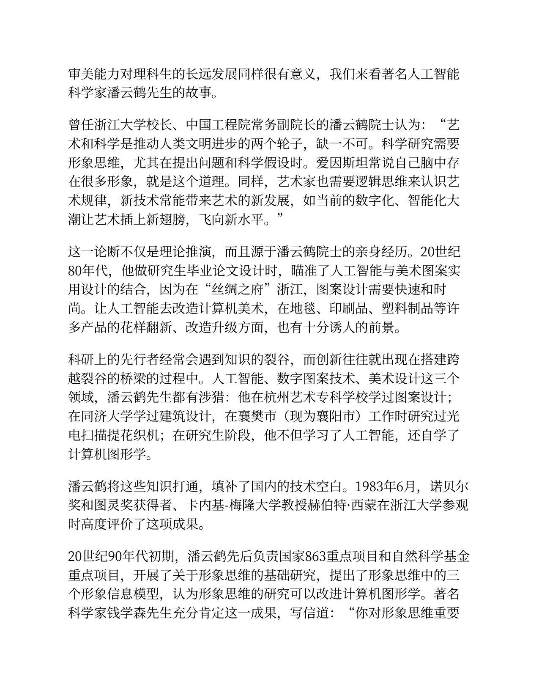
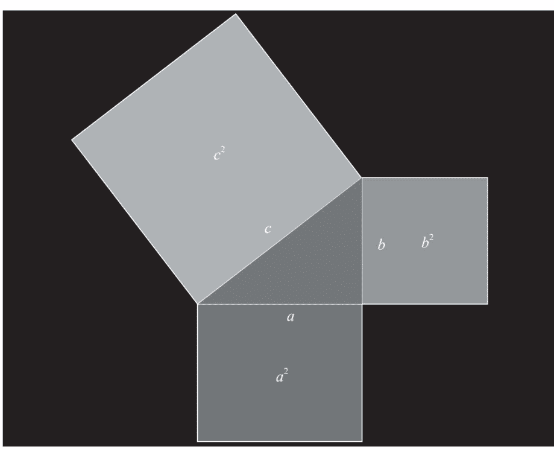
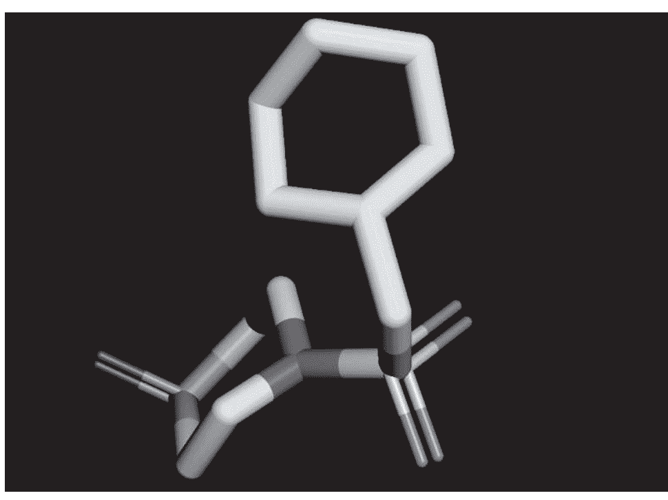

# 智能浪潮下的教与学新走向

## 序言 守住根基 拥抱巨变
俞敏洪
新东方创始人
新东方教育科技集团董事长

在我从业多年里，一直在督促管理层保持前瞻、跟上步伐，甚至在局部领域做引领。教育是我最放不下的牵挂。晓飞把《AI教育革命》的手稿给我审阅时，我既感到欣慰又有些感慨。二十年间，我看着他从课堂讲义的递送走向系统性的教育研究，对教育本真的追问始终未断。这部作品把他多年的教学实操与当下的智能浪潮结合起来，既有对教育规律的敬重，也有对时代脉动的敏锐，更饱含对教师和家长的真诚关怀。

智能技术正在改写人们熟悉的生活图景。生成式模型的登场、国产生态模型的兴起、无人系统的惊艳、智能体走进家庭，都让我们切身感受到智能科技作为新一轮科技革命与产业升级核心动能的分量。教育承载着文明传承与人才培育的功能，无法置身于这场巨变之外。

这些年我走访不计其数的校园，看到家长的焦虑、教师的犹豫。家长担心孩子被时代淘汰拼命报班，教师在传统讲授与新工具融合上拿不准，孩子则在便利与艰难之间摇摆。这种不安的根源是对智能化时代该塑造怎样的人、如何授业、如何自学缺乏清晰答案。晓飞的书写为这些迷雾提供了参照系。

最触动我的，是对“变化与恒定”的判断。作者认为智能时代的教育并非推倒重来，而是在守住根基的前提下顺势调整。扎实的学识、健全的人格、良好的交往能力，这些经时间检验的核心素养，仍是孩子立足的根本。正因中国基础教育重基本功，才造就了大批根基牢固的人才，让中国在全球智能人才版图里占据优势。对基本功的重视不会过时。面对就业格局的变动，孩子要面对同辈间的较量、与智能系统的较量、以及会用工具的人与不会用的人之间的分化，牢固的底气尤为关键。

同时教育必须改变方向。智能让规模化、个性化、专家水准的教育从理想变成可能，因材施教不再是少数人的特权。兴趣的价值被放大，热爱成为抵御平庸、避免被替代的核心驱动力。迭代智力、高阶创造、复杂沟通、终身学习这四项能力，为培养路径指明方向。这种守正创新的智慧，既避开了盲目崇拜，也避免了固步自封。

方法层面也很务实。作者提出从记忆转向实践、从答案转向过程等四大思维转换，直指痛点；主张项目式学习、总结复盘、刻意练习，既有脑科学依据，又有案例支撑。对智能教学工具的梳理与使用建议，对一线教师和家长很有操作性。全书融合中外的案例、新锐成长故事与作者二十年的体悟，鲜活而有启发。

教育像农事，需要耐心与敬畏；智能时代也需要信息级的精准与效率。这本书架起理想与现实的桥梁。人工智能不是教育的对手，而是回归本真的助手：它能分担重复性工作，让教师更关注孩子的情感与成长；它能规划个性化学习路径，让每个孩子以自己的节奏前进；它能打破资源壁垒，让偏远地区的孩子接触优质资源。

我始终相信教育的内核是人。智能系统能生成答案，却传递不了情感；能提供方法，却替代不了陪伴；能复制知识，却培育不了品格。作者反复强调教育者的使命是点亮孩子，培养社会情感技能，帮助孩子找到热爱与人生方向。这与新东方以人为本的理念高度一致。

当前中国教育正处大变局，双减深化、智能普及、就业结构变化共同推动模式重构。《AI教育革命》出版得很及时。它为家长教师提供了一张应对变化的地图，也传递理性从容的态度：不必惧怕智能带来的挑战，也不必盲目追逐技术潮流，只要把握教育本质，培养善用智能且拥有人性独特性的核心能力，孩子就能在未来保持竞争力。

晓飞在新东方的二十年，也是中国教育快速发展的二十年，更是他个人理念沉淀的二十年。这本书既是他成长的缩影，也是中国教育人面对时代的思考。我相信每位翻开的家长与教师都能获得启发，找到自己的答案。

教育的路上我们是同行者。愿我们以开放心态拥抱智能，以坚定信念坚守本质，让每个孩子在智能时代绽放独特性，拥有选择人生的权利与能力。这既是作者的初衷，也是我们共同的追求。

是为序。
2026年1月10日于北京

## 前言 在剧变中保持教育定力

进入二十一世纪第三个十年，变化明显加快。中国先经历疫情与双减带来的深远影响，2023年生成式模型的高水准表现又掀起新一轮智能热潮，苹果、亚马逊、谷歌、微软、脸书、特斯拉、英伟达等与智能强相关的美股七巨头成为资本市场的明星。

2025年春节，举家团圆之际，“杭州六小龙”引发全国讨论，DeepSeek 带来的震动让中美股市重新评估，杭州迅速从电商之都转向中国硅谷。2025年9月3日纪念抗战暨世界反法西斯战争胜利80周年大会上，无人战机、无人战车、无人艇、仿生机器狗等智能装备亮相，让人恍若身处科幻。

科技是第一生产力，当前根本性变化来自智能技术的突破与普及。2025年中美专家指出我国在AI大模型发布数量上快速接近美国，尤其开源领域。DeepSeek、通义千问等在性能上与西方顶尖模型差距收窄，部分基准测试中更优。业界一致认为2025年是我国AI应用大规模落地的元年，此后智能体将进入工作学习生活的各个场景。

基于此，我国决策层于2025年4月作出最新判断——AI作为引领新一轮科技革命和产业变革的战略性技术，深刻改变人类生产生活方式。新华社报道习近平在中央政治局第二十次集体学习时强调坚持自立自强突出应用导向推动人工智能健康有序发展。央广网也提到AI技术加速迭代，正迎来爆发式发展。

这类判断在我国并不多见，其分量堪比2008年关于信息技术快速发展的战略论断。2008年后，我国的计算机、互联网、移动互联网、5G、云计算、区块链、VR/AR等技术飞速发展，国家信息化水平大幅提升，经济实力增强，生产生活与教育模式均发生显著变化。

决策层判断下一轮技术革命将集中在AI。2015年国务院发布《关于积极推进“互联网+”行动的指导意见》，移动互联网彻底改变中国商业。2025年8月国务院再发《关于深入实施“人工智能+”行动的意见》。业界普遍认为十年一遇的发展机会到来，预计国家将集中海量资源投入这一颠覆性战略技术，加速落地，带动生产力新一轮跨越。

## AI突破正在重塑就业版图

受新东方工作影响，近年我为多所高校做分享，也参与青年联合会“青年大讲堂”，与大学生交流学习与就业困惑，并担任多所高校职业规划导师。2025年技术突破让各界意识到新一轮就业变革已至。年轻人敏感，他们已隐约感知。2024年以来，我每次走进高校，学生普遍提问：面对智能化高速发展，大学期间如何提升就业能力？专业对未来就业有何影响？未来岗位需要怎样的能力素质模型？他们感到迷茫。

2022年我国高校毕业生首次突破1000万，关于就业难的讨论持续升温。据出生人口推算，2043年后毕业生数才可能跌破1000万。就业是民生之本，未来十几年就业压力将是我国社会最大挑战之一，比老龄化更紧迫。

第四次工业革命既催生高竞争力新兴产业和高薪岗位，也消灭岗位带来长期压力。2023年底我国就业总人数74041万，2024年底73439万，一年减少602万，部分源于60后退休，部分源于科技进步提高效率导致技能不足者难以就业。

过去大学生就业难主要因竞争岗位有限。随着智能化进化普及，新一代劳动力将面临三重竞争：与同辈竞争，比拼基础能力与素质；与智能系统竞争，需比其更优或差异化竞争；不会熟练使用智能工具者与熟练者之间的竞争。英伟达CEO黄仁勋说：“你不会因AI失业，但会因会用AI的人失业。”学校家庭社会要让孩子获得应对三重竞争的能力素质。

## 就业浪潮中胜出的两类画像

近年国内外专家对未来人才核心素质多有论述。麻省理工计算机博士、《深度工作》作者卡尔·纽波特认为有三种人将获时代红利：一是能借助AI把工作做得精彩且有创造性的人；二是所在行业顶尖人才；三是有资源的人。

前两类正是教育面向智能时代的人才培养方向。第一类人能应对第三类竞争，利用最强生产工具拉开差距。2023年5月华为西安研究所举办软件大赛，鼓励使用AI。赛题难度翻倍并增专业级挑战，仍有8位参赛者借助工具获满分。上一届冠亚军未用大模型，本届冠军跌至第170名，亚军跌至450名。软件开发正从数字化迈向智能化。华为云CodeArts 把研发全流程做成智能形态，编码环节读写调测查均可智能辅助，AI代码采纳率达35%。2025年美顶级科技企业编程工作20%-50%由AI完成。

第二类人能在同辈竞争与智能竞争中胜出。Meta首席AI科学家杨立昆指出当前大模型基于自回归预测，即猜下一个词或符号，是概率而非真正理解规律，永远无法超越人类智能。现有系统既不能触类旁通，又“举一万才能返三”。对未见过的事物无能为力，对小概率事件应对不佳，这是骨子里的缺陷。

明白技术本质，就能理解为何资深从业者感慨：AI能模仿文字，却永远无法替代真实行业经验与思考深度。在智能时代，专业深度是最强竞争壁垒。

AI可给出两万字分析，却得不出三句话洞察。天花板在于无法像高手那样洞悉现象背后的本质、指出关键。立于不败之地的人，必须成为能产生敏锐洞察、具备真正见识的行业高手。他们借AI摆脱重复劳动，学习能力增强，效率提升，认知范围扩大，洞察力更好发挥。

DeepSeek 的创办者梁文锋的判断与纽波特相似。记者问招人必卡条件，他答：“热爱，扎实的基础能力。其他都不那么重要。”

热爱与扎实基础让人成为行业顶尖。DeepSeek研发人员多来自清华、北大、浙大、南京大学、中科大等名校毕业生或在读博士，多在奥林匹克数学或编程竞赛中脱颖而出。他们聪明、学习力强、热爱探索、有强自驱力。

“热爱”与“扎实基础”在智能时代如何发挥？以程序员为例。当前AI编程工具虽强，但大语言模型缺乏对现实因果的理解，且存在事实幻觉与自我纠偏不足。非专业人士难以将复杂任务拆解为系统可处理子任务，也难以审查代码、识别逻辑谬误与技术幻觉。

程序员核心竞争力正从基础编码转向系统架构设计与复杂问题抽象。满足于机械编码的执行者将受淘汰，AI编程倒逼程序员从技术执行层跃升至系统决策层。未来价值取决于驾驭AI实现复杂创新的能力，而非基础代码数量。

没有扎实基础的人读不懂AI生成的复杂代码，看不出漏洞；而热爱编程的人会用工作与业余时间提升自身，从编码跃迁至架构，从事更高层面脑力劳动。他们既是行业顶尖，也是能利用AI做得漂亮有创造性的人，将获得巨大时代红利。

## 未来人才素质的恒与变

教育的要害是明确培养什么样的人。二十年来我与同事一直在考察面向未来的人才素质模型。我曾在南京、天津、厦门、杭州任职，四城都重视教育与科技创新。近十年走访世界名校，访谈留学生与国内高校优秀学生，调研成长历程与未来规划，积累大量一线素材。结合“杭州六小龙”等新一代科创企业案例，我对人才素质模型有了初步成形认识，也逐渐厘清在极速变化时代，教育何不变、何需变。

第一，坚实的基础功底。“杭州六小龙”创始人受益于我国严格教育模式；硅谷、深圳、杭州的智能科创领军人物都是基础扎实的学霸；人文社科英才也具备海量知识储备。坚实基础对应严格教育训练，在未来依然不变。

第二，被热爱驱动。并非所有人都能成为学霸，非学霸也可因热爱而出众。宇树科技创始人王兴兴未读顶级名校，凭对机器人的浓厚兴趣自学打下扎实基础，具备世界级创造力。在情绪经济时代，能玩出名堂的非学霸也能在领域里超越同辈与智能系统。当热爱变关键，个性化兴趣教育地位需大幅提升，这是未来一大变化。

第三，擅长利用智能工具。梁文锋不必多说，《黑神话：悟空》制作人冯骥、“哪吒”系列导演饺子也用AI大幅提升制作效率。智能将深度融合工业、农业、政务、教育、养老、医疗、文娱、软件、信息、金融、商务、法律、交通、外贸等领域。在AI无处不在的未来，擅长用AI如同今天擅长上网，是基本能力。国家部署的“AI教育”将重塑教育学习基本面貌，实现大规模因材施教，这是未来教育最大变化。

## 本书结构说明

本书“方向篇”探讨智能时代的教育方向。我结合二十年教育行业案例与经验、人才培养理念及AI技术产业新趋势，围绕面向未来的人才素质模型展开论述。

第一章聚焦基础教育。严格的基础教育、“德智体美劳”全面发展能培养扎实素质，在智能时代仍具重大意义。文科死记硬背、理科熟练套路的学习不算扎实基础。“天下武功，唯快不破”，深刻理解公式定理后的快，既能应考，也有利于长远。真正掌握逻辑演绎与实验试错这两种科学方法论，既对高考有用，也对今后工作大有帮助。

## 第二章 兴趣教育
本章以科学大师和科技新锐成长案例探讨“热爱”在智能时代的意义，论述热爱促成才背后的脑科学原理，以及家长开展个性化兴趣教育的方法。不是所有孩子都能成为学霸，非学霸也可通过热爱找到出路，如热爱生活、热爱非遗技艺的李子柒，她广受喜爱并推动中国传统文化走向全球。

## 第三章 人工智能赋能教育
智能突破将帮助我们实现大规模、个性化、专家水准的教育理想。AI教育的内涵有三方面。将AI纳入课程体系，让孩子在智能时代具备基本竞争力，这是AI改变教育的一个维度。

当课堂、家庭与学习者共同接入智能工具，教学才真正实现分层与个性化。学科知识的学习趋向定制，同样的时间投入，根基却更扎实。效率释放后，孩子才能把空余投向兴趣培养，这是智能技术改造教育的关键路径之一。

落到能力培养上，面对智能技术的长处与短板，我们要塑造既会用工具又能超越工具的人才。归纳为四大素养：持续刷新对AI的驾驭力、更高阶的原创力、面向复杂情境的沟通力、能够不断更新自身的学习力。

总体而言，方向篇回答的是怎样的教育能让孩子成为所在行业的顶尖人才，能用人工智能把工作做得更出色更有创造力，从而具备真正的就业能力并分享智能时代的红利。方向篇讲做对的事，方法篇讲把事做对。

## 第四章 智能时代如何学习
本章承接前文，细讲迭代AI力、高阶创造力、复杂沟通力与终身学习力的养成路径。理论根基来自脑科学研究与陶行知的创造教育思想，上述四力只有在持续实践中反复淬炼才能提升。

## 第五章 智能时代如何教学
本章提炼出教育者需要完成的四次转向：从记忆导向转向实践导向，从答案导向转向过程导向，从工具导向转向团队导向，从成绩导向转向人本导向。关注智能转型实践的老师与家长可据此把握逻辑与方法。

## 智能时代的教育变革全景图
书稿完成后回望新东方二十年，工作轨迹正好呼应书中主线：一是夯实知识教育，培养扎实的基础能力；二是强化兴趣教育，点燃孩子的热爱；三是推进AI教育，包括少儿编程、机器人与科创，并探索智能工具在教与学上的效能提升。

智能的迅猛发展带来巨大机遇，也对就业、社会乃至地缘政治构成潜在冲击。对个人与组织而言，读懂并适应变化是未来生存发展的关键。

俞敏洪近年与诸多企业家深度交流，对各行业的智能化、无人化趋势有清晰判断。他强调，若仍用传统思路培养传统人才，再强也会受挑战。今天的教育工作者必须思考：在人工智能与网络大数据时代，教育与社会真正需要什么。只有把握未来，教育才不会掉队。

李希贵曾指出，人类文明本质上是教育与技术的赛跑。教育跑得上或跑赢技术，学校所学就能应对社会进步，人就从容平和；反之则焦虑。

本书写作得益于新东方二十年的实践积累，以及对AI与教育专家的访谈。智能将引发怎样的教育革命，学界与业界尚无定论，本书只是初步探索，试图描绘出智能时代教育变革的全景图，供家长与教师参考。不足之处，欢迎指正。

# 方向篇 做对的事：智能时代教与学
斯坦福大学教授、人工智能领军人物李飞飞认为，人工智能不是普通新工具，而是一项文明级技术。

教育是文明的核心场域，正处在时代变革中心。人工智能时代必须重新评估教育价值，看清大方向：哪些教育底线不能动，哪些必须革新。

# 第一章 基础教育：智能时代不变的内核
《易经》讲在变中抓不变，战略要立于不变之物。未来中国教育的不变之处何在？当前培养的哪些素质能力在智能时代依然闪光？

2024年底至2025年初，第六代战斗机、DeepSeek大模型、宇树机器人、原生鸿蒙等顶级科技密集亮相；《哪吒之魔童闹海》票房进入全球影史前列，动画票房全球第一。年关一过，似乎世纪已过。密集的突破让国人对科技自主创新充满信心。

这些世界一流科技的领军人物，正是卡尔·纽波特所说的行业顶尖人才，且均出自中国本土教育体系。中国现行审慎的教育模式有利于锻造梁文锋所言的扎实基础能力。扎实基础是工业时代、互联网时代优秀人才的底色，在智能时代同样如此，这是教育的不变方向。

目前人工智能产生经济价值最直接的场景是写代码。高水平程序员能识别“AI幻觉”，迅速修正使用；低水平者察觉问题却无力解决，更低水平者完全未察觉问题，便盲目推进。人工智能写文亦然。所以在智能时代，程序员及其他知识性岗位的门槛实际上在提高。知识工作者在使用人工智能提效的同时，必须具备从第一性原理出发分析问题的能力，以及迅速分辨真伪幻觉的能力，这些都建立在扎实基本功上。

# 西方为何把教育目光投向东方
2009年上海代表中国首次参加PISA测试即包揽三科第一，超越长期领先的芬兰，被伦敦大学教育学院称为“上海奇迹”，打破了外界对中国基础教育死记硬背的刻板印象。

## PISA实战，中国持续领跑
PISA是全球公认的教育黄金标准，考察阅读、数学、科学，对象为15岁学生。

2009年只是开始。2012年成绩进一步引发关注。2018年，中国内地数学591分居首，新加坡569分第二，澳门、香港、台湾分列三至五，德国第20名500分，美国第37名478分。科学成绩上，内地590分第一，澳门、香港、台湾、韩国、日本均进前十，美国502分第18。阅读上，内地555分第一，美国505分第13。

儒家文化圈国家表现突出，中日韩新等优异，英美相对平平，促使部分西方国家教育改革向东寻求经验。

浙江大学博士李玥忞在《中国基础教育跨国吸引力的研究》一文中梳理英国改革。2010年英国教育部白皮书《教学的重要性》提出要学习他国先进经验。受PISA指引，上海数学课程进入英国政策视野。2014年4月，中英签署《数学教师交流谅解备忘录》，英方资助教师来华学习观摩，并邀请中国教师赴英交流，是西方“向东看”潮流中规模最大、级别最高案例之一。

## 华人力量撑起全球智能研发半边天
未来是智能社会，人工智能水平决定国家竞争力。

2025年2月，马斯克xAI发布Grok 3时台上两名科学家为华人。xAI共有12位创始人，5位华人，包括浙大毕业的张国栋与清华毕业的戴子航。Grok 4团队图谱中约80%成员为华人面孔。

在美国，华人成为人工智能研发主力司空见惯。麦克罗波洛智库报告显示，2022年美企与研究机构顶尖人工智能人才中，38%来自中国高校，超过美国高校的37%。李飞飞、微软人工智能首席科学家邓力为代表。

更惊人的是，2022年全球顶尖人工智能研究者即NeurIPS入选论文作者中，47%本科在中国，美国18%，欧洲12%，印度5%。顶尖人工智能人才基本来自“中国”与“外国”两处。

中美瓜分全球互联网产业，人工智能竞争即中美竞争，也可视作在华中国人与在美中国人的智力竞赛。

布鲁金斯学会分析指出，中国人工智能人才优势与数学教育密切相关，尤其线性代数。2020-2023年人工智能连续三年成中国最热专业，而美国最热本科仍是商科，华尔街为名校首选。

知识经济时代国家竞争是人才竞争。中国理工科硕士占全球约一半，博士占约三分之一，与2023年中国工业产值占全球35%相匹配。

2024年中国理工农医博士招生超12万人，是美国3倍以上，超过西方国家总量。美国国家科学委员会报告称2020-2023年多数八年级学生数学不达标，称之为“STEM人才危机”。

STEM指科学、技术、工程、数学。——编者注

## 科研产出，中国正攀向顶点
自然指数以145种顶级期刊论文统计评估科研表现。

2012年自然指数中国全球第六，2014年跃居第二，2023年首次超越美国。2025年自然指数50强中，中国占24席，集中前20，美国17席多在20名外。

### 表1—1 2025年自然指数榜单

| 名次 | 高校或其他机构 | 名次 | 高校或其他机构 |
| :--- | :--- | :--- | :--- |
| 1 | 中国科学院 | 21 | 剑桥大学 |
| 2 | 哈佛大学 | 22 | 美国国立卫生研究院 |
| 3 | 中国科学技术大学 | 23 | 山东大学 |
| 4 | 浙江大学 | 24 | 南开大学 |
| 5 | 北京大学 | 25 | 密歇根大学 |
| 6 | 中国科学院大学 | 26 | 吉林大学 |
| 7 | 德国马克斯·普朗克天文研究所 | 27 | 武汉大学 |
| 8 | 清华大学 | 28 | 瑞士联邦理工学院 |
| 9 | 南京大学 | 29 | 南方科技大学 |
| 10 | 上海交通大学 | 30 | 苏州大学 |
| 11 | 法国国家科研中心 | 31 | 耶鲁大学 |
| 12 | 中山大学 | 32 | 多伦多大学 |
| 13 | 复旦大学 | 33 | 宾夕法尼亚大学 |
| 14 | 德国亥姆霍兹联合会 | 34 | 加州大学洛杉矶分校 |
| 15 | 四川大学 | 35 | 华盛顿大学 |
| 16 | 斯坦福大学 | 36 | 加州大学圣迭戈分校 |
| 17 | 麻省理工学院 | 37 | 厦门大学 |
| 18 | 牛津大学 | 38 | 加州大学伯克利分校 |
| 19 | 东京大学 | 39 | 哥伦比亚大学 |
| 20 | 华中科技大学 | 40 | 约翰斯·霍普金斯大学 |

南京大学前身为国立中央大学，兼具八大学院底蕴，基础学科贡献突出。2025年QS学科排名其计算机专业全球第80。2024软科中国大学人工智能专业排名中清华、上交、南大位列前三，校友会排名中南京大学第一。

2025年初南大LAMDA组斩获DATE最佳论文与AAAI杰出论文。2025年4月南大校友尹伟国团队用OpenAI o3解决凝聚态物理50年难题。2025年5月南大成立机器人与自动化学院攻坚卡脖子技术。

这一案例印证，基础学科与基础能力是变化中的不变。

中国“80后”高等教育普及率约29%，“90后”35%，“95后”45%。随着“00后”“10后”进入科研岗位，自然指数表现将更亮眼。

数学被誉为科学皇后。2024年上海“90后”女数学家王艺霖获塞勒姆奖。2025年初三位华人数学家参与破解三维挂谷猜想与狭义希尔伯特第六问题。35岁以下青年数学家集体崛起体现本土培养加海外淬炼模式。丘成桐2025年初出版《我的教育观》，乐观预计2030年后中国数学可达世界顶尖。

从中学生竞赛到人工智能人才、从高水平论文到工程师队伍，中国教育做对了什么？

# 严训逻辑：中国科技跃进的底座
爱迪生改良灯丝耗时数年试验上千次，当代科研复杂度更高，反复试错是常态。科研不浪漫，需要承受枯燥、重复、失败与压力，并能持续十数小时工作，这是前提。

## 严教为何助推创新
理工科想象力建立在扎实基础之上，必须有理性思维、科学训练与丰富经验支撑。

一方面，中国严格教育让学生把数理化生打牢。超西方七大工业国总和的工程师队伍受益于此，使中国在几乎所有工业领域达到世界一流。

另一方面，中考、高考、考研层层筛选出适合科研创新的顶尖人才。他们聪明且习惯反复演算，能忍受枯燥重复，经千百次失败仍坚持，从而理解复杂系统、解决工程难题。全球范围内，中国理工科学生攻读博士比例最高。美国国家科学基金会数据显示，中国长期是美国科学与工程国际博士生最大来源国。正是这份功底让自然指数超越美国，持续突破硬科技卡脖子。

2023年《黑神话：悟空》制作人冯骥在群内写道：唯一重要的是继续前进，以平常心日复一日解决枯燥困难琐碎的具体问题，永无止境，永不自满，这最难也最浪漫。浪漫在于每天做具体困难的事，然后不以成绩自满，永远这样，直到死在路上。

华为约20万员工多出自中国教育体系。2018年任正非在《华为人》发表《熵减》，以水泵抽水比喻严格教育的必要性：水从高原流向大海是能量释放，抽向高处需外力克服熵增。人的熵减同样痛苦，从幼儿园认字弹琴到博士毕业，再经考核、末位淘汰挤压，过程艰难，但结果光明。不学习不努力则熵增痛苦。

有人批判刷题与死记硬背，其实混淆了过程与结果。无方法思考的刷题无效，而勤学苦练正是任正非所言的熵减之道。

过去扎实数理基础与勤奋是技术门槛，智能时代仍是多数国家迈不过的门槛。中国科教兴国战略需要长期投入，多数发展中国家难以复制。一些国家高等教育普及率高但非理工占比高，如越南以低成本文科为主，菲律宾社区大学占全国高校40%左右，与中国中专夜校类似。

## 美国：从严教转向悦教之路
中国近年倡导的素质教育指向的是美国精英教育。考分好只是底线，像谷爱凌那样在学业外素质突出才是追求，这种综合素质只有顶尖家庭与学校能培养。

快乐至上的代价：美国基础教学为何掉队

近几年美国家庭和校园里流行一种以轻松愉悦为核心的教学取向。孩子没掌握内容，校方和家长多半不作硬性要求，反而常说你真棒、书的问题、不学了。赞赏本身有用，能盯住闪光点和细小进步，但滥夸会消解努力的价值。注意力被带走后，踢球唱歌看上去更来劲。

一旦中学阶段的基础内容吃不透，注意力无法沉下来钻研，科研岗位基本无缘。步入社会后，大批劳动者也难以胜任工厂一线，缺乏认真负责、敢于迎难的职业习惯。美国想重振制造，缺的正是够格的操作人员，这已成为明显掣肘。

2025年1月，特朗普在行政命令里公布数据：八年级阅读困难的学生占七成，数学困难占七成二。若八年级生能熟练使用勾股定理，国际排名就能进前三成。

他指出整体体系未达预期，正在削弱国家竞争力。实际上奥巴马上任前，改革主线是高标准、高要求。

1957年苏联发射首颗人造卫星，美国举国反思，认为竞争失利根源在学业质量。进入八十年代初，质量仍无起色。1981年苏军在波罗的海集结五十万兵力、上万辆坦克进行大规模演习。1973到1982年间，高中生SAT总分大幅下滑。里根、老布什、克林顿、小布什四届政府都把强化基础教学放在优先位置。

1996年美国举行第二次教育高峰会，克林顿认同个人努力能提升成绩，支持高标准、严要求的决议。他说如果认为标准合理，就是学生必须掌握的内容，就不必怕被指责残忍或不公。各州制定标准不够，还需配套考试，考试不只是测最低限度，而要衡量掌握程度是否达标。没有考试，高标准就是空话。

2001年后改革强化标准化测评，按成绩问责校长教师，甚至决定去留或学校存废。2002年《不让一个孩子掉队法案》要求到2014年所有学生英文与数学均达到精通。白人、亚裔受教育水平较高，其他族群差距过大，目标难以实现。非裔、拉美裔等群体视此为教育权底线，拥有足够选票，在强烈反对下越来越多州放弃以成绩为核心执行该法案。

特朗普感慨的基础教育衰退，可直接追溯到奥巴马政府2015年签署的《每一个学生都能成功法案》。该法案把高要求培养改写成轻松育人，政府不再对学习成绩提出要求，也不考核学校成效，只强调孩子开心。教育从过于严苛一下子滑向松散、片面追求愉悦的另一极端。

2024年12月，印度裔亿万富翁拉马斯瓦米在X上长文指出，如今顶尖科技公司高薪聘请外国工程师与移民工程师，并非美国人智力不足，而是美国文化从上世纪九十年代起推崇平庸而非卓越。社会更青睐舞会皇后与运动员，而非数学奥赛冠军与优秀毕业生。学生应多读书、多参加科创竞赛，少看情景喜剧，少泡派对。

普通家庭走轻松路线，精英家庭坚持高要求，这是美国教育割裂的现实。精英培养能支撑互联网、人工智能、生物医药等高科技，但提供不了数以百万计的优秀工人与技术人才，这是近十年美国制造业持续衰败、难以振兴的深层原因。

2025年，因《虎妈战歌》饱受争议的华裔教授蔡美儿及其虎妈模式重新被追捧。她把两个女儿送入哈佛，执行的是中国人眼中也属严苛的中式培养：成绩必须全A，练琴需先练好再吃饭。《华尔街日报》调查约三分之二受访者认为，虎妈那种苛刻的东方模式比美国被动式教育更有效，部分中产开始反思并支持虎妈。

有人会举芬兰为例。芬兰在校时间全球最短，但芬兰的轻松与美国不同。政府、社会、学校、家长乃至学生都共享教育至关重要的共识。

几乎所有芬兰新教师高中成绩都在全校前三分之一，自上世纪七十年代起，小学及以上教师须获硕士学位，很多人还读博。教育部门重视教学法训练，每位实习教师都有资深教师做导师。芬兰孩子学习时放松愉快，但对学习的态度是严肃严谨的。

总体看芬兰是高标准与轻松的结合体，此类案例极为罕见。纯粹以愉悦为核心并获得成功的国家至今未出现。

为何必须正视高要求培养对基本能力的价值

新中国成立七十多年，推行全民普及教育，重理工科，学好数理化，走遍天下都不怕。这与美国式轻松教学不同，可称高要求培养。港澳台，以及新加坡、韩国、日本等儒家文化圈，模式与大陆相近，这些地区科教发达、产业竞争力强。

纪录片《他乡的童年》导演周轶君考察十国后发现，教育模式扎根历史文化。教育反映一个国家对公民的定义，是文化对人的理解。没有最好只有最合适。

新加坡小学标语写着新加坡是我们的家，是我们赖以生存的地方。全民努力才能生存发展，这是新加坡处境，新加坡人从小被教育国家生存需要每个人学习。

新加坡人均土地、金融、矿产资源匮乏，出路在开发人力，这是东亚儒家文化圈的共同处境，也是高要求培养的文化土壤。

到2025年6月，美国四大芯片巨头CEO都是华人：英伟达黄仁勋、超威苏姿丰、博通陈福阳、英特尔陈立武。这印证了华人坚持的高要求理工科培养的优越性。有评论说，在先问技术再谈领导力的时代，能否吃透技术越来越是门槛，STEM依旧是理解世界有效路径之一。

大量接受完整专业技术培养的人才是先进制造业的关键。我国政府与民众高度重视制造业，避免空心化，自然吸取他国教训，不推行轻松教学。在本土文化里，教育是信仰，掌握知识、努力学习被视为道德责任，过去要好好读书，今后也一样。

我国现行教育模式也关乎公平。每年的高考生规模堪比一个欧洲国家总人口，需要公平透明的向上流动路径。

2025年3月，新东方首届在线家庭教育论坛，清华大学心理与认知科学系主任刘嘉教授在与俞敏洪对谈时指出，高考可能是我国教育体系里最好的制度，给了每个人机会，农村孩子也能向上。若像哈佛、MIT看重课外实践和国外经历，穷人家如何负担？通过苦读考试实现阶层跨越，让身处底层的人也有机会走向顶端，这是高考的价值所在。

研究教育改革，必须在承认现有体制合理性的基础上展开，这是我国有教无类传统、追求公平文化和资源有限国情共同决定的。

避免片面标签。无论是轻松教学、刷题、死记硬背，还是小镇做题家，都是对学习方法或阶层身份的描述，未触及学习意义，也不能代表最终成果。基础阶段教学的核心始终是对基本素质与能力的培养。

基本功扎实，是对抗生成模型失真的底牌

我国的严要求培养带来了终身受用的素养：扎实的基本知识、认真细致的习惯，良好的自律与抗压能力……在智能工具普及时代依然重要。

面对挑战，中国科学院院士、西湖大学校长施一公在2025年全国两会期间强调，也许几年后智能系统会成为通识课，带来不同思维方式；但应对这些工具，青年学生更应关注最基本的知识，这是立足根本，有了基础再去理解运用，才能让工具为我所用，改变世界。

宇树科技创始人王兴兴在浙江理工大学的借书记录引发关注，2010年9月至2013年5月，他借阅近120册，技术类超八成。重复借阅最多的是《现代控制系统》7次、《物理定律的本性》5次、《51单片机原理及应用》5次。

万丈高楼平地起，获赞天才创业者也曾老实下苦功。建立系统认知需要数年系统学习，这就是理工科要读到硕士博士的原因。大学提供专业认知和思维框架，学生可在其上不断完善。饥饿时连吃五个包子才饱，不能说后面几个让自己饱，忽视前面基础。武林高手也得扎马步练基本功。

要提醒的是，大学教材需与时俱进，很多内容停留在十几年以前，部分技术已被新机器和智能系统取代。王兴兴曾批评教材落伍，师生应接触最新版教材。

此外，大学教师精力多放在科研，本科教学投入不足，导致本科生教育不佳。2021年3月，《自然·人类行为》发表中美俄印四国联合研究，我国牵头单位为清华和北大。针对四国三万余名计算机与电气工程本科生的测试显示，第一年，我国本科生与美国接近，大幅高于俄印。但四年后，我国大学生批判性思维、数学物理技能大幅下降，名校毕业生批判性思维能力下降17%，普通高校毕业生下降68%。

不少人会说自己学习巅峰在高考结束时。调整教师考核指标，加强教学力量，提升本科生知识水平和思维能力，是我国大学改革方向。

幻象频现，高要求成防火墙

随DeepSeek爆火及阿里、腾讯、百度等大厂介入，智能工具实现全民普及，生成模型失真也成为热议。解决失真恰恰需要严要求培养打下的基础与习惯。

我让模型回答什么是模型幻象。回答说，大语言模型在生成内容时输出看似合理却不符合事实或需求的虚假信息，核心特征为虚构性、偏差性、合理性伪装。

语文老师水寒的经历很有代表性。他问文心一言，为报倾城随太守有几种理解哪种更好。没想到模型张冠李戴，把江城子密州出猎中的太守苏轼和醉翁亭记中的太守欧阳修完全混淆。

苏轼原诗为老夫聊发少年狂，左牵黄，右擎苍，锦帽貂裘，千骑卷平冈。为报倾城随太守，亲射虎，看孙郎……模型却编造该句出自欧阳修醉翁亭记中的词生查子元夕，并杜撰原文。经过四次指正，模型才承认在胡编乱造。

不只是文心一言，顶级科学刊物自然称2024年各类智能系统在提及参考文献时出错率在30%至90%，错误不限于标题、作者、年份。

模型出错原因之一是基于网络资料分析，互联网充斥真实性存疑信息。另一原因是训练时追求高分而非准确，像高中生写作文，略知一二也能用华丽辞藻堆砌。模型对任何问题都长篇输出，营造专业感。

大模型为得到高分评价会刻意讨好提问者，捕捉引导信息顺着思路回复，而非基于客观事实。

因生成模型失真，中国著名积极心理学家彭凯平教授不敢启用数字分身：有人帮他做虚拟彭凯平，他不敢上线，自己发言有控制，虚拟体说什么不知道，可能根本不是他，很危险。

更高级的失真是有人问DeepSeek，哪吒为什么打不过孙悟空。模型给出五个理由，其中三个被拆穿：

修炼方式上，模型称哪吒肉身成圣，孙悟空靠修神通吃蟠桃仙丹增强实力。但孙悟空打败哪吒在西游记第四回，吃蟠桃仙丹在第五回，时间错误。

战斗经验上，模型称哪吒战斗经验少。实际上哪吒参与公元前1046年牧野之战，比唐代大闹天宫早一千多年，战斗经验远超孙悟空。

法宝上，模型称孙悟空金箍棒实用，哪吒法宝威力未展现。中国神话里越古老的法宝威力越大，金箍棒是大禹所铸，哪吒的乾坤圈是元始天尊之物，混天绫是女娲所赐，品阶更高。

盲信不如不用

上述破解失真的人，要么基本知识扎实一眼识破，要么认真细致耐心查对原始资料去伪存真。这两种能力正是高要求培养着力培养的，也是智能时代信息素养的核心。还有方法是让不同模型相互验证，用魔法打败魔法。

古人说尽信书不如无书，日后要意识到尽信智能系统不如不用。无论搜索分析能力多强，人类自身要有火眼金睛，看出错误、发现逻辑漏洞，这离不开扎实基础。

人类大脑是最好的防幻装置。生成模型失真带来更多可能性，有利于艺术创新，但利用需理性判断和实践检验。智能系统负责天马行空，我们负责去伪存真。

智能系统普遍的讨好型人格也需使用者判断。一位财经作家指出智能时代财经稿很好写，让DeepSeek分析念出来好像就是经济学家，但稿子观点模糊，因系统为不得罪创作者只能面面俱到，不懂经济学的人很难抓住根本。

华为蓝军部长潘少钦比喻：现在对智能系统的期望是数学金牌选手、物理生化博士、编程高手、音乐达人、动画设计大师、金奖画家、金牌财务、顶级律师、顶级同声传译、顶级炒股专家，这不是神才能办到吗？当前对大模型的prompt像不像对神的祈祷词？

如果把越来越强大的智能系统比作天，我们只有打好知识思维基础，才能不被牵着走，做到我命由我不由天。

智能时代竞争从未消失

进一步看，智能工具时代人与人仍要竞争。会用工具的人胜过不用的人，用好工具的人胜过会用的人。

# 会用AI只是门票，底子才是筹码

把语文数学英语打磨到能独立思考的求职者，和一个觉得有了生成式工具就能代答代写代译、何必辛苦学习的求职者一起面试，企业最后会选谁？显然是既会用模型又自带扎实功底的人。

得到App联合创始人、资深技术专家快刀青衣分享过自己的体感。模型迭代极快，但都会遇到天花板，真正拉开差距的是人如何驾驭。工具像一把枪，到不同人手里，命中率和手感完全不同。真正稀缺的是人。

他提到一次跨年演讲的视觉制作。演讲里的几张配图是他自己生成的。他没有美术基础，想把一张图调成电影剧照的质感，连续试了三百多版也没找准感觉。后来把需求描述给硅谷的一位设计师朋友，对方思考几分钟，只给了两个关键词塞进指令里，一次就成了。他好奇词从哪来，对方说是在挪威某座美术馆看展时，记下画作说明里的一组专有词，因为风格很独特就拍了下来。

把场景拉回公司。模型再强也强不过真专家。当所有团队都用同一套模型时，最后比的是你手里有没有那两个关键词。考验的始终是人，比软件更重。

即便未来模型超过专家，组织和行业仍然需要人。老江湖的说法很直接：柯洁下不过模型，你也下不过，教授做题赢不过模型，你也赢不过，但柯洁仍是冠军，教授仍受尊重。你若连人类对手都拼不过，很快会被挤成工具人，被算法追在身后。

工具会越来越多地接走重复活，但人与人之间的竞争会更残酷。把美式快乐教育的逻辑照搬给下一代，对未来不负责。

## 数学到底在智能浪潮里买什么单，怎么练才对

俞敏洪在一次家庭教育论坛上提醒，生成式工具对学习有隐形副作用。孩子在DeepSeek等问答平台上搜一下就能拿到数学或英语写作的答案，不思考也能交作业，家长也做不到时刻监管。

他进一步指出，中考高考不能带手机，借助模型做题根本行不通，反而养成坏习惯。抄答案不动脑对成长的伤害很大。所以中高考的存在，反而让基础训练和深度思考在智能浪潮下有了新意义。

语文决定能理解多少信息，数学决定能思考多深。

历史学家陈寅恪收学生，先看数学好不好。因为数学好，思维更严谨，史学研究需要这种严谨。

数学未必直接变现，却能无形塑造思维。它是编程的基石，想深入理解模型需要线性代数、概率论、统计学、微积分，也支撑科学、经济、金融。只有亲手做题，才能提升数理逻辑和深度分析。

阿里学术委员会主席曾鸣研究过国内外新锐科创企业的用人偏好，发现大家都爱招聪慧、有自驱力、学习力强的年轻人。原因在于有了模型，知识不再稀缺，稀缺的是抽象思考。优秀年轻人元认知强，能抽象建模、抓本质、做第一性原理思考。通用模型本质是概率靠大数据找规律，人类的独特价值是反向操作，从少量数据抽象出模型。能持续创造新知识、为模型提供新支撑的人，才走在前面。

高度抽象思考是判断聪明与否的核心。数学的意义之一就是让大脑习惯抽象。

数学家教育家苏步青给青少年的《神奇的符号》至今有启发。

学数学的标志是理解，不是死记硬背，要反复思考概念定义。

再难也不能单打一，学几何不管代数不行。学深学透才能举一反三融会贯通。

管子说思之不得，鬼神教之，其实是提醒要多思。想全了才能熟练，熟练指基本公式定理常数运算得召之即来、来之能战。

我做过上万道微积分题，不是难题偏题，是大量基本训练，熟能生巧后难题自然可解。归纳起来就是理解、熟练。

要学好数学，先得学好语文。苏步青任复旦校长时说过，想考数学系，语文不及格数学再好也不能录。语文是学习工具，像盖房子的地基。数学是自然科学基础，语文是基础的基础。看不懂讲义怎学数学，看不懂题目要求怎解题。语文水平提升，阅读增强，数学和其他学科都会受益。因为语文同样重逻辑推理。

培养逻辑思维要从精准表达开始。孩子说动画片没意思，可引导细化：这部片子对话重复、情节推进慢。把主观感受转为客观观察，既锁定问题也训练理性表达。

可以通过特征描述游戏训练。先示范定义自行车：双轮交通工具，脚踏板带动链条产生动力。再让孩子定义猫，避开可爱等主观词，用具有夜视能力、脚底有肉垫、发出喵呜声的哺乳动物这类具体特征。精准表达能提升学术写作，也减少团队协作和人际中的误会。

## 语文的价值不只是作文，还在审美和人性

精准表达与语文课核心训练写作紧密相关。小学生多年时间练造句，句子不对段落文章就难成。职场写不好报告，根在小学词汇句子基本功，认认真真入门是开始。

最常见的结构往往最有用。高中议论文的论点论据论证，三段式在领导汇报客户方案里同样通用。

语文阅读写作训练的是大脑。模型越强越要强调入门，基础不牢地动山摇。

语文还有陶冶情操的作用。DeepSeek 和豆包能搜诗作诗，若只看应试，背唐诗宋词还有用吗？俞敏洪认为有用。背过数百首的大脑和没背过的大脑，对美的感受和诗意完全不同。

公众号浙江宣传文章《智能时代，学语文还有用吗》写道：读独钓寒江雪体会孤独，读明月几时有把酒问青天感受思念，读人生自古谁无死留取丹心照汗青触摸信念，读烟柳画桥风帘翠幕品味江南风韵。

读老舍骆驼祥子思考命运与社会，读张爱玲金锁记看清人性幽微，读史铁生我与地坛叩问生命感怀母爱。

理解人性陶冶情操，让人更像人，更擅长复杂沟通，是相对于模型的核心竞争力。

## 智能时代最稀缺的品质：靠谱

就业形势严峻，外卖快递网约车等岗位已饱和，大学生和中年人就业难。但优秀员工始终稀缺：自驱力强、学习力强、敢担责、做事踏实、懂协作。有人开玩笑，若能推荐这样的人，随时可给保底一万工资。

### 责任感与三观，是机器没有的优势

共情、责任心、坚毅是基础素质，也是传统三观教育重点，也是人类比模型员工不可替代的关键。

模型再高效也有致命缺陷：它按预设算法运行，不懂伦理情感社会责任，也无法对结果承担道德法律责任。自动驾驶出事故无法追责，医疗模型误诊无法自我担责。无主体性决定它无法在关键决策中担责。

人类有情感价值观道德，能为行为负责。责任心包含对公平正义同理心的权衡。教育作为社会化核心，必须培养后果认知能力。

酒店管理培训要求前台通过语句动作微表情判断客人是否不满，这是模型还没学会的。医疗领域模型可辅助诊断，最终方案选择和责任必须医生承担。公众对教育医疗的信任，建立在人类对结果负责上。模型教案需教师审核，模型诊断需医生签字，责任机制维系系统稳定。

当模型偏差导致误诊误治，人类医生要主动介入修正。只有责任心强的人，才能在模型辅助决策中承担风险修正错误，避免失控。

模型写作越来越强，人类写作优势也在责任意识。一位做政策的自媒体人指出，媒体信息过载，人没耐心读几千字文章。真正调研要跑一线、搜资料、征求意见，吃苦冒险，才能提出可行方案。调查研究辛苦，无法即时获得道德满足，于是很多人空谈理论。

认真调研再分析提方案写文章，离不开责任心。模型报告资料全来自网络，无法实地调研获取一手信息。这是人相对于模型的核心优势。

模型进化无法消解人类对责任的需求，反而强化其必要性。教育是社会责任孵化器，必须把责任心放在核心位置，责任教育是智能时代的免疫系统。

### 责任心怎么养起来

中国强调德智体美劳，劳动教育的重要意义就是培养责任感。儿童心理学显示3到6岁是责任意识萌芽期。幼儿园值日生通过照料植物整理玩具把抽象责任转为可操作行为，这种切身经验构成道德基石。家长也应让孩子做扫地洗碗整理房间等事。

家庭里父母言传身教是榜样。讲述历史人物的担当，日常对家庭长辈子女的付出，都在孩子心灵种下责任种子。

芬兰流行现象式学习，把学习和生活连起来。中学生模拟城市项目扮演市长环保局长，为虚拟社区制定可持续政策，沉浸式训练让他体会行为后果，培养系统思维与道德担当。

灾难复盘教学法让学生重建福岛核泄漏、埃塞俄比亚航班坠毁事故链，理解工程师每个技术决策背后的生命重量，培养对技术后果的敬畏。

学校实验课要求严格遵守规程认真记录数据对结果负责，培养严谨科学态度。

模型提出的学术诚信护照制度有意思：记录实验数据溯源作业原创声明，形成伴随成长的责任档案。可视化评价把道德要求转为可衡量指标。让学生主导模型辅助的编程数据分析项目，并对最终成果负责，代码错误由学生而非模型修复。

老师家长要丰富教育形式，提供社会实践承担责任的机会。与企业社区合作建立校外实践基地，让学生在真实工作中体验责任。鼓励参加社区服务公益活动，在实践中锻炼责任心和协作。

宏观上唯有教育塑造责任主体，人类在智能时代才是技术使用者和文明价值守护者。微观上，人才与普通人的核心差异是对复杂系统的责任把控。

模型不能保证自己靠谱，组织里也有不少不踏实员工。把孩子培养成靠谱的人，领导放心把工作交给他，这是智能时代的重要竞争力。

### 杭州公益中学：用亲情长出品格

杭州公益中学潘志平校长认为亲情是最好的教育资源，广义亲情关系能帮助学生克服消极情感主动接受教育，获得全面健康发展，所以校长要用心经营校园亲情场。

开学第一天他站在校门口亲手把入学通知书交到每个新生手里，并与每个家庭合影，说以后阿潘就是你们的伙伴。七天后他亲自掌勺为师生做阿潘羹，此后每周雷打不动，还为过生日学生端阿潘生日面。一碗汤一份面传递温暖建立信任。

他坚持21年手写致学生信阿潘和你说说话，并认真读回信。学生建议如调整课间铃声优化运动操配乐都被采纳，让学生感到自己是学校主人。

亲情教育是全体教师实践。黄铭老师连续三年每周五护送特殊学生到公交站；陈鹏老师用三行诗写评语；申屠德君老师对沉迷游戏学生家访一年半每周两次，用真情感动学生重返校园。这些故事结集成《我们的故事》成为师德教材。

潘志平认为亲情教育核心是角色互换与共情体验。发起学生校长机制让学生参与管理，艺术节邀请保安食堂师傅参与等决策出自学生。在双减背景下鼓励学生给老师出试卷体验命题难度，促进师生共同反思作业质量。设计一日家长作业让学生体验父母不易，打破教育者与被教育者界限。

公益中学制定公益积分制实施办法，把公益活动量化计入评价。学生通过值日爱心义卖社区服务积累积分，毕业凭总积分获得益动中学毕业证和省级公益证书。机制激发社会责任感，学校爱心基金会连续10年通过义卖支持贵州山区小学，许多毕业生多年后仍参与公益。

亲情教育影响长远。毕业生进入高中更主动承担班级责任，步入社会敬业奉献，常常回来看阿潘校长和老师。情感一旦建立就是一辈子的事。

从教30多年潘志平坚信教育本质是育人，亲情是唤醒人发展人成就人的最好养分。公益中学实践表明，教育充满尊重信任爱，学生在学业上进步人格上茁壮。这种以亲情为核心的模式为基础教育改革提供经验。

## 把孩子拉回线下，人文与审美缺不了

打好知识基础面临大问题：游戏短视频社交媒体大量侵占时间。模型让游戏更好玩推送更精准，进一步消耗时间，影响基础学习、身心健康和社交能力。

美国科技领袖史蒂夫·乔布斯、比尔·盖茨、埃隆·马斯克都明确限制子女使用科技设备尤其是社交媒体。乔布斯虽创造iPad却不让孩子自由使用，盖茨说孩子14岁才接触手机。

他们孩子成长于互联网早期，家长更容易控制。如今游戏视频社交媒体更具吸引力，如何引导孩子正确使用电子设备回归真实世界，成为家长关切。

### 先从游戏类型说起

完全禁止玩游戏不现实，会引发逆反、偷玩沉迷，还会破坏亲子信任。孩子需要共同话题，如果完全不了解同龄人玩的游戏看的动漫，容易在社交圈格格不入。

限时单机，比手游更利于孩子健康成长

给孩子一个可控时长体验独立运行的游戏，例如《黑神话：悟空》，同时尽量减少手机游戏和网络游戏的接触，从育儿逻辑上更站得住脚。

从时长可控性看，单机作品对时间的占用相对克制。普通作品几十小时就能通关，几百小时基本摸遍内容，上千小时才属于重度玩家范畴。即便像《文明》《钢铁雄心》《博德之门3》《我的世界》这类机制复杂、世界开放的项目，大多数玩家的累积时长也很难突破三百小时。

手机游戏与网游的思路完全相反，核心就是最大化占用时间，设计上追求每天在线十小时以上，像打卡上班。手机游戏擅长利用即时反馈的渴望，铺满日常任务把人钉住，对课业与休闲本就紧张的孩子而言，这是一种强烈的挤占，不利于其自主安排学习与放松的节奏。

在社交层面，单机游戏能帮助孩子避开过早进入复杂甚至不良的社交圈。优秀的单机作品更专注单人沉浸体验，寓教于乐。游玩时孩子更多与剧情与机制对话，在获得乐趣的同时收获知识，也得到身体与思维的锻炼。

策略类作品逼着孩子做决策与规划；动作类作品锻炼手眼配合与反应速度；模拟建设类作品如《大航海时代》《我的世界》《戴森球计划》《塞尔达传说》，能让孩子尽情探索、满足好奇心、敢于尝试挑战，也能体会生活的真实与趣味。

通过不断尝试、攻克难关、完成任务或达成目标，孩子会产生自豪感和成就感，这种正向回馈能强化自信与坚持。

手机游戏则偏向强社交绑定，常出现恋爱、结婚等设定，把玩家黏住。心智尚未成熟的未成年人很容易在这种环境里受不良影响，分散学习注意力，甚至养成坏习惯。从变现方式看，手机游戏也易让人陷入装备攀比和充值焦虑。

在产业逻辑上，单机厂商之间并非你死我活，左右购买意愿的主要是作品质量。一个喜欢某类单机游戏的玩家，往往愿意尝试同类型的优质作品。单机玩家还有买了不玩的现象，这意味着家长不必担心孩子冲动消费大量囤积。

手机游戏运营商为了抢夺有限的玩家时间，竞争激烈，运营与宣传极度强化，不断诱导投入更多时间和金钱。大脑前额叶与自我控制密切相关，通常要到二十多岁才发育成熟。停止游戏需要消耗大量意志力能量，青少年面对游戏时因前额叶发育未全，自制力很弱，很容易掉进时间陷阱和消费陷阱。

家长可以主动挑选优质单机作品，比如益智解谜的《纪念碑谷》，锻炼空间思维；历史文化类的《刺客信条》系列，让孩子在游玩中感受不同时代风貌；冒险探索类的《塞尔达传说》，点燃好奇心与探索欲。同时要立好时间规则，比如每天固定一小时，既能满足娱乐需求，又能避免沉迷。

综合时间管理、社交影响、产业特性来看，让孩子在限时范围内接触单机游戏而非手机游戏，有助于他们在玩乐中健康成长，实现娱乐与学习的平衡。

## 短视频成瘾预警：别让孩子掉进脑腐化陷阱

2024年，“脑腐化”brain rot 被牛津词典选为年度词，指人的精神或认知水平因过度消费网络低质量或碎片化内容而出现下降的状态。

这一现象与移动互联网普及密切相关。《中国网络视听发展研究报告2025》显示，截至2024年底，我国短视频用户规模已达10.40亿，使用率93.8%。短视频应用人均单日使用时长达156分钟，同比增长3.1%，在所有互联网应用中排名第一。

短视频平台为追求流量与收益，打造出契合人性的算法，用短平快的刺激持续轰炸大脑。人们沉浸其中获得即时快感，但专注力在悄然退化。大家习惯了15秒的高潮，面对需要深度思考的书籍、电影就提不起耐心。长期以往，学习能力、工作效率下降，精神萎靡、认知衰退，最终滑入脑腐化的泥潭。

儿童和青少年首当其冲。脑科学研究触目惊心。上海儿童医学中心江帆教授团队在《美国医学协会儿科学》发表的研究覆盖22万名儿童，发现6岁前日均屏幕使用超过1小时的孩子，总智商平均下降6.7~8.2；3岁前的屏幕暴露会让认知控制网络发育滞后，出现注意力缺陷和多动；3~6岁儿童日均4小时屏幕接触会显著降低语言理解能力。4岁男孩迈迈因日均玩游戏3小时，其语言中枢注语言中枢负责控制人类思维和意识等高级活动，并控制语言表达。突触密度仅为同龄人的73%，连“红色”“蓝色”都无法准确命名。

类似结论不断出现。加拿大的实验发现游戏成瘾青少年的前额叶皮质厚度比同龄人薄0.5毫米，相当于提前老化两岁；哈佛大学追踪5000名儿童发现，高频使用手机者前额叶发育迟缓，自控力受损可能伴随终生。

情感层面，电子设备也在悄悄拉开亲子距离，降低情感感知力。研究指出，1岁时日均使用电子设备超4小时的儿童，4岁时沟通能力发育迟缓的风险增加2.68倍。现实里，不少孩子因过早接触“电子保姆”，从活泼开朗变得沉默寡言，出现“假性孤独症”，沉溺虚拟社交，在网上大笑，在现实中却冷漠对待亲人朋友。

> 刘慈欣在《流浪地球》中写道：“最初，没有人在意这场灾难。这不过是一场山火，一次旱灾，一个物种的灭绝，一座城市的消失，直到这场灾难和每个人息息相关。”

电子屏幕正成为阻碍孩子大脑正常发育的元凶。高铁上家长把手机塞给孩子换取片刻安静，咖啡馆里3岁孩子熟练刷屏母亲却在闲聊，这些场景构成了一个闭环困境：家长用“电子鸦片”安抚孩子，却在未来指责他们不够努力。智能系统越来越强大，孩子的大脑却越来越迟钝，若放任不管，这将演变成与每个人息息相关的大灾难。

越来越多的国家开始立法保护未成年人。2024年11月，澳大利亚联邦参议院通过法案，禁止16岁以下未成年人使用社交媒体。TikTok、脸书、推特、Snapchat、Instagram等平台必须执行年龄限制，否则将面临最高5000万澳元，约合人民币2.35亿元的罚款。

## 重返真实世界，让孩子感受可触摸的温度

现在已有很多人开始有意识对抗脑腐化，重返三次元。三次元就是触手可及、举目可见的真实世界：清晨菜市场此起彼伏的叫卖声、菜叶上未干的露水、鱼摊溅起的水花，博物馆里陈列的千年文物、演唱会现场的万人合唱。

逛二手市场，学非遗技艺，跑马拉松，体验公园20分钟效应，城郊野餐、山地露营、长途旅行……三次元的生活有屏幕像素无法承载的温度，分辨率无法还原的细节。重返三次元是一种真实的生活选择，把时间花在真实的人间滋味里。

心灵的培养和人格的塑造离不开真实世界的浸润。家长带领孩子走出封闭的室内，走进大自然，参与多样实践，能帮助他们在感知、探索和互动中全面成长。

大自然是一座无尽的宝库。四季更迭缓缓展开：春天一起观察枝头嫩芽萌发，聆听鸟鸣与溪水合奏；夏天夜晚辨认星座，感受萤火虫划过黑暗的光迹；秋天收集落叶比较形状与脉络，体会生命循环的静美；冬天观察霜雪覆盖山川，在寂静中理解积蓄与等待。

在这些体验里，孩子不仅拓宽认知，也逐渐建立对自然的敬畏。每一次出行都是无声的教育，山川河流之美能激发好奇与探索欲，也潜移默化地培养观察、思考和表达的能力。

除了感知自然，实践活动同样重要。比如鼓励孩子参加社区公益，清洁街道、探访养老院、组织旧物捐赠，能帮助他们跳出自我中心，学会关注他人，建立责任感与同情心。手工制作从设计、选材到动手完成，能锻炼操作能力、耐心、专注与创造力。

如果活动以小组或家庭合作进行，孩子还能初识规则的意义，学会表达、倾听、协商甚至妥协。这些看似微小的时刻正是社会情感能力的基石，让他们明白合作的力量，理解善意与尊重的价值。

家长的陪伴和引导至关重要。无论是共同仰望星空，还是一起完成手工作品，都在建立亲子默契和共同成长的情感联结。家长不再只是知识传授者，而是孩子探索世界的同行者和支持者。

大自然教会孩子如何感受世界，实践活动教会他们如何参与世界。两者像一对翅膀，托举认知与情感，让孩子走向更广阔的世界，最终内化为丰盈温暖的心灵、共情力、行动力与合作精神。

## 人工智能时代，人文素养为何不可替代

人是社会动物，学会社交、实现社会化是基础又关键的教育。除了在现实中多与人互动，人文教育和审美教育不可或缺，它们有助于理解他人，增强同理心。

管理学大师德鲁克认为，学商科的人要学习短篇小说写作和诗歌赏析，因为短篇小说刻画人，诗歌赏析关乎情感，而企业管理的核心恰恰是人和情感。

留意顶尖科学家的言论，会发现很多人高度重视科技时代的人文素养，强调理科生也要学人文社科。中学生曾向西湖大学校长施一公院士提问，大学削减人文学科该如何看待。施一公表示，一个现代大学尤其是科技类大学，没有人文就不成其为大学；没有人文情怀的熏陶，本科生培养不出来；大学若无人文底蕴，科技发展也会出问题；人文社科教育对学生极为重要。西湖大学立校五年后才招本科生，重要原因就是先筹建通识教育中心，在文学、历史、哲学、政治学、管理学、经济学、心理学等多领域做好教学准备。

人文素养很重要，但智能系统也在提升人文素养。很多人发现今天的智能程序已相当擅长文科知识与技能。不少知名作家指出，人的情感、审美、身体感受和体验等微妙之处，是智能程序暂时无法超越的。情感、审美、价值判断等智能程序尚不擅长的领域，正是人文艺术教育的重点。

当前大语言模型的核心能力建立在海量文本训练之上，能生成语法正确、逻辑连贯的语句，展现强大文本处理能力。但本质是复杂的模式识别和统计学习，而非真正理解。明显例证是智能程序处理中文多音字时常选错读音，因缺乏基于具体社会语境的精准判断能力。

人类沟通的意义往往超越文字本身，依赖肢体语言、面部表情、语音语调和具体情境的微妙暗示。智能程序仅能处理文本符号，必然丢失大量承载深层含义的非语言信息。

沟通中许多有意义的信息如情感、语调、语境，像图像的图层一样未被直接表达。比如发微信说“你可真行”，不会说明语气和情绪。无论是人类文字聊天还是智能程序处理语言，这些“图层”都会缺失。人类能基于共情和共识重建理解，智能程序不具备这种能力，导致更深层的理解障碍。智能沟通的短板不在文字处理，而在无法触及文字下由人类经验和情感构成的意义海洋。

社会规则、道德伦理、价值观、人生观、世界观等抽象概念，智能程序的理解更显匮乏。开发者通过引入人类反馈机制，试图让模型生成更符合人类规范的文本，使回应显得更有“人情味”。但这本质仍是对人类表达模式的模仿与适配，是模型基于反馈数据调整输出概率的结果，核心机制仍是学习语言模式并重现，而非真正获得内在理解或认同。

因此面对智能浪潮，人文学科必须学深学透，建立人类优势。复旦大学校长金力表示，文科的重要性不取决于学生数量，而取决于质量。遇到挑战时，文科更要做精，技术主导时代文科应以思想深度取胜而非规模。

文科的事实和观点智能程序都能掌握，除此之外文科还有方法论层面。哲学、社会学、政治学等学科有自身思维方式和方法论，可与政府、企业具体事务结合。

学习人文社科时，要能直接考察原始材料，比如太平天国时期的经济数据、新中国的人口普查数据，从中得出自己的观点并说服他人。这个层次才是批判性思维，才是真正值钱的技能。掌握批判性思维的文科生若能钻研最新科技，会找到很好的工作。

学好人文社科能更深入理解人性需求。21世纪以来，中国乃至全球精神型产品和服务爆发式增长，如游戏、演唱会、文旅、潮玩，这些非刚需恰恰增长无上限。问答式智能玩具在儿童生活中属低频需求，而能陪孩子过家家的陪伴式智能玩具需求量可增长数倍，这类市场洞察需要儿童心理学。

洞察用户精神需求，把产品包装成有情感、有温度的故事，市场营销的前后端工作都需要良好的人文社科素养。这种工作显然不是在大学里混四年、脑子空空的文科生能胜任。今天智能程序做出的营销方案已比一般人强，更不用说未来更强大的智能工具。因此在大学学文科，一定要学深、学精、学透。

## AI浪潮下审美教育为何更关键

过去文科教育中审美教育被忽视，音乐课、美术课常被主课老师占用。智能时代，审美教育的地位应该提升。科技专家指出，随着智能大幅降低绘画、视频、写作等工作的技术门槛，社会将进入创造力经济时代，艺术设计、影视、音乐、小说等内容创作产业将迎来爆发，有鉴别力和鉴赏力的人将借助智能成为佼佼者。

审美教育狭义上是通过艺术手段进行教育，包括艺术鉴赏和技能培养；广义上是用自然界、社会生活、物质与精神产品中一切美的形式对人们进行耳濡目染、潜移默化的教育，以美化心灵、行为、语言、体态，提高道德与智慧。宽容、信仰、长期主义、终极关怀等美好品质都是审美教育的果实。提升道德与智慧水平，具备这些品质，自然能实现人与人和谐相处。广义的审美教育从根本上解决人际交往问题。

审美教育关键在于培养审美能力，而非简单告诉大家什么是好看。松赞酒店创始人白玛多吉先生，便展现了高超的审美能力。他出生于云南迪庆藏族自治州，曾与中央电视台合作制作多部传递藏地文化的专题片和纪录片。用25年时间打造18家精品酒店，构建起“大喜马拉雅旅居网络”。松赞酒店因独特的藏式设计和优质客户服务闻名，获多项国际奖项，TripAdvisor连续9年入选“中国最好25家酒店”，《TATLER尚流》列入“全世界最好的酒店”，CNN列入“中国风景最好的9家酒店”。

著名美学家李泽厚认为审美能力分三层：悦耳悦目为感官审美，悦心悦意为心灵审美，悦志悦神为崇高审美。建筑精美、把客人当亲人、坐落在藏区神山秀水间的松赞酒店，能同时让人感受到这三种美。

审美能力看似无用实则大用。当下任务可由智能工具解决，但像白玛多吉构建“大喜马拉雅旅居网络”这样的愿景，需要更高维度的审美能力支撑。

性及抽象思维之不足有深入的分析，这是对1984年8月会议认识的一次重大发展，使我们对思维学的研究方向更加明确了，我们的任务是找突破口！你指出了突破口，了不起！”

理科生培养人文艺术的爱好，具备一流的审美能力，有利于实现更大的成就，苹果手机和苹果电脑的创始人乔布斯的故事是这方面的著名案例。潘云鹤院士的体会是：“爱好和特长不一定会成为你的职业，但一定会帮助你创新。几个特长的综合，便形成了优势，如能以此对准问题，往往能取得创新与突破。因为多特长的优势有利于从一种领域的知识去理解与解决另一种领域的问题，这个过程需要联想、综合和替换，如果这种联想、综合或替换是前所未有的，创新和创造就出现了。”

广义的审美教育，接近于人们所说的“美育”。“美育”一词，是民国元年（1912年）蔡元培先生从德文译出的，“美育者，以陶冶感情、涵养精神、提高人格为务”。

1935年，蔡元培先生在答记者问时说：“我们提倡美育，便是使人类能在音乐、雕刻、图画、文学里又找见他们遗失了的情感。我们每每在听了一支歌，看了一幅画、一件雕刻，或是读了一首诗、一篇文章以后，会有一种说不出的感觉：四周的空气会变得更温柔，眼前的对象会变得更甜蜜，似乎觉到自身在这个世界上有一种伟大的使命。这种使命不仅仅是使人人要有饭吃，有衣裳穿，有房子住，它同时还要使人人能在保持生存以外，还去享受人生。知道了享受人生的乐趣，同时更知道了人生的可爱，人与人的感情便不期然而然地更加浓厚起来。那么，虽然不能说战争可以完全消灭，至少可以毁除不少起衅的秧苗了。”

蔡元培先生强调，美育对个人和国家有着重大意义：“爱美是人类性能中固有的要求。一个民族，无论其文化的程度何若，从未有喜丑而厌美的……我以为如其能够将这种爱美之心因势而利导之，小之可以怡性悦情，进德养身，大之可以治国平天下。何以见得呢？我们试反躬自省，当读画吟诗，搜奇探幽之际，在心头每每感到一种莫可名言的恬适。即此境界，平日那种是非利害的念头，人我差别的执着，都一概泯灭了，心中只有一片光明，一片天机。这样我们还不怡性悦情吗？心旷则神怡，心广则体胖，我们还不能养身吗？人我之别、利害之念既已泯灭，我们还不能进德吗？人人如此，家家如此，还不能治国平天下吗？”

南京大学潘知常教授认为：

- 爱美，让我们学会看待人生，人生就多了一份“从容”——有眼光；
- 爱美，让我们学会对待人生，人生就多了一份“包容”——有智慧；
- 爱美，让我们学会善待人生，人生就多了一份“宽容”——有境界。

蔡元培先生说：“美育是青年人最能感受到生命悦意的事。”知识让我们拥有向前行走的能力，而我们的生命最终走向哪里，却由美来指引。

## 第二章 兴趣教育：AI时代的家庭教育定位

门槛被拉平，价值被重估

工具越来越聪明，用起来也越来越省力。写诗、画画、剪视频、做演示、做数据分析，现在几乎人人都能上手。门槛下来了，评判人才的标准反而上去了。公司不再只看熟练度，更看重能否创造、能否协作、能否批判性思考这些更难被替代的能力。

要想在各自赛道做到顶尖，光靠技术积累不够。严谨的基础教育是地基，对所选工作的深切偏爱是燃料。梁文锋的说法很直白，热爱再加上扎实的基本功，其他的都不那么关键。

热爱本质上是一种愿力。愿意把时间、精力甚至生命押在一个方向的人，能迸发出很强的能量。孩子能健康长大，离不开父母长期默默的发愿与执行力；学生能考上理想的学校，也先有愿力带来的持续学习力。人活在预期里，王阳明说志不立天下无可成之事，孔子也说三军可夺帅匹夫不可夺志。

宇树机器人的创始人王兴兴在接受《中国教育报》采访时提到，年轻人要先找到自己真正喜欢的东西，再把擅长的领域做到足够好。目标与热爱会把人推向想去的地方。

谈家庭教育时，多元智能的视角很有参考价值。它提示我们人的智能是多元构成的，不能用单一尺度去框定孩子。

大师的兴趣样本：丘成桐与李飞飞

不管岗位怎么被替代，造出人工智能的科学家和数学家本身很难被替代。看看在智能浪潮中依然发光的大师是怎么成长的，对当下很有借鉴意义。

### 丘成桐：被数学兴趣推着走

丘成桐认为做学问就是寻找自然规律，纯数学能长出物理规律、社会规律，数学是科学的基础，也是人工智能的基础。

26岁证明卡拉比猜想，30岁拿到普林斯顿终身教职，之后先后获得菲尔兹奖、麦克阿瑟奖、克拉福德奖、沃尔夫数学奖、马塞尔·格罗斯曼奖和邵逸夫奖。

他自己说，研究数学像下棋，越深入越快乐。解出一道题的成就感比通关游戏更有意义。探求真理的路很难，走通那一刻的喜悦无与伦比，那是一种触及造物真谛的感觉，不是金钱权力能比的。

这种持续的动力从何而来。

父亲丘镇英是饱学之士，年轻学经济、政治，也深耕文学历史。上世纪50年代在香港中文大学崇基书院任教，常有学生上门讨论西方哲学与儒道佛的融合。初中的丘成桐听不懂太多细节，却习惯了抽象的学术讨论，为后来的数学兴趣埋下种子。

父亲写《西洋哲学史》时从古希腊讲起，提到不少古希腊哲学家本身就是数学家，丘成桐听得很投入，小时候就觉得数学很重要。

初二真正接触数学，被欧几里得几何吸引。他回忆兴趣是慢慢点燃的，听课觉得精彩，小公理推导出漂亮定理，图形也很美，中学老师由浅入深，激发了他的好奇。

大学学高等微积分，读到用戴德金分割构造实数的方法，豁然开朗，连最基本的实数系统都能严格建立，兴奋万分。

有人问初一学生怎么学好数学，丘成桐说要先有兴趣再立志向。做学问尤其是想成为出色科学家，需要兴趣驱动而不是题海。他提醒小学生功课不要负担过重，知识量的多少不是关键，兴趣的培养才决定终身方向。普通人能不能学好数学？当然可以，关键不在天赋，而在兴趣与努力，数学更多靠后天养成。

他强调兴趣要被点燃而非压制，课外阅读、听名师讲解、读科学家数学家的演讲，都是把兴趣转化为持久热爱的重要途径。

### 李飞飞：好奇心是主线

人工智能领域的领军人物李飞飞2024年出版自传《我看见的世界》，副标题是人工智能领域的好奇、探索与发现，第一个词就是好奇。

她说自己很幸运，永远充满好奇，好奇刻在基因里，是人类区别于其它物种的天赋。父母不遗余力保护她的那团火，才让它长成照亮生活的光。

15岁到美国时家里经济拮据，周末和爸爸去庭院拍卖。爸爸用孩子般的纯真对待每个小物件，会指着杯子说快看这只猫头鹰，会对园艺工具的设计赞叹不已。几十年后李飞飞才意识到，第一次见新事物时的喜悦必须保持，作为科学家打开论文或接触新技术时，必须保有跃跃欲试的好奇。

大学毕业收到麦肯锡的录用信，薪水远超父母合计。但她想做人工智能，当时这个方向很冷门几乎没有商业前景，妈妈生病又缺钱，却第一个支持她。你在纠结什么，追随你热爱的就好。对李飞飞而言，好奇不只是愉悦，更是一种让人亢奋的状态。

她认定人工智能离不开大数据，带领团队用三年多时间完成ImageNet，2006到2010年建成，1500万张图像，2.2万个视觉类别，经过精挑细选标记，成为深度学习革命的基石，塑造了今天人工智能的基本面貌。

她强调好奇的研究离不开自由。在大学没有上级指派任务，只有办公桌、办公室和申请经费的机会，可以做任何想做的事。正因这份自由，ImageNet才得以诞生。

### 郝景芳：乐趣才能走二十年

丘成桐与李飞飞的成就背后是数十年的坚持。坚持的关键是什么。

李安说坚持梦想不能盲目鼓励，会坚持的人本来就会坚持。科幻作家郝景芳认为，只有自己有乐趣的事才有可能持续迭代二十年，有乐趣才享受，享受才坚持，坚持才娴熟，娴熟才游刃有余。

她把长期坚持分为享受型坚持和责任型坚持。前者充电，后者耗电。写作、读书、做题对张三是消耗，对李四就是能量来源。彼之砒霜我之蜜糖，这是坚持的秘密。

郝景芳提出努力是一种天赋。每个人体感不同，有人觉得数学题累，有人累了就做数学题。她自己写作就是享受型坚持，投稿多年石沉大海、被拒、写到一半卡壳、怀疑才华，都很痛苦，但写完的舒爽感抵消了痛苦，净值仍为正。她把坚持写作比作水疗按摩，被碾压时疼，结束后放松轻盈。乐趣驱动的努力是天赋，注意力在哪里成就就在哪里，做这件事本身就是最大奖励。她提醒不要用自己的忍耐去挑战他人的沉迷，这是事业法则也是教育法则。

### 从他驱到自驱，培养拔尖人才

清华经管学院院长钱颖一指出，中国教育知识能力均值高、方差小，拔尖者少。一个原因是太早抢跑过度教育，牺牲了个性、想象力、真正的兴趣，孩子眼里的光在高压中熄灭。

管理学家肖知兴说，孩子如果一直被父母安排、按期望行事，会被巨大束缚。人怕他驱外驱，我们要做的是自驱内驱，必须留白，给孩子做决定的空间，才能体会决策的快乐。

丘成桐、李飞飞、郝景芳的成长共同指向一点：给孩子自由探索的时间与空间，让他们顺着天性成长，是智能时代教育改革的重要方向。

复旦大学高等教育研究所副所长陆一团队追踪拔尖学生十多年，并在2017、2023年对入选拔尖计划的学生做大规模调查。他们区分兴趣型竞赛生与功利型竞赛生，发现兴趣型学生在大学表现更优，更相信自己在基础理工科有天赋，有清晰长期学术规划，提出新点子、向他人自荐想法、争取资源等创新行为是功利型的两倍以上，科研成果和读博比例也数倍于功利型。

结论是，在高中课内成绩优异前提下，保有长期持续的科学兴趣，比超前学习更能预测大学发展。真正成大才的关键是才能加兴趣，而非才能加目的性努力。

### 家庭教育战略的三条思路

第一，在当下教育模式里，培养兴趣爱好的主要责任在家庭。学校普遍以责任感、学习主动性、荣誉意识和进取精神为目标，用评价和评优形成竞争。孩子在校阶段已经足够被督促，结束在校时间后，家长应停止施加学业压力，转而提供时间资源，让孩子接触能点燃兴趣的老师。

第二，学校教育本质是同质化竞争，中高考让大部分孩子避不开。学校之外，家长应帮助孩子做个性化兴趣教育，差异化发展是更高阶的竞争策略，既能让孩子更快乐，也更可能在未来成功。

第三，智能时代高阶创造力最值钱。杭州六小龙高薪招募的顶尖人才都具备高阶创造力，而创造力离不开浓厚个人兴趣。钱颖一的公式是创造性思维等于知识乘以好奇心加想象力。创新是旧要素的新组合，需要知识打底，正规严格教育能提供基础，但过度严格会扼杀好奇心和想象力。爱因斯坦感叹好奇心想象力能在正规教育中存活简直是奇迹。因此家庭负责在学校知识教育之外开展兴趣教育，为好奇心想象力提供成长空间，是最可行的策略。

### 新锐的兴趣养成史：梁文锋与王兴兴

2025年在国内外大放异彩的中国年轻领军人物，成长环境有可复制之处。他们是智能时代难被淘汰的人才。

#### 童年让兴趣自由生长

新西兰某校老师不监督操场自由活动，孩子爬高、追打、荡很高秋千、滑板车冲坡。校长说把安全控制权还给孩子，让他们学会判断安全与自由的边界。研究证明这种疯玩对大脑发育有益，促进课堂表现。

很多中国80后童年也是如此自由。

DeepSeek杭州总部展示厅里摆着一台上世纪90年代飞跃牌收音机，标签写着所有伟大创新始于对现状不合理的拆解。那是梁文锋初中时拆装了37次的实验品。他自幼对数学敏感，小学就能用火柴棒搭建几何模型解释太阳高度角，多次获数学竞赛奖，被称数学新星。小学还爱集邮，有以邮养邮特点，收到邮票转卖再集回，最初的商业实践。

宇树机器人创始人王兴兴生于1990年，童年不在电视前，而在废品堆和工具箱边。他拆收音机电视研究内部结构，做遥控车、模型船、航模飞机、显微镜。小学做风力小车，初中三年主攻微型涡轮喷气发动机，高中做可充电电池和化学实验，把家里搞得乌烟瘴气，还做过电解水实验，氯气比空气重，第二天楼下全是味道，差点中毒。他曾用水泥地代替砂纸打磨木板做木质航模，灵活解决问题的能力由此养成。

哪吒导演饺子小时候内向沉浸幻想，爱看圣斗士星矢七龙珠、大闹天宫哪吒闹海。课本作业本空白处都是涂鸦，临摹汽车街道植物很逼真。初中成绩中等偏上，下课就拿出绘画本随手画。

#### 把爱好保持到成年

不少孩子童年自由，长大后外部强迫越来越多，毕业后更功利，权衡有没有用，压抑小愿望，逼着实现大家认可的大计划。意志力耗尽，人会失去想做的欲望，甚至意义感。网络大V九边称之为躺尸开关，描述35岁后激情进取的彻底消失。

成年人当然需要意志力控制刷短视频、玩游戏、饮食和熬夜。但科技新锐的不同在于，入社会后仍在做热爱的事。想做带来的意志力和快乐感良性互动，自驱力让事业高度远超常人。

黑神话悟空制作人冯骥大学沉迷魔兽争霸星际争霸，为玩游戏放弃考研。华中科技大学生物医学工程专业毕业后入行做游戏策划。2007年发表谁杀死了我们的游戏，质疑道具收费异化游戏初衷，认为游戏本应创造有趣的东西。17年后黑神话悟空上市三天销量破千万套，创收15亿，创下单机游戏同时在线全球纪录，他实现了游戏理想。

哪吒导演饺子1999年按父母期望考入华西医科大学，大三接触MAYA三维动画软件，压抑的创作热情被点燃，毕业后弃医从影回家创作。

热爱不是口号，是从拆收音机、爬高木、涂鸦本里长出来的愿力，也是让智能时代的人才始终在线的底色。

兴趣是最硬的通行证

人脉几乎为零，带路的师长也没有，系统的专业训练更是无从谈起，日常生活开销还要靠母亲一千出头的退休金来填补。饺子顶着外界的嘲笑和议论，在母亲的力挺下窝在家里过着近乎自律苦修的日子。三年半以后，他独立完成的作品《打，打个大西瓜》骤然爆火，斩获海内外多项大奖，这条起初不被看好的路径，最终成了他真正想走的路。

梁文锋在浙大念书时就沉溺于写代码，创业后唯一的消遣仍是写代码，一天到晚琢磨如何把算法做得更好。身边人评价他更像一个技术痴迷者，而不是典型的企业家。他创办DeepSeek，瞄准的是通用人工智能AGI。公司定位很明确，只做探索不做应用，完全被好奇心牵着走。他怀疑人类智能的根本或许就是语言，思考可能就是在脑内编织语言的进程，我们以为在想，其实是语言在脑中流转。正因如此，DeepSeek首发的是大语言模型。

## 赵心童：从玩具球台到世界冠军

2025年5月5日，28岁的赵心童在世锦赛决赛以18比12击败“金左手”马克·威廉姆斯，拿下斯诺克世锦赛冠军，成为中国乃至亚洲第一位登顶的选手。

他出身医学世家，父亲是医院副院长，母亲是护士，独生子。父母没有让他走医学路线，他的成长轨迹几乎完全被兴趣牵引。

对斯诺克的启蒙，来自母亲买的一个只有两张A4纸大的迷你球台玩具。后来家里又添置了两张可落地、约书桌大小的球台。父亲回忆起，看到儿子打得不错，便带他去球房体验。那时儿子成绩很好，父亲随口说要怎么奖励，他脱口而出要去打球。此后有空就去球房练。

二十年前国内普遍觉得打台球就是不务正业，赵家父母却认为斯诺克在海外是绅士运动，孩子喜欢就支持。小学五年级父亲请业内人士乃至国手来看潜力，多人都觉得可培养。家里阳台很大，隔出一块单独做成练习室。上半天课，下午没关键课程就向老师请假回家打球，一直到小学毕业。

文化课成绩也不差，初中常在班里前三。母亲问他大学毕业想做什么，他毫不犹豫说打球。母亲想既然现在如此坚定，不如现在就开始。于是办了休学，先打，实在不行再回学校补读。结果越打越好，就没有复学，姑父帮忙补习文化课，他专心台球。从接触到现在，他几乎没想过放弃，因为喜欢所以快乐。

2023年他应朋友请求参与下注，未意识到违规严重性，被指控赌球禁赛一年八个月。复出后以业余身份横扫欧洲Q Tour，拿到本届世锦赛入场券。

马克·威廉姆斯说，自己对他从资格赛开始的表现只有敬佩。两年未参赛，本届却打败所有对手，这项运动迎来新超级巨星。前世界第三尼尔·福尔兹称，自特鲁姆普和奥沙利文后，罕见如此天才。

爆发背后与父母的教育态度密切相关。禁赛期赞助撤离、舆论攻击、排名清零，父母没有责备，反而安抚鼓励，并陪他做专业心理咨询。一直以来父母更强调支持，做得好就好，别硬逼着必须赢。父亲说这些年孩子没喊过苦，他也不愿给太大压力，看到努力与进步就够了。对输赢，父母始终平常心，只给鼓励。

2021年陕西省台球协会常务副主席张九峰曾说，赵心童的成绩离不开家庭。幼时比赛家人常伴随，父母教育得好，孩子品性也好。对成绩大小父母一贯泰然，这让他能静心钻研。2025年他果然登顶。

在爱与包容而非压迫中长大，使他容错率高，心态沉稳坦然。赛场丢球他很平静，有时甚至微微一笑，随即再战。外媒点评这是一种少见的王者气质。

## 兴趣为何更易通向成功与幸福

北大图灵班以图灵命名，由图灵奖得主约翰·霍普克罗夫特主持。他曾在15国工作，评价中国是唯一把教育改善列为优先的国家。但他也指出短板，中国学生把太多时间耗在作业上，很多人根本没机会去发现自己热爱，这是教育缺失的关键。

他与不少诺贝尔奖得主交流，问成功的蓝图是什么。多人都答没有蓝图。机会来了就抓住，不吸引就放过。

2024年诺贝尔物理学奖得主杰弗里·辛顿长期训练深度神经网络，这个方向很久以来不受待见，甚至论文难以发表。在他坚持下，深度学习从纯学术走向农业、生物、医疗、制造等应用，他的偏好最终改变了AI研究方向。

这些获奖者都只做自己好奇的事，所以弄清自己喜欢什么很重要。

人生的大幸是天赋与职业重合，这样的人多能取得不错成就。现实中不少人能赚钱，并非因为吃得苦比别人多，而是因为擅长手头的事。兴趣与天赋的关系，博主九边说得很形象：兴趣是天赋的简化版，带不到天赋的顶峰，却能带人走到普通人达不到的高度，而且不那么辛苦。

年过八旬的霍普克罗夫特强调兴趣关乎成功也关乎快乐。他说人只有一次生命，不必强求成功，不是所有人都得拿诺贝尔奖。很多人做喜欢的事虽未成名，从另一个角度也成功了，因为生活愉快。你只有一次生命，应该好好体验。教育的重要目的就是找到真正热爱，然后持续深耕。梁文锋、王兴兴、冯骥、饺子和赵心童的经历正印证了这一点。

## 父母如何捕捉并扶持天赋

很多家长焦虑成绩，新东方有一句话：关系好成绩才好。亲子关系紧张，多因家长过度控制，孩子自主权被挤压，产生消极抵触或正面冲突。

第一步是给自由，时间与空间上的自由。北大教育学院副教授丁延庆指出，当下教育最突出的毛病是该放手时没放手，管得太多、参与过深、干预过度。要学会松手，让孩子自己做决定、自己玩耍、自己规划、自己找伙伴，自主、创造、社会化都在游戏互动中长出来，甚至允许适度放空。

第二步是建立观察机制。用三到五年的不干预观察，记录孩子在完全自主状态下的行为偏好。自然选择最能映照内在驱动力。

观察后可自问：孩子做什么时会忘却时间、高度投入且愉悦？哪些技能他学得比同龄人快？别人常夸他哪方面？除了电子游戏，即使没有报酬或回报不确定，他也愿意投入的是什么？

专业评估可锦上添花。专业教练凭经验能辨别肉眼难见的潜质，如游泳教练说的水感、音乐老师捕捉的乐感。

培养可归纳为三段式：五到八岁做兴趣广谱体验，提供多样接触机会；九到十二岁做潜能聚焦，对显性天赋适度倾斜资源；十三岁以后建立动态调整，按发展曲线优化策略。全程要保持教育定力，别被短期分数或社会焦虑带偏。经典说法是每个孩子都有自己的时区，赵心童的父母就是这一路径的例证。

保持理性认知，约七成个体属于广谱兴趣型，无明显专长，但多元爱好也能构建充实人生。家长要破除必须培养专才的执念，承认适度兴趣发展对人格的意义。人才结构像生态系统，需要多样分布。

用耐心替代焦虑，用观察替代干预，用专业判断替代主观臆测，才会在等待中看到每个生命独特的绽放。

## 大脑如何回应兴趣驱动

本书第一章论证了严格教育模式的合理性，但这不等于教育不需要改良。学界、教师和家长的批评很多也有道理。

清华刘嘉教授认可高考的公平普惠，但也指出代价：为公平必须量化，侧重知识。家长要明白，这是考试的要求，不是人生全部。为什么很多人进大学就躺平？高中目标清晰：考北大清华、分数高、上985211。进大学后可量化目标消失了，学分绩点是为了什么？方向感骤失，这是当代大学生最大困境。这时找到真实兴趣尤为关键。

## 应试负担如何产生空心感

加州大学伯克利心理学教授艾莉森·高普尼克在《园丁与木匠》中比喻：不少家长像木匠，用尺子和剪刀把孩子修剪成标准件；聪明的家长像园丁，提供阳光雨露，静待成长。

脑科学发现，童年大脑发育的关键是神经元建立混乱而丰富的连接。时间与行为被过度管理的孩子，每天只做题训练，大脑装满标准答案却失去生机，其实是透支未来。进入社会后，多数问题没有标准答案，被规训的大脑缺乏可塑性，无法随时重组思维路径，难以在混沌中定义问题、创造答案。

过度应试还伤生理层面。有的孩子小学优异，高中大学抑郁颓废；有的毕业几年就丧失斗志；有的三分钟热度；有的长大后不知道自己想要什么，连什么能让自己开心都不清楚，丧失意义感。

这些不是单纯思想情绪问题，不能靠开导解决，而是长期不科学教育模式下大脑生理出了问题。心理治疗的本质是对生理大脑的修复。

人类大脑经百万年进化，前额叶皮质是命令与控制中心，体现理性与自制，让我们做更难的事，拒绝高热量食物，坚持运动，控制情绪。伏隔核是快乐中枢，快乐时多巴胺释放，驱动我们自发去吃美食、打球、约会等。

理想的学习模式是前额叶与伏隔核良性互动。前额叶通过理性判断设定值得努力的目标，把实现目标的快乐传递给伏隔核，多巴胺释放驱动行动，最终达成目标。

孩子大脑发育循序渐进，越需要引导形成正向循环。

当下竞争压力巨大，家长急切，学校重升学率。在大脑尚未健全时，家长老师常施加外部压力，强迫学习。能巧妙引导两者互动、激发主动学习的家长老师很少见。

持续外部压力削弱孩子主动决定能力，行为模式变为我应该按要求做，无法有效刺激伏隔核，只能靠前额叶意志力硬撑。若在关键十几年伏隔核被压制，努力与快乐无法连接，自驱力弱，进大学后外部压力消失就容易躺平叛逆。

要反其道而行，重新激活大脑，重建自驱循环，把要我做变成我要做。核心是高频完成想要行动实现的微小循环，持续刺激伏隔核获得满足。

这正是需要还给孩子自由空间的原因。自由度大的孩子一天可能有几十上百个小愿望并立刻实现，虽然渺小，长期下来前额叶与伏隔核的良性互动就形成了。因此玩耍时要让孩子好好玩，这对自驱力发育有助。前文几位新锐的成长也符合这一规律。

## 为孩子搭建可试错的场域

教育史上出现过第十名现象，又称中游最有出息定律。五十人班级里，后来最有出息的人常排第十名左右。他们只用七成精力考到第十名，剩下的时间做自己喜欢的事，研究感兴趣的问题。靠扎实基本功加上学霸没有的独特爱好，他们最终往往成为创造性人才，比状元更可能成为最终赢家。

想让孩子找到真实兴趣，就要鼓励探索各种可能性。家长不是放任，而是在给予空间的同时设立底线。孩子要有基本道德价值观，不能把大量时间耗在游戏与短视频上。

俞敏洪比喻：别把家庭变成动物园，要变成国家公园。国家公园有边界，动物可在边界内自由迁徙；动物园是笼子。孩子连出去玩会儿都不行，就是不允许犯错、不允许探索冒险、从错误中学习，长远看问题很大。

设定好边界，给自由是第一步，接下来要提供探索机会。

湖北黄冈蕲春向桥乡白水中学是一所普通乡村学校，践行兴趣教育后成绩与素质双提升。校长何欢上任时学校死气沉沉，老师纷纷离职，学生提不起劲，被当地称三无学校。

何欢核心理念：人人是主人，舞台属于人人，台上台下都是主角。他曾到英国考察，看到学生自主组建俱乐部发展兴趣，受到启发：只有让学生喜欢上学校，才能激发学习热情。

白水中学虽资源有限，但可挖掘特色。学校组织足球篮球等体育活动，鼓励老师自学跳舞美术后开课。运动会没有高尔夫马球，却设推铁环、抖空竹等传统项目。条件改善后，又开设电子琴、编程、无人机、3D打印机兴趣小组，还开展校园导游、演讲比赛、读书会、文艺会演、体育节等。每个孩子都能找到喜欢的领域。

五百多名学生中三百多人获奖状。何欢说：我要让每个孩子都能站在聚光灯下。课外活动中师生交流增多，关系融洽，随后推行的教学改革自然水到渠成。

三年后学校面貌大变，很多学生考入重点高中，甚至有人被清华录取。当然，以世俗标准看是成功。何欢坦言：一开始我也不清楚会怎样，但我确定，帮助孩子通过兴趣找到人生方向，比考上大学更重要。

这说明素质教育不是马术钢琴冲浪、非洲慈善、南极科考的专利，踢足球、踢毽子、打台球、捏泥人、学种菜也是素质教育。送孩子去欧洲游学是素质教育，在老城区走走讲本地历史也算。家庭和学校推行兴趣教育不是炫富，而是因地制宜，培养全面发展、找到人生方向。

## 非学霸的出路在于深化偏好

AI时代，基础扎实的学霸不愁工作，那广大非学霸就无路了吗？出路仍有。在情绪价值同样有商业价值的今天，爱玩的人也有脱颖而出的机会。

## 玩，也能玩出专业

中国著名商业顾问刘润是我的师兄，他曾认真回答过一个问题：普通人如何成功？有读者问：我很普通，想做自媒体，怎么成功？刘润回复：

我知道我的观点很多人未必同意，但还是分享出来。这些年我真的听过很多类似问题。AI时代普通人有什么机会？出海时代普通人有什么机会？普通人不知道招了谁、惹了谁，这三个字似乎成了万能背锅侠，无限等同于我怎样才能不付出努力，也不用学特殊技能，就轻松成功。

前几个月在重庆听了一场小马宋老师的线下分享，现场有人追着问普通人怎么破局。小马宋的回应很直接：一个领域都不精通，才华技能都不突出，还来问我成功秘诀，这题我怎么接？如果本身什么都不懂、没有任何可以拿得出手的东西，凭什么轮到你？做内容同理，总强调自己平平无奇有什么意思？必须要有让人记住的差别，不然中国几亿个普通人，为什么偏要关注你？

从那之后，每次被问到类似问题，我的答案都只有两个字——深耕。每个赛道都挤满人，能留下来的人，都是因为做得比别人更深、更久。想超越别人，只能靠下沉。

这里的深耕，不等于非要读博、非要拿国家级的科研成果。形式很多。哪怕你的日常很平常，只要你能用别人做不到的角度，把平凡人的困境和酸楚呈现出来，引发强共鸣，这本身就是一种稀缺，你就可以在这条路上做下去。

所以别再纠结普通人怎么成功了，答案本身就藏在问题里：不要做一个普通人。

即便不是学霸，靠差异化的打法也能把自己变成“不普通”，从而立住核心竞争力。未来社会，敢玩、能玩出门道的人，用真实的行业经验去冲刺，反而可能超过名校光环。

俞敏洪老师的判断是，天赋教育、特长教育、兴趣教育在AI时代只会更重要。中国需要顶尖人才来驾驭、开发、升级AI，所以北大清华这样的选拔依然必要。但一个国家的发展、一个孩子的前途，并不只押注在极少数高精尖人才身上。

俞老师讲过一个他认识的“大玩家”小鹏。小鹏年轻时痴迷旅游，却没钱。他就去打工三个月，一个月三千多，攒够一万块就停手，因为对他来说一万块够玩半年。睡屋檐、睡桥洞也在所不惜，玩完再回去打工。等想环游世界，钱要更多，于是又打工五个月，攒两万买最便宜的机票火车票出发。

走一路拍照片写文字剪视频，发到网上后，很多国家旅游局主动找上门，邀他去宣传并付费。他由此成为职业旅行家，不用再打工。后来他出了书《背包十年》，我看了之后推荐，才有了联系。他现在一边继续旅行，一边在国内开了很多青年旅社，环境是年轻人能聊天的样子，一晚十几到几十块，就这样做成了自己的事业。

小鹏这类资深玩家、硬核体验者，通过持续积累经验和人脉，很容易进入自己热爱的行业。钓鱼发烧友做直播或进钓具行业，滑雪爱好者转做滑雪相关工作，萌宠控进入萌宠经济，潮玩收藏者变成设计师，爱画画的少年给游戏做地图，昆虫爱好者做标本售卖，二次元玩家做假发、动漫周边，无人机玩家成为工程师，小时候爱下厨的进入甜品或中餐领域……

等他们有了行业经验，再思考如何把AI嵌进去提效、优化体验。过去靠移动互联网做直播、短视频起家的人很多，未来靠AI平台放大个人价值的人会更多。

非学霸，请把竞争对手换成昨天的自己

人都有自我成长的冲动，就像小树，只要有光有水就会每天长高一点。家长和老师的任务是点燃孩子的内生动力，而不是让他们不断横向比较。

每天拿“隔壁子轩英语多好”“班里子涵数学多强”来刺激孩子，只会伤人。如果换成“你这次作文比上次清晰多了，结构更清楚”，孩子才能感受到进步的快感。

俞敏洪老师反复强调内驱力：要把孩子的注意力从外部排名、干部头衔这些外在标尺，拉回到自己是不是变好了。比如昨天还不会的十个单词，今天能脱口而出，就值得表扬；今天解不出的题，明天攻克了，就算总成绩没涨，这一步的突破也该被看见。这种围绕自我成长的“内卷”，才有意义。

我们要培养的是主动学习的意愿，鼓励他们找到兴趣并长期钻研，而不是陷入“你比我好我就一定要赢你”的思维。关掉比较，专注自我成长，打造自己的战场和池塘，这是一生的能力。

高考要看总分，补短板尤其是能快速提升二三十分的科目；但进了大学、进入社会，大家看的是长板，你在专业上的特长和优势。

所以给孩子更多接触世界、尝试活动的机会，找到天赋所在的领域，把兴趣和特长做到极致，让孩子拥有自己的池塘，建立自信和自尊。这样也不必在同一条赛道上恶性内卷。中医、摄影、西点都可以，行行出状元。正如俞老师说的，孩子并非只有分数一条路，种花、研究昆虫、当大厨都是学习。

很多家长担心AI会取代孩子的工作。真正的解法是呵护孩子自我成长的能力。把特长和爱好做到极致，成为稀缺的存在，“一针捅破天”，那别人和AI都很难替代。网上那句流行的话没错：每个人降生都自带粮草和地图。保留孩子的粮草，陪他去对的地方，是家长的功课。

第三章 AI教育：用算法换时间，把兴趣变成事业

AI时代的教育要兼顾两件事：打牢知识基础，同时留出充足时间发展兴趣，并最终找到终身热爱。看似矛盾，实际上可以做到。

美国得克萨斯州的私立阿尔法学校，2020年起引入并迭代AI助教系统。横向来看，全国标准化MAP学业成长测评显示，阿尔法学校学生的进步速度是同龄人的2.6倍；纵向来看，布朗斯维尔校区一个二年级班，数学平均水平一年内从全国第31百分位升到第84百分位。SAT满分1600，他们平均分1545，远超全国平均1030，也高于麻省理工、哈佛的录取线。

更关键的是，大部分学生每天只学三小时，学得快的只要两小时。学校的目标是“用两小时学到两倍的知识”。课程通过AI导师平台，达标制推进，知识点没掌握就解不了锁。系统根据测评数据推送个性化练习，错了就立刻讲解并追加练习，直到完全理解，保证没有知识漏洞，也让学有余力的学生加速。

AI负责个性化学科学习，老师的职责变了，变成监督平板或电脑自学，并用激励来引导。每完成一个单元、做对一道题，就能攒“奖励币”，定期去“学生商城”换零食、玩具、国际象棋、泰勒·斯威夫特同款毛衣等奖励。

上午高效把知识学完，下午就是“真实世界实践”。学校的人生成长工作室项目很多，学生按兴趣选择：做感恩节大餐、拍纪录片、去超市练预算、模拟Airbnb运营做财务规划、办“时间旅行茶会”体验不同文化礼仪；还有围棋、辩论、编程、写作、化学实验、体能训练……韧性、沟通、协作等元能力在这里被大量锻炼。

把三个孩子送进阿尔法学校的家长克莱尔说，学校没把孩子变成天才，却让她第一次看到，系统如果尊重人性，用激励替代惩罚，用高密度陪伴替代灌输，孩子能远快于常规掌握必需知识。更重要的是，省下来的时间真正属于孩子，这种自由感和掌控感，才是最宝贵的礼物。

这个实验揭示了AI时代的路径：用AI完成个性化、高效的学科学习，把省下的时间用在个性化的兴趣教育上。

AI让服务规模化，就业和教育都要重写规则

2016年3月，AlphaGo以4:1战胜围棋世界冠军李世石，AI的冲击力深入人心。

2022年11月，OpenAI发布ChatGPT，又是一次全民震撼。它能写代码调程序、写邮件、做媒体文学创作、生成音乐视频脚本文案童话诗歌歌词，还能做客服、语音识别、机器翻译、情感分析、信息检索。

> OpenAI最早是非营利组织，2015年底由彼得·蒂尔、埃隆·马斯克等创办，目标是确保通用人工智能造福全人类。

ChatGPT比AlphaGo更通用，催生了中美大模型竞赛，也引发了关于AI是否会改变世界、取代人类的讨论。

人工智能的大方向是通用人工智能，即具备高效学习泛化能力、能在复杂动态环境中自主产生并完成任务的智能体，拥有感知、认知、学习、决策、执行和社会协作能力，并符合人类伦理道德。

通俗讲，就是在所有人类能想象的专业领域，都能达到人类同等智慧的系统。

大模型进入L3，白领岗位正在被重塑

OpenAI划分了通用人工智能的五个阶段：L1聊天机器人、L2推理者、L3智能体、L4创新者、L5组织者。

2023年爆火的ChatGPT是典型的L1，记忆强、知识面广，但推理弱。

2024年发展到L2，以OpenAI 2024年9月发布的o1为代表，真正具备通用推理能力，未经专门训练就能夺数学奥赛金牌，并在博士级科学问答中超越人类专家。

2025年初DeepSeek推出DeepSeek-R1，也是L2推理者。在OpenAI把o1闭源后，DeepSeek-R1低成本高性能开源，极大推动了大模型的普惠。谷歌前CEO施密特称这是特殊时刻，中国公司成为事实上的开源领导者。

DeepSeek-R1推理强、逻辑感强，团队通过新范式强化学习实现了长思维链的自我反思和校正，联网搜索后能现学现用、把知识组合在一起。

下一代发展方向是多模态，融合视觉、听觉、文本、触觉等。自动驾驶里摄像头和激光雷达提供多源信息帮助决策，自然语言处理和计算机视觉也能图文联动，人机交互、医疗诊断都有巨大潜力。

L2推出不久，L3智能体已在路上。2025年3月，中国公司推出的通用助手Manus引发关注，它能从规划到执行全流程自动化，写报告、做表格，不只是出主意还能交付成果。

可以把DeepSeek-R1比作出谋划策的军师，Manus更像动手做事的助理。随后智谱的Auto GLM沉思、字节的扣子空间、百度的心响等产品纷纷跟进。智能体仍处早期，但它是明确方向，能实打实提升效率。

L2、L3技术对白领的冲击很直接。过去开一家市场分析小咨询公司，要雇几个分析师，工资福利场地管理都是固定成本。

现在可以用订阅制AI模型搭建自动化流程：一个智能体实时抓取全球新闻行业报告，一个负责数据清洗初步分析，一个生成可视化图表和报告草稿，7×24小时运转。业务量增加时，传统模式要加人加成本，新模式只需提高API调用频次，边际成本极低，从第一个项目到第一百个项目，主要成本是电力。

初级客服、初级翻译、外贸直播、简单财务核算、营销视频生成等标准化重复流程，正在被迅速替代。

机器人冲向L3，真正吃香的可能是蓝领

AI机器人是2025年的另一个热点。2025年3月，RoboCup机器人足球世界杯上，中国人形机器人足球队清华火神以9:0战胜东道主德国夺冠。

同月中国家电展上，杭州老板电器的“食神”烹饪AI大模型能根据体检报告生成个性化饮食方案，连接智能厨电自动调节火力翻炒；华为的AI睡眠系统通过传感器无感监测心率呼吸，联动床品灯光音响空调营造助眠环境。

但机器人整体仍落后于大模型。群核科技创始人黄晓煌指出，大模型很容易让机器人理解指令、判断被子叠好没叠好，却想象不出怎么叠被子；形状一变就不会了。“叠被子困境”只是家务的冰山一角，破解它才可能实现真正做家务的机器人。

小鹏汽车董事长何小鹏按智能驾驶分级提出机器人五级：L1完全人控、L2基础辅助、L3具身智能训练监督、L4自成长、L5完全自主。他预计2026年具备L3初阶人形机器人将适度规模量产。不少专家认为L3大规模商用还需5年以上。

有趣的是，当前AI实现起来容易的，往往是需要高学历高智商的任务：写报告、写稿、法律咨询、金融精算、作诗绘画、生成视频、下棋、甚至蛋白质折叠研究。被认为简单、文化门槛低的工作如保洁、保姆、外卖员、司机，反而更难。

所以很多专家认为，体力技能类蓝领是AI时代的重要出路。5-10年后人形机器人成熟会取代多少蓝领不确定，但蓝领中的高手，很难被机器人或同行取代。

一盘看似简单的干炒牛河就藏着奥秘。真正的大厨没有固定秘方，火候、锅具、食材状态、当日温湿度都要瞬间调整。这种眼力和手感分寸，是十年数十年在灶台锤炼出来的直觉，写不出来也复制不了。于是大师即使支个小摊，也能凭这份稀缺的手艺火候，赢得尊重和不菲回报。核心竞争力，就是那种AI难以复制、能精准满足食客期待的能力。

# 手艺稀缺，坚守者高光

现在的年轻群体普遍走上校园深造、进入写字楼的路线，愿意静心投入多年时间琢磨一项老行当、接棒传承的人越来越少。往昔街巷还能见到几家做得地道的牛河摊位，如今放眼整座城市，能吃到真正有火候的老店也少得可怜。需求端并未萎缩，有时还在扩大，而能掌握核心手艺的供给却在急剧收缩。于是那些咬牙坚持下来、手艺已臻化境的匠人，自然进入了收益的旺季。摊位前排起长队，单价不低仍人满为患，因为别处多是速冻预制，而他们端上来的是带锅气、无法复制的手作价值。

## AI 已成刚需，教育须双轨并行

2025年4月25日，政治局进行第20次集体学习，中央总书记强调AI是引领新一轮科技革命的战略技术，深刻改变生产生活，要推动AI全学段教学和全社会普及，培养高水平人才。

按照这一要求，教育部相关指导机构组织专家完成《中小学AI通识指南2025版》。该指南要让学生认识AI的基本概念、技术原理、应用场景、伦理安全及社会影响，提升AI素养，为建设教育强国、科技强国储备人才，对提升全球竞争力意义重大。

中小学AI通识采用循序渐进、循环深化的设计。小学侧重启蒙与基础感知；初中强化原理理解与初级运用；高中突出系统思维与创新实践。通过跨学科融合，让学生把物理、数学、生物等知识整合成AI技术创新项目，深化系统认知，强化创新与实操，为高等教育专业学习打底。

现实里，魔都某中学在讲解光合作用时，学生借助AI在微观世界穿梭，像闯关游戏般解锁知识点。提问时AI会给出找答案的线索、图表和数据，学习效果明显提升。

作为全国数字经济龙头城市，西湖城市在AI教育上走在前列。编程已纳入中小学常规课程，形成系统路径。大数据、AI、程序设计与算法按教材安排，从小学五年级起接触，五年级新增Python内容。

2025年2月，浙江一所名校与杭州一所中学共建AI创新探究中心揭牌，后者首设智能成长实验班，将AI教育融入整体课程研究。校长表示，初中阶段就能接触创新探究，理解智能工具原理，更好适应未来。信息技术编程语言由Visual Basic改为Python。

## 教育3.0：规模、差异化、专业同在

生产力决定生产关系，在农业、工业、智能社会里，教育面貌截然不同。

### 教育1.0：数千年的精英筛选

农业社会的运行逻辑是“劳心者治人，劳力者治于人”。精英负责决策制定，“肉食者谋”，底层只需在田间劳作，“锄禾日当午，汗滴禾下土”。教育1.0就是为少数人服务的精英培养。

印刷术兴起后，明朝识字率达到古代峰值，据估10%到20%，意味着绝大多数百姓仍是文盲。清朝因愚民政策，识字率再度回落。明中期人口约6500万，秀才约3万，举人约1500人，进士约300人，统治阶层占比极低。明清两代士绅占全社会人口的比例即便最高也不过1%左右。古代社会既无条件也无动力搞全民教育，不论中西方，都在推行精英制。

### 教育2.0：工业时代的大众化

近现代以来，大众教育在全球普及。19世纪后期，德国北部邦国是世界上最早普及义务教育的国家，适龄儿童入学率达97.5%。普遍征兵的军队成为西欧兵力最强，1870年普法战争中俘虏法国皇帝拿破仑三世，获约7亿两白银赔款，取代法国成为欧洲大陆霸主。元帅毛奇说：“德意志的胜利，早在小学教师的讲台上就决定了！”

> 德意志统一前，该邦国与奥地利同为德意志神圣罗马帝国强邦。19世纪中叶该邦国赢得普丹、普奥、普法战争，1871年建立德意志帝国。

该模式被法、英、美、日、中等地借鉴，根源是工业革命的需求。工业社会靠流水线规模化生产。卓别林在《摩登时代》里饰演拧螺丝的工人查理，长期重复形成肌肉记忆，后来看到圆纽扣也会条件反射去拧。大工业需要有一定文化、服从性强的劳动者，于是教育2.0的目标变成训练听话、守纪律的工人。

课堂充满军训色彩，学生按方形队列坐，小学一年级起不能随意走动、上厕所、抱怨、违抗命令。提问先举手，经允许才能起坐。两百年后，这一模式在我国中小学仍有影子。教育2.0培养的是服从命令的士兵，也恰好契合工厂对听话工人的需求。

新中国成立初期采取“一边倒”战略，从小学到大学的大众教育体系主要借鉴苏联版模式，大规模培养工人和工程师，为工业化奠定人才基础。

### 教育3.0：智能社会最理想的形态

教育3.0首先要实现大规模，否则倒退。其次要实现专业级大规模，让小城镇孩子也能接受顶尖教育。最后要吸收精英教育的长处，实现真正的因材施教。

教育的本质是传递知识与启迪智慧，但顶级资源长期被少数精英垄断。从古希腊师徒制到常春藤筛选，专业级教育一直稀缺。AI的出现以颠覆性力量重构格局，通过固化顶尖知识与经验，让专业级教育突破时空与阶层限制。

专家能力在于经验积累与隐性知识，往往随个体消失而流失。AI能从海量数据中提炼规律，把顶尖专家的决策逻辑、问题解决方式乃至直觉判断转为可存储、可调用的模型，放大知识价值，规模化提供专业级、差异化的智能服务。

例如医疗AI项目通过分析全球顶尖肿瘤专家的数万例诊疗案例，构建覆盖97%癌症类型的决策库，让偏远地区医生也能获得与哈佛专家同等的方案。“知识永生”既破解师徒制效率瓶颈，也让顶级智慧成为全人类遗产。

教育3.0除了规模化、专业级，还要实现差异化。历史上精英化的差异化无法规模化。孔夫子因材施教是典范，子路和冉有同问“闻道即行乎”，孔夫子对子路说有父兄在先请示，对冉有说听到就去试。冉有畏缩，孔夫子鼓励其行动；子路鲁直，孔夫子要求其先请教。孔夫子有三千弟子，贤人仅72位，大部分需长期相处才能因材施教，差异化极耗时间。

20世纪精英化差异化教育仍只在顶尖高校或昂贵私校存在。公立学校几十人一班，接受几乎完全相同的教学，差异化缺乏条件。AI让规模化与差异化同时成熟。

比如，AI先测小明英语，发现词汇弱、语法尚可，就定制每天30新词计划，按他爱篮球推送dunk、hoop等词。语音识别发现其th发音不准，就提供口型示范视频，像老师在面前纠正。

再看小红数学错题，AI判断她对二次函数图像变换理解不透，就生成动画，随着参数变化抛物线移动、拉伸、压缩，每步配文字和语音讲解，随后推送由易到难的练习，像教练陪跑。

大学层面，京城名校研发的AI助教具备范例生成、自动出题、答疑解惑、运算推理、评价引导等功能；北邮“码上”编程平台提供代码纠错、答疑、解释的一对一辅导；美国一所大学的“课程信号”系统通过学习历史、表现、努力程度和个人特征预测挂科风险并早期干预；北大口腔虚拟仿真智慧实验室融合智能物联与学习评估，提供多维度虚拟训练；首都体育学院的“AI+运动”平台实时监测训练并给出科学指导。

AI正在突破“更大规模的上下文窗口”，相当于更好记忆力。想减肥向AI医生问诊，提供年龄、体重、饮食、慢性病等信息得到方案，两周后复诊，AI若记不住前期对话，就只能给出标准化建议。更好的记忆力才能让教育AI提供连贯、精准的差异化服务。

## AI时代靠四力突围：善用AI，也要不同于AI

未来劳动力与AI既合作又竞争，既要熟练使用工具，也要保持不可替代。会用AI是基础，不同于AI才脱颖而出。不会上网和善于上网的人本就是两类人，未来不会用AI和擅长用AI的人也会走向不同物种。

“后浪研究所”“秋叶大叔”报道了多位00后AI创业案例。上海科技大学计算机专业青柑自幼爱探索游戏，初中起梦想创业，如今团队深耕AI生成图像，为个人、小企业提供服务，也为大企业定制方案。北大毕业的April做虚拟人，从贴吧吧主、社区App起步，毕业后进入虚拟人和3D领域，把创意转成3D模型，业务从虚拟人玩具延伸到美妆、电商品牌的3D打印文创。

2003年出生的李文轩中学获国际物理竞赛金奖，17岁进腾讯实习，2023年大一休学创业，团队做面向海外大学生的AI智能学习产品，上线半年用户超4万，营收超40万美元，登上2024胡润U25中国创业先锋榜并获百万美元融资。北大二年级贾子昕2025年3月去AI公司实习一周后回校组队创业。国外Anysphere四位年轻创始人2025年融资9亿美元，估值超90亿美元。

打工人若只做规则化、可标准化体力或脑力劳动，终将被机器取代。今天的教育多在培养同质化人才。2024年清华甘阳教授指出：“大学越来越像工厂，院系像生产车间。”普鲁士模式下的学生被安排进固定课程，按既定标准学习考试，每个动作都被预设。

流行教学聚焦what和how，即审题解题，不问why，不深究本源，题海取代理解，记忆取代思考。文科靠背诵拿分，连数学物理也变成套路机械记忆。只学考试内容，考完就忘，缺乏探究、创新和深度思考，工作中只能循规蹈矩。

学校像工厂，学生像流水线上的标准螺丝。过去被同类替代，未来将被更聪明的AI取代。想在未来有体面工作，就必须“不同于AI”，这正是兴趣驱动的差异化教育所倡导的。

AI时代差异化教育有两层含义：一是用AI工具实现差异化学科学习，提升成绩并真正掌握学科思维，这是“扎实的基础能力”；二是腾出时间和空间发展兴趣爱好，实现兴趣驱动的差异化教育。就业培训技术指导中心原主任陈宇指出，好的教育不再把孩子培养成机器，而是培养成拥有机器不具备优势、体现自身个性的人。

把AI时代所需能力拆成“四力”：迭代AI力、高阶创造力、复杂沟通力、终身学习力。

迭代AI力指善用AI的能力，工具推陈出新，必须持续迭代。先用于提高学习效率，不再盲目刷题；工作中善用各种AI工具高效作业。

不同于AI的能力包括高阶创造力和复杂沟通力。AI可完成简单沟通，客服岗位被大量替代，但需要情感、直觉、同理心、洞察力的工作仍需人来做，比如领导力演讲、大客户销售。

有人质疑AI也有创造力。Suno、Udio能用文本提示生成音乐，AI可做海报设计、照片风格转换、写诗散文新闻公文，刘慈欣也惊叹AI小说水平。Kimi评价：“总体而言，AI创造力在特定领域展现潜力，但与人类仍有差距，需要进一步研究。”目前AI创造力更多倒逼人类提升高阶创造力，并助其发展。

适应AI时代，还需终身学习力。农业社会一万年才迎来工业革命，工业社会两百年迎来信息革命，信息技术不到一百年，人类已在为智能社会准备。社会变化加速，只有持续学习才能适应新环境、掌握新技能。

将AI纳入课程体系，让孩子具备基本竞争力；教师家长学生用AI实现差异化学科教育提升效率，这是AI改变教育的两个重要面向。

当AI走进教室：从规模化服务到个性化成长

2025年4月15日，建兰中学的建兰书童AI Agent正式亮相。发布会现场，一位老师现场演示了用智能教育助手破解排座位与小组学习的老难题：平台汇总海量学情，兼顾性格相合、学科互补与社交互动等维度，自动推导出科学的座位方案，班级协同效率明显提升。另一位中途接任的老师展示了多维学业测评工具，大幅压缩了摸清学生状况所需的时间，能迅速定位认知薄弱点并为每位学生绘制专属学习图谱。还有老师介绍中考冲刺阶段的应用——系统整合学业表现、心理状态与体能数据，为学生定制一对一备考方案，并可实时修正，让复习更精准透明，焦虑减轻，教学更显以生为本。从情感陪伴到决策支持，从数学推导到古诗鉴赏，从特长爱好到社团创意，教育场景的延展令在场师生连连惊叹。

一个月后，浙江大学附属中学推出数字智能体“浙附君”，这是学校探索AI+教育落地的智能入口。它既像幽默的助教，也像贴心的学伴：AI智慧批改分担教师重复劳动，让老师把精力放在深层次教学思考上；AI错题本自动推送同类题，助力学生精准补短。

《杭州日报》报道称，浙附君可识别手写，英语用词、语法与表达的批改准确度较高。学校已实现作业与考试全流程智慧测评。信息老师高成英点开某班一次月考分析单，单题得分率一目了然，还能横向对照全年级。依大数据判断学情，低得分点往往是盲区需重点突破，高得分点则可适当放手。AI赋能下，教与学正走向真正的精准。

浙附君还能把每次作业、考试的错题自动归库，省去大量抄录。依据错题画像，系统智能推送相似题目并辅助制定计划，使学生不必靠题海也能实现精准补弱。

科技观察者指出，第一、二次工业革命完成生产规模化，AI时代则可大规模复制、优化和扩散人类经验与专业知识，人类迈入服务规模化阶段。其特征有四：专家级、个性化定制、持续性和普惠性。以围棋为例，韩国借助AlphaGo培养棋手，不仅造就了申真谞等蝉联国际大赛的“AI流”棋手，也批量造出其他类型的顶尖棋手。传统围棋教学受制于国手稀缺，只能覆盖少数人，AlphaGo实现了围棋教育的规模化。教育正是AI服务规模化的主战场，浙附君是先行样本。AI时代的教育理想，是规模化与个性化与专家级合一。

## 方法篇 如何在AI时代正确学习与教学

《实践论》强调真知源于直接经验，要尝梨子的滋味就得亲自尝。对教师、家长和学生而言，掌握AI技能就是典型的实践教育，认知在实践中提升。互联网时代，有网感的年轻人开淘宝店、拍短视频，靠的就是沉浸式实践。同样，提升教育与学习效能的关键，在于师长与孩子大量使用、反复实践AI工具。

## 第四章 迈向AI时代的高效学习

一位孩子逻辑强但英语语感弱，她的母亲请培训老师别强调节奏感，而是把语法拆解讲透。长期观察得来的个性化路径，让孩子少走弯路。AI正能像这样优秀的家长，助孩子实现高效个性化学习，节省出的时间可用于兴趣导向的个性化发展。本章谈到的项目式学习、复盘总结、刻意练习等方法，既可用在学科，也可用在爱好，对未来职业生涯在AI时代的快速变化同样有益。

### 迭代AI力：让AI导师助力个性化高效学习

专家指出，善用AI的学生效率提升明显，而自律不足者则更容易倚赖AI偷懒，教育可能出现两极分化。大模型普及后，越来越多大学生用ChatGPT写作业，教师常看到语言生硬却语法完美的不像人写的论文。美国从公立大学到常春藤、职业学院都在不同环节依赖AI。一名犹他州学生发帖称，上大学关键看ChatGPT用得怎样。教授担忧AI已在损害创造力与智力。

此趋势全球蔓延。加拿大安大略省一名大一新生说，高三起就用ChatGPT作弊，大学也继续。她称“为什么不用”，每节课都见同学开着ChatGPT，自己刷TikTok刷到眼睛疼，本该12小时的论文两小时搞定。

为遏制负面影响，2025年5月，中国教育部基础教育教学指导委员会发布《中小学人工智能通识教育指南（2025年版）》和《中小学生成式人工智能使用指南（2025年版）》，要求科学规范推进全学段AI教育，禁止学生直接复制AI生成内容当作业或考试答案，限制在创造性任务中的滥用。

简单封杀或放任都不行。更重要的是锻炼迭代AI力，发挥AI对个性化教育的正面价值。学生需紧抓“练习”与“提问”两个核心环节，才能实现真正的个性化学习。

### 高效“练习”：AI个性化出题告别题海

学习即学加习，孔子言学而时习之。练习题是中小学学习的关键环节，传统出题靠教师手工编写或从题库筛选，耗时费力且难以兼顾个体差异。

AI个性化出题打破局限。借助作业完成、考试成绩等学习数据，AI能精准把握知识薄弱点与学习进度，生成贴合个体需求的题目。数学上，对函数掌握不牢的学生，AI可从概念、性质、图像到应用逐步生成进阶题，还能用数学故事、模型构建等趣味形式激发兴趣。

科大讯飞的个性化学习手册、新东方的AI学习系统“高中工作台”均在应用。它提供音视频讲解、试卷分析与个性化学习报告，通过日常数据与知识图谱生成动态学情报告。例如一名初二学生的数学报告指出全等三角形证明理解偏差，并回溯至七年级几何基础概念薄弱。

在此基础上，手册为每位学生定制任务、练习与复习计划，推荐错题相关微课并提供由易到难的练习。英语上，也会依据错题推送语法、词汇练习与变式训练，提升效率与信心。

### 常常“提问”：模拟一对一的解惑专家

学问即学加问。一对一答疑效果最好，却受师资限制难以普及。AI模拟一对一提供了新解法。秘塔AI的“今天学点儿啥”可让孩子设定人设与语气，瞬间生成一门微课讲解知识点。

依托自然语言处理与智能交互，AI能实时互动解答疑问，如同随时在侧的辅导老师。学生可针对知识点、作业难题随时提问，AI给出清晰思路与步骤。

判断是否真正理解，可用费曼学习法：向他人讲解。语文古诗词学习中，AI可逐句释义、介绍背景与情感，甚至进行诗作对比。王昌龄《芙蓉楼送辛渐》结尾为何不写惜别之情？AI可讲述诗人遭受谤议的生平来解释。学生还能让AI扮演王昌龄对话，或列出多首送别诗请AI比较背景、风格、情感与结构。

英语口语上，AI可开展对话练习并纠正发音语法。以“豆包”为例，学生打开App点“打电话”-“英语陪练”，提出需求如“初中一年级对话”，即可即时练习。

### 用好AI的首要方法是多用：大脑用进废退

充分发挥AI导师价值，关键在于大量探索实践，重塑大脑结构。人脑约有860亿神经元，接近银河系恒星数。

“用进废退”最早由法国生物学家拉马克提出，器官常用则发达，不用则退化。懒得运动者协调性差，懒得动脑者大脑如生锈链条。

1999年普林斯顿大学伊丽莎白·古尔德在猴脑中发现新神经元生长，打破哺乳动物脑细胞不再生长的旧说。进入21世纪研究显示，成年人每日约新生700多个脑细胞，集中于记忆、情感与学习的海马区。以色列大学神经学教授伊丹·塞格夫在小鼠实验中发现，解题多的小鼠脑细胞生长更快。人类脑电图研究也显示，对错误回避者脑电图平静，对错误保持探究态度者脑电图活跃，兴奋状态下脑细胞生长加速。

学习新事物不仅促进细胞生长，还会建立更强联系，联系越密大脑越具弹性。经解剖研究，聪明与笨人脑无生理差异，区别在于神经元连接数量。长期学练形成的丰富连接带来创造力。

同样，不断迭代AI知识、强化使用技能者，其大脑结构也会改变，获得“人类智能+人工智能”双重加持。未来工作中，迭代AI力将持续助力成长，成为卡尔·纽波特所说的用AI做得漂亮且有创造性的人。

> 拉马克是法国博物学家，生物学奠基人之一，最早提出生物进化论，是进化论先驱，林奈继承人之一。

### 宝贵的AI隐性知识需在长期练习中领悟

实践性学习的逻辑在于，书本难以提供操作所需的全部细节。1958年哲学家迈克尔·波兰尼在《个体知识》中提出隐性知识：显性知识可书写成文字图表公式，隐性知识则是我们在行动中掌握却难以言传的知识，如学自行车靠摔跤而非手册。

隐性知识分技能类与认识类，前者是非正式的技巧经验，后者是洞察力、直觉、价值观、心智模式等。演奏、绘画、手术等都含大量隐性成分，需反复亲身体验。彼得·德鲁克认为隐性知识无法言说，只能演示，学习唯有领悟与练习。AI领域的复杂提示词等隐性知识，也需在实践中体悟。

### 高阶创造力：儿童教育需要“六大解放”

俞敏洪认为未来仍需基础教育，语文数学英语等基础能力不可缺，同时要在基础教育中渗透AI教育，更要渗透想象与创造力教育。

不少家长感慨，条件越好孩子越不爱学。不爱学则一切教育无从谈起，症结何在？

过度关注导致孩子丧失学习乐趣

一次儿童访谈中，高频回答是父母常说：“作业进度怎样？”“别磨蹭，快写作业。”“功课完成再玩。”当下许多孩子生活重心高度集中于学业，学习异化为任务指标与价值标尺，探索乐趣与好奇心消退。

学习不再是内在需求，而是家庭期望的载体，过度聚焦形成紧绷氛围，作业优先级高于孩子本人。心理学上，这类似持续被审视的客体化体验。原本有热情的事，在他人持续目光与催促下会产生畏惧，越担心失误越易出错。现代家庭多长辈共育，加剧被持续审视感，长期高压下孩子会启动心理防御，疏离学习、抑制自发兴趣。机械完成作业应对考试，思维受限，创造力与生命力被束缚。同时短视频的碎片化刺激提供逃避出口，导致专注力下降，学习能力受损。

把孩子从鸟笼中解放出来

陶行知认为少年儿童厌学与创造力不足的根本解法在于民主自由和谐安全的环境。他提出儿童教育六大解放：解放头脑使其能思，解放双手使其能干，解放嘴巴使其能谈，解放双眼不戴有色眼镜看事实，解放空间走向自然社会获取学问，解放时间学习自己渴望的东西。

《创造的儿童教育》中写道：解放小孩子的双手。中国过去不许孩子动手，动手就打手心，往往摧残创造力。朋友太太因孩子拆坏新买金表而重打孩子，她得意地说“痛快”。我回她“恐怕中国的爱迪生被你枪毙掉了”。细谈后她恍然大悟，我建议把孩子和金表一同送钟表铺修理，付钱但要求孩子旁观师傅操作。修表铺变课堂，修表匠变先生，孩子变速成学生，修理费变学费，好奇心得到满足，或许还能学会修表。

# 六大解放，让孩子真正活起来

孩子的双手本该被放开来用。在中国，这件事讨论得太晚。爱迪生在读书时就因为爱捣鼓化学药品被学校三月不到就劝退，正是因为他的母亲看懂了他，给他腾出家里的地下室做实验，才让这位发明之王一步步走出来。当年阻碍爱迪生的正是那位固执的老师。今天我们更希望保育员和教师能像爱迪生的母亲那样，主动给孩子动手的机会。

### 把空间还给孩子

过去的学校像个鸟笼，改良后的学校只是个更大的鸟笼。放大版的笼子里或许添了棵树、座假山，甚至有猴子作陪，仍旧不是森林，也不是孩子真正生活的世界。笼中教育用的是陈旧干瘪的课本，精神营养贫乏，连填鸭式的喂养都比不上。

空间要打开，让孩子走进花草树木、山水星辰，也走进社会里的各行各业、士农工商、三教九流。让他们对宇宙提问，和万物做朋友，向古今中外三百六十行取经。创造需要宽广的底座，只有空间被解放，孩子才能收集丰富的素材，拓宽视野，迸发出内在的创造力。

### 把时间还给孩子

现在很多学校把时间切割得密不透风。茶杯留有空隙才能盛水。中学时期月考、期考、毕业考、会考、升学考轮番上阵，有的学生只能在榜单前提心吊胆。连小学生也被夹击，白天老师盯，晚上家长盯，全部是为了赶考。

赶考就像赶路，把沿途风景都赶没了。路本不该赶，除非救急，考试更不该赶。赶考会赶走血色，赶走健康，赶走对父母的关心，赶走对民族社会的责任感，最要命的是赶走了时间本身。

我不认同过度考试的存在。学校把全部时间占满，孩子就失去了学习人生的机会，容易养成不爱创造的习惯。长大后即便有空也不知如何发挥创造力。教育要先为孩子争取时间的自由。

总而言之，要解放孩子的头脑、双手、双眼、嘴巴、空间和时间，让他们在自由生活中获得真正的教育。

### 六大解放如何点燃孩子的生命力

芬兰权威报纸《赫尔辛基日报》曾面向全国做抽样调查，向两万名芬兰父母询问什么是好父母。结果显示，芬兰父母最看重的是孩子的兴趣爱好，这与陶行知提出的六大解放不谋而合。

有位中国人看到一岁芬兰小孩在沙池里吃沙，母亲在一旁无动于衷，便问：“孩子吃沙你看见了吗？”对方平静回应：“我知道，没事，多吃几次他自己就知道不好吃。他需要通过亲口尝尝、自己试试来判断。要是我每次都拦， curiosity 和探索就会被阻断，以后他还会继续。”芬兰父母把尝试和轻微风险当作成长必备，不因擦伤碰伤就扼杀好奇。

斯坦福心理学教授卡罗尔·德韦克指出，孩子每一次犯错，大脑就会长出新的突触。孩子系不好鞋带就买免系鞋的鞋，洗碗打碎盘子就禁止进厨房，都是在剥夺试错的机会。看似安全，实则扼杀了探索与自我发展的可能。

### 用六大解放对抗孩子的空心病

六大解放的核心是自主动机。做事出于兴趣、热情、价值观和自我认同，情绪积极，体验丰富，也更难放弃，从而形成正向循环。

孩子是天然的学习者，不喜欢被逼去学太难或太简单的知识。在玩中探索，他们更容易掌握书本内外知识。动手实践带来满足感和自信，即便失败也有尝试的经验，更想去掌握新知。

中国孩子常被受控动机驱动：考好得奖惩算直接控制，为求父母喜爱和同学尊重而努力则是间接控制。长期受控会带来焦虑、低落和冲突，很难找到目标和意义。

2024年1月，新东方集团家庭教育中心在浙江音乐厅举办家庭教育论坛。北大心理健康教育与咨询中心副主任徐凯文在《把快乐、健康和创造力还给孩子》的演讲中提到，他统计北大一年级新生，30.4%的本科和研究生厌恶学习或认为学习无趣，40.4%感觉人生无意义，只是按别人的逻辑活着，最极端的甚至放弃自己。

这些基础优越、生活平稳的年轻人却内心空洞，像在茫茫大海上漂泊的孤舟，感受不到活着的意义和动力。徐凯文呼吁家长保护孩子的创造力和对学习的热情。做到陶行知的六大解放，强化自主动机，才是预防空心病的良方。

### 六大解放让孩子站到主角位置

专家认为，AI时代规模化复制毫无价值，独特性才是稀缺资源。最具个性的人往往最具创新力，因此必须尊重孩子心灵的自由与独特性。马克思说人创造环境，环境也创造人，只有在自由精神的环境里，才能发现、发明、创造。

工业教育以课堂、教师、教材为中心，以考试定去留，学生地位缺失。要培养AI时代的创造型人才，先要提升孩子的主体地位。六大解放创造了无拘无束的气氛，满足了创造的前提。

《Suki和Sula的早教游戏笔记》作者安潇从小被母亲鼓励创造，母亲给她留足自由时间，提供颜料、碎布、日记本等开放材料，从不教导如何创造，信条是“创造就一直创造”。安潇后来成为漫画作者、动画导演、摄影记者和作家，每日都在做创造性工作。

她认为创造本身就是快乐源泉，学习就是不断创造并体验快乐。创造力无法写成条条框框，必打破规则，就是让孩子热爱探索、习惯从无到有塑造，找到激情与思考。她说，长期创作的孩子会养成跳出框框、寻找独特解法的思维，这正是母亲给予的最好礼物。

蒙台梭利也强调儿童自发冲动，给极大的自由活动权。在道德法律范围内，放手让孩子做力所能及的事，允许拆装尝试，允许犯错改正，允许标新立异。这样才能保住学习动机、自尊与抗挫力。

### 安吉游戏：中国乡土的创造力样本

蒙台梭利源于意大利，国内也有本土范例。九十年代为破解幼儿园小学化，浙江湖州安吉县率先开展课程改革，以游戏为基本活动，以爱、冒险、喜悦、投入、反思为核心，开启“让游戏点亮儿童生命”的实践。近三十年形成享誉世界的安吉游戏，2019年入选世界经济论坛教育4.0模式，是中国唯一、学前领域唯一入选者。

安吉游戏创始人程学琴分享过特色材料：安吉梯、安吉箱、安吉筒、炭烧积木。她童年在农村，大木柜、木桶本装粮食，却成了躲猫猫的好地方；靠墙长梯是爬高滑下的帮手；河滩石头、树枝、木板用来搭小屋。团队正是受童年启发设计这些材料。

这些材料简单却复杂，被称低结构材料，砖块也能搭出复杂建筑。程学琴观察到，看似不精美的材料到孩子手里玩法五花八门，想象力与创造力瞬间被点燃。任意组合带来变化环境，让孩子假设验证、反思创造，学习变得深刻。

她主张用最高程度放手、最低程度干预来解放儿童，呼应陶行知理念。玩中学应减少材料控制，可移动、不设玩法，让孩子自行决定。教师要相信孩子比大人更会玩，留白环境才有更大创造空间。童年难忘的游戏多在成人缺席时发生，正因孩子知道不会被打扰，才能大胆实验、保持好奇。

### 为什么项目式学习能培养AI取代不了的能力

AI越强，人越问价值剩什么。郑南宁院士注郑南宁院士是人工智能、计算机视觉与模式识别专家，西安交通大学原校长，曾获2022年度“吴文俊人工智能最高成就奖”。指出AI最大障碍是缺乏对世界的感知、理解和常识，常出现不合理行为。德国心理学家做过实验，一岁半儿童与母亲同坐，有人想开柜门却撞不开，未经求助，孩子自己摇摇晃晃走过去帮忙打开。AI机器人目前不具备这种灵活性与合作性。

大模型虽能执行多项任务，但训练基础多为文本，缺乏通过感官与物理世界互动的亲身体验。对现实的认知因此有局限与偏差，就像只读报告却不懂一线操作。真正的洞察来自大量实践交互，AI在因果与物理法则理解上仍需突破。

### AI缺的第一手直觉

刘润认为，一手知识即人类对外界直接感知，可能是AI面前最后壁垒。认知可拆为环境感知—信息处理—行动执行，AI在决策环节很强，因海量数字化知识都被用来训练。但感知与行动仍弱，AI的感知是二手的，拿不到现场的实时一手信息。

人类沉浸式感知形成新护城河。商务谈判中，顶尖谈判者不仅看条款，还捕捉瞳孔收缩、指尖敲击节奏、肢体微调等瞬间信号，将环境、生理、社交融合解读，这是进化带来的生物本能，文字数据难以完全捕捉。

一手知识来自独特体验，鲜活且有场景感。AI视听能力会增强，但受数据权限与隐私限制，又难以理解情感社交内涵，缺乏复杂沟通能力。人类在获取原生认知上仍具天然优势。

加深现实认知、提升复杂沟通与解决实际问题能力的模式是项目式学习。教师借助AI处理重复工作后，可投入更多精力设计探究式、项目式学习，提升学生应对挑战的内在实力。

### 把真实世界的难题搬进课堂

实践式学习是犹太古老传统，《塔木德》强调知行合一。记载中，犹太孩子八岁可做工赚钱学会存钱，十岁学会每周节俭，十一、十二岁学会制定两周开销计划并使用银行术语，培养了对金钱的敏感。

西方教育界已从灌输转向项目式、团队合作、多学科融合、问题导向、AI辅助、体验式、探究式等模式，核心是围绕现实挑战组织学习。

美国更强调动手。学编程，中国人常先啃厚书再做作业，美国孩子买本薄参考就动手，网上拼凑实现运行。大学教学也如此，麻省理工媒体实验室毕业生潘鹏凯读七年没真正考一次试，每学期做两三个项目，压力反而更大。

真实世界不是按学科划分，而是围绕挑战组织。装修房子涉及设计、谈判、财务、管理，组织活动、开发产品更复杂。北京十一学校原校长李希贵说，课程概念在转变，社会挑战和未来问题应打包成课程，让学生提前体验。

如北京十一丰台小学王越设计四年级英语项目“北京旅行规划制定”，学生分组用英语展示方案、互评并由AI导游Max点评，最后思考景点文化意义，融合语言、文化与批判思维。学生内阁负责军训改革、食堂等建议，很多被采纳。接待美国前驻华大使夫妇时，校长只迎送，致辞、陪同、赠礼都由学生完成。

### 中国课堂里的项目式实践案例

进入21世纪，中国各地出现面向未来的改革。北京师范大学亚太实验学校六年级老师毕天华教《十六年前的回忆》时设计项目“革命题材课本剧表演”，提出分几幕排练、如何丰富史料、如何设计动作神态语言三个驱动问题，学生分组创作演出。

该校八年级老师施瑞围绕地理课咖啡知识设计“咖啡旅行记”，提问北京孩子喝的咖啡来自何方，到达北京的路径如何，学生自主绘制咖啡生产、运输、传播路线地图，系统认识咖啡。

让学习长在真实任务里

北京未来城学校的设计逻辑，是把培养解决问题的能力放在最前面。课堂上先让孩子自问三个问题：我现在要处理什么事？这件事为什么值得处理？我可以怎么处理？

比如一年级要布置班里的书架。孩子们要讨论书怎么分、怎么摆、借还的流程怎么走。有按颜色大小分的，也有按内容主题分的。动手分的过程中，数学里的分类概念就在操作里形成了；为了判断主题，要翻书去看内容，语文阅读自然被带进来；确定最终分类标准时，小朋友们反复讨论、达成共识，人际协商的能力也在练；架子收拾好后，为了以后找书更快，大家觉得最好按书名首字母排序，拼音的学习需求就从任务里冒了出来。

这种玩法，是把要学的知识点藏进真实任务，让孩子在做事的过程中把知识带回家。任务有趣，参与感和主动性都很高，很少出现厌学。甚至不少学习内容，竟是孩子自己提出来要学的。

孩子清楚学了能干嘛，自己想学，兴趣一上来效率自然倍增。反面例子很常见：一位知识水平很高的家长，三岁时就拿字卡带着孩子认了一千个汉字，还天天考核，结果孩子一看到汉字就抵触。因为没有意义，自然没有兴趣。

未来城给出的启示是，先给学习一个明确的目的，动力才会跟上；学习过程中，更要着力帮孩子建立解决问题的能力。

两所学校都依托名校，条件很好。那办学资源薄弱的地方，能不能做任务式、项目式学习？

来看北京山区九渡河小学的转向。这所学校缺好老师，就向上反映希望派名师支援。可真正的好老师都被优质校抢走，不愿意去山区，最后教育局派来了一位新校长。

2020年1月，于海龙到任后做了件让人意外的事情：在各个村里张贴招聘启事。于是大量村民走进校园，有做豆腐的、做灯笼的、剪纸的、养鱼的、养蚕的、养蜂的、榨油的、做饭的。

于校长让学生跟着这些“五花八门”的师傅学手艺：自制尤克里里、做豆腐、种果树、养宠物、育蔬菜。老师通过任务设计，把各科知识嵌入真实情境。

做豆腐，要学科学原理，了解磨浆的机理，还要学会使用各种计量工具；要卖豆腐，就得把原料成本、人工、损耗算清楚，把收入记录明白，数学内容就融进去了；还得写广告语让豆腐更好卖，语文也被带动。国家课程要求六年级才学百分数，但为了算黄豆和水的比例，孩子们早早就兴致勃勃学会了。

在做豆腐、卖豆腐的循环里，孩子接触到多学科知识，也锻炼了解决实际问题的能力。

九渡河小学的经验是，只要任务设计合理、难度匹配学段，孩子就会在任务里自发学习各学科；真问题是最好的老师，带着问题满世界找解法，才是学习本来的模样。

## 项目学习如何锻造孩子的综合素养

于海龙校长用的是PBL，也就是项目式学习。

少儿机器人编程大量使用项目制。做一个机器人，先要构思项目。机器人撞到障碍会怎样？路面颠簸时怎么保持行进？于是设计时要保证能前进后退、灵活转向，还可以加一个简易缓冲器，遇到障碍自动停下。为了让缓冲器不至于太高而看不见障碍，还要考虑安装高度。孩子除了感知、运动、防护，还会思考外形、材料、维护是否方便等。

团队赛更复杂。以入选教育部白名单的“世界机器人大赛”为例，自2015年起吸引全球20多个国家30多万选手，被称为机器人界的奥林匹克。

## 世界机器人大赛的团队赛同样考验协作与应变

世界机器人大赛包含大学生机器人舞蹈、足球等团队赛，由城市选拔、省级选拔、国内锦标赛、国际锦标赛直至总决赛层层递进。选手的逻辑思维、编程能力、团队沟通协作和实战应变都会被全面检验。

几人一组比赛是一个整体，仅有技术实力不够，还要让队友读懂自己的意图，这就需要清晰的语言表达。想法出现分歧时，沟通协商、比较方案优劣，或把各方想法整合起来都很关键。学会沟通与合作，对当下和未来都至关重要。

北京十一学校的戏剧课也是PBL的例子。戏剧课跨年级，不按班上。演出一台戏，需要演员、导演、副导演选角、编剧、服装组、剧务、舞台灯光舞美、售票拉赞助做海报等。学生按兴趣和特长自选角色。全程锻炼了表演、组织协作和沟通表达，也让每个人发现自己的潜力。

一百多年前杜威提出“做中学、以学生为本”，PBL的雏形就已出现。PBL是在教师引导下，以学生为中心、以问题为基础，通过小组讨论、自主搜集资料、发现问题、解决问题来培养自主学习与创新能力的教学模式。

与传统以学科为基础的教学相比，PBL强调学生主动学习而非教师讲授。

PBL相比传统教学有三点优势。

第一，培养综合能力而非单向灌输。孩子遇到问题先商量，头脑风暴，实在缺知识点才求助老师。协同工作的过程中，组织、协调、合作等人际能力自然提升。

第二，保持好奇心。传统教学靠灌输和刷题被动吸收，PBL能持续点燃兴趣。九渡河小学先让孩子做口头作文，再引导他们用文字记录，发现学汉字速度慢时，老师才引入拼音帮助识字，孩子于是主动爱上了学拼音。

第三，开发想象力。传统教学偏重标准答案，PBL鼓励“开脑洞”，老师尽量不干预讨论。很多孩子的解法超出老师预期。一位长期做PBL的教师说，即便同一个项目带过十几批孩子，最终方案常常还是会带来惊喜。

## 项目式学习的建构主义根基

认知心理学家皮亚杰提出建构主义：儿童在与环境互动中逐步建构外部世界知识，认知结构随之发展。互动包含同化与顺应两个过程。同化是把外界信息整合进已有认知结构，顺应是因外部刺激改变认知结构本身。同化扩充数量，顺应改变性质，二者循环在平衡—不平衡—新平衡中不断丰富认知。

在皮亚杰基础上，建构主义形成新的学习观：教师指导下的学习者中心。既重视学习者的主体作用，也不忽视教师的引导。教师是意义建构的帮助者和促进者，不是知识的传声筒；学生是信息加工的主体、意义的主动建构者，不是被动接受者。

要成为主动建构者，学习中需要：用探究、发现法建构意义；主动搜集分析信息，提出假设并验证；把新内容与已有经验联系起来思考。联系与思考是构建意义的关键，与协作学习中的交流讨论结合，效率和质量会更高。

建构主义的学习不是简单传递，而是学生自己建构知识的过程，无法替代。它是主动选择、加工、处理外部信息并获得个人意义的过程。

## 人机协同做项目的新习惯

日本管理学家大前研一说，他的两个孩子“不管被丢到世界的哪个角落都能活下去，赤手空拳也能养活自己”。培养这种生存力是教育的最大目的。

项目式学习能加深对真实世界的认识，建立相对于AI的认知优势、更强的沟通力，有助于增强未来社会的生存力。

AI时代做项目的统筹不止于人。历史上刘邦在单项能力上不及韩信、张良、萧何，却靠资源整合与协调成就霸业。AI像韩信、萧何那样在单项任务上很强，人类的关键竞争力在于成为资源整合者，既会跟人配合，也善用各类AI工具，也就是团队思维，合力解决复杂现实问题。

《杭州日报》报道，2025年浙大附中三名学生自主研发智能垃圾桶“WistoBin”，融合智慧、定位和垃圾桶概念，利用AI与北斗导航、电子围栏、全息技术结合，实现溢满检测、分类指示、自主规划清倒路线，解决分类不充分、回收不及时等问题。类似的“校园植物防护系统”“智能导盲杖”也在不断涌现。

浙大附中政治课上，王鹤老师让学生模拟为杭州写招商引资推荐语，先让学生自己写，再登录“浙附君”智能体接入DeepSeek生成版本，对比优缺点。他说未来AI必将融入各行各业，希望学生熟练掌握AI工具以更好启发思考。

这种思路完全可以迁移到各类项目式学习。现在DeepSeek、秘塔AI的咨询水平已不错，学生可先自主设计方案，再让AI给出多版方案对比吸收优点；项目执行中遇到困难，先集思广益再参考AI建议，有助于拓宽思路。

孩子的单项技能可能不如AI，但他们能调用AI解决现实复杂问题。这需要批判性思维、跨领域协作、问题诊断分析等综合能力，以及持续学习和快速适应的素质，这些将成为未来职场与创业的核心优势。学校、家庭应多开展这类项目式学习，让孩子更适应AI工具遍布的新时代。

## 终身学习力一：养成复盘习惯，实现AI式自我迭代

前面介绍未来社会需要的迭代AI力、高阶创造力、复杂沟通力的方法，下面两节聚焦AI时代必须具备的终身学习力：总结复盘的习惯与刻意练习的方法。

技术专家指出，机器学习厉害的重要原因在于迭代不会简单重复，而人常犯同样的错误，这是人类学习机制的短板。

孔子说：“君子之过也，如日月之食焉。过也，人皆见之；更也，人皆仰之。”《左传》也说：“人非圣贤，孰能无过！过而能改，善莫大焉。”

AI的自我迭代优化训练，例如DeepSeek Math在解数学题时对比不同解题路径的正确率，形成自监督信号。对应人类的学习方式就是总结复盘。终身学习力的本质是不断自我精进，精进靠记录、整理、分析、复盘、迭代、进步。

## 进步的核心机制：试错与复盘

总结复盘不同于课堂书本学习，本质是从自身经验教训中学习，个性化。比如中学生的“错题本”就是典型做法；也可以分析数学弱是因为模块没掌握、概念不清还是学习习惯糟糕。

实践出真知，可为何有人勤奋多年水平不升，新人三年升两级？关键在于是否做到“试错+复盘”：实践—犯错—认识错误—总结错误—学习—思考—再实践—跃升。

顶尖创造者会不断尝试各种可能性，有错就改。达·芬奇不会停在第一个想法，诺贝尔奖得主李政道说：“如果所有错误都犯了，最后结果当然是对的。”

很多人卡在“认识错误”上，把错误归因于运气、条件等外部因素，自尊心作祟。

学科学习中复盘很有用。不少孩子刷题量大成绩却不见起色，复盘会发现他们把做题量当成知识面，题型见得多，知识点并未掌握。考试题目往往是多个知识点串联的系统。

找到问题后要迭代学习方法：从基本概念梳理章节知识点，找薄弱项专项突破；把知识点连成网，思考知识点在题型中的结合方式。

## 复盘的由来与当下的新工具

复盘原是围棋术语，对弈后复盘过程。差距大的棋手和高手区别主要在于有没有复盘习惯。通过复盘避免重复犯错，进步几乎无止境。

复盘要避免的心态：他厉害赢不了是正常的；他水平差我赢靠运气；输了都怪身边人。归根结底自己没问题。

与学杀法定式相比，更重要的是每次下完都复盘，这是提升棋力的有效方法。正规比赛双方都会第一时间复盘，讨论妙着俗手，交流思路，每局都成为学习过程。

复盘后要总结失误，找出决定输赢的关键失误，再梳理每个失误背后的原则，整理成清单长期维护。每次发现自己违反某条原则，就把它的排名前移，定期审视提醒自己。坚持下来棋力必然上升。

在任何领域养成复盘习惯，都能从一次次实践中学会真本事。爱迪生说：“试验得快，失败得快，调整得快。”

今天条件更好，更能实现快速试验。在虚拟环境或有保护措施下大量犯错并做好记录；请高水平者检视记录，找出所有错误；分析错误并改进思维行动模式，避免再犯；不断重复，直到能在真实环境中犯错后继续循环。如今中小学生批改试卷，AI也能帮忙。

## 人人可学的复盘法：曾国藩的日记精进术

小美朗诵比赛忘词，复盘流程图：候场手心出汗，看到评委严肃表情大脑空白。小美发现紧张源头是赛前喝冰奶茶胃痛。

小陆忘带作业，被批评。复盘发现直接原因是未检查书包，深层原因是睡前玩手机到22:30早晨犯困，隐藏问题是书桌杂乱作业本被盖住。为预防，制定对策：制作出门检查清单贴门上、21:30自动锁手机、用收纳盒分类。

当孩子掌握复盘方法，把“糟糕透了”变成“真有意思”，把“完蛋了”变成“学到了”，就拿到成长之门的钥匙。

要让复盘常态化高效化，可好好利用写日记。晚清中兴名臣曾国藩就是典范。

曾国藩不算聪慧，考秀才考了七次。他的核心动作是写日记，公务再忙也不间断。

日记里每日审视过失，“吾日三省吾身”，复盘、反思、改正。父亲寿辰时好友郑小珊一句无心的话让他不悦，他当场怒斥，友人拂袖而去。

日记复盘后他检讨自己“肆口谩骂，忿戾不顾”，缺乏读书人涵养，伤害了友情。他主动道歉冰释前嫌，也意识到情绪控制是短板，列为修身重点。

数十年如一日，人格修养不断完善，最终成就功业。写日记复盘人人可学，德行与才干皆可精进。这种核心竞争力是AI永远无法替代的。

## 终身学习力二：刻意练习，让AI抢不走饭碗

李希贵老师指出一个关键问题：学生所学课程远远落后于时代。既然学校知识很快被淘汰，我们到底要教什么？他认为教育要从“学历”转向“学习力”。

学历时代正在过去，能力时代正在到来

从前，考一张文凭就等于拿到入场券，学过的科目可以直接换工作。今天知识保质期越来越短，能持续学、快速切入新赛道的能力才值钱。把学习本身当成一门手艺来打磨，才会在新技术、新行业出现时迅速上手。

## 高效与低效忙碌的差别
卡尔·纽波特说过，能在赛道里做到顶尖的人最容易吃到红利。复盘之后找准短板，再对薄弱点做专项强化，这种定向训练既能让人在现有领域脱颖而出，也能跨领域更快站稳脚跟。

作家吴军很佩服工程院院士、Google 的“第一工程师”迪恩。六十岁左右仍在写代码，长期自驱的训练让他的价值无法替代，报酬超过《财富》500强很多家CEO。另一位工程师奥科，独自贡献了Google 早期机器翻译系统近一半代码，当时团队有几十人。吴军感慨，如今不少程序员写两年代码就想带人，一辈子都做不成稀缺人才。

勤快要分脑勤和身勤。真正有效的是动脑子去解决问题。低效学习者往往起早贪黑把会做的题反复刷上千遍，不会的问题依旧不会；高效者看上去从容，大脑始终在运转，喜欢啃不会的题，或为同一道题找新解法。前者是假勤快，后者才是真有效。也就是我们说的精细化训练。

AI 的惊艳表现也是这种训练方式的产物。大模型的学习逻辑和人的精细化训练高度相似，都遵循目标牵引、反馈循环。

即时反馈与迭代上，人会对照答案或老师点评修正错误；模型则通过梯度下降和反向传播算出预测偏差，自动调参。两者都是试错-反馈-改进的闭环，只是模型的反馈是数值化的，按损失值调节。

突破舒适边界上，人会主动挑略高于当前水平的有挑战任务；模型训练则采用课程学习逐步提升数据难度，或用对抗训练生成难题样本。GPT-3 训练时混用不同难度的文本，就是一种渐进模拟。

## 成长提速的四个抓手
“上万小时”常被提起，持续训练上万小时可接近专家水准，每天四小时要近七年，这只是粗线条概括，并非所有领域都必须如此久。

精细化训练提醒我们，方法不对努力会打折。佛罗里达州立大学心理学家安德斯·艾利克森在《刻意练习》中归纳了四个要点。

第一，训练要有清晰具体的目标。比如孩子某首曲子总拉错音，可定今日目标：把易错片段连续完整演绎三次且零失误。把训练内容拆成有针对性的小块，反复打磨，直到动作内化进大脑。

第二，专注度必须拉满。想进步就得把注意力钉在任务上，而人的专注是有限的，集中45分钟到一小时后需要适当休息再进入下一轮。

第三，要有即时有效的反馈。老师和教练的核心价值就是反馈。美国传奇篮球教练约翰·伍登，十二年里十次拿到NCAA冠军。他的指令里约75%是纯信息：做什么、怎么做。他常用三段式：先演示正确动作，再演示错误动作，再演示正确动作。反馈让孩子看清对错、及时纠偏，也带来进步的愉悦感从而更投入。

第四，只能在可成长区训练。研究发现，花样滑冰里普通运动员更爱练已掌握的动作，顶尖选手则多练高难度动作。高尔夫爱好者图的是玩的过程，职业选手却刻意在各种极不舒服的位置练“打不好的球”。真正训练不是凑量，而是持续做自己做不好的事。

当能力超过身边同龄人、游刃有余时，最容易停滞，以为够用了，不愿再承受痛感，于是被后来者追上。心理学家把能力分成三层同心圆：最内是熟练区，已掌握；最外是恐慌区，暂时无法学会；中间是可成长区。只有在可成长区训练才可能进步。逼自己不断走出熟练区，在接近极限处迎战，把新挑战转化为新的熟练区，如此循环才能持续精进。

## 别只贴聪明标签，要养成训练习惯
教育孩子时，家长常把技能的初步掌握等同于天赋，急着用“聪明”来证明。

技能学习并非直线上升。初期快速进步多靠模仿本能，和真正掌握精髓相差甚远。过早贴上聪明标签，会让孩子误以为所有技能都该轻松学会。可深入学习必会遇到瓶颈，这是必经之路。

被灌输“聪明”观念的孩子遇到瓶颈时，挫败感比困难本身更伤人。为保住形象可能选择放弃，家长若顺着说“不合适就换”，就养成了遇挫即退的习惯。最后涉猎面广却无一精通，还丧失了突破困难的能力。

真正的智慧在于清醒认识不足并持续突破局限。要培养孩子面对困难的韧性，让他们明白暂时的不足是成长的契机而非失败标签。只有经历枯燥的学习，用精细化训练冲破瓶颈，才能实现实质成长。

芭芭拉·奥克利就是典型。她曾服役于美军，后进入大学学理工科很快跟不上。26岁时，她不得不和一群新生一起补高中数学。找到方法后数学突飞猛进，一口气拿到电气工程学士、电子与计算机工程硕士、系统工程博士，如今是奥克兰大学的工程学教授，还出版了《学习之道》。

她用学俄语的方法学数学，不只求理解，更求流利运用。比如学到牛顿力学F=ma，就像学一个俄语单词，在各种情境下反复演练：如果F很大、m很小，对a意味着什么？经历无数次实战后做到运用自如，才算真正理解。中国学生完全可以借鉴这种精细化训练。

## 把方法搬进日常学科
精细化训练既能提升爱好水平，像赵心童练台球、郑钦文练网球，也能用于各科学习。

以数学、作文、英语为例。

数学像搭建精密仪器，每个零件都要打磨。题海战术容易低效，结构化拆解才是关键。把数学能力拆成概念理解、公式推导、解题技巧、计算准确度四块，先找到薄弱环节再针对训练。函数题总错时，可以分解：是图像画偏、定义域判断模糊，还是复合函数嵌套逻辑断裂？有位学生卡在三角函数换元法，后来做30道同类题，建立起参数替换的条件反射。

选题要像选登山路线，既不能困在平缓熟悉地带，也别贸然攻垂直峭壁。可以从错题本里挑“踮脚才够到”的题目，看似有思路却总在某环节卡壳。比如一道需三种解法验证的几何题，先用熟悉的代数法，再强迫自己用向量坐标或空间投影重构。

反馈常被忽视。养成习惯在每道题后黄金五分钟自问：步骤是否跳步？是否忽略题干隐蔽条件？

写作文不能靠灵感，要精密设计。朱自清《背影》里蹒跚买橘子的场景，是精心设计的情感爆破点，青布棉袍的质感、月台的间距、橘子滚落的速度，处处为最后的情感冲击蓄能。刻意模仿大师技法，如同书法临帖。

模块化训练能破写作瓶颈。每天用15分钟专门锤炼开头：泰戈尔诗句的文艺式、惊人数据的悬念式、对话场景的沉浸式……

英语里的精细化训练，俞敏洪是例子。他创业时只是北大毕业的普通英语老师，因病休学一年把词汇量堆到两万，底子扎实，后来成为当时北京GRE第一的老师，靠此站稳出国培训市场。

高考、考研对词汇量都有门槛，不够就会卡在低水平，挫败感很强。不要想走捷径，像俞敏洪那样主动突破熟练区，进入单词的可成长区。量变积累到一定程度就会质变，英语水平自然飞跃。

精细化训练有几个通用原则：时间管理，关掉干扰，每天一到两个小时高度专注的训练远胜低效刷题；记录进步，用学习日志记下每日突破，如“今天掌握了三角函数换元法”，增强动力；心理韧性，把初期进步缓慢视为正常，把错误当成改进信号而非失败。

如此，学习才能从被动接受转向主动塑造，数理思维和语言能力都会显著提升。无论是爱好还是解题，核心都是少而精的训练、持续迭代的反馈、主动突破熟练区。

## 智能重塑就业，终身进化才是答案
大模型和智能机器人的发展，对现有岗位构成前所未有的替代压力。技术迭代速度远超历史任何一次变革，人们开始担忧孩子今天学的专业明天是否会被淘汰。

纵观技术史，颠覆并非首次。工业革命以来，手工抄录、珠算、传统耕作、马车驾驶等曾被视为必需的技艺，都被更高效机器取代。每一次替代看似威胁就业，实则推动劳动力历史性迁移。

创造就业的关键在于人类需求的无限性。当机器接管基础生产时，被释放的人力并没有大规模失业，而是涌向因生产力解放而充分发展的新兴领域：大众教育、全民医疗、专业服务、影视娱乐、信息技术等。这些行业在变革前或未诞生，或需求受限。

智能技术的深入应用会遵循同一规律。它替代现有工作的过程，正是挖掘和满足人类更深层、更精细化需求的过程。即使智能未来能执行所有已知工作，人类开拓新价值维度的能力也不会枯竭。

比如空间价值将被开发，无人驾驶普及后，人们不再关注驾驶本身，而是把车内空间用于工作、学习、娱乐，由此衍生新需求与产业；虚拟世界将被构建，元宇宙发展后，人们在虚拟空间工作、交易、玩乐。在新领域，人类重新定义“重要事务”，创造新的价值体系与经济模式，今天的“谷子经济” “谷子经济”是指二次元文化周边经济。“谷子”指的是漫画、动画、游戏等IP的周边商品，比如徽章、卡牌、挂件、食玩、盲盒等，“谷子”这个词是英文单词“goods”的音译，其中折射出年青一代愿意为“情绪价值”买单的消费趋势。便是未来的预演。

工业革命证明，机器替代人力是必然，但人类凭借创新与需求开拓始终能开辟新方向，这是不会被智能彻底取代的根本理由。

总之，孩子将来要做的工作很多现在还不存在，我们担心的不是岗位不够，而是能否快速达到新岗位的要求。因此，最佳教育策略不是高压毁掉孩子的生机，而是培养探索、实践、总结、复盘、目标性训练、终身学习和迭代精进的能力。

# 第五章 AI时代的高效教育之道
著名教育家陶行知说，教“用脑的人”不用手，是中国教育的通病。家长和老师一定要先把AI工具用好用透，这不仅能提升教学效率，也是给孩子的榜样。

古人说工欲善其事必先利其器，后面还应加一句：很多工具我们以为会了，其实只是能用，离真正理解还远。手机、相机、电脑、办公软件都在频繁使用，一出问题就暴露出对技术原理、底层逻辑的无知。对AI亦然，要跨越从“能用”到“理解”的鸿沟，成为专业使用者，才能发挥AI潜能。

AI像电力、互联网那样的通用技术，必将渗透各行各业。随着AI在教育中作用加大，不少教育者产生危机感。化解危机的关键是回归教育本质：不仅要教书，更要育人，提供情感支持和价值观引导，点燃热情，点亮未来。

## 从记忆向实践切换
书中前言提到，卡尔·纽波特认为“利用人工智能把工作做得漂亮并有创造性的人”将获得时代红利。这类人可称“AI创造家”，创造力来自对AI的长期实践应用。

提升“迭代AI力”，勤于实践是核心。教师、家长、中小学生不要先去啃AI的课本，太慢了。最重要的是先用起来，把市面上受欢迎的AI工具用熟用透，有余力再补基础理论。

中国大力倡导实践教育的现代教育家是陶行知。毛主席称他为伟大的人民教育家，郭沫若曾赞“二千年前孔仲尼，二千年后陶行知”。

## 陶行知实践教育的思想根源
卡尔·纽波特强调的那类人无法靠传统教育模式培养。传统教育重课堂教学、轻实践训练，而实践正是创造力的源头。陶行知对此有深入研究。

明代思想家重新诠释“格物致知”，把“格”解释为“格斗”的“格”。格斗是近距离冲突，通过接触、互动、博弈来获知对象真实状况。于是“格物致知”的格物就是与物格斗、博弈、互动，只有这样才能获得真正认知。

陶行知原名陶文濬，大学时推崇王阳明的“知行合一”，认为“知是行之始，行是知之成”是改革传统教育良方。为表信奉改名陶知行。

王阳明提出，人必须在事上磨炼，唯有做事才能证明是否真知，“未有知而不行者，知而不行，只是未知”。知行合一，不行即不知。如嘴上说孝不去践行，并非真知孝。

43岁时，陶行知在《生活教育》发表《行知行》，提出不同见解“行是知之始，知是行之成”，突出实践意义，主张先行后知。遂改名为陶行知，这一理念贯穿晓庄学校、山海工学团的教育实践，效果显著。

1927年他在晓庄学校寅会演讲《行是知之始》：孩子烫手才知火热，冰手才知雪冷，吃糖才知甜，碰石才知硬……抽象的冷热甜硬都源于反复的行动。富兰克林放风筝才知电可引下，瓦特看蒸汽推壶盖才知蒸汽可推动机器，伽利略在比萨斜塔让不同重量球下落才知同时落地。科学发明上可见“行是知之始，知是行之成”。

他强调，用“行是知之始”说明知识来源，并不否定闻知与说知，而是肯定亲知为根本。闻知与说知必须根植于亲知才有效。

后来他又认识到“从行到知”是第一阶段，“由知到行”是更高阶段，于是写下行动是老子，知识是儿子，创造是孙子。这是他的“行—知—行”理论，循环往复无止境。

## 大师眼中的实践教育
基于这一认知哲学，陶行知认为中国教育通病是教用脑者不用手，不教用手者用脑，所以一无所能。革命对策是“手脑联盟”，手与脑合力可大到不可思议。“手和脑在一块儿干，是创造教育的开始；手脑双全，是创造教育的目的。”

“手脑联盟”相比思辨教育和记忆教育，凸显动手重要性，创造教育的方法论就是实践教育。

陶行知曾说：我们要活的书，不要死的书；要真的书，不要假的书；要动的书，不要静的书；要用的书，不要读的书。总之以生活为中心教学，不要以文字为中心教科书。

教学做是一件事，不是三件事。要在做上教，在做上学。不在做上用功夫，教就不是教，学就不是学。

要学生做的事，教职员躬亲共做；要学生学的知识，教职员躬亲共学；要学生守的规则，教职员躬亲共守。

陶行知不是孤例，近现代一批西方思想家也抨击灌输式知识教育，强调实践在教育中的重要性。

卢梭极力反对填鸭式的灌输，认为学习必须让孩子亲手去探求，“自己得来的观念才更清晰也更深刻”。他给教师的建议是，不要把自己当成各类科学的搬运工，而要先点燃孩子对科学的好奇，等兴趣成熟后再教给研究的方法。做中学、玩中学，正是让科学变得有吸引力的自然方式。

19世纪的英国教育家斯宾塞对口授灌输提出了尖锐批评。他说，幼年教学常靠嘴巴把概念塞进去，老师甚至以为背下来就等于掌握。可一旦检验，结果往往相反：要么纯粹死记硬背，没有半点理解；要么似懂非懂，停留在模糊层面。

马克思主义哲学强调内因是变化的根据，而灌输式教学恰好相反，只放大外在的强行输入，忽略了学习者自身能动性的作用。

美国的杜威更具体地解释了内因为何关键。他指出，思想无法像实物那样直接从一个人搬到另一个人。对听者来说，被告知的内容已经不再是活的观念，而是个现成的事实。这种传递有时能点燃思考，也可能扼杀求知的冲动。只有当学习者自己去审视问题的条件、探索解决路径时，才算真正进入思考。倘若不能自行规划、自己找出口，即便能把正确答案背得百分百正确，也算不上学会。

综合以上观点，对照单纯灌输知识的老模式，强调实践的学习方式更能激活内在动机，提高实际成效。这也是开展AI教育时必须抓住的核心。

## 忙起来的时候，更要把AI排第一

回到真实的工作与生活场景，实践的重要性就更明显。很多人都有“太忙没空用AI”的念头。刘润提出一个很实用的观念：AI优先。

他并不是说你其实不忙，时间像海绵一样能挤出来。而是说，既然你已经这么忙，那这些忙的事情，有没有可能直接扔给AI先聊聊？

把它当成一个永不厌烦、能无限提问、跨领域精通的专家。无论正在忙什么，先跟它对一下思路。比如一天要见十个客户，忙到喝水的时间都没有，可以把十份资料发给AI，让它帮忙筛选。如果产品特性不变，去掉三个最不可能成交的对象，应该是哪三个？这样就能省下不少无效投入。

刚开始AI肯定不完美，甚至不好用。但只要认定AI是趋势，用得越多就越顺手。我个人的体感是，问十次，至少有七次会被答案惊到，然后忍不住追问：说得太好了，继续聊聊？

看几个典型场景。做PPT很费时间，用好工具半小时就能成型。先用擅长推理的DeepSeek-R1梳理逻辑，输出大纲：“我要做一份面向年轻初中语文老师的PPT，主题是AI在语文教育中的应用，要求结构清晰，用Markdown输出。”再打开Kimi，进入PPT助手，把Markdown粘进去，一键生成，选择模板，直接得到成套演示文稿。

会议纪要也一样费劲。可以用飞书自带的妙记、Get笔记或讯飞听见录音，先转成文字稿，再让DeepSeek整理：“这是会议录音文字稿，请分条列出议题、进展、解决措施和负责人。”一份合格的纪要马上出来。

类似的高效玩法还有很多：让DeepSeek生成或批量修改Excel、快速画流程图、做演示动画、实现数据可视化。用得多了，教学效率会大幅提升，老师才能真正腾出时间去思考和创造。

因此，家长和教师自己首先要接受AI教育，而AI教育的本质是实践出真知。最终目的，也都指向实践应用。

## 实践如何让AI能力真正沉淀：神经连接在说话

近十年AI的主流技术路线是深度学习，它模仿人脑神经网络，通过大量数据训练自动提取特征，实现智能决策。AI教育与之紧密相关。

除教育学依据外，脑科学也给出支撑。有个经典实验：同窝老鼠随机分两组注射放射性示踪剂，一组走简单迷宫，一组走复杂迷宫，出来后才能进食。三个月后解剖发现，走复杂迷宫的老鼠大脑神经细胞更多。

人类神经元同样敏感，会随环境变化建立新连接或断开旧连接，这就是神经可塑性。

生活经验很常见：一个技能用得越频繁就越熟练，甚至自动化。比如骑自行车不用想平衡，打字不用看键盘，吃饭不用想怎么用筷子。不是不需要动脑，而是大脑反应太快——因为神经元之间形成了固定连接。

巴甫洛夫的条件反射揭示了这一点：喂食时摇铃，反复后铃声就能引发流口水。1949年赫布提出解释：同时被激活的两个神经元会连起来。喂食时嗅觉和听觉同时受刺激，两者被连上，再听到铃声就足以触发分泌。赫布学习定律由此确立。

当一个神经元被激活，另一个随即活跃，就像连线——这就是我们说的认知。人脑860亿个神经元的连接原本随机偶然，像街上偶遇。一次性的信息等于没发生，重复次数越多，带宽越大，固定性越强，反应越快。正如鲁迅所说，地上本没有路，走的人多了就成了路。

有人失忆后不认亲人，却仍会吃饭睡觉上厕所说话，因为这些动作重复次数太多，连接极强，已成本能。有时我们边想事边完成关门、等红灯过马路，就是反复实践形成的习惯。小学一年级到三年级的语文数学记得最牢，也是因为使用频率极高。

学习成绩差，本质是神经元之间只有细若游丝、低带宽的偶然连接。那些能瞬间抓住本质、给出方案的高手，都是建立了高带宽的专线。吴伯凡解释说，当别人还在860亿个神经元里“对对碰”时，有专线的人一瞬间就解决了，外人看来像神人，其实只是专线在起作用。

“学了很多道理还是过不好一生”，多半是那些道理在大脑里的连接次数太少，没形成专线，驱动行动的仍是老习惯。

从偶然连接到固定连接，从低带宽到高带宽，本质是练习、是实践。孔子说“学而时习之”，学是初步建立连接，习是把偶然连接固化成高带宽专线。王阳明的“知行合一”也在于此：知是反复行后形成的固定神经连接。

所以，用AI实现高效教学与学习的关键，就是勤于练习，通过实践建立神经元之间的固定、高带宽连接。

## 从追求正确答案转向关注思考过程

AI的分析、交互与个性化支持能力正在冲击传统教学，改变教学模式已成必然。

浙江大学附属中学就用AI智能体“浙附君”帮助教师打造精品课程。年轻教师陈老师备课后，带着学生进入微型录播教室试讲。上课铃响，教室的AI录课系统自动启动，多机位捕捉课堂瞬间：师生问答被精准识别，小组研讨被特写聚焦。全程无干扰采集数据，下课后迅速生成课堂分析报告。

陈老师登录分析平台看到：教师讲授时间占47%，偏高，学生自主表达空间不足；课堂氛围偏严肃的时间占52%，互动待加强；口头禅频繁，影响连贯。精准反馈为优化备课指明方向。

浙大附中副校长李鸣介绍，老师上课时常“当局者迷”，难以察觉细节，智能录课像个小助手，把难以量化的细节变成可视化数据。传统教研要反复打磨、专家评课，AI能提前规避问题，让专家看到更成熟的呈现，提升教研效率。

浙附君的分轨录制很受教师欢迎，可把教师授课、学生发言、讨论等环节独立记录，课后复盘能快速定位。近年来该校精品课程屡获佳绩，智能录课功不可没。

其意义在于帮助教师跳出当局者迷，持续优化教学过程，从而获得更好的教学结果。

## 用AI重塑课堂：几个可落地的思路

重构评价体系，把重心从答案对错转向思维过程，是改革重点。俞敏洪说，AI时代老师要从知识传授者变成引领者，引导学生探索更广更深的知识，知识不再是死记硬背。

2025年2月20日，全国基础教育大会期间，深圳红岭中学的数学课呈现“师+生+AI”三元共创模式。在个性化环节，基础薄弱的学生由AI进行苏格拉底式对话，追根溯源答疑；中等生与AI讨论多种解法和思路；优秀生则与AI合作探索跨学科创新。

苏格拉底式对话的特点是完全自由思考，没有固定教材，只有不断追问。通过自我矛盾的推演澄清观念，直至逼近真理。

借鉴这一思路，可以推出“AI对话日志”。比如数学建模作业，要求学生提交与AI的对话记录，教师重点看其如何拆解问题、优化提问、验证方案。

关注过程的模式有助于提升元认知和批判性思维。现在的文科背书、理科套公式，恰恰是最容易被AI替代的。借助AI工具，学生才能在学习中获得思维成长。

作业形态也可以革新。比如“提示词创作赛”：学生用精准提示词引导AI生成绘画作品，按创意表达、语言精准度、跨媒介转化效果评分，既训练语言组织，也培养技术掌控力。

作文辅导也要转变。用DeepSeek直接写范文让孩子抄，只完成作业没有成长。可以让AI提供思路框架，如“那一刻我长大了”“感谢那个为我提灯的人”，并让几个AI同时创作同一题目，对比风格，与孩子讨论更倾向哪种思路。

语文老师可以设计“AI改稿工作坊”：学生提交初稿、AI修改建议、终稿及反思报告，教师指导如何把AI反馈转化为写作能力，培养人机协同思维。

未来是人机共生。2025年7月，西南交通大学“交小苗”科学探索营的AI创客区，营员用编程和电子元件组装出能语音交互的智能机器人小智。中学可以尝试“AI创客项目”，团队在一个学期内完成智能硬件开发，需求分析、算法设计到产品迭代全程借助AI。当教育真正拥抱技术，培养出的将是能驾驭AI的新一代创造者。构建人机协同的新生态，比严防死守更重要。

## 理科课堂和作业辅导，AI能做这些事

理科学习常被抽象公式和空间想象卡住，AI的动态可视化能降低门槛。

图5—1 Claude 3 AI大模型展示勾股定理的动画截图

AI可以把抽象公式具象化。通过AI编程工具，几何定理、物理公式能变成可交互动态模型，比如拖动圆的半径观察圆心角与圆周角关系，或模拟力学参数变化对结果的影响。

在3D空间构建上，立体几何、分子结构等需要空间想象的内容，AI能生成3D动态演示，多角度观察结构。腾讯混元3D创作引擎支持文生3D、图生3D、3D动画，支持草图生3D和3D人物生成，每日有10次免费额度。

图5—2 用AI生成化学分子结构

图片来源：AI开源学习社区Datawhale

辅导作业时，可把不会或做错的题目输入，让AI给出详细思路或分析错因，提供针对性练习。对话时可明确水平：“我现在这部分不理解，做题老错，能用启发式或苏格拉底式对话教我吗？”AI不会直接给结论，而是拆问题、提引导性问题，如“哪些公式可能相关”“条件改变会带来什么连锁反应”。

费曼提问法也很有用。先列关键问题，把新知识与已有问题对照，不断提问验证，深化理解。比如通过微积分理解牛顿运动定律，用物理的楞次定律类推化学的勒夏特列原理，借助AI完成验证环节。

若推导看不懂，可告诉AI实际水平，比如高一数学还在初中阶段，AI就能用通俗语言解释。DeepSeek甚至能用“蛋糕王国的秘密魔法”故事来讲解虚数。

AI教学的最大优势是互动。养成好习惯：AI讲完一部分就停下来思考。

1. 确认理解：我是否真正理解了每句话？
2. 提出新问题：基于信息再问一个新问题，比如这个概念当初为了解决什么问题才引入的？
3. 深入追问原因：深层逻辑、本质机制、最新研究是什么？
4. 联系实际：这个原理在工程师日常或生活产品中如何应用？在别的领域有无迁移？

俞敏洪认为AI最核心的能力是层层深入，需要靠提问驱动。提问能力已远比死记硬背重要。当学习者能熟练用层层递进的追问引导AI时，效果堪比一位随时响应的专属辅导者。

## 体育课也可以接入AI

2024年4月，宇视科技在乌镇展示了丰富的文教体AI体验项目。未来的体育课可以这样上：

跑道变身智能测评场

五十米临时跑道上，智能助手发出起跑指令，两位同学几乎同时弹射出去。途中和终点各有一套影像捕捉装置，动作被逐帧记录，抢跑、踩线等违规会被即时提醒并推送给老师。成绩和细化指标同步出现在平板上：起步的反应快慢、起跑时躯干倾斜、途中保持的速度、最后冲刺速率等，系统还会给出点评和改进建议，例如“反应敏锐”“准备姿势到位”“中段增速有空间”“可通过上坡跑、折返跑、高抬腿跑强化股四头肌和腿后肌群”。

过去几十年的体育课基本靠尺子、秒表、哨子，存在两大瓶颈。一是老师要照顾几十个学生，训练、考核、统计难以兼顾，个性化反馈很难落地；二是教学过程无法留痕，肉眼在极短时间内难判断每个动作是否规范，没有过程数据就谈不上因人施教。

宇视科技最新推出的户外智能体测一体机、室内智能锻体屏、室内智能体育教学屏、体测锻体盒等产品，将教学管理、课堂实施、精准测评、体能提升、数据评价整合，形成覆盖教、练、测、赛的全场景方案。

智能锻体屏也改变了课间形态。配合高抬腿、左右跳、开合跳完成的《单词大作战》《数字王国》《诗词大会》等五十多种趣味任务，成了同学间的游戏。不少孩子玩到满头大汗也不愿停。

强壮体魄是幸福生活的底座，如今学生体能普遍不足，“脆皮大学生”的说法流行。增加课时之外，让智能系统参与体育课和课间活动，是值得探索的改革路径。

把智能系统当队友而非单一工具

下班后很多人习惯让模型“写一份行业分析”，期待专业水准，结果却像大一新生作业。这与让新人做客户分析却得到不达标成品的困境相似。症结在于我们习惯用工具心态对待它，却忽视了它可以被培养、被引导，像团队成员一样发挥作用。

刘润说得直接：你不是模型的使用者，而是它的老板。把智能体当成需要管理的下属，而不是一键出结果的机器，才是高效使用的起点。把握四个管理原则，就能让它真正成为教育者的得力伙伴。

管理智能系统的四条核心原则

法则1：按专长安排岗位

人不可能样样精通，却总幻想一个无所不能的机器人，像哆啦A梦那样解决一切。现实中的模型也只能在特定领域实现最佳性价比。

常见误区是要求同一模型同时做研究、写作、设计。其实各家模型长处不同：有的擅长发散与文字组织，有的擅长整合信息输出深度报告。若让研究型模型写市场文案，或让文案高手处理大数据，效果必然打折。

因此要先建立“专长档案”。多试用几款，了解各自擅长的领域，再组建模型组合，任务精准匹配。

例如，DeepSeek在逻辑推理上突出；Kimi处理超长文档稳定；Kimi与秘塔擅长写报告、做资料调研；文心一言依托百度生态，调用文库与检索资源便捷；豆包的语音交互自然，聊天顺畅，不少老师家长用来陪伴孩子互动；豆包也能辅助解读复杂图表与设计图。

另外模型擅长迭代优化，首次回答不理想不必立刻否定，通过追问细化需求往往能明显提升。也应接受不完美，正如员工有短板，模型同样有边界。

法则2：把需求讲透，别指望读心

失望大多源于指令模糊。只说“写个德育教学改革方案”，得到的多是空话；改为“输出PPT提纲，分五部分，每部分三要点”，结果就靠谱得多。同样，“写一份中学生心理分析”与“梳理近五年相关调研，总结三大趋势”，差距明显。

给推理型模型下指令，要讲清背景、目标、约束三要素。

人类交流依赖共同背景，而模型对此一无所知。问“如何提升孩子成绩”太笼统，示范版是“孩子初三，英语薄弱，请制定半年可执行的提分计划”。DeepSeek-R1这类推理模型不需要你教步骤，就像不用教学霸解题，但要明确目标，比如“词汇量2000，想三个月到3000，帮我规划”。

约束必须写明：预算5000以内、风格幽默风趣、字数500字、摘要100字以内等。

需求不清晰时，可先让模型帮助梳理思路，例如“我想分析近五年高考作文命题规律，不确定重点，请列出关键维度”。借模型做阅读理解也能拆解优点，例如“请解析这篇文案，给出能生成同类内容的提示词”。

角色扮演是有效方式。“扮演资深家庭教育顾问，用简洁语言输出报告”“扮演初中英语老师，用幽默方式讲解过去分词”，模型会自动调整语气与专业度。

提供参考案例也能降低理解成本，例如“写一个野餐类小红书标题，参考：‘常被婆婆夸干净！我是这样清洁抽油烟机的！’”，模型就能模仿风格输出类似“没有野餐的春天，养不出快乐的孩子！”。

指令最好直白：“说人话，简洁点”“这个太空泛，给可操作的步骤”“我看不懂，用初中生能懂的话再说”。

法则3：保持更新，拥抱进化速度

2025年春天很多人有共鸣：模型工具的升级速度远快于人的学习速度。新产品不断出现。有写作者用“Get笔记”口述想法，系统能准确识别、优化语气、删掉口头禅，文字读起来有朋友圈感，几乎不用二次润色。

明星工具生命周期很短，2024年的GPT-4，几个月后就被Claude、DeepSeek追赶。固守单一工具，就像十年不换手机。

刘润提醒：“在AI世界，忠诚是负担，持续尝鲜才是王道。对工具没有感情债，只有效率与价值。保持开放，让最好的能为你工作。”建议每周花上一两小时试用新品。国内免费工具也很强，例如腾讯元宝接入的DeepSeek满血版，绕开了官网偶发的繁忙问题。

在元宝App点击顶部模型名，从下拉列表选DeepSeek；网页版在左下角附近切换模型即可。智能体技术的加速，还会给教育带来更多惊喜。

法则4：组合作战，让不同模型协同发力

模型各有所长，教育者完全可以像组团队一样搭配使用。

听完展示课想快速做思维导图：先用Get笔记、讯飞听见或飞书妙记把课堂记录转成文字，再传给DeepSeek提炼要点并输出Markdown，最后导入Xmind自动成图。

想加速学习视频：用开拍、剪映提取B站视频文案，再交给DeepSeek总结分析，提炼核心观点。

想自制数理化教学视频：先用DeepSeek写科普文案，再用即梦等AI视频工具生成动画。

模型像一匹数字千里马，能否跑得快，取决于伯乐思维。从今天起用管理者视角对待模型：清晰沟通而非抱怨、扬长避短而非求完美、持续进化而非固守、强强联合而非单打独斗。这样教学与家庭教育会顺畅很多。

DeepSeek整理的七款国产智能教学好物

斯坦福AI指数报告指出，2025年中美顶级模型差距已缩小到0.3%。2025年4月全球AI网站榜单里DeepSeek月访问4.8亿次居全球第二。国产工具完全可以支撑教学辅导。

截至2025年5月，DeepSeek-R1推荐的工具主要来自阿里、腾讯、百度、字节、科大讯飞、网易有道等。

一、备课与教学设计方向

1. 阿里巴巴“通义千问”
功能：多学科教案自动生成、知识点关联图谱、试题库智能匹配。
优势：依托阿里云生态，资源覆盖K12到高等教育，支持文本、图表、视频多模态整合。
适用：快速搭框架，解决跨学科融合设计。
局限：需接入阿里云，小机构成本较高。
补充：在AI搜索领域，夸克是国内热门产品。2025年3月夸克推出AI超级框，主打拍照搜题和AI解题大师，整合学习智能体、作业批改、口算、AI写作文、错题本、翻译背单词等。拍照搜题可切换深度解题模式，提供启发式思考过程。

2. 百度“文心一言”
功能：AI辅助写教案、生成课堂互动问题、学科答疑、历史地理多模态呈现。
优势：接入百度搜索数据库，内容实时更新，支持语音备课。
适用：文科主观题素材整理、理科概念通俗化解释。
局限：生成内容需人工校对，偶有表述不够严谨。

二、课堂互动与学情管理方向

3. 腾讯“元宝”
功能：实时分析学生课堂反馈、动态调教学节奏、生成个性化学习报告。
优势：无缝对接微信QQ生态，家长端同步学情，内置游戏化互动模板。
适用：大班分层教学，初高中理科课堂。
局限：对网络依赖强，偏远地区易卡顿。

4. 科大讯飞“智慧课堂”
功能：语音转写板书、AI监课分析专注度和互动频率、自动生成课堂实录。
优势：方言识别率高，数据本地化存储，符合教育隐私要求。
适用：教师教学复盘、公开课量化评估。
局限：需搭配讯飞定制硬件，初期投入大。

三、作业批改与个性化辅导方向

5. 字节跳动“豆包”智能批改系统
功能：作文语法纠错、理科解题步骤分步评分、错题归因、推送同类习题巩固包。
优势：联动抖音生态可生成短视频讲解难点，支持手写识别。
适用：作业量大的初高中班级，减少重复劳动。
局限：对开放性主观题评价能力较弱。
补充：豆包聊天机器人很适合当孩子虚拟伙伴，可化身李白杜甫聊古诗，也能耐心讲题，听不懂就换说法。豆包的图片生成也广受认可。

6. DeepSeek
功能：开源代码级个性化学习路径规划，支持教师自定义辅导策略，如激进提分方案。
优势：低算力需求，普通学校服务器可部署，可调算法权重，避免黑箱。
适用：竞赛辅导、资优生拔高、学困生补基础。
局限：教师需具备基础编程知识，门槛较高。
补充：DeepSeek-R1逻辑推理和数理能力强，中文语料充足。对教学支持明显，例如输入课程主题和目标，可自动生成含知识点解析、互动设计、作业建议的教案框架，节省约80%备课时间；还能跨学科关联资源，如为《岳阳楼记》关联地理、思政，形成多维设计。

四、英语口语教学方向

7. 网易有道Hi Echo“虚拟人口语教练”
功能：模拟雅思托福口语考官，实时反馈发音、语法、逻辑，生成可视化纠音图谱。
优势：嵌入新课标教材，支持小组辩论AI裁判，多场景情景对话。
适用：中高考口语应试、国际课程语言准备。
局限：高级功能需订阅，免费版仅基础对话。

DeepSeek还提醒注意伦理边界：AI批改建议仅作参考，不能完全替代人工评价；要关注学生的情感交互需求，防止技术异化教育。

从分数导向到人本关怀

赫拉利认为，人之所以为人，在于有意识。AI下棋赢不会喜悦，输不会沮丧，看到妙手也不会焦虑。AI医生能辅助诊断，但真正重要的是同理心。

赫拉利强调AI时代要发展社会情感技能，这关乎协作能力，其基础是意识，即感受痛苦并摆脱的能力。生命的可贵在于能感受并获得快乐。

随着AI能力增强，一些老师担心被取代。根本出路正是社会情感技能，让教师成为孩子小时候最想要的那种老师：有爱、有光、以人为本。

叶圣陶说“教育是农业，不是工业”，教师像老农，要按作物周期观察、甄别、处理，该间苗就间苗，该追肥就追肥。

乡村教师张桂梅在课堂上看到女生揉眼睛，立刻停课轻声问：“是不是又因为家里农活熬夜了？”多年观察对家庭背景和环境的了解，让她做出精准情感判断，这是AI最不擅长的。

数学大师心中难忘的好老师

数学大师丘成桐小时候顽皮。在培正中学读二年级时，因没系领带被班主任潘宝霞留谈。老师本想严厉处理，却注意到他单薄的穿着，问起家庭状况。丘成桐说出吃穿的困境，“你父亲是教授，却穿不暖吃不饱？”潘老师震惊，之后送来奶粉等补给。丘成桐在自传里写，这件事成为转折点，被老师的好心感动，决心不再让她失望。

入读香港中文大学后，他遇见加州大学伯克利分校的年轻学者斯蒂芬·萨拉夫。萨拉夫引荐他赴美，并帮他拿到最高额奖学金，每年3000美元，解了学费之忧，还能寄钱回香港补贴家用。

在伯克利，他遇到恩师陈省身。丘成桐说陈先生像父亲一样，看到他发表好文章会由衷开心，“他笑起来的样子，就是老师对学生学问赞赏的那种开心”。陈先生常邀他回家聊天，反复叮嘱：“做有学问的人，要跟有学问的人做朋友。”这句话他至今践行。

丘成桐讲过的故事，常常让我校准教育的方向。现在生成式工具已经能接手批改作业、排课表、写教案、填各类行政表单这类高重复工作，教师从繁琐里抽身，腾出来的时间最该用在真正值得投入的地方：陪伴成长、给予情绪支持、承担价值观的引路。

我习惯把一段话转给身边的同行。工具再先进，也比不上老师俯身拍拍肩说一句你很棒的瞬间；一个恰到好处的眼神，能让长期沉默的孩子第一次举起手；课间几句私下的交谈，有时能把已经萌生退学念头的孩子拉回来。这些，才是教育的灵魂所在。

## 别让分数遮住孩子的光

人都是社会性的，都渴望被真实地看见。无论是家长还是老师，只要愿意留意并放大孩子各自的特质，孩子就会更有力量。

不少成绩中等、内心焦虑的孩子之所以还能坚持下来，往往因为他们拥有被大家认可的闪光点。有的擅长美术，是班级板报的灵魂画手；有的会剪辑短视频；有的能动手做出有意思的小发明；有的在体育赛场上为年级争得荣誉。当这些优点被老师和同学注意到并肯定，孩子才会感受到自身的价值。

只用分数来评判人，用单一标尺套住所有人，等于否定了分数之外的一切可能，对大多数孩子的成长很不利。因为无论怎么努力，被称作学业优秀的永远只是少数。

一句具体而温暖的肯定，往往比数字更有推动力，比如你这次班级合唱表现很精彩、你在运动会上为班级赢得荣誉真棒。评价可以用分数作为一条路径，绝不能只有这一条。教育的完整图景是德智体美劳并重。要给孩子展示优势与特长的空间，让那道光被看见、被认可，生命力才会更旺。

北京海淀一所知名中学的一位班主任做过一件小而深远的事。他对刚入学初一的学生说，能考进这所学校，学习意愿和能力已无需再证明。随后让全班每人写一篇题为《奇人》的文章，可写自己也可写同学，重点挖掘与成绩无关的有趣特质。孩子们的笔下很丰富：有人会用嘴巴打出节奏，有人痴迷天文，有人音乐天赋突出。

这些文章后来被整理成册分发给全班，孩子们因此看见了彼此不同的光。那位老师从不刻意捧第一名，也不苛责最后一名；不会因为成绩好就放任错误，也不会因为成绩差就冷落。班级里由此形成更健康的氛围，这样的微小革新，任何老师都能尝试。

## 教师的成长：先修己，再育人

2025年5月，我请来周雷老师到杭州，与浙江新东方的年轻教师交流。周雷老师是1990年陕西高考文科状元、北京大学英语文学硕士、新东方集团助理副总裁、新东方家庭教育研究与指导中心主任、中国家庭教育学会理事。

他在新东方工作二十多年后提到一个核心危机：双减和疫情之后，最大的问题是身份认同危机——是否还认同自己是老师。认同教师身份，才会有成就他人的动机，才会有使命感，才会像树摇树、云推动云那样去影响别人。这份认同，是立足之本。

新东方一直倡导朝气蓬勃、绝望中仍寻找希望的精神，这就是新东方精神。无论何时都不要放弃，始终向前，天行健君子以自强不息，这是动力。老师的价值不只在于把题目讲明白、把知识点讲清楚，更在于有没有点亮孩子，从内心点燃热情和向上的力量。

我也和老师们分享自己的体会。我18岁读大一就在新东方站上讲台，到现在也整整二十年。台下学生越优秀，我越觉得备课永远不够，追求精益求精。因为是学生把我推向更好的自己。

俞敏洪认为教师成长的关键是点亮：先点亮自己，修炼自己，让自己足够努力足够充实，再去点亮他人，让学生拥有发展兴趣的权利、选择未来的权利、成就自己的能力。智能时代，老师在人生观、价值观和情感上的引导作用更突出，角色应是成长的陪伴者，而非管理者，更不是命令者。

这二十年里，很多人给我留下深刻印象。

有一个学生从小跟着家人玩摄影。有次我去美国，住在他寄宿家庭的地下室，他在修片时说，留学生活很孤独，但人必须让兴趣陪伴自己度过孤独，并在孤独中创造。十几岁的孩子能这么说，我很震撼。

高中时他组织了来自全国各地的五十多个人，去厦门拍了一部美食纪录片，质感在我看来不输舌尖上的中国。他说在留学时最怀念厦门的古早味，所以想把这些味道拍下来让世界各地的留学生看见。没有强烈的兴趣和全身心的投入，一个中学生不可能做出这样的作品。

后来他去了纽约大学读本科，又在澳门拿了博士，毕业后回厦门开了一家美食餐厅。2025年他告诉我，希望餐厅能成为厦门的米其林。从摄影到纪录片，再到开餐厅，他用坚持把想做的事做成了。正如莎士比亚所说，学问必须合乎兴趣才得益。我一直在做的，就是激励学生找到自己的热爱。

还有一个学生，高中成绩很好，本可上985、211，但她想出国看看更大的世界。高二暑假她参加上海的模拟联合国，饰演哈姆雷特，那句生存还是毁灭这是个问题触动了她。她表演时心情复杂，不知道路在何方。

全家商量后决定先考托福，分数合适就出国，不行就回国高考。为说服父母，她拿出亲爱的安德烈，指着一段话说：我希望你将来拥有选择的权利，选择有意义、有时间的工作，而不是被迫谋生。当工作有意义，你就有成就感；当工作给你时间，你就有尊严。

她珍惜机会，周一到周五白天在厦门一中上课，晚上去新东方自习到十一点才回家，第二天一早又来背单词再赶去上学。每天学十六七个小时，坚持三个月，从零基础考出不错的成绩，被加州大学洛杉矶分校录取。她不是在重复生活，而是在为自己喜欢的事努力。她说阳光总在风雨后，置之死地而后生。

这两个故事印证了管理学家肖知兴教授的观点：在找到自己的再生机制之前，人的毅力、精力和专注力都是有限的。为什么一上大学所有人开始打游戏、睡懒觉？因为高考把宝贵的东西透支了。前提是找到再生机制，也就是找到内心的热爱，找到命中注定要做的事。正如马克吐温所说，人生最重要的两天，一天是出生，一天是明白为什么而生。一旦找到内心的力量，再生机制就启动了。

十多年前我喜欢一句话，常讲给学生：我们总喜欢比较学习、工作，连爱情都要比，以为超过别人就是幸福。等拥有光鲜生活和华丽爱情后才发现，得到的往往不是想要的。幸福不是比出来的。

类推一下，当一个人和兴趣永远同行，工作与兴趣匹配，他就是幸福的。如果能让孩子拥有选择的权利，让幸福在我们的推动下实现，作为老师我们也会感到幸福。点亮每一个学生，进而改变家庭的未来，这就是我们的意义。

## 后记：时代在变，教育亦变

子在川上曰，逝者如斯夫。身为85后，我亲历了新中国从农业社会、工业社会、信息社会到智能社会呼啸而来的变迁。中国用数十年走完了西方上百年的路程。

经济基础决定上层建筑，经济形态的快速迭代决定教育模式不能墨守成规。这也是21世纪以来中国教育界持续思考、探索和争论的原因。过去二十多年，中国成了教育模式的试验场，从私塾、应试、素质教育、职业教育，到孔孟品格、陶行知实践、蔡元培审美，再到蒙台梭利、华德福、精英教育、快乐教育……各种理念都能找到拥趸。

2025年，高性能、低成本且开源的DeepSeek横空出世，人工智能真正走进各行各业，也引发了新一轮的教育讨论。在不断聆听、阅读、交流和实践中，我觉得今后需要妥善处理几重关系。

### 如何配好方向与方法
方法如此多元，根源在于对培养什么样的人尚未形成共识。如今中美都把人工智能放在战略高度，智能社会已成共识，教育大方向逐渐清晰：培养适应智能时代的人才。结合人工智能的优缺点，可以推导出未来人才的素质模型，每种素质对应可探索的路径。沿着方向深入，或能逐步达成共识，提升培养效率。

### 短期局限与长期趋势
长远看，人工智能必然重塑教育整体形态；当下看，人工智能仍有局限，成本不低，影响主要在局部。风起于青萍之末，若因短期局限而忽视长期影响，会错失先机。互联网浪潮里太多看不见、看不起、看不懂、来不及的遗憾，智能时代应以史为鉴。

### 理想情怀与现实压力
年轻教师和家长满怀理想，却常被分数现实浇冷水。2025年中国科技的爆发式发展也让人看到现有教育并非全无可取之处。按分数公平录取、注重基础训练的现实，与以人为本、因材施教、自由发展的理想，能否并行不悖，是长期难题。人工智能或许能提供平衡可能：高效夯实知识基础，同时支持个性化爱好的探索，实现兴趣与成就统一。

技术只是工具，教育的内核始终是人。师生真诚联结、亲子情感共鸣、情感教育浸润、人格素养塑造，这些温暖本质的部分不会因人工智能而淡化。相反，人工智能能解放机械性劳动，让教师和家长更有余力关注精神成长和个性化关怀，反而更贴近育人本质。

### 公平普惠与效率提升
人工智能有巨大潜力提升效率，但若只局限于发达地区和名校，差距会拉大。推进融合时必须重视普惠性与可及性。目前中西部不少学校缺乏经费、设备和师资。若政府、企业和社会协同开发适合中国中小学的人工智能垂直平台、公共资源库，普及低功耗终端，偏远地区学生也能共享红利。

### 挑战阴影与机遇曙光
一代人有一代人的挑战和机遇。智能社会，简单重复的蓝领白领工作可能被替代，这是挑战；但对高素质高技能人才的需求激增，无人工厂背后需要工程师与技工，人工智能大模型、智能体、机器人、无人机、无人驾驶、智能家居等产业催生大量高薪岗位，这是机遇。设计好教育方向与方法，让机遇多于挑战，是教师和家长的使命，也是我写作本书的初心。

深入探讨未来教育，需要教育学、心理学，离不开人工智能科技、社会学、脑科学等学科的视野。本书构思期间，我有幸请教了科技界、教育界的前辈与专家，也广泛参考了陶行知、丘成桐、李飞飞、萨尔曼可汗、俞敏洪、刘润、王煜全、郝景芳、陈瑜等人的文章与著作，在此致谢。

## 参考文献

1. 陶行知.陶行知教育名篇 [M] .北京：教育科学出版社，2021.

2. 丘成桐.我的教育观 [M] .北京：中信出版集团，2025.

3. 李飞飞.我看见的世界 [M] .北京：中信出版集团，2024.

4. 李希贵.为了自由呼吸的教育 [M] .北京：教育科学出版社，2017.

5. 俞敏洪.做自己的追光者 [M] .南京：江苏凤凰文艺出版社，2025.

6. 俞敏洪.思行无界 [M] .北京：现代出版社，2025.

7. 刘润.进化的力量4 [M] .北京：机械工业出版社，2025.

8. 王煜全.科技自强 [M] .北京：电子工业出版社，2023.

9. 刘嘉.通用人工智能 [M] .北京：中信出版集团，2025.

10. 秋叶.真红利 [M] .北京：清华大学出版社，2025.

11. 萨尔曼·可汗.教育新语 [M] .王琦，万海鹏，译.北京：中信出版集团，2024.

12. 萨尔曼·可汗.教育观 [M] .万海鹏，王琦，译.北京：中信出版集团，2024.

13. 凯文·凯利.5000天后的世界 [M] .潘小多，译.北京：中信出版集团，2023.

14. 卡尔·纽波特.深度工作 [M] .宋伟，译.北京：民主与建设出版社，2024.

15. 罗斯·卢金，卡琳·乔治，穆特鲁·库库罗瓦.给教师的人工智能教育 [M] .柴少明，译.上海：华东师范大学出版社，2024.