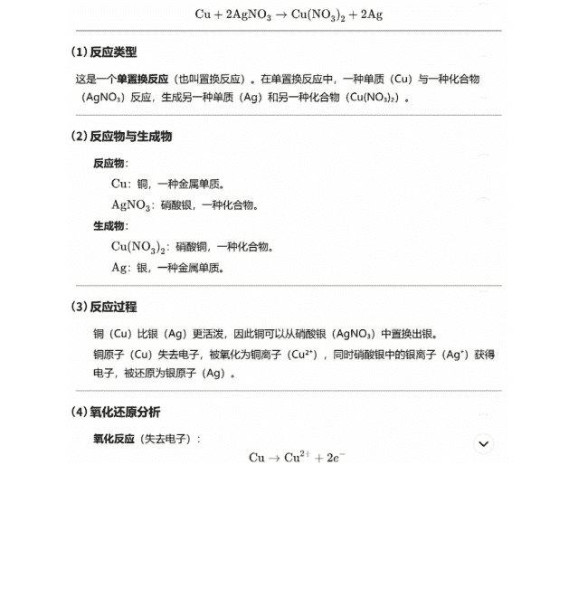
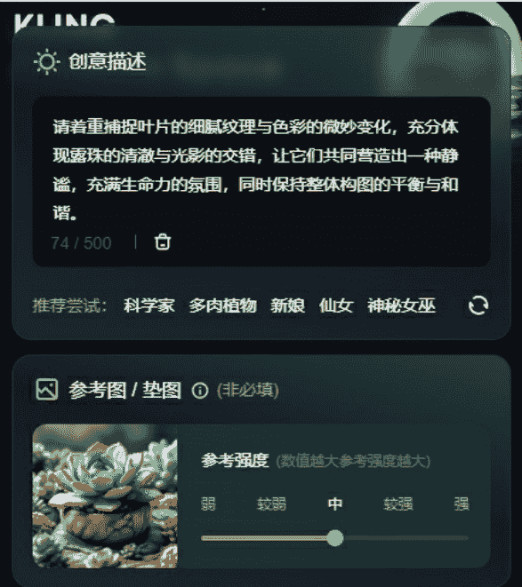
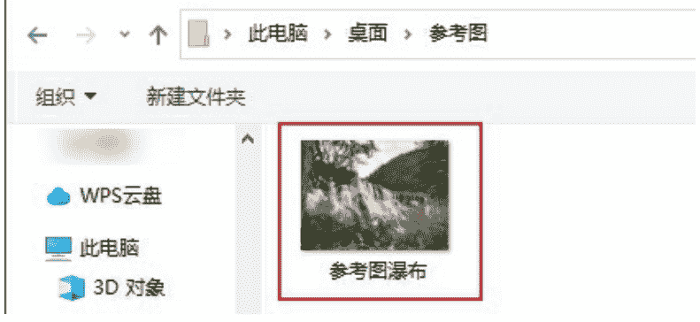
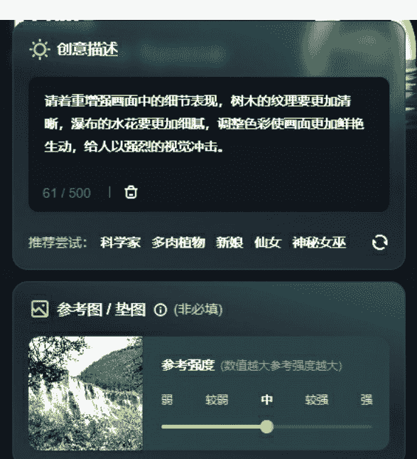
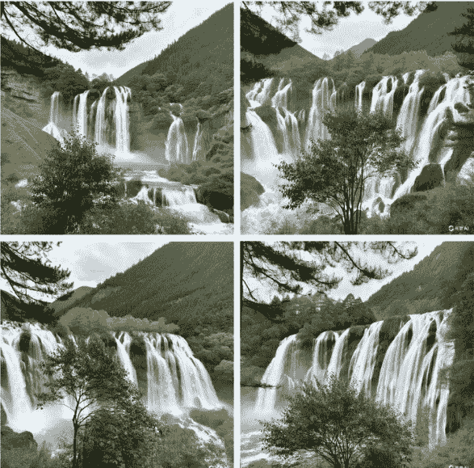

# AI导师时代：学习有了全天候陪伴

## 前言

当下技术迭代加速，人工智能已经进入大众视野。上世纪五十年代概念首现，历经半个多世纪演化，如今已形成可触达的应用生态。各类行业都在被重塑，从日常消费场景到生产环节都能感受到它的渗透。教育同样在迎来重构，传统课后自学常因思路受阻、练习匮乏而效率偏低，借助人工智能这些痛点明显缓解。合理使用相关工具，学习者仿佛拥有全年在线的陪读导师，难题可以被快速拆解。人工智能突破了既有技术的边界，让定制化学习与即时反馈成为常态，整体体验更为丰富。依靠文本解析能力，学生能够实现词汇的高效内化与创意的生成，写作水平明显提升。借助自然语言处理，系统可以从海量文本中抽取语言模式与表达范式，给出个性化的写作点评与修改建议，进而激发灵感与思维。理科方向，大数据分析与图像识别为辅导提供了系统支撑，无论文字阐释还是图形解析，提交题目后即可获得深度剖析、科学解题思路与知识点串联。

本书探讨人工智能与现代教育结合的可能性，思考如何为传统自学注入新活力。全书共七章，覆盖文科到理科、语言到艺术，系统描绘人工智能在各学科中扮演超级导师的形态。第一章回顾人工智能时代的到来及其对学习方式的重塑，自动化辅导、实时答疑、个性化推荐让学习更轻松高效。第二至五章深入文科、理科、演讲、英语等领域，展示人工智能如何帮助积累知识、提升技能、进行创作与表达。第六章聚焦艺术教育，呈现人工智能对创作灵感激发与审美提升的推动。第七章说明人工智能如何让学习过程更具趣味性，激发创造力与好奇心。作为超级导师，人工智能具备强大的数据分析与自学习能力，能够依据每个学生的具体情况量身定制内容，发现薄弱环节并给出针对性指导。

本书意在全面呈现人工智能教育的应用图景，帮助读者理解前沿技术在教育领域开创的可能。如今人工智能已不仅是工具，更是教育变革的推手。未来学习旅程中，人工智能将成为每个人的超级导师，引领走向更智能、更个性化、更具创造力的新时代。为真实呈现工具的工作状态，本书对人工智能生成内容未作修改，其中难免存在疏漏，敬请理解。

### 第1章

#### 智能导师的雏形

在新兴技术的加持下，人工智能宛如一名超级导师，能够显著提升自学效率并改善体验。面对传统自学中常出现的个性化路径缺失、解答滞后、练习缺乏自适应等难题，人工智能导师能够逐一破解，涵盖路径定制、即时问答、自适应测评等。

##### 1.1 人工智能简史

人工智能是借助人工方法推动产业进步与社会发展的全新方向。对其探索可追溯至先秦，典籍记载巧匠偃师曾献人偶于周穆王；古希腊亚里士多德在《工具论》中提出的相关思想，被后世视为布尔代数的雏形。现代意义的“人工智能”在二十世纪中叶正式出现，随后数十年取得瞩目进展。

1943年，沃伦·麦卡洛克与沃尔特·皮茨首次尝试模拟人脑智能功能，为人工智能奠定基础。同期，加拿大心理学家唐纳德·赫布在心理学领域的突破也为理论提供了支撑。1950年，阿兰·图灵发表《计算机器与智能》，提出图灵测试，成为里程碑。1955年，约翰·麦卡锡提出“人工智能”概念，并在次年达特茅斯会议上确立学术地位，标志着从概念到研究转化的起点。如图1-1所示。

1959年，亚瑟·塞缪尔提出“机器学习”概念，倡导机器自我学习成长，为后续发展奠定技术基础。随后二十世纪七十年代因技术瓶颈与资金短缺进入“寒冬”，众多机构陷入困境。

二十世纪八十年代，专家系统推动人工智能重获活力，通过将专家知识编码入计算机解决复杂问题。象棋领域取得突破，1989年程序“深蓝”“HiTech”战胜多位国际大师，IBM“深蓝”更成为首个战胜棋王的系统，证明人工智能在特定领域的强大潜力。如图1-2所示。

进入二十一世纪，大数据、云计算、物联网等技术加速人工智能演进，深度学习成为核心能力。人工智能不再局限于单一领域，快速扩展至医疗、金融、教育、制造等，成为社会进步的重要驱动力。

相较传统技术乃至人类本身，人工智能具备多项难以替代的特质。交互性上，用户可通过自然语言与系统流畅对话，接近人际交流。创造性上，系统可在短时间内全网检索并归纳提炼，形成更具价值的创新内容。学习性上，长期使用后系统会更熟悉用户思维与提问习惯，不断完善体验。智能决策性上，用户上传分析需求后，系统能在极短时间内完成综合分析，将原本需长时间的人力工作压缩至数分钟。

##### 1.2 学习体验的革新

信息爆炸时代，学生学习方式发生深刻变化。人工智能迅速融入教育，成为得力助手。借助相关技术，学生仿佛拥有一位超级导师，学习更省力便捷。

人工智能可提供高度个性化的学习体验，因每个学生的习惯、基础、兴趣各异，传统模式难以兼顾。人工智能赋予更大自主学习空间，借助智能助手可在家或任意地点随时学习。时间灵活提升便利性，有助于更高效管理学习。学生可在晚间或周末复习，不受固定课时限制。这种自主选择模式让深度学习在舒适环境中展开，推动创造力提升。

### 第2章

#### 文科学习的AI陪跑

借助DeepSeek等工具，学生能有效辅助文科学习，水平持续提高，犹如拥有人工智能超级文科导师。

本章以DeepSeek为例，说明人工智能如何提升文科成绩。

##### 2.1 字词积累、文言文、古诗词

###### 2.1.1 字词积累

合理使用DeepSeek如同获得超级文科导师，尤其在字词积累方面帮助显著。

DeepSeek具备强信息处理与数据分析能力，能快速整理大量字词信息。学生通过互动即可获取字词释义、用法、近义反义等详实资料，极大丰富词汇量。常见提问方式如下表所示。

表2-1 常见提问模板或提问方式

| 序号 | 模板描述 | 示例 |
| :--- | :--- | :--- |
| 1 | 概述汉字【×】的核心义项与常用用法 | 介绍汉字“胜”的基本含义和常见用法 |
| 2 | 说明汉字【×】的意义、典型用法及例句 | 汉字“爱”的含义是什么？有哪些常见用法和例句 |
| 3 | 归纳汉字【×】的不同意义并举例 | 汉字“胜”有哪些不同含义和用法？请举例 |
| 4 | 列出汉字【×】各义项并说明使用场景与例句 | 列出汉字“重”的不同义项并说明使用场景和例句 |
| 5 | 探讨汉字【×】的历史价值及古今差异 | 汉字“胜”的历史意义是什么？古代与现代用法有何不同 |
| 6 | 对比汉字【×】古今读音与意义变化 | 汉字“尽”有哪些古代与现代不同读音和意义 |
| 7 | 说明汉字【×】可充当的词性并举例 | 汉字“胜”可以作为哪些词性使用？请举例 |
| 8 | 说明汉字【×】在句中常见成分并举例 | 汉字“爱”在句子中通常用作什么成分？请举例 |
| 9 | 解析成语【××××】中【×】的含义 | 解释成语“胜券在握”中的“胜”是什么意思 |
| 10 | 说明汉字【×】在熟词成语中的意义 | 汉字“胜”在常见词语或成语中的意思是什么？请举例 |
| 11 | 列出汉字【×】的同近反义并简述 | 汉字“胜”有哪些同义词和反义词？请列出并简要说明 |
| 12 | 说明汉字【×】在特定文化背景下的象征 | 汉字“福”在中国文化中有何特殊含义或象征 |
| 13 | 说明汉字【×】在古代文献中的使用并举例 | 汉字“胜”在古代文学中通常如何使用？能否举经典文献例子 |
| 14 | 提供汉字【×】的音节与笔画数量 | 告诉我汉字“胜”的拼音和笔画数 |
| 15 | 说明汉字【×】的读音与笔画构成 | 汉字“爱”的拼音是什么？它的笔画是怎样的 |

####### 2.1.1.1 “胜”

> 问：
请详细介绍“胜”这个字，包括定义、用法等。
答：
######## 胜(shèng)
定义：“胜”是一个多义字，主要含义包括：
- （1）胜利；成功（与“败”相对）：例如：战胜、取胜、得胜、胜败乃兵家常事。
- （2）打败；超过：例如：以少胜多、事实胜于雄辩。
- （3）优美的（景物、境界等）：例如：胜景、胜境、引人入胜。
- （4）能够承担或承受：例如：胜任、不胜其烦。
- （5）古代妇女的首饰：例如：方胜、花胜。
- （6）姓氏。
用法：“胜”字用法广泛，既可作动词，也可作形容词、名词等。
- （1）作动词：
  - 表示胜利、成功：
    - 我们球队在比赛中取得了胜利。
    - 经过努力，他终于战胜了病魔。
  - 表示打败、超过：
    - 这场战役，我军以少胜多。
    - 事实胜于雄辩，真相终将大白。
- （2）作形容词：
  - 表示优美的：
    - 这里风景秀丽，是一处旅游胜地。
    - 这篇文章写得引人入胜，让人爱不释手。
  - 表示能够承担或承受：
    - 他工作认真负责，完全能够胜任这份工作。
    - 面对困难，我们要有不胜其烦的精神。
- （3）作名词：
  - 指胜利：
    - 这场比赛的胜利来之不易。
    - 我们要总结经验教训，争取更大的胜利。
  - 指优美的景物或境界：
    - 这里山清水秀，是一处人间胜境。
    - 这幅画意境深远，堪称艺术胜品。
  - 指古代妇女的首饰：
    - 她头上戴着精美的花胜，显得格外美丽。
组词：胜利、战胜、取胜、得胜、胜败、胜算、胜景、胜境、胜地、胜任、不胜、方胜、花胜
成语：百战百胜、出奇制胜、引人入胜、不胜枚举、不胜其烦、旗开得胜、大获全胜、反败为胜
例句：
- ①经过激烈的角逐，中国队最终战胜了日本队，获得了冠军。
- ②这幅画描绘了江南水乡的胜景，令人心旷神怡。
- ③他工作能力很强，完全能够胜任这份工作。
- ④面对困难，我们要有不胜其烦的精神，才能最终取得成功。
总结：“胜”字含义丰富，用法广泛，是汉语中常用的字之一。掌握“胜”字的含义和用法，可以帮助我们更好地理解和运用汉语。

####### 2.1.1.2 “缘”

> 问：
汉字“缘”在中国文化中有何特殊含义或象征？
答：
汉字“缘”在中国文化中承载着丰富的哲学思想和生活智慧，它不仅仅是一个简单的字，而是蕴含着深刻的文化内涵和象征意义。以下是“缘”字在中国文化中的一些特殊含义和象征：
- （1）缘分与命运：在中国传统文化中，“缘”常常与“分”连用，形成“缘分”的概念，指的是人与人之间或人与事物之间某种不可预知的神秘联系。这种联系被认为是前世因果的延续，是命中注定的。缘分被认为是安排人与人相遇、相知、相爱的一种超自然力量。
- （2）佛教影响：在佛教中，“缘”是核心概念之一，指的是所有事物相互依存、相互联系的关系。佛教讲求缘起性空，认为一切现象都是因缘和合而生，没有独立不变的自性。这种思想深刻影响了中国文化，使得“缘”字带有了一种宇宙观和人生观的意义。
- （3）人际关系：在中国社会，“缘”字也常用于形容人际关系的和谐与美好。例如，夫妻之间有“姻缘”，朋友之间有“友缘”，师生之间有“师缘”。这些关系都被视为一种珍贵的缘分，需要珍惜和维护。
- （4）自然与人文：在文学艺术中，“缘”字也常用来表达人与自然、人与社会之间的和谐关系。例如，诗人会赞美山水之间的“景缘”，书法家会追求笔墨与纸之间的“墨缘”。
- （5）生活态度：中国人常用“缘”来表达一种随遇而安、顺其自然的生活态度。在面对人生的得失、离合时，人们往往会用“缘”来安慰自己或他人，认为一切都是缘分使然，不必过分强求。
- （6）象征意义：在象征层面，“缘”字代表着连接、纽带和机遇。它象征着人与人之间的情感纽带，也象征着人与机遇之间的联系。在中国传统文化中，许多吉祥图案和习俗都蕴含着“缘”的象征意义，如“缘木求鱼”“缘定三生”等。
总之，“缘”字在中国文化中是一个多维度、多层次的概念，它不仅反映了中国人对人际关系的理解，也体现了对宇宙万物相互联系的认识，以及对生活哲学的深刻思考。

###### 2.1.2 文言文

DeepSeek具备文言文识别、解析与应用能力，为学习提供便利。文言文是中华传统文化载体，与现代汉语在词汇语法表达上存在差异，理解困难常见。人工智能可弥补传统教学不足，帮助掌握知识。

即时翻译功能化解阅读障碍。文言文含生僻字、通假字、古今异义词，易成阻碍。如《史记·项羽本纪》“项王军壁垓下，兵少食尽”中“壁”，人工智能可迅速释为筑营驻扎，助准确理解。还能对成语典故作深度解释，如“温故而知新”，不仅释义还结合历史背景与文化内涵深化理解。除语言层面，还提供文化背景支持，如历史事件、人物、典章制度等，有助于文意把握。

####### 2.1.2.1 《劝学》

> 问：
“青，取之于蓝，而青于蓝；冰，水为之，而寒于水。木直中绳，輮以为轮，其曲中规。虽有槁暴，不复挺者，輮使之然也。故木受绳则直，金就砺则利，君子博学而日参省乎己，则知明而行无过矣。”
请将其译为白话文，要求精准。
答：
出自《荀子·劝学》，白话译文：
青色取自蓝草，却比蓝草更深；冰由水凝成，却比水更寒。木材笔直合乎墨线，加热弯曲后制成车轮，其弯度亦合乎圆规。即使木材经暴晒干枯，也不再挺直，因加工使其如此。所以木经墨线校正才直，金属经磨石打磨才利，君子广博学习且每日反省自己，则智慧明达、行为无过。
该段以比喻强调学习与自省，指出人通过不断提升可达更高境界。翻译准确流畅，语言现代易懂，符合白话习惯。

####### 2.1.2.2 《道德经》

该译文有效保留原文“无”与“有”、常与变、玄妙的对照，尤其“宇宙万物产生之初本无名称，是无的状态”对“无名天地之始”的解读恰到好处，传达道家“无”的思想。个别词句略显平直，总体忠实原意，语言清晰，对自学文言文具参考价值。

DeepSeek 让古文学习与写作变简单

不少同学在初次让 DeepSeek 把《道德经》第一章转成白话后，仍觉得有距离感。这时只要追问一句“能不能再直白点，我好懂些”，模型就会给出更贴近日常的表述。

针对“道可道，非常道；名可名，非常名。无名天地之始，有名万物之母。…”的提法，模型先给出一次精准的白话对照：能讲出来的道不是恒常之道，能起名的名不是恒常之名；无名是天地初始，有名是万物之源。所以常从无去体悟道的玄妙，常从有去体察道的端倪，二者同根而异称，都可归为玄，玄而又玄，是诸般奥妙的入口。随后说明此段点出了道的不可言说、无与有的作用以及同源关系。

再进一步要求“再直白些”，模型就把语气放得更松：能用语言说出的道，并非永恒不变的道；能用名字标记的名，也不是永恒不变的名。无是天地起点的状态，有是万物展开的开始。从无中能看出道的妙处，从有中能看出道的痕迹。无和有是一体两面，名字不同而已，都十分深奥，是一切奥秘的根源。总结来说，真正的道超出了语言概念，无与有是认识世界的钥匙，看似对立实则一体。

从这次对话能看出，DeepSeek 既能忠实传达老子“不可言说”“无有同源”的核心，又能在学生要求下把意译写得更流畅，适合入门把握大意。

###### 2.1.3 古诗词
在当下学习古诗的场景里，DeepSeek 能把困惑拆解清楚。它的快速归纳与推理能力，让学生迅速拿到字词解释、艺术手法、诗人生平与创作背景等要点。遇到不懂处可以直接提问，也能把相关资料丢进去让它综合判断，实现更立体的理解。

句子翻译类的常见提问有：
- 把“床前明月光，疑是地上霜”换成现代说法。
- “无可奈何花落去，似曾相识燕归来”具体指什么？
- “大漠孤烟直，长河落日圆”怎么说成白话？

意境分析类的提问有：
- 《静夜思》流露出怎样的情绪？
- “无可奈何花落去，似曾相识燕归来”表达了什么心境？
- “床前明月光，疑是地上霜”的画面该如何体会？

####### 2.1.3.1 《登鹳雀楼》
> 《登鹳雀楼》
王之涣 唐
白日依山尽，黄河入海流。
欲穷千里目，更上一层楼。

先让模型做现代汉语转换，得到：夕阳挨着山势慢慢落下，黄河滚滚奔向大海。要想看得更远，就再往上登一层。

追问创作背景与心境后，模型补充了时代与个人层面的解读。诗作于初唐盛世，社会安定，文人更倾向自然与精神的融合。王之涣身为官宦，登高远眺的描写既是写景也是写心。

解读可分为三层：
（1）视野开阔，心怀辽远。首句以落日铺开壮阔场面，次句以入海之河展现自然浩荡，映出诗人胸中追求广阔的理想。
（2）进取向上。末句“欲穷千里目，更上一层楼”表面是登高，实指不断攀升境界，象征对更高目标的向往与探索精神。
（3）豁达开朗。全诗借自然景象折射内心的宽旷与乐观，体现不惧前路、勇于向前的信念。

经过追问，答案更完整，让学生能多角度理解这首绝句。

####### 2.1.3.2 《送杜少府之任蜀州》
《送杜少府之任蜀州》
王勃 唐
城阙辅三秦，风烟望五津。
与君离别意，同是宦游人。
海内存知己，天涯若比邻。
无为在歧路，儿女共沾巾。

先让模型翻译白话，得到较为规范的版本：长安城雄伟，三秦环绕；遥望蜀地，风烟弥漫，五津隐约。与君惜别的心情相同，都是为宦游漂泊之人。海内有知己，天涯也如比邻。别在路口不必像孩子般垂泪。

觉得偏程式化后要求口语化，模型调整为更贴近生活的说法：长安城高大，三秦之地环绕；远望蜀州方向，风烟缭绕，五津渡口若隐若现。今天分别心里都不好受，本来就是为了工作四处奔波的人。只要有真朋友，隔得再远也像邻居一样近。别在分手路口哭哭啼啼，把手帕都弄湿了。并点出核心是朋友心连心，没必要过度伤感，如今微信电话随时可联，距离已非问题。

若对杜少府本人好奇，模型会做知识拓展。杜少府是唐代县尉的雅称，此处指将赴蜀州任职的友人。身世说法不一，有人说是开国功臣杜立德之子，有人认为是杜审言即杜甫祖父。诗中可窥其豁达重情。赴任时值盛唐，蜀州为西南重地，赴任既是公务也是文化之旅。王勃为其作诗，成为千古佳话，也启示后来者保持乐观、珍惜友情。

##### 2.2 提升写作能力好助手
学生借助 DeepSeek 能在构思、表达、结构与修改上获得明显帮助。

###### 2.2.1 创作灵感
最直接的体现是灵感供给。把写作想法告诉模型，就能获得思路和论据。

常用提问模板：
- 我要写一篇关于【主题】的议论文，请给有说服力的论点与论据。
- 请提供【主题】的背景资料，帮我搭建作文框架。
- 想描写【人物/景象/事件】，能给点灵感吗？
- 写【主题】时应避免哪些常见失误？
- 如何写出关于【主题】的感人文章，需要哪些情感元素？
- 写【主题】的创意作文怎样更具想象力与艺术感？

示例一题目《当科技遇上传统：在现代社会中守护文化遗产的挑战与机遇》，要求结合现实、分析机遇与挑战、给出平衡看法。模型给出的思路围绕敦煌数字保存、故宫 VR、博物馆 3D 打印等正向案例，也点出过度数字化导致忽视实物、声光电滥用破坏氛围等风险，并以苏州园林、西安碑林的实践说明科技应为守护者而非替代者，最后强调科技与传统互养。

示例二题目《如果我能穿越时空，带着今天的智慧回到过去》，模型建议虚构回光绪年间的天津机器局，从管理、军事、情报等方面展开，结合人性局限与历史必然，引导思考时间意义，并以张謇、詹天佑等“时代穿越者”收束。

###### 2.2.2 内容优化
完成初稿后，若感觉不够满意，可交给 DeepSeek 做归纳与深度分析。模型会快速定位问题并给出针对性修改建议，直击痛点。

以《那一刻，我懂得了责任》为例，初稿写到小学班级活动后收拾教室、听到急促脚步声……提交后模型可从立意深化、细节丰满、语言精炼等方面提出优化方向，帮助文章更上层楼。

##### 2.3 历史知识整理归纳
用 DeepSeek 梳理历史知识能大幅提升效率，并让学习不枯燥。

###### 2.3.1 生成历史人物生平时间轴
第一步，提前收集权威资料并保存。
第二步，把整理好的文字复制或上传给 DeepSeek。
第三步，让模型归纳成清晰的时间轴，便于记忆。以司马迁为例：


####### 司马迁生平时间轴

**早年经历**

**西汉景、武年间**：司马迁出生于黄河龙门的一个小康之家。祖父司马喜用四千石粟米换取九等五大夫的爵位，全家得以免于徭役。

**幼年**：在父亲司马谈的指导下习字读书，十岁时已能阅读诵习古文《尚书》《左传》《国语》《系本》等书。

**汉武帝建元年间**：司马谈到京师长安任太史令，司马迁留在龙门老家，继续耕读放牧的生涯。

**学游天下**

**二十岁**：司马迁开始游历天下，从长安出发，经过武关、襄樊、江陵、九疑山、庐山、钱塘、会稽、吴、姑苏、淮阴、临淄、曲阜等地，考察各地文化，搜集逸闻古事。

**回朝为官**

**司马迁人生轨迹概览**

* 公元前111年 元鼎六年：随汉武帝东巡至缑氏，随后被派往西南规划新设郡县，安抚邛、莋、昆明诸部。
* 家学传承
* 公元前110年 元封元年：司马谈因身体欠佳缺席封禅大典，弥留时嘱托子嗣完成史书编撰，司马迁当即表态继父志业。

图2-4 司马迁生平时间轴

把材料上传给 DeepSeek 后，时间线很快被整理成紧凑的年表，便于快速浏览与记忆。

### 2.3.2 核心要点提炼方法

DeepSeek 在历史知识的归纳整理与关键信息抽取上具备实用价值。历史教学常因人物、事件、背景繁多而让学习者感到吃力，借助该工具能够抓住主线并理清事件之间的联系。

实际使用时，可把薄弱或难懂的内容发送过去，借助文本分析功能迅速提取要点，形成简明概括，便于理解。如图2-5、图2-6、图2-7 所示。

以法兰西大革命为例，模型先归纳动因，如启蒙思想的传播；再梳理进程，像巴士底狱被攻破、路易十六被捕处决等关键节点；最后总结后果，像法国社会结构的变化与拿破仑的崛起。通过这种方式，避免在海量信息中浪费时间，掌握核心内容。

开元盛世亦称开元之治，是唐玄宗在位时达到的鼎盛期。玄宗即位后开展一系列改革，起用姚崇、宋璟等贤能，整顿官僚系统，行政效能大幅提升，国力达到历史新高。

政治层面，玄宗对政府架构进行系统性调整，修订法令，强化对官员的考核，提升治理能力。经济上遏制豪强兼并，释放劳动力，改革食封制度，既增财政收入又减轻民众负担，同时约束佛教扩张，将资源转向农业生产。军事上改进兵制，边疆大面积推行屯田，并在东北新设黑水都督府、室韦都督府等机构，东北地区首次被纳入中央有效管辖。

文化教育得到高度重视，通过倡导儒学、节制佛教培养大量人才。玄宗亦注重与周边民族改善关系，促进多民族文化交流与社会经济发展。彼时各领域均有显著成就，形成“三年一上计，万国趋河洛”的盛况，各国使节络绎不绝。

开元时期经济繁荣程度空前，天宝年间全国人口突破八千万。商业贸易兴旺，交通网络完善，长安、洛阳、广州等大都市汇聚波斯、大食等地的商旅，中外商贸往来频繁，呈现出繁荣景象。


陈桥兵变别名陈桥驿兵变，是赵匡胤于960年发动并终结后周、建立宋朝的军事政变。959年柴荣逝世，七岁的周恭帝即位，赵匡胤与石守信、王审琦等掌控军权。960年正月初一，流言称契丹联合北汉南下，宰相范质未作核实便令赵匡胤北上御敌。行至陈桥驿，赵匡胤与赵普密谋，部将为其加黄袍拥立。随后回师开封，石守信、王审琦开门迎接，迫使周恭帝禅位。即位后国号定为宋，首都在开封，并以节度使酬谢石守信等人。此役终结五代十国的动荡，开启宋朝时代。


文艺复兴是14至16世纪欧洲的思想解放与文化潮流，标志着中古向近世的转变。该潮流最先在意大利兴起，随后扩散到西欧各国，16世纪达到高峰，推动欧洲文化、艺术、经济与科技全面发展。

####### 历史背景
文艺复兴与中世纪晚期的社会经济文化变迁密切相关。11世纪后欧洲经济复苏，城市兴起，生活水平提高，人们开始追求世俗生活的乐趣。这种趋势与天主教会的禁欲主义相悖，尤其在14世纪意大利城市经济繁荣之际，市民与世俗知识分子对教会神权及其虚伪的禁欲主张产生强烈不满。

####### 意大利的兴起
意大利是该潮流的发源地，具备独特条件。各城邦经济繁荣，佛罗伦萨、威尼斯等城市工商业发达，积累大量财富。这些城市的富商与贵族成为艺术文化的主要资助者，推动人文主义传播。同时意大利是古罗马文化发源地，保存大量古典遗存，为文艺复兴提供丰富文化资源。


##### 2.4 史料翻译效率提升

借助 DeepSeek，学生在史料翻译方面的效率明显提高。传统翻译需要语言功底并深入理解原文的历史、文化背景与时代用语，对学生而言挑战较大，该工具大幅简化了流程。

###### 2.4.1 文言速译

DeepSeek 具备较强的分析与检索能力，面对晦涩典籍，学生无需担忧，可把内容发送给系统完成段落速译。

提问公式：【文言原文】+【翻译要求】+【可选附加信息】。

提问模板示例：“学而时习之，不亦说乎……”请译为现代汉语，要求准确流畅，并体现原文韵味。

“山川之美，古来共谈。高峰入云，清流见底……”请译为现代汉语，要求语言优美，传达意境。

“道之以德，齐之以礼，有耻且格……”请译为现代汉语，尽量保留原句结构，并突出教育意义。

“先天下之忧而忧，后天下之乐而乐……”请译为现代汉语，要求简洁明了，并传达深刻内涵，适用于当代语境。

下表列出实践中应避免的错误示例，见表2-2。

表2-2 文言段落速译常见错误

| 错误编号 | 提问示例 | 主要问题 |
| :--- | :--- | :--- |
| 1 | 请帮我把一段古文译成现代汉语，要求简洁明了 | 未提供具体文言内容，AI 无法执行任务 |
| 2 | 请将以下文言文译成现代汉语：“学而时习之，不亦说乎？”要求译得生动有趣 | “生动有趣”要求过于主观，难以量化，可能导致结果偏差 |
| 3 | 请将以下文言文译成现代汉语并说明历史背景。原文：“锲而不舍，金石可镂。”翻译要求：语言简洁。附加信息：我最近对古文很感兴趣，想多了解一些 | 附加信息与翻译任务无关，属于冗余干扰 |
| 4 | 请将以下文言文译成现代汉语，要求既保留修辞手法，又通俗易懂。原文：“高山流水，知音难觅。”但译句不要太长 | “保留修辞”易导致句子冗长，与“通俗易懂”“不要太长”要求矛盾，难以兼顾 |
| 5 | 请翻译这段古文 | 未明确翻译方向，可能被误解为从现代汉语译成文言文 |

####### 2.4.1.1 《尚书·牧誓》

如图2-8所示。

> 问：
【《尚书·牧誓》原文节选】+请将上述《尚书·牧誓》内容译成现代汉语，要求言简意赅、表达清晰、意思完整，并能侧面体现原文深刻内涵。

周武王率领三百乘战车和三百名勇士，在牧野与商纣王决战，史称《牧誓》。甲子日黎明，武王抵达商都郊外的牧野，发表誓词。他左手持黄钺，右手执白旄，挥动旗帜，说道：“远道而来的西方诸侯！”随后武王说：“啊！我友邦的君主与官员们，司徒、司冢、司空，各位将领，千夫长、百夫长，以及庸、蜀、羌、鬯、微、卢、彭、濮的勇士们，请举起戈、摆好盾、竖起矛，我要宣誓了。”

这段誓词简洁有力，展现了武王在决战前的动员与决心，体现了古代战争中的纪律与团结精神。

图2-8 《尚书·牧誓》

####### 2.4.1.2 《滕王阁序》

如图2-9所示。

> 问：
【《滕王阁序》原文节选】+请将上述《滕王阁序》内容译为现代汉语，要求语言流畅、用词准确。

豫章为古郡名，洪都为新设府城。此地星宿对应翼、轸，地理上连衡山庐山。襟三江而带五湖，控蛮荆而引瓯越。物产丰饶如天上珍宝，龙光映于牛斗之间；人杰地灵，徐孺子令陈蕃倒悬床榻。雄伟城池如云雾排列，才子如星辰奔驰。城处夷夏交界，宾主皆东南英杰。都督阎公声望崇高，仪仗远来；宇文新州风度出众，车驾暂驻。正逢旬休之日，良友云集；千里相迎，高朋满座。文章辉煌如蛟龙腾空凤凰起舞，孟学士为文坛宗师；武略高超如紫电青霜，王将军为武库翘楚。家父在此任职，我途经此胜地；年少无知，有幸参与盛会。

时值九月，深秋季节。积水退尽，寒潭清澈；烟光凝聚，暮山呈紫。驾车于高路，探览崇山峻岭。抵达滕王阁的长洲，登上宛若天人之居的旧馆。层峦叠翠直插云霄，飞檐流丹似悬空中。鹤栖汀洲，雁集沙汀，尽显岛屿曲折；桂构宫殿依山而建。

推开雕花门，俯瞰华屋。山原辽阔尽收眼底，江河蜿蜒令人惊叹。屋宇遍地，皆钟鸣鼎食之高门；船只满泊，皆华丽装饰之舟。云开雨霁，天空澄明。落霞与孤鹜齐飞，秋水与长天一色。渔舟傍晚唱歌，声传彭蠡湖畔；雁阵惊起寒风，鸣声远至衡阳水边。

图2-9 《滕王阁序》

###### 2.4.2 破解古今字义

汉字在漫长发展中形成灿烂文化，许多字义多样，部分古今含义差别较大。学习中常因字义变化产生困惑，利用AI可帮助准确理解汉字并探寻其文化底蕴。

####### 2.4.2.1 字形拆解

DeepSeek可帮助学生进行字形解析，通过分析结构了解字义及演变规律。

案例：汉字“木”。

问：请从字形角度详细解析汉字“木”的含义。

答：汉字“木”为象形字，字形与意义紧密相连。分析其字形可更好地理解含义及演变。

（1）字形解析
“木”字的甲骨文、金文、小篆均如树形：
树干：中间一竖代表树干，象征主体。
树枝：上部分叉代表枝干，向两侧伸展。
树根：下部分叉代表根系，向下扎入土地。

（2）含义解析
“木”本义指树木或木材，字形直观反映自然形态。发展后引申出多义：
树木：自然植物，如松木、柳木。
木材：加工后材料，用于建筑家具，如木板、木料。
木制品：用木材制成的器物，如木椅、木桌。
五行之一：传统文化中为五行之一，象征生长勃发。
性格特征：引申为“木讷”，形容朴实迟钝。

（3）字形演变
甲骨文：形似带干枝根之树，极形象。
金文：略作简化，仍保留树形。
小篆：规范化，线条整齐，仍可辨树形。
隶书楷书：逐渐简化，象形特征减弱，但结构清晰。

（4）文化内涵
“木”字承载丰富内涵，树木象征生命、成长与自然力量。作为五行之一，与东方、春季、青色等概念相关，体现古人对自然的理解与哲学思考。

总结：由字形解析可知，“木”字本义与树木紧密相关，字形直接模拟树形。随着发展，含义不断扩展，在文化中占有重要地位。

向DeepSeek下令“请从字形解析汉字‘木’的含义”，系统从甲骨文形体到文化关联，甚至扩展到五行学说，使学生全面了解“木”的文化意蕴。

### 第3章 AI理科辅导

谈到理科学习，许多学生感到头疼，有些人为了攻克一道数学题绞尽脑汁，长时间与题目“死磕”。有了DeepSeek的辅助，就像有一位24小时在身边的导师，遇到难题只需求助，许多问题便能迎刃而解。

#### 3.1 理科难题全解析

在数学各板块中，几何一直是难度较高的部分，对逻辑思维和空间想象要求高，很多学生在解答时感到困难。借助DeepSeek，理解图形、解答几何题不再困难。

##### 3.1.1 方程组

习题一

DeepSeek 理科通关实录：从解题演示到个性化出题

```
2x+3y=11
4x-y=1
```
例题：求解下列二元一次方程组并给出推理过程。
2x+3y=11
4x-y=1
解答要点：二元一次方程组一般可用代入或加减消元，这里采用加减消元先消去 y。
首先把第二个式子整体乘以 3，使 y 系数互为相反数，得到 12x-3y=3。
再与第一个式子相加，3y 与 -3y 抵消，得到 14x=14，于是 x=1。
把 x=1 代回 4x-y=1，可得 4-y=1，解出 y=3。
最终答案 x=1，y=3。回代验证：2×1+3×3=11，4×1-3=1，均成立。

解析说明：DeepSeek 将两式统一为含 3y 的形式先求出 x 再求 y，流程紧凑，并给出回代检验，保证结果可靠。

第一例

```
4x+3y=3
3x-2y=15
```
例题：求解以下方程组并说明思路。
4x+3y=3
3x-2y=15
解答要点：这是典型的二元一次求解问题。可先通过系数处理实现消元。
把第一式乘以 2 得到 8x+6y=6，第二式乘以 3 得到 9x-6y=45。
两式相加消去 y，得到 17x=51，故 x=3。
将 x=3 代入 4x+3y=3，得 12+3y=3，解得 y=-3。
解为 x=3，y=-3。代入原式检验：4×3+3×(-3)=3，3×3-2×(-3)=15，正确。

整体思路清晰，先对系数做预处理形成相反数，再加减消元求一元，最后回代求另一元并检验，符合规范。

第二例

```
y=2x-5
5x+2y=8
```
例题：求解方程组
y=2x-5
5x+2y=8
解答要点：第一式已显式表达 y，适合用代入法。
把 y=2x-5 代入第二式，得 5x+2(2x-5)=8。
化简为 5x+4x-10=8，进而 9x=18，得到 x=2。
回代到 y=2x-5 得 y=4-5=-1。
解为 x=2，y=-1。检验：2×2-5=-1 成立，5×2+2×(-1)=8 成立。

方法选择明确，利用显式表达式降维求解，再回代验证，符合标准流程。

##### 3.1.2 概率题
DeepSeek 可处理概率与统计类问题，涉及必然、不可能、随机等概念，并给出解释。

第一例
问题：袋中有 5 个红球、3 个蓝球，随机取 2 个，求两球皆为红球的概率。
分析：总球数 8，总取法数 C(8,2)=28。红球取法数 C(5,2)=10。
概率 =10/28=5/14≈0.357。计算使用组合公式，步骤正确。

第二例
判断下列事件的类别。
其一，乘公交到路口遇到红灯；其二，将铁块投入水中浮起；其三，任选 10 人至少有 3 人同月出生。
结论：其一为随机事件，受车流时段影响不确定；其二为不可能事件，普通铁块密度大于水会下沉；其三为必然事件，按鸽巢原理 10 人分布到 12 个月必出现至少 3 人同月。

##### 3.1.3 追及与相遇问题
高中物理中追及相遇关注两物体是否在同一时刻到达同一位置，需要结合运动公式与逻辑推理。

第一例
甲车匀速 10 米/秒，乙车初速为零、加速度 4 米/秒²同向追赶。求追上时间及追上前最大间距。
设追上时间为 t，位移相等：10t=0.5×4×t²，解得 t=5秒。
最大间距出现在速度相等时，t₀=10/4=2.5秒。
此时甲位移 25 米，乙位移 12.5 米，间距 12.5 米。

第二例
一车时速 60 公里，另一车反向时速 80 公里，两车相距 210 公里，求相遇时间。
相对速度 140 公里/小时，时间=210/140=1.5 小时。

第三例
货车 28.8 公里/小时即 8 米/秒在平直轨道行驶，后方 600 米处快车 72 公里/小时即 20 米/秒靠近，刹车后可滑行 2000 米停下。
快车滑行距离远大于初始间距，会追上货车，结论为会相撞。

DeepSeek 在三题中均先明确已知未知，再按物理关系逐步推导，思路清晰。

#### 3.2 理科习题模拟练习
借助模型可实现个性化理科练习。勤练是理科提升关键，模型能按个人情况快速生成大量题目。

##### 3.2.1 DeepSeek 出题常规提示模板
让模型出题时，明确学科、知识点、题型与难度可提高精准度。常见的提示思路包括：
- 指定学科基础知识并举例具体知识点；
- 生成一套难度适中的基础练习，覆盖核心概念；
- 要求进阶练习，聚焦特定知识点且难度提升；
- 请求专项练习，设定难度等级并限定内容范围；
- 指定选择、填空或解答题型并限定知识点；
- 组合多种题型如证明与计算，明确涉及内容；
- 设计模拟测试，难度参照期末考试并覆盖模块；
- 生成涵盖各模块的综合练习，难度适中；
- 要求难题并附详细解答与思路；
- 指定知识点难题并提供解题思路与步骤；
- 设定完成时限的高难度练习；
- 要求限时挑战性计算题；
- 涉及两个学科的复习题并限定内容；
- 跨学科综合练习，难度适中；
- 说明薄弱环节请求针对性练习以提高；
- 强化某知识点的专项练习以加深理解。

##### 3.2.2 针对性题目的提问模板
用户可提供学习阶段、水平、薄弱点等背景，获得高度个性化练习。有效提问要点是提供充足上下文，明确学习目标、已掌握内容、需强化的部分及题型难度。

原则包括目标明确、需求具体、指明题型与难度。例如说明为复习某知识点、提升技巧或备考；详细描述进度与薄弱环节；说明偏好题型与难度等级。如此模型能生成更贴合个人需求的题目，提升学习效率。

精准提问，才能拿到理想练习

要让模型给出匹配的练习，先把自己的学习状态说清楚。需要交代当前年级与学科、已学进度、知识掌握程度，指出学习重点、薄弱点或目标。随后明确想练习的具体知识点或能力，是为了巩固、提升还是测验。

提问时注意这几点：目标具体，避免空泛；一次不要提出过多要求；提供必要的背景信息；根据自身节奏灵活调整题目数量和出题频率，可参考下面的出题提问范式。

表3-2 DeepSeek针对性出题提问模板

| 模板编号 | 模板内容 | 示例 |
| :--- | :--- | :--- |
| 1 | 作为【年级/学科】的学习者，【已掌握知识】已能熟练运用，然而【待熟悉知识点】仍不清晰，希望获得【难度】级别的练习题 | 我在高一阶段学习，代数基础已经基本吃透，二次函数的图像和性质却常常混淆，能否提供几道中等难度的练习 |
| 2 | 目前学到【某个知识点】，想借助练习提升在【相关领域】的解题能力，可否提供针对性的题目 | 我现在学到高中物理的力学部分，希望通过练习增强牛顿定律的应用能力，能否出几道相关的计算题 |
| 3 | 【某个领域或知识点】是我比较卡壳的地方，能否安排一些题目帮我加固理解 | 化学里的氧化还原反应我总感觉吃力，能否提供相关题目帮助我夯实这一块 |
| 4 | 【某个领域】整体偏弱，尤其【具体知识点】掌握不牢，请给出适合我水平的练习来补足 | 初中几何是我相对薄弱的部分，特别是三角形的全等与相似，请出几道适合练习的证明题 |
| 5 | 想重点训练【具体题型】，比如【选择/填空/解答】，难度设定为【简单/中等/较难】 | 我想做一些初中代数的选择题，难度中等，用来巩固一元一次方程的解法 |
| 6 | 麻烦提供几道【题型】，难度适中，用于加深对【知识点】的理解与掌握 | 请出几道物理力学中的计算题，难度适中，帮助我理解动能定理 |
| 7 | 结合我现阶段的学习进度，出几道【学科】题目，难度【简单/中等/较难】，用于巩固【具体内容】 | 按照我现在的高中数学进度，出几道关于三角函数的题目，难度中等，用来巩固函数的图像与性质 |

案例一，如图3-1所示。

> 问：
我是高一在读，代数基础能应付，但二次函数的图像和性质总抓不住要点，能否先出五道简单题让我练手，答案暂时不要。

好的，下面是五道围绕二次函数图像与性质的基础练习，方便你加深理解：

####### 题目 1
已知二次函数 $f(x) = x^2 - 4x + 3$，求：
- (1) 抛物线的开口方向。
- (2) 抛物线的顶点坐标。
- (3) 抛物线与 $x$ 轴的交点坐标。

####### 题目 2
已知二次函数 $f(x) = -2x^2 + 8x - 6$，求：
- (1) 抛物线的对称轴方程。
- (2) 抛物线的最大值或最小值（如果有）。
- (3) 抛物线与 $y$ 轴的交点坐标。

####### 题目 3
已知二次函数 $f(x) = x^2 + 6x + 9$，求：
- (1) 抛物线的顶点坐标。
- (2) 抛物线与 $x$ 轴的交点个数。
- (3) 当 $x = 1$ 时，函数的值是多少？

####### 题目 4
已知二次函数 $f(x) = -x^2 + 4x$，求：
- (1) 抛物线的开口方向。
- (2) 抛物线的顶点坐标。
- (3) 抛物线与 $x$ 轴的交点坐标。

####### 题目 5
已知二次函数 $f(x) = 3x^2 - 12x + 10$，求：
- (1) 抛物线的对称轴方程。
- (2) 抛物线的顶点坐标。
- (3) 当 $x = 0$ 时，函数的值是多少？

这几题能帮你更好地把握二次函数的图像与性质，有需要答案或讲解时随时提问，加油！

案例二，如图3-2所示。

> 问：
化学的氧化还原反应我总觉得吃力，能否给出五道相关练习来加固？字母请用直体表示，并且注意下角标。

可以的，下面五题聚焦氧化还原反应，帮助你稳固相关知识：

####### 题目 1
判断以下反应是否为氧化还原反应，并指出氧化剂和还原剂：
```
Zn + 2HCl → ZnCl₂ + H₂
```

####### 题目 2
配平以下氧化还原反应（在酸性溶液中）：
```
MnO₄⁻ + Fe²⁺ → Mn²⁺ + Fe³⁺
```

####### 题目 3
在以下反应中，指出每个元素的氧化态变化：
```
2Al + 3CuCl₂ → 2AlCl₃ + 3Cu
```

####### 题目 4
判断以下反应是否为氧化还原反应，并说明理由：
```
Na₂SO₄ + BaCl₂ → BaSO₄ + 2NaCl
```

####### 题目 5
配平以下氧化还原反应（在碱性溶液中）：
```
Cl₂ + OH⁻ → Cl⁻ + ClO⁻
```

希望这些练习能帮助你更透彻地理解氧化还原反应，需要答案或进一步讲解时随时说，加油！

图3-2 案例二

#### 3.3 AI助你成为实验高手

对中学生而言，学会借助 DeepSeek 辅助化学、物理、生物等理科学习，是提升成绩的重要途径。模型能即时解答疑问，也能通过多种方式增强对理科实验的理解与操作能力，从而整体提高理科水平。

学习基础理论时常会碰到繁杂公式，模型可以给出详细解释，分步拆解难点，提供多角度说明，帮助更好理解。设计实验时若不知如何开始，模型能按需求给出详细方案并提示操作要点。实验数据分析方面，也能帮助找规律、提结论。

##### 3.3.1 实验操作步骤

与模型互动能加深理化生知识的理解，也能提高记忆与操作熟练度。很多实验步骤繁琐易混，借助提示和个性化指导，记忆和熟练度都会明显提升。

若步骤繁琐，可把操作发给模型，请它用分步记忆法拆解，明确每一步并加深记忆。

> 问：
我是一名中学生，操作步骤不太熟练，请利用分步记忆法帮助我。在集气瓶内加入少量水，并将水面上方空间分为5等份。用止水夹夹紧胶皮管。点燃燃烧匙内的红磷后，立即伸入瓶中并把塞子塞紧，观察红磷燃烧的现象。待红磷熄灭并冷却后，打开止水夹，观察实验现象及水面的变化情况。

答：
第一步：准备阶段
收集材料：集气瓶、水、红磷、燃烧匙、塞子、止水夹、胶皮管。
加水：在集气瓶内加入少量水，使水面上方空间约占五分之四。
记忆提示：把集气瓶想象成五层楼的房子，水只占底层。

第二步：装置搭建
连接装置：用止水夹夹紧胶皮管，保证装置密封。
准备红磷：点燃燃烧匙内的红磷。
记忆提示：止水夹像守门员，守住胶皮管这道“球门”，红磷则是即将发射的“火箭”。

第三步：实验进行
伸入红磷：迅速把点燃的红磷伸入集气瓶。
塞紧塞子：马上把塞子塞紧，避免空气泄漏。
记忆提示：红磷像是进入“洞穴”的探险家，塞子是探险家身后的大门。

第四步：观察与等待
观察现象：注意火焰、烟雾等燃烧现象。
等待冷却：待红磷熄灭并完全冷却。
记忆提示：燃烧像火山爆发，冷却则是爆发后的平静期。

第五步：打开止水夹
打开止水夹：在红磷熄灭冷却后打开。
观察变化：观察实验现象及水面变化。
记忆提示：打开止水夹如同打开“洪水之门”，水面会随之变化。

提问后模型把整体过程拆成若干小问题和小步骤，大致分为准备、燃烧、观察、结果四个阶段，条理更清晰，自学时更易记牢学透。

##### 3.3.2 实验操作避坑指南

理科实验步骤多、知识点密，不熟悉时容易出错。实验前用模型预先了解常见误区，可有效规避失误。

###### 3.3.2.1 《高锰酸钾制氧实验》
问：
（1）操作步骤：查—装—定—点—收—离—熄。
（2）实验现象：有大量气体进入集气瓶中。
（3）实验结论：利用高锰酸钾可以制氧。
我是一名中学生，准备进行高锰酸钾制氧实验，请告诉我有哪些新手常见问题及规避方法。

答：
试管炸裂：
原因：受热不均，或结束时处理不当导致倒吸。
规避：试管口稍向下倾斜防冷凝水回流；先预热再集中加热；实验结束先移导管再熄灯。

高锰酸钾粉末进入导管：
原因：未放棉花或放置不当。
规避：试管口放一团松软棉花，阻挡粉末不影响气体排出。

气体收集不纯：
原因：过早收集或原有气体未排尽。
规避：排水法收集时等气泡连续均匀再收；向上排气法导管伸至瓶底，尽量排尽原气。

###### 3.3.2.2 《木炭还原氧化铜实验》
问：
《木炭还原氧化铜》
（1）操作步骤：把刚烘干的木炭粉与氧化铜粉混匀，小心铺入试管并固定。试管口接通澄清石灰水导管，用酒精灯加热混合物几分钟。然后先撤出导气管，待试管冷却后再倒出粉末观察现象。
（2）实验现象：黑色粉末逐渐变红，石灰水变浑浊。
（3）实验结论：碳具有还原性。
我是一名中学生，准备进行木炭还原氧化铜实验，请告诉我新手常见的坑及规避方法。

答：
药品选择与准备
药品纯度：工业纯或化学纯可能效果不佳。
规避：选用分析纯氧化铜和木炭粉。

用量比例：比例不当反应不完全。
规避：木炭与氧化铜质量比控制在1:9至1:13，最佳约1:11，总量约2克。

干燥研磨：未充分干燥或研磨不均影响效果。
规避：分别烘干并研磨至细腻均匀。

实验操作过程
试管口处理：试管口未向下倾斜易炸裂。
规避：试管口略向下倾斜。

加热方式：加热不均或温度不足反应不完全。
规避：酒精灯加网罩或改用酒精喷灯，确保充分反应。

#### 3.4 化学方程式从此不难

化学方程式体现反应物与生成物的关系，是中学化学重点。面对繁多符号和反应类型容易困惑，结合 DeepSeek 可轻松掌握。

##### 3.4.1 方程式解析方法
AI 可以解析简单或复杂的化学方程式。如图3-3所示。

> 问：
请解析如下化学方程式：Cu+2AgNO₃=Cu(NO₃)₂+2Ag。

铜的氧化态从 0 变为 +2。
**还原反应（获得电子）：**
$$\text{Ag}^+ + e^- \rightarrow \text{Ag}$$
银的氧化态从 +1 变为 0。
**电子转移：**
每个铜原子失去 2 个电子，每个银离子获得 1 个电子。为了电荷守恒，需要 2 个银离子与 1 个铜原子反应。
(5) 实验现象
铜丝或铜片表面会逐渐覆盖一层银白色的固体（银）。
溶液的颜色可能从无色（AgNO₃ 溶液）变为蓝色（Cu(NO₃)₂ 溶液）。
(6) 应用
这个反应可以用于从废液中回收银，或者验证金属活动性顺序（铜比银活泼）。
**总结**
这个方程式描述了一个典型的单置换反应，铜置换出硝酸银中的银，同时生成硝酸铜。通过分析氧化还原过程，我们可以更深入地理解反应的电子转移和化学变化。如果有其他问题，欢迎继续提问！

图3-3 化学方程式解析

##### 3.4.2 方程式配平技巧
DeepSeek 可提供配平指导。中学阶段配平很重要，借助 AI 可节省时间，或获得思路循序渐进掌握方法，也可检查已配平结果即时纠错。

案例一，如图3-4所示。
> 问：
请配平以下化学方程式：Fe₂O₃ + CO → Fe + CO₂，直接给出答案。
配平后的化学方程式为：
$$\text{Fe}_2\text{O}_3 + 3\text{CO} \rightarrow 2\text{Fe} + 3\text{CO}_2$$
**配平步骤简述**
- 平衡铁（Fe）原子：左边有 2 个 Fe，右边也需要 2 个 Fe。
- 平衡碳（C）原子：左边有 1 个 C，右边有 1 个 C，但需要调整 CO 和 CO₂ 的系数。
- 平衡氧（O）原子：左边有 3 个 O（来自 Fe₂O₃）和 3 个 O（来自 3CO），右边有 6 个 O（来自 3CO₂）。
最终配平结果为：
$$\text{Fe}_2\text{O}_3 + 3\text{CO} \rightarrow 2\text{Fe} + 3\text{CO}_2$$

图3-4 案例一

案例二
若不希望 AI 直接给答案，而是想通过引导自己学会配平，可询问配平思路并强调“不要直接给出答案”。如图3-5所示。
> 问：
我将配平该方程式C₄H₁₀ + O₂ → CO₂ + H₂O，请给我提供一些配平思路，无须直接给出答案，引导我自己算出答案。
要配平方程式 C₄H₁₀ + O₂ → CO₂ + H₂O，你可以按照以下步骤进行：
- (1) 确定反应物和生成物
反应物：丁烷（C₄H₁₀）和氧气（O₂）
生成物：二氧化碳（CO₂）和水（H₂O）
- (2) 列出各元素的原子数
反应物：碳4、氢10、氧2；生成物：碳1、氢2、氧3
- (3) 配平碳原子
反应物有4个碳，生成物需调整 CO₂ 系数使碳平衡。
- (4) 配平氢原子
反应物有10个氢，生成物需调整 H₂O 系数使氢平衡。
- (5) 配平氧原子
配平碳氢后，计算生成物氧总数，调整 O₂ 系数使氧平衡。
- (6) 检查并调整
确保各元素左右原子数相等，不等则继续调整系数。
通过这些步骤，你可以逐步配平方程式。

图3-5 案例二

案例三
做完题目后可请 DeepSeek 检查配平结果，及时纠错。如图3-6所示。
> 问：
配平前：C₃H₈ + O₂ → CO₂ + H₂O，配平后：C₃H₈ + 5O₂ → 3CO₂ + 4H₂O，请帮我检查我的配平是否正确，如果有问题请指出，便于我更正且防止再犯。
你的配平是正确的。以下是详细的检查步骤：
- (1) 碳原子平衡：
反应前有3个碳原子（C₃H₈），反应后也有3个碳原子（3CO₂）。
- (2) 氢原子平衡：
反应前有8个氢原子（C₃H₈），反应后也有8个氢原子（4H₂O，每个H₂O有2个氢原子，4×2=8）。
- (3) 氧原子平衡：
反应前有10个氧原子（5O₂，每个O₂有2个氧原子，5×2=10）。
反应后有10个氧原子（3CO₂有6个氧原子，4H₂O有4个氧原子，6+4=10）。
因此，配平后的方程式 **C₃H₈ + 5O₂ → 3CO₂ + 4H₂O** 完全符合原子守恒原则。
如果你有其他问题，随时可以提问！

图3-6 案例三

### 第4章 AI演说教练
在当代社会，学生全面发展备受重视，演讲能力对个人魅力与未来发展都很关键。以前提升演讲多靠昂贵课外班，如今借助 DeepSeek 自学也能获得24小时演说导师的督促。

#### 4.1 AI辅助演讲稿创作
DeepSeek 在提升演讲能力方面最突出的作用之一是辅助演讲稿创作。

##### 4.1.1 构建演讲大纲

DeepSeek 快速打通演讲提纲到讲稿

想用 DeepSeek 在短时间内搭出可用演讲方案，最关键的是先把背景喂饱。模型拿到主题、人群、时长、表达偏好等信息后，产出的框架才更贴合预期。一个完整框架通常会包含开场铺垫、主体论点或案例展开以及收束总结。

提问时抓住三个锚点。

先定讲什么。要把议题说清楚，而不是只丢一个词。举例：我正在筹备一场讲气候变化的分享，需要一份提纲；或者我想做未来科技主题的讲座，期望一个清晰的架构。

再定听谁听。受众决定用词深浅和案例取舍，可补充年龄层、职业背景、兴趣点。比如面向高中生做人工智能科普，希望语言通俗；听众为企业高管，主题是数字化转型，需要更专业的表述。

后定怎么讲。风格可以由人群推导，也可以直接指定，例如带启发鼓舞的基调，或正式且具说服力的商务口吻，额外要求一并写入提示。

通用提问套路可以这样组织：为“主题”拟一份演讲框架，受众为“人群类型”，预计时长“时间”，框架需涵盖“结构需求”并满足“特殊需求”。

可参考的表达方式：

面向高中生的 AI 主题分享，控制在十分钟以内，需要开场、三个核心论点和收尾，重点覆盖基础概念、未来应用与伦理问题。

准备一场面向大学生的健康饮食讲座，时长约15分钟，要包含开场、三大部分和结语，正文中希望加入真实饮食案例与研究数据。

为企业管理层做可持续发展主题，时长20分钟，开场要有吸引力，主体分三大板块，并说明企业落地的路径。

为职场新人做领导力分享，时长约8分钟，大纲里要分两块：个人领导力的建立与对团队的影响力。

案例一
提问要求为中学生做生态环境保护框架，时长30分钟，涵盖野生动物和水源保护，要求条理清晰逻辑连贯。

返回的核心框架《守护家园，从我做起》。
人群为中学生，时长30分钟。目标是提升环保认知、激发参与意识、引导绿色生活方式。
结构为：
开场约5分钟，以“你心中的理想家园是什么”互动导入，用自然美景与破坏对比的图视频引发共鸣，引出共同家园需要守护。
挑战部分约10分钟，野生动物保护介绍大熊猫、东北虎、长江江豚等濒危现状，剖析栖息地丧失、非法捕猎、气候变化等威胁，并以朱鹮保护等故事为例；水源保护讲述水资源短缺、水污染、地下水过度开采现状，点明工业废水、农业面源污染、生活污水等压力，并举一地水污染治理的成功经验。
行动部分约10分钟，树立环保意识、践行绿色生活如节约用水用电、减少一次性用品、绿色出行、垃圾分类、爱护动植物，并号召影响家人朋友参与志愿活动。
收尾约5分钟，呼吁人人有责从现在做起，展望天更蓝水更清山更绿的未来。另附演讲技巧建议与时间控制、互动、问答等提醒。

案例二
提问要求为各年龄段人群做健康饮食框架，时长15分钟，要有案例分析和结语，内容结合流行误区，讲清科学饮食习惯如何改善长期健康，字数1000。

要点为健康饮食与科学习惯。
开场2分钟问候并点明主题，说明帮助不同年龄段理解科学饮食的价值并纠正误区，概括结构。
重要性3分钟，解释蛋白质、碳水、脂肪、维生素矿物质的需求，不良饮食导致的肥胖、糖尿病、心血管疾病等长期影响，并引用统计数据。
常见误区3分钟，低脂等于健康、所有碳水都有害、节食是最佳减肥法三个误区分别拆解。
科学习惯3分钟，讲均衡、适量、多样化、定时进餐。
案例分析3分钟，约翰通过改变饮食改善肥胖和高血压，玛丽通过均衡饮食和运动控制糖尿病，张先生通过多样化与定时进餐改善消化。
结论2分钟总结并号召行动，设置问答环节。随后给出约千字的成稿，围绕开场、重要性、误区、习惯、案例、结论展开并强调世卫数据与日常实践。

案例三
提问要求为初中生做哲学领域框架，时长约10分钟，聚焦哲学起源，要求趣味性与吸引力，字数500。

框架为《探索哲学起源：开启智慧之旅》。
开场1分钟用忒修斯之船故事点燃兴趣。
什么是哲学2分钟用“什么是公平”等生活问题解释本质。
起源3分钟以古希腊仰望星空思考宇宙本质引入，兼述中国老子对道的思考，对比不同文明异同。
早期人物3分钟讲泰勒斯预测日食体现对自然规律的探索，讲毕达哥拉斯发现数学规律体现秩序追求。
总结1分钟回顾要点，鼓励保持好奇。

4.1.2 生成演讲稿内容
大纲确定后，可把框架发给模型让其填充成完整讲稿，相当于随时待命的私人导师，能在短时间内把内容整理得更有条理和说服力。

提示示例：
这是我已完成的大纲，请据此生成详细讲稿，保证连贯清晰逻辑严密。
请据大纲生成内容，并在演讲中更侧重“xx”部分，可适当扩展理论与案例。
基于此大纲生成稿件时，能否把语言调得更简洁直白？目标是让听众易懂并保持注意力。

案例一
给出气象学大纲，要求生成有吸引力的千字稿。
生成稿名为《探索气象学：揭开天气背后的奥秘演讲稿》。
以夏日晚霞、暴雨场景切入，解释温度、湿度、气压、风力如何塑造天气，说明降水形成原理与台风生成机制，回溯中国古代二十四节气与天象观察，连接现代卫星遥感和数值预报技术，最后强调气象学与农业、航空、航海及气候变化应对的关联。

案例二
基于新媒体传播大纲生成稿件，希望语言更简洁直白易懂。
生成稿《新媒体传播：开启信息新时代演讲稿》。
从爆火跳舞视频切入解释新媒体力量，通俗解释新媒体定义与传统媒体区别，讲传播快、互动强的特点，举微信、抖音、微博例子，简述从网页到社交再到短视频的演进，提出内容创作、互动回复、数据分析等实操建议，最后点出元宇宙、AI带来的新可能。

4.1.3 进一步优化演讲稿内容
大纲和初稿出来后仍可能不尽如人意。DeepSeek 整合能力强，但生成存在随机性，需要二次打磨才更贴合需求。

常用优化方向包括结构优化、风格调整、说服力提升、侧重点调整、互动性增强。

4.1.3.1 优化结构
可下达指令：
请优化这篇讲稿的结构，让各部分衔接更自然、逻辑更清晰。尤其是 xx 部分，希望层次更分明。
能否调整段落顺序，让主题过渡更流畅？

4.1.3.2 调整风格

DeepSeek 驱动的演讲稿打磨与表达力提升路径

把讲稿变得更通透、更贴近听众时，常用的操作是让模型做风格转换。把偏专业的表述转成口语白话，剔除生僻术语；再把整体语气调得更亲和，加入生活化事例与日常化描绘。这样就把生硬的文本变成易于产生共鸣的表达。

###### 4.1.3.3 提升说服力

在说服维度上可要求模型补充支撑性材料。典型指令可写成：
> “能否在现有稿件里加入更有分量的论据或真实案例？”
> “请引用知名学者的理论或观点，让内容具备更多权威感。”

###### 4.1.3.4 调整演讲内容侧重点

当章节配比需要转移时，可用下面这类提示：
> “这篇稿现在对A议题着墨较多，我想把重心转到B议题，请帮忙重新分配篇幅？”
> “请压缩对xx的讨论，把更多空间留给xxx的展开，突出主题的核心主张。”

###### 4.1.3.5 增加互动性内容

为现场注入参与感，可要求模型植入提问或互动设计：
> “在xx段落是否能加入现场互动，比如抛一个问题带动听众参与？”
> “能否在xx处设置一个引发思考的提问，让听众产生共鸣？”

##### 案例一

问：
请帮我理顺这篇演讲稿的结构，让各段衔接更自然、逻辑更清楚。特别是结尾的行动号召，我希望更有号召力。

守护绿色家园，共筑美好未来 演讲稿

亲爱的朋友们：
大家好！走在城市街头，垃圾堆积、雾霾笼罩、河水浑浊，这些都是环境在报警，保护已经刻不容缓。地球曾是森林葱郁、江河清澈、天空湛蓝的蓝色星球，如今过度砍伐、工业排污、尾气排放让生态失衡，也威胁健康。普通人并非无力，公交出行、垃圾分类、自带布袋等微小习惯即可汇聚成大力量。企业要采用清洁工艺，政府要强化监管与政策，双方协同才能守住家园。环保不是口号，需要从当下起用行动累计绿色，相信共同努力能让蓝天常在、清流重现。

答：
######## 守护绿色家园，共筑美好未来 演讲稿

亲爱的朋友们：
大家好！街头垃圾异味、天空常被雾霾遮蔽、河道浑浊漂浮，这些现象都在提醒长期忽视保护的后果，行动的紧迫性明显。曾经地球如画，森林茂密、河流见底、天空如洗；如今采伐过度导致林地缩小、动物失所，排污无序使湖泊变成臭水沟，尾气泛滥让蓝天罕见，这些危机既破坏自然秩序，也侵蚀健康未来。有人困惑环保事大个人能做什么，其实选择就在日常：公交自行车步行出行，既减排也健身；坚持分类让资源循环；购物自带环保袋减少塑料。看似微小的习惯累积即可撬动改变。这并非个人单独承担，企业要导入环保技术降低排放，政府要完善执法与政策引领可持续。唯有人、企业、政府同心，家园方能真正被守住。环保需要落到实处，让每一次小行动为地球增添绿色。当我们共同付出，蓝天白云可回归日常，清澈河水可欢快流淌，家园将焕发生机。让我们一起行动，为美好未来。

把初稿在指令约束下交给 DeepSeek 优化后，全文衔接更流畅，结尾号召的力度明显增强。

##### 案例二

问：
这篇稿目前偏向人文旅游，我想把焦点转向自然风光旅游。

你是否曾被远方风景照牵动心弦？是否在听旅行故事时心生向往？旅行像一场冒险，能打破生活单调，带来全新感受。今天就让我们走进旅行，体会它的魅力。

我至今记得第一次踏上异国的那一刻。那是在日本京都，古巷里身着和服的女子缓缓走过，樱花随风飘落，仿佛穿越时空。还有在新西兰皇后镇，坐喷射快艇穿梭激流，两岸峡谷壮美，心跳和震撼至今难忘。这些经历拓宽了视野，也改变了看世界的方式。

答：
######## 踏上旅程，遇见世界：探索旅行的无限魅力 演讲稿

你是否曾被震撼的自然大片触动，望着巍峨山脉、无垠沙海或湛蓝海面，心底油然而生向往？或者在听人讲述自然奇景时，渴望亲身置身其中？旅行是一场奇妙探险，它能打破日常，让我们领略大自然的鬼斧神工。

我忘不掉第一次登上张家界天子山观景台的震撼。石柱拔地而起，云雾缭绕，如入仙境。在贝加尔湖，冬日冰层透出彩光，宁静而纯粹令人沉醉。站在撒哈拉，夕阳下连绵金色沙丘如火似血，美得窒息。与自然的亲密接触，不仅开阔眼界，更重塑了我对世界的认知。

自然旅行的价值远不止观赏。它是对心灵的洗礼，广阔天地让烦忧消散。面对瀑布，轰鸣震耳，水花飞溅，令人直观感受到自身渺小与自然伟大。在静谧林间漫步，清新空气与鸟鸣带来深层放松，也培养出对自然的敬畏，激励我们守护珍贵资源。

如果你想开启自然之旅，可先从身边的自然景点开始。周末去近郊山林徒步，感受泥土芳香；去湖畔垂钓，享受宁静。积累经验后再探更远的独特景观。出行前了解气候地形，备好装备，避免排满行程，留白才能偶遇日出或小动物，收获惊喜。

朋友们，大自然是一本永读不完的书，每处风光都是独特篇章。世界那么大，值得走去看看。

#### 4.2 AI 制订演说训练计划

DeepSeek 能依据个人情况定制演说训练方案，供使用者挑选。操作时先进行自我审视，明确优势与短板，结合弱项提问。例如在重音控制上吃力，可请模型讲解技巧，或把练习稿发给模型分析重音与重点，目标越清晰，得到的建议越具有针对性。

##### 4.2.1 轻重音训练计划

演讲中轻重音的运用关乎重点传达，重音过度会造成听觉疲劳，声音过轻则要点不清。因此精准把控十分关键。

提问模板一：“我想在演讲中更好地用轻重音突出重点，增强感染力，能帮我制订训练计划吗？”
提问模板二：“希望提升演讲语音节奏和轻重音掌控，避免平淡，能否给些针对性建议？”
提问模板三：“想通过恰当的轻重音增强语言韵律和吸引力，能否制定提升计划？”
提问模板四：“即将参加校内演讲比赛，想加强比赛中轻重音技巧的使用，请提供训练安排。”
提问模板五：“想提高演讲语音变化性，特别是在轻重音上，请给出具体练习计划。”
提问模板六：“感觉自己轻重音掌握不好，重点词得不到强调，能否帮我制定训练方案？”

案例一
> 问：
我在演讲时希望能更好地运用轻重音来突出重点，使演讲更有感染力。能帮我制订一个训练计划吗？

答：
当然可以。以下是一周入门计划，旨在提升你对语音语调的控制，让表达更生动有力。

######## 演讲轻重音训练计划（一周）

第一天：理解轻重音的重要性
理论学习：阅读或观看关于语音语调、轻重音在演讲中作用的材料。
观察学习：观看优秀演讲视频，注意演讲者如何用轻重音强调关键信息。
日记反思：记录对轻重音运用的初步认识与体会。

第二天：基础语音练习
发音练习：练习元音辅音的清晰度，确保每个字都清晰可辨。
语调变化：练习升调、降调、平调的转换，感受语调对情感表达的影响。
录音分析：录下自己朗读一段文字，标记应加重或放轻处并尝试调整。

第三天：轻重音运用练习
重点标注：选一段稿子，用不同颜色或符号标出想强调的词句。
朗读练习：在标注处有意识地运用轻重音。
反馈调整：请家人朋友聆听或自录分析，根据反馈修正。

第四天：情感表达练习
情感词汇：找能引发特定情绪的词，练习在不同情绪下运用轻重音。
情景模拟：设定激励、讲故事、阐述观点等不同场景，练习增强感染力。

问：
我认为一周的训练计划较短，可否帮我制订为期一个月的计划，让我在演讲轻重音把控方面获得更大的提升（请帮我做成表格形式，更加一目了然）？

答：
| 周次 | 训练目标 | 训练内容 | 训练时长 | 反馈与调整 |
| :--- | :--- | :--- | :--- | :--- |
| 第一周 | 基础巩固与理论理解 | 1. 理论学习：语音语调、轻重音原理 2. 发音练习：元音、辅音 3. 语调变化练习 4. 日记反思 | 每天 30 分钟 | 自我反思日记 |
| 第二周 | 轻重音运用与初步情感表达 | 1. 重点标注与朗读练习 2. 情感词汇练习 3. 录音分析与调整 4. 家人朋友反馈 | 每天 45 分钟 | 根据反馈调整 |
| 第三周 | 情景模拟与综合练习 | 1. 设定不同演讲情景练习 2. 完整演讲稿练习 3. 视频录制与分析 4. 小组讨论与分享 | 每天 60 分钟 | 小组讨论反馈 |
| 第四周 | 模拟演讲与总结反思 | 1. 家人朋友老师面前模拟演讲 2. 反馈整合与调整 3. 总结反思日记 4. 未来规划制订 | 每周 2 次模拟 |  |

详细说明
第一周：夯实基础与理论认知，保证对语音语调和轻重音原理有清晰理解。每日进行发音与语调练习，并以日记记录进步与不足。
第二周：开始在稿件中实践轻重音并加入初步情感。通过标注朗读与情感词汇训练掌握方法，每日录音分析并征求家人朋友意见调整。
第三周：在模拟情境中综合运用轻重音，提升感染力。选用完整稿件练习并录像分析，组织小组讨论互相学习。
第四周：通过模拟演讲检验成果并总结。面向家人、朋友或老师演练，收集反馈并整合技巧，同时制定长期训练规划。

根据提问者的需求，模型先给出周计划，再延展为月计划，形成更系统的提升路径。

##### 案例二

问：
我感觉自己的演讲中轻重音掌控不够好，导致某些重点词语没有得到充分的强调。我是一名初三的学生，具有一定的演讲经验，擅长地理学相关内容，正在准备在3个月后的校园演讲大赛，根据我的具体情况，你能帮我制订一个训练计划吗？

答：
演讲轻重音掌控训练计划（3个月）

第一阶段：基础巩固与理论理解（第1—4周）
目标：巩固语音基础，理解轻重音在演讲中的作用，初步掌握运用技巧。

| 周次 | 训练内容 | 训练时长 |
| :--- | :--- | :--- |
| 1 | 理论学习：语音语调、轻重音原理及其在演讲中的应用 | 每天30分钟 |
| 2 | 发音练习：元音、辅音清晰度，语调变化练习 | 每天30分钟 |
| 3 | 录音分析：朗读地理学相关文章，分析轻重音运用并调整 | 每天45分钟 |
| 4 | 小组讨论：与同学分享心得，互相点评并提出改进建议 | 每周1次，每次1小时 |

第二阶段：地理学内容融入与轻重音实践（第5—8周）
目标：将地理学内容融入演讲，掌握轻重音在该领域的具体应用。

| 周次 | 训练内容 | 训练时长 |
| :--- | :--- | :--- |
| 5 | 地理学演讲稿撰写：选择感兴趣主题，撰写演讲稿 | 每周2篇，每篇初稿2小时，修改1小时 |
| 6 | 重点标注与朗读练习：在稿件中标注重点词语并朗读 | 每天45分钟 |
| 7 | 情感与情境融入：根据地理内容尝试加入情感与情境 | 每天30分钟 |
| 8 | 视频录制与分析：录制地理学演讲视频，分析效果并调整 | 每周1次，每次录制与分析1小时 |

第三阶段：模拟演讲与综合提升（第9—12周）
目标：通过模拟演讲检验成果，综合提升技巧，为比赛做准备。

| 周次 | 训练内容 | 训练时长 |
| :--- | :--- | :--- |
| 9 | 设定不同演讲情景练习：如课堂讲解、学术报告、辩论等 | 每周3种情景，每种练习1小时 |
| 10 | 完整演讲稿练习：选定最满意稿件进行完整演练 | 每天60分钟 |
| 11 | 模拟演讲大赛：在家人、朋友或老师面前演练并收集反馈 | 每周2次，每次演练后反馈调整 |
| 12 | 总结反思与未来规划：回顾过程，总结进步与不足，制定后续计划 | 1次，共2小时 |

注意事项
保持耐心与坚持：语音语调训练需时日，切勿急功近利，保持每日练习。
积极反馈与调整：请家人、朋友、老师或同学给予反馈，及时修正技巧与轻重音运用。
多样化练习：尝试在课堂、家庭、户外等不同环境练习，提升适应与应变能力。
注重情感表达：地理演讲不仅要准确传递知识，还要借助轻重音增强感染力。

##### 4.2.2 演讲信心提升计划

DeepSeek 如同“知心伙伴”，当学生缺乏演讲自信时，可请其制定个性化信心提升方案。提问时可用清晰模板，确保问题具体。

###### 4.2.2.1 目标+问题+需求
模板：“我希望/想要【目标】，但是【当前遇到的问题】。能否为我提供一个【类型/领域】的计划，帮助我【需求】？”

###### 4.2.2.2 目标+场景+持续时间+期望结果
模板：“我的目标是【目标】，我通常在【场景】进行演讲。请为我设计一个【持续时间】的计划，帮助我在【期望结果】方面取得进展。”

###### 4.2.2.3 问题+目标+训练方法
模板：“我在【问题描述】时遇到了困难，导致我【结果/表现不佳】。我希望通过【目标】来解决这个问题。请为我提供【训练方法】，帮助我改善这个方面。”

案例一
> 问：
我报名了学校的演讲比赛，但每次想到要站在台上演讲就感到非常紧张。我希望在比赛之前能够增强自信，确保自己可以清晰、有条理地表达我的观点。请帮我制订一个训练计划，帮助我在比赛中表现得更加自信。

答：
以下是一个为期四周的递进计划，旨在缓解紧张情绪，提升演讲技巧，最终在比赛中表现从容。

第一周：基础准备与心理建设
目标：熟悉演讲内容，建立积极自我认知。
选择主题与撰写演讲稿：确定感兴趣且能引起听众共鸣的主题。撰写结构清晰、逻辑连贯的稿件，包括引言、正文要点、反驳观点、总结与结尾。

# 演讲自信心养成与AI英语进阶指南

正向暗示训练：每天预留约五分钟做自我肯定练习，比如“我可以做好”“我的表达能打动人”。把一天里的小进步记下来并复盘，有助于自信逐渐累积。

呼吸放松训练：掌握腹式呼吸的方法，感到紧张时做几次慢而深的呼吸来舒缓。配合冥想或瑜伽，让身心一起放松下来。

第二周：表达能力打磨
目标：强化口头表达与身体语言的运用水平。

朗读录音练习：每天大声诵读演讲稿，留意语速、音量与语调的起伏。用手机记录片段，回放时审视停顿是否自然、发音是否清晰等细节。

肢体语言练习：对着镜子揣摩站姿、手势与表情是否自然有力。参考优秀演讲者的视频，吸收肢体表现的要点。

模拟演练：邀请家人或朋友作为听众试讲，获取意见。观察听众反馈，及时调整节奏和内容重点。

第三周：紧张应对与即兴表达
……

在案例一中，提问里出现了学生的部分背景，关键词集中在紧张和提升信心上，DeepSeek 给出的训练方案紧扣主题，核心是增强演讲自信心。

##### 案例二
问：
我很快要在校园里做一次演讲，评委老师会打分，我总觉得很难完美呈现，尤其面对老师和评委时容易紧张。我反应比较快，有时能临场应变，但一紧张声音就控制不住，还会发抖，请帮我制定一个训练计划，提高自信，让演讲更流畅。

答：
公开演讲紧张很常见，但通过系统准备和刻意练习，自信和表达能力会明显改善。以下是一周训练方案，侧重缓解紧张、提升流畅度：

第1天：准备阶段 - 内容与结构
明确主题：确保主题清晰有吸引力，且在自己熟悉或感兴趣的领域。
搭建提纲：围绕主题列出核心观点和小标题，形成逻辑顺畅的大纲。
完成初稿：按大纲撰写初稿，开头吸睛、中段充实有说服力、结尾有力且印象深刻。

第2天：练习与反馈 - 初步演练
自我演练：找安静环境大声朗读稿件，注意语速、语调和停顿。
录音录像：用手机记录自己的演说，回看时观察肢体、表情以及紧张信号如声颤。
征求反馈：把视频给信任的朋友或家人看，重点听取减少紧张、提升自然度的建议。

第3天：技巧提升 - 应对紧张
深呼吸：练习深呼吸技巧，紧张时帮助放松身体、稳定情绪。
正念冥想：每天5—10分钟正念练习，专注当下，削减焦虑。
成功想象：设想自己自信流畅地完成演讲，感受成功带来的愉悦和成就。

第4天：强化练习 - 多次模拟
模拟演说：在家、公园、教室等不同场景试讲，适应场地和观众差异。
时间掌控：保证在规定时间内完成，必要时调整内容或语速。
互动演练：加入问答环节，训练现场回答问题的能力。

第5天：细节优化 - 肢体与声音
肢体语言：练习自然手势、眼神交流和微笑，使表达更生动。
声音训练：通过朗读提升清晰度、音量和变化，用不同语调突出重点。
辅助道具：必要时准备简易道具或PPT，使说明更直观。

第6天：全面复盘 - 整合提升
综合梳理：结合前几日练习做最后一次通盘检查，微调细节。
心理建设：积极自省，回忆过往成功经历，增强自信。
充足休息：保证睡眠，为演讲日储备体力。

第7天：演讲日 - 实战演练
提前到场：早到熟悉环境，进行最后彩排。
积极心态：相信准备充分，保持乐观。
享受过程：把演讲当作分享交流的机会，享受与听众互动。

记住，每次演讲都有小瑕疵，关键是如何传递热情与真诚。持续努力练习，一定能克服紧张，呈现最好状态。加油！

### 第5章 AI超级英语导师
AI的强大还体现在英语学习支持上。借助AI工具，学生能在词汇积累、对话练习、阅读提升等方面得到帮助，一旦熟练使用，效率大幅提升。本章以讯飞星火大模型为例，其中的讯飞智能体提供大量便捷学习功能，十分适合学生使用。

#### 5.1 AI帮你记单词
单词量是英语学习的基石，可比作高楼的地基。面对海量词汇时，很多学生感到吃力。如今借助AI大模型，可以快速查询并让AI给出翻译、用法、例句等信息。

##### 5.1.1 单词学习
学生可向AI提出记忆单词的需求。
提问示例一：“请帮我记住一些常见英语单词。”
提问示例二：“帮我记一些适合初中生的高频词汇。”
提问示例三：“列出10个日常常用英语单词并造句。”

案例一（智能体英语单词），如图5-1所示。
> 问：
请帮我提供1个初中高频英语单词，以及翻译、用法、例句等内容。
答：
单词为 important，包含音标、中文释义、词性说明、例句、常见搭配、近反义词、前后缀、词源、词根、记忆技巧、应用例句等十五项详细讲解。
图5-1 案例一

####### 案例二（智能体英语单词）
问：
给我提供1个英语高考的高频单词，包括其用法等。
答：
单词为 Significant，给出音标、中文意思、常见搭配如 Significant other、Significant change、Significant impact，列出近义词 Important、Crucial、Vital、Essential，反义词 Insignificant、Trivial、Irrelevant、Minor，并提供两句英文应用示例及常见搭配说明。

案例三，如图5-2所示。
> 问：
以表格的形式给我提供10个英语高考的高频单词及其对应中文，并提供例句。
向讯飞星火提问后，系统会联网检索并结合大模型分析，为用户快速生成十个高考高频词及其知识点，充分体现AI的快速便捷，成为英语学习的重要辅助。

####### 案例四
机械记忆容易枯燥，可让讯飞星火用联想记忆法为学习增添趣味。
> 问：
以“abandon”为例，请利用联想法，帮我记忆单词。
答：
给出 abandon 的基本信息放弃、遗弃，并提供形象联想、谐音联想、场景联想三种记忆路径，帮助学生将抽象词汇与具体画面关联，提升记忆效果。

##### 5.1.2 单词测验
讯飞星火拥有覆盖中学各年级的词汇库，可进行系统学习与测验，确保掌握教材重点。

###### 5.1.2.1 英语单词选择题
讯飞星火可出单词选择题，通过选义或选词检验基础掌握程度。
英语单词选择题一，如图5-3所示。
> 问：
请帮我出一道初中的英语单词选择题。
答：
题目围绕 boring 与 interesting 等词辨析，给出选项和解析，说明判断依据。
图5-3 英语单词选择题

英语单词选择题二，如图5-4所示。
> 问：
请为我出一道关于“wonderful”和“great”的选择题。
答：
题目考察 wonderful 与 great 的同义用法，解析指出两者均可表达派对很棒。
图5-4 英语单词选择题

英语单词选择题三，如图5-5所示。
> 问：
请为我出一道关于单词比较级的选择题。
答：
题目考察 tall 的比较级形式，给出选项和语法解析，说明为何选 taller。
图5-5 英语单词选择题

###### 5.1.2.2 英语单词拼写题
讯飞星火大模型可生成拼写练习，加强记忆并提升拼写能力。
英语单词拼写题一，如图5-6所示。
> 问：
我是一名高中生，请为我出两道英语单词拼写题（高频词汇）。
答：
提供 health 与 celebration 的填空拼写练习，并给出答案。
图5-6 英语单词拼写题

英语单词拼写题二，如图5-7所示。
> 问：
我即将备战高考，请为我出几道具有难度的英语单词拼写题。

#### 5.2 英文语境模拟大师
AI如同语境模拟专家，帮助学生在不同场景下练习英语交流。
一般情况下，学生缺乏沉浸式英语环境，很难进行实战演练，导致会做题却表达不足。借助讯飞星火“英语口语陪聊助手”，可弥补这一短板。
学习过程中，学生利用口语陪聊助手进行模拟对话，提升自信。可练习问候、购物、旅游、校园生活等场景，反复练习后表达能力逐步提升。在非英语国家，也能通过虚拟沉浸式练习适应真实交流，如模拟问路、点餐、课堂讨论、面试、社交等。

##### 5.2.1 机场情境
机场是出行常见场所，利用讯飞星火“英语口语陪聊助手”可模拟机场场景，与学生用英语交流，营造身临其境感，让英语真正运用起来，如图5-8所示。
假设：我在机场候机，请你扮演值勤人员，我将用英语和你对话
对话中AI扮演值勤人员，引导用户用英语询问登机口路线、预计步行时间，并提供分步指引和时间估算。随后用户询问若错过航班的补救办法，AI给出几种应对选项建议。

AI实战场景：从航班应对到英语阅读的全程陪练

机场延误与改签的应对思路
(1) 第一时间联络航司：航班出现变动后，应马上致电客服或找到现场的登机口工作人员。通常他们能协助安排下一班可改签的座位，或提供其他替代方案。
(2) 了解候补可能性：若近期没有可改签的班次，可询问是否开启候补名单。有旅客未现身或航班临时取消时，就有可能递补上机。
(3) 自行检索备选航班：可通过航司官网或第三方票务平台，查找同一机场出发的其他航班。有时邻近机场的运力更充足，也能抵达相同目的地。
(4) 评估行程弹性：若时间安排允许，可考虑更改出发或抵达日期，甚至调整目的地，往往能打开更多选择空间。
(5) 借助票务代理：若机票由旅行社代订，可直接联系对方客服求助。他们渠道更广，方便协助改签或重新规划行程。

与地勤与客服沟通时保持冷静有礼，对方的职责就是协助解决问题，尊重的态度会让整个流程更顺畅。

图5-8 机场情境

在模拟练习中，学生用英文询问如何前往B20登机口并希望获知具体路线与所需时长。讯飞星火给出的指引非常细致，建议先搭乘附近的扶梯或电梯下至一层，沿走廊直行至主航站楼，在信息台左转，再穿过商铺餐饮区……路线设计较为繁琐，正适合用来检验与训练。

##### 5.2.2 夏令营交流模拟

本环节复原夏令营的真实情境，让学习者以英语与AI对话，围绕营期安排、注意事项与细节展开提问。AI以地道自然的英语作出回应，内容涵盖每日计划与提醒，表达符合日常交流习惯，如图5-9所示。

情境设定：我现在参加高中生夏令营，接下来将用英语和你交流。

AI先表达欢迎并询问参与活动，随后提供完整的日程说明。

上午时段 9:00-12:00
9:00-9:30 晨会与破冰活动
9:30-10:30 团队建设游戏与练习
10:30-11:00 点心时间
11:00-12:00 领导力与沟通技巧工作坊

下午时段 13:00-16:00
13:00-14:00 户外探险活动，如徒步、定向或绳索课程
14:00-15:00 午餐时间
15:00-16:00 创意美术手工工作坊

晚间时段 19:00-21:00
19:00-20:00 营火与讲故事环节
20:00-21:00 自由时间，用于社交与复盘

重要提示
(1) 户外活动需准备合适的衣物与装备，包括舒适鞋、帽子、防晒与驱虫用品。
(2) 全天保持补水，休息时可使用水站。
(3) 始终遵守营地安全规范与工作人员指示。
(4) 尊重同伴，积极参与团体活动。
(5) 若有过敏或健康状况，请提前告知营地工作人员。
(6) 携带笔记本与笔用于记录工作坊要点与精彩瞬间。
(7) 放松心情，充分享受夏令营体验。

图5-9 夏令营活动

##### 5.2.3 商场问路练习

让讯飞星火的英语口语陪聊助手扮演商场工作人员，先确认情境后进入正题，询问洗手间的所在位置。AI会给出具体的步行指引，帮助提升阅读理解，并在对话中锻炼实际英语运用能力，如图5-10所示。

情境设定：我此刻身处商场，想向你问路，将用英语进行对话。

AI首先表示乐意帮忙，随后说明洗手间位于二楼美食区附近，并提供分步指引：搭乘扶梯或电梯至二楼，沿主走廊直行至美食广场，穿过广场后右转，洗手间在左侧，标识清晰。如需进一步帮助可随时询问工作人员。

随后学生继续询问儿童游乐场的方位。AI说明游乐场在一楼主入口附近，指引搭乘扶梯或电梯至一楼，朝主入口方向行走，靠近入口后左转直行，游乐场就在右侧，设施完善，适合亲子同行。

图5-10 商场环境

#### 5.3 英语阅读陪练

大模型具备强大的数据分析与文本生成能力，学生熟练运用后能显著提升英语阅读理解水平。对学习者而言，这类AI相当于专属的英语阅读助手。

##### 5.3.1 精读训练方法

在精读练习中，可将阅读材料输入AI，再询问文章的主旨、主题或作者意图。若某段或某句不清晰，可请AI重述或解释，帮助加深理解。

提问方式建议采用【需求】+【文章内容】/【文章内容】+【需求】的结构。提问时宜遵循简洁明了、问题具体、语气友好的原则，避免材料冗长，使需求表述清晰，便于AI精准作答。

示例如下：我有一段文章需要你帮我分析。

文章：【在此粘贴文章或段落】

我需要你帮我概括主要观点与中心思想，也想了解作者的态度或立场。如有可能，请分析逻辑结构与修辞手法。文中提到的“【某个概念/术语】”是什么意思？我不太明白【某一部分】的意思，能详细解释一下吗？

案例一
问：我有一段文章需要你帮我分析，这是一段高中英语阅读内容，请将其翻译，并归纳文章大意，帮助我理解。

文章标题：The Enchanted Library: A Hidden Gem in Our Town

文章内容概述：小镇中心隐藏着一座鲜为人知的隐秘图书馆，被施魔法的图书馆。图书馆藏身于一家旧书店不起眼的门后，由一位热爱书籍的收藏家伊丽莎·沃顿于上个世纪创立。伊丽莎希望打造一个能让人们远离喧嚣、沉浸于各国文学世界的圣地，珍藏稀有古籍，许多已成不可替代的珍宝。多年以来图书馆保持原貌，进门可见琥珀灯光、古旧木架与书香气息，阅览室装饰精美，据说能带来灵感。维护依靠捐款与偶尔出售手稿，志愿者坚守愿景。近期因当地学生社交媒体宣传重新受到关注，访客增多，图书馆考虑举办文学活动与研讨会以连接社区。

该案例体现了AI在翻译、概括与背景解释方面的陪练价值。

阅读提效：AI案例全解析

镇中心藏着一间名为“被施魔法的图书馆”的小众书屋。百余年前由一位藏书爱好者创立，本意是为住客提供一个远离喧闹、沉浸纸本的安宁角落。馆内珍本古籍众多，整体仍维持着开馆时的韵味，阅览区尤能带来近乎奇幻的阅读感受。运营上几乎全靠捐助与零星售卖稀有手稿支撑，负担不轻。近期在本地学生经社交媒体的推广下，书屋重新进入公众视线，并计划推出社区活动以拉近与居民的距离。

对照原文并按“译成中文并提炼要点”的要求，智能助手给出的回应较为贴切。尤其是要点归纳部分，用约两百字便勾勒出全文脉络，省去人工通读再整理的耗时，阅读效率明显提升，也有助于学生把握难词难句，实用性突出。

案例二

####### The Mystery of the Missing Homework
一个晴朗的下午，七年级英语课堂正准备《罗密欧与朱丽叶》小测。勤奋的Emily打开书包，发现自己精心绘制的作业不见了。她已彻夜赶工，情绪瞬间崩溃，翻遍书包、课桌并向同桌求助也无果。Mrs. Thompson察觉异常，暂时停课号召全班协助搜寻。随后爱开玩笑的Tom举手称有线索，从课本后抽出一张被揉皱、还被添了涂鸦贴纸的纸张，正是Emily的作业。课堂哄笑，Emily松了一口气。教师借机提醒，幽默能缓和气氛，但务必尊重他人劳动。最终Emily取回作业并承诺以后妥善保管，Tom也表示会以更建设性的方式活跃课堂，测验随后顺利进行。

答：
要点提炼：故事以初中英语课堂为背景，勤学的Emily在测验前发现手绘作业丢失，焦急搜寻无果。教师组织全班共同寻找，调皮的Tom以恶作剧形式归还并添了涂鸦。全班轻松化解紧张，教师借此强调尊重他人成果。结尾两人分别作出改进承诺，测验正常进行。整体传递出同学互助、尊重劳动、用宽容与幽默化解矛盾的寓意。

智能系统对该篇的把握较为准确，梳理了作业丢失、全班协作、恶作剧归还及教师教导的情节，并提炼出互助、尊重、以幽默宽容化解矛盾的核心，体现出较强的文本理解与概括能力。

案例三

问：
我手头有一篇英语阅读材料，想请你帮忙梳理一下它主要想表达什么。

Title: The Enchanted Garden
世界某处隐秘角落有一座只在月光下盛开的魔法花园。相传古老仙子曾为其祝福，向花朵低语秘密，使其散发超凡光泽。每当银白光线拂过花瓣，空气里便响起嗡鸣与沙响，仿佛植株随无形旋律起舞。偶遇此地的访客往往带着更轻盈的心情与满溢的好奇离开，相信世间仍存魔法。

答：
要点提炼：文章描绘了一座仅在月光下绽放的神奇花园，据说受仙子祝福，花朵因此泛着异光。每逢夜晚月光洒落，花间传来细碎声响，似在无形乐曲中起舞。误入其中的人常会心情舒缓、充满惊奇，并相信世界仍有魔法。整体以神秘花园为意象，表现其带来的心灵慰藉与对美好想象的坚守。

##### 5.3.2 英语阅读理解练习

智能助手在阅读训练环节作用明显。对现成习题，能给出深度解析，不仅提供标准答案，更能通过追问层层进入文本核心，覆盖要义把握、细节确认、推理判断等层面，厘清思路并提升解题技巧。对纯阅读材料，也可让系统据文生成配套练习，按难度、题材与语言特点智能出题，形式涵盖选择、填空、判断等，以检验理解程度、词汇掌握、语法运用与逻辑推理。

在让系统依托文章出题时，遵循几项原则有助于提升沟通效率与题质。明确性：指令须具体清晰，避免模糊表述。相关性：题目需紧扣原文信息，真实反映核心与细节。多样式：题型应多元化，全面考察能力。

通用提问模板：请基于下面提供的文章，为我设计若干英语阅读理解练习。题目需涉及要义、细节、推理等层面，以全面检验我对文本的把握。文章内容【在此粘贴文章】。题目要求：……

案例一

问：
请基于以下文章，为我设计一套英语阅读理解练习，题目要涵盖要义、细节、推理等，全面检测我对文章的理解。

文章内容：The Magic of Reading
Reading is like a magical key that opens the door to a world of adventure, knowledge, and imagination. When you read, you can travel to faraway places, meet interesting characters, and learn about different cultures without ever leaving your home.

One of the greatest things about reading is that it helps you improve your vocabulary. As you read more books, you will encounter new words and phrases that you may not have heard before. By learning these new words, you can express yourself better and communicate more effectively with others.

In addition to improving your vocabulary, reading also helps you develop critical thinking skills. When you read, you are constantly analyzing the text, trying to understand the plot, the characters, and the themes. This process helps you become a better thinker and problem-solver.

Furthermore, reading can be a great way to relax and unwind after a long day. Whether you prefer fiction or non-fiction, there is always something enjoyable to read. You can lose yourself in a good book and forget about your worries for a while.

So, if you haven't already, pick up a book today and start exploring the magic of reading. You never know what amazing adventures and discoveries await you!

答：
针对文章“The Magic of Reading”，设计如下练习以全面考察理解：

####### 要义题：
What is the main idea of the article “The Magic of Reading”?

- A. Reading helps improve critical thinking skills.
- B. Reading is a magical way to learn and relax.
- C. Reading is only useful for improving vocabulary.
- D. Reading allows you to travel to faraway places physically.

####### 细节题：
According to the article, what can you do when you read?

- A. Only learn about different cultures.
- B. Meet interesting characters and travel to faraway places.
- C. Improve your critical thinking skills without analyzing text.
- D. Only relax and forget about your worries?

Why does reading help improve vocabulary?

- A. Because it allows you to travel to new places.
- B. Because you encounter new words and phrases in books.
- C. Because it helps you develop critical thinking skills.
- D. Because it is a great way to unwind after a long day.

What does the process of reading help you become?

- A. A better traveler.
- B. A better communicator.
- C. A better thinker and problem-solver.
- D. A better writer.

####### 推理题：
The article suggests that reading can be used for all of the following purposes EXCEPT:

- A. Learning about different cultures.
- B. Improving critical thinking skills.
- C. Physically traveling to faraway places.
- D. Relaxing and forgetting worries.

Based on the article, which of the following statements is TRUE?

- A. Reading only helps improve vocabulary.
- B. Reading is not useful for developing critical thinking skills.
- C. There is nothing enjoyable to read in non-fiction books.
- D. Reading can be a magical way to learn and relax.

####### 填空题：
Reading is like a magical key that opens the door to a world of _________, knowledge, and imagination.

Reading helps you improve your _________ by encountering new words and phrases.

####### 判断题：

案例二

问：
请针对以下文章，设计一套详细的英语阅读理解练习。具体要求包括【题型与数量】【考察点】【难度】【其他要求】。文章内容【在此粘贴文章】。

####### The Importance of Time Management

时间掌控，学习生活更自如

当今节奏加快，学子需要在课业、社团参与与个人空间之间寻得平衡，科学分配可支配时间便成为一项基本能力。有了清晰的计划，日常预习、课后作业以及考前回顾都能获得应有的时长保障。

更关键的是，合理规划能够杜绝临时抱佛脚，从而明显缓解焦虑情绪。将任务按轻重先后排序并设定可达成的目标，通常能在更短周期内完成更多。长期坚持对时间的把控，还能锻造出自律与自我控制的品质，这对日后发展至关重要。

综合来看，精通时间管理对学业提升和个人完善都有显著助益。它既提高作业效率，也改善整体身心状态。

一、选择题
1. 文段最想传达的核心观点是什么？
A. 课外活动的积极作用
B. 学生时间管理的重要性
C. 如何平衡学业与个人生活
D. 压力与效率之间的关系
2. 根据文段，有效的时间管理对学生有诸多帮助，下面哪一项不属于其作用？
A. 为学习分配足够的时间
B. 缓解压力和焦虑
C. 通过拖延在更短时间内做更多
D. 在学业、课外活动和生活之间取得平衡
3. 文中明确提到的时间管理好处是以下哪一条？
A. 能让学生获得更多睡眠
B. 能教会学生如何排序任务
C. 取消了课外活动的必要性
D. 可以跳过考前复习
4. 文章指出时间管理能培养出对人生成功至关重要的哪种品质？
A. 创造力
B. 自律与自控力
C. 幽默感
D. 社交能力

二、填空题
Effective time management ensures that we allocate enough time for ______, completing assignments, and ______.
(Answer: studying, revising for exams)

By ______, we can achieve more in less time.
(Answer: prioritizing tasks and setting realistic goals)

三、简答题
请用自己的话说明，为什么掌握时间管理的艺术对学业发展和个人成长都很重要。
参考答案：...... （此处省略）

#### 5.4 AI英语写作
借助AI工具，学生的英语写作水平往往能得到明显提升。AI可以协助优化文章结构，使思路更清晰、逻辑更紧密，同时在语言层面提供支持，降低失误率，让表达更为准确流畅。AI还能提示扩大词汇使用范围，避免重复用词，从而丰富语言表现并提升整体水平。总的来看，依托AI软件，英语写作可以实现全方位的进展。

##### 5.4.1 思路生成
撰写英语作文时，学习者可向AI寻求灵感提点。碰到无从下笔或思维受阻时，与AI对话常常带来意外启发。

在向AI求助构思前，先要弄清自身卡点：是主题信息不足，还是结构搭建不明，或是词汇表达受限。问题明确后，提问就能更直接。

以下以一道作文题为例，展示一种常用提问模板“结合题目及要求，请帮我制定英文作文的构思框架，要求贴合题意且条理清晰”，看看AI会如何作答。

题目：英语作文题目（探讨世界一体化对文化认同的影响）
题目说明：在世界一体化程度加深的今天，社会、经济和文化都出现显著变化。一体化既为文化交流与理解创造条件，也给保持和传承独特文化认同带来挑战。请撰写一篇探讨这一影响的英语作文。作文字数应在300至400字之间。

问：
请根据这道作文题及要求，帮我拟定一篇英文写作的构思框架，要求紧扣题意且条理清晰。

题目：英语作文题目（探讨世界一体化对文化认同的影响）
题目说明：在世界一体化程度加深的今天，社会、经济和文化都出现显著变化。一体化既为文化交流与理解创造条件，也给保持和传承独特文化认同带来挑战。请撰写一篇探讨这一影响的英语作文。作文字数应在300至400字之间。

答：
英语作文构思要点：（1）开头：简要交代世界一体化的背景，点明其对社会经济文化的深远作用，引出文化认同概念，并指出一体化带来的双重影响。提出论述目的：分析一体化如何影响文化认同并权衡利弊。（2）一体化推动文化交流与理解：说明一体化如何打破地理限制，使跨文化接触更频繁。以国际文化节、跨文化交流活动、国际生交换等为例，分析这些互动如何增进相互理解与尊重，以及文化多样性的价值……（3）写作提示：保持结构清晰、逻辑连贯；用具体事例和依据支撑观点；注意语法、标点和词汇的准确性；控制字数在300至400字之间。希望该构思能帮你形成观点鲜明、条理清楚的文章。

在提问明确后，AI依据题目要求给出了较完整的构思，涵盖引言、提示等要素，帮助学习者更快建立文章整体架构。

除此之外，向AI询问写作点子时，还可采用更具体的提问方式，仍以上述作文为例，如表5-1所示。

表5-1 请AI生成写作思路的提问模板
| 询问方法 | 示例 |
| :--- | :--- |
| 明确写作目的和主题 | 我想写一篇关于世界一体化对文化认同影响的英语作文，希望探讨一体化如何作用于不同文化认同并加入个人看法，请提供构思建议 |
| 利用关键词提问 | 我需要在英语作文中讨论世界一体化、文化认同及其相互关系，请围绕这些关键词给出写作建议 |
| 请求结构化提问建议 | 我在构思一篇关于世界一体化对文化认同影响的英语作文，思路比较凌乱，请帮我把问题拆分成若干小点并给出各部分的写作提示 |
| 启发性灵感 | 我想写一篇深度探讨世界一体化对文化认同影响的英语作文，请提供值得深入挖掘的切入点或一些启发性问题 |
| 提供具体受众 | 我需要为一篇面向中学生的英语作文提供写作思路，主题是世界一体化对文化认同的影响，希望文章能引发共鸣并促发深入思考，请给出建议 |
| 请求提供写作框架 | 我在写一篇关于世界一体化对文化认同影响的英语作文，不知道如何组织，请提供一个基本框架，包括引言怎么写、正文包含哪些部分、结论如何收束 |

##### 5.4.2 写作结构
学习者可以借助AI软件获取英语作文的结构建议。在具体写作中，结构规划非常重要，结构相当于文章的骨架。AI凭借大数据分析和归纳能力，能在很短时间内给出建议，包括如何引入话题、展开论点以及如何收尾等。

关于写作结构的常用提问模板如下：

题目示例：“时空旅行梦想：回到过去的旅程及其启示” 要求学生设想自己有机会回到过去，应说明选择的具体时代或事件、选择理由、期望获得的学习成果，并探讨时间旅行的潜在影响，包括伦理考量和改变历史的可能后果。文章应融合创意叙述与理性分析，体现时间旅行的魅力与复杂性。

提问模板：“请为我设计一个详细的写作大纲，指导我完成英语作文‘时空旅行梦想：回到过去的旅程及其启示’。大纲应包含引言、正文（包括我选择的时代、选择原因、期望的学习收获、潜在影响的深入分析）和结论。”

“我需要一个写作框架，用于组织我的英语作文‘时空旅行梦想：回到过去的旅程及其启示’。请确保框架能够指导我如何在叙述中融入个人情感，同时保持内容的逻辑连贯性。”

“请为我设计一个写作计划，帮助我完成英语作文‘时空旅行梦想：回到过去的旅程及其启示’。计划应包含写作前的准备、写作中的步骤以及写作后的反思。特别地，请提供关于如何平衡创意叙述和深入分析的具体建议，以确保我的作文既有趣又富有洞察力。”

提问模板可以帮助学生以不同方式获取写作结构建议，满足个性化需求。

##### 5.4.3 撰写初稿
AI软件具备一定的文本生成能力，能有效解决英语作文写作难题。当学生面对繁琐写作过程而无从下手时，可向AI提问，请其快速生成初稿。在实际应用中，需遵循既定提问公式或模板，才能达到最佳效果，获得最符合预期的答案。

提问时需提供背景信息，明确任务目标，明确输出要求。

背景信息：作文主题、写作目的、个人水平。
任务目标：写作要求、内容要点。
输出要求：格式要求、字数要求、语言风格、其他要求。

示例

问：
我正在准备一篇英语作文，希望你帮我生成一个初稿。
作文主题：探索未来教育的可能性。
写作目的：这篇作文是为了参加一个国际性的英语作文比赛，旨在展示我对未来教育发展的见解和期望。
个人水平：我目前处于英语高二水平，希望作文能够体现出较高的语言运用能力和深度思考。
写作要求：请结合主题，撰写一篇具有创新性、逻辑性和说服力的英语作文。
内容要点：作文中应包含对未来教育技术的展望、对传统教育模式的反思，以及我个人对未来教育发展的建议和愿景。
格式要求：作文应采用议论文的结构，包括引言、正文（至少包含三个段落，分别对应上述内容要点）和结论。
字数要求：作文字数应控制在800至1000字之间。
语言风格：请使用正式、流畅的风格，适当运用高级词汇和复杂句型，以展现我的语言水平。
其他要求：请确保作文内容原创，无抄袭，且逻辑清晰，条理分明。

答：
根据您的要求，以下是一个关于“探索未来教育的可能性”的英语作文初稿示例，旨在满足您参加国际性英语作文比赛的需求：

Exploring the Possibilities of Future Education

Introduction
随着科技进步和社会演进，教育格局正在经历深刻的转变。传统的课堂模式正被创新方法和技术所挑战，这些方法承诺将彻底革新学习方式。本文旨在探讨未来教育的可能性，聚焦教育技术潜在的进步、对传统教育模式的反思，以及我个人对未来教育的愿景。

Body Paragraph 1: The Future of Educational Technology
科技融入教育已开始重塑学习体验。从互动白板和智能教室到在线课程和虚拟现实模拟，教育技术版图迅速扩张。未来可预期更多更精细的工具和平台，以适应个人学习风格和节奏。例如，人工智能可用于创建个性化学习路径，针对每位学生的优势和弱点进行调整。此外，虚拟现实和增强现实可提供传统课堂无法实现的沉浸式体验。这些技术不仅使学习更具吸引力，也提升了理解力和记忆力。

####### 正文第二段：对传统教育模式的反思

技术突破带来巨大想象空间，同时也促使我们重新审视传统教学的优劣。面对面的课堂互动与即时反馈，对需要个性化关怀的学习者而言十分宝贵。可另一面看，这种模式往往过于固化、一刀切，难以回应多元学习需求。死记硬背与标准化考核的过度偏重，更容易扼杀创造力与批判思考。走向未来，关键在于善用技术工具，同时保留传统教育中已被验证的有效做法。

####### Body Paragraph 3: 未来教育的个人蓝图

我对未来教育的设想里，技术是推动学习更个性化、更公平的催化剂。无论地域或经济条件如何，每个学习者都应能接触丰富资源。借助智能算法与学习大数据，教师可以把教学方案细化到个人差异，培养持续成长与自我突破的文化。对我来说，未来的学习更强调创造、协作与复杂问题解决能力，帮助学生适应快速变化的社会。融合传统精髓与现代手段，才能打造一个点亮每位学习者天赋与兴趣的生态系统。

####### Conclusion

总体看，教育的前景宽广，技术驱动与持续改进共同塑造方向。既要反思传统模式的得失，也要拥抱创新，才能为所有学习者提供更具个性、更公平、更参与感的体验。在21世纪的复杂环境里，保持适应性与前瞻视野至关重要，让教育真正改变人生、共建更美好的社会。

##### 5.4.4 成稿复核

前文演示了依模板借助AI生成英文初稿，合规度尚可。但初稿并非终点，还需借助AI做系统校对，防止疏漏。

英文稿件核查有两种常见做法，一种是直接复制到对话窗口让模型分析，但受字数上限影响并不总是方便。更稳妥的方法是文档上传，以文心一言为例，见图5-11。


进入文心一言首页后点选“文件”入口。


在“点击上传或拖入文档”区域，通过本地浏览定位待检查的英文稿件，点击“打开”完成上传，如图5-12所示。


上传完成后，在输入框发出指令“请对这篇英文文章做全面审阅，涵盖用词、语法、逻辑、连贯等方面，确保表达流畅通顺、无明显语病。”如图5-13所示。

对《Exploring the Possibilities of Future Education》做的全面复核显示，整体水平较高，表达流畅，未见明显语病。评价与建议如下：

词汇：
用词较为精准，能准确传达作者意图。例如“innovative methods and technologies”、“personalized learning paths”、“immersive learning experiences”等搭配合理，有助于主题呈现。

语法：
句子结构清晰，主谓一致、时态语态使用规范，未见明显语法问题。整体语法层面较为扎实。

逻辑性：
思路连贯，各段衔接紧密。引言提出探讨未来教育可能性的主题，正文分别围绕教育技术、传统模式反思和个人展望展开，结论收束要点并强调重要性与潜力，结构完整。

连贯性：
段落内部句子联系紧密，没有跳跃或断裂。作者注意了因果、转折、并列等逻辑关系，阅读顺畅。

建议：
整体已相当完善，仍可在细节处提升表达丰富度。例如 Body Paragraph 1 中的“These technologies not only make learning more engaging but also enhance comprehension and retention.”可调整为“These technologies not only render learning more engaging and interactive, but also significantly boost comprehension and retention.”以增强变化感。

另外，可在表达上进一步追求生动具体，以更好地吸引读者、深化理解。

总体来看，该文在词汇、语法、逻辑与连贯性上表现良好，无明显语病。进一步润色细节，便能更有效地传递观点与思想。

借助AI对英文稿进行快速全篇检查并给出优化建议，学生可据此调整，使文章更加完善，如图5-14所示。

[1] 全文检查以上文的初稿内容为例。

### 第6章 AI化身艺术导师
AI宛如一位能力超强的艺术导师，借助其支持，学生在绘画创作、短剧制作、艺术赏析等多个领域都能获得显著提升。依托强大的信息解析、处理能力与海量数据整合，AI为学生搭建起释放想象的梦幻空间，帮助艺术素养不断提升。

#### 6.1 AI绘画创作
（以“可灵大模型”为例）
无论是否有绘画基础，学生都能利用AI完成创作，通过操控软件将脑中的想法转化为图像，给想象力插上翅膀，成为小小创作者。

可灵（KLING）是快手AI团队自研的视频生成大模型，核心能力包括文生视频、图生视频和视频续写。

文生视频：输入合理提示词，例如“一位男子骑马在戈壁奔驰，身后是如画的夕阳，电影级画质”“小男孩在花园骑自行车，经历春夏秋冬的变换”后，模型会进行推理优化，生成符合运动规律的视频片段。

图生视频：上传静态图片后，模型会解析画面要素并将其扩展为5秒动态影像，配合不同文本描述，可呈现多种运动效果。

视频续写：对已生成的视频片段进行延伸，让画面再延长约4.5秒，为创作者提供更充足的发挥空间。

##### 6.1.1 常规绘画创作
如图6-1所示。


图6-1 可灵大模型主页面


可灵大模型的AI图片创作界面可完成图像生成任务。用户在此输入“创意描述”、调整“参数设置”，即可得到预期效果的图片，如图6-2所示。


在创意描述框中输入不同的提示词，会得到不同的画面效果，这就涉及提示词撰写的技巧。提示词是引导文生图模型的关键手段，通过描述想要的内容与风格，模型才能理解意图并生成符合预期的图像。好的提示词需要信息丰富、描述清晰。就像老师布置作业时若不说明元素与用途学生会无从下手，模型也需要明确指引。描述越具体，画面越稳定准确。若只写“我想要一张小男孩的图片”，结果会很模糊，必须细化描述。为获得准确稳定的图像，可遵循“5W1H”公式（表6-1）。

表6-1 “5W1H”公式及示例

| 序号 | 谁 | 什么 | 何时 | 何地 | 原因 | 做法 |

| :--- | :--- | :--- | :--- | :--- | :--- | :--- |

| 1 | 年轻情侣一对 | 海边漫步 | 日落时分 | 金色沙滩 | 享受浪漫时光 | 手牵手漫步欣赏夕阳 |

| 2 | 小学生群体 | 足球比赛 | 周末下午 | 学校操场 | 锻炼身体与团队协作 | 穿统一球衣分两队竞技 |

| 3 | 一名艺术家 | 画布作画 | 清晨阳光初现 | 安静画室 | 表达内心情感与创意 | 使用画笔颜料专注创作 |

| 4 | 四口之家 | 公园野餐 | 晴朗周末 | 绿草公园 | 增进亲情感受自然 | 铺野餐垫摆美食欢笑度过 |

| 5 | 一名探险者 | 攀登高峰 | 晴朗清晨 | 陡峭山峰 | 挑战自我探索未知 | 背负重包踏崎岖山路登顶 |

当然，提示词的撰写也可以交给AI。比如想得到一幅山水画却不知如何描述，可以请AI生成丰富的提示词，再复制到创意描述框中完成创作。

案例一，如图6-4、6-5所示。

创意描述：大友克洋风格，女科学家，夸张透视，丁达尔效果，最佳品质，超细节。

####### AI 图片

创意描述

大友克洋风格，女科学家，夸张透视，丁达尔效果，最佳品质，超细节

31 / 500

推荐尝试：科学家 多肉植物 新娘 仙女 神秘女巫

参考图 / 垫图 (非必填)

JPG / PNG

参数设置

图片比例：

1:1

16:9

4:3

3:2

2:3

3:4

9:16

生成数量：4 张

图6-4 案例一


图6-5 案例一

案例二，如图6-6、6-7所示。

创意描述：多肉植物，带着水珠，潮玩盲盒风格，3D质感，温馨的环境，丰富的场景，最佳画质，超精细，Octane渲染。

####### 创意描述

多肉植物，带着水珠，潮玩盲盒风格，3D质感，温馨的环境，丰富的场景，最佳画质，超精细，Octane渲染

51 / 500

推荐尝试：科学家 多内植物 新娘 仙女 神秘女巫

####### 参考图 / 垫图 (非必填)


####### 参数设置

图片比例：

+   1:1

16:9

4:3

3:2

2:3

3:4

9:16

生成数量：4 张

图6-6 案例二


图6-7 案例二

##### 6.1.2 参考图生图创作
可灵大模型提供图生图模式。除了纯文字生成，还可上传【参考图】并配合【描述】生成新图，这种方式更贴近原图风格，同时融合创作者的灵感，如图6-8所示。


图6-8 参考图


图6-9 参考图上传

如图6-9所示，参考图上传支持本地文件和历史作品，通过浏览或拖拽均可操作。需注意格式与大小限制：仅限JPG、PNG，文件不超过100MB，分辨率不低于300px。

选定参考图后，加入适当的创意描述，能让结果更精准。

##### 案例一
以6.1.1常规绘画创作中的一幅多肉植物图作为参考，如图6-10所示。在创意描述中输入“请着重捕捉叶片的细腻纹理与色彩的微妙变化，充分体现露珠的清澈与光影的交错，让它们共同营造出一种静谧、充满生命力的氛围，同时保持整体构图的平衡与和谐。”



图6-10 案例一


图6-11 案例一

结合参考图与新的描述，可灵生成的作品出现了细微变化。光影更突出，水珠更通透，光线更动人，凸显了多肉在阳光下蓬勃生长的状态，构图和谐且感染力强，如图6-11所示。

##### 案例二
通过浏览选择电脑中一张自然景观照片作为参考，进行图生图操作，如图6-12所示。





上传的参考图为森林与瀑布的画面，瀑布奔流，水帘震撼，如图6-13所示。上传后在创意描述中输入“请着重增强画面中的细节表现，树木的纹理要更加清晰，瀑布的水花要更加细腻，调整色彩使画面更加鲜艳生动，给人以强烈的视觉冲击。”如图6-14所示。



图6-14 案例二

#### 6.2 AI艺术作品赏析

艺术学习的新伙伴：智能鉴赏与趣味引导

当技术与艺术的交界愈发紧密，搭载交互式智能的产品正为学习者搭建起全新的作品观摩场域，艺术学习的可能性随之放大。借助深度学习能力，这类系统能迅速辨识风格倾向、流派归属、历史语境及创作者信息，帮助学习者搭建完整的艺术知识框架。解读绘画时，系统既能拆解用色逻辑与构图手法，也能补足创作缘起与背后的故事，让人产生与画家隔空对话的沉浸感。对学习者而言，这类方式参与感更强，审美素养在过程中不断提升。例如通过个性化推送机制，平台会依据个人偏好推荐相近题材作品，逐步拓展审美边界，训练多元视角的观看能力。对经典名作的层层拆解，帮助学生培养美的敏感度与艺术气质，在面对纷繁现象时形成独立判断。借助风格模拟功能，学生可以尝试不同画风的创作练习，激发想象与创造力，让艺术从单纯观看对象转变为可实践、可探索、可抒发的媒介。

##### 6.2.1 绘画作品赏析

利用智能系统文件读取与图像解析功能，可以开展绘画鉴赏活动，帮助学习者读懂作品深层的意涵，比如创作者的情感状态、创作时的具体情境等信息。

###### 6.2.1.1 提问模板

构图类提问模板：
- 该画作整体布局如何？作者怎样借助线条、形体与空间搭建画面？
- 色彩使用有何特点？色调怎样塑造氛围并传递情感？

技法类提问模板：
- 作者采用了哪些绘画手法？例如笔触、明暗处理等，如何体现质感与空间深度？
- 作品呈现出怎样的艺术风格？归属于哪个流派？

思想类提问模板：
- 画面传递了哪些情感或观念？哪些元素如人物、景物等承担了情感传递的功能？
- 画中出现的符号或象征物有何含义？它们如何服务于主题表达？

文化类提问模板：
- 作品诞生的背景是什么？与当时的历史、社会或文化有何关联？
- 作品体现了哪些时代特征？是否包含特定的文化指涉？

以《星夜》为例可延伸出若干问题：

####### 6.2.1.2 案例

案例一，如图6-16所示。

图6-16 梵高自画像

问：
这幅画想要表达的核心情感是什么？人物的装束是否带有特定象征？

答：
作品传达的核心情绪是焦虑、局促与深刻的痛苦。画中男性面部严峻，眼神深沉，皱眉与紧抿的嘴唇把这种情绪具象化。至于人物的身份，学界有认为是梵高自画像，也有认为是其精神导师加歇医生，但无论哪种认定，都无法否认画中流露的强烈张力。服饰本身并无明确象征，多为写实呈现，反映了当时的生活与身份状况。但此作完成于高更决裂之际，因而带有象征性暗示，可能映射出作者内心的挣扎。金黄的发色与灰绿的背景形成强烈对比，进一步强化了情绪张力。

问：
画面笔触有何独到之处？色彩与氛围之间有何关联？

答：
梵高的笔触浓重且具旋转感，笔痕密集急促，既提升了画面动感，也外化了内心的不安与痛苦。笔触的起伏变化如同情绪的波动，让画面更具生命力。色彩与氛围的联系十分紧密。人物面部与头发以暖调的黄橙为主，背景则采用冷调的灰绿，形成鲜明对比。这种对比放大了视觉冲击，使观者视线集中于眉眼与唇部，更直观地感受人物的煎熬。暖色带来情感温度，灰绿色背景则营造出沉重压抑的基调，与人物内心痛苦相呼应。

学习者把梵高的这幅作品导入智能工具提问后，得到的回应内容详实，可作参考。

案例二，如图6-17所示。

图6-17 向日葵

问：
梵高在这件作品里运用了哪些独特的技法？

答：
在《向日葵》中，梵高展现了高超的技艺：他采用厚涂法，将颜料层层堆积，使花瓣与叶片的质感突出，立体感与视觉冲击力增强；他善用色彩对比，以黄底衬托橙黄与绿色的花瓣，使主体更鲜明，画面充满生机；笔触短促有力，赋予画面律动感，也体现了个人化的风格。在情感表达上，通过花形与色彩传递热烈激情，让观者感受到画家内在世界。此外，构图简洁却富意蕴，以简约元素与色彩组合表达深刻情感，使《向日葵》成为永恒之作。

问：
向日葵在梵高作品里通常象征什么？此画主题是什么，反映了怎样的内心世界？

答：
在梵高的创作中，向日葵常象征生命力、热情、忠诚、希望与自我表达。向阳之姿代表对光明与激情的追求，与梵高对生命与艺术的执着相契合，同时也寓意希望与梦想，鼓励积极面对挑战。这幅《向日葵》的主题围绕这些象征展开。明亮的黄色为主调，细腻笔触与强烈对比展现了向日葵的活力，既是对自然美的礼赞，也是画家内心世界的投射，体现了对生命的热爱、对艺术的坚持与对美好生活的憧憬。从心理层面看，画作表达了积极向上、富有希望与激情的情绪。尽管现实中遭遇诸多挫折，梵高仍保持对生命的热爱，这种精神在画中得到体现。同时作品也透露出孤独与纯粹，画家以笔墨与色彩与世界对话，呈现独特的感受与思考。总之，《向日葵》既是艺术才华的体现，也是内心世界的真实写照，让人感受到梵高纯粹而炽热的艺术灵魂及对生命、自然与永恒的思考。

##### 6.2.2 文学作品赏析

文学作为一种历史悠久、传播广泛的文字艺术，无论广义还是狭义，都属于艺术范畴。虽然文学作品由文字构成，不具备线条与色彩，却蕴含作者深厚的情感，发人深省。初中高中阶段需学习的文学篇目众多，诗词、散文、随笔各具特色，熟读精研能显著提升文学素养。人们熟知的作品有《观沧海》《峨眉山月歌》《晚春》《望岳》《登飞来峰》《泊秦淮》《庄子》《论语》《礼记》《马说》《左传》《战国策》《阿Q正传》《再别康桥》《茶馆》等。由于许多作品诞生于与当代相隔甚远的年代，学生在理解其内涵与情感时常感困难，借助大语言模型的解析能力，文学鉴赏变得更易上手。

学习者向智能工具求助进行文学鉴赏时，通常先把作品文本存入指定目录并提交，随后输入问题，提问时若附上作品简介，模型的理解会更准确。

提问公式：我将提交一份包含文学作品的文件，请帮我分析文档中的作品【作品基本信息】+【分析角度/类型】+【具体关注点/问题】。

示例问题一：【《哈姆雷特》是莎士比亚的经典悲剧……】+【人物性格分析】+【请深入分析哈姆雷特王子优柔寡断的性格特征，并探讨这种性格如何推动情节发展】。

示例问题二：【《百年孤独》是魔幻现实主义小说……】+【主题与象征意义】+【请解析“黄蝴蝶”这一象征元素的含义，以及它如何呼应小说“孤独”的主题】。

示例问题三：【《西游记》是我国古代神魔小说……】+【文化背景与影响】+【请探讨孙悟空形象在中国传统文化中的地位，以及该形象对后世文学影视的影响】。

##### 案例一

请智能工具分析文学作品《背影》朱自清，将作品简介存档提交后提问，模型作答如下。如图6-18、6-19所示。

《背影》是朱自清于1925年创作的回忆性散文，记述作者离开南开赴北大，父亲送至浦口车站并为其买橘子的场景，深切抒发父子真情。以下是对主题思想的分析：

####### (1) 父子深情与感恩

全文以“背影”为核心意象，展现父亲对儿子的深沉爱意与无私关怀。细腻描写父亲在月台上下攀买橘子的背影，成为作者记忆中最深刻的画面，既象征父亲历经艰辛、半生潦倒的印记，也体现其对儿子的深挚之爱。这种爱既是物质帮助，也是精神支持与情感寄托。细节中流露出作者对父亲的感恩与对这份无私之爱的珍视。

####### (2) 离别之痛与思念之苦

文中写出离别时的眷恋与不舍。车站送别的场景对父亲背影作了具体刻画，并记录其在人群中逐渐消失的过程，既表现作者当时的离愁别绪，也预示日后深深的思念。文末读信时泪光中再现父亲背影，思念之情达到顶点。离别之痛与思念之苦构成主题的重要部分。

####### (3) 亲情的珍贵与人生的感慨

作品还表达了对亲情的珍视与对人生的感慨。作者回溯与父亲共度的风雨岁月，感叹人生坎坷不易，同时认识到亲情的无可替代，它是人生路上最坚实的依靠与温暖慰藉。家庭困境与父亲的艰辛更凸显亲情的伟大与无私。

####### (4) 时代背景下的父子关系

作品也反映了特定社会语境下父子关系的真实面貌。在旧道德观念松动之时，人与人尤其是父子间最真诚动人的天伦之情开始觉醒。作者通过作品展现人们作为真实个体展现并表达情感的过程，体现人性的真实美好，也反映当时社会对亲情与家庭的重视回归。

综上，《背影》通过父亲买橘子的场景深刻表达父子真挚情感与感恩；通过离别与思念的描写凸显亲情珍贵；同时折射出时代背景下父子关系的真实图景。

##### 案例二

请智能工具分析文学作品《观沧海》曹操，提交简介后提问，模型作答如下。如图6-20、6-21所示。

《观沧海》是东汉末年政治家、军事家、文学家曹操创作的四言诗。以下是对作者性格与情感的分析：

图6-20 案例二

《观沧海》是曹操创作的四言诗。以下是对人物性格及作品情感的剖析：

####### (1) 曹操的人物性格

雄心壮志，胸怀天下：
曹操一生致力于统一中国，实现政治抱负，性格中充满对权力与事业的渴望，这一点在诗中得到充分体现。

坚韧不拔，勇往直前：
军事与政治斗争中屡经挫折，他从未放弃目标，性格显现坚韧不拔、勇往直前的精神，海的意象成为象征性表达。

豪放不羁，气吞山河：
曹操的文学风格豪放不羁。《观沧海》中“日月之行，若出其中；星汉灿烂，若出其里”等句，展现其胸襟开阔、气势恢宏的特质。

####### (2) 通过《观沧海》体现的感情

对自然景色的赞美：
诗以大海吞吐日月、包蕴万象的壮丽景象，表达对自然的赞美，细腻刻画山海雄伟，展现自然的恢弘壮美。

对人生理想的追求：
诗人不仅赞美自然，更借海的形象寄托人生理想，渴望如海容纳万物、统一中原，实现政治抱负。

对宇宙奥秘的思考：
“日月之行，若出其中；星汉灿烂，若出其里”既描绘壮阔，也引发对宇宙运行的思考，体现对未知的好奇与探索精神。

对命运的感慨：
作为历经沧桑的政治军事家，诗人流露出对命运的感慨。幸得亲临大海，感受壮美并以诗抒志，情感在“幸甚至哉，歌以咏志”中体现。

总之，《观沧海》展现了曹操豪放、胸怀宽广的性格，通过大海的壮丽表达对自然的赞美、对理想的追求、对宇宙的思考及对命运的感慨，是山水诗的优秀代表。

图6-21 案例二

### 第7章 AI趣味学习导师

中小学生借助智能工具，能够获得更具趣味性的学习体验。智能助手如同称职的趣味导师，引领学生在枯燥的学习过程中感受到乐趣，真正喜欢上学习，将学习视作享受，从而提升积极性。

#### 7.1 讲故事

当学生感到学习枯燥或概念抽象时，智能助手可成为创意学习伙伴，通过故事化方式重燃兴趣。例如学习物理力学时，智能助手可结合兴趣创作太空冒险故事，让宇航员在空间站任务中运用失重下的物体运动、牛顿第三定律调整飞船方向、杠杆原理修复设备等原理。生动的情境使抽象概念变得有趣。由于大模型具备强大分析能力，生成的故事不仅设定背景，还能随学习进度实时调整。遇到疑问时，智能助手可根据反馈补充细节，深入解释原理；学生提出新问题时，智能助手也能将其融入情节，创造更多互动。

这种互动个性化的叙事，让学生在创意情境中轻松掌握复杂概念，更主动参与学习，在享受故事的同时潜移默化地理解难点，激发探索欲望。

提问时，学生先把当前学科、进度、内容告诉智能助手，再请其结合情况生成故事。公式如下：【学习进度】+【故事要求】。

##### 案例一

问：
某高中生小李，正在学习语文古代文学，重点是李白《将进酒》和杜甫《春望》。结合其学习情况，请生成一个既可解闷调节情绪、又融入学习元素的故事。

答：
春光明媚的午后，阳光透过窗棂洒在课桌上，为紧张的学习氛围添一点温柔。小李，这位热爱古代文学的高中生，正翻阅《唐诗宋词选》，目光时而落在书页，时而投向窗外生机盎然的绿意，心中涌动灵感。

语文老师布置了一项作业——以“穿越时空的对话”为题，创作短文，要求选取一位古代诗人设想现代相遇，展现古今文化碰撞。小李毫不犹豫选了李白。

放学后，他独自留在校园漫步林荫，心中构思与诗仙的“邂逅”。一阵风吹落几片枯叶，仿佛时空之门开启。他惊讶地发现自己站在古色古香的酒肆前，一位长袍男子手持酒杯吟唱“君不见黄河之水天上来，奔流到海不复回”，正是梦寐以求的李白。

小李鼓起勇气搭话：“李先生，我是千年之后的学生小李，对先生诗作仰慕已久，今日有幸相见，可否请教？”李白爽朗一笑，邀其共饮。

酒香诗意交织中，小李讲述现代社会的变迁与科技发展，以及人们对古典诗词的热爱传承。李白听后眼中闪过好奇与感慨：“想不到千年之后世界如此变化，吾辈之作竟能跨越时空触动后人心，实乃幸事。”

小李提出疑惑：“先生诗意境深远、情感真挚，不知创作时如何捕捉灵感并化为不朽之作？”李白沉思后笑道：“诗乃心中之物，源于生活高于生活。吾常以酒为媒、以月为伴，让情感自然流淌，方能成诗。技巧不过锦上添花。”

这次对话让小李获益匪浅，他仿佛看见诗词背后纯粹的热爱。正欲告别时，一阵风吹过，他回到熟悉校园，脑中不仅留下奇妙经历的回忆，还有一篇灵感满溢的草稿。

回到家中，他迅速撰写关于“穿越时空的对话”的短文，字里行间流露出对李白及其诗作的深刻理解，以及对古今文化交融的独特见解。此次经历不仅让作文出彩，更激发了对文学创作的热情，让他在未来学习中更坚定追寻跨越时空的诗意。

##### 案例二

问：
我是小学六年级学生小张，正在学唐诗《宿建德江》，感觉有点枯燥，能否结合我的情况讲个故事？

答：
当然可以，小张！《宿建德江》是唐代诗人孟浩然的作品，浅显中蕴含深意。若觉得枯燥，不妨换个故事角度来理解，或许更有趣。

故事就叫：孟浩然与他的江湖之梦

很久以前，在建德小城，有位爱游历的诗人——孟浩然。他出身平凡，却自幼喜读书、爱自然，常在山川河流间流连，写下许多传颂诗篇。

一天，他决定到建德江畔旅行。背起行囊沿着平静江面前行，准备在江上过夜。那夜月光明亮，江水宁静，只有微风拂过。孟浩然心境平和，觉得这里像是可远离尘嚣、享受内心安宁的净土。

他躺在船上，听着远处渔歌，心中升起感慨。眼前江水仿佛抚慰疲惫。夜的寂静里，他忽然想起京城的时光——官场勾心斗角、人情冷漠，让他感到迷茫。于是他在心里自问，为何追逐荣华富贵？那真能带来安慰吗？

孟浩然凝望江面起伏的细碎波光，月影投在水上，天地似乎在这一刻连成一体。他心底生出一种开阔与安宁，慢慢醒悟自己追寻的并非功名利禄，而是一种像江水那样沉静、像月光那样澄澈的内在体感。

……

读完上述描摹，对《宿建德江》的意蕴会更直观可感。若仍有想细究的细节，随时可以继续交流。

#### 7.2 创意写作工坊

打开创作类AI的应用，学生便像是走进一间专属的写作实验室。依托海量数据的分析与处理能力，AI能够辅助产出富有创意的文本，为单调的学习节奏添入松弛感，也让学生在面对学业难题时情绪更稳定。

传统写作先定主题、搭框架再展开成文，环节繁琐且费力。学习状态疲惫时，让AI协作完成创意写作既能满足命题规范，又能呈现新鲜视角。阅读成品后心情得到舒缓，还可能触发新的写作灵感，可谓双重收获。

##### 案例一
作文题目：《如果我是时间的旅行者》。如图7-1所示。

字数要求：600字左右（不少于500字，不超过700字）。

文体要求：记叙文或想象文。

内容要求：设想自己是一位拥有时间旅行能力的少年，可以自由穿梭于过去和未来。描述一次具体的时间旅行经历，可以是回到过去见证历史事件，或前往未来探索科技进步，甚至是遇见你自己的未来。思考这次旅行给你带来的启示。

语言要求：语言表达清晰，结构合理，条理分明。

问：

请围绕下述题目进行创意写作，要求贴合主题，并兼顾创意与趣味性，题目与细则在此不再赘述。

请围绕下述题目进行创意写作，要求贴合主题，并兼顾创意与趣味性，题目与细则在此不再赘述。

作文题目：《如果我是时间的旅行者》
字数要求：600字左右（不少于500字，不超过700字）。
文体要求：记叙文或想象文。
内容要求：设想自己是一位拥有时间旅行能力的少年，可以自由穿梭于过去和未来。描述一次具体的时间旅行经历，可以是回到过去见证历史事件，或前往未来探索科技进步，甚至是遇见你自己的未来。思考这次旅行给你带来的启示。
语言要求：语言表达清晰，结构合理，条理分明。

####### 时空穿行笔记
午后阳光正好，我这名平凡却藏着时空能力的少年轻轻旋动掌心的罗盘。周围景色如漩涡般翻转，我正式开启一段跨时空的旅程。

首站落于古埃及金字塔脚下。烈风卷起黄沙，我看见工人们以简陋器具一层层累砌起不朽的奇观。汗水与泥土交织，脸上既有疲惫也透出对未知的敬畏。那一刻我深切感受到人类文明的厚重与艰难。

随后我跃入未来。彼时人与自然高度融合，城体悬浮半空，绿植覆盖处处。人们以透明的全息屏沟通，智能机械穿梭其中提供细致服务。最令我震撼的是，人类已掌握星际航行技术，正准备向深空进发。这一景象让我对明天充满遐想。

最后我鼓起勇气去寻找未来的自己。光晕中，我见到更加成熟从容的自己。他告诉我，无论身在何时，保持好奇与善良的本性最为重要。时空之旅不仅是外界的探访，更是内心的成长。

这次旅行像一场梦幻冒险。我见证了历史的沧桑，领略了未来的可能，更学会珍惜当下、勇敢追梦。再一次转动盘面回到现实，心里已装满了对未来的期待与对生活的热爱。

图7-1 案例一《如果我是时间的旅行者》

AI生成的这段文本基本符合写作规范，仅在篇幅上稍显不足，学生可继续追问扩充。整体想象丰富，第一人称下“我”被设定为可穿梭时空的少年，先回望金字塔建造，再探访未来科技奇景，最后与未来的自我对话，多重场景并置，结尾点题并挖掘旅程的意义。

##### 案例二
作文题目：《穿越千年的对话》。
字数要求：字数不少于400字。
内容要求：内容需具体生动，能够展现出古今对比，同时表达出个人对于未来发展的思考和期望。假如有一天，你意外获得了一本古老的日记，里面记载着一位生活在一千年前的古人与未来的对话。这位古人对现代世界充满了好奇，而你作为他的引导者，将带领他探索当今社会的方方面面。请以第一人称的角度，写一篇作文描述你们之间的对话以及你所展示给古人的现代生活景象。如图7-2所示。

问：

请结合题目进行创意写作，要求紧扣主题，同时具有创意性、趣味性，题目与细则不再重复列出。

请结合题目进行创意写作，要求紧扣主题，同时具有创意性、趣味性。

作文题目：《穿越千年的对话》
字数要求：字数不少于400字。
内容要求：内容需具体生动，能够展现出古今对比，同时表达出个人对于未来发展的思考和期望。假如有一天，你意外获得了一本古老的日记，里面记载着一位生活在一千年前的古人与未来的对话。这位古人对现代世界充满了好奇，而你作为他的引导者，将带领他探索当今社会的方方面面。请以第一人称的角度，写一篇作文描述你们之间的对话以及你所展示给古人的现代生活景象。

####### 千年会面
阳光洒在书桌上，一本泛黄的日记静静躺着，散发淡淡墨香。我翻开的瞬间强光包围，再睁眼时身旁站着一位身着长袍、长发垂肩的古人。

“你……你是谁？”我惊讶地问。
“吾乃千年前的书生日子瑜，因得此日记误入此界，与君相会。”他拱手作揖，语气古拙。
“欢迎来到现在！”我笑着回应，心里十分惊喜。

我领他走进繁华街区，霓虹闪烁车流如织。子瑜瞪大眼睛惊叹：“此等景象，宛如仙境！”
我摇头解释：“这不是仙境，是现代都市。这些车叫汽车，能快速载人；高楼是人们生活和工作的地方。”

随后我们来到科技馆。琳琅的高科技展品让他目不暇接，尤其是能对话的机器人，他围着转了好几圈。
“未来想必更精彩。”我说，“科技在不断进步，生活也会越来越好。”
子瑜点头：“吾虽处千年之前，亦能感受到时代变迁。愿未来和平美好，人人安居。”

把题目与要求发送给AI后，它迅速生成作文。全文以千年古人与“我”的对话为主线，生动有趣，发人深省。学生还可在此基础上请AI生成智能配图，提升趣味性。如图7-3、7-4所示。

图7-4 案例二《穿越千年的对话》作文智能配图

##### 7.3 聊天机器人
学习倦怠或压力较大时，可把AI当作“知心朋友”，聊上几句解闷，调节情绪，有助于提升效率。

AI心理疏导。AI扮演聊天机器人的角色，能提供情感支持，犹如一个无话不谈的伙伴。困惑、烦躁、焦虑时，可向AI倾诉感受，无论生活还是学习的问题都能表达。AI全天候在线，给予温暖回应，甚至能给出具备现实参考的应对建议，进行心理疏导，提供情感支持。

AI激发学习兴趣。无聊或困惑时，可以与AI闲聊，也可以带着目的交流，比如问“怎么让xx知识点更有趣”“怎样更轻松掌握xx知识”。AI会给出合理建议，帮助缓解疲惫，减轻枯燥压力。

AI就像一位知己好友，全天提供情绪宣泄的平台，同时给出个性化学习建议。多轮互动后，情绪更易调节，焦虑减轻，学习动力提升。AI不能替代人与人之间的深度交流，但在日常学习与生活中，能提供实用的心理疏导，这对学生意义重大。

向AI求助时，最好提供充分线索与背景，说明学段和具体困惑，信息越详细，AI提供的情绪价值与实际价值越明显。

案例一，如图7-5所示。
> 问：

我是一名初二的学生，因为最近在学习数学的难题而困扰，感觉身心疲惫。对于有理数知识板块绝对值的化简，运算时符号掌握不够熟练，经常出错，我应该怎么办，我应该怎么调节情绪，并且逐渐掌握好这些知识点呢？

我是一名初二的学生，因为最近在学习数学的难题而困扰，感觉身心疲惫。对于有理数知识板块绝对值的化简，运算时符号掌握不够熟练，经常出错，我应该怎么办，我应该怎么调节情绪，并且逐渐掌握好这些知识点呢？

参考 4 条网页信息源

面对有理数中绝对值化简及符号不熟练、易出错的问题，提供以下建议，帮助你逐步掌握并调节情绪：

####### 知识点掌握建议
- (1) 理解绝对值的基本概念：
    绝对值的代数意义：正数的绝对值是它本身，负数的绝对值是它的相反数，0的绝对值是0。
    绝对值的几何意义：一个数的绝对值表示这个数的点到原点的距离。
- (2) 掌握绝对值化简的基本步骤：
    **判断绝对值内的代数式是正数、负数还是零**：这是化简绝对值的第一步，因为不同的正负情况会导致不同的处理方式。
    如果代数式为正数，直接去掉绝对值符号进行化简。
    如果代数式为负数，去掉绝对值符号后，需要在前面加上负号。
    如果代数式为零，则直接化简为0。
    **处理多个绝对值嵌套的情况**：从内到外依次处理，先解决最里面的绝对值，然后逐步解决外部的绝对值。
    **利用数轴进行分段讨论**：将问题简化成几个简单的情况分别处理，然后再综合结果。
- (3) 熟记绝对值化简的口诀：
    “同号得正，异号得负”：当绝对值内的代数式符号相同时，结果为正；当符号不同时，结果为负（但需要注意，这里的“异号得负”是指在去掉绝对值符号后，如果原式是负数则需要加负号，而不是说绝对值的结果本身是负数）。
- (4) 多做练习：
    通过大量的练习来加深对绝对值化简方法的理解和应用，特别是对于复杂情况的处理，需要反复实践以提高熟练度。

####### 调节情绪建议
- (1) 建立积极的心态：
    认识到数学只是一系列可以通过学习和实践掌握的技能，而不是一些人天生具备、另一些人则永远无法触及的能力。
    逐步接纳自己在数学上的现状，并相信自己有能力通过努力变得更好。
- (2) 制定合理的学习计划：
    将大的学习目标分解成小目标，如每天掌握一个绝对值化简的技巧或解决一定数量的相关题目。
    合理安排学习时间，避免过度劳累。
- (3) 寻求帮助：
    当遇到难题时，不要害怕向老师、同学或家长寻求帮助。
    可以参加数学辅导班或在线学习平台上的相关课程，获取更多的学习资源和指导。
- (4) 保持兴趣和好奇心：
    尝试将数学与日常生活联系起来，发现数学在生活中的应用和价值。
    参加数学竞赛或数学游戏，增加学习的乐趣和动力。

综上所述，通过理解绝对值的基本概念、掌握化简步骤、多做练习以及调节好情绪和学习方法，你一定能够逐渐掌握有理数知识板块中的绝对值化简和运算技巧。加油！

图7-5 AI聊天机器人案例一

案例二，如图7-6所示。
问：

我是一名高二的学生，薄弱学科的物理。最近正在学习带电粒子在复合场运动，这一版块的知识点有很强的综合性，是许多物理小知识点拼凑而成的，每次在试卷中出现这方面的问题我都出错。久而久之，现在我对带电粒子在复合场运动的相关题目已经开始没有信心了，我应该怎么办才能熟练掌握这些问题？又该怎样才能不再对这些题目感到胆怯呢？

我是一名高二的学生，薄弱学科的物理，最近正在学习带电粒子在复合场运动，这一版块的知识点有很强的综合性，是许多物理小知识点拼凑而成的，每次在试卷中出现这方面的问题我都出错，久而久之，现在我对带电粒子在复合场运动的相关题目已经开始没有信心了，我应该怎么办才能熟练掌握这些问题？又该怎样才能不再对这些题目感到畏惧呢？

感到带电粒子在复合场运动困难且缺乏信心是正常的，但通过系统学习与实践完全可以掌握。以下建议有助于提升解题能力并重建信心。

######## (1) 系统复习基础知识
- ① **电场与磁场基础：**
    回顾电场强度、电势、电场力等基本概念。
    理解磁场的概念、磁感应强度、洛伦兹力等。
- ② **力学基础：**
    熟练掌握牛顿第二定律、动量定理、动能定理等力学基本定理。
    理解圆周运动、平抛运动等运动形式。
- ③ **能量与动量：**
    复习功能关系、机械能守恒定律、动量守恒定律等。

######## (2) 深入理解带电粒子在复合场中的运动
- ① **电场中的运动：**
    分析带电粒子在电场中的加速、减速、偏转等运动情况。
    利用电场力做功与电势能变化的关系，解决相关问题。
- ② **磁场中的运动：**
    掌握带电粒子在磁场中的匀速圆周运动规律。
    学会利用洛伦兹力提供向心力的公式解决相关问题。
- ③ **复合场中的运动：**
    分析电场与磁场共同作用下的带电粒子运动情况。
    学会利用电场力、洛伦兹力以及重力等力的合力作用，分析粒子的运动轨迹。

######## (3) 掌握解题技巧
- ① **受力分析：**
    对带电粒子进行受力分析，明确各力的方向和大小。
- ② **运动分析：**
    根据受力情况，分析粒子的运动状态和运动轨迹。
- ③ **能量与动量分析：**
    利用功能关系、机械能守恒定律、动量守恒定律等解决相关问题。
- ④ **特殊技巧：**
    学会利用对称性、周期性等特性简化问题。
    掌握一些常用的数学方法，如三角函数、几何知识等。

######## (4) 多做练习，提升熟练度
- ① 精选习题：
    选择一些具有代表性的习题进行练习，加深对知识点的理解。
- ② 错题整理：
    将做错的题目整理成错题本，分析错误原因，并找到正确的解题方法。
- ③ 模拟考试：
    定期进行模拟考试，检验自己的学习成果，并调整学习策略。

######## (5) 调节心态，重建信心
- ① 积极心态：
    保持积极乐观的心态，相信自己能够克服困难。
- ② 设定目标：
    设定短期和长期的学习目标，逐步实现自我提升。
- ③ 寻求帮助：
    当遇到难题时，及时向老师、同学或家长寻求帮助。
- ④ 自我激励：
    给自己一些正面的激励，如完成一个小目标后奖励自己。

通过以上步骤，你可以逐步掌握带电粒子在复合场运动的相关知识，并重建对这一领域的信心。记住，学习是一个循序渐进的过程，不要急于求成。保持耐心和毅力，你一定能够取得进步！

案例三，如图7-7所示。
> 问：

我是一名初三的学生，由于家庭和学习方面的压力，最近心情非常低落。我时常胆怯，眼神不自觉地躲避着周围人的目光。上课时注意力常常无法集中，脑海里总是想着和课堂无关的东西。今天老师请我回答问题，我也答不上来，感觉同学们当时都在看我的笑话，你可以开导开导我吗？

当然可以，我非常理解你现在的感受。面对家庭和学习上的压力，感到心情低落和胆怯是很正常的反应。但请相信，这些都是暂时的，你完全有能力克服这些困难。

首先，要明白每个人都会有自己的低谷期，这是成长的一部分。你现在所经历的，正是让你变得更加坚强和成熟的过程。不要过于苛责自己，也不要因为一次答不上问题就觉得自己不如别人。每个人都有自己的节奏和强项，你的价值并不仅仅取决于一次课堂上的表现。

关于上课时注意力无法集中的问题，这可能是因为你的思绪被其他事情所困扰。试着在课前做一些放松的练习，比如深呼吸、冥想或者简单的伸展运动，这有助于让你的心情平静下来，更好地专注于课堂内容。同时，也可以尝试在课堂上主动记笔记，或者与老师和同学进行互动，这样能让你更加投入地学习。

当你感到胆怯，眼神不自觉地躲避着周围人的目光时，可以试着告诉自己：我并不比别人差，我有自己的价值和能力。每个人都有自己的优点和不足，重要的是我们如何去面对和克服它们。试着与同学们多交流，多参与集体活动，你会发现其实大家都很友善，并不会因为你的一个小失误而嘲笑你。

关于今天老师请你回答问题而你没能答上来的情况，这并不代表你就此失败了。相反，这是一个很好的学习机会。你可以课后找老师请教，或者自己查阅资料，弄清楚那个问题的答案。这样，你不仅学到了知识，还锻炼了自己的勇气和面对挑战的能力。

最后，我想说的是，不要给自己太大的压力。学习是一个循序渐进的过程，需要时间和耐心。只要你保持积极的心态，努力去做，就一定能够取得进步。记住，你并不孤单，身边有很多人和你一样在努力，也有很多人愿意帮助你。加油，你一定可以的！

图7-7 AI聊天机器人案例三

## 附录
AI家教颠覆你的想象

### AI课前预习
课前预习非常重要，学生面对即将学习的新知识点，合理的课前预习能够让学生更快速理解知识内容，打好基础，和接下来的学习有紧密的联系。AI软件能够协助学生做好课前预习工作，在即将学习新知识之前，学生可先简单通读、概览课本，对于自己不懂的地方，或者是自己觉得比较重要的地方，可以全部发送至AI，请AI帮忙做出分析，并且生成预习资料，帮助自己理解新知识。

案例一：课程预习，以课文《故宫博物院》为例。
> 问：

我即将学习课文《故宫博物院》，请帮助我进行课文预习，比如为我提供一些故宫相关的背景知识，以便于我可以更了解故宫背后的故事。

见图附录-1，学生把即将学习课文《故宫博物院》的情况告诉AI，AI软件帮助学生了解故宫博物院的相关讯息，主要包括基本概况、建筑布局等内容，当学生浏览完毕这些资料后，在脑海中会形成关于故宫博物院的大体轮廓，这对于之后的课本正式学习具有重要帮助。

我即将学习课文《故宫博物院》，请帮助我进行课文预习，比如为我提供一些故宫相关的背景知识，以便于我可以更了解故宫背后的故事。

参考 4 条网页信息源

学习《故宫博物院》这篇课文之前，了解故宫相关的背景知识对于深入理解课文内容和背后的故事至关重要。以下是一些关于故宫的背景知识，供你预习时参考：

#### (1) 故宫的基本概况
**位置与规模**：故宫位于北京市中心，旧称紫禁城，是世界上现存规模最大、保存最为完整的木质结构古建筑群之一。它占地面积约72万平方米，建筑面积约15万平方米，拥有大小宫殿七十多座，房屋九千余间。

**紫禁城：宫殿到博物馆的转变**

建造脉络：工程始于明永乐四年1406年，直至永乐十八年1420年才告竣投入使用。明成祖朱棣将国都迁往北京后，明清两朝累计有24位君主在此居住执政。辛亥革命后末代皇帝溥仪于1912年退位，宫廷丧失政治职能。1925年故宫博物院挂牌成立，旧时皇城转为公共文物机构。

#### (2) 空间秩序与营造手法
**规划理念**：整座城池严格遵循中轴线左右对称的规则，午门、太和大殿、乾清宫一线串联构成主轴序列，形成严谨有序的空间层次。此种格局体现了传统宇宙观与君权至上的观念。

**主要区位**：
**外朝**：核心为太和、中和、保和三座大殿，是国家大典的举办场所。其中国家礼仪大殿规模最大，登基、册封、婚礼、遣将出征等重典均在此举行。
**内廷**：涵盖后三宫即乾清宫、交泰殿、坤宁宫以及御花园，为帝后起居的主区，也是处理日常政务与举行内廷礼仪之地。乾清宫系皇帝寝所，交泰殿供皇后接受贺礼，坤宁宫为皇后寝所。御花园为帝后妃嫔休憩游赏的私苑。
**营造特征**：整体色调以朱红围墙配琉璃金瓦为主，红墙显庄重威严，金黄屋面彰显皇家尊贵。主体多为木结构，采用楠木、杉木等良材，展现传统木构技艺。梁柱、门窗、栏杆等部位遍饰精美雕刻与彩绘，体现木作与绘画造诣。

#### (3) 收藏与文化意义
图附录-1 《故宫博物院》课文预习资料

案例二：课前预习，以课文《三峡》为例。

为阅读郦道元《三峡》可先做背景铺垫，建立初步印象，便于深入理解。

#### 三峡总览
三峡指长江上游的瞿塘峡、巫峡、西陵峡三段峡谷，西端起于重庆奉节白帝城，东端至湖北宜昌南津关，通长约193公里。以险峻壮丽的自然景观、深厚历史积淀与鲜明民俗风情著称。

#### 地形面貌
两岸山体陡峭，江面收窄，呈现雄奇景象。
- **瞿塘峡**：以雄壮闻名，两岸峭壁如削，水域狭窄，水势湍急。
- **巫峡**：以秀丽著称，全长46公里，幽深绮丽，奇峰突兀，层峦叠嶂，云雾缭绕，江流曲折，舟行似入画廊。
- **西陵峡**：为三峡中最长段，全长120公里，峡谷段约42公里。因位于楚地西塞与夷陵之西而得名，以险峻著称，两岸高峰耸立，江水奔腾。

#### 水文面貌
河段落差显著，水流汹涌，形成神女峰、黄牛峡、兵书宝剑峡等胜景，既展示自然之美，也承载大量历史传说与人文故事。

#### 生物面貌
生态良好，生物多样性丰富。两岸林木覆盖率高，四季常绿，是自然宝库与多样性保护区。

#### 人文面貌
历史悠久，遗存众多，如白帝城、张飞庙、屈原故里等。
- **白帝城**：坐落重庆奉节白帝镇白帝山上，扼守瞿塘峡口，是观览三峡壮美的起点，兼具自然与人文、诗意与战史。
- **张飞庙**：位于云阳境内，始建于蜀汉末年，已有1700余年历史，是三国文化的重要载体。

图附录-2 《三峡》课文预习资料

见图附录-2，学生向AI索取三峡资料，AI给出简明概述并分地貌、水文、生物、人文介绍，条理清晰、生动全面，为学习《三峡》课文提供帮助。若好奇心强，还可继续追问细节，如特产或游玩推荐。

> 问：
我即将学习课文《三峡》，听说景色奇绝，两岸多陡壁，水流急，可否提供一些资料帮助我形成初步印象，便于更深入理解课文。

> 问：
三峡有什么特产？有哪些值得去的景点？

#### 三峡物产
得益于独特地理与气候，当地物产丰富。
- **三峡茶**：被视为中国茶树发源地之一，品种有炒青散茶、滁黄茶、红茶等，芽叶肥硕、色泽翠绿、叶质柔软，口感优良，营养丰富。
- **三峡猕猴桃**：野生资源丰富，人工栽培也广泛，富含维生素与矿物质，可鲜食亦可酿酒制罐。
- **秭归脐橙**：产自宜昌秭归，号称“中国脐橙之乡”，色泽鲜艳、皮薄肉脆、汁多酸甜。
- **三峡柑桔**：果形端正、色泽橙红、皮薄肉嫩、酸甜适口。
- **三峡薇菜**：特色野菜，生于阴坡湿地，嫩苔光滑，呈紫红与青色，顶端螺旋带白毛，富含蛋白质、维生素与铁质。

此外还有三峡奶糖、三峡蜂蜜、三峡花生、三峡豆腐干、三峡黄桃、三峡酱香鸭、三峡竹笋等，均为当地代表美食。

#### 三峡推荐游览地
- **三峡大坝**：世界最大水利工程之一，位于宜昌夷陵区三斗坪，观景台可尽览其雄伟壮观。
- **三峡人家**：山水秀丽，文化底蕴深厚，可乘乌篷船感受巴楚风情。
- **三峡大瀑布**：原名白果瀑布，为中国十大名瀑之一，峡谷幽深、青山叠翠、飞流瀑布、水花四溅。
- **屈原故里**：位于秭归平湖大道，保存屈原生活遗迹，是感受楚文化与诗意历史之地。
- **清江画廊**：位于长阳土家族自治县，江水碧绿、群峰苍翠，如同山水画作，船游可探访仙境。

另有西陵峡、巫峡、三游洞、三峡竹海、三峡之巅、石宝寨、白帝城等，各具自然或人文特色，可按兴趣安排。

图附录-3 《三峡》课文预习资料

见图附录-3，学生在继续追问后，AI明确列出特产与推荐景点，内容全面，帮助对三峡认识更进一步。

案例三：课程预习，以七年级数学上册有理数为例。

#### 有理数预习指引
有理数是日常生活中常见的数，包括整数、分数及有限小数与无限循环小数。下面逐步介绍其概念。

##### (1) 有理数的定义
有理数是可以写成两个整数之比的数，分母不能为零。
- **整数**：如1、-2、3、0等。
- **分数**：如1/2、-3/4、5/3等。
- **有限小数**：如0.5、-1.25、3.75等。
- **无限循环小数**：如0.333...、-0.142857等。

##### (2) 有理数的分类
可分为正有理数、负有理数和零。
- **正有理数**：大于0，如1、1/2、0.75。
- **负有理数**：小于0，如-1、-1/2、-0.75。
- **0**：既非正也非负的特殊数。

##### (3) 有理数的运算
包含加减乘除。
- **加法**：同号相加符号不变，异号相加取绝对值大者符号，并用大减小。
- **减法**：减去一个数等于加上其相反数。
- **乘法**：同号得正，异号得负，绝对值相乘。
- **除法**：除以一个数等于乘以其倒数。

图附录-4 有理数预习资料

问：
我是一名七年级学生，即将学数学有理数部分，请帮我预习，快速准确掌握概念。

问：
请出几道有理数预习练习题，难度低一些。

当然可以，以下是有理数预习练习题，难度适中，适合初学者。

##### (1) 选择题
① 下列哪个不是有理数？
A. 1/3  B. 0.6  C. √2  D. -7
② 下列说法正确的是：
A. 有理数就是有限小数和无限小数的统称
B. 有理数的绝对值一定是正数
C. 只有0的绝对值是它本身
D. 互为相反数的两个数绝对值相等
③ 下列计算正确的是：
A. 3 + (-2) = 1  B. 1/2 - 1/3 = 1/6  C. -5 × 6 = 30  D. 1/2 ÷ (-1/4) = -4

##### (2) 填空题
见图附录-4、附录-5，AI提供详细的有理数资料，涵盖定义、分类等，并在学生追问后给出适合初学者的巩固练习题。

案例四：课程预习，以九年级化学上册物质的变化和性质为例。如图附录-6所示。

> 问：
我是一名九年级学生，即将学习化学“物质的变化和性质”，请生成预习资料，帮助我更快掌握知识点。

当然可以，以下是预习资料，帮助你提前了解核心概念。

#### 预习资料：物质的变化和性质

##### (1) 物质的变化
① 物理变化
定义：无新物质生成的变化。
特点：种类不变，仅状态、形状或大小改变。
示例：水结冰、纸张折叠、沙子筛分。

② 化学变化
定义：有新物质生成的变化。
特点：种类改变，常伴随能量释放或吸收。
示例：铁生锈、燃烧、酸碱中和。

③ 区别
是否生成新物质：物理变化无，化学变化有。
能量变化：物理变化通常无明显能量变化，化学变化常伴随光热等。

##### (2) 物质的性质
① 物理性质
无需化学变化即可表现。
示例：颜色、气味、状态、密度、硬度、熔沸点、导电导热性等。

② 化学性质
在化学变化中表现。
示例：可燃性、氧化性、还原性、酸碱性、稳定性等。

③ 联系与区别
联系：性质相互关联，物理变化有时暗示化学性质变化。
区别：物理性质可直接观察，化学性质需通过化学变化显现。

##### (3) 实验观察与探究
- 观察变化：通过加热、冷却、混合、反应等记录现象并判断类型。
- 探究性质：利用天平、量筒、温度计、pH试纸等测定物理性质；设计燃烧等实验探究化学性质。

##### (4) 预习提示
- 明确概念区分。
- 联系生活现象，如食物腐败为化学变化，冰融化为物理变化。
- 尝试简单家庭实验加深理解。
- 学习后总结归纳，形成知识体系。

### AI课后复习
“温故而知新”，课后复习有助于巩固记忆。借助AI可优化复习效果。

请AI生成个性化复习计划。学生可将学习进度与掌握情况告知AI，由AI据此制定针对性计划。课后反思薄弱点与难点后汇总给AI，AI据此查漏补缺。如图附录-7所示。

> 问：
小刚是高二学生，物理力学掌握不熟练，请为他制定力学复习计划。

AI给出侧重力学的复习计划，四周为期，包括每日任务、周末总结、实践等，学生可择优使用。

针对小刚力学薄弱的情况，制定如下计划，系统巩固基础，提升解题能力。

#### 复习目标
- **掌握基本概念**：理解力、质量、加速度、动量、动能、势能等。
- **熟练运用公式**：正确使用牛顿运动定律、动量守恒、动能定理、万有引力定律等。
- **增强解题技巧**：提高速度与准确性，学会分析信息形成思路。
- **理解实验原理**：熟悉力学实验原理、步骤与数据分析。

#### 复习计划
##### 第一周：基础概念回顾
**每日任务**：
- 阅读教材，重点理解力的三要素、力的合成分解、牛顿三定律。
- 制作概念卡片，每日复习。
- 完成课后习题巩固。

**周末总结**：
- 整理力学概念框架图。
- 自我测试，检验掌握程度。

##### 第二周：公式应用与解题技巧
**每日任务**：
- 练习动量守恒、动能定理、机械能守恒等公式应用。
- 分析经典例题，总结受力分析、运动状态分析、能量转化分析步骤。
- 观看教学视频理解复杂题思路。

**周末实践**：
- 尝试历年高考力学难题，记录疑问。
- 参加学习小组讨论解题思路。

请AI生成阶段学习总结。学习一段知识后进行阶段性归纳，有助于了解学习水平。学生可将资料整理后上传AI，指出薄弱环节，请AI生成精简总结。如图附录-8、附录-9所示。

请结合中学历史1—8课知识点，帮我提炼精简学习总结。注意史前社会是我的薄弱环节。

使用: 阅读助手

#### 中学历史1—8课精简学习总结
##### 史前社会
- **元谋人**：我国境内已知最早人类，距今约170万年，会制造工具是人与动物的根本区别。
- **北京人**：距今约70—20万年，保留猿特征，手脚分工明显，能制造使用打制石器。

##### 夏商周时期
- **华夏之祖**：黄帝、炎帝被誉为华夏祖先，黄帝称人文初祖。
- **禅让与夏朝**：禹为首领，后子启继位，世袭取代禅让，夏朝建立于公元前2070年，标志早期国家与奴隶社会开始。
- **商与西周**：商汤灭夏建商，武王伐纣建周于公元前1046年，西周实行分封制。
- **青铜文明**：商朝青铜文化繁荣，有司母戊鼎、四羊方尊；西南有三星堆文化。

##### 春秋战国
- **东周**：公元前770年周平王东迁洛邑，东周开始，分春秋、战国。
- **春秋争霸**：齐桓公任管仲为相为春秋首霸，晋文公城濮大战后称霸，楚庄王亦为中原霸主。
- **战国七雄**：齐楚秦燕赵魏韩，长平之战后六国难抗秦。

##### 大变革时代
- **铁器牛耕**：春秋奴隶制瓦解，战国封建制形成，铁农具与牛耕推动农业革命。
- **都江堰**：李冰修建，举世闻名水利工程，使成都平原成“天府之国”。
- **商鞅变法**：公元前356年秦国变法，承认土地私有、奖励耕战、建立县制，秦国富强。

##### 中华文化的勃兴
- **文字**：有文字可考始于商朝，刻于龟甲兽骨者称甲骨文。

此总结精简提炼1—8课要点，尤其强化史前部分，助于学习。

### AI错题本
学生可通过整理错题本攻克薄弱题目。传统方法耗时，AI可高效完成。记录不擅长题目上传AI，还可生成相似题举一反三。

案例一
拍摄上传题目，请AI记录分析并生成相似题，帮助举一反三，避免重复出错。如图附录-10所示。

图附录-10 错题案例
图附录-11 错题上传

首先分析题目：
已知 a 和 b 满足方程式 a + b = 10 和 a - b = 2，则 a 和 b 的值分别为（）。
可采用代数方法求解：

错题AI化：从解析到自测闭环

线性方程组消元的思路演示

先看一组未知数 $a$ 与 $b$ 的关系。已知 $a+b=10$，可变形为 $a=10-b$。把此关系带入 $a-b=2$ 得 $(10-b)-b=2$，化简为 $10-2b=2$，即 $2b=8$，于是 $b=4$。再回代到 $a=10-b$ 中，$a=10-4=6$。最终一组解为 $a=6,\;b=4$，对应选项 A。

为巩固同类技巧，补充两个变式练习。

练习一
条件 $x+y=15$ 与 $x-y=3$，求 $x$、$y$。
备选 A.$x=9,\;y=6$ B.$x=7,\;y=8$ C.$x=10,\;y=5$ D.$x=8,\;y=7$
由 $x=15-y$ 代入后式得 $(15-y)-y=3$，$15-2y=3$，$2y=12$，$y=6$。回代得 $x=15-6=9$。应选 A，$x=9,\;y=6$。

练习二
条件 $m+n=20$ 与 $m-n=4$，求 $m$、$n$。
备选 A.$m=12,\;n=8$ B.$m=14,\;n=6$ C.$m=10,\;n=10$ D.$m=16,\;n=4$
由 $m=20-n$ 代入后式得 $(20-n)-n=4$，$20-2n=4$，$2n=16$，$n=8$。回代得 $m=20-8=12$。应选 A，$m=12,\;n=8$。

附图-12 错题解析与类似题生成（篇幅所限，后续题目不再展开）

把错题拍照上传给AI拆解并自动生成近似练习，已成为不少同学个性化自学的常用做法。解析结果以图片形式保存，拼成个人错题本，可有效降低同类失误的复现率。如附图-11、附图-12 所示。

第二组案例，如附图-13、附图-14、附图-15 所示。


附图-13 错题案例


附图-14 错题上传

下面拆解一道成语辨析。

题干：以下句子中，哪个成语使用恰当？
- A. 小明对这次考试成绩胸有成竹，因为他已经复习得非常充分了。
- B. 这次的晚会真是人山人海，几乎每个角落都空无一人。
- C. 老师对小华的批评苦口婆心，但小华却左耳进右耳出。
- D. 妈妈做的菜太好吃了，我简直吃了一大桶。

正确答案是 C。

简评：
A 中“胸有成竹”本义筹划周全，用来形容考前有把握语义上可以接受，但不是最贴切的取舍。
B 中“人山人海”本义人群极多，后半句却写“几乎每个角落都空无一人”，自相矛盾，误用。
C 中“苦口婆心”指反复耐心劝导，用来形容老师的批评恰当。
D 中“一大桶”并非成语，且题目要求辨识成语，不符合题意。

原先选 D 的同学，问题在于 D 并未使用成语。

随后给出同类巩固：
以下句子中，哪个成语使用恰当？
- A. 他总是信誓旦旦地说要减肥，结果每次都半途而废。
- B. 昨天深夜我在图书馆自习，馆里仅剩我自己，真是门庭若市啊！
- C. 看着窗外大雨，我暗自庆幸带了伞，否则只能淋雨回家。
- D. 我们班小红成绩一直名列前茅，她对待学习的态度真可谓三心二意。
请选出语义吻合且无逻辑冲突的选项。

附图-15 错题解析与类似题生成（篇幅所限，后续不再展开）

第三组案例，如附图-16 所示。

> 提问：
我是一名初二学生，最近物理出现不少问题，已把错题整理好，请解析并出相似题巩固。错题如下：（1）物体在做匀速直线运动时，速度的大小（），方向（）。我填成了“增加”“变化”。（2）气体的压强与温度的关系是（），即温度越高，气体的压强（）。我填成了“成反比”“增加”。

1. 物体做匀速直线运动时，速度大小（），方向（）。
你的填写：“增加”，“变化”
标准答案：“不变”，“不变”
说明：
匀速直线运动的定义是沿直线以恒定速率前进。速率不随时间增大也不减小，运动方向始终沿同一条直线。故大小与方向均保持不变。

延伸练习：
1. 物体做匀速圆周运动时，速率（），方向（）。
- 常见误填：增加，变化
- 正确：不变，变化
2. 物体做匀速直线运动时，所受合力的方向和大小是（）的。
- 常见误填：变化
- 正确：不变

2. 气体的压强与温度的关系是（），即温度越高，气体的压强（）。
你的填写：“成反比”，“增加”
标准答案：“成正比”，“增加”
说明：
在体积不变时，温度升高分子运动加剧，碰撞频率上升，压强随之增大。查理定律表明压强与热力学温度正相关，故成正比且随温度升高而增大。

延伸练习：
1. 气体的体积与温度的关系是（），即温度越高，体积（）。
- 常见误填：成反比，增加
- 正确：成正比，增加
2. 在温度恒定条件下，气体的压强与体积的关系是（）。
- 常见误填：成正比
- 正确：成反比，即玻意耳定律

AI 题库

“熟能生巧”是学习的基本规律。课堂讲解后安排针对性练习，有助于稳固基础。如今学生可借助 AI 按需生成大量定制练习，形成个人题库，通过持续训练大幅提升知识点掌握度。

生成题库时提问方式很关键，表述不准会导致输出偏差。常用提问模板如下：
AI 生成习题集提问公式：请生成关于【知识点】的【题型】习题，难度为【难度等级】，包含【数量】题目/请根据以下例题，生成相似类型的习题【难度等级】【数量】。

示例：
示例一：请生成关于初中物理力与运动的选择题，难度中等，包含 8 题。
示例二：请生成关于几何中平行线性质的填空题，难度简单，包含 15 题。
示例三：请生成关于函数图像的解答题，难度较难，包含 5 题。
示例四：请生成关于直线与圆位置关系的判断题，难度简单，包含 10 题。
示例五：请生成关于元素周期表的选择题，难度中等，包含 8 题。
示例六：请根据以下例题，生成相似类型的中等难度习题 3 道。烈日下，汽车玻璃窗上的小水珠应尽快擦干，这是由于小水珠相当于一个（选填“凸透镜”或“凹透镜”），对太阳光有（选填“会聚”或“发散”）作用，可能使车内某处温度升高而导致火灾。
示例七：请根据以下例题，生成相似类型的中等难度习题 2 道。钙在骨骼生长和肌肉收缩等过程中发挥重要作用。晒太阳有助于青少年骨骼生长，预防老年人骨质疏松。下列叙述错误的是（ ）
- A. 细胞中有以无机离子形式存在的钙
- B. 人体内 Ca 2+ 可自由通过细胞膜的磷脂双分子层
- C. 适当补充维生素 D 可以促进肠道对钙的吸收
- D. 人体血液中钙离子浓度过低易出现抽搐现象

案例一，如附图-17 所示。

> 提问：
请生成关于代数的选择题，难度中级，包含 2 题。

(1) 题目：已知 $a^m=2$，$a^n=4$，那么 $a^{m+2n}=$
A.16 B.32 C.64 D.128
答案：B

(2) 题目：已知 $x^m=2$，$x^n=4$，则 $x^{m+2n}=$
A.32 B.16 C.8 D.2
答案：A

附图-17 生成习题集案例一

案例二，如附图-18 所示。

> 提问：
请生成关于概率的应用题，难度初级，包含 2 题。
请生成关于概率的选择题，难度初级，包含 2 题。

(1) 题目：盒中装有 2 个红球和 5 个黄球，任意摸一个，摸出红球的可能性与摸出黄球的可能性之和是( )
A.$\frac{2}{7}$ B.$\frac{5}{7}$ C.1
答案：C
【分析】盒中只有红球和黄球，两类可能覆盖全部样本空间，和为 1。

(2) 题目：在一个正方体的六个面上写数字，使掷出后 5 朝上的可能性为 $\frac12$，正方体有多少个面要写 5。
A.1 B.2 C.3 D.4
答案：C
【分析】每个面朝上的概率为 $\frac16$，要达到 $\frac12$，需 $6\times\frac12=3$ 个面写 5。

附图-18 生成习题集案例二

案例三，如附图-19 所示。

> 提问：
请根据以下例题，生成相似类型的初级难度选择题 1 道。例题：抽取扑克牌，从一副标准的 52 张扑克牌中随机抽取一张牌，求以下事件发生的概率：（1）抽到一张红心的概率；（2）抽到一张皇后的概率。

题目：从一副标准的 52 张（不含大小王）扑克牌中随机抽取一张牌，求以下事件发生的概率：
- A. 抽到一张黑色的概率
- B. 抽到一张 A 的概率
- C. 抽到一张既是红色又是偶数的概率
- D. 抽到一张既不是 K 也不是 Q 的概率

现在，请选择以下哪个选项的概率值最大：
- A. A 选项的概率最大
- B. B 选项的概率最大
- C. C 选项的概率最大
- D. D 选项的概率最大
答案：D
解析：
A：黑色牌 26 张，概率 $\frac{26}{52}=\frac12$。
B：A 牌 4 张，概率 $\frac4{52}=\frac1{13}$。
C：红色偶数牌 4 张，概率 $\frac4{52}=\frac1{13}$。
D：非 K 非 Q 的牌 $52-8=44$ 张，概率 $1-\frac8{52}=\frac{44}{52}=\frac{11}{13}$。
比较可知 $\frac{11}{13}$ 最大，故选 D。

附图-19 生成习题集案例三

结语

人工智能高速发展正深刻重塑教育。个性化学习成为可能，AI 的能力突破了传统教师的资源限制。如今 AI 不仅是辅助工具，更在引领教育模式的转型。

传统自学依赖书籍、网络、笔记，个性化不足，反馈滞后，互动性与学习动力也较弱。AI 自学则借助深度学习与大数据，能精准识别学生的水平、兴趣和薄弱点，提供定制化内容与策略。AI 带来的效率提升相当于随时随地有一位超级导师陪伴。

随着技术持续进步，AI 将更深度融入教育体系。未来的教育不仅是工具更新，更是模式的全面重构。个性化与定制化将成为常态，学习路径会依据每个学生的认知特征、习惯和兴趣进行动态优化。