## AI 文案与绘画创意融合速成法

## 序

### 让 AI 赋予你创意的翅膀

小时候，我们都幻想过拥有某种“超能力”——也许是像超人一样飞翔于天际；也许是像魔法师一样挥动魔杖、点石成金。而长大之后，我们知道，世界不会凭空赋予你魔力，但科技，尤其是人工智能，悄然出现在我们身边，变成了一种现实中的“魔法”，悄无声息地改变着一切。这本书，将为你打开通往“魔法”世界的大门。

回望创意产业的发展轨迹，从广告文案、品牌故事到视觉设计、插画绘制，创作者们始终在追求更快、更好、更打动人心的表达方式。但在信息爆炸、注意力稀缺的今天，单靠一腔热血已很难打动受众，“创意枯竭”“灵感断电”成了无数内容创作者的梦魇。而 AI，正在悄然颠覆这一切。

我们不再是孤军奋战的创作者，而是拥有了一个时刻待命、无私奉献、知识渊博的创意合伙人。只要一句话，它就能帮你写出媲美“10 万+”爆款文章的标题；只要一段描述，它就能绘出你脑海中模糊的画面，将其化作惊艳的视觉作品。这不是幻想，这是今天的现实。

于是，《AI 文案与绘画创意融合速成法》应运而生。

这不仅是一本工具书，也是一份时代的答卷，是我们站在创意变革前沿的实战笔记，是一把让你快速具备“AI 时代创作力”的钥匙。它告诉你：无须跨越极高的技术门槛，只需理解 AI、熟练使用 AI、相信 AI，你就能让创意产能爆发，让文字有灵魂、让画面会说话。

全书分为“文案速成编”与“绘画融合速成编”，分别聚焦于文字创作和视觉设计这两个内容创作的核心维度。我们从一行字的构思到一幅画的诞生，从微信公众号高赞文章的打造到品牌 IP 的形象塑造，从短视频脚本的创作到抖音、快手虚拟头像的设计，全方位揭示了 AI 工具如何以惊人的效率协助创作者完成过去需要数小时、数日，甚至数周才能完成的工作。

在“文案速成编”中，我们将带你走进 AI 文本生成工具的世界，重点以 DeepSeek 这一新一代推理型大模型为主角。它不仅是一个“写作助手”，更像是一个思维合伙人。你将学会如何通过设定提示词，让 AI 明白你真正的意图，并输出极具感染力和逻辑结构的文字内容，无论是微信公众号文章、短视频脚本，还是产品发布文案、朋友圈软广，它都能快速完成从灵感激发到成稿润色的全过程，真正做到“写得快，写得准，写得妙”。

“绘画融合速成编”则引入了另一位 AI 界的明星——可灵 AI。作为国内领先的 AI 图像生成工具，它以极高的响应速度和图像质量，为内容创作者、插画师、设计师们开启了全新的画面创作方式。从“文生图”到“图生图”，你将不再困于手绘技巧，也不用再为素材采集焦头烂额。只需一句提示词，它就能为你生成理想中的儿童绘本插图、动漫角色海报、产品广告场景，乃至孩子家庭手工作业的示意图。真正做到了“零基础可用，灵感秒变成图”。

本书不是为了炫技而写，而是为了解决现实问题。我们知道你曾因为不会写文案而错失商机，曾因设计不专业而被合作方否定，也曾因时间太紧而不得不交出潦草的创意成果。我们懂这种焦虑、倦怠与无力感，也深知 AI 的出现不该让你产生“被取代”的恐慌，而应唤醒你对创意本身的掌控权。

你不再只是一个执行者，而是一个“AI 导演”。AI 不是你工作的终点，而是你创作的起点。你要做的，只是学会提出好问题，给出恰当的提示词，明确自己的风格和目标，然后，AI 会替你完成其余的工作，而你只需做最后的审美判断和创意定夺。

是的，你还是那个主角，AI 只是最强大的配角。

在书中我们列出了大量实战案例和高频提示词，目的就是让你可以“拿来即用”，像打开工具箱一样快速找到灵感爆发的开关。从品牌图文笔记、小红书种草图、短视频视觉设计到朋友圈营销图、爆款 IP 卡通角色，都是现实中创作者每天在面对的任务。而你，或许只差一本快速上手的指南。

我们深信，本书将为你打开一扇窗，让你看到“原来我也能做出这样的内容”；将为你点燃一把火，让你意识到“在未来的内容创作之路上，我能跑得更快”。无论你是文案新手、短视频创业者还是插画师、营销策划人，抑或是教育者，本书都有值得你学习和实践的内容与方法。

让 AI 为你提笔，让灵感自由生长。
让创作从此不再是孤独的旅程，而是你与 AI 并肩前行的冒险。
我们希望，当你读完本书之后，你会从心底说出一句话：
“原来，创作可以这么简单，又如此自由。”
让我们一起，从这本书开始，成为 AI 时代真正的内容创作者。

## 文案速成编

文案写作就是用文字来打造那些所谓的广告语，目的是让人们一看到就能记住。比如：用几句话就能让人们对一个品牌一见钟情，这不就像是我们有超能力一样吗？ 通过文案，我们可以让品牌“跳出来”，跟大家打个招呼，让人感觉这品牌不仅酷，还超有趣。文案的力量不可小觑，它不仅能让品牌在商海中脱颖而出，还能让销量飙升，使品牌成为那颗最闪亮的星！那么如何用AI写文案呢？本编内容主要以DeepSeek为例，带大家走进文案速成的世界。

# 第1章 DeepSeek 入门

DeepSeek 作为 2025 年年初崛起的全新一代推理模型，其在文案撰写方面有不可小觑的能力。凭借其超强的推理功能，DeepSeek 能让我们快速获取知识，同时为我们的创作带来前所未有的效率提升，本章将介绍 DeepSeek 的入门知识。

## 1.1 快速入门

2023 年 11 月 2 日，DeepSeek 发布了首个模型——DeepSeek Coder，主要聚焦于代码生成与理解，并以 MIT 许可证的形式开源，供研究人员和商业用户免费使用。短短不到一个月的时间，2023 年 11 月 29 日，DeepSeek 又推出了 DeepSeek LLM，拥有 670 亿参数规模，性能水平已十分接近同期的主流大型语言模型（如 GPT-4），并因此迅速引起业界广泛关注。

伴随着团队在技术架构与训练手段上的不断精进，DeepSeek 在 2024 年 5 月发布了 DeepSeek-V2，将参数规模扩充至 2360 亿，并采用专家混合（mixture of experts, MoE）架构进一步提升了模型性能。随后，同年 11 月推出的 DeepSeek R1-Lite-Preview 版本，专门针对逻辑推理、数学推理，以及实时问题解决场景进行了优化，目标是在更复杂的逻辑任务中提供高质量的推理支持。

在技术不断迭代的进程中，DeepSeek 始终保持对开源策略的坚持，于 2024 年 12 月正式发布参数规模高达 6710 亿的 DeepSeek-V3。值得一提的是，该模型的训练成本仅约 558 万美元，远低于其他同类大模型，充分展现了 DeepSeek 在算法优化与资源利用效率上的独到之处。

2025 年 1 月 27 日，深耕多语言、多场景应用的 DeepSeek 逆势冲顶美区 App Store 免费榜，成功超越 ChatGPT，在国内 App Store 免费榜上同样稳居首位。这不仅印证了 DeepSeek 在模型性能与用户体验方面的突出优势，也预示着 DeepSeek 在未来 AI 产业竞争中拥有更广阔的发展空间与应用前景。

### 1.1.1 DeepSeek 的界面介绍

DeepSeek 的官网如图 1-1 所示。

图 1-1 DeepSeek 的官网

在图 1-1 中点击左侧的“开始对话”，将会跳转到登录界面（图 1-2）。在图 1-2 中，DeepSeek 支持使用手机验证码登录，也支持使用微信扫码登录。

图 1-2 DeepSeek 的登录界面

注册并登录后，系统会自动跳转到 DeepSeek 的使用界面，如图 1-3 所示。

图 1-3 DeepSeek 的使用界面

在 DeepSeek 的使用界面中，左侧功能栏依次为打开边栏、开启新对话和下载手机 App 端，点击左侧的“下载手机 App”，即可下载手机 App 端的 DeepSeek，如图 1-4 所示。

图 1-4 DeepSeek 的手机端界面

### 1.1.2 DeepSeek 的常规操作

DeepSeek 的常规操作非常简单，我们可以看到在图 1-3 的界面中，有“给 DeepSeek 发送消息”的灰色字框，在字框中，输入我们的问题，点击发送按钮，DeepSeek 即可给出答案。例如：我们向 DeepSeek 提问，让它自我介绍，如图 1-5 所示。

DeepSeek 介绍了其特点，简要地列举了可以帮助我们处理哪些类型的工作，我们也可以继续追问，如：请详细介绍你自己在学习辅导方面的特点与优势。在此不做具体演示。

## 1.2 深度思考

DeepSeek 的深度思考是它的特色功能，我们可以理解为选中深度思考后，它就变成了一位具备“深度思考”能力的智能助手，深度思考功能使用起来也非常简单，在 DeepSeek 聊天界面，选中“深度思考（R1）”即可，如图 1-6 所示。

图 1-6 DeepSeek 的深度思考模型

DeepSeek 的深度思考模型不仅仅是对信息的简单处理，它的推理能力还展现了一种“思维过程”的透明化。这种模型通过拆解复杂问题，能够像智能导师一样，逐步引导用户理解问题的核心及其背后的原理，带来更深层次的认知体验。

与传统的 AI 模型不同，DeepSeek 在进行问题解答时，会“展开”一系列复杂的思维路径，并且在整个推理过程中，模型的思考过程是透明可见的。在处理来自用户的问题时，DeepSeek 会首先展示其思考的路径，从数据的筛选、分析到最后得出结论的每个步骤都会呈现出来，它会像一台精密的机器一样，清晰且高效地完成每个环节。深度思考模型使得 DeepSeek 不仅仅是一个“答题机器”，它更像是一个“能够教学的智能导师”。我们通过一个实际的例子来展示未启用深度思考模型和启用深度思考模型时，DeepSeek 给出的不同答案。

示例提示词如下：

> 为什么夏天比冬天热？

未启用深度思考模型时，DeepSeek 给出的答案：

> 夏天比冬天热的主要原因有两个：
> 1. 太阳高度角不同
> 夏天，太阳直射北半球（以中国为例），阳光更接近垂直照射，能量集中，地面接收的热量多；冬天太阳斜射，阳光分散，地面接收的热量少。
> 2. 日照时间更长
> 夏天白天时间比冬天长，太阳照射时间长，积累的热量更多；冬天白天时间短，吸收的热量少。
> 简单说：夏天太阳更“正”、晒的时间更久，所以更热；冬天太阳更“斜”、晒的时间短，所以更冷。

启用深度思考模型时，DeepSeek 给出的答案：

> 嗯，用户问为什么夏天比冬天热呢？这个问题看起来简单，但仔细想想需要结合地理和天文知识才能回答。首先，我得回忆一下以前学过的地球公转和自转的知识。地球绕着太阳转的时候，地轴是倾斜的，倾斜角大约 23.5 度，对吧？这种倾斜导致不同季节太阳直射的位置不同。当北半球是夏天的时候，太阳直射北回归线附近，这时候阳光更接近直射，所以单位面积接收到的热量更多，温度自然就高了。而当北半球是冬天的时候，太阳直射南半球，北半球阳光斜射，同样的能量分散到更大的区域，所以温度低。
>
> 在之前的回复中，我提到了太阳直射角度和日照时间。用户这次提问题可能还是想确认核心原因，或者需要更简化的版本。也可能用户是学生，正在复习这个知识点，需要巩固记忆。或者用户没有完全理解之前的解释，所以再次提问。
>
> 还要考虑用户可能的误解，比如有些人可能会认为夏天热是因为地球离太阳更近，但其实地球的近日点在一月份、北半球的冬天，所以这个因素并不是主要原因。因此，在回答时需要强调地轴倾斜的影响，而不是距离。
>
> 此外，用户的地理位置可能不同，比如位于南半球的话，季节相反。但用户之前的例子中提到中国，所以默认北半球的情况。需要在回答中明确说明是针对北半球的情况，以避免混淆。
>
> 总结起来，答案应当明确、简洁，强调太阳直射角度和日照时间，同时纠正可能的误解。可能还需要用比喻或例子来帮助理解，比如手电筒的直射和斜射；或者结合日常经验，比如中午太阳高度角达到日峰值时天气更热，傍晚斜射较凉快。
>
> 另外，回答的结构要清晰，分点说明，但避免过于复杂。可能还需要加入一个总结句，把两个因素结合起来，让用户更容易记住。比如夏天更热是因为阳光更集中且白天更长，而冬天则相反。同时，可以再次提醒日地距离的影响较小，避免混淆。
>
> 最后，检查是否有遗漏的因素，比如大气层路径长短的影响。夏天阳光直射时穿过的大气层较薄，能量损失少，而冬天阳光斜射时穿过更厚的大气层，更多地被反射或吸收。这点在之前的回复中没有提到，可能需要补充，但用户要求简单解释，所以可能不需要太深入的解释。
>
> 总之，核心点还是太阳高度角和日照时间，结合例子并纠正误解，确保回答准确且易懂。
>
> 夏天比冬天热的主要原因与倾斜的地轴和阳光照射时间的变化有关：
>
> 1. 阳光更集中
> 夏季太阳直射你所在的半球（如北半球），阳光近乎垂直地面，单位面积接收的能量更多（像手电筒垂直照桌面，光斑小而亮），热量积聚，气温较高。
> 冬季阳光斜射，同样的能量分散到更大的面积（像手电筒斜照，光斑大而暗），升温效果弱。
>
> 2. 白天更长
> 夏季太阳在天空停留时间更久（比如北京夏至日照约 15 小时，冬至仅 9 小时），持续加热时间长，累积的热量更多。
>
> 关键点：
> 这与地球离太阳的远近无关（北半球冬季时地球反而更接近太阳），真正核心是地轴倾斜导致的阳光照射角度和照射时间变化。简单来说，夏天太阳“晒得更狠”且“晒得更久”！

我们对比一下两种答案：
未启用深度思考模型时，答案更简洁，直接指出了季节变化与太阳辐射角度和阳光照射时间的关系，虽然简明，但没有详细展示思考过程。在启用深度思考模型时，DeepSeek 展示了其思考过程，并且回答得更为细致。

通过对比可以看出，启用深度思考模型后，DeepSeek 能提供更具教学性的答案。它不仅回答了“为什么夏天比冬天热”的问题，还通过详细的推理路径和生活化的类比帮助用户理解背后的科学原理。这种透明的推理过程使得用户在获得答案的同时，能够加深对问题的理解。这种深度思考模式尤其适合在教育、医疗、决策分析等领域应用，能大幅提升学习和决策的效率与准确性。

## 1.3 扩展功能

DeepSeek 有两种扩展功能，分别为联网搜索和上传文件。在日常使用 DeepSeek 的过程中，可以结合实际情况选择是否启用相关功能。

### 1.3.1 联网搜索

想要启用 DeepSeek 的联网搜索功能，需要选中“联网搜索”功能块，如图 1-7 所示。

选中“联网搜索”后，其功能块呈现蓝色，之后我们可以正常给 DeepSeek 发送消息，DeepSeek 会执行联网搜索的指令。
我们以“2025 年 3 月中国新能源汽车销量排行榜”为搜索目标，输入提示词如下：

请搜索 2025 年 3 月中国新能源汽车销量排行榜。

没有开启联网搜索功能时，DeepSeek 的回复如下：

> 截至我的知识更新日期（2024 年 7 月），我无法直接提供 2025 年 3 月的实时数据或未来数据。新能源汽车销量排行榜通常由中国汽车工业协会（CAAM）、乘联会（CPCA）或第三方机构（如 CleanTechnica、EV Sales 等）发布。
建议以“2025 年 3 月新能源汽车销量排行”为关键词，在百度、微信或微博查看最新发布的信息。如需专业分析，可关注行业分析师（如崔东树）的公开评论。
如需帮助解读历史数据或探讨预测方法，可进一步说明。

可以看到由于 DeepSeek 知识更新日期是 2024 年 7 月，因此无法直接给出具体答案。我们选中“联网搜索”，重新输入提示词。

开启联网搜索功能后，DeepSeek 的回复如图 1-8 所示：

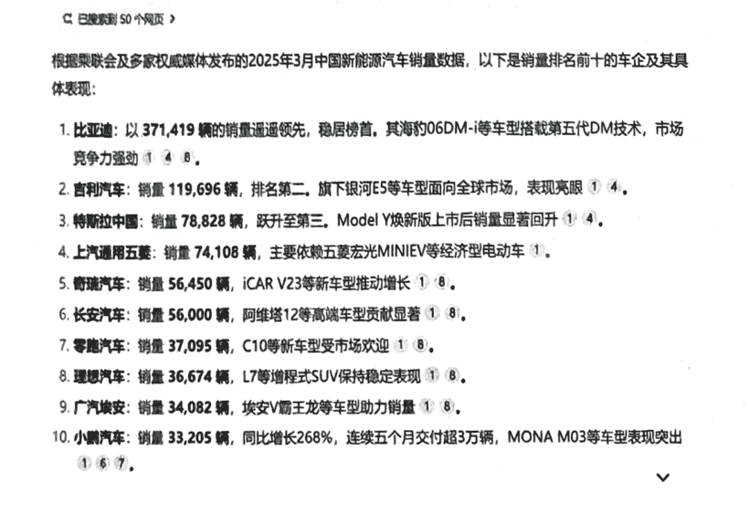

图 1-8 DeepSeek 开启联网搜索后给出的答案

DeepSeek 在搜索了 50 个网页后，给出了具体车企的销量排行，在每个数据之后还有如图 1-9 所示的角标，方便我们点击跳转到相关网页，查询详情。

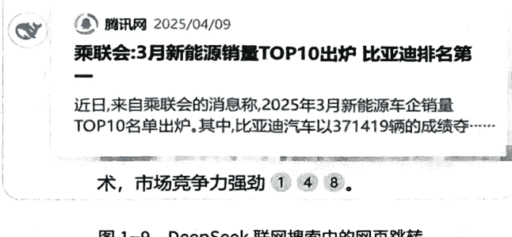

### 1.3.2 上传文件

DeepSeek 支持上传文档，具有阅读理解文档内容的功能。使用方法为在聊天界面中点击上传文件，如图 1-10 所示。


上传功能在文件数量上的限制为最多 50 个，在文件大小方面的限制为每个最大 100 MB，文件类型包含图片和各种格式的文档。在实际应用中，我们可以上传图片和各种文档，让 DeepSeek 进行分析，在此仅以会议纪要为例。点击图 1-10 中的上传附件按钮，即可跳转到图 1-11 所示的界面中。


会议记录.doc

图 1-11 上传附件界面

上传成功后，DeepSeek 会在聊天界面上方显示文档大小，如图 1-12 所示。


图 1-12 上传附件成功界面

我们可以直接提问，示例提示词如下：

> 请帮我解读上面文档中的会议记录的内容，给出一份完整、简单的会议纪要。

DeepSeek 会分析文档后给出如下答案：

> 会议概要
会议主题：2025 年产品开发进度更新会议
会议时间：2025 年 4 月 10 日上午 10:00—11:30

### 第 1 章 DeepSeek 入门

主要内容：

- 1. 项目进展报告：产品开发进度完成 70%，预计下周进行第一次内部测试。市场调研数据将在下周提交给开发团队。
- 2. 风险评估与应对策略：当前产品开发面临供应链问题，已与备用供应商达成资源调配协议。
- 3. 下一步工作安排：继续开发，并借助市场调研获取数据支持，确保项目顺利推进。
- 4. 其他事项：安排下周全员参加工作总结会，确保部门间协同工作。

结论：产品开发按计划进行，存在供应链风险，但已有应对措施，下一步工作集中于内部测试及市场调研。

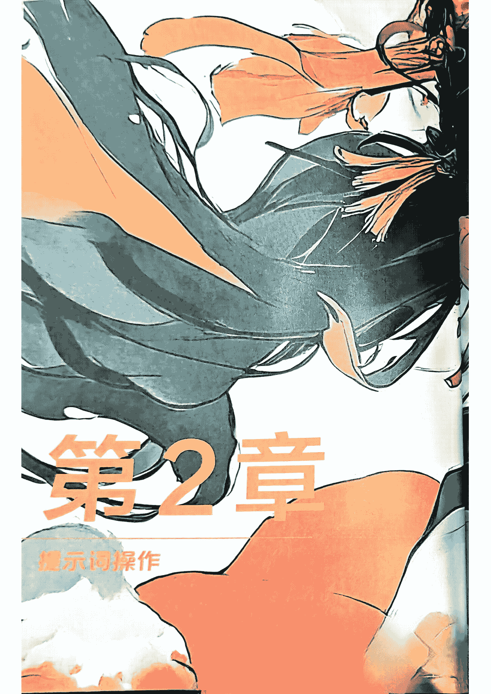

# 第 2 章 提示词操作


使用 DeepSeek 等 AI 工具时，要学会使用提示词。本章将带你了解提示词的概念和使用方式。无论是在语言学习还是在人机交互领域，提示词作为引导工具，已成为关键。它通常由文本、语音和链接等要素中的一种或多种构成，旨在引发系统或用户执行某个特定任务，或提供某些特定信息。

## 2.1 明确的提示词指令

提示词在语言学习和人机交互中发挥着重要作用。简而言之，提示词相当于记忆和掌握特定词汇或信息的辅助工具。在语言学习过程中，提示词像是我们学习新词汇时的提示板，帮助我们了解这些词的用法和搭配，从而提升我们的记忆和运用能力。同样，在学习语法时，提示词能够帮助我们回顾相关规则，提升我们对新语法结构的熟悉程度。在人机交互场景中，提示词的作用更加显著。比如在使用语音助手时，提示词作为引导系统或用户的具体指令，使系统能够准确理解我们的需求并有效执行任务。在智能客服系统中，提示词则能帮助我们详细表述问题，确保“机器人”能够更精准地提供解决方案。

用户在使用 DeepSeek 的时候，最离不开的就是提示词，因为只有给 DeepSeek 明确的指令，DeepSeek 才能知道用户的需求。

### 2.1.1 提供详细信息

撰写指令的时候，要在给 AI 的问题中明确包括全部的重要内容和细节，不要让 DeepSeek 去猜测用户想要什么，而要让它根据具体的指令给用户明确的答案。

以撰写一篇小红书上关于“×× 精华霜”的分享文案为例，我们来做个比较。首先提供简单信息，示例提示词如下：

> 请帮我撰写一篇小红书上的 ×× 精华霜的分享文案。

DeepSeek 生成如下回复：

> ×× 精华霜体验分享：
最近在使用 ×× 精华霜，效果真的惊艳！质地轻盈不油腻，吸收特别快。涂抹在脸上立刻感觉到肌肤变得柔软、滋润。尤其喜欢它的修护功效，连续使用一段时间后，感觉肌肤的细纹明显淡化，肤色也变得更均匀了。
这款精华霜富含多种活性成分，尤其适合熬夜党和换季期间使用。皮肤容易干燥或敏感的小伙伴也可以安心使用，完全不闷痘。
最让我惊喜的是它的持久保湿效果，早上使用，整天脸上都水润润的！无论是白天的基础护肤还是夜间修护，×× 精华霜都能为肌肤带来充足的养分，强烈推荐给想要让肌肤更健康、更有光泽的小伙伴们！

DeepSeek 生成的内容没有新意，并不是标准的内容，所以为了达到产品宣传的目的，在要求 DeepSeek 撰写小红书分享文案时，应该注意让文案包含核心诉求和要点。示例提示词如下：

> 我要撰写一篇小红书上的 ×× 精华霜的分享文案，请你按照下面的要求来做：
文案中要有真实的经验分享：用户亲身经历分享，内容真实、可信，具有说服力。
实用技巧：提供具体实用的技巧，帮助用户轻松应对生活中的难题。
内容有趣有料：除了有价值的信息，还应融入趣味故事和吸引眼球的图片，使笔记更加丰富有趣。
语言简明易懂：内容通俗易懂，避免使用复杂术语，让读者轻松理解并快速上手。
适当使用 emoji：巧用表情符号增添趣味，同时帮助突出重点信息。
相关标签：为笔记添加精准标签，提升内容的曝光率。

DeepSeek 生成的回复如下：

> 标题：✨用了××精华霜一个月，皮肤状态肉眼可见的变化！💧
作为一名敏感肌星人，我一直在寻找温和且有效的护肤品，直到遇到了××精华霜！🧴这款精华霜质地轻盈，吸收特别快，用了一个月后，皮肤光泽感明显提升了，不再有干燥起皮的困扰！✨最重要的是，它对细纹和暗沉也有显著的改善，连我的朋友们都说我的皮肤状态看起来年轻了不少。
💡使用技巧：
（1）每次只需按压1～2泵，用量适中，轻轻涂抹在脸部和脖子上，重点按摩细纹和干燥区域。🌿
（2）配合保湿水使用，吸收更快，效果更显著！🌿
（3）晚上使用效果最好，第二天早上起来皮肤会特别嫩滑！🌿
💬小插曲：
前几天追剧不小心熬到深夜，白天还要见客户，担心自己看起来太疲惫。但用了××精华霜后，面容瞬间被提亮，见客户时状态满分！😎

> 🌟如果你也在寻找让皮肤保持水润透亮的法宝，××精华霜绝对是你的不二之选！赶紧试试吧！💦
#护肤精华 #敏感肌友好 #××精华霜 #抗老保湿

通过对比不难发现，DeepSeek 这次的生成内容符合小红书文案分享的标准，非常有参考意义。

简单来说，常见的文案撰写指令类型各有侧重，列举如下：

#### 1. 头脑风暴

> 请你帮我进行一次头脑风暴，关于 ×××，不要被已有的知识框架束缚，请尽情发挥创意，不论想法多么离奇、荒诞或超现实都没有关系，畅所欲言。

#### 2. 朋友圈推广指令

> 我想在朋友圈推荐 ×××，请按照以下框架编写：痛点→情感引导→解决方案→行动号召→强调意义。帮我撰写一条 150 字左右的社交媒体文案，号召用户购买 ×××，并确保内容吸引人，引导用户采取购买行动。

#### 3. 受欢迎的干货型小红书笔记特征

- 真实经验分享：包含用户亲身经历分享，内容真实、可信，具有说服力。
- 实用技巧：提供具体实用的技巧，帮助用户轻松应对生活中的难题。
- 内容有趣有料：除了有价值的信息，还应融入趣味故事和吸引眼球的图片，使笔记更加丰富有趣。
- 语言简明易懂：内容通俗易懂，避免使用复杂术语，让读者轻松理解并快速上手。
- 适当使用 emoji：巧用表情符号增添趣味，同时帮助突出重点信息。
- 相关标签：为笔记添加精准标签，提升内容的曝光率。

#### 4. 小红书干货型内容模板

> 你是一位在小红书上拥有 ×××× 专业能力的博主，需要定期为你的粉丝分享实用的干货内容。笔记的内容要求如下：
开门见山：笔记第一段要直接明确主题，清晰传达这篇笔记的核心价值，让读者一眼就能抓住重点。
技能介绍：选择 ×××× 领域中的一个重要技能或工具，以“什么—为什么—怎么做”的结构进行阐述，确保信息层次清晰、逻辑严谨。
什么（What）：具体是什么技能或工具
为什么（Why）：为什么这个技能/工具如此重要
怎么做（How）：如何实际运用这个技能/工具
增强可读性：巧妙运用 emoji，让内容更具视觉吸引力，轻松传达重点，同时保持趣味性。
互动引导：在内容结尾，引导读者与笔记互动，邀请他们查看你往期分享的内容，或者关注即将更新的干货笔记。
标签添加：在笔记的最后加入相关的主题标签，格式为 # 标签

在实际应用中，我们可以在上面的提示词模板基础上进行加工，比如附上一些明确的要求，让 DeepSeek 按照一定的格式生成等。

### 2.1.2 让 AI 来扮演一个角色

简单来说，就是给 DeepSeek 明确的指令，让它扮演如抖音大咖、微博大 V 等角色。当接到扮演角色的指令后，DeepSeek 可以在后续的语言生成过程中扮演这个角色，用与这个角色相关的语言来执行后续指令。

在撰写文案的时候，可以用到这个方法，仍以 ×× 精华霜为例，我们让 AI 扮演一位使用过 ×× 精华霜的顾客，示例提示词如下：

> 请扮演一位使用过 ×× 精华霜的顾客，撰写这款 ×× 精华霜的分享文案。

DeepSeek 在接到指令后，会扮演使用过 ×× 精华霜的顾客，从顾客的视角完成文案撰写任务。DeepSeek 生成的内容如下：

> 想要让肌肤真正焕发光彩？×× 精华霜了解一下！
在今天的笔记中，我想跟大家分享一款让我皮肤状态提升的护肤好物——×× 精华霜，并教你如何将它融入日常护肤流程，帮你改善肌肤问题。
>
> What: 什么是 ×× 精华霜？
×× 精华霜是一款主打深层修护与美白提亮的精华霜，质地轻盈、不油腻，适合各种肤质，尤其是干性和敏感性皮肤。
>
> Why: 为什么这款精华霜如此重要？
它不仅能深度滋润，还能被迅速吸收，还含有多种活性成分，能够有效淡化细纹，均匀肤色，帮助肌肤恢复健康光泽；尤其适合那些常熬夜、作息不规律的朋友们，帮助皮肤对抗暗沉和疲倦感。
>
> How: 如何使用这款精华霜？
（1）早晚使用：在清洁和化妆水之后，取适量精华霜均匀涂抹全脸。
（2）轻拍吸收：用指腹轻轻拍打，促进吸收，特别是有细纹的地方和干燥的区域，可以稍加按摩。
（3）持之以恒：坚持使用两周，你会发现肌肤状态显著改善，暗沉减少，水润感十足。
>
> 想要更多护肤心得？别忘了点赞并关注我，查看我往期的护肤干货分享！
接下来我还会分享更多关于 ×× 精华霜的使用小技巧，千万不要错过哦！
#护肤心得 #精华霜分享 #抗老保湿 #熬夜护肤 #肤色提亮 #护肤干货

### 2.1.3 告诉 AI 需要几步

在使用 AI 进行比较复杂的文字处理工作的时候，可以将这个任务分解成几个关键的步骤，然后再把具体的步骤清晰地写出来。这样一来，AI 在理解用户要求时，就可以更清晰地遵循相应的指令。

同样以精华霜文案来举例，我们可以要求 DeepSeek 提炼出这段文本的摘要，然后再将其翻译成英文。示例提示词如下：

> 请你按照以下步骤来回应用户的指令。
第 1 步：
用户会给你提供带有三重引号的文本。请将这段文本总结为一句话，并以“摘要：”作为前缀。
第 2 步：
将第 1 步中的摘要翻译成英文，并以“翻译：”作为前缀。
第 3 步：
请在右下角写上落款——“译者：张三”
在今天的笔记中，我想跟大家分享一款让我皮肤状态提升的护肤好物——×× 精华霜，并教你如何将它融入日常护肤流程，帮你改善肌肤问题。
×× 精华霜是一款主打深层修护与美白提亮的精华霜，质地轻盈、不油腻，适合各种肤质，尤其是干性和敏感性皮肤。它不仅能让你的皮肤保持深度滋润，还能迅速被吸收，含有多种活性成分，能够有效淡化细纹，均匀肤色，帮助肌肤恢复健康光泽；尤其适合那些常熬夜、作息不规律的朋友们，帮助皮肤对抗暗沉和疲倦感。
（1）早晚使用：在清洁和化妆水之后，取适量精华霜均匀涂抹全脸。
（2）轻拍吸收：用指腹轻轻拍打，促进吸收，特别是有细纹的地方和干燥的区域，可以稍加按摩。
（3）持之以恒：坚持使用两周，你会发现肌肤状态显著改善，暗沉减少，水润感十足。
想要更多护肤心得？别忘了点赞并关注我，查看我往期的护肤干货分享！接下来我还会分享更多关于 ×× 精华霜的使用小技巧，千万不要错过哦！

DeepSeek 会分析我们的要求，分三步回答上面的问题，DeepSeek 生成的内容如下：

> 摘要：这篇笔记分享了一款名为 ×× 精华霜的护肤品，重点介绍其修护、美白功效及使用步骤，帮助改善肌肤状态，尤其适合干性和敏感性肌肤。
>
> 翻译：This note introduces a skincare product called ×× essence cream, highlighting its repair and brightening effects, along with usage steps to improve skin condition, particularly for dry and sensitive skin.
>
> 译者：张三

根据上文 DeepSeek 生成的内容，可以看到 AI 一共处理了三步：第一步，写出了摘要；第二步，把摘要翻译成了英语；第三步，写上了落款。DeepSeek 完整地执行了我们的要求。

## 2.2 提供示例做参考

在文案撰写领域，肯定会有一些做得比较好的账号，用户可以参考这些小红书爆款文案，或者微博大咖撰写的内容，让 DeepSeek 学习。这就像是一些推理题目，也叫作参照学习，仍以上文的某精华霜的例子作为参考，我们输入“请摘出下面文案中所用的语言风格、表达方式和 emoji 使用特点等”，并附上本书 2.1.2 中的文案，看看 DeepSeek 能归纳出什么样的内容。

DeepSeek 生成的回复如下：

> 这段文案采用了轻松友好的语言风格，通过直接且富有吸引力的方式向读者推介产品。以下是文案中使用的具体风格、表述方式和表情特点。
（1）语言风格：
亲切和教育性：文案通过“我想跟大家分享”和“教你如何”这样的措辞，营造了一种类似朋友之间分享实用信息的氛围。
直接和指令性：使用诸如“了解一下”“别忘了点赞并关注我”这样的语句，直接引导用户采取行动。
（2）表述方式：
问题引入：通过提问“想要让肌肤真正焕发光彩？”来吸引读者的注意，然后立即介绍产品，将其作为解决方案。
信息分类：采用“What, Why, How”结构清晰地介绍产品的特性、重要性及使用方法，这种方式有助于读者快速理解和记忆关键信息。
强调效果：强调精华霜的效果，如“有效淡化细纹，均匀肤色”和“帮助肌肤恢复健康光泽”。这些效果直接与用户的需求和期望相连。
（3）emoji 使用特点：
✅：用于标注重要的开头或要点。
🌟、💡：分别用于强调产品的定义和重要性。
🛠：象征操作方法或工具，这里用于引导如何使用产品。
这种文案风格和表达方式适用于社交媒体平台，能够有效吸引目标受众的注意，并激励他们与内容生产者互动。

DeepSeek 已经筛选出了上面 ×× 精华霜爆款文案的语言风格、表达方式等内容，现在以“×× 洗面奶”为例，看看 DeepSeek 能否为用户生成类似的文案。示例提示词如下：

> 请你根据上面的归纳，为 ×× 洗面奶写一篇小红书的爆款文案。

DeepSeek 会按上文归纳好的模式为用户生成如下相关内容。

> 🌟 想要轻松解决早晨的油光满面？×× 洗面奶，你的清洁新选择！
在这篇笔记里，我要给大家介绍一款改变我早晨护肤游戏规则的神奇产品——×× 洗面奶。下面让我带你了解它的魔力，以及如何将它融入你的日常洗脸步骤中，帮你迎接清爽的一天。
>
> 💡 Why: 为什么 ×× 洗面奶这么特别？
这款洗面奶蕴含天然植物精华，能深层清洁，同时保湿肌肤，特别适合油性和混合性皮肤。它的温和配方能够有效去除多余油脂和污垢，而不会带走肌肤的天然水分，让你的皮肤清爽而不紧绷。
>
> 🛠 How: 如何使用 ×× 洗面奶？
（1）早晚清洁：每天早晚湿润脸部后，取适量洗面奶在手心。
（2）轻柔按摩：用指尖轻柔按摩全脸，特别是 T 区及其他油腻部位。
（3）彻底冲洗：使用温水彻底冲洗干净，避免残留物影响肌肤呼吸。
想要更多洗脸小技巧？别忘了点赞并关注我，获取更多护肤干货！接下来我还会带来更多关于 ×× 洗面奶的深入介绍，让我们一起享受清新的每一天！
#清晨焕新 #洗面奶推荐 #混合性皮肤 #护肤必备 #护肤分享

DeepSeek 在用户提供示例的情况下，能非常清晰地了解用户的需求，仿照示例生成一篇爆款文案。

## 2.3 让 DeepSeek 学会思考

其实对于 DeepSeek 而言，它有的时候会非常的“懒”，它会懒到在用户让它判断对错的时候，会把一些“看上去是对的”的问题直接判断成正确的、所以在使用 DeepSeek 的时候，最好采用问问题的方式明确提出希望它回答或者讨论的内容。需要注意的是，问题要具体，不要太宽泛，避免提出“请看看这个是不是对的”之类的问题。

### 2.3.1 让 DeepSeek 分步来思考

用户可以在向 DeepSeek 提问的时候使用一些“为什么”“什么是”“请解释一下”之类的表述来构建提示词。比如：以“海水为什么是咸的”这个问题为例，看看它所提供的解释。

> 问：
海水为什么是咸的？请解释一下。

DeepSeek：
海水之所以呈现咸味，主要是因为它含有大量的溶解盐类，尤其是氯化钠（即我们日常使用的食盐）。这些盐类主要来源于陆地上岩石的风化过程。雨水落在地面上，会溶解岩石中的矿物质，形成离子，如钠离子和氯离子。这些离子会随着河流最终流入海洋。此外，海底地质活动，如火山爆发和海底热液喷口等活动也会向海水释放盐分和其他矿物质。随着时间的积累，这些盐分在海水中浓缩，使得海水呈现出咸味。

在得到这个答案之后，用户可以继续和 DeepSeek 进行对话。如下所示：

> 问：
那么，什么是陆地岩石的风化过程？
DeepSeek：
陆地岩石的风化过程指的是岩石在自然环境中受到物理、化学或生物作用的影响，逐渐破碎和分解的过程。这一过程可以分为三种主要类型。
（1）物理风化：岩石因温度变化（如日夜温差导致的膨胀和收缩）、冰冻（水在岩石裂隙中结冰时膨胀）或生物活动（如植物根部生长的劈裂作用）等原因而破碎。
（2）化学风化：岩石中的矿物质与周围环境（如空气中的氧气或水中的化学物质）发生化学反应，从而改变岩石的化学成分和结构。例如：岩石中的硅酸盐矿物在水的作用下会逐渐转化为黏土矿物。
（3）生物风化：生物活动对岩石的影响，例如：植物根部的生长、动物的挖掘行为，以及微生物产生的酸性物质等，可以促成岩石结构的物理变化或矿物质的化学变化。
这些风化过程共同作用，不断从岩石中分解出细小的颗粒，并释放出矿物质成分，如钙、钠、镁和氯等离子。这些离子通过河流运输最终流入海洋，从而增加了海水的盐分含量。

将上面向 DeepSeek 提问题的形式和方法总结如下：可以把问题分解为小问题，每次提出一个具体的问题，然后根据 DeepSeek 回答中所提供的信息进行追问，这样可以使对话内容的主题更明确、分析更深入。

### 2.3.2 给 DeepSeek 充分的思考时间

给 DeepSeek 充分的思考时间，不要让它只给出一个最终结果，而最好是能列出思考的步骤。这部分的功能可以使用深度思考 R1 模型来实现，其主要应用场景包括解答需要判断正误的题目。DeepSeek 在做题的时候，可能会出现答错题目的情况。对此，可以在让 DeepSeek 判断题目中各选项的对错时，首先让它自行找出问题的答案，其次再根据答案引导 DeepSeek 展开思考，最后让 DeepSeek 在上述问答的基础上重新审视题目，从而判断各选项的对错。

> 问：
小明的妻子生了一对双胞胎，请问下面的结论哪个是正确的？
A. 小明家里一共有三个孩子
B. 小明家里一共有两个孩子
C. 小明家里有男孩子和女孩子
D. 无法确定小明家里孩子的情况
DeepSeek：
根据题目所给出的信息，小明的妻子一共生了一对双胞胎，因此小明家里一共有两个孩子，所以选择 B。

上面 DeepSeek 所生成的答案明显是错误的，我们尝试一下，给 DeepSeek 加入一些引导。提示词如下：

> 问：
小明的妻子生了一对双胞胎，请问小明家里有几个孩子？

DeepSeek：
如果小明的家庭之前没有其他孩子，那么在他的妻子生下一对双胞胎后，他们家里现在有两个孩子。如果需要考虑其他可能存在的孩子，请提供更多信息。

很明显，DeepSeek 的答案符合逻辑：如果小明家里之前没有其他孩子，那么在他的妻子生下一对双胞胎后，他们家现在有两个孩子；但是如果之前有其他孩子，那么现在就不止两个孩子了。根据这个分析，可以把上面的四个选项再次给到 DeepSeek，让 DeepSeek 来做选择。

问：
请根据你的推断，告诉我下面四个选项中，哪个是正确的。
A. 小明家里一共有三个孩子
B. 小明家里一共有两个孩子
C. 小明家里有男孩和女孩
D. 无法确定小明家里孩子的情况
DeepSeek：
这是一道关于逻辑推理和生活常识的问题，我们需要分析题目中的关键信息并结合生活常识来得出正确的结论。
首先，我们梳理题目中的关键信息：
小明的妻子生了一对双胞胎。
接下来，我们对各选项进行逐一分析：
A. 小明家里一共有三个孩子
题目只明确提到小明家新增了一对双胞胎，即两个孩子，但并未提及小明家之前是否已有其他孩子。因此，我们不能确定小明家是仅有这两个孩子，还是还有其他孩子。所以，该选项不能确定为真。
B. 小明家里一共有两个孩子
这个选项基于小明家仅有这一对双胞胎的假设。但题目并未给出这样的明确信息，所以我们不能确定小明家是否仅有这两个孩子。因此，该选项也不能确定为真。
C. 小明家里有男孩子和女孩子
题目中仅提到小明家生了一对双胞胎，但并未说明孩子的性别。双胞胎可能是两个男孩、两个女孩或一个男孩一个女孩。因此，我们无法确定孩子的性别组合，该选项不成立。
D. 无法确定小明家里孩子的情况
考虑到上述分析，我们只知道小明家新增了一对双胞胎，但关于孩子的总数（是否仅有这两个孩子）和性别（是男孩、女孩还是男女混合）都无从得知。因此，这个选项是正确的，它反映了我们对小明家孩子情况的真实了解。

综上所述，答案是 D. 无法确定小明家里孩子的情况。

DeepSeek 通过深度思考，呈现了自己的思考过程，并且给出了正确的答案。对于这个题目，用户一眼就能看出答案，在此只为展示使用 DeepSeek 并引导其进行思考的过程。当面对复杂的题目时，我们通过让 DeepSeek 先解答，再分析，可以更好地让它为我们判断对错。

## 2.4 指定输出的具体格式

文案在生成的过程中，通常需要遵照一些固定的模式。如果用户在提示词中不提及，DeepSeek 就无法知道用户最终想要的答案模式。因此，在实际操作中，用户可以指定 DeepSeek 输出的具体格式，要求它以列表的形式回答或者限定具体的字数等。

示例提示词如下：

> 请将下列信息列表概括。
陆地岩石的风化过程指的是岩石在自然环境中受到物理、化学或生物作用的影响，逐渐破碎和分解的过程。这一过程可以分为三种主要类型。
（1）物理风化：岩石因温度变化（如日夜温差导致的膨胀和收缩）、冰冻（水在岩石裂隙中结冰时膨胀）或生物活动（如植物根部生长的劈裂作用）等原因而破碎。
（2）化学风化：岩石中的矿物质与周围环境（如空气中的氧气或水中的化学物质）发生化学反应，从而改变岩石的化学成分和结构。例如，岩石中的硅酸盐矿物在水的作用下会逐渐转化为黏土矿物。
（3）生物风化：生物活动对岩石的影响，例如：植物根部的生长、动物的挖掘行为以及微生物产生的酸性物质等，可以促成岩石结构的物理变化或矿物质的化学变化。

DeepSeek 会直接将信息概括为表格，见表 2-1 所示：

表 2-1 陆地岩石风化过程表

| 风化类型 | 描述 | 作用过程 |
| :--- | :--- | :--- |
| 物理风化 | 岩石因温度变化、冰冻或生物活动等原因而破碎 | 温差导致的膨胀、收缩，冰冻作用，植物根部生长 |
| 化学风化 | 岩石中的矿物质与周围环境发生化学反应，改变岩石的化学成分和结构 | 与空气中的氧气或水中的化学物质反应，矿物转化 |
| 生物风化 | 生物活动（如植物根部生长、动物挖掘、微生物活动）导致岩石结构或成分改变 | 植物根部生长、动物挖掘、微生物产生酸性物质等 |

从上面的演示过程可以得知，DeepSeek 为用户生成了一个相对合理的表格。在日常使用的过程中，可以使用一些提示词，让 AI 为我们生成对应的格式化内容，列举如下：

> “请总结上面文本的内容，分为五点，并从五个方面分段论述。”
“请不超过 500 字。”
“请用轻松随性的语言风格来为我解释。”
“请补充相关的例子。”
“请输出为 excel 表格的形式。”
“请用英语来回复。”
……

# 第3章 文案应用实战

会用 AI 生成文案是一回事，能让文案“好看、好用、转化率高”是另一回事。本章呈现了大量真实场景中的实战演练，覆盖了微信公众号爆款文章、短视频脚本、“种草”文案、故事续写、产品发布会文案、朋友圈广告等多种热门应用场景。每一节都包含提示词结构、生成策略与优化技巧，助你真正将 AI 的能力转化为创作力、传播力与影响力。AI 不是替你写文案，而是帮你写出更好的文案。

## 3.1 微信公众号高赞文章

很多经常浏览微信公众号的朋友会发现，不少文章的阅读量高达10万+，成了高赞文章。或许你也曾好奇过，为什么这些文章会这么受欢迎呢？是不是有一些特别的撰写诀窍？其实，这些高赞文章背后通常会有一套行之有效的写作技巧和流程，包括选题的精准把控、标题的巧妙设计、内容的结构安排以及信息的合理分配，目的是让读者在短时间内获得足够的满足感，并激发他们继续阅读和分享的兴趣。

通过 DeepSeek 的帮助，我们可以更快速地挖掘创作灵感，打磨内容，搭建清晰的框架，从而在更短的时间内完成高质量的文章创作。这样一来，我们不仅能提高文章的阅读体验，还能增强它的传播效果。

### 3.1.1 场景需求

我们知道微信公众号的写作流程有以下几步：

清楚写作的题材和标题：我们要清楚写作的目的是为了吸引读者还是普及知识，抑或是其他。根据微信公众号的定位来确定一个好的标题，这个是吸引读者的关键。针对写作题材和标题，我们都可以使用 DeepSeek 进行分析和整理。

制作大纲：大纲的梳理和制作既费时间又费精力，对此，我们可以要求 DeepSeek 围绕上面的主题生成大纲。针对生成的大纲初稿，我们可以一步一步地将其调整到满意为止，即利用与 DeepSeek 的多轮互动逐渐完善大纲。

素材和数据：微信公众号的写作通常需要以各种数据和案例作为支撑。我们可以使用 DeepSeek 搜索相关的数据和素材，不断丰富我们的初稿。

### 3.1.2 DeepSeek 创作具体流程

了解了微信公众号的写作流程后，我们来看看 DeepSeek 带给我们的新玩法。

#### 1. 高赞文章选题方向

首先要厘清微信公众号的定位，可以和 DeepSeek 对话，让其通过分析提供一些现阶段的创作思路。示例提示词如下：

> 你是一个微信公众号的大 V，正在策划一个法律知识普及的微信公众号。有没有最近比较流行的法律问题？请提供一些意见。

DeepSeek 生成的内容如下：

> 作为以法律知识普及为目的的微信公众号策划者，我们需要结合近期热点法律问题和普法趋势设计选题，以下是一些值得关注的选题方向及具体建议，供您参考。

一、选题方向
（1）家庭财产继承与遗嘱规划。
随着老龄化加剧，财产继承纠纷频发，尤其涉及独生子女继承、再婚家庭财产分配等问题。《中华人民共和国民法典》继承编的普法需求旺盛。
（2）网络消费维权新动向。
直播电商虚假宣传、大数据“杀熟”、智能家居隐私泄露等问题成为舆论焦点。
（3）青少年法治教育。
多地开展“开学第一课”法治教育，校园暴力、网络欺凌等话题备受关注。
（4）老年人法律权益保护。
针对老年人的诈骗、医疗权益纠纷高发，各地推出专项普法计划。
（5）禁化武履约与国家安全普法。
2025年4月29日为第十个国际禁止化学武器组织日，国家禁化武办正举办知识竞赛及海报征集活动。
（6）沉浸式普法创新形式。
上海杨浦公园通过“家庭资产继承展”打造沉浸式普法体验，结合案例教学提升参与度。
（7）企业合规与法律风险防控。
热点背景：中核集团等央企强化法律纠纷案件管理，反映出企业合规需求上升。

二、运营建议

栏目化设计：如“每周一案”“律师快答”等固定板块，培养用户的阅读习惯。

多平台联动：将长文拆解为短视频发布至抖音、微信视频号，扩大传播面。

用户共创：发起“我的维权故事”征文，精选案例进行法律点评。

以上选题均基于近期官方活动、社会舆情及普法实践，兼顾时效性与实用性。可根据微信公众号定位选择细分领域深耕，或通过系列专题覆盖群体需求。

DeepSeek 给出了上述七个选题方向，同时给出了一些运营建议，如栏目化设计、多平台联动、用户共创等。我们可以根据微信公众号的调性和目标读者的喜好进行微调，最终确定选题方向。示例提示词如下：

> 我的微信公众号目标读者为主要利用碎片化时间学习法律知识的中年人，请你筛选以上定位方向，为我提供两个方向。

DeepSeek 生成如下示例：

> 针对目标读者为利用碎片化时间学习法律知识的中年人，结合他们的核心需求（家庭责任、财产规划、风险防范）和时间碎片化的特点，建议优先选择以下两个方向，并优化内容呈现形式。
（1）家庭财产继承与遗嘱规划。
推荐理由
高相关性：中年人普遍面临父母养老、子女继承、再婚家庭财产分配等问题，这些问题都是刚需痛点。
内容适配性：可通过短案例、清单体（如“三个关键点”）等形式，方便碎片化阅读。
延展性强：后续可延伸至房产过户、意定监护等话题，形成系列专题。
（2）网络消费维权与日常法律陷阱。
推荐理由
高频场景：中年人网购、旅游、医疗消费频繁，但维权意识较弱，相关领域的实用指南需求旺盛。
轻量化内容：可聚焦具体场景（如退费、合同陷阱），提供“行动清单”。
时效性结合：借势“3·15”、双十一等节点推送，提高打开率。
这两个方向既能满足读者自身的法律需求，又适合碎片化传播，后续可根据反馈逐步扩展细分话题。

我们选定第一个方向——家庭财产继承与遗嘱规划，可以继续进行后面的操作。

#### 2. 生成爆款标题

标题是微信公众号文章的“眼睛”，要想让读者眼前一亮，爆款标题是不可缺少的一部分。可以使用 DeepSeek 生成爆款标题，示例提示词如下：

> 请联网搜索，并根据所提供的定位方向，为我撰写微信公众号的爆款文章标题。
定位为“家庭财产继承与遗嘱规划”。

DeepSeek 生成内容如下：

> 根据搜索结果，结合“家庭财产继承与遗嘱规划”的定位，以下是 10 个爆款标题建议，涵盖痛点、悬念、实用性和情感共鸣等角度，能够吸引中年读者点击。
（1）痛点直击型。
《独生子女继承父母房产，不注意这 3 点，可能一分钱都拿不到！》
《再婚家庭必看！这样立遗嘱，避免子女和配偶“反目成仇”》
（2）悬念疑问型。
《父母房产过户，“买卖”比“继承”更划算？律师算完这笔账，90% 的人选错了！》
《打印遗嘱竟无效？律师：少了这行字，你的遗嘱可能白写了！》
（3）实用清单型。
《立遗嘱避坑指南：律师总结 5 大常见错误，第 3 个几乎人人中招！》
《家庭财产传承 3 大工具：遗嘱、保险、信托，哪种最适合你？》
（4）情感共鸣型。
《“妈，房子给我吧。”七旬老人手写遗嘱无效，子女法庭反目：早做这件事，少留遗憾！》
《遗嘱不是晦气，而是最后的温柔！律师：做好这2步，让家人少流泪》
（5）时效热点型。
《2025新规！房产继承有变，这4类人可能“无缘”父母的房子》
《中华遗嘱库数据曝光：60%的家庭因这一细节打官司！现在改还来得及》
建议搭配案例解读、流程图解或模板下载（如“遗嘱范本”），进一步提高转化率。

#### 3. 封面文案生成

在微信公众号中，封面文案也是吸睛的主要工具，可以让 DeepSeek 提供与标题相匹配的封面文案，如一两句话的点题或引导，帮助激发读者的点击欲望。
示例提示词如下：

> 我们选定的微信公众号文章为《独生子女继承父母房产，不注意这3点，可能一分钱都拿不到！》，请撰写封面文案。

DeepSeek 生成的封面文案如下：

> 主标题（居中加粗，字号最大）
独生子女继承房产
这3点不注意 = 白给！
副标题（较小字号，补充痛点）
律师警告：90%的家庭忽略的细节，可能让子女“净身出户”！

#### 4. 撰写高赞文章

有了上面的内容后，我们可以尝试让 DeepSeek 生成文章内容了，示例提示词如下：

> 请根据上面的内容生成文章大纲，并根据大纲撰写完整的正文。

DeepSeek 生成内容如下：

文章大纲：
标题：《独生子女继承父母房产，不注意这3点，可能一分钱都拿不到！》
一、引言（痛点引入）
独生子女继承父母房产看似理所当然，但现实中存在诸多法律风险。
案例：独生子女因手续不全或法律盲区，无法顺利继承房产。
二、3个关键风险点
（1）父母未立遗嘱，其他法定继承人可能“分走”房产。
法定继承顺序：配偶、子女、父母（祖父母/外祖父母也可能分得份额）。
案例：略
（2）遗嘱形式不合法，可能导致遗嘱无效。
自书遗嘱需亲笔签名+日期，代书/打印遗嘱需2名无利害关系的见证人。
案例：略
（3）继承的房产可能变成夫妻共同财产。
婚后继承的房产，默认属夫妻共同财产，离婚时配偶可分割。
三、如何规避风险？律师3步建议
尽早订立合法遗嘱（公证遗嘱效力最高）。
收集完整的继承材料（死亡证明、亲属关系证明、房产证等）。
及时办理过户，避免因拖延导致产权纠纷。
四、结语（行动呼吁）
继承问题宜早规划，避免家庭纠纷。
提供“遗嘱模板+继承流程图”福利，引导读者领取。
正文：略。

### 3.1.3 提示词示例与输出展示

根据上文的流程，我们可以归纳见表 3-1 所示的包含提示词示例和输出内容要点的大纲。

表 3-1 微信公众号高赞文章提示词及 AI 输出要点汇总

| 步骤 | 提示词 | DeepSeek输出内容要点 |
| :--- | :--- | :--- |
| 确定选题方向 | 我的微信公众号目标读者为主要利用碎片化时间学习法律知识的中年人，请你筛选符合定位的选题方向，为我提供2个方向 | 推荐“家庭财产继承与遗嘱规划”与“网络消费维权”；分别列出推荐理由与内容形式建议 |
| 生成爆款标题 | 请联网搜索，并根据所提供的以下定位方向，为我撰写微信公众号的爆款标题。定位：家庭财产继承与遗嘱规划 | 输出 10个标题建议，分为痛点型、悬念型、实用型、情感型、热点型 5大类 |
| 生成封面文案 | 我们选定的微信公众号文章为《独生子女继承父母房产，不注意这3点，可能一分钱都拿不到！》，请撰写文章的封面文案 | 主标题：独生子女继承房产，这3点不注意=白给！
副标题：律师警告：90%家庭忽略的细节，可能让子女“净身出户”！ |
| 生成文章大纲与正文 | 请根据上面的内容生成文章大纲，并根据大纲撰写完整的正文 | 提供“标题+四段结构”：引言→3个风险点→3步建议→结语，并在正文中穿插案例与解决方案 |
| 完整输出任务 | 我要写一篇微信公众号高赞文章，目标读者为中年人，标题为《独生子女继承父母房产，不注意这3点，可能一分钱都拿不到！》，请写大纲+正文 | 输出开场金句、风险点详解(父母未立遗嘱、遗嘱无效、房产变共有)、律师建议、结语，并引导用户评论、领取“遗嘱模板”福利 |

## 3.2 短视频文案

短视频已经成为现代社会文化交流、信息传播和娱乐消遣的重要媒介。尤其是在抖音、视频号、小红书等平台上，优质短视频凭借高效传播和情绪共鸣，频频“出圈”。爆款短视频的走红并非偶然，它们往往遵循一定的创作逻辑和传播规律，包括精准的选题、吸睛的开头、清晰的结构和富有张力的情节安排等。

借助 DeepSeek 这一强大的 AI 推理工具，我们可以大大提升短视频文案的产出效率。它不仅能帮我们发现热点话题，还能辅助生成符合平台调性和用户习惯的脚本、标题、封面文案与分镜提示，大大节省人工构思时间。

### 3.2.1 场景需求

短视频文案的创作流程更强调视觉节奏、逻辑密度与信息压缩。一般而言，短视频文案需要覆盖以下四个创作阶段：

- 选题方向确定：结合平台调性与用户兴趣，确定能够吸引目标群体的内容主题。
- 剧情脚本设计：通过分阶段脚本安排，让故事在短时间内展现完整的逻辑链与相对充沛的情绪张力。
- 标题与开头的打磨：前 3 秒是黄金时间，标题与口播必须具备足够的冲击力与吸引力。

封面与简介设计：封面文案和简介是吸引点击的重要因素，需高度凝练、贴合内容调性。

这些环节看似繁复，但借助 DeepSeek，我们可以从灵感生成到结构化输出，实现“自动化脚本 + 数据辅助构思”的一站式创作。

### 3.2.2 DeepSeek 创作具体流程

下面我们以法律类短视频为例，结合 DeepSeek 的具体应用步骤来展开说明。

#### 1. 热门短视频选题方向

短视频想要出圈，首先得选准方向。通过与 DeepSeek 的对话，我们不仅可以得到贴合用户兴趣的选题建议，还能结合平台舆情和事件热点进行调优。比如：当你确定以法律知识传播作为短视频选题的主要方向，下一步就是锁定切入点与内容点。

示例提示词如下：

> 你是一个法律类短视频博主，想制作一条有关“家庭财产继承”的短视频，目标观众是 30 ～ 50 岁的中年群体，请提供 5 个热门的选题方向。

DeepSeek 生成内容如下：

> （1）独生子女也可能“继承不到”？3 个你必须知道的法律盲点。
> （2）父母写了遗嘱，但形式错了？继承权可能作废！
> （3）再婚家庭的继承问题，比你想象的复杂！
> （4）遗嘱立好了，为啥过户还这么难？
> （5）继承的房产会变夫妻共有？防范3个误区。

通过以上建议，我们可以看出 DeepSeek 不仅聚焦用户痛点，还具备较强的传播策略意识。最终我们选定第一个方向作为本次短视频创作的主题。

#### 2. 爆款短视频标题生成

确定主题后，标题就是吸引观众的第一道关卡。一个好的标题既要信息浓缩，又要具备“悬念 + 冲突 + 实用 + 情绪”四要素。

示例提示词如下：

> 我正在准备一条短视频，主题是“独生子女也可能‘继承不到’？3个你必须知道的法律盲点”，请提供10个爆款标题建议。

DeepSeek 生成内容如下：

> 以下是针对短视频主题“独生子女也可能‘继承不到’？3个你必须知道的法律盲点”的10个爆款标题建议，融合悬念、冲突和实用性，能够吸引用户点击和转发。
> （1）《独生子女也会被“踢出继承人行列”？这3个继承陷阱你知道吗？》。
> （2）《爸妈的房子你真继承不到？法律里的这3个盲点被太多人忽略了！》
> （3）《以为自己是独生子女就稳了？当心这3种情况让你一分钱都拿不到！》
> （4）《父母辛苦一辈子，房子却归了“别人”？独生子女必须知道的3个法律盲点》
> （5）《继承权≠独占权！独生子女可能会失去继承资格的3种情形》
> （6）《独生子女就一定能继承？法律上这3点决定你的命运》
> （7）《爸妈的财产归属谁说了算？法律上的这3个盲点可能让你措手不及！》
> （8）《明明是独生子女，却继承无门？背后的3个法律细节千万别忽视！》
> （9）《别等父母百年之后才后悔！这3个继承误区，可能让你一夜“清零”》
> （10）《独生子女真的稳赢遗产吗？这3个真实案例让你后背发凉！》

#### 3. 视频脚本与文案生成

有了题目，我们需要将内容结构化输出。DeepSeek 可以根据预设主题，自动生成具有情节逻辑、情绪递进的脚本，覆盖口播词、字幕与镜头提示。

示例提示词如下：

> 请为短视频《独生子女也会被“踢出继承人行列”？这3个继承陷阱你知道吗？》生成完整脚本，时长控制在1分钟左右，分为口播+字幕+分镜三段，并穿插案例。

DeepSeek 生成内容如下：

> 短视频脚本《独生子女也会被“踢出继承人行列”？这3个继承陷阱你知道吗？》
>
> ⏱ 总时长：约60秒
>
> ✅ 一、口播台词（主播语气自然，略带提醒）
>
> [开场：0～10秒]
> 你以为独生子女就一定能继承父母的房产吗？
> 错！有3种情况，哪怕你是独生子女，也可能一分钱都拿不到！
>
> [中段：11～45秒]
> 第一种情况：父母立了遗嘱，把财产留给别人。
> 比如，小王是家里唯一的孩子，但他爸妈生前立了遗嘱，把房子留给了长期照顾他们的邻居阿姨。结果，小王一分钱没拿到！
> 第二种情况：房子是父母婚前财产，但只登记了父亲一方的名字。
> 第三种情况：父母过户给他人但未公证。
> 继承时才发现，房子名义上是爸妈的，实际早就被赠予别人了，只是没有公证！
>
> [结尾：46 ～ 60 秒]
> 记住！不是说独生子女就“天然”拥有继承权。
> 早点了解法律细节，别让父母的心血变成别人的财产！
>
> # 二、字幕同步（重点信息 + 强调关键词）
>
> | 时间点 | 字幕内容 |
> | --- | --- |
> | 0 ～ 5 秒 | ❗独生子女 = 继承权？别太天真！ |
> | 6 ～ 10 秒 | 这 3 个继承陷阱，小心一个都逃不了 |
> | 11 ～ 17 秒 | 陷阱①：有遗嘱，财产归他人 |
> | 18 ～ 22 秒 | 案例：爸妈房子竟全留给邻居阿姨 |
> | 23 ～ 28 秒 | 陷阱②：只写一个名字的财产 |
> | 29 ～ 34 秒 | 案例：爸妈离婚再婚，房子归了后妈 |
> | 35 ～ 40 秒 | 陷阱③：房子“过户”早做了安排 |
> | 41 ～ 45 秒 | 案例：赠予给他人，继承成空谈 |
> | 46 ～ 52 秒 | 法律不是靠“默认”，得靠证据！ |
> | 53 ～ 60 秒 | 收藏转发！别让你的“继承权”变“梦一场” |
>
> # 三、分镜建议（视觉引导 + 情绪节奏）
>
> 001
> 主播正脸开场，背景严肃
> 推进 + 静态
> 0 ～ 5 秒
>
> 002
> 屏幕显示标题“你以为独生子女就稳赢？”
> 黑底白字渐出
> 6～10秒
>
> 003
> 主播说“第一种情况”时，切换画面：儿子小王无奈地坐在空荡荡的房子前
> 淡入+慢推进
> 11～17秒
>
> 004
> 父母与邻居阿姨亲密合影+遗嘱截图动画展示
> 动效滑出
> 18～22秒
>
> 005
> 房产证只写“父亲”名字，背景换“继母笑脸”画面
> 平移推拉
> 23～34秒
>
> 006
> 小王懊悔翻找资料，发现产权早已转出
> 快切闪回
> 35～45秒
>
> 007
> 主播指向镜头：收藏+转发提示
> 弹出互动字幕
> 46～60秒

#### 4. 封面文案与简介生成

一个能抓住人眼球的封面文案与简介，是吸引用户点击的“关键按钮”。DeepSeek 可以将标题进一步转化为具有冲击力的封面文案，并给出平台适配的简介文案建议。

示例提示词如下：

> 请为短视频《独生子女也会被“踢出继承人行列”？这3个继承陷阱你知道吗？》生成1段封面文案和1段简介文案。

DeepSeek 生成内容如下：

> 封面文案：
> 主标题（加粗大字）：父母房产，你真继承得了吗？
> 副标题：这3个法律误区，99%的人都忽略了！
>
> 简介文案：
> 你以为独生子女可以轻松继承父母房产？现实往往没那么简单。1分钟带你了解3个最常见的法律陷阱，提前规避，避免“房产继承权成空”。

从灵感触发到成片脚本，DeepSeek 几乎全流程可接入创作任务，用户也可以按照上面的流程进行逐步细化。

### 3.2.3 提示词示例与输出展示

根据上文的流程，我们可以归纳见表3-2所示的包含提示词示例和输出内容要点的大纲。

#### 表 3-2 短视频文案提示词及 AI 输出要点汇总

| 步骤 | 提示词 | DeepSeek输出内容要点 |
| :--- | :--- | :--- |
| 选定选题方向 | 你是一个法律类短视频博主，想制作一条有关“家庭财产继承”的短视频，目标观众是30~50岁的中年群体，请提供5个热门的选题方向 | 提供“独生子女继承问题”“再婚家庭继承”“房产继承流程”等5个话题切入点 |
| 生成短视频标题 | 我正在准备一条短视频，主题是“独生子女可能无法继承父母房产的3个法律盲点”。请提供10个爆款标题建议 | 输出10个高点击潜力标题，包含悬念、警示、共鸣等文案技巧 |
| 脚本生成（剧情+字幕+结构） | 请为短视频《独生子女也不保险？这3个继承陷阱你知道吗？》生成完整脚本，时长控制在1分钟左右，分为口播+字幕+分镜三段，并穿插案例 | 开场吸睛 + 3个风险点展开 + 解决建议 + 结尾行动引导（关注+福利） |
| 封面文案与简介生成 | 请为短视频《独生子女也不保险？这3个继承陷阱你知道吗？》生成1段封面文案和1段简介文案 | 主标题：父母房产，你真继承得了吗？<br>副标题：这3个法律误区，99%人都忽略了！<br>简介：总结法律误区 + 评论互动引导 |
| 完整输出任务 | 我要做一条适合抖音的法律普及短视频，目标观众是中年用户，请提供完整脚本、封面文案、简介和互动引导 | 输出全套文案结构：标题、脚本、封面、简介、评论互动话术、福利引导“领取遗嘱模板”等 |

## 3.3 热点总结文章

热点总结型文章已成为自媒体创作者、高校学生、知识类博主必备的内容类型之一。相比传统长篇深度稿件，热点总结文章更强调“快”“准”“深”：快速跟进事件，准确还原事实，提出独立洞见。

通过撰写热点总结类文章，创作者不仅能搭上流量快车道，还能有效输出个人观点，提升账号的专业性和影响力。

然而，热点总结类文章的创作往往有三大难点：

- 时间紧、效率低：热点时效窗口短，整理素材、搭建结构费时耗力；
- 缺少角度、缺乏深度：大部分文章仅停留在“信息拼接”的层面，难以形成有价值的“观点输出”；
- 表达僵硬、传播力差：热点话题总结文章容易陷入套路化的模式，缺乏传播张力和语言温度。

DeepSeek 正好能助我们一臂之力——它能帮助我们自动识别热点、提炼事件核心、给出结构建议、输出论证观点，从而高效完成一篇结构严谨、观点清晰、语言有感染力的热点总结文章。

### 3.3.1 场景需求

以下几类创作者，尤其适合使用 DeepSeek 来快速生成热点总结文章：

- 微信公众号作者：需要发布“重大新闻解读”“教育政策分析”等栏目；
- 短视频脚本编剧：希望将热点事件进行“整合解说式”输出；
- 知乎、头条内容博主：追踪社会/科技/职场类热议事件，需快速生成“态度表达型”文字；
- 高校学生、媒体学员：学习新闻评论写作、舆论引导等，需练习文章结构组织与观点表达。

典型使用场景包括：

- 突发新闻事件的深度解读（如社会突发事故、公共舆论事件）；
- 周/月/季度热门话题盘点（如“本月十大热搜事件”）；
- 行业政策、AI新规、社会治理等热门领域的分析总结。

通常，一篇高质量热点总结类文章包括以下结构层次：事件背景复盘（简明扼要，图文还原）；争议点聚焦（提炼核心话题与分歧）；观点输出与逻辑论证（表达独立立场+论据支撑）；升华/延伸（提出建议、引发思考、对比分析等）。借助 DeepSeek，我们可以系统性完成以上步骤。

### 3.3.2 DeepSeek 创作的具体流程

理解了热点文章的类型和写作需求后，我们来看看如何一步一步使用 DeepSeek，高效生成这样一篇具有“时效性+观点+结构”的文章。

#### 1. 识别适合写作的热点

当你想写一篇热点文章，但不知道最近哪些话题有讨论价值时，你可以先请 DeepSeek 帮你梳理近期的热门事件，按照主题、受众与平台适配度分类，从而节省大量“刷热搜”的时间。

示例提示词如下：

> 请列出最近值得关注并适合写成热点总结文章的事件。

DeepSeek 输出（节选）：

- 公安部等六部门发布《国家网络身份认证公共服务管理办法》
- 国务院新闻办公室发布《新时代的中国国家安全》白皮书
- 上海浦东发布具身智能产业支持政策
- 2025 年世界田径接力赛（广州站）

可以根据账号或平台调性选择其中一个，比如选择“上海浦东发布具身智能产业支持政策”进行后续写作。

#### 2. 整理事件核心信息，搭建写作框架

热点文章不是“复制新闻”，我们需要的是梳理清晰的结构线。你可以让 DeepSeek 帮你生成一份写作信息框架，包括以下方面：

- 时间线：事件从曝光到发酵的发展脉络
- 参与角色：官方 / 网民 / 第三方的不同立场
- 争议焦点：观众最关心、最容易产生分歧的点
- 可延展角度：是否有趋势预测、海外对比、制度解读等潜在延展面

示例提示词如下：

> 请围绕“上海浦东发布具身智能产业支持政策”事件，生成写作所需的信息框架，包括：事件背景、关键节点、延伸角度、适合搭建的结构方案。

DeepSeek 生成内容如下（节选）：

一、事件背景
国际与国内层面趋势：2023 年，上海市政府印发《进一步推进建设行动方案（2023—2026 年）》、将人形机器人、数字孪生、AI 大模型等纳入重点范畴，为具身智能发展奠定顶层设计。
沪上 AI 创新先导区定位：浦东已被确立为全国首个人工智能创新应用先导区，集中部署市级科创母基金 670 亿元、未来产业基金 100 亿元等，为具身智能技术突破提供了制度与资金保障。
张江科学会堂与大会舞台：张江科学会堂为浦东高端论坛旗舰场所，自 2022 年起承接世界人工智能大会浦东分会场会议活动，与本次开发者大会暨技能大赛形成天然联动场景。

二、关键节点
2025 年 5 月 29 日，大会开幕与政策发布。
专项资金与母基金落地。
官方政策实施与解读。
生态共创与平台建设。

三、延伸角度
产业生态构建：
如何借助“1＋3＋N”资金矩阵（专项基金＋母基金＋产业基金）完善上下游协作与孵化体系。
人才战略与机构创新：
政策中对新型研发机构、大企业创新中心和高端人才的支持力度，如何补链强链。
核心技术攻关：……
应用场景落地：……
国际视野与竞争：……
监管与标准：……
区域比较：……

四、结构方案

以下两种为常用结构，可根据篇幅与侧重点任选其一或结合使用：

方案 A：五段式逻辑流

（1）引言（导语 + 市场现状）。
（2）背景与动因。
（3）政策解读。
（4）影响评估与案例。
（5）展望与建议。

方案 B：时间线＋主题并进

（1）时间线铺陈。
（2）政策全景。
（3）多维解读。
（4）区域与国际对比。
（5）建议与前瞻。

以上内容就像一个写作蓝图，我们可以直接在此基础上进行语言加工与内容组织。

#### 3. 生成完整文章大纲和正文

当结构与信息准备就绪，我们就可以请 DeepSeek 帮助我们生成具有传播力的正文内容，文章通常包括以下组成部分：

- 引言（引入关注点）；
- 正文（梳理事实 + 观点输出）；
- 总结 / 延伸（趋势预判、行动建议）；
- 引导（鼓励评论、收藏、分享）。

示例提示词如下：

> 请以“上海浦东发布具身智能产业支持政策”为主题，撰写一篇热点总结类文章，要求包含以下结构：（1）事件复盘；（2）焦点解读；（3）我的观点；（4）延伸思考。总字数约 1500 字、风格适合微信公众号发布。

DeepSeek 生成内容如下（节选）：

> 以下是一篇适合微信公众号发布、结构清晰的热点总结文章，全文约 1500 字，围绕“上海浦东发布具身智能产业支持政策”展开，附有丰富引用以便进一步查证。
>
> 摘要
>
> 5 月 29 日，2025 张江具身智能开发者大会暨国际人形机器人技能大赛在张江科学会堂正式开幕，浦东新区副区长李慧发布了《具身智能产业支持 16 条政策》，提出对关键核心技术攻关、新型研发机构、大企业创新中心等领域给予最高 2000 万元支持，单个项目支持额度最高可达亿元级，并配套 10 亿元专项基金与多个百亿级母基金，旨在为万亿级市场的具身智能产业提供政策、资金和生态保障。本文将依次对事件进行复盘，深入解读政策要点，分享个人观点，并进行延伸思考，以期为读者提供全面视角。
>
> 1. 事件复盘
>
> 1.1 大会背景与举办
>
> 5 月 29 日，以“具身智能，未来已来”为主题的 2025 张江具身智能开发者大会暨国际人形机器人技能大赛在上海浦东张江科学会堂举行，吸引 200 余人形机器人及上下游企业、5000 余位行业专家和开发者参与。张江科学会堂自 2022 年起成为浦东重要高端论坛承办地，与大会形成了良好互动。
>
> 1.2 政策发布与核心内容
>
> ……
>
> 1.3 执行与配套
>
> ……
>
> 2. 焦点解读
>
> 2.1 资金支持的“量级跃升”
>
> ......
>
> 2.2 产业链上下游全覆盖
>
> ......
>
> 2.3 应用示范与市场导向
>
> 政策在应用层面突出示范引领，重点支持制造业、医疗康复、服务机器人等领域的落地项目，并对首批示范项目予以优先立项和额外补贴，助力具身智能在真实场景中检验性能与价值。通过“实战+数据”循环，推进技术迭代与商业模式创新。
>
> 2.4 生态共创与标准化
>
> 确定“具身智能数据联盟”和开发平台共创计划，强调开放共享与标准制定，意在破解数据孤岛和标准不统一两大痛点，为行业规范化发展提供基础。开放式生态有助于吸引更多上下游企业、高校和研究机构参与，实现资源互补与协同创新。
>
> 3. 我的观点
>
> 3.1 政策设计体现前瞻性
>
> 此次政策将资金重点投向“最需突破”的核心部件与算法领域，与国家“新型基础设施”战略高度契合，为具身智能产业奠定坚实的技术基础。相比以往对 AI 大模型的资金倾斜，这一“具身智能”专项显得更具落地导向，能够加速人形机器人等实体智能产品实现量产。
>
> 3.2 平衡政府与市场角色
>
> ......
>
> 3.3 对比国内其他园区
>
> ......
>
> 4. 延伸思考
>
> 4.1 人才培养与引育机制
>
> ......
>
> 4.2 国际合作与标准互认
>
> ......
>
> 4.3 社会接受度与伦理监管
>
> ......
>
> 4.4 区域协同与产业集群
>
> ......
>
> 上海浦东此次发布的《具身智能产业支持 16 条政策》是一次面向未来的系统布局、既关注技术突破，也强调市场化落地和生态协同。面对万亿级市场机遇，政策、资本与创新主体的三方联动，将决定中国具身智能产业的成败，也为全球智能化浪潮提供了可借鉴的“浦东样本”。

### 3.3.3 提示词示例与生成内容

最后我们整理一下整个创作链条的提示词清单，方便你在不同平台快速调用，见表 3-3 所示。

#### 表 3-3 热点总结文章提示词及 AI 输出要点汇总

| 步骤 | 提示词 | DeepSeek输出内容要点 |
| :--- | :--- | :--- |
| 识别选题方向 | 请列出最近一周适合写作的热点事件，偏好方向为科技/社会/AI | 输出事件清单 + 每个事件的关键词提示 |
| 搭建结构蓝图 | 请围绕某事件生成信息结构，包括背景、节点、争议、结构建议 | 输出时间线 + 立场分歧 + 写作框架 |
| 撰写正文内容 | 请撰写一篇热点总结文章，结构包括事件回顾、争议解读、个人观点、延伸思考 | 输出完整微信公众号风格文章，含标题、段落、金句、评论引导语 |

## 3.4 续写孩子的故事书

每个孩子的童年，都是由一个个故事拼接起来的。从床头的睡前童话，到绘本里的动物朋友；从幼儿园教师讲的“彩虹小马”，到语文课本中的寓言童话，故事就像孩子成长旅途上的灯塔，既给予孩子温暖，又引导孩子更好地成长。

在家庭教育中，“讲故事”是连接亲子情感最自然、最深刻的方式。我们如果能借助 DeepSeek 的能力，围绕原有故事的风格与角色，进行“续写”或“扩写”，就能为孩子创造更多惊喜。DeepSeek 不仅可以理解故事主线，还能根据孩子的年龄特点、阅读习惯、兴趣爱好，生成新的故事桥段，甚至可以让故事“长成”系列，构建孩子专属的故事世界。

### 3.4.1 场景需求

在现实生活中，家长和教育者经常面临以下几类与“续写故事”相关的需求：

1. 孩子主动提问：故事还能不能讲下去？

很多儿童故事（如《小兔汤姆》《鳄鱼怕怕 牙医怕怕》《我爸爸》《彩虹鱼》等）是短篇作品，讲完故事后，孩子意犹未尽时，家长会

#### 2. 教学活动中需要故事“半开口”

不少学校教师在语文或作文课堂上，会要求孩子“续写故事结尾”，但很多孩子不知从何入手。教师或家长如果能借助 AI 生成一些不同思路的示范版本，就能有效拓宽孩子的写作视角。

示例需求：
小学语文题目“请续写《狐狸与乌鸦》的故事结尾”，教师希望用 AI 给出不同风格（讽刺型/反转型/正能量型）的续写思路，以激发学生的创作兴趣。

#### 3. 自制绘本与音频节目：需要长期“构建一个故事宇宙”

越来越多家长希望围绕孩子喜欢的人物“自制一套故事”，比如“关于小猫琪琪的成长冒险”系列，不再是一本书，而是一本＋一本＋一本。

示例需求：
一个 5 岁小女孩最喜欢“爱笑的小猫琪琪”，妈妈希望围绕这个主角创作“6 集成长故事”，每一集 3 分钟，可配合录制音频或画成绘本。

针对上述不同场景，DeepSeek 都可以提供专业的文本生成服务。

### 3.4.2 DeepSeek 创作的具体流程

在续写故事书的创作过程中，DeepSeek 的使用主要分为四大阶段：

1.  输入原故事片段与续写指令

故事续写的第一步，是告诉 AI “你要续写哪一个故事”。
如果我们有一个具体绘本、童话或自创故事的片段，可以将其作为输入内容传递给 DeepSeek。
同时，要明确告诉它我们的“续写目标”：
是要延续故事，还是要反转故事？是给 3 岁孩子讲的，还是给 8 岁孩子看的？是想写得幽默一点、温情一点，还是有点教育意义？
示例提示词如下：

> 请你作为一个儿童故事创作者，续写以下故事片段，适合 5 岁孩子阅读，风格要温柔、童话感强，每段不超过 100 字，分为 5 段。
原故事内容如下：
小兔子塔塔每天最喜欢做的事情，就是坐在森林边的树下看天上的云朵。有一天，他看见一片像飞船的云飘进了森林深处，于是他鼓起勇气追了进去……

2.  设置角色与风格信息

为了让生成的故事更符合“原味”，我们可以让 DeepSeek 了解主角性格、故事基调等背景信息。

示例提示词如下：

> 补充信息如下：
主角塔塔：一只胆小但好奇心强的小兔子，喜欢幻想。
故事世界：森林中住着各种动物，有神秘的“云朵之国”传说。
风格要求：轻松童话风，每段以“××说”结尾，帮助家长进行角色扮演式讲故事。

在接收到这些信息后，DeepSeek 生成的故事就会更贴合角色口吻，并且便于孩子理解和亲子互动。

3.  生成完整的续写内容

接下来，我们就可以让 DeepSeek 生成续写的故事内容了。按上文指令，DeepSeek 输出内容为 5 段结构，每段都保持童话节奏和视角。
DeepSeek 生成内容如下（节选）：

> （1）塔塔悄悄地跳进森林，阳光透过树叶在地上洒落星星点点的光斑。“这片云真的在等我吗？”塔塔小声说。
（2）忽然，一阵风吹来，一只会说话的蓝色鸟儿飞到了他面前。“你好，小兔子，我是云朵守卫者！”小鸟说。
（3）“云朵飞船”就在不远处的空地上闪闪发光，像一片会呼吸的棉花糖。“你想进去看看吗？”蓝鸟问。
（4）塔塔点点头，轻轻跳上了飞船，一股温暖的风裹住了他。他的耳朵在风中飘了起来。“哇，我会飞啦！”塔塔说。
（5）云朵飞船带他飞过整片森林，他们看见了睡觉的大树、跳舞的蘑菇，还有正在织梦的狐狸。“下次带上我弟弟一起飞，好吗？”塔塔说。

这个版本不仅保持了原故事的语气、角色风格，还方便家长带读，有明确的节奏与情节推进。

4.  扩展为系列章节

如果你想把这个故事继续“做长”，比如制作“塔塔的飞船冒险系列”，可以继续输入如下提示词：

> 请将上面的故事扩展为系列故事，每一集为“塔塔与×××的故事”，并给出8集故事标题与内容摘要，适合5～6岁儿童阅读，每集控制在500字以内，风格温暖、有童趣。

DeepSeek 生成如下故事提纲（节选）：

> （1）《塔塔与飞船上的星星按钮》：塔塔按下一个奇怪的云朵按钮，结果被带到了星星果果镇，云朵飞船轻轻地飘在天空中，小兔子塔塔坐在柔软的船舱里，东看看西摸摸。突然，他发现座椅旁边有一个发光的小按钮，像星星一样一闪一闪。
“这个可以按吗？”塔塔小声嘀咕。
他伸出爪爪，轻轻一按——
“咕噜噜——嗖！”飞船开始转圈圈，舱门打开后出现了一个星星洞口，塔塔这只兔子“扑通”一声掉了进去！
他闭着眼，耳边是风的声音，“呼——呼——”等睁开眼，他已经坐在了一朵大蘑菇上，周围是一片闪闪发光的小镇，路灯是星星做的，房子像糖果一样五颜六色，街道上飘着甜甜的香味。
“这里是……星星果果镇？”塔塔瞪大了眼睛。
“欢迎你，小兔子！”一只戴着月亮帽子的果果狸热情地走过来，“你按了飞船的星星按钮，就来到了我们的镇子！这里的每一个星星果，都是小动物的心愿做成的！”
塔塔跟着果果狸走进一家“梦果屋”，屋子里摆满了会唱歌的苹果、会跳舞的蓝莓，还有会发光的橙子！
“这个是‘希望果’，可以帮你找到想念的人。”果果狸介绍说，“这个是‘勇气果’，吃了以后就敢跳到最高的云朵上！”
塔塔挑了一个“微笑果”，咬一口，心里立刻暖暖的，像被妈妈抱着一样。
“可我怎么回家呀？”塔塔轻声问。
“放心，等天上最大的那颗星星亮起来，它会变成一条回家的路。”果果狸眨了眨眼睛。
塔塔坐在果果镇的星星草地上，等着夜空亮起。他心里想着：“这个地方真奇妙，可是我也开始想念那棵森林里的老树啦。”
……
（2）《塔塔与夜光青蛙》：在飞船降落的夜晚，塔塔遇见了一只发光的青蛙，它会唱催眠歌……
（3）《塔塔与月亮蛋糕》：云朵王国准备月亮节庆典，塔塔负责做“最软的云蛋糕”……
（4）《塔塔与打哈欠的山》：飞船误闯一座爱打哈欠的山洞，塔塔必须学会讲故事才能让它安静……

这样，我们就能通过 DeepSeek 逐步打造一个完整的“故事宇宙”——不仅可以每天讲一集，还能结合 AI 绘图工具为每一集配插画，甚至搭配音频制作属于孩子的“专属故事专辑”。

### 3.4.3 提示词示例与生成内容

最后我们整理一下整个创作链条的提示词及 AI 输出要点清单，见表 3-4 所示。

表 3-4 孩子故事书续写提示词及 AI 输出要点汇总

| 步骤 | 提示词 | DeepSeek生成内容要点 |
| :--- | :--- | :--- |
| 明确故事片段与年龄层 | 请为5岁孩子续写以下故事，风格温柔童话，每段不超100字，共5段。原故事：小兔塔塔追逐云朵进入森林…… | 生成5段完整故事，塔塔遇见飞船、鸟守卫，展开冒险 |
| 指定角色设定与语气风格 | 塔塔是胆小好奇的小兔，风格偏温柔幻想型，每段结尾加一句角色对话 | 生成内容更适合亲子阅读，角色语言鲜明 |
| 拓展系列故事 | 请生成围绕塔塔的8集系列童话故事题目与摘要，每集约500字 | 输出“飞船冒险系列”故事线，便于连载或绘本制作 |

无论作为家长、教师，还是作为内容创作者，使用 DeepSeek 都可以轻松打造一座属于孩子的“故事花园”。每一段故事不只是语言的延续，更是情感的延伸、想象力的培养。你不用再为“讲什么”“怎么讲”而发愁，DeepSeek 会和你一起，陪孩子探索那些星光下、云朵上的奇幻旅程。

## 3.5 小红书种草文案

在小红书，想要让你的笔记被更多人看到，除了内容真实好用，还得懂得如何“种草”。本节将详细拆解小红书爆款种草文案的创作流程，从人物设定、选题、标题、正文结构到配图和标签，每一步都手把手带你实操。无论你是小白还是内容老手，这套方法都能帮助你把产品和生活方式讲出“人情味”，写出更有共鸣感、更能激发互动的优质笔记，轻松打造属于你的“流量种草文案”！

### 3.5.1 场景需求

小红书，已经不只是年轻人的“生活方式记录平台”，更是新时代“消费决策起点”。从学生、通勤族、宝妈、健身女孩到旅行爱好者、科技极客，小红书的用户们每天都在寻找“真实有用 + 视觉好看”的内容。
在这个平台上，“种草文案”就是你的流量武器：一条好的笔记不仅能引发互动、增加粉丝黏性，更有可能将某一款产品、某一个穿搭、某一种生活方式“送上热榜”。
但我们也常听到这些声音：

> “文案写得太干了，没人想看”；

- “写了很多产品信息，转化却很差”；
- “别人几百点赞，我只有几个浏览”；
- “我明明用的东西都很好，却写不出‘种草感’”。

这其实暴露了一个核心问题：不会用“场景 + 情绪 + 细节”去讲“人和产品之间的故事”。

### 3.5.2 DeepSeek 创作的具体流程

借助 DeepSeek 创作小红书种草文案大概需要经历以下几个环节。

1.  明确人设和表达风格

在小红书，写内容之前必须清楚“你是谁”。人设不是“标签”，而是一种“语言基调 + 生活节奏 + 用户群体”的映射方式。
示例提示词如下：

> 你是一个小红书用户，26岁，在银行工作，通勤时间长，生活节奏快但追求精致感，习惯“早起护肤 + 夜间整理小物”，语言风格要轻松，像闺蜜聊天一样自然，表情适度、不能太浮夸。

DeepSeek 输出内容（概要）：

> 关键词语气：“我太需要它了😭”“姐妹冲冲冲！”“拯救干皮就是它🌸”
用词偏好：“续命神器”“一喷舒缓”“办公室干裂救星”
表情推荐策略：每段 1～2 个 emoji 为宜，常用表情如 💧✨📸🫧💡，避免 🤡🤯等高刺激风格

2.  生成选题方向与痛点、触发点

优质种草文案的“好”一定是源于“解决用户代入的生活痛点”，而不是“产品宣传”。
示例提示词如下：

> 请根据“通勤女孩人设”，结合春季换季护肤主题，生成 5 个适合小红书发布的种草选题方向，突出“保湿 + 温和 + 日常好用 + 情绪价值”。

DeepSeek 输出内容如下：

> 《办公室空调脸日记💧这瓶喷雾我随身带 3 个月了》
《懒人护肤新发现✨坚持睡前 3 步，我的肌肤居然亮了》
《早 C 晚 A 我搞不懂🤯这款乳液好用到让我放弃折腾》
《敏感肌的春季过渡法则🌿这支精华真的太稳了》
《连续加班 + 熬夜爆痘❗这款急救面膜是真有效》
这些内容不仅具备“场景 + 痛点”，还能方便后续文案的展开。

3.  爆款标题拟定策略

标题不是单纯为了传达信息，而是为了让用户“点开 + 留下来”。
DeepSeek 可从以下角度生成标题：

- 情绪爆发式（“真的会哭！太好用了！”）
- 问题抛出式（“脸泛红了？我试了这款喷雾”）
- 对比反转式（“用了 5 年 ××，没想到这款更猛”）
- 时间限定 / 事件挂钩式（“春天护肤战报 | 4 月我最爱的 5 件好物”）

示例提示词如下：

> 请为“办公室保湿喷雾推荐”生成5个爆款小红书标题，结合通勤人设与情绪痛点，加上合适的emoji。

DeepSeek 输出内容如下：

> 《办公室太干了😭我靠这支喷雾撑过了整个冬天💧》
《一喷就柔嫩了✨春天护肤第一步就是它！》
《敏感肌急救水💡通勤党的肌肤保命神器！》
《真的好喷！连我妈都抢着用····》
《试了十几瓶喷雾后，我只回购这支🌸》

这些标题非常贴近小红书热榜逻辑，语言自然，情绪真实。

4.  生成完整的正文结构

小红书正文三段式结构：

> 引子段（钩子）：我为啥用它？用了之后有什么变化？
体验段（细节）：怎么用？啥质地？什么味道？效果如何？
总结段（推荐语 + 适配人群 + 标签 + 引导）

示例提示词如下：

> 请以“小红书通勤女孩”的语气写一篇保湿喷雾种草文案，控制在550字以内，分为3段，文中合理添加emoji，突出“补水保湿 + 情绪陪伴 + 办公室场景”。

DeepSeek 输出内容如下：

> ❄️ 冬天办公室太干了，每次下班摘口罩都觉得脸要裂了 🥺 我试过十几种喷雾，有些味道太重，有些喷头像水枪 💦
后来闺蜜给我推荐了这支【×××喷雾】，我一喷就爱上 ✨水雾超级细腻，喷上去真的像敷了层“隐形水膜”，没有香精味，敏感肌也完全 OK，而且补完水之后粉底都更服帖！
我现在包里 / 办公桌 / 洗手间都放了一支（笑），推荐给姐妹们，特别是干皮 + 通勤党 ✌️ 用它不想换别的了。如果你也在找喷雾，真的可以冲 📸

5.  配图与 AI 图像提示词生成

文案写完了，还需要“匹配文案”的图片。当需要借助图像类 AI 工具生成视觉素材时，DeepSeek 也可提供图像提示词。

示例提示词如下：

> 请生成 3 条用于 AI 绘图的图像描述，适合配合小红书保湿喷雾笔记使用，风格自然、真实、简洁，加入人物及手部，产品特写等关键词。

DeepSeek 生成内容如下：

> （1）办公桌场景，白领女孩面朝窗户，用保湿喷雾轻喷脸部，光线柔和，桌上有电脑和日程本，画面清透。
（2）女生手持喷雾瓶，靠近镜子，细雾可见，手指修长，背景干净自然。
（3）喷雾瓶平放在化妆台上，旁边是打开的护肤日记、毛绒杯垫、小镜子，生活气息强烈。

将上面的提示词放入可灵 AI 中，它就会帮我们生成相关图片。

6.  生成标签与结尾互动语

小红书笔记结尾必须“留点话”，这样才能激发用户评论、点赞与转发。DeepSeek 可帮助我们一键生成精准标签与评论引导语。

示例提示词如下：

> 请为上述文案匹配 10 个热门标签，风格真实自然，并生成一段鼓励互动的内容，符合结尾话术。

DeepSeek 输出内容如下：

> 标签：# 保湿喷雾推荐 # 办公室护肤 # 干皮救星 # 通勤女孩 # 护肤日记 # 喷雾真实测评 # 冬季护肤 # 温和护肤 # 护肤习惯 # 干燥肌福音
互动语：姐妹们有没有比这款还好用的喷雾 🤔 留言告诉我！我想入手第二款试试啦～你们最爱的补水神器是哪一款？ 🤔

### 3.5.3 提示词示例与生成内容

表 3-5 是对本节的关键提示词及 DeepSeek 输出要点的汇总，供读者在实际操作中直接使用或复用。

表 3-5 小红书种草文案提示词及 AI 输出要点汇总

| 步骤 | 提示词 | 主要输出内容 |
| :--- | :--- | :--- |
| 人设设定 | 请模拟一位26岁通勤女孩，护肤精致、生活节奏快、语气自然口语化 | 语气特征、关键词、表情使用建议 |
| 选题方向 | 帮我生成通勤女孩人设下的换季护肤种草选题 | 内容灵感方向 + 标题提炼点 |
| 标题生成 | 生成5个带emoji的爆款标题，主题为“冬季保湿喷雾推荐” | 结合口语 + 痛点 + 视觉诱因的标题集合 |
| 正文撰写 | 请生成一篇完整的小红书笔记，三段式结构，550字以内，加入表情 | 引子段 + 体验段 + 总结段完整内容 |
| 图片提示词 | 请生成用于AI配图的视觉描述，包含人物、使用场景、产品特写等 | 图像描述可用于 Midjourney、可灵 AI、即梦等绘图工具 |
| 标签与互动语 | 为上面文案生成标签和结尾评论引导话术 | 提高平台推荐与社区参与度 |

## 3.6 朋友圈营销文案

在日常社交生活中，朋友圈已成为人们展示自我、分享生活、开展营销的重要平台。不同于微信公众号、小红书、抖音等平台的陌生人信息流，朋友圈的社交关系链更真实、信任度更高，如果运营得当，朋友圈营销文案往往能产生“裂变式”传播与转化效果。然而，朋友圈营销也面临一些常见难题：

- 频繁刷屏导致朋友圈好友反感，文案过度“硬广”；
- 仅仅靠一两张产品图和简单文字，无法激发潜在需求；
- 不懂得利用“故事化”“场景化”“标签化”技巧，文案“干瘪无趣”；
- 缺乏持续的话题运营策略，难以形成“认同感 + 互动氛围”。

这些痛点说明，想要写好朋友圈营销文案，必须兼顾“人际关系的真实属性”与“产品、服务的卖点挖掘”，以合适的频率与方式为基础，呈现“真实感、亲切感、价值感”。本节将展示如何借助 DeepSeek，一站式完成朋友圈营销文案的构思、撰写与优化。

### 3.6.1 场景需求

朋友圈营销有别于其他类型的内容传播渠道，它的独特性体现在以下方面：

✅ 社交属性强，用户对广告痕迹极度敏感
朋友圈的强连接关系意味着，任何明显的推销语言都会引起用户反感、屏蔽甚至拉黑。因此，文案必须像日常说话一样。

✅ 信息密度低，但瞬时冲击要求高
用户刷朋友圈的时间短，因此朋友圈文案更看重前两句的感染力，需要引起人们的共鸣、好奇或情绪共振。

✅ 形式要求灵活，适合图文混排 + 标签组合
一条朋友圈营销文案可突出以下内容要素和结构形式：

> 简短爆点文字；
场景化叙事；
段落式感悟；
搭配表情与换行，形成视觉节奏感。

我们常见的朋友圈文案类型有以下几种，见表 3-6 所示。

表 3-6 朋友圈文案类型

| 类型 | 示例 | 适用对象 |
| :--- | :--- | :--- |
| 情绪唤醒型 | “我真的太需要这类客户了” | 自营品牌创业者 |
| 使用体验型 | “用了5天，这款精华的效果我真的惊呆” | 美妆、生活服务类从业者 |
| 幕后视角型 | “你们看到的是爆款，我看到的是熬夜写方案的我” | 内容工作者、设计师 |
| 用户转述型 | “她说：‘你居然不告诉我这个功能？’” | 教育培训、工具类销售 |
| 场景设定型 | “晚上11点，我还在和客户确认一张图的色值” | 设计、直播、新媒体行业 |

DeepSeek 可以快速识别你的文案与人设定位，生成不同风格的文案脚本，真正实现像日常说话一样的效果。

### 3.6.2 DeepSeek 创作的具体流程

我们以“健身私教小课堂”为例，为你展示如何使用 DeepSeek 一步步打造朋友圈营销文案。

1.  明确人设和朋友圈好友画像

在朋友圈做营销，首先要确认以下关键信息：

> 你在好友心目中是什么样的人？
好友大致处于什么年龄或职业阶段？
你要售卖的产品、服务与对方的需求痛点有何关系？

示例提示词如下：

> 你是一位健身私教，朋友圈里 70% 是办公室的白领女性，年龄 25 ～ 40 岁，其中不少人对减肥塑形、健康饮食、轻度健身感兴趣，但因为工作忙，经常没动力坚持。请为我总结人设定位与朋友圈语言风格的要点，帮助我更好地输出营销内容。

DeepSeek 输出内容要点：

> （1）人设形象：
年轻专业教练，线上线下都有课程；
注重树立轻松健身，不搞过度鸡血的形象；
善于在朋友圈分享健康小贴士、饮食建议、客户进步案例。
（2）语言风格：
亲和、正面鼓励，不用“你不减肥就会怎么样”这种恐吓式表述；
多用真实事例和个人故事，突出“我也曾经遇到瓶颈”，引发共鸣；
引入轻度专业词汇，但要配合简明易懂的讲解；
三言两语就能勾起互动，如“你今天动了吗？”“坐办公室的你，这几个动作能救命哦”。
（3）注意事项：
发文频率每周不宜超过 3 次，否则易被好友屏蔽；
多搭配自己或学员的真实照片（动作示范、前后对比），真实感更强；
适度使用 emoji（如 ✨、💪、🔥 等）活跃氛围。

2.  找准痛点，生成朋友圈开头钩子

大多数朋友圈用户只会先看前几行文案，并决定是否细致查看全文，所以“开头”的吸睛力至关重要。
常用的方法如下：

> 情感共鸣式：“有时候，上班一天后真的连走路都懒得走……”
结果引导式：“不到半个月，我的小腿围竟然减了 3 厘米！”
反差冲击式：“最怕的不是胖，而是永远放弃尝试！”
场景化提问式：“每天被困在工位的你，是否也想拥有轻盈体态？”

示例提示词如下：

> 请针对“办公室的白领女性想减肥但总缺乏动力”这个痛点，写一个朋友圈文案开头，用 2～3 行文字快速抓住读者的注意力。

### 3.6.3 提示词示例与生成内容

表 3-7 为经过强化的“朋友圈营销文案”从筹备到发布的全链条提示词，以及更具操作性的 DeepSeek 输出要点。

#### 表 3-7 朋友圈营销文案提示词及 AI 输出要点汇总

| 步骤 | 示例提示词 | DeepSeek输出内容要点 |
| :--- | :--- | :--- |
| 人设、朋友圈 | 我是健身私教，朋友圈主要是 25～40 岁白领女性。帮我梳理语言风格和人设亮点 | 语言基调：友好亲和+专业指导 |
| 痛点挖掘 | 根据办公室常年久坐、没时间运动这一主题，给我 5 段典型的场景式痛点描述 | 心态、现实场景化描述，如“加班后要累趴，零食一包包往嘴里塞……” |
| 开头钩子 | 请针对上述痛点，写一个朋友圈文案开头，2～3行，先引发共鸣再铺垫转折 | 真实情况写照等开场，代入感强 |
| 正文阐述 | 写 200 字左右的正文，详细点，包含课程特色、真实案例、专业度体现 | 说明课程时长、地点、价格优惠、教学特色 |
| 结尾呼吁 | 请再写一个更具紧迫感的结尾，引导私信或评论，含限时福利 | 安排“剩余额”“私信、评论关键字”引导，不逼迫、不生硬 |
| 素材辅助 | 给我一些朋友圈配图建议：动作演示 | 准备摆拍、输出动作提示词等 |

## 3.7 直播带货脚本

随着互联网的不断发展，电商与社交平台的结合愈加紧密，直播带货已成为新的销售风口。从明星大咖到普通人，只要掌握正确的方法和技巧，就依然有机会通过直播为产品“冲量”。直播带货并不是简单地在摄像头前“吆喝”，而是需要精心的脚本与流程设计，包括选品策略、直播节奏、互动环节、促销方案、用户情绪引导等。

在传统模式下，策划一场成功的直播往往需要多位专业人士协作，例如主持人、场控、客服、文案创作者等，每一个环节的完善都需要耗费大量时间与人力。而借助 DeepSeek 强大的 AI 推理与文案生成能力，我们可以大幅度降低直播带货的前期准备成本，如此一来，即便是新手或者中小型团队，也能在短时间内完成一套“富有吸引力、能抓住消费者痛点”的直播脚本。

### 3.7.1 场景需求

#### 1. 对直播脚本的理解与误区

很多新手主播往往认为，“带货直播就是拿起产品、说几句优点、喊‘买它’就行”。然而，想要真正调动观众情绪并且拿下更多订单，必须具备完整的脚本逻辑。这份脚本不但要考虑内容层面（展示什么产品？如何突出卖点？怎么埋伏优惠信息？），也要兼顾时间与节奏（直播多久出现互动环节？何时抽奖？如何留住用户，直到推出压轴产品？）。

传统脚本创作中，需要整合大量信息：产品卖点、受众画像、竞品分析、优惠方案、平台规则……每个信息点都需要设计相应的话术和流程。对于初次尝试直播的主播来说，这种工作量往往令人望而却步。

#### 2. 深度结合 AI 生成脚本

有了 DeepSeek，我们可以把平时线上或线下的知识与经验输入系统，让它在几秒钟内输出一份“可执行的带货脚本初稿”。

例如：

> 你的直播间定位：是美妆、服饰、母婴用品还是零食？
你的主要目标观众群体：是年轻白领女性、宝妈、学生，还是户外运动达人？
你期望的整体直播节奏：是 1 小时快节奏“轰炸”式，还是 2 ～ 3 小时循序渐进式？

借助 DeepSeek，我们还能让脚本“自带逻辑”：在直播前半小时完成低价引流款曝光，等到观众涌入、热度上升后，再推出店铺主推款或高利润款，并在适当时机安排限时秒杀、抽奖互动、优惠券派发等活动，做到在短时间内销售转化最大化。

#### 3. 典型应用场景

“新手小白”的第一次直播：仅有少量产品资源，对人、货、场都还不熟悉，需要一套从开场到收尾、从话术到流程的“直播全攻略脚本”。

成熟主播的主题场次：主题场次都希望能打出一个“特定卖点”，例如“季末清仓专场”“上新预热专场”“节日礼物大促”，都需要不一样的脚本结构与文案风格。

品牌自播团队：对品牌调性有较高要求，希望直播文案保持与品牌一致的话术体系，同时融入 AI 的创意点，提升直播间氛围感与观众好感度。

直播脚本在这些应用场景中扮演了关键角色，而借助 DeepSeek，文案创作效率提升数倍。

### 3.7.2 DeepSeek 创作的具体流程

当我们开始准备一场带货直播时，不妨将其分为以下五大阶段：选品与定位—脚本构思—直播环节拆解—互动和营销策略—复盘与衍生输出。下面，我们将逐步解析如何在每个阶段使用 DeepSeek 高效创作。

#### 1. 明确选品定位与直播目标

核心思路：在创作任何脚本之前，必须先清晰明确地界定“人、货、场”三要素。

> 人：你的目标人群是谁？是年轻小资女性、宝妈群体还是高端商务人群？
货：本次主要销售什么产品？零食、美妆、服装？有没有特定季节或活动特点？
场：直播平台规则、直播氛围、时长、预期销量目标等。

DeepSeek 可以帮助分析受众画像与产品卖点之间的匹配度；根据竞品直播情况，生成选品建议并提炼核心卖点；基于用户需求与市场热点，给出直播目标与整体方向。

示例提示词如下：

> 我是一个新手主播，想在某短视频平台进行夏季服装直播带货，产品包括T恤、连衣裙、防晒衫，期望的目标观众是18～35岁女性，消费偏中档。请帮我分析受众需求，并给出直播定位方向。

DeepSeek 就会输出一份包括受众画像、风格偏好、直播定位建议（如“清爽夏日主题”等）在内的回应内容，为后续脚本创作奠定基础。

#### 2. 构思完整的脚本结构

核心思路：在确定直播方向后，需要规划“从开场到收尾”的直播节奏与环节。常见的直播脚本结构包括以下几个组成部分：

- 开场暖场：打招呼、调动气氛，引入主题；
- 产品轮番介绍：按顺序介绍各产品卖点、试用体验、优惠信息；
- 互动环节：回答粉丝提问、抽奖或红包雨；
- 高潮促单：限时特价、拼团、发放店铺优惠券；
- 二次转化与收尾：感谢观众观看、引导关注、发布下次直播预告。

DeepSeek 可以自动生成“直播流程大纲”，给出每个环节的时长建议、衔接话术要点；提供详细的话术示例，如开场白、产品介绍顺序、互动促销方式；根据预期时长自动分配每个产品的讲解时间，防止“拖堂”或“跳节奏”等情况的发生。

示例提示词如下：

> 基于以下信息“夏季服装直播共准备8款产品、1小时时长，我想要‘5分钟开场—45分钟依次介绍产品—最后10分钟收尾+促销抽奖’”，请你帮我生成一份直播流程大纲，并分别给出各环节的话术重点。

#### 3. 拆解直播环节 + 精准设计话术

核心思路：有了脚本框架后，接下来的创作流程就是“分段写作”。例如，对“开场暖场”进行更细的拆分（欢迎语、房间氛围调动、活动预告），根据卖点、功能、优惠等信息对“产品介绍”进行进一步分解。

DeepSeek 可以对每一个环节进行深度话术加工：列出 3～5 条核心卖点描述；根据用户提供的优惠策略自动生成宣传语和倒计时口播（“再过 30 秒就涨价啦”），在直播中营造紧迫感；提供应对“观众质疑”或“常见问题”的备用话术，让主播在直播中更游刃有余。

我们以“开场暖场话术”来举例，示例提示词如下：

> 请对开场暖场部分进行拆分，可以提供欢迎语、调动房间氛围，也可以发布活动预告、设置抽奖环节等。

DeepSeek 生成的内容如下：

> 哈喽，宝宝们！欢迎来到夏日清凉服饰专场直播间，我是主播 ××。今天咱们的直播间里有超多惊喜，先来聊聊大家最爱的防晒衫……

产品介绍
产品1：短袖T恤
（1）版型优势：宽松又不显胖，棉麻面料吸汗透气；
（2）配色思路：今年流行的薰衣草紫、柠檬黄；
（3）“买它”冲刺：下单立减×元，限量100件，下单还有小礼品！
抽奖环节
“我们将在10分钟后开启第一轮抽奖，想要参与的宝宝，一定要关注+点赞+分享哦！我们将送出3份神秘好礼，数量有限，先到先得！”

通过这样的话术细化，我们就能完成对每个环节的脚本编写。

#### 4. 设计互动与营销策略

直播带货重在“互动+转化”两大环节。即使脚本写得再好，如果没有巧妙的互动机制，观众也可能在主播介绍完1～2款产品后就流失了。一个好的营销策略，往往能够在关键节点“拉一波关注”“促一次下单”。

DeepSeek可以给出“弹幕互动话题”建议，引导观众留言或回复关键词；生成“限时秒杀”时的倒计时口播，教你如何营造紧张氛围；提供“抽奖口播模板”，如：只需“关注+分享+评论区回复关键词”就能参与抽奖等；给出“阶梯优惠”方案，比如“前50位额外9折+专享小礼品”，或“满××送××组合”，进一步提升下单意愿。

示例提示词如下：

> 我想在直播中设置3次抽奖，第一次在开播后15分钟左右，第二次在开播后30分钟左右，第三次在开播后50分钟左右，每次抽奖都要快速带动气氛，让观众踊跃参与并下单。请提供抽奖口播示例和中奖互动话术，并安排在脚本相应位置。

DeepSeek 会根据时间节点与用户需求，生成 3 段抽奖话术，让整场直播循序渐进地保持热度，避免观众提前退出。

#### 5. 复盘与衍生输出

一次直播结束后，很多创作者希望做二次曝光或复盘。
二次曝光：把直播回放剪辑成短视频，二次发布；编写直播复盘文章或专栏，在微信公众号或朋友圈宣传；以本次直播为切入点，做下一场直播预告。
复盘：从下单数据、观众留存数据、弹幕反馈中总结经验，并撰写“复盘报告”，为下一次直播制定改进方案。
DeepSeek 可以帮助你整理直播数据与弹幕信息，自动生成“直播简报”或“观众常见提问及其答复汇总”；提取直播过程中的金句或重点环节，写成爆款文案，用于短视频二创或微信公众号推送；生成“下次直播规划”文档，包含主题、选品方向、时间节点等。
这样一来，通过 DeepSeek，我们不仅可以高效完成脚本的策划与执行，还能快速对直播数据进行复盘，为之后的直播积累更多灵感与有效策略。

### 3.7.3 提示词示例与生成内容

让我们具体展示一个完整的直播带货脚本创作流程，以“夏季服饰直播”为例，让你对 DeepSeek 在直播脚本创作中的实际应用有更直观的认识。

#### 1. 选品定位与分析

示例提示词如下：

> 我是一名新手主播，打算本周末在某短视频平台进行一场 1 小时左右的夏日服饰直播，产品类型包括 T 恤、连衣裙、防晒衫。目标人群为 18 ～ 35 岁女性，品牌定位中档，预算有限，我希望借此直播提升粉丝黏性并实现一定转化。请你帮我分析受众需求和选品定位，并给出直播主题方向。

DeepSeek 输出示例（摘要）：

> 受众需求：18 ～ 35 岁女性关注服饰时尚度，喜爱轻奢有质感的服饰，品牌定位中档意味着定价不能过高；流行元素：简约风、清凉色系。
选品定位：聚焦舒适与时尚兼具的夏日单品；强调面料的透气度、防晒效果等；可适当搭配小件饰品或清凉拖鞋捆绑销售。
直播主题建议：
“清凉一夏 · T 恤连衣裙集合！”
“盛夏清凉攻略 · 超实用防晒单品全攻略”
“轻松度假风 · 衣柜必备 5 款人气好物”

用户可根据自己的直播间风格与店铺需求选择一个主题，如“清凉一夏 · T 恤连衣裙集合”。

#### 2. 生成直播流程大纲

示例提示词如下：

> 我想在 1 小时直播中，依次介绍 8 款服饰，并在中途安排 3 次抽奖环节，让粉丝保持互动热度。请为我生成一个大纲，包括每个时间段的阶段性目标与话术重点。

DeepSeek 输出示例（摘要）：

（1）0～5分钟（暖场）
直播主题揭示：清凉一夏·T恤连衣裙特卖
欢迎新进观众：房管发送欢迎字幕，主播口播感谢大家来支持
话术重点：
“夏天来了，你的衣柜准备好了吗？今天给大家带来超好穿又平价的T恤、连衣裙和防晒衫哦！”

（2）6～20分钟（第一批产品介绍：T恤系列）
依次展示3款T恤：面料材质、夏日穿搭建议、优惠价
与观众做简短问答，例如面料厚度、是否显瘦等
话术重点：
“姐妹们，这款T恤只要99元，点击购物车就能立抢，前50名再送可爱帆布袋！”

（3）21～25分钟（第一次抽奖）
抽奖机制：关注+点赞+评论区发送“我要清凉”就有抽奖资格
倒数口播+营造紧张气氛，及时@中奖用户并引导粉丝继续关注和分享直播
话术重点：
“先来一波福利回馈！倒计时10秒后关闭抽奖入口～有没有姐妹觉得今夏的热浪太疯狂了？快来一起清凉一下！”

（4）26～40分钟（第二批产品介绍：连衣裙系列）
……

（5）41～45分钟（第二次抽奖）
……

（6）46～55分钟（第三批产品介绍：防晒衫与其他）
……

（7）56～60分钟（终极抽奖与收尾）
……

这个大纲清晰地呈现了整个直播从暖场到收尾的节奏与关键节点，以及每个阶段的营销目标。

#### 3. 详细话术创作

示例提示词如下：

> 请基于你给出的流程大纲，为“0～5分钟暖场”环节编写更详细的话术示范，注意语言要亲切、积极，能拉近与观众的距离。

DeepSeek 输出示例（节选）：

> 开场白：
哈喽，大家晚上好呀！欢迎来到我们的夏日清凉服饰专场，我是主播××。你们有没有发现，这两天气温直线飙升，待在空调房都感觉闷热？别担心，今天我给大家带来各种轻盈、透气、超好看的夏装单品，让我们一起美美地度过这个夏天吧！
先来看看咱们的直播间有哪些小伙伴，方便的话，在公屏打个“1”，让我知道你来了～
预告后续：
今晚直播间多款T恤、连衣裙、防晒衫逐一上新，而且设置3轮抽奖，送出好礼和专属优惠券！如果你正在找一件又潮又显瘦的夏装，千万别错过！
暖场互动：
话说最近你们最想买的夏装是什么类型？是T恤、裙子，还是帽子、凉鞋？评论区告诉我好吗？听说有宝宝说“从月初就开始期待”，你们也太热情了吧！

#### 4. 互动与抽奖环节口播示例

示例提示词如下：

> 请帮我写一段在直播 30 分钟时的抽奖口播，用于送出店铺优惠券，语言要紧凑，有倒计时的氛围。

DeepSeek 输出示例：

> 宝宝们！时间过得好快，转眼已经 30 分钟啦～现在咱们要开启第二波抽奖：前方高能！本轮奖品是“夏日清凉折扣券”，下单最高减 ×× 元，跟白捡一样划算～
不要走开哦，倒计时 10 秒开启关键词抽奖，马上要屏蔽评论——10、9、8……快在公屏上打“我要清凉”！我看一下谁最先冲出来？3、2、1……好，开始抽奖啦！

这样的口播示范不仅能营造紧张氛围，也能在有限时间内让用户快速做出下单或互动的决定。

#### 5. 直播后的复盘及衍生任务

示例提示词如下：

> 直播结束后，我想写一份 500 字左右的复盘纪要，用于朋友圈或微信公众号推文，让粉丝了解直播战果和下次直播的时间安排。请你帮我生成一个通用模板。

## 3.8 美食团购脚本

每个城市或社区都隐藏着数不清的美食宝藏，然而如何将这些美食高效地呈现在用户面前，并促成“批量化团购”，则是一门学问。对于想做美食团购的商家或主播来说，一场“美食团购直播”或“视频团购导流活动”往往比传统单品推销更具吸引力，因为它借助“团购价”“限时拼单”“集体优惠”等模式，能一次性将用户的购买决策情绪推到高潮。

本节将教你借助 DeepSeek 快速“写”出一份美食团购脚本。无论你是通过直播、短视频宣传，还是通过“图文+社群”推广，都能运用这套思路在一小时内搞定整场活动文案，让你的美食团购更具诱惑力。

### 3.8.1 场景需求

美食团购通常不止一种品类，而是“多个餐厅或多款美食产品（SKU）”集结在一起。例如：网红奶茶、小龙虾套餐、定制糕点、私房菜便当等。脚本必须突出“折扣、口感、包装、有效期”等多重信息。受到食物保鲜、快递配送、团购时效等因素影响，美食团购往往会强调“3天内有效”或“到店自提期限”。这类“紧迫感”设定能刺激用户在短时间内下单。美食团购大多针对同城消费者，需要在脚本中强调“××千米内包邮”“自提点地址”“下单后客服跟进”等细节，以减少用户顾虑。

美食团购脚本的常见应用场景如下：

- 微信社群团购：管理员在群内发布活动链接或小程序卡片，配合直播或图文讲解，向群成员推销；
- 短视频平台的拼团专场：在抖音、快手等平台开直播，以“批量特卖”形式对多家商户或多个美食SKU进行打包推销；
- 电商直播间的地域美食节：如：“宝妈最爱糕点”“火锅底料团购”等专场，在短时间内卖出大量单品。

随着DeepSeek的加入，我们可以在活动开始前的短短数分钟内，一键生成详细的话术、流程、促销策略，即便是不擅长文案创作或不熟悉团购模式的主播、运营者，也能快速上手。

### 3.8.2 DeepSeek创作的具体流程

#### 1. 确定团购产品与活动主题

在做美食团购时，最好集中推广3～5个主打款，如果太多，用户容易选择困难，导致决策效率下降。DeepSeek可以根据你提供的“地区特色美食”或“商家清单”，自动分析哪几款最适合作为主推团购产品；针对每款食物提炼出核心卖点（口味、分量、价格优势、配送方式），并给出“活动主题”命名建议。

示例提示词如下：

> 我打算做一场“本地烧烤+啤酒+小龙虾”夜宵团购活动，主要卖点是“熬夜狂欢、价格比堂食便宜30%，还能免费送货到家”。请帮我生成3～5个活动主题名称，并分析哪几款美食最值得重点推荐。

#### 2. 构思整体脚本框架

在明确了主打美食、活动主题与核心卖点后，你需要将整场团购活动分成若干阶段，从“用户初次了解活动”到“最终下单”，全流程井然有序。一个清晰的脚本框架有助于提高用户参与度和整体购买转化率。DeepSeek可以根据活动时长（如：1小时的直播、3天的社群团购），自动生成“时间、流程切片”，在不同节点设置产品介绍、优惠信息、互动抽奖等内容。DeepSeek还可以为每个环节提供必要的话术、注意点与衔接方式，避免卡壳或遗漏产品的情况发生。最后，DeepSeek能够兼顾平台特性（如直播平台或微信社群），设计最优的用户引导路径。

示例提示词如下：

> 我想在抖音直播上进行1小时的美食团购活动，主推小龙虾、烧烤肉串、冰啤酒三大品类。请你生成一个脚本框架，包括以下几个环节，并分别提供主要话术、互动点、优惠信息等。
0～5分钟暖场＋介绍活动主题；
6～20分钟小龙虾推介；
21～35分钟烧烤推介；
36～50分钟啤酒推介；
51～60分钟收尾抽奖与限时下单。

#### 3. 设计分段话术、优惠细节与互动环节

在明确了脚本框架后，就需要在每个阶段“精细打磨”话术。美食团购在语言表达上最好更具“感官冲击力”，强调美味、香气、口感、现场烹制等要素。

DeepSeek 可以根据你给出的产品卖点，自动生成一段或多段话术示例，如：“这款小龙虾鲜香辣爽，选用 2 ～ 3 钱的虾仁”等；可以针对每个品类编写特定的对比话术（比如：团购烧烤与传统外卖的差异、啤酒与普通罐装产品的不同），让观众感到“非买不可”；最后，DeepSeek 还可以将营销技巧嵌入话术，如“一键下单”“前 50 名送 × 元优惠券”“倒计时 3 分钟”等。

示例提示词如下：

> 请给我一份小龙虾推介环节的详细话术，描述口感与制作工艺，重点体现“新鲜 + 秘制酱料 + 超值团购价”的特点。在最后安排一个 10 秒倒计时优惠，引导用户立即下单。

#### 4. 加入“抽奖 + 限时团购”策略

很多美食团购已自带“超值”属性，但要想在有限时间里进一步激发用户消费热情，就需要将抽奖或限时购等营销手段穿插其中。在关键节点设置倒计时、拼单激励或整点抽奖，能够有效营造“直播高潮”和“团购紧迫感”，让观众产生“再不买就亏了”的购买冲动。DeepSeek 不仅能帮你设计具体的抽奖方式（如：口令、关注任务、分享截图），还能自动生成倒计时话术、拼单话术、优惠再叠加方案等，让整体流程紧凑而不混乱。

示例提示词如下：

> 在开播 35 分钟时，我想做一次抽奖，送出小龙虾 + 烧烤组合券；在开播 55 分钟时再进行最终限时团购，倒计时 5 分钟结束。请写出这两次活动的具体口播示例，突出紧张感与高性价比。

#### 5. 复盘与二次推广文案

当团购活动告一段落后，及时发布一份复盘文案或二次推广消息，既可以有效巩固已有用户群体，又能为下一场活动蓄力。DeepSeek 在这里可以帮你快速汇总活动战绩、整合反馈问卷、编写感谢文案，让你的用户在“收货满意”之外，也能感受到商家的贴心和持续运营的热情，从而提升长期复购率与品牌好感度。

示例提示词如下：

> 这次夜宵团购直播结束后，我想发一条朋友圈或一篇微信公众号文章，字数约 500 字，让粉丝知道此次销量、优惠成果，并告诉大家下次团购的时间安排。请生成一个复盘文案示例。

### 3.8.3 提示词示例与生成内容

我们通过一个完整案例，将上述流程串联起来，帮助你更直观地理解如何依托 DeepSeek 一步步生成“美食团购脚本”。

#### 1. 活动主题与选品定位

示例提示词如下：

> 我想做一个微信社区团购，主要产品：招牌小龙虾（麻辣、十三香、蒜香3种口味）、手工烧烤套餐、冰镇啤酒和果汁。目标消费群是我们本地年轻上班族与大学生，活动时间只有3天，重点突出“下单后24小时内就能送达”的特点。请给我拟定3个不同的活动主题，并分析为何这些主题更吸引人。

DeepSeek 生成示例（节选）：

> 主题1：“今夜不孤单，来份小龙虾 + 烧烤 CP！”
吸引力：突出“夜宵 CP 组合”，让大学生或上班族加班后能快速获得满足感。
卖点：2～3人拼单最划算，配送时间快，免洗即食，省心省力。
主题2：“三种口味，三重享受，鲜到让你停不下来！”
吸引力：强调口味多样化，让用户想要“一次尝遍”。
卖点：麻辣、十三香、蒜香鲜明对比，激发口味探索热情。
主题3：“烧烤 + 啤酒 + 小龙虾，尽情放纵这3天！”
吸引力：突显夏日放松氛围，一站式满足夜宵聚会需求。
卖点：活动限时3天，有紧迫感，适合快节奏拼单。

用户可从中挑一个最符合自己社群或直播间调性的主题，“三种口味、三重享受”或“烧烤 + 啤酒 + 小龙虾”的概念都不错。

#### 2. 脚本框架与流程

示例提示词如下：

> 我会在微信群 + 短视频直播平台同步进行“3种口味小龙虾 + 烧烤 + 啤酒、果汁团购”的活动，时间周期为3天，每天直播1小时。请你生成一个脚本框架（按时间顺序或节奏分段），让用户明白什么时候有优惠、怎么下单、如何查看配送进度？

DeepSeek 生成示例（节选）：

> 开场介绍（0～3分钟）
活动主题：三种口味，三重享受，鲜到停不下来！
“本次活动限时3天，每天直播1小时，介绍不同套餐、不同口味。”
话术示例：
“宝宝们，今晚我们一口气给大家带来了3款小龙虾，还有烧烤套餐、冰镇啤酒！只要一起拼单，就能享受最低价！”

> 产品轮番登场（3～35分钟）
分口味介绍：麻辣—十三香—蒜香；之后介绍：烧烤—啤酒—果汁。
每个产品强调产地、口感、优惠价，对比原价、单点价。
插入2～3次弹幕互动，例如“你最喜欢哪种口味？”“先上哪种口味？”
每介绍完一款后，抛出团购链接或小程序卡片。

> 限时折扣、拼单提醒（36～45分钟）
口播“前50单再减××元”；
弹幕倒计时，引导“加群”“关注”“分享链接”。
话术示例：
“姐妹们，赶快拉上朋友一起下单，因为两人拼单还能再省 10 元哦！”

> 抽奖或互动福利（46 ～ 50 分钟）
抽奖：送“主食 + 配菜”加码包，或送“2 瓶果汁”。
让观众留下“收货地区”，方便定位。
扩大直播影响力：
“想领福利的宝宝，赶紧将直播分享到朋友圈或群聊，然后打‘我已分享’！”

> 收尾 + 发货、配送说明（51 ～ 60 分钟）
提醒用户下单后 24 小时内送达，需要冷链或保温箱配送；
告知用户如何查看物流单号，或注意查看手机短信提示；
预告第二天继续上新，说明后续隐藏福利。

这样用户就能明确这一直播周期内每天的直播看点、下单流程和配送方式。

#### 3. 分段话术 + 详细优惠描述

示例提示词如下：

> 请帮我写一段介绍麻辣小龙虾的详细话术，要突出香辣爆棚、肉质饱满，价格比线上店铺便宜至少 20%，再设一个 3 分钟限时折扣，引导群友或直播间粉丝立即下单。

DeepSeek 生成示例（节选）：

> 各位吃货宝宝们，说到麻辣小龙虾，绝对是夏夜里的王者！我们这款麻辣小龙虾选用 2～3 钱的硬壳虾，个头不大不小，最适合入味。秘制辣椒 + 花椒 + 小茴香一起慢火炒香，让虾肉吸收满满的汤汁，拆开壳能看到红亮诱人的虾黄，一口咬下去，那股麻辣鲜香绝对瞬间点燃你的味蕾！
平时堂食或点外卖，可能一份就要四五十元甚至更高。但我们这次团购价只要 39.9 元就能吃到至少 15 只小龙虾，还包邮到家！
最重要的是，现在我给大家一个 3 分钟倒计时折扣，只要在 3 分钟内下单，就再减 5 元！说实话，你很难再找到比这更实惠的麻辣小龙虾了。3 分钟一到，就恢复原团购价，所以手慢无哦～宝宝们，赶紧点击下单吧！

#### 4. 抽奖 / 拼单互动示例

示例提示词如下：

> 在直播、群内互动时，我想举办一次拼单大赛，比如：呼朋唤友一起买，就能获得额外拼单奖励。请写一个话术示例，引导群友在 1 小时内完成指定拼单数。

DeepSeek 生成示例（节选）：

> 拼单大赛话术：
吃货不孤单，拼单更划算！今天咱们搞个“拼单大赛”，只要你和朋友一起下单累计满 200 元，就能额外获得 ×× 蒜香小龙虾 1 份 ×× 这一拼单奖励，让你们尝遍多口味～而且如果你在 1 小时内拼到“金额前 3 名”，我们还送你下次团购的免单机会！
快去喊你舍友、同事、闺蜜们一起拼吧！仅限今天，不限拼单次数，但要记得截图发给我们的客服登记哦～大赛结束后，我会公布前 3 名！

#### 5. 结束后复盘 / 二次推广文案

示例提示词如下：

> 活动结束后，我想发一篇 100 ～ 200 字的复盘文案，让群友知道本次销量数据并收集下次团购意向，收集方式是让他们填问卷或留言。请你生成内容示例。

DeepSeek 生成示例（节选）：

> 复盘文案：
亲爱的小龙虾粉丝们，3 天的美食团购顺利落幕啦！感谢大家的热情捧场，本次活动共售出小龙虾套餐 530 份，烧烤套餐 270 份，啤酒和果汁更是突破 1000 瓶！
很多粉丝们问我们下一次什么时候再开团。想要更多口味或新品尝鲜？欢迎点击下方链接填写简短问卷，让我们了解您的偏好。届时还会抽取 5 位幸运儿赠送满减券哦！期待下次和大家继续“虾”翻天～

## 3.9 产品发布会文案

产品发布会是一种兼具品牌曝光和销售转化功能的活动形式。从科技数码公司到传统零售品牌、从初创企业到全球 500 强，几乎所有团队都需要一场“仪式感十足”的发布会来宣告新产品面市：我们的产品来了！可是在实际操作中，很多团队并不具备完善的策划、充足的人手或扎实的经验，去编写一套高质量的发布会流程和脚本。在这个环节，DeepSeek 正好可以提供巨大的帮助——不仅能从品牌调性、产品亮点、受众特征等多角度输出创意文案，还能一步到位生成带有现场互动、演示环节、媒体问答等完整脚本的发布会流程，帮助你快速完成一次既专业又有吸引力的发布会展示。

### 3.9.1 场景需求

当一款新产品蓄势待发时，企业往往需要一次自带仪式感和传播力的“亮相仪式”。在这个时间点，产品发布会并不是单纯地罗列功能，而是要让潜在客户、行业媒体和合作伙伴在短时间内对产品的价值、理念和前景产生深刻的印象。借此机会，企业也能通过一系列现场活动、线上直播或媒体宣发，迅速提升市场声量，实现品牌形象与销量的双重提升。

常见的产品发布会场景包括以下几种类型：

- 科技数码类产品：新款手机、智能耳机、笔记本电脑等通过展示硬件规格与软件功能，吸引技术爱好者与媒体关注，并强调产品的创新点。
- 美妆与时尚品牌：化妆品、服饰系列或潮流配饰新品等需要在发布会上通过模特走秀、达人试用、视觉营销等方式，塑造品牌独特调性，刺激消费者的“种草”冲动。
- 文化创意与艺术周边：新书发布、艺术衍生品或文创等，通过营造氛围感、讲述创作故事，满足受众的情感与审美需求。
- 初创企业路演：不仅需要发布产品，也需要向投资人、行业伙伴展示商业模式、技术实力与未来潜力，让发布会同时具备“融资推介”与“品牌背书”的功能。

无论是哪一种类型，若想让发布会更具吸引力，都离不开对产品背景、核心功能、市场定位和未来规划的深入讲解；也需要借助多元化的现场互动和媒体传播手段，让用户在有限的时间内对新产品产生足够的期待与认可。

### 3.9.2 DeepSeek 创作的具体流程

想要高效生成一份产品发布会文案，我们通常可以把目标拆解为多个关键流程。以下列出每个流程的关键任务及示例提示词，供你在实际使用 DeepSeek 时直接调用或稍作修改。

#### 1. 收集产品资料与定位

在正式创作发布会文案前，先要了解产品所处市场、主打功能、受众群体与品牌调性。做好信息收集与定位，才能让后续脚本始终围绕“核心卖点”展开，呈现统一的风格与逻辑。

示例提示词如下：

> 我们即将发布一款主打“实时翻译 + 超长续航”的智能耳机，目标受众为年轻商务人群，发布会时长约 40 分钟。请根据以上信息，帮我确定产品发布会的主基调和核心卖点，并给出简短介绍文案。

#### 2. 生成发布会环节大纲

一场发布会通常包含开场暖场、产品理念阐述、功能亮点演示、互动问答、价格公布与上市信息、结尾总结等关键环节。企业通过给每个环节设置时长与重点信息，可以让发布会节奏更连贯，避免信息杂乱或时长失控。

示例提示词如下：

> 我需要一份 40 分钟产品发布会的大纲，要求分成开场、产品理念讲解、功能演示、互动问答、价格与面市信息、结尾 6 个环节。每个环节写 1～2 句话的说明，并标注大约时长。

#### 3. 撰写分环节详细文案

在大纲确定后，接下来就要为每个环节补充具体的演讲和互动思路，如：开场时的欢迎词、功能演示中的技术亮点诠释、现场互动环节的对话脚本等。此时可以让 DeepSeek 帮你快速产出初稿，再根据品牌调性、演讲者个性做二次修改。

示例提示词如下：

> 根据以下环节：（1）开场暖场5分钟；（2）产品理念与故事10分钟；（3）功能演示15分钟；（4）问答互动5分钟；（5）价格公布与总结5分钟。请为我生成每个环节的详细演讲稿，语气偏专业但不失亲和力。

#### 4. 预设观众互动与媒体问答（Q&A）

发布会的核心不仅是台上的展示，也在于和现场观众或媒体之间的有效沟通。你可以提前准备常见问题（FAQ）及官方答复，或者设计“观众互动提问、线上弹幕抽奖、现场试用体验”等环节，利用DeepSeek自动生成话术示例与答疑模板。

示例提示词如下：

> 给我列出这款耳机发布会上可能出现的10个媒体提问，并为每个提问写出官方回答示例，要求简练易懂，能突出产品优势。

#### 5. 发布会后续传播与复盘

当发布会临近尾声，主办方要让受众对产品未来升级、优惠政策及品牌愿景有进一步的期待。随后，还可以将发布会亮点或采访内容转化成新闻通稿、微信公众号推文、官网宣传稿等进行二次传播，让更多潜在客户看到相关报道。

示例提示词如下：

> 帮我写一篇300字的新闻通稿，用于介绍本次智能耳机发布会的主要亮点和发布会成果，要求语言简洁、有传播力。

通过以上五大流程，你就能让 DeepSeek 在短时间内，为一场产品发布会的文本策划输出完成度极高、结构明晰的脚本与文案。记得在生成后进行人工审阅和适当润色，使内容更贴合品牌调性与现场需求。

### 3.9.3 提示词示例与生成内容

下面以一款虚拟的科技新产品——“智感 AI 耳机”为例，展示如何使用 DeepSeek 来构建一份完整的产品发布会文案。

#### 1. 收集信息与定位

示例提示词如下：

> 我们公司即将发布一款名为“智感 AI 耳机”的新产品。它最大的亮点是“实时翻译”和“智能降噪”，面向年轻商务人士与出境旅行用户，线上线下结合发布会，时间约 45 分钟。请你根据以上信息，给我一个产品定位与核心卖点分析，并建议一个概括性的发布会主题。

DeepSeek 生成示例（节选）：

> 产品定位：融合“办公效率 + 国际旅行”需求，智能耳机不仅可以自动识别语言并实时翻译，还能随时切换到降噪模式，提高专注度；
核心卖点：
AI 算法实时翻译（中、英、日、韩等主流语言），延迟低于 1 秒；
多重主动降噪模式（办公、飞机、户外等场景）；
耳机重量仅 15 克，佩戴舒适，可连续使用 12 小时；

#### 2. 生成发布会大纲与流程

示例提示词如下：

> 帮我生成一份 45 分钟的发布会流程，分为 7 个环节：（1）开场暖场；（2）产品理念与设计灵感；（3）功能演示（翻译 + 降噪）；（4）与嘉宾对话；（5）价格与上市信息；（6）互动问答；（7）结尾总结。请标注每个环节的时长和话术要点。

DeepSeek 生成示例（节选）：

> 0 ～ 3 分钟：开场暖场
由主持人致欢迎词，展示发布会主题大屏。
话术示例：
“欢迎来到智感 AI 耳机发布会，今天我们将揭开这款跨越语言鸿沟的创新之作，期待吗？”

4 ～ 8 分钟：产品理念与设计灵感
……

9 ～ 20 分钟：功能演示（翻译 + 降噪）
用现场视频或真人演示：
翻译模式：模拟中英文对话；
降噪模式：切换不同环境背景音。
话术示例：
“现在我们来做个有趣的实验，让两位不同语言背景的嘉宾互相对话，只需要佩戴智感 AI 耳机……”

21 ～ 30 分钟：与嘉宾对话
……
31 ～ 35 分钟：价格与上市信息
……
36 ～ 40 分钟：互动问答
……
41 ～ 45 分钟：结尾总结
主持人或 CEO 再次致谢，预告后续固件升级、下次发布的新品等。
话术示例：
“智感 AI 耳机只是我们迈出的第一步，未来我们将继续突破人机交互的极限，让每一次沟通都无障碍。”

#### 3. 分环节生成详细文案示例

示例提示词如下：

> 请帮我写一段用于功能演示环节的完整演讲稿，约 300 字，突出翻译与降噪两大功能，带一点小幽默风格。

DeepSeek 生成示例（节选）：

> 各位朋友，接下来是见证奇迹的时刻！首先，我请两位来自不同国家的嘉宾上台：一位只会中文，一位只会英文。别紧张，他们的沟通桥梁正是这副智感 AI 耳机。
当他们开始交谈时，耳机会自动识别中文，并实时翻译成英文播报给对方，反之亦然。你们看，几乎没有延迟，他们的表情就说明了一切——惊讶！激动！
当然，如果此时附近人声嘈杂，我们的一键降噪模式也能轻松屏蔽干扰，让他们静静享受交流的乐趣。别怀疑，这可不是科幻电影里的场景，而是我们今天正式带给大家的现实“黑科技”——智感 AI 耳机，完美适配多元场景，无论你是在市集、飞机机舱还是办公室，都能轻松掌控环境噪声。

#### 4. 媒体问答（FAQ）与互动口播

示例提示词如下：

> 我还想在媒体问答环节前，设置一个主持人互动环节，让线上观众在弹幕或评论区刷问题，并选出 3 条问题进行现场回答。请写一个串词示例。

DeepSeek 生成示例（节选）：

> 亲爱的现场和线上观众，我们知道大家对智感 AI 耳机一定有不少好奇和疑问。现在请你在评论区留言“# 想知道”并在其后加上你的问题，例如 # 想知道耳机可否连接苹果手表？
我们将在 1 分钟后随机选出 3 位观众的问题，让我们的产品经理或研发工程师来回答。不要害羞，踊跃提问，说不定下一个被选中的就是你哦！

#### 5. 发布会结束后的新闻通稿

示例提示词如下：

> 发布会结束后，我想在官网、微信公众号、媒体平台发一篇新闻通稿，字数 500 字左右，宣布发布会圆满成功并总结产品卖点。请提供一个模板。

DeepSeek 生成示例（节选）：

> 标题：
智感 AI 耳机闪耀首发——跨越语言，重新定义沟通方式

正文：
2025 年 4 月 10 日晚，×× 科技公司在北京举办了“听见世界·智感 AI 耳机全球首发”发布会，吸引百余位媒体记者与行业嘉宾共同见证。

公司 CEO 发表了开场致辞，阐述了产品理念：让语言不再成为沟通障碍。新款智感 AI 耳机具备实时翻译与多重主动降噪两大核心功能，支持超过 10 种常见语言，续航可达 12 小时，并内置智能算法以适应不同环境。

发布会上，现场演示了中英实时翻译与变换场景降噪功能，嘉宾表示震撼。据官方公布信息，耳机定价 999 元，并在首发阶段提供限量折扣，另赠 1 年升级包。

随着这款耳机的问世，×× 科技公司也透露了未来布局：将持续研发更多 AI 交互产品，拓展语言、健康、旅行等智能应用场景，力图在全球范围内让更多人享受人工智能带来的便捷。

更多详情可访问官网或关注官方微信公众号，我们期待你的到来。

用户只需稍加修改品牌名称、日期、具体数字等信息，就能得到一篇可直接对外发布的新闻稿。

从新产品定位到发布会流程策划，再到演讲稿、互动话术、媒体问答和通稿撰写，DeepSeek 都能提供强大的文字与创意支持。只要你有清晰的产品信息和活动需求，它就能在短时间内帮助你组合出丰富多元的文案与脚本。

## 绘画融合速成编

一幅好图，胜过千言万语；一幅创意十足的 AI 画，更能让内容脱颖而出。如果说文案是品牌的灵魂，那么图像就是它的外衣，亮眼、出彩，能立刻抓住读者的注意力。本编内容聚焦于图像生成可灵 AI 的使用技巧，结合 DeepSeek 的文字创意能力，实现从“灵感构思”到“图像成稿”的无缝衔接。无论你是想做儿童绘本、品牌广告图还是想打造短视频头像、进行包装设计，都能通过本编内容找到快速上手的方法。不要担心不会画图，也不要怕找不到灵感，你只需要一个好的提示词，剩下的交给 AI。

# 第4章 可灵 AI 入门

AI 图像生成是视觉创意的革命，可灵 AI 作为当前中文生态下表现优异的代表工具之一，值得每一位创作者深入学习。本章将从可灵 AI 的注册登录开始，带你快速了解其操作界面、核心功能与生成逻辑。你将掌握输入文字生成精美图像的方法，为后续的图文内容、包装设计、虚拟角色塑造等创作打下基础。让 AI 帮你把大脑中的画面变成现实，只需一步即可。

## 4.1 注册和登录

在搜索引擎中输入“可灵 AI”，如图 4-1 所示，点击其官网即可进入可灵 AI 的主页。

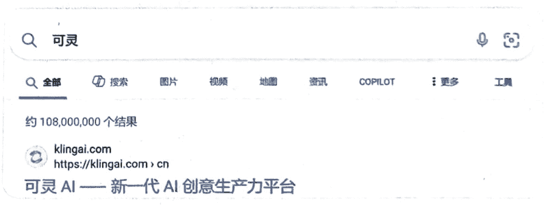

图 4-1 可灵 AI 官网搜索

点击“可灵 AI”即可进入可灵 AI 官网，如图 4-2 所示。

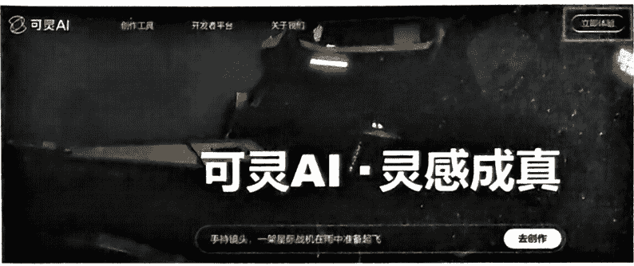

图 4-2 可灵 AI 官网

点击“立即体验”，即可跳转到可灵 AI 首页，如图 4-3 所示。

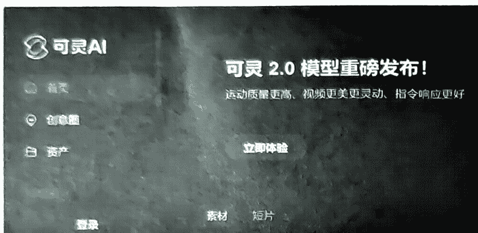

图 4-3 可灵 AI 首页

点击“登录”，跳转至可灵 AI 登录页面，如图 4-4 所示。

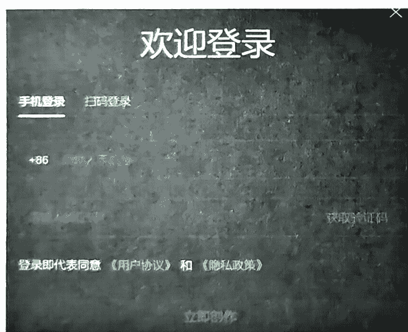

图 4-4 可灵 AI 登录页面

输入手机号和验证码，点击“立即创作”即可登录可灵 AI。

## 4.2 快速入门

登录成功后，可跳转至可灵 AI 首页，左侧工具栏中有图片生成、图片编辑、视频生成、音效生成等功能，如图 4-5 所示。

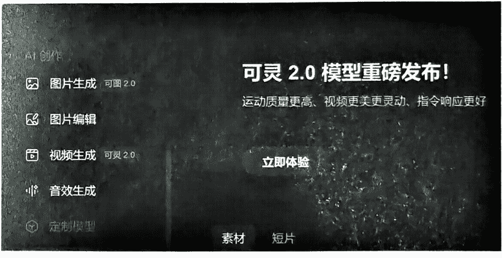

图 4-5 可灵 AI 主页功能

### 4.2.1 图片生成

点击“图片生成”功能，可跳转至可灵 AI 的图片生成页面，如图 4-6 所示。如果只在创意描述中输入相关提示词，只能使用文生图功能；若使用上传参考图，则可以使用图生图功能。

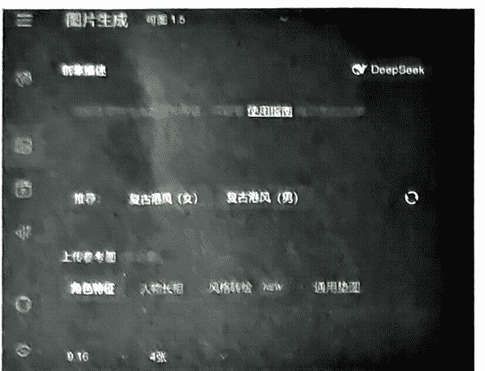

图 4-6 可灵 AI 图片生成页面

在这一页面，还可以选择相关生图模型，如可图 2.0、可图 1.5 和可图 1.0，如图 4-7 所示。

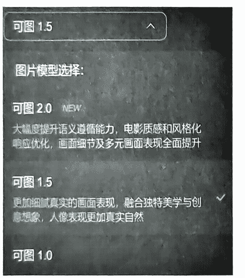

图 4-7 可灵 AI 图片生成模型选择

输入相关提示词，选择生图比例和生图张数，即可生成相关图片。

### 4.2.2 视频生成

点击“视频生成”功能，可跳转到可灵 AI 视频生成页面，如图 4-8 所示。

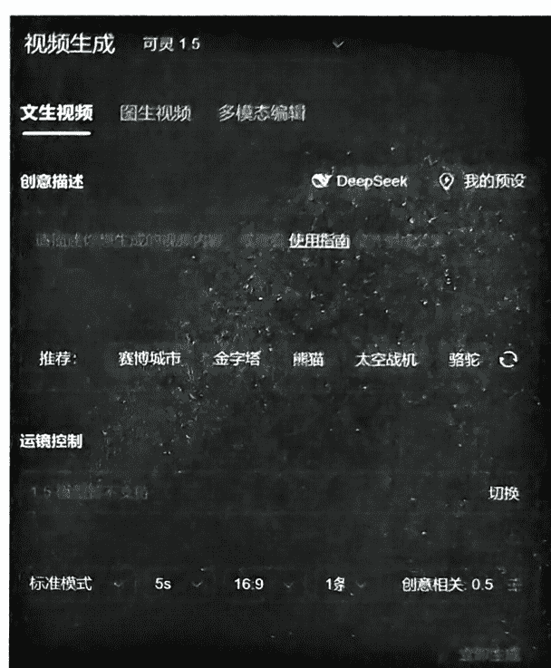

图 4-8 可灵 AI 视频生成页面

从图 4-8 中可以看到，视频生成支持文生视频、图生视频及多模态编辑三种方式。

文生视频是可灵 AI 根据文本表达生成 5 秒或 10 秒的视频，将文字转化为视频画面。

图生视频是可灵 AI 根据对一张图片的理解生成 5 秒或 10 秒的视频，将图片转化为视频画面。此外，还可以上传一张图片，同时加入文字描述，使可灵 AI 根据对文本和图片的理解生成一段视频。

多模态编辑的主要功能是对视频进行替换元素、增加元素或者删除元素的修改。

和图片生成类似，用户可以根据视频生成的不同需求，选择合适的视频生成模型，如可灵 AI2.0、可灵 AI1.6、可灵 AI1.5 和可灵 AI1.0，如图 4-9 所示。

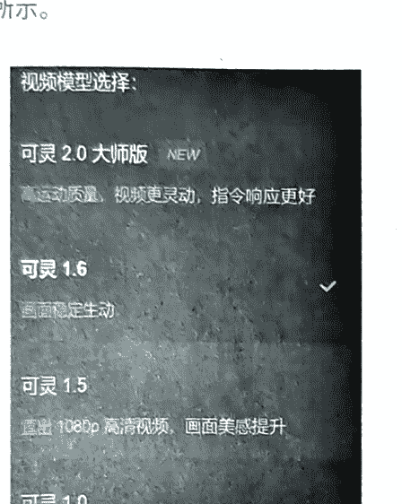

图 4-9 可灵 AI 视频生成模型选择

### 4.2.3 图片编辑

现阶段可灵 AI 支持对图片进行简单编辑，如图 4-10 所示，图中展示的功能为局部重绘和扩图。

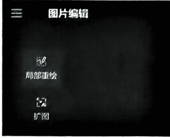

图 4-10 可灵 AI 图片编辑页面

在局部重绘中，用户只需要选中图片的部分区域，可灵 AI 便可对其进行重新绘制。扩图功能则可以对现有图片进行各个方向的扩展。

### 4.2.4 音效生成

点击可灵 AI 的“音效生成”功能，可跳转到可灵 AI 的音效生成页面，如图 4-11 所示。

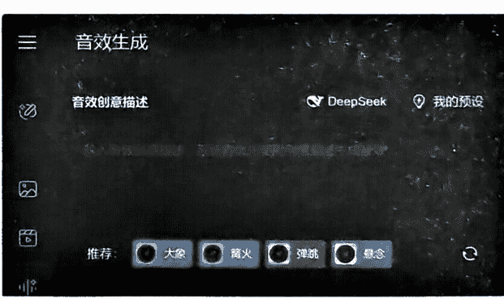

图 4-11 可灵 AI 音效生成页面

用户只需输入音效创意描述提示词，选择具体的音效种类，可灵 AI 即可实现音效生成功能。

# 第5章 绘画技巧速成

本章将系统地讲解两大绘图路径：文生图与图生图。你将掌握如何通过文字描述生成理想画面，以及如何以已有图片为基础进行风格拓展与创意再生。此外，本章还会详细讲解提示词构成、细节控制、图像质量优化等技巧，助力实现“快速、精准、高质”的图像输出目标。不懂画画也没关系，让可灵 AI 帮你“画得像、画得妙、画得快”。

## 5.1 文生图

文生图是指通过文字生成图片，是 AI 绘画作品不可或缺的步骤，我们将一些描述性的关键提示词或文本输入给 AI 工具，如可灵 AI，再使用命令和参数，AI 就可以生成精美的绘画作品，实现以文生图的效果。

对文生图来说，提示词既是“文字描述”，也是“创作指令”。AI 会根据提示词中的信息判断色彩、构图、风格、细节等各种要素。文字越清晰、越具体，AI 生成的图像就越贴合你的预期。因此，学会科学地构建和优化提示词，是掌握“文生图”艺术的关键。可以看到，可灵 AI 的图片生成页面上方有“DeepSeek”的选项，这是因为可灵 AI 集成了 DeepSeek 深度思考大模型，因此在文生图的时候，我们可以使用可灵 AI 的 DeepSeek 功能，对思维创意进行拓展深化，最终得到较为精准的提示词。

### 5.1.1 文生图的使用场景

“文生图”是指通过输入一段描述性文字，让 AI 模型基于理解与推理生成对应的静态图像。常见场景如下：

- 人物角色创作：描绘外貌、服饰、动作、背景环境；
- 场景绘制：如：古风庭院、幻想世界、科幻城市等；
- 产品设计可视化：让 AI 根据关键词生成产品雏形图；
- 插画与海报：快速产出概念原稿，用于后续精修或灵感迭代。

可灵 AI 在这一领域具有较高的可操作性，能对不同维度的文字提示进行理解与组合，然后生成你期望的图片效果。

### 5.1.2 提示词的构成要点

要想让可灵 AI 精确呈现图像，提示词需要涵盖见表 5-1 所示的要素。尽管不同项目、不同工具的提示词格式可能略有差异，但核心思路一致。

表 5-1 提示词构成要素

| 要素 | 说明 |
| :--- | :--- |
| 主体 | 用来指定画面中的主要对象或人物。例如：一只狗、一位穿汉服的少女、一辆未来感十足的飞行器等。根据具体需求可描述物种、性别、姿态、数量等，力求让 AI 明白主体的核心形象 |
| 场景/背景 | 用于说明该对象所处的环境或氛围，如古代宫殿、赛博朋克城市、乡村田园、海边落日等。此类信息能帮助 AI 构建整体空间与氛围，有时也能赋予画面更多故事性 |
| 外观特征 | 对主体的外观或服饰细节进行补充描述。例如：角色发色、眼睛颜色、面部表情、服装款式、饰品、动作等。特征越精确，画面与想象会越贴合，也能帮助 AI 减少随机生成的偏差 |
| 风格/艺术形式 | 定义整幅画的艺术风格或表现形式。可指定写实、卡通、油画、蒸汽波、复古插画、赛博朋克等，或结合艺术家风格（如凡·高、莫奈），让 AI 在整体笔触或色彩风格上更统一 |
| 光照与色调 | 描述画面想要的光线氛围。例如：逆光、柔和暖调、昏暗烛光、日落金色、霓虹灯辉映等。光线可极大影响图像的情感与观感，配合特定色调（明亮清新、冷色苍凉等），可以让图像更有氛围感 |
| 质量和细节要求 | 说明所需的分辨率或整体精致度。例如：高清、细节丰富、面部特征清晰、线条优雅细腻等。此项能帮助 AI 加大对局部及细节的关注，尽量减少模糊或细节缺失的问题 |
| 排除项 | 可在此列出不期望出现的元素或状况，如噪点、过多路人、某些颜色元素、意外物件等，让 AI 尽量绕开这些影响成图效果的因素（若有需要可选用） |

### 5.1.3 提示词示例

下面给出若干示例，以便你更加直观地了解提示词的写法。

#### 1. 日常场景

示例提示词如下：

> 一只金色短毛猫，坐在窗台上，看着窗外的雨景；画面整体清新明亮，带有小清新的插画风格；背景使用柔和的浅绿色和浅蓝色调，表现雨后的清凉氛围。

解读：
主体：金色短毛猫；
场景：窗台 + 下雨；
风格与色调：小清新、插画风、浅绿色和浅蓝色调。
这样可让 AI 清楚知道要画“一只猫”与“雨天场景”的关联，色调柔和。

#### 2. 未来科技风

示例提示词如下：

> 一位身穿银灰色金属机甲战衣的女性，身后的背景是巨大未来城市天际线，霓虹闪烁；画风赛博朋克；强烈的对比光，人物面部轮廓清晰；明亮的紫色和蓝色光线交错；高分辨率，细节刻画。

解读：
主体：女性 + 机甲战衣；
场景：未来城市、霓虹灯；
风格：赛博朋克；
光线颜色：紫色和蓝色。
强调了“高分辨率”和“细节刻画”，以追求画质。

#### 3. 童话插画

示例提示词如下：

> 一个身穿粉色纱裙的小女孩，正乘坐热气球飞过奇幻森林；背景中有巨大的蘑菇、漂浮的萤火虫；插画风格温暖，灯光柔和；给人童话般的奇幻与浪漫。

解读：
主体：小女孩 + 粉色纱裙；
场景：热气球 + 奇幻森林；
风格：童话插画；
氛围：温暖、柔和、浪漫。
提示词既是作品的灵魂，也是与 AI 沟通的桥梁。只有通过精心设计、层次分明且逻辑清晰的文字描述，才能让 AI 更好地领会你的意图，从而生成高质量、富有创意的图像。

### 5.1.4 提示词优化对比

以一份“未来建筑”生图提示词与优化提示词对比的图片生成效果为例。在可灵 AI 图片生成页面，选择使用下方的推荐词“未来建筑”，会出现如图 5-1 所示的推荐提示词。

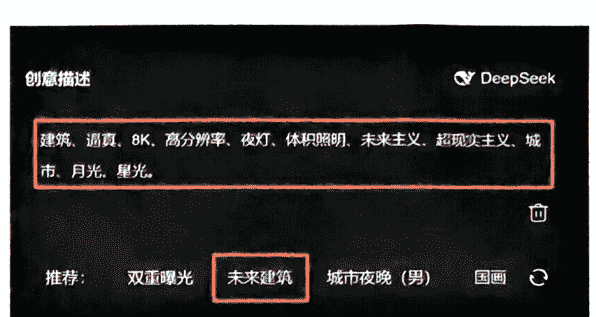

图 5-1 可灵 AI 推荐提示词

点击立即生成，可生成如图 5-2 所示的未来建筑图片。


图 5-2 可灵 AI 推荐词生成未来建筑图片

接下来使用 DeepSeek 的功能对上面的提示词进行润色。点击 DeepSeek，会弹出如图 5-3 所示的对话框。

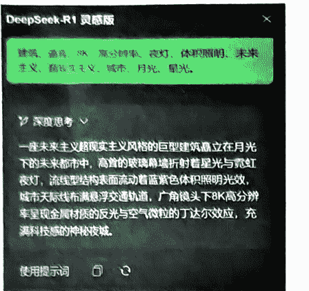

图 5-3 DeepSeek 优化未来建筑的提示词

点击图 5-3 中的“使用提示词”，保持和上面相同的参数，生成图片如图 5-4 所示。


图 5-4 DeepSeek 优化提示词后生成的未来建筑图片

对比图 5-2 和图 5-4 可以看到，使用经过 DeepSeek 润色后的提示词，生成的图片更有未来感，细节更丰富。

## 5.2 图生图

图生图模式并不从零开始生成画面，而是基于你提供的已有图片进行重新创作、扩展或变形，从而快速产出新图。无论你想要升级已有手绘草图，还是想将现实照片转化为特定风格的插画，图生图都能在短时间内给你带来令人惊艳的可能性。

### 5.2.1 图生图的应用场景

利用图生图模式，我们可以解决很多在手绘、后期或摄影修图中复杂且费时的问题，也能帮助你进行创意迭代和视觉拓展。常见的应用场景包括以下几种：

- 风格转换：将原图转换为不同的艺术风格或笔触形态。例如：你可以把一张普通的街景照片处理成油画风格，或让人物肖像带有赛博朋克的霓虹光影效果。
- 创意扩展：对原图进行扩展，例如：为已有卡通形象添加更多背景元素，为场景加入新的故事线，或扩展画面边界，让画面视野更广，细节更丰富。
- 局部修饰与细节强化：在原图中指定局部位置进行修饰，例如：调整角色面部表情、更换服饰、修复破损或低清晰度的图案等。图生图不仅能保留原图的基本结构，还能在局部加入新元素。
- 色调与氛围改造：如果你想给照片、插画换个氛围或季节效果，例如：将夏日青葱草地变成枫叶飘落的秋日场景，或者让原本昏暗的场景变得亮丽温暖，图生图会比 PS 手动调色更便捷。
- 草图快速成稿：对于插画师或设计师来说，只要提供一个简单的线稿或结构草图，图生图模式就能自动“填充”细节、渲染风格，从粗略概念图一步到位生成更完整的图。

### 5.2.2 如何编写图生图的提示词

图生图与文生图的区别：除了要输入文本，还需提供一张或多张参考图片。在可灵 AI 中，图生图的操作是上传一张基础图片，然后为之配上一段提示词，描述你希望对这张图做怎样的改动或风格重塑，根据文本与图像的双重信息进行推理。

编写图生图提示词时，可借鉴以下思路：

1. 明确你想“保留”什么
你是否希望整体构图与人物布局保持不变？
原图中的哪些元素必须保留，如人物的脸部特征、建筑物的基本形状。
在提示词中注明“保持角色姿态不变”“保留原有表情与动态”，让可灵 AI 知道哪些部分是核心。

2. 强调你想“改变”或“增强”什么
若想改变颜色、风格、氛围，需在提示词中给出具体描述，例如：“把此古装人物变成现代街头装扮，画面偏二次元漫画风格”“将背景

#### 3. 考虑局部替换或修饰

如果只想修改图中某个局部，需在提示词里指定位置或范围，例如：“人物头部加一顶粉色帽子”“背后添加翅膀”“替换背景为太空星云”等。

### 5.2.3 图生图具体应用

下面以可灵 AI 的图生图具体场景为例进行演示，如图 5-5 所示。

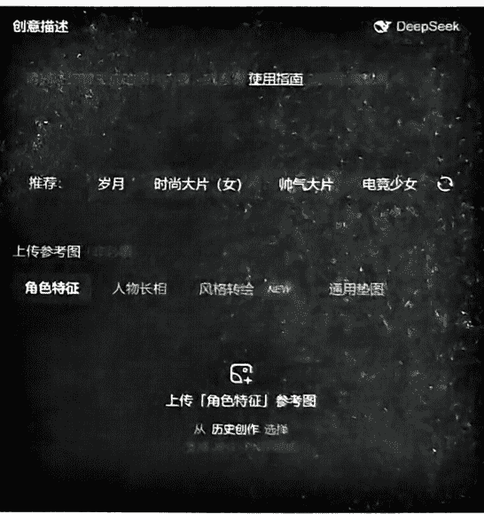

图 5-5 可灵 AI 图生图功能

点击上传参考图，可以对图片使用固定角色特征、人物长相、风格转绘和通用垫图等功能。

#### 1. 角色特征

角色特征的功能主要适用于人物、常见动物角色或者二次元等虚拟角色，可以维持角色的长相、人物衣着等，保持主体不变。它可以支持用户分别调整相似强度，通过上方的提示词更改动作、场景等。适用于剧情角色扮演、社交媒体等场景。具体使用方法如下：

我们以一张白色猫咪的图片为例，使用可灵 AI 生成的白色猫咪如图 5-6 所示。


图 5-6 可灵 AI 角色特征底图

将图 5-6 上传到“上传参考图”界面，上传成功后如图 5-7 所示，下方会出现两个选项：脸部参考和主体物参考，需要注意的是，参考的数值越大保持程度越大，上方的提示词作用也就越小。

上传成功后，我们选择适当的脸部参考和主体物参考的数值，输入上方的提示词，此处提示词可以指示环境、动作等。以“闭眼睛”为例，输入“闭眼睛”即可。

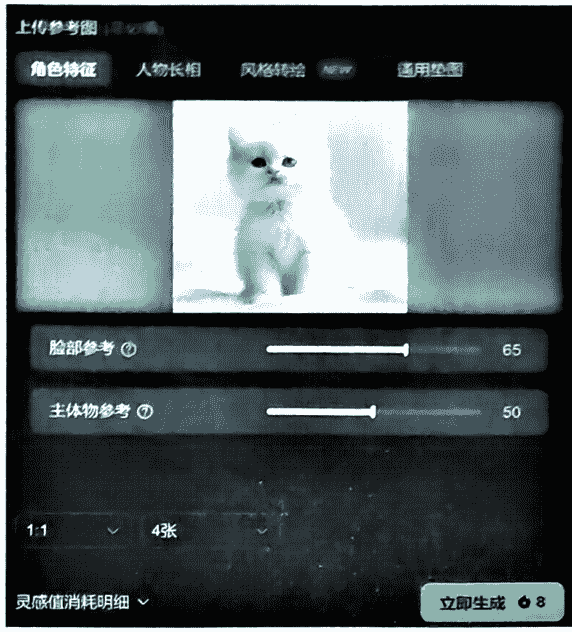

图 5-7 可灵 AI 角色特征上传操作页面

如图 5-8 所示，可灵 AI 会基于上面的猫咪场景，生成一张猫咪闭眼睛的图片。


图 5-8 可灵 AI 角色特征样图

#### 2. 人物长相

顾名思义，人物长相的功能适用于人物，主要通过提示词改变人物的服装、发型、配饰和所处场景等元素，并且可以使人物长相和参考图保持高相似度，其主要满足同人物在不同场景的创作需求。使用场景为：人物写真和剧情之中。具体使用方法如下。

以一张可灵 AI 生成的女生图片为例演示其功能，如图 5-9 所示。


图 5-9 可灵 AI 人物长相底图

将图 5-9 上传到“上传参考图”页面，选择“人物长相”功能，如图 5-10 所示。

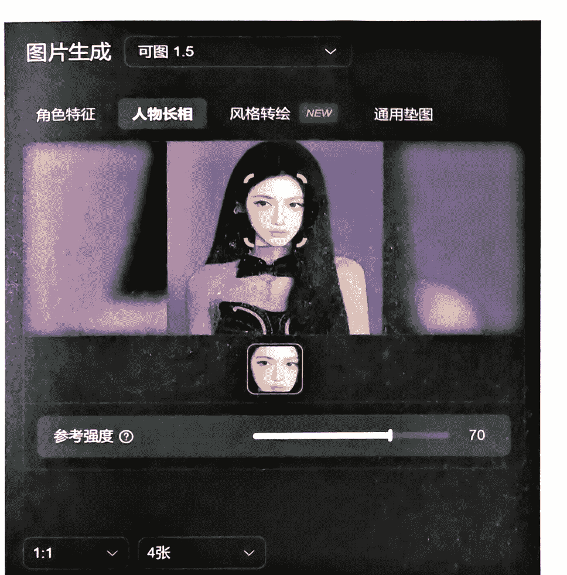

图 5-10 可灵 AI 人物长相上传操作页面

选定相应的参考强度，以短发为例，在上方提示词处输入“短发、换白色衣服”，可灵 AI 会生成符合要求的图片，如图 5-11 所示。


图 5-11 可灵 AI 人物长相样图

#### 3. 风格转绘

风格转绘的功能主要是维持画面的主要内容，例如：主体、构图姿势不变，通过提示词改变画面的风格。以一张可灵 AI 生成的图片为例，演示其功能的具体使用方法，如图 5-12 所示。


图 5-12 可灵 AI 风格转绘底图

将图 5-12 上传到“上传参考图”页面，选择“风格转绘”功能，如图 5-13 所示。


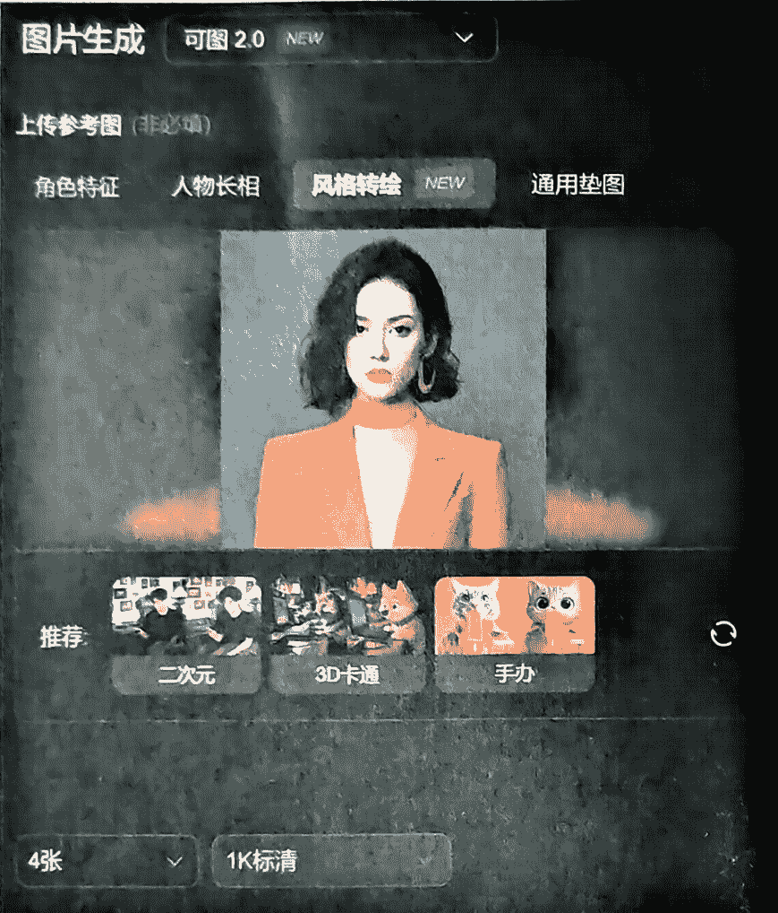

图 5-13 可灵 AI 风格转绘操作页面

选择“二次元”风格，可灵 AI 可以基于上述图片生成二次元风格图片，如图 5-14 所示。


图 5-14 可灵 AI 风格转绘二次元样图

#### 4. 通用垫图

通用垫图是指根据提示词的具体要求重新绘图。使用场景比较多，具体使用方法如下：

以一张可灵 AI 生成的图片为例，演示其功能，如图 5-15 所示为可灵 AI 生成的图片。


图 5-15 可灵 AI 生成的通用垫图底图

将图 5-15 上传到“上传参考图”页面，选择“通用垫图”功能，在上方提示词框中输入“坐在复古感的椅子上，室内场景，背景是复古感的柜子”，生成效果图如图 5-16 所示。


图 5-16 可灵 AI 通用垫图生图样图

通过图 5-16 可以看到，在图 5-14 的基础上，使用通用垫图，可以改变人物的坐姿、场景等要素。因此，通用垫图也叫作万能垫图。

图生图不仅能让已有素材快速变身，也能释放你的想象力，在保留原图结构的前提下对风格、细节、色彩进行多次迭代改造。面对传统手绘修图或照片后期烦琐的难题，AI 会更直观且高效。

在使用可灵 AI 进行图生图时，最关键的是平衡原图保真度与新元素的加入，你既要告诉可灵 AI 哪些地方要保留，又要在提示词里清晰表达变化点或增补点。不断试验与调参，是获得理想图像效果的秘诀。


# 第6章 绘画融合速成实战


本章是绘画融合速成编的核心内容，也是最具有实操性与创意的一章。我们将带你跨入实际应用场景，结合前面学到的 AI 绘图技巧，完成儿童绘本、品牌广告、短视频头像、包装视觉、家庭作业、美术 IP 等多类型图像项目的实战创作。每一节不仅提供案例，还附带可直接使用的提示词模板，帮助你一边模仿一边创新，一步步将 AI 图像能力内化为你自身的竞争力。

## 6.1 儿童绘本生图

儿童绘本插画通过色彩丰富的画面为孩子们构筑了一个充满奇幻与想象的世界，开启通向美好境界的大门。这些插画以其生动的故事和鲜明的视觉效果，有效地激发了孩子们的想象力和创造力。

### 6.1.1 场景需求

大多数人在制作儿童绘本时往往会遇到以下挑战：
- 创作过程烦琐：要写一个完整的故事，还要为每一页搭配插画内容，无论是原创绘画还是找外包设计，都十分耗时耗力。
- 美术功底或资源不足：并非每个人都擅长绘画，也并不是总能及时找到合适的插画师，并且插画费用也可能比较高昂。
- 匹配绘画风格难度大：即使勉强做了插图，风格也可能与文本氛围不符，导致绘本整体质感和连贯性不足。
- 无法快速迭代：儿童绘本需要反复修改、调试，如：改变角色造型或替换场景细节。如果依赖传统手绘或外包流程，则难以及时、低成本地完成。

为解决这些痛点，我们可以借助 DeepSeek 来生成故事文字，再配合可灵 AI 进行插画生图。这套“文本 + 图像”双管齐下的 AI 创作方案，让儿童绘本的构思与插画流程一气呵成，达到了降本增效。

### 6.1.2 基础提示词思路

在这一步骤中，我们先把故事文字做出来。借助 DeepSeek 可以快速构建一个特定风格的儿童故事。为确保故事富有趣味且适合绘本呈现，需要在提示词中说明故事主题、角色身份、时间长度与语言风格等要素。

示例提示词如下：

> 我要写一个适合 4～6 岁儿童阅读的绘本故事，主题是“小狐狸蒂亚在月亮森林寻找星星果”。故事需保持 200～300 字，有温馨结尾和一点冒险情节，语言简洁易懂，富有童话色彩。

### 6.1.3 DeepSeek 生成儿童绘本故事示例

我们将上述提示词输入 DeepSeek，DeepSeek 会生成如下绘本故事（示例）：

> 故事标题：小狐狸蒂亚与星星果
小狐狸蒂亚住在一片神秘的月亮森林里。她听说，森林深处藏着一种闪闪发光的星星果，据说谁找到它，就能替夜空里的星星许下小小的心愿。
一天夜里，蒂亚鼓起勇气，踏上寻果的旅程。她沿着月光照亮的小路走啊走，遇见了迷路的小兔米可，还遇到了一棵会说话的老松树。蒂亚帮助米可找到了回家的方向，老松树也告诉她星星果的线索。
在夜莺歌声的指引下，蒂亚终于在一片银色的湖边发现了星星果。它如同小灯笼似的发着柔和的光。蒂亚拿着它，默默许下“希望森林里的朋友们都能快乐”的愿望。星星果闪耀一下后，化作一颗温暖的星星飞上了夜空。蒂亚看着星空，心里暖暖的，觉得这片月亮森林比从前更加美丽。

### 6.1.4 根据故事生成插画提示词

当我们想为这段故事做插画时，可以先将故事拆分成几个主要场景，然后针对每个场景编写插画提示词。下面以“蒂亚发现星星果的瞬间”这一场景为例做示范。

示例提示词如下：

```
绘制一幅儿童绘本风格的插画：
主体：小狐狸蒂亚，身材小巧可爱，毛色呈橘红色，眼神中带有欣喜和好奇；
场景：月亮森林中的一处银色湖边，湖面波光粼粼，夜晚的天空挂着明亮的月亮与星星；
核心物件：一颗星星果，散发着柔和光芒，正被蒂亚捧在双爪间；
风格：童话插画，线条柔和、色彩温暖，适合4～6岁儿童视角；
氛围：温馨梦幻，周围点缀少量萤火虫或微光。
```

### 6.1.5 用可灵 AI 生成插画图片

进入可灵 AI 生图页面，输入上方提示词，选择图片生成张数和比例，即可生成如图 6-1 所示的图片。


图 6-1 可灵 AI 生成的故事绘本样图

如果对上方图片生成的效果不满意，可以再次生成或者利用可灵 AI 的图生图中的具体功能进行修改。

## 6.2 动漫作品创作

动漫作品不仅是一种娱乐形式，还是深受年轻群体与二次元爱好者欢迎的文化载体。传统的动漫创作往往需要专业编剧、分镜画师、角色设定者等多方协作，周期长、成本高。如果你想在短时间内尝试做一部小动画脚本或原创漫画场景，却苦于团队与资金不足，可灵 AI 可以提供一种高效、低门槛的替代方案。

### 6.2.1 场景需求

动漫作品由于对叙事和视觉的要求很高。对于想独立创作或以低成本方式探索动漫雏形的个人或小团队来说，常见痛点包括以下几项：

- 剧情构思和文本创作：需要具备一定的文学功底和剧本编排能力，才能保证故事的可看性。
- 角色形象和场景绘制：手绘或外包括插画成本高，且创作周期较长。
- 统一风格和持续迭代：动漫通常是连载或多集系列，一旦角色和场景确定，就需要保持一致性，还要时常进行微调。

借助 DeepSeek 完成故事脚本及对角色、世界观的文字设定，再用可灵 AI 快速生成角色形象或场景草图，可以大幅降低开发门槛。这样既能快速验证创意，也能为后续真正的动画或漫画制作打好基础。

### 6.2.2 基础提示词思路

在创作一部短篇动漫时，可以通过提示词告知 DeepSeek 基本主题、人物和剧情需求，以下示例以“现代都市 + 魔法少女”的风格作为参考。

示例提示词如下：

> 我想创作一部短篇动漫，背景是现代都市中隐藏魔法势力，主角是一名高中女生，剧情包含这名高中生意外获得了魔法力量，冒险与友情主题的风格，约 400 字。请给出完整大纲和小结局，并留一点伏笔让后续可扩展。

提示词说明：

- 主题：现代都市 + 魔法暗流；
- 角色：高中女生；
- 篇幅：400 字左右，包括起因、冲突和小结局；
- 风格：冒险 + 友情，适合短篇动漫。

### 6.2.3 DeepSeek 生成动漫作品示例

假设 DeepSeek 输出如下文本（节选）：

> 动漫短篇剧情大纲：焰羽之光
高中生顾星羽是个平凡的少女，她的日常是上课、和闺蜜逛街，一切看似平常。然而，某天下课途中，她目睹一场奇异的街头冲突：一位戴面具的魔法师用黑色火焰击退了一只阴影怪物，随后突然消失无踪。
顾星羽对魔法产生强烈的好奇。半夜时，家门口竟出现了一封闪着紫光的信，里面有一把刻着古老花纹的钥匙。钥匙解开了她体内封印的“焰羽之力”，让她获得操控火焰的初级魔法能力。
起初，顾星羽只想把钥匙当作新奇玩具，不料，却在同学们遇到危险时，借助“焰羽之力”拯救了他们。因此，她惹来一股黑暗势力的关注。她和同学们携手调查，发现城市下有许多被封印的魔物。
结局：顾星羽在一次对战中险胜，体会到守护的重要性，与此同时，更强大的黑暗势力正在复苏。故事尾声：面具魔法师再次出现，向她伸出援手，暗示未来或有更大的挑战……

### 6.2.4 根据故事生成插画提示词

针对这部短篇动漫，如果想先为女主角顾星羽做人物插画，可在可灵 AI 中编写以下提示词：

> 请绘制一幅现代魔法少女风格的插画：
主体：顾星羽，高中女生形象，黑色长发、身材纤细，穿着校服外套 + 短裙，背后浮现淡淡的火焰羽翼；
风格：偏日系动漫风，色彩鲜明，线条干净；
背景：都市夜景，远处有高楼霓虹灯，天空深蓝色；
氛围：魔法与现实交融，一只手掌心凝聚细小火焰，展示她刚觉醒的力量。

### 6.2.5 用可灵 AI 生成动漫图片

进入可灵 AI 生图页面，输入上述提示词，如果第一次生成的插画火焰效果不突出，可在提示词里增补“火焰羽翼更加发光，氛围偏热血张力”。

可灵 AI 生成的动漫图如图 6-2 所示。


图 6-2 可灵 AI 生成的动漫图样图

拿到满意的插画后，你可以结合 DeepSeek 产出的剧情，将这张插画用作角色人设图、宣传海报或番外插图，为后续更深入的漫画或动画企划奠定基础。

通过 AI 辅助的创作方式，动漫作品的前期筹备变得更灵活、更高效，你只需提供一个主题与几行提示词，就能获得完整的故事大纲与角色插画。后续如需扩展剧情或增加角色，也能沿用相同模式，快速迭代剧情设定和视觉呈现效果。借助 DeepSeek 和可灵 AI，诸如：都市魔法少女、少年热血对决、古风玄幻冒险等脑洞题材，都能以极低的成本迅速转化成“可视化的初稿”让你更自信地迈向下一步创作。

## 6.3 产品广告图像制作

广告在新媒体时代是宣传、推销产品和服务的方式，可以通过各种传播途径向消费者传递信息，从而激发消费者的购买欲望。它的目的是让消费者更好地了解该产品或服务的特点，从而促使消费者产生购买欲望，最终使其购买产品或服务。

### 6.3.1 场景需求

在当今竞争激烈的市场环境中，很多品牌或个人卖家都想快速推出高质量的广告图像，以便在社交媒体或电商平台上吸引客户。然而，他们常常面临以下难题：

- 文案与视觉分离：通常需要先写广告文案，再找设计师或美工做视觉呈现，沟通成本、时间成本高。
- 缺乏创意灵感：广告如果要在短时间内抓住用户眼球，没有成熟的创意方案，很难产生有冲击力的视觉效果。
- 自制广告图门槛高：非专业设计师难以掌握排版、配色、产品质感等要素，做出的图往往缺乏商业质感。

将 DeepSeek 和可灵 AI 结合起来，可以同时解决广告文案与产品广告图像的创建难题。DeepSeek 生成产品文案或广告话术，可灵 AI 则能够根据文字提示快速生成契合产品定位的宣传视觉图，大幅缩短广告设计流程。

### 6.3.2 基础提示词思路

如果你要为一款“Spark”运动饮料做广告，希望突出“补充能量、清爽口感、年轻活力”的品牌调性，可在 DeepSeek 输入如下提示词：

> 我需要一段创意广告文案，推广一款名叫“Spark”的运动饮料。核心卖点是“瞬间补充能量，让你保持年轻活力”，目标人群主要是 20 ～ 30 岁的运动爱好者。文案篇幅在 120 字以内，能用一句口号收尾。

提示词说明：
- 品牌与产品：Spark 运动饮料；
- 卖点：能量补充、年轻活力；
- 目标：20 ～ 30 岁运动人群，口碑或推广文案；
- 篇幅：120 字以内，适合海报或社交短文；
- 口号：文案末尾加一句响亮口号。

### 6.3.3 DeepSeek 生成的广告文案示例

以下为 DeepSeek 的输出（示例）：

> 广告文案：
当你奔跑在城市的每一条街道，身体的热量在消耗；当你挥洒汗水，渴望一口清爽时，Spark 就在你手边！富含维生素与电解质的配方，为你瞬间注入活力，无论是晨间锻炼还是夜跑挑战，都能让状态时刻在线。
口号：Spark——点燃你的运动能量！

### 6.3.4 根据文案提炼插画提示词

获取文案后，接下来要为这款产品制作一张广告海报。在可灵 AI 里输入提示词，描述画面主体、风格、氛围等关键信息。
示例提示词如下：

> 请绘制一张有关运动饮料“Spark”的广告海报：
主体：一瓶 Spark 饮料，瓶身设计简洁，颜色偏亮橙，瓶上可见醒目的“Spark”logo；
画面元素：背景采用跑道或城市街头的场景，人物侧影呈现奔跑动作，让人感到动感与速度；
风格：活力炫彩的插画风，色调明亮，带有动态线条或速度感；
氛围：年轻、热血，呈现一种随时随地补充能量的视觉效果。

### 6.3.5 用可灵 AI 生成广告图像

进入可灵 AI 生图页面，输入上述提示词，可灵 AI 会根据描述生成包含“运动场景 + 产品 + 动感线条 + 活力配色”的海报样图，如图 6-3 所示。

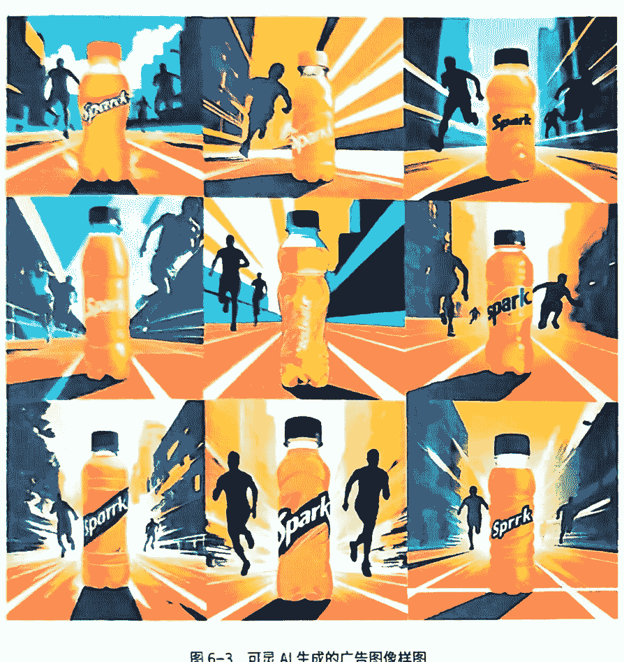

图 6-3 可灵 AI 生成的广告图像样图

需要注意的是，可灵 AI 生成图片中的文字可能会有错误或不清晰的情况，如图 6-3 左上方和最中间的图像，这时我们可以对图片进行修改或者让可灵 AI 重新生成。如果海报生成后，产品瓶身不够突出或颜色不够亮，可在提示词中增加“让瓶身更大更靠前”“色彩对比更鲜明”等强化描述。

结合 DeepSeek 文案和可灵 AI 海报图，你能立即在社交媒体或电商店铺上线简易广告。

### 第 6 章 绘画融合速成实战

产品广告图像制作不再是传统的“文案先行、设计后期”的线性流程，而是同时拥有 AI 文案创意与视觉生成的双重助力：DeepSeek 让你快速写出吸睛广告文案，抓准产品卖点；可灵 AI 则能瞬间将文字描述转化为品牌感强、富有冲击力的海报或宣传图。

这套方法大大降低了广告图像的创作门槛，也为中小品牌或个人卖家提供了低成本、高效率的广告设计方案。只要掌握提示词撰写技巧，你就能在短时间内完成一套具有专业观感的产品广告图像，为自己的产品宣传增添高光。

## 6.4 制作品牌 IP 形象

品牌 IP 形象是企业或特定品牌在市场和社会公众眼中所展现的个性特征。有效的品牌 IP 形象构建需要深入理解目标市场和消费者心理，并结合品牌的历史、文化背景和未来发展方向。创意设计和视觉表达是构建品牌 IP 形象的关键，它们不仅需要引起消费者的情感共鸣，还要传达品牌的核心信息和价值主张。通过多渠道的一致性表达和互动体验，品牌可以逐步加深其 IP 形象在消费者心中的印象，从而提升品牌价值，扩大市场影响力。

### 6.4.1 场景需求

在品牌营销中，打造一个辨识度高、风格鲜明的品牌 IP 形象能够有效地吸引消费者，实现从产品认同到情感黏性的深层次联结。然而，很多企业或个人往往在以下方面面临困难：

- IP 定位不够清晰：不知道该给 IP 赋予何种气质或角色设定，如：可爱的卡通人物、科技风机器人或具有拟人化特征的动物形象。
- 创意与美术资源不足：需要原创设计师反复讨论、画草图、修饰，才能得到一个初步形象，成本与时间消耗较高。
- 难以快速迭代：品牌 IP 形象一旦定型，在后续宣传或周边开发中如果需要大范围修改，往往涉及大量重绘和后期费用。

将 DeepSeek 与可灵 AI 结合起来，我们可以以极低的门槛快速产出品牌 IP 形象的原型，从人物背景故事到形象外观都能随时迭代，最终凝练出一套完善、可复制的品牌形象体系。

### 6.4.2 基础提示词思路

假设你经营一家环保科技公司，想要打造一个拟人化的“树精灵”形象 IP，用来传递绿色理念和品牌价值。可在 DeepSeek 中输入如下提示词：

> 我要为一家环保科技公司打造一个品牌 IP 形象，即拟人化的树精灵角色。请帮我写一段角色定位，包括姓名、性格特质、品牌理念、适用的场景，再加上一句简短口号。文字不超过 200 字。

提示词说明：
角色定位：树精灵 + 环保概念；
字数限制：200 字内；
要素：角色姓名、性格、适用场景、品牌理念、口号。

### 6.4.3 DeepSeek 示例输出

DeepSeek 生成如下文本（示例）：

> 角色定位：
名字叫森小灵，是一位活泼善良、心怀万物的树精灵，头发宛如翠绿的树叶，笑声像微风拂过森林。她代表着环保科技的友好力量，愿意传递绿色生活方式，呼吁人与自然和谐共生。可用于产品包装、官网形象及线下活动合影区等多种场景。
口号：用心守护，让绿色点亮未来！

### 6.4.4 为 IP 形象生成插画提示词

基于上述的森小灵角色定位，你可在可灵 AI 的提示词界面中输入如下指令，生成该品牌 IP 形象的原型插画：

> 请绘制一幅品牌 IP 形象插画：
主体：森小灵，一个拟人化的树精灵少女，头发呈翠绿树叶状，穿着简洁绿色衣饰，表情活泼可爱；
风格：卡通可爱，线条柔和，配色明快；
背景：以森林为基础，让人感到清新自然，可点缀小花、藤蔓等；
突出元素：品牌环保理念，可在她胸前或腰间添加一个叶子形徽章，象征环保科技的标识；
氛围：温暖且充满生机，让人联想到“绿色、守护、未来”。

### 6.4.5 在可灵 AI 中生成形象

进入可灵 AI 生图页面，复制上述提示词，即可生成相关图片，如图 6-4 所示。

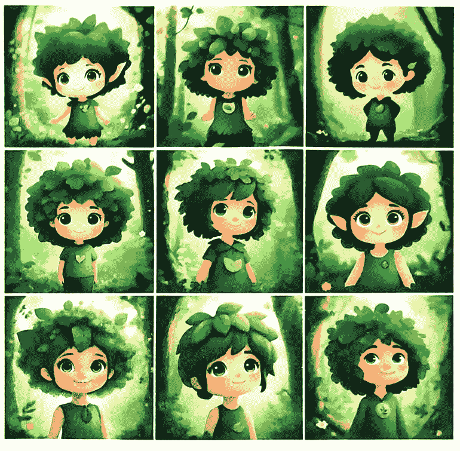

图 6-4 可灵 AI 生成的品牌 IP 形象样图

如果想让森小灵更具特色，可在提示词中增加“头戴小树叶发箍”“可爱的大眼睛”，或融入更多风格细节，如：“插画需加入水彩质感”。这样，你就能得到多版候选 IP 形象，选出与企业调性最契合的一版，将最终版本的“森小灵”作为公司吉祥物或品牌 IP，在海报、名片、展会立牌、社交媒体头像等场景中灵活运用。

利用 DeepSeek 进行角色文字设定，再结合可灵 AI 实现可视化形象，你便能轻松打造富有辨识度的品牌 IP。即使没有专业插画或设计经验，也能在短期内完成多个风格迭代，找到最匹配企业文化和消费者喜好的“代言人”形象，为后续品牌宣传与周边开发奠定基础。

## 6.5 抖音、快手等平台虚拟头像

在如今的短视频软件中，抖音、快手等平台充满了各种热门元素，还有自拍、创意等丰富多彩的内容，成为现阶段主要的短视频交流平台。当我们想要打造自己的抖音或快手账号时，生成一个独特的虚拟头像是必不可少的步骤。头像不仅能够体现个人风格，还能使自己在众多用户中脱颖而出，吸引更多的关注。

### 6.5.1 场景需求

对许多抖音和快手创作者而言，一个吸睛且辨识度高的个人或品牌头像能让观众在极短时间内对账号产生印象，并在后续浏览中迅速认出号主。但在现实中，创作者往往面临以下困境：

- 手绘或设计外包成本高：找插画师、设计师做一版定制头像，不但费用高昂，而且调整周期长。
- 创意灵感不足：许多人想塑造独特形象，却不知从何处下手，常常流于大众化。
- 频繁换头像不方便：如果想持续更新或尝试不同风格，需要再次投入大量时间和设计费用。

借助可灵 AI 生成头像，你只需通过文字描述（提示词）就能使其自动生成风格统一、个性化且可随时迭代的虚拟形象，成为自己账号的“招牌”。

### 6.5.2 根据账号定位生成相关头像提示词和头像

下面提供四个不同定位的示例提示词，帮助你迅速在可灵 AI 里生成相应的虚拟头像。

#### 1. 萌系二次元定位

> 请为抖音账号设计一个萌系二次元风格的虚拟头像：
主体：一位粉发少女，双马尾，表情可爱，眼睛大且闪亮；
风格：日系动漫插画，整体线条柔和，色彩明快；
装饰：头上可配一个小猫耳发饰，身穿简洁水手服；
背景：可用淡粉渐变色，突显人物轮廓；
氛围：活泼甜美，带有软萌感，适合二次元内容创作者。

将上述提示词输入可灵 AI 的生图界面，可灵 AI 即可生成符合萌系二次元定位的头像，如图 6-5 所示。

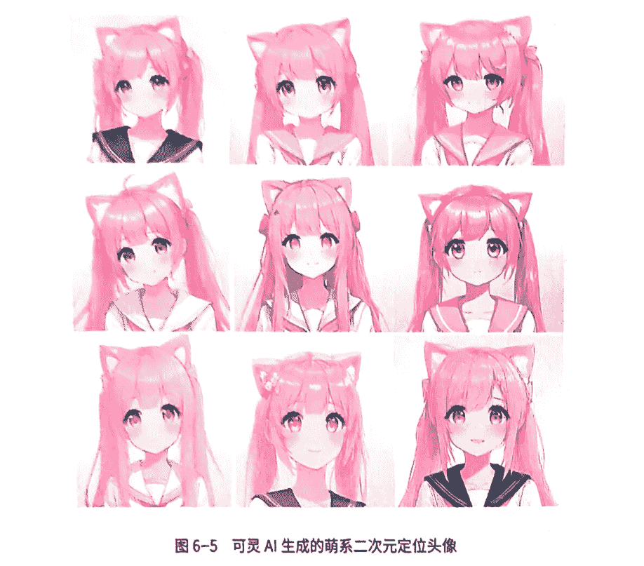

图 6-5 可灵 AI 生成的萌系二次元定位头像

#### 2. 潮流街舞定位

> 请为快手账号设计一个潮流街舞风格的虚拟头像：
主体：一位年轻男性，卡通形象，身形修长，身穿嘻哈卫衣 + 运动鞋；
风格：炫彩街舞插画，线条稍显硬朗，带有潮流涂鸦元素；
面部特征：平帽反戴，表情带点自信与酷感；
背景：霓虹涂鸦墙或抽象街头线条，用亮色对比突出主角；
整体：张力十足，能体现街舞或嘻哈节目的风格。

将上述提示词输入可灵 AI 的生图界面，可灵 AI 即可生成符合潮流街舞定位的头像，如图 6-6 所示。

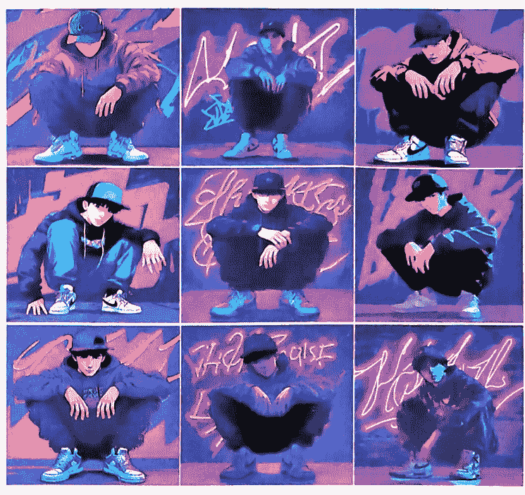

图 6-6 可灵 AI 生成的潮流街舞定位头像

#### 3. 轻奢美妆定位

> 请生成一款轻奢美妆风格的虚拟头像：
主体：时尚女性，长发微卷，五官精致，嘴唇涂玫瑰色口红；
风格：插画结合写实线条，突出优雅与高级感；
服饰：淡金色饰品或耳坠，展现精致美妆风范；
背景：简洁淡米色或浅金渐变，搭配高光元素；
氛围：轻奢、优雅，适合美妆博主或时尚评测类账号。

将上述提示词输入可灵 AI 的生图界面，可灵 AI 即可生成符合轻奢美妆定位的头像，如图 6-7 所示。


图 6-7 可灵 AI 生成的轻奢美妆定位头像

#### 4. 阳光运动健身定位

> 请创建一个阳光运动健身风格的虚拟头像：
主体：年轻男子卡通形象，短发，肌肉线条健康但不过度夸张；
风格：健康活力插画，不必太写实，颜色偏明亮；
服装：运动背心，手臂上戴运动腕带；
背景：蓝天或露天运动场元素，突出阳光与积极性；
整体：充满正能量，适合健身博主，给人励志感。

将上述提示词输入可灵 AI 的生图界面，可灵 AI 即可生成符合阳光运动健身定位的头像，如图 6-8 所示。

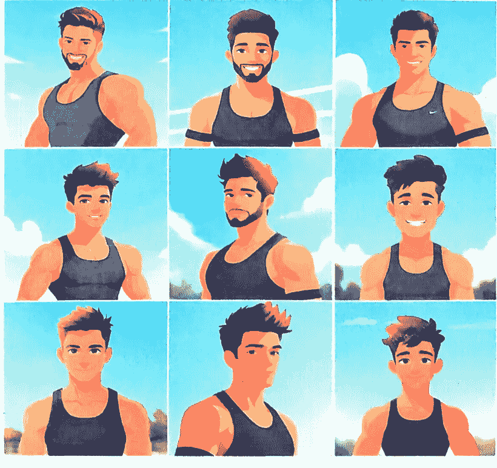

图 6-8 可灵 AI 生成的阳光运动健身定位头像

进入“文生图”界面，复制以上提示词内容；如需微调发型、配色、表情、背景等，可进一步修改或补充描述；生成后若结果不理想，可尝试再次迭代提示词，如“头发颜色更浅”“背景更鲜艳”“可爱度再提升”，以使生成的图像不断接近理想形象。

通过以上简单的提示词示例，你可以为抖音或快手账号的不同定位快速生成个性化虚拟头像，既能节省设计成本，又能依据账号风格反复迭代，避免传统设计流程的繁复。只要掌握写好提示词的技巧，你就能在短时间内打造一个精准对应自身账号调性的头像形象，让观众对你“一见倾心、过目不忘”。

## 6.6 搞定孩子的手工作业

老师留的各种手工作业、绘画作品、科学小实验等，常常让家长感到手足无措。不仅要准备材料，还要花时间指导孩子完成，这对忙碌的家长来说无疑是个挑战。而有了智能工具辅助后，我们可以轻松应对这些难题。利用 AI 助手，我们可以快速获取手工作业的创意方案，找到绘画的参考素材，甚至还能一步步指导科学实验的操作方法。这样，家长不仅减轻了压力，还能与孩子一起享受动手实践的乐趣，促进亲子关系。

### 6.6.1 场景需求

许多父母在陪孩子完成手工作业时会面临以下问题：
创意不足：老师布置了主题，孩子却苦于没有独特灵感，做出来的作品容易“千篇一律”。
手绘或材料准备繁杂：如果需要画草图或打印参照图，一旦没有美术基础，就会手足无措。
时间紧、压力大：家长或孩子临时抱佛脚，需要在有限的时间内想出有新意又符合作业要求的作品。
借助可灵 AI，你只需针对老师的要求撰写一段提示词，即可快速生成一张或多张参考插画，帮助孩子启发思路或直接打印出来，用来拼贴、改画或参照制作 3D 模型，有效减少“作业难产”的压力。

### 6.6.2 场景示例

假设老师要求孩子制作一个“环保主题的创意树叶贴画”，并绘制或展示一幅“森林与小动物”的背景图，用于剪贴和粘贴树叶，形成层次感。老师提出几点具体要求：

> 主题：体现环保理念，表现人与自然和谐共生；
场景：一片茂密的森林，小动物们自由地生活；
适用：让学生以此图为底版，添加各种树叶等天然材料做出立体贴画；
风格：儿童友好，色彩柔和，能体现温馨的氛围。

### 6.6.3 根据老师要求撰写插图的提示词

下面是一段针对可灵 AI 的提示词示例，帮助你生成适合打印或参照的森林背景插图：

> 绘制一幅以森林与小动物为主题的儿童插画：
主体场景：一片绿色茂密的森林，阳光从树叶间洒下，地面有小草和花丛；
动物元素：可出现几只可爱的小兔子、小鹿或松鼠在其中活动，风格要友善温馨；
环保理念：可以在画面的一角放置一个小标志，象征人与自然和谐相处，如一个小“心形叶子”图案；
风格：童话插画风，色彩柔和，适合 A4 纸打印制作手工作业背景；
氛围：请尽量让画面干净，留一定空白区域，方便学生后期贴树叶或装饰。

### 6.6.4 用可灵 AI 生成图片

在可灵 AI 的生图界面输入上述提示词，即可生成如图 6-9 所示的图片。

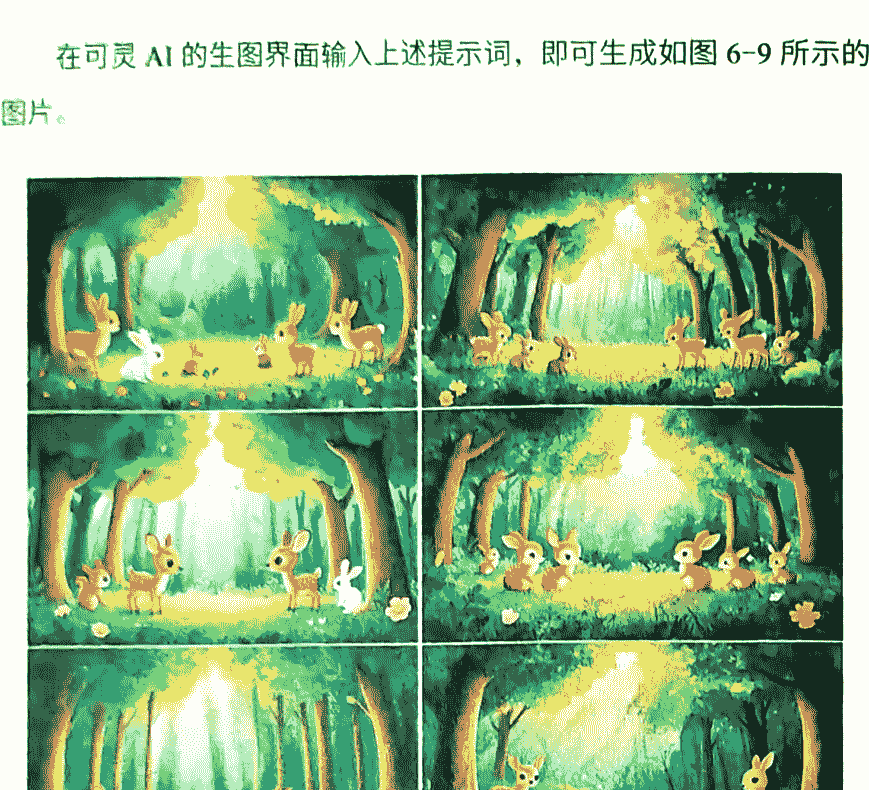

图 6-9 可灵 AI 生成孩子作业样图

生成后，下载或打印这幅插画，让孩子在上面贴树叶、涂色或做剪贴，完成环保主题的创意手工作业。

通过以上方式，你能快速完成孩子的手工作业背景，让孩子在短时间内拥有高质量、美观的创意模板，同时能培养孩子的自主思考与动手能力，减少家长在手绘、找素材方面的烦恼，真正做到事半功倍。

## 6.7 精美商品包装设计

对于电商平台的创业者而言，产品质量无疑是重中之重。然而，在激烈的市场竞争中，精美的包装同样扮演着不可或缺的角色。一个设计精良、富有创意的包装，不仅能够保护产品，防止产品在运输过程中受到损坏，还能提升消费者的开箱体验。当消费者收到精美包装的产品时，内心会感到惊喜和愉悦，这种积极的情感体验有助于提高客户满意度和品牌忠诚度。精致的包装也有助于塑造品牌形象，传达品牌的价值和理念，使产品在众多同类商品中脱颖而出。因此，创业者在注重产品质量的同时，应投入精力和创意，设计出令消费者眼前一亮的包装，为产品增添附加价值。

### 6.7.1 场景需求

如果包装既能传递品牌理念，又具备独特美感，就容易让产品在货架或社交媒体上脱颖而出。然而，想要做出精美且符合市场定位的包装设计，不少人会遇到以下难题：

美术与概念缺乏：品牌方仅有一个模糊的创意，难以准确向设计师表达出来。

多版本尝试成本高：同时探索多套包装路线，人工绘制与排版流程冗长。

迭代效率低：想小幅改动产品线、换主题或颜色，需要反复与设计师沟通，耗费大量时间。

通过 DeepSeek 与可灵 AI，你可以先用 DeepSeek 从文字层面将品牌、产品定位与设计愿景梳理清晰，再用可灵 AI 快速产出包装插画或概念稿，边写边看，多轮迭代后再进入打样和实际印刷阶段。这种方法大幅缩短了“想法落地”的周期，也让更多小商家能负担起包装设计的实验性成本。

### 6.7.2 生成包装设计设定的文字提示词

假设你想为一款红枣牛奶饮品设计包装，核心诉求是健康、温暖、适合家庭消费，并希望采用少量插画元素彰显自然与品质的理念，可在 DeepSeek 输入如下提示词，先帮你整理包装理念。

示例提示词如下：

> 我想为一款叫“枣香暖意”的红枣牛奶设计包装。请用 150 字以内描述产品定位、目标人群及包装关键元素，如：配色、插画风格和品牌诉求等，并给出一句简短主打口号。

### 6.7.3 DeepSeek 输出示例

假设 DeepSeek 给出了如下文本（示例）：

> 包装定位：
“枣香暖意”主打温润养生概念，适合早晚饮用或长辈关怀场景。包装可选暖色系，如：米色与棕红色，彰显红枣的天然健康。插画可融入牧场奶牛与红枣果实，突出自然品质。目标人群为注重营养与暖心体验的家庭用户。
口号：让每一口，都温暖到心底。

### 6.7.4 为包装生成插画提示词

根据上述定位，你可在可灵 AI 中撰写插画提示词，直接生成红枣牛奶包装概念图。例如：

> 请绘制一幅红枣牛奶包装的插画概念稿：
风格：温暖插画风，色调主打米色与棕红色，适度柔和；
主体元素：一只可爱奶牛，旁边有几颗红枣图案，暗示产品原料；
氛围：健康、家常，带些轻松温馨感；
包装布局：中央区域留白，用于突出品牌 logo “枣香暖意” 及口号；
其他：注意不要太花哨，但要凸显红枣的自然质感。

### 6.7.5 在可灵 AI 中生成包装概念图

进入可灵 AI 生图页面，输入上方的提示词，可灵 AI 将输出一个包装正面插画概念稿，呈现奶牛、红枣的柔和配色，如图 6-10 所示。如果觉得颜色或元素分布不够均衡，可调整提示词，如：让背景米色更浅，红枣和奶牛分别放在左右两侧，logo 位于包装中央等。如果想增加一些细节，如：飞溅的牛奶弧线或更凸显红枣的个头，也能再次修改生成。


图 6-10 可灵 AI 生成包装设计样图

涉及文字部分，图 6-10 的中间图片的文字是错误的，对此，我们重新生成即可。选用最理想的插画草图后，你可将其交予专业设计师，结合包装盒或瓶身的结构尺寸与印刷需求进行落地排版；或者在电商页面上直接展示这一概念图，用于测试市场反馈，再做进一步的升级。

从文字到包装插画的快速流程不仅节省了沟通与创意成本，也为中小企业或个体商家提供了低门槛、高灵活度的包装设计新思路。

## 6.8 小红书等网文配图

前文已经讲过如何使用 DeepSeek 进行文案生成，此处不再赘述，而在诸如小红书、微信公众号的网文中，配图也是非常重要的。

### 6.8.1 场景需求

在小红书（或类似平台）上发布图文内容时，许多人既希望能写出吸睛文案，又能为文案配上视觉美感的图片，以便自己发布的内容在琳琅满目的帖子里脱颖而出。常见痛点包括：

- 插图缺乏：想表现特定情境或风格，却找不到合适的图片素材；
- 视觉连贯度不够：文字和图片常常割裂，没有形成完整的故事氛围或推广亮点。

使用 DeepSeek 和可灵 AI 的组合，你可以先生成一篇“带有生活气息、突出实用小技巧”风格的小红书软文，接着利用可灵 AI 的插画或图生图功能，为文章配上与内容调性高度契合的定制插图。

### 6.8.2 文案创作：以“秋季护肤小 Tips”为例

示例提示词如下：

请用 100 字左右写一篇小红书风格的秋季护肤小 Tips 分享，语言亲切、有代入感，简要列出 2～3 个实用护肤要点，并加一条适合文末的互动引导。

DeepSeek 生成的网文文案示例：

> 文案：
秋天来了，皮肤容易干燥紧绷。每天早晚先用保湿精华打底，再搭配滋润度较高的面霜牢牢锁水；偶尔还可温和地去角质，帮助肌肤吸收营养。记得多喝水、多吃果蔬哦！你的秋季护肤秘籍是什么？留言告诉我吧。

### 6.8.3 插图提示词示例

为配合上述文案，你可在可灵 AI 中生成一张秋季护肤氛围感的插画或卡通示意图。以下是示例提示词：

> 请生成一幅小红书风格的插画，用于秋季护肤干货分享：
场景：桌面上摆放护肤品瓶子、一杯花茶，背景带有秋叶元素；
风格：清新可爱插画，色彩柔和明亮，适合美容博主发帖；
氛围：温暖治愈，突出“秋季护肤”主题。

### 6.8.4 生成与运用

在可灵 AI 中选择生图模式，输入上面生成的插图提示词，可灵 AI 会生成一个轻松、温暖的插画场景，可搭配你之前写的护肤小 Tips，如图 6-11 所示。

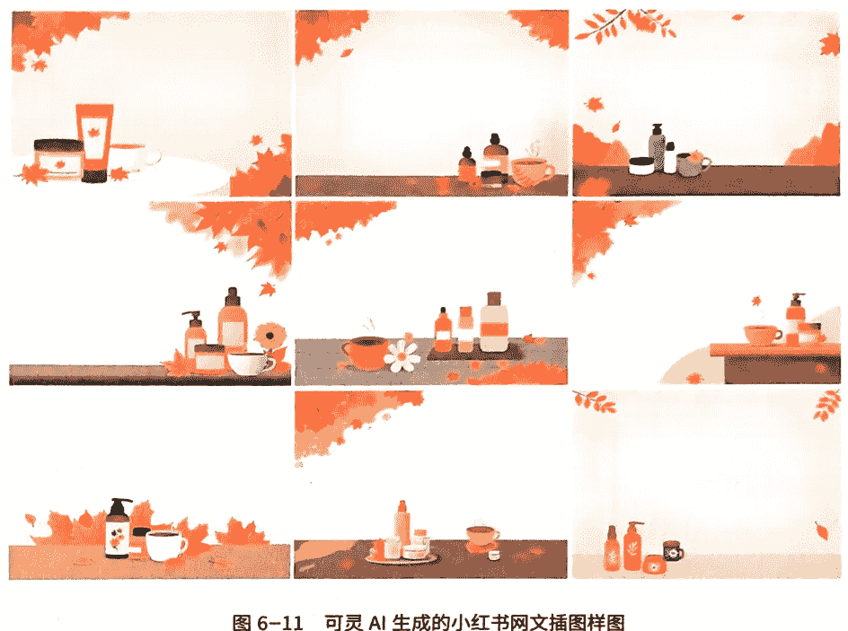

图 6-11 可灵 AI 生成的小红书网文插图样图

将护肤文案与插画图片组合在小红书同一篇笔记里，使用文字 + 插画的方式，可以让帖子既简洁美观又内容实用，大大提高曝光度与点赞率。

通过 “AI 文案 +AI 插画” 双向合力的方式，你能在很短的时间内完成一篇让人眼前一亮的网文配图帖子，不仅适用于小红书，还能应用在微信公众号、微博、知乎等平台，对任何需要图文结合的内容创作都大有裨益。

## 后记

在过去的十年里，我们看到太多人在“创作”这条路上黯然离场：设计师因为灵感枯竭，文案人因为文思堵塞，创业者因为时间不够而无力表达品牌的灵魂。“创作”这件事从来都不是轻松的，它是一场心力与时间的博弈，是一次次在屏幕前孤独地挣扎。而 AI 以超乎想象的速度、精度与灵感储备，凭借永不疲倦的运算能力和无休止的内容重组能力来到我们的身边。它不是来取代创作者的，而是为我们提灯的。它不是艺术的终点，而是助我们成为更好创作者的起点。

在这本书中，我们尽力拆解了 AI 文案与绘画的使用路径，用一个个真实的例子、一句句可复制的提示词，把 AI 工具变成了人人可学、人人可用的创作利器。我们并不奢求读者看完这本书能立刻成为“顶尖文案”或“插画高手”，我们更希望的是，你可以重新点燃“想创作”的火苗。

或许你并不是专业的文案工作者，也不是受过系统训练的画手，但这都不重要。你只需要有一颗愿意尝试的心，通过花时间练习，一次次打磨，AI 会是你最好的合伙人，它永远不会疲惫、不会嫌你啰嗦、不会拒绝你的试验想法。你可以不断提问，不断修改，不断尝试，然后在某个不经意的瞬间会发现“原来我真的可以做到”。

当 DeepSeek 为你写出第一段流畅的品牌介绍，当可灵 AI 为你画出第一个令人惊

## 后记

艳的插图，当你第一次在社交平台上用 AI 文案吸引了观众的目光，当你的孩子看到你用 AI 生成的童话插画露出惊喜的笑容时，你就会明白：AI 带给我们的，不只是一个工具，而是一种全新的创造力——一种属于这个时代，也属于每一个普通人的超级能力。是的，你可能不是作家，也不是画家，但你依然可以成为创作者。

AI 不需要你天赋异禀，它只需要你愿意学习、敢于开口、持续提问。它不会对你设置门槛，不会对你评头论足，也不会对你说“不”。它只是安静地等待你赋予它任务，然后尽心尽力回应你的每一个想法、每一句请求、每一个梦想。

这本书想做的，正是把“创意”这件事重新交给你。我们希望无论你来自哪个行业、处在哪个年龄段、是否有艺术或文案的专业背景，只要你想表达，AI 就能成为你表达的载体；只要你有热情，AI 就能成为你热情的放大器。

未来的创作生态是多元的，是共生的，更是开放的。它不会只留给那群“专业的人”，而会向更多愿意学习、愿意适应变化的人敞开怀抱。内容创作的门，从未像今天这样敞开过。

现在，你已经拥有了进入这扇门的钥匙。

你已经知道，如何使用提示词引导 AI 完成创意写作；你已经学会了如何借助 AI 把抽象的想法具象化为海报、头像、角色设计；你甚至可能已经成功使用 AI 创作了人生第一篇小红书笔记、第一张电商详情页、第一幅孩子作业插图。

接下来的每一天，不再是等灵感降临，而是我动手就能开始。

你可以用 AI 快速完成日常写作任务，节省时间，把精力放在更重要的决策和创意把控上；你也可以用 AI 补足自己的能力短板，在团队中承担更多职责，成为被需要的“全能型选手”；甚至，你可以把 AI 当成创业合伙人，从零开始运营一个内容账号、一场电商直播、一个个人 IP。

你可以做的，比你想象得更多。

这也是为什么我们不在书中止步于教学，而是尽可能提供大量实战演示。我们知道，只有你亲手做过，才算真正掌握。我们不希望你只是“知道 AI 能做什么”，而是“自己阅读的数亿 AI 能做这事。

而当你站在新的创作真实面前时，或许你会怀疑，这一切，是从这本开始的。这一本书，每一个创作者的觉醒，这并不是我们的终点，而是新的起点。未来，AI 的功能会越来越强大，我们的工具也会不断更新；但有一点不会改变——创意永远来自人本身，是我们的思想、想象力与故事，让这些工具有了温度，有了意义。

希望你能在读完这本书之后，保持好奇、继续实践、继续创造。

希望你能用你的内容，去影响他人，去改变世界。

希望你成为那个带着 AI 走得更远的人。

## 作者简介

周小鹏，艺术设计学者，武汉理工大学艺术设计学院副教授，从教二十余年，发表多部作品，屡获“优秀指导教师”称号，致力于探索AI与艺术的融合，为创意工作赋能。

掌握AI工具，让文案与绘画灵感自然融合。
告别创意枯竭，快速生成图文并茂的优质内容。
一本实用型入门指南，助你轻松踏入AIGC创作领域。