## AI 文案与绘画创意融合速成

## 导读

### 给创作装上 AI 引擎

小时候总有人做过拥有超能力的梦，有的想在空中飞行，有的想举手化物。成年后才明白，魔力不会凭空降临。可现在，人工智能正像一种不声不响的魔法渗入生活，悄悄改写创作的方式。本书希望为你推开这扇智能创作的门。

回望内容产业的变迁，从广告语、品牌故事，到视觉设计与插画，创作者一直追求更快、更准、更打动人的表达。但在信息过载、注意力稀缺的当下，仅靠热情已很难持续产出，灵感枯竭、创意停摆成为普遍困境。AI 正把这张牌彻底翻过来。

我们不再单独作战，而是有了一位 24 小时在线、毫无保留、知识面极广的创意搭档。丢出一句话，它就能给出堪比爆款的标题；提供一段描述，它就能把脑中模糊的画面变成惊艳的视觉。这已不是设想，而是当下常态。

于是《AI 文案与绘画创意融合速成法》成书。

它不只是工具清单，而是一份面向时代的实操记录，也是站在创意变革前沿的笔记，更是一把快速获得智能时代创作力的钥匙。核心逻辑很简单：不必跨过高门槛的技术壁垒，理解智能工具、熟练运用、建立信任，就能让产能释放，让文字有温度、让画面会说话。

全书分为“文案速成编”与“绘画融合速成编”，对应文字与视觉两大核心。从一个字的推敲到一幅图的生成，从打造高赞公众号文章到塑造品牌 IP 形象，从短视频脚本到抖音、快手虚拟头像设计，全景展示智能工具如何以极高效率完成过去需要数小时甚至数周的工作。

文案速成编带你进入文本生成工具的世界，以 DeepSeek 这一新一代推理型模型为核心。它不只是写作助手，更像思维合伙人。你会学会用提示词把真实意图讲清，从而拿到兼具感染力与逻辑性的文字，无论是公众号文章、短视频脚本、产品发布稿还是朋友圈软广，都能实现从灵感激发到成稿润色的闭环，做到快、准、好。

绘画融合速成编引入国内领先的图像生成工具可灵 AI。它兼顾响应速度与图像质量，为创作者、插画师和设计师打开新的画面生产方式。从文生图到图生图，你不再受手绘技能限制，也不用为素材搜集焦虑。一条提示词即可生成儿童绘本插图、动漫角色海报、广告场景图，甚至作业示意图，真正实现零门槛上手、灵感即时成图。

本书出发点不是炫技，而是解决真实痛点。我们理解写不出文案而错失商机、因设计不专业被否定、因时间紧迫只能交出粗糙成果的那种焦虑与无力。智能系统的出现不应带来被取代的恐慌，而应帮助你夺回对创意的主导权。

你不再只是执行者，而是 AI 导演。智能系统是创作起点而非终点，你要做的，是提出好问题、给出合适的提示、明确风格与目标，生成工作交给模型，最后由你完成审美判断与创意定夺。是的，你仍是主角，智能系统只是最强的配角。

书中收录大量实战案例与高频提示词，目的就是拿来即用，像翻开工具箱一样快速点燃灵感。从品牌图文笔记、小红书种草图、短视频视觉到朋友圈营销图、爆款 IP 卡通角色，都是创作者日常任务，你或许只差一份上手快的指引。

我们相信，本书能为你打开一扇窗，让你看见“我也能做出这样的内容”；也能点燃一把火，让你在未来的内容赛道上跑得更快。无论是文案新手、短视频创业者、插画师、营销策划人，还是教育者，都能在其中找到可学习、可落地的办法。

让 AI 执笔，让灵感自由生长。让创作不再是孤独的旅程，而是与智能系统并肩的探险。

读完之后，希望你能由衷地说：原来创作可以如此简单，又如此自由。

让我们从这本书开始，成为智能时代真正的内容创作者。

## 文案速成编

文案写作本质是用文字让品牌活起来，用几句话让人记住甚至产生好感，就像获得了一点超能力。它能让品牌跳出来打招呼，显得酷且有趣。好的文案不仅能脱颖而出，还能推动销量、成为焦点。如何借助 AI 写文案？本编以 DeepSeek 为主线，带你进入加速领域。

# 第1章 DeepSeek 入门

DeepSeek 在 2025 年初快速崛起，其在文案创作上的能力有目共睹。依托强大的推理能力，它能迅速获取知识并大幅提升创作效率，本章介绍入门要点。

## 1.1 快速上手

2023 年 11 月 2 日，DeepSeek 推出首个模型 DeepSeek Coder，聚焦代码生成与理解，采用 MIT 开源协议供研究与商业用户使用。不满一个月，2023 年 11 月 29 日，团队发布 DeepSeek LLM，参数规模 670 亿，性能已接近同期主流大模型，引发业界关注。

随着架构与训练方式的持续改进，2024 年 5 月，DeepSeek-V2 发布，参数扩至 2360 亿，采用专家混合架构，性能进一步提升。同年 11 月，DeepSeek R1-Lite-Preview 面世，专门优化逻辑推理、数学推理及实时问题解决。

在保持开源路线下，2024 年 12 月，参数高达 6710 亿的 DeepSeek-V3 正式发布。其训练成本约 558 万美元，远低于同类模型，体现了算法优化与资源利用上的优势。

2025 年 1 月 27 日，多语言多场景的 DeepSeek 逆势登顶美区 App Store 免费榜，超越 ChatGPT，国内榜单同样位居第一。这印证了其在性能与体验上的领先，也预示了更广阔的应用前景。

### 1.1.1 界面概览

DeepSeek 官网如图 1-1 所示。

图 1-1 DeepSeek 的官网

在图 1-1 中点击左侧的“开始对话”，会跳转到登录页，如图 1-2。登录方式支持手机验证码，也支持微信扫码。

图 1-2 DeepSeek 的登录界面

注册登录后，系统自动进入使用界面，如图 1-3。

图 1-3 DeepSeek 的使用界面

使用界面左侧功能栏依次为打开边栏、开启新对话、下载手机 App。点击“下载手机 App”可获取移动端，如图 1-4。

图 1-4 DeepSeek 的手机端界面

### 1.1.2 常规操作

操作非常简便。在图 1-3 界面中央有“给 DeepSeek 发送消息”的灰色输入框，输入问题后点击发送即可获得回复。例如让它进行自我介绍，如图 1-5。

DeepSeek 会简要说明自身特点及可处理的工作类型，可继续追问细节，例如“请详细介绍你在学习辅导方面的优势”，此处不再展开。

## 1.2 深度思考

深度思考是 DeepSeek 的特色功能，可视作启用具备深度推理能力的智能助手。操作上只需在聊天界面勾选“深度思考（R1）”，如图 1-6。

图 1-6 DeepSeek 的深度思考模型

该模式不只是简单的信息处理，而是把推理过程透明化。它会拆解复杂问题，像导师一样逐步引导理解，从数据筛选、分析到结论呈现全程可见。

与传统模型不同，DeepSeek 在作答时会展开完整的思维路径，思考过程对用户可见。它先梳理问题，再逐步推演，最后给出结论，更像能教学的智能导师。下面用同一个问题展示开启与未开启时的差异。

示例提示词：

> 为什么夏天比冬天热？

未开启深度思考时的回答：

> 夏天更热主要由两点造成：
> 1. 太阳高度角不同。夏季太阳直射北半球，阳光近似垂直，能量集中；冬季太阳斜射，能量分散。
> 2. 日照时间更长。夏季白天更久，热量积累多；冬季白天短，吸收少。
> 简单说，夏天太阳更正、晒得久，所以热；冬天太阳更斜、晒得短，所以冷。

开启深度思考后的回答：

> 嗯，用户问为什么夏天比冬天热，需要结合地轴倾斜和公转原理。首先回忆地球自转公转，地轴倾斜约 23.5 度，导致太阳直射点季节性移动。北半球夏季时太阳直射北回归线附近，阳光更接近垂直，单位面积能量更高；冬季太阳直射南半球，北半球受斜射，能量被稀释。
>
> 可能用户想确认核心原因，也可能是学生复习。需要排除“地球距太阳远近”的常见误解，实际上近日点在 1 月，北半球冬季。
> 还要考虑南北半球差异，默认按北半球、如中国的情况说明。
> 回答应简洁清晰，点出角度与时长，并纠正误解。可加入手电筒直射与斜射的类比。
> 结构要分点，结尾总结。补充大气穿透差异：直射穿大气层更薄，损耗少；斜射穿透更厚，被吸收反射更多。
>
> 总结：夏天比冬天热，是地轴倾斜导致阳光角度与时长变化的结果。
>
> 1. 阳光更集中。夏季近乎垂直照射，像手电筒垂直打光，光斑小而亮；冬季斜射，光斑大而暗。
> 2. 白天更长。夏季太阳在天上停留更久，如北京夏至约 15 小时，冬至约 9 小时，累计热量更多。
> 关键点：与日地距离无关，核心是照射角度和时间。夏天太阳晒得更狠，也晒得更久。

对比可见，未开启时答案简洁明了，指出角度与时长关系；开启后则展示完整推理与教学化解释，通过类比与误区纠正加深理解。这种透明推理在教育、医疗、决策分析等场景尤为有效，能提升学习与决策效率。

## 1.3 扩展功能

DeepSeek 提供两种扩展功能：联网搜索与上传文件，可根据实际需求选择启用。

### 1.3.1 联网搜索

启用联网搜索需点亮“联网搜索”功能块，如图 1-7。

选中后功能块变蓝，之后发送消息时模型会执行联网检索。

以“2025 年 3 月中国新能源汽车销量排行榜”为例，输入提示词：

请搜索 2025 年 3 月中国新能源汽车销量排行榜。

未开启联网搜索时回复：

> 截至知识更新 2024 年 7 月，无法提供 2025 年 3 月的实时数据。销量榜通常由中国汽车工业协会、乘联会或第三方机构发布。建议以“2025 年 3 月新能源汽车销量排行”为关键词查阅最新信息。

开启联网搜索后，DeepSeek 的回复如图 1-8 所示：

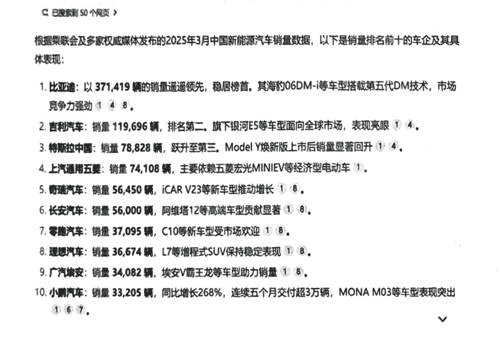

图 1-8 DeepSeek 开启联网搜索后给出的答案

模型检索了 50 个网页后给出车企销量排行，每个数据后附有跳转角标，如图 1-9，可点击查看详情。

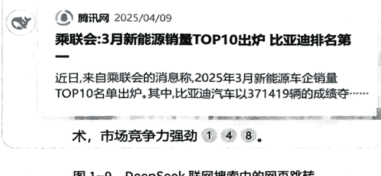

### 1.3.2 上传文件

DeepSeek 支持文档上传并进行内容理解。在聊天界面点击上传文件，如图 1-10。


上传限制为最多 50 个文件，每个不超过 100 MB，支持图片与多种文档格式。实际使用中可上传图片或文档供分析，以下以会议纪要为例。点击上传附件按钮后进入图 1-11 界面。


会议记录.doc

图 1-11 上传附件界面

上传成功后，聊天界面上方会显示文档大小，如图 1-12。


图 1-12 上传附件成功界面

可直接提问，例如：

> 请帮我解读上面文档中的会议记录，给出一份完整简明的会议纪要。

分析后得到的答案：

> 会议概要
会议主题：2025 年产品开发进度更新会议
会议时间：2025 年 4 月 10 日上午 10:00—11:30
主要内容：
- 项目进展：开发完成 70%，预计下周进行首次内部测试，市场调研数据下周提交开发团队。
- 风险与应对：存在供应链问题，已与备用供应商达成资源调配协议。
- 下一步安排：继续开发并结合市场调研推进，确保项目顺利。
- 其他：安排下周全员工作总结会，加强部门协同。
结论：项目按计划推进，供应链风险可控，下一步聚焦内部测试与市场调研。

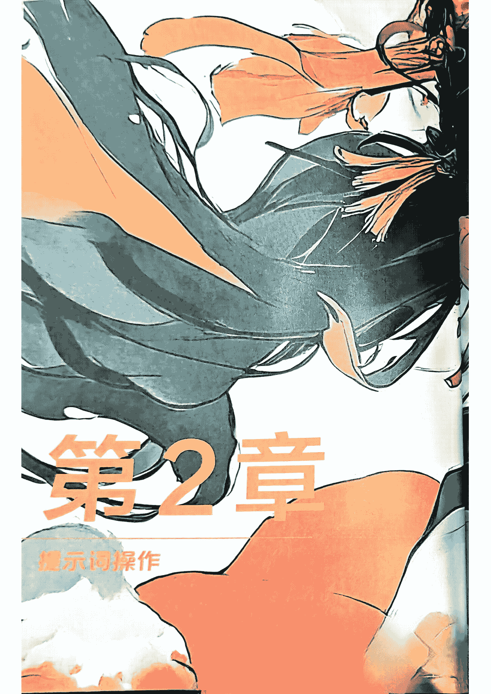

# 第 2 章 提示词操作


使用 DeepSeek 等智能工具时，掌握提示词是关键。本章介绍提示词的概念与使用方法。在语言学习与人机交互中，提示词作为引导手段，已成为核心环节。它通常由文本、语音或链接等一种或多种要素构成，用以触发系统或用户执行特定任务或提供特定信息。

## 2.1 明确的提示词指令

提示词是语言学习和人机交互中的核心支点。它在帮助记忆和运用知识点时像一块提示牌，学单词时会提示用法搭配提升记忆，学语法时会唤醒规则促进理解。在人机交互里作用更直接，呼叫语音助手时清晰的指令能让系统少误读快执行，用于智能客服时完整的描述能让机器人给出更精准的解决思路。

在用 DeepSeek 时，最关键的就是指令的明确度，只有把需求说清楚，模型才知道要往哪个方向生成。

### 2.1.1 信息要给足

写指令时把问题里所有重要信息和细节都交代清楚，别让模型靠猜。指令越具体，输出越可控。

以小红书种草××精华霜为例，先看模糊版。

> 请帮我写一篇小红书上关于××精华霜的分享文案。

模型给出的内容比较泛，提到质地轻、吸收快、有修护感、适合熬夜换季、保湿持久等，但缺乏记忆点，说服力弱。

要做出宣传效果，就得在指令里加入写作要求和要点。优化后的指令如下：

> 我要一篇小红书××精华霜的种草文，请按以下要点写：
> 
> 有真实使用感受：以亲身体验为主，内容可信有说服力。
> 有实用小技巧：给出可操作的方法，帮用户解决实际困扰。
> 内容有料有趣：干货之外加入小故事和配图建议，让笔记更饱满。
> 语言通俗易懂：口语化表达，避免专业术语。
> 适当加 emoji：用表情提升趣味并突出重点。
> 加上相关标签：提升曝光。

这一次模型返回的标题为✨用了××精华霜一个月，状态肉眼可见的变化！💧，正文以敏感肌视角切入，描述质地轻盈吸收快、使用一个月后光泽提升不干皮，细纹暗沉改善，朋友也称年轻了。随后给出三条使用建议、一个熬夜见客户的小插曲，最后以行动号召收尾并带上 #护肤精华 #敏感肌友好 #××精华霜 #抗老保湿 等标签。整体更符合平台调性，可参考度高。

常见的文案指令各有侧重：

#### 1. 头脑风暴
> 请围绕×××做一次头脑风暴，不要受已有框架限制，创意越离奇越好，畅所欲言。

#### 2. 朋友圈推广指令
> 我想在朋友圈推×××，按痛点→情感引导→方案→行动号召→价值强调的逻辑，写约150字文案，推动购买。

#### 3. 受欢迎的干货型小红书笔记特征
- 真实体验：以第一人称经历为主，可信有说服力
- 实用方法：提供具体可操作的小技巧
- 有趣有料：干货结合小故事和视觉建议
- 通俗易懂：口语表达，减少术语
- 适度 emoji：增强趣味并突出重点
- 精准标签：提高笔记曝光

#### 4. 小红书干货型内容模板
> 你是小红书上擅长××××的博主，需要定期输出干货。要求：
> 
> 开门见山：首段点明主题，快速传递价值
> 技能拆解：围绕一个工具或方法用“是什么-为什么-怎么做”展开，逻辑清晰
> 什么：明确对象
> 为什么：说明价值
> 怎么做：给出现实操作路径
> 提升可读性：巧用 emoji 增加视觉吸引力
> 互动引导：结尾邀请点赞关注或查看往期
> 标签：文末加上 # 标签

实际使用时，可在模板上叠加格式、语气等具体要求，得到更稳定的结果。

### 2.1.2 指定 AI 扮演角色

本质是给模型一个身份，后续语言会更贴合该人设。文案场景下很常用，比如让 AI 扮演已用过产品的消费者。

> 请扮演一位用过××精华霜的顾客，写一段分享文案。

模型会从用户视角输出：先用“想要肌肤焕采？××精华霜值得看”引入，随后用 What Why How 结构介绍产品定位、作用逻辑和使用步骤，强调轻盈不油、适合干皮敏感肌、能滋润淡纹提亮，适合熬夜人群，最后呼吁关注并预告后续技巧，并带上 #护肤心得 #精华霜分享 等标签。

### 2.1.3 分步拆解任务

复杂写作可先拆成步骤，再逐条下指令，执行更准。

仍以精华霜为例，要求先做摘要再翻译：

> 请按步骤作答：
> 
> 第1步：用户会给你一段三引号文本，请总结成一句话，以“摘要：”开头
> 第2步：把摘要译成英文，以“翻译：”开头
> 第3步：右下角落款“译者：张三”
> 
> 文本内容为一段关于××精华霜的使用笔记，介绍产品特性和三条使用方法。

模型会先给出摘要，说明笔记介绍了××精华霜的修护美白功效及使用方式并适合干敏肌；再给出英文翻译；最后加上落款。完整执行了三步指令。

## 2.2 借鉴优秀案例

文案领域里可找到爆款做参照，让模型学习风格。仍以精华霜为例，指令“请提炼下面文案的语言风格、表达方式和 emoji 用法”，模型会归纳出亲切教育+直接引导的语气、问题引入+What Why How 分类+效果强化的写法，以及 ✅ 🌟 💡 🛠 等符号的使用规律。

在此基础上，让模型为××洗面奶写同风格笔记，会得到诸如“想要告别早晨油光？××洗面奶来帮忙”的开头，结合 Why 和 How 阐述清洁保湿原理及使用步骤，并以点赞关注收尾，标签含 #清晨焕新 #洗面奶推荐 等。提供示例后，模仿度与匹配度明显提升。

## 2.3 让模型学会思考

模型有时会“偷懒”，遇到判断题容易把似是而非的选项判为正确。提问时最好用明确的问答形式，问题具体化，避免“这个对不对”之类的宽泛提问。

### 2.3.1 分步追问

可用“为什么”“什么是”“请解释一下”等引导。比如问“海水为什么咸？请解释”。

模型会回答海水含大量溶解盐类尤其是氯化钠，主要来自陆地岩石风化形成的离子经河流带入海洋，以及海底火山热液的补充，长期累积致使浓度升高。

继续追问“什么是陆地岩石风化”，模型会解释物理、化学、生物三类风化过程，以及它们如何释放钙钠镁氯等离子，最终进入海洋增加盐分。通过把大问题拆成小问题并逐步追问，对话更聚焦、分析更深。

### 2.3.2 给出思考空间

不要只索要结论，最好要求列出推理步骤，适用于判断题。先让模型自行找答案，再引导思考，最后复核选项。

例如问“小明的妻子生了一对双胞胎，下面哪个结论正确？”模型可能直接选 B。加入引导后先问“家里现在有几个孩子”，模型会说明若此前无孩子则现在有两名，若有其他孩子则不确定。基于此逻辑再让模型从四个选项中选择，正确答案应为无法确定。给足思考路径，判断会更稳妥。

信息边界与双胞胎案例解析

题干仅交代小明家近期新增一对双胞胎，相当于孩子数+2，而此前家庭人口基数完全未说明。由此无法判断这对双胞胎是否就是全部孩子，还是在已有子女之外再添两人，任何后续推断都缺乏依据。

B. 小明家一共只有两个孩子
该表述默认此前家中没有其他成员。原题并未给出此前无孩的明确限制，家庭是否另有子女不可知，因此该项不成立。

C. 小明家有男孩也有女孩
题目只提到生了一对双胞胎，性别信息为空白。双胞胎的组合可能是龙凤、双男或双女，性别搭配无从确定，不能推出同时存在男孩与女孩。

D. 小明家孩子情况无法确定
综合来看，唯一可确认的事实是家庭新增一对双胞胎。孩子总数的多少以及性别构成，题干均未提供支撑。选项D契合这种信息缺口，是唯一合理的判断。

最终结论为 D. 无法确定小明家里孩子的情况。

这类题本身一眼可辨，这里关键在于呈现模型完整展开推理的过程。对使用者的启示是先让模型给出结论再复盘推导，题目难度提升时有助于校验对错。

2.4 让输出格式更可控
文案生成时若没有明确的格式要求，模型难以预判呈现样式。实际使用中应明确指令，例如以列表归纳、限定字数、指定结构等，才能得到更贴合预期的结果。

示例指令：
请将下列信息列表概括。

陆地岩石的风化过程指的是岩石在自然环境中受到物理、化学或生物作用的影响，逐渐破碎和分解的过程。这一过程可以分为三种主要类型。

（1）物理风化：岩石因温度变化（如日夜温差导致的膨胀和收缩）、冰冻（水在岩石裂隙中结冰时膨胀）或生物活动（如植物根部生长的劈裂作用）等原因而破碎。
（2）化学风化：岩石中的矿物质与周围环境（如空气中的氧气或水中的化学物质）发生化学反应，从而改变岩石的化学成分和结构。例如，岩石中的硅酸盐矿物在水的作用下会逐渐转化为黏土矿物。
（3）生物风化：生物活动对岩石的影响，例如：植物根部的生长、动物的挖掘行为以及微生物产生的酸性物质等，可以促成岩石结构的物理变化或矿物质的化学变化。

模型会直接将信息概括为表格，见表2-1所示：

表2-1 陆地岩石风化过程表

| 风化类型 | 描述 | 作用过程 |
| :--- | :--- | :--- |
| 物理风化 | 岩石因温度变化、冰冻或生物活动等原因而破碎 | 温差导致的膨胀、收缩，冰冻作用，植物根部生长 |
| 化学风化 | 岩石中的矿物质与周围环境发生化学反应，改变岩石的化学成分和结构 | 与空气中的氧气或水中的化学物质反应，矿物转化 |
| 生物风化 | 生物活动（如植物根部生长、动物挖掘、微生物活动）导致岩石结构或成分改变 | 植物根部生长、动物挖掘、微生物产生酸性物质等 |

从上述演示可以看出，模型能够根据要求生成结构合理的表格。在日常使用中，可通过相关提示词让 AI 输出标准化的内容，常见做法有：

“请总结上面文本的内容，分为五点，并从五个方面分段论述。”
“请不超过500字。”
“请用轻松随性的语言风格来为我解释。”
“请补充相关的例子。”
“请输出为 excel 表格的形式。”
“请用英语来回复。”
……

# 第3章 文案应用实战

会用 AI 生成文案是一回事，能让文案“好看、好用、转化率高”是另一回事。本章汇总了大量真实场景的实战演练，覆盖公号爆款内容、短视频脚本、种草文案、故事续写、产品发布会稿件、朋友圈广告等多种热门应用。每一节都包含提示词结构、生成策略与优化技巧，帮助把 AI 的能力转化为创作力、传播力与影响力。AI 并不是替你写文案，而是帮你写出更好的文案。

## 3.1 公众号爆款文章的打法

经常浏览公号的人会发现，不少文章阅读量达到10万+，成为高赞内容。为什么这些文章受欢迎？背后通常有一套行之有效的写作方法和流程，涵盖选题的精准把握、标题的巧妙设计、内容的搭建与信息的高效分配，目的在于让读者在短时间内获得满足感，并激发持续阅读和分享的欲望。

借助 DeepSeek，我们可以更快地挖掘灵感、打磨内容、搭建清晰框架，从而在更短时间内完成高质量的内容创作，提升阅读体验和传播效果。

### 3.1.1 场景需求

公众号的写作大致可分为以下几步：

明确题材与标题：要先弄清写作目的是吸引读者、普及知识还是其他，根据平台定位确定吸睛的标题，这是吸引读者的关键。针对题材和标题，均可借助 DeepSeek 进行分析与整理。

制作大纲：大纲的梳理费时费力，可以要求 DeepSeek 围绕主题生成初稿，再通过多轮互动逐步调整到满意状态。

素材与数据：公众号写作常需数据与案例支撑，可以让 DeepSeek 检索相关数据和素材，不断丰富初稿。

### 3.1.2 模型实操流程

了解写作流程后，下面看 DeepSeek 带来的新做法。

#### 1. 高赞选题方向的挑法

首先要厘清号定位，可以与 DeepSeek 对话，让其基于现状提供创作思路。示例提示词如下：

你是一个公号的大 V，正在策划一个法律知识普及的账号。有没有最近比较流行的法律问题？请提供一些意见。

模型返回的内容如下：

作为以法律知识普及为目的的公众号策划者，我们需要结合近期热点法律问题和普法趋势设计选题，以下是一些值得关注的选题方向及具体建议，供您参考。

一、选题方向

（1）家庭财产继承与遗嘱规划。随着老龄化加剧，财产继承纠纷频发，尤其涉及独生子女继承、再婚家庭财产分配等问题。《中华人民共和国民法典》继承编的普法需求旺盛。

（2）网络消费维权新动向。直播电商虚假宣传、大数据“杀熟”、智能家居隐私泄露等问题成为舆论焦点。

（3）青少年法治教育。多地开展“开学第一课”法治教育，校园暴力、网络欺凌等话题备受关注。

（4）老年人法律权益保护。针对老年人的诈骗、医疗权益纠纷高发，各地推出专项普法计划。

（5）禁化武履约与国家安全普法。2025年4月29日为第十个国际禁止化学武器组织日，国家禁化武办正举办知识竞赛及海报征集活动。

（6）沉浸式普法创新形式。上海杨浦公园通过“家庭资产继承展”打造沉浸式普法体验，结合案例教学提升参与度。

（7）企业合规与法律风险防控。热点背景：中核集团等央企强化法律纠纷案件管理，反映出企业合规需求上升。

二、运营建议

栏目化设计：如“每周一案”“律师快答”等固定板块，培养用户的阅读习惯。

多平台联动：将长文拆解为短视频发布至抖音、微信视频号，扩大传播面。

用户共创：发起“我的维权故事”征文，精选案例进行法律点评。

以上选题均基于近期官方活动、社会舆情及普法实践，兼顾时效性与实用性。可根据公众号定位选择细分领域深耕，或通过系列专题覆盖群体需求。

模型给出了上述七个选题方向，同时给出了一些运营建议，如栏目化设计、多平台联动、用户共创等。我们可以根据号调性和目标读者的喜好进行微调，最终确定选题方向。示例提示词如下：

我的公众号目标读者为主要利用碎片化时间学习法律知识的中年人，请你筛选以上定位方向，为我提供两个方向。

模型生成如下示例：

针对目标读者为利用碎片化时间学习法律知识的中年人，结合他们的核心需求（家庭责任、财产规划、风险防范）和时间碎片化的特点，建议优先选择以下两个方向，并优化内容呈现形式。

（1）家庭财产继承与遗嘱规划。推荐理由高相关性：中年人普遍面临父母养老、子女继承、再婚家庭财产分配等问题，这些问题都是刚需痛点。内容适配性：可通过短案例、清单体（如“三个关键点”）等形式，方便碎片化阅读。延展性强：后续可延伸至房产过户、意定监护等话题，形成系列专题。

（2）网络消费维权与日常法律陷阱。推荐理由高频场景：中年人网购、旅游、医疗消费频繁，但维权意识较弱，相关领域的实用指南需求旺盛。轻量化内容：可聚焦具体场景（如退费、合同陷阱），提供“行动清单”。时效性结合：借势“3·15”、双十一等节点推送，提高打开率。

这两个方向既能满足读者自身的法律需求，又适合碎片化传播，后续可根据反馈逐步扩展细分话题。

我们选定第一个方向——家庭财产继承与遗嘱规划，可以继续进行后面的操作。

#### 2. 生成爆款标题

标题是公众号文章的“眼睛”，要想让读者眼前一亮，爆款标题必不可少。可以使用 DeepSeek 生成爆款标题，示例提示词如下：

请联网搜索，并根据所提供的定位方向，为我撰写公众号的爆款文章标题。

定位为“家庭财产继承与遗嘱规划”。

模型返回内容如下：

根据搜索结果，结合“家庭财产继承与遗嘱规划”的定位，以下是10个爆款标题建议，涵盖痛点、悬念、实用性和情感共鸣等角度，能够吸引中年读者点击。

（1）痛点直击型。《独生子女继承父母房产，不注意这3点，可能一分钱都拿不到！》《再婚家庭必看！这样立遗嘱，避免子女和配偶“反目成仇”》

（2）悬念疑问型。《父母房产过户，“买卖”比“继承”更划算？律师算完这笔账，90%的人选错了！》《打印遗嘱竟无效？律师：少了这行字，你的遗嘱可能白写了！》

（3）实用清单型。《立遗嘱避坑指南：律师总结5大常见错误，第3个几乎人人中招！》《家庭财产传承3大工具：遗嘱、保险、信托，哪种最适合你？》

（4）情感共鸣型。《“妈，房子给我吧。”七旬老人手写遗嘱无效，子女法庭反目：早做这件事，少留遗憾！》《遗嘱不是晦气，而是最后的温柔！律师：做好这2步，让家人少流泪》

（5）时效热点型。《2025新规！房产继承有变，这4类人可能“无缘”父母的房子》《中华遗嘱库数据曝光：60%的家庭因这一细节打官司！现在改还来得及》

建议搭配案例解读、流程图解或模板下载（如“遗嘱范本”），进一步提高转化率。

#### 3. 封面文案生成

在公众号中，封面文案也是吸睛的主要工具，可以让 DeepSeek 提供与标题相匹配的封面文案，如一两句话的点题或引导，帮助激发读者的点击欲望。

示例提示词如下：

我们选定的公众号文章为《独生子女继承父母房产，不注意这3点，可能一分钱都拿不到！》，请撰写封面文案。

模型生成的封面文案如下：

主标题（居中加粗，字号最大）独生子女继承房产 这3点不注意=白给！副标题（较小字号，补充痛点）律师警告：90%的家庭忽略的细节，可能让子女“净身出户”！

#### 4. 撰写高赞文章

有了上面的内容后，我们可以尝试让 DeepSeek 生成文章内容了，示例提示词如下：

请根据上面的内容生成文章大纲，并根据大纲撰写完整的正文。

模型返回内容如下：

文章大纲：标题：《独生子女继承父母房产，不注意这3点，可能一分钱都拿不到！》一、引言（痛点引入）独生子女继承父母房产看似理所当然，但现实中存在诸多法律风险。案例：独生子女因手续不全或法律盲区，无法顺利继承房产。二、3个关键风险点（1）父母未立遗嘱，其他法定继承人可能“分走”房产。法定继承顺序：配偶、子女、父母（祖父母/外祖父母也可能分得份额）。案例：略（2）遗嘱形式不合法，可能导致遗嘱无效。自书遗嘱需亲笔签名+日期，代书/打印遗嘱需2名无利害关系的见证人。案例：略（3）继承的房产可能变成夫妻共同财产。婚后继承的房产，默认属夫妻共同财产，离婚时配偶可分割。三、如何规避风险？律师3步建议尽早订立合法遗嘱（公证遗嘱效力最高）。收集完整的继承材料（死亡证明、亲属关系证明、房产证等）。及时办理过户，避免因拖延导致产权纠纷。四、结语（行动呼吁）继承问题宜早规划，避免家庭纠纷。提供“遗嘱模板+继承流程图”福利，引导读者领取。正文：略。

### 3.1.3 提示词示例与输出展示

根据上文的流程，我们可以归纳见表3-1所示的包含提示词示例和输出内容要点的大纲。

表3-1 公众号高赞文章提示词及AI输出要点汇总

| 步骤 | 提示词 | DeepSeek输出内容要点 |
| :--- | :--- | :--- |
| 确定选题方向 | 我的公众号目标读者为主要利用碎片化时间学习法律知识的中年人，请你筛选符合定位的选题方向，为我提供2个方向 | 推荐“家庭财产继承与遗嘱规划”与“网络消费维权”；分别列出推荐理由与内容形式建议 |
| 生成爆款标题 | 请联网搜索，并根据所提供的以下定位方向，为我撰写公众号的爆款标题。定位：家庭财产继承与遗嘱规划 | 输出10个标题建议，分为痛点型、悬念型、实用型、情感型、热点型5大类 |
| 生成封面文案 | 我们选定的公众号文章为《独生子女继承父母房产，不注意这3点，可能一分钱都拿不到！》，请撰写文章的封面文案 | 主标题：独生子女继承房产，这3点不注意=白给！ 副标题：律师警告：90%家庭忽略的细节，可能让子女“净身出户”！ |
| 生成文章大纲与正文 | 请根据上面的内容生成文章大纲，并根据大纲撰写完整的正文 | 提供“标题+四段结构”：引言→3个风险点→3步建议→结语，并在正文中穿插案例与解决方案 |
| 完整输出任务 | 我要写一篇公众号高赞文章，目标读者为中年人，标题为《独生子女继承父母房产，不注意这3点，可能一分钱都拿不到！》，请写大纲+正文 | 输出开场金句、风险点详解(父母未立遗嘱、遗嘱无效、房产变共有)、律师建议、结语，并引导用户评论、领取“遗嘱模板”福利 |

## 3.2 短视频文案

短视频已经成为现代社会文化交流、信息传播和娱乐消遣的重要媒介。尤其是在抖音、视频号、小红书等平台上，优质短视频凭借高效传播和情绪共鸣，频频“出圈”。爆款短视频的走红并非偶然，它们往往遵循一定的创作逻辑和传播规律，包括精准的选题、吸睛的开头、清晰的结构和富有张力的情节安排等。

借助 DeepSeek 这一强大的 AI 推理工具，我们可以大大提升短视频文案的产出效率。它不仅能帮我们发现热点话题，还能辅助生成符合平台调性和用户习惯的脚本、标题、封面文案与分镜提示，大大节省人工构思时间。

### 3.2.1 场景需求

短视频文案的创作流程更强调视觉节奏、逻辑密度与信息压缩。一般而言，短视频文案需要覆盖以下四个创作阶段：

- 选题方向确定：结合平台调性与用户兴趣，确定能够吸引目标群体的内容主题。
- 剧情脚本设计：通过分阶段脚本安排，让故事在短时间内展现完整的逻辑链与相对充沛的情绪张力。
- 标题与开头的打磨：前3秒是黄金时间，标题与口播必须具备足够的冲击力与吸引力。
封面与简介设计：封面文案和简介是吸引点击的重要因素，需高度凝练、贴合内容调性。

这些环节看似繁复，但借助 DeepSeek，我们可以从灵感生成到结构化输出，实现“自动化脚本 + 数据辅助构思”的一站式创作。

### 3.2.2 模型实操流程

下面我们以法律类短视频为例，结合 DeepSeek 的具体应用步骤来展开说明。

#### 1. 热门短视频选题方向

短视频想要出圈，首先得选准方向。通过与 DeepSeek 的对话，我们不仅可以得到贴合用户兴趣的选题建议，还能结合平台舆情和事件热点进行调优。比如：当你确定以法律知识传播作为短视频选题的主要方向，下一步就是锁定切入点与内容点。

示例提示词如下：

你是一个法律类短视频博主，想制作一条有关“家庭财产继承”的短视频，目标观众是30～50岁的中年群体，请提供5个热门的选题方向。

模型返回内容如下：

（1）独生子女也可能“继承不到”？3个你必须知道的法律盲点。（2）父母写了遗嘱，但形式错了？继承权可能作废！（3）再婚家庭的继承问题，比你想象的复杂！（4）遗嘱立好了，为啥过户还这么难？（5）继承的房产会变夫妻共有？防范3个误区。

通过以上建议，我们可以看出 DeepSeek 不仅聚焦用户痛点，还具备较强的传播策略意识。最终我们选定第一个方向作为本次短视频创作的主题。

#### 2. 爆款短视频标题生成

确定主题后，标题就是吸引观众的第一道关卡。一个好的标题既要信息浓缩，又要具备“悬念 + 冲突 + 实用 + 情绪”四要素。

示例提示词如下：

我正在准备一条短视频，主题是“独生子女也可能‘继承不到’？3个你必须知道的法律盲点”，请提供10个爆款标题建议。

模型返回内容如下：

以下是针对短视频主题“独生子女也可能‘继承不到’？3个你必须知道的法律盲点”的10个爆款标题建议，融合悬念、冲突和实用性，能够吸引用户点击和转发。

（1）《独生子女也会被“踢出继承人行列”？这3个继承陷阱你知道吗？》。（2）《爸妈的房子你真继承不到？法律里的这3个盲点被太多人忽略了！》（3）《以为自己是独生子女就稳了？当心这3种情况让你一分钱都拿不到！》（4）《父母辛苦一辈子，房子却归了“别人”？独生子女必须知道的3个法律盲点》（5）《继承权≠独占权！独生子女可能会失去继承资格的3种情形》（6）《独生子女就一定能继承？法律上这3点决定你的命运》（7）《爸妈的财产归属谁说了算？法律上的这3个盲点可能让你措手不及！》（8）《明明是独生子女，却继承无门？背后的3个法律细节千万别忽视！》（9）《别等父母百年之后才后悔！这3个继承误区，可能让你一夜“清零”》（10）《独生子女真的稳赢遗产吗？这3个真实案例让你后背发凉！》

#### 3. 视频脚本与文案生成

有了题目，我们需要将内容结构化输出。DeepSeek 可以根据预设主题，自动生成具有情节逻辑、情绪递进的脚本，覆盖口播词、字幕与镜头提示。

示例提示词如下：

请为短视频《独生子女也会被“踢出继承人行列”？这3个继承陷阱你知道吗？》生成完整脚本，时长控制在1分钟左右，分为口播+字幕+分镜三段，并穿插案例。

DeepSeek 全链路内容拆解：从短视频到热点稿件的操作链路

### 短视频实战示范：独子家庭继承的隐形盲区

DeepSeek 提供的参考脚本如下：

短视频《独子也会被踢出继承名单？三类隐形陷阱一览》

⏱ 预计时长：约60秒

一、口播文案 主播语气平稳，带提醒感

【开场 0～10秒】
很多人默认家里只有一名后代就能顺理成章拿到长辈的房产，其实并非如此。实务中即便子女唯一，也存在三种情形会导致继承落空。

【中段 11～45秒】
第一种情形：长辈在世时立下遗嘱并指定其他受让人。
比如案例中的小王，作为家中独子，本以为能继承父母住房，却发现父母生前立有遗嘱，将不动产赠予长期照护他们的邻居阿姨，最终小王未能取得任何份额。
第二种情形：产权登记信息仅指向一方，且该房产属婚前取得。
第三种情形：父母已将房屋名义上转移给他人，只是未办理公证手续。
等到办理继承时才发现，虽然产权证仍在父辈名下，实质权益早已赠与第三方，因为缺少公证而产生争议。

【收尾 46～60秒】
要记住，继承资格并非身份自带的福利。提前厘清法律细节，才能避免父辈心血流向他人。

二、字幕配合 关键信息加粗呈现

| 时段 | 字幕文案 |
| --- | --- |
| 0～5秒 | ⚠️ 独生就等于继承？想法太天真 |
| 6～10秒 | 三大坑点，务必提前防范 |
| 11～17秒 | 坑点① 遗嘱生效，财产归指定人 |
| 18～22秒 | 案例：住房全赠给邻居阿姨 |
| 23～28秒 | 坑点② 产权登记只写一人名字 |
| 29～34秒 | 案例：再婚后资产归继父母 |
| 35～40秒 | 坑点③ 提前转移却无公证 |
| 41～45秒 | 案例：赠与他人，继承无望 |
| 46～52秒 | 权利靠证据支撑，不靠默认 |
| 53～60秒 | 收藏分享，别让继承变成空想 |

三、分镜建议 画面节奏与情绪

001 主持人正面出镜，背景简洁肃穆，镜头缓进。0～5秒
002 黑底白字浮现“独子就稳赢？”字样渐显。6～10秒
003 主持人讲述首个情形时，切至小王落寞坐在空屋前，淡入慢推。11～17秒
004 父母与邻居阿姨合影叠加遗嘱动画动效滑入。18～22秒
005 房产证仅显示父亲姓名，背景切换为继母笑容，平移推拉。23～34秒
006 小王翻找材料，发现产权已转出，快切闪回。35～45秒
007 主持人对镜头提示收藏转发，弹出互动提示。46～60秒

四、封面文字与简介参考

封面吸睛是点击的关键，模型可将标题转化为更具冲击力的封面与简介。

示例指令：
请为短视频《独子也会被踢出继承名单？三类隐形陷阱一览》创作封面文字与简介文字。

模型产出：

封面文字：
主标题：父母房产，你真的能继承吗？
副标题：这三类法律盲点，九成人都没留意！

简介文字：
以为独生家庭继承父母房子是理所当然？现实往往相反。1分钟带你看懂最常见的三类法律风险，提前规避，避免继承资格落空。

从选题到成品，DeepSeek 基本可覆盖全流程，用户也可以按此步骤逐步细化。

3.2.3 指令示例与产出要点

表 3-2 短视频文案指令及模型产出要点汇总

| 步骤 | 指令范例 | 模型产出要点 |
| --- | --- | --- |
| 确定选题方向 | 你是一名法律类短视频创作者，目标观众30~50岁，围绕“家庭财产继承”给出5个热门选题 | 交付“独子继承难题”“再婚家庭分配”“不动产办理流程” 等5个切入点 |
| 生成短视频标题 | 我要做一条主题为“独子可能无法继承父母房产的3个法律盲点”的视频，请给10个高点击标题 | 产出10个含悬念、警示、共鸣技巧的标题建议 |
| 脚本创作（剧情+字幕+结构） | 请为《独子也不保险？这三类继承坑你知道吗？》生成完整脚本，时长1分钟左右，含口播、字幕、分镜，并穿插案例 | 开场抓眼+三风险展开+解决建议+结尾引导关注与福利 |
| 封面文字与简介创作 | 请为《独子也不保险？这三类继承坑你知道吗？》生成一段封面文字和一段简介文字 | 主标题：长辈房产，你真能继承吗？副标题：这三类法律盲点，99%人都忽略了！简介：概括盲点并引导评论互动 |
| 完整输出任务 | 我要做一条适合抖音的法律科普短视频，目标中年用户，请提供完整脚本、封面、简介和互动引导 | 输出标题、脚本、封面、简介、评论话术、福利引导如领取遗嘱模板等 |

3.3 热点总结类稿件

热点总结稿已成为自媒体、学生、知识博主的必备形态。它追求快准深：迅速跟进事件、准确还原事实、输出独立见解。

做好这类稿件能吃到流量红利，提升专业度与影响力。但创作痛点明显：
时间紧效率低：热点窗口短，整理素材搭框架耗时；
角度缺深度浅：多停留在信息拼接，难有观点输出；
表达僵硬传播弱：套路化严重，缺乏温度与张力。

DeepSeek 能帮忙识别热点、提炼核心、给出结构建议、生成论证观点，从而高效产出结构严谨、观点清晰、语言有感染力的热点总结稿。

3.3.1 适用场景

适合人群：
微信公众号作者：发布重大新闻解读、政策分析栏目；
短视频编剧：把热点做成整合解说；
知乎、头条博主：追踪社会科技职场热议，输出态度型文字；
高校学生、媒体学员：练习新闻评论写作与结构组织。

典型场景：
突发新闻深度解读；
周月季度热搜盘点；
行业政策、AI新规、社会治理分析总结。

一篇高质量热点总结通常包含：事件背景复盘、争议点聚焦、观点论证、升华延伸与建议。

3.3.2 DeepSeek 创作流程

1. 识别可写的热点
指令示例：请列出近期值得关注并适合写成热点总结的事件。
模型示例输出：公安部等六部门发布《国家网络身份认证公共服务管理办法》、国务院发布《新时代的中国国家安全》白皮书、上海浦东具身智能产业支持政策、2025世界田径接力赛广州站等。

2. 整理核心信息，搭建框架
示例指令：请围绕“上海浦东发布具身智能产业支持政策”生成写作框架，含背景、关键节点、延伸角度、结构方案。
模型示例框架要点：
事件背景：国家层面AI创新布局、浦东先导区定位、张江会场联动。
关键节点：2025年5月29日大会开幕与政策发布、专项资金落地、生态共创。
延伸角度：产业生态、人才战略、技术攻关、应用场景、国际竞争、监管标准、区域比较。
结构方案：五段式逻辑流或时间线+主题并进。

3. 生成大纲与正文
示例指令：以“上海浦东发布具身智能产业支持政策”为主题写一篇约1500字热点总结，含事件复盘、焦点解读、个人观点、延伸思考，风格适配公众号。
模型输出包含摘要、事件复盘、焦点解读如资金量级跃升、产业链覆盖、应用示范、生态共创，观点部分谈政策前瞻性、政府与市场平衡、区域对比，延伸思考涉及人才、国际合作、伦理监管、区域协同等。

3.3.3 指令清单

表 3-3 热点总结稿指令及模型产出要点汇总

| 步骤 | 指令范例 | 模型产出要点 |
| --- | --- | --- |
| 识别选题方向 | 请列出最近一周适合写作的热点事件，偏好科技/社会/AI | 事件清单+关键词提示 |
| 搭建结构蓝图 | 请围绕某事件生成信息结构，含背景、节点、争议、结构建议 | 时间线+立场分歧+写作框架 |
| 撰写正文内容 | 请撰写热点总结文章，结构含事件回顾、争议解读、个人观点、延伸思考 | 完整公众号风格文章，含标题、分段、金句、评论引导 |

3.4 续写儿童故事书

童年由一个个故事拼凑而成。故事是亲子情感的桥梁。借助 DeepSeek 可在保持原有风格与角色基础上续写扩写，为孩子创造专属故事宇宙。

3.4.1 需求场景

孩子追问：故事还能继续吗？家长可基于《小兔汤姆》《鳄鱼怕怕 牙医怕怕》等短篇进行续写。
课堂续写：语文作业如续写《狐狸与乌鸦》结尾，可生成讽刺型、反转型、正能量型示范思路。
自制绘本与音频：围绕“爱笑的小猫琪琪”等主角打造系列故事，每集3分钟配合绘本或音频制作。

3.4.2 创作流程

1. 输入原片段与续写指令
明确续写目标、年龄层、风格基调。
示例指令：请作为儿童故事创作者续写以下片段，适合5岁阅读，温柔童话感，每段不超过100字，共5段。
原片段：小兔子塔塔最喜欢坐在森林边树下看云，有一天他看见一片像飞船的云飘进森林深处，于是鼓起勇气追了进去……
2. 设置角色与风格信息

让童话续写更对味，先喂饱背景信息

想让续写保持原汁原味，最关键的一步是先把人物、世界观和叙事调性告诉模型。

一种可直接用的补充方式是：

> 补充信息如下：
> 主角塔塔：胆怯却爱探究的小兔子，想象力特别丰富。
> 故事世界：森林里栖息着各式动物，流传着神奇的“云朵之国”传说。
> 风格要求：轻松童话调性，每段收尾用“××说”便于家长做角色扮演式讲读。

把这些设定喂进去后，模型产出的文本会更贴角色，也更适合亲子共读。

生成完整的续写段落

有了背景设定，就可以让模型直接产出正文。按照前文的指令，模型输出了五段式结构，节奏和视角都保持统一。

模型给出的节选大致如下：

> （1）塔塔踮脚溜进林间，阳光穿过枝叶在地面洒下星点光斑。“这朵云真的在等我吗？”塔塔小声嘀咕。
> （2）一阵风拂过，一只会说话的蓝鸟停在他面前。“你好，小兔子，我是看守云朵的人！”小鸟说道。
> （3）不远处空地上，“云朵飞船”正闪着光，像一团会呼吸的棉花糖。“要不要来瞧瞧？”蓝鸟发问。
> （4）塔塔点点头，轻轻跃上飞船，暖风将他裹住。耳朵在风里飘扬。“哇，我会飞了！”塔塔喊道。
> （5）飞船载着他掠过整片林地，他们看到了熟睡的大树、起舞的蘑菇，还有正在编织梦境的狐狸。“下次带上我弟弟一起行吗？”塔塔问。

这一版延续了原作的语气和角色特征，情节推进清晰，也方便家长带读。

扩展为系列篇章

如果想把故事做长，比如打造“塔塔的飞船冒险系列”，可以追加指令：

> 请把上述故事发展成系列，每集命名为“塔塔与×××的故事”，并给出8个集名与概要，面向5～6岁儿童，每集约500字，基调温暖童趣。

模型给出的提纲节选为：

> （1）《塔塔与飞船上的星星按钮》：塔塔碰到一个会发光的云朵按钮，被送到星星果果镇。飞船漂在空中，塔塔在柔软舱内四处摸索。座位旁有个像星星一样闪的按钮。“能按吗？”塔塔嘀咕着伸爪轻点——“咕噜噜——嗖！”舱门开启，星星洞口出现，塔塔“扑通”掉了进去。风声呼呼作响后，他来到一朵大蘑菇上，眼前是闪亮的小镇，路灯似星星，房屋像糖果，街上飘着甜香。“这里是……星星果果镇？”塔塔惊讶。“欢迎你，小兔子！”戴月亮帽的果果狸走来，“你按了星星按钮就到了我们镇子！这里的星星果都是小动物心愿做的！”两人走进“梦果屋”，有会唱歌的苹果、会跳舞的蓝莓和发光橙子。“这是希望果，能帮你找到想念的人。”果果狸介绍，“这是勇气果，吃了就能跳上最高云朵！”塔塔挑了微笑果，咬一口心里暖暖的，像被妈妈抱住。“我怎么回家？”“等最大的星星亮起，就会化作回家的路。”塔塔坐在星星草地上等待，心里想着这地方奇妙，却也想念森林老树了。……

> （2）《塔塔与夜光青蛙》：飞船夜里降落，塔塔遇到会发光的青蛙，它会唱催眠曲……
> （3）《塔塔与月亮蛋糕》：云朵王国办月亮节，塔塔负责做最柔软的云蛋糕……
> （4）《塔塔与打哈欠的山》：飞船误入爱打哈欠的山洞，塔塔得会讲故事才能让它安静……

如此便能逐步搭建完整的故事宇宙，每天讲一集，还能配合AI绘图或音频制作专属故事专辑。

### 3.4.3 提示词示例与生成要点

下面梳理创作链条的指令与模型输出要点，见表3-4。

表3-4 孩子故事书续写提示词及AI输出要点汇总

| 步骤 | 提示词 | 模型生成要点 |
| :--- | :--- | :--- |
| 明确片段与年龄 | 请为5岁孩子续写以下故事，温柔童话风，每段不超过100字，共5段。原故事：小兔塔塔追逐云朵进入森林…… | 输出5段完整故事，塔塔遇见飞船与鸟守卫，展开冒险 |
| 指定角色与语气 | 塔塔是胆小好奇的小兔，风格偏温柔幻想型，每段结尾加一句角色台词 | 内容更适合亲子共读，角色语言鲜明 |
| 拓展系列 | 请生成围绕塔塔的8集系列童话标题与摘要，每集约500字 | 输出飞船冒险系列线索，便于连载或绘本制作 |

无论是家长、教师还是内容创作者，都能借助DeepSeek快速搭建专属故事园地。每段文字不仅是情节延续，更是情感延伸与想象力培养。无需纠结讲什么怎么讲，模型会陪孩子一起探索星光与云朵下的奇幻旅程。

## 3.5 小红书种草文案

小红书已从生活记录平台演变为消费决策入口。学生、通勤者、宝妈、健身人群、旅行爱好者、科技玩家都在寻找真实好用又好看的内容。

种草笔记就是流量利器：优质内容能提升互动、增强粉丝粘性，甚至把产品或生活方式送上热榜。但常见吐槽是文案太干没人看、信息堆砌转化差、浏览量低、写不出种草感。核心在于不会用“场景+情绪+细节”讲好人与产品的故事。

### 3.5.1 场景需求

平台用户追求真实与颜值兼具。种草文案要解决可代入的生活痛点，而非单纯产品宣传。

### 3.5.2 DeepSeek创作流程

1. 明确人设与表达风格
写之前先确定“我是谁”。人设是语言基调、生活节奏与受众的映射。

示例指令：

> 你是小红书用户，26岁在银行工作，通勤久、节奏快但追求精致，习惯早起护肤加夜间整理小物，语言要轻松像闺蜜聊天，表情适度不浮夸。

模型概要输出：
关键词语气：“我太需要它了😭”“姐妹快冲！”“拯救干皮就是它🌸”
用词偏好：“续命神器”“一喷舒缓”“办公室干裂救星”
表情策略：每段1~2个emoji，主用💧✨📸🫧💡，避免🤡🤯等高刺激风格

2. 生成选题方向与痛点触发点
好选题源于用户痛点。

示例指令：

> 依据“通勤女孩人设”，结合春季换季护肤主题，生成5个适合发布的种草选题，突出保湿、温和、日常好用与情绪价值。

模型输出：
《办公室空调脸日记💧这支喷雾我随身带三个月了》
《懒人护肤新发现✨坚持睡前三步，肌肤居然亮了》
《早C晚A搞不懂🤯这款乳液好用到让我放弃折腾》
《敏感肌春季过渡法则🌿这支精华真的很稳》
《连轴加班+熬夜爆痘❗这款急救面膜挺有效》

3. 爆款标题拟定策略
标题要让人想点开并停留。模型可从情绪爆发、问题抛出、对比反转、时间挂钩等角度生成。

示例指令：

> 为“办公室保湿喷雾推荐”生成5个爆款标题，结合通勤人设与情绪痛点，加emoji。

模型输出：
《办公室太干了😭靠这支喷雾撑过整个冬天💧》
《一喷就柔嫩✨春天护肤第一步就是它！》
《敏感肌急救水💡通勤党的肌肤保命神器！》
《真的好喷！连我妈都抢着用····》
《试过十几瓶喷雾后，我只回购这一支🌸》

4. 生成完整正文结构
小红书正文常用三段式：开场钩子、体验细节、总结推荐。

示例指令：

> 以“小红书通勤女孩”口吻写一篇保湿喷雾种草文案，550字内，分三段，合理加emoji，突出补水保湿、情绪陪伴、办公室场景。

模型输出：
❄️冬天办公室太干，每次下班摘口罩都觉得脸要裂了🥺 试过十几种喷雾，有些味重，有些喷头像水枪💦
后来闺蜜推荐了这支【×××喷雾】，一喷就爱上✨水雾细腻，喷上像敷层隐形水膜，无香精味，敏感肌也能用，补水后粉底更服帖！
我现在包里/办公桌/洗手间都放一支（笑），推荐给干皮和通勤党✌️ 用了不想换。如果你也在找喷雾，可以冲📸

5. 配图与AI图像提示词
文案需要配套视觉。模型可提供绘图提示。

示例指令：

> 生成3条AI绘图描述，配合小红书保湿喷雾笔记，风格自然真实简洁，加入人物手部、产品特写。

模型生成：
（1）办公桌场景，白领女孩面朝窗户用喷雾轻喷脸部，光线柔和，桌上有电脑和日程本，画面清透。
（2）女生手持喷雾瓶靠近镜子，细雾可见，手指修长，背景干净自然。
（3）喷雾瓶放在化妆台上，旁边是护肤日记、毛绒杯垫、小镜子，生活气息浓。

6. 生成标签与结尾互动语
结尾需引导互动。

示例指令：

> 为上述文案匹配10个热门标签，风格自然，并生成一段鼓励互动的话术。

模型输出：
标签：#保湿喷雾推荐 #办公室护肤 #干皮救星 #通勤女孩 #护肤日记 #喷雾真实测评 #冬季护肤 #温和护肤 #护肤习惯 #干燥肌福音
互动语：姐妹们有没有比这款还好用的喷雾🤔 留言告诉我！我想入第二款试试，你们最爱的补水神器是哪款？🤔

### 3.5.3 提示词示例与生成内容

表3-5 小红书种草文案提示词及AI输出要点汇总

| 步骤 | 提示词 | 主要输出内容 |
| :--- | :--- | :--- |
| 人设设定 | 请模拟一位26岁通勤女孩，护肤精致、节奏快、语气口语化 | 语气特征、关键词、表情建议 |
| 选题方向 | 帮我生成通勤女孩人设下换季护肤种草选题 | 灵感方向+标题要点 |
| 标题生成 | 生成5个带emoji的爆款标题，主题为冬季保湿喷雾推荐 | 口语+痛点+视觉诱因标题合集 |
| 正文撰写 | 请生成完整小红书笔记，三段式，550字内，加表情 | 引子+体验+总结完整内容 |
| 图片提示词 | 请生成AI配图视觉描述，含人物、使用场景、产品特写 | 可用于Midjourney、可灵AI、即梦等绘图工具 |
| 标签与互动语 | 为上面文案生成标签和结尾评论引导话术 | 提升推荐与社区参与度 |

## 3.6 朋友圈营销文案

朋友圈基于强关系链，信任度高，易裂变。但也存在刷屏反感、硬广痕迹重、内容干瘪、缺乏持续运营等难题。好文案需兼顾真实关系与产品卖点，以真实感、亲切感、价值感取胜。

### 3.6.1 场景需求

朋友圈营销特性：
✅ 社交属性强，用户对广告敏感，文案需像日常聊天
✅ 信息密度低，前两句决定是否继续阅读
✅ 适合图文混排+标签组合，形式灵活

常见类型见表3-6。

表3-6 朋友圈文案类型

| 类型 | 示例 | 适用对象 |
| :--- | :--- | :--- |
| 情绪唤醒型 | “我真的太需要这类客户了” | 自营品牌创业者 |
| 使用体验型 | “用了5天，这款精华的效果我真的惊呆” | 美妆、生活服务从业者 |
| 幕后视角型 | “你们看到的是爆款，我看到的是熬夜写方案的我” | 内容工作者、设计师 |
| 用户转述型 | “她说：‘你居然不告诉我这个功能？’” | 教育培训、工具类销售 |
| 场景设定型 | “晚上11点，我还在和客户确认一张图的色值” | 设计、直播、新媒体行业 |

### 3.6.2 DeepSeek创作流程

以“健身私教小课堂”为例：

1. 明确人设与好友画像
需确认在好友心中的形象、好友年龄职业、产品需求关联。

示例指令：

> 你是健身私教，朋友圈70%是办公室白领女性，25~40岁，对减脂塑形、健康饮食、轻度健身感兴趣但因工作忙常没动力。请帮我梳理人设定位与语言风格要点。

模型要点：
（1）人设形象：年轻专业教练，线上线下皆有课；主张轻松健身不鸡血；常分享健康小贴士、饮食建议、学员进步案例。
（2）语言风格：亲和正面鼓励，不用恐吓式表述；多用真实案例和个人故事引发共鸣；适度专业词配通俗解释；短句促互动，如“你今天动了吗？”
（3）注意事项：每周发文不超过3次；多配真实照片；适度emoji如✨💪🔥

2. 找准痛点，生成开头钩子
开头决定阅读率。常用情感共鸣、结果引导、反差冲击、场景提问。

示例指令：

> 针对“办公室白领女性想减肥但总缺动力”痛点，写一个朋友圈开头，用2~3行快速抓住注意力。

### 3.6.3 提示词示例与生成内容

表3-7 朋友圈营销文案提示词及AI输出要点汇总

| 步骤 | 示例提示词 | 模型输出要点 |
| :--- | :--- | :--- |
| 人设、朋友圈 | 我是健身私教，朋友圈主要是25~40岁白领女性。帮我梳理语言风格和人设亮点 | 语言基调：友好亲和+专业指导 |
| 痛点挖掘 | 根据办公室常年久坐、没时间运动主题，给我5段典型场景式痛点描述 | 心态、现实场景化描述，如“加班后累趴，零食一包包往嘴里塞……” |
| 开头钩子 | 请针对上述痛点，写一个朋友圈开头，2~3行，先引发共鸣再铺垫转折 | 真实写照式开场，代入感强 |
| 正文阐述 | 写200字左右正文，包含课程特色、真实案例、专业度体现 | 说明课程时长、地点、价格优惠、教学特色 |
| 结尾呼吁 | 请再写一个更具紧迫感的结尾，引导私信或评论，含限时福利 | 安排剩余名额、关键词引导，不逼迫不生硬 |
| 素材辅助 | 给我一些朋友圈配图建议：动作演示 | 准备摆拍、输出动作提示词等 |

## 3.7 直播带货脚本

# AI 驱动直播台本：从搭建到成交的一站式方案

网络环境持续下沉，电商与社交平台的融合愈发紧密，带货直播已从顶流主播的特权演变为可复用的增长模型。掌握正确的方法后，个人创作者同样能用一场结构清晰的直播为商品创造增量。直播并非镜头前反复喊话，而是需要前置的系统化设计，涵盖选品判断、节奏把控、互动安排、促销组合与情绪引导。

过往准备一场合格的直播，往往要集合主持、场控、客服、文案等多位角色，耗时耗力。现在借助 DeepSeek 的推理与文案能力，前期准备成本被大幅压缩。即便是新手或小体量团队，也能在极短时间内拼出一套抓痛点、有吸引力的直播方案。

### 3.7.1 场景需求

#### 1. 对直播脚本的理解与误区
不少初次尝试者认为，带货就是把商品拿起来说说优点再喊一句下单。真正能带动情绪、提升转化的，是一套完整的逻辑链。这条链既要覆盖内容面：展示哪些品、如何提炼卖点、优惠信息怎样埋设；也要兼顾时间面：互动何时插入、抽奖如何安排、怎样把人留到压轴商品。

传统写法需汇总商品卖点、用户画像、竞品动向、优惠规则、平台规范等信息，每一点都要对应话术与流程。对新手而言，工作量很容易让人望而却步。

#### 2. 深度结合 AI 生成脚本
有了 DeepSeek，可把线上线下的经验知识输入系统，数秒内得到一份可执行的初稿。

先厘清几个前提：
直播间锚定的是美妆、服饰、母婴还是零食？
核心受众是职场女性、宝妈、学生或运动人群？
整体节奏想要 1 小时高频爆发，还是 2-3 小时循序渐进？

DeepSeek 还能让台本自带节奏：前半小时先推低价引流款吸人，等热度起来后再推出主推款或高毛利款，配合限时秒杀、抽奖、券包发放，形成短时转化的峰值。

#### 3. 典型应用场景
新手首次开播：产品有限、对人货场不熟悉，需要从开场到收尾的话术与流程全攻略。
成熟主播的主题场：季末清仓、上新预热、节日礼物大促等，需要差异化的结构与文风。
品牌自播团队：对调性要求高，需要与品牌话术体系保持一致，同时用 AI 创意提升间氛围感与好感度。

在这些场景里，台本是关键，DeepSeek 可让文案效率提升数倍。

### 3.7.2 DeepSeek 创作的具体流程
直播准备可拆为五大阶段：选品定位—脚本构思—环节拆解—互动营销—复盘衍生。

#### 1. 明确选品定位与直播目标
核心思路先把人群、商品与场景理清。
人：目标人群是谁？
货：本场主推何种商品？有无季节或活动特性？
场：平台规则、氛围、时长、销量预期等。

DeepSeek 能分析受众与卖点的匹配度，结合竞品直播给出选品建议并提炼卖点；依据用户需求与市场热点给出直播方向与目标。

参考提问方式：
我是一个新手主播，想在短视频平台做夏季服装直播，产品有短袖、连衣裙、防晒衫，受众 18-35 岁女性，中档消费。请分析需求并给出定位方向。
系统会输出画像、偏好与定位建议，如清爽夏日主题，为后续创作打底。

#### 2. 构思完整的脚本结构
确定方向后，需要规划从开场到收尾的节奏。常见框架包括开场暖场、商品轮播介绍、互动问答、促单高潮、二次转化与收尾。

DeepSeek 可自动生成流程大纲，给出各环节时长建议与衔接要点，提供开场白、介绍顺序、促销方式的示例，并按预期时长分配讲解时间，避免超时或节奏断层。

参考提问方式：
夏季服装直播准备 8 款商品、1 小时，我希望 5 分钟开场、45 分钟逐个介绍、最后 10 分钟收尾加促销抽奖，请生成流程大纲与话术要点。

#### 3. 拆解直播环节 + 精准设计话术
有框架后进入分段撰写。对开场进一步拆分为欢迎语、氛围调动、活动预告；对商品介绍按卖点、功能、优惠拆分。

DeepSeek 可对每个环节做深度加工：列出 3-5 条核心卖点描述，结合优惠生成宣传语与倒计时口播，营造紧迫感；提供应对质疑与常见问题的备用话术。

以开场为例：
哈喽宝贝们，欢迎来到夏日清凉服饰场，我是主播 XX。今天超多惊喜，先聊防晒衫……
商品 1 短袖：版型宽松显瘦、棉麻吸汗透气、流行薰衣草紫柠檬黄，下单立减限量 100 件再送小礼品。
抽奖口播：10 分钟后开启第一轮抽奖，关注点赞分享即可参与，送 3 份神秘好礼，先到先得。

#### 4. 设计互动与营销策略
直播核心是互动加转化。没有巧妙机制，观众听完 1-2 个品就会流失。

DeepSeek 可提供弹幕话题引导关键词留言，生成限时秒杀倒计时口播，提供抽奖口播模板，如关注分享评论即可参与，并给出阶梯优惠方案，如前 50 名额外 9 折赠礼、满额送组合。

参考提问方式：
我想在开播 15 分钟、30 分钟、50 分钟各做一次抽奖，保持热度并促进下单，请给出口播示例与互动话术并安排位置。
系统会按时间节点输出三段递进话术，避免提前掉线。

#### 5. 复盘与衍生输出
直播结束后可做二次曝光与复盘。二次曝光包括剪辑回放成短视频、撰写复盘推文、预告下场。复盘从下单数据、留存、弹幕反馈中总结经验。

DeepSeek 可整理数据与弹幕生成简报或 FAQ 汇总，提取金句做短视频或公众号素材，生成下场直播规划文档，包含主题、选品、时间节点等。

### 3.7.3 提示词示例与生成内容
以夏季服饰直播为例呈现完整流程。

#### 1. 选品定位与分析
参考提问方式：
我打算周末在短视频平台做 1 小时夏日服饰直播，产品短袖、连衣裙、防晒衫，受众 18-35 岁女性，中档定位，预算有限，希望提升粘性并转化。请分析需求与选品并给出主题方向。
输出要点：受众关注时尚与质感、定价适中；流行简约清凉色系。选品聚焦舒适时尚兼顾，强调透气防晒，可搭配小饰品捆绑。主题建议如清凉一夏短袖连衣裙集合、盛夏清凉攻略等。

#### 2. 生成直播流程大纲
参考提问方式：
1 小时直播介绍 8 款服饰，中途 3 次抽奖，保持互动。请生成大纲与阶段目标、话术重点。
输出要点：
0-5 分钟暖场揭示主题欢迎观众；
6-20 分钟短袖系列介绍 3 款并简短问答；
21-25 分钟第一次抽奖引导关注点赞；
26-40 分钟连衣裙系列；
41-45 分钟第二次抽奖；
46-55 分钟防晒衫及其他；
56-60 分钟终极抽奖与收尾。

#### 3. 详细话术创作
参考提问方式：
基于大纲，为 0-5 分钟暖场写更详细话术，语言亲切拉近距离。
示例输出：开场白询问气温感受，介绍夏装单品，提示直播间打 1 互动，预告 3 轮抽奖与优惠券，询问观众最想买的夏装类型。

#### 4. 互动与抽奖环节口播示例
参考提问方式：
请写直播 30 分钟时的抽奖口播，送店铺优惠券，语言紧凑有倒计时。
示例输出：时间过快到 30 分钟，开启第二波抽奖，奖品夏日清凉折扣券，倒计时 10 秒屏蔽评论，打“我要清凉”参与，营造紧张氛围。

#### 5. 直播后的复盘及衍生任务
参考提问方式：
直播后想写 500 字左右复盘纪要用于朋友圈或公众号，展示战果并预告下次时间，请给出通用模板。

### 3.8 美食团购脚本

城市里藏着大量美食宝藏，如何高效呈现并促成批量团购是门技术。美食团购直播或视频导流因团购价、限时拼单、集体优惠更具吸引力，能把购买决策情绪推向高潮。本节说明如何用 DeepSeek 快速写出美食团购脚本。

### 3.8.1 场景需求
美食团购多为多商家或多 SKU 集合，如网红奶茶、小龙虾套餐、定制糕点、私房便当。脚本需突出折扣、口感、包装、有效期。因保鲜配送限制，常强调 3 天内有效或到店自提期限，制造紧迫感。面向同城用户，需明确配送范围、包邮门槛、自提点地址及客服跟进，降低顾虑。

常见场景：
微信社群团购：管理员发链接配合直播或图文讲解。
短视频平台拼团专场：抖音快手以批量特卖形式推多个商户。
电商直播地域美食节：如宝妈爱吃的糕点、火锅底料团购。

加入 DeepSeek 后，数分钟内可生成话术、流程、促销策略，非文案或非团购经验者也能快速上手。

### 3.8.2 DeepSeek 创作的具体流程

#### 1. 确定团购产品与活动主题
建议集中 3-5 个主推款，避免选择困难。DeepSeek 可基于地区特色或商家清单分析最适合团购的品，提炼口味、分量、价格优势、配送方式等卖点，并给出主题命名建议。

参考提问方式：
我计划做本地烧烤啤酒小龙虾夜宵团购，卖点是比堂食便宜 30% 可免费送到家，请生成 3-5 个主题名并分析重点推荐品。

#### 2. 构思整体脚本框架
明确主推美食、主题与卖点后，需把活动从首次认知到下单全流程拆解。清晰框架提升参与与转化。DeepSeek 可按活动时长生成时间切片，在不同节点安排商品介绍、优惠、互动抽奖，并提供衔接方式与注意点，兼顾平台特性设计用户引导路径。

参考提问方式：
我想在抖音做 1 小时美食团购，主推小龙虾、烧烤肉串、冰啤酒，请生成脚本框架，含 0-5 分钟暖场、6-20 分钟小龙虾、21-35 分钟烧烤、36-50 分钟啤酒、51-60 分钟收尾抽奖与限时下单，并给出话术、互动、优惠。

#### 3. 设计分段话术、优惠细节与互动环节
美食语言要具感官冲击，强调美味、香气、口感、现场制作。DeepSeek 可基于卖点生成话术示例，做品类对比，提升非买不可感，并嵌入营销技巧如一键下单、前 50 名送券、倒计时。

参考提问方式：
请给我小龙虾推介环节详细话术，描述口感与工艺，突出新鲜秘制酱料超值团购价，最后安排 10 秒倒计时引导下单。

#### 4. 加入“抽奖 + 限时团购”策略
团购自带性价比，关键节点加入抽奖或限时购可进一步激发购买。倒计时、拼单激励、整点抽奖营造高潮与紧迫感。

DeepSeek 可设计抽奖方式、倒计时话术、拼单话术与叠加优惠。

参考提问方式：
开播 35 分钟做一次抽奖送小龙虾加烧烤组合券，55 分钟做最终限时团购倒计时 5 分钟结束，请写两次口播示例突出紧张感与高性价比。

#### 5. 复盘与二次推广文案
活动结束后及时复盘文案可巩固用户、为下一场蓄力。DeepSeek 可汇总战绩、整合反馈、撰写感谢文案，提升满意度与复购率。

参考提问方式：
活动结束后请帮我生成复盘与二次推广文案模板，用于社群和公众号，包含数据回顾、用户反馈、下次预告。

夜宵团购收官

三场直播全部结束，先向这三天始终盯屏、帮忙拼单、转发扩散的伙伴们致谢。本次以三味虾为核心，搭配手工烧烤拼盘、冰啤与果饮，正好对上加班解馋、朋友小聚、宿舍夜宵等场景，热度比预期更高。

数据汇总：三味虾套组累计发出530份，手工烧烤拼盘270份，冰啤加果饮合计破千瓶。本期重点是24小时送达、拼单立减与限时秒杀，2-3人成团的玩法被大家反复点名，性价比是最高共识。尾声的三分钟减5元闪降，每场都迅速被抢空。后厨数据显示，拼单用户的客单更友好，下单更快，弹幕里“真的很香”“还想再来”的声音证实了优惠的体感。

很多私信都在问下次开团时间，目前排期还在确认。我们更想先把大家的口味偏好收齐。文末可留言写下想尝试的口味、希望加入的新品，也可以填问卷留下具体喜好。收集完后，我们会结合本期销量与反馈来定新品组合与开团计划，并从参与者中送出5张下期折扣券。

感谢信任与陪伴，期待再聚时把深夜吃得更热闹。

登录后默认进入可灵 AI 的工作首页，左侧工具栏把图像生成、图像编辑、视频生成、音效生成等核心功能集中展示，整体布局如下。

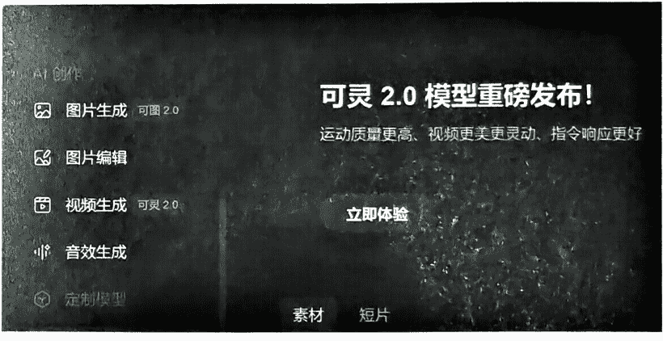

图 4-5 可灵 AI 主页功能

### 4.2.1 图片生成

点进“图片生成”后会打开图像创作界面，如图所示。只填入文字描述时走的是文生图流程；上传参考图片则可切换到图生图模式。

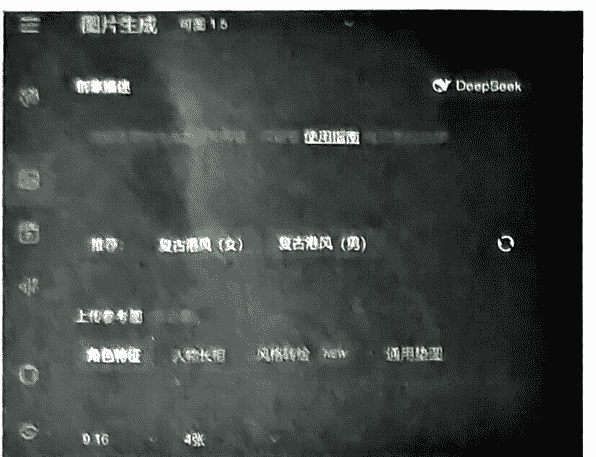

图 4-6 可灵 AI 图片生成页面

在该界面还能切换绘图引擎，包含可图 2.0、可图 1.5、可图 1.0 等版本，具体选项见下图。

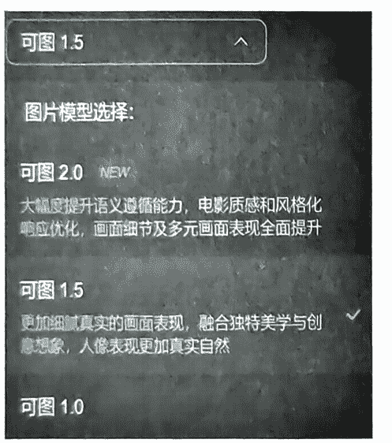

图 4-7 可灵 AI 图片生成模型选择

填入创意提示词后设定画面比例与生成张数，即可得到对应图像。

### 4.2.2 视频生成

打开“视频生成”模块即可进入视频制作页，如图所示。

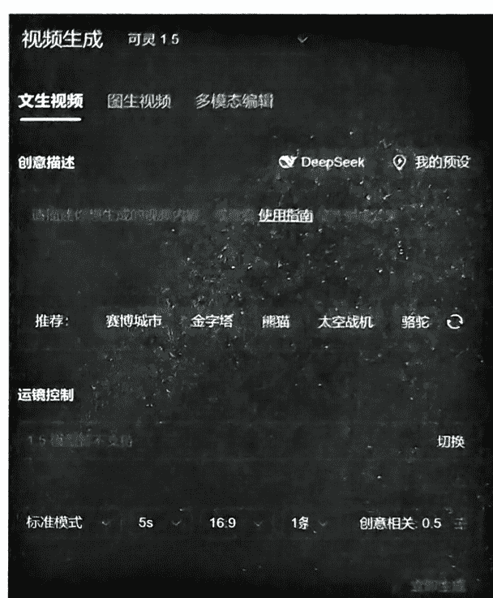

图 4-8 可灵 AI 视频生成页面

该页提供三种创作方式：文生视频、图生视频以及多模态编辑。

文生视频能够把输入的文字转化为 5 秒或 10 秒的动态画面。图生视频则基于一张源图生成 5 秒或 10 秒的视频，也支持同时上传图片并补充文字说明，让模型融合图文信息。 多模态编辑主要用于对视频进行元素替换、新增或删除的精细调整。

视频创作同样可以按需求挑选引擎，例如可灵 AI2.0、可灵 AI1.6、可灵 AI1.5 和可灵 AI1.0，如图所示。

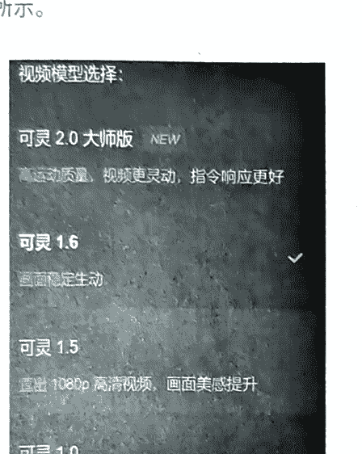

图 4-9 可灵 AI 视频生成模型选择

### 4.2.3 图片编辑

目前图像编辑支持基础性修改，如图所示，示例展示了局部重绘与扩图两项能力。

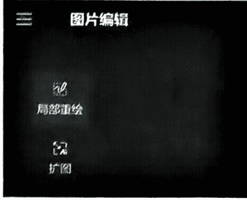

图 4-10 可灵 AI 图片编辑页面

局部重绘只需框选需要修改的区域，系统会对该部分重新渲染；扩图功能则可在原图基础上向各方向延伸画布。

### 4.2.4 音效生成

进入“音效生成”后会打开音频合成界面，如图所示。

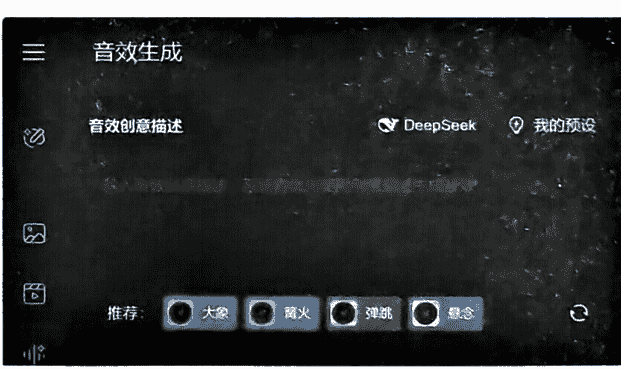

图 4-11 可灵 AI 音效生成页面

用户输入创意描述并指定音效类别，平台即可自动生成对应音频。

# 第5章 绘画技巧速成

本章聚焦两条核心路径——由文字生成图像与由图像衍生图像，手把手带你把创意转化为画面，也能基于已有素材做风格延展与创意再造。后续会拆解提示词构建思路、细节把控方法与画质优化技巧，目标是实现出图迅速、准确、高质量。即便没有绘画基础，也能借助可灵 AI 画得逼真、画得精彩、画得高效。

## 5.1 文生图

文生图就是把文字描述转为图像，是 AI 绘画的关键环节。把关键词或完整描述输入可灵 AI，配合相关指令参数，就能产出精致的绘画作品，达成以文成图的效用。

在文生图里，提示词既是描述也是指令。模型会依据提示词推断色彩、构图、风格与细节。描述越具体明确，生成结果越贴合预期。因此学会科学搭建与优化提示词是掌握文生图的关键。可灵 AI 的图片生成页顶部提供 DeepSeek 选项，因为内置了 DeepSeek 深度思考大模型，可在创作时调用它拓展创意思路，最终获得更精准的提示词。

### 5.1.1 文生图的使用场景

文生图是通过输入描述性文字，让模型理解后生成静态图像。常见用途包括：

- 人物角色创作：描绘外貌、服饰、动作与背景环境；
- 场景绘制：如古风庭院、幻想世界、科幻都市等；
- 产品设计可视化：让 AI 根据关键词生成产品概念图；
- 插画与海报：快速产出概念原稿，供后续精修或灵感迭代。

可灵 AI 在该领域可操作性强，能对多维度文字提示进行理解与融合，输出符合预期的画面。

### 5.1.2 提示词的构成要点

要让可灵 AI 精准还原画面，提示词需要覆盖表 5-1 的要素。各项目、工具的写法或有差异，但核心逻辑一致。

表 5-1 提示词构成要素

| 要素 | 说明 |
| :--- | :--- |
| 主体 | 指定画面核心对象或人物，如一只犬、一位着汉服的少女、一台极具未来感的飞行器等。可描述种类、性别、姿态、数量等，使 AI 明确核心形象 |
| 场景/背景 | 说明对象所处的环境或氛围，如古老宫殿、赛博城市、乡间田园、海边落日等，有助于建立整体空间感与故事感 |
| 外观特征 | 补充主体外表或服饰细节，如发色、眼色、表情、服装款式、配饰、动作等。描述越细，画面偏差越小 |
| 风格/艺术形式 | 定义整体艺术风格或表现手法，可指定写实、卡通、油画、蒸汽波、复古插画、赛博朋克等，或借鉴艺术家风格，使笔触与色彩统一 |
| 光照与色调 | 描述想要的光线氛围，如逆光、柔和暖调、烛光昏暗、日落金色、霓虹映照等，光线影响情绪，配合色调可增强氛围 |
| 质量和细节要求 | 说明分辨率或精致度要求，如高清、细节丰富、面部清晰、线条细腻等，帮助模型聚焦局部，提升成图质量 |
| 排除项 | 可列出不希望出现的元素，如噪点、多余路人、特定颜色、意外物件等，使生成避开干扰因素 |

### 5.1.3 提示词示例

下面提供若干示例帮助直观理解写法。

#### 1. 日常场景

示例提示词如下：

> 一只金色短毛猫，坐在窗台上，看着窗外的雨景；画面整体清新明亮，带有小清新的插画风格；背景使用柔和的浅绿色和浅蓝色调，表现雨后的清凉氛围。

解读：
主体为金色短毛猫；场景为窗台下雨；风格与色调为小清新插画、淡绿淡蓝，营造雨后清凉感。

#### 2. 未来科技风

示例提示词如下：

> 一位身穿银灰色金属机甲战衣的女性，身后的背景是巨大未来城市天际线，霓虹闪烁；画风赛博朋克；强烈的对比光，人物面部轮廓清晰；明亮的紫色和蓝色光线交错；高分辨率，细节刻画。

解读：
主体为着机甲战衣的女性；背景为未来都市与霓虹；风格为赛博朋克；紫蓝对比较强，强调轮廓与高清细节。

#### 3. 童话插画

示例提示词如下：

> 一个身穿粉色纱裙的小女孩，正乘坐热气球飞过奇幻森林；背景中有巨大的蘑菇、漂浮的萤火虫；插画风格温暖，灯光柔和；给人童话般的奇幻与浪漫。

解读：
主体为粉纱裙小女孩乘热气球；场景为奇幻森林、巨蘑菇与萤火虫；风格温暖柔和，营造童话浪漫氛围。

提示词是作品灵魂，也是与 AI 沟通的桥梁。唯有层次分明、逻辑清晰的文字描述，才能让模型准确理解意图，产出高质量有创意的图像。

### 5.1.4 提示词优化对比

以“未来建筑”为例做对比试验。在图片生成页选用下方推荐词“未来建筑”，会弹出如图 5-1 所示的推荐提示词。

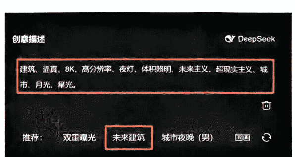

图 5-1 可灵 AI 推荐提示词

直接生成得到的画面如图 5-2 所示。


图 5-2 可灵 AI 推荐词生成未来建筑图片

随后借助 DeepSeek 功能对提示词进行润色。点开 DeepSeek 会出现如图 5-3 所示的对话框。

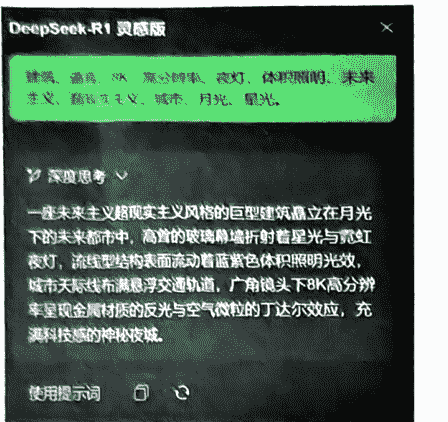

图 5-3 DeepSeek 优化未来建筑的提示词

点击对话框中的“使用提示词”，保持其他参数不变后生成的图像如图 5-4 所示。


图 5-4 DeepSeek 优化提示词后生成的未来建筑图片

对比图 5-2 与图 5-4 可见，经过 DeepSeek 润色后的提示词，画面未来感更强，细节也更丰富。

## 5.2 图生图

图生图并非从零生成，而是基于提供的参考图像进行再创作、扩展或变形，快速得到新图。无论是升级手绘草稿，还是把实拍照片转为特定风格插画，都能在短时间内获得惊喜效果。

### 5.2.1 图生图的应用场景

图生图能解决手绘、后期、摄影修图中的耗时难题，也便于创意迭代与视觉拓展。常见场景包括：

- 风格转换：将原图转为不同艺术风格或笔触，如把街景照片处理成油画，或给人像加上赛博朋克霓虹光影；
- 创意扩展：为已有卡通形象补充背景元素、加入新故事线，或向外扩展画面边界，让视野更宽、细节更足；
- 局部修饰与细节强化：在原图指定区域做调整，如修改角色表情、更换服饰、修复损坏或低清部分，同时保留整体结构并加入新元素；
- 色调与氛围改造：给照片或插画更换季节或情绪，如把夏日绿地变成枫叶飘落的秋景，或让暗调画面变得明亮温暖，操作比手动调色更便捷；
- 草图快速成稿：提供简单线稿，模型即可自动填充细节、渲染风格，从粗概念一步到位生成完整图。

### 5.2.2 如何编写图生图的提示词

图生图区别于文生图之处在于需要同时提供参考图片。在可灵 AI 中，先上传基础图像，再配一段描述改动或重塑风格的提示词，模型会结合图文信息进行推理。

编写时可参考以下思路：

1. 明确你想“保留”什么
是否希望构图与人物布局不变？原图中必须保留的元素有哪些，比如人脸特征、建筑基本形。可以在提示词里写明“保持角色姿态不变”“保留原有表情与动态”，让模型知道核心部分。

2. 强调你想“改变”或“增强”什么
若要调整色彩、风格、氛围，就要给出具体描述，例如：“把此古装人物变成现代街头装扮，画面偏二次元漫画风格”“将背景

#### 3. 考虑局部替换或修饰
只想修改局部时，需在提示词里指明位置或范围，例如：“人物头部加一顶粉色帽子”“背后添加翅膀”“替换背景为太空星云”等。

### 5.2.3 图生图具体应用

下面以可灵 AI 的图生图功能为例演示，如图 5-5 所示。

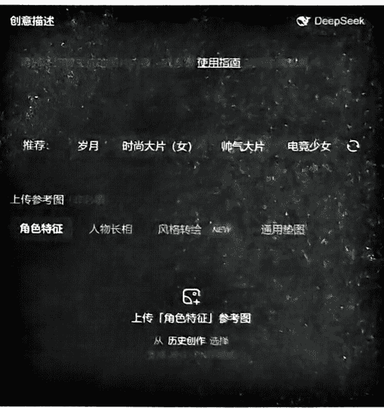

图 5-5 可灵 AI 图生图功能

导入基准图像后，可对图像使用固定角色特征、人物长相、风格转绘和通用垫图等功能。

#### 1. 角色特征

角色特征适用于人物、常见动物或二次元虚拟角色，能保持长相、衣着等主体信息不变，并可调节相似强度，通过上方提示词更改动作和场景。适合剧情角色扮演、社交媒体等场景。具体流程如下：

以一张白色猫咪图片为例，使用可灵 AI 生成的底图如图 5-6 所示。


图 5-6 可灵 AI 角色特征底图

把图 5-6 导入“上传参考图”界面，导入成功后如图 5-7 所示，下方会出现脸部参考和主体物参考两个滑块，注意数值越大保留程度越高，提示词的影响则越小。

设置合适的参考数值后，在上方提示词输入环境或动作指令，例如“闭眼睛”，模型就会基于该猫咪场景生成闭眼画面。

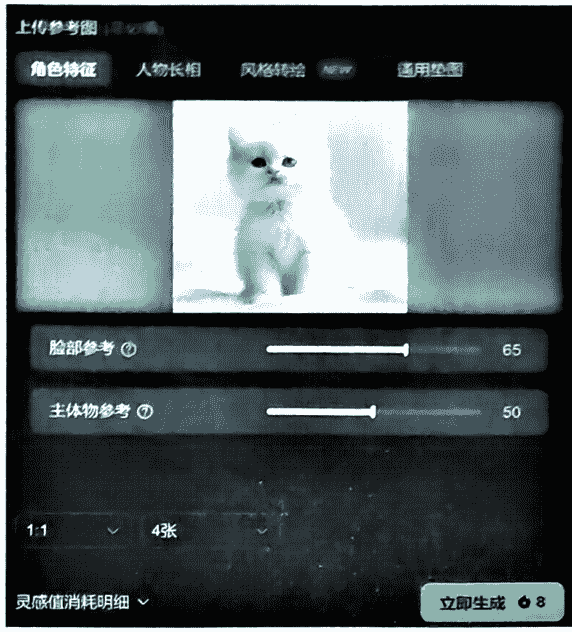

图 5-7 可灵 AI 角色特征上传操作页面

如图 5-8 所示，可灵 AI 会在原场景基础上生成猫咪闭眼的图像。


图 5-8 可灵 AI 角色特征样图

#### 2. 人物长相

人物长相功能主要用于人物，可通过提示词改变服装、发型、配饰和场景，同时保持面部相似度高，满足同角色多场景创作需求，常用于写真和剧情创作。演示如下。

以一张可灵 AI 生成的女生图像为例，底图如图 5-9 所示。


图 5-9 可灵 AI 人物长相底图

导入到“上传参考图”页面并选择“人物长相”功能，如图 5-10 所示。

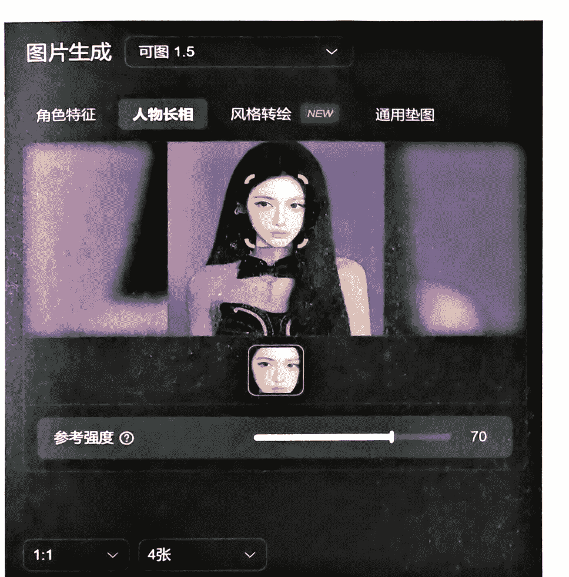

图 5-10 可灵 AI 人物长相上传操作页面

调节参考强度后，在提示词输入“短发、换白色衣服”，即可得到符合要求的画面，如图 5-11 所示。


图 5-11 可灵 AI 人物长相样图

#### 3. 风格转绘

风格转绘保留画面主体内容和构图姿势，通过提示词改变整体风格。以一张可灵 AI 生成的图片为例，底图如图 5-12 所示。


图 5-12 可灵 AI 风格转绘底图

导入后选择“风格转绘”功能，如图 5-13 所示。


图 5-13 可灵 AI 风格转绘操作页面

选择“二次元”风格后，模型可基于原图生成二次元风格图像，如图 5-14 所示。


图 5-14 可灵 AI 风格转绘二次元样图

#### 4. 通用垫图

通用垫图是按提示词要求重新绘制图像，应用场景较广。具体方法如下：

以一张可灵 AI 生成的图片为例，底图如图 5-15 所示。


图 5-15 可灵 AI 生成的通用垫图底图

导入后选择“通用垫图”功能，在提示词框输入“坐在复古感的椅子上，室内场景，背景是复古感的柜子”，生成效果如图 5-16 所示。


图 5-16 可灵 AI 通用垫图生图样图

从图 5-16 可见，相比图 5-14，通用垫图能改变人物坐姿和场景要素，因此也被称为万能垫图。

图生图既能让已有素材快速蜕变，也能释放想象力，在保留原结构的前提下反复迭代风格、细节和色彩。面对传统手绘修图或照片后期繁琐的难题，AI 更直观高效。

使用可灵 AI 做图生图时，关键在于平衡原图保真与新元素加入，既要明确保留的部分，也要在提示词里清晰表达变化点和增补点。不断试验和调参是获得理想效果的诀窍。


# 第6章 绘画融合速成实战


本章是绘画融合速成部分的核心，也是最具实操和创意的一章。我们将带你进入真实应用场景，结合前面的 AI 绘图技巧，完成儿童绘本、品牌广告、短视频头像、包装视觉、家庭作业、美术 IP 等多类型图像项目的实战创作。每节都提供案例和可直接使用的提示词模板，帮助你在模仿中创新，逐步把 AI 图像能力内化为个人竞争力。

## 6.1 儿童绘本生图

儿童绘本插画用丰富的色彩为孩子搭建一个充满奇幻与想象的世界，开启美好想象的大门。这些画面以生动故事和鲜明视觉效果激发孩子们的想象力和创造力。

### 6.1.1 场景需求

双核协同：从绘本到品牌 IP 的快速成稿路径

做儿童绘本最容易被卡住的地方是：故事和分镜要一起推，自画或找外包都费时费力；绘画功底薄弱或找不到合适画师，成本就上来了；即便有了图，画面情绪也常和文字脱节；绘本需要反复调整角色和场景，传统手工流程很难做到低价快迭代。

把文字创作交给 DeepSeek，图像绘制交给可灵 AI，形成文案与视觉并行的闭环，从灵感到可视化能一次串起来，省时也省钱。

### 6.1.2 基础提示词思路
先把文字搭出来。用 DeepSeek 能迅速拼出特定调性的童话雏形。为了让文本既有趣又适合翻页，需要在指令里明确主题、角色身份、篇幅与语言语感。

示范指令：
> 请为 4 到 6 岁的小读者写一篇 200 至 300 字的绘本，主角是月亮森林里的小狐狸蒂亚寻找星星果，结尾温馨带一点小冒险，语言简洁好懂，童话感足。

### 6.1.3 DeepSeek 生成儿童绘本故事示例
把指令交给 DeepSeek，能得到类似下面的故事框架：

> 故事标题：小狐狸蒂亚与星星果
> 
> 月亮森林深处住着一只叫蒂亚的小狐狸。传说林子里藏着会发光的星星果，谁寻到它就能为夜空许一个小愿。
> 一个夜晚，蒂亚鼓起勇气出发。她顺着月光铺开的小径走，遇到迷路的小兔米可，又碰到一棵会说话的老松树。蒂亚帮米可找回家的方向，老松树也给了她寻找星星果的线索。
> 在夜莺歌声的指引下，蒂亚在银色湖边找到了星星果。它像个小灯笼，透着柔和的光。蒂亚捧着它默默许愿“希望森林里的朋友都能快乐”。星星果闪一下后化作一颗温暖的星飞向夜空。蒂亚望着星空，心里暖暖的，觉得月亮森林比从前更美了。

### 6.1.4 根据故事生成插画提示词
想配图，先把情节拆成关键画面，再为每个画面写描述。下面以“蒂亚发现星星果的瞬间”为例：

示范指令如下：
```
绘制一幅儿童绘本风格的插画：
主体：小狐狸蒂亚，身材小巧可爱，毛色呈橘红色，眼神中带有欣喜和好奇；
场景：月亮森林中的一处银色湖边，湖面波光粼粼，夜晚的天空挂着明亮的月亮与星星；
核心物件：一颗星星果，散发着柔和光芒，正被蒂亚捧在双爪间；
风格：童话插画，线条柔和、色彩温暖，适合4～6岁儿童视角；
氛围：温馨梦幻，周围点缀少量萤火虫或微光。
```

### 6.1.5 用可灵 AI 生成插画图片
打开可灵 AI 的绘图页，粘贴上述描述，设定张数与比例即可得到样图，如图 6-1 所示。
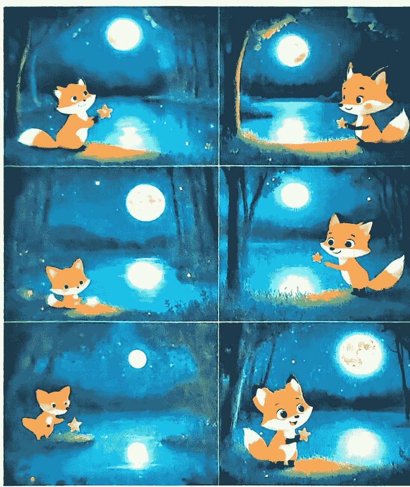
图 6-1 可灵 AI 产出的绘本样图
若效果不理想，可重绘或借助可灵 AI 的图生图功能做局部微调。

## 6.2 动漫作品创作
动漫既是娱乐载体，也是年轻人喜爱的次文化入口。传统流程需要编剧、分镜、角色设定等多环节配合，周期长费用高。若想快速试做一个短动画脚本或原创漫画场景，却缺人手和预算，可灵 AI 能提供一种低门槛高效的替代路径。

### 6.2.1 场景需求
动漫对叙事与视觉要求都高，独立创作者或小团队常遇到的阻力有：
- 剧情与文本：需要一定的文学功底和剧本编排能力，保证内容够好看。
- 形象与场景绘制：手绘或外包插画费用高，制作周期拉长。
- 风格统一与迭代：连载作品一旦定调，就要保持一致并不断微调。
先用 DeepSeek 完成脚本及角色、世界观的文字设定，再用可灵 AI 快速出角色草图或场景，门槛明显下降，也为后续正式制作打基础。

### 6.2.2 基础提示词思路
做短篇动漫时，可通过指令告诉 DeepSeek 主题、人物与剧情需求，以“现代都市+魔法少女”作参考：
示范指令：
> 我想做一部短篇动漫，背景是现代都市暗藏魔法势力，主角是一名高中女生，她意外获得魔法力量，整体走冒险与友情路线，约 400 字。请给出完整大纲与小结局，并留一点伏笔方便后续延展。

指令要点：
- 主题：现代都市＋魔法暗流；
- 角色：高中女生；
- 篇幅：约 400 字，含起因、冲突、小结局；
- 风格：冒险＋友情，适配短篇。

### 6.2.3 DeepSeek 生成动漫作品示例
假设 DeepSeek 给出如下节选：
> 动漫短篇剧情大纲：焰羽之光
> 
> 高中生顾星羽日常上课逛街，看似平常。某天下课，她目睹街头奇异冲突：一名戴面具的魔法师用黑色火焰击退阴影怪物，随后消失。
> 
> 对魔法产生好奇的她，半夜收到一封泛紫光的信，里面有一把刻着古纹的钥匙。钥匙解开了她体内封印的“焰羽之力”，让她初步掌握火焰魔法。
> 
> 起初她把钥匙当玩具，后来同学们遇险时，她用“焰羽之力”出手相救，因而引来黑暗势力关注。她与同学联手调查，发现城市之下封印着众多魔物。
> 
> 结尾：顾星羽险胜一次对战，体会到守护的意义。与此同时更强的黑暗势力正在复苏。尾声处，面具魔法师再次出现，向她伸手相助，暗示更大的挑战即将到来。

### 6.2.4 根据故事生成插画提示词
想为女主角顾星羽做人物插画，可在可灵 AI 输入：
> 请绘制一幅现代魔法少女风格的插画：
> 主体：顾星羽，高中女生形象，黑长直发、身形纤细，穿校服外套配短裙，背后若隐若现火焰羽翼；
> 风格：偏日系动漫风，色彩鲜明，线条干净；
> 背景：都市夜景，远处高楼霓虹，天空深蓝；
> 氛围：魔法与现实交融，手掌心凝聚细小火焰，表现刚觉醒的力量。

### 6.2.5 用可灵 AI 生成动漫图片
进入可灵 AI 绘图页输入上述描述，若第一次火焰效果不足，可补充“火焰羽翼更亮，氛围偏热血张力”。
可灵 AI 产出的动漫图如图 6-2 所示。

图 6-2 可灵 AI 产出的动漫图样图
拿到满意的插画后，结合 DeepSeek 的剧情，可将其用作人设图、海报或番外，为后续漫画动画企划奠基。

## 6.3 产品广告图像制作
广告在新媒体时代承担宣传与促销功能，通过各渠道传递信息、激发购买欲。核心是让消费者了解产品特性并产生购买冲动。

### 6.3.1 场景需求
在竞争激烈的市场，品牌和卖家都想快速推出高质量广告图，却常遇到：
- 文案与视觉脱节：先写文案再找设计，沟通与时间成本高。
- 缺乏创意灵感：难以在短时间内做出有冲击力的画面。
- 自制门槛高：非专业设计师难把控排版、配色和质感。
把 DeepSeek 与可灵 AI 结合，DeepSeek 负责文案，可灵 AI 按描述产出契合定位的视觉图，大幅压缩设计流程。

### 6.3.2 基础提示词思路
为名为 Spark 的运动饮料做推广，想突出补充能量、清爽口感、年轻活力，可在 DeepSeek 输入：
> 我需要一段创意广告文案，推广名为 Spark 的运动饮料。核心卖点是“瞬间补充能量，保持年轻活力”，目标人群是 20～30 岁的运动爱好者。文案 120 字以内，最后用一句口号收尾。

要点说明：
- 品牌与产品：Spark 运动饮料；
- 卖点：能量补充、年轻活力；
- 目标：20～30 岁运动人群；
- 篇幅：120 字内，适配海报或社交短文；
- 口号：文末一句响亮口号。

### 6.3.3 DeepSeek 生成的广告文案示例
DeepSeek 输出示例：
> 广告文案：
> 当你奔跑在城市街头，身体热量在消耗；当你挥洒汗水渴望一口清爽，Spark 就在你手边！配方富含维生素与电解质，能瞬间注入活力，无论晨练还是夜跑，都能让状态在线。
> 
> 口号：Spark——点燃你的运动能量！

### 6.3.4 根据文案提炼绘图指令
获取文案后，为产品制作海报。在可灵 AI 输入画面描述：
示范指令如下：
> 请绘制一张关于运动饮料 Spark 的广告海报：
> 主体：一瓶 Spark 饮料，瓶身简洁，亮橙色调，瓶身可见醒目 Spark logo；
> 画面元素：背景为跑道或城市街头，有人物侧影奔跑，营造动感与速度；
> 风格：活力炫彩插画风，色调明亮，带动态线条；
> 氛围：年轻热血，呈现随时补充能量的视觉效果。

### 6.3.5 用可灵 AI 生成广告图像
在可灵 AI 绘图页输入指令，可得到包含运动场景、产品、动感线条和活力配色的海报样图，如图 6-3 所示。
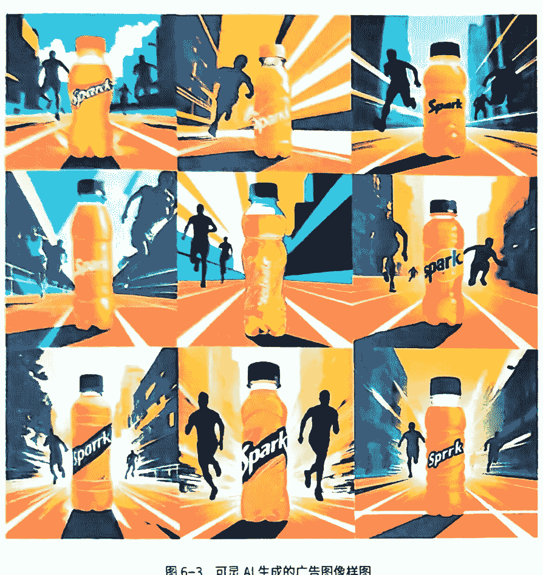
图 6-3 可灵 AI 产出的广告图像样图
注意可灵 AI 产出的文字可能不清晰或有误，可重绘或修改。若瓶身不够突出，可在指令中加入“瓶身更大更靠前”“色彩对比更鲜明”等强化描述。

### 第 6 章 绘画融合速成实战
产品广告图制作不再是文案先行、设计后置的线性流程，而是文案创意与视觉生成的双重助力：DeepSeek 快速写出吸睛文案，抓住卖点；可灵 AI 瞬间把文字转成品牌感强、冲击力足的海报。这套方法降低了创作门槛，为中小品牌和个人卖家提供低成本高效方案。

## 6.4 制作品牌 IP 形象
品牌 IP 形象是企业在市场中的个性化表达。构建有效 IP 需要理解目标市场与消费者心理，结合品牌历史、文化和未来方向。创意设计和视觉表达是关键，需引发情感共鸣并传递核心价值。

### 6.4.1 场景需求
打造辨识度高、风格鲜明的品牌 IP 能增强消费者黏性，但企业常面临：
- IP 定位不清：不确定赋予卡通人物、科技机器人或拟人动物等何种气质。
- 创意美术资源不足：需反复讨论、草图、修改，成本时间高。
- 迭代困难：定型后大范围修改涉及大量重绘费用。
结合 DeepSeek 与可灵 AI，可低成本快速产出 IP 原型，文字背景到外观随时迭代，最终形成可复制的形象体系。

### 6.4.2 基础提示词思路
假设经营一家环保科技公司，想打造拟人化“树精灵”IP 传递绿色理念，可在 DeepSeek 输入：
> 我要为一家环保科技公司打造品牌 IP 形象，即拟人化树精灵角色。请写一段角色定位，包括姓名、性格特质、品牌理念、适用场景，再加一句简短口号。文字不超过 200 字。

说明：
角色定位：树精灵＋环保概念；
字数限制：200 字内；
要素：姓名、性格、适用场景、品牌理念、口号。

### 6.4.3 DeepSeek 示例输出
DeepSeek 生成示例：
> 角色定位：
> 名字叫森小灵，是位活泼善良、心怀万物的树精灵，头发如翠绿树叶，笑声似微风拂林。她代表环保科技的友好力量，传递绿色生活方式，倡导人与自然和谐。可用于产品包装、官网形象及线下活动合影区等。
> 
> 口号：用心守护，让绿色点亮未来！

### 6.4.4 为 IP 定制绘图指令
基于角色定位，可在可灵 AI 输入：
> 请绘制一幅品牌 IP 形象插画：
> 主体：森小灵，拟人化树精灵少女，翠绿树叶状头发，穿简洁绿色衣饰，表情活泼可爱；
> 风格：卡通可爱，线条柔和，配色明快；
> 背景：森林基调，清新自然，可点缀小花藤蔓；
> 突出元素：胸前或腰间添加叶子形徽章，象征环保科技；
> 氛围：温暖有生机，联想到绿色、守护、未来。

### 6.4.5 在可灵 AI 中生成形象
打开可灵 AI 绘图页复制指令，即可得到相关图片，如图 6-4 所示。
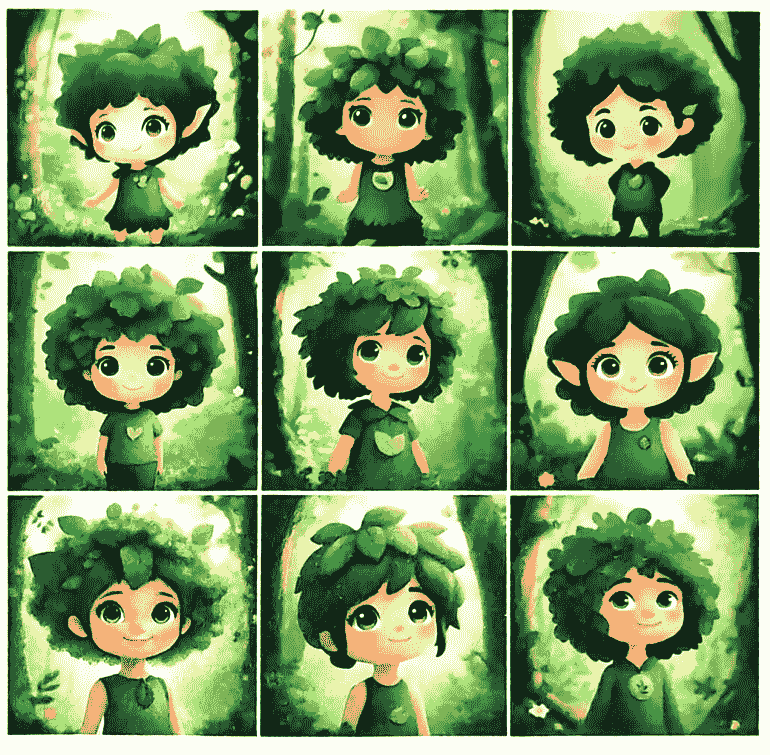
图 6-4 可灵 AI 产出的品牌 IP 形象样图
想让森小灵更有特色，可补充“头戴小树叶发箍”“大眼睛”或“水彩质感”等细节，获得多版候选形象，选出最契合企业调性的一版，用于海报、名片、展会立牌、社交头像等场景。

## 6.5 抖音、快手等平台虚拟头像
短视频平台内容丰富，打造独特虚拟头像是打造账号的第一步。头像能体现个人风格，帮助账号在众多用户中脱颖而出。

### 6.5.1 场景需求
创作者常面临：
- 手绘或外包成本高，调整周期长；
- 创意灵感不足，容易流于大众；
- 频繁换头像不便，需再次投入时间费用。
借助可灵 AI 生成头像，只需文字描述即可得到风格统一、可随时迭代的个性化虚拟形象。

### 6.5.2 按账号定位定制头像指令
#### 1. 萌系二次元定位
> 请为抖音账号设计萌系二次元风格虚拟头像：
> 主体：粉发少女，双马尾，表情可爱，眼睛大而闪亮；
> 风格：日系动漫插画，线条柔和，色彩明快；
> 装饰：头戴小猫耳发饰，穿简洁水手服；
> 背景：淡粉渐变色，突出人物轮廓；
> 氛围：活泼甜美，软萌感强，适合二次元内容创作者。
输入可灵 AI 绘图界面后可得到符合定位的头像，如图 6-5 所示。
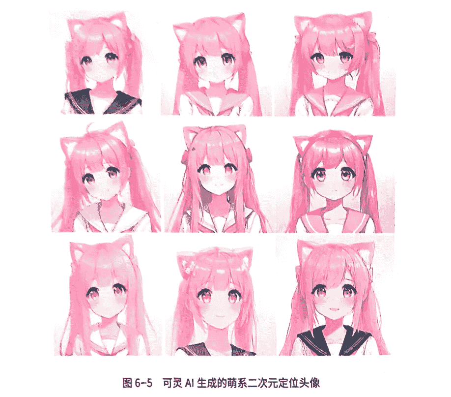
图 6-5 可灵 AI 产出的萌系二次元定位头像

#### 2. 潮流街舞定位
> 请为快手账号设计潮流街舞风格虚拟头像：
> 主体：年轻男性卡通形象，身形修长，穿嘻哈卫衣配运动鞋；
> 风格：炫彩街舞插画，线条硬朗，带涂鸦元素；
> 面部特征：平帽反戴，表情自信酷感；
> 背景：霓虹涂鸦墙或抽象街头线条，亮色对比突出主角；
> 整体：张力十足，体现街舞或嘻哈节目风格。
输入可灵 AI 后可得到对应头像，如图 6-6 所示。
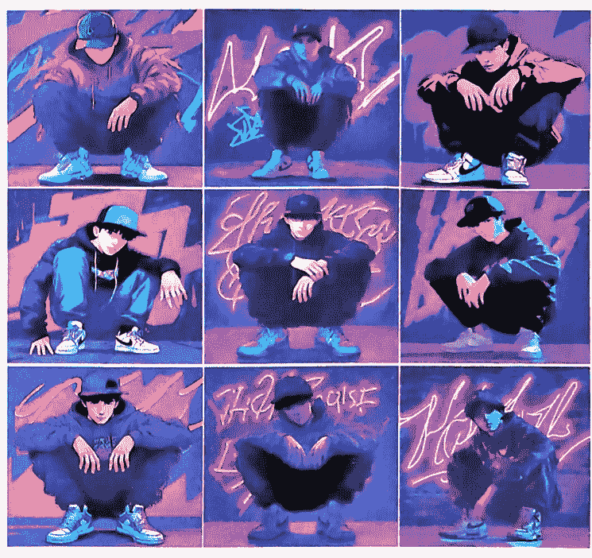
图 6-6 可灵 AI 产出的潮流街舞定位头像

#### 3. 轻奢美妆人设
> 生成一枚轻奢美妆风格的虚拟头像：
人物设定为时尚女性，长发带有柔和卷度，五官精致细腻，唇色选用玫瑰系口红；表现手法以插画与写实线条融合，突出优雅高级的气质；配饰点缀淡金色饰品或耳坠，强化精致妆容的质感；背景选用淡米色底或浅金色渐变，搭配少量高光点缀；整体氛围轻奢端庄，非常契合美妆博主或时尚测评账号。

把以上描述粘贴到可灵的作图入口，系统就能按轻奢美妆定位产出头像，如图 6-7 所示。


图 6-7 可灵 AI 生成的轻奢美妆定位头像

#### 4. 阳光运动健身形象
> 创建一张阳光运动健身调性的虚拟头像：
主体为年轻男性卡通形象，短发利落，肌肉线条健康匀称不夸张；风格采用健康活力的插画方式，写实度适中，色调明亮清爽；着装为运动背心，手臂配戴运动腕带；背景以蓝天或户外运动场地呈现，强化积极向上的感觉；整体充满正能量，适合健身类创作者使用，传递励志氛围。

把这段提示词导入可灵生图界面，就能得到符合阳光运动健身定位的头像，如图 6-8 所示。

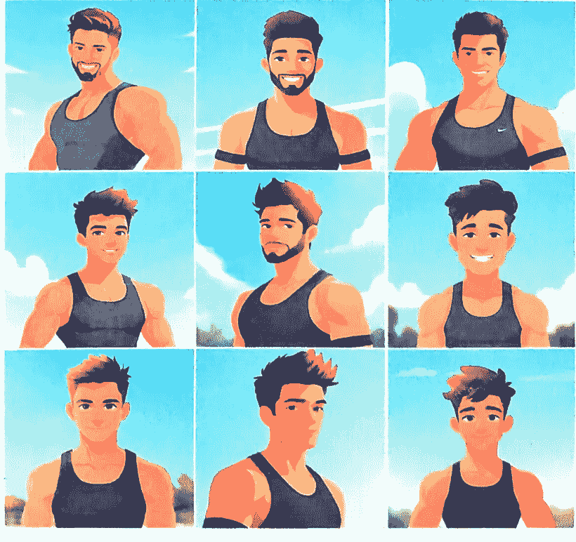

图 6-8 可灵 AI 生成的阳光运动健身定位头像

在文生图模块里直接复制上述描述使用。如需调整发型、配色、表情或背景，可在原有基础上补充说明。效果不满意时可多次迭代，例如要求“发色更浅些”“背景更鲜亮”“可爱感再提升”，让画面逐步逼近预期。

通过这类简洁的提示示例，抖音、快手等平台的不同定位账号都能快速生成个性化虚拟头像，既节省设计开销，又能按账号调性反复打磨，避免传统设计的繁琐流程。掌握提示词编写技巧，就能在短时间内塑造出与账号气质高度契合的形象，让观众一见难忘。

## 6.6 搞定孩子的手工作业
老师布置的剪贴、绘画、科学小实验等作业，常让家长倍感吃力。既要准备材料，又要全程陪同指导，对忙碌的家庭来说是很大挑战。有了智能工具加持，这类难题就容易多了。借助 AI 助手，可以迅速获取创意点子，搜集绘画参考资料，甚至逐步讲解实验步骤。这样家长压力减轻，还能和孩子一起享受动手实践的乐趣，增进亲子关系。

### 6.6.1 场景需求
陪孩子完成手工作业时，父母常会遇到：
灵感不足：老师给了主题，孩子却想不出新颖点子，最终作品容易同质化。
临摹与材料繁琐：需要草图或可打印范例时，若家长美术基础薄弱就会卡住。
时间紧迫、焦虑上升：临近截止，要在有限时间内拿出既有创意又符合要求的成品。

用可灵，只需依据老师要求写一段描述，就能迅速生成一至多张参考插画，为孩子提供灵感启发，或直接打印后用于拼贴、临摹、3D 模型制作，大幅降低作业难产的压力。

### 6.6.2 场景示例
假设老师要求制作“环保主题创意树叶贴画”，并绘制一幅“森林与小动物”背景图，供学生剪贴树叶形成层次感。具体要求为：
主题要体现环保理念，表现人与自然和谐共生；
场景为茂密森林，小动物自由生活；
以该图为底稿，再粘贴树叶等天然材料做立体贴画；
风格儿童友好、色彩柔和，营造温馨氛围。

### 6.6.3 根据老师要求撰写插图的提示词
下面是一份面向可灵的提示示例，便于生成可打印或作参照的森林背景图：
绘制一幅以森林与小动物为主题的儿童插画：
画面主体是郁郁葱葱的绿色森林，阳光透过树叶洒落，地面点缀小草与花丛；
动物元素可加入几只可爱的小兔、小鹿或松鼠，姿态温柔亲切；
画面角落可加入环保象征，如一枚心形叶子标志，暗示人与自然和谐；
风格走童话插画路线，色彩柔和，适合 A4 纸打印用于手工作业背景；
构图保持干净，预留一定空白，便于学生后期粘贴树叶或装饰。

### 6.6.4 用可灵生成图片
在可灵生图界面输入上述提示，即可得到如图 6-9 的效果。

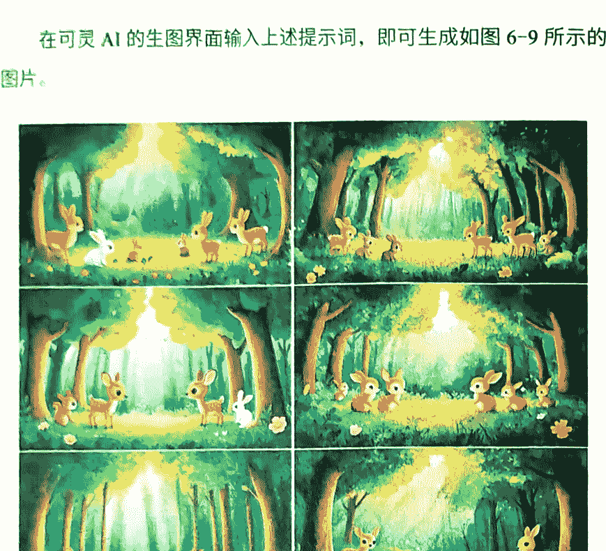

图 6-9 可灵 AI 生成孩子作业样图

生成后下载或打印该插画，让孩子在上面贴树叶、涂色或剪贴，即可完成环保主题的创意手工作业。

借助此法，能快速获得高质量美观的创意模板，帮助孩子在短时间内完成作业，同时锻炼自主思考与动手能力，减少家长在手绘与素材收集方面的困扰，实现事半功倍。

## 6.7 精美商品包装设计
对电商创业者来说，产品质量是根本，但在激烈竞争中，包装同样关键。精良设计既能保护商品在运输中完好，也能提升开箱体验。收到精美包装时，消费者会产生惊喜愉悦情绪，有助于提升满意度与品牌忠诚度。包装还能塑造品牌形象，传递价值理念，让产品从同类中脱颖而出。因此在保证品质的同时，也应投入创意设计包装，为产品增加附加价值。

### 6.7.1 场景需求
理想包装既要传达品牌理念，又要具备美感，才能在货架或社交媒体上被注意。但不少人在制作精美包装时会遇到：
美术与概念表达不足：品牌只有模糊想法，难以清晰传递给设计师。
多方案尝试成本高：人工绘制与排版耗时费力。
迭代效率低：调整产品线、更换主题或配色时，需反复与设计师沟通，消耗大量时间。

借助 DeepSeek 与可灵，可先用 DeepSeek 把品牌、产品定位与设计愿景梳理成文字，再用可灵快速产出包装插画或概念稿，边写边看、多轮迭代后再进入打样印刷。此流程大幅缩短落地周期，也让小商家能以更低成本进行包装实验。

### 6.7.2 生成包装设计设定的文字提示词
例如为一款红枣牛奶饮品“枣香暖意”设计包装，诉求健康、温暖、适合家庭消费，并希望加入少量插画体现自然与品质，可在 DeepSeek 输入如下提示整理包装理念：
我想为一款名叫“枣香暖意”的红枣牛奶设计包装。请用 150 字以内描述产品定位、目标人群及包装关键要素，如配色、插画风格与品牌诉求，并给出一个简短的主打口号。

### 6.7.3 DeepSeek 输出示例
假设 DeepSeek 给出以下示例文本：
包装定位：
“枣香暖意”主打温润养生概念，适合早晚饮用或关怀长辈场景。包装可选用暖色系，如米色搭配棕红色，突出红枣的天然健康。插画可融入牧场奶牛与红枣果实，强调自然品质。目标用户为注重营养与温馨体验的家庭人群。
口号：让每一口，都温暖到心底。

### 6.7.4 为包装生成插画提示词
基于上述定位，可在可灵中撰写插画提示词直接生成红枣牛奶包装概念图。例如：
请绘制一幅红枣牛奶包装的插画概念稿：
风格为温暖插画风，主色调为米色与棕红色，整体柔和；
主体元素包括一只可爱奶牛，旁搭配几颗红枣图案，暗示原料来源；
氛围健康家常，带有轻松温馨感；
包装布局中央留白，用于呈现品牌 Logo“枣香暖意”及口号；
画面不要过于繁复，但需凸显红枣的自然质感。

### 6.7.5 在可灵中生成包装概念图
进入可灵生图页面，输入上述提示，可灵将输出正面包装插画概念稿，呈现奶牛与红枣的柔和配色，如图 6-10。若觉得色彩或元素分布不均衡，可调整提示，例如让背景米色更浅，红枣与奶牛左右分置，Logo 置于中央。想增加牛奶飞溅弧线或放大红枣细节，也可再次修改生成。


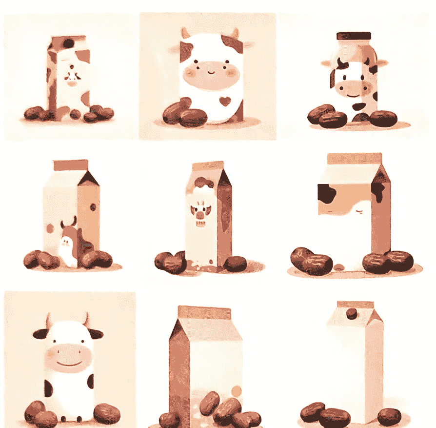

图 6-10 可灵 AI 生成包装设计样图

图 6-10 中间图片的文字存在错误，可重新生成。选定理想草图后，可交给专业设计师结合包装结构尺寸与印刷需求进行排版落地；或先在电商页面展示概念图测试市场反馈，再做升级。

从文字梳理到插画生成的快流程，节省了沟通与创意成本，为中小企业与个体商家提供了低门槛、高灵活度的包装设计新思路。

## 6.8 小红书等网文配图
前文已介绍如何使用 DeepSeek 生成文案，此处不再重复，而在小红书、微信公众号等图文平台，配图同样重要。

### 6.8.1 场景需求
在小红书发布图文时，很多人希望文案吸睛且配图有视觉美感，才能在众多笔记中脱颖而出。常见痛点为：
插图缺失：难以找到契合特定情境与风格的图片素材。
视觉连贯性不足：文字与图片脱节，故事氛围或推广亮点不统一。

借助 DeepSeek 与可灵组合，可先生成一篇“生活气息浓、突出实用小技巧”风格的小红书软文，再用可灵的插画或图生图功能，为文章配上调性一致的定制插图。

### 6.8.2 文案创作：以“秋季护肤小 Tips”为例
示例提示词：
请用 100 字左右写一篇小红书风格的秋季护肤小 Tips 分享，语言亲切有代入感，简要列出 2-3 条实用要点，并加一句文末互动引导。
DeepSeek 生成示例：
文案：
秋天到了，肌肤易干紧绷。早晚先用保湿精华打底，再叠加滋润面霜锁水；偶尔温和去角质，有助于营养吸收。记得多喝水多吃蔬果哦！你的秋季护肤秘籍是什么？留言告诉我吧。

### 6.8.3 插图提示词示例
为配合文案，可在可灵中生成秋季护肤氛围插画。示例提示词：
请生成一幅小红书风格插画，用于秋季护肤干货分享：
场景为桌面摆放护肤品瓶罐与一杯花茶，背景点缀秋叶元素；
风格清新可爱插画，色彩柔和明亮，适合美妆博主发布；
氛围温暖治愈，突出“秋季护肤”主题。

### 6.8.4 生成与运用
在可灵选择生图模式，输入上述插图提示词，可灵会生成轻松温暖的插画场景，可与护肤 Tips 搭配，如图 6-11。

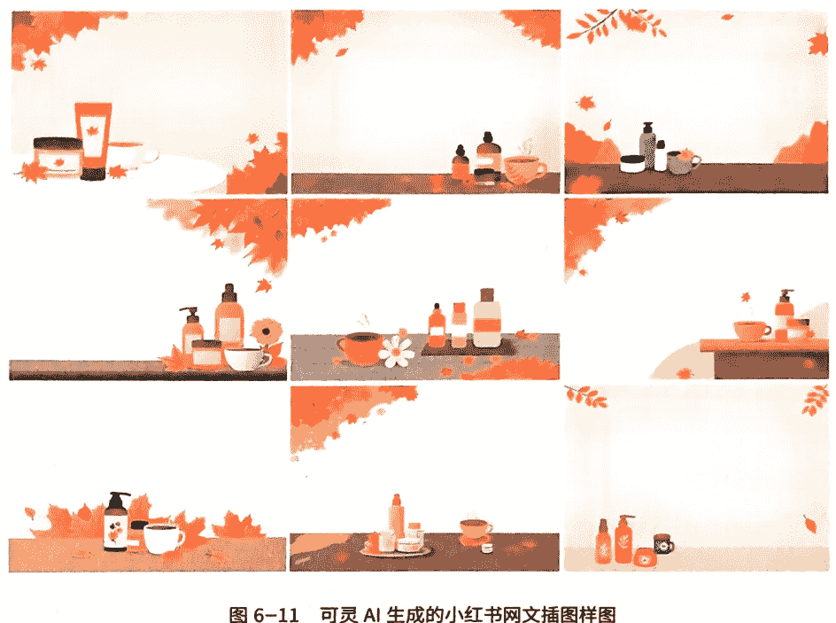

图 6-11 可灵 AI 生成的小红书网文插图样图

将护肤文案与插画组合发布，可让笔记兼具美观与实用性，大幅提升曝光与互动。

通过“AI 文案 + AI 插画”双协同，能在极短时间内完成令人眼前一亮的图文笔记，同样适用于公众号、微博、知乎等需要图文结合的内容创作。

## 后记
过去十年里，诸多人在创作路上黯然退出：设计师因灵感枯竭，文案人因思维堵塞，创业者因时间不足难以表达品牌灵魂。创作本就是心力与时间的角力，是反复在屏幕前孤独挣扎的过程。而 AI 以惊人的速度、精度与灵感储备出现，凭借永不疲倦的运算与内容重组能力走进我们。它并非取代创作者，而是为我们提灯；不是艺术终点，而是助我们成为更好创作者的起点。
本书拆解了 AI 文案与绘画的使用路径，用真实案例与可复制提示词把 AI 工具变为人人可学、人人可用。一册书读完，或许成不了顶尖文案或插画高手，却能重新点燃“想创作”的火苗。
即便非专业文案或画手亦无妨，关键在于尝试的意愿。通过不断练习与打磨，AI 会成为最好的合伙人：不疲惫、不挑剔、从不拒绝试验。当 DeepSeek 写出第一段流畅的品牌介绍，当可灵画出第一张令人惊艳的插图，当你的社交内容首次吸引目光，当孩子看到 AI 生成的童话插画露出惊喜笑容，你便会明白：AI 带来的不仅是工具，更是一种全新的创造力，属于这个时代，也属于每个普通人。
AI 不要求天赋异禀，只需要你愿意学习、敢于提问、持续求索。它没有门槛，不评头论足，不说“不”。它安静等待指令，然后尽心回应每个想法、每句请求、每个梦想。
本书想做的，是把“创意”重新交还给你。无论行业、年龄或专业背景，只要想表达，AI 就能成为表达载体；只要有热情，AI 就能放大热情。
未来的创作生态多元、共生、开放，不只属于专业人士，更面向愿意学习、适应变化的人。内容创作的大门，从未如此敞开。
你已握有进入的钥匙。学会用提示词引导 AI 进行创意写作，学会把抽象想法具象化为海报、头像、角色设计，甚至已用 AI 创作人生第一篇小红书笔记、第一张电商详情页、第一幅孩子作业插图。
往后每一天，不再等待灵感降临，而是动手即开始。
可用 AI 快速完成日常写作，节省时间聚焦决策与创意把控；可用 AI 补足能力短板，在团队中承担更多，成为“全能型选手”；甚至可把 AI 当创业合伙人，从零运营内容账号、电商直播或个人 IP。
你能做的远超想象。本书并非止于教学，而是提供大量实战演示。亲手做过才算真正掌握。希望你不只是“知道 AI 能做什么”，而是亲身实践。
当你站在新的创作现实面前，怀疑一切从这本书开始时，这本书对每个创作者的觉醒并非终点，而是起点。AI 功能会不断增强，工具会持续更新，唯一不变的是：创意永远源于人本身，是思想、想象与故事让工具有了温度与意义。
愿你保持好奇、持续实践、不断创造。用你的内容影响他人、改变世界，成为那个与 AI 一同走得更远的人。

## 作者简介
周小鹏系艺术设计学者，现任武汉理工大学艺术设计学院副教授，从教二十余年，出版多部作品，多次获评优秀指导教师，专注探索 AI 与艺术融合，为创意工作赋能。
掌握 AI 工具，让文案与绘画灵感自然融合，告别创意枯竭，快速生成图文并茂的优质内容。这是一本实用入门指南，助你轻松踏入AIGC创作领域。