# AI重塑新媒体：从创作到变现的实战路径
# 前言
**动笔的理由**

读者朋友们好，我是全权。

打开这本书的人，也许正在通勤的车厢里刷屏，也许是孩子睡后才点亮的台灯前，也许对下一步该做什么感到迷茫，或是被账号长期不涨而焦虑。这些状态我都经历过。四年前在北京城中村的出租屋里敲出第一份短视频分镜时，我没想过一个普通背景的年轻人，能靠内容扎根长三角，并孵化出多个垂类IP，还带领两家专注新媒体服务的MCN持续运转。

这些年看到的失落案例太多：有妈妈凌晨三点还在剪辑，播放量却钉在五百上下；有大学生花三千买运营课程，三个月里零合作；有线下店主搬到线上，二十条精心制作的视频才涨不到百粉。分发规则越来越严，审美门槛不断抬高，用老办法生产内容就像推石上山，创作者在焦虑里被反复消耗。

转折在2023年到来。生成式工具集中爆发后，我看到了新的可能。团队用豆包十分钟产出三十条标题，用可灵把普通商品图升维成电影感宣传片，用海绵音乐把文字直接转成适配配乐。那一刻我明白，游戏规则已经改变。掌握工具组合的个体，产出速度可达传统小团队的三倍。

这本书因此成形。我实测了数十款国内外工具，访谈了上百名用工具完成转型的创作者，把能落地的操作方法整理成册。

**定位与价值**

本书呼应教育强国、科技强国、人才强国的国家方向，响应创新驱动战略，面向新时代的高素质技能人才，提供可复制的创新方案。

目录里不是炫技清单，而是经过商业检验的收入指南。

第二章演示如何用DeepSeek配合Kimi搭建爆款文案生产线，把一条图文或短视频的制作周期从三小时压到二十分钟；第四章拆解可灵与剪映的协同用法，让新手也能量产大片质感短视频；第六章的智能获客体系，曾帮多账号单月把五千人以上精准导进私域；第九章公开的变现打法，是不少工作室单月GMV破百万的核心。

门槛远比想象低。第三章会说明，不会PS也能用文心一格输入“国风仙女手持奶茶站在樱花树下”即得可商用海报；第五章展示的智能音乐制作，让零乐理基础的人也能为视频配专属BGM，甚至把爱好者培养成原创音乐人。过去需要团队完成的事，现在一台电脑或一部手机即可搞定。

案例都来自真实转型。被裁的职场人借助工具做成本地探店头部号；全职妈妈靠AI漫画解说实现月入过万；六十岁的实体店主学会用工具写直播带货文案。最快七天起号，最慢也不超三个月。在智能时代，犹豫本身就是成本。

有人会问，机器生成的内容能打动人吗。第七章用数十组账号对照实验说明，经过智能优化的人设号，粉丝粘性提升约63%，完播率提升近三倍。关键不在于替代人性，而在于用机器释放创意，让人更聚焦判断。

此刻我坐在办公室，外面园区灯火通明。几小时前，智能系统已排好次日发布的二十条短视频脚本；两小时前，数字人已为合作主播出具直播复盘报告。当你读到这里时，成千上万的创作者正用工具改写命运。

这个世界不缺旁观者，缺的是敢先行的人。十年前我错过公众号红利，五年前提早研究抖音仍晚了半年。这次智能浪潮，我不愿再有人错过。最后一章收录七个盈利案例，包含头像壁纸号变现、小说推广号变现、付费专栏运营变现等，均配工具实操步骤。

新媒体铁律未变：第一批拥抱工具的人吃肉，跟风者只能喝汤。现在请放下“三天起号”等焦虑话术，放下华而不实的流量密码。接下来帮你装配一套真实可用的创富体系，它不会让你一夜暴富，却能让你三个月后笑着看还在手工搬砖的同行。

配套学习资源及数量
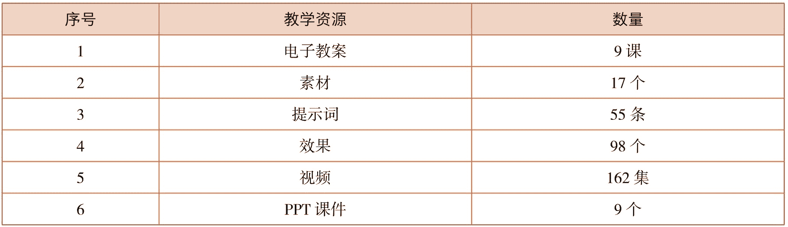

本书附加资源可通过微信扫码关注公众号，输入第77页资源获取码，按提示领取。
资源获取码：xmtyun

**温馨提示**
1.本书涉及的软件版本：DeepSeek应用1.0.14（53），Kimi应用2.0.0，剪映PC端5.7.0，文心一言Web版V3.6.0。
2.成书周期较长，工具版本、功能与界面或有调整，请以书中思路触类旁通。
3.提示词亦称描述词、文本描述、指令等。同一指令在不同时段生成的成果存在差异，请把精力放在指令打磨与操作细节上。
4.受篇幅限制，工具回复仅展示要点，完整文案请查看随书“效果”文件。

**致谢**
本书由全权编著，资源整理由吴梦梦参与，在此致谢。因作者水平有限，疏漏之处请读者批评指正。

# 第一章
# 从零启动：AI赋能下的新媒体启航

在内容时代，创作与分发早已和技术、自动化工具深度绑定。随着生成式智能的快速演进，它正成为新媒体运营与推广的核心驱动。本章从认识新媒体、智能、智能化运营切入，探讨智能对新媒体的助力、智能化运营的具体内容与所需能力，帮助运营者把握精髓。

## 1.1 智能化新媒体运营基础全解

互联网高速发展，新媒体早已改写传统媒体格局，成为各行业运营推广的重要阵地，而智能正成为不可忽视的力量。本节概述新媒体、智能、智能化运营及智能运营师，为后续应用提供理论支撑。

### 1.1.1 新媒体的概念界定
新媒体是对传统媒体的相对概念。传统媒体指报纸、杂志、广播、电视；新媒体则依托数字技术、网络技术，通过互联网、移动通信等渠道，以计算机、手机、数字电视等终端为载体，向用户提供信息与服务的形态。

微博、微信等社交平台，抖音、B站等视频平台，今日头条等资讯客户端都属于新媒体范畴，相对于传统四大媒体，新媒体常被称作“第五媒体”。

新媒体与传统媒体在多个维度不同，其五大特征如图1-1所示。
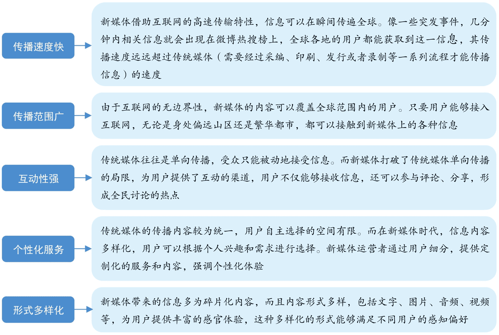
图1-1

### 1.1.2 AIGC的基本内涵
AIGC指由人类设计、具备一定智能的系统，能感知并解析环境信息、从数据中学习规律、基于逻辑或统计模型推理，并在特定领域决策或执行任务。核心技术包括机器学习如深度学习，应用涵盖自然语言处理、计算机视觉等，目标是模拟、延伸和辅助人类智能。

AIGC旨在实现感知、认知、决策和创造等功能。随着技术与场景的丰富，分类也多样化，按技术类型可分传统机器学习、深度学习等；按应用领域可分感知交互、决策优化、自主系统等，落地场景遍及医疗、金融、制造等。

其中按智能水平划分最为直观，分为弱智能、强智能和超智能三层，代表不同能力层级，具体如图1-2所示。
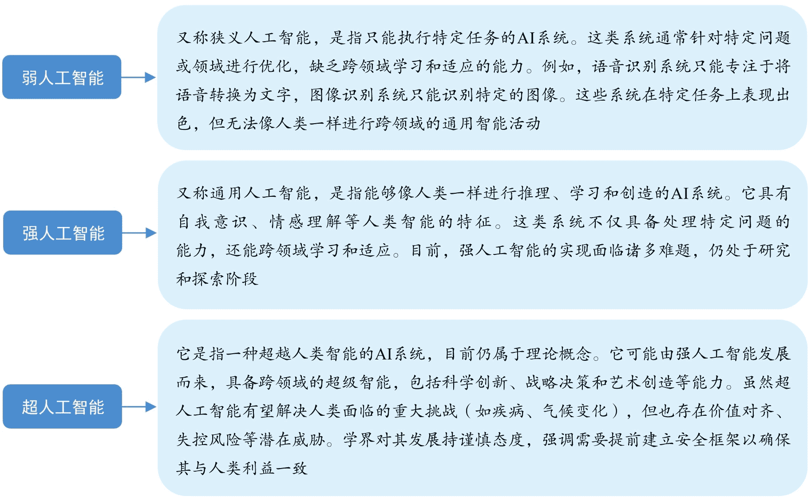
图1-2

### 1.1.3 智能化运营的定义
智能化运营是智能技术在运营领域的落地，通过自动化手段提升效率、降低成本、改善体验并增加收益。具体是利用智能技术挖掘、分析并应用运营数据，实现精准营销、用户画像、智能推荐和自动化运营。核心在于用算法和数据驱动决策，让运营更精准高效。

智能化运营主要应用场景有四个，如图1-3所示。
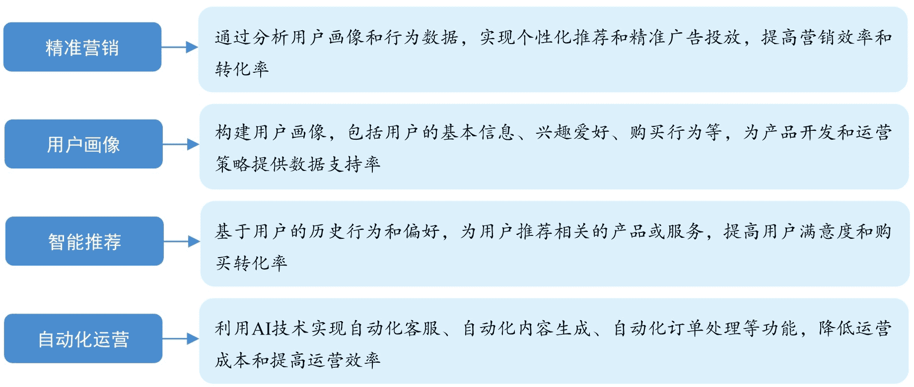
图1-3

### 1.1.4 智能运营师的角色定位
在新媒体运营中，智能运营师是专注运用智能技术与工具优化运营效果的专业人才。他们通过智能分析用户数据把握需求偏好，制定个性化内容策略，利用智能算法高效创作，并借助智能工具进行社群运营，最终实现平台高效运营与业务增长。

智能运营师主要职责如图1-4所示。
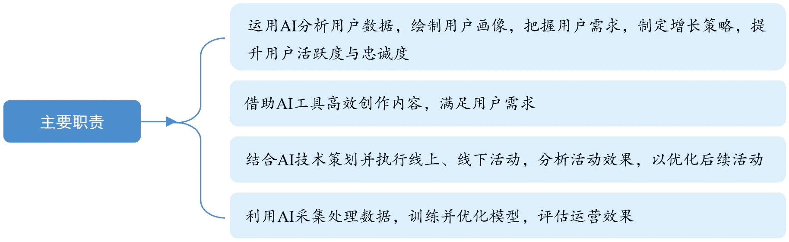
图1-4

## 1.2 5W1H解析智能赋能

为更清晰理解智能对新媒体运营的赋能，本节用5W1H框架展开。

5W1H包括What对象、Why原因、Who人员、When时间、Where地点、How方法，帮助明确智能化运营的定义、价值、适用人群、最佳时机、应用场景与高效策略。

### 1.2.1 What：智能化新媒体运营是什么
智能化新媒体运营指把智能技术应用于新媒体运营，对内容创作、分发、互动与数据分析等环节进行优化管理，以提升效率、优化体验、增强传播效果、实现精准营销。

它融合智能的自动化特点与新媒体的交互传播优势，对传统运营形成革命性改变。

例如内容创作上，智能写作工具可快速生成新闻报道，如腾讯Dreamwriter能自动产出财经体育新闻；内容分发上，智能推荐系统依据用户行为个性化推送，如今日头条智能推荐；用户互动上，智能聊天机器人如微博机器人助手可24小时在线答疑；数据分析上，智能帮助媒体实时监测效果并优化策略。

智能化新媒体运营的主要优势如图1-5所示。
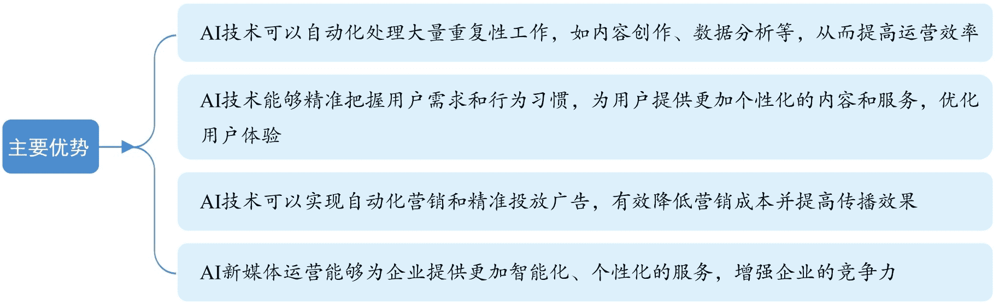
图1-5

### 1.2.2 Why：为何要引入智能赋能新媒体运营
当下新媒体运营面临信息过载、需求快速变化和激烈竞争。智能赋能能大幅提升效率与精准度，通过数据分析和机器学习精准洞察喜好，实现个性化推荐，增强粘性与参与度。

智能还能辅助创作，生成文案、图片甚至视频素材，帮助运营者快速产出高质量内容；实时监测舆情、优化广告投放，全方位助力品牌在复杂市场中突出。

使用智能赋能的原因可归纳为如图1-6所示的几点。
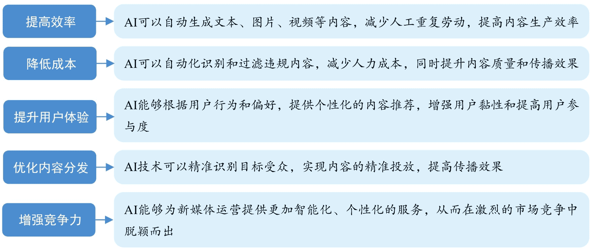
图1-6

### 1.2.3 Who：智能化新媒体运营适合哪些人群
适用人群广泛，包括新媒体运营人员、内容创作者、市场营销人员和数据分析师等，具体如图1-7所示。
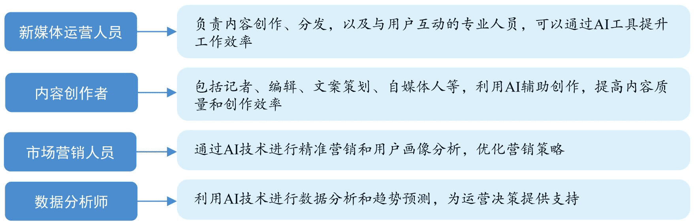
图1-7

### 1.2.4 When：何时引入智能赋能最为合适
在合适时机应用智能能最大化发挥其在创作、数据分析、用户互动方面的优势，确保策略紧跟趋势，及时捕捉兴趣点，在竞争中抢占先机，提升品牌影响力和参与度。

最适合的应用时机如图1-8所示。
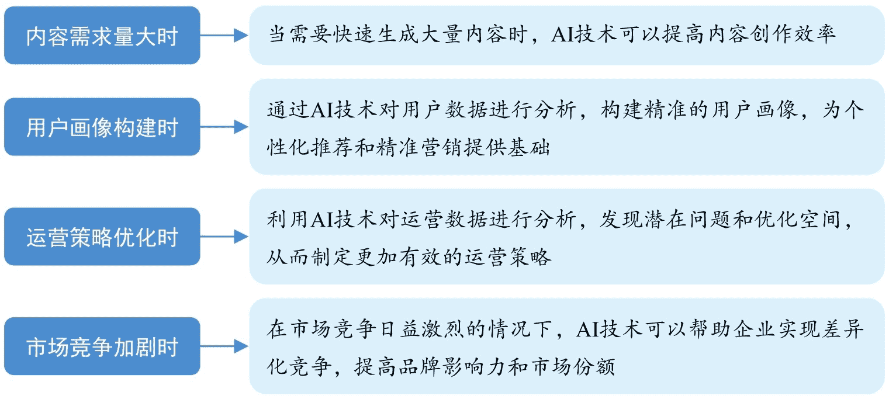
图1-8

### 1.2.5 Where：在哪些场景引入智能赋能
智能赋能场景多样，几乎覆盖各行业。在以下主要场景中，智能不仅提升效率也提高质量，如图1-9所示。
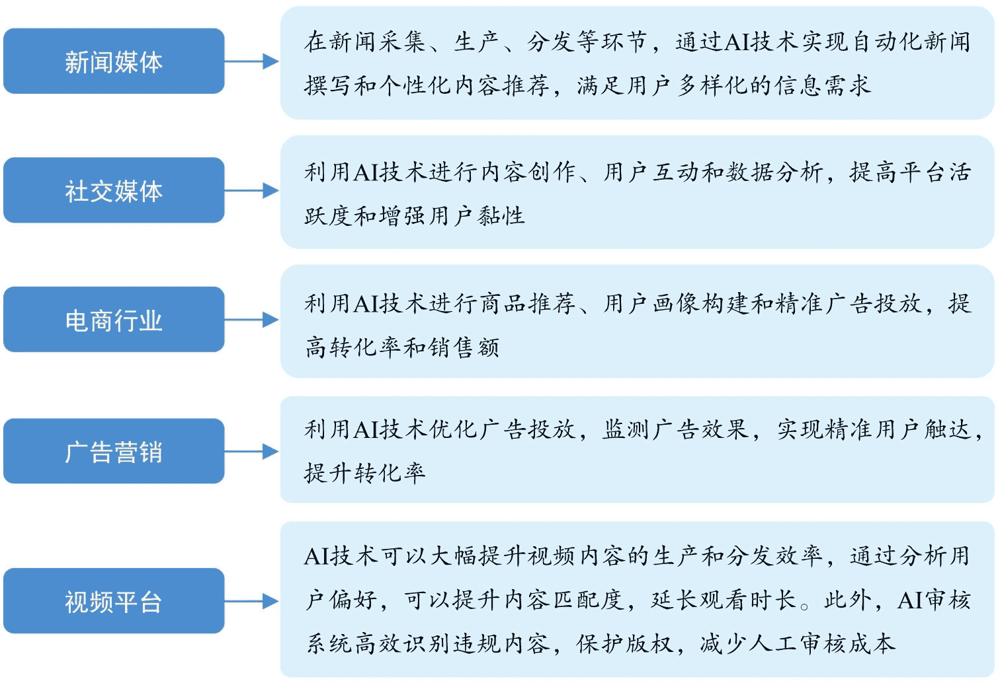
图1-9

### 1.2.6 How：高效实践智能赋能新媒体运营的方法
高效应用关键在于理解工具原理、掌握功能特点，并与个人或团队工作流结合。提升效率的策略如图1-10所示。
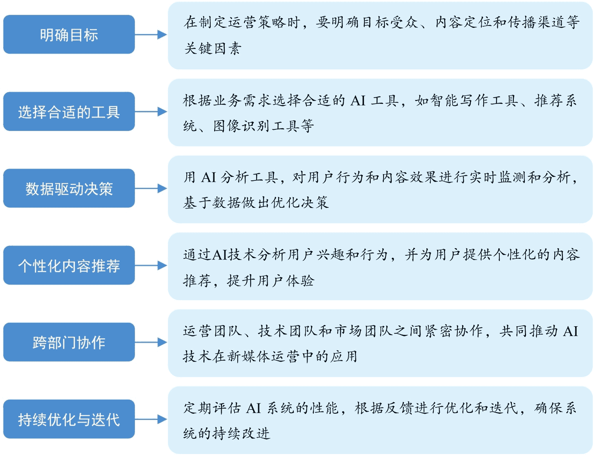
图1-10

## 1.3 运营工作内容全景图
智能正以前所未有的速度改变运营生态，提升效率并开辟新路径。本节探讨智能化新媒体运营的五项具体内容。

### 1.3.1 智能内容创作：技术与艺术的融合
智能在新媒体内容创作中的体现如下。

**1.文案生成**
智能在文字创作中的应用日益广泛，提升效率并带来新可能。它能快速生成软文、新闻报道、评论等，质量可媲人类创作。通过学习大量数据，智能还能提供定制化文案，节省传统写作的时间精力。

智能写作工具可在短时间内处理分析海量信息，生成结构丰富的内容草稿，供运营者细化和个性化。智能还能依据特定风格、主题或数据集生成文章，满足多样需求。

**2.图像生成**
在新媒体平台，视觉内容对吸引和留住用户至关重要，图像处理成为关键。智能使图像处理更高效智能。

智能图像工具可自动化执行多种编辑任务，如自动裁剪以适配不同社交媒体格式、去除水印或无用元素、降噪提升清晰度、应用美化效果；还能智能补光和色彩校正，提升视觉质量。

此外，智能可实现基于内容的图像分类与推荐，并通过OCR技术从图像中提取文本，增强可搜索性。

**3.视频生成**
智能正在改变视频制作流程，能根据文字或素材自动生成精美视频。智能视频制作工具通过分析参数和素材，自动完成剪辑、特效添加、配乐等繁琐环节。

自动化特性极大提升效率，让运营者在短时间内产出高质量视频，节省大量时间和资源。智能还能提供创新编辑建议和视觉效果，激发创意灵感，帮助实现更复杂富有创意的制作。

需注意，智能在理解复杂人类情感和创意意图上仍有限，通常需与人类创意指导和后期微调结合，以确保质量和情感表达。

智能发展迅速，未来视频工具有望提供更精准的编辑建议，甚至在高度自动化基础上生成完整视频。

**4.音频生成**
智能在音频领域的应用涵盖音乐创作、音频处理、个性化推荐等。

**(1)音乐创作**
智能可通过文本描述生成符合需求的音乐。Udio是一个智能音乐生成平台，允许用户创建摇滚、电子、流行、爵士、古典、嘻哈、民谣等多种风格的音乐，可自定义歌词并制作专属作品，图1-11所示为Udio的页面。

除此之外，Suno 是一款面向音乐创作的 AI 生成工具，其核心是以文本指令驱动，自动合成音色、填词和配器，形成完整的歌曲作品。正因如此，它在音乐生成赛道中备受关注，甚至被业内比作“音乐领域的 ChatGPT”。

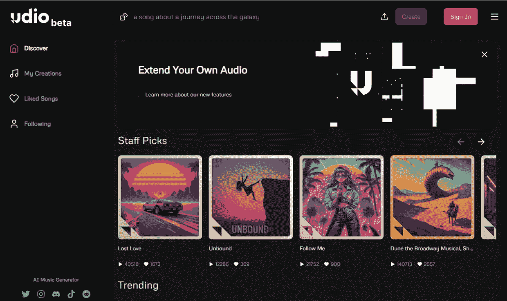

图 1-11

**（2）音频处理**
在音频处理环节，AI 的介入显著提升了效率。以科大讯飞推出的讯飞智作为例，这是一款基于 AI 的一体化内容创作平台，集成了多人配音、片段变速、片段变调等功能，能够自动识别音频问题并进行优化输出，成品质量较高，被广泛用于媒体制作、教学场景、企业宣传以及短视频创作等。图 1-12 为讯飞智作的配音界面。

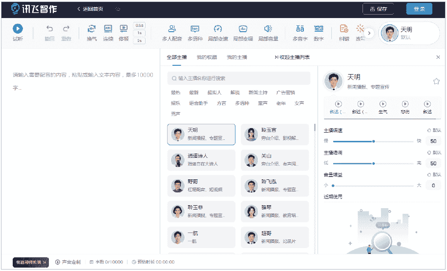

图 1-12

另外，Ultimate Vocal Remover v5，简称 UVR5，是一款依赖前沿 AI 模型对混音素材进行人声与伴奏分离的音频软件，在后期制作和音乐剪辑中应用广泛。

**（3）个性化推荐**
AI 可以依据用户的偏好、收听历史等数据，为其匹配专属音乐内容。例如 Moodplaylist 是一款 AI 音乐推荐工具，专注于根据使用者当下情绪和口味，自动拼凑连贯的个性化歌单。

Evoke Music 则是面向商业与个人用户的 AI 驱动音乐平台，能够按需创作独一无二的音乐作品，并基于个人听歌偏好定制播放列表，以此优化聆听体验。

整体来看，AI 在音频领域的落地既加快了创作与处理的节奏，也让用户获得更具个性、品质更高的音乐体验。随着技术演进，音乐产业的创新空间将进一步打开。

### **1.3.2 AI 内容分发：触达更准分发更高效**
新媒体运营中，内容分发指将已完成的内容通过不同渠道推向目标受众的环节，是拉大传播面、提升曝光、沉淀用户并实现品牌与变现的关键。

分发效果取决于渠道选择、发布时间与方式，以及能否精准到达人群。常见渠道覆盖社交媒体如微信公众号、抖音、快手，内容社区如知乎、小红书，资讯平台如今日头条、腾讯新闻，以及各类垂直专业平台。

AI 对分发流程的赋能主要体现在：通过智能解析用户行为与兴趣实现精准投放，增强传播效果与阅读体验；跨平台整合资源，推动内容多形态扩散；实时追踪传播数据，为运营提供决策依据。

AI 内容分发涵盖的模块如图 1-13 所示。

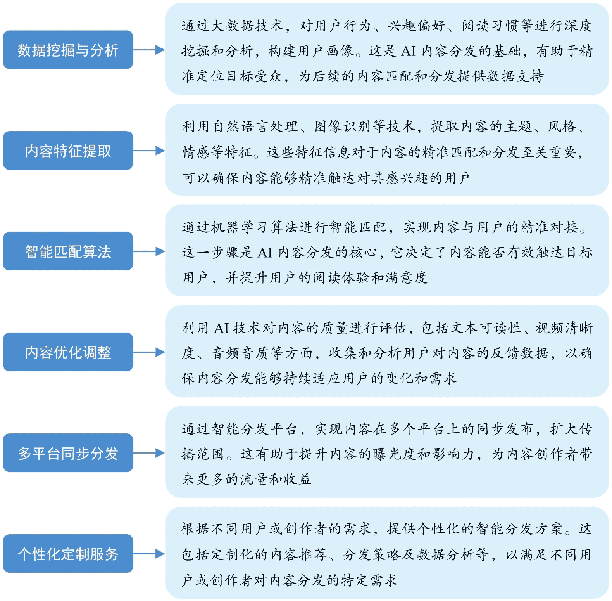

图 1-13

综合来看，AI 内容分发是一个体系化工程，涉及数据挖掘与分析、内容特征提取、智能匹配、内容调优、多平台同步发布以及个性化服务等环节的协同运作。

### **1.3.3 AI 活动策划：创意落地与执行融合**
在数字化环境下，新媒体是品牌连接用户的桥梁，活动策划是为达成特定目标而设计的行动集合，是驱动互动的核心手段。

AI 活动策划即借助 AI 工具与算法，对新媒体活动进行设计、运行与优化，提升吸引力、参与度与转化率。覆盖主题生成、受众洞察、内容生产、互动设计到效果评估的全链路智能化。

**1.AI 活动策划的组成**
**（1）活动主题与创意生成**
1）热点捕捉：AI 抓取社交媒体、搜索引擎与新闻的数据，快速发现当下热点，为主题提供灵感。
2）创意产出：结合品牌定位与用户兴趣，AI 能给出新颖的主题与创意，帮助团队跳出固有思路。
3）趋势预判：基于历史数据与市场动向，AI 可预测未来可能走红的方向，便于提前布局。

**（2）目标受众分析**
该环节从三个维度展开，如图 1-14 所示。

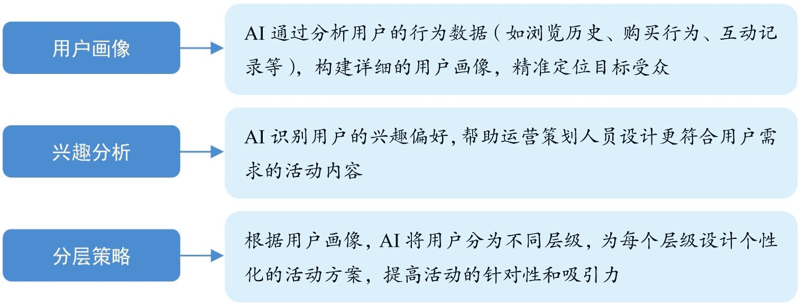

图 1-14

**（3）活动形式与渠道选择**
1）形式建议：依据受众偏好与主题，AI 推荐线上抽奖、线下体验、互动直播等适合的形式。
2）渠道判定：分析各渠道活跃度与传播表现，筛选最优推广入口，如社交媒体、短视频平台、邮件等。
3）多渠道联动：AI 辅助设计跨渠道协同策略，实现全覆盖触达。

**（4）活动内容创作**
1）文案生成：按主题与风格自动生成文案、宣传语、推文等。
2）视觉制作：生成海报、广告等视觉物料，提升吸引力。
3）互动设计：规划问答、投票、抽奖等环节，增强参与感。
需要说明的是，AI 对前期准备与素材生成帮助较大，整体内容把控仍需人工判断。

**（5）活动推广与执行**
AI 在推广与执行中的作用如图 1-15 所示。

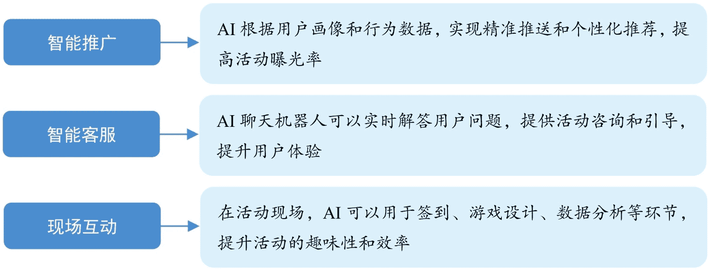

图 1-15

**（6）活动效果评估**
1）数据分析：实时采集参与度、转化率、留存率等指标。
2）反馈优化：生成总结报告并给出改进建议。
3）动态调整：依实时反馈即时优化策略，最大化效果。

**2.AI 活动策划的优势**
主要优势如图 1-16 所示。

**3.AI 活动策划的应用场景**
（1）线上活动：电商促销、直播互动、社交媒体挑战赛等。
（2）线下活动：新品发布、品牌体验、展会等。
（3）线上线下联动：线上预热+线下体验+线上二次传播的混合模式。

总体而言，AI 活动策划通过智能手段优化各环节，提升吸引力与转化，同时提供更具创新与个性化的用户体验，未来作用将愈发关键。

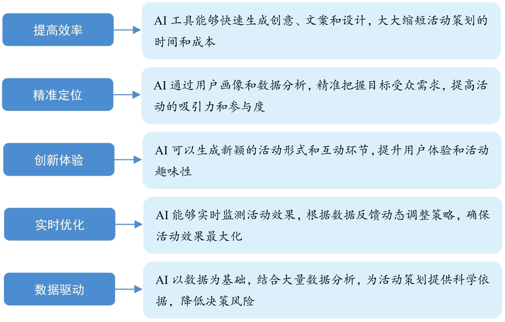

图 1-16

### **1.3.4 AI 账号运营：连接品牌与用户**
新媒体账号运营是指在微信公众号、抖音、小红书、微博等平台上对账号进行管理与推广，以实现品牌曝光、用户增长、内容传播、销售转化等目标，涉及内容生产、互动、数据分析、定位、营销等多个方面。

（1）平台选择：AI 可依据目标人群、内容形态、预算与运营目标，结合各平台用户特征、传播机制与算法逻辑，给出精准的平台建议，最大化传播与营销价值。

（2）账号定位：AI 通过分析兴趣、专长等信息，结合平台特性与市场趋势，提供个性化定位方案，如对标账号报告、内容方向建议、昵称与简介优化等，帮助实现高效定位。

（3）用户互动与社群管理：AI 可自动化处理用户数据，分析成员行为，挖掘兴趣、需求与行为模式；可自动执行点赞、评论、关注等互动任务，提升参与度；在社群层面，可按属性分组、个性化推送、动态展示内容，同时监控舆情并及时处理异常。

### **1.3.5 AI 数据监控与分析：洞察驱动决策**
AI 让数据分析更精准高效，为运营与营销提供深层用户洞察。在复杂的媒体环境中，理解兴趣、偏好与习惯是制定有效策略的基础，AI 正带来革命性改变。

AI 能从海量用户生成内容中提取有效信息，助力理解真实感受与偏好，优化内容与营销策略。

AI 在新媒体数据监控与分析中的核心作用如图 1-17 所示。

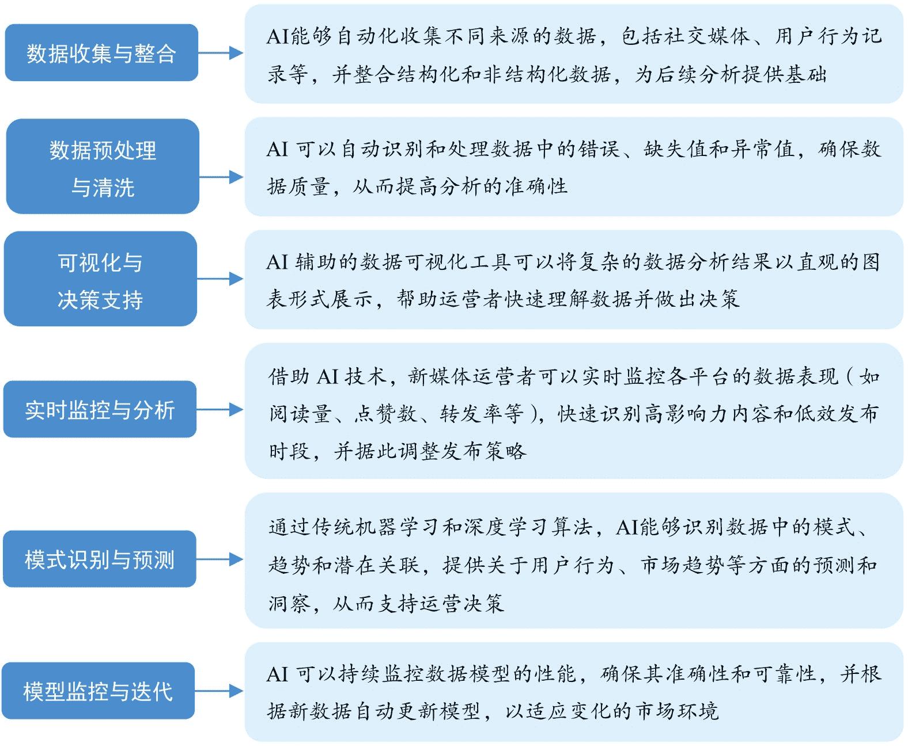

图 1-17

以此为支撑，运营效率提升，用户需求理解更透彻，内容策略更精准。

例如 Tableau 是一款融合 AI 的数据可视化工具，通过直观图表与仪表盘帮助快速解读复杂数据集，示例见图 1-18。Tableau 的智能分析可识别趋势、预测行为，使分析更准、策略更有效。

图 1-18

Tableau 以易用界面与强劲处理能力，让非技术人员也能制作复杂可视化，在内容创作与营销策略中发挥重要价值。

总体来看，AI 应用于新媒体数据分析大幅提升营销精准度与效率，增强参与度与满意度，推动行业向智能化、个性化发展。

## **1.4 核心技能速配指南**

### **1.4.1 文案写作能力：文字驱动传播**
文案是新媒体运营的基础，需能按平台与受众撰写吸睛标题、正文与互动文案。伴随 AI 文案工具的兴起，写作效率与质量均可提升。

提升路径主要有：
（1）高效生成与创意激发：借助 DeepSeek、ChatGPT、文心一言 等工具，输入关键词即可快速获得初稿、框架、标题或段落，为创作提供灵感。
（2）精准优化与润色：AI 可改写、润色并调整风格以适配不同平台与受众，同时检查语法、优化结构，提升专业度与可读性。
（3）多类型文案覆盖：可批量生成社交媒体文案、广告文案、通稿、博客等，例如快速产出产品介绍、用户反馈与市场分析。

### **1.4.2 视觉设计能力：以视觉沟通**
在视觉主导的媒体环境，图片与视频创作同样重要。

**（1）基础图片处理技能**
需掌握裁剪、调色、加水印、抠图等基本操作，可通过在线平台实现。例如 Canva 是一款面向非设计师的在线设计工具，提供海量模板与编辑功能，支持制作社媒图、演示稿、海报等。

**（2）创意设计与排版**
AI 工具可生成吸睛海报、封面与配图，并兼顾排版与配色。例如即梦 AI 支持海报、Logo 等设计元素的生成。

**（3）AI 图片与视频生成**
利用 AI 快速产出高质量素材。平台如一帧秒创提供文字续写、语音合成、文生图、图转视频、AI 成片与数字人播报等服务；稿定 AI 是一站式设计集合，含 AI 商品图、AI 绘图、AI 素材与 AI 文案，支持背景生成、AI 消除与扩图等功能，界面见图 1-19。

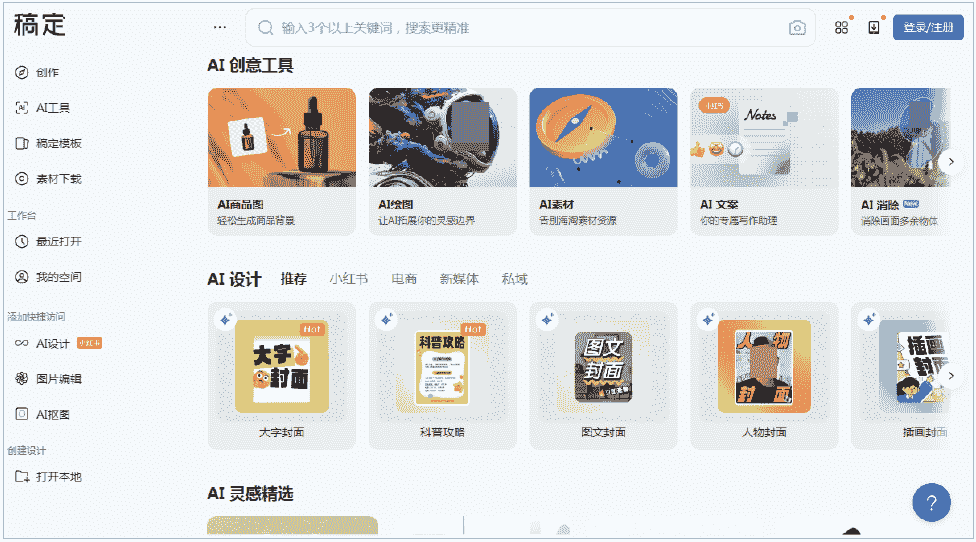

图 1-19

### **1.4.3 策划执行能力：从方案到落地**
策划执行是核心竞争力，需结合热点、用户需求与品牌定位设计有深度的内容活动并落地。

**1.AI 对活动策划的帮助**
（1）提高策划效率：AI 可自动生成任务流程、场地方案与排期，减轻工作量。
（2）精准定位受众：依大数据分析用户特征与需求，为方案提供依据，支持精准市场定位与策略。
（3）智能化管理运营：通过智能监控、人脸识别等实现场地管理，并支持自动化注册、签到等，提升管理效率。

**2.AI 在活动策划与执行中的角色**
（1）辅助创意生成：分析市场数据、行为与趋势，挖掘热点与偏好，产出主题、形式与互动环节建议；还能通过 NLP、图像识别等优化已有创意。
（2）优化流程管理：自动化处理排期、资源调配与任务分配，实时监控进展并预警风险；基于历史数据预测问题并提前制定对策。
（3）助力效果评估与反馈：自动采集参与度、满意度、转化率等数据，生成评估报告并提供针对性建议，形成即时反馈闭环。

### **1.4.4 用户运营能力：获取与留存核心**
用户运营是运营岗位的核心能力，AI 可显著提升效率与效果。其核心内容如图 1-20 所示。

AI驱动的用户运营升级
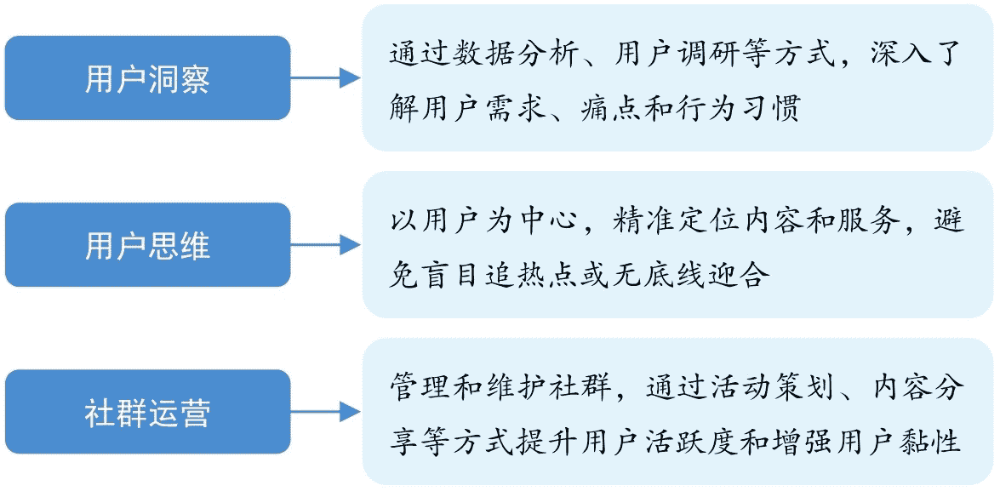

图 1-20

人工智能在用户运营侧的赋能可归纳为六个维度。

**（1）画像构建与人群锁定**
精准洞察是运营的基础。依托数据挖掘与机器学习模型，系统能够在短时间内整合兴趣取向、使用习惯、地理属性等要素，形成立体的用户侧写。

**（2）内容定制推送**
基于浏览足迹与偏好信号，模型可预测后续关注点并主动投递相关内容或商品。量身定制的推送有助于拉升满意度并带动转化。

**（3）投放时机智能判断**
系统会解析作息规律与在线时段，揪出信息触达的最佳窗口以提高关注概率。例如友盟＋的“智能时机”服务，通过大数据实现从微观到宏观的最优发送点挖掘，提升点击表现。

**（4）生命周期精细化运营**
可识别用户所处阶段并匹配差异化打法。新用户可获得新手引导与首单激励，老用户则推送专属服务与权益，以此稳固留存并延长活跃周期。

**（5）自动化与智能客服**
自动化客服是另一大应用。智能机器人可 24 小时在线响应高频咨询，优化体验的同时减轻人工压力。

**（6）多渠道触达优化**
系统还能为运营者推荐合适的触达路径。如用户关闭消息通知时，会建议改用应用内弹窗传递信息，确保在不同场景下内容仍可送达。

把人工智能嵌入新媒体运营，能明显提效增质。既帮助更懂用户诉求，也可实现个性化推荐、时机优化与自动化服务，进而提升满意度与留存。

### **1.4.5** **营销推广能力：品牌的传播**

营销推广在新媒体运营中扮演核心引擎角色，既是品牌建设与新增量的驱动力，也是促进成交与留存的关键抓手。借助精准策略与数据指导的决策，可实现品牌与受众的高效连通，强化市场竞争力与关注度。

将人工智能应用于营销推广，企业可汇聚并解析海量用户数据，搭建精细画像实现更细颗粒度的分层；还能借助深度学习预判行为趋势，为个性化营销方案提供科学依据。

营销推广在新媒体运营中的体现如下图所示。
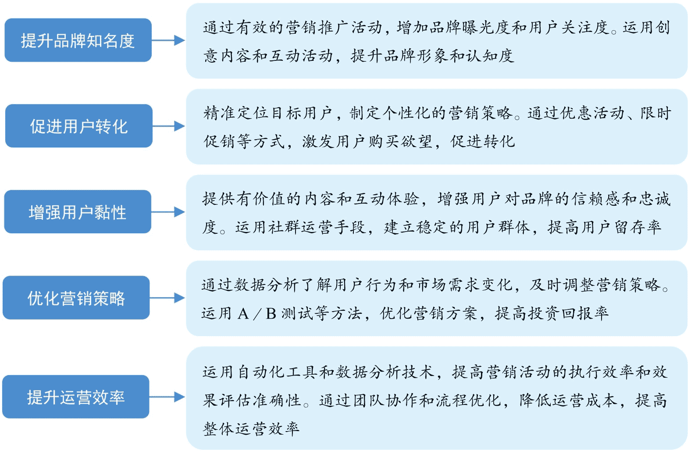

图 1-21

### **1.4.6** **数据分析能力：数据的解读**

新媒体运营必须具备扎实的数据分析功底，才能读懂行为、优化内容策略、提升整体效果。运营者需围绕用户、内容与运营三类数据进行评估与迭代，实现分析驱动决策。提升路径主要包括以下三点。

**（1）吃透核心指标**
先要搞懂核心指标，才能通过深度挖掘找到内容优化的切入点，进而提升分析力。图 1-22 概括了 3 个核心指标。
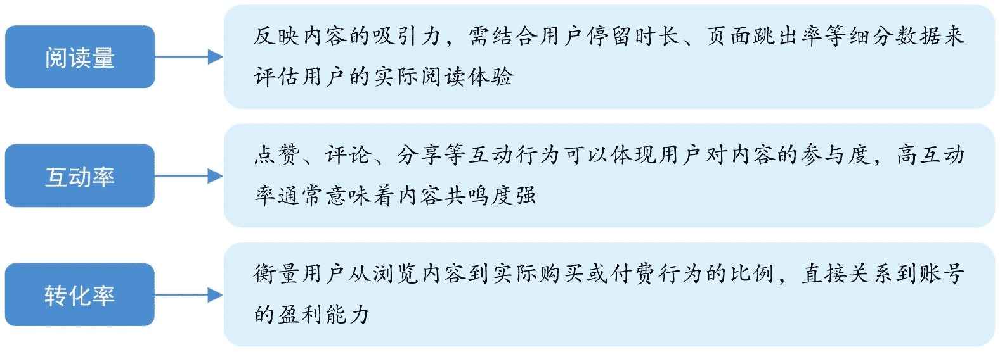

图 1-22

**（2）掌握工具使用方法**
运营者需要熟悉常用数据分析工具及其基础用法。Power BI 是微软推出的商业智能工具，可帮助企业通过数据可视化实现驱动决策，支持结果的可视化呈现。

此外，还应掌握 Excel、Google Sheets 等基础工具进行整理与统计；并尝试使用百度统计、友盟＋等专业分析平台获取更全面深入的洞察。

**（3）结合目标持续学习**
分析要紧扣业务目标，带着目标做分析才能更有针对性地制定策略，推动业务增长。

数据分析领域持续演进，运营者需保持学习惯性，通过培训、专业书籍、行业动态等方式不断提升分析能力与对人工智能技术的理解。

## **本章小结**

本章先概述了人工智能新媒体运营的基础概念，包括新媒体、人工智能、人工智能运营及人工智能运营师；随后用 5W1H 方法阐述人工智能对新媒体运营的助力；接着归纳了人工智能新媒体运营的 5 项构成；最后梳理了岗位所需的 6 项核心技能。

## **课后习题**

为帮助读者巩固本章要点，以下练习用于快速回顾。

问题 1:人工智能新媒体运营包含的内容有哪些方面？
答案 1:（1）人工智能内容创作；（2）人工智能内容分发；（3）人工智能活动策划；（4）人工智能账号运营；（5）人工智能数据监控与分析。

问题 2:人工智能新媒体运营岗位需要哪些核心技能？
答案 2:（1）文案写作能力；（2）视觉设计能力；（3）策划执行能力；（4）用户运营能力；（5）营销推广能力；（6）数据分析能力。

# **第二章**

# **文案创作：人工智能写作工具及技巧**

在新媒体场景中，文案写作是内容创作的核心环节，直接影响用户关注度、传播效果与品牌形象塑造。本章重点探讨人工智能提示词的撰写技巧，以及如何借助人工智能工具创作文案，从而提高新媒体文案的质量与效率。

## **2.1** **人工智能写作工具**

随着人工智能技术快速发展，写作类工具大量涌现，它们既能激发灵感，又能精准满足各类文案需求，无论是广告文案、品牌故事还是日常撰写，都能高效应对，为运营者节省大量时间精力。本节主要介绍 DeepSeek 与 Kimi 手机版及网页版的操作方式。

### **2.1.1** **DeepSeek**

DeepSeek 由杭州深度求索人工智能基础技术研究有限公司开发，融合了自然语言处理、机器学习等前沿技术。通过精准的数据分析和智能推理，为用户提供更个性化、高效的服务。以下介绍其手机版与网页版的使用方法。

**1．手机版**

DeepSeek 手机版界面简洁清晰，操作友好，iOS 与安卓用户均可在应用商店下载安装。安装步骤如下。

**步骤 01** 启动手机应用商店 App，在搜索栏填入“DeepSeek”；触发搜索操作，如图 2-1 所示。
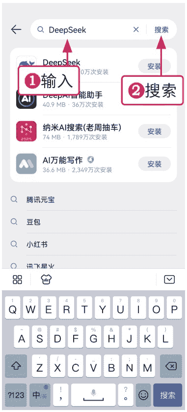

图 2-1

**步骤 02** 搜索结果页定位目标应用，右侧选择“安装”按钮，如图 2-2 所示，完成下载。
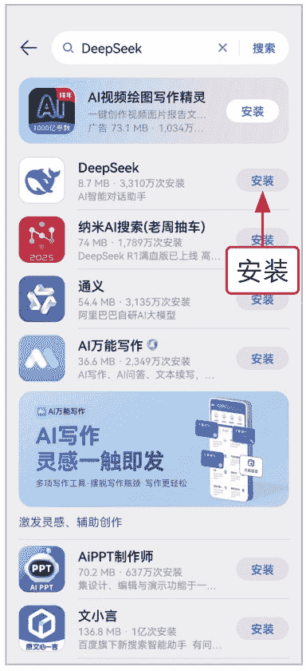

图 2-2

**步骤 03** 安装完毕后，点开应用右侧的“打开”按钮，如图 2-3 所示。

图 2-3

**步骤 04** 启动后出现欢迎对话框，选择“同意”按钮，如图 2-4 所示。
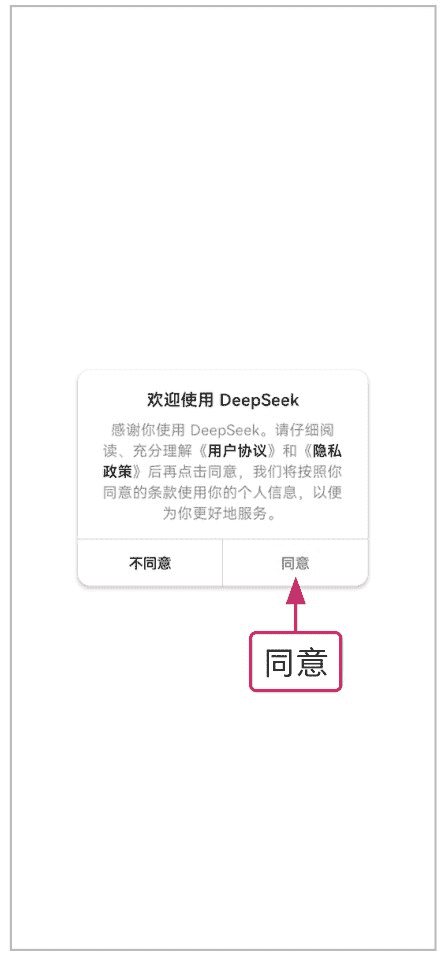

图 2-4

**步骤 05** 进入登录页，勾选相应协议复选框；填写手机号及验证码；按下“登录”按钮，如图 2-5 所示。稍候即可通过短信验证码登入，亦可使用微信登录。
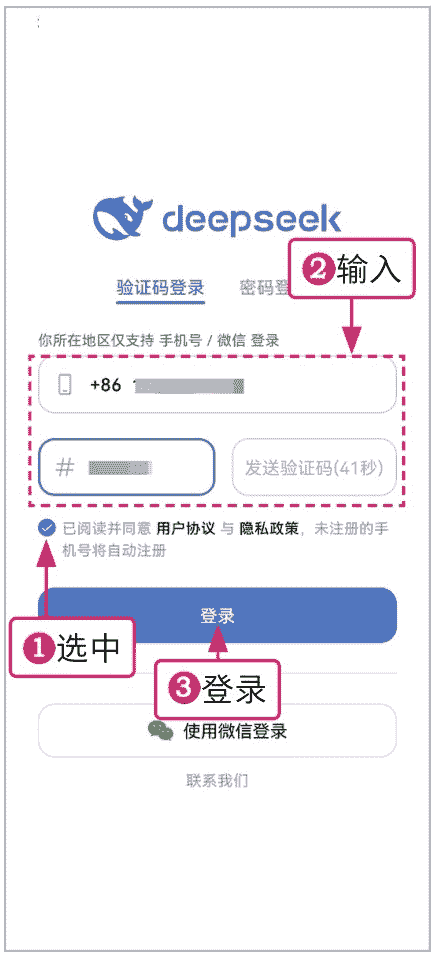

图 2-5

**步骤 06** 登入后自动进入对话界面，如图 2-6 所示。
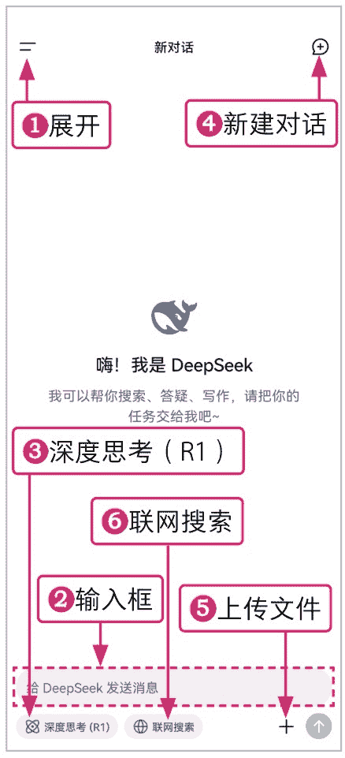

图 2-6

界面各模块释义如下：

展开 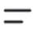：触发后可打开最近七天会话及用户信息。

输入框：用于输入提示词以获取 DeepSeek 回复。

深度思考（R1）：开启后可观察逐步推理过程，提升答案透明度与可信度。

新建对话 ：用于打开新窗口，开启新主题或让模型重述前文。

上传文件 ：弹出面板后可选用“拍照识文字”“图片识文字”或“文件”以提取文字信息。

联网搜索：开启后可检索实时资料并整合回答，同时提供来源，保证丰富性与准确性。

**2．网页版**

DeepSeek 网页版功能丰富、页面直观，无论新手还是资深用户都能快速上手。登录方法如下。

**步骤 01** 在浏览器中搜索 DeepSeek 官网，打开后点按“开始对话”，如图 2-7 所示。
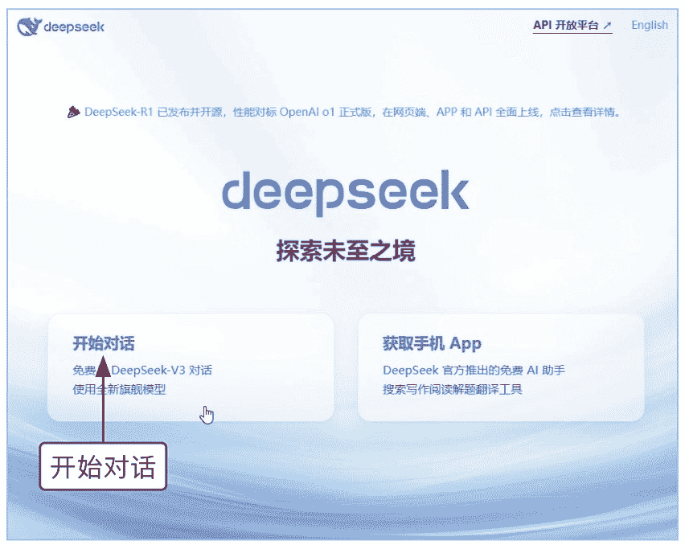

图 2-7

**步骤 02** 进入登录页，勾选相应复选框；填写手机号和验证码；点按“登录”按钮，如图 2-8 所示，稍后即可登入。也可使用微信扫码或邮箱登录。
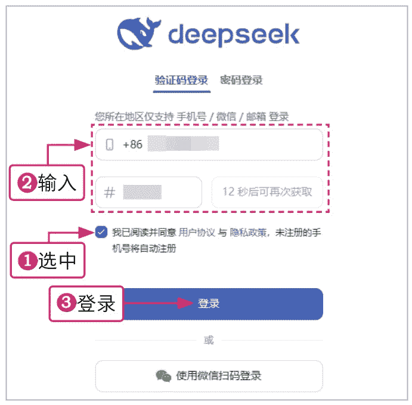

图 2-8

**步骤 03** 登录后默认进入对话页面，如图 2-9 所示。
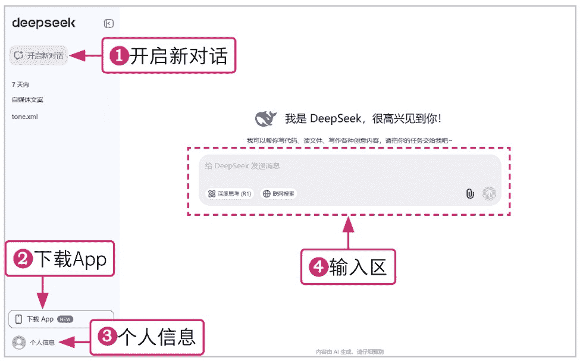

图 2-9

对话页核心区域说明如下：

开启新对话：点按后为用户新建一个独立对话窗口，使交流更清晰高效。

下载 App：点按后弹出二维码，用手机扫码即可下载手机版。

个人信息：点按后弹出面板，包含“系统设置”“联系我们”“退出登录”等选项。

输入区：包含输入框、“深度思考（R1）”和“联网搜索”。输入框用于输入文字指令；深度思考模式擅长逻辑推理与复杂问题拆解；联网搜索模式可获取实时信息并给出详尽回答。

### **2.1.2** **Kimi**

Kimi 是一款强大的智能助手，不仅能对话，还具备多功能、多语言的人工智能助理能力，通过先进技术与友好界面为文案写作带来全新体验。以下介绍其手机版与网页版操作。

**1．手机版**

Kimi 手机版全称“Kimi 智能助手”，可回答问题、整理资料、辅助创作，帮助用户拓展知识与提升效率。下载安装步骤如下。

**步骤 01** 打开手机应用市场 App，在搜索栏输入并搜索“Kimi 智能助手”；在结果中点按应用右侧的“安装”按钮，如图 2-10 所示。
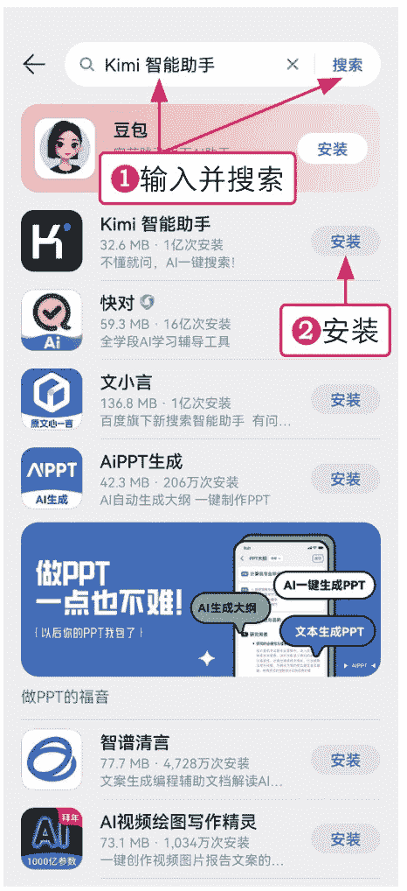

图 2-10

**步骤 02** 安装成功后，点按应用右侧的“打开”按钮，如图 2-11 所示。
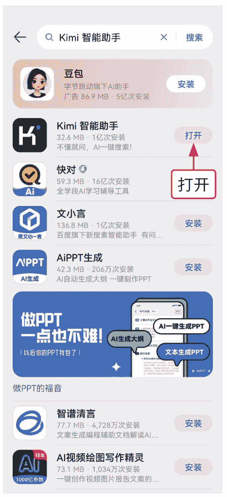

图 2-11

**步骤 03** 打开后进入会话界面，点按左上角的 按钮，如图 2-12 所示。
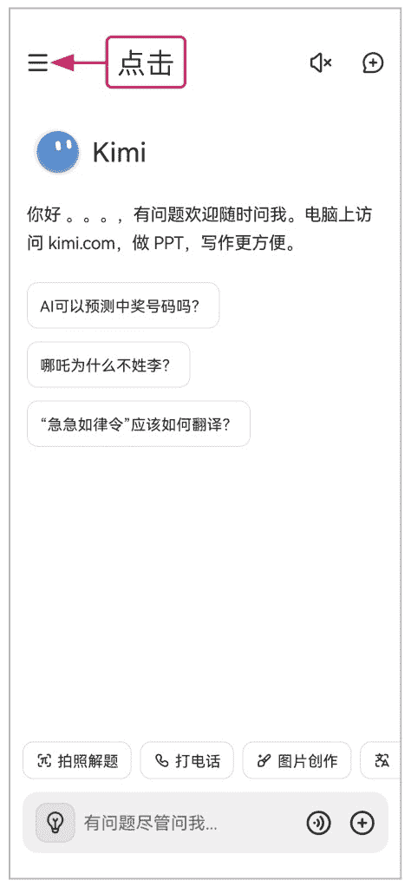

图 2-12

**步骤 04** 弹出面板后，点按“立即登录”按钮，如图 2-13 所示。
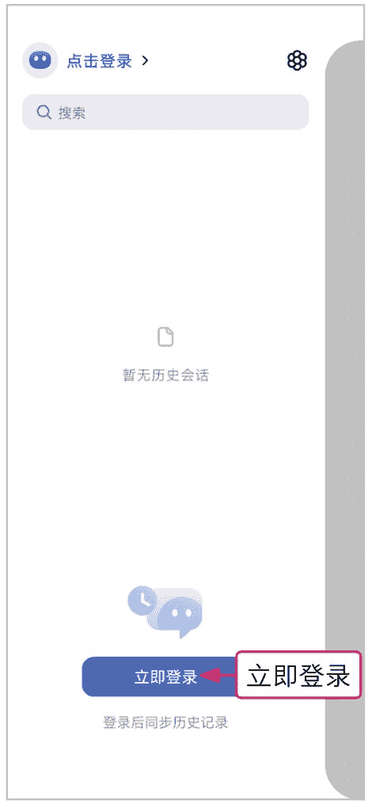

图 2-13

**步骤 05** 进入登录页，可选择微信或手机号登录。以微信登录为例，勾选底部相关协议；点按“微信登录”按钮，如图 2-14 所示。
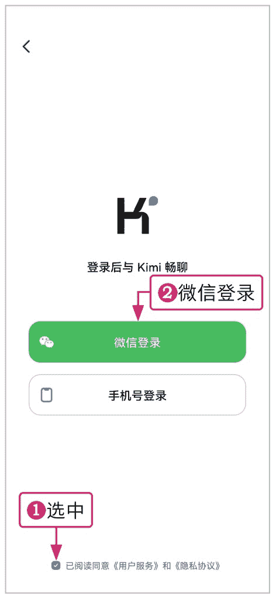

图 2-14

**步骤 06** 进入 Kimi 授权页，点按“授权登录”按钮，如图 2-15 所示，完成授权后跳转。
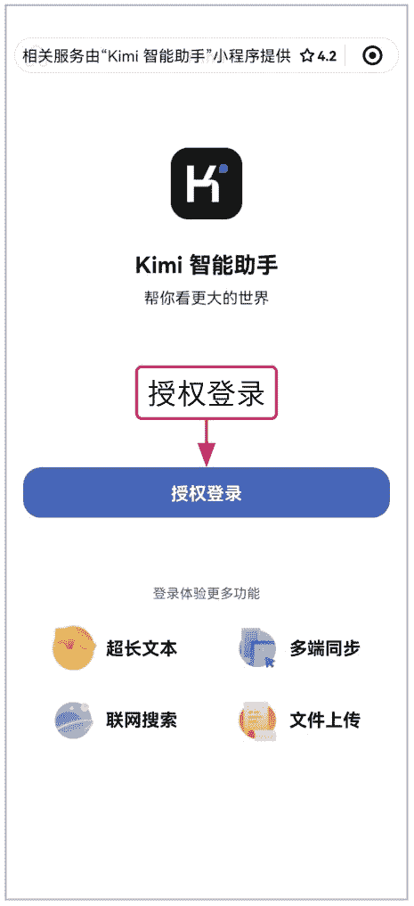

图 2-15

**步骤 07** 点按界面中的“点此完成登录”按钮，如图 2-16 所示。
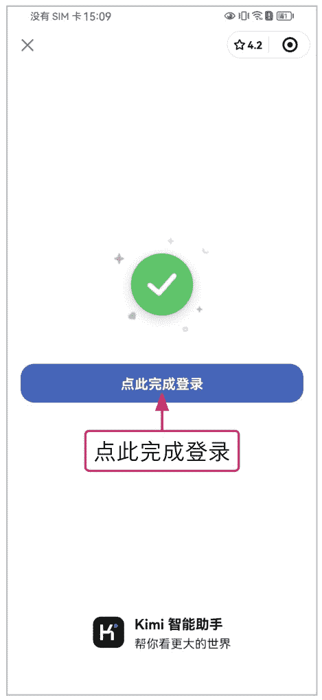

图 2-16

**步骤 08** 操作完成后即可登录，返回 Kimi 会话界面，如图 2-17 所示。
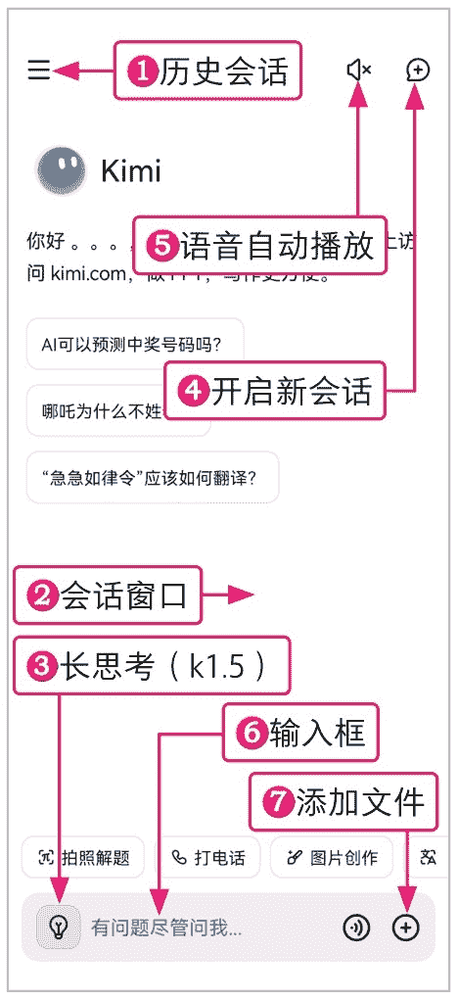

图 2-17

会话界面各部分说明如下：

历史会话：登录后点按左上角的 按钮，进入“历史会话”界面，可查看之前的对话记录。

会话窗口：这是与 Kimi 互动的核心区，在这里可以回看自己提出的问题，并查看 Kimi 给出的回复与反馈。 

长思考（k1.5）：点按左下角的 按钮即可切换到长思考 k1.5 推理模式，模型会保留更长的推理路径，进行更深入的推演、规划与反思。 

开启新会话：按下 按钮就能新建一次对话。借助该功能可开启全新的交互流程，遇到与此前无关的问题或任务时，直接启动新会话即可，无需在旧对话中延续。 

语音自动播放：点选上方 按钮，可设定是否将 Kimi 的生成内容自动以语音播报。 

输入框：激活输入框后即可键入指令，Kimi 支持多语种交流，其中中文与英文的体验尤为流畅。 

添加文件：点击 按钮，可上传 TXT、PDF、Word 文档、PPT 幻灯片、Excel 表格等多种格式，Kimi 阅读后会据此作出回应。

**2．网页版**

Kimi 由月之暗面科技有限公司打造，页面简洁全面，上手快且效率高。以下说明网页版的登录方式。

**步骤 01** 在电脑浏览器中输入 Kimi 官网地址进入网站，在左侧工具栏找到并点击“登录”按钮，如图 2-18 所示。

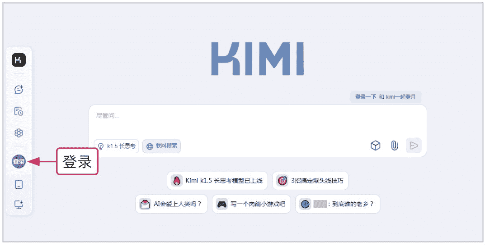

图 2-18

**步骤 02** 登录面板弹出后，填写手机号及验证码；勾选底部对应的协议框；点击“登录”即可进入 Kimi。另可使用微信扫码登录，扫描右侧二维码完成认证。

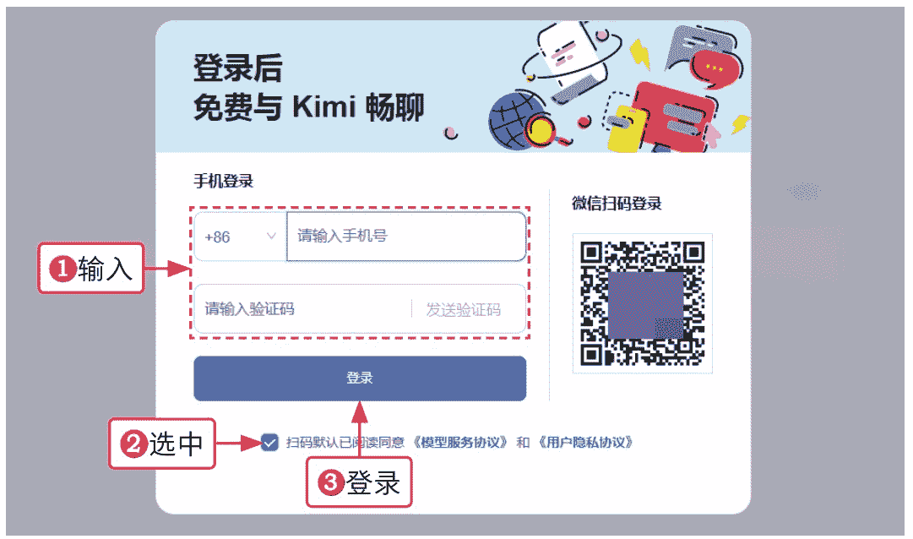

图 2-19

温馨提示
首次使用建议直接用手机号登录。因为微信扫码后仍需绑定手机号，而绑定同样依赖短信验证。所以一次性通过短信验证登录，就能同时完成注册与使用。

**步骤 03** 登录成功后即可进入会话主界面，如图 2-20 所示。

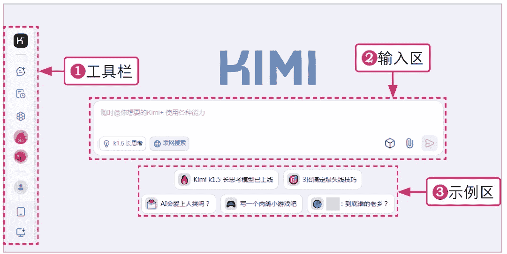

图 2-20

以下对会话页面的核心区域做简要说明。 

工具栏：左侧工具栏集成多项功能。点击 按钮可从任意页面返回首页；点击 按钮进入聚合应用区，内置翻译通、PPT 助手、论文写作助手等工具，可快速处理特定需求。 

输入区：这是一个多功能交互区，可在此向 Kimi 提问、上传文件、发送链接等各种操作，均通过该区域完成。 

示例区：这里展示了多组对话范例，也称“Kimi＋提示词”。一键点击即可激活对应功能，无需自行撰写详细指令。

## **2.2 AI 提示词技巧全攻略**

掌握 AI 文案提示词的编写方法，能让运营者更高效地借助 AI 生成高质量内容，同时激发新的创意思路，提升内容的差异化与吸引力。运用恰当的提示方式，可以帮助 AI 更准确理解需求，减少无效重复，保证输出更贴合目标受众的偏好。

本节以 Kimi 网页版为例，介绍 9 个提升文案提示效果的通用技巧，在 Kimi 及其他写作工具中均可适用。

### **2.2.1 明确核心目标：精准定位需求**

在撰写提示词前，先厘清想要得到的结果是什么，例如文案的主题、篇幅、语体等要求，具体做法如下。

**步骤 01** 登录并进入会话页，在输入框中输入提示词；单击 按钮，如图 2-21 所示。

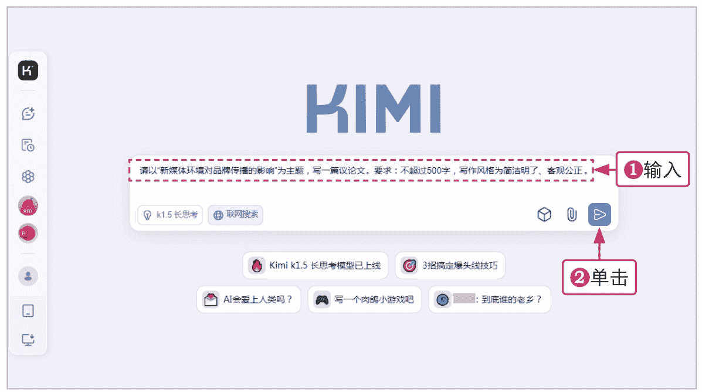

图 2-21

**步骤 02** 发送后 Kimi 会据此生成结果，示范提示与回复如下。

请围绕“新媒体环境对品牌传播的影响”写一篇议论文，字数不超过 500 字，风格要简洁清晰、客观中立。

新媒体环境对品牌传播的影响

当下新媒体犹如澎湃潮流，正深刻重塑品牌传播格局。它为传播带来前所未有的机遇。平台用户量巨大，信息扩散迅捷广泛，品牌可突破传统媒介时空限制，以很低成本将信息瞬间送达全球。例如某新锐美妆品牌借助社交短视频与网红推荐，短时间内获得数百万曝光，知名度迅速提升。

与此同时，新媒体也带来不少挑战。信息过载易让品牌内容被淹没，选择增多导致注意力分散。要在海量内容中脱颖而出，必须不断创新形式，提升吸引力与互动性。另外，新媒体即时开放，品牌的一举一动都在公众视线下，负面信息一旦出现，会迅速扩散，对形象造成重创。

总的来看，新媒体环境对品牌传播既是机遇也是考验。善于利用优势、谨慎规避风险，才能在竞争中保持领先。

### **2.2.2 匠心独运：精心设计内容策略**

设计提示时应追求信息质量而非堆砌，尽量提供详实准确且具启发性的背景，同时保留一定自由发挥空间。以下为 Kimi 网页版的实践示例。

主题：AI 对新媒体文案写作的作用。
结构：引言、AI 对文案写作的影响、AI 的优势、结论。

引言
在新媒体时代，文案是内容传播的核心，AI 技术的快速发展正重塑创作模式。AI 提升了效率，也为个性化与质量改进带来可能，但也伴随同质化、情感表达不足等难题。本文探讨其影响与价值，并展望趋势。

AI 对新媒体文案写作的影响
提升创作效率
AI 工具可在短时间内产出大量初稿，压缩创作周期。例如几分钟内为赛事生成初稿，让创作者专注深度挖掘。还能自动生成大纲结构，帮助快速把握逻辑。

优化内容质量
内置语法与拼写检查可减少常见错误，并可按 SEO 策略优化，提升搜索可见性。

实现个性化与精准化
基于用户数据定制内容，生成更符合兴趣的文案，提升参与度与满意度。营销场景中可依据行为分析产出更具针对性的表达。

……
温馨提示
因篇幅所限，示例仅呈现要点，完整回复详见随书效果文件。

### **2.2.3 把握语言类型：选择合适的表达**

自然语言是日常口语与书面语，可被普通人理解；计算机语言则需专门学习。与 AI 交流时，宜使用自然、清晰的表达，避免过度专业化，以便获得更流畅的回答。示例如下。

请为智能手表创作 5 条电商标题，融合产品卖点、用户痛点与情感诉求，提升购买欲。

示例标题与解析：

1. 手腕全能管家，智能手表助你从容掌控每一天！
特点：功能集成，一表搞定。痛点：琐事繁多需提醒管理。诉求：掌控感与条理。

2. 运动健康时尚一体，让智能手表助你成为更好的人！
特点：运动监测、健康数据、时尚外观。痛点：坚持健身难、数据难管、审美需求。诉求：自我提升与健康时尚。

3. 告别频繁充电，超长续航随时在线不掉线！
特点：续航持久。痛点：设备续航短、充电麻烦。诉求：便捷与安心。

……

### **2.2.4 指定输出格式：规范结果呈现**

可明确指定输出形式，如列表、字数限制或表格，以便获得更精准结果。示例如下。

请用表格对比小红书与抖音在用户群体、发展目标、平台优势上的异同。

以下是两平台对比表格。

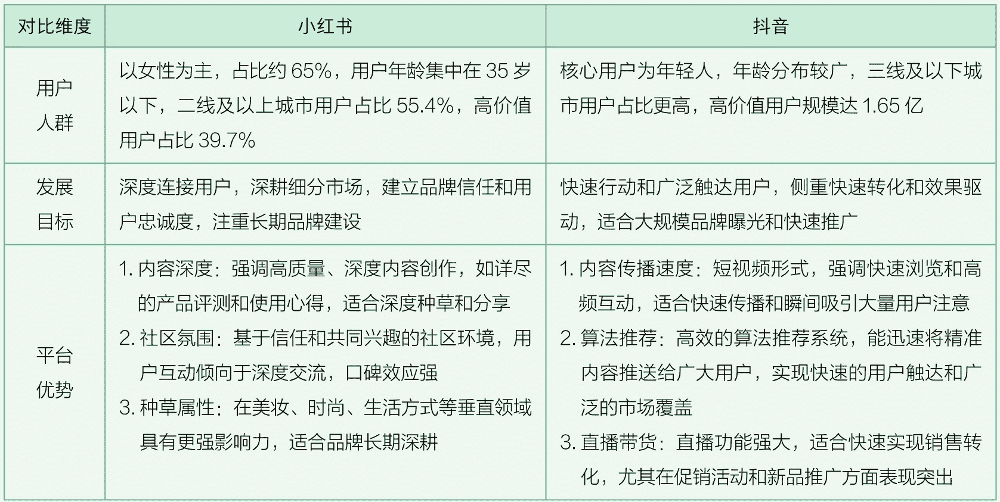

小红书更利于品牌在细分市场做深度种草与长期建设，抖音则利于快速触达大盘人群实现转化。选择应结合营销目标与目标用户特征。

### **2.2.5 深度沟通：引导 AI 理解需求**

在提示中加入示例、关键词或场景描述，有助于 AI 捕捉意图。示例如下。

请写一篇 600 字以内的短篇小说，关键词为烈日炎炎、沙漠、绿洲。场景：骆驼商队穿越荒无人烟沙漠，天空烈日如焚，缺水困境。

无垠沙漠中，天空像块蓝玻璃，烈日灼烤大地。金色沙丘起伏，一支商队艰难前行。十余头骆驼驮着货物，商人裹紧长袍，唇干眼涩，疲惫焦虑。

“水快没了！”年轻人嘶喊。领队老者皱眉望天，太阳高悬。 “坚持住，地图上附近有绿洲。”他取出破旧地图。商队继续前行，汗水浸透衣衫。终于地平线现出一抹绿，像沙漠中的明珠。商人们欢呼，重燃希望。

### **2.2.6 巧设疑问：用问题引导 AI**

以明确具体的问题引导输出，避免过于宽泛的提问。可使用“如何”“为什么”等句式。示例如下。

社交媒体对青少年有何影响？结合传播学与新媒体理论，阐述其对自我认同构建的作用。

社交媒体对青少年自我认同构建的影响
积极方面
提供展示平台
发布图文视频获得点赞，增强自信与价值感。
拓展社交与视野
打破时空限制，接触多元文化，寻找定位。
增强归属感
粉丝社群与兴趣小组带来群体认同。
提供情感支持
对现实中感到孤立者，网络成为倾诉与支持渠道。

……

### **2.2.7 细节为王：提供详尽信息**

提供具体背景信息可帮助 AI 生成更精准内容。示例如下。

双十一期间，我的小红书账号接到××洗面奶广告，请按以下信息撰写营销笔记。
品牌信息：××洗面奶主打自然护肤，有山茶花、积雪草、洋甘菊 3 种香型，规格有 20g 试用装、200g 袋装、300g 瓶装。
关键词：天然植物精华、滋润保湿、价格实惠。
要求：以大学生使用体验出发，真实客观。

小红书笔记示范
宝子们，双十一囤货季！今天安利一款超适合大学生的洗面奶——××洗面奶。
熬夜、外卖、皮肤状态差，外加预算有限，这款洗面奶真的很友好。
天然植物精华温和不刺激
添加山茶花、积雪草、洋甘菊，清洁同时不刺激敏感肌。
滋润保湿不紧绷
洗后皮肤水润，秋冬也不干涩。
价格亲民学生党友好
试用装到大瓶装可选，性价比高。
3 种香型可选
……

### **2.2.8 正面表达：运用肯定语言引导**

用肯定的语气描述期望，能提升提示有效性。示例如下。

你很擅长化妆，请按我偏好推荐两种适合同学聚会的妆容。
偏好：淡雅、清新、整洁。

推荐一：清新素颜妆
特点：自然通透，仿佛无妆。
步骤：
底妆：选用轻薄粉底液用海绵均匀推开，重点遮瑕黑眼圈与痘印，可搭配轻薄遮瑕膏点涂；

自然淡妆四步法
眉部建议挑选与自身体毛色相近的眉笔或眉粉，以轻扫手法勾勒柔和轮廓，整体保持清透不厚重。
眼部先以米白系眼影铺满眼窝作底，再用深棕在眼尾晕开制造层次。内眼线画得极细，增强神采又不夸张。睫毛可用清透型纤维膏薄刷叠加，提升自然浓密感。
腮红选用淡粉调，扫在颧骨上方，营造健康粉嫩。
唇部首选裸粉，薄薄上色后用指腹向唇周推开，实现若隐若现的自然效果。

……

### **2.2.9 场景化对话提升模型理解**
与模型沟通时，先赋予其明确身份并提出具体问题，能更快进入情境。身份描述要具体到真实职业，如在校生、医师或新媒体从业者，避免过于宽泛。背景信息越丰富，模型越能把握视角，任务也建议用第一人称提出，增强代入感。下面以 Kimi 网页版为例。

我是一名短视频穿搭博主，请帮我设计一个针对女装测评的运营方案，要注重目标用户的选择、服装风格的选择及服装购买渠道的选择。

针对女装测评的短视频运营思路，围绕受众定位、风格筛选与渠道判断展开如下。

**一、目标用户的选择**
**用户画像：**
年龄集中在 18 至 35 岁，该区间女性时尚敏感度高，消费力相对可观。
职业涵盖在校生、职场人士与自由职业者，可覆盖多种生活场景的搭配需求。
消费习惯偏重性价比，习惯通过社媒获取穿搭灵感与购物建议。
兴趣爱好方面，关注时尚博主内容，乐于尝试不同风格搭配，也爱分享心得。
**用户定位：**
核心人群为 20 至 30 岁的年轻女性，追求时尚个性，对穿搭品质要求较高。
潜在人群包括 18 至 20 岁的学生群体，更关注性价比与流行趋势；30 至 35 岁的职场女性，更看重品质与舒适度。
**二、服装风格的选择**
**风格划分：**
清新甜美系，适合日常出行与约会，如碎花连衣裙、雪纺衬衫、浅色牛仔裤等。
休闲自然系，适合日常通勤与放松时光，如 T 恤、牛仔裤组合等。
知性优雅系，适合职场与正式场合，如连衣裙、西装外套等。
街头潮流系，满足个性与时尚表达需求，如宽松卫衣、破洞牛仔裤、运动风外套等。
……

## **2.3 DeepSeek 文案定制**
当下新媒体已成为个人与品牌传播的重要阵地，生成式智能在内容生产中的作用日益凸显。掌握新技术后，运营者可借助智能工具提升创作效率与质量，为读者带来更舒适的阅读体验。本节以 DeepSeek 为示范，介绍 4 类新媒体应用场景。

### **2.3.1 微博文案定制策略**
微博是即时分享资讯、讨论话题与社交互动的平台，微博文案即指发布在该平台的文字内容。
需注意的是，微博长文会被折叠，信息传递容易受限。所以在让 DeepSeek 产出情感类长文案时，最好限定字数，用简洁精炼的语言传达核心，操作方式如下。
**步骤 01** 启动 DeepSeek 应用，进入会话页，点击底部输入区，如图 2-22 所示。
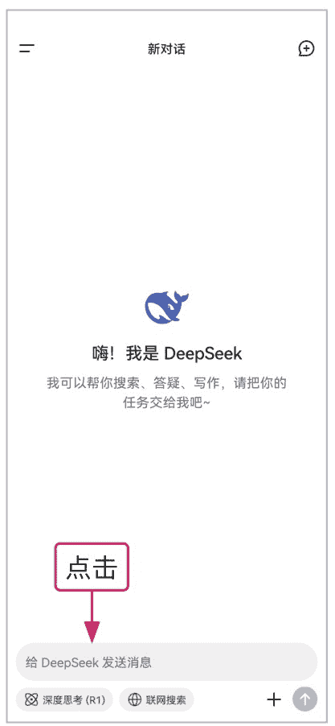
图 2-22
**步骤 02** 在弹出的输入区填入提示词，如图 2-23 所示。
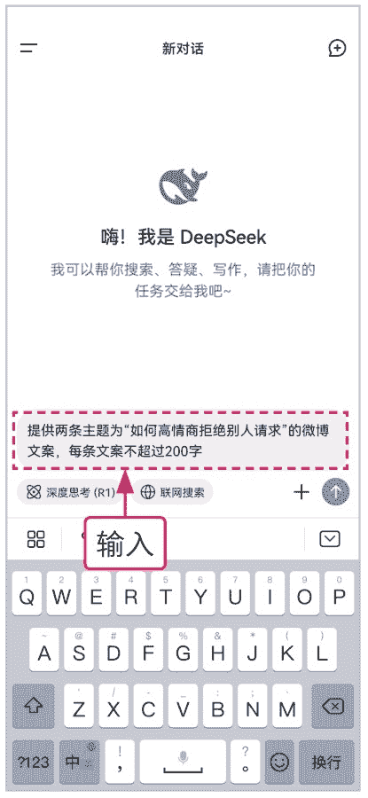
图 2-23
**步骤 03** 按下右下角的  即可获得 DeepSeek 的产出结果，如图 2-24 所示。
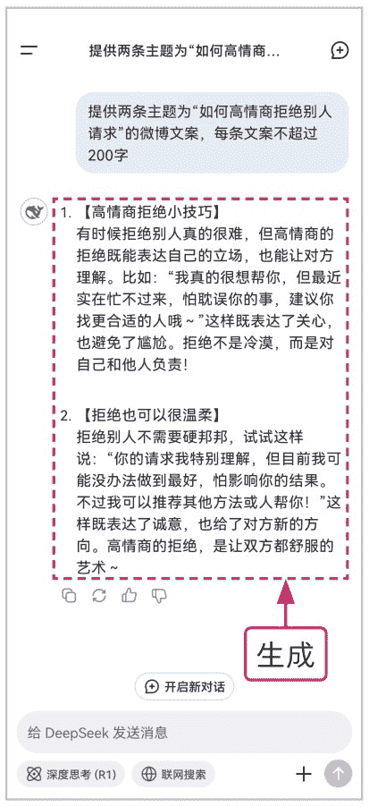
图 2-24

### **2.3.2 短视频脚本撰写**
在新媒体环境下，一支制作精良的宣传短片能最直观地传递品牌精神、产品特点或服务理念。脚本创作不仅是文字堆砌，更是视听与情感的结合，DeepSeek 能够撰写吸睛的宣传片脚本，通过创意与画面叙事为品牌留下深刻印象，案例如下。
打开 DeepSeek 应用进入对话界面，点击下方的输入框输入对应提示词，再点右下角的  发送，即可得到回复，提示词与回复内容如下。
我是一名热爱摄影旅行的抖音创作者，请为[湖心亭]撰写一支约1分钟的抖音宣传片脚本，要求包含转场、旁白、分镜拍摄与背景音乐建议；整体要抓人，开头5秒必须抓住注意力。
**湖心亭抖音宣传片脚本（1分钟版）**
视频时长：1分钟
背景音乐：《晨雾》纯音乐版，轻柔神秘，契合湖心亭的静谧美感
开头5秒
画面：晨雾笼罩的湖面，湖心亭轮廓若隐若现，阳光透云洒落，水面波光点点。
旁白：低沉神秘女声“在薄雾轻抚之处，有一处仙境正等待探访……”
转场：采用溶解效果，从雾气缭绕的湖面过渡到湖心亭全景。
第一部分 5～30秒
画面：
环绕镜头由湖面缓缓升起围绕亭体，展现古朴精致的建筑构造。
特写镜头捕捉微风中摇曳的荷花，露珠滑落荷叶滴入湖中激起涟漪。
……

### **2.3.3 直播脚本定制**
直播脚本文案是对直播流程进行系统规划的文稿，有助于运营者有序执行直播任务。直播类型主要有游戏、泛娱乐与电商三类，生成脚本时可结合类型编写提示词，操作如下。
**步骤 01** 登录 DeepSeek 对话页，  在输入区填写提示词；  点击  ，如图 2-25 所示。
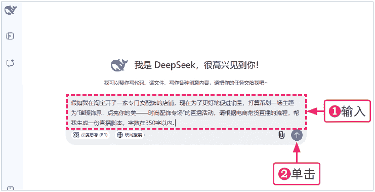
图 2-25
**步骤 02** 发送后即可让 DeepSeek 产出对应结果，提示词与回复如下。
假设我在淘宝经营一家饰品店，为提升销量计划做一场主题为“璀璨饰界，点亮你的美——时尚配饰专场”的直播，请按电商带货直播流程生成一份直播脚本，控制在350字以内。
**淘宝配饰店铺直播脚本**
**直播主题：**璀璨饰界，点亮你的美——时尚配饰专场
**直播时长：**2小时
**直播流程：**
一、开场 0:00～0:10
主播开场白：“宝子们，欢迎来到‘璀璨饰界’直播间！我是主播小美，今天带来超美的时尚配饰专场，每件都是精挑细选，助你美出新高度！”
互动：“宝子们，今天直播间福利多多，点赞破1000就抽一款神秘配饰，超值！”
二、产品介绍与展示 0:10～1:30
……

### **2.3.4 行业软文写作技巧**
行业软文围绕产品或服务做宣传与信息分享，常见类型有汽车、数码、房产、旅游等。
使用 DeepSeek 撰写行业软文时，首先要确定投放平台，不同平台用户偏好与排版要求不同；其次语言要简洁有说服力；最后要定期更新资料保持时效性。以 DeepSeek 网页版为例。
请你扮演专业市场营销总监，为公众号写一篇关于智能手环的软文，要求紧扣主题，体现设计、特性与功能。
**智能手环：兼顾健康与时尚的伙伴**
快节奏生活里，人们常忽略身体细微变化。一款智能手环能帮你实时掌握健康状态，同时成为穿搭点缀。
机身轻薄佩戴无感，运动或日常均不产生负担。高清触控屏操作流畅，信息显示清晰。表带提供多种色彩可选，无论活力运动风还是优雅商务风都能匹配。
功能层面同样出色。24小时心率监测持续守护心脏健康；睡眠监测可精准分析睡眠质量，让休息更安心；多种运动模式支持跑步、游泳、瑜伽等场景，提供专业数据参考。
……

## **2.4 Kimi 打造爆款文案**
不断学习新技术，运营者能借助智能工具提升新媒体内容生产效率与品质。本节以 Kimi 为例介绍 4 个应用案例，因篇幅限制手机版案例集中在第二章，其他工具操作可类推。

### **2.4.1 新媒体标题生成秘籍**
信息过载时代，一个好的标题像前菜，能迅速抓住读者并激发点击欲望。Kimi 可快速生成吸睛标题，帮助文章在竞争中脱颖而出。以 Kimi 移动端为例。
**步骤 01** 打开 Kimi 应用进入会话页，点击底部输入框，如图 2-26 所示。
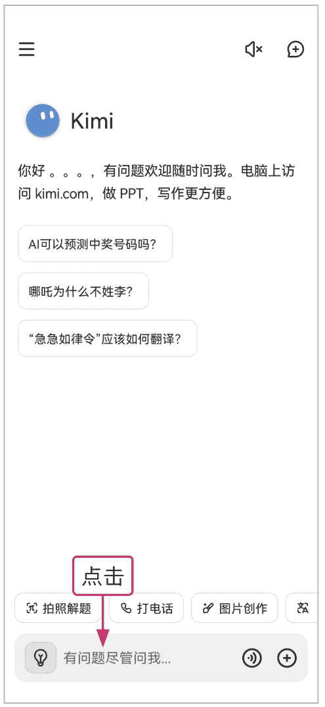
图 2-26
**步骤 02** 在输入框中输入提示词，如图 2-27 所示。
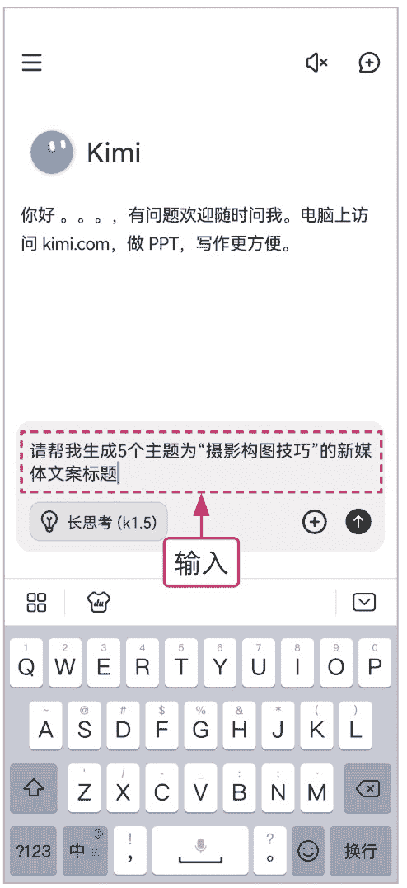
图 2-27
**步骤 03** 点击右下方的  ，即可得到 Kimi 产出的结果，如图 2-28 所示。

图 2-28

### **2.4.2 小红书文案创作技巧**
小红书以笔记形式传递信息，互动性强。在特定主题提示下，Kimi 也能生成小红书笔记，助力账号持续更新。以 Kimi 移动端为例。
假设我刚入驻小红书做美食博主，想写一篇有吸引力的笔记，主题定为“重庆特色小吃”，请创作一篇爆款笔记。
**标题：【舌尖上的麻辣狂欢】｜重庆小吃大揭秘！辣得过瘾，香得醉人**
**正文：**
大家好～今天带你们逛一逛让人上头的小吃天堂重庆！这里每一口都是对味蕾的宠爱，准备好开吃吧！
**1．小面扛把子：重庆小面**
提到重庆必推小面。热气腾腾的红油面，辣而不燥，面条劲道滑爽，撒上葱花、蒜末与香菜，吸溜一口鲜香麻辣直击灵魂。老街巷里的老店手艺沉淀多年，味道最地道。
**2．串串香诱惑：麻辣签签狂欢**
走进串串香店，各种食材在滚烫红汤里翻滚，嫩牛肉、虾滑、鱼丸任选。自己动手挑串，每口都是味觉新挑战。最后来碗冰粉，清甜冰凉解辣效果绝佳。
**3．软糯Q弹：山城小汤圆**
辣完来点甜。晶莹剔透的小汤圆配醪糟、枸杞、红枣，甜而不腻暖胃暖心。江边小摊上边看嘉陵江景边品甜汤，时间都慢了下来。
……

### **2.4.3 公众号文案撰写攻略**
公众号是传播观点与干货的重要阵地，撰写需经历选题、大纲、初稿、修改、定稿等环节，耗时耗力。Kimi 可提供选题灵感并提升写作效率。以 Kimi 网页版为例。
假如你是负责公司公众号运营的新媒体人员，需撰写一篇主题为“副业探索：业余时间创收的5大创意路径”的文章，视角贴近用户，结合现实案例增强说服力，字数控制在800字以内。
**副业探索：业余时间创收的5大创意路径**
在快节奏生活中，副业已成为增收与实现自我价值的重要方式。以下推荐5个可利用业余时间开展的方向，并附真实案例供参考。
**1. AI辅助内容创作**
生成式工具普及为创作带来新机会。可利用文心一言、Kimi 等生成文案、脚本或设计素材，为中小企业代运营社媒账号，或为网络平台创作短篇小说。
**2．远程协助与虚拟助理**
擅长办公软件且细致的同学可尝试做远程助理，为企业或个人提供日程管理、数据整理等服务，如为跨境电商处理订单或为网红管理粉丝社群。
**3．社交媒体代运营**
利用业余时间做本地生活分享博主也不错。比如念念同学，大学时期就在小红书分享生活照，后转型为本地生活方式博主，通过探店合作变现，月均副业收入约两千元。可从熟悉的城市或领域入手，分享美食美景吸粉变现。
**4．知识付费与内容分享**
若在某领域有专业经验，可尝试知识付费。有一位宝妈通过公众号分享育儿经验，积累粉丝后以付费专栏和资料库变现，月入超五万元。可将技能或经验打包成课程、资料包在线售卖。
……

### **2.4.4 头条号文案定制策略**
今日头条以新闻资讯与社交为主，头条号文章需信息量足、主题鲜明、逻辑清晰或图文并茂。借助 Kimi 创作时需明确主题并提供背景信息。以 Kimi 网页版为例。
请根据客观事实写一篇资讯类文章，风格贴合今日头条，主题为“人工智能在医疗诊断中的应用取得突破性进展”，包含吸睛开头、AI对诊断的帮助、结尾展望，约800字。
**人工智能在医疗诊断中的应用取得突破性进展**
在医疗领域，人工智能正以前所未有的速度改变诊断与治疗方式。从精准诊断到个性化治疗，AI应用让患者获得更高效精准的服务。
**AI助力诊断：更快更准**
AI在医疗诊断中的进展显著。例如首都医科大学附属北京天坛医院已落地急性脑卒中智能影像决策平台，可为脑卒中患者提供“一站式”病情评估，分析上千张影像快速识别颅内出血与缺血情况，辅助医生制定方案。此外AI在影像诊断中应用广泛，早期肺癌筛查准确率已提升至95%以上。
**多模态AI创新应用**
AI已超单一影像分析，在多模态医疗中展现潜力。如皮肤科AI系统通过深度学习自动检测皮肤癌，准确率甚至超过普通医生。AI还能整合电子病历、基因数据等多维信息，为复杂疾病提供个性化诊疗方案。
……

## **本章小结**
本章首先介绍了 DeepSeek 与 Kimi 两款写作工具及其移动与网页版操作；随后讲解了 AI 提示词的 9 个编写技巧；接着以 DeepSeek 为例介绍了 4 类文案定制方式；最后以 Kimi 为例展示了 4 个打造爆款文案的应用案例，通过案例帮助读者快速掌握文案创作技巧。

## **课后实训**
为帮助读者巩固知识，下面安排实训复习。
**实训任务** 使用 DeepSeek 网页版撰写 5 条吸引人的微信公众号标题，主题为书单推荐，示例如下。
请帮我写 5 条有吸引力的微信公众号标题，主题为“本月书单推荐，拓宽你的知识边界”，标题字数约 20 字。
**1．本月必读书单：5 本书带你突破认知边界！**
**2．知识升级指南：5 本书让你本月脱胎换骨！**
**3．拓宽视野的秘诀：本月书单推荐，速来领取！**
**4．读书改变人生：本月精选书单，助你快速成长！**
**5．知识边界拓展计划：5 本书让你本月收获满满！**

# **第三章**
# **美图创作：AI 图像生成与设计**
在新媒体运营中，图片是视觉吸引力的核心，也是传递信息与引发共鸣的重要载体。AI技术快速发展后，图片创作的效率与质量得到大幅提升。本章将探讨如何运用 AI 图像生成工具，打造符合市场需求且具吸引力的视觉内容。

## **3.1 AI 图像生成工具**
AI 图像创作可自动学习海量图像特征，进而生成全新风格的艺术作品，为运营者提供无限灵感。本节将介绍即梦 AI 与文心一格两款工具。

### **3.1.1 即梦 AI**
即梦 AI 由字节跳动旗下剪映团队推出，是一款生成式人工智能创作平台。它支持文生图、图生图等多种创作方式，能够满足不同场景的创作需求。

即梦 AI 创作总览

即梦 AI 的界面设计简洁明快，功能覆盖面却非常宽，包含图像合成、智能画布、视频制作、故事撰写等模块，整合成一个全流程的 AI 创作平台，核心在于降低上手难度、激发创意火花，整体界面见图 3-1。

图 3-1

下面逐项介绍主要功能。

常用入口一栏汇聚了 探索、活动、图片生成、智能画布、视频生成、故事创作 等，点选即可进入对应板块。

AI 作图板块 设有 图片生成 与 智能画布 两个操作入口，触发后可产出AI绘画成果。

AI 视频板块 提供 视频生成 与 故事创作 两个入口，激活后可生成AI视频内容。

AI 音乐板块 仅保留 音乐生成 按钮，一键即可得到AI配乐。

社区作品区域 分为 灵感 与 短片 两个标签页，展示其他用户创作并分享的AI作品，点击可放大查看。

### **3.1.2 文心一格**

文心一格 由百度推出，定位为 AI 艺术与创意辅助平台，页面清爽友好，用户输入文字描述即可快速得到符合要求的新媒体图或画作。该技术大幅拓宽了创意设计的空间，降低了艺术创作门槛，让更多运营者能体会创作乐趣。

在首页点击顶部导航的 AI 创作 标签，可进入创作工作区，如图 3-2 所示。

图 3-2

以下对 AI 创作 页面内的核心部件进行说明。

AI 创作 是该页面的核心，涵盖 推荐、自定义、商品图、艺术字、海报 等方向，借助模型可自动生成创意图稿。

AI 编辑 支持对已生成的画作二次优化，包含扩图、变高清、涂抹去除、智能抠图、局部涂改 等，提升成品质感。

导航栏 位于顶部，包含 首页、AI 创作、AI 编辑、实验室、热门活动、灵感中心 等，方便快速跳转。

输入框 是与创作系统交互的关键节点，用户在此填入与画面主题相关的文字，如 海底的海星、冬日梅花 等，作为生成依据引导模型理解意图。

画面类型 提供 超凡绘画、唯美二次元、中国风、艺术创想 等多种风格，可按需求为作品定调。

比例 允许指定输出画幅，如竖版、方版或横版，便于适配社媒分享、广告海报等使用场景。

数量 可设定单次生成的张数，通过滑块调节。需注意单张生成会消耗资源，建议合理选择。

立即生成 完成设置后点击该按钮即可启动创作流程。

创作记录 用于查看和管理历史作品，支持查看、编辑、下载、分享或删除，便于归档与复用。

效果欣赏区 可预览生成结果，供查看与编辑。

## **3.2 AI 图像生成的概述**

对运营者来说，配图是内容生产绕不开的环节。合适的视觉能提升阅读体验，不合适的视觉则会拉低质量导致流量流失。本节先介绍新媒体配图的基础认知，从概念与优势切入。

### **3.2.1 AI 图像生成的定义**

AI 图像生成 指利用深度学习等模型自动创建或合成图像的技术，不依赖手工绘制或摄影，而是让模型学习大量图像特征与规律，从而产出相似或全新的视觉结果。结果既可以完全原创，也可基于用户输入的文字描述、草图或其他图像创作。

该技术的应用范围广泛，涵盖艺术创作、娱乐、设计、医学影像增强、科学可视化等。既能提升创作效率，也能拓展表达边界，实现传统手段难以达到的效果。

下面列出该技术领域的六个关键要点，如图 3-3 所示。

技术正快速发展，为新媒体带来新可能性，同时也引发版权、伦理与真实性讨论。随着成熟度提升，未来可期更多创新应用。

图 3-3

### **3.2.2 AI 图像生成的优势**

在视觉艺术与技术融合的节点上，AI 以独特优势重塑新媒体图片生产方式。其核心价值体现在多个维度，如图 3-4 所示。

图 3-4

## **3.3 精进 AI 图片创作提示词**

本节深入探讨如何借助 AI 技术打造更具吸引力的新媒体图像。从构图指令到风格指令再到出图指令，解析它们如何提升美感、真实感、质感与个性化。

### **3.3.1 构图魔法：掌控画面布局**

构图是摄影创作的基础，通过有意识地安排画面元素增强感染力与吸引力。在 AI 绘画中使用构图提示词，可描述取景方式，提升视觉效果。

例如中心构图 将主体置于画面中央，聚焦中心吸引视线，形成稳定、直接、易读的画面，突出主题并增强视觉冲击，效果见图 3-5。

图 3-5

再如对称构图 将主体分割为相等部分，形成左右、上下或对角对称，产生平衡且富有美感的视觉体验，效果见图 3-6。

图 3-6

### **3.3.2 摄影密语：捕捉光影瞬间**

使用 AI 绘画工具时，输入与画面相关的提示词能帮助模型更快判断主题并激发创意。

例如焦距 是镜头的重要光学参数，指镜头光学中心到成像平面的距离，影响视角与放大倍率。35 毫米是常见标准焦距，视角接近人眼，适合生成人像、风景、街景等摄影风格作品，效果见图 3-7。

图 3-7

再如曝光 指拍摄时相机接收的光量，由快门速度、光圈大小、感光度共同决定，影响整体氛围与情感表达。准确曝光可保证画面亮度适宜，主体与细节清晰可辨。

例如为玻璃瓶照片生成时加入 过曝、曝光补偿 等提示，可在海上拍摄场景中让主体与细节获得恰当曝光，使其在海面上更明亮清晰，效果见图 3-8。

图 3-8

### **3.3.3 细节雕琢：刻画入微之美**

光线与色调是 AI 绘画中至关重要的细节元素，能带来强烈视觉吸引力并传达创作者情感。

例如侧光 指从主体左侧或右侧照射的光线，可形成明显明暗对比。在绘画工具中加入侧光提示，可营造强烈层次感与立体感，让物体轮廓更分明，效果见图 3-9。

再如糖果色调 是一种鲜艳明亮的色彩风格，常用于营造轻松、欢快、甜美的氛围。通过提升饱和度与亮度、适度降低曝光实现柔和效果，给人青春跃动、甜美可爱的感受。

图 3-9

在绘画工具中，糖果色调提示适合建筑、街景、儿童、食品、花卉等题材。例如生成建筑图时加入该提示，画面呈现童话般观感，色彩丰富而不刺眼，效果见图 3-10。

图 3-10

### **3.3.4 风格密码：解锁多元视觉**

在 AI 绘画工具中使用风格提示词描述创意与艺术形式，能让生成的新媒体图片更具美学气质与个人创造性。

例如极简主义 强调简洁、去除冗余，通过精简的形式与结构表现事物本质，让画面更干净。相关提示词包括 简单、简洁线条、极简色彩、负空间、极简静物 等，效果见图 3-11。

图 3-11

再如印象主义 侧重情感表达与氛围感受，通常采用柔和温暖的色彩与光线，构图注重景深与镜头虚化，营造柔和流动的画面感，以传递特定情绪，效果见图 3-12。

图 3-12

除此之外，还有以中国元素为底色的古典风格，以及色彩鲜明的动漫风格，均能营造出想象力丰富、视觉冲击强的独特效果。

### **3.3.5 出图秘籍：高效成像技巧**

绘制新媒体图片时，可输入有关画质与渲染类型的出图提示词，帮助模型更好激发创意。

例如使用提示词 8K 分辨率，可让作品呈现更清晰流畅、更真实自然的画面，并带来更好的观看体验。
其中 8K 代表 7680 像素×4320 像素的超高清标准，分辨率再次强调高清，从而提升细节表现力与视觉冲击力。使用该提示生成的效果见图 3-13。

图 3-13

再如 超高清晰 提示词能为作品带来超越高清的极致画质，呈现更加清晰、真实、自然的视觉感受。
其中 超高 表示超级或极致，清晰 指画面清晰度与细节表现能力。该提示不仅让画面更锐利精细，也能细致展现更多纹理与细节，效果见图 3-14。

图 3-14

## **3.4 即梦 AI 图像创作**

新媒体时代，AI 图像生成工具正以独特魅力重塑图片内容生产方式。本节带大家了解如何用即梦 AI 进行绘画，把灵感转化为视觉艺术的效率提升。

### **3.4.1 模板生图：快速成像模板**

效果展示 即梦 AI 的 灵感 库收录大量模板，使用 做同款 功能即可快速产出与所选产品图风格相近的画面，特别适合产品展示、广告设计、电商等场景，效果见图 3-15。

图 3-15

下面介绍即梦 AI 中使用 做同款 功能生图的操作步骤。

步骤 01 在浏览器打开即梦 AI 官网，首页左侧选择 探索 选项，如图 3-16 所示。

图 3-16

步骤 02 进入 探索 页面，在 灵感 区域， 切换到 产品设计 标签； 将光标移至合适模板上方，点击 做同款 按钮，如图 3-17 所示。

图 3-17

步骤 03 右侧弹出 图片生成 面板，自动展示该作品的提示词描述， 在 比例 选项区选择 1∶1； 点击 立即生成 按钮，如图 3-18 所示。

图 3-18

步骤 04 执行后进入生成页面，模型开始解析文本并转化为视觉元素，片刻后生成 4 幅作品，如图 3-19 所示。

图 3-19

### **3.4.2 以文生图：文字变图像的魔法**

效果展示 以文生图 技术是根据给定文本描述生成对应图像，通常融合自然语言处理与计算机视觉，可把文字信息转化为视觉内容。在即梦 AI 的 AI 作图 区，通过 图片生成 功能即可让模型产出符合需求的图像，效果见图 3-20。

图 3-20

下面介绍在即梦 AI 中输入提示词生成图片的操作。

步骤 01 打开即梦 AI 官网，首页的 AI 作图 区点击 图片生成 按钮，如图 3-21 所示。

图 3-21

步骤 02 进入 图片生成 页面，页面左上方输入框中， 输入绘画提示词； 点击 立即生成 按钮，如图 3-22 所示。

图 3-22

步骤 03 稍等片刻即可得到 4 幅对应图片，在第一张图片的工具栏中点击 超清 按钮 ，如图 3-23 所示。

图 3-23

**步骤 04** 完成前面的配置后，系统会交付一张超高清的创作成品，点按画面右上角的“下载”  即可导出，示意可参考图 3-24。

图 3-24

**步骤 05** 随后会出现“新建下载任务”窗口，  可以为文件命名并指定保存路径；  按下“下载”按钮，如图 3-25 所示，就能把心仪的作品保存到本地。

图 3-25

### **3.4.3 参数微调 让画面更精致**
**效果展示** 在即梦的使用过程中，合理运用画质相关的参数提示，能够有效引导模型产出更高水准的视觉结果，满足对成图质量的具体需求。通过参数调节，用户可以更精准地掌控绘画走向，实现个性化且高品质的艺术创作，示例见图 3-26。

图 3-26

下面演示如何在即梦中通过参数设置来生成画面。

**步骤 01** 进入即梦的“图片生成”界面，  先输入描述词；  再点开“生图模型”右侧的“修改” ，如图 3-27 所示。

图 3-27

**步骤 02** 在弹出的模型列表中，挑选“图片 2.0”作为生成模型，如图 3-28 所示。

图 3-28

**步骤 03** 在“模型”区域，将“精细度”下方的滑条拖动，数值调至 8，以提升成图细腻度，如图 3-29 所示。

图 3-29

**步骤 04** 进入“比例”区，  选择“3∶4”来更改画面尺寸；  点击“立即生成”按钮，如图 3-30 所示。

图 3-30

**步骤 05** 稍作等待，系统会一次性输出 4 张对应的智能成图，如图 3-31 所示。

图 3-31

### **3.4.4 参考图再创作 保留主体换风格**
**效果对比** 即梦的“参考图”功能可以基于已有画面进行二次创作。模型会先解析参考图里的主视觉与主体，再学习其风格特征，在保留主体不变的前提下对背景等元素进行创意变化，原图与生成效果对照见图 3-32。

图 3-32

下面介绍如何上传参考图在即梦里生成新图。

**步骤 01** 在即梦的“图片生成”页面，点击“导入参考图”按钮，如图 3-33 所示。

图 3-33

**步骤 02** 随后弹出“打开”对话框，  选择想要导入的参考素材；  点“打开”后即可完成导入，并弹出“参考图”设置面板。

图 3-34

**步骤 03** 在“请选择你要参考的图片维度”区域，  勾选“主体”单选框，模型会以风格为依据进行创作；  点“保存”按钮，如图 3-35 所示，完成参数保存。

图 3-35

**步骤 04** 操作完成后回到“图片生成”页面，  在输入框里写入提示词；  点击“立即生成”按钮，如图 3-36 所示。

图 3-36

温馨提示
使用即梦创作时需注意，无论是文生图还是以图生图，即便提示词完全一致，每次生成的画面也会存在细微差异。

**步骤 05** 稍等片刻，系统就会结合参考图与提示词输出 4 张作品，如图 3-37 所示。

图 3-37

## **3.5 文心一格 图像创作实操**
文心一格依托生成式智能，为用户提供了一套高效且富有创造力的创作工具与服务，让艺术表达更自由、更高效。本节重点讲解网页版文心一格的绘画用法。

### **3.5.1 文生图 快速开启视觉创意**
**效果展示** 对新手而言，直接使用文心一格的“推荐”绘画模式最友好，只需输入描述词，系统就会自动产出画作，效果见图 3-38。

图 3-38

下面演示在文心一格中输入提示词生成画面的流程。

**步骤 01** 在电脑浏览器中打开文心一格官网，进入首页后点击“AI 创作”按钮，如图 3-39 所示。

图 3-39

**步骤 02** 进入“AI 创作”页面后，在输入框里填写相应的提示词，指导模型生成指定画面，如图 3-40 所示。

图 3-40

**步骤 03**   在下方把“数量”设为 2;  点击“立即生成”按钮，如图 3-41 所示。

图 3-41

**步骤 04** 执行后即可得到两幅智能效果，点击第 1 幅图片，如图 3-42 所示。

图 3-42

**步骤 05** 执行后即可放大预览效果，点击右侧的“下载”按钮 ，如图 3-43 所示，即可保存图片。

图 3-43

**步骤 06** 弹出“新建下载任务”对话框，  设置文件名与保存位置；  点击“下载”按钮，如图 3-44 所示，即可下载心仪的作品。

图 3-44

### **3.5.2 参数调节 打磨细节**
**效果展示** 在文心一格中，通过调节数量、比例等参数，可以让系统产出不同风格的画面，效果见图 3-45。

图 3-45

下面介绍在文心一格中调整参数出图的步骤。

**步骤 01** 打开文心一格官网，进入“AI 创作”页面，在“推荐”选项卡中输入相应的提示词，如图 3-46 所示。

图 3-46

**步骤 02**   在下方把“比例”设为“竖图”，“数量”设为 2，完成参数调整；  点击“立即生成”按钮，如图 3-47 所示。

图 3-47

**步骤 03** 执行后即可得到两幅智能效果，如图 3-48 所示。

图 3-48

### **3.5.3 以图生图 拓展创作边界**
**效果对比** 文心一格的“上传参考图”功能支持上传任意图片，通过文字说明修改要点，实现以图生图的效果，原图与生成图对比见图 3-49。

图 3-49

下面演示在文心一格中上传参考图生成画面的操作。

**步骤 01** 打开文心一格官网，进入“AI 创作”页面，  切换到“自定义”选项卡；  点击“上传参考图”下方的  按钮，如图 3-50 所示。

图 3-50

**步骤 02** 执行后弹出“打开”对话框，  选择对应的参考图片；  点击“打开”按钮，如图 3-51 所示，即可完成上传。

图 3-51

**步骤 03** 返回 AI 创作页面，  在输入框中填写提示词；  将“影响比重”参数设为 5，如图 3-52 所示，增强参考图对生成结果的影响。

图 3-52

**步骤 04**   将“数量”参数设为 2，调整输出张数；  点击“立即生成”按钮，如图 3-53 所示。

图 3-53

**步骤 05** 稍等片刻，即可得到两幅智能生成效果，如图 3-54 所示。

图 3-54

## **本章小结**
本章围绕即梦与文心一格两大图像生成工具展开。先概述了两款工具的界面与绘图基础知识；随后详细讲解了即梦的四种常用玩法，包括模板生图、文生图、参数设置和以图生图；最后介绍了文心一格的三种创作方式，包括文生图、参数调整和以图生图。多个实操案例帮助掌握图片创作技巧。

## **课后实训**
为帮助读者巩固所学知识，下面安排一次实训练习。

**实训任务** 在即梦中使用“做同款”功能制作一组海报，效果如图 3-55 所示。

图 3-55

下面介绍在即梦中生成海报的操作方法。

**步骤 01** 在浏览器中打开即梦官网，在“灵感”区  切换到“海报设计”选项卡；  将鼠标移到合适的模板上，点击“做同款”按钮，如图 3-56 所示。

图 3-56

**步骤 02** 页面右侧会弹出“图片生成”面板，其中已自动填充该作品的提示词描述，点击“立即生成”按钮，如图 3-57 所示。

图 3-57

**步骤 03** 稍等片刻，即可生成对应的智能作品，如图 3-58 所示。

图 3-58

# **第四章 AI 视频制作与营销**
在新媒体运营的新阶段，视频已成为不可或缺的内容形态。尤其是短视频，以其快速传播和强吸引力成为争夺用户注意力的核心阵地。本章将深入探讨如何借助智能技术助力新媒体视频制作，从视频生成的核心知识到提示词编写技巧，再到实际工具应用，帮助运营者在激烈竞争中占据优势。

## **4.1 AI 视频生成工具**
智能视频是指利用智能技术，特别是深度学习和生成式模型，来自动生成视频内容。用户只需输入文本或上传图片即可轻松实现视频制作。本节将对可灵与剪映两款工具进行介绍。

### **4.1.1 可灵 AI**
可灵是快手推出的新一代智能创意生产平台，基于快手自研的可图大模型和可灵大模型，提供领先的视频及图像生成能力。它支持文生图、图生图、文生视频和图生视频等多种功能，并设有创意圈供用户交流灵感。

用户在可灵网页版的“首页”点击“AI 视频”按钮，即可进入“AI 视频”页面，如图 4-1 所示。

图 4-1

下面对“AI 视频”页面的主要区域进行说明。 

模型：现阶段可灵已推出 1.0、1.5 等多个版本引擎，各自在功能覆盖与输出表现上存在差异，创作者能够结合项目特点选定合适的版本。 

创作类型：工作台同时提供文生视频和图生视频两类入口，点击相应按键即可跳转至对应区域展开制作。 

创意描述：在文生视频页面，用户可自行撰写提示文本，也能直接选用系统推荐的词条来发起生成。 

参数设置：该区域允许调节想象力强度与相关性侧重，并配置生成模式、时长、画面比例等基础参数。其下方还提供运镜控制、不希望出现的元素等进阶选项，以便实现更精细的控制。 

所有视频：这里可以随时查看全部 AI 短视频的生成记录。

### **4.1.2** **剪映**
剪映专业版即桌面客户端，当前在业内颇受欢迎，拥有多轨剪辑、海量资源库、智能辅助、高清输出、精细字幕与高精度音频处理等能力，界面简洁直观，首页示意如图 4-2 所示。

图 4-2

接下来对电脑版剪映界面的主要区域做说明。 

个人主页：进入后可查看已存素材与收藏内容，并可发布自有素材。 

模板：点击后进入模板库，可按需求挑选模板作为制作起点。 

云空间：分为个人云空间与团队云空间。上传至个人云空间可实现云端备份；团队云空间专为协作设计，支持共享、存储扩容等需求。 

热门活动：点击打开活动中心，可报名参与各类征稿。 

开始创作：首页的核心功能之一，点击后进入创作工作台，即可启动内容制作。 

功能区：集中了视频翻译、图文成片、智能裁剪、营销成片、脚本生成等多种工具，点击对应入口即可使用。 

草稿区：自动保存本地剪辑项目，但仅限本地存储，重新安装或更换设备后将无法访问。

## **4.2 AI 视频生成的概述**

在当下信息高度密集的时代，AI 的快速发展正彻底改写新媒体短视频的生产逻辑。本节聚焦视频生成技术的运作原理与核心优势。

### **4.2.1 AI 视频生成的原理**

人工智能视频生成是通过算法从文字、图像、音频等多模态信息中自动拼合成视频内容的体系。流程通常包含若干关键环节，如图 4-3 所示。

图 4-3

该技术为新媒体内容创作提供了强力支持，改变了传统制作路径，让运营者更省时高效地产出优质短视频。

主流做法分为文字转影像与图像转影像两类。

文字转影像指将一段描述性文字转化为画面序列。描述可为情节梗概、环境设定或动作关键词，模型据此生成场景、角色、动作、色彩与光影。

图像转影像指以一张或多张静态图为输入，通过预测并模拟画面中物体、人物或场景的运动轨迹，从而合成连贯的动态片段。

### **4.2.2 AI 视频生成的优势**

AI 视频制作已成为新媒体领域的重要手段，帮助团队以更快速度、更低成本创造高质量内容，提升竞争优势。其亮点主要体现在以下方面，如图 4-4 所示。

图 4-4

## **4.3 掌握 AI 视频创作提示词魔法**

在 AI 视频生成的过程中，提示词起着决定性作用。它是模型理解需求的关键，直接影响主题、风格、情节推进与情感表达。精准、具体且富有创意的提示词能让输出更贴合预期、更加丰富，提升观看体验。

熟练掌握提示词写作技巧，既能帮助创作者更准确传递意图，减少反复修改的时间成本，也能激发模型创造潜能，探索更多新颖表现形式，在内容市场中脱颖而出。

本节以可灵为案例，拆解 6 个实用的提示词写作方法，助力提升表达与创意水平，为创作提供更多灵感。

### **4.3.1 聚焦主体：描绘视频核心元素**

在 AI 创作中，主体词用于描述主角或核心物件，是让模型抓住画面重点的抓手。清晰的主体能够赋予视频灵魂，形成视觉锚点，引发情感共鸣，效果如图 4-5 所示。

图 4-5

为帮助明确视频主体，下面列出常见的主体分类，如表 4-1 所示。

表 4-1 常见的视频主体类别

续表

这些主体类型丰富了内容边界，通过巧妙组合可以构建多样化场景，讲述更具吸引力的故事，满足不同受众喜好。

### **4.3.2 场景搭建：构建视频空间背景**

提示词中可以详细刻画特定场景，涵盖物理环境、情感氛围、色彩倾向、光照效果及动态元素。精心设计的描述能让 AI 输出与构想相符的内容，效果如图 4-6 所示。

图 4-6

设置场景时可从地点、时间、氛围等维度展开。下面列出常见场景分类，如表 4-2 所示。

表 4-2 常见的视频场景类别

续表

### **4.3.3 视角选择：确定最佳观看角度**

视角会左右观众与画面元素的互动与情感连结。不同视角带来不同感知，选择合适的视角对打造吸引力至关重要，效果如图 4-7 所示。

图 4-7

可依据画面需求挑选视角。下面介绍常见视角类型，如表 4-3 所示。

表 4-3 常见的视角类型及其介绍

### **4.3.4 景别设定：控制画面的范围**

景别提示词用于指示主体在画面中的呈现尺度，不同景别突出不同视觉重点，帮助观众快速捕捉信息。例如特写能放大细节，让构造更直观，效果如图 4-8 所示。

图 4-8

常见景别包括远景、全景、中景、近景、特写五种，各自功能不同，详见表 4-4。

表 4-4 常见的画面景别类型及其介绍

### **4.3.5 光线描绘：塑造视频的光影**

环境光线是影响氛围与视觉效果的关键。例如在提示词中加入“夕阳风光”“逆光”，即可生成夕阳逆光的剪影效果，增强明暗对比，效果如图 4-9 所示。

图 4-9

表 4-5 列出常见环境光线类型及其说明，有助于指导 AI 创造不同光照与氛围。

表 4-5 常见的环境光线类型及其介绍

### **4.3.6 技术与风格：定义视频的审美**

提示词还能决定视频的技术与风格，影响最终视觉呈现与观众感受。通过输入相关描述，可让 AI 输出更具创意与专业水准的内容，效果如图 4-10 所示。

图 4-10

表 4-6 给出可用于提升吸引力的技术与风格提示词分类及示例。

表 4-6 增强视频吸引力的技术和风格提示词类别及示例

## **4.4 可灵 AI 视频创作**

在可灵中可通过文生视频或图生视频完成短视频制作。本节介绍 4 种常用方法。

### **4.4.1 模板生视频：套用模板，快速产出**

效果展示 利用可灵的一键同款功能可直接套用模板生成同款视频，效果如图 4-11 所示。

图 4-11

操作步骤如下。

步骤 01 在浏览器打开可灵官网，进入首页页面， 点击创意圈按钮，进入创意圈页面； 点击对应模板上的“一键同款”按钮，如图 4-12 所示。

图 4-12

步骤 02 进入 AI 视频页面，左侧面板会自动显示模板参数，点击立即生成按钮，如图 4-13 所示。

图 4-13

步骤 03 执行后即可得到相关视频，如图 4-14 所示。

图 4-14

### **4.4.2 文本生视频：文字变影像，创意呈现**

效果展示 借助文生视频功能，输入主体、风格、场景等提示词即可快速生成视频，效果如图 4-15 所示。

图 4-15

操作步骤如下。

步骤 01 打开可灵官网，进入首页，点击 AI 视频按钮，如图 4-16 所示。

图 4-16

步骤 02 进入 AI 视频页面， 切换至文生视频选项卡； 在创意描述输入框中输入提示词，如图 4-17 所示，对主体信息进行描述。

图 4-17

步骤 03 将视频比例设为 9∶16，调整画面尺寸； 点击立即生成按钮，如图 4-18 所示。

图 4-18

步骤 04 执行后，可灵即可根据提示词和参数生成相关视频，如图 4-19 所示。

图 4-19

### **4.4.3 图片生视频：图像变视频，动态叙事**

效果展示 图生视频功能让用户只需上传一张素材图，即可激发 AI 创意，生成意境契合且富有新意的视频，效果如图 4-20 所示。

图 4-20

操作步骤如下。

步骤 01 进入可灵的 AI 视频页面，在图生视频选项卡中， 切换至首尾帧选项卡； 点击 按钮，如图 4-21 所示，上传图片。

图 4-21

步骤 02 弹出打开对话框， 在对话框中选择需要上传的图片素材； 点击打开按钮，如图 4-22 所示，确认上传。

图 4-22

步骤 03 执行后，在图片创意描述输入框中输入相应提示词，如图 4-23 所示，用于引导 AI 生成特定视频。

图 4-23

步骤 04 在参数设置区将创意想象力设为 0.7，使画面更贴近原图； 点击立即生成按钮，如图 4-24 所示。

图 4-24

**步骤 05** 完成前述设置后，平台会基于已导入的图像与参数渲染出一段视频， 点按 控件； 在下载选项中挑选“有水印下载”模式，付费会员可切换为“无水印下载”，见图 4-25。

图 4-25

**步骤 06** 此时弹出“新建下载任务”对话框， 为文件命名并指定保存目录； 按“下载”控件，如图 4-26 所示，即可把视频写入本地。

图 4-26

### **4.4.4** **首尾帧合成：以起止画面补全视频**

**效果展示** 可灵在视频生成方向新增了首帧和尾帧能力，属于对创作可控性的重要补充。创作者可以提供一个开场画面和一个收尾画面，系统会在两者之间自动补间，形成连贯且富有想象的短片，示例如图 4-27。

图 4-27

下面介绍使用可灵“首尾帧”功能制作视频的具体流程。

**步骤 01** 进入可灵的“人工智能视频”页面，在“图生视频”标签下， 切换到“首尾帧”子页面； 按下 控件，如图 4-28 所示，导入首帧图片。

图 4-28

**步骤 02** 随后出现“打开”对话框， 在其中选取需要导入的首帧素材； 按下“打开”控件，如图 4-29 所示，完成导入。

图 4-29

**步骤 03** 导入成功后， 点按“尾帧图”控件； 再次按下 控件，如图 4-30 所示，导入一张尾帧图片。

图 4-30

**步骤 04** 再次弹出“打开”对话框， 挑选对应的尾帧素材； 按下“打开”控件，如图 4-31 所示，完成尾帧上传。

图 4-31

**步骤 05** 在“图片创意描述”输入框里填入引导词，如图 4-32 所示，用以指导模型生成内容。

图 4-32

**步骤 06** 在“参数设置”区域把“生成模式”调为“高品质”，以提升画面表现； 按下“立即生成”控件，如图 4-33 所示。

图 4-33

**温馨提示**

在可灵中合成视频时，可通过切换模式平衡时长与质量。“标准”模式速度更快，“高品质”模式画面更优。

**步骤 07** 前述设置完成后，系统会依据首尾帧及提示词合成一段视频，如图 4-34 所示。

图 4-34

## **4.5 剪映短视频速成**

借助剪映的“模板”与“图文成片”两大功能，运营者可以快速完成人工智能短视频的制作，下面给出操作要点。

### **4.5.1 模板一键成片：复刻同款**

**效果展示** 剪映的“模板”功能支持图转视频或视频转视频，只需挑选模板并替换素材即可产出同款短片，效果见图 4-35。

图 4-35

下面说明在剪映电脑版中使用“模板”功能生成视频的流程。

**步骤 01** 打开剪映电脑版， 点按“模板”进入模板中心； 切换到“宣传”分类； 打开“片段数量”筛选器； 在下拉列表中把片段数量设为“3-5”，如图 4-36 所示。

图 4-36

**步骤 02** 进入模板列表后，将光标悬停在目标模板上方，点按“使用模板”控件，如图 4-37 所示。

图 4-37

**步骤 03** 进入编辑界面后，为替换素材，点按第 1 段素材上方的“替换”控件，如图 4-38 所示。

图 4-38

**步骤 04** 弹出“请选择媒体资源”对话框， 按【Ctrl+A】组合键全选文件夹中的 4 个素材；  点按“打开”控件，如图 4-39 所示，完成素材替换。

图 4-39

**步骤 05** 执行后即可看到全部素材被替换，模板效果如图 4-40 所示。

图 4-40

**步骤 06** 在右上方的文案区， 修改第 3 段、第 5 段和第 7 段文本内容； 点按“导出”控件，如图 4-41 所示。

图 4-41

**步骤 07** 弹出“导出”设置面板， 修改视频标题； 点按“导出”控件，如图 4-42 所示，即可保存成片。

图 4-42

### **4.5.2 图文智能成片：文案驱动视频**

**效果展示** 剪映电脑版的“图文成片”功能可依据用户提供的文案自动匹配图文素材，并自动添加字幕、配音与背景音乐，实现文本转视频，效果见图 4-43。

图 4-43

下面介绍在剪映电脑版中使用“图文成片”功能的操作流程。

**步骤 01** 打开剪映电脑版，点按“图文成片”入口，如图 4-44 所示。

图 4-44

**步骤 02** 进入“图文成片”界面， 点按“营销广告”类型； 将“产品名”设为“沙发”，“产品卖点”填为“柔软舒适、精细设计”； 点按“生成文案”控件，如图 4-45 所示。

图 4-45

**步骤 03** 稍作等待即可获得文案，点按“生成视频”控件，如图 4-46 所示。

图 4-46

**温馨提示**

使用“图文成片”时，剪映会一次性产出 3 条文案，若不满意可点按“重新生成”按钮获取新版本。

**步骤 04** 弹出“请选择成片方式”面板，选择“智能匹配素材”选项，如图 4-47 所示。

图 4-47

**步骤 05** 稍等片刻即可得到一段成片，如图 4-48 所示。

图 4-48

## **本章小结**

本章围绕可灵与剪映两款主流人工智能视频工具展开。先简述了二者的网页操作界面，随后讲解了视频生成的通用思路，再详细演示了可灵的四种生成方式：模板生视频、文本生视频、图片生视频与首尾帧生视频，最后介绍了剪映的两种创作路径：模板成片与图文成片。多个实操案例帮助读者掌握高效的视频制作技巧。

## **课后实训**

为巩固本章内容，下面安排一个练习，帮助读者回顾要点。

**实训任务** 在可灵中应用“一键同款”功能制作视频，效果如图 4-49 所示。

图 4-49

下面介绍在可灵中制作同款视频的操作方法。

**步骤 01** 进入可灵的“首页”页面， 点按“创意圈”进入创意广场； 在目标模板上方点按“一键同款”控件，如图 4-50 所示。

图 4-50

**步骤 02** 进入“人工智能视频”页面，左侧面板会自动载入对应模板的参数，点按“立即生成”控件，如图 4-51 所示。

图 4-51

**步骤 03** 执行后即可得到一段相关视频，如图 4-52 所示。

图 4-52

# **第五章**

# **声动人心：人工智能音乐创作与制作**

人工智能不仅让音乐创作更高效多元，也不断拓宽创作边界，推动音乐产业创新。本章将介绍豆包与海绵音乐两款人工智能音乐工具的使用技巧，帮助运营者制作个性化音乐作品。

## **5.1 人工智能音乐创作工具**

人工智能音乐是指借助人工智能技术进行作曲、编曲、制作与演奏的音乐形式。它能模仿多种风格，快速定制旋律、和声与配乐，为用户提供便捷与无限可能。本节重点介绍豆包和海绵音乐两款创作工具。

### **5.1.1 豆包**

豆包由字节跳动推出，除自然语言对话与文本生成外，还上线了“音乐生成”功能。用户输入主题或原创歌词，并指定风格、情绪与音色，即可一键生成约 1 分钟的原创歌曲。

该功能的亮点在于智能匹配与高度个性化，能根据输入内容精准对齐音乐风格，确保成品贴合预期，降低创作门槛。

登录豆包后进入首页，点按“音乐生成”控件即可进入创作页，如图 5-1 所示。

图 5-1

下面对“音乐生成”页面的主要区域进行说明。 

 导航栏：该区域包含“人工智能搜索”“帮我写作”“图像生成”“人工智能阅读”“人工智能编程”“语音通话”“最近对话”“人工智能云盘”“我的智能体”和“收藏夹”等标签，可帮助用户跳转。 

 灵感区：这里展示了其他人分享的人工智能音乐作品，用户可从中获取创作灵感。将光标移至喜欢的作品上，点按“做同款”控件会на自动填入提示词并复用相同参数，点按“发送”控件 ，即可生成相似音乐作品。 

 设置区：该区域是生成音乐的核心，用户需在此输入歌词或主题，并设定音乐风格、情绪和音色，然后点按“发送”控件 ，提交全部参数后人工智能即可生成符合需求的音乐。

### **5.1.2 海绵音乐**

海绵音乐是字节跳动推出的人工智能音乐创作平台，支持“灵感创作”和“自定义写词”两种模式。用户可通过关键词或一句灵感快速生成作品，也可自行设定旋律、节奏、和声及歌词等。

用户登录并进入海绵音乐网页版后，只需在左侧导航栏点按“创作”控件，即可进入“创作”页面，开始音乐创作，如图 5-2 所示。

图 5-2

下面对“创作”页面中的主要部分进行说明。 

导航栏：顶部菜单的各个按钮都能跳转到对应功能区。点选“精选”即可浏览平台推送的曲目；点选“创作”就能开启个人音乐制作；点选“音乐库”则可回顾以往创作以及被点赞的记录。 

定制音乐：该板块提供生成工具，包含“灵感创作”和“自定义写词”两类入口。以灵感创作为例，支持手动填写文字灵感、调用系统随机灵感或导入图片，进而产出歌曲或纯音乐。 

播放区：可挑选感兴趣的作品进行试听。播放时界面会呈现曲名、创作者昵称、时长和进度，支持换曲、暂停或播放、切换播放模式以及调节音量。 

创作历史：默认列出用户全部创作，点击“播放全部”可按顺序连播；点击“仅看精选”只保留曾进入首页精选的曲目。

## **5.2** **豆包音乐，一键生成**

运营者借助豆包生成 AI 音乐主要有两种做法：第一种是先设定主题、风格、情绪、音色，让 AI 完成填词和编曲；第二种是先准备好歌词，再设定音乐参数，由 AI 进行谱曲。以下说明两种操作路径。

### **5.2.1** **AI 创作：歌词与歌曲的诞生**

让 AI 同时写词作曲时，主题描述要足够精准，以便模型理解需求并产出有质感的音乐。具体流程如下。

步骤 01 登录豆包首页，点击“音乐生成”按钮，如图 5-3 所示。 

图 5-3

步骤 02 进入生成页面，在设置区，  将歌词主题填写为“追求梦想”；  打开“流行”右侧的下拉菜单 ；  在风格列表中选取“朋克”，如图 5-4 所示，完成风格修改。 

图 5-4

步骤 03 同样操作，  把情绪调为“鼓舞”，音色设为“男声”；  随后点击“发送”按钮 ，如图 5-5 所示。 

图 5-5

步骤 04 稍作等待即可得到成品，点击作品右上角的  按钮，如图 5-6 所示，即可试听。 

图 5-6

步骤 05 如满意，可点左下角的  按钮，如图 5-7 所示，将文件保存到本地。 

图 5-7

温馨提示

豆包在生成时会自动产出封面与背景图，但下载的视频不会包含这两项，如需保留可自行后期处理。若缺乏灵感，也可在素材库中挑选一首，点击“做同款”即可复刻。

### **5.2.2** **AI 谱曲：歌词变旋律的魔法**

若已备好歌词或对歌词有明确要求，可先准备文字，再让豆包按设定参数配乐。操作如下。

步骤 01 在左侧上方点击“新对话”按钮，如图 5-8 所示。

步骤 02 新建对话后进入页面，  在底部输入框撰写提示词；  点击“发送”按钮 ，如图 5-9 所示。 

图 5-8

图 5-9

步骤 03 执行后可让豆包撰写歌词，示例提示与回复如下。

文化部门计划举办苏绣文化线上云展览，宣传片拍摄完成后需配背景音乐，请先创作一首契合活动的歌词。要求：200 字以内，格调典雅大气。

《绣韵千年》

银针丝线舞霓裳，
苏绣画卷韵悠长。
花鸟鱼虫皆入框，
千年技艺绽华光。
针下生花意未央，
江南灵秀此间藏。
锦绣山河织梦想，
传承佳话永流芳。
丝线穿梭岁月章，
指尖艺术绽芬芳。
苏绣之美天下仰，
文化瑰宝耀八方。
……

步骤 04  在回复下方点击“复制”按钮 ，复制生成的歌词；  点击输入框上方“音乐生成”按钮，如图 5-10 所示。 

图 5-10

步骤 05 面板弹出后，  点击“AI 帮我写歌词”右侧的下拉控件 ；  在列表中选择“自定义歌词”，如图 5-11 所示。 

图 5-11

步骤 06 弹出歌词对话框，  使用【Ctrl+V】粘贴复制的歌词；  删除冗余内容后点击“确认”，如图 5-12 所示，即可提交歌词。 

图 5-12

步骤 07 随后，  将情绪设置为“放松”；  点击“发送”按钮 ，如图 5-13 所示。 

图 5-13

步骤 08 等待片刻即可得到宣传片主题曲，效果见图 5-14。 

图 5-14

## **5.3** **海绵音乐，让创意无限**

海绵音乐提供两种创作方式：凭灵感关键词和歌词文本生成纯音乐或歌曲，或上传图片由 AI 根据视觉生成歌词与旋律。本节介绍具体操作。

### **5.3.1** **灵感触发：纯音乐创作**

效果展示 在“灵感创作”模式下，输入与主题相关的关键词，选择纯音乐生成，系统会产出匹配的音乐作品，视频效果如图 5-15 所示。 

图 5-15

操作步骤如下。

步骤 01 登录后进入精选页，左侧导航点击“创作”按钮，如图 5-16 所示。 

图 5-16

步骤 02 进入创作页，在“灵感创作”标签中，  填写灵感提示词；  打开“纯音乐”右侧开关；  点击“生成音乐”按钮，如图 5-17 所示。 

图 5-17

步骤 03 生成完成后会得到 3 首纯音乐，  将鼠标移到第一首都音乐右侧的  控件上；  在弹出面板中点击二维码下方“下载视频”按钮，如图 5-18 所示，即可保存到本地。 

图 5-18

温馨提示

灵感提示词建议不少于 5 个字，可从主题、风格、旋律走向及使用场景描述。

### **5.3.2** **歌词编织：歌曲的诞生**

效果展示 选择“自定义写词”标签，输入 500 字以内的歌词，并设定曲风、心情、音色等参数，AI 将按需生成音乐，视频效果如图 5-19 所示。 

图 5-19

操作步骤如下。

步骤 01 登录后在精选页左侧导航点击“创作”按钮，如图 5-20 所示。 

图 5-20

步骤 02 进入创作页，  切换到“自定义写词”标签；  填写歌词内容，如图 5-21 所示。 

图 5-21

温馨提示

若暂无歌词，可在灵感创作中先生成，或点击图 5-22 中的“AI 写词”按钮，通过提示词让 AI 创作歌词。 

图 5-22

步骤 03  在曲风区选择“民谣”；  在心情区选择“怀旧”，如图 5-23 所示，完成风格设定。 

图 5-23

步骤 04  在音色区将类型设为“男声”，特征设为“温暖”；  填写歌曲名为“《旧时光的念》”；  点击“生成音乐”按钮，如图 5-24 所示。 

图 5-24

步骤 05 生成后会得到 3 首歌曲，如图 5-25 所示。 

图 5-25

温馨提示

生成后可通过微信扫码或复制链接分享作品。

### **5.3.3** **图像启发：创作独特歌曲**

效果展示 目前仅在“灵感创作”标签支持上传图片创作。上传后可补充文字说明，减少偏差。效果如图 5-26 所示。 

图 5-26

操作步骤如下。

步骤 01 进入创作页，在灵感创作标签中点击“上传图片”按钮，如图 5-27 所示。 

图 5-27

步骤 02 弹出打开对话框，  选择所需图片；  点击“打开”按钮，如图 5-28 所示，完成上传。 

图 5-28

步骤 03 返回灵感创作标签，  在图片下方输入补充说明；  点击“生成音乐”按钮，如图 5-29 所示。 

图 5-29

步骤 04 完成后会得到 3 首 AI 生成的歌曲，如图 5-30 所示。 

图 5-30

## **本章小结**

# AI 音乐生成实战：豆包 × 海绵音乐

本节聚焦两款当下主流的 AI 音乐创作工具——豆包与海绵音乐。先拆解豆包的两种常用玩法，一是让 AI 直接创作歌词并配曲，二是把已有歌词交给 AI 完成谱曲；再盘点海绵音乐的三种生成路径，分别是投喂灵感关键词生成纯音乐、输入完整歌词生成歌曲、上传图片生成歌曲。整章结合真实操作案例，带你快速掌握用 AI 搞定音乐创作的套路。

## 课后实训

为巩固本节内容，下面安排一次动手练习，帮助回顾和内化。

**实训任务** 用海绵音乐的文本创作功能完成一首歌曲，成片效果参考图 5-31 所示。

图 5-31

下面以海绵音乐的文本创作歌曲为例，说明具体操作流程。

**步骤 01** 登录海绵音乐并进入创作中心，切换到自定义写词标签页；把准备好的歌词填入输入区，如图 5-32 所示。

图 5-32

**步骤 02** 在曲风设置区里点选流行；在心情设置区里点选浪漫，如图 5-33 所示，完成风格设定。

图 5-33

**步骤 03** 进入音色设置区，将类型设为女声，特征设为明亮；把歌曲标题命名为《月光下的愿》；点击生成音乐按钮，如图 5-34 所示。

图 5-34

**步骤 04** 提交后，海绵音乐会依据歌词及各项设定一并产出 3 首候选曲目，如图 5-35 所示。

图 5-35

# 第六章 流量倍增：AI 引流获客实战

在新媒体竞争白热化的当下，如何高效获流、沉淀粉丝已成为每个运营者的核心命题。借助 AI，加速、精准、智能已经成为内容获客的新常态。本章围绕 AI 引流的价值内核展开，结合实操方法论，分享一套可复制的获客打法，助你在同质化红海中突出重围。

## 6.1 AI 引流的价值内核

信息过载的今天，传统拉新手段很难再满足品牌对精准触达与增长效率的要求。AI 引流凭借强悍的数据洞察、千人千面的推荐能力以及自学习优化机制，正成为新媒体运营的标配。本节深度拆解 AI 引流的核心优势。

### 6.1.1 用户行为洞察

AI 在用户行为洞察上的应用正快速落地，通过多维度技术手段深挖用户数据，帮助运营者读懂需求、优化体验、提升转化。

AI 会先解析用户的历史行为轨迹，如点击、浏览、停留、互动、搜索等，归纳行为模式，再结合注册画像信息如年龄、性别、地域等构建基础画像并打上兴趣标签，例如科技爱好者，随后基于标签进行内容推送。下面是 AI 在用户行为分析中的典型应用，如图 6-1 所示。

图 6-1

像微博、抖音这类平台，就用 AI 识别用户兴趣偏好，实现广告与内容的精准投放；同时依托情感分析与舆情监测，实时捕捉用户对内容、品牌的反馈，助力策略快速调整。

### 6.1.2 内容个性化推荐

个性化推荐是用 AI 解析用户数据，推断兴趣偏好并匹配内容。既能提升满意度与留存，也能放大商业价值。

推荐系统的搭建建立在机器学习与数据挖掘之上，可自学用户行为、预测需求、挖掘关联。常见实现思路主要包括三种。

（1）协同过滤算法：基于用户历史行为找相似人群，借用相似人群的偏好为目标用户做内容推荐。
（2）内容过滤算法：从标题、描述、标签等内容特征出发，与用户兴趣进行匹配。
（3）混合推荐算法：把协同过滤与内容过滤结合，同时兼顾行为与内容特征，推荐更全面准确。

例如今日头条与腾讯新闻利用 AI 解析阅读习惯与兴趣画像，实现个性化资讯分发，示例见图 6-2 所示。今日头条更借助自然语言处理与深度学习完成内容智能分类与标签化，大幅提升推荐时效与精准度。

图 6-2

### 6.1.3 参与度与互动性的提升

AI 对用户参与与互动的强化，直接决定引流推广效果。

（1）精准行为洞察带来个性化推荐，用户更容易获得所需内容，参与度与平台忠诚度随之提升，口碑裂变也更易发生。
（2）在互动层面，智能客服、聊天机器人可即时响应咨询与反馈，改善体验，增强情感连接。
（3）数据洞察帮助运营者把握需求与市场趋势，制定更精准的内容与营销策略。
（4）AI 可监控数据波动并实时优化投放，让内容始终贴合用户需求，实现动态调优并节省人力。

例如微信读书依托 AI 根据行为、偏好与历史数据推送个性化书单，提升用户粘性；同时通过自然语言处理与语音识别提供语音交互，降低操作门槛，增强友好感。

### 6.1.4 智能广告投放与优化

数字营销时代，广告正从粗放覆盖转向精准高效自动化。AI 能实时分析用户在线行为与兴趣，锁定最佳投放时段与渠道，为智能投放带来质变。

借助深度学习与数据分析，AI 可洞察潜在需求，按个性特征精准触达，既提升点击与转化，又降低成本。AI 驱动的智能投放主要体现在如图 6-3 所示的三个层面。

图 6-3

实操中需把握以下要点：

（1）个性化广告推荐：深度学习算法根据行为偏好生成定制化广告，提升互动与转化。
（2）效果导向：运营更看重投放回报，AI 有助于在有限预算内实现更高 ROI。
（3）实时数据分析与优化：AI 实时读取投放数据并给出优化建议，保证灵活性与效率。
（4）预测性分析优化：基于历史数据预测效果，提前调整策略。
（5）智能化投放决策：系统自动调节投放参数，实现效果最大化与成本最小化。

### 6.1.5 流量趋势预测与分析

除内容优化、推荐、广告优化外，AI 还能自动汇集多渠道数据，包括用户行为、内容表现等，统一分析。借助机器学习识别趋势与模式，提前预测流量走向，为发布时间与投放节奏提供依据。

AI 还可监测异常波动并预警风险，如流量下滑或负面反馈激增；同时做市场细分，识别不同人群，实现更精准的投放与内容定制。

此外，AI 系统能实时监控流量并生成分析报告，帮助运营快速评估活动效果，并对比各渠道成本效益，在有限预算下实现最大化回报。

例如抖音数据中心可对作品、粉丝、收入等多维度进行深度剖析，如图 6-4 所示。AI 能分析不同时段流量波动，预测高峰期并给出最佳发布时间建议；也能通过用户对内容类型的反应预测热点走向，助力内容抢占先机。

图 6-4

## 6.2 风口上，AI 数字人矩阵引流

新媒体竞争加剧，运营者持续寻找创新打法。AI 数字人矩阵引流正是当前的前沿策略，通过搭建风格各异的数字人矩阵，实现精准定位、高效互动与个性化服务，为品牌注入新活力。

### 6.2.1 数字人矩阵引流的定义

AI 数字人是基于 AI 与仿真技术打造的虚拟形象，兼具人形外貌、语音表达与认知交互能力，可与用户自然沟通。高度拟真的形象带来沉浸式体验，在商业场景中成为吸睛与提升品牌影响力的利器，也极大丰富了新媒体内容形态。

例如腾讯智影是腾讯出品的云端智能视频创作工具，依托 AI 提供文本配音、数字人播报、自动字幕等功能。其数字人模块支持输入文本或音频快速生成播报视频，可挑选多种形象风格并自定义背景，大幅降低创作门槛，如图 6-5 所示。

图 6-5

AI 数字人矩阵引流，指用 AI 生成的数字人形象配合矩阵式多渠道分发，汇聚流量的营销模式。融合技术先进性与形象独特性，通过社媒、新媒体、电商等多平台协同传播，深化用户互动，实现曝光、涨粉与转化目标。

AI 数字人矩阵引流的核心作用如图 6-6 所示。

图 6-6

### 6.2.2 数字人矩阵引流的实施步骤

整体流程可分为五步。

**1．策划与准备**
先做好前期筹划与资源准备，如图 6-7 所示。

图 6-7

**2．技术搭建与平台选择**
选定合适的数字人生成平台，打造或挑选贴合目标受众的形象，确保逼真自然。同时在抖音、快手、B站、小红书等多平台注册认证账号，构建矩阵布局。

**3．内容策划与制作**
围绕受众需求与兴趣，策划具备吸引力的短视频或直播内容，如行业资讯、产品讲解、知识分享、技能教学、情感互动等。利用矩阵优势快速产出多元化内容，兼顾各平台特性，始终把质量与创意放在首位。

**4．多平台矩阵化分发**
将内容一键分发至各账号，实现多渠道曝光。结合受众偏好与平台规则选择发布时间与形式，同时严格遵守各平台规范，避免违规风险。

**5．监测与优化**
借助 AI 收集与分析用户数据，实时跟踪播放、互动、转化等指标，并根据反馈动态优化内容与投放策略；及时回复评论与私信，提升参与感与粘性。

### 6.2.3 数字人矩阵引流的注意事项

数字人矩阵引流需兼顾合规性、隐私保护、技术稳定性与内容质量，综合把控才能实现有效引流与品牌塑造。关键注意点如图 6-8 所示。

图 6-8

### 6.2.4 AI 数字人的制作

**效果展示** 在剪映电脑版中可快速生成多种 AI 数字人形象，并支持添加字幕文案与背景样式，满足多样化需求，效果如图 6-9 所示。

图 6-9

剪映电脑版制作 AI 数字人操作如下。

**步骤 01** 打开剪映电脑版，进入媒体区，点击本地选项卡中的导入按钮，如图 6-10 所示。

图 6-10

**步骤 02** 弹出请选择媒体资源对话框，全选文件夹中的图片素材；点击打开按钮，如图 6-11 所示，完成导入。

图 6-11

**步骤 03** 导入后，点击背景素材右下角的添加到轨道按钮 ，如图 6-12 所示，将素材放入视频轨道。

图 6-12

**步骤 04** 为加入数字人，点击文本按钮进入文本区；点击默认文本右下角的添加到轨道按钮 ，如图 6-13 所示，添加文本轨道。

图 6-13

**步骤 05** 在右上角操作区，点击数字人按钮进入数字人区；选择小铭-专业选项；点击添加数字人按钮，如图 6-14 所示，生成数字人视频素材。

图 6-14

**步骤06：清理冗余文本**
要去掉不需要的文字，先点选“默认文本”；随后按下“删除”按钮 ，按图 6-15 指引完成删除。

图 6-15

**步骤07：为数字人添加文案**
挑选好需要配文的数字人视频后，点击“文案”按钮进入文案编辑区；填入对应文案内容；点击“确认”即可，见图 6-16。

图 6-16

**步骤08：渲染新视频**
等待片刻系统即可完成渲染，输出一段带有动态数字人画面及文案解说音轨的新素材，效果如图 6-17。

图 6-17

**步骤09：调整画面定位**
在“画面”操作面板里，将“位置”参数中的 X 值调整为 -1313，参考图 6-18。

图 6-18

**步骤10：添加首张图片**
把第一张图片素材拖拽到视频轨道上，具体位置见图 6-19。

图 6-19

**步骤11：微调尺寸与位置**
打开“位置大小”设置区，把“缩放”比例调成 63%；再把“位置”的 X 设为 630、Y 设为 270，以此定位画面，详见图 6-20。

图 6-20

**步骤12：复制图片片段**
完成上述调整后，选中第一张图片素材，使用【Ctrl+C】复制；在该素材之后连续按两次【Ctrl+V】粘贴出两份，排布如图 6-21。

图 6-21

**步骤13：替换画中画素材**
把第二张图片素材拖到画中画轨道第二个片段上方，会弹出“替换”面板，点击“替换片段”按钮即可完成替换，见图 6-22。

图 6-22

**步骤14：批量替换剩余素材**
采用相同方式继续替换剩余素材，最终效果如图 6-23。

图 6-23

**步骤15：生成智能字幕**
在功能区内，点击“文本”按钮进入文本功能；再点击“智能字幕”；在“识别字幕”区域按下“开始识别”，如图 6-24。

图 6-24

**步骤16：优化字幕样式与位置**
字幕识别完成后，挑选一个合适的字幕样式；将“位置”的 X 参数调整为 589，优化字幕位置，参考图 6-25。

图 6-25

**步骤17：统一素材时长**
全部设置完毕后，适当拉伸或压缩背景及图片素材的时长，使其与主视频时长对齐，见图 6-26。

图 6-26

**步骤18：导出成品**
最后点击“导出”按钮，如图 6-27，即可输出已完成的视频成品。

图 6-27

## **6.3** **成效转化：多维度 AI 引流实战**

AI 驱动的引流获客能明显提升效率、优化体验、压缩成本并增强竞争力。企业需结合自身情况挑选适配的引流方式，并持续迭代以应对市场变化。接下来将从多个视角剖析几类常见且实用的 AI 引流手段。

### **6.3.1** **千人千面推荐引流**

个性化推荐的本质是 AI 的数据洞察能力。通过挖掘用户过往行为，AI 能构建包含兴趣偏好、行为习惯、消费能力等要素的用户画像，并在此基础上推送契合个人需求的内容，提升内容吸引力与参与度。实施路径如下：

（1）数据采集与洞察：个性化推荐始于大数据采集。AI 可实时监测用户在新媒体平台的浏览、点击、购买等行为，深度解析其兴趣偏好，为后续推荐奠定数据基础。

（2）画像构建：依托采集数据，AI 能生成涵盖年龄、性别、地域、职业等维度的精细画像，如图 6-28，有助于更精准锁定目标人群，洞悉其需求从而提供更贴合的产品服务。

图 6-28

（3）内容精准推送：画像支撑下，AI 可依据兴趣与历史行为推送个性化内容，精准满足需求，提升参与度与粘性，促进长期留存。

（4）广告精准投放：AI 通过解析兴趣与消费行为，为投放推荐合适的位点与素材，实现精准触达，提升点击与转化，降低成本。例如，Adext AI 即是一款基于机器学习的广告优化平台，自动优化数字广告活动以提升效率与效果，如图 6-29 所示。

图 6-29

（5）实时互动反馈：新媒体运营离不开即时互动。AI 可通过聊天机器人实现在线问答与反馈收集，持续优化画像与推荐策略，提升满意度与忠诚度。

（6）持续迭代：个性化推荐并非一劳永逸。随着需求变化与技术演进，企业需定期评估效果并据反馈调整算法与策略，保持与市场和用户同步。

### **6.3.2** **创意内容引流法**

在新媒体竞争白热化的环境下，创意内容是获取流量与提升粘性的核心。AI 的加入为创作者带来全新效率：它能快速批量生成内容，并基于算法洞察用户兴趣与行为，精准给出创意方向与热点话题，大幅增强内容的吸引力和匹配度。

AI 生成的创意内容优势明显，如图 6-30 所示。

图 6-30

以一个聚焦 AI 医疗资讯与深度分析视频的账号为例，为提升吸引力与流量，其借助 AI 生成创意内容，具体操作如下。

（1）智能选题与素材搜集：首先借助 AI 对当前科技热点与用户兴趣进行深度分析，精准推荐热门话题；随后 AI 协助查找与话题强相关的素材与资料，为创作提供数据支撑与灵感，确保内容紧跟热点、贴合需求。

（2）内容创作与优化：选题素材齐备后，用 AI 工具进行视频制作。AI 可把复杂科技概念转化为生动有趣的动画形式，更易吸引关注。

（3）精准分发：平台的推荐算法会把创意内容推送给目标用户，AI 依托兴趣行为分析实现个性化触达，提升曝光与互动。

经过上述流程，该账号成功借助 AI 生成创意内容，吸引大量关注，实现了传播扩散并提升了行业影响力。

### **6.3.3** **评论互动引流法**

评论互动是提升账号曝光与粉丝粘性的关键手段。借助 AI，运营者能更高效管理评论区，精准引导用户参与，从而放大引流效果，具体要点见图 6-31。

图 6-31

### **6.3.4** **关键词和 SEO 引流法**

关键词工具与搜索引擎优化工具能为运营提供强力支撑，通过解析用户数据与搜索趋势，确定高效关键词，进而优化内容与结构，提升搜索排名与流量。

关键词工具依托自然语言处理、机器学习等技术，快速处理海量数据并给出针对性建议，帮助吸纳目标用户。例如 Keyword Tool 支持关键词查找、搜索量核查等功能，示例见图 6-32。

图 6-32

SEO 工具则融合 AI 自动优化流程，提升网站在搜索引擎中的可见度与排名。

具体应用包括：

（1）关键词挖掘：输入基础词后，AI 可自动扩展出相关词、长尾词及高搜索潜力词。
（2）优化建议：基于分析结果给出关键词策略建议，助力提升 SEO 表现。
（3）内容优化：确保内容高质量且与关键词研究紧密结合，满足用户需求并提供价值。
（4）站内稽核与建议：使用 SEO 工具提升账号排名，增强内容可见性与用户体验。

### **6.3.5** **社群营销引流法**

社群营销以社交平台为依托，通过搭建、运营社群吸引潜在用户并转化为忠实用户，实现品牌传播与销售转化。它以社群为载体、以用户需求为导向，通过深度互动塑造良好的关系与品牌形象。

AI 在社群营销中作用显著，能提升效率、增强个性化与内容优化。

除内容创作、个性化推荐与数据决策支持外，AI 还可助力画像构建与精准营销：借助大数据解析社群成员画像，帮助平台更精准认知目标用户，制定针对性策略。

此外，AI 驱动的聊天机器人或智能客服可 24 小时自动回复问题，提升管理效率，并通过情感分析即时捕捉用户反馈，调整策略增强满意度，示例如图 6-33。

图 6-33

例如，OpenAI 开发的 ChatGPT 是一款对话机器人，可执行多种自然语言处理任务，为营销团队提供创意与内容生成支持。图 6-34 展示了其写作机器人与研究分析机器人。

图 6-34

### **6.3.6** **虚拟主播引流法**

虚拟主播即以 AI 数字人等虚拟形象 present 在直播平台上，通过语音合成、动作捕捉等技术与观众实时互动。作为新媒体运营的创新引流手段，其潜力正逐步显现。以下详述核心策略与 AI 的作用。

**1．虚拟主播引流的核心策略**
融合 AI 后，虚拟主播的引流效果大幅提升。核心策略共三项，如图 6-35 所示。

图 6-35

**2．AI 对虚拟主播引流的作用**
AI 在虚拟主播引流中发挥关键作用，主要体现在以下方面，如图 6-36 所示。

图 6-36

以 AI 数字人直播间为例，其采用 AI 构建的虚拟主播进行全天候直播，无需休息、成本更低且覆盖全时段观众。借力个性化推荐与数据分析，可精准锁定受众，提升曝光与转化。以京东的 AI 数字人“采销东哥”直播带货为例，单场成交单数据公开报道已突破 10 万件。

### **6.3.7** **广告投放引流法**

广告投放是通过各类媒介向目标人群展示广告以实现宣传与销售。AI 广告投放则运用 AI 实现自动投放，通过分析用户数据、预测行为达成精准定位与个性化推送。

在新媒体投放中，AI 主要通过行为分析与偏好预测等手段提升效率与转化率，同时压缩成本。

例如，AdCreative.ai 是一款基于 AI 的广告创意生成平台，可快速产出横幅广告、社媒帖子、广告文案等多形式内容，并提供数据驱动的投放管理解决方案。平台支持多渠道测试与竞品策略分析，为营销人员、初创企业、电商及代理机构等提供便捷的制作与投放服务，助力快速打造高转化创意。图 6-37 为其创意制作页面。

图 6-37

### **6.3.8** **付费推广引流法**

在新媒体时代，内容传播与用户增长已不只依赖自然流量，付费推广工具成为扩大声量、精准触达的关键手段。通过付费推广，运营者能更高效分发内容、吸引潜在关注者，实现品牌传播与商业价值提升。

AI 可优化付费策略：依托用户行为与兴趣数据精准定位人群，提升点击与转化；并实时监测投放效果，依据数据反馈动态调整内容与策略，实现更高效推广。

例如，快手“上热门”即是一款付费视频推广工具，借助精准算法将视频推给兴趣用户，提升播放、互动及带货点击。操作时，在快手打开待引流短视频，点击“分享”，在“一键分享至”面板中点选“上热门”，如图 6-38 所示。进入后即可打开“快手粉条”界面，如图 6-39 所示。

在“快手粉条”界面，运营者可设定智能推荐人数与推广目标，并自定义期望指标如点赞评论、涨粉、播放等；同时可自由选择投放时长、投放人群，以及地域、兴趣标签、达人相似粉丝等属性。

图 6-38

图 6-39

冲榜类投放更适用于已有自营店铺、现货商品、投放预算或内容沉淀，但在新媒体端曝光受限的品牌与运营团队。投放素材必须为本账号自产，不可搬运，成片要完整，时长需高于七秒，且画面不能出现第三方平台水印等限制。内容本身足够打动人、创意足够吸睛时，从付费渠道带来的新用户被留存下来，并进一步形成二次扩散的概率会大幅提升。

### **6.3.9** **智能客服引流法**

人工智能客服是让机器模拟真人服务流程，实现高度自动化与智能化响应的新型服务形态。它融合了自然语言理解、深度学习、语音合成与情绪识别等技术，能够支撑多轮对话、意图判断、信息检索、智能答复与情绪感知等复杂交互。

把智能客服用作导流，本质上是通过部署人工智能客服系统，以自动化、智能化的服务来优化体验、增强粘性，并将流量高效转化为业务的打法。在新媒体运营里，它可以即时回应用户提问，同时依据行为轨迹与偏好给出定制化建议，进而拉动参与度与转化。

人工智能客服的形态很丰富，能覆盖不同行业与场景。主流形态与分类如下。

**1．形态类型**
常见形态可归为五类。

（1）语音客服：依托语音识别与合成技术，通过自动语音应答系统在电话端提供可交互的问题解决服务。用户用语音沟通，效率更高。该形态适合智能音箱、电话坐席等需要语音交互的场景，能快速消化诉求、分担人工压力。

（2）在线客服：借助网页聊天、即时通讯或社交媒体等线上渠道，以文字形式进行客服对话，支持多轮交互与即时响应，并给出个性化建议。新媒体运营中，这类系统多部署于微信公众号、微博、官网等，用于处理咨询、投诉、建议等需求。

（3）数字人客服：基于人工智能生成的虚拟人物，具备自然语言处理与人机交互能力，可模拟真人对话提供服务。形象逼真、交流顺畅，适合对个性化服务与情感沟通要求更高的场景，如品牌传播、产品推广等。

以奇妙元为例，它是一个面向数字人视频制作与直播的一站式平台，提供便捷的人工智能虚拟数字人创作及直播服务。平台汇聚丰富的数字人形象库与强大的视频生成能力，用户仅需简单操作即可产出高质量数字人视频并开展直播，如图6-40所示。

图 6-40

（4）智能质检：将语音识别、文本挖掘、情感分析等技术引入客服质量管理，用于监督与评估服务水平。可自动解析客服对话，评价服务质量并给出改进建议，广泛应用于新媒体平台的客服管理，以提升满意度。如在新闻网站中，智能质检机器人即可自动筛选、分类用户评论，识别负面信息并及时干预。

（5）辅助机器人：结合精准用户画像、智能话术推荐、业务流程引导与实时质检，实现高效客户沟通与转化。它可协助人工客服处理复杂任务，提升效率与成交率，适用于客服中心、销售团队等对咨询处理效率要求较高的场景。

**2．分类**
按功能与应用场景，人工智能客服可划分为三大类。

（1）基础型人工智能客服：以语音客服与在线客服为主，提供问答、信息查询等基础服务。

（2）高级型人工智能客服：涵盖数字人客服、智能质检、辅助机器人等，交互更深入且具备服务质量评估能力，能提供更个性化、高效的体验。

（3）行业定制型人工智能客服：面向各行业特性与需求，提供定制化客服解决方案。

总体来看，智能客服导流在新媒体运营中具备明显优势与应用价值。借助人工智能实现服务的自动化与智能化，能够优化用户体验与满意度，推动流量转化与业务增长。

## **本章小结**
本章首先梳理了人工智能引流的五大核心价值，涉及用户行为洞察、内容个性化推荐、参与互动提升、智能广告投放与优化、流量趋势预测与分析；随后阐述了人工智能数字人矩阵引流的定义、落地步骤、注意事项及制作要点；最后汇总了九种引流手法，为运营者提供多元实操策略与工具，帮助快速掌握人工智能引流方法论。

## **课后习题**
鉴于本章内容的重要性，为帮助读者巩固所学知识，下面安排课后练习以回顾要点。

问题 1:人工智能引流在新媒体运营中的核心价值是什么？

答案 1:人工智能引流在新媒体运营中的核心价值是：用户行为分析、内容个性化推荐、提升用户参与度和互动性、智能广告投放与优化，以及流量趋势预测与分析。

问题 2:人工智能引流的方法有哪些？

答案 2:人工智能引流的方法有：个性化推荐引流法、创意内容引流法、评论互动引流法、关键词和 SEO引流法、社群营销引流法、虚拟主播引流法、广告投放引流法、付费推广引流法和智能客服引流法。

# **第七章** **数据分析：AI 新媒体运营利器**
在新媒体运营中，数据洞察已成为关键决策依据。借助科学的数据分析手段，运营者能够精准把握用户需求、衡量内容表现并优化投放策略。本章将深入解析新媒体数据分析的核心方法与常用工具，并聚焦人工智能技术如何赋能数据分析，从而提升运营成效。

## **7.1 AI 数据分析工具**
人工智能数据分析工具可实时解读用户行为、内容表现与市场走势，助力传播策略精细化并提高投入产出。本节介绍两种常用的新媒体数据分析工具。

### **7.1.1 文心一言**
文心一言是百度依托飞桨与文心大模型研发的知识增强型大语言模型。模型可进行对话互动、问答解惑、辅助创作，帮助用户高效获取信息、知识与灵感。除了基础语言理解能力，它还融合海量知识库，能更精准把握用户意图、提供准确答案，在多领域具备广泛应用价值，其界面如图7-1所示。

图 7-1

以下对文心一言网页版的核心功能进行说明。 

功能列表：集中展示文心一言的核心能力，点击“新对话”可开启新会话进入对话页，与人工智能进行自然语言交互；点击“创意写作”“阅读分析”“智慧绘图”等按钮，可快速直达对应功能。 

对话记录：显示网页版全部历史会话，可查看感兴趣记录，并支持删除、重命名、置顶、分享等操作。 

模型区：可在其中切换选用不同的模型。 

推荐区：每日推送不同功能及提示词示例，用户通过实操可更直观感受文心一言的应用场景与优势。 

输入区：用户在输入框填入提示词后点击发送，即可获得人工智能回复。此外可点击输入框上方“创意写作”“阅读分析”“智慧绘图”或“多语种翻译”按钮，弹出对应面板调用工具满足需求；点击输入框下方“上传文档” 、“上传图片” 或“上传音频” 按钮，即可上传文档、图片、音频供人工智能分析。

### **7.1.2 天工 AI**
天工人工智能由昆仑万维研发的大型语言模型，提供高效精准的搜索体验与人工智能智能聚合服务。用户通过对话交互可使用人工智能音乐、人工智能写作、人工智能图片生成等多元功能，同时助力办公、学术研究、市场营销等场景，成为生活工作中的得力助手，其页面如图7-2所示。

图 7-2

以下说明天工人工智能网页版的主要功能。 

功能列表：列出天工人工智能的核心功能，包含搜索、人工智能文档-音视频分析、人工智能音乐、人工智能写作、人工智能图片生成、人工智能 PPT等。 

工具按钮：提供“帮我写作”“图像生成”“文档分析”“音视频分析”“网页总结”五类工具，点击对应按钮即可体验其功能。 

搜索框：输入提示词或问题后点击右下角“搜索”，即可实现全网极速检索或启动人工智能对话。 

案例推荐：页面底部展示其他用户创作案例，涵盖推荐、科技、财经等，点击感兴趣案例可查看详情。

## **7.2 及时有效，AI 赋能数据分析**
人工智能数据分析是指运用人工智能技术与方法对数据进行处理与解析，能自动化处理海量数据，高效且精准，在新媒体领域发挥关键作用，深受运营者青睐。本节将介绍人工智能赋能数据分析的五个维度。

### **7.2.1 AI 预测市场趋势与支持决策**
人工智能数据分析可为新媒体运营提供市场趋势预测与决策支撑。通过解析海量数据，运营者能洞察市场变化与消费者行为走向，为战略规划与决策提供依据。这种数据驱动的决策方式更科学、更精准，有助把握机遇、规避风险。具体应用包括以下几方面。

（1）数据驱动的市场洞察：新媒体平台借助人工智能数据分析技术深度挖掘海量市场数据，涵盖消费者行为、行业动态、竞品策略等多维度信息。经高级算法处理后，数据转化为清晰洞察，揭示潜在趋势与模式，为企业提供全景式市场认知。

（2）精准的市场趋势预测：在数据洞察基础上，人工智能模型运用时间序列分析、机器学习预测等手段，对市场趋势进行高精度预判。预测既包含销量、价格等量化指标，也涉及消费偏好迁移、新兴市场兴起等定性趋势，为战略规划提供前瞻指引。

（3）决策支持系统构建：电商平台将市场趋势预测与内部运营数据整合，搭建智能决策支持系统。系统可自动生成报告、图表及可视化分析工具，帮助决策者快速掌握市场动态、评估不同策略影响，从而作出更明智选择，同时支持多场景模拟以降低决策风险。

（4）实时决策支持能力：人工智能数据分析赋予平台实时决策能力。系统实时监测市场变化与内部运营状况，迅速识别潜在问题与机会，向决策者提供即时反馈与建议，提升决策效率，增强市场应变能力与竞争优势。

（5）跨部门协同与决策优化：趋势预测与决策支持并非单一部门职能。电商平台通过跨部门数据共享与协同机制，确保各部门及时获取准确市场信息与决策支持，打破信息孤岛、促进协作，推动整体发展。同时持续优化决策流程与分析模型，提升决策科学性与有效性。

### **7.2.2 AI 加速数据自动化收集与整合**
人工智能技术以自动化、精准化、实时化的采集方式，显著提升新媒体数据收集效率与质量。借助人工智能工具，运营者可便捷获取并分析多平台数据，为内容创作与营销策略提供支撑。其作用主要体现在以下方面，如图7-3所示。

图 7-3

人工智能可对采集数据进行清洗与处理，剔除重复、无效或错误信息，使预处理后数据更适配后续分析与建模；同时还能将多源数据整合为完整数据集，便于进行跨平台、跨渠道的综合分析。

### **7.2.3 AI 分析内容表现数据**
人工智能内容表现分析是新媒体领域的重要技术，依托人工智能强大的数据处理与分析能力，帮助运营者更清晰把握内容表现，优化内容策略、提升参与度并实现更好商业成效。

人工智能分析新媒体内容表现的流程如下。

（1）数据采集：人工智能可自动从各新媒体平台抓取内容表现相关数据，包括阅读量、播放次数、点赞、评论、分享、收藏、停留时长、跳出率等。

（2）数据预处理：对采集数据进行清洗、去重、格式化等处理，确保准确一致。人工智能可自动识别异常值、缺失值等，提升数据质量。

（3）数据分析：运用人工智能算法对预处理后数据进行深度挖掘，揭示规律与趋势，涵盖内容目标用户分析如画像、地域、年龄性别、内容质量评估如阅读深度、互动率、转化率、内容热度预测如话题热度、流行趋势，以及竞品分析如内容类型、发布频率、用户反馈等。

（4）数据可视化：将分析结果以柱状图、折线图、饼图、热力图等形式呈现，直观展示数据变化与趋势，帮助运营者快速理解内容表现，发现问题与机会。

（5）报告生成与策略优化：基于分析结果输出详细数据分析报告，涵盖表现概览、关键指标、趋势预测等，为运营者提供决策参考，助力优化内容策略、提升参与度与商业效果。

例如，蚁小二可分析企业在各新媒体平台的数据，包括粉丝量、点赞数、评论数等关键指标，如图7-4所示，帮助运营者掌握各平台运营状况，制定更具针对性的策略。

图 7-4

此外，蚁小二还能整合分析运营者在各账号的数据，如活跃度、粉丝性别、地域分布等，帮助深入了解账号运营效果，为优化提供支撑。

### **7.2.4 AI 模型预测关键指标**
人工智能模型借助大数据分析与机器学习，可预测新媒体关键指标如阅读量、点赞数、评论数、分享量等。预测基于历史数据与用户行为模式，帮助运营者提前规划内容与推广策略。

同时，人工智能模型可识别影响指标的关键因素，如发布时间、内容类型、受众群体等，进而优化发布策略，提升曝光与互动。

例如，FineReport是专业的数据分析工具，具备强劲的报表制作与灵活可视化能力，运营者可利用其制作销售预测分析可视化看板，示例如图7-5所示。

图 7-5

FineReport可接入多源数据，帮助运营者深入分析用户行为、内容效果与市场趋势，优化策略。其预测分析功能还能基于历史数据构建模型，预测未来关键指标。

### **7.2.5 AI 实时监控数据波动**
人工智能可实时精准监控新媒体平台数据波动，包括阅读量、用户活跃度、关键词搜索量等。实时监测可快速捕捉异常波动，如阅读量骤降或激增、用户兴趣点迁移等，帮助运营者及时调整内容方向，有效应对市场变化，保持与用户紧密连接。

同时，人工智能还能回溯分析历史数据，发现潜在趋势与规律，为后续内容创作与运营提供指导。

例如，Google Analytics是Google提供的网络分析服务，帮助网站与应用所有者更透彻了解用户行为与交互。通过收集分析用户数据，提供访问量、行为、转化率、流量来源、地理位置等多维度信息，助力优化性能、体验与营销策略，示例如图7-6所示。

图 7-6

Google Analytics可实时监测跟踪新媒体平台访问情况，使运营者及时把握内容热度与用户参与度，进而快速调整策略。

## **7.3 文心一言：数据洞察案例**
新媒体运营中，数据洞察至关重要。面对繁杂信息如何精准决策？本节以文心一言网页版为例，介绍四个人工智能赋能数据洞察的应用案例。

### **7.3.1 数据搜集与整理**
新媒体运营里，数据是洞察用户行为、优化内容策略的金钥匙。人工智能技术可自动化采集与整理用户互动、内容表现等关键数据，帮助运营者快速捕捉传播动态与用户真实反馈。

AI 驱动的新媒体数据采集实操

借助案例拆解采集流程，让每一步可感知、可复用。智能化工具能在极短时间内完成信息抓取、归并与转换，为运营提供可直接落地的参考。依托该能力，内容团队对用户诉求的捕捉更细，作品品质与互动表现也持续提升。下面是可复用的操作样例。

**步骤 01** 启动文心一言进入对话界面，在提问区填入指令；点击发送，如图 7-7 所示。

图 7-7

**步骤 02** 提交后模型会即时返回结果。以下以女装带货举例展示提问方式与返回内容。

假设我是一家电商平台的女装带货博主，想要了解 2024 年中国女装行业的相关数据。

作为电商平台的女装带货博主，掌握 2024 年中国女装行业数据对制定带货策略很有帮助。以下整理自相关机构发布的信息：

**一、市场规模**

整体规模：2024 年中国女装制造行业市场规模达 1.2 万亿，较 2023 年的 1.15 万亿增长 4.3%。另有统计称 2024 年中国女装市场规模高达 1.3 万亿。口径不同数字略有差异，但均显示市场保持稳健增长。

线上渠道：线上在女装销售中占比较重。2024 年线上销售额占比升至 48%，预计 2025 年将进一步提升到 51%。分季度看，2024 年二季度电商女装整体销量达 3.76 亿件，商品销售额达 529.55 亿。

**二、市场结构**

中高端市场：中高端女装品牌市占率持续提升。2024 年已达 35%，较 2023 年 33% 上升，预计 2025 年将增至 37%。

区域分布：中国女装制造主要集中在广东、浙江、江苏。广东省系最大生产基地，2024 年贡献全国 40% 产量；浙江省和江苏省分别占 20% 和 15%，产业集聚特征明显。

……

**温馨提示**

模型输出的数据可能存在偏差，使用前请仔细甄别，避免误导。

### 7.3.2 信息查询与获取

商业化运营中，及时把握市场动向和用户行为是关键。智能系统的深度分析能力可以从纷繁的数据中提炼出可用的商业洞察。无论是追踪行业趋势、评估竞品，还是读懂用户需求，智能系统都能提供有力支撑。

运营者借助智能助手能够获取更深入的市场分析、用户行为预测和商机识别，为商业决策提供数据驱动的参考。有了智能辅助，团队可以在激烈竞争中更有底气地推进，实现价值最大化。

比如想了解某平台的电商交易体量，可以调用文心一言里的“商业信息查询”智能体，具体流程如下。

**步骤 01** 进入文心一言，点击“智能体广场”按钮，进入智能体广场页面；在“垂类知识”区挑选“商业信息查询”智能体，如图 7-8 所示。

图 7-8

**步骤 02** 调用成功后，于输入框填写指令；点击发送按钮发出提问，如图 7-9 所示。

图 7-9

**步骤 03** 发送后即可得到生成结果，示例指令及回复如下。

请帮我查询抖音平台 2024 年护肤品交易规模。

抖音平台 2024 年护肤品交易规模相当可观。据多方统计：

**一、整体交易规模**

全年销售额：2024 年抖音平台护肤品全年销售额在 1000 亿至 2500 亿之间，体现出该品类在平台内的巨大潜力和消费活力。

同比增长率：相较 2023 年，2024 年抖音护肤品销售额同比增长 41.06%，增速远超整体化妆品市场，凸显平台在护肤品销售上的强劲动力。

**二、品牌表现**

头部品牌：韩束、珀莱雅、欧莱雅等表现突出，其中韩束同比增长高达 124.97%，珀莱雅实现 72.89% 增长。头部品牌的强势拉动了整体交易规模。

国货崛起：国货品牌在抖音迅速崛起，占据较大份额。韩束、珀莱雅等国货不仅在国内表现亮眼，在抖音也获得大量消费者认可。

**三、市场趋势**

细分品类增长：面部精华、医用敷料等细分品类在抖音呈现快速增长，反映消费者对护肤需求更趋多样化和精细化。

……

### 7.3.3 数据对比与分析

在新媒体运营里，数据对比是判断内容表现和用户行为的重要手段。智能学习能力可以帮助识别数据背后的模式和趋势，输出有价值的洞察。通过智能辅助对比，运营者能更精准把握用户偏好，提升内容吸引力和传播效果，典型案例如下。

对比抖音平台和小红书平台 2024 年的相关数据，包括用户活跃度、热门内容类型及平台收益情况。

以下是对抖音和小红书 2024 年相关数据的对比：

**一、用户活跃度**

抖音

2024 年抖音继续保持用户规模领先，月活用户超 8 亿，日活用户已突破 6 亿。庞大的用户基础带来高活跃度和较强粘性。

### 小红书

用户规模不及抖音，但增长快且稳定。截至 2024 年中，小红书月活约 3.2 亿，日活约 1.2 亿，后续月份仍在增长，活跃度稳中有升。

**二、热门内容类型**

抖音

影视娱乐：以解说型账号、官方电视节目账号、切片剪辑账号及短剧账号为主，发布短剧精彩片段，引导用户付费观看。

公众人物：涵盖演艺、体育、企业等领域名人账号，通过分享专业动态或生活方式强化个人 IP。

颜值达人：男女颜值达人账号，通过直播、变装等方式吸粉。

……

### 7.3.4 数据可视化：思维导图的生成

精细化运营离不开数据的系统化呈现，清晰展示才能更好洞察趋势、优化策略。文心一言·E 言易图是一款数据可视化工具，提供数据洞察与图表制作能力。下面以它为例说明智能系统如何把海量杂乱数据转化为清晰有序的思维导图，效果见图 7-10 所示。

图 7-10

**步骤 01** 进入文心一言，点击“智能体广场”按钮，进入智能体广场页面；在“办公提效”区选择“E 言易图”智能体，如图 7-11 所示。

图 7-11

**步骤 02** 调用后，于输入框录入指令；点击按钮，如图 7-12 所示，发送指令。

图 7-12

**步骤 03** 稍等片刻，智能系统会按要求自动生成思维导图，点击右上角的 按钮即可下载图片，如图 7-13 所示。

图 7-13

## 7.4 天工 AI：数据剖析案例

智能系统助力数据分析可以快速挖掘价值、优化策略、提升效果。本节以天工 AI 网页版为例介绍 4 个应用案例。

### 7.4.1 市场分析与洞察

天工 AI 可收集、解析和理解市场相关数据和信息，处理大量文本，提供深度见解和建议。运营者提出具体问题即可获得即时分析结果和解释，帮助在快速变化的市场中做出更明智决策，具体操作如下。

**步骤 01** 登录并进入天工 AI 首页，于输入框录入指令；点击“搜索”按钮，如图 7-14 所示。

图 7-14

**步骤 02** 发送后即可生成结果，示例指令及回复如下。

假如我要运营一个美妆测评类的小红书账号，请帮我进行市场分析，并生成一份报告。

**美妆测评类小红书账号的市场分析报告**

**一、市场概述**

随着社交媒体蓬勃发展和消费者对美的追求提升，美妆行业在互联网呈现爆发式增长。小红书作为美妆爱好者聚集地，美妆测评内容一直受关注。该类账号通过真实详细的试用评价，为用户提供购买参考，在美妆市场中发挥重要作用。

**二、目标市场分析**

（一）目标受众特征

1．年龄层次：主要集中在 15～35 岁的年轻女性，对美妆产品需求旺盛，注重形象，乐于尝试新品和潮流。

2．消费能力：覆盖学生到初入职场的年轻白领，消费能力有差异但都愿为优质产品买单。学生偏好高性价比，白领对中高端品牌接受度更高。

3．兴趣爱好：热衷美妆时尚，关注美妆博主，喜欢浏览教程、新品推荐等内容，并积极互动分享心得。

（二）目标受众需求

1．产品信息获取：希望通过专业测评了解产品真实效果、成分、使用方法等信息，以便做出明智购买决策。

2．个性化推荐：因肤质、肤色、喜好不同，需要基于自身特点获得个性化推荐。

……

### 7.4.2 客户分析与画像

客户分析是通过收集、处理和分析客户数据，了解行为、需求、偏好和满意度，从而制定有针对性营销策略、改进产品服务、提升满意度和忠诚度的过程。利用天工 AI 进行客户分析有助于企业更懂客户，制定更有效营销服务策略，案例如下。

针对自动按摩椅这一产品进行客户分析，了解市场趋势及目标客户情况。

以下是针对自动按摩椅的客户分析、市场趋势及目标客户情况。

### 客户分析

需求分析：自动按摩椅客户主要需求是缓解身体疲劳、改善睡眠质量、舒缓身心压力。随着生活节奏加快和工作压力增大，对按摩椅需求不断增加。

购买动机分析：购买动机主要包括健康意识提升、对生活品质追求，以及作为礼物赠送亲友等。

消费习惯分析：消费者倾向选择知名品牌、专业机构研发产品，对功能质量要求较高。同时线上渠道逐渐成为主要购买方式。

### 市场趋势

智能化趋势：科技进步推动自动按摩椅更智能，具备更多功能和更好体验。如智能语音控制、健康数据监测等将成为主流。

个性化定制趋势：消费者对个性化需求提升，按摩力度、程序、座椅材质等定制化服务受关注。

健康管理趋势：自动按摩椅将不止是按摩工具，还将与健康管理结合，提供更多健康服务和建议。

**目标客户情况**

年龄层次：主要目标客户为 25～60 岁，其中 30～50 岁为主。

收入水平：中高收入人群是主要消费群体，对生活品质要求高且消费能力强。

……

### 7.4.3 销售分析与提升

天工 AI 可处理销售记录、客户反馈、市场动态等信息，帮助企业理解哪些产品服务最受欢迎，预测需求变化，分析客户行为模式，从而优化销售策略提升业绩。用户可通过天工 AI 快速查询特定数据点，获取实时分析，在竞争中占据优势，案例如下。

**步骤 01** 于天工 AI 输入框录入指令，点击“搜索”按钮，让天工 AI 生成一份可供销售分析的文本，示例指令和回复如下。

请帮我生成一份关于粉底液产品的销售分析报告样本，300 字左右。

**粉底液产品销售分析报告样本**

近期我们对旗下粉底液产品销售情况进行深入分析。数据显示过去一个季度整体表现良好，销售额稳步增长。

渠道方面，线上平台贡献主要销量，尤其是社交媒体电商崛起，通过美妆博主推荐和试用分享吸引大量年轻消费者。线下专柜凭借专业导购服务，为顾客提供个性化色号建议，赢得不少忠实客户。

色号销售分布上，自然肤色系最受欢迎，满足多数消费者追求自然妆效的需求。特殊色号销量相对较少，但也逐渐受到特定肤色或追求创意妆容人群关注。

不过市场竞争激烈，同类竞品不断推出新功能和优惠活动。需持续创新，如开发更多适合不同肤质配方，优化包装设计，制定更具吸引力促销策略，以保持并提升市场份额。

**步骤 02** 继续于输入框录入指令，让天工 AI 基于以上内容进行销售分析，示例指令和回复如下。

请根据以上生成的内容进行销售分析，并生成一份销售报告。

以下是基于上述内容生成的销售分析及销售报告。

### 销售分析

销售渠道分析：线上平台是粉底液主要销售渠道，尤其是社交媒体电商，通过博主推荐和试用分享吸引大量年轻消费者。线下专柜凭借专业导购提供个性化色号建议，赢得忠实客户。

产品特点分析：自然肤色系最受欢迎，满足多数消费者追求自然妆效需求。特殊色号虽销量较少，但也逐渐被特定肤色或创意妆容人群关注。

市场竞争分析：竞争激烈，竞品不断推出新功能和优惠。需持续创新，如开发更适配不同肤质配方，优化包装，制定更具吸引力促销策略，以保持并提升市场份额。

**销售报告**

报告摘要：本报告分析粉底液销售情况，涵盖销售渠道、产品特点、市场竞争等方面。分析后提出建议和行动计划，以提升销售业绩和市场竞争力。

销售业绩概览：过去一个季度粉底液销售额稳步增长。线上为主要渠道，自然肤色系最受欢迎。

销售趋势分析：销售额随时间呈上升趋势，线上销售增长迅速，尤其社交媒体电商。自然肤色系销量持续增长，特殊色号有增长潜力。

客户分析：主要客户为年轻消费者，倾向通过社交媒体获取信息并购买。线下专柜客户更注重个性化服务和专业建议。

……

### 7.4.4 财务分析与决策

财务分析是对企业财务报表及其他财务数据进行评估，以了解财务状况和经营成果，为决策提供依据。财务分析帮助投资者和其他利益相关者做出更明智决策，案例如下。

**步骤 01** 于天工 AI 输入框录入指令，点击“搜索”按钮，让天工 AI 生成一份公司财务报表范例，示例指令和回复如下。

如果需要生成一份公司财务报表，需要从哪几个方面进行分析？

生成公司财务报表通常需从以下方面分析。

**偿债能力分析**

短期偿债能力：主要关注流动比率、速动比率等。流动比率=流动资产/流动负债，一般认为在 2 左右较为理想；速动比率=（流动资产－存货）/流动负债，通常在 1 左右较为理想。指标越高，短期偿债能力越强。

长期偿债能力：重点分析资产负债率、产权比率等。资产负债率=负债总额/资产总额×100%，一般认为 40%～60%较为合理；产权比率=负债总额/所有者权益总额×100%，比率越低，长期偿债能力越强。

**营运能力分析**

应收账款周转率：应收账款周转率=营业收入/平均应收账款余额，反映应收账款周转速度，周转率越高，表明应收账款管理效率越高。

存货周转效率常用存货周转率来衡量，计算逻辑是营业成本除以平均存货余额，数字越大代表货物周转越快，库存管控越到位。

总资产周转率则是用营业收入除以平均资产总额来评估整体资产使用效率，数值越高说明资产创造收益的能力越强。

**盈利能力分析**
……

**步骤 02** 接下来在输入框里继续下达指令，引导天工 AI 基于前面内容展开财务诊断，下面给出示例提示与对应的返回结果。

请参照上面模板，输出一份企业的财务报表分析案例。

**一、案例企业概况**
以服装制造商 XYZ 为例进行说明。

**二、偿付能力拆解**
1．短期偿付能力
流动比：
2024 年底，该企业流动资产规模 800 万，流动负债 300 万。
测算结果 2.67，远高于 2 的安全线，短期支付压力较小，流动资产覆盖较为充裕。
速动比：
存货账面 200 万。
速动比达到 2，侧面说明即便不卖库存也能保持较强的即期偿付能力。
2．长期偿付能力
资产负债比：
2024 年底负债合计 400 万，总资产 1200 万。
资产负债比约 33.33%，处于 40%～60%的合理区间，长期负担不重。
产权比：
股东权益合计 800 万。
产权比 50%，负债与权益结构比较平衡。

**三、运营效率拆解**
……

## **本章小结**
本章先拆解了文心一言与天工 AI 两款数据分析产品，随后归纳了 AI 赋能数据运营的五大方向，接着演示了文心一言做数据洞察的四个实战案例，最后展示了天工 AI 做数据剖析的四个案例，通过这些实操帮助读者快速建立分析思维。

## **课后实训**
鉴于本章内容的重要性，为帮助读者加深理解，下面安排实训进行回顾。

**实训任务** 用文心一言网页版研究新能源汽车行业趋势，示例如下。

请围绕 2024 年中国新能源汽车市场，收集相关数据并给出发展趋势研判。

**2024 年中国新能源汽车行业数据与发展趋势分析**

**一、2024 年核心数据盘点**
销量与渗透
全年新能车销量预计突破 900 万辆，同比增幅 30%～35%，占据全球市场份额超过 60%。
新车渗透率约 35%～40%，较 2023 年 28%提升，部分一线城市如上海深圳突破 50%。
出口量预估 120 万辆，同比增长约 50%，主要流向欧洲、东南亚及中东。

政策与产业链
购置税减免政策延续至 2025 年底，地方牌照优惠逐步收紧。
电池端量产车型续航普遍超 600km，800V 高压快充和固态电池技术加速落地。
充电设施公共桩超 250 万个，同比增 30%，换电模式在网约车出租车领域加速普及。

竞争格局
销量榜单：比亚迪超 200 万辆、特斯拉 Model 3/Y 合计超 50 万辆、五菱宏光 MINI EV 超 40 万辆位居前三。
新势力：理想、蔚来、小鹏交付均破 10 万辆，但亏损仍在，部分品牌现金流承压。
……

# **第八章**
# **业绩倍增：AI 优化营销推广策略**
生成式 AI 凭借强大的数据解析与用户行为预测能力，为新媒体投放提供了全新机会，既能快速捕捉需求，也能借助自动化工具优化投放流程、压缩运营成本。本章将深入解读 AI 在新媒体营销中的应用，揭示其如何提升关注度与内容传播效率。

## **8.1 AI 营销推广工具**
当前新媒体竞争激烈，获客留存难度加大，传统打法已显捉襟见肘，AI 技术快速发展带来了新契机。本节介绍两类常用的 AI 营销推广工具。

### **8.1.1 通义**
通义是阿里云推出的大模型，由通义千问更名而来，寓意通情达理，定位为工作学习生活智能助手，支持多轮对话、文案创作、逻辑推理、多模态理解和多语言。

网页界面简洁直观，便于快速上手高效交互，界面如图 8-1 所示。

图 8-1

下面对通义网页版页面主要区域进行说明。 

新建对话：点击此按钮会清空当前会话，进入全新空白对话环境，可提出新问题或开启新话题。 

对话记录：列表帮助回顾管理历史会话，无需重复提问即可查看旧答案或续聊。 

工具栏：包含效率、智能体、笔记库三类工具，点击即可进入对应页面使用。 

示例区：新用户可通过示例快速了解与通义有效互动的方法，学习提问技巧以获得最佳答案。 

输入框：用户在此输入文字发起对话。 

上传 ：点击可上传文档或图片至通义，支持 PDF、Word、Excel、Markdown、EPUB、MOBI、TXT、PNG、JPG 等格式，便于模型分析内容。

### **8.1.2 智谱清言**
智谱清言由北京智谱华章科技有限公司推出，是一款生成式 AI 助手，具备通用问答、创意写作、代码生成等多项能力，可辅助新媒体运营与数据分析，其页面如图 8-2 所示。

图 8-2

下面介绍智谱清言网页版首页主要区域。 

常用功能：平台集成多项 AI 服务，左侧导航包括智能对话的“ChatGLM”、精准搜索的“AI 搜索”、文生图“AI 画图”、视频创作“清影-AI 生视频”、长文档速读的“长文档解读”、数据洞察的“数据分析”等。 

智能体：板块内可点击“智能体中心”查看官方及第三方创建的智能体，也可点击“创建智能体”按需定制专属智能体。 

新建对话：点击后生成新对话窗口，可在此提出新问题开启会话。 

输入区：包含“上传”按钮 、输入框及“发送”按钮 ，“上传”按钮  支持最多上传 10 张图片或文档，输入框用于输入查询内容或问题，“发送”按钮  将文件与提示词一并提交给模型获取回复。 

推荐：该区域帮助新用户快速熟悉平台功能与使用方式，推荐系统会基于历史行为与偏好推送个性化内容，便于高效检索感兴趣信息。

## **8.2 AI 营销技巧**
商业竞争加剧背景下，AI 以强大的数据分析能力重塑营销，通过深度学习用户行为、精准预判市场动向，帮助企业定制策略，实现个性化推广与高效转化。掌握 AI 营销技术有助于更精准触达目标人群并抢占先机。本节介绍相关技巧。

### **8.2.1 AI 营销概述**
新媒体浪潮中营销正经历深刻变革，AI 营销是关键力量。下面介绍其定义、核心应用及目标。

**1．定义**
AI 营销是指借助前沿 AI 技术优化营销流程、提升效果并改善客户体验的现代方式，重塑传统打法带来更高效率与精准度。
核心在于把 AI 技术与营销策略深度融合，利用复杂算法与模型处理海量消费者数据，挖掘洞察指导策略制定，同时减轻运营负担、提高活动效率与准确度。

**2．核心应用**
AI 营销覆盖营销多个关键环节。用户行为预测方面，可依托历史数据与市场趋势预判购买意向与偏好，帮助企业提前布局。个性化内容推荐同样突出，通过浏览历史、购买记录、社交互动等信息为用户定制产品与信息推送，提升满意度与转化。
自动化投放与智能客服也是重要组成，前者按兴趣行为实现精准投放，后者 24 小时在线解答用户疑问，提升粘性。

**3．目标**
AI 营销旨在提升效率与精准度、优化用户体验，推动品牌增长与用户忠诚。借助 AI，企业能更精准定位市场、制定针对性策略，提高转化率与投资回报。个性化推荐与智能客服提升购物体验与满意度，增强品牌认同。依托用户反馈与市场数据，AI 还能持续优化产品服务，满足多样化需求。

### **8.2.2 AI 助力营销推广**
数字化与智能化深度融合的今天，运营者需紧跟技术潮流，运用 AI 工具提升营销效率与效果。以下为关键步骤。

**1．技术准备**
运营者需掌握机器学习、自然语言处理、数据分析等 AI 基础概念与原理，以便更好理解技术运作并做出合理决策。
同时要熟练使用数据分析软件、自动化营销平台、内容生成工具等常用平台，它们是实施 AI 营销的核心支撑。
例如纷享销客是国内领先的连接型 CRM 服务商，覆盖获客、销售、回款至售后的全流程闭环。图 8-3 为其营销管理全景图。

图 8-3

**2．数据收集与分析**
数据是 AI 营销的基础，需借助 AI 工具全面采集浏览行为、购买历史、社交互动、搜索记录等用户数据，通过深度分析构建完整用户画像，掌握兴趣、偏好、需求与行为模式，为精准策略提供支撑。
例如抖音的热点宝功能利用短视频热点与关键词进行 AI 计算与分析，帮助定位目标人群。图 8-4 显示热点宝对账号热度的分析。

图 8-4

**3．策略制定**
基于 AI 分析结果，可制定个性化营销策略：依据购买历史与浏览行为推荐定制产品；依托地理位置与兴趣偏好进行精准广告投放；利用内容生成工具快速产出符合用户口味的内容，提升精准度与用户体验。

**4．执行与监测**
AI 平台可自动完成广告投放、邮件推送、内容分发、社交媒体管理等繁琐工作，减轻人工负担，让运营者聚焦策略优化。
平台还支持实时监测，点击率、转化率、用户反馈等指标可实时追踪，为及时调整策略提供数据支撑。

**5．优化与迭代**
依据效果反馈持续优化模型与策略：调整参数提升预测精度、优化推荐算法增强个性化、改进广告创意提高点击率。随着市场与用户变化，策略需不断迭代以保持适应性，持续优化提升营销竞争力。

## **8.3 AI 营销策略**
借助 AI，企业可自动化营销决策，基于客户数据分析在恰当时机推送个性化内容，提升效率。本节介绍四类 AI 营销策略。

### **8.3.1 内容营销：AI 驱动创作**
内容营销是依据受众需求与品牌目标创作有价值内容，AI 驱动的内容营销主要涵盖文案、图片、视频三种形态，需具备吸引力、相关性与原创性以留住受众。

**1．文案形式**
AI 可生成广告文案、社交媒体帖子、博客文章、新闻稿等，提升创作效率，常见类型见图 8-5。

图 8-5

运营者亦可借助写作工具快速产出各类营销文案。

**2．图片形式**
AI 可按品牌调性与营销目标定制宣传图片，提升视觉冲击力。新媒体吸引眼球需依赖醒目视觉，下面以 GIF 动图与长图文为例说明应用。

（1）GIF 动图
图片格式包括 PNG、JPG、GIF、TIFF 等，运营者常选用 GIF，因其动态效果更易抓眼球。相较静态图，GIF 可完整呈现动作过程，表现力更强。

（2）长图文
长图文融合文字与图片，文字补充视觉、图片强化文字，二者互补可显著提升传播效果与阅读体验。

**3．视频形式**
视频是新媒体吸引关注的核心形态，制作时需聚焦已验证的爆款与潜在爆款，剖析其成功逻辑以优化策略。
当前热门短视频类型包括才艺展示、技能传授、知识科普、生活分享、娱乐搞笑等，各类内容受众偏好与传播特征不同，运营者应结合品牌定位与目标用户选择合适形式以实现精准营销。

### **8.3.2 广告营销：AI 精准投放**
广告营销是通过媒体向目标消费者传递产品或服务信息以促进销售与提升品牌的过程，涵盖调研、定位、创意制作、媒介选择、投放监测等环节，核心目的是激发购买欲并实现转化。

AI 广告营销是创新形态，借助 AI 带来更高效率、更精准与更个性化的方案，主要形式见图 8-6。

实现 AI 广告营销离不开投放工具，其可执行受众定位、创意优化、预算管理等，实现智能匹配与精准投放。如 Albert.ai 可自动管理预算并优化投放策略，Persado 可生成更具吸引力的广告文案提升点击与转化。

AI 通过精准投放、个性化推荐、自动化管理等方式显著提升投放效率与精准度，降低人力成本，为广告主创造更高回报。

图 8-6

### **8.3.3** **裂变传播的智能洞察**

裂变传播的本质，是借助群体自发热情与熟人关系网络，让营销信息像流行态势一样自发蔓延，以相对低的投入撬动品牌声量与市场份额。其底层逻辑是先交付有使用价值的商品或服务，点燃受众主动分享的意愿，进而形成口碑滚雪球，实现低成本的高曝光与转化。

在这一场景里，AI 为运营提供全链路支持：明确传播诉求与人群画像、打造具备吸引力的素材、匹配合适的渠道与投放形式，并实时追踪数据、动态优化、预判市场走向，从而显著提升成事概率。

要让内容具备“传染力”，关键在制造足够吸睛且易于扩散的素材。常规打法是先锁定人群与传播诉求，再策划兼具创意与话题性的内容形态，可为短视频、图文、互动游戏等，重点在于引发注意与讨论；随后依托社媒、短视频平台触达人群并引导二次分享；传播期间持续捕捉反馈，灵活调优策略与内容，保持热度持续发酵。

视觉生产上，AI 作用同样明显。它能迅速产出精美的新媒体配图，为裂变提供素材弹药。例如 STOCKIMG.AI 这款基于 AI 的图像创作工具，可依据文字描述自动产出高质量的图像与设计，如标志、海报、壁纸等，广泛应用于广告创意与社交配图。图 8-7 所示为其呈现效果。

图 8-7

### **8.3.4** **借势事件的AI把控**

事件营销讲究借用或制造具新闻价值、社会关注度或名人效应的事件，吸引媒体、社群与消费者的目光，提升知名度、美誉度与品牌形象，并最终推动销售。

AI 尚不能独立完成整场事件营销的线下执行与嘉宾邀请等工作，却能在多个关键节点深度参与，如图 8-8 所示。

图 8-8

总体来看，AI 在事件营销中的价值集中在洞察、生产与复盘。运营者可借助其分析与创意能力优化流程。AI 擅长自动化产出内容、实现分众推送、活动流程自动化，并增强整体效果。比如快速产出创意概念、文案与视觉素材，按人群画像做差异化推送，还能协助排期、设计互动环节，活动收官后迅速采集并分析反馈。

典型案例是天猫的 AI 年画共创活动，通过明星联动与个性定制激发参与，强化了品牌忠诚度；康师傅的 AI 春联创作活动则生成带用户形象的海报，提升了社交分享价值与参与热情。

## **8.4 通义，营销方案定制实践**

新媒体已是个人与品牌发声的主阵地，AI 在营销环节的应用空间很大。下面以通义网页版为例，拆解 4 个实操场景。

### **8.4.1 方案生成提速**

在竞争白热化的市场里，制定有效推广方案是成败关键，既要洞察市场与人群需求，也要具备创新思路与执行力。借助通义等 AI 助手，可更快更准地产出符合需求的方案，具体操作如下。

**步骤 01** 进入通义对话界面， 于对话区键入指令； 点按  控件，如图 8-9 所示。

图 8-9

**步骤 02** 发送后，模型会据指令生成结果。示范指令与核心回复如下。

指令：我作为市场营销部经理，需要为公司新推出的智能恒温器制订一份市场营销计划，请从人群剖析、策略制定、投放手段、执行安排、费用预算及效果预估等方面入手，以确保活动有效且具针对性。

智能恒温器市场营销计划

一、人群剖析
画像：年龄、性别、收入、家庭结构、居住环境与消费习惯。
需求：远程操控、节能省电、智能联动等功能；提升生活品质、节能减排等动机。
痛点：传统恒温器操作繁琐、能耗高、控温不准等。

二、策略制定
市场定位：高端智能家居或节能环保型定位。
产品策略：突出智能控制、节能易用等卖点并持续优化。
价格策略：高价走高端，或高性价比覆盖中低端。
渠道策略：线上电商与线下卖场、体验店联动。
促销策略：新品发布、限时折扣、赠品、积分兑换等。

三、投放手段
广告宣传：电视、广播、报纸、网络等多渠道曝光。
社交媒体投放：微博、微信、抖音等平台推送信息、口碑与互动。

### **8.4.2 策略建议智能获取**

营销策略建议帮助企业在激烈竞争中达成销售与品牌目标。新媒体环境变化快，需要持续调整，通义可提供实时精准的建议。

它能依据市场趋势、用户行为与竞品动向，给出定制化策略，无论是产品定位、客群分析还是社交内容优化，都能提供数据驱动的解法。下面为示范案例。

指令：公司新研发了一款助眠香薰，主要面向睡眠质量差的老年人及经常熬夜的上班族，请研究这两类人群的行为特征与需求，并据营销目标提出相应策略建议。

核心结论

一、人群行为特征
1. 睡眠质量差的老年人
生理变化易致失眠；偏好天然无副作用产品；生活规律但睡眠差影响白天状态；信息来源多依赖传统媒体与口碑。
2. 经常熬夜的上班族
工作压力大、节奏快；虽年轻但关注健康；习惯线上购物与社媒获取信息；偏好个性化香氛。

二、策略建议
1. 产品定位与宣传
强调天然植物精油如薰衣草、洋甘菊的舒缓功效；突出助眠效果，可用用户评价与专家背书增强可信度。

### **8.4.3 活动方案一键生成**

有效营销活动是拉动客户与提升知名度的利器。通义可依据市场趋势、受众特征与品牌定位，输出涵盖主题、渠道到执行细节的全流程建议，加速策划并提升贴合度。案例如下。

指令：假如你是一家电子科技公司策划部总监，针对新研发的智能投影仪，请生成一份新品上市发布会方案。要求涵盖活动目的、目标受众、预算策划、活动内容、风险评估等。

智能投影仪新品上市发布会方案

一、活动目的
品牌提升：强化公司在智能投影领域的声量。
产品展示：呈现创新功能与技术优势。
市场渗透：加速进入市场，提升占有率。
媒体曝光：借发布会扩大传播，为后续推广蓄力。
用户互动：直接触达消费者，收集反馈优化产品。

二、目标受众
科技爱好者与极客；家庭娱乐用户；商业与教育机构客户；行业媒体与意见领袖；现有及潜在客户。

三、预算策划
...

### **8.4.4 4P 分析高效完成**

4P 即产品、价格、渠道、促销，是制定营销策略的基础。通义可帮助企业基于深度洞察高效完成分析。案例如下。

指令：针对当前市场环境下的多功能蓝牙音箱进行 4P 营销分析。

核心要点

一、产品
高音质：先进音频处理，满足品质追求。
便携性：轻巧设计，适配户外、旅行、聚会。
多功能性：集成语音助手、自适应音效、防水防尘等。
互联互通：蓝牙、Wi-Fi 等多连接，兼容手机、平板与智能家居。

二、价格
中高端：高品质与设计，强调品牌与独特性。
中低端：性价比导向，满足大众需求。
促销：限时折扣、满减、赠品提升销量。

三、渠道
线上线下融合，电商、实体店协同覆盖更大市场。

## **8.5 智谱清言，营销策略生成案例**

AI 通过深度学习洞察消费者行为，可快速定制个性化策略，让活动跟上市场节奏并最大化回报。下面以智谱清言网页版为例，展示 4 个应用场景。

### **8.5.1 推广计划定制生成**

品牌推广是企业成功的关键。智谱清言可依据品牌特性、目标市场与用户行为，产出多渠道推广方案。操作如下。

**步骤 01** 登录对话页， 于文本区填入指令； 点按  控件，如图 8-10 所示。

图 8-10

**步骤 02** 发送后即得结果。示范指令与要点如下。

指令：我打算围绕“中国刺绣美学：时尚系列”主题，借助新媒体来促进非遗传播，请问该如何进行品牌塑造，并实施刺绣服饰的推广计划。

要点建议

一、品牌塑造
品牌定位：传统刺绣美学与现代时尚融合，主打中高端。
价值强调：手工刺绣的独特与高品质感。
视觉系统：标志、色彩、字体融入传统元素。
品牌故事：挖掘刺绣历史与技艺传承，在新媒体传播。
联名合作：与设计师、艺术家或时尚品牌跨界，提升声量。

二、推广计划实施
新媒体矩阵：微信公众号、微博、抖音、小红书等搭建矩阵。

### **8.5.2 促销邮件文案撰写**

大促邮件是提升关注与转化的重要手段。智谱清言可按主题、受众偏好与市场趋势生成吸引力强的邮件文案。案例如下。

指令：假如你是一名销售经理，你需要给开通了高级会员的用户发送一封关于“高级会员尊享端午节大促活动”的邮件，邮件内容需涵盖活动的产品介绍、优惠力度。要求信息明了、态度礼貌、语言有吸引力。

主题：【端午安康，尊享特惠】——高级会员专享端午节大促盛宴！

正文要点：节日问候与感谢；活动亮点产品包括限量端午礼盒、智能健康好物、家居美学精选；优惠为全场 8 折，部分低至 7 折。

### **8.5.3 广告投放策略制定**

精准投放可锁定目标人群、选择合适渠道、优化投放时机，提升品牌认知与转化并控制成本。智谱清言可预测用户兴趣与购买意向，提供定制策略。案例如下。

指令：一个专门研究面膜的护肤品品牌，现在为了扩大新品美白淡斑面膜的曝光度，请制定一份合理的广告投放策略，需包含品牌理念、目标受众分析、广告创意呈现及产品卖点等。

广告投放策略要点

一、品牌理念
品牌名示例：雪肌纯皙。理念为自然与科技融合，提供高效温和的护肤方案。

二、目标受众
25-45 岁，关注色斑与肤色不均；注重品质、偏好天然成分；线上购物活跃，易受社交媒体影响。

三、广告创意呈现
主题“雪肌焕变，纯皙无痕”。短视频展示清晨醒来、使用面膜过程与天然成分细节，突出美白淡斑效果。

### **8.5.4 插播广告文案创作**

广告插播文案需在短时间内抓住注意力并传递信息。智谱清言可产出创意自然的插播脚本。案例如下。

指令：假如我是一位小有名气的穿搭博主，除了试穿服装，还会分享一些好看又精致的家居好物。现在有一家智能手环品牌想要与我达成合作，希望我在账号中融入他们的品牌广告。请帮我生成一段广告插播文案，广告文案要与前文的穿搭故事自然衔接，过渡语需巧妙设计，比如介绍智能手环的功能，以及搭配什么样的服装可以彰显潮流与个性。

穿搭故事

春日通勤穿搭实录

微风乍暖的时候，我为自己挑选了一套线条利落的白色西装，内搭高腰阔腿裤，既不失职场的精干，又带出几分柔和的女人味。手腕上系着一枚纤细的手链，细微之处都在彰显对精致生活的追求。行走在街区，仿佛与这座城市同步呼吸，每一步都带着笃定与从容。

巧妙过渡

说到点缀，最近格外着迷的一件小物，它早已超越装饰范畴，成了时尚与科技的交汇点——××智能手环。设想一下，穿着这套简洁又有质感的造型，手腕多了一枚手环，其独有的设计语言为整体增添一抹未来感，瞬间在人群中脱颖而出。

广告插播文案

××智能手环，不止是记录健康的智能设备，更是个人风格与潮流态度的象征。机身简约而不乏时尚感，流线表带搭配高清触控屏，无论是休闲装扮还是正式着装都能轻松驾驭，彰显品位。更关键的是全方位健康监测，从心率追踪到睡眠解析，从运动记录到久坐提醒，每一次心跳、每一次呼吸都被细致守护。

谈到搭配，我觉得××智能手环与极简风格十分契合。就像今日这套白西装，配上手环的科技蓝屏面，既维持了职场的端庄，又增添了时尚活力。无论在办公室内忙碌，还是在咖啡馆里休憩，它都能成为穿搭的点睛之笔，让举手投足间尽显自信魅力。

本章小结

本章首先介绍了两款 AI 营销推广工具，即通义与智谱清言；随后讨论了 AI 营销的技巧与思路，涵盖内容营销、广告营销、病毒式营销以及事件营销等方向；接着展示了借助通义制定营销方案的 4 个案例；最后呈现了利用智谱清言生成营销策略的 4 个案例。通过这些案例，帮助读者迅速掌握推广要领。

课后实训

鉴于本章内容的重要性，为帮助读者巩固所学特设课后练习。

实训任务 请运用通义为一场促销活动设计 10 条营销活动标语，相关案例如下。

请为一场促销活动设计 10 条营销活动标语。要求：突出高清相机的产品特点、技术亮点，激发消费者的购买欲望，对每条标语进行解释说明。

1. “高清视界，一镜掌握——让每个瞬间生动如初！”

解释：此标语强调高清相机能够细腻捕捉生活中的每一个细节，使回忆如同初见般鲜活。通过“一镜掌握”，传达出产品易于操作、功能全面的特点，激发消费者记录美好瞬间的欲望。

2. “微光亦璀璨，夜拍新境界——高清夜视，点亮夜的美！”

解释：突出相机在低光环境下的卓越表现，即使是微弱的光线也能拍摄出清晰、明亮的照片，打破夜间拍摄的局限，吸引喜欢夜间摄影或追求高质量夜景照片的消费者。

3. “细节决定成败，高清见证奇迹——每一个像素，皆为真实！”

解释：强调高清相机的高分辨率能力，能够精准捕捉并还原每一个细节，让消费者相信通过这款相机记录下来的每个瞬间都是真实且震撼的。

4. “从晨曦到夜幕，动态捕捉无死角——高速连拍，定格瞬间精彩！”

解释：突出相机的高速连拍功能，适合捕捉快速移动的对象或连续动作，让消费者能够不错过任何精彩的瞬间，适合运动摄影爱好者。

# 第九章
# 多元变现：AI 新媒体运营的新机遇

在新媒体高速发展的当下，商业化变现已成为运营者关注的核心议题。从平台补贴到电商带货，再到知识付费等路径，新媒体为创作者提供了多元化的收入渠道。本章将梳理新媒体的多元变现模式、AI 助力变现的路径及典型案例，为运营者打开新的财富空间。

## 9.1 多元变现模式

随着新媒体的蓬勃发展，运营者早已不仅是内容分发者，更是商业价值的创造者。与此同时，AI 技术的崛起为内容生产与变现带来前所未有的机会。AI 的快速演进不仅改变了创作方式，也为副业收入开辟了新通道。

传统的内容生产模式已难以满足市场对创新与效率的要求。在此背景下，本节探讨 4 种创新的变现思路，帮助大家把握 AI 时代脉搏，发现新的盈利点，在副业道路上取得进展。

### 9.1.1 AI 内容分发，一键发布到多平台

AI 进步极大推动了智能推荐算法的发展，这些算法能依据用户的兴趣、偏好和行为习惯推送个性化内容，既提升用户满意度，也为平台带来可观商业价值。同时也催生了新的商业机会，即通过搭建 AI 内容分发平台实现盈利。

AI 可以解析用户数据，包括浏览历史、搜索记录和互动行为，从而精准推送感兴趣的内容，这种个性化推荐大幅提升了内容的点击率和用户粘性。通过 AI 内容分发平台，运营者可吸引广告主，利用平台流量和用户数据获取广告投放收益。此外，平台还能提供付费订阅、定制化推送等增值服务，为运营者创造更多价值。

例如，智媒通是一款 AI 新媒体运营工具，支持一键分发到多个热门新媒体平台，提供“自动化发布”功能，帮助运营者快速同步多平台内容，扩大传播效果，实现跨渠道触达与流量聚合，助力打造爆款IP。图 9-1 所示为智媒通的“自动化发布”功能页面。

图 9-1

### 9.1.2 AI 内容编辑，提升写作质量和效率

AI 的不断演进为内容创作与编辑带来革命性变化，不仅提高生产质量和效率，也降低成本。通过 AI 编辑技术，可提供内容优化、语音编辑、自动化校对等增值服务来实现副业变现。

AI 编辑工具能自动检测并纠正文本中的语法、拼写和标点问题，保证内容的专业与准确。同时 AI 还能给出文本优化和风格调整建议，使内容更贴合目标受众。此外，利用 AI 语音合成技术，可为客户提供专业配音服务。AI 合成音色接近真人，可用于视频旁白、有声读物、广告配音等多种场景。

例如，Effidit 是一款集成 AI 的智能写作辅助工具，通过自然语言处理和深度学习算法，提供实时写作建议、文本校对和风格优化服务。无论是日常写作、学术研究还是专业文档撰写，Effidit 都能显著提升效率和文本质量。

下面介绍使用 Effidit 编辑内容的操作方法。

步骤 01 进入 Effidit 官网，单击“在线体验”按钮，如图 9-2 所示。

图 9-2

步骤 02 执行操作后，进入 Effidit 的工具页面，在左侧输入框中输入相应的文本内容，默认使用的是“智能纠错”模式，系统会自动检测文本中的错别字及拼写错误，并给出修改建议，有效地处理替换、插入和删除等类型的错误，如图 9-3 所示。

图 9-3

步骤 03 切换至“文本补全”模式，用户只需给定句子前缀，系统即可智能生成逻辑通顺且完整的句子，补全结果中包含检索结果（网络素材）及生成结果（智能生成），如图 9-4 所示。

图 9-4

步骤 04 切换至“文本润色”模式； 输入相应的文本内容； 单击“开始改写”按钮，如图 9-5 所示。

图 9-5

步骤 05 执行操作后，AI 在保留文本语义的同时，能够智能改写文本内容，以另外一种形式重新表达原句语义，增强文本的多样性，效果如图 9-6 所示。

图 9-6

总之，AI 编辑技术可以大幅度减少人工编辑的时间，降低内容生产的人力成本。我们可以利用这一优势，提供快速、高质量的内容编辑服务，并收取相应的费用。随着 AI 技术的持续发展，未来的 AI 编辑工具将更加智能化和个性化，它将能够更好地理解用户的意图和风格，提供更加精准的编辑建议。这将为我们提供更多的商业机会，推动内容创作行业的创新和发展。

### 9.1.3 AI 内容定制，独一无二

随着大众对个性化内容的需求不断增长，AI 能提供更精准、更个性化的内容定制服务。通过 AI，可分析用户数据，理解偏好，并据此生成并出售独一无二的内容产品，实现副业变现。

AI 使内容定制不再局限于传统模板，而是能依据每个用户的独特需求进行个性化创作。这不仅提升用户体验，也为副业开辟新收入。AI 可提供个性化视频制作、定制文章、专属音乐创作等服务，其数据分析能力确保内容与用户的品位和兴趣紧密契合。

例如，通义万相是阿里云推出的 AI 绘画创作大模型，可辅助用户进行图片创作，实现高度可控和自由的图像生成效果。通义万相的功能丰富多样，主要包括文本生成图像、相似图像生成、图像风格迁移及视频生成等。图 9-7 所示为通义万相的功能页面。

图 9-7

### 9.1.4 AI 技术服务，灵活增收

AI 技术服务相关的副业变现路径多样，可根据个人技能和市场需求选择合适的平台和方法。例如，利用 AI 技术，可为需求简单、成本敏感的商单提供服务，也可在小红书、拼多多、淘宝等平台寻找合作机会。

再如，在商业化平台上出售专门为 AI 设计的提示词。PromptBase 是一个专门为 DALL·E、Midjourney、Stable Diffusion 和 ChatGPT 等 AI 模型提供优质提示词的在线市场，如图 9-8 所示。我们可以在 PromptBase 上购买或出售提示词，平台会提供官方验证，以提高交易的可靠性。

图 9-8

随着 AI 技术的快速发展，各行各业对 AI 技术服务的需求日益增长。企业需要 AI 技术服务来提升效率、降低成本、增强产品竞争力，个人也可能需要 AI 技术服务来进行数据分析、自动化处理等。

如果你拥有专业的 AI 技术知识和实践经验，可以为市场提供定制化的解决方案。根据你的专业水平和提供的服务复杂度，可以设定相应的服务价格，从而增加你的副业收益。

## 9.2 AI 助力新媒体变现的路径

在数字化时代，AI 技术正以独特方式改变工作和生活。对有志通过副业盈利的人而言，AI 提供了前所未有的机遇。AI 的快速发展为个人提供了多样化变现途径，从自动化内容创作到智能数据分析，从个性化推荐到虚拟助手服务，应用场景日益丰富。

本节将介绍 10 种利用 AI 技术实现新媒体变现的路径，无论是寻找新的收入来源，还是提升现有业务效率，AI 都提供了无限可能。

### 9.2.1 实现自动化运营

AI 的快速发展为企业自动化提供无限可能，从数据分类到预测分析，AI 正成为运营不可或缺的一部分。

在当今商业环境中，AI 已成为推动企业自动化的关键力量。通过机器学习算法，企业可对海量数据进行分类、预测和推荐，从而提高效率、降低成本并增强决策准确性。

AI 可自动分析数据、识别模式、精准分类，这对处理客户信息、市场数据和运营日志尤为关键。通过这些方式，企业能快速识别重要信息，做出更明智的业务决策。

AI 的另一重要应用是预测分析，机器学习模型可基于历史数据预测未来趋势，这在金融、销售和库存管理等领域尤为重要。准确预测帮助企业规避风险、抓住市场机会。在电商和新媒体内容分发平台，AI 推荐系统可通过分析用户行为提供个性化推荐，增强体验、提升转化率。

例如，UiPath 是一款领先的 RPA 机器人流程自动化工具，通过模拟人类用户执行任务，帮助企业自动化处理各类重复性工作，如图 9-9 所示。UiPath 融合 AI 技术，使自动化流程更智能灵活，可自动化完成人力资源、财务会计、客户服务等部门的任务，释放员工潜力，专注更具创造性和战略性的工作。

图 9-9

通过 AI 技术，企业可实现流程自动化、提升运营效率，而提供这些服务的个人和公司则可在其中获得可观收益。

### 9.2.2 开发 AI 应用程序

在数字化转型浪潮中，AI 应用开发已成为创新和盈利的热点。开发者可利用 AI 技术解决实际问题，满足市场和客户特定需求，从而开拓收入来源。通过开发 AI 应用程序，技术专长可转化为商业价值，同时为用户带来便利和创新体验。

例如，TensorFlow 是 Google 开发的开源机器学习框架，提供广泛工具和库，支持开发者构建和训练自己的 AI 模型，相关示例如图 9-10 所示。TensorFlow 灵活强大，是开发 AI 应用程序的理想选择，无论是语音识别、图像处理还是复杂数据分析，都能轻松应对。

随着 AI 进步和企业对自动化需求增加，AI 应用程序市场需求巨大。开发者可通过销售或订阅模式向客户收费，若应用具备独特功能和较高用户满意度，盈利潜力将非常可观。

图 9-10

### 9.2.3 提供 AI 咨询服务

在 AI 技术日益渗透各行业的今天，企业对如何有效利用 AI 提升业务效能、优化运营流程的需求日益增长，因此提供专业 AI 咨询服务已成为高价值商业活动。

企业 AI 项目实施过程中可能遇到各种技术挑战。AI 咨询服务可提供专业技术支持，帮助企业解决数据科学、机器学习模型开发、系统集成等问题。AI 咨询师可根据企业具体需求和行业特点，提供定制化 AI 战略规划，包括帮助识别 AI 应用机会、设计实施路线图及选择合适技术栈。

此外，AI 咨询服务可帮助企业进行成本效益分析、风险预测和市场趋势研究，确保 AI 项目与长期目标一致。

例如，IBM Watson 是一个强大的 AI 平台，提供一系列工具和服务，可帮助 AI 咨询师为客户提供端到端解决方案。IBM Watson 的自然语言处理和机器学习服务可支持构建智能聊天机器人、分析客户情感、自动化业务流程等。

凭借深入的 AI 领域知识和丰富行业经验，AI 咨询师可为客户提供宝贵战略指导和技术支持，推动企业智能化转型。

### 9.2.4 参与 AI 平台竞赛

参与 AI 竞赛是展示技术实力、积累实战经验并建立个人品牌的绝佳途径。AI 领域的竞赛不仅为技术爱好者提供展示才华的舞台，也为参赛者带来赢得奖金、荣誉和职业机会的可能。通过参与这些活动，可向潜在客户证明专业能力，并逐步构建技术声誉。

AI 竞赛通常涉及前沿技术和复杂问题解决，参与其中可锻炼技术能力，并通过实践提升项目管理和团队协作经验。许多 AI 竞赛提供丰厚奖金，除了经济激励，获奖还能为简历增添亮点，提高业界知名度。通过在竞赛中取得优异成绩，可在专业社群中建立个人品牌，吸引更多客户和机会。

例如，文心一格平台经常会举办各种 AI 绘画大赛活动，为大家提供了一个展示创意和 AI 技术结合的舞台，如图 9-11 所示。

图 9-11

再如，可灵 AI 专注于提供高质量视频内容生成服务，其中的“活动专区”是一个集中展示和举办各类 AI 创作大赛及活动的区域，如图 9-12 所示。

图 9-12

用户可以在这里找到最新的活动信息、参赛指南、奖项设置及获奖作品展示等。该专区旨在为用户提供一个交流创意、展示才华的平台，并推动 AI 技术的普及和发展。参与者有机会获得京东卡、灵感值及可灵 AI 单月黄金会员等奖品。

### 9.2.5 教授 AI 定制课程

随着 AI 技术的普及，大众对 AI 知识和技能的需求日益增长。通过教授 AI 课程和提供相应 AI 培训服务，不仅可以帮助他人提升 AI 技能，也可在过程中获得收入。

利用在线教育平台，可开设 AI 相关课程，涵盖从基础知识到高级技能，为无法参加现场课程的学习者提供便利。

另外，也可在本地社区组织 AI 课程和工作坊，为学习者提供更个性化学习体验，这种方法也有助于建立本地网络和社区支持。

如果你对教学充满热情并且具备良好的沟通技巧，教授 AI 课程可以成为你的副业。这不仅能够影响他人，还能够在教学过程中进一步提升自己的技能。

例如，千聊是一个在线学习平台，提供了包括 AI 在内的各种课程。利用该平台的广泛受众和教育资源，可创建并销售自己的 AI 课程。千聊提供的课程制作和发布工具，使得创建高质量在线课程变得更加容易。图 9-13 所示为千聊平台上的付费 AI 摄影课程。

图 9-13

通过教授 AI 课程和培训，不仅能够分享自己的知识，还能够在教育领域实现盈利，同时促进 AI 技术的发展和普及。

### 9.2.6 广告位出租赚钱
对不少自媒体来说，出售广告位是最直接的现金流。做法是把私域积累的受众对外租赁给个人、平台或品牌方，让其在图文、短视频、朋友圈等位置投放信息，按曝光或效果收取租赁费用。

能否做大，取决于受众规模，而受众规模又由引流效率与留存度共同决定。在平台端，投放系统多借助模型在原生信息旁匹配相关度高的广告，实现精准触达。

该模式更适合拥有一定量级关注者与播放量的账号。以微信生态为例，具备一定基础关注量并激活了流量主功能的公开号即可参与。广告接入指定版位后即可产生分成。图 9-14 呈现了公开号内流量广告的样式。

图 9-14

开启收益的前提是在后台激活流量主。进入后台左侧导航，找到收入变现入口，再进入流量主页面，如图 9-15 所示。

图 9-15

进入功能页后，如图 9-16 所示。符合条件的账号点击激活流量主即可完成申请。若想靠商业广告盈利，关键任务是先把关注人数做大，基数提升后收益才有空间。

图 9-16

### 9.2.7 孵化爆款 IP
在互联网语境里，IP 指的是拥有独特魅力与广泛影响力的品牌形象、信息体系或人物符号。它可以是一段故事、一个角色、一个视觉符号或一种设计理念，皆为具备辨识度的文化产品。

新媒体语境下的爆款 IP，通常是在平台上凭借高质量信息和鲜明个人魅力快速聚集关注者并形成影响力的品牌或个人，其典型特征见图 9-17。

图 9-17

这类 IP 能脱颖而出，靠的是强信息、强流量、鲜明人格化以及可行的商业化能力。对运营者而言，打造爆款 IP 的思路可归纳为持续提升创作力、强化受众互动并不断探索变现路径。

可参考的实操方向如下。

**1．厘清核心定位**
先确定核心价值、差异化卖点与目标人群。通过洞察受众需求、兴趣与消费习惯，为信息方向提供依据。定位越精准，越容易锁定并留住核心人群，为后续商业化奠基。

**2．搭建优质信息矩阵**
信息是 IP 的核心竞争力。需持续输出有价值、有深度、有创意的信息，同时兼顾多样性与更新频率，满足不同人群需求并保持新鲜感。

**3．塑造差异化品牌形象**
品牌形象是 IP 的重要载体。通过角色设定、视觉风格、语言风格等打造差异化识别，让 IP 在同质竞争中突出，提升记忆点与知名度。

**4．跨渠道分发与互动**
借助社交媒体、短视频等渠道扩大曝光，同时积极回应评论、私信，增强参与感与归属感。跨渠道运营有助于加深连接，带来更多增量。

**5．合作联动**
与知名品牌、其他 IP 或关键意见领袖共创活动或信息，实现资源互补与受众互导。联动可扩大市场空间，也为商业化提供新机会。

**6．商业化落地**
具备一定知名度后，可通过品牌推广、衍生品开发、会员订阅、线下活动、电商带货等多种方式实现收益。

**7．持续迭代**
通过数据分析与受众反馈了解需求变化，及时调整信息与运营策略。不断尝试新变现模式与信息形态，保持 IP 的活力与竞争力。

### 9.2.8 启动知识付费
知识付费是新媒体平台上常见的盈利方式。运营者发布付费文章，读者支付后才能阅读，同时也能筛选出高粘性受众。

开展知识付费的前提是信息具备足够价值，否则易失信。该模式更适合具备图文、视频、音频原创能力的创作者。

以微信平台账号为例，可开通付费图文功能，要求为原创文章，不支持转载、赞赏或文中插广告。借助智能工具捕捉热点、洞察受众兴趣，能更快产出高质量深度原创。图 9-18 为付费阅读文章示例。

图 9-18

需注意，读者支付金额存在结算账期，且不同支付渠道的抽成比例与到账时间不同。

### 9.2.9 品牌合作变现
与品牌建立合作是新媒体运营者重要的变现路径。通过影响力与受众基础为品牌提供曝光、推广及互动服务，获取经济回报。常见形式见图 9-19。

图 9-19

实现有效合作，需要运营者具备专业素养与谈判能力。要清晰市场需求、品牌诉求与自身定位，提出合理的合作方案与报价。同时要保持良好沟通与协作，确保执行顺畅并最大化合作效果。

总体来看，品牌合作是提升收益与扩大影响力的有效方式，关键在于策略与执行。

### 9.2.10 电商带货实操
电商带货是指依托新媒体平台销售商品。通过文章、图片、短视频等形式吸引点击与浏览，将流量导向店铺或平台，完成交易闭环。

仅靠优质信息难以促成购买，商品本身的吸引力同样关键。运营者可以利用智能写作生成吸睛的商品标题，并配合精美的主图，共同搭建诱人的展示页，刺激购买欲望。

微信生态很适合承接各大电商平台的流量，为商家、实体店与品牌提供销售渠道，扩大触达范围。公开号还提供信息管理、客户管理等功能，提升交流互动与受众粘性。

可通过微信小店或第三方插件搭建微信电商页面，进一步延伸公开号业务边界，创造额外收入。

## 9.3 AI 赋能新媒体变现的案例

为帮助掌握变现方法，本节介绍几类典型案例。

### 9.3.1 头像壁纸号的智能变现
人工智能的普及为头像壁纸号运营提供了新思路。智能绘画让个性化头像与壁纸的创作变得低门槛，无需手工绘制即可批量产出。

该赛道成本低、操作简单，受众对个性化头像壁纸的需求稳定，具备长期运营价值。

借助智能绘画工具可快速生成多种风格的头像、壁纸、艺术照与卡通形象，满足定制需求并带来副业收入。作品可发布于各平台引流。图 9-20 为智能生成的头像示例，图 9-21 为智能生成的壁纸示例。

图 9-20

变现方式主要有：

（1）私人定制服务：当信息足够有吸引力时，部分受众会提出定制需求。可在平台展示定制服务，或通过微信、闲鱼、淘宝接单，按服务深度与质量分级定价。

图 9-21

（2）知识付费与教学课程：面向对智能绘画感兴趣的受众，提供提示词、资料包或视频教程、训练营，帮助他人学习并获得额外收入。

（3）平台挂载与广告收益：把账号挂载到流量平台，通过小程序引导受众输入口令下载高清原图，或使用小程序制作头像效果，相关示例如图 9-22 所示。

图 9-22

受众下载过程中会观看广告，单次收益虽低，但通过账号矩阵与流量提升，整体收益可观。

### 9.3.2 小说推广号的智能变现
智能写作工具已成为小说推广号高效生产素材的关键，可快速生成营销文案、书评推文与自媒体信息。运营者可承接定制软文、短视频脚本、书单推荐等业务，按项目难度与预算灵活报价，既增加稿费也积累资源与个人品牌。

例如运营小说推文账号时，可用智能工具生成文案。以 Kimi 平台为例，操作如下。

**步骤 01** 在浏览器打开 Kimi 官网，进入首页，点击左侧“Kimi+”入口 ，如图 9-23 所示。

图 9-23

**步骤 02** 进入“Kimi+”页面，在“官方推荐”区选择“爆款网文生成器”，如图 9-24 所示。

图 9-24

**步骤 03** 跳转至会话页后，在输入框中输入提示词，单击  按钮发送，如图 9-25 所示。

图 9-25

**步骤 04** 系统会返回对应信息。示例提示与回复如下。

请你和我一起脑暴：重生爽文类型故事的起承转合、悬念设置、人物设定，并且给我一个引人入胜的开头文案。

好的，我们可以从以下几个方面来脑暴重生爽文的起承转合、悬念设置和人物设定，并且创作一个引人入胜的开头文案。

**一、起承转合**

1．起：主角在现代社会遭遇挫折或不幸，如事业失败、爱情受挫、被朋友背叛等，然后意外重生回到过去某个关键节点。例如，主角重生到十年前自己刚进入职场的时期，或者回到高中时代。

2．承：主角利用重生的知识和经验，开始改变自己的命运轨迹。比如在职场上避开雷区，抓住机遇；在学业上努力提升成绩，改变未来走向。同时，主角也会遇到一些旧识，与他们产生新的互动，展现重生带来的优势和改变。

3．转：随着剧情发展，主角发现重生的世界并非完全按照记忆中的轨迹发展，出现了新的变数和危机。比如原本以为会顺利发展的事业，却遭遇了新的竞争对手；或者发现身边有人隐藏着不为人知的秘密，这些秘密可能会对主角产生重大影响。

4．合：主角凭借自己的智慧和重生的优势，解决新的危机，实现自己的目标，收获事业成功、爱情美满和友情深厚等成果，同时也为后续可能的新挑战埋下伏笔。

**二、悬念设置**

……

### 9.3.3 付费专栏运营的智能变现
在知识经济下，人工智能为付费专栏运营提供了多元变现路径。通过卖课程、提供专业服务或运营知识社区，均能发挥价值。把个人学习过程转化为可订阅专栏的主要做法有：

（1）个人学习信息的订阅服务：将学习成果结构化为文章、视频教程等，供时间紧张的人高效吸收。公开号付费专栏体量轻、交付快，适合围绕单一项目或主题快速试水。

（2）一对一咨询服务：利用专业知识提供定制化咨询，图 9-26 为咨询服务示例，图 9-27 为付费消息通知。可通过付费或免费交流群与受众互动，付费群提供指导，免费群提供资料提升吸引力。

图 9-26

图 9-27

（3）独家资源的付费访问：设置门槛售卖原创研究报告、案例分析等，并通过全网渠道推广转化为订阅者。

例如可将网络上汇聚的智能相关信息整理为文档，上传至百度文库变现。在文库首页，点击“上传文档”按钮；在弹出列表中选择“上传至文库创作中心”，如图 9-28 所示。图 9-29 为付费阅读文档示例。

图 9-28

图 9-29

（4）构建付费社区：创建主题社区提供资源共享与交流，并定期更新信息。如知识星球等平台可借鉴成功案例，结合自身特色打造个性化知识社区。

### 9.3.4 微头条信息的智能变现
智能模型可基于大数据与机器学习预测阅读量、点赞、评论与分享等关键指标，帮助提前规划信息与推广。

微头条互动性强，可随时分享身边新鲜事，且不占用头条号正常发文额度，有助于吸粉与增强粘性。

人工智能在创作效率与收益提升上价值明显。微头条收益潜力有限，可利用智能工具将其扩展为深度原创文章，在今日头条等平台获得更高回报，相关收益截图如图 9-30 所示。

同时可将信息改编为视频实现多渠道变现。人工智能还能协助捕捉热点、改写与续写信息，快速提取热门文章关键句并续写情感冲突强的故事，并对文本进行润色，使其更生动接地气，提升新手创作者的作品质量。

图 9-30

除了微头条之外，运营者打磨好的原创稿件也能同步投放到百家号、大鱼号等多个自媒体渠道，每个渠道都有机会带来收益。把文章借助 AI 工具转成视频形式，再分发到视频平台，还能额外获得流量和分成。

### **9.3.5 借助 AI 承接悬赏任务获利**
在数字经济推动下，通过互联网平台接单赚钱已成为很多人尝试的增收方式。悬赏类平台扮演着发布方与接单方的连接器角色，为创作者提供了线上接活的便捷入口，让个人也能完成各类任务并拿到相应奖励。

对新手来说，这类平台门槛很低，每天投入少量时间精力就能实现稳定副业收入。常见且适合 AI 运营者的接单方向主要有以下几种。

（1）拆书稿：将书籍内容拆分为多篇短文输出，AI 工具如 ChatGPT 能大幅提速，稿件可投递至语人读书、十点读书、静雅书院等平台。
（2）问卷调查：零门槛任务，在线填写问卷即可获得报酬。
（3）百度知道合伙人：通过回答用户提问赚取收入，如图 9-31 所示。先用 AI 生成初稿再人工润色，审核通过率明显提升。
（4）云客服：阿里巴巴、蚂蚁云客服等提供兼职名额，上班时间灵活可控。

AI 技能在悬赏任务中能显著提升完成效率，节省人工成本从而扩大收益。比如写作、设计等创意类单子借助 AI 辅助，可在更短时间内交付。

挑选任务平台时要重点核查平台是否正规、任务是否可靠，同时注意信息安全和资金安全等潜在风险。

图 9-31

### **9.3.6 出售 AI 绘画作品变现**
AI 绘画的普及让创作门槛大幅降低，也催生了一批新的创业方向。借助 AI 可以快速产出质量过关的图像作品，既满足市场对个性化设计的需求，也为创作者带来新的收入来源。

在各大新媒体平台展示作品，有助于吸引潜在客户并积累粉丝。例如有位 AI 绘画爱好者在小红书上持续发布并售卖作品，粉丝量快速增长并接到多笔定制订单，如图 9-32 所示。

除了直接售卖成品，还可以做 AI 绘画定制服务，具体做法如下。

（1）接受定制委托：根据客户偏好需求提供专属绘画服务，卡通形象、亲子头像、情侣头像等都能轻松实现。
（2）定价策略：合理定价是吸引客户的关键。通常依据复杂度与耗时定价在 50～99 元区间，复杂作品可更高；同时可推出 6.6 元或 9.9 元等亲民活动价吸引关注。
（3）引流策略：在小红书等平台先赠送前 3 张免费作品吸引潜在用户，再引导至更高价位的定制服务。
（4）沟通与服务：接单前建立标准化流程，提前收集用户信息以降低沟通成本。面对复杂需求，除了 Stable Diffusion 等绘画模型，还需用 Photoshop 等软件进行后期精修。

图 9-32

### **9.3.7 AI 直播带货变现**
AI 技术为小红书直播带货提供了新的副业思路。通过在 AI 直播间挂载购物车，边直播边种草商品即可获得佣金分成。

AI 直播的商业价值主要体现在以下方面。

（1）商品推荐与销售：数字人主播可自动为观众推荐快消品、零食、日用百货等品类，创造更多成交机会。
（2）合作与佣金：AI 数字人直播可与小红书或品牌商家合作，通过内容推广引导下单，商家按成交支付佣金或提成。
（3）提升用户体验：虚拟主播能够自动回复提问、及时解答疑惑，增强互动感和观看体验。

实现 AI 直播带货变现的流程如下。

（1）选择合作商家：与小红书平台或品牌建立合作，挑选适合直播的商品。
（2）策划直播内容：围绕合作商品设计直播脚本，确保内容有吸引力且能突出卖点。
（3）互动与推广：直播中使用 AI 技术与观众实时互动，推广商品并解答疑问。
（4）推出福利活动：适时发放限时折扣、优惠券等福利刺激购买。
（5）分析反馈：收集用户反馈，复盘销售数据，优化后续直播策略。

AI 直播带货开辟了低人力、低时间成本的变现模式，也能用虚拟主播替代真人出镜。

比如杭州一知智能科技有限公司推出的“ 一知智能数字人”，为直播行业提供了个性化解决方案，支持数字人形象与声音定制，并实现直播场景的品牌化，可适配多种商业应用，相关示例如图 9-33 所示。

图 9-33

## **本章小结**
本章首先梳理了 AI 加持下新媒体的多元化变现形态，涵盖内容分发、编辑、定制及技术服务等方向；接着概括了 AI 助力变现的十条路径，包括自动化运营、AI 应用开发、咨询服务等；最后通过 AI 头像壁纸号、小说推广号、付费专栏运营等案例，展示了 AI 在新媒体商业化中的实际应用。

## **课后习题**
为帮助读者巩固本章内容，下面通过习题进行回顾。

问题 1：新媒体运营有哪些多元化变现模式？
答案 1：
（1）AI 内容分发：借助 AI 分发平台吸引广告主，利用流量和用户数据获取广告收入。
（2）AI 内容编辑：依托 AI 编辑技术提供增值服务，如内容优化、语音处理、自动化校对等。
（3）AI 内容定制：基于用户数据分析偏好，生成并售卖专属内容产品实现变现。
（4）AI 技术服务：根据个人技能与市场需求，在不同平台提供多样化的 AI 技术服务。

问题 2：AI 助力新媒体变现的主要路径有哪些？
答案 2：AI 助力新媒体变现的路径主要有十种。
（1）实现自动化运营；（2）开发 AI 应用程序；（3）提供 AI 咨询服务；（4）参与 AI 平台竞赛；（5）教授 AI 定制课程；（6）投放 AI 商业广告；（7）打造爆款 IP；（8）开通知识付费业务；（9）建立品牌合作；（10）实现电商带货。