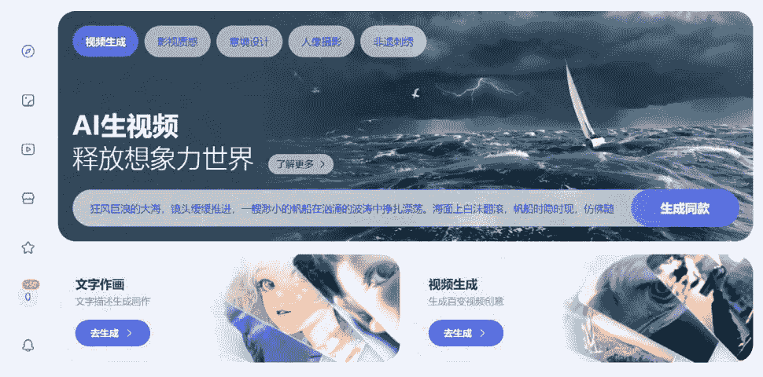
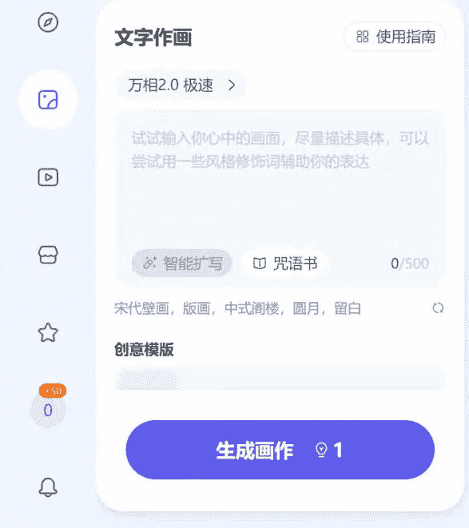
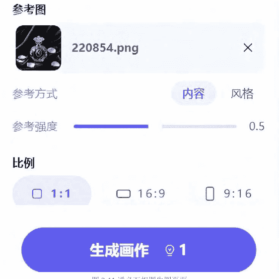
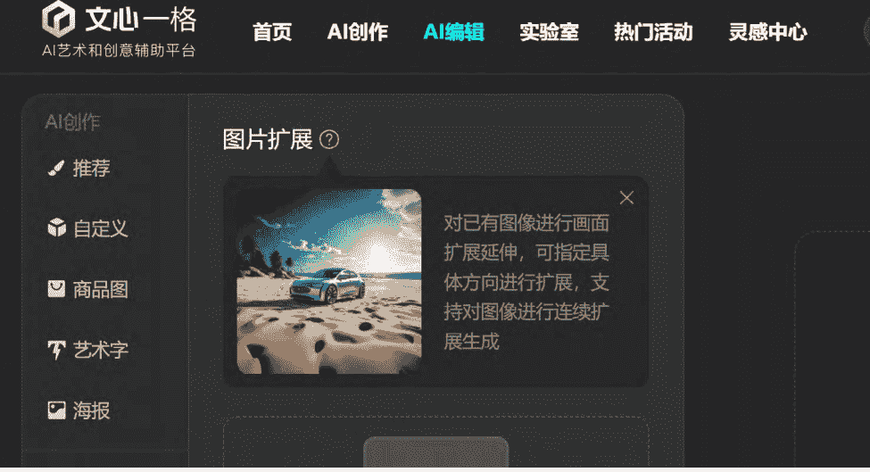
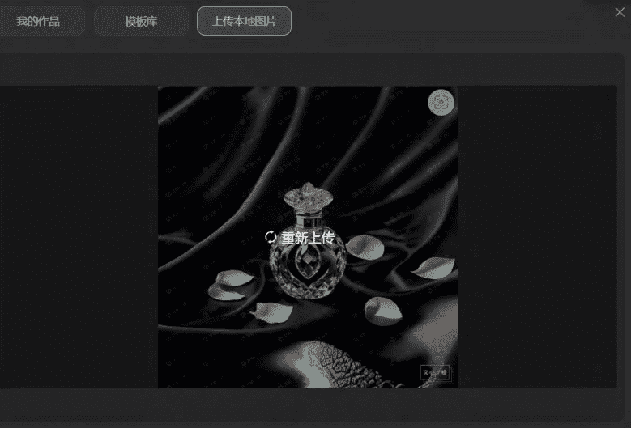
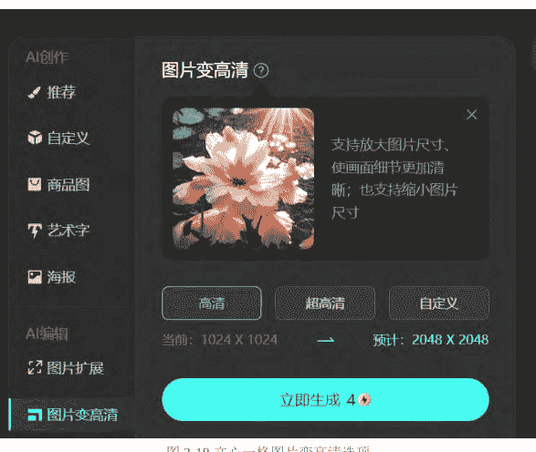
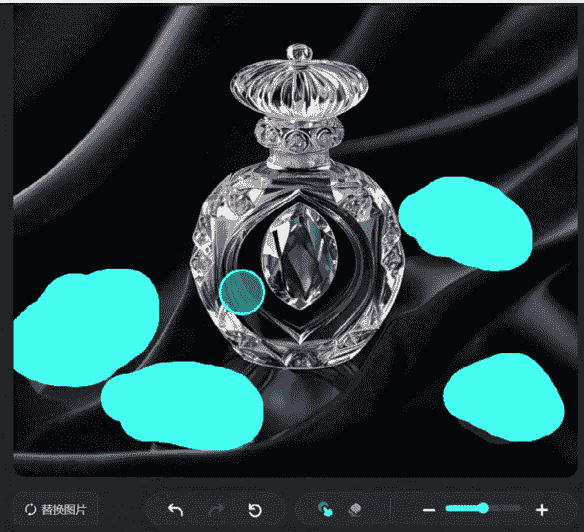
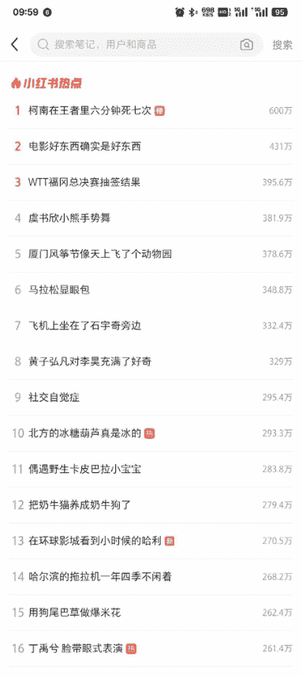
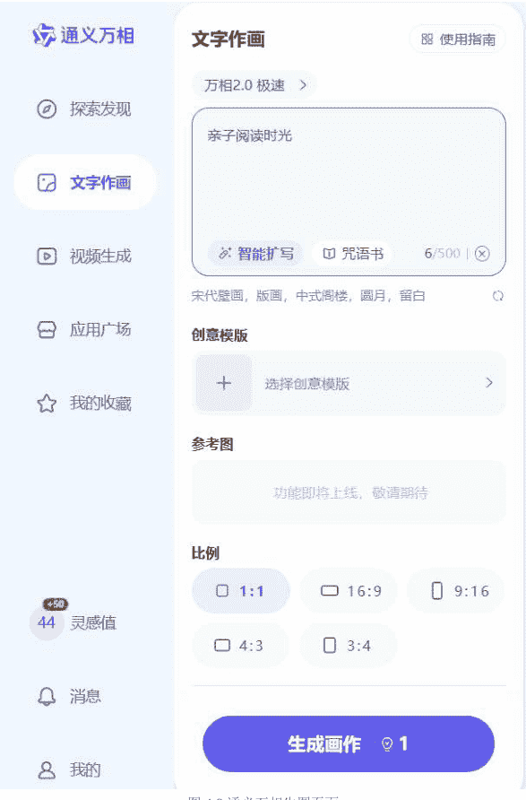
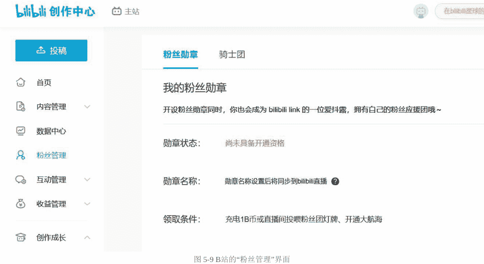

# AI赋能新媒体营销实战手册

## 前言

今天的新媒体已经成长为大众获取资讯和知识的核心入口，形态多样、更新极快，在全球范围内形成了很强的用户粘性和扩散力。 与此同时，人工智能的爆发式进步正在彻底改写新媒体的运转逻辑和推广方法，把智能化执行与精细化触达推向新高度。 技术带来的转型一方面让内容抵达更顺畅、更具吸引力，另一方面为操盘人打开了前所未有的数据可视化窗口，帮助更贴近真实需求做决策。

平台生态的多元化与内容的分众化是当下两大主线。 算法迭代与技术升级让平台能够更细腻地捕捉兴趣轨迹与行为习惯，从而实现更精准的分发。 推荐机制在持续进化，智能筛选帮助用户在信息洪流里快速甄别有价值内容。 所以运营方需要持续迭代打法，借助数据分析与用户回馈不断打磨内容生产与投放，以守住竞争优势。 策略的持续进化是维持参与热情与平台活力的关键。

AI已深度嵌入新媒体运营全链路，从素材生产、个性化分发到行为洞察与投放优化。 AI可以处理海量信息，识别趋势与偏好，并辅助完成文字、图像乃至视频的生成，大幅提升效率与质感。 其实时反馈机制也让运营者能够快速调整方向，响应市场变化，进而提升活跃度与品牌信任。

本书聚焦新媒体实操推广，以小红书、抖音快手、B站三大代表平台为案例展开。 小红书擅长生活方式种草与品牌声量，抖音快手以短视频与直播带货见长，B站深耕二次元文化与深度内容。 通过案例拆解，展示AI如何助力内容创作、互动运营、流量获取与商业化，并结合各平台特性给出具体策略与落地建议，帮助运营者放大影响力与商业回报。

AI的融合不仅是效率的跃升，更是方法论的重塑。 结合实例与理论，本书构建了一套完整的新媒体运营框架，助力你在智能时代把握机会创造价值。 这既是对技术应用的实践呈现，也是对新媒体未来走向的判断与启发，为行业从业者提供可参考的经验。

## 第一编 基础理论编

数字浪潮愈演愈烈，新媒体与AI的交汇正在以惊人速度改变传播形态与商业逻辑。 AI带来的智能化能力让内容生产、用户洞察与传播策略焕然一新。 变化不仅关乎工具迭代，更意味着传播理念与用户关系的再造。 本编旨在帮助读者理清这些动态背后的机理与趋势，在信息洪流中找准方向。 通过初步认识新媒体与AI，你将从被动适应者转变为主动把握未来的实践者，在内容营销与品牌推广中发现更多可能性，为后续发展奠定理论基础。

## 第1章 新媒体

### 1.1 认识新媒体

“新媒体”一词最早出现在1967年，当时出现在哥伦比亚广播电视网技术研究所所长P.高尔德马克为一项商品开发计划所做的研究中。 随后1969年美国总统传播特别委员会主席华尔特·惠特曼·罗斯托在向时任总统理查德·尼克松提交的报告中多次使用该词，此概念才在美国普及并迅速传播开来。

学界对新媒体的界定并不统一。 早期联合国教科文组织曾将其简单等同于在线媒体；另一种常见说法认为新媒体依托数字技术，通过互联网进行信息传递。 这些表述有助于理解其以现代技术实现全球传播的特性。 若要把握其内涵，首先需明确“媒体”本身。 媒体即信息的载体与通道，传统媒体如电视、广播、报纸、杂志等借助特定手段向大众传递信息。 而新媒体则是在互联网技术发展背景下诞生的新传播形态，依托互联网与移动终端，以智能手机、平板、电脑为入口，通过社交媒体、短视频、直播、电商等新兴渠道实现信息的高效广泛传播。

我们可以询问AI，看看AI如何解释新媒体。

> 问：请解答什么是新媒体。
>
> 答：新媒体就是随着科技发展而出现的新型传播方式，它与传统媒体相比更注重互动性和参与感。传统媒体像报纸、广播、电视，基本上是单向的信息传递，用户接收到内容后很少有直接反馈的渠道。而新媒体的核心特点就是“人人都可以是传播者”，通过互联网、手机、社交平台等方式，普通人可以非常便捷地创作、发布和分享内容。
>
> 在新媒体的世界里，信息的传播速度更快，覆盖范围更广。我们可以在一秒钟内分享自己的想法、照片或视频，哪怕隔着半个地球也能让对方立刻看到。新媒体的代表平台有微博、微信、抖音、快手等，在这些平台上，用户不仅是内容的接收者，同时也是内容的创造者和传播者，这种互动模式让信息在更短时间内到达更多人，形成一种“人人为我，我为人人”的信息交流方式。
>
> 新媒体的传播方式更加灵活和多元化。短视频、直播、图文、语音等多种表现形式满足了人们多样化的需求，让内容变得更加生动和直观。正因为这种多元化，企业、品牌也纷纷投入新媒体的营销中，通过新媒体平台直接与消费者互动，及时获得反馈和调整策略。

我们可以看到AI的回复中的解答对新媒体的定义和特点做了较为全面的介绍。

从内容的全面性来说，AI的解答很好地概述了新媒体的核心特征，如互动性和参与感，以及与传统媒体的区别。通过举例说明（如微博、微信、抖音等），使读者能够清楚地理解新媒体平台的日常应用和影响。AI所提供的答案结构合理，先定义新媒体，然后区分传统媒体和新媒体，接着详细描述新媒体的互动特性和多样化的内容形式，最后谈到了新媒体在商业和营销中的应用，逻辑连贯，易于理解。另外，解答中涉及的内容体现了新媒体的最新发展趋势，如短视频和直播的流行，这有助于读者理解新媒体环境下的信息传播方式。

注意，针对本书中所出现的文本框，为了展示AI生成文字的内容，不做任何修改，所以不可避免会出现部分语言瑕疵或错别字等，请知悉。

#### 1.1.1 新媒体的核心特质

口语里常说的“新媒体”，完整表述应为数字互动新媒体。 技术层面必须数字化，传播特性上则体现高度互动。 数字化与互动性共同构成新媒体的基础属性。

相较于传统传播模式，新媒体的信息传递既可实时同步，也可异步进行。 例如办公楼内的广告屏、车载移动电视等设备，因缺乏互动与双向交流，并不能算作真正的新媒体。

从本质上讲，新媒体是一个相对概念，其边界随技术演进不断变化，指代“当下的新”，而非过去或未来的新。 广播与电视在20世纪初诞生时属于新媒体，如今已归入传统媒体范畴。 若以“未来的新”为标准定义，则会让概念变得模糊。

“新”的判定主要参照国际通用标准。 某些在中国被视作新媒体的形式，在其他国家早已存在多年，因此并不符合新媒体定义，如车载移动电视。 此外，新媒体不等同于数字媒体，因为数字化生产并非新媒体独有。 若把数字化等同于新媒体，则大量传统媒体也会被误纳入。

与传统媒体相比，新媒体在传播速度、信息容量、成本、覆盖范围、精准检索与个性化推荐等方面更具优势。 其核心特征在于依赖数字技术并实现互动传播。 传统媒体的信息流动是单向的，记者或电视台向受众传达，受众只能被动接受；新媒体则打破这一界限，受众可以主动参与并成为传播者。 杂志《线上》曾用“人人传播”来概括新媒体，意指每个人都有表达与交流的空间，不再区分传播者与受众。 在此环境中，个体既是生产者也是接收者，可以倾听也可以发声。 因此研究中常以“用户”替代“受众”，更能体现参与与互动。 从互动性来看，车载移动电视、户外广告屏、写字楼广告电视等看似新颖的形式，因缺乏用户互动，仍属传统媒体升级版。

#### 1.1.2 新媒体的其他特质

##### 即时性

无论是全球突发事件还是本地琐事，借助新媒体网络平台，数秒内即可传向世界各地。 这种即时性与传统媒体形成鲜明对比，过去需等待电视播报或报纸出版，如今只需打开手机便能掌握最新动态。 对用户而言，实时获取信息意味着更快的应对能力，如股市波动、天气预警、交通状况等。 对品牌与企业而言，新媒体也提供了第一时间触达潜在客户的渠道，在营销上价值巨大。 同时多终端接收能力提升了信息的普及效率。

##### 个性化

大数据与算法技术能够依据兴趣、浏览记录及社交互动，为每个用户推送定制化内容。 例如偏好某类短视频的用户会持续收到同类推荐，在信息海洋中快速找到共鸣。 对用户来说，这节省了筛选时间，提升了体验；对企业来说，精准推荐提高了投放效率，因内容更贴合兴趣。 此外，高度匹配的内容也有助于提升用户留存与粘性。

##### 社交化

用户既是接收者，也是传播者与互动者。 看到一条有趣视频，一键转发即可扩散至社交网络，通过点赞、评论、分享参与二次传播。 对商家而言，社交属性极大放大了内容营销的效率，一个创意活动或广告可能迅速爆火。 对用户而言，社交化让信息更具温度，人与人之间的互动更容易产生情感共鸣。

##### 多样化

信息载体已从单一文字扩展为图文、音频、视频乃至VR、AR等沉浸式体验。 这种多样性满足了不同的消费偏好，有人偏爱短视频的直观，有人偏好文字的深度，有人则倾向音频的便捷。 对创作者与企业而言，多样形式提供了更广阔的创意空间，可依据目标人群选择最合适的表达方式。 多样化既丰富了用户视野，也是新媒体竞争力的体现。

#### 1.1.3 新媒体的价值体现

精准触达，直达用户
新媒体借助大数据实现用户兴趣的精细捕捉与内容推送，帮助品牌在海量信息中锁定目标受众。 例如在短视频平台关注健康饮食的用户会收到相关产品与资讯推荐，使投放更具价值。

内容形态丰富且互动性强
内容形态已远超图文，涵盖视频、音频、直播、VR等，甚至可通过交互游戏、虚拟试衣间实现深度参与。 直播电商中主播与观众实时互动，疑问即时解答，增强信任感与购买意愿。

自媒体赋能，人人皆可发声
相较于传统媒体的门槛，新媒体大幅降低了发布成本。 微信公众号、抖音号、B站UP主等平台让普通人也能成为传播主体，个体获得前所未有的表达权，部分人由此成为网络红人或KOL，影响广泛受众。

### 1.2 新媒体如何玩出彩

在竞争激烈的环境中脱颖而出，不仅需要技术工具，更需深刻理解传播逻辑。 众多品牌与创作者都在利用不同平台扩大影响力，这要求从业者持续创新并保持对受众变化的敏感。 策略涵盖受众定位、内容创新、运营机制与社交互动等多个层面。

#### 1.2.1 精准锁定受众

精准定位是运营的基础，决定了内容方向、风格、呈现方式与发布频率。 缺乏定位的账号如同无舵之舟，既浪费资源也易流失用户。 定位工作关乎受众选择，也影响后续创作与推广。

首要步骤是受众分析。 新媒体受众基数庞大，需通过人群特征收窄范围。 例如面向年轻妈妈的育儿账号与面向商务人士的账号在内容与风格上应明显区分。 可参考人口统计要素：年龄、性别、地域、职业、收入等，同时关注心理特征：消费习惯、兴趣喜好、平台使用习惯等，形成典型用户画像以指导内容制作。

确定目标后，需进行竞品分析。 观察定位相近的账号，梳理其优劣，如互动表现、用户反馈、热门话题等。 分析可帮助规避问题，也能发现市场空白。 若竞争对手在某点不足，而该点正是用户关注，则可作为突破口。

基于画像与竞品洞察，可规划内容方向与调性。 方向决定提供资讯、娱乐、教育或实用技巧等；调性影响第一印象，是幽默轻松还是专业严谨，均需与目标受众匹配。 例如面向年轻人的美妆账号可围绕护肤、化妆技巧、新品测评展开，调性走清新或潮流路线。

定位并非一成不变，需随平台与需求变化持续优化。 初期可通过数据验证假设，如评论、私信反馈与后台的年龄地域数据，检验画像准确性。 最终目标是让用户感受到内容“就是为我准备的”，从而建立持续关注与粘性。

#### 1.2.2 内容持续创新

在注意力稀缺的时代，创新是突围的关键。 用户划屏速度极快，若无法在短时间内抓住眼球便易被忽略。 创新不仅是形式花哨，更需满足好奇心与娱乐需求，让人产生“从未见过”的新鲜感。

创新需根植于对用户需求的理解。 形式新颖却无法解决问题的内容难以持久。 例如美妆博主将化妆教学与搞笑剧情结合，既传递信息又带来愉悦，实现寓教于乐。

形式创新同样重要。 短视频凭借精剪、音乐与独特视角吸引大量观众；图文账号可通过漫画排版、互动图表提升趣味；直播则以高互动性拉近创作者与用户距离。

视角创新也能带来差异。 同一话题存在不同切入点，例如环保内容除社会责任角度外，也可从生活细节切入，如减塑带来的生活乐趣、低碳打卡方式，更贴近日常，更易引发共鸣。

创新内容还需具备传播性，即具备用户愿意主动分享的潜力。 标题与封面设计需激发好奇，热点标签与话题借势可提升曝光。

#### 1.2.3 数据驱动优化

创意需要数据校验。 数据驱动优化是提升传播效果的重要手段。 通过数据解读用户真实行为，指导内容迭代。

首先要建立数据意识。 点赞、评论、转发反映受欢迎程度；观看时长、阅读深度则衡量吸引力。 每条发布都是数据积累节点，为后续优化提供依据。

定期复盘必不可少。 对阶段性运营数据进行拆解，识别高表现内容与未达预期内容，定位问题如开头吸引力不足或话题兴趣度低。 分析维度包括观看量、转发率、点击率，结合用户反馈调整方向。

A/B测试是常用方法。 在不确定哪种形式更有效时，可同时发布不同版本，如幽默风格与知识干货风格，比较数据表现再决策。 测试同样适用于标题、封面、发布时间等细节，持续优化可累积优势。

#### 1.2.4 情感互动

情感互动是维系用户的有效手段。 简单的点赞回复难以满足粉丝期待，尤其当用户对创作者产生共鸣时，更渴望真诚且有温度的交流。 情感互动旨在拉近距离，让粉丝从被动接收者转变为主动参与者与见证者。

粉丝粘性的形成，往往始于创作者对互动信号的快速、体贴回应。评论区里出现观点或提问时，第一时间跟进回复，粉丝会感受到被看见，进而产生归属感与身份认同。垂直类、小体量账号更适合做点对点的深度经营，少而精的互动反而更容易建立稳定关系。

提升参与感的另一条路径是设计可参与的活动。投放小额激励、抛出开放式话题，都能推动用户在评论区表达、转发。话题设计要贴合受众兴趣，形成自发讨论的场域，让参与者在交流中获得乐趣与认同感。旅游垂类博主常做的“最想去的地方”征集，就是典型做法：收集旅行梦想的同时带来评论增长与活跃度提升。

直播或日常连麦中，叫出昵称进行一对一回应，会让距离感迅速拉近。直播间的抽奖、问答小游戏同样能放大参与热情。情感互动的最终落点，是让粉丝把账号当成朋友。关系熟络后，忠诚度会自然积累，粉丝也更乐意自发扩散内容，为账号引入增量流量。

#### 1.2.5 跨平台联动
跨平台联动是放大声量、实现流量最大化的核心打法。不同平台的用户画像、内容消费场景与互动习惯存在差异，合理协同可以让同一素材在多处发挥价值，获得更广的曝光与关注。

联动的前提是吃透平台特性。短视频平台如抖音、快手，刷屏频率高、互动即时，适合创意演绎与轻快娱乐；微信公众号偏向长图文与深度表达，适合品牌故事与产品价值拆解；微博借助话题与热搜机制，容易实现快速破圈。基于差异进行分层分发，选择最匹配的渠道发布。

内容需要做适配与二次加工。常见策略是先在短视频平台释放创意片段，收集反馈后再把精华提炼成长图文，推送至公众号形成新价值。视频下沉淀的评论，也能为公众号选题提供灵感，丰富内容维度。

导流是跨平台协同的关键环节。抖音主页可挂载公众号二维码，引导用户获取深度信息；微博发帖时附上短视频或公众号链接，促使粉丝跳转至其他平台补全内容。互相导流有助于提升用户黏性，培养多平台的固定受众。

整体上，跨平台联动的底线是品牌形象统一。无论渠道如何变化，风格与调性保持一致，才能让受众快速识别并记忆品牌。

## 第2章 人工智能

### 2.1 人工智能的起源与演进：从幻想到落地
人工智能技术的发展重塑了传统产业，引发生态变革并催生全新业态。

可以把人工智能理解为让机器呈现类人智能的技术，机器能够理解语言、辨识图像、解决难题、习得新技能等。从人类想象来看，创造能思考行动的机器始终是核心憧憬。古希腊神话里的铜巨人塔罗斯可自主守卫克里特岛，文艺复兴时期达·芬奇设计的机械骑士也能完成简单的类人动作。

当下的人工智能是多学科交叉的成果，涵盖计算机科学、认知科学、心理学、生物学等，目标是让机器更接近人脑运行方式以完成复杂任务。应用已非常普遍：手机语音助手、在线客服对话机器人、街头自动驾驶汽车都是典型案例。支撑这些应用的技术底座包括图像与语音识别、自然语言处理与机器学习等。

通俗来讲，就是赋予机器或程序类人的“思维”，使其能够像人一样思考与解决问题。

发展脉络大致可分为以下阶段。

#### 2.1.1 萌芽时期（20世纪40年代至20世纪60年代）
源头可追溯至上世纪中期，计算机科学家开始探讨机器能否表现类人智能。

1950年，英国数学家与计算机科学家阿兰·图灵提出图灵测试，核心在于对话中能否让人无法区分对方是人还是机器。由此人工智能成为独立研究方向。

1956年夏季，麦卡锡、明斯基等人在美国达特茅斯学院研讨如何用机器模拟人类智能，首次提出人工智能概念，标志学科诞生。

1959年，首台工业机器人问世。

1965年，古德发表文章预警人工智能未来可能带来的风险，认为超级智能与智能爆炸最终可能超出人类控制范围。

1966年，麻省理工学院约瑟夫·维森鲍姆开发ELIZA程序，实现初步自然语言对话。他在ACM发表的论文详细介绍了工作机制。ELIZA通过识别用户输入的关键词，按预设规则分类处理，再从知识库调取对应回复规则生成回应。它并未真正理解内容，却能模拟对话流程，让人产生与人交流的错觉，原理与人挑选关键信息作答类似。

1967年，托马斯等人提出K近邻算法。给定一批已分类的训练数据，遇到新样本时，算法会寻找距离最近的K个邻居，依据多数类别判定归属，本质是物以类聚。

1968年，爱德华·费根鲍姆提出首个专家系统DENDRAL。专家系统是人工智能的重要分支，与自然语言理解、机器人学并列为三大方向。它模拟专家解决复杂问题，通常由知识库与推理机构成，知识库存储专业知识，推理机模拟专家的推理过程，从而在特定领域给出专业判断。

#### 2.1.2 反思与调整时期（20世纪70年代）
早期进展抬高了预期，但受制于算力与理论，落地受阻，进入低谷。

1970年代仍有关键创新。1974年，哈佛大学保罗·沃伯斯在博士论文中首次提出用误差反向传播训练人工神经网络，后成为深度学习的基石。

1975年，马文·明斯基提出用于人工智能的知识表示学习框架，为后续研究奠定理论基础。

1976年，知识库与专家系统领域多点突破。兰德尔·戴维斯构建面向对象模型，提升知识库开发与维护效率；同年斯坦福大学爱德华·肖特利夫团队开发MYCIN，可诊断并治疗血液感染；斯坦福大学勒纳特的AM程序重新发现数百个数学概念与定理。

1977年，海斯·罗斯等人推进基于逻辑的机器学习系统，虽仅能学习单一概念，未大规模应用。

1979年，汉斯·贝里纳的计算机程序在双陆棋比赛中击败世界冠军，这是人工智能的标志性事件，也为行为机器人学与强化学习发展铺路。

总体来看，70年代在当时未获足够关注，却为后续突破积蓄了基础。

#### 2.1.3 应用兴起时期（20世纪80年代）
80年代初，人工智能开始从实验室走向商业工业，为后续繁荣奠基。

专家系统通过模拟专家经验解决复杂问题，推动人工智能从理论走向实践。卡内基梅隆大学为DEC公司开发的XCON系统每年为公司节省约四千万美元，展现商业潜力。

机器学习在全球兴起，1980年卡内基梅隆大学举办首届机器学习国际研讨会。神经网络相关研究复苏，并在实践中显现能力。

1982年，约翰·霍普菲尔德发明霍普菲尔德网络，作为早期递归神经网络雏形，对机器学习与模式识别影响深远。同期的马尔《视觉计算理论》与霍普菲尔德网络共同推动计算机视觉与认知科学发展。

#### 2.1.4 稳步发展时期（20世纪90年代至21世纪10年代）
互联网高速发展带来人工智能研究新高潮，技术更实用，应用场景扩大。

1995年，科尔特斯与瓦普尼克提出支持向量机SVM，擅长小样本、非线性与高维模式识别。同年，弗伦德与沙皮雷发表AdaBoost，通过串行组合弱学习器提升分类性能。与之相对的Bagging技术如随机森林，通过并行组合弱学习器降低方差，提升稳定性。

1997年，IBM深蓝超级计算机战胜世界冠军卡斯帕罗夫，展现基于暴力穷举搜索在特定领域的超强能力。

2005年，波士顿动力公司推出四足机器狗，体现机器人适应复杂地形的进步。

2006年，杰弗里·辛顿与学生鲁斯兰·萨拉赫丁诺夫提出深度学习概念，标志人工智能进入新阶段。其核心是模拟人脑处理海量数据，迅速成为学界与工业界热点。此后迁移学习受到关注，可将一个领域的知识迁移到相关新领域，拓宽机器学习应用边界。

#### 2.1.5 蓬勃扩张时期（21世纪10年代至21世纪20年代）
大数据、云计算、互联网、物联网的爆发为人工智能提供数据与算力，GPU的普及极大加速深度神经网络发展。人工智能在图像分类、语音识别、知识问答、人机对弈、无人驾驶等领域取得突破。

2011年，IBM Watson在《Jeopardy》问答比赛中获胜，展示强大的自然语言处理、知识表示、自动推理与机器学习能力，证明人工智能处理复杂问题与理解自然语言的潜力。

2014年，Goodfellow与本吉奥等人提出生成对抗网络GAN，通过两个神经网络相互对抗生成逼真图像与媒体内容，被视为近年最具创新性的发展之一，推动艺术创作、游戏开发、视频制作等。

#### 2.1.6 生成式人工智能爆发期（2022年至今）
2022年，OpenAI推出ChatGPT，其基于大规模语言模型的理解与生成能力令人震惊，标志自然语言理解与交互进入新高潮，随后国内文心一言、讯飞星火、通义千问等大模型相继面世。

2024年10月8日，诺贝尔物理学奖授予约翰·霍普菲尔德与图灵奖得主杰弗里·辛顿，以表彰他们在人工神经网络推动机器学习领域的基础性发现与创新。

2025年，DeepSeek-R1、V3、Coder等系列模型已陆续上线国家超算互联网平台。2025年2月5日，DeepSeek-R1、V3、Coder等系列模型已陆续上线国家超算互联网平台。2月26日，DeepSeek宣布开源DeepGEMM，未来已来！

图 2-2 OpenAI的ChatGPT主页

### 2.2 人工智能的应用场景
人工智能正加速行业创新，从文本生成、图像创作到科研突破，应用版图持续扩张。日常层面可辅助编程、提升会议效率、生成音乐影像；专业领域如金融、游戏也显现巨大商业价值。未来人工智能将更深度融入教育、医疗、制造等，驱动更高质量智能化。

#### 2.2.1 文本生成
人工智能在文本生成领域应用广泛，尤其擅长自动生成自然语言。ChatGPT可进行自然对话、文本生成、自动问答、内容摘要，大幅提升信息处理效率，既可服务个人日常问答，也可为企业生成内容与客户支持。文心一言等工具聚焦商业文案，助力广告营销场景的创意文本自动生成。

#### 2.2.2 图像生成
Stability AI推出的Stable Diffusion是开源图像生成模型，用户输入文字描述即可生成复杂绘画，大幅降低AI绘画门槛。该模型配套付费产品DreamStudio，已吸引超百万用户。图像生成技术在艺术创作、品牌设计等场景前景广阔，既提效又满足个性化需求。随后文心一格、通义万相等大模型也推出类似工具。

#### 2.2.3 音视频创作与生成
生成式人工智能在音视频生成中潜力巨大。通过学习人类音频特征，人工智能可生成自然逼真语音，应用于虚拟助手、语音翻译、语音播报。音乐创作方面，人工智能能按设定风格与旋律生成作品，为创作者提供灵感并简化流程。广告音乐也能快速生成符合主题的旋律，大幅降低创作门槛。

#### 2.2.4 电影与游戏制作
在影视游戏制作中，生成式人工智能为开发者提供高效创作工具。可自动生成虚拟角色、场景与动画，帮助设计师快速搭建想象世界。2023年，腾讯AI Lab在GDC展示3D虚拟场景自动生成方案，游戏开发者可快速创建风格各异、接近真实的虚拟城市，30分钟内完成路网布局，效率提升近百倍，还能自动生成建筑外观与室内结构，进一步提高场景设计效率。

#### 2.2.5 科研与创新
生成式人工智能在科研创新中作用显著。可辅助化学、生物学、物理学等学科的理论探索与实验方法设计。药物研发中，人工智能模型可加速设计与测试，通过分析分子结构提出潜在候选药物；材料科学中可帮助发现新材料组合，加快技术突破，减少时间与资源浪费。

#### 2.2.6 代码生成
人工智能在编程领域应用日益普及。GitHub Copilot由GitHub与OpenAI合作推出，可基于编程语言与上下文提供代码补全与建议，支持Python、JavaScript等。腾讯的CODING Wise支持代码补全、单元测试生成、代码纠错，覆盖编写、排查、评审全流程。

#### 2.2.7 内容理解与分析
人工智能可显著提升信息处理效率。腾讯会议的AI助手可在会议中理解指令、自动记录要点并生成会后摘要与分析报告。彭博社推出的BloombergGPT是面向金融的定制化语言模型，能基于市场数据与金融新闻生成分析报告与投资建议。

#### 2.2.8 人工智能智能体
人工智能智能体是未来重要方向，可自主分析任务并规划执行，演变为个人的“全能助手”。2023年发布的AutoGPT是开源项目，用户设定目标后人工智能即可自主分析需求并执行。随后各大模型均推出智能体应用，如文心一言智能体、通义千问智能体。未来多智能体协作可能构建“虚拟智能社会”，彼此交互形成类人类社会环境。斯坦福大学与谷歌合作的Generative Agents项目构建“虚拟小镇”，让智能体在其中活动并做出反应，探索高度仿真的虚拟互动方式。

> [1] 仅展示ELIZA的聊天界面对话内容，不展示其具体的聊天界面。

## 第二编 运营推广实战编

在移动互联网持续演进的背景下，短视频与内容社区已经成为品牌触达用户的核心阵地。抖音、快手、B站、小红书等平台凭借庞大的用户体量、差异化的内容生态与精准的算法分发，成为营销投放的重点战场。只是各平台的用户偏好、互动逻辑和呈现形态各不相同，若想实现高效传播，需要更细致的打法。

本篇分享的方法论，聚焦于借助AI与数据分析实现精准投放、提升内容吸引力、放大用户互动，帮助品牌与个人账号在新媒体赛道获得更多关注与认可。

## 第3章 小红书运营推广

本章拆解小红书的专属运营思路，覆盖个人调性的塑造、吸睛图文的产出、短视频制作到直播互动的完整链路。AI工具的介入让创意表达与变现效率同步提升。抓人眼球的文案标题配合高质感的视觉呈现，能快速建立账号人设。结合平台的推广与运营规则运作，就能打造高热度账号，让内容更贴合目标人群，从而有效放大品牌影响力。小红书主页面如图3-1。

图 3-1 小红书主页

### 3.1 打造你的专属小红书风格

小红书创立于2013年，最初是以海外购物分享为核心的社区，聚集了大量真实的消费心得。随着需求变化，平台逐步引入电商业务，上线“福利社”，完成从种草到拔草的商业闭环，形成内容与电商联动的正向生态。创始人曾表态，随着品类的不断扩张，用户既能在这里获取信息，也能因互动产生消费，一个真实的消费分享会在社区引发连锁反应，带动线下消费，而用户消费后又会回流分享，形成持续循环。

在启动运营前，就像先逛一遍菜市场一样，需要先摸清平台脉络。弄清平台的定位、主流账号的类型、哪些账号获得扶持，再剖析用户结构，包括年龄、性别、职业与兴趣偏好，这些基础信息是制定策略的前提。

小红书的定位也在不断演进。2014年起从“找到国外的好东西”，到“全世界的好东西”，再到如今的“你的生活指南”，宣传语的变化折射出平台从海外好物推荐到优质产品聚焦，再到强调社交互动的转型，整体趋向“社交+交易”。内容版块随之扩容，目前主流品类已覆盖鞋包潮玩、美容个护、美妆、穿衣打扮、美食、家居家装、教育、生活、运动健身、影视综艺、婚嫁、互联网、资讯、职场、科学科普、健康养生、情感、摄影摄像、萌宠、旅游出行、母婴育儿等。平台边界正不断拓宽生活方式的维度。打造专属风格可从以下方面入手。

#### 3.1.1 确定运营目标

先明确做小红书的目的是什么。大多数账号的终极诉求是盈利，部分纯分享账号不在讨论范围内。

要实现盈利，首先要明确目标，并思考以下问题。小红书的内容形态是图文还是视频？是否真人出镜还是以场景拍摄为主？内容侧重产品推介还是使用体验？是自拍还是团队制作？确定形式后，还要规划更新节奏，是周更、日更还是月更？随后要安排各板块的执行，如文案撰写、图片制作、视频拍摄剪辑、直播等。

#### 3.1.2 确定目标受众

受众定位是运营成败的关键。要锁定账号想服务的客户群体，分析其整体特征，制定针对性打法。受众的设定直接决定内容方式、吸粉路径、引流效果、变现效率，并影响整体产品布局。

定位受众时可按以下步骤推进。

##### 数据收集与分析

借助小红书自带的用户分析工具，收集基础信息如年龄、性别、地域等，结合点赞、评论、分享等行为数据，判断兴趣点与使用习惯，从而找到能引起目标人群共鸣的内容方向。

##### 使用人群画像

基于数据构建详细画像，包括生活方式、消费习惯、偏好的内容类型等。若目标是都市年轻白领，则时尚、职场成长、健康生活等主题更具吸引力。

##### 细分市场

在整体画像基础上进一步拆分，挖掘对特定品类或内容更敏感的小圈层。比如年轻宝妈对儿童教育、营养品等话题的关注度更高。

##### 竞争分析

观察竞品如何定义受众，复盘其成功点与不足之处，从而规避雷区，发现市场未满足的需求。

##### 试验与调整

发布不同类型的测试内容，观察受众反馈，动态优化人群定义。互动率高、反馈积极的内容可作为后续深耕的方向。

通过上述流程，能更清晰认知目标用户，提升内容相关性与营销效果，为策略制定提供依据。

#### 3.1.3 确定内容定位

账号定位与内容定位要分清。账号定位决定营销赛道，内容定位则是围绕客户需求细化主题表达。

内容形式与呈现方式应匹配用户消费习惯。年轻用户偏爱视觉冲击强、易消化的短视频与图文合集；技术类或需要深度讲解的主题，可采用直播或教程长文提供额外价值。更新频率与发布时间也应结合用户活跃时段，通过数据工具找到高峰期进行投放，最大化触达。

创作过程中要持续收集反馈并迭代。若某类内容的互动表现不佳，需审视主题、风格或表达是否与用户需求偏离，及时调整形式或方向。

内容定位的核心是持续满足目标受众需求，保持新鲜感与相关性，增强参与感与忠诚度，从而提升账号影响力与长期品牌建设。

#### 3.1.4 了解具体机制

定位明确后要做准备工作，新账号通常需要养号。可先了解两大机制：推荐机制与权重机制。

小红书采用千人千面的推荐机制。笔记发布后若未被收录，则无法进入推荐池。可通过云搜索检测是否被收录，搜索得到即表示已收录，搜不到通常20分钟内会收到未收录提醒。一旦收录，笔记会进入初级流量池，约获得200次曝光。若点击率、点赞率、收藏量、评论量表现良好，则会推入下一级流量池，约获得3000次曝光；若表现不达标，推荐即停止。

2019年7月平台重新上架后，审核趋严，对营销号压制加强。账号的推荐量也与权重挂钩。权重决定笔记的可见范围与推荐力度。新号因缺乏活跃历史，权重偏低，易被判定为营销号，因此需适当养号，随着活跃时间增加权重才会提升。若资料、笔记或评论出现违规，权重会下降。权重与注册时长、等级、粉丝数、笔记数、收藏与点赞数等强相关，数据越健康权重越高。部分明星或达人账号因官方认可享有更高权重。掌握权重规则，有助于制定更有效的内容策略。

### 3.2 小红书内容创作指南

高质量的内容是账号成长的基础。

小红书笔记主要有两种形态：图文与视频加文字，具体选择取决于自身优势与账号定位。

#### 3.2.1 爆款标题

小红书标题在移动端最多展示两行，大屏约10字一行，建议控制在18字以内。标题要具备吸引力，可适当加入表情符号，注意表情占两个字符。

##### 标题的内容

想在关键词广场获得曝光，标题中必须明确嵌入核心关键词，且要贴合用户搜索意图。例如“小户型”“亲眼所见”“开心”“断舍离”“共享”等热词。加入具体数字更直观，阿拉伯数字的视觉冲击比汉字更强，可用于时间、数量等，如“三分钟学会××”“30个快速瘦身法”“3万元搞定全屋装修”。

采用“问题+解决方案”的写法也更有效，例如“如何一周内提升记忆力”“五步打造秋季衣橱”，既点明内容价值，又契合用户找答案的心理，能提升点击与互动。

##### 标题的撰写

在搜索页可查看当下的热点标题，借鉴其关键词与表达方式，如图3-3。受20字限制，标题需要在有限空间内突出重点并制造吸引力。实践中可提炼出几类通用公式。

- 比喻：借助熟悉事物解释新概念，如“时间管理秘籍：把每一天塑造成你的时间沙漏”。
- 联想：描述使用后效果，引发情感共鸣，如“绿色净化，从一杯蔬果汁开始”。
- 场景描述：具象化场景，让读者产生画面感，如“晨曦中的瑜伽：在阳光下唤醒身心”。
- 解决问题：点出痛点并给出方案，如“告别失眠：三个步骤让你每晚睡得香”。
- Emoji表情：增强视觉趣味性，如“夏日减脂 🏃‍♀️：5个简单动作燃烧脂肪”。
- 悬念：制造好奇，如“她只改了这一点，竟然……”。
- 提问：直接对话用户，如“你真的会正确使用面膜吗？”。 
- 具体数据：提升权威感，如“科学证明：每天走7000步，健康长寿不是梦”。

以“健身”为例，可让AI按“不超过18字、含Emoji、含阿拉伯数字、用提问方式”生成一批标题，效果会更具爆款潜质。日常撰写时把要求细化给AI，输出会更贴合需求。标题写好后还可用AI进行优化。

例如原标题“初冬显瘦穿搭之图文版总结”“办公室穿搭总结”“奶油风装修方案”“3万搞定全屋定制”偏平淡，可借助爆款公式优化为多个备选，提升好奇心与点击率。

爆款标题的关键在于快速抓住注意力并激发好奇，包含简洁表达、数字数据、提问形式与情感词。标题需与内容一致，保持可信度，才能在信息流中脱颖而出并驱动互动。

#### 3.2.2 爆款笔记

##### 爆款笔记的类型

小红书爆款笔记实战指南

以实际使用者或试用者的身份来撰写测评，重点在于把能感知到的细节和主观体感讲透。内容不能只报喜，缺陷也要坦诚点出，读者才会有全面判断。可以具体写操作是否顺手、功能是否真的能解决需求、表现是否稳定，并延伸说明这些特性对日常使用或工作效率的影响。随后把该产品和市场上相近的竞品做横向比对，凸显其差异化和潜在优势。对比时保持中立客观，保证信息经得起核查。如此拆解的评测才能提供真正有用的参考，帮读者在众多选择中快速锁定最契合自己的那款。

- **推荐类**

推荐型笔记常借助不同人设视角展开，核心是突出卖点并讲清推荐原因。要紧扣产品的差异化优势，结合真实使用感受和个人建议来增强可信度。最好用具体案例或真实场景来呈现实用价值。描写时用具象生动的语言说明它如何解决特定困扰或提升生活品质，这种基于场景的好物分享更容易引发共鸣，也能让读者感受到推荐的真诚与实际收益。

- **教程类**

教程类内容重在可操作性，常见主题如妆容等，聚焦步骤、方法与所需用品。撰写时要把每一步拆开说明，并明确列出工具或产品清单，让读者能无障碍复现。为提升理解度，建议图文或视频结合。以妆容教学为例，用视频现场演示每个上妆动作，配合文字要点和产品信息，读者既能看清手法，也能学会挑选和使用技巧。

- **问题解决类**

痛点解决型文案通常先抛出一个大众有感应的难题，快速建立共鸣。再展开原因分析，解释为何这个问题会困扰很多人。随后给出可落地的解决办法，真正帮助读者破局。为增强说服力，可引用真实案例或用户反馈，佐证问题的普遍程度与方案的有效性。这种写法既能帮用户渡过难关，也能树立作者的专业感与可信度，让内容更贴近需求，提升满意度与互动。

##### 爆款笔记的撰写方法

语言通俗，便于非专业用户快速读懂。
结构清晰：按段落和板块合理划分，思路条理分明，各部分逻辑明确，读者能迅速定位所需信息。
内容扎实：提供有深度的支撑，同时兼顾广度，避免流于表面。
实用性强：强调干货和独特观点，确保用户能获得具体帮助和新启发。
结尾留问：在笔记末尾留下引发思考的问题或话题，鼓励读者参与讨论，增加互动性。
开头抓人：把重要信息或观点放在开头，确保一开就吸引注意力，激发继续阅读的兴趣。

因此，撰写小红书爆款笔记时可借助智能助手辅助，下面以亲子主题为例演示。

首先，我们需要用上一节的方法为亲子笔记搭一个文案框架，具体步骤略。假设模型给出的标题是“学龄前教育：在家如何启蒙孩子[]”。

我们先收集小红书里自己喜欢的高赞笔记复制下来，让模型分析其语言风格和表达方式，如下。

> 问：

我将提供一篇高质量的小红书笔记文案范本，作为一位优秀的小红书大V，请你根据范本总结出优秀的小红书笔记文案的风格特点和表达方式。

“一些简单惊艳的句子 11.18”

会好，迟早。

生命几许，遵从自己，别赶路，感受路。

去爱具体的生活。

拐个弯，与生活和解，得失都随意。

不要预知明天的烦恼。

要当永远和首选。

后来重闻往事如耳旁过风，不慌不忙。

人的悲欢并不相同 冷暖自知 各自安好。

请保持自己的心 因为总会有人等你共鸣。

生来普通，所以要逆风翻盘。

#文字语录#书摘#每日书摘#文学#书摘分享#今日文案#文案#语录#情感语录#惊艳到你的句子#暖心句子分享#可以写进作文里的神仙句子#朋友圈文案#文字语录#心情语录#正能量语录#人生感悟语录

随后，模型会根据这个内容，生成一篇总结性的文章，如下。

> 答：

这篇小红书笔记范本体现了几项优秀的文案特质，具体包括：

1.情感共鸣：文案用简短深刻的句子触及读者内心，如“生命几许，遵从自己，别赶路，感受路”。这些表述引发对生活、成长的深层思考，与读者的情感经历产生连接。

2.哲理性表达：文案包含大量哲思，比如“人的悲欢并不相通，冷暖自知，各自安好”。这种写法能促使读者对人生与关系进行反思。

3.鼓舞人心的语言：通过正向表达激励读者面对挑战，如“生来普通，所以要逆风翻盘”。这类话语提供动力，也提升情感投入。

4.简洁明了：语言简练直接，避免堆砌冗长句，信息传递清晰，易于大众理解。

5.标签串联主题：底部多个标签如“文学 书摘分享 情感语录”等，有效把内容接入更广的讨论，扩大可搜索范围。

6.美感与文艺气质：整体风格文艺，每句话都像精心打磨的诗句，增强了审美价值和吸引力。

通过这些特点，文案能有效吸引目标读者，提升平台影响力和互动。

之后，我们要给模型一个指令，让它把这个风格归纳成一个专属提示词，后续只需提示该词即可复用。

> 问：

请把上面的风格总结成为一个指令，名称为“爆款风格一”，后期，如果我需要让你用这种风格撰写笔记时，只需要提示“爆款风格一”，即可使用这个风格来撰写。

如果你清楚我的指令，请回复“我明白”。

如果你不清楚我的指令，请具体指出不明白之处。

答：

我明白。

此时模型已理解指令，后续撰写时可结合该指令进行创作。我们也可以把上文分析的爆款笔记撰写要点提供给模型，让其记忆后按此风格输出。

下面具体演示其过程。

> 问：

请你作为一位小红书大V，使用“爆款风格一”，撰写笔记，标题为“学龄前教育：在家如何启蒙孩子 📚”。文中添加“爆款风格二”📚 的关键方法中的相关内容。

答：

学龄前教育：在家如何启蒙孩子 📚

在瞬息万变的当下，幼儿的早期启蒙成为许多父母心头的重心。把启蒙做在家中，既是技巧的运用，也是艺术的体现。

启蒙常从阅读起步。挑选适合年龄的绘本，用生动的语言讲述绚丽的故事，既能点燃想象，也能锻炼语言。让孩子翻阅纸页、感受图画，慢慢引导识字，这是第一步的关键。

亲子互动是教育的延伸。做一些简单的家庭小游戏，比如分类玩具、基础拼图，既能在玩中学习，也能拉近亲子关系。这些看似轻盈的活动，却是认知初建的基石。

创造性活动，如手工制作、简易乐器演奏等，能培养创造力与音乐感知，也是自我表达的开端。每件作品都映射孩子内心的世界，是独立思考的证明。

道德启蒙则要从日常小事抓起，教会在礼貌、分享与感恩中养成习惯。这些微小行为，是人格塑造的根基。

每个孩子的成长轨迹并不相同。父母最重要的是观察、了解孩子的个性和兴趣，并灵活调整方法，确保教育契合其发展阶段。

最后想问各位家长：在家庭教育中，你遇到过哪些难题，又是如何应对的？欢迎分享经验，让我们一起为孩子营造更好的成长环境。

到此，我们可以了解如何用智能助手生成小红书爆款笔记。借助模型，内容创作效率提升，也更容易在平台脱颖而出，甚至成为有影响力的创作者。

#### 3.2.3 配图生成

小红书运营不仅靠笔记，配图同样关键。它决定了能否抓住眼球并促进互动，而做出符合用户审美的优质图片并不容易，智能绘图能提供帮助。当前常用的绘图系统包括文心一格、通义万相、可灵等。

##### 图片生成

智能图像创作大致分为文生图和图生图两种。下面以通义万相为例演示插图的生成方式。

打开通义万相主页，选择左侧工具栏中的“文字作画”，即可进入生图页面，如图3-4。



通义万相的文生图和图生图均集成在“文字作画”页面。现阶段1.0版本同时支持文生图和图生图，2.0版本仅支持文生图，下文用2.0演示文生图，图生图则用1.0版本。

###### 文生图

文生图即通过文字描述生成图像，是智能绘画的核心方式之一。利用关键词描述画面需求，系统即可据此成图。

在通义万相生图页面，选定“万相 2.0 极速”，在下方输入框输入文字，即可调用文生图功能，如图 3-5。



在此，系统提供提示词润色功能。输入关键词后点击智能扩写，再选定咒语书，系统就会优化文生图的提示词。以关键词“香水瓶”为示例，依次点击“智能扩写”，如图 3-6。

可以看到系统把“香水瓶”扩写为“晶莹剔透的水晶香水瓶，瓶身雕刻着细腻的巴洛克花纹，宛如一件精致的艺术品。瓶盖上镶嵌着一颗璀璨的宝石，折射出迷人的光芒。香水瓶静静地躺在绸缎般的黑色背景中，周围散落着几片淡雅的花瓣，仿佛能闻到那股清新而神秘的香气。柔和的灯光从上方洒下，勾勒出香水瓶优雅的轮廓，营造出一种梦幻般的氛围”。之后点击下方的按钮“使用扩写结果”即可。

##### 文字作画

使用指南

##### 灵感扩写

万相2.0 极速

香水瓶

晶莹剔透的水晶香水瓶，瓶身雕刻着细腻的巴洛克花纹，宛如一件精致的艺术品。瓶盖上镶嵌着一颗璀璨的宝石，折射出迷人的光芒。香水瓶静静地躺在绸缎般的黑色背景中，周围散落着几片淡雅的花瓣，仿佛能闻到那股清新而神秘的香气。柔和的灯光从上方洒下，勾勒出香水瓶优雅的轮廓，营造出一种梦幻般的氛围。

智能扩写

咒语书

3/500

141/500

宋代壁画，版画，中式阁楼，圆月，留白

##### 创意模版

使用扩写结果

生成画作

图 3-6 通义万相文生图提示词智能扩写

“咒语书”用于设定画作风袭，可选择风格、光线、材质、渲染、色彩、构图、视角、常用咒语等，如图 3-7。日常使用中，通常二者选其一即可。

####### 咒语书

风格

光线

材质

渲染

色彩

印象派

点彩画

厚涂

像素画

波普艺术

彩铅

赛博朋克

浮世绘

皮克斯风格

低聚

工笔画

水墨画

梵高风格

莫奈风格

蒸汽朋克

柴油朋克

故障艺术

全息投影

机械美学

古风

吉卜力

优化提示词后，还可选择创意模板，通义万相的模板多适用于人物角色，如“厚涂原画”“黏土世界”等，此处不做选择。再选定图片比例，点击下方“生成画作”按钮即可。

等待片刻，右侧展示区会呈现生成进度，如图 3-8。


如图 3-9，通义万相会提供四张备选图片，可按需挑选。若不满意，调整提示词后可重新生成。


###### 图生图

图生图在小红书配图里也很常见。它依托深度学习网络和多层特征提取来实现。此处仍以通义万相演示。

在“文字作画”页面选定“万相 1.0 通用”，同样输入提示词，与文生图不同的是下方可上传“参考图”，如图 3-10。

大气，海盗船，满月航行，丙烯画

##### 创意模版

+ 选择创意模版

##### 参考图

点击或拖动上传图片

####### 比例

1:1 16:9 9:16

生成画作 1

图 3-10 通义万相图生图页面

点击或拖动上传图片，以前面文生图生成的画为例，提示词保持不变，如图 3-11，上传参考图后，下方可选择参考图的内容和风格。选定“内容”，点击“生成画作”。



等待片刻，右侧展示区会展示生成进度，如图 3-12。


随后通义万相会生成四张与参考图内容相近的图片，如图 3-13。

同样，对结果不满意可再次生成。


可见，四张图是在提供的参考图基础上做适度修改的。因此文生图和图生图可结合实际需求选择使用。

##### 图片编辑和美化

小红书运营常需对图片进行编辑美化，如去水印、高清修复、抠图等。智能工具对此支持很高，下面以前面生成的香水瓶图片为例，用文心一格的“AI编辑”演示。

如图 3-14，在文心一格主页面点击“AI编辑”即可进入编辑页面。



图 3-14 文心一格AI编辑页面

###### 图片扩展

图片扩展是对原图进行画面延伸，可指定方向并连续扩展。点击右侧“上传图片”，上传待扩展图，左侧选择扩展方向和生成数量即可。仍以香水瓶为例，如图 3-15，上传图片后确认。



图 3-15 文心一格AI编辑中图片扩展

随机生成后，可看到文心一格对四周进行了扩展，如图 3-16。


图 3-16 文心一格图片扩展的对比图

需要注意的是，目前下载图片需开通会员，否则带水印。下述功能演示同理。

###### 图片变高清

运营中常遇到清晰度不足的问题，此时可用图片变高清功能。仍以香水瓶为例，在左侧工具栏选择“图片变高清”，上传图片确认，如图3-17。


上传后点击左侧立即生成，可选“高清”“超高清”“自定义”，根据需求选择分辨率即可，如图 3-18。



由于修复后与原图在书中对比不明显，此处不展示对比图，实际操作在屏幕上差异明显。

###### 涂抹修图

实际运营中常用于消除图片局部，与智能抠图类似，这里仅做演示。以香水瓶为例，去除上方的花瓣，如图 3-19，选定相应功能。


图 3-19 文心一格涂抹消除功能

上传图片后确认，用鼠标涂抹需要消除的花瓣，如图 3-20。



图 3-20 文心一格涂抹消除操作

随后点击左侧“立即生成”，文心一格会对涂抹区域重绘，多次操作即可满足需求，如图 3-21。


在小红书内容运营中，智能工具在图片编辑美化方面作用明显，能满足去水印、高清修复、抠图等需求，操作便捷且能提升质量，增强视觉吸引力。例如借助文心一格“AI编辑”对香水瓶图片优化，可提升内容的专业感和吸引力，为用户带来更优质的视觉体验。

### 3.3 小红书账号涨粉

仅有优质内容仍不足以支撑运营，还需要一定体量的粉丝作为基础。因为最终目标是吸引关注和流量，实现商业化或个人品牌提升。小红书涨粉可通过多种方式实现。

#### 3.3.1 涨粉逻辑探秘

运营小红书时，粉丝数量直接决定成果，因此大家都希望实现快速涨粉。也因此有了前文提到的“爆款”，只有成为爆款，才能获得更多流量和曝光，进而带来关注，粉丝增长后曝光会形成良性循环。

如何实现快速涨粉？智能时代能给运营者带来哪些帮助？要解决这个问题，先要了解小红书账号涨粉的步骤。

小红书涨粉的步骤与平台推荐机制相关，其流程如下：

在小红书上做快速涨粉，本质上是一个相互推动的闭环。起步要靠产出能打动人的优质笔记，内容既要有吸引力又要有实用价值，才能勾起用户停留的欲望。笔记上线后，平台的推荐系统会依据内容质量和初始表现进行分发，让作品触达更广的受众，曝光自然被放大。

曝光扩大后，用户会因内容共鸣而产生点赞、评论、收藏等行为。这些互动会提升笔记的热度权重，进而获得更高的推荐优先级。被更多人浏览的账号也会被更多人关注到，当内容与用户的兴趣和需求匹配时，关注转化就容易发生。整体来看，这像一个漏斗，触达面越宽、认可度越高，粉量增长越快。想要加速涨粉，核心就是不断提高笔记的曝光频次，同时守住内容质量，鼓励互动并沉淀关注，最终形成持续发布-被推荐-被互动-被关注的正向循环，让账号在平台上快速显现。

#### 3.3.2 涨粉技巧
随着小红书生态的成熟，个人创作者和品牌方都在把资源投入进来，竞争池越来越大。同品类账号增多后，即便内容过关，也可能增长乏力。除了做内容，运营者还需要具备把好内容送达用户的能力，只有被目标人群稳定看到，粉丝才会持续累积。

##### 抓住“黄金时间”
小红书的使用场景偏向休闲消遣，多在碎片化空闲时段打开。平台倾向于把优质内容投放到用户活跃的高峰期。需要注意的是，笔记发布不是即时进流，通常要经历30分钟到1小时左右的审核缓冲期。

不同垂类的最佳投放窗口并不相同，可以借助AI对用户行为数据做拆解，比如护肤类笔记的用户活跃时段。

> 问：
如果你是小红书运营，请分析护肤相关笔记的用户浏览时段。

答：
护肤笔记的浏览高峰可以结合用户日常作息和行为数据来推断。基于常规的活跃规律，可以做如下假设：

1.早晨 7:00—9:00：起床后刷手机寻找晨间护肤灵感，适合推送日间护理、抗氧防晒类信息。
2.午间 12:00—14:00：午休空档浏览时间变长，工作日尤为明显，可推送快速补水、午间急救类内容。
3.傍晚 17:00—19:00：下班放学后放松时段，用户关注卸妆、晚间清洁和夜间修护类笔记。
4.夜间 21:00—23:00：睡前使用手机的高峰，适合睡眠面膜、夜间特护等话题。

测算下来，建议把笔记提前半小时到一小时发布，等审核通过后正好落在上述峰值窗口，与目标用户的阅读习惯重合，提升转化效率。

##### 学会“蹭”热点
对小红书运营来说，流量是内容变现的前提。内容再好，没有曝光就难以起量。蹭热点是获取流量的常用手段，但生硬嫁接容易被用户反感。关键在于精准找到平台正在讨论的话题，并进行合理延展。

热点来源并不复杂。小红书站内搜索页会直接展示热搜榜单。



图 3-22 小红书热门搜索界面 [2]

这些话题实时更新，运营者可以挑选与自身定位相关的话题作为创作切口。

例如以“社交自觉症”为热点，让AI辅助生成笔记。

> 问：
假设你是小红书运营者，请以“社交自觉症”为热点写一篇笔记。

答：
小红书笔记标题：拆解社交自觉症，让不自在不再主导社交

当下很多人走进社交场合时，脑中总会出现“自己很尴尬”“别人都在评判我”的声音，导致聚会、会议甚至线上互动都伴随焦虑。

社交自觉症是什么
它指的是在人际互动中过度关注自我表现和负面评价，从而产生焦虑和恐惧的心理状态，比单纯害羞更影响日常生活和人际关系。

典型表现
- 频繁自我苛责，担心留下不好印象
- 因害怕出错而回避聚会或会议
- 社交时心跳加快、出汗、颤抖甚至恐慌

应对思路
1. 正视并接纳感受，承认焦虑是常见反应
2. 从小范围熟悉的人际场合开始，逐步提升复杂度
3. 赛前给自己积极暗示，例如“我能自然表达”“我值得被尊重”
4. 情况严重时寻求专业心理咨询

深层影响与管理
长期社交焦虑会限制人际连接，甚至引发抑郁等问题。管理它不仅是为了表现更好，更是为了整体幸福感。建议建立支持性社交圈、通过演说、戏剧等练习表达、并用日记记录每次社交后的感受与进步。

社交本应是连接的桥梁，理解并面对内心的自觉，才能更从容地享受每一次互动。

社交焦虑 心理健康 自我成长 人际沟通

如果你也在经历类似困扰，欢迎在评论区交流应对经验，让更多人受益。

也可以让AI结合账号定位对热点进行二次创作，在此不展开演示。

##### 给出作品发布策略
运营者需要定期复盘笔记数据来校准账号定位，AI可以辅助完成分析。

假设账号近期的10篇笔记数据如下：

1. 标题：“最新秋季穿搭指南”。阅读量4500，点赞320，评论48
2. 标题：“家常菜做法分享”。阅读量2700，点赞190，评论22
3. 标题：“我在北京的一天”。阅读量3900，点赞265，评论37
4. 标题：“如何打造高效的家庭健身房”。阅读量5300，点赞450，评论86
5. 标题：“节日礼物推荐清单”。阅读量1200，点赞85，评论12
6. 标题：“手工艺制作教程”。阅读量2300，点赞155，评论21
7. 标题：“全球旅行必去的10个地方”。阅读量6100，点赞520，评论112
8. 标题：“专业摄影技巧入门”。阅读量4800，点赞388，评论44
9. 标题：“宠物狗的日常护理”。阅读量1500，点赞118，评论19
10. 标题：“书籍推荐：本月的好书”。阅读量3100，点赞240，评论33

这些模拟数据可作为内容规划的参考依据。

> 问：
请以小红书运营者身份分析以上数据，并给出账号运营建议。

答：
根据数据可以从以下维度调整策略：

1.热门主题判断
阅读与点赞表现最好的是“全球旅行必去的10个地方”和“如何打造高效的家庭健身房”，说明旅行和居家健身类内容受众需求旺盛。专业向的“专业摄影技巧入门”表现也不错，显示教育型内容有稳定关注。

2.低表现内容诊断
“节日礼物推荐清单”和“宠物狗的日常护理”数据偏弱，可能受同质化竞争影响，或选题角度不够个人化。

3.策略建议
- 加码高热主题，例如“环球美食探访”“居家运动器材挑选指南”等延伸内容
- 深化专业内容，比如拆成“手机摄影技巧”“夜景拍摄教程”等细分方向
- 优化弱势内容，如将礼物清单具体化为“情侣节日手工DIY礼物”，提升参与感

4.互动与参与
在笔记中加入引导性提问，如旅行笔记可问“你的梦想目的地是哪里”。定期策划摄影挑战或旅行故事征集，提升社区活跃度。

5.跨平台分发
将高表现内容同步到微博、微信公众号等渠道做二次分发，引流回小红书。

通过上述调整，频道能更精准抓住用户兴趣，提升覆盖与互动。

> 问：
请基于以上分析，为我的账号定位并撰写一篇符合定位的笔记。

答：
账号运营定位
账号聚焦高质量生活方式内容，以“全球旅行探索”和“居家生活升级”为主轴，打造用户信赖的生活指南与灵感源。实现路径为聚焦核心垂类、强化用户互动、依据数据持续优化。

笔记示例：《如何在家打造专属健身角落》

标题：🏋️‍♀️居家健身改造：用一个角落开启健康生活🏠

正文：
小红书的朋友们，健身房太远、时间难凑？其实在家收纳一个小型健身区就能持续动起来。今天分享四步实操：

1.选址：挑一个家中空旷且舒适的角落，客厅一隅或卧室空地均可，关键是能专心投入。
2.基础配置：初期不必追求高配，瑜伽垫、轻哑铃、跳绳即可覆盖大部分家庭训练。
3.氛围营造：挂一幅激励海报，摆几盆绿植，搭配节奏感音乐，能让训练更愉悦。
4.计划迭代：身体适应后及时更新动作和器材，保持新鲜感避免倦怠。

快去试试吧，评论区晒出你的家庭健身角落，让我们互相点赞打卡！

结语：每一步微小改变都是向健康迈进，期待看到大家的成果。

这样的内容既能吸引关注健康生活的用户，又能增强连接与互动，为涨粉提供支撑。

##### 有效直播
直播已成为小红书运营的重要环节。开展有效直播前，先用AI快速生成脚本，明确主题与内容框架。以热点“社交自觉症”为例。

> 问：
请根据小红书热点搜索“社交自觉症”，确定一个直播主题和内容框架。

答：
直播主题确定为“克服社交自觉症：轻松变身社交达人”，聚焦理解与改善社交焦虑，提升自信。

直播内容规划
1.开场介绍：主持人亮相，简述话题背景及社交自觉症的常见影响
2.主体内容
- 理解社交自觉症：心理专家讲解定义与成因，结合真实案例展示
- 专家建议：分享缓解策略，如呼吸练习、正念冥想、逐步暴露法
- 互动问答：观众提问，现场解答
3.实操演练：演示简单社交技巧，提供在家练习方法
4.收尾与资源：总结要点，分享延伸阅读、课程链接，引导关注账号

呈现方式保持轻松友好的氛围，确保内容实用、有教育意义并具备互动趣味。

> 问：
请根据上述主题和内容生成直播脚本。

答：
小红书直播脚本：克服社交自觉症：轻松变身社交达人

开场白：
大家好，欢迎来到今天的直播！我是主持人[主持人名字]。很多人在社交场合会感到紧张甚至害怕，这可能就是今天要聊的社交自觉症。我们邀请了心理专家[专家名字]，一起来理解并改善这个问题，有问题可在评论区留言。

主体内容
1.理解社交自觉症
主持人：请[专家名字]先介绍一下社交自觉症是什么，以及它如何影响生活。
专家：社交自觉症是指个体在社交中过度在意他人评价，导致焦虑恐惧，进而影响日常社交质量。
随后播放案例视频，直观呈现典型反应。

2.专家建议
主持人：面对这种情况有哪些可操作的方法？
专家：建议四点：紧张时做深呼吸放松；每日几分钟正念冥想提升情绪调节；从小规模熟悉场合逐步练习；设置正向自我暗示。
主持人：非常实用，大家可以记下来。

3.互动问答
主持人：进入问答环节，[专家名字]会逐一解答评论区问题。

实操演练
主持人：接下来做一个简单的破冰练习，邀请大家跟随一起尝试。

结束语
主持人：感谢[专家名字]的分享，也感谢大家的参与。想获取更多心理健康内容，请关注我们账号，后续会持续更新。再见！

这样的脚本结构清晰、互动充分，能有效提升直播效果与账号影响力。

### 3.4 小红书变现
运营小红书账号的最终目标是实现商业化变现。从内容生产到销售转化，每一步都要围绕把流量变为收入展开。持续输出价值内容、累积粉丝信任、结合平台机制与商业合作，才能让账号在小红书上稳步实现盈利。

内容是立身之本，发出来的优质、有吸引力的作品更容易获得关注和互动，这也是塑造品牌口碑、吸纳潜在客户的核心路径。等到通过内容与粉丝建立起信任感，品牌合作的入口就打开了。创作者能够直接与品牌洽谈，产出试用体验或推广笔记，从而拿到赞助费或推广收入。

当账号的影响力不断扩大，电商变现就成为一条直接且高效的收入线。达人可以推荐自己日常在用的心头好商品，借助小红书自带的购物功能引导粉丝成交并抽取销售佣金。直播带货的兴起让更多创作者转向实时展示，边演示边交流，现场感和互动感都很强，往往能更有效地推动成交，提升收益。

对于具备专业积累或独特技能的创作者，还能把知识产品化。制作付费教程视频、电子书等付费内容售卖，比如健身教练推出训练课，美妆博主售卖护肤教学，都是常见的增收方式。

#### 3.4.1 内容营销

内容变现的核心路径，一方面是官方的“带货试用”，另一方面是非官方的广告合作。创作者撰写商品测评笔记，用真实的使用反馈扩大曝光，为产品做广告铺量。粉丝通过笔记里的链接下单，品牌方和平台就会按成交给账号发放佣金，实现变现。

这类体验或测评笔记本身就可以借助AI快速生成。下面以一款化妆品为例。

> 产品名称：某某亮肤精华液
> 品牌：某某
> 产品功能：
> 该精华液主打提升肌肤通透感与光泽，核心是深层滋养和提亮肤色，同时辅助淡化细纹皱纹，并强化肌肤天然屏障。

主要特点：
1. 深层补水：含有玻尿酸及多种植物萃取，可为肌肤持续补水、锁水，帮助全天保持水润。
2. 调匀肤色：添加熊果苷与维生素C，有助于淡化斑点与痘印，还原自然光泽，让肤色更匀净。
3. 抗老紧致：加入多肽与胶原蛋白复合成分，有助舒缓细纹皱纹，使肌肤看上去更紧致年轻。
4. 温和舒缓：无香精、无色素配方，对敏感肌友好，降低刺激与泛红风险。
5. 易吸收：质地轻盈，涂抹后迅速被吸收，不留油腻感，多种肤质皆可使用。

适用人群：
适合所有肤质，尤其是有提亮需求、肤色不均、已现初老迹象的群体。男女皆可使用，追求肤感改善与肌肤健康者均可尝试。

预期效果：
坚持使用后，肌肤通透度和光泽感会明显提升，肤色更均匀，细纹皱纹得到改善，整体状态更显年轻健康有活力。

使用方法：
早晚洁面后取适量精华，点涂于额头、两颊、鼻尖、下颌，按摩至完全吸收。可搭配同系列日霜或晚霜使用以增强效果。

随后可用AI基于上述卖点生成小红书种草笔记，例如：

问：
请依据上文某某化妆品的介绍，为我写一篇小红书种草测评笔记。

答：
小红书种草笔记：某某亮肤精华液使用体验

嗨大家好，今天分享我最近很上头的护肤单品——某亮肤精华液。用了大概两周，肌肤感受很明显，下面说说真实体验。

1. 包装感受：
设计走简约路线，磨砂玻璃瓶配上滴管取用，拿在手里很有仪式感，拍照也好看。
2. 质地上手：
质地很水润轻薄，上脸瞬间就有被滋润的感觉。吸收很快，几秒就干爽不黏腻。
3. 保湿提亮：
最惊喜的是保湿与提亮。脸色看起来更通透均匀，原本淡淡的痘印与色斑也有淡化趋势。早上起来肤色更有光泽。
4. 敏感肌友好：
本人皮肤偏敏感，以前很多产品会不适，这款很温和，全程无刺痛，反而感觉皮肤更稳了。
5. 细纹改善：
原本只是为保湿提亮入手，没想到眼周和唇周的细小纹路也变淡了一些。

总体来说，这款精华效果和手感都很在线，推荐给在找提亮保湿产品的朋友。希望我的分享能帮到你，快去试试吧！

#### 3.4.2 直播变现

在当下的社交与电商环境里，直播是小红书运营者获取收益的重要手段，因其强互动与即时性备受品牌和创作者青睐。

直播变现大致可分为内容电商和直播电商两类。

##### 内容电商

内容电商指的是商家通过优质内容激发用户购买欲，并引导完成交易的销售模式，主要依托图文和视频。

例如一名美妆博主在小红书连续发布护肤相关视频与图文，直播时详细讲解自己的护肤步骤及所用产品，并展示使用效果。

可借助AI辅助生成一段直播示范：

问：
假设一名美妆博主在小红书发布了多条护肤视频与笔记，直播中要详细介绍护肤流程及产品使用效果，请据此写一个直播示例。

答：
小红书美妆直播示范脚本
直播开场
【画面】：直播间布置温馨，背景是整洁的梳妆台，摆放多款护肤品。
【博主】：“各位观众好，欢迎来今天的美妆直播间，我是Luna。今天会带大家走一遍我的日常护肤流程，介绍每一步的作用和对应的产品。有任何疑问可以在评论区留言，我会边播边解答。”

产品讲解与演示
1. 洁面产品：
【博主】：“先从洁面开始。我用的是含天然植物提取的泡沫洁面乳，能温和带走面部油脂和污垢，同时保持肌肤水润。”
【操作】：展示包装，挤出少量产品于手心演示起泡。
2. 爽肤水：
【博主】：“洁面后用这款爽肤水，帮助肌肤恢复酸碱平衡并补充水分，轻拍后后续吸收会更好。”
【操作】：倒取适量的爽肤水并轻拍于面部。
3. 精华液：
【博主】：“接下来是精华，这一步很关键。这款精华富含抗氧化成分，能对抗自由基，延缓衰老。”
【操作】：展示精华质地，说明用量，点涂后推匀。
面霜：
【博主】：“最后用面霜锁住前面所有营养，同时形成保护膜。”
【操作】：取适量面霜涂抹并示范按摩手法促进吸收。

互动问答
【博主】：“大家有关于产品或步骤的问题可以现在提问，我会逐一回复。”

结束语
【博主】：“感谢大家今天的陪伴，相关产品的购买链接已放在直播间简介，有需要可以点进去看看。下次直播再见！”

直播结束
【画面】：博主向镜头挥手，画面渐暗结束。

该脚本融合了产品展示、教学演示和观众互动，有助于提升参与度和转化。

##### 直播电商

相较内容电商，直播电商的即时成交感更强，能更快实现变现。直播电商通过实时在线销售完成交易，需要主播即时解答并根据观众反馈快速调整内容，AI可在其中提供辅助。

假设某品牌进行“秋季时尚搭配”主题直播，由品牌设计师主持展示新款秋季服饰并提供搭配建议。

AI可以实时监测观众行为，如评论、点赞、分享、观看时长与参与度，帮助主播动态调整内容。

以下为一组直播数据，见表 3-1。

表 3-1 直播数据
| 时间 | 观众人数 | 点赞数 | 销售额 |
| :--- | :--- | :--- | :--- |
| 2023-11-20T20:00:00 | 395 | 102 | 370 |
| 2023-11-20T20:10:00 | 605 | 154 | 1060 |
| 2023-11-20T20:20:00 | 789 | 200 | 1790 |
| 2023-11-20T20:30:00 | 993 | 254 | 2660 |
| 2023-11-20T20:40:00 | 1209 | 294 | 5430 |
| 2023-11-20T20:50:00 | 1394 | 339 | 5430 |
| 2023-11-20T21:00:00 | 1586 | 385 | 7120 |
| 2023-11-20T21:10:00 | 1783 | 436 | 8850 |
| 2023-11-20T21:20:00 | 1988 | 500 | 11020 |
| 2023-11-20T21:30:00 | 2179 | 552 | 13120 |
| 2023-11-20T21:40:00 | 2377 | 590 | 15410 |
| 2023-11-20T21:50:00 | 2563 | 623 | 18080 |

可让AI据此提出优化建议：

问：
请结合表 3-1 的直播数据，为这场直播提出优化建议。

答：
直播仍在进行，可以马上做几项调整来提升效果：

1. 增加互动环节：立刻加入抽奖提问、投票选下一件展示款，或现场解答搭配问题。可发放优惠券或直播专属折扣刺激参与。
2. 重点推热销款：根据当前销售数据快速锁定受欢迎单品，在直播中重点介绍其特点与搭配方式。
3. 实时限时优惠：在观众峰值时段推出限时折扣，促使用户当下决策。
4. 跟进观众反馈：密切关注评论中对产品或内容的意见，针对性调整展示内容。若多人询问某款细节，可安排重点讲解。
5. 保证直播质量：检查音频清晰度与画面流畅度，良好的观感有助于提升留存。
6. 快速响应机制：安排专门人员监控评论并及时回复，提升满意度与参与热情。

以上即时调整有助于优化表现，提升参与和转化。AI还能基于历史数据为后续直播提供优化方案。

#### 3.4.3 知识付费变现

在小红书等平台上，知识付费是创作者通过提供有价值内容获得收入的模式，形式包括课程、电子书、一对一指导、工作坊等。

以课程变现为例，平台上的课程类型丰富，涵盖语言、亲子教育、考证、职场、投资、企业管理、穿搭、美食、买房买车技巧等。运营者之间差异很大，课程是否卖得动很大程度上取决于内容打磨质量。

课程内容打造可借助AI辅助。以亲子教育为例，选取小学生心理辅导主题，AI可先梳理常见问题。

问：
假设你是一位心理学专家，专注小学生心理辅导，请列出十个具有代表性的常见心理问题。

答：
作为专注小学生心理辅导的专家，小学阶段孩子正处于成长与学习关键期，心理问题多与学业、家庭、同伴相关。常见问题包括：

1. 焦虑：对学校、考试、社交产生担忧。
2. 抑郁：情绪低落、兴趣减退、活动减少，严重时出现自我伤害倾向。
3. 自尊困扰：因各种原因产生自卑，对自身能力缺乏信心。
4. 同伴压力：为融入集体、被接纳而承受压力。
5. 注意力缺陷多动症：注意力分散、冲动、过度活跃，影响学习与社交。
6. 学习困难：阅读、计算障碍或普遍缺乏学习动力。
7. 社交障碍：与人交往时紧张恐惧，难以建立正常关系。
8. 行为问题：攻击、撒谎、偷窃等，源于情绪管理或环境影响。
9. 适应障碍：因转学、父母离异等环境变化出现情绪行为问题。
10. 分离焦虑：低年级常见，过度依赖父母，不愿上学或离家。

了解症状与成因有助于提供有效辅导。

若聚焦“焦虑症”，可面向小学生家长撰写完整课程：

问：
假设你是一位心理学专家，针对“焦虑症”，面向小学生家长撰写一个完整课程。

答：
课程名称
理解与应对小学生焦虑：家长指导课程

课程目标
提升家长对小学生焦虑的认知水平。
学会识别焦虑的情绪、行为、身体与思维表现。
掌握帮助孩子缓解焦虑的实用策略。
学习在家营造安全支持性的成长环境。

课程大纲
第一部分：焦虑基础知识
焦虑的定义及在小学生的普遍性。
焦虑的生物学与心理成因。
焦虑与正常忧虑的区别。
第二部分：识别焦虑迹象与症状
情绪、行为、身体、思维层面的典型表现。
案例分析训练识别能力。
第三部分：应对策略与技巧
基础技巧：正念冥想、深呼吸练习。
进阶策略：认知行为疗法基础，帮助孩子重塑思维。
家庭活动设计：情绪表达绘画、角色扮演游戏，增强亲子理解与支持。
第四部分：营造支持性环境
在家设立“安全角”，让孩子在焦虑时有放松空间。
与学校合作：如何与老师沟通协同支持孩子。
社交能力培养：帮助孩子建立健康人际关系，减轻社交焦虑。
第五部分：家长自我关怀
强调家长自身压力管理的重要性。
提供延伸学习资源，如书籍推荐、线上资料与支持小组。

课程形式与时长
共5周，每周一次线上会议，每次2小时。
采用互动讲座、讨论、问答，结合小组讨论与角色扮演。
布置每周家庭作业以实践技巧。
结业评估：最后一次会议进行理解与应用测评，收集反馈用于改进。

后续可让AI对大纲内容进行深度展开，如“焦虑的生物学和心理学根源”可进一步解释。

问：
请解释“焦虑的生物学和心理学根源”。

答：
焦虑是复杂的情绪反应，其根源兼具生物学与心理学层面。

生物学根源
1. 遗传因素：焦虑倾向在家族中可能有遗传基础，部分基因变异与风险升高相关。
2. 神经递质失衡：血清素、多巴胺、γ-氨基丁酸等递质功能异常会影响情绪调节。
3. 大脑结构与功能：杏仁核、前额叶皮质等情绪与压力相关脑区在焦虑者中常出现异常。
4. 自主神经系统反应：交感神经激活导致心跳加快、呼吸急促等“战或逃”反应。

心理学根源
1. 认知因素：对风险高估、对自身应对能力低估，出现灾难化思维。
2. 行为因素：回避行为通过负强化维持焦虑，如回避演讲暂时缓解却加剧恐惧。
3. 情绪调节：压抑或过度反应等不当调节方式会加剧焦虑。
4. 早期经验：过度保护或父母焦虑行为会影响孩子压力应对模式。

AI的应用让小红书运营更科学系统，提升内容吸引力与用户互动，同时提高商业回报。在激烈竞争的社交媒体环境中，这种高效精准的方式帮助品牌与创作者占据优势，实现持续增长。

> [1]“爆款风格二”为本节写爆款笔记的关键方法总结出的相关内容，训练过程略。
> [2]注：热点是实时更新的。因此，图中展现的是某个时间段的热点，至于其他时刻，必然会有不同热点，请知悉。

第4章 抖音快手运营推广

### 4.1 短视频营销的思路

短视频营销：抖音快手破局实操指南

与小红书以图文种草为主的打法不同，抖音和快手更强调围绕短视频搭建全新的营销思维。短视频并不是全新概念，只是在当下消费场景里更贴合使用习惯、更容易戳中痛点才迅速爆发，本质上它是视频营销的重要分支。

#### 4.1.1 抖音快手平台
##### 抖音
抖音在 2016 年上线，依托手机端短视频记录的形式迅速被年青群体接受。产品允许 15 秒到 1 分钟、3 分钟乃至更久的片段拍摄，也支持上传照片混剪成片。粉丝量达到门槛后可开启直播并获得打赏，平台会抽取一定比例收益。从 2017 年起用户规模进入快车道。
相对更早入局的快手，抖音的破圈速度更快，核心在于受众以年轻人为主，对智能终端和新鲜事物接受度更高。官方宣传语为“抖音，记录美好生活”。站内大量音乐被截取高潮段落作为背景，吸睛度极高，而制作门槛很低，15 秒内人人都能产出成品。也因此各大音乐平台出现了“抖音热歌”榜单。对商家而言，抖音既能做品牌露出，也能快速拉动成交，其中用户间的相互推荐是流量裂变的要害。

##### 快手
快手诞生于 2011 年 3 月，最初是一款制作分享 GIF 图片的工具型应用。2012 年 11 月从工具向短视频社区转型，为用户提供记录生产生活的场景。
2013 年宿华加入团队担任 CEO，推动平台从单一工具向社区演进，同年正式更名为快手。此后增长迅猛，用户持续扩张，功能不断完善。2016 年加入直播，快手逐步发展为综合型社交媒体。
电商方面自 2018 年起发力，借助直播和短视频带货，尤其在下沉市场推动农特产品销售优势明显。2019 年日活用户突破 2 亿。2020 年与京东等头部电商平台合作，进一步强化电商直播能力。2022 年推出多模态短视频百科体系“快知”，提供更丰富深入的内容服务；同年国际化与技术创新也有进展，发布视频云品牌 StreamLake，聚焦 B 端市场。
在社会责任与合规层面，快手持续加强未成年人保护与内容监管并发布相关公告。还探索新合作模式，如与携程、芒果 TV 的联动，以丰富内容生态与提升互动。总体来看，快手在增长、功能、社会责任、技术与国际化方面均保持强劲动能。

#### 4.1.2 抖音快手营销思路
抖音、快手的崛起本质上抓住了碎片化时间的机会。工作生活压力增大，处理事务的时间被压缩，人们对碎片时间的关注反而提升。
短视频形态正好契合这一趋势，符合现代人快节奏的需求。用户在等车、排队、工作间隙都能迅速获取娱乐与信息，接触频次和消费便利性大幅提升。平台通过有趣、有用或走心的短片牢牢抓住注意力，成为日常不可或缺的一部分。
从营销视角看，短视频并非新概念，只是抓住了“几秒到几十秒就能被打动”的需求。对品牌与广告主而言是重要机会，能用创意与精炼内容在极短时间内抢占注意力，传递品牌信息或促销要点。高效率带来转化提升，使短视频成为极具吸引力的广告载体。
短视频营销已成为主流方式，既能快速吸睛，又能在多平台迅速传播实现广泛覆盖。落地需掌握核心思维。
先要明确目标，是主推产品还是提升参与互动。目标清晰才能更有效地设计内容与策略。
再者平台选择关键。不同平台受众与内容偏好各异，比如抖音、快手在年轻用户中更受欢迎，偏好快节奏易消化的内容，哔哩哔哩则更受二次元人群青睐。选对平台才能更精准触达。
视频本身需要创意加质感。醒目的画面、通俗易懂的表达、抓人的叙事都很关键，同时要短小精悍迅速传达核心信息，因为观众不愿在单条视频上花费太多时间。
互动是另一关键。与其单向发布，不如鼓励用户评论、转发或参与话题挑战，提升参与度。互动能增强品牌记忆，并借助算法实现二次传播。
最后要保持对趋势的敏感。短视频领域的流行点和偏好变化很快，只有持续创新和快速调整，才能在竞争中保持领先。

#### 4.1.3 短视频营销的主流方式
抖音和快手提供了多种吸睛的呈现形式，每种都有独特魅力。
##### 故事叙述
通过构建有吸引力的情节和人物，引发情感共鸣。优秀的故事常围绕成长、挑战或一次旅程展开，可虚构也可真实。例如普通人坚持不懈实现梦想，或一次意义深刻的旅行记录。在几十秒内呈现完整故事弧线，激发好奇与投入。
##### 才艺展示
直接展示个人特长，如音乐、舞蹈、绘画等。通过高超技巧和创意表现吸引眼球。表演者以精湛技艺和独特形式展现才华，范围不限于传统艺术，也涵盖极限运动、烹饪等高水准表现。
##### 短剧
紧凑的戏剧形式，常以戏剧化冲突、幽默元素或生动人物吸引观众。需要精细编剧和角色设定，在有限时间内迅速建立情境与关系。成功取决于创意、表演质量以及能否在极短时间讲好一个引人入胜的故事。
##### 知识普及和讲解
目的在于教育和知识传递，适合把复杂信息简化。创作者常借助图表、动画和案例帮助解释抽象概念，如科学实验步骤讲解、历史事件回顾或健康知识科普。此类内容对准确性和清晰度要求较高。

### 4.2 短视频营销定位
无论运营抖音还是快手账号，多数人起初的想法都是先涨粉，等粉丝量达到一定高度再考虑变现。实际上当下平台并不缺粉丝，关键是内容能否被粉丝接收。
因此账号在运营初期发布首条视频时，就应完成定位，确保每条内容都有明确痛点。
定位主要围绕行业、内容和人群展开。

#### 4.2.1 行业定位
账号的行业定位准则应是选择一个垂直领域。很多创作者初期追求广撒网，今天发美食、明天发学习、后天发音乐，总有内容能吸引观众。但观众选择短视频平台，正是因为平台能满足碎片化时间的需求，想在碎片时间看到想看的内容。
定位杂乱的账号难以吸引固定领域观众，也就难以沉淀粉丝，营销难度很大。应给账号一个高度聚焦的定位，围绕同一行业持续深耕，保持专注力。
借助人工智能工具可以对数据进行合理分析，为入局提供依据。
比如说，现在有一组行业分析数据如下。
```
抖音时尚行业用户数据分析（假想数据）
用户基本数据
用户总数：10,000,000
性别分布：
男性：30%
女性：70%
年龄分布：
18～24岁：40%
25～34岁：35%
35～44岁：15%
45岁以上：10%
地理位置
一线城市用户：50%
二线城市用户：30%
三线及以下城市用户：20%
用户行为数据
平均观看时间：每日35分钟
互动率（点赞、评论与分享）：5%
高频访问时间段：20:00—23:00
内容分析
热门内容类型：
穿搭教程：30%
时尚趋势解析：25%
名牌开箱及评测：20%
日常穿搭分享：15%
时尚品牌历史与故事：10%
影响力最大的KOL：
用户关注度排名前三的时尚KOL拥有超过500万的粉丝
广告与推广效果
平均点击率：2.5%
转化率（观看到购买）：1.2%
ROI（投资回报率）：每投入1元人民币，平均产生3.5元的销售额
```
我们可以用人工智能工具，让其依据上述数据进行合理分析，为进入短视频营销行业提供参考。

> 问：
请基于我提供的“抖音时尚行业用户数据分析”里的信息，帮我分析入局抖音的行业方向并给出具体建议。
答：
基于你提供的抖音时尚行业用户数据分析，可以结合这些信息为入局抖音时尚行业制定建议。以下是根据数据得出的行业定位与策略建议：
目标人群定位
1. 主要聚焦女性受众：数据显示女性占比七成。针对该群体，可制作符合女性审美和兴趣的内容，如穿搭搭配、美妆技巧、生活方式等。
2. 年轻用户为主：18到34岁人群占比最高约七成五，该年龄段对新潮流行元素更敏感。可重点关注流行文化和年轻人喜欢的时尚趋势。
地理策略
1. 一线城市优先：一线城市用户占比五成，在这些地区消费力与品牌敏感度较高。可优先布局一线市场，尤其是高端时尚品牌与产品。
2. 向二三线延伸：三线及以下城市用户占比两成，可逐步扩展到这些区域，推出更适合当地消费水平的产品与内容。
内容策略
1. 增加教育性与互动性内容：用户对穿搭教程和时尚趋势解析兴趣较高。可创作更多此类内容，并加入互动元素，如问答、投票等，以提升参与度和忠诚度。
2. 利用头部达人推广：考虑到头部达人拥有庞大粉丝基础，与他们合作可有效提高品牌可见度与信任度。
投放与推广时间
1. 晚间为高峰：数据显示用户高频访问时段为晚间8点至11点，应在此窗口推出新品或重点活动宣传，以最大化覆盖与互动。
2. 关注节假日与特殊活动：可在重要节假日或时尚相关活动期间做专项推广，利用购物欲望提升转化。
技术与数据运用
1. 精准投放广告：利用抖音的大数据分析工具，精准圈定广告受众，根据行为与偏好调整广告内容与推送策略。
2. 持续追踪与分析：持续跟踪用户行为数据与市场反馈，及时调整策略以适应变化。
以上定位与策略建议有助于更好地切入抖音时尚市场，通过精准的用户与内容策略提升品牌影响力与市场份额。

#### 4.2.2 人群定位
在研究短视频营销的人群定位时，抖音与快手两大平台的用户群体和市场定位存在明显差异，这对制定有效营销策略至关重要。
抖音自上线之初便锁定一二线城市的年轻群体，以高质量内容和吸睛界面迅速吸粉。内容策略和推荐算法明显偏向时尚、音乐、舞蹈和高端消费品牌。虽然用户基础已逐步拓宽至更广年龄与地域，但核心仍是追求潮流、对新鲜事物敏感的年轻人。在抖音投放，品牌应聚焦年轻人的消费习惯与文化，用流行音乐、挑战赛、与头部影响者的合作等形式提升可见度和参与度。
快手的市场定位则不同，最初聚焦三四线城市及农村地区的普通民众。平台内容更贴近真实生活，强调真实感与亲和力，如手工制作、农事分享、家常菜等，体现平民文化与草根气质。在快手做营销，应注重情感联结，展示产品在日常生活中的真实应用。快手用户普遍对价格敏感，推广策略更宜侧重高性价比产品，通过优惠、折扣和直播带货促进转化。
总体而言，抖音更适合推广潮流前沿和高端品牌，快手更适合推广性价比高、贴近生活的产品。精准理解差异，才能实现营销目标并最大化渗透。

#### 4.2.3 内容定位
内容需要具备视觉吸引力，同时符合年轻人对创新与趣味的追求。比如抖音上常见的精心编排的舞蹈、特效丰富的短剧、各类挑战和潮流话题，都是为迎合一二线城市年轻用户的审美。
相比之下，快手内容更强调真实与亲民，多展示普通人的生活状态和真实故事。常见视频有家庭聚餐、农村工作场景、手工艺制作过程等，呈现更广阔多元的生活方式，更贴近三四线城市及农村用户的实际。快手的策略有效吸引了寻求情感共鸣的观众，尤其是更看重产品实用性与经济性的用户。
基于用户偏好与地域文化差异，抖音与快手在中国短视频市场形成了互补竞争。抖音用创新和趣味吸引用户，快手用真实和亲和力维系用户，体现了平台如何根据不同市场需求与用户特性调整内容生产与展示策略。

#### 4.2.4 完整定位链路
借助人工智能可以实现更精准的客户定位。
比如说，有一套完整的关于抖音平台或者快手平台的数据，可以直接尝试使用人工智能来进行分析。需要注意的是，这组数据仅演示如何进行一套完整的账号定位，数据为虚构的。
```
抖音平台人群定位数据分析
用户基本特征
用户总数：150,000,000
性别分布：
男性：40%
女性：60%
年龄分布：
18～24岁：45%
25～34岁：35%
35～44岁：15%
45岁以上：5%
地理位置分布
一线城市：60%
二线城市：25%
三线及以下城市：15%
行业定位分析
主要行业类别
时尚与美妆：35%
科技与数码：20%
旅游与户外：15%
餐饮与美食：15%
教育与学习：10%
健康与健身：5%
内容定位分析
内容类型
短视频：90%
娱乐性内容（舞蹈、搞笑短剧）：50%
教育性内容（技能分享、语言学习）：20%
生活方式（旅游记录、美食制作）：20%
直播：10%
商品展示与销售：70%
实时互动（问答、聊天）：30%
用户行为数据
平均每日观看时长：50分钟
互动率（评论、点赞与分享）：7%
用户流失率：月均1.5%
```
我们可以直接询问人工智能，让其根据这些数据来进行账号营销的分析。

> 问：
请结合上面所分析出的抖音后台行业、人群、内容定位分析，为我生成一个短视频营销的定位建议，模式可以如下：一个做某某行业的，针对某些人群的，用来分享某某类型话题的账号。
答：
基于上述抖音后台的行业、人群和内容定位分析，以下是一个具体的短视频营销定位建议：
定位建议：
建立一个专注于时尚与美妆行业的短视频账号，针对18到34岁的年轻女性群体，主要分享最新的时尚趋势、个性化美妆技巧和产品推荐。
详细说明：
1. 行业选择：
选择时尚与美妆行业是因为这个行业在抖音上的用户参与度高达35%，显示出极大的市场活跃度和用户兴趣集中。
2. 目标人群：
定位在18到34岁的年轻女性，因为这个年龄段的用户在抖音上占比最高，且这一群体对时尚和美妆内容有着极高的需求和参与热情。
3. 内容类型：
短视频内容将包括但不限于：
时尚趋势解析：介绍最新的服装搭配和流行趋势，应用丰富的视觉素材和创意编辑技巧来吸引用户。
美妆技巧分享：提供实用的化妆技巧和创意美妆教程，以视频教学和前后对比的形式展示化妆效果。
产品推荐与评测：围绕用户需求推荐高性价比的时尚与美妆产品，并提供真实的使用感受和效果展示。
通过上述定位，该账号可以有效地抓住目标用户群体的兴趣和需求，同时利用抖音平台的广泛覆盖和强大影响力，增强品牌影响力，加强用户互动，提升用户转化率。

### 4.3 账号内容创作
抖音和快手是普通人记录与分享生活的重要阵地，为每个人提供了展示自我的机会。营销不仅是推广产品或服务，更是通过内容与观众建立情感连接的艺术。因此选择营销时，必须深入理解并利用平台的核心特质。
在抖音、快手上，用户偏好真实、贴近生活的表达，更容易产生共鸣。创作者可通过情感类视频，如真实生活故事、感人人物经历或温馨家庭场景触动观众。这种情感触动不仅吸睛，还能在用户心中留下深刻印象，建立品牌或个人与用户间的情感纽带。例如分享产品如何在普通家庭带来改变，或展示普通人通过产品实现梦想的旅程，兼具价值感与情感植入，增强共情。
在视觉驱动的平台上，高质量制作、合适的背景音乐和精细剪辑极大提升吸引力和观看体验。
本节以定位“家庭日常生活与成长故事”的账号为例讲解内容创作思路。抖音和快手运营机制相近，这里以抖音为例说明。

#### 4.3.1 选题策略
短视频账号的选题与小红书标题不同。选题即视频的中心思想。运营者在挑选选题时，要思考这个话题是否普遍受关注，是否契合账号粉丝的兴趣。选题往往决定了视频近一半的流量。

家庭垂类账号从选题到变现的AI实操路径

以“家庭日常生活和成长故事”为定位为例，借助AI就能在短时间内梳理出一批有温度又有共鸣的内容方向。

> 问：
假设你运营一个抖音账号，定位是“家庭日常生活和成长故事”，请围绕定位给出至少10个可用选题，并点出其中一个的核心理念。

答：
在抖音做家庭类账号，重点是抓互动、成长和生活小瞬间，以下10个方向都容易引发共鸣：

1. 《一日成长小记》
核心点：记录孩子一天里的微小进步，例如自己穿衣、独自吃饭、收拾玩具，呈现自立萌芽的过程。

2. 《厨房里的家传味道》
核心点：复刻一道老家菜，从择材到上桌，体现情感传递与文化延续。

3. 《周末亲子DIY》
核心点：全家协作完成一个小手工，如做鸟屋、种绿植，突出协作的乐趣。

4. 《家庭游戏趴》
核心点：展现桌游或互动游戏中的欢笑，突出团圆和放松感。

5. 《第一次的成就》
核心点：记录孩子第一次骑车、第一次自己上学等里程碑，强调勇气与父母的陪伴。

6. 《节日的家味》
核心点：共同准备春节、圣诞等节日，呈现团聚的仪式感。

7. 《家的避风港》
核心点：讲述遇到困难时家庭成员如何互相撑住，展现支持力量。

8. 《亲子阅读时光》
核心点：呈现父母与孩子共读一本书的画面，强调阅读对亲子关系和成长的推动。

9. 《跨代对话》
核心点：老一辈与年轻一代一起翻看旧照片、聊往事，通过共同活动拉近理解。

10. 《户外探亲日》
核心点：一家人远足、野餐，记录自然中互动与探索精神。

从中可挑选《亲子阅读时光》作为切入点。

#### 4.3.2 文案
短视频里文案承担点题和情绪放大作用，要简短抓人，在3秒内给出看点。抖音用户滑动极快，必须用精炼语言把主题亮出来。

沿用上述选题，并带入“展示父母与孩子共读场景，突出阅读对关系和成长的价值”这一核心，让AI扩写10条可直接上屏的文案：

1. 启蒙篇：
一本书一杯温茶，安静的亲子角落。今天带宝宝一起遨游《小王子》的星空。#亲子阅读 #成长故事

2. 成长篇：
从童话到科普，每篇故事都是新窗口。看到孩子因好奇发光的眼神，就是最大的满足。#阅读启蒙 #探索世界

3. 启发篇：
不断提问追答案，今天读《为什么》系列，陪娃拆解那些天马行空的好奇。#亲子共读 #孩子成长

4. 情感篇：
每个晚安故事都是一次心与心的交流。今晚用《睡前故事》陪他慢慢入梦。#晚安仪式 #亲子时光

5. 历险篇：
小小探险队出发！跟随《哈利·波特》进入魔法世界，魔杖准备好了吗？#魔法旅行 #共读乐趣

6. 科学篇：
家里的迷你科学家上线。《小牛顿科学》带我们揭开现象背后的原理。#科学启蒙 #学习成长

7. 传统篇：
文化传承从一则小故事开始。跟孩子一起读《成语故事》，品一字一句的智慧。#文化传承 #亲子阅读

8. 探索篇：
铺开地图环游地球。借助《世界地图集》让孩子的视野跨越山海。#环游世界 #阅读启蒙

9. 艺术篇：
艺术是另一种表达方式。今天读《小艺术家》，认识名画背后的故事。#艺术教育 #亲子共读

10. 节日篇：
节日不止庆祝，更是感知。读《节日的由来》，让孩子懂得每个特殊日的意义。#节日阅读 #家庭传统

这些句子能让观众快速感受到共读的温度，也呈现出多元化的阅读场景。

#### 4.3.3 画面呈现
画面要服务选题和文案。以“情感篇：每个晚安故事都是心灵对话。今晚让《睡前故事》带我们入梦”为例，给出60秒的分镜方案：

视频总时长：60秒

镜头一：开场
时长：5秒
画面：柔光卧室缓推至阅读角，童书整齐摆放。
文案：纯音乐起

镜头二：互动选择
时长：15秒
画面：孩子从书堆挑出《睡前故事》，父母点头微笑，孩子爬上床一起坐定。
音效：孩子开心叫“这个！”

镜头三：共读瞬间
时长：25秒
画面：俯拍父母轻声朗读，孩子专注倾听偶尔惊讶。
旁白：每个晚安故事都是我们的心灵对话。今晚让《睡前故事》带我们进入甜美梦乡。

镜头四：交流反馈
时长：10秒
画面：读完后父母询问感受，孩子兴奋复述理解。
音效：孩子讲述声

镜头五：收尾拥抱
时长：5秒
画面：拉远至全家拥抱，灯光渐暗，浮现文字“和孩子一起做梦”。
音乐收束

技术要点：摄影保持稳定，三脚架或稳定器；灯光柔和侧光；剪辑用淡入淡出过渡；背景音乐音量低于人声。

#### 4.3.4 视频配音
音乐要贴合温馨亲密基调，可参考：
1. 古典轻音乐：钢琴或弦乐，营造宁静感
2. 原声吉他曲：质朴温暖，契合家庭氛围
3. 新世纪风格：融合自然音效，增添梦幻感
4. 钢琴轻音乐：柔和舒适，适合安静阅读时刻
5. 民谣质感：木吉他、小提琴等，带来亲切感
选用时需与画面节奏匹配，保持音画统一。

#### 4.3.5 带货
《亲子阅读时光》可自然植入以下商品于小黄车或简介：
1. 儿童图书：视频中出现的外文绘本与睡前故事书
2. 护眼阅读灯：可调光、柔光的童书专用台灯
3. 卧室软装：儿童床、书架、阅读角布置用品
4. 亲子居家服：舒适亲子装提升互动氛围
5. 教育玩具：与绘本主题相关的角色、科探套件
6. 电子阅读器：儿童模式、护眼功能的阅读设备
商品需与内容强相关，避免硬广，保持故事感。

### 4.4 短视频直播带动营销
直播为流量变现提供高效通道。短视频负责拉新，直播负责转化，两者结合才能形成闭环。

#### 4.4.1 绚丽封面
直播间封面是陌生用户的第一眼。封面要贴合主题、有记忆点，并体现主播个性。

以“亲子阅读时光”为主题，用AI生图辅助制作。操作路径为在通义万相中选择文字作画，输入关键词后点智能扩写，得到类似“柔光洒进小书房，亲子依偎在摇椅上共读，父亲翻页，孩子眼神好奇，窗外夕阳映入”的提示词。随后选用3D卡通创意模板生成封面。



图 4-3 通义万相生图页面


图 4-6 通义万相生成的直播封面插图

不满意可重复生成，直至符合调性。

#### 4.4.2 主播话术
直播话术需即时、个性化。以带货儿童运动用品为例：

开场
大家晚上好，欢迎来到直播间！今天带大家看看专为小朋友准备的运动好物，从球场到户外全覆盖。

商品一：儿童足球
看这款儿童足球，环保材质、安全手感，重量轻适合小手控。防滑纹路提升击球稳定性，3岁以上可玩。

互动：足球赛最燃的瞬间是什么？评论区聊聊。

商品二：运动服
这套运动服面料透气亲肤，秋冬春夏都能穿。弹性好不束缚，图案多选。跑跳自如又显活力。

互动：觉得娃穿什么颜色运动最可爱？

商品三：护具套装
膝盖、肘部、手腕一体护具，轻薄透气又牢固。滑板、骑行必备，给小运动员多一层保障。

互动：家长们最担心娃在哪项运动里磕碰？

结尾
感谢观看，喜欢的可以下单，今天有专属优惠，下一场见！

### 4.5 短视频账号高效运营
在抖音、快手等平台，高效运营等于内容创新+用户洞察+算法理解。

#### 4.5.1 抓住客户需求
平台最初是分享工具，如今已融入生活。运营要依规持续迭代内容，围绕用户真实反馈优化。

示例后台留言：
1. 总能感受到家的温暖，多拍孩子学走路、学说话的瞬间吧
2. 想看亲子游戏视频，增加互动感
3. 希望加入可参与的亲子烹饪教学
4. 做节日特辑吧，准备圣诞、春节的过程很有看点
5. 多些教育干货，比如亲子教育技巧、冲突解决办法
6. 记录家庭真实对话很有感染力
7. 拍些外出郊游、海边的日常
8. 家庭手工、节日美食的文化内容不错
9. 展示父母个人爱好特长会更吸引人
10. 想看培养孩子独立性的日常方法

基于以上反馈，AI可归纳出优化方向：增加成长记录、亲子互动、居家烹饪、节日系列、教育方法论、对话切片、户外Vlog、文化传统、才艺展示、独立性培养等栏目，保持真实与实用兼备，提升粘性与转化。

# 家庭类短视频从起号到变现的完整打法

基于当前账号的定位以及网友的共识，下面给出一套可落地的提升吸引力和互动率的优化思路：

1. 打造可期待的系列化内容
主题组：可以围绕“节日里的家”“亲子挑战”“厨房里的日常”“成长里程碑”等方向做常态化栏目，每个栏目保持固定更新节奏，让粉丝形成追更习惯。
互动组：设计需要粉丝参与的玩法，比如“亲子DIY投票赛”，由粉丝投票决定下期制作的主题，或邀请大家晒出自家故事，形成UGC联动。

2. 强化教育价值
做科普短片：如“如何回应孩子的不同情绪”“三招培养孩子自理能力”等，满足想从日常互动中学习育儿方法的家长需求。
联名专业内容：与育儿专家、儿童心理咨询师合作做访谈或微课堂，用专业背书提升账号可信度。

3. 用真实感做差异化
记录原生对话：把家庭真实的沟通片段搬上镜头，比如冲突如何化解、家庭例会如何进行，既真实又能提供可复制的沟通范例。
晒生活切片：定期发布家长和孩子的小日常，比如孩子的校园趣事、家人偶发的温馨瞬间，强化“幸福日常”的品牌调性。

4. 内容形态多元化
短长结合：15秒短视频负责抓眼球，1到3分钟的中长视频负责讲透一个话题或完整叙事。
做直播：节日筹备直播、家庭游戏夜等，让观众实时围观和参与，提升粉丝粘性。

5. 提升制作质感
视觉统一：保持统一的色调、滤镜和画风，让账号一眼可识别。
音频清晰：配好收音设备，保证人声和背景音乐都干净，提升观看舒适度。

按上一步骤落地运营，能更精准触达目标人群，稳步提升参与度和忠诚度。

#### 4.5.2 玩转特色账号
在抖音、快手上做号，必须先有清晰的运营策略和产品服务方向，明确要服务的人群。研究对标账号和特色号，从中提炼可用的打法很有帮助。

下面用一个虚构的优质号做拆解：

账号概况
账号名称：家庭日常Vlog
开设时间：2022年1月
账号定位：家庭日常与成长故事

粉丝变化趋势
2022年1月至12月：从2,000粉涨到15,000粉。
2023年1月至10月：从15,000粉涨到45,000粉。
增长原因：引入系列化主题和互动内容，参与度提升。
高峰期：春节、国庆等节假日推出节日特辑，带来大量新粉。

视频主题与系列
家庭成长记：记录孩子从学步到入学阶段，平均观看率达70%。
节日家庭活动：呈现全家过中国传统节日的场景，含节日食物制作和团聚。
亲子教育短课：3分钟左右的育儿建议与亲子玩法，年轻父母偏爱。

展现风格与拍摄风格
展现风格：
真实自然：突出家人间未排演的互动与真实情绪，避免剧本感。
亲和力：用轻松的日常对话塑造温馨和谐的家庭形象。
拍摄风格：
画面：高清拍摄+自然光为主，偶尔手持增加亲切与真实感。
剪辑：简洁流畅，暖调滤镜强化家的舒适感。
音乐：轻快温暖的背景乐，贴合情绪。

互动与用户反馈
平均每个视频点赞约5,000，评论约500。
用户整体评价正面，尤为认可育儿建议和节日创意。

该号在短时间内建立起较强的观众粘性和品牌认同，可作为优化参考。

> 问：
请根据上面的特色账号数据，为我的抖音账号提供优化建议。
答：
依据上述成功要素，给出以下优化建议：
1. 强化系列化
打造标志性栏目，如“每周一成长”，每周分享一个家庭小瞬间或感动片段，形成观众期待。结合传统或国际节日做节日专题，增加文化教育属性。
2. 提升互动与教育性
定期推出亲子教育短视频，提供可直接用的家庭教育技巧。视频中加入提问或投票环节，让粉丝决定下一个选题，提高参与感。
3. 优化拍摄与呈现
升级拍摄条件，使用三脚架或稳定器保持画面稳定，外接麦克风提升音质。不同自然光下拍摄，保证清晰自然。选定契合账号调性的滤镜，保持视觉统一，增强记忆点。
4. 增加直播实时互动
定期开播，现场分享做饭、游戏或出行等家庭活动。直播中设置话题讨论，邀请粉丝讲自家故事并在线答疑，提升满意度。
5. 扩大影响力
与同领域有影响力的账号或家庭、教育生活方式品牌做合作。参与挑战赛或发起赠品活动，借助热度扩大曝光，吸引新用户。

#### 4.5.3 建立账号矩阵
账号矩阵是短视频平台常见的扩散策略，通过多号协同形成网络效应，放大品牌声量。

明确目标和定位
先确定矩阵目的：提升品牌知名度还是推广具体产品服务。每个号的定位要清晰，可分工负责产品介绍、用户互动反馈等不同任务。

##### 规划账号结构
搭建前要理清各号关系。通常1至2个主号负责核心内容输出和品牌形象，副号负责承接教程、测评、花絮等细分内容，形成互补。

##### 内容策略制定
每个号都要有独立的内容策略，明确类型、风格、更新频率。内容间保持关联性，便于用户跨号跳转。坚持高质量原创，提升粘性。

##### 互动与协同
号间要内容联动，也要互动联动，通过互@、引用、共同参与挑战等方式增强连接。定期做联合活动或PK赛，提升整体活跃度和曝光。

##### 数据监控与优化
用数据工具定期跟踪观看、点赞、评论、转发等指标，根据反馈调整内容和互动方式，持续优化矩阵运作。

##### 风险管理
矩阵也有封号、热度下滑等风险。需提前备份数据，并在其他社交平台布局，形成多平台联动，降低单一平台依赖。

#### 4.5.4 多方位引流
短视频营销最终要把流量变成销量。少数账号能一夜爆红，但多数需要步步为营的多渠道引流，包括网红明星、社群、校园、线下消费场景合作等。

##### 网红与明星效应
借助头部网红或明星快速提升品牌认知，适合需要在短时间内建立市场声量的场景。

##### 校园营销
校园聚集大量年轻用户，潜力大。可通过校园大使计划、主题分享会、赞助活动等方式触达。AI可辅助分析校园用户在社交媒体上的活跃点与兴趣，定制更贴合的校园活动；也可通过模式识别筛选更合适的校园大使，提升代表性与推广效率。

##### 消费场所合作
与咖啡厅、影院、商场等人流密集场所合作，设互动展位或小型活动，直接触达潜在消费者，提升产品体验感与转化。

#### 4.5.5 经营社群
直播或视频里常见的“加我粉丝团”，本质是把观众转化为私域社群成员。社群越大，私域流量和复购机会越多。

粉丝群运营很大程度上可依靠AI辅助，比如策划活动方案和执行细节。

> 问：
我的抖音账号已建了几个粉丝团，请为我的粉丝团定制社群活动和方案。
答：
围绕“家庭日常和成长故事”的主题，设计以下提升参与感的活动：
1. 家庭故事分享赛
邀请粉丝用短视频或图文分享家庭趣事、成长经历或教育心得，统一话题标签。设置投票选出最受欢迎故事，给予奖品或直播点名。
2. 家庭才艺展示周
每周定一个才艺方向如烹饪、手工、园艺，鼓励粉丝投稿。主号直播时点评互动，增强归属感。
3. 家庭智慧问答挑战
定期发布关于家庭生活和育儿的有奖问答，鼓励@好友一起参与，提高传播。
4. 季节性活动推荐
按季节推荐家庭玩法，如秋季户外烧烤、冬季家庭影院夜等，邀请粉丝实践后晒体验并参与话题互动，主号点评追加建议。
5. 定期粉丝见面会
线上直播或视频会议形式，定期与核心粉丝交流，增强连接与信任。

#### 4.6 短视频账号流量变现
抖音、快手已成为创作者展示与吸粉的重要场域。影响力起来后，如何把流量变现是核心议题。本节聚焦广告变现、直播变现、个人IP打造、知识付费等主流路径。AI时代的工具让这些路径的执行成本大幅下降。

#### 4.6.1 广告变现
广告变现即把高观看量转化为与品牌合作的收入。形式包括视频内植入或为品牌产品服务做内容推广。创作者可按粉丝量和行业影响力与品牌议价。通过精准人群+创意呈现，既带来稳定收入，也提升品牌曝光和用户互动。关键是保持内容原创力，让广告自然融入，避免硬广带来的观看厌恶。

常见做法是把广告做成活动赞助形式，如挑战赛冠名、直播冠名等，实现软性露出。

AI可帮助脑暴更具创意的植入方式。

##### 故事广告
用讲故事的方式讲广告，比直说更有记忆点与回味，需要塑造人物和新鲜感，AI可大幅降低难度。

第一种：段落式植入
> 问：
假设你是一位抖音运营大V，账号定位“家庭日常生活和成长故事”，请写一篇视频文案并在合适位置自然植入某某牌童装广告，要求有新鲜感和回味。
答：
开篇：清晨阳光洒进客厅，5岁的小宝正攒精用彩笔作画。
中段：画中是太阳和一家四口手拉手的画面，颜色浓烈。小宝穿着某某牌彩色童装，衣上的亮色与画中太阳呼应，旁白点出“某某牌童装，让童年更有色彩”。
结尾：小宝举起画作冲向镜头，画面淡出，字幕“每个平凡日子，都是成长的宝贵记忆”，定格在孩子笑容上，温暖收束。

第二种：全文围绕广告展开
> 问：
请写一篇以宣传某某童装为目的的视频文案，体现材质特性。
答：
标题：“穿过时光的童装，守护每个成长瞬间”
清晨卧室，孩子伸懒腰。旁白“孩子世界每天都在探索”。
换衣镜头展示某某童装柔软T恤，旁白“天然纤维材质，贴合娇嫩肌肤”。
花园奔跑特写弹性细节，旁白“弹力纤维，活动自如”。
摔倒沾泥后洗涤恢复如新，旁白“耐污易洗，妈妈省心”。
最后一家三口看书，孩子窝在爸爸怀里，旁白“某某童装，陪伴每一次成长”。
结束LOGO“某某童装，与爱同行”。

##### 创意广告
> 问：
请为某某牌化妆品套装生成一个抖音广告创意。
答：
概念“美丽转变”。视频0-3秒左右分屏展示女性素颜起床；3-6秒右侧展示套装产品；6-15秒左屏展示使用过程特写，右屏文字提示“持久保湿”“自然光泽”；15-20秒时光快进对比早晚妆效；20-25秒模特对镜头说“用某某牌，美丽不打烊”，出现扫码购买动效；25-30秒品牌LOGO与口号收尾。可选用明星代言提升信任，高质量视觉强化高端感，通过话题标签鼓励用户晒前后对比，扩大传播。

#### 4.6.2 直播变现
直播是短视频平台商业化核心。主播可与观众实时互动，通过评论和虚拟礼物提升参与感和满意度，用户留存时间随之增加。直播场景可直接展示商品细节、解答疑问并现场成交，形成“即看即买”的转化路径。直播也适合新品首发和限时优惠引流，是拉动销售的重要手段。

短视频平台的直播业务已成为流量变现的核心抓手。大量用户被搬运到直播间后，通过广告投放、品牌合作以及虚拟礼物馈赠实现收益分成。平台与内容创作者通常按礼物流水抽成，品牌方也更倾向于借助主播带货完成产品种草，这让平台的盈利结构更加多元化。

直播销售并非随性发挥，必须依赖精细化的话术设计。借鉴小红书笔记的创作逻辑，利用生成式助手也能快速生成带货脚本。

第一种：种草式体验分享。

> 问：
假设你是抖音头部主播，请以亲测体验的方式在直播中讲解某款精华霜，并促成成交。
答：
如果我在直播间推这款精华霜，会这样说：
晚上好，欢迎来我的直播间！我是老观众都认识的主播，今天分享我最近回购的面霜——某精华霜。
先看包装，外观很精致，拿在手里质感在线。这款面霜主打保湿修护，核心成分是xx，很适合熬夜后肌肤偏干的人群。
下面现场试用。先清洁面部，取适量推开，质地细腻不拖沓。用指腹轻点按摩，帮助吸收。
吸收后皮肤明显水润有光泽，触感很舒服，不油腻无刺激。
如果你也想让肌肤更透亮，可以试试这款某精华霜。
直播间已挂购买链接，点击即可下单，库存有限建议早点入手。
今天分享到这里，喜欢记得关注，下次再见！

第二种：按粉丝偏好匹配货品。

直播的本质是成交，因此开播前要为每件商品准备好简短有力的推销话术。

> 问：
假设你是一名抖音主播，今日带货清单如下。请为每件商品写一段精炼的推销文案。
牛皮腰带、真丝丝巾、毛巾、牙刷、香皂……
答：
针对单品的精简话术如下：
1. 牛皮腰带：
“这款手工牛皮腰带质感细腻结实，百搭耐穿。商务正装或休闲LOOK都能加分，限时特价错过可惜！”
2. 真丝丝巾：
“这条真丝丝巾色泽明亮手感顺滑，四季皆宜。既可配衣点缀，也能当发带包饰使用，优雅百变，下单再送折扣！”
3. 毛巾：
“选用高品质纤维的毛巾，吸水强手感柔软，适合全家使用。色系丰富不易掉毛褪色，从小处提升生活品质，快来抢！”
4. 牙刷：
“新品牙刷刷毛柔软耐用，能深入清洁牙缝呵护牙龈。人机工学握柄更顺手，全家口腔健康守护官，现在下单优惠！”
5. 香皂：
“天然植物油配方香皂，温和亲肤适配多种肤质。泡沫细腻洗后不紧绷，多种香调可选，沐浴也能享受自然呵护。”

第三种：打赏转化情绪价值。

粉丝通过赠送礼物表达支持。很多观众来看播并不是为买东西，而是寻求情绪共鸣。因此策划这类内容时，需要提前准备能提供情绪价值的文案。

> 问：
我要开一场育儿主题直播，请准备一份文案，重点提供情绪价值，让粉丝沉浸其中。
答：
标题：【心连心】在爱里共同成长的育儿旅程
直播简介：
育儿路上总有喜悦也有焦虑。今晚我们一起聊聊那些让人心酸又温暖的瞬间，从挑战中汲取力量，为孩子搭建爱的桥梁。
直播流程：
1. 开场白：
“今晚星光很美，欢迎来到心连心直播间。这里我们分享走心育儿故事，感受当父母的甜蜜与不易。”
2. 情感饱满的故事分享：
“每个家庭都有独特的记忆，里面藏着爱与付出。接下来我会分享几段真实经历，让我们一起体会日常里那些动人的细节。”
3. 探寻孩子内心：
“孩子内心像未开发的星空，充满可能。我们聊聊如何读懂他们的感受，用更合适的方式陪伴引导，让爱真正生根。”
4. 互动环节：家长心声与答疑
“现在轮到你，欢迎在评论区说说你的育儿故事、困惑或小技巧，让我们在这片爱的海洋里彼此扶持。”
5. 情感收尾：
“谢谢今晚一起前行的家长，你们的坚持与爱是最美的光。愿你带着今晚的感动继续前行，记住在这条路上你从不孤单。”
强化情感表达和亲子连接，这类文案更容易触动观众，建立归属感与陪伴感。

#### 4.6.3 个人IP打造
不论是刷短视频的普通用户，还是在抖音、快手运营账号的创作者，都熟悉网络红人的概念。核心是在账号起步期为自己设定鲜明人设，即一个高辨识度的标签。短视频和直播都需以此人设输出内容。当粉丝累积到一定规模，账号就能成长为具备影响力的IP，进而实现IP变现。IP构建是长期工程，可借助生成式助手辅助规划。以家庭日常生活和成长故事为定位为例，可向助手咨询打造路径。

> 问：
假设你是一位抖音专业运营者，账号主题为家庭日常生活和成长故事，请为我打造个人IP并给出详细步骤。
答：
以家庭日常和成长故事为主题打造抖音个人IP，关键在于真实性和互动性。具体步骤如下：
1. 定义IP定位：
目标受众：明确主要观众，例如年轻家庭、新手父母等。
核心价值：突出家庭温暖、成长喜悦和教育挑战等情感点。
2. 制定内容策略：
内容类型：
日常记录：记录家庭互动，如一起做饭、外出旅行等。
成长故事：分享孩子或家庭成员的成长节点和学习经历。
教育心得：输出亲子共读、游戏教学等育儿干货。
表现形式：保持画面亲切自然，增强情感共鸣。
3. 建立视觉与语言风格：
视觉统一：使用固定滤镜和色调，形成辨识度。
包装统一：设计统一的片头片尾，使用易记的标志或动效。
4. 互动与社群建设：
常态互动：及时回复评论，定期做直播连麦，增强粘性。
话题参与：发起或参与相关挑战话题，提升曝光。
跨号合作：与同类主题创作者联动，扩大触达。
5. 内容规划与发布：
发布节奏：设定稳定频率，例如每周三次，固定时段发布。
内容预告：在视频结尾预告下期内容，保持期待感。
6. 监测与优化：
数据复盘：定期查看播放量、互动数据，了解受欢迎内容。
策略调整：依据反馈优化题材和发布时间，提升观看体验。
后续可继续向助手追问具体操作细节，进一步细化执行。

#### 4.6.4 知识付费
小红书的变现方式包含知识付费，抖音、快手同样具备这一路径，但两者存在差异。
抖音和快手起步于短视频，聚集了追求娱乐和快速信息的大众用户，覆盖人群广泛。因此在此类平台做知识付费，内容需更直观易懂、娱乐性强，符合大众口味。小红书则更像生活方式分享社区，用户受教育水平较高，更看重内容的深度和专业度，知识付费内容需要信息更扎实、实用性更强。
从形式和变现来看，抖音快手多采用短视频教学或直播讲授，适合快速传授技能和知识点，变现方式包括打赏、会员课程等，强调在短时间内抓住注意力并传递价值。小红书的知识付费更倾向图文和长视频的深度解析，支持系统化课程和长期互动，变现可通过直播带货、付费图文和联盟营销实现。
在互动与信任建立上，抖音快手的互动即时性强，直播弹幕交流频繁，需要通过实操演示或案例快速建立信任。小红书用户更看重真实性和专业度，创作者需花费更多时间塑造专业形象，通过详实教程和案例分析树立信誉。
因此变现方式也随之不同。

> 问：
请你结合抖音快手的特点帮我策划一期育儿的知识普及文案。
答：
结合抖音、快手平台特性，以下是一期育儿知识普及的策划方案：
主题：《宝宝睡前习惯——打造安睡小环境》
目标受众
年轻父母尤其是新手父母，常因宝宝睡眠问题感到困扰。
内容框架
1. 引入：
开场短视频：画面温馨，年轻妈妈轻声安抚宝宝入睡，配以柔和音乐，营造宁静氛围。
2. 问题说明：
短视频配音：“你知道吗？良好的睡前习惯不仅能帮助宝宝更快入睡，还能提升睡眠质量，对成长至关重要！”
3. 解决方案：
分段教学视频，每段聚焦一个要点：
环境准备：展示如何营造安静舒适的睡眠环境，如柔和灯光、适宜温度。
睡前活动：介绍轻音乐、安静讲故事等放松方式。
亲子互动：示范抚触和轻声交流，增强宝宝安全感。
实操演示：现场演示操作，让观众直观学习模仿。
4. 互动提问：
每条视频结尾引导互动：“你家宝宝睡前有什么好方法？欢迎在评论区分享！”
5. 总结：
最后一支视频回顾要点，重申规律作息的重要性，鼓励父母坚持执行。
互动方式
问答互动：鼓励评论提问，定期挑选回复，增强参与感。
打赏激励：开启直播答疑，通过打赏提高互动热情。
挑战标签：发起宝宝安睡挑战，邀请父母上传睡前准备视频，分享成功经验。
这样既能利用短视频和直播优势普及实用育儿知识，又能通过互动提升用户粘性，为后续知识付费转化打基础。

## 第5章 B站运营推广
从图文到图文再到短视频，视频行业持续演进，各类内容平台层出不穷。视频已成为人们日常生活的重要组成部分。哔哩哔哩作为行业的代表，拥有成熟的内容生产体系和较高的用户粘性，传播效率快，弹幕文化也极大助力UP主创作。哔哩哔哩的运营推广有哪些技巧，在AI时代又有哪些工具助力呢？
哔哩哔哩的主页如图 5-1。

### 5.1 B站介绍
#### 5.1.1 B站
哔哩哔哩是中国领先的综合视频平台，以独特的弹幕互动和多元的内容生态著称。平台早期聚焦ACG文化，凭借兴趣而聚的社区氛围吸引大量年轻用户，后逐步拓展至科技、历史、教育、生活等领域。用户可在哔哩哔哩观看、分享、直播或学习，实时弹幕不仅提升观看互动性，也成为平台标志。
多年来，哔哩哔哩从二次元社区发展为综合内容平台，商业模式也日益多元，包括会员订阅、广告收入、直播打赏、游戏联运和电商销售等。如今哔哩哔哩已成为年轻人娱乐与学习的首选平台，在内容审核和社区规范上持续优化，社会影响力与成长潜力并存。
哔哩哔哩的弹幕是一种实时评论形式，观众在观看时可发送文字，评论以动态形式在屏幕上滑过，与他人评论交织，形成独特观感。这种即时互动增强参与感，也营造出社群氛围，甚至催生出弹幕梗，成为哔哩哔哩最具特色的文化符号之一。

#### 5.1.2 UP主
UP主源自阿婆主，指在视频网站上传音视频内容的人。
在哔哩哔哩，UP主是内容生态的核心。他们通过发布视频、音频等多媒体作品与观众互动，创作范围涵盖专业制作到个人兴趣，是社区文化的重要传播者。
##### UP主的类型
按内容和受众划分，主要有：
- 二次元类UP主：聚焦动漫、游戏、漫画，常以剪辑、翻唱、配音等形式创作。
- 知识类UP主：传播科学、技术、人文历史、编程等知识，以科普教学为主。
- 生活类UP主：记录日常、旅行、美食，分享个人观点与生活方式。
- 游戏类UP主：制作攻略、解说或趣味视频，吸引游戏爱好者。
- 音乐舞蹈类UP主：以原创、翻唱、舞蹈展示才艺。
- 娱乐类UP主：以搞笑视频、短剧、娱乐点评等轻松内容吸引观众。
##### UP主的创作工具与能力
- 视频剪辑制作：熟练使用Premiere、After Effects等软件制作高质量视频。
- 创意策划：撰写脚本、设计主题以吸引关注。
- 互动运营：通过评论、弹幕、私信与粉丝互动，并优化标题封面提升传播。
- 跨平台推广：部分UP主在微博、抖音等平台同步运营，扩大影响力。
##### UP主的收入来源
- 创作激励：哔哩哔哩根据播放量和互动量给予现金奖励。
- 打赏充电：观众用虚拟货币如B币支持创作者。
- 广告合作：与品牌合作进行内容推广。
- 电商周边：自营品牌或销售周边产品。
- 直播收入：通过直播打赏获得收益。
UP主不仅是内容生产者，更是平台文化的中坚力量。头部UP主具备强大社会影响力，可引发讨论、传播知识、参与公益。

#### 5.1.3 B站分区简介
哔哩哔哩按内容划分了多个分区，运营推广时需深入了解以确定账号定位。
##### 番剧
番剧分区是哔哩哔哩最受欢迎板块之一，专注动画内容。汇聚大量正版资源，是二次元用户的重要阵地。内容涵盖连载动画、完结动画及特别企划。连载动画常与日本厂商同步更新，完结动画提供经典回顾。哔哩哔哩投入大量版权资源，并参与部分作品联合制作或独家首发，巩固了其在二次元领域的地位。哔哩哔哩的番剧界面如图5-2。
##### 直播
哔哩哔哩直播板块涵盖游戏直播、才艺展示、娱乐互动、知识分享等多种形态。用户可通过弹幕、送虚拟礼物与主播实时互动，增强参与感。直播以二次元特色和内容多样性吸引用户，也为UP主提供交流和创收渠道。直播内容常与各分区联动，如番剧解说、电竞赛事等，丰富观看体验，其界面如图5-3，包括网游、手游、单机游戏、娱乐、电台、虚拟主播和互动玩法等。
##### 游戏中心
游戏中心汇聚丰富的游戏资源和社区功能。用户可下载试玩手游和端游，包括哔哩哔哩独家代理的热门游戏和第三方经典游戏。平台提供推荐榜单、攻略专区等，帮助玩家发现内容。游戏中心与社区紧密结合，用户可通过弹幕、评论、视频分享心得。作为重要商业板块，它也是哔哩哔哩与游戏厂商合作的关键入口。
##### 漫画
漫画板块为用户提供在线阅读空间，内容多元、分类细致。涵盖热血、古风、玄幻、奇幻、悬疑、都市、历史、武侠仙侠等类型，兼顾国产原创和海外引进，满足不同偏好。高度互动的阅读体验使其成为用户休闲好去处，也是创作者展示作品的重要平台，对推动国内漫画文化发展起到积极作用。
##### 赛事
赛事板块是电竞爱好者的专属中心，提供赛事直播、回放、数据复盘和互动功能。合作赛事包括英雄联盟全球总决赛、王者荣耀职业联赛、DOTA2国际邀请赛等。直播以高画质和稳定传输提供沉浸体验，弹幕功能营造社区氛围。回放功能让错过直播的用户可随时重温。平台还推出赛事预测、竞猜等互动玩法，提升观赛乐趣。深度玩家可查看战队表现、选手数据和战术分析。用户原创内容如解说、剪辑、战术分析也被积极推广，形成活跃的社区生态，如图 5-4。

#### 5.1.4 B站定位要抓住四个方向

在B站做内容，先把账号的定位想清楚。定位就是给账号找一个清晰的赛道，让后续的内容发布都有方向可循。

##### 先盘点自身能做什么
这一阶段要客观审视自己的能力和兴趣。可以自问：
我擅长哪些技能？比如剪辑、写作、讲解、游戏、教学等。
我对哪些领域比较熟？比如特定游戏、数码产品、教育方向、娱乐话题等。
我真正热爱的是什么？我最愿意投入精力的是哪一块？

清楚强项和兴趣是做出有吸引力内容的前提。比如对游戏理解深且讲得明白，就适合做游戏解说或战术分享。

##### 从观众需求反推定位
要研究潜在观众在想什么：
他们想要哪类内容？
在站内常搜哪些关键词？
年龄、性别、职业、兴趣偏好如何？

目标是先找到需求，再用内容去满足。比如发现大量年轻用户想学英语，就可以围绕趣味英语学习做系列内容。

##### 找平台的稀缺细分
要去研究B站已有的内容版图，找还没被填满的缝隙：
哪些赛道已经过于拥挤？
哪些内容还比较空白？
哪些新趋势还没被大多数创作者捕捉？

选一个相对稀缺的细分，能更快积累第一批观众。例如健身类视频大多集中在健身房训练，就可侧重居家健身或户外健身。

##### 打造独特的品牌形象
最后要塑造可识别的个人/品牌调性：
频道要传递什么？
希望观众怎么看待你？
视觉风格和语言风格是什么样的？

比如做科技测评的账号，就需要专业清晰的形象，通过精良制作和高质分析来支撑。

按这四个步骤操作，账号既能贴合自身兴趣与能力，也能对准市场需求并保持差异化，从而在B站建立起稳固的影响力。

### 5.2 B站认证运营

在B站运营中，申请官方认证是一步关键操作，也叫身份认证。认证不仅是身份的标签，能体现账号的专业性和权威性，还能显著提升在平台的曝光和影响力。被站方认可意味着内容质量、互动表现等达到一定标准。

认证账号在推荐算法里会获得更高权重，直接影响内容分发频率，增加被更多人看到的机会。同时认证也有利于商业合作，品牌更愿意与有认证、有稳定受众的基础账号合作。

具体流程如下：
打开B站官网并登录，如图 5-5。
图 5-5 B站登录页面
登录后点击头像进入个人中心，如图 5-6。
图 5-6 B站个人信息页面
在个人信息页右侧点击“点此申请bilibili认证”，如图 5-7。
跳转后可选择个人认证或机构认证，如图 5-8。
按页面提示完成提交。个人方面，知名UP需粉丝≥10万，大V达人需站外粉丝≥50万。企业认证则需准备身份证、营业执照、授权确认函等材料。

### 5.3 B站视频创作

想要获得播放量，视频从标题到成片都要精细打磨。用户通常先看标题和封面决定是否点进，再看内容质量决定是否留下。本节从创作角度说明如何借助AI简化流程。

#### 5.3.1 标题怎么写更吸睛

标题对播放影响很大，核心有三点。

##### 让重点一眼可知
标题要直接点出视频核心或最大卖点，让人一眼明白讲什么。简洁明了的表述更易记忆，也利于搜索和推荐。例如介绍提升摄影技巧，标题可写成“五分钟掌握专业摄影技巧”，清晰又具吸引力。

##### 杜绝标题党
用与内容不符的标题博眼球，短期可能提升点击，长期会损害信任和口碑。观众被误导后容易流失甚至取关，所以标题必须真实反映内容，克制夸张和误导用语。

##### 用好关键词根提升曝光
标题要考虑目标受众的搜索习惯，埋入关键词根。关键词根是搜索的核心词，能提高曝光。例如“十分钟学会唱歌”，“唱歌”就是关键词根。

以AI辅助为例，假设账号定位餐饮，要发锅包肉做法视频，可这样提问并得到如下参考：

问：假设你是一位B站UP主，账号主题为餐饮，我要发一个锅包肉做法视频，请生成10个备选标题，要求突出重点、不标题党、有明确关键词根提升曝光。

答：下面是10个参考标题，都简洁明了且包含高频搜索词：
1.【美食制作】一学就会的经典锅包肉做法
2.如何在家做出餐厅级别的锅包肉？完整教程！
3.锅包肉制作秘诀大公开，保证成功！
4.新手也能轻松掌握的锅包肉家庭版做法
5.学做地道东北锅包肉，香酥可口的正确步骤
6.从选材到成品：锅包肉全过程详细教学
7.厨房小白必看：简易锅包肉做法，原来这么简单！
8.打造完美晚餐：自制酸甜可口的锅包肉
9.锅包肉DIY，掌握这些技巧效果翻倍！
10.快速学会正宗锅包肉，让味蕾点亮的秘诀！

#### 5.3.2 常见的标题类型

标题往往决定了一半以上的流量，常用类型有：

##### 借势型
结合热点新闻、流行文化、重大事件或公共话题来吸睛。例如电影上映期发布相关主题内容。标题常带热点词，提升搜索和社交可见度，但内容需与标题紧密对应。

##### 价值型
直接承诺观众能获得的实际收益。常见于教学、干货分享、测评。例如“五分钟学会日常英语对话”，明确告知观看回报，吸引力强。

##### 揭露型
制造揭秘感，呈现不为人知的信息或事实。如“揭露某品牌背后的真相”。利用好奇心驱动点击，但需保证信息真实准确，避免误导。

##### 警告型
用提醒、风险、健康等话题引发关注。如“不看后悔：智能手机如何毁掉你的睡眠？”。用强烈语言调动情绪，促使点击并传递教育信息。

##### 悬念型
用提问或未解情境吊起好奇心。如“你知道谁是真正的游戏王者吗”。观众需要看视频才能解答，效果显著。

##### 福利型
营造即时获益感，使用“免费”“赢取”“独家优惠”等词。如“观看本视频，免费获取限量版电子书”。对追求实用价值的观众很有效。

##### 励志型
以成功故事或积极改变激励观众。如“我是如何从债务中走出来的”。用第一人称建立情感共鸣，吸引需要启发的人群。

针对餐饮锅包肉做法视频，适合的类型是价值型、揭露型、励志型。示例如下：

- 价值型
1. 一学就会！锅包肉家常做法大揭秘
2. 锅包肉制作教程：5步到专业水准
3. 独家秘籍：如何在家做出饭店级锅包肉
- 揭露型
1. 家庭版锅包肉制作秘诀，原来这么简单！
2. 不为人知：锅包肉里的厨师小技巧
3. 揭秘真正的东北锅包肉，你做对了吗？
- 励志型
1. 从厨房小白到锅包肉高手的自学之路
2. 我的锅包肉自学成功记：不出门也能吃到地道美味
3. 看我如何一步步学会家庭版地道锅包肉

这些标题都包含“锅包肉”“做法”等核心词，同时通过不同情感诉求提升点击。

#### 5.3.3 文案创作要点

好的文案能迅速抓住B站用户注意力，并帮助账号吸粉。B站文案与小红书、抖音的风格不同，要注意以下三点。

##### 定位要精准
账号内容要明确专一，有助于建立品牌形象和吸引特定观众。比如餐饮账号应持续产出烹饪技巧、家常菜做法等，美妆账号则聚焦技巧、测评。专一性提升忠诚度和专业感。

##### 表达要贴合观众
B站用户以年轻人为主，文案应轻松幽默、有创意。可使用流行网络用语、梗，或加入二次元、影视元素增强共鸣。语言要简洁有力，快速传达核心卖点。

##### 强化互动与弹幕
弹幕是B站文化核心，能提升趣味性和互动感。文案应鼓励观众参与，如设置问题、引发讨论或投票，例如“你有什么不同做法”“你试过类似经历吗”。悬念或反转让观众更愿意实时发弹幕反馈。

可借助AI辅助生成文案。示例指令如下：

问：假设你是一位B站UP主，账号主题餐饮，我要发一个锅包肉做法视频，标题定为《家庭版锅包肉制作秘诀，原来这么简单！》，请结合B站创作技巧生成文案，并包含转场和分镜提示。

答：《家庭版锅包肉制作秘诀，原来这么简单！》文案结构：

开场
【镜头】特写金黄酥脆的锅包肉，配蒸汽动态效果。
【旁白】“大家好，今天带大家在家轻松复刻东北名菜——锅包肉！跟着做，让美味上桌！”

材料介绍
【镜头】平铺食材：里脊片、鸡蛋、淀粉、醋、糖等。
【旁白】“准备好这些简单材料，我们就开始吧！”

制作过程
第一步：裹粉炸肉
【镜头】肉片裹蛋液再裹淀粉，入热油炸至金黄。
【旁白】“先裹蛋液再裹淀粉，油温要够热，外皮才酥脆。”

第二步：调酸甜酱汁
【镜头】醋、糖、水及调料混合。
【旁白】“酱汁关键在醋糖比例，酸甜要平衡。”

第三步：翻炒收汁
【镜头】热锅冷油下酱汁烧开，迅速倒入炸肉片翻匀。
【旁白】“酱汁烧开后快速拌入肉片，每片都裹上酱汁。”

结尾
【镜头】成品定格，配家人赞叹声。
【旁白】“看，锅包肉其实很简单！喜欢就点赞订阅，下期见！”

转场可在步骤间加入食材图标飞入飞出动画，背景音乐保持轻快节奏，帮助维持观看兴趣。

#### 5.3.4 拍摄构图技巧

运营者不一定精通拍摄，可请AI提供构图建议。以风景类视频为例：

问：我要拍风景类B站视频，请从摄影角度讲解如何构图更美，并说明主体变化时如何调整。

答：构图直接影响画面观感，常用技巧如下：

1. 三分法
把画面虚拟分成九宫格，将主体放在交叉点或线上，更显平衡。无论主体是山、树还是河流，都可通过位置调整突出重点。

2. 加入前景
前景元素如岩石、花卉能增加景深和立体感，引导视线深入。换主体时要保证前景与主体协调。

3. 引导线
道路、河流、篱笆等线条可引导视线流动，强化画面动感。换主体时调整线的起点终点，使其自然指向主景。

4. 对称与平衡
对称构图带来和谐稳定感，适合湖面倒影、建筑等。不对称主体可用光影或其他元素平衡画面。

5. 视角与层次
改变高低角度或侧面拍摄，能带来新鲜感并展现不同层次。拍高大树木用低角度，拍城市景观可用高角度俯视。

追问三分法的详细解释：

答：三分法是将画面按三分之一和三分之二的位置划分成九宫格。
应用方法：
画面分割：想象屏幕上有两条水平线两条垂直线，形成九宫格。
放置主题：将重点元素放在交叉点或线上，人的视线自然先落于此。
水平线位置：风景照中地平线放在上下三分之一线上更自然。天空漂亮就让天空占上两份，地面精彩就让地面为主体。

优点是构图自然平衡、引导视线流动，且有足够灵活性。举例拍摄海边日落，可把海平线放在下方三分之一线，岩石或人物放在侧边垂直三分之一线的交叉点，画面更生动。

### 5.4 B站引流

引流本质是让目标用户看到你的视频。就像你近期关注某类商品，短视频平台就会持续推荐相关内容。B站引流就是提高被需要的观众看到视频的概率。

#### 5.4.1 视频数据与推荐

如果视频能登上B站首页推荐，流量和曝光会大幅提升，优质内容甚至能带来粉丝暴涨。推荐需要满足的数据条件包括：

##### 观看量
观看量是最直接的受欢迎指标，代表视频被播放的次数。观看量越高，说明内容越受关注，也是算法推荐的重要依据。高观看量增加被更多用户捕捉到的机会。

##### 点赞量

数据驱动的B站内容增长方法论

在B站，点赞往往被视为观众认可的即时信号。多数人在认同观点或认可制作水准后才会按下点赞。平台的推荐体系把点赞看作正向反馈，数值越高，触达新人群的可能性就越大。

##### 投币互动的深层含义
投币是B站独有的深度支持动作。用户消耗硬币是对作品与作者的额外肯定。投币同时也是内容品质的侧面证明，通常只有真正打动人的内容才会获得。运营视角下，投币表现强劲意味着作品具备较强的吸引力，更容易进入分发重点池。

##### 收藏行为的长效价值
收藏次数反映用户希望把内容放入待看清单或个人合集的需求。该指标不仅体现即时兴趣，更暗示作品拥有重复观看或长期查阅的潜力。实用性强或趣味性高的内容收藏率更突出，这类行为会向平台发出值得扩大曝光的指令。

结合点赞、投币、收藏三大核心信号，可以为不同作品制定差异化打法。下面以表5-1为样本做诊断。

表 5-1 哔哩哔哩某视频后台数据表

| 视频标题 | 观看量 | 点赞量 | 投币量 | 收藏量 |
| :--- | :--- | :--- | :--- | :--- |
| 【科技简述】未来科技展望 | 1345678 | 321456 | 45678 | 89012 |
| 【日常 Vlog】我的一天 | 234567 | 12345 | 1234 | 2345 |
| 【游戏实况】最新游戏速通挑战 | 987654 | 234567 | 34567 | 67890 |
| 【美食制作】家常菜谱大全 | 456789 | 78901 | 12345 | 23456 |
| 【动漫解析】经典动漫背后的故事 | 567890 | 123456 | 23456 | 45678 |

问：
请结合上表信息，为五个视频的作者提供优化建议。

答：
基于数据拆解各条视频表现，并给出针对性的提升方向，助力观看、点赞、投币、收藏的增长，进而提高首页推荐几率。

1. 【科技简述】未来科技展望：
解读：播放与点赞均处高位，受众接受度良好，内容质量得到认可。但投币和收藏相对播放基数仍有空间。
建议：
加强互动：在片中设置开放性议题，引导评论区讨论，深化话题热度，进而带动投币与收藏。
延展系列：围绕同一主题做系列化策划，保持持续关注与参与。

2. 【日常Vlog】我的一天：
解读：播放偏低，点赞与投币也不理想，可能吸引力或辨识度不足。
建议：
提升质感：加入新颖元素或幽默细节，让日常记录更生动。
塑造人设：强化个人标签与风格，提升记忆点与粉丝粘性。

3. 【游戏实况】最新游戏速通挑战：
解读：在游戏垂类表现亮眼，点赞与投币尤其突出。
建议：
打磨制作：优化剪辑节奏，提升视听呈现，增强观感。
增进互动：通过直播或问答环节拉近与观众距离，提升参与感。

4. 【美食制作】家常菜谱大全：
解读：播放尚可，但点赞、投币偏弱，内容吸引力有限。
建议：
细化教学：补充更多烹饪技巧与特殊做法，提升教育价值。
优化画面：采用更佳拍摄手法呈现食物质感，吸引美食爱好者。

5. 【动漫解析】经典动漫背后的故事：
解读：收藏数据突出，说明作品具备较高回看价值。
建议：
深挖主题：增加对作品背景、制作手法的深度剖析，补充幕后信息。
拓展联动：与相关动漫内容联动，如访谈创作者，提升独特性。

数据驱动下，AI可协助制定更精细的运营策略，帮助创作者持续优化。

#### 5.4.2 视频标签
哔哩哔哩的标签承担概括内容、承接流量的功能，是关键词入口之一。借助AI定制标签，能更精准匹配主题，实现引流。

如下为10个示例视频：
1. 【科学探索】解密黑洞：宇宙中的神秘力量。
2. 【历史纪录】穿越时光：探访唐朝的繁荣与日常。
3. 【搞笑短剧】当程序员遇到咖啡：一部关于代码与咖啡因的喜剧。
4. 【美妆教程】零基础！跟我学如何打造自然日常妆容。
5. 【户外冒险】独自徒步穿越撒哈拉沙漠的挑战。
6. 【动画解析】《进击的巨人》背后的象征与主题深度分析。
7. 【音乐现场】街头音乐系列：来自纽约地铁的现场演出。
8. 【心理学】如何理解焦虑：从心理学角度带你认识自己。
9. 【技术教程】如何使用Python进行数据分析：实战教程。
10. 【游戏直播】今晚一起玩《赛博朋克2077》：探索夜之城的秘密。

问：
现在提供10个哔哩哔哩的视频，请为这10个视频匹配合适的视频标签。

答：
针对上述10个标题，推荐标签如下：

1. 【科学探索】解密黑洞：宇宙中的神秘力量：
- 科学
- 宇宙
- 黑洞
- 物理学
- 探索
- 神秘
- 天体物理

2. 【历史纪录】穿越时光：探访唐朝的繁荣与日常：
- 历史
- 唐朝
- 纪录片
- 中国历史
- 文化
- 古代生活

3. 【搞笑短剧】当程序员遇到咖啡：一部关于代码与咖啡因的喜剧：
- 搞笑
- 程序员
- 咖啡
- 短剧
- 生活
- 科技

4. 【美妆教程】零基础！跟我学如何打造自然日常妆容：
- 美妆
- 教程
- 化妆技巧
- 日常妆容
- 初学者
- 时尚

5. 【户外冒险】独自徒步穿越撒哈拉沙漠的挑战：
- 户外
- 冒险
- 撒哈拉
- 徒步
- 旅行
- 极限挑战

6. 【动画解析】《进击的巨人》背后的象征与主题深度分析：
- 动画
- 解析
- 进击的巨人
- 深度分析
- 动漫
- 主题

7. 【音乐现场】街头音乐系列：来自纽约地铁的现场演出：
- 音乐
- 现场
- 街头艺术
- 纽约
- 地铁
- 表演

8. 【心理学】如何理解焦虑：从心理学角度带你认识自己：
- 心理学
- 焦虑
- 自我帮助
- 认知
- 心理健康
- 治疗

9. 【技术教程】如何使用Python进行数据分析：实战教程：
- 技术
- 教程
- Python
- 数据分析
- 编程
- 信息技术

10. 【游戏直播】今晚一起玩《赛博朋克 2077》：探索夜之城的秘密：
- 游戏
- 直播
- 赛博朋克 2077
- 视频游戏
- 探索
- 科幻

#### 5.4.3 推广引流
在哔哩哔哩体系中，流量可分为公域流量，属于平台公共资源，任何内容都有机会触达。而创作者更需要把公域流量转化为私域流量，形成稳定的核心粉丝群。

##### 专栏引流
专栏支持以图文形式呈现创作内容。可将视频精华提炼为文章，或发布不适合做成视频的文字内容，并借助AI优化文案、配图完成。

问：
在此有一段哔哩哔哩视频的文案，请你将其提炼改写成一篇优质的文章。

文案如下：
视频标题：
“看不见的挑战：小学生的孤独症”
开场部分：
镜头：黑屏过渡到慢镜头的小学校园，孩子们在操场上玩耍。
旁白：“在这个充满欢声笑语的校园中，有些孩子却感到格外孤单。”
转场：通过淡出效果，镜头切换到一个独自坐在角落的小孩。
探索孤独症的定义和表现：
镜头：医生在办公室内向镜头解释孤独症的基本知识。
字幕：显示关键信息，如“孤独症是一种神经发展障碍，影响沟通和社交能力”。
转场：切换到真实案例，展示一个孤独症儿童的日常生活。
……

答：
隐形挑战：小学阶段的孤独症

阳光洒进校园，操场的笑声此起彼伏，画面显得生机勃勃。但在欢乐的边缘，总有一两个孩子独自坐着，与喧闹隔着无形的距离。

小明就是其中之一。孤独症是一种影响社交与沟通能力的神经发育障碍。课堂上，同学们踊跃举手时，小明往往沉默不语；在课间，伙伴们围成一圈玩耍时，他宁愿独自待在角落，眼神里藏着不易察觉的孤独。

父母曾向老师解释儿子的特殊需求，也带他寻求专业心理咨询。慢慢地，在咨询师的指导和老师的支持下，小明学会了用眼神传递需求，用简短语句表达自己。老师采用视觉化教学帮助他理解课程内容。同学们的接纳让他逐渐参与集体游戏，找到属于自己的位置。

孤独症不是标签，而是一种需要理解与支持的挑战。每个孩子都值得被接纳。通过教育与社会的共同努力，我们可以给予特殊儿童更多关爱，帮助他们在世界中找到归属。

让我们对孤独症儿童多一份理解与包容，让每一个孩子都能拥有自己的天空。

整理后可发布至专栏，实现引流。

##### 评论引流
可在同领域优质创作者的热门视频评论区进行友好互动，吸引精准用户关注。

##### 其他平台引流
利用微博、微信等外部平台预热直播或视频，AI可协助生成引流文案。

问：
我在哔哩哔哩今晚9点有一场关于“小学生的孤独症”的直播，请你为我撰写在微博上的引流文案。

答：
【直播预告】

《隐形挑战：小学生的孤独症》

今晚9点于哔哩哔哩开播。我们将聊一个被忽视却至关重要的议题——小学生的孤独症。在光鲜的表象下，有孩子正经历无声的挣扎。他们的感受常被忽略，他们的世界与我们不同。

欢迎加入直播，一起走进他们的内心，了解困境与需求，探索如何构建更包容的环境。

点击链接锁定直播间：[直播链接]

转发此条，让更多人关注。每一次关注都可能改变一个孩子的人生。

#孤独症意识 #小学生心理健康 #哔哩哔哩直播

### 5.5 哔哩哔哩运营数据分析
要在竞争激烈的新媒体环境中胜出，需要基于受众数据进行精细化分析与动态调整。

#### 5.5.1 内容数据
通过数据中心查看后台指标。以下为虚拟数据演示AI分析方法，见表5-2、表5-3。

表5-2 昨天五个视频运营数据

| 视频 ID | 播放量 | 评论数 | 弹幕数 | 点赞数 | 分享数 | 硬币数 | 收藏数 |
| :--- | :--- | :--- | :--- | :--- | :--- | :--- | :--- |
| V1 | 15236 | 120 | 45 | 2030 | 351 | 560 | 1234 |
| V2 | 8457 | 0 | 23 | 1234 | 167 | 280 | 987 |
| V3 | 31024 | 310 | 110 | 5600 | 782 | 1100 | 3300 |
| V4 | 2400 | 89 | 0 | 430 | 80 | 150 | 520 |
| V5 | 150 | 2 | 1 | 30 | 5 | 20 | 45 |

#### 5.5.2 粉丝管理
创作者可通过活跃度、新增趋势、来源、画像等数据掌握用户特征。

假设通过创作中心获取粉丝交互数据如下。


1. 点赞：粉丝点赞总数为 18,250，占总活跃交互的 20%。
2. 收藏：收藏总数为 4,600，占总活跃交互的 5%。
3. 投币：投币总数达到 7,820，占总活跃交互的 8.5%。
4. 分享：分享总次数为 3,150，占总活跃交互的 3.5%。
5. 评论：评论总数为 12,400，占总活跃交互的 13.5%。
6. 弹幕：弹幕发送总数为 23,300，占总活跃交互的 25%。
7. 直播礼物：直播期间收的礼物总数为 9,450，价值约 12 万元人民币，占总活跃交互的 10%。
8. 直播弹幕：直播弹幕发送总数为 15,880，占总活跃交互的 17.5%。

可借助AI分析问题并制定策略。

问：假设你是一位哔哩哔哩的运营者，请根据上面的后台“粉丝数据”为我生成关于账号的运营策略和营销计划。

答：基于上述粉丝数据，提出以下策略：

##### 运营策略
1. 增强互动性
   - 评论与弹幕互动：在视频和直播中设置话题和问答，提升评论与弹幕质量。
   - 优化弹幕体验：改善显示效果，提高发送意愿。
2. 内容创新
   - 保持更新：定期推出主题系列，维持新鲜感。
   - 用户共创：开设投稿或互动专栏，增强归属感。
3. 直播活动
   - 互动直播：开展问答、抽奖等活动，提升礼物与弹幕参与。
   - 联合直播：与同行或KOL合作，拓展影响力。

##### 营销计划
1. 粉丝激励计划
   - 积分奖励：对点赞、投币、收藏、分享设置积分兑换。
   - 铁粉认证：授予活跃用户特殊标识与专属内容权益。
2. 内容推广
   - 跨平台分发：在微博、微信、抖音等投放内容，引流新用户。
   - 精准投放：利用站内广告系统触达相似兴趣人群。
3. 品牌合作
   - 赞助合作：寻找与内容契合的品牌，获取资源支持。
   - 跨界合作：与不同领域品牌联合项目，提升多样性。

结合性别、年龄、地区等画像数据，可进一步细化策略。

假设账号为“小学生心理辅导”，用户画像如下。

1. 粉丝性别比例：
   - 女性：57.3%
   - 男性：42.7%
2. 粉丝年龄分布：
   - 18岁以下：12.2%
   - 18～24岁：28.4%
   - 25～34岁：40.9%
   - 35～44岁：15.1%
   - 45岁及以上：3.4%
3. 粉丝地区分布：
   - 东部沿海地区（如上海、江苏、浙江）：34.6%
   - 北部地区（如北京、天津、河北）：22.3%
   - 南部地区（如广东、福建）：18.5%
   - 西部地区（如四川、重庆）：12.7%
   - 中部地区（如湖北、湖南）：11.9%

问：上面内容为：账号“小学生心理辅导”的用户画像的精确数据。请你作为一位哔哩哔哩的运营者，为我提出对账号的优化策略。

答：针对该账号画像，建议如下：

1. 内容策略调整
   - 核心人群：粉丝集中于18~34岁，以家长为主。可制作亲子沟通、家庭教育、儿童心理调节等内容，同时兼顾青少年自我成长话题。
   - 主题系列：定期推出压力管理、自信培养、情绪识别等专题。

2. 互动与社区建设
   - 专家问答：定期邀请心理学或教育从业者解答家长与青少年问题。
   - 社群运营：建立微信群或QQ群，促进经验分享与深度互动。

3. 合作与推广
   - 专家联名：与知名教育或心理专家合作，提升专业度。
   - 机构合作：与学校或教育机构联合开展讲座，扩大覆盖。

4. 内容形式创新
   - 多形态输出：除视频外尝试直播、动画、故事化讲述，满足不同偏好。

通过上述策略，可提升账号影响力与粉丝忠诚度。

5. 提升参与感与区域化打法

- 高参与视频：做心理自测、互动小游戏等可直接上手的形式，把围观者拉成参与者，从而拉高粘性与回看率。
- 地域定制内容：结合粉丝地域分布特点，策划贴合本地文化与生活习惯的选题，例如拆解不同地区家庭教育观念的差异并给出针对性建议。

把上述思路落到实地，账号吸睛度与互动量会明显上扬，同时在哔哩哔哩形成更健康包容的讨论氛围，帮助更多家长和孩子缓解成长期的心理困扰。

### 5.6 账号运营与推广要点

入驻创作者越来越多，怎么让账号更快被看见是核心课题。

#### 5.6.1 个人IP打造

抖音、快手、小红书、哔哩哔哩的首页推荐逻辑各有差异，系统会按使用习惯与观看偏好持续推送近期高频品类。打开推荐页，往往头部创作者占据显眼位置，这就涉及个人IP建设。

##### 认清自身长板

在哔哩哔哩起步时不必完全复制他人。头部创作者的打法可借鉴，但更重要的是梳理出自己的优势并放大。

##### IP定位

这里说的定位即打造专属标签。在细分赛道里，观众提到某个创作者就能立刻联想到其风格，就说明IP已站稳。

个人IP定位可以借助智能助手拆解，思路如下。

> 问：我的哔哩哔哩运营主题是“儿童心理学研究”，对“孤独症”有比较深入的认知，所以想放大这块优势来搭建账号，请给出定位建议。
答：在哔哩哔哩以“儿童心理学研究”为核心并突出“孤独症”专业认知，可围绕下面方向进行定位与影响力提升：

1. 专业呈现：
   - 主题合集：围绕孤独症做成系列内容，从基础科普、鉴别要点、家庭应对、教育方法到最新研究进展做系统拆解。
   - 案例拆解：分享真实孤独症儿童成长案例，讲述发展轨迹、面临困难及有效干预路径，提升共鸣与实用性。

2. 权威感构建：
   - 专家连麦：在直播或视频中邀请心理学家、治疗师、教育专家共同探讨孤独症议题，提升专业度与内容多样性。
   - 机构联动：尽量与医疗机构、教育机构、公益组织合作，获取背书或推荐，为账号增加可信度。

3. 互动和社群经营：
   - 评论互动：鼓励观众在下方留言交流经验或提问，通过及时回复增强参与感。
   - 家长社群：建立面向孤独症儿童家长的交流圈，提供支持与资源互换平台。

4. 形式创新：
   - 动画图解：用动画、图解把复杂的心理学概念与干预方法讲清楚，让内容更易懂更有吸引力。
   - 工具推荐：介绍适合孤独症儿童教育使用的工具与应用，如特定学习软件、游戏等。

5. 持续学习与培训：
   - 在线课程：为家长与教育从业者开设线上课程，教授如何有效支持孤独症儿童的学习成长。

#### 5.6.2 关注者的维护

哔哩哔哩、抖音、快手、小红书等平台的本质都是靠关注者，关注者的能量很大，运营推广中必须重视关系维护。

可以直接请智能助手给出建议。

> 问：假设你是一位哔哩哔哩运营推广的头部创作者，对关注者维护有独到全面的看法。请提出维护方法。
答：在哔哩哔哩作为推广头部，维护与增强关注关系是关键任务。以下是对原有策略的扩展补充：

1. 内容更新与品质保证：
   - 精细化主题：依据关注者兴趣与行业趋势，开发细分主题与系列，如专题讲座、技术拆解、日常Vlog，满足不同人群需求。
   - 高标准制作：投入优质拍摄剪辑设备，提升视听体验，确保每部作品达到较高专业水准。
   - 节点策划：围绕热点事件或节日策划特别内容，提升时效性与吸引力。

2. 互动和反馈：
   - 增加互动环节：在视频中加入观众投票决定下期主题、提问专区等。
   - 搭建反馈通道：设立问卷调查、意见收集箱，鼓励关注者提出改进建议。

3. 社区建设：
   - 专属内容与活动：为社区成员提供专属内容或抢先预览权，组织关注者专属竞赛与挑战，提升归属感。
   - 志愿者团队：培养关注者志愿者参与社区管理与活动组织，增强自组织能力。

4. 定期举办活动：
   - 主题活动：按季节或重大事件设计主题活动，如“夏日短片大赛”、“新年祝福视频征集”等，激发参与热情。
   - 跨界合作：与其他创作者或品牌合作，共同举办大型活动，扩大影响力与关注基础。

5. 激励与回馈机制：
   - 定制周边：为核心关注者提供限量版周边、签名海报等独家纪念品。
   - 优先权益：为活跃用户提供视频提前观看权限、直播间的特殊身份标识等。

6. 透明度与诚信：
   - 定期直播：进行“幕后花絮”直播，分享制作过程，解答问题，增强信任与归属感。
   - 明确标注：对广告和赞助内容明确标注，确保内容透明诚信。

7. 数据分析应用：
   - 行为分析：深入分析关注者观看习惯与互动数据，定制个性化推荐，提升粘性。
   - 效果评估：定期评估推广活动效果，如观看时长、点赞率、转发量等，依据数据调整内容与营销策略。

通过这些策略的实施与持续优化，可有效增强关注者忠诚度与活跃度，在竞争激烈的哔哩哔哩保持领先。

可以继续追问智能助手获取更细化答案，同时针对关注者数据用智能助手做分类维护。

如：现有一套虚构的哔哩哔哩关注者数据分析。

哔哩哔哩账号关注者数据概览

用户名：张大爱Vlog

账号创建日期：2019年6月5日

视频总播放次数：8,500,000次

总关注人数：120,000人

关注中：58

关注增长数据

2023年1月至11月每月关注增长：

1月：+2000

2月：+1800

3月：+2200

4月：+3000

5月：+4000

6月：+5000

7月：+2500

8月：+3200

9月：+4300

10月：+2100

11月：+3500

关注者地区分布

北京：20,000人

上海：18,000人

广东：15,000人

浙江：12,000人

四川：10,000人

其他地区：45,000人

关注者性别分布

男性：65,000人（54%）

女性：55,000人（46%）

关注者年龄分布

18岁以下：20,000人

18～24岁：40,000人

25～34岁：35,000人

35岁以上：25,000人

关注者互动数据

平均每视频评论数：350

平均每视频点赞数：4,000

平均每视频分享数：500

这些数据完全是虚构的，仅用于展示后台关注者数据的示例。

可直接让智能助手基于关注者数据给出运营推广方案。

> 问：假设你是一位哔哩哔哩推广运营头部，现给出一组非常完整的关注者后台数据，请根据这组数据，为我提供账号运营推广方案。
答：基于上述虚构账号数据，可制定针对性运营推广方案。关键策略如下：

1. 内容策略：
   - 优化内容风格：针对18～24岁的年轻受众，该群体偏好新颖有趣的内容，可尝试制作创意、互动性强的视频，如挑战、实验或流行文化点评。
   - 视频系列化：打造连贯的视频系列，如教程、生活日常或主题探讨，吸引关注者定期回访并提高粘性。
   - 强化互动：通过直播和视频中的互动环节，如问答、观众投票，提升参与感。

2. 推广策略：
   - 合作跨界：与其他大V或知名品牌合作，尤其在北京、上海等大城市，借助其关注基础增加曝光。
   - 借势热点：及时响应当前热门话题和事件，制作相关内容，利用热度提升视频曝光率。

3. 技术优化：
   - 搜索优化：在视频标题、描述和标签中使用高频关键词，提升搜索结果排名。
   - 调整发布时间：分析关注者活跃时段，调整发布时间，确保内容在最活跃时段发布。

4. 互动提升：
   - 组织活动：举办关注者见面会、线上问答或竞赛，增强参与感与归属感。
   - 利用弹幕文化：鼓励关注者在视频中留下弹幕，提升互动性与观看时长。

5. 数据分析与反馈：
   - 定期分析：定期查看关注增长、观看数据与互动数据，分析哪些内容最受欢迎，据此调整内容策略。
   - 反馈循环：鼓励关注者通过评论提供反馈，并认真对待以改进后续视频内容。

该方案旨在提升内容吸引力、增加关注互动、提高账号整体曝光与影响力。通过精准的目标定位和有效推广，可有效提升关注增长速度。

### 5.7 账号变现路径

哔哩哔哩的盈利方式多样，除了官方扶持，创作者也可探索站外变现。

#### 5.7.1 官方扶持变现

官方扶持是许多新手创作者走向职业化的重要路径。哔哩哔哩为创作者提供多种激励政策与收入渠道，让优质且有成长潜力的创作者能专注创作并获得经济回报。

##### 创作激励计划

创作激励是官方扶持的核心。创作者上传原创视频后，平台依据播放量、互动数据如点赞、弹幕、收藏、内容质量等综合评估，向创作者发放一定比例激励金。这是鼓励优质内容的方式，也是创作者初步获得经济回报的有效途径。

例如播放量较高的视频，单靠创作激励每月可带来数百至数千元收入。对于关注多、视频常上推荐的头部创作者，创作激励甚至能成为稳定收入来源。需要注意的是，该计划更适合坚持原创、具备长期内容输出能力的创作者。

##### 创作者成长计划

哔哩哔哩官方会定期开展类似“百大创作者评选”“扶持新人”等活动。参与活动的创作者不仅能获得官方流量支持，还可通过奖金或合作项目直接获得经济收益。尤其是小体量创作者，这些活动提供了快速增粉与提升知名度的机会。

##### 官方品牌合作机会

优秀内容创作者还可能受邀参与官方品牌活动，例如代言或推广哔哩哔哩自有业务如动画、游戏。这些合作通常佣金回报较高，更重要的是有助于创作者提升个人IP影响力，为未来站外变现打基础。

#### 5.7.2 视频广告变现

视频广告是创作者重要的商业变现方式之一。通过在视频中植入广告内容，创作者可与品牌方直接合作赚取广告费用。该方式灵活性强，不同规模创作者都能找到适合的合作方式。

##### 视频植入广告

这是最常见的广告形式。品牌方与创作者合作，让其在视频中展示或推荐品牌产品或服务。具体形式可以是专门广告时段，也可以是剧情中自然融入的广告。例如创作者在评测电子产品时推荐某品牌配件，或在游戏解说中提及某款周边。

广告植入收益通常取决于关注数量和内容影响力。头部创作者单条广告收入可达数万元，中小创作者合作费用多在数千元。对于新手创作者，找到合适的品牌并建立合作关系需要耐心。

##### 视频贴片广告

这种形式类似传统电视广告。创作者在视频开头、中间或结尾插入品牌提供的短视频广告，通常获得固定收益。该方式对内容的干扰较小，适合注重观众体验的创作者。不过贴片广告获取往往需要加入广告联盟或通过平台撮合。

#### 5.7.3 直播电商变现

随着电商直播兴起，越来越多的创作者开始将哔哩哔哩作为直播带货平台。相比其他平台，哔哩哔哩用户更年轻化，对创意内容接受度高，电商直播潜力巨大。

##### 开设直播间销售产品

创作者可通过在直播间展示和销售商品直接实现变现。例如数码产品评测类创作者，可在直播中详细介绍某款耳机或手机的使用体验，并挂链接直接销售。该形式让观众更直观了解产品，实时互动也能提升转化率。直播电商收入模式多样，包括商品销售提成、品牌方推广费用及平台激励政策。优秀的直播带货创作者可在短时间内通过销量创造可观收益。

##### 结合关注者经济的特色销售

哔哩哔哩用户粘性高，许多关注者对创作者信任感强。因此创作者可利用影响力销售周边商品。例如绘画类创作者可在直播中推广自己的设计产品，或美食类创作者销售自制零食。只要产品与内容风格契合，就能形成独特吸引力。

##### 联合品牌合作直播

创作者也可与品牌方合作，开展专场直播推广品牌产品。该形式对双方都有利：品牌获得精准受众，创作者通过合作获得较高佣金。此外，与品牌的直播合作还能提升创作者行业影响力，为后续合作创造更多机会。

## 后记

新媒体已深度融入日常生活，成为获取信息、表达观点和社交互动的主要渠道。人工智能正以不可逆转的趋势全面重塑新媒体的运营与推广方式。人工智能应用不仅提升了内容创作效率与质量，也为行业带来前所未有的创新机遇。

在内容制作领域，人工智能潜力巨大。过去制作高质量图片、视频和文案需要大量时间和人力。如今借助人工智能工具，可快速生成富创意和吸引力的内容。人工智能绘图能根据简单描述生成精美图像，为视觉呈现增色。智能视频剪辑与生成工具可自动完成制作与编辑，让创作者更专注创意本身。文案创作方面，人工智能写作助手可基于主题和关键词生成流畅且符合受众需求的文章，大幅提高效率。

在用户数据分析与精准营销方面，人工智能应用同样突出。新媒体平台用户行为数据庞杂。通过机器学习与数据挖掘，人工智能可深入分析用户兴趣偏好与行为模式，为运营者提供有价值洞察。基于这些数据，可制定更具针对性的内容策略，实现个性化推荐，提升参与度与忠诚度。这种精准化运营不仅提升营销效果，也带来更好用户体验。人工智能在互动与社群运营中也发挥重要作用。智能客服机器人可24小时在线解答疑问，提供个性化服务。情感分析与语义理解技术可帮助运营者及时了解用户情绪与反馈，快速调整策略，避免负面舆情扩散。

随着深度学习与自然语言处理的不断突破，人工智能将能理解和创作更复杂、更富情感的内容。或许可预见一个由人工智能驱动的全媒体时代到来，创作者与受众界限变得模糊，每个人都可能成为内容生产者和传播者。无论小红书、抖音、快手还是哔哩哔哩，人工智能技术都在重塑新媒体生态。它为内容制作带来新可能，为用户体验提供新维度，也为商业模式创新打开大门。面对这一趋势，新媒体从业者需积极拥抱变化，不断学习适应新技术与工具。

本书旨在帮助读者深入理解人工智能在新媒体运营与推广中的应用，提供实用策略与方法。希望通过本书指导，大家能掌握人工智能赋能的新媒体运营技巧，在激烈市场竞争中脱颖而出。人工智能时代的新媒体运营与推广充满机遇与挑战。只有不断创新、勇于探索，才能在未来浪潮中立于不败之地。让我们共同期待人工智能为新媒体行业带来更多惊喜与可能。