# 人机共生背景下人力业务伙伴的实践路径

# 内容概述

当重复性事务已被模型自动化，DeepSeek这类工具也能完成逻辑推演，人力资源业务伙伴的不可替代性来自哪里？

答案是：用对人的洞察与对系统的构建，去填补算法触及不到的组织温度与战略协同。

要点可归纳为：

其一，具备战略视野与业务敏感度，真正进入业务前线，成为可信赖的合作者；
其二，跳脱模型单点解题的局限，以系统化提问为线索，重塑组织能力网络；
其三，读懂组织惯性与人性规律，从顶层架构入手，让使命、愿景与价值观落地，从而激活整体效能；
其四，当业务负责人因业绩压力无暇照看团队的战斗力、凝聚力与向心力时，提供强有力的价值兜底；
其五，深谙人心，释放人力资本的潜能；
其六，保持持续自驱，成为点燃组织的火种，这正是人力业务伙伴的核心动能。

竹辉深耕人力领域十余年，由海尔人力总监到阿里组织发展专家，横跨制造与互联网两类文化，服务过售后、销售、研发等多个业务线，深知担任人力业务伙伴不难，做出成效不易。基于生成式人工智能时代的价值思考与多年实践，她将心得提炼成书，分三部分展开，助力同行不断进阶：

第一部分 扎根业务：读懂业务、读懂业务同事。既要读懂业务逻辑与运营规律，把事情做对，更要读懂业务同事，建立深层信任，把事情做好；
第二部分 提升效能：激活组织、团队与个人的效能。从组织效能提升，到团队动能激发，再到个体潜能挖掘，形成组合拳；
第三部分 自我成长：选我所爱，爱我所选。以热爱为内核，在职场修行中持续精进，真正成为点燃组织与团队的火种。

在生成式人工智能时代，人力业务伙伴的终极意义是让管理回归人性本质，以系统思维与人文关怀，达成人与组织的共同觉醒。

# 竹辉 郑敬华

> “虚怀若竹，其然呈辉”——过程保持虚怀若竹，结果自然光彩呈现。

竹辉曾任阿里巴巴组织文化发展专家、海尔集团人力资源总监，中国政法大学应用心理学硕士，国家二级心理咨询师。

从业十余年，自创“HRBP五力模型”“组织诊断逻辑循环图”等可操作工具，帮助企业搭建战略绩效管理体系、HR三支柱体系、人才培养体系，先后服务多家行业龙头。

她以心理学视角重构管理逻辑，融合德鲁克“激发人性之善”的思想，主张“从业务到组织，从框架到人性”的系统管理理念。培训与咨询兼具深度与落地，被学员与客户称作“认知升级的引路人”与“潜能激活的人生导师”，致力于帮助HRBP与业务管理者实现从思维到行动的全面蜕变。

# 前言

戴维·尤里奇于1996年提出人力资源三支柱模型，包含人力资源业务伙伴、专家中心COE与共享服务中心SSC。

人力业务伙伴的定位是深入业务部门，感知需求并提供定制化人力解决方案；COE负责制定战略、政策、流程与方案；SSC通过集中处理日常事务性工作，提升效率与服务品质。该理论旨在提升人力在经营中的价值。

此后大量企业启动人力转型，将传统六大模块升级为三支柱。

初衷是赋能业务，实践却常相反，转型后的人力体系不仅未助力，反而成为负担。

当业务方感受不到人力业务伙伴的价值，伙伴在其眼中便近乎无效；当业务方看不到更深层的价值，伙伴的角色便被固化为招聘、离职、薪酬发放等传统动作。

在不熟悉的业务场景里，若价值得不到认可，出于自我保护，本能会退回熟悉的专业领域寻求安全感，于是加码投入专业理论研究。久而久之，伙伴与业务的距离越拉越大，难以真正融入，业务方也难以看见伙伴的真实价值。

人力业务伙伴的价值究竟何在？

在工业时代，答案可能是提供专业建议。置于信息化时代，竹辉给出的答案是：“人力业务伙伴的价值在于以助力业务增长、提升组织效能为共同目标的协作价值。”

该答案包含三层核心：

第一，助力业务增长。扎根业务服务增长，既是起点也是终点。
第二，提升组织效能。这是岗位的核心价值。这里的效能涵盖组织、团队、个人三个层面。
第三，协作价值。业务需要什么我们就提供什么；我们能提供什么业务就需要。这建立在资源与能力的互补之上，是相互需要与认可，业务需求远不止人力专业能力本身。

要创造上述价值，人力业务伙伴需完成四个转型：

第一，忘掉大咖设定的定位，找准自身定位。不要照搬专家角色，而应结合业务发展阶段、业务类型，以及合作同事的能力优势与短板，精准锚定角色。
第二，忘掉十八般专业武器，躬身入局业务。人力业务伙伴的价值是与业务同事一起推动战略落地与业绩增长。合作中，拥有什么工具不重要，重要的是工具能否为业务所用并发挥效果。要找到价值契合点，就必须深入业务、躬身入局。
第三，忘掉岗位职责，用价值武装自己。作为中后台职能，人力业务伙伴容易陷入“为做而做”，只盯职责本身，忽视背后的价值与意义。人力是达成业务目标的因，业务目标是人力是否有效使用的果。因此，推进任何项目前都要自问：“这个项目给业务带来什么价值？”这才是真正的人力伙伴。
第四，忘掉“视人如物”的工业时代，拥抱“视人如人”的信息化时代。工业时代把人当物，追求科学化、标准化、流程化。用岗位标准评估人，合标则升，不合则不升。激励靠胡萝卜加大棒的外在驱动。

该理念在工业时代有效，在信息化时代虽仍有作用，却被新生代越来越诟病，管理问题不断凸显。

信息化时代的核心特征是信息分散、权力下放、人性觉醒。呼唤“视人如人”的管理。员工渴望被看见、被尊重、被平等对待。新生代更看重工作的价值与意义而非单纯物质激励，人力管理的重心正向人性与人心转移。

在信息化时代，人力业务伙伴既要视人如人，更要视己如人。从此刻起，忘掉自己是为碎银几两辛苦劳作的“牛马”，选择做一个有能量、有热情、有选择权的鲜活个体，一切为了成就更好的自己。

本书围绕生成式人工智能时代人力业务伙伴的价值展开，共分三大部分：

第一部分，扎根业务：读懂业务、读懂业务伙伴。扎根业务意味着在“事”的层面懂业务，能讲清业务内容、逻辑与运营规律；在“人”的层面懂业务伙伴，经营好合作关系。
第二部分，提升效能：点亮组织、团队与个体效能。围绕组织提效、团队提效、个体提效展开，解析如何提升三层效能。
第三部分，自我成长：选你所爱、爱你所选，成就最好的自己。人力业务伙伴本身是效能提升的能量源。要助力组织、团队与个体效能提升，人力业务伙伴必须拥有强大的心力、脑力与体力。只有自身成为火种，才能点燃他人；只有先成为最好的自己，才能成就最好的组织、团队与个人。因此最后一部分聚焦人力业务伙伴如何自我成长，成为最好的自己。

# Part 01

## 扎根业务：读懂业务、读懂业务同事

扎根业务是人力业务伙伴工作的起点，包含两层含义：在“事”的层面读懂业务，能讲清内容、逻辑与运营规律，是做对事的前提；在“人”的层面读懂业务同事，经营好合作关系，是把事做好的前提。相应地，本部分分两章展开：

- 第一章 读懂业务
- 第二章 读懂业务同事

# 第一章 读懂业务

## 第一节 人力业务伙伴如何理解读懂业务

“读懂业务”是企业对人力业务伙伴最基本的要求，共识度越来越高。那么该从哪些维度理解呢？

第一，读懂业务的目的。

人力业务伙伴读懂业务不是去做业务，也不是指手画脚。目的是更好地与业务同事协作，实现价值填补。

价值填补首先体现在因果合一上。业务目标是果，组织与人才是因，因不好则果难成。

其次体现在方式上的刚柔并济。业绩压力下，业务同事更关注事，偏刚；人力业务伙伴更需关注人，偏柔，二者结合方能形成合力，打造高绩效团队。

第二，读懂业务的角色定位。

人力业务伙伴做不到比业务同事更懂业务，但在掌握业务知识、通晓业务逻辑、具备业务思维后，可为业务同事提供组织与人才解决方案。人力业务伙伴是企业内的人力资源顾问，必要时需承担业务引导与启发职责。

第三，读懂业务的内容。

真正的人力伙伴需要掌握：

1. 精通战略制定。高阶人力伙伴特别是人力资源总监必须熟悉战略制定流程，明确战略澄清、战略解码与目标分解的底层逻辑与方法。
2. 理解不同发展阶段业务的特点。深入把握业务在不同阶段的特点、挑战与困难。

人力业务伙伴读懂业务最直接的体现，是参与业务经营分析会并贡献应有价值。

## 第二节 读懂战略制定

战略制定是企业为明确中长期发展方向、目标及实现路径而做的系统性工作。

为保证质量与效率，企业高管、各部门负责人及相关专家需汇聚一堂，共同分析内外部环境，探讨愿景、使命、价值观，制定战略目标，开展战略解码，最终将公司战略分解到部门与个人。

战略制定的价值主要体现在：

第一，帮助企业发现机会、识别威胁、提前布局。
通过综合考量宏观经济、行业发展、技术动态、竞争态势等外部因素，以及自身资源、能力、文化等内部因素，企业可在各业务线做出最优战略选择。

第二，战略制定是高层统一业务方向与策略的难得机会，有利于策略清晰与团队协作。
在分析内外部环境后进行战略澄清与选择，明确战略目标，再进行战略解码，并以目标与核心指标为指引开展业务设计。

第三，助力资源有效配置。
战略制定本质是公司级目标分解。公司目标分解清晰，部门目标才有依据，个人目标才有的放矢。以目标为锚，再分析资源现状，才能实现合理配置，进而做出符合战略与业务需要的人力规划。

下面以完整的战略制定流程为主线，阐述人力伙伴需要掌握的业务要点。

### 一、企业内外部环境分析

进行内外部环境分析是为了发现外部机会与威胁，明确自身资源与优势，从而做出更合理的战略决策。

#### (一) 企业外部环境分析

外部环境可分为宏观、中观、微观三层。

##### 1. 宏观环境分析

宏观环境指对企业发展产生深远影响且难以直接掌控的要素，企业更多是适应与灵活应对。

分析时常用PESTEL模型，涵盖政治、经济、社会、技术、环境、法律六个维度。

**政治因素**涉及国家与地方政策法规的影响。如环保标准提高会倒逼化工企业投入环保设备。电力、天然气、水务、交通、医药、生物科技、能源、金融等对政策敏感的行业，需持续关注政策变化。涉及国计民生的行业也需保持敏感，如“双减”政策对K-12①教育行业带来的剧变。

**经济因素**需考量经济增长、通胀水平、利率变动等。经济增长率反映发展态势，增长强劲时消费与企业利润上升，衰退时需求收缩，企业易亏损。如经济衰退期消费者缩减奢侈品消费，企业需调整策略推出高性价比产品。高通胀推高成本，削弱购买力。利率变动直接影响融资成本，上升则抑制投资与扩张。

**社会因素**需关注人口结构变化、消费观念演变、文化趋势等。老龄化社会将推升养老服务与老年健康产品的需求。消费者对产品期望已超越功能，情感价值愈发重要，企业需重视客户体验。

**技术因素**指新技术发展对企业的影响。重大技术革新可重塑行业格局。互联网推动传统零售从线下转向线上，电商蓬勃发展。

**环境因素**指自然环境限制与可持续发展要求。如食品企业需遵守更严的食品安全与环保包装法规，战略制定需计入合规成本。

**法律因素**指法规变动的影响。如知识产权保护加强，有利于拥有自主研发技术的企业在战略上加大研发投入以获取专利优势。

综合分析可帮助企业全面认知外部环境，识别机遇与挑战。

##### 2. 中观环境分析

中观环境分析聚焦行业环境，主要关注生命周期与发展趋势。通过判断生命周期可预测市场空间，并据此提前布局。

行业生命周期包括培育期、成长期、成熟期、衰退期。

###### 培育期：艰难起步，探索前行
市场基础薄弱，规模小、增长慢，需求不明，认知度低，竞争者少，技术不成熟但创新空间大。利润率低，财务压力大，资本流入少，投资者谨慎，政策支持相对强。企业机遇在于建立品牌认知与客户忠诚度，通过创新抢占先机，与潜在客户共拓市场。挑战是高昂的市场教育成本、资金短缺与高运营风险，精力多用于市场教育与客户获取。

###### 成长期：快速扩张，竞争加剧
市场需求快速增长，产品被消费者接受，技术渐趋成熟，质量与性能提升，竞争对手大量涌入，市场竞争激烈。机遇是市场扩张带来的巨大空间，可通过扩产、拓市实现快速增长。挑战是激烈竞争需持续创新，保持优势，同时应对供应链、人才短缺等。企业需加大开拓、拓展渠道、提升占有率，持续研发推出差异化产品，加强品牌建设，注重人才培养与供应链优化。

###### 成熟期：稳定发展，寻求突破
市场趋于饱和，增速放缓，产品技术高度成熟，竞争激烈、价格战频发，消费者需求更趋多样与个性化。机遇是通过降本提质提服务巩固地位，或通过创新开拓新领域。挑战是保持盈利与适应需求变化。企业应加强成本控制与流程优化，提升客户满意度与忠诚度，加大创新投入，开拓细分市场。

###### 衰退期：积极转型，谋求新生
需求持续下降，产品被淘汰，技术迭代快，原有技术与产品失去竞争力，部分企业退出，市场格局变化。机遇是通过转型创新实现二次增长，挑战是如何在市场萎缩中成功转型。企业需及时调整战略，果断退出衰退业务，寻找新增长点，加大研发投入进入新领域，也可通过重组并购优化资源。

行业生命周期是经营的重要背景，企业需敏锐洞察所处阶段，把握机遇、应对挑战，制定适配战略，才能在不同阶段立于不败。持续适应变化、不断创新，才能实现可持续发展。

##### 3. 微观环境的分析

微观环境分析主要包括竞争结构分析与客户需求分析。

###### (1) 竞争结构分析

看透竞争格局的关键在于把隐形的关系网显性化。把对手是谁、处在什么位置讲清楚，企业就能提前捕捉到可能杀入的玩家、抢先占位，同时也更明白自己的差异化在哪儿、短板在哪儿。

市场上形成交锋关系的角色大致有四类：同类公司、供给链环节里的企业、需求侧的渠道客户，以及跨赛道进入者。同类公司威胁最直接，剩下三类多属潜在威胁。

面对这些潜在威胁，先判断谁最可能真刀真枪地进来。对供给端，可以问自己哪些供应商具备向下延伸的能力；对需求端，则要思考哪些经销商或总代理有转身的机会。

当产品或服务门槛偏低而利润空间可观时，跨界公司也可能直接下场。因此需要评估自身优势是否足够明显、所在赛道的进入壁垒是否够高、跨界冲击的概率多大。

行业起步期同行稀少，进入扩张期后竞争者会批量涌现。这时要厘清哪些同行最有可能成为强劲对手，它们与我们到底差在哪儿。想清楚这些，才能真正判定谁是真对手。

锁定对手后，要换位思考：他们入场动因是什么？这个动因站得住脚吗？如果我们自己去做对手，会怎么排兵布阵、会打什么模式？

应对供给端和需求端的挤压，常用做法是做链条延伸整合，通过拉长控制半径来强化对渠道、分销、供应商甚至对手的掌控。整合大致分三条路。

前向整合指企业拿下分销商或零售商，或加强控制。比如服饰制造商收购线下门店，直面终端，把销售通路握在自己手里。

后向整合指企业向上拿下供应商，或加强控制。比如汽车厂商收购零部件供应商，确保品质与成本。

横向整合指通过收购兼并同类公司，扩大产能与份额。比如美团收购摩拜，通过横向打通扩大出行版图。

针对同类对手，需从六个面切入。

财务面要读懂对手的营收规模、成本结构、盈利水平等，判断其健康度和持续能力。

份额面要看对手在市场中的占比及增速，评估地位和潜在威胁。

产品面要对比特性、价格带、品质、服务等，找准优劣。

口碑面要收集用户对对手产品服务的评价，洞察满意度、忠诚度与偏好。

营销面要研究渠道布局、推广节奏、定价打法等，判断效果和市场反应。

价值链面要拆解对手创造价值的方式、成本控制手段，识别强项与弱点。

总之，对手的拆解是战略落地的根基，知己知彼才能把差异化做实。

###### (2) 客户需求分析
深挖用户真实需求，既能找到尚未被满足的痛点、开辟新增长空间，也能推动产品服务持续迭代。

常用可视化工具是用户旅程图，它能呈现用户在各接触阶段的感受、行为与诉求，帮助发现创新机会和改进方向。

创建使用可参考以下步骤：

####### 第一步：明确界定目标客户群体。
使用旅程图前，先明确本次信息收集要解决什么问题，是提升满意度、扩大份额还是优化设计。目标清晰后才能锁定合适人群，并在有效场景触达。

####### 第二步：列举客户接触点。
用户从首次感知到最终使用的全过程可划为认知、评估、购买、使用、售后五段。每段都要列出所有互动触点，包括官网、社媒、客服热线、实体店等，这些就是旅程节点。

####### 第三步：收集客户反馈。
通过问卷、访谈、社媒聆听等，获取各阶段的感受与行为数据。

认知期关注用户如何首次接触企业、信息来源、品牌与产品特性的影响。

评估期关注价格、品质、品牌形象等关键决策因素，以及用户对竞品的评价与对比。

购买期关注购买动机和流程阻碍，如支付方式、物流等。

使用期关注使用体验、功能满意度、操作便捷性，并收集改进建议。

售后期关注对售后服务的期待，了解忠诚度与复购可能性。

问卷是最快方式，访谈信息密度最高。小范围讨论会或对关键用户的一对一深度访谈，能获得更细致反馈。

此外，可通过历史销售数据看热销品，通过服务评价、投诉、建议分析满意与不满意点，通过网站访问记录、社媒互动数据洞察兴趣行为，或借助第三方研究了解行业趋势与需求变化。

####### 第四步：信息的可视化展现。
把收集到的信息按阶段和触点可视化，直观暴露用户在各环节遇到的摩擦，从而明确改进点。

在经营中，用户的需求和抱怨本身就是发展信号。重视用户就是重视自身，关注诉求与抱怨等于关注企业未来方向。

#### (二) 企业内部环境分析
内部环境审视本质是对核心竞争力的审视。核心竞争力由资源和能力两部分构成。

##### 1. 资源与能力
企业资源包括有形、无形和人力三类。

有形资源如土地、厂房、设备。拥有先进生产设备的制造企业，可考虑借此扩大规模或提升产品档次。

无形资源如品牌、专利、技术诀窍、企业文化。品牌声誉好的企业可凭借此优势拓展品类或进入新市场。

人力资源指员工技能、知识、经验与忠诚度。研发团队素质高的科技公司，可加大研发投入，发挥创新动能。

企业能力指相较对手的关键优势。以亚马逊为例，其靠卓越物流网络和大数据分析能力在电商中脱颖而出。战略可围绕这些优势做强化，比如优化物流或提升数据分析精度。

资源需要能力激活。即使拥有先进设备，若缺乏熟练操作人员和高效管理机制，也无法转化为竞争力。某种意义上，能力比资源更关键。

##### 2. 盘点及评估
识别核心竞争力首先要对内部资源做全面盘点，包括人力、物力、财务和无形资源。

其中人力盘点的关键工作包括：

(1) 人力基础信息的梳理。如各部门人才分布、年龄结构、性别比例、教育背景、职位等级等。年龄结构反映年轻化程度，教育背景反映素质基础，工龄反映成熟度，职位等级反映能力水平。要确保人才结构能支撑当前与未来业务需求。

(2) 员工绩效结果的盘点。绩效反映能力水平，通过分析各部门绩效分布，可洞察整体能力画像。

(3) 人员流动性分析。涵盖入离职、内部转岗等，反映供需变化与团队管理水平。

(4) 人力成本分析。包括人工成本总额、构成要素、人均营业收入、人工成本利润率等指标，评估人力使用效率与配置合理性。

随后要列出企业现有的能力，如技术研发、供应链管理、市场营销、客户管理等。

盘点完成后，可用 VRIO 工具对资源与能力进行排序评价，从而锁定核心竞争力。

VRIO 分价值、稀缺性、难以模仿性、组织四个标准。

V 即价值，衡量资源能力对战略目标的贡献度。

R 即稀缺性，判断行业内有多少竞争对手拥有。

I 即难以模仿性，评估是否基于复杂流程、独特历史和企业文化而难以复制。

O 即组织，判断企业是否有匹配的架构、管理体系与流程来充分利用资源能力，包括职责分工、激励机制、沟通机制等。

通过 VRIO 分析可以分辨哪些资源能力能形成竞争优势，哪些需要培育。一般而言，在四个维度上都表现优异的，就是企业的核心竞争力，也是战略持续发展的基石。

核心竞争力具有不可复制、难以超越的特点，它让企业呈现出有我无你、你有我优、你优我廉、你廉我快的差异化态势。

核心竞争力并非一成不变，会随市场、技术与竞争环境演化。因此需要定期复盘，以保持战略的有效与适应性。

### 二、战略澄清和聚焦
内外部分析的目的是为了战略澄清和聚焦，常用的工具是 SWOT。

SWOT 通过识别优势、劣势、机会、威胁来确定战略选择。

S 优势，指向内部能帮助企业在竞争中占据有利地位的因素，核心竞争力是核心，但也包括人力资源、财务、技术等。

W 劣势，指内部可能拖累业绩的因素，如落后工艺、高运营成本、人才短缺、质量不稳、品牌认知度低等。

O 机会，指外部环境中的有利因素，如新兴市场出现、需求增长、消费偏好变化，政策优惠、贸易协定利好，新技术带来的产品服务创新机会等。

T 威胁，指外部可能损害生存发展的不利因素，如竞争加剧、替代品涌现、需求萎缩、环保与税收政策收紧、监管加强、对手技术创新、产品快速迭代淘汰等。

基于内外部判断，可形成四类战略。

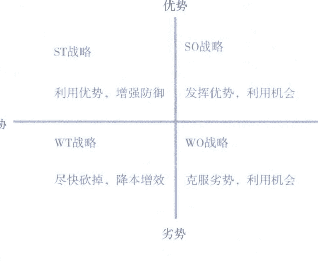
SO 战略：外部有机会且内部有优势时，采用增长型战略，加大投入放大优势，积极拓展实现快速增长。
**WO 战略**：外部有机会但内部缺乏优势时，采用改进型战略，通过补齐短板来分享市场红利。
**ST 战略**：外部威胁重重但内部有优势时，采用防御型战略，依托优势稳固份额与地位。
**WT 战略**：外部威胁多且内部缺乏竞争力时，采用收缩型战略，果断砍掉低效业务，降低成本提升效率。

SWOT 能帮企业判断“有机会做”和“能做”，但不等于“该做”。战略还要考虑“想做”，即是否契合使命、愿景与价值观。

只有“能做、有机会做、想做”三者兼备的，才是该做的事。战略一词中的“战”代表进攻与夺取，“略”代表退却与舍弃，有取有舍才是战略。

在战略选择中，明确“不做什么”往往比确定“做什么”更重要。错失恐惧会让企业总想把机会都抓在手里，却导致资源分散与浪费。聚焦才能明确方向，下一步则是战略解码。

### 三、战略解码
战略解码是把抽象的战略方向转化为可执行目标与指标的过程。

#### (一) 平衡计分卡
战略解码最常用的工具是平衡计分卡 BSC，由罗伯特·卡普兰与大卫·诺顿在上世纪 90 年代提出，它从财务、客户、内部运营、学习与成长四个维度把战略转化为可衡量指标。

工具本身不过时，但需结合时代调整。本书把维度调整为财务、经营、客户、流程效率与学习与成长五个维度。

第一，强化长期主义。经营指标与财务指标不同，前者看长期发展，后者看短期回报。若要建立长期主义文化，就要在解码阶段就体现一致行为。

##### 表1-1 财务指标与经营指标的区别

| 区别项 | 财务指标 | 经营指标 |
|---|---|---|
| 数据来源 | 财务报表 | 市场、竞争对手和企业经营 |
| 主要目的 | 保证企业挣钱，该花的花，不该花的要省 | 保证企业健康，不断把脉、做诊断、开方子和解决问题 |
| 关注的重点 | 注重“稳定”和“效率” | 要的是增长，看的是趋势 |
| 思考的维度 | 资金链能不能撑得住？现金流会不会出问题？成本是不是太高了？利润能不能再提高点？ | 我们的生意好不好？我们的生意未来是不是有机会？ |
| 具体指标 | 利润表、资产负债表、现金流量表 | 收入、规模、销售额、市占比等 |

第二，凸显流程提效。业务流程是运营核心，流程优化是降本增效的关键。将内部运营指标外化为流程效率指标，能更清晰传达工作重点。

这种调整只是为了突出重点，并未改变平衡计分卡的核心理念，企业可根据自身需求灵活使用，工具应服务于企业而非束缚企业。

财务指标常见有盈利能力、偿债能力和营运能力。

盈利能力指标包括毛利率、净利率、净资产收益率；

偿债能力指标包括资产负债率、流动比率、速动比率；

营运能力指标包括应收账款周转率、存货周转率、总资产周转率。

财务指标追求收入提升、成本与费用下降、周转效率提高。

经营指标涵盖生产与销售，分生产类与销售类。

生产类经营指标包括产量、产品合格率等；

销售类经营指标包括销售额、销售量、市场份额等。

客户指标分为数量与质量。

客户数量包括新客户数与老客户数；

客户质量包括满意度、忠诚度、净推荐值 NPS、投诉率等。

流程效率指标包括创新流程指标，如新产品服务开发周期、研发投入占比；运营流程指标，如生产周期效率、市场扩张速度、销售增长速度、订单处理效率；售后服务流程指标，如客户问题 24 小时解决率等。

学习与成长：HRBP手里的战略杠杆

学习与成长指标是HRBP必须紧盯的核心，看的是员工培训时长、技能进化速度、关键人才保留状况，折射出企业对人才发展与组织能力建设的重视程度。

五大平衡计分卡维度始终以公司战略为牵引，彼此牵一发而动全身。以某企业为例，SWOT分析后锁定产品研发优势与客户对高品质多元化产品的需求，选择增长型战略，战略目标定为“成为行业创新领导者”。

- 财务维度：靠高附加值产品驱动高利润增长；
- 经营维度：提升新品推出数量与成功率；
- 流程效率维度：加快创新研发的效率；
- 客户维度：吸引追求创新的高价值客户；
- 学习与成长维度：培育员工创新力与技术专长。

五者内在链路是：培养员工创新能力 → 构建高效研发流程 → 推出创新产品吸引用户 → 带来新品市场份额与销售额提升 → 最终实现高利润增长，从而达成“行业创新领导者”的目标。

公司战略是总纲，财务经营是结果呈现，客户价值是核心，流程效率是过程，学习成长是底座与资源，支撑业务闭环。

指标体系搭建本质上是对经营逻辑的拆解。例如选择“新产品研发周期”作为流程效率指标，学习与成长维度就应匹配“有助于压缩周期的技能培训”，据此设立对应学习指标，再分析培训投入对研发周期、进而对客户吸引力、新品收入、财务回报的传导效果。

指标值的确定可用三种思路：

- 跑赢大盘：增长型战略有机会有优势，要设定高于行业均值的目标，否则增速落后即份额流失。
- 跑赢竞争对手：改进型战略以对标为标准，短期可追赶领先1-2位的同行，长期可瞄准行业龙头。
- 跑赢自己：防御型战略最少持平最好超越，保持核心竞争力不被反超。

保底目标可由此得出，但好目标必须具挑战性，求上得中，求中得下。长远3-5年战略目标还需结合行业周期、项目周期、资源现状与投入稳定性来设定，确保可持续。

目标制定遵循SMART原则。

S——具体，定义清晰无歧义。如将“提升客户满意度”细化为“医疗设备产品整体满意度评分按1-10分制提升至8.5分以上”。

M——可衡量，用客观数据或明确标准衡量。如客户满意度靠季度调研打分，流程效率用周期小时/天衡量，技能提升可用认证通过率衡量。

A——可实现，基于现有技术、产能与竞争态势设定合理水平，避免不切实际。

R——相关，与战略和主营业务紧密关联。如医疗设备企业提升市场竞争力，质量合格率、智能功能创新性高度相关，而行政办公用品费用节省相关性低。

T——有时限，明确完成节点。如“第一季度末库存周转率提升30%”，便于追踪考核。

### （二）不同战略选择下的战略解码

不同战略下，财务、经营、客户、流程效率及学习成长指标，以及HRBP的重点工作各不相同。

##### 1. 增长型战略

增长型战略重在扩张借势放大份额。

财务指标关注：
- 营业收入增长率，是规模扩张的核心；
- 净利润率，扩张期可能波动，长期应趋稳或提升，体现盈利质量；
- 资产回报率ROA和权益回报率ROE，反映资产与权益使用效率是否随扩张提升。

经营指标关注：
- 销售额及增速，衡量扩张能力；
- 市场份额/占有率，体现竞争优势；
- 新客户获取数量与增速；
- 新产品/新市场进入数量与成功率，二者相互印证。

客户指标关注：
- 客户满意度，确保高速增长不牺牲质量；
- 客户忠诚度/复购率，稳住基本盘。

流程效率指标关注：
- 新产品开发效率，即开发周期是否逐年缩短；
- 供应链响应效率，如订单交付周期从30天压至20天；
- 生产能力利用率，制造型企业需提升设备开机率等。

学习与成长支撑业务落地，重点能力包括：
第一，基于优势持续深化专业技能，如派关键岗员工参加高级研讨会，关注专业资格认证人数增长如CFA等；
第二，沉淀优势资源，建设并更新内部知识库，监测访问量、下载次数等使用情况；
第三，提升组织协同，促进外部信息在内流转整合，如市场趋势及时传导至研发；
第四，关注创新投入产出比，研发投入占比及实验室成果转化率；
第五，鼓励创意，统计创意提交量、采纳率及落地效果对用户增长与收入的贡献。

HRBP核心工作：
强化核心竞争力，培养可成长技能，引进难以培养的稀缺人才并建立人才储备库；搭建内化知识库体系；设计期权、绩效奖金、晋升等激励机制激发创新进取；构建跨部门协同会及信息共享平台，打通外部信息。

##### 2. 改进型战略

改进型战略着力补短板、提竞争力。

财务指标关注：
- 毛利率改善率，如由20%提升至25%；
- 成本费用利润率，降本提效后应上升；
- 资金周转效率，应收账款周转率与存货周转率，提升回笼速度。

经营指标关注：
- 产品质量合格率提升幅度，降低次品；
- 销售额、销售量、市场占比等经营指标是否实质提升。

流程效率指标关注：
全面流程提效，如生产周期、服务响应时间缩短，常用流程时间缩短比例或效率提升比例衡量，如生产周期由10天减至7天，提升30%。

##### 3. 防御型战略

防御型战略核心是守住优势、稳住地位、应对威胁。

财务指标：
- 现金流稳定性，确保抗风险；
- 偿债能力维持安全，流动比率约2、速动比率约1；
- 维持稳定利润率，通过成本控制与业务组合优化。

经营指标：
- 核心业务市场份额稳定；
- 严格控制运营成本，成本增速低于收入增速或成本占比逐年下降；
- 有效实施风险分散，多元化低相关业务组合。

流程效率指标：
关注现有流程标准化与落地执行，减少混乱风险；对关键流程开展内审监控，及时纠偏。

客户指标：
维护老客户稳定性与忠诚度，通过优质售后与关怀强化留存，建立流失预警机制提前挽回。

学习与成长聚焦风险管理意识与应急响应，HRBP重点：
强化风险意识与应变能力培训，提升敏感度与危机反应；精简组织、优化人员配置，提升运营效率；为关键岗位提供有竞争力薪酬与发展空间，稳定核心人才。

##### 4. 收缩型战略

收缩型战略目标是平稳退出，减少负面影响。

财务指标：
- 成本削减率，人力、运营等不必要开支压缩；
- 资产处置收益与债务减少情况，盘活资金降风险；
- 保留业务利润率，维持现金流。

经营指标：
- 控制收缩速度与节奏，如产品线由10个减至6个，区域由5省减至3省；
- 收缩中保持其他业务稳定或稳中有升；
- 资源重新配置及利用率提升，如营销资源集中后投入产出改善。

流程效率指标：
简化优化保留业务流程，提升单位资源产出，如单位设备产出率提升30%~40%。

客户指标：
核心客户保留率，通过沟通与定制化服务稳住关键客户，确保理解战略调整。

学习与成长重点：
关注被裁员工再就业支持，提供培训与推荐；关注组织稳定性，搭建信息沟通平台；提升保留员工核心业务能力；推动知识传承与经验沉淀，如离职员工整理工艺、操作技巧形成培训资料；按收缩后需求重构组织架构与岗位配置标准，提升人力效率。

##### 5. 业务设计

业务设计是在明确客户价值与战略目标后，规划核心业务流程及支撑流程，把战略转化为可执行的业务行动。

业务设计是高层共创过程，有助于厘清各部门价值定位与协同。

流程通常包括：明确客户定位与价值；市场与研发共同研讨客户痛点、选品理由及质量性能标准、产品组合与定价；市场与销售策划推广路径与转化复购策略；生产与质量研讨达标生产方案及产能匹配与提升路径。通过深入共创，完成核心与辅助流程设计。

商战打底：先把经营蓝图理清

经营的落地方案一定要紧扣公司的整体走向与长远取向。取向一旦确定，就要钉在墙上坚决推进，经营规划就是把这种取向转化为可执行路径的思考框架。当然，规划过程中若发现取向本身存在明显偏差，也要及时回头审视并修正，确保取向既合理又能落地。

要强调的是，经营规划不是一次性的交付，而是一个持续迭代的工作。市场在变、技术在迭代、竞争格局在重塑，规划必须跟着环境同步调整，才能始终向着长远取向靠近。

## 六、把目标拆到部门层面

经营规划落地、关键流程明确后，研发、生产、品控、市场、销售等各单元负责人都要回到本部门做细化。细化可以遵循下面三个环节。

#### 第一步：先把部门作业链条画出来

每个部门都要把自己的工作链条可视化。工作链条是为达成特定经营目的而串联的一组有序活动，从一次业务事件触发，到一系列关联任务，最后形成预期结果。

画图时聚焦四件事：

1. 由各单元负责人把一次业务从起点到终点的全部动作写清楚，包含触发点、操作步骤、决策节点、信息流向。
比如电商订单处理，触发点是顾客下单，动作包括接单、查库存、走支付、排发货等。

2. 在图中标明每一步的输入与输出。
上一步的产出即下一步的素材，这些素材正是岗位评价指标的重要来源，通过拆解输入输出也能厘清职责范围和资源需求。

3. 梳理各步之间的前后依赖。
依赖关系决定了目标分解的先后与关联。比如制造中，包装必须在装配完成且检验合格后才能进行。

4. 锁定关键控制点。
判断标准可综合影响程度、失误后果、流程复杂度与波动性、对下游的影响以及对客户价值的贡献。
例如软件开发中，系统架构就是关键控制点，合理的架构能让后续开发与升级更顺畅，反之就会反复返工、拖延进度。

#### 第二步：拆解结果驱动因素，共创对策

##### 1. 生产端产能的驱动要素

对制造侧来说，经营重心落在产出能力上。产出能力是指在一定周期内，借助现有的人力、设备、场地等资源能够交付的产品或服务总量。评估不仅看数量，还要看合格率。

产出能力由设备侧和人力侧共同决定。设备侧常用两个公式。

理论单台产出 = 运行时长 × 单位时间产量。
比如一台注塑机每分钟10件，每天工作8小时即480分钟，则理论日产4800件。

单位时间产量由设计参数与技术规格决定，实际运行受速度、模具更换、故障等影响。

综合设备产出 = 单台理论产出 × 设备数量 × 利用率。
假设某厂5台注塑机，利用率80%，单台理论日产4800，则整体日产19200件。

利用率 = 实际运行时间 / 可运行时间 × 100%。
设备一天可运行8小时，实际只运行6小时，则利用率为75%。

人力侧同样有公式。

单人产出 = 工作时长 × 单位时间效率。受技能、疲劳度、工作环境影响，培训可提升效率。

综合人力产出 = 单人产出 × 人数 × 出勤率。出勤率 = 实际出勤 / 应出勤 × 100%。

在产出目标不变的前提下，生产核心成员要围绕“如何提升设备产出”和“如何提升个人产出”展开共创。

同时要盘点现有资源与能力，找到限制产出的关键点，并纳入目标。例如盘点发现某关键设备老化拖慢整体节奏，可设定三个月内完成技术改造，效率提升50%。

还需考虑瓶颈改善后的连锁反应。比如设备提速后，可能给原材料供给和质检带来压力，需要同步调整这些环节的目标，如缩短供货周期、加快检测速度。

##### 2. 销售端业绩的驱动要素

销售成果包含销售额、销量、市场份额等。销售目标拆解的逻辑与生产相似，在目标不变时，团队应基于结果底层逻辑共创提升方案。

业绩逻辑为：业绩 = 产品类型 × 客单价 × 客户数 × 转化率 × 复购率。

多数情况下产品类型和客单价的可调空间有限，团队应聚焦客户数、转化率、复购率。围绕“如何接触更多潜在客户”“如何提升认知”“如何提高成交”展开讨论。

共创时保持开放不评判，尽量穷尽思路。每条对策都要明确时间窗、结果要求和达成程度才算有效，从而确定关键结果。

共创本质是加法，但不全盘采纳。需按价值、资源消耗、落地可行性评估排序，最终锁定5到6条最优核心方案。

#### 第三步：列出行动清单，明确执行计划

无论生产还是销售，通过共创都会聚焦出关键任务。接下来结合个人专长、需求与能力对任务细化并设定个人目标。

明确个人目标可用5W2H框架：谁、何时、何地、做什么、为何、怎么做、需要多少资源、需提升哪些能力。

为激发进取心，个人目标建议分三层：保底、常规、挑战。保底可设为超过市场均值或个人历史最好，常规实现概率约50%，挑战实现概率约10%。

部门与个人目标拆解完成后，资源需求、组织能力与人才差距会变得清晰。此时人力业务伙伴必须基于对整体取向、经营规划及部门目标的深入理解，制定人力战略与策略，并在人力部门内部完成拆解。

## 第三节 读懂业务发展阶段

不少人力业务伙伴反馈，公司规模小几乎没有做过系统规划；也有伙伴表示作为单元支持，缺乏全局视野。这种情况下，如何确定工作重点？可以从业务发展阶段入手，理解业务进而明确职责。

不同阶段与战略选择高度相关。通常分为四个阶段：初创、成长期、成熟期、衰退期。

初创以扩张为主、优化为辅；成长期以扩张为主、优化为辅；成熟期以防守为主、优化为辅；衰退期以收缩为主、优化为辅。

### 一、初创期

初创期的核心目标是把产品服务推向市场，提升品牌认知，获取早期用户。

#### (一) 初创期面临的挑战

##### 1. 业务运营层面的挑战
产品成熟度不足。产品或服务可能仍在打磨或刚上线，功能有缺陷、测试不足，改进空间大，且对市场需求把握不准，易出现偏差。
销量和客户基础薄弱。产品尚未获得市场认可，销量和客户数都很低。

##### 2. 资金与财务方面的挑战
资金耗尽风险。初创企业多依赖创始人储蓄或天使投资，未盈利前现金流为净流出，若在盈利前耗尽资金将面临生存危机。若是成熟企业内部孵化项目，则可能获得母公司资金支持。
单位成本偏高。规模未形成，无法享受规模经济，叠加市场推广和品牌建设投入大，导致成本高、利润薄甚至亏损。

##### 3. 团队建设与管理方面的挑战
招人难度大。品牌影响力弱、业务不确定性高，吸引高素质人才困难。成熟企业内部新业务则因母体影响力相对容易。
团队磨合问题多。成员背景多元，流程职责不清，缺乏标准手册和制度，导致沟通不畅、效率低。
团队规模小，成员需身兼多职。早期团队通常由创始人、技术骨干、少量销售和行政构成，组织结构简单，分工模糊，一人多岗。例如阿里巴巴早期并无独立人力业务伙伴岗位，由成员兼任。

#### (二) 人力业务伙伴在初创期的核心重点

针对上述挑战，核心工作包括：

第一，协助业务负责人招聘关键核心人才。
包括研发专家、能推动市场拓展的创新型营销销售人才、具备核心客户资源的高手。
利用创始人、投资人、合作伙伴人脉寻人，通过股权激励、有竞争力的薪资和灵活工作环境吸引人才。同时可招聘少量综合管理人才搭建基础管理架构，但要控制人力成本。

第二，营造开放坦诚、创新创业、拼搏向上的文化。
通过团队建设、裸心会、吐槽会、创业故事分享等活动，拉近心理距离，促进磨合，激发创新热情，鼓励员工畅所欲言、提出建议，形成积极氛围。

第三，有针对性提升员工专业技能。
为技术人员提供专业培训和行业前沿讲座；为销售人员提供销售技巧和市场分析课程，提升开拓和沟通能力。

### 二、成长期

进入成长期后，产品或服务被市场接受，销售快速增长。核心目标是扩大市场份额、提升占有率。

#### (一) 成长期面临的挑战

市场拓展与竞争加剧。增长可能遇到瓶颈，进入新区域或新客群时受本地竞争对手抵制，或因文化法规不熟导致进入困难。同时竞争对手会采取降价、仿品等策略抢份额，竞争压力大。
质量与服务风险上升。为满足需求加快生产，易出现质量波动。客户数快速增长若服务团队培训和管理跟不上，服务质量参差不齐，影响满意度和忠诚度。
运营流程复杂化。供应链管理难度加大，库存控制出现积压或缺货，影响满意度和资金周转。原有组织架构难以支撑快速增长，部门协调成本上升，决策变慢，响应市场不及时。

#### (二) 人力业务伙伴在成长期的核心重点

第一，确保人才快速有序引进。
根据业务节奏、人才稀缺度和招聘难度制定人才引进计划并执行。重点寻找具备体系化运营管理经验的管理人才和系统性专业知识的专家型人才，为运营体系和专业能力建设提供支撑。

第二，用绩效管理体系保障品质稳定。
构建科学绩效体系，将销售增长率、客户满意度、生产效率等经营指标与个人绩效挂钩。如为销售设定业绩和满意度考核，为生产设定产量质量效率指标，激励员工达成经营目标。

第三，提升基层管理干部领导力。
基层干部是执行关键。通过集中培训统一认知，结合业务复盘会、年度总结会、月度例会、绩效季度会等实战场景，采用复盘反馈机制提升管理能力。

### 三、成熟期

成熟期类似人生的中年，挑战明显。

#### (一) 成熟期主要挑战

##### 1. 业务运营方面
创新惰性。产品功能质量稳定，市场需求稳定，易陷入创新乏力。
市场敏锐度下降。组织僵化、决策复杂，难以及时应对市场变化，易错失机会。例如消费者转向更环保智能产品时，企业反应迟缓则份额流失。
成本上升利润压缩。规模扩大带来原材料、人力、设备老化等成本上升，叠加外部竞争加剧，利润空间被挤压。

##### 2. 内部管理方面
组织官僚化。架构庞大，审批繁琐，部门间协同困难，推诿扯皮，拖累积极性和效率。
优秀人才流失。官僚环境和有限发展空间难以留住创新进取型人才，导致核心知识流失。

企业通常采取两种策略：一是存量市场降本增效，通过优化供应链、降低生产成本提升盈利；二是寻找增量市场，推出新产品服务或进入新细分市场实现增长。

#### (二) 人力业务伙伴在成熟期的核心重点

策略不同，重点不同。

在降本增效策略下，核心是：
第一，激发组织活力。通过激励与绩效考核淘汰低绩效，留住关键人才与高绩效员工。
第二，流程再造与组织变革。重新审视设计业务与辅助流程，提升效率。同步调整组织架构，更新价值观文化，重新分配人力资源，确保再造成功。

在开拓增量策略下，核心是：
第一，人才战略规划。根据新业务需求预测人才数量类型与技能要求，盘点现有人员技能经验绩效，明确缺口与冗余，制定人力规划。
第二，人才转型与再培训。引导员工职业转型，提供技能更新机会。如传统印刷企业向数字化转型时，为员工提供数字印刷与设计软件培训，帮助从传统工人转型为数字化技术或设计人才。
第三，更新价值观文化理念并落地。使文化与转型后战略目标匹配，通过全员大会、部门会议、邮件、在线论坛等及时沟通转型背景目标步骤及影响，邀请员工参与并收集意见。

若顺利度过转型期，企业将迎来新起点；若转型失败则可能进入衰退期。

### 四、衰退期

衰退期企业有序退出市场，以最低成本清理库存、安置员工、处置资产，并与供应商经销商协商解约。

此阶段人力业务伙伴核心工作主要包括：
首先，处理裁员与提升员工能力。

业务收缩期的组织与人力调整思路

经营规模收紧时，人员结构的变动几乎难以回避。面对无法内部安置的员工，用人单位要依据法规则章完成分流程序，并提供合理的经济安置或再就业帮扶，尽可能降低对个人与社会的冲击。对具备再造潜力的团队成员，应提供技能提升与岗位转换的路径。

再者，架构瘦身与费用管控。业务下滑会倒逼组织变精简，企业往往通过调降薪酬福利水位、压缩日常开支等方式，换取衰退期的韧性，为转型或有序退出争取时间与资源。

最后，知识固化与经验传递。衰退期也是沉淀资产的窗口。可鼓励资深员工把多年积累的行业认知、技术诀窍、管理心得整理为文档，并通过内部分享或培训的方式传递给新人或兄弟部门，守护组织 know-how 不流失。

## 第四节 经营分析会上HRBP如何放大价值

经营分析会不应只是业务主理人的主场，更是HRBP彰显价值的舞台。HRBP参与其中，一方面能更贴近业务本质，另一方面能在深度理解业务后输出更专业的人力解决方案。

要实现有效贡献，需要把握以下环节。

### 一、会前准备，做到心中有数
会前要充分下功夫，重点抓住三件事。

#### 1. 掌握业务走势
人力业务伙伴不能仅作人力资源的专才，更要向懂业务的通才转型。会前应花时间研读业务材料，与业务负责人交流，了解近期项目进展、市场声音与当前挑战。例如企业正集中发力新产品线，HRBP就要清楚新品的研发周期、目标客户画像，以及研发团队的人员配比与技能缺口。只有准备充分，才能在会议上有的放矢，避免空泛发言。

#### 2. 提前盘点人力数据
人力数据是HR从业者的重要依据，与经营结果紧密呼应。会前要梳理绩效表现、培训成效、离职率等信息，并分析其与业务指标的关联。例如某业务单元近几个月业绩下滑，同时培训参与度偏低、不及格绩效人数上升，就能敏锐捕捉关联，准备提出针对性的人才提升建议，用数据增强说服力。

对人力数据的解读是HRBP必备能力，每个数字背后都有意义，要学会透过数据看本质。关于人力数据关注点的整理，竹辉放在个人公众号“美遇竹辉”中，回复“人力数据分析”，即可获取相关文章。

#### 3. 与关键干系人前置对齐
提前与业务骨干、部门主管等核心人物沟通想法，了解他们对议题的看法、期望结果以及潜在的人事诉求。这有助于调整思路，也能在会上默契配合，形成合力。

比如获悉销售负责人为应对旺季急需补充有经验的销售人员，HRBP就能在会上精准回应，提出招聘方案与时间节点，展现高效协同。

### 二、会中切入，突出贡献
会议进行时，数据呈现与价值表达都应围绕战略与业务需求展开，才有影响力。

为了让人力工作对战略的支撑更清晰，可以构建关联模型，演示人力举措如何承接战略需求。例如以创新驱动为战略的公司，HRBP可说明招聘上聚焦创新思维人才、培养上开展创新技能培训、绩效上设立创新成果激励，是如何支撑业务的。可视化模型能帮助业务伙伴更直观理解人力价值。

面对业务难题如项目滞后、协作不畅，HRBP要积极参与研讨。以项目受阻为例，若源于技能不足，可提出短期专业培训或邀请专家线上辅导；若源于沟通问题，可建议优化沟通机制，设立每日站会、明确汇报责任，用可行方案助力解决。

在会议中HRBP还要发挥润滑作用。观点碰撞与利益冲突在所难免，可引导各方聚焦共同目标，或提议思考“客户更看重哪种产品功能”。借助高情商引导化解矛盾。

### 三、会后闭环，确保落地
会议结束不是终点，要依据决议将人力相关事项细化。例如确定开展新员工培训，需明确内容、师资、时间与负责人，形成任务清单并发送给相关方，跟进确认接收与理解，避免任务悬置。

对会上确定的事项，要设定跟进节奏，定期与业务部门沟通进展，了解执行中遇到的困难与所需支持。若为改善协作而建立的机制执行不佳，要及时调研原因，是流程设计问题还是员工参与度不足，对症调整，确保决议落地有声。

同时每次会议结束后要做复盘，回顾自身表现，哪些观点被认可、哪些建议需改进、业务洞察是否精准。通过持续总结提升在经营分析会的参与质量，为企业发展注入人力动能。

HRBP在经营分析会的高质量参与，非一朝一夕之功，需要持续学习、深度实践与不断反思。唯有如此，才能与各部门携手，推动业务增长。

理解战略、理解不同发展阶段业务的特点并据此明确工作重点、定期参与经营分析会，这是事务层面的懂业务。而成效如何，还与业务伙伴对HRBP的信任度密切相关。因此HRBP既要在事务层面懂业务，也要在人际层面深入懂业务伙伴。

## 第二章 读懂业务伙伴

在充分理解业务的基础上，了解业务伙伴的行为风格，并选用与其风格契合的沟通方式。在双方情绪平稳的前提下，保持同一认知频道交流，是有效合作的关键。

### 第一节 解析业务伙伴的行为风格
每个人都有独特的行为偏好，不同风格的人偏好的沟通方式也不同。因此合作时需适配其沟通习惯，才能事半功倍。

市面上行为风格测试工具有很多，如九型人格、MBTI、16PF、DISC等。本书重点推荐DISC，因其将人分为四类，简洁易记。

DISC模型依据内向外向与关注事务或人，将个体划分为四类：D为支配，对应老虎型风格；I为影响，对应孔雀型风格；S为稳健，对应考拉型风格；C为谨慎，对应猫头鹰型风格。本书在此基础上新增一种风格，以变色龙A命名，见图2-1。

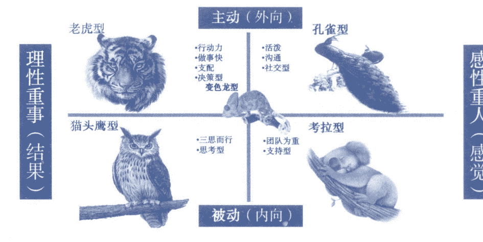

D 维度呈现老虎型，外向且关注事——这类人自信果断，竞争意识强，领导力突出。通常是优秀的决策者与执行者，能在艰难环境下保持沉着并带领团队成功。

I 维度呈现孔雀型，外向且关注人——这类人热情有感染力，表达能力强，社交与说服力突出。常在销售与营销领域表现优异，能有效吸引注意力并建立人际关系。

S 维度呈现考拉型，内向且关注人——这类人平易近人、擅长倾听，适应与协调能力强。常在客户服务与管理中表现好，能快速响应需求并建立长期合作。

C 维度呈现猫头鹰型，内向且关注事——这类人注重细节、善于分析，逻辑与批判思维强。常在研发等领域突出，能深入思考并找到最优解。

A 维度呈现变色龙型，综合灵活——这类人融合多种优势，既有D型的果断高效，也有S型的共情细腻；既能如I型般创新，也能像C型般严谨，短板不明显。他们是敏锐的情境洞察者，能快速分析环境与角色关系并调整沟通策略。冲突中充当协调者，变革中充当桥梁，促进和谐与协作。但也可能风格模糊、精力消耗大、存在讨好倾向。

#### 一、面对老虎型伙伴
老虎型伙伴气场强大，风格强势。他们自信、热爱挑战，表达直接不绕弯，像《亮剑》里李云龙初见赵刚就划清军政界限。他们不惧冲突与问题，行动力强带冒险精神，关注价值与产出。

合作要点：
其一，要有真本事，具备专业或业务能力；
其二，态度上避免一味讨好，靠实力与价值征服；
其三，可尝试先抑后扬：初次接触时适度挑战其权威，激发征服欲，再在交往中展现价值并逐渐靠拢、认可与支持，让其获得征服后的成就感；
其四，少用规章制度限制行为，即使信任建立后也避免频繁搬规则。

#### 二、面对孔雀型伙伴
孔雀型重视自我表达，思维活跃，擅长感染他人，常站在聚光灯下打造个人形象并追求卓越。

沟通时应真诚赞美与欣赏，充分认可其影响力与魅力，尊重其独特观点。在交流中要牢记目的，适时打断并拉回主题，避免被其魅力带偏。阿里巴巴彭蕾曾评价孔雀型的马老师：马老师每天都在天上飘着，让他管哪块业务，哪块业务

#### 三、面对考拉型伙伴
与考拉型合作需注重和谐与渐进。他们偏好稳定环境，不喜大变与高风险。推动变革时应采取渐进方式，避免激进急躁。

考拉型不善主动表达，需耐心引导与鼓励分享。倾听时保持耐心，避免强硬急躁的语气。他们需要时间思考与找解，在征询建议时应给予充足空间，不要施压。

#### 四、面对猫头鹰型伙伴
猫头鹰型重视专业与技术，研发、技术、财务等领域管理者多属此类。他们给人冷静、原则性强、是非观鲜明的感觉。

这类伙伴高度关注数据，沟通前需准备好数据与支撑案例。表达上少用“我认为”，多用“数据显示”。表达应结构化，逻辑清晰，讨论方案时多谈做法、流程、计划与里程碑，体现计划性与组织性。内容上就事论事，客套寒暄会觉得浪费时间。

总之，针对不同类型伙伴，HRBP需调整沟通方式与策略，选择其偏好的方式建立信任。

#### 五、面对变色龙型伙伴
变色龙型人情世故，善于与人建立关系。但这种好感背后可能出于职场需要，关键时刻为利益最大化可能出尔反尔、推翻共识。因此合作时需有Plan A与Plan B，不要轻信承诺。

#### 六、知己知彼
除了了解对方，也要了解自己在对方眼中的形象。竹辉整理如下内容，见图2-2。

| | 老虎眼中的你 | 孔雀眼中的你 | 考拉眼中的你 | 猫头鹰眼中的你 |
|---|---|---|---|---|
| **老虎型** | 直截了当；企图心强；不怕冲突 | 让人下不了台；没人性；爱发号施令 | 没人性；善变；太强势 | 让人下不了台；过于自信；冲动 |
| **孔雀型** | 光说不练；花蝴蝶；不甘寂寞 | 热情；善于沟通；对什么都有兴趣 | 话多；机会主义；静不下来 | 轻率；不真诚；无法捉摸 |
| **考拉型** | 慢吞吞；没主见；慵懒 | 友善；随和；好听众 | 平易近人；乐于助人；没有特色 | 配合度高；好人；稳定 |
| **猫头鹰型** | 反对改革；死脑筋；只见树木，不见森林 | 太悲观；太重视细节；僵化 | 很精确；鸡蛋里挑骨头；保守 | 真诚、认真、正经；自律；有条理 |

图2-2 他眼中的我们

### 第二节 管理自我与他人情绪
情绪影响力巨大。恰当运用可增进关系，无法控制则会被左右并产生负面影响。

情绪管理首要任务是识别并处理个人情绪，在自身平稳后才能引导他人。过程中需留意言行，避免成为触发对方情绪的导火索。

#### 一、觉察并妥善处理自我情绪
常言人在坏情绪下智商为零。职场中要游刃有余，需要情绪稳定。

##### (一) 觉察情绪
保持稳定首先要觉察情绪。情绪来时身体会有信号，如心跳加速、面红、肌肉紧张。此时要防止情绪上头。

可尝试停顿12~20秒、深呼吸、在心中倒数并做简单运算以激活理性思维；提醒自己沟通目的是否为了发泄，当前情绪是否助力目标，若否，就不该让情绪主导行为。

##### (二) 觉察需求
不仅要觉察情绪，更要觉察背后的需求。情绪是传达需求的方式。

愤怒背后常是安全与保护需求；沮丧消沉反映对支持与援助的期盼；嫉妒可能源于希望达到同等水平。意识到需求后，情绪紧张会降低。

##### (三) 觉察限制性信念
若对过去久久释怀不了，可能是限制性信念在作祟，主要有三类：价值观强绑定、应该式强绑定、简单因果推理。

价值观强绑定指认为自己认为重要的他人也应认同，现实中认知各异，固执要求只会造成内耗。

应该式强绑定指先贴标签预设角色，期待他人按预期行事，期望落空易产生负面情绪。

简单因果推理指将结果B简单归因于原因A，人际与业务结果往往是多因素综合作用，单一归因无法解释复杂互动。

摆脱信念可通过：自我反思审视情绪与期望是否恰当；换位思考理解对方难处；保持觉察挑战信念并寻找积极替代，如认识到每个人价值观独特；坦诚沟通表达感受并倾听对方。上述策略有助于调整情绪、改善关系。

#### 二、觉察和引导他人情绪
与业务伙伴合作时，关键是觉察情绪背后的需求并作出恰当回应。

对方开心时，期待回应以强化美好感受；
得意洋洋时，渴望赞赏与尊重；
愤怒时，可能因超出预期或能力范围而不安，需要帮助；
沮丧、消沉或恐惧时，内心缺乏力量，需要支持与抚慰；
对他人成就轻蔑或嫉妒时，可能期望更高，渴望成功；
抱怨时，不仅需要倾听与理解，更是求助信号。

当我们能够捕捉到对方情绪之下真正想要什么时，对方很容易产生“你真的懂我”的感受，这种被理解的安全感会让关系迅速拉近一层。

##### (二) 引导对方的负面情绪
再高的情商也很难完全免疫强烈的情绪冲击。若想保持有效协作，就必须学会引导他人的情绪走向。

###### 1. 快速给对方情绪降温
业务伙伴火急火燎跑来沟通时，如何把温度先降下来？

第一步，先把人请坐。若对方是站着的，请他坐下。坐下这个动作本身就能让身体的紧绷有所松动。坐姿上避免正对面形成对峙，建议采用约45°斜角的位置，物理距离更近，心理压力也更小。

如果坐下后情绪仍在高位，可以用一些小技巧打断。故意让笔掉在地上弯腰去捡，顺便问一句要不要喝点水，或者提醒一句“您衣服上好像有痕迹”。这些轻微的介入能把注意力从情绪漩涡里暂时抽离。

也可以直接点名情绪，比如说“我注意到你现在挺生气的”或“我感觉你现在很焦虑”。当情绪被温和地命名出来，对方往往会更快意识到自己的状态，情绪也会随之松动。

只有等双方都平静下来，事情才有可能被妥善处理。先稳住人，再谈事。

###### 2. 不卑不亢妥善应对情绪
假设业务伙伴正全力冲刺A产品最后攻坚，公司却要推人才盘点。你带着方案去沟通，他却抗拒焦躁：“我现在忙得要死，哪有时间管你们的事，别总拿这些没用的东西来烦我。”

这时回一句“理解，但这是公司项目，再忙也得做”，双方立刻就进入对立，十有八九会失败。

更稳妥的回应可以分三层：

先共情：“我清楚您现在把所有精力都放在A产品研发上，项目困难重重、压力很大，现在提人才盘点确实会让您觉得额外添负担，我完全能理解您的感受。”

再讲清楚价值：“今天找您聊盘点，除了集团要求，更是因为我做了一些梳理，发现盘点恰好能帮上A产品攻坚阶段您正头疼的一个点。如果不是这样，我也不会在您最忙的时候打扰。”

最后表达自我感受：“说实话，在项目价值还没讲清楚前就被质疑和烦躁，我也挺无奈的。自己花了不少时间研究怎么用盘点来助力A项目落地，却感觉没被理解，有点失落委屈。”

面对情绪化反应，不要被带着走。先用共情降温，再说清来意吸引注意，最后坦诚自己的感受。尊重别人的前提是先尊重自己。

#### （三）主动创造有利于沟通的情绪状态
情绪决定信息接收的开关。人放松开心时更愿意听进去，低落时则本能排斥输入。高手懂得选在对方状态好的时段沟通，避开情绪低谷。

也可以主动营造环境。挑一个轻松愉悦的场所，比如咖啡馆或音乐酒吧，讨论重要议题会更容易进入正题。

要说服业务伙伴同意某项建议，尽量别在他办公室谈。换到HRBP办公室、会议室，或公司附近的咖啡馆，效果往往会明显提升。

#### 三、谨防成为情绪爆发的导火索
坏情绪伤己也伤人。与情绪相处是每个职场人长期修炼的课题。没有人有义务替别人背负情绪，也没有人可以随意把负面情绪倒给他人。

面对他人的坏情绪，不必恐惧也不必退缩，要敢于表达自己的感受。同时要守住边界，别让自己变成对方情绪的引爆点。

常见的雷区：

**雷区一：太强的专业自嗨。** 觉得业务伙伴不懂HR，会下意识流露出优越感，比如“说了你也不懂”“某某咨询公司/大厂都是这样做的”。这种表达很容易冒犯对方。

**雷区二：无能为力式表达。** 预算申请时说“预算就这么多，年初就定死了，我也无能为力”，或晋升不合规时说“标准就是这样，你找我没用”。对方会感到被敷衍，积蓄不满。

**雷区三：借刀杀人式表达。** 说“如果不推进，某某总知道会觉得我们不重视人才”“年终评优可能就没我们了”。听起来有道理，实则带着威胁。

**雷区四：将个人评论当作事实。** “小李能力一般，这次明星员工肯定拿不到认可”。这是主观判断，不是客观事实，容易引发争论。

**雷区五：过度概括和绝对化表述。** “每次推荐你们都说不合适，你们根本没认真看就下结论”。“每次”“总是”“经常”“根本”“完全”“绝对”等词极易激起抵触。

积极的情绪是合作的基础。此外，还要培养业务型思维，在认知层面与业务伙伴同频。

接下来进入第三节：HRBP 思维转型。

### 第三节 工作目的和思维认知的转型

#### 一、从以“职责”为目的到以“价值”为目的
HRBP属于后台部门，离市场和客户较远，工作成果很难获得即时反馈，价值感容易缺失。

当价值感不足时，人会想办法“刷存在感”。有人通过搞事情来体现自己，今天改流程明天发数据后天调制度；有人则死磕专业，用硬核专业来证明自己。其实越钻专业越容易掉进深井。

最终的结果是，爱搞事的HRBP觉得业务不配合，爱钻研的HRBP觉得业务不专业。业务方则觉得HRBP要么瞎添乱，要么离他们太远。

根源在于HRBP围着职责转，忘了工作的本意；围着专业转，忘了专业能创造什么价值。

在公司整体目标里，HRBP承担着学习成长这一关键指标，它是经营目标达成的原因和资源。因此要跳出职责和任务的框限，聚焦价值创造和经营目标。

#### 二、从“职能型”思维转型到“业务型”思维
思维不同视角就不同。职能型从专业技术切入，业务型从市场变化和企业经营切入。HRBP要完成这个转换。

#### （一）“职能型”思维
职能型思维只盯着专业范畴内的话题。

比如A部门业务主管老李说：“西北大区业绩下滑就是人手不够，赶紧给我招个销售。”HRBP小张回：“李哥，我们要招什么样的人？期望多久到岗？”两人围绕人才标准聊完，小张就去招聘网站挂职位、搜简历。

这是典型的执行型思维：业务提需求，HR去落地。做不好就怪专业不够，或人不行，于是继续提升专业或换人。循环往复。

这套逻辑成立的前提是业务方在人力资源上很专业，所提需求是真需求。但现实中业务伙伴真的专业吗？如果不是，需求就可能是伪需求。HR若不挖出真实需求就去做，无异于做无用功，浪费公司资源。

强调业务思维并非为工作不到位找借口，而是避免HRBP沦为单纯执行者。企业高层并不傻，若HRBP只是执行，降本增效的压力迟早会落到HRBP身上。

#### (二)“业务型”思维
合格的HRBP和业务伙伴聊的不是组织、不是人才，而是市场、经营和业务。聊国家新政策、市场新品、竞争对手活动、本月业绩、指标异常原因、下月如何达标。

即便收到需求，也会先理解意图，结合业务做分析和讨论，再给出恰当回应。

HRBP的价值不是盲目执行指令，而是帮助业务伙伴解决业务痛点和经营难题。

以老李的需求为例，具备业务思维的小张会先大胆假设业绩下滑的真正原因是什么，再与老李求证招销售是否真能解决问题，最后基于真需求精准落地。

从风格匹配到情绪管理再到思维转型，核心都指向在懂业务的基础上更懂业务伙伴。

### 第四节 关键合作场景

#### 一、如何开启一段与业务伙伴美好的合作之旅
刚接手新业务部门时，第一印象决定后续合作的顺滑度。

提前做功课很重要。会面前通过同事了解业务伙伴的性格特点，做好心理预判。

自我介绍要克制。避免“老王卖瓜式”炫耀名校背景、获奖经历。对方更关心你能为他创造什么。过度自卑的表达如“我对业务不熟，请多指教”也会削弱专业可信度。

理想的自我介绍是展示能力优势，并说明这些优势如何为业务增值、如何帮对方解决问题。

交流中以倾听和互相了解为主。可以适度模仿对方的动作营造熟悉感，比如对方坐姿放松时自己也放松一些，对方点头时延迟一点点跟随。语言上可重复对方话尾几个字，传递“我在认真听”。

对话里尽量放大共同点。发现相似之处就及时点出来，比如“没想到我们都喜欢阅读，还都看过那部电影，有种找到同路人的感觉”。

结束时要留下好感觉。感谢要具体，不要只说“谢谢抽时间”。要说这次交流让你学到了什么，或他的一句话改变了你对某问题的看法。被人认可会让人愿意持续合作。若条件合适，可赠送一个小礼物，加深好感。

#### 二、如何与业务伙伴进行需求分析
业务伙伴常向HRBP提出需求求资源，关键在于甄别背后真正的困境。

第一步：基本判断。思考需求想解决什么问题？问题怎么来的？哪些因素导致？这个需求真能解决问题吗？我觉得更好的解法是什么？

第二步：大胆假设，小心求证。目的不是直接否定，而是共同深入探讨。可说：“上个月业绩下滑，我和您一样焦虑，能感受到您压力很大，对吗？”先描述事实、表达态度、展现共情。然后说：“您提的需求是一个解决方向，这两天我也在想是否还有别的可行方案。”既不否定也不强加。

对方可能两种反应：愿意分享已尝试的方法并讨论，这是好信号。若对方坚持“只有”这个方法，理解其压力后可说：“我注意到您用了‘只有’这个词，说明您非常认可HRBP的价值，否则不会觉得我们在关键时刻。我的确也有一些思路，或许可以和您的方法结合，我们找个安静地方聊聊？”

第三步：达成共识。经过讨论列出待解决事项，按重要程度和投入产出比排序。判断重要性可问：是否影响部门整体目标？不解决会打击士气吗？会影响对方健康睡眠吗？不解决对团队有何影响？解决了能带来什么好处？

确定优先级后共同制定方案、分工落地。若HRBP经常参与业务会议，很多需求会在分析中自然浮现，对真伪也有预判。离业务越远，操作效果越差。

#### 三、如何说服业务伙伴一起完成项目
HR主导项目时业务不重视怎么办？

以人才盘点为例，COE牵头、各HRBP协同推进，但业务部门正忙于双十一战役。答案是“在正确的时间做正确的事”。

正确的时间是业务有需求的时刻，正确的事是业务期待发生的事。人才盘点的本质是通过精准人岗匹配助力业务目标。关键战役需要选人布局：谁做项目经理、谁负责前端、谁协调后端。答案正是盘点结果。找到交汇点，说服力自然提升。

关键在于HRBP是否真正理解项目对业务的价值，以及是否保持紧密联系，不缺席业务的关键节点。

若必须在不理想时推进项目，比如新绩效制度已定生效时间，需业务配合。沟通前要想清楚：对方的沟通偏好是什么？他可能提出什么问题？如何回应？项目能帮他解决什么问题？带来什么好处？

若方案已定，还需思考：方案是否复杂？是否易懂？需要业务参与的部分是否简单易操作？越清晰越易执行配合度越高。落地风险有哪些？有无应对预案？其他团队怎么推进？集团项目业务方常关心别的部门进展。今年方案和去年比有哪些变化？原因是什么？

把这些问题提前想透，减少对方不便，才能真正说服业务伙伴一起把事做成。

最后需要特别加一句提醒，推动事项时请不要用“借刀杀人”的方式。所谓借刀杀人，就是借助某位有影响力的领导去施压，让对方没有回旋余地。这种做法短期看可能让事情动起来，长期看却会透支互信，对后续合作造成伤害。

#### 四、公开会上面对指责如何从容回应
情境：公司月度复盘会上，大家在讨论上月未达标的原因。甲部的业务主管说：“我们组的小A走了，他手上的客户现在没人对接。招聘需求报了一个月，人力那边推送的人都不合适。”说完看向人力同事，继续说：“我们这边压力非常大，希望以后能多推真正匹配的人，别老发那些没用的表格。”

在众人面前遇到这样直指个人的质问，该如何应对？

第一步：先稳住情绪，展现专业。情绪可控，交锋的基本盘就有了。

第二步：把情绪表达出来。控制不等于压抑，也不等于没有感受。若完全不表态，对方会把你当软目标，后续会习惯性用同样方式对待。

可以这样回：
“您刚才提到招聘一直没落地，人选都不符合，我感受到这件事让您很不舒服。”——先把对方的意思复述，同时把自己的感知说出来。
“如果这让您不舒服，说明我们确实还有改进空间。”——不争辩、不解释，直接承接诉求。
“我也听到了您希望我们多推荐合适人选，少发无效表格。听到这句话，我觉得委屈，因为我们其实做了不少工作；也觉得惋惜，因为努力后问题仍未解决；还有点尴尬，因为在这么多同事面前被直接点名。”——把委屈、惋惜、尴尬说清楚。
“我相信您今天不是故意针对人力个人，而是希望一起把问题解决，对吗？”——正向引导，把对方拉回善意与理性。
“大家时间都很宝贵，关于这件事，会后我单独找您沟通，您看可以吗？”——能当场解决就当场处理，需要深入就另约时间。

在承认对方诉求的前提下，既能体现专业素养，又能既不低声下气也不咄咄逼人地表达感受，更有利于维护长期平等的协作。

#### 五、如何与业务方保持长久健康的协作
长久且平等的合作，除了态度得体，还要把关系建立在清晰的原则与底线之上。

原则分两类，做事的和做人的。
做事上，可以共同约定：保持高频沟通、相互尊重、求同存异、在团队面前口径一致、坚决不拆台。
做人上，原则是：不背后推卸责任、不散播小道消息、不逃避责任。

底线是合作的根基，没有底线关系容易瓦解。但只有底线和原则显得生硬，还要在底线之上经营情感储蓄。

从认识开始，每个人心里都有一个给对方的情感账户。每一次互动都在进行存取。
兑现承诺是存款，失信是取款；
真诚敢担责是存款，虚伪逃避是取款；
乐于分享助人是存款，自私刻薄是取款；
提供帮助是存款，把帮助当成理所当然是取款……

关系就在持续的存取与平衡中维系。很多项目与业务方本身关联不大，但需要对方支持。对方愿不愿帮、帮多少，很大程度上取决于你平时在他那里积累了多少情感储蓄。

#### 六、如何向公司平台争取资源
案例：公司年度晋升，甲部按预算只剩一个名额。业务方希望再增一个。沟通后发现确实有必要。

员工小张和小李分别是西南和华东大区的运营负责人，年业绩都不错且优势不同：
小张擅长客户关系维护、资源整合和市场开拓；
小李细致稳重，适合统筹运营。
业务方计划让小张明年负责东北大区开拓，小李接管西南加华东全部运营。
若今年只升一个，另一人的积极性会受损。测算显示，晋升带来的收益远大于人力成本。

HRBP决定向资源方申请支持，沟通时可以提升成功率。

第一，准备要充分。
职场绝不打无准备之仗，向上级或主管部门要资源时准备尤其关键。
准备质量取决于是否思考清楚：
谁有资源分配权？
这个人的工作风格怎样？
若被拒，可能的理由是什么？
他会担心什么？
若决策权在更高层，需要提供什么信息、资料或案例才能让他人更愿意帮你向上争取？

第二，找对沟通时机。
要资源的最大阻碍是对方的防御心理。要选防御最弱的时刻，比如对方心情好时；或创造低防御环境，比如轻松的咖啡馆。

第三，共识目标，引导思考。
预算外要资源本身就不合规，不能直接索要，要用试探性提问引导对方打开思路。
比如问：“如果部门想新增一个晋升名额，您觉得有哪些可行做法？”
若对方说“没有”，可追问：“我了解过去晋升也出现过特殊情况，通常怎么处理的？”特殊情况背后的原则往往是突破口。
若对方说：“过去是过去，现在特殊情况不能轻易特批，不然人人都来要求就乱套了。”
要记住，只要对话没结束就有机会，不要气馁。
继续问：“明白，我们压力也很大，要保证晋升有序进行。除预算已锁定不能随意增加外，还有哪些因素导致不能特批？”
对方可能说：无法增预算，一是预算已锁定，各部门必须遵守保证公平；二是公司控预算是为了降本。你们的需求却与降本目标冲突。

听到这些要高兴，这正是我们想引导出来的答案。公司所有制度和策略的最终目标是支持业务发展，否则就失去意义。这也是制度建设的核心原则。
很多中后台容易陷入官僚主义，为职责而非目标工作。若引导不到你要的答案，可以直接问，效果可能有限。
记住请求资源时，绝不要否定对方观点，要适度认可。没人喜欢被否定，你的目的是要资源不是辩论。

对方解释完预算控制后，可以引导：“我刚听到您说，不特批是为了维护公平和助力降本，对吗？这两个原因里哪个更关键？”
如果对方认为公平更重要，就引导回共同业务目标；如果行不通，可考虑是否需要找其直接主管聊聊。

如果对方回应第二个原因更关键，就可以陈述：“我们想新增晋升名额，是因为明年小张要去开拓新业务，小李要接管全部运营。业绩预测显示，布局后至少能带来5%提升，约100万收入。今年晋升两人成本10万，用10万换100万是提升效率的做法，您说对吗？如果明年没实现业绩，我们已有相应人才管理方案。现在方便详细沟通一下吗？”

这个案例主要用到的策略有：
1. 不要一开始就让对方说“不”。不合规的需求直接提必被拒。
2. 用开放式提问探索机会，引导对方思考。
3. 积极寻找共同目标。各部门在公司层面目标一致。
4. 牢记价值交换本质。资源需要价值交换，要提前准备回报预测。
5. 降低对方顾虑。不行动背后是担心和风险，要把风险降到最低。
6. 保持积极心态。只要沟通渠道没关闭就别轻言放弃。不要急于反驳，更不要情绪化。要资源的目的是获取资源，不是争对错。观点不认同也可以表达理解。

这套思路同样适用于向业务方要资源：先用开放问题探明对方在何种条件下更愿意支持，再持续引导找到共同目标，最后明确对方能获得的利益并主动澄清风险点及管控措施。
争取资源的核心是用未来预期收益换当前资源投入。理解这一点，就能举一反三，成为资源整合的高手。

#### 七、搞定业务方小锦囊
HRBP工作价值得不到认可，往往不是专业不行，而是太专注专业而忽视了与业务方的关系。
人际关系本就充满不确定性，而HRBP和业务方存在相互支持又相互制约的关系，更需要智慧。
尽管如此，合作中仍有可循的原则和技巧。

基本原则：共同目标下的相互尊重与真诚。
实用技巧：
第一，始终以创造价值为核心目标，而不是只为了完成任务或项目。
第二，在目标一致前提下，长期关系比短期结果更重要。

#### 八、章节总结
分析问题“事在前”，解决问题“人为先”。懂业务是事的层面，懂业务方是人的层面，都是组织对HRBP的期待。

如何衡量HRBP的“懂”的水平，可以分三层：

初阶的懂——听得懂。能和业务方顺畅对话，听懂他们的语言。

中阶的懂——讲得清。对业务问题能清晰回答并能向第三方介绍，包括：
公司未来发展方向受哪些因素影响？变化会怎样？
今年战略目标和核心重点工作是什么？
业务流程有哪些？
哪些是竞争优势的关键节点？为什么能占优？优势如何体现？
短板和劣势是什么？具体表现是什么？带来什么挑战？
竞争对手是谁？前三家是谁？相比我们各自优劣在哪？产品、价格、服务体验？他们的劣势在哪？

高阶的懂——信得过。业务方遇到问题第一个想到你。被信得过的HRBP，不仅懂业务，更懂业务方本身。

愿每位HRBP从业者都懂业务也懂业务方，在业务部门有话语权和影响力，真正助力组织、团队和个人效能提升。

# Part 02
# 提升效能：激活组织、团队和个人效能
提升效能是企业永恒追求。需要组织、团队、个人组合发力。本部分分三章展开：
第三章 提升组织效能
第四章 提升团队效能
第五章 提升个人效能

# 第三章 提升组织效能
组织是为实现目标而协作的集体，具有使命、愿景、价值观、业务流程和规章制度等。
组织是内外信息交流互动的系统。内部子系统协作创造价值，外部持续与环境交换物质能量信息。组织作为系统不可避免熵增，因此必须关注组织效能提升。

对HRBP而言，助力组织效能要发力两个关键领域：一是流程提效，协助业务方萃取优化改进业务流程；二是文化提效，用文化凝聚人心提升效能。

## 第一节 流程提效
流程效率是战略目标的重要组成部分，助力业务方提炼优化改善流程是HRBP核心职责之一。基本步骤如下。

第一步：明确需要提炼优化改进的流程范围，并确定效率提升目标。
例如一家ERP软件公司，随着业务扩张客户需求复杂，研发周期拉长且出现质量问题，决定优化研发设计流程。范围界定为客户需求收集、软件架构设计、代码编写、测试、产品交付。目标是在12个月内开发周期缩短20%、软件缺陷率降低30%、客户满意度提升15%。

第二步：收集相关信息。
信息分两类：阻碍流程效率的问题信息，和助力效率的最佳实践信息。
渠道有三类：
内部资料：项目文档、需求报告、用户反馈记录，分析后可发现问题和亮点；
员工访谈：对流程责任人、关键节点员工、最佳实践者访谈，挖掘具体问题和经验；
直接观察：观察有问题的工作场景和高效场景，记录操作步骤、时间安排、工具使用、沟通方式。

第三步：按流程步骤整理信息，绘制详细流程图。
流程图要包含每阶段的输入输出、参与人员、时间估算、各环节依赖关系，便于直观发现问题。
如上述案例，绘制后发现需求规格说明书是需求收集输出也是架构设计输入，因标准不明确导致衔接不畅信息传递不顺。
同时要分析最佳实践，总结每个环节为何做对而提升效率。

第四步：萃取或优化流程。
根据分析结果优化。例如案例中建立标准化的需求收集模板和沟通机制解决信息传递问题；对优秀实践予以保留发扬。

第五步：小范围试点验证或最佳实践应用验证。
验证过程中收集反馈，观察是否达到预期，是否存在新问题，再据反馈调整完善。
最后将验证完善的最佳实践或最优流程整合进企业标准操作程序或管理体系，或编成业务指导手册。建立培训机制确保员工正确理解执行。
落地过程中持续跟踪监控，收集数据和反馈，及时发现运行问题。

组织如人，流程是血液，文化是灵魂。HRBP既要关注流程提效，也要借助文化助力组织提效。

## 第二节 文化提效
### 一、文化的定义
提到文化，最先想到的是使命愿景价值观，这是文化核心，但不等同于文化。
阿里影业首席运营官邓康明曾说：“企业的使命愿景、战略选择、商业模式、业务决策、服务谁不服务谁、什么样的客户、用什么方式服务，以及你要用谁做干部不用谁做干部，这一系列行为最后沉淀下来的东西就叫文化。所以很难设立一个文化部门来做文化，文化是以业务和组织干部为核心，以制度为出发点，不断做决策，最后形成的那个东西。”

这说明文化渗透在运营管理的点滴之中。管理者行为既体现文化也塑造文化。
为避免概念混淆，本文采纳行业共识，将使命愿景价值观纳入文化范畴，视为提升组织效能的关键。同时团队管理归入团队效能，人才管理归入个人效能。

### 二、使命
#### (一) 使命的定义及价值
使命回答企业与世界的关系，是企业存在的价值和意义。简单说就是要想清楚：我们的客户是谁、用什么方式、为哪些客户、创造什么价值。
很多企业没有把使命写在墙上，但从诞生那一刻起使命就存在。使命不是成立初期必备，但明确使命会带来诸多好处，尤其当企业处于特定情形时，创始人和高层管理者应花时间思考公司的使命究竟是什么。

**使命何时最管用？四种关键情境与落地路径**

**第一种情境：** 公司方向和目标已初步敲定，但仍处在从0到1的起步期。手头资源吃紧，很难用物质回报来激励成员。在这种阶段，围着共同使命做讨论，是凝聚人心、提振士气的好办法。

**第二种情境：** 企业已成长为行业头部，开始闯进无人区，前路没有现成可抄的作业。这时对使命的共同认知变得格外重要，它能为下一步的探索指引方向。

**第三种情境：** 业务高度依赖人才，且团队以新生代为主的企业，使命驱动会产生意想不到的回报。新生代对物质的执念在减弱，更看重工作的价值感和意义感，也渴望更多自主选择。点燃使命感，比单纯的物质激励更能激发年轻人投入。

**第四种情境：** 当公司需要业务转型、打破旧思维定式时，重新审视并厘清使命就显得尤为必要。

以微软为例，看使命重塑怎样推动转型与发展。1999至2019这二十年，微软市值波动明显（见图3-1）。
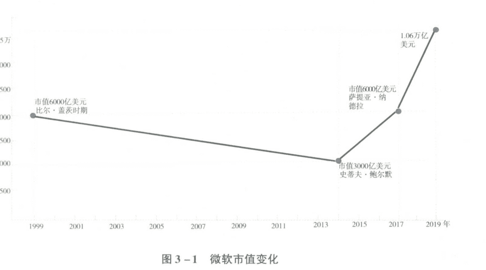
从市值走势可以看到，比尔·盖茨主导时期，微软在1999年攀上约6000亿美元的峰值，成为行业辉煌的象征。

到了鲍尔默担任CEO的2014年，受苹果、谷歌冲击的智能手机业务拖累，市值一度跌至约3000亿美元。

转折发生在纳德拉上任后。2017年10月20日，市值重回6000亿美元；到2019年9月25日，更攀升至10,600亿美元。

2014年萨提亚·纳德拉接任CEO后，迅速启动文化转型，其中核心就是重构使命。1980到2015年，微软的使命是“让每个家庭的每张办公桌上都有一台电脑”。这更像一个具体目标，回答的是“做什么”的问题。

随着时代变化，目标一旦达成，指导作用就会衰减，员工容易迷茫。2016年，微软把使命升级为“赋能全球每一个人、每一个组织，成就不凡”。这次表述落在“为什么存在”的层面，阐明了企业的价值和意义。

当员工真正理解“为何存在”并以此为行动坐标时，“做什么、怎么做”就有更大的创新空间。正是这一次使命重塑，让纳德拉领导下结束与苹果的对立，转向合作共赢的经营策略。

#### (二) 认知层的使命共识

要让高层达成使命共识，可以围绕几个核心问题展开：

- 这家公司存在的价值和意义究竟是什么？
- 我们为什么会走到一起？
- 我们的事业会给社会和身边的人带来哪些积极影响？
- 我们靠什么核心技术创造价值？
- 公司的哪些特质让我感到自豪？

达成共识只是认知层面的对齐，并不等于每个人内心都有了使命感。使命本身没有驱动力，真正推动行为的是使命感。

#### (三) 使命的践行和落地

先讲一个合伙创业的小故事。

主人公是小张和小李。小张是销售，业绩突出，但母亲重病住院，康复费用很大。小李在技术公司做产品研发，感觉才华被埋没，且为孩子上学区房筹钱发愁。

两人是好友，一次长谈后发现小李的产品能解决小张客户的痛点，便决定一起创业，目标是“比打工挣更多钱”。在共同的赚钱目标下，公司迅速做大，甚至立下十年上市的志向。

随着规模扩大，小李深耕技术并参与管理培训，成长很快；小张则频繁外出应酬。认知差异逐渐显现。

某次，VIP客户赵总提出独家代理，承诺高额分成。小张觉得有利可图，小李却反对，认为短期获利会换来长期丧失直面客户、精准反馈的机会，也会被单一利益关系绑住。两人对“公司存在的意义是盈利还是长期创造价值”产生分歧，最终关系疏远。

##### 1. 激发使命感

故事说明，起步期靠短期目标凝聚团队是可行的。小张和小李因各自现实压力创业，共同的赚钱目标推动了初期成长。产品被客户买单，说明创造了价值，符合“使命即为特定客户创造价值”的定义。

但创造价值不等于有使命感。只有当客户认可带来内心的价值感和意义感时，使命感才会出现。它来自主动自驱，而非金钱驱动。

激发使命感，企业常倡导积极主动、主人翁精神，并以“今日最好是明日最低要求”来规范行为。更关键的是营造平等、开放、坦诚、透明的文化，具体做法有：

**第一，淡化职级称呼。**
等级观念会让员工在上级面前拘谨，难以主动。很多公司去职级化，禁用“某总”“某部长”“老大”等称呼，改用名字或花名。

**第二，打造平等开放的空间。**
管理者独享办公室会传递职级文化。开放式办公让主管、经理、总监与团队共处同一空间，有助于建立平等意识。

**第三，建立多渠道沟通机制。**
信息掌握在谁手里，权力就在谁那里。公司要让决策信息多渠道流通：除邮件通知外，用内部视频会议解释并设问答环节；通过内部论坛或社区鼓励员工发声提建议。

只有感受到尊重和平等，员工才有主人翁意识，才会发自内心主动为客户创造价值，从而强化使命感。

##### 2. 围绕“客户”落地使命

使命本质是客户中心，要回答：目标客户是谁？具体需求是什么？如何有效满足？落地就是通过各种载体持续强化员工的客户认知。

**第一，借助使命故事传递客户价值。**
把能承载使命的历史事件整理成动人的故事，是传播使命的有效方式。使命故事主要来自三个源头：

(1) 源自创始人亲身经历。如认养一头牛的使命“为用户养好牛”。创始人徐晓波为儿子买奶粉时，被海关盘问4小时，深受触动，决心造一杯放心奶。随后用两年走访7国136个牧场，最终创立品牌。

(2) 源自创始人改变行业的理想。如三一集团创始人梁稳根希望改变中国工程机械形象，提出“品质改变世界”。自1989年成立以来，每年投入销售额5%于研发，实现关键零部件自主可控，专利申请与授权均破万。混凝土机械长期领先，挖掘机2020年夺全球销量冠军，以品质重塑中国制造形象。

(3) 源于时代机遇。如百度抓住互联网信息爆炸带来的信息过载问题，以搜索引擎为核心不断优化算法，让用户高效获取知识。使命定为“用科技让复杂的世界更简单”。

**第二，借助企业主题色和logo传递价值主张。**
色彩有生命力，公司应按业务属性和客户需求选择主色。

阿里巴巴用橙色传递温暖、亲切、快乐、健康和勇敢的感受；
叮咚买菜用绿色传递生机、希望与健康，契合食品与生鲜；
海尔用蓝色传递专业、可靠、理性，适合研发制造。

logo是虚拟代言人。以阿里巴巴logo为例：

图3-2 阿里巴巴公司logo

首先是字母“a”的含义。在alibaba中，a既是开头也是结尾，象征有始有终、坚守初心；西方文化里a代表第一、卓越，体现了成为行业领军者的追求。

其次是笑脸图形，寓意积极乐观，员工快乐工作，客户享受微笑服务。

最后是@符号的象征，代表网络与连接，体现互联网公司搭建买卖双方桥梁的定位。

颜色与logo都是直接反映客户价值的媒介，需与业务特性和客户主张匹配。

**第三，借助仪表仪容仪态传递客户需求。**
员工形象应与客户属性一致。服务B端客户的企业，职业装彰显专业与可靠；服务C端消费者的企业，着装要求相对宽松，自然舒适更能让员工以轻松方式对待消费者。

总之，建立共同认知、营造有使命感的氛围，并用多种载体强化客户价值认知，是践行使命的关键。

### 三、愿景

愿景是描绘公司长远发展的蓝图，前瞻且具激励性。其时间跨度取决于几个因素。

首先，对技术趋势的判断。以阿里巴巴为例，1998-1999年互联网兴起，2001年愿景为“成为世界十大网站之一”；进入大数据时代后，2010年愿景变为“成为共享数据的第一平台”。技术判断决定了想象空间。

其次，对组织现状能力的分析。愿景要与现实保持平衡，过于遥远会被视为幻想。

最后，受高层视野、格局与野心影响。马云的国际视野让阿里巴巴抓住互联网机遇，将长期愿景分解为阶段策略。

好的愿景表述应具备：

1. 前瞻性与预见性。包含对未来的洞察与可能性。
2. 画面感。能让员工在脑中形成生动意象。阿里最新愿景说“不追求大、不追求强，追求成为一家活102年的好公司，到2036年，服务20亿消费者，创造1亿就业机会，帮助1000万家中小企业盈利”。“好”一词饱含价值认同，“102年”“20亿”等数字让目标具体可感。
3. 适度挑战性。既具挑战又不脱离现实。

使命是企业不变的信仰，愿景会随成长而更新。阿里使命“让天下没有难做的生意”始终稳定，而愿景经历了多次演进：
使命 让天下没有难做的生意
- V1-2001：企业要活80年，成为世界十大网站之一
- V2-2005：成为全球最大电子商务服务提供商
- V3-2010：分享数据的第一平台
- V4-2014：构建未来的商务生态系统
- 最新愿景：活102年，服务20亿消费者，创造1亿就业，帮助1000万中小企业盈利

### 四、价值观

价值观是个体或群体关于什么有价值、值得追求的基本信念。

小张和小李创业初期因“创业比打工挣得多”的共同信念走到一起。但随着发展，小李更看重长期迭代与客户连接，小张仍强调挣钱回笼资金。认知差异导致分手。

早期重短期利益可以理解，但企业成长后，创始人需具备长远眼光与更高格局，即站在更宽、更深、更高的维度看问题，洞察要素间的联系与规律，超越短期利益做出战略决策。

管理中常说“志同道合”。“志同”是共同的志向，即使命；“道合”是认同事物与人性发展的规律。在“道”的指导下，行为更具利他与长期主义，这构成了公司长期发展的价值标准。

道之所向：让价值观真正活起来

以道为依归的价值体系，其最直观的外部体现就是爱、利他与长期主义。在这个内核之上，会生长出形态各异的表达。爱与利他，可以演化为客户第一、员工至上、尊重个体、以人为本；长期主义，则往往表现为持续创新、拥抱变化、坚持价值、艰苦奋斗。

对企业而言，价值观的锚点可以从职场中五种关键关系来界定：与客户的关系、与上级的关系、与平级的关系、与下属的关系，以及与自己的关系。

与客户，常见表述是客户第一、客户至上；与上级，核心在于坦诚与真实；与同事，强调协作、信任与共赢；与下属，则体现为信任与耐心；与自我，则指向内在力量的激活，比如今天最好的表现是明天最低的要求、自我驱动、积极主动、善于内省。

这套思考框架只是提供方向，企业在落地产出时不必拘泥于这五类关系，只要不偏离爱、利他与长期主义的核心，表达方式可以因企制宜。

价值观要生效，必须借助方法把认知带到行为上。我们归纳出四种可参考的落地路径：

1.  用价值观共创来对齐认知；
2.  用行为改变来牵引认知；
3.  用持续影响与反复强化来塑造认知；
4.  用触动人心的方式来改变认知。

下面展开说明。

#### (一) 通过价值观共创来统一认知

改变不易被接受，但自发的选择会让人拥抱改变。所以价值观不能自上而下灌输，而要让员工参与共建。

共创通常经历六个步骤：

##### 第一阶段：价值观共创前的准备

准备工作有两件：组建共创团队与收集背景信息。

共创团队建议覆盖高层领导、各部门代表以及老员工与新员工代表。高层提供战略视野与决策支持，部门代表反映不同场景需求，新老员工兼顾历史与新鲜视角。

背景信息要包括企业历史、战略与文化：公司如何起家、经历过哪些关键事件、当前战略目标是什么、现有文化有哪些特点。同时可对标竞争对手的价值观与行业最佳实践，比如多数互联网企业会强调客户第一与创新。

还可以通过问卷、内部访谈收集员工初见想法，例如问“你认为企业应坚守的三个理念是什么？”。

##### 第二阶段：使命、愿景驱动下的价值观讨论

成员先要吃透使命与愿景，尤其是愿景，共同描绘未来蓝图。

随后讨论：实现愿景需要哪些价值观来支撑？比如一家新能源汽车企业的愿景是成为全球领先的新能源解决方案提供商，推动可持续交通。达成它可能需要创新驱动技术进步、环保契合可持续理念、客户至上满足市场需求。

价值观的提炼也要呼应战略重点与业务重心，若战略聚焦海外拓展，“全球视野”“跨文化协作”就可能成为选项。

##### 第三阶段：价值观头脑风暴

召开共创会议，让成员畅所欲言。把团队拆分为若干小组，各自聚焦一个主题深入挖掘。成果分享时，每个小组需给出具体案例说明选择理由。

全程安排记录员，确保所有提案被完整留存。之后整理去重、归类，形成提案清单。

##### 第四阶段：价值观的筛选与评估

筛选依据包括与愿景战略的契合度、对行为的引导力、是否符合社会道德与法律。不同标准可设权重，例如契合度权重更高。

用1到10分对清单逐项打分，按得分筛选。最终保留3到7个核心价值观，保持精炼。

##### 第五阶段：价值观沟通与共识

把初筛结果向全员沟通，可通过全员大会介绍每个提案的含义、出处与价值。

同时开放反馈渠道，如投票、小组讨论，让员工提建议，增强参与感。依据反馈做必要的调整完善。

##### 第六阶段：价值观的落地和强化

把确定后的价值观嵌入制度，如招聘时筛选价值观契合的人才，绩效时纳入价值观评估。

#### (二) 通过改变行为来牵引认知

心理学显示，行为先行，认知随后。要提升价值观认知，先要把价值观的行为表现讲清楚。

行为描述建议采用动词加宾语的结构，并在每条之下阐释其价值与意义，覆盖个人、客户与组织三个层面。

配合案例更容易理解，案例应包含情境、任务、行动与结果。

为了便于记忆，可用有内在逻辑的模型呈现。比如阿里巴巴的价值观模型：

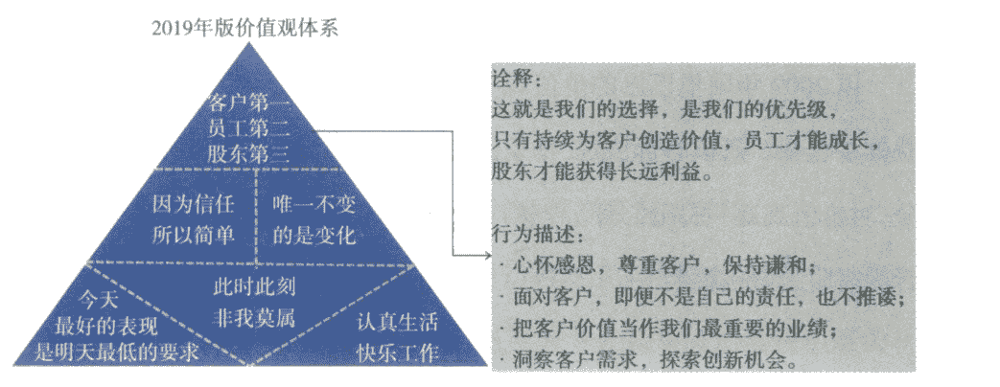

图 3-4 阿里巴巴六脉神剑

模型顶端是客户、员工、股东，传递的选择原则是客户第一、员工第二、股东第三，体现利他与长期主义。

中间层指导人际与环境关系：对外部环境承认变化、拥抱变化；对同事强调信任，“因为信任，所以简单”。

底层是员工自身。积极主动、负责任的人才能迸发使命感；对自己有要求、内求自驱的人才能成长；热爱生活的人才会热爱工作。对应的个人成长期待是：此时此刻，非我莫属；今天最好的表现是明天最低的要求；认真生活、快乐工作。

行为是可以被塑造的。公司可通过价值观考核、奖惩来影响行为。

以2009年阿里巴巴的价值观考核为例。当年体系有5条核心价值观，每条下设4个行为项，共20项，每项1分，做到1分，未做到0分，且做到需附案例。

表 3-1 阿里巴巴的价值观考核

| 档位 | 总得分 | 含义 |
| :--- | :--- | :--- |
| A | 16 ~ 20 分 | 表现优秀，是值得阿里人学习和追求的榜样 |
| B | 10 ~ 15 分 | 符合价值观的基本要求，是合格的阿里人 |
| C | 0 ~ 9 分 | 和阿里巴巴的价值观的行为要求有明显的差距，需要有明确的改进计划；出现违纪违规，无论总得分多少，主管可以根据与价值观的相关性直接定为 C 档 |

评分遵循三原则：

> ◇一致性：同事对价值观表现的评价保持一致，具有公信力。
> ◇一惯性：行为不是偶然，而是持续展现。
> ◇显著性：行为带来积极正向的重大影响。

最后换算为ABC档位，主管需写明优秀之处与改进点。

价值观考核短期见效，但在三种情形下更适合引导而非考核：起步期商业模式未稳、缺乏支撑案例时；快速扩张期需抢占市场时，用成功战例故事引导更好；团队不稳、人才储备不足时，应先提升管理干部领导力。

#### (三) 通过持续影响和反复强化来塑造认知

新认知要常在视野与听觉中，才能内化。做法可以是建设文化墙、访谈价值观标杆人物、编写《价值观指导手册》《价值观践行100问》等宣传材料。

还要组织价值观培训。所有管理人员包括HRBP都应承担布道责任，反复传递使命、愿景与价值观，直到员工能倒背如流。

#### (四) 通过触动人心来改变认知

能长久的价值观符合道的规律，外在是爱、利他与长期主义。它们需要好的载体润物无声，一个是故事，一个是仪式感。

##### 1. 借助“故事”滋养认知

尤瓦尔·赫拉利指出，人类靠想象力与讲故事的能力实现大规模协作。企业讲爱、利他、长期主义的故事，也能激活员工的善意与习惯。

讲好故事要做到三点：

首先明确要传递的价值观。核心是爱、利他、长期主义，具体或表现为善良、宽容、创新、勇敢、责任等。

其次挑选真实素材。价值观是信念，只能来自真实的关键战役、创始人创业经历、客户服务或员工故事。

最后构建完整结构：

> 背景介绍：故事发生的背景。
> 问题与冲突：发生了什么、挑战是什么、严重后果是什么、有哪些选择及利弊。冲突是体现价值观选择的关键。
> 策略与行动：最终选择什么、如何行动。
> 影响与价值：结果如何、带来什么影响、角色坚持了什么原则、放弃了什么。

以海尔砸冰箱为例：

背景介绍：1985年海尔引进设备后仍有质量问题，内部曾出现好冰箱卖外国、次品卖国内的错误观念。

问题和冲突：张瑞敏得知用户投诉后突击检查仓库，发现76台冰箱不合格。干部建议作为福利发给员工，当时物资紧缺，很多人愿意接受。

策略和行动：张瑞敏坚决反对，认为放行会毁掉质量意识。于是召开全员大会，当众砸毁76台冰箱，并让生产者亲自砸。

影响与价值：这一砸敲醒了质量意识，从此无人敢拿质量开玩笑，也向社会传递了对卓越的决心。

口头讲述可调整为：背景介绍→关键事件→事件阐述→影响与价值。

用讲述逻辑重构：背景是1985年冰箱供不应求、需券难求；关键事件是张瑞敏却要砸掉76台冰箱；事件阐述是因发现质量不合格，干部提议发福利，他坚持砸毁来树立意识；影响与价值是砸醒了全员质量意识，开启了对卓越的追求。

##### 2. 借助“仪式感”滋养认知

《小王子》说仪式感让人与众不同。仪式感是表达爱的有效方式。

阿里巴巴的“年陈文化”就是典型：

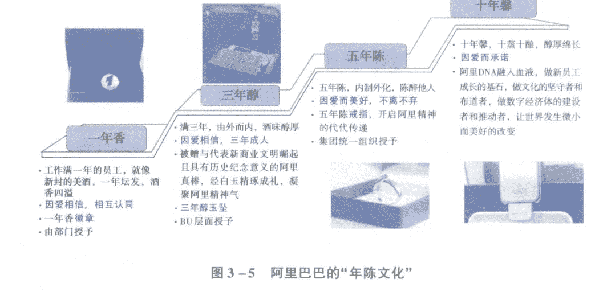

按服务年限分为一年香、三年醇、五年陈、十年馨。

一年香：因爱相信，相互认同。工作满一年颁发笑脸徽章，表示已初步融入、认同文化。

三年醇：因爱相信，三年成人。工作满三年授予汉白玉吊坠，象征沉淀后的醇厚，精神传承。

五年陈：因爱而美好，不离不弃。工作满五年定制刻名戒指，并有访谈与活动，被视为精神代表，有资格担任新人导师。

十年馨：因爱而承诺。十年员工换金色工牌，见证变革，高度忠诚于价值观。

这种仪式增强了归属感与忠诚度，也传递了持续的爱与力量。只有内心充盈爱与力量的员工，才会去帮助他人、服务客户。

#### 五、小节

使命回答公司存在的价值与意义，没有初心方向会摇摆。

愿景描绘发展蓝图，给出长期追求的目标。

价值观提供更高格局的认知与指引，若以爱、利他与长期主义为依归，企业才能抵御短期诱惑，实现长远发展。

三者合一，能帮助企业做出正确战略选择，避免决策偏差，以正确方向以正确方式高质量前行。

## 第四章 让团队真正跑起来

《高绩效团队应该这样带》里，马库斯·白金汉介绍了一项覆盖全球劳动人口的大型研究，研究想弄清楚员工最在乎什么，以及什么样的条件能让他们全身心投入。

调研结果很清晰：员工是否觉得自己属于团队，直接决定了投入程度。把自己当成团队一员的人，其投入水平是完全不认同归属感员工的3.3倍。

思科的内部调研也指向同样结论。当团队业绩从不错滑向低迷时，成员萌生离职的念头会陡增45%。这说明撼动员工去留的，更多时候不是公司而是近在咫尺的团队。

换句话说，在一家平庸公司里待在一个优秀团队，往往能安心长期发展；反过来，即便公司平台很好，落在糟糕的团队里也容易选择离开。

对比遥远难及的高层管理，身边同事和日常协作的氛围对员工的影响更为即时且深刻。因此HRBP帮助业务负责人打造高效协同的团队，意义格外突出。

### 第一节 阻碍协作的五大症结与破局思路

帕特里克·兰西奥尼在《团队协作的五大障碍》里指出，拖累团队高效协作的核心问题有五点：信任不足、对冲突躲避、共识薄弱、责任推诿、结果漠视。

围绕这五大要素，HRBP可从以下五方面助力业务伙伴塑造高绩效团队：

1. 以个人需求为起点构建团队文化：从个体诉求出发凝练共同的使命、愿景和价值观，形成文化认同。
2. 在同一业务流程上绑定利益：梳理优化流程，让目标彼此牵连，设置利益联动机制，让个人关注同事和团队结果。
3. 以培育信任为目标的团队建设：创造深度互动机会，提升成员间的熟悉感与信任感。
4. 以修复关系为导向处理冲突：冲突不必恐惧，关键在处理方式。
5. 以心智成长为核心把握关键时刻：善于利用每一次成员齐聚的机会，潜移默化推动思维升级。

接下来逐项展开说明。

### 第二节 从个人需求出发塑造团队文化

团队文化对成员的意义不亚于企业文化对整体员工的影响。HRBP需要协助业务负责人打造有辨识度的团队文化，明确使命、愿景与价值观。

使命回答团队存在的价值：服务对象是谁？对方期待什么？团队有哪些能力？如何用这些能力创造价值？

愿景是成员对团队理想状态的共同想象。

价值观则是大家认可的行为准则，划定可以做什么和不可以做什么。

塑造文化的有效做法是组织一次轻松的团队研讨，促成共识。建议流程如下。

#### 点燃个人的渴望
先问每个人想要怎样的生活，想开什么车、住怎样的房子、去哪里旅行。愿望越具体，驱动力越强。

#### 探讨需求如何实现
引导讨论满足欲望需要什么。最终指向金钱，而金钱来自价值创造，价值创造来自能力。需要提醒的是，能力强不必然带来价值，职场中能力的发挥高度依赖团队环境。

#### 描绘助力个人成长的团队样貌
团队必须有共同目标，否则只是群体的集合。可以让每个人写下心中的团队目标，暴露认知差异后再对齐。在目标清晰后，思考大家最向往的团队是怎样的，提炼3到5个关键词来描绘愿景。随后就价值观达成一致：

- 如何对待彼此、客户、工作以及自己？
- 若团队失去积极风貌，最可能的原因是什么？需要规避哪些行为？

#### 共同承诺并严格执行
共识形成后要形成郑重承诺，违规时自愿接受相应处理。执行时坚持公平公正，及时处置，杜绝拖延。制度的刚性让管理更有温度。

总之从员工需求出发建文化，用文化推动价值创造，进而满足个人需求。这样的文化才能激发斗志，提升效能。文化建设只是第一步，还要在利益层面实现“利出一孔，力出一孔”。

### 第三节 在统一流程中实现利益互锁

HRBP应协助业务伙伴与团队成员一起画出一张业务流程图。共绘过程能让每个人看清自身位置与协作关系。

在流程清晰、输入输出明确后，再设计关键绩效指标的互锁机制。即在制定个人目标时充分考虑协作方的目标，让个人在追求自身结果时兼顾他方，形成价值链的紧密闭环。

以华为的“前线铁三角”为例，营销项目里有客户经理、产品经理、交付经理三类角色。

- 客户经理负责达成销售业绩并维护客户关系；
- 产品经理负责方案制定、产品推广和技术支持；
- 交付经理关注用户体验与交付、安装、售后。

目标设定时，交付经理承担客户满意度责任，同时客户经理的考核也纳入客户满意度。若仅考核销售，易导致过度承诺给交付带来麻烦；加上满意度考核，销售会更关注客户真实感受。

同时个体绩效要与团队绩效挂钩。团队表现优异时，个人结果可上调；反之即使个人超额，也应相应下调。

无论是基于需求的文化，还是基于流程的目标互锁，都在把人凝聚在一起。但关系不止于利益，信任才是根基。

### 第四节 以信任为核心的团队建设实践

#### 一、信任的构成要素

团队质量很大程度上取决于信任。有信任，事小；没信任，事大。麦肯锡提出信任公式：信任 = 可信度 × 可靠度 × 亲密度 ÷ 自私度。

可信度指专业能力与权威感，来自学历、经验与成就。
可靠度指履约的稳定性，承诺能否按时保质完成。
亲密度指情感联结与相互理解，靠沟通和共同经历建立。
自私度指以自我为中心程度，越低越易获信任。

可信度、可靠度与自私度多靠个人修为，提升个人效能即可改善。亲密度则可通过创造“在一起”的机会来增强。

了解亲密度可借助乔哈里沟通视窗模型。

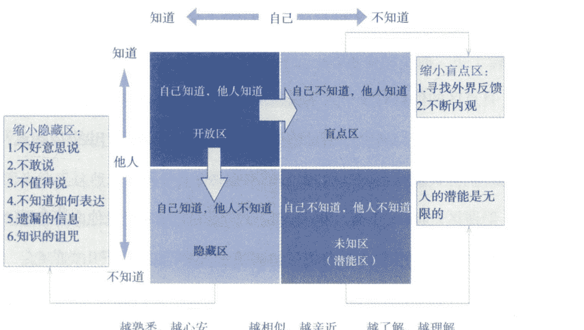
图 4-2 乔哈里沟通视窗

乔哈里视窗由美国心理学家约瑟夫·勒夫与哈里·英格拉姆提出，分为四个象限。

开放区：自己知道他人也知道的信息，如基本资料、主动分享的想法。
盲点区：他人知道自己不知道的信息，如无意识的口头禅。
隐藏区：自己知道他人不知道的信息，可能因羞愧、不敢说、不值得说、不会表达、遗漏或知识诅咒等原因被隐藏。
未知区：双方都不知道的潜能区。

缩小隐藏区与盲点区，扩大开放区，是增强信任的方向。可通过裸心会、吐槽会、共同兴趣活动等管理方式实现。

#### 二、裸心会

裸心会旨在创造心理安全环境，让成员卸下防备，坦诚分享未曾表达的故事，加深理解。

例如团队对某位同事挑剔不满，在裸心会上得知他曾因操作失误险致安全事故，从此变得谨慎。了解背景后，团队的容忍与理解明显提升。

一、裸心会的设计
1. 会前准备：提前发送资料，说明裸心会的含义、价值、主题及规则，如尊重、不打断、保密。
2. 环境布置：选择温馨柔和光线空间，加入绿植、团队照片墙。张贴“允许你做自己”“这里只有接纳没有评判”等标语。采用沙发围坐，去掉主次感。可配轻音乐，分享成长故事时可选用略带忧伤的音乐，更易打开心扉。
3. 时间选择：建议晚间进行，此时防御心理较低。时长控制在2到4小时，保证深度又不致疲劳。

二、引导与主持
主持人的职责关键有二。

第一，营造安全氛围，鼓励表达。反复强调无批判原则，对每次分享给予肯定，如“你的故事很有代表性，谢谢分享”。

第二，觉察并处理情绪。敏锐捕捉言语、表情、肢体信号，尤其关注不善表达的成员。对负面情绪及时接纳并创造表达空间，例如“能感觉到你现在有些不适，这是正常的，请放心表达”。这向全员传递负面情绪也可被接纳的信号。

通过以上设计，团队的亲密度与信任度得以持续提升，协作效能自然增强。

3. 升华情绪，点燃激情

以竹辉曾经辅导的一家企业为例。公司刚完成一次重大的业务重塑，人事几乎换了一轮，新旧交接的当口，士气低迷，凝聚感也相当脆弱。一次内部会议上，一位老员工被触动，谈起公司从零起步的艰难，讲起自己亲历的几段动人的往事。说到关键处，声音发颤，眼眶泛红，情绪很是真切。我立刻跟进共情，给情绪做出了向上牵引。

我告诉他我也被深深触动，能感受到老员工对这家公司的沉甸甸的牵挂与期许。随后面向在场的人说，相信每个人当初加入时都带着同样的理想，伴随公司一路走来，我们难免有过失望、有过困惑，甚至有过想要离开的念头，但最后我们都选择留下，这就说明我们都愿意共同扛下挑战。只要大家拧成一股绳，就没有过不去的坎。

会后团队的气场明显不一样了。不少老员工反馈，很久没有找回创业初期的那份热度和冲劲。

总的来说，裸心会里主持人要善于捕捉正向情绪并加以放大，用这样的方式把团队的激情和战斗意志点燃起来。

**第三，善意引导，唤醒力量。**

有位学员曾向竹辉求助，他们在裸心会上听到一位同事说自己不喜欢奶奶，甚至带有敌意。学员因此对该同事产生了负面印象。

学员困惑的是：裸心会不是要靠坦诚拉近心理距离吗？这次坦诚不仅没拉近，反而让自己对同事产生评判，该怎么处理？

问题出在引导上。世间没有无缘无故的爱恨。主持人当时若追问一句“为什么”，并邀请对方讲讲童年往事，很可能就会挖出一段没对人说过的故事。故事里有矛盾、有冲突，而那个孩子可能就是躲在角落里被伤害的人。

引导深入细节，就不会把分享者推向负面评价，反而能唤起在场者的悲悯与理解。

**第四，以身示范，坦诚分享。**

主持人是裸心会的核心能量源，首先要足够开放。会议伊始，参与者往往还没完全放开，主持人可以用自身的坦诚先行示范，鼓励大家敞开。相比空洞的口头鼓励，身先士卒的效果更好。

同理，为提升参与度和氛围，提前安排一两个人作为现场引子也是可行做法。

### （三）裸心会的注意事项

裸心会能拉近关系，但并非每一次都能奏效。若忽略以下要点，效果会大打折扣。

首先，精心设计的裸心会对性别构成有差异感应。氛围感强的裸心会更适合女性为主的团队，男性为主的团队接受度相对较低。面对男性占多数的团队，若想达到敞开心扉的效果，不如直接约着出去喝杯酒，气氛到位了心自然就开了。

其次，效果受团队文化制约。若团队整体风格严肃拘谨，裸心会的触达会很有限。

最后，当团队问题堆积、亟待解决时，与其做裸心会，不如开吐槽会更直接。

#### 三、吐槽会

吐槽会是为释放不满、集中找问题、推动解决而设的会议。想开好，也需要系统设计。

### （一）会前准备

###### 1. 做好会前准备

先明确会议目标，锁定要吐槽的议题，比如某个流程的卡点或主管的管理方式等。

再制定清晰的吐槽规则。比如吐槽要基于事实，禁止人身攻击；单次时长控制在3到5分钟；要给出改进方向，哪怕是初步想法。规则可提前通过邮件或工作群发给参会者。

###### 2. 选择合适的时间和地点

时间选在大家相对放松且不被工作频繁打断的时段，例如工作较轻的一天下午，时长控制在1到2小时，避免疲劳。

地点要舒适宜人，如带舒适座椅的会议室或公司休闲区。空间要够，通风、温度适宜，让人能轻松开口。

###### 3. 根据吐槽的主题确定参与人员

部门内部问题就邀部门成员；跨部门协作问题则要约上相关部门代表。例如吐槽项目进度，就要把项目组和对接部门的接口人一起叫上。

### （二）会议开场

###### 1. 营造轻松氛围

可用轻松的小游戏热场，比如“接力讲故事”，一人一句开头，后续接龙。这种互动能打破僵局，让大家在笑声中进入状态。

###### 2. 再次强调目的和规则

主持人再次说明会议意图，详细讲解规则要点，并在白板上列出关键条目，方便大家随时对照。

### （三）会议主体

###### 1. 轮流吐槽环节

按座位或事先排好的顺序依次发言，可先从活跃成员开始带动气氛。过程中主持人要把控规则，引导把问题说清楚。例如吐槽任务分配不合理，可追问“具体哪里不合理，是量太大还是难度不匹配”。

###### 2. 记录问题要点

指定专人记录，可用白板、电子文档或会议工具。记录要点包括问题描述、涉及环节或人员、初步改善建议等。

###### 3. 互动讨论环节

每人吐槽后留出讨论时间，其他人可提问、讲类似经历或补充。例如有人吐槽文件共享系统难用，其他人可分享使用痛点或推荐替代工具。鼓励发言但要防止跑题。

### （四）会议结尾

###### 1. 总结问题和建议

主持人归纳会议中出现的核心问题和建议，可按问题类型或业务领域分类，并对有价值的建议做重点标注。

###### 2. 明确后续行动并积极结尾

借助5W2H确定后续行动方案，以积极的姿态收尾，感谢大家的坦诚与参与。

### （五）后续跟进

会后要落实意见建议，并定期回看吐槽会的成果。持续跟进既能解决问题，也向员工传递被尊重和被重视的信号。

#### 四、基于兴趣爱好的非正式活动

是否也有过这种感受：日常交流全是工作，关系总缺点温度。若彼此有共同爱好，下班后可约读书、打球、K歌，职场关系便多了润滑和人情味。

人先玩到一起，再好工作在一起。阿里巴巴的“阿里十派”就是典型，派别并非正式架构，而是员工基于兴趣特长自发形成的圈子，既丰富了业余生活，也促进了交流协作。

因此HRBP可协助业务伙伴，从员工兴趣切入，利用业余时间组织活动。打球、听音乐、登山远足、羽毛球赛都是不错的选择。

不过团队建设也有坑需要规避。

1. 众筹式活动：要求成员自费参与的活动要尽量减少。
2. 开会式活动：活动前先做总结汇报，会让员工难以全身心投入。
3. 休息日活动：未经同意强制占用休息日，会被视为剥夺私人时间，易引发反感。
4. 唯上式活动：完全按主管个人喜好安排，未考虑员工偏好。

无论是裸心会、吐槽会，还是基于共同爱好的自发团体，目标一致：不断扩大开放区，增进了解，拉近心理距离，构建信任的团队关系。

### 第五节 以强化良好关系为目的的冲突解决

有人的地方就有冲突。团队中出现矛盾是常态，没有矛盾反而该警惕。冲突至少说明大家在乎发展。关键在于HRBP或主管如何引导解决。

先要辨清冲突性质：关系冲突与任务冲突。关系冲突源于人际，具破坏性且不易察觉；任务冲突是因对目标、内容、执行方式、优先级理解不同而产生。大多数冲突起初是任务冲突，若处理不当会演变为关系冲突。

#### 一、有效处理团队成员之间的矛盾和冲突

发现矛盾时要正视、寻求解法，不要寄望自消，也不要“和稀泥”。

**第一，冲突公开化和程序化处理。**

为矛盾双方搭建解决平台，例如在部门例会上公开表达不满，甚至允许“吵一架”，但要遵守规则：

1. 可以表达情绪，但不能情绪化表达。情绪化的表达是“你就是故意拖延，导致我无法交差”；健康的表达是“我现在很生气，觉得项目延期与你对项目的重视度有关，这给我带来很大困扰”。
2. 对事不对人，双方需准备客观事实和数据支撑观点。
3. 吵架表现接受团队评估。评估标准包括情绪稳定度、是否就事论事、是否真诚倾听、是否产生建设性结果。

**第二，引入第三方解决冲突。**

例如项目经理主张先优化界面，技术负责人主张先解决性能问题，可引入用户参与优先级判断，避免任务冲突升级为关系冲突。

**第三，人为制造冲突，揭示潜在内耗。**

当团队表面和谐实则暗流时，可有意制造矛盾让问题浮现。阿里早期引入高管后，新老价值观碰撞，马云在湖畔学院组织价值观辩论赛，把隐性冲突公开化，从而得到正视和解决。

同时要警惕自己成为破坏信任的推手。

#### 二、警惕自己成为团队关系的破坏者

常见场景：成员间有矛盾却不直接沟通，反而向上级汇报。若主管处理不当，会加剧裂痕。

案例：做微短剧的公司，主管道老李手下有后期特效师小周和摄影师小王。小周觉得小王拍的素材不利于后期，特效做不出预期效果，但未直接沟通，先向老李反映。

若你是老李，该如何处理？

先了解人际中的“百慕大三角”模型。

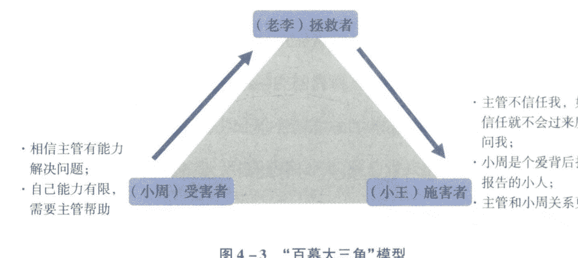

图4-3 “百慕大三角”模型

模型描述了受害者、施害者、拯救者三种角色。本案例中小周是受害者，小王是施害者，老李成了拯救者，形成三角关系。

小周求助时传递了信任信号和示弱信号，易激起主管的责任感。一旦主管介入了解情况，会向小王传递不信任信号和“小人”信号，还可能让小王觉得主管更亲近小周。仅听一面之词就单独找小王，几乎得不到有效信息。

主管不是裁判员而是协调员，员工是成年人而非孩子。孩子会把矛盾交给家长裁决，成年人应直接面对问题。老李的最佳做法是避免直接介入，引导小周先与小王沟通。若沟通无效，再把两人一起拉到中立场域，以共同目标为指引解决问题，并保持中立公正。

苏格拉底曾用三问回绝打小报告的学生：你说的是好事还是坏事？你确定是事实吗？对我有好处吗？若不是好事、对自己无益且不确定真实，就别说了。

实际管理中，许多主管回避冲突，转而推给HRBP。此时HRBP要学会借力：

1. 邀请业务伙伴共同参与，而非独自处理。
2. 利用部门例会公开解决，在业务回顾时同步处理矛盾，既防止过度放大，也树立公开透明的示范。

冲突处理后务必回顾总结，提炼长效机制，便于下次高效应对。

总之，衡量团队关系质量的关键，不在于是否无冲突，而在于冲突发生时能否高效解决，并在解决后让关系更稳固更深化。

### 第六节 以心智升级为核心的关键时刻

团队力量像火种，被点燃后成员相互带动，积极状态会快速蔓延。反之，士气低落时如同阴霾笼罩，即便有人原本积极也会被拖垮。

HRBP要协助业务伙伴不断点燃士气。三个关键时刻必须重点关注：项目启动或收尾时、业绩不佳士气低落时、项目复盘时。

#### 一、项目开始或将要结束之际

万事开头难，项目启动能否点燃第一把火至关重要。

启动期要持续认可每一点进步，并为小成就庆祝。激励时把焦点放在已取得的成果，而非未完成的工作。例如启动一周后主管说“我们已完成20%”，而不是强调“还剩80%没做”。积极表述更能鼓舞士气。

项目接近尾声时易出现动力不足，要帮助团队冲刺。让大家清楚胜利在望：“只剩20%了，胜利触手可及！”

#### 二、业绩不佳士气低落时

达成预期甚至超越目标是理想，但现实中无人能保证次次成功。

当外部环境低迷，市场整体走弱，业务增速放缓甚至停滞，团队情绪也跟着下滑时，HRBP 与业务负责人要学会重新校准成功的标尺，营造出向上向前的氛围。

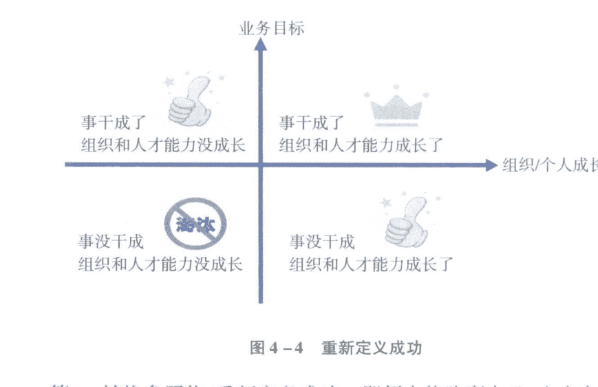

**第一招，换参照系来判定成败。** 即便没能跑赢自己，也要审视有没有跑赢大盘或竞争对手。比如目标没达成，但大盘跌得更狠，我们相对领先，也算是一种赢；又或者没超越过去的自己，却比对手做得更好，依然值得肯定。关键是找到一个能鼓舞士气的参照点。

**第二招，换视角来找价值。** 增长做不出来时，可以看看是否在其他维度为公司创造了收益。比如“省钱”就是一种价值。去年市场费用占到营收的10%，今年压缩到5%，就省下5%，这就是成效；团队去年亏损20万，今年亏损收窄到10万，同样是进步。

**第三招，盯住成长价值来定义成败。** 成长价值更多是过程性目标的兑现。像是业务推进中的过程指标——成功拿下3个VIP客户；也是组织与个人的能力提升——阿里当年“来往”没做成，却沉淀了在线通讯的经验，为后来的钉钉奠定了基础。

总的来看，完成业务指标是成功，没完成指标但能力和组织得到了进化，也算作一种成功。

#### 三、复盘的黄金窗口

复盘既是沉淀经验、提炼方法的重要环节，也是塑造团队心智的关键场域。引导得好，就能培养员工开放心态、提升思维水位、强化信念价值观，演变成打造学习型团队的核心抓手。

#### （一）用复盘调教积极乐观的心智

复盘“复”的是事情，“修”的是人是组织。提问方式不同，塑造的心智也不同。我们要努力让复盘偏向积极乐观。

复盘时，把“为什么没有……”“为什么不……”的追问，换成“如何可以……”“怎样能……”的探讨。这样注意力就从复盘过去转向未来，从挑错转向找机会。

用“为什么没有达成目标？为什么没拓展更多客户？为什么制度没及时更新？”去逼问，员工会开始回溯失败、找借口、甩锅，复盘就变成批斗会。

反过来用“如何可以做到？怎样能改进？”去引导，大家会聚焦解法，思维变得建设性，心态也随之被激活。

#### （二）用复盘拔高团队认知水位

好的复盘不会停留在表面，也不会走形式，而是要挖到问题背后的逻辑，形成可复用的体系化思考。

浅层的复盘只聊“是什么”和“怎么做”。深度的复盘会在这两个维度之上，更聚焦“为什么”，还要复盘这件事给团队带来了什么成长，以及下一次遇到类似情况可以如何做得更好。

只解决单个问题，问题会反复冒头；解决系统原因，才能降低同类问题再发生的概率。

#### （三）用复盘锚定信念与价值观

复盘是强化价值观的高光时刻。我们要透过复盘明确团队要什么、不要什么。

竹辉整理了一些能触及价值观的提问参考：

- 我们做对了什么？背后是哪些信念在起作用？
- 我们做错了什么？是忽略了哪些关键要素或细节？
- 为什么会忽略这些细节？它们重要吗？为什么重要或不重要？
- 如果结果更理想，画面是什么样的？为了接近理想，我们还缺哪些行动？
- 没做是出于相信什么、不相信什么？
- 过程中有没有做了本不该做的事？为什么会去做？

这些问题能深挖团队的集体价值观，思考起来费脑但极其值得。除非我们想一直靠制度和指令管人，而不是靠共同信念引领人。

#### （四）用复盘打造学习型团队

复盘也是集体成长的时刻。每次复盘安排一次主题学习分享，是形成学习型团队的有效方式。

分享不必太长，但要足够聚焦。主题最好来自目标拆解、策略共创时讨论过的议题。比如如何更有效触达潜在用户？如何打通更多获客渠道？让员工带着问题工作，再在复盘里总结、分享、迭代成长。

为保证持续性和有效性，要建立清晰的分享标准和保障机制。分享可以包含案例剖析、深度思考、知识沉淀和流程优化，并与个人职业发展挂钩。

年终复盘时，每个人需呈现一年内分享次数、主题、沉淀的流程，以及对他人的帮助与指导。这样的机制既促进个人成长，也让员工看见自身对团队的独特价值，提升归属感，最终形成积极进取、互帮互助、乐于分享的学习型氛围。

团队和组织像一台精密协作的仪器，员工就是关键部件。每个部件运转良好，系统才能高效运行。

接下来聚焦到最基本的单元——员工个体，探讨如何提升个人效能，帮助每位员工成为更好的自己。

## 第五章 提升个人效能

提升个人效能，说到底就是提升人力投入产出比。路径有两条：一是延长投入时间，二是通过提升能力与改善状态来提升产出。

工业时代多靠延长工时来提效，底层假设是时间越长产出越高，前提是个体单位功率恒定。但人不是机器，单位功率会随时间、环境和状态波动。

大量研究显示，产出不仅取决于时长，更取决于能力与心理状态。“心流”就是典型代表：当内在能量被点燃，人会忘却时间与外界干扰，效率与质量都会跃升。

因此想提效，要向时间要成果，更要向能力、能量与状态要成果。

本章聚焦能力提升与内在力量的激发。人才管理不仅是技术，更是艺术，归根到底是智慧。

对人才管理，希望达成三点共识：

第一，人可以管，人才很难靠管，只能靠激。给执行型员工一套标准化流程即可；对知识型员工，最好的方式不是管理，而是激发，借助外力点燃内在动力。

第二，对人才管理要乐观。人天生有成长驱动，渴望被认可、渴望价值感。管理者的任务是找到引爆内在动力的那个点，助推自驱动、自成长。

第三，人才管理选择大于努力。每个人起点不同，有人像火种易被点燃，有人像湿木难燃甚至冒烟，更多人介于两者之间，需要耐心和悟性。“有教无类”不适用于商业世界，企业不是学校。不要试图改变所有人，尽力无愧即可。更关键的是选对人。

本章分为四大模块、五个小节：

第一模块为第一节，剖析个体人生底色、成因与变化。

第二模块为第二节、第三节，分享驱动与激发策略，涵盖投其所好激发欲望、赋能爱上工作、赋权给予空间、认可点燃自信，以及对行为的引导与塑造。

第三模块为第四节，论述人才分类管理。

第四模块为第五节，论述人才选聘。选人比培养人更重要，选错人会让所有管理失效甚至带来损失，因此单列讨论。

### 第一节 洞察个体的人生底色

人生底色指一个人的基本色调与特征。世界观、人生观、价值观是其核心要素。

世界观回答“我与世界是什么关系”，关乎如何理解世界与自我定位。人生观探讨“我与自身是什么关系”，关乎如何认知自己、想成为怎样的人、想过怎样的人生。价值观是在前两者影响下形成的个人信条，体现信什么、重什么、优先什么。

世界观塑造人生观，人生观决定价值观，价值观最终通过行为显现出来。

从时间上看，有两种三观形态：步入社会前的原生态三观，主要受原生家庭与学校教育影响，尤其亲子依恋模式影响关键；步入社会后的成长型三观，由社会历练、生活洗礼与职场磨炼塑造。

#### 一、原生态三观的起点

亲子依恋关系是个体原生态三观的起点。

按埃里克森发展理论，0～1.5岁是婴儿期，也是建立信任的关键期。若抚养者及时回应关爱，婴儿会形成世界可信的认知，而此时孩子无主客体分离概念，会把对世界的信任等同于对自我的信任。

1.5～2岁自我意识萌芽，孩子开始区分自己与他人，探索外部世界，世界观开始形成。

在这个互动中，亲子依恋至关重要。若需求被及时恰当满足，孩子会体验到无条件爱，建立安全型依恋。安全型依恋下，孩子探索欲强，更愿意主动选择自己喜欢的事物。

反之，若过度保护，传递出外界不安全信号，会打击探索主动性和自信，形成焦虑型依恋。焦虑型孩子面对未知容易不安，缺乏探索勇气。

回避型依恋则源于需求长期被忽视，孩子会放弃寻求爱，形成孤僻冷漠性格，内心缺爱、自卑感强。

亲子依恋为世界观、人生观、价值观奠基。

安全型依恋下成长的人自信乐观勇敢，视自己为强者，主动追求所爱，努力掌控命运，且更易建立良好关系。

焦虑型和回避型被归为不安全型依恋，他们感到爱是有条件的。必须遵守条件才能换来爱的回应。如必须听话妈妈才抱，必须考第一爸爸才带游乐园。

不安全型个体一生都在寻找能与爱交换的条件：财富、社会地位、特定领域的成功。不同人排序不同。贫寒家庭出身者更看重财富，因其曾带来父母笑容；学霸背景者更看重成功，因其曾带来认可。

安全型行动力来自内在，不安全型多来自外在。能相信自己配得上财富名誉者已属佼佼者。另一部分人常感力不从心，视自己为弱者，习惯等待、依赖、求助，这往往与成长中长期被贬低或缺乏能力优势有关。

亲子依恋模式受家庭经济、父母文化等多因素影响。父母之爱无可置疑，但表达方式不同，最终塑造出不同的三观。

#### 二、不同的三观类型

依恋模式不同，个体往往形成三种认知模式：无力型、专家型、影响型，并非一成不变，会随成长升级，并可能进化出领袖型。

**无力型认知模式：** 感到自身渺小无力，倾向退缩忍耐，相信只要隐忍生活就平和。深信遵守外部规则能获得安全感，依附强者庇护才能顺遂。信条是安全稳定，常把“守规矩”“伺候好领导”看作关键。

**专家型认知模式：** 认可外部世界强大，但不否认自身能力。相信“各有所长”，通过努力在特定领域做出贡献，最终获得社会认可。信奉付出应有回报，“没有功劳也有苦劳”。但努力不一定成功，付出不一定有即时回报，苦劳也未必换来认可，因而易陷入内耗，感慨怀才不遇。

大多数人处于此层，人生的课题是突破专家型，进入影响型。

**影响型认知模式：** 做事有格局和胸怀，可能源于童年充足关爱、优质教育，或后天认知升级。能洞察事物与人性演变的规律，认知达到“道”的层面，契合公司价值观。擅于预测趋势，更愿意放弃短期利益换取长期收益。行为体现爱、利他与长期主义。持续的正向反馈会点燃内在利他能量，从理性利他转向感性利他，进而具备强烈的社会使命感与责任感，完成向领袖型的进阶。

**领袖型认知模式：** 怀有宏大志向与强烈使命感，爱与利他源于内心深处，具备号召力、影响力与人格魅力，能聚集优秀人才创造更大社会价值。此类认知极为稀少，少数企业家才达到，本书不做重点展开。

人才管理的核心是激发与引导无力型或专家型个体，实现从外驱到内驱、从“要我做”到“我要做”的转变，最终把认知提升到影响型，成为组织的同路人。

如何驱动员工？

### 第二节 从外驱到内驱

丹尼尔·平克在《驱动力》中提出三种驱动力：生物性驱动力1.0、外在动机驱动力2.0、内在驱动力3.0。

生物性驱动力是最基础的生存需求。饥饿、口渴驱使寻找食物饮水。工作中若基本生理需求未被满足，如环境恶劣、休息不足，就会被此层驱动力占据。

外在动机驱动力即胡萝卜加大棒，通过奖励与惩罚激励行为。如工资、奖金、晋升，或避免批评、罚款、降职。能在一定程度上促成任务完成，但过度依赖会让员工忽视工作意义，削弱内在动机。

内在驱动力更高级，与内在动机相关，包括好奇心、热情、学习欲、探索欲。基于内在驱动做事，完成本身就有吸引力，无需外部奖励。

要激活内在动力，工作需具备三个条件：工作是自愿选择而非被强加；工作过程有自主权，能自行决定执行方式；能持续体验到成就感与力量感，进而加深热爱。

本部分以人才管理核心价值为导向，结合工作自主性的特点展开：

第一，投其所好，激发欲望。先了解员工当前最迫切的需求，必要时创造情境点燃其对事业或生活的渴望，这是培养工作兴趣的第一步。

第二，赋能员工，爱上工作。

工作看似能吸引人才，实则不少人干着干着就提不起劲。根源往往有三：本领跟不上岗位要求，干久了新鲜感被耗尽，以及日复一日的重复让倦怠感蔓延。想把劲儿拉回来，关键在于三件事同步推进：把技能补起来，给工作加上意义感，还要让过程更有意思。

第三、放权共创，创造空间
大方向的抉择要让员工有知情、有参与，具体执行的任务要给员工自主决策的余地。这既是尊重，也是认可，更是把主动性还给个体，让其更愿意积极出击的办法。

第四、即时认可，点亮自信
在管理中，一旦员工取得成果或展现出正向行为，就要第一时间给予反馈和肯定。渴望被爱、被认可、被欣赏，是人类最原始也最强劲的需求。认可会强化自信，唤醒内在能量，让人更愿意主动发力。

#### 一、找准渴望点，点燃内在驱动力
人做事是为了满足自己的需求和欲望，不是为了帮老板实现上市梦想，也不是一开始就想改变世界。这些欲望可能是买房买车，可能是个人成长，可能是让父母过上更好生活。

要摸清员工的真实想要，光看基本信息不够，平时得多聊天、多吃饭。可以让业务部门里信得过的同事担任“知心大哥大姐”的角色，及时捕捉动态。

管理中，最容易被激活的，往往是敢开口提要求的员工。他们有上进心，对生活和工作有更高追求。我们要做的不是压制否定，而是和他一起拆解实现路径。比如员工想要加薪，就一起探讨要达到什么标准、需要做什么、做到什么程度、怎么落地，以及公司能提供哪些资源支持。

以个人诉求为起点，路径清晰又有资源托底，员工自然干劲十足，最后实现员工和企业的共赢，这正是管理者期待的。

洞察人性后，优秀的管理者会关注员工动态，也会通过团队建设有意识地放大需求，比如打高尔夫、体验五星级酒店服务。他们清楚，挖掘并满足个人需求是激励的起点。只有心里有欲望的人，才更可能迸发出强劲动力。相反，无欲无求，就无从激励。

但激发欲望必须把握分寸。特别是物质激励，用不好会严重损害积极性。

分享一个“聪明老人与调皮孩子”的故事：
宁静的院子里住着一位老人，附近的孩子常拿石子往他院子里扔。每当老人发怒，孩子们就跑开，第二天又来。

老人反思后改变策略。一天孩子再扔石子时，他微笑着说自己独居寂寞，孩子们的石子带来些乐趣，从今天起每扔一次给10元。孩子们大喜而归。

第二天照常扔石子领钱。几天后老人说手头紧了，只能给5元。又过几天只给2元。孩子们不满沮丧。最后老人不再外出也不给钱。孩子们怒喊“我们辛苦扔石子他不给钱，我们再也不扔了”。

启示是：扔石子本身本可带来快乐，外部奖励介入后，活动本身的乐趣就被替代了。

心理学上著名的“德西效应”也验证了这点。
20世纪70年代，爱德华·德西做了一项研究，探究外在奖励对内在动机的影響。

第一阶段：大学生在独立房间解有趣智力题，无奖励，学生保持兴趣投入。
第二阶段：随机分两组。A组每解一题得1美元，B组无奖励。A组为钱加快解题、做更多题；B组仍保持热情自顾自解。
第三阶段：告知可自由休息，有杂志娱乐，也可继续解题但无奖励。B组很多人仍主动解题，因已产生内在兴趣。A组失去奖励后，大多数选择休息，对解题兴趣骤降。

现象很清晰：外在物质奖励短期能提热情，长期却会削弱内在兴趣和动力。

物质激励还会削弱工作本身的愉悦感，且边际效应递减。今年10万元奖金可能让人高兴一个月，明年同样10万只够高兴一周，第三年可能毫无感觉，甚至觉得太少。

所以，投其所好可用物质激励吸引和驱动，但不能长期依赖，欲望无止境。我们更要思考如何让员工爱上工作，从外驱转内驱。

#### 二、助力成长，让工作可爱
问一句“你热爱工作吗”，很多人会摇头。最近流行“牛马”这个词，直观反映了职场人对工作的抵触。

其实劳作和工作是人类原始需求。两岁左右孩子就开始好奇探索，只是外在因素压制了好奇心，主动性减弱。很多行为是被迫的被动选择，工作首当其冲成为重灾区。

不妨回想疫情期间居家时，有多少人渴望回到岗位；再看退休在家无所事事的老人，状态是否更显衰老。森田疗法中让来访者躺在床上什么都不做，很多人难以忍受。这说明人并不排斥工作。

抗拒工作，要么是做不了，要么是没动力。动力匮乏源于看不到工作的深层价值意义感到枯燥乏味，以及缺乏自主权导致躺平摆烂。

要让员工爱上工作，需要做三件事：辅导技能提升、赋予价值意义、注入工作乐趣。

##### (一) 强化技能，匹配岗位需求
提升技能的方法很多，这里聚焦两种可落地的方法：十六字辅导法和费曼学习法。

**策略一：用十六字搭伙法提效。**
针对操作型工作，可用“我说你听，你说我听，我做你看，你做我看”。

“我说你听”是管理者从是什么、为什么、怎么做三个层面清晰讲清任务。先明确交付内容，再阐明对个人团队组织的意义价值激发积极性，最后拆解流程步骤、风险与对策。

“你说我听”是讲完后让对方复述要点，检验理解。可以通过提问如“客户拒绝拜访怎么应对”来评估理解度，并鼓励对方提问即时解答。

这两个环节不能省。7-11创始人铃木敏文要求下属复述三次：第一次复述检验初印象，离开前再复述一次检验消化程度，隔段时间再复述一次检验记忆是否衰减。重复是保证信息精准传递的关键，期待一次就懂是不现实的。

“我做你看”是管理者亲身演示，严格按流程操作，让成员观察学习，养成好习惯。

“你做我看”是员工实操，管理者旁观并给反馈。要避免两种极端：频繁打断，和放任不管。应记录问题，事后集中反馈，肯定优异表现，指出改进点和具体做法。反馈聚焦行为动作，少评价人品能力，同时引导员工自我评估。

**策略二：费曼法输出倒逼输入。**
适用于知识型认知类工作，坚持干中学、以输出倒逼输入。

步骤一：分析业绩不达标原因，明确要提升的技能，以技能提升后的业绩成果为目标规划学习任务。比如成交率低因不善沟通VIP客户，就设定三个月内与A客户建立合作并签单的目标。

步骤二：围绕主题让员工设计技能小课，在团队例会分享。以通俗方式讲解如何服务VIP客户，包括流程、风险及对策，并接受同事提问。若答不上来，说明理解不足需再学。准备过程本身就是深度学习，也能提升自信。

步骤三：启动执行并每日复盘。制定行动计划并落地，每天复盘四个问题：今日最大成就是什么？有哪些值得点赞？若重来可改进什么？今日问题是否在预期内？没考虑到哪些细节？对未来工作有何启示？

步骤四：项目总结与团队分享。复盘全流程，提炼经验与教训，与团队共享。

##### (二) 注入意义，让工作有重量
先讲“三个工匠砌砖”的故事。
路人问三位工匠在干嘛。
第一个说：“我在砌砖，累死了。”
第二个说：“我在盖房子。”
第三个说：“我在建设美好的家园。”

第一个只觉辛苦，第二个有目标更有方向，第三个赋予更高意义充满热情自豪。十年后，第一个仍是普通工匠，第二个成建筑工程师，第三个成为城市设计师。

工作本身无意义，意义来自我们如何定义和解读。认知不同，人生轨迹就不同。工作会随时间变单调，关键是能否不断拓展和深化意义。

###### 1. 放大影响范围
拓展价值就是扩大受益人群。员工倦怠时，可引导他拿一张A4纸思考：
先问“为什么选择这份工作”，再思考这项工作还和谁相关？成果对不同人群有何价值意义？他们会怎样评价？

写完一侧后，再探讨这项工作是否真的提供了这些人想要的价值？提供了哪些？还有哪些没提供？答案写在另一侧。

一侧是可提供的价值空间，一侧是已提供的实际价值，差距就是下一步努力的方向。

###### 2. 挖掘成长价值
意义还体现在个人成长上。
比如前台工作常被限定为接待、倒水、收发资料，重复久了极易倦怠。

换个维度看，前台是公司内部信息枢纽，与各部门接触，能了解组织关系网络，为内部发展打下人脉基础。每天接待供应商、客户、合作伙伴，也能积累外部资源。

很多工作看似单调，意义有待发掘。HRBP和业务伙伴的价值，就是帮助员工重新解读工作背后更深远的意义，丰富工作层次。

在认知层面打开意义后，还可通过赋予乐趣激发主动性。

##### (三) 注入趣味，让工作不无聊
要关注新生代年轻人，他们将是职场主力。
作为互联网原住民，他们受多元、即时、互动、创新的影响，难以忍受单调循规的工作，更偏好有趣、有创意、像游戏一样的工作。

必须思考如何把工作与娱乐结合，打造有趣有活力的环境，提升积极性和效率。

###### 案例1：趣味化的工作内容
某广告公司为提升创意，推出“电影之夜”项目。每月选一部经典电影，围绕主题做创意营销方案设计。如看《大话西游》就围绕“时间旅行”策划活动。既享受观影，又激发灵感，增强凝聚力。

###### 案例2：故事化工作流程
把任务融入故事，员工成为“任务英雄”。
某游戏公司每月开“角色扮演工作日”，员工选自己喜欢的角色，如游戏英雄、电影角色，以角色特质推进工作。轻松氛围中增强互动合作，激发创意。

###### 案例3：轻松化学习——企业的“学习午餐”
某咨询公司每周安排“学习午餐”，员工自愿在午餐时间分享专业技能或个人兴趣，如摄影、烹饪。非正式学习提升知识，也增进沟通协作，营造多元文化氛围。

###### 案例4：游戏化的培训与发展
某金融公司为提升市场分析与协作，举办“模拟交易大赛”。分组在虚拟环境交易，设置不同市场条件和挑战，需制订策略实时调整。游戏化学习增强对市场理解，提升团队合作，优胜团队获奖加码激励。

###### 案例5：加入游戏元素的工作激励
某大型企业开发移动应用，员工发布日常任务并设定完成时间，完成得积分，可兑换礼品或内部奖励。游戏化工具让完成任务更有趣，提升动力和协作，形成良性竞争。

总之，没有规定工作必须严肃认真。若能快乐工作，为何要硬扛苦累？人不是因为成功才快乐，而是因为快乐更容易成功。

让我们探索更多好玩的工作形式，在开心快乐中实现个人与企业的双赢。

新生代不仅想要工作好玩，更希望有更多自主空间、体验主人翁感。如何赋权员工，成为信息化时代迫切的人才管理需求。

#### 三、放权赋能，创造自主空间
越来越多的企业在探索组织机制上如何赋予员工更多自主权，鼓励管理者合理授权，激发主动性和创造力。因为员工渴望自主空间，而自驱自主是效能提升的关键。

##### (一) 机制层面放权
在组织机制上，很多公司通过机制改革赋予员工更大自主决策权，增强自主意识。

赋权不是喊口号，员工才真的会动起来

真正能让团队跑起来的企业，从来不靠催，而是把决定权恰到好处地放出去。

全球互联网巨头谷歌就一直践行这条逻辑，给工程师 20% 的工作时间去做自己感兴趣的探索。正是这种对时间分配的自主权，催生出了 Gmail 和 Google News 这样的产品。

日本丰田的精益生产也是同理，产线员工有权对流程提优化建议，大家在现场就能不断改进。效率提升了，主动性和创造力也跟着来了。

国内的海底捞同样在做这件事。服务员可以根据客人当下需求自主推荐菜品、灵活调整服务方式、直接处理客诉。现场能马上反应，服务既灵活又及时。

组织机制上的放权只是开始，真正让自主性落地，靠的是管理者做得合理、做得到位。

##### (二) 管理者该怎么授权

授权说起来简单，落地却很考验人。每个人都想掌控局面，授权本质上就是主管主动松手。松多少也是个难题，松太少员工觉得是走过场，松太多主管又怕跑偏。

竹辉把授权的关键点梳理清楚，就是帮 HRBP 更好地面向业务伙伴做有效授权。

###### 1. 先分拣工作，再做初步派单

授权前先把手头活盘清楚、分类再说，然后按人的特点去匹配。

分工作可以先看重要程度和风险高低，落在四个象限：重要且风险高、重要且风险低、不重要且风险高、不重要且风险低，见图 5-1。

判断重要性主要看六个维度：

- 对部门目标的贡献有多大
- 需要的知识、技能和经验门槛有多高
- 在业务链条里处的位置是否关键
- 影响的人群范围有多广
- 与核心外部伙伴的关联度
- 出错后会带来多严重的后果，如法律、经济或人身损失

判断风险等级主要看三点：

- 有没有可借鉴的历史经验
- 能否找到对标案例可以复制
- 资源是否充足支撑推进

分类后就可以做初步分配：

- 不重要且风险低的日常重复性工作，交给新人或经验浅的同事；
- 重要但风险低的任务，交给今年有晋升潜力的明星员工；
- 重要且风险高的事项，管理者要亲自把关，同时带上重点培养对象一起参与，边做边练；
- 不重要但风险高的，优先考虑暂缓。

###### 2. 看人下菜，精准匹配

按重要性和风险分活只是入门，真正的精准授权要结合人的优势、兴趣和需求。

####### (1) 找准优势在哪

找优势不是找行业大神，而是找员工面对问题时本能想做、做得比别人好的地方。

可以这样挖掘：

方法一：拆解成功案例。不要只听自我评价，要深挖他过去的成功是怎么实现的。比如有人觉得自己擅长创新，其实擅长的是在创新团队里高效执行。

方法二：问他最受不了的同事行为。能力透明悖论告诉我们，我们擅长的领域，有个隐形阈值，他人做得差我们会本能烦躁。比如人际敏感的人，无法忍受对情绪变化毫无察觉的说话方式。

方法三：听周围人的评价。直接问同事眼中的强项是什么。

方法四：管理者复盘总结。先列出你认为的 N 项优点并排序，再为每项找具体行为证据，找不到就删掉，反复验证。

####### (2) 探明兴趣所在

很多人说不清自己喜欢什么，只知道不喜欢什么。哪怕是出于回报的喜欢，也要纳入考量。

可以问：

- 有没有不计成本也想做的事？
- 如果财务自由了，最想做什么，为什么？
- 退休后经济无忧，最想做什么，为什么？
- 过往有没有想成为的榜样，为什么？

注意只采集与工作相关兴趣，纯生活兴趣可在团建等场合提供展示空间。

####### (3) 以需求为底线来授权

激励的第一步是投其所好。员工更在意这件事对自己有什么用，能满足什么需求。

比如市场经理老张对小李说：沙龙方案你来做吧，我最近太忙了。小李只能被动接受甚至抵触，这就是典型的错位授权。

好的授权要讲清价值与成长。老张可以改成：你来了这么多年，我一直看好你能负责整个业务运营。线上你做得很好，我想让你试试线下活动，这对你全盘能力是很大补齐，十月的线下沙龙你有没有兴趣担起来？

考虑需求的授权，才会带来信任感和感恩感。

####### (4) 综合匹配

做完优势、喜好、需求的分析，就能按人调活。可以用“优势×喜好”四象限来做人岗匹配，见图 5-2。

理想状态是员工既擅长又喜欢。现实中两者往往不一致。以小 A 为例，他做销售稳健可靠，客户很认可，却因内向不爱频繁社交而精疲力竭。

如果高薪是他生活刚需，可以先让他留岗并培养接班人，同时内部寻找同薪资的合适岗位过渡。接班人到位后再调整。

如果销售收入并非刚需，就应尽快调岗，否则容易流失。

对于员工不擅长但喜欢的任务，要先评估能力是否可培养。可培养就给培训和历练，不可培养就不要硬塞。既不擅长又不喜欢的工作，更不要强迫，否则两败俱伤。

###### 3. 授权过程中的“五给”

任务放出去，主管要做到五给，才能让员工有能力、有底气担起来。

####### (1) 给目标和方法

和员工对齐清晰目标：在什么时间、交付什么、做到什么程度。同时一起聊清楚实现路径，让思路更顺。

####### (2) 给责任和压力

让员工明白这项工作的团队价值，以及没完成会带来的影响。责任要落在下属身上，主管对人负责。避免说“出了问题我扛”，这会削弱责任感。

####### (3) 给资源和支持

只有责任没资源会让人畏难。要赋予相应权限，调动协作资源。像老张授权小李做沙龙时，就明确了目标时间、方案节点，并让团队全力配合，指定经验丰富的老赵随时支持。员工才有动力推进。

####### (4) 给权利和界限

主管对结果负责，下属对完成方式负责。把大目标拆成小目标，给下属在小目标内自主选择方法，并及时反馈。同时要划清哪些可以自主决策，哪些必须汇报。

####### (5) 给信心和助力

沟通到位了，员工仍可能没底气。可以引导他回溯难忘的成功经历，详细复盘做了什么、为什么成功，把成功归因于稳定能力特质，再迁移到当前工作并想象达成后的美好画面。

在推进中持续认可积极行为，能让自信由外到内，形成内驱。

#### 四、认可欣赏，点燃自信

认可和欣赏本身就能点燃自信，有时比物质激励更持久。因为被爱是人的原始需求，被认可时会能量满满，被否定时会迅速收缩。

人才管理要穿透条件性需求，看到员工对被爱的渴望，给出真正的认可。

##### (一) 被爱是第一驱动力

活着是本能，被爱是伴随而来的需求。接收到被认可、被接纳的信号，人会快乐有劲；接收到指责、否定，立刻紧张耗竭。

我们渴望被关注被欣赏，因为一生无法超脱生死。成长中爱被异化成了对财富、地位的追逐。管理要回到原点，用认可提升自信激发能量。

##### (二) 让认可重启自信

认可可以来自组织、上级、同事、客户，也包括家人朋友和自我。外在认可都敌不过自我认可，助力自我认可才是终极目的。

###### 1. 来自组织的认可

- 定期做敬业度或组织氛围调研，并快速回应反馈，让员工感受到声音被听见；
- 定期办成功经验分享会，让员工展示成果；
- 在办公区设“成就墙”，把达成目标的照片和成果晒出来，形成正向文化；
- 建立任职资格和职业发展通道，结合优势、需求和兴趣给发展建议和成长机会。

###### 2. 来自上级主管的认可

日常管理里最关键的两件事是赋权和及时反馈。

赋权是让员工参与关键决策、提出方案并落地，这本身就是对能力的认可。

反馈要及时。夸人要用“认可行为 + 表达感受 + 肯定品质/能力”的结构。

比如小李例会汇报很出色，可以说：小李，昨天例会你的汇报非常精彩，用具体案例和数据直击要害，认可行为。听完后我对新业务有了全新理解，深受启发，表达感受。你真是个不可多得的深度思考人才，肯定品质。这样既让对方舒服，也强化了积极行为。

在既有的赞美结构上，还可以做一些更贴近人性的微调。

顺着人人都想比别人更突出的心理，可以把差异化的优势点出来。比如对员工说：“我见过不少大厂出来的同事，真正能把理论落地到业务一线的并不多。你就很不一样，不空谈，直接扎到现场去看真实情况。这种务实的作风让我很踏实，你确实是个能让人放心的人。”

也可以顺着人喜欢认同同类的天性，给出身份上的归属感和安全感。新员工小张在例会上回应财务总监的质疑，有理有据不慌张，可以这样说：“你刚才的应对让我想起我当年面对类似场景的心情，很有画面感。看到你现在的状态，我很欣慰，我当初的选择是对的。你这份冲劲和魄力很有潜力，继续保持。”要注意的是，“这让我想起我当年”既传递了身份认同，也在把自己摆成学习坐标。如果员工并不认可这个坐标，这句话反而会起反作用。

赞美能强化积极行为，也能引导经验沉淀。可以借助“肯定行为＋认可能力＋身份归属＋价值强调＋期待对话”的方式来表达。

比如小张搞定了一个所有人都没拿下的VIP客户，得意地来汇报，机会就不容错过。

可以先说：“这个客户大家跟了很久都没进展，你坚持三个月跑了六七趟，最后把单子签了，太厉害了。”先点差异化和行为。

再说：“这背后是强韧的抗压、持久的耐力，还有很强的资源整合和谈判功力。”点能力。

再说：“像你这样的销售，在我们团队里是标杆，是大家学习的榜样。”给他身份。

再说：“这一笔今年至少给团队贡献10%业绩，对大家意义重大。”点团队价值。

最后说：“这次过程中你肯定积累了很多心得，下周周会你来分享一次实战案例，也帮带一下其他人。”谈期待。

管理者要大方地给认可。夸得准，氛围就好。你只要动嘴，别人就会乐意动腿。

###### 3. 来自同级的认可
职场里朋友不多，但伙伴很重要。朋友靠感情，伙伴靠目标，共同目标下需要能力互补、性格包容，也需要经常说出欣赏。

HRBP可以帮业务方在团队里建立“互夸”的氛围。比如每次例会，每个人都要讲一次同事给自己的帮助并表达感谢。还可以组建互助小组，成员互相托底共同成长。这种机制不仅让员工感受到被同事看见，也训练出发现他人优点、欣赏他人的能力。

###### 4. 来自客户的认可
客户的肯定是价值最直接的证明。当员工收到客户认可时，被点燃的不仅是热情，更是对事业的信念。

**收集并可视化反馈。** 定期把客户的正面评价整理出来，让员工第一时间看见。有家软件公司会把用户的点赞和好评打印出来贴在休息区，激励效果非常明显。

**让欣赏当面说出来。** 邀请客户到公司直接交流。曾有家通过电话募集捐款的公益机构，员工出现倦怠，电话数下滑。按心理学家亚当·格兰特的建议，让受助大学生与员工进行10分钟电话交流，一个月后工作时长提升142%，捐款额增长171%。阿里巴巴也曾在客服倦怠期，邀请客户到现场讲故事，表达感谢，重新点燃了团队热情。

**分享与客户的故事。** 如果没条件请客户来，就让团队内部轮流讲客户故事。比如一位客服分享自己如何耐心化解愤怒客户，最终把对方变成忠实支持者。通过同伴的故事，员工也能感受到岗位的意义。

客户的认可能帮助员工看见价值，点燃热情，建立使命感。

###### 5. 来自家庭的认可
西方管理学强调工作生活分离，甚至把家庭影响视为隐私。但员工更好的表现，根源在于对美好家庭生活的向往。家人理解、支持和欣赏，会成为动力；反之也会成为枷锁。

张总曾有一个表现不错的下属，最近状态不稳。交流多次找不到原因后，张总直接问：“你想要什么？”员工答：“我希望家人认可我的工作。”这让张总意识到，自己从未从家人角度去激励过人。

**办家庭日。** 让家人走进公司，感受文化和日常。比如阿里每年5月10日的“510阿里日”，也称亲友日，员工可带亲友、宠物、孩子甚至穿睡衣上班，增加理解和支持。

**让家人共享成就。** 对获奖或做出重大贡献的员工，邀请家人共同参加表彰大会，让成就被看见，地位被彰显。

**写一封家书。** 公司每年给员工家人寄信，描述员工一年的表现和公司的认可，同时感谢家人的支持。企业用心搭建这张情感网络，员工在家庭支持下会更投入，家庭也会更理解工作。

来自组织、上级、同事、客户乃至家庭的认可都属于外驱。而管理的终极目标是让员工从外在认可转向自我认可。

###### 6. 来自自我的认可
爱自己才能爱人，认可自己才能真正接纳他人。

**借假修真。** 先闭眼想象成功后的自己，感受那种状态。然后回答：未来五年要成为怎样的人？现在的目标是什么？需要在哪些方面做出哪些改变？当下要表现出哪些积极行为？每完成一个积极行为就给自己一个肯定，完成阶段目标就给自己一个小奖励。起初是刻意的假，久了就成了真正的自己。

**每日复盘。** 养成记录当天成就、解决的问题和获得的认可的习惯。睡前回顾今天完成了什么、成长了什么、哪些做法值得点赞。复盘让价值被看见，成长被感知。

**积极自我对话。** 对自己说正向的话：“我能完成”“我在进步”“我很勇敢”。语言是有能量的，积极暗示带来能量，消极抱怨只会消耗能量。

**与正能量的人同行。** 能量会相互激发，优秀的人更能照见自己的优点。可通过培训、沙龙、兴趣小组来拓展圈层。

#### 五、小节
从满足需求到赋能赋权再到认可欣赏，这些激励手段最终指向同一件事：帮助HRBP和业务主管把员工从外驱引导到内驱，从追逐功名利禄转向热爱工作本身。找到热爱，员工才能聚焦自我，发挥最高效能。

### 第三节 关注过程，塑造行为
人性本善，只是偶尔冒出恶意或小错。萌芽期的偏差引导得当就能防患未然，放任不管则会助长不良风气。

#### 一、引导善念，激发善意
师父有两个徒弟。小徒弟洗碗打碎碗，大徒弟跑去告状。师父先确认事实：“我知道了，你师弟又打碎一个碗。”再共情感受：“我感受到你现在有点生气、失望，是吗？”再表达信任：“我相信换成你是不会打碎的，对吗？”再引导善念：“你来告诉我，是希望他更认真珍惜这些器具吧？”最后做承诺：“我相信你会尽力帮助他做得更好，是吗？”大徒弟当场醒悟。

在职场里，共情和接纳情绪是管理情绪的关键。比如员工小李抱怨主管难相处，正确的回应是复述感受：“主管的风格让你觉得愤怒和烦躁，对吗？”而不是说“你主管其实不错”或“要学会适应”。后者只会拉开距离，激起防御。

引导时，先把对方的行为解读为善意，能避免恶意发酵。

#### 二、塑造行为，对事不对人
员工出现不当行为时，直接评价人品或能力最容易激起反感，视而不见最后只会走向离职。其实抱着善意及时纠正，员工会心存感激。

**对事不对人。** “对事”是陈述客观事实，“对人”是主观评价。沟通时聚焦事实。

比如业务主管老张对小李说“你太粗心没有风险意识”，这就是对人。改为：“客户信息录入我们反复强调过，是吗？上周三我要求你中午12点前把基本信息、区域、产品、回访记录录入系统，但下午4点仍未完成，导致前端礼品配错引发客户投诉。这块我们没做好，你怎么看？”全是事实，防御就小很多。

**少套路多真诚。** “三明治反馈”并非不可用，但要真诚。夸要具体、充分、让员工不好意思；提出意见时把“但是”换成“同时”，后面接客观事实而非主观判断；结尾不要以自己的评价收束，而是让员工做自我评估并给出自我承诺。

**从细微处着手。** 纠正不良行为要小步慢跑，不贪多求快。每次有小进步就给予鼓励和认可，习惯才能稳步养成。

经过一段激励周期后，无论结果如何，都要结合业务目标、个人成长目标、团队目标对成绩和行为进行复盘，按业绩和价值观进行人才分类，制定差异化管理方案，进入下一轮发展循环。

### 第四节 人才分类管理
人才管理首先要分类，再谈管理。分类标准是业绩和价值观。

**业绩**是企业的命脉。看的不是一时的闪光，而是长期表现，通常以一年以上为观察周期。长期业绩更能反映真实能力，短期易受波动干扰。

**价值观**本质是认知。人与人的差异来自认知高度、深度和宽度。职场常见的价值观模式有无力型、专家型、影响型、领袖型。大多数人处于专家型，因成长经历不同而关注点各异，有人重钱，有人重名，有人重事业，有人重家庭。随着认知提升，个体会从斤斤计较短期利益的专家型，跃迁到更利他、更具长期主义的影响型，成为组织真正认可的“道”合之人。

本书把员工的认知模式作为分层依据，按业绩表现画出了三类人群（见图5-3）。之所以不以长期业绩来划分，是因为业绩受内外因素干扰太大，波动性很强。而认知模式虽然也会随成长而变化，但演进相对缓慢、稳定性更高。

#### 一、影响型人才

影响型人才对应图5-3里的⑦、⑧、⑨这几个格子。

很多组织里几乎见不到⑨格的人。这类人认知层次高、视野开阔、有利他意识，在团队里自带影响力。放到管理岗位，手下的人执行力与凝聚力都会明显提升；即便不做管理，也往往是团队里事实上的领袖。

对影响型的人，如果业绩不高，先别急着归咎于人，要先检视组织。关键问题是：我们有没有给他们发挥价值的空间和平台？在哪些环节没做好，导致结果打了折扣？

认知强的员工一旦在企业里感受不到价值感，会很快去寻找更匹配的机会，这对组织而言是最大的人才损耗。

##### (一) 如何看待影响型员工的流失

为留住业绩和价值观都很优秀的影响型人才，企业常会给到有竞争力的薪酬、荣誉激励、晋升通道以及更大的自主权，这些手段确实有用。但对这类人来说，更在意的其实是企业的前景和个人的成长天花板。真正导致流失的，往往是他们对公司未来不看好，或觉得长期发展受限；也可能是别的公司能提供更宽广的舞台。

不少管理者把离职等同于不忠诚。但忠诚该怎么定义？还在岗的小A，对工作敷衍，甚至在外面贬低公司，这能叫忠诚吗？已经离开的小B，在任期内尽心尽力、维护公司声誉，这难道不算忠诚吗？

衡量忠诚与否，不看是否离职，而看在职期间是否恪守职责、是否全力创造价值、是否心怀感恩并维护公司形象。

员工和公司本质上是合作关系，建立在价值互补和相互需要上。公司给不了员工需要的成长，员工有权另谋出路；员工满足不了公司需求，公司也会终止合作，这是职场常态。

优秀的影响型员工本身就是企业的活招牌。面对他们选择离开，最好的方式是“开心来、开心走”，好聚好散。

#### （二）挽留优秀员工

真正优秀的人必然是猎头和竞争对手盯上的对象。如何把他们留下？前文已说，流失的核心是信心缺失与价值感缺失。所以要做的，是把公司的未来蓝图和战略路径讲清楚，给他们一个更大的成长预期。

我曾听营销专家高建华老师讲过他的经历。当时身边水平相近的同事都升了区域销售经理，他却被卡在市场营销，心里很不平衡。正好有外企找上门，他一度想走。

公司老板和高老师聊了前景，也表达了认可。HRD则用“供需”算了一笔账：公司里做销售的50-60人，做市场营销的只有5人；放眼北京外企，销售岗位上万人，市场营销可能也就几百人。是在上万人里竞争更容易，还是在几百人里竞争更容易？这番算账让他留了下来。

明星员工更看重长期发展而非眼前利益。若我们在愿景和成长空间上投入不足，那些稀缺的人才很容易被“是改变世界还是卖一辈子糖水”式的宏大叙事带走。

#### 二、专家型人才

这类人群大致落位在图5-3的④⑤⑥格子，是组织重点赋能的对象，也是管理着力点。

即便激励机制很完善，也不可能激活所有人。合适的人才更多是筛选出来的，而不是完全培养出来的。业务伙伴和HRBP也在成长中，并不具备激活每个人的能量；公司不像学校，也不可能无限制投入。所以要做的是优选有潜力、值得投入的人，集中资源重点培养。

##### (一) 选择有潜力的员工重点培养

值得重点投入的人才，通常具备聪明、韧性、内省、乐观四个特质。

聪明体现在学习力强、逻辑清晰、思维灵活，能提出创新想法、擅长拆解问题。智商测试和教育背景能在一定程度上反映这一维度。

韧性是一种不服输的坚持，像打不死的小强。专家型人才因认知不足常显清高或自负，职场挫折几乎是必然的。挫折分两种：棒杀是被贬低否定，捧杀是被不切实际的赞美冲昏头，后者更隐蔽、杀伤力更大。只有跌到谷底尝过痛苦，才可能真正觉醒。正如“心不苦则智不开，身不苦则福禄不厚”。面对逆境，有人被击垮、有人归咎外界，只有韧性足的人才会主动找方法。

韧性只是不下场的勇气，成长的起点是内省。内省是不向外归因，而是向内求进。

比如遇到瓶颈，小A归因于努力不够、专业不足，就会在专业上深耕，从④跃到⑤⑥，成为领域专家；小B归因于对人关注不够、缺少共情，就会在人际上提升，升到⑦⑧；小C同时归因于“处事”和“为人”，在事与人两个层面系统提升，最终抵达⑨。

聪明是翻盘的基础，韧性是抗住风浪的底气，内省是成长的燃料。三者配合，低谷后容易重返正轨，形成乐观的习惯。而乐观并非天赋，而是行动后的结果。

#### （二）关注人才的异动

专家型人才对自我要求高，也渴望被认可，物质与精神认可都要。感受不到被看见时，离职念头就容易萌芽。

对有培养价值的人，必须提前捕捉异动信号，在正式递交辞呈前介入沟通。

常见的异动迹象包括：工作热情下降、主动性减弱；请假或缺勤频率突然上升；工作社交减少，不再参与团队活动；更新简历、频繁联系招聘方；对其他公司动态表现出异常兴趣；对公司政策、管理决策表现出消极情绪；对培训、晋升等发展机会失去兴趣；与上级沟通变少，不再主动汇报或求反馈；团队会议中沉默，不再分享观点。

这些信号不等于一定会走，但提示需要重视。对异动缺乏敏感度，容易错过最后的挽留窗口。递交申请后，挽留难度会大幅下降。

#### （三）挽留谈话

即便潜力员工有不少短板，看到辞呈时的第一反应通常还是想尽力留住他。挽留不一定成功，不挽留则必然离开。

沟通的关键是先了解真实需求，再给出内部解法。

不要用“我对你不错，你不该走”来道德绑架，也不要用“现在业务忙你走了怎么办”来谈责任，更不要用“平台好待遇好不要冲动”来否定对方判断。这些话只会触发防御，让对方重新解读过去的加薪、表扬，认为都是为了压榨，最终加速离职。

更有效的做法是：

先深度沟通，收集信息。直接问离职原因，多追问几次，别被表面答案带过。管理者要做不带评判的倾听，留意情绪和肢体语言，真实原因往往伴随更强烈的情绪波动。若涉及薪酬，要具体了解外部的待遇和涨幅。

再确认需求并探讨内部解决路径。想涨薪，就帮他拆解实现路径；遇到发展瓶颈，就做职业规划导师，结合他的兴趣和优势，找内部机会匹配。

竹辉曾经的下属以工作琐碎、缺乏价值感为由想走。沟通中员工表示希望晋升，做主管、带团队、有话语权。竹辉肯定了管理者需要的决策力、担当、用人和目标管理能力，随后提出组建一个组织攻坚项目小组，让他全权负责方案制定、资源整合，用实际项目锻炼管理能力。员工最终留了下来。

另外三种实操技巧也经验证有效：

唤醒好感。让员工给“想离职的程度”打1-10分，无论分数高低，都先积极回应：“没想到你还有几分想留下，是什么让你还愿意继续？”把过去的美好记忆重新激活。若打满分，则要反思公司哪里做得不够。

分析跳槽的隐性成本。换环境要重新适应文化、磨合团队，落地失败可能再次失业，还会错失在现公司继续发展的机会。

若对方决定留下，必须拿到明确的工作承诺，比如继续投入工作，或至少一年内不考虑离职。

挽留谈话既是重新选择的机会，也是对员工的尊重，传递了公司对人才的态度。若最终留不住，也要协商合理的交接期，减少对团队的冲击。

#### （四）挽留的最高境界是不留

很多企业想留住人才，真正的诉求其实是留住人才的能力。做人才保留时，焦点不该只在“人”，而在“能力”，思考如何把个体能力沉淀为组织资产。

需要做的，是萃取绩优者的最佳实践、鼓励主动分享、建立师徒制、搭建内部知识平台、营造利他的文化、打造学习型团队。把分享数量质量、带徒成果、平台贡献纳入绩效和晋升，坚持“不分享，无明星”的晋升原则。如此一来，企业就有了生产人才的机制。正如任正非所说，最重要的是人才的生产机制。

判断HRBP是否到位，不在于是否留住专家，而在于是否帮助企业建立了有效的人才生产与知识传承机制。

##### (五) 实现认知的自我提升

认知升级不能只靠外部赋能，关键在个人是否愿意主动成长。HRBP和业务伙伴若掌握一些方法，就能在关键时刻提供有效引导。

###### 方法一：保证跨领域知识的大量输入和输出

跨领域阅读是最有效的认知提升方式之一。时间紧张可以听书，利用通勤、做饭、购物等碎片时间。外出差时高铁、地铁上是黄金时段，建议用隔音耳机与骨传导耳机配合，既保证体验又注意安全。

系统提升可考虑混沌学园，适合安静专注时段学习。李善友老师的课值得反复听，王东岳老师的课对理解中国文化很有帮助。

输入若无输出，只是存信息。要对所学进行二次加工整理，再通过讲出来、写出来、做出来三种方式输出：讲出来是培训或短视频，写出来是文章或书籍，做出来是咨询或教练陪跑。

###### 方法二：与卓越人士及认知层次较高的人士为伍

行业专家和资深学者拥有丰富的洞察，与他们交流能快速提升认知。时代给了我们认识优秀的人的机会，真正的难题是：优秀的人为什么要和你交流？

在阿里时，有位资深高管问我“凭什么你能站在巨人的肩膀上”。经验和认知是人家用时间换来的，你拿什么交换？想明白这点，就勇敢去链接更多优秀的人吧。

碰不到行业大咖做导师，也要在职场里给自己挑一个靠谱的上司。真正靠谱的领导不仅教会你把工作做成，更会在关键时刻帮你把人生搭起来。

这类领导对自己很苛刻，对下属的期待也很高。他们不给人设限，反而拼命挖掘你的潜力；从不放松标准，而是不断抬高要求，用挑战和追问把你推到新的高度，最后让你自己成为更好的自己。

###### 方法三：向身边人主动求评
如果既没遇到名师，也没赶上好领导，就把反馈的入口放回身边。孔子说过“三人行，必有我师焉”，从日常同伴那里获取回响，也是认识自己的重要路径。

并非所有意见都值得采纳。挑选反馈者要讲究两点：第一，能力层面最好能与你持平或在你之上，跨领域、非同行的视角往往更有穿透力；第二，人品真诚、乐于助人，且与你之间已经建立起基本的信任。

求评时心态放开是前提。对方在说话时认真听、接住情绪，不要急着解释或反驳。等对方说完，如有必要再展开深入的探讨。

## （六）活出当下最好的状态
面对不确定，越想太多越做太少，就越容易焦虑内耗。给自己和他人保留“活在当下，立刻行动”的空间，这件事很关键。

碰到棘手难题，先问自己：此刻我要当一个迎难而上的解决者，还是一个抱怨者、逃避者？

遇到委屈，先问自己：现在能做的一点小事是什么，才能不让未来的我再次为同类事件难受？

人生每个切片都有选择权。把每个当下都过成最好，无数个最好连起来，就是最好的一生。

#### 三、无力型员工
无力型员工体力心力都显得不足，总觉得自己左右不了外部环境。付出再多也看不到明显回报，于是心态慢慢钝化。

他们的生存模式多半是“等靠要”。在团队里，要么变成讨好上级的溜须拍马者，出现欺软怕硬、媚上欺下的表现；要么沦为情绪化的抱怨者。

这类人靠个人能力在职场突围的概率不高。但如果 HRBP 发现其绩效评级在中上甚至进入前 20%，就要警惕评估失真，及时回到团队里听听同事的真实评价。

对这类员工，HRBP 要和业务方达成共识：管理中必须及早劝退那些像湿木头一样点不着的人，以及价值观与公司期待差距过大的人。对企业和个人都是一种止损。

现实里，很多业务负责人错过了最佳劝退窗口，最后被迫走到正式辞退。辞退不仅伤人，也会损害公司声誉和运转，还要付出补偿成本。

##### (一) 回避辞退的原因分析
及时劝退、必要时果断离职是管理者应尽的职责，但执行时却常犹豫不决。背后原因主要有：

第一，情感牵绊。共事时间久、对员工私事了解多，管理者会产生不忍心。

第二，担心团队士气。怕同事看到有人被裁会不安、自我怀疑，进而降低投入感，尤其当被辞退者人缘较好时这种焦虑更强。

第三，担心交接和运营风险。没有合适接替者就贸然离场，容易出现客户流失、业务中断，临时分摊工作也会让在岗员工短期过载。

第四，担心绩效不客观而误伤。业绩难看有时源于市场、资源等外部因素，管理者怕因判断偏差而伤错人。

第五，担心领导力被质疑。下属水平被视作管理者用人眼光的体现，辞退事件容易被解读为识人失误。

第六，缺乏辞退沟通技巧。不知道怎么说、不敢承担法律风险，于是选择拖延。

要破解这些困局，需要同步优化绩效体系、提升管理者领导力，并加快关键岗位的人才补位。

### （二）助力辞退工作的顺利开展
本书第一章讲过从战略到岗位目标的分解，是绩效管理里目标管理的核心。本章更多聚焦过程跟进与人才激励，其中沟通对话的技巧同样适用于绩效面谈。

###### 1. 构建有效的绩效管理体系
用科学的绩效体系来缓解管理者对评估不客观的顾虑。体系包含目标分解、过程跟进、评估、面谈等环节。

评估失真常见于：目标设定笼统抽象，比如“工作态度积极”“任务完成较好”，不符合 SMART；评估前信息收集不全；全周期缺乏跟进。

在此基础上，HRBP 可协助业务方：① 把目标拆细，给出可量化的考核指标；② 持续跟踪进展并及时反馈；③ 评估前收集可验证的数据；④ 提升评估者的判断力，减少主观偏见。

同时，把团队管理结果纳入管理者本人考核，比如人才培养的数量与质量、团队敬业度等，让管理者把人才看得更重。

绩效体系只是工具，工具好不好用，最终取决于管理者的领导力。

###### 2. 提升管理干部的领导力水平
有句话说，公司为一次辞退支付的补偿，本质上是在为管理者领导力不足买单。虽说极端，但有道理。

选错人培养不了要买单；不会用人最后要买单；错过劝退时机被迫辞退也要买单。

管理者是组织的中枢，领导力决定发展。很多公司会投入资源搭建选拔晋升机制、做针对性培训、在中高层配领导力教练。管理者自己也可以通过复盘、内观反思来成长。

不同层级侧重不同，具体可参考后续章节。竹辉建议借助外部导师改变认知、强化领导力。

关于辞退的正确认知、谈话技巧、操作细节，本书做了梳理。HRBP 可据此帮助业务方建立正确观念、掌握具体方法。

####### (1) 引导对劝退/辞退的正确认知
劝退或辞退是管理者必备能力之一，认知对行动起决定作用。

**正确的认知一：对不起错误的人，才能对得起正确的人。**

不少管理者把不施加压力、过度保护当成爱员工，以为员工会感恩。实际上，员工在职场的核心交换是时间和精力换取价值，可能是短期薪酬，也可能是长期成长、股权等。

一个带不动团队打胜仗的主管，让员工的时间和精力白白流失。对团队而言，短板决定整体，留住低绩效者等于牺牲团队利益和优秀成员的利益。

淘汰与业绩或价值观不匹配的人，并不会引发不满，反而能留住成就动机强的优秀人才。只要管理过程没有硬伤、被裁者确实不该留、裁后及时做团队沟通。

**正确的认知二：最好的爱不是护其周全，而是送其铠甲。**

成长往往伴随疼痛。被辞退很痛苦，但这段煎熬若能让个人按下暂停键，重新思考想要什么、能贡献什么、如何应对未来，也可能是一次重生。

没有人能真正成为员工的避风港，每个人都要学会为自己和家人筑起防线。对一个安于现状的人，最大的善意是在他仍有时间资本时敲响警钟，而不是等到中年才给了结。

企业在员工年轻可东山再起时提供安逸，待到中年再一刀切，这是一种伤害。在员工还有翻盘可能时提出高标准、给一次选择的机会，才是更大程度的善意。

####### (2) 赋能管理干部做辞退谈话
辞退谈话要秉持“心慈手快”。心慈是真诚以待、考虑周全；手快是决策果断、不拖泥带水。

全过程可归纳为“疏之以情、晓之以理、尽之以责、暖之以心”。

“疏之以情”是先管好自己的情绪，也接纳对方的情绪。被辞退很难淡定，管理者也会紧张，情绪会影响沟通效果。

比如部门赵经理要和员工小张谈解聘。推门前他先在走廊坐片刻，回溯三个月的工作表现和自己的辅导投入，确认解聘的必要性：留下会违反绩效原则，也会传递低绩效可容忍的错误信号；对小张而言，离开未必是坏事，挫折本身才是最好的成长。

进门时小张明显紧张。赵经理让他坐下，先点出“我看你很紧张”，随后说明三个月辅导后仍不适配岗位，公司不得不终止劳动合同。小张情绪崩溃，赵经理起身倒水，复述“我感受到你的不甘、愧疚和对未来的担忧”，先做情绪疏导。

他在情感上回顾过程尽力、在认知上厘清对团队和个人的意义、在生理上用深呼吸调节，并用自我暗示稳定状态，才得以用更冷静温暖的方式引导对话。

“晓之以理”要用事实说话。给出具体数据，解释为何达不到预期，避免情绪化语言和指责，强调“适配度”而非“好坏”。同时说明公司制度对所有人一视同仁，并帮助对方看到未来的学习和成长可能。

“尽之以责”要拒绝空话。比起“相信你会找到更好的工作”这类安慰，更有价值的是基于优劣势给出职业建议，并提供实质帮助，如推荐机会、写推荐信、辅导简历和面试。

“暖之以心”要尊重与肯定。给对方表达感受的时间，倾听并传递理解，最后肯定过去的付出，让人带着尊严离开。

####### (3) 关注辞退的细节
谈话技巧之外，细节决定温度和成效。

第一，选好时间。避开重大节假日或下班前。被辞退本已不好受，公司作为强势方应尽量减小冲击。提前在“十一”前处理可省社保，却也可能毁掉他人已安排的家庭旅行、聚餐或订婚。额外承担一个月成本对公司影响有限，对员工却是关键缓冲。

第二，选对场所。封闭、私密的会议室或办公室进行，避免围观。

第三，明确主谈人。原则是“最了解员工的人来主谈”。可由业务负责人主导，也可由 HRBP 主导，取决于分工。主谈人必须承担责任，不能把决定推给公司或他人。

第四，控制时长。面谈建议控制在 15 到 30 分钟内，尽快就离职时间达成一致，保证交接顺畅。体面分手是对员工负责，也是对企业长期运营负责。

离职怎么处理，会直接决定一家公司在外界心中的分量。相较于在职同事，市场更愿意听离职者怎么说，所以离职管理的成败与否，正在塑造品牌的声誉。

处理得当的离职，还能反向创造商业机会。有员工跳槽到同行后因能力或资源限制接不住客户单，反而把单子介绍回原公司，这种情况在行业里并不少见。

离职者同样是信息的重要来源。公司内部的运转逻辑只有熟人最清楚，合适的关系会让关键信息更顺畅地流动。

另外，离开的人不等于彻底用不上。与直接招聘新人相比，他们对企业文化、业务流程、团队习惯都更熟悉，关键时刻回聘也是一个值得考虑的人才储备。

总结来看，离职管理做好了，对品牌维护、业务拓展和人才储备都有加分。企业要做到员工能开心来、也能体面走。把不匹配的人送出去，合适的人才才有留下的空间；腾出位置，才有机会引入更合适的人。

下面进入人才选聘的讨论。人才选拔是所有管理的起点，也是 HRBP 工作里最核心的一环，因此单独展开深入分析。

### 第五节 好人选对，才能降成本

选人这件事，说再多也不夸张。实践证明，选错人，任何管理手段效果都会大打折扣，甚至会给公司带来沉重损失。

先说经济账。招聘失误意味着培训费、薪资支出、并最终的离职成本都要白花。数据显示，替换一名员工的成本一般是其年薪的1.5到2倍，对核心岗位来说成本只会更高。

再说团队影响。新人上手慢，会拖慢整个团队的节奏，带来压力和情绪；完不成交付，项目延期，客户满意度受损，团队目标也难以达成。

若在高管层选错人，战略方向可能出现偏差，代价更是惨痛。

基于提升选聘有效性，本节围绕三条线展开：HRBP 需要具备的选聘能力、不同类型人才的选聘方式、以及新人入职后的落地管理。

#### 一、HRBP 做到这几件事，才算配得上选聘

工业时代的招聘是企业单向挑人，企业占据绝对主导。如今信息化时代，招聘是双向选择。HRBP 不仅要会识人、会判断，还要具备销售思维和客户思维，把公司和自己当成产品，主动推向合适的候选人，让对的人主动靠近。

具体要练好下面几项能力。

#### （一）业务要懂
能用候选人听得懂的语言讲清公司业务：主营产品是什么、核心流程怎么跑、跟竞争对手相比差异在哪、优势在哪、为什么要招这个岗位、这个岗位能为公司创造什么价值。

#### （二）岗位要懂
不是把岗位说明书背下来，而是搞清楚岗位承担的业务职能，在流程里处在哪、价值在哪。同时要明白做这个岗位会遇到哪些挑战，达成目标需要哪些硬技能。

#### （三）人才分布要懂
清楚想要的能力在哪里。不仅要熟悉本公司的流程、强项与短板，还要看清竞争对手的流程和他们的强项。竞争对手的强项，就是我们需要找的人才画像，这就指明了搜寻方向。

#### （四）选对招聘渠道
渠道选择要匹配目标人才的层级和特质。想招行业头部人才，仅靠常规招聘网站很难触达，参加行业峰会、深度论坛反而更有效。

#### （五）选聘基本功要扎实
包括搭建科学的选聘标准、匹配合适的甄选方式、设计有效的面试问题等，后面会详细展开。

#### 二、不同类型人才怎么选

企业要的人不一样，标准和办法也不同。下面把人才分为专业人才、高端专业人才和管理干部三类，分别拆解。

#### （一）专业人才的选聘

专业人才是指在特定领域有扎实技能，能补上企业专业短板的人。

###### 1. 怎么评估专业能力

专业能力包含专业知识和专业技能，是专业人才立身之本。门槛高，HRBP 很难独自判断，需要业务伙伴和领域专家配合，但可以用以下方式辅助识别。

第一，看背景信息判断。工作三年以内的候选人，看重学历、专业、学校背景及相关职业证书，例如注册会计师、专业技术资格等。工作三年以上，证书退居其次，更要看他在专业领域取得的实绩、对问题的理解深度、以及对行业动态的敏感度。

第二，看过往成果。奖项、客户认可、成功签约的订单都是硬证据，条件允许可让候选人现场展示。

第三，看对专业问题的认知。面试中围绕具体专业事件展开讨论，通过其分析问题的广度、深度和高度来判断专业水平。

第四，看对行业趋势的关注。持续精进的人会持续关注趋势，比如互联网从业者会关注人工智能、大数据等新动向，这能预判其发展潜力。

第五，用专业提问技术验证。STAR 方法是常用的行为面试工具，STAR 指情境 Situation、任务 Task、行动 Action、结果 Result。

S 情境：案例发生的背景，有助于判断真实性和可复制性。
T 任务：在该情境下需要完成的挑战性任务。
A 行动：候选人具体做了什么，为什么这么做，有哪些该做而没做。
R 结果：行动带来了哪些积极或消极影响，同事如何评价。

行动是最关键的环节，要把岗位目标与不同情境下的期望行为对齐，才能用 STAR 问出有效问题。

比如招聘电商运营经理，常遇到的挑战是产品转化率偏低。期望行为是能清晰展示产品价值并快速处理客户反馈建立信任。对应提问可以是：请举例说明你在转化率低的情况下怎么解决的；你具体采取了哪些措施；根据你的描述，转化率确实提升了，具体做了哪些事才实现。

STAR 既能测专业能力，也能测通用能力。

第六，用案例分析和情景模拟。给出真实或模拟的业务问题，让候选人分析并给出方案，评估其思路与可行性。条件允许可安排短期项目实操，如让软件开发候选人做一个小模块，评估代码质量与效率。

###### 2. 怎么评估通用能力

专业能力受通用能力制约。通用能力是指跨专业、跨场景都能发挥作用的基础素质。专业人才需要具备的素质模型包含：适应能力、目标导向能力、持续学习能力、计划与组织能力、创新能力、追求卓越能力、沟通表达能力、团队协作能力，彼此之间存在内在逻辑。

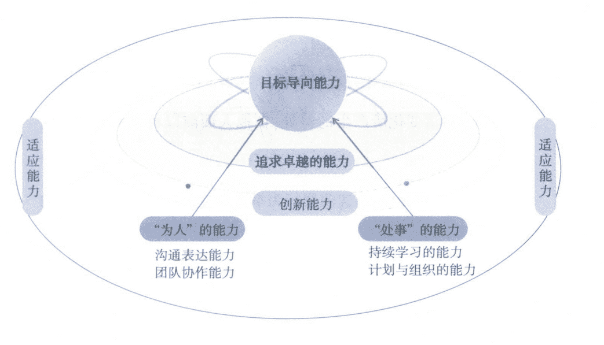

图5-4 专业人才需要具备的基本素质与能力模型

下面给出可直接使用的定义与行为表现。

#### （1）适应能力
当任务或环境发生重大变化时，能快速调整并保持效率。举例是市场需求变化时迅速调整营销策略。

关键行为如下：

####### (2) 目标导向能力
为个人和团队设定高标准目标，持续追踪进展，不懈追求实现或超越目标，从成就中获得满足。

关键行为如下：
- 瞄准机会：评估业务机会，聚焦最有成果潜力的方向。
- 设定有挑战的目标：为自己和他人设定能产生卓越结果的目标。
- 达成目标：克服阻碍，实现或超越目标。
- 超越目标：从完成挑战中获得满足感。
- 保持专注、自律、衡量进度、必要时调整优先级，排除干扰按时交付。

####### (3) 追求卓越的能力
主动为自己和他人设定高绩效标准，对结果负责。

关键行为如下：
- 设定卓越标准：制定流程使质量、效率、服务达到高标。
- 确保高品质：投入时间精力，面面俱到克服困难完成任务。
- 勇于担当：不论结果好坏敢于负责，错了就改。

####### (4) 创新能力
提出创新解法，善于用多种方法解决问题和把握机会。

关键行为：
- 挑战固有模式：识别问题背后的隐含假设，用不同视角重新定义问题。
- 善用多种资源：从不同人、学科、领域汲取灵感。
- 拓展思路：在不相关想法间建立关联，多角度发散。
- 评估多种方案：在决策前审慎比较所有可能。

####### (5) “为人”的能力
包含沟通表达和团队协作。

######## ● 沟通表达能力
通过多种媒介清晰传递信息，吸引注意力并确保理解。

关键行为：
- 组织沟通内容：明确目标、强调重点、逻辑清晰。
- 吸引注意力：用类比、举例、幽默、肢体语言、语调变化等技巧。
- 按听众调整：根据经验背景用对方听得懂的术语和例子。
- 确保理解一致：征求反馈、确认理解、换种方式表达。
- 理解他人：倾听并正确解读回应。

######## ● 团队协作能力
与他人建立并维护高效合作关系。

关键行为：
- 基于同理心的沟通：让对方感到被倾听、尊重、认可。
- 目标导向：有分歧时站在共同目标上思考，不纠结对错。
- 愿意分享与补位：主动分享荣誉、帮助同事达成目标，缺位时补上。

####### (6) “处事”的能力
包含持续学习和计划组织。

######## ● 持续学习的能力
对领域新知保持好奇，主动学习并将所学用于实践，同时愿意分享。

关键行为：
- 好奇心强：关注权威渠道，向专家请教。
- 创造学习机会：参加内部培训和外部峰会。
- 最大化学习效果：分享笔记、讲心得、应用于工作并复盘。
- 开放心态：敢于提问、接挑战、善于反思总结。

######## ● 计划与组织的能力
为自己和他人制定行动计划，保证高效完成，适合项目管理类岗位。

关键行为：
- 设定优先次序：合理排序并及时调整。
- 确定任务与资源：拆解任务，明确所需设备、材料、人员。
- 日程安排：合理分配时间，避免冲突，排进度节点。
- 善用资源：协调内部外部资源有效完成。
- 保持专注：排除干扰按期交付。

#### （二）高端专业人才的选聘

高端专业人才是能在特定领域创造突破、帮助企业走出瓶颈的稀缺者。他们不缺机会，企业要主动争取，选择权更多在候选人手里。

###### 1. 如何链接高端人才

企业通常会启动猎头。若不使用猎头，可尝试两种方式。

第一种方式：内部推荐。
高端人才往往集中在同行公司里，而内部员工是链接同行的最佳桥梁。内部推荐的有效性取决于推荐奖励的吸引力和员工对公司的认可度。

奖励要够分量。很多公司只给几百元，吸引力不足。对比猎头费用，以新人月薪为基准发放奖励更划算。阿里巴巴的做法是按级别定额，P6 推荐奖 6000 元，P7 推荐奖 10000 元。

员工认可度也很关键。员工若不认同公司文化或直属上级，就不会愿意推荐。

第二种方式：参加行业论坛和峰会。
多以组织方或参与者身份出现，结识行业人才，同时对外宣传公司正在招聘的人才类型，并留下可联系方式，便于有意向者主动对接。

# 高端人才与管理干部选聘实操指南

除了依靠猎头引荐，还有两套更主动的打法，能帮你更快触达并链接到顶尖专业人才。

###### 2. 如何精准吸引顶尖专业人才

想把高端人才招进来，核心是把企业价值讲清楚，真正站在候选人感受上，同时激发他的使命感。

(1) 让价值先声夺人
正式面谈前，安排候选人参观企业文化馆，亲身体验核心产品，并系统介绍过往获奖情况与技术专利。用沉浸式的展示先建立实力印象，留下好感。

(2) 在愿景层面深度共鸣
面试不只聊专业细节，更要把使命、愿景、战略和价值观摆出来谈，判断候选人的个人理想是否和公司方向契合。乔布斯当年挖百事高管约翰·斯卡利时，就问过一句点醒的话：“你是要一辈子卖糖水，还是跟我一起改变世界？”一句话点燃了对方的未来想象，最终促成加入。

(3) 把聚焦点放在候选人身上
高端人才不缺好机会，缺的是能体现独特价值的舞台。所以别总强调公司多优秀，更要传递出：我们当下恰恰需要你这样的能力与视角。

(4) 给予提前参与的机会
面试结束后，可邀请其基于对公司的初步判断提出建议，或者以顾问身份实地走访，结合资料输出一份分析报告。

让候选人提前介入的好处有三：其一，用真实场景检验能力，避免面试信息失真；其二，提升对方的时间与精力投入，增加选择意愿；其三，提前暴露公司真实问题，让双方评估更客观，减少入职后落差。

无论是否成招，HRBP都应为对方建档，纳入外部人才库留存，今日不成合作，来日仍有窗口。

##### (三) 管理干部的分层选聘逻辑

公司管理干部通常可分为高层、中层、基层三级。集团型企业里，事业部CEO属高层，部门总监属中层，总监下属经理、主管属基层。中小企业高层可能只有创始人一人，总监为中层，主管经理为基层。小规模组织甚至只有中基层干部。分类要基于岗位定位、职责职能与公司实际。

**第一，职责范围与决策权限的差异。**
高层负责整体战略规划与重大决策，决定长期发展方向与业务边界，在资源分配上拥有一票权，对外代表公司与资本、政府、战略伙伴高层对话。中层承上启下做转化与协同，把高层战略拆解为部门目标与计划，在高层授权范围内调配部门资源，并推动跨部门执行。基层负责任务拆分与现场管控，把上级指令分解到个人，监督进度与质量，给予日常指导与培训，并把一线信息反馈给中层。

**第二，管理范围与管理幅度的差异。**
高层覆盖全公司，关注经营绩效、市场地位、财务健康等宏观议题，通过少数高管间接管理全体员工。中层聚焦一个部门或业务单元，负责业务推进、团队建设与绩效提升，直接管理若干小组或团队。基层范围更窄，通常管一个小团队或工作区域，如客服组、仓库等。

**第三，时间跨度与工作重点的差异。**
高层看3-5年甚至更长，制定影响长期走向的战略，需紧盯行业、经济与政策变化。中层聚焦1-3年计划执行与动态调整，确保部门工作支撑战略。中层要兼顾内部协同与外部市场竞争。基层盯日周月任务达成，确保按时按质交付，关注现场细节与员工状态。

定位不同，能力要求不同，面试侧重点也不同。

###### 1. 高层管理干部

####### (1) 能力要求
高层能力可归为定战略、造土壤、建组织三块。

定战略即以全局视野结合市场、竞争与资源，规划长期路线，做出投资、并购、转型等重大判断。
造土壤即以身作则塑造文化，创始人与高层是价值观核心，要为员工创造透明、安全、流动、有氧、归属感强的工作环境。
建组织即按战略搭建架构与排兵布阵，具体包括：懂组织建设，把人当作整体系统来配，形成1+1>2；既能断事用人，也能用人断事，但不要过早把未想清的事推给别人；疑人要用，用人要疑，在擅长领域大胆授权，在短板处保持观察与支持；有格局，能识别并培养潜在接班人。

####### (2) 有效提问
考察定战略能力可问：过往如何制定战略，如何权衡风险与机会？真正的高管会基于行业洞察做前瞻规划，并考虑多元化与核心竞争塑造。问起核心业务受颠覆时如何调整，如何判断时机与方向？会提前建监测机制并给出转型、联盟、并购等预案。问未来3-5年关键趋势如何重塑业务？会具体落到研发、渠道、服务模式。问行业新商业模式与切入点？会保持敏锐并评估价值。

考察造土壤能力可问：过去如何推动文化建设，建立了哪些机制？考察建组织能力可问：依据新战略如何设计组织与机制？如何提前布局人才战略以支撑长期目标？

选聘高管宜先让其参与战略性项目观察表现，再结合背景调查全面核实。非正式场合也有价值，例如邀请候选人及家人共进晚餐，从细节与家庭互动获得更立体判断。若内部评估能力不足，可引入外部专家共同面试。

###### 2. 中层管理干部

####### (1) 能力要求
中层能力聚焦战略执行与目标分解、梯队搭建与人才培养、跨部门协同与资源整合。

战略执行与目标分解指深度理解高层战略并转化为部门可落地策略与目标。
梯队搭建与人才培养要求坚持“看两层管一层”，敢于提拔高潜人才，实现承上启下，使众人行。
跨部门协同与资源整合要求持续优化业务流程，推动跨部门协同，参与跨部门会议解决壁垒，发挥桥梁作用。

####### (2) 有效提问
战略执行可问：如何把公司战略拆解为部门目标与行动？考察思路清晰度。
人才识别可问：过往如何识别高潜员工，关注哪些指标？如何基于标准提拔管理干部？
人才培养可问：为高潜员工制定培养计划的案例与依据？采用哪些激励措施推动自我提升？如何保留关键人才？
协同能力可问：跨部门项目中如何确保协作顺畅？如何处理团队内部冲突？如何组建团队并界定角色？用什么方式激励团队并取得成效？

###### 3. 基层管理干部

####### (1) 能力要求
基层核心是任务落地执行，转型要点是从专家到管理者、从个人到团队。

任务分解指把部门目标拆到个人并激励高效交付。
跟进执行指按计划持续督导，给予业务技术指导并解决问题。
团队建设包括识人用人、绩效辅导、激励与人员管理等能力。

####### (2) 有效提问
任务分解可问：面对复杂任务如何拆解分配，考虑哪些要素？
跟进执行可问：如何确保保质保量？进度或质量出问题时的第一反应？分享现场棘手问题及解决方式？
团队建设可问：技能薄弱员工如何辅导？常用激励方式及效果？员工受挫或压力大时如何帮助重振？

###### 4. 管理干部内部培养好？还是外部招聘好
选拔干部是组织最关键的事，可行前提下建议以内部培养为主。内部晋升者熟悉流程与文化，更易指导一线，且形成成长预期，激励队伍。若需业务转型升级，或内部存在裙带、氛围不良等问题时，外部引进可打破僵局，重塑公平文化。

选对人比努力更重要：中高层内部还是外部更合适

谈到中层人选，内部成长起来的干部通常更占优势。他们长期在企业内部历练，对整体战略的把握更深入，落地执行也更有把握。并且与内部同事熟悉度高，推动企业文化价值观的宣贯和维护更顺畅，有助于文化保持一致、团队保持向心。对公司开拓新赛道或进行重大战略调整时，如果现有人选在新赛道的能力储备不够，就需要从外部引入能够牵引变革的人。还有一种情况是内部管理方式逐渐僵化、创新不足，从外部引入中层能够带来不一样的管理理念和方法，有助于激活创新氛围。

高层的选用逻辑则有所不同。公司处于平稳发展阶段时，内部培养的高管往往更适配。他们对组织忠诚度较高，也更易得到内部员工信任与支持。但当企业正陷于严峻困境，例如市场份额急剧萎缩、出现财务难题，或必须进行大面积战略转型，外部高管则更具价值，他们能凭借丰富实战经验或创新视角帮助企业摆脱危机、完成转型。若候选人本身声誉出众、资源网络扎实，还能提升公司品牌认知度，拓宽外部合作渠道。

## （四）识别底层隐蔽性信息

除依靠结构化提问评估候选人的专业素养、通用能力及管理能力之外，还要借助观察与推断去捕捉其底层的动机、兴趣与价值观倾向，并对所提供信息的真实性做审慎判断。

###### 1. 识别底层动机和需求

绩效体现多取决于能力，而价值观、动机与需求则在很大程度上决定了在岗的持续时长。通常可以从以下几个切面进行推断：

**离职动因**：厘清为何离开前东家、为何选择加入，有助于判断真实需求与价值取向。
**职业规划方向**：人们往往倾向于选择擅长或喜爱的领域，了解其规划可把握专业偏好。
**关键抉择回顾**：回溯重大选择背后的思考逻辑，能反映价值观倾向。
**过往满意度**：了解其对既往经历结果的满意程度，可进一步推测需求与价值主张。
**兴趣投注**：询问在某些事务上的时间精力投入，通过资源分配判断其价值观取向，因人们通常会把更多投入放在真正感兴趣的事情上。
**核心期待**：了解其对生活与事业的期待，能够把握内在驱动力。
**投射性评价**：个体往往欣赏与自身心理预期相符或与自身性格相似的对象。例如，候选人认可某位主管的处事方式，可能说明该主管风格与其自身预期一致。

若候选人想要或喜爱的，正好是企业可以提供的；若其排斥或不需要的，恰好是企业所没有的，这就是匹配。反之则为错配。

另外，若有多年人资实战经验，面谈中直觉告诉你此人不合适，也应予以重视。直觉是过往经验的压缩沉淀，在多数情形下是准确的，尤其对经验丰富的面试官而言。但也要警惕经验局限与认知偏差带来的自我证实效应，避免怀疑一旦形成就引导大脑寻找佐证。

###### 2. 细微之处辨真假

面谈时不仅要听对方说了什么，更要留意神态、姿态与动作细节，以此判断信息真实度并推断能力与个性。

依据人际交往中的“55-38-7”规律，55%的信息来自肢体语言，38%来自语气语调，只有7%来自言语内容。因此除关注表达内容外，还应细致捕捉面部表情、肢体动作与眼神变化。

面部表情常外化内在需求，比如对某事持否定态度时会表现出逃避、厌恶、排斥的神情；对某事感兴趣时语速会加快，嘴角也会自然上扬。

肢体语言也是内心感受的重要通道。例如面试中双臂抱胸，可能透露紧张或社交不安；当询问与主管的关系时，候选人口头表示高度认可，但嘴角却流露不屑，则可能暗示真实态度相反。

本书整理了常见的肢体语言信号供参考，见表5-1。

使用时需注意：

- 避免机械对应：同一行为可有多种解释，如摸鼻子可能是说谎，也可能是过敏或感冒；
- 基线观察：以面试前5分钟的自然状态为基准；
- 集群信号：单一动作参考价值有限，连续出现3个以上相关信号才更具参考性；
- 矛盾验证：当肢体语言与口头表述不一致时，如声称“很感兴趣”却频繁看表，需进一步追问；
- 文化差异：部分肢体含义具有文化特异性，如在印度摇头可能表示肯定；
- 环境干扰：室温、座椅舒适度等客观因素会影响姿态。

建议配合STAR面试法使用表5-1，当捕捉到异常信号时，可通过追问细节，如“您能具体描述当时的数据变化过程吗？”进行验证。

####### 表5-1 肢体语言

| 行为类型 | 具体表现 | 可能的心理活动/真实想法 | 注意事项 |
| :--- | :--- | :--- | :--- |
| 眼神接触 | 持续稳定对视，瞳孔略微放大 | 专注投入，对话题感兴趣 | 注意文化差异，部分文化认为直视不礼貌 |
| | 频繁眨眼，眼神游移 | 紧张焦虑，回避敏感议题，可能隐瞒信息 | 结合语速变化判断，区分正常紧张与刻意隐瞒 |
| | 突然向下看并伴随停顿 | 搜寻记忆细节或组织语言 | 需与说谎时眼球常向右上方转动的动作区分 |
| 头部动作 | 频繁点头 | 急于迎合、快速认同，可能缺乏深度思考 | 注意点头频率与发言内容的匹配度 |
| | 头部后仰、下巴抬高 | 防御姿态，觉得问题冒犯或过度自信 | 结合语调判断，自信者语气平稳，防御者可能声调升高 |
| 手部动作 | 手指交叉紧握 | 紧张焦虑或需要自我控制 | 观察手部位置，放在桌上属常态，突然藏至桌下需警惕 |
| | 指尖搭成塔状 | 自信表现，掌控感较强 | 高层候选人常见，需区分自信与傲慢 |
| | 频繁触摸鼻子、耳朵、颈部 | 压力反应，可能涉及不实或尴尬 | 需排除过敏等生理原因 |
| 坐姿表现 | 自然身体前倾 | 积极参与，兴趣浓厚 | 区分刻意前倾的伪装投入 |
| | 后仰靠椅背加双臂交叉 | 心理防御、保留态度或不满 | 突然改变坐姿比持续姿态更具参考价值 |
| | 双腿交叉朝向门或窗 | 潜意识的逃离倾向，对当前话题抗拒 | 注意是否伴随看表等动作 |
| 微表情 | 短暂皱眉，持续0.5秒内 | 对问题产生疑虑或反感 | 微表情转瞬即逝，需反复验证 |
| | 单侧嘴角上扬 | 轻蔑、不屑，可能对问题或面试官不认同 | 注意是否伴随瞳孔收缩等真实情绪指标 |
| | 舔嘴唇、吞咽频率增加 | 压力引发的生理反应，可能涉及关键问题 | 观察是否集中在特定议题上 |

除此之外，还可通过社交媒体动态、微信头像、个性签名等生活化细节，辅助推断性格与兴趣取向。

即使收集了大量案例并进行理性分析，主观心理偏差仍会影响判断。接下来分析人才选聘中常见的四类偏差。

## （五）影响人才选聘的心理偏差

选聘必然受主观因素影响，因为人际互动无处不在。以下偏差需保持警惕。

###### 1. “敝帚自珍”带来的期望偏差

“敝帚自珍”指人们对自己拥有的东西格外珍视，高估其价值，与禀赋效应类似。

这导致企业与候选人之间出现预期落差。一方面，企业往往认为所提供的岗位机会价值很高，对候选人期待也高；另一方面，候选人常高估自身能力，对企业认同不足。在双重偏差下，人力业务伙伴常承受来自业务与候选人的双重压力。

应对之道是及时关注人才市场供需变化，与业务伙伴共享信息，合理管理其期待；同时向候选人传递市场信息与竞品情况，帮助其做出合理选择。

###### 2. “形象管理”带来的选聘偏差

面试本质上像一次相亲，双方都倾向于展示最好的一面，而这种表象可能掩盖真实状况，为后续合作埋下隐患。

因此内部要引导业务伙伴树立“匹配才是最合适”的用人理念；在沟通中也引导候选人认识匹配的重要性，鼓励其展现真实自我。

###### 3. “近因效应”带来的选聘偏差

近因效应指最后的面试表现往往对决策产生过大影响。例如候选人整体表现平平，但在最后提问环节抛出很有深度的观点，可能让面试官印象深刻而直接录用。

提醒我们不可被末尾表现迷惑，要回顾整个面试过程，结合案例材料作出客观决策。

###### 4. “刻板印象”带来的选聘偏差

刻板印象是指用既有印象去评判当前对象。例如认为来自大公司的候选人能力更强，小公司背景的相对一般，这种判断并不总是准确。

近因效应、刻板印象与光环效应一旦被触发，往往导致沉锚效应产生，如同海底的锚将观念固定在某一位置。即使意识到偏差，也很难完全摆脱。我们能做的，是识别并正视偏见，尽可能降低其影响。

#### 三、选聘的终点是新人成功落地

### （一）成功落地的标准

不少人力伙伴认为新员工入职即标志选聘结束。实际上，选聘的真正收官应以新员工顺利通过试用期并平稳融入为标志。

需重点关注三个指标：新员工成功入职率、新员工成功留任率、新员工融入状态。

新员工成功入职率 = 完成入职手续人数 ÷ 接收offer人数 ×100%。
新员工成功留任率 = 通过试用期人数 ÷ 成功入职人数 ×100%。

度过试用期不等于已融入，需从四个维度评估：

1. 意义感：在新公司找到工作的价值与意义。
2. 有结果：在岗位上取得成果并获得成就感。
3. 适应性：对新公司的工作方式、规章制度等不再感到不满或惊讶，开始适应。
4. 稳定性：异动信息逐渐减少，能与团队和谐相处。

### （二）落地工作起始于选聘面试

新人能否顺利融入，在选聘阶段即可进行预判。可从职业规划、适应能力、人际链接、工作链接四个方面评估。

**职业规划**：可问“加入本公司后，你是否思考过自己想要什么、需要放弃什么？请具体说明。”跳槽若缺乏深思熟虑，常会因不适应而怀念旧单位，产生不满。

**适应性**：“在原公司，你经历过几次工作变动？能否分享过程？”“你是如何适应新变化的？”“在上一家公司，你做了哪些行为调整来适应？”

**人际链接**：“在原公司，你是否与主管讨论过调整工作职责和目标？如何做的？”“你是否主动了解过主管和同事对自己的评价？请举例。”新人融入的最大障碍往往是缺乏与主管、同事主动沟通的勇气。

**工作链接**：“请举一个案例，说明即使没人要求，你也会把工作做到最好。”以此判断其是否从工作中寻找价值，是否积极主动。

录用后，人力业务伙伴应与业务伙伴就以下问题达成共识：

- 采取哪些措施确保新员工顺利落地？
- 如何满足候选人的需求与期待？
- 入职后可能面临哪些挑战？
- 预判该候选人能在公司待多久？

## （三）新人融入管理

###### 1. 打造充满仪式感的入职第一天

入职第一天的体验深刻影响后续职业感受。加入体验式设计，能为员工留下难忘记忆。

**案例企业甲的体验**：
到公司后需询问多位同事才找到共享服务中心办公楼，办完手续后人力同事告知前往业务部门报到，因不熟悉环境再次求助。被同事B带到工位，递上一叠签约文件与一本《新员工指导手册》，手册详细罗列违规行为与惩罚，看到“试用期内不合格可无条件解除劳动合同”时产生紧张。上午用于领用品和安装软件。午餐被告知餐厅在负一楼，需13点前返回工位，主管上午外出下午见面。整体感受陌生、疏离。

**案例企业乙的体验**：
按入职指南指引到达共享服务中心，门口有指示牌，楼层悬挂“欢迎新员工加入××大家庭”的横幅。共享服务中心完成后即电话通知部门人力业务伙伴前来接人。部门同事自称“入职通知书上的师兄”，一路介绍园区与餐厅美食特色，沿途热情介绍同事并带到工位。工位上已有鲜花与欢迎卡，电脑等用品齐备。团队热烈欢迎，师兄介绍公司与工作内容并分享趣事，午餐团队共进，主管结束后欢迎并点评面试中的亮点。师兄与主管还催促下班。第一天感受被接纳、被尊重，对未来充满期待。

对比可见，用心设计的入职流程能让员工感受到被接纳，有助快速融入。乙企业通过热情欢迎、周到安排与轻松互动，让新人感受到尊重；而甲企业则让人感到陌生与疏离。

公司迎接新人入职的细节梳理：

- 提前准备详尽入职指南，涵盖需携带材料、公司位置、交通指引、入职办理点、联系人、部门联络人及人力业务伙伴信息等；
- 指定一位热情乐于分享的入职领路人，他是新人进入组织后首位深度链接的人，直接影响第一印象，应具备良好沟通与分享能力；
- 营造温馨入职环境，如欢迎横幅、鲜花、欢迎卡片等；
- 入职前告知团队成员以热情态度迎接新人；
- 安排新人准备一份自我介绍的PPT，由人力业务伙伴或业务主管向团队隆重介绍其优势与录用理由，并鼓励团队相互介绍，加速熟悉。

第一天就把温度拉满

- (6) 别在开局就让新人感到压力。比如不要安排在入职首日就签署免责协议之类的文件，时机的选择很重要，等氛围更合适再进行即可。
- (7) 入职前把工位收拾干净，电脑、笔电、资料、日常办公用品提前备齐，让人一来就能上手。
- (8) 准备一份小小的见面礼，鲜花、手写卡片或一本好书，都能传达欢迎与被接纳的信号。
- (9) 第一次午餐别让新人单打独斗。在中国语境里，一起吃饭就是认可和融入的象征。

总的来看，一个用心设计的入职首日，能让新人真切感受到温暖，这种良好的开端会加速融入并提升留存。

###### 2. 洞悉新人心理，促成良性循环

让新人有好体验只是落地管理的起点。之后HRBP和业务伙伴要持续关注新人进入新环境后会遇到的不适与挑战，帮助他们尽快适应。主要困扰集中在两大类：

其一，链接感偏弱带来的疏离。由原公司到新公司的过渡期，情感与行动的联结容易出现断层，具体表现为三方面：

- (1) 与组织的弱连接：新同事彼此陌生，深度交流少，孤独感和边缘感容易产生，融入团队的阻力变大。
- (2) 与工作的弱连接：每个组织的做事逻辑和要求不同，新人需要重新校准工作方式。实际状况与预期差距会让他们不断调整目标与期待。
- (3) 与初心的弱连接：理想与现实落差大时心理落差明显。比如有员工从传统制造跳到阿里后感慨：外界传的阿里和真实的工作状态完全不一样，过去流程清晰，现在变化快、标准模糊。倘若看不清新公司能给自己带来什么，文化不适就会促使人选择离开。

其二，紧张不安会推向两种极端：要么过度保守，要么急于表现。

保守型的人顾虑太多，容易犹豫、怕犯错。急躁型的人渴望快速证明自己，急于出成绩博得认可。

这两种状态都不利于稳定落地。过度保守会抑制创新，难以产出；急于求成则容易只盯结果忽视人际，容易踩到同事利益，制造紧张感，被排斥后危机感加剧，反而更想证明自己，形成恶性循环（见图5-5）。

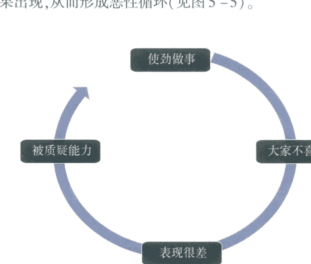

新员工急切表现也说明积极性和成就欲较强，这是正面信号。只不过成就欲过强会适得其反。心理学家耶克斯与多德森提出的耶克斯—多德森定律（见图5-6）指出，动机强度与效率不是线性关系。任务越简单，动机越高效率越高；任务中等时中等动机效果最好；任务越难，最佳动机强度反而越低。

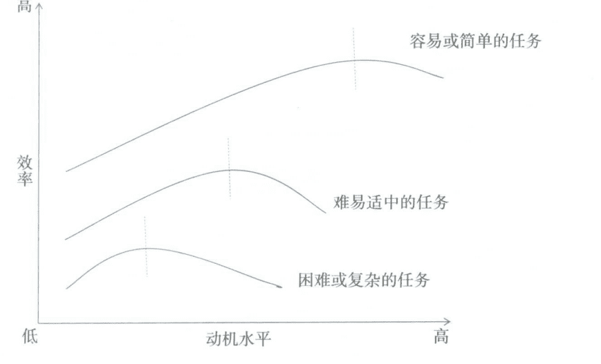

结合恶性循环的规律和动机与效率的关系，HRBP与业务伙伴在帮助新人融入时，应先从人际关系入手，以可达成的小事切入，让新人通过连续的小成功建立信心，再逐步进入正向循环。

在正向循环（见图5-7）里，新人能与团队建立稳定的合作关系。关系稳固后，能获得更多内部信息，更快识别风险与机会，判断重点和难点，从而在难度适中的关键任务上实现突破，快速赢得认可。

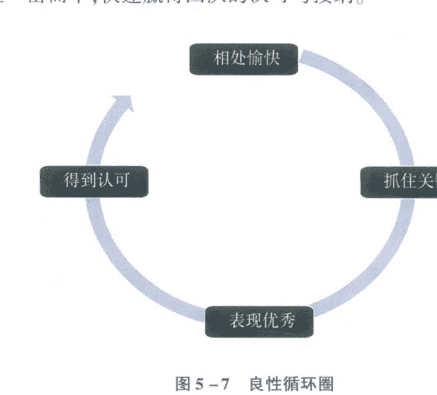

图5-7 良性循环圈

关系处得好，同事也更愿意见证和肯定新人的成绩。对个人而言，岗位上的成绩是最直接的自我肯定，能增强自信，提升自我价值感，进一步推动正循环。

###### 3. 全方位的组织机制保证

招聘成本只是显性支出，若新人融入机制断层，还会产生隐性损耗：文化认同慢导致积极性下降，技能传递不畅引发协作摩擦，最终拖累业绩。让新人快速融入并创造价值，已经是高层、主管和HR体系协同的战略议题。以下五点可作参考：

第一，高层要真正关心而非口头关怀。以阿里CCO事业部为例，每月总裁例会都会专项讨论新人融入情况，包括优势短板、工作状态、任务分配等。

第二，直接主管的考核要与新人落地挂钩。阿里CCO事业部曾将新人落地指标写入部门负责人的绩效，要求试用期闪离率为0，即不允许试用期内流失。

第三，组织层面要持续跟踪适应度。建立监控机制，比如CCO事业部的红黄绿灯制度：红灯为存在离职风险，黄灯为适应受阻需重点关注，绿灯为融入良好。状态信息来自OD团队的访谈调研和主管反馈。

第四，完善统一的新员工培训。公司层面培训帮助新人掌握发展历程、业务版图及文化，同时提供内部人脉拓展机会，提升归属感，为跨部门协作打基础。

第五，部门内组建“HRBP+导师+直接主管”新人融入小组。

- 直接主管负责让新人熟悉工作、拓展人脉、融入团队并获得支持。
- 导师协助主管，帮助新人建立业务链接，在主管缺席时提供专业指导与示范。
- HRBP关注新人的心理状态，帮助其找到工作意义并支持角色转换。

三者配合才能实现有效落地。

对于试用期内离职的新人，可以从以下维度复盘：

- ✓ 选人标准是否清晰合理，能否真正选到合适的人？
- ✓ 招聘与录用过程是否做了充分风险预判，预判是否准确？
- ✓ 面试中遗漏了哪些关键信息，这些信息能否提前预警离职风险？为何被忽略？
- ✓ 入职过程中是否忽视了已出现的离职信号？
- ✓ 在新人落地管理上哪些环节做得不到位，需要改进？

复盘的目的是提炼经验，让下一次新人管理做得更好。

至此，本书即将收尾。下面将回到HRBP自身，探讨如何增强自我效能，提升内在心力。

只有内心坚定强大的HRBP，才能滋养他人，推动团队与组织效能提升。

# Part 03

## 自我成长：选你所爱、爱你所选，成就最好的自己

要推动组织、团队和个人效能提升，首先HRBP自身要成为点燃他人的火种。要成为火种，既要热爱这份工作，也要在人生修炼中不断成为更好的自己。以下分两章展开：

- 第六章 选你所爱，爱你所选
- 第七章 成为最好的自己

## 第六章 选你所爱、爱你所选

HRBP是一份职业，先要弄清胜任它需要哪些能力，再结合“我愿做、我能做、我该做”的思考，判断是否将其作为终身事业。

### 第一节 HRBP 需要具备的“五力”

合格的HRBP需要五项核心能力：业务力、专业力、影响力、文化力、心力（见图6-1）。

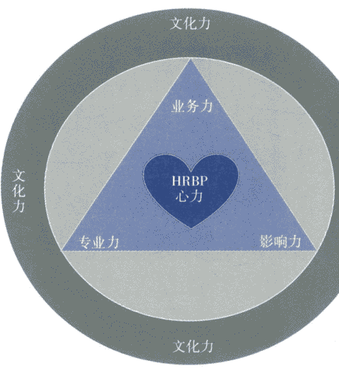

图 6-1 HRBP“五力”模型

业务力是理解业务与战略底层逻辑的能力。HR工作起点是懂业务，终点是助力经营目标达成，始终围绕业务展开。

专业力是掌握人力资源各模块知识与逻辑关联的能力。不必样样精通，但需达标并能整合为系统化方案服务业务。

影响力是懂人性、赢得信任的能力。管理团队靠的不是职位权威，而是人际影响力与人格魅力。

文化力是洞察文化本质，推动使命感与爱、利他、长期主义价值观落地的能力。

心力是自我修养。成为点燃他人的火种，需要清晰自我认知、稳定情绪内核、提升认知水平，并坦然拥抱真实的自己。

HRBP门槛不高，但做好不易。人生有限，你准备好在这一条路走下去吗？

### 第二节 HRBP 的职业规划和选择

世界对每个人都公平，终点相同，路径各异。有人随波逐流后悔终生，有人找到“我愿做、我能做、我该做”的事业，充实一生。

对人力资源人来说，常纠结COE还是HRBP，是否该换赛道。关键不在选择本身，而在是否真正思考过自己的发展方向。

建议用三圆模型自测——“想做”“能做”“值得做”。

想做：HRBP这个岗位能否点燃你的热情？是否愿意投入时间精力？若是，你已找到热爱。

能做：岗位是否能发挥优势？盖洛普研究显示，成功者更擅长放大优势而非弥补弱点。与其纠结难以改变的弱点，不如找到互补伙伴合作。思考：我的强项是什么？我学得快的是什么？我取得过哪些显著成功？投入哪些领域回报最高？

值得做：岗位能否带来价值感？列出对个人、对他人、对团队的价值。若你确信其价值不可替代，那么它值得追求。

找到三者的交集，就是方向。HRBP会是你的终身事业吗？无论答案如何，建议继续阅读。因为无论未来如何选择，都不妨碍你成为最好的自己。

图 6-2 职业选择三环模型

## 第七章 成为最好的自己

想成为最好的自己，首先要自我觉察。问自己：你是谁？

很多人会回答：我是父亲、母亲、老师、子女……这些是社会角色。真正的答案是：你是你自己。

先认识并接纳自己，才能更好地履行各类角色。在此过程中，要视己为人而非视己为物，要把自己当成目的而非工具。

### 第一节 认识自己，接纳自己

认识自己要承认人性的两面性。你可以是佛，也可以是魔。内心安定时是佛，内心不安时是魔。不安并非事实本身，而是对事实的认知与解读，而认知源于过往经历。

有人在无条件爱中长大，用童年治愈一生；有人在有条件爱中长大，用一生治愈童年。

大多数人自认是后者，但可以从当下改变。人生的意义在于看清不完美后不断修炼完善，最终遇到最美的自己。方式包括内观自省、寻求反馈、经历磨难，都能促成涅槃蜕变。

在此过程中坚守：视己为人而非视己为物，你是目的而非手段。

### 第二节 成长过程中的坚守

#### 一、视己为人而非视己为物

视己为人，是承认自己是有情感、有意识、有主动性的人；视己为物，则是把自己当成没有自主性的物体。两者带来截然不同的人生轨迹。

表7-1 自我的两种维度

| 区分维度 | 视己为人 | 视己为物 |
| :--- | :--- | :--- |
| 认知：思考问题的出发点 | 以“why”为起点，再思考“what”“how” | 先从“what”“how”出发 |
| 对待情绪的方式 | 驾驭情绪，合理表达并利用 | 被情绪裹挟，做出情绪化反应 |
| 行为反应模式 | 刺激—认知—反应，具有主动性 | 刺激—反应，直接应激 |
| 行为表现 | 思辨执行力 | 高效执行力 |
| 评价行为的标准 | 内在标准 | 外界认可与他人评价 |
| 对自我的评价 | 不被外界定义，不设限。对优点保持可更好，对不足直面并寻求提升 | 活在自我与他人标准里。对优点沾沾自喜，对不足防御、找借口 |

#### 二、视自己为目的而非手段

把自己当成目的，是以“成为最好的自己”为终极目标，把经历都当作成长途径。把自己当成手段，则是以功名利禄为驱动，忽视自我关爱。

表7-2 人是目的还是手段

| 区分维度 | 人是目的 | 人是手段 |
| :--- | :--- | :--- |
| 人生的目的 | 成为最好的自己 | 获取功名利禄、荣华富贵 |
| 持续动力来源 | 喜欢做事本身，成就感驱动 | 迎合大众期待，外在回报驱动 |
| 关注点 | 自我成长与能力提升 | 可获得多少外在回报 |
| 对自我的评价标准 | 与自己比，今天最好是明天最低要求 | 与他人比，把自己当比较工具 |
| 对他人的认知 | 视他人为目的，尊重他人 | 视他人为手段，试图控制他人 |
| 对人际关系的认知 | 独立、平等、价值交换 | 依赖或控制，寻求被保护或支配他人 |
| 内心力量 | 关注成长，内在力量增强 | 不断透支自己，能力被消耗 |

以自我成长为目标，能激发积极能量，不仅影响自己，也能带动周围人。

懂得爱自己的人，更懂得爱他人；擅长自我激励的人，也能激励团队。

### 第三节 成长过程中的九九八十一关

不经历风雨怎见彩虹？想成为最好的自己，就从现在开始过关斩将。本书为HRBP总结了职场九关，与君共勉！

#### 一、第一关：从被安排到问为什么
童年到成年，很多人的人生轨迹像是一条被提前画好的路线。长辈的叮嘱、师长的指引、主管的指令，一直在告诉我们下一步该如何走。幼年时要好好读书，求学时要拼命用功，进入职场后又要按时交付。久而久之，听话成了默认模式，很少有人会追问背后的价值。人像舞台上被牵着走的演员，演得很努力，却始终不是写剧本的人。

当想自己执笔，第一件要厘清的是存在到底为了什么。更早一代的父母往往会说，为温饱、为下一代、为能继续活下去。
活下去了呢？
上世纪七十年代出生的那批人则强调过得更好。所谓的更好，常被理解为奋斗换来好车好表、宽阔住所和社会认可。
再往后看呢？
当基本物质都能落袋，再多财富也带不走。物质到了一定阈值，精神层面的渴望便逐渐浮出水面，人性也在这时开始苏醒，才会真正思考生命的价值与方向。

寻找方向其实并不遥远，只要活在当下保持觉察，在每一个瞬间选择更完整的自己，就已在路上。开始追问为什么，就不会再只是旁观，也不再是他人的傀儡，而是自己生命的缔造者。如何书写、怎样呈现，全由自己拿捏。从描述现状到追问根源，从顺从到自主，这正是觉醒，也是进阶的第一道门槛。

#### 二、第二关：告别校园依赖 成为主动者
职场身份已经转换，却仍常发现自己在碰到难题时本能地想请领导帮忙定夺，甚至习惯等待任务被派下来才动身。
这种惯性并非偶然。长期的教育与组织规则会在潜意识里塑造行动方式，让人带着求学期的被动等待进入工作现场，默认所有难题都有现成解法，默认服从指令就是正确，默认付出一定会有回报。在大规模工业化分工的年代，这套模式能让人成为精密机器上可靠的一环。但在信息快速流动的当下，这套模式处处显得局促。
当下鲜少有现成解法，努力也不等于必然成功。答案更多藏在市场一线与客户现场，需要自己主动走出去收集线索。
真正的蜕变不是名片上的头衔变化，而是脑袋与做法的同步升级。只有从被动接收转向主动创造，从依赖既定答案转向独立判断，才能在信息时代站稳脚跟，发现自己的价值。
这就是人生的第二道关口。

#### 三、第三关：放下评判 保持探索心
争论是最消耗精力的消遣，寻求共识则更有意思。每个人的人生背景不同，观察世界的棱镜也就不同，对同一件事的理解自然差异很大。
最大的损耗来自对异见耿耿于怀，在内耗中消耗自己，却不曾好奇对方的出发点是什么。若带着探索的心看人看事，每个人都能成为上师，推动我们成长。反之，一切都会变成阻碍，再怎么躲也躲不开。
博览群书、遍访各地，见过更多风景，才会明白世界的可能性远比想象宽广。不要困在旧有认知里，要敢于走出自己设下的边界。
勇敢踏出去，保持好奇心，放下对错执念，这是第三道关卡。

#### 四、第四关：卸下标签 远离操控
我学的是心理学，却最不喜欢用各种量表给自己贴定位。小时候的规划很清晰：考上大学、找个好归宿，做一个内外兼修的伴侣。现实却把我推向一条充满不确定性的创业道路。人生最低谷时，正是朋友一句“你做什么都能成”的信念把我拉了回来。
人生本没有剧本，为什么总要提醒自己是内向还是外向？一旦给自己贴上某种标签，某种程度上就给自己的成长划了线。
我很清楚暗示的力量，所以一直拒绝自我设限。曾被各种标签击垮过心理防线，在走出阴影摆脱被操控后才看清，那些标签大多是假象，真实的自己其实很棒、很优秀。若真要给自己贴东西，不如贴上积极的描述。
永远不要活在别人的评价里，除了自己，没有人有权定义你。别让内心的心魔缠住，也别让别人的束缚限制住。想做就放手去做，成败自评。
卸下束缚，远离PUA，这是第四道关口。

#### 五、第五关：观照情绪 与心同行
人与人情绪表现的差异，不在有没有，而在情绪的质感、张力与强度。面对工作中的不顺，有人能快速复盘并调整状态，有人则会陷进自我怀疑难以自拔。
不少人以为管好情绪就是压下去、忽略掉，把情绪当成猛兽想方设法压制，越是想掌控越容易被反噬。
研究显示，长期压抑、委曲求全的人，在临界点更容易失控。更健康的做法不是逃避也不是压制，而是去觉察、去尊重、对情绪保持好奇，探究其背后的真实需求，最终与情绪达成和解。
情绪像一把利器，用得好能开路，用不好会伤人伤己。
让情绪服务于自己，而不是成为情绪的奴隶，这就是第五道关口。

#### 六、第六关：尽力而为 顺其自然
带学员时常听到类似说法：
“老师，这事没辙，公司制度就是这样。”
“我们和头部公司不一样，这套方法不适用。”
“必须老板拍板，没有指令我们动不了。”
“老板不允许。”
这时我会反问：如果制度没有约束，你会怎么做？如果你的环境像大型平台那样，你会如何尝试？如果领导说这件事你自己说了算，你准备怎么推进？
制度与领导的态度，归根结底是别人的选择，我们无法干预。唯一能掌控的是自己的行动。在外部条件不理想时，不妨先问自己还有哪些空间，真的完全无计可施吗？
不尝试，成功率为零；尝试了，至少保留了发生的可能。不做会陷入纠结、内耗、责怪外界；做了，至少能对自己交代，问心无愧。
把精力放在自己能控制的范围：我想做的、我能做的、我该做的。把过程做到位，结果顺其自然。
这就是第六道关口。

#### 七、第七关：向善发现美好
世界的底层逻辑是好坏共存、善恶并行。人却更容易被负面信息吸引，忽略积极的信号。盯着阴影看，会错失磨练心性的机会；看见光明，力量才会生长。
对外部如此，对自我评价亦同：
当别人说你脾气急、藏不住事，你可以告诉自己，我办事果断，当天事当天清。
当别人说你固执自负，你可以告诉自己，我有主见，能做出坚定判断。
当别人说你粗心不拘小节，你可以告诉自己，我注重结果，善于把握重点。
当别人说你胆小没见过世面，你可以告诉自己，我行事稳重，忠诚可靠。
当别人说你爱异想天开，你可以告诉自己，我思维活跃，敢于突破。
美与丑、好与坏本是同一枚硬币的两面，区别在于是否愿意换个视角去发现善意与美好。
心怀善意、保持乐观，会吸引更多正能量。快乐不是成功的副产品，恰恰是成功的起点。
这就是第七道关口。

#### 八、第八关：把想法变成行动
想法再多也只是问题，行动才能给出答案。太多人把自己锻炼成脑子里很丰富、脚下却空转的状态。
晚上能脑补千条路径，早上醒来却走惯常的老路。积攒许久的劲头想大干一场，关键时刻又开始找借口。借口找多了，最后就选择躺平，用“放下”来安慰自己。可从未真正拥有，又谈何放下？
趁年轻先动起来，别等到年纪大了才懊悔当初为什么不多努力一点。
世界并不完美，谁都不专业。恰恰因为不完美，才更需要行动。不是有了能力才去做，而是做了之后能力才有成长空间。
拒绝空想，从行动开始，这是第八道关口。

#### 九、第九关：用心活着 快乐工作
马云说过，工作只是阶段，生活才是整段旅程。工作是你的部分，你才是生活的全部，更属于家人。用享受生活的心情去工作，用对待工作的认真去生活，生活才会回以公平。
热爱的事业带来成就感，亲友的陪伴带来幸福感。
生命本身没有现成意义，我们是在体验不同状态、感受不同人生片段中慢慢赋予意义。不管做出怎样的选择，但愿在回望时能坦然说：这一生，灵魂丰盈，足够了。
愿你在琐碎日常里找到心满意足，也愿你的旅程配得上沿途的颠簸。
走过九重考验，取回属于自己的人生真经，祝好。

# 后记
这本书打磨了将近两年，反复推敲修改。上周觉得可以的内容，下周再看就显得糟糕。初稿已进入出版社的三审流程，因我坚持改动而被迫重启。先向出版社的鹏瑶小师妹和张岩主任说声抱歉，折腾流程费心劳力，给你们添麻烦了。
即便反复修订，书里仍有不足，或许是表达欠妥，或许是逻辑有缝。交稿前我仍心惊胆战，怕拙劣文字影响阅读体验，若阅读中感到困惑，欢迎添加我的微信交流。
写书是痛并快乐的过程。写作时我常问自己，为何耗费如此多精力？为了卖书赚钱还是为了留名？答案是都有。我是个俗人，爱财也爱名。
真正支撑我的，是想象出来的价值感与内心的使命感。每写完一段方法，我都会在脑中模拟：读者拿着这本书，能否按步骤独立操作？这些能力能否复制？随后我会想象读者解决问题后开心的模样。你们的开心给了我巨大力量。
另一个力量来自对人性内在力量的信任。
我的职场并不顺遂，充满波折。大学毕业后进入山东滕州的一所中学任教，数百人争一个心理学教师名额，我被选中，却在一年后放弃，重新备考研究生。早上点名晚上查寝、全天固定工时的人生太无聊。家乡评价工作的标准只有一个：是否编制。
后来工作，本可以安稳做个普通打工人，却偏爱折腾。从青岛到杭州，再回青岛，如今开始全国行走。没有折腾的资本，却向往折腾后的风景，就必须承受风雨。被撕得粉碎、怀疑人生时，我选择躺平，静下心来内观、反思、学习、成长。躺平后才发现，那些职场磨砺、否定和打击，都成了养分。
我开始梳理十五年职场经验，反思四十多年的生命历程，甚至问自己：为什么误打误撞学了心理学？我为何存在？我的意义是什么？
拷问越久、剖析越深，大脑越清醒，内心越坚定，也就看清了想成为的样子。
人生的挫折都是自找的，但绝不是白受的，它们用来锻造你。
也许因为自己淋过雨，所以想给别人遮风挡雨；也许因为曾被否定，所以想对挣扎的小伙伴说：你其实很优秀，别怕，干就行了。
文字是有力量的，我希望借此为世界添一丝阳光。这也许就是自己存在的价值和意义。
最后把书送给我的宝贝女儿，你是妈妈生命里的光，是天使。为了赶稿兼顾直播，我常不想做饭点外卖凑合，还赖你洗果子刷碗。你总能在我没电时抱抱我，给我力量。谢谢你，宝贝！
也谢谢我的家人。自从我创业起，就每天在工作室忙到很晚，没给家里做过一顿饭，没送过孩子一次艺术班，是你们让我无后顾之忧，去做有价值、有意义的事。
业务部门要的不是人力资源的“专业术语”，而是能解决问题的“业务语言”。本书通过战略规划解码、行业周期分析、竞争结构拆解等实战方法论，帮助HRBP穿透业务表象，直击痛点本质。更值得推荐的是，书中“裸心会设计指南”、“团队文化打造的流程步骤”等内容，让理论即刻转化为可落地的行动方案。
——方晓 上海闵行高层次人力资源发展研究院·合肥高层次人力资源发展研究院理事
海尔和阿里巴巴虽然是两家具有完全不同文化的企业，但对组织韧性与人才活力的追求殊途同归。竹辉以海尔与阿里的双重实战积淀，提炼出HRBP从“职能专家”向“业务伙伴”转型的核心逻辑。书中既有对PESTEL、VRIO等经典工具的深度拆解，更有战略解码与人性洞察的鲜活案例，值得每位HRBP人员精读学习。
——李瑞友 海尔集团海尔智家供应链人力资源总经理
在工业时代，HR是流程的执行者；在AI时代，HR是价值的共创者。本书以“视人为人”为内核，重构HRBP的思维框架——从战略澄清到客户旅程分析，从人才盘点到情绪管理，每一步都紧扣业务增长与组织效能。本书深入浅出地证明一个重要事实：唯有将人的潜能转化为组织的动能，HR才能真正成为企业不可替代的战略伙伴。
——时金胜 阿里巴巴人力资源高级总监
在AI时代，组织效能的核心是人的敏捷性与创造力。本书以“提升效能”为轴心，从流程提效的标准化工具，到文化落地的柔性策略，再到个人效能的能量激发，构建了完整的效能提升体系。无论是初创企业的野蛮生长，还是成熟企业的转型阵痛，HRBP都能从中找到适配的破局之道，将不确定性转化为组织进化的契机。
——齐莉莉 泰豪集团HRVP
上架建议◎ 企业管理·人力资源
定价:79.00元