# AI时代一人创富指南：OpenClaw+Seedance_2_0+OPC安全变现

# **前言**

当 AI 浪潮席卷各行各业时，我们正处在一个淘汰与机遇并存的转折路口——有人被 AI 替代，陷入职场焦虑与收入困境；有人却借 AI 的东风，用极简模式实现了低风险创富，活成了“一人公司”的理想状态。这其中的差距，从来不是天赋或资源，而是是否找对了“AI 工具+创富模式”的正确组合。

我见过太多普通人的迷茫：职场人熬夜加班，却担心被 AI 取代，想搞副业又无从下手；创业者投入重金组建团队，却被高成本压得举步维艰；自由职业者单打独斗，效率低下，难以实现收入的突破。他们并非不够努力，而是没有抓住 AI 时代的核心创富逻辑——用 AI 工具解放双手，用轻量模式降低风险，用标准化体系实现持续盈利。

OpenClaw、Seedance 2.0 与 OPC（One Person Company，一人公司）的组合，正是为消除迷茫而生的终极方案。这不是一套空泛的理论，而是经过无数普通人验证、可落地、可复制的生存与创富方法，是我结合当下 AI 趋势、政策红利与实战案例，耗时一年整理的核心经验。

OpenClaw 作为 AI 智能体，是 OPC 高效运营的“数字助理”，它能 7×24 小时自动化处理客户对接等重复性工作，让你从烦琐事务中解放出来，聚焦核心决策；Seedance 2.0 作为 AI 视频创作神器，是 OPC 的“变现引擎”，无需专业技能，一人就能搞定“写、导、剪、配”全流程，既能通过内容引流，又能承接定制化服务实现直接变现；OPC，则是串联两大工具的核心模式——它既不是个体户，也不是普通副业，而是“1 个创始人+AI 智能体”的极简商业形态。借助 2024 年《中华人民共和国公司法》修订的政策红利，无需全职员工、无需高额房租，你就能搭建属于自己的商业闭环。

很多人对 OPC 存在误解，认为它需要专业的商业知识、雄厚的资金支持，实则不然。在 AI 时代，OPC 的核心竞争力早已不是规模，而是效率与灵活——用 OpenClaw 降低运营成本，用 Seedance 2.0 拓宽变现渠道，普通人也能以极低的成本起步，实现月入过万元的目标。书中收录的真实案例的主人公，有职场副业者、普通创业者、内容创作者，他们没有过人的资源，却凭借这套组合，在 3～6 个月内实现了收入翻倍，甚至实现了财务自由。

本书的核心价值，就是让普通人“听得懂、学得会、用得上”。本书没有堆砌复杂的技术术语，也没有空谈宏大的行业趋势，而是从认知引导、工具实操、模式落地、分场景适配四个维度，一步步教你如何用 OpenClaw 与 Seedance 2.0 赋能 OPC，如何避开创富陷阱，如何实现从“一人运营”到“轻团队规模化”的升级。无论你是想提升职场竞争力、搞副业增收，还是想轻资产创业、实现自我价值，都能在书中找到适合自己的落地路径。

AI 时代，最大的风险不是被淘汰，而是固守旧思维，错失时代机遇。OpenClaw 与 Seedance 2.0 的出现，已经打破了“创业需要团队、创作需要专业”的固有认知；而 OPC，则为普通人提供了一个低风险、高灵活度的创富入口。

愿你读完这本书，能够告别焦虑，掌握 AI 工具的使用技巧，吃透 OPC 的运营逻辑，把“一人公司”的理想，变成触手可及的现实。从此，不被工作捆绑，不被成本困扰，用 AI 赋能自己，走出属于自己的 AI 时代创富之路。

**安全使用提醒：**

在部署和使用 OpenClaw 等智能体时，应遵循最小权限、主动防御和持续审计等安全管理原则。如遇到安全漏洞或网络安全威胁，务必及时向工业和信息化部网络安全威胁与漏洞信息共享平台报告并处理。

# **第一部分** **AI 时代的生存危机与创富风口——看懂趋势，锚定核心**

## **第一章 告别焦虑：AI 不是淘汰你的对手，而是成就 OPC 的工具**

### **为什么 80%的人会在 AI 时代被淘汰？（认知错位、技能脱节、模式落后，错失 OPC 轻创业机遇）**

AI 时代的淘汰从来不是技术直接对人力的替代，而是 80%的人陷入了认知错位、技能脱节、模式落后的三重困境，最终与 OPC 轻创业的时代机遇擦肩而过。首先是认知错位，多数人面对 AI 浪潮，要么陷入非理性的恐惧，将 AI 视作抢工作、断生路的对手，刻意抵触学习和使用；要么持敷衍态度，仅将 AI 当作简单的办公辅助工具，从未意识到其能重构商业运营的底层逻辑，更看不到 AI 与 OPC 结合的轻创业可能。其次是技能脱节，在 AI 重构职业能力体系的当下，很多人仍固守着仅能完成重复性、标准化工作的传统技能，这些技能恰恰是 AI 最易替代的。他们迟迟未搭建“AI 工具驾驭能力+核心创意能力”的新技能体系，既无法在职场中建立竞争力，也不具备独立创富的基础。最后是模式落后，很多人依旧抱着“打工求稳定、创业必建团队、做副业靠单打独斗”的老旧思维，对 2024 年《中华人民共和国公司法》松绑后兴起的 OPC 模式视而不见，既不敢跳出舒适区尝试轻创业，也不懂如何用极简模式降低创富风险，最终在行业迭代中，成为被 AI 浪潮抛下的那部分人。这部分人并非不够努力，而是努力的方向与时代趋势背道而驰。在 AI 时代，拒绝改变、固守旧有思维，才是最大的生存危机。

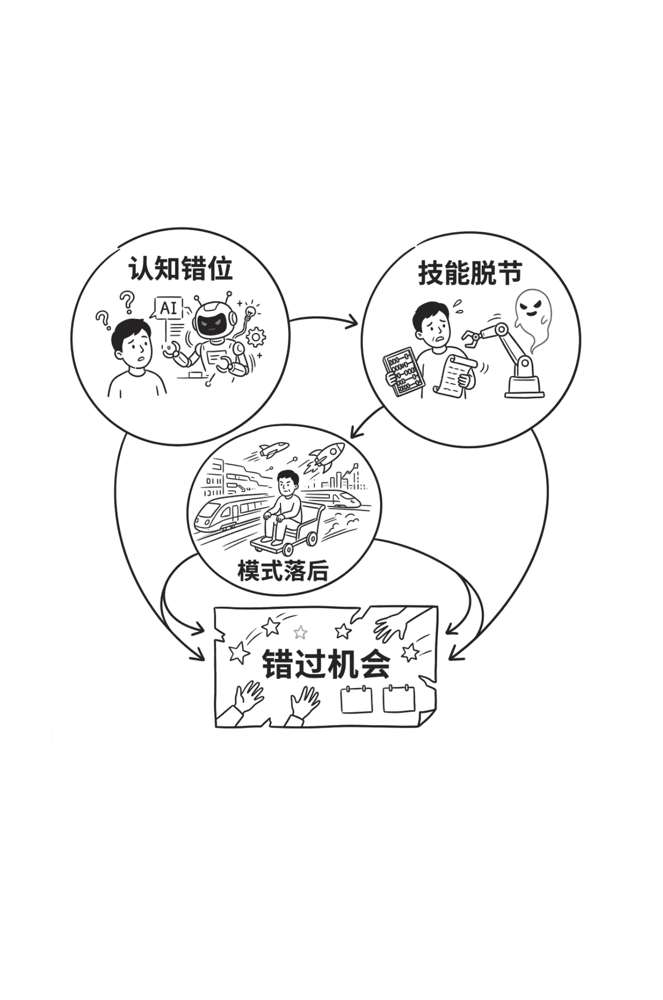

### **创富新逻辑：AI 工具×OPC 模式=低风险高回报（普通人易落地的轻资产创富路径）**

AI 时代彻底颠覆了传统“靠资金、靠规模、靠人脉”的创富逻辑，取而代之的是 AI 工具×OPC 模式的轻资产创富新逻辑。这也是最适合普通人落地、能实现低风险高回报的核心路径。传统创富模式的核心痛点，在于高投入、高风险、高门槛，组建团队、租赁场地、开拓渠道的成本，让普通人望而却步。而 AI 工具与 OPC 模式的结合，恰好从根源上解决了这些问题。这一逻辑的核心，是用 AI 工具的生产力替代传统团队的执行力，让个人拥有媲美小团队的运营效率。OpenClaw 的自动化运营、Seedance 2.0 的全流程视频创作，能让一个人完成原本需要数人甚至数百人才能完成的工作，直接节省 90%以上的人力与时间成本；而 OPC 模式，则为这份 AI 赋能的生产力，提供了合规、轻量化的商业载体，依托 2024 年《中华人民共和国公司法》的政策红利，无需全职员工、无需高额房租，仅需一人就能搭建完整的商业闭环，从工商注册到客户对接，从内容创作到服务交付，全流程都能以极低的成本完成。二者的乘法效应，让创富的门槛大幅降低，无需雄厚的资金储备，无需专业的商业背景，普通人只需选对赛道，掌握 AI 工具的基础用法，吃透 OPC 的运营逻辑，就能实现低风险起步。更重要的是，这一模式兼具灵活性与成长性，既可以作为副业增收的渠道，也能逐步升级为全职创业的主体，收入上限完全由个人的核心能力与努力程度决定，真正实现轻资产投入、高回报变现。

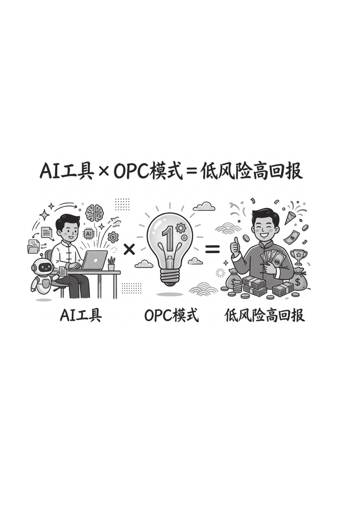

### **OpenClaw、Seedance 2.0、OPC 如何破解生存困局、实现轻创业？**

OpenClaw、Seedance 2.0 与 OPC 并非三个孤立的个体，而是相互赋能、环环相扣的“创富铁三角”，精准破解了 AI 时代职场人、创业者、自由职业者的核心生存困局，为普通人实现轻创业提供了可落地的完整解决方案。OPC 作为核心商业形态，是破解生存困局的基础，它打破了“创业必须组建团队、做副业无合规体系”的固有认知，以“1 个创始人+AI 智能体”的极简形态，让普通人能以极低的成本搭建合规的商业闭环，既解决了职场人搞副业的“身份顾虑”，也减轻了创业者的“成本压力”，更解决了自由职业者“变现无体系、发展无方向”的痛点，让轻创业从空想变为现实。OpenClaw 作为 AI 智能体，是 OPC 高效运营的核心支撑，堪称“7×24 小时数字助理”。其拥有本地部署、多模型兼容、自动化任务处理能力，能全面接管素材搜集、客户对接、数据统计、服务交付等重复性工作，彻底解决个人精力有限、效率低下的问题，让创始人从烦琐的事务中解放出来，将全部精力聚焦于核心决策、创意输出与客户维护这些 AI 无法替代的环节。这是 OPC 能低成本、高效运营的关键。Seedance 2.0 作为 AI 视频创作神器，是 OPC 的核心变现引擎，解决了创富最关键的“引流难、变现渠道单一”问题。其无需专业技能就能完成“写、导、剪、配”全流程视频创作，既能让 OPC 从业者轻松制作引流视频获取客户，也能承接定制视频服务实现直接变现，覆盖了数字内容、企业服务、知识付费等多个热门赛道的变现场景。三者联动，OPC 搭建商业框架，OpenClaw 保障运营效率，Seedance 2.0 实现商业变现，形成了“框架—效率—变现”的完整轻创业闭环，让普通人无需依赖外部资源，仅靠自己与 AI 工具，就能破解 AI 时代的生存困局，稳定实现创富目标。

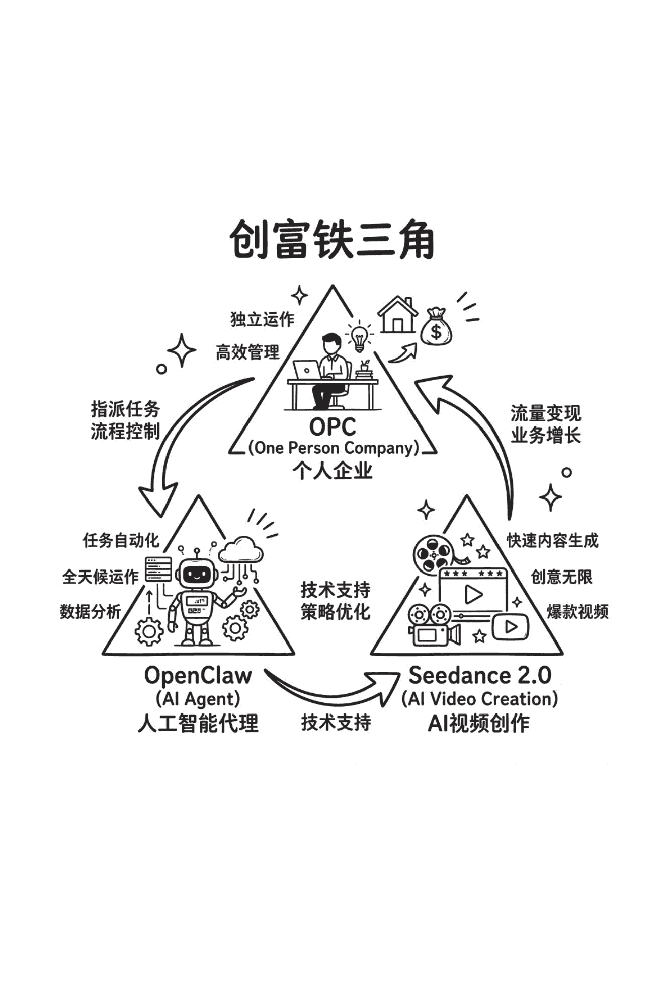

### **本书核心价值：让普通人用 2 个 AI 工具（OpenClaw+Seedance 2.0）+1 个核心模式（OPC），低成本搭建个人商业闭环，实现“一人公司”**

本书的核心价值，是为普通人打造一套听得懂、学得会、用得上的 AI 时代生存与创富实操方案，摒弃复杂的技术术语、空洞的行业趋势与虚无的理论说教，聚焦“2 个 AI 工具+1 个核心模式”的落地应用，手把手教你低成本搭建个人商业闭环，真正实现“一人公司”的理想状态。市面上多数讲解 AI 工具或创业模式的书，要么只讲工具操作却不谈商业变现，要么只讲模式逻辑却无实操方法，本书将 OpenClaw、Seedance 2.0 与 OPC 深度融合，从认知引导、工具实操、模式落地、分场景适配四个维度，形成层层递进、环环相扣的完整知识体系。在认知引导层面，帮你消除对 AI 工具的恐惧与误解，纠正对 OPC 模式的认知偏差，让你看清 AI 时代的创富趋势，找准自己的定位；在工具实操层面，从零基础入门到进阶技巧，详细拆解 OpenClaw 与 Seedance 2.0 的核心功能、分场景用法与避坑指南，让你快速掌握两大工具的使用方法，真正将 AI 工具变为自己的“数字助理”与“变现引擎”；在模式落地层面，从赛道定位、工商注册到获客变现、规模化运营，全流程讲解 OPC 的落地步骤，结合 2026 年的行业趋势，推荐高适配的热门赛道，让你轻松搭建标准化的 OPC 运营体系；在分场景适配层面，针对职场人、创业者、自由职业者的不同需求，定制专属的落地方案，让不同人群都能找到贴合自身情况的创富路径。无论你想保住职场竞争力，利用 AI 工具提升工作效率，同时搭建 OPC，实现副业增收；还是想放弃朝九晚五，以 OPC 模式进行轻资产创业，实现经济独立；亦或想借助 AI 工具与 OPC 模式突破收入瓶颈，实现规模化变现，都能在本书中找到具体的操作方法。本书的最终目标，是让每一个普通人，都能通过这套组合，告别职场焦虑与创富迷茫，用 AI 赋能，走出属于自己的 AI 时代创富之路，让“一人公司”不再是遥不可及的理想，而是触手可及的现实。

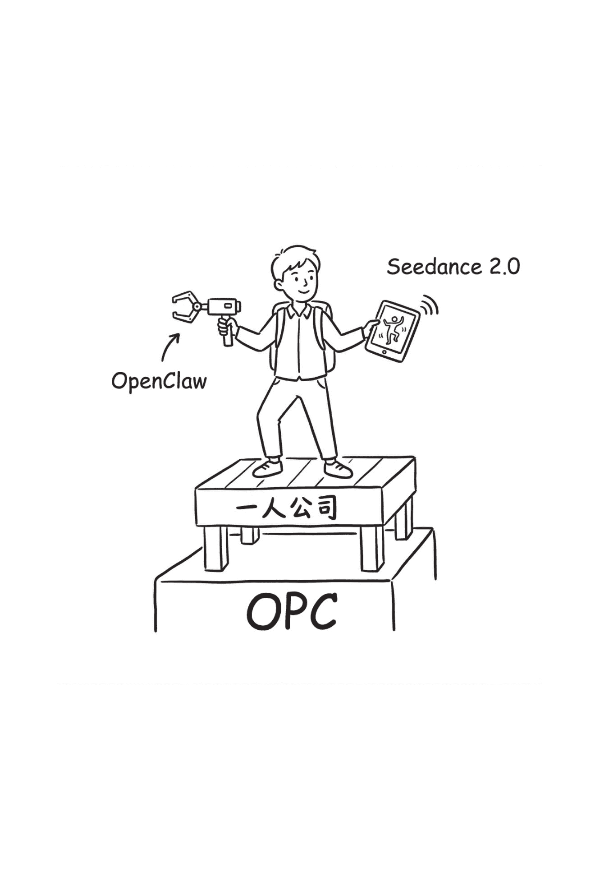

## **第二章 风口拆解：三大核心（OpenClaw、Seedance 2.0、OPC）的时代价值与政策红利**

### **AI 工具迭代：从“辅助工具”到“核心生产力”的跃迁，为 OPC 模式提供技术支撑**

AI 工具的发展在近三年完成了从“办公辅助工具”到“商业核心生产力”的关键跃迁，这一技术变革不仅重构了各行各业的生产方式，更从根本上为 OPC 模式的普及与落地提供了坚实的技术支撑，让“1 个创始人+AI 智能体”的极简商业形态成为可能。早期的 AI 工具，仅能完成碎片化、单一化的基础工作，比如简单的文案生成、图片修图、语音转文字等，其定位只是“提升工作效率的小帮手”，无法替代团队协作，更不能支撑一套完整的商业运营体系。彼时的个人创业，仍离不开团队的支撑，OPC 模式也只停留在理论层面。随着大模型技术的不断迭代，以 OpenClaw、Seedance 2.0 为代表的新一代 AI 工具，实现了从“单一功能”到“全流程能力”、从“线上云端”到“本地部署”、从“被动执行”到“主动自动化”的三大突破，成为支撑商业运营的核心生产力。这类 AI 工具不再局限于单一环节的辅助，而是能覆盖商业运营的全流程，从办公自动化、素材搜集处理，到客户对接、服务交付，再到内容创作、引流变现，一个工具就能完成多个环节的工作；本地部署与多模型兼容的特性，让数据安全更有保障，也能满足不同赛道的个性化需求；自动化任务处理能力，更让 AI 能 7×24 小时不间断工作，彻底打破了个人精力的边界。当 AI 工具能替代传统团队中 80%的执行性、重复性工作时，个人就拥有了媲美小团队的生产力。这就从技术上打破了“个人能力有限，无法支撑商业运营”的壁垒，让 OPC 这一“1 个创始人+AI 智能体”的极简商业形态，有了落地的核心基础。可以说，AI 工具从辅助到核心生产力的跃迁，是 OPC 模式成为 AI 时代主流创富模式的前提。没有这一技术支撑，轻资产、低门槛的个人创富，就无从谈起。

### **两大 AI 工具定位：OpenClaw（OPC 效率引擎）、Seedance 2.0（OPC 变现引擎）的黄金适配逻辑**

OpenClaw 与 Seedance 2.0 的黄金适配，并非偶然，而是源于二者精准契合 OPC 模式“效率为先、变现为王”的核心运营逻辑，形成了“效率引擎+变现引擎”的互补格局。二者一内一外、一守一攻，完美覆盖 OPC 运营的全链路，成为 OPC 从业者的“左膀右臂”。

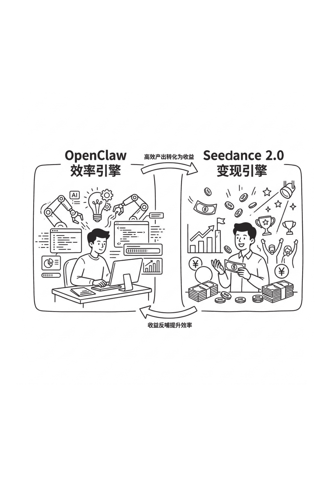

OpenClaw 定位于 OPC 效率引擎，主要承担 OPC 的内部运营工作，解决“如何低成本、高效率运营”的核心问题，这是 OPC 长久发展的基础。作为 AI 智能体，OpenClaw 的核心优势在于自动化、全场景、高适配，其能 7×24 小时自动化处理办公文件、搜集素材、对接客户、统计数据，能进行重复性、执行性工作，让创始人从烦琐的事务中彻底解放出来，将全部精力聚焦于核心决策、创意输出、客户维护这些 AI 无法替代的高价值环节。对于 OPC 而言，创始人的时间与精力是最宝贵的资源，OpenClaw 通过提升运营效率，最大化发挥创始人的核心价值，同时直接降低 90%以上的运营成本，让 OPC 能以极简的形态实现高效运转，这也是 OPC 模式低风险的关键所在。

Seedance 2.0 定位于 OPC 变现引擎，主要承担 OPC 的外部引流与商业变现工作，解决“如何获客、如何赚钱”的核心问题，这是 OPC 持续盈利的关键。作为 AI 视频创作神器，Seedance 2.0 的核心优势在于零门槛、全流程、高适配，无需专业的影视创作技能，仅靠关键词输入，就能完成“写脚本、做镜头、剪视频、配音频”的全流程创作，既能快速制作高质量的引流视频，通过线上平台获取精准客户，也能承接企业定制视频、微短剧、知识付费视频等业务，直接实现商业变现。在短视频成为主流引流与变现渠道的当下，Seedance 2.0 让 OPC 从业者轻松抓住流量风口，快速搭建变现渠道，突破收入瓶颈。两大工具的黄金适配，在于二者的功能与定位高度互补。OpenClaw 保障 OPC 的内部高效运营，为变现打下基础；Seedance 2.0 实现 OPC 的外部引流变现，为运营提供目标。二者相互赋能，形成闭环，让 OPC 的运营效率与变现能力实现双重提升，这也是这套工具组合能成为 OPC 核心支撑的根本原因。

### **OPC 核心定义：“1 个创始人+AI 智能体”的极简商业形态**

OPC 并非普通人认知中的个体户或自由职业者，而是 AI 时代全新升级的“1 个创始人+AI 智能体”的极简商业形态，恰逢 2024 年《中华人民共和国公司法》松绑与各地政府扶持政策的双重红利，成为 AI 时代普通人轻资产创富的最优选择。首先要明确的是，OPC 与个体户、自由职业者有着本质区别：个体户是传统的个体经营形态，经营模式单一，抗风险能力弱，且无法进行规模化拓展；自由职业者缺乏合规的商业主体，变现无体系，客户信任度较低，且难以享受各类商业政策红利；而 OPC 是具备独立法人资格的有限责任公司，以“1 个创始人+AI 智能体”为核心运营模式，创始人以其认缴的出资额为限对公司承担责任，既拥有合规的商业主体身份，又能享受公司制的各类政策红利，同时依托 AI 工具实现极简运营，兼具灵活性与规范性。AI 时代为 OPC 赋予了全新的内涵，让其从传统的“单一自然人运营”升级为“碳基智慧+硅基执行”的全新形态，创始人作为“碳基智慧”的核心，负责战略定位、创意输出、客户对接等 AI 无法替代的高价值工作；OpenClaw、Seedance 2.0 等 AI 智能体作为“硅基执行”的支撑，承担全流程的执行性、重复性工作。二者结合，让一个人就能完成完整的商业闭环，彻底打破了传统公司“必须靠团队运营”的固有认知。2024 年《中华人民共和国公司法》的修订，为 OPC 的发展提供了关键的法律保障与政策支持。新修订的《中华人民共和国公司法》大幅简化了一人公司的注册流程，降低了设立门槛，取消了一人有限责任公司注册资本最低限额的规定，简化了年度财务会计报告审计要求，同时明确了一人公司的合规运营边界，让普通人能轻松完成工商注册，以极低的成本搭建合规的商业主体。除此之外，各地政府为响应国家的号召，针对 OPC 这类轻资产创业形态，出台了一系列针对性的扶持政策，包括税收减免、免费办公场地、创业补贴、社保优惠等，部分城市还设立了 OPC 创业孵化基地，为创业者提供技术指导、资源对接等一站式服务。政策红利与技术变革的双重加持，让 OPC 模式的门槛降到了历史最低，成为 AI 时代普通人低风险、高灵活度、易落地的创富首选。

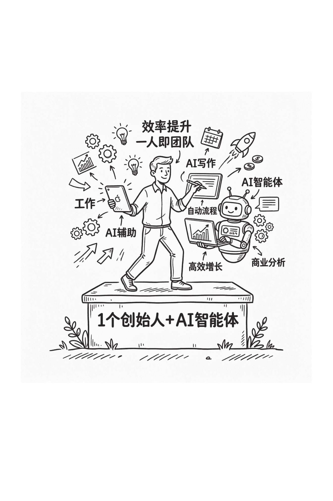

### **案例拆解：普通人用 OpenClaw+Seedance 2.0+OPC 组合，3 个月实现月入过万元，年固定成本控制在 2 万元以内的真实案例（贴合 OPC 核心逻辑）**

95 后职场人小杨的经历，是普通人借助 OpenClaw+Seedance 2.0+OPC 组合实现低风险创富的典型案例。他以职场副业的形式搭建 OPC，聚焦中小企业短视频定制赛道，仅用 3 个月就实现副业月入过万元，且全年固定成本控制在 2 万元以内，完美贴合 OPC 低门槛、低成本、高效率的核心逻辑。小杨原本是一家传统企业的行政人员，朝九晚五的工作让他有充足的业余时间，却因担心被 AI 替代而陷入职场焦虑，想搞副业增收又无从下手。接触 OpenClaw+Seedance 2.0+OPC 的组合后，他决定以短视频定制为赛道，注册一人公司，搭建自己的 OPC，开启副业创富之路。在运营层面，小杨充分发挥 OpenClaw 的效率引擎作用，将所有重复性工作全部交由 OpenClaw 自动化处理：用 OpenClaw 自动化搜集各行各业的短视频素材，建立专属素材库；用 OpenClaw 的浏览器控制与自动化任务功能，实现客户咨询的自动回复、需求的初步整理；用 OpenClaw 处理办公文件、统计订单数据、完成服务交付后的资料归档。原本需要花费大量时间的琐事，被 OpenClaw 一站式解决，小杨每天仅需花费 1 小时查看进度、处理核心问题，彻底摆脱了“副业忙到没时间休息”的困境。在变现层面，小杨依托 Seedance 2.0 的变现引擎能力，实现了零门槛的视频创作与获客：无需专业的剪辑与创作技能，他仅靠关键词输入，就能让 Seedance 2.0 完成企业宣传视频、产品推广视频的全流程创作，从脚本生成到镜头设计，从视频剪辑到音频配音，一气呵成，创作效率比传统剪辑方式提升 10 倍以上，单条视频的创作时间从原本的数小时缩短至半小时以内。他用 Seedance 2.0 制作了一批高质量的引流视频，发布于抖音、小红书、视频号等平台，精准吸引中小企业客户，单条定制视频根据难度收费 500～3000 元。凭借高效的运营与优质的服务，小杨的 OPC 在 3 个月内累计接到 60 多个定制订单，副业月收入稳定突破 1.2 万元，远超其主业工资。而小杨 OPC 的全年固定成本，仅包括 OpenClaw 与 Seedance 2.0 的工具年费、工商注册费用、办公软件会员费用等，合计不到 2 万元，无房租、无人工，真正实现了低成本、高回报的轻资产创富。更重要的是，小杨的 OPC 完全以副业形式运营，不影响主业的稳定，既保住了职场的“基本盘”，又通过 OPC 实现了收入的大幅提升，完美解决了职场人的焦虑。这个案例充分证明，OpenClaw+Seedance 2.0+OPC 的组合，并非只适用于全职创业者，更适合每一个想低风险创富的普通人。只要选对赛道、用好工具，就能以极低的成本搭建个人商业闭环，实现“一人公司”的创富目标。

# **第二部分 两大核心 AI 工具详解——从入门到精通，赋能 OPC 全流程**

## **第三章** **OpenClaw：AI 智能体，OPC 高效运营的效率基石**

### **认知 OpenClaw：不止是 AI，更是 OPC 的“7×24 小时数字助理”，支撑 OPC 全流程自动化运营（开源、本地部署、多模型兼容核心优势）**

认识 OpenClaw，首先要打破“它只是一款普通 AI 工具”的固有印象。OpenClaw 并非单一功能的办公辅助软件，而是非常适合 OPC 模式的 AI 智能体，是“7×24 小时数字助理”，更是支撑 OPC 全流程自动化运营的核心基石。其开源、本地部署、多模型兼容三大核心优势，完美适配了 OPC 轻量运营、低成本落地、高适配不同赛道的核心需求。相较于市面上多数云端 AI 工具，OpenClaw 的开源特性让 OPC 从业者无需支付高昂的会员费用，便可根据自身运营需求自由修改、优化功能模块，甚至结合行业特性开发专属技能，从根源上降低工具使用成本。这对于低门槛起步的 OPC 而言，是极具吸引力的核心优势。而本地部署的能力，则解决了 OPC 运营中的数据安全痛点——无论客户的需求资料、运营过程中的数据统计，还是专属的素材库资源，都能存储在本地设备中，避免了云端工具的数据泄露风险，尤其适合从事专业服务、定制化内容创作的 OPC 赛道，让客户对数据安全更有信心。多模型兼容则是 OpenClaw 的核心竞争力，它能无缝对接主流大语言模型、多模态模型，无需在不同 AI 工具间切换，一个平台就能实现多模型协同工作。比如用大语言模型处理文案创作、客户对接，用多模态模型完成素材处理、简单视觉设计，真正实现“一个智能体，搞定全流程”。对于 OPC 而言，创始人的时间与精力是最宝贵的资源，OpenClaw 以 AI 智能体的形态，将创始人从烦琐的重复性工作中彻底解放，其 7×24 小时工作的能力，让客户对接等工作无需受时间的限制，哪怕是深夜的客户咨询、定时的素材搜集，都能自动完成，真正实现全天候运营。可以说，OpenClaw 的出现，让“一人公司”从理论变为现实。OpenClaw 不是简单的提效工具，而是与创始人并肩的“数字合伙人”，为公司的高效、低成本运营提供了核心支撑。

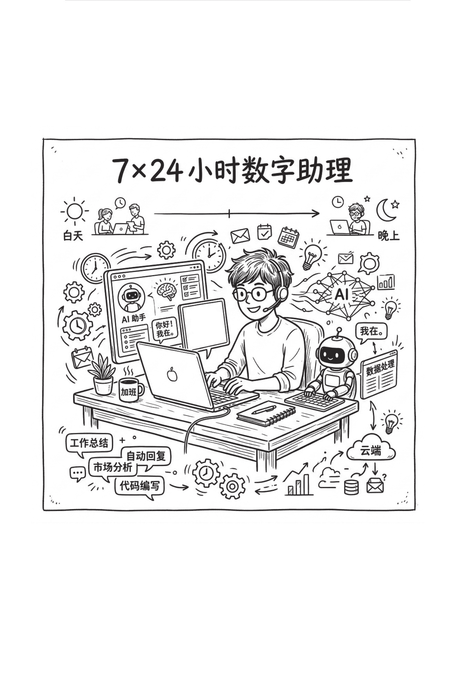

### **核心功能拆解（零基础必学）：本地文件操作、多模型调用、自动化任务、浏览器控制，适配 OPC 办公、素材处理、客户交付等核心场景**

对于零基础的 OPC 从业者而言，掌握 OpenClaw 的四大核心功能——本地文件操作、多模型调用、自动化任务、浏览器控制，就能满足 OPC 办公、素材处理、客户交付等核心运营场景的需求。这四大功能覆盖了 OPC 日常运营 80%以上的工作，且操作门槛极低。你无需具备专业的编程知识，仅通过简单的指令设置就能快速上手，真正实现“零基础也能玩转 AI 智能体”。

本地文件操作是 OpenClaw 的基础功能，也是适配 OPC 办公场景的核心能力。OpenClaw 能实现对本地各类文件的自动化处理，包括文档的批量编辑、格式转换、内容提取，表格的数据统计、筛选、可视化，甚至是素材文件的分类、整理、重命名。比如从事内容创作的 OPC，可通过该功能快速整理搜集的图文、视频素材；从事专业咨询的 OPC，可批量处理客户的需求文档，提取核心信息，原本需要数小时的文件处理工作，OpenClaw 几分钟就能完成，大幅提升办公效率。

多模型调用是 OpenClaw 的核心能力，打破了单一模型的功能局限，能在一个平台内无缝调用不同类型的 AI 模型，实现“一站式 AI 协作”——调用大语言模型完成文案创作、客户回复话术撰写、合同初稿拟定；调用多模态模型完成图片处理、短视频剪辑、素材生成；调用语音模型实现语音转文字、文字转语音。对于 OPC 而言，无需安装多款 AI 工具，仅靠 OpenClaw 就能满足不同场景的需求，既节省了工具学习成本，也避免了多平台切换的时间浪费。

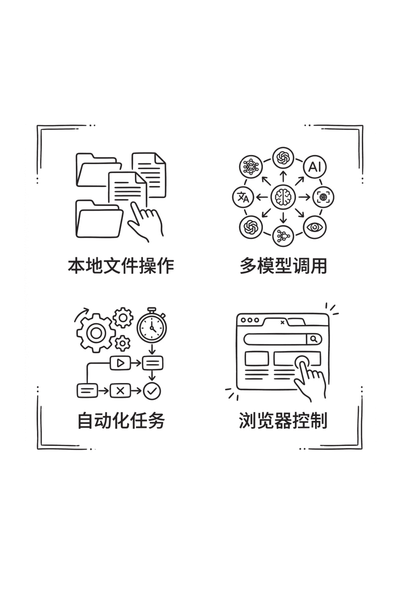

自动化任务是 OpenClaw 实现 7×24 小时运营的关键，也是适配 OPC 素材处理、客户对接的核心功能。从业者可根据运营需求，设置定时、定条件的自动化任务，比如定时搜集行业最新素材并分类存储、客户咨询触发自动回复、订单完成后自动发送交付文件并统计数据。该功能让重复性工作完全实现自动化，创始人无需时刻守在电脑前，哪怕是外出、休息，OPC 的基础运营工作也能正常推进。

浏览器控制则为 OPC 的线上运营提供了支撑，能实现浏览器的自动化操作，包括网页信息的自动搜集、线上内容的定时发布、客户信息的自动整理。比如从事短视频创作的 OPC，可通过该功能定时在各大平台发布作品，自动搜集平台数据并统计分析；从事线上服务的 OPC，能自动搜集行业最新资讯，为客户提供更专业的服务。

这四大核心功能相互联动，形成了 OPC 全流程自动化运营的能力。零基础从业者只需掌握基础的指令设置方法，就能快速让 OpenClaw 成为自己的“数字助理”，让 OPC 的运营效率实现质的飞跃。

### **分场景实操：OPC 日常运营自动化、客户对接自动化、素材搜集自动化、数据统计自动化的极简步骤**

OpenClaw 的核心价值在于落地实操，针对 OPC 运营中最核心的日常运营、客户对接、素材搜集、数据统计四大场景，其自动化操作均有极简的落地步骤，无需专业技术，仅通过“指令设置—触发条件—执行落地”三步核心流程，就能快速实现自动化，让 OPC 从业者从烦琐的事务中抽离，聚焦核心决策与创富环节。

OPC 日常运营自动化主要解决办公流程烦琐的问题，核心步骤为：首先根据日常办公需求，在 OpenClaw 中选择“本地文件操作+自动化任务”功能，比如设置“每日 9 点自动整理昨日办公文件，分类存储至指定文件夹”“每周五自动生成周运营报告，提取核心数据并可视化”；其次设置触发条件，可选择定时触发或手动触发，日常固定工作建议设置定时触发，临时工作可手动触发；最后确认执行路径，让 OpenClaw 对接本地文件目录，完成指令保存后，即可实现日常运营的自动化，原本需要 1-2 小时的办公整理工作，全程无需人工干预。

OPC 客户对接自动化是提升客户体验、节省对接时间的关键，核心步骤为：先在 OpenClaw 中调用大语言模型，根据 OPC 的服务赛道撰写标准化的客户回复话术，包括咨询解答、需求确认、报价说明、交付节点告知等；再开启“浏览器控制+自动化任务”功能，对接线上获客平台（如微信、抖音、小红书），设置触发条件为关键词触发（如客户发送“报价”“合作”等关键词）；最后设置执行规则，让 OpenClaw 根据客户关键词自动发送对应话术，同时自动将客户信息、咨询需求整理至本地表格，实现“客户咨询-自动回复-信息留存”的全自动化，创始人仅需处理复杂的客户需求，大幅节省对接时间。

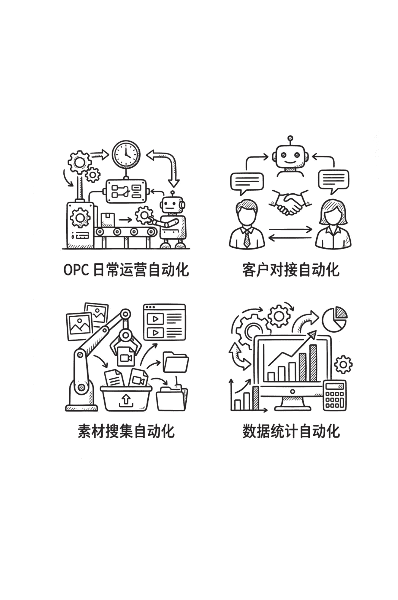

OPC 素材搜集自动化主要针对内容创作、视频定制，核心步骤为：先明确素材搜集需求，如“每日搜集短视频赛道最新热点、行业图文”，在 OpenClaw 中开启“浏览器控制”功能，添加指定的素材搜集平台；再设置触发条件与搜集规则，比如“每日 12 点、18 点各搜集一次，按素材类型自动分类，过滤低质量内容”；最后对接本地素材库，让 OpenClaw 将搜集的素材自动存储至指定文件夹并标注关键词，实现素材的“定时搜集—自动分类—便捷检索”，彻底告别手动搜集素材的低效模式。

OPC 数据统计自动化解决了运营数据杂乱、统计困难的问题，核心步骤为：先在 OpenClaw 中选择“本地文件操作+多模型调用”功能，对接 OPC 的订单表格、客户表格、平台数据表格；再设置统计规则，比如“每日自动统计订单数量、成交金额、客户新增数量，每周自动分析客户需求趋势、订单转化效率”；最后设置输出形式，可选择表格、图表、简短报告等，设置完成后，OpenClaw 会自动提取表格数据并完成统计分析，实时为 OPC 运营决策提供数据支撑。

这四大场景的自动化实操，均遵循极简的操作逻辑，无需编程基础，仅通过简单的功能选择与指令设置就能落地，真正让每一个 OPC 从业者都能轻松驾驭，实现运营效率的最大化。

### **进阶技巧：自定义技能拓展，让 OpenClaw 适配不同赛道 OPC 的个性化运营需求**

当 OPC 从业者掌握 OpenClaw 的基础功能与自动化操作后，通过自定义技能拓展这一进阶技巧，能让 OpenClaw 突破基础功能的局限，根据不同赛道的特性，开发专属个性化技能，实现工具与赛道的深度适配，让运营效率再上一个台阶。这是 OpenClaw 相较于其他 AI 工具的核心优势，其开源特性为自定义技能拓展提供了无限可能，且无需深厚的编程基础，通过可视化的技能编辑界面、现成的技能模板，就能快速开发专属技能，满足不同赛道 OPC 的个性化运营需求。

自定义技能拓展的核心逻辑为“需求拆解—功能组合—指令编写—测试落地”。首先，根据自身 OPC 赛道的核心运营需求，拆解需要实现的个性化功能，比如数字内容创作类 OPC，需要“短视频脚本自动生成+素材精准匹配”的专属技能；专业咨询类 OPC，需要“客户需求自动分析+解决方案初步拟定”的专属技能；企业服务类 OPC，需要“合同条款自动审核+报价单快速生成”的专属技能。其次，结合 OpenClaw 的基础功能进行功能组合，将本地文件操作、多模型调用、自动化任务、浏览器控制四大核心功能进行拆解重组，比如“短视频脚本自动生成”技能，可组合“多模型调用（大语言模型）+本地文件操作（素材库对接）”功能，让模型根据素材库资源生成适配的脚本。再次，进行指令编写。OpenClaw 提供了可视化的指令编辑界面，且有大量现成的技能模板，从业者只需根据自身需求，对模板进行简单的修改、优化，设置技能的触发条件、执行步骤、输出形式，无需编写复杂的代码，零基础也能快速完成。最后，进行测试落地，在小范围内测试自定义技能的运行效果，根据测试结果调整指令设置、优化功能细节，确保技能稳定、高效运行后，再正式投入 OPC 的日常运营中。

针对不同赛道的 OPC，自定义技能拓展有明确的方向与技巧：数字内容创作类 OPC，可开发“素材—脚本—发布”全链路技能，实现素材搜集、脚本生成、平台发布的自动化衔接，同时开发“数据反馈优化”技能，让 OpenClaw 根据平台数据自动分析视频效果，提出脚本优化建议；专业服务与咨询类 OPC，可开发“客户需求画像生成”技能，自动提取客户需求中的核心信息，生成客户画像，同时开发“行业资讯精准推送”技能，定时搜集与客户需求相关的行业资讯，为咨询服务提供支撑；技能变现与知识服务类 OPC，可开发“课程资料自动整理”技能，将课程素材自动整理、分类，生成课程讲义，同时开发“学员问题自动解答”技能，对接学员交流平台，实现常见问题的自动化回复。此外，还能通过技能共享与整合，加入 OpenClaw 的开源社区，与其他赛道的 OPC 从业者交流、共享自定义技能，将他人的优质技能整合至自己的工具中，实现技能的快速升级。自定义技能拓展，让 OpenClaw 从“通用型 AI 智能体”变为“专属数字助理”，完美适配不同赛道 OPC 的个性化运营需求，让运营效率实现差异化提升，在行业竞争中形成独特的效率优势。这也是 OPC 从“一人运营”向“高效盈利”升级的关键技巧。

## **第四章** **Seedance** **2.0：AI 视频创作神器，OPC 的核心变现与引流利器**

### **Seedance** **2.0 核心定位：多模态音视频生成，让 OPC 从业者一人搞定“写、导、剪、配”全流程，兼顾引流宣传与商业变现**

Seedance 2.0 的核心定位，是专为 OPC 模式打造的多模态音视频生成神器，它彻底打破了“视频创作需要专业团队、专业技能”的固有认知，让 OPC 从业者仅凭一人之力，就能轻松搞定视频“写、导、剪、配”全流程创作。Seedance 2.0 兼具引流宣传与商业变现的双重能力，完美适配了 OPC 轻量运营、低门槛变现、多渠道获客的核心需求，成为 OPC 实现流量获取与商业盈利的核心变现引擎。相较于市面上传统的视频剪辑工具与单一的 AI 视频生成工具，Seedance 2.0 的核心竞争力在于多模态音视频生成能力。它能融合文本、图像、语音、视频等多种模态信息，实现从创意构思到成片输出的一站式创作，无需在不同工具间切换，一个平台就能完成脚本撰写、镜头设计、视频剪辑、音频配音、字幕添加等所有视频创作环节，真正实现“一站式视频创作”。对于 OPC 从业者而言，无需掌握专业的影视创作知识、无需学习复杂的剪辑技巧，仅通过简单的关键词输入、需求描述，就能让 Seedance 2.0 生成高质量的视频内容。这彻底降低了视频创作的门槛，让“一人搞定视频创作”成为现实。Seedance 2.0 的核心价值，在于同时兼顾引流宣传与商业变现两大核心场景，这恰好契合了 OPC 的变现逻辑：在引流宣传场景，Seedance 2.0 能快速生成轻量化、高传播性的引流视频，包括短视频平台的热点视频、个人品牌的宣传视频、服务赛道的科普视频，这些视频在各大线上平台发布，能快速获取精准流量，为 OPC 积累客户资源；在商业变现场景，Seedance 2.0 能生成高质量、定制化的商业视频，包括中小企业的宣传视频、产品推广视频、知识付费的课程视频、当下热门的微短剧，OPC 从业者既能直接承接这些定制化视频订单，直接实现商业变现，也能通过制作知识付费视频，搭建自有知识付费体系，实现多元化变现。无论引流宣传还是商业变现，Seedance 2.0 都能根据不同场景的需求，调整视频的风格、时长、画质，满足多样化的创作需求。对于 OPC 而言，视频内容是当下最有效的引流与变现载体，而 Seedance 2.0 则让 OPC 从业者无需依赖专业的视频团队，仅凭一人之力就能掌握视频创作的核心能力，既降低了创作成本，又提升了变现效率，真正成为 OPC 的“核心变现与引流利器”，为 OPC 的持续盈利提供了坚实的内容支撑。

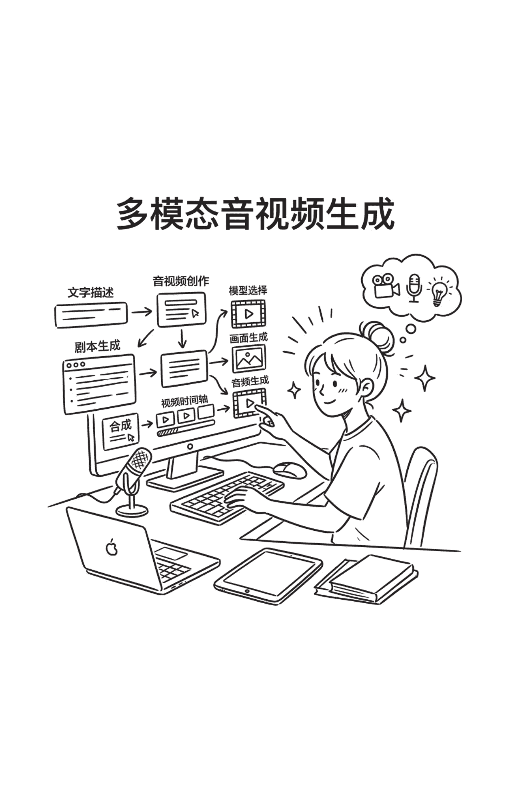

### **核心能力详解：复杂场景生成、多模态参考、视频可控编辑、双声道音频同步，贴合 OPC 引流视频、定制视频等变现场景**

Seedance 2.0 能成为 OPC 的核心变现引擎，源于其四大核心能力——复杂场景生成、多模态参考、视频可控编辑、双声道音频同步。这四大能力精准贴合了 OPC 引流视频、定制视频等核心变现场景的创作需求，既解决了 AI 视频创作中“场景单一、内容同质化、编辑不灵活、音频不同步”的行业痛点，又能满足不同变现场景对视频质量、定制化程度的要求，让 OPC 从业者能轻松制作出高质量、高适配性的视频内容。

复杂场景生成是 Seedance 2.0 的核心创作能力，完美适配了定制视频的创作需求。它能根据需求描述，生成人物、场景、情节丰富的复杂视频画面，无需额外的素材支撑，就能实现从无到有的视频创作，比如在为企业制作宣传视频时，能生成符合行业特性的办公场景、产品使用场景；在制作微短剧时，能生成连贯的剧情场景、人物互动场景。相较于其他 AI 视频工具只能生成简单的单一场景，Seedance 2.0 的复杂场景生成能力，让视频内容更具层次感与丰富性，大幅提升了定制视频的质量，能更好地满足客户的个性化需求，为 OPC 承接高单价的定制订单提供了核心支撑。

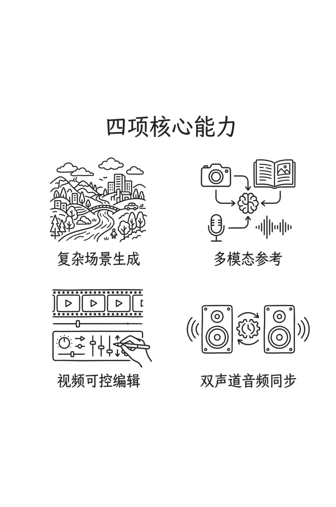

多模态参考能力让视频创作更具个性化与精准性，适配引流视频与定制视频的双重场景。从业者可上传文本、图像、视频、语音等多种形式的参考素材，让 Seedance 2.0 根据参考素材生成贴合风格、内容的视频，比如在制作引流视频时，可上传热门视频作为参考，生成符合平台流量趋势的内容；在制作定制视频时，可上传企业的 LOGO、产品图片、品牌素材，让视频深度贴合企业的品牌形象。这一能力解决了 AI 视频创作内容同质化的痛点，让每一个视频都能根据需求实现个性化创作，提升了视频的引流效果与客户满意度。

视频可控编辑是 Seedance 2.0 的核心编辑能力，让 OPC 从业者能对生成的视频进行精细化、灵活化的修改，无需依赖专业的剪辑工具，在平台内就能完成画面裁剪、镜头顺序调整、特效添加、字幕修改等所有编辑操作，且支持精准帧级编辑，能对视频的每一帧进行调整，让视频内容完全符合创作需求。对于 OPC 从业者而言，这一能力大幅提升了视频创作的效率，生成的视频若存在细节问题，可直接在平台内修改，无需重新生成，节省了大量的创作时间，尤其适合在承接定制订单时，根据客户的修改需求快速调整视频。

双声道音频同步能力解决了 AI 视频创作中音频与画面不同步、音质差的痛点，完美适配了所有视频创作场景。Seedance 2.0 能实现语音、背景音乐、音效的双声道分离与精准同步，让配音与人物口型完全契合，背景音乐与视频情节节奏匹配，同时支持高清音频生成，提升视频的听觉体验。比如在制作知识付费视频时，能实现讲师语音与画面的精准同步；在制作企业宣传视频时，能搭配贴合企业风格的背景音乐，让视频的整体质感实现质的飞跃。

这四大核心能力相互联动，形成了“从创作到编辑、从画面到音频”的全流程视频创作能力，让 Seedance 2.0 完美贴合 OPC 的各类视频变现场景，既能快速制作高传播性的引流视频，又能打造高质量的定制视频，为流量获取与商业变现提供了核心支撑。

### **关键技巧：角色一致性把控、镜头语言设计、AI 缺陷转化为创作风格（参考 NeuralViz 频道风格），提升内容质感，助力 OPC 品牌打造与变现增收**

想要让 Seedance 2.0 创作的视频从“能用”变为“优质”，实现更好的引流效果与更高的定制变现单价，就需要掌握三大关键技巧——角色一致性把控、镜头语言设计、AI 缺陷转化为创作风格，参考 NeuralViz 频道将 AI 特性与创作风格融合的成功经验，让 AI 视频既保留高效创作的优势，又具备独特的内容质感，助力 OPC 打造专属视频品牌，实现变现增收。

角色一致性把控是制作微短剧、人物讲解类视频的核心技巧，也是 AI 视频创作中的高频难点。Seedance 2.0 提供了专属的“角色固定”功能，只需在创作前设置角色的形象、服饰、动作特征，上传角色参考图，开启角色一致性模式，就能让视频中同一角色的形象全程保持统一，避免出现角色面部、服饰突变的问题。同时可通过“角色动作库”，为固定角色设置专属的动作、表情，让角色更立体。比如可为企业宣传视频中的讲解人物，设置专业、沉稳的动作与表情；为微短剧中的主角，设置贴合人物性格的动作与表情。角色一致性的把控，能大幅提升视频的观感与专业性，让定制视频的客户满意度更高，也能让引流视频形成独特的人物标识，增加记忆点，助力 OPC 品牌打造。

镜头语言设计是提升视频质感的核心。Seedance 2.0 虽能自动生成镜头画面，但通过手动设置镜头参数，能让视频的叙事节奏、画面层次更贴合创作需求，无需掌握专业的镜头知识，只需通过简单的参数选择就能实现。比如在制作引流短视频时，选择“快切镜头”，提升视频的节奏感，契合短视频平台的流量趋势；在制作企业广告片时，选择“慢镜头+全景镜头”，突出企业的规模与品牌形象；在制作知识付费视频时，选择“近景镜头+特写镜头”，让讲解内容更清晰，提升观众的学习体验。同时可利用 Seedance 2.0 的“镜头转场库”，为不同镜头添加自然的转场效果，避免镜头切换生硬，让视频的画面更流畅。镜头语言的合理设计，能让视频摆脱 AI 创作的机械感，更具专业的影视质感，提升视频的引流效果与定制价值。

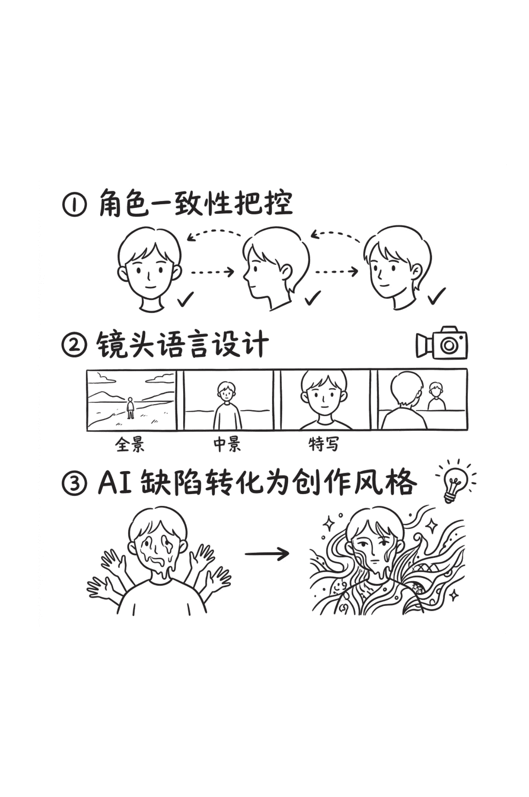

AI 缺陷转化为创作风格是最具创意的核心技巧，参考 NeuralViz 频道将 AI 视频的轻微模糊、色彩饱和度偏高、画面肌理独特等缺陷，转化为专属的复古、艺术、赛博朋克等创作风格的经验，让 OPC 的视频内容形成差异化的风格标识，在同质化的视频内容中脱颖而出。Seedance 2.0 提供了丰富的风格滤镜与画面调整功能，从业者可利用 AI 创作的天然特性，通过调整色彩、画质、肌理等参数，将 AI 缺陷转化为独特的创作风格。比如将轻微的画面模糊调整为复古胶片风格，适配文艺类视频创作；将色彩饱和度偏高风格调整为赛博朋克风格，适配科技类视频创作；将独特的画面肌理调整为手绘风格，适配儿童、教育类视频创作。同时可将这种专属风格贯穿 OPC 的所有视频内容中，无论引流视频还是定制视频，都保持统一的风格，让观众一眼就能识别，形成独特的视频品牌，提升 OPC 的行业辨识度。

掌握这三大关键技巧，能让 Seedance 2.0 创作的视频内容实现质的飞跃，既保留了 AI 工具高效、低成本的创作优势，又具备了专业、独特的内容质感；既能提升引流视频的传播效果，积累更多精准客户，又能提升定制视频的专业度与单价，实现 OPC 的变现增收；同时助力 OPC 打造专属的视频品牌，在行业竞争中形成独特的优势。

### **对比优势：比传统剪辑快 10 倍，比其他 AI 视频工具更贴合 OPC 轻量运营、零门槛创作、低成本变现的核心需求**

在视频创作工具百花齐放的当下，Seedance 2.0 能成为 OPC 的核心变现引擎，源于其相较于传统视频剪辑工具、其他 AI 视频工具，不仅效率提升 10 倍，还更贴合 OPC 轻量运营、零门槛创作、低成本变现的核心需求。Seedance 2.0 全方位的优势，让它成为 OPC 视频创作的最优选择。

相较于传统视频剪辑工具，Seedance 2.0 的核心优势在于效率提升与门槛降低。传统剪辑工具如 PR、AE，需要从业者掌握专业的剪辑、特效、配音技巧，学习周期长，且创作流程烦琐，从脚本撰写、素材拍摄到剪辑、配音、字幕，一个人完成一条高质量视频需要数小时甚至数天，效率极低，且工具的会员费用、学习成本较高，不符合 OPC 轻量运营、低成本的需求。而 Seedance 2.0 实现了全流程自动化创作，无需专业技能、无需拍摄素材，仅通过关键词输入就能完成从脚本到成片的一站式创作，原本需要数小时的剪辑工作，Seedance 2.0 在半小时内就能完成，经实际测算，创作效率比传统剪辑工具提升 10 倍。同时，Seedance 2.0 的操作界面简洁易懂，零基础从业者只需 10 分钟就能上手，无需支付高昂的学习成本，工具的使用成本也远低于传统剪辑工具，完美契合 OPC 零门槛创作、低成本运营的核心需求。

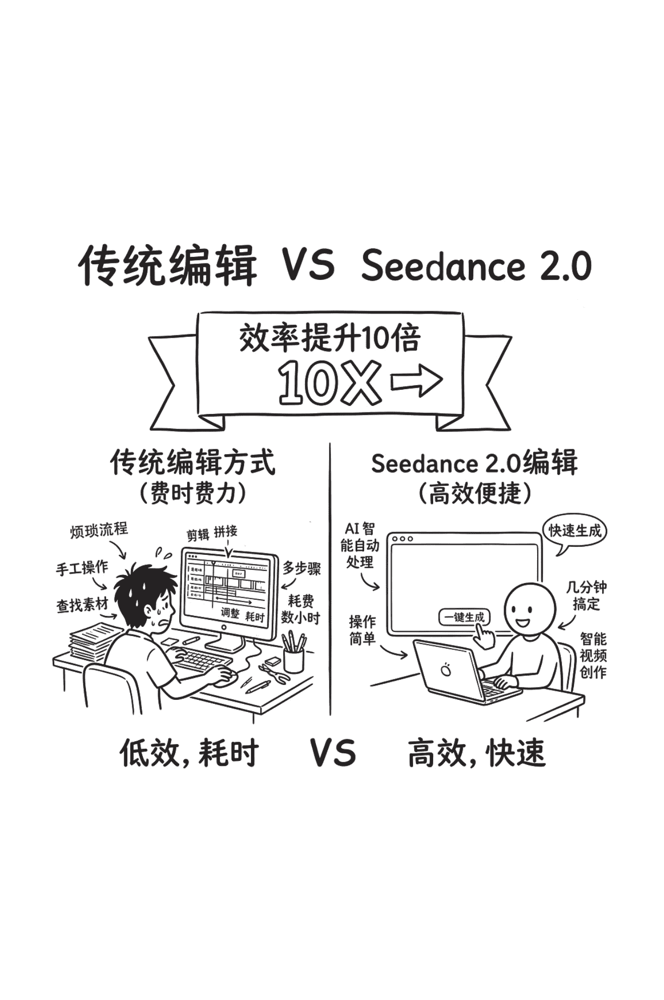

相较于其他 AI 视频工具，Seedance 2.0 的核心优势在于更贴合 OPC 的变现场景与运营逻辑。市面上多数 AI 视频工具存在功能单一、场景适配性差、定制化程度低、变现能力弱等问题。部分工具仅能生成简单的短视频，无法生成高质量的定制视频、微短剧；部分工具定制化程度低，只能生成同质化的内容，无法满足客户的个性化需求；部分工具仅能实现视频生成，无法兼顾引流与变现，且操作门槛较高，不符合 OPC 的需求。而 Seedance 2.0 则从 OPC 的核心需求出发，实现了多场景、高定制、强变现的全方位适配。在场景适配性上，既能制作轻量化的引流短视频，又能制作高质量的定制视频、微短剧、广告片、知识付费视频，覆盖 OPC 所有核心视频变现场景；在定制化程度上，依托多模态参考、复杂场景生成、视频可控编辑等核心能力，能根据客户的个性化需求，制作高度贴合客户需求的定制视频，订单单价较高；在变现能力上，兼顾引流宣传与商业变现，能通过引流视频积累客户资源，通过定制视频实现直接变现，通过知识付费视频实现多元化变现，形成完整的视频变现闭环。同时，Seedance 2.0 的低成本特性完美契合 OPC 的变现需求，其无需额外的素材、设备投入，仅靠一台电脑就能完成所有视频创作，工具使用成本低，且创作效率高，能让 OPC 以极低的成本实现高产出，大幅提升利润。此外，Seedance 2.0 还能与 OpenClaw 实现无缝协同，让 OpenClaw 自动化搜集的素材、整理的客户需求，直接对接 Seedance 2.0 的视频创作，形成“素材搜集—视频创作—客户交付”的全流程自动化，进一步提升 OPC 的运营与变现效率。

这与 OPC 模式深度契合，是其他 AI 视频工具无法比拟的。综上，Seedance 2.0 相较于传统剪辑工具与其他 AI 视频工具的全方位优势，让它成为 OPC 视频创作与变现的最佳选择，真正让 OPC 从业者实现“一人一剧组”的高效创作，为流量获取与商业变现提供了核心支撑。

## **第五章** **工具协同：OpenClaw+Seedance** **2.0，构建 OPC 全流程变现闭环**

### **协同逻辑：OpenClaw（自动化效率）+Seedance** **2.0（创意变现），覆盖 OPC“运营—引流—变现—交付”全流程，打造极简商业闭环**

OpenClaw 与 Seedance 2.0 的协同，并非简单的工具叠加，而是基于 OPC 商业逻辑的效率与变现的深度融合。二者以“自动化效率+创意变现”为核心协同逻辑，精准覆盖 OPC“运营—引流—变现—交付”全商业流程，让原本需要团队协作才能完成的任务，由一人借助 AI 工具就能高效完成，真正打造出适配 AI 时代的极简商业闭环。

这一协同逻辑的核心，是让 OpenClaw 承接 OPC 全流程的自动化执行工作，将创始人从重复性、执行性琐事中解放，聚焦于创意构思、客户深度对接、战略决策等 AI 无法替代的高价值环节。同时，让 Seedance 2.0 承担 OPC 的创意内容生产与商业变现工作，以零门槛的全流程视频创作能力，完成引流内容制作、定制服务交付，这是 OPC 的核心盈利引擎。二者的协同遵循能力互补、流程衔接、效率最大化原则，OpenClaw 的自动化能力为 Seedance 2.0 的创作变现提供效率支撑，解决素材搜集、客户对接、订单处理等前置与后置工作；Seedance 2.0 的创作变现能力为 OpenClaw 的自动化运营提供商业目标，让所有的自动化操作都围绕盈利展开，形成“运营—引流—变现—交付”的正向循环。

从商业流程来看，二者的协同贯穿始终。

在运营环节，OpenClaw 自动化处理办公、数据统计、素材管理，为 Seedance 2.0 的视频创作做好前期准备。

在引流环节，OpenClaw 自动化搜集流量热点、整理平台数据，为 Seedance 2.0 提供创作方向。Seedance 2.0 则快速生成引流视频，OpenClaw 再实现视频多平台自动化发布。

在变现环节，OpenClaw 自动化对接客户咨询、整理定制需求，为 Seedance 2.0 的定制视频创作提供精准依据，Seedance 2.0 则完成高质感定制视频创作，实现变现。

在交付环节，OpenClaw 自动化完成视频文件整理、客户交付、售后数据统计，Seedance 2.0 根据售后反馈优化视频内容。

这种全流程的协同，让 OPC 的每一个商业环节都实现高效衔接，既避免了单一工具的功能局限，又最大化发挥了 AI 工具的能力，最终让创始人以一人之力，就能搭建起完整、高效、可持续的商业变现闭环。这也是 OPC 模式能实现低风险、高回报的核心支撑。

### **实操案例 1：OpenClaw 自动化搜集素材→Seedance** **2.0 生成 OPC 引流视频→承接客户定制服务→OpenClaw 自动化交付，实现从引流到变现的无缝衔接**

以聚焦中小企业短视频定制的 OPC 为例，OpenClaw 与 Seedance 2.0 的协同能实现从引流到变现的全流程无缝衔接。整个过程无需创始人在执行工作上投入大量时间，仅需聚焦核心的创意把控与需求确认。这完美体现了 OPC 的运营优势，具体实操流程清晰可落地，完全适配零基础从业者。

第一步，OpenClaw 自动化素材搜集与创作方向梳理。创始人仅需在 OpenClaw 中设置指令：“每日搜集抖音、小红书上的企业短视频定制的热门赛道素材、爆款视频脚本框架、平台流量热点关键词，按行业分类存储至本地素材库，同时生成每日创作方向简报”。OpenClaw 将通过浏览器控制功能完成全网素材搜集，借助多模型调用能力拆解爆款逻辑，自动整理出餐饮、零售等不同行业的引流视频创作方向，全程无需人工干预，创始人每日仅需 5 分钟左右查看简报即可。

第二步，Seedance 2.0 快速生成高传播性引流视频。创始人根据 OpenClaw 整理的创作方向，在 Seedance 2.0 中输入简单关键词，如“餐饮行业门店宣传短视频、爆款节奏、15 秒、突出性价比”，无需专业技能，Seedance 2.0 将自动完成脚本撰写、镜头设计、剪辑配音，10 分钟内生成 3～5 个引流视频，创始人仅需选择最优版本进行简单调整。

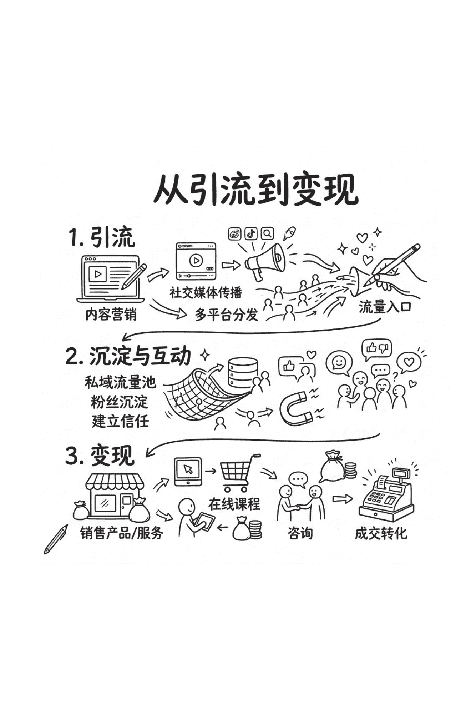

第三步，OpenClaw 多平台自动化发布与客户咨询对接。创始人将优化后的引流视频交由 OpenClaw，设置指令实现抖音、视频号、小红书多平台定时发布。同时，OpenClaw 能开启自动化客户咨询对接功能，针对客户的定制报价、视频风格等常见问题，自动发送标准化话术，整理客户核心需求并记录至本地订单表格，创始人仅需处理复杂的客户个性化需求，大幅节省对接时间。

第四步，承接定制服务后，双工具协同完成视频创作。OpenClaw 将整理好的客户定制需求，如零售企业产品推广视频、突出产品功能等，直接同步至 Seedance 2.0 的创作界面。创始人仅需补充创意要求，Seedance 2.0 就能依托多模态参考、复杂场景生成能力，快速完成定制视频的创作，满足客户的个性化需求。

第五步，OpenClaw 自动化交付与数据统计。Seedance 2.0 完成定制视频后，OpenClaw 将自动对视频文件进行格式转换、打包整理，通过微信、邮箱等渠道自动化发送给客户，同时自动完成订单金额、交付时间、客户满意度等数据的统计分析，生成订单交付报告，为后续的客户复购与服务优化提供数据支撑。

整个从引流到变现的流程，创始人的核心工作仅为创意把控、需求确认、少量优化，其余所有执行工作均由两大 AI 工具协同完成，实现了真正的无缝衔接，单条引流视频从创作到客户转化的周期大幅缩短，订单处理效率提升 80%以上，完美体现了双工具协同对提升 OPC 变现效率的加持。

### **实操案例 2：OpenClaw 自动化处理 OPC 日常办公、客户对接→腾出时间，用 Seedance** **2.0 拓展视频变现业务，提升 OPC 收入上限**

以聚焦知识付费视频制作的 OPC 为例，OpenClaw 自动化处理日常运营的所有琐事，能为创始人腾出 80%的时间与精力，让创始人专注于用 Seedance 2.0 拓展视频变现业务、打磨内容品质，从“时间被琐事占据的执行者”变为“聚焦变现的创业者”，实现 OPC 收入上限的大幅提升，这也是双工具协同对 OPC 长期发展产生的核心价值。

该 OPC 创始人原本以制作职场技能知识付费视频为主，因日常办公、客户对接、素材整理等琐事占据大量时间，每月仅能制作 10 个知识付费视频，且无暇拓展新的变现业务，接入 OpenClaw+Seedance 2.0 的协同体系后，运营效率与变现能力实现双重突破。

首先，OpenClaw 全面接管 OPC 日常办公自动化，针对知识付费 OPC 的办公需求，设置专属自动化指令：每日自动整理学员报名数据、课程学习数据，生成运营数据报表；每周自动整理课程答疑问题，分类存储至答疑库；每月自动完成财务数据统计、学员画像分析。原本需要每天 2 小时的办公工作，由 OpenClaw7×24 小时自动化完成，创始人仅需每周花 30 分钟查看报表，掌握运营核心数据即可。

其次，OpenClaw 实现客户与学员对接自动化，开启自动化对接功能，针对学员的课程报名、学习咨询、售后问题等，由 OpenClaw 自动发送标准化解答话术，对接知识付费平台完成学员报名确认、课程开通等操作；针对企业的定制知识付费视频需求，OpenClaw 自动整理客户需求、发送报价方案，初步筛选精准客户，创始人仅需对接高价值企业客户与处理复杂的学员问题，每天节省 3 小时以上的对接时间。

最后，创始人腾出时间，用 Seedance 2.0 拓展三大视频变现业务，提升收入上限。第一，打磨核心知识付费课程，创始人将更多时间用于课程体系设计与内容创意，借助 Seedance 2.0 的知识付费视频快速生成功能，将每月课程制作量提升至 30 个，课程收入直接翻倍；第二，拓展企业定制知识付费业务，针对企业的员工培训需求，用 Seedance 2.0 为不同企业定制专属知识付费视频，单条定制视频收费远高于通用课程，成为新的收入增长点；第三，制作引流短视频实现流量裂变，用 Seedance 2.0 将知识付费课程拆解为 15～30 秒的轻量化引流短视频，发布于各大平台，吸引精准学员报名，同时承接短视频定制订单，实现多元化变现。

此外，创始人还能利用腾出的时间，通过 Seedance 2.0 打造个人 IP 宣传视频，提升 OPC 的品牌影响力，吸引更多高价值客户。在双工具的协同下，该 OPC 不仅实现了原有业务的效率提升与收入翻倍，更成功拓展了企业定制、短视频接单等新业务，创始人月收入从原本的 2 万元提升至 5 万元，真正实现了收入上限的突破。这一案例充分证明，OpenClaw 的自动化效率支撑，能让创始人摆脱琐事的束缚，将更多精力聚焦于 Seedance 2.0 的创意变现与业务拓展，这也是 OPC 实现从“基础盈利”到“高收入盈利”的关键路径。

### **工具组合优化：根据 OPC 所属赛道（数字内容、专业服务等），调整两大工具的使用优先级与协同方式**

OpenClaw 与 Seedance 2.0 的协同并非一成不变的固定模式，而是需要根据 OPC 所属赛道的核心需求，灵活调整使用优先级与协同方式，实现工具能力与赛道需求的深度适配，让双工具的协同价值最大化。不同赛道的 OPC，其盈利核心、运营重点、变现场景存在显著差异，若采用统一的工具协同模式，会导致工具能力与赛道需求不匹配，浪费 AI 工具的效率优势。因此工具组合优化的核心原则是“赛道定优先级，需求定协同方式”——以赛道的核心盈利需求为导向，确定 OpenClaw（效率）与 Seedance 2.0（变现）的使用优先级，再根据赛道的运营流程，设计贴合实际的工具协同方式。

针对数字内容与创意设计赛道的 OPC（如短视频定制、微短剧创作、品牌视觉设计），其核心盈利点在于内容创作效率与变现能力，赛道需求为“高产出、高定制、快交付”，因此工具组合优化的策略为以 Seedance 2.0 为主，OpenClaw 为辅，协同聚焦“创作—交付”全流程。

使用优先级上，将 Seedance 2.0 作为核心工具，投入更多精力打磨其视频创作技巧，提升定制内容的品质与创作效率；OpenClaw 作为辅助工具，聚焦于为 Seedance 2.0 提供全流程效率支撑。协同方式上，打造“素材搜集—创作—发布—交付—数据反馈”的定向协同：OpenClaw 自动化搜集行业爆款素材、整理客户定制需求，直接同步至 Seedance 2.0；Seedance 2.0 快速完成定制内容创作后，OpenClaw 自动化实现多平台发布、客户交付、创作数据统计，同时将数据反馈至 Seedance 2.0，为后续内容优化提供依据，让双工具的协同完全围绕内容创作与变现展开。

针对专业服务与咨询赛道的 OPC（如企业管理咨询、财税咨询、职场规划咨询），其核心盈利点在于专业服务能力与客户信任度，赛道需求为“高效运营、精准引流、优质服务”，因此工具组合优化的策略为以 OpenClaw 为主，Seedance 2.0 为辅，协同聚焦“运营—引流—服务”全流程。

使用优先级上，将 OpenClaw 作为核心工具，充分发挥其自动化运营能力，实现客户对接、数据管理的全自动化，让创始人专注于专业服务的打磨；Seedance 2.0 作为辅助工具，聚焦于精准引流与品牌打造。协同方式上，打造“运营提效—内容引流—客户转化—服务优化”的定向协同：OpenClaw 自动化处理日常运营与客户初步对接工作，为创始人节省时间；Seedance 2.0 制作专业的科普视频、IP 宣传视频，实现精准引流，OpenClaw 将引流获取的客户信息自动化整理、分类，为创始人的精准服务提供依据；服务完成后，OpenClaw 自动化统计客户满意度，Seedance 2.0 根据反馈优化引流与品牌视频内容，提升客户信任度。

针对技能变现与知识服务赛道的 OPC（如知识付费、技能培训、线上教学），其核心盈利点在于内容体系搭建与流量变现，赛道需求为“内容高产出、流量精准化、服务标准化”，因此工具组合优化的策略为双工具同等优先级，协同聚焦“内容创作—流量引流—学员服务”全流程。

使用优先级上，OpenClaw 与 Seedance 2.0 同等重要，二者分别承担效率支撑与内容创作的核心作用，缺一不可。协同方式上，打造“素材整理—课程创作—引流裂变—学员服务—数据优化”的全链路协同：OpenClaw 自动化搜集课程素材、整理学员需求，同步至 Seedance 2.0；Seedance 2.0 快速完成知识付费课程与引流短视频创作，OpenClaw 实现课程与视频的多平台自动化发布；学员报名后，OpenClaw 自动化完成学员服务与答疑，Seedance 2.0 根据学员反馈优化课程内容，形成双向赋能的协同闭环。

无论何种赛道，工具组合优化的核心都是贴合赛道的实际需求，让 OpenClaw 与 Seedance 2.0 的能力精准匹配 OPC 的运营与变现需求，最终实现协同效率的最大化，让 AI 工具真正成为 OPC 的核心竞争力。

# **第三部分**

# **核心创富模式**

## **第六章 OPC：AI 时代轻资产创业核心**

### **OPC 核心优势：低门槛、低风险、高灵活**

AI 时代的 OPC 能成为轻资产创业的核心选择，源于其兼具低门槛、低风险、高灵活的三大核心优势，真正实现无需全职员工、无需高额房租，一人主导+AI 赋能即可运营，叠加各地政府出台的针对性扶持政策，让普通人的创业门槛降到最低，创富风险大幅降低，成为真正适配普通人的创业模式。

低门槛是 OPC 最直观的优势，体现在注册、运营、能力三个层面：注册层面，2024 年《中华人民共和国公司法》松绑后，OPC 的注册流程简化为“线上申请-审核-领证”，无需实地办公场地，可使用住宅地址或园区虚拟地址注册，注册资本实行认缴制，无需实际缴纳，普通人仅需花费数百元、耗时 1～3 个工作日就能完成工商注册；运营层面，依托 OpenClaw+Seedance 2.0 的 AI 工具协同，无需招聘全职员工，一人就能完成全流程运营，工具的使用成本远低于人工成本，每月运营成本可控制在千元级别；能力层面，AI 工具的零门槛操作特性，让创始人无需具备专业的技术、创作、管理能力，只需掌握基础的工具使用技巧，结合自身的核心优势（如行业经验、技能特长），就能快速启动 OPC，真正实现“零基础也能创业”。

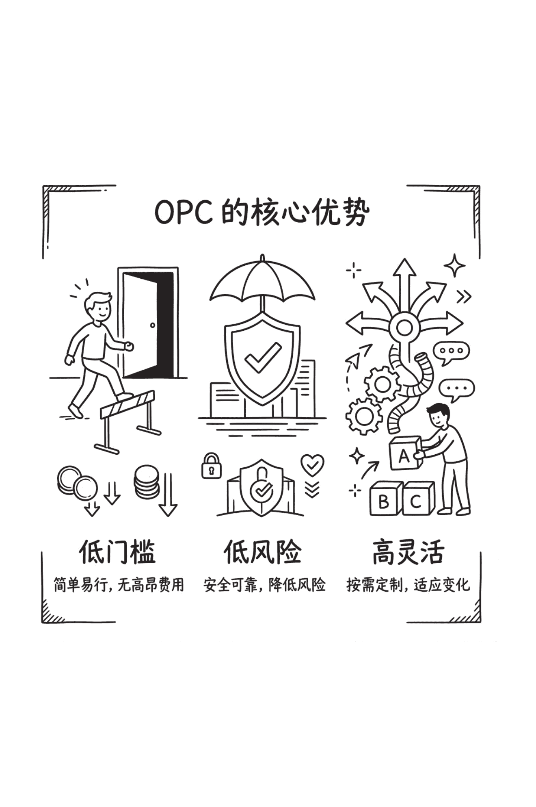

低风险是 OPC 的核心优势，从法律、成本、运营三个层面为创业者保驾护航：法律层面，OPC 作为有限责任公司，创始人以其认缴的出资额为限承担有限责任，若公司经营出现问题，仅以认缴资本为限偿还债务，不会涉及个人财产，彻底规避了个体户的无限连带责任风险；成本层面，OPC 无需房租、人工、设备等大额固定投入，核心成本仅为工具会员、办公软件等小额可变成本，即使创业失败，损失也能控制在极小范围，实现“低试错创业”；运营层面，“1 个创始人+AI 智能体”的模式让 OPC 的运营节奏完全由创始人掌控，可根据市场需求灵活调整业务方向，避免了传统团队创业的沟通成本、管理成本与决策效率低下的问题，大幅降低运营风险。

高灵活是 OPC 适配 AI 时代市场变化的关键优势，体现在业务调整、运营模式、盈利方式三个层面：业务调整层面，OPC 无团队、场地的束缚，创始人可根据市场热点与行业趋势，快速调整赛道与业务方向，如从短视频定制快速拓展至微短剧创作，无需考虑团队转型、场地调整等问题；运营模式层面，可灵活选择“全职创业”“副业创业”“线上线下结合”等多种运营模式，尤其适合职场人以副业形式起步，在保住主业稳定的同时，实现低风险试错，待业务成熟后再转为全职；盈利方式层面，可依托 AI 工具实现多元化盈利，如既可以承接定制服务，又可以制作知识付费内容，还能通过引流视频实现流量变现，盈利方式不受单一模式限制，抗风险能力大幅提升。

除了自身的核心优势，OPC 还能享受各地政府的针对性扶持政策，为创业提供额外的政策红利。为响应国家号召，各地政府纷纷出台适配 OPC 的轻资产创业扶持政策，核心涵盖四大方面：一是场地扶持，设立创业孵化基地、众创空间，为 OPC 提供免费或低价的虚拟办公场地、线下办公工位，解决注册与办公场地的问题；二是税收优惠，对新注册的 OPC 实行增值税、企业所得税减免政策，部分地区对小规模纳税人的 OPC 实行“零申报”简化流程，降低税务成本；三是资金补贴，对符合条件的 OPC（如大学生创业、返乡创业、新兴赛道创业）提供创业启动补贴、社保补贴，部分地区还提供低息或无息的创业贷款；四是服务扶持，为 OPC 提供免费的工商注册指导、财税咨询、法律维权、技能培训等一站式服务，帮助创始人解决创业过程中的各类问题。

政策红利与自身优势的双重加持，让 OPC 成为 AI 时代普通人轻资产创业的最优解，真正实现“低成本起步、低风险运营、高灵活发展”。

### **两大 AI 工具赋能 OPC：OpenClaw 搞定自动化运营、执行交付，Seedance 2.0 搞定宣传引流、内容变现，运营成本降低 90%以上**

OpenClaw 与 Seedance 2.0 并非简单的 OPC 运营辅助工具，而是赋能 OPC 实现轻资产运营的核心生产力。二者各司其职、协同发力，OpenClaw 全面搞定 OPC 的自动化运营与执行交付，Seedance 2.0 精准搞定 OPC 的宣传引流与内容变现，直接帮助 OPC 降低 90%以上的运营成本，让“1 个创始人+AI 智能体”的极简运营模式从理论变为现实。这也是 OPC 能实现低风险、高回报的核心原因。

传统创业的运营成本主要集中在人工、场地、时间三大维度，而两大 AI 工具的赋能，恰好从这三个核心维度实现成本的大幅降低，甚至清零。

在人工成本上，传统的视频定制、企业服务类创业，需要招聘文案、剪辑、客服、运营等多名员工，每月人工成本动辄数万元，而 OpenClaw+Seedance 2.0 的组合，能完全替代这些岗位的执行性工作：OpenClaw 承担客服、运营、数据统计的工作，7×24 小时自动化完成客户对接、办公处理、订单交付，替代客服与运营人员；Seedance 2.0 承担文案、剪辑、创作的工作，快速完成视频“写、导、剪、配”全流程，替代文案与剪辑人员。创始人仅需一人，就能借助两大工具完成原本需要 5～10 人团队的工作，人工成本直接降低 90%以上，甚至实现零人工成本。

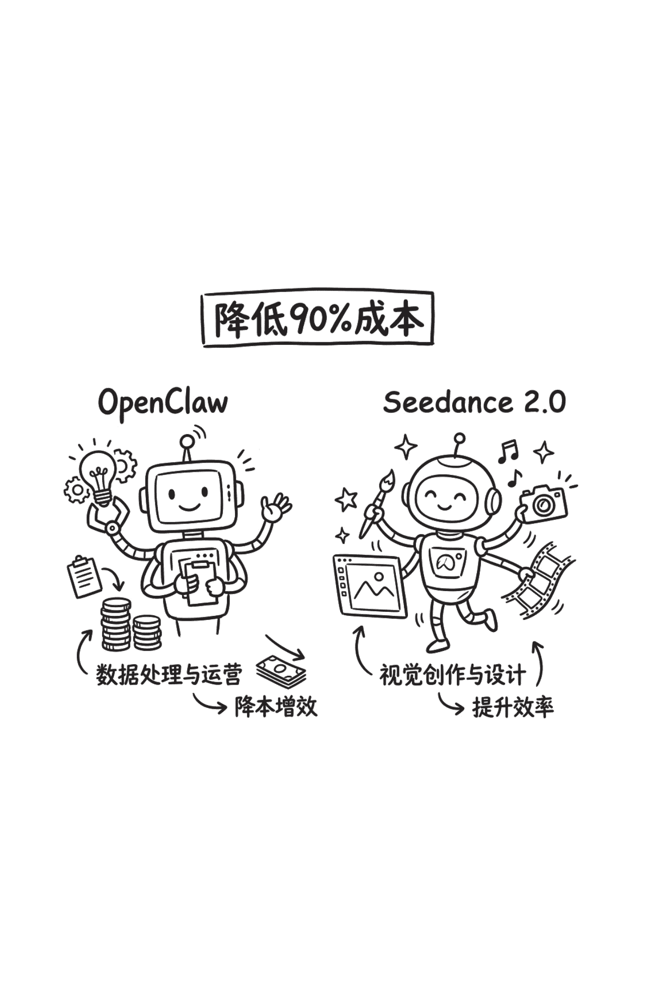

在场地成本上，传统创业需要租赁办公场地，每月房租、水电、物业等成本少则数千元，多则上万元，而两大 AI 工具均为线上操作，支持本地部署。创始人仅需一台电脑、一个网络环境，就能在家庭、咖啡馆等任意地点开展 OPC 运营，无需租赁专业办公场地。场地成本直接清零，仅需少量的网络、电费成本，几乎可以忽略不计。

在时间成本上，时间是创业的核心成本。传统创业中，创始人大量的时间被烦琐的重复性工作占据，无法聚焦核心的创富环节，而 OpenClaw 的自动化运营能力，能将创始人从琐事中解放，节省 80%以上的时间成本：原本需要每天数小时的素材搜集、客户对接、数据统计，由 OpenClaw 自动化完成，创始人仅需花费少量时间查看进度、处理核心问题；原本需要数小时的视频创作，由 Seedance 2.0 在十分钟至半小时内完成，创作效率提升 10 倍以上。时间成本的降低，让创始人能将核心精力聚焦于战略决策、业务拓展、创意打磨等高价值环节，大幅提升 OPC 的变现效率与发展速度。

具体来看，OpenClaw 对 OPC 的赋能体现在自动化运营与执行交付的全流程，成为 OPC 的“效率基石”：在自动化运营层面，OpenClaw 实现办公自动化、素材管理自动化、数据统计自动化、客户对接自动化，让 OPC 的日常运营无需人工干预，全程高效运转；在执行交付层面，OpenClaw 实现订单处理自动化、文件交付自动化、售后数据统计自动化，让定制服务的交付流程标准化、高效化，提升客户满意度。OpenClaw 的赋能，让 OPC 的运营实现标准化、自动化、高效化，彻底解决了一人运营的效率瓶颈。

Seedance 2.0 对 OPC 的赋能体现在宣传引流与内容变现层面，成为 OPC 的“变现引擎”：在宣传引流层面，Seedance 2.0 能快速生成高传播性的引流视频，覆盖各大线上平台，实现精准流量获取，为 OPC 积累客户资源，解决传统创业“引流难、获客贵”的痛点；在内容变现层面，Seedance 2.0 能完成定制视频、知识付费视频、微短剧等多种内容的创作，承接企业定制服务、搭建知识付费体系、实现流量变现，打造多元化的盈利渠道，解决传统创业“变现渠道单一、收入上限低”的痛点。Seedance 2.0 的赋能，让 OPC 的变现实现“低门槛、高产出、多元化”，彻底打破了一人创业的变现瓶颈。

两大 AI 工具的协同赋能，从效率与变现两个核心维度，为 OPC 提供了完整的能力支撑，直接降低 90%以上的运营成本，让 OPC 的运营真正实现“轻资产、高效率、高变现”，成为 AI 时代普通人创富的最佳载体。

### **高适配赛道：数字内容与创意设计、专业服务与咨询、技能变现与知识服务、轻量应用开发等 5 大热门赛道详解**

结合 2026 年的 AI 发展趋势、市场需求变化与轻资产创业特点，OPC 的高适配赛道主要集中在数字内容与创意设计、专业服务与咨询、技能变现与知识服务、轻量应用开发、本地生活数字服务五大赛道。这些赛道均具备低门槛、高需求、低投入、高变现的核心特点，完美适配 OPC 的运营模式，且市场需求持续增长，竞争格局相对宽松，是普通人借助 OpenClaw+Seedance 2.0 实现创富的最佳选择。每一条赛道都能依托两大 AI 工具的能力，实现高效运营与多元化变现。创始人只需结合自身优势选择赛道，就能快速启动 OPC。

赛道一：数字内容与创意设计，这是 2026 年 OPC 最核心、最易落地的高适配赛道，市场需求源于中小企业与个人的内容创作需求，核心业务包括短视频定制、微短剧创作、企业宣传视频制作、品牌视觉设计等。该赛道完美适配 Seedance 2.0 的视频创作能力与 OpenClaw 的自动化运营能力，创始人借助 Seedance 2.0 一人就能完成“写、导、剪、配”全流程创作，借助 OpenClaw 实现素材搜集、客户对接、订单交付的自动化，无需专业的设计、影视技能，就能零门槛起步。变现方式主要为企业定制服务收费、微短剧流量变现、素材模板售卖，单条定制视频收费 500～5000 元，每月接 20～30 单即可实现月入过万元，市场需求大、变现效率高。

赛道二：专业服务与咨询，依托创始人的行业经验与专业知识，为企业与个人提供精准的专业咨询服务，核心业务包括企业管理咨询、财税咨询、职场规划咨询、AI 工具使用咨询等。该赛道以 OpenClaw 的自动化运营为核心，创始人借助 OpenClaw 实现客户对接、数据统计、咨询报告整理的自动化，节省大量时间，专注于专业服务的打磨；同时借助 Seedance 2.0 制作专业的科普视频、案例分析视频，实现精准引流，提升品牌信任度。变现方式主要为咨询服务收费、企业定制方案收费、线上咨询会员，该赛道的核心竞争力是创始人的专业能力，竞争程度相对较低，客单价高，适合具备一定行业经验与专业知识的创始人。

赛道三：技能变现与知识服务，将创始人的技能与知识转化为可变现的线上内容，核心业务包括知识付费课程制作、技能培训、线上教学、实操指导等，涵盖职场技能、生活技能、AI 工具使用、创业指导等多个方向。该赛道是双工具协同的核心适配赛道，创始人借助 Seedance 2.0 快速制作高质量的知识付费视频与引流短视频，借助 OpenClaw 实现学员管理、课程发布、答疑对接的自动化，大幅提升课程制作效率与学员服务效率。变现方式主要为知识付费课程售卖、线上培训收费、一对一实操指导，该赛道的优势是内容可重复售卖，实现“一次创作、多次变现”，收入具备可持续性，适合具备一定技能与知识的创始人，如职场精英、行业专家等。

赛道四：轻量应用开发，结合 2026 年 AI 工具的普及趋势，为中小企业与个人开发轻量型、定制化的 AI 应用、小程序、工具插件等，核心业务包括 AI 智能体定制、微信小程序开发、办公工具插件制作、短视频创作工具优化等。该赛道依托 OpenClaw 的开源特性与多模型兼容能力，创始人借助 OpenClaw 完成应用开发的素材搜集、代码整理、测试优化，降低开发难度；同时借助 Seedance 2.0 制作应用演示视频、使用教程视频，实现引流与变现。变现方式主要为应用定制开发收费、应用会员收费、插件售卖。该赛道贴合 AI 时代的技术趋势，市场需求持续增长，适合具备一定编程基础或 AI 工具使用能力的创始人，变现潜力大。

赛道五：本地生活数字服务，聚焦本地生活市场，为线下实体商家提供数字化转型服务，核心业务包括本地探店短视频制作、商家线上引流策划、团购套餐设计、私域流量运营等。该赛道依托 Seedance 2.0 的短视频创作能力，为商家制作高质量的探店视频、宣传视频，借助 OpenClaw 实现本地商家信息搜集、引流视频多平台发布、客户对接的自动化，贴合线下商家的线上引流需求，市场需求贴近生活、客户资源易获取。变现方式主要为商家短视频定制收费、引流策划服务收费、团购佣金分成。该赛道的优势是客群精准、复购率高，适合熟悉本地市场、善于沟通的创始人，零门槛起步，易快速实现盈利。

以上五大赛道均为 2026 年 OPC 的高适配热门赛道，创始人无需追求“大而全”，只需结合自身的优势、兴趣与资源，锁定一条核心赛道，借助 OpenClaw+Seedance 2.0 的 AI 工具赋能，就能快速启动 OPC，实现低风险、高回报的创富目标。

### **案例拆解：参考 Dan Koe“一人公司”模式，普通人用 OpenClaw+Seedance 2.0，打造月入 2 万元的 OPC 个人服务品牌，实现低风险盈利**

参考 Dan Koe 的“一人公司”模式——以个人品牌为核心，依托高效工具实现轻资产运营，聚焦高价值服务，实现低风险、高盈利。

一位普通的职场人小李，借助 OpenClaw+Seedance 2.0 的 AI 工具赋能，打造了聚焦职场技能知识付费的 OPC 个人服务品牌，仅用 4 个月就实现月入 2 万元的稳定盈利，全程零团队、零房租，真正实现了 AI 时代的轻资产创富。其案例具备极强的可复制性，为普通人搭建 OPC 提供了清晰的实操参考。

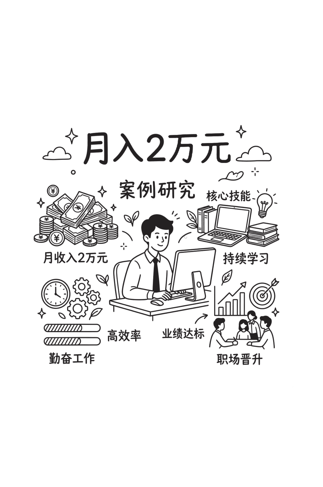

小李原本是一名互联网公司的运营人员，拥有 5 年的职场运营经验，因担心被 AI 替代，想搭建副业 OPC。他结合自身的职场运营技能，参考 Dan Koe 的个人品牌模式，锁定“职场运营技能知识付费”赛道，借助两大 AI 工具实现了从 0 到 1 的快速突破。

第一步：打造个人品牌定位，AI 辅助梳理核心优势。小李先梳理自身的核心优势——5 年互联网运营经验，擅长短视频运营、社群运营、用户增长；然后借助 OpenClaw 分析职场运营知识付费的市场需求，确定个人品牌定位为“职场运营干货分享，教普通人快速掌握运营技能，实现职场加薪与副业增收”，并借助 Seedance 2.0 制作了个人 IP 宣传视频，突出自身的行业经验与核心优势，为后续的品牌打造奠定基础。

第二步：AI 工具协同，高产出打造知识付费课程体系，这是小李 OPC 的核心变现环节。小李借助 OpenClaw 自动化搜集职场运营的热门知识点、学员需求、爆款课程框架，按“短视频运营、社群运营、用户增长”三大模块整理成课程素材库，同步至 Seedance 2.0；然后借助 Seedance 2.0 的知识付费视频快速生成能力，输入关键词就能完成课程视频的脚本撰写、镜头设计、剪辑配音，原本需要数小时制作的一节课程视频，如今 15 分钟就能完成。小李将每月的课程视频制作量提升至 40 节，快速搭建起完整的职场运营技能知识付费课程体系，课程定价 99～299 元，满足不同学员的需求。

第三步：AI 赋能精准引流，打造个人品牌影响力。小李参考 Dan Koe 的内容引流模式，借助双工具协同打造引流闭环。小李先借助 Seedance 2.0 将知识付费课程拆解为 15～30 秒的轻量化引流短视频，内容以职场运营干货、实操技巧、加薪案例为主，突出实用性；然后借助 OpenClaw 实现引流视频在抖音、视频号、小红书等多平台的自动化发布，同时开启自动化客户咨询对接功能，自动回复学员的课程报名、学习咨询等问题，整理精准学员信息；此外，借助 Seedance 2.0 制作直播切片视频，在视频号开展免费的职场运营干货直播，进一步提升个人品牌影响力，吸引精准学员。

第四步：AI 自动化运营，实现标准化学员服务与持续盈利。小李借助 OpenClaw 搭建了标准化的学员服务体系，实现学员管理、课程交付、答疑对接的全自动化：OpenClaw 自动完成学员报名确认、课程开通、学习数据统计，生成学员学习报表；针对学员的常见问题，OpenClaw 自动发送标准化解答话术，整理高频问题，形成答疑库；课程更新后，OpenClaw 自动通知学员，提升学员满意度与复购率。小李仅需花费少量时间开展一对一的高端学员指导，其余学员服务工作均由 AI 工具自动完成，大幅节省时间成本。

第五步：拓展高价值定制服务，提升 OPC 收入上限。在基础课程盈利稳定后，小李参考 Dan Koe 的高价值服务模式，拓展了职场运营定制指导与企业员工运营培训两大高价值服务：为有个性化需求的学员提供一对一的职场运营定制指导，收费 999 元/人；为中小企业提供员工运营培训，制作定制化的培训视频与方案，收费 5000～10000 元/家。小李借助 Seedance 2.0 快速完成定制培训视频的创作，借助 OpenClaw 整理企业需求、完成方案交付，高价值服务成为 OPC 新的收入增长点。经过 4 个月的运营，小李的 OPC 实现了多元化盈利：基础知识付费课程每月售卖 300 多份，收入 1.2 万元；一对一定制指导每月服务 20 多人，收入 2 万元；企业定制培训每月承接 2～3 家，收入 1 万～3 万元，综合月收入稳定在 2 万以上，且随着个人品牌影响力的提升，收入持续增长。整个 OPC 的运营，小李仅需一人，每月运营成本仅为工具会员、办公软件等，真正实现了低风险、高盈利。

这一案例充分证明，参考 Dan Koe 的“一人公司”模式，普通人只需结合自身优势，借助 OpenClaw+Seedance 2.0 的 AI 工具赋能，就能打造属于自己的 OPC 个人服务品牌，稳定实现创富目标，且整个模式具备极强的可复制性，适用于多个赛道。

## **第七章 OPC 核心变现场景：“一人一剧组”式视频创作变现**

### **核心价值：以 OPC 为主体，用“一人一剧组”模式开展视频创作，实现“内容引流+定制服务”双重变现，提升 OPC 盈利能力**

以 OPC 为合法商业主体，落地“一人一剧组”视频创作变现场景，其核心价值在于打破传统视频创作单一变现、效率低下的局限，实现内容引流+定制服务的双重变现，从流量与商业服务两个维度提升 OPC 的盈利能力，让视频创作能力成为 OPC 可持续盈利的核心竞争力。相较于普通的个人视频创作，以 OPC 为主体的视频创作优势在于拥有合规的商业身份：既能承接企业级的定制视频服务、签订正规商业合同，提升客户信任度与服务客单价；又能享受各类创业政策红利，降低运营成本。“一人一剧组”的创作模式则为 OPC 提供了高效的内容生产能力。二者结合，可实现变现效率与盈利空间的双重突破。

第一重变现——内容引流变现，这是 OPC 的流量基础。依托“一人一剧组”模式，借助 Seedance 2.0 可快速创作高传播性、高精准度的轻量化视频内容，如行业科普短视频、热点解读视频、IP 宣传视频等，发布在抖音、视频号、小红书等主流线上平台，可实现免费自然引流。这些引流视频不仅能为 OPC 积累精准的客户资源，还能通过平台流量收益和广告合作实现轻量变现，这也成为 OPC 的基础收入来源。更重要的是，优质的引流视频能打造 OPC 的个人品牌形象，让客户对 OPC 的视频创作能力有所认知，为后续的定制服务转化奠定基础，实现流量变留量。

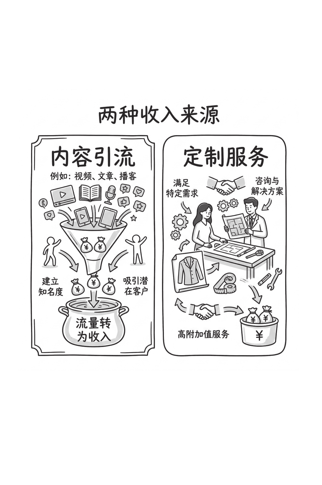

第二重变现——定制服务变现，这是 OPC 的核心盈利来源，也是“一人一剧组”场景的核心价值所在。借助 OPC 的合规商业身份，可将“一人一剧组”的创作能力转化为标准化的商业服务，承接中小企业、线下商家、个人 IP 的定制视频订单，如企业宣传视频、产品推广视频、微短剧、探店视频、知识付费课程视频等。相较于传统视频团队，OPC 的“一人一剧组”模式拥有响应快、效率高、成本低的核心优势，能以更短的周期、更低的价格为客户提供高质量的定制视频，在市场竞争中形成差异化优势。同时，单条定制视频的客单价远高于流量变现，成为 OPC 的主要收入来源。

内容引流+定制服务的双重变现模式，形成了相互赋能、相互促进的闭环：内容引流能为定制服务提供源源不断的客户资源，解决 OPC 获客难、获客贵的痛点；定制服务的高质量交付又能提升 OPC 的品牌口碑，吸引更多精准流量；同时定制服务的盈利又能反哺内容创作，让 OPC 有更多精力打磨引流视频内容。这种双重变现模式，彻底突破了单一视频创作的收入瓶颈，大幅提升了 OPC 的盈利能力与抗风险能力，让“一人一剧组”成为 OPC 在数字内容赛道实现稳定盈利的核心支撑。

### **落地步骤：选题、脚本生成、视频制作、发布引流、客户转化的全流程拆解，OpenClaw 辅助提升创作与运营效率**

OPC“一人一剧组”视频创作模式，构建了一套流程清晰、可快速复制的落地路径，核心分为选题、脚本生成、视频制作、发布引流、客户转化五大核心步骤。该模式全程以 Seedance 2.0 为核心创作工具，OpenClaw 从旁辅助，自动化处理素材搜集、数据统计、平台发布、客户对接等工作，大幅提升创作与运营效率。即使是零基础的 OPC 从业者，也能按步骤快速落地，实现从视频创作到商业变现的无缝衔接。

第一步：选题。OpenClaw 会自动化搜集热点，并结合赛道需求锁定创作方向，选题决定了视频的流量与转化效果，是创作的核心前提。从业者无需手动搜集热点，只需在 OpenClaw 中设置指令，如：每日搜集抖音、视频号本地餐饮赛道的热门选题、流量关键词、爆款视频框架，按传播度排序生成选题报告。OpenClaw 将通过浏览器控制功能完成全网数据搜集与分析，自动整理出高流量、高转化的选题方向，同时结合 OPC 的核心赛道（如企业定制、本地生活、知识付费）与客户需求，锁定贴合自身变现目标的创作选题，确保视频内容既能获得流量，又能精准对接商业需求。

第二步：脚本生成。依托精准选题，Seedance 2.0 能一键生成专业脚本，再用 OpenClaw 辅助优化细节，可实现脚本的快速生成。从业者只需在 Seedance 2.0 中输入选题关键词与核心需求，如本地火锅探店、突出锅底特色与菜品新鲜、20 秒、快节奏，Seedance 2.0 即可自动生成标准化的视频脚本，包含台词、镜头、情节、时长等核心要素；同时 OpenClaw 可辅助拆解爆款视频的脚本逻辑，将优质句式、节奏设计同步至 Seedance 2.0，帮助从业者优化脚本细节，提升脚本的专业度与传播性，整个过程仅需 5 至 10 分钟，无需具备专业脚本撰写能力。

第三步：视频制作。Seedance 2.0 支持一站式完成成片制作，是实现“一人一剧组”创作和落地的核心环节。依托 Seedance 2.0 的全流程创作能力，可将脚本快速转化为高质量视频。从业者无需任何剪辑、配音技能，只需将优化后的脚本导入 Seedance 2.0，选择视频风格、画质分辨率、配音音色，Seedance 2.0 将自动完成画面生成、剪辑、配音、字幕、特效的一站式制作，还能通过多模态参考功能上传客户素材实现定制化创作。若需调整细节，可通过视频可控编辑功能进行帧级优化，整个制作过程仅需 10 至 30 分钟，一人即可完成传统剧组数小时的工作。

第四步：发布引流。OpenClaw 支持自动化多平台发布，实现流量最大化。视频制作完成后，可借助 OpenClaw 实现高效发布，节省手动操作时间。从业者只需将成片上传至 OpenClaw，设置发布规则，如抖音、视频号、小红书同步发布，标题自动匹配流量关键词，定时发布于平台高峰时段，即可实现多平台自动化发布。同时，OpenClaw 会自动监测各平台的视频数据（播放量、点赞量、评论量、咨询量等），生成数据统计报告，让从业者实时掌握视频的流量表现，为后续内容优化提供依据。

第五步：客户转化。OpenClaw 自动化对接咨询，让从业者聚焦深度转化，实现商业变现。流量的核心目标是转化为商业订单，这一步是变现的关键。OpenClaw 可开启自动化客户咨询对接功能，针对视频评论区、私信中的常见客户咨询，如“视频定制怎么收费”“能做企业宣传视频吗”，自动回复标准化的解答话术、报价方案与案例展示，并将客户信息、核心需求整理至本地订单表格，实现“咨询—信息留存—初步筛选”的自动化。从业者仅需聚焦于高意向精准客户的深度对接，确认需求、定制方案、签订合同，大幅节省对接时间，提升转化效率。

五大步骤落地后，OPC 的“一人一剧组”场景就形成了完整的“创作—引流—转化”闭环，Seedance 2.0 负责核心的视频创作，OpenClaw 负责全流程的运营提效，二者协同发力，让从业者一人就能实现视频创作的规模化与商业变现的高效化，真正发挥“一人一剧组”的核心价值。

### **高变现方向：微短剧、知识付费视频、企业宣传片、节日定制影像（可作为 OPC 核心服务），贴合当下热门需求**

OPC 的“一人一剧组”视频创作场景，依托 Seedance 2.0 的全流程创作能力，可覆盖多个高变现方向。其中，微短剧、知识付费视频、企业宣传片、节日定制影像四大方向，贴合当下市场的热门需求，具备需求大、客单价高、复购率高的核心特点，完全适配“一人+AI”的运营模式，可直接作为 OPC 的核心服务，打造稳定的商业变现闭环，成为盈利核心支柱。这四大高变现方向，无需从业者拓展额外的能力，仅需依托已掌握的 Seedance 2.0 创作技巧与 OpenClaw 运营方法，就能快速落地。当前，市场需求持续增长，竞争格局相对宽松，是普通人实现快速盈利的最佳选择。

高变现方向一：微短剧。这是当下视频赛道的流量风口与变现蓝海，市场需求源于中小企业品牌宣传、线下商家引流、个人 IP 打造等。微短剧以剧情化、轻量化、高传播为特点，时长 1～3 分钟，契合用户碎片化的观看习惯，传播效率远高于传统视频。依托 Seedance 2.0 的复杂场景生成与剧情创作能力，OPC 从业者一人就能完成微短剧的脚本创作、画面生成、剪辑配音，无需专业演员与拍摄场地，创作成本低、效率高。变现方式主要为定制收费（单部微短剧 500～5000 元）、流量分成、广告植入，既可以承接企业定制的微短剧，也可以打造自有 IP 微短剧实现流量变现，市场需求大，变现潜力无限。

高变现方向二：知识付费视频。这贴合当下终身学习的市场趋势，需求源于职场技能提升、创业者知识获取、兴趣爱好等，知识付费视频以专业性、实用性、体系化为特点，是实现一次创作、多次变现的优质赛道。依托 Seedance 2.0 的视频快速生成能力，从业者可结合自身的专业知识与行业经验，打造职场技能、创业指导、AI 工具使用等系列知识付费视频，搭建标准化的课程体系；以 OPC 为主体进行课程售卖，定价 99～999 元。同时，从业者还能承接企业定制化的员工培训视频。该赛道客单价高、复购率高，且内容可重复售卖，能够成为 OPC 的长期稳定收入来源。

高变现方向三：企业宣传片。这是中小企业的刚性需求，市场需求源于企业品牌打造、产品推广、招商加盟等。企业宣传片以专业性、品牌化、个性化为特点，是企业对外展示的核心载体。传统企业宣传片制作成本高、周期长，而 OPC 的“一人一剧组”模式，依托 Seedance 2.0 的多模态参考与定制化创作能力，能为中小企业打造高性价比的宣传片，从创意构思到成片制作仅需 1～3 天，收费 1000～10000 元，远低于传统影视公司。同时，借助 OpenClaw 的客户资源积累，能实现老客户复购与转介绍，是 OPC 的核心高客单价服务。

高变现方向四：节日定制影像。节日定制影像紧扣节日消费趋势，需求源于企业节日福利、线下商家引流、个人纪念等，涵盖春节、中秋、情人节等各类节日。节日定制影像以氛围感、个性化、时效性为特点，具备强季节性与高需求性。依托 Seedance 2.0 的快速创作能力，OPC 从业者可在节前提前制作标准化节日视频模板，节日期间承接定制化修改，创作效率高、交付周期短；还能为线下商家打造节日引流视频，实现“视频制作+引流策划”的组合服务，提升客单价。节日期间的订单量是平时的 3～5 倍，是 OPC 的阶段性高收入来源。

以上四大高变现方向，既可单独作为 OPC 的核心服务，也可组合运营，形成“核心服务+特色服务”的变现体系，从业者只需结合自身的优势与赛道定位，锁定 1～2 个核心方向，就能实现稳定的商业变现。同时，依托 AI 工具的高效创作能力，可快速拓展其他方向，提升 OPC 的收入上限。

### **案例拆解：参考 Josh Wallace Kerrigan，用 Seedance 2.0 打造“一人一剧组”式 OPC，运营 NeuralViz 频道实现 23 万粉丝，单条视频变现 5000 元**

参考 Josh Wallace Kerrigan 的一人创作模式，90 后自由职业者小张，以 OPC 为商业主体，借助 Seedance 2.0 打造“一人一剧组”式创作体系，深耕科技领域视频创作，运营 NeuralViz 视频频道，仅用 1 年时间就实现 23 万名精准粉丝的积累，单条定制视频变现 5000 元，最终实现经济独立。这个案例完美体现了“一人一剧组”对 OPC 的变现赋能，且具备极强的可复制性，为普通从业者提供了清晰的实操参考。

小张原本是一名科技公司的文案人员，拥有扎实的科技知识储备，因厌倦朝九晚五的工作成为自由职业者。初期，他尝试了科技内容创作，但因缺乏视频制作技能，创作效率低、内容质量差，难以实现变现。接触到 OpenClaw+Seedance 2.0+OPC 的组合后，小张注册了一人公司，聚焦科技领域视频创作，参考 Josh Wallace Kerrigan 的模式，落地“一人一剧组”，开启了 NeuralViz 频道的运营。

第一步：精准定位赛道，打造差异化内容标签。小张结合自身的科技知识优势，将 NeuralViz 频道定位为“AI 工具实操科普，教普通人快速玩转 AI 创作”，避开科技领域的红海竞争，打造差异化的内容标签。同时，借助 OpenClaw 分析科技领域的流量趋势，他以“AI 工具实操教程、科技热点解读、AI 创作案例展示”为核心创作方向，确保内容既符合平台流量趋势，又具备实用价值，为后续的粉丝积累与变现奠定基础。

第二步：以 Seedance 2.0 打造“一人一剧组”创作体系，实现高产出高质量创作。这也是 NeuralViz 频道成功的核心。小张依托 Seedance 2.0 的全流程创作能力，一人完成视频的全流程制作：无需专业拍摄设备，通过 Seedance 2.0 的复杂场景生成能力，制作科技感十足的视频画面；无需剪辑技能，通过关键词输入实现脚本生成、剪辑、配音，以及字幕的一站式完成；同时为贴合 NeuralViz 频道的风格，将 AI 创作的轻微肌理感转化为专属的科技风格，让内容形成独特的视觉标识。原本需要数小时制作的科技科普视频，小张借助 Seedance 2.0 仅需 20 分钟就能完成，实现了日更 1 条的高产出，且内容质量远超同赛道的个人创作者。

第三步：OpenClaw 辅助运营，提升频道运营效率。小张将所有的运营工作交由 OpenClaw 自动化处理，大幅节省时间成本。OpenClaw 自动化搜集科技领域的热门素材、AI 工具的最新动态，为小张提供创作灵感；实现 NeuralViz 频道在 B 站、抖音、视频号的多平台自动化发布，且定时发布于平台流量高峰时段；自动监测各平台的视频数据，生成数据统计报告，让小张实时掌握粉丝增长、视频播放、评论互动等情况，及时优化创作方向；同时自动化对接粉丝的咨询与留言，整理高意向客户的需求，为后续的变现做好准备。

第四步：从流量变现到商业变现，实现收入多元化。在粉丝积累至 10 万名后，小张开启了多元化的变现之路，依托 OPC 的合规商业身份，将“一人一剧组”的创作能力转化为标准化的商业服务：一是定制视频服务，承接科技企业、AI 工具公司的定制科普视频、产品推广视频，单条视频收费 5000～10000 元，这成为核心收入来源；二是知识付费课程，借助 Seedance 2.0 制作 AI 工具实操的系列知识付费课程，定价 199～399 元，累计售卖 10000 多份，实现一次创作、多次变现；三是平台流量变现，通过频道的广告合作、流量分成实现轻量变现，这是基础收入来源；四是 AI 工具教学服务，为粉丝提供一对一的 AI 工具实操指导，收费 299 元/人，提升粉丝黏性与变现效率。

第五步：打造个人品牌，实现稳定盈利与经济独立。经过 1 年的运营，NeuralViz 频道的精准粉丝积累 23 万名，成为科技领域 AI 工具科普的优质频道。小张的 OPC 实现了稳定的多元化盈利：定制视频服务每月承接 1015 单，收入 5 万～15 万元；知识付费课程每月售卖 300 多份，收入 1 万～2 万元；其他变现方式每月收入 5000 多元，综合月收入稳定在 6 万元以上，且运营成本仅为工具会员、办公软件等千元级别，真正实现了低风险、高盈利，最终达成经济独立的目标。

小张的案例充分证明，参考 Josh Wallace Kerrigan 的模式，借助 Seedance 2.0 打造“一人一剧组”式 OPC，即使是普通人，也能凭借自身的知识与技能，在视频赛道实现规模化变现，最终达成经济独立的目标。

## **第八章 OPC 规模化运营：从“一人”到“轻团队”，放大创富效应**

### **运营逻辑：以 OPC 为核心，依托 OpenClaw+Seedance 2.0 优化效率，搭建柔性协作网络，实现规模化盈利而不增加重资产负担**

OPC 的规模化运营，并非走传统创业扩大团队、租赁场地、增加重资产的老路，而是遵循以 OPC 为核心，效率为先，柔性协作的全新运营逻辑。依托 OpenClaw+Seedance 2.0 持续优化自动化运营与内容创作效率，将创始人从执行性工作中彻底解放，使其专注于核心战略决策、客户资源与品牌打造，同时搭建轻资产的柔性协作网络，整合外部优质资源弥补个人能力短板，最终实现规模化盈利而不增加任何重资产负担。这正是 AI 时代 OPC 规模化运营的核心精髓。

传统企业的规模化，往往伴随着重资产投入，团队扩大带来人工成本的大幅增加，场地拓展带来房租成本的持续上升，还会出现管理成本高、沟通效率低、决策流程慢等问题，最终陷入规模越大，负担越重的困境。OPC 的规模化运营，彻底颠覆了这一逻辑，始终坚守“轻资产、高效率”的核心原则，以 OPC 作为唯一的合法商业主体，所有的规模化动作都围绕放大创富效应、降低运营成本展开。

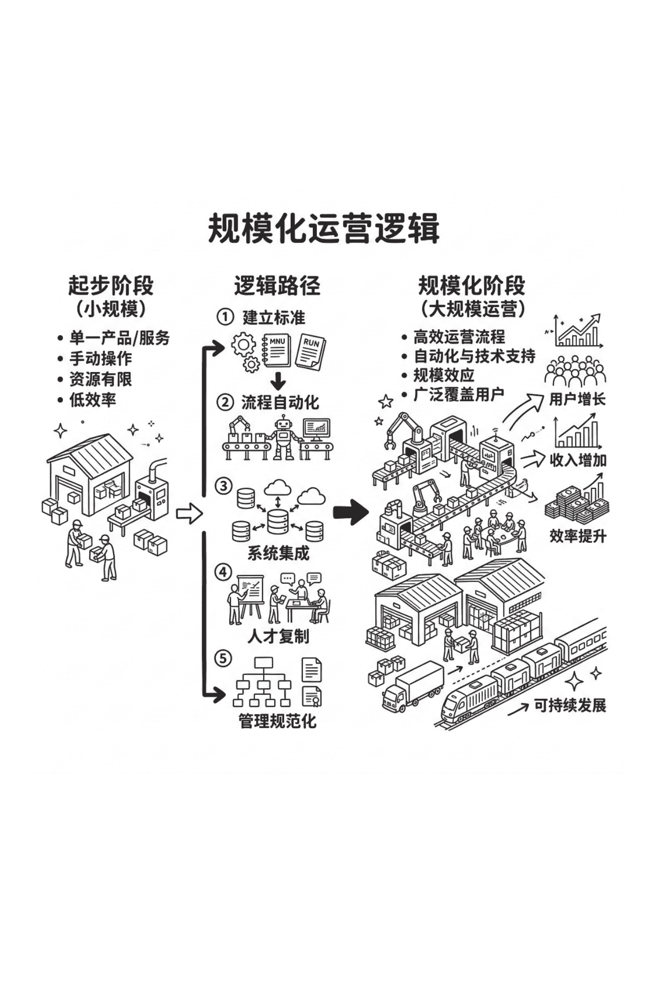

这一运营逻辑的核心，分为三层：

第一层，以 OPC 为绝对核心。所有业务开展、资源整合、商业合作，均以 OPC 为主体，创始人始终掌握 OPC 的控制权与决策权，确保运营的灵活性与决策的高效性，避免因团队扩大导致失去控制权与决策低效。同时，OPC 的轻资产属性保持不变，无需租赁大型办公场地，无需招聘全职员工，核心运营成本仍控制在较低水平。

第二层，依托 AI 工具持续优化效率。OpenClaw+Seedance 2.0 的自动化能力是 OPC 规模化的基础，随着业务量的增加，需要进一步深挖两大工具的潜力。通过自定义技能、优化协同模式，让自动化运营覆盖更多的业务环节，如订单管理、客户维护、内容创作、数据统计等，确保即使业务量翻倍，但是创始人的工作时间不会同步增加，始终保持高效的运营状态。

第三层，搭建柔性协作网络，整合外部轻资产资源。这是 OPC 规模化的关键。当业务量超出个人承载能力时，不招聘全职员工，而是根据订单需求，搭建由自由职业者、兼职从业者和其他 OPC 组成的柔性协作网络，整合外部的优质资源，如专业的文案策划、资深的行业顾问、精准的流量渠道等。柔性协作网络的核心是按需合作、按效付费、灵活调整，根据业务订单需求，选择合适的协作伙伴，签订短期合作协议，按完成的成果支付费用，无需承担固定的人工成本。当业务量减少时，可快速缩减协作规模，避免资源浪费，真正实现“轻资产整合、高效率协作”。

以 OPC 为核心，以 AI 工具为效率支撑，以柔性协作网络为资源补充，三者结合让 OPC 的规模化运营摆脱了重资产的束缚，真正实现盈利规模化、成本轻量化的双重目标，最终放大创富效应，让 OPC 从一人盈利升级为轻量规模化盈利。

### **效率优化：OpenClaw 自动化处理重复工作，Seedance 2.0 提升创作效率，释放个人精力，聚焦核心决策与客户维护**

OPC 规模化运营的前提是效率的持续优化，而效率优化的核心始终依托于 OpenClaw 与 Seedance 2.0 的 AI 工具能力。OpenClaw 进一步深挖自动化潜力，处理更多、更复杂的重复工作，实现运营全流程的高度自动化；Seedance 2.0 通过技能打磨与功能拓展，进一步提升内容创作的效率与质量，实现创作的规模化与标准化。二者协同发力，将创始人从执行性工作中解放出来，聚焦于核心决策与客户维护这两大 AI 无法替代的高价值环节，这也是 OPC 能实现规模化盈利的核心基础。

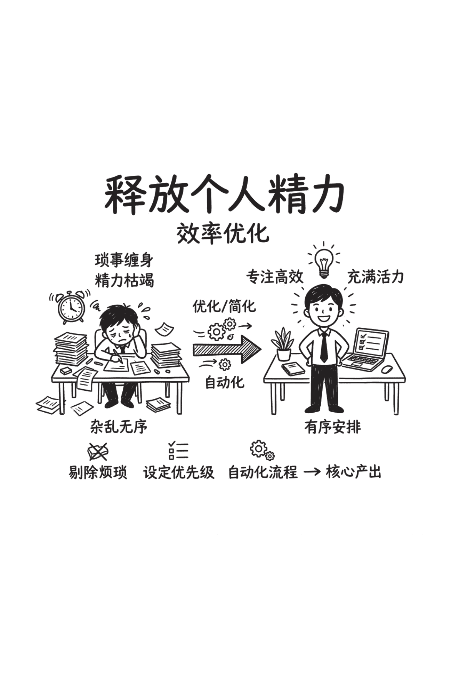

随着 OPC 业务量的增加，重复工作的数量也会同步增长，若仍由创始人手动处理，会导致工作效率大幅降低，陷入“忙而盲”的困境，无法推进规模化运营。OpenClaw 的自动化能力，能完美解决这一问题，是 OPC 规模化运营的“效率基石”。在原有自动化功能的基础上，OpenClaw 可通过自定义技能拓展，实现更复杂、更细分的重复工作自动化。在客户管理环节，开发客户画像自动生成+精准维护技能，根据客户的合作历史、需求特点、消费能力，自动生成客户画像，定时发送个性化的维护信息，提升客户黏性。在订单管理环节，开发订单自动分类+进度实时跟踪技能，根据订单的类型、客单价、交付周期，自动分类管理，实时跟踪订单进度，自动提醒交付节点，避免订单遗漏。在数据统计环节，开发多维度经营数据自动分析技能，从收入、客户、流量、创作等多个维度，自动生成经营分析报告，为创始人的核心决策提供精准的数据支撑。通过这些自定义技能，OpenClaw 能实现 OPC 运营全流程的高度自动化，处理 90%以上的重复工作，让创始人无需费心关注执行细节，只需掌握核心的运营数据即可。

同时，Seedance 2.0 作为 OPC 的“创作引擎”，其创作效率与质量的提升，是 OPC 创作规模化的关键。随着业务量的增加，Seedance 2.0 可通过技能打磨与标准化创作，实现创作效率的进一步提升。一是打磨赛道专属的创作技巧，如针对企业宣传片，优化复杂场景生成与品牌素材融合的能力，让定制视频更贴合客户需求；针对微短剧，优化剧情创作与角色一致的表现能力，提升内容的观赏性。二是搭建标准化的创作模板。针对高频的订单类型，如短视频定制、节日影像，搭建标准化的创作模板，只需根据客户需求进行简单修改，就能快速完成创作，将单条视频的创作时间从 30 分钟缩短至 10 分钟，实现创作的规模化。三是将 AI 创作缺陷转化为创作风格，打造标准化的视觉与内容风格，让创作出的视频形成统一的品牌标识，提升客户满意度与复购率。

OpenClaw 的运营自动化与 Seedance 2.0 的创作规模化，将创始人的精力彻底释放，让创始人能聚焦于两大高价值环节：一是核心决策，根据 OpenClaw 提供的多维度经营数据，制定 OPC 的发展战略，如赛道拓展、价格调整、协作网络搭建等，把握市场趋势，抓住盈利机遇；二是客户维护，聚焦高客单价、高复购率的核心客户，进行深度对接与个性化服务，打造核心客户群体，实现老客户的持续复购与转介绍，为 OPC 的规模化盈利提供稳定的客户资源。

归根结底，效率优化的本质，是让 AI 工具承担更多的执行性工作，让创始人聚焦于 AI 无法替代的核心工作，实现“人尽其才、工具尽其用”，这也是 OPC 规模化运营的核心逻辑。

### **真实案例：参考行业标杆经验，OPC 从单人运营到轻团队拓展，半年实现月入 5 万元的成长路径**

聚焦中小企业数字内容服务的 OPC 创始人小吴，依托 OpenClaw+Seedance 2.0 实现效率优化，从最初的单人运营，再参考行业标杆的柔性协作模式，搭建轻资产的柔性协作网络，仅用半年时间就实现了从月入 1.2 万元到月入 5 万元的跨越，完成了 OPC 从一人盈利到轻团队规模化盈利的成长。其真实案例具备清晰的成长路径与极强的可复制性，为普通 OPC 从业者的规模化运营提供了实操参考。

小吴最初是一名职场副业者，在注册 OPC 后聚焦中小企业短视频定制赛道，通过 OpenClaw+Seedance 2.0 的单人运营模式，实现了月入 1.2 万元的稳定盈利。然而，随着客户需求的增加，单人运营逐渐出现订单接不过来、部分需求无法满足的问题。意识到规模化的必要性后，小吴参考行业标杆的柔性协作模式，开启了 OPC 的规模化运营之路，半年内实现了收入的大幅增长。

第一阶段：单人运营优化期（1～2 个月）——深挖 AI 工具潜力，实现运营与创作的标准化，这是规模化的基础。小吴首先对 OpenClaw 与 Seedance 2.0 的使用进行全面优化，提升自动化与创作效率。针对 OpenClaw，开发了“客户对接—订单管理—交付统计”的一站式自动化技能，实现客户咨询、订单录入、进度跟踪、文件交付、数据统计的全流程自动化，将原本每天需耗时 2 小时的运营工作缩短至 10 分钟。针对 Seedance 2.0，他搭建了中小企业短视频定制的标准化创作模板，涵盖餐饮、零售等多个行业，将单条定制视频的创作时间从 30 分钟缩短至 15 分钟，同时打磨出专属的商业视频风格，提升了内容质量与客户满意度。通过 AI 工具的优化，小吴的单人创作与运营效率提升 2 倍，每月可承接的订单量从 30 单提升至 60 单，月收入从 1.2 万元提升至 2.5 万元，为规模化运营积累了充足的客户资源与盈利基础。

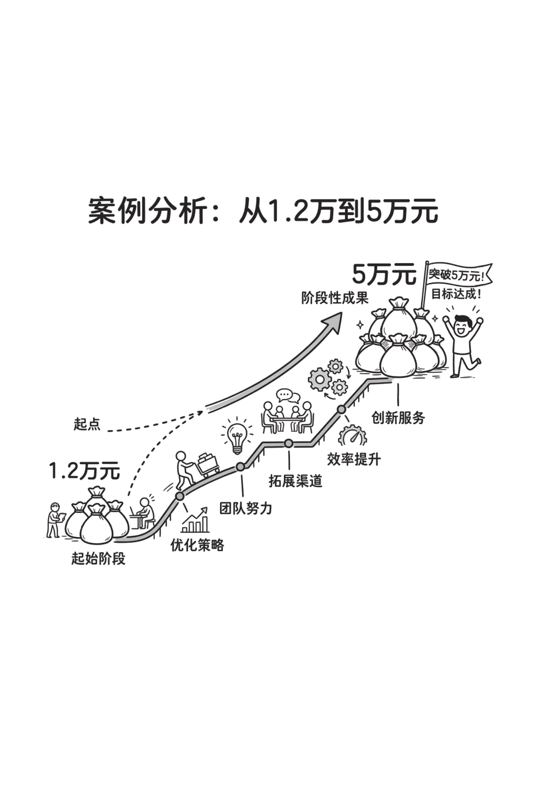

第二阶段：柔性协作探索期（3～4 个月）——整合单一资源，弥补能力短板，承接高客单价订单。在效率优化的基础上，小吴发现部分客户有更高端的需求，如企业品牌全案设计、短视频账号代运营等，这些需求超出了个人能力范围，无法承接。于是，小吴开始搭建初级的柔性协作网络，整合单一的外部资源。小吴通过线上创业社群，筛选了 2 名专业的自由职业者——一名资深的品牌策划、一名专业的账号运营，签订柔性合作协议，采用按完成任务支付费用的模式，无需承担固定工资。针对有全案设计需求的客户，小吴负责核心的视频创作，品牌策划负责品牌文案与视觉设计，二者协同完成全案服务，客单价从原本的 500～2000 元提升至 5000～10000 元。针对有账号代运营需求的客户，小吴负责视频创作，账号运营负责内容发布与数据优化，实现“创作—运营”的协同，单月代运营费用为 2000～5000 元。通过整合单一资源，小吴的 OPC 成功承接了高客单价订单，每月新增高客单价订单 5～8 单，月收入从 2.5 万元提升至 3.8 万元，同时积累了柔性协作的实操经验。

第三阶段：轻团队成型期（5～6 个月）——搭建多元柔性协作网络，实现业务规模化，月收入突破 5 万元。在初级协作的基础上，小吴参考行业标杆的协作模式，搭建了涵盖品牌策划、账号运营、文案撰写、直播策划的多元柔性协作网络，整合了 8 名不同领域的自由职业者，制定了标准化的协作流程与分成机制，实现了“客户需求—资源匹配—协同完成—统一交付”的全流程标准化。同时，小吴将所有的协作管理工作交由 OpenClaw 自动化处理，OpenClaw 可自动匹配客户需求与协作伙伴，实时跟踪协作进度、自动统计协作成果与分成，让小吴无需花费过多时间在协作管理上，仅需聚焦于核心的客户对接与战略决策。多元柔性协作网络的搭建，让小吴的 OPC 实现了业务的全面规模化，能承接中小企业的数字内容全案服务，涵盖短视频定制、品牌策划、账号代运营、直播策划等多个领域，客单价大幅提升，每月的订单量与客单价实现双重增长，综合月收入突破 5 万元。但是，他的运营成本仅增加了协作分成与少量的工具升级费用，仍保持轻资产运营，真正实现了规模化盈利而不增加重资产负担。

小吴的案例充分证明，OPC 的规模化运营无需走传统重资产的老路，只需依托 AI 工具实现效率优化，再搭建轻资产的柔性协作网络，就能实现收入的快速增长，完成从一人到轻团队的升级。

# **第四部分 分场景创富实操——不同人群的 OPC+工具落地案**

## **第九章 职场人：用 AI 工具+OPC 思维，实现“主业稳定+副业增收”**

### **职场适配：OpenClaw 自动化办公，提升工作效率，腾出时间搭建轻量 OPC 副业模式，低风险试错**

职场人切入 OPC 模式，需要遵循的核心原则是：主业为基、副业为辅，AI 提效、低险试错。OpenClaw 作为 AI 智能体，正是实现这一原则的核心工具——通过自动化处理主业的重复性办公工作，大幅提升职场工作效率，让职场人能在不影响主业的前提下，腾出碎片化或固定的时间搭建轻量 OPC 副业，既守住职场的稳定基本盘，又能借助 OPC 实现增收，真正做到鱼和熊掌兼得。当下职场人面临的核心痛点，是工作忙、时间少、不敢轻易放弃主业，想搞副业却没有精力。传统副业模式要么时间成本高，要么与主业冲突，风险较高，而“AI 工具+OPC”的副业模式，恰好解决了这些痛点，高度适配职场人的时间与身份特性。

OpenClaw 对职场主业的提效赋能，体现为办公全流程的自动化。针对职场中常见的文件处理、数据统计、报表制作、邮件回复、素材整理等重复性工作，职场人只需在 OpenClaw 中设置简单指令，就能实现 7×24 小时的自动化处理。比如，行政岗可设置指令“每日自动整理办公文件、分类归档，每周自动生成行政工作报表”；运营岗可设置“每日自动搜集行业素材、统计平台数据，自动回复标准化客户咨询”；财务岗可设置“每月自动整理票据、统计基础账务数据，生成简易财务报表”。这些原本需要花费大量时间的琐事，在交由 OpenClaw 处理后，能为职场人节省 30%～50%的工作时间，不仅能让职场人更轻松地完成主业工作，避免加班，还能腾出专属时间搭建与运营 OPC 副业。

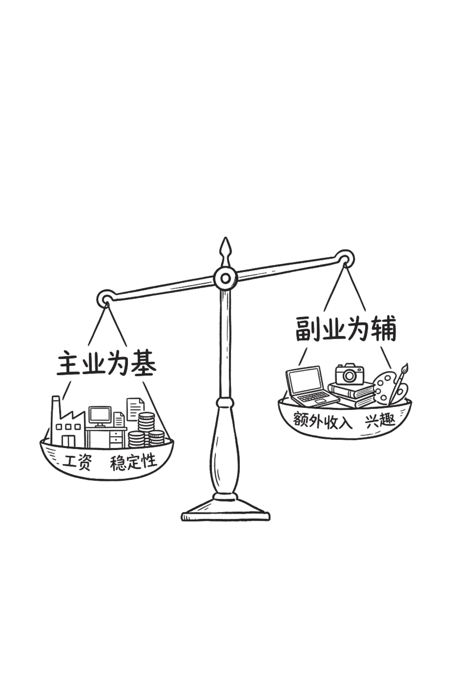

轻量 OPC 副业的搭建，完全贴合职场人的时间特性，无需全职投入、职场人可采用“碎片化运营+自动化执行”的模式：利用下班后、周末的碎片化时间完成 OPC 的赛道定位、客户对接、创意构思等核心工作，将素材搜集、订单处理、文件交付等执行性工作交由 OpenClaw+Seedance 2.0 自动化完成，真正实现用业余时间，做专业副业。同时，职场人可选择搭建与主业相关的 OPC 副业，实现主业能力复用。比如新媒体运营岗可做短视频定制副业，人力资源岗可做职场规划咨询副业，既降低 OPC 的试错成本，又能通过副业反哺主业能力的提升。这种以 OpenClaw 提效主业、腾出时间做轻量 OPC 的模式，可让职场人实现低风险试错——无需放弃主业的薪资、社保等福利，仅用闲置时间开启副业，即使 OPC 初期运营效果不佳，也不会对生活造成影响。一旦 OPC 步入正轨，就能实现稳定增收，甚至在后期成为全职创业的基础，为职场人提供了进退自如的创富选择。

### **副业选择：结合自身技能，聚焦技能变现、轻量服务等赛道，用 OpenClaw+Seedance 2.0 运营小型 OPC，承接轻量视频定制或服务订单**

职场人搭建 OPC 副业，核心逻辑是结合自身技能、聚焦轻量赛道、适配工具能力。无需追求大而全，只需依托自身的职场技能与经验，聚焦技能变现与轻量服务等低门槛、高适配的赛道，再借助 OpenClaw+Seedance 2.0 的 AI 工具能力，运营小型 OPC，承接轻量的视频定制或服务订单，就能快速实现副业增收。脱离自身技能的副业，往往需要花费大量时间学习新能力，试错成本高，而依托职场技能的 OPC 副业，能实现能力复用、快速落地，这是职场人最大的优势。因此，赛道选择的第一原则，就是从主业技能出发，做能力范围内的事。结合职场人的技能特性与 AI 工具的适配性，技能变现、轻量服务是两大最优赛道，且可进一步拆解为多个轻量细分方向，职场人可精准匹配。

一是技能变现赛道，核心是将职场专业技能转化为标准化的商业服务，适配有明确专业技能的职场人，如新媒体运营岗可做短视频脚本撰写、账号基础运营，设计岗可做简易视觉设计、海报制作，文案岗可做商业文案撰写、朋友圈文案定制，职场培训岗可做职场技能小课、一对一职业规划。这类赛道无需重资产投入，只依托个人技能。可借助 Seedance 2.0 制作技能展示视频、引流短视频，借助 OpenClaw 自动化处理客户对接、订单交付，一人就能轻松运营。

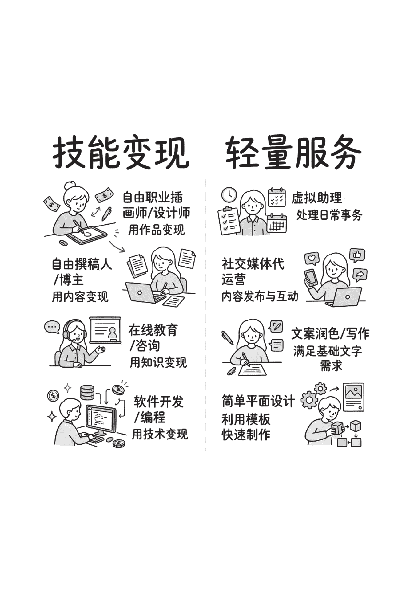

二是轻量服务赛道，为中小企业、线下商家提供轻量化的配套服务，适配有基础运营、沟通能力的职场人，如可做本地商家探店视频制作、企业宣传短视频定制，以及线上平台基础入驻、店铺装修、客户社群基础维护、消息回复等。这类赛道的门槛更低，无需精深的专业技能，依托 Seedance 2.0 的零门槛视频创作能力，就能承接轻量视频定制订单，还可借助 OpenClaw 实现自动化运营，快速变现。职场人运营小型 OPC，需遵循轻量运营、小单快跑的原则。初期不承接高难度、长周期的订单，聚焦于轻量、高频、易交付的订单类型，如短视频定制选择 15～30 秒的轻量化视频，技能服务选择单次、简易的服务内容。这既能降低运营难度，又能快速积累客户与口碑。同时，OpenClaw+Seedance 2.0 的协同，能为小型 OPC 提供全流程支撑：Seedance 2.0 负责制作引流视频获取客户，承接轻量视频定制订单；OpenClaw 则负责自动化处理 OPC 的客户对接、素材搜集、订单交付、数据统计等。由此，职场人无需在运营上花费大量时间。

比如一名新媒体运营岗的职场人，搭建 OPC 副业做短视频定制，可利用 Seedance 2.0 制作引流短视频发布于线上平台，承接中小企业的轻量化产品推广视频订单；用 OpenClaw 自动化回复客户咨询、整理定制需求、交付视频文件，全程仅需用碎片化时间完成需求确认与创意把控。每月承接 20～30 单轻量订单，就能实现数千元甚至上万元的副业增收。这种结合自身技能、聚焦轻量赛道、借助 AI 工具运营的模式，让职场人的 OPC 副业真正实现了低门槛、低时间成本、高变现效率，成为职场人增收的最佳选择。

### **时间管理：利用碎片化时间，实现主业稳定、OPC 副业增收，不忙乱、高产出，规避职场风险**

职场人运营 OPC 副业的核心难点，并非工具使用或赛道选择，而是时间管理，即如何在有限的时间内，平衡主业与副业，实现主业稳定、副业增收。既不因为副业耽误主业工作，又能让副业实现高效产出，同时规避因副业引发的职场风险。这是职场人必须掌握的核心能力。借助 AI 工具的自动化，时间管理将变得简单高效，真正做到不忙乱、高产出。

职场人的时间具有固定性、碎片化、不可控性的特点。上班时间需专注主业，只有下班后和周末的固定时间，以及通勤、午休的碎片化时间可自由支配，且偶尔会因主业加班导致时间不可控。因此，对应的管理原则是：让 AI 承接自动化工作，人聚焦核心工作；碎片化时间处理轻量工作，固定时间处理核心工作，将人与 AI 的能力进行精准匹配，最大化每一分钟的价值产出。

第一，做好时间划分，明确主业与副业的时间边界，这是平衡二者的基础，也是规避职场风险的关键。职场人需遵守上班时间绝对专注主业而不处理任何副业工作的原则，将副业工作严格限定在下班后、周末等私人时间。这既能保证主业的工作效率，避免因副业耽误工作被公司追责，又能让大脑形成“时间分区”的思维，避免工作与副业相互干扰。比如，下班后 19:00—21:00 为 OPC 副业核心工作时间，周末每天抽出 3 小时做深度运营，通勤、午休的碎片化时间处理轻量副业工作，形成固定的时间节奏，让副业运营有章可循。

第二，AI 工具承接自动化工作，释放个人时间与精力，这是时间管理的核心支撑。将 OPC 副业中所有重复性、执行性工作，交由 OpenClaw+Seedance 2.0 进行自动化处理，个人仅需在专属时间内处理创意构思、客户深度对接、需求确认、订单审核等 AI 无法替代的核心工作。比如让 OpenClaw 自动化搜集素材、回复客户标准化咨询、整理订单数据、交付视频文件，让 Seedance 2.0 实现视频的快速生成。个人仅需在核心时间内完成视频创意的把控、客户个性化需求的对接，原本需要数小时的副业工作，能压缩至 1～2 小时，大幅降低时间成本。

第三，碎片化时间处理轻量工作，实现时间利用最大化。在通勤、午休等碎片化时间，不安排复杂的深度工作，仅处理 OPC 副业的轻量工作，如用手机回复客户的个性化咨询、筛选线上平台的客户需求、查看 OpenClaw 的运营数据报告、构思视频创作的简单选题等。这些工作无需电脑操作，能在碎片化时间快速完成，既不影响主业，又能让副业的运营工作持续推进，实现碎片化时间积少成多，副业运营稳步推进。

第四，建立标准化流程，提升副业运营的产出效率。针对 OPC 副业的核心工作，如客户对接、订单处理、视频创作等，建立标准化的操作流程，让每一项工作都有固定的处理方式，避免因流程混乱导致时间浪费。比如，通过制定标准化的客户对接话术、视频创作的固定步骤和订单交付的统一流程，并借助 OpenClaw 将其转化为自动化指令，能进一步提升运营效率，让个人在有限的时间内实现更高的产出。同时，职场人还需做好风险规避，除了明确时间边界，还需注意 OPC 副业的赛道选择，避免与主业形成直接竞争。不使用公司的信息、设备等资源开展副业，不利用主业的工作关系进行副业获客，确保副业的合规性，从根源上规避职场风险。

通过以上时间管理方法，结合 AI 工具的自动化能力，职场人能轻松平衡主业与副业，实现主业稳定不加班，副业增收不忙乱，真正做到低风险、高产出的创富。

## **第十章 创业者：轻资产起步，用 OPC 模式+AI 工具降低创业风险**

### **创业定位：避开重资产陷阱，聚焦 AI 赋能的轻服务赛道，以 OPC 模式起步，降低试错成本与运营成本**

当下创业者面临的核心困境，是传统重资产创业模式的高投入、高风险、高试错成本。租赁场地、组建团队、购置设备等前期投入动辄数万元甚至数十万元，一旦市场判断失误，就会面临血本无归的风险。而 AI 时代的创业逻辑已从重资产拼规模转向轻资产拼效率。创业者的核心定位在于避开重资产陷阱，聚焦 AI 赋能的轻服务赛道，以 OPC 模式起步，借助 AI 工具替代传统团队，以一人之力搭建商业闭环，从根源上降低试错成本与运营成本，实现低风险创业。

重资产创业的核心痛点在于成本固定、灵活性差、抗风险能力弱，无论业务是否盈利，都需要承担房租、人工、设备等固定成本。与之相比，轻服务赛道的核心优势是低投入、高灵活、强适配 AI 工具。它无需重资产投入，其核心依托于服务能力与 AI 工具的赋能，与 OPC 的轻资产运营模式高度契合，是创业者的最优选择。结合 AI 工具的能力与 2026 年的市场趋势，三大 AI 赋能的轻服务赛道，即数字内容服务、专业咨询服务、AI 工具代运营服务，是创业者以 OPC 模式起步的核心选择。这几个赛道均有清晰的业务边界与变现路径。

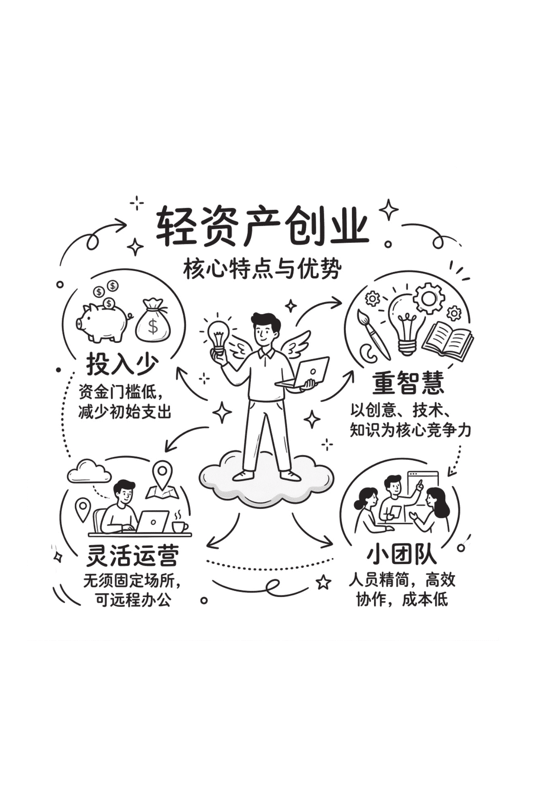

数字内容服务赛道，依托 Seedance 2.0 的 AI 视频创作能力，为中小企业、线下商家、个人 IP 提供短视频定制、微短剧创作、企业宣传视频制作、知识付费视频制作等服务。该赛道无需拍摄设备、无需组建创作团队，一人借助 AI 工具就能完成全流程创作，客单价适中、市场需求大，是最易落地的轻服务赛道。

专业咨询服务赛道，基于创业者的行业经验与专业知识，为企业与个人提供财税咨询、管理咨询、职场规划咨询、AI 工具使用咨询等服务。该赛道无需任何硬件投入，核心依托个人专业能力，借助 OpenClaw 自动化处理客户对接、咨询报告整理、数据统计等工作，能大幅提升服务效率，客单价高、竞争程度相对较低。

AI 工具代运营服务赛道，为不会使用 AI 工具的中小企业与个人，提供 OpenClaw、Seedance 2.0 等 AI 工具的代运营、技能教学、定制化设置等服务。该赛道贴合 AI 普及趋势，市场需求持续增长，创业者可依托自身对 AI 工具的熟练掌握，借助工具本身的自动化能力，实现高效运营，变现潜力大。

创业者以 OPC 模式切入这些轻服务赛道，能从根源上降低试错成本与运营成本。

在试错成本上，OPC 模式无需前期大额投入，核心成本仅为 AI 工具会员、工商注册等小额费用。即使赛道选择失误，损失也能控制在极小范围，创业者可快速调整赛道，重新开始。

在运营成本上，OPC 模式无需招聘全职员工、无需租赁办公场地，借助 OpenClaw+Seedance 2.0 的 AI 工具，一人就能完成传统团队的工作，人工成本、场地成本直接清零，每月的运营成本可控制在千元级别，真正实现低成本运营、高效率变现。

同时，创业者的创业定位还需遵循小而美、精而专的原则，初期不必追求业务的多元化，而应该聚焦于一个细分赛道，打造核心服务能力。比如，数字内容服务赛道可聚焦本地商家短视频定制，专业咨询赛道可聚焦 AI 工具创业咨询，通过精准的细分定位，快速积累客户与口碑，为后续的规模化运营奠定基础。避开重资产陷阱，聚焦 AI 赋能的轻服务赛道，以 OPC 模式起步，这是 AI 时代创业者实现低风险创业的核心定位，也是创业者抓住 AI 创富风口的关键。

### **工具落地：用 OpenClaw 搭建 OPC 自动化交付体系，用 Seedance 2.0 开展“一人一剧组”式创作，实现低成本引流与变现**

创业者以 OPC 模式进行轻资产创业，工具落地的核心逻辑是分工明确、协同发力，用工具替代团队，实现自动化交付与高效创作。用 OpenClaw 搭建 OPC 的全流程自动化交付体系，让服务交付标准化、高效化，彻底解决一人运营交付效率低的痛点。用 Seedance 2.0 开展“一人一剧组”式视频创作，实现低成本引流与内容变现，打造 OPC 的核心盈利能力。二者协同，可让创业者一人完成全流程商业闭环，真正实现低风险、高效率的创业。

对于轻资产创业的 OPC 而言，交付体系的标准化与自动化，是实现稳定运营的基础，而 OpenClaw 正是搭建这一体系的核心工具。它能覆盖从订单承接、需求整理到服务交付、售后统计的全流程，让创业者无需花费大量时间处理执行性的交付工作，得以聚焦核心的创意与客户维护。

OpenClaw 搭建自动化交付体系的落地步骤，清晰且可复制。创业者只需根据自身的轻服务赛道，设置专属的自动化指令，就能快速落地。首先，订单承接与需求整理自动化，开启 OpenClaw 的浏览器控制与自动化对话功能，对接线上获客平台，自动回复客户咨询、整理客户核心需求、记录订单信息，生成标准化的需求表，无需创业者手动对接与记录。其次，服务创作的前置工作自动化。针对数字内容、专业咨询等赛道，让 OpenClaw 自动化搜集创作素材、整理行业数据、撰写服务方案初稿，为创业者的核心创作提供基础，大幅节省创作时间。再次，服务交付自动化。当创业者完成核心的服务创作后，让 OpenClaw 自动化完成文件格式转换、打包整理、客户交付，通过微信、邮箱等渠道自动发送给客户，无需手动操作。最后，售后与数据统计自动化。服务交付后，OpenClaw 自动发送售后回访信息、收集客户满意度反馈，同时自动统计订单数据、交付数据、客户数据，生成标准化的运营报告，为创业者的运营决策提供数据支撑。

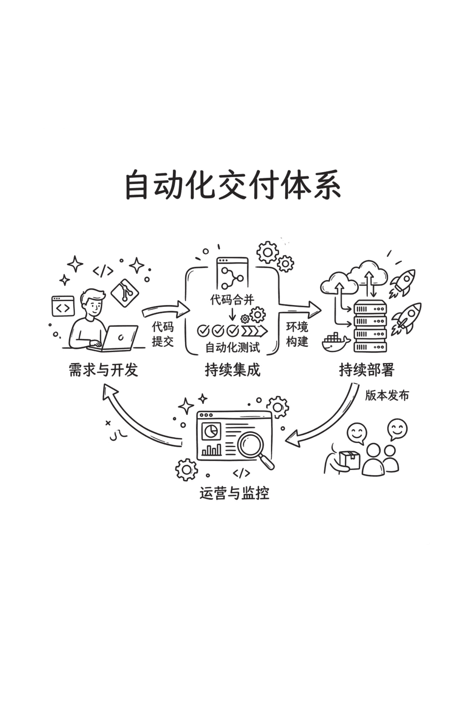

通过这四大环节的自动化，OpenClaw 为 OPC 搭建起完整的自动化交付体系，让服务交付的效率提升 80%以上，创业者一人就能轻松应对大量订单，彻底解决交付效率低的痛点。Seedance 2.0 开展的“一人一剧组”式视频创作，则是 OPC 实现低成本引流与变现的核心抓手。无论创业者切入哪个轻服务赛道，都能借助这一模式，实现流量与盈利的双重突破。对于数字内容服务赛道，“一人一剧组”式创作是核心的变现方式，创业者借助 Seedance 2.0 一人完成视频的全流程创作，承接定制视频订单，实现直接变现。对于专业咨询、AI 工具代运营等赛道，“一人一剧组”式创作是核心的引流方式，创业者借助 Seedance 2.0 制作专业的科普视频、服务展示视频、案例分析视频等，发布于线上平台，实现精准引流，积累客户资源。

同时，Seedance 2.0 的“一人一剧组”式创作，完全适配轻资产创业的需求，无需专业的影视技能、无需拍摄设备、无需组建团队。创业者仅需通过关键词输入，就能在半小时内完成一条高质量视频的创作，创作成本降低 80%～90%，真正实现低成本引流与变现。

OpenClaw 的自动化交付体系与 Seedance 2.0 的“一人一剧组”式创作，二者协同发力，形成了“引流—获客—创作—交付—售后”的全流程商业闭环。创业者一人就能借助两大 AI 工具，实现传统团队才能完成的工作，真正实现轻资产、高效率创业，让 OPC 成为最佳创业载体。

### **获客技巧：用 Seedance 2.0 制作 OPC 服务宣传视频，结合线上渠道低成本引流，打造个人品牌，提升客户信任度**

对于轻资产起步的 OPC 创业者而言，获客是创业的核心生存问题。传统的获客模式如线下地推、付费广告，要么时间成本高，要么资金投入大，不符合轻资产创业的原则。AI 时代，OPC 创业者的核心获客技巧是用 Seedance 2.0 制作高质量的 OPC 服务宣传视频，结合免费的线上渠道实现低成本引流。同时，打造个人品牌，提升客户信任度，让客户主动找上门，实现低成本、高精准、可持续获客。这也是适配 OPC 模式的获客逻辑。

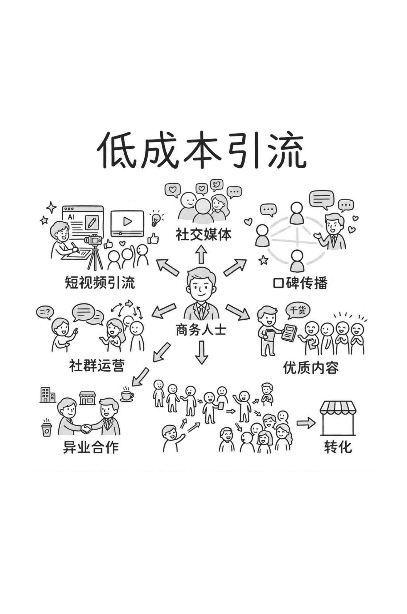

当下，短视频成为主流流量入口，视频内容是最有效的获客载体。Seedance 2.0 具有零门槛、高效率创作视频的能力，能够让创业者以极低的成本制作高质量的服务宣传视频，这是 OPC 创业者获客的核心优势。与普通的引流视频不同，OPC 服务宣传视频的核心是展示服务能力、解决客户痛点、突出核心优势，而非单纯追求流量。因此，创业者在制作视频时，需结合自身的轻服务赛道，打造贴合客户需求的视频内容，让视频成为 OPC 的“线上名片”。Seedance 2.0 制作宣传视频的核心技巧在于，精准定位客户痛点、标准化展示服务流程、直观呈现服务成果，且能根据不同赛道打造差异化的视频内容。比如，针对数字内容服务赛道，可制作定制视频案例展示、创作流程拆解、客户好评反馈类视频，直观呈现视频创作能力与服务成果。针对专业咨询服务赛道，可制作行业痛点解读、咨询案例分析、解决方案展示等视频，突出专业能力与问题解决能力。针对 AI 工具代运营服务赛道，可制作 AI 工具实操教程、代运营效果对比、客户使用反馈类视频，展示工具使用能力与服务价值。借助 Seedance 2.0 的多模态参考、复杂场景生成能力，创业者能快速制作出高质量、高专业度的服务宣传视频，无需专业的拍摄与剪辑技能，成本几乎为零，完美契合轻资产创业的需求。

制作好服务宣传视频后，结合免费的线上渠道进行低成本引流，是获客的关键步骤。创业者无需投入付费广告，只需聚焦于抖音、视频号、小红书、B 站、知乎等主流免费线上平台，根据赛道特性选择核心平台进行布局，实现精准流量获取。不同赛道的平台选择有明确的侧重点：本地商家相关的轻服务赛道，核心布局抖音、视频号、小红书，聚焦本地流量；专业咨询、AI 工具代运营赛道，核心布局 B 站、知乎、视频号，聚焦精准的行业流量。同时，创业者可借助 OpenClaw 实现视频的多平台自动化发布与数据监测，设置定时发布规则，让视频在平台流量高峰时段发布，提升曝光量。同时，自动监测各平台的视频数据，如播放量、点赞量、咨询量，以便及时优化视频内容与发布策略，提升引流效率。

在低成本引流的基础上，打造个人品牌，提升客户信任度，是实现客户转化与复购的核心。对于 OPC 而言，创始人的个人品牌就是 OPC 的品牌，客户选择 OPC，本质上是信任创始人的能力与人品。创业者打造个人品牌的核心，在于持续输出优质内容、保持人格化表达、强化专业标签。通过 Seedance 2.0 持续在核心平台输出贴合赛道的优质内容，如科普视频、实操教程、案例分析，强化自身的专业标签。在视频中保持人格化表达，如出镜讲解、分享创业心得、解答客户问题，能让客户感受到真实的个人形象，拉近与客户的距离。借助 OpenClaw 自动化整理客户好评、服务案例，在各平台进行展示，提升品牌的可信度。同时，创业者可建立个人私域流量池，将线上平台的精准咨询客户引导至微信、企业微信，通过私域进行客户维护、案例分享、服务推荐，提升客户黏性与复购率，实现一次获客、多次变现。用 Seedance 2.0 制作服务宣传视频，结合线上渠道低成本引流，打造个人品牌，这一获客技巧完美适配 OPC 轻资产创业的需求，既无需大额资金投入，又能实现精准的客户获取，还能提升客户信任度，为 OPC 的持续盈利奠定坚实的客户基础，是 AI 时代 OPC 创业者的必备获客能力。

## **第十一章** **内容创作者：用“一人一剧组”场景起步，升级为 OPC，实现规模化变现**

### **内容升级：用 Seedance** **2.0 提升视频质感，打造个人风格，将 AI 缺陷转化为创作特色，降低创作门槛**

内容创作者向 OPC 升级的第一步，是实现内容创作质量与效率的同步提升，而 Seedance 2.0 正是实现这一目标的核心工具。它不仅能大幅降低视频创作的技术门槛，让创作者摆脱专业设备、剪辑技能的束缚，更能通过功能打磨实现视频质感的提升。更进一步，创作者甚至能参考 NeuralViz 频道的成功经验，将 AI 创作的天然缺陷转化为专属创作特色，打造差异化的个人风格，让内容在同质化的流量赛道中脱颖而出，为后续 OPC 规模化变现奠定内容基础。

当下内容创作者的核心痛点是创作门槛高、质感难提升、风格无特色、产出效率低。传统内容创作需要购置专业拍摄设备、花费大量时间学习剪辑技巧，且易陷入同质化创作的困境。Seedance 2.0 的全流程 AI 创作能力，从根源上解决了这些问题，让内容创作回归创意本身。Seedance 2.0 对视频质感的提升，贯穿于创作的全环节。

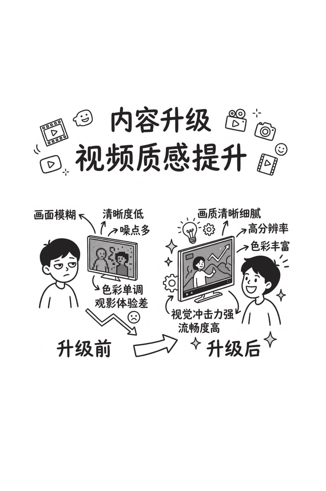

在画面生成上，Seedance 2.0 具备复杂场景生成、多模态参考能力，能根据创作者的需求生成人物鲜活、场景丰富、画面细腻的视频内容，还能上传参考素材，实现品牌、风格的精准匹配，无需专业摄像就能达到专业画面水准。

在音频制作上，Seedance 2.0 的双声道音频同步、真人级配音能力，让配音与画面精准契合，背景音乐与内容节奏完美匹配，解决了传统创作中音频质感差、不同步的问题。

在后期编辑上，Seedance 2.0 拥有精准的帧级编辑与特效字幕能力，能让创作者对视频进行精细化打磨，提升整体视觉体验。

同时，Seedance 2.0 彻底降低了创作门槛，创作者无需掌握 PR、AE 等专业剪辑工具，仅通过关键词输入、需求描述，就能完成从脚本到成片的全流程创作。原本需要数小时甚至数天的创作工作，现在半小时内就能完成，产出效率得到数倍级提升。

更重要的是，创作者可借鉴 NeuralViz 频道的风格塑造思路，化“缺”为“奇”：将 AI 创作的轻微缺陷转化为专属创作特色。例如，将 AI 画面的轻微肌理感转化为复古胶片风格，将色彩的高饱和度转化为赛博朋克、清新治愈等风格，将人物动作的轻微机械感转化为创意动画风格。Seedance 2.0 提供了丰富的风格滤镜与参数调整功能，创作者可通过简单设置，将这些 AI 特性转化为个人创作风格，让视频内容形成独特的视觉标识。这既能区别于传统创作内容，也能在众多 AI 创作的内容中脱颖而出，形成强大的差异化竞争优势。这种以 Seedance 2.0 为核心的内容升级，让创作者无需再为技术、设备、效率发愁，能将全部精力聚焦于创意构思、内容选题等核心环节，打造出高质感、有风格、强特色的优质内容。而这正是内容创作者向 OPC 升级的核心基础——优质且有特色的内容，是 OPC 实现引流、变现、品牌打造的核心载体。

### **效率提升：OpenClaw 自动化处理素材、字幕、数据统计，解放双手，专注创意与 OPC 运营，提升变现效率**

内容创作者升级为 OPC，不仅需要内容质感的提升，更需要创作与运营效率的全面突破，否则将会陷入一人创作、精力有限的困境，无法实现规模化变现。OpenClaw 作为 AI 智能体，能全面接管内容创作与 OPC 运营中的重复性、执行性工作：从素材搜集、字幕制作到数据统计、客户对接，均可实现全流程自动化。这将使创作者从烦琐的事务中彻底解放，从而将核心精力聚焦于创意输出与 OPC 运营两大高价值环节，从根本上提升变现效率。这也是内容创作者从单打独斗的创作者向 OPC 创始人转变的关键。

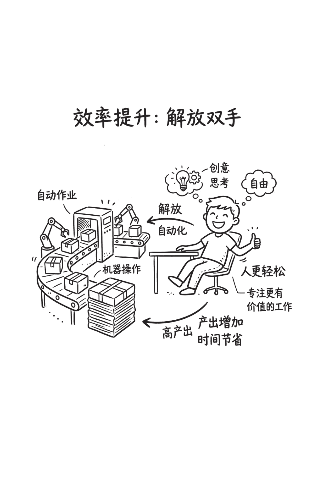

在内容创作的全流程中，素材搜集、字幕制作、格式转换等工作占据了创作者大量的时间与精力，且重复性强，完全适合由 AI 工具进行自动化处理。针对这些场景，OpenClaw 的自动化能力能实现创作效率的数倍提升。在素材搜集环节，创作者只需在 OpenClaw 中设置指令，比如，每日搜集科技领域爆款视频素材、热点文案、背景音乐，按风格分类存储至本地素材库，OpenClaw 即可通过浏览器控制功能完成全网精准搜集，无需创作者手动刷平台、找素材，每天可节省 1～2 小时的素材整理时间。在字幕与格式处理环节，OpenClaw 能自动为 Seedance 2.0 所生成的视频添加精准字幕，并支持多语种翻译、字幕样式自定义等，还能根据不同平台的要求，自动将视频转换为适配的格式与分辨率，实现一键适配全平台。这解决了传统视频创作中字幕制作烦琐、格式转换耗时的痛点。在内容发布环节，OpenClaw 能实现多平台自动化发布，创作者只需将成片上传至工具，设置定时发布规则，就能在抖音、视频号、B 站等平台同步发布，无需手动逐个操作。同时，它还能自动回复各平台的评论、私信，整理高意向客户需求。

当创作者升级为 OPC 后，运营工作成为变现的核心。OpenClaw 的自动化能力更能覆盖 OPC 运营的全流程，实现运营效率的最大化。在数据统计环节，OpenClaw 能自动监测各平台的视频数据，包括播放量、点赞量、粉丝增长、订单转化等，进而生成多维度的运营数据报告，让创作者清晰掌握内容变现效果，为选题、运营策略调整提供数据支撑。在客户对接环节，对于承接的定制视频订单，OpenClaw 能自动回复客户咨询、整理定制需求、记录订单信息，生成标准化的需求表，创作者无需在沟通上花费大量时间。在订单交付环节，OpenClaw 能自动将制作好的定制视频打包、发送给客户，同时完成售后回访、数据统计，搭建标准化的交付体系。OpenClaw 的全流程自动化，让创作者从 80%的重复性工作中解放出来，将核心精力聚焦于创意输出与 OPC 运营。

在创意输出上，创作者能花费更多时间打磨内容选题、构思创作创意，打造更高质量的内容。在 OPC 运营上，创作者能专注于赛道定位、客户维护、业务拓展、规模化规划等核心工作，让 OPC 的变现能力实现质的突破。效率的提升，是内容创作者实现规模化变现的核心前提，而 OpenClaw 正是这一前提的核心支撑。它让创作者得以真正实现以创意为核心、以 AI 为支撑、以 OPC 为载体的规模化发展。

### **变现升级：从流量变现到 OPC 服务变现，承接视频定制、IP 代运营等业务，拓展收入来源，实现规模化盈利**

内容创作者向 OPC 升级的核心目标，是实现变现模式的全面升级，即从单一的流量变现转向多元化的 OPC 服务变现。借助 OPC 的合规商业主体身份，承接视频定制、IP 代运营、知识付费等商业服务，打破流量变现的收入瓶颈，拓展多元化的收入来源，最终实现规模化盈利。这一变现升级的核心，是将创作者的内容创作能力转化为标准化的商业服务能力，以 OPC 为载体实现能力的商业变现。OpenClaw+Seedance 2.0 的 AI 工具组合，为这一升级提供了从内容创作到商业运营的全流程支撑，让变现升级变得清晰且可以落地。

传统内容创作者的变现模式高度依赖平台流量，主要通过广告分成、直播打赏、商品橱窗等方式变现，存在收入不稳定、平台依赖性强、收入上限低的痛点。一旦平台算法调整、流量下滑，收入就会大幅缩水，而 OPC 服务变现彻底打破了这一局限。OPC 模式以创作者的核心创作能力为基础，打造多元化、高客单价、可持续的变现体系，主要包括三大核心方向。

第一，视频定制服务变现。这是内容创作者升级为 OPC 后最易落地的核心变现场景。依托 Seedance 2.0 的“一人一剧组”创作能力，以 OPC 为主体承接中小企业、线下商家、个人 IP 的定制视频订单，如企业宣传视频、产品推广视频、微短剧、探店视频等。相较于流量变现，视频定制服务的客单价更高、收入更稳定，且能借助创作者的内容创作经验与个人风格，打造差异化定制服务。单条定制视频的价格可根据难度设定为 500～5000 元，每月承接 20～30 单就能实现稳定的高收入。OpenClaw 可为定制服务提供全流程运营支撑，实现客户对接、订单管理、交付统计的自动化，让创作者能够高效承接大量订单，无需陷入烦琐的执行性工作中。

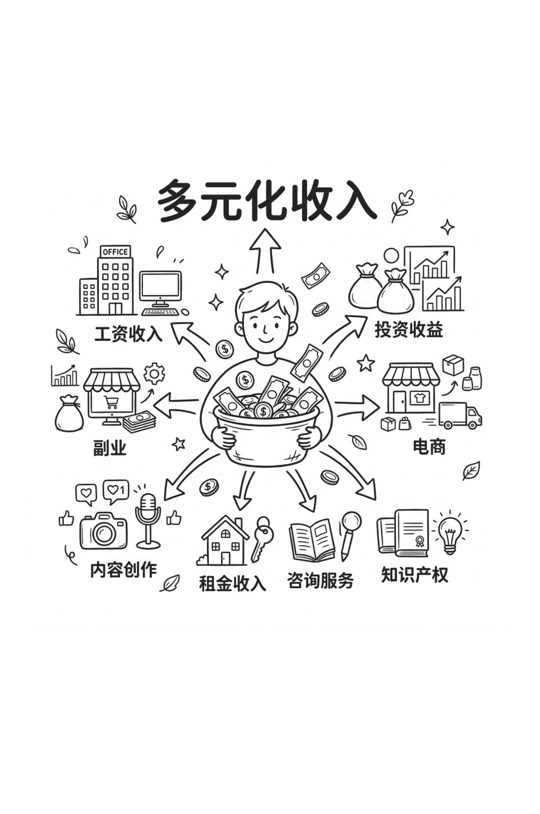

第二，IP 代运营服务变现，依托创作者的平台运营经验与内容创作能力，为中小企业、个人 IP 提供短视频账号代运营服务，包括选题策划、内容创作、平台发布、数据优化、粉丝维护等全流程服务。可按月度或年度收取代运营费用，单账号代运营费用为每月 2000～10000 元。这一变现场景能实现能力复用、长期盈利，且能借助 OpenClaw+Seedance 2.0 的协同能力，同时运营多个账号，实现规模化运营，大幅提升收入上限。

第三，知识付费服务变现。将创作者的内容创作经验、平台运营技巧、AI 工具使用方法等转化为标准化的知识付费产品，如线上课程、实操训练营、一对一指导等。依托 Seedance 2.0 制作高质量的课程视频，借助 OpenClaw 实现课程发布、学员管理、答疑对接的自动化，能实现一次创作、多次变现。知识付费服务的核心优势是边际成本低，一旦课程制作完成，就能持续售卖，可成为 OPC 的长期稳定收入来源。同时，知识付费服务也能提升创作者的个人品牌影响力，反哺定制服务、代运营服务的变现。从流量变现到 OPC 服务变现的升级，并非放弃流量变现，而是以流量变现为基础，借助流量积累的粉丝与品牌影响力，拓展更高价值的商业服务变现，形成“流量引流—服务变现—品牌提升—更多流量”的正向循环。

OpenClaw+Seedance 2.0 的 AI 工具组合，为这一循环提供了全流程支撑。Seedance 2.0 打造优质内容实现流量引流，同时完成定制视频、课程视频的创作；OpenClaw 则实现运营自动化，提升服务交付效率，让 OPC 能承接更多商业订单。最终，内容创作者依托 OPC 实现多元化、规模化盈利，彻底摆脱对平台流量的依赖，成为真正的 AI 时代的内容创富者。

## **第十二章 自由职业者：打造 OPC 个人品牌，联动视频创作，实现多元化收入**

### **IP 定位：结合 OpenClaw、Seedance 2.0，打造“AI 赋能型”OPC 个人品牌，明确自身擅长的轻服务赛道**

自由职业者向 OPC 升级的核心第一步，是完成精准的 IP 定位，打造区别于普通自由职业者的 AI 赋能型 OPC 个人品牌。这要求自由职业者结合 OpenClaw+Seedance 2.0 的 AI 工具能力，将自身的专业技能与 AI 赋能深度融合，明确自身擅长的轻服务赛道，形成专业技能+AI 工具的双重核心竞争力。这种清晰的 AI 赋能型定位，能让个人品牌在同质化的自由职业市场中脱颖而出，为后续的多元化收入与规模化发展奠定基础。

相较于普通自由职业者，OPC 模式下的个人品牌，具有核心优势，即合规的商业身份、AI 赋能的高效服务能力、标准化的商业服务体系。而 AI 赋能型 IP 定位的核心，就是将 AI 工具能力作为个人品牌的核心标识，让客户清晰感知到：选择该 OPC，能获得更高效、更优质、更具性价比的 AI 赋能服务。

首先，打造 AI 赋能型 OPC 个人品牌，要做好自身能力与 AI 工具的结合定位，梳理自身的核心专业技能，明确 OpenClaw+Seedance 2.0 能为自身技能带来的提升，形成“专业技能+AI 工具”的专属标签。例如，擅长文案撰写的自由职业者，可打造“AI 赋能文案创作”的标签，依托 Seedance 2.0 实现文案+视频的一体化创作，依托 OpenClaw 实现文案素材搜集、客户需求整理的自动化。又如，擅长职场咨询的自由职业者，可打造“AI 赋能职场规划”的标签，依托 Seedance 2.0 制作职场科普视频，依托 OpenClaw 实现客户咨询、报告整理的自动化。再如，擅长设计的自由职业者，可打造“AI 赋能视觉设计”的标签，依托两大工具实现设计素材搜集、设计成果可视化视频制作的自动化。

其次，要精准贴合五大热门轻服务赛道，即数字内容、专业服务、技能变现、轻量应用开发、本地生活数字服务赛道，明确品牌的赛道定位，避免定位模糊、业务杂乱。自由职业者需根据自身的核心技能，选择适配的赛道作为 OPC 的核心业务方向。如数字内容赛道可做短视频定制、微短剧创作，专业服务赛道可做企业咨询、AI 工具代运营，技能变现赛道可做知识付费、技能教学，轻量应用开发赛道可做 AI 工具插件制作，本地生活数字服务赛道可做本地商家引流视频制作。赛道定位的核心原则是人尽其才、工具尽其用，确保自身的专业技能与 AI 工具能力能在选定赛道中得到充分发挥，进而打造核心服务能力。

最后，要提炼品牌的核心价值主张，形成简洁易记的品牌口号。要将 AI 赋能、高效服务、专业定制等核心优势融入其中，让客户快速理解品牌的价值与服务内容，如 AI 赋能短视频定制，“一人一剧”组高效出片；AI 加持职场规划，精准解决职业痛点；AI 赋能视觉设计，让创意高效落地。同时，可借助 Seedance 2.0 制作品牌宣传视频，直观展示专业技能+AI 工具的服务能力与成果，借助 OpenClaw 将品牌宣传视频多平台自动化发布，快速提升品牌的曝光度与认知度。

精准的 AI 赋能型 IP 定位，能让自由职业者的 OPC 个人品牌形成独特的核心竞争力，以区别于普通的自由职业者与传统的服务机构，在市场竞争中占据优势。同时，这也为后续的业务拓展、客户积累、多元化收入奠定坚实的品牌基础。

### **内容输出：用 Seedance 2.0 开展“一人一剧组”式创作，输出优质内容引流，用 OpenClaw 提升输出效率，强化品牌影响力**

自由职业者打造 OPC 个人品牌的核心抓手，是持续的优质内容输出。借助 Seedance 2.0 开展“一人一剧组”式视频创作，输出贴合核心赛道、彰显专业能力、解决客户痛点的优质视频内容，实现精准引流。同时，用 OpenClaw 实现内容创作、发布、运营的全流程自动化，提升内容输出效率，实现内容的规模化、持续性输出，持续强化 OPC 个人品牌的影响力，让目标客户群体对品牌形成深度认知，为后续的商业变现积累精准的客户资源。

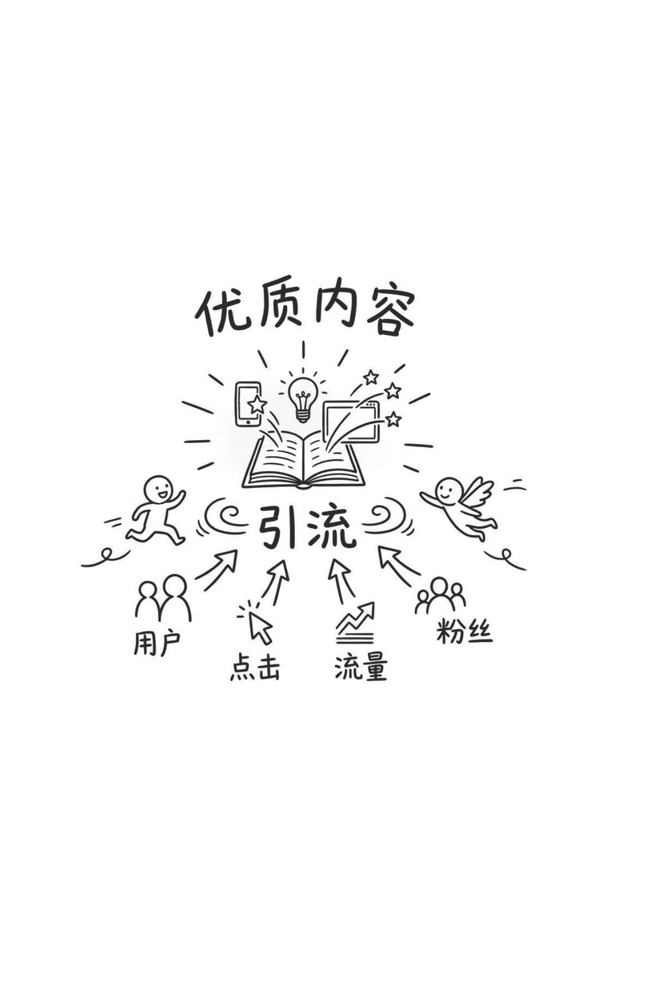

对于 AI 赋能型的 OPC 个人品牌而言，视频内容是最合适的输出载体，核心原因有三点：一是视频内容直观、生动，能更清晰地展示 OPC 的专业能力与 AI 赋能的服务成果，让客户快速感知品牌价值；二是短视频平台成为主流的流量入口，优质的视频内容能低成本、高精准地引流；三是依托 Seedance 2.0 的“一人一剧组”创作能力，自由职业者能以极低的成本、极高的效率实现视频内容的规模化输出，无需专业团队，完全适配 OPC 的轻资产运营模式。

借助 Seedance 2.0 开展“一人一剧组”式的内容创作，需围绕三大核心，即品牌定位、赛道需求、客户痛点展开，输出三类高价值的视频内容，实现引流与品牌打造的双重目标。第一类，专业科普类内容，贴合 OPC 的核心轻服务赛道，输出行业知识、专业技巧、痛点解读类视频，如数字内容赛道输出短视频创作技巧，专业服务赛道输出企业财税常见误区，技能变现赛道输出 AI 工具实操教程，彰显 OPC 的专业能力，吸引精准的目标客户。第二类，服务案例类内容，展示 OPC 的实际服务成果、客户好评、案例拆解等，如定制视频的前后对比、咨询服务的客户反馈、代运营服务的流量提升数据，让客户直观看到服务价值，提升品牌的可信度。第三类，品牌 IP 类内容，输出创始人的创业心得、工作日常、AI 工具使用技巧等人格化内容，让客户感受到真实的品牌形象，拉近与客户的距离，打造有温度的个人品牌。这三类内容的创作，均能依托 Seedance 2.0 的全流程能力，实现零门槛、高效率创作，一人就能完成从脚本到成片的全流程，且能保持内容风格的统一，强化品牌的视觉标识。

OpenClaw 则能从根本上提升内容输出的效率，让内容输出实现规模化、持续性，进一步强化品牌影响力。在内容创作前置环节，OpenClaw 能自动化搜集行业热点、客户痛点、爆款内容框架，为 Seedance 2.0 的创作提供灵感与素材，节省创作构思时间。在内容发布环节，OpenClaw 能实现多平台自动化发布、标题关键词优化、评论私信自动回复等，能让内容触达更多的目标客户，提升引流效率。在内容运营环节，OpenClaw 能自动监测各平台的数据，包括播放量、点赞量、咨询量、粉丝增长等，生成数据运营报告，让自由职业者能及时优化内容选题与创作方向，提升内容的引流效果。在客户沉淀环节，OpenClaw 能自动整理各平台的高意向客户信息，将客户引导至私域流量池，实现客户的精准沉淀。

通过 Seedance 2.0 的优质内容创作与 OpenClaw 的高效运营支撑，自由职业者的 OPC 能实现“持续输出优质内容—精准引流获取客户—沉淀私域强化信任—提升品牌影响力”的正向循环。这不仅让目标客户群体建立了深刻的品牌认知，还能为后续的多元化变现积累精准且优质的客户资源。

### **变现路径：OPC 承接定制服务、知识付费、工具教学，视频创作实现流量变现，构建多元收入体系，提升抗风险能力**

自由职业者升级为 OPC 的核心目标，是打破单一收入的瓶颈。依托 AI 赋能型个人品牌与视频内容引流，可构建“定制服务+知识付费+工具教学+流量变现”的多元化收入体系。其中，OPC 作为合规商业主体承接高价值的定制服务、知识付费、工具教学业务，视频创作本身可实现基础的流量变现。四大变现路径相互赋能、相互支撑，形成稳定的收入闭环，能显著提升 OPC 的抗风险能力，让自由职业者彻底摆脱单打独斗、收入不稳定的困境，实现稳定的规模化盈利。

这一多元化收入体系的本质是将个人的专业技能、AI 工具驾驭力与内容创作能力，系统性地转化为不同的商业价值。OpenClaw+Seedance 2.0 的 AI 工具组合，为四大变现路径的落地提供了全流程的能力支撑，让每一条变现路径都能高效落地、稳定盈利。

第一大变现路径是定制服务，是该体系的核心盈利来源。依托 OPC 的合规商业身份与 AI 赋能型个人品牌，承接核心赛道的定制化商业服务，如数字内容赛道的短视频定制、微短剧创作，专业服务赛道的企业咨询、方案定制，技能变现赛道的一对一专属指导，本地生活数字服务赛道的商家引流全案定制。定制服务的核心优势是客单价高、收入稳定、客户黏性强，且能借助 OpenClaw+Seedance 2.0 的 AI 工具能力，实现服务的高效交付。例如，用 Seedance 2.0 完成定制视频、定制方案的可视化创作，用 OpenClaw 实现客户对接、订单管理、服务交付的自动化，让 OPC 能高效承接大量定制订单，使其成为核心的盈利来源。

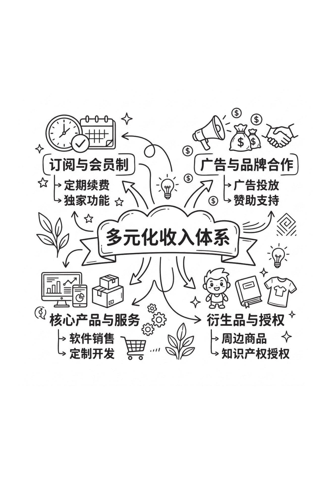

第二大变现路径是知识付费，是长期稳定的收入来源。该路径将自由职业者的专业技能、AI 工具使用方法、行业经验等转化为标准化的知识付费产品，如线上系列课程、实操训练营、电子资料等。依托 Seedance 2.0 制作高质量的课程视频，借助 OpenClaw 实现课程发布、学员管理、答疑对接、数据统计的自动化，形成一次创作、多次变现的长期收入来源。知识付费的核心优势是边际成本低、盈利持续性强，且能提升 OPC 的个人品牌影响力，反哺定制服务的变现，同时能覆盖更多的潜在客户，实现收入的规模化。

第三大变现路径是工具教学，是该体系的差异化变现来源。依托自由职业者对 OpenClaw、Seedance 2.0 等 AI 工具的熟练使用能力，开展 AI 工具实操教学服务，如线下训练营、线上一对一教学、工具使用社群等，为其他想进入 AI 创富赛道的普通人提供专业的工具教学服务。这一变现路径是 AI 赋能型 OPC 的差异化优势，贴合 AI 时代的市场需求，且能实现“工具使用—教学变现—品牌提升”的正向循环，进一步强化 OPC 的 AI 赋能品牌标签。

第四大变现路径是流量变现，是基础收入来源。依托 Seedance 2.0 创作的优质视频内容，在抖音、视频号、B 站等平台实现基础的流量变现，如广告分成、平台补贴、商品橱窗带货、广告合作等。流量变现虽然客单价较低，但能实现低成本、无门槛的持续盈利，且能为 OPC 的其他变现路径引流，积累精准的客户资源，是多元化收入体系的基础支撑。

四大变现路径相互赋能、形成闭环：视频创作的流量变现为定制服务、知识付费、工具教学引流；定制服务的高质量交付，会提升品牌影响力，反哺视频内容的流量与粉丝黏性；知识付费与工具教学，能提升客户的专业能力，形成口碑传播，带来更多的定制服务订单；AI 工具则为四大变现路径提供全流程的效率支撑，让 OPC 能以一人之力实现多元化、规模化盈利。这种多元化的收入体系，彻底打破了自由职业者单一收入的瓶颈，大幅提升了 OPC 的抗风险能力。即使某一条变现路径因市场变化而出现波动，其他路径仍能保持稳定的收入，让自由职业者真正实现 AI 赋能、多元变现、稳定盈利的创富目标。

# **第五部分 长期成长——守住 OPC 财富，持续增值**

## **第十三章** **工具更新与技能迭代：跟上 AI 时代，保住 OPC 核心竞争力**

### **OpenClaw、Seedance** **2.0 的更新动态与功能升级，适配 OPC 不同赛道的新需求，持续提升运营与创作效率**

AI 的迭代速度日新月异，OpenClaw 与 Seedance 2.0 作为适配 OPC 模式的核心 AI 工具，也会根据行业趋势、用户需求持续进行功能更新与升级。它的更新始终围绕适配各赛道新需求和提升创作与运营效率展开，是 OPC 保持核心竞争力的重要技术支撑。对于 OPC 从业者而言，及时掌握这两大核心工具的更新动态、吃透新功能的使用方法，并将新功能与自身 OPC 的赛道需求深度结合，既能实现运营与创作效率的二次提升，更能进一步放大 AI 工具的赋能价值，让 OPC 在行业竞争中始终占据效率优势。

OpenClaw 的更新与升级，始终聚焦于自动化能力深化、赛道适配性增强、协同效率提升三大核心方向，不断拓展自动化运营的边界，适配 OPC 不同赛道的个性化运营需求。在自动化能力深化上，OpenClaw 会持续优化本地文件操作、多模型调用、浏览器控制等核心功能，提升操作的精准度与稳定性，同时新增更复杂的自动化任务逻辑，支持多条件触发、多步骤联动的自动化操作。比如，针对数字内容赛道的 OPC，新增“素材搜集—脚本生成—内容发布—数据统计”的全链路自动化技能，让运营流程更高效。在赛道适配性增强上，OpenClaw 会根据 OPC 五大热门赛道的运营特点，推出专属赛道的自动化插件。比如，针对专业服务赛道，新增“咨询需求分析—方案初稿生成—客户报告整理”的专属自动化功能。又如，针对本地生活数字服务赛道，新增“本地商家信息搜集—引流视频发布—客户转化统计”赛道插件，让工具与赛道需求更贴合。在协同效率提升上，OpenClaw 会持续优化与 Seedance 2.0 的底层数据互通能力，实现两大工具在操作指令、素材数据、订单信息上的无缝同步。比如，OpenClaw 搜集的客户定制需求可直接同步至 Seedance 2.0 的创作界面，Seedance 2.0 制作完成的视频可直接交由 OpenClaw 进行自动化交付，让二者的协同更顺畅。

Seedance 2.0 的更新与升级，围绕三大方向展开，即创作能力升级、内容质感提升、变现场景拓展。它将不断降低创作门槛、提升视频质量，适配 OPC 多元化的视频变现场景。在创作能力升级上，Seedance 2.0 会持续优化复杂场景生成、多模态参考、视频可控编辑等核心功能，提升画面的细腻度、人物的自然度、剧情的连贯性。同时新增更多的创作模板与风格滤镜，比如针对微短剧赛道，新增古风、现代都市、悬疑等多种剧情模板；针对知识付费赛道，新增专业讲解、动画演示、实操教学等专属创作风格。在内容质感提升上，Seedance 2.0 会升级音频制作、字幕设计、特效添加等功能，新增多语种真人配音、智能字幕排版、电影级特效滤镜等，让 AI 创作的视频在质感上无限接近专业团队制作水平。在变现场景拓展上，Seedance 2.0 会根据市场新需求，新增适配不同变现场景的创作功能。比如，针对直播赛道，新增直播切片快速制作、直播背景生成功能。又如，针对跨境电商赛道，新增多语种字幕自动生成、海外平台视频格式适配功能，让 OPC 能借助新功能拓展变现场景，提升收入上限。

对于 OPC 从业者而言，掌握工具更新动态与新功能的核心方法有三点。一是关注官方渠道，加入 OpenClaw 与 Seedance 2.0 的官方社群、关注官方公众号，及时获取工具的更新公告、新功能讲解与实操教程。二是做赛道适配测试，针对工具新增的功能与插件，结合自身 OPC 的赛道需求进行小范围测试，探索新功能在实际运营与创作中的落地方法。三是融入用户社区，与不同赛道的 OPC 从业者交流新功能的使用经验，借鉴他人的实操技巧，快速将新功能转化为自身的运营与创作能力。

唯有及时跟上工具的更新与升级，让 OpenClaw 与 Seedance 2.0 的能力始终与 OPC 赛道需求、行业趋势同频，才能持续提升运营与创作效率，让 AI 工具成为 OPC 核心竞争力的重要组成部分。

### **核心技能提升：不需要懂技术，但要会用 AI 工具赋能 OPC 运营、视频创作，打造核心优势**

AI 时代的 OPC 核心竞争力，并非要求创始人掌握高深的编程能力，而是要具备 AI 工具赋能能力。无需深入理解工具的底层技术逻辑，只需掌握核心工具的使用方法，将 OpenClaw、Seedance 2.0 与 OPC 的运营、视频创作深度结合即可。这样就足以使 AI 工具为个人赋能，打造“AI+个人”的双重核心优势。这是 OPC 从业者在 AI 时代站稳脚跟、应对行业竞争的必备能力，也是实现长期成长的关键。所谓“AI 工具赋能能力”，就是工具落地能力、场景适配能力、协同优化能力的结合，本质是让创始人成为 AI 工具的驾驭者，而非工具的使用者。创始人需要根据 OPC 的运营需求、创作场景，灵活运用 AI 工具解决实际问题，放大个人能力的价值。

对于 OPC 从业者而言，核心技能的提升无需从复杂的技术学习开始，而是围绕三大核心能力，进行针对性的打磨与提升，且所有能力的提升都应以落地变现为核心目标，拒绝空洞的理论学习。

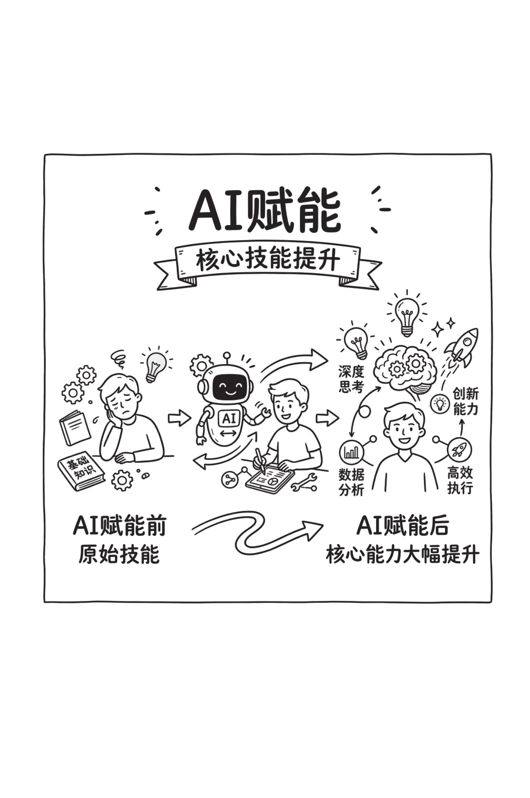

第一，打磨 AI 工具落地能力，这是基础能力，核心是吃透 OpenClaw 与 Seedance 2.0 的基础功能、进阶技巧，能将工具功能转化为实际的运营与创作成果。无需掌握工具的底层代码，只需通过官方教程、实操案例、社群交流等，掌握工具的核心操作方法。比如，能熟练使用 OpenClaw 设置自动化运营指令，解决办公、客户对接、数据统计等实际运营问题；能熟练运用 Seedance 2.0 完成不同场景的视频创作，满足引流、定制、知识付费等实际创作需求。落地能力的提升，关键在于多实操、多总结，将工具功能与 OPC 的日常运营、创作工作结合，在实操中发现问题、解决问题，形成属于自己的工具使用方法。

第二，提升 AI 工具场景适配能力，这是核心能力。这一能力的核心是能根据 OPC 的所属赛道、业务需求，灵活调整 AI 工具的使用策略，让工具功能与实际场景高度适配。不同赛道的 OPC，其运营与创作需求存在显著差异，比如数字内容赛道的核心需求是高产出、高质量的视频创作，专业服务赛道的核心需求是高效的客户对接、标准化的方案交付，本地生活数字服务赛道的核心需求是精准的本地流量引流、快速的商家视频定制。从业者需要根据自身赛道的核心需求，调整 OpenClaw 与 Seedance 2.0 的使用优先级与功能组合。比如，数字内容赛道，需重点打磨 Seedance 2.0 的视频创作技巧，优化 OpenClaw 的素材搜集、多平台发布功能；专业服务赛道，要重点优化 OpenClaw 的客户对接、方案生成自动化功能，用 Seedance 2.0 制作专业的科普引流视频。场景适配能力的提升，关键在于深研赛道、精准定位，充分理解自身 OPC 的赛道需求与客户痛点，让 AI 工具的使用始终围绕解决痛点、实现变现展开。

第三，强化 AI 工具协同优化能力，是高阶能力。该能力要求从业者根据 OPC 的运营情况，持续优化 OpenClaw 与 Seedance 2.0 的协同模式，通过自定义技能、调整操作流程，让二者的协同效率实现最大化。两大工具的协同并非一成不变，而是需要根据 OPC 的业务量、客户需求、赛道变化持续调整。比如，当 OPC 的定制订单量增加时，可优化 OpenClaw 的订单管理、需求同步功能，让客户需求能快速同步至 Seedance 2.0 的创作界面；当 OPC 拓展新的变现场景时，可调整二者的协同流程，让新场景的运营与创作实现自动化衔接。协同优化能力的提升，关键在于数据分析、持续迭代，借助 OpenClaw 的运营数据统计功能，分析工具的使用效率与变现效果，针对效率低下的环节进行优化，让 AI 工具的协同始终贴合 OPC 的发展需求。打造“AI+个人”的核心优势，本质是让 AI 工具成为个人能力的延伸，用 AI 工具的自动化能力弥补个人时间与精力的不足，用个人的核心能力弥补 AI 工具的创意与决策短板，二者相互赋能、相互补充。

从业者只需聚焦于这三大核心技能的提升，就能真正掌握 AI 工具的赋能能力，让 OpenClaw 与 Seedance 2.0 成为 OPC 运营与创作的核心支撑，打造出不可替代的核心竞争力。

### **行业趋势判断：2026 年 OPC 热门赛道发展方向，AI 创富的下一个风口，提前布局抢占机遇**

AI 的持续迭代与市场需求的不断变化，让 OPC 的热门赛道也处于动态发展中。2026 年的 OPC 热门赛道，将围绕三大核心趋势——AI 深度赋能、场景精细化、服务个性化展开，同时会涌现出一批新的 AI 创富风口。对于 OPC 从业者而言，具备精准的行业趋势判断能力，提前洞察赛道发展方向、布局新的创富风口，能让 OPC 始终走在行业前沿，抢占市场先机，实现财富的持续增值。

趋势判断并非凭空猜测，而是基于 AI 发展、政策导向、市场需求的综合分析。2026 年 OPC 五大传统热门赛道将迎来新的发展方向，同时会诞生两大全新的 AI 创富风口，为 OPC 从业者提供新的创富机会。

首先，2026 年 OPC 五大传统热门赛道的精细化发展方向是：在原有赛道基础上，聚焦更细分的场景与客户群体，实现服务的精细化、个性化，进而提升赛道的变现潜力与增加竞争壁垒。

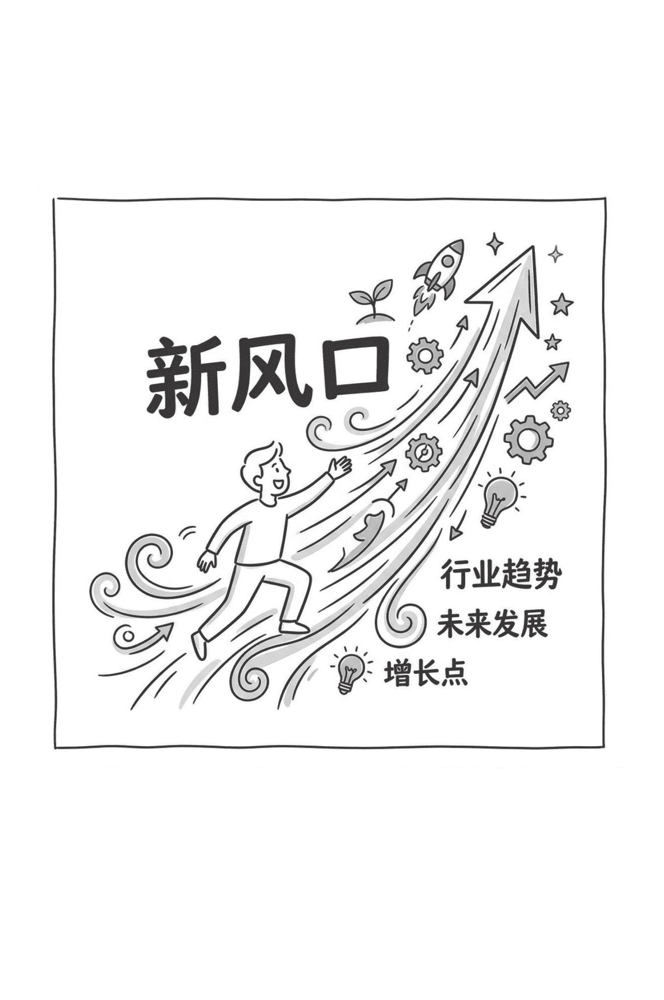

数字内容与创意设计赛道，将从通用视频定制向垂直领域精品内容创作发展，比如聚焦工业、医疗、教育等垂直领域的专业视频制作，聚焦微短剧、虚拟人直播等新兴内容形式。这类细分场景的客户需求更精准、客单价更高，竞争程度相对较低。

专业服务与咨询赛道，将从通用行业咨询向 AI 赋能专业解决方案发展。比如为企业提供 AI 工具落地咨询、OPC 模式创业咨询、AI 内容创作合规咨询等，依托 AI 工具为客户提供更精准、更高效的个性化解决方案。

技能变现与知识服务赛道，将从通用知识付费向 AI 工具实操教学发展。比如，开设 OpenClaw、Seedance 2.0 等 AI 工具的实操训练营，为普通人提供 AI 创富技能教学，这类教学服务贴合 AI 普及的市场趋势，需求持续增长。

轻量应用开发赛道，将从通用小程序开发向 AI 智能体定制开发发展，比如为中小企业、个人 OPC 定制专属的 AI 智能体，开发适配特定赛道的 AI 工具插件。这类服务技术门槛适中、市场需求大，变现潜力无限。

本地生活数字服务赛道，将从本地商家视频定制向本地商家 AI 数字化全案服务发展，除了视频制作，还为本地商家提供 AI 智能客服、AI 营销方案、线上店铺 AI 运营等全流程数字化服务，实现服务的多元化、高客单价。

其次，2026 年将涌现两大全新的 AI 创富风口，适配 OPC 轻资产运营模式，是从业者提前布局的最佳选择。

第一个风口是虚拟人 IP 打造与运营。随着 AIGC 的成熟，虚拟人制作与运营的门槛大幅降低，OPC 从业者可借助 Seedance 2.0 的虚拟人生成与视频创作能力，为企业和个人打造专属的虚拟人 IP，同时提供虚拟人直播、虚拟人内容创作、虚拟人 IP 运营等服务。这一赛道贴合数字经济发展趋势，市场需求大、变现方式多元化，且完全适配 OPC 运营模式。

第二个风口是 AI 内容合规与优化。随着 AI 内容创作的普及，AI 内容的版权、合规问题成为行业痛点，OPC 从业者可依托自身的 AI 工具使用经验与行业知识，为企业、内容创作者提供 AI 内容合规检测、AI 内容版权保护、AI 内容优化升级等服务。这一赛道属于蓝海市场，竞争程度低、客单价高，且能与原有数字内容赛道形成协同，实现多元化变现。

对于 OPC 从业者而言，提前布局行业新风口，可遵循三大核心方法。

一是持续关注行业动态，通过行业报告、科技媒体、AI 工具官方渠道，及时掌握 AI 发展、市场需求变化、政策导向等信息，为趋势判断提供依据。

二是小范围试错布局。针对看好的新赛道、新风口，以轻量模式进行小范围试错，借助 OpenClaw+Seedance 2.0 的 AI 工具能力，快速搭建试错体系，测试市场需求与变现效果，避免大额投入。

三是整合自身资源。将新赛道、新风口与自身的核心能力、原有 OPC 的业务资源结合，实现资源复用、能力互补，降低布局成本，提升成功概率。

AI 时代的创富机会，永远属于那些能提前洞察趋势、快速布局并付诸行动的人。OPC 从业者只需精准判断行业趋势、提前布局新的创富风口，就能始终保持核心竞争力，在 AI 创富的浪潮中持续抢占机遇，实现长期稳定的财富增长。

## **第十四章 长期创富思维：从“短期变现”到 OPC 规模化增值**

### **建立“AI+个人+OPC”的核心竞争力，打造不可替代的个人品牌，区别于普通创业者与自由职业者**

AI 时代，OPC 的长期创富，不在于单一的技能变现或短期的订单盈利，而在于建立“AI+个人+OPC”三位一体的核心竞争力，并以此为基础打造不可替代的个人品牌，让自身 OPC 彻底区别于普通创业者与自由职业者，形成差异化的竞争壁垒。这一核心竞争力，将 AI 工具的高效赋能、个人的核心能力与 OPC 的标准化商业体系深度融合，既是 OPC 实现从短期变现到规模化增值的根本支撑，也是其在行业竞争中站稳脚跟、持续盈利的关键。

普通创业者的核心竞争力多依赖团队、资源或资金，自由职业者则仅靠个人单一技能，而 OPC 的核心竞争力，是将二者的优势集于一身，同时规避短板。以 AI 工具替代传统团队的执行能力，解决人力成本高、效率低的问题；以个人的核心能力作为创意与决策核心，解决 AI 工具同质化、机械化的问题。此外，OPC 还具有独特的优势，以 OPC 的标准化商业体系作为运营载体，还能解决自由职业者变现无体系、抗风险能力弱的问题。

“AI+个人+OPC”的核心竞争力，体现为三个维度的深度融合。

第一，AI 工具与个人能力的互补融合。AI 工具承接所有重复性、执行性的工作，如自动化运营、标准化创作，解放个人的时间与精力；个人则聚焦于 AI 无法替代的高价值工作，如战略决策、创意构思、客户深度服务、行业资源整合等，个人核心能力是 OPC 的灵魂。二者相互赋能，个人能力的价值借助 AI 工具实现倍数放大，AI 工具的效率在个人能力的引导下能实现精准落地。

第二，个人能力与 OPC 体系的共生融合。个人的核心能力是 OPC 的核心定位基础，OPC 的赛道选择、服务内容、品牌调性都围绕个人核心能力展开；而 OPC 的标准化商业体系，又能将个人能力转化为可复制、可规模化的商业服务，让个人能力从单一技能升级为标准化服务产品，实现从个人变现到企业化盈利的跨越。

第三，OPC 体系与 AI 工具的适配融合。OPC 的标准化运营体系依托 AI 工具搭建，从获客、创作到交付、售后，全流程通过 AI 工具实现自动化与标准化，让 OPC 能以轻资产模式实现规模化运营。而 AI 工具的更新与升级，又能持续优化 OPC 的运营效率，让 OPC 的商业体系始终与行业趋势同频，保持高效的市场适配性。

在建立这一核心竞争力的基础上，打造不可替代的个人品牌，是让 OPC 脱颖而出的关键。个人品牌的核心，是将“AI+个人+OPC”的核心竞争力转化为客户可感知的品牌价值，形成独特的品牌标签，如 AI 赋能本地餐饮短视频定制专家、OPC 模式 AI 创业咨询领路人等。打造个人品牌并非单纯的包装，而是要将个人的专业能力、AI 工具的赋能优势、OPC 的服务特色融入品牌的每一个环节。通过 Seedance 2.0 输出贴合品牌定位的优质内容，彰显专业能力；通过标准化的服务交付，让客户感知 OPC 的商业价值；通过人格化的品牌表达，让客户建立情感认同。最终，让个人品牌成为 OPC 的“金字招牌”，区别于普通创业者的重资产模式与自由职业者的零散化运营，在客户心中形成“选该领域服务，就找这个 OPC 品牌”的认知，真正实现不可替代。

### **客户留存与复购：用标准化服务提升客户黏性，联动视频创作输出优质内容，巩固 OPC 客户群体，实现长期盈利**

对于 OPC 模式而言，客户留存与复购是实现长期盈利的核心基石，远比单纯的获客更重要。一个稳定的复购客户群体，能为 OPC 带来持续的订单收入，降低获客成本，更能通过老客户的转介绍实现裂变式获客，让 OPC 的盈利进入正向循环。

实现客户留存与复购的关键，在于用标准化的服务提升客户黏性，并联动视频创作持续输出优质内容，不断强化客户对 OPC 的认知与信任，最终巩固核心客户群体，推动 OPC 从靠新客赚快钱转向靠老客赚长久钱。

当下多数 OPC 从业者陷入重获客、轻留存的误区，将大量精力投入到流量获取与新客开发上，却忽视了老客户的维护，导致客户流失率高，陷入“获客—流失—再获客”的恶性循环。这不仅增加了获客成本，也让 OPC 难以实现稳定的长期盈利。事实上，开发一个新客户的成本是维护一个老客户的 5 倍以上，而老客户的复购率提升 5%，企业的利润就能提升 25%～95%。这一规律对于轻资产运营的 OPC 同样适用。用标准化服务提升客户黏性，是客户留存的基础。标准化服务的落地，核心依托 OpenClaw+Seedance 2.0 的 AI 工具能力，构建从需求对接、服务创作到交付售后的全流程标准化体系。

首先，需求对接标准化。借助 OpenClaw 制定统一的客户需求采集模板，自动整理客户的核心需求、交付标准、时间节点，避免沟通偏差；同时设置标准化的客户对接话术，确保每一个客户都能获得专业、高效的沟通体验。

其次，服务创作标准化。依托 Seedance 2.0 搭建赛道专属的服务创作模板，如短视频定制的画面标准、文案风格、时长要求，咨询服务的方案框架、内容维度、交付形式等，确保每一次服务输出都能保持统一的高质量，让客户形成稳定的服务预期。

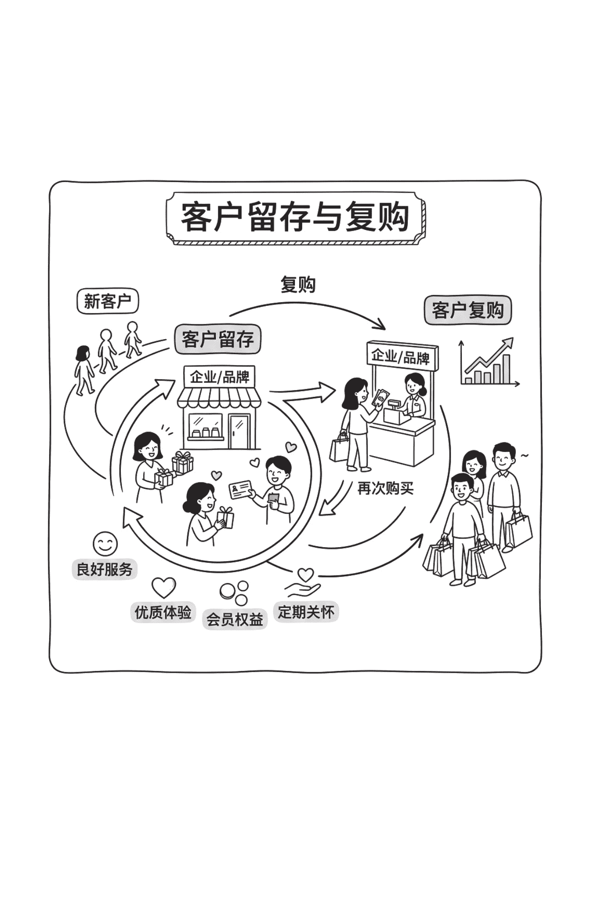

最后，交付售后标准化。借助 OpenClaw 实现标准化的服务交付，包括文件格式、交付渠道、售后回访的统一；同时建立标准化的售后保障体系，如视频定制的免费修改次数、咨询服务的后续答疑时长，及时解决客户的后续问题，提升客户的服务体验。

标准化的服务，能让客户感受到 OPC 的专业与靠谱，大幅提升客户的满意度与黏性，为复购奠定基础。而联动视频创作输出优质内容，是强化客户信任、推动复购的关键。依托 Seedance 2.0，针对核心客户群体的需求与痛点，持续输出三类高价值内容：一是行业干货内容，如行业趋势解读、专业技能技巧、AI 工具使用方法等，为客户提供高价值的内容，让 OPC 成为客户的“行业知识宝库”。二是服务升级内容，如 OPC 的新服务、新功能、新优惠，要及时让老客户知晓，激发其复购意愿。三是客户案例内容，将服务老客户的成果制作成案例视频，在获得客户授权后进行发布，既彰显 OPC 的服务能力，又让老客户获得成就感，强化情感连接。

同时，借助 OpenClaw 将这些内容精准推送给老客户，如通过私域社群、朋友圈、邮件等渠道，实现内容的精准触达，持续强化客户对 OPC 的认知与信任。此外，还可针对老客户推出专属增值服务与优惠政策，如复购折扣、老客带新客奖励、专属的免费内容福利等，进一步提升老客户的复购意愿与转介绍积极性。通过标准化的服务提升客户黏性，联动视频创作，强化客户信任，再配合专属的老客福利，就能让 OPC 形成稳定的客户留存与复购体系，巩固核心客户群体，实现长期稳定的盈利。

### **规模化拓展：从“一人 OPC”到“轻团队 OPC”，搭建柔性协作网络，保留灵活度的同时，放大创富效应，实现收入持续增长**

OPC 的长期创富，最终要走向规模化拓展，但这种规模化并非传统创业的重资产扩团队、租场地，而是从“一人 OPC”向“轻团队 OPC”升级。它的核心是搭建柔性协作网络，整合外部优质资源，弥补个人能力短板，在保留 OPC 轻资产、高灵活核心优势的同时，放大创富效应，实现收入的持续增长。这一规模化拓展模式，既解决了一人 OPC 的能力与精力瓶颈，又避免了传统团队的高成本、低效率问题，是 AI 时代 OPC 实现规模化增值的最佳路径。

一人 OPC 凭借 AI 工具的赋能，能实现基础的盈利，但随着业务量的增长与客户需求的多元化，必然会遇到能力与精力的瓶颈，比如，个人的专业能力有限，无法承接高难度、跨领域的订单；个人的时间与精力有限，无法同时处理大量的订单需求；个人的资源有限，无法覆盖更广泛的市场与客户。此时，若按照传统模式招聘全职员工、租赁办公场地，会让 OPC 失去轻资产、高灵活的核心优势，增加运营成本与风险。而搭建柔性协作网络，实现从“一人 OPC”到“轻团队 OPC”的升级，则能完美解决这一问题。

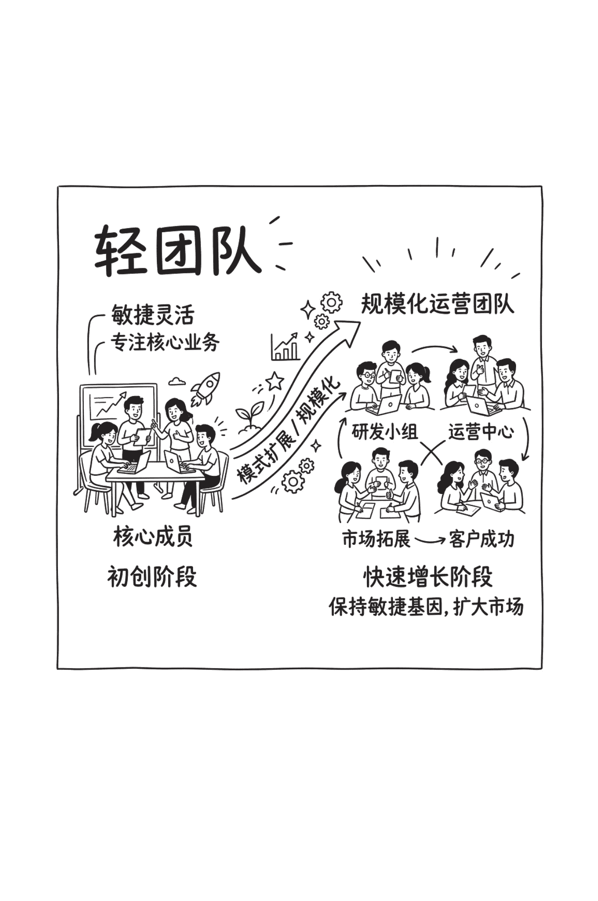

柔性协作网络，是指以 OPC 创始人为核心，整合一批不同领域的自由职业者、兼职从业者、其他小型 OPC，形成按需合作、按效付费、灵活调整的轻量协作体系。这一体系的核心特点是轻资产、高灵活、强适配，无需承担全职员工的固定工资与办公场地的房租成本，仅根据业务需求选择合适的协作伙伴，签订短期合作协议，按完成的成果支付费用。当业务量减少或需求变化时，可快速缩减协作规模，避免资源浪费。同时，协作伙伴的专业能力能弥补创始人的短板，让 OPC 能承接更多类型、更高难度的订单，实现业务的规模化拓展。

搭建柔性协作网络，实现从“一人 OPC”到“轻团队 OPC”的升级，核心分为三步，且全程依托 OpenClaw 的 AI 工具能力实现高效管理，确保协作效率的同时，保留 OPC 的灵活度。

第一步，精准定位协作需求，筛选优质协作伙伴。创始人首先梳理自身 OPC 的能力短板与业务需求，明确需要整合的协作资源类型，如数字内容赛道的 OPC，可能需要品牌策划、文案撰写、虚拟人设计等协作伙伴；专业服务赛道的 OPC，可能需要行业专家、数据分析师、方案设计等协作伙伴。然后通过线上创业社群、行业平台、人脉推荐等渠道，筛选具备专业能力、合作理念契合、时间灵活的协作伙伴，建立专属的协作资源库。

第二步，制定标准化的协作流程与分成机制。这是协作网络高效运转的基础。创始人依托 OpenClaw 确定统一的协作流程，包括需求分配、进度跟踪、成果审核、交付对接等标准化步骤，让所有协作伙伴都能按照统一的流程开展工作。同时，制定公平、透明的分成机制，根据协作伙伴的工作难度、贡献度确定分成比例，明确结算方式与时间，保障协作伙伴的权益，提升协作的积极性。

第三步，借助 OpenClaw 实现协作网络的自动化管理。将协作网络的日常管理工作交由 OpenClaw 自动化处理，解放创始人的时间与精力，让创始人聚焦于核心战略决策与客户对接。OpenClaw 可实现协作需求的自动分配，根据订单类型与协作伙伴的专业能力，快速匹配合适的协作人员。实现协作进度的自动跟踪，实时监控每一个协作环节的进度，自动提醒交付节点，避免延误；实现协作成果的自动审核与归档，对协作伙伴的工作成果进行初步审核，合格后自动归档至 OPC 的资源库；实现协作分成的自动统计与结算，根据分成机制自动统计每一个协作伙伴的分成金额，到结算时间自动提醒创始人进行结算。

通过这三步，就能搭建起高效运转的柔性协作网络，实现从“一人 OPC”到“轻团队 OPC”的升级。这种轻团队模式，既保留了 OPC 轻资产、高灵活的核心优势，又通过整合外部资源放大了创富效应。此模式能承接更多类型、更高难度的订单，提升客单价与订单量；能覆盖更广泛的市场与客户，拓展收入来源；能实现业务的规模化复制，让 OPC 的收入突破个人能力的瓶颈，实现持续增长。最终，让 OPC 从“一人盈利”升级为“轻量规模化盈利”，真正实现 AI 时代的长期创富目标。

# **后记**

**AI 时代，OPC+AI 工具是普通人容易抓住的创富机遇**

当 AI 浪潮席卷而来时，我们正处在一个前所未有的时代转折点——旧的创富逻辑被颠覆，新的机遇正在涌现。有人焦虑于会被 AI 替代，有人却早已借助 AI 工具，以 OPC 模式实现了低风险创富。而这本书的核心，就是想告诉每一位普通人：AI 不是淘汰你的对手，而是成就你的工具；OPC 不是遥不可及的商业形态，而是你触手可及的创富载体。

在我撰写这本书期间，我见证了太多普通人的蜕变：职场人用 OpenClaw+Seedance 2.0 搭建副业 OPC，实现主业稳定+副业增收，告别职场焦虑；自由职业者升级为 OPC，打造个人品牌，实现多元化收入，摆脱单打独斗的困境；内容创作者用“一人一剧组”模式，从流量变现升级为规模化服务变现，活成了“一人公司”的理想状态。他们没有丰富的资源，没有雄厚的资金，却凭借对 AI 工具的驾驭能力与 OPC 模式的精准落地，抓住了时代赋予的创富机遇。

AI 时代的创富，早已不再依赖资源、资金、团队，而是取决于工具、模式、思维。OpenClaw 与 Seedance 2.0 的出现，让普通人拥有了媲美团队的生产力。2024 年《中华人民共和国公司法》的修订与政策红利，让 OPC 模式实现低门槛落地。这两者的结合，彻底打破了创业需要高投入、创作需要专业技能的固有认知，为普通人打开了一扇低风险、高灵活的创富大门。

或许你此刻仍有疑虑：我没有商业经验，能做好 OPC 吗？我不懂技术，能用好 AI 工具吗？请相信，这本书已经为你扫清了这些障碍——没有复杂的理论，只有可落地的步骤；没有晦涩的术语，只有易懂的实操。你不需要成为商业专家，不需要掌握编程技能，只需跟随书中的指引，用好两大 AI 工具，吃透 OPC 运营逻辑，就能一步步搭建属于自己的商业闭环。

AI 时代，最大的风险不是被淘汰，而是固守旧思维、错失新机遇。当别人已经用 AI 工具解放双手，用 OPC 模式实现创富时，你是否还在原地徘徊？当趋势来临时，唯有主动拥抱、快速行动，才能抓住机遇。

愿你读完这本书后，能告别焦虑与迷茫，勇敢迈出 OPC 创富的第一步；愿你能驾驭 AI 工具，吃透 OPC 的运营逻辑，将“一人公司”的理想变为现实；愿你在 AI 时代的浪潮中，不被工作捆绑，不被成本困扰，用 AI 赋能自己，走出属于自己的创富之路！

创富的路上，选择比努力更重要。OPC 与 AI 工具的结合，正是 AI 时代普通人不容错过的创富入口。愿你不负时代、不负自己，在创富路上收获财富与自由，活成自己想要的样子。

# **作者简介**

王喜文，工学博士、情报学博士后、高级工程师，曾从事 10 年计算机软件开发工作，后在中国科学技术信息研究所从事博士后研究工作 2 年，在北京市房山区任经济和信息化委员会副主任 1 年，在工业和信息化部国际经济技术合作中心工作 9 年，历任电子商务研究所所长、中国智造与工业 4.0 研究所所长、工业经济研究所所长，现为九三学社中央促进技术创新工作委员会委员、北京华夏工联网智能技术研究院院长（抖音粉丝号：wangxiwen127）。

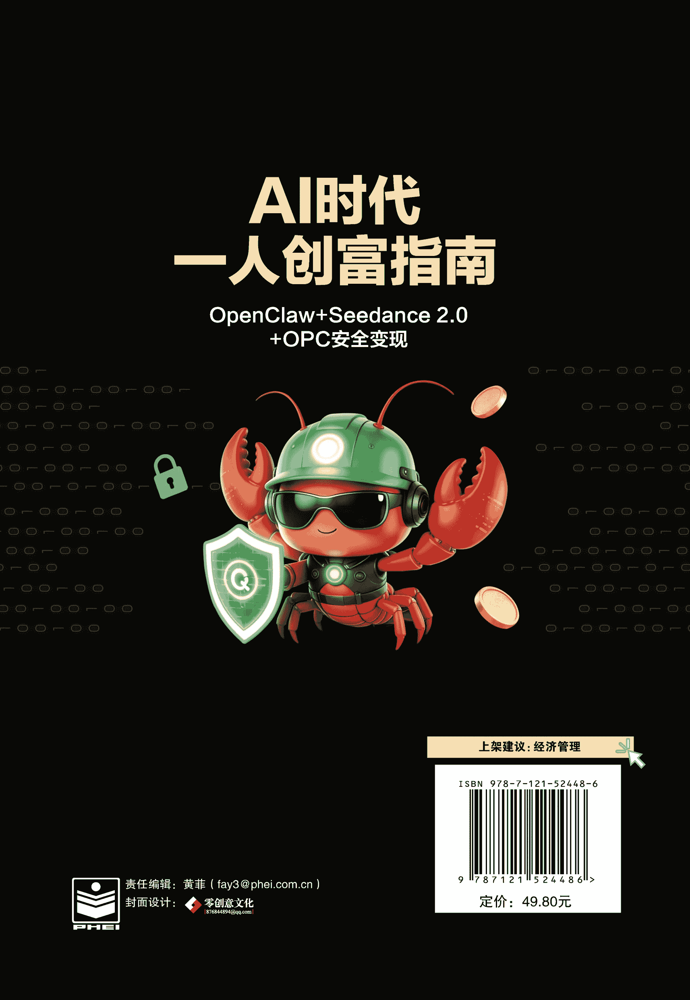