# OpenClaw×Seedance2.0×OPC：单人企业的轻资产实操

# **前言**

智能化浪潮正在把产业推向分岔口。一边是被新生产力挤压、收入下滑并陷入职业焦虑的人；另一边是借助智能工具快速起盘、用极简结构实现低试错增收的人。差距的关键并不在天赋或起步资金，而在是否配对到合适的工具与商业打法。

实地接触中常见三种困境。职场人长期加班却担心被替代，想做副业却找不到可执行的入口；创业者斥资组建团队，最终被固定开销拖垮；自由职业者独自扛起全流程，效率受限难以突破。这些人并不缺乏努力，缺的是与时代匹配的创富逻辑——用智能体释放重复劳动，用轻量架构降低试错成本，用可复制流程实现稳定收益。

OpenClaw、Seedance 2.0 与 OPC 正是对以上痛点的一套可落地解法。这并非概念堆砌，而是大量普通人实测可复制的生存与增收方法。结合近一年技术走向、政策窗口和实战案例，我把这套组合的核心经验整理出来。

OpenClaw 扮演 OPC 的数字助理，能全天候自动处理客户对接、资料整理等重复事务，让创始人把时间留给决策；Seedance 2.0 是内容变现的核心引擎，无需专业背景即可完成脚本、分镜、剪辑、配音全链路，既能制作引流素材，也能承接定制服务直接变现；OPC 是串联两者的商业载体，它不同于个体户，也不是泛泛的副业，而是一种“1位创始人加智能执行体”的极简公司形态。依托2024年《中华人民共和国公司法》修订带来的放宽，无需招聘全职、无需高额租金即可搭建闭环。

不少人误以为 OPC 需要深厚商业功底和重资本，实际情况恰恰相反。当下比拼的是运转效率与灵活性。OpenClaw 降低运营开销，Seedance 2.0 打开变现通道，普通人即可小成本启动，迈向月入过万并非遥远目标。书中案例的主角来自职场副业、草根创业和内容创作，他们没有特殊资源，却在3至6个月内实现收入翻倍，部分人提前实现财务自由。

本书的定位是易懂、可学、可执行。不堆砌技术黑话，也不空谈行业趋势，而是从认知校准、工具实操、模式落地、场景适配四个维度，手把手演示如何用 OpenClaw 与 Seedance 2.0 赋能 OPC，如何规避常见陷阱，如何从单人运营过渡到轻团队规模化。无论目标是提升职场竞争力、增加副业收入，还是轻资产创业、实现自我价值，都能找到可执行的路径。

当下最大的风险并非被智能化取代，而是固守旧思维错失窗口。OpenClaw 与 Seedance 2.0 已打破“创业必须组队、创作必须专业”的刻板印象，OPC 则为普通人提供了低风险、高自由度的切入点。

愿你读完后摆脱焦虑，掌握工具使用方法，吃透 OPC 的运转逻辑，把单人企业的设想变成现实。从此摆脱工作的过度束缚，不再被成本困住，用智能化赋能自身，走出属于自己的智能时代增收路线。

**安全使用提醒：**

部署与使用 OpenClaw 等智能体时，请遵循最小权限、主动防御、持续审计等安全规范。若发现安全漏洞或网络安全威胁，务必及时向工业和信息化部网络安全威胁与漏洞信息共享平台报告并处理。

# **第一部分** **智能时代的生存压力与创富窗口——读懂趋势，锁定核心**

## **第一章 摆脱焦虑：智能化不是对手，而是单人企业的杠杆**

### **为何八成人在智能化浪潮中掉队？认知偏差、能力错位、打法过时错失轻创业窗口**

智能时代的淘汰并非机器直接取代人类，而是超过八成的人陷入认知偏差、能力断层、打法过时的三重困境，从而错失轻创业机会。首先是认知偏差，面对浪潮有人过度恐慌把智能化当成抢饭碗的敌人而拒绝学习，有人则仅把它当作办公插件，从未意识到其能重构商业底层逻辑，更看不到与 OPC 结合的可能。其次是技能断层，在职业能力被重塑的当下，很多人仍固守重复性标准化工作，这恰是智能化最易替代的部分。他们没有构建“驾驭智能工具＋发挥核心创意”的新能力组合，既难在职场站稳，也缺乏独立创收基础。再次是模式过时，仍坚守“打工求稳、创业必建团队、副业靠蛮干”的旧思路，对2024年公司法放开后兴起的 OPC 视而不见，既不敢尝试轻创业，也不会用极简结构降风险，最终被浪潮甩下。这批人并非不努力，只是努力方向与时代背离。在新环境里，拒绝改变才是最大的生存危机。

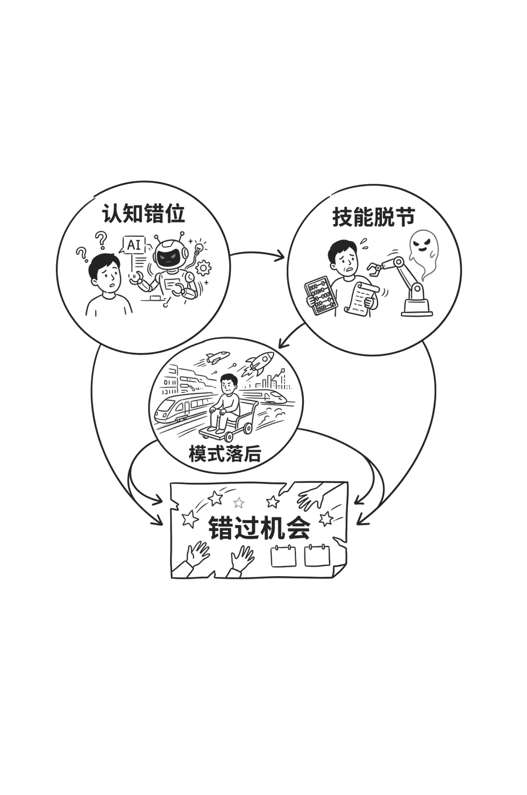

### **新创富思路：智能工具叠加 OPC 结构=低风险高回报，普通人可落地的轻资产路径**

传统创富讲求资金、规模、人脉，投入高、风险大、门槛高，组队、租场、拓渠道的成本让多数人望而却步。智能工具叠加 OPC 结构，正好从根源化解这些痛点。核心在于用智能生产力替代传统团队的执行力，让个人具备接近小团队的运营效率。OpenClaw 的自动化运营与 Seedance 2.0 的全流程视频制作，能让一人完成过去需数人甚至上百人才能完成的工作，直接节省九成以上的人力时间成本；OPC 则为这份被赋能的生产力提供合规轻量的商业主体，借助2024年《中华人民共和国公司法》的政策利好，无需全职员工、无需重租金，仅一人即可搭建完整闭环，从注册到获客，从内容到交付，全程低成本运行。门槛被大幅拉低，无需雄厚资本、无需深厚商业背景，只要选对赛道、掌握工具基础用法、理解 OPC 运转逻辑，就能低风险启动。更关键的是，该结构兼具灵活性与成长性，既可做副业增收，也能逐步升级为全职创业主体，收入上限取决于个人核心能力与执行力，真正实现轻投入高变现。

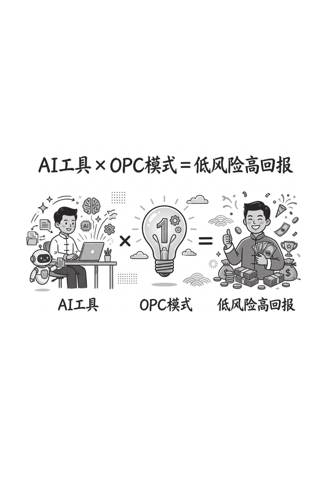

### **OpenClaw、Seedance 2.0、OPC 如何破解生存困局、实现轻创业？**

OpenClaw、Seedance 2.0 与 OPC 并非孤立存在，而是相互赋能的“创富铁三角”，精准击中职场人、创业者、自由职业者的核心痛点，为轻创业提供完整解法。OPC 作为商业形态，是破局的基础。它打破了“创业必须搭团队、副业没有合规主体”的固有认知，以“1位创始人+智能体”的极简形态，让普通人以极低成本建立合规闭环，既解决了职场人做副业的身份顾虑，也缓解了创业者的成本压力，更补齐了自由职业者变现无体系、发展无方向的短板，让轻创业从想象变为现实。OpenClaw 作为智能体，是 OPC 高效运转的底座，相当于7×24小时数字助理。具备本地部署、多模型兼容与自动化任务能力，能接管素材搜集、客户沟通、数据统计、服务交付等重复工作，从根本上解决精力有限、效率低的问题，让创始人聚焦战略决策、创意输出、客户维护等不可替代的高价值环节。这是 OPC 能低成本高效率的关键。Seedance 2.0 作为视频创作神器，是 OPC 的变现核心，解决了获客难与变现渠道单一的问题。零门槛完成写、导、剪、配全流程，既能快速产出引流内容获取精准客户，也能承接定制视频、微短剧、知识付费视频等业务，直接实现商业变现，覆盖内容、服务、企业营销等多个高潜赛道。三者联动，OPC 定框架，OpenClaw 保效率，Seedance 2.0 促变现，形成“框架-效率-变现”闭环，让普通人无需外部资源，仅凭自己与智能工具就能稳步实现创富目标。

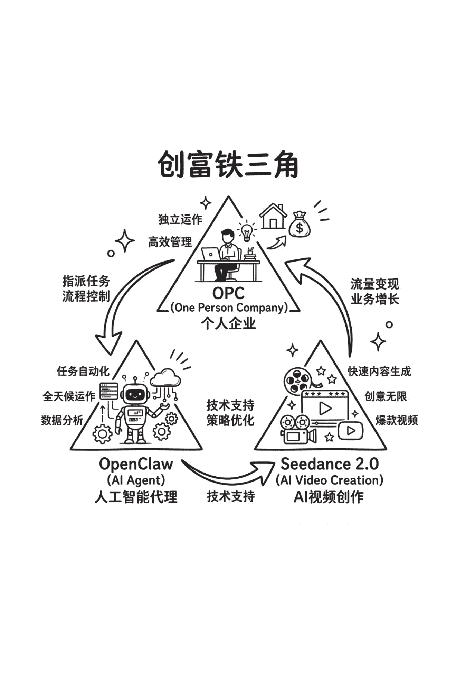

### **本书价值：用两大智能工具加一个核心结构，低成本搭建个人商业闭环，实现单人企业**

本书的核心，是给普通人一套可听、可学、可用的新时代生存与创富实操方案，抛开晦涩术语和空泛趋势，聚焦“2工具+1结构”的落地应用，手把手带你低成本搭建个人商业闭环，真正实现单人企业的状态。市面上多数书籍要么只讲工具操作不谈变现，要么只讲结构不给方法，本书将 OpenClaw、Seedance 2.0 与 OPC 深度融合，从认知校准、工具实操、模式落地、场景适配四个维度构建递进的知识体系。认知层面，帮助你消除对智能化的恐惧与对 OPC 的误读，看清创富趋势，找准定位；实操层面，从入门到进阶拆解两大工具的核心功能与分场景用法，并给出避坑指南，让智能工具真正成为你的数字助理与变现引擎；落地层面，从赛道选择、工商注册到获客变现、规模化运营，全流程讲解 OPC 的搭建细节，并结合行业走向推荐高适配赛道；场景层面，为职场人、创业者、自由职业者定制专属方案，让不同人群都能找到匹配路径。无论是想用智能化提升职场竞争力并做副业增收，还是想走出朝九晚五轻资产创业，或是借助智能工具与 OPC 突破收入瓶颈实现规模化，都能在书中获得具体做法。本书的终极目标，是让每个普通人通过这套组合告别焦虑，用智能化赋能，走出属于自己的新时代创富之路，让单人企业从理想变为现实。

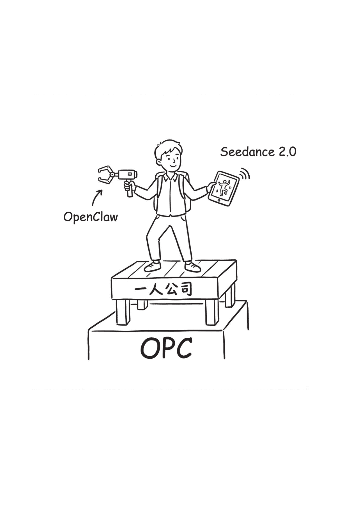

## **第二章 风口拆解：三大核心的时代价值与政策红利**

### **智能工具的跃迁：从辅助插件到核心生产力，为 OPC 结构提供技术底座**

近三年智能工具完成了从“办公小帮手”到“商业核心生产力”的关键跃迁，这一技术转变不仅重塑了生产方式，更为 OPC 的普及提供了坚实的技术支撑，让“1位创始人+智能体”成为可能。早期智能化仅能做碎片化基础任务，如文案生成、图片处理、语音转文字，定位是提升效率的插件，无法支撑完整商业运营。彼时个人创业仍依赖团队，OPC 只是概念。随着大模型迭代，以 OpenClaw、Seedance 2.0 为代表的新一代工具实现了三大突破：从单一功能到全流程能力，从云端到本地部署，从被动执行到主动自动化。它们能覆盖商业全链路，从自动化办公、素材处理到客户对接、服务交付，再到内容创作与引流变现，一机多能；本地部署与多模型兼容保障数据安全并满足个性化需求；自动化能力实现7×24小时不间断工作，打破个人精力边界。当智能化能替代传统团队80%的执行性重复工作时，个人便拥有媲美小团队的生产力。这从技术上打破了“个人能力不足以支撑商业”的壁垒，让 OPC 有了落地基础。可以说，智能化从辅助到核心生产力的跃迁，是 OPC 成为主流创富形态的前提。

### **两大工具的分工：OpenClaw 负责效率、Seedance 2.0 负责变现的黄金配合**

OpenClaw 与 Seedance 2.0 的配合并非偶然，而是精准契合 OPC“效率优先、变现为王”的运营逻辑，形成效率引擎与变现引擎的互补格局，二者一守一攻，共同覆盖全链路。

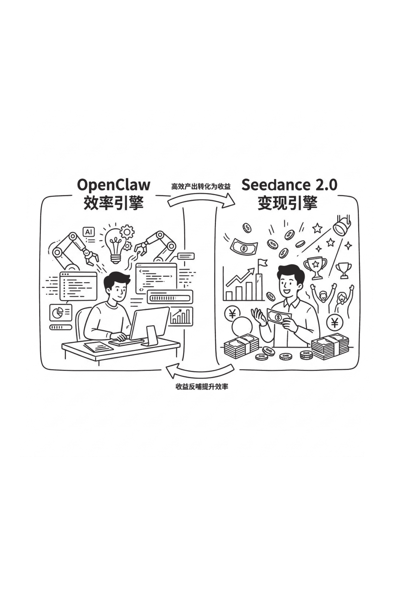

OpenClaw 定位 OPC 的效率引擎，负责内部运营，解决低成本高效运转的问题。作为智能体，其优势在于自动化、全场景、高适配，能7×24小时处理文档、搜集素材、沟通客户、统计数据，将重复执行类工作全部接管，让创始人从琐事中抽身，专注战略、创意与客户维护。对 OPC 而言，创始人时间是最大资产，OpenClaw 通过提效放大核心价值，同时大幅削减运营成本，让极简形态可持续运转，这是低风险的关键。

Seedance 2.0 定位 OPC 的变现引擎，负责外部引流与商业转化，解决获客与赚钱问题。其优势在于零门槛、全流程、高适配，只需关键词输入即可完成脚本、镜头、剪辑、配音全流程，既能快速产出引流视频获取客户，也能承接企业定制、微短剧、知识付费视频等服务实现直接变现，覆盖数字内容、企业服务、知识付费等多赛道。在短视频主导流量的当下，Seedance 2.0 让 OPC 从业者轻松卡位流量风口，快速建立变现渠道。两者互补，OpenClaw 保障内部高效，Seedance 2.0 完成外部变现，形成闭环，让 OPC 的运营效率与盈利能力同步提升，这正是组合价值的根源。

### **OPC 的本质：“1位创始人+智能体”的极简商业形态**

OPC 并非个体户或普通自由职业，而是智能化时代升级的“1位创始人+智能体”极简商业形态，恰逢2024年《中华人民共和国公司法》松绑与各地扶持政策的双重红利，成为普通人轻资产创富的最佳选择。个体户模式单一、抗风险弱、难扩张；自由职业者缺乏合规主体，变现无体系，客户信任度低，难以享受政策红利；而 OPC 是具备独立法人资格的有限责任公司，以“1位创始人+智能体”运营，创始人以认缴出资额为限承担责任，既拥有合规身份，又能享受公司制政策红利，同时借助智能化实现极简运营，兼具灵活与规范。智能化时代赋予 OPC 新内涵，从传统“单一自然人运营”升级为“碳基智慧+硅基执行”形态，创始人负责战略定位、创意输出、客户关系等智能化无法替代的高价值工作，OpenClaw、Seedance 2.0 等智能体承担全流程执行性工作，二者结合一人即可完成商业闭环，打破了“公司必须靠团队”的固有认知。2024年《中华人民共和国公司法》修订大幅简化一人公司注册流程，降低设立门槛，取消注册资本最低限额，简化财务审计要求，明确合规边界，让普通人低成本搭建合规主体。此外，各地政府推出税收减免、免费办公、创业补贴、社保优惠等扶持，部分城市还设立 OPC 孵化基地提供技术指导与资源对接。政策红利与技术变革双加持，让 OPC 门槛降至历史最低，成为新时代低风险高灵活的创富入口。

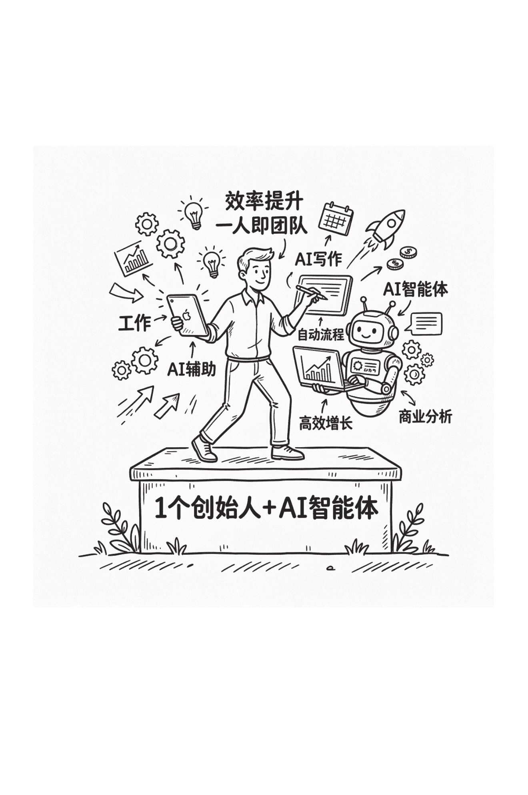

### **案例拆解：普通人借助 OpenClaw+Seedance 2.0+OPC 组合，三个月达成月入过万，年固定成本控制在两万元以内的真实路径，完全贴合 OPC 核心逻辑**

95 后职场人小杨的经历，很能代表一批普通人借助 OpenClaw＋Seedance 2.0＋OPC 组合做低风险创富的路径。他以副业形态起盘 OPC，锁定中小企业短视频定制这个赛道，三个月就把副业做到月入一万以上，全年固定开销控制在两万元以内，完全吻合 OPC 低门槛、低成本、高效率的底层逻辑。

小杨原本在一家传统公司做行政，朝九晚五的时间很充裕，却被 AI 替代的焦虑困住，想做点副业增收又找不到抓手。接触到 OpenClaw＋Seedance 2.0＋OPC 的打法后，他选短视频定制做入口，注册一人公司搭建自己的 OPC，正式开启副业变现。

在运营上，他把 OpenClaw 当成效率引擎，把所有重复劳动都交给它去跑：让 OpenClaw 自动爬取各行业短视频素材，慢慢沉淀成自己的素材库；用它的浏览器自动化和任务编排，给客户咨询做自动回复、做需求初筛；再让它处理办公文档、汇总订单数据、交付后归档资料。过去要花大块时间的琐事被一键收束，他每天只要花一小时看进度、盯关键问题，再也不用为副业忙到没空休息。

在变现上，他靠 Seedance 2.0 做变现引擎，实现了零基础做视频和获客。没有剪辑经验也没关系，输入关键词就能让 Seedance 2.0 一条龙完成企业宣传片、产品推广片的创作，脚本、镜头、剪辑、配音全包，效率比传统剪辑高十倍以上，单条制作时间从几小时压缩到半小时以内。他用 Seedance 2.0 批量做一批高质量引流片，投放到抖音、小红书、视频号，精准撬动中小企业客户，定制单按难度定价在 500 到 3000 元之间。运营高效、服务扎实，三个月里他累计接到 60 多单，副业月收入稳定在 1.2 万元以上，已经超过主业工资。

成本也很轻。整套 OPC 一年的固定支出只有 OpenClaw 和 Seedance 2.0 的年费、工商注册、办公软件会员，加起来不到两万元，没有房租没有人工，典型的轻资产高回报。更关键的是，这条路以副业形式运转，不动主业基本盘，既解了职场焦虑，又把收入拉升。案例说明，这套组合不只是全职创业者的专属，更适合想低风险试水的普通人。选对赛道、用对工具，就能用很低的成本把个人商业闭环跑起来，做到一人公司。

# **第二部分 两大核心 AI 工具全景拆解，从入门到实战赋能 OPC 闭环**

## **第三章 OpenClaw：AI 智能体，撑起 OPC 全天候运营的效率底座**

### **重新认识 OpenClaw：不只是 AI 工具，而是 OPC 的 7×24 小时数字助理，靠开源本地部署多模型兼容打通全流程自动化**

谈 OpenClaw，得先跳出“又一个 AI 办公软件”的刻板印象。它更像为 OPC 模式量身定制的 AI 智能体，一个能 7×24 小时轮班的数字助理，也是支撑 OPC 全流程自动化的底座。开源、本地部署、多模型兼容这三大特质，正好契合 OPC 轻量、低成本、跨赛道的需求。

和主流云端工具比，开源意味着不用交昂贵的会员也能用，还能按自己的运营习惯改模块、加技能，甚至为特定行业定制功能，从源头压低工具成本。本地部署则解决了数据安全这个痛点，客户资料、运营数据、私人素材库全部留在本机，不上云、不外泄，对做专业服务和定制内容的 OPC 尤其重要。 多模型兼容是它的杀手锏，能同时接通主流大语言模型和多模态模型，一个界面里就完成文案、客服、素材处理、轻设计等协同工作，不用在多个产品间来回切换。

对 OPC 创始人来说，时间就是最大的资源。OpenClaw 以智能体的形态把人从重复工作中解放出来，凌晨的客户咨询、定时的素材采集、例行的报表整理，都能自动完成。它不是简单的提效插件，更像一个并肩的数字合伙人，让一人公司从设想变成可执行的现实。

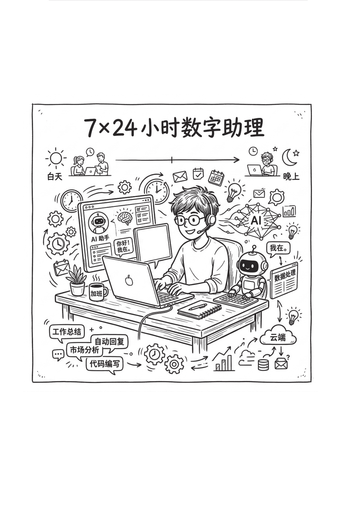

### **核心功能速览，零基础也能上手：本地文件操作、多模型调用、自动化任务、浏览器控制，覆盖 OPC 办公到交付的主线场景**

零基础做 OPC，只要抓住 OpenClaw 的四项核心能力，就能覆盖日常 80% 的工作量，而且几乎不用写代码。

本地文件操作是基础，也是办公场景的核心。能批量改文档、转格式、抽关键信息，给表格做统计、筛选、可视化，对素材做分类、整理、重命名。内容型 OPC 可以快速归整图文视频素材，咨询型 OPC 能批量梳理客户需求文档，几小时的工作几分钟结束。

多模型调用打破了单一模型的局限。同一平台里同时调用大语言模型写文案、回客服、起合同初稿；调用多模态模型处理图片、剪辑短视频、生成素材；调用语音模型做语音转文字、文字转语音。少装一堆工具，也少了来回切换的时间损耗。

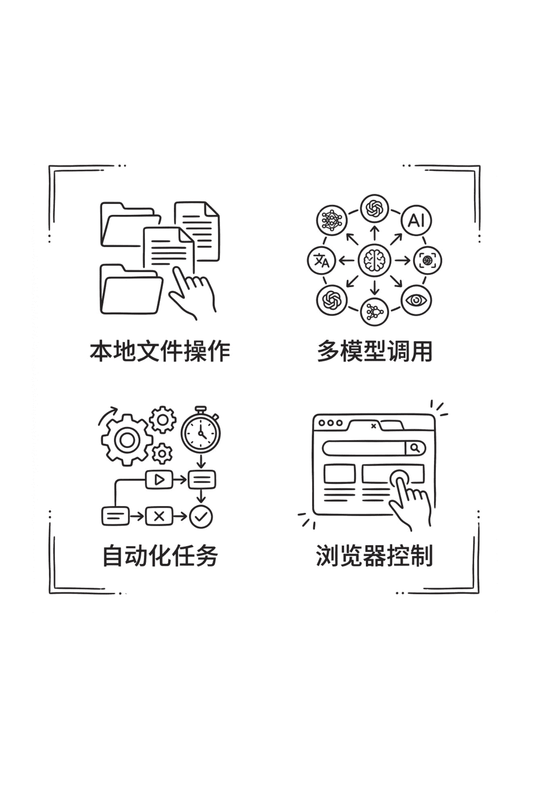

自动化任务是 7×24 小时运转的关键。按需求设定定时或条件触发，比如每天定时抓取行业新素材并自动归类、客户发特定关键词就自动回复、订单完成后自动推送交付包并更新数据。创始人外出或休息时，后台工作仍在推进。

浏览器控制则负责线上侧的自动化。自动爬取网页信息、定时发布内容、整理客户信息。做短视频的 OPC 可以定时分发作品并抓取数据反馈，做线上服务的 OPC 能自动监测行业动态，保持服务专业度。

四项能力联动起来，就构成了 OPC 从办公、素材到交付的全流程自动化。只要会设指令，新手也能让 OpenClaw 真正成为自己的数字助理。

### **四类实操场景极简路径：日常运营、客户对接、素材采集、数据统计都能自动化**

OpenClaw 的价值在于落地。四个高频场景都可以用“选功能—设触发—定输出”三步走。

日常运营自动化聚焦办公梳理。把“本地文件操作＋自动化任务”组合起来，比如设“每天 9 点自动归档前一天文件到指定目录”“每周五自动生成周报并可视化核心数据”。定时触发后，整理工作无需人工盯。

客户对接自动化提升体验。先用大语言模型生成标准化话术，涵盖咨询解答、需求确认、报价说明、交付提醒；再打开“浏览器控制＋自动化任务”，连到获客渠道，设置关键词触发，如“报价”“合作”。客户一发关键词，系统自动回话并把信息写进本地表格，复杂的才需要人工介入。

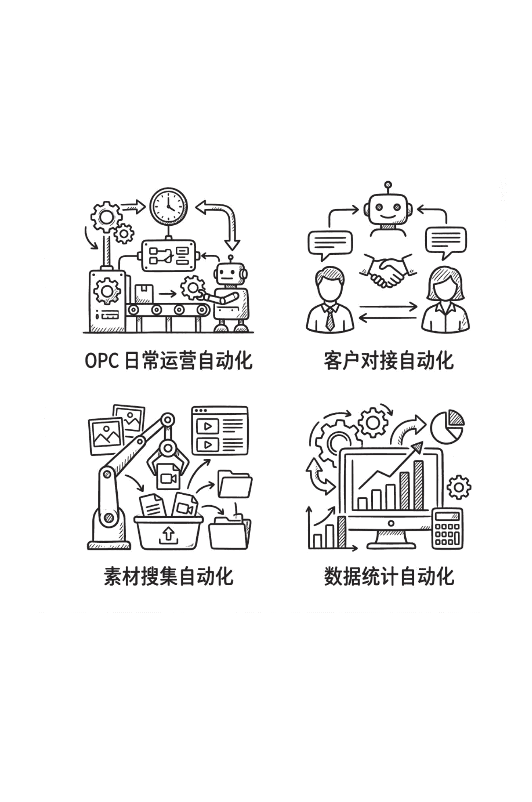

素材采集自动化适合内容和视频定制型 OPC。明确需求后打开“浏览器控制”，加入目标平台；设置采集频率和规则，比如“每天中午、傍晚各抓一次，按类型分类并过滤低质内容”；最后对接本地素材库，自动存档并打标签，告别手工翻找。

数据统计自动化解决报表混乱的问题。用“本地文件操作＋多模型调用”对接订单表、客户表、平台数据；设定统计规则，如“每日计订单数、成交额、新增客户”“每周分析需求趋势和转化效率”；指定表格、图表或简短报告为输出形式，系统自动抽数分析，为决策提供即时依据。

这四条路径都不需要编程，选对功能、写清指令就能跑通，让 OPC 的效率实现质变。

### **进阶打法：自定义技能让 OpenClaw 更贴合不同赛道的个性化需求**

把基础功能跑顺后，下一步是自定义技能，让工具更懂自己的赛道。OpenClaw 的开源属性让这件事变得平民化，通过可视化编辑和现成模板，即使零编程也能做个性化扩展。

核心思路是需求拆解、功能组合、指令编写、测试上线。先把赛道里的关键动作拆开，比如内容创作需要“脚本自动生成＋素材精准匹配”；咨询需要“需求自动分析＋方案初拟”；企业服务需要“合同条款核验＋报价单速成”。再把本地文件操作、多模型调用、自动化任务、浏览器控制进行重组，比如脚本技能就组合大模型写作与素材库对接。接着在可视化指令面板里改模板，设定触发条件、步骤和输出格式，最后小范围测试、微调再全量使用。

不同赛道有不同方向。内容创作类可以做“素材—脚本—发布”一条龙和数据反馈优化；专业服务类可以做客户画像自动生成和行业资讯精准推送；知识变现类可以做资料自动整理和学员常见问题自动解答。加入开源社区共享别人的技能，也能加速自己的工具升级。自定义技能把通用智能体变成专属助理，是 OPC 从一人运营走向高效盈利的关键一步。

## **第四章 Seedance 2.0：AI 视频创作引擎，成为 OPC 引流与变现的核心杠杆**

### **Seedance 2.0 的核心定位：多模态音视频一体生成，让 OPC 从业者一人完成写导剪配，兼顾引流和商业变现**

Seedance 2.0 的定位是为 OPC 量身打造的多模态音视频生成引擎，它把“视频需要团队和专业技能”的门槛直接拉平，让一个人就能跑通写、导、剪、配全流程。引流和变现双兼顾，正好匹配 OPC 轻运营、快变现、多渠道获客的需求。

区别于传统剪辑软件和单一 AI 生成工具，Seedance 2.0 能融合文本、图像、语音、视频等多模态信息，实现从创意到成品的一站式产出。脚本撰写、镜头设计、剪辑合成、配音、字幕都在一个平台完成。 OPC 从业者无需专业影视知识，只用描述需求或输入关键词就能拿到成片。引流场景下，它能快速生产短平台热点视频、个人品牌宣传片、赛道科普片，快速获取精准流量；变现场景下，它能产出企业宣传片、产品推广片、课程视频、微短剧，既能直接接定制单，也能搭建自己的知识付费体系。风格、时长、画质都能按场景调节，让视频既能吸粉又能赚钱，成为 OPC 的核心变现与引流利器。

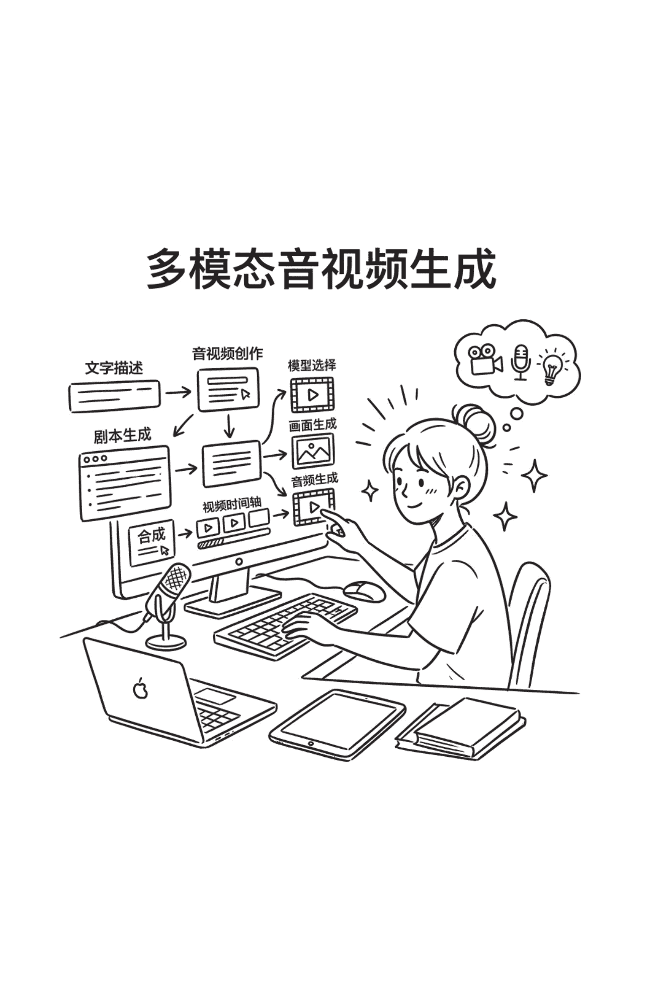

### **四大核心能力拆解：复杂场景生成、多模态参考、可控编辑、双声道音频同步，贴合引流与定制变现需求**

Seedance 2.0 能打，就是靠复杂场景生成、多模态参考、视频可控编辑、双声道音频同步这四项能力，解决了 AI 视频“场景单、内容同质、不好改、音画不同步”的痛点。

复杂场景生成让定制视频更有说服力。它能根据描述生成人物、场景、情节丰富的画面，企业宣传里能还原符合行业的办公与产品使用场景，微短剧里能保持连贯剧情和人物互动。比起只会出单一背景的工具，这让定制作品更高级，也更容易拿下高客单。

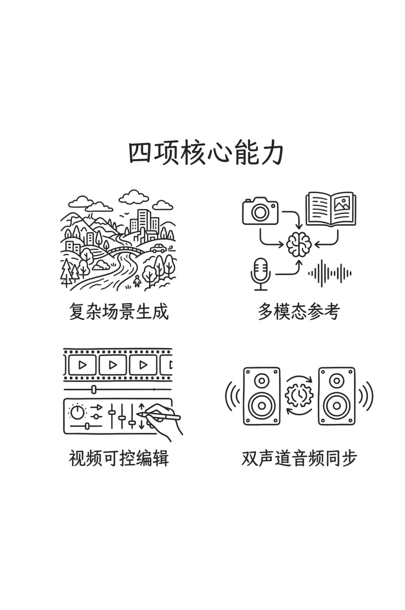

Seedance 2.0 给 OPC 带来的不是简单的提速，而是把个性化创作、精细化编辑、全感官同步这三件事放在同一套流程里，让一人团队也能同时打好引流和交付两张牌。

多模态参考让视频从千篇一律走向精准定制。创作者可以把文本、图片、视频、语音等不同形态的参考素材一起喂给模型，Seedance 2.0 会据此还原风格与内容气质。做引流时上传一个在平台上跑得好的视频做参照，能快速复现当下的流量语感；接定制时上传企业的 LOGO、产品图、品牌色板等资料，成片就能深度贴合品牌调性。这个能力直接击中了 AI 视频同质化的痛点，让每条内容都能按需个性化，拉高传播效果与客户认可度。

视频可控编辑是平台级的精细化改片能力。OPC 不必跳出系统去用专业剪辑软件，裁剪画面、重排镜头顺序、加特效、改字幕等操作都在内部完成，而且支持到帧的精准修改，可以单独调整某一帧的细节。成品如果有瑕疵，不用推倒重来，直接在原片上修，特别适合定制订单的临场修改，省下大量的返工时间与沟通成本。

双声道音频同步解决了画面与声音总对不上、音质粗糙的老问题。语音、背景音乐、音效被分离成独立声道后再精准对齐，配音与口型自然贴合，BGM 节奏与画面情绪同步，还能输出高清音质。知识付费讲解类视频里讲师声画对齐更清晰，企业宣传片里音乐情绪与品牌调性一致，整体质感会明显跃升。

这四项能力形成从创作到编辑、从视觉到听觉的全链路闭环，既能快速产出高传播的引流内容，也能稳定交付高水准的定制作品，为流量获取和商业变现提供核心支撑。

### **实战要点：锁定角色、设计镜头、化缺陷为风格，重塑质感与变现**

想让 Seedance 2.0 的输出从可用变成优质，需要抓住三条打法，参考 NeuralViz 频道把 AI 特性融入创作风格的做法，让高效与辨识度兼得。

角色一致性是微短剧和人物讲解类视频的命脉，也是 AI 最易翻车的地方。平台的角色固定功能允许你在生成前预设形象、服饰与动作特征，上传角色参考图并开启一致性模式，同一人物在整条视频里不会出现面部或穿搭的突变。配合角色动作库，还能为固定角色配置专属表情与肢体语言。比如企业宣传的讲解人可以设定专业沉稳的动作，微短剧主角可以绑定性格化微表情。角色稳定后，定制客户的满意度更高，引流内容也能形成可记忆的人物 IP。

镜头语言决定质感上限。Seedance 2.0 能自动出镜，但手动微调参数会让叙事节奏与画面层次更可控，无需镜头知识就能完成。引流短视频用快切镜头提升节奏感，贴合平台偏好；企业广告片用慢镜头加全景，突出规模与气场；知识付费用近景加特写，让讲解更清晰。镜头转场库可以为切换加入自然过渡，避免硬生生的剪切，整体观感更接近专业影视。

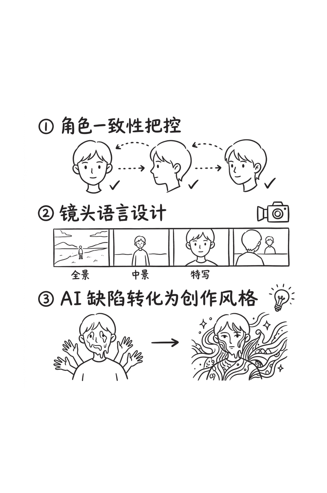
AI 缺陷转化为创作风格是最具差异化的思路。NeuralViz 频道就把轻微模糊、色彩偏饱和、画面肌理独特等 AI 特征，转化为复古、艺术、赛博朋克等风格标签。Seedance 2.0 提供丰富的风格滤镜与画面调节，创作者可以主动利用这些天然属性。轻微模糊调成复古胶片适合文艺类，色彩饱和度高转化为赛博朋克适合科技类，独特肌理做成手绘感适合儿童教育类。将同一套风格贯穿引流与定制内容，观众一眼能认出，形成品牌记忆。

掌握这三点，视频能保留 AI 的高效与低成本，又具备专业且独有的质感，既提升引流传播，也能提高定制单价，助力 OPC 打造专属品牌。

### **为什么它更适合 OPC：效率跃升 10 倍，兼顾轻量运营与低成本变现**

相比传统剪辑，Seedance 2.0 的核心优势是效率与门槛的双降。PR、AE 这类工具需要剪辑、特效、配音等专业技能，学习周期长，从脚本到成片一个人要花数小时甚至数天，还要承担软件会员与学习成本。而 Seedance 2.0 实现全流程自动化，只需输入关键词就能从脚本到成片一站式完成，实际测算同等工作量从数小时压缩到半小时内，效率提升约 10 倍。界面简洁，零基础 10 分钟可上手，使用成本远低于传统方案，完美契合轻量、低成本运营需求。

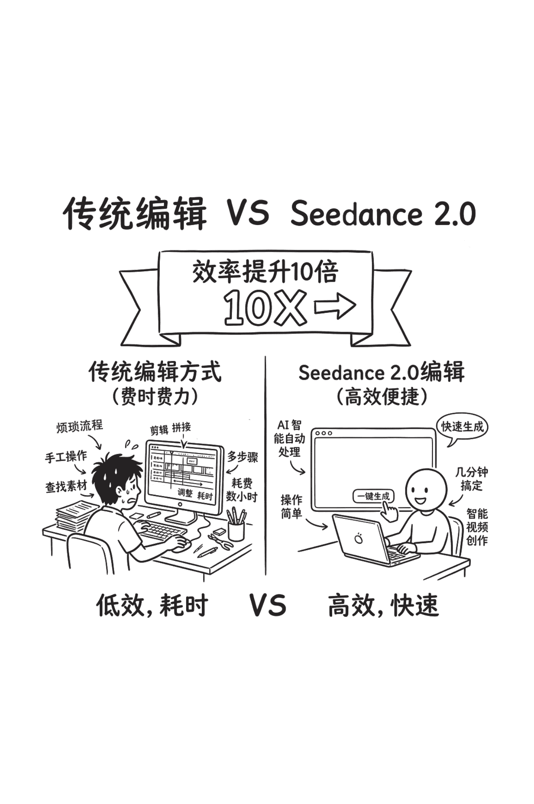
相比其他 AI 视频工具，Seedance 2.0 更贴合 OPC 的变现逻辑。市场上不少工具功能单一、场景受限、定制能力弱，部分只能出简单的短视频，做不了高质量定制或微短剧，部分只能生成同质化内容，难以满足个性化需求，部分只管生成不管引流变现。Seedance 2.0 覆盖引流短视频、定制视频、微短剧、广告片、知识付费视频等核心场景，依靠多模态参考、复杂场景生成、可控编辑实现高定制，支持先用引流积累客户，再用定制直接变现，再通过知识付费做多元化收入，形成完整闭环。创作无需额外拍摄设备，一台电脑即可，成本低、产出高。还能与 OpenClaw 无缝协同，将素材搜集、需求整理直接导入创作，实现素材搜集-视频制作-客户交付的全自动流转。

## **第五章** **双工具联动：OpenClaw 与 Seedance 2.0 打造 OPC 全链路变现闭环**

### **协同逻辑：自动化执行与创意变现，覆盖运营到交付全链路**

OpenClaw 与 Seedance 2.0 的结合不是简单叠加，而是效率与变现的深度融合。以自动化执行加创意变现为核心，覆盖 OPC 的运营、引流、变现、交付全流程，让原本需要团队协作的环节由一人借助 AI 完成，形成极简商业闭环。

OpenClaw 负责前中后置的自动化执行，释放创始人做创意、深客对接、战略决策的时间；Seedance 2.0 负责内容生产与商业变现，用零门槛创作完成引流与交付。两者能力互补、流程衔接，自动化为创作提供效率支撑，创作为自动化提供盈利目标。

从商业流程看协同贯穿始终。运营环节 OpenClaw 自动处理办公、数据统计、素材管理，为 Seedance 创作做好准备。引流环节 OpenClaw 自动搜集流量热点与平台数据提供方向，Seedance 快速生成引流视频，OpenClaw 再负责多平台定时发布。变现环节 OpenClaw 自动承接客户咨询、梳理定制需求，Seedance 按需制作高质感定制片实现成交。交付环节 OpenClaw 自动整理文件、发送给客户并统计售后数据，Seedance 根据反馈优化内容。全链路衔接避免单工具局限，实现一人搭建完整可复制的变现体系。

### **实操案例 1：OpenClaw 自动化搜集素材→Seedance 2.0 生成引流视频→承接定制→OpenClaw 自动化交付，实现引流到变现无缝衔接**

以聚焦中小企业短视频定制的 OPC 为例，创始人只需把控创意与确认需求。

第一步，OpenClaw 自动搜集素材与梳理方向。设置指令让它每日从抖音、小红书抓取企业短视频定制的热门赛道、爆款脚本框架、流量关键词，按行业分类存库并生成日报。靠浏览器控制与多模型拆解，餐饮、零售等方向自动整理出来，创始人每天花 5 分钟看简报即可。

第二步，Seedance 快速生成高传播引流视频。依托简报输入关键词如“餐饮门店宣传短视频、爆款节奏、15 秒、突出性价比”，平台自动完成脚本、镜头、剪辑、配音，10 分钟内出 3-5 条，挑选最优版微调即可。

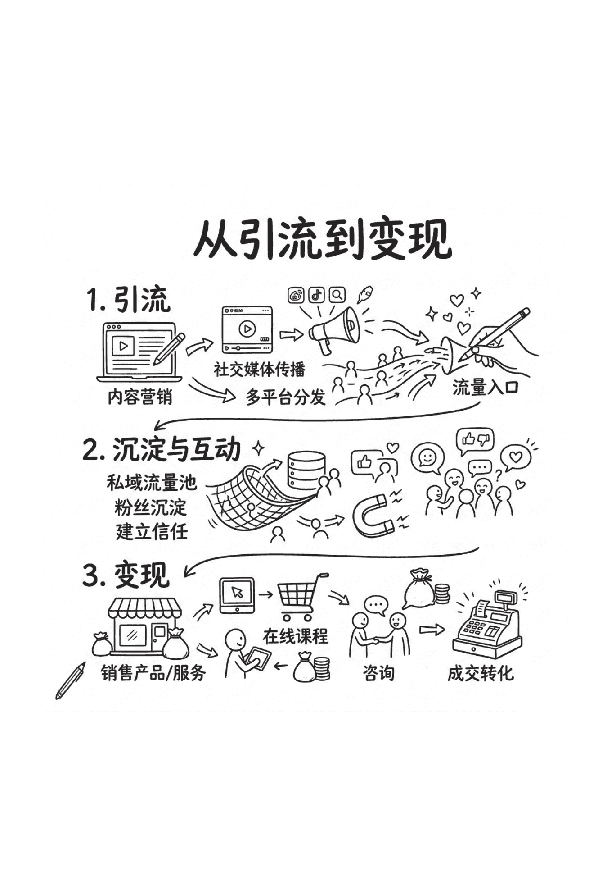
第三步，OpenClaw 多平台分发与咨询对接。视频交由 OpenClaw 定时发布到抖音、视频号、小红书，同时开启自动咨询回复，对报价、风格等常见问题用标准话术响应，收集核心需求写入订单表，创始人只处理个性化沟通。

第四步，需求直达创作。OpenClaw 把整理好的定制需求同步到 Seedance 创作界面，补充创意后即可依靠多模态参考与可控编辑快速出片。

第五步，OpenClaw 自动交付与数据归档。成片自动转码打包，通过微信或邮箱发送客户，同时统计订单金额、交付时长、满意度并生成报告，为复购与优化提供依据。整个链路从创作到转化大幅缩短，订单处理效率提升 80% 以上。

### **实操案例 2：OpenClaw 自动化处理日常→用 Seedance 拓展变现，提升收入上限**

以知识付费视频制作 OPC 为例，创始人原本每月只做 10 条课，且被办公与对接占用大量时间。接入双工具后效率与收入双升。

OpenClaw 全面接管办公自动化：每日自动整理学员报名与学习数据生成报表，每周汇总答疑问题入库，每月完成财务统计与学员画像。原先每天 2 小时的手工工作变成 7x24 自动运行，创始人每周 30 分钟即可把握核心数据。

OpenClaw 还实现客户与学员对接自动化：课程报名、学习咨询、售后问题自动回复并完成平台开通，企业定制需求自动整理并发送报价初筛。每天节省 3 小时以上对接时间。

腾出的时间用 Seedance 拓展三大变现：打磨核心课程，月产量从 10 条提升到 30 条，课程收入翻倍；承接企业员工培训定制视频，单价高于通用课程；把课程拆成 15-30 秒引流短视频做流量裂变，同时接短视频定制订单。借助 Seedance 还能制作个人 IP 宣传片提升品牌影响力。最终月收入从 2 万元提升至 5 万元，从基础盈利迈向高收入盈利。

### **工具组合优化：根据 OPC 所属赛道调整优先级与协同方式**

赛道定配比，双系统发力

OpenClaw、Seedance 2.0 并不是一套放之四海皆准的固定打法，必须紧扣 OPC 所处赛道的生意逻辑，动态调整投入重心与配合路径，让两套系统的能力真正贴合目标，把组合价值推到最大。不同赛道的盈利抓手、运营侧重点、交付场景差别很大，强行套用同一套配合方式只会错配，反而浪费智能化带来的效率红利。组合优化的底层思路是先用赛道的盈利目标锚定 OpenClaw 偏效率、Seedance 2.0 偏商业化的先后顺序，再结合真实运营流程设计可落地的配合方案。

做数字内容与创意设计类 OPC，比如短视频定制、微短剧制作、品牌视觉设计，赚钱的关键在于产出效率与交付速度，市场要的是产量高、定制强、交付快。对应的配比是以 Seedance 2.0 担纲主角、OpenClaw 充当助手，围绕创意到交付做闭环。投入重心放在 Seedance 2.0 的视频打磨上，提升定制内容的质感与产出效率；OpenClaw 则为创作环节提供全流程的效率支撑。配合打通素材搜集—创作—分发—交付—数据回流这条线：OpenClaw 无人值守抓取行业爆款素材、汇总客户定制需求并推送给 Seedance 2.0；Seedance 2.0 迅速完成定制内容后，由 OpenClaw 自动完成多平台发布、客户交付、数据统计，并把反馈回传给 Seedance 2.0 指导下一轮优化，让配合始终围绕内容生产与商业化。

做专业服务与咨询类 OPC，比如企业管理咨询、财税咨询、职业规划咨询，核心竞争力是专业能力与客户信任，赛道要的是运营顺畅、引流精准、服务优质。组合策略是以 OpenClaw 作为核心、Seedance 2.0 配合，聚焦运营—引流—服务全链路。优先级上，OpenClaw 主担无人化运营，实现客户对接与数据管理的全自动，让创始人把时间留给专业打磨；Seedance 2.0 专注引流与品牌塑造。协作方式为提效运营—内容引流—转化客户—优化服务：OpenClaw 自动处理日常运营与客户初步沟通，节省创始人时间；Seedance 2.0 制作科普视频和 IP 宣传视频实现精准获客，OpenClaw 再把线索自动归档分类供创始人精准服务；服务结束后 OpenClaw 自动统计满意度，Seedance 2.0 据此优化引流与品牌内容，进一步增强信任。

做技能变现与知识服务类 OPC，比如知识付费、技能培训、线上教学，盈利点在于内容体系搭建与流量商业化，需要内容产出高、流量精准、服务标准化。这一类适合双系统并重，配合覆盖内容创作—流量引流—学员服务全流程。主次上 OpenClaw 与 Seedance 2.0 同等重要，一个负责效率支撑，一个负责内容生产，缺一不可。链路为整理素材—制作课程—裂变引流—服务学员—数据迭代：OpenClaw 自动收集课程素材、汇总学员需求并同步给 Seedance 2.0；Seedance 2.0 快速产出知识付费课程和引流短视频，OpenClaw 负责多平台自动发布；学员报名后 OpenClaw 自动完成服务与答疑，Seedance 2.0 根据学员反馈迭代课程，形成双向赋能的闭环。

无论赛道如何，组合优化的本质都是贴合实际需求，让 OpenClaw 与 Seedance 2.0 的能力精准映射到 OPC 的运营与商业化环节，最终把配合效率做到最大，让智能化真正成为核心竞争力。

# 第三部分

# 核心创富模式

## 第六章 OPC：智能时代轻资产创业主线

### OPC 的三大核心特质

智能时代的 OPC 能成为轻资产创业的首选，源于入门轻、风险可控、应变强的三重特质，真正做到不用全职团队、不需高额租金，一人主导加智能赋能即可运转，再叠加各地政府的扶持政策，创业门槛被压到最低，风险大幅收窄，更适配普通人。

进入门槛体现在注册、运营、能力三方面。注册上，2024 年公司法放宽后，一人公司注册简化为线上递交、审核、领照，无需实体办公，可用住宅地址或园区虚拟地址，注册资本认缴制免缴实缴，普通人花几百元、1 到 3 个工作日就能完成工商登记。运营上，借助 OpenClaw 与 Seedance 2.0 的配合，无需雇人就能跑通全流程，系统成本远低于人力，每月开销可控制在千元级。能力上，智能套件操作简便，创始人无需专业技术、创作、管理背景，只需掌握基础使用方法，结合自身行业经验或技能特长就能启动，实现真正的零基础创业。

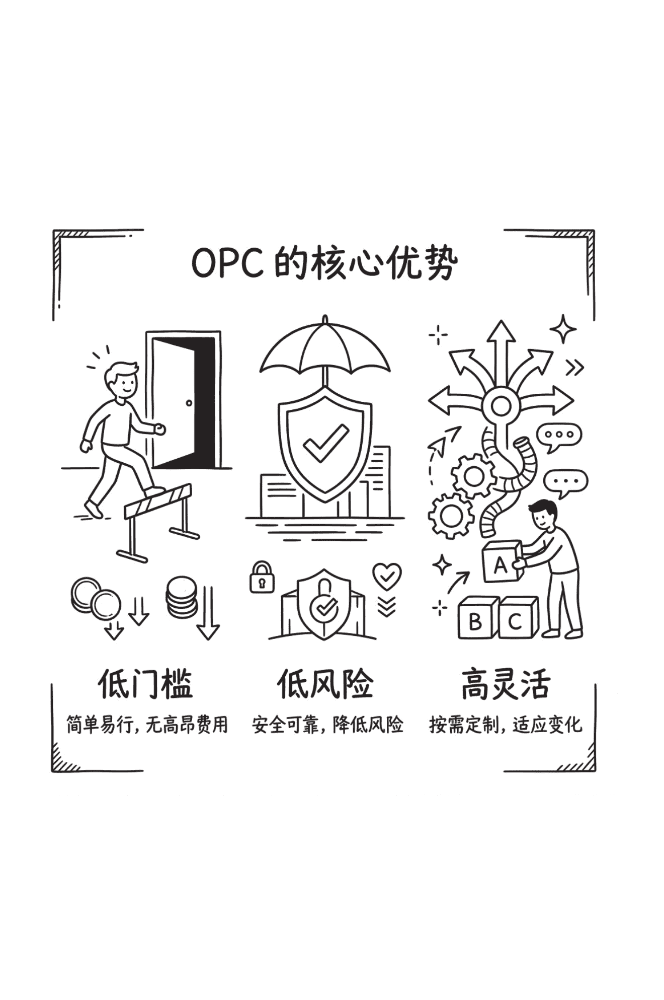

风险可控从法律、成本、运营三层面护航。法律上，一人公司属有限责任公司，创始人以认缴出资额为限担责，经营出问题仅以认缴资本清偿，不牵连个人财产，规避了个体户无限连带风险。成本上，无房租、人工、设备等重资产投入，核心支出只有系统会员、办公软件等小额可变成本，即便失败损失也极小，属于低试错创业。运营上，“1 个创始人+智能体”模式让节奏完全自控，可随市场需求灵活调向，避免了传统团队的高沟通成本、管理成本和决策迟缓，显著降低运营风险。

灵活性体现在业务调整、运营模式、盈利方式。业务上，一人公司无团队场地束缚，能依市场热点快速切换赛道，比如从短视频定制转向微短剧创作，无需负担转型成本。运营模式上，可选全职、副业、线上线下结合，特别适合职场人先以副业试水，稳定主业的同时低风险验证，成熟后再转全职。盈利方式上，可依托智能系统实现多元化，既接定制服务，也做知识付费，还能靠引流视频做流量商业化，不受单一模式限制，抗风险能力更强。

除自身优势外，一人公司还能吃到各地政府的扶持红利。各地出台的轻资产创业政策主要集中在四个方向：一是场地扶持，设创业孵化基地、众创空间，提供免费或低价虚拟办公和工位；二是税收优惠，新注册一人公司可享受增值税、企业所得税减免，部分地区小规模纳税人可“零申报”；三是资金补贴，对大学生创业、返乡创业、新兴赛道等提供启动补贴、社保补贴，部分地区还有低息或无息贷款；四是服务扶持，提供免费工商注册指导、财税咨询、法律维权、技能培训等一站式服务。

政策加持与自身优势叠加，让一人公司成为智能时代普通人轻资产创业的最优解，实现低成本起步、低风险运营、高灵活发展。

### 双系统赋能：OpenClaw 负责无人化运营与交付，Seedance 2.0 负责宣传获客与内容商业化，整体开销压降九成以上

OpenClaw 与 Seedance 2.0 绝不是普通的运营辅助，而是支撑轻资产运转的核心生产力。二者分工明确、协同发力，OpenClaw 全面负责无人化运营与交付执行，Seedance 2.0 精准负责宣传获客与内容商业化，直接把一人公司的运营成本压降 90% 以上，让“1 个创始人+智能体”的极简模式落地。这也是一人公司能实现低风险高回报的关键。

传统创业成本集中在人工、场地、时间。两大系统正好从这三处实现大幅降本甚至归零。

人工成本上，传统视频定制或企业服务类创业需招文案、剪辑、客服、运营，月薪动辄数万。OpenClaw+Seedance 2.0 可替代执行岗：OpenClaw 承担客服、运营、数据统计，7×24 小时自动完成客户对接、办公处理、订单交付；Seedance 2.0 承担文案、剪辑、创作，快速完成视频的写、导、剪、配全流程。创始人一人借助两系统即可完成原需 5 到 10 人团队的工作，人工成本降 90% 以上，接近零人工。

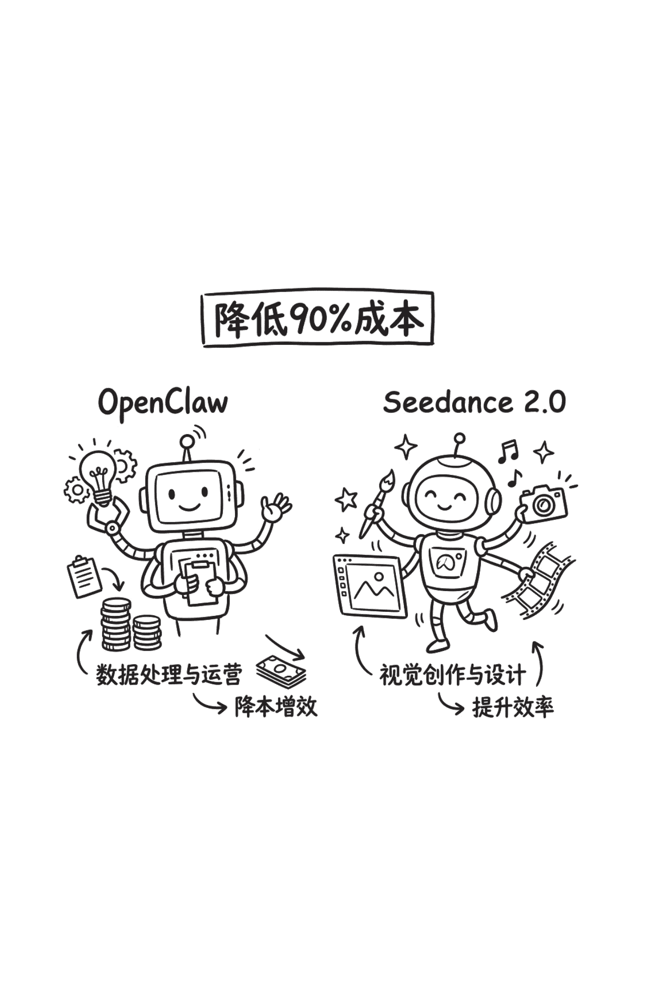

场地成本上，传统创业需租办公室，月租水电物业数千到上万。两大系统皆为线上操作且可本地部署，只需一台电脑和网络，就能在家、咖啡馆等任何地方运营，无需实体办公，场地成本清零，仅剩可忽略的网络电费。

时间成本上，创业者大量时间被重复性事务占据。OpenClaw 的无人化能把创始人解放出来，节省 80% 以上时间：素材搜集、客户对接、数据统计等原本耗时数小时的工作被自动完成，创始人只需查看进度、处理关键决策；视频创作由 Seedance 2.0 在十分钟到半小时内完成，效率提升 10 倍以上。时间节省后可聚焦战略、拓展、创意等高价值环节，商业化效率与成长速度同步提升。

具体来看，OpenClaw 是一人公司的效率基石，覆盖无人化运营与执行交付全流程。运营层面实现办公、素材管理、数据统计、客户对接无人化，日常运转无需人工干预；交付层面实现订单处理、文件交付、售后数据统计无人化，让定制服务标准化、高效，提升满意度。

Seedance 2.0 是一人公司的商业化引擎，聚焦宣传获客与内容变现。获客层面能快速生成高传播引流视频，覆盖各大平台实现精准获客，解决引流难获客贵的问题；变现层面可完成定制视频、知识付费视频、微短剧等多种内容，承接企业定制、搭建知识付费、实现流量变现，打造多元盈利，解决变现渠道单一、收入上限低的痛点。

双系统协同从效率与商业化两端提供完整能力，运营成本直降 90% 以上，让一人公司真正做到轻资产、高效率、高变现，成为智能时代普通人创富的最佳载体。

### 五大高适配赛道详解

结合 2026 年智能趋势与轻资产创业特征，一人公司高适配的赛道集中在数字内容与创意设计、专业服务与咨询、技能变现与知识服务、轻量应用开发、本地生活数字服务五大方向。它们普遍具备门槛低、需求大、投入少、变现强的特点，与一人公司模式高度契合，市场持续增长且竞争相对宽松，是借助 OpenClaw+Seedance 2.0 实现创富的理想选择。创始人只需结合自身优势锁定赛道即可快速启动。

赛道一是数字内容与创意设计，2026 年最核心的落地方向。需求来自中小企业和个人的内容制作，涵盖短视频定制、微短剧创作、企业宣传片、品牌视觉等。Seedance 2.0 负责一人完成写导剪配全流程，OpenClaw 负责素材搜集、客户对接、订单交付无人化，无需专业设计影视背景即可零门槛起步。变现以企业定制收费、微短剧流量分成、素材模板售卖为主，单条定制 500 到 5000 元，接 20 到 30 单月入即可过万，需求大变现快。

赛道二是专业服务与咨询，依托创始人的行业经验为企业和个人提供精准咨询，包括企业管理、财税、职场规划、AI 工具使用等。以 OpenClaw 无人化运营为核心，实现客户对接、数据统计、报告整理无人化，节省时间专注专业打磨；Seedance 2.0 制作科普、案例视频实现精准引流，提升品牌信任。变现靠咨询服务费、企业定制方案费、线上会员费，客单价高、竞争相对小，适合有行业积累的创始人。

赛道三是技能变现与知识服务，把个人技能知识做成线上内容，覆盖职场技能、生活技能、AI 使用、创业指导等。这是双系统协同的典型场景，Seedance 2.0 快速制作高质量课程和引流短视频，OpenClaw 负责学员管理、课程发布、答疑对接无人化，提升制作与服务效率。变现方式为知识付费课程、线上培训、一对一指导，内容可复售实现一次创作多次变现，收入可持续，适合职场精英和行业专家。

赛道四是轻量应用开发，顺应智能普及趋势为中小企业和个人开发轻量智能应用、小程序、工具插件等，包括智能体定制、小程序开发、办公插件、创作工具优化等。依托 OpenClaw 的开源与多模型兼容能力，完成素材搜集、代码整理、测试优化，降低开发门槛；Seedance 2.0 制作演示和使用教程视频实现引流变现。变现靠定制开发费、会员费、插件售卖，技术趋势强，适合有编程基础或智能使用能力的创始人。

赛道五是本地生活数字服务，聚焦线下实体商家的数字化转型，业务包括探店短视频制作、线上引流策划、团购设计、私域运营等。Seedance 2.0 制作高质量探店和宣传视频，OpenClaw 无人化完成商家信息搜集、视频多平台分发、客户对接，贴合商家引流需求。变现以短视频定制费、引流策划费、团购佣金为主，客群精准复购率高，适合熟悉本地市场、沟通能力强的创始人。

这五大赛道都是 2026 年一人公司的热门方向，无需贪大求全，结合自身优势选定一条主线，借助 OpenClaw+Seedance 2.0 赋能，即可快速启动并实现低风险高回报。

### 案例参考：借鉴 Dan Koe 一人公司思路，用 OpenClaw+Seedance 2.0 打造月入两万的个人服务品牌

借鉴 Dan Koe 的一人公司思路，以个人品牌为核心，靠高效系统实现轻资产运营，聚焦高价值服务，达成低风险高盈利。

职场人小李借助 OpenClaw+Seedance 2.0 搭建聚焦职场技能知识付费的一人公司个人品牌，4 个月实现月入 2 万元稳定盈利，全程零团队零房租，实现了智能时代的轻资产创富，案例可复制性强。

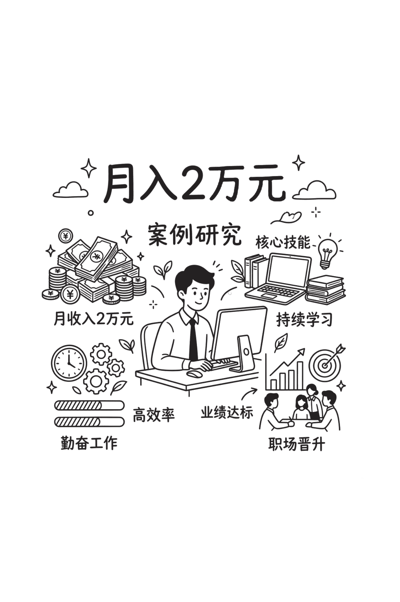

小李原是互联网公司运营，5 年经验，因担心被智能替代想做副业。他结合自身运营技能，参考 Dan Koe 的个人品牌打法，锁定“职场运营技能知识付费”赛道，用两大系统完成从 0 到 1 的突破。

第一步是打造个人品牌定位，智能辅助梳理核心优势。他先盘点自身优势：5 年互联网运营经验，擅长短视频运营、社群运营、用户增长；再用 OpenClaw 分析职场运营知识付费的市场需求，确定定位为“职场运营干货分享，帮普通人快速掌握运营技能，实现加薪与副业增收”；并用 Seedance 2.0 制作个人 IP 宣传视频，突出行业经验与核心卖点，为后续品牌建设奠定基础。

小李用AI把一人公司做到月入两万的拆解

第二步 建立AI协同的知识付费生产线。围绕职场运营变现，小李把OpenClaw当成素材雷达，让它持续爬取职场运营的热搜知识点、学员痛点和爆款课结构，按短视频运营、社群运营、用户增长三条线归档成素材库，再推给Seedance 2.0。随后由Seedance接手生产端，输入一个关键词就能把脚本、镜头、剪辑和配音串起来，原本一节课要耗掉数小时，现在15分钟就能出成品。月产量拉到40节课左右，完整的职场技能付费体系就搭起来了，定价区间设在99到299元，覆盖不同支付意愿的学员。

第三步 用AI做精准获客放大个人声量。小李照搬Dan Koe的内容引流思路，用双工具形成闭环。先让Seedance把付费课拆成15到30秒的轻量种草短片，主题集中在职场干货、实操方法、加薪案例，强调即用性；再由OpenClaw负责把这些片段批量推送到抖音、视频号、小红书，并打开自动咨询接待，报名和学习类提问由系统先行回复，同时把高意向信息沉淀下来。直播切片也是Seedance来做，视频号上做免费干货直播，进一步强化专业形象，持续吸入精准用户。

第四步 让AI跑标准化服务，实现持续盈利。小李用OpenClaw搭了一套全自动的学员服务线，报名确认、课权限开通、学习行为统计与报表生成都由系统完成；常见问题自动推送标准话术，并把高频问答沉淀为答疑库；课程迭代后系统自动触达学员，提升满意度和复购。小李只保留高端学员的一对一辅导，其余环节全部交给自动化，大幅压缩时间成本。

第五步 向上做高客单定制，提升收入天花板。基础课跑顺后，小李参照Dan Koe的高价值服务打法，切入两条新业务：面向个人的职场运营一对一定制辅导，单价999元；面向中小企业的员工运营培训，包含专属培训影像和方案，单价5000到10000元一单。定制影像由Seedance快速完成，企业需求梳理与交付跟进由OpenClaw负责。运营4个月后，基础课每月卖出300多份约1.2万元，一对一每月服务20多人约2万元，企业定制每月2到3家约1到3万元，综合月收入稳定在2万元以上，且随品牌势能持续上升。整个体量一人可控，月度开销仅工具会员和办公软件，实现了低风险高回报。

这个案例说明，依托Dan Koe的一人公司思路，结合自身优势，用OpenClaw加Seedance 2.0的组合，就能把个人服务品牌做成稳定创富的模式，且具备较强的赛道迁移性。

第七章 OPC核心变现场景：“一人一剧组”式视频创作变现

核心价值在于以OPC为合规主体落地一人一剧组的生产方式，实现内容引流与定制交付的双重获利，从流量与商业服务两端抬高盈利能力，让视频创作成为可持续的核心竞争力。相比纯个人创作，OPC身份能签正规合同承接企业级定制，提升信任与客单价，还能享受创业扶持降低成本。一人一剧组则提供高效率的内容生产力，两者叠加同时突破效率与利润空间。

第一重变现是内容引流变现，属于流量基本盘。依托一人一剧组，Seedance 2.0可以快速产出高传播且垂直的轻量内容，如行业科普、热点解读、IP宣传，投放到抖音、视频号、小红书实现自然引流。这些内容既能沉淀精准客户，也可通过平台分成与广告合作获得基础收益。更关键的是，优质引流内容塑造品牌调性，为定制服务转化埋下伏笔，实现流量向留量的沉淀。

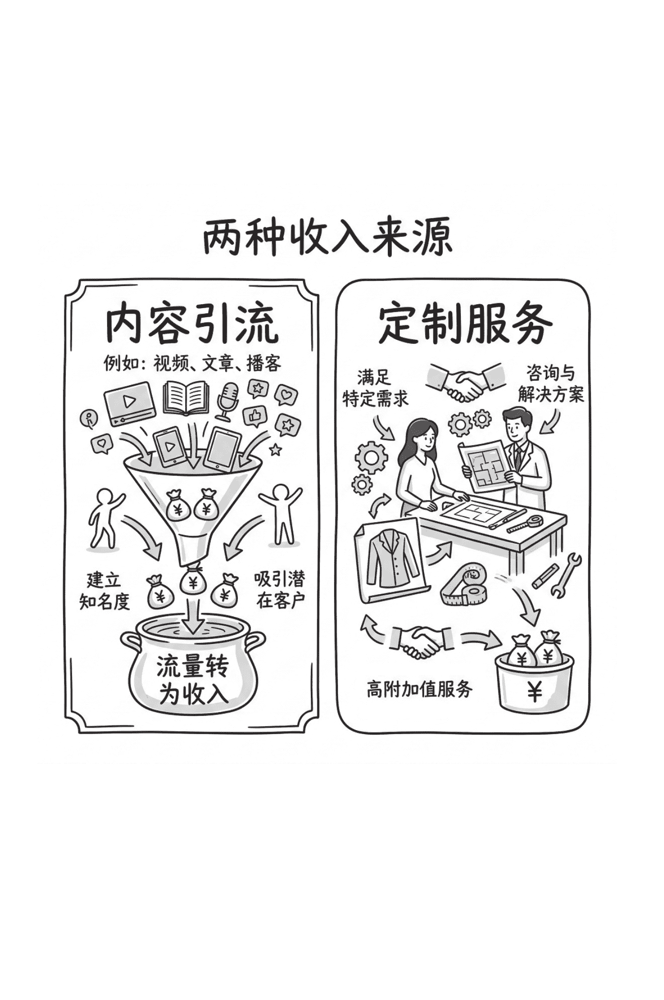

第二重变现是定制服务变现，是利润的核心。凭借合规主体，可把一人一剧组的生产能力产品化，承接中小企业、线下商家、个人IP的定制需求，如企业形象短片、产品推广片、微短剧、探店影像、知识付费教学影像等。对传统团队而言，OPC响应更快、交付更快、成本更低，能以更短周期更低价格交付高质量作品，形成差异化。单条定制的客单价远高于流量收益，成为主要收入来源。

内容引流与定制服务形成相互喂养的闭环：引流带来持续线索，缓解获客难贵；定制交付强化口碑，吸引更高质量流量；定制利润反哺内容打磨，形成良性循环，打破单一创作的收入瓶颈，提升抗风险能力。

落地路径覆盖选题、脚本、制作、发布、转化五步，全程以Seedance 2.0为主创作引擎，OpenClaw负责素材搜集、数据统计、平台分发、客户对接，效率大幅提升，零基础也能快速上手。

选题阶段，OpenClaw自动监测热点并结合赛道定位。只需设置指令，例如每日抓取抖音、视频号本地餐饮赛道的热选题、流量词、爆款框架并按传播度排序。OpenClaw通过浏览器自动化完成全网分析，结合企业定制、本地生活、知识付费等赛道需求，锁定既能吸流又能匹配商业目标的方向。

脚本生成阶段，Seedance可一键产出专业脚本，OpenClaw辅助打磨细节。输入关键词和核心要求，例如本地火锅探店突出锅底特色与食材新鲜、20秒快节奏，Seedance即生成含台词、镜头、情节、时长的标准化脚本。OpenClaw拆解爆款脚本逻辑，把优质句式与节奏设计同步优化，5到10分钟完成，无需专业编剧背景。

视频制作阶段，Seedance支持一站式成片。导入优化脚本后选择风格、分辨率、配音音色，系统自动完成画面生成、剪辑、配音、字幕、特效。多模态参考可上传客户素材实现定制化，帧级可控编辑可微调细节，10到30分钟完成传统剧组数小时的工作量。

发布引流阶段，OpenClaw支持多平台自动化分发。成片上传后设定规则，如抖音、视频号、小红书同步，标题自动匹配流量词并在高峰时段定时发布。同时自动监测播放、点赞、评论、咨询等数据并生成统计报表，为优化提供依据。

客户转化阶段，OpenClaw自动化接待咨询。开启自动对接功能后，评论区、私信里关于报价、是否可做企业形象片等常见提问会自动推送标准解答、报价方案与案例展示，并把用户信息与需求沉淀到订单表。创作者只需跟进高意向客户，完成需求确认、方案定制与合同签署，转化效率明显提升。

五步跑通后形成创作、引流、转化的完整闭环，Seedance负责创作，OpenClaw负责运营提效，一人即可实现规模化生产与高效商业变现。

高变现方向主要包括微短剧、知识付费影像、企业形象片、节日定制影像，均贴合当下需求，客单价高且复购潜力强。

微短剧是流量风口，需求来自企业品牌宣传、商家引流、个人IP打造。时长1到3分钟，剧情化轻量化传播效率高。Seedance可一人完成脚本、画面、剪辑、配音，无需演员与场地。变现方式包括定制收费单部500到5000元、流量分成、广告植入，既可接企业定制，也可自建IP变现。

知识付费影像契合终身学习趋势，需求来自职场提升、创业、兴趣学习。内容专业、实用、体系化，可一次制作多次售卖。依托Seedance可打造职场技能、创业指导、AI工具使用等系列课程，以OPC售卖定价99到999元，同时可承接企业员工培训定制，客单价高、复购率高，是长期稳定收入来源。

企业形象片是中小企业刚需，用于品牌打造、产品推广、招商加盟。传统制作成本高周期长，OPC模式可通过Seedance多模态参考与定制创作，1到3天完成成片，收费1000到10000元，远低于传统影视公司。借助OpenClaw积累客户资源，还能实现复购与转介绍，是高客单价核心服务。

节日定制影像紧扣节日消费，需求来自企业福利、商家引流、个人纪念，涵盖春节、中秋、情人节等。特点是氛围感强、个性化、时效性强。可提前制作标准化模板，节日期间做定制化修改交付快，还能打包影像制作与引流策划提升客单价，节假日订单量可达平时的3到5倍，是阶段性高收入来源。

案例拆解参考Josh Wallace Kerrigan创作模式。90后自由职业者小张以OPC为商业主体，借助Seedance 2.0打造一人一剧组体系，深耕科技领域，运营NeuralViz频道，1年内积累23万精准粉丝，单条定制影像变现5000元，最终实现经济独立。

小张原为科技公司文案，因厌倦朝九晚五转型自由职业。初期创作效率低质量差难以变现。注册一人公司后，聚焦科技影像创作，参考一人一剧组模式启动NeuralViz。

定位阶段，他将频道打造成AI工具实操科普，教普通人快速玩转AI创作，避开红海。OpenClaw分析科技流量趋势，核心方向定为AI工具教程、科技热点解读、AI创作案例展示，确保内容符合平台趋势且具实用性。

创作阶段，Seedance 2.0实现全流程一人制作：复杂场景生成科技感画面，关键词输入完成脚本、剪辑、配音、字幕一站式产出，并把AI轻微肌理感转化为频道专属科技风格。原本数小时的工作缩短至20分钟，日更一条且质量超越同赛道创作者。

运营阶段，OpenClaw自动化处理全流程：搜集科技热点与AI新动态提供灵感，多平台定时发布并监测粉丝增长、播放、互动数据，自动对接粉丝咨询并沉淀高意向客户需求。

变现阶段，粉丝破10万后开启多元化盈利：定制影像服务承接科技企业和AI工具公司，单条5000到10000元，成为核心收入；知识付费课程定价199到399元，累计售出超1万份，实现一次创作多次变现；平台广告与流量分成提供基础收入；一对一AI工具教学收费299元每人，提升黏性。

一年后，NeuralViz粉丝达23万。OPC月度盈利稳定：定制影像每月10到15单，收入5万到15万元；知识付费课程每月售出300多份，收入1万到2万元；其他变现约5000元，综合月收入稳定在6万元以上，运营成本仅千元级别，实现低风险高盈利与经济独立。

该案例证明，借鉴Josh Wallace Kerrigan模式，借助Seedance 2.0打造一人一剧组式OPC，普通人也能在视频赛道实现规模化变现。

## **第八章 OPC 放量：从个体作战到弹性协同的创富路径**

### **运作框架：主体锚定 + 智能提效 + 弹性补位**

把生意做大，常规打法是扩招、租场地、加重资产。OPC 的放大逻辑完全不同，核心是把经营主体当锚点、以效能为第一优先级、用柔性网络来补位。借助 OpenClaw 和 Seedance 2.0 把自动化运营和内容生产打磨得更顺，让负责人抽身于重复执行，把精力放在战略判断、客户关系和品牌塑造上；同时编织轻量化的弹性协作网，用外部优质资源弥补个人短板，最终做到营收放大而成本结构保持轻盈。这正是数字时代 OPC 放大的关键要义。

传统企业的放量往往伴随重负担，人手增加推高人力开销，场地扩张带来租金压力，还会衍生管理混乱、沟通迟滞、决策变慢等隐性成本，最终陷入越大越重的循环。OPC 的扩张逻辑彻底反转，始终坚持轻体量、高效能原则，以 OPC 作为唯一的合法经营载体，所有扩张动作都服务于创富效应的放大与运营成本的压降。

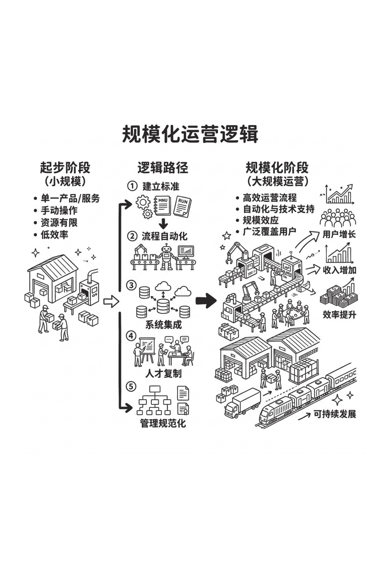

这套运转思路可拆成三层。

第一层，锁定 OPC 为唯一经营主体。业务开展、资源对接、商务合作全部挂靠在 OPC 之下，创始人始终掌握主体控制权与决策权，保证运作灵活、响应迅速，避免团队膨胀后失控与决策低效。并且保留 OPC 本身的轻体量属性，不租用大型办公场地，不配全职员工，核心开销始终保持在低位。

第二层，用智能体持续释放效能。OpenClaw 与 Seedance 2.0 的自动化能力是放大的基础，随着订单上升，要进一步深挖两套工具的潜能。通过定制技能与协同方式的优化，让自动化覆盖更多业务环节，如订单管控、客户跟进、内容生产、经营统计等，确保订单翻倍时负责人的投入时间不跟随增长，始终维持高能运行。

第三层，构建弹性协作网络整合外部轻资源。这是放大的关键点。当工作量超出个人承载时，不去招全职，而是按单组建由自由职业者、兼职从业者与其他 OPC 构成的弹性网络，引入外部优质资源，如专业文案策划、行业资深顾问、精准流量渠道等。协作的本质是按需合作、按结果付费、灵活调整，根据订单需求挑选合适伙伴，签短期协议按交付成果结算，不承担固定人工成本。业务回落时可快速收缩规模，避免资源闲置，真正做到轻资源整合、高效协作。

以 OPC 为核心引擎，以智能工具为效能支撑，以弹性协作网为资源补充，三者配合让 OPC 的放大摆脱重资产束缚，同时实现营收规模化与成本轻量化，最终完成从单人盈利到轻量规模化盈利的跃迁。

### **效能升级：重复工作交给自动化、内容生产靠创作引擎、经营者聚焦决策与客户**

规模化运营的前提是效能的持续提升，而提升的抓手始终是 OpenClaw 与 Seedance 2.0。OpenClaw 进一步挖掘自动化潜力，承接更多更复杂的重复事务，实现运营全流程高度自动化；Seedance 2.0 通过技能打磨和功能拓展，提升内容生产效率与品质，实现创作的规模化与标准化。二者共同发力，把创始人从执行中解放出来，聚焦核心决策与客户维护这两个人工智能难以替代的高价值环节，这也是实现规模化盈利的基础。

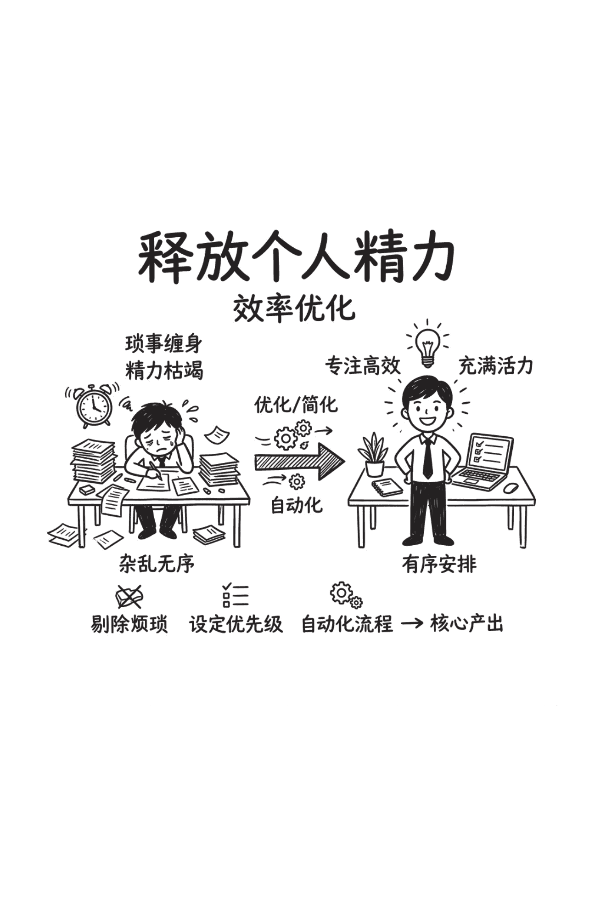

随着业务量增加，重复事务同步增长，若仍由负责人手工处理，效率会快速下降，陷入忙碌却看不清的困境，难以推进放大。OpenClaw 的自动化能力恰好解决这一问题，是规模化运营的效能基石。在既有功能上，通过自定义技能拓展可实现更复杂更细分的重复工作自动化。在客户管理上，可开发客户画像自动生成与精准维护技能，根据合作历史、需求特征、消费能力自动生成画像，并定时推送个性化维护信息，提升黏性。在订单管理上，可开发订单自动归类与进度实时追踪技能，按订单类型、客单价、交付周期自动归类管理，实时追踪进度并自动提醒交付节点，避免遗漏。在经营统计上，可开发多维度经营数据自动分析技能，从收入、客户、流量、创作等多角度自动生成经营分析报告，为负责人核心决策提供精准参考。通过这些定制技能，OpenClaw 可实现 OPC 运营全流程高度自动化，处理 90% 以上的重复事务，让负责人无需关注执行细节，只需掌握核心经营数据即可。

与此同时，Seedance 2.0 作为创作引擎，其效率与品质的提升是创作规模化的关键。随着订单增长，Seedance 2.0 可通过技能打磨与标准化生产实现进一步提效。一是打磨赛道专属技巧，如针对企业宣传片，优化复杂场景生成与品牌素材融合能力，让定制视频更贴合客户需求；针对微短剧，优化剧情编排与角色一致性表现，提升内容观赏性。二是搭建标准化创作模板。针对高频订单，如短视频定制、节日影像，搭建标准模板，只需按客户需求做少量修改即可快速交付，将单条视频制作时间从 30 分钟压缩到 10 分钟，实现创作规模化。三是将 AI 创作缺陷转化为风格标签，打造标准化的视觉与内容风格，让视频形成统一品牌标识，提升满意度与复购率。

OpenClaw 的运营自动化与 Seedance 2.0 的创作规模化，共同释放负责人的精力，使其聚焦两大高价值环节：一是核心决策，根据 OpenClaw 提供的多维度数据，制定发展战略，如赛道拓展、价格调整、协作网络搭建等，把握市场趋势，抓住盈利机会；二是客户维护，聚焦高客单价、高复购率的核心客户，进行深度对接与个性化服务，打造核心客户群，实现老客户持续复购与转介绍，为规模化盈利提供稳定客户资源。

归根结底，效能优化的本质是让智能工具承担更多执行性工作，让负责人聚焦 AI 无法替代的核心工作，实现人尽其才、工具尽其用，这也是 OPC 规模化运营的核心逻辑。

### **实战拆解：小吴半年从 1.2 万到 5 万的跃迁样本**

专注中小企业数字内容服务的 OPC 创始人小吴，依托 OpenClaw 与 Seedance 2.0 实现效能优化，从单人运营出发，参照行业标杆的弹性协作模式搭建轻资产协作网络，仅用半年就实现从月入 1.2 万元到月入 5 万元的跨越，完成从一人盈利到轻团队规模化盈利的成长。其案例具备清晰路径与极强可复制性，为普通从业者提供了实操参考。

小吴最初是职场副业者，注册 OPC 后聚焦中小企业短视频定制赛道，通过单人运营模式实现月入 1.2 万元的稳定盈利。随着客户需求增加，单人模式逐渐出现订单接不过来、部分需求无法满足的问题。意识到放大的必要性后，小吴参照行业标杆弹性协作模式开启规模化之路，半年内实现收入大幅增长。

第一阶段：单人运营优化期 1～2 个月，深挖智能工具潜能，实现运营与创作标准化，这是放大的基础。小吴首先对 OpenClaw 与 Seedance 2.0 的使用进行全面优化，提升自动化与创作效率。针对 OpenClaw，开发了客户对接—订单管理—交付统计的一站式自动化技能，实现客户咨询、订单录入、进度追踪、文件交付、数据统计全流程自动化，将原本每天需耗时 2 小时的运营工作压缩至 10 分钟。针对 Seedance 2.0，他搭建了中小企业短视频定制的标准化创作模板，涵盖餐饮、零售等多个行业，将单条定制视频制作时间从 30 分钟缩短至 15 分钟，同时打磨出专属商业视频风格，提升内容质量与客户满意度。通过工具优化，小吴的单人创作与运营效率提升 2 倍，每月可承接订单量从 30 单提升至 60 单，月收入从 1.2 万元提升至 2.5 万元，为规模化运营积累充足客户资源与盈利基础。

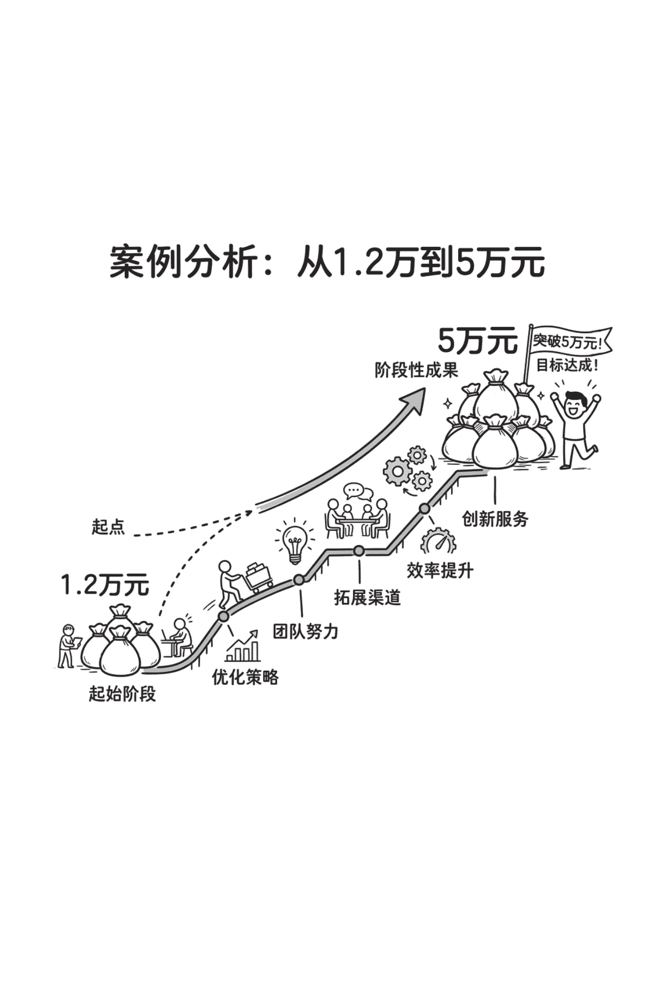

第二阶段：弹性协作探索期 3～4 个月，整合单一资源，补齐能力短板，承接高客单价订单。在效能优化基础上，小吴发现部分客户有更高端需求，如企业品牌全案设计、短视频账号代运营等，超出个人能力范围无法承接。于是小吴开始搭建初级弹性协作网络，整合单一外部资源。通过线上创业社群，筛选 2 名专业自由职业者——一名资深品牌策划、一名专业账号运营，签订弹性合作协议，采用按任务完成支付费用模式，无需承担固定工资。针对有全案设计需求的客户，小吴负责核心视频创作，品牌策划负责品牌文案与视觉设计，二者协同完成全案服务，客单价从原本的 500～2000 元提升至 5000～10000 元。针对有账号代运营需求的客户，小吴负责视频创作，账号运营负责内容发布与数据优化，实现创作—运营协同，单月代运营费用为 2000～5000 元。通过整合单一资源，小吴的 OPC 成功承接高客单价订单，每月新增高客单价订单 5～8 单，月收入从 2.5 万元提升至 3.8 万元，同时积累弹性协作实操经验。

第三阶段：轻团队成型期 5～6 个月，搭建多元弹性协作网络，实现业务规模化，月收入突破 5 万元。在初级协作基础上，小吴参照行业标杆协作模式，搭建涵盖品牌策划、账号运营、文案撰写、直播策划的多元弹性协作网络，整合 8 名不同领域自由职业者，制定标准化协作流程与分成机制，实现客户需求—资源匹配—协同完成—统一交付的全流程标准化。同时，小吴将所有协作管理工作交由 OpenClaw 自动化处理，OpenClaw 可自动匹配客户需求与协作伙伴，实时追踪协作进度、自动统计协作成果与分成，让小吴无需花费过多时间在协作管理上，仅需聚焦核心客户对接与战略决策。多元弹性协作网络的搭建，让小吴的 OPC 实现业务全面规模化，能承接中小企业数字内容全案服务，涵盖短视频定制、品牌策划、账号代运营、直播策划等多个领域，客单价大幅提升，每月订单量与客单价实现双重增长，综合月收入突破 5 万元。但运营成本仅增加协作分成与少量工具升级费用，仍保持轻资产运营，真正实现规模化盈利而不增加重资产负担。

小吴的案例充分证明，OPC 的规模化运营无需走传统重资产老路，只需依托智能工具实现效能优化，再搭建轻资产弹性协作网络，就能实现收入快速增长，完成从一人到轻团队的升级。

# **第四部分 分场景创富实操——不同人群的 OPC+工具落地案**

## **第九章 职场双线：主业稳住，副业靠 AI 工具安静变现**

### **主业减负：用自动化办公换出低风险试水的时间窗口**

职场人切入 OPC 模式，需要遵循的核心原则是主业为基、副业为辅、智能提效、低险试错。OpenClaw 作为智能体，正是实现这一原则的核心工具，通过自动化处理主业的重复性办公工作，大幅提升职场工作效率，让职场人能在不影响主业的前提下，腾出碎片化或固定时间搭建轻量 OPC 副业，既守住职场稳定基本盘，又能借助 OPC 实现增收，真正做到鱼和熊掌兼得。当下职场人面临的核心痛点是工作忙、时间少、不敢轻易放弃主业，想搞副业却没有精力。传统副业模式要么时间成本高，要么与主业冲突风险较高，而智能工具+OPC 的副业模式恰好解决了这些痛点，高度适配职场人时间与身份特性。

OpenClaw 对职场主业的提效赋能，体现为办公全流程自动化。针对职场中常见的文件处理、数据统计、报表制作、邮件回复、素材整理等重复性工作，职场人只需在 OpenClaw 中设置简单指令，就能实现 7×24 小时自动化处理。比如行政岗可设置指令每日自动整理办公文件、分类归档，每周自动生成行政工作报表；运营岗可设置每日自动搜集行业素材、统计平台数据，自动回复标准化客户咨询；财务岗可设置每月自动整理票据、统计基础账务数据，生成简易财务报表。这些原本需要花费大量时间的琐事，在交由 OpenClaw 处理后，能为职场人节省 30%～50% 工作时间，不仅能更轻松完成主业工作、避免加班，还能腾出专属时间搭建与运营 OPC 副业。

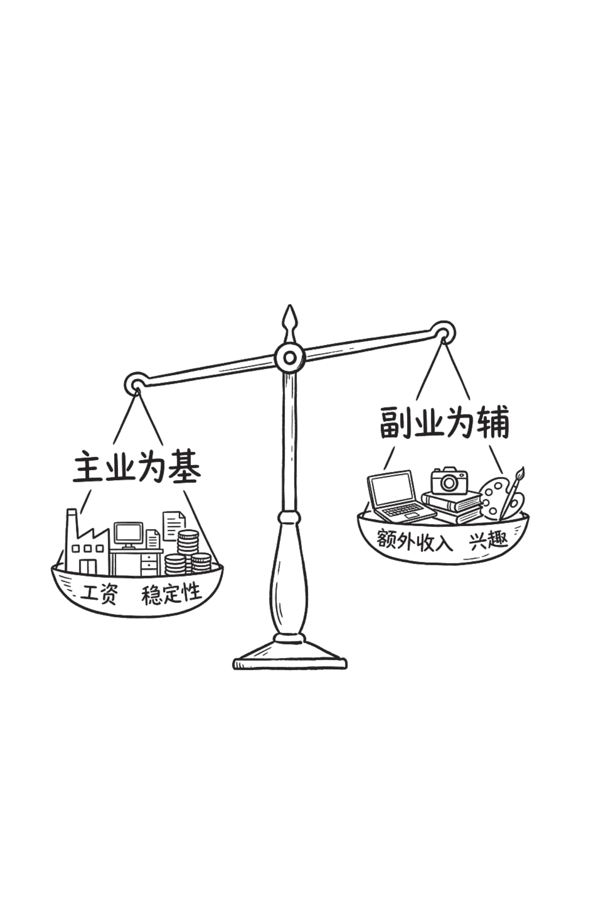

轻量 OPC 副业的搭建完全贴合职场人时间特性，无需全职投入。职场人可采用碎片化运营+自动化执行的模式：利用下班后、周末的碎片化时间完成 OPC 的赛道定位、客户对接、创意构思等核心工作，将素材搜集、订单处理、文件交付等执行性工作交由 OpenClaw+Seedance 2.0 自动化完成，真正实现用业余时间做专业副业。同时，职场人可选择搭建与主业相关的 OPC 副业，实现主业能力复用。比如新媒体运营岗可做短视频定制副业，人力资源岗可做职场规划咨询副业，既降低 OPC 试错成本，又能通过副业反哺主业能力的提升。这种以 OpenClaw 提效主业、腾出时间做轻量 OPC 的模式，可让职场人实现低风险试错，无需放弃主业薪资、社保等福利，仅用闲置时间开启副业，即使 OPC 初期运营效果不佳，也不会对生活造成影响。一旦 OPC 步入正轨，就能实现稳定增收，甚至后期成为全职创业基础，为职场人提供进退自如的创富选择。

### **赛道选择：基于本职能力做轻量变现，借助工具承接小体量订单**

职场人搭建 OPC 副业，核心逻辑是结合自身技能、聚焦轻量赛道、适配工具能力。无需追求大而全，只需依托自身职场技能与经验，聚焦技能变现与轻量服务等低门槛、高适配的赛道，再借助 OpenClaw+Seedance 2.0 的智能工具能力，运营小型 OPC，承接轻量的视频定制或服务订单，就能快速实现副业增收。脱离自身技能的副业往往需要花费大量时间学习新能力，试错成本高，而依托职场技能的 OPC 副业能实现能力复用、快速落地，这是职场人最大优势。因此赛道选择第一原则就是从主业技能出发，做能力范围内之事。结合职场人技能特性与智能工具适配性，技能变现、轻量服务是两大最优赛道，且可进一步拆解为多个轻量细分方向，职场人可精准匹配。

一是技能变现赛道，核心是将职场专业技能转化为标准化的商业服务，适配有明确专业技能的职场人，如新媒体运营岗可做短视频脚本撰写、账号基础运营，设计岗可做简易视觉设计、海报制作，文案岗可做商业文案撰写、朋友圈文案定制，职场培训岗可做职场技能小课、一对一职业规划。这类赛道无需重资产投入，只依托个人技能。可借助 Seedance 2.0 制作技能展示视频、引流短视频，借助 OpenClaw 自动化处理客户对接、订单交付，一人就能轻松运营。

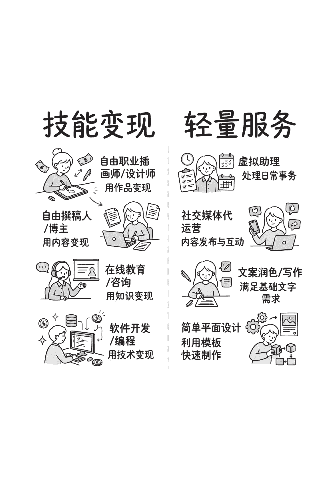

二是轻量服务赛道，为中小企业、线下商家提供轻量化的配套服务，适配有基础运营、沟通能力的职场人，如可做本地商家探店视频制作、企业宣传短视频定制，以及线上平台基础入驻、店铺装修、客户社群基础维护、消息回复等。这类赛道门槛更低，无需精深专业技能，依托 Seedance 2.0 的零门槛视频创作能力，就能承接轻量视频定制订单，还可借助 OpenClaw 实现自动化运营，快速变现。职场人运营小型 OPC，需遵循轻量运营、小单快跑原则。初期不承接高难度、长周期订单，聚焦轻量、高频、易交付订单类型，如短视频定制选择 15～30 秒轻量化视频，技能服务选择单次、简易服务内容。这既能降低运营难度，又能快速积累客户与口碑。同时，OpenClaw+Seedance 2.0 的协同能为小型 OPC 提供全流程支撑：Seedance 2.0 负责制作引流视频获取客户、承接轻量视频定制订单；OpenClaw 则负责自动化处理 OPC 的客户对接、素材搜集、订单交付、数据统计等。由此，职场人无需在运营上花费大量时间。

比如一名新媒体运营岗的职场人，搭建 OPC 副业做短视频定制，可利用 Seedance 2.0 制作引流短视频发布于线上平台，承接中小企业的轻量化产品推广视频订单；用 OpenClaw 自动化回复客户咨询、整理定制需求、交付视频文件，全程仅需用碎片化时间完成需求确认与创意把控。每月承接 20～30 单轻量订单，就能实现数千元甚至上万元的副业增收。这种结合自身技能、聚焦轻量赛道、借助智能工具运营的模式，让职场人 OPC 副业真正实现低门槛、低时间成本、高变现效率，成为职场人增收的最佳选择。

### **时间策略：碎片时间兼顾主副业，高效产出且不越界**

职场人运营 OPC 副业的核心难点并非工具使用或赛道选择，而是时间管理，即如何在有限时间内平衡主业与副业，实现主业稳定、副业增收。既不因副业耽误主业工作，又能让副业实现高效产出，同时规避因副业引发的职场风险。这是职场人必须掌握的核心能力。借助智能工具自动化，时间管理将变得简单高效，真正做到不忙乱、高产出。

职场人时间具有固定性、碎片化、不可控性特点。上班时间需专注主业，只有下班后和周末的固定时间，以及通勤、午休的碎片化时间可自由支配，且偶尔会因主业加班导致时间不可控。因此对应的管理原则是：让智能工具承接自动化工作，人聚焦核心工作；碎片化时间处理轻量工作，固定时间处理核心工作，将人与智能工具能力进行精准匹配，最大化每一分钟的价值产出。

双线兼顾的操作框架：用时间分区与智能分工稳住OPC兼营

能否在正职与OPC兼营之间取得平衡，关键在于时段清晰、重复事务交给工具、碎片被善用、流程可复制。

一、划清时段界线，把本职与兼营分开，这是双线稳定与风控的基础。上班时段要全情投入本职，严禁处理任何兼营事项；OPC工作只能安排在下班后、周末等私人窗口。这样既能保证本职绩效，避免因兼营受公司追责，也能让大脑形成切换习惯。实际做法可以把19点到21点固定为OPC核心作业时段，周末每天保留3小时做深度运营，通勤与午休则只处理轻量事务。节奏固定后，兼营推进才不易混乱。

二、让AI承接重复执行，释放人的精力，这是提效的核心支点。OPC里所有标准化重复环节，都交给OpenClaw与Seedance 2.0去跑，人只保留创意构思、深度客户沟通、需求确认、订单复核等无法替代的环节。例如OpenClaw可自动搜集素材、回复客户常规咨询、整理订单资料、打包发送成片；Seedance 2.0负责快速生成视频。人只需在专属时段把控创意与个性化对接，原本需数小时的工作可压缩到1至2小时内完成，时间成本大幅下降。

三、用碎片窗口消化轻操作，追求整体利用率最大化。通勤、午休这类零散时间，不安排深度任务，只做OPC的轻量动作，比如用手机回客户的个性化问题、在平台筛选需求、查看OpenClaw的运营报表、记录视频选题灵感等。这些无需电脑、几分钟可完成，不影响本职，又能让兼营持续运转，积少成多。

四、建立可复制的标准流程，提升兼营产出。客户沟通、订单处理、视频制作等核心环节都要固化，避免因混乱浪费时间。制定统一的话术、固定的制作步骤、一致的交付规范，并借助OpenClaw转化为自动化指令，效率再上一层。同时要做好风控，除时间界线外，还需审慎挑选赛道，避免与本职直接竞争；不使用公司信息、设备开展兼营，不利用本职人脉获客，确保合规，从源头规避风险。

把时间管理与自动化结合，本职稳定不加班，兼营增收不焦虑，才能实现低风险高产出的双线发展。

## 第十章 创业者：轻资产起步，OPC加AI降风险

### 创业定位：绕开重资产，聚焦AI赋能的轻服务赛道小步试错
当下创业者的主要困境是传统重资产模式投入大、风险高、试错贵。租场地、组团队、买设备，前期动辄数万到数十万，一旦判断失误就血本无归。AI时代的创业逻辑已从拼规模的重模式转向拼效率的轻模式。核心思路是避开重资产陷阱，聚焦智能赋能的轻服务赛道，用OPC方式起步，用自动化工具替代传统团队，单人搭建商业闭环，从根源上压低试错和运营开销。

重资产创业成本刚性、灵活性差、抗风险弱，无论盈亏都要承担房租人工设备。轻服务赛道则投入低、灵活高、适配自动化好，不需要重资产，靠服务能力加智能赋能即可，和OPC轻运营高度契合。结合工具能力与2026年的市场趋向，创业者切入OPC的核心选择是三大轻服务赛道：数字内容服务、专业咨询服务、智能工具代运营服务，边界清晰、变现路径明确。

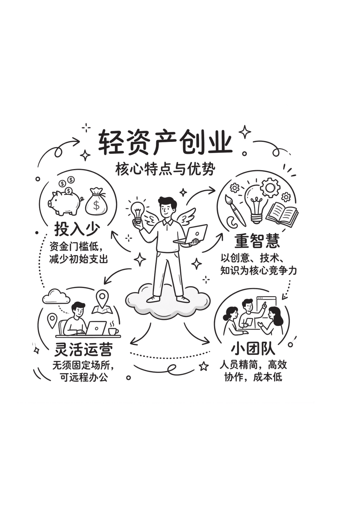
数字内容服务赛道，依托Seedance 2.0的视频创作能力，为中小企业、线下门店、个人IP提供短视频定制、微短剧制作、企业宣传片、知识付费视频等。该赛道无需拍摄设备、无需组建团队，单人加自动化工具即可完成全流程，客单价合理、需求旺盛，是落地最快的轻服务。

专业咨询服务赛道，依托创业者自身行业经验和专业知识，为企业和个人提供财税、管理、职场规划、智能工具使用等咨询。几乎零硬件投入，核心是个人专业力，配合OpenClaw自动化处理客户对接、报告整理、数据统计，服务效率大幅提升，客单价高、竞争相对温和。

智能工具代运营服务赛道，为不会用自动化工具的中小企业和个人提供OpenClaw、Seedance 2.0等的代运营、技能教学、定制化配置服务。契合智能普及的大趋势，需求持续增长，创业者凭借对工具的熟练度，借助工具自带的自动化实现高效运营，变现空间大。

用OPC方式切入这些赛道，能从根本上降低试错与运营开销。试错成本上，OPC前期投入极小，主要就是工具会员和工商注册等小额费用，即使赛道失误损失也有限，可快速切换重启。运营成本上，无需招聘全职、无需租办公室，靠OpenClaw+Seedance 2.0单人就能完成传统团队工作，人力场地成本清零，每月开销基本能控在千元级，实现费用更低运营、高效变现。

创业定位还需坚持小而美、精而专。初期不要贪多，先锁定一个细分赛道把核心服务打磨出来。比如数字内容可聚焦本地商家短视频定制，专业咨询可聚焦智能工具创业咨询。通过精准细分快速累积客户和口碑，为后期的规模化打基础。避开重资产、聚焦智能轻服务、用OPC起步，才是智能时代低风险创业的核心。

### 工具落地：OpenClaw建自动化交付，Seedance实现一人成片
以OPC做轻资产创业，工具落地的思路是分工明确、协同作战，用工具替代人力，实现自动化交付和高效创作。OpenClaw负责搭建OPC全流程自动化交付体系，让交付标准化高效化，解决单人运营交付跟不上的痛点；Seedance 2.0负责单人剧组式视频创作，实现低成本引流和内容变现，构建核心盈利能力。两套工具配合，就能单人完成引流到售后的完整商业闭环。

对轻资产OPC来说，交付标准化是稳定运营的基础，OpenClaw正是搭建体系的核心。订单承接到需求整理、服务交付、售后统计，全流程可自动化，让创业者把时间留给创意和客户维护。

落地步骤清晰可复制。先是订单承接与需求整理自动化：开启OpenClaw的浏览器控制和自动化对话，对接获客平台，自动回复咨询、归纳客户核心需求、记录订单并生成标准需求表，省去人工对接记录。第二是服务创作前置自动化：针对数字内容、专业咨询等赛道，让OpenClaw自动搜集素材、整理行业数据、撰写方案初稿，为核心创作提供基础，节省大量时间。第三是服务交付自动化：核心创作完成后，OpenClaw自动完成格式转换、打包整理、通过微信邮箱等渠道发送给客户，无需手动操作。最后是售后与数据统计自动化：自动发送回访信息、收集满意度反馈，同时统计订单、交付、客户数据并生成运营报表，为决策提供依据。

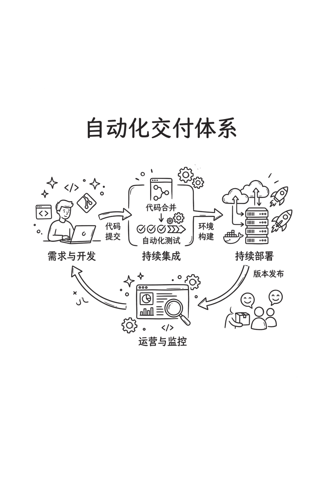
四大环节打通后，OpenClaw为OPC搭建起完整的自动化交付体系，交付效率可提升八成以上，单人也能从容应对大量订单。Seedance 2.0的单人剧组创作则是实现低成本引流和变现的抓手。数字内容赛道上，它是核心变现方式，借助Seedance 2.0单人完成视频全流程，承接定制订单直接变现；专业咨询、智能代运营赛道上，它是核心引流方式，用来制作科普视频、服务展示、案例解析等内容发布到线上，精准获客。

而且Seedance 2.0完全适配轻资产需求，不需要影视技能、不需要拍摄设备、不需要团队，输入关键词半小时内就能出一支高质量视频，创作成本降80%到90%，真正实现低成本引流变现。OpenClaw的自动化交付与Seedance的单人剧组创作协同，形成引流-获客-创作-交付-售后的闭环，让OPC实现轻资产、高效率创业，成为最佳创业载体。

### 获客打法：用Seedance做宣传片，借免费渠道引流塑信任
对轻资产OPC创业者来说，获客是生死线。传统线下地推或付费广告要么费时要么费钱，都不符合轻资产原则。智能时代的核心打法是用Seedance 2.0制作高质量服务宣传视频，结合免费线上渠道做低成本引流，同时经营个人品牌提升信任，让客户主动找上门，实现低成本、高精准、可持续获客。

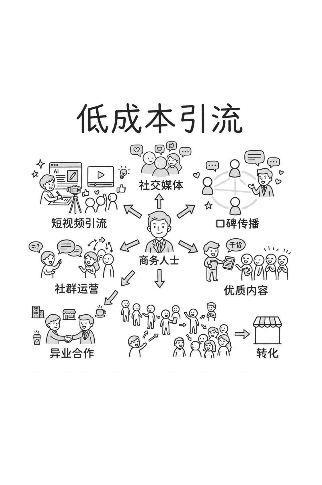
短视频是主流流量入口，视频也是最有效的获客载体。Seedance 2.0零门槛高效率，能用极低成本做出高质量宣传片，是OPC获客的核心优势。OPC服务宣传片的重点不是单纯吸睛，而是展示服务能力、解决客户痛点、突出核心优势，让视频成为OPC的线上名片。

制作技巧在于精准定位痛点、标准化呈现流程、直观展示成果，并按赛道差异化内容。数字内容赛道可做案例展示、流程拆解、客户好评视频，直观呈现创作实力；专业咨询赛道可做行业痛点解读、案例分析、解决方案展示，突出专业与问题解决能力；智能代运营赛道可做工具实操教程、代运营前后对比、客户反馈视频，体现工具价值。借助Seedance的多模态参考和复杂场景生成能力，无需拍摄剪辑技能就能产出高专业度的宣传片，成本几乎为零。

视频做好后，用免费线上渠道引流是关键。无需付费广告，聚焦抖音、视频号、小红书、B站、知乎等主流平台，按赛道选核心阵地。本地商家相关赛道重点布局抖音、视频号、小红书抓本地流量；专业咨询、智能代运营赛道重点布局B站、知乎、视频号抓精准行业流量。用OpenClaw实现多平台自动化发布和数据监测，定时在流量高峰发布，自动追踪播放、点赞、咨询数据，及时优化内容和投放策略。

引流之后要做信任沉淀。OPC的品牌就是创始人的个人品牌，客户买的是对人的信任。持续用Seedance输出高质量内容强化专业标签，保持人格化表达，比如出镜讲解、分享创业心得、解答问题，让客户感受到真实形象。用OpenClaw自动整理客户好评和案例在各平台展示，提升可信度。并建立私域池，将公域咨询客户沉淀到微信、企业微信做维护、案例分享和复购推荐，实现一次获客多次变现。制作宣传片+免费引流+个人品牌，是OPC轻资产创业的必备获客能力。

## 第十一章 内容创作者：从单人剧组到OPC，实现规模化变现

### 内容升级：用Seedance提升质感，把AI瑕疵变风格标签
内容创作者向OPC升级的第一步，是内容质量和效率同步提升，Seedance 2.0是核心工具。它大幅降低技术门槛，摆脱设备和剪辑束缚，还能打磨视频质感。更进一步，参考NeuralViz频道的经验，把智能创作的天然瑕疵转化为专属风格，让内容在同质化赛道中脱颖而出，为规模化变现奠定基础。

创作者当下的痛点是门槛高、质感难提升、风格缺特色、效率低。传统创作要买设备、学剪辑、易同质化。Seedance 2.0的全流程自动化创作把创作拉回创意本身，质感提升贯穿全流程。

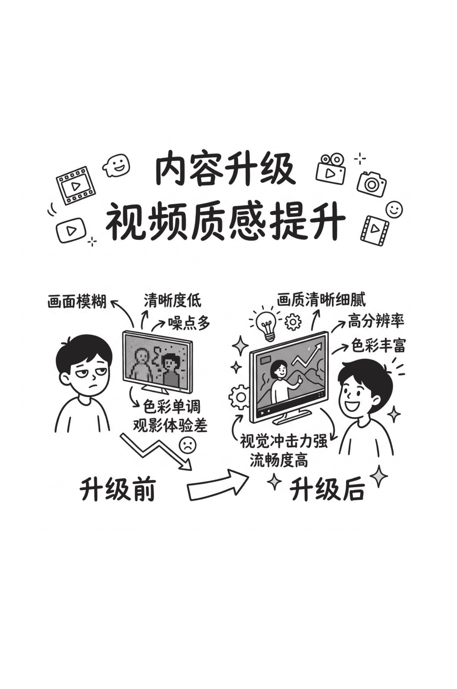
画面生成上，Seedance 2.0支持复杂场景生成和多模态参考，能生成人物生动、场景丰富、画面细腻的内容，还可上传参考素材实现品牌风格精准匹配，无需专业摄像也能达到专业水准。音频制作上，双声道音频同步和真人级配音让声音与画面精准契合，背景音乐与节奏完美匹配，解决传统音频不同步、质感差的问题。后期编辑上，精准帧级编辑和特效字幕能力支持精细化打磨，提升整体视觉体验。

同时创作门槛被彻底拉低，无需掌握PR、AE，仅靠关键词和需求描述就能从脚本到成片，原本要数小时到数天的活，半小时内完成，效率数倍提升。

更关键的是风格塑造。创作者可以把自动化瑕疵化为特色：把轻微肌理感转为复古胶片风格，把高饱和色彩转为赛博朋克或清新治愈，把人物动作的轻微机械感转为创意动画风格。Seedance丰富的风格滤镜和参数调节，让这些智能特性变成个人视觉标识，形成差异化竞争。围绕Seedance做的内容升级，让创作者聚焦创意和选题，产出高质感、有风格、强辨识的内容，而优质有特色的内容正是OPC引流变现和品牌建设的核心载体。

### 效率升级：OpenClaw接管重复事务，人专注创意与运营
升级为OPC不仅要质感，还要效率。单打独斗容易陷入创意透支，无法规模化变现。OpenClaw作为智能体，能接管创作与运营中的重复执行工作：素材搜集、字幕制作、数据统计、客户对接等均可全流程自动化。把人从繁琐事务中解放，聚焦创意输出和OPC运营两大高价值环节，从根本上提升变现效率，这是创作者从个体向创始人转变的关键。

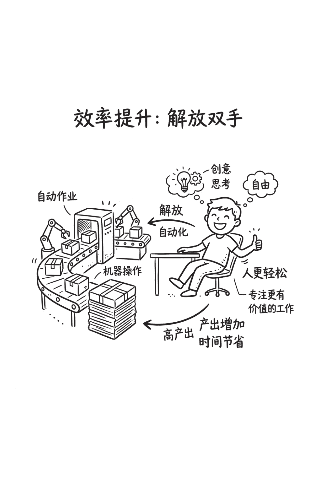

创作链路自动化：一键提效全攻略

一条完整的创作链路里，素材收集、字幕制作、格式转换这类重复性很强的环节长期吞噬创作者的时间与精力，正是最适合交由自动化处理的部分。引入 OpenClaw 的流程自动化能力后，整体产出效率能实现数倍跃升。

素材收集端，用户只需在 OpenClaw 内配置规则，比如每日自动抓取科技垂类的爆款短视频、热点文案、背景音乐并按风格归档到本地库，系统即可调用浏览器操控能力在全网精准采集，无需人工逐个翻找，单日就能省下 1 到 2 小时的整理耗时。字幕与格式端，OpenClaw 可以为 Seedance 2.0 输出的成片自动叠加精准字幕，并提供多语种转换与样式自定义，同时依据各平台规范自动完成视频格式与分辨率的转换，实现一键全平台适配，有效化解了传统制作中字幕繁琐、转码耗时的痛点。分发端，OpenClaw 支持跨平台定时推送，上传成片后设定规则，就能同步投放到抖音、视频号、B站渠道，无需逐个手动操作，同时自动回复评论与私信并筛选出高意向的客户线索。

当身份从普通创作者升级为 OPC 后，运营成为变现核心。OpenClaw 的流程自动化可以延伸到 OPC 运营的全链路，实现运营效率的最大化。在数据层面，它能够自动追踪各平台的播放量、点赞量、粉丝增长、订单转化等指标，并产出多维运营报表，帮助创作者清晰判断内容变现效果，为选题与策略调整提供依据。在客户对接层面，针对定制视频订单，系统可以自动回复咨询、归纳定制需求、记录订单信息并生成标准化的需求表，减少沟通耗时。在交付层面，OpenClaw 能够自动打包已完成的定制视频发送给客户，并完成售后回访与数据统计，搭建起标准化的交付体系。借助全流程自动化，创作者得以摆脱约 80% 的重复性工作，将重心集中在创意输出与 OPC 运营上。

在创意端，创作者能投入更多时间打磨选题与构思，产出更高质量的内容；在运营端，则可以聚焦赛道定位、客户维护、业务拓展与规模化规划等核心工作，让 OPC 的变现能力实现质的提升。效率提升是内容创作者规模化变现的前提，而 OpenClaw 正是支撑这一前提的关键力量，它让创作者真正走向以创意为核心、以智能为支撑、以 OPC 为载体的规模化发展路径。

### 变现升级：由流量饭转服务生意
创作者向 OPC 转型的核心目标是完成变现模式的全面升级，即由单一的流量变现转向多元化的 OPC 服务变现。依托 OPC 的合规商业主体身份承接视频定制、IP 代运营、知识付费等商业服务，打破流量变现的收入天花板，拓展多元收入，最终达成规模化盈利。升级的本质是将内容创作能力转化为标准化的商业服务能力，并以 OPC 为载体实现能力变现。OpenClaw 搭配 Seedance 2.0 的组合，为这一升级提供从创作到运营的全流程落地支撑。

传统创作者的变现高度依赖平台流量，主要依靠广告分成、直播打赏、商品橱窗，存在收入不稳、平台依赖强、上限低的弊端。一旦算法变动或流量下滑，收益便大幅缩水。OPC 服务变现则彻底打破这一局限，以创作者的核心创作能力为基础，构建多元化、高客单、可持续的变现体系，主要聚焦三大方向。

第一，视频定制服务变现。这是 OPC 升级后最易落地的核心场景。借助 Seedance 2.0 的单人剧组创作能力，以 OPC 主体承接中小企业、线下商家、个人 IP 的定制视频订单，如企业宣传片、产品推广片、微短剧、探店视频等。相较流量变现，定制服务的客单更高、收入更稳，且能凭借创作者的内容经验与个人风格打造差异化服务。单条定制价格可根据难度定在 500 至 5000 元区间，每月承接 20 到 30 单即可获得稳定高收入。OpenClaw 可以为定制业务提供全流程运营支持，实现客户对接、订单管理、交付统计的自动化，让创作者高效承接大量订单而不陷入执行细节。

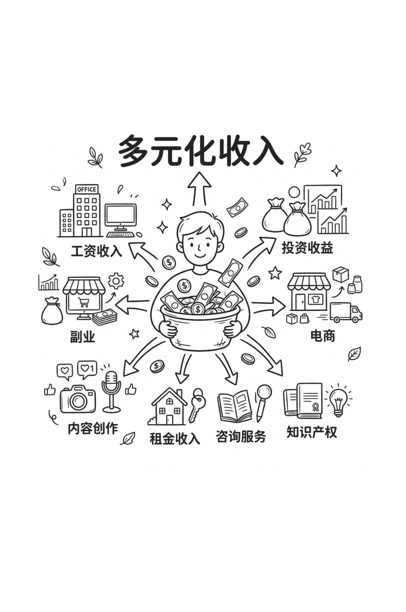
第二，IP 代运营服务变现。依托平台运营经验与内容创作能力，为中小企业、个人 IP 提供短视频账号代运营，包括选题策划、内容创作、平台发布、数据优化、粉丝维护等全流程服务。可按月或按年收取费用，单账号代运营费用约每月 2000 至 10000 元。该场景可以实现能力复用与长期盈利，并借助 OpenClaw 加 Seedance 2.0 的协同能力同时运营多个账号，实现规模化运营并拉高收入上限。

第三，知识付费服务变现。将内容创作经验、运营方法、智能工具用法等沉淀为标准化知识付费产品，如线上课程、实操训练营、一对一指导。依托 Seedance 2.0 产出高质量课程视频，借助 OpenClaw 实现课程发布、学员管理、答疑对接的自动化，可以实现一次制作、多次变现。知识付费边际成本低，制作完成后即可持续售卖，成为 OPC 的长期稳定收入来源，同时还能提升个人品牌影响力，反哺定制与代运营业务。

从流量变现到 OPC 服务变现并非放弃流量，而是以流量为基础，借助积累的粉丝与品牌影响力拓展更高价值的商业服务，形成“流量引流—服务变现—品牌提升—更多流量”的正向循环。OpenClaw 加 Seedance 2.0 为该循环提供全流程支撑。Seedance 2.0 负责打造优质内容完成流量引流，同时兼顾定制视频与课程视频的创作；OpenClaw 负责运营自动化，提升服务交付效率，让 OPC 能承接更多商业订单。最终，创作者依托 OPC 实现多元化、规模化盈利，摆脱对平台流量的依赖，成为真正的智能时代内容创富者。

## 第十二章 自由职业者：打造 OPC 品牌，联动视频创作，实现多元化收入

### IP 定位：构建智能加持的 OPC 品牌，聚焦轻量服务赛道
自由职业者升级为 OPC 的第一步是完成精准 IP 定位，打造区别于普通自由职业者的智能加持型 OPC 品牌。这要求将自身的专业技能与 OpenClaw 加 Seedance 2.0 的能力深度融合，明确擅长的轻服务赛道，形成“专业技能+智能工具”的双重竞争力。清晰的智能加持定位，能在同质化市场中脱颖而出，为多元化收入与规模化发展奠定基础。

相较普通自由职业者，OPC 模式下的个人品牌具备合规商业身份、智能加持的高效服务能力与标准化的商业服务体系三大优势。智能加持型 IP 定位的核心，是把智能工具能力作为品牌核心标识，让客户感知到选择该 OPC 能获得更高效、更优质、更具性价比的服务。

首先，要做好能力与工具的结合定位，梳理核心专业技能，明确智能工具可带来的增益，形成专属标签。例如擅长文案的自由职业者可以打造“智能加持文案创作”标签，借助 Seedance 2.0 实现文案与视频一体创作，借助 OpenClaw 实现素材搜集与需求整理的自动化。又如擅长职场咨询者，可以打造“智能加持职场规划”标签，用 Seedance 2.0 制作科普视频，用 OpenClaw 实现咨询与报告整理的自动化。再如擅长设计者，可以打造“智能加持视觉设计”标签，用两大工具实现素材搜集与成果可视化视频制作的自动化。

其次，要精准贴合五大热门轻服务赛道，即数字内容、专业服务、技能变现、轻量应用开发、本地生活数字服务。自由职业者需依据自身技能选择适配赛道作为核心业务方向。如数字内容赛道可以做短视频定制与微短剧创作，专业服务赛道可以做企业咨询与智能工具代运营，技能变现赛道可以做知识付费与技能教学，轻量应用开发赛道可以做智能工具插件制作，本地生活数字服务赛道可以做本地商家引流视频制作。定位原则是人尽其才、工具尽其用，确保专业与智能能力在选定赛道中充分发挥。

最后，要提炼品牌核心价值主张，形成简洁易记的口号。将智能加持、高效服务、专业定制等优势融入其中，如“智能加持短视频定制，单人剧组高效出片”“智能加持职场规划，精准解决职业痛点”“智能加持视觉设计，让创意高效落地”。同时可以借助 Seedance 2.0 制作品牌宣传片，直观展示技能加智能的服务能力与成果，并通过 OpenClaw 实现多平台自动化发布，快速提升曝光与认知度。

精准的智能加持型 IP 定位，能让 OPC 品牌形成独特竞争力，为后续业务拓展、客户积累与多元化收入提供坚实基础。

### 内容输出：Seedance 单人剧组式生产，OpenClaw 推动高效分发
持续输出优质内容是 OPC 品牌的核心抓手。借助 Seedance 2.0 开展单人剧组式视频创作，输出契合赛道、彰显专业、解决客户痛点的优质内容，实现精准引流。同时用 OpenClaw 打通创作、发布、运营全流程自动化，提升效率，实现规模化、持续性输出，强化品牌影响力，为商业变现沉淀精准客户资源。

对智能加持型 OPC 而言，视频是最合适的载体。一是视频直观生动，能清晰展示专业能力与智能加持成果；二是短视频平台是主流流量入口，优质内容可低成本高精准引流；三是 Seedance 2.0 的单人剧组能力让自由职业者以极低成本高效实现视频规模化输出，适配轻资产运营。

创作需要围绕品牌定位、赛道需求、客户痛点展开，输出三类高价值内容。第一类专业科普类，贴合核心轻服务赛道，输出行业知识、实操技巧、痛点解读，如数字内容赛道的创作技巧、专业服务赛道的财税误区、技能变现赛道的智能工具教程，彰显专业吸引精准客户。第二类服务案例类，展示实际服务成果、客户好评、案例拆解，如定制视频前后对比、咨询客户反馈、代运营流量提升数据，提升可信度。第三类品牌 IP 类，输出创始人心得、工作日常、智能工具使用技巧等人格化内容，拉近距离，打造有温度的个人品牌。三类内容均可以依托 Seedance 2.0 实现零门槛高效创作，一个人完成脚本到成片，保持风格统一，强化视觉标识。

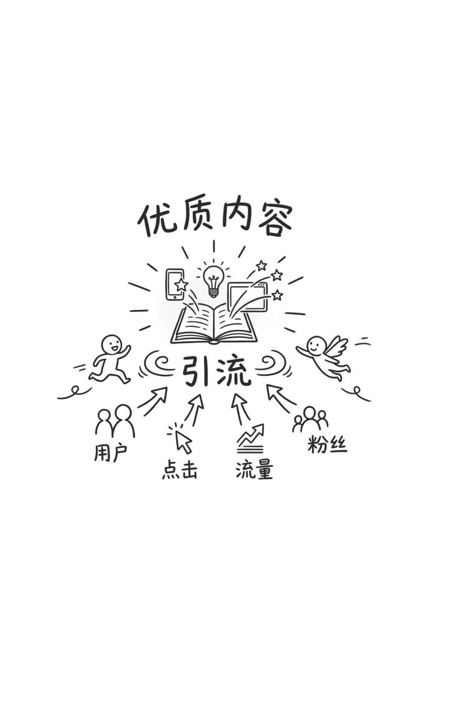
OpenClaw 则从根本上提升输出效率。在创作前置环节，自动化搜集行业热点、客户痛点、爆款框架，为 Seedance 2.0 提供灵感与素材；在发布环节，实现多平台自动化分发、标题关键词优化、评论私信自动回复，提升触达与引流效率；在运营环节，自动监测播放量、点赞量、咨询量、粉丝增长等数据并生成运营报告，及时优化选题与方向；在客户沉淀环节，自动整理高意向客户信息并导流至私域，实现精准沉淀。

通过 Seedance 2.0 的优质创作与 OpenClaw 的高效运营，OPC 可以形成“持续输出优质内容—精准引流获取客户—私域沉淀强化信任—提升品牌影响力”的正向循环，为后续变现积累优质资源。

### 变现路径：四轨收入体系构建抗风险能力
自由职业者升级为 OPC 的核心目标是打破单一收入瓶颈。依托智能加持个人品牌与视频引流，可以构建“定制服务+知识付费+工具教学+流量变现”的多元化收入体系。OPC 作为合规主体承接高价值业务，视频创作本身提供基础流量变现。四条路径相互赋能，形成稳定收入闭环，显著提升抗风险能力。

OpenClaw 加 Seedance 2.0 为四条路径落地提供全流程能力支撑。

第一条是定制服务，为核心盈利来源。依托合规身份与智能加持品牌，承接核心赛道的定制化商业服务，如短视频定制、微短剧创作、企业咨询、方案定制、一对一专属指导、商家引流全案定制。定制服务客单高、收入稳、客户粘性强。借助 Seedance 2.0 完成可视化创作，借助 OpenClaw 实现客户对接、订单管理、服务交付自动化，让 OPC 高效承接大量订单。

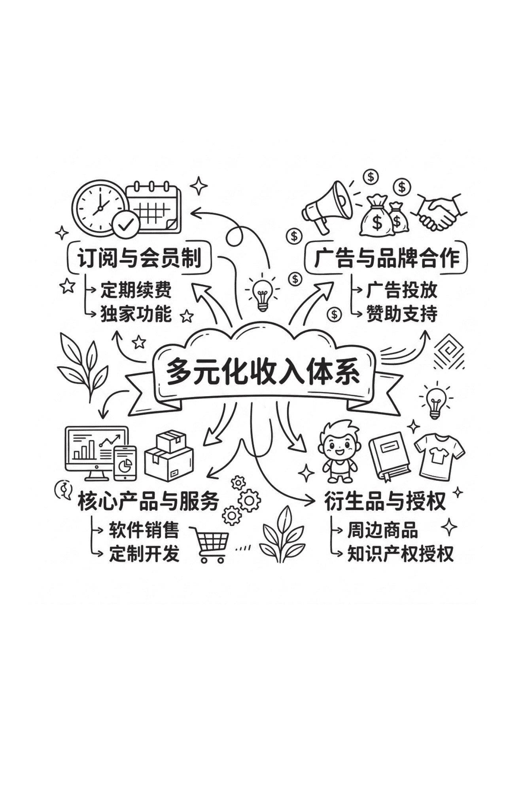
第二条是知识付费，为长期稳定收入。将专业技能、智能工具用法、行业经验转化为线上系列课程、实操训练营、电子资料等。依托 Seedance 2.0 制作高质量课程视频，借助 OpenClaw 实现发布、学员管理、答疑、数据统计自动化，形成一次制作多次变现。边际成本低且能提升品牌影响力，反哺定制与代运营。

第三条是工具教学，为差异化来源。依托对 OpenClaw、Seedance 2.0 等工具的熟练度，开展智能工具实操教学，如线下训练营、线上 1v1 教学、工具社群。契合智能时代需求，形成“工具使用—教学变现—品牌提升”循环，强化智能加持标签。

第四条是流量变现，为基础收入。依托 Seedance 2.0 创作的优质视频在抖音、视频号、B站等平台实现广告分成、平台补贴、带货、广告合作等基础盈利。虽然客单较低，但可以低成本持续收益，并为其他路径引流与积累客户。

四条路径形成闭环：流量变现为定制、知识付费、工具教学引流；定制交付提升品牌影响力，反哺流量与粉丝粘性；知识付费与工具教学带来口碑传播，带来更多定制订单；智能工具为全链路提供效率支撑，让 OPC 以一人之力实现多元化规模化盈利。多元化收入体系彻底打破单一收入瓶颈，让自由职业者实现智能加持、多元变现、稳定盈利的目标。

# 第五部分 长期成长——守住 OPC 财富，持续增值

## 第十三章 工具更新与技能迭代：跟上智能浪潮，守住 OPC 核心竞争力

### 工具迭代：紧跟 OpenClaw、Seedance 2.0 的更新节奏，维持有利位置
智能迭代速度极快，OpenClaw 与 Seedance 2.0 作为适配 OPC 模式的核心工具，也会遵循行业趋势与用户需求持续进行功能更新与升级。其更新始终围绕适配各赛道新需求与提升创作运营效率展开，是 OPC 保持核心竞争力的重要技术支撑。对从业者而言，及时掌握两大工具的更新动态，吃透新功能的使用方法，并与自身赛道需求深度结合，既能实现运营与创作效率的二次提升，也能进一步放大智能赋能价值，让 OPC 在竞争中始终占据效率优势。

OpenClaw 与 Seedance 2.0 最新迭代解读

OpenClaw 本轮升级围绕三条主线展开：让自动化更深入、让赛道匹配更精准、让双产品协作更顺畅，从而持续拓宽自动化运营的边界，满足不同 OPC 领域对个性化运营的需求。自动化层面，本地文件操作、多模型调用、浏览器操控等基础环节在精度和稳定性上持续打磨，同时引入更复杂的任务逻辑，支持多条件触发与多步骤联动。以数字内容领域为例，上线了“采集素材-撰写脚本-分发内容-复盘数据”的一体化流程，日常作业更省心。

赛道适配方面，团队结合 OPC 五大热门领域的实际工作习惯推出专属插件。专业服务领域新增“拆解需求-生成初稿-整理报告”的快捷链路；本地生活数字服务领域推出“商家信息采集-引流视频投放-转化统计”工具链，工具与业务场景贴合度更高。

协作效率方面，OpenClaw 和 Seedance 2.0 的底层数据互通得到加强，操作指令、素材资产、订单信息可实时同步。OpenClaw 收集到的客户定制需求能直接进入 Seedance 2.0 的创作界面，成片后可一键交由 OpenClaw 完成自动化交付，配合更流畅。

Seedance 2.0 此次聚焦创作力增强、质感提升与场景拓展，目标是降低门槛、提高成品水准，适配 OPC 多元化视频需求。创作能力上，复杂场景生成、多模态参考、可控编辑等核心功能持续优化，画面更细腻、人设更自然、剧情更连贯，并扩充模板与风格滤镜。微短剧新增古风、现代都市、悬疑等剧情模板；知识付费新增专业讲解、动画演示、实操教学等专属风格。

质感层面，音频制作、字幕排版、特效应用全面升级，加入多语种真人配音、智能字幕排版、电影级特效滤镜，让 AI 生成的成片逼近专业团队水平。场景拓展上，结合市场新需求新增功能：直播领域支持切片快速生成与背景生成；跨境电商领域支持多语种字幕自动生成与海外平台格式适配，帮助 OPC 打开新变现空间。

想快速吃透更新，OPC 从业者可把握三件事：第一紧跟官方信息，加入 OpenClaw 与 Seedance 2.0 官方社群、关注公众号获取公告与教程；第二做赛道适配的小范围验证，把新功能与插件结合自身业务测试落地方式；第三融入用户社区，与不同领域的从业者交流实操经验，把新功能转化为自己的运营与创作能力。只有让工具能力与赛道需求、行业趋势保持同频，才能持续提升效率，让智能软件成为核心竞争力。

### **核心能力升级：用智能软件驱动运营与创作，不懂代码也能建立壁垒**

AI 时代 OPC 的核心竞争力不是写代码，而是智能软件赋能能力。无需深挖底层逻辑，掌握 OpenClaw、Seedance 2.0 的使用方法并深度结合运营与视频创作，就能形成“AI+个人”的双重优势。这是立足竞争、实现长期成长的必备能力，本质是落地、适配与协同优化的综合能力，让创始人成为智能系统的驾驭者。

能力提升围绕三大方向展开，均以落地变现为目标。

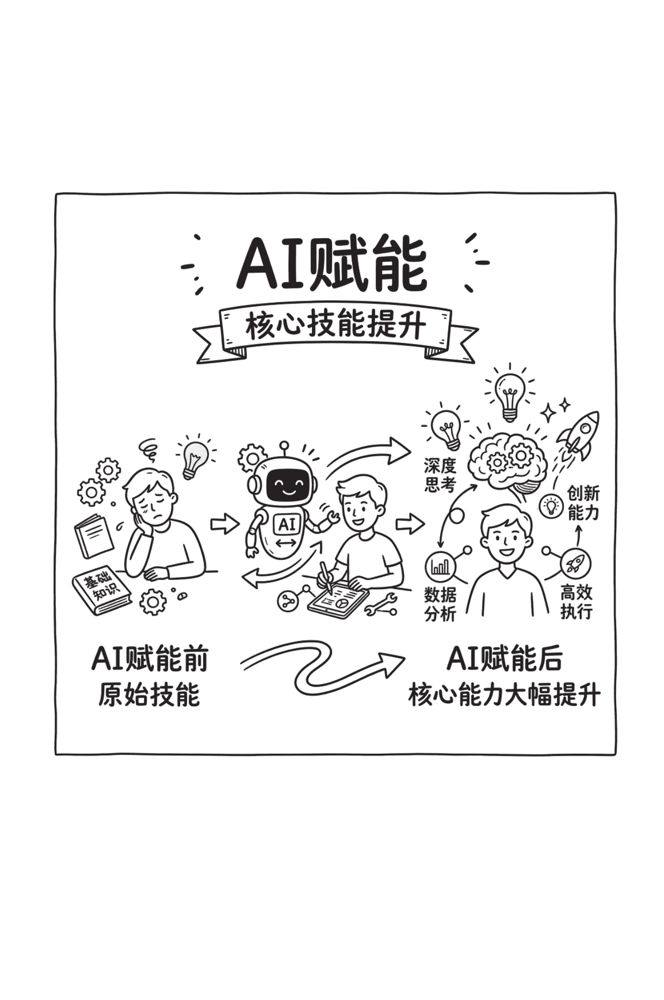
首先打磨智能软件落地能力。这是基础，核心是吃透 OpenClaw 与 Seedance 2.0 的基础功能与进阶技巧，把功能转化为实际成果。依托官方教程、案例复盘、社群交流即可掌握核心操作。如用 OpenClaw 配置自动化指令解决办公、客户对接、数据统计等实操问题；用 Seedance 2.0 完成引流、定制、知识付费等场景的视频创作。关键在于多实操多复盘，把工具嵌入日常工作。

其次提升智能软件场景适配能力。依据所属领域与业务需求灵活调整使用策略。数字内容重高产出高质量视频，专业服务重高效对接与标准化交付，本地生活重精准引流与快速定制。需根据核心诉求调整工具优先级与功能组合，如数字内容侧重 Seedance 创作与 OpenClaw 素材采集分发，专业服务侧重 OpenClaw 自动化对接与 Seedance 专业引流视频。提升关键在深研领域、精准定位、围绕痛点变现。

最后强化智能软件协同优化能力。持续优化 OpenClaw 与 Seedance 2.0 的配合模式，通过自定义技能与流程调整实现最大效率。订单量上升时优化订单管理与需求同步；拓展新场景时调整协同流程，实现自动化衔接。借助 OpenClaw 的数据统计分析使用效率与变现效果，针对低效环节迭代优化，让协同始终贴合业务发展。

### **2026 赛道预判：热门方向与新风口抢先布局**

OPC 热门领域随 AI 迭代与市场需求持续演进。2026 年将围绕 AI 深度加持、场景精细化、服务个性化三大趋势展开，并出现新的创富机会。判断趋势需结合 AI 发展、政策导向与市场需求，提前布局才能抢占先机。

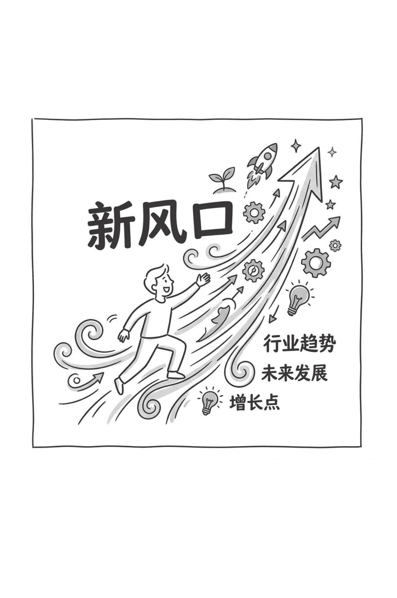
五大传统领域的精细化方向为：数字内容与创意设计从通用定制转向垂直精品，如工业、医疗、教育等专业视频，微短剧与虚拟人直播等新形式；专业服务与咨询从通用咨询转向 AI 加持解决方案，如智能软件落地咨询、OPC 模式创业咨询、AI 内容合规咨询；技能变现与知识服务从通用付费转向智能软件实操教学，如 OpenClaw、Seedance 2.0 实操训练营；轻量应用开发从通用小程序转向 AI 智能体定制，如为中小企业与 OPC 定制智能体与插件；本地生活数字服务从视频定制转向 AI 数字化全案，如 AI 智能客服、AI 营销方案、店铺 AI 运营。

两大新风口值得提前卡位：一是虚拟人 IP 打造与运营，借助 Seedance 2.0 的虚拟人生成与视频能力，为企业与个人打造专属 IP，提供直播、内容创作、IP 运营服务；二是 AI 内容合规与优化，提供版权检测、合规审查、内容升级服务，属于低竞争高客单价的蓝海，可与数字内容领域协同。

布局新方向可遵循三点：持续关注行业报告与官方渠道把握动态；以轻量模式小范围试错，借助工具快速验证需求与变现；将新方向与自身能力与原有业务结合，实现资源复用与成本降低。

## **第十四章 长期增值的思路：从短期变现走向规模化回报**

### **构建 AI+个人+OPC 的复合壁垒，塑造难以复制的个人品牌**

长期创富的关键不是单次变现或短期订单，而是构建“AI+个人+OPC”三合一的复合壁垒，并以此塑造难以复制的个人品牌，形成差异化壁垒。普通创业者依赖团队资源资金，自由职业者仅靠单一技能，OPC 则兼顾两者优势：用 AI 替代重复执行解决人力成本与效率问题，用个人能力承载创意与决策解决同质化问题，用标准化体系解决变现与抗风险问题。

复合壁垒体现在三重融合：AI 与个人能力的互补，AI 承担重复执行，个人聚焦战略决策、创意构思、深度服务；个人能力与 OPC 体系的共生，个人定位决定领域与服务，体系将能力产品化实现规模化；OPC 体系与智能软件的适配，AI 支撑全流程自动化，工具迭代持续优化运营效率。

在此基础上塑造个人品牌，将复合壁垒转化为客户可感知的价值。以“AI 加持本地短视频定制专家”等清晰标签锚定定位，通过 Seedance 2.0 输出品牌内容、通过标准化交付体现专业、通过人格化表达建立情感认同，最终形成“该领域就找这个 OPC”的心智。

### **留存与复购策略：标准化交付加持内容输出，稳固客户池实现持续盈利**

客户留存与复购是长期盈利的基石，比单纯获客更重要。稳定复购带来持续收入、降低获客成本，并通过转介绍实现裂变。多数从业者重获客轻留存，导致高流失与成本恶性循环，而老客户复购率提升 5% 可带来显著利润增长。

提升黏性依赖标准化服务与持续内容输出。标准化服务依托 OpenClaw+Seedance 2.0 搭建全流程体系：

需求对接标准化，用 OpenClaw 统一采集模板自动整理需求、交付标准与时间节点，并规范沟通话术。
服务创作标准化，用 Seedance 构建领域模板，统一画面、文案、时长等标准，保证每次交付稳定高质量。
交付售后标准化

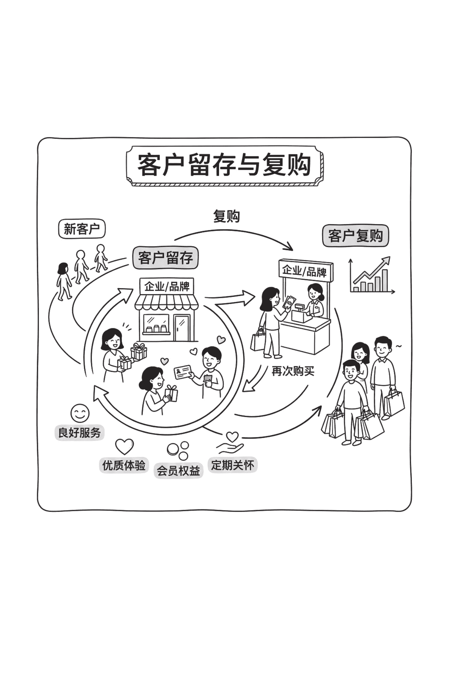
借助 OpenClaw 规范文件格式、交付渠道与回访流程，建立免费修改次数、答疑时长等售后保障，提升体验。

联动视频创作持续输出三类高价值内容强化信任：一是行业干货，如趋势解读、技能技巧、工具方法，树立知识库形象；二是服务升级，如新服务、新功能、新优惠，刺激复购；三是客户案例，将成果制作为案例视频经授权发布，既展示能力又增强情感连接。标准化与内容双轮驱动，才能把 OPC 从靠新客赚快钱带向靠老客赚长久钱。

借助 OpenClaw 把生产的内容精准投放到存量客户，私域社群、朋友圈动态、邮件推送都能成为触达渠道，让信息持续抵达、认知不断加深、信任持续累积。针对老客户再推出专属权益，比如复购价优惠、老客推荐新客返利、限时免费资料包等，既能提升再次下单的意愿，也能激发转介绍的动力。配合标准化服务流程、与视频内容联动加深信任，再叠加老客专属福利，OPC 就能形成可复制的留存与复购闭环，稳住核心客群，实现长期稳定盈利。

### 从一人 OPC 到轻团队：构建柔性协作网络
OPC 想要长期创富，终究要走规模化路线，但这不是重资产扩招、租办公室的老路子，而是从一人作业升级为轻量团队。关键在于搭建柔性协作网络，把外部优质资源整合进来，补齐个人短板，在保持轻资产、高自由度的前提下放大收益，让收入持续走高。这种路径既避开了单打独斗的能力与精力天花板，也绕开了传统团队的高成本低效率，是 AI 时代规模增值的可行方案。

单人 OPC 借助 AI 工具能起步盈利，但业务量上来、需求变多样化后，很快会撞墙：专业边界有限，接不了高难度跨界单；时间精力有限，忙不过来；资源网络有限，市场覆盖有限。若按传统方式招全职、租场地，轻资产的优势就没了，成本和风险反而增加。转向柔性协作，就能把这些问题一次性化解。

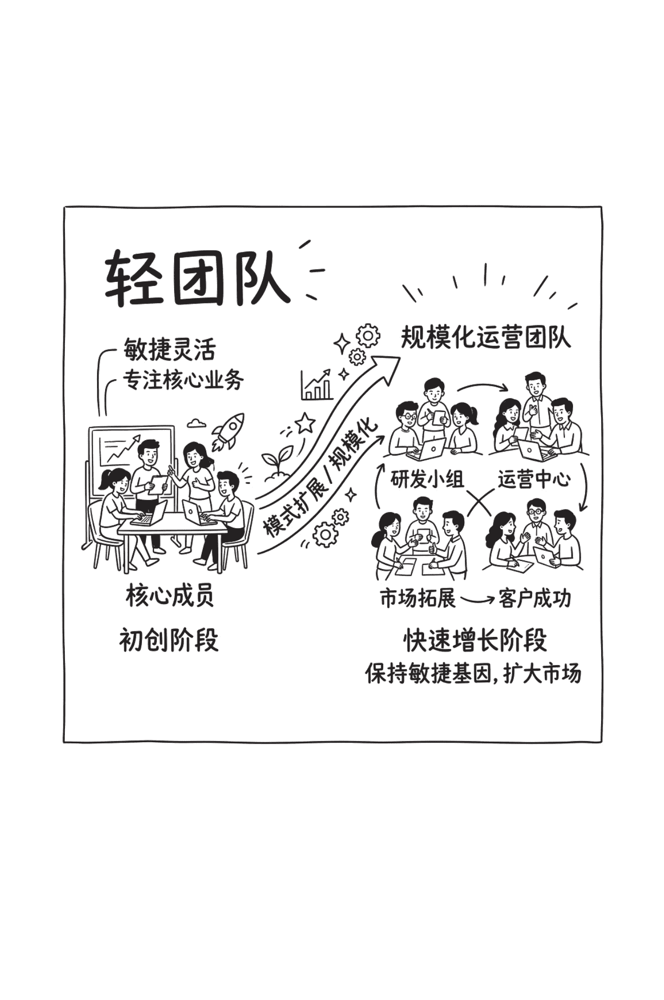
柔性协作网络的核心是创始人为中枢，招募不同领域的自由职业者、兼职从业者、其他小型 OPC，按需合作、按结果付费、灵活增减。轻资产、高灵活、强适配是其特点，不承担固定工资和租金，按单签短期协议、按交付付费；业务回落时可迅速收缩，避免浪费；协作伙伴的专业能力则弥补创始人短板，让订单类型和难度都能升级。

搭建这样的网络，本质分三步，全程可依托 OpenClaw 的 AI 能力提升管理效率。

第一步，找准协作缺口，沉淀优质人选。创始人先盘点 OPC 的能力弱项和业务方向，明确需要补位的资源类型，比如内容赛道需要品牌策划、文案、虚拟人设计；专业服务赛道需要行业专家、数据分析、方案设计等。再通过创业社群、行业平台、人脉推荐筛选专业过硬、理念契合、时间可用的伙伴，建立专属资源库。

第二步，定流程、定分成。运转效率靠标准化。依托 OpenClaw 统一协作规范，包括需求派发、进度跟进、成果评审、交付交接等环节，让所有伙伴按同一套流程作业。同时设计公平透明的分成为准，按难度和贡献度确定比例，结算方式和时间提前说清，保障积极性。

第三步，用 OpenClaw 自动化管理日常。把重复性管理交出去，创始人聚焦战略和客户对接。需求可自动匹配订单类型与伙伴专长快速派单；进度可实时追踪，关键节点自动提醒避免延期；成果可自动初审归档，合格内容直接入库；分成可自动统计，到期自动提醒结算。

跑通三步，柔性协作网络就能高效运转。一人 OPC 既保留了轻快灵活的本质，又通过外部资源放大了创富效应：订单品类和难度提升，客单价与订单量双增；市场覆盖更广，收入来源多元；业务具备复制性，收入不再受个人能力限制。最终从单人盈利进化到轻量规模化盈利，达成 AI 时代的长期创富目标。

# 后记
AI 浪潮下，OPC 结合 AI 工具，是普通人最容易上手的创富机会。旧的财富逻辑在被重塑，新机会正在打开。有人担心被 AI 取代，有人已用 AI 工具跑通 OPC 模式实现低风险增收。本书想说明的是，AI 不是对手而是放大器，OPC 不是遥远的商业形态而是可以马上落地的载体。

写作期间，我看到太多普通人的变化：职场人用 OpenClaw 搭配 Seedance 2.0 搭建副业 OPC，主业稳、副业增，焦虑减轻；自由职业者升级为 OPC 打造个人品牌，收入多元，不再单打独斗；内容创作者用一人一剧组的打法，从纯流量变现转向规模化服务变现，真正实现一人公司状态。他们没有雄厚资源和资金，只是把 AI 工具用好、把 OPC 模式跑通，就抓住了时代窗口。

AI 时代的创富，不靠资源和团队，靠工具、模式和思维。OpenClaw 与 Seedance 2.0 让普通人拥有接近团队的生产力；2024 年《公司法》修订带来的政策红利，让 OPC 落地门槛更低。两者结合打破了创业必须高投入、创作必须高专业技能的固有认知，为普通人打开低风险高灵活的创富通道。

如果你还在怀疑自己没商业经验、不懂技术，也不用担心。这里没有繁琐理论，只有可执行的步骤；没有专业术语，只有清晰实操。只要跟随指引，把两大 AI 工具用起来，掌握 OPC 运营逻辑，就能搭建属于自己的商业闭环。

真正最大的风险，不是被淘汰，而是思维固化错失窗口。当别人已用 AI 解放生产、用 OPC 模式实现创富时，行动才是抓机遇的唯一方式。愿你读完后放下犹豫，迈出 OPC 创富第一步；愿你熟练驾驭 AI 工具，吃透 OPC 逻辑，让一人公司的理想成真；愿你在 AI 浪潮中不被工作和成本束缚，用 AI 赋能自己，走出自己的财富之路。

选择比努力更重要。OPC 与 AI 工具的结合，是这一时代普通人不可错过的入口。愿你不负时代、不负自己，在创富路上收获自由与财富，活成想要的样子。

# 作者简介
王喜文，工学博士、情报学博士后、高级工程师。曾在计算机软件研发领域工作十年，后于中国科学技术信息研究所从事博士后研究两年，任北京市房山区经济和信息化委员会副主任一年，在工业和信息化部国际经济技术合作中心工作九年，分管电子商务研究所、中国智造与工业 4.0 研究所、工业经济研究所。现为九三学社中央促进技术创新工作委员会委员、北京华夏工联网智能技术研究院院长，抖音账号 wangxiwen127。

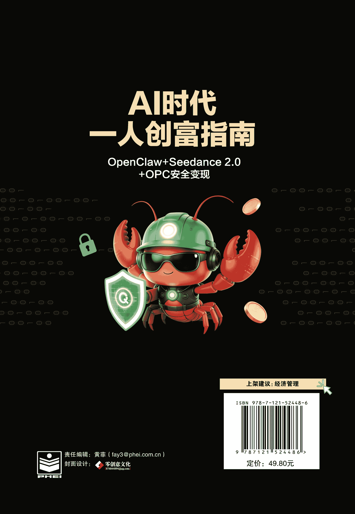