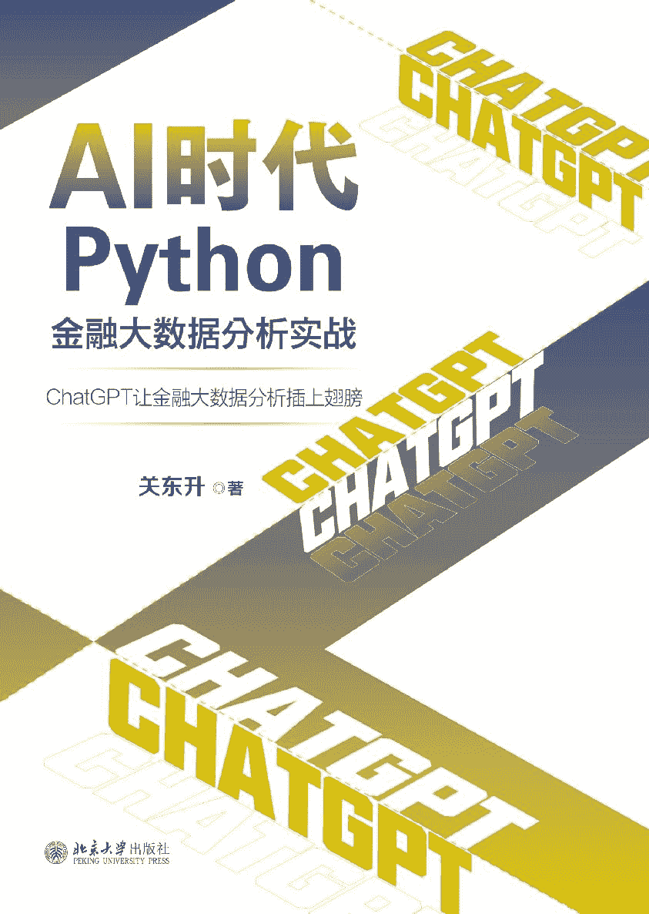

# AI-时代-Python-金融大数据分析实战_-ChatGPT-让金融大数据分析插上翅膀

   

# **版权信息**

**COPYRIGHT**

书名：AI 时代 Python 金融大数据分析实战：ChatGPT 让金融大数据分析插上翅膀

作者：关东升

出版社：北京大学出版社

出版时间：2024 年 1 月

ISBN：9787301346181

字数：143 千字

本书由北京大学出版社有限公司授权得到 APP 电子版制作与发行

版权所有·侵权必究

# **内容简介**

本书是一本针对金融领域的数据分析和机器学习应用的实用指南。本书以 ChatGPT 为核心技术，结合 Python 编程和金融领域的基础知识，介绍如何利用 ChatGPT 处理和分析金融大数据，进行预测建模和智能决策。

通过阅读本书，读者将掌握使用 ChatGPT 和其他工具进行金融大数据分析的基本原理和方法。无论是金融行业从业者还是数据分析员，都可以从本书中获得宝贵的实用知识，提升在金融领域的数据分析和决策能力。无论是对于初学者还是有一定经验的专业人士，本书都能够提供实用的案例和技巧，帮助读者更好地应用 ChatGPT 和其他技术解决金融领域的实际问题。

# **前言**

在当今信息爆炸的时代，金融界正面临前所未有的挑战和机遇。海量的数据不断涌现，为金融领域带来了巨大的潜力，同时也带来了前所未有的复杂性和难题。然而，正是在这个充满挑战的环境下，人工智能技术崭露头角，为金融大数据分析提供了一种全新的解决方案。

本书将带您深入探索 AI 时代金融大数据分析的奥秘，特别聚焦于一种引人瞩目的技术——ChatGPT。作为一种基于深度学习的自然语言处理模型，ChatGPT 能够模拟人类对话，具备自动问答、数据解释和解决问题的能力。而在金融领域，它的应用潜力更是无限。

通过 ChatGPT，我们能够从庞大的金融数据中发现隐藏的模式和规律，挖掘有价值的信息。它可以帮助我们清洗和预处理数据，解决数据中的缺失值、类型不一致和异常值等问题。它还可以辅助我们进行数据的可视化分析，将复杂的数据呈现为直观、易于理解的图表和图像。

更令人激动的是，ChatGPT 还具备智能助理的功能，能够根据用户需求提供个性化建议和推荐。无论是投资决策、风险管理还是资产配置， ChatGPT 都能够为金融从业者提供宝贵的参考意见。它可以成为您的得力助手，助您在金融市场中披荆斩棘，抓住每一个机遇。

在本书中，笔者将深入探讨 ChatGPT 在金融大数据分析中的作用和潜力。通过丰富的案例和实践，笔者将带您逐步了解其工作原理、应用场景和最佳实践。本书将探索大数据与金融的完美融合，揭示这一融合对金融领域的革新和改变。

无论您是金融行业从业者、数据分析人员还是对人工智能和金融领域感兴趣的读者，本书都将为您打开一扇通向 AI 时代金融大数据分析的大门。让我们一同揭开金融大数据分析的神秘面纱，探索 ChatGPT 的无限潜力，为金融领域的未来发展贡献自己的一份力量。

愿本书成为您探索金融大数据分析的指南，引领您进入 AI 时代的精彩旅程！祝阅读愉快！

本书附赠全书案例源代码及相关教学视频等资源，读者可扫描下方左侧二维码关注“博雅读书社”微信公众号，输入本书 77 页的资源下载码，即可获得本书的下载学习资源。

资源下载码： jr2023

本书提供答疑服务，可扫描下方右侧二维码留言“北大 AI”，即可进入学习交流群。

关东升

# **第一章**

# **ChatGPT 在金融大数据分析中的作用**

随着金融行业的数字化转型和大数据的快速增长，金融机构和从业人员面临着处理庞大、复杂数据集的挑战。数据分析在金融决策、风险管理和市场洞察中起着至关重要的作用。近年来，人工智能技术在金融领域的应用逐渐增多，其中 ChatGPT 作为一种基于自然语言处理的语言模型，正逐渐成为金融大数据分析的得力助手。

ChatGPT 在金融数据分析领域的作用主要包括以下几个方面。

（1）ChatGPT 可以在用户提供数据描述的基础上生成相关的 Python 或 R 代码，完成初步的数据读取、清洗、统计分析等任务。例如，用户描述一个有关存款额度和客户信息的数据集，ChatGPT 就可以生成读取该数据集、计算描述性统计量、绘制直方图等代码。

（2）ChatGPT 可以回答有关金融知识的问题，辅助阐明复杂的金融定义、概念和理论。例如，用户可以询问关于 BPS（Basis Point Spread，基点差）应用的案例、利率衍生品的类型、跨市场套利操作的原理等问题。ChatGPT 能根据用户提供的上下文信息给出准确的回答。

（3）ChatGPT 能够帮助用户发现和理解隐藏在大量金融数据中的模式和规律。通过提问、分析和建模，ChatGPT 可以指出可能存在的趋势和关系，推荐进一步分析的策略。

虽然 ChatGPT 目前还不能直接替代专业的数据科学家和金融专家，但它已经可以很有效地辅助这些专业人士节省时间，创造更多的价值。ChatGPT 在金融和数据分析领域仍存在很大的潜力和发展空间。

### **1.1**

## **ChatGPT 生成金融数据分析代码示例的案例**

在金融数据分析中，ChatGPT 可以作为一个强大的工具，帮助生成各种金融数据分析代码示例，从而加速分析过程并提供实用的解决方案。以下是 ChatGPT 生成金融数据分析代码示例的两个案例。

### **1.1.1**

### **案例 1：生成数据清洗和预处理代码示例**

分析师可以向 ChatGPT 描述一个包含大量金融交易数据的数据集，其中可能包含缺失值、异常值和重复数据。通过与 ChatGPT 的交互，分析师可以得到数据清洗和预处理的示例代码，用于去除重复项、处理缺失值和识别异常值。

**分析师向 ChatGPT 发送如下请求消息。**

我有一个包含交易数据的数据集，但其中可能有重复项和缺失值。如何进行数据清洗？

**ChatGPT 的回答如下。**

**你可以使用 Python 的 Pandas 库进行数据清洗。以下是示例代码，用于去除重复项和处理缺失值：**

### **1.1.2**

### **案例 2：生成特征工程代码示例**

在金融数据分析中，特征工程对模型性能至关重要。分析师可以向 ChatGPT 描述一个投资组合数据集，希望从中提取有用的特征。ChatGPT 可以生成特征工程的示例代码，例如计算投资组合的收益率、波动性或其他技术指标。

**分析师向 ChatGPT 发送如下请求消息。**

我有一个包含投资组合数据的数据集，想要提取一些有用的特征。有什么建议和示例代码吗？

**ChatGPT 的回答如下。**

**你可以使用 Python 的 NumPy 和 Pandas 库计算收益率和波动性。以下是示例代码：**

以上代码示例展示了如何从原始数据中提取有用的特征，用于后续的建模和分析。

### **1.2**

## **ChatGPT 回答金融领域知识的案例**

ChatGPT 作为一种预训练的自然语言处理模型，拥有广泛的知识，并能回答各种金融领域的问题。下面是 ChatGPT 回答金融领域知识的 4 个案例。

### **1.2.1**

### **案例 3：解答金融市场知识**

金融市场知识有很多，一般人不能完全掌握，我们可以咨询 ChatGPT，让它帮助解答金融市场知识。

**分析师向 ChatGPT 发送如下请求消息。**

请问，什么是投资组合优化？

**ChatGPT 的回答如下。**

**投资组合优化是一种金融技术，旨在找到一种最优的投资组合配置，使在给定风险水平下，预期收益最大化。通常使用数学模型和算法来平衡不同资产之间的风险和回报，以达到最佳的资产配置。**

**分析师向 ChatGPT 发送如下请求消息。**

**什么因素影响市场流动性？**

**ChatGPT 的回答如下。**

**市场流动性受多种因素的影响，包括但不限于以下几个方面：**

**1. 交易量：较高的交易量通常会提高市场流动性，因为有更多的买方和卖方参与市场交易。**

**2. 市场深度：市场深度是指市场上能够容纳大量交易而不引起价格明显波动的能力。较深的市场通常具有较高的流动性。**

**3. 报价价差：报价价差是指买入价格和卖出价格之间的差异。较小的报价价差通常会增加市场流动性，因为交易者能够更容易地以较小的价格波动幅度进行交易。**

**4. 交易成本：交易成本包括交易费用、滑点和其他相关费用。较低的交易成本有助于提高市场流动性。**

**5. 信息透明度：信息的透明度能够减少交易者面临的不确定性，从而增加市场流动性。**

**6. 市场参与者：市场上参与交易的各方数量和类型也会影响市场流动性。更多的市场参与者通常意味着更高的流动性。**

**以上因素相互作用，综合影响市场的流动性。理解这些因素有助于分析市场流动性的变化和预测市场行为。**

### **1.2.2**

### **案例 4：解释经济学理论**

经济学理论很抽象，我们可以咨询 ChatGPT，让它帮助解答。下面我们介绍一下如何使用 ChatGPT 解释经济学理论。

**分析师向 ChatGPT 发送如下请求消息。**

**关于货币政策，你能简单解释一下什么是利率吗？**

**ChatGPT 的回答如下。**

**利率是货币的时间价值，是贷款人获得的利息收入与借款人支付的利息支出之间的差额。它通过影响消费和投资来影响经济活动。**

**中央银行通过调整其向商业银行提供贷款的利率，来影响整个经济体中资金的供给和利率水平，这被称为货币政策。当中央银行提高政策利率时，商业银行提供贷款的利率也会上调，这通常会抑制经济活动和通货膨胀。相反，降低政策利率可以刺激经济增长。**

**除了中央银行的政策利率，金融市场上的利率也会受到市场供求关系的影响。当经济过热，对贷款的需求增加时，市场利率也会上升。**

### **1.2.3**

### **案例 5：解答金融产品相关问题**

ChatGPT 可以即时回答关于金融产品的问题，提供对金融产品的解释和相关信息。这对于投资者和金融从业人员来说，可以迅速获取所需的金融知识，增强对金融产品的理解和认识。

**分析师向 ChatGPT 发送如下请求消息。**

能否解释一下 ETF（交易所交易基金）的概念？

**ChatGPT 的回答如下。**

**ETF 是一种投资工具，它类似于股票，可以在交易所上市交易。ETF 通常跟踪特定的指数、商品、债券或其他资产组合的表现。投资者购买 ETF 时，实际上是在购买一个包含多种资产的“篮子”，从而实现对多种资产的分散投资。**

### **1.2.4**

### **案例 6：解答金融风险管理相关问题**

ChatGPT 可以在金融风险管理中发挥作用，例如，提供风险评估模型、回答风险管理相关问题、辅助决策制定等。

**分析师向 ChatGPT 发送如下请求消息。**

**如何量化金融产品的市场风险？**

**ChatGPT 的回答如下。**

**市场风险是指金融产品在市场波动下面临的损失风险。常用的市场风险量化方法之一是风险价值（Value at Risk,VaR）指标。VaR 指标衡量在给定置信水平下，投资组合或金融产品在未来一段时间内可能出现的最大损失。VaR 计算基于历史数据和概率统计方法，帮助投资者评估市场波动对其投资组合的潜在影响。**

### **1.3**

## **ChatGPT 辅助发现数据中的模式和特征**

在金融大数据分析中，ChatGPT 可以通过自然语言处理和文本分析等技术，辅助发现数据中的模式和特征。下面是一些使用 ChatGPT 辅助数据分析的方式。

（1）文本数据分析：ChatGPT 可以处理结构化和非结构化的文本数据，包括新闻报道、社交媒体评论、公司公告等。通过对这些文本数据的分析，可以解析与金融市场相关的情感倾向、事件影响等信息。

（2）情感分析：ChatGPT 可以帮助分析文本数据中的情感倾向，包括对特定金融产品或公司的情感反应。情感分析有助于了解市场参与者对某个事件或某种产品的态度，有助于预测市场情绪和趋势。

（3）舆论分析：ChatGPT 可以帮助对舆论进行自动化分析，了解市场参与者对特定金融产品、公司或市场走势的看法。这有助于预测市场可能出现的变化和风险。

（4）关键词提取：ChatGPT 可以帮助从大量文本数据中提取关键词和短语。这些关键词可以用于建立词袋模型或主题模型，帮助理解不同金融事件和市场动态之间的联系。

（5）数据预处理：ChatGPT 可以用于数据清洗和预处理，帮助减少数据中的噪声和冗余信息。这有助于提高后续数据分析的准确性和效率。

（6）文本生成：ChatGPT 可以用于生成与金融市场相关的文本，如市场评论、分析报告等。这些生成的文本可以为投资决策和市场预测提供参考。

尽管 ChatGPT 在文本数据分析方面具有一定的辅助作用，但仍需注意，它是基于语言模型的，对于特定的金融分析任务可能需要进一步结合其他数据分析方法和领域知识，以获得更准确和全面的结果。另外，对于金融数据分析的应用，数据隐私和安全也是需要特别关注的方面。

## **1.4**

## **本章总结**

本章展示了 ChatGPT 在金融数据分析中的多重应用。通过案例 1 中的数据清洗和预处理代码示例，以及案例 2 中的特征工程代码示例，展示了 ChatGPT 在生成金融数据分析代码方面的能力，提高了数据分析效率和准确性。同时，案例 3 至案例 6，覆盖了金融市场知识、经济学理论、金融产品解释和风险管理等领域的知识问答，强调了 ChatGPT 作为知识库和问答系统的潜力。此外，也探讨了 ChatGPT 在辅助发现数据模式和特征方面的作用，提升了数据分析的洞察力。总之，本章凸显了 ChatGPT 在金融领域的多重应用，为金融数据分析和决策带来新的可能性。

# **第二章**

# **金融大数据分析 Python 基础**

当涉及金融大数据分析时，Python 作为一种常用的编程语言，能够提供丰富的库和工具，可以用于数据处理、分析和可视化。以下是金融大数据分析中使用 Python 的一些基础知识。

（1）数据处理和分析库：在 Python 中，有一些常用的数据处理和分析库，如 NumPy、Pandas 和 SciPy。NumPy 提供高效的数组操作和数学函数，Pandas 用于数据处理和分析，而 SciPy 则包含各种科学计算和统计方法。

（2）数据可视化库：数据可视化对于理解和分析金融数据至关重要。Python 提供多个库来创建各种类型的图表，如 Matplotlib、Seaborn 和 Plotly。这些库可以帮助用户将数据可视化，并发现其中的模式和趋势。

（3）金融数据获取和处理：Python 中有多个库可以用于获取和处理金融数据，如 pandas-datareader、yfinance 和 quandl。这些库可以从各种金融数据源中获取数据，并提供灵活的方法来处理和转换数据。

（4）统计分析：统计分析在金融数据分析中非常重要。Python 提供一些统计分析库，如 Statsmodels 和 Scikit-learn。Statsmodels 包含各种统计模型和方法，用于回归分析、时间序列分析等。而 Scikit-learn 则提供机器学习算法和工具，可以用于预测建模和分类分析。

（5）量化金融：量化金融是金融数据分析中的一个重要领域，用于开发和实施基于数据驱动的投资策略。Python 中有一些专门用于量化金融的库，如 Pandas、NumPy 和 Zipline。这些库提供金融时间序列分析、风险管理和回测等功能。

（6）机器学习和深度学习：机器学习和深度学习在金融数据分析中也扮演着重要角色。Python 提供多个机器学习和深度学习库，如 Scikit-learn、TensorFlow 和 PyTorch。这些库可以用于构建和训练预测模型，用于市场预测、风险评估等任务。

了解这些 Python 基础知识，可以帮助大家开始进行金融大数据分析。

在本章中，我们先介绍 Python 语言的基础知识。

### **2.1**

## **Python 解释器**

Python 解释器是执行 Python 代码的程序，它将 Python 源代码转换为机器可执行的指令。在安装 Python 后，由于历史的原因，能够提供 Python 解释器的产品有多个，具体介绍如下。

（1）CPython。它是 Python 官方提供的。一般情况下提到的 Python 就是指 CPython,CPython 是基于 C 语言编写的，它实现的 Python 解释器能够将源代码编译为字节码（Bytecode），类似于 Java 语言，然后再由虚拟机执行，这样当再次执行相同源代码文件时，如果源代码文件没有被修改过，那么它会直接解释执行字节码文件，这样会提高程序的运行速度。

（2）PyPy。它是基于 Python 实现的 Python 解释器，速度要比 CPython 快，但兼容性不如 CPython。

（3）Jython。它是基于 Java 实现的 Python 解释器，可以将 Python 代码编译为 Java 字节码，可以在 Java 虚拟机下运行。

（4）IronPython。它是基于．NET 平台实现的 Python 解释，可以使用．NET Framework 链接库。

考虑到兼容性和其他一些性能，本书将 Python 官方提供的 CPython 作为 Python 开发环境。Python 官方提供的 CPython 有多个不同平台版本（Windows、Linux/UNIX 和 macOS），大部分 Linux/UNIX 和 macOS 操作系统都已经安装了 Python，只是版本有所不同。

下载 Python 可以到如图 2-1 所示的 Python 官网进行，读者可以单击“Download Python 3.××.×”按钮下载 Python 3 解释器。

图 2-1 下载 Python

Python 安装文件下载完成后，就可以安装了。双击该文件开始安装。安装过程中会弹出如图 2-2 所示的内容选择对话框，选中复选框“Add python.exe to PATH”可以将 Python 的安装路径添加到环境变量 PATH 中，这样就可以在任何文件夹下使用 Python 命令了。选择“Customize installation”可以进行自定义安装。本例选择“Install Now”，这会进行默认安装。单击“Install Now”开始安装，直到安装结束关闭对话框，即安装成功。

图 2-2 内容选择对话框

### **2.2**

## **IDE 工具**

在进行量化交易策略的开发和实施时，有一些常用的集成开发环境（IDE）工具，可以提供丰富的功能和便捷的开发体验，具体如下。

（1）PyCharm：它是一款由 JetBrains 开发的强大 Python IDE。它提供全面的代码编辑、调试和项目管理功能，支持代码自动完成、重构、单元测试等。PyCharm 专业版还具有更多高级功能，如集成的科学计算和数据分析工具。

（2）Visual Studio Code：它是一个轻量级、跨平台的文本编辑器，支持多种编程语言，包括 Python。它具有丰富的插件生态系统，可以通过安装插件来扩展其功能，如 Python 扩展和 Jupyter 扩展，使其适用于量化交易策略开发。

（3）Jupyter Notebook / JupyterLab：它是交互式的 Python 环境，可以在其中编写和运行 Python 代码，并且能够将代码、可视化内容和文档组合在一起。它们特别适用于探索性数据分析、快速原型开发和可视化量化交易策略。

（4）Spyder：它是专为科学计算和数据分析而设计的 Python IDE。它提供丰富的功能，如代码编辑器、变量查看器、对象检查器等，适合于量化交易策略的开发和调试。

这些 IDE 工具都有自己的特点和优势，笔者推荐使用 Jupyter Notebook 工具。此外，还有其他一些 Python IDE，如 Sublime Text、Atom 等，大家也可以根据个人需求进行配置和扩展，将其用于量化交易策略的开发。

### **2.2.1**

### **安装 Jupyter Notebook**

安装 Jupyter Notebook 可以使用 pip 工具进行。

pip 是 Python 的包管理器，用于安装、升级和卸载 Python 包。以下是一些常用的 pip 指令。

（1）安装包。

这将从 Python Package Index（PyPI）下载并安装指定名称的包。

（2）安装指定版本的包。

使用==运算符可以安装特定版本的包。

（3）升级包。

这将检查已安装的包的最新版本，并进行升级。

（4）卸载包。

这将从系统中卸载指定名称的包。

（5）列出已安装的包。

这将列出当前 Python 环境中已安装的所有包及其版本。

（6）搜索包。

这将在 PyPI 中搜索与指定搜索词相关的包。

（7）查看包的详细信息。

这将显示指定包的详细信息，包括版本、作者、依赖关系等。

这是一些常用的 pip 指令，可以帮助我们管理 Python 包和依赖项。我们可以在命令行中运行这些指令，确保已正确设置 Python 环境和 pip 命令的路径。

使用 pip 在命令行中安装 Jupyter Notebook 的过程，如图 2-3 所示。

图 2-3 使用 pip 在命令行中安装 Jupyter Notebook

### **2.2.2**

### **启动 Jupyter Notebook**

使用 Jupyter Notebook 工具时，首先需要启动 Jupyter Notebook，我们可以按照以下步骤进行操作。

（1）打开终端（在 macOS 和 Linux 上）或命令提示符（在 Windows 上）。

（2）在终端或命令提示符中，输入以下命令并按“Enter”键。

这将启动 Jupyter Notebook 服务器，并在默认的 Web 浏览器中打开如图 2-4 所示的 Jupyter Notebook 的主页。

图 2-4 Jupyter Notebook 的主页

如果默认浏览器没有自动打开，终端或命令提示符中会显示一个网址，如图 2-5 所示。我们可以将该网址复制并粘贴到自己喜欢的浏览器中。

图 2-5 Jupyter Notebook 的主页

在 Jupyter Notebook 主页，我们可以浏览文件和文件夹，新建 Python 记事本文件（.ipynb），或打开现有的记事本文件。

单击一个“.ipynb”文件，就可以在 Jupyter Notebook 中打开它，并开始编写和执行代码。

注意

**Jupyter Notebook 在运行时会继续在终端或命令提示符中显示输出和日志信息。如果关闭了终端或命令提示符窗口，Jupyter Notebook 服务器也会停止运行。**

如果希望在特定目录下启动 Jupyter Notebook，可以在命令提示符中使用 cd 命令切换到该目录，然后执行 Jupyter Notebook 命令。

### **2.3**

### **第一个 Python 程序**

Hello World！程序通常是我们在学习编程语言时的第一个示例程序。它用来展示一个基本的输出语句，并且可以验证编程环境是否正确配置。

Python 程序可以通过以下两种方式运行：

（1）通过交互式解释器运行；

（2）通过脚本文件运行。

### **2.3.1**

### **编写脚本文件，运行第一个 Python 程序**

首先，使用文本编辑工具编写如下程序代码。

笔者使用 Windows 系统的记事本应用程序编写 Python 程序，如图 2-6 所示。

读者可以根据自己的需求和代码的复杂性，选择适合的方式运行 Python 程序。交互式解释器运行适用于快速测试和交互式开发，而脚本文件运行适用于执行完整的程序或可重复运行的脚本。

然后保存文件为“hello.py”,“hello.py”就是脚本文件了，需要 Python 解释器运行该文件。可以通过在命令行终端中输入 python hello.py 来执行脚本文件，如图 2-7 所示。

▲图 2-6 使用记事本应用程序编写程序

图 2-7 运行 Python 脚本文件

### **2.3.2**

### **使用 Jupyter Notebook 编写和运行第一个 Python 程序**

Jupyter Notebook 是一种交互运行 IDE 工具，使用 Jupyter Notebook 编写 Python 程序非常简单。以下是在 Jupyter Notebook 中编写第一个 Python 程序的基本步骤。

（1）启动 Jupyter Notebook：按照前面提到的步骤，在终端或命令提示符中输入 Jupyter otebook 命令，启动 Jupyter Notebook 服务器，并在浏览器中打开 Jupyter Notebook 主页。

（2）创建一个新的记事本：在 Jupyter Notebook 主页中，单击右上角的“New”（新建）按钮，然后选择“Python 3”（或其他可用的内核）创建一个新的 Python 记事本，如图 2-8 所示。

图 2-8 创建一个新的 Python 记事本

（3）在记事本中编写代码：在新创建的记事本中，我们将看到一个空的代码单元格。单击该单元格，然后开始编写我们的 Python 代码。编写和运行代码，如图 2-9 所示。

图 2-9 编写和运行 Python 程序代码

### **2.4**

## **Python 语法基础**

本节主要介绍 Python 中一些基础的语法，其中包括标识符、关键字、常量、变量、表达式、语句和模块等内容。

### **2.4.1**

### **标识符**

标识符就是由程序员指定的变量、常量、函数、属性、类、模块和包等的名字。构成标识符的字符均有一定的规范，Python 语言中标识符的命名规则如下：

·区分大小写，Myname 与 myname 是两个不同的标识符；

·首字符可以是下画线“\_”或字母，但不能是数字；

·除首字符外其他字符，可以是下画线“\_”、字母和数字；

·关键字不能作为标识符；

·不能将 Python 内置函数作为自己的标识符。

例如，身高、identifier、userName、User\_Name、\_sys\_val 等为合法的标识符，中文“身高”命名的变量是合法的，而 2mail、room#、$Name 和 class 为非法的标识符。注意，#和$不能构成标识符。

### **2.4.2**

### **关键字**

关键字是类似于标识符的保留字符序列，是由语言本身定义好的，Python 语言中有 33 个关键字。其中只有 3 个，即 False、None 和 True 首字母大写，其他的全部小写。具体内容如表 2-1 所示。

表 2-1 Python 关键字

### **2.4.3**

### **变量声明**

在 Python 中声明变量时不需要指定它的数据类型，只要给一个标识符赋值就声明了变量，示例代码如下。

代码解释如下。

· 代码第①至③行分别声明了三个变量，这些变量声明不需要指定数据类型，赋给它什么数值，它就是该类型变量了。

·代码第④行是给 y 变量赋布尔值 True，虽然 y 已经保存了整数类型 20，但它也可以接收其他类型数据。

### **2.4.4**

### **语句**

Python 代码是由关键字、标识符、表达式和语句等内容构成的，语句是代码的重要组成部分。语句关注代码的执行过程，如 if 语句、for 语句和 while 语句等。在 Python 语言中，一行代码表示一条语句，语句结束可以加分号，也可以省略分号。示例代码如下。

代码解释如下。

·代码第①行在语句介绍中使用了分号，但是实际编程时通常省略分号。

·代码第②行有两条语句，但从编程规范的角度讲，这样编写代码是不规范的，Python 官方推荐一行代码只有一条语句。

·代码第③行采用链式赋值语句，同时将 10 赋值给 a、b、c 三个变量。

### **2.4.5**

### **Python 代码块**

在 if、for 和 while 等语句包含多条代码时，这些代码会放在一个代码块中。Python 语言中代码块与 C 和 Java 等语言差别很大，Python 是通过缩进界定代码块的，缩进级别相同的代码位于相同的代码块中。示例代码如下。

代码解释如下。

·代码第①行和第②行是同一个缩进级别，它们在相同的代码块中。

·代码第③行和第④行不是同一个缩进级别，它们在不同的代码块中。

**提示**

**一个缩进级别一般用一个制表符（Tab）或 4 个空格表示，考虑到不同的编辑器制表符显示的宽度不同，大部分编程语言规范推荐使用 4 个空格表示一个缩进级别。**

### **2.4.6**

### **模块**

Python 中一个模块就是一个“.py”文件，模块是保存代码的最小单位，模块中可以声明变量、常量、函数、属性和类等 Python 程序元素。一个模块提供可以访问另外一个模块的程序元素。

下面通过示例介绍如何创建和使用模块，首先在“\*.ipynb”（Jupyter Notebook 文件）的同级当前目录下，使用记事本等文本编辑工具创建一个 module1.py 文件，并编辑 module1.py 文件，代码如下。

代码解释如下。

·代码第①行是一个注释行，用于指定脚本文件的编码格式。在这个例子中，它指定使用 UTF-8 编码处理脚本文件中的字符。

其他代码不再赘述。

那么如何在 Jupyter Notebook 代码文件中使用 module1 模块呢？可以使用 import 语句导入 module1 模块，具体代码如下。

代码解释如下。

· 代码第①行使用 import<模块名>方式导入模块所有代码元素（包括：变量、函数、类等）。访问代码元素时需要加“模块名．”，见代码第④行 module1.y,module1 是模块名，y 是模块 module1 中的变量。

·代码第②行使用 from<模块名>import<代码元素>方式指定模块中特定的代码元素。

·代码第③行访问当前模块变量 y。

·代码第⑤行访问 module1 模块变量 z。需要注意，当 z 变量在当前模块中也存在时，z 不能导入，即 z 是当前模块中的变量。

在 Jupyter Notebook 中执行上述代码，结果如图 2-10 所示。

图 2-10 代码结果

### **2.5**

## **数据类型与运算符**

数据类型与运算符是构成 Python 表达式的重要组成部分。本节我们将介绍一下 Python 中的数据类型和运算符。

### **2.5.1**

## **数据类型**

Python 有 6 种标准数据类型：数字、字符串、列表、元组、集合和字典，其中列表、元组、集合和字典可以保存多项数据，它们每一个都是一种数据结构。

其中，数字类型有 4 种：整数类型、浮点类型、复数类型和布尔类型。需要注意的是，布尔类型也是数字类型，它事实上是整数类型的一种。

**1. 整数类型**

Python 整数类型为 int，整数类型的范围可以很大，表示很大的整数，这只受所在计算机硬件的限制。

**2. 浮点类型**

浮点类型主要用来储存小数数值，Python 浮点类型为 float,Python 只支持双精度浮点类型，而且与本机相关。浮点类型可以使用小数表示，也可以使用科学记数法表示，科学记数法中会使用大写或小写的 e 表示 10 的指数，如 e2 表示 102。

**3. 复数类型**

复数在数学中是非常重要的概念，无论是在理论物理学，还是在电气工程实践中都经常使用。很多计算机语言都不支持复数，而 Python 是支持复数的，这使 Python 能够很好地用来进行科学计算。

**4. 布尔类型**

Python 中布尔类型为 bool,bool 是 int 的子类，它只有两个值：True 和 False。注意：任何类型的数据都可以通过 bool()函数转换为布尔值，那些被认为“没有的”“空的”值会转换为 False，反之转换为 True。例如，None（空对象）、False、0、0.0、0j（复数）、"（空字符串）、\[\]（空列表）、()（空元组）和{}（空字典）这些数值会转换为 False，否则是 True。

示例实现代码如下。

示例代码运行后，输出结果如下。

代码解释如下。

·代码第①至⑥行都是整数值 28 的表示方式。

·代码第②行是二进制 28 的表示方式，其前缀是 0b 或 0B。

·代码第③和④行是八进制 28 的表示方式，其前缀是 0o 或 0O。

·代码第⑤和⑥行是十六进制 28 的表示方式，其前缀是 0x 或 0X。

·代码第⑦行使用科学记数法表示浮点数。

·代码第⑧行是复数表示。

·代码第⑨和⑩行是使用 bool 函数将数值转换为布尔类型数据。

### **2.5.2**

## **运算符**

运算符（也称操作符），包括算术运算符、关系运算符、逻辑运算符、赋值算符和其他运算符。下面我们重点介绍算术运算符、关系运算符、逻辑运算符和赋值运算符。

**1. 算术运算符**

Python 中的算术运算符用来组织整数型和浮点型数据的算术运算，按照参加运算的操作数的不同，可以分为一元算术运算符和二元算术运算符。Python 中一元运算符有多个，但是一元算术运算符只有一个，即-,-是取反运算符，例如：-a 是对 a 取反运算。二元算术运算符包括+、-、\*、/、%、\*\*和//，这些运算符主要是对数字类型数据进行操作，而+和\*可以用于字符串、元组和列表等类型的数据操作，具体说明如表 2-2 所示。

表 2-2 二元算术运算符

▼续表

**2. 关系运算符**

关系运算是比较两个表达式大小关系的运算，它的结果是布尔类型数据，即 True 或 False。关系运算符有 6 种：==、!=、>、<、>=和<=，具体说明如表 2-3 所示。

表 2-3 关系运算符

**3. 逻辑运算符**

逻辑运算符对布尔型变量进行运算，其结果也是布尔型，具体说明如表 2-4 所示。

表 2-4 逻辑运算符

**4. 赋值运算符**

赋值运算符只是一种简写，一般用于变量自身的变化，例如，将 a 与其操作数进行运算，结果再赋值给 a。算术运算符和位运算符中的二元运算符都有对应的赋值运算符。具体说明如表 2-5 所示。

表 2-5 赋值运算符

▼续表

示例实现代码如下。

示例代码运行后，输出结果如下。

### **2.6**

## **控制语句**

程序设计中的控制语句有 3 种，即顺序、分支和循环语句。Python 程序通过控制语句管理程序流，完成一定的任务。程序流是由若干个语句组成的，语句既可以是一条单一的语句，也可以是复合语句。Python 中的控制语句有以下几类。

·分支语句：if。

·循环语句：while 和 for。

·跳转语句：break、continue 和 return。

### **2.6.1**

### **分支语句**

Python 中的分支语句只有 if 语句。if 语句有 if 结构、if-else 结构和 elif 结构三种。

**1. if 结构**

如果条件计算为 True 就执行语句组，否则就执行 if 结构后面的语句。语法结构如下。

if 结构示例代码如下。

示例代码运行后，输出结果如下。

**2. if-else 结构**

几乎所有的计算机语言都有 if-else 结构，而且结构的格式基本相同，语句如下。

当程序执行到 if 语句时，先判断条件：如果值为 True，则执行语句组 1，然后跳过 else 语句及语句组 2，继续执行后面的语句；如果条件为 False，则忽略语句组 1 而直接执行语句组 2，然后继续执行后面的语句。

if-else 结构示例代码如下。

示例代码运行后，输出结果如下。

**3. elif 结构**

elif 结构语句如下。

可以看出，elif 结构实际上是 if-else 结构的多层嵌套，它明显的特点就是在多个分支中只执行一个语句组，而其他分支都不执行。所以，这种结构可以用于有多种判断结果的分支中。

elif 结构示例代码如下。

示例代码运行后，输出结果如下。

### **2.6.2**

### **循环语句**

循环语句能够使程序代码重复执行。Python 支持 while 和 for 两种循环类型。

**1. while 语句**

while 语句是一种先判断的循环结构，格式如下。

while 循环没有初始化语句，循环次数是不可知的，只要循环条件满足，循环就会一直执行循环体。while 循环中可以带有 else 语句。

示例代码如下。

示例代码运行后，在控制台输出结果如下。

**2. for 语句**

for 语句是应用最广泛、功能最强的一种循环语句。Python 语言中没有 C 语言风格的 for 语句，它的 for 语句相当于 Java 语言中的增强 for 循环语句，只用于序列，序列包括字符串、列表和元组。

for 语句的一般格式如下。

在上述代码中，“序列”表示所有的实现序列的类型都可以使用 for 循环。“迭代变量”是从序列中迭代取出的元素。for 循环中也可以带有 else 语句。

示例代码如下。

示例代码运行后，输出结果如下。

代码解释如下。

·代码第①行 range(1,10)函数是创建范围（range）对象，它的取值是 1≤range(1,10)<10，步长为 1，总共 9 个整数，范围也是一种整数序列。

·代码第②行中 format 函数用于字符串格式化输出，{0}是占位符，format 函数中的参数会在运行时替换占位符。

·代码第③行是循环字符串 Hello，字符串也是一个序列，所以可以用 for 循环变量。

·代码第④行是定义整数列表。

·代码第⑤行是遍历列表 numbers。

### **2.6.3**

### **跳转语句**

跳转语句能够改变程序的执行顺序，可以实现程序的跳转。Python 有 3 种跳转语句：break、continue 和 return。本小节先介绍 break 和 continue 语句的使用方法。

**1. break 语句**

break 语句可用于 while 和 for 循环结构，它的作用是强行退出循环体，不再执行循环体中剩余的语句。

示例代码如下。

示例代码运行后，输出结果如下。

**2. continue 语句**

continue 语句用来结束本次循环，跳过循环体中尚未执行的语句，接着进行终止条件的判断，以决定是否继续循环。

示例代码如下。

示例代码运行后，输出结果如下。

## **2.7**

### **序列**

序列（sequence）是一种可迭代的 ^(¹)、元素有序、可以重复出现的数据结构。序列可以通过索引访问元素。图 2-11 所示的是一个班级序列，其中有一些学生，这些学生是有序的，顺序是他们被放到序列中的顺序，可以通过序号访问他们。这就像老师给进入班级的人分配学号，第一个报到的是张三，老师给他分配的是 0；第二个报到的是李四，老师给他分配的是 1，以此类推，最后一个序号应该是“学生人数-1”。

图 2-11 序列

序列包括的结构有列表（list）、字符串（str）、元组、范围（range）和字节序列（bytes）。序列可进行的操作有索引、切片、加和乘。

### **2.7.1**

### **索引操作**

序列中第一个元素的索引是 0，其他元素的索引是第一个元素的偏移量。可以有正偏移量，称为正向索引；也可以有负偏移量，称为反向索引。正向索引的最后一个元素索引是序列长度-1，反向索引最后一个元素索引是-1。例如 Hello 字符串，它的正向索引如图 2-12（a）所示，反向索引如图 2-12（b）所示。

图 2-12 索引

序列中的元素是通过索引下标访问的，即通过中括号\[index\]方式访问。

示例代码如下。

示例代码运行后，输出结果如下。

代码解释如下。

·代码第①行声明字符串变量 a，它是一个列表类型。

·代码第②行 a\[0\]表达式获得字符串的第 1 个元素。

·代码第③行 a\[-1\]表达式获得反向索引，返回-1 是指字符串的最后一个元素。

·代码第④行 a\[5\]表达式执行时会发送错误 IndexError，这是索引越界错误。

### **2.7.2**

### **序列切片**

序列的切片（Slicing）就是从序列中切分出小的子序列。切片使用切片运算符，切片运算符有两种形式。

· \[start: end\]:start 是开始索引，end 是结束索引。

· \[start: end: step\]:start 是开始索引，end 是结束索引，step 是步长，步长是在切片时获取元素的间隔。步长可以为正整数，也可为负整数。

**注意**

**切下的切片包括 start 位置元素，但不包括 end 位置元素，start 和 end 都可以省略。**

切片示例代码如下。

代码解释如下。

·代码第①行表达式 a\[1:3\]是切出 1~3 的子字符串，注意不包括 3，所以结果是 el。

·代码第②行表达式 a\[:3\]省略了开始索引，默认开始索引是 0，所以 a\[:3\]与 a\[0:3\]切片的结果是一样的。

·代码第③行表达式 a\[0:\]省略了结束索引，默认结束索引是序列的长度，即 5。所以 a\[0:\]与 a\[0:5\]切片的结果是一样的。

·代码第④行表达式 a\[1:-1\]使用了反向索引，对照图 2-12，不难计算出 a\[1:-1\]的结果是 ell。

·代码第⑤行表达式 a\[1:5\]省略了步长参数，步长默认值是 1。表达式 a\[1:5:2\]步长为 2，结果是 el。

·代码第⑥行表达式 a\[0:3:3\]步长为 3，切片结果是 H 字符。

·代码第⑦行表达式 a\[::-1\]切片的步长为负数，步长负数时是从右往左获取元素，所以 a\[::-1\]切片的结果是原始字符串的倒置。

**提示**

**步长与当次元素索引、下次元素索引之间的关系如下。**

**下次元素索引 = 当次元素索引 + 步长**

### **2.7.3**

### **可变序列——列表**

列表（list）是一种具有可变性的序列结构，我们可以追加、插入、删除和替换列表中的元素。列表可以使用两种方式创建。

·使用中括号\[\]将元素括起来，元素之间用逗号分隔。

·使用 list(\[iterable\])函数。

示例代码如下。

示例代码运行后，输出结果如下。

代码解释如下。

·代码第①行通过元素之间用逗号分隔创建列表对象。

·代码第②行创建列表对象 L2，它是字符串和数字混合的列表对象，可见列表中的元素没有对数据类型进行要求，只要是对象都可以放到列表中。

·代码第③行通过 list 函数创建列表对象。

·代码第④行创建只有一个元素的列表，注意中括号不能省略。

·代码第⑤行还是创建只有一个元素的列表，只是最后一个元素的逗号没有省略，省略后与代码第④行形式一样。

·代码第⑥行 type 函数可以获得当前数据对象的数据类型，列表的对象数据类型是 list。

·代码第⑦行通过列表对象的 append 函数追加元素。

·代码第⑧行通过列表对象的 remove 函数删除元素。

### **2.7.4**

### **不可变序列——元组**

元组（tuple）是一种不可变序列结构，一旦创建就不能修改。元组可以使用两种方式创建。

·使用逗号“,”分隔元素。

·使用 tuple(\[iterable\])函数。

示例代码如下。

示例代码运行后，输出结果如下。

代码解释如下。

·代码第①行是使用逗号分隔元素创建元组对象，创建元组时，使用小括号把元素括起来不是必需的。

·代码第②行也是使用逗号分隔元素创建元组对象。

·代码第③行创建了字符串和整数混合的元组。Python 中没有强制声明数据类型，因此元组中的元素可以是任何数据类型。

·代码第④行使用了 tuple(\[iterable\])函数创建元组对象，参数 iterable 可以是任何可迭代对象，实参\[21,32,43,45\]是一个列表，因为列表是可迭代对象，所以可以使用 tuple()函数参数创建元组对象。

### **2.7.5**

### **列表推导式**

Python 中有一种特殊表达式——推导式，它可以将一种数据结构作为输入，经过过滤、映射等计算处理，最后输出另一种数据结构。根据数据结构的不同，可分为列表推导式、集合推导式和字典推导式。本小节先介绍列表推导式。

如果想获得 0~9 中偶数的平方数列，可以通过 for 循环实现，代码如下。

代码解释如下。

·代码第①行创建空列表对象。

·代码第②行 range 函数创建 0~9 范围数列。

·代码第③行判断当前元素是否是偶数。

·代码第④行中表达式（x \*\* 2）是计算当前元素的平方。

通过列表推导式实现，代码如下。

其中代码第①行就是列表推导式，输出的结果与 for 循环是一样的。图 2-13 所示的是列表推导式的语法结构，其中 in 后面的表达式是“输入序列”;for 前面的表达式是“输出表达式”，它的运算结果会保存在一个新列表中；if 条件语句用来过滤输入序列，符合条件的才传递给输出表达式，“条件语句”是可以省略的，所有元素都传递给输出表达式。

图 2-13 列表推导式

条件语句可以包含多个条件，例如找出 0~99 可以被 5 整除的偶数数列，实现代码如下。

列表推导式的条件语句有两个，即 if x % 2 == 0 和 if x % 5 == 0，可见它们“与”的关系。

### **2.8**

### **集合**

集合是一种可迭代的、无序的、不能包含重复元素的数据结构。图 2-14 所示的是一个班级的集合，其中包含一些学生，这些学生是无序的，不能通过序号访问，而且不能有重复。

图 2-14 集合

**提示**

**与序列比较，序列中的元素是有序的，可以重复出现，而集合中的元素是无序的，且不能有重复的元素。序列强调的是有序，集合强调的是不重复。当不考虑顺序，而且没有重复的元素时，序列和集合可以互相替换。**

### **2.8.1**

### **创建集合**

创建集合有两种方法。

·使用大括号{}将元素括起来，元素之间用逗号分隔。

·使用 set(\[iterable\])函数。

示例代码如下。

示例代码运行后，输出结果如下。

代码解释如下。

·代码第①行通过大括号{}将元素括起来创建集合对象。

·代码第②行通过 set 函数创建集合对象。

·代码第③行 type(b)表达式可以获得集合对象 b 的数据类型。

### **2.8.2**

### **集合推导式**

集合推导式与列表推导式类似，区别只在于输出结果是集合。修改 2.7.5 小节代码如下。

代码解释如下。

·代码第①行集合推导式，返回集合对象 n\_list。

示例代码运行后，在控制台输出结果如下。

### **2.9**

### **字典**

字典（dict）是可迭代的、可变的数据结构，通过键访问元素。字典结构比较复杂，它是由两部分视图构成的，一个是键（key）视图，另一个是值（value）视图。键视图不能包含重复元素，而值集合可以，键和值是成对出现的。

图 2-15 所示的是字典结构的国家代号。键是国家代号，值是国家。

图 2-15 字典结构的国家代号

**提示**

**字典更适合通过键快速访问值，就像查英文字典一样，键就是要查的英文单词，而值是英文单词的翻译和解释等内容。有的时候，一个英文单词会对应多个翻译和解释，这也是与字典特性相对应的。**

### **2.9.1**

### **创建字典**

字典可以使用两种方式创建。

·使用大括号{}包裹键值对创建字典。

·使用 dict()函数创建字典。

示例代码如下。

示例代码运行后，输出结果如下。

代码解释如下。

·代码第①行通过大括号{}包裹键值对创建字典方式创建集合对象。

·代码第②行 len 函数获得字典的长度。

·代码第③行创建空的字典对象，注意{}是创建一个空的字典对象，而不创建集合对象。

·代码第④行 type 函数获得字典对象 dict3 的数据类型。

### **2.9.2**

### **字典推导式**

因为字典包含键和值两种不同的结构，因此字典推导式的结果可以非常灵活，语法结构如图 2-16 所示。

图 2-16 字典推导式

字典推导示例代码如下。

示例代码运行后，输出结果如下。

代码解释如下。

·代码第①行是字典推导式，注意输入结构不能直接使用字典，因为字典不是序列，可以通过字典的 item()方法返回字典中键值对序列。

·代码第②行是字典推导式，但只返回键结构。

### **2.10**

## **字符串类型**

由字符组成的一串字符序列称为字符串，字符串是有顺序的，从左到右，索引从 0 开始依次递增。Python 中字符串类型是 str。

### **2.10.1**

### **字符串表示方式**

Python 中字符串的表示方式有如下 3 种。

·普通字符串：采用单引号“'”或双引号“"”包裹起来的字符串。

·原始字符串（rawstring）：在普通字符串前加 r，字符串中的特殊字符不需要转义，按照字符串的本来“面目”呈现。

·长字符串：字符串中包含换行缩进等排版字符，可以使用三重单引号“'''”或三重双引号“"""”包裹起来，这就是长字符串。

很多程序员习惯使用单引号“'”表示字符串。下面示例代码中表示的都是 Hello World 字符串。

Python 中的字符采用 Unicode 编码，所以字符串可以包含中文等亚洲字符。

如果想在字符串中包含一些特殊的字符，例如，换行符、制表符等，在普通字符串中则需要转义，前面要加上反斜杠“\\”，这称为字符转义。表 2-6 所示的是常用的几个转义符。

表 2-6 转义符

示例代码如下。

示例代码运行后，在控制台输出结果如下。

代码解释如下。

·代码第①行是原始字符串，就是在字符串前面加字母 r。其中的特殊字符串不需要转义。

·代码第②行是长字符串表示方式，其中包含换行缩进等排版等字符。

### **2.10.2**

### **字符串格式化**

在实际的编程过程中，经常会遇到将其他类型变量与字符串拼接到一起并进行格式化输出的情况。例如，计算的金额需要保留小数点后四位，数字需要右对齐等，这些都需要格式化。字符串格式化时，可以使用字符串的 format 函数及占位符实现。

示例代码如下。

示例代码运行后，在控制台输出结果如下。

代码解释如下。

· 代码第①和②行使用 format 函数格式化字符串，在运行时 format 函数中的参数会替换占位符{}。

· 代码第①行{0}是采用索引形式的占位符，中括号中的数字表示 format 函数中的参数索引。所以{0}表示使用 format 函数中的第一个参数替换占位符。1 表示第 2 个参数，以此类推。

· 代码第②行’{n}是采用参数名形式的占位符，中括号中的 n 和 a 都是 format 函数中的参数名字。

## **2.11**

## **函数**

在 Python 语言经常用到函数，有些基础的函数是官方提供的，称为内置函数（Built-in Functions, BIF）。但是很多函数都是自定义的，这些自定义的函数必须先定义后调用，也就是定义函数必须在调用函数之前，否则会有错误发生。

自定义函数的语法格式如下。

在 Python 中定义函数时，关键字是 def，函数名需要符合标识符命名规范。多个参数列表之间可以用逗号“,”分隔，当然函数也可以没有参数。如果函数有返回数据，就需要在函数体最后使用 return 语句将数据返回；如果没有返回数据，则函数体中可以使用 return None 或省略 return 语句。

定义函数的示例代码如下。

示例代码运行后，在控制台输出结果如下。

代码解释如下。

·代码第①行是定义计算长方形面积的函数 rectangle\_area，它有两个参数，分别是长方形的宽和高，width 和 height 是参数名。

·代码第②行通过 return 返回函数计算结果。

·代码第③行调用了 rectangle\_area 函数。

### **2.11.1**

### **匿名函数与 lambda 表达式**

有的时候在使用函数时不需要给函数分配一个名字，这就是匿名函数。Python 语言中使用 lambda 表达式表示匿名函数，声明 lambda 表达式语法如下。

在上述代码中，lambda 是关键字声明，这是一个 lambda 表达式；参数列表与函数的参数列表是一样的，但不需要用小括号括起来；冒号后面是 lambda 体，lambda 表达式的主要代码在此处编写，类似于函数体。

**提示**

**lambda 体部分不能是一个代码块，不能包含多条语句，只能有一条语句，语句会计算一个结果返回给 lambda 表达式，但是与函数不同的是，不需要使用 return 语句返回。与其他语言中的 lambda 表达式相比， Python 中提供的 lambda 表达式只能进行一些简单的计算。**

lambda 表达式的示例代码如下。

示例代码运行后，在控制台输出结果如下。

代码解释如下。

·代码第①行 lambda 表达式实现两个整数相加，其中 a, b 是 lambda 表达式参数列表， (a + b)是 lambda 体，即匿名函数体。

·代码第②行 lambda 表达式实现两个整数相减，其中 a, b 是 lambda 表达式参数列表， (a + b)是 lambda 体，即匿名函数体。

·代码第③行调用 calculate\_fun 函数返回 f1 对象，f1 是一个函数对象，该函数事实上是代码第①行定义的 lambda 表达式。

·代码第④行调用 calculate\_fun 函数返回 f2 对象，f2 也是一个函数对象，该函数事实上是代码第②行定义的 lambda 表达式。

·代码第⑤行是打印 f1 对象的数据类型，从输出结果可见，函数类型是“function”。

·代码第⑥行是调用 f1 对象指向的函数。事实上就是调用代码第①行定义的 lambda 表达式。

·代码第⑦行是调用 f2 对象指向的函数。事实上就是调用代码第②行定义的 lambda 表达式。

### **2.11.2**

### **数据处理中的两个常用函数**

在数据处理时经常用到个重要的函数：filte 和 map。

**1. 过滤函数 filter**

过滤操作使用 filter 函数，它可以对可迭代对象的元素进行过滤，filter 函数语法如下。

其中参数 function 是一个函数，参数 iterable 是可迭代对象。filter()函数调用时 iterable 会被遍历，它的元素被逐一传入 function 函数，function 函数返回布尔值。在 function 函数中编写过滤条件，结果为 True 的元素被保留，结果为 False 的元素被过滤掉。

下面通过示例介绍一下 filter 函数的使用，示例代码如下。

示例代码运行后，输出结果如下。

代码解释如下。

·代码第①行调用 filter 函数过滤 users 列表，过滤条件是 T 开头的元素，lambda u: u.startswith ('T')是一个 lambda 表达式，它提供过滤条件。注意：filter 函数返回的并不是一个列表对象，而是 filter 对象。

·代码第②行将 filter 函数返回的 filter 对象转换为列表对象，这个转换是使用 list 函数实现的。

**提示**

**代码第③行再次从 filter 对象中转换列表数据，但是从运行的结果可见，返回的 users3 列表对象是空的。这是因为 filter 对象是一种生成器，生成器特别适合用于遍历一些大序列对象，它无须将对象的所有元素都载入内存后才开始进行操作，仅在迭代至某个元素时才会将该元素载入内存。因此 filter 对象不能多次提取，由于在上述示例以及代码第②行均提取一次列表数据，因此在代码第③行提取数据时返回的列表是空的。**

**2. 映射函数 map**

映射操作使用 map 函数，它可以对可迭代对象的元素进行变换，map 函数语法如下。

其中参数 function 是一个函数，参数 iterable 是可迭代对象。map 函数调用时 iterable 会被遍历，它的元素被逐一传入 function 函数，在 function 函数中对元素进行变换。

下面通过示例介绍 map 函数的使用，示例代码如下。

示例代码运行后，在控制台输出结果如下。

代码解释如下。

·代码第①行调用 map 函数将 users 列表元素转换为小写字母，变换时列表中每一个元素都会调用一个匿名函数，即 lambda 表达式，从而将字列表中的每一个元素都转换为小写字符。map 函数返回的不是一个列表对象，而是一种 map 对象。注意：map 对象也是生成器对象，不能反复提取数据。

·代码第②行将 map 函数返回的 map 对象转换为列表对象，这个转换是使用 list 函数实现的。

## **2.12**

## **文件操作**

程序经常需要访问文件，读取文件信息或写入信息到文件，在 Python 语言中对文件的读写是通过文件对象（file object）实现的。Python 的文件对象也称为类似文件对象（file-like object）或流（stream），文件对象可以是实际的磁盘文件，也可以来自其他存储或通信设备，如内存缓冲区、网络、键盘和控制台等。

### **文件读写**

文件操作主要包括对文件内容的读写操作，这些操作是通过文件对象（file object）实现的，通过文件对象可以读写文本文件和二进制文件。

**1. 打开文件**

在文件读写之前先要打开文件，打开文件可以通过 open 函数实现，该函数返回文件对象。open 函数是 Python 的内置函数，它屏蔽了创建文件对象的细节，使创建文件对象变得简单。open 函数语法如下。

open 函数共有 8 个参数，其中参数 file 和 mode 是最为常用的，其他的参数一般情况下很少使用，下面分别重点介绍 file 和 mode 两个参数的含义。

· file 参数。

file 参数是要打开的文件，可以是字符串或整数。如果 file 是字符串，表示文件名，文件名可以是相对当前目录的路径，也可以是绝对路径；如果 file 是整数，表示文件描述符，文件描述符指向一个已经打开的文件。

·mode 参数。

mode 参数用来设置文件打开模式。文件打开模式用字符串表示，最基本的文件打开模式如表 2-7 所示。

表 2-7 文件打开模式

在表 2-7 中，b 和 t 是文件类型模式，如果是二进制文件，需要设置 rb、wb、xb、ab；如果是文本文件，需要设置 rt、wt、xt、at，由于 t 是默认模式，所以可以省略为 r、w、x、a。

+必须与 r、w、x 或 a 组合使用，才可设置文件为读写模式，对于文本文件，可以使用 r+、w+、x+或 a+；对于二进制文件，可以使用 rb+、wb+、xb+或 ab+。

**提示**

**r+、w+和 a+区别如下：r+打开文件时，如果文件不存在则抛出异常；w+打开文件时，如果文件不存在则创建文件，如果文件存在则清除文件内容；a+类似于 w+，打开文件时，如果文件不存在则创建文件，如果文件存在则在文件末尾追加。**

示例代码如下。

代码解释如下。

·代码第①行通过 w+模式打开文件 test.txt，由于文件 test.txt 不存在，所以会创建 test.txt 文件。

·代码第②行通过 write 函数写入字符串到文件。

·代码第③行通过 a+模式打开文件 test.txt，该文件是绝对路径文件名。注意：由于字符串中有反斜杠，要么用转义字符“\\\\”表示，要么用原始字符串表示。

**2. 关闭文件**

当使用 open 函数打开文件后，若不再使用文件，应该调用文件对象的 close 函数关闭文件。文件的操作往往会抛出异常，为了保证文件操作无论正常结束还是异常结束都能够关闭文件，我们也可以使用 with as 代码块进行自动资源管理，示例代码如下。

代码解释如下。

·代码第①行通过 a+模式打开文件 test1.txt 文件。

·代码第②行关闭文件。

·代码第③行使用 with as 打开文件，返回文件对象赋值给 fobj 变量。在 with 代码块中进行读写文件操作，最后在 with 代码结束关闭文件。with as 将在 2.13.2 小节详细介绍。

**3. 文本文件读写**

文本文件读写的单位是字符，而且字符是有编码的。文本文件读写主要方法有如下几种。

·read(size=-1)：从文件中读取字符串，size 限制最多读取的字符数，size=-1 时没有限制，读取全部内容。

· readline(size=-1)：读取到换行符或文件尾并返回单行字符串，如果已经到文件尾，则返回一个空字符串，size 是限制读取的字符数，size=-1 时没有限制。

· readlines()：读取文件数据到一个字符串列表中，每一个行数据是列表的一个元素。

· write(s)：将字符串 s 写入文件，并返回写入的字符数。

· writelines(lines)：向文件中写入一个列表，不添加行分隔符，因此通常为每一行末尾提供行分隔符。

· flush()：刷新写缓冲区，数据会写入文件中。

下面通过文件复制示例熟悉一下文本文件的读写操作，代码如下：

上述代码实现了将 test.txt 文件内容复制到 copy.txt 文件中。代码第①行是打开 test.txt 文件，由于 test.txt 文件采用 UTF-8 编码，因此打开时需要指定 UTF-8 编码。代码第②行通过 readlines()方法读取所有数据到一个列中，这里选择哪一个读取方法要与代码第④行的写入方法对应，本例中是 writelines()方法。代码第③行打开要复制的文件，采用的打开模式是 w，如果文件不存在则创建，如果文件存在则覆盖，另外注意编码集也要与 test.txt 文件保持一致。

**4. 二进制文件读写**

二进制文件读写的单位是字节，不需要考虑编码的问题。二进制文件读写主要方法如下。

· read(size=-1)：从文件中读取字节，size 限制最多读取的字节数，如果 size=-1 则读取全部字节。

· readline(size=-1)：从文件中读取并返回一行，size 限制读取的字节数，size=-1 时没有限制。

· readlines()：读取文件数据到一个字节列表中，每一个行数据是列表的一个元素。

· write(b)：写入 b 字节，并返回写入的字节数。

· writelines(lines)：向文件中写入一个字节列表，不添加行分隔符，因此通常为每一行末尾提供行分隔符。

下面通过文件复制示例熟悉一下二进制文件的读写操作，代码如下：

上述代码实现了将 coco2dxcplus.jpg 文件内容复制到当前目录的 copy.jpg 文件中。代码第①行打开 coco2dxcplus.jpg 文件，打开模式是 rb。代码第②行通过 read()方法读取所有数据，返回字节对象 b。代码第③行打开要复制的文件，打开模式是 wb，如果文件不存在则创建，如果文件存在则覆盖。代码第④行采用 write()方法将字节对象 b 写入文件中。

### **2.13**

## **异常处理**

为增强程序的健壮性，计算机程序的编写也需要考虑如何处理某些异常情况，Python 语言提供异常处理功能，本节接下来介绍 Python 异常处理机制。

### **2.13.1**

### **捕获异常**

捕获异常是通过 try-except 语句实现的，最基本的 try-except 语句语法如下。

· try 代码块。

try 代码块中包含执行过程中可能会抛出异常的语句。

· except 代码块。

每个 try 代码块可以伴随一个或多个 except 代码块，用于处理 try 代码块中所有可能抛出的多种异常。except 语句中如果省略异常类型，即不指定具体异常，则会捕获所有类型的异常；如果指定具体类型异常，则会捕获该类型异常，以及它的子类型异常。示例代码如下。

示例代码运行后，在控制台输出结果如下。

代码解释如下。

· 代码第①行导入了 datetime 模块，datetime 是 Python 内置的日期时间模块，另外 as dt 是为导入的模块起一个别名，这可以防止命名冲突。

· 代码第②行定义了一个函数，在函数中将传入的字符串转换为日期，并进行格式化。

· 代码第③行的 strptime 函数试图将字符串按照%Y-%m-%d 格式转换为日期对象，但并非所有的字符串都是有效的日期字符串，因此调用 strptime 函数有可能引发 ValueError 异常。

· 代码第④行是捕获 ValueError 异常，通过 ValueError as e 表达式获得异常对象。注意本例中的 2023-8-18 字符串是有效的日期字符串，因此不会抛出异常。如果将字符串改为无效的日期字符串，如 2023-B-18，则会打印以下信息。

· 代码第⑤行判断当前模块是否为主模块，主模块是程序的入口。

**提示**

**代码第⑤行为什么要判断主模块？这是因为当有多个模块时，其中会有一个模块是主模块，它是程序运行的入口，这类似于 C 和 Java 语言中的 main()主函数。如果只有一个模块时，可以不用判断是否为主模块，可以不用主函数，在此之前的示例都是没有主函数的。**

### **2.13.2**

### **释放资源**

有时 try-except 语句会占用一些资源，如打开文件、网络连接、数据库连接和使用数据结果集等，这些资源不能通过 Python 的垃圾收集器回收，需要程序员释放。为了确保这些资源能够被释放，可以使用 finally 代码块或 with as 自动资源管理。

**1. finally 代码块**

try-except 语句后面还可以跟了一个 finally 代码块，try-except-finally 语句语法如下。

无论 try 正常结束还是 except 异常结束，都会执行 finally 代码块，如图 2-17 所示。

图 2-17 finally 代码块流程

使用 finally 代码块的示例代码如下。

图 2-18 test1.txt 文件内容

代码解释如下。

· 代码第①行定义 read\_date\_from\_file 函数从 test1.txt 文件中读取字符串并转换为日期。test1.txt 内容如图 2-18 所示，其中包含一行日期字符串。

· 代码第②行通过 open 函数打开文件。打开文件过程有可能引发 FileNotFoundError 异常，代码第⑥行是捕获该异常。

· 代码第③行读取文件内容，读取过程有可能引发 OSError 异常，代码第⑦行是捕获该异常。

· 代码第④行 strip 函数删除字符串前后的空格。

· 代码第⑧行是 finally 代码块，在这里通过关闭文件释放资源，见代码第②行 file.close()的关闭文件。

**2. with as 代码块自动资源管理**

使用 finally 代码块释放资源虽然“健壮”，但程序流程比较复杂，这样的程序代码难以维护。为此 Python 提供了一个 with as 代码块帮助自动释放资源，它可以替代 finally 代码块，优化代码结构，提高程序可读性。with as 提供了一个代码块，在 as 后面声明一个资源变量，当 with as 代码块结束之后自动释放资源。

示例代码如下。

上述代码第①行是使用 with as 代码块，with 语句后面的 open(filename)语句可以创建资源对象，然后赋值给 as 后面的 file 变量。在 with as 代码块中包含资源对象相关代码，完成后自动释放资源。采用自动资源管理后，不再需要 finally 代码块，也不需要自己释放这些资源。

## **2.14**

## **多线程**

多线程是一种并发编程的方式，它允许程序同时执行多个线程，并且每个线程可以独立执行不同的任务。在量化交易中，多线程可以用于同时处理多个任务，例如数据获取、策略执行、订单管理等，以提高系统的效率和响应性。

### **创建线程**

创建线程就是创建一个线程对象。线程对象是 threading 模块线程类 Thread 所创建的对象。

创建线程 Thread 对象时，可以通过 Thread 构造方法将一个自定义函数传递给它，Thread 类构造方法如下。

threading.Thread 的几个重要参数的说明如下。

· target（可选）：指定线程体函数或可调用对象，即线程启动后要执行的函数。默认值为 None。

· name（可选）：指定线程的名称。默认值为 None，系统会自动分配一个唯一的名称。

· args（可选）：指定线程体函数或可调用对象的参数，以元组形式传递。默认值为()，表示无参数。

通过这些参数，可以将线程体函数或可调用对象和相应的参数传递给线程对象，使线程在启动后执行指定的函数或方法。

下面看一下具体示例，代码如下。

示例代码运行后，在控制台输出结果如下。

代码解释如下。

· 代码第①行定义线程体函数（thread\_body），这是一个自定义的函数，作为线程的执行体。在函数中，我们首先获取当前线程对象 t = threading.current\_thread()。然后使用循环执行一系列操作，这里是打印当前线程的名称和循环次数。在每次循环之后，调用 time.sleep(1)函数使线程休眠 1 秒，见代码第②行。

· 代码第③行创建线程对象 t1，这过程中使用 threading.Thread 类创建线程对象，并将线程体函数 thread\_body 指定为 target 参数。这里没有指定线程名称，因此线程对象将自动分配一个唯一的名称。

· 代码第④行启动线程 t1，这需要通过调用线程对象的 start()方法启动线程 t1，使其开始执行线程体函数。

· 代码第⑤行创建线程对象 t2 与 t1 类似，创建了另一个线程对象 t2，并指定了线程名称为“MyThread”。

· 代码第⑥行启动线程 t2，这需要通过调用线程对象的 start() 方法启动线程 t2。

· 当代码运行时，两个线程 t1 和 t2 会同时执行线程体函数 thread\_body。它们会交替打印当前线程的名称和执行次数，并在每次循环之间休眠 1 秒。最后，当循环结束后，线程会打印线程执行完成的信息。

**提示**

**在创建线程时涉及“类”的概念，下面我们简单介绍一下。**

**Python 是一种面向对象的编程语言，它提供丰富的面向对象编程的特性和语法支持。面向对象编程（Object-Oriented Programming，简称 OOP）是一种编程范式，它将数据和操作数据的方法组合成对象，并通过对象之间的交互实现程序的设计和开发。**

**在 Python 中，可以通过定义类（class）创建对象，类是对象的蓝图或模板，描述对象的属性（成员变量）和行为（方法）。通过创建类的实例（对象），可以利用类中定义的方法（函数）操作对象的状态和行为。**

**Python 的面向对象编程特性包括以下概念和语法。**

**·类（class）：用于定义对象的属性和方法的模板。通过 class 关键字定义一个类，并在类中定义属性和方法。**

**·对象（object）：类的实例化结果，具有类中定义的属性和方法。**

**·属性（attribute）：对象的特征或数据，通常作为对象的成员变量保存。可以通过点操作符（.）访问和修改对象的属性。**

**·方法（method）：定义在类中的函数，用于操作对象的行为。方法可以访问和修改对象的属性，并可以通过对象进行调用。**

**·继承（inheritance）：通过继承机制，一个类可以派生出子类，子类可以继承和扩展父类的属性和方法。继承提供代码重用和层次化组织的能力。**

**·多态（polymorphism）：多态性允许不同类的对象对同一个方法作出不同的响应。通过继承和方法重写，可以实现多态性，提高代码的灵活性和可扩展性。**

**面向对象编程在 Python 中广泛应用于各个领域，包括软件开发、数据分析、机器学习等。它提供更清晰、模块化和可维护的代码结构，能够提高代码的可复用性和可扩展性，使程序设计更加灵活和易于理解。**

## **2.15**

## **本章总结**

本章介绍了 ChatGPT 在金融领域的应用，包括生成金融数据分析代码、回答金融领域知识问题、辅助发现数据中的模式和特征。通过案例 3 至案例 6，展示了 ChatGPT 在涵盖金融市场知识、经济学理论、金融产品解释和金融风险管理等多个方面的知识问答。此外，还强调了 ChatGPT 在交互中帮助用户理解数据和挖掘模式的潜力，为金融数据分析带来新的可能性。本章还简要概括了 Python 编程的基础知识，包括 Python 解释器、IDE 工具、基本语法、数据类型、控制语句等内容。

# **第三章**

# **金融大数据的获取**

金融大数据分析的第一步是获取数据，本章我们介绍金融大数据的获取方法，包括公开数据源、商业数据供应商和数据爬取技术。根据具体的需求和可行性，我们可以选择适合的数据获取方法，并确保数据的质量、安全和合规性。

### **3.1**

## **金融大数据概述**

在当今数字化时代，金融数据以大量和多样的形式存在，包括结构化数据（如交易数据、财务报表）、半结构化数据（如新闻报道、社交媒体评论）和非结构化数据（如文本、图像、音频）。

### **3.1.1**

### **数据来源**

在金融大数据分析中，数据的来源非常多样化。以下是一些常见的金融数据来源。

（1）金融交易所：金融交易所是金融市场中最重要的数据提供者之一。它提供各种交易产品的市场数据，如股票、期货、期权等。通过交易所的数据接口或订阅服务，我们可以获取实时和历史的市场行情数据。

（2）公司财务报表：上市公司和其他金融机构的财务报表是重要的数据来源。这些报表包括资产负债表、利润表、现金流量表等。通常可以通过公司的投资者关系网站、财务报告公开渠道或商业数据供应商获取这些数据。

（3）政府机构：许多政府机构发布各种经济指标和统计数据，如国内生产总值（GDP）、就业数据、通货膨胀率等。这些数据通常可以从政府机构的官方网站或数据门户获取，例如，国家统计局、中央银行等。

（4）第三方数据供应商：商业数据供应商如彭博（Bloomberg）、汤森路透（Thomson Reuters）、FactSet 等提供广泛的金融数据服务。它们从多个来源收集、整理和分发金融数据，包括市场数据、公司数据、宏观经济数据等。

（5）社交媒体和新闻媒体：社交媒体平台和新闻媒体是获取非结构化数据的重要来源。通过监测社交媒体上的评论、新闻报道和舆情信息，我们可以了解市场情绪、公司动态和其他与金融相关的信息。

（6）数据爬取：使用数据爬虫技术，可以从互联网上抓取各种非结构化数据，包括新闻文章、博客帖子、社交媒体评论等。通过编写爬虫程序，我们可以访问特定网站并提取所需的数据。

（7）其他数据源：除了以上提到的常见数据来源，还有其他各种数据源可以用于金融大数据分析，如传感器数据、交易记录、用户行为数据等。

在选择数据来源时，我们需要考虑数据的可靠性、准确性和合规性。根据分析需求，合理选择数据来源，并确保数据获取的合法性和道德性。

### **3.1.2**

### **数据采集工具和技术**

在金融大数据分析中，有多种工具和技术可用于获取数据。以下是一些常见的获取数据的工具和技术。

（1）网络爬虫：网络爬虫是一种自动化程序，可以从互联网上抓取数据。使用爬虫技术，我们可以访问网页、解析 HTML 内容，并提取所需的数据。对于半结构化和非结构化数据的获取，网络爬虫是一种常用的技术。

（2）数据提供商的 API：许多金融数据提供商，如金融交易所和商业数据供应商，提供 API（应用程序接口）访问其数据。通过使用 API，我们可以直接从数据提供商的服务器获取数据，这通常包括市场行情数据、财务数据、经济指标等。

（3）数据库查询语言（如 SQL）：如果数据存储在结构化数据库中，我们可以使用数据库查询语言（如 SQL）提取数据。通过编写 SQL 查询语句，我们可以选择特定的数据表、字段和条件，并从数据库中检索所需的数据。

（4）文件下载：许多金融数据以文件的形式提供下载，如 CSV、Excel、JSON 等格式。通过访问数据提供方的网站或 API，我们可以下载这些文件，并使用适当的工具进行处理和分析。

（5）数据订阅服务：一些金融数据提供商提供数据订阅服务，通过这些服务，我们可以定期获取更新的数据。订阅服务通常通过数据推送或 FTP 下载等方式提供数据。

（6）开源数据集：在一些开源数据平台和数据社区中，我们可以找到一些公开可用的金融数据集。这些数据集可以免费获取并用于分析和研究。

（7）数据清洗和转换工具：在数据获取过程中，数据可能需要进行清洗和转换，以适应分析的需求。数据清洗和转换工具，如 Python 的 Pandas 库、R 语言的 tidyverse 包等，可以帮助我们处理数据，使其符合分析要求。

当选择获取数据的工具和技术时，需要考虑数据的类型、来源和格式，并确保数据获取的合法性和合规性。此外，对于大规模数据获取和处理，还需要考虑计算资源和效率方面的因素。

## **3.2**

## **网络爬虫**

在金融大数据分析中，网络爬虫是一种常用的技术，用于从互联网上获取数据。网络爬虫通过自动访问网页、解析 HTML 内容并提取所需的数据，可以有效地获取大量的非结构化和半结构化数据，如新闻文章、博客帖子、社交媒体评论等。

### **3.2.1**

### **网络爬虫原理**

网络爬虫的工作原理类似于人们在互联网上浏览网页的过程。它通过以下步骤获取数据。

（1）发送请求：爬虫程序首先向目标网站发送 HTTP 请求，请求获取特定的网页内容。

（2）获取响应：目标网站收到请求后，会返回 HTTP 响应，其中包含网页的 HTML 内容。

（3）解析内容：爬虫程序解析 HTTP 响应中的 HTML 内容，从中提取有用的数据，例如文本、链接、图像等。

（4）保存数据：爬虫将提取的数据保存为结构化的格式，如 CSV、JSON 等，也可存储到数据库中，以便后续的数据分析和处理。

### **3.2.2**

### **网络爬虫的应用**

网络爬虫在金融大数据分析中有许多应用，包括但不限于以下几个方面。

（1）获取金融市场数据：通过爬取金融交易所的网站或其他金融数据提供商的网站，可以获取股票、期货、外汇等金融市场的实时行情数据和历史交易数据。

（2）收集公司信息：爬虫可以用于访问上市公司的投资者关系网站或其他公开渠道，获取公司的财务报表、业务数据、管理层访谈等信息。

（3）监测舆情和新闻：通过监测社交媒体平台、新闻网站等，爬虫可以帮助分析师和投资者了解市场舆情和新闻动态，从而做出更明智的投资决策。

（4）数据清洗和整合：爬虫可以用于从多个数据源收集数据，并将其清洗和整合成一致的格式，方便后续的数据分析和建模。

需要注意的是，在使用网络爬虫时，应遵守法律法规和网站的使用条款，并尊重数据的版权和隐私。此外，要合理设置爬虫的爬取速度和频率，以避免对目标网站造成过大的负担。

### **3.2.3**

### **使用 urllib 爬取静态网页数据**

urllib 是 Python 标准库中的一个模块，提供用于进行 HTTP 请求的基本功能。它包含多个子模块，用于不同的请求任务和操作。

下面是 urllib 库中主要的子模块及其功能。

（1）urllib.request：用于发送 HTTP 请求和获取响应。它提供一些函数，如 urlopen()用于打开 URL 并返回响应对象，urlretrieve()用于下载文件等。

（2）urllib.parse：用于解析 URL、拼接 URL 和处理 URL 编码。它包含一些函数，如 urlparse()用于解析 URL 字符串，urljoin()用于拼接 URL,urlencode()用于将参数编码为 URL 查询字符串等。

（3）urllib.error：定义与 URL 请求相关的异常类。当在请求过程中发生错误时，可以捕获这些异常并进行适当的处理。

（4）urllib.robotparser：用于解析和分析 robots.txt 文件，该文件用于指示爬虫哪些页面可以访问。

使用 urllib 库，用户可以发送 HTTP 请求（GET、POST 等）、设置请求头、处理响应数据和错误等。它是 Python 标准库的一部分，因此不需要安装额外的依赖库。

下面是简单的示例代码，演示了使用 urllib.request 发送 GET 请求并获取响应的过程。

### **3.2.4**

### **案例 1：爬取纳斯达克股票数据**

下面我们通过一个案例介绍一下如何使用 urllib 爬取静态网页数据，图 3-1 所示的是纳斯达克苹果公司的股票历史数据网页。

图 3-1 纳斯达克苹果公司股票历史数据网页

案例实现代码如下。

示例代码运行后，输出结果如下。

代码解释如下。

· 代码第①行指定 URL 网址。

· 代码第②行指定本地文件地址 nasdaq-Apple1.html，其中 os.path.abspath("./nasdaq-Apple1. html")获取文件的绝对路径。

**提示**

**当学习使用 urllib 库进行数据爬取时，事实上最好使用在线的 URL 网址（代码第①行）获取网站数据。然而，由于网站经常改版，为了学习的便利性，笔者提供本地文件作为示例数据（代码第②行）。这样可以确保读者始终有可靠的数据来源进行学习和练习。一旦读者准备好实际应用，便可转向使用在线的 URL 网址，以获取最新的信息，尽管这样可能需要更新和调整代码以适应网站版本的变化。综上所述，使用本地文件进行学习和练习是一个不错的选择，它为读者提供了一个稳定的数据源，同时也方便了学习过程。**

### **3.3**

## **解析数据**

数据爬取回来后，我们需要从 HTML 代码中分析我们需要的数据，这个过程可以使用适当的数据解析技术实现，例如使用正则表达式、BeautifulSoup、XPath 等进行 HTML 或 XML 解析，或使用 JSON 解析库处理 JSON 数据。笔者推荐使用 BeautifulSoup 库。

### **3.3.1**

### **使用 BeautifulSoup 库**

BeautifulSoup 是一套帮助程序设计师解析网页结构项目的库，可登录 BeautifulSoup 官网了解相关资料。

使用 BeautifulSoup 库，首先需要安装，安装 BeautifulSoup 可以通过 pip 进行，使用 pip 的指令如下。

安装过程如图 3-2 所示。

图 3-2 BeautifulSoup 安装过程

下面我们介绍一下 BeautifulSoup 常用的 API。

BeautifulSoup 中主要使用的对象是 BeautifulSoup 实例，BeautifulSoup 中的常用函数如下。

· find\_all(tagname)。根据标签名返回所有符合条件的元素列表。

· find(tagname)。根据标签名返回符合条件的第一个元素。

· select(selector)。通过 CSS 中的选择器查找符合条件所有元素。

· get(key, default=None)。获取标签属性值，key 是标签属性名。

BeautifulSoup 中的常用属性如下。

· title。获得当前 HTML 页面的 title 属性值。

· text。返回标签中的文本内容。

### **3.3.2**

### **案例 2：解析纳斯达克股票数据**

下面我们通过解析纳斯达克股票数据，熟悉一下如何使用 BeautifulSoup 库解析 HTML 数据。

在编写代码之前，我们先分析一下析纳斯达克股票网页数据。首先需要在浏览器中打开网页，按“F12”键打开 Web 工具箱，如图 3-3 所示。打开 Web 工具箱后，单击“查看器”标签，查看 HTML 代码，从其中可见，我们要的数据是放在<table>元素的<tbody>中的，每一行数据是放在一个<tr>元素中的。

图 3-3 浏览器 Web 工具箱

案例实现代码如下。

示例代码运行后，输出结果如下。

代码解释如下。

· 代码第①行使用 BeautifulSoup 构造一个解析器对象 sp，将 HTML 数据作为输入，并指定解析器为 html.parser。

· 代码第②行使用 sp.find('tbody') 查找 HTML 页面中的第一个<tbody>标签，并将结果保存在变量 tbody 中。<tbody>标签通常包含表格数据。

· 代码第③行使用 tbody.select('tr')查找 tbody 标签下的所有<tr>标签，并将结果保存在列表 trlist 中。每个<tr>标签表示表格中的一行数据。

· 代码第④行遍历 trlist 列表，对于每个<tr>标签，执行以下操作：

使用 tr.find('th')查找当前行中的第一个<th>标签，并将结果保存在变量 th 中。<th>标签通常用于表示表格中的表头或日期等特殊信息。

使用 tr.select('td')查找当前行中的所有 <td> 标签，并将结果保存在列表 tds 中。每个<td>标签表示表格中的一个单元格。

· 代码第⑤行将包含每行数据的字典 fields 添加到列表 data 中。

最后，代码输出解析完成后的股票数据 data。

获得的股票数据 data 变量是暂时保存在内存中的，还可以把数据保存起来，这里笔者推荐保存为 CSV 文件。保存为 CSV 文件的代码如下。

上述代码的运行结果，会在当前文件的 data 目录下生成“纳斯达克股票数据．csv”文件，笔者使用 WPS 等电子表格工具打开文件，内容如图 3-4 所示。

图 3-4“纳斯达克股票数据．csv”文件内容

代码解释如下。

· 代码第①行导入 CSV 模块：这行代码导入了 Python 的 CSV 模块，它提供处理 CSV 文件的功能。

· 代码第②行获取键名：这行代码通过取第一个字典元素的键，获取了给定数据结构中的所有键名。

· 代码第③行打开 CSV 文件：这行代码使用 open()函数打开了一个 data 目录下的“纳斯达克股票数据．csv”的文件。参数 w 表示以写入模式打开文件。如果文件不存在，将创建一个新的文件。

· 代码第④行创建 DictWriter 对象：这行代码创建了一个 csv.DictWriter 对象，用于将数据写入 CSV 文件。它接受两个参数：csvfile 是打开的文件对象，fieldnames 是一个包含字段名的可迭代对象，这里我们使用前面获取的键名。

· 代码第⑤行写入表头：这行代码使用 writeheader()方法将字段名写入 CSV 文件的第一行。

· 代码第⑥行写入数据：这行代码使用 writerows()方法将数据写入 CSV 文件。它接受一个包含多个字典的可迭代对象，每个字典代表一行数据。

### **3.3.3**

### **使用 Selenium 爬取动态网页数据**

使用 urllib 爬取数据时经常会被服务器反爬技术拦截。服务器有一些办法识别请求是否来自浏览器。另外，有的数据需要登录系统后才能获得，例如邮箱数据，而且在登录时会有验证码识别，验证码能够识别出是人工登录系统，还是计算机程序登录系统。试图破解验证码不是一个好主意，现在的验证码也不是简单的图像，有的会有声音等识别方式。

如果是一个真正的浏览器，那么服务器设置重重“障碍”就不是问题了。Selenium 可以启动本机浏览器，然后通过程序代码操控它。Selenium 直接操控浏览器，可以返回任何形式的动态数据。使用 Selenium 操控浏览器的过程中也可以进行人为干预，例如在登录时，如果需要输入验证码，则由人工输入，登录成功之后，再由 Selenium 操控浏览器爬取数据。

**1. 安装 Selenium**

要使用 Selenium 库，首先需要安装 Selenium。通过 pip 安装 Selenium 的指令如下。

安装过程如图 3-5 所示。

图 3-5 Selenium 安装过程

**2. 配置 Selenium**

运行 Selenium 需要操作本地浏览器，默认的是 Firefox，因此笔者推荐安装 Firefox 浏览器。注意，要求 Firefox 浏览器是 55.0 以上版本。由于版本兼容的问题，还需要下载浏览器引擎 GeckoDriver,GeckoDriver 可以在官网下载，根据自己的平台选择对应的版本，下载后不需要安装 GeckoDriver，只需将下载包解压处理就可以了。

然后需要配置环境变量，将 Firefox 浏览器的安装目录和 GeckoDriver 的解压目录添加到系统的 PATH 中，图 3-6 所示的是在 Windows 10 下添加 PATH。

图 3-6 添加 PATH

**3. Selenium 常用的 API**

Selenium 操作浏览器主要通过 WebDriver 对象实现，WebDriver 对象提供操作浏览器和访问 HTML 代码中数据的函数。

操作浏览器的函数如下。

· refresh()：刷新网页。

· back()：回到上一个页面。

· forward()：进入下一个页面。

· close()：关闭窗口。

· quit()：结束浏览器执行。

· get(url)：浏览 URL 所指的网页。

访问 HTML 代码中数据的函数如下。

· find\_element(By.ID, id)：通过元素的 ID 查找符合条件的第一个元素。

· find\_elements(By.ID, id)：通过元素的 ID 查找符合条件的所有元素。

· find\_element(By.NAME, name)：通过元素名字查找符合条件的第一个元素。

· find\_elements(By.NAME, name)：通过元素名字查找符合条件的所有元素。

· find\_element(By.LINK\_TEXT, link\_text)：通过链接文本查找符合条件的第一个元素。

· find\_elements(By.LINK\_TEXT, link\_text)：通过链接文本查找符合条件的所有元素。

· find\_element(By.TAG\_NAME, name)：通过标签名查找符合条件的第一个元素。

· find\_elements(By.TAG\_NAME, name)：通过标签名查找符合条件的所有元素。

· find\_element(By.XPATH, xpath)：通过 XPATH 查找符合条件的第一个元素。

· find\_elements(By.XPATH, xpath)：通过 XPATH 查找符合条件的所有元素。

· find\_element(By.CLASS\_NAME, name)：通过 CSS 中 class 属性查找符合条件的第一个元素。

· find\_elements(By.CLASS\_NAME, name)：通过 CSS 中 class 属性查找符合条件的所有元素。

· find\_element(By.CSS\_SELECTOR, css\_selector)：通过 CSS 中选择器查找符合条件的第一个元素。

· find\_elements(By.CSS\_SELECTOR, css\_selector)：通过 CSS 中选择器查找符合条件的所有元素。

### **3.3.4**

### **案例 3：爬取搜狐证券贵州茅台股票数据**

下面我们通过爬取搜狐证券贵州茅台股票数据的案例，熟悉一下如何使用 Selenium 库爬取和解析 HTML 数据。

读者如果使用 urllib 库无法直接获取 HTML 数据，原因是这些数据是同步动态数据，而使用 Selenium 返回这些数据是非常简单的。

在爬取数据之前，我们还是先分析一下搜狐证券贵州茅台股票的 HTML 数据，我们借助 Web 工具箱找到显示这些数据的 HTML 标签，如图 3-7 所示。在 Web 工具箱的查看器中，找到显示页面表格对应的 HTML 标签，注意在查看器中选中对应的标签，页面会将该部分进行灰色显示。经过查找分析最终找到一个 table 标签，复制它的 ID 或 class 属性值，以备在代码中进行查询。

图 3-7 Web 工具箱

案例实现代码如下。

代码解释如下。

· 代码第①行导入 Selenium 库中的 webdriver 模块，该模块提供用于控制不同浏览器的驱动程序。

· 代码第②行创建一个 Firefox 浏览器的 WebDriver 实例，将其赋值给变量 driver。这将启动一个 Firefox 浏览器窗口。

· 代码第③行使用 WebDriver 加载指定的 URL，这里是“http://q.stock.sohu.com/cn/600519/lshq. shtml”，即搜狐股票网站中贵州茅台（股票代码 600519）的历史行情页面。

· 代码第④行使用 WebDriver 的 find\_element()函数通过元素的 ID 查找页面上的一个特定元素。这里通过 By.ID 参数指定按照元素的 ID 进行查找，ID 值为 BIZ\_hq\_historySearch。

· 代码第⑤行打印找到的元素的文本内容。通过 text 属性返回元素的可见文本。

· 代码第⑥行 driver.quit()关闭浏览器窗口并终止 WebDriver 的会话。

### **3.3.5**

### **案例 4：使用 Selenium 解析 HTML 数据**

Selenium 库可以模拟人工操作 Web 页面，我们也可以利用它的一系列 find\_element()函数解析 HTML 数据，使用过程类似于 BeautifulSoup 库。本小节我们介绍如何使用 Selenium 库解析搜狐证券贵州茅台股票 HTML 数据。

案例实现代码如下。

示例代码运行后，输出结果如下。

代码解释如下。

· 代码第①行使用 WebDriver 在页面中查找具有 ID 为 BIZ\_hq\_historySearch 的元素，并将其赋值给变量 table\_element。这个元素应该是包含历史行情数据的表格。

· 代码第②行在 table\_element 元素中查找名为 tbody 的子元素，并将其赋值给变量 tbody。这个操作是为了定位表格中的 tbody 部分，其中包含行情数据的行。

· 代码第③行在 tbody 元素中查找所有名为 tr 的子元素，返回一个包含这些元素的列表。这个操作是为了获取每一行行情数据的 tr 元素。

· 代码第④行使用 enumerate()函数遍历 trlist 列表中的每个元素，并为每个元素分配一个索引 idx 和一个变量 tr，用于迭代行情数据的每一行。

· 代码第⑤行 if idx == 0: continue 表示如果索引 idx 等于 0，也就是第一行表头行，就跳过此次循环，不处理表头行的数据。

· 代码第⑥行在当前行的 tr 元素中查找所有名为 td 的子元素，返回一个包含这些元素的列表。这个操作是为了获取当前行中每个列的数据。

在循环中，每个行的各列数据被提取出来，以字典的形式存储在 fields 变量中，并添加到 data 列表中。最终的 data 列表包含每行行情数据的字典。

最后，代码打印 data 列表，即历史行情数据，然后关闭浏览器并终止 WebDriver 的会话。

获得的股票数据 data 变量也是暂时保存在内存中，我们可以参考 3.3.2 小节将数据保存为 CSV 文件，具体代码不再赘述。

### **3.4**

## **使用 API 调用获取数据**

使用 API 调用获取数据是一种常见的方法，可以与远程服务器进行通信并获取所需的数据。以下是使用 API 调用采集数据的一般步骤。

（1）选择 API 提供商：首先需要选择适合自己需求的 API 提供商。根据想要获取的数据类型（如股票数据、外汇数据、加密货币数据等）和频率（实时数据、历史数据等），选择合适的 API 提供商。一些常见的金融数据 API 提供商包括 Alpha Vantage、Quandl、Yahoo Finance 等。

（2）注册和获取 API 密钥：大多数 API 提供商要求用户注册并获取 API 密钥。API 密钥是用于身份验证和访问 API 服务的唯一标识。根据 API 提供商的要求，注册并获取 API 密钥。

（3）API 调用：使用编程语言（如 Python、Java、JavaScript 等）编写代码进行 API 调用。根据 API 提供商的文档和指南，构建 API 请求，包括指定所需的数据、请求的格式和参数等。

（4）发送 API 请求：使用编程语言中的 HTTP 请求库（如 requests 库）发送 API 请求。在请求中包含 API 密钥和其他必要的参数。发送请求后，等待服务器响应。

（5）处理 API 响应：一旦接收到 API 服务器的响应，解析响应数据并进行处理。根据 API 返回的数据格式（如 JSON、XML 等），使用相应的数据处理库进行数据解析和提取。

（6）数据存储和管理：将获取到的数据存储到适当的数据结构中，如数据库，可保存为 CSV 文件或其他数据格式。根据具体的需求和数据量的大小，选择合适的数据存储方式。

（7）数据分析和应用：对获取到的数据进行分析和应用。根据量化交易策略或分析需求，使用相应的数据分析工具和技术进行数据处理、计算指标、生成图表等。

### **3.4.1**

### **常见的金融数据 API**

以下是一些常见的金融数据 API 提供商的简要介绍。

（1）Alpha Vantage：它提供广泛的金融市场数据，包括股票、外汇、加密货币等。它的 API 提供实时和历史数据，还包括技术指标、股票分割和股息等信息。Alpha Vantage 提供免费和付费的 API 访问计划。

（2）Quandl：它是一个广受欢迎的金融数据平台，提供各种各样的金融和经济数据。它提供丰富的历史数据，包括股票、期货、指数、外汇等。Quandl 的 API 提供易于使用的接口和数据格式。

（3）Yahoo Finance：它是一个知名的金融信息平台，提供股票、行情、新闻等金融数据。它提供免费的 API 访问，可以获取实时和历史的股票数据、指数数据等。

上述 API 都是国际知名的供应商提供的，此外还有一些国内的金融 API 提供商，具体如下。

（1）聚宽：它是国内知名的金融数据和量化交易平台，提供丰富的金融数据和量化交易工具。它的 API 包括股票、基金、指数等多个市场的实时和历史数据，还提供一些基本的技术指标和财务数据。

（2）Tushare：它是一个免费的金融数据接口平台，提供丰富的股票、基金、期货等市场数据。它的 API 包括历史行情数据、财务报表数据、宏观经济数据等，可通过 Python 进行调用。

（3）天天基金网：它是一个专注于基金数据的网站，提供基金的实时和历史数据。它的 API 包括基金净值、基金排行、基金公司等信息，可用于获取基金相关数据。

这些国内的金融 API 提供商都有自己的数据范围和功能特点，可以根据自己的需求选择合适的 API 进行调用。在使用 API 时，需要注意每个提供商的 API 文档和使用规范，确保正确调用和处理数据。

这里笔者重点介绍 Tushare 提供的 API。

### **3.4.2**

### **使用 TushareAPI 获取数据**

为了使用 Tushare API，首先需要到官网进行注册，注册过程不再赘述，注册成功后登录即可。

在官网可使用 TushareAPI 帮助文档，如图 3-8 所示。

图 3-8 Tushare API 帮助文档

在 Python 程序中调用 Tushare API 时，需要提供接口 TOKEN，如果注册并登录成功，可以通过图 3-9 所示的页面获取 TOKEN。单击“复制” 按钮，复制 TOKEN 并保存好，以备在程序中使用。

图 3-9 获取 Tushare API 的 TOKEN

### **3.4.3**

### **案例 5：使用 Tushare API 获取贵州茅台股票数据**

下面通过案例介绍一下如何使用 Python 程序调用 Tushare API 获取股票数据。

### **案例背景**

贵州茅台股票的代号是 600519。根据该股票的代号可以确定以下信息。

· 代号以 6 开头：这表示贵州茅台股票是 A 股。

· 600 作为代号的前缀：这表明贵州茅台股票是在上海证券交易所（沪市）上市交易。

由于贵州茅台股票属于 A 股，我们可以使用 Tushare 提供的 A 股日线行情函数 daily 获取，通过帮助文档可获取有关该函数使用的帮助，如图 3-10 所示。

图 3-10 A 股日线行情 daily 函数帮助文档

有关 daily 函数这里不再赘述。

案例实现代码如下。

使用 Jupyter Notebook 工具运行上述代码，输出 df 数据，如图 3-11 所示。

图 3-11 输出 df 数据

代码解释如下。

· 代码第①行导入 tushare 库：通过 import tushare as ts 语句导入 Tushare 库，该库是一个提供 A 股市场数据的 Python 接口。

· 代码第②行初始化 pro 接口：使用 pro = ts.pro\_api('<修改为自己的 TOKEN>')语句初始化 Tushare 的 pro 接口，并传入自己的 TOKEN（密钥）。这个 TOKEN 是在 Tushare 官网上注册账号后，通过 API 接口申请获得的。

· 代码第③行获取股票数据：通过 pro.daily(ts\_code='600519.SH', start\_date='20230101', end\_date='20230701')调用 pro 接口的 daily 函数，获取指定股票代码（600519.SH 表示贵州茅台在上交所的代码）在指定日期范围内的日线交易数据。在这个例子中，获取的日期范围是从 2023 年 1 月 1 日到 2023 年 7 月 1 日。

· 代码第④行数据处理和显示：将获取的股票数据存储在 DataFrame（df）中，并通过 df 语句将其显示出来。DataFrame 是 Pandas 库中用于处理和分析数据的数据结构。

**注意**

**为了运行此代码，读者需要替换代码中的<修改为自己的 TOKEN>部分为在 Tushare 官网上获得的 API 密钥。**

### **3.5**

## **使用 ChatGPT 辅助获取数据**

ChatGPT 可以通过以下方式辅助用户获取数据。

（1）解释和理解数据格式。如果不清楚数据文件的格式和内容，用户可以描述数据文件给 ChatGPT，它会分析数据格式并指出文件中的字段含义。

（2）提供数据处理代码示例。根据用户提供的数据文件格式和需求，ChatGPT 可以给出相应的 Python 代码示例，展示如何更高效地解析和处理该数据。

（3）帮助解决数据获取问题。对于用户在获取和处理数据过程中遇到的问题，ChatGPT 可以分析用户提供的信息，提出解决方法和建议。

（4）解释和检索库函数。ChatGPT 可以检索并解释 Python 中相关数据处理的库函数，帮助用户更好地理解和使用这些函数。

总的来说，ChatGPT 能为用户提供数据理解、代码参考、问题解决等多方面的辅助，但前提是用户能详细描述数据格式、需求及遇到的问题，ChatGPT 才能提供精确而有效的建议。

### **3.5.1**

### **案例 6：使用 ChatGPT 解释和理解数据格式**

当需要解释和理解数据格式时，我们可以请求 ChatGPT 提供数据文件的样本或描述，然后让 ChatGPT 分析数据的结构和字段含义。

案例实现过程如下。

**分析师向 ChatGPT 发送如下请求消息。**

**我有一个数据文件，但我不清楚它的格式和内容。可以帮助我解析一下吗？**

**ChatGPT 的回答如下。**

**请提供数据文件的一些样本或描述，我将尝试分析其格式和内容。**

**分析师向 ChatGPT 发送如下请求消息。**

**这是一个名为 sales.csv 的文件，包含有关销售数据的信息，这是文件的前五行：**

**ChatGPT 的回答如下。**

**根据文件的样本，它似乎是一个逗号分隔的文件（CSV 格式），每行代表一条记录，每个字段由逗号分隔。文件中的字段包括“日期”“产品名称”“销售数量”和“销售金额”。这些字段可能包含日期、字符串、整数或浮点数类型的数据。**

**分析师向 ChatGPT 发送如下请求消息。**

**你理解得很准确！我想提取和分析这些字段的数据。**

**ChatGPT 的回答如下。**

**通过解析 CSV 文件，您可以使用各种编程语言和库（如 Python 中的 CSV 库）读取文件，并逐行提取字段的数据。您可以根据需要进行进一步的数据处理和分析。**

### **3.5.2**

### **案例 7：使用 ChatGPT 提供数据处理示例代码**

我们可以请求 ChatGPT 为我们提供一些处理数据的参考示例代码。

案例实现过程如下。

**分析师向 ChatGPT 发送如下请求消息。**

**我有一个包含学生信息的数据文件，我想了解如何使用 Python 处理这些数据，例如提取特定字段或计算统计信息。能给我提供示例代码吗？**

**ChatGPT 的回答如下。**

**请告诉我关于数据文件的更多信息，例如文件的格式和字段，以及您想要执行的具体操作。分析师向 ChatGPT 发送如下请求消息。**

**数据文件是一个逗号分隔的文件（CSV 格式），包含以下字段：姓名、年龄、性别和成绩。我希望能够从文件中提取姓名和成绩字段，并计算平均成绩。**

**ChatGPT 的回答如下。**

**以下是示例代码，演示如何读取 CSV 文件、提取字段数据并计算平均成绩：**

**请确保将 filename 替换为您实际的数据文件路径。代码首先使用 CSV 库打开文件，并使用 reader 对象逐行读取数据。通过 header.index()函数找到姓名和成绩字段所在的索引位置，然后在每一行中提取相应的字段数据。提取的成绩数据被转换为浮点数类型，并添加到 scores 列表中。最后，通过计算所有成绩的总和并除以成绩数量，得到平均成绩。**

### **3.5.3**

### **案例 8：使用 ChatGPT 帮助解决数据获取问题**

当我们在获取和处理数据遇到问题时，可以尝试询问 ChatGPT，让它提出解决方法和建议。

案例实现过程如下。

**分析师向 ChatGPT 发送如下请求消息。**

**我在获取数据时遇到了问题，不确定如何解决。能帮助我吗？**

**ChatGPT 的回答如下。**

**请告诉我您遇到的具体问题和情况，我将尽力为您提供帮助和解决方案。**

**分析师向 ChatGPT 发送如下请求消息。**

**我想从一个网站上获取数据，但我不知道该使用哪个库或方法进行网页抓取。**

**ChatGPT 的回答如下。**

**了解了！获取网页数据时，您可以使用 Python 中的许多库和工具。其中，常用的库包括 requests、urllib 和 BeautifulSoup 等。**

**如果您需要简单地发送 HTTP 请求并获取网页内容，requests 库是一个常见的选择。它提供简单易用的接口发送 HTTP 请求、处理响应及获取网页内容。以下是使用 requests 库获取网页内容的示例代码：**

**如果您更喜欢使用 urllib 库，它也是一个内置的库，可以用于发送 HTTP 请求和处理网页数据。以下是使用 urllib 库获取网页内容的示例代码：**

**如果您需要对网页内容进行解析和提取特定数据，BeautifulSoup 是一个强大的库。它可以帮助您解析 HTML 或 XML 文档，并提供方便的方法提取数据。以下是使用 BeautifulSoup 库解析网页内容并提取标题的示例代码：**

希望这些示例可以帮助您开始获取网页数据。

### **3.6**

## **本章总结**

本章介绍了金融大数据的重要性、数据来源和采集工具。详细讨论了网络爬虫的原理和应用，包括使用 urllib 库和 BeautifulSoup 库进行静态网页数据的爬取和解析，以及使用 Selenium 库进行动态网页数据的爬取。案例展示了如何采集纳斯达克股票数据和搜狐证券贵州茅台股票数据。

# **第四章**

# **金融大数据基础库：NumPy**

NumPy（Numerical Python）是一个用于科学计算和数据分析的 Python 库。它提供高效的多维数组对象和用于处理这些数组的函数。NumPy 是金融大数据分析中常用的基础库之一，具有以下特点和功能。

（1）多维数组：NumPy 的核心是 ndarray（N-dimensional array）对象，它是一个具有固定大小的多维数组。这使 NumPy 非常适合存储和操作大规模的数值数据。

（2）数组操作：NumPy 提供丰富的数组操作函数，包括数学运算、逻辑运算、排序、统计等。这些函数在整个数组上进行操作，提供高效的计算能力。

（3）广播（Broadcasting）:NumPy 支持广播操作，可以对不同形状的数组进行计算。它能够自动调整数组的形状，使它们具有相容的维度，从而进行元素级的操作。

（4）快速向量化运算：NumPy 中的函数是用 C 语言编写的，通过向量化运算可以在整个数组上执行操作，从而避免慢速的循环。这使 NumPy 在处理大规模数据时具有很高的性能。

（5）线性代数运算：NumPy 提供许多线性代数运算的函数，包括矩阵乘法、特征值计算、求解线性方程组等。这些功能对于金融数据分析中的数值计算非常有用。

### **4.1**

### **NumPy 库**

NumPy 是一个开源的 Python 数据分析和科学计算库。NumPy 是 Pandas（数据分析）、SciPy（科学计算）和 Matplotlib（绘图库）的基础。

### **4.1.1**

### **为什么选择 NumPy**

选择 NumPy 的原因如下。

（1）代码易读、整洁：Python 是一种简洁、易读的编程语言，而 NumPy 库通过提供向量化操作和广播机制，使代码更加简洁、易读。这种简洁性可以提高代码的可读性和可维护性，并降低编程错误的可能性。

（2）底层速度快：NumPy 底层使用 C 语言实现，通过优化的数组操作和算法，提供高性能的计算能力。与纯 Python 代码相比，使用 NumPy 进行数值计算通常更快，特别是当处理大规模数据集时。

（3）高效的数据结构：NumPy 提供多维数组对象（ndarray），与 Python 内置的数据结构（如列表）相比，它在存储和访问数据方面更高效。NumPy 的数组操作和切片操作比传统的迭代操作更快，这对于处理大量数据和执行复杂计算任务非常重要。

（4）高维度数组与矩阵运算：NumPy 针对高维度数组和矩阵运算进行了优化。它提供丰富的数学函数和运算符，支持常见的线性代数操作、数组的逻辑运算、元素级别的数学运算等。这使 NumPy 成为进行科学计算、数据分析和建模的理想工具。

（5）丰富的数学函数库：NumPy 提供大量的数学函数，包括基本的算术运算、三角函数、指数函数、对数函数、统计函数等。这些函数对于处理数组中的元素、进行数值计算和科学计算非常有用，使数据分析和科学计算变得更加方便和高效。

总的来说，选择 NumPy 的主要原因是它提供高性能的数据容器和数值运算能力，通过底层的优化实现快速的数组操作。

同时，NumPy 也与其他科学计算库无缝整合，构建了一个完整的科学计算环境。这使 NumPy 成为 Python 数据分析和科学计算的核心工具之一。

### **4.1.2**

### **安装 NumPy 库**

安装 NumPy 库可以使用 pip 工具，安装过程如图 4-1 所示。

图 4-1 安装 NumPy 库过程

### **4.2**

## **创建数组**

NumPy 库中最重要的数据结构是多维数组（ndarray），它是一系列同类型数据的集合，下标索引从 0 开始。ndarray 中的每个元素在内存中都有相同存储大小的区域。

### **4.2.1**

### **创建一维数组**

ndarray 可以创建多维数组，但是为了便于掌握，本小节我们先介绍如何创建一维数组。

创建一维数组的示例代码如下。

示例代码运行后，输出结果如下。

代码解释如下。

· 代码第①行导入 NumPy 库。

· 代码第②行通过 array 函数创建 ndarray 对象，其中参数可以是如下类型：

（1）Python 列表（list）；

（2）Python 元组（tuple）。

**提示**

**Jupyter Notebook 是交互式的 Python IDE 工具，打印变量可以不使用 print()函数，而且 Jupyter Notebook 非常适合直接输出 NumPy 的数组对象，打印输出上述示例代码中的 a 数组，如图 4-2 所示。**

图 4-2 在 Jupyter Notebook 中输出 NumPy 数组

**注意**

**NumPy 数组与 Python 列表的主要区别： 数组只能保存相同数据类型，而 Python 列表可以是任何类型。**

### **4.2.2**

### **指定数组数据类型**

在创建数组时可以指定数组类型，示例代码如下。

示例代码运行后，输出结果如下。

代码解释如下。

· 代码第①行创建数组时，使用 dtype 参数指定数组类型。

### **4.2.3**

### **创建一维数组更多方式**

使用 array()函数是将 Python 内置的列表或元组转换为 NumPy 数组对象，这样做效率不高。为此 NumPy 提供很多创建数组的函数，如下几个函数可以创建 NumPy 数组对象。

（1）arange；

（2）linspace（线性等分向量）；

（3）logspace（对数等分向量）。

**提示**

**在科学计算中会遇到标量、向量（矢量）、矩阵和张量等概念，它们之间的区别如下。**

**（1）标量（Scalar）：标量是最基本的数学对象，它表示一个单独的数值，没有方向或大小。标量只有一个数值，可以是实数或复数，例如，温度、时间、价格等。标量通常用小写字母表示，如 a、b、c 等。**

**（2）向量（矢量）（Vector）：向量是由一组有序排列的标量组成的对象。它具有方向和大小，并且可以表示为空间中的一条有向线段。向量通常用加粗的小写字母表示，如 v、w、x 等。向量可以是一维（列向量）或二维（行向量），具体取决于表示方式。**

**（3）矩阵（Matrix）：矩阵是由一组按照二维表格形式排列的标量组成的对象。它具有行和列，并且可以表示为一个矩形的数学对象。矩阵通常用大写字母表示，如 A、B、C 等。矩阵的元素可以是实数或复数。**

**（4）张量（Tensor）：张量是一个多维数组，可以看作标量、向量和矩阵的推广。它是具有更高维度的数学对象，可以具有任意数量的维度。张量通常用大写字母表示，如 T、S、R 等。在机器学习和深度学习领域，张量常用于表示多维数据，如图像数据、文本数据等。**

### **4.2.4**

### **使用 arange 函数**

在 NumPy 中使用 arange 函数创建数值范围并返回数组对象，与 Python 中的 range 函数类似。arange 函数语法格式如下。

参数说明如下。

· start 是开始值，可以省略，默认值为 0，包含开始值。

· stop 是结束值，不包含 stop 的值。

· step 是步长，默认值为 1。

· dtype 是数组元素类型。

**注意**

**start ≤ 数组元素 < stop，步长 step 可以为负数，可以创建递减序列。**

使用 arange 函数的示例代码如下。

示例代码运行后，输出结果如下。

代码解释如下。

· 代码第①行使用 arange()函数创建一个包含从 0 到 9 的整数序列的一维数组。

· 代码第②行使用 arange()函数创建一个包含从 1 到 9 的整数序列的一维数组，参数起始值是 1，终止值是 10（不包括），步长是 2。所以，生成的数组包含 1、3、5、7、9 这些整数。

· 代码第③行使用 arange()函数创建一个包含从 1 到-10 的整数序列的一维数组，这个函数的参数依次是起始值、终止值（不包括）、步长。在这里，起始值是 1，终止值是-10（不包括），步长是-3。所以，生成的数组包含 1、-2、-5、-8 这些整数。

· 代码第④行使用 NumPy 的 arange()函数创建一个包含从 1 到-10 的整数序列的一维数组，这个函数的参数依次是起始值、终止值（不包括）、步长，还有一个可选的参数 dtype 用于指定数组的数据类型。在这里，起始值是 1，终止值是-10（不包括），步长是-1，数据类型被指定为浮点数（float）。所以，生成的数组包含 1.0、0.0、-1.0、-2.0、-3.0、-4.0、-5.0、-6.0、-7.0、-8.0、-9.0 这些浮点数。

### **4.2.5**

### **等差数列与 linspace 函数**

linspace（线性等分向量）函数创建等差数列，语法格式如下。

参数说明如下。

· start：起始值，表示数组的第一个元素。

· stop：终止值，表示数组的最后一个元素。

· num：要生成的元素个数，默认为 50。

· endpoint：布尔值，控制是否包括终止值。如果为 True（默认值），则结果数组包括终止值；如果为 False，则结果数组不包括终止值。

· retstep：布尔值，控制是否返回步长信息。如果为 False（默认值），则只返回数组；如果为 True，则返回一个元组，其中包含数组和步长信息。

· dtype：可选参数，指定结果数组的数据类型。

使用 linspace 函数的示例代码如下。

示例代码运行后，输出结果如下。

代码解释如下。

· 代码第①行使用 NumPy 的 linspace()函数创建一个包含从 0 到 10 的等间隔的一维数组，共有 10 个元素。这个函数的参数依次是起始值、终止值、要生成的元素个数。在这里，起始值是 0，终止值是 10（包括），要生成 10 个元素。

· 代码第②行使用 linspace()函数创建一个包含从 0 到 10 的等间隔的一维数组，共有 10 个元素，这里额外指定了 endpoint=False 参数，表示不包括终止值。所以，生成的数组包含 0、1、2...8、9 这些元素，不包括 10。

· 代码第③行使用 linspace()函数创建一个包含从 0 到 10 的等间隔的一维数组，共有 10 个元素，除了之前的参数外，还指定了 endpoint=False 参数，表示不包括终止值，并且指定了 retstep=True 参数，用于返回步长信息。所以，生成的数组包含 0、1、2...8、9 这些元素，不包括 10，同时返回一个元组，其中包含数组和步长信息。

· 代码第④行“mystep = c\[1\]”从元组 c 中获取索引为 1 的元素，即步长信息，并将其赋值给变量 mystep。

### **4.2.6**

### **等比数列与 logspace 函数**

logspace（对数等分向量）函数创建等比数列，语法格式如下。

参数说明如下。

· start：起始值，表示对数刻度的最小值。

· stop：终止值，表示对数刻度的最大值。

· num：要生成的元素个数，默认为 50。

· endpoint：布尔值，控制是否包括终止值。如果为 True（默认值），则结果数组包括终止值；如果为 False，则结果数组不包括终止值。

· base：对数的底数，默认为 10.0。

· dtype：可选参数，指定结果数组的数据类型。

使用 logspace 函数的示例代码如下。

示例代码运行后，输出结果如下。

代码解释如下。

· 代码第①行使用 logspace()函数创建一个以对数刻度均匀分布的一维数组。起始值为 10 的 0 次方（1），终止值为 10 的 9 次方（1e9），生成 10 个元素。

· 代码第②行使用 logspace()函数创建一个以对数刻度均匀分布的一维数组。起始值为 10 的 0 次方（1），终止值为 10 的 10 次方（1e10），生成 10 个元素，并将结果赋值给变量 b。由于指定了 endpoint=False，所以结果数组不包括终止值 1e10。

· 代码第③行使用 np.logspace()函数创建一个以对数刻度均匀分布的一维数组。起始值为 2 的 0 次方（1），终止值为 2 的 9 次方（512），生成 10 个元素，并将结果赋值给变量 c。指定了 base=2，所以生成的数组是以 2 为底的对数刻度均匀分布的数组。

### **4.3**

## **二维数组**

二维数组是指具有两个维度的数组，也称为矩阵，图 4-3 所示的是一个二维数组。

图 4-3 二维数组

### **创建二维数组**

在 NumPy 中，可以使用多种方法创建二维数组，以下是一些常用的方法。

**1. 使用列表嵌套**

可以使用 Python 的列表嵌套表示二维数组，每个内部列表表示矩阵的一行。

使用列表嵌套创建二维数组的示例代码如下。

示例代码运行后，输出结果如下。

**2. 使用 reshape()函数**

NumPy 的 reshape()函数可以使用一维数组创建一个新的二维数组，并指定其形状。

**提示**

**数组的 shape 属性是数组的形状，返回值是一个元组，例如形状(3, 3)数组，表示数组有 3 行和 3 列。**

使用 reshape()函数创建二维数组的示例代码如下。

示例代码运行后，输出结果如下。

### **4.4**

## **创建二维数组更多方式**

在 NumPy 中，除了之前提到的创建二维数组的方法外，还有一些其他函数可以用来创建多维数组。以下是一些常用的函数：

（1）ones；

（2）zeros；

（3）empty；

（4）full；

（5）eye；

（6）identity。

### **4.4.1**

### **使用 ones 函数**

ones 函数可以根据指定的形状和数据类型生成全为 1 的数组，语法格式如下。

使用 ones 函数的示例代码如下。

示例代码运行后，输出结果如下。

### **4.4.2**

### **使用 zeros 函数**

zeros 函数可以根据指定的形状和数据类型生成全为 0 的数组，语法格式如下。

使用 zeros 函数的示例代码如下。

示例代码运行后，输出结果如下。

### **4.4.3**

### **使用 empty 函数**

empty 函数可以根据指定的形状和数据类型生成数组，其中的值没有初始化，语法格式如下。

使用 empty 函数的示例代码如下。

示例代码运行后，输出结果如下。

**提示**

**empty()函数会返回一块未初始化的内存空间，将其作为数组的存储区域，而该内存空间的内容是未定义的。由于未初始化，这些值可能是之前存储在该内存块中的数据，也可能是随机值，取决于内存块的状态。**

### **4.4.4**

### **使用 full 函数**

full 函数可以根据指定的形状和数据类型生成数组，并用指定数组填充，语法格式如下。

使用 full 函数的示例代码如下。

示例代码运行后，输出结果如下。

### **4.4.5**

### **使用 identity 函数**

identity 函数可以创建单位矩阵，即：对角线元素为 1.0，其他元素为 0.0，语法格式如下。

图 4-4 所示的是一个三阶单位矩阵。

图 4-4 三阶单位矩阵

使用 identity 函数的示例代码如下。

示例代码运行后，输出结果如下。

### **4.4.6**

### **使用 eye 函数**

eye 函数可以创建二维数组，对角线元素为 1.0，其他元素为 0.0，语法格式如下。

参数说明如下。

· N：指定单位矩阵的行数。

· M:（可选）指定单位矩阵的列数。默认情况下，M 与 N 相等。

· k:（可选）指定对角线的偏移量。默认值为 0，表示主对角线。正值表示位于主对角线上方的对角线，负值表示位于主对角线下方的对角线。

· dtype:（可选）指定数组的数据类型。默认为 float。

使用 eye 函数的示例代码如下。

示例代码运行后，输出结果如下。

### **4.5**

## **数组的属性**

在 NumPy 中，数组对象具有许多属性，这些属性提供有关数组的信息。以下是一些常用的数组属性。

· ndim：数组的维度数。

· shape：数组的形状，即每个维度的大小。

· size：数组中元素的总数。

· dtype：数组中元素的数据类型。

· itemsize：数组中每个元素的字节大小。

· nbytes：数组占用的总字节数。

以下是示例代码，展示如何使用这些属性。

示例代码运行后，输出结果如下。

### **4.6**

## **数组的轴**

在 NumPy 中，轴（axis）是指数组的维度。在一个二维数组中，第一个轴是行轴（axis 0），第二个轴是列轴（axis 1）。对于更高维的数组，每多一个新的轴会增加一个维度。

图 4-5 所示的是二维数组的轴。

图 4-5 二维数组的轴

## **4.7**

## **三维数组**

三维数组是具有三个轴的数组。每个轴都可以看作数组的一个维度。在 NumPy 中，可以使用多种方式创建三维数组，包括使用 NumPy 函数和从其他数据结构转换。

创建三维数组的示例代码如下。

示例代码运行后，输出结果如下。

示例代码中三维数组 a3 的轴如图 4-6 所示。

图 4-6 三维数组的轴

### **4.8**

## **访问数组**

访问数组元素是指通过索引或切片操作获取数组中特定位置的值。在 NumPy 中，可以使用不同的方式访问数组元素，包括基本索引、切片操作和花式索引。

### **4.8.1**

### **索引访问**

**1. 一维数组索引访问**

NumPy 一维数组索引访问与 Python 内置序列类型索引访问一样，使用中括号+下标（\[index\]）。

图 4-7 所示的是数组 a 的索引，索引分为以下两种。

图 4-7 一维数组索引

（1）正向索引：正向索引是从数组的起始位置开始的索引。它从 0 开始，并按照递增顺序指定元素的位置。例如，a\[0\]表示数组的第一个元素，a\[1\]表示数组的第二个元素，以此类推。

（2）反向索引：反向索引是从数组的末尾位置开始的索引。它从-1 开始，并按照递减顺序指定元素的位置。例如，a\[-1\]表示数组的最后一个元素，a\[-2\]表示倒数第二个元素，以此类推。

一维数组索引访问的示例代码如下。

示例代码运行后，输出结果如下。

**2. 二维数组索引访问**

二维数组索引访问有两种表达式，语法如下。

这两种表达式实际上是等价的，它们都用于按照指定的轴索引访问多维数组的元素。

下面是示例代码，演示如何使用这两种表达式进行多维数组的索引访问。

在上述示例代码中，我们使用表达式 1 和表达式 2 访问二维数组中的元素。无论是使用嵌套的索引表达式，还是使用逗号分隔的索引表达式，都可以达到相同的结果。请注意，索引值仍然是从 0 开始计数的。

### **4.8.2**

### **切片访问**

切片是一种在数组中访问连续元素范围的方法。在 NumPy 中，可以使用切片访问数组的子集。

**1. 一维数组切片访问**

NumPy 一维数组切片操作与 Python 内置序列切片操作一样。切片运算有两种形式，具体如下。

（1）\[start:end\]:start 是开始索引，end 是结束索引。

（2）\[start:end:step\]:start 是开始索引，end 是结束索引，step 是步长，步长是在切片时获取元素的间隔。步长可以为正整数，也可以为负整数。

**注意**

**切片包括 start 位置元素，但不包括 end 位置元素，start 和 end 都可以省略。**

一维数组切片访问的示例代码如下。

示例代码运行后，输出结果如下。

在上述示例代码中，我们使用切片操作对一维数组进行访问。以下是每个切片的含义。

· arr\[2:5\] 表示从索引 2 到索引 5 之前的元素，即索引 2、3、4 对应的元素。

· arr\[:4\] 表示从数组的起始位置到索引 4 之前的元素，即索引 0、1、2、3 对应的元素。

· arr\[2:\] 表示从索引 2 到数组的末尾位置的元素，即索引 2、3、4、5 对应的元素。

· arr\[::2\] 表示从数组的起始位置到末尾位置，以步长 2 访问元素，即索引 0、2、4 对应的元素。

· arr\[::-1\] 表示逆序访问整个数组，即反向获取所有元素。

通过使用不同的切片参数，我们可以选择性地访问一维数组中的子集，并以不同的方式进行切片操作。

**注意**

**切片是左闭右开区间，即不包含结束索引对应的元素。**

**2. 二维数组切片访问**

二维数组切片访问是指通过切片操作获取二维数组的子集。多维数组切片访问使用逗号分隔的切片表达式指定每个轴上的切片范围，多维数组切片访问的表达式如下。

二维数组切片访问的示例代码如下。

示例代码运行后，输出结果如下。

在上述示例代码中，我们使用切片操作对二维数组进行多维切片访问。根据切片表达式的位置，我们分别在第 0 轴和第 1 轴上进行切片。每个切片表达式都可以包含起始索引、结束索引和步长，以选择性地访问数组的子集。

### **4.8.3**

### **花式索引**

花式索引是一种将整数列表或整数数组作为索引的方法，用于从数组中选择特定的元素或子集。

使用花式索引的一般步骤如下。

（1）创建一个整数列表或整数数组，指定要选择的元素的索引。

（2）将整数列表或整数数组作为索引应用于原始数组，以获取相应的元素或子集。

使用花式索引的示例代码如下。

示例代码运行后，输出结果如下。

在上述示例代码中，我们创建了一个整数列表 indices，其中包含要选择的元素的索引。然后，我们将整数列表 indices 作为索引应用于原始数组 arr，从而获取指定位置的元素。在输出中，可以看到原始数组、花式索引和选择的元素。

花式索引可以用于一维数组和多维数组，提供一种灵活的方式选择数组中的元素或子集。可以将单个整数、整数列表、整数数组或布尔数组作为花式索引满足不同的选择需求。

## **4.9**

## **本章总结**

本章介绍了选择使用 NumPy 库的原因，强调其强大的数组操作功能。展示了如何安装 NumPy 库。详细探讨了一维数组的创建方式，包括使用 Python 列表、元组、arange、linspace 和 logspace。介绍了二维数组的创建。讨论了数组的属性和轴的概念，如形状、维度和元素类型，以及索引、切片和花式索引的访问方式。总结了 NumPy 库作为金融数据分析基础的重要性，以及其提供的丰富的数组操作和数值计算功能。

# **第五章**

# **金融大数据分析库：Pandas**

Pandas 是一个强大的 Python 库，专门用于数据分析和处理。它提供高性能、易用的数据结构和数据分析工具，是金融大数据分析中常用的库之一。以下是关于 Pandas 的一些重要特点和功能。

（1）数据结构：Pandas 提供两种主要的数据结构，即 Series 和 DataFrame。Series 是一维标签数组，类似于带标签的数组或列表。DataFrame 是二维表格数据结构，可以理解为一张表，其中包含多个具有不同数据类型的列。这些数据结构提供灵活、高效的数据处理能力。

（2）数据读取和写入：Pandas 支持从多种数据源（如 CSV、Excel、数据库等）读取数据，并且可以将处理后的数据写入这些数据源。它提供丰富的函数和方法加载、解析和保存数据。

（3）数据清洗和处理：Pandas 提供一套强大的工具来清洗和处理数据。它可以处理缺失值、重复数据、异常值等数据质量问题，并提供函数和方法进行数据转换、合并、分组、排序等操作。

（4）数据分析和统计：Pandas 提供丰富的统计分析功能，包括描述性统计、聚合计算、滚动窗口统计等。它可以轻松地进行数据切片、筛选和计算，以快速生成洞察和摘要统计。

（5）时间序列分析：Pandas 在处理时间序列数据方面非常强大。它提供易于使用的日期和时间功能，可以进行时间索引、重采样、滞后计算、移动窗口等时间序列操作。

（6）数据可视化：Pandas 结合了 Matplotlib 库，可以进行灵活的数据可视化。它提供绘制线图、柱状图、散点图等常见图表的函数和方法，使数据的可视化变得简单而直观。

### **5.1**

## **Pandas 库介绍**

Pandas 是一个开源的数据分析和数据处理库，它建立在 NumPy 之上，为 Python 提供高效、灵活和易用的数据结构和数据分析工具。

Pandas 的主要数据结构是两个核心对象：Series 和 DataFrame。

（1）Series 是一个一维标记数组，可以存储任意类型的数据，并且具有与之相关的索引。它类似于带标签的数组或字典，可以通过索引访问和操作数据。

（2）DataFrame 是一个二维表格数据结构，可以存储多种类型的数据，并且具有行索引和列索引。它类似于电子表格或关系型数据库中的表格，提供丰富的数据操作和处理功能。

### **5.1.1**

### **为什么选择 Pandas**

选择 Pandas 的原因如下。

（1）Python 可以写出易读、整洁并且缺陷最少的代码：Pandas 提供简洁且一致的 API，使数据处理和分析的代码易读性高。它的设计目标是提供简洁的语法和函数，以减少代码的复杂性和错误。

（2）快速高效的 Series 和 DataFrame 数据结构：Pandas 的核心数据结构是 Series 和 DataFrame，它们能够高效地存储和处理数据。Series 适用于一维数据，DataFrame 适用于二维表格数据，它们提供丰富的功能和灵活的操作方式。

（3）基于 NumPy 和 C 语言实现高性能：Pandas 的数据结构底层基于 NumPy 数组，NumPy 底层是用 C 语言实现的，因此 Pandas 具有高性能和快速的计算能力。

（4）支持多种数据格式的加载：Pandas 可以加载来自不同文件格式（如 CSV、Excel、SQL 数据库等）的数据，可以方便地将数据加载到内存中进行处理和分析。

（5）可以处理数据对齐和缺失数据：Pandas 提供灵活的数据对齐和处理缺失数据的功能。它能够自动对齐不同索引的数据，并提供多种方法处理缺失数据。

### **5.1.2**

### **安装 Pandas 库**

安装 Pandas 库可以使用 pip 工具，安装过程如图 5-1 所示。

图 5-1 安装 Pandas 库过程

### **5.2**

### **Series 数据结构**

Series 是 Pandas 库中的一种基本数据结构，它类似于一维数组或列向量，可以存储不同类型的数据，并且每个数据都与一个标签（索引）相关联。

### **5.2.1**

### **理解 Series 数据结构**

Series 数据结构的特点和组成部分如下。

（1）Series 结构是一种带有标签的一维数组对象：Series 是 Pandas 库中的一种数据结构，它表示一维数据，类似于数组或列向量。每个数据点都与一个标签（索引）相关联，这使 Series 在处理数据时更加直观和方便。

（2）能够保存任何数据类型：Series 可以保存任何数据类型，包括整数、浮点数、字符串、布尔值等，甚至是 Python 对象。

（3）由两个数组组成：如图 5-2 所示，一个 Series 对象由以下两个部分组成。

图 5-2 Series 结构

①数据部分：数据部分是一个 NumPy 的 ndarray（NumPy 数组）类型，用于存储实际的数据。这意味着 Series 对象具有 NumPy 数组的性质，可以对其进行高效的数值计算和操作。

②数据索引（标签）：数据索引是与数据部分对应的一组标签，用于标识和访问数据。可以将数据索引看作 Series 的行标签，它提供对数据的命名和定位。通过使用数据索引，可以轻松地访问和操作 Series 对象中的数据。例如，可以使用索引标签获取特定位置的数据、进行切片操作或根据条件过滤数据。

总而言之，Series 数据结构是一种灵活、强大且易于使用的数据类型，它将数据和标签（索引）结合在一起，提供方便的数据处理和操作功能。

### **5.2.2**

### **创建 Series 对象**

Series 构造函数的语法格式如下。

参数的解释如下。

· data:Series 的数据部分，可以是以下类型之一。

（1）Python 列表。例如 \[1, 2, 3, 4\]。

（2）NumPy 数组。例如 np.array(\[1, 2, 3, 4\])。

（3）标量值。例如 5，此时会创建一个填充了重复标量值的 Series 对象。

（4）字典。字典的键将成为 Series 的索引，字典的值将成为 Series 的数据，例如 {'a': 1, 'b': 2, 'c': 3}。

· index（可选）:Series 的索引部分，用于标识和访问数据。它可以是以下类型之一。

（1）Python 列表或数组。例如 \['a', 'b', 'c', 'd'\]。

（2）Pandas 索引对象（pd.Index）。例如 pd.Index(\['a', 'b', 'c', 'd'\])。

如果没有显式提供索引参数，Pandas 将默认使用整数索引，从 0 开始递增。

· dtype（可选）:Series 的数据类型。可以使用 NumPy 的数据类型（如 np.int32、np.float64）或 Python 的数据类型（如 int、float、str）指定数据类型。如果未指定该参数，Pandas 将根据数据内容自动推断数据类型。

**1. 使用列表创建 Series**

使用列表创建 Series 的示例代码如下。

示例代码运行后，输出结果如下。

**2. 使用 NumPy 数组创建 Series**

使用 NumPy 数组创建 Series 的示例代码如下。

示例代码运行后，输出结果如下。

**3. 指定索引**

我们还可以在创建 Series 对象时指定索引，示例代码如下。

示例代码运行后，输出结果如下。

**4. 使用标量创建 Series**

使用标量创建 Series 的示例代码如下。

上述代码使用标量值 2 创建了一个 Series 对象，其中的数据部分填充了标量值 2。还通过 index 参数指定了索引为\['a', 'b', 'c', 'd'\]。

示例代码运行后，输出结果如下。

**5. 使用字典创建 Series**

使用字典创建 Series 的示例代码如下。

示例代码运行后，输出结果如下。

### **5.2.3**

### **访问 Series 数据**

图 5-3 标签和位置

在访问 Series 数据之前，我们先介绍一下 Series 标签与位置区别。Series 的标签和位置如图 5-3 所示，其中包含两个索引类型：位置（隐式索引）和标签（显式索引）。

下面是关于标签和位置的区别。

（1）标签访问：使用标签引用数据时，通过指定标签访问相应的数据。标签可以是字符串或其他可哈希的类型。例如，对于一个 Series 对象 s，可以使用 s\['label'\]获取标签为“label”的数据。

（2）位置访问：使用位置引用数据时，通过指定数据在 Series 中的位置（索引）访问相应的数据。位置是基于 0 的整数索引，表示数据在 Series 中的位置顺序。例如，对于一个 Series 对象 s，可以使用 s\[0\]获取第一个位置的数据。

### **5.2.4**

### **通过下标访问 Series 数据**

通过下标访问 Series 数据，具体可以分为：（1）标签下标；（2）位置下标。下面我们分别介绍一下。

**1. 通过标签下标访问 Series 数据**

通过标签下标访问 Series 数据的示例代码如下。

示例代码运行后，输出结果如下。

**2. 通过位置下标访问 Series 数据**

通过位置下标访问 Series 数据的示例代码如下。

示例代码运行后，输出结果如下。

### **5.2.5**

### **通过切片访问 Series 数据**

通过切片访问 Series 数据，具体可以分为：（1）通过标签切片访问数据；（2）通过位置切片访问数据。下面我们分别介绍一下。

**1. 通过标签切片访问 Series 数据**

通过标签切片访问 Series 数据的示例代码如下。

示例代码运行后，输出结果如下。

代码解释如下。

· 代码第①行 apples\['a':'c'\]：选择了从标签 a 到 c 的数据，包括 a、b 和 c。返回的 Series 对象包含这个标签切片范围内的数据。图 5-4 所示的是 apples\['a':'c'\]标签切片的操作过程。

· 代码第②行 apples\['a':'d'\]：选择了从标签 a 到 d 的数据，包括 a、b、c 和 d。返回的 Series 对象包含这个标签切片范围内的数据。

· 代码第③行 apples\[:'d'\]：选择了从起始位置到标签 d 的数据，包括起始位置的数据和标签为 d 的数据。返回的 Series 对象包含这个标签切片范围内的数据。

图 5-4 apples\['a':'c'\]标签切片操作

**2. 通过位置切片访问 Series 数据**

通过位置切片访问 Series 数据的示例代码如下。

示例代码运行后，输出结果如下。

代码解释如下。

· 代码第①行 apples\[:3\]：选择了从起始位置到位置索引为 2 的数据，包括起始位置的数据和位置索引为 0、1、2 的数据。返回的 Series 对象包含这个位置切片范围内的数据。

· 代码第②行 apples\[0:3\]：选择了从位置索引为 0 到位置索引为 2 的数据，包括位置索引为 0、1、2 的数据。返回的 Series 对象包含这个位置切片范围内的数据。图 5-5 所示的是 apples\[0:3\]位置切片的操作过程。

图 5-5 apples\[0:3\]位置切片操作

### **5.3**

## **DataFrame 数据结构**

DataFrame 是一种由多个 Series 结构构成的二维表格对象，如图 5-6 所示，类似于电子表格或关系型数据库中的表格。它是 Pandas 库中最常用的数据结构之一。

图 5-6 DataFrame 数据结构

DataFrame 由多个 Series 结构构成：DataFrame 是由多个列构成的，每一列都是一个 Series 对象。每个列可以具有不同的数据类型，例如整数、浮点数、字符串等。每个列代表表格中的一种特定类型的数据。

在 DataFrame 对象中，行和列是带有标签的轴，DataFrame 数据结构中的列和行标签的含义如下。

（1）列 (列索引)：列是 DataFrame 中的垂直方向的部分，它代表数据表中的不同属性或变量。在图 5-6 中，有三列数据：apples、oranges 和 bananas。每一列都有一个列标签，即列索引。

（2）列标签：列标签是用来唯一标识每一列的标签或名称。在图 5-6 中，列标签分别是：apples、oranges 和 bananas。

（3）行标签 (行索引)：行标签是 DataFrame 中的水平方向的部分，它代表数据表中的不同观测或实例。在图 5-6 中，行标签为 0、1、2 和 3。每一行都有一个行标签，即行索引。

需要注意的是，行标签通常用于标识每一行的唯一性或提供额外的描述信息，而列标签用于标识每一列的含义或属性。通过行标签和列标签，我们可以在 DataFrame 中引用、访问和操作特定的行和列的数据。

### **创建 DataFrame 对象**

DataFrame 构造函数的语法格式如下。

pandas.DataFrame()是用于创建 DataFrame 对象的构造函数。它接受多个参数来定义 DataFrame 的数据、行索引、列索引、数据类型等。

常用参数的解释如下。

· data:DataFrame 的数据部分。它可以是多种形式的数据，如 ndarray、Series、列表、字典等。可以是二维数组、嵌套列表、字典的列表等。

· index:DataFrame 的行索引。它定义每一行的标签或名称。默认情况下，行索引是从 0 开始的整数序列，但可以传递一个指定行索引的参数，如列表、数组等。

· columns:DataFrame 的列索引。它定义每一列的标签或名称。默认情况下，列索引是从 0 开始的整数序列，但可以传递一个指定列索引的参数，如列表、数组等。

· dtype:DataFrame 的数据类型。它可以是 Python 的数据类型（如 int、float、str 等）或 NumPy 的数据类型。如果没有指定，数据类型将根据数据部分自动推断。

· 其他参数：还有其他可选的参数，如 copy（指定是否复制数据，默认为 False）、name （DataFrame 的名称）、index\_col（指定用作行索引的列）、header（指定用作列索引的行）等。

**1. 使用列表创建 DataFrame 对象**

使用列表创建 DataFrame 对象的示例代码如下。

示例代码运行后，输出结果如下。

代码解释如下。

代码第①行通过列表创建 DataFrame 对象，由于没有指定行标签和列标签，所以会采用默认的行标签和列标签，如图 5-7 所示。默认的行标签和列标签，即从 0 开始的整数序列。这就是为什么输出结果中的行标签是 0、1、2、3，列标签是 0、1、2。

图 5-7 默认行标签和列标签

**2. 指定行标签和列标签**

在创建表创建 DataFrame 对象时，可以指定行标签和列标签，示例代码如下。

示例代码运行后，输出结果如下。

在上述代码中，创建 df1 对象时指定了列标签；在创建 df2 对象时指定了行标签。创建成功的 df2 对象结果，如图 5-8 所示。

图 5-8 df2 对象

**3. 使用字典创建 DataFrame 对象**

使用字典创建 DataFrame 对象的示例代码如下。

示例代码运行后，输出结果如下。

### **5.4**

## **访问 DataFrame 数据**

要访问 DataFrame 结构中的数据，可以使用不同的方法和操作符。以下是几种常见的访问 DataFrame 的方式：（1）列访问；（2）行访问；（3）切片访问。

下面分别介绍一下。

### **5.4.1**

### **访问 DataFrame 列**

列访问：可以使用列标签访问 DataFrame 中的特定列。具体可以使用以下两种方式实现。

（1）使用点操作符：df.column\_name，其中 column\_name 是列的标签。

（2）使用下标操作符 (\[\]) :df\['column\_name'\]，其中 column\_name 是列的标签。

访问 DataFrame 列数据的示例代码如下。

示例代码运行后，输出结果如下。

### **5.4.2**

### **访问 DataFrame 行**

行访问：可以使用行索引访问 DataFrame 中的特定行。具体可以使用以下方式实现。

（1）使用．loc 属性加上行索引：df.loc\[row\_index\]，其中 row\_index 是行的标签。

（2）使用．iloc 属性加上行的位置索引：df.iloc\[row\_position\]，其中 row\_position 是行的位置索引。

访问 DataFrame 行数据的示例代码如下。

示例代码运行后，输出结果如下。

### **5.4.3**

### **切片访问**

切片访问：可以使用切片操作访问 DataFrame 中的连续行或列的子集。具体可以使用以下方式实现。

（1）使用．loc 属性加上行切片：df.loc\[start\_row:end\_row\]，其中 start\_row 和 end\_row 是起始行和结束行的标签。

（2）使用．iloc 属性加上行的位置切片：df.iloc\[start\_position:end\_position\]，其中 start\_position 和 end\_position 是起始位置和结束位置的索引。

使用切片访问 DataFrame 数据的示例代码如下。

示例代码运行后，输出结果如下。

## **5.5**

## **本章总结**

本章介绍了选择使用 Pandas 库的原因，包括其强大的数据处理功能和丰富的数据结构。演示了如何安装 Pandas 库，讨论了其 Series 和 DataFrame 数据结构，涵盖了数据创建、访问和切片的方法。

强调 Pandas 库作为金融数据分析的工具，提供丰富的数据处理功能，用于清洗、转换和分析金融数据。

# **第六章**

# **金融大数据的预处理与清洗**

在金融大数据分析中，数据预处理和清洗是非常重要的步骤。这些步骤旨在准备数据以进行使用。

### **6.1**

## **数据清洗和预处理**

金融大数据预处理与清洗，主要体现在以下几个方面。

（1）错误数据纠正：获取的原始数据中难免会有错误的数据，如价格出现异常跳跃、量能数据出现负值等。这需要进行错误数据检测和纠正，以确保后续分析的数据质量。

（2）空值填充：数据中经常会出现空值缺失的情况，这需要进行空值检测和填充，方法可以选择忽略、平均值填充、回归填充等。

（3）异常值处理：数据中会出现一些极端异常的数据点，这需要进行异常值检测和处理，如剔除或平均值填充等。

（4）数据重复处理：重复数据可能会导致分析结果的偏倚，因此需要处理。

（5）数据类型转换：确保数据的类型与其含义和使用方式相匹配。例如，将字符串类型转换为数值类型、将日期类型转换为标准日期格式等。

（6）数据一致性处理：检查数据中的命名规范、编码方式、单位表示等是否一致，进行必要的调整和转换，以确保数据在分析中具有一致性。

这些仅是数据清洗和预处理过程中的一些常见任务和方法，具体的数据清洗步骤和方法取决于数据的特点、分析目标和业务需求。在进行数据清洗时，可以使用 Pandas 和 NumPy 库等，以提高效率和准确性。

### **6.1.1**

### **使用 ChatGPT 辅助数据清洗**

当使用 ChatGPT 辅助数据清洗时，可以按照以下步骤进行。

（1）数据理解和问题定义：提供数据集的背景和问题描述，包括数据的来源、格式及需要解决的问题。这将帮助 ChatGPT 了解任务的上下文。

（2）数据检查和初步分析：提供数据样本或摘要，让 ChatGPT 了解数据的基本结构和特征。ChatGPT 可以帮助我们检查数据的完整性、缺失值、异常值、数据类型等。

（3）选择数据清洗技术和方法：向 ChatGPT 提出有关数据清洗的问题，如缺失值处理、异常值检测和处理、重复数据处理等。ChatGPT 可以解释不同的清洗技术和方法，并提供适用于用户的具体情况的建议。

（4）数据清洗实施：根据 ChatGPT 的建议和指导，实施数据清洗过程。这可能涉及使用编程语言（如 Python）和相应的库（如 Pandas）处理数据，执行清洗操作。

（5）数据清洗验证和评估：ChatGPT 可以帮助用户验证清洗后的数据，并提供评估指标，以确保数据清洗的有效性和质量。

需要注意的是，ChatGPT 是基于文本的模型，无法直接处理数据。它可以提供理解、解释、建议和指导，但最终的实际执行需要我们在适当的开发环境中完成。

### **6.1.2**

### **案例 1：使用 ChatGPT 辅助分析股票数据**

下面通过具体案例介绍数据清洗过程，我们使用 ChatGPT 辅助完成这个过程。

### **案例背景**

Tom 是一位金融数据分析师，负责处理股票交易数据。他收到了一份包含股票交易信息的 CSV 文件“股票数据 Test.csv”，使用电子表格工具打开，如图 6-1 所示。文件中存在一些脏数据和异常值，需要进行清洗和预处理，步骤如下。

**1. 使用 ChatGPT 分析数据**

使用 ChatGPT 分析数据，找出数据存在的问题，然后有的放矢地进行分析。

图 6-1 采用 WPS 打开 CSV 文件

**Tom 向 ChatGPT 发送如下请求消息。**

**帮我分析如下数据有哪些问题：**

**日期，开盘价，收盘价，最低价，最高价，成交量**

**2022-01-01,50.2,51.5,49.8,52.1,1000000**

**2022-01-02,52.0,53.2,51.5,54.0,1200000**

**2022-01-03,54.5,,53.8,56.0,-500000**

**2022-01-04,55.2,53.8,52.5,55.5,900000**

**2022-01-05,54.0,53.2,52.1,54.8,1100000**

**2022-01-06,53.5,52.7,51.8,54.2,950000**

**2022-01-07,52.8,54.3,52.4,55.1,800000**

**2022-01-08,54.2,55.6,,56.2,750000**

**2022-01-09,55.7,56.2,54.9,56.5,850000**

**2022-01-10,56.0,55.5,54.7,56.8,**

**ChatGPT 的回答如下。**

**根据提供的数据，以下是可能存在的问题：**

**1. 缺失值：第 3 行的收盘价、第 8 行的最低价和第 10 行的成交量均为空值。这表示在这些日期中，相关数据未提供或缺失。**

**2. 数据类型不一致：数据中的日期列可能是字符串类型，而开盘价、收盘价、最低价、最高价和成交量列可能是数值类型。确保数据类型的一致性是数据清洗的一部分。**

**3. 异常值：第三行的成交量为负数，这可能是数据输入错误或表示其他意义。需要对此进行检查和处理。**

**4. 数据完整性：根据提供的数据，无法确定是否还有其他日期的数据缺失。如果存在更多的数据行或日期范围，请确认数据是否完整。**

**以上是根据提供的数据示例发现的可能存在的问题。根据具体的数据清洗需求，可以进一步分析和处理这些问题，确保数据的质量和一致性。**

**2. 编写代码实施清洗数据**

根据 ChatGPT 的提示，我们发现了一些问题。针对这些问题，接下来我们可以编写 Python 程序代码进行数据清洗。

**提示**

**ChatGPT 作为自动化语言模型，存在一定的错误率和局限性。在数据分析和决策过程中，不应完全依赖 ChatGPT 的分析结果，而是将其作为工具来辅助人工分析和判断。**

### **6.1.3**

### **案例 2：处理股票数据缺失值问题**

图 6-2 存在缺失值的数据

在案例 1 中，通过 ChatGPT 分析，发现股票数据存在缺失值问题。笔者使用 WPS 等电子表格工具打开文件，并将存在问题的数据所在的单元格标注为灰色背景，如图 6-2 所示。

处理缺失值的方法通常取决于数据的性质和缺失值的类型。以下是几种常见的处理缺失值的方法。

（1）指定一个固定值进行填充：这种方法是简单地使用一个预先定义的固定值（如 0 或-1）填充缺失值。然而，这种方法可能会引入偏差，因为它假设缺失值与该固定值是相等的，可能会对数据分析和建模产生不良影响。

（2）通过平均值进行填充：这种方法使用特征的平均值填充缺失值。对于数值型特征而言，平均值填充是一种简单而常用的方法。它适用于缺失值随机分布且缺失值数量较少的情况。

（3）通过中位数填充：与平均值填充类似，中位数填充是使用特征的中位数填补缺失值。与平均值相比，中位数更适合处理存在极端值或偏斜分布特征的情况。

（4）通过邻近值填充：这种方法使用邻近的已知值填充缺失值。可以选择使用上一条数据或下一条数据进行填充，这在时间序列数据中比较常见。另外，KNN 邻近值算法也可以用于填充缺失值，它会根据其他特征值的相似性选择合适的邻近值进行填充。

（5）通过预测值填充：这种方法利用机器学习等算法预测缺失值。可以将其他特征作为输入，构建模型来预测缺失值。这种方法可以提供更准确的填充结果，但需要考虑模型的选择和训练过程。

在选择处理缺失值的方法时，需要考虑数据的特点、缺失值的模式及对后续分析结果的影响。应该根据具体情况选择最合适的方法处理缺失值。

处理缺失值的实现代码如下。

使用 Jupyter Notebook 工具运行上述代码，输出 df 数据，如图 6-3 所示，其中 NaN 表示缺失值（Not a Number）。

图 6-3 输出 df 数据（存在缺失值）

**提示**

**Jupyter Notebook 工具输出结果是嵌入 HTML 页面中的，非常适合输出 DataFrame 这种表格数据，但是需要注意，输出时不要使用 print()函数打印 df 数据变量。**

代码解释如下。

· 代码第①行 pd.read\_csv() 是 Pandas 库中的一个函数，用于从 CSV 文件中读取数据并将其加载到一个 DataFrame 对象中。在这行代码中，“股票数据 Test.csv”是文件的路径和名称，它指定了要读取的 CSV 文件。读者需要确保该文件与代码文件在同一个目录下，或者提供正确的文件路径。

· 代码第②行 df 是一个变量名，用户可以根据需要自定义变量名。它表示 DataFrame 对象，将用于存储从 CSV 文件中读取的数据。在 Jupyter Notebook 中输出 df 数据。

事实上 Pandas 的 DataFrame 对象也提供查找缺失值的函数，即 DataFrame.snull()，代码如下。

运行上述代码，输出结果如下。

从上述运行结果可见，存在 3 个缺失值。

代码解释如下。

· 代码第①行中的 df 是一个 DataFrame 对象，它包含加载的数据。

· df.isnull() 是一个 DataFrame 方法，用于检测 DataFrame 中的缺失值。它返回一个布尔值的 DataFrame，其中缺失值被标记为 True，非缺失值被标记为 False。

· sum() 是对 DataFrame 进行求和的方法。对于布尔值的 DataFrame,True 被解释为 1,False 被解释为 0。因此，使用 sum() 方法会对每列中的 True 值进行求和，从而得到每列缺失值的数量。

· missing\_values 是一个新的变量，它用于存储每列缺失值的数量。该变量是一个 Series 对象，其中索引是 DataFrame 中的列名，值是对应列中的缺失值数量。

知道哪里存在缺失值，就可以进行处理了。笔者给出了几种出处理方法，代码如下。

使用 Jupyter Notebook 工具运行上述代码，输出 df 数据，如图 6-4 所示。从图中可见，缺失值被填充了。

图 6-4 输出 df 数据（缺失值被填充）

上述代码用于对 DataFrame 中的缺失值进行填充，并输出填充后的数据。下面是对每个步骤的解释。

· 代码第①行使用 mean()函数计算收盘价列的平均值，并将结果存储在 mean\_close 变量中。

· 代码第②行通过 fillna()函数将收盘价列中的缺失值填充为平均值。inplace=True 表示直接在原始 DataFrame 上进行修改，而不是创建新的副本。

· 代码第③行使用 median()函数计算最低价列的中位数，并将结果存储在 median\_low 变量中。

· 代码第④行通过 fillna()函数将最低价列中的缺失值填充为中位数。

· 代码第⑤行对于最高价列，通过 fillna()函数的 method='ffill’参数使用邻近值填充缺失值。这意味着对缺失值用前一个非缺失值进行填充。

· 代码第⑥行使用 fillna()函数将成交量列中的缺失值填充为 0。

### **6.1.4**

### **案例 3：处理股票数据类型不一致问题**

对于数据类型不一致的问题，可以考虑进行以下处理。

（1）检查数据类型：需要确认各列的数据类型，可以使用 df.dtypes 查看 DataFrame 中每列的数据类型。

（2）转换日期列：如果日期列是以字符串形式表示的，可以使用 pd.to\_datetime()函数将其转换为日期类型。例如，可以使用以下代码将日期列转换为日期类型。

（3）转换数值列：如果开盘价、收盘价、最低价、最高价和成交量列是字符串类型，可以使用 pd.to\_numeric()函数将其转换为数值类型。例如，可以使用以下代码将这些列转换为数值类型。

上述代码将指定的列应用 pd.to\_numeric()函数进行转换，并将转换后的结果重新赋值给相应的列。

处理股票数据类型不一致的具体代码如下。

使用 Jupyter Notebook 工具运行上述代码，输出 df 数据，如图 6-5 所示。

图 6-5 输出 df 数据

### **6.1.5**

### **案例 4：处理股票数据异常值问题**

在案例 1 中，通过 ChatGPT 分析发现，股票数据存在异常值问题，即第 3 行的成交量为负数，需要进行处理。我们可以使用以下代码检查和处理成交量为负数的异常值。

在上述代码中，首先检查 DataFrame 中成交量列是否存在小于 0 的值，如果存在，将打印异常值所在的行。然后，将成交量为负数的值替换为 NaN 或其他合适的值（例如 0 或正数）。最后，打印处理后的数据。

处理股票数据异常值的具体代码如下。

使用 Jupyter Notebook 工具运行上述代码，输出 df 数据，如图 6-6 所示。从图中可见，第 3 行的成交量数据被修改为 NaN。

图 6-6 输出 df 数据

## **6.2**

## **本章总结**

本章强调数据清洗和预处理的重要性，特别是对金融数据分析中的问题进行处理，如脏数据、缺失值、类型不一致和异常值。使用 ChatGPT 辅助可以提供指导和代码支持。

案例 1 展示了如何用 ChatGPT 辅助分析股票数据，案例 2 介绍了处理缺失值的方法，案例 3 介绍了解决类型不一致的方法，案例 4 则讨论了处理异常值的方法。

本章核心是强调通过 ChatGPT 和常用库来确保金融数据的准确性和可靠性，为数据分析提供坚实基础。

# **第七章**

# **金融大数据的存储**

金融大数据的存储是金融数据分析中的一个重要方面。有效的数据存储策略可以帮助组织和管理大规模的金融数据，并确保数据的安全性和可靠性。

在金融数据分析中，常见的数据存储格式包括：SQL 数据库、Excel、CSV（逗号分隔值）和 JSON（JavaScript Object Notation）。这些格式都有各自的特点和用途，具体如下。

（1）SQL 数据库：关系型数据库（如 MySQL、PostgreSQL、Oracle）被广泛用于存储和管理结构化数据。它提供强大的查询语言（如 SQL），可以进行复杂的数据检索和分析。SQL 数据库适用于需要高度结构化和关联性的数据，例如交易数据、账户信息等。

（2）Excel:Excel 是一种常见的办公软件，也可用于数据存储。它提供电子表格格式，可以组织和管理数据。Excel 适用于小规模的数据存储和简单的数据处理任务，例如记录和跟踪投资组合、财务报表等。

（3）CSV:CSV 是一种纯文本格式，用逗号或其他分隔符将数据字段分隔开。它具有简单、易读的特点，适用于存储大规模的数据，并可被各种编程语言和工具轻松解析和处理。CSV 常用于数据交换和导入导出操作，例如导入股票价格数据、导出金融指标等。

（4）JSON:JSON 是一种轻量级的数据交换格式，易于阅读和编写，并且可以表示复杂的数据结构。JSON 格式适用于存储半结构化数据和非关系型数据。在金融数据分析中，JSON 常用于 API 数据的交互和存储，例如获取股票市场数据、经济指标等。

选择适当的数据存储格式取决于数据的性质、规模、处理需求及后续分析和应用的要求。有时候，数据可能以多种格式存储，以满足不同的使用场景和工具需求。

### **7.1**

## **使用 MySQL 数据库**

MySQL 是一个开源的关系型数据库管理系统，被广泛用于金融数据分析和应用程序开发，本节我们介绍如何使用 MySQL 数据库。

### **7.1.1**

### **MySQL 数据库管理系统**

MySQL 是流行的开放源的数据库管理系统，是 Oracle 旗下的数据库产品。目前 Oracle 提供多个 MySQL 版本，其中 MySQL Community Edition（社区版）是免费的，该版本比较适合中小企业数据库，本书也对这个版本进行介绍。

下载社区版安装文件如图 7-1 所示，可以选择不同的平台版本。MySQL 可在 Windows、Linux 和 UNIX 等操作系统上安装和运行，读者可以根据实际情况选择下载不同平台的安装文件。

图 7-1 MySQL 详细下载页面

### **7.1.2**

### **安装 MySQL8 数据库**

笔者计算机的操作系统是 Windows10（64 位），下载的是离线安装包，文件是 mysql-installer-community-8.0.28.0.msi，双击该文件就可以安装了。

MySQL8 数据库的安装过程如下。

**1. 选择安装类型**

安装过程的第一个步骤是选择安装类型，在图 7-2 所示的对话框中，可以选择安装类型。如果是为了学习 Python 而使用数据库，笔者推荐选择“Server only”，即只安装 MySQL 服务器，不安装其他的组件。

在图 7-2 所示的对话框，单击“Next”按钮打开如图 7-3 所示的对话框。

▲图 7-2 选择安装类型

图 7-3 安装对话框

然后单击“Execute”按钮，开始执行安装。

**2. 配置安装**

安装完成后，还需要进行必要的配置，其中有两个重要的步骤，具体如下。

（1）配置网络通信端口，如图 7-4 所示，默认通信端口是 3306，如果没有端口冲突，建议不用修改。

（2）配置密码，如图 7-5 所示，配置过程可以为 root 用户设置密码，也可以添加其他普通用户。

▲图 7-4 网络配置对话框

图 7-5 设置用户密码

**3. 配置 Path 环境变量**

为了使用方便，笔者推荐把 MySQL 安装路径添加到 Path 环境变量中，如图 7-6 所示，打开 Windows“环境变量”设置对话框。

双击“Path”环境变量，弹出“编辑环境变量”对话框，如图 7-7 所示，在此对话框中添加 MySQL 安装路径。

▲图 7-6“环境变量”对话框

图 7-7“编辑环境变量”对话框

### **7.1.3**

### **客户端登录服务器**

如果 MySQL 服务器安装好了，就可以使用了。使用 MySQL 服务器的第一步是通过客户端登录服务器。登录服务器可以使用命令提示符窗口（macOS 和 Linux 中终端窗口）或 GUI（图形用户界面）工具登录 MySQL 数据库，笔者推荐使用命令提示符窗口登录。下面介绍一下使用命令提示符窗口登录的过程。

使用命令提示符窗口登录服务器的完整指令如下。

其中-h、-u、-p 是参数，说明如下。

（1）-h：是要登录的服务器主机名或 IP 地址，可以是远程的一个服务器主机。注意-h 后面可以没有空格，如果是本机登录可以省略。

（2）-u：是登录服务器的用户，这个用户一定是数据库中存在的，并且具有登录服务器的权限。注意-u 后面可以没有空格。

（3）-p：是用户对应的密码，可以直接在-p 后面输入密码，也可以在敲回车键后再输入密码。

图 7-8 所示的是使用 MySQL 指令登录本机服务器。

图 7-8 客户端登录服务器

### **7.1.4**

### **图形界面客户端工具**

很多人并不习惯使用命令提示符客户端工具管理和登录 MySQL 数据库，此时可以使用图形界面的客户端工具。图形界面工具有很多，考虑到免费且需要跨平台的问题，笔者推荐使用 MySQL Workbench，它是 MySQL 官方提供的免费、功能较全的图形界面管理工具。

**1. 安装 MySQL Workbench**

在安装 MySQL 过程中，选择 MySQL Workbench 组件，就可以下载和安装 MySQL Workbench。使用 7.1.2 小节的 MySQL 社区版安装文件，双击安装文件，启动如图 7-9 所示的 MySQL 安装器。

单击“Add”按钮添加组件，进入如图 7-10 所示的安装界面，在此选择要安装的 MySQL Workbench 组件，然后单击 按钮将 MySQL Workbench 组件添加到右侧列表准备安装，如图 7-11 所示。

▲图 7-9 启动 MySQL 安装器

▲图 7-10 查找 MySQL Workbench 组件

图 7-11 选择 MySQL Workbench 组件

选择好 MySQL Workbench 组件后，单击“Next”按钮，进入如图 7-12 所示的安装界面，单击“Execute”按钮开始安装。

图 7-12 安装执行

注意，在安装前还要下载 MySQL Workbench，如图 7-13 所示，下载完成后单击“Next”按钮开始安装。安装完成后，单击“Finish”按钮，如图 7-14 所示。

▲图 7-13 下载 MySQL Workbench

图 7-14 安装完成

**2. 配置连接数据库**

MySQL Workbench 作为 MySQL 数据库客户端管理工具，要想管理数据库，首先需要配置数据库连接。启动 MySQL Workbench，进入如图 7-15 所示的欢迎页面。

在 MySQL Workbench 欢迎页面上单击“添加”按钮 ，进入如图 7-16 所示的“Setup New Connection”对话框。在该对话框中，开发人员可以为连接设置一个名字，此外，还需要设置主机名、端口、用户名和密码。设置密码时，需要单击“Store in Vault”按钮，弹出如图 7-17 所示的“Store Password For Connection”对话框。

▲图 7-15 欢迎页面

图 7-16“Setup New Connection”对话框

所有项目设置完成后，可以测试一下能否连接成功。单击“Test Connection”按钮测试连接，如果成功，则弹出如图 7-18 所示的对话框。连接成功后，单击“OK”按钮回到欢迎页面，其中 myconnect 是刚刚配置好的连接，如图 7-19 所示。

▲图 7-17“Store Password For Connection”对话框

▲图 7-18 测试连接成功

图 7-19 设置完成

**3. 管理数据库**

双击“myconnect”连接就可以登录 MySQL 工作台，如图 7-20 所示。其中 SCHEMAS 是当前数据库列表，在 MySQL 中 SCHEMAS（模式）就是数据库，其中粗体显示的数据库为当前默认数据库，如果想改变默认数据库，可以右击要设置的数据库，在弹出的快捷菜单选择“Set as Default Schema”，就可以设置默认数据库了，如图 7-21 所示。

▲图 7-20 MySQL 工作台

图 7-21 设置默认数据库

在图 7-21 所示的快捷菜单中还有“Create Schema”命令，它可以创建数据库；“Alter Schema”命令可以修改数据库；“Drop Schema”命令可以删除数据库。

例如，要创建 school 数据库，则需要选择“Create Schema”，弹出如图 7-22 所示的对话框。在“Name”文本框中可以设置数据库名，另外还可以选择数据库的字符集，设置无误后单击“Apply”按钮即可应用设置。如果要取消设置，可以单击“Revert”按钮。

图 7-22 创建数据库

单击“Apply”按钮，弹出如图 7-23 所示的“Apply SQL Script to Database”对话框。确定无误后单击“Apply”按钮创建数据库，然后进入如图 7-24 所示的界面，单击“Finish”按钮，创建完成。

▲图 7-23 应用脚本对话框

图 7-24 创建完成

有关删除和修改数据库的内容不再赘述。

**4. 执行 SQL 语句**

如果不喜欢使用图形界面向导创建、管理数据库和表，还可以使用 SQL 语句直接操作数据库。要想在 MySQL Workbench 工具中执行 SQL 语句，则需要打开查询窗口。执行“File”→“New Query Tab”菜单命令或单击快捷按钮 打开查询窗口，如图 7-25 所示。

开发人员可以在查询窗口中输入任何 SQL 语句，如图 7-26 所示。可以单击 按钮执行 SQL 语句，注意单击该按钮时，如果有选中的 SQL 语句，则执行选中的 SQL 语句；如果没有选中任何 SQL 语句，则执行当前窗口中的全部 SQL 语句。 按钮的功能是执行 SQL 语句到光标所在的位置。

▲图 7-25 查询窗口

图 7-26 执行 SQL 语句

**5. 执行 SQL 脚本**

我们会将多条 SQL 语句编写在一个文本文件中，如图 7-27 所示，打开 NASDAQ\_DB.sql（笔者提供的纳斯达克股票数据）文件。如果执行该脚本文件，操作如下。

（1）建创建数据库 nasda。

（2）在 nasda 建数据库中创建 stocks（股票）表。

（3）在 stocks 表中插入数据。

（4）在 nasda 建数据库中创建 historicalquote（股票历史数据）表。

（5）在 historicalquote 表中插入数据。

在 MySQL Workbench 中可以执行 SQL 脚本文件。首先，通过菜单“File”→“Open SQL Script”打开脚本文件 NASDAQ\_DB.sql，如图 7-28 所示。

▲图 7-27 NASDAQ\_DB.sql 脚本文件

图 7-28 打开脚本文件

然后，单击 按钮执行 SQL 打开脚本文件，具体过程不再赘述。

### **7.1.5**

### **安装 PyMySQL 库**

安装 PyMySQL 库可以使用 pip 工具，指令如下。

在 Windows 平台命令提示符中安装 PyMySQL 库的过程如图 7-29 所示。在其他平台的安装过程也是类似的，这里不再赘述。

另外，由于 MySQL8 采用了更加安全的加密方法，因此还需要安装 cryptography 库。安装 cryptography 库可以使用 pip 工具，指令如下。

▲图 7-29 安装 PyMySQL 库

在 Windows 平台命令提示符中安装 cryptography 库的过程如图 7-30 所示。在其他平台安装过程也是类似的，这里不再赘述。

图 7-30 安装 cryptography 库

### **7.1.6**

### **访问数据库的一般流程**

访问数据库的操作分为两大类：查询数据和修改数据。

**1. 查询数据**

查询数据就是通过 Select 语句查询数据库，它的流程如图 7-31 所示。这个流程有 6 个步骤，具体如下。

（1）建立数据库连接。数据库访问的第一步是进行数据库连接。建立数据库连接可以通过 PyMySQL 库提供的 connect(parameters...)方法实现，该方法根据 parameters 参数连接数据库，连接成功后返回 Connection（数据库连接）对象。

（2）创建游标对象。游标是暂时保存 SQL 操作所获得的数据，创建游标是通过 Connection 对象的 cursor()方法实现的。

（3）执行查询操作。执行 SQL 操作是通过游标对象的 execute(sql)方法实现的，其中参数 sql 表示要执行 SQL 语句字符串。

（4）提取结果集。执行 SQL 操作会返回结果集对象，结果集对象的结构与数据库表类似，由记录和字段构成。提取结果集可以通过游标的 fetchall()或 fetchone()方法实现，fetchall()是提取结果集中的所有记录 fetchone()方法是提取结果集中的一条记录。

图 7-31 查询数据步骤

（5）关闭游标。数据库游标使用完成之后，需要关闭游标，关闭游标可以释放资源。

（6）关闭数据库连接。数据库操作完成之后，需要关闭数据库连接，关闭连接也可以释放资源。

**2. 修改数据**

修改数据就是通过 Insert、Update 和 Delete 等语句修改数据，它的流程如图 7-32 所示。修改数据与查询数据流程类似，也有 6 个步骤。但是修改数据时，如果执行 SQL 操作成功，需要提交数据库事务；如果执行失败，则需要回滚数据库事务。另外，修改数据时不会返回结果集，也就不能从结果集中提取数据了。

图 7-32 修改数据步骤

**提示**

**数据库事务通常包含多个对数据库的读/写操作，这些操作是有序的。若事务被提交给了数据库管理系统，则数据库管理系统需要确保该事务中的所有操作都成功完成，结果被永久保存在数据库中。如果事务中有的操作没有成功完成，则事务中的所有操作都需要被回滚，回到事务执行前的状态。**

（1）连接数据库代码。

在上述代码中，需要将 username、password、host\_address 和 database\_name 替换为实际的数据库连接信息。

（2）创建游标对象：在建立数据库连接后，需要创建一个游标对象，用于执行 SQL 语句。

（3）执行 SQL 查询：使用游标对象执行 SQL 查询语句，获取数据库中的数据。

在上述代码中，table\_name 应替换为实际的表名。

（4）执行 SQL 插入/更新：使用游标对象执行 SQL 插入或更新语句，将数据写入 MySQL 数据库。

在上述代码中，table\_name 应替换为实际的表名，column1 和 column2 应替换为实际的列名， value1 和 value2 应替换为要插入的实际值。

（5）关闭游标和数据库连接：在完成所有数据库操作后，需要关闭游标和数据库连接。

这样就完成了对 MySQL 数据库的读写操作。

**注意**

**以上代码示例是基本的 MySQL 数据库读写操作，具体的 SQL 查询和插入/更新语句需要根据实际情况进行调整。此外，还应该考虑异常处理、数据类型转换等方面的问题。**

### **7.1.7**

### **案例 1：访问苹果股票数据**

下面通过一个案例介绍如何使用 Python 语言访问 MySQL 数据库。

### **案例背景**

该项目的数据库设计模型如图 7-33 所示，项目中包含两个数据表：股票信息表（Stocks）和股票历史价格表（HistoricalQuote）。

图 7-33 数据库设计模型

数据库设计模型中各个表的说明如下。

**1. 股票信息表**

股票信息表（英文名 Stocks）是纳斯达克股票，股票代号（英文名 Symbol）是主键，股票信息表的结构如表 7-1 所示。该项目目前的功能不包括维护股票信息表，所需要的数据在创建数据表时要预先插入。

表 7-1 股票信息表

**2. 股票历史价格表**

股票历史价格表（英文名 HistoricalQuote）是某一只股票的历史价格表，交易日期（英文名 HDate）是主键，股票历史价格表的结构如表 7-2 所示。

表 7-2 股票历史价格表

根据股票代号查询股票历史数据的 Python 代码如下。

上述代码执行后，输出结果如下。

代码解释如下。

· 代码第①行定义了查询语句，使用参数占位符 %s 表示待传入的参数。

· 代码第②行 execute()方法用于执行查询语句，并将参数值传递给查询语句中的占位符。在这里，params 变量包含要绑定的参数值。

· 代码第③行使用 fetchall()方法获取查询结果集。这个方法会返回一个包含所有查询结果的列表。

· 代码第④行使用 for 循环遍历结果列表，并输出每一行的内容。

· 最后，在代码的末尾，通过调用 close()方法关闭游标对象和数据库连接，释放相关资源。

**注意**

**代码中的连接参数（host、user、password、database）是示例值，需要根据实际情况进行修改。同时，查询的表名、列名及参数值，也需要根据数据库的实际结构进行调整。**

上述代码的作用是连接数据库，执行一条查询语句，将结果打印输出，并关闭数据库连接。在这个示例中，查询的条件是 Symbol = 'AAPL'，即查询 historicalquote 表中 Symbol 列为 AAPL 的数据行，AAPL 是苹果股票代号。

### **7.2**

## **使用 Pandas 读写 MySQL 数据库**

Pandas 提供用于读取和写入 MySQL 数据库的函数。下面是几个常用的函数。

（1）pd.read\_sql(query, con)：从 MySQL 数据库中执行查询语句并返回结果，将其作为 DataFrame。query 是查询语句，con 是与 MySQL 数据库建立的连接对象。

（2）df.to\_sql(name, con, if\_exists='fail', index=False)：将 DataFrame 中的数据写入 MySQL 数据库中的表。name 是目标表的名称，con 是与 MySQL 数据库建立的连接对象，if\_exists 是指定写入操作的行为，默认为 fail，表示如果目标表已存在，则引发异常。index=False 表示不将 DataFrame 的索引写入数据库。

（3）pd.read\_sql\_table(table\_name, con)：从 MySQL 数据库中读取整个表的数据并返回结果，将其作为 DataFrame。table\_name 是表的名称，con 是与 MySQL 数据库建立的连接对象。

这些函数可以方便地在 MySQL 数据库中进行数据的读取和写入操作。

**注意**

**建议在使用 Pandas 读取数据时，使用 SQLAlchemy 的 connectable（engine/connection）创建数据库连接对象，而不推荐使用 pymysql.connect()创建数据库连接对象。这是因为使用 SQLAlchemy 的 connectable 可以避免不兼容性问题。**

**提示**

**SQLAlchemy 是一个 Python SQL 工具和对象关系映射（ORM）库，它提供一种与数据库进行交互的高级抽象和灵活性。它支持多种数据库后端，并提供统一的 API，使在不同数据库之间切换变得更加容易。**

**使用 SQLAlchemy，可以执行以下操作。**

**（1）创建数据库连接：通过 create\_engine()函数创建数据库连接对象，指定数据库类型、主机、用户名、密码和数据库名称等参数。**

**（2）执行 SQL 查询：使用连接对象的 execute()方法执行 SQL 查询语句。**

**（3）获取查询结果：通过执行查询后返回的结果集对象，使用 fetchall()、fetchone()等方法获取查询结果。**

**（4）执行事务操作：使用连接对象的 begin()、commit()和 rollback()等方法执行数据库事务操作。**

**（5）ORM 映射：使用 SQLAlchemy 的 ORM 功能，将数据库表映射为 Python 对象，实现面向对象的数据库操作，简化了数据库的访问和操作。**

**通过使用 SQLAlchemy，我们可以更方便地操作数据库，实现数据读取、写入和查询等功能。它具有较高的灵活性和可扩展性，也被广泛应用于许多 Python 项目和框架中，如 Django、Flask 等。**

### **7.2.1**

### **案例 2：使用 Panda 从数据库读取股票数据**

下面我们要使用 Pandas 库的 pd.read\_sql\_table(table\_name, con)函数从 HistoricalQuote（股票历史数据）表读取数据，具体代码如下。

使用 Jupyter Notebook 工具运行上述代码，输出 df 数据，如图 7-34 所示。

上述代码使用 pd.read\_sql\_table('historicalquote', engine)函数读取 historicalquote 表查询所有字段，如果只是查询部分字段，可以使用 pd.read\_sql(query, engine)函数。

那么，对应代码如下。

▲图 7-34 输出 df 数据（查询所有字段）

使用 Jupyter Notebook 工具运行上述代码，输出 df 数据，如图 7-35 所示。从图 7-35 中可见，查询了几个感兴趣的字段。

图 7-35 输出 df 数据（查询部分字段）

### **7.2.2**

### **案例 3：使用 Pandas 写入股票数据到数据库**

写入数据我们要使用 Pandas 库的 pd.read\_sql\_table(table\_name, con)函数实现，具体代码如下。

上述代码执行成功后，会在 HistoricalQuote 表中插入两条数据，如图 7-36 所示。

图 7-36 插入的数据

上述代码 df.to\_sql('historicalquote', engine, if\_exists='append', index=False)的作用，是将 DataFrame 对象 df 的数据写入数据库表 HistoricalQuote。这部分代码解释如下。

· historicalquote 是要写入的目标表的名称。

· engine 是数据库连接对象，它通过 create\_engine()函数创建。它指定了要连接的数据库的信息，包括数据库类型（这里是 MySQL）、用户名、密码、主机地址等。

· if\_exists='append’表示如果目标表已经存在，就将数据追加到表中。如果不设置 if\_exists 参数或设置为 fail，则当表已存在时会引发错误；若设置为 replace，则会先删除表中的数据再写入新数据。

· index=False 表示不将 DataFrame 的索引列写入数据库表。

### **7.3**

## **使用 Pandas 读写 Excel 文件**

Pandas 提供函数用于读取和写入 Excel 文件，下面是其中一些常用的函数。

**1. 读取 Excel 文件**

pd.read\_excel()： 用于从 Excel 文件中读取数据并返回一个 DataFrame 对象。

这将从名为 filename.xlsx 的 Excel 文件的 Sheet1 工作表中读取数据，并将其存储在 DataFrame 对象 df 中。

**2. 写入 Excel 文件**

DataFrame.to\_excel()： 用于将 DataFrame 数据写入 Excel 文件中的一个或多个工作表。

这将把 DataFrame 对象 df 的数据写入名为 filename.xlsx 的 Excel 文件的 Sheet1 工作表中。index=False 表示不写入 DataFrame 的索引。

以上是一些常用的 Pandas 函数，用于读取和写入 Excel 文件。大家可以根据实际需求选择适合的函数进行操作。

### **7.3.1**

### **案例 4：使用 Pandas 从 Excel 文件读取股票数据**

下面我们介绍如何使用 Pandas 库的 pd.read\_excel()函数从 AAPL.xlsx 文件读取股票数据。AAPL.xlsx 文件内容如图 7-37 所示。具体代码如下。

**提示**

**pd.read\_excel()函数底层依赖 openpyxl 库，openpyxl 是一个用于读写 Excel 文件的 Python 库。它提供灵活的功能，可以访问和修改 Excel 文件中的工作表、单元格和格式等内容。因此在运行 pd.read\_excel()函数之前，需要安装于 openpyxl 库，安装库的指令是：pip install openpyxl，具体细节不再赘述。**

使用 Jupyter Notebook 工具运行上述代码，输出 df 数据，如图 7-38 所示。从图 7-38 中可见，查询了几个感兴趣的字段。

▲图 7-37“AAPL.xlsx”文件

图 7-38 输出 df 数据

### **7.3.2**

### **案例 5：使用 Pandas 写入股票数据到 Excel 文件**

下面我们介绍如何使用 Pandas 库的 df.to\_excel()函数将数据写入 AAPL2.xlsx 文件，具体代码如下。

上述代码执行成功后，会在当程序文件的 data 目录下生成 AAPL2.xlsx 文件，文件内容如图 7-39 所示。

图 7-39 生成 AAPL2.xlsx 文件

### **7.4**

## **使用 Pandas 读写 CSV 文件**

CSV（Comma-Separated Values）文件是一种常见的文件格式。CSV 文件是一种纯文本文件，其中的数据以逗号为分隔符进行字段的分隔。每行数据代表一条记录，而每个字段则在该行内通过逗号进行分隔。

CSV 文件的优点在于它的简单性和广泛支持。它可以使用任何文本编辑器进行创建和编辑，并且可以被许多软件应用程序和编程语言轻松读取和处理。CSV 文件通常用于存储表格数据，例如，电子表格数据、数据库导出数据等。

以下是包含表头和三行数据的简单示例代码。

我们需要将 CSV 代码复制粘贴到文本编辑器中，如图 7-40 所示。

然后将文件保存为 CSV 文件，如图 7-41 所示。

▲图 7-40 在记事本中编写 CSV 代码

图 7-41 保存为 CSV 文件

保存好 CSV 文件之后，我们可以使用 Excel 和 WPS 等 Office 工具打开。图 7-42 所示的是使用 Excel 打开 CSV 文件。

另外，在保存 CSV 文件时，要注意字符集问题。如果是在简体中文系统下，推荐字符集选择 ANSI,ANSI 在简体中文就是 GBK 编码，如果不能正确选择字符集则会出现中文乱码。图 7-43 所示的是采用 Excel 工具打开 UTF-8 编码的 CSV 文件，出现了中文乱码，而采用 WPS 工具则不会有乱码。

▲图 7-42 使用 Excel 打开 CSV 文件

图 7-43 CSV 文件乱码

读取和写入 CSV 文件的函数如下。

（1）读取 CSV 文件：pandas.read\_csv()。

（2）写入 CSV 文件：df.to\_csv()。

### **7.4.1**

### **案例 6：从 CSV 文件读取货币供应量数据**

下面通过一个案例熟悉一下如何使用 Pandas 库从 CSV 文件中读取数据到 DataFrame 对象中，从而进行进一步操作。

### **案例背景**

笔者从国家统计局网站下载了货币供应量月度数据．csv 文件，内容如图 7-44 所示。

图 7-44 货币供应量月度 CSV 数据

读取货币供应量月度数据．csv 文件，代码如下。

使用 Jupyter Notebook 工具运行上述代码，输出结果如图 7-45 所示。

图 7-45 输出结果

上述代码使用 Pandas 库的 read\_csv()函数读取名为货币供应量月度数据．csv 的文件。注意，文件是放到当前目录下的 data 目录中的。以下是对代码中各参数的解释。

· pd: Pandas 库的别名，用于引入并使用 Pandas 库中的函数和类。

· read\_csv(): Pandas 库中用于读取 CSV 文件的函数。

· data/货币供应量月度数据．csv： 要读取的 CSV 文件的路径或文件名。

· skiprows=2： 跳过文件的前两行，即不将它们作为数据的一部分。

· skipfooter=2： 跳过文件的最后两行，同样不将它们作为数据的一部分。

· engine='python'： 指定使用 Python 解析引擎读取文件。

· encoding='gbk'： 指定文件的字符编码为 GBK，以确保文件能够正确解码和读取其中的内容。

通过以上代码，CSV 文件中的数据将被读取到一个 DataFrame 对象中，并存储在变量 df 中，可以对该 DataFrame 对象进行后续的数据处理和分析操作。

### **7.4.2**

### **案例 7：使用 Pandas 写入股票数据到 CSV 文件**

下面我们介绍如何使用 Pandas 库的 df.to\_csv()函数将数据写入 AAPL2.CSV 文件。具体代码如下。

上述代码执行成功后，会在当程序文件的 data 目录下生成 AAPL2.CSV 文件，文件内容如图 7-46 所示。

图 7-46 生成 AAPL2.CSV 文件

### **7.5**

## **JSON 数据交换格式**

JSON 是一种轻量级的数据交换格式。所谓轻量级，是与 XML 文档结构相比而言的。描述项目的字符少，所以描述相同数据所需的字符个数要少，那么传输速度就会提高，流量也会减少。

### **7.5.1**

### **JSON 文档结构**

由于 Web 和移动平台开发对流量的要求是尽可能少，对速度的要求是尽可能快，所以轻量级的数据交换格式 JSON 就成为理想的数据交换格式。

构成 JSON 文档的两种结构为对象（object）和数组（array）。对象是“名称：值”对集合，它类似于 Python 中的 Map 类型，而数组是一连串元素的集合。

JSON 对象（object）是一个无序的“名称/值”对集合，一个对象以“{”开始，以“}”结束。每个“名称”后跟一个“:”,“名称：值”对之间使用“,”分隔，“名称”是字符串类型（string）,“值”可以是任何合法的 JSON 类型。JSON 对象的语法表如图 7-47 所示。

图 7-47 JSON 对象的语法表

下面是一个 JSON 对象的示例代码。

JSON 数组（array）是值的有序集合，以“\[”开始，以“\]”结束，值之间使用“,”分隔。

JSON 数组的语法表如图 7-48 所示。

图 7-48 JSON 数组的语法表

下面是一个 JSON 数组的示例代码。

JSON 中的值可以是双引号括起来的字符串、数字、true、false、null、对象或数组，而且这些结构可以嵌套。数组中值的 JSON 语法结构如图 7-49 所示。

图 7-49 JSON 语法结构

### **7.5.2**

### **JSON 数据编码**

在 Python 程序中要想将 Python 数据进行网络传输和存储，可以将 Python 数据转换为 JSON 数据，再进行传输和存储，这个过程称为“编码”（encode）。

在编码过程中，将 Python 数据转换为 JSON 数据的映射关系如表 7-3 所示。

表 7-3 Python 数据与 JSON 数据的映射关系

**注意**

**JSON 数据在网络传输或保存到磁盘中时，推荐使用 JSON 对象，偶尔也使用 JSON 数组。所以一般情况下只有 Python 的字典、列表和元组才需要编码，Python 字典编码 JSON 对象；Python 列表和元组编码 JSON 数组。**

Python 提供的内置模块 JSON，可以帮助实现 JSON 的编码和解码。JSON 编码使用 dumps()和 dump()函数，dumps()函数将编码的结果以字符串形式返回；dump()函数将编码的结果保存到文件对象（类似文件对象或流）中。

下面具体介绍一下 JSON 的数据编码过程，示例代码如下。

运行上述代码，输出结果如下。

代码解释如下。

· 代码第①行是对 Python 字典对象 py\_dict 进行编码，编码的结果是返回字符串，这个字符串中没有空格和换行等字符，可见减少字节数适合网络传输和保存。

· 代码第②行也是对 Python 字典对象 py\_dict 进行编码，在 dumps()函数中使用了参数 indent。indent 可以格式化字符串，indent=4 表示缩进 4 个空格。这种漂亮的格式化的字符串，主要用于显示和日志输出，但不适合网络传输和保存。

· 代码第③行和第④行是 dump()函数将编码后的字符串保存到文件中，dump()与 dumps()函数具有类似的参数，这里不再赘述。

### **7.5.3**

### **JSON 数据解码**

编码的相反过程是“解码”（decode），即将 JSON 数据转换为 Python 数据。从网络中接收或从磁盘中读取 JSON 数据时，需要解码为 Python 数据。

在解码过程中，将 JSON 数据转换为 Python 数据的映射关系如表 7-4 所示。

表 7-4 JSON 数据与 Python 数据的映射关系

JSON 模块提供的解码函数是 loads()和 load(),loads()函数将 JSON 字符串数据进行解码，返回 Python 数据；load()函数读取文件或流，对其中的 JSON 数据进行解码，返回结果为 Python 数据。

下面具体介绍 JSON 的数据解码过程，示例代码如下。

代码解释如下。

· 代码第①行是一个表示 JSON 对象的字符串。

· 代码第②行是对 JSON 对象字符串进行解码，返回 Python 字典对象。

· 代码第③行是从 data2.json 文件中读取 JSON 数据进行解码，返回 Python 字典对象。

### **7.5.4**

### **案例 8：解码搜狐证券贵州茅台股票数据**

我们在 3.3.4 小节介绍过如何使用 Selenium 从搜狐证券网爬取贵州茅台股票数据，事实上网页中的股票数据，可以通过如下网址返回。

直接将网址在浏览器中打开，如图 7-50 所示，浏览器展示了一个字符串。从返回的字符串可见，它并不是一个有效的 JSON 数据， JSON 数据是放置在 historySearchHandler(…)中的，historySearchHandler 应该是一个 JavaScript 变量或函数。开发人员只需要关心括号中的 JSON 字符串就可以了。

图 7-50 浏览器中展示返回的字符串

笔者将上述返回的 JSON 字符串进行了处理，并保存为贵州茅台股票数据．json 文件，具体处理过程不再赘述，最后获取的文件内容如图 7-51 所示。

图 7-51 贵州茅台股票数据．json 文件

解码贵州茅台股票数据．json 文件，具体代码如下。

使用 Jupyter Notebook 工具运行上述代码，输出结果如图 7-52 所示。

解释代码如下。

· 代码第①行打开名为贵州茅台股票数据．json 的 JSON 文件，并将其赋值给 json\_file 变量。使用 with 语句可以确保在处理完文件后自动关闭文件。

· 代码第②行将 JSON 文件内容加载为 Python 字典，并将其赋值给 data\_dict 变量。JSON 文件中的数据被转换为 Python 的字典形式，便于后续的处理。

图 7-52 输出结果

· 代码第③行从 data\_dict 字典中获取键为 hq 的值，并将其赋值给 hqlist 变量。假设 JSON 文件中有一个键为 hq 的列表，则该列表包含一组股票数据。

· 代码第④行中的 for item in hqlist：是一个 for 循环，用于遍历 hqlist 列表中的每个元素，每个元素称为 item。

· 代码第⑤行将 item 列表中的第一个元素（索引为 0）赋值给 fields 字典的键 Date。假设该元素是日期。

· 代码第⑥行中的 fields\['Open'\] = item\[1\]~fields\['Volume'\] = item\[7\]将 item 列表中不同索引位置的元素，分别赋值给 fields 字典的相应键，例如，将第二个元素赋值给 Open 键，第三个元素赋值给 Close 键，以此类推。假设这些元素分别表示开盘价、收盘价、最低价、最高价和成交量。

· 代码第⑦行中的 df = pd.DataFrame(data)将 data 列表转换为 Pandas DataFrame 对象，并将其赋值给 df 变量。

## **7.6**

## **本章总结**

本章介绍了 MySQL 数据库管理，包括安装和登录。使用 PyMySQL 库实现 Python 与 MySQL 交互，案例 1 演示数据访问，Pandas 库用于 MySQL 读写，案例 2 和案例 3 演示数据导入和导出，强调注意事项。

在数据存储方面，探讨了 Pandas 读写 Excel 和 CSV 文件。案例 4 和案例 5 说明了数据处理流程。

最后，介绍 JSON 数据交换，案例 8 展示搜狐证券贵州茅台股票数据解码，为数据分析提供基础。

本章提供了 MySQL、Excel、CSV 和 JSON 工具的基本用法，为金融数据分析提供支持，以实现高效数据处理、分析和应用。

# **第八章**

# **金融大数据可视化基础库：Matplotlib**

金融大数据可视化将复杂的金融数据转化为直观、易懂的图形和图表，以帮助人们更好地理解和分析金融领域的数据，从而支持决策和洞察。

### **8.1**

## **金融大数据可视化库**

在金融大数据可视化中常见的金融大数据可视化基础库有以下几种。

（1）Matplotlib：它是一个常用的 Python 数据可视化库，提供广泛的绘图工具和函数，用于创建各种类型的图表和可视化。

（2）Seaborn：它是建立在 Matplotlib 之上的统计数据可视化库，它提供更高级的图表样式和绘图函数，能够快速创建各种统计图表，如分布图、核密度图、箱线图等。Seaborn 的设计目标是让数据可视化变得更加简单和美观。

（3）Plotly：它是一个交互式数据可视化库，它提供丰富的图表类型和可交互性功能。Plotly 支持创建动态、可缩放和可导出的图表，可以用于创建交互式的金融图表、地理空间可视化、时间序列分析等。

（4）Bokeh：它是一个交互式可视化库，它专注于提供高性能的交互式图表和可视化工具。Bokeh 支持在浏览器中创建交互式图表，可以进行缩放、平移和悬停等操作，适合用于构建交互式的金融图表、动态数据可视化等。

这些库都提供丰富的图表类型和功能，大家可以根据需求选择适合的库进行金融大数据可视化。同时，这些库都有详细的文档和示例代码，可以帮助用户快速上手和使用。

本章我们先介绍 Matplotlib 库，因为它是基础库，提供丰富的功能，且具有灵活性，可以满足各种需求。

### **8.2**

## **金融大数据可视化方法和图表类型**

在金融大数据可视化中，有许多常用的方法和图表类型，可以用来呈现和分析金融数据。对于这些方法和图表类型，可以根据数据的特性和分析目的选择合适的方式进行可视化。下面是一些常见的金融大数据可视化的方法和图表类型：

（1）K 线图（Candlestick Chart）:K 线图是用于展示金融资产价格走势的常见图表类型。它通过展示每个时间周期内的开盘价、最高价、最低价和收盘价，帮助用户识别价格趋势和价格反转的信号。

（2）折线图（Line Chart）：折线图用于展示金融资产价格、指标或其他数据随时间变化的趋势。它可以用于绘制收盘价、移动平均线、指标数值等，以观察价格或指标的趋势和周期性。

（3）条形图（Bar Chart）：条形图常用于表示金融资产的交易量或其他离散数据。它可以用于比较不同时间段的交易量、市场成交额等信息。

（4）散点图（Scatter Plot）：散点图用于展示两个变量之间的关系。在量化交易中，可以使用散点图探索不同金融资产之间的相关性或组合策略的绩效等。

（5）热力图（Heatmap）：热力图用于以矩阵形式展示数据的相对大小或相关性。在量化交易中，可以使用热力图可视化不同金融资产之间的相关性矩阵或指标的历史变化。

（6）直方图（Histogram）：直方图用于展示数据的分布情况。在量化交易中，可以使用直方图观察金融资产价格或指标的分布情况，以及寻找潜在的价格区间或交易信号。

（7）饼图（Pie Chart）：饼图用于展示组成部分的相对比例。在量化交易中，可以使用饼图展示不同资产类别的投资组合分配比例。

### **8.3**

## **使用 Matplotlib 绘制图表**

### **8.3.1**

### **安装 Matplotlib**

安装 Matplotlib 可以使用 pip 工具，安装指令如下。

安装过程如图 8-1 所示。

图 8-1 安装过程

### **8.3.2**

### **图表的基本构成要素**

图 8-2 所示的是一个折线图表，其中有标题，以及 x 轴和 y 轴坐标，可以为 x 轴和 y 轴添加标题。x 轴和 y 轴有默认刻度，可以根据需要改变刻度，还可以为刻度添加标题。图表中有类似的图形时，可以为其添加图例，用不同的颜色标识它们的区别。

图 8-2 折线图表

### **8.3.3**

### **绘制折线图**

下面通过一个常用图表介绍 Matplotlib 库的使用方法。折线图是由线构成的，是比较简单的图表。

绘制折线图的示例代码如下。

使用 Jupyter Notebook 工具运行上述代码，会生成图片，图片会嵌入页面，如图 8-3 所示。

图 8-3 程序运行结果

代码解释如下。

· 代码第①行定义了 x 轴的坐标数据，即\[-5, -4, 2, 1\]。

· 代码第②行定义了 y 轴的坐标数据，即\[7, 8, 9, 10\]。

· 代码第③行使用 plot()函数绘制折线图。b 表示蓝色线条，label 用于指定图例标签， linewidth 设置线条的宽度。

· 代码第④行保存图形为名为折线图的文件，保存的分辨率为 72dpi。

· 代码第⑤行显示绘制的图形。

### **8.3.4**

### **绘制柱状图**

下面我们介绍如何使用 Matplotlib 绘制柱状图，示例代码如下。

使用 Jupyter Notebook 工具运行上述代码，绘制的柱状图如图 8-4 所示。

图 8-4 绘制柱状图

上述代码绘制了具有两种不同图例的柱状图。代码第①行和第②行通过 bar()函数绘制柱状图。

### **8.3.5**

### **绘制饼状图**

饼状图用来展示各分项在总和中的比例。饼状图有点特殊，它没有坐标。绘制饼状图的示例代码如下。

上述代码使用 Matplotlib 库绘制了一个饼状图，展示了股票投资组合中不同股票的比例关系。使用 Jupyter Notebook 工具运行上述代码，绘制的饼状图如图 8-5 所示。

图 8-5 绘制饼状图

代码解释如下。

· 代码第①行将股票投资组合字典中的键（股票名称）提取为一个列表，即 list(portfolio.keys())。

· 代码第②行将股票投资组合字典中的值（占比）提取为一个列表，即 list(portfolio.values())。

· 代码第③行使用 plt.pie()函数绘制饼状图，传入占比数据（weights）和标签（stocks），并使用 autopct 参数设置百分比的显示格式，其中%1.1f%%是格式化字符串，第 1 个数字“1”表示输出的字符串至少要占用 1 位字符的宽度，小数点．用来分隔整数部分和小数部分， 第 1 个数字“1” 表示小数部分保留 1 位小数，%%显示一个百分号“%”。

### **8.3.6**

### **绘制散点图**

绘制散点图是一种常用的数据可视化方法，用于展示两个变量之间的关系。在 Matplotlib 中，可以使用 plt.scatter()函数绘制散点图。绘制散点图的示例代码如下。

上述码定义了两个变量 closing\_prices 和 volume，分别表示股票的收盘价和成交量数据。然后，使用 plt.scatter()函数绘制散点图，并传入收盘价和成交量的数据。接下来，使用函数 plt.title()、plt.xlabel()和 plt.ylabel()设置图表标题、x 轴标签和 y 轴标签。最后，使用 plt.show()显示图形。

使用 Jupyter Notebook 工具运行上述代码，绘制的散点图如图 8-6 所示。

图 8-6 绘制散点图

### **8.3.7**

### **绘制子图表**

在一个画布中可以绘制多个子图表，设置子图表的位置函数是 subplot()。subplot()函数语法如下。

参数 nrows 是设置总行数；参数 ncols 是设置总列数；index 是要绘制的子图的位置，index 从 1 开始到 nrows × ncols 结束。

图 8-7 所示的是 2 行 2 列的子图表布局，subplot(2, 2,1)函数也可以表示为 subplot(221)。

图 8-7 子图表布局

绘制子图表的示例代码如下。

使用 Jupyter Notebook 工具运行上述代码，绘制的子图表如图 8-8 所示。

图 8-8 绘制子图表

代码解释如下。

· 代码第①行调用 plt.subplot(2, 2, 1)函数设置要绘制的子图表的位置。

· 代码第②行调用自定义函数 drowsubbar()绘制柱状图。

· 代码第③行调整各个图表布局，使它们都能正常显示，否则会出现子图表之间部分重叠现象。

### **8.3.8**

### **案例 1：绘制贵州茅台股票历史成交量折线图**

下面我们通过一个案例介绍一下如何使用 Matplotlib 绘制折线图。

### **案例背景**

最近笔者研究贵州茅台股票数据，为此收集了贵州茅台股票历史成交量数据，数据保存在贵州茅台股票历史交易数据．csv 文件中，文件内容如图 8-9 所示。

图 8-9 贵州茅台股票历史成交量 CSV 数据

案例实现代码如下。

使用 Jupyter Notebook 工具运行上述代码，绘制的折线图如图 8-10 所示。

图 8-10 贵州茅台股票历史成交量数据的折线图

代码解释如下。

· 代码第①行使用 pd.read\_csv() 函数从一个 CSV 文件中读取数据，并将其存储在 DataFrame df 中。函数的参数包括文件路径 f，分隔符 sep（在此例中为逗号），字符编码 encoding（在此例中为 GBK）和 header（在此例中为 0，表示将文件中的第一行作为列标签）。

· 代码第②行使用 sort\_values() 方法对 DataFrame df 进行排序。参数 by='Date’表示按照 Date 列的值进行升序排序。排序后的结果存储在新的 DataFrame df\_sorted 中。

· 代码第③行使用 plt.plot() 函数绘制线段图。它通过传递参数 df\_sorted\['Date'\] 和 df\_sorted\['Volume'\] 绘制以 Date 列为 x 轴数据，以 Volume 列为 y 轴数据的线段图。

· 代码第④行使用 plt.xticks(rotation=40)旋转 x 轴刻度标签，使其以 40 度的角度显示。这样可以避免刻度标签之间的重叠，提高可读性。

### **8.3.9**

### **案例 2：绘制贵州茅台股票 OHLC 折线图**

股票的 OHLC（开盘价、最高价、最低价、收盘价）线图是一种常见的图表类型，用于 Open（展示股票的开盘价）、High（最高价）、Low（最低价）和 Close（收盘价）的变化情况。下面是示例代码，展示如何使用 Matplotlib 库绘制股票的 OHLC 线图。

使用 Jupyter Notebook 工具运行上述代码，绘制的股票 OHLC 线图如图 8-11 所示。上述代码与案例 1 类似，这里不再赘述。

图 8-11 贵州茅台股票历史成交量数据 OHLC 线图

## **8.4**

## **mplfinance 库**

mplfinance 是一个基于 Matplotlib 的金融大数据可视化库。它提供简单易用的函数和方法，使绘制金融图表变得简单和高效。

mplfinance 库的主要特点包括以下几个方面。

（1）支持绘制多种金融图表：mplfinance 库支持绘制各种金融图表，包括 K 线图、OHLC 图、成交量图、移动平均线图等。这些图表能够展示金融市场的价格走势、成交量情况等重要信息。

（2）灵活的图表配置选项：mplfinance 库提供丰富的配置选项，可以调整图表的样式、颜色、标签等，以满足用户对图表外观的需求。

（3）支持多种数据格式：mplfinance 库可以接受将多种数据格式作为输入，包括 Pandas 的 DataFrame、NumPy 的数组、Python 的字典等。这使用户可以方便地将自己的数据导入并绘制相应的金融图表。

（4）交互式功能：mplfinance 库支持交互式功能，用户可以通过缩放、平移等操作查看图表的不同部分，以便更详细地观察和分析金融数据。

mplfinance 库为金融数据的可视化提供了方便和强大的工具，使用户可以更好地理解和分析金融市场的走势和趋势。无论是专业的金融分析师还是普通的投资者，都可以通过 mplfinance 库创建具有吸引力和信息丰富的金融图表。

### **8.4.1**

### **K 线图**

K 线（Candlestick Chart）又称“阴阳烛”图，它将 OHLC 信息绘制在一张图表上，宏观上可以反映价格走势，微观上可以看出每天的涨跌等信息。K 线图广泛用于股票、期货、贵金属、数字货币等行情的技术分析，称为 K 线分析。

K 线可分“阳线”“阴线”和“中立线”三种，阳线代表收盘价大于开盘价；阴线代表开盘价大于收盘价；中立线则代表开盘价等于收盘价。如图 8-12 所示，K 线中的阴阳线，在中国大陆、日本及韩国，阳线以红色表示，阴线以绿色表示，即红升绿跌。而在中国香港和欧美，习惯则正好相反，阴线以红色表示，阳线以绿色表示，即绿升红跌。

图 8-12 K 线中的阴阳线

### **8.4.2**

### **绘制 K 线图**

要绘制 K 线图，可以使用 mplfinance 库（Matplotlib Finance）。以下是使用 mplfinance 库绘制 K 线图的示例代码。

解释代码如下。

· 代码第①行导入了必要的库：pandas 用于数据处理，mplfinance 用于绘制 K 线图。

· 代码第②行通过 pd.read\_csv()函数读取股票数据文件，并指定 parse\_dates=True 参数以解析日期数据，index\_col=0 参数指定将第一列作为索引。

· 代码第③行使用 mpf.plot()函数绘制 K 线图。参数 type='candle’表示使用蜡烛图类型的 K 线图，mav=(10, 20)表示绘制 10 日和 20 日的移动平均线，volume=True 表示绘制成交量图， show\_nontrading=True 表示显示非交易日的空白区域。

**注意**

**上述代码需要确保已安装 mplfinance 库，安装指令：pip install mplfinance。具体细节不再赘述。**

### **8.4.3**

### **案例 3：绘制贵州茅台股票 K 线图**

下面我们通过一个具体案例介绍一下如何绘制 K 线图。该案例是从贵州茅台股票历史交易数据．csv 文件中读取数据，并使用 mplfinance 库绘制 K 线图。

具体案例代码如下。

使用 Jupyter Notebook 工具运行上述代码，绘制 K 线图，如图 8-13 所示。

图 8-13 贵州茅台股票历史成交量数据 K 线图

### **8.5**

## **绘制移动平均线图**

移动平均线图是一种常用的技术分析工具，用于平滑股票价格的波动并展示价格趋势。它是根据一定时间段内的股票收盘价计算出的平均值，并以线的形式展示在价格图表上。

移动平均线图的主要目的是消除价格波动的噪声，帮助识别价格的趋势。它可以展示价格的长期趋势和短期波动，以及支撑和阻力水平。

常见的移动平均线类型包括简单移动平均线（Simple Moving Average,SMA）和指数移动平均线（Exponential Moving Average,EMA）。简单移动平均线使用相同的权重对所有数据进行平均，而指数移动平均线则更加重视最近的数据。

移动平均线图通常会绘制在股票 K 线图或蜡烛形图的同一个坐标系内，以便与价格走势进行视觉上的比较。移动平均线图主要有以下两种绘制位置。

（1）在股票价格图表的正下方绘制移动平均线图：这种绘制位置可以让我们很容易看出，价格是否有突破或跌破移动平均线的现象。

（2）在股票价格图表的正上方绘制移动平均线图：这种绘制位置更便于观察移动平均线曲线是否在为价格曲线提供支持或形成压力。

总的来说，移动平均线图通过在价格图表的上下位置绘制，并拿价格与其比较，来达到分析和预测股价趋势的技术分析效果。

通过观察移动平均线的走势和与价格的关系，分析人员可以判断股票价格的趋势是否上涨、下跌或横盘。移动平均线图也常用于制定买入和卖出的交易策略，例如，当价格从下方穿过移动平均线时，产生买入信号；当价格从上方穿过移动平均线时，产生卖出信号。

移动平均线图在金融分析和交易决策中被广泛使用，可帮助投资者和交易员更好地理解价格趋势和市场行为。

下面的代码用来计算 5 日和 10 日移动平均线。

代码解释如下。

· 代码第①行 data\['MA5'\] = data\['Close'\].rolling(window=5).mean()：计算 5 日移动平均线。data\['Close'\]表示选取 DataFrame 中的 Close 列，即收盘价数据。.rolling(window=5)表示对选定的数据进行滚动计算，窗口大小为 5。.mean()表示对窗口内的数据取平均值。将计算得到的移动平均线数据存储在名为 MA5 的新列中。

· 代码第②行 data\['MA10'\] = data\['Close'\].rolling(window=10).mean()：计算 10 日移动平均线，同步骤①，将计算结果存储在名为 MA10 的新列中。

通过上述代码，我们可以得到贵州茅台股票历史交易数据的 5 日和 10 移动平均线数据，并将其添加到数据集中，方便后续使用和可视化。

### **8.5.1**

### **案例 4：绘制贵州茅台股票 5 日和 10 日移动平均线图**

移动平均线图，事实上就是折线图，所以我们可以使用 8.3.3 小节的方法绘制移动平均线图，具体的实现代码如下。

使用 Jupyter Notebook 工具运行上述代码，绘制 5 日和 10 日移动平均线图，如图 8-14 所示。

图 8-14 5 日和 10 日移动平均线图

代码解释如下。

· 代码第①行设置平均线图的大小为 10×6 英寸。这行代码用于创建一个新的绘图窗口，指定图形的大小，以便更好地显示绘制的图形。

· 代码第②行绘制收盘价的折线图。通过传入 data\['Date'\]将其作为横轴数据，将 data\['Close'\]作为纵轴数据，绘制收盘价的走势，并添加图例标签为 Close。这行代码将收盘价的数据作为纵轴数据，以日期为横轴数据，绘制了收盘价的走势线。

· 代码第③行绘制 5 日移动平均线的折线图。通过传入 data\['Date'\]将其作为横轴数据， data\['MA5'\]作为纵轴数据，绘制 5 日移动平均线的走势，并添加图例标签为 5 日移动平均线。这行代码将 5 日移动平均线的数据作为纵轴数据，以日期为横轴数据，绘制了 5 日移动平均线的走势线。

· 代码第④行绘制 10 日移动平均线的折线图。通过传入 data\['Date'\]将其作为横轴数据，将 data\['MA10'\]作为纵轴数据，绘制 10 日移动平均线的走势，并添加图例标签为 10 日移动平均线。这行代码将 10 日移动平均线的数据作为纵轴数据，以日期为横轴数据，绘制了 10 日移动平均线的走势线。

· 代码第⑤行 plt.grid(True)：显示网格线。这行代码表示在绘图中显示网格线，增加图形的可读性和辅助分析。网格线有助于更清晰地观察数据的走势和趋势。

### **8.5.2**

### **案例 5：绘制 K 线图+移动平均线图**

如果能同时将 K 线图和移动平均线绘制在一个图表上，那么可以提供更加直观全面的信息，为我们的技术分析和策略开发提供依据。在实际应用中，也经常会将二者结合使用。mplfinance 库可以实现这个操作。

具体的实现代码如下。

使用 Jupyter Notebook 工具运行上述代码，绘制 K 线图+移动平均线图（5 日和 20 日），如图 8-15 所示。

图 8-15 K 线图+移动平均线图（5 日和 20 日）

代码解释如下。

· 代码第①行和第②行，创建了移动平均线的数据列 ma5 和 ma20，分别表示 5 日移动平均线和 20 日移动平均线。这里使用 rolling 函数计算滚动平均值。

· 代码第③行定义了市场颜色，通过 make\_marketcolors 函数创建了一个包含红色上涨和绿色下跌的颜色设置。

· 代码第④行使用 make\_mpf\_style 函数创建了一个自定义样式，其中包含定义的市场颜色设置。

· 代码第⑤行调用 mpf.plot 函数绘制 K 线图。type='candle’表示绘制蜡烛图，即 K 线图。其他参数包括图形比例、移动平均线参数、是否显示非交易日、附加绘图等。

· 代码第⑥行设置图形的宽高比。

· 代码第⑦行设置移动平均线的参数。

· 代码第⑧行设置是否显示非交易日的数据。

· 代码第⑨行添加了移动平均线图到 K 线图。

· 代码第⑩行使用自定义样式进行绘图。

· 代码第⑪调用 mpf.show()函数显示图形。

## **8.6**

## **本章总结**

本章介绍了金融大数据可视化的方法，强调了可视化对理解趋势、支持决策的重要性；探讨了 Matplotlib 库绘制图表的步骤，包括折线图、柱状图等；介绍了 mplfinance 库用于 K 线图绘制的方法；最后，提到了移动平均线图的绘制方法。总之，本章为金融大数据可视化提供了基本技巧，提升了分析和应用的效果。

# **第九章**

# **金融大数据可视化进阶库：Seaborn**

在金融大数据分析中，Seaborn 库可以帮助我们快速可视化数据，探索数据的分布、关系和模式。

## **9.1**

## **Seaborn 库概述**

Seaborn 是一个基于 Matplotlib 的 Python 数据可视化库，它提供一些高级接口和样式设置，使创建漂亮且具有吸引力的统计图形变得更加简单。

### **9.1.1**

### **使用 Seaborn 图表的主要优点**

Seaborn 库在 Matplotlib 的基础上高度封装了绘图，它的优点主要表现在以下几个方面。

（1）绘图更加美观。Seaborn 有预设的色系和样式，能自动制作更美观的图表。

（2）简洁的 API。Seaborn 与 Pandas 结合紧密，可以通过 Pandas 的 DataFrame 直接绘制图表，使用简单。

（3）有更多统一的接口。Seaborn 有更多高级的、方便的绘图接口，如 relplot()、catplot()等。

（4）有更多统计图表。Seaborn 内置许多统计图表，如 PairGrid（散点矩阵图）、FacetGrid（小多图）、Clustermap（热力图）等。

（5）更加灵活。Seaborn 的图表可以方便调整样式，通过调整色系、坐标轴范围、图例位置等达到理想的效果。

所以，总结起来，相比于 Matplotlib,Seaborn 的优势在于以下几个方面。

（1）更漂亮的图形样式和预设色系。

（2）简单易用的 API，特别适合和 Pandas 结合。

（3）内置更多高级统计图表。

（4）具有更高的灵活性和定制性。

这些都是 Matplotlib 相对欠缺的，所以 Seaborn 的出现弥补了 Matplotlib 在数据可视化方面的不足。

### **9.1.2**

### **安装 Seaborn 库**

在使用 Seaborn 库前，要确保已安装 Seaborn 库，如图 9-1 所示。安装指令：pip install Seaborn，具体细节不再赘述。

图 9-1 安装 Seaborn 库

### **9.1.3**

### **设置 Seaborn 的样式**

在 Seaborn 中，我们可以设置图表的样式。Seaborn 内置样式有 darkgrid、whitegrid、dark、white 和 ticks 共 5 种。示例代码如下。

使用 Jupyter Notebook 工具运行上述代码，会生成图表，如图 9-2 所示。

图 9-2 程序运行结果

代码解释如下。

· 代码第①行导入了 Seaborn 库，并将其命名为 sns，以便在代码中使用 Seaborn 的函数和方法。

· 代码第②行 sns.set()使绘图具有 Seaborn 特定的外观和风格。

· 代码第③行设置图表的样式为 darkgrid，即深色背景并添加网格线。同时，还设置了字体的样式，使用了 SimHei 和 Arial 字体。这便于在绘制图表时使用中文字符。

下面我们分别介绍 Seaborn 库的一些常用图表。

### **9.2**

## **箱线图**

分类图可以帮助分析和可视化不同类别的数据，从而提供更深入的洞察和决策支持。例如，在分析不同股票或资产的收益分布时，可以通过绘制箱线图或小提琴图，比较不同股票或资产的收益分布情况。这有助于了解不同类别资产的风险和收益特征，从而做出更明智的投资决策。

本节我们介绍箱线图。箱线图又称为盒须图、盒式图，是一种常用的统计图表，用于展示数据的分布情况和异常值，如图 9-3 所示。它展示一组数据的中位数、上下四分位数、最大值和最小值，并通过箱体和虚线的形式呈现。

图 9-3 箱线图

· 上四分位数，又称“第一个四分位数”(Q1)，等于该样本中所有数值由小到大排列后第 25%的数字。

· 中位数，又称“第二个四分位数”(Q2)，等于该样本中所有数值由小到大排列后第 50%的数字。

· 下四分位数，又称“第三个四分位数” (Q3)，等于该样本中所有数值由小到大排列后第 75%的数字。

Seaborn 中绘制箱线图的函数是 seaborn.boxplot，它的主要参数可以参考柱状图。

在绘制箱线图时，通常会沿着横轴放置分类变量，如日期、类别等，而纵轴则表示待分析的数值变量。

假设我们需要分析收集的股票数据是否存在异常值，下面是示例代码，展示如何使用 Python 的 Seaborn 库绘制箱线图。

使用 Jupyter Notebook 工具运行上述代码，绘制股票收盘价箱线图，如图 9-4 所示。

图 9-4 股票收盘价箱线图

## **9.3**

## **小提琴图**

小提琴图（Violin Plot）是一种常用的数据可视化图表，用于展示数值变量的分布情况和密度估计。它结合了箱线图和核密度图的特点，可以同时展示数据的中位数、四分位数、极值和密度估计。图 9-5 所示的是小提琴图。

图 9-5 小提琴图

绘制小提琴图的方法与绘制箱线图类似，可以使用 Seaborn 库中的 violinplot()函数实现。

下面是示例代码，展示如何使用 Python 的 Seaborn 库绘制小提琴图。

使用 Jupyter Notebook 工具运行上述代码，绘制股票收盘价小提琴图，如图 9-6 所示。

图 9-6 股票收盘价小提琴图

## **9.4**

## **关联线图**

关联线图（Connectivity Plot）是一种用于可视化两个连续变量之间关系的图表。它通过绘制数据点的散点图，并使用一条线将它们连接起来，展示它们之间的趋势和相关性。

下面是示例代码，用于绘制关联线图。

使用 Jupyter Notebook 工具运行上述代码，绘制股票收盘价趋势图，如图 9-7 所示。

图 9-7 股票收盘价趋势图

## **9.5**

## **关联散点图**

关联散点图（Scatter plot）是一种常用的数据可视化工具，用于展示两个变量之间的关系。它以数据点的形式将两个变量的取值在二维平面上进行展示，其中一个变量位于 x 轴，另一个变量位于 y 轴。

关联散点图的主要用途如下。

（1）变量关系探索：关联散点图可以帮助我们观察和分析两个变量之间的关系。通过观察散点图中数据点的分布和趋势，我们可以判断两个变量之间是否存在线性关系、非线性关系、正相关或负相关等。

（2）异常值检测：通过绘制关联散点图，我们可以发现在数据中是否存在异常值。异常值通常是在散点图中与其他数据点明显不同的点，可以引起我们的注意，便于对其进行进一步的分析和处理。

（3）群组或聚类分析：关联散点图可以帮助我们识别数据中的群组或聚类。当数据点在散点图上形成聚集或分布在不同的区域时，这可能暗示了数据中的子群体或聚类。

（4）变量趋势分析：通过观察关联散点图中数据点的分布情况，我们可以得到关于变量的趋势信息。例如，散点图中的数据点是否呈现上升或下降的趋势，或者存在周期性的变化。

总之，关联散点图是一种直观和有效的可视化工具，可帮助我们理解和分析两个变量之间的关系。它广泛应用于数据分析、探索性数据分析、机器学习和统计建模等领域。

Seaborn 中关联散点图的函数是 seaborn.scatterplot，它的主要参数如下。

该函数的参数解释如下。

· x：指定散点图中 x 轴的数据。可以是一维的数组、Series 或 DataFrame 的列名。

· y：指定散点图中 y 轴的数据。可以是一维的数组、Series 或 DataFrame 的列名。

· hue：可选参数，用于按照某个变量对数据进行分组，并使用不同颜色表示不同组。可以是一维的数组、Series 或 DataFrame 的列名。

· style：可选参数，用于按照某个变量对数据进行分组，并使用不同的标记样式表示不同组。可以是一维的数组、Series 或 DataFrame 的列名。

· size：可选参数，用于按照某个变量对数据进行分组，并使用不同大小的点表示不同组。可以是一维的数组、Series 或 DataFrame 的列名。

· data：指定要使用的数据集，可以是一个 DataFrame 对象。

这些参数允许用户根据不同的变量对数据进行分组和可视化，便于用户更好地观察数据之间的关系和趋势。

示例代码如下。

使用 Jupyter Notebook 工具运行上述代码，绘制股票收益率相关性散点图，如图 9-8 所示。

图 9-8 股票收益率相关性散点图

## **9.6**

## **密度图**

密度图是一种用于可视化连续变量数据分布的图表。它通过在数据的横轴上绘制变量值，在纵轴上绘制相应值的频率或概率密度，从而展示数据的整体分布情况。密度图通常是通过在数据点附近绘制光滑曲线来实现可视化的，从而更好地描述数据的分布特征。

密度图在数据分析和可视化中有多种用途，具体如下。

（1）数据分布可视化：密度图可以帮助我们直观地了解数据的分布情况。通过观察密度图的形状、峰值和尾部，我们可以推测数据是集中在某个区域还是分散在多个区域，以及数据的偏态和峰度等特征。

（2）直方图替代：密度图可以作为直方图的替代，特别适用于展示连续变量的数据。相比于直方图，密度图可以提供更平滑的曲线表示数据分布，更好地捕捉数据的细节和模式。

（3）分组对比：通过在密度图中使用不同的颜色或线型表示不同组的数据，我们可以直观地比较不同组之间的数据分布情况。这对于探索不同组之间的差异和相似性非常有用。

（4）离群值检测：密度图可以帮助我们识别数据中的离群值。通常情况下，离群值在密度图中表现为较低的密度区域或孤立的峰值，相对于数据的主要分布明显不同。

（5）概率估计：密度图可以用于估计连续变量的概率密度函数。我们可以利用密度图推测某个特定值出现的概率，或者计算特定范围内的概率值。

综上所述，密度图是一种非常有用的数据可视化工具，可以帮助我们更好地理解数据的分布特征和模式，进行数据分析和推断。

Seaborn 中关联密度图的函数是 seaborn.kdeplot，它的主要参数如下。

该函数的参数解释如下。

· data：要绘制密度图的数据。可以是一维数组、Pandas Series 或 DataFrame，或者是类似数组的数据结构。

· data2：可选参数，用于绘制双变量密度图的第二个数据集。如果提供了 data2，则会绘制一个联合密度图，展示两个变量之间的关系。

· shade：是否填充密度曲线下的区域。默认为 False，即只绘制密度曲线，不填充区域。如果设置为 True，则会填充密度曲线下的区域，使图形更加饱满。

示例代码如下。

使用 Jupyter Notebook 工具运行上述代码，绘制股票收益率分布密度图，如图 9-9 所示。

图 9-9 股票收益率分布密度图

## **9.7**

## **Dist 图**

Dist 图（分布图）是一种用于可视化单变量数据分布的图表类型。它将数据的分布情况表示为直方图和核密度估计曲线的组合，以展示数据的集中趋势、离散程度和整体分布形状。

在金融领域，Dist 图可以用于分析和展示股票收益率、指数涨跌幅、交易量等金融数据的分布情况。通过绘制 Dist 图，可以观察数据的峰度、偏度、尖峰或平坦程度等特征，便于投资者理解数据的概率分布和风险特征。

下面是示例代码。

使用 Jupyter Notebook 工具运行上述代码，绘制收盘价分布图，如图 9-10 所示。

图 9-10 收盘价分布

## **9.8**

## **线性回归图**

线性回归图是一种用于可视化两个变量之间线性关系的图表。它可以帮助我们观察两个变量之间的相关性，并预测一个变量如何随着另一个变量的变化而变化。

下面是示例代码，用于绘制线性回归图。

使用 Jupyter Notebook 工具运行上述代码，绘制成交量与收盘价的线性回归图如图 9-11 所示。

图 9-11 成交量与收盘价的线性回归图

## **9.9**

## **热力图**

热力图是一种用来可视化矩阵数据的图表，通过使用颜色编码表示不同元素之间的数值大小。热力图在数据分析和可视化中有多种用途，包括以下几个方面。

（1）相关性分析：热力图可以用来展示不同变量之间的相关性。通过热力图，可以快速地识别出变量之间的正相关、负相关或无关的关系。这对于发现变量之间的关联关系、确定变量的重要性及构建预测模型都非常有用。

（2）数据聚类：热力图可以用来进行数据聚类分析。通过绘制热力图，可以将相似的数据项聚集在一起，并形成可视化的簇。这有助于发现数据集中的模式、群组和聚类结构。

（3）异常检测：热力图可以用来检测数据中的异常值。通过观察热力图中颜色较深或较浅的区域，可以发现数据中与其他数据项有较大差异的异常值。

总之，热力图是一种直观、易于理解的数据可视化工具，能够帮助我们快速洞察数据集中的模式、趋势和关系。它在数据分析、数据挖掘、统计学和空间分析等领域都得到广泛应用。

绘制热力图的示例代码如下。

使用 Jupyter Notebook 工具运行上述代码，绘制热力图，如图 9-12 所示。

图 9-12 热力图

代码解释如下。

· 代码第①行使用股票\_prices.corr()计算了收盘价之间的相关性矩阵，并赋值给 correlation\_matrix 变量。

· 代码第②行使用 sns.heatmap 绘制热力图，其中 correlation\_matrix 为输入的相关性矩阵， annot=True 表示在热力图中显示数值，cmap='coolwarm’指定了颜色映射方案。

## **9.10**

## **本章总结**

本章介绍了 Seaborn 库在数据可视化中的应用。首先，概述了 Seaborn 库的特点和分类，它是在 Matplotlib 基础上的高级库，提供多样的统计图表和颜色主题，使数据呈现更美观易懂。接着，详细介绍了多种 Seaborn 图表的绘制方法，通过示例和代码演示，展示了如何创建这些图表并调整参数和样式。最后，提及了 Seaborn 库的样式设置，包括调整颜色主题、坐标轴样式、图表背景等，以获得更美观和符合需求的图表效果。

# **第十章**

# **金融大数据分析**

金融大数据分析是指在金融领域应用大数据技术和分析方法，处理、挖掘和分析大规模的金融数据，以获取有价值的信息，从而支持金融机构的决策制定和业务发展。

金融领域产生的数据量庞大且多样化，包括市场行情数据、交易数据、客户数据、财务数据等。这些数据有各种来源，例如交易所、金融机构的交易系统、社交媒体、传感器等。金融大数据分析通过利用大数据技术和分析工具，对这些数据进行收集、清洗、存储、处理和分析，以发现隐藏在数据背后的模式、趋势和规律。

金融大数据分析主要涉及以下方面。

（1）交易数据分析：分析市场交易数据，如股票价格变动、交易量变化等，挖掘市场趋势变化。

（2）客户数据分析：分析客户属性数据，如客户年龄、收入、交易行为等，构建客户画像，设计个性化产品和营销活动。

（3）利润和损失数据分析：分析金融机构的总收入、各项费用等数据，优化业务流程和费用结构以提高盈利能力。

（4）风险控制数据分析：分析可能产生风险的指标，如违约率、逾期率等，以更好地掌握和控制风险。

（5）合规性控制数据分析：分析各项监管指标，如资本充足率、借贷余额等，以满足监管要求和保持合规运营。

金融大数据分析的发展不仅可以提升金融机构的竞争力和运营效率，还可以改善风险管理和决策制定的准确性和效果。然而，同时也需要关注数据隐私和安全等问题，确保数据的合法性和保护用户的隐私及权益。

## **10.1**

## **ChatGPT 辅助金融大数据分析**

在金融大数据分析中，ChatGPT 可以发挥辅助的作用，提供以下方面的帮助。

（1）数据清洗和预处理：金融数据往往庞大而复杂，包含大量的缺失值、异常值和噪声。ChatGPT 可以辅助进行数据清洗和预处理，帮助识别和处理缺失值、异常值，进行数据转换和标准化等操作。

（2）特征工程：在金融数据分析中，选择合适的特征对模型的性能和准确性至关重要。ChatGPT 可以提供有关特征工程的建议，根据数据的特点和业务需求，提供变量选择、衍生特征构建和降维等方面的建议。

（3）数据可视化：数据可视化是金融数据分析的重要环节，可以通过图表和可视化工具展示数据的趋势、关联性和分布。ChatGPT 可以辅助选择合适的图表类型、解读和解释图表结果，帮助用户更好地理解数据。

（4）数据分析方法和模型选择：金融大数据分析涉及多种统计分析方法和机器学习模型。ChatGPT 可以提供针对具体问题和数据的建议，推荐适合的分析方法和模型，并解释它们的优缺点，帮助用户做出合理的选择。

（5）数据解释和报告撰写：在金融大数据分析过程中，对分析结果的解释和报告撰写是必不可少的环节。ChatGPT 可以协助用户解释分析结果，提供合适的表达方式和报告结构，使分析结果更易于理解和传达。

总的来说，ChatGPT 可以作为一个智能助手，为金融大数据分析提供支持和辅助，帮助用户处理数据、选择合适的方法和模型、解释和报告分析结果，提高分析的效率和准确性。

## **10.2**

## **数据的统计分析方法**

数据的统计分析是指对收集的数据进行整理、汇总和分析，以获得关于数据特征和趋势的信息和结论。数据的统计分析可以帮助我们了解数据的分布情况、中心趋势、变异程度及可能存在的关联关系。以下是一些常用的数据统计分析方法。

（1）描述统计分析（Descriptive Statistics）：它是对数据的基本特征进行总结和描述的方法。常用的描述统计指标包括平均值、中位数、众数、标准差、范围、百分位数等，它们能够提供数据的集中趋势、分散程度和分布形态等信息。

（2）频数分析（Frequency Analysis）：它用于统计和展示数据中不同取值的出现频率。通过绘制频数分布表和直方图，我们可以直观地观察数据的分布情况，了解数据集中在哪些取值上较为集中或分散。

（3）相关分析（Correlation Analysis）：它用于探索数据之间的相关性。通过计算相关系数（如皮尔逊相关系数），我们可以判断两个变量之间的线性关系强弱和方向。相关分析可以帮助我们了解变量之间的关联程度，为后续的预测和建模提供依据。

（4）假设检验（Hypothesis Testing）：它用于验证关于数据总体的假设。通过设置一个原假设和备择假设，并基于样本数据进行统计推断，我们可以判断原假设是否可接受或拒绝。假设检验可以帮助我们进行数据的推断和决策，例如判断两组数据是否存在显著差异。

（5）方差分析（Analysis of Variance,ANOVA）：它用于比较三个或更多组之间的均值差异是否显著。方差分析常用于比较不同处理组之间的效果差异，例如在实验设计和市场研究中的应用。

（6）时间序列分析（Time Series Analysis）：它用于研究时间上连续观测数据的特征和趋势。对时间序列数据进行平稳性检验、趋势分析、季节性分解等，可以揭示数据中的周期性、趋势性和季节性规律。

以上是一些常见的数据统计分析方法，大家可以根据具体的数据类型和分析目的选择适合的方法。数据的统计分析可以帮助我们更好地理解数据，发现数据中的规律和趋势，为决策提供依据和支持。

### **10.3**

## **描述统计分析**

描述统计分析是指对数据进行总结和描述的统计方法，用于揭示数据的基本特征、分布情况和关系。它提供对数据集中值的汇总统计，包括中心趋势、离散程度和数据分布等方面的信息。

在描述统计分析中，常用的方法包括以下几种。

**1. 中心趋势度量**

（1）平均值（Mean）：表示数据的平均水平，是各数据值的总和除以观测数。

（2）中位数（Median）：表示数据的中间值，将数据按大小排序后的中间值，对于偏态分布的数据有较好的代表性。

（3）众数（Mode）：表示数据中出现频率最高的值，对于分类数据或具有明显峰值的连续数据有意义。

**2. 离散程度度量**

（1）标准差（Standard Deviation）：衡量数据值与平均值的离散程度，标准差越大，数据越分散。

（2）方差（Variance）：标准差的平方，用于衡量数据的离散程度。

（3）范围（Range）：表示数据的最大值和最小值之间的差异，用于衡量数据的波动性。

**3. 数据分布**

（1）频数统计（Frequency Count）：计算数据中每个取值的出现次数。

（2）百分位数（Percentiles）：将数据按大小排序后，确定某个特定百分比的位置，用于描述数据的分布情况。

（3）偏度（Skewness）：衡量数据分布的偏斜程度，正偏斜表示数据右偏，负偏斜表示数据左偏。

（4）峰度（Kurtosis）：衡量数据分布的尖峰程度，正峰度表示数据分布更集中，负峰度表示数据分布更平坦。

描述统计分析可以帮助我们了解数据的基本特征，包括中心趋势、离散程度和数据分布等方面，从而对数据进行初步的探索和解读。它是数据分析的重要工具，在各个领域中都有广泛的应用。

### **10.3.1**

### **在 Pandas 中常用的描述统计方法**

Pandas 是一个强大的数据分析库，提供丰富的描述统计分析方法，可以方便地对数据进行统计计算和摘要。

在 Pandas 中，常用的描述统计方法包括以下几种。

· count()：计算非缺失值的数量。

· mean()：计算平均值。

· median()：计算中位数。

· min()：计算最小值。

· max()：计算最大值。

· std()：计算标准差。

· var()：计算方差。

· sum()：计算总和。

这些方法可以直接应用于 Pandas 的 Series 对象或 DataFrame 对象，以对整列或整个数据集进行统计计算。此外，还可以通过指定 axis 参数沿指定轴进行计算，例如，axis=0 表示沿列计算；axis=1 表示沿行计算；默认 axis=0，即沿行进行计算。

示例代码如下。

运行上述代码，输出结果如下。

这是沿着行进行统计计算 ，如果按照列进行计算，需要设置 axis=1，具体代码如下。

运行上述代码，输出结果如下。

在 Pandas 中，可以使用 describe()方法对数据进行汇总统计，它会计算数据的基本统计信息，包括计数、均值、标准差、最小值、25%分位数、50%分位数（中位数）、75%分位数和最大值。

示例代码如下。

运行上述代码，输出结果如图 10-1 所示。

图 10-1 汇总统计输出结果

### **10.3.2**

### **案例 1：使用描述统计方法分析贵州茅台股票数据**

下面我们通过一个具体案例介绍一下如何使用描述统计方法分析股票数据。

### **案例背景**

贵州茅台是中国一家知名的白酒生产企业，其股票在金融市场上备受关注。我们在第三章曾经从搜狐证券网爬取了贵州茅台股票数据，并将数据保存为贵州茅台股票历史交易数据．csv 文件，文件内容如图 10-2 所示。

在这个案例中，我们使用描述统计方法对贵州茅台股票数据进行分析，以了解股票价格的趋势和变化。

· 数据准备： 贵州茅台的股票历史交易数据已经整理为一个 CSV 文件，文件名为贵州茅台股票历史交易数据．csv。数据包括以下几个字段。

图 10-2 贵州茅台股票历史交易数据．csv 文件内容

Date： 日期

Open： 开盘价

Close： 收盘价

High： 最高价

Low： 最低价

Volume： 交易量

我们使用 Pandas 库读取和处理 CSV 文件中的数据，并利用描述统计方法分析贵州茅台股票的价格和交易量情况。

· 分析目标： 我们的目标是通过描述统计方法分析贵州茅台股票数据，获得以下信息。

（1）股票价格的中心趋势：包括平均值、中位数等指标，以了解股票的价格水平。

（2）股票价格的变异程度：包括标准差、方差等指标，以了解股票价格的波动情况。

（3）交易量的分布情况：包括最大值、最小值、分位数等指标，以了解交易量的分布范围和集中程度。

以上的统计指标将帮助我们更好地理解贵州茅台股票的历史交易情况，并提供一些基本的数据分析结果。

**1. 案例实现**

具体代码如下。

运行上述代码，输出结果如下。

**2. 分析结果可视化**

从程序运行的结果可见，虽然可以进行研究分析，但是不够直观，因此我们需要对分析结果进行可视化。

具体实现代码如下。

使用 Jupyter Notebook 工具运行上述代码，输出如图 10-3 所示的贵州茅台股票价格分布图和如图 10-4 所示的贵州茅台交易量分布图。

▲图 10-3 贵州茅台股票价格分布图

图 10-4 贵州茅台交易量分布图

上述代码添加了对股票价格和交易量数据的分布进行可视化的部分。我们使用 Seaborn 的 histplot()函数绘制了股票价格和交易量的直方图，并加入了核密度估计曲线（KDE）来更好地展示数据的分布情况。同时，我们还添加了标签和标题，使图形更具可读性。

运行上述代码后，将看到绘制的两个直方图，分别展示贵州茅台股票价格和交易量的分布情况。通过这两个直方图，我们可以更直观地了解贵州茅台股票数据的价格水平和交易量的分布范围。

**3. 使用 ChatGPT 对结果进行解读**

在统计分析的结果中，存在很多专业术语，对于非专业人士而言，要想解读分析结果是比较困难的。事实上，我们可以借助 ChatGPT 对结果进行解读。具体步骤如下。

**我们向 ChatGPT 发送如下请求消息。**

**程序的分析结果如下，帮我分析一下。**

**股票价格的中心趋势： 平均值： 2023.6634782608696 中位数： 2013.0**

**股票价格的变异程度： 标准差： 52.84031360521276 方差： 2792.098741897233**

**交易量的分布情况： 最大值： 82266 最小值： 27446 分位数： 0.25 34256.5 0.50 44916.0 0.75 59738.5**

**ChatGPT 的回答如下。**

**根据给出的分析结果，我们可以对贵州茅台股票数据进行如下解读：**

**1. 股票价格的中心趋势：根据平均值和中位数的数据，可以看出贵州茅台股票的平均价格约为 2023.66，中位数为 2013.0。这意味着股票的价格大致集中在这个范围内，可以作为价格的参考点。**

**2. 股票价格的变异程度：标准差和方差的数据显示股票价格的波动性较高。标准差为 52.84，方差为 2792.10。这表明股票价格的波动幅度较大，投资者需要考虑股票的风险。**

**3. 交易量的分布情况：最大值和最小值展示了贵州茅台股票的交易量范围，最大交易量为 82266，最小交易量为 27446。分位数的数据展示了交易量的分布情况。例如，25%的交易量低于或等于 34256.5,50%的交易量低于或等于 44916.0,75%的交易量低于或等于 59738.5。这些数据反映了交易量的分布范围和集中程度，有助于了解股票的流动性和市场参与程度。**

**综上所述，根据分析结果，贵州茅台股票的价格有一定的中心趋势，但波动性较高，同时交易量也有一定的分布范围和集中程度。这些信息可以为投资者提供对股票的价格和交易量的认识，以便更好地进行投资决策。**

## **10.4**

## **频数分析**

频数分析（Frequency Analysis）是一种统计方法，用于计算和展示数据集中各个取值的出现频率。通过频数分析，我们可以了解数据集中不同取值的分布情况，进而对数据集的特征和趋势有更深入的理解。

频数分析通常包括以下步骤。

（1）计算频数：对于给定的数据集，我们可以计算每个取值出现的频数，即该取值在数据集中出现的次数。

（2）绘制频数分布表：将取值和其对应的频数列成表格形式，称为频数分布表。频数分布表可以清晰地展示每个取值的出现频率，从而帮助我们观察数据的分布情况。

（3）绘制直方图：直方图是频数分析的常用可视化工具。它将取值绘制在横轴上，将频数绘制在纵轴上，使用不同高度的矩形表示每个取值的频数。直方图可以直观地展示数据的分布形态，帮助我们观察数据集的集中度和分散度。

通过频数分析，我们可以了解数据集中哪些取值出现的频率较高，哪些取值出现的频率较低。频数分布表和直方图可以帮助我们发现数据的特殊模式、异常值和离群点，为后续的数据分析和决策提供有益的参考。

在金融领域中，频数分析可以应用于许多方面，例如分析股票价格的变动情况、统计客户交易量的分布、观察信用评级的分布情况等。通过频数分析，我们可以更好地理解金融数据的特征和规律，从而做出更准确的决策。

### **10.4.1**

### **案例 2：分析信用卡交易金额的频数分布**

下面我们通过一个具体案例介绍一下如何使用频数分析方法。

### **案例背景**

在金融领域，分析信用卡交易金额的频数分布是一项重要的任务。信用卡交易数据包含每笔交易的金额信息，对这些数据进行频数分析，可以帮助金融机构和商家了解客户的消费行为、掌握交易金额的分布情况，并基于此进行业务决策和风险管理。

假设我们有一份名为信用卡交易数据．csv 的数据文件，其中包含客户的信用卡交易记录。每条记录包括交易日期、交易金额等信息。我们使用频数分析方法探索交易金额的分布情况，以了解客户的消费习惯和交易金额的集中程度。

具体代码如下。

使用 Jupyter Notebook 工具运行上述代码，输出如图 10-5 所示的信用卡交易金额频数分布图。

图 10-5 信用卡交易金额频数分布

### **10.4.2**

### **案例 3：分析贵州茅台股票交易量频数分布**

下面我们再介绍一个具体案例，该案例是分析贵州茅台股票交易量频数分布。频数分布可以通过绘制直方图或其他可视化图表展示，使我们能够更直观地观察和分析贵州茅台股票交易量的分布特征。这种分析对于投资者、分析师和其他市场参与者来说，是非常有价值的，可以为他们提供有关股票交易活动的重要信息和洞察。

具体案例代码如下。

使用 Jupyter Notebook 工具运行上述代码，输出如图 10-6 所示的交易量的直方图与核密度估计曲线。

图 10-6 交易量的直方图与核密度估计曲线

### **10.5**

## **相关性分析**

相关性分析是一种统计分析方法，用于衡量两个变量之间的线性相关程度。它可以帮助我们了解变量之间的关系，并揭示它们之间的相互影响。

在进行相关性分析之前，我们需要确保变量是数值型的。对于类别型变量，需要进行适当的编码或转换。以下是进行相关性分析的一般步骤。

（1）准备数据：确保数据集中包含要分析的变量。如果有缺失值或异常值，需要进行适当的处理。

（2）计算相关系数：常用的相关系数是 Pearson 相关系数，它衡量两个变量之间的线性关系强度和方向。可以使用相关系数公式计算 Pearson 相关系数。

（3）理解相关系数：Pearson 相关系数的取值范围为-1 到 1。取值接近 1 表示正相关，取值接近-1 表示负相关，取值接近 0 表示无相关性。通过观察相关系数的大小和符号，可以判断变量之间的关系。

（4）统计显著性检验：为了确定相关系数是否具有统计显著性，可以进行假设检验。常用的方法是计算相关系数的置信区间，如果置信区间不包含 0，则相关系数是显著的。

（5）可视化结果：可以使用散点图、热力图等图表可视化变量之间的相关关系，进一步帮助理解和解释结果。

Pearson 指的是皮尔逊相关系数（Pearson Correlation Coefficient）。它是最常用的二元相关分析方法，用于衡量两个变量之间的线性相关性。皮尔逊相关系数的取值范围是-1 到 1，其中：

· 取值为 1 时，表示两个变量呈完全正相关，即一个变量增加，另一个变量也增加；

· 取值为-1 时，表示两个变量呈完全负相关，即一个变量增加，另一个变量减少；

· 取值为 0 时，表示两个变量无相关，即一个变量的变化不会影响另一个变量。

皮尔逊相关系数的计算公式如下。

其中：

· r 为皮尔逊相关系数；

· cov（X, Y）为 X 和 Y 的协方差；

· sx 和 sy 分别为 X 和 Y 的标准差。

皮尔逊相关系数主要用于判断定量数据之间是否存在线性相关性关系。但是，它对非线性相关性的检测能力有限，如果两个变量之间存在非线性相关关系，皮尔逊相关系数可能接近 0。它只反映变量间的线性关系，不能完全代表变量间的因果关系。相关性分析只是探究变量间是否存在某种统计关联，不能完全判断原因和结果。

所以，皮尔逊相关系数是一个有限但很有用的统计分析方法。人工判断和其他知识对最终解释变量间的关系也很关键。

### **10.5.1**

### **案例 4：股票行业相关性分析**

下面通过一个案例介绍一下如何进行相关性分析。

### **案例背景**

当进行量化交易时，相关性分析是一项重要的工具，用于了解不同金融资产之间的关联性。通过分析资产之间的相关性，可以发现它们之间的价格走势是否存在一定的相似性或相反性。

Tom 是一位量化交易员，对股票市场感兴趣。Tom 关注的是两只股票：股票 A 和股票 B。Tom 想要确定这两只股票之间的相关性，并尝试利用这种相关性制定交易策略。

图 10-7 所示的是 2023 年 1 月 1 日到 2023 年 1 月 5 日期间的股票 A 和股票 B 的价格数据，该数据保存在股票数据．csv 文件中。

图 10-7 股票数据

案例具体代码如下。

上述示例代码的运行结果如下。

代码解释如下。

· 代码第①行 df = pd.read\_csv('data/股票数据．csv')： 通过 pd.read\_csv()函数从名为 stock\_data （相关性）.csv 的 CSV 文件中读取数据，并将其存储在一个名为 df 的 Pandas DataFrame 中。

· 代码第②行 df\['Date'\] = pd.to\_datetime(df\['Date'\])：将 df 中的 Date 列转换为日期类型，使用 pd.to\_datetime()函数将该列中的字符串日期转换为日期对象。

· 代码第③行 df.set\_index('Date', inplace=True)：将 Date 列设置为 DataFrame 的索引，使用 set\_index()函数实现。inplace=True 表示在原始 DataFrame 上进行操作，而不是返回一个新的 DataFrame。

· 代码第④行 correlation\_matrix = np.corrcoef(df\['Stock\_A'\], df\['Stock\_B'\])：使用 np.corrcoef()函数计算 Stock\_A 列和 Stock\_B 列的皮尔逊相关系数。该函数接受将两个数组作为输入，并返回一个相关系数矩阵。相关系数矩阵的对角线上的元素是各个变量的相关系数，这里我们只关注 correlation\_matrix\[0, 1\]，即第一行第二列的相关系数。

· 代码第⑤行 correlation = correlation\_matrix\[0, 1\]：从相关系数矩阵中提取出 correlation\_matrix\[0, 1\]，即股票 A 和股票 B 的皮尔逊相关系数，并将其赋值给变量 correlation。

### **10.5.2**

### **案例 5：使用 ChatGPT 辅助分析皮尔逊相关系数**

皮尔逊相关系数是一个比较专业的系数，交易员 Tom 想使用 ChatGPT 辅助分析皮尔逊相关系数。

**Tom 向 ChatGPT 发送如下请求消息。**

**股票 A 和股票 B 的皮尔逊相关系是 0.41099746826339323，帮我分析一下它们的相关性。**

**ChatGPT 的回答如下。**

**根据给出的皮尔逊相关系数为 0.41099746826339323，可以得出股票 A 和股票 B 之间存在一定程度的正相关关系。这意味着股票 A 和股票 B 的价格变动倾向于同时朝着同一个方向发展，但并不代表绝对的上涨或下跌。当皮尔逊相关系数接近 1 时，表示相关性更强，股票 A 和股票 B 的价格变动更趋向于同时上涨；当系数接近-1 时，表示相关性也较强，但股票 A 和股票 B 的价格变动更趋向于同时下跌。**

因此，根据给定的皮尔逊相关系数 0.41099746826339323，可以推断股票 A 和股票 B 的价格变动有一定的正相关性，但不能确定其具体的趋势（上涨或下跌）。要更准确地了解股票 A 和股票 B 之间的相关性及趋势，需要进一步分析和考察其他因素。

### **10.6**

## **时间序列分析**

时间序列分析是一种用于分析时间相关数据的方法，其中数据按照时间顺序排列。它可以帮助我们揭示数据中的趋势、季节性、周期性和随机性等特征，以及预测未来的趋势和行为。

常见的时间序列分析方法，包括以下几种。

（1）移动平均模型（MA）：移动平均模型是一种基本的时间序列模型，它假设当前观测值与前期观测值的线性组合相关。移动平均模型通常用 MA(q)表示，其中 q 表示滞后阶数，表示当前观测值与过去 q 期观测值的相关性。

（2）自回归模型（AR）：自回归模型是一种假设当前观测值与过去观测值的线性组合相关的模型。自回归模型通常用 AR(p)表示，其中 p 表示自回归阶数，表示当前观测值与过去 p 期观测值的相关性。

（3）自回归移动平均模型（ARMA）：自回归移动平均模型是自回归模型和移动平均模型的结合。ARMA 模型通常用 ARMA(p, q)表示，其中 p 表示自回归阶数，q 表示移动平均阶数，表示当前观测值与过去 p 期观测值和过去 q 期观测值的相关性。

（4）自回归积分移动平均模型（ARIMA）：自回归积分移动平均模型是 ARMA 模型的扩展，它引入了差分操作来处理非平稳时间序列。ARIMA 模型通常用 ARIMA(p, d, q)表示，其中 p 表示自回归阶数，d 表示差分阶数，q 表示移动平均阶数。

（5）季节性自回归积分移动平均模型（SARIMA）：季节性自回归积分移动平均模型是 ARIMA 模型的季节性扩展，用于处理具有季节性变动的时间序列数据。SARIMA 模型通常用 SARIMA(p, d, q) (P, D, Q, s)表示，其中 p、d、q 表示非季节性部分的阶数，P、D、Q 表示季节性部分的阶数，s 表示季节性周期。

除了上述常见的几种时间序列分析方法，还有一些其他扩展或变体的模型，如指数平滑模型（Exponential Smoothing）、GARCH 模型等，可用于处理不同类型和特征的时间序列数据。

如何选择合适的时间序列模型取决于数据的特征、模型的适用性和性能评估等因素。根据实际情况，可以使用单个模型或组合多个模型进行分析和预测。

### **10.6.1**

### **案例 6：采用 MA 分析贵州茅台股票的价格走势**

下面我们通过一个具体案例介绍一下如何使用时间序列的 MA 方法分析贵州茅台股票的价格走势。

案例实现步骤如下。

**1. 绘制贵州茅台股票收盘价及滚动统计图**

通过绘制收盘价的折线图，我们可以观察贵州茅台股票价格的波动情况，包括长期趋势、短期波动等。滚动平均值的线图可以帮助平滑价格数据，让我们更容易辨认价格的趋势。滚动标准差的线图可以提供价格波动的信息，让我们了解价格的波动程度。

绘制统计图能够为后续的分析提供基础，帮助我们更好地理解贵州茅台股票价格的特点和规律。同时，它也可以用来验证模型的适用性，比较模型预测结果与实际观测值的一致性。

具体代码如下。

使用 Jupyter Notebook 工具运行上述代码，绘制结果如图 10-8 所示。

图 10-8 贵州茅台股票收盘价及滚动统计图

代码解释如下。

· 代码第①行计算了收盘价的滚动平均值。使用．rolling()函数指定了窗口大小为 30,min\_periods=1 表示即使在窗口期内的数据不足 30 个，也会计算平均值。

· 代码第②行计算了收盘价的滚动标准差，使用的参数与上一行代码类似。

· 代码第③行绘制了收盘价的折线图及滚动平均值和滚动标准差的线图。plt.fill\_between()函数用于绘制滚动标准差的填充区域，rolling\_mean - 2 \* rolling\_std 表示填充的下边界， rolling\_mean + 2 \* rolling\_std 表示填充的上边界，color 参数设置填充的颜色，alpha 参数设置填充的透明度。

**2. 进行 MA 模型分析**

MA 模型是一种基于时间序列数据的移动平均模型，它假设当前观测值与过去若干时刻的观测值之间存在线性组合的关系。MA 模型通常用 MA(q)表示，其中 q 表示模型的滞后阶数，表示当前观测值与过去 q 个观测值的相关性。

具体代码如下。

上述代码的目的是使用移动平均模型对数据进行拟合，并获得模型的拟合结果。通过打印模型结果的总结信息，我们可以了解模型的参数估计情况和模型的适应程度。

运行上述代码，输出结果如下。

代码解释如下。

· 代码第①行中，我们设置了滞后阶数 q 为 3。这意味着我们将在移动平均模型中考虑当前观测值与过去 3 期观测值的相关性。sm.tsa.ARIMA 是 Statsmodels 库中用于拟合 ARIMA 模型的函数。通过指定 order=(0, 0, q)，我们设置了模型的阶数为(0, 0, 3)，即我们只考虑移动平均部分，而不考虑自回归部分。

· 代码第②行中，我们使用拟合函数 model.fit()对模型进行拟合，将拟合结果保存在 results 变量中。

· 代码第③行使用 summary()可以方便地查看 ARIMA、SARIMAX 等模型的拟合结果。打印的总结信息通常包括模型的系数（coefficient）、标准误差（standard error）、t 值（t-value）、显著性水平（p-value）和置信区间（confidence interval）等。

**提示**

**Statsmodels 是一个用于进行统计分析和建模的 Python 库。它提供多种统计模型、统计测试和统计数据探索的功能，使用户能够进行统计分析、推断和预测。**

**Statsmodels 库包含许多统计模型，包括线性回归、广义线性模型、时间序列分析、时间序列建模、非参数方法、生存分析等。它还提供一些统计测试，如假设检验、方差分析和相关性分析等。**

**Statsmodels 库的主要特点包括以下几个方面。**

**（1）支持多种统计模型：包括线性回归模型、广义线性模型、时间序列模型、稳健线性模型等。**

**（2）提供丰富的统计分析工具：包括假设检验、参数估计、置信区间计算、模型诊断和拟合等。**

**（3）高度可定制性：用户可以根据自己的需求对模型进行定制和扩展。**

**（4）集成于 Python 科学计算生态系统：Statsmodels 可以与 NumPy、Pandas 和 Matplotlib 等库无缝集成，方便进行数据处理、可视化和模型评估。**

**总之，Statsmodels 是一个功能强大且广泛使用的统计分析库，适用于各种统计建模和分析任务。它为用户提供丰富的功能和灵活的工具，使其能够进行统计模型的构建、分析和解释。**

**另外，使用 Statsmodels 库之前需要安装，安装指令：pip install Statsmodels。**

**3. 利用 ChatGPT 分析拟合结果**

上述代码运行的结果似乎很乱，如果是非专业人士，可能看不懂。因此，我们可以让 ChatGPT 帮助分析模型的拟合结果。

**我们向 ChatGPT 发送如下请求消息。**

**有如下拟合结果，帮我分析一下并给出具体的指导意见。**

**ChatGPT 的回答如下。**

**根据给出的拟合结果，可以给出如下分析和指导意见：**

**1. 模型拟合程度：根据 Log Likelihood 值和 AIC（赤池信息准则）的结果，模型对观测数据的拟合程度一般。较高的 Log Likelihood 值和较低的 AIC 值表示模型对数据的拟合较好，但在这个案例中，Log Likelihood 值为-117.871,AIC 值为 245.743，可以尝试进一步提高模型的拟合性能。**

**2. 参数估计：根据模型的参数估计结果，系数的 p-value（P>|z|）用于检验参数的显著性。在这个模型中，ma.L1、ma.L2 和 ma.L3 的 p-value 值较高，大于 0.05，说明这些参数可能不显著，需要对模型进行进一步调整或考虑其他模型。**

**3. 残差诊断：模型的残差是指观测值与模型预测值之间的差异，残差的特性可以反映模型的拟合质量。可以通过检验 Ljung-Box 和 Jarque-Bera 的 p-value 评估模型的残差是否具有随机性和正态性。在这个模型中，Ljung-Box 的 p-value 为 0.88,Jarque-Bera 的 p-value 为 0.46，说明模型的残差可能具有一定的随机性和正态性。**

**基于以上分析，可以提出以下具体的指导意见：**

**1. 考虑尝试其他模型：由于当前的 MA 模型对观测数据的拟合程度一般，并且部分参数不显著，可以尝试其他时间序列模型，如 ARIMA 模型，寻找更好的拟合结果。**

**2. 参数调整：如果继续使用 MA 模型，可以尝试调整滞后阶数和参数值，以改善模型的拟合性能。可以通过模型诊断和评估指标选择合适的参数。**

**3. 残差诊断：对模型的残差进行进一步的诊断和分析，查看是否存在系统性的模式或异常值，并根据诊断结果对模型进行改进。**

**考虑其他影响因素：如果可能，可以考虑引入其他与股票价格相关的外部因素，如市场指数、行业数据等，以提高模型的预测准确性。**

**综上所述，通过进一步的调整和分析，可以提高模型的预测能力和解释性，并根据模型结果进行更准确的预测和决策。**

**4. 使用模型进行价格预测**

模型拟合好之后，就可以使用模型进行价格预测。具体实现代码如下。

上述代码的作用是使用已经训练好的模型对指定的时间范围内的价格进行预测，并打印预测结果。通过分析这些预测值，我们可以对未来的价格走势有一定的了解，并作为参考用于决策和计划。

运行上述代码，输出结果如下。

代码解释如下。

· 代码第①行定义预测的时间范围：通过指定起始日期（start\_date）和结束日期（end\_date），使用 pd.date\_range 函数创建一个日期范围，用于表示要预测的时间段。

· 代码第②行使用模型进行价格预测：通过调用结果对象（results）的 predict 方法，传入预测起始和结束的索引值，得到预测的价格值。这里的预测起始索引是历史数据的长度（len(data)），预测结束索引是历史数据长度加上预测时间范围的长度减 1（len(data) +len(forecast\_dates) - 1）。

**5. 可视化预测结果**

将实际观测值和预测值进行可视化，以便比较和分析。可以使用图表库（如 Matplotlib）绘制折线图或其他合适的图形，将实际观测值和预测值在同一图表中展示。

具体实现代码如下。

使用 Jupyter Notebook 工具运行上述代码，绘制结果如图 10-9 所示。

图 10-9 实际观测值和未来价格预测值的折线图

**6. 利用 ChatGPT 解释可视化预测结果**

虽然，我们已经成功绘制了实际观测值和未来价格预测值的折线图，但是还需要对结果解释。我们可以借助 ChatGPT 解释上述可视化预测结果。

**我们向 ChatGPT 发送如下请求消息。**

**如何分析实际观测值和未来价格预测值的折线图？**

**ChatGPT 的回答如下。**

**分析实际观测值和未来价格预测值的折线图可以帮助您比较两者之间的趋势和差异。以下是一些常见的分析方法：**

**1. 绘制折线图：将实际观测值和未来价格预测值绘制在同一张图上，横轴为时间，纵轴为价格。**

**2. 观察趋势：通过观察折线图，注意实际观测值和预测值的整体趋势。比较两条线的走势是否一致或接近，可以判断模型的预测能力。**

**3. 比较差异：关注实际观测值和预测值之间的差异，观察它们之间的间隔或重叠情况。较小的差异可能意味着模型的准确性较高，而较大的差异可能意味着需要进一步改进模型。**

**4. 评估预测精度：计算预测误差指标，如均方根误差（RMSE）或平均绝对误差（MAE），以评估模型的预测精度。较小的误差值表示模型的预测能力更好。**

**请注意，分析实际观测值和未来价格预测值的折线图时，需要综合考虑数据的特点、模型的准确性和实际应用的需求。这样可以更全面地评估模型的性能和预测的可靠性。**

### **10.6.2**

### **案例 7：采用 AR 分析贵州茅台股票的价格走势**

从图 10-9 所示的实际观测值和未来价格预测值的折线图可见，采用 MA 方法分析贵州茅台股票的价格走势，效果并不理想。那么，本小节我们采用自回归模型（AR）时间序列分析方法，分析贵州茅台股票的价格走势。

案例实现步骤如下。

**1. 绘制贵州茅台股票收盘价及滚动统计图**

这个步骤与案例 6 一致，这里不再赘述。

**2. 进行 AR 模型分析**

AR 模型是一种基于时间序列数据的自回归模型，它假设当前观测值与过去若干时刻的观测值之间存在线性关系。AR 模型通常用 AR(p)表示，其中 p 表示模型的滞后阶数，表示当前观测值与过去 p 个观测值的相关性。

具体代码如下。

运行上述代码，输出结果如下。

代码解释如下。

· 代码第①行中，使用了 sm.tsa.ARIMA 函数创建 ARIMA 模型。该函数的参数 order 用于指定 ARIMA 模型的阶数，其中 (p, d, q) 表示自回归阶数、差分阶数和移动平均阶数。

· 代码第②行中，使用拟合函数 model.fit()对模型进行拟合，将拟合结果保存在 results 变量中。

**3. 利用 ChatGPT 分析拟合结果**

上述代码运行的结果，我们可以让 ChatGPT 帮助分析模型的拟合结果。

**我们向 ChatGPT 发送如下请求消息。**

**有如下拟合结果，帮我分析一下并给出具体的指导意见。**

**ChatGPT 的回答如下。**

**根据给出的 SARIMAX 模型的拟合结果，我们可以给出以下分析和指导意见：**

**Log Likelihood： 在这个案例中，Log Likelihood 的值为-119.433。Log Likelihood 是衡量模型对观测数据拟合程度的指标，数值越大表示模型对数据的拟合程度越好。**

**AIC (Akaike Information Criterion): AIC 的值为 248.867。AIC 是一种模型选择准则，它考虑了模型对数据的拟合程度和模型的复杂度，越小表示模型越好。**

**1. Coefficients： 模型的系数表示模型中各个特征的权重。在这个模型中，常数项(const)为 2021.5422,ar 系数分别为 0.3449、0.3598 和-0.4593。**

**2. P-values: P 值用于评估模型中各个系数的显著性。在这个模型中，P>|z|列显示了各个系数的 P 值。一般来说，如果 P 值小于 0.05，可以认为系数是显著的。在这个模型中，常数项和 ar 系数的 P 值都小于 0.05，可以认为它们是显著的。**

**3. Ljung-Box 和 Jarque-Bera: Ljung-Box 和 Jarque-Bera 是用于检验模型的残差序列是否符合随机性假设的统计检验。在这个模型中，Ljung-Box 的 Q 值为 0.23，对应的 P 值为 0.63,Jarque-Bera 的 JB 值为 0.28，对应的 P 值为 0.87。这些结果表明残差序列可能符合随机性假设。**

**基于上述分析，我们可以得出以下指导意见：**

**1. 模型拟合程度较好：根据 Log Likelihood 和 AIC 的值，可以认为该 SARIMAX 模型对观测数据的拟合程度较好。**

**2. 系数解释：根据模型的系数，常数项表示基准价格，ar 系数表示过去价格的权重。可以进一步分析各个系数的具体影响，了解模型对价格走势的解释能力。**

**3. 系数显著性：常数项和 ar 系数的 P 值小于 0.05，说明它们在统计上是显著的，即对价格预测有一定的贡献。**

**4. 残差检验：Ljung-Box 和 Jarque-Bera 的结果表明残差序列可能符合随机性假设，即模型没有遗漏的重要信息。**

**综上所述，该 SARIMAX 模型在一定程度上可以用于分析贵州茅台股票的价格走势，但仍需要进一步验证和优化。在实际应用中，建议结合其他指标和方法，进行综合分析和预测。**

**4. 使用模型进行价格预测**

模型拟合好之后，就可以使用模型进行价格预测。具体实现代码如下。

运行上述代码，输出结果如下。

**5. 可视化预测结果**

将实际观测值和预测值进行可视化，具体实现代码如下。

使用 Jupyter Notebook 工具运行上述代码，绘制结果如图 10-10 所示。

图 10-10 实际观测值和未来价格预测值的折线图

从图 10-10 中可以观察到，实际观测值和未来价格预测值比较接近，说明模型对未来价格的预测具有一定的准确性。这种接近性可以表示模型捕捉到一定的价格趋势和模式，并能够在一定程度上预测未来的价格走势。这对于投资决策和风险管理是有益的，可以提供一定的参考和指导。

然而，需要注意的是，预测结果仍然存在一定的不确定性。股票价格受到许多因素的影响，包括市场情绪、宏观经济变化、公司业绩等，这些因素难以完全捕捉和预测。因此，预测结果仅作为参考，投资者还应该结合其他信息和分析方法，进行综合判断和决策。

此外，为了更准确地评估模型的预测能力，建议使用更长时间的历史数据并进行交叉验证。这可以帮助验证模型的稳定性和一致性，并提供更可靠的预测结果。

总之，通过观察实际观测值和未来价格预测值的比较，可以初步评估模型的预测准确性。然而，预测结果仍然需要谨慎判断，并结合其他信息和方法进行综合分析和决策。

## **10.7**

## **本章总结**

本节简要介绍了金融数据分析的核心方法和技术，以及如何借助 ChatGPT 进行辅助分析。描述了统计分析的基本概念，以案例展示了如何运用 Pandas 库计算统计量并可视化数据。解释了频数分析和相关性分析，通过案例演示了计算频数分布和相关系数的方法。最后，提及了时间序列分析的基本模型，以股票价格走势案例说明如何应用这些模型。总之，通过本节内容，读者能够掌握金融数据分析的基本技能，并了解 ChatGPT 在辅助分析方面的潜力。

# **第 11**

# **章机器学习与金融大数据预测建模**

金融大数据预测建模是指使用机器学习和统计方法构建模型，通过对金融大数据进行分析和学习，预测未来的金融变量或事件。这些模型可以应用于金融领域的各种场景，如股票市场预测、汇率预测、财务指标预测等。以下是金融大数据预测建模的一般步骤。

（1）定义预测目标：明确需要预测的金融变量或事件，比如股票价格、市场指数、货币汇率等。

（2）数据收集和准备：收集相关的金融数据，包括历史市场数据、财务数据、宏观经济数据等。对数据进行清洗、整理和预处理，包括去除异常值、处理缺失值、数据平滑等。

（3）特征工程：根据金融领域知识和数据分析，提取有意义的特征。可能需要进行特征选择、特征构造、特征变换等操作，以提高模型的预测能力。

（4）数据集划分：将数据集划分为训练集、验证集和测试集。训练集用于模型训练，验证集用于调优模型和选择最佳模型，测试集用于评估模型的泛化能力。

（5）模型选择和训练：选择适合的预测模型，如线性回归、决策树、支持向量机、深度学习等。使用训练集进行模型训练，并调整模型的超参数以提高性能。

（6）模型评估和优化：使用验证集对训练好的模型进行评估和优化。考虑模型的性能指标，如均方误差（MSE）、平均绝对误差（MAE）、准确率等。根据评估结果进行模型的调整和改进。

（7）模型预测和应用：使用优化后的模型对测试集或新数据进行预测。评估预测结果的准确性和稳定性，根据预测结果做出相应的决策或行动。

（8）模型监控和更新：定期监控模型的性能，跟踪模型的预测准确性。随着新数据的获取，可以对模型进行更新和改进。

需要注意的是，金融大数据预测建模具有一定的挑战性。金融市场的复杂性、数据的噪声和不确定性、市场的非线性关系等因素都可能影响预测结果的准确性。因此，在建模过程中，需要综合考虑领域知识、数据特点和模型选择，灵活调整和优化模型，以提高预测的准确性和鲁棒性。此外，合理的风险控制和模型解释性也是金融大数据预测建模中需要关注的重要问题。

### **11.1**

## **机器学习策略**

机器学习策略是指在使用机器学习算法和技术解决问题时所采用的方法、流程和决策。在金融领域，机器学习策略可以包括问题定义、数据收集与准备、特征工程、模型选择与训练、模型评估与调优等步骤。其目标是通过机器学习的方法提高金融数据分析和预测的准确性和效果。

### **11.1.1**

### **机器学习策略分类**

机器学习模策略可以分为以下几类。

（1）分类策略。利用机器学习分类算法，比如 Logistic 回归、决策树、SVM 等，建立分类模型预测股票价格是上涨还是下跌，根据分类结果制定交易决策。这种策略直接利用分类结果来买卖，交易信号明显。

（2）回归策略。利用线性回归、岭回归等回归模型，建立股票价格与影响因素之间的映射关系。利用预测的股票价格制定交易策略。回归策略预测的是具体的股票价格，但准确度一般要低于分类策略。

（3）文本分析策略。利用自然语言处理手段分析相关文字信息，比如从新闻报道、社交媒体等，提取有价值的信号和信息，辅助制定股票交易策略。

（4）聚类策略。利用 K-means 聚类等算法，将股票分为不同的群组。根据群组特征制定相应的交易策略。

（5）集成策略。综合利用上述多种机器学习策略，构建一个整体的交易决策系统。利用多个模型相互监督、补充不足，提高整体的准确性和鲁棒性。

以上概括了机器学习在股票交易领域广泛应用的几种策略类型。每种策略各有其优劣势，运用时结合人工智能是比较有效的方式。

### **11.1.2**

### **Python 机器学习库**

在 Python 中，有很多常用的机器学习库可供使用。以下是一些常见的机器学习库。

（1）Scikit-learn：它是一个被广泛使用的机器学习库，提供各种常用的机器学习算法和工具，包括分类、回归、聚类、降维、模型选择和评估等功能。

（2）TensorFlow：它是一个开源的深度学习库，广泛应用于构建和训练神经网络模型。它提供丰富的工具和 API，使开发人员可以轻松地构建各种深度学习模型。

（3）Keras：它是一个高级神经网络库，建立在 TensorFlow 之上。它提供简洁的 API，使构建和训练神经网络模型变得更加容易。

（4）PyTorch：它是另一个常用的深度学习库，具有动态计算图的特性，使模型的构建和调试更加灵活和直观。

（5）XGBoost：它是一个梯度提升库，可用于解决分类、回归和排序等问题。它具有高效、准确和可扩展的特点，在 Kaggle 等数据竞赛中得到了广泛应用。

（6）LightGBM：它是另一个梯度提升库，具有较高的训练速度和内存利用率。它在处理大规模数据集时表现出色，并支持分类、回归和排名等任务。

（7）CatBoost：它是一个基于梯度提升的机器学习库，专注于处理分类任务。它具有自适应学习率和处理类别特征的能力，同时支持 GPU 加速。

这只是一小部分常用的机器学习库，我们可以根据具体的需求和问题，选择适合的库进行开发和实验。

下面我们重点介绍 Scikit-learn 库的使用。

首先，我们要安装 Scikit-learn 库，可以使用 pip 指令进行安装，如图 11-1 所示。

图 11-1 安装 Scikit-learn 库

### **11.1.3**

### **机器学习策略的实施过程**

使用机器学习策略预测股票走势的实施过程，主要包括以下几个步骤。

（1）收集数据：收集股票的历史交易数据，包括每日的开盘价、收盘价、最高价、最低价、成交量等信息。可以从财经网站、数据供应商或金融 API 获取这些数据。

（2）数据预处理：对收集的原始数据进行预处理，包括缺失值处理、异常值处理、特征选择等。确保数据的质量和完整性。

（3）特征工程：该阶段就是根据股票市场的特性和专业知识，挑选一些能够反映股票走势的特征。比如，我们可以考虑加入一些技术指标（比如移动平均线、相对强弱指标等）、基本面数据（比如公司的财务状况、所处行业的数据等），还有其他市场相关的数据（比如宏观经济指标、市场情绪指标等）。

（4）划分训练集和测试集：将数据集划分为训练集和测试集，用于模型的训练和评估。通常可以采用时间序列划分方法，将较早的数据作为训练集，将较新的数据作为测试集。

（5）选择模型：根据问题的需求和数据的特点，选择适合的机器学习模型。常见的模型包括线性回归、逻辑回归、支持向量机、决策树、随机森林、梯度提升树等。

（6）模型训练：使用训练集对选定的模型进行训练。根据模型的类型，可以使用相应的优化算法和训练策略进行模型参数的调整和优化。

（7）模型评估：使用测试集对训练好的模型进行评估，计算模型的预测准确率、精确率、召回率、F1 值等指标，评估模型的性能。

（8）模型调优：根据评估结果，对模型进行调优，例如调整模型的超参数、改进特征工程方法、采用集成学习方法等。

（9）预测股票走势：使用训练好的模型对未来的股票走势进行预测。根据模型的输出结果，可以进行买入、卖出或持仓等交易决策。

（10）回测和优化：对预测结果进行回测和优化，评估策略的实际效果。可以根据实际交易情况进行调整和改进，进一步提升策略的盈利能力。

以上是实施机器学习策略的一般过程，具体的实施步骤和方法可能因项目而异。在实际应用中，还需要考虑风险管理、资金管理、交易成本等因素，并不断优化和改进策略，以实现更好的投资回报。

### **11.2**

## **案例 1：使用 Scikit-learn 分类策略预测苹果股票走势**

分类策略利用分类模型预测股价上涨和下跌，这是最直接也最简单的机器学习策略，只需要收集涉及股票因素的特征数据（如价格数据、量价数据等）即可。

Logistic 回归是分类策略的一种，下面我们通过 Logistic 回归策略预测苹果股票走势。

Logistic 回归是一种常用的分类算法，用于解决二分类问题。它基于 Logistic 函数（也称为 Sigmoid 函数）进行分类预测。

具体实施过程如下。

**1. 模型训练**

准备好数据后，我们就可以训练模型了，具体代码如下。

上述代码运行结果如下。

另外，代码运行后，会在当前目录下生成模型文件 model.pkl，这是我们训练模型的结果，它会在时间预测时使用。

上述代码的解释如下。

· 代码第①行在原始数据中，通过计算 Close 列的差分，将结果是否大于 0 转换为布尔类型，并将其转换为整数类型。这样创建了一个名为 Label 的新列，用于表示股票价格上涨（1）或下跌（0）。

· 代码第②行从处理后的数据中，选择包含特征的列，即 Volume、Open、High 和 Low 列，将其存储在变量 X 中。

· 代码第③行从处理后的数据中，选择 Label 列，将其存储在变量 y 中，作为目标变量。

· 代码第④行使用 train\_test\_split 函数将特征变量 X 和目标变量 y 划分为训练集和测试集，其中测试集占总数据的 30%。划分的结果存储在变量 X\_train、X\_test、y\_train 和 y\_test 中。

· 代码第⑤行使用 Pipeline 构建一个流水线，其中包含数据填补（SimpleImputer）、特征标准化（StandardScaler）和逻辑回归模型（LogisticRegression）这三个步骤。每个步骤都有一个名称，分别为 imputer、scaler 和 model。

· 代码第⑥行使用流水线的 fit 方法对训练集进行拟合，即对数据进行填补、标准化，并使用逻辑回归模型进行训练。

· 代码第⑦行使用 joblib.dump 将训练好的流水线模型保存到文件 model.pkl 中。

· 代码第⑧行使用训练好的模型对测试集 X\_test 进行预测，得到预测结果 y\_pred。

· 代码第⑨行使用 accuracy\_score 函数计算预测结果 y\_pred 与真实标签 y\_test 之间的准确率，并将准确率存储在变量 accuracy 中。最后使用 print 函数打印准确率的结果。

**提示**

**训练模型的数据集文件是 AAPL.csv，如图 11-2 所示，该文件应该具有如下特点。**

图 11-2 训练模型的数据集文件

**1. 样本数据：数据集应包含足够数量的样本数据。更多的样本数据可以帮助模型更好地学习数据的模式和关系，从而提高模型的性能和泛化能力。**

**2. 特征变量：数据集应包含用于训练模型的特征变量。特征变量是描述样本的属性或特征，用于预测目标变量。特征变量可以是数值型、类别型或其他类型的数据。**

**3. 目标变量：数据集应包含用于训练模型的目标变量（也称为标签或输出变量）。目标变量是要预测或分类的变量。它可以是二元分类、多类分类或连续值。**

**4. 数据质量：数据集应经过清洗和预处理，以确保数据质量和一致性。这包括处理缺失值、异常值、重复值等数据问题。**

**5. 数据平衡：对于分类问题，数据集中的类别分布应尽量平衡，避免某个类别过多或过少导致模型偏向于某个类别。**

**2. 模型评估**

从运行结果可见，模型准确率： 0.783410138248848，是不错的结果。我们可以借助 ChatGPT 进行分析。

**我们向 ChatGPT 发送如下请求消息。**

**我们的训练结果如下，帮我们分析一下：**

**准确率： 0.783410138248848。**

**ChatGPT 的回答如下。**

**根据给出的准确率结果为 0.783410138248848，可以得出模型在测试集上的分类准确率为约 78.34%。准确率是评估分类模型性能的一种常用指标，它表示模型预测正确的样本比例。这个准确率值可以用来评估模型的整体性能。然而，准确率本身并不能完整地描述模型的表现，因为它没有考虑不同类别之间的分布和重要性。在某些情况下，准确率可能会被其他评估指标如精确度、召回率和 F1 分数所补充。**

**如果有其他的性能评估指标或更多的上下文信息，我可以提供更详细的分析和解释。**

**3. 预测股票走势**

下面就可以进行预测了。我们准备了新的数据集合“HistoricalData\_1687681340565.csv”文件，预测代码如下。

代码运行结果如下。

代码解释如下。

· 代码第①行加载之前保存的模型文件 model.pkl。使用 joblib.load()函数从文件中加载模型，将加载的模型存储在 loaded\_model 变量中。

· 代码第②行读取名为 HistoricalData\_1687681340565.csv 的新数据文件，并将数据存储在 new\_data 变量中。pd.read\_csv() 函数用于从 CSV 文件中读取数据。

· 代码第③和④行用于对 new\_data 数据集中的 Close、Open、High 和 Low 列进行数据处理。str.replace('$', '') 将字符串中的美元符号 $ 替换为空字符串，.astype(float) 将处理后的字符串转换为浮点数类型。

· 代码第⑤和⑥行从 new\_data 数据集中删除了 Close 和 Date 两列。drop() 函数用于删除指定列，axis=1 表示按列删除，inplace=True 表示直接在原数据集上进行修改。

· 代码第⑦行使用加载的模型 loaded\_model 对 new\_data 进行预测。predict() 方法用于对给定的输入数据进行预测，将预测结果存储在 predicted\_labels 变量中。

· 代码第⑧行循环遍历预测结果列表 predicted\_labels。使用 enumerate() 函数同时获取元素的索引和值，i 表示索引，label 表示值。在每次迭代中，代码打印样本的预测结果。f"样本{i+1}的预测结果{label}，使用格式化字符串的方式输出样本索引和对应的预测结果。i+1 将索引从 0-based 转换为 1-based，以更符合常规的样本编号方式。

**4. 分析结果**

对于预测程序的输出结果，我们可以借助 ChatGPT 进行分析。

**我们向 ChatGPT 发送如下请求消息。**

**我们有如下分类策略预测结果，不要考虑其他的原因，就如下结果帮我们分析一下：**

**样本 1 的预测结果：1**

**样本 2 的预测结果：1**

**样本 3 的预测结果：1**

**样本 4 的预测结果：1**

**样本 5 的预测结果：0**

**样本 6 的预测结果：1**

**样本 7 的预测结果：0**

**样本 8 的预测结果：0**

**样本 9 的预测结果：1**

**样本 10 的预测结果：0**

**样本 11 的预测结果：0**

**样本 12 的预测结果：0**

**样本 13 的预测结果：0**

**样本 14 的预测结果：1**

**样本 15 的预测结果：0**

**样本 16 的预测结果：0**

**样本 17 的预测结果：0**

**样本 18 的预测结果：0**

**样本 19 的预测结果：0**

**样本 20 的预测结果：0**

**ChatGPT 的回答如下。**

**从结果我们可以看到：**

**（1）大部分样本的预测结果为 0,0 的占比大约为 65%（13 个 0,7 个 1）**

**（2）出现 1 的预测结果相对较多，共 7 个样本，占 35%**

**整体预测倾向于结果 0，但 1 的概率较之前的分析提高。**

**以上分析仅基于提供的预测结果，由于 0 表示“未动”或“跌”,1 表示“涨”，所以结果倾向于“跌”。**

**整体预测倾向于结果 0,0 的概率较 1 大。**

**以上分析仅基于提供的预测结果，由于 0 表示“未动”或“跌”,1 表示“涨”，所以结果倾向于“跌”。**

## **11.3**

## **案例 2：使用 Scikit-learn 回归策略预测苹果股票走势**

线性回归是一种常用的回归算法，它用于建立自变量（特征）和因变量（目标）之间的线性关系，并用于预测连续型变量的值。

线性回归的目标是找到最佳拟合直线（或超平面），使预测值与真实值之间的差异最小化。这种回归算法基于以下假设：

· 自变量和因变量之间存在线性关系；

· 预测误差服从正态分布；

· 自变量之间相互独立。

具体实施过程如下。

**1. 模型训练**

准备好数据后，我们就可以训练模型了，具体代码如下。

上述代码运行结果如下。

另外，代码运行后，会在当前目录下生成模型文件 model.pkl，这是我们训练模型的结果，它会在时间预测时使用。

**提示**

**均方误差（Mean Squared Error,MSE）是一种常用的回归模型评估指标，用于衡量预测值与真实值之间的平均差异程度。**

**MSE 计算的步骤如下。**

**（1）对于每个样本，计算预测值与真实值之间的差异（残差）。**

**（2）将每个残差平方。**

**（3）对所有样本的平方差求平均值。**

**MSE 越小，表示模型的预测值与真实值之间的差异越小，预测性能越好。MSE 的值始终为非负数，越接近 0 表示模型的拟合程度越好。**

**由于 MSE 计算残差的平方，它对较大的误差值更加敏感，即较大的误差对 MSE 的贡献更大。这使 MSE 在存在离群值（异常值）的数据集中可能会受到影响。**

**除了 MSE，还有其他常用的回归模型评估指标，如均绝对误差（Mean Absolute Error,MAE）、决定系数（Coefficient of Determination,R-squared）等，可以根据具体需求选择合适的评估指标评估回归模型的性能。**

上述代码的解释如下。

· 代码第①行中，使用 data\[\['Volume', 'Open', 'High', 'Low'\]\]选择 data DataFrame 中的列 Volume、Open、High、Low，并将结果存储在变量 X 中。这些列将作为特征变量用于训练模型。

· 代码第②行中的 data\['Close'\]选择了 data DataFrame 中的 Close 列，并将结果存储在变量 y 中。该列是目标变量，模型将试图预测它。

· 代码第③行 train\_test\_split 函数将特征变量 X 和目标变量 y 划分为训练集和测试集。test\_size=0.3 表示测试集占总数据集的 30%，而训练集占 70%。random\_state=1 是一个随机种子，用于确保每次运行时划分结果的一致性。将划分后的训练集特征变量、测试集特征变量、训练集目标变量、测试集目标变量分别存储在 X\_train、X\_test、y\_train、y\_test 变量中。

· 代码第④行创建了一个 LinearRegression 线性回归模型对象，并将其存储在变量 model 中。

· 代码第⑤行 model.fit(X\_train, y\_train) 用于训练（拟合）线性回归模型。它接受训练集的特征变量 X\_train 和目标变量 y\_train，将其作为输入，并调整模型的参数以适应给定的训练数据。

· 代码第⑥行使用训练好的模型 model 对测试集的特征变量 X\_test 进行预测，并将预测结果存储在变量 y\_pred 中。

· 代码第⑦行 mean\_squared\_error(y\_test, y\_pred) 用于计算测试集目标变量 y\_test 和预测结果 y\_pred 之间的均方误差（MSE）。MSE 是一种衡量回归模型预测性能的指标，它表示预测值与真实值之间的差异程度。

· 代码第⑧行打印均方误差（MSE）值。

· 代码第⑨行使用 joblib.dump(model, 'model.pkl') 将训练好的线性回归模型对象 model 保存到名为 model.pkl 的文件中，以便后续可以加载该模型并进行预测。

**2. 模型评估**

从运行结果可见，均方误差（MSE）为 0.553726274089948，是不错的结果，我们可以借助 ChatGPT 进行分析。

**我们向 ChatGPT 发送如下请求消息。**

我们的训练结果如下，帮我们分析一下：

均方误差 (MSE): 0.553726274089948。

**ChatGPT 的回答如下。**

**根据您提供的训练结果，均方误差 (MSE) 为 0.55372627408994。这个数值表示线性回归模型的预测结果与真实值之间的平均差异程度。**

**MSE 的值为非负数，越接近 0 表示模型的拟合程度越好。在您的情况下， 0.55372627408994 是一个相对较小的 MSE 值，说明您的线性回归模型对于苹果股票走势的预测效果相对较好。**

**然而，要综合评估模型的性能，建议与其他指标一起考虑。例如，可以使用决定系数（R-squared）衡量模型对目标变量变异性的解释程度，使用平均绝对误差（MAE）衡量模型的绝对预测误差。**

**另外，还需要注意的是，对于特定问题和应用场景，合理的 MSE 值的判断标准可能会有所不同。因此，建议综合考虑其他因素，如领域知识、业务需求等，评估模型的实际表现和适用性。**

**3. 预测股票走势**

下面就可以进行预测了。我们准备了新的数据集合“HistoricalData\_1687681340565.csv”文件，预测代码如下。

代码运行结果如下。

上述代码与案例 1 类似，这里不再赘述。

**4. 分析结果**

对于预测程序的输出结果，我们可以借助 ChatGPT 进行分析。

**我们向 ChatGPT 发送如下请求消息。**

**我们有如下分类策略预测结果，不要考虑其他的原因，就如下结果帮我们分析一下：**

**预测结果： 186.8574072889791**

**预测结果： 186.257860664635**

**预测结果： 184.10770494393964**

**预测结果： 185.93719141281886**

**预测结果： 184.57037449339362**

**预测结果： 185.60661648948147**

**预测结果： 183.3857326924576**

**预测结果： 183.75000533180457**

**预测结果： 183.10016909961496**

**预测结果： 181.8261013581762**

**预测结果： 179.94003987015927**

**预测结果： 179.66272055047042**

**预测结果： 178.45223991648865**

**预测结果： 179.95636123056215**

**预测结果： 180.48631322458314**

**预测结果： 178.77667060084391**

**预测结果： 177.62040380763523**

**预测结果： 178.3089116835725**

**预测结果： 175.0859834552677**

**预测结果： 173.17338879527563**

**ChatGPT 的回答如下。**

**根据您提供的预测结果，这些值看起来是针对某种指标或目标进行的预测。以下是对这些预测结果的简要分析：**

**预测结果的范围：根据给出的结果，预测值在大约 173.17 到 186.86 之间变化，涉及某个数值指标的预测。**

**趋势变化：在这些预测结果中，可以观察数值上的波动和变化，预测值在不同样本中有所不同。**

**模型评估：由于没有提供实际观测值或真实标签，我们无法准确评估这些预测结果的准确性或性能。因此，无法判断模型的预测能力。**

**请注意，这些预测结果的分析仅基于提供的数值本身，并且没有考虑背景信息、特征工程、模型选择等其他因素。要全面评估模型的效果和预测能力，需要考虑更多的上下文信息和模型评估指标。**

**5. 可视化分析**

预测结果都是数字，为了能够更加形象地呈现结果，我们可以绘制图表，例如小提琴图表，直观呈现数据的分布情况。

示例代码如下。

使用 Jupyter Notebook 工具运行上述代码，输出 df 数据。图 11-3 所示的是使用 Seaborn 库绘制的小提琴图，从图中可见数据的分布情况。

图 11-3 小提琴图

直方图也非常适合分析这种数据，Seaborn 的 Dist 图是一种用于可视化单个变量分布的图表，它是直方图和密度图的结合。具体实现代码如下。

使用 Jupyter Notebook 工具运行上述代码，输出 df 数据。图 11-4 所示的是使用 Seaborn 库绘制的 Dist 图，从图中可见，预测价格主要集中在 180 左右。

图 11-4 Dist 图

## **11.4**

## **案例 3：使用 Keras 深度学习库预测苹果股票走势**

Keras 是一个高级神经网络 API，它作为一个深度学习库，提供一种简单而直观的方式来构建和训练深度学习模型。

Keras 具有简洁易用、灵活可扩展和与 TensorFlow 集成等优势，使它成为深度学习领域一个受欢迎的选择。它适用于各种深度学习任务，包括图像识别、自然语言处理、推荐系统等，对于初学者和熟练的深度学习工程师都是一种方便和高效的工具。

**提示**

**为了使用 Keras 库，首先需要安装，安装指令如下：**

案例具体实施过程如下。

**1. 模型训练**

准备好数据后，我们就可以训练模型了。具体代码如下。

上述代码运行结果如下。

另外，程序运行后，会在当前目录下生成模型文件 stock\_prediction\_model.keras，这是我们训练模型的结果，它会在时间预测时使用。

在输出结果中，Epoch 和 loss 表示训练过程中的两个重要概念。

（1）Epoch（迭代轮数）：训练过程中的一个 Epoch，表示将所有训练样本都用于模型的一次前向传播和反向传播更新参数的过程。在每个 Epoch 中，模型通过对训练样本进行迭代学习，逐步优化模型的性能。通常情况下，训练过程会进行多个 Epoch，每个 Epoch 会进行一次前向传播和反向传播。

（2）Loss（损失函数）：损失函数用于衡量模型预测值与真实值之间的差异程度。在训练过程中，模型通过最小化损失函数的值优化自身的参数。训练过程中的 Loss 值，表示当前 Epoch 上模型对训练数据的拟合程度，即模型预测值与训练集真实值之间的差异程度。随着训练的进行，希望 Loss 值逐渐减小，表示模型对训练数据的拟合效果越来越好。

总之，Epoch 表示训练的迭代轮数，而 Loss 表示当前 Epoch 上模型对训练数据的拟合程度。通过多次 Epoch 的训练，模型可以逐渐优化，使 Loss 值减小，从而提高模型的性能。

上述代码的解释如下。

· 代码第①行创建一个 MinMaxScaler 对象，用于将数据缩放到指定的范围（0 到 1 之间）。

· 代码第②行使用 MinMaxScaler 对象对收盘价数据进行归一化处理。对数据进行归一化处理，是为了将数据缩放到一个统一的范围，使数据在训练神经网络模型时更易于处理和比较。归一化可以确保数据的值都在 0 到 1 之间，避免数值差异过大对模型训练造成的影响。

· 代码第③行定义训练集的大小，将其设置为总数据量的 80%。

· 代码第④行将归一化后的数据划分为训练集，取前 80%的数据。

· 代码第⑤行将归一化后的数据划分为测试集，取剩余的 20%的数据。

· 代码第⑥行定义一个用于创建训练集和测试集的函数，其中 time\_steps 表示时间步长。

· 代码第⑦行遍历数据集，根据时间步长将数据划分为输入序列和对应的输出值。

· 代码第⑧行将输入序列添加到 X 列表中。

· 代码第⑨行将对应的输出值添加到 Y 列表中。

· 代码第⑩行调用 create\_dataset 函数创建训练集，其中 X\_train 表示训练集的输入数据，y\_train 表示训练集的输出数据。

· 代码第⑪行调用 create\_dataset 函数创建测试集，其中 X\_test 表示测试集的输入数据，y\_test 表示测试集的输出数据。

· 代码第⑫行将训练集的输入数据形状调整为适合 LSTM 模型的三维形状。

· 代码第⑬行将测试集的输入数据形状调整为适合 LSTM 模型的三维形状。

· 代码第⑭行创建一个 Sequential 模型，用于构建神经网络模型。

· 代码第⑮行向模型中添加第一个 LSTM 层，设置单元数为 50，返回完整的序列，指定输入形状。

· 代码第⑯行向模型中添加第二个 LSTM 层，设置单元数为 50。

· 代码第⑰行向模型中添加一个全连接层，输出单元数为 1。

· 代码第⑱行编译模型，设置优化器为 Adam，损失函数为均方误差。

· 代码第⑲行使用训练集进行模型训练，设置训练的轮数为 10，批量大小为 32。

· 代码第⑳行保存训练好的模型为 stock\_prediction\_model.keras。

**提示**

**LSTM（Long Short-Term Memory）是一种循环神经网络（Recurrent Neural Network,RNN）的变体，用于处理具有时间序列结构的数据。LSTM 模型特别适用于处理具有长期依赖关系的序列数据，如自然语言处理、语音识别和时间序列预测等任务。**

**2. 模型评估**

当评估模型性能时，我们可以将测试集上的损失函数值作为一个指标。

损失函数值是在机器学习中用来衡量模型预测结果与实际结果之间差异的指标。评估模型的示例代码如下。

上述代码运行结果如下。

从运行结果可见，测试集上的损失函数值为 0.04836134985089302，是不错的结果。我们可以借助 ChatGPT 进行分析。

**我们向 ChatGPT 发送如下请求消息。**

**我们的训练结果如下，帮我们分析一下：**

**测试集上的损失函数值： 0.04836134985089302**

**ChatGPT 的回答如下。**

**测试集上的损失函数值为 0.04836134985089302，这个值表示模型在测试数据集上的预测结果与真实值之间的差异程度。损失函数值越小，表示模型对测试数据的拟合程度越好。**

**在你的训练结果中，损失函数值为 0.04836134985089302，这个值相对较小，说明模型在测试数据集上的预测效果较好。这意味着模型能够较准确地预测测试数据集中的苹果股票走势。**

**然而，单独的损失函数值并不能完全评估模型的性能。建议你进一步考虑其他评估指标，如平均绝对误差（MAE）、均方根误差（RMSE）或可视化比较预测结果与真实值，以获得更全面的模型性能评估。**

**3. 预测股票走势**

下面就可以进行预测了。我们准备了新的数据集合 HistoricalData\_1687681340565.csv 文件，预测代码如下。

代码运行结果如下。

上述代码的解释如下。

· 代码第①行提取测试数据中的收盘价数据，并将其形状重新调整为二维数组，其中每个元素是一个收盘价值。

· 代码第②行使用 MinMaxScaler 对收盘价数据进行归一化处理，将其缩放到指定的特征范围（0 到 1 之间）。

· 代码第③行将归一化处理后的收盘价数据保存在 scaled\_prices 中。

· 代码第④行定义一个函数 create\_dataset，用于构建测试集。该函数接受数据和时间步长，将其作为输入，根据时间步长将数据划分为输入序列。在这种情况下，函数会根据时间步长从归一化处理后的收盘价数据中提取特征序列 X。

· 代码第⑤行使用 load\_model 函数加载之前保存的模型文件 stock\_prediction\_model.keras。

· 代码第⑥行使用加载的模型对测试集 X\_test 进行预测，得到预测结果 predicted\_prices。

· 代码第⑦行对预测结果进行逆归一化处理，将其还原为原始的收盘价数值。

**4. 分析结果**

对于预测程序的输出结果，我们可以借助 ChatGPT 进行分析。

**我们向 ChatGPT 发送如下请求消息。**

**我们有如下分类策略预测结果，不要考虑其他的原因，就如下结果帮我们分析一下：**

**预测结果： 186.8574072889791**

**预测结果： 186.257860664635**

**预测结果： 184.10770494393964**

**预测结果： 185.93719141281886**

**预测结果： 184.57037449339362**

**预测结果： 185.60661648948147**

**预测结果： 183.3857326924576**

**预测结果： 183.75000533180457**

**预测结果： 183.10016909961496**

**预测结果： 181.8261013581762**

**预测结果： 179.94003987015927**

**预测结果： 179.66272055047042**

**预测结果： 178.45223991648865**

**预测结果： 179.95636123056215**

**预测结果： 180.48631322458314**

**预测结果： 178.77667060084391**

**预测结果： 177.62040380763523**

**预测结果： 178.3089116835725**

**预测结果： 175.0859834552677**

**预测结果： 173.17338879527563**

**ChatGPT 的回答如下。**

**根据给出的预测结果，我们可以看到模型对未来苹果股票的收盘价进行了预测。每个预测值都是一个单独的时间步，从最近的时间步开始往未来递进。**

**根据预测结果，可以观察到收盘价的变化趋势。根据所给的结果，可以看出预测的收盘价在一定范围内有微小的波动，但整体趋势相对稳定。请注意，这只是模型的预测结果，可能会受到多种因素的影响，例如市场情况、宏观经济因素等，因此仅凭预测结果做出决策可能不够准确。**

**要更准确地评估模型的性能和预测结果的准确性，通常需要使用更多的评估指标，例如均方误差（MSE）、平均绝对误差（MAE）等。这些指标可以帮助评估模型的预测精度和准确性，以便更好地了解模型的性能和可靠性。**

**5. 可视化分析**

预测结果都是数字，为了能够更加形象地呈现结果，我们可以绘制图表，例如小提琴图表，可以直观呈现数据的分布情况。

示例代码如下。

使用 Jupyter Notebook 工具运行上述代码，输出 df 数据。图 11-5 所示的是使用 Seaborn 库绘制的小提琴图，从图中可见数据的分布情况。

图 11-5 小提琴图

直方图也非常适合分析这种数据，Seaborn 的 Dist 图是一种用于可视化单个变量分布的图表，它是直方图和密度图的结合，具体实现代码如下。

使用 Jupyter Notebook 工具运行上述代码，输出 df 数据。图 11-6 所示的是使用 Seaborn 库绘制的 Dist 图，从图中可见，预测价格主要集中在 180 左右。

图 11-6 Dist 图

## **11.5**

## **本章总结**

本章介绍了机器学习策略在金融大数据分析中的应用。我们首先介绍了机器学习策略的分类和 Python 机器学习库的选择。然后，详细阐述了机器学习策略的实施过程，包括数据收集、数据预处理、特征工程、训练集和测试集划分、模型选择、模型训练、模型评估、模型调优、股票走势预测及回测和优化等步骤。

本章探讨了在金融大数据分析中应用机器学习策略，涵盖了策略分类、Python 库选择，以及实施步骤：数据处理、特征工程、模型训练等。

# **第十二章**

# **ChatGPT 在金融大数据分析中的应用与优势**

随着金融行业数据的爆炸性增长和技术的不断发展，金融大数据分析成为实现有效决策和洞察商机的关键。在这一背景下，ChatGPT 作为一种强大的语言模型，在金融大数据分析中得到广泛应用，并展现出巨大潜力。本章将介绍 ChatGPT 在金融领域中的具体应用案例，旨在深入探讨 ChatGPT 在金融大数据分析中的应用与优势，为金融从业者和决策者提供有价值的启示。

ChatGPT 在金融大数据分析中可以有以下方面的应用。

（1）客户服务和智能助理：ChatGPT 可以用于金融机构的客户服务和智能助理。它可以回答客户的常见问题，提供账户信息和交易历史查询，解释金融概念和产品，甚至进行基本的投资建议和规划。

（2）情感分析和舆情监测：ChatGPT 可以帮助金融机构监测社交媒体、新闻报道和用户评论等大量文本数据，进行情感分析和舆情监测。它可以帮助金融机构了解公众对特定公司、产品或市场的情绪，从而支持决策制定和风险管理。

（3）金融文档处理：金融领域存在大量的文档和报告，如公司财务报表、研究报告、合同文件等。ChatGPT 可以应用自然语言处理和文本挖掘技术，自动提取关键信息、生成摘要、进行分类和标签，从而提高文档处理的效率和准确性。

这些应用场景展示了 ChatGPT 在金融大数据分析中的潜力和多样性。它可以作为一个智能工具，与金融专业人士和分析师合作，提供有价值的洞察和决策支持。

### **12.1**

## **ChatGPT 在金融领域中的自动化客户服务与智能助理方面的应用**

ChatGPT 作为一种强大的语言模型，展现出巨大的潜力。本节介绍 ChatGPT 在金融领域中的自动化客户服务和智能助理的具体应用案例，并探讨其在提升客户服务质量和提供智能化支持方面的优势。

### **12.1.1**

### **案例 1:ChatGPT 应用于金融领域中的智能问答和问题解决**

在金融领域，ChatGPT 被广泛应用于智能问答和问题解决，为客户提供即时且准确的答案，帮助他们解决疑问和问题。以下是一个具体案例。

### **案例背景**

某金融机构引入 ChatGPT，将其作为在线客户服务的智能助理，用于处理客户的常见问题和提供相关帮助。客户可以通过金融机构的网站或移动应用程序与 ChatGPT 进行实时对话，并获取所需的信息和支持。

**案例过程**

**客户 A 向 ChatGPT 发送如下请求消息。**

**我想了解如何申请信用卡。**

**ChatGPT 的回答如下。**

**非常高兴为您提供帮助！您可以通过我们的官方网站或移动应用程序申请信用卡。请访问我们的官方网站或下载移动应用程序，填写相关信息并提交申请。您还可以在申请过程中了解信用卡的特点和优惠。**

**客户 A 向 ChatGPT 发送如下请求消息。**

**信用卡有哪些常见的费用？**

**ChatGPT 的回答如下。**

**信用卡通常包括年费、利息、逾期费和外汇交易费等常见费用。具体费用和政策可能因不同的信用卡类型和金融机构而有所不同。建议您在选择信用卡前详细了解相关费用和条款。**

**客户 A 向 ChatGPT 发送如下请求消息。**

**我丢失了我的银行卡，应该怎么办？**

**ChatGPT 的回答如下。**

**如果您的银行卡丢失或被盗，请立即联系银行客服部门报告丢失，并请求冻结您的账户以防止被不当使用。银行将为您重新办理一张新的卡，并帮助您恢复账户的安全。**

**客户 A 向 ChatGPT 发送如下请求消息。**

**我想了解最近的贷款利率有何变化**

**ChatGPT 的回答如下。**

**最近的贷款利率变化可以通过我们的官方网站或移动应用程序查看。您可以浏览相关页面或联系我们的客服部门，了解最新的贷款利率和相关政策。**

### **12.1.2**

### **案例 2:ChatGPT 应用于金融领域中的个性化建议和推荐**

在金融领域，ChatGPT 被广泛应用于个性化建议和推荐，为客户提供基于其需求和偏好的定制化建议和推荐。以下是一个具体案例。

### **案例背景**

某金融机构利用 ChatGPT 提供个性化的金融产品建议和推荐服务。客户可以通过金融机构的网站或移动应用程序与 ChatGPT 进行实时对话，提供自己的需求和偏好，以获取针对个人情况的金融建议和推荐。

**案例过程**

**客户 A 向 ChatGPT 发送如下请求消息。**

**我希望在短期内投资一些闲置资金，有什么适合的金融产品推荐吗？**

**ChatGPT 的回答如下。**

**非常感谢您的咨询。根据您的需求，我可以为您推荐以下几种金融产品：1. 短期理财产品：提供相对低风险和较高流动性的投资选择；2. 债券基金：通过投资债券市场获得稳定回报；3.货币基金：提供相对较低风险和较高收益的短期投资选择。您可以根据自己的风险承受能力和收益期望进行选择。**

**客户 A 向 ChatGPT 发送如下请求消息。**

**我对房地产投资很感兴趣，有什么建议吗？**

**ChatGPT 的回答如下。**

**非常理解您的兴趣。对于房地产投资，我可以为您提供以下建议：1. 考虑购买房产：选择适合自己的地点和类型的房产，可以作为长期投资或出租收入；2. 投资房地产基金：通过购买房地产投资信托基金（REITs），间接参与房地产市场的投资；3. 考虑房地产众筹：通过参与房地产众筹平台，与其他投资者共同投资房地产项目。在做出决策之前，请考虑您的投资目标、风险承受能力和市场状况。**

### **12.1.3**

### **案例 3:ChatGPT 应用于金融领域中的自动化投资助理**

在金融领域，ChatGPT 被应用于自动化投资助理，为投资者提供个性化的投资建议和决策支持。以下是一个具体案例。

### **案例背景**

某投资公司引入 ChatGPT，将其作为自动化投资助理，用于为投资者提供个性化的投资建议和决策支持。投资者可以通过投资公司的平台或应用程序与 ChatGPT 进行实时对话，获取相关的投资信息和建议。

**案例过程**

**投资者 A 向 ChatGPT 发送如下请求消息。**

**我想了解最近的股票市场趋势和潜在投资机会。**

**ChatGPT 的回答如下。**

**非常高兴为您提供帮助！请告诉我您的投资偏好和风险承受能力，以便我能够为您提供更加个性化的投资建议。**

**投资者 A 向 ChatGPT 发送如下请求消息。**

**我偏好稳健的投资策略，对高风险投资持谨慎态度。**

**ChatGPT 的回答如下。**

**根据市场分析，目前××行业的股票表现良好，并且符合您稳健投资的要求。我建议您关注公司 A 和公司 B，它们在该行业中具备较好的增长潜力和盈利能力。**

**投资者 A 向 ChatGPT 发送如下请求消息。**

我对这些公司还不太了解，能否提供更多相关信息？

**ChatGPT 的回答如下。**

**公司 A 是一家全球领先的××公司，专注于××产品和服务。公司 B 是一家新兴的科技公司，致力于开发创新的××技术。您可以进一步研究这些公司的财务报表、市场竞争和未来发展前景，以做出更明智的投资决策。**

## **12.2**

## **ChatGPT 在金融领域中的情感分析和舆情监测方面的应用**

随着社交媒体和互联网的普及，舆情对金融市场的影响越来越重要。ChatGPT 作为一种强大的自然语言处理工具，被广泛应用于金融领域中的情感分析和舆情监测，以帮助金融机构更好地理解市场情绪和舆论动态。

### **12.2.1**

### **案例 4:ChatGPT 在金融市场情感分析中的应用**

金融市场的情绪变化对投资者决策和市场波动具有重要影响。通过 ChatGPT 进行情感分析，可以从大量的文本数据中提取情感倾向和情感强度，帮助金融机构洞察市场情绪和情感趋势。这有助于投资者和交易员更好地把握市场情绪，制定相应的投资策略。

### **案例背景**

ChatGPT 可以分析社交媒体上的评论、帖子和新闻报道，识别其中的情感倾向，例如积极、消极或中性，从而帮助金融机构了解公众对特定事件、公司或产品的态度和情绪。

**案例过程**

**投资者 A 向 ChatGPT 发送如下请求消息。**

请对如下一段文字进行情感分析：

随着全面注册制的推进及产业结构升级，今年以来，A 股市场并购重组表现相对低迷。一方面，产业化并购的逻辑不断加深，尤其是医药、半导体等热门赛道并购活动频繁，导致行业竞争加剧和市场泡沫风险上升；另一方面，创新型并购案例屈指可数，大规模的国内并购案例减少，境外并购活动停滞不前。从并购交易数据来看，数据显示，今年以来，截至 7 月 5 日，按首次公告日并剔除失败案例计，A 股市场并购事件仅有不到 3000 起。从进度来看，仍有 1999 起并购交易尚未完成，只有 916 起已经顺利完成。而根据交易数据分析，已公布的并购标的总价值仅达到 9250 亿元，显示市场对并购交易的兴趣和投资热情相对冷淡。

**ChatGPT 的回答如下。**

以上文本的情感分析结果如下：

整体情感倾向：消极

情感分析解释： 这段文字主要描述了今年以来 A 股市场并购重组的低迷表现。文字中提到了产业化并购逻辑加深，但医药、半导体等热门赛道的频繁并购活动导致行业竞争加剧和市场泡沫风险上升。另外，创新型并购案例减少，境外并购活动停滞不前。数据显示，今年以来的并购事件数量有限，尚有大量交易未完成，已公布的并购标的总价值也相对较低。

根据这些描述，整体上文字呈现出对 A 股市场并购重组表现的消极情绪。提到了低迷、竞争加剧、泡沫风险、减少和停滞等负面的关键词，反映了对市场的担忧和冷淡的投资热情。

再看一个积极例子。

**投资者 B 向 ChatGPT 发送如下请求消息。**

请对如下一段文字进行情感分析：

最近，新能源行业在 A 股市场迎来了蓬勃发展的机遇。随着政府对环境保护和可持续能源的重视，新能源领域的企业备受关注。在今年以来的表现中，新能源行业的并购重组活动相对活跃。不仅有大量的并购案例完成，还有许多新能源企业取得了令人瞩目的成绩。

从数据上看，今年以来，截至 7 月 5 日，A 股市场新能源行业共完成了超过 500 起并购事件，其中有 350 起已经顺利完成。这些并购交易的总价值超过 3000 亿元，显示了市场对新能源行业的强烈兴趣和投资热情。尤其是在可再生能源领域，许多企业通过并购扩大了规模，提高了生产效率，并在市场上取得了巨大的成功。

**ChatGPT 的回答如下。**

根据以上文本，情感分析结果如下：

整体情感倾向：积极

情感分析解释：这段文字描述了新能源行业在 A 股市场的蓬勃发展和活跃的并购重组活动。文字中提到了政府对环境保护和可持续能源的重视，以及新能源企业在今年取得的令人瞩目的成绩。数据显示，新能源行业的并购事件数量较多，已完成的交易额也相对较高，总价值超过 3000 亿元。这反映出市场对新能源行业的强烈兴趣和投资热情，尤其是在可再生能源领域，企业通过并购扩大了规模，提高了生产效率，并取得了巨大的成功。

综合来看，整体上这段文字表现出对新能源行业在 A 股市场的积极态度。提到了蓬勃发展、活跃、令人瞩目、强烈兴趣、巨大成功等积极的关键词，反映了对新能源行业前景的乐观和投资热情。

### **12.2.2**

### **案例 5:ChatGPT 在舆情监测中的应用**

舆情对金融机构的声誉和业务影响巨大。ChatGPT 的应用可以帮助金融机构监测舆情动态，及时发现和应对负面舆情，维护品牌声誉和公众形象。

**案例过程**

**金融机构向 ChatGPT 发送如下请求消息。**

帮我分析社交媒体和新闻报道，并获取舆情动态结果，内容如下：近期关于 ABC 银行的舆情动态整体上呈现积极的态势。以下是一些具体的舆情动态内容：

1. 社交媒体评论

“@ABC 银行 最近用他们的金融服务，感觉非常棒！工作人员很专业，处理事务高效。”

“听说 ABC 银行推出了新的客户体验项目，真期待能够体验一下！”

“ABC 银行一直致力于社会责任，他们的社会公益活动真的很赞！”

2. 新闻报道

“ABC 银行发布了年度财务报告，显示该银行取得了令人瞩目的业绩增长，受到市场的认可。”

“ABC 银行创新推出了一款数字化银行产品，为客户提供更便捷的金融服务体验。”

“ABC 银行获得了金融业的领先奖项，表彰其在客户服务和创新方面的卓越表现。”

**ChatGPT 的回答如下。**

**根据提供的信息，关于 ABC 银行的舆情动态整体上呈现积极态势。以下是对社交媒体评论和新闻报道的分析结果：**

**1. 社交媒体评论**

**根据社交媒体评论的内容可以看出，用户对 ABC 银行的服务体验持积极评价。他们称赞银行工作人员的专业性和高效处理事务的能力。此外，用户也表达了对 ABC 银行推出的新客户体验项目的期待，并称赞银行在社会责任方面的努力和社会公益活动。**

**2. 新闻报道**

**新闻报道中提到，ABC 银行发布了年度财务报告，显示取得了令人瞩目的业绩增长，并受到市场的认可。这一消息传递了银行在财务方面的积极表现，可能意味着银行的经营状况良好，受到市场的肯定。**

**此外，新闻报道还提到 ABC 银行创新推出了一款数字化银行产品，为客户提供更便捷的金融服务体验。这表明银行正在积极应对数字化转型，并关注客户体验的提升。**

**最后，新闻报道指出 ABC 银行获得了金融业的领先奖项，表彰其在客户服务和创新方面的卓越表现。这进一步证实了银行在这些方面的良好表现，并受到业界的认可。**

**综合分析社交媒体评论和新闻报道的内容，可以得出 ABC 银行的舆情动态整体上呈现积极态势。用户对银行的服务和社会责任持有正面评价，新闻报道也传递了银行良好的财务状况、创新产品和获奖表彰等积极消息。这些因素都有助于提升公众对 ABC 银行的信任和好感度。**

## **12.3**

## **ChatGPT 在金融领域中的文档处理方面的应用**

ChatGPT 在金融领域中的文档处理方面的应用，可以帮助金融机构有效管理和处理大量的金融文档，提高文档处理的效率和准确性。以下是一些具体的应用场景。

（1）生成文件摘要和提取信息：ChatGPT 可以分析金融文档，提取关键信息和摘要。它能够识别文档中的实体、事件、日期、金额等重要元素，并生成对应的摘要或提取相关信息，如合同条款、财务报表数据等。

（2）文档分类和归档：ChatGPT 可以根据文档内容和关键词，对金融文档进行分类和归档。它可以自动将文档归类到特定的类别或文件夹中，例如合同、报告、申请等，提高文档管理的效率和可查找性。

（3）文档校对和纠错：ChatGPT 可以协助金融机构进行文档校对和纠错。它可以识别文档中的语法、拼写和逻辑错误，并提供修正建议，从而提高文档的质量和准确性。

（4）文档自动生成和模板填充：ChatGPT 可以根据特定的模板和要求，自动生成金融文档或填充模板。它可以根据用户提供的信息和要求，生成合同、报告、信函等文档，减少烦琐的手动工作和时间成本。

（5）文档搜索和信息检索：ChatGPT 可以实现金融文档的全文搜索和信息检索。它能够根据用户提供的关键词或问题，快速定位相关文档并提供相关信息，帮助用户快速获取所需信息。

通过以上场景的应用，ChatGPT 在金融领域中的文档处理方面，提高了金融机构处理金融文档的效率和准确性。它能够自动化完成文档处理任务，提取关键信息，改善文档质量，并帮助用户快速搜索和检索所需信息。这为金融机构节省了时间和人力资源，并提高了工作效率和客户满意度。

### **12.4**

## **与 ChatGPT 对话的文本语言**

——Markdown

ChatGPT 只能够返回文本，不能够直接生成 Word、Excel、PDF 等文档。我们可以让 ChatGPT 返回 Markdown 代码，并利用 Markdown 编辑器或转换器将其转换成所需格式的文档。

### **12.4.1**

### **Markdown 基本语法**

Markdown 是一种轻量级标记语言，用于以简单、易读的格式编写文本并将其转换为 HTML 或其他格式。借助一些工具，可以将 Markdown 文档转换成为 Word 或 PDF 等格式文件。

以下是 Markdown 的基本语法。

**1. 标题**

Markdown 使用#表示标题的级别，Markdown 语法中提供了六级标题（# 一级标题到###### 六级标题），通过多个#的嵌套进行区别。注意#后面要有个空格，然后才是标题内容。

示例代码如下。

上述 Markdown 代码，使用预览工具查看，会看到如图 12-1 所示的效果。

图 12-1 Markdown 预览效果（一）

**2. 列表**

无序列表可以使用-或\*表示，有序列表则使用数字加．表示。注意-或\*后面也要有个空格。示例代码如下。

上述 Markdown 代码，使用预览工具查看，会看到如图 12-2 所示的效果。

图 12-2 Markdown 预览效果（二）

**3. 引用**

使用>符号表示引用，注意>后面也要有一个空格。示例代码如下。

上述 Markdown 代码，使用预览工具查看，会看到如图 12-3 所示的效果。

图 12-3 Markdown 预览效果（三）

**4. 粗体和斜体**

使用\*\*包围文本表示粗体，使用\*包围文本表示斜体。注意\*\*或\*后面也要有个空格。示例代码如下。

上述 Markdown 代码，使用预览工具查看，会看到如图 12-4 所示的效果。

图 12-4 Markdown 预览效果（四）

**5. 图片**

Markdown 图片语法如下。

示例代码如下。

上述 Markdown 代码，使用预览工具查看，会看到如图 12-5 所示的效果。

图 12-5 Markdown 预览效果（五）

**6. Markdown 表格**

Markdown 代码还可以创建表格，Markdown 格式表格也是纯文本格式，可以方便地在不同的编辑器和平台之间共享和编辑。以下是制作 Markdown 表格的示例代码。

预览效果如图 12-6 所示。

图 12-6 Markdown 预览效果（六）

在上述代码中，通过使用管道符（|）和减号（-），我们可以创建一个简单的 3 列 6 行的表格。第一行为表头，第二行为分隔符，下面的每一行则为表格的数据行。

需要注意的是，在 Markdown 表格中，单元格内的文本对齐方式通常会根据分隔符的位置自动调整。如果想要实现更精细地控制单元格的对齐方式，则需要使用冒号（:）进行设置。例如，:--表示左对齐，:-：表示居中对齐，--：表示右对齐。

以下是使用对齐符号的 Markdown 表格的示例代码。

预览效果如图 12-7 所示。

图 12-7 Markdown 预览效果（七）

### **12.4.2**

### **使用 Markdown 工具**

工欲善其事，必先利其器。编写 Markdown 代码时，需要好的 Markdown 工具。

Markdown 工具是指专门用来编辑和预览 Markdown 文件的软件，如 VS Code、Typora、Mark Text 等。常见的 Markdown 工具有以下几种。

（1）Visual Studio Code：简称 VS Code，它是一款免费开源的代码编辑器，对 Markdown 语法有很好的支持。我们可以安装 Markdown 相关扩展（插件），实现文件预览、emoji 自动替换、PDF 导出等功能。VS Code 是当前非常流行的 Markdown 编辑工具。

（2）Typora：它是一款简洁大方的 Markdown 编辑器，其界面的简洁美观与平滑流畅让人称赞。我们可以实时预览，插入图片、表情符号、TOC 等，用起来非常顺手，是许多人首选的 Markdown 写作工具。

（3）Mark Text：它是一款开源的 Markdown 编辑器，界面简洁，功能强大，支持实时预览、编辑模式切换、插件扩展等。屏蔽了各种复杂设置，专注于文字与思维，是 Markdown 写作的不错选择。

（4）Ulysses：它是一款专业的写作软件，可以方便编辑 Markdown 和其他格式的文稿，提供丰富的导出选项，功能强大。界面简洁大方，具有较高的专业性，适合严肃写作。不过收费较高，可能不适合所有用户。

（5）iA Writer：它是一款专注于文字写作的软件，简洁的界面和强大的 Markdown 支持令它深受用户喜爱。可以高度定制主题和字体，专注于文字本身，可以提高写作体验和效率。但整体功能相对简单，可能满足不了某些用户的全部需求。

以上是主流的几款 Markdown 编辑工具。我们可以根据个人需求和喜好，选择一款简洁而功能强大的工具，高效编辑 Markdown 文档。使用 ChatGPT，可以进一步减少我们的工作量，提升知识创作的效率与质量。

考虑到免费及版权问题，笔者推荐使用 VS Code 编辑 Markdown 文档。

下载 VS Code 的网站如图 12-8 所示。

图 12-8 下载 VS Code 的网站

读者可以选择单击“Download for Windows”按钮，下载基于 Windows 版本的 VS Code 安装软件，也可以选择其他操作系统并进行下载。下载完成之后双击安装文件就可以安装了，安装过程不再赘述。

为了在 VS Code 中更好地编写和预览 Markdown 文档，则需要在 VS Code 中安装一些扩展。这些需要安装的扩展如下。

· Markdown All in One：提供诸多 Markdown 语法的快捷键和功能，如格式化、预览、表格生成等，使 Markdown 的编写更加高效。

· Markdown Preview Enhanced：提供更丰富的 Markdown 预览功能，支持数学公式、Mermaid 图表、代码块高亮等，可以将 Markdown 文件转换为 HTML、PDF、PNG 等格式的文档。

· Markdownlint：提供 Markdown 语法检查功能，可以在编写过程中发现并修复常见的 Markdown 语法错误。

以上是一些常用的 Markdown 扩展，读者可以根据自己的需求进行选择和安装。

在 VS Code 中安装扩展的步骤如图 12-9 所示。

图 12-9 安装 VS Code 扩展

上述示例只介绍了 Markdown All in One 扩展的安装，其他的扩展读者可以自行安装，这里不再赘述。

在 VS Code 中创建文本文件，然后把文件保存为“.md”文件就可以了，其他的过程不再赘述。

在 VS Code 中编写和预览 Markdown，如图 12-10 所示。

图 12-10 在 VS Code 中编写和预览 Markdown

### **12.4.3**

### **案例 6：利用 ChatGPT 撰写 ABC 银行年度财务报告**

下面我们通过一个案例介绍一下如何使用 ChatGPT 撰写文档。

### **案例背景**

ABC 银行是一家全球性的银行机构，在金融服务领域具有广泛的影响力。该银行提供各种金融产品和服务，包括个人银行业务、企业银行业务、投资银行业务等。ABC 银行致力于为客户提供创新的金融解决方案，并在业内树立了良好的声誉。

在过去的财政年度里，ABC 银行面临着挑战和机遇。全球金融市场不断变化、金融科技的快速发展和数字化转型对银行业务产生了深远影响。竞争加剧、客户需求的变化及监管要求的加强，都对 ABC 银行的运营和业绩提出了新的要求。

在这样的背景下，ABC 银行积极应对挑战，通过创新、战略调整和优化运营，力争在竞争激烈的金融市场中保持领先地位。同时，ABC 银行高度重视风险管理和合规要求，确保业务运营的稳健性和可持续性。

现在，ABC 银行准备发布年度财务报告，向股东和利益相关方展示过去一年的财务状况和业绩表现。该报告旨在提供透明、准确的信息，展示 ABC 银行在经济环境变化中的表现，以及未来的发展战略和展望。这份年度财务报告将有助于股东和利益相关方对 ABC 银行的全面了解，帮助其评估 ABC 银行的财务稳健性和长期价值潜力。

**案例过程**

ABC 银行向 ChatGPT 发送如下请求消息。

以下是 ABC 银行年度财务报告的文字要点，请帮我生成年度财务报告，注意返回 Markdown 代码文档：

经济环境和行业趋势：全球经济面临不确定性和挑战，金融市场竞争激烈，金融科技发展迅速，监管要求加强。

财务指标概览：

总收入：2022 年总收入达到 1200 百万元，增长 20%。

净利润：2022 年净利润达到 500 百万元，增长 25%。

总资产：截至 2022 年底，总资产达到 10000 百万元，增长 25%。

资本状况：资本充足率维持在 15%。

业务亮点和市场表现：

客户增长：吸引更多个人和企业客户，客户存款和贷款余额稳健增长。

产品创新：推出一系列数字化银行产品和服务，提高客户体验和便利性。

市场份额：成功增加市场份额，提升品牌认知度和声誉。

风险管理和合规情况：重视风险管理和合规要求，改进内部控制和风险管理框架，确保稳健经营。

未来展望和发展战略：

数字化转型：加强数字化转型，投资和创新技术，提升客户体验。

市场拓展：增加客户数量，扩大市场份额。

风险管理：应对不断变化的风险，确保银行稳健和可持续性。

**ChatGPT 的回答如下。**

下面是根据提供的文字要点生成的年度财务报告的 Markdown 代码文档：

# ABC 银行年度财务报告

## 经济环境和行业趋势

全球经济面临不确定性和挑战。金融市场竞争激烈，金融科技发展迅速，监管要求加强。

## 财务指标概览

\- 总收入：2022 年总收入达到 1200 百万元，增长 20%。

\- 净利润：2022 年净利润达到 500 百万元，增长 25%。

\- 总资产：截至 2022 年底，总资产达到 10000 百万元，增长 25%。

\- 资本状况：资本充足率维持在 15%。

## 业务亮点和市场表现

\- 客户增长：吸引更多个人和企业客户，客户存款和贷款余额稳健增长。

\- 产品创新：推出一系列数字化银行产品和服务，提高客户体验和便利性。

\- 市场份额：成功增加市场份额，提升品牌认知度和声誉。

## 风险管理和合规情况

ABC 银行重视风险管理和合规要求。我们改进了内部控制和风险管理框架，确保稳健经营。

## 未来展望和发展战略

\- 数字化转型：加强数字化转型，投资和创新技术，提升客户体验。

\- 市场拓展：增加客户数量，扩大市场份额。

\- 风险管理：应对不断变化的风险，确保银行稳健和可持续性。

将以上 Markdown 代码保存为 ABC 银行年度财务报告．md 文件，然后使用相应的工具浏览 Markdown 文件，可看到如图 12-11 所示的效果。

图 12-11 Markdown 预览效果

### **12.4.4**

### **将 Markdown 格式文档转换为 Word 文档**

有时候我们需要将 Markdown 格式文档转换为 Word 文档，我们可以使用一些工具或服务。其中一个可选项是使用 Pandoc 软件。下载 Pandoc 软件的网站页面如图 12-12 所示。

图 12-12 Pandoc 软件网站

在该网站读者可以下载相关操作系统对应的 Pandoc 软件，下载完成就可以安装了。安装时需要确保已经将其添加到系统路径中。

安装完成后，通过终端或命令行界面输入以下命令，即可将 Markdown 文件转换为 Word 文档。

其中，input.md 是要转换的 Markdown 文件名，output.docx 是生成的 Word 文档的名称。

除了 Pandoc 之外，还有其他一些工具和服务可以实现此功能，例如在线 Markdown 转换器、VS Code 扩展程序等。读者可以根据自己的需求选择适合自己的工具或服务。

将 ABC 银行年度财务报告．md 文件转换为 ABC 银行年度财务报告．docx 的指令，如图 12-13 所示。

图 12-13 转换 ABC 银行年度财务报告

转换成功后，会看到在当前目录下生成 ABC 银行年度财务报告．docx 文件。打开该文件，如图 12-14 所示。

图 12-14 转换成功的 ABC 银行年度财务报告．docx

### **12.4.5**

### **将 Markdown 格式文档转换为 PDF 文档**

要将 Markdown 格式的文档转换为 PDF 文档，我们可以使用 Pandoc 或 Typora 等工具。在笔者看来，这些工具使用起来都有些麻烦，大家也可以使用 Word 将其转成 PDF。

读者可以使用 12.4.4 小节生成的 Word 文件，将其输出为 PDF 文件。具体步骤：打开 Word 文件后，通过菜单“文件”→“导出”弹出如图 12-15 所示的对话框，然后单击“创建 PDF/XPS”按钮，就可以导出 PDF 文件了。

图 12-15 导出 PDF 对话框

### **12.4.6**

### **案例 7：利用 ChatGPT 生成 ABC 银行资产负债表**

金融服务领域的文档还包含大量的表格，如资产负债表等。我们可以让 ChatGPT 生成如下两种用文本表示的电子表格：

（1）用 Markdown 代码表示的电子表格；

（2）用 CSV 表示的电子表格。

下面我们介绍如何利用 ChatGPT 制作 ABC 银行资产负债表。

**案例过程**

**金融机构向 ChatGPT 发送如下请求消息。**

**ABC 银行资产负债表的文字描述如下，帮我制作 Markdown 代码表示的电子表格。**

ABC 银行资产负债表（截至 2022 年 12 月 31 日）

资产：

流动资产：

\- 现金及现金等价物：500 百万元

\- 库存：300 百万元

\- 应收账款：800 百万元

\- 其他流动资产：200 百万元

总流动资产：1,800 百万元

长期投资：

\- 投资组合：2,500 百万元

\- 子公司股权：600 百万元

总长期投资：3,100 百万元

固定资产：1,200 百万元

其他资产：500 百万元

总资产：6,600 百万元

负债和股东权益：

流动负债：

\- 短期借款：800 百万元

\- 应付账款：1,000 百万元

\- 其他流动负债：400 百万元

总流动负债：2,200 百万元

长期负债：1,500 百万元

股东权益：

\- 股本：1,000 百万元

\- 其他权益：1,900 百万元

总股东权益：2,900 百万元

总负债和股东权益：6,600 百万元

**ChatGPT 的回答如下。**

下面是使用 Markdown 代码表示的 ABC 银行资产负债表：

将以上 Markdown 代码保存为 ABC 银行资产负债表．md 文件，然后使用相应的工具浏览 Markdown 文件，可看到如图 12-16 所示的效果。

图 12-16 Markdown 预览效果

如果希望生成 CSV 表格，则步骤如下。

**金融机构向 ChatGPT 发送如下请求消息。**

ABC 银行资产负债表的文字描述如下，帮我制作 CSV 表示的电子表格。

ABC 银行资产负债表（截至 2022 年 12 月 31 日）

资产：

流动资产：

\- 现金及现金等价物：500 百万元

\- 库存：300 百万元

\- 应收账款：800 百万元

\- 其他流动资产：200 百万元

总流动资产：1,800 百万元

长期投资：

\- 投资组合：2,500 百万元

\- 子公司股权：600 百万元

总长期投资：3,100 百万元

固定资产：1,200 百万元

其他资产：500 百万元

总资产：6,600 百万元

负债和股东权益：

流动负债：

\- 短期借款：800 百万元

\- 应付账款：1,000 百万元

\- 其他流动负债：400 百万元

总流动负债：2,200 百万元

长期负债：1,500 百万元

股东权益：

\- 股本：1,000 百万元

\- 其他权益：1,900 百万元

总股东权益：2,900 百万元

总负债和股东权益：6,600 百万元

**ChatGPT 的回答如下。**

以下是使用 CSV 表示的 ABC 银行资产负债表：

资产，，金额（单位：百万元）

流动资产，,

现金及现金等价物，,500

库存，,300

应收账款，,800

其他流动资产，,200

总流动资产，,1800

长期投资，,

投资组合，,2500

子公司股权，,600

总长期投资，,3100

固定资产，,1200

其他资产，,500

总资产，,6600

负债和股东权益，，金额（单位：百万元）

流动负债，,

短期借款，,800

应付账款，,1000

其他流动负债，,400

总流动负债，,2200

长期负债，,1500

股东权益，,

股本，,1000

其他权益，,1900

总股东权益，,2900

总负债和股东权益，,6600

请将以上 Markdown 代码保存为 ABC 银行资产负债表．csv 文件。使用 Office 或 WPS 等工具打开该文件，可看到如图 12-17 所示的效果。

图 12-17 使用 WPS 打开文件

## **12.5**

## **本章总结**

本节介绍了 ChatGPT 在金融领域的多个应用。首先，作为智能助理，它可以回答金融问题并提供解决方案，提升客户服务效率。其次，它能根据用户需求提供个性化投资建议和产品推荐，提高用户体验。此外，它还可分析金融市场情绪和舆论，辅助企业开展情感分析和舆情监测，有助于做出决策。最后，演示了如何用 ChatGPT 编写财务报告、生成资产负债表，并将 Markdown 格式转换为 Word 或 PDF 文档。

# **第十三章**

# **金融案例与实践**

本章开始介绍金融案例与实践，主要介绍了三个实际案例，涵盖汇率预测、黄金期货价格预测和比特币价格预测等不同金融领域的应用。

### **13.1**

## **实践案例 1：使用 ARIMA 模型预测 USD/CNY 汇率**

在这一节中，我们介绍如何使用 ARIMA 模型预测 USD/CNY 汇率的走势。ARIMA 模型是一种常用的时间序列分析方法，它可以捕捉数据中的趋势和季节性，并据此进行未来值的预测。

### **13.1.1**

### **案例背景**

USD/CNY 汇率是指美元与人民币的兑换比率，是国际外汇市场上的重要交易货币对之一。汇率的波动对于国际贸易、投资和经济发展都有重要的影响。因此，准确预测 USD/CNY 汇率的走势对于企业、投资者和政府机构来说具有重要意义。

本案例旨在利用 ARIMA 模型对 USD/CNY 汇率进行预测，以帮助决策者做出合理的决策。通过分析历史汇率数据，我们将建立 ARIMA 模型，并利用该模型对未来一段时间的 USD/CNY 汇率进行预测。预测结果将提供给相关利益方作为参考，帮助他们制定有效的外汇交易策略、风险管理方案及决策。

通过本案例的实践，读者将能够了解和应用 ARIMA 模型掌握汇率预测的基本方法和步骤，以及时间序列分析的基本概念和技巧，为自己的决策提供科学的依据。

### **13.1.2**

### **有关汇率的基本概念**

在本案例中，我们将涉及一些汇率相关的概念，以下是一些值得了解的关键概念。

（1）汇率，是一种货币与另一种货币之间的兑换比率。在 USD/CNY 汇率中，USD 表示美元， CNY 表示人民币。汇率的变动会受到多种因素的影响，包括经济因素、利率差异、政府政策等。

（2）人民币汇率，是指人民币与其他货币之间的兑换比率。在中国，人民币兑换其他货币的汇率由中国外汇市场决定，由中国人民银行公布的中间价作为参考汇率。中间价是中国人民银行每个工作日公布的人民币兑换一篮子外币的汇率，用于指导市场交易。

（3）人民币参考汇率，是中国人民银行公布的一种参考汇率，用于指导银行和企事业单位在外汇市场的交易。人民币参考汇率通常由中国人民银行根据市场供求情况和其他因素确定。

（4）人民币汇率中间价，是中国人民银行每个工作日公布的人民币兑换一篮子外币的汇率。它是由中国外汇市场交易情况、国际汇率市场走势及中国宏观经济情况等因素综合考虑而确定的。人民币汇率中间价通常以人民币兑换美元为基准，同时考虑其他主要货币的影响。

（5）远期汇率，是指在未来某个约定的日期，以事先确定的价格进行货币兑换的汇率。远期汇率可以用于对冲汇率风险，帮助企业和个人规避未来汇率波动带来的风险。

### **13.1.3**

### **收集数据**

在进行 USD/CNY 汇率预测的案例中，收集相关数据是非常重要的。以下是一些可能的数据来源和收集方法。

（1）央行公布的数据：可以从中国人民银行（央行）的官方网站或其他金融机构的数据平台上获取人民币汇率中间价的历史数据。央行每个工作日都会公布人民币兑换美元的中间价，这些数据可作为预测模型的基础数据。

（2）外汇市场数据平台：许多金融数据提供商和外汇交易平台都提供实时的外汇行情数据，包括汇率报价和历史数据。可以通过这些平台获取 USD/CNY 汇率的历史数据，这些数据通常以日频率提供。

（3）经济数据：除了汇率数据，还可以考虑收集与 USD/CNY 汇率相关的经济数据，如美国和中国的经济指标、贸易数据、利率决策等。这些数据可以用来辅助分析和预测汇率走势。

（4）数据获取工具：使用编程语言（如 Python）和相关的数据获取库（如 Pandas、Quandl 等）可以帮助用户自动化地从各种数据源获取和整理数据。用户可以编写脚本或使用数据分析平台提取和处理所需的数据。

在收集数据时，确保数据的质量和完整性是很重要的。验证数据的准确性，并注意处理可能存在的缺失值或异常值问题。此外，用户可以根据预测需求，选择合适的数据频率和时间范围进行收集。

笔者推荐通过中国外汇交易中心官网收集数据，如图 13-1 所示，可以找到人民币汇率中间价的历史数据。

图 13-1 中国外汇交易中心人民币汇率中间价的历史数据

在图 13-1 所示的页面中选择下载数据的时间、币种等内容后，单击“导出 Excel”按钮就可以下载数据了。

下载成功后获得人民币汇率中间价历史数据．xlsx 文件，内容如图 13-2 所示。

图 13-2 人民币汇率中间价历史数据．xlsx 文件内容

### **13.1.4**

### **案例实现过程**

下面我们介绍案例的具体实现过程。

**1. 加载数据**

加载数据的具体代码如下。

使用 Jupyter Notebook 工具运行上述代码，打印 data 结果，如图 13-3 所示。

图 13-3 打印 data 数据

上述代码使用 Pandas 库中的 read\_excel 函数读取 Excel 文件中的数据。参数解释如下。

· sheet\_name='Sheet0'：指定要读取的工作表的名称。在这个案例中，我们选择名为 Sheet0 的工作表。可以根据实际情况修改工作表的名称。

· skipfooter=2：指定要跳过的尾部行数。在这个案例中，我们跳过了最后两行，从图 13-2 可见，最后两行不是有效的数据。

**2. 训练和拟合模型**

训练和拟合模型的具体代码如下。

解释代码如下。

· 代码第①行使用 data.iloc\[:-10\]划分训练集。data.iloc\[:-10\]表示选择除了最后 10 个之外的所有数据作为训练集。\[:-10\]的意思是从第一个数据到倒数第 11 个数据（不包括倒数第 10 个）。

· 代码第②行使用 data.iloc\[-10:\]划分测试集。data.iloc\[-10:\]表示选择最后 10 个数据作为测试集。\[-10:\]的意思是从倒数第 10 个数据到最后一个数据（包括倒数第 10 个）。

· 代码第③行使用 ARIMA 模型拟合训练集数据。在这里，ARIMA(train\_data, order=(1, 1, 1))表示使用(1, 1, 1)的阶数创建 ARIMA 模型，并将训练集数据 train\_data 传递给模型。

· 代码第④行使用拟合后的 ARIMA 模型对训练集数据进行拟合，得到模型拟合结果。model.fit()会根据所选择的 ARIMA 模型和训练集数据，对模型进行参数估计和拟合，返回拟合后的模型对象。

**3. 预测未来汇率**

预测未来汇率的具体代码如下。

运行上述代码，输出结果如下。

解释代码如下。

· 代码第①行 forecast\_steps = len(test\_data)用于确定未来预测的步数。在这里，我们将测试集数据的长度作为预测的步数。通过 len(test\_data)获取测试集数据的长度，即测试集中的时间步数。

· 代码第②行 model\_fit.forecast(steps=forecast\_steps)用于进行未来汇率的预测。forecast\_steps 指定了预测的步数，即要预测的未来时间步数。调用 model\_fit.forecast(steps=forecast\_steps)会利用拟合好的 ARIMA 模型对未来汇率进行预测。

· 代码第③行创建一个包含预测结果的 DataFrame 对象 forecast\_data。在这里，我们将测试集的日期作为索引，将预测的汇率结果存储在预测汇率列中。使用 pd.DataFrame()构造函数创建 DataFrame 对象，并传递一个字典，将其作为数据，其中键是列名，值是相应的数据。

**4. 可视化历史数据和预测结果**

可视化历史数据和预测结果的代码如下。

使用 Jupyter Notebook 工具运行上述代码，输出结果，如图 13-4 所示。

图 13-4 可视化预测结果

解释代码如下。

· 代码第①行使用 plt.figure(figsize=(12, 6))设置图形的大小，将图形的宽度设置为 12，高度设置为 6。这可以根据需要进行调整，以确保图形具有适当的尺寸。

· 代码第②行使用 plt.plot(train\_data, label=’训练集’)绘制训练集数据的曲线图。train\_data 是训练集数据，label=’训练集’用于给曲线添加标签，便于图例中的标识。

· 代码第③行使用 plt.plot(test\_data, label=’测试集’)绘制测试集数据的曲线图。test\_data 是测试集数据，label=’测试集’用于给曲线添加标签，便于图例中的标识。

· 代码第④行使用 plt.plot(test\_data.index, forecast, label=’预测’)绘制预测结果的曲线图。test\_data.index 是测试集数据的索引，forecast 是预测结果，label=’预测’用于给曲线添加标签，便于图例中的标识。

· 代码第⑤行使用 plt.xticks(rotation=45)设置 x 轴上的日期标签倾斜角度为 45 度，以避免标签重叠。这样可以确保日期标签更清晰可读。

· 代码第⑥行使用 plt.grid(True, linestyle='--')添加网格线到图形中。linestyle='--’指定网格线的样式为虚线。这可以帮助用户更好地观察数据和预测结果的变化趋势。

· 最后，使用 plt.xlabel()设置 x 轴的标签为日期；使用 plt.ylabel()设置 y 轴的标签为 USD/CNY 汇率；使用 plt.title()设置图形的标题为 USD/CNY 汇率预测；使用 plt.legend()添加图例，展示训练集、测试集和预测结果的标签。

**5. 利用 ChatGPT 分析结果**

对于程序的预测结果，我们可以利用 ChatGPT 进行分析。我们还可以咨询 ChatGPT，进行参数调整等操作。

**分析师向 ChatGPT 发送如下请求消息。**

**预测结果数据与观察数据差别比较大，如何调整参数？**

**ChatGPT 的回答如下。**

**如果预测结果与观察数据之间存在较大差异，你可以尝试调整 ARIMA 模型的参数来改善预测性能。以下是一些可能的调整方法。**

**1. 调整阶数：尝试增加或减少 AR、I 和 MA 的阶数，以找到更适合数据的模型。增加阶数可以提高模型的复杂性，但也可能导致过拟合。减少阶数可能导致模型过于简单而无法捕捉到数据中的复杂模式。你可以通过使用 AIC、BIC 或交叉验证等指标来评估不同参数组合的模型性能，选择最佳的阶数。**

**2. 考虑季节性：如果你的数据具有明显的季节性模式，可以尝试使用季节性 ARIMA 模型（SARIMA）。SARIMA 模型包括季节性阶数，可以更好地捕捉季节性的变化。**

**3. 数据预处理：尝试对数据进行预处理，以减少趋势、季节性或噪声的影响。常用的方法包括平滑技术（如移动平均）、差分运算（如一阶差分）或其他数据转换操作。**

**4. 异常值处理：检查数据中是否存在异常值或噪声，如果有必要，进行异常值处理或噪声滤除。**

**5. 使用外部变量：如果你有其他可能与汇率相关的外部变量（如经济指标），可以考虑将其纳入模型中，构建 ARIMAX 模型。**

**6. 增加训练数据量：通过增加训练数据量，模型可以更好地学习数据的模式和趋势。如果可能的话，尝试收集更多的历史数据来提高模型的性能。**

**7. 模型评估和调优：使用评价指标（如均方根误差 RMSE）评估模型的性能，并进行参数调优来优化模型。可以使用交叉验证等技术评估模型在不同时间窗口上的预测性能。**

这是 ChatGPT 给出的一些意见，我们根据它的建议，调整数据集或参数。如果有不明白的问题，可以再次咨询 ChatGPT，这里不再赘述。

### **13.2**

## **实践案例 2：基于深度学习的黄金期货价格预测**

本节我们介绍如何使用深度学习技术来预测黄金期货价格。

### **案例背景**

黄金作为一种重要的避险资产和投资品种，在金融市场中具有广泛的影响力。其价格受到全球经济、地缘政治、市场情绪等多种因素的影响，因此准确预测黄金期货价格对投资者和交易员具有重要意义。

### **13.2.1**

### **有关期货的基本概念**

在期货交易中，有一些基本概念是需要了解的。

（1）期货合约（Futures Contract）：期货合约是标准化的协议，约定在未来特定日期（交割日）以特定价格（交割价格）交割一定数量的标的资产（如商品、股指、债券等）。

（2）标的资产（Underlying Asset）：期货合约中约定的实际交割的资产，可以是商品（如黄金、原油）、股票指数（如标普 500 指数）、债券等。

（3）合约规格（Contract Specifications）：期货合约的具体规定，包括交割日期、交割品种、交割单位、报价单位、最小变动价位、保证金要求等。

（4）交割日期（Delivery Date）：期货合约约定的实际交割日期，通常是在合约到期月份的最后一个工作日或合约规定的日期。

（5）交割价格（Delivery Price）：期货合约约定的实际交割价格，是买方和卖方在交易时约定的价格。

（6）保证金（Margin）：在期货交易中，买方和卖方需要支付一定的保证金作为交易的担保，以确保履约能力和交易安全。

（7）多头（Long Position）：指持有买入合约的交易者，预期价格上涨获利。

（8）空头（Short Position）：指持有卖出合约的交易者，预期价格下跌获利。

（9）平仓（Offset）：指通过买入或卖出相同数量和类型的合约来平掉已有的持仓。

（10）结算（Settlement）：期货合约到期时，买方和卖方可以选择交割实际资产或进行现金结算。

以上是一些期货交易中常见的基本概念，了解这些概念可以帮助我们更好地理解和参与期货市场的交易。

### **13.2.2**

### **期货交易中的多头和空头策略及其风险管理**

期货交易可以通过低买高卖获利，就像股票交易一样。期货市场允许投资者以较低的成本买入合约，然后在价格上涨时卖出，从中获得利润。

当投资者认为某个期货品种的价格会上涨时，可以选择买入该品种的合约，然后在价格上涨时卖出。这种策略被称为多头策略，即投资者预期价格上涨并从中获利。

类似地，如果投资者认为某个期货品种的价格会下跌，可以选择卖空该品种的合约，然后在价格下跌时再次买入平仓。这种策略被称为空头策略，即投资者预期价格下跌并从中获利。

然而，需要注意的是，期货市场具有高度杠杆的特点，风险较大。价格的波动性也较大，因此获利和损失都可能更为迅速和显著。因此，在期货交易中获利需要对市场进行充分研究、制定合理的交易策略，并进行有效的风险管理。同时，不同的交易品种和市场条件可能会有所不同，因此建议在进行期货交易之前，深入学习和了解相关知识，并充分评估自己的风险承受能力。

### **13.2.3**

### **收集数据**

在国内，我们可以通过以下途径收集黄金期货的数据。

（1）期货交易所官方网站：中国的期货交易所，如上海期货交易所（SHFE）、大连商品交易所（DCE）和郑州商品交易所（CZCE），其官方网站通常提供历史价格数据的下载服务。可以访问相应交易所的官方网站，查找并下载黄金期货的历史数据。

（2）金融数据供应商：国内的金融数据供应商，如 Wind、东方财富、同花顺等，提供包括期货市场在内的各类金融市场数据。可以使用这些数据供应商的平台或 API 接口获取黄金期货的历史价格数据。

（3）交易软件和平台：国内的期货交易软件和平台，如华泰证券、广发期货、中信期货等，通常会提供历史数据的查询和下载功能。如果在这些平台上有账户，可以通过相应的功能获取黄金期货的历史价格数据。

（4）数据服务提供商：还有一些专门提供金融数据服务的公司，如东方财富数据、同花顺数据、聚宽等，它们提供丰富的金融数据和 API 接口，包括期货市场的数据。可以选择订阅这些数据服务，获取黄金期货的历史价格数据。

下面我们介绍如何从上海期货交易所官网收集黄金期货数据。下载期货交易数据时，可以打开官网，并将页面拉到底部，如图 13-5 所示，在页面的左下角“数据下载”部分选择下载的年份，然后单击“本年度数据”按钮下载数据。

图 13-5 下载期货交易数据

笔者选择的年份是 2023 年，下载成功的数据为 MarketData\_Year\_2023.zip。解压文件后，可见到多个按照年月命名的 Excel 文件，如所内合约行情报表 2023.5.xls 等。打开所内合约行情报表 2023.5.xls，内容如图 13-6 所示。

图 13-6 所内合约行情报表 2023.5.xls 文件内容

黄金期货合约的代码通常以“au”开头，表示黄金（Gold）。以下是黄金期货合约代码的示例。

· au2108:2021 年 8 月份的黄金期货合约。

· au2201:2022 年 1 月份的黄金期货合约。

· au2312:2023 年 12 月份的黄金期货合约。

**提示**

**在商品期货合约中，有一些常见的约定，具体如下。**

**ag：代表白银（Silver）。**

**au：代表黄金（Gold）。**

**cu：代表铜（Copper）。**

**al：代表铝（Aluminum）。**

**zn：代表锌（Zinc）。**

**pb：代表铅（Lead）。**

**ni：代表镍（Nickel）。**

**sn：代表锡（Tin）。**

**rb：代表螺纹钢（Rebar）。**

**然而，具体的合约命名可能因地区、交易所或其他因素而有所不同。因此，为了确定特定合约名称的含义，最好参考所涉及的交易所或金融机构的规范和约定。**

### **13.2.4**

### **案例实现过程**

下面我们介绍案例的具体实现过程。

**1. 加载数据**

从图 13-6 所示的数据文件可见，数据源还是比较复杂的。首先我们加载所内合约行情报表 2023.5.xls 文件数据，用来训练模型。具体代码如下。

使用 Jupyter Notebook 工具运行上述代码，打印 df，结果如图 13-7 所示。

图 13-7 打印 df 数据

代码解释如下。

· skiprows=3 表示跳过 Excel 文件中的前 3 行。

· skipfooter=4 表示跳过 Excel 文件中的末尾 4 行。

**2. 清洗数据**

从输出结果可见，Contract 列中存在很多 Nan，这表示这里有缺失值，因此需要清洗。具体代码如下。

使用 Jupyter Notebook 工具运行上述代码，打印 df，结果如图 13-8 所示。

图 13-8 打印 df 数据

上述代码的作用是将 DataFrame 中的 Contract 列的缺失值使用前向填充的方法进行填充。这样做的目的是保持合约列的连续性，使每个期货合约都有一个合约代码。

代码解释如下。

· df\['Contract'\]表示选择 DataFrame 中的 Contract 列。

·.fillna(method='ffill')表示使用前向填充的方法，即将缺失值用前一个非缺失值进行填充。

**3. 获取所有黄金期货数据**

图 13-8 所示的文件中包含很多期货数据，我们需要筛选出黄金期货数据。具体代码如下。

使用 Jupyter Notebook 工具运行上述代码，打印 gold\_df，结果如图 13-9 所示。

图 13-9 打印 gold\_df 数据

代码解释如下。

· df\['Contract'\].str.startswith('au')表示对 DataFrame 中的 Contract 列进行字符串操作，使用．startswith('au')方法筛选出以 au 开头的合约代码。

**4. 模型训练**

准备好数据后，我们就可以训练模型了。具体代码如下。

运行上述代码，输出结果如下。

**5. 模型评估**

当评估模型性能时，我们可以将测试集上的损失函数值作为一个指标。

损失函数值是在机器学习中用来衡量模型预测结果与实际结果之间差异的指标。

评估模型的示例代码如下。

上述代码运行结果如下。

从运行结果可见，测试集上的损失函数值为 9.234229946741834e-05，是不错的结果。我们可以借助 ChatGPT 进行分析。

**我们向 ChatGPT 发送如下请求消息。**

**我们训练结果如下，帮我们分析一下：**

**测试集上的损失函数值：9.234229946741834e-05**

**ChatGPT 的回答如下。**

测试集上的损失函数值为 9.234229946741834e-05。这个值表示在模型对测试集进行预测时，预测值与实际值之间的平均差异或误差的程度。较小的损失函数值意味着模型的预测与实际值之间的差异较小，预测效果较好。在这个案例中，测试集上的损失函数值很小，说明模型在预测黄金期货价格时表现良好。

**6. 预测黄金期货 au2306 合约价格走势**

在训练模型时我们使用的是 2023 年 5 月份的期货数据。下面我们用训练好的模型预测 au2306 合约价格走势，具体实现代码如下。

运行上述代码，输出结果如下。

### **13.3**

## **实践案例 3：基于深度学习的比特币价格预测**

本节我们介绍如何使用深度学习技术预测比特币价格。

### **案例背景**

比特币是一种去中心化的数字货币，自诞生以来引起了广泛的关注。由于比特币市场的高度波动性和潜在的利润机会，许多投资者对于比特币价格的预测和交易策略感兴趣。深度学习作为一种强大的数据分析和模式识别技术，被广泛应用于金融领域，包括比特币价格预测。通过构建和训练深度学习模型，可以利用比特币历史价格数据预测未来的价格走势，从而辅助投资者进行决策和交易。

### **13.3.1**

### **数字货币相关的基本概念**

数字货币是一种基于加密技术和区块链技术的电子货币，也被称为加密货币或虚拟货币。与传统的法定货币不同，数字货币是由算法和密码学技术保障安全性和匿名性的一种新型货币形式。

以下是一些常见的数字货币相关的概念。

（1）比特币 （Bitcoin）：比特币是第一个、也是最知名的数字货币，于 2009 年由中本聪（Satoshi Nakamoto）提出并实现。比特币使用去中心化的区块链技术记录交易，没有中央银行或机构控制。

（2）区块链 （Blockchain）：区块链是一种分布式账本技术，用于记录和验证数字货币交易。它由一系列数据块组成，每个块包含一定数量的交易记录，并通过密码学链接在一起。区块链的分布式特性使交易记录不易被篡改，增加了交易的透明性和安全性。

（3）加密算法 （Cryptography）：加密算法是数字货币安全性的基础，用于加密和解密交易和账户信息。通过加密算法，数字货币的交易和持有者身份得以保护，确保交易的机密性和完整性。

（4）挖矿 （Mining）：挖矿是指通过解决数学难题来验证和记录区块链上的交易，并获得一定数量的数字货币作为奖励的过程。挖矿需要具备大量的计算资源和能源，并通过竞争的方式确定谁能先解决问题并添加新的区块到区块链上。

（5）钱包 （Wallet）：钱包是用于存储、发送和接收数字货币的应用程序或设备。每个用户可以拥有一个或多个钱包，其中包含他们的数字货币地址和私钥。钱包可以是在线的、离线的或硬件设备，用于管理数字货币的安全性和便捷性。

数字货币作为一种新兴的金融工具，正在改变传统金融体系和交易方式。了解数字货币的基本概念和原理，对于投资者和交易者来说是非常重要的，可以帮助他们更好地理解和参与数字货币市场交易。

### **13.3.2**

### **收集数据**

在进行数字货币价格预测的实践中，收集和获取数据是非常重要的一步。以下是一些常见的数字货币数据收集方法和数据源。

（1）交易所 API：大多数数字货币交易所提供开放的 API 接口，允许开发者获取交易市场的数据。通过调用交易所的 API，用户可以获取历史交易数据、实时行情数据、交易深度等信息。常用的数字货币交易所包括 Binance、Coinbase、Huobi 等。

（2）第三方数据提供商：有许多第三方数据提供商专门收集和提供数字货币相关的数据。这些数据提供商通常提供历史价格数据、市场指标、交易量等数据，并提供 API 或数据下载接口供用户访问。一些常见的数字货币数据提供商包括 CoinMarketCap、CryptoCompare、CoinGecko 等。

（3）区块链浏览器：对于某些公开的区块链网络，用户可以通过区块链浏览器查询和获取相关的交易数据。区块链浏览器允许用户查看特定的区块、交易记录、地址余额等信息。常见的区块链浏览器包括 Etherscan（以太坊）、Blockchain.com（比特币）等。

（4）数据下载和历史数据源：一些网站和平台提供数字货币历史数据的下载或订阅服务。用户可以通过这些渠道获取特定时间段的历史价格数据、交易量等信息。一些常见的数据下载和历史数据源包括 Investing.com、Yahoo Finance 等。

无论使用哪种方法收集数字货币数据，都需要注意数据的质量和准确性。确保选择可靠的数据源，并对数据进行适当的清洗和处理，以确保得到可靠的数据用于模型训练和分析。

下面我们从 Investing.com 网站收集数据，下载比特币历史交易数据的页面如图 13-10 所示。在此页面选择下载时间段，就可以下载数据了。

笔者选择下载数据的文件为“Bitcoin - 比特币历史数据\_ 历史行情，价格，走势图表\_ 英为财情．csv”，内容如图 13-11 所示。

▲图 13-10 下载比特币历史交易数据

图 13-11 文件内容

### **13.3.3**

### **案例实现过程**

下面我们介绍案例的具体实现过程。

**1. 加载数据**

笔者下载了半年的历史交易数据，用来训练模型。首先需要加载数据，具体代码如下。

使用 Jupyter Notebook 工具运行上述代码，打印 df，结果如图 13-12 所示。

图 13-12 打印 df 数据

上述代码通过调用 read\_csv 函数从 CSV 文件读取并将数据加载到 DataFrame 中。注意 encoding='gbk’参数指定字符集 gbk，这是因为我们的下载的文件字符集是 gbk。

**2. 列名重新命名**

出于编程的需要，笔者推荐将中文列名改为英文，具体代码如下。

使用 Jupyter Notebook 工具运行上述代码，打印 df，结果如图 13-13 所示。

图 13-13 打印 df 数据（改名后）

**3. 清洗数据**

将日期列解析为日期对象，而且需要将 Close 列转换为浮点，具体代码如下。

使用 Jupyter Notebook 工具运行上述代码，打印 df，结果如图 13-14 所示。

图 13-14 打印 df 数据

**4. 模型训练**

准备好数据后，我们就可以训练模型了，具体代码如下。

运行上述代码，输出结果如下。

**5. 模型评估**

当评估模型性能时，我们可以将测试集上的损失函数值作为一个指标。

损失函数值是在机器学习中用来衡量模型预测结果与实际结果之间差异的指标。

评估模型的示例代码如下。

上述代码运行结果如下。

从运行结果可见，测试集上的损失函数值为 0.04320278391242027，是不错的结果。我们可以借助 ChatGPT 进行分析。

**我们向 ChatGPT 发送如下请求消息。**

**我们训练结果如下，帮我们分析一下：**

**测试集上的损失函数值：04320278391242027**

**ChatGPT 的回答如下。**

**根据你提供的信息，这是一个基于深度学习的模型在测试集上的损失函数值，并给出了具体的损失函数的值 0.04320278391242027。**

**从这个损失函数值可以做以下几点分析：**

**1. 这是一个回归问题，因为给定的是连续的预测值而不是分类问题。分类问题一般使用交叉熵等损失函数。**

**2. 这里使用的损失函数似乎是 MSE（均方误差），因为它的值为正数。**

**3. 损失函数值较小，说明模型在测试集上的表现较好，预测值与真实值偏差不大。**

**4. 但是仅从测试集损失函数的值难以判断模型是否过拟合，还需要比较训练过程中的验证集损失函数的值。**

**5. 如果测试集样本量较小，其损失函数值也可能受到较大的样本误差影响。**

**6. 除了损失函数，可以考察其他评价指标，如 R 平方、平均绝对误差等来全面评估模型效果。**

**7. 需要与基准模型进行对比，仅有一个绝对损失函数值难以判断模型效果的好坏。**

**总体来说，这个损失函数值较小，表明模型在测试集上的表现较好。但若要进一步判断模型的泛化能力，还需要更多信息与评价指标的组合来分析，仅从损失函数值难以对模型效果做出定论。**

6. 比特币价格预测

在训练模型时我们使用的是 2023 年上半年的交易数据。下面我们用训练好的模型，来预测最近 30 天的价格走势，具体实现代码如下。

运行上述代码，输出结果如下。

**7. 可视化预测结果**

将实际观测值和预测值进行可视化，具体实现代码如下。

使用 Jupyter Notebook 工具运行上述代码，绘制结果如图 13-15 所示。

图 13-15 比特币实际观测值和预测值的折线图

从图 13-15 中可以观察到，实际观测值和预测值在趋势上是类似的，说明模型对于预测价格具有一定的准确性。

我们可以借助 ChatGPT 进行分析。

**我们向 ChatGPT 发送如下请求消息。**

**从可视化结果可见，实际观测值和预测值在趋势上是类似的，帮我分析一下。**

**ChatGPT 的回答如下。**

**观察到实际观测值和预测值的趋势是类似的，这表明模型对于预测价格的趋势有一定的准确性。虽然预测值可能不会完全匹配实际观测值，但如果它们的趋势相似，那么模型的预测可以被视为在一定程度上正确地捕捉到了价格变化的趋势。**

**这种趋势一致性可以作为评估模型预测性能的一个指标。当实际观测值和预测值在趋势上一致时，可以认为模型具有一定的预测能力，并且能够捕捉到价格变化的一些重要特征。**

从 ChatGPT 的回答可以看出，这个模型的预测还是比较准确的，对于投资者有一定要的指导意义。

然而，需要注意的是，趋势的相似性并不能完全表示模型的准确性。对于其他因素，如预测误差、模型的稳定性和鲁棒性等，也需要进行综合评估。此外，对于金融市场等复杂系统的预测，还需要考虑更多的因素和模型的改进。因此，在进行决策时，还应该结合其他信息和方法进行综合判断和分析。

## **13.4**

## **本章总结**

本章介绍了三个金融实践案例，展示了如何用数据分析和机器学习预测价格和分析市场。首先，使用 ARIMA 模型预测 USD/CNY 汇率；其次，用深度学习预测黄金期货价格；最后，用深度学习预测比特币价格。这些案例可以帮助金融专业人士优化决策、提高效益和加强风险管理。

* * *

1.  可迭代（Iterable），是指它的成员能返回一次的对象。↩︎