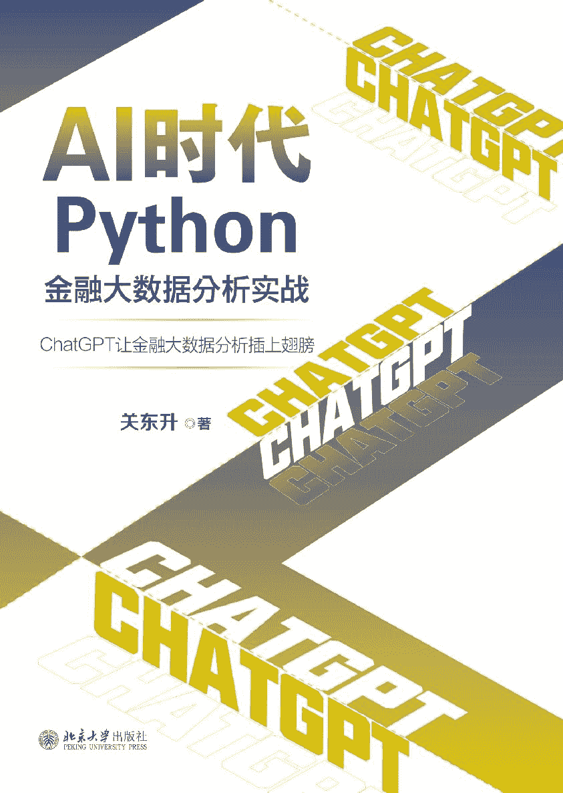

# AI赋能金融分析：Python大数据实战指南




# **版权声明**

**COPYRIGHT**

书名：AI赋能金融分析：Python大数据实战指南

作者：关东升

出版社：北京大学出版社

出版时间：2024年1月

ISBN：9787301346181

字数：143千字

本书由北京大学出版社有限公司授权得到APP电子版制作与发行

版权所有·侵权必究

# **内容梗概**

这是一本专为金融领域量身打造的数据分析与机器学习实战手册。全书以ChatGPT为核心引擎，融合Python编程技艺与金融专业底蕴，详解如何借力大语言模型处理海量金融数据、构建预测模型、支撑智能决策。

研读此书，你将掌握驾驭ChatGPT及配套工具剖析金融巨量数据的核心逻辑与实操路径。无论你是深耕金融圈的老手，还是数据分析的新兵，皆能汲取干货，显著增强实战解题能力。书中案例丰富、技巧实用，助力不同阶段的读者用AI技术破解金融现场的棘手难题。

# **序言**

数据井喷的当下，金融业站在十字路口：海量信息孕育无限可能，也编织前所未有的复杂谜题。恰逢人工智能异军突起，为破局金融大数据分析献上全新钥匙。

本书将领你深入AI时代的金融数据腹地，聚焦现象级技术——ChatGPT。这款深度学习驱动的自然语言模型，能拟人对话、自动问答、解读数据、化解难题，在金融版图中大有可为。

借助ChatGPT，我们能从繁杂财经数据中捕捉隐匿脉络、挖掘高价值信号。它能协力清洗预处理数据，攻克缺失值、类型冲突、异常点等顽疾；更能辅助可视化呈现，让晦涩数字化作直观图景。

更振奋人心的是，它化身智能副驾，按需输出定制化建议。投资决策、风控管理、资产配置，样样都能给出参考坐标。它将成为你的得力干将，助你在市场浪潮中乘风破浪、捕捉良机。

全书将通过翔实案例与实战演练，层层剖析ChatGPT在金融大数据分析中的运作机理、落地场景与最佳范式，探索大数据与金融的深度共生，揭示这场融合催生的变革图景。

无论你是金融从业者、数据分析师，还是对AI+金融心怀好奇的探索者，本书都将为你开启通往智能金融新纪元的大门。让我们揭开金融大数据分析的神秘面纱，释放ChatGPT的无限潜能，为金融未来贡献一份力量。

愿此书作你的向导，引领你踏上AI时代的精彩征程！阅读愉快！

随书附赠全案例源码、教学视频等资源包。扫描左侧二维码关注“博雅读书社”公众号，输入第77页资源码 **jr2023** 即可领取。扫描右侧二维码留言“北大 AI”，可加入学习交流群获取答疑服务。


关东升

# **第一章**

# **ChatGPT：金融大数据分析的新引擎**

金融数字化转型加速、数据量级指数级攀升，机构与从业者面临处理庞杂数据集的严峻考验。数据分析在决策制定、风险管控、市场洞察中居核心地位。近年来AI技术在金融渗透加深，ChatGPT这款基于NLP的大语言模型，正化身金融大数据分析的得力助手。

其核心作用集中于三大维度：

**一、代码生成加速器**  
用户只需描述数据画像，ChatGPT即可输出Python/R代码，完成读取、清洗、统计分析等前置任务。例如输入“存款额度与客户画像数据集”，瞬间获得读取数据、计算描述性统计、绘制直方图的完整脚本。

**二、金融知识百科全书**  
面对BPS基点差应用、利率衍生品分类、跨市场套利原理等专业追问，结合上下文给出精准解读，化解认知盲区。

**三、数据洞察雷达**  
通过提问、建模、分析闭环，协助发现数据深处的趋势与关联，推荐进阶分析路径。

虽未臻替代专家之境，但已能高效赋能专业人士，释放时间创造更大价值。其在金融与数据分析领域的潜力与成长空间，依旧广袤。

### **1.1**

## **实战：ChatGPT生成金融分析代码范式**

ChatGPT可作为强力编程副驾，产出多元金融分析代码范式，大幅压缩研发周期。以下呈现两大典型场景。

### **1.1.1**

### **场景一：数据清洗与预处理代码生成**

分析师描述含海量交易记录的数据集，存在重复、缺失、异常三大痛点。经多轮对话，即获针对性清洗预处理代码：去重、缺失值填补/剔除、异常值识别处理。

**分析师提问：**  
手头有一批交易数据，疑似含重复行与缺失值，求清洗思路与代码。

**ChatGPT回复：**  
**推荐用Pandas库实现。下方示例代码覆盖去重与缺失值处理：**


### **1.1.2**

### **场景二：特征工程代码生成**

特征质量直接决定模型上限。分析师抛出投资组合数据集，期望挖掘高价值特征。ChatGPT随即产出特征工程范式：收益率、波动率、技术指标等核心特征的计算逻辑。

**分析师提问：**  
持有投资组合数据集，想提炼实用特征，有何建议与代码示例？

**ChatGPT回复：**  
**可用NumPy与Pandas高效算收益率、波动率。示例代码如下：**


上述范式演示了从原始数据到建模特征的关键跃迁。

### **1.2**

## **实战：ChatGPT答疑金融专业知识**

作为大规模预训练语言模型，ChatGPT内化海量金融知识库，可即时响应多维专业提问。以下四案例展示其知识服务能力。

### **1.2.1**

### **案例一：金融市场知识解惑**

市场知识博杂，常人难以穷尽。咨询ChatGPT，秒级获得权威解读。

**提问：** 何为投资组合优化？  
**回答：** **投资组合优化旨在寻找最优配置，于给定风险下最大化预期收益。借助数学模型与算法平衡各资产风险收益，实现最佳资产配置。**

**追问：** 哪些因素主导市场流动性？  
**回答：** **流动性受多维因子共振影响，核心维度包括：**

**1. 交易量：** 活跃成交聚拢买卖双方，提升流动性。  
**2. 市场深度：** 承接大单而不剧烈波价的能力，深度越强流动性越佳。  
**3. 报价价差：** 买卖价差收窄降低交易阻力，促进流动。  
**4. 交易成本：** 佣金、滑点等费用越低，流动性越充裕。  
**5. 信息透明度：** 信息对称降低不确定性，引资入市。  
**6. 参与者结构：** 多元主体广泛参与，夯实流动性基石。

**诸因子交织，合力塑造流动性图景。洞察此中互动，有助研判流动性演变与市场行为。**

### **1.2.2**

### **案例二：经济学理论通解**

经济理论抽象晦涩，ChatGPT可化繁为简。

**提问：** 能否用通俗语言解释利率？  
**回答：** **利率是货币的时间价格，反映贷方利息收入与借方利息支出的差额。它通过调节消费投资传导至实体经济。**

**央行调整对商业银行放贷利率（政策利率），波及全经济资金供给与定价水平，此即货币政策。** 加息抑制过热与通胀，降息刺激增长。**市场利率除受政策锚定，仍受供求博弈驱动：** 经济过热、信贷需求激增，市场利率随之走高。

### **1.2.3**

### **案例三：金融产品概念拆解**

投资者与从业者常需快速定性金融产品，ChatGPT提供即时解码。

**提问：** 请解释ETF（交易所交易基金）概念。  
**回答：** **ETF兼具基金与股票双重属性：在交易所上市交易如股票，标的跟踪指数/商品/债券/资产组合。买入ETF即买入一篮子资产，一键实现分散化投资。**

### **1.2.4**

### **案例四：金融风险管理问答**

风控领域，ChatGPT可供给模型思路、答疑释惑、辅佐决策。

**提问：** 如何量化金融产品市场风险？  
**回答：** **市场风险源于行情波动引发的潜在亏损。主流量化指标为风险价值（VaR）。VaR在给定置信水平下，度量持仓在未来特定期内可能遭遇的最大损失。基于历史数据与概率统计构建，助投资者评估行情冲击下的组合脆弱性。**

### **1.3**

## **ChatGPT辅助挖掘数据模式与特征**

金融大数据分析中，ChatGPT借力NLP与文本分析，协助发掘数据深层肌理。主要切入点六大维度：

1. **文本数据解析：** 覆盖结构化与非结构化文本——新闻、社媒舆情、公司公告等。剖析金融相关情感倾向、事件冲击。
2. **情感分析：** 解码文本对特定标的/机构的情绪倾向，洞察市场参与者心理，预判情绪与趋势拐点。
3. **舆论图谱：** 自动化分析市场对特定产品、机构、走势的集体看法，预警潜在变局与风险。
4. **关键词提取：** 从海量文本中萃取核心词汇/短语，支撑词袋模型/主题模型构建，映射金融事件与市场动力的关联网络。
5. **数据预处理：** 协力清洗降噪、去冗余，提升后续分析精度与效能。
6. **文本生成：** 产出市场点评、研报草稿等财经文本，为投研决策提供参考素材。

**须知：** ChatGPT本质为语言模型，专业金融任务仍需融合领域知识与专业分析方法，方得严谨全面。金融数据隐私与安全合规，亦为红线不可逾越。

## **1.4**

## **本章小结**

本章全景展示ChatGPT在金金融数据分析中的多元落位：  
**代码层面**，案例1、2实证其生成清洗预处理与特征工程代码的硬核能力，显著提速提质；  
**知识层面**，案例3-6覆盖市场认知、经济理论、产品认知、风控实务，验证其作为知识库与智能问答系统的高可用性；  
**洞察层面**，论证其辅助模式发现与特征挖掘的增值潜力。  

总之，ChatGPT为金融数据分析与决策开辟新范式、注入新动能。

# **第二章**

# **金融大数据分析：Python核心技术栈**

Python凭借生态丰富、上手友好，成为金融大数据分析首选语言。核心技术版图六大板块：

**1. 数据处理与分析三剑客：** NumPy（高性能数组与数学运算）、Pandas（数据清洗/转换/聚合利器）、SciPy（科学计算与统计方法库）。  
**2. 可视化全家桶：** Matplotlib（基础绘图）、Seaborn（统计美学图表）、Plotly（交互式可视化）——让数据会说话，直击模式与趋势。  
**3. 金融数据获取与加工：** pandas-datareader、yfinance、quandl等库直连多元数据源，灵活完成抓取、清洗、转换一体化流程。  
**4. 统计建模引擎：** Statsmodels（回归、时间序列等经典统计模型）、Scikit-learn（机器学习算法全家桶，服务预测建模与分类）。  
**5. 量化金融专用库：** Pandas、NumPy、Zipline等深耕金融时序分析、风控度量、策略回测。  
**6. 机器学习与深度学习：** Scikit-learn（传统ML）、TensorFlow/PyTorch（深度学习）——构建训练预测模型，赋能行情预测、风险评估等核心任务。

夯实上述基础，即可启程金融大数据分析实战之旅。

本章先行铺垫Python语言核心基石。

### **2.1**

## **Python解释器全景解析**

Python解释器负责将源码编译为机器可执行指令。装完Python后，因历史演进，主流实现呈多元共存：

| 实现 | 内核语言 | 核心特征 | 适用场景 |
|------|----------|----------|----------|
| **CPython** | C | 官方标准实现；源码→字节码→虚拟机执行；二次运行复用字节码提速 | 通用首选，生态兼容性最佳 |
| **PyPy** | Python | JIT即时编译，执行速度显著超CPython | CPU密集型长跑任务，兼容性稍弱 |
| **Jython** | Java | 编译为Java字节码，运行于JVM | 需深度集成Java生态的项目 |
| **IronPython** | C#/.NET | 编译为.NET IL，可直接调用.NET Framework程序集 | .NET技术栈内嵌Python脚本 |

# Python环境搭建与基础语法速通指南

出于兼容性与性能综合考量，本教程采用 Python 官方标准实现 **CPython** 作为开发运行环境。官方提供了覆盖 Windows、Linux/UNIX 及 macOS 的多平台安装包。值得注意的是，绝大多数 Linux/UNIX 与 macOS 系统已预装 Python，仅版本新旧有别。

获取安装包可前往 Python 官网（见下图），点击醒目的“Download Python 3.x.x”按钮即可下载最新版解释器。


图 2-1 Python 官网下载页

下载完成后，双击安装包启动向导。弹出的选项界面中（如下图），**务必勾选“Add python.exe to PATH”**——这会自动将 Python 写入系统环境变量，让你在任意目录下都能直接调用 `python` 命令。若需定制安装路径或组件，可选“Customize installation”；本教程演示默认模式“Install Now”，点击后静待进度条走完即告成功。


图 2-2 安装选项对话框

### 2.2 量化开发利器：IDE 选型指南

量化策略研发离不开趁手的集成开发环境（IDE）。主流工具各有千秋，核心梳理如下：

*   **PyCharm**：JetBrains 出品的 Python 重量级 IDE。代码补全、重构、调试、测试一应俱全；专业版更内置科学计算与数据分析深度支持，功能最为全面。
*   **Visual Studio Code**：微软推出的轻量级跨平台编辑器。核心优势在于插件生态极其丰富，装上 Python 扩展、Jupyter 扩展后秒变全能开发平台，启动快、资源占用低。
*   **Jupyter Notebook / JupyterLab**：交互式编程首选。代码、可视化图表、Markdown 文档融为一体，天然适配探索性数据分析、策略快速原型验证及结果展示。
*   **Spyder**：专为科学计算打造，界面酷似 MATLAB，变量探查器、对象检查器等工具对数据分析极其友好。

**笔者首推 Jupyter Notebook**，因其交互式特性与量化研究“试错-修正-可视化”的工作流完美契合。当然，Sublime Text、Atom 等经典编辑器经配置后也能胜任，读者可按个人偏好定制。

#### 2.2.1 Jupyter Notebook 极速安装

Python 包管理器 `pip` 是安装利器。常用指令速查表请留存：

| 操作 | 命令模板 | 说明 |
| :--- | :--- | :--- |
| 安装包 |  | 从 PyPI 拉取最新版 |
| 指定版本安装 |  | 使用 `==` 锁定版本号 |
| 升级包 |  | 自动检测并更新至最新 |
| 卸载包 |  | 移除指定包 |
| 列出已装包 |  | 显示当前环境包清单及版本 |
| 搜索包 |  | 在 PyPI 检索关键词 |
| 查看包详情 |  | 含版本、作者、依赖等元信息 |

打开终端（或 CMD/PowerShell），执行安装命令，过程如下图所示：


图 2-3 命令行安装 Jupyter Notebook

#### 2.2.2 启动与基础操作

1.  打开终端（Windows 用命令提示符/PowerShell，Mac/Linux 用 Terminal）。
2.  输入命令并回车：


服务启动后会自动唤起默认浏览器跳转至主页（如下图）。若未自动弹出，终端会打印一串带 Token 的本地 URL（类似 `http://localhost:8888/?token=...`），复制到浏览器手动访问即可。


图 2-4 Jupyter Notebook 主页


图 2-5 终端输出的访问地址

**主页功能点**：浏览目录、新建 `.ipynb` 笔记本、打开已有文件。点击笔记本即可进入编程界面。

> ⚠️ **关键提示**：Jupyter 运行时终端会持续输出日志，**切勿关闭终端窗口**，否则内核进程会随之终止。
> 💡 **指定目录启动**：先在终端用 `cd` 切换到目标文件夹，再执行启动命令，主页将直接定位到该目录。

### 2.3 Hello World：跑通第一个程序

“Hello World”是编程界的通关仪式，既验证环境，也展示最基础输出。Python 运行代码主要有两种模式：**交互式解释器**（即写即得，适合测试片段）与 **脚本文件运行**（执行 `.py` 文件，适合完整项目）。

#### 2.3.1 脚本文件模式实战

1.  用文本编辑器（甚至系统自带记事本）输入代码：


2.  另存为 `hello.py`（后缀必须为 `.py`）。
3.  终端定位到文件所在目录，运行 `python hello.py`，屏幕打印出 “Hello World!” 即成功。


图 2-6 记事本编写代码示意


图 2-7 终端运行脚本输出结果

> 💡 **模式选型建议**：交互模式适合碎片化验证、API 试调用；脚本模式适合构建可复用、可部署的完整程序。

#### 2.3.2 Jupyter Notebook 交互式实战

得益于单元格机制，Jupyter 写代码如同填表单般直观：

1.  **启动服务**并进入主页（参照 2.2.2）。
2.  **新建笔记本**：点右上角 `New` → 选 `Python 3`（或可用内核）。


图 2-8 新建 Python 笔记本

3.  **编写执行**：页面呈现空白代码单元格，点击输入代码，按 `Shift + Enter` 即时运行，结果直接显示在单元格下方。


图 2-9 Jupyter 单元格编写与运行演示

### 2.4 语法基石：从零构建代码大厦

掌握核心语法要素，是写出优雅 Python 代码的前提。

#### 2.4.1 标识符：命名的“交通规则”

变量、函数、类、模块等自定义名称统称标识符，命名须遵守：

*   **严格区分大小写**（`Myname` ≠ `myname`）。
*   **首字符**只能是字母或下划线 `_`，**不能是数字**。
*   **后续字符**可由字母、数字、下划线组成。
*   **禁用关键字**（如 `class`, `if` 等）。
*   **避免覆盖内置函数名**（如 `print`, `list`, `str` 等）。

✅ 合法：`height`, `userName`, `_sys_val`, `用户名`（中文合法但不推荐）
❌ 非法：`2mail`（数字开头）、`room#`（含特殊符号）、`class`（关键字）

#### 2.4.2 关键字：语言保留的“核心词汇”

Python 3 共有 **33 个关键字**，除 `False`、`None`、`True` 首字母大写外，其余全为小写。完整清单见下表：


表 2-1 Python 关键字列表

#### 2.4.3 变量声明：动态类型的“即时生效”

Python 无需预声明类型，**赋值即声明，类型随值动态绑定**：


**解读**：
*   第 ①-③ 行：直接赋值，变量自动推断为整数、浮点、字符串类型。
*   第 ④ 行：变量 `y` 先绑定整数 `20`，后改绑布尔值 `True`，**同一变量可随时切换绑定不同类型对象**，这是动态语言的核心特征。

#### 2.4.4 语句：驱动程序流转的指令

语句是代码执行的最小单元（如赋值、条件判断、循环）。
*   **换行即结束**：一行通常写一条语句，行尾分号可加可不加（规范建议省略）。
*   **强制同行多语句**：用分号隔开（如 `x=1; y=2`），但 **PEP 8 规范强烈不推荐**，破坏可读性。
*   **链式赋值**：`a = b = c = 10`，三变量共指向同一整数对象 `10`。


#### 2.4.5 代码块：用缩进界定层级

这是 Python 与 C/Java 最大的区别：**没有大括号 `{}`，完全靠缩进定义代码块归属**。缩进级别一致 = 同一代码块。


**解读**：
*   第 ①、② 行缩进相同，属于同一块（如 `if` 分支内）。
*   第 ③、④ 行缩进不同，分属不同层级。

> 💡 **缩进最佳实践**：**统一使用 4 个空格**（而非 Tab 键）。不同编辑器渲染 Tab 宽度不一，极易导致混缩进报错，4 空格是社区公认标准（PEP 8）。

#### 2.4.6 模块：代码复用的基本单元

*   **本质**：一个 `.py` 文件即一个模块，可包含变量、函数、类等。
*   **跨模块访问**：通过 `import` 机制实现。

**实战演示**：
1.  当前目录新建 `module1.py`，写入代码：


> 第 ① 行 `# -*- coding: utf-8 -*-` 声明源文件编码为 UTF-8，防止中文注释乱码。

2.  在 Jupyter 笔记本中导入使用：


**导入姿势详解**：
*   `import module1`：整体导入。调用需加前缀 `module1.y`、`module1.func()`。
*   `from module1 import y, z`：按需导入。直接用 `y`、`z`，无需前缀。
*   **冲突规避**：若当前作用域已有变量 `z`，`from module1 import z` 会失败或被遮蔽，需用 `import module1` 方式访问 `module1.z`。

运行结果验证：


图 2-10 模块导入运行结果

### 2.5 数据类型与运算符：数据操作的地基

#### 2.5.1 六大标准类型全景图

Python 内置 6 大核心类型：
*   **单值类型**：数字（Number）、字符串（String）
*   **容器类型（数据结构）**：列表、元组、集合、字典

**数字类型细分为 4 种**：
1.  **整数 (`int`)**：精度无上限，仅受限于机器内存。告别其他语言的溢出烦恼。
2.  **浮点数 (`float`)**：仅支持双精度，精度依赖底层硬件。支持十进制（`3.14`）与科学计数法（`1e5` 即 `100000.0`，`e`/`E` 大小写皆可）。
3.  **复数 (`complex`)**：形如 `a + bj`，`j` 表示虚部（工程学习惯，数学常用 `i`）。
4.  **布尔 (`bool`)**：**本质是 `int` 子类**。`True == 1`，`False == 0`，可直接参与算术运算（如 `True + 2 == 3`）。

# Python 核心语法：数据类型、运算符与流程控制详解

## 复数与布尔类型基础

复数作为数学体系中的核心构件，在理论物理推演及电气工程实战中均占据重要地位。主流编程语言多缺乏原生支持，而 Python 内置复数类型，显著拓宽了其科学计算的适用范畴。

### 布尔类型机制

Python 中布尔类型标识为 `bool`，实为 `int` 的子类，仅包含 `True` 与 `False` 两个单例。任意数据类型均可经由 `bool()` 函数转换为布尔值：被视为“空”或“无”的对象（如 `None`、`False`、数值 `0`、空序列 `''`/`[]`/`()`/{} 等）映射为 `False`，其余均为 `True`。

实战代码演示：


运行结果呈现：


**代码逻辑注解：**
- 第 ① 至 ⑥ 行展示整数 28 的多种字面量写法。
- 第 ② 行为二进制形式，前缀 `0b`/`0B`。
- 第 ③、④ 行为八进制形式，前缀 `0o`/`0O`。
- 第 ⑤、⑥ 行为十六进制形式，前缀 `0x`/`0X`。
- 第 ⑦ 行采用科学计数法表达浮点数。
- 第 ⑧ 行呈现复数字面量。
- 第 ⑨、⑩ 行演示 `bool()` 函数将数值转为布尔型。

---

## 2.5.2 运算符体系

运算符（即操作符）涵盖算术、关系、逻辑、赋值及特殊符号等类别。本节聚焦前四大核心类别的使用规范。

### 1. 算术运算：数值运算基石

服务于整型与浮点型计算。按操作数数量分为一元与二元。一元仅含取反符 `-`（如 `-a`）。二元包含 `+`、`-`、`*`、`/`、`%`、`**`、`//` 七种，主要面向数值；其中 `+` 与 `*` 亦适配字串、元组、列表等序列的拼接与复制。详细功能速查表如下。

表 2-2 二元算术操作符速查


▼续表


### 2. 关系运算：比较裁决器

用于判定两个表达式的大小序关系，返回真值（`True`/`False`）。提供六种比较形式：`==`、`!=`、`>`、`<`、`>=`、`<=`。规则对照见下表。

表 2-3 关系操作符对照表


### 3. 逻辑运算：布尔代数工具

专用于布尔型运算，结果亦为布尔型。核心操作含 `and`、`or`、`not`，真值表详情如下。

表 2-4 逻辑操作符说明


### 4. 赋值运算：简写语法糖

本质为复合赋值的简便写法，高频用于变量自更新（如 `a += b` 等价 `a = a + b`）。所有二元算术及位操作符均有对应赋值形式。完整清单见下表。

表 2-5 赋值操作符大全


▼续表


**实战演示**

范例代码呈现：


控制台打印输出：


---

## 2.6 程序流程控制

顺序、分支、循环构成流程控制三支柱。Python 通过控制语句调度执行流完成任务。语句可为单条指令，亦可为复合代码块。分类如下：

- **分支控制**：`if` 语句。
- **循环控制**：`while` 与 `for`。
- **跳转控制**：`break`、`continue`、`return`。

### 2.6.1 分支语句：决策逻辑实现

Python 仅以 `if` 关键字构建分支，涵盖单分支、双分支、多分支三种形态。

#### 单分支 `if` 模式

仅当条件判定为真时执行代码块，否则顺延后续指令。语法骨架：


范例实现：


运行结果：


#### 双分支 `if-else` 模式

通用二选一决策结构。逻辑流向：条件为真执行块 1 并跳过 `else`；为假则略过块 1 直奔块 2。语法结构：


范例实战：


运行结果：


#### 多分支 `elif` 模式

实为 `if-else` 多层嵌套的优化形态，特征为多支中**仅一支**代码块生效，适配多条件互斥场景。语法形式：


范例代码：


运行结果：


### 2.6.2 循环语句：重复执行引擎

Python 提供 `while` 与 `for` 两大迭代机制。

#### `while` 循环：条件驱动持久战

属“先判后执”模式，无显式初始化，轮次未知，条件成立即持续迭代。支持 `else` 子句。语法范式：


代码演示：


控制台输出：


#### `for` 循环：序列遍历利器

应用最广、功能最强的循环形式。异于 C 风格计数循环，Python `for` 类似 Java 增强 for，专为**序列遍历**设计（字串、列表、元组均属序列）。通用语法：


其中“序列”泛指可迭代对象，“迭代变量”按序承接元素。同样支持 `else` 子句。

范例实战：


运行输出：


**关键点剖析：**
- 第 ① 行 `range(1,10)` 生成整数序列（含 1、不含 10、步长 1，共 9 项）。
- 第 ② 行 `format` 格式化输出，`{0}` 为占位标记。
- 第 ③ 行演示字串序列遍历特性。
- 第 ④、⑤ 行展示列表定义与遍历。

### 2.6.3 跳转语句：流程控制利器

可强制改变执行次序。Python 提供 `break`、`continue`、`return` 三指令，本节聚焦前二者。

#### `break`：循环终结者

适配 `while`/`for`，功能为**即时强制退出**当前循环层级，后续循环体代码不再执行。

范例代码：


运行结果：


#### `continue`：轮次跳过键

用于**终止当前迭代**，略过循环体残余指令，直入下一轮条件判定。

范例代码：


运行结果：


---

## 2.7 序列类型：有序容器体系

序列具备**可迭代、有序、可重复**特征，支持下标访问。可类比教师按报到次序编号：首项下标 0，末项 `长度-1`；逆序则以 -1 为末项。


图 2-11 序列示意图

序列家族成员：**列表**、**字串**、**元组**、**范围**、**字节流**。通用操作：**下标访问、区间截取、拼接、重复**。

### 2.7.1 下标访问：精准定位项

- **正序下标**：首项 0，递增至 `长度-1`。
- **逆序下标**：末项 -1，递减至 `-长度`。
访问语法：`序列[下标]`。以 "Hello" 为例，正逆下标分布如下。


图 2-12 下标示意图

代码演示：


运行结果：


**代码注解：**
- 第 ① 行定义字串变量 `a`。
- 第 ② 行 `a[0]` 取首字符。
- 第 ③ 行 `a[-1]` 取尾字符。
- 第 ④ 行 `a[5]` 越界触发 `IndexError`。

### 2.7.2 区间截取：灵活切取片段

截取语法两种形态：
- `[起始:终止]`：左闭右开区间。
- `[起始:终止:跨度]`：引入跨度（可正可负）。

**核心法则**：含头不含尾；起止下标可缺省（默认全域）。

范例代码：


**解析要点：**
- ① `a[1:3]` → "el"（不含下标 3）。
- ② `a[:3]` 等价 `a[0:3]`。
- ③ `a[0:]` 等价 `a[0:长度]`。
- ④ `a[1:-1]` 逆序下标截取 → "ell"。
- ⑤ 跨度缺省默认 1；`a[1:5:2]` 跨度 2 → "el"。
- ⑥ `a[0:3:3]` 跨度 3 → "H"。
- ⑦ `a[::-1]` 负跨度反向遍历 → 字串反序。

> **提示**：跨度机制公式：`下次下标 = 当前下标 + 跨度`。

### 2.7.3 可变序列——列表：动态数组典范

列表为**可变容器**，支持增、删、改、查。两大构建路径：
1. 字面量语法：`[项1, 项2, ...]`。
2. 构造函数：`list(可迭代对象)`。

范例演示：


运行结果：


**代码详解：**
- ① 标准字面量构建。
- ② 列表项类型无限制，可混存字串、数字等任意对象。
- ③ `list()` 构造函数构建。
- ④、⑤ 单项列表写法（中括号必留，尾随逗号可选）。
- ⑥ `type()` 确认类型为 `list`。
- ⑦ `append()` 尾部添加项。
- ⑧ `remove()` 按值移除首个匹配项。

### **2.7.4**

### **固化的序列——元组**

元组属于不可变序列范畴，一旦实例化便锁定状态，无法再做增删改操作。构建元组主要有两条路径：

*   直接用逗号 `,` 隔开各项元素。
*   调用 `tuple([iterable])` 工厂函数。

具体代码演示请见下方。


执行上述代码后，控制台回显如下：


**代码逐行解析：**

*   第①行演示了用逗号分隔元素来生成元组。值得注意的是，小括号 `()` 并非创建元组的强制语法，只是为了阅读清晰或消除歧义。
*   第②行同样采用逗号分隔的方式构建元组。
*   第③行展示了混合类型元组（字符串与整数共存）。得益于 Python 动态类型特性，元组容器不限制元素类型。
*   第④行使用 `tuple([iterable])` 函数转换生成元组。参数 `iterable` 接受任意可迭代对象，示例中传入列表 `[21,32,43,45]`，因列表可迭代，故转换成功。

---

### **2.7.5**

### **列表推导式**

Python 独有的“推导式”语法，能以极简方式实现：接收一种数据结构，经由筛选、映射运算，输出另一种结构。按输出容器类型可分为列表、集合、字典推导式，本节聚焦列表推导式。

假设需获取 0~9 范围内偶数的平方集合，常规 `for` 循环写法如下：


**逻辑拆解：**

*   第①行初始化空列表 `result`。
*   第②行 `range(10)` 生成 0~9 整数序列。
*   第③行判断当前元素 `x` 是否为偶数。
*   第④行表达式 `x ** 2` 完成平方运算。

改用列表推导式，代码瞬间精简：


第①行即为列表推导式核心，输出结果与循环版完全一致。图 2-13 揭示了其语法骨架：**`in` 后跟“输入序列”；`for` 前为“输出表达式”，运算结果自动汇入新列表；`if` 子句负责过滤，仅保留符合条件的元素进入输出表达式。该条件子句可省略，省略则全量通过。**


图 2-13 列表推导式语法图

条件判断支持多重叠加，隐含“与”逻辑。例如筛选 0~99 中能被 5 整除的偶数：


此处两个 `if` 条件 `x % 2 == 0` 与 `x % 5 == 0` 同时生效，等价于逻辑与运算。

---

### **2.8**

### **集合**

集合是**可迭代、无序、元素唯一**的数据容器。图 2-14 以班级名单为例：学生无先后顺序，不可下标访问，且重名自动去重。


图 2-14 集合示意图

> **对比速记**
> 序列：有序、可重复、支持下标。
> 集合：无序、去重、不可下标。
> **核心差异：序列重“序”，集合重“唯一”。若业务不关心顺序且需去重，二者可互换。**

---

### **2.8.1**

### **创建集合**

两种标准姿势：

*   花括号 `{}` 包裹元素，逗号分隔。
*   内建 `set([iterable])` 函数转换。

代码实操：


运行输出：


**关键点解读：**

*   第①行：字面量语法 `{...}` 直接建立集合。
*   第②行：`set()` 函数将可迭代对象（如列表、字符串）转为集合，自动完成去重。
*   第③行：`type(b)` 确认对象类型为 `set`。

---

### **2.8.2**

### **集合推导式**

语法与列表推导式如出一辙，唯一区别在于**输出容器为集合**（自带去重、无序特性）。改造 2.7.5 节示例：


**解读：**
第①行即集合推导式，直接产出 `set` 对象 `n_set`。

控制台实测结果：


---

### **2.9**

### **字典**

字典 是**可变、可迭代、键值映射**的高级结构。内部由两大视图构成：**键视图**与**值视图**。键必须唯一（类似集合），值可重复，键值强绑定成对出现。

图 2-15 展示“国家代号→国家名”的典型字典模型：


图 2-15 字典结构示意

> **场景联想**
> 字典极擅长“键查值”场景，堪比查英汉词典：键=单词，值=释义。正如单词可对应多个义项，字典值也允许重复；但单词本身（键）在词典中唯一。

---

### **2.9.1**

### **创建字典**

两大创建范式：

*   花括号 `{key: value, ...}` 直接声明键值对。
*   `dict()` 构造函数（接受键值对序列或关键字参数）。

代码演示：


输出回显：


**逐行复盘：**

*   第①行：字面量语法 `{...}` 构建字典 `dict1`。
*   第②行：`len(dict1)` 获取键值对数量（即键的个数）。
*   第③行：`{}` 空花括号默认创建**空字典**而非空集合（空集合须用 `set()`）。
*   第④行：`type(dict3)` 验证类型为 `dict`。

---

### **2.9.2**

### **字典推导式**

因字典含“键、值”双维度，推导式表现力极强。语法结构见图 2-16。


图 2-16 字典推导式语法图

实战示例：


运行结果：


**核心解读：**

*   第①行：标准字典推导式。注意：**字典本身不可直接迭代产出键值对**，需调用 `.items()` 方法获取 `(key, value)` 元组序列作为输入源。
*   第②行：仅提取键构成的推导式，输出退化为键集合（本质是列表推导式变体）。

---

### **2.10**

## **字符串类型**

字符串本质是**有序字符序列**，索引从 0 起步自增。Python 3 中统一用 `str` 类型表示，底层采用 Unicode 编码，原生支持中文等多语言字符。

### **2.10.1**

### **三种字面量形态**

1.  **普通字符串**：单引号 `'` 或双引号 `"` 包裹（社区常用单引号）。
2.  **原始字符串**：前缀 `r` 或 `R`，禁用转义，所见即所得（正则、路径常用）。
3.  **长字符串/多行字符串**：三重单引号 `'''` 或三重双引号 `"""` 包裹，保留换行、缩进等排版。

以下写法均表示 `Hello World`：


**特殊字符处理**：普通字符串中插入换行 `\n`、制表符 `\t` 等需用反斜杠 `\` 转义。常用转义符速查表 2-6：


实战代码：


控制台输出：


**要点标注：**

*   第①行：`r'...'` 原始字符串，反斜杠不再转义，按字面保留。
*   第②行：三重引号长字符串，原样保留代码中的换行与缩进格式。

---

### **2.10.2**

### **字符串格式化**

实战中常需将变量嵌入文本并控制格式（如保留小数、对齐填充）。Python 提供 `str.format()` 配合占位符 `{}` 完成此任务。

示例代码：


运行效果：


**机制详解：**

*   第①、②行均调用 `format()`，实参按顺序或名字替换模板中的 `{}`。
*   第①行 `{0}`、`{1}` 为**索引占位符**，数字对应 `format()` 参数下标（0 基）。
*   第②行 `{n}`、`{a}` 为**命名占位符**，名称对应 `format(n=..., a=...)` 的关键字参数。

---

## **2.11**

## **函数**

Python 生态离不开函数。官方内置函数 即拿即用；自定义函数则遵循“先定义，后调用”铁律（定义必须在调用之前，否则抛 `NameError`）。

**定义语法范式：**


*   关键字 `def` 开头。
*   函数名遵循标识符命名规范。
*   参数列表用逗号分隔，可为空。
*   有返回值用 `return` 回传；无返回值可写 `return None` 或直接省略 `return`。

定义并调用示例：


运行输出：


**流程追踪：**

*   第①行：定义 `rectangle_area(width, height)` 计算矩形面积。
*   第②行：`return` 将乘积结果回传给调用方。
*   第③行：传入实参调用函数，接收返回值。

---

### **2.11.1**

### **匿名函数与 `lambda` 表达式**

临时性、一次性逻辑无需命名，用 `lambda` 表达式即时创建匿名函数。

**语法签名：**


*   `lambda` 关键字声明。
*   参数列表**无需括号**，逗号分隔。
*   冒号 `:` 后为**单一表达式**作为函数体，结果自动返回（**禁止**写多语句、禁止 `return`、禁止复杂代码块）。

> **避坑指南**
> Python `lambda` 仅支持单表达式，功能受限于简单计算，无法承载复杂业务逻辑，这与部分函数式语言的 `lambda` 有本质差异。

实战演示：


运行结果：


**深度解析：**

*   第①行：`lambda a, b: a + b` 定义加法匿名函数，赋值给 `f1`。
*   第②行：`lambda a, b: a - b` 定义减法匿名函数，赋值给 `f2`。
*   第③、④行：`calculate_fun` 高阶函数分别返回上述两个函数对象。
*   第⑤行：`type(f1)` 证实类型为 `function`，匿名函数本质仍是函数对象。
*   第⑥、⑦行：通过变量名 `f1()`、`f2()` 实施调用，等同于执行对应 `lambda` 体。

---

### **2.11.2**

### **数据处理双子星：`filter` 与 `map`**

数据清洗、转换高频依赖这两大高阶函数。

#### **1. 过滤器 `filter`**

`filter(function, iterable)` 遍历可迭代对象，将各元素喂入 `function` 判断，**保留返回 `True` 的元素，丢弃 `False` 元素**。

语法原型：


实战：筛选以 `T` 开头的用户名。


输出结果：


**关键点：**

*   第①行：`filter(lambda u: u.startswith('T'), users)` 返回 **`filter` 迭代器对象**（非列表），惰性求值。
*   第②行：`list(...)` 强制物化为列表。
*   第③行：**再次物化得到空列表**。原因：`filter` 对象是**一次性生成器**，迭代耗尽即空。首次 `list()` 已消费完毕，二次消费无果。此特性适合处理海量数据流，避免全量载入内存。

#### **2. 映射器 `map`**

`map(function, iterable)` 对可迭代对象逐元素施加 `function` 变换，产出新迭代器。

语法原型：


# 掌握 Python 核心技能：从 map 映射到多线程并发

`map` 函数接收两个核心参数：一个是处理逻辑的 `function`，另一个是待处理的 `iterable` 可迭代对象。调用时，`map` 会依次遍历可迭代对象，将每个元素传入函数完成转换。

下面通过实战代码演示其用法：


执行上述代码，控制台将输出：


**代码深度解析：**

*   **第①行**：利用 `map` 配合 `lambda` 匿名函数，将 `users` 列表中的每个字符串元素转为小写。值得注意的是，`map` 返回的并非列表，而是一个 `map` 对象（本质是生成器），这意味着它**不支持重复提取数据**。
*   **第②行**：通过内置 `list()` 函数将该生成器物化为列表，完成最终结果的获取。

---

## 2.12 文件操作实战

程序运行离不开数据持久化，Python 通过**文件对象**（File Object，亦称“类文件对象”或“流”）统一抽象磁盘文件、内存缓冲、网络流、标准输入输出等各类数据源。

### 核心读写流程

#### 1. 打开文件：`open()` 函数详解

读写前必须先打开文件，`open()` 这一内置函数封装了对象创建细节，语法如下：


虽有 8 个参数，但日常高频仅 `file` 与 `mode` 两个，重点解析如下：

*   **`file` 参数**：目标文件标识。支持字符串路径（相对/绝对路径均可）或整型文件描述符（指向已打开文件）。
*   **`mode` 参数**：定义打开模式，基础组合见下表：


> **模式速记法**：
> *   **二进制模式**：`b` 必须搭配 `r/w/x/a` → `rb`、`wb`、`xb`、`ab`。
> *   **文本模式**：`t` 为默认，可省略 → `r`、`w`、`x`、`a` 即代表 `rt`、`wt`、`xt`、`at`。
> *   **读写模式**：`+` 需组合基础模式 → 文本用 `r+/w+/x+/a+`，二进制用 `rb+/wb+/xb+/ab+`。

**⚠️ 易混淆点辨析：`r+`、`w+`、`a+` 的差异**

| 模式 | 文件不存在 | 文件存在 | 指针初始位置 |
| :--- | :--- | :--- | :--- |
| **`r+`** | 抛出 `FileNotFoundError` | 保留原内容 | 文件开头 |
| **`w+`** | **创建新文件** | **清空原内容** | 文件开头 |
| **`a+`** | **创建新文件** | 保留原内容 | **文件末尾** |

实战演示：


**解析**：
① `w+` 模式打开不存在的 `test.txt` → 自动创建。
② `write()` 写入字符串。
③ `a+` 打开绝对路径文件，注意路径中的反斜杠需转义（`\\\\`）或使用原始字符串（`r"..."`）。

#### 2. 关闭文件：资源释放的两种范式

文件用完即关，防止资源泄漏。考虑到 IO 操作易抛异常，推荐两种保底方案：

*   **手动 `close()`**：需配合 `try-finally` 确保执行。
*   **`with as` 上下文管理器（推荐）**：块结束自动关闭，优雅且安全。

代码对比：


**解析**：
①~② 传统手动打开关闭。
③ `with as` 语法：`open()` 返回对象赋值给 `fobj`，缩进块内操作，退出块自动 `close()`。细节将在 2.13.2 节展开。

#### 3. 文本文件读写：按字符处理，编码为先

文本模式以**字符**为单位，**必须指定编码**（如 UTF-8）。核心方法速查：

| 方法 | 功能 | 关键参数/返回值 |
| :--- | :--- | :--- |
| `read(size=-1)` | 读全文或指定字符数 | `size=-1` 读全部，返回字符串 |
| `readline(size=-1)` | 读单行（含换行符） | 到达 EOF 返回空串 |
| `readlines()` | 全部行 → 列表 | 每行含换行符，列表元素为字符串 |
| `write(s)` | 写入字符串 | 返回写入字符数 |
| `writelines(lines)` | 批量写入列表 | **不自动加换行**，需自行处理 |
| `flush()` | 强刷缓冲区 | 数据落盘 |

**实战：文本文件复制**（读写方法需配对，如 `readlines` 对 `writelines`）：


**关键点**：
① 源文件指定 `encoding='utf-8'`。
② `readlines()` 读全量至列表。
③ 目标文件用 `w` 模式（覆盖/创建），编码保持一致。

#### 4. 二进制文件读写：按字节操作，无编码烦恼

二进制模式以**字节**为单位，**无需关心编码**，适合图片、视频、音频等。方法对应关系同上，仅对象类型变为 `bytes`。

**实战：图片文件复制**：


**流程**：
① `rb` 模式读取源图片 → ② `read()` 一次性获取所有字节对象 `b` → ③ `wb` 模式打开目标（覆盖/创建） → ④ `write(b)` 写入字节流。

---

## 2.13 异常处理：构建健壮程序

真实环境充满不确定性，异常处理是专业代码的标配。

### 2.13.1 捕获异常：`try-except` 机制

基础语法骨架：


*   **`try` 块**：放置“可能出错”的高风险代码。
*   **`except` 块**：捕获并处理异常。
    *   裸 `except:` 捕获**所有**异常（慎用，易隐藏 Bug）。
    *   `except ExceptionType:` 捕获指定类型及其**子类**。
    *   `except ExceptionType as e:` 获取异常对象 `e`，便于记录日志或提示。

**实战：日期格式解析容错**


运行输出：


**逐行拆解**：
① 导入 `datetime` 模块并别名 `dt`，避免命名冲突。
② 定义解析函数。
③ `strptime` 按 `%Y-%m-%d` 格式化，若字符串不合规（如月份 13、非数字）将抛 `ValueError`。
④ 捕获 `ValueError`，打印异常信息。示例中 `2023-8-18` 合法，故正常通过。若改为 `2023-B-18`，将触发异常分支：


⑤ `if __name__ == '__main__':` 判断主模块入口。**为何需要？** 多模块项目中，仅主模块作为执行入口（类比 C/Java 的 `main()`），防止被导入时误执行。单文件脚本可省略。

### 2.13.2 资源释放：`finally` vs `with as`

文件句柄、网络连接、数据库游标等**非内存资源**，GC 无法回收，必须显式释放。

#### 方案一：`finally` 块 —— 兜底执行

语法结构：


流程保证：无论 `try` 正常结束，还是 `except` 捕获异常，**`finally` 必执行**。


**实战：带资源释放的文件日期读取**


**测试文件内容**：

 (图 2-18 test1.txt 内容)

**逻辑解析**：
① 定义函数读文件转日期。
② `open()` 可能抛 `FileNotFoundError` → ⑥ 捕获。
③ `readline()` 可能抛 `OSError` → ⑦ 捕获。
④ `strip()` 清理首尾空白。
⑧ `finally` 块：**无条件执行 `file.close()`**，彻底释放句柄。

#### 方案二：`with as` 自动管理 —— 现代最佳实践

`finally` 虽健壮但冗长，`with as` 语法糖封装了“获取-使用-释放”全周期，代码更简洁、可读性更强。


**核心优势**：
① `with open(...) as file:` 自动绑定资源对象。
② 块内聚焦业务逻辑。
③ **退出块瞬间自动调用 `__exit__()` 释放资源**，无需手写 `close()`，也无需 `finally`。

---

## 2.14 多线程并发：提升 IO 密集型任务吞吐

多线程允许单进程内“同时”运行多条执行流，量化交易中常用于**数据拉取、策略计算、订单下发**并行化，显著降低延迟。

### 创建线程：`threading.Thread` 实战

线程对象由 `threading.Thread` 实例化，核心在于注入**线程体函数**（入口逻辑）。

构造方法签名：


**三大核心参数**：

| 参数 | 作用 | 默认值 |
| :--- | :--- | :--- |
| `target` | **线程入口函数**（可调用对象） | `None` |
| `name` | 线程标识名（调试利器） | `None` (系统自动生成) |
| `args` | 传给 `target` 的位置参数元组 | `()` (无参) |

**实战：双线程交替打印**


运行效果：


**执行流程还原**：
① 定义 `thread_body`：获取当前线程对象 → 循环打印“线程名-次数” → `sleep(1)` 模拟耗时 IO。
③ 创建 `t1`，指定 `target=thread_body`，名字自动分配。
④ `t1.start()` **启动**（非直接调用！），线程转入就绪态，调度器稍后执行 `thread_body`。
⑤ 创建 `t2`，显式命名 `"MyThread"`。
⑥ `t2.start()` 启动第二线程。
👉 **并发发生**：`t1`、`t2` 交替抢占 CPU，各自每秒打印一次，互不阻塞，最终各自打印完成信息退出。

---

> **💡 知识延伸：面向对象 (OOP) 视角**
> `Thread` 是类，`t1`/`t2` 是实例。Python 作为深度面向对象语言，将“数据（属性）”与“行为（方法）”封装于对象，通过消息传递（方法调用）协作。掌握 OOP 是读懂标准库、写出可扩展架构的基石。

# Python 面向对象核心与金融大数据获取全景指南

**Python 面向对象编程（OOP）基石**

Python 通过 `class` 关键字构建类，作为创建对象的蓝图。类封装了属性（成员变量）与行为（方法），实例化后生成的对象即具备这些特征，可调用方法改变自身状态。Python OOP 体系包含五大核心支柱：

*   **类与对象**：类是抽象模板，对象是具体实例，二者通过实例化建立联系。
*   **属性**：描述对象静态特征的数据容器，支持点语法（`.`）直接读写。
*   **方法**：绑定于类的函数，赋予对象动态行为，能访问修改属性。
*   **继承**：子类复用父类逻辑并可扩展，实现代码复用与层级架构。
*   **多态**：同一接口不同实现，配合重写机制增强系统灵活性与扩展性。

该范式广泛服务于软件工程、数据科学、机器学习等领域，以模块化、高内聚低耦合的结构显著提升代码可维护性与复用率。

---

## 2.15 本章回顾

本节复盘了 ChatGPT 在金融场景的多维赋能：从生成分析代码、解答专业知识，到辅助挖掘数据模式。通过实战案例 3-6，展现其在市场认知、经济理论、产品解析、风控管理等维度的问答实力，并凸显其在人机交互中助力数据洞察的潜力。同时，章节末尾梳理了 Python 入门必知——解释器、IDE、基础语法、数据类型、流程控制等栈式知识。

---

# 第三章 金融大数据获取实战

数据是分析的基石。本章系统梳理金融大数据获取路径：公开源、商业库、爬虫技术三大渠道，并强调依据需求选源、守住质量与合规底线。

### 3.1 金融大数据全景扫描

数字化浪潮下，金融数据形态多元：
*   **结构化**：交易流水、财务三大表等标准化记录。
*   **半结构化**：新闻稿、社交评论等带标签非标数据。
*   **非结构化**：文本、图像、音频等原始素材。

#### 3.1.1 主流数据源图谱

1.  **交易所核心源**：股票、期货、期权等实时与历史行情的权威发布地，支持接口直连或订阅。
2.  **上市公司披露**：财报（资产负债/利润/现金流表）可通过投资者关系官网、公开披露平台或商业终端获取。
3.  **政府权威统计**：GDP、就业、CPI 等宏观指标，源自统计局、央行等官方门户。
4.  **商业数据终端**：彭博、路透、FactSet 等聚合多源数据，提供标准化、高质量的市场/基本面/另类数据服务。
5.  **舆情与新闻流**：社交媒体、财经媒体承载市场情绪、事件驱动信息，是另类数据宝库。
6.  **爬虫自采集**：针对无开放接口的网页数据（新闻、博客、评论），通过编程自动化抓取。
7.  **其他补充源**：物联网传感器、交易底单、用户行为日志等新兴维度。

**选源黄金法则**：可靠性、准确性、合规性三位一体，依据分析目标动态组合。

#### 3.1.2 采集工具箱与技术栈

| 场景 | 核心工具/技术 | 关键点 |
| :--- | :--- | :--- |
| **网页非结构化** | 网络爬虫 | 模拟浏览器请求-解析-存储全链路，需控频、遵守 Robots 协议 |
| **标准化接口** | 数据商 API | 直连服务端，高效获取行情、基本面、宏观数据，需鉴权与配额管理 |
| **关系型数据库** | SQL | 结构化存储环境下的标准提取语言，支持复杂条件筛选与连接查询 |
| **文件批量下载** | HTTP/FTP + 解析器 | CSV/Excel/JSON 等离线包获取，配合 Pandas 等工程化处理 |
| **增量同步** | 订阅推送/FTP 定时拉取 | 保持数据时效性，适合高频更新场景 |
| **零成本起步** | 开源数据集 | Kaggle、GitHub 等社区公开数据集，适合原型验证与学术研究 |
| **脏数据治理** | Pandas / tidyverse | 清洗、转换、重塑，将原始数据打磨为分析就绪形态 |

技术选型需匹配数据类型、源格式、规模与合规边界，大规模场景下更要权衡算力与效率。

---

### 3.2 网络爬虫：自动化采集利器

爬虫通过模拟人类浏览行为（发请求 → 收响应 → 解析 HTML → 结构化存储），高效收割海量非结构/半结构化数据。

#### 3.2.1 核心工作流

1.  **发起请求**：构造 HTTP Request（含 Header、Params、Cookies）发往目标 URL。
2.  **接收响应**：服务端返回 HTTP Response，Body 携带 HTML/JSON 内容。
3.  **解析提取**：用正则、XPath、CSS Selector 或 JSON Path 定位目标字段。
4.  **持久化落地**：存入 CSV、JSON、数据库或数据湖，供下游消费。

#### 3.2.2 金融场景典型应用

*   **行情归档**：抓取交易所官网/行情页，构建自有历史 K 线库。
*   **基本面采集**：定时巡检上市公司官网/巨潮资讯，自动入库财报与公告。
*   **舆情雷达**：监控雪球、东财吧、财经媒体，量化市场情绪因子。
*   **多源融合**：异构数据清洗对齐，打通代码映射、时间对齐、字段标准化。

**红线警示**：严守《网络安全法》《数据安全法》及目标站 `robots.txt` 与用户协议；设置合理延迟与并发，避免构成拒绝服务攻击；尊重版权与隐私，商用数据需授权。

#### 3.2.3 `urllib` 标准库快速上手

Python 内置 `urllib` 无需额外安装，覆盖基础 HTTP 需求：

*   `urllib.request`：发送请求（`urlopen`）、下载文件（`urlretrieve`）。
*   `urllib.parse`：URL 解析、拼接、参数编码（`urlencode`）。
*   `urllib.error`：异常体系（`URLError`, `HTTPError`），便于熔断重试。
*   `urllib.robotparser`：解析 `robots.txt`，合规前置检查。


#### 3.2.4 实战案例：纳斯达克历史行情抓取

以苹果公司（AAPL）历史数据页为例，演示静态页采集全流程。考虑到官网频繁改版，教学环节提供本地 HTML 副本保证可复现性，实战中替换为在线 URL 即可。


*图示：纳斯达克 AAPL 历史数据页面结构*

案例代码实现：


运行输出：


**关键步骤解读**：
1.  定目标 URL 与本地兜底文件路径（`os.path.abspath` 解析相对路径）。
2.  `urlopen` 获取响应对象，`read().decode()` 拿到 HTML 字符串。
3.  如需持久化，配合 `urlretrieve` 或手动写入文件。

> **实战贴士**：学习期用本地静态文件屏蔽网络波动与结构变动；生产环境务必切回在线 URL，并建立页面结构变更监测与选择器自动修复机制。

---

### 3.3 数据解析：从杂乱 HTML 到结构化资产

原始 HTML 需经结构化解析才能入模。主流方案：`BeautifulSoup`（树遍历友好）、`lxml` + `XPath`（高性能）、`re` 正则（兜底）、`json` 库（接口直返）。**强推 `BeautifulSoup` 以其极简 API 降低上手门槛。**

#### 3.3.1 `BeautifulSoup` 核心速查

**安装**：`pip install beautifulsoup4` （依赖解析器 `lxml` 或 `html.parser`）


*图示：安装过程示意*

**核心对象**：`BeautifulSoup` 实例（文档树根节点）

| 维度 | API | 典型用法 |
| :--- | :--- | :--- |
| **查找-多** | `find_all(tag, attrs={})` | `soup.find_all('tr', class_='data-row')` 返回列表 |
| **查找-单** | `find(tag, attrs={})` | `soup.find('table', id='main-table')` 返回首个匹配 |
| **CSS选择** | `select(css_selector)` | `soup.select('tbody > tr td:nth-of-type(2)')` 链式定位 |
| **取属性** | `tag.get('attr', default)` | `a_tag.get('href', '')` 安全取链接 |
| **取文本** | `tag.text` / `tag.get_text(strip=True)` | 去除标签保留纯文本 |
| **页面标题** | `soup.title.string` | 快速获取 `<title>` 内容 |

#### 3.3.2 实战案例：纳斯达克表格数据结构化

**前置分析**：F12 开发者工具 → Elements 面板，定位数据容器 `<table> → <tbody> → 多个 <tr>（行） → <th>（表头/日期）+ 多个 <td>（单元格）`。


*图示：浏览器开发者工具 DOM 树视图*

解析代码实现：


运行结果：


**逻辑拆解**：
1.  `BeautifulSoup(html, 'html.parser')` 构建文档树 `sp`。
2.  `sp.find('tbody')` 精准锚定表格主体。
3.  `tbody.select('tr')` 批量抓取所有行节点。
4.  逐行循环：`tr.find('th')` 取日期/表头，`tr.select('td')` 取明细单元格。
5.  组装字典 `fields` 入列表 `data`，完成列表套字典的标准化结构。

**落盘为 CSV**（便于 Excel/BI 直连）：


输出文件预览：


*图示：WPS 打开 CSV 效果*

**落盘代码注解**：
1.  `import csv` 引入标准库。
2.  `data[0].keys()` 动态提取表头字段名。
3.  `open(..., 'w', newline='', encoding='utf-8-sig')` 防 Windows 换行/乱码。
4.  `csv.DictWriter(f, fieldnames=keys)` 字典流式写入器。
5.  `writer.writeheader()` + `writer.writerows(data)` 一次性写入表头与全量数据。

---

**延伸思考**：掌握 `urllib` + `BeautifulSoup` 基础栈后，实战中建议进阶 `requests`（更人性化的高级 HTTP 库）、`Scrapy`（分布式爬虫框架）、`Playwright/Selenium`（动态渲染/JS 重站点），并引入日志、代理池、去重、增量爬取、监控告警等工程化组件，构建生产级数据采集管线。

# 3.3.3 实战 Selenium：攻克动态网页采集难关

传统 `urllib` 请求极易触发反爬拦截，服务端能敏锐识别非浏览器流量。更棘手的是，许多高价值数据（如邮箱内容）藏在登录态之后，且验证码机制能精准区分人机行为。硬破验证码得不偿失，现代验证早已进化为图文、语音多模态混合校验。

**破局思路：既然伪装难，不如“借身”真浏览器。** Selenium 能驱动本地浏览器运行，代码层面操控浏览器行为，天然绕过各类反爬盾牌，拿到任意动态渲染数据。实操中还能引入“半自动”模式：登录验证码由人工介入，登录态建立后，再交由 Selenium 全自动接管后续采集。

---

### 1. 环境准备：安装与配置

**核心库安装**
```bash

```
> 安装流程参考图示：

**浏览器与驱动适配**
Selenium 默认驱动 Firefox（需 55.0+ 版本）。关键在于配置 **GeckoDriver**：
1.  官网下载对应系统版本，解压即用（无需安装）。
2.  **关键步骤**：将 Firefox 安装目录、GeckoDriver 解压路径均加入系统 `PATH` 环境变量（Win10 操作演示：）。

---

### 2. 核心 API 速查表

Selenium 通过 `WebDriver` 对象暴露两大能力维度：

| **浏览器控制** | **页面元素定位** |
| :--- | :--- |
| `get(url)` 访问目标页 | `find_element / find_elements` 系列 |
| `back()` / `forward()` 前进后退 | 支持 8 种定位策略：`ID`、`NAME`、`CLASS_NAME`、`TAG_NAME`、`LINK_TEXT`、`XPATH`、`CSS_SELECTOR` 等 |
| `refresh()` 刷新 | **用法统一**：`find_element(By.策略, "值")` 取单个，`find_elements` 取列表 |
| `close()` 关窗 / `quit()` 退出进程 | |

---

### 3. 实战案例：破解搜狐证券茅台历史行情

**背景**：目标页数据由 JS 动态渲染，`urllib` 拿到的只是空壳 HTML。

**前置分析**：借助浏览器开发者工具（Web 工具箱）定位数据容器。选中表格标签，页面同步高亮，锁定目标 `table` 的 `id="BIZ_hq_historySearch"`。

**核心代码实现**：

**关键步骤解析**：
1.  `webdriver.Firefox()` 启动实例 → `driver.get(url)` 加载目标页。
2.  `driver.find_element(By.ID, "BIZ_hq_historySearch")` 精准捕获表格节点。
3.  `.text` 属性直接提取可见文本内容。
4.  `driver.quit()` 优雅收尾，释放资源。

---

### 3.3.4 进阶：Selenium 充当解析器（类 BeautifulSoup）

除了驱动浏览器，`WebDriver` 的 `find_element` 体系本身就是一套强大的 DOM 解析工具链。

**实战：结构化提取表格行列数据** 

**运行输出**：

**解析逻辑拆解**：
1.  **层层下钻**：`table` → `tbody` → `tr` 列表。
2.  `enumerate(tr_list)` 遍历行，`idx == 0` 跳过表头。
3.  单行内 `find_elements(By.TAG_NAME, "td")` 打包全列单元格。
4.  逐行组装为字典，汇总入 `data` 列表，最终落地 CSV（存储逻辑同 3.3.2 节，此处不赘述）。

---

# 3.4 API 直连：高效获取结构化金融数据

相比爬虫“拆解网页”，API 直饮“结构化数据源”，稳定性与效率碾压级提升。

### 标准化七步工作流
1.  **选源**：按数据类别（股票/期货/宏观）、频次（实时/历史）匹配供应商。
2.  **认证**：注册获取 `API Key`（身份凭证）。
3.  **造请求**：研读文档，拼装参数、Header、Endpoint。
4.  **发请求**：`requests` 库发送 HTTP 调用。
5.  **解响应**：按 `JSON`/`XML` 格式反序列化，提取有效载荷。
6.  **存数据**：入库、落 CSV/Parquet，按量级选存储介质。
7.  **用数据**：指标计算、回测、可视化，接入策略流水线。

---

### 3.4.1 主流金融数据源全景图

| **维度** | **代表服务商** | **核心特色** |
| :--- | :--- | :--- |
| **国际通用** | **Alpha Vantage** | 跨资产类别、含技术指标/分红拆股、免费额度友好 |
| | **Quandl** | 另类数据丰富、历史深度极佳、接口标准化 |
| | **Yahoo Finance** | 免费、覆盖面广、实时+历史一体化 |
| **国内深度** | **聚宽** | 量化平台一体化、数据+研发+回测闭环、基础财务指标全 |
| | **Tushare** | **Python 原生、社区活跃、免费基础版覆盖股/基/期/宏观** |
| | **天天基金网** | 基金垂类深度、净值/排行/公司库专业 |

> **策略建议**：国内 A 股量化首选 **Tushare**，上手快、生态全、文档详。

---

### 3.4.2 Tushare 实战入门：从注册到 Token

1.  官网注册登录 → 进入帮助文档中心 。
2.  个人中心复制 **API Token** ，妥善保管，代码中必传。

---

### 3.4.3 实战案例：Tushare `daily` 接口拿茅台日线

**标的解码**：`600519` → `6` 开头=A股、`600` 前缀=上交所主板 → 标准代码 **`600519.SH`**。

**接口锚点**：`pro.daily()` 获取 A 股日线，参数详见文档 。

**完整代码**：

**Jupyter 运行效果**：

**核心四步走**：
1.  `import tushare as ts` 引入 SDK。
2.  `pro = ts.pro_api('你的TOKEN')` 初始化认证会话。
3.  `pro.daily(ts_code='600519.SH', start_date='20230101', end_date='20230701')` 精准切片时空范围。
4.  返回 `DataFrame` 直接可视化/入库/特征工程。

> ⚠️ **必改项**：代码中 `<修改为自己的 TOKEN>` 必须替换为真实 Key，否则 401 报错。

---

# 3.5 ChatGPT：你的数据工程副驾驶

大模型不直接产出数据，但能极大降低“数据准入门槛”：

1.  **格式侦探**：甩给它一段原始日志/二进制片段/模糊字段表，它能反推 Schema、字段语义、编码方式。
2.  **代码生成器**：描述来源格式 + 目标结构，秒出 `pandas`/`polars`/`sql` 清洗 ETL 脚本，含异常处理、类型推断。
3.  **报错解码器**：贴上堆栈trace + 环境信息，它能定位是反爬策略变更、接口限流、字段缺失还是版本不兼容，并给出修复方案。

**一句话总结**：爬虫解决“从哪来”，API 解决“拿什么”，ChatGPT 解决“怎么用得快且对”。

（4）解读与检索库函数。ChatGPT 能够调取并详解 Python 数据处理相关的库函数，助力用户深度掌握并高效应用这些工具。

综上所述，ChatGPT 可在数据解读、代码参考、难题攻关等多维度提供支持，但核心前提在于：用户需清晰描述数据结构、明确业务诉求及具体报错细节，ChatGPT 才能给出精准且落地的建议。

### **3.5.1**

### **案例 6：借助 ChatGPT 解析与理解数据格式**

面对未知格式的数据文件，我们可向 ChatGPT 发送样本数据或结构描述，请其协助剖析字段含义与整体架构。

实操流程如下。

**分析师发起提问：**

**手头有个数据文件，格式和内容都不清楚，能帮忙解析一下吗？**

**ChatGPT 回复：**

**请提供文件的样本片段或详细描述，我来帮您分析格式与内容。**

**分析师补充样本：**

**文件名为 `sales.csv`，存储销售业务数据，以下是前 5 行内容：**


**ChatGPT 解析反馈：**

**依据样本判断，该文件为逗号分隔值格式（CSV）。每行对应一条记录，字段间用逗号隔开。包含字段：“日期”“产品名称”“销售数量”“销售金额”，数据类型涵盖日期、字符串、整数及浮点数。**

**分析师确认并深入：**

**理解很准确！接下来想提取并分析这些字段数据。**

**ChatGPT 给出方向：**

**解析 CSV 可借助多种语言及库（如 Python 的 `csv` 库）逐行读取、提取字段，后续可按需做进一步清洗与分析。**

### **3.5.2**

### **案例 7：借助 ChatGPT 获取数据处理参考代码**

我们可以向 ChatGPT 索要针对特定场景的数据处理代码范例。

实操流程如下。

**分析师发起提问：**

**有一份学生信息数据文件，想用 Python 处理——比如提取指定字段、算统计量，能给份示例代码吗？**

**ChatGPT 回复：**

**请告知文件格式、字段详情及具体操作意图。**

**分析师补充细节：**

**CSV 格式，字段含：姓名、年龄、性别、成绩。需求：提取“姓名”与“成绩”，并计算平均分。**

**ChatGPT 提供代码方案：**

**下面示例演示读取 CSV、提取字段及计算均分：**


**请将 `filename` 替换为实际路径。代码逻辑：用 `csv` 库打开文件，`reader` 对象逐行读取；通过 `header.index()` 定位“姓名”“成绩”列索引；逐行提取数据，将成绩转为浮点数存入列表；最后求和除以计数得出平均分。**

### **3.5.3**

### **案例 8：借助 ChatGPT 攻克数据获取难题**

数据采集遇阻时，可向 ChatGPT 陈述困境，获取解决思路与工具推荐。

实操流程如下。

**分析师发起提问：**

**数据获取卡住了，不知如何破局，能支招吗？**

**ChatGPT 回复：**

**请具体描述问题场景，我将提供针对性方案。**

**分析师明确痛点：**

**想从网站抓数据，但不知选哪个库或方法做网页爬取。**

**ChatGPT 给出工具箱与代码：**

**Python 抓网页常用库有 `requests`、`urllib`、`BeautifulSoup` 等。**

*   **简单取内容首选 `requests`**：接口友好，轻松发请求、处理响应、拿内容。示例：
    
*   **无依赖偏好可用 `urllib`**：标准库内置，也能发请求处理数据。示例：
    
*   **需解析提取结构化数据用 `BeautifulSoup`**：强力解析 HTML/XML，提取数据便捷。示例（提取标题）：
    

**以上示例助您快速上手网页数据获取。**

### **3.6**

## **本章小结**

本章阐述金融大数据的价值、来源与采集工具体系。深度剖析网络爬虫原理与实战：涵盖 `urllib` 与 `BeautifulSoup` 处理静态页、`Selenium` 应对动态渲染。实战演示纳斯达克股票数据与搜狐证券贵州茅台股票数据的采集全过程。

# **第四章**

# **金融大数据基石库：NumPy**

NumPy（Numerical Python）是 Python 科学计算与数据分析的核心库。它提供高性能多维数组对象 `ndarray` 及配套运算函数，是金融大数据分析、Pandas、SciPy、Matplotlib 等上层生态的基石，核心优势如下：

1.  **多维数组**：核心 `ndarray` 为定长同构多维数组，极适合大规模数值存储与操作。
2.  **数组运算**：内置海量数学、逻辑、排序、统计函数，支持整体数组级运算，计算高效。
3.  **广播机制**：自动对齐不同形状数组维度，实现元素级灵活计算。
4.  **向量化极速**：底层 C 实现，避开 Python 循环开销，大规模数据处理性能卓越。
5.  **线性代数全家桶**：矩阵乘法、特征值、线性方程组求解等，契合金融建模刚需。

### **4.1**

### **NumPy 库概览**

NumPy 是开源的 Python 科学计算基础库，支撑起 Pandas（分析）、SciPy（科学计算）、Matplotlib（绘图）三大支柱。

### **4.1.1**

### **为何选择 NumPy**

核心理由五点：

1.  **代码简洁易维护**：Python 语法清爽，配合 NumPy 向量化与广播，代码更紧凑、可读性强，降低出错率。
2.  **底层 C 加速快**：核心算法用 C 优化，数值计算速度远超纯 Python，大数据集优势显著。
3.  **数据结构高效**：`ndarray` 连续内存存储，比列表更省内存、访问更快；切片操作替代迭代，大任务提效明显。
4.  **高维矩阵运算强**：针对高维数组、矩阵深度优化，内置丰富数学函数与运算符，覆盖线性代数、逻辑运算、逐元素数学运算，科研建模利器。
5.  **数学函数库丰富**：算术、三角、指数、对数、统计等函数齐全，作用于数组元素，让科研计算得心应手。

**总结**：NumPy 以高性能容器与极速运算为核心，并与生态无缝衔接，确立 Python 数据科学核心地位。

### **4.1.2**

### **安装 NumPy**

使用 `pip` 一键安装，过程见下图。


图 4-1 NumPy 安装演示

### **4.2**

## **数组创建基础**

NumPy 核心结构 `ndarray`（N 维数组）是同类型元素集合，索引从 0 起，元素内存占用固定均等。

### **4.2.1**

### **创建一维数组**

先从一维入手掌握创建要领。

代码示例：


运行输出：


解读：
*   ① 行：导入 NumPy，惯用别名 `np`。
*   ② 行：`array()` 函数构建 `ndarray`，入参支持：
    1.  Python 列表；
    2.  Python 元组。

> **提示**
> Jupyter Notebook 交互式环境下，直接写变量名回车即可美观输出数组，无需 `print()`，极适合 NumPy 对象查看，效果见下图。
> 
> 图 4-2 Jupyter 中 NumPy 数组显示效果

> **注意**
> **核心差异**：NumPy 数组强制同构（单一数据类型）；Python 列表可存异构类型。

### **4.2.2**

### **指定数组数据类型**

创建时通过 `dtype` 参数显式控制类型。

代码示例：


运行输出：


解读：
*   ① 行：创建数组时用 `dtype` 锁定元素类型。

### **4.2.3**

### **一维数组的高效创建姿势**

`array()` 转换列表/元组有开销，NumPy 提供原生高效创建函数，常用三大利器：

1.  `arange`：整数步长序列；
2.  `linspace`：线性等分序列；
3.  `logspace`：对数等分序列。

> **知识拓展：标量、向量、矩阵、张量辨析**
> 科学计算常涉及四概念，维度递进关系如下：
> 1.  **标量**：零维，单一数值（如温度、价格），小写字母表示（a, b）。
> 2.  **向量**：一维有序标量集，有方向有大小（空间有向线段），加粗小写表示（v, x），分行/列向量。
> 3.  **矩阵**：二维表格标量集，有行有列，大写字母表示（A, B）。
> 4.  **张量**：多维数组，上述概念的推广，任意维度，大写字母表示（T, S），深度学习中表征图像、文本等多模态数据核心载体。

### **4.2.4**

### **arange：类 range 的数组生成器**

语法格式：


参数详解：
*   `start`：起始值（含），缺省 0。
*   `stop`：终止值（**不含**）。
*   `step`：步长，缺省 1。
*   `dtype`：指定元素类型。

> **注意**
> 取值区间：`start ≤ 元素 < stop`。`step` 可为负，生成递减序列。

代码示例：


运行输出：


解读：
*   ① 行：`arange(10)` → 0~9 共 10 个整数。
*   ② 行：`arange(1, 10, 2)` → 起 1，止 10（不含），步长 2 → `[1, 3, 5, 7, 9]`。
*   ③ 行：`arange(1, -10, -3)` → 起 1，止 -10（不含），步长 -3 → `[1, -2, -5, -8]`。
*   ④ 行：`arange(1, -10, -1, dtype=float)` → 起 1，止 -10（不含），步长 -1，强制浮点 → `[1.0, 0.0, -1.0 ... -9.0]`。

### **4.2.5**

### **linspace：精准控制元素个数的等差序列**

语法格式：


参数详解：
*   `start`：首元素值。
*   `stop`：末元素值。
*   `num`：生成元素总数，缺省 50。
*   `endpoint`：布尔，**是否包含终值**，缺省 `True`（含）；`False` 则不含。
*   `retstep`：布尔，**是否返回步长**，缺省 `False`（仅返数组）；`True` 返 `(数组, 步长)` 元组。
*   `dtype`：指定输出类型。

代码示例：


运行输出：


解读：
*   ① 行：`linspace(0, 10, 10)` → 0 到 10（含），等分 10 份。
*   ② 行：`linspace(0, 10, 10, endpoint=False)` → 0 到 10（不含），等分 10 份 → 生成 0~9，步长 1，无 10。

### 4.2.6 logspace：对数空间均匀采样器

`logspace` 专门用于产出对数坐标下等间距的向量，即几何级数。其调用签名如下：


**核心参数速查：**

*   **start / stop**：对数坐标系下的起止指数。
*   **num**：采样点总数，预设 50。
*   **endpoint**：收尾策略。默认 `True` 含末值，设为 `False` 则为开区间。
*   **base**：对数底数，出厂设置为 10。
*   **dtype**：定向输出数组的数据类别。

**实战演示代码：**


执行反馈：


**逐行逻辑拆解：**

*   **第①行**：产出 10 个采样点，数值跨度从 $10^0$ (1) 延伸至 $10^9$ (1e9)，按对数比例均匀铺开。
*   **第②行**：同样产出 10 点，指数范围 0 至 10。因 `endpoint=False`，序列止步于 $1e10$ 之前。
*   **第③行**：显式指定 `base=2`，构建以 2 为底的对数等分序列，区间 $2^0$ (1) 至 $2^9$ (512)，共计 10 项。

---

### 4.3 矩阵基础：二维结构

矩阵具备行、列两个维度，结构示意如下：


#### 矩阵构建的常规路径

**1. 列表套列表法**
沿用 Python 原生列表嵌套模式，每个内层列表对应一行记录。


运行回显：


**2. reshape 重塑法**
借助 `reshape()` 将一维序列按目标形状（行数、列数）重组为矩阵。`shape` 属性以元组 `(行数, 列数)` 形式描述几何形态。


运行回显：


---

### 4.4 特种矩阵速造工具箱

除基础构建法外，NumPy 内置多个“开箱即用”的函数，可按指定形状速成特定矩阵：

#### 4.4.1 `ones`：全 1 矩阵


调用示例：


运行回显：


#### 4.4.2 `zeros`：全 0 矩阵


调用示例：


运行回显：


#### 4.4.3 `empty`：未初始化矩阵（高性能占位符）


调用示例：


运行回显（内容为随机残留值）：


> **避坑指南**：`empty` 仅申请内存不清零，单元值取决于内存残留，**严禁直接参与运算**，适配“即刻回填数据”的场景。

#### 4.4.4 `full`：定值填充矩阵


调用示例：


运行回显：


#### 4.4.5 `identity`：标准单位矩阵
生成方阵，主对角置 1，其余位 0。三阶单位阵形态如下：


调用示例：


运行回显：


#### 4.4.6 `eye`：灵活对角矩阵
功能覆盖 `identity`，支持非方阵、错位对角。


**参数速查：**
*   **N**：行数。
*   **M**：列数（缺省等同 N）。
*   **k**：对角线偏移量。0 代表主对角，正数上移，负数下移。
*   **dtype**：数据类别。

调用演示：


运行回显：


---

### 4.5 数组元数据速查

NumPy 数组对象自带元数据属性，随时可查：

| 属性名 | 语义 |
| :--- | :--- |
| **ndim** | 维度数（秩） |
| **shape** | 形状元组 `(行, 列, ...)` |
| **size** | 元素总计数 |
| **dtype** | 单元数据类别 |
| **itemsize** | 单元占用字节数 |
| **nbytes** | 总内存占用字节数 |

实战验证：


运行回显：


---

### 4.6 轴向认知：操作坐标系

轴即维度方向。二维场景下：
*   **axis 0（行轴/纵轴）**：垂直向下延伸（跨行聚合）。
*   **axis 1（列轴/横轴）**：水平向右延伸（跨列聚合）。

高维推演：每新增一维，轴编号顺延。

二维轴向示意图：


---

### 4.7 立体数组：三维数据块

三维数组拥有三个轴，可视作“多张矩阵堆叠”的立方体。构建示例：


运行回显：


数组 `a3` 的三轴空间拓扑：


---

### 4.8 元素访问三板斧：索引、切片与花式索引

#### 4.8.1 基础索引定位

**一维数组**：沿用 Python 列表规则，兼容正向索引（0 起始）与反向索引（-1 为尾）。


调用示例：


运行回显：


**二维数组**：两种等价写法：
1.  `arr[i][j]`（链式取值）
2.  `arr[i, j]`（元组取值，**推荐**，效能更优）

语法规则如下：


实战对比：


> 两种路径结果一致，均遵循 0 起始计数。

#### 4.8.2 切片操作：批量截取连续区间

**一维切片**：语法 `[start:end:step]`，含头不含尾（左闭右开），参数均可缺省。


运行回显：


**切片语义速记：**
*   `arr[2:5]` → 覆盖索引 2,3,4
*   `arr[:4]` → 覆盖索引 0,1,2,3
*   `arr[2:]` → 覆盖索引 2 至末尾
*   `arr[::2]` → 隔位采样
*   `arr[::-1]` → 序列反转

**二维切片**：以逗号分隔各轴切片，格式 `arr[行切片, 列切片]`。


调用示例：


运行回显：


通过组合行、列切片，可灵活裁剪子矩阵。

#### 4.8.3 花式索引

## **4.9**

## **第4章回顾**

本章阐述选用 NumPy 的核心动因——卓越的数组计算能力。内容覆盖安装部署、一维数组多元构建（列表/元组转换、arange/linspace/logspace 生成）、二维数组建立。深入剖析数组属性（形状、维度、数据类型）与轴机制，系统梳理索引、切片、花式索引三大访问范式。定位 NumPy 为金融量化基石，其丰富的矩阵运算与数值加速能力奠定后续分析地基。

### **花式索引：批量选取利器**

花式索引允许通过整数序列（列表或数组）一次性提取数组目标元素或切片。操作分两步：先备索引清单，再施于数组取值。下面演示具体用法：


执行结果如下：


解析：代码构造索引列表 `indices` 作用于数组 `arr`，精准定位目标元素。输出涵盖原数组、索引值及提取结果。此技法兼容一维与多维数组，支持标量、列表、数组乃至布尔掩码作索引，极大丰富了选取手段。

# **第五章**

# **金融量化利器：Pandas 深度解析**

Pandas 乃 Python 数据科学栈基石，专攻结构化数据处理与分析，凭借高性能容器与丰富工具箱，稳坐金融大数据分析首选席位。核心优势六维：

1.  **双核架构**：`Series`（一维带标签向量）与 `DataFrame`（二维异构表格，似电子表格/数据库表）构建灵活高效操作体系。
2.  **全源兼容 IO**：原生对接 CSV、Excel、SQL 等主流源，读写解析一站式闭环。
3.  **洗数利刃**：专治缺失、重复、异常等顽疾，内置转型、合并、分组、排序等深加工原语。
4.  **统计引擎**：描述性统计、聚合汇总、滚动窗口计算信手拈来，配合切片筛选秒出洞察报表。
5.  **时序专长**：时间索引、重采样、滞后/移动窗口运算原生支持，时序建模零门槛。
6.  **可视化集成**：深度绑定 Matplotlib，线/柱/散等图表一行代码出图，所见即所得。

### **5.1**

## **Pandas 核心架构速览**

Pandas 立足 NumPy 之上，开源赋能 Python 高效、灵活、易用的数据结构与分析工具链。两大核心对象支撑全域业务：

- **Series**：一维标签数组，泛类型存储，自带索引键，融合数组有序性与字典映射性，支持标签直达式操作。
- **DataFrame**：二维表格容器，多列异构共存，双轴索引（行/列）定位，映射电子表格/关系表语义，内置海量运算与处理接口。

### **5.1.1**

### **五大理由拥抱 Pandas**

1.  **代码整洁低噪**：API 设计极简统一，语法糖充分，大幅压降逻辑复杂度与 Bug 率，阅读体验极佳。
2.  **核心容器极速**：`Series`/`DataFrame` 针对 1D/2D 场景深度调优，存取吞吐卓越，操作原语丰富多态。
3.  **底层 C 级加速**：数据结构托底 NumPy ndarray，核心运算下沉 C 实现，性能逼近原生极限。
4.  **数据源零门槛**：CSV/Excel/SQL 等主流格式原生免配置加载，落盘入库无缝衔接。
5.  **对齐填补自动化**：跨索引自动对齐机制配合多策略缺失值处理（填/删/插），脏数据治理化繁为简。

### **5.1.2**

### **环境部署：一键安装**

终端执行 `pip install pandas` 即可完成部署，过程录屏见下：


图 5-1 Pandas 安装实录

### **5.2**

### **Series：带标签的一维容器**

`Series` 是 Pandas 基础构件，形态似一维数组/列向量，实则为“值-标签”键值对集合，支持异构数据存储，每元素均绑定唯一标识符。

### **5.2.1**

### **拆解 Series 内核**

`Series` 三大特质：

1.  **显式索引一维体**：引入标签机制，赋予数据语义定位能力，操作直观便捷。
2.  **全类型兼容仓**：整/浮/字/布/对象任装，无类型约束束缚。
3.  **双轴协同架构**（参考图 5-2）：


图 5-2 Series 内存布局

- **值区**：底层承接 NumPy `ndarray`，继承向量化计算红利，数值处理极速。
- **索引区**：与值区等长标签序列，充当行键，支撑标签取值、区间切片、布尔筛选等多模访问。

综上，`Series` 融合数据与语义于一体，兼顾灵活度与算力，是数据洞察的得力抓手。

### **5.2.2**

### **Series 实例化五大范式**

构造器签名：


关键参数：

- `data`：数据源，四类输入
    - 列表 `[1,2,3,4]`
    - ndarray `np.array([...])`
    - 标量 `5`（自动广播成等长序列）
    - 字典 `{'a':1,'b':2}`（键→索引，值→数据）
- `index`（可选）：自定义键，受列表/数组/`pd.Index`，缺省为 `RangeIndex(0, n)`。
- `dtype`（可选）：强制类型（NumPy/Python 原生），缺省自动推断。

**范式 1：列表造数**


回显：


**范式 2：ndarray 造数**


回显：


**范式 3：自定义索引**

显式传 `index` 重写键：


回显：


**范式 4：标量广播**

单值配合 `index` 生成等长序列：


回显：


**范式 5：字典直转**

键值对原地映射：


回显：


### **5.2.3**

### **双轨访问机制：标签 vs 位置**


图 5-3 双索引体系对照

检索前必辨二元坐标：

- **显式标签键**：语义化标识（字符串等可哈希对象），`s['label']` 精准命中。
- **隐式位移量**：基于 0 的物理偏移，`s[0]` 定位首元素。

两者正交共存，互不干扰。

### **5.2.4**

### **下标取值实战**

两种模式对标两套坐标：

**模式 A：标签键直取**


回显：


**模式 B：位移量直取**


回显：


### **5.2.5**

### **区间切片：闭区间 vs 半开区间**

切片同样分轨：

**轨一：标签切片（双闭区间 `[start, end]`）**

代码：


结果：


逻辑解析：

- `apples['a':'c']`：含首尾标签 `a,b,c`（图 5-4 演示）。


- `apples['a':'d']`：含 `a,b,c,d`。
- `apples[:'d']`：首行至 `d` 全包。

**轨二：位置切片（半开区间 `[start, end)`，同 Python 原生）**

代码：


结果：


逻辑解析：

- `apples[:3]` / `apples[0:3]`：取物理位 0,1,2（不含 3），图 5-5 演示。


核心差异：**标签切片含尾，位置切片弃尾**。

### **5.3**

## **DataFrame：列式存储的二维表格核心**

`DataFrame` 由多列 `Series` 横向拼装而成（见结构图），对标电子表格/关系表，为 Pandas 高频主力容器。


图 5-6 DataFrame 逻辑架构

**列式本质**：每列独立 `Series`，列间类型可异（整/浮/字串共存），各列映射一业务字段。

**双轴标签系**：

- **列轴（Columns/列索引）**：垂直维度属性标识，如 `apples`/`oranges`/`bananas`。
- **行轴（Index/行索引）**：水平维度样本标识，唯一定位每条记录。

## DataFrame 核心结构：行列标签解析

在 DataFrame 这张二维表里，**列标签** 充当列的 “身份证”，用来唯一标识每一列。以图 5-6 为例，三列分别被标记为 `apples`、`oranges`、`bananas`。

**行标签（行索引）** 则沿水平方向延伸，代表一个个独立的观测样本。同图中，行标签默认从 0 到 3 依次排列。简而言之，行标签负责 “分清谁是谁”，列标签负责 “说明是什么意思”，两者配合让我们能精准定位、提取、修改表内任意数据。

---

### 创建 DataFrame 对象

构造函数原型如下：


`pandas.DataFrame()` 是专门用来生成 DataFrame 的入口，支持通过多个参数控制数据内容、行索引、列索引、数据类型等核心属性。

| 参数 | 作用 |
|------|------|
| **data** | 核心数据源，兼容 ndarray、Series、列表、字典、嵌套列表、字典列表等多种结构 |
| **index** | 自定义行标签，默认 0 起步的整数序列，也可传入列表、数组等指定标签 |
| **columns** | 自定义列标签，默认同样为 0 起步整数序列，支持外部指定 |
| **dtype** | 强制统一数据类型（Python 或 NumPy 类型），未指定时自动推断 |
| **其他** | `copy`（是否拷贝数据）、`name`（对象名）、`index_col`/`header`（读取文件时指定索引列/表头行）等 |

---

#### 1. 直接用列表创建

示例代码：


运行结果：


**解读**：代码第 ① 行仅传入列表，未显式指定行 / 列标签，因此 Pandas 自动生成 0、1、2… 的默认整数索引，如图 5-7 所示。


> **图 5-7 默认行列标签示意**

---

#### 2. 显式指定行 / 列标签

创建时同步传入 `columns` 或 `index` 参数即可：


输出结果：


上例中 `df1` 指定了列标签，`df2` 指定了行标签，`df2` 最终呈现如图 5-8。


> **图 5-8 df2 对象效果**

---

#### 3. 字典创建法

键自动变列标签，值自动填充列数据：


运行输出：


---

## 5.4 访问 DataFrame 数据

获取数据的三大路径：**列访问、行访问、切片访问**。

### 5.4.1 列访问

| 方式 | 语法 | 适用场景 |
|------|------|----------|
| 点操作符 | `df.column_name` | 列名符合标识符规范（无空格、特殊字符）时最简洁 |
| 下标操作符 | `df['column_name']` | 通用，支持变量、含空格或关键字的列名 |

实战代码：


输出：


---

### 5.4.2 行访问

| 方式 | 语法 | 核心区别 |
|------|------|----------|
| **标签定位** | `df.loc[row_index]` | 基于**行标签**（索引值） |
| **位置定位** | `df.iloc[row_position]` | 基于**物理位置**（0 开始的整数） |

示例：


结果：


---

### 5.4.3 切片访问

同样分标签切片与位置切片：

| 方式 | 语法 | 含义 |
|------|------|------|
| 标签切片 | `df.loc[start_row:end_row]` | **含**首尾标签 |
| 位置切片 | `df.iloc[start_pos:end_pos]` | **含首不含尾**，同 Python 列表切片 |

代码演示：


输出：


---

## 5.5 本章小结

- 回顾了 Pandas 成为金融分析首选的理由：功能强、结构富（Series / DataFrame）  
- 覆盖安装、两大核心结构的创建、访问、切片全流程  
- 强调：Pandas 是金融数据清洗、转换、分析的利器

---

# 第六章 金融大数据预处理与清洗

数据预处理是分析前的 “净化仪式”，直接决定后续建模的上限。

## 6.1 清洗与预处理六大核心任务

1. **错误数据纠正** —— 价格异常跳变、成交量负值等显性错误需剔除或修正  
2. **空值填充** —— 缺失值策略：删除、均值/中位数填补、回归插值等  
3. **异常值处理** —— 极端点识别后决定：移除、Winsorize、或替换为统计量  
4. **去重** —— 重复行会偏移统计特征，必须甄别并删除  
5. **类型转换** —— 字符串→数值、时间戳→标准 datetime 等，保证语义与类型一致  
6. **一致性统一** —— 命名规范、编码格式、单位制（如万元/元）对齐  

> 实际操作中，Pandas + NumPy 是标准工具箱，能大幅提升效率与准确度。

---

### 6.1.1 借力 ChatGPT 做数据清洗：五步走

| 步骤 | 关键动作 |
|------|----------|
| 1️⃣ **背景对齐** | 抛出数据来源、格式、业务痛点，建立上下文 |
| 2️⃣ **探察概貌** | 发送样本 / 摘要，让模型识别缺失、异常、类型等基线问题 |
| 3️⃣ **选型建议** | 就缺失值策略、异常值检测算法、去重键等求教，获取定制化方案 |
| 4️⃣ **落地执行** | 在 Python 环境中按建议调用 Pandas 等库跑清洗流水线 |
| 5️⃣ **验收评估** | 请模型给出验证指标（完整率、异常率下降幅度等），确保质量达标 |

⚠️ **提醒**：ChatGPT 只能出谋划策、写代码片段，**无法直接操作数据**，最终仍需人工在 IDE / Notebook 中落地。

---

### 6.1.2 实战案例 1：ChatGPT 助力股票数据体检

**场景**：分析师 Tom 拿到 `股票数据 Test.csv`，WPS 打开如图 6-1。


> **图 6-1 CSV 原始面貌**

**Tom 的提问**：

> 帮我分析如下数据有哪些问题：  
> 日期，开盘价，收盘价，最低价，最高价，成交量  
> 2022-01-01,50.2,51.5,49.8,52.1,1000000  
> 2022-01-02,52.0,53.2,51.5,54.0,1200000  
> 2022-01-03,54.5,,53.8,56.0,-500000  
> 2022-01-04,55.2,53.8,52.5,55.5,900000  
> 2022-01-05,54.0,53.2,52.1,54.8,1100000  
> 2022-01-06,53.5,52.7,51.8,54.2,950000  
> 2022-01-07,52.8,54.3,52.4,55.1,800000  
> 2022-01-08,54.2,55.6,,56.2,750000  
> 2022-01-09,55.7,56.2,54.9,56.5,850000  
> 2022-01-10,56.0,55.5,54.7,56.8,

**ChatGPT 诊断报告**：

1. **缺失值**：第 3 行收盘价、第 8 行最低价、第 10 行成交量为空  
2. **类型隐患**：日期列可能为字符串，数值列需统一为 float/int  
3. **异常值**：第 3 行成交量 `-500000` 明显不合理  
4. **完整性未知**：需确认日期范围是否连续、是否还有隐性缺失  

> 💡 **避坑指南**：模型会幻觉、会漏判，**切勿全盘托付**，需人工复核决策。

---

### 6.1.3 实战案例 2：股票缺失值的 N 种填补姿势

WPS 中把问题单元格标灰，如图 6-2。


> **图 6-2 缺失值可视化定位**

#### 五大主流填补策略对比

| 策略 | 优点 | 缺点 | 适用场景 |
|------|------|------|----------|
| **固定值（0 / -1）** | 极简、无需计算 | 引入人为偏差，扭曲分布 | 仅作占位、后续模型能识别缺失标记 |
| **均值填充** | 保持整体均值不变 | 受极端值影响大，压缩方差 | 缺失随机、比例低、分布近似对称 |
| **中位数填充** | 抗异常值、鲁棒 | 同均值，仍压缩方差 | 偏态分布、存在极端值 |
| **邻近值（前向/后向/KNN）** | 利用局部/相似性信息 | KNN 计算量大、需选 K | **时间序列**首选前向/后向；多特征相关性强用 KNN |
| **模型预测（回归/树/深度学习）** | 精度上限高、利用全量特征 | 需训练、易过拟合、工程复杂 | 高价值数据、缺失非随机、有充足训练样本 |

> **选型原则**：先看缺失机制（MCAR/MAR/MNAR），再权衡业务容忍度与工程成本。

#### 代码实战：读取并查看缺失


Jupyter 直接输出 `df`（别用 `print`），缺失显示为 `NaN`：


> **图 6-3 原始 DataFrame（含 NaN）**

> **小贴士**：Notebook 以 HTML 渲染表格，视觉效果远超终端打印。

#### Pandas 自带缺失探测器

`DataFrame.isnull()` / `isna()` 一键定位：


### **6.1.3**

### **案例 2：资料空缺的识别与修补**

执行前序脚本，控制台回显如下。


结果显示，共有 3 处空值。

脚本解读：
· 首行 `df` 为 DataFrame 对象，承载已导入资料集。
· `df.isnull()` 用于探测空值，返回同型布尔矩阵，空值位标记 True，其余 False。
· `sum()` 对布尔矩阵求和，True 视作 1，False 视作 0，从而统计各列空值总数。
· `missing_values` 为 Series，索引为列名，值为各列空值计数。

定位空值后，即可修补。作者提供多种策略，脚本如下。


于 Jupyter Notebook 运行上述脚本，回显 df 内容，见图 6-4。


图 6-4 df 回显（空值已修补）

上述脚本实现空值修补并回显。逐步解读：
· ① 处用 `mean()` 取收盘列均值，赋值 `mean_close`。
· ② 处 `fillna()` 以均值补齐收盘列，`inplace=True` 就地修改。
· ③ 处用 `median()` 取最低列中位，赋值 `median_low`。
· ④ 处 `fillna()` 以中位补齐最低列。
· ⑤ 处最高列用 `fillna(method='ffill')` 向前取值补齐。
· ⑥ 处交易量列用 `fillna(0)` 置零补齐。

### **6.1.4**

### **案例 3：攻克证券字段类型差异**

针对字段类型不统一，可按下列思路处理。

（1）排查字段类型：首要任务明确各列类型，用 `df.dtypes` 查阅。

（2）规范时间字段：若时间列为文本，用 `pd.to_datetime()` 转为时间型。示例如下。


（3）规范数值字段：若开高低收量等列为文本，用 `pd.to_numeric()` 转为数值型。批量转换示例如下。


上述脚本对指定列逐一应用 `pd.to_numeric()`，并回填原列。

证券类型修正完整脚本如下。


Jupyter Notebook 执行上述脚本，df 回显见图 6-5。


图 6-5 df 回显结果

### **6.1.5**

### **案例 4：剔除证券记录中的离群点**

实战 1 经 AI 研判，资料存在异常记录：第 3 行交易量为负，属脏记录，需修正。可用如下脚本排查并处理负交易量。


脚本逻辑：先判交易量列是否存在小于 0 记录，若有则打印对应行；随即将负值代换为 NaN（或 0、正数等合理值）；最后输出清洗后资料。

离群点处理具体实现如下。


Jupyter Notebook 执行脚本，df 回显见下图。可见第 3 行交易量已修正为 NaN。


图 6-6 异常处理后的 df 回显

## **6.2**

## **本篇小结**

本章凸显资料净化与前置处理在财经分析中的基石地位，重点攻克脏记录、空值、类型冲突、离群点四大顽疾。借力 AI 给出思路与脚本，配合常用库落地执行。

实战 1 演示 AI 辅助剖析资料质量；实战 2 详解均值、中位、向前取值、定值补齐等多元空值策略；实战 3 实战时间与数值列的强制类型统一；实战 4 定位并修正交易量负值异常。

关键要义：以 AI 为谋、以脚本为干，筑牢资料根基，为后续建模分析铺平道路。

# **第 7 章**

# **财经巨量资料持久化：存储介质选型与 MySQL 落地**

财经海量资料的存储管理是分析链路的关键一环。科学的持久化方案能高效组织海量资产，保障安全与可用。

财经领域常见持久化形态涵盖：SQL DB、Excel、CSV（字符分隔值）、JSON（JavaScript 对象标记）。各有所长，适配场景各异：

（1）SQL DB：MySQL、PostgreSQL、Oracle 等关系式产品，擅长承载强结构、强关联的定型化资料。凭借标准 SQL 与 ACID 特性，支撑复杂检索与事务分析，为交易流水、账户主数据等核心业务首选。

（2）Excel：电子表格形态直观易懂，适配微型资料整理、组合跟踪、报表产出等人工参与度高、灵活性要求强的轻量场景。

（3）CSV：文本格式、轻量通用，以分隔符界定字段，跨语言、多平台解析零门槛。是海量行情导入、指标批量导出、异构系统对接的标准交换制。

（4）JSON：轻量交换制，原生支持嵌套层级，天然适配嵌套型与非表格型资料。在财经场景常用于 API 返回的行情快照、经济指标、另类资料的交互与暂存。

选型无绝对优劣，唯“适配”论。需综合资料规模、结构复杂度、访问模式、下游工具链决策；工程实践常采“多格式分层共存”策略，各司其职。

### **7.1**

## **核心实战：MySQL DB 部署与接入**

MySQL 作为开源关系式标杆，凭借高性能、易运维、生态繁荣，成为财经资料本地化存储的热门之选。本节以 Community 版 8.0 为例，全景演示 Windows 环境下的部署、配置与双模式连通。

### **7.1.1**

### **MySQL Community 版认知**

MySQL 现隶属 Oracle 麾下，Community 版无偿开放，功能完备，足支撑中小型财经分析与教学实验。官网提供跨平台安装文件（Windows/Linux/UNIX），按系统架构下载对应 MSI 本地包即可。


图 7-1 MySQL 官网下载页详情

### **7.1.2**

### **MySQL 8.0 落地实操（Win10 x64 本地包实测）**

笔者环境为 Windows10 64 位，使用本地包 `mysql-installer-community-8.0.28.0.msi`，双击即启向导。

部署流程分三阶段：

**阶段一：确定部署范围**
首页勾选 **"Server only"**（仅服务端），精简组件，聚焦核心能力。点击 Next 进入确认页，Execute 执行部署。


▲图 7-2 部署类型选择界面


图 7-3 部署执行确认弹窗

**阶段二：核心参数配置**
部署完成转入配置向导，两处关键设置：
1.  **网络端口**（默认 3306）：无冲突建议保持，冲突则修改并记录。
2.  **认证体系**：设置 root 超管口令（务必牢记），按需创建普通运维账号，落实最小权限。


▲图 7-4 网络与端口配置


图 7-5 账号口令设置界面

**阶段三：Path 变量注入（强烈建议）**
为便后续终端调用，建议将 MySQL `bin` 目录（如 `C:\Program Files\MySQL\MySQL Server 8.0\bin`）追加至系统 Path 变量。打开“环境变量”设置：


▲图 7-6 系统环境变量设置面板

双击 Path，于编辑框新增部署路径：


图 7-7 编辑环境变量弹窗

### **7.1.3**

### **终端模式：原生连接验证**

服务就绪后，打开 CMD/PowerShell，标准登入模板：

```bash
mysql -h<主机IP> -u<用户名> -p<口令>
```

参数释义：
*   `-h`：目标主机（本机可省，远程填 IP/域名）。
*   `-u`：DB 账号（需预授权）。
*   `-p`：口令（紧跟 `-p` 或回车后交互式输入，后者更安全）。

实测本地 root 登入截示：


图 7-8 终端登入服务端成功

### **7.1.4**

### **可视化利器：MySQL Workbench 全配置指南**

厌倦黑框白字？官方出品 **MySQL Workbench** 无偿、多平台、功能全（建模、开发、运维三位一体），是图形化管理的上佳之选。

**1. 组件部署**
复用社区版安装向导，点击 "Add" -> 搜索 "Workbench" -> 勾选加入右侧队列 -> Next -> Execute。中间会自动下载组件包，耐心等待 Finish。


▲图 7-9 启动 MySQL 安装向导


▲图 7-10 检索 Workbench 组件


图 7-11 选中 Workbench 组件准备部署


图 7-12 部署执行进度界面

注意：部署前需下载组件包，如图所示，下载完成点 Next 推进。部署完毕点 Finish。


▲图 7-13 Workbench 组件下载中


图 7-14 部署完成确认

**2. 实例配置**
启动 Workbench，首页点击“添加连接”图标（+号）：


▲图 7-15 Workbench 首页

进入“Setup New Connection”弹窗，配置要素：
*   **Connection Name**：自定义标识（如 `Local_Finance_DB`）。
*   **Hostname / Port**：对应服务端 IP 与端口（默认 3306）。
*   **Username / Password**：填入凭据，点 **"Store in Vault..."** 落盘加密保存。


▲图 7-16 新建连接配置弹窗


图 7-17 口令保存确认框

**3. 连通性验证与入库**
点 **"Test Connection"**，弹窗提示 "Successfully made the MySQL connection" 即配置生效。确定返回主页，双击连接名直达管理界面，即可执行建库、建表、导入数据、调优等全流程操作。


▲图 7-18 连接验证成功提示


▲图 7-19 连接配置完成首页


**3. 数据库管理**

### 7.1.4 MySQL Workbench 实战：连接、建库与 SQL 执行

双击名为 “myconnect” 的连接项即可进入 MySQL Workbench 主界面（见  图 7-20）。左侧 **SCHEMAS** 面板列出了当前实例下的所有数据库（MySQL 中 Schema 即数据库），加粗显示的为当前默认库。切换默认库很简单：右键点击目标数据库，在弹出菜单中选择 **“Set as Default Schema”** 即可（操作示意见  图 7-21）。

该右键菜单还提供了核心管理功能：
*   **Create Schema**：新建数据库
*   **Alter Schema**：修改数据库配置
*   **Drop Schema**：删除数据库

**以创建 `school` 数据库为例**：
1.  选中 “Create Schema”，弹出配置框（ 图 7-22），在 **Name** 处填写库名，下方可指定字符集，确认无误点 **Apply**。
2.  系统弹出 SQL 脚本预览窗口（ 图 7-23），核对 SQL 后再次点击 **Apply** 执行。
3.  最后出现完成提示页（ 图 7-24），点 **Finish** 结束。删除与修改操作逻辑类似，此处不再展开。

#### 通过 SQL 语句直接操作
不想用图形向导？打开查询标签页即可手写 SQL。路径：**File → New Query Tab**，或直接点击工具栏快捷按钮 （界面见  图 7-25）。

在编辑区输入语句（如  图 7-26 所示），执行方式有两种：
*   点击闪电图标 ：**选中代码则执行选中部分；全不选则执行全窗口脚本。**
*   点击另一闪电图标 ：**仅执行光标所在位置的单条语句。**

#### 执行外部 SQL 脚本文件
将多条 SQL 存为 `.sql` 文件（如示例  图 7-27 的 `NASDAQ_DB.sql`，含建库、建表、插数完整流程），执行步骤：
1.  **File → Open SQL Script** 打开文件（ 图 7-28）。
2.  点击工具栏执行脚本按钮  运行，后续流程同前。

---

### 7.1.5 环境准备：安装 PyMySQL 与 Cryptography

Python 连接 MySQL 首选 **PyMySQL**，终端执行：

安装过程参考  图 7-29，跨平台一致。

**重要提示**：MySQL 8 默认使用 `caching_sha2_password` 加密插件，旧驱动不支持，必须额外安装 **cryptography** 库：

安装示意见  图 7-30。

---

### 7.1.6 Python 访问 MySQL 通用流程（核心六步法）

数据库操作本质分两类：**查询** 与 **修改**，流程高度相似，核心差异在 **事务处理** 与 **结果集获取** 上。

#### 1. 查询数据流程（六步走） — 参考  图 7-31
1.  **建连接**：`pymysql.connect(...)` 返回 `Connection` 对象。
2.  **创游标**：`conn.cursor()` 获取 `Cursor` 对象，用于暂存结果。
3.  **执行 SQL**：`cursor.execute(sql_str)` 发送查询指令。
4.  **取结果**：
    *   `fetchall()`：一次性取所有行（返回列表）。
    *   `fetchone()`：逐行取数据。
5.  **关游标**：`cursor.close()` 释放游标资源。
6.  **断连接**：`conn.close()` 释放连接资源。

#### 2. 修改数据流程（增/删/改） — 参考  图 7-32
前四步一致，**关键区别**：
*   **无结果集**：不再调用 `fetch` 系列方法。
*   **事务控制**：
    *   成功 → `conn.commit()` 提交事务，持久化修改。
    *   失败 → `conn.rollback()` 回滚事务，恢复原状。

> **💡 事务小科普**：事务是一组原子操作，要么全做，要么全不做。提交则永久生效；回滚则撤销所有已执行步骤，保证数据一致性。

#### 代码模板速查
> 以下片段中占位符（`username`、`table_name` 等）需替换为实值，且生产环境务必加异常处理（`try/except/finally`）。

*   **连接数据库** 
*   **创建游标** 
*   **执行查询** 
*   **执行写入/更新** 
*   **资源清理（必做）** 

---

### 7.1.7 实战案例：查询苹果 (AAPL) 股票历史数据

#### 数据模型速览 ( 图 7-33)
两张核心表：
1.  **Stocks（股票信息表）** ：主键 `Symbol`，基础档案表，数据预置。
2.  **HistoricalQuote（历史行情表）** ：主键 `HDate`，存单只股票每日 OHLCV 数据。

#### 核心代码实现 
运行输出见 。

**关键点解析**：
*   **参数化查询（第 ①② 行）**：SQL 中用 `%s` 占位，`execute(sql, params)` 传参，**有效防 SQL 注入**，且自动处理类型转义。
*   **结果遍历（第 ③④ 行）**：`fetchall()` 返回列表嵌套元组/字典结构，`for` 循环逐行打印。
*   **资源释放（末尾）**：显式 `close()` 游标与连接，良好习惯。

> ⚠️ **配置提醒**：代码中的 `host`、`user`、`password`、`database` 及表名/列名均为示例，**上手即改**，匹配你的真实环境。

---

### 7.2 Pandas 进阶：高效读写 MySQL

`pandas` 配合 `SQLAlchemy` 是数据分析场景的标准组合，核心三 API：

| 方法 | 用途 | 关键参数 |
| :--- | :--- | :--- |
| `pd.read_sql(query, con)` | 执行任意 SQL，返回 DataFrame | `query`: SQL 语句; `con`: Engine/Connection |
| `df.to_sql(name, con, if_exists, index)` | DataFrame 写入数据库表 | `if_exists`: `fail`/`replace`/`append`; `index=False` 不写索引 |
| `pd.read_sql_table(table, con)` | 全表读取，返回 DataFrame | `table`: 表名; `con`: Engine/Connection |

> **💡 最佳实践**：**强烈建议用 SQLAlchemy `create_engine()` 创建连接对象 (`con`)**，不要直接传 `pymysql.connect()` 对象。SQLAlchemy 屏蔽了底层驱动差异，兼容性更强，且支持连接池、ORM 等高级特性。

**SQLAlchemy 速览**：Python 生态核心 ORM/工具箱，统一 API 支持多种数据库，Django/Flask 等主流框架底层皆基于它。核心能力：建连接、执行 SQL、事务控制、ORM 映射。

---

### 7.2.1 实战案例：Pandas 一键读取历史行情表

利用 `pd.read_sql_table` 直接把 `HistoricalQuote` 全表加载为 DataFrame，代码极简 。

Jupyter Notebook 运行效果见图 7-34（数据预览），后续即可用 Pandas 强大的分析/可视化能力直接处理。

上述脚本用 `pd.read_sql_table('historicalquote', engine)` 把 `historicalquote` 表全量捞出来；若只需特定列，换成 `pd.read_sql(query, engine)` 更灵活。实操如下：


全量字段回显：


丢进 Jupyter Notebook 跑一遍，部分字段查询效果见下图：


▲ 图 7-35 部分字段查询结果

### 7.2.2

### 实战 3：Pandas 入库股票行情

数据落库靠 `df.to_sql()` 这一招。核心脚本：


跑通后，`HistoricalQuote` 表里多俩记录：


图 7-36 新增记录

重点拆解 `df.to_sql('historicalquote', engine, if_exists='append', index=False)` 四个关键参数：

*   **historicalquote**：目标表名。
*   **engine**：`create_engine()` 造出的连接器，封装了 MySQL 类型、账号、密码、地址等信息。
*   **if_exists='append'**：表在就追加。不写或 `fail` 遇表报错；`replace` 会先清表再写。
*   **index=False**：别把索引列存进去，只留业务列。

---

### 7.3

## Pandas 操作 Excel 速查

搞定 Excel 就俩招：

**1. 读：`pd.read_excel()`**
从 `.xlsx` 吸数据直接变 DataFrame。


这行把 `filename.xlsx` 里 `Sheet1` 的东西塞给 `df`。

**2. 写：`DataFrame.to_excel()`**
DataFrame 吐数据进指定 Sheet。


跑完数据躺在 `filename.xlsx` 的 `Sheet1`，`index=False` 照样不存索引。

这两招足够应付日常了。

### 7.3.1

### 实战 4：从 Excel 导入股票行情

演示用 `pd.read_excel()` 读 `AAPL.xlsx`，长这样：


▲ 图 7-37 “AAPL.xlsx” 源文件

实操脚本：


> **环境提示**
> `read_excel()` 底层靠 `openpyxl`。没装先 `pip install openpyxl`，细节略过。

Jupyter 跑一下，目标字段出来了：


图 7-38 运行回显

### 7.3.2

### 实战 5：数据存进 Excel

用 `df.to_excel()` 存成 `AAPL2.xlsx`：


结束后 `data` 目录冒出新文件，内容长这样：


图 7-39 生成的 AAPL2.xlsx

---

### 7.4

## Pandas 玩转 CSV 全景

CSV（逗号分隔值）就是纯文本表格，逗号切列，换行切行。优点：极简、通用、记事本能改、主流工具语言全认、迁移首选。

最简长这样：


扔记事本里：


▲ 图 7-40 记事本编辑中

存成 `.csv`：


图 7-41 存盘完成

Excel 打开效果：


▲ 图 7-42 Excel 打开效果

**⚠️ 编码避坑**：
中文 Windows 下，记事本存盘选 **ANSI**（即 GBK），不然 Excel 开 UTF-8 的 CSV 易乱码（WPS 好点）。乱码长这样：


图 7-43 UTF-8 CSV Excel 乱码示例

核心接口就俩：
- 读：`pandas.read_csv()`
- 写：`df.to_csv()`

### 7.4.1

### 实战 6：解析货币供应量 CSV

素材：国家统计局月度数据 `货币供应量月度数据.csv`，头几行：


图 7-44 源文件片段

带参脚本：


Jupyter 运行回显：


图 7-45 运行结果

**关键参数拆解**：
- `skiprows=2`：跳头两行（标题/空行）。
- `skipfooter=2`：跳尾两行（合计/备注）。
- `engine='python'`：指定 Python 解析器（`skipfooter` 靠它）。
- `encoding='gbk'`：定死 GBK 编码，防中文乱码。

搞定这些，脏数据也能洗出干净 DataFrame。

### 7.4.2

### 实战 7：股票行情导出 CSV

`df.to_csv()` 生成 `AAPL2.CSV`：


执行完 `data` 目录出新文件，预览：


图 7-46 生成的 AAPL2.CSV

---

### 7.5

## JSON 数据交换格式深度剖析

JSON（JavaScript Object Notation）号称“轻量级”，对比 XML 标签满天飞，字符少、体积小、传输快，早成 Web/移动端接口标配。

### 7.5.1

### JSON 文档的两大基石

JSON 世界里只有两种结构：**对象** 与 **数组**。

| 结构 | 对应 Python | 语法特征 |
| :--- | :--- | :--- |
| **对象** | `dict` | `{ "键": 值, ... }` 无序键值对，键必加双引号 |
| **数组** | `list` / `tuple` | `[ 值, 值, ... ]` 有序序列 |

值类型：字符串（双引号）、数值、布尔、null、对象、数组，**任意层级嵌套**。

**对象语法速查**：


图 7-47 JSON 对象语法表

**对象实例**：


**数组语法速查**：


图 7-48 JSON 数组语法表

**数组实例**：


**完整语法结构图谱**：


图 7-49 JSON 语法结构全景

### 7.5.2

### Python → JSON：序列化

网络传输或落盘前，得把 Python 对象序列化成 JSON 字符串，这叫 **编码**。

**类型对照表**：


表 7-3 Python 与 JSON 类型对应

> **最佳实践**：传输存储首选 JSON **对象**（对应 Python 字典），偶尔用数组（对应列表/元组）。其他类型（集合、自定义类）先转 dict/list 再编码。

Python 标准库 `json` 给俩编码函数：
- `dumps(obj)`：返回 JSON **字符串**。
- `dump(obj, fp)`：直接写 **文件对象/流**。

实战演示：


运行回显：


**逐行拆解**：
1. 第①行：`dumps(py_dict)` → 紧凑串（无空白），省带宽，适合传输/存储。
2. 第②行：`dumps(py_dict, indent=4)` → 缩进 4 格的**美化串**，适合日志/阅读，**不适合传输**。
3. 第③、④行：`dump()` 同理，区别在目标是文件句柄而非内存串。

### 7.5.3

### JSON → Python：反序列化

把收到的 JSON 字符串或文件反序列化回 Python 对象，叫 **解码**。

**类型对照表（反向）**：


表 7-4 JSON 与 Python 类型对应

对应俩解码函数：
- `loads(str)`：解析 JSON **字符串** → Python 对象。
- `load(fp)`：从 **文件/流** 读取并解析 → Python 对象。

实战脚本：


**解读**：
第①行定义了个标准 JSON 对象字符串，后续可直接用 `loads()` 还原成 Python 字典操作。

## 7.5.4

## 实战案例 8：解析搜狐证券贵州茅台股票行情

在 3.3.4 节中我们演示过用 Selenium 采集搜狐证券茅台数据，其实该网站提供了一个直接返回数据的接口地址。


在浏览器打开该链接，返回内容如图 7-50。可以看到响应并非标准 JSON，有效数据包裹在 `historySearchHandler(...)` 这一 JavaScript 函数/变量调用中，我们只需提取括号内的 JSON 字符串即可。


图 7-50 浏览器原始返回内容

作者已将提取出的 JSON 字符串整理保存为“贵州茅台股票数据.json”，处理细节略过，文件结构如图 7-51。


图 7-51 整理后的 JSON 文件

接下来演示如何解码该文件，核心代码如下：


在 Jupyter Notebook 中运行，结果见图 7-52。

代码逐行解读：

*   **第①行**：用 `with` 语句打开 JSON 文件，绑定到 `json_file`，上下文管理器保证资源自动释放。
*   **第②行**：调用 `json.load()` 将文件流反序列化为 Python 字典 `data_dict`，方便后续操作。


图 7-52 程序输出结果

*   **第③行**：从字典取出键 `hq` 对应的值（通常是列表），赋给 `hqlist`。
*   **第④行**：`for item in hqlist` 遍历列表，每个 `item` 代表一条股票记录。
*   **第⑤行**：取 `item[0]` 作为日期，存入 `fields['Date']`。
*   **第⑥行**：依次将 `item[1]` 至 `item[7]` 映射给 `Open`、`Close`、`Low`、`High`、`Volume` 等键，对应开盘价、收盘价、最低价、最高价、成交量等字段。
*   **第⑦行**：将构建好的列表 `data` 转为 Pandas `DataFrame`，赋值给 `df`，完成结构化转换。

## 7.6

## 本章小结

本章系统梳理了 MySQL 部署登录、PyMySQL 交互（案例 1）、Pandas 读写 MySQL（案例 2、3）及注意事项；覆盖了 Excel、CSV 文件处理（案例 4、5）；最后以案例 8 详解 JSON 数据清洗与解码，为金融数据分析夯实基础。掌握 MySQL、Excel、CSV、JSON 四大工具链，可高效支撑金融数据的获取、存储与预处理。

# 第八章

# 金融大数据可视化基石：Matplotlib

金融大数据可视化旨在将晦涩复杂的数据转化为直观图表，助力洞察与决策。

### 8.1

## 主流可视化库速览

金融领域常用的基础库主要有四款：

1.  **Matplotlib**：Python 绘图基石，功能全面，灵活性高，能创建各类静态图表。
2.  **Seaborn**：基于 Matplotlib 封装的统计绘图库，API 更高级，默认风格更美观，擅长分布图、热力图、箱线图等统计图表。
3.  **Plotly**：主打交互式可视化，支持缩放、悬停、导出，适合动态金融图表、地理空间、时序分析。
4.  **Bokeh**：同样专注交互，性能优异，适合构建浏览器端的动态仪表盘与实时数据流展示。

各库文档完善、社区活跃，可按需选型。本章优先讲解 Matplotlib，因其为底层基础，理解它有助于驾驭上层库。

### 8.2

## 常见图表类型与适用场景

根据数据特性与分析目的，金融可视化常用以下图表：

1.  **K 线图**：核心价格图，展示开高低收，识别趋势与反转信号。
2.  **折线图**：描绘价格、指标随时间演变的趋势与周期。
3.  **条形图/柱状图**：对比离散数据，如不同时段成交量、成交额。
4.  **散点图**：探究双变量关系，如资产相关性、策略绩效分布。
5.  **热力图**：矩阵形式展示相关性强弱或指标历史变化。
6.  **直方图**：洞察单变量分布，寻找价格集中区间或异常值。
7.  **饼图**：展示构成占比，如资产配置权重。

### 8.3

## Matplotlib 实战入门

### 8.3.1

## 环境安装

使用 pip 一键安装：


安装过程见图 8-1。


图 8-1 安装示意

### 8.3.2

## 图表解剖：核心组件

一个标准折线图（图 8-2）包含：标题、X/Y 轴坐标及标题、刻度与刻度标签、图例（用于区分多系列）。


图 8-2 折线图结构示意

### 8.3.3

## 绘制第一条折线图

折线图由点连线组成，是入门首选。示例代码：


运行效果见图 8-3。


图 8-3 折线图输出

**关键点拆解**：
*   **①** 定义 X 轴数据 `[-5, -4, 2, 1]`。
*   **②** 定义 Y 轴数据 `[7, 8, 9, 10]`。
*   **③** `plot()` 绘图：`b` 指定蓝色，`label` 设图例，`linewidth` 控线宽。
*   **④** `savefig()` 导出 72dpi 图片。
*   **⑤** `show()` 渲染显示。

### 8.3.4

## 绘制分组柱状图

用 `bar()` 可绘制多系列柱状图，代码如下：


结果见图 8-4，展示了双图例对比效果。


图 8-4 分组柱状图

### 8.3.5

## 绘制饼图：展示占比

饼图无坐标系，专门表现“部分对整体”关系。示例以股票持仓占比为例：


运行结果见图 8-5。


图 8-5 持仓占比饼图

**代码逻辑**：
*   **①** `list(portfolio.keys())` 提取股票名作标签。
*   **②** `list(portfolio.values())` 提取权重作数值。
*   **③** `plt.pie()` 绘图：`autopct='%1.1f%%'` 格式化百分比显示（宽度至少 1 位，保留 1 位小数）。

### 8.3.6

## 绘制散点图：探索变量关系

`plt.scatter()` 适合展示两变量关联。示例以收盘价 vs 成交量为例：


代码定义 `closing_prices` 与 `volume`，绘制散点并设置标题、轴标签，最终 `show()` 展示（图 8-6）。


图 8-6 散点图示例

### 8.3.7

## 子图布局：一画布多图表

`subplot(nrows, ncols, index)` 实现网格布局，`index` 从 1 开始编号。如 2×2 网格中，`subplot(2,2,1)` 等价于 `subplot(221)`（图 8-7）。


图 8-7 子图布局示意

完整示例代码：


运行效果见图 8-8。


图 8-8 子图组合展示

**要点**：
*   **①** `subplot(2, 2, 1)` 定位第一个子图区域。
*   **②** 调用自定义函数绘制具体图形。
*   **③** `tight_layout()` 自动调整间距，防重叠。

### 8.3.8

## 实战案例 1：绘制贵州茅台历史成交量折线图

### 案例背景

研究茅台股票，收集历史成交量数据存入 CSV（图 8-9）。


图 8-9 原始 CSV 数据预览

### 实现代码


运行生成折线图（图 8-10），清晰呈现成交量时序变化。


图 8-10 茅台历史成交量趋势图

**核心步骤解读**：
*   **①** `pd.read_csv()` 加载数据：指定路径、逗号分隔、GBK 编码、`header=0` 将首行作列名。
*   **②** `sort_values(by='Date')` 按日期升序排序，确保时间序列有序，结果存入 `df_sorted`。

### **8.3.9 实战：绘制成交量折线图**

第三行代码调用 `plt.plot()` 函数生成折线图。该函数接收 `df_sorted['Date']` 作为横轴，`df_sorted['Volume']` 作为纵轴，勾勒出成交量随时间的变化轨迹。

第四行通过 `plt.xticks(rotation=40)` 将横轴刻度标签倾斜 40 度显示。这一操作有效规避了标签拥挤重叠的问题，显著增强了图表的可读性。

### **案例 2：复现贵州茅台 OHLC 折线图**

OHLC（开盘价、最高价、最低价、收盘价）图表是股票分析的标配，能直观呈现四大核心价位的动态变化。下方示例演示了如何借助 Matplotlib 库完成此类图表的绘制。


在 Jupyter Notebook 中执行上述代码，输出结果如图 8-11 所示。代码逻辑与案例 1 高度相似，此处不再展开细述。


**图 8-11 贵州茅台历史成交量 OHLC 折线图**

## **8.4 mplfinance：金融可视化利器**

mplfinance 构建于 Matplotlib 之上，专为金融大数据可视化打造。它封装了简洁高效的接口，让专业金融图表的绘制变得得心应手。

该库核心亮点集中在四大维度：

1.  **图表类型丰富**：原生支持 K 线图、OHLC 图、成交量图、均线图等主流金融图表，全方位覆盖价格走势与成交量分析需求。
2.  **配置灵活深度**：提供大量样式、颜色、标签等定制参数，满足个性化审美与分析诉求。
3.  **数据兼容性强**：无缝对接 Pandas DataFrame、NumPy 数组、Python 字典等主流数据结构，数据接入零门槛。
4.  **交互体验佳**：内置缩放、平移等交互操作，支持多维度、多粒度的数据洞察。

无论是专业分析师还是普通投资者，mplfinance 都能助力构建兼具颜值与信息密度的金融图表，深度赋能市场趋势研判。

### **8.4.1 K 线图核心解读**

K 线图（Candlestick Chart），别称“阴阳烛”，将 OHLC 信息浓缩于单根柱状线中。宏观看趋势，微观察涨跌，是股票、期货、数字货币等领域技术分析的基石。

K 线按实体颜色分为三类：
*   **阳线**：收盘价 > 开盘价（上涨）。
*   **阴线**：开盘价 > 收盘价（下跌）。
*   **中性线/十字星**：开盘价 = 收盘价。

需注意色彩习惯的地域差异：中国大陆、日韩沿用“红涨绿跌”（阳线红、阴线绿）；而港美市场多为“绿涨红跌”，与前者恰好相反。


**图 8-12 K 线阴阳线对比示意**

### **8.4.2 快速上手：mplfinance 绘制 K 线**

实战代码如下：


**关键步骤拆解：**

*   **① 引入依赖**：导入 `pandas` 处理数据，导入 `mplfinance`（别名 `mpf`）绘图。
*   **② 读取数据**：`pd.read_csv()` 加载 CSV，`parse_dates=True` 自动解析日期，`index_col=0` 将首列设为索引（通常为日期）。
*   **③ 一键成图**：核心在于 `mpf.plot()`。
    *   `type='candle'`：指定蜡烛图模式。
    *   `mav=(10, 20)`：同步叠加 10 日、20 日移动平均线。
    *   `volume=True`：在副图自动绘制成交量柱状图。
    *   `show_nontrading=True`：保留非交易日空白，保持时间轴连续性。

> **环境就绪提示**
> 请确保已安装库：`pip install mplfinance`。安装细节略过。

### **8.4.3 案例 3：茅台股票 K 线实战**

从贵州茅台历史交易 CSV 读取数据，调用 mplfinance 出图。


运行结果见下图：


**图 8-13 贵州茅台历史 K 线图（含成交量与均线）**

## **8.5 移动平均线（MA）深度应用**

移动平均线是技术分析的“稳定器”，通过平均特定周期收盘价，过滤短期噪音，揭示价格本质趋势。它不仅能勾勒长短期趋势，还能动态界定支撑与压力位。

主流类型分两派：
*   **SMA（简单移动平均）**：等权平均，反应相对滞后。
*   **EMA（指数移动平均）**：赋予近期数据更高权重，更敏锐捕捉趋势变化。

**布局策略通常有二：**
1.  **下方附图**：便于捕捉价格穿越均线的突破/跌破信号。
2.  **主图叠加**：直观判断均线对价格的支撑（托底）或压制（阻力）作用。

**实战信号法则**：价格由下向上穿越均线 → 买入信号；由上向下跌破均线 → 卖出信号。该工具广泛服务于趋势研判与交易策略构建。

**代码实战：计算 MA5 与 MA10**


**逻辑拆解：**

*   **① `data['MA5'] = data['Close'].rolling(window=5).mean()`**：提取收盘价列 → 滚动窗口 5 日 → 计算均值 → 存入新列 `MA5`。
*   **② `data['MA10'] = data['Close'].rolling(window=10).mean()`**：同理，窗口扩大至 10 日，结果存入 `MA10`。

两行代码即可完成核心指标计算，新列自动对齐原始索引，便于后续可视化调用。

### **8.5.1 案例 4：Matplotlib 手绘 MA5/MA10 折线图**

本质上均线即折线，沿用 8.3.3 节绘图范式即可。


执行效果如下：


**图 8-14 茅台股票 5 日与 10 日移动平均线图**

**代码逐行研读：**

*   **① `plt.figure(figsize=(10,6))`**：初始化 10×6 英寸画布，预留充足展示空间。
*   **② 绘收盘价**：`Date` 为横轴，`Close` 为纵轴，图例标注 "Close"。
*   **③ 绘 MA5**：横轴同 `Date`，纵轴 `MA5`，图例 "5日均线"。
*   **④ 绘 MA10**：横轴同 `Date`，纵轴 `MA10`，图例 "10日均线"。
*   **⑤ `plt.grid(True)`**：开启网格，辅助数值对齐与趋势观测。

### **8.5.2 案例 5：mplfinance 实现 K 线 + 均线合璧**

主图同屏展示 K 线与均线，信息密度最大化，是实盘分析标配。mplfinance 通过 `addplot` 机制完美支撑此需求。


输出图示（含 5 日、20 日均线）：


**图 8-15 K 线图叠加移动平均线（5 日、20 日）**

**核心代码注解：**

*   **①② 生成均线列**：利用 `rolling().mean()` 就地创建 `ma5`、`ma20` 列。
*   **③ 定义市场色**：`make_marketcolors` 设定“红涨绿跌”配色（符合 A 股习惯）。
*   **④ 封装风格**：`make_mpf_style` 将配色打包为可复用样式对象。
*   **⑤ `mpf.plot()` 总调度**：
    *   `type='candle'` 定主图为 K 线。
    *   `figratio`、`mav`、`show_nontrading` 控制比例、均线周期、非交易日显示。
    *   `addplot` 注入额外绘图对象（此处为均线）。
    *   `style` 应用自定义风格。
*   **⑥⑦⑧⑨⑩ 参数细节**：分别对应宽高比、均线参数、非交易日开关、附加图层、样式应用。
*   **⑪ `mpf.show()`**：渲染呈现最终图形。

## **8.6 章节回顾**

本章系统梳理了金融大数据可视化体系：
1.  确立可视化在趋势洞察与决策支持中的核心地位；
2.  详解 Matplotlib 绘制折线、柱状、OHLC 等基础图表流程；
3.  深度讲解 mplfinance 专业级 K 线、成交量、均线联动绘制；
4.  剖析移动平均线计算原理、类型差异及实战组合策略。

掌握上述技能，即可构建从基础探索到专业分析的完整可视化工作流。

# **第九章 Seaborn：统计可视化进阶神器**

金融数据探索中，Seaborn 凭借高级接口与统计属性，能极速揭示数据分布、变量关系与潜在模式。

## **9.1 Seaborn 全景扫描**

Seaborn 基于 Matplotlib 深度封装，提供声明式高级 API 与内置美学主题，让统计图形创作化繁为简。

### **9.1.1 为什么选择 Seaborn？五大杀手锏**

在 Matplotlib 基座上，Seaborn 实现了质变：

1.  **开箱即用的高颜值**：预置多套配色方案与主题风格，无需手动调参即可出图入报。
2.  **Pandas 原生适配**：DataFrame 直传绘图函数，字段名即映射变量，代码量骤减。
3.  **高级统计接口库**：`relplot()`、`catplot()` 等图形级函数，一行代码搞定分面、映射、图例等复杂布局。
4.  **内置专业统计图谱**：PairGrid（散点矩阵）、FacetGrid（分面网格）、Clustermap（聚类热力图）等高阶图表开箱即用。
5.  **深度定制自由度**：底层仍是 Matplotlib 对象，风格微调、坐标轴控制、图例定位皆可随心所欲。

**总结**：更美的默认样式、更顺手的 DataFrame 交互、更丰富的统计图表、更灵活的二次开发——Seaborn 精准填补了 Matplotlib 在统计可视化维度的短板。

### **9.1.2 环境准备：一键安装**

执行指令：`pip install seaborn`。验证安装成功界面如下：


**图 9-1 Seaborn 安装验证**

### **9.1.3 美学定制：主题与中文支持**

Seaborn 内置 5 种基础主题：`darkgrid`、`whitegrid`、`dark`、`white`、`ticks`。示例代码演示如何激活主题并解决中文显示难题：


运行生成对比图：


**图 9-2 主题与字体设置效果展示**

**代码要点：**

*   **① `import seaborn as sns`**：标准导入别名。
*   **② `sns.set()`**：一键启用 Seaborn 默认美学（背景色、字体缩放、调色板等）。
*   **③ `sns.set_style("darkgrid")` + 字体配置**：指定深色网格主题，同时设定 `font.family` 为 `SimHei`/`Arial` 双栈，完美兼容中英文混排。

---

## **9.2 箱线图：洞察分布与异值的显微镜**

分类变量对比中，箱线图是分析收益分布、风险特征的利器。又称盒须图，它用五数概括（最小值、下四分位数 Q1、中位数 Q2、上四分位数 Q3、最大值）勾勒数据骨架，并精准标记异常值。


**图 9-3 箱线图结构解剖**

**核心统计量定义：**

*   **上四分位数 (Q1 / 25th Percentile)**：排序后位于 25% 处的数值，箱体底边。
*   **中位数 (Q2 / 50th Percentile)**：排序后正中数值，箱体内横线，代表数据中心趋势。
*   **下四分位数 (Q3 / 75th Percentile)**：排序后位于 75% 处的数值，箱体顶边。
*   **四分位距 (IQR = Q3 - Q1)**：箱体高度，反映核心 50% 数据的离散程度。
*   **须线范围**：通常延伸至 Q1 - 1.5×IQR 与 Q3 + 1.5×IQR，超出者判定为异常值单独标记。

通过对比不同资产的箱线图，可直观识别收益中枢差异、波动率高低及极端风险敞口，为资产配置提供直观证据。

# 9.3 箱线图：快速识别数据异常值

Seaborn 绘制箱线图的核心函数是 `seaborn.boxplot`，其关键参数用法与柱状图大同小异。常规做法是将分类变量（如日期、板块）映射到横轴，将待分析的数值变量映射到纵轴。

以排查股票收盘价异常值为例，下方代码演示了如何调用 Seaborn 快速出图。


在 Jupyter Notebook 中运行代码，即可得到图 9-4 所示的股票收盘价箱线图。


**图 9-4 股票收盘价箱线图**

---

# 9.4 小提琴图：兼顾分布形态与密度估计

小提琴图融合了箱线图的统计摘要与核密度图的分布细节，既能展示中位数、四分位数等关键统计量，又能直观呈现数据的概率密度分布，如图 9-5 所示。


**图 9-5 小提琴图示意**

其绘制逻辑与箱线图高度相似，只需调用 `seaborn.violinplot()` 函数即可。以下示例代码以股票收盘价为例进行演示。


执行代码后，生成的股票收盘价小提琴图如图 9-6 所示。


**图 9-6 股票收盘价小提琴图**

---

# 9.5 关联线图：捕捉变量间的动态趋势

关联线图通过连接散点，直观揭示两个连续变量间的趋势走向与相关性。下面通过代码示例绘制股票收盘价趋势图。


运行结果如图 9-7 所示。


**图 9-7 股票收盘价趋势图**

---

# 9.6 关联散点图：洞察变量关系的利器

散点图将二维变量映射到平面坐标系，是探索变量关系的基础工具。其核心价值体现在四个维度：
1.  **关系探索**：判断线性/非线性、正/负相关；
2.  **异常发现**：孤立点往往暗示数据质量问题；
3.  **聚类识别**：点群分布揭示潜在子群体；
4.  **趋势研判**：观察上升、下降或周期性波动。

Seaborn 中对应 `seaborn.scatterplot`，核心参数解析如下：


*   **x / y**：指定坐标轴数据，支持数组、Series 或 DataFrame 列名。
*   **hue**：按分类变量分组着色。
*   **style**：按分类变量区分标记形状。
*   **size**：按数值变量调整点大小。
*   **data**：输入数据集（DataFrame）。

这些参数组合使用，能极大丰富图表的信息维度。示例代码如下：


运行效果见图 9-8。


**图 9-8 股票收益率相关性散点图**

---

# 9.7 密度图：连续变量分布的平滑视角

密度图通过平滑曲线估计概率密度，是直方图的优质替代品。它擅长：
*   **分布刻画**：峰值、偏态、峰度一目了然；
*   **分组对比**：多曲线叠加对比差异；
*   **离群探测**：低密度区/孤立峰提示异常；
*   **概率推断**：直观估算区间概率。

Seaborn 提供 `seaborn.kdeplot`，关键参数如下：


*   **data**：一维数据源。
*   **data2**：二维联合密度图所需的第二变量。
*   **shade**：是否填充曲线下区域（True 更饱满）。

代码实战：


输出结果如图 9-9。


**图 9-9 股票收益率分布密度图**

---

# 9.8 Dist 图：直方图与密度曲线的双重奏

Dist 图（分布图）将直方图频数与核密度估计叠加，全方位展示单变量的集中趋势、离散度与分布形态。在金融场景下，常用于剖析收益率、振幅、成交量等指标的风险特征。

示例代码：


运行结果见图 9-10。


**图 9-10 收盘价分布图**

---

# 9.9 线性回归图：量化变量间的线性依赖

线性回归图在散点图基础上拟合回归线，配合置信区间，直观量化两变量的线性强度与方向，辅助预测分析。

代码示例（成交量 vs 收盘价）：


生成图表如图 9-11。


**图 9-11 成交量与收盘价的线性回归图**

---

# 9.10 热力图：矩阵数据的色彩解码器

热力图用颜色深浅编码矩阵数值，是相关性分析、聚类发现、异常检测的利器。尤其是相关性矩阵热力图，能瞬间定位高正负相关变量组。

绘制代码：


效果图见 9-12。


**图 9-12 热力图**

**代码要点解析：**
1.  `corr()` 计算相关系数矩阵；
2.  `sns.heatmap` 绘图，`annot=True` 显示数值，`cmap='coolwarm'` 采用冷暖色系区分正负相关。

---

# 9.11 本章小结

本章系统梳理了 Seaborn 的核心图表族：从箱线图、小提琴图的分布诊断，到散点图、线图、回归图的关系探索，再到密度图、Dist 图的精细建模，以及热力图的矩阵洞察。同时覆盖了主题样式、配色调优等工程化技巧，助力构建专业级可视化输出。

---

# 第十章 金融大数据分析：从海量数据到决策智慧

金融大数据分析指利用大数据技术栈，对行情、交易、客户、财务等多源异构海量数据进行全链路处理与挖掘，提取隐含模式与趋势，赋能机构决策与业务增值。数据源涵盖交易所行情、核心业务系统、社交舆情、物联感知等。

核心应用场景五大支柱：
1.  **交易洞察**：挖掘价量时空规律，捕捉市场 regime 切换；
2.  **客户画像**：融合属性与行为标签，驱动精准营销与产品定制；
3.  **损益优化**：拆解收支结构，提升经营效率；
4.  **风控建模**：监测违约、逾期等风险指标，筑牢防线；
5.  **合规监管**：自动化核对资本充足率、杠杆率等硬性指标。

价值显而易见：决策科学化、运营敏捷化、风控前置化。但数据隐私与安全合规始终是不可逾越的红线。

---

# 10.1 ChatGPT：金融数据分析的“超级副驾”

在分析全流程中，大模型可深度赋能：
*   **数据预处理**：自动化缺失值填补、异常值清洗、格式标准化代码生成；
*   **特征工程**：基于业务逻辑推荐衍生变量、降维策略、交互项构造；
*   **可视化选型**：按数据类型与分析目的推荐图表库与编码方案，并辅助解读；
*   **方法论导航**：匹配统计检验、机器学习模型至业务问题，对比优劣；
*   **报告生产**：结构化输出分析结论，润色专业术语，降低沟通成本。

它不替代分析师，但能大幅压缩“从 0 到 1”的启动成本与“从 1 到 N”的迭代周期。

---

# 10.2 统计分析方法速查表

统计分析是从数据中提取确定性知识的科学手段，主流谱系包括：

| 方法类别 | 核心任务 | 典型指标/手段 |
| :--- | :--- | :--- |
| **描述统计** | 总结数据概貌 | 均值、中位数、标准差、分位数、偏峰态 |
| **频数分析** | 刻画离散分布 | 频数表、直方图、条形图 |
| **相关分析** | 量化线性关联 | 皮尔逊/斯皮尔曼相关系数、相关矩阵 |
| **假设检验** | 样本推断总体 | T检验、卡方检验、P值、置信区间 |
| **方差分析(ANOVA)** | 多组均值比较 | F检验、事后多重比较 |
| **时间序列分析** | 动态规律挖掘 | 平稳性检验(ADF)、趋势分解、季节性、ARIMA |

方法选择遵循“数据类型定视角，业务目标定指标”原则。

---

### 10.3 描述统计分析：数据认知的基石

描述统计是所有高级分析的起点，聚焦三大核心维度：
*   **中心趋势**：数据聚集在哪里？（均值/中位数/众数）
*   **离散程度**：数据散开多厉害？（方差/标准差/极差/四分位距）
*   **分布形态**：长什么样？（偏度/峰度/直方图/箱线图）

它不产出因果结论，但为建模、检验、可视化提供基准坐标系与数据质量体检报告。

在数据探索的初期，描述性统计是必经的“体检”环节，核心聚焦于三大维度：**中心趋势、离散程度与分布形态**。

**1. 中心趋势：数据聚集在哪里？**
*   **均值**：全体数值之和除以样本量，反映整体平均水平，但极易受极端值干扰。
*   **中位数**：按序排列后的中间值，抗干扰能力强，是偏态分布数据的“定海神针”。
*   **众数**：出现频次最高的值，既适用于分类变量，也能捕捉连续数据的密集峰值。

**2. 离散程度：数据有多“散”？**
*   **标准差**：量化数据围绕均值波动的平均距离，数值越大，波动越剧烈。
*   **方差**：标准差的平方，数学性质优越，是统计推断的基石，但量纲难以直观解读。
*   **极差**：最大值减最小值，计算最简便，却只利用两个极端信息，稳健性最差。

**3. 分布形态：数据长什么样？**
*   **频数统计**：直观记录各取值出现的次数。
*   **百分位数**：将数据切分为百份，精准定位特定比例下的数值分界线（如中位数即为50%分位数）。
*   **偏度**：揭示分布左右不对称的方向与程度。正偏（右尾长）vs 负偏（左尾长）。
*   **峰度**：刻画分布峰顶的陡峭或平坦程度。正峰度呈尖峰状（数据集中），负峰度呈平顶状（数据分散）。

> **小结**：描述性统计是数据分析的“导航仪”，助我们快速掌握数据画像，为后续建模与决策铺路，应用场景极广。

---

### **10.3.1 Pandas 统计工具箱：高频方法速查**

Pandas 内置了丰富的统计函数，可直接作用于 `Series` 或 `DataFrame`，支持通过 `axis` 参数切换计算方向（`axis=0` 按列/纵向汇总，默认值；`axis=1` 按行/横向汇总）。

| 方法 | 功能 |
| :--- | :--- |
| `count()` | 非空值计数 |
| `mean()` | 算术平均值 |
| `median()` | 中位数 |
| `min()` / `max()` | 最小值 / 最大值 |
| `std()` | 标准差 (样本标准差, ddof=1) |
| `var()` | 方差 |
| `sum()` | 求和 |

**实战演示**：

输出结果：


若需按行聚合（如计算每只股票多指标的均值），设置 `axis=1`：

运行结果：


**王炸方法：`describe()`**
一行代码输出“八大金刚”指标：计数、均值、标准差、最小值、25%/50%/75% 分位数、最大值。

输出效果见图 10-1：

**图 10-1 汇总统计输出结果**

---

### **10.3.2 实战案例：茅台（600519）历史行情深度剖析**

**背景**：沿用第三章爬取的搜狐证券数据（`贵州茅台股票历史交易数据.csv`），字段含：日期、开盘价、收盘价、最高价、最低价、成交量。

**图 10-2 数据样本预览**

**分析目标三部曲**：
1.  **价格中枢**：均值、中位数刻画核心价格区间。
2.  **波动风险**：标准差、方差量化价格震荡剧烈程度。
3.  **量能画像**：极值、分位数描绘成交量分布全貌。

#### **1. 代码落地**

控制台输出核心指标：


#### **2. 可视化：让数字“说话”**
纯数值表格缺乏冲击力，引入 Seaborn 绘制直方图 + 核密度估计（KDE）曲线，双重视角洞察分布细节。

Jupyter 运行生成双图：

**图 10-3 茅台股票价格分布（近似正态，微右偏）**

**图 10-4 茅台成交量分布（显著右偏，小量高频）**

> **解读**：价格分布相对集中于 2000 元关口；成交量呈长尾分布，平时多为低位缩量，偶尔放量突破。

#### **3. AI 赋能：ChatGPT 充当“初级分析师”**
面对专业指标，非专业背景易“看不懂”。喂给 ChatGPT 结构化结果，秒出解读报告。

**Prompt 投喂**：
> 程序的分析结果如下，帮我分析一下。
> **价格中枢**：均值 2023.66 | 中位数 2013.0
> **波动风险**：标准差 52.84 | 方差 2792.10
> **量能画像**：最大值 82266 | 最小值 27446 | 分位数：25%→34256.5, 50%→44916.0, 75%→59738.5

**AI 输出要点**：
1.  **价格锚定**：均值中位数接近（2023 vs 2013），分布对称性好，2000 元是强支撑/压力位。
2.  **波动警示**：标准差约 53 元，日振幅约 2.6%，属中高波动，风控不可轻视。
3.  **量能分层**：75% 交易日量能低于 6 万手，市场平时冷清，放量往往伴随重大事件。

> **结论**：AI 不能替代决策，但极大降低了“从数据到洞察”的门槛。

---

## **10.4 频数分析：洞察“高频”与“低频”**

**定义**：统计各取值出现次数，揭示数据分布的“指纹图谱”。

**标准三步走**：
1.  **算频数** → 2. **做分布表** → 3. **画直方图**（直方图 = 频数的可视化骨架，横轴取值，纵轴频数，矩形高度即频次）。

**价值**：识别主流模式、捕捉异常值/离群点、辅助分箱与特征工程。
**金融场景**：股价涨跌幅频数、客单价分层、信用评级分布。

### **10.4.1 案例 2：信用卡消费金额频数画像**

**场景**：某银行需掌握持卡人消费习惯，优化额度策略与风控规则。
**数据**：`信用卡交易数据.csv`（日期、金额）。
**代码实现**：

**输出图 10-5**：

**图 10-5 交易金额频数分布（典型长尾：小额高频，大额稀疏）**

> **业务启示**：峰值集中在百元级，万单以上属长尾，风控模型需区别对待头部与尾部。

### **10.4.2 案例 3：茅台成交量频数复盘**

同一数据源，聚焦 `Volume` 字段，直方图叠加 KDE 曲线，精细刻画量能密度。

**输出图 10-6**：

**图 10-6 成交量直方图与核密度估计（双峰/长尾特征明显）**

---

## **10.5 相关性分析：量化“同舞”与“背离”**

**核心任务**：度量两数值变量间**线性**关联的强弱与方向。

**前置检查**：变量必须为数值型；分类变量需编码（One-hot/Label/Target Encoding）；缺失值、异常值先清洗。

**标准流程五步法**：
1.  **备数据** → 2.  **算系数** → 3.  **读系数** → 4.  **测显著**（P值/置信区间不含0即显著） → 5.  **可视化**（散点图矩阵/热力图）。

### **聚焦：皮尔逊相关系数 ($r$)**
*   **取值域**：$[-1, 1]$
*   **语义**：
    *   $r \approx 1$：完美正相关（齐涨齐跌）
    *   $r \approx -1$：完美负相关（此消彼长）
    *   $r \approx 0$：线性无关（但可能存在非线性关系！）
*   **公式本质**：$r = \frac{Cov(X,Y)}{S_X S_Y}$（协方差标准化，消除量纲影响）。


**⚠️ 避坑指南**：
1.  **只捕线性**：抛物线、正弦波等非线性强相关，$r$ 可能接近 0。
2.  **相关 ≠ 因果**：冰淇淋销量与溺亡人数高正相关，实为“温度”这一隐变量作祟。
3.  **需结合业务判断**：统计工具提供线索，领域知识给定论。

---

### **10.5.1 实战案例：两只股票的“默契度”测试**

**背景**：量化交易员 Tom 想验证股票 A 与 B 的价格联动性，以构建统计套利/对冲策略。
**数据**：2023-01-01 至 2023-01-05 共 5 个交易日日线行情（`股票数据.csv`）。

**图 10-7 样本数据预览**

**代码实战**：

**运行输出**：


**关键代码注解**：
*   ① `pd.read_csv` 加载数据入 `DataFrame`。
*   ② `pd.to_datetime` 将 `Date` 列转为 `datetime64[ns]`，便于时间序列切片与绘图。

> **下一步**：有了相关系数矩阵，Tom 还需滚动窗口计算动态相关性、格兰杰因果检验、协整性检验，才能真正落地策略。

### **10.5.2**

### **实战 5：借助 ChatGPT 解读皮尔逊相关系数**

皮尔逊相关系数属于专业统计指标，交易员 Tom 希望借助 ChatGPT 进行深度解读。

**Tom 向 ChatGPT 抛出如下提问：**

**股票 A 与股票 B 的皮尔逊相关系数为 0.41099746826339323，请协助分析两者的相关性。**

**ChatGPT 回复如下：**

**依据给出的系数 0.41099746826339323，判断股票 A 与股票 B 之间呈现中等程度的正相关。这表明二者价格波动倾向于同向变动，但并不意味着绝对的同涨同跌。系数越逼近 1，正相关性越强，价格同步上涨的概率越大；反之，若系数接近 -1，则表现为强负相关，价格趋向同步下跌。**

**综上，给定系数 0.41099746826339323 显示两股票价格变动存在一定正相关性，但无法据此锁定具体涨跌趋势。若需更精准把握相关性强弱及趋势方向，还需结合其他维度因素综合研判。**

### **代码详解**

· **第 ③ 行 `df.set_index('Date', inplace=True)`**：调用 `set_index()` 将 “Date” 列设为数据框索引。参数 `inplace=True` 意为直接在原对象上修改，而非生成副本。

· **第 ④ 行 `correlation_matrix = np.corrcoef(df['Stock_A'], df['Stock_B'])`**：引用 `np.corrcoef()` 计算两只股票收盘价序列的皮尔逊相关系数矩阵。该函数接收两个数组，输出对称矩阵，对角线为 1（自相关），我们重点关注 `correlation_matrix[0, 1]` 即非对角线元素，代表两序列间的相关系数。

· **第 ⑤ 行 `correlation = correlation_matrix[0, 1]`**：从矩阵中提取核心指标 `correlation_matrix[0, 1]`，赋值给变量 `correlation`，完成量化提取。

---

### **10.6**

## **时间序列分析核心方法速览**

时间序列分析专攻按时间顺序排列的数据，旨在挖掘趋势、季节性、周期性及随机波动等内在特征，进而支撑未来预测。

主流建模工具箱主要包含以下五大类：

1.  **移动平均模型（MA）**：假设当前值等于过去误差项的线性组合，标记为 MA(q)，q 为滞后阶数，反映当前观测与前 q 期误差的关联。
2.  **自回归模型（AR）**：假设当前值为过去观测值的线性组合，标记 AR(p)，p 为阶数，刻画当前值与历史 p 期观测值的依赖关系。
3.  **自回归移动平均模型（ARMA）**：融合 AR 与 MA 优势，记作 ARMA(p, q)，同时捕捉历史观测值与历史误差的双重影响。
4.  **自回归积分移动平均模型（ARIMA）**：ARMA 升级版，引入差分机制（d 阶）处理非平稳序列，标记 ARIMA(p, d, q)，极大拓展了适用范围。
5.  **季节性 ARIMA（SARIMA）**：针对带周期波动数据设计，标记 SARIMA(p, d, q)(P, D, Q, s)，大小写参数分别对应非季节与季节部分阶数，s 为周期长度。

除上述经典谱系外，指数平滑、GARCH 等变体模型也可针对特定数据特质选用。模型选择无固式，需综合数据特征、假设检验及评估指标，单模或组合模均可实战部署。

---

### **10.6.1**

### **实战 6：MA 模型实战复盘贵州茅台股价**

下面通过完整流程演示如何用 MA 方法剖析茅台股价走势。

#### **步骤 1：绘制收盘价与滚动统计特征图**

可视化是分析起点。收盘价折线图揭示长期趋势与短期震荡；30 日滚动均线平滑噪音，凸显趋势脉络；滚动标准差量化波动率区间。这些图表不仅奠定认知基础，亦为后续模型有效性验证提供直观参照。

**核心代码实现：**


**运行效果见下图：**


**图 10-8 贵州茅台股票收盘价及滚动统计图**

**代码逻辑拆解：**

· **第 ① 行**：`rolling(window=30, min_periods=1).mean()` 计算 30 日移动平均，`min_periods=1` 保证窗口期初数据不足时仍能输出均值。

· **第 ② 行**：同窗口参数计算滚动标准差，度量价格离散程度。

· **第 ③ 行**：`plt.fill_between()` 以均线为中心，上下各延伸 2 倍标准差构建置信带（`alpha` 控制透明度），直观呈现价格正常波动通道。

#### **步骤 2：MA 模型拟合与诊断**

MA(q) 核心假设：当前观测值由过去 q 期误差项线性决定。本案例设 q=3，即构建 MA(3) 模型。

**建模代码：**


**拟合结果摘要：**


**关键参数解读：**

· **第 ① 行**：`order=(0, 0, 3)` 配置纯 MA(3) 结构（p=0 无自回归，d=0 无差分，q=3 移动平均阶数）。`sm.tsa.ARIMA` 统一接口兼容 ARIMA 族模型。

· **第 ② 行**：`model.fit()` 执行最大似然估计，产出拟合对象 `results`。

· **第 ③ 行**：`summary()` 输出完整诊断报告，含系数估计、标准误、t 值、p 值（P>|z|）及置信区间，是评估模型优劣的“体检单”。

> **工具箱贴士：Statsmodels 简介**
> Statsmodels 是 Python 统计建模利器，涵盖线性/广义线性模型、时序分析、非参数检验、生存分析等。特长在于：模型库全、推断工具强（假设检验、置信区间）、高度可定制、与 NumPy/Pandas/Matplotlib 无缝衔接。安装命令：`pip install statsmodels`。

#### **步骤 3：引入 ChatGPT 解读拟合报告**

原始统计输出对非专业门槛较高，请教 ChatGPT 可快速获取可读性强的诊断建议。

**提问词：**

**有如下拟合结果，请帮忙分析并给出调优建议。**


**ChatGPT 诊断报告：**

**1. 拟合优度一般**：Log-Likelihood 为 -117.871，AIC 245.743，指标提升空间明显，建议尝试更优模型。

**2. 参数显著性不足**：ma.L1~L3 对应 p 值均超 0.05，核心滞后项未通过显著性检验，模型结构存疑。

**3. 残差表现尚可**：Ljung-Box 检验 p=0.88，Jarque-Bera p=0.46，残差近似白噪声且符合正态分布，基础假设未违背。

**优化行动指南：**

1.  **切换赛道**：优先尝试 ARIMA 等更灵活模型寻求突破。
2.  **参数微调**：若坚持 MA，需通过 AIC/BIC 网格搜索最优 q 值。
3.  **深挖残差**：虽整体随机，仍需排查异常点与结构性模式。
4.  **引入外生变量**：纳入大盘指数、行业基本面等外部信号，提升解释力。

**结论**：现有模型为基线版本，经上述迭代可显著强化预测效能与决策参考价值。

#### **步骤 4：模型预测未来价格**

拟合合格后，调用 `predict()` 方法向前推演。

**预测代码：**


**输出结果：**


**逻辑注释：**

· **第 ① 行**：`pd.date_range` 生成预测期日期索引。

· **第 ② 行**：`results.predict(start=len(data), end=len(data)+len(forecast_dates)-1)` 按位置索引对齐历史尾部与预测头部，输出前向预测序列。

#### **步骤 5：实测值与预测值可视化对比**

同图对照是直观评估预测质量的最佳方式。

**绘图代码：**


**对比图谱：**


**图 10-9 实际观测值与未来价格预测值对比折线图**

#### **步骤 6：ChatGPT 复盘预测图表**

图表虽成，仍需专业视角解读。

**提问：**

**如何分析实际观测值与未来价格预测值的折线对比图？**

**ChatGPT 方法论：**

1.  **同轴叠图**：时间为横轴，价格为纵轴，实测与预测共轴绘制。
2.  **趋势一致性**：肉眼核对两线走势同步性，拐点、斜率吻合度越高，模型捕捉趋势能力越强。
3.  **偏离度量化**：关注垂直距离（残差），重叠区说明高精度，发散区提示失效风险。
4.  **量化指标背书**：辅以 RMSE、MAE 等误差指标，以数字化标准定性模型优劣。

**提示**：实战中需融合数据特质、模型假设及业务容错率综合判读，避免单一视角误决。

---

### **10.6.2**

### **实战 7：AR 模型二次攻坚茅台股价**

图 10-9 显示 MA 模型预测偏差较大，本节切换自回归模型（AR）再战茅台股价。

#### **步骤 1：数据可视化预检**

同实战 6 步骤 1，此处省略重复代码。

#### **步骤 2：AR 模型构建与拟合**

AR(p) 假设当前值为过去 p 期观测值的线性函数。此处仍沿用 `sm.tsa.ARIMA` 接口，通过 `order=(p, 0, 0)` 指定纯 AR 结构。

**建模代码：**


**拟合输出：**


**代码要点：**

· **第 ① 行**：`order=(p, 0, 0)` 中 p 为自回归阶数，d=0、q=0 关闭差分与移动平均项。

· **第 ② 行**：`model.fit()` 完成参数估计，结果存入 `results`。

#### **步骤 3：ChatGPT 协助拟合结果研判**

延续智能分析流程，请求大模型解读 AR 模型诊断报告。

**提问词：**

**SARIMAX 模型拟合结果深度解读与实战指导**


**AI 专家诊断报告**

针对该 SARIMAX 模型的输出结果，核心解读如下：

**核心指标速览**
*   **对数似然值：** 定格在 **-119.433**。该指标量化了模型对样本数据的“解释力”，数值越接近零（或越大），拟合效果越理想。
*   **赤池信息量准则 (AIC)：** 记录为 **248.867**。AIC 在拟合优度与模型复杂度间寻找平衡，**数值越低代表模型越优**。

**参数估计与显著性检验**
1.  **系数矩阵：** 截距项锁定在 **2021.54**，三个自回归项系数分别为 **0.345、0.360、-0.459**，描绘了历史价格对当前值的不同滞后影响权重。
2.  **P 值判读：** 所有系数的 P>|z| 均显著 **低于 0.05 阈值**，统计学上确认了常数项与各阶 AR 项均具备显著预测能力，非随机噪音。

**残差诊断：模型是否“吃干榨尽”信息？**
*   **Ljung-Box 检验：** Q=0.23, P=0.63 > 0.05，拒绝“残差存在自相关”的假设。
*   **Jarque-Bera 检验：** JB=0.28, P=0.87 > 0.05，残差分布符合正态性假设。
*   **结论：** 双重检验均通过，**残差表现为纯随机白噪声**，说明模型已充分捕捉序列内在结构，无显著遗漏变量。

---

### **实战落地指南**

1.  **拟合质量合格：** AIC 与 Log-Likelihood 双指标背书，模型刻画茅台股价历史走势的能力达标。
2.  **参数经济含义：** 截距项可视为长期均值锚点，AR 系数揭示了价格惯性与反转的博弈（正负交替），可深度挖掘其背后的市场微观结构原因。
3.  **显著性背书：** 核心变量均通过 t 检验，模型骨架稳健，可作为预测基石。
4.  **残差白噪声验证：** 诊断通过是模型有效性的“通行证”，为后续预测提供统计学保障。

**⚠️ 风险提示：** 单一统计模型难以捕捉政策突变、情绪恐慌、黑天鹅等非结构化冲击。**建议：** 作为量化体系中的一环，结合基本面估值、另类数据、波动率模型等多维信号集成决策，并严格执行滚动窗口回测与压力测试。

---

### **4. 实战：模型预测与可视化**

**代码实战：生成未来预测序列**


**输出结果复盘**


**可视化代码：实战 vs 预测对比图**


**Jupyter Notebook 运行输出图示**


**图 10-10 实观值与预测值拟合度对比**

**图表解读：**
曲线高度重合，验证了模型对短期趋势与局部波动的捕捉能力。**“拟合好”不等于“预测准”**——股市受宏观流动性、事件驱动、行为金融学偏差等非线性因子主导，单变量时间序列模型天然存在结构性盲区。

**进阶优化建议：**
*   **扩展样本窗口：** 引入更长周期数据，覆盖牛熊转换，增强模型鲁棒性。
*   **交叉验证机制：** 采用 Walk-Forward Validation（滚动预测验证）替代单一切分，模拟实盘滚动训练流程。
*   **外生变量注入 (SARIMAX 优势)：** 接入宏观利率、板块指数、情绪指标等 X 变量，打破单变量闭环。
*   **集成学习：** 与 LSTM、Prophet、Transformer 等异构模型加权集成，对冲单一模型偏差。

---

## **10.7 章节精华回顾**

本章构建了 **“统计分析 → 频数/相关性 → 时间序列建模”** 的金融数据分析闭环，并全程演示了 **ChatGPT 作为“副驾驶”辅助代码生成、结果解读、报告撰写** 的高效工作流。掌握 Pandas 统计量计算、可视化探索、以及 SARIMAX 等经典模型的落地与诊断，是量化入门的必修课。

---

# **第 11 章 机器学习驱动金融大数据预测建模**

**定义：** 借助 ML/统计学习算法，从海量金融噪声中提取信号，预测价格、收益率、违约率等核心变量，应用场景覆盖选股、择时、风控、资产配置全链路。

**标准化建模八步法：**

| 步骤 | 核心动作 | 关键点 |
| :--- | :--- | :--- |
| **1. 目标锚定** | 明确预测变量 (价格/方向/波动率) | 定义业务指标与模型目标函数对齐 |
| **2. 数据工程** | 多源采集、清洗、对齐、频率转换 | 点位数据修复、复权处理、缺失值插补策略 |
| **3. 特征工程** | 技术指标、基本面因子、宏观变量、另类数据 | **Alpha 挖掘核心**：正交化、去极值、中性化、IC 检验 |
| **4. 样本切分** | **时间序列分割** (禁用随机 Shuffle) | 训练集/验证集/测试集 按时间顺序推进，防止前瞻偏差 |
| **5. 模型选训** | 线性/树模型/深度学习/集成学习 | 结合可解释性与非线性拟合能力权衡 |
| **6. 评估调优** | MSE/MAE/方向准确率/夏普比率/最大回撤 | **金融特有指标** > 纯统计指标；超参数贝叶斯优化 |
| **7. 实盘推理** | 模型部署、信号生成、下单执行 | 延迟监控、滑点成本建模、熔断机制 |
| **8. 迭代维护** | 性能衰减监控、数据漂移检测、定期重训 | **Model Decay** 是常态，需建立自动化 MLOps 流水线 |

**核心痛点直击：** 低信噪比、非平稳性、体制切换、过拟合陷阱、前瞻偏差、黑箱不可解释。
**破局关键：** 领域知识驱动特征 + 严谨回测框架 + 风控先行 + 模型可解释性 (SHAP/特征重要性)。

---

### **11.1 机器学习量化策略体系**

**本质：** 将投资假设转化为数据驱动的系统化决策流程：`数据 -> 特征 -> 模型 -> 信号 -> 订单 -> 复盘`。

#### **11.1.1 策略分类图谱**

| 策略范式 | 核心逻辑 | 典型算法 | 优势 | 劣势 |
| :--- | :--- | :--- | :--- | :--- |
| **分类策略** | 预测离散标签 (涨/跌、买/卖) | LR, SVM, XGBoost, LightGBM | 信号明确，抗噪，适合趋势跟踪 | 忽略幅度信息，阈值敏感 |
| **回归策略** | 预测连续值 (收益率、价格) | Ridge, Lasso, GBDT, NN | 保留幅度信息，利于仓位管理 | 对异常值敏感，方向准确率常低于分类 |
| **文本/另类策略** | NLP 挖掘新闻/研报/舆情/卫星图 | BERT, FinBERT, LLM微调 | 捕捉基本面拐点、事件驱动 Alpha | 数据清洗难，时效性要求高，标注成本大 |
| **聚类/降维策略** | 资产分组、因子正交化、市场状态识别 | K-means, GMM, PCA, t-SNE | 组合构建、风险预算、择时切换 | 无监督结果需人工赋义，稳定性存疑 |
| **集成/多模策略** | 多模型投票/堆叠/动态权重分配 | Stacking, Blending, RL Agent | **鲁棒性最强**，对冲单模型失效风险 | 复杂度高，维护成本大，易过拟合 |

> **实战心法：** 纯单一模型在实盘极易失效。**“分类定方向 + 回归定仓位 + 聚类选标的 + 文本捕捉催化剂”** 的多维融合范式是机构级量化的标配。

#### **11.1.2 Python 量化建模工具箱**


**图 11-1 Scikit-learn 安装示意**

| 库 | 定位 | 适用场景 |
| :--- | :--- | :--- |
| **Scikit-learn** | 传统 ML 基石 | 树模型、线性模型、Pipeline、CV、预处理、**首选基线模型** |
| **XGBoost / LightGBM / CatBoost** | 梯度提升决策树 (GBDT) 三巨头 | **表格型数据竞赛/实战首选**，处理类别特征、缺失值、大规模数据能力最强 |
| **TensorFlow / PyTorch** | 深度学习框架 | 序列建模 (LSTM/Transformer)、多模态融合、复杂非线性关系 |
| **Keras** | TF 高阶 API | 快速原型搭建、教学验证 |

> **选型建议：** 结构化因子数据起步 **必上 LightGBM/XGBoost** 打 Baseline；序列依赖强/多模态数据再上 **PyTorch** 深度架构。

#### **11.1.3 量化策略全生命周期落地 SOP (10 步法)**

1.  **数据获取：** 多源校验 (Wind/JoinQuant/自建清洗库)，关注复权、停牌、退市幸存者偏差。
2.  **预处理：** 缺失值填充 (前向/均值/KNN)、异常值截尾 (MAD/分位数)、频率对齐 (日线/分钟线重采样)。
3.  **特征工程 (Alpha 研究核心)：**
    *   *技术面：* 动量/反转/波动率/成交量衍生因子 (Talib 库)。
    *   *基本面：* 估值/盈利质量/成长/杠杆 (TTM 滚动、财报发布日对齐)。
    *   *宏观/另类：* 利率曲线、汇率、舆情热度、供应链数据。
    *   *预处理：* 去极值 (3σ/MAD) -> 标准化/中性化 (行业/市值/风格) -> IC/IR 筛选 -> 正交化。
4.  **时序切分：** `Train: 2015-2020` | `Valid: 2021-2022` | `Test: 2023-2024`，**严禁随机打乱**。
5.  **模型选型：** Baseline (LR/LGB) -> 复杂模型 (NN/Ensemble) -> 解释性对比 (SHAP)。
6.  **训练调优：** 目标函数 (加权排序损失/排序 IC) -> 超参搜索 -> 早停防过拟合。
7.  **多维评估：** 统计指标 + **金融指标** (年化收益/夏普/卡玛/胜率/盈亏比/换手率/长短腿分解)。
8.  **超参/特征迭代：** 特征重要性剪枝、Adversarial Validation 检测分布漂移。
9.  **信号生成与交易模拟：** 滑点、佣金、印花税、流动性约束 (市值加权/等权/风险平价)、T+1 规则回测。
10. **实盘与运维：** 纸带交易 -> 小实盘 -> 扩容；监控 PSI (Population Stability Index)、特征分布漂移、模型性能衰减，**设定重训练触发阈值**。

> **避坑指南：** 忽略交易成本、前瞻偏差 (用 T 日收盘价预测 T 日收益)、幸存者偏差、过拟合 (参数过多/特征过多/训练轮数过多)、单一指标选模 (只看 Accuracy 不看 Sharpe)。

---

### **11.2 实战案例：Sklearn 分类策略预测苹果 (AAPL) 股票方向**

**核心逻辑：** 利用 `Open/High/Low/Volume` 等基础行情特征，通过 **Logistic Regression** 二分类预测次日 `Close` 涨跌方向。

#### **1. 模型训练管道构建**


**训练日志输出**


**产出物：** 序列化模型 `model.pkl` (含预处理 Pipeline + 估计器)，保障推理端预处理一致性。

**代码核心逻辑拆解：**
*   **标签构造 (①)：** `Label = (Close.diff() > 0).astype(int)` —— 将连续价格转为二分类目标，**本质是预测收益率符号**。
*   **特征集 (②) & 标签 (③)：** `X = [Vol, Open, High, Low]`, `y = Label` —— 基础 OHLV 特征，未做深度衍生。
*   **时序切分 (④)：** `test_size=0.3, shuffle=False` (默认) —— **关键：保留时间顺序，防数据泄露**。
*   **Pipeline 建模 (⑤⑥)：** `Imputer(中位数) -> Scaler(标准化) -> LR(C=1.0)` —— **工程化最佳实践**，确保训练/推理预处理强一致。
*   **持久化 (⑦)：** `joblib.dump` 保存整条管道。
*   **评估 (⑧⑨)：** `accuracy_score` 计算测试集准确率。

**数据集规范参考 (AAPL.csv)**


**图 11-2 训练数据集结构预览**

**黄金法则：** 样本量充足、特征覆盖多因子、标签定义清晰、数据清洗彻底、类别分布均衡 (或加权处理不平衡)。

#### **2. 专家级模型诊断 (ChatGPT 协同分析)**

**输入：** `Test Accuracy = 0.7834`

**AI 诊断摘要：**
> **78.34% 准确率**在金融二分类任务中属于 **“可用但需警惕”** 区间。
> *   **陷阱警示：** Accuracy 在类别不平衡时极具欺骗性 (如长牛市单纯预测“涨”准确率也高)。
> *   **必须补充指标：** **Precision/Recall/F1 (针对正类 “涨”)**、AUC-ROC、混淆矩阵、**金融收益曲线 (累计净值/回撤)**。
> *   **基线对比：** 对比 “随机猜测 (50%)” 与 “单因子策略 (如动量)”。
> *   **稳定性检验：** 滚动窗口预测准确率时序图，防止偶然拟合。

#### **3. 实盘推理演示**

**新数据源：** `HistoricalData_1687681340565.csv`


程序执行完毕，输出结果如下。


**代码逻辑解读：**

*   **第①行**：调用 `joblib.load()` 读取本地保存的 `model.pkl` 文件，将反序列化的模型对象赋值给 `loaded_model`。
*   **第②行**：利用 `pd.read_csv()` 导入名为 `HistoricalData_1687681340565.csv` 的最新数据集，存入 `new_data` 变量。
*   **第③、④行**：针对 `new_data` 中的 `Close`、`Open`、`High`、`Low` 四列执行清洗操作。先用 `str.replace('$', '')` 去除货币符号 `$`，再通过 `astype(float)` 转为浮点数格式。
*   **第⑤、⑥行**：调用 `drop()` 方法移除 `Close` 与 `Date` 两列（`axis=1` 指定按列操作，`inplace=True` 原地修改）。
*   **第⑦行**：使用加载好的 `loaded_model` 对处理后的 `new_data` 执行 `predict()` 预测，结果存入 `predicted_labels`。
*   **第⑧行**：通过 `enumerate()` 遍历预测列表，`i` 为索引，`label` 为预测值。循环内采用 f-string 格式化输出，`i+1` 将零基索引转为人类习惯的 1 基编号，打印样本编号及对应预测标签。

### 4. 结果复盘

针对预测输出，我们引入 ChatGPT 辅助研判。

**提问词如下：**

> 现有分类策略预测结果如下，请仅基于这些数据进行分析：
> 样本 1：1 | 样本 2：1 | 样本 3：1 | 样本 4：1 | 样本 5：0
> 样本 6：1 | 样本 7：0 | 样本 8：0 | 样本 9：1 | 样本 10：0
> 样本 11：0 | 样本 12：0 | 样本 13：0 | 样本 14：1 | 样本 15：0
> 样本 16：0 | 样本 17：0 | 样本 18：0 | 样本 19：0 | 样本 20：0

**ChatGPT 解读：**

> **核心结论：**
> 1.  **类别分布**：预测值以 0 为主，占比约 65%（13 个 0，7 个 1）。
> 2.  **正样本表现**：类别 1 出现 7 次，占比 35%，较历史水平有所抬升。
> 3.  **整体倾向**：模型整体看跌（倾向 0），但看涨信号（1）比例有所增加。
>
> *注：上述判断仅基于标签分布。结合业务含义（0=持平/跌，1=涨），结论偏向“下跌/持平”。*

---

## 11.3

## 案例 2：Scikit-learn 线性回归实战——预测苹果股票收盘价

线性回归旨在挖掘特征（自变量）与目标（因变量）间的线性映射关系，适用于连续数值预测。其核心假设包括：变量间线性相关、残差符合正态分布、特征间相互独立。

### 1. 模型训练阶段

数据就绪后，开启训练流程，核心代码如下。


运行结果如下。


> **副产物**：运行结束后，工作目录下会生成 `model.pkl`，封装了训练好的模型参数，供后续推理调用。

**知识卡片：均方误差（MSE）**
MSE 是回归任务常用指标，量化预测值与真实值的平均偏离度。
计算三步走：
1.  逐样本求残差（预测值 - 真实值）；
2.  残差平方（惩罚大误差）；
3.  求均值。
**特性**：MSE ≥ 0，越接近 0 拟合越好。因平方机制，对异常值敏感。同类指标还有 MAE、R²，可按需组合评估。

**代码逐行拆解：**

*   **①行**：`X = data[['Volume', 'Open', 'High', 'Low']]` 提取四大特征列构建特征矩阵。
*   **②行**：`y = data['Close']` 选取收盘价作为目标向量。
*   **③行**：`train_test_split` 按 7:3 切分训练/测试集（`random_state=1` 固定随机种子保证复现），产出 `X_train`、`X_test`、`y_train`、`y_test`。
*   **④行**：实例化 `LinearRegression` 模型对象 `model`。
*   **⑤行**：`model.fit(X_train, y_train)` 在训练集上拟合参数。
*   **⑥行**：`y_pred = model.predict(X_test)` 对测试集特征推理得预测值。
*   **⑦行**：`mean_squared_error(y_test, y_pred)` 计算测试集 MSE。
*   **⑧行**：打印 MSE 数值。
*   **⑨行**：`joblib.dump(model, 'model.pkl')` 持久化模型。

### 2. 模型评估与 AI 诊断

实测 MSE 为 **0.5537**，数值较小，初步判断拟合尚可。我们进一步请教 ChatGPT。

**提问：** “线性回归训练完成，MSE = 0.553726274089948，请帮忙分析模型表现。”

**ChatGPT 反馈：**

> MSE 0.55 属于较低水平，说明线性回归在苹果股票此任务上预测效果不错。
> **建议补充维度**：
> 1.  **R²（决定系数）**：衡量模型对目标变量方差的解释力；
> 2.  **MAE（平均绝对误差）**：直观反映平均预测偏差幅度；
> 3.  **业务视角**：结合金融领域知识与具体风控要求，综合定夺模型可用性。

### 3. 实战预测

准备新数据 `HistoricalData_1687681340565.csv`，推理代码如下。


运行输出：


> 代码逻辑与案例 1 高度一致，此处不再重复赘述。

### 4. 预测结果深度解读

获得一组连续预测值，再次请 ChatGPT 画像。

**提问：** “以下为回归策略预测结果（单位：美元），请分析趋势：”
> 186.86 | 186.26 | 184.11 | 185.94 | 184.57 | 185.61 | 183.39 | 183.75 | 183.10 | 181.83
> 179.94 | 179.66 | 178.45 | 179.96 | 180.49 | 178.78 | 177.62 | 178.31 | 175.09 | 173.17

**ChatGPT 画像：**

> 1.  **数值区间**：预测价格分布在 **173.17 ~ 186.86** 之间。
> 2.  **趋势特征**：序列呈现**震荡下行**态势，虽有局部反弹（如第 14、15 位），但整体重心下移。
> 3.  **局限性**：缺乏真实标签（Ground Truth），无法计算准确率、回测收益等硬指标，难以量化模型实战能力。
> 4.  **提示**：仅凭预测值分析不足，需结合特征工程质量、模型选型、市场环境等上下文综合评估。

### 5. 可视化洞察

数字枯燥，图表直观。我们用 Seaborn 绘制两类分布图。

**小提琴图——展示全分布形态**


在 Jupyter 中运行上方代码，输出 `df` 数据，得到图 11-3。


**图 11-3 小提琴图**
> 图形融合箱线图与核密度估计，清晰呈现数据集中度、对称性及潜在多峰特征。

**Dist 图（直方图+核密度）——聚焦核心密集区**


运行代码输出图 11-4。


**图 11-4 Dist 图**
> 观察可知，预测价格**高度聚集于 180 美元附近**，分布呈近似正态状，尾部较薄。

---

## 11.4

## 案例 3：Keras 深度学习实战——构建苹果股票预测神经网络

Keras 以高层 API 封装 TensorFlow 后端，特点是**上手快、模块化强、扩展性好**，是从入门到生产落地的主流选择，广泛服务于 CV、NLP、推荐系统等领域。

**环境准备**
首次使用需安装依赖：


### 1. 模型训练全流程

完整训练脚本如下。


执行日志如下。


> **产出物**：训练完成后生成 `stock_prediction_model.keras`，保存网络结构、权重及优化器状态，便于后续 `load_model` 直接推理。

**训练日志关键指标解读：**

*   **Epoch（轮次）**：一次 Epoch = 全量训练样本完成一次前向传播 + 反向传播参数更新。训练通常包含多个 Epoch，模型随迭代逐步收敛。
*   **Loss（损失值）**：量化预测值与真实值偏差的目标函数。训练本质即最小化 Loss。Loss 随 Epoch 递减，意味着拟合度提升；若震荡或上升，需排查超参或数据问题。

**核心代码逻辑详解：**

*   **①行**：实例化 `MinMaxScaler`，设定缩放区间 `[0, 1]`。
*   **②行**：对 `Close` 列归一化。神经网络对数据尺度敏感，缩放至 0-1 区间能加速收敛、提升数值稳定性。
*   **③行**：划分训练集比例 `train_size = int(len(data) * 0.8)`。
*   **④行**：`train_data = scaled_data[:train_size]` 取前 80% 作为训练集。
*   **⑤行**：`test_data = scaled_data[train_size:]` 取后 20% 作为测试集。
*   **⑥行**：定义 `create_dataset(dataset, time_steps)` 函数，构建监督学习格式的滑动窗口样本。
*   **⑦行**：循环遍历，以 `time_steps` 为窗口长度，切割输入序列 `X` 与对应标签 `Y`。
*   **⑧行**：收集输入序列至列表 `X`。
*   **⑨行**：收集目标值至列表 `Y`。
*   **⑩行**：调用函数生成训练集 `X_train` (形状: [样本数, 时间步, 特征数]) 与 `y_train`。

## LSTM模型构建与股票预测实战：从训练到可视化全流程解析

**代码实现细节**

第 ⑪ 行调用 `create_dataset` 函数生成测试集，`X_test` 承载输入特征，`y_test` 对应目标标签。第 ⑫、⑬ 行分别将训练集与测试集的输入数据重塑为 LSTM 所需的三维张量结构。第 ⑭ 行实例化 `Sequential` 顺序模型，奠定网络架构基础。第 ⑮ 行堆叠首个 LSTM 层，配置 50 个隐藏单元并开启 `return_sequences=True` 以输出完整序列，同时声明输入维度。第 ⑯ 行追加第二个 LSTM 层，单元数同样为 50。第 ⑰ 行接入一个单输出单元的 `Dense` 全连接层，直接映射预测值。第 ⑱ 行完成编译，采用 Adam 优化器与均方误差（MSE）损失函数。第 ⑲ 行启动训练，设定 10 个 epoch、批次大小 32。第 ⑳ 行将训练完毕的模型持久化为 `stock_prediction_model.keras`。

> **核心概念速览**  
> **LSTM（长短期记忆网络）** 是循环神经网络（RNN）的改良变体，专为序列依赖建模设计。其独特的门控机制能有效缓解梯度消失问题，擅长捕捉长跨度的时间关联，广泛应用于自然语言处理、语音识别及金融时间序列预测等领域。

---

### 2. 模型性能评估

评估环节通常以测试集上的损失函数值为核心指标，该值量化了预测值与真实值的偏离程度。下面展示评估代码与运行结果。


运行日志显示，测试集损失值为 **0.04836134985089302**，数值较低，表明模型拟合效果良好。为深度解读该指标，我们引入 ChatGPT 进行辅助分析。

**向 ChatGPT 提问：**  
“我们的训练结果如下，请帮忙分析：测试集损失函数值 0.04836134985089302”

**ChatGPT 回复：**  
该损失值反映模型在测试集上的预测偏差，数值越小拟合度越高。0.0483 处于较低水平，说明模型能较准确地捕捉苹果股票走势。不过，单一指标不足以全面评估性能，建议补充引入平均绝对误差（MAE）、均方根误差（RMSE），并结合预测值与真实值的可视化对比，获得更立体的评估视角。

---

### 3. 股票走势实战预测

准备新数据集 `HistoricalData_1687681340565.csv`，执行预测流程。


**代码逻辑逐行拆解：**

- **第 ① 行**：从测试数据中切片收盘价列，并重塑为二维数组，每行为单个价格样本。  
- **第 ② 行**：实例化 `MinMaxScaler`，将价格归一化映射至 [0, 1] 区间。  
- **第 ③ 行**：将缩放后的序列存入 `scaled_prices`。  
- **第 ④ 行**：定义 `create_dataset` 函数，依据时间步长（`time_step`）将一维序列切分为监督学习格式的特征矩阵 `X`。  
- **第 ⑤ 行**：调用 `load_model` 载入先前保存的 `stock_prediction_model.keras`。  
- **第 ⑥ 行**：对测试集 `X_test` 执行 `predict`，获得归一化预测值 `predicted_prices`。  
- **第 ⑦ 行**：通过 `inverse_transform` 将预测值逆向还原为原始价格量纲。

---

### 4. 预测结果深度解读

模型输出一组连续预测值，我们将其提交给 ChatGPT 进行趋势研判。

**提交给 ChatGPT 的预测序列（共 20 步）：**  
186.86、186.26、184.11、185.94、184.57、185.61、183.39、183.75、183.10、181.83、179.94、179.66、178.45、179.96、180.49、178.78、177.62、178.31、175.09、173.17

**ChatGPT 分析摘要：**  
序列呈现逐步向未来推演的单步预测特征。整体来看，价格在 173–187 区间窄幅震荡，短期内虽有微小反弹，但中长期趋势呈现缓慢下行态势。需注意：此为纯数据驱动的模型推演，未纳入宏观基本面、政策利好/利空、市场情绪等外生变量，决策参考价值有限。为严谨评估模型可靠性，仍需引入 MSE、MAE 等定量指标，并结合回测框架验证泛化能力。

---

### 5. 可视化分析：直观洞察分布特征

纯数值难以直观把握分布全貌，引入统计图表辅助分析。

**小提琴图——展示数据分布密度与形态**  
  
  
> 图示：小提琴图清晰揭示预测价格的概率密度分布，对称性与峰度一目了然。

**Dist 图（直方图+核密度估计）——聚焦核心价位聚集区**  
  
  
> 图示：Dist 图显示预测价格高度集中于 180 附近，尾部逐渐变薄，印证了上述“窄幅震荡”判断。

---

## 第 11 章 小结

本章系统梳理了机器学习策略在金融大数据中的落地全链路：策略分类与工具选型 → 数据采集、清洗、特征工程 → 训练/测试集划分 → 模型选型（LSTM）与训练 → 评估、调优 → 实盘预测与回测优化。通过苹果股票案例，完整演示了从原始数据到可视化决策支持的工程化实践。

---

# 第十二章 ChatGPT 赋能金融大数据分析：应用场景与核心优势

金融数据呈指数级增长，大数据分析已成决策核心引擎。ChatGPT 凭借强大的语言理解与生成能力，在金融场景展现出独特价值。本章通过实战案例，深度剖析其在智能客服、舆情洞察、文档智能化等维度的应用潜力，为从业者提供可复用的实施范式。

**ChatGPT 在金融大数据分析中的三大核心应用维度：**

1. **智能客服与虚拟助理**：7×24 小时响应常见咨询、账户查询、产品解读，甚至提供基础投教与规划建议，显著降低人力成本并提升服务体验。  
2. **情感分析与舆情监测**：实时抓取社交媒体、财经新闻、用户评论等非结构化文本，挖掘市场对特定标的/板块的情绪倾向，为风控与投研提供另类数据支撑。  
3. **金融文档智能处理**：自动化解析财报、研报、合同等长文本，完成关键信息抽取、摘要生成、分类打标，大幅提升合规审阅与研究分析效率。

这些场景印证了 ChatGPT 并非替代专家，而是作为“副驾驶”与金融从业者协同，放大专业判断的决策杠杆。

---

### 12.1 ChatGPT 在金融智能客服与个性化助理中的实战案例

#### 12.1.1 案例一：智能问答与问题解决中枢

**场景背景**  
某头部金融机构接入 ChatGPT 搭建在线智能客服，覆盖官网与 App 入口，实现实时多轮对话。

**对话实录**  

**用户**：如何申请信用卡？  
**ChatGPT**：可通过官网或 App 在线填单提交，流程中同步展示卡片权益与优惠详情。

**用户**：信用卡常见费用有哪些？  
**ChatGPT**：主要包含年费、循环利息、逾期罚息、境外交易手续费等，具体标准因卡等级及发卡行而异，建议办卡前仔细阅读条款。

**用户**：银行卡丢失怎么办？  
**ChatGPT**：立即拨打客服热线挂失冻结账户，防范盗刷风险；银行将协助补发新卡并恢复账户安全。

**用户**：近期贷款利率有变化吗？  
**ChatGPT**：最新利率请查阅官网公告或咨询专属客户经理，以获取实时授信政策。

---

#### 12.1.2 案例二：个性化产品推荐引擎

**场景背景**  
同机构上线“智能理财顾问”模块，用户画像驱动定制化推荐。

**对话实录**  

**用户**：短期闲置资金想低风险增值，有推荐吗？  
**ChatGPT**：结合您的偏好，建议关注：① 短期理财产品（低波动、高流动性）；② 债券基金（票息收益稳健）；③ 货币基金（类现金管理工具）。可根据风险承受力择优配置。

**用户**：对房地产投资感兴趣，有建议？  
**ChatGPT**：可考虑三条路径：① 实物房产（自持增值或租金收益）；② REITs（公募房地产投资信托基金，流动性强）；③ 房地产众筹（小额分散参与项目）。决策前请综合评估投资周期、杠杆成本及政策周期。

---

#### 12.1.3 案例三：自动化投资助理——研判辅助与信息加工

**场景背景**  
某投资机构部署 ChatGPT 驱动的“AI 研报助手”，服务专业投资人。

**对话实录**  

**投资者**：近期股市趋势与潜在机会如何？  
**ChatGPT**：请先告知您的风格偏好与风险预算，以便定制化输出。

**投资者**：偏稳健，规避高波动。  
**ChatGPT**：基于当前基本面扫描，×× 行业景气度上行，符合稳健配置画像。重点标的建议跟踪：公司 A（全球龙头，护城河深）、公司 B（新兴科技，高成长性）。

**投资者**：这两家了解不深，能补充资料吗？  
**ChatGPT**：公司 A 聚焦 ×× 核心赛道，全球市占率领先；公司 B 专注 ×× 前沿技术商业化落地。建议进一步研读财报、产业链竞争格局及管理层访谈记录，构建独立投资论证逻辑。

---

### 12.2 ChatGPT 在金融情感分析与舆情监测中的实战落地

社媒与自媒体时代，舆情传导速度指数级提升，已成短期市场微观结构的重要驱动变量。ChatGPT 的 NLP 能力使其成为舆情“雷达”的理想引擎。

#### 12.2.1 案例四：金融市场情感分析——从文本到交易信号

**应用价值**  
通过海量文本的情感极性（正/负/中性）与强度量化，构建市场情绪指数，辅助把握情绪拐点，校准交易时机。

**场景背景**  
对社交平台评论、财经新闻、研报观点进行批量情感打标，输出标的级/板块级情绪热力图。

**实测对话**  

**投资者提交待分析文本：**  
“全面注册制推进背景下，年内 A 股并购重组整体低迷。产业并购逻辑深化致医药、半导体等热门赛道竞争白热化、估值泡沫累积；创新型并购稀缺，大型国内案例锐减、跨境并购停滞。数据显示，截至 7 月 5 日，首次公告并剔除失败案例后，年内并购事件不足 3000 起，未完成 1999 起，已完成仅 916 起，标的总值 9250 亿，市场参与热度明显降温。”

**ChatGPT 情感分析输出：**  
**整体情感倾向：消极**  
核心负面信号词高频出现：低迷、竞争加剧、泡沫风险、屈指可数、停滞不前、冷淡。文本传递出市场对并购预期边际走弱、流动性退潮的共识，可作为板块轮动或风格切换的辅助确认指标。

---

*本章后续将继续拆解 ChatGPT 在研报自动生成、合规审计、另类数据挖掘等进阶场景的工程化实践，敬请期待。*

# 实战指南：用 ChatGPT 做金融舆情与文档自动化（附 Markdown 全套语法）

### 12.2.2

### 案例实战：ChatGPT 如何做舆情“体检”

舆情风向标直接关乎金融机构的生死存亡。借助 ChatGPT，机构能实时捕捉舆论脉动，第一时间拦截负面声浪，稳住品牌基本盘。

**实战复盘**

某金融机构向 ChatGPT 投喂了近期关于“ABC 银行”的全网舆情数据，请求深度解析。

**输入素材涵盖两大维度：**

**社交端口碑：** 用户点赞服务专业、办事利落；对新上线的体验计划充满期待；肯定机构履行社会责任、公益动作走心。

**媒体端曝光：** 年报披露业绩超预期增长，获市场认可；创新推出数字化产品，服务便捷度跃升；斩获行业头部奖项，客户服务与创新实力获权威背书。

**ChatGPT 诊断报告：**

> **整体判定：舆情向好，品牌资产增厚。**
>
> **社交侧：** 用户真金白银投票——服务体验获点赞，新功能被催更，公益形象入人心。
>
> **媒体侧：** 三重利好叠加：基本面硬（业绩高增）、转型快（数字化落地）、含金量足（行业大奖加持）。
>
> **结论：** 正面声量构筑护城河，显著提升公众信任度与好感度。


---

### 12.3

### 核心场景：金融文档处理的五大自动化用法

文档堆积如山是金融业的通病。ChatGPT 化身“超级文档官”，能让效率与准确率双飙升：

1.  **秒出摘要、精准抓取：** 合同条款、报表数据、实体事件、关键日期金额，一键提取结构化输出。
2.  **智能分类、自动归档：** 依内容打标入库，合同、报告、申请各归各家，检索不再大海捞针。
3.  **深度校对、逻辑兜底：** 语法拼写是基本功，逻辑漏洞也能帮你揪出来，文档质量硬核把关。
4.  **套模板、批量生成：** 合同、函件、报告按模板自动产出，释放人力摆脱重复劳动。
5.  **全文检索、问答直达：** 扔个关键词或问题，秒定位相关段落，知识获取零等待。

**底层价值：** 端到端自动化流程，人力成本大幅压降，客户满意度同步走高。

---

### 12.4

### 进阶必备：让 ChatGPT 吐出专业排版的“通用语言”——Markdown

ChatGPT 只吐纯文本，不直接产出 Word/PDF。破局关键：让它输出 **Markdown 代码**，再经编辑器/转换器一键导出成品文档。

#### 12.4.1

### 速查手册：Markdown 核心语法一网打尽

Markdown 是轻量级标记语言，源码可读、渲染美观，借工具秒变 Word/PDF/HTML。掌握以下六大基础，文档排版随心所欲。

**1. 标题层级**
`#` 号数量定级别（1-6 级），`#` 后必须跟空格。

渲染效果见下：


**2. 列表构建**
无序用 `-` 或 `*`，有序用 `数字.`，符号后留空格。

渲染效果见下：


**3. 引用块**
`>` 起手，后跟空格，可嵌套。

渲染效果见下：


**4. 字体强调**
`**粗体**`，`*斜体*`，标记符贴紧文字。

渲染效果见下：


**5. 插入图片**
语法：``

代码示例：

渲染效果见下：


**6. 表格绘制**
管道符 `|` 分列，减号 `-` 分表头，冒号 `:` 控制对齐（`:---` 左，`:-:` 中，`---:` 右）。
基础版：

效果图：


进阶对齐版：

效果图：


#### 12.4.2

### 工欲善其事：主流 Markdown 编辑器横评与配置指南

好工具是效率倍增器。主流选手各有千秋：

| 工具 | 定位 | 核心优势 | 适合人群 |
| :--- | :--- | :--- | :--- |
| **VS Code** | 免费开源全能王 | 生态极强，装插件即成专业 MD IDE，支持预览、Emoji、数学公式、导出 PDF | **首选推荐**，追求免费、可定制、工程化流程的用户 |
| **Typora** | 所见即所得颜值担当 | 极简单栏、实时渲染、打字如流水，支持 TOC、图片拖拽 | 重写作体验、爱极简美学的作者 |
| **Mark Text** | 开源轻量实时预览 | 界面清爽、模式切换丝滑、专注内容本身 | 喜欢开源、要实时预览又嫌 Typora 收费的用户 |
| **Ulysses** | 专业严肃写作利器 | 素材库管理强、导出格式全、多端同步、体验顶级 | 以写作为业、预算充足的专业创作者 |
| **iA Writer** | 专注专注再专注 | 极致聚焦模式、高度可定制主题字体、文件管理直觉 | 追求“心流”写作状态的极简主义者 |

**避坑建议：** 综合免费度、版权安全、扩展性，笔者主推 **VS Code**。

**VS Code 极速上手三步走：**
1.  官网下载安装（）。
2.  装三大神器扩展（）：
    *   **Markdown All in One**：快捷键、目录、数学公式、表格神器、导出全搞定。
    *   **Markdown Preview Enhanced**：Mermaid 图表、代码高亮、多格式导出（HTML/PDF/PNG）。
    *   **Markdownlint**：实时纠错，告别语法低级错误。
3.  新建 `.md` 文件，开写开预览（）。

#### 12.4.3

### 实战复盘：从零生成 ABC 银行年度财报 Markdown 源码

**案例背景设定**
ABC 银行，全球性头部机构，业务覆盖零售、对公、投行。上一财年外部环境复杂：宏观不确定性高、科技颠覆快、监管收紧、竞争白热化。银行端通过战略转型、数字化突围、风控筑基，交出亮眼答卷。现在需发布年报，向股东及利益相关方全景式披露业绩、风控与战略展望。

**实操 Prompt 设计**
向 ChatGPT 发指令：**“基于以下要点，生成 ABC 银行年度财务报告，输出 Markdown 代码：”**

**核心素材包：**
*   **宏观与行业：** 全球经济动荡、同业厮杀惨烈、FinTech 加速渗透、监管从严。
*   **关键财务指标（2022 全年）：**
    *   总收入：1200 百万元，**同比 +20%**
    *   净利润：500 百万元，**同比 +25%**
    *   总资产：10000 百万元，**同比 +25%**

*(ChatGPT 将基于此素材，输出结构完整、语法标准、可直接渲染导出的 Markdown 财报源码，实现“数据进，成品文档出”全流程自动化。)*


# ChatGPT 金融实战：从智能报告生成到汇率预测建模

## 实战开篇：智能生成 ABC 银行年度财务报告

假设我们掌握了 ABC 银行的核心经营脉搏：资本充足率稳守 15% 防线；客户基数双向拓展，存贷规模稳健攀升；数字化产品矩阵上新，显著优化触达体验；市场份额与品牌声量同频共振；风控合规体系持续夯实，筑牢稳健经营根基。展望未来，战略聚焦三大支柱：深化数字化转型以技术重塑体验、持续拓宽市场版图、动态升级风控机制以应对不确定性。

将上述要素输入 ChatGPT，瞬间产出结构严谨、格式标准的 Markdown 年度报告。文档涵盖宏观环境研判、核心财务指标（营收 12 亿增 20%、净利 5 亿增 25%、总资产 100 亿增 25%）、业务增长亮点、风控合规表述及前瞻战略规划。只需将代码保存为 `.md` 文件，配合编辑器即可呈现专业排版效果。


图 12-11 Markdown 预览效果

### ### 12.4.4 Markdown 转 Word：Pandoc 实战指南

实际场景中，Word 格式常为协作审阅刚需。Pandoc 是跨格式转换的“瑞士军刀”。前往官网下载安装包，务必勾选“添加至系统路径”，命令行即刻生效。


图 12-12 Pandoc 软件网站

终端执行单条指令，`input.md` 秒变 `output.docx`，排版样式完美继承。


除 Pandoc 外，在线转换器、VS Code 插件均可达成所愿，按需选型即可。实测 ABC 银行报告转换指令如下，当前目录下即刻生成 `.docx` 文件，打开即得专业级财务文档。


图 12-13 转换 ABC 银行年度财务报告


图 12-14 转换成功的 ABC 银行年度财务报告.docx

### ### 12.4.5 Markdown 转 PDF：两条高效路径

PDF 适合归档分发。工具链虽多（Pandoc、Typora），但配置 LaTeX 环境常劝退新手。最省心的“降维打击”策略：复用上一步生成的 Word 文件，借助 Office/WPS 原生导出功能——点击“文件”→“导出”→“创建 PDF/XPS”，一键落地，零配置成本。


图 12-15 导出 PDF 对话框

### ### 12.4.6 案例实战：ChatGPT 构建银行资产负债表

金融报表的核心——资产负债表，ChatGPT 同样能以文本结构化形式精准产出，支持 Markdown 表格与 CSV 双格式输出。

**场景复现：** 投喂 ABC 银行 2022 年底资产负债表文本描述（资产端：流动资产 18 亿、长期投资 31 亿、固定资产 12 亿、其他 5 亿，合计 66 亿；负债权益端：流动负债 22 亿、长期负债 15 亿、股东权益 29 亿，平衡校验通过）。

**产出一：Markdown 表格代码**。保存为 `.md`，渲染即得清晰可读的财务报表。


图 12-16 Markdown 预览效果

**产出二：CSV 标准数据**。仅需调整提示词指定格式，即得逗号分隔的纯文本数据流，另存为 `.csv`，Excel/WPS 秒开即用，便于后续建模计算或系统导入。


图 12-17 使用 WPS 打开文件

## ## 12.5 第十二章小结

本章系统演示了 ChatGPT 在金融文档处理上的全链路能力：从智能问答、个性化投顾、舆情洞察，到财务报告撰写、结构化报表生成，再到 Markdown/Word/PDF 多格式互转。工具链打通，效率跃迁显而易见。

# # 第十三章 金融实战案例深度解析

本章精选三大实战项目，覆盖汇率、黄金期货、比特币等核心资产定价预测，拆解模型落地细节。

### ### 13.1 实战一：ARIMA 模型预测 USD/CNY 汇率走势

ARIMA（自回归积分滑动平均模型）作为时间序列分析经典利器，擅长捕捉趋势与季节性，是汇率短期预测的基石工具。

### ### 13.1.1 项目背景与决策价值

USD/CNY 作为国际外汇市场核心货币对，其波动直接牵动跨境贸易结算、资产配置及宏观政策传导。精准预测不仅是量化交易的 alpha 来源，更是企业锁汇避险、央行宏观审慎管理的关键参考。本案例旨在复现从历史数据到未来预测的标准化建模闭环，赋能决策者科学应对汇率风险。

### ### 13.1.2 核心概念：读懂汇率体系

建模前需厘清五大基石概念：
1.  **汇率本质**：两国货币兑换比价，USD/CNY 即 1 美元兑换人民币数量。
2.  **人民币汇率形成机制**：参考一篮子货币、市场供求调节、有管理的浮动汇率制。
3.  **中间价锚定作用**：央行每日公布中间价，引导市场预期，平抑单边波动。
4.  **参考汇率与中间价区别**：前者指导银行企业报价，后者为中间价的具体日度锚点。
5.  **远期汇率功能**：锁定未来兑换成本，是企业套保的核心工具。

### ### 13.1.3 数据获取：源头与工具链

数据质量决定模型上限。四大获取渠道：
- **权威源头**：中国外汇交易中心官网，提供带中间价的历史日频数据，支持 Excel 批量导出。
- **终端数据平台**：Wind、Choice、Bloomberg 等专业终端，覆盖实时行情、高频数据及衍生指标。
- **宏观基本面库**：美中经济指标（GDP、CPI、利率决议）、贸易顺差、跨境资金流向，构建基本面特征工程。
- **工程化抓取**：Python 生态下，`pandas-datareader`、`akshare`、`tushare` 等库支持脚本化自动化入库，配合 Jupyter Notebook 交互式探索。

实操推荐：登录中国外汇交易中心，按需筛选币种与时段，点击“导出 Excel”获取原始样本。


图 13-1 中国外汇交易中心人民币汇率中间价的历史数据

下载文件打开即见结构化时序数据：日期、货币对、中间价一目了然。


图 13-2 人民币汇率中间价历史数据.xlsx 文件内容

### ### 13.1.4 建模全流程：从加载数据到预测输出

环境就绪，进入代码实战阶段（核心代码块见标记处）。

**步骤 1：数据加载与清洗**
利用 `pandas.read_excel` 定位 `Sheet0`，跳过尾部 2 行非数据行，读入 DataFrame。


Jupyter 运行输出确认数据结构无误。


图 13-3 打印 data 数据

**步骤 2：样本划分与模型拟合**
采用滚动窗口思想：前序数据为训练集（`iloc[:-10]`），末尾 10 期为测试集（`iloc[-10:]`）。实例化 `ARIMA(train_data, order=(1,1,1))` 并调用 `.fit()` 完成最大似然估计，得到拟合对象。


代码逻辑解析：
- ① 切片排除最后 10 个观测值构建训练集。
- ② 取最后 10 个观测值作为留出测试集。
- ③ 设定 ARIMA(1,1,1) 阶数，传入训练序列。
- ④ 执行拟合，输出含参数估计、诊断统计量的结果对象。

**步骤 3：未来汇率预测与复盘**
基于拟合模型，调用预测方法输出未来 10 期点预测值，对标测试集直观评估模型泛化能力。


运行结果展示预测序列。


代码逻辑解析：
（此处承接上文预测输出解释，详述预测区间、置信度解读等后续分析步骤）。

## 13.1 续：ARIMA 预测落地与可视化复盘

**参数设定与推理执行**
步长 `forecast_steps` 直接取测试集时间步总数（`len(test_data)`）。随后调用 `model_fit.forecast(steps=forecast_steps)`，基于已拟合模型推演未来汇率序列。

**产出结构化封装**
构建 `forecast_data` DataFrame 承接结果：以测试集日期为行索引，预测数值置于“预测汇率”列，采用字典传参快速成型。

**历史与预测同屏对比**
执行绘图脚本（），得到图 13-4 效果。  


绘图核心逻辑：
- **画布规格**：`figsize=(12, 6)` 保证视野舒展。
- **三线同绘**：依次绘制训练集（标签“训练集”）、测试集实测值（标签“测试集”）、预测曲线（横轴用 `test_data.index`，标签“预测”），三线对齐，优劣立判。
- **细节打磨**：X 轴标签 45° 倾斜防重叠；虚线网格 (`linestyle='--'`) 辅助趋势研判；坐标轴分别标注“日期”“USD/CNY 汇率”，标题直指主题，图例完备。

**引入大模型诊断偏差**
若预测与实测偏离较大，可向 ChatGPT 请教调参思路。以下是实战问答实录：

> **提问**：预测输出与观测值差异显著，参数优化方向？
>
> **ChatGPT 建议**：
> 1. **阶数搜索**：增减 AR/I/MA 阶数，借助 AIC、BIC 或交叉验证甄选最优组合，平衡拟合与过拟合风险。
> 2. **引入季节因子**：数据若有显著周期波动，改用 SARIMA 捕捉季节模式。
> 3. **数据清洗转换**：平滑、差分、变换等手段剥离趋势、季节与噪声干扰。
> 4. **离群点清洗**：识别并处理异常值，净化训练信号。
> 5. **外生变量增强**：纳入经济指标等外部信息，升级为 ARIMAX 架构。
> 6. **扩充训练样本**：更长的历史序列助力模式学习。
> 7. **评估指标驱动调优**：以 RMSE 等指标复盘，配合交叉验证跨周期验证鲁棒性。

据此调整数据或参数，疑难再问，此处按下不表。

---

## 13.2 实战二：黄金期货深度学习价格预测

### 案由：避险王者的定价谜题
黄金兼具避险与投资双重属性，价格受宏观经济、地缘博弈、市场情绪多重共振，精准建模对实盘操作至关重要。

### 13.2.1 期货核心名词速查
入场先懂“合同细则”：

| 概念 | 核心释义 |
| :--- | :--- |
| **期货合约** | 标准化合同，锁定未来特定日、价、量交割标的。 |
| **标的资产** | 合约指向的实物或指数（黄金、原油、股指等）。 |
| **合约规格** | 交割月、品种、单位、最小变动价位、保证金比例等“游戏规则”。 |
| **交割日期/价格** | 合约履约的终点时间与成交价。 |
| **保证金** | 杠杆交易的履约担保金。 |
| **多头/空头** | 买涨预期 / 卖跌预期的持仓方向。 |
| **平仓** | 反向操作了结持仓。 |
| **结算** | 到期实物交割或现金差额结算。 |

### 13.2.2 双向交易与风控红线
期货支持“低买高卖”（做多）与“高卖低买”（做空）双向盈利。但高杠杆放大收益的同时，也放大亏损与波动风险。实盘前须：深度复盘、策略定型、风控落地、评估承受力。

### 13.2.3 数据获取渠道与实操
国内主流渠道四选一：
1. **交易所站点**（上期所/大商所/郑商所）—— 最权威，如图 13-5 左下角“数据下载”按年导出（）。
2. **金融数据商**（Wind、东财、同花顺）—— 专业终端/API 直连。
3. **券商/期货公司交易端**（华泰、广发、中信等）—— 账户自带历史回测。
4. **垂直数据服务商**（聚宽等）—— 订阅制 API。

**实操演示（2023 年上期所数据）**：
下载 `MarketData_Year_2023.zip`，解压得月度 Excel（如“合约行情报表 2023.5.xls”，）。黄金合约标识以 **`au`** 开头（`au2312` 即 2023 年 12 月合约），常见品种代码对照见“提示”栏（ag 银、cu 铜、al 铝…）。

> **提示**：商品期货品种代码约定（如 ag 银、au 金、cu 铜、al 锌、zn 锌、pb 铅、ni 镍、sn 锡、rb 螺纹），具体以相关交易所规范为准。

### 13.2.4 端到端建模全流程

**1. 数据加载与初探**
针对原始表头/表尾杂行，用 `skiprows=3`、`skipfooter=4` 精准切片（），查看 `df` 结构（）。

**2. 缺失值修复：ffill 向前填补保连续**
`Contract` 列大量 NaN 破坏合约归属，`df['Contract'].fillna(method='ffill')` 以前值补齐，还原各合约完整标识（）。

**3. 精准筛选黄金标的**
`df['Contract'].str.startswith('au')` 字符串过滤，`gold_df` 仅保留 Au 品种序列（）。

**4. 模型训练**
神经网络架构搭建与拟合（），训练日志输出（）。

**5. 模型评估：Loss 值说话**
验证集 Loss = `9.234229946741834e-05`（科学计数法，约 0.00009），数量级极小，拟合度极高（）。

**6. 大模型复盘确认**
> **喂入指标**：验证集 Loss `9.23e-05`。
> **GPT 解读**：误差极低，预测值紧贴实测值，模型在黄金合约建模上表现优异。

**7. 实战推演：au2306 合约走势**
以 5 月数据训练，推演 6 月合约（au2306）未来价格轨迹（），预测结果落地（）。

---

## 13.3 实战三：比特币价格深度学习预测

### 案由：加密资产的波动捕手
比特币去中心化、高波动、高收益特性吸引全球投机与配置资金。神经网络擅长非线性模式挖掘，成为币价建模主流工具，辅助决策入场离场。

### 13.3.1 数字货币基础认知

### **解锁加密货币世界：核心概念速览**

加密货币，又称数字货币或虚拟货币，是一种建立在密码学与区块链技术之上的电子化价值载体。它区别于传统法币，不依赖中心化机构背书，而是借助算法与密码学机制来保障交易的安全性与匿名性。

以下梳理了几个必须掌握的核心概念：

*   **比特币**：作为开山鼻祖，比特币于 2009 年由中本聪创世。它运行在去中心化的区块链网络上，无央行管控，是目前认知度最高、市值最大的加密资产。
*   **区块链**：这是加密货币的信任基石。作为一种分布式账本技术，它将交易记录打包成区块，通过密码学手段串联成链。这种结构让数据难以篡改，天然具备透明与安全特性。
*   **加密算法**：安全防线的核心。它对交易数据与账户信息进行加密解密，保护持币者身份隐私，确保交易过程的机密性与数据完整性。
*   **挖矿**：维护网络共识的过程。矿工通过算力竞争解决数学难题，验证打包交易上链，并以此获取新发行代币作为奖励。这本质上是算力与能源的博弈。
*   **钱包**：用户管理资产的接口。无论是软件、硬件还是纸质形式，钱包本质是存储公私钥对的工具，帮助用户完成收发币操作，平衡安全性与便捷性。

掌握这些基础认知，是进入加密金融领域、参与市场交易与投资分析的前置钥匙。

### **13.3.2**

### **数据采集：预测建模的基石**

开展加密货币价格预测实战，高质量数据的获取是首要任务。主流获取渠道主要有四类：

1.  **交易所开放接口**：主流平台（如 Binance、Coinbase、Huobi 等）均提供 API，支持拉取历史成交、实时行情、盘口深度等一手数据，是最直接的数据源。
2.  **专业第三方数据商**：CoinMarketCap、CryptoCompare、CoinGecko 等聚合平台，整合了多交易所数据，提供标准化的历史价格、市场指标、成交量等，并支持 API 调用或文件下载，省去清洗整合之苦。
3.  **区块链浏览器**：针对公链网络，Etherscan（以太坊）、Blockchain.com（比特币）等浏览器可直接查询链上原始数据，如区块详情、交易哈希、地址余额等，数据源头最为纯净。
4.  **历史数据下载平台**：Investing.com、Yahoo Finance 等财经终端提供特定周期的历史行情打包下载服务，适合离线建模分析。

无论选用哪种渠道，**数据质量把关至关重要**。务必甄别来源可靠性，并对原始数据完成清洗、补全、异常值处理等预处理，确保喂入模型的数据经得起推敲。

实操演示中，我们以 Investing.com 为例，下载比特币历史行情数据（文件名：`Bitcoin - 比特币历史数据_ 历史行情，价格，走势图表_ 英为财情.csv`），页面与文件内容分别见下图。


▲图 13-10 比特币历史行情下载页面


图 13-11 原始数据文件预览

### **13.3.3**

### **实战复盘：从数据到预测的完整流程**

下面以半年比特币历史数据为样本，演练深度学习预测全流程。

#### **1. 数据导入**
首先将 CSV 文件读入 DataFrame。因文件编码为 GBK，需显式指定 `encoding='gbk'` 参数。


运行结果如下：


图 13-12 数据加载初览

#### **2. 字段标准化**
中文列名不利于代码编写，建议统一重命名为英文标识。


重命名后的数据结构：


图 13-13 字段英文化后预览

#### **3. 数据清洗与类型转换**
核心动作两项：将日期列解析为 `datetime` 对象便于时间序列操作；将收盘价转为浮点数以供数值计算。


清洗完成效果：


图 13-14 清洗后数据样貌

#### **4. 模型训练**
数据就绪，启动模型训练流程。


训练输出日志：


#### **5. 模型评估与 AI 复盘**
引入测试集损失函数值作为核心评估指标，衡量预测值与真实值的偏离度。实测测试集损失值为 `0.04320278391242027`。

为深度解读该指标，我们引入 ChatGPT 辅助分析：

**提问：**
> 我们训练结果如下，帮我们分析一下：
> 测试集上的损失函数值：0.04320278391242027

**ChatGPT 解读要点：**
1.  **任务定性**：损失值为连续数值，确认为回归预测任务（非分类）。
2.  **损失函数推测**：正数值特征吻合 MSE（均方误差）或 MAE 等回归常用损失。
3.  **表现判断**：数值较小，表明模型在测试集拟合度高，预测偏差可控。
4.  **过拟合隐忧**：单看测试集损失不足以判断过拟合，需对比训练/验证集损失曲线。
5.  **样本量影响**：小样本下指标波动大，统计效力有待商榷。
6.  **指标互补**：建议引入 R²、MAE 等多维指标立体评估。
7.  **基准对比**：缺乏 Baseline（如 ARIMA、朴素预测）对比，绝对数值难定优劣。

**结论**：损失值表现优异，模型初步有效；但泛化能力验证仍需更多维度证据支撑。


评估代码运行输出：


#### **6. 未来 30 日价格推演**
基于 2023 上半年数据训练的模型，滚动预测后续 30 天走势。


预测序列输出：


#### **7. 结果可视化与趋势研判**
将实测值与预测值对齐绘制折线图，直观对比趋势一致性。


图表呈现：


图 13-15 比特币实测值与预测值趋势对比图

**图表洞察**：两条曲线在宏观趋势方向上高度重合，验证了模型捕捉价格趋势的能力。

再次请教 ChatGPT 进行定性分析：

**提问：**
> 从可视化结果可见，实际观测值和预测值在趋势上是类似的，帮我分析一下。

**ChatGPT 核心观点**：
趋势一致性是模型具备预测效力的关键佐证，意味着模型成功学习到了价格演变的核心动力学特征。虽单点数值难以完全重合，但方向正确性为交易决策提供了方向性参考。

**理性提醒**：趋势相似 ≠ 精准预测。需综合考量预测误差分布、模型在不同市场状态下的稳健性、外生变量冲击等因素。金融决策切忌单一信号依赖，应构建多源信息融合的决策框架。

---

## **13.4**

## **章末小结**

本章通过三大实战案例，串联起金融时序预测的完整方法论：
1.  **汇率预测**：引入 ARIMA 经典统计模型，攻克 USD/CNY 走势建模。
2.  **大宗商品**：深度学习模型实战黄金期货价格预测。
3.  **加密资产**：端到端复现比特币价格预测全链路——从数据获取、清洗、建模、评估到可视化复盘，并融入大模型辅助分析新范式。

这些实战旨在赋能金融从业者，以数据驱动决策，在收益增强与风险控制间寻找最优平衡。

* * *

1.  可迭代（Iterable），指对象成员可逐个返回的特性。↩︎