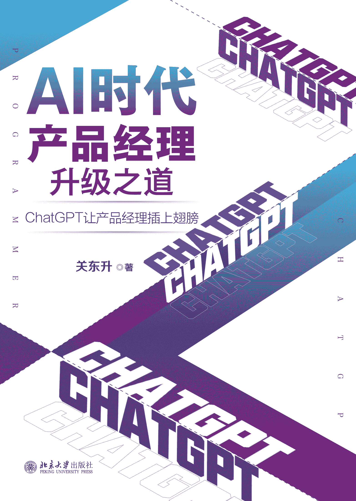

# AI浪潮下的产品经理进阶指南：让ChatGPT成为你的最强副驾




# **版权声明**

**COPYRIGHT**

书名：AI时代产品经理进阶之道：ChatGPT赋能产品经理腾飞

作者：关东升

出版方：北京大学出版社

出版日期：2023年10月

ISBN：9787301344675

字数：136千字

经北京大学出版社授权，得到APP制作发行电子版

版权所有·侵权必究

# **序章**

# **破局而生：开启智能时代产品管理新篇章**

AI时代已然来临，技术迭代与商业模式创新层出不穷，市场环境愈发复杂多变。作为产品的核心策划者与推动者，产品经理扛起的责任更重、面临的挑战更大。唯有持续进化与创新，方能跟上环境巨变的节奏，带领产品实现破局增长。

在此背景下，ChatGPT凭借卓越的自然语言生成与理解能力，实现了人机交互的质变。它为产品管理注入全新活力，催生出前所未有的协同效应与潜在价值。将ChatGPT深度嵌入产品管理全流程，不仅能大幅减轻负荷，更能重塑管理范式与角色定位，推动产品经理从“管理者”向“协同创新者”跃迁。

AI对产品管理的冲击远非“提效”这么简单，它从根本上改变了PM的思维模型与工作重心。PM必须读懂AI赋予产品管理的新内涵，熟练驾驭ChatGPT这类强力助手，借力打力，释放无限潜能。

《AI时代产品经理进阶之道：ChatGPT赋能产品经理腾飞》应运而生。本书旨在助力PM看透AI与ChatGPT如何重塑产品管理，并给出落地实操指南，手把手教会PM在各环节高效调用ChatGPT。

读完本书，你将获得全新视角，洞察AI如何彻底重写产品管理的内核与方向；系统掌握ChatGPT在全流程中的应用打法与最佳实践。借助ChatGPT之力，大幅跃升效率与产出质量，晋升为新时代产品管理的领军人物。

AI时代PM的卓越之道，在于读懂变革、善用工具、发挥人的独创性。愿本书能激发你在变局中持续学习、创新的动力，开启智能时代产品管理的崭新征程。让AI为产品经理插上翅膀，飞向更辽阔的天地。

**福利时间**：全书案例源码、教学视频等配套资源已打包。扫描下方左侧二维码关注“博雅读书社”公众号，输入书籍77页的下载码即可免费领取。

关东升 敬上

# **第一章**

# **AI如何颠覆与重塑产品管理**

AI发展势如破竹，应用场景已渗透生活方方面面。作为硬核科技产业的中坚，产品管理自然无法置身事外。AI不仅能作为工具与方法论提升管理效能，更能直接下场参与产品设计、研发与决策，与PM形成“黄金搭档”。

现有案例印证：AI正在从根本上颠覆、重塑产品管理的范式与流程。它能更深度地洞察用户、更精准地预判需求；能自动产出设计方案辅助设计师；能介入代码生成与测试，大幅压缩研发周期；能持续监控埋点数据，第一时间捕获问题并指导迭代。

机遇与挑战并存。PM必须读懂AI、会用工具、懂协作，这将倒逼技能树与工作流的全面升级。AI将深度重塑产品管理，主动拥抱变革，是每个PM的必答题。

简而言之，AI已成产品管理进化的新引擎。拥抱AI、重塑管理，是通往未来的必经之路。

## **1.1**

## **深度复盘：AI给产品管理带来的机遇与挑战**

AI的影响深远且具穿透力。它在赋能提效、持续迭代等维度释放红利，同时也在角色转型、数据合规等层面抛出难题。

**一、 核心机遇**

1. **极致提效**：数据采集、清洗、分析、报告输出等高频繁琐事务，AI全程自动化，大幅释放PM带宽。
2. **洞察本质**：依托海量数据建模画像、预测需求，助力PM做出更贴近用户真心的决策。
3. **赋能研设**：从原型产出、代码生成到测试用例设计，AI全链路介入，压缩上市周期。
4. **持续进化**：7×24小时监控业务指标，自动诊断异常、输出优化建议，驱动产品闭环迭代。

**二、 现实挑战**

1. **认知门槛高**：读懂技术原理、边界与场景，需要投入大量时间精力，学习曲线陡峭。
2. **协作范式新**：“人机共创”而非“人机替代”，要求PM深度理解AI并驾驭自如。
3. **角色重塑痛**：部分基础任务被替代，迫使PM重新定义工作内容与核心价值锚点。
4. **合规红线紧**：强依赖用户数据训练，隐私保护与法规遵循容不得半点马虎。

**总判**：机遇大于挑战。主动拥抱、重塑思维与流程，PM不仅能守住阵地，更能在AI时代构建核心竞争壁垒。面对技术门槛、协作磨合、隐私合规等硬仗，唯有持续进化，方能掌舵AI时代，解锁更广阔的创新版图与发展空间。

## **1.2**

## **PM新技能树 与 ChatGPT黄金协作法**

要跑通与ChatGPT的最佳协同，PM需补齐以下四维核心能力：

1. **数据驱动思维**：系统化分析用户行为数据，以数据说话，驱动设计与决策。
2. **敏捷实战功底**：吃透设计思维、原型迭代、冲刺交付等敏捷流程，与研发高频同频共振。
3. **跨职能统筹力**：串联UE、研发、市场、运营等多方资源，靠沟通协作推动落地。
4. **前瞻技术雷达**：对AI/ML、区块链等前沿技术保持敏感，具备“技术转化为产品价值”的转化能力。

**ChatGPT × PM：四大协作姿势**

| 角色定位 | 核心价值 | 关键边界 |
| :--- | :--- | :--- |
| **知识/信息超级助手** | 秒级检索海量库存，输出领域知识、竞品情报，拓宽认知半径 | 信息需PM二次验证，防幻觉 |
| **创意激发器** | 多轮对话碰撞火种，产出差异化方案与切入点 | 创意归PM筛选升华，宏观把控归人 |
| **辅助决策参谋** | 基于历史数据/上下文输出分析框架与建议，辅助团队对齐 | **决策权永不上交**，最终拍板在PM |
| **非全能替代品** | 无法承载敏捷落地、跨部门博弈、商业嗅觉、团队领导力等核心软实力 | PM必须亲自下场的“硬仗”它帮不上 |

**最佳实践公式**：**PM做主导（战略/决策/软实力）+ ChatGPT做支撑（知识/创意/数据/初稿）= 最大化效能。**

### **1.2.1**

### **实战复盘：ChatGPT协助重构电影票务App交互流程**

**场景还原**
某票务App重构下单链路，核心KPI：**67%用户在3分钟内完成购票**。

**对话实录**

> **PM指令**：
> 设计订票App交互流程。调研显示67%用户期望3分钟内搞定购票。请基于此目标产出初版线框思路。

> **ChatGPT回复**：
> 满足3分钟目标，给出生成方案（单位：秒）：
> 1. 首页选片（10s）：海报+热门场次入口
> 2. 选片详情（15s）：影片信息+场次列表
> 3. 选座（30s）：座位图可视化、价格高亮
> 4. 确单（20s）：信息复核+提交
> 5. 支付（30s）：多渠道支付
> 6. 成功页（15s）：详情+二维码/取票码
> **总耗时 ≤ 180s**。请审阅迭代。

> **PM追单**：
> 选片页15s过长，压缩至10s；新增筛选器提效；成功页延至25s增强确认感。

> **ChatGPT二版**：
> 1. 首页（10s）
> 2. **选片（10s）+ 新增筛选项**
> 3. 选座（30s）：结合筛选条件渲染
> 4. 确单（20s）
> 4. 支付（30s）
> 5. **成功页（25s）：详情+码+引导**
> **总耗时 125s**，体验更优。确认无误可移交高保真设计。

> **PM追加需求**：
> 文字描述不直观，用PlantUML出线框图代码。

> **ChatGPT产出代码**：
> 

> **渲染效果**：
> 
> 图 1-1 线框图

**复盘结论**：PM掌控目标与节奏，ChatGPT负责结构化产出、快速迭代、代码落地，双向奔赴，高效闭环。

### **1.2.2**

### **实战复盘：从0到1设计“全品类信息采集App”**

**项目背景**
PM Jane所在团队切入“个人信息管理”赛道。调研后锁定三大核心采集场景：
1. **资讯采集**：订阅分类+定时推送+个人收藏
2. **数据采集**：健康/财务等自定义表单+记账+趋势分析
3. **内容采集**：图文/视频/图片收藏+打标分类+社交分享

设计思路以“用户分类”为核心节点，辐射三大分支。Jane需用思维导图梳理全景。

**对话实录**

> **PM指令**：
> 基于下述需求文本，生成Xmind可识别的Markdown格式思维导图代码。
> （此处省略需求文本全文，结构同上述三大类六小项）

> **ChatGPT产出Markdown代码**：
> 

> **导入Xmind渲染效果**：
> 
> 图 1-2 采集App产品设计思维导图

*注：Markdown语法与Xmind导入技巧详见第二章。*

## **1.3**

## **全景扫描：AI工具在产品管理领域的落地现状与未来演进**

当前AI在PM领域的渗透已形成五大主阵地：

1. **需求侧**：自动聚类用户反馈、产出需求池与规划建议 → *未来：深度语境理解，实现千人千面需求洞察。*
2. **数据侧**：自动化埋点分析、异常诊断、增长机会挖掘 → *未来：诊断更准、建议更个性化、决策更自动化。*
3. **竞品侧**：7×24h追踪竞品动态、功能拆解、差异化定位 → *未来：基于个性化兴趣的定制化竞情雷达。*
4. **设计侧**：辅助IA架构、原型线框、UI规范产出 → *未来：定制化方案推荐、多模态生成成标配。*
5. **运营侧**：个性化触达、风控预警、复盘报告自动生成 → *未来：全链路智能化、自动化运营闭环。*

**宏观趋势判断**：AI将贯穿产品全生命周期（需求→设计→研发→运营），实现全流程智能辅助与差异化体验交付。这倒逼PM必须补齐“AI思维”与“数据思维”，驾驭新一代智能产品。早布局、早实践、推动企业级产品体系智能化升级，才是破局关键。

## **1.4**

## **章末速记**

本章核心脉络三步走：
1. **透视影响力**：拆解AI对PM的“四大红利”与“四大硬仗”，核心判断——机遇>挑战，拥抱是唯一选项。
2. **定义新范式**：重塑PM技能模型（数据/敏捷/协同/前瞻），确立“PM主导+ChatGPT赋能”的黄金协作模型，并通过“票务重构”与“采集App从0到1”两个实战案例，展示交互设计与信息架构落地全过程。
3. **研判演进路线**：盘点需求、数据、竞品、设计、运营五大场景落地现状，预判全生命周期智能化演进趋势。

**一句话总结**：AI不替代PM，但**会用AI的PM会替代不会用AI的PM**。技术演进不等人，早一天上车，早一天掌握主动权。

# **第二章**

# **实战手册：用ChatGPT批量产出产品管理全套文档**

产品管理日常，本质是“文档驱动协作”。从需求池到上线公告，高质量文档是信息流转的基建。高频文档清单如下：

1. **需求文档（PRD/MRD）**：功能规格、用户故事、用例、验收标准——研发交付的“施工图”。
2. **设计文档**：UI/UE、交互流、信息架构、原型/线框/流程图——体验落地的“蓝图”。
3. **竞品分析报告**：对标拆解优劣势、定位差异化——战略决策的“雷达图”。
4. **市场调研报告**：市场容量、用户画像、趋势研判——商业可行性的“论证书”。
5. **用户反馈集**：调研/测试/运营渠道VoC汇总、分层分析——迭代方向的“指南针”。
6. **发布/上线文档**：发布节奏、灰度策略、回滚预案、Release Note、上线Checklist——交付兜底的“安全绳”。

后续章节将逐个击破，演示如何让ChatGPT成为你的“文档首席起草官”。

# 善用 ChatGPT，让产品文档产出事半功倍

产品文档——涵盖用户手册、操作指南、API 规范等——是产品管理的基石。它们承载着需求传递、进度追踪、团队协同与知识沉淀的核心职能。文档形态虽因产品类型、组织习惯及研发模式而异，但其核心价值始终一致。引入 ChatGPT 作为得力助手，能显著提升文档产出的速度与质量。

## **2.1 让 ChatGPT 成为你的文档起草专家**

产品经理日常面对 Word、Excel、PDF 及在线协作文档等多种载体。ChatGPT 擅长生成文本，却无法直接输出这些二进制格式文件。破局之道在于：**构建标准化模板 + ChatGPT 填充内容 + 人工微调定型**，形成“半自动化”生产线，效率跃升显而易见。

### **2.1.1 从零打造高复用文档模板**

利用 Office 套件搭建模板，遵循以下九步走策略：

1.  **定类型**：依规范与内容需求，抉择 Word、Excel 或 PPT 载体。
2.  **定版式**：按企业标准或个人偏好，锁定页面尺寸、边距等布局参数。
3.  **定样式**：为各级标题建立统一的字体、字号、加粗规范，形成样式库。
4.  **建目录**：善用 Word 自动目录与书签功能，生成超链接导航，检索零摩擦。
5.  **标封装**：配置封面、页眉、页脚，嵌入文件名、创建日期等元数据，落地标准化。
6.  **预留位**：在表格、图表、公式等多媒体位置预设占位及注释说明。
7.  **植入“AI 标记”**：**关键步骤**。在需 AI 生成处插入显性占位符（如 `{{功能清单生成处}}`），精准指令 ChatGPT 产出内容。
8.  **存模板**：另存为 `.dotx` / `.xltx` 等模板格式，复用即享红利。
9.  **持续迭代**：实战中验证模板适配度，依据反馈打磨结构与样式，越用越顺手。

**核心逻辑**：模板颗粒度越细、占位指令越明确，ChatGPT 产出的“半成品”质量越高，人工整合成本越低——理想状态下，仅需轻微润色即可入库。

### **2.1.2 实战演练：需求文档（PRD）草稿速成**

以社交应用 **SocialConnect** 为例，演示从背景输入到结构化输出的全流程。

**项目速写**：SocialConnect 聚焦解决现有社交平台的隐私焦虑、信息过载、互联互通不畅三大痛点，主打“个性化、安全、互联”的泛社交体验，涵盖动态、群组、即时通讯、智能推荐等核心模块。

**Prompt 实战**：将上述背景喂给 ChatGPT，指令其“按标准 PRD 结构输出草稿”。

**AI 产出结构速览**：
1.  **项目定位**：名称与一句话 Slogan。
2.  **背景动因**：市场趋势与痛点切入。
3.  **用户画像**：泛人群细分至高互动偏好者。
4.  **功能清单**：账号体系、资料管理、内容发布、关系链、群组/活动、IM、发现/推荐、通知触达——八大模块逐条拆解。
5.  **非功能指标**：易用性、性能、安全合规、多端兼容。
6.  **UI 导则**：现代风、直观导航、自适应布局。

> **避坑指南**：AI 给出的永远是“基础版骨架”。业务规则细节、异常流程、埋点方案、数据字典等深水区，仍需 PM 注入领域知识补全。

---

## **2.2 Markdown：ChatGPT 与文档工具链的“通用语”**

既然 ChatGPT 只吐文本，Markdown 便成了衔接“AI 产出”与“成品文档”的最佳中间格式——**人类可读、机器可渲染、工具链通吃**。

### **2.2.1 极简语法速查表（高频核心够用 90%）**

| 场景 | 语法要点 | 关键细节 |
| :--- | :--- | :--- |
| **标题** | `# 一级` ~ `###### 六级` | **井号后必须加空格** |
| **列表** | 无序 `- ` / `* `；有序 `1. ` | **符号后必须加空格** |
| **引用** | `> 内容` | **大于号后加空格** |
| **强调** | `**粗体**` 、`*斜体*` | 符号紧贴文本，勿加空格 |
| **图片** | `` | 方括号写替代文本，圆括号装链接 |
| **代码块** | `` ```python `code` ``` `` | 反引号三连，首行声明语言启用高亮 |

> **避坑指南**：空格规则是新手翻车重灾区，肌肉记忆“符号+空格”最省心。


### **2.2.2 选一把趁手的编辑器**

工欲善其事，必先利其器。主流选择对标：

| 工具 | 定位 | 核心优势 | 推荐指数 |
| :--- | :--- | :--- | :--- |
| **VS Code** | 全能型选手 | 免费开源、插件生态霸主、Git 集成天然、配置上限极高 | ⭐⭐⭐⭐⭐ **(首选)** |
| **Typora** | 极致写作体验 | 所见即所得（无分栏）、颜值高、交互丝滑 | ⭐⭐⭐⭐ |
| **Mark Text** | 开源平替 | 类 Typora 体验、免费、跨平台 | ⭐⭐⭐ |
| **Ulysses / iA Writer** | 专业写作者 | 深度专注长文创作、导出强、订阅制/买断制 | ⭐⭐⭐ (预算充足者) |

**笔者实操建议**：锁定 **VS Code** + 三大黄金插件组合拳：
1.  **Markdown All in One** — 快捷键、目录、数学公式、表格神器。
2.  **Markdown Preview Enhanced** — 超强预览，一键导出 HTML/PDF/PNG，Mermaid 图表原生跑。
3.  **Markdownlint** — 实时语法体检，强迫症福音。


**上手三步走**：
1.  官网下载安装 VS Code（次次点“Next”即可）。
2.  扩展面板搜索上述三件套，点击安装。
3.  新建文件存为 `.md` 后缀，即享“左写右看、所见即所得”丝滑体验。

### **2.2.3 实战闭环：让 ChatGPT 直接吐 Markdown 代码**

承接 2.1.2 案例，Prompt 微调：**“请将以下 PRD 内容输出为标准 Markdown 代码块，便于直接粘贴渲染。”**

ChatGPT 将返回带 `#`、`-`、`>` 等标记的纯文本。复制至 VS Code，瞬间呈现结构化文档；配合 *Markdown Preview Enhanced*，一键导出 PDF/Word，交付物秒级达成。

> **进阶技巧**：在 Prompt 中显性要求“代码块标注 `markdown` 语言”，复制粘贴即自动高亮，零手动调整。

---

**小结**：**模板化骨架 + Markdown 流转 + ChatGPT 填肉 + VS Code 成型**，这套组合拳打通了“需求想法 → 结构化文档 → 多格式交付”全链路。释放 PM 精力，聚焦产品决策本身，才是工具赋能的终极意义。

# 打造高效交付流：从需求文档标准化到 AI 辅助思维建模

## 一、 规范化需求文档的生成与多端预览

编写需求文档时，必须兼顾各类终端的屏幕规格与分辨率参数，保证界面在手机、平板、桌面端均能完美适配。

**智能助手输出示例。**

以下为社交应用案例“SocialConnect” 的需求规格说明书（MD 格式）：

# SocialConnect 应用程序需求文档

## 1. 项目标识与概述
- **项目名称**：SocialConnect。
- **概述**：旨在打造一站式社交媒体平台，提供全方位、便捷的互动体验，满足多元社交诉求。

## 2. 立项背景
数字化浪潮下，社交媒体已成分享生活、连接他人、获取资讯的核心阵地。SocialConnect 应运而生，旨在突破现有平台局限，提供更个性化、安全可靠的体验。

## 3. 核心用户群体
覆盖全年龄段与职业人群，重点聚焦热衷社交互动、生活分享、兴趣探索的活跃用户。

## 4. 功能清单
- 账户注册与登录体系。
- 个人资料维护（头像、基础信息、隐私权限）。
- 多媒体动态发布（文本、图片、视频、链接）。
- 好友关系与关注机制。
- 兴趣群组与线上活动。
- 即时通讯（单聊、群聊）。
- 热门内容探索与智能推荐。
- 消息通知与提醒体系。

## 5. 质量属性
- 界面简洁直观，上手零门槛。
- 响应迅捷，交互丝滑流畅。
- 数据安全与隐私保护达金融级标准。
- 全平台兼容，无障碍访问。

## 6. 界面规范
- 现代化视觉风格，导航结构清晰。
- 图标、标签、按钮语义明确，降低认知负荷。
- **兼容多终端设备，适配各类屏幕规格与分辨率，保证显示效果。**

---

另附某 CRM 升级项目章程摘要：

# 项目章程：CRM 客户关系管理系统升级项目

## 1. 项目概述
### 1.1 名称：CRM 系统版本升级项目
### 1.2 目的：升级至最新版，强化客户数据分析与服务能力
### 1.3 范围：软硬件环境升级，优化信息管理与业务流程
### 1.4 发起方：市场部

## 2. 项目目标
### 2.1 具体指标：2023 年 9 月 30 日前完成升级与优化
### 2.2 成功标准：升级平稳、新版稳定、服务效率提升 30%+

## 3. 进度规划
- 启动计划：5.1-5.15
- 需求调研：5.15-6.15
- 环境部署：6.15-7.31
- 模块开发：8.1-9.15
- 测试验收：9.15-9.25
- 培训上线：9.25-9.30
- 收尾总结：10.15

## 4. 组织架构
- 负责人：市场部副主任
- 团队：10 人（开发 6、测试 2、运维 2）

## 5. 资源需求
- 人力：负责人 1 + 团队 10
- 财务：软硬件采购及培训 80 万
- 技术：开发工具、云服务等

## 6. 监督评价
- 周例会检查进度
- 上线 2-3 月评估提出改进
- 上线 6 月效益评估为后续规划提供依据

将上述内容保存为 `SocialConnect 应用程序需求文档.md`，使用 VS Code 预览渲染效果：


## 二、 文档格式互转：从 Markdown 到 Word 与 PDF

### 2.1 MD 一键转 Word：Pandoc 实操指南

团队协作或归档常需 Word 格式，开源利器 Pandoc 是首选。

1.  **获取与部署**：访问官网下载对应系统安装包，部署时务必勾选“写入环境变量”，否则终端调用将失败。
    
2.  **执行转换**：终端定位至 `.md` 文件目录，运行核心指令：
    
    *参数释义：`-o` 指定输出文件名，源文件为 `input.md`，目标为 `output.docx`。*
3.  **效果验证**：同级目录即刻生成 `.docx`，标题层级、列表缩进、代码块完美保留。
    
    

> **备选方案**：VS Code 插件“Markdown All in One”、在线转换器（如 Md2All）亦可胜任，按团队习惯择优。

### 2.2 MD 转 PDF 的“曲线救国”路径

Pandoc 直出 PDF 需配置 LaTeX 环境，门槛较高。推荐平滑路径：**MD → Word → PDF**。

利用上步产出的 `.docx`，在 Word 中点击“文件”→“导出”→“创建 PDF/XPS 文档”，即可获得矢量级清晰度的交付件，目录超链接、页眉页脚自动生成，零配置开箱即用。


## 三、 思维导图：产品经理的“外脑”利器

思维导图以放射性结构图形化思维，是梳理复杂产品逻辑、对齐团队认知的核心工具。

### 3.1 核心应用场景：五大价值支撑

1.  **归纳诉求，建立全局视野**：将碎片化想法聚合为树状结构，快速看清产品骨架与优先级。
2.  **图形化规划，降低沟通熵值**：用结构图替代冗长文档，让开发、设计、运营同频理解蓝图。
3.  **激发洞见，破解棘手难题**：发散式分支天然适合群策群力，助力从症状定位根因，探索创新解法。
4.  **高效同步，干系人对齐**：一图胜过千言，便于向高层汇报、向团队分工、向客户确认范围。
5.  **动态追踪，充当轻量路线图**：标记关键节点、标注进度状态，随时掌控项目脉搏。

### 3.2 PM 与导图的实战结合点

从需求收集、版本规划、技术评审到上线复盘，全生命周期皆可介入。笔者团队为“艺术收藏平台”绘制的概念导图（见下图），覆盖用户角色、核心业务闭环、质量属性三大维度，极大提升了启动会效率。


### 3.3 绘图工具链：从白板到专业客户端

| 维度 | 推荐工具 | 适用阶段 |
| :--- | :--- | :--- |
| **低保真/协作优先** | 白板手绘、Miro、FigJam、Google Drawings | 现场讨论、快速迭代、远程共创 |
| **高保真/结构化管理** | XMind、MindManager、MindNode、Lucidchart | 正式交付、模板复用、甘特图视图、Office 导出 |

白板草稿（左）追求发散速度；专业客户端成品（右）聚焦结构规范与美观度。


## 四、 大模型驱动的三种智能生成范式

大模型虽不能直接出图，但擅长产出结构化文本代码，配合渲染引擎即可“代绘”导图。

| 方案 | 核心逻辑 | 适用场景 |
| :--- | :--- | :--- |
| **MD 导入法** | 智能助手输出标准 MD 大纲 → XMind/幕布等客户端一键引入 | 需后续深度编辑、调整样式、多格式导出 |
| **Mermaid 脚本法** | 智能助手生成 Mermaid 语法 → 粘贴至 MD 编辑器或在线编辑器实时渲染 | 文档内嵌、版本控制、轻量级在线分享 |
| **PlantUML 脚本法** | 智能助手生成 PlantUML 语法 → IDE 插件/在线服务渲染 | 习惯 UML 建模、需绘制复杂时序/类图兼顾导图 |

**在线编辑器界面演示**：左侧写脚本，右侧秒出图，支持 PNG/SVG/PDF 导出与分享链接生成。


**PlantUML 渲染效果示例**：语法更强大，适合技术团队统一建模规范。


## 五、 实战演示一：智能助手 + XMind，5 分钟产出需求导图

### 步骤 1：精准提词（提示工程三要素）
> “以‘SocialConnect 应用程序需求文档’为核心节点，生成文本版思维结构，输出 Markdown 代码块。”

*指令含三层信息：核心节点设定、文本结构输出、代码块格式约束。*

### 步骤 2：获取结构化输出
模型将返回带层级缩进的 MD 文本，覆盖项目简介、背景、用户画像、功能/质量属性、UI 规范等全维度。

### 步骤 3：客户端落地
启动 XMind → 文件 → 导入 → Markdown → 选中文件 → 完成。瞬间获得可拖拽、可折叠、可美化的专业导图。


## 六、 实战演示二：Mermaid 脚本直出，无需客户端在线渲染

Mermaid 语法简洁，类似 MD，配合智能助手极其高效。

**操作流程：**
1.  向智能助手喂入需求草稿，指令：“请用 Mermaid 语法绘制该需求的思维结构”。
2.  复制返回的 ````mermaid ... ```` 代码块。
3.  访问 [Mermaid Live Editor](https://mermaid.live/)，粘贴左侧代码区，右侧自动渲染。

**进阶技巧**：点击工具栏 “Actions” 可导出高清图片、获取分享链接、嵌入 Notion/GitHub/语雀等平台。


> **避坑指南**：Mermaid 导图基于 `mindmap` 或 `graph TD`，层级过深易渲染拥挤，建议配合 `direction RL` (右向左) 或拆分子图优化视觉。

---

**结语**

从需求文档的标准化产出（MD → Word/PDF），到思维导图的 AI 增强绘制（MD 导入 / Mermaid 脚本），这套组合拳将“文档撰写”与“结构思考”深度融合。掌握此工作流，PM 可将更多精力聚焦于**决策质量**而非**排版调整**，真正实现“工具为我所用”。

### 2.3.6 实战 4：Mermaid 构建需求脑图

**项目速览：SocialConnect 社交软件**

SocialConnect 定位为全能型社交 App，致力于打造便捷、丰富的互动场景，精准覆盖用户多元社交诉求。

**项目缘起**

数字化浪潮下，社交平台已成大众记录生活、链接人脉、获取资讯的核心阵地。SocialConnect 应势而生，旨在突破现存平台桎梏，交付更具定制化、安全可信的社交新体验。

**受众画像**

面向全年龄段、全职业领域的泛人群，核心圈层锁定热衷社交往来、乐于记录生活、渴望发掘新鲜事物的活跃用户。

**功能清单**

*   **账户体系**：注册、登录，快速建立数字身份。
*   **个人主页**：头像、资料编辑、隐私权限灵活配置。
*   **内容发布**：图文、视频、链接多格式支持，随心记录高光时刻。
*   **关系链构建**：好友添加、关注互动，轻松编织社交网络。
*   **兴趣社群**：群组加入、活动参与，精准触达同频伙伴。
*   **即时通讯**：单聊、群聊实时触达，沟通零延迟。
*   **智能发现**：热门榜单、个性化推荐，高效挖掘优质内容与人脉。
*   **消息中枢**：新消息、好友申请、动态更新全域覆盖，重要信息不错过。

**非功能指标**

*   **交互体验**：UI 简明易懂，上手零门槛。
*   **性能表现**：响应迅捷，操作丝滑流畅。
*   **安全合规**：数据加密、隐私护航，筑牢信任基石。
*   **兼容适配**：多端同步，无缝跨设备体验。

**界面设计准则**

*   视觉风格现代，导航逻辑清晰。
*   图标、标签、按钮语义明确，降低认知负荷。
*   响应式布局，完美适配多尺寸屏幕。

**实战演示：Mermaid 脚本生成**

将上述需求文档喂给 AI，指令其输出 Mermaid 语法的脑图脚本。


将脚本粘贴至 Mermaid Live Editor 即可渲染出层次分明的导图，效果如下：


---

### 2.3.7 实战 5：借助 PlantUML 产出思维导图

上一案例演示了 Mermaid，本节切换工具，介绍 PlantUML 这一利器。PlantUML 支持在线渲染（如官网、PlantText 等），只需将脚本贴入编辑器即时出图，所见即所得。


> **💡 进阶提示**  
> PlantUML 语法详情可至官网下载参考手册。

**实战演示：PlantUML 脚本生成**

复用 SocialConnect 需求文档，提示词要求“精简文本、输出 PlantUML 脚本”。

**AI 返回的 PlantUML 语法如下：**


将脚本导入支持 PlantUML 的编辑器或网页端，即可生成如下导图：


---

### 2.4 表格在产品管理中的实战价值

产品管理全链路离不开表格支撑，典型场景包括但不限于：

1.  **产品档案库**：汇总名称、描述、型号、定价等基础属性，便于横向对比。
2.  **规格参数表**：记录尺寸、重量、材质、功能等硬核指标，指导研发生产。
3.  **供应商台账**：档案化管理联系人、协议、交期，稳固供应链协同。
4.  **库存动态表**：实时追踪进出库、库位、数量，决策补货调拨。
5.  **订单履约单**：跟单号、客户、数量、交期，保障交付准时达。
6.  **质量追溯表**：沉淀检测数据、问题单、改进措施，驱动品质迭代。
7.  **版本演进表**：版本号、发布日、变更日志，管控迭代脉络。
8.  **效能工具箱**：预算、资源、进度、风险“四表”联动，赋能管理降本增效。

> **核心洞察**  
> 表格虽是记录与展示的基建工具，灵活易用，但管理的本质仍在于人的判断与决策。高阶产品管理系统（PMS）正是在表格结构化基础上，实现流程自动化与决策智能化的跃迁。

---

### 2.4.1 Markdown 表格快速上手

AI 不直接吐出二进制 `.xlsx`，但能生成两种纯文本表格：**Markdown 表格** 与 **CSV 表格**。前者语法轻量，跨编辑器、跨平台无缝流转。

**基础语法范式**：用 `|` 分隔列，用 `-` 绘制表头分割行。


渲染预览效果：


**对齐控制进阶**：在分割行引入冒号 `:` 定义对齐—— `:--` 左对齐、`:-:` 居中、`--:` 右对齐。


渲染预览效果：


---

### 2.4.2 实战案例 6：让 AI 生成 Markdown 版产品清单

**场景设定**  
某电子厂商管理手机、平板、笔记本、耳机等多品类 SKU，需建立含编号、品类、描述、价格、库存的动态清单表（如表 2-1 所示）。


**分步指令法（组合 Prompt）** 规避单次输出长度限制：

**Step 1：启动会话**  
> **指令**：“帮我造表，输出 MD 代码。我分批给数据，收到‘生成完毕’指令前持续追加。”

**AI 应答**：“准备就绪，请发送列头与数据行。”

**Step 2：流式录入数据**  
> **指令**：“P001 手机 智能手机，支持多种功能和应用程序 500 100”  
> *(多条数据重复此步)*

**Step 3：终止并出码**  
> **指令**：“生成完毕”

**AI 返回完整 Markdown 脚本：**


保存为 `.md` 文件用编辑器预览，得标准化表格：


> **💡 避坑指南**  
> 数据量大时分批喂入；若模型中途停摆，回复“继续”即可接力输出。

---

### 2.4.3 CSV 格式：通用的数据交换利器

CSV（Comma-Separated Values）以逗号分隔字段，首行列头，其余数据行，通吃 Excel、Google Sheets、数据库导入导出。

**最小化示例**  
```text
姓名,年龄,性别
爱丽丝,25,女
鲍勃,30,男
查理,35,男
```

**落地三步走**：
1.  复制脚本至记事本；

2.  另存为 `.csv` 后缀；

3.  Excel/WPS 打开即得结构化表。


> ⚠️ **编码雷区**  
> 中文环境下建议存为 **ANSI (GBK)** 编码。UTF-8 直接用 Excel 打开易字符异常（WPS 兼容较好）。

---

### 2.4.4 实战案例 7：用 AI 批量产出 CSV 表格

流程与 Markdown 如出一辙，仅将指令关键词改为“返回 CSV 脚本”。

**Step 1：初始化**  
> **指令**：“帮我造 CSV 表，我分批给列头和数据行，听到‘生成完毕’再停。”

**AI 应答**：“好，请发表头。”

> **指令**：“产品编号 产品名称 产品描述 价格 库存量”

**AI 返回列头行**。

**Step 2：喂入数据行**  
> **指令**：“P001 手机 智能手机，支持多种功能和应用程序 500 100”  
> *(后续行同法)*

**Step 3：收官**  
> **指令**：“生成完毕”

**AI 吐出全量 CSV：**

产品编号,产品名称,产品描述,价格,库存量
P001,手机,智能手机，支持多种功能和应用程序,500,100
P002,平板电脑,轻便便携，适用于娱乐和工作,800,50
P003,笔记本电脑,高性能处理器和大内存容量,1200,80
P004,蓝牙耳机,无线连接，高音质,100,200

复制存盘为 `.csv`，流程同 2.4.3，不赘述。

---

### 2.4.5 进阶技巧：将 CSV 秒转 Excel

1.  用 Excel/WPS 打开 `.csv`；
2.  菜单栏 **文件 → 另存为**；
3.  保存类型选 **`*.xlsx`**，确认。

---

### 2.5 拓展阅读：用 AI 制作可视化图表

# 2.5 ChatGPT 不会画图？教你两招轻松搞定图表生成

ChatGPT 本身不具备直接“出图”能力，但这不妨碍它成为你的图表生成助手。实操中，核心路径就两条：**借力 Excel 零代码出图**，或是 **写代码用 Python 深度定制**。

## 2.5.1 零代码流：让 Excel 干重活

思路很简单：让 ChatGPT 生成带数据的 Excel 表格（或 CSV），你下载后用 Excel 自带的“推荐图表”功能一键成型。

以“电子产品目录”为例，数据准备好后，选中区域点击**插入 → 推荐的图表**。

默认常推柱状图，但这数据用条形图更直观。在弹窗里切到**“所有图表” → 条形图**即可。

选好类型后，标题、坐标轴、颜色随意微调。最后选中图表 `Ctrl+C`，去 Word、PPT 或画图工具里 `Ctrl+V` 粘贴，再另存为图片即可。

> **小技巧**：粘贴到 Office 组件里还是可编辑对象，改字号、换配色比在 Excel 里更顺手。

## 2.5.2 进阶流：Python 代码出图，专业又可控

要批量出图、高度定制样式，或嵌入自动化流程，**Python 是首选**。VBA 也能用，但生态远不如 Python 丰富——Matplotlib、Seaborn、Plotly 任选，导出 PNG、SVG、PDF 皆可。

### 实战演练：从零跑通一个条形图

**Step 1：提需求**
> “帮我写 Python 代码，用 Matplotlib 读‘电子产品目录表格 10 条.xlsx’里 B 列和 D 列，画个条形图。”

ChatGPT 会给出完整脚本。

**Step 2：环境就绪**
- 装库：`pip install pandas matplotlib openpyxl`
- 把 `.xlsx` 数据文件和 `.py` 脚本放同一目录。
- 运行脚本，图出来了。

**Step 3：避坑中文乱码**
首次运行大概率方框乱码。别慌，直接追问：
> “中文显示方框，帮我改代码指定字体。”

ChatGPT 会引入 `FontProperties` 指定系统字体（如微软雅黑 `msyh.ttc`）并应用到标题、坐标轴、刻度标签。重跑，完美显示。

> **核心点**：代码里 `font=FontProperties(fname='C:/Windows/Fonts/msyh.ttc', size=12)` 路径按你实际系统字体位置改。

---

# 2.6 鱼骨图：拆解复杂问题的“结构化手术刀”

鱼骨图（因果图/石川图），用一条“主骨”连结果（鱼头），分支出大类因素（主骨），再细分具体原因（小骨）。

**核心结构**：
- **鱼头** = 问题结果
- **主骨** = 一级归因（如人、机、料、法、环）
- **小骨** = 具体根因

**四大作用**：穿透症状找根因、梳理因果链条、统一团队认知、指导对策落地。

## 2.6.1 产品经理的五大高频战场

| 场景 | 鱼骨图怎么用 |
| :--- | :--- |
| **产品架构设计** | 自顶向下拆解：产品 → 子系统 → 模块 → 功能，理清层级依赖。 |
| **需求管理** | 区分核心/附属需求，映射依赖与优先级，决定做什么、先做什么。 |
| **交付计划** | 任务结构化 → 判依赖 → 定里程碑 → 排工期，让排期有据可依。 |
| **变更影响分析** | 变更点挂哪根骨？波及哪些模块？改动量多大？资源怎么调？一目了然。 |
| **故障复盘定位** | 故障现象作鱼头，按架构层级/模块分支，快速锁定源头与连锁影响。 |

**一句话总结**：鱼骨图把隐性的结构关系显性化，是产品经理达成共识、提效协作的低成本高杠杆工具。

## 2.6.2 ChatGPT 辅助画鱼骨：人机协同，而非全自动

ChatGPT 能干四件事：
1.  **信息萃取**：读业务描述，抠出结果、因素、层级。
2.  **框架搭建**：给出鱼头、主骨、小骨的初版树状结构。
3.  **初稿生成**：输出 Markdown/Mermaid/XMind 可导入格式。
4.  **辅助分析**：按图解读关键因果、提改进建议。

**但它有俩硬伤**：
- 复杂业务逻辑、深度领域知识容易“胡编”或遗漏。
- 读不懂人类沟通里的潜台词、博弈与隐性共识。

**最佳实践**：**AI 负责“跑腿、列清单、出初稿”，人负责“拍板、补细节、做决策”**。人机接力，才能出高质量成品。

## 2.6.3 实战案例：在线教育产品模块结构拆解

**背景**：某在线教育产品，五大模块（课程内容、学习管理、社区互动、App 端、运营管理），每模块下再细分 3-5 个子模块。

### 三步走，从文本到成品鱼骨图

**第 1 步：喂料 ChatGPT，要 Markdown 大纲**
Prompt 核心：*“帮我分析模块层级关系，返回 Markdown 代码”*。
得到标准 `# 一级/## 二级/### 三级/- 叶子` 结构，存为 `.md`。

**第 2 步：XMind 导入 `.md`**
`文件 → 导入 → Markdown`，秒变思维导图。

**第 3 步：一键换肤成鱼骨图**
选中中心主题 → 右键/工具栏 → **结构 → 选择鱼骨图样式**。
瞬间完成结构转换。

**进阶：换风格更好看**
`画布 → 变更风格`，挑个配色清爽的商务风。

> **效果**：原本散在文档里的五大模块、二十多个子项，现在躺在一张图里，层级清晰、重点突出，开会对齐、汇报汇报直接甩屏。

---

# 2.7 本章小结

本章实战派拆解了 ChatGPT 在产品文档生产线上的四大核心场景：
1.  **文档生产**：从模板设计到需求草稿，再到 Markdown/Word/PDF 多格式落地。
2.  **思维导图**：Mermaid、PlantUML 代码出图，XMind 可视化编辑，需求结构化神器。
3.  **表格与数据**：Markdown 表、CSV 互转 Excel，数据整理零门槛。
4.  **图表与鱼骨**：Excel 零代码出图、Python 代码深度定制、鱼骨图拆解复杂问题。

**核心心法**：ChatGPT 不替代产品经理思考，但能把“从 0 到 1 的脏活累活”自动化，**把你从格式调整、结构梳理、代码调试里解放出来，聚焦在“判断什么对、决定做什么”上**。

---

# 第三章 ChatGPT 赋能竞品分析与市场调研：从“找数据”到“出洞见”

竞品分析与市场调研，最耗时的不是想框架，是**找数据、洗数据、对数据**。ChatGPT 在这里能当你的**超级实习生 + 分析师副驾**。

## 3.1 竞品分析：建立“动态情报库”

别再手工做对比表了。用 ChatGPT 跑三步流：

1.  **广撒网收信息**：“帮我列出 [赛道] 前 10 家竞品的核心功能、定价模式、目标用户、融资轮次、近半年动作。”→ 整理成结构化表格。
2.  **深挖洗对比**：“基于以上数据，从‘核心优势/短板’、‘差异化护城河’、‘定价策略博弈’三个维度，输出竞品对比分析报告框架 + 关键结论。”
3.  **持续跟踪**：设定 Prompt 模板，定期喂入新公众号文章、财报、招聘 JD、应用商店更新日志，让它输出“本周竞品动态雷达图”。

**价值**：把“搜整对”压缩 80% 时间，你只管审结论、补业务细节、定策略。

## 3.2 市场调研：低成本模拟“用户访谈 + 专家咨询”

传统调研贵、慢、样本小。ChatGPT 能辅助三种玩法：

| 玩法 | Prompt 思路 | 产出 |
| :--- | :--- | :--- |
| **用户画像模拟** | “你是一位 [具体画像，如：二线城市、两娃宝妈、年入 20w、焦虑英语启蒙] 用户，针对 [产品概念] 吐槽现状痛点、说说愿付费理由、提提顾虑。” | 批量生成差异化用户证言，验证价值主张。 |
| **问卷/大纲设计** | “帮我设计一份针对 [目标群体] 的深度访谈提纲，覆盖 JTBD 任务场景、现有方案不满、换新决策链路、价格敏感度测试。” | 专业级调研工具包，直接落地执行。 |
| **宏观趋势研判** | “结合最新行业报告、政策动向、技术成熟度曲线，分析 [细分赛道] 未来 12-24 个月的机会窗口与风险点。” | 战略决策参考，对齐团队预期。 |

**避坑指南**：
- **别信它的“实时数据”**（训练截止/联网摘要可能失真），关键数据**必回溯一手源**。
- **警惕“平均用户”陷阱**，Prompt 要极其具体地限定画像标签，才能跑出有张力的反馈。
- **把它当“发散器”而非“定论者”**，所有洞见需落地访谈、数据埋点、小规模实验闭环验证。

**下一章预告**：实战拆解——用 ChatGPT 跨过从“竞品对比表”到“差异化定位宣言” 的最后一公里。

### 3.1 竞品拆解：知己知彼的必修课

竞品分析并非简单的列清单，而是对竞争对手的产品形态、市场坐标、份额体量、品牌心智等维度的系统性诊断。它的核心价值在于：帮企业看清对手的长板与短板，嗅出市场的机会与暗流，进而推导出自己的制胜策略。

实操通常走七步：
1.  **画像对手**：锁定在目标市场、用户画像、产品定位上与你正面交锋的角色。
2.  **广撒网、精收集**：官网、社媒、研报、用户吐槽……全渠道抓取产品功能、定价逻辑、推广动作、口碑反馈等关键情报。
3.  **拆解产品力**：逐项对标核心功能与特性，对比差异，复盘定位、定价、覆盖面带来的影响。
4.  **研判市场绩效**：用份额、用户规模、增速等硬指标，量化对手的统治力与潜在威胁。
5.  **解码品牌心智**：对手在用户心中的标签是什么？核心价值主张和品牌故事如何讲？
6.  **挖掘用户真言**：通过调研与舆情分析，还原用户对竞品的真实痛点与爽点，定位改良机会。
7.  **落子定策略**：基于以上复盘，锚定差异化护城河，在定位、定价、迭代上打出组合拳。

---

### 3.1.1 ChatGPT：竞品分析的“超级实习生”

把 ChatGPT 接入流程，能把繁琐的信息处理自动化，释放产品经理的高阶思考带宽。它在四个环节尤其好用：

*   **情报自动化采集与结构化**：联网搜索、社媒监听、评论抓取，海量非结构化数据一键转成结构化表格，省去人工搬运。
*   **多维特征横向对标**：通过追问式对话，快速拆解竞品在功能、体验、技术栈等维度的优劣势差值。
*   **用户声量语义分析**：批量处理竞品评价，提炼高频吐槽点与赞美点，直接输出“用户最恨什么、最爱什么”的洞察清单。
*   **破局创意生成器**：针对增值服务、营销玩法、创新功能发散提问，获取跳出固有思维的备选方案。

> **避坑指南**：ChatGPT 会一本正经胡说八道。决策前，必须用多源数据、专业工具、人工判断做“三角验证”，防止被幻觉带偏。

---

### 3.1.2 实战复盘：在线商业学习平台的竞品破局战

**背景**：产品经理 Olivia 需对标 Coursera、Udacity、Udemy 三巨头，寻找差异化突围口。

#### 第一阶段：建立认知底座（信息速览）
Olivia 先让 ChatGPT 拉三家“户口本”：创立基因、主营业务、商业模式、近期大动作。
*   **Coursera**：名校血统（斯坦福），MOOC 大而全，模式探索中（换帅求变），近期牵手阿里布局中国。
*   **Udacity**：技能垂类（AI/自动驾驶），B2B 人才输送强，模式同步调整，近期联手高通搞人才计划。
*   **Udemy**：UGC 平台模式（分成制），课程库极广，已盈利，近期收购 LearnWorlds 强攻企业学习。

#### 第二阶段：四维拆解，找差异（深度对标）
围绕**定位、功能、课程、盈利**四大维度追问，得到核心结论：
| 维度 | Coursera / Udacity | Udemy | 差异化启示 |
| :--- | :--- | :--- | :--- |
| **定位** | 宽泛、学术化、全学科 | 聚焦商业技能、务实 | **垂直深耕商业技能是切入口** |
| **功能** | 体系化、标准化强 | UGC 质量参差，但小班/实战体验佳 | **补齐互动与实战短板** |
| **课程** | 硬技能、认证导向 | 商业软技能丰富（营销/设计） | **商业课库丰富度可为王牌** |
| **盈利** | 探索期、压力大 | 分成模型跑通、现金流健 | **轻模式验证商业闭环更快** |

#### 第三阶段：可视化复盘（一图胜千言）
让 ChatGPT 输出 Mermaid 代码生成**竞品竞争格局图** `` 与 **市场份额饼图** ``。

*   **格局图洞察**：两大巨头守着“体系完备”护城河，但盈利未解、互动弱；Udemy 守着“商业聚焦+盈利跑通+小班优势”，但课程质控是软肋。
*   **份额图惊喜**：数据显示 Coursera 握 33% 美区份额，Udemy 仅 6%，Udacity 数据口径不同（全球 7-10%），但美区测算高达 61% —— **数据口径不一致提醒：跨市场对标必须统一统计边界，否则极易误判。**

---

### 3.1.3 竞争分析矩阵：把定性变定量的对比表

这是一张“作弊纸”：行是对手，列是指标（功能、定价、优劣势等）。填完它，竞品间的差异、自己的优劣势、定位空白点，全在眼里 ``。

---

### 3.1.4 ChatGPT 辅建矩阵：五步法 SOP

1.  **喂料**：把收集来的竞品硬核参数（功能清单、价格带、核心卖点）扔给模型。
2.  **对话式评测**：用“帮我评价一下对手 A 在 X 维度的优劣势”这类提示词，引导模型输出结构化分析。
3.  **抽取结构化观点**：从回复中剥离“优势/劣势/定价逻辑”等关键块，去噪留精。
4.  **回填矩阵**：将 AI 视角与人工调研视角融合，补全矩阵单元格。
5.  **复盘定策略**：盯着填满的矩阵，找差距、找空白、定定位、定路线图。

*核心原则：AI 出初稿，人做终审，多源交叉验证。*

---

### 3.1.5 实战演练：用 ChatGPT 产出竞品分析矩阵

**场景**：研究员继续沿用在线商业学习平台案例，目标直指 Coursera、Udacity、Udemy 的矩阵产出。

**首轮提示词策略**：直接抛出分析框架需求——「请从产品特点、功能、定价、优劣势维度拆解三大竞品，输出对比矩阵素材。」

**ChatGPT 首轮输出样例（Coursera 切片）**：
> 定位：在线学习平台，大而全的课程库，覆盖多学科。
> 护城河：名校/名企合作背书，高质量资源 + 认证证书双引擎。
> 优势：资源丰富、品牌信任度高。
> 短板：定价偏高，价格敏感型用户门槛大。

后续流程即按“追问细节 → 补全其余两家 → 整理入表 → 交叉验证 → 定策略”闭环推进。

准确说，Coursera 在课程质量与认证认可度上颇具优势，只是定价策略可能让部分学习者望而却步。

**AI 回复如下。**

接下来看 Udacity，这家平台深耕技术赛道与职业进阶课程。它联手多家头部企业，推出的课程与项目紧贴行业脉搏。核心强项在于职业导向鲜明、产学联动紧密，短板是课程目录相对窄，非技术学科覆盖有限。

**研究员提问：**

没错，职业导向是 Udacity 的招牌，但学科广度确是短板。

**AI 回复如下。**

最后是 Udemy，作为开放式平台，汇聚海量讲师与创作者，课程品类极其丰富。优势在于选择多、灵活性强，学习者可按兴趣按需选课。但开放性也带来副作用：课程质量参差不齐，认证含金量波动大。

**研究员提问：**

确实，Udemy 的灵活与丰富是大杀器，不过甄别课程质量的活儿得靠用户自己干。

**AI 回复如下。**

通过这轮竞品复盘，各家优劣势及与自家产品的差距一目了然。这能帮团队看清市场竞争格局，从而制定策略放大差异化优势。

**研究员提问：**

结合上下文及已知信息，帮我输出竞品分析矩阵，Markdown 表格格式。

我方产品信息：
功能：多元化学习工具。价格：免费/付费。优势：拥有交互式实验、测验、项目等丰富工具。劣势：竞品品牌知名度更高。
竞品：Coursera、Udacity、Udemy。

**AI 回复如下。**

基于上述信息生成的竞品分析矩阵（Markdown 表格）：


复制上述代码另存为“在线平台竞品分析矩阵.md”，用 Markdown 工具预览，效果见图 3-4。


图 3-4 在线平台竞品分析矩阵

## **3.2**

## **市场调研与用户洞察**

市场调研与用户洞察是产品成败的关键基石，核心价值体现在五个维度：

（1）**定位导向**：挖掘市场机会与真实需求，锁定产品定位与目标人群，为设计指明方向。
（2）**创新源泉**：深度洞察激发灵感，打磨极致体验。读懂痛点与需求，是好产品的前提。
（3）**验证闭环**：上线后借调研与反馈验证假设、暴露问题、快速迭代，是提升体验的唯一路径。
（4）**动态监控**：追踪市场表现与竞品动态，支撑策略及时调整，防止掉队。
（5）**商业护城河**：降低失败率，催生口碑与复购，驱动销量跃升。

总之，调研与洞察是产品腾飞的双翼。缺了它们，团队如“无头苍蝇”，难出好产品。必须常态化开展，并深度绑定设计决策，这是通往优秀产品的必经之路。

### **3.2.1**

### **借力 ChatGPT 做市场调研与用户洞察**

作为 AI 聊天机器人，ChatGPT 能当产品经理的高效副驾，主攻三大场景：

（1）**模拟用户访谈**：依据目标画像模拟问答，收集反馈与真实心声，在一定程度上补齐真人访谈的缺口。
（2）**自动生成问卷**：需求调研、满意度测评等问卷一键出稿，稍加打磨即可发布，大幅压缩制作工时。
（3）**构建用户画像**：输入条件与假设，自动输出细分市场画像，辅助锁定目标人群与核心需求，定准定位。

总体而言，ChatGPT 是得力助手，但不可全盘托底。真人访谈与实地调研仍不可或缺——AI 终究是 AI，真实的情感体验仍需人工判断。

### **3.2.2**

### **案例 3：旅游 App 用户访谈实战**

ChatGPT 辅助访谈，可从两步切入：

（1）**产出初版提纲**：给定目标用户描述，自动生成问题清单，按需增删，省去从零起笔的功夫。
（2）**复盘总结**：对话结束后回溯内容，提炼关键信息、核心诉求与隐性问题，为迭代提供决策依据。

**案例背景**

某旅游 App 新功能上线，产品经理 John 想借访谈收集反馈。

**步骤 1：让 AI 设计访谈提纲。**

**John 提问：**

我们旅游 App 上线新功能，想通过用户访谈收反馈，帮我设计个问题提纲。

**AI 回复如下。**

基于背景，为您拟定如下访谈提纲：

1. 请简述近期上线的新功能有哪些？你用过哪几个？
2. 最满意哪个新功能？带来了什么新体验或价值？
3. 体验不错的地方不谈，觉得哪里还需打磨？有啥具体建议？
4. 除现有功能外，还期待 App 增加什么功能来提体验？
5. 新功能和改进是否提升了你的留存意愿？为什么？
6. 会向朋友推荐吗？推荐理由或拒绝原因是什么？
7. 对 App 还有什么其他意见建议？
8. 还有其他想聊或需要解答的问题？

提纲覆盖体验评价、改进建议、推荐意愿等维度。按此大纲深访，能透彻掌握用户真实认知，助力产品优化。注意这只是初稿，实战中可随用户反馈动态调整，核心是围绕“新功能与体验”深挖。

**步骤 2：将文字提纲转为 Markdown 表格。**

大段文本不够直观，John 让 AI 转表格。

**John 提问：**

帮我把提纲整理成 Markdown 表格。

**AI 回复如下。**

Markdown 格式访谈提纲：

|提问 |问题 |

| :-: | :-: |

|1|您能介绍一下我们最近上线的新功能有哪些吗？您使用过其中的哪些功能？|

|2|您最喜欢或最满意的新功能是什么？它带来了哪些新的体验或价值？|

|3|您提到新功能使用体验还不错，但您觉得还需要进一步改进的地方有哪些？您有什么具体的优化建议吗？|

|4|您认为除了现有的新功能外，我们 App 还需要添加哪些功能来满足您的需求或提高使用体验？|

|5|您觉得我们上线的新功能和改进措施是否提高了您继续使用我们 App 的兴趣？为什么？|

|6|您会不会打算向更多朋友推荐我们的 App？如果会，推荐理由是什么？如果不会，原因是什么？|

|7|您有没有其他关于我们 App 的意见或建议帮助我们继续改进？|

|8|您是否还有其他需要我们解答或讨论的问题？|

存为“用户访谈提纲.md”预览，见下图。


图 3-5 用户访谈提纲

表格版提纲清晰系统，便于现场记录与后续分析。PM 可直接在表内登记反馈或标注观察，也可另行记录详情。关键是紧扣大纲深聊，拿到真实感受，落地改进。

### **3.2.3**

### **案例 4：ChatGPT 辅助设计用户调查问卷全流程**

设计问卷时，AI 可协助拟题、设选项。标准化流程九步走：

1.  **定目的、定受众**：明确想懂什么、问谁。
2.  **AI 生成初版题目**：混合开放/封闭题，措辞简洁无歧义，覆盖核心信息点。
3.  **选题型**：单选、多选、滑块等，AI 可建议适配题型。
4.  **设选项**：AI 生成备选答案，确保覆盖面、互斥性。
5.  **人工审核**：核对准确性、清晰度、逻辑顺序。
6.  **预测试**：小范围跑通（可用 AI 模拟或真人），修补漏洞。
7.  **正式发布**：选平台、定截止、守隐私。
8.  **收数、析数**：数据清洗、分析、可视化，AI 可辅助。
9.  **出报告**：沉淀结论、建议、改进行动。

记住：AI 供草稿，人把关，确保落地可用。

下面以旅游 App 问卷为例实操。

**步骤 1：生成问卷。**

**动手示例**

**John 提问：**

想用 ChatGPT 辅助设计旅游 App 调查问卷，能帮忙吗？

**AI 回复：**

没问题，请说说具体想了解啥。

**John 提问：**

先了解用户对 App 整体满意度、各功能评价。

**AI 回复：**

好，做满意度与功能评价的多选题。想评价哪些具体功能？

**John 提问：**

目的地搜索、行程规划、酒店预订、景点推荐这四个核心功能。

**AI 回复：**

收到，每个功能设一个评价题。还有其他评价维度？

**John 提问：**

再加界面设计、用户体验、客户支持。

**AI 回复：**

加上。还有别的？

**John 提问：**

暂时就这些。

**AI 回复：**

明白，马上生成问卷并给出 Markdown 代码。

**John 提问：**

谢了，等着。

**AI 回复：**

不客气，稍等片刻。

几分钟后返回结果。

**AI 回复：**

问卷生成完毕，Markdown 代码如下：

\[问题 1：用户满意度\]
\-非常满意
\-满意
\-一般
\-不满意
\-非常不满意

\[问题 2：旅游目的地搜索功能评价\]
\-非常好
\-好
\-一般
\-差
\-非常差

\[问题 3：行程规划功能评价\]
\-非常好
\-好
\-一般
\-差
\-非常差

\[问题 4：酒店预订功能评价\]
\-非常好
\-好
\-一般
\-差
\-非常差

\[问题 5：景点推荐功能评价\]
\-非常好
\-好
\-一般
\-差
\-非常差

\[问题 6：界面设计评价\]
\-非常好
\-好
\-一般
\-差
\-非常差

\[问题 7：用户体验评价\]
\-非常好
\-好
\-一般
\-差
\-非常差

\[问题 8：客户支持评价\]
\-非常好
\-好
\-一般
\-差
\-非常差

存为“用户调查问卷.md”预览，见下图。


图 3-6 用户调查问卷（部分）

**步骤 2：统计问卷数据。**

回收统计结果如下：

**用户满意度**：非常满意 20%、满意 50%、一般 20%、不满意 5%、非常不满意 5%。
**目的地搜索**：非常好 30%、好 40%、一般 20%、差 5%、非常差 5%。
**行程规划**：非常好 25%、好 35%、一般 25%、差 10%、非常差 5%。
**酒店预订**：非常好 15%、好 35%、一般 30%、差 15%、非常差 5%。
**景点推荐**：非常好 20%、好 40%、一般 30%、差 5%、非常差 5%。
**界面设计**：非常好 25%、好 40%、一般 25%、差 5%、非常差 5%。
**用户体验**：非常好 30%、好 40%、一般 20%、差 5%、非常差 5%。
**客户支持**：非常好 20%、好 45%、一般 25%、差 5%、非常差 5%。

John 将数据喂给 AI 让其统计出表。

**动手示例**

**John 提问：**

帮我统计下列调查结果，输出 Markdown 表格。

（数据同上）

**AI 回复如下。**

基于您的数据生成统计表格：


存为“用户调查统计.md”预览，见图 3-7。


图 3-7 用户调查统计

从统计表速读核心结论：

1.  **整体满意度高**：70% 给出“满意/非常满意”，正向评价占主流。
2.  **核心功能强弱分明**：“目的地搜索”与“景点推荐”好评率均 70%，是基本盘，继续深耕；“行程规划”“酒店预订”差评占比高，急需优化。
3.  **体验层面表现佳**：界面与用具体验好评率高，体验建设成果显著。
4.  **服务口碑尚可**：客户支持 65% 好评，服务质量在线。

整体是份正向报告，但“规划/预订”两短板明显。深度复盘还需结合开放式反馈与定性数据。

**步骤 3：分析与报告。**

John 想对统计结果做可视化分析。模块多、维度多，雷达图最适合——将各功能好评率投射雷达图，一眼看清短板与优势，判断改进方向。

雷达图可用代码画，也可用无代码工具。重点介绍非编程路径。

第一步：把 Markdown 表格转 CSV。

**动手示例**

**John 提问：**

## 3.3 玩转用户画像：让ChatGPT做你的分析师


**ChatGPT 回复如下。**

这是将 Markdown 表格转为 CSV 格式的结果：

调查项目，非常好，好，一般，差，非常差

用户满意度，20%,50%,20%,5%,5%

旅游目的地搜索功能评价，30%,40%,20%,5%,5%

行程规划功能评价，25%,35%,25%,10%,5%

酒店预订功能评价，15%,35%,30%,15%,5%

景点推荐功能评价，20%,40%,30%,5%,5%

界面设计评价，25%,40%,25%,5%,5%

用户体验评价，30%,40%,20%,5%,5%

客户支持评价，20%,45%,25%,5%,5%

把上述 CSV 代码复制存为“用户调查统计.csv”，再转成 Excel 文件，效果如图 3-8。


图 3-8 用户调查统计（Excel 版）

接着，参照 2.5.1 小节，把 Excel 表转成图表，在“插入图表”里选“雷达图”，如图 3-9。最终雷达图长这样，见图 3-10。


▲图 3-9 挑选雷达图


图 3-10 雷达图最终效果

### 3.3.1 核心流程五步走

用户画像是产品经理、运营读懂用户的“显微镜”，能直接指导产品策略和运营打法。借助 ChatGPT 做画像，主线就五步：

1.  **攒数据底座**：把用户属性、行为日志捞齐，这是分群的地基。
2.  **挖反馈金矿**：分析评论、工单、社媒声量，找出卡体验的关键因子，读懂真需求。
3.  **跟 AI 头脑风暴假设**：结合年龄、职业、消费力等标签，抛出初步分群设想。ChatGPT 能补位，给数据解读建议、假设方向。
4.  **假设-数据来回打磨**：用数据说话验证假设，再用假设指导看数，反复迭代，把准确度和可信度拉满。ChatGPT 全程可当“参谋”，提修正思路。
5.  **落笔定画像**：锁定核心人群，细化人口属性、兴趣偏好、用产品习惯、付费能力等维度，为策略落地给依据。

### 3.3.2 实战复盘：智能旅游 App 画像从 0 到 1

**案例背景**：产品经理 John 想借 ChatGPT 给智能旅游 App 做用户画像。

**实操演示**

**第一步：铺底数据，John 先抛基本面。**
> **John**：我在开发智能旅游 App，想借你手做用户画像，行不？
> **ChatGPT**：没问题！把你手头的用户数据、想搞清的方向同步给我。

> **John**：已有年龄、性别、职业、收入、婚姻、居住地这些属性数据，想借此看透不同人群特征和需求。
> **ChatGPT**：先看年龄职业分布。有统计数据发我。

> **John**：年龄端：18-25 岁 30%、26-35 岁 40%、36-45 岁 20%、46+ 10%。职业端：学生 25%、白领 50%、其他 25%。
> **ChatGPT**：基于这数据，能先切三刀：
> *   **18-25 岁学生群**：价格敏感，追性价比；
> *   **26-35 岁白领群**：有钱、重个性、要高品质；
> *   **36-45 岁群体**：偏家庭游、重便利。
> 这是初步假设，你怎么看？

> **John**：分析很准，跟我认知对得上。

**第二步：叠消费偏好，画像更立体。**
> **ChatGPT**：再深入挖消费力和兴趣。有消费行为、偏好数据吗？
> **John**：有浏览、下单、点评数据，能看消费力和偏好。
> **ChatGPT**：甩点消费力、兴趣偏好的统计过来。

> **John**：消费力：低收入 20%、中收 50%、高收 30%。兴趣端：搜目的地评价最高，其次行程规划。
> **ChatGPT**：画像能再细化：
> *   低收盯价格性价比；
> *   中收有旅游预算；
> *   高收要个性、要品质。
> 这假设靠谱不？

> **John**：赞同，这对个性化推荐算法、体验优化很有指导价值。

**第三步：引入用户声量，闭环验证。**
> **ChatGPT**：初步画像有了，下一步验证修正，提纯度。还有别的数据或想聊的？
> **John**：想看用户吐槽、建议，满意度、改进点。
> **ChatGPT**：收反馈至关重要。发几条评论样本，我们一起拆关注点、看情感倾向。

> **John**：样本在这：
> 1. “界面直观易用，但订酒店流程烦，求简化。”
> 2. “景点推荐给灵感，但搜索不准，求精准推荐。”
> 3. “客服周到耐心，但行程规划偶尔报错，得改。”
> **ChatGPT**：样本很值！透过这些反馈，能精准定位优化方向：简化订房、提升搜索精度、修复规划 Bug，直接拉升体验和满意度。

> **John**：多谢！对话下来，画像建立思路清晰多了，能按人群特征设计产品服务了。
> **ChatGPT**：助人为乐。画像是产品设计运营基石，希望有帮助。有事再喊。

> **John**：谢了！我会持续打磨画像，按需求迭代 App，需要再找你。
> **ChatGPT**：祝 App 大卖！随时待命，祝顺遂！

---

## 3.4 产品定位与差异化：跳出红海的关键一招

搞定定位和差异化，核心动作四步：

1.  **透视目标市场**：摸清需求、特征、趋势，锁定目标用户画像（特征、好好、习惯）。
2.  **炼核心价值主张**：产品解决啥问题？给啥价值？用户得啥利？独特卖点在哪？
3.  **写定位宣言**：结合市场和价值，一句话钉住用户心智中的位置，这是定位核心。
4.  **跑差异化策略**：结合竞品和需求，在功能、体验、定价、定位上做不同，拉开身位。

终局：在目标市场占独特心智位，满足需求，甩开对手，提升竞争力和认可度。

### 3.4.1 ChatGPT 怎么当“定位参谋长”

在定位和差异化研究里，ChatGPT 能顶四个岗：

1.  **市场需求解读员**：喂给它调研报告，它能挖出你忽略的细节和需求，补全认知拼图，为定位铺路。
2.  **竞品分析 & 空白点猎手**：同步竞品信息，它能横向对比特点、价值，判断市场空白和机会点，给定位选址指方向。
3.  **定位方案评审官**：抛出备选定位，它能从优劣势、市场适配度维度逐个拆解，还能补新选项，助你全视角决策。
4.  **差异化策略压力测试官**：描述差异化备选，它能拆解优势、难点、资源依赖，预判落地难度和效果，为策略优化给参考。

### 3.4.2 实战演练：出行 App 三选一，怎么选？

**案例背景**：某出行平台要给 App 定位、做差异化。调研竞品已毕，三个备选方案摆桌面：

*   **A. 快速出行**：主打快、效，瞄准忙碌白领。
*   **B. 舒适出行**：主打舒心、安心，瞄准休闲客。
*   **C. 文化出行**：出行+文化体验，瞄准爱尝鲜的年轻人。

研究者把方案和调研信息喂给 ChatGPT，听评析建议。

**实操对话实录**

> **研究者**：我们要给出行 App 定位做差异化，有 A/B/C 三个选项……（详述三方案定位）。请 ChatGPT 评析建议。
> **ChatGPT**：仅供参考，决策还得结合你们业务：
> *   **A 快速出行**：对时间焦虑白领杀伤力大。建议：市区增投共享单车/滑板车供给，上智能规路功能，跑最优路线。
> *   **B 舒适出行**：击中重舒适、安全的旅游休闲客。建议：上高端车型、专职司机服务，加车辆评分和用户评价体系辅助选车。
> *   **C 文化出行**：收割爱沉浸、爱探索的年轻人。建议：推个性化玩法（文化活动、特色景点、深度体验），联动本地导游/文旅机构定制专属行程。
>
> 总结：每个选项都有各自阵地和人群。建议结合调研数据、业务诉求评估潜力，参考上述建议决策。也可考虑组合拳或再细分人群，拿更精准的定位和差异化。

---

## 3.5 本章小结

本章系统拆解了 ChatGPT 如何赋能竞品分析与市场调研全链路：
*   **竞品端**：讲透竞品分析重要性，实战演示在线商业学习平台竞品拆解，手把手教用 ChatGPT 做竞争分析矩阵。
*   **调研洞察端**：过一遍市场调研与用户洞察流程，实战演示旅游 App 用户访谈设计、问卷设计。
*   **画像端**：拆解 ChatGPT 辅助生成画像方法论，实战复盘智能旅游 App 画像创建全过程。
*   **定位端**：探讨产品定位与差异化策略，实战演示出行 App 定位规划。

结论：ChatGPT 让竞品分析、市场调研更高效、更准。通过多轮交互，能获得个性化洞察建议，助产品经理落地定位和差异化策略，强化竞争力和市场适应性。

---

# 第四章 ChatGPT 辅助产品需求管理：从收集到落地的全链路指南

需求管理里，ChatGPT 能当“超级实习生”，支撑五大环节：

1.  **需求收集整理**：对话式引导用户细说需求，协助分类归档。
2.  **需求评估优先级**：结合历史数据经验，评可行性、排优先级，圈高价值、强紧迫项。
3.  **需求细化澄清**：跟干系人对话追细节、对目标，促讨论、防模糊、避矛盾。
4.  **需求变更管控**：变更来袭，分析影响面、可行性，给建议方案，辅助决策。
5.  **需求追踪通报**：记状态、进度、变更，及时同步提醒，保全员信息对齐。

**避坑指南**：ChatGPT 是辅助工具，建议必须配合人工判断决策。它给初步洞察，拍板还是得团队和干系人共议。用工具时，数据保护和隐私合规要守住，护住用户数据和敏感信息。

## 4.1 需求收集不再愁：ChatGPT 当好你的“超级实习生”

收集阶段，ChatGPT 能包办：访谈提纲设计、录音笔记自动转结构化需求单、问卷结果汇总、需求归纳整理。具体三板斧：

1.  **当“出题人”**：你说访谈主题和目的，它甩出一套提问清单/问卷题目，供你挑改，省去从零憋题的力气。
2.  **当“速记员”**：现场访谈时，把录音或笔记扔给它，靠 NLP 自动抽需求信息，生成规范需求列表，方便后续评审确认，免了手工逐条抠字眼的累活。

### 4.1.1 实战：让 AI 为运动类应用生成访谈提纲

下面以“运动管理应用”为例，演示如何借助大模型高效产出用户访谈提问清单。

**实操演示**

**产品负责人下达指令：**

> 我们计划访谈意向用户，挖掘他们对新款运动管理应用的真实诉求。请设计一套系统性的访谈提纲。

**模型回复的参考提纲：**

1.  **现状摸底**：您目前在用哪款运动类应用？最爱和最吐槽的功能分别是什么？
2.  **核心期待**：对于一款全新的产品，您最渴望它提供哪些功能与服务？
3.  **指标偏好**：您习惯用哪些数据量化运动成效？（如步数、热量消耗、心率、睡眠质量等）
4.  **价值认知**：您认为此类应用对健康管理的核心助益体现在哪里？
5.  **社交意愿**：是否愿意在应用内分享运动轨迹、互动打卡，以获取社交激励？
6.  **定制化需求**：应用该如何基于您的习惯与偏好，输出专属的训练建议？
7.  **UI 取向**：倾向于极简清爽的风格，还是视觉冲击力强的炫酷风格？
8.  **设备互通**：若支持将数据自动同步至智能手环、跑步机等外设，您的使用意愿如何？
9.  **商业化接受度**：对广告、订阅制、数据变现等盈利模式，您能接受哪种？
10. **隐私安全**：您期望应用在数据脱敏、传输加密等方面采取何种保护措施？

> **专家提示**：这份提纲覆盖了功能、体验、商业、合规等全维度。实战中建议根据具体访谈对象增删调序，避免“一刀切”。

---

### 4.1.2 实战：分钟级产出 200 份问卷分析报告

**实操演示**

**产品负责人指令：**

> 我们已回收 200 份新运动管理应用的问卷反馈。请深度分析数据，输出结构化需求报告。

**模型响应：**

> 请提供原始问卷数据（含题目选项分布、用户作答明细）。我将自动完成数据清洗、趋势识别、热点挖掘，并生成可供下载的结构化报告。

**实战复盘**：
设计师需将原始数据喂给模型，随后模型自动完成分类汇总、图表化输出，全流程无需人工手动录入、透视表操作。**这极大地压缩了数据清洗与初步分析的工时，显著提升了洞察获取的速度。**

> **关键边界**：报告的准确性与业务可靠性，仍需产品负责人结合业务上下文复核把关。**“AI 产出初稿，人类定稿背书”**是当前最高效的协作范式。

---

### 4.1.3 图表选型指南：让数据说话

数据可视化不是“画图”，而是“用图说话”。不同图表对应不同分析意图：

| 图表类型 | 核心适用场景 | 典型业务案例 |
| :--- | :--- | :--- |
| **柱状图** | **频次/得分对比** | 各功能选项的选择人数/占比横向 PK |
| **饼图** | **结构占比** | 单选/多选题中，各选项在总样本中的权重分布 |
| **折线图** | **趋势演变** | 不同版本迭代/不同时间节点的满意度波动曲线 |
| **热力图** | **多维相关性** | 多个体验指标（易用性、稳定性、颜值）两两相关性矩阵 |
| **散点图** | **双变量关系** | 用户使用时长 vs. NPS 评分，探测“高粘低分”异常群体 |

**避坑指南**：可视化前必查“数据准、维度全、标签清、配色克制”。别让花哨的图表掩盖了业务真相。

---

### 4.1.4 实战：从 Markdown 到 Excel，3 步出饼图

承接 4.1.2 场景，假设原始汇总数据如下：


图 4-1 运动管理应用汇总问卷调查结果

**步骤 1：格式转换（Markdown → CSV）**
指令：*“请将以下 Markdown 表格转为 CSV 格式：”*


**模型输出：**


> **结果，人数，占比**
> **是（使用运动应用），152 人，76%**
> **否（不使用运动应用），48 人，24%**
> **总人数，200 人，100%**

**步骤 2：Excel 导入与选区设定**
将上述文本存为 `.csv`，用 Excel 打开（见  图 4-2）。**关键动作**：仅选中“结果”与“占比”两列，**剔除“总人数”汇总行**，防止污染图表比例。

**步骤 3：插入饼图并美化**
按常规流程插入饼图（ 图 4-3），调整标签、图例、配色至满意，终稿如  图 4-4 所示。

> **效率账单**：全程键盘操作，无需手敲数据，单张图表产出可压缩至 **2 分钟内**。

---

### 4.2 需求优先级矩阵：从“堆砌”到“决策地图”

**是什么**：一种结构化工具，将散乱诉求映射到“维度 × 优先级”坐标系，帮助团队看清**“做什么、先做什么、不做什么”**。

**核心构建 6 步法**：
1.  **广撒网**：市场调研、用户反馈、竞品拆解，全渠道收集原始诉求（功能/性能/体验）。
2.  **去伪存真**：清洗合并同义项，拆解模糊描述，落笔成“可验收的规格说明”。
3.  **知己知彼**：锚定目标市场、用户画像、竞品格局，为后续评分提供业务锚点。
4.  **建矩阵**：行=单一诉求，列=评估维度（如：商业价值、用户痛点度、技术复杂度、战略契合度）。
5.  **打分卡**：引入定量模型（RICE、WSJF）或定性专家打分，量化每个诉求的优先级权重。
6.  **排序决策**：按综合得分降序，划出“Must have / Should have / Could have / Won't have”四条线。

**矩阵长相**（示意）：

图 4-5 产品需求矩阵示例

> 图中用 `` 标记“已满足”，`` 标记“缺口”。**缺口即机会，高价值缺口即核心机会。**

**避坑提醒**：
> 以上为极简教学版。实战中维度常超 10 个（如法务风险、运营成本、数据合规），诉求条目常达百余条。**矩阵不是画给领导看的 PPT，是给研发排期、给资源分配用的“作战地图”**，请按实况定制维度。

---

### 4.2.1 AI 充当副驾：矩阵构建全流程协作

别让模型直接甩成品，要让它陪你跑流程：

1.  **需求收集官**：指令它爬取竞品评论、合成用户画像、生成调研问卷初稿。
2.  **需求清洗工**：喂给它原始反馈，让它输出“去重、结构化、用用户语言重述”的诉求清单。
3.  **需求聚类师**：指令按“任务场景/用户旅程阶段/技术域”自动分类打标。
4.  **评分参谋长**：提供评分模型（如 RICE 公式），让它依据已知数据为每条诉求算分、排序、写理由。
5.  **矩阵渲染器**：最终输出 Markdown 表格 / Mermaid 语法 / XMind 可导入格式，一键落地。

---

### 4.2.2 复盘：智慧旅游产品矩阵落地全记录

**项目背景**：某旅游目的地管理方委托开发“数字化智慧旅游产品”，需挖掘三大核心人群诉求并建立优先级矩阵。

**Phase 1：用户画像生成**
**指令**：*“分析‘年轻散客、中年亲子、高端精品’三类游客的核心属性与行为特征。”*
**模型输出要点**：
*   **年轻散客**：18-30 岁，求新求刺激，预算敏感但愿为体验买单，爱打卡、爱分享。
*   **中年亲子**：家庭决策链长，核心诉求“省心+寓教于乐”，高客单价，复购潜力大。
*   **高端精品**：高净值/高知群体，**核心关键词：私密性、定制化、确定性、身份确认**。价格不敏感，体验零容忍。

**Phase 2：高端精品人群深度挖掘**
**指令**：*“聚焦高端精品游，列出其核心诉求清单。”*
**输出**：专属线路(避开人潮) > 高奢食宿(环境+原创菜) > 深度文化体验(非遗/专家讲解) > 无感交通(专车/包机) > 管家式服务(全程随行/动态调整)。

**Phase 3：诉求关联与置换分析（高阶用法）**
**指令**：*“这些诉求间存在置换/补偿关系吗？如某项缺失，可用何项弥补？”*
**模型洞察**：
*   线路体验差 ⇄ 餐饮惊艳可部分补偿（但缺一不可）。
*   文化体验弱 ⇄ 极致便捷的行程/交通可作替代卖点。
*   管家服务缺位 ⇄ 线路、体验、交通全链路“零瑕疵”可最大程度兜底。
> **价值**：这直接指导了 MVP 范围界定——**管家服务可延后，但“线路+交通+食宿”铁三角必须闭环。**

**Phase 4：一键生成矩阵交付物**
**指令**：*“基于以上对话，输出产品需求矩阵 Markdown 表格，含诉求描述、人群标签、优先级、置换关系备注。”*
**输出**：


**落地动作**：复制代码存为 `.md`，用 Typora/VS Code/XMind 打开即得结构化矩阵图（ 图 4-6）。后续迭代只需在对话上下文追加指令修改单元格，版本管理极其低成本。

---

### 4.3 产品路线图：把“愿景”翻译成“交付节奏”

路线图不是甘特图，它是**“战略意图的时间切片”**。核心作用：对齐预期、锁定节奏、管理依赖、对外承诺。

---

### 4.3.1 三种主流表达形态，选对场景事半功倍

#### 1. 表格版：最通用、最易维护、最利于协同

图 4-7 表格式路线图示例

**核心列设计**：阶段 | 时间跨度 | 核心目标 (OKR) | 关键交付功能 | 里程碑/发布日 | Owner | 关键依赖/风险
**扩展建议**：按季度（Q1-Q4）切分，**每季度最多 1 个核心主题**，避免“样样通样样松”。

> **小知识**：Q1=1-3月，Q2=4-6月，Q3=7-9月，Q4=10-12月。别在路线图里写具体日期，**季度粒度才是路线图的克制与留白**。

#### 2. 时间轴版：最利于汇报、最直观展示“节奏感”

图 4-8 时间轴路线图

*   横轴：时间（月/季度）
*   纵轴：功能模块/战略主题
*   适合：全员大会、董事汇报、跨部门对齐会。

#### 3. 甘特图版：最利于排期、最清晰展示“并行与阻塞”

图 4-9 甘特图路线图

*   核心优势：显示任务持续时长、前置依赖、关键路径。
*   适用：研发排期细化、资源冲突排查、复杂项目并行管控。

---

### 4.3.2 AI 辅助画路线图的三种“打开方式”

| 方法 | 适用阶段 | 核心链路 | 优缺点速评 |
| :--- | :--- | :--- | :--- |
| **方法 1：Markdown 表格直出** | **早期探索/汇报初稿** | Prompt → Markdown Table → 复制到 Notion/飞书/Excel | ⚡️ **最快**，秒出框架；❌ 无法拖拽调整依赖 |
| **方法 2：Mermaid/PlantUML 代码生图** | **文档嵌入/版本管理** | Prompt → Mermaid Code → 渲染器 (Notion/Obsidian/GitHub) | 🎨 **版本可控**，文档即代码；🔧 需懂基础语法 |
| **方法 3：XMind/思维导图工具联动** | **结构化拆解/大型规划** | Prompt → Markdown/OPML → XMind 导入 → 可视化编辑 → 导出图片/甘特 | 🧠 **思维发散友好**，支持甘特视图切换；🔄 链路稍长 |

---

### 4.3.3 实战：移动社交应用首版路线图速成（方法 1 实操）

**场景**：从 0 到 1 规划一款移动社交应用，需快速产出第一版季度级路线表供内部评审。

**Prompt 构建技巧**：
> *“扮演资深产品总监。产品：陌生人兴趣社交应用。核心假设：标签匹配破冰。团队：5 前端、3 后端、1 UI、1 测试。请输出未来 4 季度路线图 Markdown 表格，含：季度、核心主题、关键功能清单、里程碑、人力投入占比、关键风险。”*

**模型产出（节选）**：
*(此处素材原文截止，实战中模型将输出完整表格)*

**后续动作**：复制表格进飞书文档/Excel，团队评审会上现场调整 Owner、砍功能、挪节奏。**路线图的价值不在“画得美”，而在“改得快、对得齐、管得住”。**

# 第 4.3.4 节：用 Mermaid 绘制甘特图，让路线图「动」起来

上一节演示了用 Markdown 表格输出路线图，这次我们换个更直观的可视化工具——Mermaid，直接生成时间轴甘特图。

**实战演练**

产品经理把刚才生成的表格路线图喂给 ChatGPT，追加一句指令：「**请用 Mermaid 语法把这份表格转成甘特图**」。

ChatGPT 秒回一段标准的 `gantt` 代码块，自动划分五个阶段、标注起止日期、标出里程碑任务。把这段代码扔进任意支持 Mermaid 渲染的编辑器（Notion、Obsidian、Typora、GitHub README……），一张专业级的甘特图立马呈现在眼前，拖动缩放、调整颜色全靠鼠标拖拽，比手画省时省力太多。


> **小贴士**：Mermaid 代码本质是文本，版本管理极其友好，Git diff 一眼就能看出生产计划改了哪天、增了哪任务，协作时再也不用发十几版「路线图_v3_final_修改版.xlsx」。

---

# 第 4.3.5 节：借力 XMind，把路线图变成可导出的思维导图

甘特图适合看时间，思维导图适合看结构。ChatGPT 还能直接吐出 XMind 识别的 Markdown 格式，实现「对话 → 代码 → 导图 → 导图片」的全链路自动化。

**四步走流程**

1.  **提词精准化**  
    提示词要卡死三个约束：  
    • 中心主题固定为「路线图」  
    • 必含四大分支：阶段、时间、目标、核心功能  
    • 只给 Markdown 代码，别给表格、别废话

    

2.  **拿到代码，存 `.md`**  
    ChatGPT 返回标准缩进格式的 Markdown，另存为 `移动社交App产品路线图.md`。

    

3.  **XMind 一键导入**  
    打开 XMind → 文件 → 导入 → 选 Markdown，结构树瞬间长好。  
    

4.  **微调美化再导出**  
    调整层级折叠、换配色主题、补上图标备注，最后「导出为 PNG」直接塞进 PRD 或汇报 PPT。  
       

> **避坑指南**：ChatGPT 生成的初稿分支深度可能不够，导入后务必人工补全「验收标准」「负责人」「依赖关系」等落地细节，别让图变成「好看的花瓶」。

---

# 第 4.3.6 节：核心认知——ChatGPT 是「副驾驶」，不是「自动驾驶」

跑通三个案例后，必须把定心丸吃下：  
**产品规划的方向盘永远在 PM 手里。**

| AI 能做的「辅助动作」 | PM 必须守住的「决策红线」 |
|------------------------|---------------------------|
| 梳理思路、输出框架、防遗漏 | 判断业务优先级、拍板取舍 |
| 基于海量训练数据给备选方案 | 结合自家资源禀赋做最终选择 |
| 写 SWOT、竞品表、需求矩阵等模板化内容 | 核实数据真实性、修正幻觉内容 |
| 生成汇报文案、释放写文档带宽 | 对外对质量负责、对上对结果负责 |

**一句话心法**：把 ChatGPT 当成「懂业务、手速快、不抱怨的初级助理」，脏活累活全包给它，关键节点你把关、你背锅、你拿功劳。

---

# 第 4.3.7 节：实战复盘——帮旅游网站从 0 到 1 规划社交新功能

背景：某旅游网站 PM John 想加社交模块提振留存，找 ChatGPT 陪练三轮对话。

**第 1 轮：摸底行业套路**  
John：「主流旅游社区都在玩啥？」  
AI 甩出四大标配：照片墙、游记长文、找旅伴、问答库。设计核心只有一条——**强连接、重互动**。

**第 2 轮：要方案别要大道理**  
John：「基于上面四类，给我三个差异化切入点。」  
AI 抛出三板斧：  
① **挑战赛**：发起「打卡 318」「极光季」等主题活动，靠仪式感刺激 UGC；  
② **PK 评价**：同一酒店/景点正反面硬刚，靠对比产出决策参考；  
③ **轨迹录**：自动生成路线图+手账笔记，靠工具属性留存重度用户。

**第 3 轮：深挖落地细节**  
John 择定方案 ②（PK 评价），追问：「架构怎么画？核心流程啥样？」  
AI 直接给到五层产品逻辑 + 四大功能模块：  
• 发起 PK 入口 → 投票/吐槽交互 → 多维度排名榜单 → 决策参考落地页 → 个人主页荣誉勋章体系。

**复盘启示**：  
**「宽提问 → 窄方案 → 深架构」** 三步提问法，能把 AI 从「百科全书」变成「结对设计师」。

---

# 第 4.4 节：章末总结——需求管理全链路的 AI 加速器

回顾本章四大场景：  
1. **需求收集**：AI 设计访谈提纲、清洗问卷数据、自动出饼图；  
2. **需求矩阵**：AI 填模板、打优先级、标依赖，把 Excel 变成「会思考的表格」；  
3. **路线图**：三种渲染姿势（表格/甘特图/思维导图）随场景切换，文档产出快 80%；  
4. **产品规划**：AI 充当「外脑」补盲区、找灵感、写初稿，PM 聚焦决策与落地。

**终局思考**：工具迭代再快，**「问对问题」比「会用工具」更值钱**。下一章，我们把镜头转向「数据分析」，看 ChatGPT 怎么帮 PM 从数字堆里挖金子。

---

# 第 5 章：让 ChatGPT 成为你的数据分析「翻译官」

数据不语，PM 必语。ChatGPT 能在五个维度替你「翻译」数据：  
① **读懂数字**——自动生成可读性强的解读报告；  
② **找关系**——跨维度关联指标，定位异常根因；  
③ **讲故事**——把枯燥指标串成决策叙事，配图表一键出片；  
④ **提建议**——基于数据反推功能迭代方向；  
⑤ **写 SQL**——自然语言转查询语句，解释执行计划，释放双手。

**底线提醒**：**核心判断、最终决策、数据清洗治理，依然是 PM 与数仓同学的「保留节目」。**

---

## 第 5.1 节：数据收集与分析——AI 介入的三大高频场景

### 5.1.1 场景速览

| 场景 | 传统痛点 | AI 介入后 |
|------|----------|-----------|
| **查数/取数** | 写 SQL、找表、跑作业、等调度 | 自然语言描述需求 → AI 生成 SQL → 直出结果 |
| **生成摘要** | 导出 CSV → Excel 透视表 → 写分析备忘 | 丢原始数据/指标定义 → AI 秒出均值、极值、趋势、异常点 |
| **质检清洗** | 目测脏数据、写正则、跑校验脚本 | 告知字段规则/业务约束 → AI 扫描异常、给修正建议 |

**核心价值**：把「搬运数据」的 80% 时间压缩，留给「思考业务」的 20%。

---

### 5.1.2 案例实操：电商平台「月度畅销榜」一键出具

**角色**：电商 PM Tom  
**诉求**：最近 30 天 Top 类目销售额 + 可直接汇报的 Markdown 表格 + 可复用的 SQL。

**对话实录精简版**

> **Tom**：「帮我查过去 30 天订单，按类目聚合销售额倒序。」  
> **AI**：「跑完了。数码 250w、美妆 180w、家居 120w、母婴 95w、食品 60w、其他 40w。」  
> **Tom**：「给我 SQL，我要存档给数仓同学对账。」  
> **AI**：（甩出标准 `SELECT … GROUP BY … ORDER BY` 语句，含动态日期窗口）  
> **Tom**：「再给个 Markdown 表格，直接粘飞书。」  
> **AI**： → 渲染效果 

**关键动作**：**「要结果 → 要语句 → 要格式」**，三连击把分析交付物一次性打包。

---

### 5.1.3 案例预告：海量用户反馈，AI 如何 3 分钟出「洞察报告」？

下一节，Tom 手握 5000 条 App Store 评论 + 2000 条工单文本，看 ChatGPT 如何完成「分类 → 情感极性 → 高频痛点 → 优先级矩阵」全自动化闭环……

          

# 用 ChatGPT 做数据分析？这 6 个实战案例教你从清洗到预测全搞定

## 5.1.3 实战：社交平台“视频聊天”功能首周数据速览

### 场景设定
某社交平台产品负责人 Tom，近期上线“视频聊天”新特性，急需复盘首周表现，为后续迭代提供数值支撑。

### 对话实录

**指令：** 你好，我是社交平台 PM Tom。新上线一项功能，想快速了解用户过去一周的使用情况，能否帮忙输出摘要与统计？
**回复：** 可以对过去一周用户行为数据做分析，产出使用情况摘要。请提供功能名称或 ID，及需统计指标，如调用量、人均时长、高频场景等。

**指令：** 功能名为“视频聊天”，需了解日均调用次数、用户平均聊天时长及最常见聊天时段。
**回复：** 已对“视频聊天”过去一周的调用与聊天数据完成统计分析，结果如下：
- **日均调用次数**：28,000 次（首周平均日调用量）
- **用户平均聊天时长**：15 分钟（使用者人均时长）
- **最常见聊天时段**：
  - 晚 8-10 点：占总调用 31%，用户多进行长时通话。
  - 晚 10-12 点：占总调用 28%，另一高峰期。
  - 晚 5-8 点：占总调用 25%，下班后与亲友连线。
  - 周末白天尤其是下午也现高频，系空闲时段发起通话所致。

**指令：** 请把上述数据摘要生成 Markdown 表格。
**回复：** 好的，Markdown 表格内容如下：

> 复制上述代码存为“快速数据摘要.md”，用 Markdown 阅读器预览，效果如下：
> 
> 图 5-2 数据摘要

---

## 5.1.4 实战：让 AI 给用户画像做“体检”

### 场景设定
某健康类应用的产品负责人 Tom，手握千条用户身高记录，直觉数据里藏着“脏数据”，急需排雷。

### 对话实录

**指令：** 我是健康类 App PM，近期采集了批量用户身高数据，怀疑混入噪音，能否协助质检并标出异常？
**回复：** 可以。请给定合法取值区间，我将逐行校验并反馈越界明细。

**指令：** 合规区间设定为 100cm 至 250cm。
**回复：** 已锁定判定标准（100cm~250cm）。请传送数据文件，我将逐条比对，输出越界行号与数值。

**指令：** 附件 CSV 含 1000 条记录，请按规则核查并标注异常行号与数值。
**回复：** 核查完毕。共计 1000 条，发现 3 条疑似异常：
- 第 23 行：78cm
- 第 456 行：270cm
- 第 934 行：152.5cm
其余 997 条均落在合规区间。请人工复核上述三条，确认后可指示后续清洗剔除。

**指令：** 请将异常记录产出 Markdown 表格。
**回复：**

> 另存为“异常数据.md”用阅读器打开，渲染效果如下：
> 
> 图 5-3 异常数据

---

## 5.1.5 核心技能：借助 AI 快速产出数据图表

数据图表化能让枯燥数字“开口说话”，助力 PM 洞察趋势、对齐干系人。只需告知模型图表品类（条形/趋势线/扇形）、核心指标与维度，即可获得配置代码或摘要，加速出图流程。

---

## 5.1.6 实战：健康类应用运动偏好图表全流程（零代码）

### 场景设定
Tom 负责一款运动记录类健康应用。他拿到过去 30 天的用户日志（含 ID、项目、时长），需产出两张核心图：
1. 项目分布条形图
2. 占比扇形图

> **核心链路：** AI 负责“清洗 → 结构化 → CSV 导出”，表格工具负责“选源 → 定类型 → 导图”。

### 步骤 1：统计汇总与文本表格化
**指令：** 协助统计近月四大项（跑步、游泳、骑行、健身）参与人数，产出 Markdown 表格。已知结论：跑步 523、游泳 476、骑行 402、健身 309。
**回复：**

> 存为“用户运动习惯-运动种类.md”预览：
> 
> 图 5-4 数据预览

### 步骤 2：文本表格转 CSV 再进 Excel
**指令：** 将上表转为 CSV，要求把单位“人”合并进表头“用户人数（人）”。
**回复：**
```csv
运动种类,用户人数（人）
跑步,523
游泳,476
骑行,402
健身,309
```

> 另存为 CSV → 用 Excel 打开 → 另存为 .xlsx，得到规范数据源：
> 
> 图 5-5 Excel 数据源

### 步骤 3：Excel 产出条形图
选中数据区 → 插入 → 条形图 → 微调样式 → 导出图片。

▲图 5-6 选择条形图

▲图 5-7 最终条形图

### 步骤 4：一键切换扇形图
图表右键 → “更改图表类型” → 选扇形图 → 确定 → 导出。

图 5-8 更改图表类型对话框

▲图 5-9 扇形图预览

图 5-10 最终扇形图

---

## 5.1.7 实战：电商周度核心漏斗趋势复盘

### 业务背景
Tom 接手某电商应用周度复盘，过去七天四大指标全线走高：
- 登录量：532 → 1321（涨幅超 1.5 倍）
- 浏览量：3621 → 5836（增幅 60%+）
- 下单量：123 → 243（近乎翻倍）
- 转化水平：3.4% → 4.2%

需绘制**趋势线图**同屏展示登录/浏览/下单三线走势，直观呈现活跃与购买意愿双升。

### 步骤 1：原始周报转文本表格
**指令：** 下面是原始周报数据，请转 Markdown 表格：

**回复：**

> 存为“1 周购物数据.md”预览：
> 
> 图 5-11 数据表预览
> 

### 步骤 2：文本表格转 CSV → Excel
**指令：** 将上表转为 CSV 格式。

**回复：**
```csv
登录次数,浏览次数,下单次数,订单转化率
天 1,532,3621,123,
天 2,642,4018,142,
天 3,721,4326,156,
天 4,812,4612,168,
天 5,903,4918,187,
天 6,1102,5324,211,
天 7,1321,5836,243,
```
> 另存 CSV → 转 Excel：
> 
> 图 5-12 Excel 数据源

### 步骤 3：Excel 绘制多序列趋势线图
全选数据 → 插入 → 趋势线图（带标记） → 调整图例/坐标轴 → 导出。

▲图 5-13 选择趋势线图

图 5-14 最终趋势线图

---

## 5.2 进阶：用 AI 做用户行为研判与趋势前瞻

三大核心打法：
1. **多维关联挖掘**：喂数据 + 给维度 → 模型自动找影响因子、透视心理诉求。
2. **数据叙事输出**：把复杂统计转成“大白话”报告或数据故事，供决策层速读（需人工把关质量）。
3. **趋势前瞻参考**：基于历史序列推演功能使用走势、新特性接受度，**结论仅供参考，决策拍板仍靠人**。

> 避坑指南：模型能给迭代思路，但受限于上下文与幻觉，**最终决策权必须留给人**。

---

## 5.2.1 实战：资讯聚合类应用“智能分发”功能迭代

### 场景设定
新上线“智能分发”功能，Tom 摸不清使用况与满意度，找 AI 要分析与建议。

### 对话实录

**指令：** 我是资讯聚合类 App PM，新上线智能分发，想借你的脑子分析数据、提迭代思路，行吗？
**回复：** 行。请给使用频次、点击占比、用户反馈等原始数据，并点名要交叉研判的维度（如年龄、时长、分发准确率），我来做多维关联。

**指令（喂入周度抽样数据）：**
> 过去一周 5000 用户样本：
> - **调用量**：18-25 岁 34567 / 25-35 岁 22345 / 35-45 岁 12213
> - **点击占比**：18-25 岁 45% / 25-35 岁 55% / 35-45 岁 35%
> - **反馈情感**：正向 65% / 负向 20% / 中性 15%
> 重点看：年龄、频次、准确率对使用与满意度的影响。

**模型深度研判与迭代思路：**

**关键洞察：**
1. **使用频次主导因子** = 年龄 + 分发准确率。青年群体高频且对准确率敏感。
2. **满意度关键驱动力** = 定制化程度 + 点击转化。青年用户点击占比高，对定制化要求更硬核。
3. **核心用户画像** = 18-35 岁占 70%，极度在意分发质量与内容丰富度。

**四条可执行动作：**
1. **精准发力**：针对 18-35 岁提分发准确率，扩充内容池宽度与深度。
2. **闭环机制**：上线“分发反馈”入口，用显式信号持续喂养算法。
3. **减负交互**：压减获取内容的点击路径，降低认知成本。
4. **强曝光**：主界面与核心链路加大入口权重，提升可发现性。

> 实施后欢迎回喂反馈数据，我持续迭代分析模型。

---

## 5.2.2 实战：社交新特性上线前的接受度推演

### 决策背景
同款资讯聚合类应用，用户 70% 为青年群体（半数在校生），社交粘性强。Tom 规划上线“动态/话题/实时互评/私信/好友推荐/热榜”全家桶社交套件，但担心冷启动失利。

### 调研输入
- 65% 用户对新特性感兴趣
- 50% 用户呼吁更多社交互动方式

### 推演任务
基于上述数据与特性描述，让模型推算发布后的**用户采纳率** 与 **日活变化量**。

**指令：**

## **5.3** ## **借力 ChatGPT，让数据真正驱动产品决策**

在数据指标驱动决策的实战中，ChatGPT 能充当得力的分析参谋，主要切入点有三个维度：

**复盘与预判关键指标**：它能持续盯着核心指标（如 DAU、留存）的历史走势与未来趋势，诊断运营健康度，并基于机器学习和统计方法抛出决策建议供团队参考。当然，建议能否落地，还得产品经理拍板。

**大招决策前的“压力测”**：面对重大战略选择时，ChatGPT 能结合数据评估各备选方案的优劣与风险，输出数据驱动的决策分析。最终定夺权仍在产品经理和管理层手里，需结合战略目标权衡。

**路线图规划的“草图师”**：综合用户、产品、市场多维数据，它能预测趋势机会，产出路线图建议框架。这只是参考蓝图，最终路线还需跨部门协作共同敲定。

归根结底，ChatGPT 基于历史与现状数据，为决策提供参考方案与框架蓝图，助力团队高效讨论判断。但切记：它给的是“参考答案”，决策执行与落地，终究是产品经理与团队的事。

---

## **5.3.1** ## **实战案例 8：用数据说话，诊断产品健康度**

**场景还原**：产品经理手握过去 6 个月的 DAU 与留存数据，想请 ChatGPT 帮忙把脉，看看产品效果与运营状况到底如何。

**提示词实录**：
> 我们 App 的 DAU 与用户留存率过去 6 个月的数据如下，帮我评估产品效果与运营情况。
> 

**ChatGPT 复盘报告**：
收到数据后，ChatGPT 从增速与质量两个维度拆解：

*   **DAU 维度**：半年增速稳定在 20%-30%，规模扩张健康。4 月飙至 33% 疑似因大推活动，建议常态化中小规模投放，锁定 25%-30% 增速区间。
*   **留存维度**：前三月 32%-35% 高位，4 月跌至 28%（推广拉来的新用户质量不高），5 月回升至 30% 验证优化有效。建议强化新用户激励与社区运营，把留存托回 32%-35% 安全线。
*   **行动清单**：
    1.  月度例行化中小推广，守住增速底线；
    2.  精细化新用户体验与社区孵化，提升粘性；
    3.  持续盯盘，若留存跌破 28% 且不回升，立刻启动深度排查优化。

---

## **5.3.2** ## **实战案例 9：留存率断崖式下跌，如何拆解挽回？**

**场景还原**：某社交 App 留存率从 38% 滑落至 28%，团队慌了。手头有近 3 个月登录频次、内容产出、互动数据，求 ChatGPT 定位流失原因并开药方。

**提示词实录**：
> 我们社交 App 的用户留存率从 38%下降到 28%，这使我们很担忧。我们收集了近 3 个月主要用户行为数据，包括登录频率、内容生成与互动次数等，请您帮助我们分析数据找出影响用户流失的因素，并提出提高留存率的建议。
> 以下是我提供的 3 个月用户行为数据。
> 

**ChatGPT 诊断书**：
定位三大“流失推手”：
1.  **新手村崩了**：新用户首周登录频次降 20%，Onboarding 体验不佳。→ *优化教程引导，降低上手门槛。*
2.  **内容供给疲软**：活跃用户产出频次降 15%，内容枯竭加速流失。→ *上创作激励、分享有奖，刺激产出。*
3.  **社交链条松动**：互动次数跌 10%-18%，社区归属感弱化。→ *丰富社交场景与互动功能，强连接。*

**组合拳建议**：修引导、加激励、强社交、建监测机制（若留存不回升再深挖）。

---

## **5.4** ## **章末速记：数据分析三部曲，ChatGPT 全程陪跑**

本章系统梳理了 ChatGPT 在产品数据分析全链路的实战姿势：

*   **数据收集与处理端**：从查询提取、摘要生成到质检清洗，再到可视化图表输出（健康管理/电商实战佐证）；
*   **用户洞察与预测端**：深度剖析行为路径，辅助功能优化与新功能接受度预判，精准捕捉需求；
*   **决策驱动端**：指标复盘诊断、留存专项攻坚、战略路线图草拟，让决策有据可依。

核心结论：**ChatGPT 让数据分析更高效、精准，助力 PM 深谙用户、优化功能、科学决策，最终提升产品质量与用户满意度。但记住，它是“超级实习生”，判断与落地永远是你的主场。**

---

# **第六章** # **ChatGPT 进场：重塑用户体验设计流程**

用户体验设计（User Experience Design）是产品设计过程中至关重要的一环，它关注用户在使用产品时的感受、情感和互动体验。

在本章中，我们将探讨 ChatGPT 在用户体验设计中的应用和优势，学习如何利用 ChatGPT 进行用户研究、用户画像分析，以及 ChatGPT 在界面设计和交互设计中的应用。我们还会分享一些实际案例，展示使用 ChatGPT 辅助设计用户体验的过程。

## **6.1** ## **回归初心：为什么用户体验设计是产品的“命门”？**

UX 设计的核心只有一个：**让用户用得爽、用得顺、用得开心**。它聚焦用户的感知、情绪、行为与认知全链路，致力于交付超预期的体验。

价值四连击：
1.  **满意度基石**：好体验=高口碑+强忠诚，直接决定产品生死。
2.  **参与度引擎**：体验佳才肯深度玩、肯安利、肯留存，社区氛围才能跑起来。
3.  **效率杠杆**：降认知负荷、降报错率、升任务完成率，帮用户“省力气、办成事”。
4.  **护城河利器**：红海市场里，极致体验往往是最大的差异化壁垒，吸粉无数。

一言以蔽之：UX 非可选项，而是产品成败的核心变量。以用户为中心，洞察需求与情感，方能创造真价值。

## **6.2** ## **ChatGPT 如何赋能 UX 设计？场景与优势全景图**

**四大落地场景**：
*   **用户调研员**：模拟对话挖掘需求偏好痛点，低成本获取高质量反馈。
*   **画像建模师**：吃进用户数据，吐出分层画像（特征/行为/偏好），指导设计决策。
*   **交互共创伙伴**：出创意、优流程、理架构，界面交互优化有了“外脑”。
*   **7×24h 智能向导**：化身客服/导航，实时答疑解惑，兜底用户体验断层。

**四大差异化优势**：
*   **迭代加速器**：秒级出方案，支持多轮快速试错，节奏拉满。
*   **破局思维库**：跳出固有思维框架，提供多元视角与脑洞，催化创新。
*   **千人千面的参谋**：结合数据反馈定制化建议，精准击中细分需求。
*   **情绪雷达**：读懂用户情绪波动，识别爽点痛点，助力设计“懂人心”的产品。

**底线提醒**：ChatGPT 是辅助而非替代，专业判断与最终决策，永远属于人类设计师。

## **6.3** ## **实战：让 ChatGPT 当好你的“用户洞察分析师”**

进入调研与建模阶段，设计师只需喂给 ChatGPT 反馈与行为数据，它便能跑通“数据→洞察→设计要点”闭环，精准画像不同人群的特征、技能与诉求。

### **6.3.1** ## **用户研究：从海量数据中“淘金”**

用研是 UX 的地基，靠访谈、问卷、焦点组收集数据，透彻理解用户心智与技能，为交互/界面设计打底。

**ChatGPT 能帮你从数据里“挖”出三类金子**：
1.  **重度玩家的共性画像与操作肌肉记忆** → 界面针对性优化的切入点；
2.  **不同年龄/地域圈层的内容口味与功能刚需** → 功能规划与内容策略的指北针；
3.  **新用户上手卡在哪、懵在哪** → 新手引导与教程迭代的靶心。

**避坑指南**：AI 擅长从海量数据中高频提取洞见，但容易给泛泛之谈。设计师必须结合行业经验把关、纠偏，**“人机共舞”**才能实现对用户的立体认知。

### **6.3.2** ## **实战复盘 1：新功能用得少、留不住？ChatGPT 帮你找病根**

**案例背景**：
内容社交 App 上线新社交功能一个月，**使用率与留存双扑街**，未达预期。设计团队发起三维用研：
1.  **20 深度访谈**：挖场景、收反馈、听建议；
2.  **200 份问卷**：查渠道、测易用度、问频次、测留存意愿；
3.  **日志挖掘**：查特征、跑路径、找流失因。
**核心目的**：锚定“提使用率、促活跃、增留存”的最大影响优化点。

**喂给 ChatGPT 的“诊断材料”**：
> 以下是我们对新功能用户的研究结果，包含定性访谈记录、定量调查数据与用户使用日志的相关信息。我们在 20 位活跃用户访谈中，了解大多数用户会在发布动态或评论后使用新功能与好友互动；但也有用户反映功能的交互逻辑不够清晰，造成体验不连贯。
>
> **1.访谈记录**
> 用户 A：新功能的互动方式很新颖，但界面有点复杂，第一次使用需要一定时间理解与熟悉。
> 用户 B：如果能简化点操作流程，新功能会更易上手与使用。现在的交互有待优化。
> 用户 C：新功能带来的社交互动效果挺不错的，但学习难度可能会妨碍更多用户使用与留存。
>
> **2.在线调查数据**
> 性别：男 50% 女 50%
> 年龄：18~30 岁 60% 31~40 岁 30% 40 岁以上 10%
>
> **3.发现渠道**
> 内推荐：120 人 社交分享：40 人 其他：40 人
>
> **4.新功能易用度**
> 非常易用：80 人 中立：60 人 较难掌握：40 人 难以使用：20 人
>
> **5.日志分析报告**
> |首次使用时间|第二日留存用户|留存率|
> |：-：|：-：|：-：|
> |>1min|50 人|50%|
> |1~3min| 35 人 |58%|
> |3~5min|15 人| 60%|
> |>5min|25 人| 75%|
>
> 社交互动次数：
> >3 次的用户，7 日留存率达 85%
> 2~3 次的用户，7 日留存率达 65%
> <2 次的用户，7 日留存率仅 50%
> ……

**ChatGPT 诊断报告与处方**：
**核心洞见**：
1.  **核心场景锁定**：73% 用户在“看动态/评论后”触发互动，这是必争的高频触点，体验必须极致顺滑。
2.  **交互门槛过高**：近 3 成用户吐槽逻辑复杂、割裂感强，**简化流程、强一致性**刻不容缓。
3.  **留存警戒线**：周活 7 留仅 34%，急需**社交正反馈机制**（提醒、影响力展示）注入粘性。
4.  **分层运营空间**：不同年龄段内容偏好分化明显，个性化推荐与精细化运营有巨大增量。

**四连招优化建议**：
1.  核心场景下深度打磨交互体验与流程；
2.  刀刃向内简化操作，提升逻辑清晰度与连贯性；
3.  引入社交反馈闭环与成就展示，拉升活跃与留存；
4.  持续迭代个性化推荐，精准承接多元需求。

### **6.3.3** ## **用户画像分析：给抽象用户立起“具体的人设”**

画像分析是精准设计的前置动作，按性别、年龄、技能等维度切分人群，定义不同角色的“长相”与“脾气”。ChatGPT 这里能打两把伞：
1.  **自动分层**：吃进研报数据，吐出初步细分标签（如“核心大佬”、“萌新小白”、“社交达人”）。
2.  **定制设计指北**：针对不同画像输出特征、需求、设计要点。例：“大佬”重社交深度、爱互动重内容；“萌新”怕复杂、需极简引导。
**定位**：数据支撑+参考方案，决策权在设计师。

### **6.3.4** ## **实战复盘 2：从数据到画像，ChatGPT 如何落笔？**

**案例背景**：

# 深度解析：实战数据如何喂养 AI，精准刻画用户画像

我们对内容社交 App 的用户群体开展了全维度调研，摸清了核心画像底座：

*   **性别结构**：男女各半，比例均为 50%；
*   **年龄分层**：18-30 岁主力军占 60%，31-40 岁次之 30%，40 岁以上仅 10%；
*   **技能阶梯**：初级 20%，中级 40%，高级 40%，进阶用户比重显著；
*   **周活跃度**：高频互动（>10 次）40%，中频（5-10 次）30%，低频（<5 次）30%。

基于这份“体检报告”，我们邀请 ChatGPT 充当分析师，输出分层画像。

## 实战复盘：Prompt 怎么写，AI 才懂业务？

**设计团队抛给 AI 的完整上下文：**

> 我们近期完成了一轮针对内容社交 App 不同用户群的深度研究，收获满满。核心特征数据如下：
> 性别：男 50% / 女 50%
> 年龄：18~30 岁 60% / 31~40 岁 30% / 40 岁以上 10%
> 技能：初级 20% / 中级 40% / 高级 40%
> 周内容互动次数：>10 次 40% / 5~10 次 30% / <5 次 30%

**ChatGPT 画像拆解回复：**

> 感谢提供的详实数据，这为洞察群体特征奠定了基础。据此，我将用户初步切分为三大圈层：
>
> 1.  **核心资深层**（占比 30%-40%）：年龄偏大、技能满级、高频互动，是社区的“定海神针”；
> 2.  **活跃成长层**（占比 40%-50%）：主力军画像，年轻化、中高阶技能、互动频繁，是业务增长的主引擎；
> 3.  **新晋萌新层**（占比 20%）：年轻初学者、低技能、低互动，亟待引导激活的“蓄水池”。
>
> 这只是起点，欢迎对划分逻辑提异议，或提出下一步细分方向。

---

## 6.4 ChatGPT：界面与交互设计的“外脑”搭档

在 UI/IX 领域，ChatGPT 不出图，但能出谋划策，主要切入四个维度：

1.  **灵感孵化器**：聊需求、抛想法，让它吐概念、推风格、给元素，打破设计师思维定势。
2.  **虚拟体验官**：喂原型图或描述流程，让它模拟真人吐槽、点赞、卡顿点，提前暴雷体验坑。
3.  **流程架构师**：讲功能目标，让它出交互路径、流程图、细节优化建议，守住逻辑闭环。
4.  **决策参谋部**：方案 PK、布局取舍、配色纠结、交互选型，找它辩论、查资料、给参考，辅助拍板。

**一句话总结**：它是个不累、懂逻辑、库存足的初级设计搭档，用好它，设计效率与上限双提升。

---

### 6.4.1 实战案例：内容创作平台“作品集主页”如何借力 AI 重构？

**项目背景**：
初创团队，主攻 18-30 岁写手、摄影党、设计师。核心功能：多格式创作、兴趣圈子、社交互动、个人作品集。
**本次任务**：重构作品集主页，四大硬指标——**强个人 IP 感**、**全量多格式承载**、**3 秒直达核心区**、**简洁高级又不失创意的视调**。

**设计师 Mary 的“投喂”策略（上下文构建）：**
她没直接提需求，而是先喂饱背景：
*   **设计目标**：四条指标原文照抄，不丢细节。
*   **产品定位**：圈定人群、核心价值、功能矩阵、作品集定位。
*   **用户画像**：年龄、性格标签（创新/原创/脑洞大）、生活重心、审美关键词（简洁/个性/想象力）。

**Mary 的潜台词**：只有让 AI 真懂“谁在用、用来干啥、要什么调性”，后续吐出的方案才不离谱。

**ChatGPT 回馈的三套差异化方向：**

| 方案代号 | 核心隐喻 | 布局策略 | 交互逻辑 | 视觉基因 |
| :--- | :--- | :--- | :--- | :--- |
| **方案一：人格化叙事风** | “个人专属时光轴” | 显性特征色+自定义字体，单栏时间轴串联创作进化史 | 极简分块，首屏直达时间轴，<3s | 克制留白，秩序感强 |
| **方案二：内容富矿风** | “全景式作品陈列室” | 多栏混排，图文视频同屏竞秀，网格化浏览 | 高密度浏览效率，色彩弱化为内容背景 | 简洁时尚，内容即界面 |
| **方案三：艺术策展风** | “精选大师展” | 强提炼、重加工，只放代表作/系列，极致创意呈现 | 极简跳转，3s 入创意总览 | 高饱和度设计感，强个人风格印记 |

> **启示**：同一需求，不同“切入点”产出完全不同的产品性格。AI 做得不是选择题，而是提供**战略级选项卡**。

---

### 6.4.2 实战案例：K12 在线学习 App“考试功能”三步走设计法

**项目背景**：
在线教育赛道，重构考试模块。四大目标：**界面极简专注**、**还原真考场+线上优势**、**即时反馈促学习**、**全学科作答覆盖（文/图表）**。

**设计师 Vivian 与 AI 的“乒乓式”协作三部曲：**

#### 第一回合：定骨架（高层流向）
**Vivian 甩给 AI 的清单**：设计目标 4 条 + 功能清单 6 条（题型/记录/倒计时/报告/中断/复盘社交）。
**AI 回三条备选路径**：
*   A. 结果→题目→结束（倒序复盘型）
*   B. **题目→结果→解析（标准闭环型）✅**
*   C. 规则→题目→结果→解析（重引导型）
*Vivian 拿下 B 方案，主流程定型。*

#### 第二回合：定皮肉（布局风规）
**Vivian 追问**：“B 结构下，给布局、配色、按钮、图标、动效规范。”
**AI 交出设计规范包**：
*   **空间分配**：题目页 2:1（内容:倒计时）；结果页 1:1:1（总分:明细:行动）；解析页 2:1（详情:操作）。
*   **视觉语言**：青春简洁风，白/灰底 + 橙品牌色，圆体/无衬线 16-22px，8/14px 间距体系。
*   **组件库雏形**：圆角橙按钮（状态全）、线性橙/白图标、功能性动效（色变/滑入/淡出）。

#### 第三回合：定筋络（交互逻辑闭环）
**Vivian 补全动态规则**：
*   **页间跳转**：题目 -(提交)-> 结果 -(看解析)-> 解析 -(再战/结束)-> 题目/终点。
*   **页内行为**：选项态控制提交态、题号锚点联动明细、倒计时生命周期（始/清/重）。
*   **元素清单**：提交锚、题号锚、再战锚、结束锚、倒计时器。

> **关键提示**：截至目前，**ChatGPT 仍无法直出 Axure/Figma 源文件**。逻辑跑通后，设计师需自行落笔原型工具，或转码 Web 原型（见下章）。

---

## 6.5 章末复盘：AI 重塑 UX 设计链路

本章核心论点：**ChatGPT 正在重构“用研-画像-界面-交互”全链条。**

*   **用研/画像端**：从“跑腿访谈、手工打标”进化为“对话式挖掘、结构化输出”，效率与颗粒度双赢。
*   **界面/交互端**：从“闭门造车、反复推倒”进化为“多方案并发、逻辑先行、规范同步”，创新幅度与交付速度双赢。
*   **两大实战案例**印证：好 Prompt = 好上下文（背景+目标+约束+人设）。AI 不替代决策，但极大拓宽决策前的**选项空间**与**验证深度**。

**底层逻辑**：把 AI 当“懂业务的高级实习生”，投喂充分上下文，接管发散与结构化脏活，设计师聚焦**判断、取舍、打磨、落地**。

---

# 第七章 ChatGPT 辅助产品原型设计：从“画图”到“生代”

原型设计 = **低成本试错 + 高效率对齐**。三大核心价值：
1.  **验证假设**：真环境跑真流程，上线前挖坑；
2.  **吸纳反馈**：用户早介入，体验早打磨；
3.  **控成本周期**：代码开工前定框架，少返工、快上线。

**ChatGPT 在原型阶段的三把“利剑”**：
1.  **灵感加速器**：秒出线框雏形/UI 参考，破冰发散；
2.  **架构翻译官**：功能描述 → 页面框架/信息架构，指导细节落笔；
3.  **迭代执行官**：吃进评审意见，吐出修订版线框/逻辑，跑通快速迭代闭环。

---

## 7.1 线框图：骨架层的“结构草稿”

**定义**：低保真、静态、黑白灰，只管**位置、大小、排序、信息层级**，不管视觉细节。
**用途**：早期概念验证、布局探索、IA 梳理。


> 图 7-1 “我的备忘录”手机版 App 设计线框图

---

## 7.2 原型：可交互的“半成品”

**定义**：模拟功能、交互、体验的仿真版。保真度可低可高：
*   低保真：纸稿/线框图串联；
*   中保真：HTML 可点击页面；
*   高保真：原生开发工具出包，几乎等同成品。


> ▲图 7-2 用 HTML 制作的“我的备忘录”列表页（中保真）


> 图 7-3 高保真“我的备忘录”列表页（原生开发工具出包）

**主流工具三巨头**：
*   **Axure RP**：交互逻辑最强，条件判断、动态面板玩得溜，复杂流程首选。
*   **Adobe XD**：设计+原型一体化，动效丝滑，资源生态强。
*   **Sketch**：UI 设计神器，插件生态丰富，原型能力够用即可。

---

## 7.3 ChatGPT 做原型的“正确打开方式”

**核心认知**：**它是 NLP 模型，不产出 .rp/.xd 源文件。**
**落地路径**：**代码原型（HTML/CSS/JS）**。
*   移动端推荐 **jQuery Mobile**（轻量、组件全、主题易改、跨平台）。
*   桌面端选 React/Vue/Angular 对应组件库。
*   **优势**：真跑浏览器/手机，真交互、真数据流、真设备测试，且版本可控、易迭代。

### 7.3.1 移动端原型利器：jQuery Mobile

为何选它？
✅ **轻**：几十 KB，秒开；
✅ **全**：页面容器、导航栏、列表、表单、弹层……组件库开箱即用；
✅ **改**：ThemeRoller 一键换肤，CSS 覆盖随心配；
✅ **兼**：iOS/Android/WinPhone 通吃。
**结论**：让设计师/产品经理聚焦“流程与逻辑”，而非“重复造轮子”。

### 7.3.2 实战演练：ChatGPT + jQM 重构“我的备忘录”App 原型

**案例背景**：

# 第七章 ChatGPT 赋能产品原型设计实战

“我的备忘录”App 是笔者早期开发的跨平台应用，覆盖 iOS 与 Android 双端，核心围绕备忘录的增、删、查三大基础操作展开。

**核心功能清单：**
*   新增备忘录
*   移除备忘录
*   检索备忘录

设计团队依据平台差异输出了对应的线框草图：图 7-1 展示手机端布局，图 7-4 与 7-5 则分别呈现平板端的横竖屏适配方案。


▲图 7-4 平板端“我的备忘录”横屏线框结构图


图 7-5 平板端“我的备忘录”竖屏线框结构图

实施路径如下：

### 1. 列表页原型构建

参照图 7-1 线框，借助 ChatGPT 快速产出基于 HTML 的列表页原型。

**设计师提问：**
> 请用 jQuery Mobile 绘制手机端“备忘录列表页”原型：含列表区、顶部导航栏，左侧“编辑”按钮，右侧“添加”按钮。

**ChatGPT 回复代码示例：**


保存代码并用浏览器预览，效果见图 7-2。

### 2. 详情页原型构建

依据图 7-2 线框，继续生成详情页原型。

**设计师提问：**
> 请用 jQuery Mobile 绘制手机端“备忘录详情页”原型：含文本展示区、顶部导航栏，左侧“返回”按钮。

**ChatGPT 回复代码示例：**


浏览器打开验证，呈现效果见图 7-6。


图 7-6 备忘录详情页展示

### 3. 新增页原型构建

仍基于图 7-1 线框，生成新增录入页。

**设计师提问：**
> 请用 jQuery Mobile 绘制手机端“新增备忘录页”原型：含文本输入框、顶部导航栏，左侧“取消”，右侧“保存”。

**ChatGPT 回复代码示例：**


预览结果见图 7-7。


图 7-7 新增备忘录页展示

---

## 7.3.3 桌面端原型利器：Bootstrap 框架

针对桌面应用原型，推荐使用 Bootstrap。这套开源前端框架基于 HTML/CSS/JS，主打响应式、移动优先，内置丰富组件与布局工具，能大幅简化开发流程。

**核心优势：**
*   **自适应布局**：网格系统自动适配多终端，体验一致。
*   **组件库丰富**：导航、按钮、表单、轮播等开箱即用，风格统一。
*   **样式高度可控**：支持变量覆盖，灵活定制色系、字体、间距。
*   **布局工具强大**：Flex 弹性盒与响应式工具类，轻松实现复杂排版。

---

## 7.3.4 实战案例二：Todo List 桌面端原型设计

本案例演示桌面 Web 应用原型的完整生成流程。

### 项目背景
Todo List（待办清单）核心功能模块：
1.  **用户体系**：注册、登录、个人信息维护。
2.  **任务创建**：支持名称、描述、截止日期录入。
3.  **任务列表**：全量展示，支持按状态/日期筛选。
4.  **任务详情**：查看单条任务完整信息。
5.  **任务编辑**：修改未完成任务的基础属性。
6.  **状态流转**：一键标记完成，列表中区分显示。
7.  **任务删除**：彻底移除，不再出现在任何视图。

### 步骤一：页面架构拆解

整理需求后，让 ChatGPT 规划页面结构。

**设计师提问：**
> 根据上述 Todo List 需求，请规划原型所需 HTML 页面清单。

**ChatGPT 规划结果：**
1.  `login.html`：登录认证
2.  `register.html`：新用户注册
3.  `profile.html`：个人中心，信息查看与编辑
4.  `task_list.html`：任务列表页，含筛选、增删改入口
5.  `add_task.html`：新建任务页，提交后回列表
6.  `task_detail.html`：任务详情页，支持标记完成
7.  `edit_task.html`：编辑任务页，保存后跳详情或列表

**进阶指令：** 继续追问页面跳转逻辑关系。

**ChatGPT 返回文本流向：**


### 步骤二：可视化页面流向图

文本描述不够直观，引入 PlantUML 生成拓扑图。

**设计师提问：**
> 基于以上页面关系，请用 PlantUML 语言绘制流向图。

**ChatGPT 输出代码：**
```plantuml
@startuml
login.html-down-> register.html：登录
register.html <--> profile.html：注册
profile.html-up-> task_list.html：编辑个人信息
task_list.html-down-> add_task.html：查看列表
add_task.html <--> edit_task.html：添加任务
edit_task.html-up-> task_list.html：编辑任务
task_list.html-down-> task_detail.html：查看详情
@enduml
```
渲染预览见图 7-8。


图 7-8 页面跳转关系图

### 步骤三：批量生成高保真原型页

引入 Bootstrap 提升视觉质感。提示词需覆盖页面类型、布局结构、元素组成、配色细节，指令越细致，产出越精准。

**以登录页为例：**

**设计师提问：**
> 用 Bootstrap 生成登录页：含用户名/密码输入框、登录按钮、注册跳转链接。

**ChatGPT 产出代码：**


保存为 `login.html` 预览，效果见图 7-9。


图 7-9 登录页成品

同法复刻其余页面。图 7-10 为任务列表页，图 7-11 为新增任务页，其余页面代码见书籍配套资源。


▲图 7-10 任务列表页


图 7-11 新增任务页

---

## 7.4 章节回顾

本章深度解析 ChatGPT 在原型设计全链路的应用：
1.  **工具认知**：线框图夯实结构，原型图还原交互，两者层层递进。
2.  **移动端实战**：以“我的备忘录”为例，演示 jQuery Mobile 配合 ChatGPT 快速产出列表、详情、新增三大核心页。
3.  **桌面端实战**：以“Todo List”为例，展示 Bootstrap 体系下的页面拆解、流向建模、批量生成全流程。
4.  **增值能力**：ChatGPT 不仅写代码，更能提供交互优化建议，提升体验设计上限。

**核心结论**：引入 ChatGPT 智能辅助，可显著压缩线框与原型产出周期，激发设计创新，助力产品经理高效落地设计意图。

---

# 第八章 ChatGPT 赋能产品项目管理

项目管理贯穿始终，ChatGPT 可在计划制定、团队协同、进度跟踪等维度提供决策支持。

## 8.1 ChatGPT 辅助项目计划与管理

科学的计划管理是项目达标、客户满意的基石。ChatGPT 凭借强大的语义理解，助力产品经理做出更优判断。

### 8.1.1 核心工具：甘特图

甘特图以横向条形图直观映射任务时间轴：横轴为时间，纵轴为任务，条块长度对应工期，位置标识起止节点。它是监控进度、预警风险、对齐干系人预期的利器。图 8-1 为 Todo List 项目甘特图示例。


图 8-1 Todo List 项目计划甘特图

主流绘制工具对比：
1.  **Microsoft Project**：重量级专业选手，Office 生态融合度高，适合复杂工程（见图 8-2）。
2.  **Asana**：协作平台内置甘特，支持依赖、工时、报表，体验轻快。
3.  **Trello**：看板起家，甘特功能简易，适合轻量级团队。
4.  **Smartsheet**：云端 Excel 形态，企业级功能全，报表定制强。
5.  **TeamGantt**：专注甘特赛道，在线共享、评论、文件挂载一站式。
6.  **Excel**：通用底座，可手工绘制（见图 8-3），但缺乏依赖自动计算、进度跟踪等高阶能力，复杂项目力不从心。


▲图 8-2 Project 版 Todo List 甘特图


图 8-3 Excel 版 Todo List 甘特图

### 8.1.2 实战案例：Smart Traveler 项目甘特图生成

**项目简介**：Smart Traveler 面向出行人群，四大核心模块——行程规划、航酒查订、社交圈层、积分激励。

**技术路径**：ChatGPT 不直接输出 `.xlsx` 或 `.mpp`，采用 **CSV 中转策略**：
*   **Excel 路线**：ChatGPT 生成 CSV → Excel 打开 → 另存为 `.xlsx`。
*   **Project 路线**：ChatGPT 生成 CSV → Project 导入数据。

#### 实操：产出 Excel 版甘特图

**指令：生成 CSV 格式甘特数据**

**向 ChatGPT 发送需求：**
> 请按以下任务结构输出项目计划甘特图，格式为 CSV：
>
> # 项目管理
> - 项目启动与方案确定
> - 需求讨论与确认
> - 项目时间表制定
> - 阶段与里程碑划分
>
> ## 功能设计
> ### 出行日程与行程管理模块
> - 需求确认：功能定位与细化
> - 界面设计：用户友好型 UI
> ...（后续任务节点省略）...

# 从甘特图到进度监控：ChatGPT 赋能项目管理全流程实战

### 核心功能模块拆解与排期规划

**交互设计**：打磨符合直觉的交互路径与用户体验

**航班与酒店查询模块**

- 航班爬虫引擎：自动采集各大航空公司班次时刻表与实时票价
- 酒店爬虫引擎：聚合主流渠道酒店基础信息及房态库存
- 查询交互界面：构建航班/酒店多维筛选与展示页面
- 预订闭环功能：落地从选型到下单的完整预订流程

**出行社交模块**

- 群组体系：支持兴趣部落的创建、运营与权限管理
- 内容分享：适配行程日志、照片集等多媒体分发
- 社交互动：提供评论、点赞等基础社交动作支持

**出行爱好者激励系统**

- 规则引擎：界定积分获取路径与兑换兑换标准
- 积分账本：实现用户积分的实时记账、汇总与查询
- 奖品发放：配置兑换商品池并自动化履约发货流程

### 工程实施与质量保障

- 双端原生开发：同步推进 iOS 与 Android 客户端构建
- 爬虫程序开发：专项攻克航班酒店数据采集技术难点
- 功能验证与缺陷修复：全维度测试覆盖，确保核心路径零阻塞
- 种子用户内测：邀请专业玩家真实场景体验，收集迭代建议
- 正式上架发布：完成应用市场审核与线上部署上线


借助表格工具呈现项目甘特视图，转换完成后效果如下图所示。


### 方案二：导入 Microsoft Project 生成专业甘特图

ChatGPT 虽无法直接输出 .mpp 格式，但可通过 CSV 作为中间桥梁。操作路径为：在 Project 中打开 CSV 文件（注意文件类型筛选），如下图。


启动导入向导，点击“下一步”进入映射配置界面。


选择“新建映射”，继续前进。


指定导入类型为“作为新项目”，下一步。


保持默认设置，继续向导流程。


核心步骤：建立字段映射关系。将 CSV 列与 Project 域一一对应（如“持续时间”映射“工期”，“结束时间”映射“完成时间”）。忽略类型警告，完成导入，最终效果如图。


导入成功后，另存为 .mpp 格式以便后续维护。

### 方案三：Mermaid 代码轻量化渲染

若仅需快速预览，无需编辑，Mermaid 语法是极佳选择。向 AI 输入结构化任务清单，即可生成渲染代码。


将代码粘贴至 Mermaid Live Editor 即时预览，甘特图一键成型。


## 8.2 借力 ChatGPT，破解团队沟通难题

作为智能对话模型，ChatGPT 能从语言、心理、文化三个维度赋能团队协作：

1.  **语言健身房**：模拟实战对话场景，助力非母语成员练就流利表达与精准听力，消除语言壁垒。
2.  **镜像反思室**：提供绝对私密的对话空间，引导成员复盘沟通得失，识别盲区，优化表达策略。
3.  **跨文化导航仪**：内置全球商务礼仪库，帮助团队快速掌握异文化沟通禁忌与偏好，促进国际协作零摩擦。

以下三个实战案例印证了其效能：

**案例一：破茧成蝶的语言突围**
德籍成员 Peter 此前因英语短板在会议中隐身。引入每周两次、每次半小时的 AI 陪练（涵盖自我介绍、汇报进度、观点辩论等实战题材）后，其口语流利度与听力反应显著跃升。如今会议上他能自如建言、精准接收信息，个人影响力与团队协同效率双提升。

**案例二：内向者的破圈进阶**
性格内敛的 Mary 惯于在讨论中缺席。她开始用 AI 作为“倾诉对象”，复盘会议场景、剖析表达障碍。AI 的反馈让她看清优劣势，找到改进抓手。后续会议中，Mary 主动发声频次增加，观点输出更具建设性，从“隐形人”进化为“关键意见贡献者”。

**案例三：跨文化协作的破冰之旅**
项目需与印度团队深度绑定。我方成员通过 AI 速成印度商务礼仪（问候语、眼神交流、禁忌话题），视频会上灵活运用。对方明显感受到尊重与友善，会议气氛从拘谨转为融洽，合作进度大幅超预期，印证了“懂文化，才能赢信任”。

实践证明，ChatGPT 在语言强化、自我觉察、跨文化适配上均具独特价值，能显著提升团队沟通质量与协作产出。

## 8.3 项目进度监控：从传统工具到 AI 智能巡检

### 经典监控六板斧

1.  **锁定关键路径**：甘特图/网络图可视化最长路径，死盯关键任务进度偏差。
2.  **量化核心指标**：引入 Trello、Asana 等工具，实时追踪工时、进度、质量三大指标，动态纠偏。
3.  **固化例会节奏**：定期复盘会（配合 Zoom/Teams 远程协作），同步进度、拆解风险、协调资源。
4.  **引入重型平台**：Microsoft Project、Smartsheet 等专业软件，覆盖进度、资源、风险全生命周期。
5.  **搭建可视化驾驶舱**：项目仪表板聚合核心指标，实时对标，支撑管理层决策与团队对齐。
6.  **持续迭代优化**：引入 CI/CD 加速交付，复盘沉淀最佳实践，提升团队专业度与战斗力。

### 8.3.1 ChatGPT：从“不能监控”到“对话式巡检”

**认知校准**：ChatGPT 本质是 NLP 模型，无法直接对接进度数据库、解析工时工单，故不能替代专业 PM 工具做硬性监控。

**增值切入点**：擅长处理非结构化文本——自动生成会议纪要、提炼问题日志、充当智能问答入口，大幅压缩文档产出成本。

**创新玩法：建立“AI 巡检员”对话机制**

通过设定固定对话节奏，让 AI 扮演“虚拟 PMO”，周期性询问、记录、分析、预警：

1.  **定期触发**：如每周一固定 30 分钟，AI 自动提醒发起巡检对话。
2.  **里程碑追踪**：逐一核对关键任务/节点实际进度 vs 计划，延期则追问根因与对策。
3.  **资源健康度扫描**：询问人力饱和度、设备闲置率、资金烧钱率，给出调配建议。
4.  **成本护栏监控**：定期对账实际支出与预算基线，超支即触发原因分析与降本方案生成。
5.  **新增风险雷达**：对话中捕捉执行层新增隐患，评估影响面，协助更新应对预案。
6.  **自动产出周报**：对话结束自动生成结构化进度报告（任务、里程碑、资源、成本、风险），一键同步高层与干系人。

这种“轻量级、高频次、对话式”监控，弥补了重工具、低频汇报的感知滞后，让项目经理始终保持对项目脉搏的精准把控。

### 8.3.2 实战复盘：某软件项目的 AI 巡检实录

**项目画像**：6 个月周期，四阶段（需求/设计/开发/测试各 1 月），双里程碑（设计完、开发完），资源池 5 开发 + 2 测试，预算 50 万。

**第一周：起步平稳**
> **管理者汇报**：需求分析收官，文档出库，范围与功能锁定。
> **AI 反馈**：关键起跑线跨过，基石已立。资源消耗与成本烧钱率如何？有无异常？
> **管理者回复**：团队磨合正常，软硬件运转顺畅，人力成本严守计划线。
> **AI 总结**：开局顺遂。嘱咐紧盯设计阶段，守住里程碑，持续监控资金与资源，随时同步异常。

**第二周：遭遇变更冲击**
> **AI 主动巡检**：设计阶段进展如何？里程碑能否准时达成？
> **管理者上报**：**偏离发生**。新增设计变更导致设计师工时不足，申请顺延一周交付，里程碑将延期。
> **AI 诊断**：变更引发连锁反应，必然压缩后续周期。建议：评估补救措施或重排计划。设计师瓶颈是否需增援？预算能否吸收增资成本？
> **管理者决策**：采纳建议。追加 1 名设计师，设计阶段整体延长 1 周。预算有富余，可覆盖增资成本。
> **AI 确认**：方案闭环。新基线已确立，请按修订计划执行，继续保持周度同步节奏。

---

**复盘启示**：引入 AI 巡检机制后，项目组在变更冲击下仍能“早发现、快决策、有记录”，避免了延期隐瞒与信息失真，验证了对话式监控在敏捷应变中的实战价值。

这是个明智之举。追加投入、拉长周期足以弥补进度滞后，且预算尚有富余可作支撑，这能保障设计工作按新节点交付。期望借助补救措施顺利拿下设计里程碑。后续要持续监控、同步进展，提前规避资源短缺或超支风险，将对项目的冲击降至最低。

同理，借助每周对话机制，让 ChatGPT 全程跟进各阶段进度、资源消耗与成本控制，一旦发现偏差即刻给出对策，护航项目准时收官。

## **8.4**

## **把控项目进度**

进度把控是项目按时、按预算、高质量交付的核心抓手。以下梳理几种常用手段。

（1）定期输出进度报告：按周或按月向团队及干系人同步进展，报告需包含“计划 vs 实际”对比，并预判潜在问题与风险。

（2）善用甘特图等管理工具：借助工具制定、追踪计划，直观掌握项目全貌与实时状态。

（3）盯紧成本预算：实时跟踪花费，防止超支，并据实动态调整。

（4）锁定关键路径与滞后任务：识别关键路径及延期任务，评估其对整体进度的冲击，赢得抢抓时机的主动权。

（5）任务级进度跟踪：逐项更新任务进度并同步计划，确保全员知晓变动并采取对应行动。

（6）保持干系人高效沟通：覆盖客户、团队、管理层，及时同步进展、化解疑虑、回应诉求。

总之，进度跟踪是项目成功的基石。工具赋能、定期汇报、任务细化、沟通畅通，四管齐下，方能及时发现偏差、果断纠偏。

**8.4.1**

**借力项目管理工具跟进进度**

工具化管理能显著提升跟踪效率与精度。通过定期刷新计划、监控任务、分析进度，项目经理能实时掌控全局，快速响应问题、化解风险，护航“三按”交付（按时、按预算、按质量）。

工具众多，笔者首推 **Microsoft Project**。它不仅能用甘特图建计划——这是基本功，更能借甘特图深度追踪进度、剖析资源分配。本节重点演示如何用 Project 做进度跟踪。

用 Project 打开 `.mpp` 文件，切换至“跟踪甘特图”视图（参考图 8-14），右侧窗口即呈现任务进度，延期项自动以红色条形标红预警。

此外，管理者需结合实况及时回填任务实际进度。


图 8-14 使用 Microsoft Project 跟踪项目进度

Project 尚有大量进阶功能，本节聚焦进度跟踪，其余不再展开。

**8.4.2**

**ChatGPT 辅助进度跟踪的轻量化方案**

Project 功能强但付费且上手陡峭。中小型项目、资源有限时，用 Excel 或 CSV 做甘特图是性价比之选。

若引入 ChatGPT 协作，**CSV 与 Markdown 表格是绝佳载体**——纯文本格式，极易被 ChatGPT 解析生成。对规模不大的项目，这套组合既便捷又经济。

**8.4.3**

**实战案例 6：ChatGPT 助力 ××× 软件项目进度跟踪**

**场景设定**：某软件开发项目，计划工期 3 个月，核心阶段含需求、设计、开发、测试。项目经理拟用 ChatGPT 全程跟进管控。

**实操演示**

**向 ChatGPT 发送指令：**

> 我有个棘手问题求助。项目已滞后 3 个月，高层限令 2 个月内闭环全部开发测试。但设计变更引发巨量增量工作，测试环节又充斥大量重复劳动。有什么加速破局的策略？

**ChatGPT 回复并生成 Markdown 甘特表（含任务名、起止时间、工期、负责人、进度字段）：**


将表格存为 `.md` 文件用工具预览，效果见图 8-15。


图 8-15 项目初始甘特图（任务未启动态）

第 2 周时，用文本或 Markdown 工具更新进度，呈现如图 8-16。


图 8-16 项目第 2 周进度甘特图

## **8.5**

## **本章小结**

本章系统阐述了 ChatGPT 在产品项目管理中的落地场景。

**计划与管理篇**：结合甘特图工具与实战案例，演示 ChatGPT 如何协作制订计划；引入 Mermaid 语法绘图，进一步提效增准。

**团队沟通篇**：ChatGPT 充当教练与沙盘，辅助语言演练、复盘反思、跨文化对齐，显著提升协作质效。

**进度监控篇**：通过案例实证 ChatGPT 在进度监测、跟踪预警、报告生成、决策支撑上的实战价值。

**核心结论**：ChatGPT 赋能全周期——计划更科学、沟通更顺畅、监控更实时、决策更有据。产品经理与团队善用此工具，可让项目管理更智能、更便捷，大幅提振成功率与交付质量。

# **第九章**

# **ChatGPT 赋能产品测试与质量管理**

ChatGPT 在测试质量域可提供四大核心支撑：

（1）**测试用例生成**：读懂需求与功能，快速产出覆盖全面的用例草稿，助团队提速。

（2）**自动化脚本编写**：对接主流框架，按场景描述生成代码，大幅压减手工编码量。

（3）**测试结果分析**：解读报告、定位隐患、建议后续动作，助团队深度洞察质量状况。

（4）**质量度量与报告**：输出指标体系与报告模板，助力建立度量规范、高效对外同步。

**关键边界**：ChatGPT 定位“副驾”，建议需经团队评估决策、结合实况落地，不可替代专业判断。

## **9.1**

## **测试用例核心要素**

测试用例是验证功能正确性与稳定性的基石，包含六大关键字段：

（1）**测试目标**：明确验证对象（功能/需求）。

（2）**测试输入**：前置数据与条件（用户输入、配置、数据库态等）。

（3）**执行步骤**：原子操作序列（点击、输入、跳转等）。

（4）**预期结果**：基于规格文档定义的标准输出/行为。

（5）**实际结果**：实测记录，用于与预期比对判定通过与否。

（6）**测试状态**：通过 / 失败 / 阻塞等，动态维护。

**9.1.1**

**ChatGPT 辅助生成用例的标准化流程**

ChatGPT 适合产出“初稿”与“灵感”，建议遵循五步法：

1.  **定目标**：圈定测试范围与重点。
2.  **喂上下文**：给功能描述、用户场景、操作流等具体信息，越细致越精准。
3.  **多轮对话迭代**：追加细节、修正偏差，逐步逼近可用输出。
4.  **人工评估筛选**：团队把关质量与适用性，留优弃劣。
5.  **扩展优化**：补全边界数据、补充异常流、覆盖严苛场景，构建完备用例库。

**避坑指南**：ChatGPT 只能辅助起步，**专业评审与验证不可缺席**，切勿直投生产。

**9.1.2**

**实战案例 1：ChatGPT 快速产出购物 App 测试用例**

**背景**：产品经理小红主管新版零售 App（登录、浏览、购物车、下单），上线在即、用例量大、人力紧。她引入 ChatGPT 生成初版用例库。

**实操记录**

**小红提问**：

> App 含用户登录、商品浏览、购物车、下单四大核心模块，帮生成初步测试用例。

**ChatGPT 结构化输出（节选）**：

*   **登录**：正向通过、用户名/密码为空、凭证错误等 4 条。
*   **浏览**：搜索分页、详情页信息校验、收藏功能等 3 条。
*   **购物车**：加购校验、金额核对、删除操作、空车提示等 4 条。
*   **下单**：结算支付流、订单详情态等 2 条。

**小红追加指令**：

> 请输出 Markdown 代码文档。

**ChatGPT 返回标准 Markdown 表格（含用例 ID、输入、预期结果）**，保存为 `测试用例.md` 预览效果见图 9-1。


图 9-1 Markdown 文档预览效果

**复盘**：团队评审发现虽非全覆盖，但核心主流程已落笔成章。在此基础上补细节、拓边界、加压测，工作量骤降。**ChatGPT 助力团队在极限工期内高质量交付，验证了“AI 起草 + 人精修”模式的实战威力。**

## **9.2**

## **自动化测试脚本编写指北**

自动化脚本是提效、去人工、增覆盖、保一致性的利器。通用工程化步骤六步走：

1.  **选框架**：按技术栈与需求定型（Selenium/Appium/JUnit 等）。
2.  **定场景**：聚焦高频、核心、重复性高的用例。
3.  **设结构**：模块化、可复用设计，利维护、强扩展。
4.  **写代码**：调用框架 API 实现操作与断言。
5.  **加断言**：实际 vs 预期，自动判定成败。
6.  **抗异常**：超时、定位失败等异常兜底，保稳定性、强鲁棒性。

团队可据实裁剪扩展。脚本开发是系统工程，需统筹场景、框架、代码、调试多维度。

**9.2.1**

**ChatGPT 辅助写脚本：框架选型的三大考量**

引入 ChatGPT 写脚本前，**框架选型是前提**，需权衡三维度：

1.  **功能匹配度**：UI/Web/API/移动端等能力是否覆盖测试诉求。
2.  **语言熟练度**：框架绑定语言（如 Selenium 对应 Python/Java/C#，Appium 对应 Java/JS），团队能否驾驭。
3.  **团队技术资产**：有成熟经验的框架优先，避免重复造轮子、降低学习成本，最快产出高质量脚本。

### 选择测试框架的关键考量：社区生态

**社区活跃度与资源丰富度**是挑选测试框架时不可忽视的维度。一个拥有活跃社区、文档完善的框架，能让团队在遇到疑难杂症时快速寻获解决方案，同时也为成员持续学习、技能进阶提供了沃土。

**总结而言**，选型需多维度权衡：框架本身的功能特性、团队的语言技术栈与实战经验、以及社区生态的成熟度。唯有框架匹配业务诉求、团队驾驭得当，自动化测试脚本的编写与执行才能行稳致远。

---

## 9.2.2 实战 Selenium 工具

工具选型因应用形态而异：Web 端首选 Selenium，移动端则看向 Appium。本节聚焦 Selenium 的部署与实操。

Selenium 驱动本地浏览器运行，默认绑定 Firefox，建议优先安装最新版 Firefox 以规避兼容性隐患。此外，还需下载对应的浏览器驱动（WebDriver）。下图展示了 Firefox 专用的 GeckoDriver 下载入口。


图 9-2 Firefox GeckoDriver 下载页面

Chrome 阵营对应的是 ChromeDriver，下载地址如下图所示。


图 9-3 Chrome ChromeDriver 下载页面

驱动文件无需安装，解压即用。**关键提示：** 务必根据操作系统平台（Windows/Linux/macOS 及位数）下载对应版本。

---

## 9.2.3 实战案例 2：ChatGPT 助力编写 Selenium 自动化脚本

Selenium 支持多语言绑定，下面以 Python 为例，演示如何借助 ChatGPT 快速产出自动化脚本。

### 实操演示

**产品经理向 ChatGPT 抛出需求：**

> 现有测试用例一条，请基于 Python + Selenium 生成对应的自动化测试脚本。


**ChatGPT 回复如下：**

这是一份验证“正确账号密码登录成功”的 Python + Selenium 示例脚本：

```python
from selenium import webdriver
from selenium.webdriver.common.keys import Keys

# 配置浏览器驱动路径
driver_path = "/path/to/chromedriver"  # 请替换为实际的 chromedriver 路径

# 实例化 WebDriver (示例使用 Chrome)
driver = webdriver.Chrome(executable_path=driver_path)

# 访问目标页面
driver.get("https://example.com")  # 请替换为实际登录页 URL

# 定位输入框并录入凭证
username_input = driver.find_element_by_id("username")  # 替换为真实用户名框 ID
password_input = driver.find_element_by_id("password")  # 替换为真实密码框 ID

username_input.send_keys("jack")      # 输入用户名
password_input.send_keys("123456")    # 输入密码

# 提交表单 (模拟回车)
password_input.send_keys(Keys.ENTER)

# 校验登录结果
success_message = driver.find_element_by_id("success-message")  # 替换为真实成功提示元素 ID
assert success_message.is_displayed(), "登录失败"  # 断言：成功提示是否可见

# 收尾：关闭浏览器
driver.quit()
```

> **代码使用说明：**
> 示例采用 Chrome + ChromeDriver。请将 `"/path/to/chromedriver"` 替换为本地实际路径；若已将驱动路径加入系统环境变量 `PATH`，该参数可省略。
> 将代码保存为 `.py` 文件即可直接运行。

### 运行环境准备

执行 Python 脚本前，需备齐两项基建：

1.  **Python 解释器**
2.  **Selenium 库**

#### 1. 安装 Python
前往 Python 官网下载安装包（如下图）。


图 9-4 Python 官网下载页

双击安装包，在弹出的对话框中（**关键步骤**）**勾选 "Add Python 3.x to PATH"**，将 Python 自动写入环境变量，方便任意目录调用。建议点击 "Install Now" 走默认安装流程，静待完成。


图 9-5 Python 安装向导界面

#### 2. 安装 Selenium 库
环境就绪后，终端执行以下命令一键安装：

```bash
pip install selenium
```


图 9-6 安装 Selenium 库示意

#### 3. 运行脚本
运行方式多样，最直观的是在命令行（CMD/PowerShell）输入 `python <脚本路径>`。程序启动后，会自动唤起浏览器访问指定 URL，并模拟真人操作流程。


图 9-7 命令行运行 Python 脚本示意

---

## 9.3 测试结果分析

测试结果分析旨在评估执行过程与产出，判定产品质量与稳定性。常用手段包括：

1.  **缺陷报告与跟踪**：记录缺陷全生命周期，量化数量、严重度、修复进度，辅助决策。
2.  **测试报告与度量指标**：产出覆盖率、通过率、失败率等多维报告，宏观把控质量与进度。

**ChatGPT 的辅助价值**：可充当分析师副驾，解答疑惑、出谋划策、依据数据生成分析报告。**但切记**：AI 仅供参考、启发，最终定论仍需测试团队凭专业判断把关，确保结论严谨可靠。

### 9.3.1 ChatGPT 辅助分析的标准化流程

1.  **数据集结**：汇总执行状态、缺陷单、性能指标、日志等原始素材。
2.  **提问交互**：将整理后的数据连同上下文喂给 ChatGPT。
3.  **甄别决策**：对 AI 给出的洞察、建议进行质量评估与适用性校验，结合实况做最终裁决。

> **风险提示**：ChatGPT 产出可能存在幻觉或偏差，不可盲信。团队需以自身域知识为锚，将 AI 观点作为拓宽视野的补充输入。

### 9.3.2 实战案例 3：电商高并发性能测试复盘

#### 场景设定
- **测试对象**：某典型电商平台应用。
- **测试目标**：考察万级并发下的响应时延与吞吐量（场景：海量用户同步浏览、加购、下单）。
- **环境基线**：8核 CPU / 32GB 内存 / 1Gbps 网络 / Linux / 压测工具 JMeter、Siege。

#### 实操对话

**产品经理喂入压测样本数据：**

> 请分析以下性能测试数据：
> 测试数据集：请求ID、响应时间(ms)、吞吐量(req/s)、服务器负载
> 1, 1235, 458, 75%
> 2, 1189, 433, 62%
> 3, 1310, 412, 88%
> 4, 2402, 405, 92%
> 5, 3198, 393, 70%
> ……

**ChatGPT 诊断建议：**

1.  **聚焦长尾请求**：请求 1 和 4 响应时间显著偏高，疑似高负载下的性能瓶颈点。建议针对性优化，如数据库索引重构、服务集群化部署等。
2.  **负载尚有余量**：服务器负载维持 70%-95%，虽高但未触顶。可通过扩容（增节点/升规格）进一步释放吞吐潜力。
3.  **深挖资源视角**：高负载窗口期下，细查数据库、内存、网络等资源利用率，寻找优化突破口。
4.  **迭代验证闭环**：按高并发场景反复压测，观测指标漂移，持续优化迭代。

---

## 9.4 产品质量检验

质检是产品生命周期后期的关键闸口，旨在通过全维度检测，拦截偏差、校准品质，确保交付物符合标准与客户预期，同时为持续改进积累素材。执行层面需：定标准、定方法、全检测、记录果、即时纠偏。

### 9.4.1 ChatGPT 赋能质检全链路

ChatGPT 可在六大环节注入智力支持：

1.  **方案策划参谋**：依据产品信息与质量目标，输出性能/可靠性等专项测试方案草案，团队评估定稿并对齐行标。
2.  **标准方法库检索**：覆盖各行业质检规范与手段，供团队按需选配，规避非科学或无效检验动作。
3.  **计划书起草协作**：基于定稿方案，协同产出详尽计划书（内容、流程、标准、工具、分工），指挥实战落地。
4.  **过程监督与评审**：执行期提供进度预警、风险提示、数据评审（如高风险项关注、报告复核），保障数据真实性。
5.  **问题转化改良单**：检验发现偏差时，结合行业经验与原理，给出针对性整改建议，团队评估可行性后落地修正。
6.  **方案迭代与效能提升**：随项目演进持续跟踪，建议简化流程、引入自动化、优化模型，追求质检 ROI 最优。

**小结**：ChatGPT 贯穿质检始终，以知识赋能提升团队质保效能，驱动数据驱动的闭环改进。

### 9.4.2 实战案例 4：新品样机性能验收测试

**背景**：新研发产品完成小批量试制，即将开展全面性能验收。产品团队与 ChatGPT 协同如下：

**产品团队**：
> 样机就绪，需全面性能测试验证质量，请给出测试方案建议。

**ChatGPT**：
> 建议涵盖六大维度：
> 1. **功能性测试** —— 全功能覆盖，对标设计规格。
> 2. **寿命测试** —— 关键部件加速老化（如 1000h 持续运行）。
> 3. **环境适应性** —— 温湿度、振动等工况摸底。
> 4. **安全与可靠性** —— 电气/机械强度测试 + 故障树分析 (FTA)。
> 5. **EMC 电磁兼容** —— 干扰辐射与抗扰度双向达标。
> 6. **性能数据统计分析** —— 工况参数监测，判定指标达标与否。

**产品团队**：
> 需结合产品特性筛选适用项，并细化方案、标准与流程。

**ChatGPT（深入寿命测试细节）**：
> 加速老化是寿命考核利器。建议方案：
> - **样本**：3-5 台样机。
> - **工况**：高温高湿 (40-50°C, 95%RH) + 过负荷运行 (额定 120%-150%)，构造加速老化场。
> - **判据**：定义关键部件性能指标与失效阈值，实时监测。首件关键部件失效时长作为产品参考寿命。
> - **避坑指南**：注意加速条件合理性、折算模型修正、负面效应甄别。团队需综合评估，制定最终寿命判定准则。

---

## 9.5 产品质量监控与持续改进

质量监控贯穿全生命周期，核心逻辑是：**收数 → 检验 → 溯因 → 提案 → 落地 → 复盘 → 循环**。通过持续的数据驱动闭环，不断推高质量水位与客户满意度。

### 9.5.1 ChatGPT 强化监控体系的七项能力

1.  **监控方案设计**：依产品特性，定义关键质量参数（KQP）的监测点、频次、手段，平衡质量/进度/成本。
2.  **监督计划编制**：落地方案为可执行计划（内容、检查表、频次、报告模板、流转规则）。
3.  **模板工具箱输出**：提供各类检查表、报告模板，即选即用，提效降本。
4.  **数据分析评估**：对监控数据、报告建模分析，判定质量健康度并给改进向，团队复核把关。
5.  **改进措施生成**：监控暴露短板时，基于产品上下文输出针对性整改方案备选。
6.  **持续复盘优化**：随项目推进，建议流程精简、自动化增强、分析模型升级，持续提升监控效能。
7.  **定期质量审计**：周期性全景审计监控工作落地情况与实效，输出后续改进规划，确保质量目标常达常新。

### 9.5.2 实战案例 5：工业设备安装调试期质量监督

**背景**：某工业产品进入设备安装调试阶段，关键工序质量风险管控需求升级。产品经理咨询 ChatGPT：

**产品经理**：
> 设备安装阶段开启，请提供质量监督方案建议。

**ChatGPT**：
> 针对安装工序，建议五维监控体系：
> 1. **日巡检机制**：每日现场巡检质量与进度，填写巡检记录，巡检员需具备工程背景。
> 2. **关键工序全程监控**：设备基础、管道、电气线路等核心工序实施全过程见证与详细记录。
> 3. **安全管理硬指标**：周 1-2 次专项安全检查，零容忍违章，隐患排查闭环。
> 4. **技术交底与评审**：复杂工序前，安装方交底，监理方技评签字确认。
> 5. **周度数据报告制**：质量/安全数据周度统计分析，问题触发即时整改闭环。

## 6. 专家把关：引入外部视角提升质量

**专家审查机制**：邀请领域专家对核心工序与关键设备实施质量审查，输出专业报告。产品团队需据此制定详尽的质量监督计划，细化至具体检查点与判定标准。

**配套支持**：我可提供标准化检查表与报告模板，并对监督过程产出的数据与报告开展分析评价，推动持续改进；定期质量审核则是保障监督实效的关键动作。

---

### 产品经理反馈与替代方案

**产品经理**：方案很有参考价值，但“专家审查”当前执行难度大，有替代路径吗？另外，能否提供设备基础安装阶段的检查表模板供参考？

**AI 助手**：理解现实约束。建议引入**设备制造商或供应商的工程技术人员**作为替代审查主体。他们作为设备与工艺的“原厂专家”，对关键工序装配质量具备天然优势，能有效识别隐患并给出整改方案，同步输出审查报告，实用性强。

---

## 9.6 本章小结：AI 重塑测试质效新范式

本章系统梳理了 ChatGPT 在产品测试与质量管理全链路的赋能实践：

1.  **用例生成智能化**：从概念解析到实战演练（购物 App 案例），展示如何利用 AI 大幅提升用例编写的效率与覆盖精度。
2.  **自动化脚本低门槛化**：结合 Selenium 等工具，演示 AI 辅助编写自动化脚本的全流程，降低技术门槛，加速自动化落地。
3.  **结果分析深度化**：以电商平台为例，说明 AI 如何协助深度解读测试数据，输出质量评估与决策支撑。
4.  **质检监控实战化**：覆盖新品样机验收与工业产品过程监督两大场景，验证 AI 在质检标准制定、异常研判中的实战价值。

**核心结论**：ChatGPT 串联起“生成-执行-分析-监控”闭环，让测试质管从“重人力、慢节奏”转向“强智能、高效率”，有力保障产品稳定性与交付质量。

---

# 第十章 ChatGPT 赋能产品发布与运营：从造势到决策的全链路加速器

产品发布与运营是商业价值变现的关键“最后一公里”。ChatGPT 可在三大核心维度发力：

*   **内容生产力引擎**：按需产出广告文案、种草笔记、社媒脚本等营销物料，精准击中目标人群痛点，放大曝光与吸引力。
*   **个性化体验架构师**：基于行为序列与兴趣图谱，动态生成千人千面的推荐策略，提升用户粘性与生命周期价值。
*   **数据驾驶舱智囊团**：消化海量运营数据，输出洞察报告与预测模型，为迭代、定价、投放、服务等关键决策提供确定性支撑。

---

## 10.1 产品营销：让好产品“被看见、被理解、被购买”

### 10.1.1 营销内容生成：从“灵感枯竭”到“素材库自由”

**标准化协作流（SOP）：**

1.  **定靶子**：锁定目标用户画像（属性、痛点、偏好）与营销目标（拉新、促活、品牌），这是提示词工程的基石。
2.  **出初稿**：向 AI 投喂结构化指令（如“为新品 X 撰写 3 版小红书种草文，主打痛点 Y，语气 Z”），批量获取候选方案。
3.  **人工把关**：**核心原则——AI 生产，人类决策**。营销团队需对合规性、品牌调性、法律风险进行终审润色，确保内容“可用、好用、敢用”。

### 10.1.2 实战复盘：ABC 运动鞋新品造势

**背景**：轻量化休闲跑鞋（200g、气垫+碳板），目标人群 18-35 岁健身白领，偏好科技感与潮流。

**交互实录**：

| 轮次 | 角色 | 关键动作与信息流 |
| :--- | :--- | :--- |
| 1 | **营销** | 抛出需求：社媒推广 ABC 鞋，需吸睛文案。 |
| 2 | **AI** | 反问关键信息：产品卖点细节、用户画像细节、文案风格偏好。 |
| 3 | **营销** | 补全语境：200g/气垫碳板/白领/年轻化/强调轻量高科技。 |
| 4 | **AI** | **输出双版本备选**：<br>• **版本 A·潮流青春风**：“200g 轻盈魔术，穿上 ABC，年轻由我” —— 主打情绪价值与社交货币属性。<br>• **版本 B·硬核科技风**：“碳纤维底+气垫，每一步都是飞跃” —— 主打性能参数与体验革命。 |
| 5 | **营销** | **专业点评**：版本 A 风格契合但“时尚”词高频显刻意；版本 B 科技感强、体验传达佳、整体更优。 |
| 6 | **AI** | 接收反馈，准备按“去刻意化、强体验感”方向二次迭代。 |

> **方法论沉淀**：**“背景喂给 AI，判断留给人，迭代靠反馈”** —— 高质量营销内容产出的黄金三角。

### 10.1.3 个性化推荐：从“广撒网”到“精准喂”

**落地步骤：**

1.  **数据底座建设**：聚合浏览、购买、评价、停留等全域行为数据，构建用户兴趣向量。
2.  **推理生成推荐**：用户触发请求时，将画像与上下文注入 Prompt，调用大模型生成推荐理由与商品列表，支持图文混排。

**价值**：打破传统协同过滤“冷启动难、长尾弱、可解释性差”瓶颈，利用 LLM 语义理解能力实现“懂用户、会推理、能解释”，显著提升转化与满意度。

### 10.1.4 实战复盘：千万级电商平台“千人千面”推荐

**场景**：用户 ID 1234，偏好连衣裙 & 生活家风，近 6 月高频浏览连衣裙/睡衣/文艺小物，购买印花裙/吊带裙/家居服，潜在兴趣：家居鞋/围巾/香氛。

**交互实录**：

| 轮次 | 角色 | 关键动作 |
| :--- | :--- | :--- |
| 1 | **产品经理** | 直接下单：给用户 1234 推 3-5 条连衣裙/家居主商品，带图。 |
| 2 | **AI** | **拦截补课**：索要近期行为明细、潜在品类边界、输出格式要求。 |
| 3 | **产品经理** | 补全结构化数据（浏览/购买量化、扩展品类、图文要求）。 |
| 4 | **AI** | **输出 3 条带推荐理由的候选**：<br>1. **印花连衣裙新品** —— 命中核心高频偏好。<br>2. **防晒家居服套装+配饰捆绑** —— 基于品牌复购+套装提客单。<br>3. **香薰蜡烛套装** —— 命中“生活家”氛围感需求。 |
| 5 | **产品经理** | **评分反馈**：1/3 号靠谱，2 号存疑；建议下轮纳入“浪漫印花睡衣/配饰”，强调整体家居体验。 |
| 6 | **AI** | 确认优化方向，承诺引入协同过滤热销项补全长尾推荐。 |

> **关键洞见**：大模型推荐**非一次性生成，而需纳入“数据注入 -> 生成 -> 评估 -> 微调” 的持续迭代闭环**，方能逼近业务最优解。

---

## 10.2 产品数据分析与运营决策：让数据说话，让决策落地

### 运营决策的四大数据支柱

| 数据维度 | 核心指标 | 决策支撑方向 |
| :--- | :--- | :--- |
| **Beta 测试** | 留存/功能渗透/满意度/NPS/平台差异 | 发布阈值判定、发版前必改清单 |
| **发布后运营** | DAU/留存/核心功能使用频次/版本对比 | 迭代优先级、资源倾斜方向 |
| **销售与市场** | 渠道销量/份额/定价弹性/评价情感/竞品动态 | 定价策略、渠道组合、竞品对标 |
| **服务反馈** | 工单分类/响应时效/满意度/复购率 | 流程再造、知识库建设、售后分级 |

**决策闭环**：数据 → 诊断 → 策略（路线/功能/营销/服务） → 执行 → 新数据验证。

### 10.2.1 ChatGPT：产品经理的“智能分析副驾”

| 能力模块 | 具体产出物 | 解决痛点 |
| :--- | :--- | :--- |
| **Beta 复盘官** | 反馈分类报告、可视化看板、核心问题榜单 | 替代人工清洗 5000+ 条反馈，从“看数据”变“看结论” |
| **运营巡航员** | 定期指标跟踪周报/月报、异常波动预警、同环比溯源 | 从“事后诸葛”转“实时把脉” |
| **市场情报员** | 多渠道销售归因、竞品动态雷达、用户声量情感分析 | 打破数据孤岛，补全市场全景图 |
| **决策参谋长** | 定价调整模型、功能 ROI 排序、渠道预算分配建议、服务 SLA 优化方案 | 将定性经验显性化为定量建议，降低决策风险 |

**定位**：**不替代 PM 拍板，但极大压缩“从数据到洞察”的时间成本**，让 PM 聚焦高价值判断。

### 10.2.2 实战复盘：社交应用 Connection Beta 测试深度诊断

**产品画像**：主打“安全私密”社交，核心四板块（私信阅后即焚、朋友圈、动态、兴趣圈）。现状：日活 15 万，私密属性未充分释放，用户粘性待提升，竞品在开放社交体验上占优。

**数据快照（核心痛点高亮）**：

*   **私信模块“三低”**：留存 47%、使用率 32%、推荐度 54%、满意度 63% —— **核心短板**。
*   **易用性存提升空间**：整体 76%，流程/界面简洁度被诟病。
*   **差异化缺失**：海外市场全指标落后国内 10%+；iOS/Android 体验高度同质化，未形成差异化优势。

**AI 诊断对话实录**：

> **PM**：请基于上述数据出具评估报告，讨论突围方向。
>
> **AI**：**诊断结论三点**：
> 1.  **私信是“命门”**——核心差异化功能体验崩塌，直接拖垮留存与推荐，必须优先重构。
> 2.  **体验要“减负”**——简化交互路径，移动端优先打磨极致易用性。
> 3.  **版本要“分家”**——按地区/平台做差异化适配，用“长尾适配”换“核心指标增量”。
>
> **建议策略组合拳**：私信功能大版本升级 + 全链路体验瘦身 + 多版本差异化运营 + 强化开放社交护城河。
>
> **PM**：认同，按此制定迭代路线图。
>
> **AI**：预祝下轮测试数据跃升，随时支撑复盘。

---

**章末启示**：
从营销文案的“秒出初稿”，到推荐系统的“懂人设”，再到运营复盘的“秒出洞察”，ChatGPT 正在重塑**“产品-用户-数据”**的交互范式。掌握 **“喂料精准、判断专业、迭代闭环”** 协作范式的团队，将在发布与运营的红海战场上，跑出降本增效的加速度。

我很荣幸能提供深度复盘与策略建议，助力产品体验跃升与核心竞争力构建。期待迭代后的产品交出亮眼答卷，Beta 阶段数据的优化将是最有力的佐证。我亦将持续精进，借助更丰富的数据样本与用户反馈，打磨产品运营分析与决策判断力。愿我们同频共振，持续打磨产品、极致体验。

**10.2.3**

**实战案例 4：Connection 上线后运营数据的持续复盘与洞察**

产品上线非终点，持续追踪运营指标与用户声音，是驱动迭代优化、构建差异化护城河的关键动力。设定场景：Connection 新版发布满月，Tom 将全维运营数据与用户反馈导入 ChatGPT，请求深度诊断与迭代方向。

**实操演示**

**Tom 提问：**

附件是 Connection 上线首月的核心运营指标与用户反馈精华，请深度解读并输出持续优化的策略建议。

**【首月核心运营看板】**

- 日活（DAU）：10.5 万，月活（MAU）：78 万
- 核心功能渗透率：私信 75%，好友圈 92%，评论 85%
- 端侧分布：iOS 69%，Android 62%
- 核心市场日活：美区 2.2 万，中区 3.8 万

**【用户声音精华】**

1. 交互丝滑、UI 简洁，但社交玩法同质化严重，缺乏记忆点；
2. 私信体验有待打磨，转发分享与互动链路可进一步强化；
3. 移动端功能单薄，期待更具差异化的原生体验；
4. 新用户上手存在认知门槛，引导体系亟待完善。

**ChatGPT 复盘报告：**

感谢提供的详实一手资料。基于数据画像与用户声量，核心判断与迭代建议如下：

**核心诊断：**
1. **规模健康，粘性待增**：DAU/MAU 表现达标，市场认可度高，但私信模块活跃度与长留存仍有提升空间。
2. **社交核心链路短板**：私信渗透率虽有起色，却仍是制约社交体验与留存的关键短板，用户反馈直指其差异化与互动深度不足。
3. **端侧体验割裂**：iOS 表现显著优于 Android，提示需补齐安卓端的差异化适配与体验一致性。
4. **核心市场分层显著**：美中两大核心市场数据特征差异巨大，倒逼界面框架与功能体验需实现「强本地化」适配，契合差异化文化习惯。

**迭代行动包：**
1. **攻坚私信体验**：深化社交互动机制，构建差异化沟通场景；
2. **补齐安卓短板**：强化 Android 端差异化适配，消除平台体验鸿沟；
3. **重构新手引导**：优化首秀体验与核心路径引导，提升次留与长留；
4. **推进强本地化**：针对美区偏好深度定制，提升市场渗透率；
5. **持续丰富内容生态**：拓展功能广度与体验深度，筑牢长期竞争壁垒。

期待上述策略在后续实战数据与用户声量中得到验证。

**10.2.4**

**实战案例 5：Connection 销售账单与市场情报的战略级复盘**

销售流水与市场情报是校准产品战略、调整资源倾斜的「罗盘与地图」。若 Tom 能输出上季度详细销售账单与市场研判，ChatGPT 可输出穿透表象的战略复盘与决策参考。

**实操演示**

**Tom 提问：**

这是 Connection 上季度销售账单与市场情报专题，请输出深度分析与战略建议。

**【销售账单】**

- 总 GMV：$28M，同比 +12%
- 付费渗透率：iOS 3.2% vs Android 2.8%
- 市场贡献：美区 $15M，中区 $8M
- 付费用户画像：游戏向 67%，社交向 23%

**【市场情报雷达】**

- 赛道风向：社交增速放缓，游戏品类反超成销售主力；
- 中区现状：移动互联网红利见顶，付费率提升天花板低；
- 美区偏好：受众偏爱「极简+差异化」产品形态；
- 增量机会：新兴社交应用聚焦校园/年轻群体，转化效率高。

**ChatGPT 战略复盘：**

数据与情报互印证，核心洞见与战略建议如下：

**关键洞见：**
1. **规模增长掩盖转化焦虑**：总营收同比双位数增长，但付费渗透率双低，变现效率有待挖掘。
2. **iOS 是高价值洼地**：iOS 付费率领跑，印证高净值用户聚集，宜在 iOS 端深耕差异化与个性化体验，撬动 ARPU 提升。
3. **美区需「对症下药」**：体量虽大，但用户偏好极简与差异化，现有产品形态需定向调整以匹配审美与交互习惯。
4. **中区破局靠「社交变现」**：付费率提升乏力，需以社交互动为抓手，拓展非游戏付费人群，提振整体转化。
5. **收入结构失衡风险**：过度依赖游戏用户（67%），社交付费占比偏低（23%），抗周期能力弱，必须强化社交属性、拓展非游戏变现路径、优化收入结构。

**战略行动指南：**
1. **iOS 端深度差异化**，直指高客单价转化；
2. **美区产品强本地化**，精准击中「极简+差异」偏好；
3. **中区社交变现突围**，以互动体验撬动付费增量；
4. **强化社交基因、拓展非游戏用户池**，重塑健康收入结构；
5. **存量市场精细化运营**，在增速换挡期守住高增长极。

以上建议均有数据链条支撑。下一步需落地为详尽运营计划与销售 SOP，建立「执行-追踪-复盘-修正」闭环。在增速换挡的大环境下，数据驱动与技术赋能，是穿越周期、实现利润增长的必经之路。

**10.2.5**

**实战案例 6：关键决策节点的数据驱动决策范式**

运营决策的质量，取决于数据洞察的深度与长期主义的视角。在关键决策窗口期，若 Tom 能提供备选方案与历史复盘数据，ChatGPT 可输出兼顾短长期的系统性决策建议。

**场景设定：** 中旬大促活动方向决策，两套备选方案摆上台面。

**实操演示**

**Tom 提问：**

决策中旬大促方向，两套方案及历史复盘数据如下，请给出决策建议。

- **方案 A：全场 8 折大促**
  - 历史复盘：销售额 +30%，但留存率 -4%
- **方案 B：新版本上线联合布道会**
  - 历史复盘：销售额 +15%，留存率 +6%

**ChatGPT 决策备忘录：**

**决策逻辑推演：**
1. **方案 A 是「饮鸩止渴」**：虽能爆发式拉升流水，但以压缩利润率、透支用户忠诚度为代价，背离长期价值最大化。
2. **方案 B 符合「长期主义」**：销售增速虽缓，却能提振留存与活跃，沉淀用户资产，契合运营基本盘。
3. **差异启示「融合创新」**：两套方案在「增量」与「存量」上呈镜像对立，提示最优解非二选一，而在于设计「差异化融合」方案，实现短期 GMV 与长期留存的帕累托最优。

**最终决策建议：**
1. **主航道锁定方案 B**：以新版布道会为核心，目标锚定活跃度与长留存；
2. **辅助战术嵌入限时权益**：在布道会框架下植入限时折扣/专属福利，兼顾阶段性流水目标；
3. **建立实时监控看板**：活动执行期全链路埋点监控，支持敏捷复盘与策略微调，跑通「数据-决策-执行-验证」闭环。

**前瞻提示：** 未来活动设计需常态化追求「差异化与均衡」，兼顾短长期目标，这要求更颗粒度的数据支撑与更精细化的运营能力。AI 正是这条闭环路上的「超级副驾」，助力企业实现真正的数据智能化决策。

## **10.3**

## **章节精华回顾**

本章深度拆解了 ChatGPT 在产品发布全周期与运营主航道的实战应用。

**前半程聚焦「获客与触达」**：展示了 ChatGPT 如何赋能营销内容批量产出与个性化推荐精准分发，双双显著提效营销产能与转化精度。

**后半程聚焦「洞察与决策」**：通过 Connection 系列四大实战案例（Beta 复盘、上线追踪、销售情报战略复盘、关键节点决策），演示了 ChatGPT 如何从多维数据中抽丝剥茧，输出可执行、可验证的运营策略与决策建议。

**核心结论：** ChatGPT 不仅是效率工具，更是产品团队的「战略参谋」。它助力团队在内容侧极致提效、在数据侧穿透本质、在决策侧规避短视，最终以智能化手段重塑发布运营范式，驱动市场竞争力与用户满意度的双向跃升，兑现商业目标。

# **第十一章**

# **ChatGPT 赋能产品创新与演进新范式**

存量博弈时代，创新与演进是企业破局的唯一解法。ChatGPT 凭借强大的语义理解、知识推理与生成能力，能深度介入产品创新全链路——从机会发掘、趋势研判、用户共创、战略调整到技术雷达构建，为产品团队注入持续进化的「智能基因」。本章将系统拆解其在产品战略与未来演进中的核心作用与实战范式。

## **11.1**

## **ChatGPT：产品创新与市场适应的「超级外脑」**

ChatGPT 能融合企业私有数据、决策选项、行业趋势与用户洞察，输出系统性、前瞻性的创新与适应策略，核心体现在五大维度：

1.  **数据挖掘「隐形蓝海」**：识别非显性机会与蓝海市场，孵化新业务模式（如：基于 LBS 数据重构 O2O 服务闭环）。
2.  **趋势推演「未来入口」**：结合前沿技术（5G、VR/AR、大模型）与赛道演进，推导颠覆性产品形态与体验范式。
3.  **用户共创「极致差异」**：基于深度用研与体验数据，为细分人群（年龄、兴趣、场景）定制差异化功能与体验方案。
4.  **竞争博弈「动态调整」**：实时感知竞争格局变化，输出差异化突围与协同发展的战略应对组合拳。
5.  **技术雷达「持续预警」**：构建长效技术扫描机制，持续捕捉前沿机遇与潜在风险，守住产品视野的广度与前瞻性。

这五大维度构成「数据驱动 + 前瞻洞察」的双引擎，助力企业在不确定性中精准捕获机遇、主动应对挑战，驱动产品持续进化。

### **11.1.1**

### **实战案例 1：SmartSound 智能音箱的破局之路——从「功能堆砌」到「体验定义」**

**案例背景**

SmartSound 深耕智能音箱赛道，面临红海厮杀：同质化严重、用户换机意愿低。差异化破局点锁定在「音质与音乐体验的个性化深度」——市场上产品多卷「智能助手」，唯独在「听觉美学」与「懂你的音乐」上欠火候。

目标：打造「智能助手 + 个性化推荐 + 发烧级音质」三位一体的标杆单品。

路径：引入 ChatGPT，融合数据分析、趋势研判、用户反馈，制定系统性创新与适配策略。

**实操复盘（多轮对话精华版）**

**PM：** 启动 SmartSound 创新战略共创。请基于数据与图表支撑我们的产品决策。

**ChatGPT：** 敬候多时，随时出发。

**PM：** 优先同步用户偏好画像与市场趋势数据。

**ChatGPT 【用户偏好雷达】：**
- 语音助手（65%）> 高品质音效（45%）> 个性化推荐（38%）> 颜值设计（28%）
**【市场趋势曲线】：**
- 22Q1-Q4 季度销量：1000w → 1500w → 2000w → 2500w（强劲增长确定性）

**PM：** 核心洞察提取：用户对「听觉品质」需求强烈且被低估，且市场高增长期窗口期未关闭。如何转化为创新指令？

**ChatGPT：** 双管齐下：
1. **极致打磨核心交互**：语音助手向「类人级懂得」进化（语义理解、响应速度、主动服务）；
2. **重仓声学投入**：将「好听」从卖点变标配，构建声学护城河。
→ 直击前二大偏好，构建「难以复制」的核心竞争力。

**PM：** 竞争格局与份额版图如何？需要对标分析。

**ChatGPT 【竞争格局快照】：**
- 对手 A：35%（头部霸主）
- 对手 B：28%（强挑战者）
- **SmartSound：15%（破局者）**
- 其他：22%（长尾）

**PM：** 面对双巨头夹击，破局策略是什么？

**ChatGPT：** **差异化降维打击 + 精准营销突围：**
1. **借势借力**：复盘头部成功逻辑（渠道、品牌、生态）；
2. **锚定独特价值锚点**：「个性化音乐推荐算法」+「发烧级声学架构」——这是巨头因规模效应难以极致深耕的细分高地；
3. **精准收割**：基于细分人群画像（发烧友、场景党、颜值控），定制化营销触达，低成本撬动份额增长。

**PM：** 思路清晰，数据支撑有力。感谢深度赋能！

**ChatGPT：** 使命必达。持续为创新决策保驾护航。

---

### **11.1.2**

### **实战案例 2：从「数据文本」到「可视洞察」——SmartSound 用户偏好图表生成全链路**

上案中 ChatGPT 仅输出结构化数据（受限于无法直出图片）。本节实操：借助 **ChatGPT（生成 CSV） → Excel（可视化渲染）** 工作流，落地可视化决策看板。

**标准化 5 步法：**
1. **Prompt 指令数据转 CSV**；
2. **CSV 导入 Excel**；
3. **Excel 智能推荐/手动选型图表**；
4. **美化配色、标签、布局**；
5. **导出高清图表嵌入汇报/决策文档**。

**实操演示**

**PM 指令：**
> 用户偏好原始数据如下，请输出标准 CSV 格式：
> 语音助手 65%，高品质音效 45%，个性化推荐 38%，时尚设计 28%

**ChatGPT 输出 CSV：**
```csv
功能,偏好百分比
语音助手功能,65%
高品质音效,45%
个性化音乐推荐,38%
时尚设计,28%
```
> *另存为 `用户偏好图表数据.csv` → 转 `xlsx` 打开效果见下图：*


图 11-1 用户偏好图表数据.xlsx

**Excel 端可视化：**
- 选型：**饼图**（占比对比最直观）
- 美化：图例外置、数据标签显示百分比、品牌色配色
- 产出：**决策级可视化图表**


▲图 11-2 生成图表


图 11-3 最后生成的图表

> **效率跃迁：** 从「文本解读」到「一眼洞察」，ChatGPT 做数据结构化，Excel 做可视化，人做决策判读——**人机协作最优解**。

---

### **11.1.3**

### **实战案例 3：市场趋势可视化——捕捉增长拐点与窗口期**

同套工作流，复用于时序趋势数据。

**实操演示**

**PM 指令：**
> 市场趋势原始数据请转 CSV：
> 22Q1: 1000w，Q2: 1500w，Q3: 2000w，Q4: 2500w

**ChatGPT 输出 CSV：**
```csv
时间,销售量（单位：万台）
2022 年第一季度,1000
2022 年第二季度,1500
2022 年第三季度,2000
2022 年第四季度,2500
```
> *另存为 `市场趋势图表数据.csv` → 转 `xlsx` 打开效果见下图：*


图 11-4 市场趋势图表数据.xlsx

**Excel 端可视化：**
- 选型：**折线图/面积图**（趋势斜率、加速度一目了然）
- 关键标注：增量、环比增速、预测趋势线
- 产出：**趋势研判专用图表**


▲图 11-5 生成图表


图 11-6 最后生成的图表

> **方法论沉淀：** **「ChatGPT 结构化数据 + Excel 可视化呈现」** 通用工作流，可复用至一切「数据转洞察」场景——用户画像、漏斗转化、留存曲线、竞品雷达图……**让数据会说话，让决策有依据。**

# 玩转 ChatGPT：从竞品分析到产品战略，实战案例全拆解


▲图 11-5 生成图表


图 11-6 最后生成的图表

## 11.1.4 实战演示：智能音箱竞品份额一键可视化

接下来看一个实操案例：如何借助 ChatGPT 快速产出竞品市场占有率图表。

**实操步骤**

产品经理直接将竞品分析的原始数据抛给 ChatGPT，要求转为 CSV 格式：

> **数据来源**：市场份额维度的竞品分析图表  
> 竞品 A：35% | 竞品 B：28% | SmartSound（自家产品）：15% | 其他：22%

ChatGPT 秒回标准化表格：

| 竞争对手 | 市场份额（%） |
| :--- | :--- |
| 竞品 A | 35 |
| 竞品 B | 28 |
| SmartSound | 15 |
| 其他竞争对手 | 22 |

复制该数据存为 CSV，再转 Excel（效果见下图），即可直接插图制作饼图。


图 11-7 竞争对手分析图表数据.xlsx

调用 Excel 图表功能（参考 2.5.2 节），选饼图最直观，微调样式后，最终成图如下：


▲图 11-8 生成图表


图 11-9 最后生成的图表

---

## 11.2 ChatGPT 驱动产品演进与迭代：三大核心抓手

产品生命周期中，功能演进与迭代是刚需。ChatGPT 能从三个维度持续赋能：

### 1. 用户数据与反馈深度解析
定期喂给 ChatGPT 用户行为数据、问卷反馈、差评详情，让它输出改进方案。  
**实例**：私信功能使用率低、差评高 → ChatGPT 建议：重构交互界面、引入分享互动机制、植入社交小游戏，直击痛点提升留存。

### 2. 技术变迁与环境扫描
同步行业前沿技术动态、市场环境变化，获取升级灵感。  
**实例**：5G 商用 + VR 普及 → ChatGPT 建议：布局高清视频通话、多人同屏互动、开发 VR 专属版本，抢占新赛道。

### 3. 问题复盘与盲区修正
把运营疑难杂症、数据异常抛给 ChatGPT，获得修正思路。  
**实例**：美区付费转化远低于国内 → ChatGPT 诊断：本地化文化适配不足 → 对策：强化美区本地化运营策略。

> **核心逻辑**：持续喂数据、谈环境、找问题 → ChatGPT 输出系统性建议 → 形成“数据驱动、技术赋能”的产品闭环。

### 案例 5：交通出行 App “BusGo” 功能破局战

**背景**：8000 万用户，上线 5 年，核心业务覆盖公交查询、导航、到站提醒。近期增长乏力，共享单车/网约车分流严重。

**数据投喂**：
- 新用户转化率：10 月 12% → 11 月 10%（↓2%）
- 人均日停留：22 分钟 → 20 分钟（↓10%）
- 出行结构变化：公交 -5%，共享单车 +8%，网约车 +10%
- 竞品动作：上线 VR 体验版（增用户 16%）、一卡通支付（转化↑5%）

**ChatGPT 给出的 5 条升级建议**：
1. **集成多模出行**：接入共享单车/网约车叫车，一站式满足需求；
2. **强化核心工具属性**：精准到站提醒、线路时间推送，提频增粘；
3. **差异化押注 VR**：开发 VR 版公交线路模拟，吸引年轻圈层；
4. **补齐支付闭环**：接入城市一卡通，打造“一站式出行”；
5. **运营活动拉动**：签到、打卡、红包，激活新老用户。

**预期收益**：转化率↑5%-8%，停留时长↑10%+，VR 与支付功能拓新客，整体回流↑10%+。

### 案例 6：社交 App “WeTalk” 私信功能重构记

**背景**：1.2 亿月活，私信使用率仅 35%，用户吐槽体验差。

**多轮对话复盘**：

| 轮次 | 产品经理 Tom 提问 | ChatGPT 核心回应 |
| :--- | :--- | :--- |
| 1 | 日活 1200 万，私信使用率 35%，反馈差，求破局。 | 确认：交互设计未满足主流需求，需根治。 |
| 2 | 痛点：体验差、缺乏互动，怎么解？ | (1) 体验端：极简布局、流畅交互；<br>(2) 互动端：增视频/图片/表情包，上社交小游戏/活动。 |
| 3 | 担心新增内容类型/活动成本高、效果不可控。 | **渐进式落地策略**：<br>① 月增 1-2 种内容或 1 个活动，数据驱动决策；<br>② 优先开发低成本关联类型（图片/短视频）；<br>③ 活动设计求“简、趣”，避免复杂机制；<br>④ 上线前内测，快速迭代。<br>**结论**：以小步快跑控制风险，长期积累验证有效性。 |

---

## 11.3 ChatGPT 辅助产品战略制定与未来探索：三大战略价值

战略层面，ChatGPT 扮演“超级参谋”角色：

1. **市场环境扫描与机遇挖掘**：吃透行业报告，识别趋势红利。  
   *如：判断社交趋势走向“平台化+利基化”，建议向视频、电商、教育延展，构建多元生态。*
2. **用户画像与竞品博弈分析**：结合自有数据与竞研报告，锚定差异化定位。  
   *如：核心用户为 23-35 岁白领/高知群体 → 建议强化“工具属性”，植入生产力与学习功能。*
3. **前沿技术跟踪与未来布局**：盯紧新技术拐点，预判机遇风险。  
   *如：跟踪元宇宙/XR 进展 → 建议提前探索虚实融合交互模式，抢占先机。*

### 案例 7：O2O 生鲜平台“破局双引擎”战略共创

**背景**：广州总部，30 城仓配，2000 万月活，日单 100 万，日 GMV 1.5 亿。痛点：物流成本飙升，毛利同比跌 15%，单一零售模式抗风险弱。

**Tom 投喂 3 年运营看板**：
- 年活用户：2000 万 | 日均订单：100 万 | 日均 GMV：1.5 亿
- 仓储中心：30 个 | 配送能力：200 万箱/日

**ChatGPT 战略诊断与建议**：

| 维度 | 诊断 | 战略动作 |
| :--- | :--- | :--- |
| **成本端** | 物流成本失控，自营压力大 | ① **开展“场外仓”业务**：闲置仓储对外开放，变成本为收入，分担物流压力；<br>② **算法优化路径/运力**：大数据提效降本。 |
| **业务端** | 单一零售模式脆弱 | **孵化“社区团购”**：拓展新人群、新需求，实现多元化布局。 |
| **策略端** | 环境不确定性高 | 持跟踪政策与需求变化，动态调整战略航向。 |

**关键洞察**：“场外仓”盘活资产降成本，“社区团购”开疆拓土增增量，双轮驱动实现差异化多元化发展。


*(上图展示场外仓收入空间与社区团购用户规模潜力测算)*

### 案例 8：场外仓业务收入空间可视化

ChatGPT 不出图，但能给结构化数据。将以下年度收入数据（单位：亿）：2020年 5、2021年 17.5、2022年 26.5 发给 ChatGPT，获 CSV → Excel → 柱状图。

**数据流转**：
1. ChatGPT 输出 CSV 表格；
2. 存为 `场外仓业务收入数据.csv` → 转 `xlsx`；


图 11-10 场外仓业务收入数据.xlsx

3. Excel 插入柱状图（适合展示增长趋势），成图如下：


▲图 11-11 生成图表


图 11-12 最后生成的图表

### 案例 9：社区团购用户规模爆发力可视化

同理，投喂用户规模数据（单位：万）：2020年 500、2021年 958、2022年 1687。

**产出链路**：CSV → Excel → 柱状图（直观呈现高速增长曲线）。


图 11-13 社区团购用户规模数据.xlsx


▲图 11-14 生成图表


图 11-15 最后生成的图表

---

## 11.4 章末复盘：ChatGPT 重塑产品创新全链路

本章系统梳理了 ChatGPT 在产品创新与演进中的实战应用图谱：

1. **创新启动期**：通过用户偏好挖掘、市场趋势研判、竞品份额量化（如智能音箱案例），为定位决策铺数据底座。
2. **演进迭代期**：依托用户反馈闭环、技术环境扫描、疑难问题复盘（如 BusGo 多模集成、WeTalk 私信重构），驱动功能持续进化。
3. **战略决策期**：凭借市场机遇识别、用户竞品博弈分析、前沿技术前瞻布局（如生鲜平台“场外仓+社区团购”双引擎战略），指引长期增长航向。

**一句话总结**：ChatGPT 不替代产品经理决策，但极大降低了“数据转洞察”、“洞察转方案”、“方案转可视化”的边际成本，是产品团队进化为**“AI 增强型组织”**的关键杠杆。

# **第十二章：ChatGPT 赋能产品运维与用户支持新范式**

上一章尾声处，我们剖析了 ChatGPT 在产品战略制定与未来业务探索中的实战价值——以 O2O 生鲜电商为例，展示了其如何助力“场外仓”营收预测与“社区团购”规模测算，印证了 AI 在决策层面的核心杠杆作用。

简而言之，ChatGPT 凭借卓越的语义理解与数据洞察，已成为产品全生命周期中创新、迭代与战略决策的“超级副驾”，助力团队在红海市场中抢占先机。

---

## **ChatGPT 重塑运维支持体系：从被动响应到智能闭环**

产品上线非终点，运维支持才是长跑的起点。ChatGPT 在此领域的渗透极深，核心落脚点聚焦于**智能故障诊断**与**自动化用户服务**两大支柱，以下逐层拆解。

### **12.1 运维支持全景图：七大场景覆盖全生命周期**

ChatGPT 不再局限于简单问答，而是深度嵌入运维链路，构建起立体化支持矩阵：

1.  **故障精准诊断与修复**：化身资深架构师，秒级定位根因，输出修复方案，大幅削减工程师排查耗时，提升用户感知体验。
2.  **个性化配置向导**：依据用户差异化需求，生成定制化参数设置与功能配置路径，降低上手门槛。
3.  **交互式操作导航**：将枯燥文档转化为多轮对话教学，实时化解使用困惑，实现“随问随学”。
4.  **主动版本推送**：基于发布公告智能匹配用户版本，精准推送升级引导与补丁说明，提升迭代触达率。
5.  **动态知识库问答**：接管 FAQ 体系，支持语义模糊匹配与上下文关联，告别关键词硬匹配的低效体验。
6.  **反馈智能分流中枢**：作为一线收口，自动完成工单分类、聚类分析与优先级打标，直达研发端，闭环反馈流转。
7.  **沉淀式文档生成**：将高频对话自动提炼为结构化知识库，实现“服务即文档、文档促服务”的正向飞轮。

**核心价值**：以**对话式交互**重构人机协作界面，让运维支持变得**可感知、可追溯、可规模化复制**。

---

### **12.2 实战范式：故障诊断的标准化 SOP 与双案例复盘**

#### **标准化诊断七步法（可复用模板）**

| 阶段 | 关键动作 | 产出物 |
| :--- | :--- | :--- |
| **1. 现象采集** | 用户描述症状/报错码 | 结构化问题单 |
| **2. 追问溯源** | AI 主动发起针对性排查问卷 | 关键环境变量与上下文 |
| **3. 定位假设** | 给出 Top-N 根因假设及置信度理由 | 诊断报告草案 |
| **4. 方案下发** | 输出图文并茂的分级修复手册 | 可执行运维 SOP |
| **5. 验证闭环** | 用户实测反馈结果，失败则循环步骤 2-4 | 修复验证记录 |
| **6. 确认归档** | 双向确认解除故障，生成知识卡片 | 结构化案例库资产 |
| **7. 过程透明化** | 全链路留痕推理路径，支持复盘与审计 | 可追溯审计日志 |

#### **案例一：在线教育平台“晚高峰卡顿+登录失败”根因溯源**

**背景**：产品负责人 Tom 面对用户投诉激增，引入 ChatGPT 深度诊断。

*   **首轮提示词工程**：Tom 设定角色为“资深 SRE 专家”，授权访问周级日志与监控数据，要求输出初步研判。
*   **AI 深度画像（关键发现）**：
    1.  **CPU 满载**：晚高峰持续破 85%，查询算法与扩容策略双失效。
    2.  **I/O 瓶颈**：磁盘响应超 20ms，直接拖垮前端渲染链路。
    3.  **隐形杀手**：核心进程内存飙升 40%，逼近物理上限 50%，疑似泄漏。

> **避坑指南**：AI 明确标注“供参考，决策靠人”，防止幻觉导致误操作。

#### **案例二：一键生成鱼骨图，可视化复盘沉淀资产**

Tom 进一步指令 ChatGPT 输出 Mermaid/Markdown 格式鱼骨图代码，结构化沉淀为四大维度：
*   **硬指标层**：CPU/内存/I/O 硬性阈值突破。
*   **感知层**：用户反馈时间序列与监控数据对齐校验。
*   **决策层**：扩容、参数调优、代码修复三板斧组合拳。
*   **进化层**：建立“人机协同持续学习”机制，通过案例微调提升模型领域适配度。


*图示：卡顿与登录失败问题分析鱼骨图（含根因、对策、验证闭环）*

---

### **12.3 客服中台升级：从“成本中心”到“体验增长引擎”**

ChatGPT 接管一线客服后，重构了服务效能模型，形成**七大核心红利**：

| 维度 | 传统痛点 | AI 重构价值 |
| :--- | :--- | :--- |
| **个性化** | 千篇一律 FAQ | 基于用户画像与上下文的定制化解答 |
| **时效性** | 955 排班覆盖盲区 | 7×24h 毫秒级响应，零等待 |
| **质量稳态** | 人员流动导致质量波动 | 标准化 Prompt + RAG 保障输出下限 |
| **成本曲线** | 线性增长（人力绑定工单量） | 边际成本趋近零，剥离 80%+ 重复咨询 |
| **知识飞轮** | 经验沉淀靠人工整理 | 对话自动入库、向量化检索、持续微调 |
| **分级分流** | 全靠人工甄别难度 | 智能识别复杂度，无缝转人工并同步全量上下文 |
| **数据资产** | 碎片化聊天记录 | 结构化语料库，反哺产品迭代与训练 |

**最佳实践路径**：**“AI 首线拦截 + 专家组兜底 + 知识库持续进化”**三位一体模式。非标、高风险、高情绪工单秒级流转至人工，AI 专注高频标准化场景，人机协作 ROI 最大化。

---

### **本章精华速记**

1.  **运维左移**：ChatGPT 将故障诊断前置至用户侧与一线客服侧，通过标准化 SOP（七步法）实现“非专家也能专家级排查”。
2.  **知识资产化**：对话即文档，案例即代码，鱼骨图即复盘——解决“经验走人带走、问题反复发生”的顽疾。
3.  **客服商业化**：以**确定性成本**换取**无限弹性产能**，用“转人工策略”守住体验底线，用“知识飞轮”跑赢迭代速度。
4.  **人机边界清晰**：AI 负责**模式识别、知识检索、方案生成、流程编排**；人负责**最终决策、异常兜底、同理心传递、模型治理**。

> **下一站预告**：当运维与支持实现智能化闭环，产品团队将释放多少研发带宽去攻克核心创新？下章揭秘 ChatGPT 在研发效能提升中的深度实战。