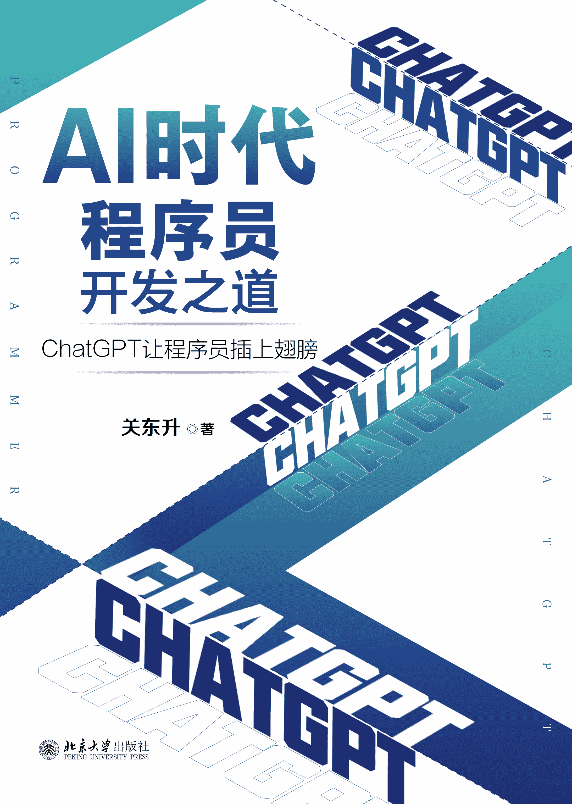

# AI赋能研发新范式：ChatGPT助力程序员效能跃升




# 

内 容 概 览

这本实战指南开创性地构建了“AI+程序员”的全新研发范式。内容由浅入深，从初识ChatGPT切入，系统拆解该工具在全生命周期中的应用策略。各章节聚焦差异化场景：涵盖技术文档自动化产出、需求分析与架构设计的智能辅助、数据库建模全流程、高质量代码生成与评审体系、测试驱动开发落地、任务管理可视化，以及源码深度解析技巧。

书籍特别强化实战维度，详细记录了ChatGPT如何介入系统测试与任务调度，并剖析底层代码逻辑。这种端到端的知识体系，旨在帮助开发者在工程实践中实现代码资产的精细化治理与效能最大化。

压轴呈现两大完整工程案例：一是PetStore宠物商店全栈开发复盘，二是“我的备忘录”App从零构建实录。双案例互为补充，直观演示如何将AI能力嵌入具体业务交付闭环。

对于追求技术进阶的开发者、渴望拥抱智能化编程范式的工程团队，以及产品、项目、技术管理层而言，这都是案头必备的进阶参考。

图书在版编目(CIP)数据

AI 时代程序员开发之道 ： ChatGPT 让程序员插上翅膀/关东升著． — 北京 ： 北京大学出版社， 2023.8

ISBN 978-7-301-34253-4

Ⅰ. ①A… Ⅱ. ①关… Ⅲ. ①人工智能 Ⅳ. ①TP18

中国国家版本馆 CIP 数据核字（2023）第 137949 号

书  名 AI 时代程序员开发之道：ChatGPT 让程序员插上翅膀

AI SHIDAI CHENGXUYUAN KAIFA ZHIDAO:ChatGPT RANG CHENGXUYUAN CHASHANG CHIBANG

著作责任者 关东升 著

责 任 编 辑 王继伟 吴秀川

标 准 书 号 ISBN 978-7-301-34253-4

出 版 发 行 北京大学出版社

地  址 北京市海淀区成府路 205 号 100871

网  址 http://www. pup. cn 新浪微博： @ 北京大学出版社

电 子 信 箱 编辑部 pup7@pup.cn 总编室 zpup@pup.cn

电  话 邮购部 010-62752015 发行部 010-62750672 编辑部 010-62570390

* * *

未经许可，不得以任何方式复制或抄袭本书之部分或全部内容。

版权所有，侵权必究

举报电话：010-62752024 电子信箱：fd@pup.pku.edu.cn

图书如有印装质量问题，请与出版部联系，电话：010-62756370

# 序言 重塑研发生产力，让开发启航新高度

每位软件工程师深谙：研发是场持久战，暗藏重重迷雾。从模糊需求的澄清、架构选型的博弈，到代码落地的琐碎、测试验收的反复，每个环节都在消耗精力与周期。

好在技术浪潮从不缺席。AI工具正以前所未有的速度渗透生产一线，它们不仅承担起重复性劳动，更在特定领域展现出超越人类的效能边界。身为代码工匠，我们率先拥抱了ChatGPT这把“瑞士军刀”——它能依托上下文生成连贯自然语言，在文档撰写、需求梳理、架构推演等认知密集型任务上大显身手；更能依据设计意图输出可落地的代码骨架，实现了从“辅助写作”到“辅助创造”的质变。

当效率跃升成为确定性收益，随之而来的不仅是交付节奏的加快，更是从事务性泥沼中抽身，将宝贵带宽留给架构创新、性能极致优化、技术债偿还等高价值决策。

本书即为这场变革的导航图。它将拆解ChatGPT的能力边界与协作范式，通过实战复盘，助你构建“人机共生”的高效工作流。

软件工程的本质，是在不确定性中寻找确定性解。工具迭代从未停歇，掌握新范式者，方能在下半场占据主动。本书不仅面向程序员，产品经理、项目经理、技术负责人等IT从业者均可从中汲取提效锦囊。

让我们共赴这场效能革命，突破认知天花板，为技术演进贡献增量价值。

随书赠送全案例源码与教学视频资源包。扫描左侧二维码关注“博雅读书社”公众号，输入第77页资源码即可领取。扫描右侧二维码留言“AI 程序员”，加入读者交流社群，共享成长红利。


资源下载码：cxy2023

关东升

目录 封面 版权信息 前言 重塑研发生产力，让开发启航新高度 第一章 ChatGPT 第一次接触 1.1 介绍 ChatGPT 1.2 注册 ChatGPT 1.3 使用 ChatGPT 1.4 本章小结 第二章 ChatGPT 文档生成实战 2.1 智能产出技术文档模板 2.1.1 设计文档模板构建 2.1.2 实战 1：生成 MF 京东商城软件需求说明书模板 2.1.3 实战 2：协同完成 MF 京东商城软件需求说明书 2.2 对话载体语言——Markdown 2.2.1 Markdown 核心语法速览 2.2.2 Markdown 工具链推荐 2.2.3 实战 3：输出 Markdown 版需求说明书模板 2.2.4 Markdown 转 Word 实操 2.2.5 Markdown 转 PDF 实操 2.3 思维导图可视化 2.3.1 思维导图在研发中的定位 2.3.2 优秀工程师的思维外化工具 2.3.3 手绘与工具绘制对比 2.3.4 ChatGPT 生成思维导图技巧 2.3.5 实战 4：生成 MF 京东商城需求思维导图 2.4 结构化数据呈现 2.4.1 Markdown 表格语法 2.4.2 实战 5：ChatGPT 快制 Markdown 表格 2.4.3 CSV 格式交互 2.4.4 实战 6：ChatGPT 生成 CSV 数据 2.4.5 无损转 Excel 2.5 图表零代码生成 2.5.1 非编程模式：自然语言出图 2.5.2 编程模式：代码驱动可视化 2.6 本章小结 第三章 ChatGPT 赋能需求工程 3.1 智能化需求采集 3.1.1 实战 1：××运动管理 App 访谈提纲设计 3.1.2 实战 2：××运动管理 App 问卷数据聚合 3.1.3 问卷结果可视化呈现 3.1.4 实战 3：绘制问卷统计饼图 3.2 功能边界智能界定 3.2.1 实战 4：××旅游景点推荐系统功能清单 3.2.2 实战 5：××二手书交易系统功能清单 3.3 用例建模落地 3.3.1 用例图核心概念 3.3.2 PlantUML 语法速成 3.3.3 实战 6：绘制二手书交易系统用例图 3.4 业务流程可视化 3.4.1 活动图建模要点 3.4.2 实战 7：绘制二手书交易系统活动图 3.5 流程图全场景覆盖 3.5.1 实战 8：订单管理流程图 3.5.2 实战 9：用户管理流程图 3.6 本章小结 第四章 ChatGPT 辅助架构与详细设计 4.1 架构设计智能决策 4.1.1 系统架构设计要义 4.1.2 分层架构演进逻辑 4.1.3 ChatGPT 介入架构设计的路径 4.1.4 实战 1：图书管理系统架构设计 4.2 原型设计加速器 4.2.1 原型设计标准流程 4.2.2 ChatGPT 赋能原型产出 4.3 实战 2：Todo List 项目原型设计 4.3.1 页面拆解策略 4.3.2 页面跳转关系图 4.3.3 高保真原型生成 4.4 详细设计多视图建模 4.4.1 详细设计与 UML 图谱 4.4.2 实战 3：Todo List 类图 4.4.3 实战 4：Todo List 时序图 4.4.4 实战 5：Todo List 活动图 4.4.5 实战 6：Todo List 组件图 4.5 本章小结 第五章 ChatGPT 全周期数据库建模 5.1 数据库设计分层理论 5.2 实战 1：Todo List 概念模型构建 5.3 实战 2：Todo List 逻辑模型推演 5.4 实战 3：Todo List 物理模型定型 5.5 实战 4：DDL 脚本自动化生成 5.6 本章小结 第六章 ChatGPT 高质量编码实战 6.1 代码生成三板斧 6.1.1 需求意图精准表达 6.1.2 细节补全与上下文注入 6.1.3 语法静态检查兜底 6.2 智能调试协作 6.3 机器评审体系构建 6.3.1 Java 生态：CheckStyle 集成 6.3.2 Java 生态：PMD 规则扫描 6.3.3 Python 生态：PyLint 质量把关 6.4 人工复核关键路径 6.5 本章小结 第七章 ChatGPT 测试工程化实践 7.1 功能测试智能化 7.1.1 单元测试与用例设计理论 7.1.2 实战 1：词频统计模块单测 7.1.3 实战 2：测试用例智能生成 7.1.4 实战 3：测试代码自动产出 7.2 TDD 落地最佳范式 7.2.1 卓越工程师的 TDD 修养 7.2.2 实战 4：计算器 TDD 实施 7.2.3 ChatGPT 全程护航 TDD 循环 7.3 性能测试深度介入 7.3.1 基准测试工具链选型 7.3.2 实战 5：微基准测试编排 7.3.3 实战 6：基准报告智能诊断 7.4 本章小结 第八章 ChatGPT 项目任务管控 8.1 目标与范围定义 8.1.1 目标描述标准化 8.1.2 实战 1：OA 系统项目章程 8.2 任务分解 WBS 8.2.1 ChatGPT 驱动任务拆解 8.2.2 实战 2：OA 系统任务分解树 8.3 进度计划甘特图 8.3.1 甘特图核心要素 8.3.2 实战 3：OA 系统排期生成 8.4 执行跟踪与预警 8.4.1 ChatGPT 协同进度跟踪 8.4.2 实战 4：OA 项目健康度监控 8.5 本章小结 第九章 ChatGPT 源码深度解析 9.1 主流框架源码阅读法 9.1.1 ChatGPT 分析框架源码策略 9.1.2 实战 1：Spring 核心机制拆解 9.2 第三方/遗留代码逆向理解 9.2.1 ChatGPT 分析陌生代码策略 9.2.2 实战 2：Java UserManager.java 全景分析 9.2.3 实战 3：Python user_manager.py 全景分析 9.3 本章小结 第十章 实战总复盘 1：PetStore 宠物商店全栈交付 10.1 项目背景与边界 10.2 需求工程实施 10.3 Python Web 分层架构落地 10.4 原型设计全过程 10.4.1 页面清单拆解 10.4.2 跳转关系建模 10.4.3 原型页面批量产出 10.5 详细设计多视图 10.5.1 实体识别与建模 10.5.2 实体类图绘制 10.5.3 服务层契约设计 10.5.4 数据访问层设计 10.5.5 时序图驱动交互确认 10.6 数据库建模三部曲 10.6.1 概念模型 10.6.2 逻辑模型 10.6.3 物理模型 10.7 编码交付闭环 10.7.1 数据库初始化 10.7.2 工程脚手架搭建 10.7.3 数据访问层实现 10.7.4 服务层业务编排 10.7.5 表示层交互实现 10.8 本章小结 第十一章 实战总复盘 2：“我的备忘录”App 原生开发 11.1 产品定位与范围 11.2 需求规格确认 11.3 原型设计进阶 11.3.1 低保真草图确认 11.3.2 高保真原型智能生成 11.4 详细设计与数据落地 11.4.1 实体类识别 11.4.2 实体类图绘制 11.4.3 物理建模直达 11.4.4 DDL 脚本产出 11.5 Android 工程化交付 11.5.1 Android Studio 工程初始化 11.5.2 列表展示功能实现 11.5.3 新增备忘录功能实现 11.5.4 删除备忘录功能实现 11.5.5 详情页交互实现 11.6 本章小结 

# 第一章 ChatGPT 第一次接触

正式对话前，先追溯这位“数字搭档”的来龙去脉。

## 1.1 重新认识 ChatGPT

名称中的“GPT”全称“Generative Pre-trained Transformer”，即“生成式预训练 Transformer 模型”。其核心骨架源自 OpenAI 早期发布的 GPT-2，那是一个拥有 10 亿级参数量、专为文本生成而生的大规模神经网络。

GPT 的基本原理是：基于已有上下文，概率预测下一个 Token（词/词片），并以此为锚点自回归生成连贯段落。ChatGPT 将这一能力迁移至对话场景——采用检索增强方式从海量对话语料中召回相关上下文，再由 GPT 模型合成自然流畅的回复。这种“预测+生成”机制，赋予了它跨领域、多轮次、强连贯的对话表现力。

但必须保持清醒：ChatGPT 本质是统计学模型，不具备真实认知、意识或价值观。其输出仅反映训练数据分布规律，不等同于“理解”。因此，工程协作中需建立“信任但验证”的审核机制，切勿将其拟人化。当前它代表 NLP 领域的里程碑，距离通用人工智能（AGI）仍有鸿沟。

> ¹ Transformer：Google 2017 年提出的深度架构，核心创新为自注意力机制。相较 RNN 的串行依赖，Transformer 实现全并行计算，显著提升训练吞吐与长序列建模能力，奠定了现代大模型基石。

## 1.2 账号准入指引

使用前需完成 OpenAI 账号注册。访问官网（图 1-1），点击“Try ChatGPT”进入登录注册页（图 1-2）。


图 1-1 OpenAI 官网首页


图 1-2 登录/注册入口页

点击“Sign up”，填写有效邮箱（图 1-3），收邮件验证。若持有 Microsoft 或 Google 账号，推荐直登，省却邮箱验证环节。


图 1-3 邮箱录入页

邮箱验证通过后，补充姓名等基础画像（图 1-4），随后完成手机号验证，即刻获得访问权限。


图 1-4 个人信息完善页

## 1.3 开启首轮对话

注册完成即可登录使用。登录流程同前节，不再赘述。成功进入后，将看到核心交互界面（图 1-5）：左侧为历史会话列表，中央为对话流区域，底部输入框等待你的指令。


图 1-5 ChatGPT 主操作界面

## 1.4 章末回顾

在“Send a message...”输入区键入疑问，点击右侧发送，静候模型反馈即可。图 1-6 展示了发送测试语“您好”后的回复情况。


图 1-6 测试回复示例

本章带大家认识了 ChatGPT 这款程序，并演练了注册与基础调用全流程。

# 第二章 解锁 ChatGPT 文档生产力

ChatGPT 能给软件研发人员的技术文档产出带来显著助力。凭借强大的 NLP 能力，它能产出质量上乘、阅读顺畅的文本，有力分担需求、设计、测试等多类文档的撰写压力。具体来说：梳理用户诉求输出清晰描述、绘制架构接口细节、产出测试方案用例报告均在行列。此外，它还能识别文档核心要素并转为结构化数据，便于管理调用；自动生成代码注释与接口文档，加速代码阅读理解。总之，善用此工具可大幅压缩工时、提升交付质量。

## 2.1 搭建模板体系，跑通半自动流程

研发面对的文档形态繁多（Word、Excel、PDF、在线协作等）。ChatGPT 擅长产出文本，却无法直接输出上述二进制格式。破局之道：借助外部工具制作骨架模板，配合模型填充内容，形成“模板+模型生成+人工微调”的半自动化闭环，效率倍增。

### 2.1.1 模板构建九步法

利用 Office 套件落地模板的具体操作如下：

1.  **定文档形态**：依规范与内容选型——Word、Excel 还是 PPT。
2.  **配版式参数**：按企业标准或个人偏好设定纸张大小、边距。
3.  **立标题体系**：为各级标题系统化配置字体、字号、加粗等，形成样式库。
4.  **建导航链接**：善用目录与书签功能，生成章节超链接，便于跳转。
5.  **做标准化包装**：添加封面、页眉页脚（含文件名、创建日期等元信息）。
6.  **嵌丰富呈现**：按需插入表格、图片、图表、公式并附说明。
7.  **埋 AI 接口**：在需模型补全处植入占位提示，引导生成方向。
8.  **存为模板文件**：另存为 .dotx 等格式，后续新建直奔模板，省时省力。
9.  **持续迭代优化**：实战中验证适用性，按需打磨标题、布局、样式，越用越顺手。

模板颗粒度直接决定模型产出效果与人工整合难度。理想状态下，人工稍加润色即可入模，工作量大幅削减。

### 2.1.2 实战一：定制 MF 京东商城需求规格说明书模板

以 MF 京东商城 SRS 为例，演练“模板构建→模型填充”全链路。建议先让模型出草稿，再结合企业规范反复打磨，最后调整格式落地。

**动手演示**

首先抛出提示词：

> 请帮我生成软件需求规格说明书模板。

模型返回一份标准草稿（含版本、日期、绪论、总体描述、详细需求、其他、附录等结构）。

草虽全但格式泛、内容泛。需结合实况二次雕琢。下面是笔者调整后的定制版模板（关键处植入 `((...))` 标记，实战时按需替换）：

> ((项目名))软件需求规格说明书
>
> 1. 绪论
> 1.1 产品综述
> ((描述产品的名称、功能定位和主要特点))。
> 1.2 目标群体
> ((描述产品的主要用户群体及其特征))。
> 1.3 参考依据
> ((列出编写 SRS 所依据的相关标准、模板、产品手册或其他资料))。
> 1.4 术语定义
> ((定义 SRS 中使用的关键概念、缩写与缩略词))。
>
> 2. 产品展望
> 2.1 愿景描述
> ((阐述产品的愿景和未来发展方向))。
> 2.2 定位说明
> ((描述产品在其产品系列或行业中的定位))。
> 2.3 路线规划
> ((描述产品的大致发展计划与时间表。这为需求的演进提供方向))。
>
> 3. 业务逻辑与规则
> 3.1 ((核心流程/规则/场景))
> 描述与产品密切相关的核心业务流程、规则或典型场景。
> 3.2 ((其他流程/规则/场景))
> 描述其他相关的业务流程、规则或场景。
>
> 4. 功能性需求
> 4.1 功能模块 1
> 描述产品需要实现的功能 1，包括功能 ID、名称、描述、优先级等。
> 4.2 功能模块 2
> 描述产品需要实现的功能 2，包括功能 ID、名称、描述、优先级等。
> ......
>
> 5. 质量属性需求
> 按性能、安全、可靠性、兼容性等分类描述各项非功能指标。
> ......

**关键点**：`((...))` 即为预留的模型填充接口。

### 2.1.3 实战二：借力 AI 填充需求规格说明书

有了骨架，接下来实战填充。结合业务理解与模型能力，能更快产出高质量 SRS，为开发测试立基。模型输出仍需人工校修以对齐业务与品牌。

**动手演示**

先设定上下文：

> 请根据要求编写 MF 京东商城有关软件需求规格说明书。

模型反问细节。随后逐个击破占位标记。

**示例 1**：针对“1.1 产品综述”，提问：

> 描述产品的名称、功能定位和主要特点。

模型返回：
> 产品名称：MF 京东商城
> 功能定位：提供在线购物平台服务，为消费者和商家搭建互动交流的桥梁。
> 主要亮点：
> (1) 便捷选购：轻松搜索、比较、下单，多支付方式与极速配送。
> (2) 资金安全：在线支付、货到付款、分期等多选，保障财产安全。
> (3) 品类丰富：覆盖 3C、家居等品类，优质商家入驻，满足多元需求。
> (4) 售后无忧：专业团队 7×24 小时在线，消除后顾之忧。

**示例 2**：针对“1.3 参考依据”，提问：

> 列出编写 SRS 所依据的相关标准、模板、产品手册或其他资料。

模型列出：
> (1) 《IEEE SRS 模板》：规范编写，满足标准化要求。
> (2) 《MF 京东商城用户手册》：功能介绍与使用方法，编写参考。
> (3) 法规标准：如《电子商务法》等合规依据。
> (4) 市场调研：用户画像、竞品分析、趋势预测等决策支撑。
> (5) 技术文档与 API 文档：开发实现所需的技术资源与接口清单。

其他章节同理，不赘述。核心套路：**模型出初稿 + 人工按需修订 = 高效产出精品说明书**。

> 1 SRS 全称 Software Requirements Specification（软件需求规格说明）。

## 2.2 AI 交互通用语：Markdown 速查手册

前文提到，模型只吐文本不吐文件。但若让它输出 Markdown 代码，配合编辑器/转换器，秒变 Word、PDF 等成品。Markdown 是轻量标记语言，语法简明、可读性强，能无损转 HTML 等格式，是对接模型输出的最佳中间格式。

### 2.2.1 核心语法一览

**1. 标题层级**
用 `#` 数量标识级别（1~6 级），`#` 后须跟空格再写内容。

预览效果见下图。

**2. 列表**
无序用 `-` 或 `*`，有序用 `数字.`，符号后均需空格。

预览效果见图。

**3. 引用块**
行首加 `>` 并跟空格。

预览效果见图。


**4. 强调**
`**文本**` 加粗，`*文本*` 斜体，标记符后建议加空格（视渲染器而定）。

预览效果见图。


**5. 图片**
语法：``。

示例：

预览效果见图。


**6. 代码块**
三个反引号 ```` ``` ```` 包裹，首行标注语言名（如 `python`）以获高亮。

预览效果见图。


以上基础语法足应对常见场景。进阶需求可自行拓展。

### 2.2.2 优选编辑器推荐

“工欲善其事，必先利其器。”主流工具横评：

1.  **Visual Studio Code (VS Code)**：免费开源代码编辑器，Markdown 生态最强。装插件即享预览、Emoji 替换、PDF 导出等，当下最热选择。
2.  **Typora**：所见即所得（WYSIWYG）代表，颜值高、交互丝滑。实时预览、图片/表情/TOC 插入一气呵成，许多人的本命写作工具。
3.  **Mark Text**：开源极简派，屏蔽繁杂设置，专注文字与思维。支持实时预览、模式切换、插件扩展，轻量好用。
4.  **Ulysses**：专业写作软件，导出选项丰富、体验极致，适合严肃创作。订阅制价格较高，面向职业写作者。
5.  **iA Writer**：极致专注文字，主题字体深度可定制，沉浸感强。功能相对单一，适合追求纯粹写作体验者。

### 配置高效的 Markdown 编辑环境

综合对比主流编辑工具后，结合成本与版权考量，建议采用 VS Code 作为核心编辑平台，配合 ChatGPT 使用可显著提升文档产出效率与质量。

获取安装包请访问官网下载页：


图 2-7 VS Code 官网下载界面

根据操作系统选择对应版本（如 Windows 点击 "Download for Windows"），下载后双击运行安装向导即可，过程直观此处略过。

为强化编写与预览体验，需在扩展市场安装三款核心插件：
*   **Markdown All in One**：集成语法高亮、智能补全、目录生成、数学公式及表格操作等高频功能，大幅提速编码。
*   **Markdown Preview Enhanced**：提供增强型预览，支持 Mermaid 图表渲染、代码块着色，并可一键导出 HTML、PDF、PNG 等多种格式。
*   **Markdownlint**：实时扫描语法规范，自动定位并修正常见书写错误，保证文档合规。

读者可按需选装。插件安装操作如下图演示（以 Markdown All in One 为例）：


图 2-8 扩展市场安装插件示例

其他插件安装逻辑一致，不再重复说明。

新建文件并另存为 `.md` 后缀即可进入编辑模式。编写与实时预览效果如下：


图 2-9 VS Code 编辑预览联动界面

### 2.2.3 实战演示：借助 ChatGPT 构建 MF 京东商城 SRS 的 Markdown 模板

环境就绪后，我们通过实战体验 AI 生成结构化文档的能力。

**操作步骤**

向 ChatGPT 发送指令：

> 请为 MF 京东商城软件需求说明书 (SRS) 生成标准模板，输出 Markdown 格式源码。

模型返回的结构化大纲如下：

```markdown
# MF 京东商城软件需求说明书

## 1. 引言
- 目的
- 范围
- 定义、缩略语和缩写词
- 参考文献

## 2. 总体描述
- 产品前景
- 需求概述
- 用户类别
- 运行环境
- 设计和实现约束
- 假设和依赖关系

## 3. 规定功能
- 功能性
- 数据性能
- 灵活性
- 系统界面
- 安全性
- 其他要求

## 4. 非规定功能
- 可用性
- 可靠性
- 效率
- 可维护性
- 可移植性

## 5. 数据库需求
- 数据定义
- 数据操作
- 数据存储

## 6. 接口需求
- 用户接口
- 硬件接口
- 软件接口
- 通讯接口

## 7. 性能需求
- 性能指标
- 精度
- 时间特性
- 容量

## 8. 设计限制
- 标准合规性
- 硬件限制
- 软件限制
- 接口限制
- 数据库限制

## 9. 质量属性
- 可测试性
- 可重用性
- 可扩展性
- 可互操作性

## 10. 其他需求
- 安全需求
- 法律需求
- 环境需求
- 非功能需求

---
```
*注：此为标准框架，实际项目中需结合业务细化各节点。*

将上述内容保存为 `MF 京东商城软件需求说明书.md`，在编辑器中预览渲染效果：


图 2-10 SRS 模板在 VS Code 中的预览效果

### 2.2.4 实操指南：将 Markdown 文档转换为 Word 格式

工程实践中常需将 MD 文件转为 `.docx` 交付，**Pandoc** 是首选开源转换引擎。官网获取安装包：


图 2-11 Pandoc 官网下载页面

**关键提示**：安装时务必勾选 "Add to PATH"，否则终端无法直接识别命令。

部署完成后，在终端（PowerShell/CMD）执行以下指令即可完成转换：


> **参数释义**：`input.md` 为源文件路径，`output.docx` 为目标输出文件名。

除 Pandoc 外，在线转换平台、VS Code 扩展亦可实现，按团队习惯选型即可。

以生成的 SRS 为例，执行转换指令过程如下：


图 2-12 终端执行格式转换过程

转换成功后，工作目录下生成 `MF 京东商城软件需求说明书.docx`，打开检查排版完好：


图 2-13 转换后的 Word 文档呈现效果

### 2.2.5 简易路径：Markdown 转 PDF 的最佳实践

虽可用 Pandoc 或 Typora 直出 PDF，但配置 LaTeX 环境等步骤较繁。推荐**曲线救国**策略：先按 2.2.4 节转为 Word，再利用 Word 原生导出 PDF。

操作路径：打开 `.docx` → 点击「文件」→ 选择「导出」→ 在弹窗中按图示设置输出 PDF。


图 2-14 Word 导出 PDF 设置对话框

## 2.3 思维导图：开发者的可视化思维工具

思维导图以中心节点发散分支、层层递进的拓扑结构，将抽象概念与逻辑关联显性化，是梳理复杂系统的利器。

### 2.3.1 思维导图在软件工程中的四大核心场景

1.  **需求与设计的结构化拆解**：将功能清单、数据实体、业务流程、界面原型拆解为可视化分支，助团队快速建立系统全景认知，尽早暴露遗漏与冲突。
2.  **编码与测试的认知辅助**：攻克复杂模块前，以导图沉淀入参、出参、状态机、边界条件等关键信息，降低心智负载，作为编写单测用例的清单基线。
3.  **团队协作与知识资产沉淀**：作为跨角色的“可视化通用语言”，促进思路对齐、进度透明、决策留痕，便于新成员快速上下文切换。
4.  **架构演进与重构的决策档案**：记录技术选型演变、重构决策背景、影响范围分析，面对业务迭代或技术升级时，支撑精准影响评估与风险控制。

贯穿“需-设-实-运”全生命周期，它是团队共建共享的认知外挂。

### 2.3.2 优秀工程师为何重视“编码前的图谋”

动键盘前的深度推演，绝非“眼高手低”。在白板或纸面上绘制流程、架构、状态迁移图，是将隐性逻辑显性化、校验方案可行性的必要工序，为落地代码夯实地基。

但需警惕：**图谋是为了落地，而非沉溺于图谋。** 资深工程师擅长在“充分设计”与“快速交付”间动态平衡，确保思考最终转化为可运行、可维护的工程资产。

笔者团队为“艺术品收藏应用平台”绘制的功能概念导图如下：


图 2-15 “艺术品收藏应用平台”功能与概念导图

### 2.3.3 从手绘到电子化：主流绘图工具对比

导图创作既可低成本手绘（白板、笔记本），也可借助专业工具提效。主流选型包括：**MindManager、XMind、Google Drawings、Lucidchart** 等，它们提供丰富模板库、主题样式、云端协作与版本管理，极大释放绘制效率。

对比手绘草稿与工具化成品，后者更利于长期存储、跨团队分享及迭代维护。


图 2-16 白板手绘版“艺术品收藏应用平台”导图


图 2-17 XMind 专业绘制版导图

**核心提醒**：载体形式不重要，关键在于**“可视化捕捉发散思维，结构化沉淀核心逻辑”**，以辅助决策判断与创新发散。

### 2.3.4 ChatGPT 助力绘制导图的两条技术路线

受限于模态，ChatGPT 无法直接输出图像，但可通过生成结构化文本，配合导图工具“导入”功能实现自动化布局：

1.  **Markdown 路线（本章重点）**：模型输出 Markdown 大纲 → XMind 等工具导入 `.md` → 自动渲染节点层级。
2.  **PlantUML 路线（后续章节详述）**：模型生成 PlantUML DSL 代码 → 渲染引擎出图。

### 2.3.5 实战演示：生成 MF 京东商城 SRS 思维导图

**操作策略**

针对模型“不出图”限制，采用“锚定核心主题 + 限定文本形态 + 指定代码格式”的提示词工程模式：

> 以“MF 京东商城软件需求说明书”为中心主题，输出文本版思维导图，要求返回 Markdown 格式代码。

**Prompt 三要素**：中心锚定、形态约束、格式指定，缺一不可。

模型返回的 Markdown 大纲（节选关键骨架）：

```markdown
# MF 京东商城软件需求说明书
- 介绍
  - 描述 MF 京东商城的软件需求规格说明书。
- 目的
  - 确定软件开发的正确方向，满足利益相关者的需求。
- 总体描述
  - 用户界面：提供易于使用的界面，以帮助用户轻松地浏览和购买商品。
  - 功能性需求
    - 搜索功能：允许用户在产品目录中搜索特定的商品。
    - 购物车：允许用户将多个商品添加到购物车中，并计算总价格。
    - 支付系统：提供安全、可靠的支付系统，以确保购买过程的安全性。
    - 订单管理：允许用户查看他们的订单历史记录和当前订单状态。
  - 非功能性需求
    - 安全性：保护用户的隐私和敏感信息。
    - 可靠性：确保系统稳定运行，尽可能避免错误和故障。
    - 性能：保证系统在高峰期的稳定性和响应速度。
- 用户角色
  - 游客：可以浏览商品，但无法进行购买或访问用户个人信息。
  - 注册用户：可以登录、访问个人信息和购物车，并进行购买。
- 功能需求 (详细展开：商品浏览、购物车、收银台、订单管理...)
- 非功能性需求 (详细展开：安全性、可靠性、性能...)
- 依赖关系 (数据库、支付接口...)
- 输出 (需求文档...)
```

将代码保存为 `.md` 文件，利用 XMind 的 **「文件 → 导入 → Markdown」** 功能，选中文件即可一键生成可视化导图：


图 2-18 XMind 导入 Markdown 自动生成的思维导图

得益于 Markdown 通用性，主流导图工具均兼容此导入方式，此处不再赘述。

## 2.4 表格：软件全生命周期的结构化载体

贯穿软件工程各阶段，表格以行列矩阵的紧凑形态，高效承载结构化信息，典型应用矩阵如下：

| 生命周期阶段 | 典型表格应用场景 |
| :--- | :--- |
| **需求工程** | 需求调研汇总表、优先级排序矩阵、干系人诉求对照表 |
| **架构设计** | 组件清单与职责表、模块依赖关系图表、技术选型对比决策表 |
| **数据建模** | 实体属性定义表 (ER 转关系模型)、数据字典、字段映射规范表 |
| **接口契约** | API 定义规范表 (含路径、入参、出参、错误码、调用示例) |
| **测试管理** | 测试用例规范表 (前置条件、步骤、预期结果)、需求追踪矩阵 (RTM) |
| **项目管控** | 任务分解与进度表 (甘特/燃尽图数据源)、缺陷跟踪单、变更请求单、会议行动项清单 |
| **文档资产** | 各类技术文档中的参数对照表、版本演进历史记录表 |
| **变更治理** | 变更影响分析表、审批流转记录表、回滚方案确认表 |

可见，表格是跨角色、跨阶段的通用“结构化语言”。

### 2.4.1 Markdown 表格：纯文本跨平台协作的优选

借助 ChatGPT 生成表格，主流输出格式为 **Markdown 表格** 与 **CSV**。本节聚焦前者。

MD 表格本质为纯文本，用管道符 `|` 定界列、连字符 `-` 分隔表头，天然适配 Git 版本控制、Code Review 及多编辑器流转。

**基础语法速览**：


**渲染预览效果**：


图 2-19 Markdown 表格渲染示例

**语法解析**：首行定义列名，次行 `---` 声明对齐方式 (可选 `:` 控制左/中/右对齐)，后续行为数据记录。寥寥数行即构建出标准化的 3 列 6 行 (含表头) 数据表。

Markdown 表格里，单元格文字靠哪边，默认看分隔符心情。想精准控制？加冒号就行：`:--` 靠左，`:-:` 置中，`--:` 靠右。实例演示见下：


实际长相参考下图：


图 2-20 MD 渲染样例（二）

### 2.4.2 实战 5：借 AI 手快速产出 MD 表格

纯手敲 MD 表格累人又慢。找 AI 帮忙效率翻倍。以性能监测记录为例（表 2-1）：


这表结构有点乱，拆成表头和数据行两部分。让 AI 做 MD 表格，用“分步走”指令最稳。

**实操：**

**步骤 1**：先给 AI 定规矩。
> 帮我做个表，吐 MD 源码。我分批给表头和行，等我喊“完工”你再停。

AI 回：“好，发吧。”

接着甩表头：
> 表头：日期 CPU利用率(%) 内存使用(MB) 网络延迟(ms) 响应时间(ms)

AI 回格式要求：
> 按这格式给行，逗号隔开，顺序对表头：
> 日期，CPU利用率(%)，内存使用(MB)，网络延迟(ms)，响应时间(ms)
> 如：2023-04-18, 25, 1024, 50, 100
> 起码给一行。

**步骤 2**：喂数据。
> 行数据：2022/1/1 55 600 120 220

AI 吐结果：


多数据重复步骤 2。

> **提示**
> 理论上能一次全给，但输出有长度限制，数据多易截断。建议“少量多次喂”。卡住了？发“继续”就行。

全量代码在这：


渲染看这：


图 2-21 MD 渲染图

### 2.4.3 CSV 那点事儿

上节是 MD，这节聊 CSV。AI 直接给 .xlsx 不现实，CSV 是通用替身。CSV 全称 Comma-Separated Values，本质是逗号切分的纯文本，Excel、WPS、Google 表格全认。首行标题，其后是记录，逗号隔开。样子如下：


操作：代码扔进记事本（图参考）


图 2-22 记事本改 CSV

存成 .csv 后缀，编码选对是关键（图参考）


图 2-23 存 CSV 格式

用 Excel 打开验收（图参考）


图 2-24 Excel 看 CSV

> **避坑：编码选错全是乱码**
> 中文 Windows 存 CSV **必须选 ANSI (GBK)**。选 UTF-8，Excel 开大概率乱码（WPS 通常抗造）。UTF-8 在 Excel 里的惨状：


图 2-25 CSV 乱码现场

### 2.4.4 实战 6：AI 产出 CSV

逻辑同 MD，照葫芦画瓢。

**实操：**

**步骤 1**：下指令。
> 帮我做表，吐 CSV 码。分批给料，听“完工”再停。

AI：“好，给表头行数据。”

发表头：
> 日期 CPU利用率(%) 内存使用(MB) 网络延迟(ms) 响应时间(ms)

AI 回确认：
> 核对下表头码：
> 日期，CPU利用率(%)，内存使用(MB)，网络延迟(ms)，响应时间(ms)
> 无误？给行数据。

**步骤 2**：喂行。
> 行数据：2022/1/1 55 600 120 220

AI 回：


多数据循环步骤 2。汇总全码：


扒出来存记事本成 .csv，流程同上略过。

### 2.4.5 CSV 转正成 Excel

拿到 CSV，怎么变 .xlsx？用 Excel/WPS 打开，点“文件”→“另存为”，类型选 `*.xlsx` 成事。参考：


图 2-26 Excel 存为 xlsx

## 2.5 借 AI 做数据可视化

AI 不直接出图，两条路：
1. 零代码：AI 给数据 → Excel 自带作图。
2. 编程：AI 写代码 → 跑出图。

### 2.5.1 零代码法：Excel 作图全流程

前半段“AI 给数据”见 2.4，不赘述。重点看 Excel 操作：


图 2-27 Excel 作图界面

点“推荐图表”：


图 2-28 选图类型

类型、标题随便改。成品导出：


图 2-29 最终图

> **小技巧：图表跨软件复用**
> Excel 里选中图 `Ctrl+C` `Ctrl+V` 进 Word/PPT/画图，再编存导。

### 2.5.2 编程法：Python 出图进阶

需点代码底子，主流 VB/Python。**强推 Python**：库富，能出高质量多格式图。实战演示 AI 写 Py 绘图脚本。

**准备**：装 Python 解释器和库。教程满网，问 AI 也行。

**实战：**

**步骤 1**：问依赖。
> 用 Py 作图，装啥库？

AI 列清单 + pip 命令：
*   **Matplotlib**：基础全。
*   **Seaborn**：高级美。
*   **Plotly**：交互强。
*   **Bokeh**：Web 向。
*   **ggplot**：R 风。

装库命令：


Win 下跑效果：


图 2-30 Py 库装好

> **提示**：先确保 Py 环境配妥进 PATH。

**步骤 2**：下绘图令（参数要全）。
> Py + Matplotlib 画折线。源：`系统性能指标的表.csv`，GBK 码。字段：日期、CPU利用率(%)、内存使用(MB)、网络延迟(ms)、响应时间(ms) **必须搞定中文显示**。

指令拆解：语言/库、图类型、数据细节、坑点预判。AI 给码：


存 `.py` 跑。环境不同常报错。作者首跑无输出，日志报：


图 2-31 首跑无果


日志显示缺字体。自改或甩给 AI 改。

追问：“报错如上，帮改。SimHei.ttf 在 `c:\windows\fonts`。”


AI 回修正码：


再跑，出图但 X 轴日期标签挤成一团（图 2-32）。细节再磨或让 AI 迭代。


图 2-32 二跑结果（X轴挤）

**扩展**：想换 Seaborn 风，改指令：
> Py + **Seaborn** 画折线，其余参数不变。

AI 给新码：


存 `.py` 跑，效果：


图 2-33 Seaborn 版

> **实战心法**：AI 写码非一步到位。**“人机共舞、多轮打磨”**是常态——跑、报错、喂回 AI、改、再跑... 循环至完工。

## 2.6 本章小结

本章梳理了 AI 赋能技术文档实战包：结构规划、内容提炼、MD 排版、脑图构建、复杂表格（MD/CSV/Excel 互转）、数据可视化（零代码 Excel + Python 编程双轨）。练熟这些，文档产出效率与专业度蹭蹭涨。建议配合书中练习实操，内化成职场硬技能。

# 第三章 如何用 AI 高效落地需求分析

上章搞定“文档写作”，本章转战软件工程上游核心——**需求分析**。从收集用户需求、界定系统功能、梳理业务流程、绘制用例图、撰写需求规格说明书五大维度，拆解 AI 辅助实战打法。

软件全生命周期中，需求分析是地基。核心使命：深度挖掘与结构化分析，锁定系统真实需求与规格边界，为后续设计、开发、测试提供绝对权威基准。

具体落地维度包含以下几个方面。

# AI赋能需求分析：从用户调研到系统建模的全流程实战

## 核心流程回顾：传统需求分析的五大基石

在软件工程实践中，需求分析是奠定项目成败的关键基石。这一过程通常遵循五大核心步骤：首先通过访谈、问卷等多元渠道**广泛收集用户诉求**，并将其转化为结构化的需求清单；其次依据业务目标**界定系统功能边界**，对功能点进行拆解与分组；再次**梳理业务流转逻辑**，明确数据流向、输入输出及控制规则；继而借助UML等建模工具**绘制用例图**，直观呈现功能与角色的交互关系；最后**编写规格说明书**，锁定约束条件，为后续设计开发提供准则。

贯穿始终的核心原则是：**深度沟通与协商**。唯有真正读懂用户期望，兼顾系统可行性、可靠性与安全性，才能输出高质量的规格文档，为工程落地扫清障碍。

---

## 第一阶段：ChatGPT 加速用户需求收集与整理

引入大模型后，需求收集阶段的效率与质量均显著跃升。ChatGPT 可深度介入访谈设计、记录整理、问卷分析及需求归纳四大环节。

### 1. 智能化访谈提纲生成
设计师只需阐述访谈主题与目的，模型即可秒产出结构化的问题库，覆盖痛点挖掘、期望功能、数据指标、社交属性、个性化偏好、UI风格、设备互通、商业化模式及隐私合规等多维度，大幅压缩前期准备工时。

> **实战演示：运动管理 App 访谈设计**
> 
> 
> 
> 模型输出的 10 条核心问题精准切中用户决策链路，设计师可按需裁剪，快速落地执行。

### 2. 访谈实录自动结构化
现场访谈的录音或手记上传后，借助 NLP 能力，模型能自动抽取关键需求点，输出规范列表，省去人工逐条梳理的繁琐，便于团队快速复盘确认。

### 3. 问卷数据秒级洞察
回收问卷数据导入模型，可自动完成选项分布统计、趋势热点识别及分析报告生成。以 200 份反馈为例，模型能迅速产出可读性强的需求报告，辅助决策层把握核心诉求。

> **实战演示：问卷结果自动分析**
> 
> 
> 
> 数据上传后，模型自动处理生成报告，设计师仅需把关结论准确性即可。
> 
> 

### 4. 杂乱需求智能归一化
初步收集的碎片化信息经模型过滤、分类、打标、排序，可直接形成带优先级的标准化需求文档，显著提升需求管理精度。

> **总结**：此阶段呈现典型的“人机协作”模式——模型负责重度认知劳动与数据处理，人类把控决策与质量关，双优互补。

### 进阶技巧：可视化图表辅助决策
为直观呈现问卷分布，可引入多维图表：
- **柱状图**：对比选项频次/得分；
- **饼图**：展示占比结构；
- **折线图**：追踪满意度时序变化；
- **热力图**：揭示多指标关联性；
- **散点图**：探究双变量关系（如评分与使用时长）。

> **实战演示：Markdown 表格转 CSV 绘制饼图**
> 
> 原始统计表经模型转为 CSV 格式：
> 
> 
> 
> 导入 Excel 选中关键列插入图表，快速产出可视化成果：
> 
>   

---

## 第二阶段：ChatGPT 协同系统功能定义与文档化

功能确定环节，模型化身“需求分析师助手”，支撑从目标对齐到文档产出的完整链路。

### 标准化协作五步法
1. **目标校准**：输入系统定位与场景，统一模型认知基线；
2. **候选功能发散**：模型从界面、数据、通信、安全等维度产出功能池；
3. **多维度筛序**：引入重要性、可行性、紧急性模型，输出优先级矩阵；
4. **规范文档生成**：自动编制含描述、实现路径、优先级、风险点的功能清单；
5. **迭代闭环**：人工评审反馈，模型动态调整文档，直至定稿。

> **案例一：自助游景点推荐系统**
> 
> 模型产出涵盖信息发布、分类检索、个性化推荐、UGC评价、交通查询、周边服务、行程规划、预订闭环的 8 大功能模块，结构清晰，覆盖全旅程。
> 
> 

> **案例二：二手书交易平台**
> 
> 模型交付用户、书籍、交易、订单、库存、物流六大核心域的详细功能清单，并预留实现细节与工作量预估字段，可直接交付开发评审。
> 
> 

**关键提示**：模型输出为“高质量草案”，最终签署需经领域专家、架构师、产品经理三方会签把关。

---

## 第三阶段：系统功能精化与可视化建模

脱离 AI 辅助，传统工程方法论在功能细化与建模上仍具不可替代价值。

### 功能精化标准动作
1. **业务需求深挖**：透过现象看本质，捕捉显性与隐性诉求；
2. **流程建模分析**：梳理端到端业务链路，定位系统触点；
3. **优先级分级**：依据 MoSCoW 等模型规划交付节奏；
4. **规格细化到位**：每一功能点落实到输入、输出、处理逻辑、控制规则四要素；
5. **多维验证评审**：组织业务专家、技术专家、管理层联合评审，校验合理性、完整性、可行性及安全性。

### 核心建模利器：用例图
用例图以**椭圆（用例）、矩形（系统边界/参与者）、连线（关联/泛化/包含/扩展）**为基本元素，聚焦“谁对系统做什么”，是沟通业务与技术的通用语言。

> **示例：用户管理用例图**
> 
> 

### 高效建模语言：PlantUML
采用“代码即图形”范式，PlantUML 以文本定义 UML 元素，天然适配版本控制与 AI 生成。核心关键字涵盖 `class`、`object`、`usecase`、`activity`、关系符号及注释标记。

> **VS Code 集成实操指南**
> 1. 扩展市场安装 PlantUML 插件；
> 2. 新建 `.puml` 后缀文件；
> 3. 编写 DSL 代码保存；
> 4. `Ctrl+Shift+P` 调用 `Preview Current Diagram` 实时渲染；
> 5. 预览窗口导出图片或复制至文档。
> 
>    

**进阶价值**：PlantUML 代码可直接由 ChatGPT 根据需求文档生成，实现“需求文本 -> 模型代码 -> 可视化图形”的自动化流水线，进一步缩短分析设计周期。

---

## 结语

从用户调研的智能化触达，到功能定义的协同化产出，再到建模落地的工程化规范，**AI 与传统方法论的深度融合**正在重塑需求分析全景图。掌握“提示工程 + 领域知识 + 建模技能”三位一体的复合能力，将成为新时代系统分析师的核心竞争力。


图 3-10 最终导出的效果图

**延伸阅读**

想深入钻研 PlantUML 更多语法细节？可前往官方指南 https://plantuml.com/zh/guide 获取完整文档。

### 3.3.3 实战案例 6：构建二手书交易系统用例图

ChatGPT 联手 PlantUML，能高效产出各类 UML 图表。本节以“二手书交易系统用例图”为例，实操演示如何让 ChatGPT 生成 PlantUML 代码来描绘用例关系。

**实操演练**

向 ChatGPT 抛出如下指令：

> 请基于以下系统功能清单，用 PlantUML 语言绘制用例图。
>
> 1. **用户管理**：注册登录、信息维护等。
> 2. **书籍管理**：信息发布修改、图片上传、分类检索等。
> 3. **交易管理**：上下架、购买评价、支付结算等交易闭环。
> 4. **订单管理**：建单、查改、取消、售后全流程。
> 5. **库存管理**：出入库、盘点、预警机制。
> 6. **物流管理**：快递录入、运费计算、轨迹追踪。
>
> 以上为详细需求文档，涵盖实现细节、优先级与工时预估，供设计开发参考。

ChatGPT 回复如下：

> 这是为您生成的二手书交易系统用例图 PlantUML 代码，涵盖核心功能模块与角色交互：


该图谱清晰呈现了六大功能板块及参与者与用例的关联。借助 PlantUML 的文本化描述，复杂的用例结构变得一目了然，极大辅助团队对齐需求理解。

将代码保存渲染后，因全量模块图谱过大，此处仅截取“书籍管理”与“订单管理”两模块作为演示，见下图 3-11。

## 3.4 梳理业务流程：关键步骤与协作要点

需求分析阶段，理清业务流程是核心环节。以下是落地的关键五步法：

1.  **锚定目标**：明确业务边界与核心指标。
2.  **广搜信息**：收集相关资料并分类归档。
3.  **可视化建模**：引入活动图等工具，将步骤、角色、资源具象化。
4.  **评估迭代**：复盘流程痛点，输出优化方案。
5.  **落地需求**：基于确认的流程，细化功能性与非功能性需求规格。

> **注意**：此过程需业务专家、技术骨干、管理层多方联动，保证信息全面性。同时须兼顾流程的可行性、效能与安全性。


图 3-11 书籍管理与订单管理模块用例图

### 3.4.1 核心利器：活动图

在业务流程建模中，活动图 是当之无愧的“主力军”。

作为 UML 规范下的行为图，它用矩形（活动）、菱形（决策）、箭头（流向）等元素，直观刻画系统或业务的执行逻辑与并发关系。无论是业务建模、需求分析还是软件设计，它都是沟通的“通用语言”。

**四大核心优势**：
*   **低门槛理解**：流程图式表达，零基础也能读懂。
*   **全要素覆盖**：串联、并发、分支、循环、泳道，一个不漏。
*   **序列清晰**：前后依赖关系一目了然，端到端贯通。
*   **维护友好**：业务变更时代码式修改，版本可控。

### 3.4.2 实战案例 7：绘制二手书交易系统活动图

ChatGPT + PlantUML 同样擅长活动图。沿用上述六大模块功能清单，我们让 AI 生成活动图代码。

**实操演练**

提示词模板（核心功能清单同案例 6）：
> 请基于以下系统功能，用 PlantUML 绘制活动图。
> [此处列出用户、书籍、交易、订单、库存、物流六大模块功能点]

ChatGPT 输出说明：

> 以下代码对应需求文档六大功能，矩形框标识功能节点，箭头串联用户与功能交互流：


渲染导出后，受限于篇幅，图 3-12 仅展示书籍管理、订单管理、库存管理三模块局部。


图 3-12 书籍、订单、库存三模块活动图

## 3.5 流程图：贯穿软件全生命周期的“瑞士军刀”

流程图可视为活动图的轻量化变体，渗透于软件工程的每个阶段：

| 阶段 | 核心作用 |
| :--- | :--- |
| **需求分析** | 可视化业务流与模块交互，对齐认知 |
| **系统设计** | 梳理运行逻辑，指导架构与代码实现 |
| **编码实现** | 作为设计基线文档，辅助开发与自测 |
| **测试验收** | 衍生测试用例/脚本，复现缺陷路径 |
| **运维迭代** | 留存审计档案，保障一致性与可追溯性 |

一言以蔽之，流程图是团队协作的“润滑剂”，也是质量把控的“压舱石”。

### 3.5.1 实战案例 8：订单管理模块流程图

系统共 7 个模块，本节聚焦**订单管理**核心链路。动笔前，先梳理业务标准动作（SOP）：

1.  **接单入池**：前端下单数据沉淀至订单中台。
2.  **智能分单**：自动/人工路由至库存、物流、财务等下游。
3.  **信息复核**：就收货地、支付态等关键项与买家二次确认。
4.  **打包发货**：按订单明细拣货、包装、交接承运商。
5.  **轨迹跟踪**：揽收后同步物流节点，更新订单状态。
6.  **收货闭环**：买家确认收货并评价，资金结算触发。
7.  **逆向处理**：退货申请受理、入库质检、退款执行、单据归档。

**实操演练**

向 ChatGPT 发送指令（以**用户管理**模块为例演示流程图绘制）：

> 请用 PlantUML 绘制用户管理模块业务流程图，涵盖：
> 1. 用户注册（录入基础信息）
> 2. 邮箱验证（链接激活）
> 3. 登录鉴权
> 4. 交易记录查阅
> 5. 账户注销（数据清除）
> 6. 安全策略（加密、限登）
> 7. 交易记录查阅（重复项）

ChatGPT 返回代码：

> 这是基于 PlantUML 绘制的用户管理流程图：


图 3-13 用户管理模块业务流程图

保存预览即得上图。实战中，条件判断（菱形节点）是关键，往往需与 AI 多轮博弈、迭代修正，且要求人工具备 PlantUML 读写能力以纠偏幻觉代码。

### 3.5.2 实战案例 9：用户管理模块流程图（进阶版）

本节在案例 8 基础上，细化“个人信息管理”节点，展示条件判断与循环结构的用法。

**业务流程细化**：
1. 注册 -> 2. 邮箱验证 -> 3. 登录 -> 4. **个人信息维护（改名、改密、换邮箱）** -> 5. 注销 -> 6. 安全策略 -> 7. 交易记录查阅。

**实操演练**

提示词结构同前，仅第 4 点展开为“个人信息管理”。

ChatGPT 输出：

> 以下代码引入条件分支与循环结构，精细刻画业务细节：


渲染结果见下图。


图 3-14 用户管理模块业务流程图（含分支循环）

## 3.6 章节小结

本章系统讲解了 ChatGPT 在需求工程中的实战应用：从需求采集、功能定义、流程梳理，到用例图、活动图、流程图的“文生图”落地。通过 9 个渐进式案例，拆解了提示词工程与 PlantUML 语法的配合技巧。重点在于**掌握“自然语言转建模语言”的转化范式**，建议读者多动手实操，将该技能内化为提效利器。

---

# 第四章 ChatGPT 赋能系统设计：从架构到原型的全链路实战

系统设计是软件工程的“脊柱”，ChatGPT 能在架构决策、原型构想、详细设计等环节深度介入，显著降低架构师认知负荷。

## 4.1 ChatGPT 辅助系统架构设计

架构设计是复杂系统工程，引入大模型可实现“专家知识外包”与“文档自动化”的双重红利。

### 4.1.1 主流架构范式速览

落地时常见的四大架构风格，各有适用场景：

| 架构风格 | 核心思想 | 核心收益 |
| :--- | :--- | :--- |
| **分层架构** | 横向切分：表现/业务/数据层解耦 | 结构清晰，易维护，Web 应用首选 |
| **微服务架构** | 纵向拆分：业务能力即服务，独立部署 | 高内聚低耦合，弹性伸缩，技术栈多元 |
| **事件驱动架构** | 异步消息总线解耦生产消费 | 高吞吐、强韧性、实时响应 |
| **领域驱动设计 (DDD)** | 领域建模对齐业务语言 | 复杂业务降智，模型与代码同步演进 |

### 4.1.2 分层架构深度解析

作为 Web 开发的“标准动作”，分层架构将系统切分为三大职责层，层间通过契约接口通信：

1.  **表示层**：用户交互入口。Web 场景下包含 UI 组件与后端 Controller，负责参数校验、视图渲染、响应封装。
2.  **业务逻辑层**：核心价值载体。承载领域规则、事务编排、校验逻辑、外部服务聚合，是系统“最贵”的资产层。
3.  **数据访问层**：持久化适配器。封装 DAO/ORM，屏蔽底层存储差异（MySQL/Redis/ES），提供统一数据访问入口。

**工程价值**：职责单一化降低认知复杂度；层间解耦支撑单元测试与并行开发；代码复用率高，大型系统演进平稳。

### 4.1.3 ChatGPT 在架构设计中的五大赋能模式

1.  **知识速查库**：秒级解释架构模式、CAP/BASE 理论、设计原则（SOLID/GRASP），新人上手零门槛。
2.  **选型参谋长**：输入业务规模、团队成熟度、技术栈偏好，输出架构方案对比表（如：单体 vs 微服务决策矩阵）。
3.  **方案评审官**：粘贴初步架构文档，让 AI 从模块划分、技术债、扩展性、性能瓶颈、安全合规五维度“挑刺”，输出改进清单。
4.  **图文生成器**：基于口述需求，产出 Mermaid/PlantUML 架构图（部署拓扑、模块依赖、微服务治理），同步输出 Markdown 版架构设计文档（ADR）。
5.  **脚手架码农**：按确定架构生成 Spring Boot/Go-kratos/NestJS 等框架的启动工程、分层目录结构、统一异常/响应封装、Dockerfile 与 CI/CD 模板。

> **总结**：ChatGPT 以软件工程知识图谱为底座，以自然语言交互为界面，构建了“咨询-生成-评审-落地”全链路辅助体系，让架构师聚焦决策而非文书。

### 4.1.4 实战案例 1：图书管理系统分层架构设计

理论落地，以**图书管理系统**为例，演练分层架构设计全流程。

**核心需求清单**：

#### 1. 图书管理
*   **信息维护**：书名、作者、分类、出版社等元数据的增删改。
*   **状态机**：馆藏/借出/损毁/遗失状态流转与校验。
*   **多维检索**：书名/作者/分类/ISBN 组合查询，支持分页排序。

#### 2. 读者管理
*   **档案维护**：姓名、联系方式、证件号等基础信息 CRUD。
*   **权限分级**：学生/教师/校外读者分级，差异化借阅册数、期限、罚款规则。

#### 3. 借阅管理
*   **借出登记**：扫码/手工录入，生成借阅单，原子性扣减库存、置状态“借出”。
*   **续借审批**：规则引擎判定可续借次数、逾期拦截，支持线上申请+管理员复核双轨制。

[内容待续...]

# ChatGPT 辅助软件工程实战：架构设计、原型开发与详细设计全流程

在明确了图书管理系统的核心功能清单后，我们梳理出的最后几项关键能力如下：

**借阅闭环与运维保障**
*   **归还处理**：将外借书籍状态流转为“已归还”，同步修正借阅档案。
*   **超期催还**：系统定时扫描逾期未还记录，自动通过邮件、短信等渠道触达读者。

**后台管理体系**
*   **账号权限分级**：配置超级管理员、普通管理员等后台角色，管控人员准入。
*   **基于角色的访问控制（RBAC）**：按职能划分书籍维护、读者管理等细粒度操作授权。
*   **全链路审计日志**：自动留存登录入系、数据增删改等关键操作轨迹。
*   **多维统计看板**：输出借阅总量、读者画像、热门书单等决策支持报表。

**前端交互入口**
*   **管理端**：承载读者录入、新书上架、续借审批等后台作业。
*   **读者端**：面向用户开放图书检索、续借申请、个人资料维护等自助服务。

以上勾勒出的是通用图书管理系统的基线需求，落地项目中功能往往更为繁杂。纯文字描述难免显得枯燥且难以把控全貌，引入 **用例图** 可直观呈现功能模块与参与者的交互拓扑（见 ），辅以 **思维导图** 梳理架构设计脉络（见 ），绘制技巧此处按下不表。


图 4-1 图书管理系统用例图


图 4-2 图书管理系统功能需求思维导图

---

## 实操演示：让 ChatGPT 绘制分层架构蓝图

有了需求基线，即可着手架构设计。我们尝试用 ChatGPT 生成 PlantUML 代码，快速产出分层架构图。

**提示词构建要点**：将上述功能清单（图书/读者/借阅/系统/接口五大域）作为上下文喂给模型，指定输出 PlantUML 语法。

> **请求示例**  
> “以下是一个图书管理系统，帮我使用 PlantUML 语言绘制分层架构设计图。  
> 主要功能需求概括为：  
> 1. 图书管理（信息维护、状态流转、多条件检索）  
> 2. 读者管理（信息维护、分类授权）  
> 3. 借阅管理（登记、续借审批、归还、逾期提醒）  
> 4. 系统管理（用户/权限/日志/报表）  
> 5. Web 接口（管理端/读者端）”

**模型返回**：PlantUML 源码块（见 ）。


将代码粘贴至渲染器预览，即得分层架构视图（见 ）。


图 4-3 图书管理系统分层架构设计图

---

## 4.2 使用 ChatGPT 辅助进行原型设计

原型设计是研发前期的“试错场”，旨在用低成本模型验证概念、打磨交互。它能帮助团队对齐认知，经测试迭代后再交付开发，规避返工风险。图 4-4 展示了某系统用户管理模块的原型效果。


图 4-4 某系统用户管理原型图

### 4.2.1 原型设计标准化流程

规范的原型交付通常经历五个阶段：

1.  **目标与功能锚定**：通过调研、竞品分析明确产品核心价值与功能边界。
2.  **草图与低保真探索**：快速产出线框图，低成本验证多套布局方案。
3.  **高保真精细化**：在低保真基础上注入视觉细节与交互逻辑，逼真还原产品形态。
4.  **用测与迭代闭环**：引入真实用户体验，收集反馈持续打磨，直至体验达标。
5.  **开发交付包产出**：输出开发可直接消费的制品。

**重点：交付包核心清单**
*   **可运行原型文件**：HTML/CSS/JS 等前端可执行格式。
*   **交互规格说明**：定义操作流、状态流转、异常处理，保障还原度。
*   **视觉设计规范**：色值、字阶、图标、栅格系统，统一品牌调性。
*   **用测复盘报告**：记录痛点、建议，指导开发侧优先级。
*   **静态/动态资源包**：图片、视频、音频等素材归档，便于工程集成。

### 4.2.2 ChatGPT 加速原型落地的优势

原型产物多为 HTML，ChatGPT 擅长代码生成，天然契合此场景。它能协助设计师：
*   **秒级出图**：从需求直达可跑通的 HTML 骨架。
*   **高效迭代**：通过对话式修改，快速调整布局、组件、样式。
*   **降低门槛**：非专业前端也能产出基于 Bootstrap 等框架的工程级原型。

这显著压缩“需求-设计-开发”的链路长度，提升交付质量与团队协作效能。

---

## 4.3 案例实战：Todo List 原型从 0 到 1

**项目背景**：个人待办事项管理工具。

**核心需求清单**：
1.  **账号体系**：注册/登录/资料设置。
2.  **任务增删改查**：新建（标题/描述/截止期）、列表（状态/日期筛选）、详情、编辑、完成标记、彻底删除。

### 4.3.1 页面拆解：ChatGPT 辅助信息架构设计

**实操演示**：发送需求文档，请求划分 HTML 页面清单。

> **提示词**  
> “Todo List 需求如下，请设计原型所需 HTML 页面清单……”（需求同前）

**模型返回页面矩阵**：
1.  `login.html`：登录校验
2.  `register.html`：新用户注册
3.  `profile.html`：个人中心（资料编辑）
4.  `task_list.html`：任务总览（筛选/增删改入口）
5.  `add_task.html`：新建任务表单（成功回跳列表）
6.  `task_detail.html`：详情页（支持标记完成）
7.  `edit_task.html`：编辑态（成功回跳详情/列表）

**进阶：页面流转关系图**  
继续追问页面跳转逻辑，模型输出文本结构（见 ）。


### 4.3.2 可视化页面流向：PlantUML 绘制导航图

文本描述不够直观，再请模型用 PlantUML 绘制状态机/流程图。

> **提示词**  
> “基于上述页面关系，请用 PlantUML 绘制页面导航图。”

**模型返回代码**（见 ），渲染效果见图 4-5。


图 4-5 页面导航关系图

### 4.3.3 实战生成：Bootstrap 驱动的高保真页面

为追求“所见即所得”的工程感，推荐引入 **Bootstrap** 框架——组件丰富、响应式开箱即用，极适合原型阶段。

**关键技巧**：提示词需显式指定 **框架、布局结构、组件清单、配色偏好**，越细致产出越可用。

**实操：登录页生成**
> **提示词**  
> “用 Bootstrap 5 生成登录页：用户名/密码输入框、登录按钮、注册跳转链接，简洁风格。”

**模型返回完整 HTML 代码**（见 ），保存为 `login.html` 浏览器打开即见效果（图 4-6）。


图 4-6 登录页实测效果

同法生成任务列表页（图 4-7）、新建任务页（图 4-8），其余页面代码随书配套资源提供。


图 4-7 任务列表页实测效果


图 4-8 新建任务页实测效果

> **避坑指南**  
> ChatGPT 只能产出“80% 可用”的框架代码，细节交互（如表单校验、空态、加载态）、业务逻辑绑定、响应式细调，仍需设计师/前端介入深度打磨。掌握前端框架基础是驾驭该工作流的前提。

---

## 4.4 使用 ChatGPT 辅助进行详细设计

详细设计是连接架构与代码的桥梁，聚焦模块内部结构、接口契约、算法逻辑、数据结构，产出指导编码的 UML 文档。引入 ChatGPT 能带来三重红利：
1.  **效能跃升**：以问答替代手工推导，秒级产出设计草案。
2.  **视角拓展**：提供备选方案、设计模式建议，打破思维定势。
3.  **质量护航**：辅助评审类图、时序图的完备性与一致性，降低逻辑漏洞。

### 4.4.1 详细设计四大核心 UML 视图

| 图种 | 核心价值 | 典型应用场景 |
| :--- | :--- | :--- |
| **类图** | 定义领域模型、类结构、关系多重性 | **最核心**，指导 ORM 映射、实体类编码、模块解耦 |
| **时序图** | 捕获对象间时序消息、调用链路 | 核心业务流程（如下单、支付）、异常追踪、接口联调 |
| **活动图** | 建模业务流程、控制流、并发分支 | 用例场景细化、复杂业务规则梳理、测试用例设计基线 |
| **组件图** | 物理部署视角：组件依赖、接口暴露 | 微服务拆分、中间件选型、运维部署架构对齐 |

这些图形化文物让抽象逻辑显性化，程序员阅读理解成本大幅降低，是高质量交付的基建。

### 4.4.2 案例实战：从需求挖掘 Todo List 领域模型（类图）

实体类是领域模型的基石，承载业务属性与行为，直映数据库表结构。除实体外，还需识别 Controller、Service、Repository、VO/DTO 等技术角色类。

**实操演示：实体类提取**

> **提示词**  
> “Todo List 需求如下，请识别核心实体类……”（需求同 4.3）

**模型返回**：实体清单及属性定义（见下方 [PRE*] 标记处）。

[PRE*]

在上述待办清单项目规格中，可抽取三大核心领域对象。

（1）账号对象（User Class）：承载系统用户档案。

（2）事项对象（Task Class）：承载待办详情，含标题、摘要、截止期等字段。

（3）进度对象（Task Status Class）：标识事项状态（如已办、未办等）。

以上为核心对象雏形，后续可细化延展。落地设计阶段，对象构建需依业务规格弹性调整。对象就绪，即可输出类别图。

实操演示

向AI提交如下指令。

基于下述对象描述，请输出PlantUML类别图脚本。

（1）账号对象（User Class）：承载系统用户档案。

（2）事项对象（Task Class）：承载待办详情，含标题、摘要、截止期等字段。

（3）进度对象（Task Status Class）：标识事项状态（如已办、未办等）。

模型随即回复如下：

输出为PlantUML类别图，涵盖账号、事项、进度三大对象。


拷贝脚本渲染存图，得图4-9。


图4-9呈现待办清单类别图

图中User对应账号对象，字段含ID、账号名、口令；行为含登入、登出、取信息。Task对应事项对象，字段含ID、标题、摘要、截止期、进度；行为含新增、修改、移除、列表、明细、标记完成。TaskStatus为进度枚举，含待办、进行中、已办三值。账号与事项呈1:N映射，一账号可管多事项。事项与进度呈1:1映射，一事项对应一进度。

### 4.4.3 实战案例 4：绘制交互时序图

顺序图属UML建模范畴，刻画对象协作与信令流转。其按时间轴呈现互动细节，助力研发把握执行逻辑与调用链路。核心构件含角色、存活线、激活块、信令、时间轴。角色指代对象或模块；存活线标记存在周期；激活块对应执行动作；信令描绘调用交互；时间轴度量时序推进。

核心提示：顺序图强场景相关：异场景下对象协作逻辑各异，故一场景一图。故用AI绘图须明确目标场景，视情况补全业务规格。

实操演示

指令示例：

待办清单项目规格：请用PlantUML绘制‘用户注册’场景顺序图。
该项目旨在管控个人待办，功能规格含：
1. 账号体系：支撑开户、登入、资料配置。
2. 事项新增：可录入标题、摘要、截止期等。
3. 清单浏览：可检视全量事项，支持按进度/时间筛选。
4. 明细查看：可获取单一事项全貌。
5. 事项修改：可变更未完结事项的标题、摘要、截止期。
6. 进度推进：可将未完结事项置为已办，列表中以完成态呈现。
7. 事项移除：可清除任意态事项，移除后不再现形。

模型返回脚本如下：


存盘渲染得图4-10。


图解如下：
1. 操作者发起开户申请。
2. 平台索要开户资料以建档。
3. 操作者提交姓名、邮箱、口令。
4. 平台查库校验账号名唯一性。
5. 库反馈校验结果。
6. 平台呈现开户成败结局。

完整应用含大量场景，故顺序图亦多，此仅演示注册一隅。其余场景请自行推演。

### 4.4.4 实战案例 5：构建业务流程图

类别图锚定静态结构，顺序图捕捉动态协作，二者虽助把握结构与协作，却难覆盖全流程行为逻辑。故流程图更贴近代码落地，擅长描绘动态行为与流转。

实操演示

指令示例：

待办清单规格：请输出PlantUML流程图脚本。功能规格同上。

模型返回：


渲染得图4-11。


图谱涵盖核心职能：账号体系、事项增删改查、列表筛选、明细查看、进度推进。此图清晰勾勒职能间衔接与分支，助把握全局流向。

### 4.4.5 实战案例 6：设计模块构件图

构件图设计依托六大维度：
1. 业务规格：透彻把握功能诉求，识别模块域，为构件划分定基调。如本工程可识别账号、事项等域。
2. 用例视角：识别关键职能，映射核心构件。
3. 物理拓扑：考量部署实体(客户端/服务端/存储)，映射构件构成。
4. 低耦合：遵循解耦准则，引入契约机制弱化强依赖。
5. 强内聚：单元职责单一，功能紧密相关，利于复用维护。
6. 技术栈适配：体现框架分层与模块选型。

综上，融会贯通上述维度，方能产出落地性强的构件蓝图，为工程构建部署导航。实操中，直接以业务规格为输入源驱动AI绘图。

实操演示

指令示例：

待办清单规格：请输出PlantUML构件图脚本。功能规格见前。

模型返回：


渲染得图4-12（注：原文误写为活动图，实为构件图）。


图4-12构件图包含六类构件：
1. 边界框：圈定工程范围。
2. 账号组件(UM)：供给开户、登入职能。
3. 事务组件(TM)：聚合事项管控全链路。
4. 持久层组件(DAC)：统一数据存取入口。
5. 服务契约：定义对外能力边界。
6. 依赖拓扑：
   ① UM仰赖开户/登入服务；
   ② TM仰赖事务服务；
   ③ UM与TM均仰赖DAC；
   ④ UM与TM存在协作依赖；
   ⑤ TM支持外部集成。

此构件图清晰呈现工程物理架构。引入持久层实现分层解耦，体现架构匠心与选型考量。为后续落地提供标准化参考框架。

## 4.5 本章小结

本章实操演示AI在架构分层、原型搭建、详细建模三维度的协作范式。通过多案例串联，助读者把握设计全链路。架构层面重点剖析分层式设计，演示AI辅助决策思路。

# 第五章 借力大模型重塑数据库设计流程

引入智能模型重构建库流程，显著提升研发产出比。凭借强文本理解力，可快速消化文档、推导模型、输出方案。四大亮点：
1. 全流程自动化：规避人工繁琐，效能跃升。
2. 语义精准提取：保障模型质量。
3. 秒级迭代：从容响应变更与优化。
4. 可视化协同：降低认知偏差与沟通损耗。
总之，AI辅助建库已成高效标配。

## 5.1 数据库设计七阶段全景图

规范建库流程含七阶段：
1. 业务梳理：挖掘对象/属性/联系，奠基石。
2. 领域建模：抽象核心概念与纽带，构建初步蓝图。
3. 逻辑设计：转换为标准ER模型，落实范式。
4. 物理落地：定义表结构/列/类型/键/索引细节。
5. 字典沉淀：记录元数据全维定义。
6. 标准把关：对标命名/设计准则，提质。
7. 效能调优：索引/类型/分库分表策略。
建库是业务向技术的转译，优劣决定性能上限/扩展边界/一致性底线。

## 5.2 实战案例 1：领域概念模型构建

概念建模旨在将业务语义抽象为领域蓝图，是后续设计源头。核心动作：
1. 对象定位：识别核心实体(对应数据表)，明确语义与字段。
2. 关系界定：界定1:1/1:N/M:N纽带，映射外键关联。
3. 类型归纳：提炼概念数据类型，指导列类型选型。
4. 蓝图构建：图文描绘实体/关系/属性，覆盖全域概念。
5. 校验把关：确证准确完整，必要时修正优化。
对象抽取可复用前文4.4.2类图成果，此处不赘。获取对象清单后，即可驱动AI输出概念模型。

实操演示

指令：

基于下述实体，请输出PlantUML概念模型(ER图)脚本。
1. 账号对象：承载系统用户档案。
2. 事项对象：承载待办详情，含标题、摘要、截止期等。
3. 进度对象：标识事项状态(如已办/未办等)。

模型返回：


渲染得图5-1。


图5-1概念模型涵盖：
1. 账号实体：字段含ID、账号名、口令。
2. 事项实体：字段含ID、标题、摘要、截止期，并关联进度。
3. 进度实体：字段含ID、名称。
4. 账号1:N事项：映射创建关系。
5. 事项1:1进度：映射持有关系。
模型精准还原账号/事项/进度三元纽带，实体字段完备，关系准确，契合事务管控诉求。为逻辑设计铺就康庄大道。

## 5.3 实战案例 2：逻辑模型推演

# 第五章 实战：ChatGPT 助力数据库设计全流程

数据库逻辑建模旨在把概念模型落地为数据库的逻辑架构，核心步骤涵盖五大板块：

1.  **定型数据模型**：主流采用关系模型，借助 ER 图呈现逻辑骨架。
2.  **落实实体**：把概念实体映射为 ER 图实体，敲定主属性（主键）与外键。
3.  **明确联系**：将概念关系转为 ER 图关系，锁定配比（基数）与参与度。
4.  **细化实体结构**：为各实体罗列全属性，细化到数据类型、长度、空值约束，并梳理属性间的依赖。
5.  **范式校验优化**：对照 1NF、2NF、3NF 等规范审视模型，消除冗余与更新异常。

前期实体识别可借力 ChatGPT（详见 4.4.2 节），此处不再展开。拿到实体清单后，即可作为上下文喂给 ChatGPT，生成逻辑模型。

### 实战演示：逻辑建模

**提示词示例：**
> 现有实体类，请用 PlantUML 完成数据库逻辑建模。
> 1. 用户类：承载系统用户信息。
> 2. 任务类：含名称、描述、期限等属性。
> 3. 任务状态类：标识完成、未完成等状态。

**模型解读（对应图 5-2）：**
ChatGPT 返回的 ER 图包含三大实体及两类关联：
- **用户实体**：主键 `用户ID`，含用户名、密码。
- **任务实体**：主键 `任务ID`，含标题、描述、截止日期、完成状态。
- **完成状态实体**：主键 `完成状态ID`，含状态名称。
- **用户—任务**：1:N，一用户可建多任务。
- **任务—状态**：1:1，单任务对应唯一状态。

**点评**：模型实体清晰、关系明确、符合范式、扩展性佳。但字段粒度尚粗，物理建模阶段还需细化定义；同时需把控设计度，防过度设计。


---

## 5.4 实战：ChatGPT 推进物理建模

物理建模是将逻辑模型转为物理存储方案的过程，聚焦表、列、键、索引的落地细节，兼顾性能、扩展性、安全性。主流工具有 ERWin、PowerDesigner 等。

核心作业九项：
1.  **实体映表**：确定表名。
2.  **表结构定义**：字段名、类型、长度、精度、字段间依赖。
3.  **主键选定**：保障行唯一性。
4.  **外键建联**：体现表间引用。
5.  **命名规范**：大小写、空格、关键字避让。
6.  **存储选型**：行存/列存等引擎选择。
7.  **索引策略**：高频查询/排序列加索引。
8.  **视图与存储过程**：封装逻辑、屏蔽细节。
9.  **调优落地**：索引微调、表空间规划。

利用 ChatGPT 文本处理能力，直接以概念模型描述为输入，产出物理模型。

### 实战演示：物理建模

**提示词示例：**
> 基于下述概念模型，请用 PlantUML 输出物理模型。
> 1. User 实体：userId、userName、password。
> 2. Task 实体：taskId、title、description、deadline，关联 Status。
> 3. Status 实体：statusId、name。
> 4. User-Task：1:N（用户创建任务）。
> 5. Task-Status：1:1（任务持有状态）。

**产出解读（对应图 5-3）：**
生成三张表：`User`、`Status`、`Task`。前两者单列主键，`Task` 表采用复合主键（`taskId`、`userId`、`statusId`），其中 `userId`、`statusId` 为外键。注意：Task 与 Status 的 1:1 关系未显式建外键，而是内嵌于 Task 表结构中。

**提醒**：ChatGPT 仅作辅助，生成物理模型仍需人工把关修正。


---

## 5.5 实战：ChatGPT 生成 DDL 脚本

DDL（数据定义语言）覆盖建表、删表、改表、建/删索引。本节以前述物理模型为蓝本，针对 MySQL 8 生成建库建表脚本。

### 实战演示：DDL 生成

**提示词示例：**
> 依据物理模型，生成 MySQL 8 DDL，库名 `TodoListDB`。

**落地建议**：将输出保存为 `TodoListDB.ddl`，便于版本管理与执行部署。


---

## 5.6 本章小结

本章以 Todo List 为例，串联概念→逻辑→物理建模及 DDL 生成全链路，演示 ChatGPT 在各阶段的提示词工程与成果校验要点。掌握此流程，可显著提升数据库设计效率。


# 第六章 ChatGPT 编程实战：从协作范式到代码落地

要让 ChatGPT 产出高质量代码，核心在于**“人机深度协作”**。遵循六大原则：

1.  **需求前置**：详细说明功能、业务规则、输入输出契约。
2.  **规范对齐**：明确语言版本、编码规约、设计模式、工程化要求。
3.  **迭代闭环**：拒绝一步到位，采用“生成→评审→修正→再生成”循环。
4.  **人工兜底**：Code Review、单测、压测、安全扫描全程人工把关。
5.  **提示词工程持续优化**：沉淀高效 Prompt 模板，总结交互套路。
6.  **工具链融合**：静态分析、单测框架、性能剖析工具引入协作链路，客观度量代码质量。

---

## 6.1 代码生成实战

### 6.1.1 需求描述黄金法则

提示词质量直接决定代码上限。六大技巧助你写好 Prompt：

| 技巧 | 要点 |
| :--- | :--- |
| **明确意图** | 自然语言描述功能边界、异常流、非功能性指标。 |
| **自顶向下** | 先给架构/接口签名，再细化实现，降低模型认知负荷。 |
| **样例驱动** | 复杂算法/业务用「输入-输出」样例说清逻辑。 |
| **多轮对话** | 分层次追问，逐步细化，及时纠偏幻觉。 |
| **追问修复** | 代码有瑕疵直接贴回让模型解释/重构，阻断错误传播。 |
| **人机分工** | 人做架构决策、核心算法；模型填充样板代码、边界处理。 |

**演示速览：**
- *Python 打印 Hello World* → 
- *C++ 求和函数* → 
- *JS 下载图片存本地* → 

> **认知边界**：模型擅长框架搭建、模式识别、样板代码；架构权衡、核心算法、深度业务耦合仍需人类主导。

### 6.1.2 代码细化与演进

在已有骨架上追加细节，采用**“上下文传递 + 增量指令”**模式。

**演示链路：**
1.  **修改字面量**：把 "Hello World!" 改为 "Hi there!" → 
2.  **参数化问候**：入参姓名，输出 "Hello {name}!" → 
3.  **引入条件分支**：特定名单（John/Mary）打印专属问候 → 
4.  **封装复用**：抽取函数 `greet(name)`，批量调用验证 → 


---

> **贯穿全章的核心心法**：**把 ChatGPT 当成「极速初稿产出器 + 知识检索器」，而非「自动驾驶员」。你的判断力、架构力、测试力，才是代码质量的最终担保。**


ChatGPT 回复如下。

你可以利用 `def` 关键字定义一个接收参数并输出问候的函数，参考代码如下：


从这些案例可见，ChatGPT 能依据你的具体描述，给出相应的代码逻辑或细节，帮你补全并完善程序。我们可以循序渐进地增加逻辑与参数，最终得到一个功能完备的代码片段。

**核心提示**

值得注意的是，代码补全往往需要多轮对话才能完成。持续描述待实现的逻辑，ChatGPT 会逐步协助补全更完整的代码，直到满足最终需求。

### 6.1.3 代码语法检查

ChatGPT 的语法检查功能能助开发者快速定位代码中的语法错误并修复，从而提升代码质量与稳定性；同时也能督促遵循编码规范，增强代码的可读性与可维护性。

**核心提示**

针对代码语法检查，有以下操作技巧与建议供参考：

1.  **成稿后再查**。写完初稿再检查，能最大程度暴露问题，避免重复修复同类错误。这要求克服急躁心理，先把逻辑跑通再查。
2.  **模块化检查**。切勿将整个程序一次性提交，那样难以定位问题。应按函数、类等逻辑模块分段提交，逐个击破。
3.  **聚焦高危区**。函数定义、条件判断、循环语句等易错环节要重点排查，这些地方的语法错误常导致程序跑不通。
4.  **理清逻辑再交付**。提交前自行通读一遍，搞清程序逻辑与各部分作用。能避免因疏忽提交含逻辑错误的代码——ChatGPT 主攻语法，对深层逻辑理解有限。
5.  **验证与测试**。按建议改完后，务必自行验证修改是否正确并跑测试，确保程序按预期工作。切勿完全依赖 AI，其理解尚不及人类专家。
6.  **持续反馈**。交互中对检查结果与建议给予持续反馈，有助于 ChatGPT 发现不足、优化方向，使代码分析服务更精准、质量更高。

**实战演示**

以下通过代码语法检查案例，给出几种提问范例供参考。

**案例 8：聚焦单一问题**

为让 ChatGPT 给出有针对性的回答，提问时应聚焦一个具体问题。例如：

> 我定义函数时常漏写冒号 `:`，导致语法报错。如何记牢并养成好习惯？

这是个优秀提问：聚焦具体痛点（冒号遗漏），明确阐述了困难与需求。

**案例 9：提供具体代码**

若读者这样提问：

> 下面这段代码有什么语法错误？怎么改？


这属于结合实例的提问，提供代码后 ChatGPT 能清晰定位问题。但对比案例 8，此问未明确说明提问目的，ChatGPT 回答前需猜测意图，可能偏离重点。

ChatGPT 回复如下：

这段代码缺了冒号 `:`，会报语法错误。修正版如下：


定义函数时，参数列表后须加冒号标识代码块开始。且代码块内语句要缩进，通常用 4 个空格代表一级缩进。此例中，函数体内的代码需缩进以表明归属。

## 6.2 调试代码

调试是修复错误、洞悉程序逻辑的核心技能，开发者必须掌握相关技巧。

**核心提示**

借助 ChatGPT 辅助调试，主要有以下几种路径：

1.  **喂逻辑与预期**。把代码逻辑和预期结果告诉 ChatGPT，让它验证理解并找潜在问题。若它理解不了，也反向提示我们说明得不够清晰。
2.  **问推理细节**。对推理过程中的疑点发问，对比其解释来校验自己是否出错，也能测试 ChatGPT 的理解程度。这是一种“双向调试”。
3.  **给片段让它析**。提供代码片段让 ChatGPT 分析，再与自己的理解对比。若它错了，倒逼我们梳理概念、加深理解。
4.  **攻克棘手 Bug**。向 ChatGPT 描述难题让其给思路，能带来新视角、激发灵感。若不同意其分析，深入推敲反而能加深理解。
5.  **挑回复的漏洞**。在 ChatGPT 回复中找不足再追问探讨，能检验其推理准确性，提升自身洞察力。

总而言之，精进调试技巧、强化分析推理能力，是进阶高级工程师的基石。代码既是工具也是教材。调试过程中不断推敲、加深洞察，是产出高质量代码的必经之路。

**实战演示**

**案例 10：调试实战**

通过一个具体例子演示如何用 ChatGPT 辅助调试。假设我们写了一段提取文本中高频 Top 10 单词的代码：


实际运行结果：


但我们期望的结果是：


实际不符预期。可按如下方式与 ChatGPT 交互调试。

我们发送请求：

> 如下代码实际运行结果为 ，不符合预期，请指出逻辑错误：

ChatGPT 回复：

> 代码未考虑单词大小写。统计时转为小写，即可识别大小写不同但同义的单词。

注意，这回答不符合预期，很正常。我们继续追问：

> 但结果里为何出现“!”？

ChatGPT 回复：

> 代码用 `split()` 分词时未处理标点。示例中 `"ChatGPT!"` 被当作一个整词。

> 解决方法：用正则表达式分割单词列表。修正代码如下：


使用正则 `\b\w+\b` 匹配单词，`\b` 为词边界，`\w+` 匹配字母数字下划线。这样能正确分词，输出不再含标点。

修正后运行结果：


可见，结果已符合预期。

## 6.3 评审 ChatGPT 生成的代码

ChatGPT 作为自然语言模型，生成的文本含代码。使用其生成代码时，最好实施代码评审以保障质量与正确性。

评审即系统性检查审查，确保符合编码标准、最佳实践与安全要求。AI 生成代码可能存语法错、逻辑错或安全隐患，评审旨在识别并修正这些问题。

评审者需具备扎实开发经验，能识别常见错误与潜在隐患并提改进意见；还需关注可读性、可维护性、效率等，保障长期可靠性与可持续性。

总之，对 AI 生成代码做评审至关重要，有助于确保质量、降低维护更新成本。

评审可借助工具：静态代码分析、逻辑验证（如单测）、性能测试等。本章先讲静态分析工具评审 AI 代码。

**核心提示**

静态检查工具自动扫描代码，核对是否符合规范与最佳实践，挖掘潜在问题。主流工具如下：

1.  **CheckStyle**：专查 Java 规范（函数长度、命名、空格等），规则可配置，可核验 AI 生成的 Java 代码是否达标。
2.  **PMD**：Java 静态分析工具，能查不规范代码（未用变量、未捕获异常等），可评估 AI Java 代码的规范性与健壮性。
3.  **FindBugs**：扫描 Java 字节码中的 Bug 与不规范（空检查、同步问题等），可发现 AI Java 代码潜在隐患。
4.  **Cppcheck**：C/C++ 静态分析工具，查未初始化变量、内存泄漏等，可评估 AI 生成的 C/C++ 代码质量。
5.  **PyLint**：Python 静态分析工具，依 PEP 8 规范查不规范处，可自动评估 AI 生成的 Python 代码合规度。

用好这些工具，能自动化评估 AI 代码在规范、健壮性、质量上的水平。评估报告出来后，开发者核查并将改进点反馈给 ChatGPT 让其重写，循环迭代，能高效提升 AI 代码生成能力。

这要求开发者熟悉工具、懂按语言标准与项目需求配置运行、准确读懂报告问题，才能向 AI 提针对性改进建议。静态分析工具结合 ChatGPT，能显著减轻评审负担、更高效提升生成质量。对复杂、高要求代码尤其关键。

综上，静态检查工具为开发者提供了客观评估 AI 生成代码能力的新维度。理解并善用这类工具配合 ChatGPT，将成为高效用好 AI 的关键技能之一。这需要时间积累，最终让开发者成为 ChatGPT 的强力搭档。

下面分别介绍 Java 工具 CheckStyle、PMD 及 Python 工具 PyLint 的使用。

### 6.3.1 使用 Java 代码检查工具 CheckStyle

CheckStyle 用于确保代码符合特定编码标准与指南，能识别标记格式错误、命名约定及潜在错误或安全漏洞。

安装建议直接在 IDE 中装插件，省去手动下载配置环境。主流 Java IDE 为 IntelliJ IDEA，安装步骤：菜单 `File` → `Settings` 打开设置，按下图操作安装插件。


图 6-1 安装 CheckStyle 插件

装完重启 IDE 即可使用。

测试前，先准备一个问题多多的 Java 文件（BadCodeExample.java），代码如下：


看看 CheckStyle 如何找出其中问题。

启动 IDEA，打开该文件（需置于项目中），代码窗口右键选 `Check Current File` 开始检查，结果如下图。


图 6-2 检查文件

输出窗口点击检查项可定位到具体代码，按提示修改即可。

还可选验证规则（如 Google 或 Sun），选好后重新检查。

### 6.3.2 使用 Java 代码检查工具 PMD

PMD 同样是 Java 静态分析工具，专查潜在问题：常见编码错误、性能瓶颈、不良实践。

PMD 用规则集定义检查类型，涵盖代码复杂度、未用变量、重复代码、空语句块、不安全操作等，并提供可视化报告便于识别修复。

PMD 支持命令行独立运行，也能集成进 Eclipse、IDEA、Maven 等，用法灵活，支持按项目需求自定义配置扩展。

下面讲在 IDEA 中装 PMD 插件，步骤与 CheckStyle 类似。打开插件对话框，按下图安装。


图 6-3 安装 PMD 插件

验证 Java 代码需准备规则文件 `pmd-ruleset.xml`，参考下方代码编写修改。


将文件放在 IDEA 项目根目录下。


图 6-4 使用 PMD

打开待查代码，右键选 `Run PMD` → `Pre Defined` → `All` 开始检查，结果如下。


图 6-5 检查文件

点击输出窗口左下角 `导出` 按钮可导出报告，弹出对话框如下。


图 6-6 导出文件对话框

选路径命名后点 `Save` 保存报告。

报告结果直观，此处不再赘述，读者自行查看。

### 6.3.3 使用 Python 代码检查工具 PyLint

前文讲了 Java 工具，现在介绍 Python 的 PyLint。

首先装 PyLint，命令行用 pip 安装。


图 6-7 安装 PyLint 工具

在 PyCharm（Python IDE）中用 PyLint，需装插件。PyCharm 与 IDEA 同属 JetBrains，界面操作高度相似，装插件流程也一样。如下图，插件市场搜 `PyLint` 点 `Install`。


图 6-8 安装 PyLint 插件

重启 PyCharm 后生效。

测试前，准备一个糟糕的 Python 文件（BadCodeExample.py），代码如下：


想在 PyCharm 里做代码静态检查，第一步得建个项目，把待检测代码丢进去。接着打开 `BadCodeExample.py`，在编辑区右键选中“Check Current File”即可启动检查。检查结果如  所示。输出窗口里点击某条提示，编辑器就会自动跳转到对应代码行，方便你根据建议直接修正。


图 6-9 代码检查结果示意

## 6.4 为何必须人工复核 AI 生成代码

ChatGPT 产出的代码虽经大量训练优化，能应付大多数常规需求，但在追求极致精准、高质量交付，或需要深度定制调整的场景下，人工把关依然不可或缺。

人工评审是守住代码质量底线的关键。人类拥有 AI 难以企及的业务语境理解力与语言洞察力，能精准捕捉模型因知识边界、经验盲区而遗漏的问题。双强结合，方能产出真正经得起推敲的高质量代码。

评审重点建议聚焦以下七大维度：

1.  **业务契合度**：逻辑实现是否精准对齐需求？存疑或偏离处需给出修正意见。
2.  **算法与性能**：选型是否最优？是否存在效率瓶颈？需给出优化方案。
3.  **代码可读性**：命名规范、注释充分、格式整洁？旨在降低认知负荷。
4.  **规范合规性**：是否遵循语言/框架社区惯例与行业标准？不合规处须整改。
5.  **架构扩展性**：设计是否支撑未来迭代？需评估并给出重构建议。
6.  **安全合规性**：是否存在注入、XSS 等隐患？是否落实 SDL 安全开发生命周期？
7.  **缺陷与漏洞**：细读并实测，挖掘 AI 未察觉的 Bug 与漏洞，给出修复闭环。

综上，人工评审是 AI 协同开发流程中不可缺失的质量闸口。

### 实战复盘：一段 SQL 的进化史

假设 ChatGPT 生成了如下查询语句：


经人工评审，发现以下五类问题并给出改进方向：

**1. 业务层面：修补注入漏洞**  
若 `name` 来自用户输入，原写法极易遭 SQL 注入。需改用参数化查询：


**2. 可读性层面：告别无意义变量名**  
`$name`、`$age` 语义不清，建议重命名为业务含义明确的标识符：


**3. 规范层面：统一大小写风格**  
关键字、表名等建议大写，符合 SQL 书写规范：


**4. 效率层面：拒绝 `SELECT *`**  
仅需 `name`、`age` 两列，显式指定列名可减少 I/O 与网络开销：


**5. 缺陷层面：类型比较陷阱**  
若 `user_age` 为字符串类型，直接用 `>` 比较会报错或得错果。须核实字段类型，字符串比较需加引号。

通过这次评审，我们不仅堵住了安全漏洞，还提升了可读性、规范度与执行效率，并预判了潜在类型 Bug。若 ChatGPT 能吸收这些反馈，下次生成 SQL 时便能规避同类问题，实现质量的螺旋上升。

## 6.5 第六章小结

本章系统梳理了借助 ChatGPT 编写高质量代码的完整路径：从需求描述、细节补全、函数编写的通用步骤与规范，到引入 Python 静态检查工具与注释机制进行代码治理。掌握这些内容，能助你显著提升代码的可读性与可维护性。

# 第七章 ChatGPT 赋能系统测试：从功能到性能的协同实战

AI 技术已能渗透系统测试的各个环节，尤其擅长处理规则固定、重复性高的任务。但受限于 AI 固有边界，完全替代人工测试尚不现实。当前最优解是**人机协同**——让专业的人做专业的判断，让擅长规律的机器跑通繁杂流程。

软件测试分类繁多，核心可归纳为两大支柱：

1.  **功能测试**：验证软件是否按需求规格正确运行，覆盖每个特性的输入输出预期。
2.  **性能测试**：考察系统在高负载、多压力下的响应时延、吞吐量、扩展性与稳定性表现。

本章将沿功能测试与性能测试两条主线，拆解 ChatGPT 的辅助实战打法。

## 7.1 ChatGPT 辅助功能测试全流程

功能测试的核心在于“验真”，单元测试是程序员贴近代码的第一道防线。

### 7.1.1 单元测试与测试用例：基石与蓝图

单元测试聚焦于最小可测单元（函数、类、模块），是构建健壮软件的基石。实施单测的前提，是依据需求设计**测试用例**——一组包含输入、预期输出、执行步骤的结构化描述，它是测试设计与执行的唯一依据。

### 7.1.2 实战案例一：词频统计模块的单测生成

假设已有模块 `word_frequency`，封装函数 `calculate_word_frequency()`，功能为提取文本中高频 Top 10 单词。


**动手实操：向 AI 要单测代码**  
由于函数在特定模块中，提示词需明确模块名、入参、出参结构：

> word_frequency 模块定义了 calculate_word_frequency() 函数，接口如下，请基于 unittest 框架生成测试代码。  
> 输入：字符串 text。  
> 输出：列表，含频率最高的 10 个单词元组 (word, count)，按频次降序排列。

**ChatGPT 交付成果：**


生成代码结构清晰：
- 继承 `unittest.TestCase` 的 `TestWordFrequency` 类；
- 4 个测试方法覆盖：正常文本、空文本、含标点、大小写混杂；
- 统一模式：构造输入 -> 定义 `expected` -> 调用得 `actual` -> `assertListEqual` 断言；
- 尾部调用 `unittest.main()` 入口。

**运行验证：**  
终端执行 `python -m unittest word_frequency_test.py`，或在 PyCharm 直接运行。如  所示，四测全绿，功能验证通过。


图 7-1 PyCharm 运行测试结果

### 7.1.3 实战案例二：AI 辅助设计用户注册登录测试用例

以“用户注册登录”为例，演示如何让 AI 产出结构化用例集。

**提示词构造：**  
提供需求描述：注册需用户名/密码/邮箱，校验格式与唯一性；注册成功可登录访问功能。

**ChatGPT 产出：10 条结构化用例**  
涵盖正向注册、用户名冲突、密码不匹配、邮箱格式错误、正向登录、用户不存在、密码错误、密码长度不足、用户名超长、密码强度校验。每条均含【输入】、【操作步骤】、【预期结果】三要素。

为便管理，笔者将其整理为表格（因篇幅仅展示前 4 条）：


表 7-1 测试用例汇总表（节选）

### 7.1.4 实战案例三：从用例到测试骨架代码

AI 能生成测试框架代码，但具体逻辑（如页面对象调用、数据库断言）仍需开发者落地。

**提示词策略：**  
受 Token 限制，仅输入前 4 条用例，要求输出 `unittest` 骨架代码。

**ChatGPT 交付：**


代码中 `(...)` 为占位符，开发者需结合实际项目（如 Selenium/Playwright 定位器、API Client、Mock 数据）替换完善，方可跑通。

## 7.2 ChatGPT 融合 TDD：优秀工程师的倍增器

测试驱动开发（TDD）本身对工程素养要求极高，更适合资深团队实践。引入 ChatGPT 这类 AI 助手后，优秀工程师的效能与质量将实现“如虎添翼”式的跃升。

### 7.2.1 顶尖程序员与 TDD 的化学反应

### 7.2.2 实战演示：用 TDD 构建计算器

理论讲得再多，不如上手试一试。下面我们通过一个 Java 版计算器的完整开发过程，直观展示 TDD “红-绿-重构” 的节奏。

**第一步：写测试，定接口**
新建测试类，先对 `add` 方法写好断言。此时连 `Calculator` 类都没有，运行必红。

运行结果如预期报错（类不存在）。


**第二步：写最简实现，让测试过**
创建 `Calculator` 类，补齐 `add` 方法签名，先硬编码返回 0 或随意值，目标是先跑通流程。

运行，测试因断言失败变红（逻辑不对）。


**第三步：修正逻辑，测试转绿**
在 `add` 中写上正确的加法逻辑。

再次运行，测试通过，迎来第一个绿灯。


**第四步：扩展功能，循环往复**
同理，为减法 `subtract` 写测试。

运行，新测试红（方法缺失）。

补全 `subtract` 实现。

全量运行，所有测试通过。


这就是 TDD 的核心循环：**测试驱动接口设计，小步快跑，持续集成**。每一步都在安全网保护下前进，代码质量与进度同步在线。

### 7.2.3 ChatGPT 加速 TDD：两大核心场景

AI 不替你思考设计，但能极大降低“样板代码”成本，主攻两点：

1.  **秒出测试用例**：给清需求、入参、预期，ChatGPT 能生成覆盖正常、边界、异常场景的测试骨架，覆盖率不再靠堆人力。
2.  **产出骨架实现**：贴上测试代码，让它按绿条写实现。哪怕生成的代码需重构，也比从零敲起快得多。

**核心提示**：单测落地成败在人，ChatGPT 只是加速器，设计意图与边界把控仍得靠程序员把关。

## 7.3 ChatGPT 赋能性能测试全链路

性能测试链路长、数据重、分析难，ChatGPT 能在五个维度“减负增效”：

1.  **用例设计**：按业务核心链路与瓶颈点，自动产出覆盖基准、压力、稳定性等场景的用例集。
2.  **瓶颈诊断与优化建议**：扔给它测试报告、监控曲线、GC 日志，它能定位热点、给出 JVM 调参、SQL 优化、架构调整等建议。
3.  **指标实时监控与报告生成**：对接监控数据流，自动产出含 CPU、内存、RT、吞吐、错误率的可视化报告。
4.  **多轮数据对比分析**：横向对比不同版本、配置、参数下的性能基线，自动生成趋势图与差异解读。
5.  **工具选型与最佳实践落地**：熟知 JMeter、Gatling、LoadRunner、JMH 等主流工具生态，能按技术栈推荐方案并给出生成脚本、断言、监听器的最佳实践模板。

### 7.3.1 主流性能测试工具速览

| 工具 | 定位 | 核心优势 |
| :--- | :--- | :--- |
| **Apache JMeter** | 开源首选、Web 负载测试 | 协议支持全、分布式压测成熟、报告生态丰富 |
| **Gatling** | 高并发、代码即配置 | Scala/DSL 写场景、异步非阻塞、单机压力极大 |
| **LoadRunner** | 企业级、全栈协议 | 协议最全、监控分析最深、商业支持兜底 |
| **VisualVM** | JVM 级可视化诊断 | 免费、集成 JConsole/jstat/JMX、排查内存/线程/CPU 首选 |
| **JMH** | Java 微基准测试标准 | 解决 JIT 预热、死代码消除、伪共享等测量陷阱 |

> **重点**：下文将以 **JMH + ChatGPT** 为例，演示微基准测试的“生成-执行-分析”闭环。

### 7.3.2 实战案例 5：ChatGPT 辅助 JMH 微基准测试

**场景**：对比 `sum` (串行求和) 与 `sumParallel` (并行流求和) 的吞吐量差异。

#### 1. 环境搭建（Maven + JMH 注解）
IDE 创建 Maven 项目，`pom.xml` 引入依赖：


编写基准类，标注 `@Benchmark`、`@State` 等核心注解：


被测代码逻辑：


> **关键配置**：3 轮预热 + 5 轮测量，吞吐量模式，秒级统计。JMH 自动处理 JIT 预热、死代码消除等坑。

#### 2. IDEA 一键运行
装上 JMH 插件（见 6.3.1 节），右键 `Run 'SumBenchmark.*'` 或 `Ctrl+Shift+F10`。耐心等待预热+测量完成，控制台输出原始报告：


### 7.3.3 实战案例 6：ChatGPT 秒读 JMH 报告

原始报告密密麻麻，直接丢给 ChatGPT 做结构化分析。

**Prompt 策略**：
> “以下是 JMH 基准测试报告，请帮我分析性能差异、统计显著性、稳定性，并给出结论。”
> （附上报告文本）


**AI 分析输出（摘要）**：
*   **结论反转**：多线程下 `sumParallel` 吞吐量 **105M ops/s** 碾压 `sum` **5.4M ops/s**，并发优势充分释放。
*   **数据可信度高**：`sumParallel` 误差率 2.56%、标准差更低、置信区间更窄、波动更小。
*   **配置合理性**：8 线程、3w/5i 设置得当，结果具备参考价值。

**进阶需求**：“以 Markdown 表格返回对比数据。”

渲染后得到清晰对照表（表 7-2）。


> **一言蔽之**：ChatGPT 把“读报告”变成了“读结论”，还能追问优化方向，效率提升数量级。

## 7.4 本章小结

本章实战落地了 ChatGPT 在测试域的三大高频场景：
1.  **功能测试**：从单测用例生成到代码实现，覆盖 TDD 全流程（计算器案例）。
2.  **TDD 协同**：AI 负责“写测试、出骨架”，人负责“定接口、重构、把质量关”。
3.  **性能测试**：工具选型建议、JMH 微基准环境搭建、报告深度解读与可视化输出（求和对比案例）。

核心心法：**测试代码也是代码，AI 写得快，但“测什么、怎么测、标准是什么”必须由工程师决策。**

---

# 第八章 ChatGPT 助力程序员任务管理：从“忙碌”到“高效”

技术硬，不代表活儿干得漂亮。优秀程序员的核心差异，往往在于**任务管理能力**——不是单纯记待办，而是在**重要性、紧急度、时间预算、资源约束、依赖优先级**多维博弈中，持续做出最优决策，并能快速响应变更、高效协同交付。

引入 ChatGPT，相当于给大脑挂了块“外置 SSD + 协处理器”：
*   **规划层**：拆解目标、生成 WBS、甘特图草案、优先级矩阵（艾森豪威尔/WSJF）。
*   **执行层**：日程排期、番茄钟建议、阻塞项拆解、上下文切换成本评估。
*   **应变层**：紧急插单影响分析、方案 B 生成、风险预警。
*   **协同层**：会议纪要结构化、进度周报自动化、跨团队依赖梳理、沟通话术润色。

**最终目标**：把精力从“事务性操作”解放出来，聚焦“高价值决策”与“深度编码”。

## 8.1 任务目标与要求：管理的起点

一切管理的前提，是**把模糊的“活”变成清晰的“事”**。

### 8.1.1 结构化描述任务目标与要求

一个可执行的任务描述，必须包含五要素：

# 用 ChatGPT 做任务管理：从描述到计划全流程实战

借助 ChatGPT 进行任务管理时，首要步骤是向其全面阐述任务的背景与细节，包括核心目的、边界范围、关键要素、约束条件及交付标准，以此建立后续交互的共同认知基础。

具体维度如下：

*   **核心目的**：清晰阐明任务想要达成的终极价值，例如优化系统性能、提升用户体验或强化数据安全。
*   **边界范围**：划定任务涉及的具体领域，涵盖软件类型、适配平台、功能模块划分及技术选型框架。
*   **关键要素**：罗列任务中的核心节点、难点攻关方向及重点关注项，引导模型在处理时有的放矢。
*   **约束条件**：明确资源、时间、技术规范、安全合规及质量验收等硬性限制。
*   **交付标准**：规定任务完成后需提交的成果形态、文件格式及具体内容要求。

提供上述全维度信息后，ChatGPT 能更精准地理解任务全貌，从而给出更具落地性的分析与方案。

### 8.1.2 实战案例一：勾勒 OA 办公自动化软件项目蓝图

为演示如何向 ChatGPT 高效同步任务目标与要求，以下以开发一款面向中小企业的 OA 系统为例。

**项目画像：**

*   **建设目标**：提升企业办公效率，落地信息化与流程自动化。
*   **建设范围**：聚焦 OA 核心功能，含基础办公、流程审批、内部通讯模块，基于 Windows 平台构建。
*   **核心要素**：用户体系（工号管理）、公文全生命周期流转、即时消息触达、第三方平台接口对接、移动端双端适配。
*   **项目约束**：10 人研发团队，500 万预算，6 个月交付上线，需遵循信息化管理规范，质量达行业平均线。
*   **验收交付**：上线版本软件包、用户操作手册、技术设计文档。

---

### 8.2 任务拆解：化整为零的关键动作

将宏大目标拆解为可执行的最小颗粒度，是管控进度与质量的前提。

#### 8.2.1 让 ChatGPT 充当拆解参谋

在模型掌握任务全貌后，可直接指令其输出带层级编号的任务拆解清单（WBS）。这不仅能辅助制定计划，还能挖掘易被忽视的盲区。但切记：**模型建议仅供参考，决策权必须掌握在人手中。**

#### 8.2.2 实战案例二：ChatGPT 协拆 OA 项目任务

**指令示例：**
> “请协助拆解‘中小企业 OA 系统开发’任务，需含层级序号。项目信息同前：目标提效、Windows 端、含五大核心模块、10 人/500 万/6 月约束、交付软件及文档。”

**模型输出拆解草案（精简版）：**

1.  **项目启动与规划**
    1.1 明确目标边界
    1.2 制定详细计划（工期、预算、资源）
2.  **需求深度分析**
    2.1 调研中小企业办公痛点，定模块清单
    2.2 设计用户体系（工号/权限）
    2.3 设计公文流转链路（拟稿-审批-签发-归档）
    2.4 设计内部通讯体系（IM+邮件）
    2.5 设计第三方接口对接方案
    2.6 设计移动端适配方案
3.  **工程技术实现**
    3.1 选型定语言/工具
    3.2 构建基础办公模块（文档/邮件/日程）
    3.3 构建流程引擎与公文模块
    3.4 构建即时通讯模块
    3.5 构建接口网关与数据同步
    3.6 双端移动应用开发
4.  **测试交付上线**
    4.1 多维度测试（单元/集成/系统）
    4.2 缺陷修复与质量达标
    4.3 编写操作与技术文档
    4.4 正式上线及运维支持

> **提示**：以上为初稿，需结合团队实际情况二次打磨。

**进阶：一键生成可视化思维导图**

为便于全局把控，可追问模型输出 Markdown 格式思维导图代码。


图 8-1 思维导图（局部）

**替代方案：PlantUML 语法渲染导图**

若偏好 PlantUML 语法，仅需在指令中指定即可，模型将返回标准 `@startmindmap` 代码块，可直接在支持该语法的编辑器（如 VS Code 插件、Notion、Obsidian）中渲染。


图 8-2 PlantUML 语言绘制的思维导图

---

### 8.3 计划制定：从拆解到落地的时间轴

任务拆解完成后，核心工作转入计划排程，建议遵循七步法：

1.  **定时间窗**：锚定项目起止硬性节点。
2.  **理依赖序**：梳理任务前后置关系，识别关键路径压缩工期。
3.  **排资源线**：在时间轴上铺排任务，平衡资源负载，杜绝闲置与冲突。
4.  **细化节点**：为每项任务设定启动、完成、检查等具体时间点，强化可执行性。
5.  **留缓冲带**：预留 10%-20% 弹性空间应对不确定性。
6.  **建监控机制**：设定汇报频率、追踪指标（如燃尽图、里程碑完成率），做到早发现早干预。
7.  **动态迭代**：拒绝僵化，依据实际进展滚动调整，追求“最适配”而非“最完美”。

#### 8.3.1 甘特图：进度可视化的利器

甘特图以横向条块直观展示任务时长、起止及重叠关系，是团队对齐预期、识别风险的标准视图。

主流绘图工具横评：
*   **Microsoft Project**：重度规划首选，Office 生态互通性强。
*   **Asana / TeamGantt**：云端协作友好，内置甘特视图，适合中小团队。
*   **Trello**：轻量化看板 + 甘特插件，上手极快。
*   **Smartsheet**：类 Excel 交互，企业级协作与报表能力强。
*   **Excel**：零成本入门，适合简单项目，但缺乏依赖自动计算与进度跟踪高级功能。


图 8-3 Todo List 项目计划甘特图


图 8-4 Project 制作的 Todo List 项目计划甘特图


图 8-5 Excel 制作的 Todo List 项目计划甘特图

#### 8.3.2 实战案例三：ChatGPT 产出甘特图数据源

ChatGPT 无法直接生成 `.mpp` 或 `.xlsx` 二进制文件，但能输出标准 **CSV 文本**，这是通用的中间格式。

**制作路径：**
*   **Excel 甘特图**：ChatGPT 生成 CSV → Excel 打开 → 另存为 `.xlsx` → 插入条形图美化。
*   **Project 甘特图**：ChatGPT 生成 CSV → Project 导入数据向导 → 映射字段 → 生成专业甘特图。

**实操指令（以 Project 导入为例）：**
> “基于前述 OA 项目拆解的四级任务清单，输出含‘任务名称、开始时间、结束时间、持续时间、前置任务、资源名’列的 CSV 代码块，假设项目启动日为 2024-01-01，按 6 个月工期倒排。”

**模型返回 CSV 片段示例：**

```csv
任务名称,开始时间,结束时间,持续时间(天),前置任务,资源
项目启动会,2024/1/1,2024/1/1,1,,PM
需求调研,2024/1/2,2024/1/15,10,项目启动会,BA
用户体系设计,2024/1/16,2024/1/25,8,需求调研,架构师
公文流转设计,2024/1/16,2024/1/28,10,需求调研,架构师
...
系统测试,2024/5/20,2024/6/10,16,集成测试,QA
上线部署,2024/6/11,2024/6/12,2,系统测试,运维
```

拿到此 CSV，按上述导入流程操作，一份专业的项目甘特图即刻成型，后续可进一步微调工时、设定基线、关联资源池，直接投入实战管控。

# 实战指南：用 ChatGPT 玩转项目进度跟踪与框架源码深度解析

## 8.4 任务进度跟踪：让项目受控的七把“手术刀”

项目管理的核心不在于画多漂亮的计划表，而在于**“怎么跟”**。一旦执行层面失控，再完美的甘特图也只是废纸。这里有七种行之有效的跟踪手段，建议根据团队规模与项目性质组合使用：

**1. 设立固定“体检点”，定期巡检进度**  
别等到截止日期才发现延期。在关键节点预设检查点，像医生查房一样定期过一遍任务完成率与风险点。一旦发现偏差，立刻启动纠偏动作，别让小问题拖成大麻烦。

**2. 记录工时，用数据说话**  
要求团队记录实际投入工时，与计划工时对标。如果某任务耗时远超预期，别光催进度，得挖根因：是需求模糊？技术攻关卡壳？还是资源不到位？找到病灶再开药。

**3. 核心任务“高管挂帅”**  
关键路径上的任务，必须由项目负责人或资深专家亲自盯防。通过定期同步、现场办公等方式，直达一线了解真实进展，必要时直接调度资源解堵点。

**4. 工具落地，让软件干“脏活累活”**  
选一款顺手的项目管理工具（Jira、Project、Notion 等），把计划、任务、里程碑全录进去。利用自动化提醒、燃尽图、延期预警等功能，把机械性的跟踪工作外包给工具，人只管看报告、做决策。

**5. 例会制度：对齐信息、共识行动**  
固定频次的站会/周会不可少。核心不是听汇报，而是**“同步-讨论-决策”**：负责人亮进度、抛问题、提方案；经理判全局、拍板定调、协调资源。这也是团队建立信任、强化协作的高频场域。

**6. 里程碑“硬指标”，节点必达**  
将关键交付物转化为里程碑，设定不可妥协的检查日。每个里程碑达成前，必须完成对应任务集的验收。延期即触发预案：砍需求、加人、换方案，确保大节奏不乱。

**7. 每日进度“微更新”**  
推行“日更制”：责任人每天下班前同步完成百分比与次日生产重心。项目经理早间扫一眼，风险任务秒级发现。信息流动快，决策窗口期才长。

> **核心心法**：单一手段皆有盲区，**组合拳**才管用。工具管可视化，会议管沟通，数据管客观，人管兜底——把这四层打通，项目就掌握在手心。

---

### 8.4.1 引入 ChatGPT，给跟踪装上“智能外挂”

别让 AI 只会写周报。在任务跟踪环节，ChatGPT 至少能充当四种角色：

| 角色定位 | 具体玩法 |
| :--- | :--- |
| **结构化助手** | 把杂乱任务清单秒转结构化待办，自动打标优先级、依赖关系、责任人。 |
| **随时可问的“项目百科”** | 随时对话查任务状态、优先级、依赖链路，比翻表格快十倍。 |
| **智能提醒员** | 设定自然语言触发规则（如“每周三早 9 点提醒我核对模块 X 进度”），零成本搭建提醒系统。 |
| **进度日志员** | 让成员用自然语言汇报进展，ChatGPT 自动汇总生成结构化日志，历史追溯一键搞定。 |

---

### 8.4.2 实战复盘：OA 自动化项目的 AI 协作跟踪实录

背景：某团队开发一套面向中小企业的 OA 系统，周期约半年。我们把完整 WBS（工作分解结构）喂给 ChatGPT，让它帮忙**分级打标优先级**，并据此制定分批交付策略。

#### 第一步：喂料——完整任务清单（含层级编号）
> 1.1 明确项目目标与边界  
> 1.2 拟定研发排期、预算、资源计划  
> 2.1 梳理中小企业办公痛点，定模块清单  
> 2.2 设计用户体系（工号、RBAC 权限模型）  
> 2.3 设计公文全生命周期流转模块（拟稿-审批-签发-归档）  
> 2.4 设计内部消息中枢（IM+邮件通知）  
> 2.5 设计第三方集成适配层  
> 2.6 设计移动端双端适配方案  
> 3.1 定技术栈与工具链  
> 3.2 实现基础办公套件（文档、邮件、日历）  
> 3.3 实现流程引擎与公文审批逻辑  
> 3.4 实现即时通讯与通知推送  
> 3.5 实现第三方数据同步接口  
> 3.6 实现 Android/iOS 双端原生/混合开发  
> 4.1 全维度测试（单元/集成/系统）  
> 4.2 缺陷修复与质量达标冲刺  
> 4.3 产出用户手册与技术白皮书  
> 4.4 正式上线交付与运维托管  

#### 第二步：ChatGPT 智能分级输出


**【紧急级 · 必须首轮拿下】**  
1.1 项目目标边界确认 → 1.2 计划基线冻结 → 2.1 需求基线冻结 → 2.3 核心公文流转设计 → 3.2 基础办公套件开发 → 3.3 流程引擎核心开发  
*理由：链路最长、依赖最多、风险最高，决定项目成败。*

**【重要级 · 第二轮攻坚】**  
2.2 用户体系与权限模型 → 2.4 内部消息中枢设计 → 3.4 即时通讯与通知实现  
*理由：支撑核心业务闭环，但可并行开发，风险可控。*

**【一般级 · 后置交付】**  
2.5 第三方集成设计 → 2.6 移动端适配方案 → 3.1 技术栈选型确认 → 3.5 集成接口开发 → 3.6 双端开发 → 4.1~4.4 测试修复文档上线全套  
*理由：非关键路径，或依赖核心模块完成后才能启动，统一放入后期迭代。*

#### 第三步：分批交付执行地图

| 阶段 | 核心使命 | 交付物 |
| :--- | :--- | :--- |
| **Phase 1（紧急级）** | 立柱架梁：跑通“公文流转+基础办公”主干道 | 可演示的核心业务闭环 Demo |
| **Phase 2（重要级）** | 补血肉：接入权限体系、消息触达，业务体验完善 | 可内测的 Beta 版 |
| **Phase 3（一般级）** | 强生态：对接第三方、双端上线、质量收敛、交付上线 | 正式发布版 + 完整文档包 |

**复盘结论**：  
AI 辅助的“分级+分批”模式，让团队**聚焦核心约束、屏蔽次要噪音**。原本扁平化的 20 个任务变成了三波有节奏的冲锋，资源投放精准、风险暴露早、决策延迟低。这正是“结构化思维 + AI 算力”产生的化学反应。

---

## 8.5 阶段小结

本章实战演示了 **ChatGPT 在任务管理全链路的赋能价值**：
- **分解端**：从模糊目标到结构化 WBS，AI 帮你想全、想细、想深；
- **计划端**：甘特图数据秒出，导入 Project 自动成图，排期不再靠拍脑袋；
- **跟踪端**：AI 充当分析师、提醒员、记录员，把“管人”升级为“管数据、管流程、管风险”。

掌握这套组合拳，任务管理效率提升 50%+ 不是夸张，而是把“脑力劳动”外包给擅长结构化处理的大模型，人类专注于**判断、决策、沟通**——这才是项目经理的高价值区。


---

# 第九章 深度解码：用 ChatGPT 刨析框架源码底层逻辑

**优秀程序员与普通码农的分水岭，往往在于“能否读懂框架源码”**。  
不只是会用 API，更要懂其**设计意图、运行机制、扩展点**。这直接决定了你在维护、调优、重构、架构选型时的上限。

### 为什么要啃源码底层逻辑？

| 场景 | 懂底层的红利 |
| :--- | :--- |
| **排查疑难 Bug** | 从现象穿透到根因，定位从“小时级”缩短到“分钟级” |
| **性能调优/重构** | 精准评估改动影响面，避免“牵一发动全身”的灾难 |
| **架构设计/选型** | 看透框架本质，不再被营销 PPT 忽悠，技术决策有理有据 |
| **职业成长** | 从“调用者”进化为“设计者”，这是高阶工程师的必修课 |

> **一句话**：读源码是对抗“知识焦虑”最高性价比的投资，没有捷径，但可以有**神器辅助**。

---

## 9.1 ChatGPT：你的框架源码“领读人”

主流框架 Spring、MyBatis、Netty、Redis 等，ChatGPT 训练语料中已包含海量源码与解读。对它而言，**分析框架不需要你喂代码**，它早已“烂熟于心”（最新版本除外）。

### 9.1.1 两大核心分析策略：从“看不懂”到“看透彻”

#### 策略一：自顶向下——**“先看地图，再进屋子”**
1.  **组件图/模块依赖图**：让 AI 用 PlantUML 画出框架全景拓扑，搞清模块划分、分层边界、依赖方向。
2.  **核心类图**：聚焦核心模块，画出关键类/接口的继承、实现、组合关系，掌握骨架结构。

#### 策略二：从静态到动态——**“有骨架还要看跑起来的样子”**
类图是静止的，**时序图才是动态的灵魂**。指定具体业务场景（如“用户登录”、“请求分发”、“事务提交”），让 AI 绘制对象间的消息传递、调用链路、状态流转。这才是理解核心算法、扩展机制、设计模式落地的关键。

---

### 9.1.2 实战演练：Spring 框架全景解剖

#### Step 1：一张图看穿 Spring 模块拓扑

**Prompt**：`使用 PlantUML 绘制 Spring 框架的组件图。`


**渲染效果**：  


**图解读**：
- **核心层**：`ApplicationContext` 继承 `BeanFactory`，内聚 `AOP` 模块——这是 Spring 的“心脏”。
- **数据访问层**：JDBC/ORM/OXM/JMS 四大件，屏蔽底层存储差异。
- **Web 层**：Servlet/Struts/JSF/Portlet，提供 Web 生态适配，依赖核心层 AOP 能力。
- **依赖流向**：核心层 → 数据层、Web 层；Web 层 → AOP。清晰的**分层架构+依赖倒置**。

> **收获**：30 秒建立全局认知框架，后续读源码再也不会迷失在包海里。

#### Step 2：深入核心器官——`ApplicationContext` 类结构解剖

**Prompt**：`有如下程序代码，绘制它的类图，返回 PlantUML 代码。`（附上 `ApplicationContext.java` 源码）


**输出类图**：  


**渲染效果**：  


**关键洞察**：
- `ApplicationContext` 是**超级接口**，集成了 6 大能力接口：
  - `EnvironmentCapable`（环境配置）
  - `ListableBeanFactory`/`HierarchicalBeanFactory`（Bean 容器分层管理）
  - `MessageSource`（国际化）
  - `ApplicationEventPublisher`（事件驱动）
  - `ResourcePatternResolver`（资源加载）
- 核心方法簇：`getId()`、`getParent()`、`getAutowireCapableBeanFactory()`……揭示了“容器即服务聚合器”的设计哲学。

> **同理可推**：`BeanFactory`、`BeanPostProcessor`、`AnnotationConfigApplicationContext` 等核心类均可按此法速刨。

#### Step 3：动态视角——登录验证场景的时序交互

静态结构不够，要看**运行时协作**。  
**Prompt**：`假设用户登录验证场景，Spring 框架内部会涉及哪些类？`  
→ 先让 AI 列出关键参与者（如 `DispatcherServlet`、`AuthenticationManager`、`UserDetailsService`、`ProviderManager` 等），再追问：`请绘制该场景下的时序图。`


> **此时序图将直观呈现**：请求入口 → 过滤器链 → 认证管理器 → 多 Provider 轮询 → UserDetails 加载 → 校验通过/失败 → 返回 Token/异常。  
> **价值**：把零散的类知识串成**业务闭环的动态电影**，这是文档永远给不了的洞见。

---

## 避坑指南与进阶建议

1.  **Prompt 分层**：先要组件图（宏观），再要类图（中观），最后要时序图（微观/场景化）。别一上来就让它画时序图，上下文不够会胡编。
2.  **版本锚定**：明确告诉 AI “基于 Spring 5.3.x” 或 “Spring Boot 2.7”，避免新旧 API 混淆。
3.  **源码对照**：AI 画图仅为“导航图”，**真正内功仍需亲自下水读源码**。带着图去读，效率提升数量级。
4.  **植入私有代码**：公司内部框架/业务代码 AI 不懂，可喂核心类文件让它辅助画图、解释逻辑、写单测、生成文档。

---

**结语**：  
ChatGPT 不会替你读源码，但能帮你**建立认知脚手架、过滤无效细节、连接孤立知识点**。  
把它当成**“随时可召唤的资深架构师”**，配合 PlantUML 可视化输出，框架源码攻坚战，你赢定了。


## 9.1 Spring 安全登录核心类速览

Spring 体系处理登录校验，核心依赖这几个角色：

*   **AuthenticationManager**：认证流程的“总指挥”，接收原始凭证对象，返回填充完整的认证结果。
*   **AuthenticationProvider**：具体认证逻辑的“执行者”，校验用户名密码合法性，产出带权限的认证对象。
*   **UserDetails**：应用层用户信息的“数据容器”。
*   **UserDetailsService**：定义从数据源（如 DB）加载用户详情的“契约接口”。
*   **UsernamePasswordAuthenticationToken**：承载用户名/密码的“凭证载体”，用于向 Manager 发起认证。

读者可按图索骥，深入源码考察静态结构（类图）。随后，我们请 AI 梳理这些组件的运行时交互。

**实操演示**

追问 AI，生成登录流程时序图（PlantUML 格式）。

**AI 产出：**

基于上述类设计的时序图代码如下：


渲染后效果见下图：


**图 9-3 登录验证时序图**

> **避坑提醒**
> Spring 生态浩瀚，上图仅为简化参考模型，难免疏漏。若需精准掌握完整交互链路，仍需靠 IDE 断点调试亲自跟踪。

通过前例，读者应已掌握“借 AI 快速出类图、读文字解释”的套路。但切记：AI 基于训练数据推理，非真理源头，结论务必人工复核把关。

## 9.2 破局：如何用 ChatGPT 剖析“陌生代码”

知名框架 AI 早已“烂熟于心”，但面对私有、非公开代码库，AI 处于“盲人摸象”状态。此时该如何破局？

### 9.2.1 核心方法论：静态结构为骨，动态行为为魂

分析手段本质无异：先理清静态关系（类/模块拓扑），再推演动态交互（运行时序列）。

**⚠️ 铁律：守护原始代码完整性**

分析他人代码，**严禁直接动原始源码**，以免引入风险。建议“三步走”：

1.  **建立副本**：拷贝一份出来，所有操作（格式化、加注、重构）均在副本上进行。
2.  **最小干预**：仅做格式美化与关键注释补充，提升可读性，**不动核心逻辑与架构**。
3.  **尊重原意**：深度理解作者设计意图，非原则性缺陷不大动干戈；仅在发现严重隐患时，提出修正建议。

综上：**副本隔离、仅格式化加注、尊重原始设计**，是分析第三方代码的铁律。

### 9.2.2 实战案例：Java `UserManager.java` 全流程拆解

以某学员编写的 `UserManager.java` 为例，演示分析全流程。

**原始代码现三大硬伤：**
1.  格式混乱，无章法；
2.  裸代码无注释，阅读门槛高；
3.  命名随意（如 `count`），违背驼峰等规范。

**策略**：尊重作者习惯，**暂不重构命名（问题3）**，仅针对格式与注释（问题1、2）借助 AI 快速“整容”，降低阅读负荷。

**原始代码如下：**


#### 步骤一：指定规范，AI 格式化（Google Java Style）

**Prompt**：
> 请按 Google Java 编码规范格式化以下代码，**严禁修改任何逻辑或命名**。


**AI 产出**：
格式化后代码，风格统一，结构清晰：


*对比可见，代码面貌焕然一新。*

#### 步骤二：AI 自动生成关键注释

**Prompt**：
> 为以下代码补充必要注释，**严禁修改原有代码逻辑与结构**。


**AI 产出**：
关键节点已标注，逻辑脉络清晰可见：


#### 步骤三：AI 生成类图，洞察静态结构

文件内含多个类，请求 AI 输出 PlantUML 类图代码。

**Prompt**：
> 根据代码绘制类图，返回 PlantUML 代码。


**AI 产出**：
类图 PlantUML 代码：


渲染效果见下图，**`UserManager` 内部组织一目了然**：


**图 9-4 UserManager 类图**

> 受限于仅有单文件代码，缺乏运行时上下文，无法进一步进行动态行为分析（如绘制时序图）。

### 9.2.3 实战案例：Python `user_manager.py` 解析

前例为 Java，此处切换 Python 语境。源文件 `user_manager.py` 代码如下：


**主要问题：**
1.  变量命名不符合 PEP 8 规范（如 `privilege`）；
2.  缺失必要注释；
3.  存在驼峰命名违规（如 `count`）。

**策略同前**：**不改命名（问题1、3）**，仅补注释（问题2）辅助分析。

#### 步骤一：AI 补充注释

**Prompt**：
> 为以下 Python 代码添加注释，**严禁修改其他内容**。

 / 

**AI 产出**：
注释版代码：


#### 步骤二：绘制依赖关系图（替代类图）

因该文件未定义类，无法绘制类图。改用**依赖关系图** 展示模块间引用拓扑。

**Prompt**：
> 为代码绘制依赖关系图，返回 PlantUML 代码。


**AI 产出**：
依赖关系图 PlantUML 代码：


渲染预览：


**图 9-5 user_manager 依赖关系图**

> ¹ PEP 8：Python 官方风格指南，旨在统一代码风格，提升可读性。

## 9.3 本章小结

本章系统阐述了**AI 辅助源码底层逻辑分析**的实战方法论：
1.  **框架源码分析**：以 Spring 登录为例，演示从核心类识别 -> 静态类图 -> 动态时序图的完整链路，并强调 AI 结论需人工校验。
2.  **第三方代码分析**：确立“副本隔离、最小干预、尊重原意”原则；通过 Java 与 Python 双语言案例，实战演练了**格式化、注释生成、类图/依赖图绘制**全流程。

掌握这些技能，能显著提升代码阅读效率，洞察运行机制与设计意图，为重构、维护、二次开发奠定坚实基础。

---

# 第十章 实战案例 1：ChatGPT 全程辅助开发 PetStore 宠物商店

前文夯实了理论与技巧，本章起通过完整项目实战，串联融会贯通。首战选取经典 **PetStore 宠物商店**。

## 10.1 项目背景与核心功能

PetStore 由 Sun（现 Oracle）打造，旨在演示 JavaEE 技术栈，是典型电商系统的教科书级原型。技术栈基于 JavaEE，前端采用传统 Java Web 实现。

**核心业务闭环：**
*   用户登录
*   商品查询
*   加入购物车
*   查看购物车
*   下单购买
*   订单查询


**图 10-1 PetStore 项目启动页**

## 10.2 需求工程：从粗略清单到结构化功能模型

已知基础功能点，引入 AI 进行专业需求工程扩展。

**Prompt**：
> 根据以下功能点，梳理 PetStore 系统功能清单：
> 用户登录、商品查询、加入购物车、查看购物车、下订单、查看订单。

**AI 结构化产出：**

1.  **用户管理**：登录、注册、信息维护、认证授权（涉及用户表设计）。
2.  **商品管理**（后台）：分类维护、商品 CRUD、图片上传（涉及分类表、商品表、图片表）。
3.  **购物车**：增删改查用户选品（涉及购物车表）。
4.  **订单管理**：下单、支付、查询（涉及订单表、订单项表 —— 核心业务域）。
5.  **商品查询**（前台）：分类浏览、全文检索（基于商品表）。
6.  **购物车查询**：展示用户当前选品详情。

**进阶：AI 生成用例图（PlantUML）**

**Prompt**：
> 基于上述 6 大功能模块，绘制用例图，输出 PlantUML 代码。


渲染导出效果图：


**图 10-2 PetStore 宠物商店用例图**

## 10.3 技术选型与分层架构设计

需求落地，架构先行。Web 应用首选**分层架构**，职责分离，利于维护与扩展。

若选用 **Python** 技术栈重构/实现，主流框架备选：
*   **Django**：大而全，自带 Admin、ORM，适合快速落地标准电商。
*   **Flask**：微内核，灵活轻量，适合定制化程度高、组件自选场景。
*   **FastAPI**：现代、高性能、自带类型提示与文档，适合 API 优先、高并发场景。
*   **Web.py**：极简主义，适合极小型或教学验证项目。

架构分层建议（以典型 MVC/分层为例）：
*   **表现层**：Controller / View / API 接口
*   **业务逻辑层**：Service / UseCase
*   **数据访问层**：Repository / DAO / ORM Model
*   **基础设施层**：配置、第三方集成、工具类

后续章节将基于选定技术栈，演示 AI 如何协助完成从数据库建模、代码生成、测试用例编写到部署脚本的全周期开发。

# 10.3 技术选型与架构设计

FastAPI 是一款高性能 Python Web 框架，底层依托 Starlette，配合 Pydantic 完成强类型校验，兼具开发效率高、运行性能强、上手容易等优势。本书将以 FastAPI 为核心框架搭建表示层，配合 MySQL 数据库，演示 PetStore 宠物商店项目的落地过程。技术栈的选定关乎开发效能与项目质量，务必结合实际业务场景与团队技术栈综合考量。确定选型后，我们将开展分层架构设计，并借助 ChatGPT 生成架构图。

## 实操演示

向 ChatGPT 发送指令：

> 请用 PlantUML 语言绘制架构设计图，需包含表示层（FastAPI 框架）、服务层、数据访问层及数据库层（MySQL）。

ChatGPT 返回的架构设计图如下：


将上述 PlantUML 代码保存并渲染导出，效果见图 10-3。


**图 10-3 PetStore 宠物商店项目分层架构图**

从该架构图可解读出以下关键信息：

*   **表示层**：基于 FastAPI 暴露 Web API，负责接收请求并转发至服务层。
*   **服务层**：作为应用核心，承载全部业务逻辑处理。
*   **数据访问层**：集成 ORM 框架与数据模型，前者将对象操作转译为 SQL，后者实现数据库记录与内存对象的映射。
*   **数据库层**：采用 MySQL 落地持久化数据。

这种分层模式实现了职责清晰分离与模块解耦，使得单层代码变更不波及其他层级，极大提升了系统的可维护性与扩展性。

---

## 10.4 页面原型设计

完成架构设计后，进入原型设计环节。

### 10.4.1 页面模块划分

梳理用户需求后，可利用 ChatGPT 协助完成页面拆分。

## 实操演示

发送需求文档给 ChatGPT：

> PetStore 项目功能需求如下，请协助划分 HTML 页面：
> 1. **用户管理**：登录、注册、信息修改，涉及用户表设计及认证授权。
> 2. **商品管理**：分类维护、信息录入、图片上传，需设计分类表、商品表、图片表。
> 3. **购物车**：记录选品与数量，支持增删改，需购物车表。
> 4. **订单管理**：下单、支付、查询，核心业务，需订单表、订单项表。
> 5. **商品查询**：分类检索、全文搜索，基于商品表实现展示。

ChatGPT 规划的页面清单如下：

*   首页：`index.html`
*   登录页：`login.html`
*   注册页：`register.html`
*   个人中心：`profile.html`
*   分类页：`category.html`
*   商品新增：`product_add.html`
*   商品编辑：`product_edit.html`
*   购物车：`cart.html`
*   订单查询：`order_search.html`
*   结算页：`checkout.html`
*   支付页：`payment.html`
*   商品列表：`product_list.html`
*   订单完成：`order_complete.html`

> *注：以上为初步方案，可根据业务迭代调整。*

### 10.4.2 页面跳转流程图

功能点多、跳转关系复杂，纯文本描述易遗漏。为简化开发，先用文字梳理核心路径：

> 启动页 → 首页 → 登录页 → 商品列表页 → 购物车页 → 支付页 → 订单完成页。

随后借助 ChatGPT 用 PlantUML 可视化该流程。

## 实操演示

指令如下：

> 根据以下跳转关系绘制页面流程图：
> 首页 → 登录页 → 商品展示页 → 购物车页 → 支付页 → 订单完成页。

ChatGPT 返回 PlantUML 代码：


渲染导出后得到图 10-4。


**图 10-4 PetStore 宠物商店项目页面跳转关系图**

图中箭头指向清晰标识了页面间的导航方向与源目关系。

### 10.4.3 核心原型页面生成

原型制作采用 Bootstrap 框架。鉴于页面数量较多，本节重点演示四个核心页面的生成过程，供读者举一反三。

*   登录页 `login.html`
*   商品展示页 `product_list.html`
*   购物车页 `cart.html`
*   支付页 `payment.html`

#### 1. 登录页 `login.html`

**实操演示**

提示词需尽可能详细：

> 用 Bootstrap 生成登录页，支持邮箱/手机号登录，登录失败需给出友好提示。

ChatGPT 返回完整代码示例：


另存为 `login.html` 用浏览器打开，效果见图 10-5。


**图 10-5 用户登录页面**

#### 2. 商品展示页 `product_list.html`

**实操演示**

指令明确布局与分类数据：

> 为 PetStore 生成商品展示页，用 Bootstrap 实现卡片式布局，支持按分类筛选（鱼、猫、犬、鸟、其他）。

ChatGPT 返回代码：


保存预览，效果见图 10-6。


**图 10-6 商品展示页面**

#### 3. 购物车页 `cart.html`

**实操演示**

指令简洁明确：

> 为 PetStore 生成风格统一的购物车页面。

ChatGPT 返回代码：


保存预览，效果见图 10-7。


**图 10-7 购物车页面**

#### 4. 支付页 `payment.html`

**实操演示**

指令：

> 为 PetStore 生成支付页面。

ChatGPT 返回代码：


保存预览，效果见图 10-8。


**图 10-8 支付页面**

---

## 10.5 详细设计

详细设计阶段，通常用类图描述静态结构，用时序图描述动态行为。

### 10.5.1 实体类识别

静态结构设计的起点是从需求中提炼实体类，这也是数据库建模的基础。

## 实操演示

将完整功能需求（含购物车查询）发给 ChatGPT 让其提取实体：

> 请根据上述需求识别核心实体。

ChatGPT 给出的初步实体清单：

1.  **用户**：存储登录名、密码、邮箱、手机号等。
2.  **商品分类**：存储分类信息。
3.  **商品**：存储名称、描述、价格等。
4.  **图片**：存储商品图片信息。
5.  **购物车**：记录用户选品及数量。
6.  **订单**：存储订单号、用户、地址、总价等。
7.  **订单项**：存储订单内商品明细（名称、数量、单价）。

**人工优化**：AI 生成的“图片”实体可合并至“商品”表，简化设计。调整后的最终实体如下：

1.  **用户**：登录名、密码、邮箱、手机号等。
2.  **商品分类**：分类信息。
3.  **商品**：名称、描述、价格、**图片**等。
4.  **购物车**：用户选品及数量。
5.  **订单**：订单号、用户、收货地址、总价等。
6.  **订单项**：商品名称、数量、单价等。

### 10.5.2 实体类图绘制

确定实体后，生成类图。

## 实操演示

指令：

> 根据以下实体描述绘制 PlantUML 类图：
> 1. 用户 2. 商品 3. 购物车 4. 订单 5. 订单项

ChatGPT 返回 PlantUML 代码：


渲染导出得图 10-9。

### 10.5.3 服务层设计

服务层承载核心业务逻辑，可借助 ChatGPT 产出初稿，再经人工反复打磨定稿。

## 实操演示

指令：

> 根据系统功能需求绘制服务层 PlantUML 类图（含用户管理、商品管理、购物车、订单管理、商品查询五大模块）。

ChatGPT 返回代码：


**图 10-9 PetStore 宠物商店项目实体类图**

渲染导出得图 10-10。


**图 10-10 PetStore 宠物商店项目服务层类图**


图 10-10 PetStore 宠物商店项目服务层类图

ChatGPT 产出的用例仅供初步参考，实战中必须结合实际业务诉求、技术栈选型及资源约束等多维因素，在其基础上深度优化迭代。

### 10.5.4 数据访问层设计

数据访问层直面数据库表，而数据库表又映射实体对象，故设计该层时，需先向 ChatGPT 明确系统涉及的实体清单。

**实战演示**

我们向 ChatGPT 抛出如下提示词：

> 有如下实体，请用 PlantUML 绘制数据访问层类图。
>
> 1. **用户**：存登录名、密码、邮箱、手机号等信息。
> 2. **商品分类**：存分类相关信息。
> 3. **商品**：存名称、描述、价格、图片等信息。
> 4. **购物车**：记录用户加购商品及数量。
> 5. **订单**：存订单号、用户、收货地址、总价等。
> 6. **订单项**：存商品名、数量、单价等详情。

执行指令后，ChatGPT 回复如下。


复制 PlantUML 代码保存预览，导出图示如图 10-11。


图 10-11 PetStore 宠物商店项目数据访问层类图

### 10.5.5 绘制时序图

时序图与用例场景强绑定，绘制时必须指定具体场景。系统场景众多，此处重点拆解三大核心流程：

*   用户登录
*   按品类查商品
*   支付订单

#### 1. 用户登录

首展如何借力 ChatGPT 生成登录时序图。关键在于：必须明确告知架构模式及核心对象，**细节越丰富，产出越精准**。

**实战演示**

提示词如下：

> 基于 Python FastAPI，遵循三层架构（表示层/路由、服务层/User Service、数据访问层/UserDAO），绘制用户登录时序图，输出 PlantUML 代码。

ChatGPT 返回：

> FastAPI 三层架构下的用户登录时序图：


复制代码渲染，得图 10-12。


图 10-12 PetStore 宠物商店项目用户登录场景时序图

图 10-12 解析了登录验证全链路，参与角色三方：

*   **表示层（FastAPI 路由）**：网关担当，收发 HTTP(S) 报文。
*   **服务层**：业务大脑，编排逻辑，调用 DAO 落地持久化。
*   **数据访问层**：数据枢纽，直连数据库跑 CRUD。

核心步骤梳理：

1.  路由层接入登录请求 `login(user)`。
2.  服务层接管，调用 `UserDAO.get_by_username(user.username)` 取用户实体。
3.  DAO 层回传 `User` 对象或 `None`。
4.  服务层判存在性。
5.  若存在，再调 `UserDAO.check_password(user.password)` 校验凭证。
6.  DAO 回传 `True/False`。
7.  密码匹配 → 路由回 `200 + Token` 签发身份。
8.  密码失配 → 路由回 `401` 拒访。
9.  用户不存在 → 同回 `401` 拒访。

> **核心提示**
> AI 生成图表难免偏差，仅作蓝本。落地时仍需依托真实业务与系统约束重构，并警惕过度复杂导致可读性骤降。

#### 2. 按商品类别查询商品

**实战演示**

提示词：

> FastAPI 三层架构（路由、ProductManagementService、ProductDAO），绘制“按类别查商品”时序图，输出 PlantUML。

ChatGPT 回复：

> FastAPI 三层架构用户登录时序图： *[此处原文标题疑误，实为查商品图]*


渲染得图 10-13。


图 10-13 PetStore 宠物商店项目按商品类别查询商品时序图

图 10-13 参与者同上层分工，流程如下：

1.  路由收 `get_products_by_category(category_id)`。
2.  服务层转调 `ProductDAO.get_by_category(category_id)`。
3.  DAO 回传 `Product` 列表或空列表。
4.  服务层判空。
5.  非空 → 连同 `200` 状态码抛给路由返回 `{products: 列表}`。
6.  空 → 抛 `404` 给路由返回未找到响应。

#### 3. 支付订单

**实战演示**

提示词：

> FastAPI 三层架构（路由、OrderService、ProductDAO/OrderDAO/OrderItemDAO），绘制“支付订单”时序图，输出 PlantUML。

ChatGPT 回复：

> FastAPI 三层架构用户登录时序图： *[原文标题再现误标]*


渲染得图 10-14。


图 10-14 PetStore 宠物商店项目支付订单场景时序图

图 10-14 还原下单支付主线，角色扩展为三 DAO 协同：

*   路由：收发报文。
*   OrderService：业务编排中枢。
*   三大 DAO：分管商品、订单、订单项持久化。

关键步骤：

1.  路由收 `pay_order(order_id)`。
2.  服务层按 ID 取订单聚合根。
3.  遍历订单项。
4.  逐项调 `ProductDAO.placeOrder` 扣减/锁定库存。
5.  调 `OrderItemDAO.update(id, paid=True)` 标项支付态。
6.  项级全结算后，调 `OrderDAO.update(id, paid=True)` 落单支付态。

## 10.6 数据库设计

数据库建模分三级阶梯：**概念模型 → 逻辑模型 → 物理模型**。实体与关系奠基概念层，概念层映射逻辑层，逻辑层落地物理层。

### 10.6.1 概念建模

先看 ChatGPT 如何助力概念建模。

**实战演示**

提示词（实体定义同 10.5.4）：

> 请用 PlantUML 做数据库概念建模。

ChatGPT 产出：

> 概念建模 PlantUML 代码：


渲染得图 10-15。


图 10-15 PetStore 项目概念模型

### 10.6.2 逻辑建模

概念层就绪，推进逻辑建模。

**实战演示**

提示词（实体定义同前）：

> 请用 PlantUML 做数据库逻辑建模。

ChatGPT 产出：

> 逻辑建模 PlantUML 代码：


渲染得图 10-16。


图 10-16 PetStore 项目逻辑模型

### 10.6.3 物理建模

逻辑层定型，终局物理建模。

**实战演示**

提示词：

> 基于下述逻辑模型，用 PlantUML 构建 MySQL 物理模型。


ChatGPT 产出：

> 物理建模 PlantUML 代码：


渲染得图 10-17。

> **关键决策**
> 实战中需注意两点调整：
> 1. **购物车去持久化**：数据仅驻内存，物理模型中**移除购物车表**。
> 2. **分类扁平化**：商品分类可下沉为商品表字段，减少连表查询。
> 优化后的终版物理模型见下图。


图 10-17 PetStore 项目物理模型（初版）


图 10-18 优化后的 PetStore 项目物理模型

## 10.7 使用 ChatGPT 辅助编码实现

设计落地，进入编码阶段。引入 ChatGPT 做代码生成，须秉持 **“自顶向下、由粗入细”** 原则。

### 10.7.1 构建数据库

分层架构开发遵循 **“底层先行、逐层向上”** 铁律：盖楼先打地基（数据库），再砌一楼（DAO），二楼（Service），三楼。首战即建库。

#### 1. 生成 DDL 脚本

物理模型在手，让 ChatGPT 直接吐 DDL。

**实战演示**

提示词：

> 依据 PetStore 物理模型，生成 MySQL DDL，库名 `petstore`。


ChatGPT 回复：

> PetStore 项目 MySQL DDL 脚本示例：


把上一步生成的 SQL 代码复制出来，存为 `petstore.ddl` 文件留作后用。

**2. 运行 DDL 脚本**

拿到 `petstore.ddl` 文件后，直接在 MySQL 里跑一下这个脚本（执行细节就不细说了），跑通后数据库里就会多出一个 `petstore` 库和 4 张表，效果如下图所示。


图 10-19 数据库构建完成

**3. 导入测试数据**

受限于篇幅，书里没做用户和商品的管理后台，所以这两部分数据得提前塞进去。

先用 ChatGPT 生成用户数据。

**实操演示**

向 ChatGPT 抛出如下提示词：

> 有如下表结构，请帮我生成 3 条测试数据。


ChatGPT 回复如下：


商品数据同理，也用 ChatGPT 生成，过程类似就不重复了。最后把生成的 SQL 语句全倒进数据库执行一遍。

### 10.7.2 初始化 PetStore 宠物商店项目

建议用 PyCharm 来创建工程。

打开 PyCharm 新建项目 `PetStoreProj`，界面长这样，具体点击步骤就不赘述了。


图 10-20 PyCharm 创建 PetStoreProj 项目

### 10.7.3 借力 ChatGPT 搭建数据访问层 (DAO)

这一节讲怎么让 ChatGPT 帮忙写 DAO 层代码。

**1. 写 DAO 基类**

参考类图 10-11，所有 DAO 类都继承自 `BaseDao`，把建连接、关资源这些通用动作封装到基类里最合适。

`BaseDao` 代码如下：


代码逻辑直白，此处不再展开。

**2. 落地用户管理模块**

`UserDao.py` 里包俩核心东西：（1）`UserDao` 类及其增删改查方法；（2）基于 SQLAlchemy 的 ORM 数据模型。

**重点提示**

用 SQLAlchemy 做 ORM 时，通过数据模型映射表结构，框架会自动把模型操作翻译成 SQL 执行。所以我们可以先让 ChatGPT 产出 DAO 的骨架代码。

**实操演示**

发给 ChatGPT 的提示词：

> 有 UserDao 类图如下，帮我生成 UserDao 代码，Python 语言。


ChatGPT 返回结果：


把代码存为 `UserDao.py` 扔进 DAO 包里，过程略过。

有了骨架，再让 ChatGPT 生成 `User` 数据模型。

**实操演示**

提示词：

> 有创建 User 表的 SQL 语句，帮我生成基于 SQLAlchemy 框架的 User 数据模型。


ChatGPT 回复：


把模型代码贴进 `UserDao.py`，接着手动补全每个 CRUD 方法的具体逻辑，这部分就不细写了。

**3. 落地商品管理模块**

`ProductDao.py`，针对商品表的 CRUD，套路跟用户管理一模一样，参考即可。

**4. 落地订单管理 DAO**

`OrderDAO.py`，处理订单表 CRUD，同上。

**5. 落地订单项管理 DAO**

`OrderItemDAO.py`，处理订单项表 CRUD，同上。

### 10.7.4 借力 ChatGPT 搭建服务层

服务层逻辑相对复杂，可以让 ChatGPT 参照服务层类图（图 10-10）先跑个框架出来，再由我们细化填肉。

**1. 落地用户服务模块**

`UserService.py`，让 ChatGPT 先出框架。

**实操演示**

提示词：

> 有 UserService 类图如下，帮我生成 UserService 代码，Python 语言。


ChatGPT 回复：


代码贴进 `UserService.py`，接着逐个实现方法，内部调用 DAO 层跑业务流程。

下面是笔者实现的登录校验方法 `login` 作为参考：


以上仅供参考，其余方法请自行完成，全量代码见书籍配套资源。

**2. 落地商品服务模块**

`ProductService.py`，参照用户服务模式生成框架再细化。

**3. 落地订单服务模块**

`OrderService.py`，同理。

### 10.7.5 借力 ChatGPT 搭建表示层

表示层基于 FastAPI，主要分两块：

*   **HTML 模板**：负责动态渲染页面结构。
*   **路由与视图函数**：把 HTTP 请求映射到处理函数，函数内调服务层拿数据、处理逻辑。

HTML 模板好办，前面有现成的原型页，改改就行。路由函数麻烦点，重点讲怎么让 ChatGPT 帮忙写。

**1. 入口模块 `app.py`**

路由通常写在入口文件 `app.py` 里，这是 FastAPI 应用的主模块，负责启动服务、定义路由。

**重点提示**

功能简单可单文件维护；功能复杂建议模块化拆分路由，利于复用维护。

先让 ChatGPT 生成入口模块骨架。

**实操演示**

提示词：

> 帮我生成基于 FastAPI 的应用入口模块（app.py），并生成主要路由函数。

ChatGPT 回复（节选）：


这只是个空架子，还得根据实际业务往里塞路由。

下面通过几个核心页面演示具体落地。

**2. 首页落地**

登录入口页长这样：


图 10-21 首页效果

对应路由代码：


**3. 登录页落地**

首页点“登录”跳转至此：


图 10-22 登录页效果

对应路由代码：


其他零散页面代码也可让 ChatGPT 辅助生成，不再赘述。完整代码请下载书籍配套资源。

**特别提醒**：ChatGPT 只是辅助工具，能给思路、出骨架，但最终代码的工程化、优化、兜底还得靠开发者自己把关。实战中别全依赖 AI，要发挥人的主观能动性，把 AI 当成效率倍增器用。

## 10.8 章节小结

本章完整复盘了基于 Python Web 的 PetStore 宠物商店项目：从需求分析、原型设计，到详细设计（实体识别、分层设计、时序图），再到数据库三阶段建模，最后借力 ChatGPT 全链路落地（建库、建项、DAO、Service、Controller）。通过实战串联项目全生命周期，深化对 Web 分层架构的理解，同时提升 AI 辅助开发实战能力。

# 第十一章 实战案例 2：借力 ChatGPT 开发“我的备忘录” App

上一章实战了 Web 端，这章转战移动端，带大家用 ChatGPT 开发“我的备忘录” App，覆盖 iOS 与 Android，书里以 Android 版为例演示。

核心功能极简三件套：

*   新增备忘录
*   删除备忘录
*   查询备忘录

## 11.1 项目速览

一款跨平台的轻量级备忘工具，核心价值在于“记”与“查”的极致流畅。

## 11.2 需求分析

明确功能点后，先让 ChatGPT 帮梳理系统功能清单。

**实操演示**

提示词：

> “我的备忘录”App 需求如下，帮我确定系统功能：增加、删除、查询备忘录。

ChatGPT 回复：

基于需求，确定如下功能点：
1.  **新增备忘录**：支持内容录入与保存。
2.  **删除备忘录**：支持列表勾选删除。
3.  **查询备忘录**：支持列表浏览与详情查看。

为可视化需求，接着让 ChatGPT 画用例图。

**实操演示**

提示词：

> “我的备忘录”App 需求如下，帮我用 PlantUML 画用例图代码。功能：增、删、查备忘录。

ChatGPT 返回 PlantUML 代码：


渲染导出图片如下：


图 11-1 “我的备忘录”App 用例图

## 11.3 原型设计

需求定下来，进入原型阶段。

### 11.3.1 低保真草图

低保真原型就是简单手绘或简易绘图，只保留核心框架与交互流，不搞视觉细节。适合早期需求验证，成本低、改动快，也是高保真设计的蓝本。

设计团队针对手机、平板横竖屏分别出了草图：


图 11-2 手机端低保真草图


图 11-3 平板横屏低保真草图


图 11-4 平板竖屏低保真草图

重点看手机端（图 11-2），页面划分为三层：
*   备忘录列表页
*   新增备忘录页
*   备忘录详情页

### 11.3.2 借力 ChatGPT 产出高保真原型

高保真原型是在低保真基础上，用专业工具或前端技术（HTML/CSS/JS）还原真实交互与视觉的高仿真模型，是体验验证关键环节。

ChatGPT 能快速生成移动端各类组件（导航栏、按钮、列表、输入框等）及样式交互，释放设计师精力专注打磨体验。

选型上用 **jQuery Mobile**：基于 HTML/CSS/JS 的轻量级移动端 UI 框架，自带丰富组件与主题，跨平台兼容好，极适合快速搭建原型。

**1. 备忘录列表页**

对着草图（图 11-2），让 ChatGPT 用 jQuery Mobile 写列表页原型。

**实操演示**

提示词：

> 用 jQuery Mobile 画手机端“我的备忘录”列表页原型：顶部导航栏，左边“编辑”按钮，右边“添加”按钮，主体是列表。

ChatGPT 回复：

## 11.3 移动端原型界面快速构建

利用 jQuery Mobile 框架，可极速产出可运行的 HTML 原型。下面通过三大核心场景，演示如何驱动 AI 生成代码。

### 列表视图
**提示词示例**

向模型发送如下指令：

> 采用 jQuery Mobile 搭建手机端“记事本”列表视图，需含顶部导航条与列表容器。

AI 产出完整示例（含框架引入与页面骨架）：


将代码存为 `.html` 并在浏览器运行，呈现效果如下：


> **图 11-5 备忘录列表页面**

### 详情视图
**提示词示例**

继续追问：

> 基于同框架绘制详情视图：导航条左侧置返图标，主体区渲染文本标签。

模型回复代码如下：


浏览器预览结果：


> **图 11-6 备忘录详细页面**

### 新增视图
**提示词示例**

发送指令：

> 生成新增视图原型：导航栏左“取消”右“保存”，中部配置单行文本录入框。

获得代码：


保存预览，界面如下：


> **图 11-7 备忘录增加页面**

---

## 11.4 详细设计：从领域模型到数据库脚本

此阶段借助**类图**定描静态结构，用**时序图**梳理动态流转。

### 11.4.1 提炼核心实体
实体对象是持久层设计的基石。直接将功能清单抛给 AI：

> “我的备忘录”核心能力：增、删、查条目。请提炼领域实体。

模型识别出唯一核心实体——

**备忘录**：含日期、标识、内容三字段。

### 11.4.2 输出类图 (PlantUML)
有了实体定义，即时生成类图脚本：

> 实体：备忘录，字段：date、id、content。请用 PlantUML 绘制。

返回脚本：


渲染导出：


> **图 11-8 “我的备忘录”App 实体类图**

### 11.4.3 直达物理模型
鉴于实体单一，省略概念/逻辑建模，直奔 **SQLite 物理模型**（移动端原生首选）。

> 针对上述实体，输出 SQLite 物理模型的 PlantUML 脚本。

模型回复：


预览导出：


> **图 11-9 “我的备忘录”App 数据库物理建模**

> **💡 关键提示**：Android/iOS 均内置 SQLite，提示词务必显式限定“SQLite”，规避生成其他方言。

### 11.4.4 一键产出 DDL
物理模型落地，最后生成建表语句：

> 基于物理模型，生成 SQLite DDL。

AI 给出基础版：


**工程化打磨**：实战中常需细化。如要求 `date` 默认写入当前时间，可手工调整为：


---

## 11.5 编码实战：自顶向下，AI 全程协作

遵循“自顶向下、逐层细化”原则，在 Android Studio 建立 `MyNotes` 工程（步骤略），随后逐模块攻克。

### 11.5.1 列表页：MainActivity 与 ListView
Android 页面由 **XML 布局** 与 **Activity 逻辑** 双文件构成。


**提示词示例**

> 产出备忘录列表页：MainActivity（承载 ListView）+ activity_main.xml，Java 实现。

模型一次性给出双文件：


**后续细化三件套**：
1. 列表行布局 (`list_item.xml`)
2. 领域实体 (`Note.java`)
3. 数据库助手类 (`DatabaseHelper.java`)

#### ① 列表行布局
> 为 ListView 定制行布局文件。

返回示例：


#### ② 领域实体 Note
> 依据建表 SQL，生成对应 Java 实体。

代码如下：


#### ③ DatabaseHelper 核心骨架
> 编写 SQLiteOpenHelper 子类，封装建表、升级、基础 CRUD。

模型给出标准模板：


> 以上为核心骨架，细节逻辑可继续追问补全。

---

### 11.5.2 新增页：AddNoteActivity
点击导航栏 “+” 跳转新增页（含输入框、保存/取消按钮）。

**提示词示例**

> 生成 AddNoteActivity 及 activity_add_note.xml，含 EditText 与双 Button，Java 实现。

双文件到手：


**两大后续动作**：
1. **入库**：DatabaseHelper 增 `insertNote()`
2. **回列表刷新**：MainActivity 重写 `onResume()` 或用回调刷新适配器

#### 入库方法
> 为 DatabaseHelper 追加插入方法。


#### 列表刷新
> 在列表页添加刷新逻辑，保证新增即时可见。

关键片段：


---

### 11.5.3 删除交互：长按弹窗 + 物理删
长按列表行 → 弹确认框 → 确定则执行物理删除。

**无需新增 Activity/布局，仅需强化 MainActivity 与 DatabaseHelper 两处。**

#### 步骤 1：长按触发确认框
> 给 ListView 设置 `OnItemLongClickListener`，弹出 AlertDialog 询问是否移除。

核心代码：


#### 步骤 2：DatabaseHelper 补删方法
> 依据 ID 执行 DELETE 语句。

实现如下：


---

**小结**：至此，“增删查”核心闭环已跑通。剩余边缘逻辑（空态提示、输入校验、异常捕获等）均可按同套路继续追问完善，不再赘述。

### 11.5.5 借助 ChatGPT 构建备忘录详情页查看功能

当用户点击列表中某条目时，便会进入图 11-13 所示的详情界面，以便获取更为全面的备忘录数据。

可参考 11.5.2 节的操作思路，请求 ChatGPT 产出用于展示备忘录详情的 Activity 类及其关联的布局资源文件。


图 11-13 “我的备忘录”App 备忘录详情页展示效果

**实操演示**

我们向 ChatGPT 抛出如下提示词需求。

请帮我编写备忘录详情页：1. 创建 ViewNoteActivity，界面包含文本展示控件，且导航栏需配置返回按钮；2. 同步生成对应的 XML 布局文件。

技术栈要求：基于 Android Activity 机制，采用 Java 语言实现。

指令下达后，ChatGPT 回复的代码内容如下。

此处提供备忘录详情页所需的 Java 逻辑代码与布局 XML 代码：


拿到主界面（MainActivity）及其布局后，后续工作的核心在于完善页面间的跳转逻辑，此处不再展开细述。

## 11.6 章节回顾

本章以“我的备忘录”App 为实战载体，系统演示了 ChatGPT 在开发全流程中的赋能作用。流程伊始，通过需求剖析与原型规划明确功能边界与页面架构；进而深入详细设计阶段，完成实体识别、物理模型构建及 DDL 脚本输出；最后进入编码落地环节，涵盖 Android Studio 工程搭建、列表渲染、增删改查等核心模块的实现。研习此案例，不仅能巩固 Android 开发与 SQLite 数据库知识体系，更能显著增强借助 ChatGPT 进行辅助开发的实战技巧。

