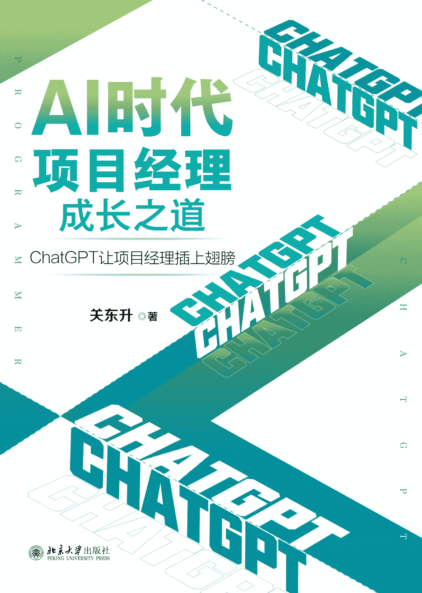

# AI-时代项目经理成长之道：-ChatGPT-让项目经理插上翅膀

   

# **版权信息**

**COPYRIGHT**

书名：AI 时代项目经理成长之道：ChatGPT 让项目经理插上翅膀

作者：关东升

出版社：北京大学出版社

出版时间：2023 年 8 月

ISBN：9787301342886

字数：195 千字

# **内容简介**

本书是一本致力于揭示人工智能如何颠覆和重塑项目管理，并以 ChatGPT 为核心工具推动项目管理创新的实用指南。本书通过 13 章的系统探讨，带领读者踏上项目管理卓越之路。

第一章人工智能颠覆与重塑项目管理，首先揭示了人工智能对项目管理的深刻影响和带来的机遇与挑战，为读者构建了认知框架。紧接着，第二章至第十三章依次介绍了使用 ChatGPT 编写各种文档、在项目启动中的应用、帮助组建高效团队、辅助项目沟通管理、项目计划与管理、项目成本管理、项目时间管理、项目质量管理、项目风险管理、采购计划与采购流程、项目绩效管理，以及辅助进行项目总结等各方面的内容。

本书注重理论与实践的结合，每章都以具体案例、实用技巧和最佳实践为基础，帮助读者深入了解 ChatGPT 的应用场景，掌握在项目管理中实际运用的方法和策略。无论您是初入职场的新手项目经理还是经验丰富的专业人士，本书都将成为您的导航指南，帮助您在人工智能时代展现卓越的项目管理和创新能力，并在日常工作中取得更加优异的成果。

# **前言**

# **插上 ChatGPT 的翅膀，飞跃人工智能时代的项目管理巅峰**

我们正身处一个充满无限可能的时代，一个不断演进和变化的世界。人工智能正以令人瞩目的速度崛起，为各行各业带来前所未有的变革。在这个激动人心的过程中，项目管理也站在了风口浪尖。而今，我们迎来了一个令人振奋的时刻，一个让项目经理插上翅膀的机会——ChatGPT 的诞生。

《AI 时代项目经理成长之道：ChatGPT 让项目经理插上翅膀》这本书将带您进入一个全新的项目管理境界。它将帮助您探索人工智能颠覆与重塑项目管理的浩瀚宇宙，让您领略无限创新和突破的可能性。ChatGPT 这一智能化的工具，为项目管理注入了无穷的智慧和洞察力，让项目经理能够翱翔在前沿的技术浪潮之上。

本书的每一章都将带领您踏上一段惊险刺激的探索之旅。从编写各种文档，到项目启动、团队组建、沟通管理，再到项目计划、成本管理、时间管理、质量管理，以及风险管理、采购计划与采购流程、项目绩效管理，最终到项目总结，本书将深入剖析 ChatGPT 在各个领域的高效应用。每一章都以颠覆传统的思维激发创造力和创新思维的火花，让您的项目管理能力在飞速发展的道路上不断提升，让每一位项目管理者都能破茧成蝶。

无论您是刚踏上项目管理征程的新手，还是经验丰富的行业专家，本书都将为您打开新的视角，让您超越现有的极限。它将点燃您心中的激情和追求卓越的渴望，让您的项目成为引领行业的典范。通过 ChatGPT 的助力，您将发现项目管理不再局限于传统的边界，而是一个无边无际的创新舞台。

本书附赠全书案例源代码及相关教学视频等资源，读者可扫描下方左侧二维码关注“博雅读书社”微信公众号，输入本书 77 页的资源下载码，即可获得本书的下载学习资源。

本书提供答疑服务，可扫描维下方右侧二维码留言“北大 AI”，即可进入学习交流群。

资源下载码： xm2023

关东升

# **第一章**

# **人工智能颠覆与重塑项目管理**

随着人工智能技术的快速发展和普及，它已经开始改变我们的生活和工作方式。项目管理作为一项重要且复杂的工作，也开始逐渐受到人工智能技术的影响。本章将探讨人工智能对项目管理的颠覆和重塑，分析其带来的机遇和挑战。

首先，本章将分析人工智能为项目管理带来的机遇和挑战。一方面，人工智能可以提高项目管理的效率和准确性，减少人力成本，同时也可以为项目管理带来更为智能化的支持。另一方面，人工智能也面临着数据隐私和安全保护等方面的挑战，需要项目管理者和技术人员共同努力解决。

其次，本章将探讨项目经理需要掌握的新技能，以及人工智能和 ChatGPT 之间的最佳协作模式。

最后，本章将对人工智能工具在项目管理中的应用现状和发展趋势进行深入分析，探讨其在自动化、风险管理、决策支持和协同方面的应用。

因此，本章将全面讨论人工智能对项目管理的影响，探讨其带来的机遇和挑战，为项目管理者和技术人员提供参考和思考，以适应新时代的挑战和机遇。

### **1.1**

## **AI 对项目管理影响分析：机遇与挑战**

随着人工智能技术的不断发展和普及，其在项目管理中的应用也越来越广泛。人工智能技术可以为项目管理带来很多机遇，同时在项目管理的应用中也面临一些挑战。

首先，人工智能可以提高项目管理的效率和准确性。通过自动化工具和技术，人工智能可以协助项目管理，比如自动化的进度管理、资源管理、成本管理等。这些工具可以节省时间和减少人力成本。此外，人工智能还可以通过分析大量的历史数据和风险模型来预测和管理项目风险，从而降低项目失败的概率。

其次，人工智能可以为项目管理带来更为智能化的支持。例如，人工智能可以通过数据分析和预测模型来为项目管理者提供决策支持。通过分析现有的项目数据来预测项目的完成时间和成本，从而帮助项目管理者做出更加准确的决策。此外，人工智能还可以通过智能协同工具实现任务分配和进度跟踪自动化，提高项目团队的工作效率和准确性。

最后，人工智能在项目管理的应用中也面临着一些挑战。首先，人工智能需要大量的数据来进行学习和预测。如果数据质量不好，可能会导致预测结果不准确。其次，人工智能在处理敏感数据时需要保证数据隐私和安全。如果数据泄露或被攻击，可能会导致重大影响。除此之外，人工智能在项目管理中的应用还需要与人类的智慧进行协作，才能真正发挥其优势。

综上所述，人工智能给项目管理带来的机遇和挑战是并存的。项目管理者需要认真思考如何利用人工智能技术来提高项目效率和准确性，同时也需要注意数据隐私和安全问题，与人工智能共同协作，才能更好地应对未来的项目管理挑战。

### **1.2**

## **项目经理新技能与 ChatGPT 的最佳协作模式**

项目经理在人工智能时代需要掌握的新技能主要包括以下几个方面。

（1）人工智能知识与应用能力。项目经理需要掌握人工智能的基本理论知识，并能够在项目管理工作中应用人工智能技术与工具。这需要项目经理具备人工智能工具的使用经验，并能够评估不同工具的适用场景。

（2）数据分析与业务挖掘能力。项目经理需要能够收集和分析项目相关数据，发现数据中的价值信息和规律，并为项目决策提供支持。这需要项目经理掌握基本的数据分析方法与模型。

（3）创新思维与持续学习的素养。人工智能时代项目管理工作的变化与挑战需要项目经理具有开放和创新的思维，并能够跟上人工智能和项目管理领域的最新发展，持续学习新的知识与技能。

（4）跨学科协作与社交技能。人工智能为项目管理带来的机遇与影响涉及多个学科与领域。这需要项目经理具备跨学科沟通与协作的能力，能够在不同领域的专家之间搭建“桥梁”，促进协同工作。

在与 ChatGPT 等人工智能系统的协作中，项目经理需要注意以下几个方面。

（1）明确 ChatGPT 的功能与限界。 ChatGPT 作为一种人工智能语音助手，虽然功能日趋强大，但仍有其局限性。项目经理需要明确 ChatGPT 的主要作用是加强对规则化工作的支持，完成某些重复性任务，提供辅助数据与建议等。但对于复杂问题的深入分析与判断，仍需要人工智能专家参与。

（2）依托 ChatGPT 的强项，人工智能处理规则化工作。将一些标准化、重复性的工作交给 ChatGPT 来处理，如生成常规文件、提供数据统计与报告制作支持等，这有助于提高效率与减轻项目经理的工作负荷。

（3）人工智能和项目经理协同探讨非结构化问题。在面临复杂或模棱两可的问题时，项目经理应与 ChatGPT 进行深入交流，综合考虑 ChatGPT 的建议与自己的判断，共同研究出最佳的解决方案。

（4）ChatGPT 辅助，人类监督，获取最佳成果。在与 ChatGPT 协作的过程中，项目经理起主导和监督作用。人类依托 ChatGPT 提供的各种支撑与建议，结合自己的专业知识与经验，制定出最符合项目目标的解决方案与决策。这种协同模式可以发挥人工智能与人的各自优势，达成最佳效果。

下面用两个案例来说明项目经理如何通过与 ChatGPT 的交互来解决项目管理问题。

### **1.2.1**

### **案例 1:×××项目进度延误和资源缺失**

我们先来看案例 1：项目进度延误和资源缺失。

**动手示例**

**项目经理 Tom 发现项目已严重延期，工作进度落后计划超过 3 周。资源也出现短缺，部分工作无法正常开展。Tom 将此现状告知 ChatGPT，并提出以下问题。**

Tom：项目现已严重延期，请分析可能的原因并给出解决措施。我们应如何协调资源以保证项目最终按期完成？

**ChatGPT 的回答如下。**

可能的原因有：

（1）项目计划不合理，工作或资源任务量被低估。

（2）团队工作效率过低，各项工作任务消耗时间过长。

（3）项目依赖的其他工作或资源进度出现问题，导致延误。

解决措施包括：

（1）重新评估项目计划，对后续工作任务的难易度及所需时间与资源进行修正。

（2）增派人员或调整工作内容，优化资源配置，提高团队工作效率。

（3）与相关部门或供应商重新沟通，加快其工作进度与资源供应速度。

为保证项目最终如期完成，建议：

（1）针对工作任务重点优先进行进度赶超与资源补充。

（2）利用以往项目数据，评估工作任务消耗多少时间，确定后续各阶段的工作重点与进度。

（3）加强项目团队与相关部门的协调，实时掌握工作进展与资源供应情况，实施精准的进度控制与管理。

通过这种问答的方式，项目经理与 ChatGPT 共同分析了项目进度延误的主要原因，并提出相关的解决策略与措施。这有助于项目经理制定全面而个性化的解决方案，对项目进度实施有效管控，最大限度地降低项目最终延期完成的风险。

Tom 认为上面的表述可能太抽象，这并非 ChatGPT 的问题，而是我们提出的问题不够具体。

**提示**

**在向 ChatGPT 提出问题时，我们应该尽可能详细，并且指明我们的需求，如返回表格和图表等。**

**为了获得更加清晰的回答，Tom 会接着提出需求。**

我有如下对项目进度的描述：帮我生成表格，采用 Markdown 代码返回。

在工作任务方面，共有两个任务，分别需要完成的时间为 3 周和 2 周。根据计划进度，任务 1 应该在 5 周内完成，任务 2 应该在 3.5 周内完成。然而，截至目前，任务 1 已经延误了 2 周，任务 2 也已经延误了 0.5 周，需要采取相应措施来缩短时间。

在资源供应方面，有两个资源：资源 1 和资源 2。根据计划供应，资源 1 需要 4 名人员，而资源 2 需要 10 台设备。然而，实际供应方面遇到了问题，资源 1 只提供了 2 名人员，资源 2 只提供了 7 台设备。这些资源的延误也导致了任务的延误。

**ChatGPT 的回答如下。**

|工作任务|计划所需时间(周)|实际所需时间(周)| 计划进度(周)|实际进度(周) |

|:-:|:-:|:-:|:-:|:-:|

|任务 1|3| 5|5|7|

|任务 2|2| 3.5|3.5|4|

|资源|计划供应|实际供应|

|:-:|:-:|:-:|

|资源 1|4 名|2 名|

|资源 2|10 台设备|7 台设备|

Tom 将这些代码保存为 Markdown 文件格式（.md），然后使用相应的工具浏览 Markdown 文件，可看到如图 1-1 所示的表格。

图 1-1 浏览 Markdown 文件

从图 1-1 可以看出，实际上有两个表格，一个是任务表，另一个是资源情况表。由于使用了表格显示，问题变得更加直观易懂。有关 Markdown 的使用将在 2.2 节详细介绍，这里不再赘述。

如果 Tom 觉得这种表格形式仍然很抽象，他可以让 ChatGPT 帮助他将表格转换为图表形式。

**提示**

由于 ChatGPT 目前存在图片生成问题，我们可以考虑使用相应的程序代码（如 VBA 或 Python）来呈现表格数据。这需要项目经理具备一定的编程技能，同时也说明单纯的技能并不能使一个项目经理成为优秀的领导者。一个好的项目经理应该具备跨学科的能力，能够协调和沟通不同领域的专业人才。

由于 Tom 对 ChatGPT 编程很熟悉，因此可以考虑让 ChatGPT 生成相应的 Python 代码来帮助绘制任务情况图表。

**Tom 会接着提出如下需求。**

有如下任务表，帮助我绘制成为柱状图，返回 Python 程序代码，注意中文乱码问题。

|工作任务|计划所需时间(周)|实际所需时间(周)| 计划进度(周)|实际进度(周) |

|:-:|:-:|:-:|:-:|:-:|

|任务 1|3| 5|5|7|

|任务 2|2| 3.5|3.5|4|

将上述代码保存为．py（Python 代码文件）文件，然后运行 Python 代码后可以看到如图 1-2 所示的对话框。

图 1-2 运行结果

单击对话框工具栏中的 按钮，就可以保存图片。从图 1-2 所示的柱状图表中，可以非常形象地看出项目的进度情况，毕竟人是“视觉动物”。

### **1.2.2**

### **案例 2：项目团队工作效率低，员工满意度不高**

在进一步分析项目工作数据后，Jane 发现项目团队的工作效率较低与员工满意度不高，可能也是导致项目进度延误的原因之一。为此，Jane 提出以下问题，希望 ChatGPT 提供改进建议。

**动手示例**

**Jane：项目团队工作效率过低，员工满意度也不高。这可能会严重影响项目成功。我们可以从哪些方面入手提高团队工作效率与员工满意度？**

**ChatGPT 的回答如下。**

可以从以下几个方面提高项目团队工作效率与员工满意度。

（1）优化团队的工作流程与协作机制，消除工作中无效环节，提高工作连贯性。这可以减少工作等待或重复，集中资源于创造价值。

（2）更新项目管理工具与系统，利用信息技术提高工作透明度与协调性。这可以减少多余工作与资源浪费。

（3）平衡工作任务的难易度与资源分配。避免个别员工任务负荷过重或过轻，工作压力过大或过小。这有助于发挥每个员工的最大工作潜力。

（4）加强对员工的关心与沟通，了解他们在工作中的真实感受与需求，并根据需求提供必要支持与帮助，这可以显著提高员工工作积极性与满意度。

（5）根据员工的工作表现与贡献进行合理的绩效考评与激励。

**Jane 也认为 ChatGPT 回答太抽象，她的问题与 Tom 是一样的，即对于问题描述不够详细和具体。Jane 会接着提出如下需求。**

有如下满意度调查，帮助我生成表格，采用 Markdown 代码返回。

调查显示高度满意的比例计划为 40%，但实际结果为 30%。类似地，一般满意的比例计划为 50%，但实际结果为 40%；而不太满意的比例计划为 10%，但实际结果为 30%。这个表格可以帮助人们了解产品或服务的满意度结果，以便采取必要的措施来改进和提高满意度水平。

**ChatGPT 的回答如下。**

| 满意度 | 计划比例 | 实际结果 |

| :------: | :------: | :------: |

| 高度满意 | 40% | 30% |

| 一般满意 | 50% | 40% |

| 不太满意 | 10% | 30% |

Jane 将这些代码保存为 Markdown 文件格式，然后使用相应的工具浏览 Markdown 文件，可看到图 1-3 所示的表格。

图 1-3 浏览 Markdown 文件

由于使用了表格显示，问题变得更加直观易懂。

但是 Jane 还是觉得表格形式仍然很抽象，她可以让 ChatGPT 帮助她将表格转换为图表形式，但她不懂 Python 语言也不懂 VBA，那么她可以让 ChatGPT 帮助她将表格生成 CSV ^(¹)格式表格，然后导入 Excel 中，在 Excel 中生成图表。

**Jane 会接着提出如下需求。**

有如下满意度调查，帮助我生成 CSV 表格。

调查显示高度满意的比例计划为 40%，但实际结果为 30%。类似地，一般满意的比例计划为 50%，但实际结果为 40%；而不太满意的比例计划为 10%，但实际结果为 30%。这个表格可以帮助人们了解产品或服务的满意度结果，以便采取必要的措施来改进和提高满意度水平。

**ChatGPT 的回答如下。**

满意度，计划比例，实际结果

高度满意，40%,30%

一般满意，50%,40%

不太满意，10%,30%

Jane 将这些代码保存为 CSV 文件格式（.csv），然后使用 Excel 工具打开，如图 1-4 所示。

图 1-4 使用 Excel 打开文件

在 Excel 中将表格数据生成图表，如图 1-5 和图 1-6 所示。

▲图 1-5 计划满意度饼状图

图 1-6 实际满意度饼状图

通过观察图 1-5 和图 1-6，我们可以更加直观地了解满意度的情况。如果读者想生成类似的饼状图，可以使用相关软件（如 Microsoft Excel、Python 等）来处理相应的 CSV 文件。生成过程比较复杂，我们会在 2.4.3 小节给出详细的操作步骤和说明，这里不再赘述。

### **1.3**

## **人工智能工具在项目管理中的应用现状与发展趋势**

人工智能在项目管理中的应用已经开始逐步普及。目前已经有许多企业开始采用人工智能工具来协助实现项目管理的自动化和智能化。一些常见的应用包括以下几个方面。

（1）项目计划的优化和决策支持：通过人工智能技术，可以快速分析项目进度、资源和成本等数据，为项目经理提供决策支持和优化方案。

（2）风险管理：利用人工智能技术，可以对项目风险进行分析和预测，从而提前采取相应的风险控制措施。

（3）智能协同：通过人工智能技术，可以实现团队成员之间的智能协同，提高团队的工作效率，改善沟通效果。

（4）质量管理：人工智能技术可以自动化地对项目质量进行监控和评估，从而提高项目的质量和效益。

未来，人工智能在项目管理中的应用将会更加广泛和深入。例如，可以利用人工智能技术实现自动化的项目规划和调度、智能化的资源分配和风险预测等。同时，随着人工智能技术的不断进步，也会出现更多新的应用场景和技术解决方案。

## **1.4**

## **本章总结**

在本章中，我们首先分析了 AI 给项目管理带来的机遇与挑战。AI 可以提高项目管理效率，优化资源配置和进度控制，但是也面临数据安全、职业变革等挑战。

然后，探讨了项目经理新技能与 ChatGPT 的最佳协作模式。通过两个案例，分析了项目进度延误与资源缺失的原因，以及项目团队工作效率低和员工满意度不高的影响因素。运用 ChatGPT 提供的提示，找到了相应的解决方案。随后，研究了人工智能工具在项目管理中的应用现状与发展趋势。人工智能已经广泛应用于项目管理的各个阶段，并且应用范围正在不断扩大。

最后，我们得出结论：AI 正在深刻重塑项目管理模式，并对项目经理提出新的技能要求。项目经理需要掌握数据分析和人工智能相关知识，并与 AI 工具建立最佳协作关系，发挥各自的优势，以便更好地做好项目管理工作。人工智能将成为项目管理的新工具与新伙伴。通过本章学习，我们可以更深入理解 AI 对项目管理的影响。

# **第二章**

# **如何使用 ChatGPT 编写各种文档**

作为一个项目经理，编写文档是必不可少的工作。作为一种强大的自然语言处理技术， ChatGPT 可以生成高质量、自然流畅的文本内容，能够有效地协助项目经理完成各种文档的编写工作，这也是 AI 时代项目经理必须掌握的一项技能。

在上一章中，我们看到了如何使用 ChatGPT 生成 Markdown 文档和 CSV 表格，但没有深入介绍如何实现，本章我们就来介绍如何使用 ChatGPT 辅助编写各种文档。

## **2.1**

## **使用 ChatGPT 生成文档模板与内容**

项目经理需要编写的技术文档有多种形式，包括 Word、Excel、PDF 及一些在线形式。我们可以借助 ChatGPT 生成文本，由于它不能直接生成 Word、Excel、PDF 等格式的文档，因此，可以利用其他工具来设计一些模板，并在工作中使用这些模板。项目经理采用半自动的方式来编写技术文档，可以大大提高工作效率。

### **2.1.1**

### **设计文档模板**

使用 Office 工具设计文档模板的具体实施步骤如下。

（1）确定文档类型：选择 Word 文档、Excel 表格或 PowerPoint 幻灯片等，根据技术文档的规范和内容需求进行选择。

（2）设定页面大小与边距：根据公司的文档标准或个人习惯设置页面大小、边距等页面布局。

（3）设定标题样式：系统地为不同级别的标题设定字体、字号、加粗等格式，建立标题样式库。

（4）设置目录与书签：利用 Word 的目录与书签功能，设定文档的目录结构，为各章节和标题生成超链接，方便查阅。

（5）制作封面与页眉：添加封面、页眉和页脚，实现文档的标准化；页眉和页脚也常包括文件名、创建日期等信息。

（6）插入表格与图表：根据文档的要求，在相应位置插入表格、图片、图表、公式等，并提供说明与注释。

（7）添加占位符：在需要 ChatGPT 提供内容的位置，插入文字占位符或内容提示，指导 ChatGPT 需要生成的具体内容。

（8）另存为文档模板：将设计完成的文档保存为模板文件，日后在编写新文档时可直接从模板开始，提高效率。

（9）反复检验与优化：在编写初稿过程中，检验文档模板的适用性，根据需求对标题、布局、样式等进行优化，不断改进。

通过上述实施步骤，我们可以设计出一套切实可用的技术文档模板。该模板的精细程度直接影响 ChatGPT 的内容生成效果及人工整合的难易度。理想情况下，人工只需要对 ChatGPT 生成的文本进行细微调整，便可直接嵌入模板，能够大大减少工作量。

### **2.1.2**

### **案例 1：生成 CRM 系统升级项目章程模板**

下面我们以×××公司的 CRM 系统升级项目章程模板为例，介绍从编写模板到借助 ChatGPT 使用模板的过程。

先根据公司的要求，编写一个项目章程模板。比较推荐的方法是先由 ChatGPT 生成一个初步的模板草稿，然后根据公司的具体要求进行反复修改，最终得到符合需求的模板。接着，我们再对模板文件格式进行进一步修改。

**动手示例**

**首先，我们向 ChatGPT 发送如下请求消息。**

请帮我生成 CRM 系统升级项目章程模板。

**ChatGPT 的回答如下。**

项目章程：CRM 客户关系管理系统升级项目

1. 项目概述

1.1 项目名称：CRM 系统版本升级项目

1.2 项目目的：升级当前 CRM 系统至最新版本，提高客户数据分析与服务能力

1.3 项目范围：升级 CRM 系统软硬件环境，优化客户信息管理与业务流程功能

1.4 项目发起方：市场部

2. 项目目标

2.1 具体目标：在 2023 年 9 月 30 日前完成 CRM 系统版本升级与功能优化工作

2.2 关键成功因素：升级工作顺利完成，新版本 CRM 系统稳定运行，实现客户服务效率提高 30%以上

3. 项目进度安排

3.1 项目启动与计划：2023 年 5 月 1 日至 15 日

3.2 需求调研与确认：2023 年 5 月 15 日至 6 月 15 日

3.3 软硬件环境部署：2023 年 6 月 15 日至 7 月 31 日

3.4 功能模块开发：2023 年 8 月 1 日至 9 月 15 日

3.5 模块测试：2023 年 9 月 15 日至 25 日

3.6 新系统培训与上线：2023 年 9 月 25 日至 30 日

3.7 项目收尾与总结：2023 年 10 月 15 日

4. 项目组织机构

4.1 项目负责人：市场部副主任

4.2 项目团队：10 人（开发 6 人、测试 2 人、运维 2 人）

5. 项目资源需求

5.1 人力资源：项目负责人 1 名、项目团队 10 名

5.2 财务资源：软硬件采购及培训费用 80 万元

5.3 技术资源：开发工具、云服务等

6. 项目监督与评价

6.1 项目进展检查：每周召开项目会议，检查任务进度与效果

6.2 项目改进：根据上线后的 2~3 个月使用评估报告，提出系统改进方案

6.3 项目效益评估：上线 6 个月后，开展项目效益评估，为后续规划提供依据

该项目章程模板详细描述了 CRM 系统升级项目的相关信息，包括项目概述、目标、进度、组织机构与资源需求等，为项目顺利开展提供了指导框架。但在应用中，项目负责人仍需要根据实际情况进行相应修改与补充。

### **2.2**

## **与 ChatGPT 对话的文本语言**

——Markdown

在之前的学习中，我们了解到 ChatGPT 只能够返回文本，不能够直接生成 Word、Excel、PDF 等文档。因此我们可以让 ChatGPT 返回 Markdown 代码，并利用 Markdown 编辑器或转换器将代码转换成所需格式的文档。

### **2.2.1**

### **Markdown 基本语法**

Markdown 是一种轻量级标记语言，可以用简单、易读的格式编写文本并将其转换为 HTML 或其他格式。借助于一些工具，可以将 Markdown 文档转换成为 Word 或 PDF 等格式文件。

以下是 Markdown 语法表。

**1. 标题**

Markdown 使用“#”来表示标题的级别，Markdown 语法中提供了六级标题（“#”一级标题到“######” 六级标题），通过多个“#”嵌套。注意“#”后面要有个空格，然后才是标题内容。

示例代码如下。

# 一级标题

## 二级标题

### 三级标题

#### 四级标题

##### 五级标题

###### 六级标题

上述 Markdown 代码，使用预览工具查看，会看到如图 2-1 所示的效果。

图 2-1 Markdown 预览效果（一）

**2. 列表**

无序列表可以使用“-”或“\*”，有序列表则使用数字加“.”，注意“-”或“\*”后面也要有个空格，示例代码如下。

\- 无序列表项 1

\- 无序列表项 2

\- 无序列表项 3

1. 有序列表项 1

2. 有序列表项 2

3. 有序列表项 3

上述 Markdown 代码，使用预览工具查看，会看到如图 2-2 所示的效果。

图 2-2 Markdown 预览效果（二）

**3. 引用**

使用“>”符号表示引用，注意“>”后面也要有个空格，示例代码如下。

\> 这是一段引用文本。

\> 这是一段引用文本。

\> 这是一段引用文本。

\> 这是一段引用文本。

上述 Markdown 代码，使用预览工具查看，会看到如图 2-3 所示的效果。

图 2-3 Markdown 预览效果（三）

**4. 粗体和斜体**

使用“\*\*”包围文本来表示粗体，使用“\*”包围文本来表示斜体，注意“\*\*”或“\*”后面也要有个空格，示例代码如下。

这是\*\*粗体\*\*文本，这是\*斜体\*文本。

上述 Markdown 代码，使用预览工具查看，会看到如图 2-4 所示的效果。

图 2-4 Markdown 预览效果（四）

**5. 图片**

Markdown 图片语法如下。

!\图片 alt\

示例代码如下。

上述 Markdown 代码，使用预览工具查看，会看到如图 2-5 所示的效果。

图 2-5 Markdown 预览效果（五）

**6. 代码块**

使用三个反引号（\`\`\`）将代码块括起来，并在第一行后面添加代码语言名称，示例代码如下。

**注意**

**在三个反引号（\`\`\`）后面可以指定具体代码语言，如示例中“python”是指定这个代码是 Python 代码，它的好处是键字高亮显示。**

上述 Markdown 代码，使用预览工具查看，会看到如图 2-6 所示的效果。

图 2-6 Markdown 预览效果（六）

上面介绍的是 Markdown 的基本语法，这些语法已经足够完成一些常见的工作了。如果读者有特殊需求，可以自行学习其他的 Markdown 语法。

### **2.2.2**

### **使用 Markdown 工具**

工欲善其事，必先利其器。编写 Markdown 代码时，更需要好的 Markdown 工具。

Markdown 工具是指专门用来编辑和预览 Markdown 文件的软件，如 VS Code、Typora、Mark Text 等。常见的 Markdown 工具有以下几种。

（1） Visual Studio Code：简称 VS Code，是一款免费开源的代码编辑器，它对 Markdown 语法有很好的支持。我们可以安装 Markdown 相关扩展（插件），实现文件预览、emoji 自动替换、PDF 导出等功能。VS Code 是当前非常流行的 Markdown 编辑工具之一。

（2） Typora:Typora 是一款简洁大方的 Markdown 编辑器，其界面的简洁美观与平滑流畅让人陶醉。我们可以实时预览、插入图片、表情符号、TOC 等，用起来非常顺手，是许多人首选的 Markdown 写作工具。

（3） Mark Text：这是一款开源的 Markdown 编辑器，界面简洁，功能强大，支持实时预览、编辑模式切换、插件扩展等。屏蔽了各种复杂设置，专注于文字与思维，是 Markdown 写作的不错选择。

（4） Ulysses：这是一款专业的写作软件，可以方便编辑 Markdown 和其他格式的文稿，提供丰富的导出选项，功能强大。界面简洁大方，具有较高的专业性，适合严肃写作。不过收费较贵，可能不适合所有用户。

（5） iA Writer:iA Writer 是一款专注于文字写作的软件，简洁的界面和强大的 Markdown 支持令它深受用户喜爱。可以高度定制主题和字体，专注于文字本身，可提高写作体验和效率。但整体功能相对简单，可能不满足某些用户的全部需求。

以上是几款主流的 Markdown 编辑工具。我们可以根据个人需求和喜好，选择一款简洁而功能强大的工具来高效编辑 Markdown 文档。结合 ChatGPT，可以进一步减轻工作量，提升知识创作的效率与质量。

考虑到免费版及版权问题，笔者推荐使用 VS Code 编辑 Markdown 文档。

下载 VS Code 的网站如图 2-7 所示。

图 2-7 下载 VS Code 的网站

读者可以单击“Download for Windows”按钮下载基于 Windows 版本的 VS Code，也可以选择其他操作系统并进行下载。下载完成之后双击“安装文件”就可以安装了，安装过程不再赘述。

为了在 VS Code 中更好地编写和预览 Markdown 文档，需要在 VS Code 中安装一些扩展。这些需要安装的扩展如下。

Markdown All in One：提供诸多 Markdown 语法的快捷键和功能，如格式化、预览、表格生成等，使得 Markdown 的编写更加高效。

Markdown Preview Enhanced：提供更丰富的 Markdown 预览功能，支持数学公式、Mermaid 图表、代码块高亮等，可以将 Markdown 文件转换为 HTML、PDF、PNG 等格式的文档。

Markdownlint：提供 Markdown 语法检查功能，可以在编写过程中发现并修复常见的 Markdown 语法错误。

以上是一些常用的 Markdown 扩展，读者可以根据自己的需求进行选择和安装。

在 VS Code 中安装扩展的步骤如图 2-8 所示。

图 2-8 安装 VS Code 扩展

上述示例只介绍了 Markdown All in One 扩展的安装，其他的扩展读者可以自行安装，这里不再赘述。

在 VS Code 中创建文本文件，然后把文件保存为“.md”文件就可以了。

在 VS Code 中编写和预览 Markdown 文件，如图 2-9 所示。

图 2-9 在 VS Code 中编写和预览 Markdown 文件

### **2.2.3**

### **案例 2：生成 Markdown 格式 CRM 系统升级项目章程**

安装好 Markdown 工具后，下面通过一个案例来熟悉一下如何用 ChatGPT 生成 Markdown 格式文档。

**动手示例**

**我们向 ChatGPT 发送如下请求消息。**

请帮我生成 CRM 系统升级项目章程，返回 Markdown 代码格式。

**ChatGPT 的回答如下。**

这里是 CRM 系统升级项目章程(Markdown 格式)：

# 项目章程：CRM 客户关系管理系统升级项目

## 1. 项目概述

### 1.1 项目名称

CRM 系统版本升级项目

### 1.2 项目目的

升级当前 CRM 系统至最新版本，提高客户数据分析与服务能力

### 1.3 项目范围

升级 CRM 系统软硬件环境，优化客户信息管理与业务流程功能

### 1.4 项目发起方

市场部

## 2. 项目目标

### 2.1 具体目标

在 2023 年 9 月 30 日前完成 CRM 系统版本升级与功能优化工作

### 2.2 关键成功因素

升级工作顺利完成，新版本 CRM 系统稳定运行，实现客户服务效率提高 30%以上

## 3. 项目进度安排

### 3.1 项目启动与计划：2023 年 5 月 1 日至 15 日

### 3.2 需求调研与确认：2023 年 5 月 15 日至 6 月 15 日

### 3.3 软硬件环境部署：2023 年 6 月 15 日至 7 月 31 日

### 3.4 功能模块开发：2023 年 8 月 1 日至 15 日

### 3.5 模块测试：2023 年 9 月 15 日至 9 月 25 日

### 3.6 新系统培训与上线：2023 年 9 月 25 日至 30 日

### 3.7 项目收尾与总结：2023 年 10 月 15 日

## 4. 项目组织机构

### 4.1 项目负责人

市场部副主任

### 4.2 项目团队

10 人(开发 6 人、测试 2 人、运维 2 人)

## 5. 项目资源需求

### 5.1 人力资源

项目负责人 1 名、项目团队 10 名

### 5.2 财务资源

软硬件采购及培训费用 80 万元

### 5.3 技术资源

开发工具、云服务等

## 6. 项目监督与评价

### 6.1 项目进展检查

每周召开项目会议，检查任务进度与效果

### 6.2 项目改进

根据上线后的 2~3 个月使用评估报告，提出系统改进方案

### 6.3 项目效益评估

上线 6 个月后，开展项目效益评估，为后续规划提供依据

复制上述代码，保存为“CRM 系统升级项目章程．md”文件，然后在 VS Code 中预览，如图 2-10 所示。

图 2-10 在 VS Code 中编写和预览 CRM 系统升级项目章程

### **2.2.4**

### **将 Markdown 格式文档转换为 Word 文档**

当需要将 Markdown 格式文档转换为 Word 文档时，我们可以使用一些工具或服务，其中一个可选项是使用 Pandoc 软件。下载 Pandoc 软件的网站如图 2-11 所示。

图 2-11 Pandoc 软件网站

在该网站读者可以下载相关操作系统对应的 Pandoc 软件，下载完成就可以安装了。安装时需要确保已经将其添加到系统路径中。

安装完成后，通过终端或命令行界面输入以下命令即可将 Markdown 文件转换为 Word 文档。

其中，“input.md”是要转换的 Markdown 文件名，“output.docx”是生成的 Word 文档的名称。

除了 Pandoc 之外，还有其他一些工具和服务可以实现此功能，如在线 Markdown 转换器、VS Code 扩展程序等。读者可以根据自己的需求选择适合自己的工具或服务。

将“CRM 系统升级项目章程．md”文件转换为“CRM 系统升级项目章程．docx”文件，指令如图 2-12 所示。

图 2-12 转换 CRM 系统升级项目章程

转换成功后会看到在当前目录下生成“CRM 系统升级项目章程．docx”文件，打开该文件如图 2-13 所示。

图 2-13 转换成功的“CRM 系统升级项目章程．docx”文件

### **2.2.5**

### **将 Markdown 格式文档转换为 PDF 文档**

要将 Markdown 格式的文档转换为 PDF 文档，我们可以使用 Pandoc 或 Typora 等工具。不过，在笔者看来，这些工具都有些麻烦，大家也可以使用 Word 将其转成 PDF。

读者可以将 2.2.4 小节生成的 Word 文件，输出为 PDF 文件。具体步骤：打开 Word 文件后，通过单击菜单“文件”→“导出”，弹出如图 2-14 所示的对话框，然后按照图 2-14 所示步骤导出 PDF 文件。

图 2-14 导出 PDF 对话框

## **2.3**

### **思维导图**

思维导图是一种用于组织和表示概念及其关系的图表工具。它由一个中心主题发散出相关的分支主题，层层递进，直观地呈现思路和逻辑关系。

### **2.3.1**

### **思维导图在项目管理中的作用**

思维导图在项目管理中可以起到以下作用。

（1）思维导图可以帮助团队快速梳理和整理项目相关的信息，包括项目目标、任务、里程碑、参与人员、风险等。这有助于团队更好地理解项目的全貌，明确各自的职责和任务。

（2）思维导图可以帮助团队进行头脑风暴和创新性思考，快速生成想法和解决方案。在项目启动和需求分析阶段，思维导图可以帮助团队收集和整理各种想法和需求，提高项目的创新性和可行性。

（3）思维导图可以帮助团队进行项目计划和进度管理。在项目计划和执行阶段，思维导图可以帮助团队制定任务清单和时间表，梳理任务和里程碑之间的关系，及时跟进项目进度和防范风险。

（4）思维导图可以帮助团队进行项目沟通和协作。在项目执行和交付阶段，思维导图可以作为团队沟通和协作的工具，帮助团队共享信息和知识，及时解决问题和调整计划。

总之，思维导图是一种高效的项目管理工具，它可以帮助团队更好地理解和管理项目，提高团队的工作效率和协作能力。

### **2.3.2**

### **项目经理与思维导图**

绘制思维导图是项目经理必备技能之一。项目经理或项目管理人员可以使用思维导图进行项目管理和规划，提高团队的工作效率和协作能力。因此，在项目管理中思维导图是一种非常有价值的工具。

图 2-15 所示是笔者团队绘制的针对“艺术品收藏应用平台”功能的思维导图。

图 2-15 针对“艺术品收藏应用平台”功能的思维导图

### **2.3.3**

### **绘制思维导图**

思维导图可以手绘或使用电子工具创建。当使用电子工具创建时，常使用专业的软件或在线工具，如 MindManager、XMind、Google Drawings、Lucidchart 等，这些工具提供了丰富的绘图功能和模板库，可以帮助读者快速创建各种类型的思维导图。

图 2-16 所示是在白板上绘制的“艺术品收藏应用平台”思维导图， 而图 2-17 所示是 XMind 绘制的思维导图。

▲图 2-16 在白板上绘制的“艺术品收藏应用平台”思维导图

图 2-17 XMind 绘制的思维导图

思维导图是一种记录和组织思考过程的工具，可以在纸质或数字介质上使用。它可以帮助我们以可视化的方式捕捉和整理想法，更好地理解和记忆信息。无论是手写还是使用软件创建思维导图，它都可以作为一个非常有用的工具来促进问题的解决和创造力的发挥。

### **2.3.4**

### **使用 ChatGPT 绘制思维导图**

ChatGPT 是一种自然语言处理模型，它并不具备直接绘制思维导图的能力。但是可以通过如下方法实现。

方法 1：通过 ChatGPT 生成 Markdown 代码描述的思维导图，然后再使用一些思维导图工具从 Markdown 格式代件导入。

方法 2：使用 ChatGPT 通过文本的绘图工具 Mermaid 绘制思维导图，图 2-18 所示是一个使用 Mermaid 工具绘制的简单的思维导图。

方法 3：使用 ChatGPT 通过文本的绘图工具 PlantUML 绘制思维导图，图 2-19 所示是一个使用 PlantUML 工具绘制的简单的思维导图。

▲图 2-18 使用 Mermaid 工具绘制的思维导图

图 2-19 使用 PlantUML 工具绘制的思维导图

### **2.3.5**

### **案例 3：生成 CRM 系统升级项目章程思维导图**

下面我们介绍如何通过“方法 1”创建思维导图。

**动手示例**

由于 ChatGPT 不能生成图片，我们可以换一种问法。

**我们向 ChatGPT 发送如下请求消息。**

帮助我以“CRM 客户关系管理系统升级项目章程”为中心主题，返回一个文本版的思维导图，注意返回 Markdown 格式代码。

这个提问有三个层面的信息：

（1）以“CRM 客户关系管理系统升级项目章程”为中心主题；

（2）生成文本版的思维导图；

（3）返回的是 Markdown 格式代码。

**指令执行后，ChatGPT 的回答如下。**

# CRM 客户关系管理系统升级项目章程

## 1. 项目概述

\- ### 1.1 项目名称

### CRM 系统升级项目

\- ### 1.2 项目目的

升级当前 CRM 系统软硬件与功能，提升客户服务与运营能力

\- ### 1.3 项目范围

CRM 系统版本升级，客户信息管理模块优化，数据分析功能增强，业务流程重构

\- ### 1.4 项目发起方

市场部

## 2. 项目目标

\- ### 2.1 具体目标

在 2023 年 9 月 30 日前完成 CRM 系统升级，实现功能优化与重构

\- ### 2.2 关键成功因素

升级工作顺利完成，新版本 CRM 系统稳定高效运行，客户满意度提高 30%以上，工作效率提高 20%以上

## 3. 项目进度安排

\- ### 3.1 项目启动： 2023 年 4 月 1 日

\- ### 3.2 需求分析与方案设计：2023 年 4 月 1 日至 30 日

\- ### 3.3 软硬件采购与部署：2023 年 5 月 1 日至 31 日

\- ### 3.4 模块开发与测试：2023 年 6 月 1 日至 8 月 31 日

\- ### 3.5 培训与系统上线：2023 年 9 月 1 日至 15 日

\- ### 3.6 项目收尾：2023 年 9 月 30 日

## 4. 项目组织机构

\- ### 4.1 项目负责人

市场部副主任

\- ### 4.2 项目团队

12 人(开发 8 人、测试 2 人、运维 2 人)

## 5. 项目资源需求

\- ### 5.1 人力资源

项目负责人 1 名、项目团队 12 名

\- ### 5.2 财务资源

升级采购及培训费用 80 万元

\- ### 5.3 技术资源

开发工具、云服务等

## 6. 项目监督与评价

\- ### 6.1 项目进展检查

每周召开项目会议，检查任务进度与问题

\- ### 6.2 项目改进

根据上线后 2 个月内的使用评估报告，提出系统改进计划

\- ### 6.3 项目效益评估

上线 6 个月后开展项目效益评估，为后续规划提供依据

将这个代码复制出来，然后保存为 Markdown 格式文件（\*.md）。

由于 XMind 工具提供了从 Markdown 文件导入的功能，我们可以使用 XMind 工具导入前面刚生成的 Markdown 文件。

导入过程：打开 XMind 工具，通过单击菜单“文件”→“导入于”→Markdown，弹出“导入文件”对话框，选择要导入的 XMind 文件。如果导入成功，效果如图 2-20 所示。

图 2-20 导入 Markdown 文件的思维导图

**提示**

**读者会发现 2.2.3 小节与 2.3.5 小节的 Markdown 代码非常相似。事实确实如此，读者可以在 2.2.3 小节基础上修改 Markdown 代码，但是需要将“CRM 客户关系管理系统升级项目章程”作为中心主题，所以笔者推荐这种工作还是让 ChatGPT 帮我们完成。**

### **2.3.6**

### **案例 4：使用 Mermaid 工具绘制思维导图**

在 2.3..5 小节，我们采用“方法 1”生成了思维导图，本小节我们介绍使用“方法 2”绘制思维导图，这种方式是通过绘图工具 Mermaid 绘制思维导图。Mermaid 是一种文本绘图工具，类似的文本绘图工具有很多，以下是一些常见的种类。

Graphviz：一种用于绘制各种类型图表的开源工具，它使用纯文本的图形描述语言，可以创建流程图、组织结构图、网络图和类图等。

PlantUML：一种基于文本的 UML 图形绘制工具，它可以用简单的文本描述来创建各种类型的 UML 图表，包括时序图、活动图、类图和组件图等。

Mermaid：一种基于文本的流程图和时序图绘制工具，它使用简单的文字描述语言创建流程图和时序图，然后将其转换为可视化的图形。

Asciiflow：一种在线的 ASCII 绘图工具，它可以用 ASCII 字符创建流程图、组织结构图、网络图和类图等。

Ditaa：一种将 ASCII 图形转换为矢量图形的工具，它可以将 ASCII 字符转换为各种类型的图表，包括流程图、时序图和类图等。

使用 ChatGPT 通过 Mermaid 绘制图形的具体步骤如下。

第 1 步：根据任务描述，使用 ChatGPT 生成 Mermaid 代码。

第 2 步：使用 Mermaid 渲染工具生成图片。

Mermaid 渲染工具也有很多，其中 Mermaid Live Editor 是官方提供的在线 Mermaid 编辑器，可以实时预览 Mermaid 图表，打开 Mermaid Live Editor 官网，如图 2-21 所示，其中左侧是代码窗口，右侧是渲染后的图形窗口。

图 2-21 Mermaid Live Editor 官网

在左侧的代码窗口中输入 Mermaid 代码，默认会自动同步渲染图形，显示在右侧的渲染图形窗口。 读者可以自己测试一下，如果读者想把渲染的图形输出，可以单击“Actions”按钮打开如图 2-22 所示的“Actions”面板，在“Actions”面板中可以选择保存或分享图片。

图 2-22“Actions”面板

有关 Mermaid 代码的内容本书不再解释，我们只是借助 ChatGPT 使用 Mermaid 代码绘图而已。

下面我们通过示例介绍一下如何使用 Mermaid 工具绘制思维导图。

**动手示例**

**我们向 ChatGPT 发送如下请求消息。**

有如下项目章程，帮我使用 Mermaid 工具绘制思维导图。

项目章程：CRM 客户关系管理系统升级项目

1. 项目概述

1.1 项目名称

CRM 系统版本升级项目

1.2 项目目的

升级当前 CRM 系统至最新版本，提高客户数据分析与服务能力

1.3 项目范围

升级 CRM 系统软硬件环境，优化客户信息管理与业务流程功能

1.4 项目发起方

市场部

2. 项目目标

2.1 具体目标

在 2023 年 9 月 30 日前完成 CRM 系统版本升级与功能优化工作

2.2 关键成功因素

升级工作顺利完成，新版本 CRM 系统稳定运行，实现客户服务效率提高 30%以上

3. 项目进度安排

3.1 项目启动与计划：2023 年 5 月 1 日至 15 日

3.2 需求调研与确认：2023 年 5 月 15 日至 6 月 15 日

3.3 软硬件环境部署：2023 年 6 月 15 日至 7 月 31 日

3.4 功能模块开发：2023 年 8 月 1 日至 9 月 15 日

3.5 模块测试：2023 年 9 月 15 日至 25 日

3.6 新系统培训与上线：2023 年 9 月 25 日至 30 日

3.7 项目收尾与总结：2023 年 10 月 15 日

4. 项目组织机构

4.1 项目负责人

市场部副主任

4.2 项目团队

10 人（开发 6 人、测试 2 人、运维 2 人）

5. 项目资源需求

5.1 人力资源

项目负责人 1 名、项目团队 10 名

5.2 财务资源

软硬件采购及培训费用 80 万元

5.3 技术资源

开发工具、云服务等

6. 项目监督与评价

6.1 项目进展检查

每周召开项目会议，检查任务进度与效果

6.2 项目改进

根据上线后的 2~3 个月使用评估报告，提出系统改进方案

6.3 项目效益评估

上线 6 个月后，开展项目效益评估，为后续规划提供依据

**指令执行后，ChatGPT 的回答如下。**

mermaid

graph TD

id1\["项目章程：CRM 客户关系管理系统升级项目"\]

id2\["1. 项目概述"\]

id2 --> id3\["1.1 项目名称  
CRM 系统版本升级项目"\]

id2 --> id4\["1.2 项目目的  
升级当前 CRM 系统至最新版本，提高客户数据分析与服务能力"\]

id2 --> id5\["1.3 项目范围  
升级 CRM 系统软硬件环境，优化客户信息管理与业务流程功能"\]

id2 --> id6\["1.4 项目发起方  
市场部"\]

id7\["2. 项目目标"\]

id7 --> id8\["2.1 具体目标  
在 2023 年 9 月 30 日前完成 CRM 系统版本升级与功能优化工作"\]

id7 --> id9\["2.2 关键成功因素  
升级工作顺利完成，新版本 CRM 系统稳定运行，实现客户服务效率提高 30%以上"\]

id10\["3. 项目进度安排"\]

id10 --> id11\["3.1 项目启动与计划：2023 年 5 月 1 日至 15 日"\]

id10 --> id12\["3.2 需求调研与确认：2023 年 5 月 15 日至 6 月 15 日"\]

id10 --> id13\["3.3 软硬件环境部署：2023 年 6 月 15 日至 7 月 31 日"\]

id10 --> id14\["3.4 功能模块开发：2023 年 8 月 1 日至 9 月 15 日"\]

id10 --> id15\["3.5 模块测试：2023 年 9 月 15 日至 25 日"\]

id10 --> id16\["3.6 新系统培训与上线：2023 年 9 月 25 日至 30 日"\]

id10 --> id17\["3.7 项目收尾与总结：2023 年 10 月 15 日"\]

id18\["4. 项目组织机构"\]

id18 --> id19\["4.1 项目负责人  
市场部副主任"\]

id18 --> id20\["4.2 项目团队  
10 人(开发 6 人、测试 2 人、运维 2 人)"\]

id21\["5. 项目资源需求"\]

id21 --> id22\["5.1 人力资源  
项目负责人 1 名、项目团队 10 名"\]

id21 --> id23\["5.2 财务资源  
软硬件采购及培训费用 80 万元"\]

id21 --> id24\["5.3 技术资源  
开发工具、云服务等"\]

id25\["6. 项目监督与评价"\]

id25 --> id26\["6.1 项目进展检查  
每周召开项目会议，检查任务进度与效果"\]

id25 --> id27\["6.2 项目改进  
根据上线后的 2~3 个月使用评估报告，提出系统改进方案"\]

id25 --> id28\["6.3 项目效益评估  
上线 6 个月后，开展项目效益评估，为后续规划提供依据"\]

将上述代码复制到 Mermaid Live Editor 工具中进行渲染，结果如图 2-23 所示。

图 2-23 使用 Mermaid 绘制的思维导图（部分）

### **2.3.7**

### **案例 5：使用 PlantUML 工具绘制思维导图**

在 2.3.6 小节，我们采用“方法 2”生成了思维导图，本小节我们介绍使用“方法 3”绘制思维导图。这种方式是通过 PlantUML 工具绘制思维导图。

可以通过一些在线网站实现使用 PlantUML 代码渲染图，图 2-24 所示是使用 PlantUML Web Server 渲染的思维导图。

另外，PlantText 网站也值得推荐，这里不再赘述。

图 2-24 使用 PlantUML 工具渲染思维导图

在渲染图像的时候，我们只需要将代码粘贴到代码窗口就可以自动渲染了。

**提示**

**有关 PlantUML 语言的等更多语法，读者可以在 PlantUML 官网下载。**

下面我们通过示例介绍一下如何使用 PlantUML 工具绘制思维导图。

**动手示例**

**我们向 ChatGPT 发送如下请求消息。**

有如下内容，帮我使用 PlantUML 工具绘制思维导图，只到三级标题。

项目章程：CRM 客户关系管理系统升级项目

1. 项目概述

1.1 项目名称

1.2 项目目的

1.3 项目范围

1.4 项目发起方

2. 项目目标

2.1 具体目标

2.2 关键成功因素

3. 项目进度安排

3.1 项目启动与计划：2023 年 5 月 1 日至 15 日

3.2 需求调研与确认：2023 年 5 月 15 日至 6 月 15 日

3.3 软硬件环境部署：2023 年 6 月 15 日至 7 月 31 日

3.4 功能模块开发：2023 年 8 月 1 日至 9 月 15 日

3.5 模块测试：2023 年 9 月 15 日至 25 日

3.6 新系统培训与上线：2023 年 9 月 25 日至 30 日

3.7 项目收尾与总结：2023 年 10 月 15 日

4. 项目组织机构

4.1 项目负责人

4.2 项目团队

10 人(开发 6 人、测试 2 人、运维 2 人)

5. 项目资源需求

5.1 人力资源

项目负责人 1 名、项目团队 10 名

5.2 财务资源

软硬件采购及培训费用 80 万元

5.3 技术资源

6. 项目监督与评价

6.1 项目进展检查

6.2 项目改进

6.3 项目效益评估

**指令执行后，ChatGPT 的回答如下。**

@startmindmap

\* 项目章程：CRM 客户关系管理系统升级项目

\*\* 1. 项目概述

\*\*\* 1.1 项目名称

\*\*\* 1.2 项目目的

\*\*\* 1.3 项目范围

\*\*\* 1.4 项目发起方

\*\* 2. 项目目标

\*\*\* 2.1 具体目标

\*\*\* 2.2 关键成功因素

\*\* 3. 项目进度安排

\*\*\* 3.1 项目启动与计划：2023 年 5 月 1 日至 15 日

\*\*\* 3.2 需求调研与确认：2023 年 5 月 15 日至 6 月 15 日

\*\*\* 3.3 软硬件环境部署：2023 年 6 月 15 日至 7 月 31 日

\*\*\* 3.4 功能模块开发：2023 年 8 月 1 日至 9 月 15 日

\*\*\* 3.5 模块测试：2023 年 9 月 15 日至 25 日

\*\*\* 3.6 新系统培训与上线：2023 年 9 月 25 日至 30 日

\*\*\* 3.7 项目收尾与总结：2023 年 10 月 15 日

\*\* 4. 项目组织机构

\*\*\* 4.1 项目负责人

\*\*\* 4.2 项目团队

\*\* 5. 项目资源需求

\*\*\* 5.1 人力资源

\*\*\* 5.2 财务资源

\*\*\* 5.3 技术资源

\*\* 6. 项目监督与评价

\*\*\* 6.1 项目进展检查

\*\*\* 6.2 项目改进

\*\*\* 6.3 项目效益评估

@endmindmap

将上述代码复制到在线工具中进行渲染，结果如图 2-25 所示。

图 2-25 使用 PlantUML 工具绘制的思维导图

### **2.4**

## **使用表格**

使用表格在项目管理无处不在，具体用途如下。

（1）管理项目进度：项目管理表格可以帮助项目经理跟踪和管理项目进度，确保项目按时完成。比如，甘特图和里程碑表格可以清晰地显示项目进度和里程碑，帮助项目经理了解项目的整体进展情况。

（2）管理项目成本：成本控制是项目管理中的重要任务之一，项目经理可以通过成本估算表格和成本控制表格来管理项目成本。这些表格可以帮助项目经理跟踪项目的预算和实际花费，及时发现并解决项目成本超支的问题。

（3）管理项目资源：项目管理表格可以帮助项目经理管理项目资源，包括人员和物资。比如，人员资源表格可以帮助项目经理了解团队成员的职责和工作进展情况，以及项目中需要的人员数量和类型等信息。

（4）管理项目风险：风险管理是项目管理中一个至关重要的环节，项目经理可以通过风险评估表格和风险管理表格来管理项目风险。这些表格可以帮助项目经理识别和评估项目风险，并采取相应的措施来降低风险。

（5）提高项目管理效率：项目管理表格可以帮助项目经理提高项目管理效率，节省时间和精力。通过使用预算表格、资源表格、进度表格和风险管理表格等工具，项目经理可以更加高效地管理项目，从而提高项目管理的质量和效率。

综上所述，表格工具在项目管理的各个环节都发挥着重要作用，有效地支撑了项目的进度、资源、财务与绩效管理。但表格本质上只是记录与展示的工具，真正的管理还需要项目管理人员的主观判断与操作。表格工具为管理过程提供了结构与框架，更高级的项目管理信息系统可以在此基础上，实现管理过程的进一步自动化与优化。

### **2.4.1**

### **Markdown 表格**

Markdown 不能生成二进制的 Excel 电子表格，但是可以使用 ChatGPT 生成如下两种用文本表示的电子表格：

（1）用 Markdown 代码表示的电子表格；

（2）用 CSV 表示的电子表格。

我们先来介绍如何制作 Markdown 表格。在 Markdown 代码中可以创建表格，Markdown 格式表格也是纯文本格式，可以方便在不同的编辑器和平台之间共享和编辑。以下是一个制作 Markdown 表格的示例。

预览效果如图 2-26 所示。

图 2-26 Markdown 预览效果（1）

在上述例子中，通过使用管道符（|）和减号（-），可以创建一个简单的 3 列 6 行的表格。第一行为表头，第二行为分隔符，下面的每一行则为表格的数据行。

需要注意的是，在 Markdown 表格中，单元格内的文本对齐方式通常会根据分隔符的位置自动调整。如果想要更精细地控制单元格的对齐方式，则需要使用冒号（:）进行设置。例如，“:--”表示左对齐，“:-:”表示居中对齐，“--:”表示右对齐。

以下是一个使用对齐符号的 Markdown 表格的示例。

预览效果如图 2-27 所示。

图 2-27 Markdown 预览效果（2）

### **2.4.2**

### **案例 6：使用 Markdown 制作 E-commerce 网站升级与改造项目进度表**

手动编写 Markdown 表格需要花费一定的工作量和耐心。为了提高工作效率，我们可以使用 ChatGPT 帮助制作 Markdown 表格。

假设有一个 E-commerce 网站升级与改造项目，需要制作项目进度表，如表 2-1 所示。

表 2-1 E-commerce 网站升级与改造项目进度表

表格相对来讲有一些复杂，它可以分为表头数据和表行数据。使用 ChatGPT 制作 Markdown 表格可以采用复合指令实现。

**动手示例**

第 1 步操作如下。

**我们向 ChatGPT 发送如下请求消息。**

请帮我制作一个表格，返回 Markdown 代码，我会给你提供表头数据和表行数据。等到我说“表格生成结束”你再停止。

**ChatGPT 的回答如下。**

好的，请提供表头数据和表行数据。

**然后我们就可以向 ChatGPT 发送如下表头数据请求消息。**

表头数据：任务名称 负责人 开始日期 结束日期 进度

**ChatGPT 的回答如下。**

好的，下面请逐行输入表格数据，每行数据以英文逗号分隔。例如：任务 1，张三，2022-01-01,2022-01-15,50%

第 2 步操作如下。

**然后我们就可以向 ChatGPT 发送如下表行数据请求消息。**

需求分析 业务分析师 2021/7/1 2021/7/15 100%

**如果有多条数据返回重复第 2 步，完成之后，我们向 ChatGPT 发送如下请求消息。**

表格生成结束

**ChatGPT 的回答如下。**

好的，下面是您所需的 Markdown 代码：

| 任务名称 | 负责人 | 开始日期 | 结束日期 | 进度 |

| -------- | ------------ | ----------- | ----------- | ----- |

| 需求分析 | 业务分析师 | 2021/7/1 | 2021/7/15 | 100% |

| 系统设计 | 技术架构师 | 2021/7/16 | 2021/7/31 | 80% |

| 网站设计 | UI 设计师 | 2021/7/16 | 2021/8/15 | 80% |

| 前端开发 | 前端工程师 | 2021/8/1 | 2021/9/15 | 50% |

| 后端开发 | 技术团队 | 2021/8/16 | 2021/9/30 | 30% |

| 前端开发 | 技术团队 | 2021/9/1 | 2021/10/15 | 20% |

| 测试验收 | 测试团队 | 2021/10/16 | 2021/11/15 | 0% |

| 上线发布 | 运维团队 | 2021/11/16 | 2021/11/20 | 0% |

将这些代码保存为 Markdown 文件格式（.md），然后使用相应的工具浏览 Markdown 文件，可看到如图 2-28 所示的表格。

图 2-28 Markdown 预览效果（3）

**提示**

**事实上也可以一次性输入多条数据，但是输入数据多，也就意味着返回数据会增多， ChatGPT 对返回数据量是有限制的，导致只能返回部分数据。笔者建议“多次少输入”，如果出现 ChatGPT 不动的情况，说明返回数据太多，读者可以发送“请继续”，它会继续返回数据。**

### **2.4.3**

### **CSV 电子表格**

2.4.2 小节介绍返回的是 Markdown 格式的表格数据，此外，我们还可以让 ChatGPT 返回 CSV 格式的电子表格。

CSV，全称是 Comma-Separated Values，即逗号分隔值的文本文件的电子表格。CSV 文件可以被许多应用程序读取和编辑，如 Microsoft Excel、Google Sheets 等。每行表示一行记录，每个字段之间用逗号分隔。通常第一行包含表头，其余的行包含数据。例如，以下是一个包含表头和三行数据的简单示例。

姓名，年龄，性别

爱丽丝，25，女

鲍勃，30，男

查理，35，男

我们需要将 CSV 代码复制到文本编辑器中，如图 2-29 所示。

图 2-29 在记事本中编写 CSV 代码

然后将文件保存为“.csv”文件格式，如图 2-30 所示。

图 2-30 保存为“.csv”文件格式

保存好 CSV 文件之后，我们可以使用 Excel 和 WPS 等 Office 工具打开，如图 2-31 所示，是使用 Excel 打开 CSV 文件的效果。

图 2-31 使用 Excel 打开 CSV 文件

**注意**

在保存 CSV 文件时，要注意字符集问题！如果是在简体中文系统下，推荐字符集选择 ANSI,ANSI 在简体中文就是 GBK 编码。如果不能正确选择字符集则会出现中文乱码，图 2-32 所示是用 Excel 工具打开 UTF-8 编码的 CSV 文件出现中文乱码的情况，而用 WPS 工具则不会有乱码。

图 2-32 CSV 文件乱码

### **2.4.4**

### **案例 7：使用 CSV 制作 E-commerce 网站升级与改造项目进度表**

下面通过示例介绍一下如何使用 ChatGPT 生成 CSV 表格。

使用 ChatGPT 生成 CSV 表格和 Markdown 表格类似，都是比较复杂的，可以采用复合指令实现。

**动手示例**

第 1 步操作如下。

**我们向 ChatGPT 发送如下请求消息。**

请帮我制作一个表格，返回 CSV 代码，我会给你提供表头数据和表行数据。等到我说“表格生成结束”你再停止。

**ChatGPT 的回答如下。**

好的，请提供表头数据和表行数据，我会帮您生成相应的 CSV 代码。

**然后我们就可以向 ChatGPT 发送如下表头数据请求消息。**

任务名称，负责人，开始日期，结束日期，进度

**ChatGPT 的回答如下。**

好的，以下是表头数据的 CSV 代码：

任务名称，负责人，开始日期，结束日期，进度

请提供表行数据，我会帮您生成表格。

第 2 步操作如下。

**然后我们就可以向 ChatGPT 发送如下表行数据请求消息。**

需求分析 业务分析师 2021/7/1 2021/7/15 100%

**如果有多条数据返回重复第 2 步，完成之后，我们向 ChatGPT 发送如下请求消息。**

表格生成结束

**ChatGPT 的回答如下。**

好的，以下是包含所有行的表格的 CSV 代码：

任务名称，负责人，开始日期，结束日期，进度

需求分析，业务分析师，2021/7/1,2021/7/15,100%

网站设计，UI 设计师，44393,44423,80%

后端开发，技术团队，44424,44469,30%

前端开发，技术团队，44440,44484,20%

测试验收，测试团队，44485,44515,0%

上线发布，运维团队，44516,44520,0%

将这些 CSV 代码复制出来，粘贴到记事本中保存为 CSV 文件，具体过程不再赘述。

### **2.4.5**

### **转换为 Excel**

使用 ChatGPT 制作的 CSV 表格如何转换为 Excel 呢？我们可以在使用 Excel 或 WPS 等工具打开 CSV 文件后，选择菜单“文件”→“另存为”，弹出文件“另存为”对话框，在文件“保存类型”中选择“\*.xlsx”，如图 2-33 所示。

图 2-33 使用 Excel 将 CSV 表格另存为 Excel 文件

### **2.5**

### **使用 ChatGPT 制作图表**

ChatGPT 不能直接制作图表，但是可以通过多种途径制作图表，归纳一下主要有两种方法。

（1）无编程方法，可以使用 ChatGPT 生成 Excel 电子表格，然后再使用 Excel 通过内置图表制作功能制作图表。

（2）编程方法，通过 ChatGPT 生成代码，如使用 VBA、Python 等语言，从数据中生成图表。

### **2.5.1**

### **无编程方法使用 ChatGPT 制作图表**

在用无编程方法使用 ChatGPT 制作图表过程中，使用 ChatGPT 生成 Excel 文件，然后在 Excel 中制作图表，图 2-34 所示是 1.2.2 小节的案例 2 中的“员工满意度调查表”。

图 2-34 在 Excel 中制作图表

单击“饼状图”按钮，出现如图 2-35 所示图表。

图 2-35 选择图表类型

在图 2-35 界面读者可以调整图表类型、修改标题等，这里不再赘述。最后将这个图表导出来如图 2-36 所示。

图 2-36 最后制作的图表

**提示**

**在 Excel 中选中要导出的图表，然后使用复制（组合键“Ctrl+C”）和粘贴（组合键“Ctrl+V”）命令将图表粘贴到另一个应用程序中（如 Word、PowerPoint、Paint 等）。粘贴后，读者可以对图表进行进一步编辑、保存或导出。**

### **2.5.2**

### **编程方法使用 ChatGPT 制作图表**

如果想要通过编程方式使用 ChatGPT 图表，需要具备一定的编程基础。目前主要可以使用 VB 和 Python 语言实现。

笔者强烈推荐使用 Python 语言来编写代码，因为 Python 提供了丰富的图表库，如 Matplotlib、Seaborn、Plotly 等。这些库提供了丰富的 API 和组件，可以帮助我们绘制高质量的图表，并提供多种导出格式，如 PNG、JPEG、SVG 等。

由于在 1.2.1 小节的案例 1 中已经介绍过用 Python 代码绘制图表，因此本小节我们介绍如何使用 ChatGPT 生成 VBA 代码制作图表。

**动手示例**

第 1 步操作如下。

**我们向 ChatGPT 发送如下请求消息，让 ChatGPT 生成 VBA 代码。**

我有数据表（A1:C4），帮我绘制柱状图，返回 VBA 代码。

第 2 步操作如下。

创建一个 Excel 文件，注意要将代码中的"Sheet1"改为实际的工作表名称，并保证数据复制到“A1:C4”单元格区域中，如图 2-37 所示。

图 2-37 Excel 文件

将以上代码复制到 VBA 编辑器中，如图 2-38 所示，然后单击“F5”键运行，即可在工作表上绘制柱状图，如图 2-39 所示。

▲图 2-38 VBA 编辑器

图 2-39 生成柱状图

**提示**

**如何打开 VBA 编辑器？不同的 Excel 版本打开 VBA 编辑器的方式有所不同，笔者使用的是 Office 2016 版本，打开步骤如下。**

**打开 Excel 2016 后，按“Alt + F11”组合键，就可以打开 VBA 编辑器了，如图 2-40 所示。也可以在开发工具菜单栏中找到“Visual Basic”按钮，单击后打开 VBA 编辑器。**

图 2-40 VBA 编辑器

**如果在 Excel 中无法看到开发工具菜单栏，可以通过以下步骤启用它。**

**（1）单击“文件”选项卡。**

**（2）单击“选项”。**

**（3）在“Excel 选项”对话框中，单击“自定义功能区”。**

**（4）在右侧的“主选项卡”列表中，选中“开发工具”复选框。**

**（5）单击“确定”按钮，关闭“Excel 选项”对话框。**

**按上述操作后，开发工具菜单栏应该出现在 Excel 的顶部菜单栏中，就可以通过它打开 VBA 编辑器了。**

为了执行代码还需要插入 VBA 模块，插入方法是在图 2-40 所示的 VBA 编辑界面，选择菜单“插入”→“模块”，然后插入代码模块，如图 2-41 所示。将 VBA 代码粘贴到右侧代码窗口就可以准备执行了。

图 2-41 插入 VBA 代码模块

使用 ChatGPT 生成代码时，可能会出现一些问题。这就需要读者自己进行调试，同时也需要 ChatGPT 不断地修改代码。因此，这个过程需要读者与 ChatGPT 进行多次交流，反复修改和优化代码，直至问题解决为止。

### **2.6**

### **鱼骨图**

鱼骨图(Fishbone Diagram)，又称因果图或石川图，是一种用分支图表示因果关系的可视化工具。它通过一个鱼骨的结构，清晰地展示一个结果（鱼头）和其影响因素（鱼骨）之间的关系，图 2-42 所示是一个项目延期原因的分析鱼骨图。

图 2-42 项目延期原因的分析鱼骨图

鱼骨图的主要结构如下。

（1）鱼头：表示问题的结果或影响；

（2）主骨骼：表示影响结果的主要分类，通常包括人员、机器、方法、材料、环境等；

（3）小骨骼：表示具体的影响因素，属于主骨骼的分类。

鱼骨图的主要作用如下。

（1）直观显示结果的潜在影响因素，特别是容易被忽略的根本原因；

（2）分析各影响因素之间的关系，找出关键影响因素；

（3）为问题解决提供清晰的思路与方向；

（4）汇集不同人对同一问题的看法，达成共识。

### **2.6.1**

### **鱼骨图在项目管理中的应用**

鱼骨图通过因果关系的可视化展示，清晰地呈现项目失败或偏离原计划的根源所在，帮助项目管理人员快速定位问题并制定针对性的改进措施。以项目延期为例，项目管理人员可以利用鱼骨图工具分析导致项目延期的各种相关因素，具体如下。

资源短缺：如专业人员不足或关键设备不可用导致工期延长。

任务冲突：如多个任务共用同一资源，相互影响导致总体进度推迟。

沟通不畅：如相关部门或人员间信息传递不顺导致计划执行出现偏差。

风险事件：如技术故障或质量问题出现，需要额外工作导致项目延期。

其他未知因素：需要进一步分析与跟踪。

通过鱼骨图，项目管理人员可以清晰看到上述哪些因素对项目延期有重大影响，然后有针对性地优化资源配置、调整任务顺序、加强沟通或控制风险等。这些改进措施有望缩短项目延期时间，将项目进度拉回原计划范围。

### **2.6.2**

### **使用 ChatGPT 辅助绘制鱼骨图**

ChatGPT 可以很好地辅助人工绘制鱼骨图，主要作用如下。

（1）分析问题或情况描述，提取关键信息与因素。ChatGPT 可以理解人工输入的问题描述或项目情况，分析出关键的结果、影响因素及其关系，为绘制鱼骨图提供信息基础。

（2）提出鱼骨图的框架结构。根据提取的关键信息，ChatGPT 可以提出鱼骨图的框架，包括鱼头（结果）、主骨骼（主因素分类）和各级小骨骼（具体因素）。人工可以根据业务知识对框架进行修正或补充。

（3）自动生成鱼骨图的初稿。在确定框架结构后，ChatGPT 可以自动生成鱼骨图的初稿，包括每个节点的表述及箭头表示的关系。人工可以对节点表述或关系进行调整，然后修订为最终版。

（4）对鱼骨图进行分析与解释。ChatGPT 还可以根据鱼骨图分析可能导致结果的关键影响因素，解释各因素之间的相互影响关系，并提出改进建议，这有助于人工进一步分析与决策。

但是，ChatGPT 在表达复杂概念与逻辑关系方面仍有局限性，自动生成的鱼骨图框架与内容还需要人工检查与修正，特别是在表达非常领域专业知识时更加如此。ChatGPT 也难以实现对人工沟通背后的深层思维与意图的完全理解，这会影响其分析与提出解决方案的能力。

所以，ChatGPT 是一个有效的辅助工具，可以减轻人工绘制鱼骨图的工作量，但人工的参与和判断仍是关键。 ChatGPT 可以负责初稿自动生成、信息提取与初步分析，而人工需要检查内容准确性，调整结构框架，并根据领域知识和经验进一步分析与解决问题。这种人工与 AI 的协同，可以发挥两者的优势，产出高质量的鱼骨图与解决方案。

综上所述，ChatGPT 是绘制高质量鱼骨图的理想助手和协作者，但人工的主导作用不会被替代。未来，随着 ChatGPT 的能力提高，在鱼骨图绘制与应用中可以实现更加深入的人工智能协同。

### **2.6.3**

### **案例 8:×××项目进度延误原因分析**

我们在 1.2.1 小节讨论过×××项目进度延误和资源缺失问题，但是单纯的表格和图表还不足以帮助分析项目延误的原因，本小节我们使用 ChatGPT 帮助分析原因，并绘制鱼骨图。

**动手示例**

第 1 步：让 ChatGPT 帮助分析原因，生成 Markdown 文件。

**我们向 ChatGPT 发送如下请求消息。**

我有如下对项目进度的描述：帮我绘制鱼骨图，返回 Markdown 代码。

在工作任务方面，共有两个任务，分别需要完成的时间为 3 周和 2 周。根据计划进度，任务 1 应该在 5 周内完成，任务 2 应该在 3.5 周内完成。然而，截至目前，任务 1 已经延误了 2 周，任务 2 也已经延误了 0.5 周，需要采取相应措施来缩短时间。

在资源供应方面，有两个资源：资源 1 和资源 2。根据计划供应，资源 1 需要 4 名人员，而资源 2 需要 10 台设备。然而，实际供应方面遇到了问题，资源 1 只提供了 2 名人员，资源 2 只提供了 7 台设备。这些资源的延误也导致了任务的延误。

这个提问有三个层面的信息。

（1）通过文字描述项目实际情况，其中包括任务和资源配置；

（2）绘制鱼骨图；

（3）返回的是 Markdown 格式代码。

**执行指令后 ChatGPT 的回答如下。**

好的，您需要一份鱼骨图，它可以帮助您识别造成项目延误的根本原因。以下是 Markdown 代码：

# 项目延误鱼骨图

## 工作任务

\- 任务 1 延误 2 周

\- 任务 2 延误 0.5 周

### 原因

\- 任务 1：缺少人员或工具，任务量过大

\- 任务 2：缺少人员或工具，任务量过大

## 资源供应

\- 资源 1 只提供了 2 名人员

\- 资源 2 只提供了 7 台设备

### 原因

\- 资源 1：供应不足

\- 资源 2：供应不足

我们将这些代码保存为 Markdown 文件格式（.md）。

第 2 步：使用 XMind 工具导入 Markdown 文件。

参考 2.3.5 小节，将第 1 步生成的 Markdown 文件导入 XMind，如果导入成功，效果如图 2-43 所示。

图 2-43 导入 Markdown 文件的思维导图

第 3 步：将思维导图转换为鱼骨图。

从图 2-43 可见还是思维导图！我们可以使用 XMind 工具将其转换为鱼骨图。

参考图 2-44 将思维导图转换为鱼骨图，转换成功的鱼骨图如图 2-45 所示。

▲图 2-44 将思维导图转换为鱼骨图

图 2-45 转换成功的鱼骨图

如果读者不喜欢默认的风格，可以选择“画布”→“变更风格”，图 2-46 所示是笔者变更风格后的鱼骨图。

图 2-46 变更风格后的鱼骨图

从鱼骨图中可以非常直观地看出导致项目延期的原因。

## **2.7**

## **本章总结**

在本章中，我们学习了如何使用 ChatGPT 编写各种项目文档。首先，使用 ChatGPT 生成文档模板与内容，如项目章程模板。然后，研究了与 ChatGPT 对话的 Markdown 语言，并通过案例掌握了 Markdown 基本语法与工具使用。随后，探讨了思维导图在项目管理中的作用与绘制方法，分别使用 ChatGPT、Mermaid 工具和 PlantUML 工具绘制了思维导图。通过案例，我们熟练掌握了这三种工具。

接下来，学习了如何使用 Markdown 表格与 CSV 电子表格制作项目进度表，并将其转换为 Excel 文件。还研究了如何使用 ChatGPT 通过无编程和编程两种方法制作图表。

最后，介绍了鱼骨图及其在项目管理中的应用，并使用 ChatGPT 辅助绘制了案例分析鱼骨图。

通过本章学习，我们掌握了如何运用 ChatGPT 与其他工具高效编写项目文档，包括项目章程、思维导图、进度表、图表与鱼骨图等。这些文档制作技能，有助于我们进行项目管理与交付。

# **第三章**

# **ChatGPT 在项目启动中的应用**

ChatGPT 在项目启动阶段可以发挥重要作用，特别是在选题确定、需求分析和项目文件生成等方面可以提供很好的支撑与辅助作用。但是 ChatGPT 的欠缺部分依然比较明显，如判断项目价值的能力还比较有限，需求分析的深度需要人工干预，项目文件内容也需要项目团队精确校对与修改等。所以，ChatGPT 更适用于起辅助作用，而人的判断与调整是实现高质量项目启动的关键。未来随着技术的进步，ChatGPT 在项目启动方面的作用会更加凸显，但人的关键角色不会被替代。实现人与 AI 协同作用，是项目管理工作智能化的最佳实践模式。

### **3.1**

## **使用 ChatGPT 辅助进行项目选题与范围确定**

在项目启动阶段，ChatGPT 可以帮助项目团队针对多个候选项目选题进行研判，确定最具可行性和价值的项目选题。其主要作用如下。

（1）针对各项目选题进行优缺点分析。项目团队可以向 ChatGPT 描述多个项目选题与概念， ChatGPT 可以从技术难易度、市场前景、资源获取等角度分析每个选题的优缺点，帮助项目团队进行权衡选择与决策。这样可以避免项目团队在选题过程中产生“眼高手低”的情况。

（2）帮助确定最具潜力的项目范围。在选题确定后，项目范围的精确界定也很关键。ChatGPT 可以通过与项目团队的交互来判断哪些工作任务是项目的必要任务，哪些任务具有外延性较大的风险，需要在此阶段剔除或留待以后处置，帮助项目团队确定最佳的项目范围。

（3）提供选题研判的参考依据。ChatGPT 可以综合利用行业报告、市场数据、技术发展路线图等信息为每个项目选题提供参考研判，项目团队可以对照这些参考研判进行决策，避免主观臆断导致的失误。当然，ChatGPT 的研判质量还需要提高，项目团队的最终判断更加关键。

但是，ChatGPT 在判断项目的商业价值和潜在回报上还有较大局限性。这些能力的提高需要更丰富的数据积累和模型创新，也需要一定时间。所以，ChatGPT 在项目选题过程中可以起到很好的辅助作用，但关键决策仍需要人工判断，ChatGPT 仅提供决策参考。项目团队与 ChatGPT 的协同互动，可以做出最佳选择与决定。

下面我们通过两个案例介绍一下如何使用 ChatGPT 辅助进行项目选题与范围确定。

### **3.1.1**

### **案例 1:X 项目（企业级项目管理软件）的选题分析**

我们先介绍 X 项目的选题分析。

X 项目的全称是“开发一款企业级项目管理软件”。X 项目的相关背景信息如下。

（1）项目管理软件市场空间庞大，年均增速 10%左右，中高端市场潜力大。特别是面向中大型企业的项目管理软件，功能强大，价格高，潜力最大。

（2）主流产品如 MS Project 和 Primavera 定价几百美元到上万美元。部分采用 SaaS 模式，价格更高。这表明项目管理软件确实有较高的价格空间和盈利能力。

（3）开发企业级项目管理软件需要大量人力和时间开发关键功能，如进度管理、资源管理、成本管理、风险管理等。产品设计和研发难度高，投入也高，成本回收期较长。

（4）企业级项目管理软件功能更强大和复杂，软件测试也较为关键，这会加大项目投入，延长周期。需要针对大客户进行测试和试用，可能影响项目进程。

（5）全球各地政企数字化投入加大，为企业管理软件带来机遇。数字化是企业级项目管理软件发展的重要驱动力。

**动手示例**

根据项目背景，我们可以借助于 ChatGPT 进行选题分析。

**向 ChatGPT 发送如下请求消息。**

我有如下项目背景，请帮我进行选题分析。

X 项目的全称是“开发一款企业级项目管理软件”。X 项目的相关背景信息如下。

（1）项目管理软件市场空间庞大，年均增速 10%左右，中高端市场潜力大。特别是面向中大企业的项目管理软件，功能强大，价格高，潜力最大。

（2）主流产品如 MS Project 和 Primavera 定价几百美元到上万美元。部分采用 SaaS 模式，价格更高。这表明项目管理软件确实有较高的价格空间和盈利能力。

（3）开发企业级项目管理软件需要大量人力和时间开发关键功能，如进度管理、资源管理、成本管理、风险管理等。产品设计和研发难度高，投入也高，成本回收期较长。

（4）企业级项目管理软件功能更强大和复杂，软件测试也较关键，这会加大项目投入，延长周期。需要针对大客户进行测试和试用，可能影响项目进程。

（5）全球各地政企数字化投入加大，为企业管理软件带来机遇。数字化是企业级项目管理软件发展的重要驱动力。

**ChatGPT 的回答如下。**

好的，根据 X 项目的背景信息，我会从以下几个角度进行选题分析。

（1）项目可行性和风险分析。X 项目属于高难度和高投入项目，软件研发和测试周期长，投资回收期也较长。这使得项目面临较大的技术和商业风险。值得深入分析项目可行性，找出风险并提出有效控制措施。

（2）产品定位与定价策略。X 项目的产品定位将决定其功能设计、定价模式和销售策略。高价位定位需要有差异化优势和清晰价值主张来支撑。这需要对目标客户与市场进行深入分析，找到最佳的产品定位。

（3）团队组建与管理。X 项目需要高素质的技术与产品团队。但管理难度也较大。这需要合理设计团队结构，招聘高技能人才，并建立有效的考核激励机制与沟通渠道。

（4）产品设计与开发。这是 X 项目的核心工作，需要围绕产品定位进行需求分析，明确产品特色和体验，然后采取敏捷开发与迭代更新等方式有效推进产品设计与开发。这涉及技术架构与模式选择，以及详细的开发路线图制定与进展跟踪。

（5）品牌建设与市场推广。这是影响 X 项目商业成功的另一关键要素。这需要积极参与行业会议，采用网络营销等方式持续提高品牌与产品知名度，并与目标客户开展深度合作与推广，以加速占领市场。

综上所述，X 项目是一个综合性高难度软件项目，选题可以选择技术、产品、团队、市场等多个角度进行深入分析，找到最为关键的影响因素。这有助于项目规划与推进，降低风险，实现商业目标。

事实上这种大段落的文字描述，项目管理者很难从中一目了然地看出分析的结果，我们通常希望将项目利弊列在一起进行比较。

**而 ChatGPT 擅长总结和归纳，所以我们向 ChatGPT 再次提出需求。**

帮我分析 X 项目的优劣势的表格，返回 Markdown 代码。

**ChatGPT 的回答如下。**

好的，以下是表格的 Markdown 代码：

| 优势 | 劣势 |

| --- | --- |

| 巨大市场需求，市场空间庞大 | 需要大量人力和时间开发 |

| 面向中大企业的市场潜力大 | 产品设计和研发难度高 |

| 价格空间和盈利能力高 | 投入成本高，回收期长 |

| 数字化投入加大，为企业管理软件带来机遇 | 功能复杂，软件测试难度大 |

| 企业级项目管理软件功能更强大，潜力大 | 针对大客户测试和试用，影响项目进程 |以下是我分析 X 项目的优劣势的表格：

复制上述代码，保存为“X 项目的优劣势的表格．md”文件，然后在 VS Code 或 Typora 中预览，如图 3-1 所示。

图 3-1 X 项目的优劣势的表格

从图 3-1 所示的表格中，我们可以一目了然地看出 X 项目的优劣势。表格是一种清晰简洁的形式，能够很好地呈现项目的优劣势，方便进行比较和分析。在工作中，我们经常使用表格来整理和呈现数据，以便更好地理解和处理信息。

### **3.1.2**

### **案例 2:Y 项目(研发新的项目成本控制模型)选题分析**

刚刚我们分析了 X 项目，它是一个企业级项目管理软件，接下来我们介绍一下 Y 项目。

Y 项目相关背景如下。

（1）项目名称：Y 项目(研发新的项目成本控制模型)。

（2）项目目的：研发一套针对 Y 公司业务特点的新项目成本控制模型，提高项目管控能力和盈利水平。

（3）项目意义：

①优化 Y 公司项目成本管理，提高管控效率与精细化管理能力。

②避免和降低项目成本超支风险，以确保项目收益达成。

③提高公司整体项目管理与管控水平，保障公司稳定高效运营。

④拓展项目管理咨询业务，产生新的收入来源和利润增长点。

（4）项目难度：

①需深入研究 Y 公司业务与项目管理全过程，准确定位管理难点。

②需研发一套简单实用而且精准高效的新管理模式。

③需对人员进行培训，提高新模式的接纳度和应用技能。

④需不断测试和优化新模式，提高实施成功率。

（5）项目资源：

①管理层高度重视，提供资金与政策支持。

②成立 Y 项目工作团队，聘请管理咨询顾问。

③工作团队具备丰富的行业与项目管理经验。

④参考行业优秀案例，借鉴管理理论与工具。

（6）项目风险：技术难度大、推进进度缓慢、人员接纳度不高、产品推广难度大。

（7）关键成功因素：深入研究 Y 公司业务、精准定位、团队技能、管理支持、产品定制化等信息。

**动手示例**

根据项目背景，我们可以借助 ChatGPT 进行选题分析。

**向 ChatGPT 发送如下请求消息。**

根据项目背景，我们可以借助于 ChatGPT 帮我们进行选题分析。

Y 项目相关背景：

1. 项目名称：Y 项目(研发新的项目成本控制模型)

2. 项目目的：研发一套针对 Y 公司业务特点的新项目成本控制模型，提高项目管控能力和盈利水平。

3. 项目意义：

（1）优化 Y 公司项目成本管理，提高管控效率与精细化管理能力。

（2）避免和降低项目成本超支风险，以确保项目收益达成。

（3）提高公司整体项目管理与管控水平，保障公司稳定高效运营。

（4）拓展项目管理咨询业务，产生新的收入来源和利润增长点。

4. 项目难度：

（1）需深入研究 Y 公司业务与项目管理全过程，准确定位管理难点。

（2）需研发一套简单实用而且精准高效的新管理模式。

（3）需对人员进行培训，提高新模式的接纳度和应用技能。

（4）需不断测试和优化新模式，提高实施成果。

5. 项目资源：

（1）管理层高度重视，提供资金与政策支持。

（2）成立 Y 项目工作团队，聘请管理咨询顾问。

（3）工作团队具备丰富的行业与项目管理经验。

（4）参考行业优秀案例，借鉴管理理论与工具。

6. 项目风险：技术难度大、推进进度缓慢、人员接纳度不高、产品推广难度大。

7. 关键成功因素：深入研究 Y 公司业务、精准定位、团队技能、管理支持、产品定制化等信息。

**ChatGPT 的回答如下。**

我可以对该项目作进一步的选题分析：

1. 该项目选题方向十分前沿与实用。随着企业竞争加剧与业务扩张，项目成本管理已成为影响企业盈利与发展的关键要素之一。研发一套针对企业自身业务特点的项目成本控制新模式，不仅可以优化企业自身项目管理与控制，也可以成为企业发展管理咨询业务的新亮点。

2. 该项目意义重大且影响深远。成功实施该项目，不仅可以提高 Y 公司项目管控能力与精细化管理，降低项目成本超支风险，保障项目收益与公司高效运营，还可以拓展公司管理咨询业务，产生新的收入来源，这对公司发展而言意义重大。

3. 该项目难度较大，挑战性较强。该项目需要深入研究 Y 公司业务与管理特点，研发出简单高效的新模式，并确保模式的实施成果，这需要较强的专业能力、丰富经验和高效协作。同时还涉及人员培训、新模式推广等环节，难度较大。

4. 该项目资源较为雄厚，取得管理层支持。有利于项目开展与成功实施。项目需要投入大量资金与人力，管理层的高度重视和支持为项目提供了重要保障。

5. 该项目风险也较高，需要密切监控。技术难度大会影响研发进度，人员接纳度低会影响实施效果，产品推广难会制约项目意义的发挥。需要专门针对这些风险制定应对方案。

6. 深入研究 Y 公司业务、建立高技能团队、管理层支持与产品定制化将是项目成功的关键。这些因素可以帮助项目准确定位与研发，确保新模式的高实用性与针对性。

**同样的道理，我们都不喜欢大段落的文字，所以我们向 ChatGPT 再次提出需求。**

帮我分析 Y 项目的优劣势的表格，返回 Markdown 代码。

**ChatGPT 的回答如下。**

好的，以下是表格的 Markdown 代码：

| 优势 | 劣势 |

|:-: |:-: |

|项目选题方向前沿与实用，意义重大|项目难度较大，技术挑战性强|

|管理层高度重视并提供资源支持|项目风险较高，需要密切监控|

|工作团队具备丰富行业与项目管理经验|人员培训与新模式推广难度较大|

|可参考行业优秀案例，借鉴相关理论与工具|研发进度可能受多方面影响而延迟|

|项目成功可产生重要经济效益|技术路线与方案难以把握，难以达到最佳状态|

|新模式具有灵活性，可进行持续优化调整|产品能否达到高实用性仍存在一定变数|

|拓展公司业务范围，促进多元化发展|项目成果无法整合与统一会影响管理效率|

复制上述代码，保存为“Y 项目的优劣势的表格．md”文件，然后在 VS Code 或 Typora 中预览，如图 3-2 所示。

图 3-2 Y 项目的优劣势的表格

从图 3-2 所示的表格中我们可以一目了然地看出项目 Y 的优劣势。

### **3.1.3**

### **使用雷达图增强表现力**

如果读者认为图 3-2 所示的表格还不够醒目，可以使用图表，因为图表的表现力要优于表格。在比较优缺点时，我们可以使用雷达图，雷达图可以显示多个维度的数据，适合用于比较多个对象或多个方面的优缺点。

**动手示例**

为了绘制雷达图，可以让 ChatGPT 帮我们先对图 3-2 所示的表格进行处理，再生成雷达图。

**向 ChatGPT 发送如下请求消息。**

有如下表格，我需要将表格中的数据转换为数值，可以使用 1~5 的评分进行量化，也可以根据实际情况自定义评分，并返回 Markdown 代码。

请 ChatGPT 帮我们进行选题分析。

| 优势 | 劣势 |

|:-: |:-: |

|项目选题方向前沿与实用，意义重大|项目难度较大，技术挑战性强|

|管理层高度重视并提供资源支持|项目风险较高，需要密切监控|

|工作团队具备丰富行业与项目管理经验|人员培训与新模式推广难度较大|

|可参考行业优秀案例，借鉴相关理论与工具|研发进度可能受多方面影响而延迟|

|项目成功可产生重要经济效益|技术路线与方案难以把握，难以达到最佳状态|

|新模式具有灵活性，可进行持续优化调整|产品能否达到高实用性仍存在一定变数|

|拓展公司业务范围，促进多元化发展|项目成果无法整合与统一会影响管理效率|

**ChatGPT 的回答如下。**

下面是转换为 Markdown 代码的结果：

| 优势 | 评分 | 劣势 | 评分 |

|:-: |:-:|:-:|:-:|

|项目选题方向前沿与实用，意义重大|5|项目难度较大，技术挑战性强|2|

|管理层高度重视并提供资源支持|5|项目风险较高，需要密切监控|2|

|工作团队具备丰富行业与项目管理经验|4|人员培训与新模式推广难度较大|3|

|可参考行业优秀案例，借鉴相关理论与工具|4|研发进度可能受多方面影响而延迟|3|

|项目成功可产生重要经济效益|5|技术路线与方案难以把握，难以达到最佳状态|2|

|新模式具有灵活性，可进行持续优化调整|4|产品能否达到高实用性仍存在一定变数|3|

|拓展公司业务范围，促进多元化发展|5|项目成果无法整合与统一会影响管理效率|2|

复制上述代码，保存为“Y 项目的优劣势的雷达图数据．md”文件，然后在 VS Code 或 Typora 中预览，如图 3-3 所示。

图 3-3 Y 项目的优劣势的雷达图数据

图 3-3 所示的表格只是 ChatGPT 生成的草案，我们还需要根据实际情况调整评分，以便生成更准确的图表。

有了 Markdown 格式的雷达图数据表格后，我们可以转换为 CSV 格式的表格。

**动手示例**

**我们向 ChatGPT 发送如下请求消息。**

有如下 Markdown 表格，帮我返回 CSV 表格。

| 优势 | 评分 | 劣势 | 评分 |

|:-: |:-:|:-:|:-:|

|项目选题方向前沿与实用，意义重大|5|项目难度较大，技术挑战性强|2|

|管理层高度重视并提供资源支持|5|项目风险较高，需要密切监控|2|

|工作团队具备丰富行业与项目管理经验|4|人员培训与新模式推广难度较大|3|

|可参考行业优秀案例，借鉴相关理论与工具|4|研发进度可能受多方面影响而延迟|3|

|项目成功可产生重要经济效益|5|技术路线与方案难以把握，难以达到最佳状态|2|

|新模式具有灵活性，可进行持续优化调整|4|产品能否达到高实用性仍存在一定变数|3|

|拓展公司业务范围，促进多元化发展|5|项目成果无法整合与统一会影响管理效率|2|

**ChatGPT 的回答如下。**

以下是 Markdown 表格转换为 CSV 表格的结果：

优势，评分，劣势，评分

项目选题方向前沿与实用，意义重大，5，项目难度较大，技术挑战性强，2

管理层高度重视并提供资源支持，5，项目风险较高，需要密切监控，2

工作团队具备丰富行业与项目管理经验，4，人员培训与新模式推广难度较大，3

可参考行业优秀案例，借鉴相关理论与工具，4，研发进度可能受多方面影响而延迟，3

项目成功可产生重要经济效益，5，技术路线与方案难以把握，难以达到最佳状态，2

新模式具有灵活性，可进行持续优化调整，4，产品能否达到高实用性仍存在一定变数，3

拓展公司业务范围，促进多元化发展，5，项目成果无法整合与统一会影响管理效率，2

将这些 CSV 代码复制出来，粘贴到记事本中保存 CSV 文件，过程不再赘述。然后使用 Excel 或 WPS 等工具打开 CSV 文件后，如图 3-4 所示。

图 3-4 Y 项目的优劣势的 CSV 文件

在 Excel 中可以使用它的图表生成功能生成雷达图。图 3-5 所示的是 Y 项目的优势的雷达图数据，而图 3-6 所示的 Y 项目的劣势的雷达图数据。具体的生成过程读者可以参考 2.5.1 小节，这里不再赘述。

▲图 3-5 Y 项目的优势的雷达图数据

图 3-6 Y 项目的劣势的雷达图数据

### **3.2**

## **使用 ChatGPT 辅助项目背景和业务需求分析**

在项目管理中，可以通过以下方式使用 ChatGPT 辅助项目背景和业务需求分析。

（1）提供项目所在公司/行业的详细信息，让 ChatGPT 理解项目发展的环境与前提。包括公司业务范围、发展状况、组织结构和管理文化等。

（2）说明项目提出的直接原因和管理层的预期目标。让 ChatGPT 理解项目开展的必要性和迫切性。

（3）详细说明项目需解决的主要问题和对新管理模式的功能需求。让 ChatGPT 明确项目需达成的关键目标和业务需求。

（4）ChatGPT 综合分析上述信息，对项目开展的必要性、主要目标和关键需求做出判断。同时分析项目实施过程可能面临的主要难点与挑战。

（5）我们需要完善提供的信息，提出进一步的问题，以便 ChatGPT 进行更加准确全面的分析与判断。我们也需要就 ChatGPT 的分析结果提供自己的见解，达成共同认知。

（6）在深入理解项目信息与判断项目特征的基础上，ChatGPT 可以扩展应用到项目立项评估、方案选型分析和项目计划制订等，为项目决策提供更加全面系统的参考支持。

综上所述，我们主要通过提供详细的项目信息并与 ChatGPT 进行深入的交流与探讨，让 ChatGPT 得到清晰全面的了解，进行准确的分析判断。然后 ChatGPT 可以基于此开展后续的项目启动与决策应用研究。

### **3.3**

## **案例 3：智慧城市规划与建设项目背景和业务需求分析**

下面以智慧城市规划与建设项目为例，介绍如何使用 ChatGPT 辅助进行项目背景和业务需求分析。

智慧城市规划与建设项目主要背景与目标如下。

该项目所在城市 G 市是一座中型城市，城市发展较快，但是城市基础设施与公共服务水平相对落后，城市规划和建设难以跟上发展速度，这给城市可持续发展带来较大压力。

为此，G 市政府决定开展“智慧城市规划与建设项目”，利用先进的信息技术手段改造提升传统的城市管理方式，建设一个智能化、数字化、绿色环保的现代化城市。

项目的主要目标如下。

（1）构建智能交通管理系统，实现智能化交通调度与车流管控。

（2）构建智能安防监控系统，实现全方位监测与事件响应。

（3）智能化公共资源管理，如照明、垃圾处理、供水供电系统等。

（4）智能化政务管理和市民服务，实现在线办事与信息共享。

（5）建设智能化管廊与桥梁等城市基础设施，支撑智慧城市的建设。

（6）利用项目建设推动产业结构调整，培育新的产业形式。

该项目设置了比较全面和细致的背景与目标，我们可以基于这个项目开展业务需求分析。

**动手示例**

**我们向 ChatGPT 发送如下请求消息。**

项目背景如下，如何进行业务需求分析。

智慧城市规划与建设项目主要背景与目标如下。

该项目所在城市 G 市是一座中型城市，城市发展较快，但是城市基础设施与公共服务水平相对落后，城市规划和建设难以跟上发展速度，这给城市可持续发展带来较大压力。

为此，G 市政府决定开展“智慧城市规划与建设项目”，利用先进的信息技术手段改造提升传统的城市管理方式，建设一个智能化、数字化、绿色环保的现代化城市。

项目的主要目标如下。

1. 构建智能交通管理系统，实现智能化交通调度与车流管控。

2. 构建智能安防监控系统，实现全方位监测与事件响应。

3. 智能化公共资源管理，如照明、垃圾处理、供水供电系统等。

4. 智能化政务管理和市民服务，实现在线办事与信息共享。

5. 建设智能化管廊与桥梁等城市基础设施，支撑智慧城市的建设。

6. 利用项目建设推动产业结构调整，培育新的产业形式。

**ChatGPT 的回答如下。**

业务需求分析是智慧城市规划与建设项目的关键步骤之一，它需要从不同的业务场景和角度出发，分析和定义项目的业务需求。针对该项目，以下是一些可能的业务需求分析点。

1. 智能交通管理系统：分析当前城市的交通状况，包括拥堵情况、交通事故发生情况等，以及交通管控部门的管理工作流程，确定需要解决的问题和改进的方向，如实时交通信息发布、路况监测与预测、信号灯优化等。

2. 智能安防监控系统：分析当前城市的安全状况，包括公共安全、交通安全等，以及安保部门的管理工作流程，确定需要解决的问题和改进的方向，如视频监控、车辆违章抓拍、事件响应等。

3. 智能化公共资源管理：分析当前城市的公共资源管理状况，包括照明、垃圾处理、供水供电系统等，以及相关部门的管理工作流程，确定需要解决的问题和改进的方向，如节能减排、智能化管理等。

4. 智能化政务管理和市民服务：分析当前城市的政务管理和市民服务状况，包括办事流程、信息共享等，以及政府相关部门的管理工作流程，确定需要解决的问题和改进的方向，如网上办事、数据共享等。

5. 智能化管廊与桥梁等城市基础设施：分析当前城市的管廊、桥梁等基础设施的运维状况，以及相关部门的管理工作流程，确定需要解决的问题和改进的方向，如智能化运维、预防性维护等。

6. 产业结构调整：分析当前城市的产业结构和经济发展状况，确定需要推动的产业调整方向，如以信息技术为核心的新兴产业、以绿色低碳为主题的产业等。

在进行业务需求分析的过程中，需要充分考虑到城市规划、基础设施建设、信息技术应用、环境保护等方面的需求，以确保项目的顺利实施和效果的达成。

## **3.4**

## **使用 ChatGPT 生成项目章程和可行性研究报告初稿**

在利用 ChatGPT 生成项目章程和可行性研究报告初稿时，可以采取如下步骤。

（1）收集项目相关信息并与 ChatGPT 共享。需要收集项目背景、目标、范围、阶段、资源预算、利益相关方、项目组织结构等信息，并与 ChatGPT 进行分享和讨论，使其对项目有比较全面系统的了解，为后续自动生成文档内容提供必要前提。

（2）确定报告结构框架和要素。需要根据项目章程和可行性研究报告的标准结构和项目实际情况，与 ChatGPT 共同确定报告的大致框架，包括哪些章节及其要素内容，如项目概况、市场分析、运营模式、实施方案、风险评估、资源管理等。这有助于 ChatGPT 在生成文档内容时有明确的方向和重点。

（3）ChatGPT 生成报告初稿 。在确定报告框架后，我们可以要求 ChatGPT 基于已有项目信息和报告结构开始自动生成报告内容初稿。ChatGPT 会根据报告的不同章节，生成相应的内容，并按报告的一般逻辑顺序和要素进行组织与衔接。但鉴于 ChatGPT 有一定局限性，其生成的内容主要可用于提供报告的整体框架和思路。

（4）对生成内容进行评审与修订。我们需要仔细评审 ChatGPT 生成的报告初稿内容，针对不准确、不完整或不合理的部分进行修订与补充。特别是一些需要运用专业知识判断的内容，更需要人工干预与修改。我们也可以在此过程中发现报告结构或要素的不足，提出相应调整意见，以不断优化报告框架。

（5）人机协作生成报告最终版 。在评审修订阶段，我们与 ChatGPT 达成共识后，需要协作生成报告的最终版。

上述步骤，可总结为人机协作生成报告的“五步法”。

### **3.4.1**

### **案例 4：智慧城市规划与建设项目章程**

可以借助 ChatGPT 生成智慧城市规划与建设项目章程初稿，然后由项目管理人员根据自己项目的实际情况进行修改和完善。下面还以智慧城市规划与建设项目为例，介绍如何使用 ChatGPT 辅助生成项目章程。

**动手示例**

**我们向 ChatGPT 发送如下请求消息。**

项目背景如下，帮助我生成项目章程。

智慧城市规划与建设项目主要背景与目标如下。

该项目所在城市 G 市是一座中型城市，城市发展较快，但是城市基础设施与公共服务水平相对落后，城市规划和建设难以跟上发展速度，这给城市可持续发展带来较大压力。

为此，G 市政府决定开展“智慧城市规划与建设项目”，利用先进的信息技术手段改造提升传统的城市管理方式，建设一个智能化、数字化、绿色环保的现代化城市。

项目的主要目标如下。

1. 构建智能交通管理系统，实现智能化交通调度与车流管控。

2. 构建智能安防监控系统，实现全方位监测与事件响应。

3. 智能化公共资源管理，如照明、垃圾处理、供水供电系统等。

4. 智能化政务管理和市民服务，实现在线办事与信息共享。

5. 建设智能化管廊与桥梁等城市基础设施，支撑智慧城市的建设。

6. 利用项目建设推动产业结构调整，培育新的产业形式。

**ChatGPT 的回答如下。**

项目章程：

项目名称：智慧城市规划与建设项目

项目背景：

G 市是一座中型城市，发展速度较快，但城市基础设施与公共服务水平相对落后，城市规划和建设难以跟上发展速度，给城市可持续发展带来较大压力。为此，G 市政府决定开展“智慧城市规划与建设项目”，利用先进的信息技术手段改造提升传统的城市管理方式，建设一个智能化、数字化、绿色环保的现代化城市。

项目目标：

构建智能交通管理系统，实现智能化交通调度与车流管控。

构建智能安防监控系统，实现全方位监测与事件响应。

智能化公共资源管理，如照明、垃圾处理、供水供电系统等。

智能化政务管理和市民服务，实现在线办事与信息共享。

建设智能化管廊与桥梁等城市基础设施，支撑智慧城市的建设。

利用项目建设推动产业结构调整，培育新的产业形式。

项目范围：

本项目包括但不限于以下内容：

智能交通管理系统的设计、建设与实施。

智能安防监控系统的设计、建设与实施。

公共资源管理系统的设计、建设与实施。

政务管理和市民服务系统的设计、建设与实施。

城市基础设施的设计、建设与实施。

产业结构调整与新产业培育的规划与实施。

项目约束条件：

项目预算：总预算为 1 亿元，其中政府投资 8,000 万元，企业投资 2,000 万元。

项目周期：项目计划实施周期为 3 年。

项目风险：包括技术风险、资金风险、市场风险等。

项目利益相关方：包括政府、企业、居民等。

项目管理团队：

项目经理：×××

项目副经理：×××

项目成员：×××、×××、×××等。

项目交付物：

智能交通管理系统设计方案、实施方案、测试报告、用户手册。

智能安防监控系统设计方案、实施方案、测试报告、用户手册。

公共资源管理系统设计方案、实施方案、测试报告、用户手册。

政务管理和市民服务系统设计方案、实施方案、测试报告、用户手册。

城市基础设施设计方案、实施方案、测试报告、用户手册。

产业结构调整与新产业培育规划。

项目监督与控制：

项目经理负责项目的日常管理和决策。

项目团队成员需定期向项目经理汇报工作进展情况。

项目经理需及时对项目的进展情况进行监督和控制，并做出相应调整。

项目经理需定期向利益相关方汇报项目进展情况。

项目批准：

本项目由 G 市政府主导，经过政府相关部门和利益相关方的审批批准后启动实施。

ChatGPT 所生成的项目章程只是一个初稿，项目经理还需要根据自己项目的实际情况进行修改，再根据第二章生成的项目章程模板，进行填充以获得最终稿。

### **3.4.2**

### **案例 5：智慧城市规划与建设项目可行性研究报告**

也可以借助 ChatGPT 对智慧城市规划与建设项目进行可行性研究，并出具报告，然后由项目管理人员根据自己项目的实际情况进行修改和完善。下面以智慧城市规划与建设项目为例，介绍如何使用 ChatGPT 辅助进行可行性研究并出具报告。

**动手示例**

**我们向 ChatGPT 发送如下请求消息。**

项目背景如下，帮助我进行项目可行性研究。

智慧城市规划与建设项目主要背景与目标如下：

该项目所在城市 G 市是一座中型城市，城市发展较快，但是城市基础设施与公共服务水平相对落后，城市规划和建设难以跟上发展速度，这给城市可持续发展带来较大压力。

为此，G 市政府决定开展“智慧城市规划与建设项目”，利用先进的信息技术手段改造提升传统的城市管理方式，建设一个智能化、数字化、绿色环保的现代化城市。

项目的主要目标：

1. 构建智能交通管理系统，实现智能化交通调度与车流管控。

2. 构建智能安防监控系统，实现全方位监测与事件响应。

3. 智能化公共资源管理，如照明、垃圾处理、供水供电系统等。

4. 智能化政务管理和市民服务，实现在线办事与信息共享。

5. 建设智能化管廊与桥梁等城市基础设施，支撑智慧城市的建设。

6. 利用项目建设推动产业结构调整，培育新的产业形式。

**ChatGPT 的回答如下。**

项目可行性研究分析如下：

一、技术可行性分析

智能交通管理系统：该系统需要具备实时数据采集、数据处理、数据分析、车辆定位、路况监测、信号灯控制等技术能力，这些技术在市场上已经相对成熟，技术可行性较高。

智能安防监控系统：该系统需要具备视频监控、智能识别、事件响应等技术能力，这些技术在市场上已经相对成熟，技术可行性较高。

公共资源管理系统：该系统需要具备物联网、远程监测、智能控制等技术能力，这些技术在市场上已经相对成熟，技术可行性较高。

政务管理和市民服务系统：该系统需要具备信息化、互联网、大数据等技术能力，这些技术在市场上已经相对成熟，技术可行性较高。

智能化管廊与桥梁等城市基础设施：该系统需要具备智能化监控、远程调控等技术能力，这些技术在市场上已经相对成熟，技术可行性较高。

二、经济可行性分析

总投资：该项目的总投资预算为××亿元。

资金来源：该项目的资金来源主要包括政府投资、社会资本投资、银行贷款等。

项目投资回报率：根据市场预测，该项目的投资回报率预计为××%。

财务指标：该项目的财务指标预计为××年后实现盈利，预计盈利××亿元。

经济效益：该项目的建设将刺激相关产业的发展，提高城市服务水平和居民生活质量，对城市经济和社会发展将产生积极影响。

三、市场需求分析

智慧城市建设已成为城市发展的重要方向，市场需求较大。

城市基础设施和公共服务水平相对落后，市场对智慧城市建设的需求越来越迫切。

智慧城市建设可以带来较大的社会效益和经济效益，市场前景广阔。

四、SWOT 分析

优势：政府支持力度大，市场需求较大，技术成熟度较高。

劣势：项目投资规模较大，项目实施过程中可能面临一些技术难题和市场风险。

机会：智慧城市建设已成为城市发展的重要方向，市场前景广阔。

威胁：市场竞争激烈，其他竞争对手可能会在技术、价格等方面对项目产生不利影响。

五、时间进度

项目实施周期为××年。

项目实施过程中需要严格把控时间进度，确保项目按计划完成。

以上是智慧城市规划与建设项目的可行性研究分析报告，该报告可以帮助项目决策者更好地了解项目的情况和做出明智的决策。

ChatGPT 生成的可行性研究分析只是一个初稿，项目经理还需要根据自己项目的实际情况进行修改和完善。

由于项目投资回报率和财务指标采用文字描述不够形象和具体，项目经理可以使用 ChatGPT 生成表格模板，并根据自己项目的实际情况进行修改和完善。

**动手示例**

**我们追问 ChatGPT 发送如下请求消息。**

可以出具智慧城市建设项目投资回报率图表。

**ChatGPT 的回答如下。**

表 3-1 是一个智慧城市建设项目投资回报率的示例图表：

表 3-1 投资回报率示例图表

在表 3-1 中，投资金额指每年投入的资金总额，收益金额指每年实现的收益总额，投资回报率指每年的投资回报率。可以通过每年的收益金额和投资金额计算得出投资回报率，通过这个表格可以清晰地了解项目的收益情况和投资回报率。

智慧城市建设涉及多个方面，如智能交通、智慧治理、智能安防、智慧能源等，具体的投资回报率会受到多种因素的影响，如政策环境、市场需求、技术成熟度等。如果您能提供更具体的数据，我可以根据数据重新进行投资回报率分析。

项目管理人员可以根据自己项目的实际情况修改投资回报率的示例图表，然后整合到最终的项目可行性分析报告中。

**动手示例**

**我们再追问 ChatGPT，发送如下请求消息。**

可以出具智慧城市建设项目市场需求分析图表。

**ChatGPT 的回答如下。**

当然可以，表 3-2 是一个智慧城市建设项目市场需求分析的示例图表：

表 3-2 市场需求分析示例图表

在表 3-2 中，市场规模指智慧城市建设市场的规模大小，市场增长率指市场规模的年度增长率，我们的市场份额指我们公司在智慧城市建设市场中的占有率，产品销售额指我们公司产品的销售额。通过这个表格，可以看出市场的规模和增长率，以及我们公司在市场中的地位和产品销售额的变化。这些数据对于制定市场营销策略和业务决策都非常重要。

当然，如果您能提供更多的市场数据，如市场细分、竞争对手情况等，我可以根据数据重新进行市场需求分析。

项目管理人员可以根据自己项目的实际情况修改智慧城市建设项目市场需求分析的示例图表，然后整合到最终的项目可行性分析报告中。

## **3.5**

## **本章总结**

在本章中，我们探讨了如何使用 ChatGPT 辅助进行项目前期工作。首先，研究了 ChatGPT 辅助确定项目选题与范围。通过两个案例分析了项目选题的优缺点，并使用雷达图进行可视化表达。然后，学习了 ChatGPT 辅助分析项目背景和业务需求。以智慧城市规划与建设项目为例，分析了项目背景和业务需求。随后，研究了如何使用 ChatGPT 生成项目章程和可行性研究报告初稿，提出了人机协作生成报告的五步法，并通过案例掌握了该方法。

最后，我们总结认为，ChatGPT 可以有效提高项目前期工作效率，提供项目选题分析、背景调研与报告生成等方面的帮助。运用 ChatGPT，项目团队可以更快速、更全面地完成项目前期工作，为项目正式启动做好充分准备。

通过本章学习，我们熟练掌握了 ChatGPT 辅助进行项目前期工作的方法与工具，这有助于我们进行项目启动与计划，确保项目开局顺利。

# **第四章**

# **使用 ChatGPT 帮助组建高效团队**

在项目管理中，我们可以采取以下方式利用 ChatGPT 协助组建高效的项目团队。

（1）确定项目团队角色与职责：我们可以与 ChatGPT 讨论项目需要的关键角色及其主要职责，如项目经理、技术负责人、测试工程师等。ChatGPT 可以根据项目特征自动生成不同角色的职责清单初稿。我们再根据项目实际情况进行评审与修订，最终确定各角色的职责范围。

（2）分析团队规模与技能要求：我们可以与 ChatGPT 讨论评估项目规模、难易度、涉及的专业领域，ChatGPT 可以给出团队人数范围及关键技能的建议，如 IT 技术人员、专业工程师的数量要求等。我们再根据项目资源与要求进行判断，最终确定团队规模和关键技能配置。

（3）建立招聘与选拔机制：我们可以与 ChatGPT 讨论招聘渠道与方法、职位的选择标准、面试的重点与方式等。ChatGPT 可以提供相关流程与资料模板，我们再根据项目特征与实际情况制订选拔机制和招聘计划。

（4）指导团队建设与发展：我们可以与 ChatGPT 讨论项目团队建设的资料与机制，如团队文化与精神、沟通机制、绩效管理机制等。ChatGPT 可以提供团队建设相关的经验与范例。我们再根据项目实际情况进行选择和修订，不断优化团队建设与发展。

（5）识别团队风险与制订应对策略：我们可以与 ChatGPT 讨论项目团队建设和管理过程中可能遇到的风险，如技术风险、人员变动风险、沟通风险等。ChatGPT 可以根据项目特征与阶段自动识别关键风险与对应策略。我们再根据项目实际情况进行判断和修订，制订风险应对计划，确保团队高效稳定运行。

通过上述人机协作，我们可以充分发挥 ChatGPT 的自动生成功能，大幅减少人工工作量，提高团队建设与管理的效率。但是涉及复杂判断与决策的要素时，仍需要人工提供帮助和操控。实践中需要不断优化协作流程，实现人机优势的融合和互补。

### **4.1**

## **什么是高效项目团队**

高效项目团队是指可以通过合理的角色设置、专业技能配置、良好的沟通机制实现项目目标的团队。其主要特征包括以下几个方面。

（1）明确的角色分工和职责定位：每个团队成员的角色和职责都明确界定，不存在重复或遗漏，形成扁平高效的组织结构。

（2）专业知识与技能匹配：团队成员都具备项目实施所需要的专业知识和技能，资源得到合理和高效的配置与应用。

（3）沟通机制流畅：团队成员之间信息交流频繁和及时，信任度高，可以快速识别和解决问题，有利于优化项目实施方案。

（4）主动高效：团队具有较强的主动性和创新意识，可以根据项目变化进行灵活调整，及时解决运行中出现的问题，以确保项目高质量实施。

（5）齐心协力：团队成员有共同的价值观和使命感，能够密切配合，相互支持和帮助，为实现项目目标而共同努力。

（6）持续学习与进步：团队重视成长与进步，不断总结经验、优化流程、提高技能，不断适应项目新特征和需求变化，以实现高效持续运行。

高效项目团队需要在组建和管理中注重以上要素，挖掘每个成员的潜能，发挥专业优势，建立互信机制，形成共同目标，不断学习和进步。只有拥有高效团队，项目才能得以高质高效实施与管理，真正发挥其最大价值。

综上所述，高效项目团队是项目管理成功的关键要素之一。组建和培养高效团队，需要我们在选人用人、角色定义、过程管理、文化建设等方面下足功夫。这需要项目经理具有人才眼光与团队精神。

## **4.2**

## **团队的组织结构**

团队的组织结构是指团队成员之间的关系和职责分工，以及团队内部的沟通和协作方式。

### **4.2.1**

### **组织结构分类**

常见的团队组织结构分类如下。

（1）功能型组织结构：如图 4-1 所示，按照职能或专业领域划分部门，如设计部、开发部、测试部等。这种结构清晰简单，易于管理，但缺乏全局观念，难以适应项目变更，主要适用于业务稳定、规模较大的项目。

（2）产品型组织结构：如图 4-2 所示，按产品或服务划分部门，每个部门负责一项或几项产品的开发和生产。这种结构有利于专业发展与市场响应，但会产生资源重复配置的问题，适用于产品较多、业务复杂的项目。

（3）矩阵型组织结构：如图 4-3 所示，项目经理与部门经理共同管理，既能保证专业统筹，又能实现项目整体控制。这种结构的好处是兼顾专业与项目两个方面，但可能产生管理职责不清晰的问题，需要适当加强项目主导地位与角色定义。它是当前较为主流的项目组织结构模式。

▲图 4-1 功能型组织结构图

▲图 4-2 产品型组织结构图

图 4-3 矩阵型组织结构图

### **4.2.2**

### **高效项目团队的组织结构**

高效项目团队的成功在很大程度上取决于团队的组织结构。不同的组织结构可以对团队的协作、沟通和决策产生不同的影响，从而影响团队的工作效率和项目的成功率。

首先，对于固定的、重复性的任务，使用功能型团队的组织结构是比较合适的。功能型团队成员拥有专业技能和经验，能够熟练地完成各自的工作任务，从而提高整个组织的工作效率和生产效率。但是，在功能型团队中，由于团队成员只关注自己的工作任务，面临着沟通和协作方面的挑战，需要通过有效的沟通和协调机制来解决。

其次，对于需要快速响应市场需求的项目，采用产品型组织结构是比较合适的。项目团队通常由临时分配的成员组成，他们不仅需要具备专业技能和经验，还需要拥有较强的团队合作精神、沟通技巧和解决问题的能力。此外，项目经理对团队成员的管理和协调也至关重要，他们需要清楚地了解每位成员的工作进度和工作质量，及时解决问题和调整工作计划。

最后，对于需要更加灵活的协作方式的项目，使用矩阵型团队的组织结构是比较合适的。矩阵型团队能够促进不同职能部门之间的协作和沟通，提高团队的工作效率和项目的成功率。但是，在矩阵型团队中，由于成员需要同时向项目经理和职能部门经理汇报工作，面临着沟通和协调方面的挑战，项目经理需要具备更加强大的管理和领导能力，以确保团队的协作和沟通效果。

综上所述，高效项目团队的成功与团队的组织结构密切相关，需要根据具体的项目需求和团队成员的特点来选择适合的组织结构，以提高团队的工作效率和项目的成功率。

### **4.3**

### **项目角色与职责**

在项目中，不同的角色承担着不同的职责。

### **4.3.1**

### **确立项目角色和职责**

无论是哪种组织结构，确立项目角色和职责时都需要考虑以下几个方面的因素。

（1）项目目标和需求：项目目标和需求是确定项目角色和职责的基础。在明确项目目标和需求的基础上，确定项目所需要的角色和职责，以确保项目能够按时、保质地完成。

（2）项目管理层面的角色和职责：项目管理层面的角色和职责是项目成功的关键之一。项目经理或项目主管需要具备领导、沟通和协调等方面的技能，以确保项目按时、保质地完成，并协调不同部门之间的合作。

（3）部门层面的角色和职责：在项目中，每个部门需要确定本部门在项目中的角色和职责，并指派适合的员工参与项目。例如，在一个跨部门的项目中，研发部门的职责可能是开发新产品或技术，而市场部门的职责可能是确定市场需求和产品定价策略。

（4）项目团队层面的角色和职责：项目团队成员需要扮演多个角色，如技术专家、市场分析师、项目协调员等。他们需要在项目管理层面和部门层面之间进行沟通和协调，以确保项目按时、保质地完成。

（5）团队成员的技能和能力：团队成员的技能和能力是项目成功的关键之一。在确定项目角色和职责时，需要考虑团队成员的技能和能力，以确保他们能够胜任自己的角色和职责。

总之，在确定项目角色和职责时，需要考虑项目目标和需求、项目管理层面的角色和职责、部门层面的角色和职责、项目团队层面的角色和职责，以及团队成员的技能和能力等方面的因素。这些因素共同影响着项目的成败。

### **4.3.2**

### **使用 ChatGPT 辅助确定项目角色与职责**

在确定项目角色与职责方面，我们可以通过以下几个步骤利用 ChatGPT 提供有效辅助。

（1）描述项目基本信息，让 ChatGPT 对项目有全面的了解，包括项目名称、目的、规模、产品、阶段等相关信息。这能为其下一步分析提供必要的判断依据。

（2）询问 ChatGPT 项目常见的角色类型，如项目经理、产品经理、UI 设计师、开发工程师、测试工程师等。然后根据项目特征选择适用的角色。

（3）对每个选定角色，询问其主要职责、相关技能与经验要求。ChatGPT 会从项目管理和流程角度提出建议，我们再根据实际需求进行确认。

（4）考虑新增角色的可能， ChatGPT 可以提供新增角色类型与职责调整建议。这有助于我们从全局考虑各角色设置的合理性和完备性。

（5）探讨各角色之间的工作关系、沟通方式和协作机制。ChatGPT 可以从保证项目目标实现的角度进行分析并提出意见，以供我们参考和判断。

（6）根据职责和关系制订初步的角色清单并确认。对不明确或遗漏的地方，再次与 ChatGPT 交流，共同进行优化和完善。

（7）最终的角色和职责方案，需要我们基于项目实际情况进行最后确认和检验。ChatGPT 提供的意见只起参考作用，人工判断才是决定性因素。

总之，ChatGPT 这类工具辅助决策的方式如下：

我们明确提出问题和信息→ChatGPT 基于知识提出分析意见和建议→我们对意见进行判断和检验→再与 ChatGPT 进行互动优化→最终人工做出决定。

在这个过程中，ChatGPT 起到产生新思路、拓展考虑面、补充判断依据的作用。但人工智能的建议还需要人工检验，最终决策权在人。两个方面相结合，才能发挥最大价值，这也是人工智能辅助决策的基本模式。

综上所述，利用 ChatGPT 辅助确定项目角色与职责的主要步骤如下：

描述项目信息→确定适用角色类型→明确各角色职责→考虑新增角色与调整→探讨角色关系→初定方案与确认→人工最终判断。在这个过程中，我们遵循人机结合的原则与方式，充分利用 ChatGPT 的知识与分析能力，制定出符合实际需要的角色设置方案。

### **4.3.3**

### **案例 1：工程项目进度管理软件项目确定项目角色与职责**

下面以工程项目进度管理软件项目为例，介绍如何确定项目团队的项目角色和职责。该工程项目进度管理软件项目的详细背景信息如下。

该软件针对中大型建设工程项目，旨在实现对项目各阶段进度和时间的规划与管理。主要面向项目管理人员和工程技术人员使用，帮助他们制订长期的里程碑计划，进行资源分配与优化，实时跟踪各类任务的进展情况，并在进度延迟或预算超支时发出预警。

软件需要具备的主要功能有以下几种。

（1）多层级进度编制：支持项目总进度、分阶段进度及各专业工程进度的编制，自动进行进度合并与综合。采用甘特图形式直观展示各进度关系和节点信息。

（2）资源管理与优化：记录项目涉及的人员、材料、设备、资金等资源信息，针对资源供需关系和关键路径进行分配与平衡。

（3）任务管理：将各阶段工作细分为具体任务，明确任务属性、责任人、预定工期、里程碑节点等，实时跟踪任务的开工、完成与延迟状况。

（4）预警机制：在关键路径进度延误或项目资源出现问题时，及时发出里程碑完成预警或资源供需预警，以便项目管理人员采取相应对策。

（5）进度报表：根据项目各方或管理层的业务需求，制定相关进度报表，报表内容丰富，展示形式直观，便于进度的动态掌握与质量控制。

该软件项目已经完成产品定位、需求分析与原型设计，现进入软件开发阶段。开发团队具有丰富的技术研发经验，采用敏捷开发模式，以 3 个月为一个开发周期进行迭代开发与测试，预计 1 年内完成第一个版本的交付与发布。

本项目背景信息涵盖了产品定位、主要应用场景、软件功能模块、项目开发模式与进度等各方面的内容。

**动手示例**

我们需要设定项目团队的角色与职责分工。

第 1 步：向 ChatGPT 描述该项目的相关信息，包括项目名称、目的、规模、产品需求、项目阶段等，让其对该项目有全面了解。

**向 ChatGPT 发送如下请求消息。**

项目的相关信息如下，请记录，暂时不需要回复。

该软件项目的目标是开发一款面向工程项目管理的进度跟踪与监控软件产品。

该软件主要面向工程项目经理和工程技术人员使用，通过该软件他们可以：

编制长期的项目总进度计划和多个分阶段进度计划，采用直观的甘特图形式展示各进度的时间节点与关系。

记录项目涉及的各类资源信息，包括人员、机械设备、资金等，并进行资源分配与优化管理。

将项目各个工作阶段细分为具体的任务清单，明确各任务的属性、责任人、工期要求等，实时监控任务的进展与延迟情况。

在项目关键路径进度出现延误或资源出现供需矛盾时，软件可及时发出预警，以提示项目管理人员采取对应措施。

根据管理层需求制定相关进度报表，报表形式丰富，内容直观，满足项目进度报告和质量控制需要。该软件项目目前已完成产品定位和需求分析工作，并开发出初步的原型界面与功能，正在进入细致的软件开发阶段。项目团队采用敏捷开发模式，以 3 个月为一个迭代来推进开发工作，预计 1 年内可以完成第一个版本的交付与发布。

**提示**

**在与 ChatGPT 进行交互的时候，如果有大段的文字，我们需要加上“请记录，暂时不需要回复”。**

**发出上面的指令后，ChatGPT 的回答如下。**

已记录。

第 2 步：询问 ChatGPT 这样规模的项目可能涉及哪些常见角色。

**然后我们再次向 ChatGPT 发出如下指令。**

这样规模的项目可能涉及哪些常见角色？

**ChatGPT 的回答如下。**

对于这样的项目规模，可能涉及以下常见角色：

项目经理：负责整个项目的规划、执行、监控和收尾，协调各个部门之间的合作，确保项目目标的实现。

软件工程师：负责开发软件的功能，实现项目的技术需求。

测试工程师：负责测试软件的质量，确保软件能够满足客户的需求。

产品经理：负责了解客户需求，制定产品策略和产品规划，确保软件能够满足客户需求。

UI 设计师：负责软件的用户界面设计，使软件能够更加直观、易用。

数据库管理员：负责软件的数据库设计和管理，确保数据的安全性和可靠性。

运维工程师：负责软件的部署和维护，确保软件的正常运行。

技术支持工程师：负责解决客户在使用软件过程中出现的问题，提供技术支持。

以上只是常见的角色，具体的角色设置还需要根据项目的具体需求和规模来确定。

第 3 步：针对选择的每个角色与 ChatGPT 探讨具体职责与要求。

**然后我们再次向 ChatGPT 发出如下指令。**

针对选择的每个角色有哪些具体职责与要求？

**ChatGPT 的回答如下。**

以下是针对选择的每个角色的具体职责与要求：

1. 项目经理：

职责：

制订项目计划和进度安排，确保项目按时保质完成。

分配任务和资源，并协调各个部门之间的合作。

监控项目进展，识别和解决项目风险和问题。

与客户沟通，了解客户需求，提供满足客户需求的解决方案。

报告项目进展和问题，并向管理层提供决策支持。

要求：

具备良好的沟通能力和领导能力。

具备项目管理经验和技能。

具备团队协作能力和解决问题的能力。

了解软件开发流程和方法。

2. 软件工程师：

职责：

根据需求规格和设计文档，开发软件的功能。

测试软件，确保软件的质量和稳定性。

解决开发过程中遇到的问题。

与其他开发人员协作，确保软件的功能和性能。

要求：

具备扎实的编程技能和丰富的开发经验。

熟悉常用的编程语言和开发工具。

具备良好的问题解决能力和团队协作能力。

熟悉软件开发流程和方法。

3. 测试工程师：

职责：

制订测试计划和测试用例，确保软件的质量和稳定性。

进行各种测试，包括功能测试、性能测试和安全测试等。

报告测试结果和问题，并协助开发人员解决问题。

维护测试用例和测试环境，确保测试的正确性和可重复性。

要求：

具备扎实的测试技能和丰富的测试经验。

熟悉测试方法和工具。

具备良好的问题解决能力和团队协作能力。

熟悉软件开发流程和方法。

4. 产品经理：

职责：

了解客户需求，制定产品策略和产品规划。

制定产品需求和功能规格，确保软件能够满足客户需求。

与开发人员协作，确保软件的功能和性能。

监控市场和竞争，提供新产品的建议和改进意见。

要求：

具备良好的沟通能力和领导能力。

具备产品开发经验和技能。

具备团队协作能力和解决问题的能力。

了解市场和竞争情况，具备市场分析和竞争分析能力。

5. UI 设计师：

职责：

设计软件的用户界面，使软件能够更加直观、易用。

制定界面设计规范和标准，确保界面的一致性和美观性。

与开发人员协作，确保界面的实现和效果。

要求：

具备良好的设计能力和审美能力。

熟悉界面设计工具和技术。

具备团队协作能力和解决问题的能力。

了解用户体验设计和人机交互原理。

6. 数据库管理员：

职责：

设计和管理软件的数据库，确保数据的安全性和可靠性。

制定数据库管理规范和标准，确保数据库的一致性和可维护性。

维护数据库，包括备份和恢复、性能优化等。

与开发人员协作，确保数据库的设计和实现。

要求：

具备扎实的数据库技能和丰富的数据库管理经验。

熟悉数据库管理工具和技术。

具备团队协作能力和解决问题的能力。

了解软件开发流程和方法。

7. 运维工程师：

职责：

部署和维护软件，确保软件的正常运行。

监控软件的性能和稳定性及时发现和解决问题。

维护软件的服务器和网络，确保服务器和网络的安全性和可靠性。

与开发人员协作，确保软件的部署和运行。

要求：

具备扎实的操作系统技能和网络技能。

熟悉服务器和网络设备的管理和维护。

具备团队协作能力和解决问题的能力。

了解软件开发流程和方法。

8. 技术支持工程师：

职责：

解决客户在使用软件过程中出现的问题，提供技术支持。

收集和记录客户问题和反馈，提供改进建议。

与开发人员协作，解决客户问题和反馈。

要求：

具备扎实的技术支持技能和丰富的支持经验。

熟悉支持工具和技术。

具备良好的沟通能力和团队协作能力。

了解软件开发流程和方法。

第 4 步：考虑到后期的售后服务与系统维护，我们询问新增“售后工程师”角色的设置意见。

**然后我们再次向 ChatGPT 发出如下指令。**

新增“售后工程师”角色的设置，请问你的意见？

**ChatGPT 的回答如下。**

我认为新增“售后工程师”角色是很有必要的。售后工程师是一个关键的角色，可以为客户提供技术支持，处理客户问题和反馈，并为客户提供解决方案。以下是我认为“售后工程师”角色应该拥有的职责和要求：

职责：

与客户沟通，收集和记录客户问题和反馈。

解决客户问题和提供解决方案，确保客户满意。

提供技术支持，包括远程支持和现场支持。

协调和跟进客户问题和反馈，并向开发人员提供反馈和改进建议。

要求：

具备扎实的技术支持技能和丰富的支持经验。

熟悉支持工具和技术。

具备良好的沟通能力和团队协作能力。

熟悉客户服务和售后服务流程。

通过设置“售后工程师”角色，可以加强与客户的沟通和协作，提高客户满意度，同时也可以帮助公司更好地了解客户需求和反馈，提供更好的产品和服务。

第 5 步：我们就各角色间的工作关系与沟通机制与 ChatGPT 进行深入探讨，在此基础上制定项目团队的角色清单与职责说明，并根据项目实际需要进行必要的优化与调整。

通过上述案例，我们可以看到在确定项目角色与职责方面，与 ChatGPT 这类工具的互动交流可以起到重要的辅助作用。它可以根据相关理论和管理知识进行分析判断，提出比较全面和系统的参考意见，让我们拓展思考面，避免遗漏。但最终决定权仍在人，需要根据项目实际情况检验与确认人工智能的各项建议。

综上所述，利用 ChatGPT 辅助确定项目角色的基本流程如下：

描述项目信息→选择适宜的角色类型→明确各角色职责→考虑新增角色→探讨角色关系→初定方案→人工判断与优化→最终确认。在这个过程中，我们采取人机密切结合与互动的方式，发挥各自的优势，实现精准高效的决策效果。

### **4.4**

### **项目团队规模与技能要求**

项目团队规模和技能要求会因为具体项目的差异而有所不同，但一般来说，项目团队中常见的角色、规模和技能要求有一些共同点，具体如下。

（1）项目经理：负责项目的整体规划、组织和管理，需要具备项目管理、团队管理、沟通和协调等方面的技能。对于小型项目，一个项目经理就足够；对于大型项目，可能需要多个项目经理协同工作。

（2）业务分析师：负责收集和分析业务需求，需要具备业务分析、数据分析和项目管理等方面的技能。根据项目的规模和需求，可能需要多名业务分析师。

（3）软件开发工程师：负责项目的软件开发，需要具备软件开发、编程、测试和调试等方面的技能。根据项目的规模和需求，可能需要多名软件开发工程师。

（4）测试工程师：负责项目的软件测试和质量控制，需要具备软件测试、质量控制和项目管理等方面的技能。根据项目的规模和需求，可能需要多名测试工程师。

（5）UI/UX 设计师：负责项目的界面设计和用户体验，需要具备 UI/UX 设计、图形设计和项目管理等方面的技能。根据项目的规模和需求，可能需要多名 UI/UX 设计师。

（6）数据库管理员：负责项目的数据库设计、维护和管理，需要具备数据库设计、维护和管理等方面的技能。根据项目的规模和需求，可能需要多名数据库管理员。

以上是一些常见的项目团队角色和技能要求，而项目团队的规模则根据具体的项目情况和需求而有所不同。一般来说，小型项目可能只需要几名团队成员，而大型项目则可能需要数十名或数百名团队成员。

### **4.4.1**

### **使用 ChatGPT 分析项目团队规模与技能要求**

使用 ChatGPT 分析项目团队规模和技能要求，我们可以采取以下步骤。

第 1 步，向 ChatGPT 描述项目基本信息，包括项目目标、主要工作内容、预计工作时间周期等。

第 2 步，ChatGPT 会基于我们提供的项目信息，对可能的团队规模和关键技能给出评估意见。

第 3 步，我们需要根据 ChatGPT 的评估意见，结合项目实际情况进行判断与确认。在具体选聘团队成员时，还需要综合考虑个人的工作经历、技术水平与项目配合度等因素。

ChatGPT 只能从宏观上对项目团队进行规模和技能上的预判，最终决定权还是在项目管理团队。

通过上述步骤，我们可以看到 ChatGPT 等人工智能工具在判断项目团队配置时有一定的参考价值。但鉴于每个项目的个性化特征，人工智能很难达到百分之百准确。在利用 ChatGPT 提供的建议时，我们仍需综合其他因素进行主观判断，才能作出最恰当的决定，这体现了人机互联互动模式的优势。

### **4.4.2**

### **案例 2：分析网站开发项目团队规模与技能要求**

下面以一个网站开发项目为例，介绍如何使用 ChatGPT 分析项目团队规模与技能要求。该网站开发项目的详细背景信息如下。

该网站开发项目由某本地生活服务连锁品牌发起。该品牌旗下包括餐饮、休闲娱乐、家政保洁、教育培训等 10 余个子品牌，在其营业区域内有较高的品牌知名度和市场占有率。

该项目的目的是通过建立覆盖各子品牌的综合服务网站，实现线上线下融合，为该品牌进一步扩大市场规模和影响力提供网络平台。该网站主要面向所在城市的家庭用户，提供餐饮预订、家政上门服务预约、子品牌活动报名等服务。

该项目分两个阶段实施，具体情况如下。

阶段一（前 6 个月）：完成网站信息架构设计、界面设计与前端开发。具体包括以下三个方面。

（1）使用者体验测评与网站信息架构设计：根据各子品牌服务特点与用户需求进行测评，构建网站分类体系和目录结构。

（2）首页及二级页面设计：选择“总体服务风格”，统一各页面主题风格，突出生活与服务要素。

（3）基础功能开发：预订/预约流程设计与开发，分类目录过滤与搜索功能开发，第三方登录/注册接口对接等。

阶段二（后 4 个月）：完成后台管理系统开发、移动端开发与测试上线。具体包括以下三个方面。

（1）后台管理系统：子品牌管理、服务管理、内容管理、订单/预约管理、会员管理等模块开发。

（2）响应式网页与 App 开发：基于阶段一的设计，开发首页和关键功能的响应式网页与 Android/iOS App。

（3）测试与上线：开展功能测试、性能测试与上线前系统集成测试，确保网站与各系统顺利上线运行。

目前该项目已完成阶段一的部分工作，网站信息架构与界面设计方案已定稿，前端开发工作正在进行中，后续将进入阶段二。

该项目采用敏捷开发模式，每个迭代周期为 2 周。

**动手示例**

第 1 步：我们可以向 ChatGPT 描述该网站开发项目的基本信息。

**向 ChatGPT 发送如下请求消息。**

项目的相关信息如下，请记录，暂时不需要回复。

该网站开发项目由某本地生活服务连锁品牌发起。该品牌旗下包括餐饮、休闲娱乐、家政保洁、教育培训等 10 余个子品牌，在其营业区域内有较高的品牌知名度和市场占有率。

该项目的目的是通过建立覆盖各子品牌的综合服务网站，实现线上线下融合，为该品牌进一步扩大市场规模和影响力提供网络平台。该网站主要面向所在城市的家庭用户，提供餐饮预订、家政上门服务预约、子品牌活动报名等服务。

该项目分两个阶段实施，具体情况如下。

阶段一（前 6 个月）：完成网站信息架构设计、界面设计与前端开发。具体包括以下三个方面。

（1）使用者体验测评与网站信息架构设计：根据各子品牌服务特点与用户需求进行测评，构建网站分类体系和目录结构。

（2）首页及二级页面设计：选择“总体服务风格”，统一各页面主题风格，突出生活与服务要素。

（3）基础功能开发：预订/预约流程设计与开发，分类目录过滤与搜索功能开发，第三方登录/注册接口对接等。

阶段二（后 4 个月）：完成后台管理系统开发、移动端开发与测试上线。具体包括以下三个方面。

（1）后台管理系统：子品牌管理、服务管理、内容管理、订单/预约管理、会员管理等模块开发。

（2）响应式网页与 App 开发：基于阶段一的设计，开发首页和关键功能的响应式网页与 Android/iOS App。

（3）测试与上线：开展功能测试、性能测试与上线前系统集成测试，确保网站与各系统顺利上线运行。

目前该项目已完成阶段一的部分工作，网站信息架构与界面设计方案已定稿，前端开发工作正在进行中，后续将进入阶段二。

该项目采用敏捷开发模式，每个迭代周期为 2 周。

**上面发出的指令后，ChatGPT 的回答如下。**

已记录。

第 2 步：询问 ChatGPT 可能会给出的评估建议。

**然后我们再次向 ChatGPT 发出如下指令。**

能给出项目的评估建议吗？

**ChatGPT 的回答如下。**

根据我们对该网站开发项目的全面了解和描述，现在可以对该项目进行综合评估和提供相关建议。主要包括：

1. 项目进度上较为紧迫，10 个月的时间用于完成网站信息架构设计、界面设计、前后台系统开发与测试等工作量较大。建议采取敏捷迭代开发模式，缩短每个版本迭代周期，以便及时获取反馈并作出调整。同时严格控制里程碑进度，避免功能开发过程中的延期累积。

2. 团队技能要求较高，需要兼具用户体验设计、前端开发、后台技术开发与测试等方面的精通人员。建议项目启动阶段就要确定核心技术团队，并提供必要的培训或引入第三方专业服务进行辅助。关键是要确保技术实力与项目需求相匹配。

3. 子品牌较多，如何在统一的网站风格下凸显每个子品牌的独特性，需在设计阶段格外考虑。建议为每个品牌定制专属页面/板块，展示其专业服务与产品亮点。同时在顶部导航等要素中体现多个子品牌，以兼顾整体一致感与个性表达。

4. 网站涉及餐饮预订、家政服务预约等较为复杂的功能，在开发过程中难度较大，测试工作量也较大。建议预留充裕的项目后期周期用于测试工作，并与相关服务人员密切配合，以确保网站上线后这些核心功能的流畅运作。

5. 移动端是该网站重要访问渠道，建议移动端开发与测试工作量不低于 PC 端。在响应式网页设计阶段就要考虑移动优先的原则，确保核心功能在移动端也有良好体验，这关系到网站的整体影响力。

综上所述，该网站开发项目工作量很大，进度比较紧迫，技能与功能需求较高，关键在于细致的规划与管控。我们在此提供的评估建议，期望能为项目团队提供一个宏观层面的参考，有助于提高工作效率与结果质量。实施过程中仍需要因地制宜，根据实际情况作出灵活调整。

### **4.5**

## **使用 ChatGPT 为团队建设提供相关参考模板与资料**

为项目团队提供参考模板与资料，是 ChatGPT 等人工智能工具在支持项目管理中发挥重要作用的一个方面。具体可以采取以下方式。

**1. 提供项目进度管理相关模板**

ChatGPT 可以根据项目类型提供多种可选模板供参考，例如周报模板、里程碑进度表模板、任务分解表模板等。这些模板可以帮助项目团队系统地跟踪记录项目进展，有效地进行阶段性总结。

**2. 提供项目文档编写参考资料**

ChatGPT 可以提供丰富的项目文档编写参考资料，例如可行性研究报告写作参考、需求分析报告模板等。这些参考资料可以显著提高项目团队相关文档的编制效率与质量。对于初级项目经理或技术人员而言更有用。

**3. 分享成功项目案例与经验**

ChatGPT 可以查询大量成熟的项目案例与最佳实践，并整理出其中的经验教训和建议与项目团队分享。这些案例可以从多角度为项目团队提供借鉴，特别是在遇到技术或管理难题时，了解其他成功项目的解决方案和应对措施非常有帮助。

**4. 提供团队角色职责与技能要求参考**

对于项目初期成立团队或面临团队扩充的情况，ChatGPT 可以提供不同项目角色的典型职责描述、要求的技能与资质条件等参考信息。这可以辅助项目管理者制定更加准确和详尽的招聘计划与选人方案。

**5. 定期对项目进度与结果进行评审，并提出优化建议**

项目团队可以在每个关键里程碑或阶段与 ChatGPT 进行实质交流，分享当前的进展与遇到的主要问题。ChatGPT 可以对项目进行全面评估，并从多个角度为后续进度计划、风险应对和结果优化等提供相应建议，这有助于项目取得更高效和更佳质量的输出。及时有效地吸纳各方反馈，也是 ChatGPT 等工具持续进步的动力所在。

综上所述，ChatGPT 等人工智能工具在为项目管理与团队建设提供参考资料方面具有较高的潜在价值。项目团队如果能够定期与 ChatGPT 进行信息交互与咨询，并理性采纳其中的建议，可以在很大程度上提高工作效率和成果质量。但实践中，仍需要充分考量项目自身特征与条件，人工智能只能作为辅助判断的工具，真正的决策权还是掌握在项目团队手中。希望通过上述内容的分享，大家可以掌握如何更好地利用 ChatGPT 等人工智能工具为项目建设与管理提供有针对性的参考资料与支持。

### **4.5.1**

### **案例 3：使用 ChatGPT 制作企业职位智能推荐系统项目周报模板**

本小节我们以企业职位智能推荐系统项目为例，介绍如何使用 ChatGPT 制作周报模板。先来介绍一下企业职位智能推荐系统项目的背景。

该项目由某人力资源外包服务公司发起，目的是开发一套智能算法和系统，能够根据企业员工的人力资源数据，准确推荐适合员工下一步职业发展的内部职位。

该系统需要能够分析员工的学历背景、工作经验、当前职位与薪资、绩效考核结果与潜力评估等信息，并与企业内各类职位的要求进行匹配，生成个性化的职业发展推荐方案与具体可选的职位清单。

该项目有助于企业实现人才的可持续发展，同时也可以减轻人力资源部门烦琐的人员评估和晋升工作压力。

**动手示例**

由于 ChatGPT 不能直接生成 Word 等格式的文档，我们可以先让它生成 Markdown 格式文档，然后再转化为 Word 等格式的文档。

**向 ChatGPT 发送如下请求消息。**

帮我制作一份企业职位智能推荐系统项目周报模板，返回 Markdown 代码。

**ChatGPT 的回答如下。**

# 项目名称：企业职位智能推荐系统

# 项目经理：张三

## 第××周周报(日期：××××年××月××日至××××年××月××日)

### 一、本周完成的工作

（1） ××版算法模型开发与测试完成，匹配准确率达到××%，满足项目规划要求。

（2） 人力资源管理系统数据采集模块开发完成，已获取××条员工信息与××个职位信息，数据准备工作结束。

（3） ××模块界面设计完成，开始联调与交互体验优化。

### 二、工作进展与存在的问题

（1） 项目整体进度符合计划，已完成项目进度的××%，项目质量得到用户确认。

（2） 算法模型达到要求且稳定，但在特殊场景下的推荐结果仍待优化，需要增加更多数据进行训练。

（3） 因人力资源管理系统升级工作影响，本周系统数据采集工作一度中断，数据量未达预期。正在协调相关部门，下周补采剩余数据。

### 三、下周工作计划

（1） 继续收集和标注项目数据，优化算法模型，提高匹配精度与推荐效果。

（2） 完成系统核心模块开发，进行初步整体联调与测试。

（3） 人力资源管理系统部署工作结束，重新采集完整数据进行算法模型进一步训练与优化。

（4） 编制系统测试规范与方案，以确保项目质量达标。

### 四、其他

根据项目会议决定，项目下一版本发布时间延后一周，系统上线时间也相应推迟。项目未来两个版本的具体交付内容与时间重新制定，确保项目总体进度不受影响。

将这些代码保存为 Markdown 格式文件“项目周报模板．md”，然后使用相应的工具浏览 Markdown 文件，可看到如图 4-4 所示的效果。

图 4-4 浏览 Markdown 文件

Markdown 格式的文件并不适合所有人使用，使用它需要借助专业工具并掌握 Markdown 语法。因此，通常情况下我们会将其转换为 Word 格式的文件。转换过程的指令如图 4-5 所示。

图 4-5 转换 Markdown 文件为 Word 文件

生成的 Word 文件可以使用 Office 或 WPS 工具打开，如图 4-6 所示。

图 4-6 使用 Office 工具打开模板文件

成功转换为 Word 文件后，读者可以根据自己的具体情况进行使用。

### **4.5.2**

### **案例 4：使用 ChatGPT 制作企业职位智能推荐系统项目需求分析报告模板**

本小节我们介绍如何使用 ChatGPT 制作需求分析报告模板。

**动手示例**

**向 ChatGPT 发送如下请求消息。**

帮我制作一份企业职位智能推荐系统项目需求分析报告模板，返回 Markdown 代码。

**ChatGPT 的回答如下。**

# 1. 项目概述

项目名称：企业职位智能推荐系统

项目发起人：人力资源外包服务公司

项目主要目标：开发一套智能算法和系统，能够根据企业员工的人力资源数据，准确推荐适合员工下一步职业发展的内部职位

# 2. 目标用户

用户人群：企业内部员工

主要特征：不同学历背景、工作经验、技能与职业发展需求

# 3. 用户需求调查

## 3.1 用户访谈结果

| 需求点 | 用户关注度(1~5 分) | 用户满意度(1~5 分) |改进空间 |

## 3.2 统计图

统计图 1：用户关注度分析图

统计图 2：用户满意度分析图

# 4. 业务流程分析

流程图 1：现有业务流程描述

流程图 2：系统支撑下的优化业务流程描述

# 5. 功能需求规格

| 功能点 | 规格说明 |

# 6. 性能需求规格

性能指标： 规格要求：

# 7. 接口需求规格

接口名称：接口功能：数据格式/传输协议：

# 8. 质量属性需求规格

质量属性：规格要求：

# 9. 需求优先级

| 需求点 | 优先级 | 说明 |

| :-: | :-: | :-: |

# 10. 验收测试方案

功能需求点 1：测试用例 1. 验证标准

功能需求点 2：测试用例 2. 验证标准

......

# 11. 结论与建议

(项目团队根据项目实际情况编写结论与建议)

将这些代码保存为 Markdown 格式文件“需求分析报告模板．md”，然后使用相应的工具浏览 Markdown 文件，可看到如图 4-7 所示的文档。

图 4-7 需求分析报告模板（部分）

读者可参考 4.5.1 小节的内容，将 Markdown 文件转换为 Word 文件，然后根据自己的实际情况进行修改。

## **4.6**

## **本章总结**

在本章中，我们探讨了如何使用 ChatGPT 帮助组建高效项目团队。

首先，我们定义了高效项目团队，并分析了团队的组织结构与高效项目团队的关系。然后，研究了项目角色与职责的确定方法，并通过案例学习了 ChatGPT 辅助确定项目角色与职责。随后，探讨了 ChatGPT 分析项目团队规模与技能要求的方法。还以网站开发项目为例，分析了项目团队规模与必要技能。

接下来，我们研究了如何使用 ChatGPT 为团队建设提供相关参考模板与资料。通过两个案例，学习了如何使用 ChatGPT 制作项目周报模板和需求分析报告模板。

最后，我们总结认为，ChatGPT 可以为项目团队组建提供辅助。ChatGPT 可以帮助确定项目角色、分析团队规模与技能要求，并生成相关文档模板，促进团队建设与管理。运用 ChatGPT，项目经理可以更科学合理地规划团队，提高团队工作效率与项目交付质量。

通过本章学习，我们掌握了 ChatGPT 在项目团队组建中的应用方法。这有助于我们组建高效团队，确保项目的人力资源得到有效配置和管理。

# **第五章**

# **使用 ChatGPT 辅助项目沟通管理**

项目沟通管理是项目管理中非常重要的管理工作，需要制订沟通计划、建立沟通渠道、管理沟通内容和评估沟通效果，以确保项目成员之间的沟通及时、有效。本章我们介绍如何使用 ChatGPT 辅助项目沟通管理。

## **5.1**

### **项目沟通管理计划框架**

项目沟通管理计划框架可概括为以下几个部分。

（1）沟通目标：加强内部协作、确保客户知情等。目标明确有助于选择合适的沟通策略。

（2）沟通内容：项目执行各阶段信息，如启动会、进度报告、需求变更等。内容具体化有助于选择合适的沟通方式和频率。

（3）沟通对象：项目团队、客户、供应商等。对象识别有助于选择高效的沟通渠道，根据对象确定内容和方式。

（4）沟通方式：电话会议、邮件、微信群等。方式选择需根据对象和内容判断，确保信息高效传达。

（5）沟通频率：每日、每周、每月等。频率设置旨在确保对象及时获取最新项目信息。频率根据项目阶段适时调整。

（6）工作分工：指定项目成员组织特定会议或推送信息等。工作分工根据团队专长和工作量制定，旨在发挥团队合作效应。

（7）沟通效果评估：发放满意度调查、邀请提供改进意见等。评估结果用于调整和改进计划。

（8）计划调整机制：计划调整遵循程序，如采纳相关方意见、分析影响与风险等，确保项目信息传达的连续性与效率。

项目沟通管理计划框架为项目沟通管理工作提供指导。项目团队根据项目情况在框架下制订切实可行的沟通管理计划，定期检讨与调整，不断提高项目信息的交流效果。

### **5.1.1**

### **ChatGPT 提供项目沟通管理计划框架**

ChatGPT 可以根据项目特征为项目团队提供项目沟通管理计划框架，主要内容包括以下几个方面。

（1）沟通目标：ChatGPT 可以帮助项目团队明确项目沟通管理的目标，如加强内部协作、确保客户知情等。目标的明确有助于选择切合需求的沟通策略与方式。

（2）沟通内容：ChatGPT 可以分类汇总项目各阶段需要传达的信息，如项目启动会信息、进度报告、需求变更等，并提出建立内容更新机制的建议。内容的具体化有助于选择高效的沟通方式与频率。

（3）沟通对象：ChatGPT 可以识别项目团队成员、客户代表、供应商等项目相关者，帮助项目团队根据不同对象确定相应的沟通内容与方式。对象的具体确定对于选择高效的沟通渠道至关重要。

（4）沟通方式：ChatGPT 可以为项目团队提供多种沟通方式，以及每种方式的适用场景分析，如电话会议、视频会议、微信群等，以帮助项目团队达到最高效的沟通效果。

### **5.1.2**

### **案例 1：制订网络游戏产品项目沟通管理计划框架**

下面以网络游戏产品项目为例，介绍一下如何使用 ChatGPT 制订沟通管理计划框架。

项目背景：某公司计划在未来 6 个月内开发一款新的网络游戏产品。项目团队由产品经理、开发人员、测试人员、运营人员等 10 多人组成。

**动手示例**

可以将项目背景信息提供给 ChatGPT，让它帮助生成项目沟通管理计划框架的草案，然后由项目经理根据实际情况进行修改和完善。

**向 ChatGPT 发送如下请求消息。**

有如下项目背景，帮助我制订网络游戏产品项目沟通管理计划框架。

项目背景：某公司计划在未来 6 个月内开发一款新的网络游戏产品。项目团队由产品经理、开发人员、测试人员、运营人员等 10 多人组成。

**ChatGPT 的回答如下。**

基于该网络游戏产品项目背景，可以提出以下项目沟通管理计划框架：

1. 沟通目标

（1）确保公司高管对项目给予支持与资源；

（2）加强项目团队内部协作，特别是产品、开发、测试团队配合；

（3）密切关注玩家反馈，持续优化用户体验。

2. 沟通内容

（1）项目执行进度：每周向高管提供项目周报；

（2）产品需求变更：产品经理每日协调需求并更新开发进度；

（3）测试进展与迭代建议：测试团队每日报告软件测试进展与产品改进建议；

（4）运营策划与执行：运营团队每月提出运营方案与上月运营报告。

3. 沟通对象

公司高管、项目团队(产品、开发、测试)、游戏玩家、运营合作方等。

4. 沟通方式

项目周会、邮件、微信群、用户体验测试、社区互动等。

5. 沟通频率

项目周报每周一次；开发需求更新每日一次；测试报告每日更新；运营方案每月更新一次。

6. 工作分工

产品经理负责项目进度管理和产品需求协调；测试团队负责产品体验测试及反馈；运营团队负责运营策划与执行。

7. 沟通效果评估

项目结束进行团队与公司高管满意度调查；开放社区采纳玩家反馈；根据产品运营报告评估运营成效。

8. 计划调整

项目团队每月评审沟通计划执行情况，根据项目进展程度及实际需求适时调整计划，以确保项目信息高效传达。

以上框架涵盖了网络游戏产品项目沟通管理的各个要素，目标与内容匹配对象，方式及频率保证及时性，工作分工明确，并设有效果评估与计划调整机制。

项目团队可以根据该框架结合自身具体情况设计出切实可行的项目沟通管理方案。框架本身也需要根据项目进展适时调整，以满足项目沟通管理的实际需求。

### **5.2**

## **ChatGPT 协助传达项目信息和资料的分发**

项目信息传达和资料分发是项目沟通管理中非常重要的一环，它可以帮助项目团队和项目关系人了解项目的进展和决策，从而提高项目的管理效率和质量。

要实现 ChatGPT 协助传达项目信息和资料的分发，可以考虑以下方案。

（1）建立一个 ChatGPT 聊天群，并邀请相关的项目成员进入，包括项目经理、开发人员和测试人员等。

（2）在 ChatGPT 聊天群中设立一个专门的频道，用于传达项目信息和资料的分发，例如项目计划、文档、测试报告等。

（3）定期或按需发布相关项目信息和资料，例如每周发布一次项目进展报告、每次发布新版本时发布新的文档等。

（4）在 ChatGPT 聊天群中设立一个机器人，用于自动推送最新的项目信息和资料，例如每次有新的文档更新时，机器人就会自动在聊天群中发布更新信息。

（5）鼓励项目成员在 ChatGPT 聊天群中交流和讨论项目相关的问题，并及时回答他们的问题，消除他们的疑虑，以确保项目的顺利进行。

通过以上措施，可以利用 ChatGPT 实现项目信息的传达和资料的分发，提高项目管理的效率和团队的协作能力。

**提示**

**如果要实现 ChatGPT 与微信联动，则需要使用 OpenAI 开发接口，开发微信小程序，但这超出了本书的内容，这里不再展开讲解。**

## **5.3**

## **使用 ChatGPT 制作会议模板**

ChatGPT 擅长处理文本，可以辅助项目经理制作会议模板。

按照以下步骤使用 ChatGPT 制作会议模板。

第 1 步，项目经理确定会议的目的和议题。例如，用于项目汇报会议、部门会议、决策会议等。

第 2 步，项目经理提供会议模板的结构和内容。例如，会议主题、会议时间、地点、参与人员、议程、讨论内容、决策和行动项等。

第 3 步，根据会议的目的和议题，以及结构和内容，让 ChatGPT 生成模板。

项目经理可以将模板保存在本地文件夹，以便在需要时使用。项目管理经理也可以将模板分享给其他人，让他们使用和编辑。

## **5.4**

## **案例 2：使用 ChatGPT 制作 DBStar 项目会议模板**

DBStar 是一个项目管理软件开发项目，项目背景如下。

（1）项目发起方：DBSoft 公司，是一家专业从事项目管理软件研发的公司。

（2）项目目的：研发一套面向中小型企业的项目管理软件 DBStar，帮助企业利用信息技术手段提高项目运营与管理的效率。

（3）项目内容：DBStar 项目管理软件的研发，包括需求分析、产品设计、项目开发、测试评估与上线运营等阶段。软件功能需涵盖项目立项与计划制订、进度跟踪、成员管理、资源管理、风险管理、报表统计与决策支持等方面。

（4）项目团队：由 DBSoft 公司的业务分析师、产品经理、研发工程师、测试工程师、交互设计师、市场专员等几十人组成。项目经理全权负责 DBStar 项目的管理与执行。

（5）项目进程：DBStar 项目已进行了 6 个月的需求调研与产品设计，目前已进入为期 12 个月的开发与测试阶段。已完成开发的第一阶段，进行项目评审及进度跟踪。随后进入第二阶段开发，目前项目进展较为顺利。

（6）项目管理工具：除使用 DBStar 软件外，项目团队也使用项目管理聊天工具、在线文档与看板等进行内部协作。

**动手示例**

第 1 步，提供会议目的和议题。

**向 ChatGPT 发送如下请求消息。**

请记录如下目的和议题，注意暂时不需要回复。

目的：项目经理定期向管理层汇报项目进展与动态。

议题：项目进度与里程碑完成情况、存在问题与应对措施、项目预算与资源消耗状况、项目规划与下一阶段工作安排等。

**ChatGPT 的回答如下。**

好的，已经记录下来了。如果您需要我的帮助，请随时告诉我。

第 2 步，提供会议内容。

**向 ChatGPT 发送如下请求消息。**

请记录如下会议内容，注意暂时不需要回复。

1. 会议基本信息

\- 会议主题：会根据不同会议目的而定，如项目进度汇报会议、需求评审会议等。

\- 时间地点：会议具体举行的时间、地点与日期。

\- 主持人与与会人员：召集会议的主要负责人与会议参与人员。

2. 会议议程

\- 各议题或报告项目的具体时间安排。会根据会议类型与目的确定相关议题，如项目进度报告、存在问题讨论等。

3. 讨论内容

\- 根据会议议题，确定各议程中需要讨论的相关内容。由主持人引导与会人员就相关内容展开讨论。

4. 决策与行动项

\- 在会议的相关议题讨论中达成的一致意见与需要跟进的工作事项。需明确责任人与时间期限。

5. Q&A 与会议总结

\- 与会人员在会议最后可以提出问题与建议，主持人或相关人员进行解答与回应。

\- 主持人在会议结束时做一个总结，重申一下会议目的与成果，确认后续需要跟进的工作或决定事项。

**ChatGPT 的回答如下。**

好的，已经记录下来了。如果您需要我的帮助，请随时告诉我。

第 3 步，根据会议目的、议题和内容，让 ChatGPT 生成模板。

**向 ChatGPT 发送如下请求消息。**

根据上面的记录，根据目的、议题和内容帮我生成会议模板，返回 Markdown 代码。

**ChatGPT 的回答如下。**

# DBStar 项目进度汇报会议

## 会议基本信息

\- \*\*会议主题\*\*:DBStar 项目进度汇报会议

\- \*\*时间地点\*\* :2021 年 3 月 25 日 15:00—17:00 会议室 1

\- \*\*主持人\*\* ：项目经理×××

\- \*\*与会人员\*\* ：研发总监、部门主管等

## 会议议程

\- 15:00-15:30 项目进展总结与存在问题

\- 15:30-16:00 研发进度报告

\- 16:00-16:30 测试管理与质量控制报告

\- 16:30-17:00 Q&A 与会议总结

## 讨论内容

\- 根据会议议题相关内容展开讨论：

\- 项目进度与里程碑完成情况

\- 存在问题与应对措施

\- 项目预算与资源消耗状况

\- 项目规划与下一阶段工作安排

## 决策与行动项

\- 需要明确相关责任人与完成时间

## 问题讨论与会议总结

\- 与会人员提出问题，并由相关人员进行解答

\- 重申会议目的与成果，确认后续工作安排

以上会议模板由 ChatGPT 根据我们提供的会议内容要点自动生成，项目经理可以参考模板，并根据实际情况进行相应调整与完善。

将这些代码保存为 Markdown 格式文件“DBStar 项目进度汇报会议．md”，然后使用相应的工具浏览 Markdown 文件，可看到如图 5-1 所示的内容。

图 5-1 DBStar 项目进度汇报会议

读者可参考 4.5.1 小节内容将 Markdown 文件转换为 Word 文件，然后根据项目经理自己的实际情况进行修改，这里不再赘述。

## **5.5**

## **使用 ChatGPT 汇总项目会议纪要**

ChatGPT 可以通过以下方式帮助项目经理汇总与跟进项目会议纪要。

（1）提供会议模板。在会议召开前，ChatGPT 可以根据会议目的与类型，为项目经理提供相应的会议模板。其中包括会议基本信息、会议议程与议题安排等，这有助于会议的有效组织与明确会议主题。

（2）记录会议讨论要点。在会议进行中，ChatGPT 可以实时记录与整理与会人员关于各会议议题的发言要点、提出的问题意见与建议，并在会议结束后，形成完整的会议讨论记录与要点总结。这可以避免项目经理在会议过程中过于着重会控而忽略记录重要信息的情况。

（3）汇总会议成果与后续行动项。根据会议讨论与决定，ChatGPT 还可以进一步明确会议达成的协议与后续需要跟进的工作任务，包括相关任务推进人员与完成期限。这有助于会后及时汇总会议成果，执行相关工作任务。

（4）形成会议纪要文件。会议结束后，ChatGPT 可以根据前面记录与汇总的信息，自动生成会议纪要文档。文件中会包含会议基本信息、会议讨论要点与内容总结、达成协议与后续行动任务等内容，并会进行必要的格式排版与整理。这可以最终形成标准化的会议纪要，交付与会人员与项目团队提供参考。

（5）跟进会议事项与决定执行。会议纪要发布后，ChatGPT 还需要跟进相关会议事项与决定的执行进展。这包括与相关负责人进行沟通，确保工作任务的开展与进度，必要时，也可以提醒项目经理或相关人员相关的会议决定与执行要点，直至相关工作任务完成或会议决定落实。

## **5.6**

## **案例 3：使用 ChatGPT 汇总 DBStar 项目会议纪要**

使用 ChatGPT 汇总项目会议纪要的具体步骤可以概括如下几方面。

**1. 会议前：提供会议模板**

（1）项目经理告知 ChatGPT 召开会议的目的、类型与参会人员等基本信息。

（2）ChatGPT 根据信息生成相应的会议模板供项目经理参考，包括会议议程、讨论内容等框架安排。

**动手示例**

**向 ChatGPT 发送如下请求消息。**

本周五我们项目团队需要召开月度进度会议，请根据标准模板提供会议纪要，返回 Markdown 格式代码。

**ChatGPT 的回答如下。**

以下是会议纪要的 Markdown 格式代码：

# 会议纪要

## 会议信息

\- 主题：月度进度会议

\- 时间：\[日期\] \[时间\]

\- 地点：\[地点\]

## 参会人员

\- \[姓名/职位\]

## 会议内容

1. 会议开始，主持人介绍会议议程并征求大家的意见。

2. 项目进展情况汇报：

\- \[项目部门/个人\]汇报项目进展情况，包括完成的任务、进行中的任务、遇到的问题及解决方案等。

\- 其他参会人员就进展情况发表意见和建议。

3. 项目风险和问题：

\- \[项目部门/个人\]汇报项目风险和问题，包括已经解决的和未解决的问题，以及对项目进展的影响等。

\- 其他参会人员就风险和问题发表意见和建议。

4. 下一步工作计划：

\- \[项目部门/个人\]介绍下一步工作计划，包括任务分配、时间节点、工作重点和注意事项等。

\- 其他参会人员就工作计划发表意见和建议。

5. 其他事项：

\- \[项目部门/个人\]汇报其他事项，如近期重要事件和计划、相关会议等。

\- 其他参会人员就其他事项发表意见和建议。

6. 会议总结：

\- 主持人对会议进行总结，确认下一步工作计划和任务分配，并征求大家的意见和建议。

\- 参会人员就会议总结发表意见和建议。

7. 会议结束。

## 会议纪要

会议纪要由会议记录人撰写，并在会议结束后及时分发给所有参会人员。

将这些代码保存为 Markdown 格式文件“会议纪要模板．md”，然后使用相应的工具浏览 Markdown 文件，可看到如图 5-2 所示的内容。

图 5-2 Markdown 格式会议纪要模板

读者可参考 4.5.1 小节内容将 Markdown 文件转换为 Word 文件，然后项目经理根据自己的实际情况进行修改，这里不再赘述。

**2. 会议中：记录会议讨论要点**

（1）项目经理或与会人员在会议进行时，将发言要点、提出的意见与问题信息告知 ChatGPT。

（2）ChatGPT 对会议记录信息进行归纳与整理。

（3）项目经理可以在适当时候确认 ChatGPT 的记录是否准确。

**动手示例**

**向 ChatGPT 发送如下请求消息。**

有如下会议记录，请归纳与整理。

这里提供一些模拟的发言要点、意见与问题信息供参考。

产品经理：

\- 我们本月完成了产品逻辑架构的设计与评审，但部分功能的 UI 设计还未到位，建议优先推进 UI 设计工作。

\- 用户研究反馈显示部分交互体验不够友好，需要进一步优化。建议提高这部分功能的设计优先级。

\- 产品原型存在一些 Bug，需要加快测试进度与问题修复速度。

研发负责人：

\- 开发工作总体进展顺利，核心功能开发已完成 60%，进度符合计划。

\- 但是第三方支付接口仍存在一定的不稳定因素，建议产品考虑其他支付方式的接入作为备选方案。

\- 部分老项目的 Bug 修复工作有待加强，建议延长对老项目版本的兼容支持期。

测试经理：

\- 新增功能测试工作量较大，建议调整测试计划时间表来测试工作在项目截止日期集中爆发。

\- 测试人员的培养与接手效率还需提高，建议制订更加系统与连贯的人员培养计划。

\- 测试环境日益缺乏统一性，建议研发团队提供统一的测试环境以节省测试准备工作量。市场专员：

\- 用户调研显示产品影响力与市场认知度还需要加强，建议制定新的品牌推广方案。

\- 竞品产品功能正在加速升级，恐对产品竞争力产生一定影响，建议密切跟踪竞品动态。

\- 用户使用习惯变化较快，产品需避免功能设计的“追潮效应”，建议加强对未来使用趋势的研究与判断。

**ChatGPT 的回答如下。**

根据您提供的会议记录信息，我们进行了归纳与整理，具体如下。

产品经理：

\- 本月产品逻辑架构设计与评审完成，但部分 UI 设计进度滞后，建议优先推进 UI 设计工作。

\- 用户研究显示部分交互体验需优化，建议提高相关功能设计优先级。

\- 产品原型存在 Bug，需要加快测试与修复速度。

研发负责人：

\- 开发工作进展顺利，核心功能开发完成 60%，进度正常。

\- 第三方支付接口仍不稳定，建议产品考虑其他支付方式作为备选。

\- 老项目 Bug 修复工作需要加强，建议延长老项目兼容支持期。

测试经理：

\- 新增功能测试工作量较大，建议调整测试计划避免截止日期集中。

\- 测试人员培养与接手效率需提高，建议制订人员培养计划。

\- 测试环境缺乏统一性，建议研发提供统一测试环境。

市场专员：

\- 产品影响力与认知度需提高，建议制定新品牌推广方案。

\- 竞品功能升级或影响产品竞争力，建议密切跟踪竞品。

\- 用户习惯变化快，需避免追随潮流设计，建议研究判断未来趋势。

以上为会议讨论的主要内容与信息。

ChatGPT 对各功能领域的工作进展、存在问题与对应建议进行了归纳总结，请项目经理确认信息是否准确、完整。

**3. 会议后：让 ChatGPT 汇总会议成果和后续任务**

**动手示例**

**向 ChatGPT 发送如下请求消息。**

有如下会议纪要，帮我汇总会议成果和后续任务。

产品经理：

\- 本月产品逻辑架构设计与评审完成，但部分 UI 设计进度滞后，建议优先推进 UI 设计工作。

\- 用户研究显示部分交互体验需优化，建议提高相关功能设计优先级。

\- 产品原型存在 Bug，需要加快测试与修复速度。

研发负责人：

\- 开发工作进展顺利，核心功能开发完成 60%，进度正常。

\- 第三方支付接口仍不稳定，建议产品考虑其他支付方式作为备选。

\- 老项目 Bug 修复工作需要加强，建议延长老项目兼容支持期。

测试经理：

\- 新增功能测试工作量较大，建议调整测试计划避免截止日期集中。

\- 测试人员培养与接手效率需提高，建议制订人员培养计划。

\- 测试环境缺乏统一性，建议研发提供统一测试环境。

市场专员：

\- 产品影响力与认知度需提高，建议制定新品牌推广方案。

\- 竞品功能升级或影响产品竞争力，建议密切跟踪竞品。

\- 用户习惯变化快，需避免追随潮流设计，建议研究判断未来趋势。

以上为会议讨论的主要内容与信息。

**ChatGPT 的回答如下。**

根据提供的会议纪要，我们对会议成果与后续任务进行了汇总：

会议成果：

1. 本月产品逻辑架构设计与评审工作完成。

2. 核心功能开发完成 60%，进度正常。

3. 新增功能测试工作正在稳步推进。

4. 产品市场影响力与认知度提高方案已确定。

后续跟进任务：

产品经理：

1. 优先推进未完成的 UI 设计工作，加快设计进度。

2. 提高部分交互体验效果不佳功能的设计优先级，加快交互优化。

3. 加快产品测试进度与 Bug 修复工作，确保产品质量。

研发负责人：

1. 继续开发工作，完成剩余 40%核心功能开发。

2. 针对第三方支付接口不稳定问题与第三方进行技术交流与问题诊断。

3. 加强老项目版本 Bug 修复工作，确保老用户体验。

测试经理：

1. 根据新增功能测试工作，适当调整测试计划与时间表。

2. 制订系统的测试人员培养计划，提高人员接手效率。

3. 跟进研发团队提供统一测试环境工作。

市场专员：

1. 制定产品影响力与认知度提高方案，实施品牌推广。

2. 密切跟踪竞品产品功能动态，避免产品竞争力下滑。

3. 加强对未来使用趋势的研究，避免产品功能设计过时。

我们将继续跟进后续会议过程，并根据项目经理的最终确认，更新完善会议成果与后续任务。

请项目经理核对并确认会议纪要汇总的会议成果，安排后续跟进任务。

### **5.7**

## **ChatGPT 帮助提高项目团队的沟通技巧与效率**

ChatGPT 是一款基于人工智能的聊天机器人，可以帮助团队成员提高沟通技巧和效率，具体方法如下。

（1）使用 ChatGPT 进行语言练习：ChatGPT 可以模拟真实的对话，通过与 ChatGPT 进行语言练习，团队成员可以提高口语表达能力和语言理解能力，从而更好地沟通。

（2）使用 ChatGPT 进行自我反省： ChatGPT 可以提供一种安全、私密的环境，团队成员可以在这里进行自我反省和思考，从而更好地了解自己的沟通风格和能力，并进一步提高沟通技巧和效率。

（3）使用 ChatGPT 进行跨文化沟通：ChatGPT 可以帮助团队成员跨越语言和文化障碍，促进跨文化交流和协作。团队成员可以通过 ChatGPT 了解和学习不同文化的沟通方式和礼仪，从而更好地与国际团队合作。

下面用 3 个案例来说明 ChatGPT 在提高项目团队沟通与协作方面的作用。

### **5.7.1**

### **案例 4：语言练习**

项目团队成员 Peter 来自德国，英语不是他的母语。Peter 每周与 ChatGPT 进行两次时长 30 分钟的英语对话练习，内容包括自我介绍、描述工作内容、表达观点与交谈等。通过几次练习，Peter 的口语流畅度和理解能力明显提高，在团队会议上他可以更自然地表达意见，也更容易理解其他成员的发言。这不仅增强了 Peter 在团队中的作用，也提高了团队内部交流的效率与协作的质量。

### **5.7.2**

### **案例 5：自我反省**

团队成员 Mary 是一个比较内向的人，在团队讨论时常常难以充分表达自己的观点。Mary 开始利用 ChatGPT 进行自我反思，描述在不同场景下的表现，并分析自己的沟通方式与改进空间。与 ChatGPT 的交流让 Mary 更清楚自己的优势与不足，也找到了改进的方向。Mary 在后续的团队会议中表现得更加主动，选择更恰当的方式来表达观点，取得了良好的沟通效果。这使 Mary 在团队中的作用变得更加积极，也让团队讨论变得更加充分与有建设性。

### **5.7.3**

### **案例 6：跨文化沟通**

项目需要与印度团队密切合作。团队成员通过 ChatGPT 学习了印度文化的基本礼仪，如恰当的问候语和眼神交流。在视频会议上，该团队成员运用所学知识与印度团队打招呼并积极展开交谈。这使印度团队成员感到由衷的友好，也使双方的交流氛围变得融洽。这次会议的效果超出预期，合作关系有了很大改善。这证明跨文化沟通的重要性，也展示了 ChatGPT 在这方面可以提供的帮助。

综上所述，我们相信通过这 3 个案例可以清晰地说明 ChatGPT 在语言练习、自我反省与跨文化沟通等方面提高项目团队内部沟通与协作效率的作用。笔者也将继续努力，不断丰富案例与知识，为团队在这些方面的进步提供更加全面与个性化的支持。

## **5.8**

## **本章总结**

在本章中，我们研究了如何使用 ChatGPT 辅助项目沟通管理。

首先，我们探讨了项目沟通管理计划框架，并通过案例学习了如何使用 ChatGPT 提供项目沟通管理计划框架。然后，研究了 ChatGPT 如何协助传达项目信息和资料的分发，以及如何使用 ChatGPT 制作会议模板。随后，以 DBStar 项目为例，介绍了 ChatGPT 汇总项目会议纪要的方法。

最后，我们研究了 ChatGPT 如何帮助提高项目团队的沟通技巧与效率。通过 3 个案例，分析了使用 ChatGPT 进行语言练习、自我反省和跨文化沟通在提高项目沟通效率中的作用。

总体而言，ChatGPT 可以为项目沟通管理提供全过程的辅助。ChatGPT 可以帮助制订沟通计划、传达信息、制作会议模板、汇总会议纪要和提高沟通技巧等。运用 ChatGPT，项目经理可以更高效地开展项目内外沟通，确保项目信息的畅通和准确传达。

通过本章学习，我们掌握了 ChatGPT 在项目沟通管理中的应用方法。这有助于我们进行项目沟通计划与管理，提高项目管理效率与质量。

# **第六章**

# **使用 ChatGPT 辅助项目计划与管理**

通过项目计划与管理，我们可以最大限度地确保项目方向正确、进度合理、资源充足、风险可控、质量达标。这是实现项目目标和满足客户需求的基础，也是项目管理团队的主要工作内容与价值所在。

ChatGPT 是一种强大的自然语言处理模型，可以帮助项目经理在项目计划和管理方面做出更明智的决策。本章我们介绍如何使用 ChatGPT 辅助项目计划与管理。

## **6.1**

## **使用 ChatGPT 辅助撰写项目计划书**

使用 ChatGPT 辅助撰写项目计划书可以提高撰写的质量和效率。以下是一些使用 ChatGPT 辅助撰写项目计划书的方法。

（1）了解项目计划书的结构和内容：在开始撰写项目计划书之前，应该先了解项目计划书的结构和内容。ChatGPT 可以提供有关项目计划书结构和内容的建议和指导。

（2）使用 ChatGPT 进行文本检查：在撰写项目计划书时，ChatGPT 可以帮助检查文本的语法、拼写和用词，以确保文本的准确性和清晰度。

（3）使用 ChatGPT 进行文本编辑：在撰写项目计划书时，应该使用适当的文本编辑工具，以便更好地组织文本和提高阅读体验。ChatGPT 可以提供有关文本编辑的建议和指导。

（4）使用 ChatGPT 进行文本翻译：如果需要将项目计划书的文本翻译成其他语言，可以使用 ChatGPT 进行翻译。ChatGPT 可以帮助翻译项目计划书并提供翻译后的校对。

（5）使用 ChatGPT 进行文本生成：如果需要快速生成项目计划书的草稿，可以使用 ChatGPT 进行文本生成。ChatGPT 可以根据用户提供的信息和要求生成项目计划书的草稿，以便用户进行修改和完善。

（6）使用 ChatGPT 进行文本分析：在撰写项目计划书时，应该了解项目计划书中的文本数据。ChatGPT 可以帮助分析文本数据，如文本长度、词频和句子复杂度等，以便更好地了解和优化文本数据。

总之，使用 ChatGPT 辅助撰写项目计划书可以提高撰写的质量和效率，帮助用户更好地组织和管理项目计划书的文本数据。

### **6.1.1**

### **案例 1：生成 ABC 移动支付产品开发项目计划书草稿**

下面我们通过具体案例介绍一下如何使用 ChatGPT 辅助撰写项目计划书。

ABC 移动支付产品开发项目的背景如下。

在移动支付行业蓬勃发展的背景下，ABC 公司决定开发一款自己的移动支付产品。该产品要求支持蓝牙支付和二维码支付两种支付方式，旨在抢占移动支付市场。ABC 公司成立了一个 10 人的项目管理团队，负责该移动支付产品的开发工作。

该项目的主要驱动因素有以下几个。

（1）移动支付市场潜力巨大。随着移动支付技术的发展和推广，移动支付市场呈现爆炸式增长的态势，ABC 公司希望通过该项目抢占市场，进入移动支付行业。

（2）蓝牙支付和二维码支付越来越流行。蓝牙支付和二维码支付作为移动支付的两种主流技术，其使用率和渗透率不断提高，ABC 公司开发支持这两种支付技术的产品，可以最大限度地覆盖用户群体。

（3）用户支付体验的提升。移动支付产品的推出不但有利于 ABC 公司进入移动支付行业，也可以提升用户的支付体验，满足用户的支付需求。这也是 ABC 公司决定开发该产品的重要动因。

（4）公司业务的新增长点。该移动支付产品的成功开发和推广，可以成为 ABC 公司盈利和发展的新增长点。如果获得成功，将为公司带来更大的市场价值和更高的股东回报。

**动手示例**

ABC 移动支付产品开发项目经理是 John，他负责整个项目的时间规划与管理。John 首先与 ChatGPT 确认项目的各个阶段。

**向 ChatGPT 发送如下请求消息。**

有如下项目，帮我撰写项目计划书。

ABC 移动支付产品开发项目背景如下。

在移动支付行业蓬勃发展的背景下，ABC 公司决定开发一款自己的移动支付产品。该产品要求具有蓝牙支付和二维码支付两种支付方式，旨在抢占移动支付市场。ABC 公司成立了一个 10 人的项目管理团队，负责该移动支付产品的开发工作。

该项目的主要驱动因素有以下几个。

1. 移动支付市场潜力巨大。随着移动支付技术的发展和推广，移动支付市场呈现出爆炸式增长的态势，ABC 公司希望通过该项目抢占市场机遇，进入移动支付行业。

2. 蓝牙支付和二维码支付越来越流行。蓝牙支付和二维码支付作为移动支付的两种主流技术，其使用率和渗透率不断提高，ABC 公司开发支持这两种支付技术的产品，可以最大限度地覆盖用户群体。

3. 用户支付体验的提升。移动支付产品的推出不但有利于 ABC 公司进入移动支付行业，也可以提升用户的支付体验，满足用户的支付需求。这也是 ABC 公司决定开发该产品的重要动因。

4. 公司业务的新增长点。该移动支付产品的成功开发和推广，可以成为 ABC 公司盈利和发展的新增长点。如果成功，将为公司带来更大市场价值和更高的股东回报。

**ChatGPT 的回答如下。**

根据项目背景，我将为 ABC 移动支付产品开发项目撰写一个项目计划书框架设计，供您参考。

1. 项目概况

1.1 项目名称：ABC 移动支付产品开发项目

1.2 项目时间：2020 年 3 月 1 日至 9 月 30 日

1.3 项目经理：张三

1.4 项目团队：10 人

1.5 项目投资预算：300 万元

2. 项目范围与目标

2.1 项目工作范围：开发一款移动支付产品，集蓝牙支付和二维码支付功能于一体。

2.2 项目关键目标：

2.2.1 2020 年 6 月 30 日前完成产品开发

2.2.2 2020 年 9 月 30 日前完成产品上线与推广

3. 项目进度计划

3.1 项目分阶段进行进度安排，制定清晰的甘特图

3.2 设置每个阶段的具体工作与交付内容

3.3 配置每个工作的负责人与时间节点

4. 项目资源计划

4.1 人力资源计划：项目经理、开发工程师、测试工程师、推广专员等

4.2 技术资源计划：开发&测试服务器、工作计算机、开发工具、测试平台等

4.3 经费资源计划：研发费用、推广费用

5. 项目成本预算……

（内容略去）

6. 项目风险管理计划……

（内容略去）

7. 项目质量管理计划……

（内容略去）

8. 沟通管理计划……

（内容略去）

9. 变更管理计划……

上面生成的内容只是一个项目计划书的草稿，项目经理可以根据自己项目的实际情况进行完善。

### **6.1.2**

### **案例 2：项目计划书文本检查**

下面我们再通过一个案例介绍如何用 ChatGPT 对项目计划书进行文本检查。项目计划书撰写完成后，有必要进行文本检查，包括语法、拼写和用词等问题。

假设我们完善了项目计划书中的项目风险管理计划部分，就可以使用 ChatGPT 帮助检查是否有文字错误。

**动手示例**

**向 ChatGPT 发送如下请求消息。**

有如下的项目风险管理计划，请帮我找出其中的文字语法、拼写和用词等错误。

项目风险管理计划

6.1 风险识别：识别影响项目进度和质量的潜在风险因素，主要包括以下几种。

6.1.1 技术风险：移动支付核心技术开发难度大、测试工作量大的风险。

6.1.2 人员风险：项目人员流失的风险。

6.1.3 进度风险：产品开发进度延误的风险。

6.1.4 成本风险：项目成本超出预算的风险。

6.1.5 沟通风险：项目团队内部与外星人的沟通协作风险，包括语言不通和文化差异等。

6.2 风险评估：对识别出的风险因素进行分析评估，主要从可能性及影响程度两个方面进行风险级别评定。

6.3 风险应对措施：根据风险评估结果，制定相应的应对措施。主要包括避免风险、减轻风险、转移风险、承受风险等。

6.4 风险监控与控制：项目经理接管项目风险管理工作，组织项目团队成员持续监控与控制项目风险。一旦发现新的风险因素或现有风险的影响程度变大及时更新风险管理计划，采取相应的应对措施，确保项目风险处于可控范围内。

**ChatGPT 的回答如下。**

项目风险管理计划

6.1 风险识别：识别影响项目进度和质量的潜在风险因素，主要包括以下几种。

6.1.1 技术风险：移动支付核心技术开发难度大、测试工作量大的风险。

6.1.2 人员风险：项目人员流失的风险。

6.1.3 进度风险：产品开发进度延误的风险。

6.1.4 成本风险：项目成本超出预算的风险。

6.1.5 沟通风险：项目团队内部与外部的沟通协作风险，包括语言不通和文化差异等。

6.2 风险评估：对识别出的风险因素进行分析评估，主要从可能性及影响程度两个方面进行风险级别评定。

6.3 风险应对措施：根据风险评估结果，制定相应的应对措施。主要包括避免风险、减轻风险、转移风险、承担风险等。

6.4 风险监控与控制：项目经理负责项目风险管理工作，组织项目团队成员持续监控和控制项目风险。一旦发现新的风险因素或现有风险的影响程度变大及时更新风险管理计划，采取相应的应对措施，确保项目风险处于可控范围内。

在原文中，“承受风险”这个词语应该改为“承担风险”。另外，第 6.1.5 条中的“外星人”应该改为“外部”。

根据 ChatGPT 提示修改项目计划书，具体过程不再赘述。项目风险管理计划只是其中一部分，项目经理需要对项目计划书的每一部分进行文本检查，并进行修改。

**提示**

读者可能会想一次性将计划书的所有内容提交给 ChatGPT，这会有两个问题：

（1）ChatGPT 处理的文字数量是有限制的，它不能处理大段文字；

（2）在计划书中会有很多图片、图表等内容，这些内容目前 ChatGPT 不能处理，需人工审核和检查。

### **6.1.3**

### **案例 3：项目计划书翻译**

下面我们再列举一个案例介绍如何用 ChatGPT 进行项目计划书翻译。

项目计划书撰写完成后，有时候需要翻译为多种语言版本，ChatGPT 可以帮助翻译。

假设我们需要将项目计划书中的项目风险管理计划部分翻译为英文。

**动手示例**

**向 ChatGPT 发送如下请求消息。**

有如下的项目风险管理计划，请帮我翻译为英文。

项目风险管理计划

6.1 风险识别：识别影响项目进度和质量的潜在风险因素，主要包括以下几种。

6.1.1 技术风险：移动支付核心技术开发难度大、测试工作量大的风险。

6.1.2 人员风险：项目人员流失的风险。

6.1.3 进度风险：产品开发进度延误的风险。

6.1.4 成本风险：项目成本超出预算的风险。

6.1.5 沟通风险：项目团队内部与外部的沟通协作风险，包括语言不通和文化差异等。

6.2 风险评估：对识别出的风险因素进行分析评估，主要从可能性及影响程度两个方面进行风险级别评定。

6.3 风险应对措施：根据风险评估结果，制定相应的应对措施。主要包括避免风险、减轻风险、转移风险、承担风险等。

6.4 风险监控与控制：项目经理负责项目风险管理工作，组织项目团队成员持续监控和控制项目风险。一旦发现新的风险因素或现有风险的影响程度变大及时更新风险管理计划，采取相应的应对措施，确保项目风险处于可控范围内。

**ChatGPT 的回答如下。**

Project Risk Management Plan

6.1 Risk Identification: Identify potential risk factors that may affect project schedule and quality, mainly including the following types.

6.1.1 Technical risk: Risk of difficulty in developing core technology for mobile payments and large testing workload.

6.1.2 Personnel risk: Risk of project personnel turnover.

6.1.3 Schedule risk: Risk of product development schedule delay.

6.1.4 Cost risk: Risk of project cost exceeding budget.

6.1.5 Communication risk: Risk of communication and collaboration within and outside the project team, including language barriers and cultural differences.

6.2 Risk Assessment: Analyze and evaluate the identified risk factors, mainly from the aspects of likelihood and impact to determine the risk level.

6.3 Risk Response Measures: Based on the results of risk assessment, develop corresponding response measures. Mainly including risk avoidance, risk mitigation, risk transfer, and risk acceptance.

6.4 Risk Monitoring and Control: The project manager is responsible for project risk management, organizing project team members to continuously monitor and control project risks. Once new risk factors or the impact of existing risks increases, update the risk management plan in a timely manner, take corresponding response measures, and ensure that project risks are within a controllable range.

以上内容是 ChatGPT 翻译的结果，项目风险管理计划只是其中一部分，项目经理需要对项目计划书的每一部分进行翻译，具体过程不再赘述。

**注意**

**ChatGPT 是一种基于机器学习的自然语言处理技术，通过学习大量的语言数据来生成回复。虽然 ChatGPT 的准确率很高，但是它也可能会出现错误或不完整的回复，特别是面对复杂的语言结构和语义推理时。因此，涉及法律条款的翻译一定要请专业的翻译机构翻译，以免引起法律问题。**

### **6.2**

### **分解任务**

制订项目计划时需要分解任务。任务分解是将整个项目计划划分成更小、更具体、更易于管理和控制的任务的过程。任务分解将项目拆分为可管理的任务，并将这些任务分配给团队成员完成。任务分解通常遵循以下步骤。

（1）确定项目目标：明确项目的目标和范围，并将其划分为更小的可管理任务。

（2）列出任务清单：根据项目目标，列出所有需要完成的任务，并确保它们具有可量化的成果。

（3）确定任务依赖关系：确定任务之间的依赖关系，确保每个任务都有前置任务，并且项目的整体进度不会受到任何延迟。

（4）估算任务时间：为每个任务估算所需的时间和资源，以确定任务完成所需的时间和成本。

（5）分配任务：将任务分配给适当的团队成员，确保每个任务都有责任人。

（6）制定时间表：根据任务时间估算，制定项目的时间表，包括开始和结束日期、关键路径和里程碑。

### **6.2.1**

## **PERT 图**

PERT（Program Evaluation and Review Technique）图，也叫作 PERT 网络图，是一种用于规划和控制项目进度的图形工具。PERT 图通常由一系列图形节点和箭头组成，其中节点代表任务，箭头代表任务之间的关系和依赖，如图 6-1 所示。

图 6-1 PERT 图

在 PERT 图中，每个任务节点通常有以下三个时间。

最早开始时间（Earliest Start Time，简称 EST）：指在没有任何限制和阻止的情况下，任务可以开始执行的最早时间。

最晚开始时间（Latest Start Time，简称 LST）：指在不影响后续任务的前提下，任务可以开始执行的最晚时间。

最早完成时间（Earliest Finish Time，简称 EFT）：指任务在最早开始时间开始执行时完成所需的时间。

通过计算这些时间，可以得到每个任务的总体完成时间和关键路径，从而更好地掌握项目进度和规避风险，并及时进行调整和协调。

另外，PERT 图还可以带有条件，如图 6-2 所示。

图 6-2 带有条件的 PERT 图

在图 6-2 所示的 PERT 图中展示了某项目的 7 个任务及它们之间的依赖关系和条件。例如，安装水电需要在拆除旧装修之后开始，涂料装饰需要在安装地板和墙面材料完成之后开始。

PERT 图的意义在于以下几个方面。

（1）明确任务之间的依赖关系和条件：通过 PERT 图，我们可以清晰地了解任务之间的依赖关系和条件，从而更好地规划和控制项目进度和资源分配。

（2）确定关键路径：在图 6-2 中，关键路径是 A→B→C→D→E→F 或 A→B→C→D→E→G，这意味着这些任务的完成时间将决定整个项目的完成时间。

（3）优化资源分配：通过分析 PERT 图，我们可以更好地了解任务之间的依赖关系、条件和资源需求，从而更好地优化资源分配，提高工作效率和质量。

（4）促进沟通与协作：绘制 PERT 图能够促进项目团队成员之间的沟通和协作，帮助团队成员更好地了解任务和角色，提高工作效率和质量。

（5）提高项目管理水平：通过绘制 PERT 图，项目经理能够更好地规划和控制项目进度和资源分配，提高项目管理水平，确保项目按时、保质、保量完成。

### **6.2.2**

### **使用 ChatGPT 辅助分解任务**

ChatGPT 是一个基于 GPT 模型的对话生成工具，可以用于生成类似与人类对话的文本。在任务分解过程中，可以使用 ChatGPT 辅助生成任务名称和任务描述，使任务更加具体和清晰。

使用 ChatGPT 辅助分解任务可以将任务概述文本提交给 ChatGPT，请求生成任务名称和任务描述，例如下面的装修项目。

**动手示例**

**向 ChatGPT 发送如下请求消息。**

有如下任务名称和任务描述，请帮我分解任务。

任务名称：三室两厅装修设计。

任务描述：本任务需要完成一套三室两厅的装修设计，包括色彩搭配、家具选择、软装设计等方面。

**ChatGPT 的回答如下。**

分解这任务：

任务名称：三室两厅装修设计。

任务描述：本任务需要完成一套三室两厅的装修设计，包括色彩搭配、家具选择、软装设计等方面。

根据您提供的流程图，将任务分解为以下步骤：

规划设计（A）

调研任务空间大小、采光情况、家庭成员需求等，制定装修方案

分析设计风格、材料、色彩等，确定装修风格与色彩搭配方案

选购材料（B）

选购家具、软装饰品、地板、墙面材料等

拆除旧装修（C）

拆除旧的装修材料、家具等

ChatGPT 分解的任务，项目经理还需要进行核对和检查。另外，这只是简单的任务分解，项目经理还需要细化任务。

### **6.3**

## **绘制 PERT 图**

绘制 PERT 图的工具有很多种，以下是一些常用的种类。

Microsoft Visio：它是微软公司开发的一款流程图绘制软件，可以用于绘制 PERT 图、流程图、组织结构图等。

Lucidchart：它是一款在线绘图工具，支持绘制各种流程图，包括 PERT 图、流程图、组织结构图等。

EdrawMax：它是一款全能绘图软件，支持各种绘图类型，包括流程图、组织结构图、网络拓扑图、平面图等。

SmartDraw：它是一款流程图绘制软件，支持绘制 PERT 图、流程图、组织结构图等。

Gliffy：它是一款在线绘图工具，支持绘制各种流程图，包括 PERT 图、流程图、组织结构图等。

Draw.io：它是一款免费的在线绘图工具，支持绘制各种流程图，包括 PERT 图、流程图、组织结构图等。

以上是一些常用的绘制 PERT 图的工具，读者可以根据自己的需求选择适合的工具。

## **6.4**

## **案例 4：使用 ChatGPT 绘制 Smart Traveler 项目任务 PERT 图**

下面我们通过一个案例介绍如何使用 ChatGPT 辅助进行项目任务划分。

Smart Traveler 案例背景如下。

Smart Traveler 是一款面向出行人群的一体化移动应用。主要功能包括以下几种。

（1）出行日程与行程管理：用户可以在应用中规划并管理各个出行日程与行程，有效组织行程内容与时间。

（2）航班与酒店查询与预订：用户可以通过应用实时查询各航空公司与酒店的信息与价格，并完成预订。

（3）出行社交功能：用户可以在应用中与其他出行人建立出行兴趣社交群组，进行交流与分享。

（4）出行爱好者积分系统：用户通过在应用中进行不同活动如分享行程日志、上传照片等可以获取积分，并用积分兑换奖励。

**动手示例**

**向 ChatGPT 发送如下请求消息。**

有如下项目背景，帮我划分项目的各个任务，使用 Markdown 代码返回层次关系。

Smart Traveler 是一个面向出行人群的一体化移动应用，主要功能包括以下几种。

1. 出行日程与行程管理：用户可以在应用中规划并管理各个出行日程与行程，有效组织行程内容与时间。

2. 航班与酒店查询与预订：用户可以通过应用，实时查询各航空公司与酒店的信息与价格，并完成预订。

3. 出行社交功能：用户可以在应用中与其他出行人建立出行兴趣社交群组，进行交流与分享。

4. 出行爱好者积分系统：用户通过在应用中进行不同活动，如分享行程日志、上载照片等可以获取积分，并通过积分兑换奖励。

我们让 ChatGPT 采用 Markdown 代码返回层次关系，这样便于以后使用。

**向 ChatGPT 发送如下请求消息。**

有如下项目任务，使用 Mermaid 语言生成绘 PERT 图。

# 项目管理

\- 项目启动与方案确定

\- 与产品经理讨论项目概念和具体需求

\- 项目时间表的制定

\- 根据项目进度划分不同阶段与时间节点

## 功能设计

\- ### 出行日程与行程管理模块

\- 需求确认：清晰功能定位与细化需求

\- 界面设计：设计用户友好的界面

\- 交互设计：设计合理的交互流程和体验

\- ### 航班与酒店查询模块

\- 航班爬虫系统：爬取各大航司班次与票价数据

\- 酒店爬虫系统：爬取主流酒店信息与房态

\- 查询界面：设计航班与酒店查询界面

\- 预订功能：实现航班和酒店预订功能

\- ### 出行社交模块

\- 群组功能：实现兴趣社群的建立与管理功能

\- 分享功能：实现出行日志、照片等分享功能

\- 评论功能：实现社交主页中的评论、点赞等功能

\- ### 出行爱好者系统

\- 规则设定：制定积分获取规则与兑奖规则

\- 积分系统： 完成用户积分记录与合计功能

\- 奖励功能：完成积分兑换奖励选项设置与发放

## 开发与测试

\- App 开发：iOS 与 Android 版本开发

\- 爬虫开发：开发航班与酒店信息爬虫程序

\- 测试：测试各项功能并修复问题

\- 试运行：选择专业用户进行试运行评测

\- 上线：完成上线发布与上架工作

**ChatGPT 的回答如下。**

graph TD

id1(项目启动)-->id2(方案确定)

id2-->id3(Timeline 制定)

id3-->id4(需求确认)

id3-->id5(界面设计)

id3-->id6(交互设计)

id4-->id7(航班爬虫)

id4-->id8(酒店爬虫)

id7-->id9(查询界面)

id8-->id10(预订功能)

id9-->id11(群组功能)

id10-->id12(分享功能)

id11-->id13(评论功能)

id12-->id14(规则设定)

id13-->id15(积分系统)

id14-->id16(奖励设置)

id15-->id17(App 开发)

id15-->id18(爬虫开发)

id16-->id19(测试)

id17-->id20(试运行)

id18-->id21(上线)

将这些 Mermaid 代码复制到 Mermaid Live Editor 工具，然后渲染图形，最后获得 Smart Traveler 项目任务 PERT 图，如图 6-3 所示。

图 6-3 Smart Traveler 项目任务 PERT 图

### **6.5**

## **项目管理工具：甘特图**

甘特图（Gantt chart）是一种项目管理工具，用于展示项目任务的时间安排和进度情况。它通常由一个水平的条形图组成，在水平轴上显示时间，垂直轴上显示任务列表。每个任务用一个条形块表示，其长度表示该任务的持续时间，条形块的位置表示该任务在何时开始和结束。甘特图可以帮助项目团队监控项目进度、识别风险和决策优先级，并与相关方分享项目计划和进度。图 6-4 所示的是 Todo List 项目计划甘特图。

图 6-4 Todo List 项目计划甘特图

绘制甘特图可以手绘，也可以使用专业的工具，以下是几款常用的甘特图工具。

（1）Microsoft Project:Microsoft 公司开发的强大而灵活的项目管理软件，支持制作复杂的甘特图和项目计划。该软件可以与其他 Microsoft Office 应用程序（如 Excel 和 Word）集成，图 6-5 所示的是 Project 制作的 Todo List 项目计划甘特图。

（2）Asana：它是一个团队协作和项目管理平台，提供易于使用的甘特图功能。它还支持任务分配、时间跟踪、依赖关系、进度报告和虚拟桌面等功能。

（3）Trello：它是一个轻量级的团队协作工具，提供简单易用的甘特图功能。用户可以创建任务清单、标签、注释、附件和截止日期，并将它们组织到带有时间表的列表中。

（4）Smartsheet：它是一个基于云的企业协作平台，提供类似 Excel 的界面和功能，以及先进的项目管理功能，包括甘特图、时间表、任务分配、资源管理和自定义报告。

（5）TeamGantt：它是一种专用于甘特图的在线工具，旨在帮助团队制订和共享项目计划。它支持任务分配、时间跟踪、进度报告、评论和文件共享等功能。

（6）Excel 可以制作甘特图，图 6-6 所示的是 Excel 制作的 Todo List 项目计划甘特图，但它可能不如专业的项目管理工具那样灵活和全面。例如，Excel 没有自动计算任务之间的依赖关系或提供进度跟踪的功能，因此在处理复杂的项目时，专业的项目管理软件可能更为实用。

▲图 6-5 Project 制作的 Todo List 项目计划甘特图

图 6-6 Excel 制作的 Todo List 项目计划甘特图

### **6.5.1**

### **案例 5：使用 ChatGPT 辅助制订 Smart Traveler 项目计划**

下面，我们以 Smart Traveler 项目为例，介绍如何使用 ChatGPT 来辅助制订任务计划并制作甘特图。

无论是 Excel 还是 Project 格式的甘特图，ChatGPT 都不能直接生成，具体的制作方法如下。

制作 Excel 格式甘特图，使用 ChatGPT 生成 CSV 格式数据的甘特图，使用 Excel 打开 CSV 格式数据的甘特图，另存为 Excel 格式甘特图。

制作 Project 格式甘特图，使用 ChatGPT 生成 CSV 格式数据的甘特图，使用 Project 打开 CSV 格式数据的甘特图，导入数据。

**1. 制作 Excel 格式甘特图**

**动手示例**

第 1 步，生成 CSV 格式的甘特图。

**向 ChatGPT 发送如下请求消息。**

有如下项目任务，帮我制订项目计划甘特图，返回使用 CSV 格式数据。

# 项目管理

\- 项目启动与方案确定

\- 与产品经理讨论项目概念和具体需求

\- 项目时间表的制定

\- 根据项目进度划分不同阶段与时间节点

## 功能设计

\- ### 出行日程与行程管理模块

\- 需求确认：清晰功能定位与细化需求

\- 界面设计：设计用户友好的界面

\- 交互设计：设计合理的交互流程和体验

\- ### 航班与酒店查询模块

\- 航班爬虫系统：爬取各大航司班次与票价数据

\- 酒店爬虫系统：爬取主流酒店信息与房态

\- 查询界面：设计航班与酒店查询界面

\- 预订功能：实现航班和酒店预订功能

\- ### 出行社交模块

\- 群组功能：实现兴趣社群的建立与管理功能

\- 分享功能：实现出行日志、照片等分享功能

\- 评论功能：实现社交主页中的评论、点赞等功能

\- ### 出行爱好者系统

\- 规则设定：制定积分获取规则与兑奖规则

\- 积分系统： 完成用户积分记录与合计功能

\- 奖励功能：完成积分兑换奖励选项设置与发放

## 开发与测试

\- App 开发：iOS 与 Android 版本开发

\- 爬虫开发：开发航班与酒店信息爬虫程序

\- 测试：测试各项功能并修复问题

\- 试运行：选择专业用户进行试运行评测

\- 上线：完成上线发布与上架工作

**ChatGPT 的回答如下。**

以下是根据您提供的项目任务制定的甘特图，以 CSV 格式返回：

任务名称，开始时间，结束时间，持续时间

项目启动与方案确定，2021-08-01,2021-08-15,15 天

与产品经理讨论项目概念和具体需求，2021-08-01,2021-08-05,5 天

项目时间表的制定，2021-08-06,2021-08-15,10 天

根据项目进度划分不同阶段与时间节点，2021-08-06,2021-08-15,10 天

出行日程与行程管理模块，2021-08-16,2021-09-15,31 天

需求确认：清晰功能定位与细化需求，2021-08-16,2021-08-25,10 天

界面设计：设计 用户友好的界面，2021-08-26,2021-09-05,11 天

交互设计：设计合理的交互流程和体验，2021-09-06,2021-09-15,10 天

航班与酒店查询模块，2021-09-16,2021-10-15,30 天

航班爬虫系统：爬取各大航司班次与票价数据，2021-09-16,2021-09-25,10 天

酒店爬虫系统：爬取主流酒店信息与房态，2021-09-26,2021-10-05,10 天

查询界面：设计航班与酒店查询界面，2021-10-06,2021-10-15,10 天

预订功能：实现航班和酒店预订功能，2021-10-06,2021-10-15,10 天

出行社交模块，2021-10-16,2021-11-15,31 天

群组功能：实现兴趣社群的建立与管理功能，2021-10-16,2021-10-25,10 天

分享功能：实现出行日志、照片等分享功能，2021-10-26,2021-11-05,11 天

评论功能：实现社交主页中的评论、点赞等功能，2021-11-06,2021-11-15,10 天

出行爱好者系统，2021-11-16,2021-12-15,30 天

规则设定：制定积分获取规则与兑奖规则，2021-11-16,2021-11-25,10 天

积分系统：完成用户积分记录与合计功能，2021-11-26,2021-12-05,10 天

奖励功能：完成积分兑换奖励选项设置与发放，2021-12-06,2021-12-15,10 天

开发与测试，2021-12-16,2022-01-15,31 天

App 开发：iOS 与 Android 版本开发，2021-12-16,2022-01-10,26 天

爬虫开发：开发航班与酒店信息爬虫程序，2021-12-16,2022-01-05,21 天

测试：测试各项功能并修复问题，2022-01-06,2022-01-15,10 天

试运行：选择专业用户进行试运行评测，2022-01-16,2022-01-31,16 天

上线：完成上线发布与上架工作，2022-02-01,2022-02-01,1 天

参考 2.4.3 小节相关内容将上述 CSV 数据复制出来，保存为“Smart Traveler 项目计划．csv”文件，使用 Excel 打开该文件，如图 6-7 所示。

图 6-7 Smart Traveler 项目计划 CSV 甘特图

第 2 步，参考 2.4.5 小节相关内容将 CSV 文件转换为 Excel 文件，转换成功后，使用 Excel 打开该文件，如图 6-8 所示。

图 6-8 Smart Traveler 项目计划 Excel 甘特图

**2. 制作 Project 格式甘特图**

ChatGPT 也不能直接生成 Project 格式文件，可以先生成 CSV 格式数据，然后再将数据导入 Project，制作 Project 格式甘特图。

用 Project 打开 CSV 格式数据的甘特图，导入数据，并制作 Project 格式甘特图，具体操作如下。

首先使用 Project 工具打开 CSV 文件，注意在打开选择文件类型时选“.csv”格式，如图 6-9 所示。

图 6-9 使用 Project 打开 CSV 文件

打开 CSV 文件会弹出图 6-10 所示的“导入向导”对话框。

在图 6-11 所示的对话框单击“下一步”按钮，弹出如图 6-12 所示的对话框。

▲图 6-10 使用 Project 向导打开 CSV 文件（1）

图 6-11 使用 Project 向导打开 CSV 文件（2）

在图 6-11 所示的对话框中选择“新建映射”，然后再单击“下一步”按钮，打开如图 6-12 所示的对话框。

在图 6-12 所示的对话框中选择“作为新项目”，然后再单击“下一步”按钮，打开如图 6-13 所示的对话框。

▲图 6-12 使用 Project 向导打开 CSV 文件（3）

图 6-13 使用 Project 向导打开 CSV 文件（4）

在图 6-13 所示的对话框中保持默认值，然后再单击“下一步”按钮，打开如图 6-14 所示的对话框。

在图 6-14 所示的对话框中将 CSV 文件中字段与“Microsoft Project 域”映射好。注意，如果没有完全一致的域，可以找类似的，例如，“持续时间”可以映射到“工期”,“结束时间”可以映射到“完成时间”。一一映射后，单击“下一步”按钮，开始导入数据。如果在这个过程中有数据类型映射警告，可以忽略，最后如果导入成功，效果如图 6-15 所示。

▲图 6-14 使用 Project 向导打开 CSV 文件（5）

图 6-15 导入成功

导入成功后可以保存文件“Smart Traveler 项目计划．mpp”，以备以后使用。

**提示**

**在导入过程中，选择映射域时，“任务 ID”在 Microsoft Project 格式甘特图中没有对应的字段，如图 6-16 所示，可以忽略这个问题。**

**在导入过程中，由于“任务 ID”域数据类型问题，会出现图 6-17 所示的对话框，单击“是”按钮，继续导入。**

▲图 6-16 映射域无对应字段

图 6-17 导入过程中的错误

导入完成之后，会出现图 6-17 所示的错误，导致导入甘特图中的“前置任务”列显示有问题，如果“前置任务”中是“5,12”，表示该任务的“前置任务”是“5”和“12”任务。

所以，我们需要参考 CSV 中“前置任务”列中“5;12;18”，修改为“5,12,18”，逐个修改所有有问题的“前置任务”，修改完成后的甘特图如图 6-18 所示。

图 6-18 修改完成后的甘特图

### **6.5.2**

### **使用 Mermaid 语言绘制甘特图**

如果只需查看甘特图，不需要修改，则可以使用 Mermaid 语言绘制甘特图，Mermaid 语言可以绘制很多图形，其中也包括甘特图。

**动手示例**

**向 ChatGPT 发送如下请求消息。**

有如下项目任务，使用 Mermaid 语言生成绘甘特图。

# 项目管理

\- 项目启动与方案确定

\- 与产品经理讨论项目概念和具体需求

\- 项目时间表的制定

\- 根据项目进度划分不同阶段与时间节点

## 功能设计

\- ### 出行日程与行程管理模块

\- 需求确认：清晰功能定位与细化需求

\- 界面设计：设计用户友好的界面

\- 交互设计：设计合理的交互流程和体验

\- ### 航班与酒店查询模块

\- 航班爬虫系统：爬取各大航司班次与票价数据

\- 酒店爬虫系统：爬取主流酒店信息与房态

\- 查询界面：设计航班与酒店查询界面

\- 预订功能：实现航班和酒店预订功能

\- ### 出行社交模块

\- 群组功能：实现兴趣社群的建立与管理功能

\- 分享功能：实现出行日志、照片等分享功能

\- 评论功能：实现社交主页中的评论、点赞等功能

\- ### 出行爱好者系统

\- 规则设定：制定积分获取规则与兑奖规则

\- 积分系统： 完成用户积分记录与合计功能

\- 奖励功能：完成积分兑换奖励选项设置与发放

## 开发与测试

\- App 开发：iOS 与 Android 版本开发

\- 爬虫开发：开发航班与酒店信息爬虫程序

\- 测试：测试各项功能并修复问题

\- 试运行：选择专业用户进行试运行评测

\- 上线：完成上线发布与上架工作

**ChatGPT 的回答如下。**

title 项目计划甘特图

section 项目管理

项目启动与方案确定 ：done, des1, 2019-01-01, 3d

项目时间表的制定 ： active, des2, after des1, 7d

section 功能设计

出行日程与行程管理模块 ： des3, after des2, 8d

需求确认 : 2d

界面设计 : 3d

交互设计 : 3d

航班与酒店查询模块： des4, after des3, 9d

航班爬虫系统 : 3d

酒店爬虫系统 : 3d

查询界面 :2d

预订功能 :1d

出行社交模块 : des5, after des4,6d

群组功能 : 2d

分享功能 : 2d

评论功能 : 2d

出行爱好者系统 : des6, after des5,5d

规则设定 : 1d

积分系统 : 2d

奖励功能 : 2d

section 开发与测试

App 开发 : des7, after des6, 10d

爬虫开发 : des8, after des6, 8d

测试 : des9, after des8, 5d

试运行 : des10, after des9, 3d

上线 : des11, after des10, 2d

将这些 Mermaid 代码复制到 Mermaid Live Editor 工具，然后渲染图形，最后获得 Smart Traveler 项目任务 PERT 图，如图 6-19 所示。

图 6-19 Mermaid 生成的甘特图

### **6.5.3**

### **在甘特图中增加任务依赖关系**

当项目中的任务很多时，如果不表示任务之间的依赖关系，会导致任务的先后顺序混乱，影响项目的进度控制。增加任务依赖关系可以明确各个任务的执行顺序，项目管理者和团队成员可以清晰地知道哪些任务应该先做，哪些任务应该后做。

所以在甘特图中增加任务依赖关系非常重要，我们可以借助 ChatGPT 帮助增加任务依赖关系。

**动手示例**

**向 ChatGPT 发送如下请求消息。**

有如下项目甘特图，增加“任务 ID”列和“前置任务”列，分析任务依赖关系返回 CSV 表格。

任务名称，开始时间，结束时间，持续时间

项目启动与方案确定，2021-08-01,2021-08-15,15 天

与产品经理讨论项目概念和具体需求，2021-08-01,2021-08-05,5 天

项目时间表的制定，2021-08-06,2021-08-15,10 天

根据项目进度划分不同阶段与时间节点，2021-08-06,2021-08-15,10 天

出行日程与行程管理模块，2021-08-16,2021-09-15,31 天

需求确认：清晰功能定位与细化需求，2021-08-16,2021-08-25,10 天

界面设计：设计 用户友好的界面，2021-08-26,2021-09-05,11 天

交互设计：设计合理的交互流程和体验，2021-09-06,2021-09-15,10 天

航班与酒店查询模块，2021-09-16,2021-10-15,30 天

航班爬虫系统：爬取各大航司班次与票价数据，2021-09-16,2021-09-25,10 天

酒店爬虫系统：爬取主流酒店信息与房态，2021-09-26,2021-10-05,10 天

查询界面：设计航班与酒店查询界面，2021-10-06,2021-10-15,10 天

预订功能：实现航班和酒店预订功能，2021-10-06,2021-10-15,10 天

出行社交模块，2021-10-16,2021-11-15,31 天

群组功能：实现兴趣社群的建立与管理功能，2021-10-16,2021-10-25,10 天

分享功能：实现出行日志、照片等分享功能，2021-10-26,2021-11-05,11 天

评论功能：实现社交主页中的评论、点赞等功能，2021-11-06,2021-11-15,10 天

出行爱好者系统，2021-11-16,2021-12-15,30 天

规则设定：制定积分获取规则与兑奖规则，2021-11-16,2021-11-25,10 天

积分系统：完成用户积分记录与合计功能，2021-11-26,2021-12-05,10 天

奖励功能：完成积分兑换奖励选项设置与发放，2021-12-06,2021-12-15,10 天

开发与测试，2021-12-16,2022-01-15,31 天

App 开发：iOS 与 Android 版本开发，2021-12-16,2022-01-10,26 天

爬虫开发：开发航班与酒店信息爬虫程序，2021-12-16,2022-01-05,21 天

测试：测试各项功能并修复问题，2022-01-06,2022-01-15,10 天

试运行：选择专业用户进行试运行评测，2022-01-16,2022-01-31,16 天

上线：完成上线发布与上架工作，2022-02-01,2022-02-01,1 天

**注意**

**在发送指令时，还需要增加“任务 ID”列，这是为了引用方便。**

**ChatGPT 的回答如下。**

任务 ID，任务名称，开始时间，结束时间，持续时间，前置任务

1，项目启动与方案确定，2021-08-01,2021-08-15,15 天，

2，与产品经理讨论项目概念和具体需求，2021-08-01,2021-08-05,5 天，1

3，项目时间表的制定，2021-08-06,2021-08-15,10 天，1

4，根据项目进度划分不同阶段与时间节点，2021-08-06,2021-08-15,10 天，1

5，出行日程与行程管理模块，2021-08-16,2021-09-15,31 天，3;4

6，需求确认：清晰功能定位与细化需求，2021-08-16,2021-08-25,10 天，2

7，界面设计：设计 用户友好的界面，2021-08-26,2021-09-05,11 天，6

8，交互设计：设计合理的交互流程和体验，2021-09-06,2021-09-15,10 天，7

9，航班与酒店查询模块，2021-09-16,2021-10-15,30 天，4

10，航班爬虫系统：爬取各大航司班次与票价数据，2021-09-16,2021-09-25,10 天，9

11，酒店爬虫系统：爬取主流酒店信息与房态，2021-09-26,2021-10-05,10 天，9

12，查询界面：设计航班与酒店查询界面，2021-10-06,2021-10-15,10 天，10;11

13，预订功能：实现航班和酒店预订功能，2021-10-06,2021-10-15,10 天，10;11

14，出行社交模块，2021-10-16,2021-11-15,31 天，8

15，群组功能：实现兴趣社群的建立与管理功能，2021-10-16,2021-10-25,10 天，14

16，分享功能：实现出行日志、照片等分享功能，2021-10-26,2021-11-05,11 天，15

17，评论功能：实现社交主页中的评论、点赞等功能，2021-11-06,2021-11-15,10 天，16

18，出行爱好者系统，2021-11-16,2021-12-15,30 天，17

19，规则设定：制定积分获取规则与兑奖规则，2021-11-16,2021-11-25,10 天，18

20，积分系统：完成用户积分记录与合计功能，2021-11-26,2021-12-05,10 天，19

21，奖励功能：完成积分兑换奖励选项设置与发放，2021-12-06,2021-12-15,10 天，20

22，开发与测试，2021-12-16,2022-01-15,31 天，5;12;18

23,App 开发：iOS 与 Android 版本开发，2021-12-16,2022-01-10,26 天，22

24，爬虫开发：开发航班与酒店信息爬虫程序，2021-12-16,2022-01-05,21 天，22

25，测试：测试各项功能并修复问题，2022-01-06,2022-01-15,10 天，23;24

26，试运行：选择专业用户进行试运行评测，2022-01-16,2022-01-31,16 天，25

27，上线：完成上线发布与上架工作，2022-02-01,2022-02-01,1 天，26

参考 6.5.1 小节，将生成的 CSV 表格格式的甘特图，将其转换为 Microsoft Project 格式甘特图即可。

## **6.6**

## **项目资源分配与管理**

项目资源分配与管理是指根据项目需求，对项目所需的人力、物力、财力等资源进行合理分配与管理，确保项目能够按照预定时间、保证质量、控制成本并在计划范围内完成。

下面是项目资源分配与管理的一些要点，请大家注意。

（1）确定项目需求：在开始分配资源之前，需要明确项目的需求、范围和目标，以便确定所需的资源类型和数量。

（2）识别可用资源：识别项目中可用的人力、物力、财力等资源，并评估它们的可用性、成本和质量。

（3）分配资源：根据项目需求和可用资源情况，制订资源分配计划，确定每个资源的使用时间、数量和成本。

（4）资源管理：对项目资源进行管理和监控，确保它们按照计划使用，避免资源重复使用或浪费。

（5）资源优化：在项目执行过程中，对资源进行优化，根据项目的进展和需求进行调整，以确保项目按时、保质保量和在成本要求范围内完成。

总之，项目资源分配与管理是项目成功的关键之一。它需要项目经理和团队成员的密切合作和协调，以确保项目能够有效地利用可用资源，实现预期目标。

### **6.6.1**

### **使用 ChatGPT 辅助资源分配**

可以使用 ChatGPT 辅助资源分配，对项目资源进行有效的分配与平衡。首先可以让 ChatGPT 帮助增加资源列。

**动手示例**

**向 ChatGPT 发送如下请求消息。**

有如下项目甘特图，添加资源列，返回 CSV 表格。

任务 ID，任务名称，开始时间，结束时间，持续时间，前置任务

1，项目启动与方案确定，2021-08-01,2021-08-15,15 天，

2，与产品经理讨论项目概念和具体需求，2021-08-01,2021-08-05,5 天，1

3，项目时间表的制定，2021-08-06,2021-08-15,10 天，1

4，根据项目进度划分不同阶段与时间节点，2021-08-06,2021-08-15,10 天，1

5，出行日程与行程管理模块，2021-08-16,2021-09-15,31 天，3;4

6，需求确认：清晰功能定位与细化需求，2021-08-16,2021-08-25,10 天，2

7，界面设计：设计用户友好的界面，2021-08-26,2021-09-05,11 天，6

8，交互设计：设计合理的交互流程和体验，2021-09-06,2021-09-15,10 天，7

9，航班与酒店查询模块，2021-09-16,2021-10-15,30 天，4

10，航班爬虫系统：爬取各大航司班次与票价数据，2021-09-16,2021-09-25,10 天，9

11，酒店爬虫系统：爬取主流酒店信息与房态，2021-09-26,2021-10-05,10 天，9

12，查询界面：设计航班与酒店查询界面，2021-10-06,2021-10-15,10 天，10;11

13，预订功能：实现航班和酒店预订功能，2021-10-06,2021-10-15,10 天，10;11

14，出行社交模块，2021-10-16,2021-11-15,31 天，8

15，群组功能：实现兴趣社群的建立与管理功能，2021-10-16,2021-10-25,10 天，14

16，分享功能：实现出行日志、照片等分享功能，2021-10-26,2021-11-05,11 天，15

17，评论功能：实现社交主页中的评论、点赞等功能，2021-11-06,2021-11-15,10 天，16

18，出行爱好者系统，2021-11-16,2021-12-15,30 天，17

19，规则设定：制定积分获取规则与兑奖规则，2021-11-16,2021-11-25,10 天，18

20，积分系统：完成用户积分记录与合计功能，2021-11-26,2021-12-05,10 天，19

21，奖励功能：完成积分兑换奖励选项设置与发放，2021-12-06,2021-12-15,10 天，20

22，开发与测试，2021-12-16,2022-01-15,31 天，5;12;18

23,App 开发：iOS 与 Android 版本开发，2021-12-16,2022-01-10,26 天，22

24，爬虫开发：开发航班与酒店信息爬虫程序，2021-12-16,2022-01-05,21 天，22

25，测试：测试各项功能并修复问题，2022-01-06,2022-01-15,10 天，23;24

26，试运行：选择专业用户进行试运行评测，2022-01-16,2022-01-31,16 天，25

27，上线：完成上线发布与上架工作，2022-02-01,2022-02-01,1 天，26

**ChatGPT 的回答如下。**

任务 ID，任务名称，开始时间，结束时间，持续时间，前置任务，资源

1，项目启动与方案确定，2021-08-01,2021-08-15,15 天，产品经理 2 人

2，与产品经理讨论项目概念和具体需求，2021-08-01,2021-08-05,5 天，1，产品经理 2 人

3，项目时间表的制定，2021-08-06,2021-08-15,10 天，1,

4，根据项目进度划分不同阶段与时间节点，2021-08-06,2021-08-15,10 天，1,

5，出行日程与行程管理模块，2021-08-16,2021-09-15,31 天，3;4,UI 设计师 2 人，交互设计师 2 人

6，需求确认：清晰功能定位与细化需求，2021-08-16,2021-08-25,10 天，2,

7，界面设计：设计用户友好的界面，2021-08-26,2021-09-05,11 天，6, UI 设计师 2 人

8，交互设计：设计合理的交互流程和体验，2021-09-06,2021-09-15,10 天，7，交互设计师 2 人

9，航班与酒店查询模块，2021-09-16,2021-10-15,30 天，4，爬虫工程师 3 人，爬虫工程师 2 人，UI 设计师 1 人，UI 设计师 1 人

10，航班爬虫系统：爬取各大航司班次与票价数据，2021-09-16,2021-09-25,10 天，9，爬虫工程师 3 人

11，酒店爬虫系统：爬取主流酒店信息与房态，2021-09-26,2021-10-05,10 天，9，爬虫工程师 2 人

12，查询界面：设计航班与酒店查询界面，2021-10-06,2021-10-15,10 天，10;11,UI 设计师 1 人

13，预订功能：实现航班和酒店预订功能，2021-10-06,2021-10-15,10 天，10;11,

14，出行社交模块，2021-10-16,2021-11-15,31 天，8，产品经理 1 人，UI 设计师 1 人

15，群组功能：实现兴趣社群的建立与管理功能，2021-10-16,2021-10-25,10 天，14,

16，分享功能：实现出行日志、照片等分享功能，2021-10-26,2021-11-05,11 天，15, UI 设计师 1 人

17，评论功能：实现社交主页中的评论、点赞等功能，2021-11-06,2021-11-15,10 天，16, UI 设计师 1 人

18，出行爱好者系统，2021-11-16,2021-12-15,30 天，17，产品经理 1 人

19，规则设定：制定积分获取规则与兑奖规则，2021-11-16,2021-11-25,10 天，18,

20，积分系统：完成用户积分记录与合计功能，2021-11-26,2021-12-05,10 天，19,

21，奖励功能：完成积分兑换奖励选项设置与发放，2021-12-06,2021-12-15,10 天，20,

22，开发与测试，2021-12-16,2022-01-15,31 天，5;12;18，开发工程师 10 人，开发工程师 5 人 ，测试工程师 8 人

23,App 开发：iOS 与 Android 版本开发，2021-12-16,2022-01-10,26 天，22，开发工程师 10 人

24，爬虫开发：开发航班与酒店信息爬虫程序，2021-12-16,2022-01-05,21 天，22

参考 6.5.1 小节，将生成的 CSV 表格格式的甘特图，转换为 Microsoft Project 格式甘特图，但需要注意 6.5.1 小节的前置资源问题需要自己修改，完成后的甘特图如图 6-20 所示。

图 6-20 修改完成后的甘特图

### **6.6.2**

### **资源分配矩阵**

资源分配矩阵是一种展示资源类别和项目任务对应关系的表格，用于确定资源分配方案并全面体现资源分配情况。该表格可以标识每个任务所需的资源类型、数量和工作比例，方便后续的优化和调整。一般可以按照以下步骤进行制作。

（1）确定资源类别：根据项目需求和任务类型，确定需要哪些资源类别，如人力资源、设备资源、资金资源等。

（2）列出项目任务：将项目任务列出，包括任务名称、任务描述、任务开始时间和结束时间等。

（3）确定资源需求：根据任务需求，确定每个任务需要哪些资源类别、数量和工作比例等。

（4）填写资源分配矩阵：以表格的形式将资源类别和项目任务进行对应，填写每个任务所需的资源类型、数量和工作比例等信息。

（5）分析和优化资源分配方案：根据资源分配矩阵，分析资源分配情况，进行资源优化和调整，以达到最佳的资源利用效果。

图 6-21 所示是一个简化的资源分配矩阵。

图 6-21 资源分配矩阵

**注意**

**不同项目的资源分配矩阵可以有所不同，可根据实际情况进行调整。**

**资源类别和数量可以根据实际情况进行调整，例如，人力资源可以使用人天或人数进行衡量；表格中的金额单位可以根据实际情况进行调整，例如，使用人民币或美元等。**

**在填写资源分配矩阵时，需要考虑资源的可用性和限制条件，例如，某些设备可能需要预订或租赁，某些人力资源可能需要安排合适的工作时间等。**

### **6.6.3**

### **案例 6：使用 ChatGPT 绘制 Smart Traveler 项目资源分配矩阵**

可以使用 ChatGPT 从甘特图中生成资源分配矩阵草稿，然后再由项目经理反复修改，确定最终实际的项目资源分配情况。

**动手示例**

**向 ChatGPT 发送如下请求消息。**

有如下甘特图，帮我生成资源分配矩阵，返回 CSV 表格。

任务名称，开始时间，结束时间，持续时间

项目启动与方案确定，2021-08-01,2021-08-15,15 天

与产品经理讨论项目概念和具体需求，2021-08-01,2021-08-05,5 天

项目时间表的制定，2021-08-06,2021-08-15,10 天

根据项目进度划分不同阶段与时间节点，2021-08-06,2021-08-15,10 天

出行日程与行程管理模块，2021-08-16,2021-09-15,31 天

需求确认：清晰功能定位与细化需求，2021-08-16,2021-08-25,10 天

界面设计：设计 用户友好的界面，2021-08-26,2021-09-05,11 天

交互设计：设计合理的交互流程和体验，2021-09-06,2021-09-15,10 天

航班与酒店查询模块，2021-09-16,2021-10-15,30 天

航班爬虫系统：爬取各大航司班次与票价数据，2021-09-16,2021-09-25,10 天

酒店爬虫系统：爬取主流酒店信息与房态，2021-09-26,2021-10-05,10 天

查询界面：设计航班与酒店查询界面，2021-10-06,2021-10-15,10 天

预订功能：实现航班和酒店预订功能，2021-10-06,2021-10-15,10 天

出行社交模块，2021-10-16,2021-11-15,31 天

群组功能：实现兴趣社群的建立与管理功能，2021-10-16,2021-10-25,10 天

分享功能：实现出行日志、照片等分享功能，2021-10-26,2021-11-05,11 天

评论功能：实现社交主页中的评论、点赞等功能，2021-11-06,2021-11-15,10 天

出行爱好者系统，2021-11-16,2021-12-15,30 天

规则设定：制定积分获取规则与兑奖规则，2021-11-16,2021-11-25,10 天

积分系统：完成用户积分记录与合计功能，2021-11-26,2021-12-05,10 天

奖励功能：完成积分兑换奖励选项设置与发放，2021-12-06,2021-12-15,10 天

开发与测试，2021-12-16,2022-01-15,31 天

App 开发：iOS 与 Android 版本开发，2021-12-16,2022-01-10,26 天

爬虫开发：开发航班与酒店信息爬虫程序，2021-12-16,2022-01-05,21 天

测试：测试各项功能并修复问题，2022-01-06,2022-01-15,10 天

试运行：选择专业用户进行试运行评测，2022-01-16,2022-01-31,16 天

上线：完成上线发布与上架工作，2022-02-01,2022-02-01,1 天

**ChatGPT 的回答如下。**

任务名称，开始时间，结束时间，持续时间，资源需求(人天)，开发人员，测试人员，设备资源，资金资源

项目启动与方案确定，2021-08-01,2021-08-15,15,10,2,1,1 台服务器，10 万元

与产品经理讨论项目概念和具体需求，2021-08-01,2021-08-05,5,3,1,,,

项目时间表的制定，2021-08-06,2021-08-15,10,6,2,,,

根据项目进度划分不同阶段与时间节点，2021-08-06,2021-08-15,10,6,2,,,

出行日程与行程管理模块，2021-08-16,2021-09-15,31,30,4,1,2 台服务器，50 万元

需求确认：清晰功能定位与细化需求，2021-08-16,2021-08-25,10,6,1,,,

界面设计：设计用户友好的界面，2021-08-26,2021-09-05,11,8,2,,,

交互设计：设计合理的交互流程和体验，2021-09-06,2021-09-15,10,6,1,,,

航班与酒店查询模块，2021-09-16,2021-10-15,30,28,4,1,3 台服务器，80 万元

航班爬虫系统：爬取各大航司班次与票价数据，2021-09-16,2021-09-25,10,8,1,2 台服务器，20 万元

酒店爬虫系统：爬取主流酒店信息与房态，2021-09-26,2021-10-05,10,6,1,1 台服务器，15 万元

查询界面：设计航班与酒店查询界面，2021-10-06,2021-10-15,10,8,2,,,

预订功能：实现航班和酒店预订功能，2021-10-06,2021-10-15,10,8,2,1,2 台服务器，30 万元

出行社交模块，2021-10-16,2021-11-15,31,30,4,1,3 台服务器，60 万元

群组功能：实现兴趣社群的建立与管理功能，2021-10-16,2021-10-25,10,6,1,,,

分享功能：实现出行日志、照片等分享功能，2021-10-26,2021-11-05,11,8,2,,,

评论功能：实现社交主页中的评论、点赞等功能，2021-11-06,2021-11-15,10,6,1,,,

出行爱好者系统，2021-11-16,2021-12-15,30,28,4,1,2 台服务器，40 万元

规则设定：制定积分获取规则与兑奖规则，2021-11-16,2021-11-25,10,6,1,,,

积分系统：完成用户积分记录与合计功能，2021-11-26,2021-12-05,10,8,2,,,

奖励功能：完成积分兑换奖励选项设置与发放，2021-12-06,2021-12-15,10,6,1,,,

开发与测试，2021-12-16,2022-01-15,31,28,4,2,5 台服务器，100 万元

App 开发：iOS 与 Android 版本开发，2021-12-16,2022-01-10,26,24,4,2,,,

爬虫开发：开发航班与酒店信息爬虫程序，2021-12-16,2022-01-05,21,16,1,,,

测试：测试各项功能并修复问题，2022-01-06,2022-01-15,10,8,,,

上线：完成上线发布与上架工作，2022-02-01,2022-02-01,1 天

将上述代码保存为 CSV 文件后，再使用 Excel 等工具打开，即可看到图 6-22 所示的项目资源分配矩阵了。

注意，这只是一个资源分配矩阵草稿，项目经理可以将 CSV 文件转换为 Excel 文件进行修改，确定最终实际的项目资源分配情况。

图 6-22 Smart Traveler 项目资源分配矩阵

### **6.7**

### **项目计划变更管理**

项目计划变更管理指的是项目在执行过程中，根据实际情况，对原有的项目计划进行适当调整和修改，以确保项目最终达成预期目标的管理过程。它包括以下几个方面。

（1）变更识别：及时发现项目计划与实际执行之间的差异，确定是否需要变更项目计划。

（2）变更评估：评估变更对项目的影响，包括项目进度、资源、成本、质量等方面，以决定是否批准变更请求。

（3）变更决策：由项目负责人和相关人员研究变更评估结果，最终确定是否批准变更计划及变更的具体解决方案。

（4）变更执行：将变更决策转换为行动，更新项目计划与实施方案，并组织项目成员开展工作。

（5）变更控制：管理整个变更过程，跟踪变更在项目中的实施情况，验证变更是否达到预期效果。如果没有达到，则需要进一步评估和变更。

总之，项目计划变更管理的目的是及时发现变化，评估变化对项目的影响，并作出合理的调整与控制，以确保项目最终如期完成并达成目标。它有助于项目顺利推进，增强项目管理的灵活性与定制性。项目计划变更管理是项目管理的重要工作内容之一，关系到项目的成败。项目管理人员必须重视变更的识别与控制，做好沟通与协调，妥善处理各种变更情况。

### **6.7.1**

### **使用 ChatGPT 辅助项目计划变更管理**

使用 ChatGPT 辅助项目计划变更管理，可以从如下几个方面考虑。

（1）变更识别：在与 ChatGPT 的对话中提供项目相关信息，让它分析判断出项目计划可能面临的变更因素，如需求变化、进度延误、资源短缺等。再由人工确定 ChatGPT 识别结果的准确性，判断是否需要启动变更流程。

（2）变更评估：让 ChatGPT 基于识别出的变更因素，分析变更对项目的影响，如对总体进度、任务要求、成本预算的影响。再由人工判断 ChatGPT 的评估结果，决定变更的严重程度和是否批准变更请求。

（3）变更决策：在 ChatGPT 提出的变更影响评估的基础上，与其商讨不同变更方案的利弊，或者让其直接推荐一个或几个变更管理方案。再由人工选择最适合项目实际情况的方案，或在 ChatGPT 的建议基础上，制定最终变更决策。

（4）变更执行：将选择的变更方案转换为具体工作计划与行动。在此过程中，可以继续与 ChatGPT 商讨新的任务要求、进度安排、责任分配等细节，综合人工经验和 ChatGPT 的推荐进行决策。再由人工主导新计划的执行与进展跟踪。

（5）变更控制：变更实施后，仍需要继续与 ChatGPT 进行变更效果跟踪分析，检查变更方案在项目中的执行情况，是否达到预期目标。如果不是，则需要重新评估变更策略，采取补救措施，直至将项目引导回正轨。

总体来说，在项目计划变更管理的各个阶段，ChatGPT 都可以发挥一定的辅助作用。但要充分发挥其作用，还需要人工提供丰富的项目信息，并对 ChatGPT 的判断建议进行客观的分析评定。人工经验与决策始终是管理变更过程中的关键，ChatGPT 只是可选的辅助工具。两者有机结合，可以显著提升变更管理的效率，并解决变更带来的问题。

### **6.7.2**

### **案例 7：使用 ChatGPT 辅助社交视频 App 进行项目计划变更**

某公司开发一款新产品（社交视频 App），项目计划如图 6-23 所示。

图 6-23 视频 App 项目计划

在 1 月底，市场需求出现较大变化，用户兴趣和喜好转移到其他领域。如果继续按原计划开发，产品将面临失败风险。项目经理遇到这一严重变更，采取以下步骤来获取 ChatGPT 的帮助。

第 1 步：向 ChatGPT 描述市场变化情况，由其判断这会对产品造成怎样的变更影响。

**动手示例**

**向 ChatGPT 发送如下请求消息。**

我们原计划针对 20~30 岁的年轻人开发一款社交视频 App。但最近市场研究发现， 40~50 岁的中年人现在也积极使用这类 App，而且他们更注重内容的丰富性和知识性。如果我们不调整产品定位和功能，很可能无法吸引这部分新增用户，产品成功的概率将下降。

**ChatGPT 的回答如下。**

明白了，基于您描述的市场变化，我判断这将对产品产生较大影响：

（1）原定的产品定位和功能设计可能无法满足 40~50 岁这部分中年用户的需求和兴趣，需要重新调整。

（2）新出现的用户群体更注重产品内容的丰富性，这可能需要增加更多信息和知识型功能，并不再专注于社交互动。这会对产品功能模块和界面设计产生较大改变。

（3）中年用户和青年用户在使用习惯、审美偏好等方面有较大差异。原有的产品设计方案可能无法同时兼顾，需要重新制定新的用户体验设计方案。

（4）需求和功能的变更很可能影响后续的产品开发进度和所需资源。需要更新开发计划以适应变更后的需求。

综上所述，这个市场变化会对产品的定位、功能、设计、开发计划等产生较大影响。建议尽快启动变更评估流程，重新研究目标用户和产品定位，调整产品开发全流程。这是应对这一变化的关键举措。

第 2 步：项目经理确认 ChatGPT 的判断准确，决定正式启动变更流程，重新研究用户需求和产品定位。与 ChatGPT 讨论新的产品定位和功能选项，由人工作出新的产品定制方案。

**向 ChatGPT 发送如下请求消息。**

我有重要信息要告知你。我们项目的目标市场发生了较大变化，用户的兴趣主要转移到虚拟现实（VR）和增强现实（AR）的领域。如果我们的产品不增加相关功能，可能很难吸引这部分潜在用户。

**ChatGPT 的回答如下。**

明白，这是一个重大的市场变化。基于您的描述，我的判断是：

（1）如果不增加虚拟现实和增强现实功能，产品很可能无法满足新出现的重要客户需求，难以成功吸引新市场用户群。原有的产品定位和功能设计需要重新审视。

（2）增加 VR/AR 功能需要对产品的交互方式、界面体验进行较大调整，这会对产品整体设计产生重大影响。功能和体验的变革需要极其谨慎的设计与规划。

（3）VR/AR 技术的开发难度较大，需要投入大量资源。如果要推出相关功能，产品开发进度与成本预算很可能需要变更，项目规模可能需要扩大。

（4）考虑 VR/AR 应用还处于发展阶段，其商业前景仍存在一定风险，这也为产品功能调整带来挑战。定制蓝图需慎重构思。

综上所述，这一市场变化将导致产品定位、功能设计无法满足新市场需求，建议重新评估产品的定位和规划。根据用户兴趣转变重新确定产品主要功能和方向，并在此基础上重新制定产品设计与开发全流程的计划。这是应对此次变化的重要举措，需要审慎的结论和决定。我愿意根据项目进展继续提供协助与推荐的管理意见。

第 3 步：根据新方案，项目经理与 ChatGPT 一起重新制订产品开发计划，包括功能模块设计、开发进度、所需资源等。在 ChatGPT 的推荐与建议基础上，项目经理作出最终计划调整。

**向 ChatGPT 发送如下请求消息。**

根据重新确定的产品定位和功能框架，我们需要更新产品开发全流程计划。请你根据新方案提供建议，供我参考制订最终计划。

**ChatGPT 的回答如下。**

我将基于您选择的新产品定位和功能方向，提供开发计划方面的建议。

（1）功能模块设计：推荐围绕新确定的核心功能设计产品结构框架，设置产品功能模块和界面流程。建议采用敏捷开发，以迭代方式推进设计。

（2）开发进度：考虑新增功能开发难度，建议适当延长设计与研发阶段，设置合理的开发里程碑和工作任务时间表。同时控制最终上线进度不变。

（3）所需资源：新增功能开发将需要更多的技术资源和经费投入。建议重新评估所需人员与采购计划，确保资源供应匹配开发需要。也可适当调整项目成本预算。

（4）风险管理：鉴于产品方向变更，建议更新项目风险清单，特别关注用户体验与技术等方面风险，落实相应的控制措施。

（5）用户测试：开发后期推荐增加预览版测试，收集更多用户反馈作为产品改进依据，也有利于降低上线后产品问题发生概率。以上是我在产品开发计划方面提供的主要建议。

第 4 步：项目经理宣贯新开发计划，安排实施。开发阶段仍与 ChatGPT 定期对计划执行进展进行分析和跟踪，确保产品如期完成开发并满足新的市场需求。

第 5 步：最终产品成功上线，符合调整后的定位和计划。

以上表明借助 ChatGPT 的帮助，项目经理成功管理了这一重大变更，使项目回到正轨，达成了更新后的目标。

## **6.8**

## **项目加速**

项目加速是指采取一些措施加快项目的执行进度，使项目提前完成最终目标或里程碑。当项目面临进度延误或需要更快实现收益时，通常需要考虑项目加速方案。项目加速的常见方法包括以下几种。

（1）增加资源：增加资金、人员或其他重要资源投入项目，以加快工作进度。这可以缩短任务完成时间，提高并行工作量，实现项目压缩规模，但会增加成本费用。

（2）优化流程：简化或并行项目管理流程和审批过程，精简报告或会议，提高工作效率。这可以减少项目内在等待和管理成本，加快决策速度。

（3）重构计划：优化任务分解和安排，设置更短的里程碑和结束时间，压缩非关键路径，增加工作强度。这可以在不增加资源的情况下，加快项目进程，但风险也会增加。

（4）减小规模：缩减项目内容和范围，调整项目边界和交付物，精简需求规模。这可以缩短项目持续时间，更快实现项目价值，但可能无法完全达成最初目标。需谨慎评估。

（5）引入更高效工具：采用更高效的项目管理工具或技术，提高计划、任务分配、进度跟踪、协作的效率。这可以节省项目管理时间和精力，加快信息流通，提高团队工作效率。

（6）强化管控：加强项目的监控与管控及时发现和解决问题，严格执行计划与进度，确保项目高效运转。这有利于项目回到正轨，关键是依靠项目管理人员的经验和判断。

### **6.8.1**

### **利用 ChatGPT 提出可行的项目加速策略**

ChatGPT 可以在选择项目加速策略和制订加速计划方面提供辅助，主要可采取以下方式实现。

（1）向 ChatGPT 描述项目当前情况和进度，加速目标的实现与限制因素的解决。由其判断影响项目进度的关键原因，并提出初步的加速建议和策略选项。

（2）根据 ChatGPT 提供的选项，项目管理人员与其继续讨论各策略的可行性与效果。在交流中项目管理人员不断提出自己的判断和要求，ChatGPT 可以据此修订建议，最终锁定一至两个可行方案。

（3）根据选择的可行策略，项目管理人员与 ChatGPT 共同制定详细的加速计划。在计划编制过程中，ChatGPT 可以提供模块任务分解、时间节点设置、资源配置等计划内容的推荐与建议。项目管理人员在此基础上作出最终决定。

（4）加速计划执行过程中，项目管理人员仍需要与 ChatGPT 进行进度跟踪和计划修订。ChatGPT 可以帮助检查计划执行情况，发现问题与延误的根源，并提出相应修正措施，确保项目如期完成加速目标。

### **6.8.2**

### **案例 8：使用 ChatGPT 辅助社交视频 App 项目加速**

社交视频 App 项目已延误 3 个月，高层要求我们在 2 个月内完成所有功能开发与测试工作。

**动手示例**

**向 ChatGPT 发送如下请求消息。**

我有事情与你商议。项目现已延误 3 个月，高层要求我们在 2 个月内完成所有功能开发与测试工作。但是设计变更带来了较大工作量，而且测试环节存在大量重复工作。你有什么好的加速策略可以推荐吗？

**ChatGPT 的回答如下。**

根据您的描述，项目延误的主要原因在于设计变更导致的重工和测试效率低下。我的初步加速策略建议如下：

（1）增加设计阶段的人员配置，缩短设计任务周期，减少等待时间。但这会增加项目成本，您需要权衡。

（2）优化设计审批流程，精简会议和报告，提高审批效率。这可以节省时间而不增加成本。

（3）在测试阶段采用自动化测试工具，减少重复工作，提高测试进度。这需要评估测试工具与用例的适配性。

（4）若采用策略 3，还可以增加测试人员配置以实现测试工作的并行，缩短测试周期。但同样需要考虑成本因素。您可以根据项目实际情况选择一至两项可行策略。

### **6.9**

## **项目进展监控**

对于项目进展监控，下面介绍一些常见的方法和工具。

（1）确定项目关键路径并跟踪其进展。关键路径是指影响项目完成时间的最长路径，需要对其进展进行密切关注。可以使用甘特图、网络图等工具来实现关键路径和进度可视化，并跟踪任务的完成情况。

（2）设定和跟踪关键指标。可以使用项目管理工具，如 Trello、Asana 等，跟踪关键指标，如任务完成时间、进度、质量等，并及时进行调整和优化。

（3）定期召开项目会议。定期召开项目会议，汇报和讨论项目进展情况，以及协调和解决可能出现的问题，降低风险。可以使用在线会议工具，如 Zoom、Teams 等，方便团队的远程协作和沟通。

（4）使用项目管理软件。可以使用专业的项目管理软件，如 Microsoft Project、Smartsheet 等，跟踪项目进展和资源利用情况，并进行风险管理和调整。

（5）建立项目仪表板。可以建立项目仪表板，展示项目进展和关键指标的情况，以便团队成员和管理层进行实时的监控和分析。

（6）持续改进和优化。对于项目进展情况和问题，需要持续进行分析和优化，以提高项目的效率和质量。可以使用持续集成和持续交付等技术，加速产品开发和测试速度，提高团队成员的专业能力和协作能力。

### **6.9.1**

### **使用 ChatGPT 监测项目进度**

虽然 ChatGPT 是一种自然语言处理技术，但是它并不能直接用于监测项目进度。因为 ChatGPT 主要用于自然语言处理和生成，而项目进度监测需要对项目计划、进度数据等进行处理和分析，需要使用专业的项目管理工具。

因此，可以通过 ChatGPT 等自然语言处理技术来处理一些项目管理中的非结构化数据，例如会议纪要、问题记录等。ChatGPT 可以帮助自动生成会议纪要等文本，从而节省时间和提高效率。

此外，ChatGPT 等自然语言处理技术还可以用于项目管理领域的智能客服、自然语言查询等应用，从而提高项目管理的效率和提升用户的体验。

总之，虽然 ChatGPT 不能直接用于监测项目进度，但是它可以用于项目管理领域的一些应用，例如自动生成文本、智能客服等。

ChatGPT 是一款智能对话机器人，它可以通过对话的形式获取项目信息并进行监测。利用 ChatGPT 监测项目进度可以采取以下方法。

（1）设定定期对话时间。例如，每周一进行一次时长为 30 分钟的项目进度对话，ChatGPT 会自动提醒项目管理者进行对话。

（2）查询关键任务进展。ChatGPT 可以询问管理者关键任务或里程碑的完成情况，实际开始/结束时间是否与计划一致。如果有延迟，可以进一步询问原因并提供解决建议。

（3）监控资源使用情况。ChatGPT 可以询问各类资源(人员、设备、资金)的使用率、是否出现短缺或过剩的情况，并提出资源重新配置的建议。

（4）成本支出控制。ChatGPT 可以定期查询项目费用支出情况，监控项目总成本是否超出控制范围，超支情况下可以分析超支原因并提出降本措施。

（5）识别新风险。ChatGPT 通过与管理者的对话，可以发现项目执行过程中出现的新风险，评估风险对项目的影响后提出应对建议，更新风险应对计划。

（6）提供项目进度报告。在每次对话后，ChatGPT 都可以生成项目进度报告，报告包括任务进展、里程碑完成、资源使用、成本支出等信息，让管理层全面了解项目当前的进展状况。通过与 ChatGPT 定期对话的方式进行监测，可以让项目管理者不断地维持对项目的感知，及时发现问题并做出反应。这种灵活的监测机制可以有效地弥补其他监控手段的不足，提高项目管理的效率。

### **6.9.2**

### **案例 9：利用 ChatGPT 监测×××软件项目进度**

下面介绍一个具体的项目监测案例。

项目背景：×××是一个软件项目，计划时间 6 个月。

项目包括需求分析、设计、开发、测试四个阶段。每个阶段一个月时间，中间设置两个里程碑：设计完毕和开发完毕。项目资源包括 5 名开发人员、2 名测试人员，经费预算 50 万元。

对话记录如下。

第一周对话如下。

**管理者向 ChatGPT 发送如下请求消息。**

需求分析工作已完成。产出需求文档，确认项目开发范围和功能定位。

**ChatGPT 的回答如下。**

项目完成第一个关键任务需求分析，这给后续工作奠定基础。资源使用和成本费用情况如何？是否出现问题？

**管理者向 ChatGPT 发送如下请求消息。**

项目团队工作正常，设备和经费运转正常。目前人员与经费使用与计划一致，没有出现超支。

**ChatGPT 的回答如下。**

非常好，项目开局顺利。需求完成，任务按时，资源与成本控制正常。请继续密切跟踪设计阶段工作，完成里程碑并持续监控资源与成本，有任何问题随时反馈。

第二周对话如下。

**ChatGPT 发出如下提醒。**

您好，继续我们的项目进度对话。请更新设计阶段工作进展。设计里程碑是否按时完成？

**管理者向 ChatGPT 发送如下请求消息。**

很遗憾，我们的项目设计工作进度延迟。由于新增设计变更，设计师时间不足，无法如期完成设计。设计师提出延期一周完成设计工作，设计里程碑将推迟。

**ChatGPT 的回答如下。**

这是一个遗憾消息。设计变更导致计划延误难免，但此举会影响后续工作。建议采取补救措施，或者重新评估项目时间节点。您提到设计师时间不足，是否需要增加设计资源以加快进度？经费使用情况是否受影响？

**管理者向 ChatGPT 发送如下请求消息。**

非常感谢你的建议。我们决定增加一名设计师资源，同时延长设计阶段时间一个星期。项目经费有余量，能够支撑额外设计资源与时间。

**ChatGPT 的回答如下。**

这是明智的决定。增加资源和延长时间可以弥补进度延误，而经费又有余量支撑，这样可以确保设计工作按新的时间节点完成。希望通过采取补救措施，设计里程碑能够顺利达成。继续保持监控，更新我设计工作进展。预防资源不足或超支问题，最大限度减少对项目造成的影响。

以此类推，通过每周对话持续跟踪项目各个阶段的进展情况，资源使用与成本费用控制情况，并在出现问题时提供解决方案，以确保项目按时完成。

### **6.10**

### **跟踪项目进度**

跟踪项目进度是确保项目按时、按预算、保质保量完成的关键步骤之一。以下是跟踪项目进度的一些常见方法。

（1）每周或每月进行进度报告：定期向项目团队和利益相关者提供关于项目进度的信息。这些报告应包括项目计划与实际进度的比较，以及项目中可能出现的问题和风险。

（2）使用甘特图或其他项目管理工具：使用项目管理工具来制订和跟踪项目计划，以便更好地了解项目状态和进度。

（3）跟踪项目成本：跟踪项目成本和预算，以确保项目不超支，并根据实际情况进行必要的调整。

（4）确定关键路径和延迟任务：识别项目中的关键路径和延迟任务，以及它们对项目进度的影响。这将使团队管理者能够在项目进度出现问题时更快地采取行动。

（5）跟踪任务进度：跟踪每个任务的进度，并及时更新项目计划。确保团队成员和利益相关者知道任务进度的变化，并采取必要的措施。

（6）与利益相关者保持沟通：与利益相关者保持沟通，包括客户、团队成员和项目经理。确保他们了解项目进展情况，并及时解决他们的问题，消除其疑虑。

总之，跟踪项目进度是确保项目成功的关键步骤之一。通过使用项目管理工具、定期报告进度、跟踪任务进度和与利益相关者保持沟通，团队管理者可以更好地了解项目状态和进度，并及时采取必要的措施。

### **6.10.1**

### **使用项目管理工具跟踪项目进度**

用项目管理工具跟踪项目进度可以提高项目的效率和准确性。通过定期更新项目计划、跟踪任务进度和分析项目进度，项目经理可以更好地了解项目的状态，及时处理任何问题和风险，并确保项目按时、按预算、保质保量完成。

跟踪项目管理工具有很多，笔者还是推荐使用 Microsoft Project。Microsoft Project 是一个强大的项目管理工具，通过甘特图制订项目计划，只是它的最基本功能，甘特图还可以帮助项目管理者跟踪项目进度、分析项目进度和资源分配等。下面我们重点介绍一下，使用 Microsoft Project 跟踪项目进度。

使用 Microsoft Project 工具打开项目文件“Smart Traveler 项目计划（资源列）.mpp”，参考图 6-24 跟踪甘特图视图，然后在右边的窗口中可以看到任务的进度，如果项目延迟会出现红色条形图。

管理者需要根据任务的实际情况跟进任务的进度。

图 6-24 使用 Microsoft Project 跟踪项目进度

Microsoft Project 还有很多强大的项目管理功能，这里我们只介绍进度跟踪功能，其他功能这里不再赘述。

### **6.10.2**

### **使用 ChatGPT 辅助跟踪项目进度**

Microsoft Project 是一款功能强大的项目管理工具，但是它需要付费，而且功能比较复杂。如果我们的项目规模较小，涉及的资源也不是很多，可以使用 Excel 或 CSV 格式的电子表格工具来制作甘特图，以此来跟踪项目的进度。

如果考虑使用 ChatGPT 辅助跟踪项目进度，那么 CSV 和 Markdown 电子表格可能是不错的选择。因为它们是纯文本格式的电子表格，可以轻松地用 ChatGPT 进行解析和生成。如果项目规模较小，使用 CSV 和 Markdown 格式的电子表格进行项目进度跟踪可能是比较方便和经济的选择。

### **6.10.3**

### **案例 10：使用 ChatGPT 辅助跟踪×××软件项目进度**

假设有一个软件开发项目，计划时间是 3 个月，主要任务包括需求分析、设计、开发和测试。项目经理打算使用 ChatGPT 进行项目的进度跟踪与管理。

**动手示例**

**向 ChatGPT 发送如下请求消息。**

我有事情与你商议。项目现已延误 3 个月，高层要求我们在 2 个月内完成所有功能开发与测试工作。但是设计变更带来了较大工作量，而且测试环节存在大量重复工作。你有什么好的加速策略可以推荐吗？

**ChatGPT 的回答如下。**

好的，以下是根据您提供的信息制作的项目计划甘特图，包括任务名称、开始时间、持续时间、结束时间、任务负责人和任务进度字段，以 Markdown 表格形式呈现：

在第二周，项目经理使用文本编辑工具或 Markdown 工具修改任务进度更新，如图 6-26 所示。

| 任务名称 | 开始时间 | 持续时间 | 结束时间 | 任务负责人 | 任务进度 |

| :------: | :--------: | :------: | :--------: | :--------: | :------: |

| 需求分析 | 2021/01/01 | 15 天 | 2021/01/15 | Alice | 0% |

| 设计 | 2021/01/16 | 31 天 | 2021/02/15 | Bob | 0% |

| 开发 | 2021/02/16 | 44 天 | 2021/03/31 | Charlie | 0% |

| 测试 | 2021/04/01 | 15 天 | 2021/04/15 | David | 0% |

项目经理可以将生成的 Markdown 表格保存到“.md”格式文件中，然后使用相应的工具浏览 Markdown 文件，可看到图 6-25 所示的内容。

▲图 6-25 任务未开始时的甘特图

图 6-26 项目第 2 周甘特图

## **6.11**

## **本章总结**

在本章中，我们研究了如何使用 ChatGPT 辅助项目计划与管理。

首先，我们学习了使用 ChatGPT 辅助撰写项目计划书。通过三个案例，我们掌握了使用 ChatGPT 生成项目计划书草稿、进行文本检查和翻译的方法。然后，研究了任务分解与 PERT 图，使用 ChatGPT 辅助分解任务，并通过案例学会了使用 ChatGPT 绘制 PERT 图。随后，学习了项目管理工具甘特图，并通过案例介绍如何使用 ChatGPT 辅助制订项目计划，以及使用 Mermaid 语言绘制甘特图。接下来，探讨了项目资源分配与管理，研究了使用 ChatGPT 辅助资源分配和绘制资源分配矩阵，并通过案例掌握了 ChatGPT 绘制资源分配矩阵的方法。

此外，我们还学习了项目计划变更管理、项目加速、项目进展监控与跟踪项目进度。研究了 ChatGPT 在这四个方面提供的辅助，并通过多个案例进行练习。

最后，ChatGPT 可以在项目计划与管理的全过程提供有力支撑。ChatGPT 可以帮助撰写计划书、分解任务、绘制甘特图与 PERT 图、进行资源分配、管理变更、监控进展和跟踪进度等。运用 ChatGPT，项目经理可以更科学和高效地进行项目计划与管理，确保项目按计划推进。

通过本章学习，我们掌握了 ChatGPT 在项目计划与管理中的应用方法。这有助于我们进行项目计划制订、任务分解、资源配置、进度控制等，提高项目管理效率与质量。

# **第七章**

# **使用 ChatGPT 辅助项目成本管理**

项目成本管理是项目管理的一个重要方面，其主要目的是规划、估算、预算、控制和监控项目的成本。项目成本管理涉及从项目开始到完成的所有成本，包括人力资源、材料、设备、设施、服务和其他项目相关的成本。项目成本管理的目标是确保项目在预算范围内完成，并提供准确的成本信息，以便在项目生命周期中做出明智的决策。

ChatGPT 是一款基于人工智能技术的聊天机器人，可以根据输入的信息提供相应的回复和建议，帮助项目经理更加有效地进行项目成本管理。

在使用 ChatGPT 辅助项目成本管理时，可以将 ChatGPT 应用于以下方面：项目成本估算、 项目成本预算、项目成本控制和项目成本分析。本章我们将从这几个方面介绍如何使用 ChatGPT 辅助进行项目成本管理。

## **7.1**

## **使用 ChatGPT 草拟项目成本估算与预算框架**

使用 ChatGPT 草拟项目成本估算与预算可以从如下几个方面开始。

（1）项目成本估算：ChatGPT 可以根据项目信息和历史数据，提供项目成本估算的建议和指导。项目经理可以输入项目范围、时间、资源等信息，ChatGPT 会根据这些信息和历史数据进行分析，提供项目成本的预估结果。

（2）项目成本预算：ChatGPT 可以帮助项目经理制定项目成本预算，包括分解预算、制订成本计划、制订变更控制计划等。项目经理可以向 ChatGPT 提供项目信息和预算要求，ChatGPT 会根据这些信息提供相应的建议和指导。

（3）项目成本控制：ChatGPT 可以在项目执行过程中，帮助项目经理进行成本控制和变更管理。项目经理可以向 ChatGPT 提供项目成本执行情况和预算变更情况，ChatGPT 会根据这些信息提供相应的建议和指导，帮助项目经理进行成本控制和变更管理。

（4）项目成本分析：ChatGPT 可以帮助项目经理进行项目成本分析，包括成本效益分析、成本风险分析、成本效率分析等。项目经理可以向 ChatGPT 提供项目成本数据和分析要求，ChatGPT 会根据这些信息提供相应的建议和指导，帮助项目经理进行成本分析和决策。

总之，使用 ChatGPT 可以帮助项目经理更加有效地进行项目成本管理，提高项目成本管理的效率和准确性。

### **7.2**

## **项目成本估算**

项目成本估算是项目成本管理的重要环节之一，它是在项目启动阶段或规划阶段进行的，旨在预测项目的总成本和各项成本的分配情况。项目成本估算是项目管理中的一个基础性工作，对项目的成功实施和财务控制具有重要的意义。项目成本估算可以采用不同的方法进行，下面列举几种常用的结算方法。

（1）模拟估算法：这种方法通过对已经完成的相似项目的成本数据进行分析，来估算当前项目的成本。这种方法的优点是准确性较高，但需要相对较多的历史数据。

（2）自上而下估算法：这种方法通过对整个项目的总成本进行估算，然后将总成本按比例分配到每个工作包或活动中。这种方法适用于项目规模较大、复杂度较高的情况。

（3）自下而上估算法：这种方法通过对每个工作包或活动的成本进行估算，然后将每个工作包或活动的成本加总得到总成本。这种方法适用于项目规模较小、复杂度较低的情况。

（4）参数估算法：这种方法通过对项目的各项参数进行分析和估算，得出项目的成本。这种方法适用于项目中存在多个参数影响成本的情况。

在进行项目成本估算时，还需要考虑到成本风险和不确定性。成本风险是指项目成本因为各种原因而发生变化的可能性，不确定性是指对成本估算的不确定性。

因此，在项目成本估算过程中，需要进行风险评估和不确定性分析，以便更好地应对项目成本的风险和不确定性。同时，还需要对成本估算结果进行监控和审查，以便及时调整和纠正成本估算的误差，确保项目成本控制的有效性。

ChatGPT 可以根据项目信息和历史数据，为项目经理提供项目成本估算的建议和指导。项目经理可以输入项目范围、时间、资源等信息，ChatGPT 会根据这些信息和历史数据进行分析，提供项目成本的预估结果。

### **7.3**

## **项目成本预算**

项目成本预算是项目成本管理的重要内容，它根据成本估算的结果，制订项目各项成本在不同时间与工作包的具体支出计划。项目成本预算的主要目的有以下三个。

（1）为项目资金管理提供依据。通过预算可以确定项目各阶段所需资金量，为资金的申请、拨付与使用提供参考。

（2）实现项目成本的有效控制。通过与实际成本支出的对比，可以发现超支情况并及时采取纠正措施。这对控制项目总体成本至关重要。

（3）为项目投资决定提供参考。成本预算反映了项目各项成本的支出情况，是评估项目投资回报率与风险的重要依据。

### **7.3.1**

### **使用 ChatGPT 辅助项目成本预算**

ChatGPT 是一款聊天机器人，它具有一定的语言理解与生成能力。我们可以利用 ChatGPT 在项目成本预算方面提供一定的辅助，主要表现如下。

（1）信息提取：我们可以让 ChatGPT 浏览项目相关的文档资料，如需求规格说明、工作计划等，并提取关键信息如工作包划分、时间节点等。这可以减少项目团队提取与汇总信息的工作量，但信息的准确性需要团队进一步核验。

（2）问题解答：在预算编制过程中，难免会遇到一些疑问或需要查证的信息。此时我们可以将问题发送给 ChatGPT，比如某成本项应如何计算或某工作包的周期是多少等，ChatGPT 可以根据已有信息进行解答。但答案的准确性同样需要人工验证。

（3）成本计算：对于某些比较规则或重复性的成本计算，如人工成本计算、设备损耗计算等，我们可以让 ChatGPT 根据项目信息进行运算。这可以提高对应工作的效率，但运算结果仍需要人工复核与验证。

（4）信息总结：ChatGPT 具有一定的语言生成能力，在预算编制完成后，我们可以让其生成项目成本预算报告的初稿。团队成员再根据报告修订或补充，这可以节省起草报告的时间。但报告的准确性及质量同样依赖人工判断。

总之，ChatGPT 可以在信息提取、问题解答、成本计算与信息总结等方面为项目成本预算提供辅助，提高工作效率。但机器本身的理解与判断能力有限，最终结果的准确性与可靠性仍需人工判断与验证。我们需要通过人机协同，发挥各自的优势，由 ChatGPT 负责提高日常工作的效率，而项目团队负责结果的评估与验证，管理者根据结果综合判断作出最终决策。这需要我们建立互信与配合机制，共同提高预算工作的质量与效果。

### **7.3.2**

### **案例 1:×××电商平台软件开发项目成本预算**

下面通过电商平台软件开发项目成本预算的案例，介绍一下如何使用 ChatGPT 进行项目成本预算，项目信息如下。

×××软件开发项目要开发一款新的电商平台，时间为 6 个月，需要 5 名开发人员和 2 名测试人员参与。

具体步骤如下。

第 1 步：收集项目信息。项目经理需要收集项目相关信息，生成预算初稿。

**然后向 ChatGPT 发出如下指令。**

项目相关信息如下，请帮我进行项目成本的预算

项目范围：开发一款新的电商平台

时间：6 个月

人员：5 名开发人员和 2 名测试人员

其他资源：服务器、软件工具等

**ChatGPT 的回答如下。**

好的，根据提供的项目信息，我对开发电商平台项目 6 个月的成本预算如下。

1. 人工成本：

开发人员：5 人×1.5 万元/月×6 个月 = 45 万元

测试人员：2 人×1 万元/月×6 个月 = 12 万元

项目经理：1 人×3 万元/月×6 个月 = 18 万元

总人工成本约为 45 万+12 万+18 万=75 万元

2. 设备成本：

服务器：2 台×20 万元/台 = 40 万元

PC:7 台×0.8 万元= 5.6 万元

总设备成本约为 40 万元+5.6 万元=45.6 万元

3. 软件及工具：

数据库、开发工具及测试工具≈ 15 万元

4. 管理费用：

差旅费、会议费、办公费等≈ 5 万元

项目总成本估算 = 人工成本 75 万元+设备成本 45.6 万元+软件工具费 15 万元+管理费用 5 万元 = 75 万元+45.6 万元+15 万元+5 万元= 140.6 万元

风险准备金：根据项目复杂性预估为总成本的 20% = 140.6 万元×20% = 28.12 万元

项目成本估算总额 = 项目总成本 + 风险准备金 = 140.6 万元+ 28.12 万元= 168.72 万元

第 2 步：第一步生成的只是一个预算的初稿，还需要项目经理进行确认，然后再让 ChatGPT 进行细化。

**然后向 ChatGPT 发出如下指令。**

把如下项目估算，提供一份详细的 Markdown 表格。

1. 人工成本：

开发人员：5 人×1.5 万元/月×6 个月 = 45 万元

测试人员：2 人×1 万元/月×6 个月 = 12 万元

项目经理：1 人×3 万元/月×6 个月 = 18 万元

总人工成本约为 45 万元+12 万元+18 万元=75 万元

2. 设备成本：

服务器：2 台×20 万元/台 = 40 万元

PC:7 台×0.8 万元= 5.6 万元

总设备成本约为 40 万元+5.6 万元=45.6 万元

3. 软件及工具：

数据库、开发工具及测试工具≈ 15 万元

4. 管理费用：

差旅费、会议费、办公费等≈ 5 万元

项目总成本估算 = 人工成本 75 万元+设备成本 45.6 万元+软件工具费 15 万元+管理费用 5 万元 = 75 万元+45.6 万元+15 万元+5 万元= 140.6 万元

风险准备金：根据项目复杂性预估为总成本的 20% = 140.6 万元×20% = 28.12 万元

项目成本估算总额 = 项目总成本 + 风险准备金 = 140.6 万元+ 28.12 万元= 168.72 万元

我们向 ChatGPT 提问时，需要让它生成一份详细的表格。考虑到查看方便，我们要指定输出的表格格式为 Markdown 表格，因为表格的表现力要比大段的文字描述更加形象具体。

**ChatGPT 的回答如下。**

| 项目 | 数量 | 成本（万元）| 备注 |

| :--------------: | :--: | :----------: | :-----------------------------------------: |

| 人工成本 | - | 75 | - |

| 开发人员 | 5 | 45 | 5 人×1.5 万元/月×6 个月 |

| 测试人员 | 2 | 12 | 2 人×1 万元/月×6 个月 |

| 项目经理 | 1 | 18 | 1 人×3 万元/月×6 个月 |

| 设备成本 | - | 45.6 | - |

| 服务器 | 2 | 40 | 2 台×20 万元/台 |

| PC | 7 | 5.6 | 7 台×0.8 万元 |

| 软件及工具 | - | 15 | 包括数据库、开发工具和测试工具 |

| 管理费用 | - | 5 | 包括差旅费、会议费、办公费等 |

| 项目总成本估算 | - | 140.6 | - |

| 风险准备金 | - | 28.12 | 根据项目复杂性预估为总成本的 20% |

| 项目成本估算总额   | - | 168.72 | 包括项目总成本和风险准备金 |

将这些代码保存为 Markdown 文件格式（.md），然后使用相应的工具浏览 Markdown 文件，可看到图 7-1 所示的表格。

图 7-1 项目成本估算

从图 7-1 所示的项目成本预算表格中，可以更直接、高效地看出成本的构成。

在项目初期，我们需要基于有限的信息对整个项目的成本情况进行预算。因此，上述结果还需要项目团队根据实际情况进行进一步判断与验证，而使用 ChatGPT 得出的估算结果可为项目的可行性分析提供重要参考。

## **7.4**

## **项目成本控制**

在项目实施过程中，需要对项目的成本进行实时监控和控制，以防成本超支或浪费。成本控制需要采取有效的措施和方法，比如制订成本计划、建立成本基准、实施成本核算等，以便更好地控制项目成本。

### **7.4.1**

### **使用 ChatGPT 辅助项目成本控制**

在项目成本控制中，项目管理者可以通过以下方式发挥 ChatGPT 的优势，为管理层提供支持。

**1. 定期生成项目成本监控报告**

可以让 ChatGPT 定期收集项目相关成本数据，并进行分析、整理，生成成本监控报告。这可以让管理层快速掌握项目成本运行情况，发现问题并采取针对性措施。

**2. 提供成本优化建议**

在分析项目开支详情的基础上，如果发现某些成本项目支出过高或存在优化空间，ChatGPT 可以提出具体的优化建议。

**3. 及时预警超支情况**

如果在监控过程中发现项目成本超出预算或个别支出过高，ChatGPT 可及时向管理层报告预警信息。

### **7.4.2**

### **案例 2：在线购物平台项目成本控制**

下面通过在线购物项目成本控制的案例，介绍一下如何使用 ChatGPT 辅助进行项目成本控制。

项目背景如下。

一家软件公司计划开发一个新的在线购物平台，该平台将提供各种商品的在线购买和交付服务。项目的目标是在 12 个月内完成开发，并在 18 个月内实现盈利。

数据如下。

（1）预算：100 万美元。

（2）预计完成时间：12 个月。

（3）人员工资：总共 10 人，每人月薪平均为 6000 美元。

（4）设备成本：服务器设备共计 10 台，每台设备成本平均为 8000 美元。

（5）软件及工具成本：共计 20000 美元。

（6）管理费用：会议费用、差旅费用、办公费用等共计 30000 美元。

（7）风险准备金：根据项目复杂性预估为总成本的 20%。

根据这些数据，我们可以使用 ChatGPT 来预测项目的成本，并采取相应的措施来控制成本。

**动手示例**

**向 ChatGPT 发送如下请求消息。**

根据如下数据来预测项目的成本，并采取相应的措施来控制成本。

一家软件公司计划开发一个新的在线购物平台，该平台将提供各种商品的在线购买和交付服务。项目的目标是在 12 个月内完成开发，并在 18 个月内实现盈利。

数据如下。

1. 预算：100 万美元。

2. 预计完成时间：12 个月。

3. 人员工资：总共 10 人，每人月薪平均为 6,000 美元。

4. 设备成本：服务器设备共计 10 台，每台设备成本平均为 8,000 美元。

5. 软件及工具成本：共计 20,000 美元。

6. 管理费用：会议费用、差旅费用、办公费用等共计 30,000 美元。

7. 风险准备金：根据项目复杂性预估为总成本的 20%。

**ChatGPT 的回答如下。**

根据提供的项目相关数据，我对该项目的成本进行预测与分析，并提出相应控制措施，详情如下。

1. 项目总成本预测：

人员成本：10 人×12 个月×6,000 美元=720,000 美元

设备成本：10 台×8,000 美元=80,000 美元

y 软件及工具成本：20,000 美元

管理费用：30,000 美元

风险准备金：总成本的 20%=176,000 美元(720,000+80,000+20,000+30,000)× 20%

总成本预测：720,000+80,000+20,000+30,000+176,000=1,026,000（美元）

2. 成本控制措施：

严格控制人员数量与工资，避免人员闲置或重复聘用；

设备采购遵循预算，控制数量与单价；

软硬件使用需严格监督与考核，避免资源浪费；

项目管理费用的支出需严密审核与监控，避免超标准或不必要开支；

风险准备金的使用需有效监督与管理，只在特定风险情况下使用；

项目各项成本支出需定期整理报告，分析超支原因与节余情况，有效评估项目成本控制效果，并提出继续优化的方案。

### **7.5**

### **项目成本分析**

在项目实施结束后，需要对项目的成本进行分析和评估，以便总结经验教训，提高成本管理水平。成本分析需要对项目的各项成本进行详细的分析和比较，找出成本控制的瓶颈和不足之处，以便改进和优化成本管理过程。

### **7.5.1**

### **使用 ChatGPT 辅助项目成本分析**

在项目成本分析与控制工作中，ChatGPT 可以通过以下方式为管理层提供有效支持。

（1）收集并整理项目相关数据：ChatGPT 可以定期收集人员信息、工资数据、设备采购单价与数量、软硬件使用及维护费用、项目管理成本等内容，并进行整理分析，为后续工作做准备。

（2）项目总成本预测：根据收集的数据，ChatGPT 可以预测项目各项成本的走势，预测项目总成本是否超出预算，并及时向管理层发送预测报告。这有助于管理层提前做好超支的预案。

（3）分析超支原因：如果项目总成本超出预算或预期，ChatGPT 需要深入分析各项成本数据，找出超支的具体原因，如人员工资增长过快、设备采购数量过多、管理费用控制不力等，并将相关分析结果报告给管理层，作为优化方案的重要依据。

（4）提供优化方案与建议：根据超支原因分析，ChatGPT 会提出具体的优化建议供管理层参考，如重新考察人员配置、压缩管理成本开支、严控设备采购等，并定期跟进与反馈优化效果。这可以帮助管理层有针对性地采取措施，将项目成本控制在预算范围内。

（5）项目总成本评价：项目结束时，ChatGPT 将对整体项目的成本运行情况进行评估，看管理层采取的措施是否发挥了作用，项目总成本是否超出太多，并提出后续项目管理的优化建议，不断提高项目管理水平。

### **7.5.2**

### **案例 3：人工智能驾驶芯片项目成本分析控制**

下面通过人工智能驾驶芯片项目成本分析与控制的案例，介绍一下如何使用 ChatGPT 进行项目成本分析控制。

案例背景如下。

某公司计划研发一款人工智能驾驶芯片，项目预算为 1,000 万美元，时间为 12 个月。项目团队包括如下。

项目经理：1 人，月薪 12 万美元；

硬件工程师：6 人，人均月薪 8 万 ~10 万美元；

软件工程师：10 人，人均月薪 6 万 ~8 万美元；

测试工程师：2 人，人均月薪 5 万美元。

第 1 步：第 1~3 期项目成本分析。

项目经理使用 ChatGPT 定期收集项目成本相关数据，并让其生成项目成本监控报告。

**动手示例**

**向 ChatGPT 发送如下请求消息。**

第 1~3 期项目成本相关数据如下，帮我生成项目成本监控报告。

第 1 期：

\- 人工成本：200 万美元(实际人数 10 人，平均月薪 20 万美元)

\- 设备成本：50 万美元(采购 5 台设备，单价 10 万美元)

\- 软件成本：20 万美元(采购 1 套设计软件，价格 20 万美元)

\- 管理费用：30 万美元(差旅费 10 万美元、办公费 20 万美元)

\- 本期实际成本：200+50+20+30=300 万（美元 ）

\- 预算成本：1,000/12≈83.33（万美元）

\- 超支：300-83.33=216.67（万美元）

第 2 期：

\- 人工成本：230 万美元(实际人数 11 人，平均月薪 21 万美元)

\- 设备成本：60 万美元(采购 6 台设备，单价 10 万美元)

\- 软件成本：25 万美元(采购 1 套模拟软件，价格 25 万美元)

\- 管理费用：35 万美元(差旅费 15 万美元、办公费 20 万美元)

\- 本期实际成本：230+60+25+35=350（万美元）

\- 预算成本：83.33 万美元

\- 超支：350-83.33=266.67（万美元 ）

第 3 期：

\- 人工成本：260 万美元(实际人数 13 人，平均月薪 20 万美元)

\- 设备成本：70 万美元(采购 7 台设备，单价 10 万美元)

\- 软件成本：30 万美元(采购 2 套仿真软件，价格 15 万美元/套)

\- 管理费用：40 万美元(差旅费 20 万美元、办公费 20 万美元)

\- 本期实际成本：260+70+30+40=400（万美元）

\- 预算成本：83.33 万美元

\- 超支： 400-83.33=316.67（万美元）

**ChatGPT 的回答如下。**

好的，根据您提供的第 1 期至第 3 期项目成本数据，我生成项目成本监控报告如下：项目成本监控报告(第 1 期至第 3 期)

第 1 期实际成本：300 万美元

预算成本：83.33 万美元

超支：216.67 万美元

超支原因：

\- 人工成本 200 万美元，超出预算 116.67 万美元，实际人数超出预期所致

\- 设备成本 50 万美元，超出预算 33.33 万美元，设备采购数量超出预期

\- 软件成本 20 万美元，超出预算 16.67 万美元，软件采购超出预期

第 2 期实际成本：350 万美元

预算成本：83.33 万美元

超支：266.67 万美元

超支原因：

\- 人工成本 230 万美元，超出预算 146.67 万美元，实际人数增加及薪资上涨导致

\- 设备成本 60 万美元，超出预算 46.67 万美元，设备采购数量继续超出预期

\- 软件成本 25 万美元，超出预算 21.67 万美元，软件采购继续超出预期

第 3 期实际成本：400 万美元

预算成本：83.33 万美元

超支：316.67 万美元

超支原因：

\- 人工成本 260 万美元，超出预算 176.67 万美元，实际人数继续增加及薪资继续上涨导致

\- 设备成本 70 万美元，超出预算 56.67 万美元，设备采购数量持续超出预期

\- 软件成本 30 万美元，超出预算 26.67 万美元，软件采购数量超出预期

三期实际成本总计：300+350+400=1050（万美元）

三期超支总计：216.67+266.67+316.67≈800（万美元）

报告分析得出，项目从第 1 期开始成本超支严重，主要原因是人工成本、设备成本和软件成本超出预算控制。

管理层应重新评估项目计划与人员配置，压减设备采购与软件采购成本，控制项目成本以免损失扩大。

为了更方便地查看数据分析结果，我们可以使用 ChatGPT 生成 CSV 格式的数据表格，并将其转换为 Excel 图表。这样，就可以直观地比较和分析不同数据之间的关系。

**动手示例**

**向 ChatGPT 发送追问请求消息如下。**

帮我把第 1~3 期项目成本分析报告中的数据生成 CSV 表格数据返回。

**ChatGPT 的回答如下。**

期数，人工成本，设备成本，软件成本，管理费用，本期实际成本，预算成本，超支

第 1 期，200,50,20,30,300,83.33,216.67

第 2 期，230,60,25,35,350,83.33,266.67

第 3 期，260,70,30,40,400,83.33,316.67

将 CSV 数据复制后保存为“.csv”文件，然后再转换为 Excel 文件，如图 7-2 所示。

图 7-2 第 1~3 期项目成本分析报告 Excel 表格

可以参考 2.5.1 小节相关内容，生成图表，如图 7-3 所示。

图 7-3 第 1~3 期项目成本分析报告图表

第 2 步：第 4~6 期项目成本分析。

**动手示例**

**向 ChatGPT 发送如下请求消息。**

第 4 期至第 6 期项目成本相关数据如下，帮我生成项目成本监控报告。

第 4 期：

\- 人工成本：280 万美元(实际人数 14 人，平均月薪 20 万美元)

\- 设备成本：80 万美元(采购 8 台设备，单价 10 万美元)

\- 软件成本：35 万美元(续费 2 套仿真软件，价格 15 万美元/套。采购 1 套培训软件，价格 20 万美元)

\- 管理费用：45 万美元(差旅费 25 万美元、办公费 20 万美元)

\- 本期实际成本：280+80+35+45=440（万美元）

\- 预算成本：83.33 万美元

\- 超支：440-83.33=356.67（万美元）

第 5 期：

\- 人工成本：300 万美元(实际人数 15 人，平均月薪 20 万美元)

\- 设备成本：90 万美元(采购 9 台设备，单价 10 万美元)

\- 软件成本：40 万美元(续费 3 套仿真软件，价格 15 万美元/套)

\- 管理费用：50 万美元(差旅费 30 万美元、办公费 20 万美元)

\- 本期实际成本：300+90+40+50=480（万美元）

\- 预算成本：83.33 万美元

\- 超支：480-83.33=396.67（万美元）

第 6 期：

\- 人工成本：320 万美元(实际人数 16 人，平均月薪 20 万美元)

\- 设备成本：100 万美元(采购 10 台设备，单价 10 万美元)

\- 软件成本：45 万美元(采购 2 套仿真软件，价格 15 万美元/套。采购 1 套培训软件，价格 20 万美元)

\- 管理费用：55 万美元(差旅费 35 万美元、办公费 20 万美元)

\- 本期实际成本：320+100+45+55=520（万美元）

\- 预算成本：83.33 万美元

\- 超支：520-83.33=436.67（万美元）

三期实际成本合计：440+480+520=1,440（万美元）

三期超支：356.67+396.67+436.67≈1190（万美元）

**ChatGPT 的回答如下。**

第 4 期至第 6 期项目成本相关数据如下，帮我生成项目成本监控报告。

第 4 期实际成本：440 万美元

预算成本：83.33 万美元

超支：356.67 万美元

超支原因：

\- 人工成本 280 万美元，超出预算 196.67 万美元，实际人数增加导致

\- 设备成本 80 万美元，超出预算 66.67 万美元，设备采购数量继续超出预期

\- 软件成本 35 万美元，超出预算 31.67 万美元，软件采购与续费超出预期

第 5 期实际成本：480 万美元

预算成本：83.33 万美元

超支：396.67 万美元

超支原因：

\- 人工成本 300 万美元，超出预算 216.67 万美元，实际人数继续增加导致

\- 设备成本 90 万美元，超出预算 76.67 万美元，设备采购数量持续超出预期

\- 软件成本 40 万美元，超出预算 36.67 万美元，软件采购与续费继续超出预期

第 6 期实际成本：520 万美元

预算成本：83.33 万美元

超支：436.67 万美元

超支原因：

\- 人工成本 320 万美元，超出预算 236.67 万美元，实际人数继续增加导致

\- 设备成本 100 万美元，超出预算 86.67 万美元，设备采购数量持续超出预期

\- 软件成本 45 万美元，超出预算 41.67 万美元，软件采购与续费继续超出预期第 4 期至第 6 期实际成本总计：440+480+520=1,440（万美元）

第 4 期至第 6 期超支总计：356.67+396.67+436.67≈1,190（万美元）报告分析得出，项目从第 4 期开始成本超支进一步加大，主要原因仍是人工成本、设备成本和软件成本超出预算控制。

管理层应当再次重新评估项目计划与成本控制措施，限制人员增加、设备采购与软件采购，否则项目成本超支将失控。

第 3 步：第 7~12 期项目成本分析。

**动手示例**

**向 ChatGPT 发送如下请求消息。**

第 7 期至第 12 期项目成本相关数据如下，帮我生成项目成本监控报告。

第 7 期：

\- 人工成本：300 万美元(实际人数 15 人，平均月薪 20 万美元)

\- 设备成本：70 万美元(设备更新换代，单价 7 万美元)

\- 软件成本：35 万美元(续费 3 套仿真软件，价格 15 万美元/套)

\- 管理费用：40 万美元(差旅费 20 万美元、办公费 20 万美元)

\- 本期实际成本：300+70+35+40=445（万美元）

\- 预算成本：83.33 万美元

\- 超支：445-83.33=361.67（万美元）

第 8 期：

\- 人工成本：280 万美元(优化人员配置，实际人数 14 人，平均月薪 20 万美元)

\- 设备成本：60 万美元(设备更新换代，单价 6 万美元)

\- 软件成本：30 万美元(续费 2 套仿真软件，价格 15 万美元/套)

\- 管理费用：35 万美元(差旅费 15 万美元、办公费 20 万美元)

\- 本期实际成本：280+60+30+35=405（万美元）

\- 预算成本：83.33 万美元

\- 超支：405-83.33=321.67 万美元

第 9 期：

\- 人工成本：260 万美元(优化人员配置，实际人数 13 人，平均月薪 20 万美元)

\- 设备成本：50 万美元(设备更新换代，单价 5 万美元)

\- 软件成本：25 万美元(续费 1 套仿真软件，价格 25 万美元)

\- 管理费用：30 万美元(差旅费 10 万美元、办公费 20 万美元)

\- 本期实际成本：260+50+25+30=365（万美元）

\- 预算成本：83.33 万美元

\- 超支：365-83.33=281.67（万美元）

第 10 期：

\- 人工成本：240 万美元(优化人员配置，实际人数 12 人，平均月薪 20 万美元)

\- 设备成本：40 万美元(设备维护费用，单价 4 万美元)

\- 软件成本：20 万美元(软件维护费用)

\- 管理费用：25 万美元(差旅费 5 万美元、办公费 20 万美元)

\- 本期实际成本：240+40+20+25=325（万美元）

\- 预算成本：83.33 万美元

\- 超支：325-83.33=241.67（万美元）

第 11 期：

\- 人工成本：220 万美元(优化人员配置，实际人数 11 人，平均月薪 20 万美元)

\- 设备成本：30 万美元(设备维护费用，单价 3 万美元)

\- 软件成本：15 万美元(软件维护费用)

\- 管理费用：20 万美元(办公费 20 万美元)

\- 本期实际成本：220+30+15+20=285（万美元）

\- 预算成本：83.33 万美元

\- 超支：285-83.33=201.67（万美元）

第 12 期：

\- 人工成本：200 万美元(优化人员配置，实际人数 10 人，平均月薪 20 万美元)

\- 设备成本：20 万美元(设备维护费用，单价 2 万美元)

\- 软件成本：10 万美元(软件维护费用)

\- 管理费用：15 万美元(办公费 15 万美元)

\- 本期实际成本：200+20+10+15=245（万美元）

\- 预算成本：83.33 万美元

\- 超支：245-83.33=161.67（万美元）

**ChatGPT 的回答如下。**

项目成本监控报告(第 7 期至第 12 期)

第 7 期实际成本：445 万美元

预算成本：83.33 万美元

超支：361.67 万美元

超支原因：

\- 人工成本 300 万美元，超出预算 216.67 万美元，实际人数超出预期所致

\- 设备成本 70 万美元，超出预算 56.67 万美元，设备更新换代超出预期

\- 软件成本 35 万美元，超出预算 31.67 万美元，软件续费超出预期

第 8 期实际成本：405 万美元

预算成本：83.33 万美元

超支：321.67 万美元

超支原因：

\- 人工成本 280 万美元，超出预算 196.67 万美元，实际人数仍超出预期

\- 设备成本 60 万美元，超出预算 46.67 万美元，设备更新换代超出预期

\- 软件成本 30 万美元，超出预算 26.67 万美元，软件续费超出预期

第 9 期实际成本：365 万美元

预算成本：83.33 万美元

超支：281.67 万美元

超支原因：

\- 人工成本 260 万美元，超出预算 176.67 万美元，实际人数超出预期

\- 设备成本 50 万美元，超出预算 36.67 万美元，设备更新换代超出预期

\- 软件成本 25 万美元，超出预算 21.67 万美元，软件续费超出预期

第 10 期实际成本：325 万美元

预算成本：83.33 万美元

超支：241.67 万美元

超支原因：

\- 人工成本 240 万美元，超出预算 156.67 万美元，实际人数超出预期

\- 设备成本 40 万美元，超出预算 26.67 万美元，设备维护费用超出预期

\- 软件成本 20 万美元，超出预算 16.67 万美元，软件维护费用超出预期

第 11 期实际成本：285 万美元

预算成本：83.33 万美元

超支：201.67 万美元

超支原因：

\- 人工成本 220 万美元，超出预算 136.67 万美元，实际人数超出预期

\- 设备成本 30 万美元，超出预算 16.67 万美元，设备维护费用超出预期

\- 软件成本 15 万美元，超出预算 11.67 万美元，软件维护费用超出预期

第 12 期实际成本：245 万美元

预算成本：83.33 万美元

超支：161.67 万美元

超支原因：

\- 人工成本 200 万美元，超出预算 116.67 万美元，实际人数超出预期

\- 设备成本 20 万美元，超出预算 6.67 万美元，设备维护费用超出预期

\- 软件成本 10 万美元，超出预算 6.67 万美元，软件维护费用超出预期

第 7 期至第 12 期实际成本总计：445+405+365+325+285+245=2070（万美元）

第 7 期至第 12 期超支总计：361.67+321.67+281.67+241.67+201.67+161.67=1570（万美元）

报告分析得出，项目从第 7 期开始成本超支有所下降，但仍然较大。主要原因是人工成本及设备与软件的维护费用超出预算控制。管理层应继续优化项目计划与人员配置，严控各项费用开支，以进一步降低项目成本超支。

根据报告项目经理应该续跟踪项目成本数据变化及时生成监控报告，并提出具体的优化建议，推动管理层实现项目成本控制目标。

### **7.5.3**

### **案例 4：人工智能驾驶芯片项目超出预算原因分析**

在 7.5.2 小节的案例 2 中，项目经理发现第 1~12 期超出预算较大幅度后，想进一步分析原因，以便找出问题并降低成本。经过分析后，项目经理总结出经验教训，以避免类似的问题再次出现。

**动手示例**

**向 ChatGPT 发送如下请求消息。**

第 1~12 期的报告如下，帮我分析超出预算的原因。

1. 人工成本超出预算控制。实际人数增加和薪资上涨超出项目计划和预算。

2. 设备成本和软件成本超出预算较大。设备和软件的采购数量和更新换代频率超出项目计划和预算控制。

3. 差旅费用和办公费用超出预算。项目团队差旅频繁和办公开支较高，超出成本预算控制范围。

4. 项目计划和预算控制不严密。项目计划未能很好地预估各项成本开支，导致实际成本严重超出预算。

5. 人工成本超出预算较大。第 1 期至第 3 期，实际人数增加超出预期，导致人工成本超支 216.67 万美元、146.67 万美元和 176.67 万美元。

6. 设备和软件采购超出预算较大。第 1 期至第 3 期，设备和软件采购数量超出预期，导致相应成本超支 33.33 万美元、46.67 万美元、56.67 万美元和 26.67 万美元。

7. 第 4 期至第 6 期，人工成本、设备成本和软件成本持续超出预算较大幅度，分别超支 196.67 万美元、236.67 万美元、66.67 万美元、86.67 万美元、31.67 万美元和 41.67 万美元。

8. 第 7 期至第 12 期，人工成本、设备维护费用和软件维护费用超出预算，导致项目成本超支呈现阶段性回落但仍较大的态势。

9. 差旅费用和办公费用超支对项目成本超支也有一定影响，需要适当控制。

10. 项目计划和预算编制不严谨，难以充分预估项目实际成本开支，也是导致持续超支的主要原因之一。

**ChatGPT 的回答如下。**

根据提供的报告，我们可以得出以下结论：

1. 人工成本、设备成本和软件成本超出预算的原因主要是规划不严密。实际人数增加和薪资上涨、设备和软件采购数量及更新换代频率等超出了项目计划和预算控制范围。

2. 差旅费用和办公费用超出预算的原因是项目团队差旅频繁和办公开支较高，超出了成本预算控制范围。

3. 人工成本超出预算的原因主要是实际人数增加超出预期。

4. 设备和软件采购超出预算的原因主要是采购数量超出预期。

5. 项目计划和预算编制不严谨是导致持续超支的主要原因之一。

在未来的项目中，建议严格控制人工、设备和软件采购数量，规范差旅和办公费用开支，并严格按照项目计划和预算控制范围进行管理，以便更好地控制项目成本，确保项目的顺利完成。

为了更方便地查看数据分析结果，我们可以参考 2.6.2 小节内容，使用 ChatGPT 绘制鱼骨图。

**动手示例**

**向 ChatGPT 发送如下请求消息。**

我有如下成本超出预算分析，帮我绘制鱼骨图，返回 Markdown 代码。

人工成本、设备成本和软件成本超出预算的原因主要是规划不严密。实际人数增加和薪资上涨、设备和软件采购数量及更新换代频率等超出了项目计划和预算控制范围。

差旅费用和办公费用超出预算的原因是项目团队差旅频繁和办公开支较高，超出了成本预算控制范围。

人工成本超出预算的原因主要是实际人数增加超出预期。

设备和软件采购超出预算的原因主要是采购数量超出预期。

项目计划和预算编制不严谨是导致持续超支的主要原因之一。

**ChatGPT 的回答如下。**

以下是鱼骨图的 Markdown 代码：

## 成本超出预算鱼骨图

### 规划不严密

\- 实际人数增加

\- 薪资上涨

\- 设备采购数量超出预期

\- 软件更新换代频率超出预期

### 差旅和办公开支过高

\- 差旅频繁

\- 办公开支过高

### 实际人数增加超出预期

\- 人工成本超出预算

### 采购数量超出预期

\- 设备和软件成本超出预算

### 项目计划和预算编制不严谨

\- 导致持续超支

参考 2.6.2 小节内容制作的鱼骨图如图 7-4 所示，具体过程不再赘述。

图 7-4 成本超出预算鱼骨图

通过图 7-4 所示的鱼骨图，我们可以清晰地看出导致成本超出预算的原因。

## **7.6**

## **项目成本优化**

对于项目成本的优化，以下是一些建议供大家参考。

（1）重新评估项目成本预算：在项目执行过程中，需要不断地评估项目成本预算，确保它能够满足项目需要。如果预算不足或超支情况发生，需要及时调整预算。

（2）优化人力资源规划：制定人力资源规划，根据项目需要合理分配人力资源。这样可以避免过多或不足的人力资源投入，从而提高项目成本效益。

（3）管理采购成本：优化采购过程，寻找合适的供应商，确定合理的价格。对采购过程进行规范化和标准化，同时提高采购效率，以降低采购成本。

（4）降低风险成本：在项目执行过程中，需要控制风险。如果风险不能被控制，会导致额外的成本。因此，需要制订风险管理计划及时识别和应对风险，以降低风险成本。

（5）优化技术方案：在项目实施过程中，需要优化技术方案，尝试采用更加经济、实用的技术方案，以降低项目成本。

（6）善用资源：在项目实施过程中，需要善用现有的资源，避免浪费。同时，也需要尽可能充分地利用已有的资源，以降低项目成本。

（7）监控和控制成本：在项目执行过程中，需要不断监控和控制成本，及时发现和解决成本问题。可以采用成本控制技术，如成本估算和成本绩效分析等，来实现成本的监控和控制。

### **7.6.1**

### **使用 ChatGPT 辅助项目成本优化**

ChatGPT 是一款基于人工智能的聊天机器人，可以为项目成本优化提供以下帮助。

（1）项目计划与预算优化建议。ChatGPT 可以基于项目实施情况与数据，提供更新和优化项目计划与预算的建议，帮助更加准确地预测项目各项成本开支和控制项目总成本。

（2）团队配置与人工成本优化方案。ChatGPT 可以根据项目工作进度与任务负载，提供最优的团队配置方案；同时考虑行业标准与市场情况，给出控制人工成本上涨幅度的建议，实现项目人力资源的最优配置。

（3）设备与软件采购计划优化。ChatGPT 可以根据项目设备与软件实际需求，提供优化的采购计划，如合理确定采购时机、选择性采购或租赁、分阶段采购等，控制设备与软件整体成本。

（4）差旅与办公开支控制方案。ChatGPT 可以基于项目实际情况，提出具体的差旅计划与费用控制标准，以及减少办公开支的建议，避免这两项成本的浪费与超支。

（5）项目成本管理机制与流程优化。ChatGPT 可以提供优化项目成本管理组织架构、成本管理制度、成本评审流程、成本数据监控与报告等方面的建议，帮助项目建立系统与高效的成本管理机制。

（6）项目团队成本培训与管理方案。ChatGPT 可以提供项目团队成本管理知识与技能培训教材、项目成本责任制与绩效考核方案、项目成本管理沟通机制等方面的建议，增强项目团队的成本管理意识与能力。

综上所述，ChatGPT 可以为项目成本优化的全过程提供智能化的建议与方案。但仍需人工判断与决策，ChatGPT 只能作为项目管理团队决策的参考依据。人与 AI 的结合，可以实现项目成本管理的最佳实践。

### **7.6.2**

### **案例 5:ABC 项目成本优化**

下面通过新产品研发项目的案例，介绍一下如何使用 ChatGPT 辅助进行项目成本优化。

项目背景如下。

项目 ABC 是一家高科技公司的新产品研发项目，项目计划总成本为 1000 万元，计划项目周期为 18 个月。项目启动 6 个月后，实际成本已经达到 800 万元，远超过计划成本的 80%。项目管理团队利用 ChatGPT 对项目成本进行分析与优化。

（1）优化项目计划与预算。ChatGPT 提出，根据项目目前进展，重新评估后续各阶段工作任务与时间，更新项目计划至 24 个月。同时，预估各项成本至 1600 万元，以满足项目未来实施需要，避免进一步超支。项目团队采纳 ChatGPT 的建议，更新了项目计划与预算。

（2）优化团队配置与控制人工成本。ChatGPT 建议精简项目团队人员，避免人员超配与工作超载；同时，控制人员离职后补充人选的工资不超过 10%。项目团队裁减了 3 名团队成员，并采取弹性工作制，避免续签增加高昂人工成本。

（3）设备与软件成本控制。ChatGPT 提出，暂停设备与软件采购，优先使用现有资源。如果必须采购，选择分期付款方式。项目团队暂停了新采购，并就必要采购与供应商协商，获得分期付款条件。

（4）差旅费用控制与办公开支削减。ChatGPT 建议取消非关键差旅，使用视频会议代替；减少办公用品与茶水开支。项目团队更新了差旅政策，并要求团队成员节约办公费用，实现较大幅度削减。

通过与 ChatGPT 的配合，项目 ABC 的管理团队制定了可行的项目成本优化方案，优化了项目计划与资源配置，加强了成本控制，成功避免了进一步超支，保证了项目的正常实施。人与 AI 的有效协作，实现了项目管理难点的攻克。

ABC 项目成本结构优化前后的变化，如图 7-5 所示。

图 7-5 ABC 项目成本结构优化前后的变化

项目经理应该总结项目成本结构优化前后的变化。这样可以帮助自己和团队更好地理解成本的组成部分，分析成本变化的原因，并在未来的项目中做出更明智的决策。

还可以借助 ChatGPT 总结原因，绘制思维导图或鱼骨图。

**动手示例**

**向 ChatGPT 发送如下请求消息。**

我有如下对项目成本优化过程，帮我绘制思维导图，返回 Markdown 代码。

1. 优化项目计划与预算。ChatGPT 提出，根据项目目前进展，重新评估后续各阶段工作任务与时间，更新项目计划至 24 个月。同时，预估各项成本至 1600 万元，以满足项目未来实施需要，避免进一步超支。项目团队采纳 ChatGPT 的建议，更新了项目计划与预算。

2. 优化团队配置与控制人工成本。ChatGPT 建议精简项目团队人员，避免人员超配与工作超载；同时，控制人员离职后补充人选的工资不超过 10%。项目团队裁减了 3 名团队成员，并采取弹性工作制，避免续签增加高昂人工成本。

3. 设备与软件成本控制。ChatGPT 提出，暂停设备与软件采购，优先使用现有资源。如果必须采购，选择分期付款方式。项目团队暂停了新采购，并就必要采购与供应商协商，获得分期付款条件。

4. 差旅费用控制与办公开支削减。ChatGPT 建议取消非关键差旅，使用视频会议代替；减少办公用品与茶水开支。项目团队更新了差旅政策，并要求团队成员节约办公费用，实现较大幅度削减。

通过与 ChatGPT 的配合，项目 ABC 的管理团队制定了可行的项目成本优化方案，优化了项目计划与资源配置，加强了成本控制，成功避免了进一步超支，保证了项目的正常实施。人与 AI 的有效协作，实现了项目管理难点的攻克。

**ChatGPT 的回答如下。**

这里是 ABC 项目成本优化过程的思维导图 Markdown 代码。

# ABC 项目成本优化过程

## 1. 优化项目计划与预算

\- 根据项目进展重新评估后续工作任务与时间

\- 更新项目计划至 24 个月

\- 预估总成本至 1,600 万元，避免进一步超支

\- 项目团队采纳 ChatGPT 方案，更新项目计划与预算

## 2. 优化团队配置与控制人工成本

\- 精简项目团队，避免人员超配与工作超载

\- 控制新补充人员工资不超过 10%

\- 裁减 3 名团队成员，采取弹性工作，避免高昂人工成本

## 3. 设备与软件成本控制

\- 暂停设备与软件采购，优先使用现有资源

\- 必要采购选择分期付款方式

\- 项目团队暂停新采购，就必要采购获得分期付款条件

## 4. 差旅费用控制与办公开支削减

\- 取消非关键差旅，使用视频会议代替

\- 减少办公用品与茶水开支

\- 项目团队更新差旅政策，要求团队成员节约办公费用，实现较大幅度削减

参考 2.3.5 小节相关内容，制作思维导图如图 7-6 所示，具体过程不再赘述。

图 7-6 ABC 项目成本优化过程的思维导图

通过图 7-6 所示的思维导图，我们可以清晰地看出项目成本优化的过程。

## **7.7**

## **本章总结**

在本章中，我们研究了如何使用 ChatGPT 辅助项目成本管理。首先，我们学习了如何使用 ChatGPT 草拟项目成本估算与预算框架。然后，探讨了项目成本估算与预算，并通过案例练习了使用 ChatGPT 辅助项目成本预算的方法。随后，研究了项目成本控制，学习了使用 ChatGPT 辅助项目成本控制，并通过案例掌握了 ChatGPT 在项目成本控制中的应用。

此外，我们还学习了项目成本分析与优化。研究了 ChatGPT 辅助项目成本分析与优化，并通过多个案例进行练习，实现了理论与实践的结合。

总体而言，ChatGPT 可以在项目成本管理的全过程提供辅助。ChatGPT 可以帮助进行成本估算、制定预算、实施成本控制、进行成本分析与优化等。运用 ChatGPT，项目经理可以更准确地预测和控制项目成本，确保项目成本控制在合理范围内。

通过本章学习，我们掌握了 ChatGPT 在项目成本管理中的应用方法。这有助于我们进行项目成本估算、预算编制、成本分析与控制，提高项目成本管理的科学性与有效性。

# **第八章**

# **使用 ChatGPT 辅助项目时间管理**

项目时间管理是项目管理中至关重要的一部分，因为时间是一种不可逆转的资源。如果项目时间管理不好，可能会导致项目延期或超出预算，这会对项目的完成产生负面影响。项目时间管理的重要性，主要体现在以下几个方面。

（1）确保项目按时完成：时间管理可以帮助项目经理制定时间表、识别关键路径、制订计划，以确保项目按时完成。

（2）提高效率：时间管理可以帮助项目经理识别任务的优先级和资源需求，从而提高项目的工作效率。

（3）控制成本：时间管理可以帮助项目经理控制成本，因为时间延误会导致额外的资源使用和成本。

（4）建立信任：按时完成项目可以建立客户和团队之间的信任，提高客户满意度。

综上所述，项目时间管理在项目的推进过程中非常重要。

本章将介绍如何使用 ChatGPT 辅助项目时间管理。

### **8.1**

### **项目时间规划**

项目时间规划是项目管理中的一个关键环节，它对制定项目工作安排有重要影响，可以确保项目按时完成。以下是进行项目时间规划的一些步骤。

（1）制订项目计划：项目计划是项目时间规划的基础，它包括项目的目标、范围、资源需求、时间表和质量要求等。

（2）识别项目任务：识别项目任务是指列出需要完成的任务，这些任务应该是可测量和可跟踪的。

（3）确定任务优先级：确定任务优先级是指决定哪些任务应该优先完成，这需要考虑任务的重要性、紧急程度和资源需求等因素。

（4）确定任务时间：确定任务时间是指为每个任务分配时间，这需要考虑任务的复杂度、资源需求和相关依赖关系等因素。

（5）制定时间表：制定时间表是指将所有任务的时间安排到一个时间表中，便于整个项目团队了解项目的时间安排。

（6）确定关键路径：关键路径是指所有任务的最长路径，这是决定整个项目成败的关键因素。如果关键路径上的任何任务延迟，整个项目的时间表都会延迟。

（7）监控和更新时间表：监控和更新时间表是指跟踪项目的进展，确保项目按时完成，并在必要时更新时间表。

综上所述，项目时间规划是一个重要的环节，它可以帮助项目经理制定时间表、识别关键路径、控制项目进展等，并确保项目按时完成。

### **8.1.1**

### **ChatGPT 协助进行项目时间规划**

ChatGPT 可以在以下几个方面提供协助，帮助项目团队进行时间规划。

（1）确定项目阶段与里程碑。ChatGPT 可以帮助项目经理及团队确认项目的主要阶段与里程碑，包括需求分析、规划、设计、开发、测试、部署等阶段。明确各个阶段的具体工作内容与交付成果，这为后续的时间估计与进度控制奠定基础。

（2）评估工作难易度与时间。对于每个项目阶段与具体任务，ChatGPT 可以帮助项目经理与相关负责人评估工作的复杂程度，从而估算出合理的工作时间。这可以最大限度地避免对时间的高估或低估，使时间规划更加准确可行。

（3）制定项目进度表。根据项目阶段、里程碑与各任务的时间评估，ChatGPT 可以协助项目经理制定一个详细的项目进度表。进度表会标识出重要里程碑与交付成果的具体时间节点，这使项目进度可视化，也为进一步的进度监控与控制提供依据。

（4）评审进度表并做出调整。在项目实施过程中，ChatGPT 可以定期与项目经理一同评审项目进度，检查是否按时间表推进，并分析出现偏差的原因。ChatGPT 会提出修改进度表的建议，或者在资源、人员或工作重点等方面作出必要调整，以确保项目最终按时完成。

（5）提供普遍建议。除对项目个性化的支撑外，ChatGPT 还可以提供一些通用的项目管理与时间规划方面的建议和最佳实践。这可以帮助项目团队对时间规划的各个方面都形成基本的认知，这一点对于初次从事项目管理的人员来说更为宝贵。

综上所述，在确定项目阶段与里程碑、评估工作难易度与时间、制定项目进度表、评审进度表并做出调整、提供普遍建议等方面，ChatGPT 可以为项目团队的时间规划提供全面而又个性化的支撑。

### **8.1.2**

### **案例 1:Smart Traveler 项目时间规划**

下面我们通过一个案例介绍如何使用 ChatGPT 辅助进行项目时间规划。

Smart Traveler 案例背景如下。

Smart Traveler 是一款面向出行人群的一体化移动应用，主要功能包括以下几种。

（1）出行日程与行程管理：用户可以在应用中规划并管理各个出行日程与行程，有效组织行程内容与时间。

（2）航班与酒店查询与预订：用户可以通过应用实时查询各航空公司与酒店的信息与价格，并完成预订。

（3）出行社交功能：用户可以在应用中与其他出行人建立出行兴趣社交群组，进行交流与分享。

（4）出行爱好者积分系统：用户通过在应用中进行不同活动，如分享行程日志、上传照片等可以获取积分，并通过积分兑换奖励。

**动手示例**

Smart Traveler 应用的项目经理是 John，他负责整个项目的时间规划与管理。John 首先与 ChatGPT 确认项目的各个阶段。

**向 ChatGPT 发送如下请求消息。**

有如下项目背景，帮我划分项目的各个阶段。

Smart Traveler 是一个面向出行人群的一体化移动应用。主要功能包括以下几种。

1. 出行日程与行程管理：用户可以在应用中规划并管理各个出行日程与行程，有效组织行程内容与时间。

2. 航班与酒店查询与预订：用户可以通过应用实时查询各航空公司与酒店的信息与价格，并完成预订。

3. 出行社交功能：用户可以在应用中与其他出行人建立出行兴趣社交群组，进行交流与分享。

4. 出行爱好者积分系统：用户通过在应用中进行不同活动，如分享行程日志、上传照片等可以获取积分，并通过积分兑换奖励。

**ChatGPT 的回答如下。**

根据 Smart Traveler 项目的具体功能与描述，我们可以将该项目划分为以下几个关键阶段。

阶段 1：需求分析与规划

在此阶段，主要任务是通过市场调研、竞品分析等方式分析目标用户的具体需求与期望，然后制订产品策划方案与时间进度等计划。建议项目团队采用会议、邮件与调研问卷等方式收集相关信息，并在内部讨论分析，以确定项目方向。

阶段 2：产品设计

在此阶段主要任务是根据需求分析结果设计产品的界面与互动体验，确定产品结构与功能模块。项目团队需要与 UI 设计师、UE 设计师等进行深入沟通，并通过会议展示与讨论产品设计方案。

阶段 3：产品开发

在此阶段主要任务是根据产品设计开展产品的具体开发工作。项目团队需要密切配合开发人员，并通过电话、邮件与微信群进行讨论，主要解决产品开发中的技术难题、调整产品需求等，推进产品开发进程。

阶段 4：产品测试与上线

在此阶段主要进行产品的内测与公测工作，通过测试收集用户反馈与改进意见，最终达到产品上线标准。建议项目团队通过邀请测试与问卷等方式广泛收集用户使用体验与改进建议，并制定产品优化计划与时间进度。

阶段 5：产品推广与迭代

在产品上线后，主要任务是通过各种渠道推广产品，扩大用户群，并持续性地开展产品优化与迭代更新，不断改进产品，提高用户黏性。建议项目团队通过学习用户反馈持续进行产品改进与新功能开发，并采取多样化的运营活动不断推广产品。

根据 ChatGPT 划分的项目的各个阶段，项目经理 John 进行了确认，并做出项目的时间规划如下。

阶段 1：需求分析与规划（1 个月）。

阶段 2：产品设计（1 个月）。

阶段 3：产品开发（3 个月）。

阶段 4：产品测试与上线（1 个月）。

阶段 5：产品推广与迭代（1 个月）。

### **8.2**

## **时间管理工具**

项目的时间规划做好之后，需要借助工具来管理，以下是一些常用的项目时间管理工具。

（1）日历：日历是最基本也是最常用的时间管理工具。

（2）时程表：常见的有甘特图和条形图等。

（3）时间记录表：时间记录表可以记录我们如何使用时间，以便分析时间的分配情况，找出时间浪费的地方。

（4）任务列表：列出需要完成的任务，然后根据优先级和截止日期合理安排任务顺序。

（5）时间管理软件：如 Todoist、Evernote、钉钉等软件，可以实现多种功能，提供更丰富便捷的时间管理体验。

（6）番茄工作法：这是一种基于番茄钟的时间管理技巧，通过设定工作和休息时间提高效率。

选择最适合个人使用的工具，并掌握应用方法与技巧，从而达到事半功倍的管理时间效果。

下面我们介绍如何将一些常用的时间管理工具（日历、任务列表和番茄工作法）与 ChatGPT 结合使用。

### **8.2.1**

### **利用 ChatGPT 加强日历管理**

日历可以帮助我们以日为单位规划和管理时间，将需要完成的任务或事件在日历上标注，避免遗忘与误期。

日历管理软件有很多，笔者推荐 Excel 日历、Windows 系统自带的日历应用程序和 Microsoft Project。

**1. Excel 日历**

我们可以在 Office 的 Excel 软件选择日历模板（见图 8-1），创建日历（见图 8-2）。

▲图 8-1 Excel 日历模板

图 8-2 Excel 日历

创建 Excel 日历的具体的操作步骤不再赘述。

**提示**

**由于 Office 版本的差异，有的读者在 Excel 软件中可能找不到图 8-1 所示的日历模板，此时读者可以在本书配套的资料中找到模板文件。**

**2. Windows 系统自带的日历应用程序**

Windows 系统自带的日历应用程序如图 8-3 所示。

我们可以在日历应用程序中添加事件，步骤如下：双击日历中的日期，则可以打开图 8-4 所示的添加事件对话框，在此对话框中可以设置事件说明和提示时间，设置完成后单击“保存”按钮就可以了。

▲图 8-3 Windows 系统自带的日历应用程序

图 8-4 在日历应用中添加事件

注意，添加事件的优势在于可以设置“提醒时间”，这一点非常重要！

**提示**

**Windows 系统自带的日历应用程序内置在 Windows 10 及以上版本的操作系统中。**

**3. Microsoft Project**

Microsoft Project 提供了日历视图，如图 8-5 所示。

图 8-5 Microsoft Project 中的日历视图

默认情况下，在 Microsoft Project 中看到的是甘特图，如果想切换到日历视图，需要单击 下拉按钮，此时会弹出图 8-6 所示的下拉菜单，其中选择“日历”菜单项就可以切换了。

图 8-6 下拉菜单

**提示**

**Microsoft Project 中的日历视图能很好地与甘特图结合使用，用于项目管理中的时间管理。而 Excel 日历和 Windows 系统自带的日历应用程序则侧重于个人的时间管理。**

有了日历软件后，如何利用 ChatGPT 加强日历管理呢？由于 ChatGPT 不能直接访问上面介绍的几款日历软件，那么我们就让 ChatGPT 根据我们输入的任务列表进行排期，然后再由我们自行添加到日历中。这样就不受各个软件和平台的限制了。

### **8.2.2**

### **案例 2：李先生个人时间管理**

下面我们通过一个具体的案例给大家介绍一下，如何利用 ChatGPT 加强日历管理。

案例背景如下。

李先生是一名初级程序员，工作时间较为灵活但任务较重。为了合理安排有限的时间与完成更多工作，他决定使用 ChatGPT 的自动排班功能来实现智能时间管理。

**动手示例**

**李先生向 ChatGPT 发送如下请求消息。**

我有如下任务需要完成，帮我生成执行计划。

完成项目 A 的编码工作，需在周三下午前完成。

项目 B 的 Bug 修复，周四下午修复完毕。

为项目 C 的新功能撰写技术方案文档，周五中午前完成。

协助客户 D 解决运行时报错，周五下午解决。

周末利用空余时间进一步学习 React 框架知识。

**ChatGPT 的回答如下。**

好的，根据您提供的任务信息，这里是我自动生成的一个周工作执行计划。

周一：上午安排项目 A 和项目 C 交替进行任务编码和方案撰写。下午集中完成项目 A 的编码工作。

周二：上午完成项目 A 编码剩余工作；下午进行项目 C 的方案 Review 和修订。

周三：上午专注项目 B 的 Bug 修复；中午前完成技术方案文档的定稿工作；下午分配 2 小时处理客户 D 的问题。

周四：上午继续推进项目 B 的 Bug 修复工作；下午集中解决客户 D 的问题与进行后续测试。

周五：中午前完成方案文档的最后修订与提交工作；下午利用剩余时间学习 React 知识。

周六、周日：利用整个周末进行 React 框架的学习与练习。

具体解释：

周一：由于项目 A 需在周三下午前完成编码，我安排您上午同时进行项目 A 编码与项目 C 方案撰写以节约时间；下午集中在项目 A 编码工作上。

周二：项目 A 编码工作已进入收尾阶段，我安排您上午完成其剩余部分；下午利用产生的余裕时间进行项目 C 方案 Review 与修订。

周三：项目 B 的 Bug 修复工作量较大，我安排您全上午时间专注此项工作；中午前完成方案定稿与周五中午最终提交之间有一定时间缓冲；下午留出 2 小时给客户 D，周四继续推进项目 B 的 Bug 修复工作。

周四与周五：继续完成项目 B 的 Bug 修复工作，解决客户 D 的问题，完成方案最终修订与提交。安排较宽松以便处理未知情况。

周末：安排学习 React 知识，利用周末时间较充裕的优势进行系统学习。

最后， 李先生参考 ChatGPT 提供的这份自动生成的周工作计划，在自己使用的 Windows 计算机和手机日历中添加了相应事件与任务，并设置了必要的提醒与重复选项。然后按计划执行各项工作，最终高效完成了本周所有任务。

通过这种 ChatGPT 自动排班与个人日历相结合的方式，李先生摆脱了手动输入大量事件与调整日程的重复工作，实现了时间管理的高度智能化。这为他节省了大量精力与时间，使工作效率与生活品质均得到很大提高。

### **8.2.3**

### **利用 ChatGPT 实现任务列表管理**

任务列表指的是一份包含多个待完成任务的清单。它可以让我们对需要处理的事项有一个全面而清晰的了解，提高工作效率与生活管理能力。

ChatGPT 是一款人工智能驱动的语音助手。我们可以将自己的任务列表提供给它，ChatGPT 会自动生成一个周密高效的执行计划。

### **8.2.4**

### **案例 3：李先生任务列表管理**

下面我们通过一个具体的案例给大家介绍一下，如何利用 ChatGPT 辅助进行任务列表管理。

案例背景如下。

李先生是一名项目经理，工作任务繁重，时间管理能力至关重要。为此，他决定使用 ChatGPT 的自动任务计划功能来提升自己的工作效率。

具体步骤如下。

第 1 步：在 ChatGPT 中发送任务列表，包括每个任务的要求、时间限制等详情。

**动手示例**

**李先生向 ChatGPT 发送如下请求消息。**

我有如下任务需要完成，帮我生成执行计划。

项目 X 代码修复，周二下午 5:00 前完成。

项目 Y 测试报告，周三下午 4:00 前提交。

项目 Z 产品原型，周四中午 12:00 前设计完毕。

新功能方案，周五上午 10:00 前提供初稿。

周六上午 9:00 与客户 A 开会 2 小时。

周一中午 12:00 与团队启动会议。

**ChatGPT 的回答如下。**

安排如下：

周一：上午继续项目 X 代码修复工作；中午团队会议；下午完成项目 X 代码修复与提交。

周二：上午撰写新功能方案初稿。下午催促开发团队进行项目 Y 功能测试，并完成测试报告设计。

周三：上午协助项目 Y 测试报告内容审核；中午安排 1 小时内部会议；下午主持项目 Z 产品原型设计讨论会。

周四：上午带领项目 Z 产品原型设计工作；中午与客户 A 确认周六会议议程；下午进行项目 X 功能延展方案讨论。

周五：上午将新功能方案初稿发送给客户 A；中午与同事就餐；下午检查项目 Y 测试报告质量与项目 Z 产品原型效果。

周六：上午按时与客户 A 开会 2 小时；下午利用时间学习业界最新技术知识。

第 2 步：根据 ChatGPT 给出的安排，在日历中进行相应的事件与任务设置。

李先生查看了 ChatGPT 提供的方案，并在自己的日历应用中设置相应事件与任务。按照计划的安排高效执行各项工作，并随时在需要时咨询 ChatGPT 以获取调整建议。最终，所有任务按时完成，达成工作与生活的良好平衡。

通过这个案例，我们可以看到 ChatGPT 可以自动根据任务列表为个人提供周工作方案。它考虑所有任务要素与时间限制，安排一个既紧密又富有弹性的执行进度，以确保工作高效完成与生活品质提高。

第 3 步：让 ChatGPT 生成 CSV 格式表格。

上述的任务列表虽然生成了，但是李先生不喜欢这种表述不够直观的大段文字，他希望以电子表格方式展示格。

那么，可以让 ChatGPT 为李先生成 CSV 格式表格。

**动手示例**

**李先生向 ChatGPT 发送如下请求消息。**

帮我将任务执行安排生成 CSV 格式表格。

**ChatGPT 的回答如下。**

好的，这里我将先前提到的李先生一周任务执行方案转换为 CSV 格式表格：星期，时间，事件

周一，上午，继续项目 X 代码修复工作

周一，中午，团队会议

周一，下午，完成项目 X 代码修复与提交

周二，上午，撰写新功能方案初稿

周二，下午，催促项目 Y 功能测试及完成测试报告设计

周三，上午，项目 Y 测试报告内容审核；中午 1 小时内部会议

周三，下午，主持项目 Z 产品原型设计讨论会

周四，上午，带领项目 Z 产品原型设计工作；中午与客户 A 确认周六会议议程

周四，下午，项目 X 功能延展方案讨论

周五，上午，将新功能方案初稿发送给客户 A

周五，中午，与同事就餐

周五，下午，检查项目 Y 测试报告质量与项目 Z 产品原型效果

周六，上午，与客户 A 开会 2 小时

周六，下午，学习业界最新技术知识。

参考 2.4.3 小节相关内容，将上述代码保存为“.csv”文件格式，然后再参考 2.4.5 小节相关内容，将 CSV 文件转换为 Excel 文件，如图 8-7 所示。

图 8-7 转换为 Excel 文件

从图 8-7 所示的表格中，李先生可以一目了然地看出整周的工作安排与进展。

但是李先生还想将 Excel 表格转换为 Markdown 表格，因为 Markdown 表格是纯文本的，使用比较方便。

**动手示例**

**李先生向 ChatGPT 发送如下请求消息。**

再帮我将任务执行安排列表生成 Markdown 表格。

**ChatGPT 的回答如下。**

好的，这里我将先前的李先生一周任务执行方案转换为 Markdown 格式的表格：

| 星期 | 时间 | 事件    |

| :--: | :--: | :-------------------------------------------------------: |

| 周一 | 上午 | 继续项目 X 代码修复工作 |

| 周一 | 中午 | 团队会议 |

| 周一 | 下午 | 完成项目 X 代码修复与提交 |

| 周二 | 上午 | 撰写新功能方案初稿 |

| 周二 | 下午 | 催促项目 Y 功能测试及完成测试报告设计 |

| 周三 | 上午 | 项目 Y 测试报告内容审核；中午 1 小时内部会议 |

| 周三 | 下午 | 主持项目 Z 产品原型设计讨论会 |

| 周四 | 上午 | 带领项目 Z 产品原型设计工作；中午与客户 A 确认周六会议议程 |

| 周四 | 下午 | 项目 X 功能延展方案讨论

| 周五 | 上午 | 将新功能方案初稿发送给客户 A |

| 周五 | 中午 | 与同事就餐 |

| 周五 | 下午 | 检查项目 Y 测试报告质量与项目 Z 产品原型效果 |

| 周六 | 上午 | 与客户 A 开会 2 小时 |

| 周六 | 下午 | 学习业界最新技术知识 |

参考 2.4.2 小节相关内容，将代码保存为 Markdown 文件格式（.md），然后使用相应的工具浏览 Markdown 文件，可看到图 8-8 所示的表格。

图 8-8 Markdown 预览效果

### **8.2.5**

### **ChatGPT 助您实践番茄工作法**

番茄工作法（Pomodoro Technique）是一种流行的时间管理方法，简单易行，由意大利企业管理顾问 Francesco Cirillo 于 1992 年提出。它利用番茄形状的定时器，将工作时间隔离成 25 分钟的“番茄”与 5 分钟的短暂休息。这种“番茄”轮换可以帮助我们保持工作状态并提高专注度。具体实施步骤如下。

（1）选择一个任务并启动 25 分钟番茄定时器，在此期间专注于此项任务。

（2） 25 分钟结束后，标记 1 个番茄完成，并休息 5 分钟，可以选择伸展身体、饮水等。

（3）重复步骤 1 和 2，完成 4 个番茄后进行更长时间（15~30 分钟）的休息以恢复精力。

（4）一天中安排 3~4 个这样的“番茄工作轮”。记录完成的番茄数量及相应工作量，这可以让我们更清楚自己每天的工作进度与成效。

番茄工作法的好处在于以下几个方面。

（1）提高工作专注力。在固定且较短的工作时间内可以最大限度避免分心，让我们专注于当前任务。

（2）提供短暂休息。短暂休息可以缓解工作强度，让我们在下一个工作番茄开始前恢复活力。这可以避免由于工作疲劳导致的效率下降。

（3）调整清晰的工作节奏。固定的番茄工作轮数让我们的工作节奏更加清晰、有规律，让我们清楚自己每天的工作进度。这也有助于养成良好的工作习惯。

（4）追踪工作量。记录完成番茄数量让我们可以明确自己每天的工作投入和产出，这对于提高工作效率和提升时间管理能力非常有帮助。

番茄工作法作为一种简单实用的时间管理技巧，被广泛应用于个人工作和团队协作。它可以在保证工作质量的同时，让我们合理利用每个时间单位，进而达到事半功倍的效果。

### **8.2.6**

### **案例 4：李先生的番茄工作法**

下面我们通过一个具体的案例给大家介绍一下，如何利用 ChatGPT 辅助实践番茄工作法。

案例背景如下。

李先生是一名自由职业者，每天要完成多个项目的工作，时间管理对他来说至关重要。为提高工作效率，他决定使用 ChatGPT 来实践番茄工作法。

具体步骤如下。

第 1 步：李先生向 ChatGPT 提供本周工作任务 。

**动手示例**

**李先生向 ChatGPT 发送如下请求消息。**

我的本周工作任务：

项目 A 开发（高优先级），周三下午 5 点前上线。

项目 Bdirection 设计（中优先级），周五中午 12 点前提交方案。

项目 C 报告（低优先级），周一下午完成初稿。

更新个人网站（低优先级），周末有空完成。

第 2 步：李先生将这些任务分配至本周的工作番茄，并告知 ChatGPT 具体安排。

**李先生向 ChatGPT 发送如下请求消息。**

我的本周具体安排：

周一上午：2 个番茄完成项目 A 开发。

周一下午：1 个番茄完成项目 C 报告初稿。

周二上午：2 个番茄继续项目 A 开发。

周三上午：2 个番茄完成项目 A 开发并测试。

周三下午：1 个番茄完成项目 A 上线发布。

周四上午：2 个番茄完成项目 B 方案设计。

周五上午：1 个番茄项目 B 方案内部 Review。

周五下午：1 个番茄完成项目 B 方案提交。

**ChatGPT 的回答如下。**

根据你提供的本周工作安排，我有以下几点建议：

1. 周一上午 2 个番茄时间完成项目 A 开发似乎有点紧张，可以考虑周一上午只安排 1 个番茄时间，确保开发工作的质量。然后周三上午的 2 个番茄时间可以用于继续开发与测试，这样进度也不会落后。

2. 周三下午 1 个番茄时间进行项目 A 的上线发布，需要确保在上线前测试等工作已完成。如果时间紧迫，可以考虑周四上午的第一个番茄时间也用于项目 A 的测试工作，避免上线后出现质量问题。

3. 周四和周五的工作集中在项目 B 的方案设计与 Review 上，做合理的安排。但提交方案的截止时间需要考虑周五下午员工的上下班时间，1 个番茄的时间可能有些赶。如果允许的话，可以周五再加 1 个番茄用于方案的最后 Review 和修改，以确保最终提交的质量。

4. 关于休息时间，由于项目较紧迫，可以考虑将每个番茄时间的休息间隔减为 3~4 分钟。但午餐时间等长时间休整还是需要保证，以免疲劳过度影响工作效率和创造力。

5. 如果项目 A 的开发工作周三上午无法全部完成，则其后的测试、上线与项目 B 的任务都会有所延迟。所以项目 A 的进度是本周工作的关键，需要密切关注并按时完成。如果出现较大延误，后续工作计划也需要相应调整。

总体来说，本周的工作安排比较紧凑但还算合理。关键是项目 A 的进度要密切跟踪，同时也需要留有一定的缓冲时间应对突发情况。有限的番茄时间要尽量利用好，同时也不能忽视休息的重要性。希望以上几点建议可以对你本周的工作计划提供一定帮助！有任何其他问题，也欢迎与我讨论。

通过上述案例，我们可以看到 ChatGPT 为李先生提供时间管理协助的全过程，帮他规律实施番茄工作法。ChatGPT 不仅能发挥“番茄定时器”的作用，进行工作量统计与进度跟踪，还能根据工作情况灵活调整计划，找到最优解决方案。这使李先生可以高效地完成各项工作，达成既定目标。

## **8.3**

## **本章总结**

在本章中，我们研究了如何使用 ChatGPT 辅助项目时间管理。首先，学习了使用 ChatGPT 协助进行项目时间规划。通过案例，介绍了 ChatGPT 在 Smart Traveler 项目时间规划中的应用方法。然后，探讨了如何利用 ChatGPT 实现日历管理。以李先生个人时间管理为例，研究了 ChatGPT 辅助日历管理的流程与技巧。

此外，还学习了如何利用 ChatGPT 实现任务列表管理。通过案例，探究了 ChatGPT 在李先生任务列表管理中的具体应用。最后，研究了 ChatGPT 如何助您实践番茄工作法。以李先生的番茄工作法为例，探究 ChatGPT 在项目时间管理实践番茄工作法中的作用。

总体而言，ChatGPT 可以在项目时间管理的全过程提供辅助。ChatGPT 可以帮助进行时间规划、加强日历管理、实现任务列表管理与实践番茄工作法等。运用 ChatGPT，项目团队可以更科学和更高效地进行时间管理，确保项目时间进度控制在合理范围内。

通过本章学习，我们掌握了 ChatGPT 在项目时间管理中的应用方法。这有助于我们建立系统的项目时间管理机制，制订科学的工作计划，提高工作效率与产出。

# **第九章**

# **使用 ChatGPT 辅助项目质量管理**

项目质量管理是指通过计划、控制和监督项目活动，确保项目满足预期的质量要求和标准。它包括以下几个步骤。

（1）确定质量标准：制定适合项目的质量标准和指标。

（2）规划质量管理：确定如何实施质量管理，包括质量保证和质量控制。

（3）实施质量保证：采取预防措施以确保项目符合质量标准和要求。

（4）实施质量控制：监督项目工作以确保符合质量标准和要求，纠正不合格的工作。

（5）进行质量审计：评估项目的质量管理实践并提供建议。

（6）采取纠正措施：根据质量审计结果采取纠正措施来改进质量管理实践。

（7）确认项目质量：验证项目是否符合预期的质量标准和要求。

通过有效的项目质量管理，可以确保项目交付的产品或服务符合客户的期望，提高客户满意度，提升项目的成功概率和可持续性。

### **9.1**

## **制定项目质量标准与质量计划书**

项目质量标准是指在项目实施过程中，为了保证项目成果符合质量标准和客户要求，制定的一系列具体的质量要求和标准。而项目质量计划书则是在项目规划阶段，制定的一份详细的，包括质量保证和质量控制措施的计划书。

### **9.1.1**

### **使用 ChatGPT 辅助拟定项目质量标准**

使用 ChatGPT 辅助拟定项目质量标准，可以按以下步骤进行。

（1）和项目团队讨论，明确项目质量目标与要求。项目团队需要提供项目的详细内容、客户要求、用户需求等信息，使 ChatGPT 可以提出更加切合项目的质量标准建议。

（2）查阅类似项目的通用质量标准与指标。ChatGPT 具有广泛的知识结构，可以提供行业通用的质量标准与指标清单，供项目团队参考和选择。这可以避免项目团队“再造轮子”，直接选择成熟的质量标准。

（3）根据项目具体情况，制定定制化质量标准。ChatGPT 可以根据步骤（1）中获取的项目信息，提出较为定制化的质量标准建议，从指标选择、标准值设置等方面进行定制。项目团队需要评估建议的合理性，并作出选择与修改。

（4）考虑可测量性与可操作性。ChatGPT 在提出质量标准建议时，会考虑到标准的可测量性、可验证性和可操作性。项目团队需要根据项目实际情况，评估标准在项目实施中的可实施性，必要时作出适度调整。

（5）建立质量标准的评审与修订机制。ChatGPT 会考虑到质量标准的动态性，建议建立标准评审与修订机制，以适应项目实施中环境的变化。这有助于保证质量标准的持续适用性。项目团队需要对机制的可操作性作出评估与决定。

（6）汇总质量标准，形成标准文件。ChatGPT 可以协助项目团队汇总选定的质量标准，形成项目质量标准文件。项目团队对文件进行审阅与修订后，可正式发布实施。

（7）持续检讨与修订。ChatGPT 可以跟踪项目实施和外部环境变化情况，根据需要提出质量标准修订建议，确保其持续适用性和有效性。项目团队需要及时评估建议，并作出修订决定。

总之，高质量的项目质量标准需要人与 AI 配合制定。ChatGPT 可以提供专业知识与定制化建议，项目团队进行选择和评估，最终做出决定。持续地检讨与修订，可以确保标准的动态适用性。

### **9.1.2**

### **案例 1：拟定某新能源汽车研发项目质量标准**

下面通过拟定某新能源汽车研发项目质量标准的案例，介绍如何使用 ChatGPT 辅助拟定项目质量标准。

项目背景如下。

某新能源汽车研发项目团队拟定项目质量标准，以指导产品设计与验证工作。

项目团队与 ChatGPT 进行如下交互。

**项目团队：**

**我们的项目是研发一款新能源汽车，质量标准需要围绕电池、电机与底盘等技术指标制定，请提供相关建议。**

**ChatGPT：好的，根据您的项目内容，我提出如下定制化质量标准建议：**

（1）电池指标：如单体能量密度≥220Wh/kg、循环寿命≥2000 次、充放电效率≥92%等。

（2）电机指标：如峰值功率密度≥2.5kW/kg、峰值转矩≥245N.m、效率≥94%等。

（3）底盘指标：如操稳性能≥0.8g、制动距离≤40m（初速度 60km/h）、重量<1500kg 等。

以上标准值仅供参考，项目团队可根据技术路线图、产品定位和用户需求定制实际标准值。同时考虑测试方法和设备等，确保标准的可测量，也建议制定标准的动态调整机制，以适应未来技术进步。

**项目团队：**

**谢谢您的建议，我们会对标准值和指标作必要调整。但底盘指标中的“制动距离”不太适用，我们更关注车身扭曲度，请提供其他替代指标。**

**ChatGPT：**

您提出的宝贵意见非常合理。针对新能源汽车，车身扭曲度是一个更重要的底盘性能指标。我提出将“制动距离”标准替代为：车身扭曲度：侧翻测试角度≥0.7g、正面折叠测试≥1.5g。

这两个标准测试新能源汽车在侧向和前向巨大撞击载荷下车体的抗扭曲和抗折叠能力。项目团队可根据具体设计目标制定标准。

**项目团队：**

感谢您的替代建议，我们决定采用“车身扭曲度”指标及您最后提出的标准值。请帮助我们将所有指标和标准整合为质量标准文件。

**ChatGPT：**

好的，我会将我们交互中确定的各项技术指标和标准值整合为新能源汽车项目质量标准文件，主要包括：

（1）电池指标：单体能量密度≥220Wh/kg、循环寿命≥2,000 次、充放电效率≥92%

（2）电机指标：峰值功率密度≥2.5kW/kg、峰值转矩≥245N.m、效率≥94%

（3）底盘指标：

车身扭曲度：侧翻测试≥0.7g、正面折叠测试≥1.5g

以上为质量标准汇总内容样本。最终文件还将包括测试方法与频率、评审机制与责任人等内容。

### **9.1.3**

### **使用 ChatGPT 辅助制定项目质量计划书**

使用 ChatGPT 协助制定项目质量计划书，可以按以下步骤进行。

（1）明确项目质量目标与策略。项目团队需要与 ChatGPT 讨论项目背景、质量要求与期望，让 ChatGPT 全面了解项目质量目标与管理策略。这能够指导后续工作的开展。

（2）对标行业标准，选定项目质量标准。ChatGPT 可以提供行业标准的质量管理标准与指标，供项目团队选择。也可以根据项目具体情况，制定更具针对性的标准，以满足质量目标要求。

（3）制订质量流程与职责分配方案。ChatGPT 可以根据项目内容与团队情况，提出质量管理工作的流程、控制点及职责分配框架建议。项目团队需要评估其可操作性，并作出选择。

（4）确定质量控制与保证措施。ChatGPT 可以针对设计、采购、生产等不同项目阶段，提出相应的质量控制措施，如设计评审、原材料检验、过程检测等。项目团队需要提供详细信息，以制定最佳方案。

（5）汇总以上要素编写质量计划书。ChatGPT 可以协助项目团队编写项目质量计划书，明确质量政策、标准、管理流程、控制措施、责任人员等全面内容。项目团队需要审阅和修订计划书，最终确认后发布实施。

（6）持续检讨与优化。ChatGPT 可以随着项目进展情况和环境变化，持续检验质量计划书的具体执行情况，并提出修订建议。

项目团队需要及时评估建议的合理性与可操作性，并决定是否需要修订整体计划书。

总之，高质量的项目质量计划书需要人与 AI 的协作。ChatGPT 可以提供专业框架和建议，项目团队进行评选和制定。

### **9.1.4**

### **案例 2：某新产品研发项目团队制定项目质量计划书**

下面通过某新产品研发项目团队制定项目质量计划书的案例，介绍如何使用 ChatGPT 辅助制定项目质量计划书。

项目背景如下。

某新产品研发项目团队需要制定项目质量计划书，以全面指导产品设计、试制与验证工作。

项目团队与 ChatGPT 进行如下交互。

**项目团队：**

**我们的项目是研发某新型工业产品，质量目标是开发出性能稳定的产品。请为我们提供一个质量计划书框架建议。**

**ChatGPT：**

好的，根据您提供的项目背景，我建议的质量计划书框架如下。

1. 质量政策：开发性能稳定和可靠的新产品。

2. 质量标准：参考行业标准，定制产品精度、重复精度、稳定性等量化指标与测试方法。

3. 质量管理流程：设计评审→原材料检验→工序检验→性能测试→客户测试等。

4. 质量控制措施：设计定稿与变更控制、关键工序监控与记录、性能数据跟踪等。

5. 职责分配：项目经理、设计师、采购员、工程师、测试员等。

6. 不符合项控制：不良报告、改进与纠正措施等。

7. 文件与记录：测试报告、问题改进报告、客户反馈等存档。

8. 质量审核：项目进度会议中的质量审核、项目总结的质量评审等。

项目团队需根据项目具体工作，选择和调整上述框架，编制详细的质量计划书内容。

**项目团队：**

**感谢您的框架建议，我们会据此为质量计划书增加更加具体的内容。其中“客户测试”我们目前还不具备，请提供替代方案。**

**ChatGPT：**

很好，我理解“客户测试”在当前阶段难以实施。作为替代，我建议将“客户测试”流程替换为“内部验收测试”。制定详细的功能性能测试方案和标准，模拟客户使用场景进行全面性能测试。测试结果有效性通过相关专家评审确定。内部验收测试可以在一定程度上替代客户测试，验证产品性能是否达标并且稳定，满足既定质量目标要求。项目团队应加强该测试环节的管理，确保其有效性。

**项目团队：**

**你据此制定项目质量计划书。**

**ChatGPT：**

好的，根据我们前述的交互讨论，这里我给出某新产品研发项目的质量计划书模板供参考：

1. 质量政策

开发性能稳定和可靠的新产品，满足项目质量目标要求。

2. 质量标准

2.1 精度指标：±X%

2.2 重复精度指标：±Y%

2.3 稳定性指标：连续工作 Z 小时， key 参数变化≤A%

(项目团队根据产品要求制定具体标准值)

3. 质量管理流程

3.1 设计评审→3.2 原材料检验→3.3 工序检验→3.4 内部验收测试→3.5 专家评审→3.6 不良品处理→3.7 改进措施

4. 质量控制措施

4.1 设计定稿与变更控制程序制定

4.2 关键工序监控记录及跟踪

4.3 内部验收测试方案与报告

4.4 问题改进报告相关记录

4.5 专家评审相关文件存档

5. 职责分配

(根据项目团队设置职责，列出各职能部门及人员的质量管理职责)

6. 不符合项控制

6.1 不良品报告与处理程序制定

6.2 改进与纠正措施相关记录

7. 文件与记录

(相关的测试报告、问题改进报告、专家评审报告等存档)

8. 质量审核

8.1 项目进度会议中的质量审核

8.2 项目总结会的质量管理工作评审

……

以上为项目质量计划书模板内容样本。项目团队可以参考并根据项目实际情况补充更为具体和完备的内容，制定出全面、准确、可操作的项目质量计划书。

### **9.2**

### **检验产品质量**

检验产品质量是指在产品生产或提供的过程中，对产品进行检验以确保产品符合质量标准和要求的活动。这一步骤通常在产品生命周期的后期进行，目的是检测和纠正可能存在的质量问题，确保产品能够满足客户的要求和期望，同时也是持续改进的一部分。

在检验产品质量时，通常需要制定相应的检验标准和方法，对产品进行全面的检测和测试，并记录和分析检测结果。如果发现存在质量问题或不符合标准要求，需要及时采取措施进行纠正和改进，以确保产品质量和客户满意度。

### **9.2.1**

### **使用 ChatGPT 辅助检验产品质量**

使用 ChatGPT 辅助检验产品质量，可以采取以下措施。

（1）协助确定质量检验方案。ChatGPT 可以根据项目产品信息和质量目标要求，提出质量检验的技术方案建议，如性能测试方案、可靠性测试方案等。项目团队需要评估建议的合理性，并遵循行业标准制定最终方案。

（2）提供质量检验标准与方法参考。ChatGPT 熟知各行业的产品质量检验标准和方法，可以提供相关参考信息，供项目团队选择和制定所需的标准与方法。这样可以避免选择不太科学和低效的检验手段。

（3）协助编制质量检验计划书。ChatGPT 可以根据确定的质量检验方案与方法，协助项目团队编制质量检验计划书，明确检验内容、程序、标准、工具、人员分工等，指导实际检验工作的开展。

（4）提供质量检验工作的监督和质量审核。在质量检验工作执行过程中，ChatGPT 可以提供进度监督、问题提醒及质量审核等支持，如提醒项目团队关注某些易出现问题的检验内容，或者对检验数据和报告进行评审，确保结果的准确可靠。

（5）根据检验结果提出产品改进建议。如果检验结果发现产品存在某些问题或不足之处， ChatGPT 可以依据行业经验和产品原理，提供针对性的改进建议和解决方案。项目团队需要评估建议的可行性，并进行相应的产品修正。

（6）持续优化检验方案与提高效率。ChatGPT 可以根据项目进展与环境变化，持续检验当前产品质量检验工作，并提出优化建议，如简化方案、改进流程、提高自动化水平等，以追求最优的质量，保证效果。

综上所述，ChatGPT 可以在产品质量检验工作的各个环节提供知识与技术支持，协助项目团队高效实施措施保证质量，并根据结果采取改进手段。

### **9.2.2**

### **案例 3：某新产品研发项目完成样机质量检验**

下面我们举一个产品质量检验的案例，说明如何使用 ChatGPT 提供支持。

项目背景如下。

某新产品研发项目完成样机试制，准备进行产品性能测试。

项目团队与 ChatGPT 进行如下交互。

**项目团队：**

**我们的新产品样机已完成，需要进行全面性能测试以验证产品质量。请为我们提供一个测试方案建议。**

**ChatGPT：**

好的，根据您项目产品信息，我建议如下性能测试方案。

1. 功能性测试：测试产品所有功能项目是否正常可用，达到设计要求。

2. 寿命测试：选择关键部件进行加速寿命测试，如 1000 小时连续工作测试。

3. 环境适应性测试：温度、湿度、振动等环境条件变化测试，评估产品适应性。

4. 安全性&可靠性测试：进行电气安全、机械强度等测试，并进行故障树分析评估产品可靠性。

5. EMC 测试：进行电磁兼容性测试，确保产品不对环境产生电磁干扰且有足够的抗干扰能力。

6. 性能数据收集与分析：进行工作参数监测与数据统计，判断产品性能是否达到指标要求。

项目团队需根据产品特征选择适用的测试项目，并制定详尽的测试方案、标准与流程。

项目团队应综合评估，确定最终的产品寿命判断标准。

## **9.3**

### **监控项目质量**

监控项目质量的过程是质量管理的关键环节，可确保项目在整个生命周期中持续改进和提高产品质量。

以下是监控项目质量并提出持续改进建议的一些方法。

（1）收集质量数据：收集和分析项目质量数据，包括产品质量数据、用户反馈、质量报告等，了解产品的质量状况和存在的问题。

（2）进行产品质量检验：对产品进行全面的检测和测试，发现并及时纠正可能存在的质量问题，确保产品质量符合预期要求。

（3）分析质量数据：对收集到的质量数据进行分析和比较，发现质量问题出现的根本原因，制定相应的改进措施。

（4）提出持续改进建议：根据质量数据的分析结果，提出持续改进建议，包括改进产品设计、改进生产工艺、提高质量管理水平等，以达到持续改进和提高产品质量的目的。

（5）实施改进措施：根据改进建议，制订改进计划并实施改进措施，监控改进效果，及时反馈和调整改进计划。

（6）持续改进：建立持续改进机制，不断优化质量管理流程和方法，持续提高产品质量和用户满意度。

综上所述，监控项目质量并提出持续改进建议是一个持续不断的过程，需要企业不断地收集和分析质量数据，采取有效的改进措施，持续改进和提高产品质量，以满足客户的需求和期望。

### **9.3.1**

### **使用 ChatGPT 辅助监控项目质量**

使用 ChatGPT 可以有效辅助项目团队监控项目质量，主要采取以下措施来实现。

（1）提供项目质量监督方案。根据项目特点，ChatGPT 可以提出关键质量参数的监测点、监测频度与手段等方案建议，供项目团队参考和选择。方案需要兼顾质量、进度与成本，实现优化监控。

（2）协助编制质量监督计划。ChatGPT 可以根据确定的监督方案，协助项目团队编制详细的质量监督计划，明确监督内容、检查表、频度、报告格式及工作流程等，指导实际监督工作开展。

（3）质量检查表与报告模板提供。ChatGPT 可以提供各类质量监督检查表和报告模板，项目团队据需要选择和定制，提高工作效率。

（4）质量数据分析与评估。ChatGPT 可以对项目质量监督产生的数据、报告等信息进行分析和评估，判断项目质量状况并提出改进建议。项目团队需要审阅评估结果的准确性与合理性。

（5）提出质量改进措施。如果质量监督结果显示出现问题或存在不足，ChatGPT 可以根据项目情况提出针对性的改进措施和方案建议，供项目团队选择实施以提高质量。

（6）持续检讨与优化。ChatGPT 可以随项目推进检验当前质量监督工作的实施情况，并提出优化建议，如简化流程、增加自动化手段、改进数据分析模型等，不断提高监督工作的效率与效果。

（7）定期质量审核。ChatGPT 可以定期对项目开展的质量监督工作进行全面审核，评估工作落实情况及效果，并提出进一步改进计划，确保持续达成质量目标要求。

### **9.3.2**

### **案例 4：某工业项目质量监督**

下面我们来看一个项目质量监督的案例，说明 ChatGPT 辅助监控项目质量的过程。

项目背景如下。

某工业项目进入设备安装调试阶段，项目团队需要加强质量监督工作，以控制关键工序质量风险。

项目经理与 ChatGPT 进行交互如下。

**项目经理：**

**我们的项目进入设备安装阶段，请为质量监督工作提供方案建议。**

**ChatGPT：**

好的，针对设备安装工序，我建议如下质量监督方案。

1. 现场检查：每日对设备安装工程的质量、进度等进行检查，填写现场检查表。检查员需要有相关工程背景知识。

2. 关键工序监控：对设备基础工程、管道安装、电器线路安装等关键工序实施全过程监控，保留详尽工序记录。

3. 安全管理：加强施工现场安全管理，每周安全检查 1~2 次。严禁违章行为，做好隐患排查。

4. 技术交底：安装单位针对复杂工序进行工艺交底，项目监理人员进行技术评审并签字确认。

5. 质量数据报告：每周质量/安全数据统计分析报告，报告产生的问题及时改进与整改。

6. 专家审查：邀请相关专家对关键工序/设备进行质量审查，并提供审查报告。 项目团队需根据上述方案制订详细的质量监督计划，明确各监督内容的检查点与检查标准。

我可以提供检查表和报告模板，并对监督产生的质量数据与报告进行分析评价，提出持续改进措施。定期的质量审核也非常重要，以保证监督工作成效。

**项目经理：**

**谢谢您的方案建议。其中“专家审查”我们暂时难以实施，是否可以采取替代措施？我们也希望您提供设备基础安装的检查表作为参考。**

**ChatGPT：**

我理解，“专家审查”在某些情况下较难安排。作为替代，我建议：可以考虑邀请设备制造商或供应商的工程技术人员对关键工序设备安装质量进行审查，并出具审查报告。作为设备/工艺的专业人士，也可以有效发现问题并提出解决方案。

## **9.4**

## **项目质量管理问题与最佳实践**

要解决项目质量管理问题，可以采取以下措施。

（1）重新审核质量管理方案，制订科学合理的方案；选择、优化管理工具与模板。

（2）加强质量管理流程培训，严格执行并定期评审与改进流程。

（3）重新构建质量数据信息管理体系，选择智能化管理软件并加强使用培训。

（4）建立定期工作汇报、经验总结与分享机制。总结与应用最佳实践，持续改进。

（5）加大质量管理培训力度，强化理念，提高技能水平。

（6）建立跨部门工作协调机制，完善信息共享与工作衔接机制。

（7）提高管理者的质量管理意识，提供政策、资源等方面的支持。

最佳实践如下。

（1）制定全面系统的质量管理手册，指导各项工作开展。手册定期评审与更新。

（2）建立质量管理负责人与组织架构。推行全员参与的质量管理体系。

（3）选择适用的质量管理软件，实现数据与信息的规范化管理应用。

（4）开展定期的内部质量审核，发现问题与改进流程。定期开展管理评审与改进会。

（5）总结最佳实践与经验，在项目内部推广应用。项目完成后编写质量管理工作报告。

（6）开展客户满意度评价，收集相关方面意见与建议，不断优化满足客户需求。

（7）项目团队成员参加质量管理方面的外部培训，提高专业技能、开阔视野。

（8）借鉴其他成功项目的质量管理经验，选择适用的方式与手段应用于本项目。

综上所述，实施全面系统与科学的质量管理，应从加强培训与改进流程、总结与应用最佳实践、选择先进的管理方式与工具、不断优化与提高等各方面着手，这些都是解决项目质量管理问题与成功实现管理工作的重要举措和途径。

### **9.4.1**

### **利用 ChatGPT 咨询项目质量管理问题与提供最佳实践**

利用 ChatGPT，项目团队可以在质量管理工作中获得以下帮助。

（1）定制化质量管理方案。项目团队可以将项目情况与需求反馈给 ChatGPT,ChatGPT 可以根据项目特征定制符合实际的质量管理总体方案、质量控制点、监督机制等建议。方案可操作性强，切实有效。

（2）优化管理工具。如果管理工具或模板实施存在问题，ChatGPT 可以根据项目反馈进行分析，并提出相应的优化建议，如简化工具类型、增加自动化功能、改进表格格式等，满足项目实际使用需求。

（3）流程与执行评审。ChatGPT 可以定期或根据项目要求，对质量管理实施流程与各流程执行情况进行评审分析，发现存在的问题与改进机会，并提出相应的修订完善建议，保证流程的科学性与可操作性。

（4）智能化信息管理。ChatGPT 可以为项目提供质量管理信息规范分类与编码方案，推荐适用的管理软件选择，并对信息在管理软件中的应用进行指导，实现信息的智能化管理，大大提高信息应用效率。

（5）持续改进机制建立。ChatGPT 可以为项目提供持续改进的机制与方式建议，如工作汇报制度、经验总结分享会、管理评审机制与改进要求、客户满意度调查等，推动管理工作不断优化提高。

（6）培训课程设定。ChatGPT 可以参考项目情况与发展需求，设定质量管理相关的培训课程计划与大纲，提供培训教材制作建议，提高培训的针对性与实效性，不断提高团队素质。

（7）最佳实践推广。ChatGPT 积累了各行业项目的质量管理最佳实践。可以选择适用于本项目的最佳实践进行推荐与分享，供项目参考借鉴，并根据反馈进行定制化改进，逐步提高管理水平。

综上所述，ChatGPT 可以为项目团队提供量身定制的质量管理方案与措施，并在日常工作中提供流程评审、工具优化、培训设计、信息管理、最佳实践推广等全方位支持。

### **9.4.2**

### **案例 5：某新产品研发项目组使用 ChatGPT 咨询**

下面我们通过某新产品研发项目组使用 ChatGPT 咨询的案例，练习一下具体操作。

案例背景如下。

某新产品研发项目组使用 ChatGPT 咨询如下问题。

**项目组：**

**我们在开展质量管理工作运行中，发现一些新的雷区与问题。如何优化我们的管理机制与流程以适应这些新变化？我们该如何向管理层报告这些发现与改进建议？**

**ChatGPT：**

我理解项目推进中出现新情况与问题在所难免，关键是要及时作出响应与调整：

1. 请向我详细描述研发工作的最新变化与遇到的困难，我会提出针对性的管理机制与流程优化建议，确保其科学性与可操作性。

2. 在向管理层报告前，您需要对问题根源作深入分析，并提出切实可行的整改方案与办法，这会增加方案的说服力。报告要突出问题影响与优化建议的务实性。

3. 除报告外，您也可以考虑邀请管理层参加工作现场观摩，直接了解项目最新动态与遇到的实际问题。这可以增进理解，也方便在观摩中提出意见与指导。

4. 您要在报告中充分考虑管理层关注的点，如项目进度、成本投入等，表达清晰您需要的支持与帮助措施，这会增加报告被采纳的可能性。

5. 最后，在管理机制与流程优化后，您需要将实施效果与最佳实践进行总结，这不仅可以检验优化的科学性，也是项目管理经验的积累，有利于持续改进。我相信上述建议对项目组咨询与管理层报告会有所帮助。

## **9.5**

## **本章总结**

在本章中，我们研究了如何使用 ChatGPT 辅助项目质量管理。首先，学习了如何使用 ChatGPT 辅助拟定项目质量标准与制定项目质量计划书。通过两个案例，介绍了 ChatGPT 在这两个方面应用的方法。

其次，探讨了如何使用 ChatGPT 辅助检验产品质量。以某新产品研发项目完成样机质量检验为例，研究了 ChatGPT 辅助检验产品质量的流程与技巧。此外，还学习了如何使用 ChatGPT 辅助监控项目质量。通过案例，掌握了 ChatGPT 在某工业项目质量监督中的应用。

最后，研究了如何利用 ChatGPT 咨询项目质量管理问题与提供最佳实践。以某新产品研发项目组为例，探究了 ChatGPT 在项目质量管理咨询中的作用。

总体而言，ChatGPT 可以在项目质量管理的全过程提供辅助。ChatGPT 可以帮助拟定质量标准、制订质量计划、检验产品质量、监控项目质量与提供咨询等。运用 ChatGPT，项目团队可以更科学和系统地对项目质量进行管理与控制，确保项目产出符合预期的质量要求。

通过本章学习，我们掌握了 ChatGPT 在项目质量管理中的应用方法。这有助于我们建立完善的项目质量管理体系，持续改进项目质量与提升客户满意度。

# **第十章**

# **使用 ChatGPT 辅助项目风险管理**

项目风险管理的目的是最大限度地识别和控制项目面临的各类风险，确保项目如期完成目标。

项目风险管理包括以下具体工作。

（1）风险识别：识别影响项目目标实现的各类风险事件。通常采用文档审查、专家咨询、情景分析等方式。识别结果形成风险清单。

（2）风险评估：对各类风险进行评估，确定风险级别。评估主要考虑风险发生的可能性及其影响程度两个维度。评估结果将风险划分为高、中、低级。

（3）风险应对：根据风险级别选择相应的应对策略，制定风险应急预案。常用策略有转移、减缓、预防、接纳等。应急预案要尽量详细具体。

（4）风险监控：在项目实施过程中持续监测风险本身的变化或评级的变化。发现重大变化及时更新应对策略与预案，也包括监测新出现的风险并对其进行评估。

（5）风险管理评审：定期评审风险管理工作的开展与执行情况，总结经验，检验管理效果，并根据项目进展提出调整与改进意见。

本章我们介绍如何使用 ChatGPT 辅助项目风险管理。

### **10.1**

### **项目潜在风险因素**

项目潜在风险因素主要包括以下几类。

（1）管理风险：如项目目标不清、进度计划不合理、沟通协作不畅通、资源供应不足等。这会导致项目难以有效实施或实现。

（2）技术风险：如遇到未预见的技术难题或关键技术难以实现，会影响研发进度与质量。

（3）质量风险：如质量管理不到位，最终产品或成果质量无法保障，影响项目总体目标。

（4）成本风险：由于计划或实施偏差导致项目成本超出可控范围，项目收益难以实现。

（5）进度风险：如工作量无法按计划完成或任务间衔接不顺畅，最终无法如期达成里程碑或完成项目。

（6）采购风险：采购物资或服务出现问题会产生成本上升、进度延误等后续影响。

（7）人员风险：关键岗位人员离职会对工作质量、进度和连贯性产生影响。

（8）政策与市场风险：相关政策变化或市场环境变化会对项目的实施或成果产生不利影响。

（9）不可抗力风险：如遭遇自然灾害等不可预见及不可控制的事件，会严重影响项目推进。

总之，任何可能对项目目标完成产生负面影响或难以实现的事件均属于潜在风险因素。项目组需要在项目前期尽可能全面地识别出各类风险因素，以便对其进行评估与制定相应的管理对策，最大限度地规避或减轻风险对项目的影响。这也是开展项目风险管理的基础工作。

### **10.1.1**

### **利用 ChatGPT 识别项目潜在风险因素**

要利用 ChatGPT 识别项目潜在风险因素，可以按照以下步骤进行。

（1）收集项目相关的信息和数据，包括项目计划、进度、预算、资源、人员等方面的信息。

（2）将这些信息输入 ChatGPT，让 ChatGPT 对这些数据进行分析和处理。

（3）ChatGPT 可以根据已有的数据和知识库，对项目进行分析和预测，识别出潜在的风险因素。比如，如果项目进度已经延迟了，ChatGPT 可以预测出项目可能会面临进一步的延迟风险。

（4）根据 ChatGPT 的分析结果，采取相应的风险管理措施，以降低项目的风险。

需要注意的是，ChatGPT 只是一种工具，它的分析结果是基于已有的数据和知识库做出的，也需要结合人工的判断和经验，才能得出更准确和可靠的结果。因此，在使用 ChatGPT 进行风险识别时，需要结合实际情况进行分析和判断。

### **10.1.2**

### **案例 1：识别某新型教育软件项目潜在风险因素**

下面我们举一个识别某新型教育软件项目潜在风险因素的案例，介绍如何使用 ChatGPT 识别项目潜在风险因素。

项目背景如下。

某公司计划在未来 6 个月内开发一款新型教育软件并实现第一轮销售。项目目标是在 6 个月结束时完成软件开发与发布，并实现销售收入 300 万元。

第 1 步：项目管理人员收集项目信息，包括软件功能定位与规格书、项目时间表与资源计划、销售计划与预算等。

项目管理人员收集的项目信息如下。

软件功能定位：面向 6~12 岁儿童的英语学习与练习软件，包含听说读写全面训练，分类练习与趣味测试等功能模块。

软件规格：兼容 iOS 与 Android 系统，支持手机、平板操作；含有 200~300 道练习题及 10~15 个课程模块；具有人工智能评分与习题推荐能力。

项目时间表：6 个月完成软件设计与开发。第一个月完成用例设计，第二、三个月完成前端与后台开发，第四、五个月进行测试优化与改进，第六个月发布首版本软件并上架应用商店。

项目资源计划：团队人员 15 人，其中测试人员 3 人、开发人员 8 人、产品设计师 2 人、项目经理 2 人。资金使用预算 600 万元，其中人员成本 300 万元，技术开发成本 200 万元，运营推广成本 100 万元。

销售计划与预算：首月实现 10 万元的销售收入，之后每个月提高 30%，第四个月达到 100 万元，第六个月达到 300 万元的最终目标。销售团队 5 人，推广费用 50 万元。

第 2 步：提供项目信息给 ChatGPT，向 ChatGPT 提出如下问题。

**有如下项目信息，该项目在时间与资金方面是否存在风险？市场反馈与销售情况可能会影响项目进度吗？**

软件功能定位：面向 6~12 岁儿童的英语学习与练习软件，包含听说读写全面训练，分类练习与趣味测试等功能模块。

软件规格：兼容 iOS 与 Android 系统，支持手机、平板操作；含有 200~300 道练习题及 10~15 个课程模块；具有人工智能评分与习题推荐能力。

项目时间表：6 个月完成软件设计与开发。第一个月完成用例设计，第二、三个月完成前端与后台开发，第四、五个月进行测试优化与改进，第六个月发布首版本软件并上架应用商店。

项目资源计划：团队人员 15 人，其中测试人员 3 人、开发人员 8 人、产品设计师 2 人、项目经理 2 人。资金使用预算 600 万元，其中人员成本 300 万元，技术开发成本 200 万元，运营推广成本 100 万元。

销售计划与预算：首月实现 10 万元的销售收入，之后每个月提高 30%，第四个月达到 100 万元，第六个月达到 300 万元的最终目标。销售团队 5 人，推广费用 50 万元。

**指令执行后，ChatGPT 的回答如下。**

根据您提供的项目信息，我的分析与判断如下：

在时间方面，该项目存在一定风险。6 个月时间开发一款包含 200~300 道习题及 10~15 个课程模块的英语学习软件，难度较大，容易出现开发进度滞后与软件交付延迟的情况。尤其测试与改进阶段的不确定性，可能进一步加大完工时间压力。

在资金方面，如果软件交付推迟，项目成本将超出预算，存在资金链断裂的风险。同时如果销售收入无法达到预期，项目投资回报也会面临问题。

在市场方面，教育软件市场竞争激烈，如果产品推出后市场反馈不佳，下载量与销售额难以达到计划，项目进度与收益将受到严重影响。

综上所述，我认为该项目在时间与资金方面均存在较高风险，市场反馈与销售情况也是影响项目进度的关键因素之一。我建议：

（1）加强项目进度与里程碑节点管理，避免开发进度滞后，确保软件如期完成与发布。

（2）准备足够的资金以应对项目超支或销售收入下滑的风险，确保项目资金链的安全。

（3）密切关注教育软件市场动态与竞品产品情况，实时调整产品与营销策略，尽量规避市场反馈不佳的风险。

（4）明确销售阶段项目关键人员与经费，确保销售计划的实施与销售目标的完成。

第 3 步：为了让展示方式更具体形象，我们可以再让 ChatGPT 绘制思维导图。

**向 ChatGPT 发送如下请求消息。**

帮助我以“新型教育软件项目潜在风险因素分析”为中心主题，返回一个文本版的思维导图，注意返回 Markdown 格式代码。

在时间方面，该项目存在一定风险。6 个月时间开发一款包含 200~300 道习题及 10~15 个课程模块的英语学习软件，难度较大，容易出现开发进度滞后与软件交付延迟的情况。尤其测试与改进阶段的不确定性，可能进一步加大完工时间压力。

在资金方面，如果软件交付推迟，项目成本将超出预算，存在资金链断裂的风险。同时如果销售收入无法达到预期，项目投资回报也会面临问题。

在市场方面，教育软件市场竞争激烈，如果产品推出后市场反馈不佳，下载量与销售额难以达到计划，项目进度与收益将受到严重影响。

综上所述，我认为该项目在时间与资金方面均存在较高风险，市场反馈与销售情况也是影响项目进度的关键因素之一。我建议：

（1）加强项目进度与里程碑节点管理，避免开发进度滞后，确保软件如期完成与发布。

（2）准备足够的资金以应对项目超支或销售收入下滑的风险，确保项目资金链的安全。

（3）密切关注教育软件市场动态与竞品产品情况，实时调整产品与营销策略，尽量避免市场反馈不佳的风险。

（4）明确销售阶段项目关键人员与经费，确保销售计划的实施与销售目标的完成。

**指令执行后，ChatGPT 的回答如下。**

以下是您需要的思维导图的 Markdown 格式代码：

# 新型教育软件项目潜在风险因素分析

## 时间风险

\- 开发进度滞后

\- 软件交付延迟

\- 测试与改进阶段不确定性

## 资金风险

\- 软件交付推迟

\- 项目成本超出预算

\- 存在资金链断裂的风险

\- 销售收入无法达到预期

\- 项目投资回报面临问题

## 市场风险

\- 市场反馈不佳

\- 下载量与销售额难以达到计划

\- 项目进度与收益受到严重影响

## 建议

\- 加强项目进度与里程碑节点管理，避免开发进度滞后，确保软件如期完成与发布。

\- 准备足够的资金以应对项目超支或销售收入下滑的风险，确保项目资金链的安全。

\- 密切关注教育软件市场动态与竞品产品情况，实时调整产品与营销策略，尽量避免市场反馈不佳的风险。

\- 明确销售阶段项目关键人员与经费，确保销售计划的实施与销售目标的完成。

参考 2.3.5 小节相关内容，将上述代码复制出来，然后保存为 Markdown 格式文件（\*.md），并使用 XMind 工具导入思维导图，如图 10-1 所示。

图 10-1 导入 Markdown 文件的项目潜在风险因素思维导图

根据 ChatGPT 的分析，项目组确认技术实现风险与市场需求风险是该项目的主要风险因素。针对这两个风险展开详细分析与应对方案的制定。资金链风险也被列为重点跟踪项，同时准备一定的应急资金以防资金短缺情况出现。

### **10.1.3**

### **利用 ChatGPT 提出项目潜在风险清单**

可以按以下步骤利用 ChatGPT 提出项目潜在风险清单。

（1）描述项目类型和具体内容：向 ChatGPT 详细描述您要开展的项目类型，比如软件开发项目、建筑项目、活动项目等，以及项目的具体工作内容和规模。这有助于 ChatGPT 理解项目属性，提出更加切合项目实际的风险清单。

（2）提出项目各个阶段：告知 ChatGPT 项目的拟定实施阶段，比如需求分析阶段、设计阶段、开发阶段、测试阶段、实施阶段等。ChatGPT 可以针对不同阶段提出更具针对性的潜在风险。

（3）告知已知风险因素：如果项目管理团队已对项目有一定的风险分析，可以告知 ChatGPT 已确定的部分风险因素。这可以避免 ChatGPT 重复提出项目管团队已知的风险，帮助其聚焦于尚未挖掘的新风险。

（4）询问开放性问题：向 ChatGPT 提出开放性的风险咨询问题，比如“这个项目可能存在什么风险？”“在该项目的××阶段，需要注意哪些潜在风险？”,ChatGPT 会根据项目管理团队提供的项目信息，尽量全面提出项目存在的各种潜在风险因素。

（5）整理和补充：ChatGPT 提供的风险清单可能无法覆盖项目的全部风险，项目管团队需要根据项目实际情况进行整理，补充遗漏的风险因素，形成一份比较全面的项目潜在风险清单。这一利用 ChatGPT 提出项目风险清单的方法，可以有效利用机器的分析力量，同时兼顾人的专业判断，形成比较准确可靠的风险清查成果。项目管团队需在此基础上开展进一步的风险分析与管控。

### **10.1.4**

### **案例 2：提出某新型教育软件项目潜在风险清单**

下面我们以 10.1.2 小节案例 1 中的某新型教育软件项目为例，介绍如何使用 ChatGPT 提出项目潜在风险清单。

**项目背景这里不再赘述，我们可以向 ChatGPT 提出以下问题。**

有如下项目信息，提出该项目潜在风险清单。

软件功能定位：面向 6~12 岁儿童的英语学习与练习软件，包含听说读写全面训练，分类练习与趣味测试等功能模块。

软件规格：兼容 iOS 与 Android 系统，支持手机、平板操作；含有 200~300 道练习题及 10~15 个课程模块；具有人工智能评分与习题推荐能力。

项目时间表：6 个月完成软件设计与开发。第一个月完成用例设计，第二、三个月完成前端与后台开发，第四、五个月进行测试优化与改进，第六个月发布首版本软件并上架应用商店。

项目资源计划：团队人员 15 人，其中测试人员 3 人、开发人员 8 人、产品设计师 2 人、项目经理 2 人。资金使用预算 600 万元，其中人员成本 300 万元，技术开发成本 200 万元，运营推广成本 100 万元。

销售计划与预算：首月实现 10 万元的销售收入，之后每个月提高 30%，第四个月达到 100 万元，第六个月达到 300 万元的最终目标。销售团队 5 人，推广费用 50 万元。

**指令执行后，ChatGPT 的回答如下。**

好的，以下是该项目可能面临的潜在风险清单：

1. 技术风险：

软件兼容性问题，无法适配所有操作系统和设备

人工智能评分效果不佳，导致用户体验差

数据库管理不当，导致数据安全问题

软件设计缺陷导致的用户体验差

2. 市场风险：

竞争激烈，用户黏性不高

教育资源质量不佳，无法吸引用户

教育市场需求不稳定，用户流失率高

营销策略不当，推广效果不佳

3. 时间风险：

开发周期过长，导致项目延期

上线时间不合理，错过市场机会

项目进度管理不当，导致进度滞后

4. 预算风险：

开发成本高，超出预算

运营成本高，导致盈利困难

资金链断裂，无法维持正常运营

5. 法律风险：

知识产权侵权，导致法律纠纷

课程内容不符合当地法规，被指控违规

学员隐私权被侵犯，导致法律诉讼

6. 品牌风险：

广告投放不当，导致品牌形象受损

软件口碑不佳，导致用户流失

课程质量不佳，导致品牌信誉受损

以上是该项目可能面临的潜在风险清单，项目管理团队可以根据具体情况进行评估和应对。同时，为了更好地管理风险，我们可以使用风险管理工具和技术，例如概率分析、影响矩阵、风险分类、风险估计等。

为了让展示方式更具体形象，我们也可以让 ChatGPT 绘制思维导图。

**向 ChatGPT 发送如下请求消息。**

帮助我以“新型教育软件项目潜在风险清单”为中心主题，返回一个文本版的思维导图，注意返回 Markdown 格式代码。

1. 技术风险：

l 软件兼容性问题，无法适配所有操作系统和设备

l 人工智能评分效果不佳，导致用户体验差

l 数据库管理不当，导致数据安全问题

l 软件设计缺陷导致的用户体验差

2. 市场风险：

l 竞争激烈，用户黏性不高

l 教育资源质量不佳，无法吸引用户

l 教育市场需求不稳定，用户流失率高

l 营销策略不当，推广效果不佳

3. 时间风险：

l 开发周期过长，导致项目延期

l 上线时间不合理，错过市场机会

l 项目进度管理不当，导致进度滞后

4. 预算风险：

l 开发成本高，超出预算

l 运营成本高，导致盈利困难

l 资金链断裂，无法维持正常运营

5. 法律风险：

l 知识产权侵权，导致法律纠纷

l 课程内容不符合当地法规，被指控违规

l 学员隐私权被侵犯，导致法律诉讼

6. 品牌风险：

l 广告投放不当，导致品牌形象受损

l 软件口碑不佳，导致用户流失

l 课程质量不佳，导致品牌信誉受损

**指令执行后，ChatGPT 的回答如下。**

以下是文本版的思维导图：

# 新型教育软件项目潜在风险清单

## 1. 技术风险：

\- 软件兼容性问题，无法适配所有操作系统和设备

\- 人工智能评分效果不佳，导致用户体验差

\- 数据库管理不当，导致数据安全问题

\- 软件设计缺陷导致的用户体验差

## 2. 市场风险：

\- 竞争激烈，用户黏性不高

\- 教育资源质量不佳，无法吸引用户

\- 教育市场需求不稳定，用户流失率高

\- 营销策略不当，推广效果不佳

## 3. 时间风险：

\- 开发周期过长，导致项目延期

\- 上线时间不合理，错过市场机会

\- 项目进度管理不当，导致进度滞后

## 4. 预算风险：

\- 开发成本高，超出预算

\- 运营成本高，导致盈利困难

\- 资金链断裂，无法维持正常运营

## 5. 法律风险：

\- 知识产权侵权，导致法律纠纷

\- 课程内容不符合当地法规，被指控违规

\- 学员隐私权被侵犯，导致法律诉讼

## 6. 品牌风险：

\- 广告投放不当，导致品牌形象受损

\- 软件口碑不佳，导致用户流失

\- 课程质量不佳，导致品牌信誉受损

参考 2.3.5 小节相关内容，将上述代码复制出来，然后保存为 Markdown 格式文件（\*.md），并使用 XMind 工具导入思维导图，如图 10-2 所示。

图 10-2 导入 Markdown 文件的项目潜在风险清单思维导图

### **10.2**

### **项目风险级别**

项目风险级别通常划分为 4 个等级，由低至高依次如下。

（1）轻微风险：如果发生，对项目影响很小，容易控制和消除，不会对项目目标实现产生实质性阻碍。

（2）中度风险：如果发生，对项目产生一定负面影响，需要采取措施避免或减轻，可能会对项目进度、成本、质量等产生影响，但项目目标实现总体上不会受威胁。

（3）严重风险：如果发生，对项目产生较大影响，需要立即采取强有力措施避免或减轻，项目关键参数及目标实现很可能受到严重影响或损失。

（4）极严重风险：如果发生，对项目产生极其恶劣的影响，有可能直接导致项目失败，难以控制和修复。需要启动危机应急机制，要求高级管理层直接介入，采取一切必要手段化解。

判断一个风险事件的风险级别，主要从两个维度考虑。

（1）风险事件发生对项目的影响程度。影响越大，级别越高。

（2）风险事件发生的概率。概率越高，级别也越高。

这两个维度同时决定了一个风险事件对项目威胁的实际严重程度，需要综合判断。只关注影响而忽略概率，或者只关注概率而忽略影响，都无法准确判定风险级别。

当然，具体的风险评估标准可以根据项目的实际情况和需求进行调整和制定。

### **10.2.1**

### **利用 ChatGPT 评估项目风险级别**

要利用 ChatGPT 对项目风险进行级别评估，主要可以采取以下方法。

（1）明确风险级别标准：一般将风险级别划分为轻微风险、中度风险、严重风险和极严重风险 4 个级别。这是评估的标尺，需要和 ChatGPT 共同理解。

（2）提出风险级别评估问题：针对已识别的每个风险事件，向 ChatGPT 提出判断其风险级别的提问，具体如下。

产品功能设计出现重大缺陷，属于什么风险级别？

开发进度延期 3 个月，该风险的级别是什么？

核心技术难以突破，对项目造成的风险级别如何？

注意，要覆盖每个风险点的风险级别进行提问。

（3）修正风险级别评估：ChatGPT 的评估结果仍需要项目专业人员进行判断和必要修正，确保评估标准正确运用，评估结果准确可靠。这是关键。

（4）制定风险应对方案：根据风险级别评估结果，针对不同级别的风险制定相应的管控方案，具体如下。

轻微风险：继续监控，定期复查评级。

中度风险：采取防范措施，降低影响程度和发生概率。

严重风险：制定预案并立即实施，将风险降至中度以下。

极严重风险：启动风险应急机制，要求高级管理层干预，采取一切必要措施化解危机。

（5）监测风险变化：持续监测各风险点对项目产生的影响，必要时修订风险级别评估和应对方案，以确保风险管控的时效性。

### **10.2.2**

### **案例 3:O2O 商超自助购物系统评估项目风险级别**

下面我们通过一个案例介绍如何使用 ChatGPT 评估项目风险级别。

项目背景如下。

某公司计划开发一款基于移动互联网的 O2O 商超自助购物系统，项目周期为 18 个月，资金规模为 2500 万元。

步骤 1：与 ChatGPT 共同理解风险级别标准，确认为轻微风险、中度风险、严重风险和极严重风险 4 个级别。

**动手示例**

**向 ChatGPT 发送如下请求消息。**

我们这次项目将风险级别分为 4 个等级，请您说明每个级别的具体定义。

**ChatGPT 的回答如下。**

好的，4 个风险级别及其定义如下：

1. 轻微风险：如果发生，对项目产生很小影响，容易消除，不影响项目目标的实现。例如：某个模块开发有 1~2 周延期。

**向 ChatGPT 发送如下请求消息。**

举一个例子加以说明。

**ChatGPT 的回答如下。**

例如：项目计划采购一批服务器作为开发环境，但是供应商告知新服务器要延期 3 天交付。这属于轻微风险，不会对项目开发进程产生实质影响。

2. 中度风险：如果发生，对项目产生一定负面影响，需要采取措施减缓，可能影响项目的进度、成本或质量，但项目目标实现总体上不受威胁。例如：某些核心模块开发进度比计划滞后 1~2 个月。

**向 ChatGPT 发送如下请求消息。**

举一个例子说明中度风险。

**ChatGPT 的回答如下。**

例如：项目开发数据库设计在实现过程中发现一些问题，需要重新设计和调整，导致数据库开发工作比计划滞后 2 个月。这属于中度风险，需要采取加人和加快进度的措施来降低影响，但项目整体目标实施不会受到威胁。

3. 严重风险：如果发生，对项目产生较大影响，需要立即采取措施避免或减轻，项目关键目标可能受到严重影响。例如：核心模块开发进度比计划滞后 3~4 个月。

4. 极严重风险：如果发生，对项目产生极其恶劣影响，可能直接导致项目失败。例如：项目资金链出现断裂，难以继续开发。

步骤 2：提出第一个风险事件的级别评估问题。

**向 ChatGPT 发送如下请求消息。**

如果产品在市场推广阶段用户反馈不太理想，属于什么风险级别？

**ChatGPT 的回答如下。**

根据您的问题，如果产品推广未达到预期效果，用户反馈不佳，这可能属于中度风险。它可能会对项目的商业目标实现产生一定影响，但如果及时采取补救措施，项目整体目标实施应不会受到致命威胁。

步骤 3：判断 ChatGPT 的评估结果，并作出修正。这里判断比较准确，无须修正。

步骤 4：提出第二个风险事件的级别评估问题。

**向 ChatGPT 发送如下请求消息。**

如果开发进度比预期滞后 3~4 个月，该风险的级别是什么？

**ChatGPT 的回答如下。**

如果开发进度比计划滞后 3~4 个月，这属于中度至严重风险。它会对项目的投资成本和上市时间产生较大影响，项目关键目标的实现有一定风险。建议立即采取措施判断开发进度滞后的原因，制定补救方案，避免影响进一步加大。

步骤 5：判断 ChatGPT 的评估，这里风险级别定为“严重风险”较为妥当，对其回复作出修正。

通过上述人机交互的方式，逐步完善不同风险事件的级别评估，获得修正后的评估结果，这为项目风险应对策略的制定提供了重要依据。

### **10.3**

### **风险评估矩阵**

风险评估矩阵(Risk Assessment Matrix)，亦称为风险映射矩阵(Risk Mapping Matrix)或风险镜像矩阵(Risk Mirroring Matrix)，是一种简便有效的风险评级工具。它通过同时考虑风险事件的影响程度与发生概率两个维度，将风险进行可视化表达和排序，帮助识别那些需要优先控制的高风险事件。

### **10.3.1**

### **风险评估矩阵分析**

风险评估矩阵是将可能性和影响程度两个因素综合考虑后得出的风险评估工具。通常以矩阵的形式呈现，横轴表示影响程度，纵轴表示可能性，矩阵中的每个单元格代表不同的风险级别。常见的风险评估矩阵包括以下几种。

（1） 4×4 风险评估矩阵：该矩阵将可能性和影响程度分别划分为四个等级，从而得出 16 种不同的风险级别。常用于项目管理和企业风险管理。

（2） 5×5 风险评估矩阵：该矩阵将可能性和影响程度分别划分为五个等级，从而得出 25 种不同的风险级别。通常用于安全管理和应急管理。

（3） 3×3 风险评估矩阵：该矩阵将可能性和影响程度分别划分为三个等级，从而得出 9 种不同的风险级别。通常用于个人和小型团队的风险管理。

通过使用风险评估矩阵，可以更加准确地评估不同风险的级别和影响程度，进而采取相应的应对措施，降低风险对业务和项目的影响。

在图 10-3 所示的 4×4 风险评估矩阵中，如果某个潜在风险的可能性是“中等”，影响程度是“严重”，则该风险的级别为“10”。

图 10-3 4×4 风险评估矩阵

在图 10-4 所示的 5×5 风险评估矩阵中，如果某个潜在风险的可能性是“高”，影响程度是“大”，则该风险的级别为“21”。

图 10-4 5×5 风险评估矩阵

在图 10-5 所示的 3×3 风险评估矩阵中，如果某个潜在风险的可能性是“高”，影响程度是“小”，则该风险的级别为“6”。

图 10-5 3×3 风险评估矩阵

### **10.3.2**

### **ChatGPT 辅助风险评估矩阵分析**

利用 ChatGPT 识别的项目风险因素，绘制一个风险评估矩阵进行定量分析。

具体步骤如下。

（1）确定评估标准：设定风险影响的 3 个等级，即轻微、中度和严重；设定风险发生概率的 3 个等级，即低、中和高。这提供了矩阵的行列坐标。

（2）评估风险影响程度：针对每个风险事件，询问 ChatGPT 其对项目造成轻微、中度还是严重影响，得到影响程度评级。

（3）评估风险发生概率：再针对每个风险事件，询问 ChatGPT 其发生的概率属于低、中或高，得到发生概率评级。

（4）绘制风险评估矩阵：以影响程度为横坐标，发生概率为纵坐标，将各风险事件定位在矩阵中对应的位置，形成风险散点图。

（5）识别重大风险：矩阵中影响程度和发生概率均较高的区域，其中的风险点就是重大风险，需要优先管控。

（6）采取管控措施：根据风险事件在矩阵中的位置，相应的管控措施，将其影响程度和发生概率降至可接受水平。

### **10.3.3**

### **案例 4：企业资源管理系统风险评估矩阵分析**

下面我们通过一个案例介绍如何使用 ChatGPT 进行项目风险评估矩阵分析。

项目背景如下。

某公司正在开发一套企业资源管理系统，项目计划时长 18 个月，涉及多个部门和 30 多名开发人员。项目管理团队为了更好地掌控风险，准备采用风险评估矩阵作为辅助工具。

**动手示例**

步骤 1：项目管理团队首先与 ChatGPT 确认评估矩阵的标准，设定如下。

影响严重度：轻微（对项目影响一般）、中度（对项目进度、成本、质量产生一定影响）、严重（对项目关键目标产生较大影响）。

发生概率：低（小于 30%）、中（30%~60%）、高（超过 60%）。

**项目管理团队向 ChatGPT 发送如下请求消息。**

我们需要与您一起确定将要采用的风险评估矩阵的标准，以便我们能够正确使用这个工具。请提出您对于矩阵行列坐标的建议，也就是风险影响严重度和发生概率的划分标准。

**ChatGPT 的回答如下。**

好的，我理解。根据项目风险管理的一般原则，我对风险评估矩阵的标准有如下建议。

风险影响严重度的级别可划分如下。

1. 轻微：对项目产生的影响较小，不会影响项目关键目标的实现，可通过常规措施控制。

2. 中度：对项目进度、成本或质量会产生一定影响，需要采取额外措施控制，但项目总体目标仍可实现。

3. 严重：对项目关键目标的实现会产生较大影响，需要迅速采取强力措施避免或减轻。风险发生概率的级别可划分为：

低：在 30%或以下；

中：在 30%~60%；

高：超过 60%。

这只是我的初步建议，关键还需要根据项目的具体情况与您一起进一步讨论和确定最适宜的矩阵标准。我愿意提供其他合理的建议供您参考选择，制定出最适用于该项目风险管控的矩阵评估坐标系。

**项目管理团队向 ChatGPT 发送如下请求消息。**

非常感谢您的建议。我们认为您提出的风险影响严重度和发生概率的 3 级划分标准很适用于我们的项目风险管理需要。我们决定采用您的矩阵标准，并在应用过程中根据需要与您讨论进行必要的修订。

**ChatGPT 的回答如下。**

不客气，我很高兴项目管理团队采纳了我对风险评估矩阵标准的建议。

步骤 2：假设第一个风险事件为“需求变更”，询问 ChatGPT 此风险对项目的影响和发生概率。

**项目管理团队向 ChatGPT 发送如下请求消息。**

第一个我们识别的风险事件是“需求变更”。根据我们刚才一起确认的评估矩阵标准，请您分析此风险事件对我们的项目产生的影响程度属于哪个级别？它对项目进度、成本、质量等会产生什么影响？

**ChatGPT 的回答如下。**

根据项目管理团队提供的风险事件“需求变更”的描述，我的分析如下。

该风险对项目产生的影响属于中度影响级别，因为：

1. 需求变更会导致项目设计和开发工作出现调整，会对项目的开发进度产生一定影响，可能导致部分工作重做。

2. 进行设计调整和重构需要投入额外工作量和成本。

3. 变更可能会引入新的风险隐患，对项目最终的质量产生一定影响。

但是，如果项目团队能够及时识别变更需求，评估变更对项目的影响，并制定相应的调整方案，对需求变更进行积极有效的响应与控制，项目的整体目标仍具有实现可能。所以，将此风险事件的影响评级为中度比较恰当。

同时，请项目管理团队也提供此风险事件发生的概率水平，以便我可以将其准确定位在风险评估矩阵中，为后续的管控策略研究提供依据。我愿意提供任何进一步的分析和建议以协助项目管理团队管控好这一风险。

**项目管理团队向 ChatGPT 发送如下请求消息。**

非常感谢您详细的影响分析与说明。我们同意将“需求变更”风险事件对我们项目的影响评为中度影响。而通过过去的项目管理经验，我们估计此类需求变更风险事件发生的概率在 30%~60%，属于中等概率。请根据此结果将该风险事件定位在矩阵中的具体位置。

**ChatGPT 的回答如下。**

谢谢项目管理团队提供的进一步信息。根据您确认的评级结果：

风险事件：需求变更

影响严重度：中度

发生概率：中等（30%~60%）我将在风险评估矩阵中将此风险事件的具体位置定为：

步骤 3：将“需求变更”风险定位在矩阵中，横坐标为“中度影响”，纵坐标为“中等概率”。

步骤 4：假设第二个风险事件为“技术障碍导致关键模块开发失败”，再询问 ChatGPT 此风险对项目的影响和发生概率。

**项目管理团队向 ChatGPT 发送如下请求消息。**

我们识别的第二个风险事件是“技术障碍导致关键模块开发失败”。请您同样分析此风险事件对我们项目产生的影响属于哪个级别？它对项目的影响主要体现在哪些方面？同时请评估此风险事件发生的概率。

**ChatGPT 的回答如下。**

根据项目管理团队提供的第二个风险事件“技术障碍导致关键模块开发失败”的描述，我的分析如下。

1. 影响严重度：严重。因为关键模块的开发失败会严重威胁项目的关键业务功能实现，对项目整体目标的达成产生较大影响，属于严重级别。

2. 主要影响包括：开发进度大幅度推迟，项目交付受到直接威胁；项目成本增加，需要投入大量资源进行技术攻关和重新开发；项目的质量和业务可行性难以保证。

3. 发生概率：中低，约 20%~30%。在进行关键技术方案的评估和验证，并制定详细可行的开发方案的前提下，关键模块开发失败的风险可以控制在中低水平，但仍需要高度重视。

综上所述，我的判断是：

风险事件：技术障碍导致关键模块开发失败

影响严重度：严重

发生概率：中低（20%~30%）

步骤 5：将此风险事件定位在矩阵中，横坐标为“严重影响”，纵坐标为“中低概率”。

## **10.4**

## **使用 ChatGPT 制定项目风险应对策略和相关预案**

使用 ChatGPT 制定项目风险应对策略和相关预案可以遵循以下步骤。

（1）确定项目风险种类：通过 ChatGPT 对项目进行分析，根据项目特点和历史数据，识别可能出现的风险种类。

（2）分析风险影响程度：对每种风险进行评估，分析其对项目的影响程度和可能的后果。

（3）制定应对措施：根据风险的影响程度，制定相应的应对措施和方案。ChatGPT 可以提供相应的方案和建议，根据项目情况进行选择和调整。

（4）制订应对计划：制订详细的风险应对计划，包括风险的识别、评估、处理和监控等内容，以及相关的应对措施和时间表。

（5）定期更新应对计划：根据项目的实际情况和变化，定期更新风险应对计划，并及时执行和调整应对措施。ChatGPT 可以根据项目的具体情况提供相关的建议和方案，帮助项目管理人员快速制定风险应对策略和相关预案，并提高项目的成功率和效率。同时，ChatGPT 还可以提高团队的协作和沟通效率，便于及时调整应对计划和措施，提高项目团队的整体应对能力和效率。

## **10.5**

## **案例 5：智能可穿戴医疗设备研发项目**

下面我们通过一个具体的项目案例，介绍一下如何使用 ChatGPT 制定项目风险应对策略和相关预案。

项目案例背景如下。

某公司计划开发一款基于人工智能的移动医疗产品。

（1）确定项目风险种类。

技术风险：人工智能与移动医疗技术难度大，安全性与可靠性难以保证。

法规风险：相关法规不完善，产品上市与数据使用难以得到批准。

成本风险：人工智能与医疗产品研发成本高昂，超出预算概率大。

（2）分析风险影响程度。

技术风险：影响重大，可能导致产品安全性或功能无法达标，无法上市。发生概率中等。

法规风险：影响重大，可能无法获取上市批准或用户数据使用授权。发生概率中等。

成本风险：影响较重大，公司资金链或股东关系受到较大影响。发生概率中等。

**项目管理团队向 ChatGPT 发送如下请求消息。**

有如下项目的风险种类和风险影响程度分析，给出风险应对策略与预案。

1. 确定项目风险种类：

技术风险：人工智能与移动医疗技术难度大，安全性与可靠性难以保证。

法规风险：相关法规不完善，产品上市与数据使用难以得到批准。

成本风险：人工智能与医疗产品研发成本高昂，超出预算概率大。

2. 分析风险影响程度：

技术风险：影响重大，可能导致产品安全性或功能无法达标，无法上市。发生概率中等。

法规风险：影响重大，可能无法获取上市批准或用户数据使用授权。发生概率中等。

成本风险：影响较重大，公司资金链或股东关系受到较大影响。发生概率中等。

**ChatGPT 的回答如下。**

根据您提供的项目风险信息，我制定以下风险应对策略与相关预案：

1. 技术风险应对策略：采取风险规避与缓解相结合。避开最新、最复杂的技术方案，选择技术成熟和相对稳定的方案；同时加强项目管理与控制，最大限度降低风险。

预案 1：选择证明已在类似产品上应用成功并证实安全可靠的人工智能和移动医疗技术方案。

预案 2：成立专家委员会，对技术方案和关键步骤进行评审和咨询指导。

预案 3：制定详细的产品测试方案和数据安全预案，并进行多轮测试验证以发现问题。

2. 法规风险应对策略：主要采取风险规避。密切跟踪相关法规政策变化，选择可行的产品销售形式和数据使用方案。

预案 1：选择产品定义、定位或形式适应现有法规要求，如软件产品上市而非医疗器械产品。

预案 2：根据用户授权和本地法规要求，选择非匿名化处理的用户数据使用方案。

3. 成本风险应对策略：采取风险转移与缓解相结合。通过项目融资或成本优化来分担和控制成本风险。

预案 1：与投资方重新谈判，增加后续研发阶段的资金投入或调整还款期限。

预案 2：进行全面项目成本评估，厘清各类成本费用，并优化成本结构与管控机制。

预案 3：采用分阶段研发与融资策略，在完成每个阶段后再进行下一轮融资。

## **10.6**

## **案例 6：移动医疗产品研发项目风险应对策略与预案**

下面再通过一个具体的项目案例，介绍一下如何使用 ChatGPT 制定项目风险应对策略和相关预案。

项目的背景信息如下。

项目概况：某创业公司致力于研发一款基于人工智能的移动健康管理产品。该产品主要面向个人用户，能够通过各类健康数据的收集与分析为用户提供定制化的健康管理和疾病防范服务。产品功能如下。

（1）可通过各种可穿戴设备追踪用户的生理指标如心率、血压、运动步数等；

（2）通过人工智能技术分析用户生理数据，检测异常情况并给出健康报告和预警；

（3）提供定制化的健康饮食、运动与生活方式建议，帮助用户处于最佳健康状态；

（4）可与健康管理机构数据对接，开展疾病远程监测与预防。

公司背景：该公司成立于 20××年，已经完成 3 轮融资，研发团队包括医学与人工智能等领域的专业人才。产品已在某医学中心小规模试用并收到正面评价，但尚未实现大规模应用与上市。

市场前景：随着人工智能、移动互联网与医疗产业的快速发展，移动医疗与健康管理产业发展潜力巨大。但人工智能技术、医疗数据采集与应用也面临较高的风险与不确定性，相关法规政策还不完善。

（1）项目风险种类。

技术风险：人工智能技术与移动医疗技术难度大，安全性与可靠性难以保证。

法规风险：相关法规不完善，产品上市、数据采集与应用难以得到批准。

成本风险：人工智能与医疗技术研发成本高昂，超出预算概率大。

市场风险：行业政策变化可能影响需求，竞争加剧等。

（2）风险影响分析。

技术风险：影响极重大，可能导致产品安全性或功能无法达标，无法上市。发生概率中等。

法规风险：影响重大，可能无法获取上市批准或用户数据采集与应用许可。发生概率中等。

成本风险：影响较重大，公司财务或股东关系受较大影响。发生概率中高。

市场风险：影响一般，需求下降可能导致收入减少，业绩未达预期。发生概率中等。

**项目管理团队向 ChatGPT 发送如下请求消息。**

有如下项目，请根据项目风险种类、风险影响程度分析，提出风险应对策略与预案。

1. 项目风险种类：

技术风险：人工智能技术与移动医疗技术难度大，安全性与可靠性难以保证。

法规风险：相关法规不完善，产品上市、数据采集与应用难以得到批准。

成本风险：人工智能与医疗技术研发成本高昂，超出预算概率大。

市场风险：行业政策变化可能影响需求，竞争加剧等。

2. 风险影响分析：

技术风险：影响极重大，可能导致产品安全性或功能无法达标，无法上市。发生概率中等。

法规风险：影响重大，可能无法获取上市批准或用户数据采集与应用许可。发生概率中等。

成本风险：影响较重大，公司财务或股东关系受较大影响。发生概率中高。

市场风险：影响一般，需求下降可能导致收入减少，业绩未达预期。发生概率中等。

**ChatGPT 的回答如下。**

好的，根据您提供的风险识别与影响分析，我提出以下风险应对策略与预案建议：

1. 技术风险应对策略：采取规避与缓解相结合。选择稳定和相对成熟的技术方案，加强管理和控制。

预案 1：采用云服务商提供的 AI 技术与平台，避免自主研发 AI 技术。

预案 2：采用模块化研发，先开发 Data Collection 与 Analysis 模块，再开发 AI 诊断和管理模块。

预案 3：加大关键技术模块资源投入，聘请第三方专业机构进行安全性和功能测试评估。

预案 4：成立技术委员会，对关键技术架构和方案进行评审和指导。

2. 法规风险应对策略：主要采取规避策略，根据现行法规选择产品类型和数据采集方式。

预案 1：定义产品为普通软件产品而非医疗器械，按软件产品流程进行上市许可。

预案 2：不直接采集或存储用户敏感健康信息，仅提供个人匿名信息的应用接口。

预案 3：不与医疗机构进行系统对接或共享敏感隐私数据，功能局限于个人健康管理。

3. 成本风险应对策略：采取转移与缓解相结合。与投资方共同分担和控制成本风险。

预案 1：与投资方重新洽谈，增加研发后续阶段的资金支持或调整还款期限。

预案 2：进行详细的项目成本评估，压缩管理费用，严格执行成本管控机制。

预案 3：采用分阶段融资策略，在完成每个阶段后再进行下一轮融资。

4. 市场风险应对策略：主要采取规避与缓解策略，关注市场变化并调整产品与业务策略。

预案 1：开发产品的其他潜在应用场景，拓展客户群体。比如，将个人健康管理扩展到企业员工健康管理等。

预案 2：密切跟踪行业政策变化，提前准备产品与业务调整方案。

预案 3：加强市场营销与推广，积极开发新客户与市场，增强抗风险能力。

## **10.7**

## **ChatGPT 监视风险变化并提出相应调整意见**

ChatGPT 主要通过以下方式来监测项目风险变化并提出调整建议。

（1）定期检测风险影响因素变动。例如技术难度、成本费用变化；相关法规政策调整情况；市场需求与竞争态势变化等。这需要项目团队定期提供项目最新进展报告，或在发生重大变化时主动告知。

（2）检查项目关键里程碑达成情况。如果技术验证或测试未达预期效果，上市申请审批进度慢于计划等，则可能预示着技术风险或法规风险的增加。这需要项目团队积极主动报告关键进展和问题。

（3）分析风险应对效果与成本。如果现有风险应对措施无法有效控制风险，或应对成本超出可承受范围，则需调整风险应对策略与预案。这需要项目团队提供风险应对执行情况报告和相关数据。

（4）综合评估多个风险项的共同影响。不同风险项之间可能存在相互作用效应，共同威胁项目目标的达成，这需要整体考虑风险应对策略与安排。这需要项目团队提供全面的项目风险评估与报告。

（5）论证分析风险应对调整建议。ChatGPT 在提出风险应对调整建议前，会综合考虑项目信息与数据，论证为何现有方案无法有效控制风险或实现风险缓解目标，而提出新的方案或措施，更好地达到风险管理目的。这有助于项目团队判断建议的合理性。

## **10.8**

## **案例 7:AI 移动医疗产品项目监视风险变化和相应调整意见**

下面我们通过一个具体的项目案例，介绍一下如何使用 ChatGPT 监视项目风险变化并提出相应调整意见。

案例背景如下。

某公司计划研发一款基于 AI 的移动医疗产品，用于疾病早期预警与预防。项目计划时间为 24 个月，目标上市后进一步扩展产品功能。

项目开始 3 个月，项目团队报告情况如下：

（1）AI 关键算法开发难度超出预期，产品数据安全性也难以保证，技术验证阶段需延期 3~4 个月；

（2）相关新法规提高了对医疗 AI 产品的安全性监管要求，需要开展额外的产品安全测试与验证；

（3）研发进度延误可能影响融资计划与收入预期，成本管控也面临挑战。

监测风险变化情况如下：

（1）技术风险显著增加，可能严重影响研发进度、产品安全性与项目目标；

（2）法规风险增加，相关要求变化可能影响产品设计与上市计划；

（3）成本风险上升，项目资金链与收入面临较大压力。

**团队向 ChatGPT 发送如下请求消息。**

我们监测到项目的风险变化如下，能给我提供相应调整意见吗？

（1）技术风险显著增加，可能严重影响研发进度、产品安全性与项目目标；

（2）法规风险增加，相关要求变化可能影响产品设计与上市计划；

（3）成本风险上升，项目资金链与收入面临较大压力。

**ChatGPT 的回答如下。**

风险应对建议：

（1）聘请第三方专业机构，对 AI 关键技术与系统安全性进行重新评估，提出改进方案。

（2）根据最新法规要求，调整产品定义与数据采集方案，确认可以采取的应对策略。

（3）再度评估项目成本费用，削减非关键开支，与投资方讨论提高和延长融资额度与期限。

（4）延迟产品上市时间与功能扩展计划，专注于开发满足基本监管要求的产品版本，确保上市资格。

（5）修订项目时间表，预留更充足的缓冲期以应对技术与监管风险，重点关注资金与费用管控。

（6）积极与相关监管机构沟通，说明研发进展与开发计划调整情况，争取监管机构支持与上市指引。

## **10.9**

## **本章总结**

在本章中，我们研究了如何使用 ChatGPT 辅助项目风险管理。首先，学习了如何利用 ChatGPT 识别项目潜在风险因素与提出项目潜在风险清单。通过两个案例，掌握了 ChatGPT 在这两方面的应用方法。

其次，探讨了利用 ChatGPT 评估项目风险级别的方法。以 O2O 商超自助购物系统为例，研究了 ChatGPT 评估项目风险级别的流程与技巧。此外，还学习了风险评估矩阵与 ChatGPT 辅助风险评估矩阵分析。通过案例练习了 ChatGPT 在企业资源管理系统风险评估矩阵分析中的应用。

然后，研究了如何使用 ChatGPT 制定项目风险应对策略和相关预案。通过两个案例探究了 ChatGPT 在 AI 移动医疗产品项目风险管理中的应用。

最后，学习了如何使用 ChatGPT 监视风险变化并提出相应调整意见。以 AI 移动医疗产品项目为例，了解了 ChatGPT 在项目风险监控与管理调整中的作用。

总体而言，ChatGPT 可以在项目风险管理的全过程提供辅助。ChatGPT 可以帮助识别风险因素、评估风险级别、进行风险矩阵分析、制定风险策略、监控风险变化等。运用 ChatGPT，项目团队可以更科学和系统地对项目风险进行识别、评估与控制，最大限度降低项目风险，减弱风险影响。

通过本章学习，我们掌握了 ChatGPT 在项目风险管理中的应用方法。这有助于我们建立完善的项目风险管理机制，持续识别和应对项目风险，确保项目按计划推进与成功交付。

# **第十一章**

# **使用 ChatGPT 辅助采购计划与采购流程**

在项目中，采购计划和采购流程是非常重要的部分，以下是项目采购计划和采购流程的一般步骤。

（1）确定采购需求：项目团队需要明确项目中哪些物品或服务需要采购，以及采购的数量和质量要求等。

（2）制订采购计划：制订采购计划，明确采购方式、采购时间、采购预算、采购目标等。

（3）确定采购策略：根据采购计划，确定采购策略，包括选择采购方式、确定招标方式、制定采购标准等。

（4）发布采购公告：根据采购策略，发布采购公告，邀请符合条件的供应商参与竞标。

（5）供应商筛选：根据采购文件和招标要求，对参与竞标的供应商进行评估和筛选，确定符合要求的供应商。

（6）签订合同：与供应商进行合同谈判，确定合同条款和价格等，签订采购合同。

（7）采购执行：按照合同要求，进行采购执行，包括货物的运输、验收、入库等。

（8）采购管理和监督：对采购过程进行管理和监督，确保采购质量和进度达到要求。

（9）收尾工作：完成采购后的收尾工作，包括结算、归档等。

以上是项目采购计划和采购流程的一般步骤，具体步骤和流程可能因项目类型和具体情况而有所不同。项目团队应根据实际情况和采购要求，制定相应的采购计划和采购流程，确保采购的顺利进行。

本章我们介绍如何使用 ChatGPT 辅助制定采购计划与采购流程。

### **11.1**

## **制订项目采购计划与流程**

项目采购计划可以帮助采购方明确项目的采购需求与重点，包含需采购的产品和服务类型、数量、质量要求等，为后续采购活动提供清晰的方向与依据。

项目采购计划需要考虑如下问题。

（1）采购需求确认。根据项目需求、技术方案与预算等，确定具体的采购需求与重点，包含需采购的产品、服务及数量。

（2）采购预算确定。根据采购需求与市场价格，评估确定总体采购预算金额与各采购项预算范围。

（3）采购方式选择。根据采购金额、采购时间要求与供应商情况，选择招标采购、竞争性谈判、单一来源采购等采购方式。

（4）采购流程设计。起草采购需求文件、投标邀请、开标评审、流标复核、合同签订等详细流程。

（5）供应商管理。筛选符合条件的潜在供应商，制定供应商评估标准，确保采购公正高效。

（6）风险预案制定。识别可能存在的采购风险，制定相应的风险缓解预案。

项目采购流程对于采购工作的顺利进行至关重要，主要体现在以下几个方面。

（1）起草采购需求文件。根据产品或服务技术规格等要求起草详细的采购需求文件。

（2）邀请投标与开标。发布采购需求，邀请供应商投标、开标。

（3）评审与流标复核。由采购评审委员会对投标厂商资格与方案进行评审，必要时进行流标复核。

（4）成交候选人确定。根据评审结果确定成交候选人名单与排序。

（5）价格谈判。与成交候选人进行成交价格与合同条款谈判。

（6）合同签订。根据谈判结果，选择中标供应商签订合同。

（7）供货验收。对中标供应商提供的产品或服务进行质量验收。

（8）履约管理。中标供应商在合同约定期间内提供产品与服务。

（9）结算支付。根据合同条款，在供货验收合格后进行结算与付款。

上述项目采购流程框架较为简单，实际操作中可能需要根据项目采购规模与复杂性适当调整与细化。但总体原则是确保采购公开透明，达到预期的采购效益与效率。

### **11.1.1**

### **ChatGPT 协助制订项目采购计划与流程**

ChatGPT 是一款开放的聊天机器人，它可以根据用户在聊天窗口输入的问题或要求提供相应的回复与建议内容。针对项目采购计划与流程制定，ChatGPT 可以提供以下协助。

（1）提供相关背景知识参考。ChatGPT 可以根据用户要求提供项目管理、采购管理的基本概念与知识介绍，这有助于用户全面了解项目采购工作的要素与要求。

（2）帮助明确采购需求。用户可以描述项目需采购的产品、服务或工作要素，ChatGPT 可以帮助确认采购需求内容与要点，提供相关询问方向，协助用户细化和详述采购需求。

（3）拟订初步采购方案。用户可以提出大致的采购时间表与预算要求，ChatGPT 可以据此提供采购方式选择、初步采购流程设计与采购管理组建等初步采购方案建议。这可以为制订详细采购计划提供参考。

（4）协助优化采购计划与流程。用户可以提出已有的初步采购计划或流程方案，ChatGPT 可以从采购需求匹配度、合理性、操作性与规范性等角度提供优化建议，帮助用户进一步完善采购计划与流程设计。

（5）提供采购管理与控制建议。ChatGPT 也可以为项目采购管理与监督提供相关建议，如采购预算控制、采购过程评估、采购人员考核、风险管理机制等，以确保采购计划的高效实施。

综上所述，ChatGPT 可以为项目采购计划与流程制定提供咨询建议与决策支持，特别是在采购需求分析、初步方案拟订、详细计划优化等方面提供帮助。

### **11.1.2**

### **案例 1:ERP 系统采购**

下面给出一个具体的项目采购案例，说明 ChatGPT 如何协助项目管理团队进行项目采购。

案例背景如下。

某公司拟采购一套企业资源管理系统（ERP）以提高运营效率，预算为 500 万元，采购需在 3 个月内完成。

**管理团队向 ChatGPT 发送如下请求消息。**

我们企业资源利用效率不高，各业务模块之间的数据交互也不及时，特别是财务与销售数据的共享难度比较大。我们希望通过采购一套 ERP 系统来集成现有业务流程，提高综合运营效率。

**ChatGPT 的回答如下。**

明白，那您需要实施 ERP 系统的核心模块包括财务管理和销售管理吗？这两个模块的功能使用会比较频繁，数据交互也较为密切。

**管理团队向 ChatGPT 发送如下请求消息。**

是的，我们确实需要重点实施财务管理与销售管理两个模块，而人力资源和生产模块则可以稍后实施。

**ChatGPT 的回答如下。**

好的，那对财务管理和销售管理两个模块的功能会有比较高的定制化需求吗？例如需要对某些业务流程或报表进行优化等，这会影响系统的选择与实施难度。

**管理团队向 ChatGPT 发送如下请求消息。**

我们对财务报表和销售流程都有较高的定制化需求，特别是销售流程需要进行较大幅度优化，以提高工作效率。

**ChatGPT 的回答如下。**

明白，高度定制化会增加实施难度与成本。那么现有的财务与销售数据是否需要迁移到新的 ERP 系统？如果需要，数据量和来源是怎样的？

**管理团队向 ChatGPT 发送如下请求消息。**

我们有大量的历史财务与客户数据需要迁移。数据量可能在 500GB 以上，分散在现有的财务与销售系统中。

**ChatGPT 的回答如下。**

数据量较大，且来源分散，这将增加数据迁移的工作量与难度。我建议您在选择服务商时把数据迁移经验和能力纳入考量因素。同时项目实施阶段需要投入足够时间进行数据清理、整合与迁移工作。

**管理团队向 ChatGPT 发送如下请求消息。**

我们也有这样的考虑，这方面会对服务商有比较高的要求。同时也会要求在项目计划中增加数据迁移相关的工作内容与时间。

**ChatGPT 的回答如下。**

那很好。除了功能定制与数据迁移外，对 ERP 系统服务器、操作系统、数据库等技术配置会有哪些要求？考虑到未来业务增长，须提出合理的技术要求。实施时间期望是怎样的？

**管理团队向 ChatGPT 发送如下请求消息。**

我们对技术配置没有特别高的要求。

对话完成后，可以让 ChatGPT 生成一份详细的 ERP 系统采购项目的需求分析报告。

**动手示例**

**向 ChatGPT 发送如下请求消息。**

根据上面对话，帮我生成一份需求分析报告。

**ChatGPT 的回答如下。**

好的，根据我们的进一步讨论，我生成一份客户 ERP 系统采购项目的需求分析报告如下。

1. 模块应用需求：客户需要重点实施财务管理、销售管理与生产管理三个核心模块。其中，对财务报表与销售流程有较高的定制化需求，销售模块的优化幅度较大。这需要选择能提供高度定制化应用且拥有丰富相关实施经验的 ERP 产品与服务商。生产模块实施会在后期阶段进行。

2. 数据迁移需求：客户需要迁移的包含历史和最新财务、销售与生产数据，总量可能达到 500GB 以上，现分散在多个系统中。这将是一项相当复杂的工作，需要专业的数据迁移方案与工具，并在项目计划中投入充足的时间进行数据清理、转换与迁移等工作。选择有成熟数据迁移经验的服务商至关重要。

3. 技术配置需求：客户对服务器、操作系统与数据库没有严格的技术要求，但需要基于未来 3~5 年的业务发展趋势提出一个可靠且可扩展的技术方案。目前使用的技术环境也需要考虑与新系统的兼容性。由服务商根据具体应用需求与场景提供最优配置方案与产品选型。

4. 实施管理需求：项目实施时间没有固定要求但不宜过于紧凑，建议实施周期在 9~15 个月。客户需要精细化地实施计划，重点关注定制开发、数据迁移等关键环节的进度控制与质量管理。实施团队的人员配置也应与项目复杂程度相匹配。

综上，客户的 ERP 系统采购属于高度定制与复杂型项目。建议选择产品功能强大、实施经验丰富的服务商，在商务谈判中重点关注其定制开发与数据迁移的方案和经验。项目实施应制订详细可行的计划，采用分阶段的方式逐步推进。客户也需要投入足够的参与度，并配备专业的项目管理团队。

在拥有项目需求分析报告的基础上，可以让 ChatGPT 帮助拟定一份采购计划的初步方案。

**动手示例**

**向 ChatGPT 发送如下请求消息。**

根据我们的报告，帮我拟定一份采购计划的初步方案。

**ChatGPT 的回答如下。**

根据客户 ERP 系统采购需求分析报告，我现初步拟订以下 3 个方案供客户参考与选择。

方案一：采购主流品牌的标准 ERP 方案，选取功能覆盖广且实施经验丰富的服务商进行。这可以最大限度避免项目风险，但定制化程度与功能匹配度一般。适用于要求快速且稳定实现信息集成的客户。

方案二：选择功能强大且开发灵活的 ERP 产品，通过定制开发实现客户关键业务流程的支持与优化，由拥有丰富定制化项目实施经验的服务商负责实施。这需要较长周期且投入较高，但最终实现的定制化程度高，能较好满足客户需求。适用于对系统功能与集成有高要求的客户。

方案三：将采购功能完备的标准 ERP 产品作为项目基础，然后通过相关接口或定制模块实现与客户现有关键系统的深度集成。在标准产品的基础上，通过有限的定制开发提高系统的适用性与扩展性。实施难度一般，项目周期与资源适中。既能提高系统连贯性又控制项目风险，适用于对快速集成现有系统有较高要求的客户。

ChatGPT 给出的 3 个方案各有优势，客户需要根据自身的时间成本预算、功能需求与集成要求进行权衡。方案一实施周期短但定制化程度较低；方案二可以较好满足客户需求，但周期长且成本高；方案三在兼顾快速集成与适度优化的基础上能较好控制项目风险。

接下来还可以让 ChatGPT 给出详细的采购计划。

**动手示例**

**向 ChatGPT 发送如下请求消息。**

请给出详细的采购计划。

**ChatGPT 的回答如下。**

好的，根据客户对方案的选择，我现根据前期的需求分析报告与采购方案，为客户 ERP 系统制订如下详细采购实施计划。

1. 项目范围：标准 ERP 系统产品采购及相关的功能定制与现有系统集成实施。确保客户关键业务流程的支持与优化。

2. 项目目标：在 12 个月内完成产品采购、系统实施与用户培训，最终实现 ERP 体系搭建，流程重构与优化，数据与业务集成。

3. 预算估算：硬件设备采购费用 100 万元，软件许可与服务费用 600 万元，实施服务费用 400 万元。项目总预算约 1,100 万元。

4. 实施进度：

阶段一（第 1~3 个月）：产品选型与需求确认，签署项目合同。

阶段二（第 4~6 个月）：基础环境搭建，应用系统基础实施，确认业务流程。

阶段三（第 7~9 个月）：功能定制，流程优化，接口开发与测试。

阶段四（第 10~12 个月）：数据迁移，综合测试，项目验收与人员培训。

5. 职责分配：客户：提供业务需求，确认功能设计，数据准备，人员配合等。

服务商：需求分析，系统实施，定制开发，数据迁移，培训等。

项目经理：整体规划，资源管理，阶段性工作核查等。

6. 测试方案：单元测试、功能测试、载荷测试，接口测试、综合测试等。建立缺陷跟踪机制，保证测试质量。

7. 培训计划：系统操作培训，系统管理员培训，业务流程培训，客户团队培训等。采取理论与案例结合的方式，提高培训实效性。

8. 项目总结：实施结束后，项目组对项目目标完成度、时间进度、资源利用率等进行评估。总结项目管理经验，为后续相关项目提供借鉴。

该计划会在项目实施初期被细化，特别是各阶段工作的具体化与时间节点的修订。需要客户与服务商密切配合，根据项目进展情况适时进行调整与优化。

有了上述详细采购实施计划，管理团队可以启动项目的具体实施工作。

## **11.2**

### **评选供应商**

在确定项目采购方案和制订详细实施计划后，评选潜在的系统供应商或服务商是项目进一步推进的关键步骤。供应商的选择将对后续的产品选型、实施效果及项目总体的成败产生较大影响。在供应商评选过程中，客户需要综合考虑以下关键要素。

（1）相关实施经验：选择在相应行业与系统实施领域拥有丰富项目经验的供应商，这有助于较好评估项目风险并保证实施质量。

（2）技术与产品实力：供应商在所投标产品或相关技术方面的积累与研发实力较强者优先考虑，这关乎可靠性与产品的持续更新与完善。

（3）服务能力：评估供应商在需求分析、实施规划、定制开发、售后服务等方面的服务水准与能力，选择在各环节均能提供专业化支持的供应商。

（4）售后保障：选择能够提供较长的技术服务支持期并具有相应的售后服务能力与质量保证措施的供应商。

（5）商业条款：在技术、服务等要素相对匹配的情况下，选择商业提案条款较为优惠与合理的供应商。

（6）信誉与口碑：优先考虑市场口碑良好并在相关客户群中具有较高信任度的供应商。需要根据项目采购内容及特点，确定评选过程中不同要素的权重。也可根据初步评选结果邀请部分供应商进行技术交流和商务谈判，选择最终满足需求并通过融资审批的优选供应商。

上述要素的评估需要管理层与相关部门的通力合作，通过调研与专家评审相结合的方式进行系统与全面的考量。

### **11.2.1**

### **使用 ChatGPT 评选供应商**

使用 ChatGPT 进行供应商评选，主要体现在以下三方面。

（1）需求分析与确认：在开始评选前，ChatGPT 可以根据项目特征与采购内容，帮助客户明确供应商评选的关键要求与标准，如实施经验、技术实力、服务水平等，并根据项目特点确定不同要素的权重与要求。这可以确保后续评选遵循客观与针对性强的原则。

（2）供应商调研与初筛：ChatGPT 可以基于市场与实施案例资料，帮助客户对潜在供应商进行调研与了解。按照评选需求与标准开展专业的供应商筛选与考察，形成供应商长短名单与评分报告，供客户进一步评估与决策。这可以节省客户大量市场调研和数据采集时间，获得较为客观与准确的供应商信息。

（3）综合评估与推荐：在客户与部分供应商进一步交流磋商后，ChatGPT 可以根据最新信息与评估结果，开展对供应商的综合评价。考虑技术、服务、商务条件等所有要素，基于专业的评估模型与算法为客户提供系统的供应商评估报告与排名推荐。这可以作为客户最终选择与决策的重要参考，选择最匹配项目需求的优选供应商。

综上所述，ChatGPT 可以充分发挥人工智能系统的优势，为客户供应商评选工作提供较为全面、客观与专业的支持。需要客户将项目信息、采购需求、对供应商的评估与交流过程，以及交流结果与 ChatGPT 进行充分的交互与反馈，ChatGPT 才能提供针对性强和准确度高的服务与建议。

### **11.2.2**

### **案例 2:ERP 系统采购评选供应商**

下面给出一个具体的 ERP 系统采购评选供应商案例，说明 ChatGPT 如何协助项目管理团队进行供应商评选工作。

**动手示例**

**向 ChatGPT 发送如下请求消息。**

我们需要采购一个成熟并适用于制造业的 ERP 系统，要求供应商具备丰富的实施经验，且能提供长期的后续技术服务。主要考虑因素是实施能力与经验 30%、产品完整度与技术 30%、售后服务水平 20%、价格与合同条款 20%。

**ChatGPT 的回答如下。**

根据您提供的信息，我选择 8 家 ERP 供应商进入候选名单，信息如下。

1. SAP：欧洲知名品牌，行业优先选择，产品功能齐全但实施复杂，服务价格高。

2. Oracle：美资品牌，在大型企业市场份额高，产品结合数据库与云服务，技术先进但咨询服务周期长、价格昂贵。

3. Kingdee：国产品牌，在中小企业市场人气高，产品价格低廉易上手但功能略显不足，实施服务响应速度快。

4. Yonyou：国内品牌，在制造业与政企市场占有率高，产品实施简单实用但技术更新较慢，服务价格中等。

5. 用友 U8：国产品牌，面向中小企业设计，产品价格超低，学习成本低但功能较为基础，实施服务周期短。

6. 得捷 V9：国内品牌，以财务管理功能为主，价格超低，产品简单实用，项目实施速度快但仅针对基础财会需求。

7. Microsoft Dynamics：微软产品，集成度高且实施简单，技术先进售后服务到位，但针对大型跨国企业，价格较高实施周期较长。

8. 永中 Accpac：以财务管理为核心，实施简单，价格低廉，学习成本低，响应速度快，但产品功能较为单一基础。

## **11.3**

## **ChatGPT 提供合同框架及条款**

当客户在采购项目中需要 ChatGPT 帮助提供合同框架或具体条款内容时，可以通过以下方式获得支持。

（1）明确合同目的与范围：客户需要首先明确本次合同的签订目的（如购买某产品/服务等）与具体涵盖范围。ChatGPT 才可以有针对性地提供高度匹配的合同内容框架。

（2）梳理双方权利义务：客户需要考虑清楚合同双方作为买卖双方，应当享有的权利（如质量担保与销售后服务）与承担的义务（如支付合同价款与按时交货等）。ChatGPT 会在合同框架中体现权利义务的公平与平衡。

（3）提供产品/服务规格要求：客户需要指定本次采购产品或服务的详细技术规格、功能要求与服务响应指标等。这些信息是 ChatGPT 生成高质量合同内容的基础，以确保合同中的约定事项能够满足客户的实际需求。

（4）明确交付节点与验收标准：客户需要思考各阶段的产品或服务交付时间节点，以及对其的质量与工作成果的验收标准或流程。ChatGPT 需要这些信息来确保在合同中做到资金支付与工作进度、质量验收的有机衔接。

（5）咨询合同价格与付款内容：客户应考虑合同签订后，应当如何支付采购价款，需要在哪些节点支付何额度段的合同款。ChatGPT 可以据此在合同框架中明确具体的合同履约金额、付款节点与比例安排。

（6）咨询违约责任与争议解决：客户需要考虑如果供应商在合同执行中出现违约或未能达到质量要求的情况，应当承担的违约责任与赔偿，以及出现纠纷时的解决方式。ChatGPT 会在合同中做出相关约定，维护客户权益。

综上所述，客户可以就合同目的与范围、权利义务、产品/服务规格要求、验收与付款等事项与 ChatGPT 进行深入咨询，并明确相关要求与标准。ChatGPT 可据此提供一份高度定制化的合同框架或条款初稿，以供客户审阅与供应商协商。

## **11.4**

## **案例 3：制定 ERP 系统采购合同框架**

下面给出一个具体的制定 ERP 系统采购合同框架的案例，说明 ChatGPT 如何协助项目管理团队制定采购合同框架。

案例背景如下。

客户 A 公司计划采购一套 ERP 系统提高内部管理效率，在评选供应商后确定和供应商 B 签署采购合同。

**动手示例**

**管理团队向 ChatGPT 发送如下请求消息。**

本次 ERP 采购合同的服务期限需要定为多长时间？

**ChatGPT 的回答如下。**

很抱歉，我这里无法直接给出确定的合同期限建议，需要获得更多信息。如果客户可以提供以下信息，我将据此给出定制化的服务期限建议：

（1）本次采购 ERP 系统的具体功能模块与配置，复杂程度会影响实施服务时间。

（2）客户内部员工配合项目所能投入的工作时间与资源规模。这也会影响外部服务支持的时长。

（3）客户希望 ERP 系统达到稳定运作的时间节点，我们需要在此之前完成所有实施与过渡工作。

（4）市场上同类产品服务期的参考区间，这可以确保服务时长不会过短或过长。我们需要合理设置服务期，既要保证项目实施得高质高效，也要达到供应商合同义务的要求。

请客户提供以上信息，我将评估项目需求与难易度，并参考市场惯例，为您提出适合的服务期限规划建议，供合同中进行约定。请客户积极反馈，我将立即提供优化建议，谢谢！

**管理团队向 ChatGPT 发送如下请求消息。**

本项目需在 220 个工作日内完成产品实施与稳定运行，请给出服务期限建议。

**ChatGPT 的回答如下。**

好的，根据客户提供的信息，本项目实施服务复杂程度较高，要在 220 个工作日内完成产品实施与达到稳定运作，建议本次 ERP 采购合同的服务期限约定为：

（1）合同签署生效日起 24 个月为止。在此期间，供应商需完成所有的实施服务规范工作，并使产品达到要求的运作状态。

（2）其中前 6~8 个月为产品快速实施期，完成正式版本选型、环境部署与功能配置工作。后 12~16 个月进行产品试运行与性能稳定期，重点对接数据与业务验证产品的稳定性。

（3）合同剩余期限供应商仍提供全面的技术支持与服务，包括日常维护、运维优化与新版本升级等，确保产品持续高效稳定运行，为项目成功达成合同目的与要求。

（4）24 个月期满，若客户对产品与服务满意，可续签售后服务扩展合同，或签署全新的服务协议。如果不满意，本合同至此终止。

综上所述，基于项目时间进度与实施工作复杂度考量，建议 24 个月的采购合同服务期限，包含 6~8 个月的快速实施期，与后续 12~16 个月的试运行与性能稳定期。同时在全期内提供持续的技术支持服务。这样既有利于高质高效完成项目实施工作，也能达到产品工作稳定与合同要求。请客户结合实际考量，对该建议进行确认或提供其他意见。

上述与 ChatGPT 的深入交互沟通与信息反复确认，是获得高质量定制合同条款的基础。接着，我们就可以通过 ChatGPT 制定一份合同框架。

**动手示例**

**管理团队向 ChatGPT 发送如下请求消息。**

根据我们刚刚的沟通情况，给一份采购 ERP 系统的合同框架。

**ChatGPT 的回答如下。**

好的，根据我们之前的沟通，提供如下 ERP 采购合同框架。

合同主体：

甲方（客户）:XX 公司

乙方（供应商）:YY 公司

合同名称：XX 公司与 YY 公司《ERP 管理系统采购合同》

合同目的：甲方采购乙方提供的 ERP 管理系统全套软件产品与实施服务

合同范围：ERP 管理系统软件许可证与系统实施服务等

合同期限：合同生效之日起 24 个月止，含 6~8 个月快速实施期和 12~16 个月试运行稳定期。

交付地点：甲方指定场所

产品与服务规格：按照合同附件一提供的功能清单和技术要求进行采购与实施

实施阶段与验收：乙方需在 6~8 个月内完成三个实施阶段，甲方主导验收

售后服务：乙方需在合同期内提供全面的技术支持与系统优化服务

验收标准：按照甲方提供的技术规范与效果展示进行工作成果验收

价格与付款：合同价款 1000 万元人民币。签约后付 30%订金，三个阶段验收各付 30%，最终验收付尾款 10%

主要权利：

甲方：获得软件著作权并要求售后支持，要求服务与工作进度，对工作成果进行验收

乙方：获得合同签约价格与客户按期付款的权利

主要义务：

甲方：配合实施工作与按期支付合同款项

乙方：提供技术资料与培训，按期完成实施工作并达到合同质量要求

违约责任：进度或质量未达标准，乙方每延误 1 天/出现 1 起质量问题，赔偿合同价款 0.5%;3 次验收不通过视为重大违约，甲方终止合同，要求返还已付款项

争议解决：通过友好协商解决。如不成通过 XX 仲裁委员会仲裁解决

以上合同框架内容已经覆盖了甲方采购全套 ERP 管理系统所需的主要条款要素，但对重要条文的最终表述与合同签署仍要由双方根据具体情况确定。

ChatGPT 能够结合采购项目的实际管理需求与工作复杂程度，为客户提供全面系统的合同内容初稿与优化建议。在合同制定全流程中采取配合与支持的工作方式，协助客户高效完成交易管理中的重要工序。但对重要条款的最终决定与合同签署，权力仍由管理者掌握。

## **11.5**

## **采购合同执行与验收**

甲方应与乙方共同制订一份详尽的项目管理计划，明确各阶段工作内容、时长、资源配置、交付目标等，以确保后续工作的有序开展。

### **11.5.1**

### **ChatGPT 辅助管理采购执行并检查验收项目进度**

项目管理者可以通过以下几个方面利用 ChatGPT 管理采购项目的执行和验收进度。

（1）制订详细的项目管理计划。项目管理者可以使用 ChatGPT 来协助规划项目各个阶段的任务清单、里程碑、所需资源和时间节点等，制订全面详细的项目管理计划。这有助于管控项目进度，发现潜在延误风险。

（2）加强与相关各方的沟通。项目管理者可以通过 ChatGPT 与采购商、供应商、内部团队等保持高效的沟通和协作。ChatGPT 可以在项目会议纪要、工作报告、情况更新等方面提供辅助，确保各方对项目进展和工作要求始终保持同步了解。

（3）组织详尽的项目验收。在关键的项目阶段或里程碑达成后，项目管理者应组织严谨的项目验收。ChatGPT 可以提供辅助，制订验收计划、确认验收标准、录入验收报告等，保证验收过程规范且无遗漏。

（4）持续监控项目进展。项目管理者需要定期查看项目计划与实际进展是否匹配，检查是否存在延期或质量风险。ChatGPT 可以提供项目进度表、任务完成率统计、工作内容回顾等数据报告，辅助项目管理者锁定项目瓶颈和不足，并采取纠正措施。

综上所述，ChatGPT 可以在多个方面为项目管理者提供辅助，特别是在项目沟通、资料编制、进度监控等非技术性工作上。依靠 ChatGPT 的帮助，项目管理者可以更系统和有效地监管采购项目的执行进度与验收情况。

### **11.5.2**

### **案例 4:ERP 系统采购计划执行与验收**

下面给出一个具体的 ERP 系统采购计划执行与验收的案例，说明 ChatGPT 如何协助项目管理团队完成计划执行与验收。

案例背景如下。

XX 公司决定采购一套 ERP 系统改善流程，在市场调研后选择将 YYY 公司作为 ERP 供应商。双方签署 24 个月的采购合同，前 8 个月为实施阶段，之后 16 个月为试运行期。项目经理 John 被任命负责此项目管理工作。

John 首先与 YYY 公司的项目经理 Nancy 召开项目启动会议，就项目范围、时间节点和工作计划达成共识，并约定每周召开线上会议、每月进行项目工作汇报。前 2 个月 John 带领业务团队完成需求分析，形成《系统需求规格说明》,Nancy 带领技术团队完成市场调研和方案设计，形成《项目管理计划》。

ChatGPT 辅助 John 管理采购项目执行和验收的详细过程如下。

**动手示例**

**John 向 ChatGPT 发送如下请求消息。**

我们已经开始实施阶段一，财务模块开发进度如何？可以通过第一阶段验收吗？

**ChatGPT 的回答如下。**

John，根据我们的项目管理计划，财务模块开发已完成 60%，系统框架也已搭建完成。我们需要检查：

（1）财务核心功能（会计科目设置、成本核算等）已开发完成并通过测试。

（2）系统框架性能稳定，各模块集成测试通过。

（3）财务模块原型界面设计采纳用户意见修改。

如果上述工作都已完成，我们可以开始安排第一阶段验收。我推荐您确认各项工作成果后举行项目实施工作会议，并在会上通过第一阶段验收。

**John 向 ChatGPT 发送如下请求消息。**

财务模块核心功能已测试通过，但部分界面设计未采纳建议，其他工作也已完成。我们在工作会议上通过第一阶段验收，但要求继续优化界面设计。

**ChatGPT 的回答如下。**

很好，John，您的决定正确合理。通过第一阶段验收可以使项目按期进入第二阶段，但提出后续完善界面设计的要求也可以确保质量。我记录在案：

项目里程碑：第一阶段验收通过（2020-5-15）。

项目变更：优化财务模块界面设计，责任人 YYY 公司，预计 2020-6-30 前完成。

下一步工作：盯紧财务模块变更工作进度；推进第 2 阶段采购模块和库存模块的开发工作。

John 继续每周与 Nancy 评估项目进展，ChatGPT 提供项目进度表便于管理。在第二阶段验收时， ChatGPT 也给出功能测试细节和报告模板协助。最终在第三阶段验收和项目闭关时，ChatGPT 根据管理计划提供较为全面的工作核查表，更加严密地把控诸多项目管理要素，确保 John 对项目各个方面的闭关检查全面到位。在这整个项目过程中，ChatGPT 作为一名“虚拟的”项目管理专家和 John 的工作助手，不断协助 John 提供项目管理的标准与指引，提醒项目里程碑与重要工作项，创建项目管理文件，监督工作进展与变更，并在每个项目节点（特别是验收节点）给出较为详尽的检查清单或报告模板，增强管理的规范性与严谨性。

### **11.6**

## **供应商绩效评价**

供应商绩效评价是采购管理的重要工作，它可以帮助买方企业对供应商的服务与产品质量进行客观的测评与考核，并据此制定后续的采购策略。

### **11.6.1**

### **ChatGPT 辅助供应商绩效评价及相关报告的撰写**

ChatGPT 可以在供应商绩效评价及相关报告撰写中发挥以下辅助作用。

（1）提供评价标准和评分体系模板：ChatGPT 可根据企业采购策略和过往评价方案，推荐评价标准，如质量、交付、价格等，并提出每个标准的具体评分项目与评分规则建议，供评审团参考，用以设定或优化现行评价方案。

（2）制作评审报告：ChatGPT 可根据评审结果和相关评审信息资料，生成评审报告的初稿。

### **11.6.2**

### **案例 5：高端饼干生产线项目供应商绩效评价及相关报告的撰写**

下面给出一个具体的项目，解释一下如何使用 ChatGP 辅助项目供应商进行绩效评价及相关报告的撰写。

项目背景如下。

ABC 公司计划在未来 3 年新增一条高端饼干生产线，该项目涉及多种关键设备与原料的采购。其中面粉、糖、植物油是主要的食品原料，需要选取上游供应商签订长期采购合同。对面粉供应商的评价如下。

ABC 的主要面粉供应商有 3 家，具体如下。

甲公司：国内规模最大的面粉生产商，有较高品质与社会认可度，但价格较高，未取得食品安全认证。

乙公司：中型品牌，产品质量及安全标准较可靠，价格较为合适，但售后服务满意度不高。

丙公司：以出口食品配料起家，质量严格管控但不太关注国内市场，产能较小，交付需要提前 3 个月预留。

**动手示例**

第 1 步：提供评价标准和评分模板。

**项目管理人员向 ChatGPT 发送如下请求消息。**

请为我们的主要面粉供应商评价工作提供评价标准和评分表模板。

**ChatGPT 的回答如下。**

OK，根据食品行业采购特点，这里是推荐的评价标准和评分表。

评价标准：

（A）产品质量 30%；

（B）价格 20%；

（C）交付准时性 15%；

（D）服务质量 15%；

（E）食品安全 10%；

（F）社会责任 10%。

评分表：每个标准下分 3~4 个项目，0~5 分制，各项目得分之和即为标准得分，各标准占总分权重。您可在此模板基础上进行调整。我会在评分结束后自动计算各供应商在各标准和总体上的得分。

第 2 步：制作评审报告。

**项目管理人员向 ChatGPT 发送如下请求消息。**

面粉供应商评价工作已经完成，请根据评审结果和相关资料生成一份初步的评审报告。

**ChatGPT 的回答如下。**

好的，根据面粉供应商评审过程中获得的信息，我已经生成一份初步报告，报告结构和要点内容如下。

**一、供应商及产品简介**

（1）甲公司：国内规模最大面粉生产商，主导产品为高筋面粉和低筋面粉，历史供货量占 70%。

（2）乙公司：中型面粉生产企业，以生产有机面粉和特种面粉为主，历史供货量占 15%。

（3）丙公司：小规模面粉生产商，主导产品为生物面粉，历史供货量占 15%。

**二、评审标准与结果**

各面粉供应商在产品质量、价格、交付、服务和食品安全等 6 个标准上的得分情况与排名。（略）

**三、优秀或较差项目评语**

甲公司：产品质量和社会认可度较高但价格较高，有改善空间。

乙公司：有机面粉产品质量较高但交付不稳定，需要改进。

丙公司：生物面粉产品在社会责任方面表现优秀但产能有限，难以成为主要供应商。

**四、总体评语与建议**

基于面粉采购占比较高和较长的合作历史，甲公司仍是较为理想的主要面粉供应商选择，但其价格、交付与服务等方面还存在一定提高空间，需要在新合同中作出相应要求与考核。乙丙两公司由于规模与经验所限，目前难以完全取代甲公司的地位，但也应列入供应商库，以便在需要时进行选择和监督管理。

**五、报告编制**

本报告由 ChatGPT 系统根据面粉供应商评审信息自动生成初稿。以上就是我自动生成的面粉供应商评审报告初稿。

## **11.7**

## **本章总结**

在本章中，我们研究了如何使用 ChatGPT 辅助制定项目采购计划与采购流程。首先，学习了 ChatGPT 协助制定项目采购计划与流程。通过案例，掌握了 ChatGPT 协助制定 ERP 系统采购计划与流程的方法。

其次，探讨了如何使用 ChatGPT 评选供应商。以 ERP 系统采购为例，研究了 ChatGPT 评选供应商的流程与技巧。此外，还学习了如何利用 ChatGPT 提供合同框架及条款。通过案例，掌握了 ChatGPT 协助制定 ERP 系统采购合同框架的能力。随后，研究了采购合同执行与验收。学习了 ChatGPT 如何辅助管理采购执行并检查验收项目进度，并通过案例探究了 ChatGPT 在 ERP 系统采购计划执行与验收中的应用。

最后，探讨了供应商绩效评价。研究了 ChatGPT 如何辅助供应商进行绩效评价及相关报告的撰写，并通过案例练习了 ChatGPT 在高端饼干生产线项目供应商绩效评价中的应用。

总体而言，ChatGPT 可以在项目采购管理的全过程提供辅助。ChatGPT 可以帮助制订采购计划、评选供应商、提供合同框架、管理采购执行、验收与供应商绩效评价等。运用 ChatGPT，项目团队可以更高效和规范地进行项目采购管理，确保项目采购需求的充分满足与风险的有效控制。

通过本章学习，我们掌握了 ChatGPT 在项目采购管理中的应用方法。这有助于我们建立完整的项目采购管理流程，选择优质供应商，签订合理的合同，并进行有效的进度管理与绩效评价，确保项目质量与进度。

# **第十二章**

# **使用 ChatGPT 辅助项目绩效管理**

项目绩效管理的目的是确保项目以预期的进度、成本和质量完成所有项目目标。

ChatGPT 可以在项目管理体系评估、改进措施建议和相关工具推荐等方面提供辅助，帮助项目团队建立系统的项目监控机制，持续监控、改进项目，确保项目目标的高质量实现。ChatGPT 为项目管理提供的决策支持可以大大提高管理效率和质量。

### **12.1**

## **ChatGPT 辅助项目绩效管理框架优化**

ChatGPT 辅助项目管理团队优化绩效管理框架，可以在具体项目管理实践中发挥作用，提高管理效率与工作质量。

### **12.1.1**

### **ChatGPT 辅助项目绩效管理框架优化步骤**

ChatGPT 辅助项目绩效管理框架优化的具体步骤如下。

（1）对照项目管理体系构成要素，评估当前体系的完备性。检查是否涵盖项目管理流程、组织机构、管理文件、绩效管理、资源管理、沟通机制、项目定位、风险管理等要素，找出空白或不足的部分。

（2）分析项目管理流程的合理性和有效性。评估每个项目阶段的管理流程是否清晰、连贯，检查是否存在无效环节或过程不匹配的情况。

（3）检查关键绩效指标体系和考核机制的科学性，是否选取了关键的绩效指标进行管理和考核，是否能有效地反映项目目标的完成情况。

（4）总结评估结果，针对发现的问题和不足，提出有针对性的改进建议，包括完善项目管理体系要素、优化管理流程、改进管理文档、强化绩效管理、明确项目定位、改进风险管理机制等建议。

（5）指定改进建议的优先级和措施落地方案，提供实施建议和改进项目管理体系的路线图。

综上所述，ChatGPT 通过全面系统的项目绩效管理体系评估，可以发现绩效管理体系存在的问题和不足，并提供相应的切实可行的改进建议和方案。这有助于不断优化和提高项目绩效管理的有效性和科学性。

### **12.1.2**

### **案例 1：数字化产品项目管理体系改进**

下面通过一个案例，说明如何使用 ChatGPT 辅助项目绩效管理框架优化。

项目背景如下。

某 IT 公司要上线一个新的数字化产品，产品经理 Tom 负责该项目的管理。

Tom 想利用 ChatGPT 评估当前项目管理体系，发现问题并提出改进措施。

**动手示例**

第 1 步：对照项目管理体系构成要素，评估当前体系的完备性。

**Tom 向 ChatGPT 发送如下请求消息。**

请帮我评估项目管理体系。

**ChatGPT 的回答如下。**

好的，首先我要检查项目管理流程的完备性和有效性。项目管理流程是否涵盖了整个项目生命周期的各个阶段？

**Tom 向 ChatGPT 发送如下请求消息。**

我们的项目管理流程包括项目启动、计划与设计、实施开发、测试、发布与评审、收尾等阶段。

**ChatGPT 的回答如下。**

这是个很好的结构。那每个管理流程的步骤是否清晰明确？是否形成标准操作流程文件？是否指定了责任人和输出？

**Tom 向 ChatGPT 发送如下请求消息。**

除了发布与评审和收尾阶段外，其他阶段的管理流程还不够清晰，没有很详细的标准文件，责任人也不太明确。这是我们需要改进的地方。

**ChatGPT 的回答如下。**

明白，这需要优化。我建议：

（1）对其他各个管理流程，比如项目启动和计划设计阶段，制定详细的标准操作流程，步骤清晰，输入和输出明确，工具或模板指定，责任人和工作产出定义清楚，并形成文件。

（2）对发布、评审和收尾阶段也制定相应的管理流程文件，将项目全生命周期的管理流程体系建立起来。

（3）根据流程文件对项目团队进行培训，确保每个人都清楚各自在管理流程中的职责，能够准确执行。

（4）指定管理流程的改进计划，不断优化完善，提高流程的有效性。这是完善项目管理流程的总体建议。

我们可以继续就具体的管理流程和改进措施进行讨论。请你提供对这些建议的反馈，我们可以进一步优化方案。

**Tom 向 ChatGPT 发送如下请求消息。**

非常感谢您的建议，这将有助于我们完善管理流程体系，提高管理的标准化和效率。请继续就优化发布、评审和收尾阶段提出具体建议，我们将认真对待和执行。

第 2 步： 分析项目管理流程的合理性和有效性。

**Tom 向 ChatGPT 发送如下请求消息。**

请帮我分析项目管理流程的合理性和有效性。

**ChatGPT 的回答如下。**

管理流程的合理性对项目成功至关重要。我需要对目前项目的管理流程进行评估，发现问题并提出优化建议。可以先描述一下项目管理流程涵盖的阶段及对应管理流程吗？

**Tom 向 ChatGPT 发送如下请求消息。**

我们的管理流程主要分为：

（1）项目启动阶段：选题立项、组建项目组等；

（2）计划设计阶段：需求调研、 时间规划等；

（3）项目实施阶段：产品开发、测试、试运行；

（4）项目收尾阶段：项目验收、总结等。

**ChatGPT 的回答如下。**

这是一个比较完整的流程结构。那么在每个阶段的管理流程步骤清晰明确吗？是否存在责任不清、执行不力或需求验证不到位的问题？

**Tom 向 ChatGPT 发送如下请求消息。**

计划设计阶段的需求变更管理还不够严谨，导致后续开发工作常常需要重复。项目实施阶段的进度管理也不太到位，部分工作耗时常超过计划。您指出的其他问题也确实存在。整体来说，管理流程的执行情况还有待提高。

**ChatGPT 的回答如下。**

明白，这些问题对项目质量与进度都是比较严重的影响因素，需要优化。我的建议如下：

（1）完善需求变更管理流程，设置更加严格的变更评审机制，最大限度减少重复工作。

（2）加强项目进度管理，设置更加详细的里程碑与考核机制。实施项目会议制度及时发现和解决影响进度的问题。

（3）制定更标准和系统的管理流程文件，在实施前充分培训项目成员，确保所有人都完全理解各自的职责。

（4）定期检讨管理流程的执行情况和效果。在实践中不断补充和修订流程文件，持续优化管理流程。

请您对这些建议进行评价，我们可以进一步讨论具体的优化方案和实施计划。我相信随着管理流程的完善，项目的效率和质量会有显著提高。

**Tom 向 ChatGPT 发送如下请求消息。**

非常感谢您的专业建议，这些措施的确对优化我们的项目管理流程大有帮助。

从上述的对话可见，ChatGPT 引导 Tom 描述管理流程结构及实际运行情况，在发现流程执行中存在的各种问题后，提出系统的优化建议和措施，并在获取 Tom 的反馈后进一步完善方案，促进项目管理流程的优化与提高。

第 3 步： 检查关键绩效指标体系和考核机制的科学性。

**Tom 向 ChatGPT 发送如下请求消息。**

帮我检查关键绩效指标体系和考核机制的科学性。

**ChatGPT 的回答如下。**

Tom，科学和合理的关键绩效指标体系是管理项目进度与质量的重要手段。请您描述一下目前项目采用的关键绩效指标及考核机制。

**Tom 向 ChatGPT 发送如下请求消息。**

我们主要采用 3 个关键绩效指标：

（1）项目周期进度，考核项目按时完成的情况；

（2）项目成本占比，考核项目成本控制情况；

（3）客户满意度，项目交付后的客户评价情况。

这 3 个指标的考核也主要采用对应数据的对比和监测。

**ChatGPT 的回答如下。**

这 3 个指标包含了时间、成本与质量相关的关键绩效维度，比较全面。但我有几点建议可以进一步优化绩效指标体系：

（1）在时间进度考核中增加里程碑进度的监测，可以更加及时发现和解决影响进度的风险因素。

（2）除项目成本占比外，也设置成本消耗监测指标，考核项目团队的成本控制执行情况。

（3）除客户满意度外，也设置产品质量合格率或缺陷率等质量关键指标。在产品验收时进行考核，确保产品质量达到预期要求。

（4）设置项目资源利用率考核指标，考核项目资源的分配和使用情况，最大限度提高资源运用效率。

（5）除定量指标外，也采取定性指标，如项目团队工作氛围、任务执行积极性等，通过访谈等方式进行评价。

这些建议可以使关键绩效指标体系更加全面和科学。请提供您的意见和建议，我们可以进一步讨论优化方案与实施计划。

**Tom 向 ChatGPT 发送如下请求消息。**

您的建议非常专业和全面，这将有助于我们建立一套更加科学的项目管理考核体系。

从上述的对话可见，ChatGPT 引导 Tom 描述现有的关键绩效指标，并在评估后提出优化建议，增加更多关键且容易被遗漏的考核维度。让指标体系可以更加全面且科学地反映项目目标进度与质量，并在与 Tom 的进一步交流中完善方案与实施计划，实现项目管理考核机制的改进与完善。

第 4 步：总结评估结果，针对发现的问题和不足，提出针对性的改进建议。

**Tom 向 ChatGPT 发送如下请求消息。**

请对项目管理体系评估结果进行总结并提出改进建议。

**ChatGPT 的回答如下。**

通过我们的交流评估，发现项目管理体系在以下几个方面还有待改进：

（1）项目管理流程不够清晰连贯，存在执行不力导致的过程重复和进度超期问题，需要优化完善。

（2）项目组织结构不合理，岗位职责不清晰，需要设立流程来明确部门架构和岗位要求。

（3）关键绩效指标体系不够全面，需要增加时间、成本、质量、资源等多个关键维度的考核指标，需要改进考核机制。

（4）管理文件不够标准和系统，需要进一步制定标准操作流程、岗位职责表及其他管理制度等文件。

（5）项目位置和目标不够清晰，需要明确阐述项目的定位和各阶段目标要求。

（6）风险管理机制不全面，需要建立更加系统的风险识别、评估和应对流程。

综上所述，我的改进建议如下：

（1）优化完善项目管理流程，提高流程文件的标准性和管理执行力。

（2）完善组织结构，明确岗位职责，提高项目运作的效率和连贯性。

（3）建立更加全面和科学的关键绩效指标体系及考核机制。

（4）制定标准的管理文件，包括各流程文件的优化与补充。

（5）提供清晰的项目定位与目标要求，在各阶段落实对应的目标管理。

（6）建立系统的项目风险管理流程，进行全面的风险识别、评估和应对。

这些建议的实施将有效补充和完善项目管理体系，提高项目管理的科学性与有效性。请您对这些建议进行评价，我们可以进一步制定详细的实施方案。谢谢！

**Tom 向 ChatGPT 发送如下请求消息。**

非常感谢您的专业建议与总结。这为我们进一步优化和改善项目管理体提供了清晰的方向和路径。

这是 ChatGPT 根据评估结果提出的比较全面和系统的项目管理体系改进建议。通过总结发现各个方面的问题和不足，指出每一问题领域的优化重点和方向，并在此基础上提出高层次的整体改进建议，为项目管理体系的提升提供清晰的改进路径。在后续的交互中，ChatGPT 可以协助 Tom 进一步研究具体的改进措施和实施方案。

第 5 步：指定改进建议的优先级和措施落地方案。

**Tom 向 ChatGPT 发送如下请求消息。**

请帮我指定改进建议的优先级和措施落地方案。

**ChatGPT 的回答如下。**

根据我们过去的评估交流，我建议可以按照如下优先级和步骤实施项目管理体系的改进。

（1）优先级最高：明确项目定位与目标要求。这是管理体系建立的基石，需要首先明确落实。

（2）优先级第二：优化和完善关键管理流程，包括需求管理、时间管理、成本管理及质量管理流程等，并制定标准的流程文件。

（3）优先级第三：建立全面的关键绩效指标体系和考核机制。选择时间、成本、质量等关键管理维度的考核指标进行管理和考核。

（4）优先级第四：完善项目组织架构，制定详细的岗位职责表，提高管理效率。

（5）优先级第五：建立项目管理知识体系，包括制定标准操作流程、管理手册、培训计划等。

（6）优先级第六：建立项目风险管理机制，制定风险管理流程并定期开展风险评估。

改进方案实施建议：

（1）指定专门的优化改进专项小组，研究具体方案并管理实施。

（2）制定详细的改进路线图，按优先级分期分批实施各项改进措施，每期设置具体的目标和工作要点。

（3）加强改进执行期间的跟踪和评估及时发现和解决问题，根据需要修订路线图。

（4）采取培训、工作会议等方式，在整个改进过程中持续传达目标意识和改进方案，保证管理团队和项目成员的共识与支持。

请您对这些建议进行评价，我们可以进一步讨论路线图的制定与实施监控方法。通过系统有序的改进实施，项目管理体系将得到全面提高，实现管理和业绩的显著进步。

**ChatGPT 的回答如下。**

非常感谢您的建设性意见与方案。按照您提出的优先级和路线图实施管理体系改进，必将使我们的项目管理上升到一个新的台阶。

通过对话可见，ChatGPT 采用比较系统和连贯的方式，对改进建议的实施进行布置与管理。通过制定详细的路线图和实施方案，使改进过程更具目标导向和条理性，并在实施中持续跟踪监控，修订和完善路线图，确保改进的顺利进行与成效显著。

### **12.2**

### **ChatGPT 协助项目进度与绩效监测**

项目绩效管理的关键在于实时了解项目的进展情况，特别是时间进度、成本费用与产品质量等关键绩效指标的完成度。这需要对项目执行过程中产生的大量数据与信息进行收集、监测与分析。ChatGPT 是一个基于深度学习的人工智能对话系统，它可以在信息收集与处理环节为项目管理者提供一定的协助与支持。但 ChatGPT 并不具备独立监测项目进度或开展绩效管理的能力，它要靠管理团队收集与提供的信息，与其进行交流，才能生成对应的输出与建议。

### **12.2.1**

### **ChatGPT 协助项目进度与绩效监测具体步骤**

ChatGPT 协助项目进度与绩效监测具体步骤如下。

（1）ChatGPT 可以根据管理团队提供的项目时间表、工作报告等信息，生成简要数据报表、项目周报等。但信息的收集与整理还需要管理团队完成，ChatGPT 只负责在此基础上进行二次分析与处理。

（2）当管理团队发现任务延误或工作差异，并输入提示信息时，ChatGPT 可以提供相应的管理提醒与修正建议。但项目进度的监测与差异识别仍依赖于管理团队。ChatGPT 只在信息输入后进行响应。

（3）ChatGPT 可以协助设计简单问卷与访谈提纲，并在管理团队完成调查与信息收集后，进行数据分析与报告生成。但调查执行与信息收集的主体工作仍由管理团队完成。

综上所述，ChatGPT 是一个人工智能工具，虽然可以为项目进度监测与绩效管理的部分步骤提供协助，但其功能实现需建立在管理团队完成信息的收集与提供的前提上。

### **12.2.2**

### **案例 2：高速公路立交桥项目监测**

下面通过一个案例，说明如何使用 ChatGPT 协助项目进度监测。

项目背景如下。

高速公路立交桥工程，工期为 18 个月，涉及路基、桥梁、隧道等多个作业，需要严格控制进度与质量。

管理团队采用 ChatGPT 作为协助工具，具体应用如下。

**动手示例**

管理管理员输入项目进度情况，然后让 ChatGPT 帮助生成项目进度报表。

**项目管理人员向 ChatGPT 发送如下请求消息。**

请根据本周各专业工作报告与进度表，生成项目周报。

**ChatGPT 的回答如下。**

已收到本周工作报告与进度表，正在生成项目周报．....．周报生成成功，主要内容如下。

（1）路基专业：完成土方开挖 68%，浇筑路基完工 71%；存在临时施工场地协调问题，已与相关方洽谈解决，预计不会对进度产生重大影响。

（2）桥梁专业：主梁预制件浇筑完成 12/18，其余正在加快生产进度；主墩基础施工延迟 1 周，需加快工作进度以保证后续节点按时完成……

（3）隧道专业：完成掘进 262 米，完成率 67%，存在临时通风系统故障影响施工，已联系维修商解决……

综上所述，项目整体进度控制正常。桥梁专业主墩延误为本周工作重点，须加派人手并延长作业时间以保证进度。其他专业存在的临时问题正得到解决，不会对总体进度产生重大影响。

**项目管理人员向 ChatGPT 发送如下请求消息。**

主墩延误 1 周，请分析影响并提出修正方案。

**ChatGPT 的回答如下。**

主墩基础施工延误 1 周，会直接影响后续的主梁架设与桥面施工进度。修正方案如下：

（1）加派 30 人加班作业，晚上作业 1 小时，周末作业 8 小时，加快基础施工进度，争取 4~5 天内完成并恢复进度；

（2）优化基础施工计划，集中资源先完成关键区段，减少其他区域工作量以节省时间；

（3）暂停路基专业非关键路段施工 1 周，释放相关机械资源与人员支援桥梁专业，共同加快主墩施工进度……

综上所述，加派人力资源与优化施工计划可以有效缩短延误时间，暂停路基专业部分施工也可以在一定程度上缓解工期压力，但也需权衡各方案对后续施工的综合影响。建议管理层选择 1~2 个方案实施，重新梳理工期计划与里程碑设置，将进一步延误的可能性降至最低。

通过这个案例，读者可直观了解到 ChatGPT 是如何根据项目进度与工作报告这些原始数据生成管理报告的。但我们也要清楚，ChatGPT 的报告结果依然需要管理团队进一步判断与核定。ChatGPT 只是协助分析工具，而非可以代替管理团队进行决策的工具。

### **12.3**

## **利用 ChatGPT 开展项目绩效管理问卷调查**

利用 ChatGPT 开展项目绩效管理问卷调查，可以为管理层提供第一手的管理信息，推动问题诊断与优化决策，有助于管理水平的提高和管理知识的迭代更新。这些都是 ChatGPT 支持管理工作的重要作用体现。让管理工作实现“数据驱动”与“科学决策”也是人工智能工具应用于管理实践追求的重要目标。

### **12.3.1**

### **利用 ChatGPT 开展项目绩效管理问卷调查的措施**

利用 ChatGPT 可以开展项目绩效管理问卷调查，以获得管理信息和优化建议。利用 ChatGPT 开展项目绩效管理问卷调查，可以采取以下措施。

（1）设计问卷模板。根据项目管理工作的具体内容，设计项目进度管理、成本管理、风险管理、质量管理、供应链管理等专业问卷模板。这可以使调查结果更加贴近不同管理工作领域的实际情况。

（2）选择调查对象。可以考虑将管理团队成员、项目设备管理人员、分包单位负责人等作为问卷调查对象，选择不同层面的管理人员有利于取得全面信息。

（3）发放与回收问卷。采用在线问卷调查系统发放与回收问卷的方式，这种方式的回收速度快且便于后续数据分析。也可以采取纸质问卷，由管理团队成员协助输入与整理数据信息。

（4）数据分析与报告。收回问卷后，ChatGPT 可以进行描述性统计分析，总结管理不同领域的工作情况、存在问题和管理者关注点，生成分析报告，提供管理层参考。

（5）优化建议。根据问卷调查结果，结合管理工作实践和理论知识，ChatGPT 可以提出项目管理机制与制度优化建议，如改进绩效考核办法、完善风险管理预案、建立供应商管理流程等。为管理层决策提供依据。

（6）信息迭代。对于后续管理工作，要密切关注优化措施的实施效果，并再次开展问卷调查。收集新的信息与反馈，评估原方案的实施成效，提出新的优化建议，实现管理知识与技能的持续迭代。

通过上述措施，利用 ChatGPT 可以较为全面地开展项目绩效管理问卷调查，获取管理工作各方面的信息，并在信息分析的基础上提供有针对性的优化建议，进而推动管理知识水平与技能的提高。这也是 ChatGPT 发挥作用的一个重要途径。

### **12.3.2**

### **案例 3：数字化改造与智慧校园建设项目问卷调查**

下面以某高校数字化改造与智慧校园建设项目为例，介绍如何使用 ChatGPT 辅助设计项目问卷模板。

项目背景如下。

某知名高校历来重视科技创新与管理，决定投入资金实施“智慧校园”建设项目。该项目旨在实现校园设施与服务数字化，推进教育教学一体化发展，全面提高行政管理与运行效率。

问卷描述和要求如下。

（1）确定问卷调查目的：收集教职工对数字化改造项目实施效果与体验的评价，检验管理效果，提升管理空间，提出优化建议。

（2）明确调查对象：学校全体教职工，1,000 人。采取网络发放与回收的方式进行问卷调查。

（3）制定问卷框架：包括项目效果评价、管理满意度、改进建议三个维度。效果评价关注教学效率、行政服务、设施使用体验等。管理满意度关注项目进度、资源配置、培训安排等。

**动手示例**

**项目管理人员向 ChatGPT 发送如下请求消息。**

有如下问卷描述和要求，帮我设计文件框架。

1. 确定问卷调查目的：收集教职工对数字化改造项目实施效果与体验的评价，检验管理效果，提升管理空间，提出优化建议。

2. 明确调查对象：学校全体教职工，1,000 人。采取网络发放与回收的方式进行问卷调查。

3. 制定问卷框架：包括项目效果评价、管理满意度、改进建议三个维度。效果评价关注教学效率、行政服务、设施使用体验等。管理满意度关注项目进度、资源配置、培训安排等。

**ChatGPT 的回答如下。**

好的，根据您提供的问卷描述与要求，我设计一个问卷文件框架如下。

**一、问卷说明**

1. 问卷调查目的：收集教职工对数字化改造项目实施效果与体验的评价，检验管理效果，提升管理空间，提出优化建议。

2. 调查对象：学校全体教职工，1,000 人。采取网络发放与回收的方式进行问卷调查。

3. 问卷保密性：问卷涉及您对项目实施情况的个人看法，所有信息仅用于学校管理研究。

**二、基本信息**

1. 性别：男、女

2. 年龄：25 岁以下、26~35 岁、36~45 岁、46 岁以上

3. 职称：助教、讲师、副教授、教授

4. 所在学院：\_\_\_\_\_\_\_\_\_\_\_\_\_\_\_\_\_\_\_\_\_\_

**三、项目效果评价**

1. 智慧教室实施后，您的教学效率与效果如何？

非常不满意□

不太满意□

一般□

比较满意 □

非常满意 □

2. 数字化改造后，学校行政服务效率如何？

非常不满意□

不太满意□

一般□

比较满意 □

非常满意 □

3. 您对学校设施智能化改造效果的评价如何？

非常不满意□

不太满意□

一般□

比较满意 □

非常满意 □

**四、管理满意度**

1. 您对项目进度安排的满意度如何？

非常不满意□

不太满意□

一般□

比较满意 □

非常满意 □

2. 您对项目资源配置的评价如何？

非常不满意□

不太满意□

一般□

比较满意 □

非常满意 □

3. 您对系统操作培训与支持的满意度如何？

非常不满意□

不太满意□

一般□

比较满意 □

非常满意 □

**五、改进建议**

1. 您对项目后续建设与改进满意度如何？

非常不满意□

不太满意□

一般□

比较满意 □

非常满意 □

2. 您对系统功能优化或升级满意度如何？

非常不满意□

不太满意□

一般□

比较满意 □

非常满意 □

**六、总体评价**

1. 您对数字化改造项目的总体满意度如何？

非常不满意□

不太满意□

一般□

比较满意 □

非常满意 □

2. 您对“智慧校园”建设项目的总体评价如何？

非常不满意□

不太满意□

一般□

比较满意 □

非常满意 □

### **12.3.3**

### **案例 4：问卷调查报告分析**

我们接着对 12.3.2 小节案例 3 的问卷调查结果进行分析。

问卷回收后，统计结果如下。

（1）智慧教室实施后，您的教学效率与效果如何？

非常满意 21.6%、比较满意 54.3%、一般 15.1%、不太满意 6.4%、非常不满意 2.6%

（2）数字化改造后，学校行政服务效率如何？

非常满意 16.8%、比较满意 46.2%、一般 25.3%、不太满意 8.9%、非常不满意 2.8%。

（3）您对学校设施智能化改造效果的评价如何？

非常满意 25.3%、比较满意 41.9%、一般 19.8%、不太满意 10%、非常不满意 3%。

（4）您对项目进度安排的满意度如何？

非常满意 6.2%、比较满意 12.4%、一般 17.9%、不太满意 42.8%、非常不满意 20.7%。

（5）您对项目资源配置的评价如何？

非常满意 5.3%、比较满意 9.6%、一般 16.4%、不太满意 42.7%、非常不满意 26%。

（6）您对系统操作培训与支持的满意度如何？

非常满意 7.8%、比较满意 13.2%、一般 18.6%、不太满意 41.4%、非常不满意 19%。

（7）您对项目后续建设与改进满意度如何？

非常满意 4.6%、比较满意 8.3%、一般 14.9%、不太满意 46.7%、非常不满意 25.5%。

（8）您对系统功能优化或升级满意度如何？

非常满意 8.9%、比较满意 12.7%、一般 16.4%、不太满意 42.1%、非常不满意 19.9%。

（9）您对数字化改造项目的总体满意度如何？

非常满意 7.2%、比较满意 11.6%、一般 18.4%、不太满意 43.7%、非常不满意 19.1%。

（10）您对“智慧校园”建设项目的总体评价如何？

非常满意 7.8%、比较满意 13.2%、一般 28.6%、不太满意 31.4%、非常不满意 19%。

根据上面的调查结果，我们可以让 ChatGPT 将数据汇总成表格，并进行数据分析。

**动手示例**

**项目管理人员向 ChatGPT 发送如下请求消息。**

对如下调查结果，进行汇总，返回 Markdown 表格。

1. 智慧教室实施后，您的教学效率与效果如何？

非常满意 21.6%、比较满意 54.3%、一般 15.1%、不太满意 6.4%、非常不满意 2.6%

2. 数字化改造后，学校行政服务效率如何？

非常满意 16.8%、比较满意 46.2%、一般 25.3%、不太满意 8.9%、非常不满意 2.8%。

3. 您对学校设施智能化改造效果的评价如何？

非常满意 25.3%、比较满意 41.9%、一般 19.8%、不太满意 10%、非常不满意 3%。

4. 您对项目进度安排的满意度如何？

非常满意 6.2%、比较满意 12.4%、一般 17.9%、不太满意 42.8%、非常不满意 20.7%。

5. 您对项目资源配置的评价如何？

非常满意 5.3%、比较满意 9.6%、一般 16.4%、不太满意 42.7%、非常不满意 26%。

6. 您对系统操作培训与支持的满意度如何？

非常满意 7.8%、比较满意 13.2%、一般 18.6%、不太满意 41.4%、非常不满意 19%。

7. 您对项目后续建设与改进满意度如何？

非常满意 4.6%、比较满意 8.3%、一般 14.9%、不太满意 46.7%、非常不满意 25.5%。

8. 您对系统功能优化或升级满意度如何？

非常满意 8.9%、比较满意 12.7%、一般 16.4%、不太满意 42.1%、非常不满意 19.9%。

9. 您对数字化改造项目的总体满意度如何？

非常满意 7.2%、比较满意 11.6%、一般 18.4%、不太满意 43.7%、非常不满意 19.1%。

10. 您对“智慧校园”建设项目的总体评价如何？

非常满意 7.8%、比较满意 13.2%、一般 28.6%、不太满意 31.4%、非常不满意 19%。

**ChatGPT 的回答如下。**

| 调查题目 |   非常满意  | 比较满意 | 一般 |不太满意 | 非常不满意 |

| :---------------------------------------: | :--------:  | :-------: | :------: |:------: | :-----------: |

| 1. 智慧教室实施后，您的教学效率与效果如何？ | 21.6% | 54.3% | 15.1%  |6.4%     | 2.6% |

| 2. 数字化改造后，学校行政服务效率如何？ | 16.8% | 46.2% | 25.3% |8.9%  | 2.8% |

| 3. 您对学校设施智能化改造效果的评价如何？ | 25.3%  | 41.9% | 19.8%  |10%  | 3% |

| 4. 您对项目进度安排的满意度如何？ | 6.2%  | 12.4% | 17.9%  | 42.8%   |20.7% |

| 5. 您对项目资源配置的评价如何？ | 5.3%  | 9.6% | 16.4%  | 42.7%   |26% |

| 6. 您对系统操作培训与支持的满意度如何？ | 7.8%  | 13.2% | 18.6%  |41.4% | 19% |

| 7. 您对项目后续建设与改进满意度如何？ | 4.6% | 8.3% | 14.9% |46.7% | 25.5% |

| 8. 您对系统功能优化或升级满意度如何？ | 8.9% | 12.7% | 16.4% |42.1% | 19.9% |

| 9. 您对数字化改造项目的总体满意度如何？ | 7.2% | 11.6% | 18.4% |43.7% | 19.1% |

| 10. 您对“智慧校园”建设项目的总体评价如何？ | 7.8% | 13.2% | 28.6% |31.4% | 19% |

将上述 Markdown 代码复制并保存为“问卷调查结果．md”文件，然后通过 Markdown 预览工具预览，如图 12-1 所示。

图 12-1 Markdown 预览工具预览

一般情况下，文件调查结果还要有分析图表，为此需要将 Markdown 表格转换为 CSV 表格。

**动手示例**

**项目管理人员向 ChatGPT 发送如下请求消息。**

根据该调查表，返回 CSV 格式表格。

| 调查题目   | 非常满意 |  比较满意  | 一般 |不太满意 | 非常不满意 |

| :----------------------------------------: | :-------: |  :-------:  | :------: |:------: | :-----------: |

| 1. 智慧教室实施后，您的教学效率与效果如何？  | 21.6%   | 54.3% |  15.1% |6.4% | 2.6% |

| 2. 数字化改造后，学校行政服务效率如何？ | 16.8%   | 46.2%  | 25.3% | 8.9%| 2.8% |

| 3. 您对学校设施智能化改造效果的评价如何？ | 25.3% | 41.9% | 19.8% |10% | 3% |

| 4. 您对项目进度安排的满意度如何？ | 6.2% | 12.4% | 17.9% | 42.8%| 20.7% |

| 5. 您对项目资源配置的评价如何？ | 5.3% | 9.6% | 16.4% | 42.7% |26% |

| 6. 您对系统操作培训与支持的满意度如何？ | 7.8%   | 13.2% | 18.6% |41.4% | 19% |

| 7. 您对项目后续建设与改进满意度如何？ | 4.6% | 8.3% | 14.9% | 46.7%| 25.5% |

| 8. 您对系统功能优化或升级满意度如何？     | 8.9%  | 12.7% | 16.4% |42.1% | 19.9% |

| 9. 您对数字化改造项目的总体满意度如何？ | 7.2% | 11.6% | 18.4% |43.7% | 19.1% |

| 10. 您对“智慧校园”建设项目的总体评价如何？ | 7.8% | 13.2% | 28.6% |31.4% | 19% |

**ChatGPT 的回答如下。**

调查题目，非常满意，比较满意，一般，不太满意，非常不满意

1. 智慧教室实施后，您的教学效率与效果如何？,21.6%,54.3%,15.1%,6.4%,2.6%

2. 数字化改造后，学校行政服务效率如何？,16.8%,46.2%,25.3%,8.9%,2.8%

3. 您对学校设施智能化改造效果的评价如何？,25.3%,41.9%,19.8%,10%,3%

4. 您对项目进度安排的满意度如何？,6.2%,12.4%,17.9%,42.8%,20.7%

5. 您对项目资源配置的评价如何？,5.3%,9.6%,16.4%,42.7%,26%

6. 您对系统操作培训与支持的满意度如何？,7.8%,13.2%,18.6%,41.4%,19%

7. 您对项目后续建设与改进满意度如何？,4.6%,8.3%,14.9%,46.7%,25.5%

8. 您对系统功能优化或升级满意度如何？,8.9%,12.7%,16.4%,42.1%,19.9%

9. 您对数字化改造项目的总体满意度如何？,7.2%,11.6%,18.4%,43.7%,19.1%

10. 您对“智慧校园”建设项目的总体评价如何？,7.8%,13.2%,28.6%,31.4%,19%

将上述代码复制并保存为“问卷调查结果．csv”文件，然后参考 2.4.5 小节相关内容，将 CSV 文件转换为 Excel 文件，打开后可见图 12-2 所示的表格。

图 12-2 Excel 表格

有了 Excel 表格数据后，就可以通过 Excel 的图表生成功能生成图表了。参考 2.5.1 小节相关内容，生成图表，图 12-3 所示即为生成的雷达图。

图 12-3 雷达图

另外，如果我们只对一个指标感兴趣，可以生成条状图等其他图表，例如，我们想看“10. 您对‘智慧校园’建设项目的总体评价如何？”问题的满意度调查情况，条状图如图 12-4 所示。

图 12-4 条状图

## **12.4**

## **本章总结**

在本章中，我们研究了如何使用 ChatGPT 辅助项目绩效管理。首先，学习了如何使用 ChatGPT 辅助项目绩效管理框架优化。通过案例，掌握了 ChatGPT 辅助项目绩效管理框架优化的步骤与方法。

然后，探讨了 ChatGPT 如何协助项目进度与绩效监测。研究了 ChatGPT 协助项目进度与绩效监测的具体步骤，并通过案例学习了 ChatGPT 在高速公路立交桥项目监测中的应用。此外，还学习了如何利用 ChatGPT 开展项目绩效管理问卷调查。研究了 ChatGPT 开展项目绩效管理问卷调查的措施，并通过两个案例进行练习，实现了理论与实践的结合。

总体而言，ChatGPT 可以在项目绩效管理的全过程提供辅助。ChatGPT 可以帮助优化绩效管理框架、协助进度与绩效监测、开展问卷调查与报告分析等。运用 ChatGPT，项目经理可以更科学和系统地对项目进行绩效管理，不断提高项目绩效管理的有效性与成熟度。

通过本章学习，我们掌握了 ChatGPT 在项目绩效管理中的应用方法。这有助于我们建立系统的项目绩效管理机制，持续监测和改进项目管理效果，不断提高项目交付质量。

# **第十三章**

# **使用 ChatGPT 辅助进行项目总结**

ChatGPT 这类人工智能写作助手在项目总结报告编写工作中具有重要的支撑作用。我们需要做的就是理解其功能特点，并善用交互方式与之合作。与 ChatGPT 的合作不仅可以简化工作流程，提高工作质量，也可以为我们提供专业意见，分享项目经验，从而达到事半功倍的效果。

本章介绍如何使用 ChatGPT 辅助进行项目总结，具体从如下几个方面展开。

（1）ChatGPT 辅助项目目标与效果回顾。项目团队可以将项目计划与实施信息输入 ChatGPT, ChatGPT 可以根据这些信息回顾与梳理项目的整体目标，并评估各目标实现的具体效果，为项目总结报告的目标部分奠定基础。

（2）ChatGPT 辅助项目工作过程总结。项目团队需要将项目实施中的各阶段工作报告、记录及相关信息数据输入 ChatGPT。ChatGPT 可以整合分析这些信息，回顾项目在进度、资源使用、管理机制、绩效监控等方面的具体工作过程，并提出工作过程总结报告，供项目团队参考。

（3）ChatGPT 辅助进行项目管理经验总结。项目团队需要将项目实施中遇到的各类问题、风险及相应的解决方案输入 ChatGPT。ChatGPT 可以分析并总结这些问题与经验，提出项目管理的心得体会与经验教训，为项目团队今后管理能力的提高提供借鉴。

（4）ChatGPT 辅助项目总结报告撰写。根据上述回顾目标、工作过程总结与项目管理经验总结等，项目团队已经掌握相当充分的总结信息。项目团队可以据此将总结信息进一步组织撰写成项目总结报告。在报告的编排与表述上，ChatGPT 也可以提供辅助，使总结报告的框架更加合理和完善，使表达更加准确、流畅。

综上所述，ChatGPT 可以在项目目标与效果回顾、工作过程总结、管理经验总结及总结报告撰写等方面为项目团队提供系统与全面的辅助，减少项目总结的工作量，并让总结更具深度，让效果更显著。这有助于项目团队真正从项目实施中学到宝贵的管理经验，为今后项目管理提质奠定基础。

## **13.1**

## **ChatGPT 辅助项目目标与效果回顾**

项目结束后，回顾项目目标的实现度与实现效果是项目所有成员需要考虑的重要事项。利用 ChatGPT 可以帮助我们实现这一目的。

首先，项目计划书、项目章程、项目立项报告等是重要的项目文件，项目团队将这些文件输入 ChatGPT，让 ChatGPT 理解项目的背景、目标与需求。ChatGPT 会分析这些文档，找出项目的总体目标及主要目标与次要目标，梳理出项目目标框架，并生成书面报告提供给项目团队。

其次，项目团队将相关数据，如客户需求列表、产品规格说明等发送给 ChatGPT,ChatGPT 会分析这些信息，理解客户需求与产品特征等对项目目标的影响，并在与项目团队的交互中进一步确认与梳理项目目标。这需要 ChatGPT 在分析数据的同时，也主动与项目团队进行有效对话。

最后，通过多种渠道，ChatGPT 可以逐步深入理解项目的相关信息，与项目团队有效交互并最终确认，回顾梳理出项目的整体目标框架。这为后续的目标实现深度评价等工作奠定基础。

## **13.2**

## **案例 1：新一代智能机器人机研发项目回顾**

案例背景如下。

公司 XYZ 研发一款新一代智能机器人机型，并成功实施了该项目，项目历时 2 年已顺利结束。项目经理欲综合分析项目目标是否达成及实现效果，以总结项目经验，并帮助未来项目设立更加切实可行的目标。

使用 ChatGPT 回顾项目过程的步骤如下。

第 1 步： 项目经理将项目计划书、项目章程等文件录入 ChatGPT，让 ChatGPT 理解项目的立项宗旨与目标定义等信息。这可以确保 ChatGPT 对项目目标有全面而准确的理解。

**动手示例**

**项目经理向 ChatGPT 发送如下请求消息。**

我要回顾“新一代智能机器人机研发”项目，请记录如下的项目计划书、项目章程及项目立项报告的数据。

项目计划书摘要

项目名称：新一代智能机器人机型 XYZ123 研发项目。

项目目的：研发新一代智能机器人，提高机器人载荷、响应速度及稳定性。

项目周期：2 年。

项目经费：650 万元。

项目阶段：立项设计阶段（本月）→关键零部件开发阶段（第 2~12 个月）→机器人组装阶段（第 13~18 个月）→测试评估与修改阶段（第 19~20 个月）。

项目组织：项目组→研发团队→采购部门→质量管理部门→测试评估组。

项目章程摘要

项目定位：新机器人机型 XYZ123 属高端智能机器人产品，目标客户群为技术水平较高且定制化需求强的企业用户。

产品特点：机器人载荷 360~450 千克、工作时间≥12 小时、响应速度≤0.25 秒、连续工作 1 个月无故障。

项目进程：立项（本月）→技术方案设计→关键组件开发与测试→整机开发与调试→样机制作与试运行→小批量试产。

项目风险：1．技术方案无法达到目标指标；2．关键零部件采购难度大、周期长；3．市场需求下滑导致产品无竞争优势。

项目立项报告摘要

针对目前机器人产品存在的载荷低、响应速度慢、稳定性差的问题，公司决定开发新一代智能机器人机型 XYZ123。该机型目标载荷 360~450 千克、工作时间≥12 小时、响应速度≤0.25 秒、连续工作 1 个月无故障。

开发成功后，新机型 XYZ123 将在高端工业机器人市场占有一定份额，实现产品高端化和销售收入提高，从而增强公司核心竞争力，达到企业战略发展目标。

项目投入 650 万元，研发周期 2 年。项目将采取阶段缩短法，通过选型固定减少开发周期。项目风险将通过选用稳定的供应商、提高方案审查严谨性等方式尽可能降低。

**ChatGPT 的回答如下。**

好的，我已经录完了。

第 2 步： 项目经理提供其他信息，如项目进度报告、客户评价问卷、产品检验报告等。这可以让 ChatGPT 评估项目目标实现具体效果。

**动手示例**

**项目经理向 ChatGPT 发送如下请求消息。**

请记录，我提供了项目进度报告如下。

项目总体进展：2 年来，项目工作根据原计划稳步推进。项目已完成从原理方案设计、关键技术验证到机器人整机开发再到性能优化的全过程。XYZ123 机型实现并超越所有设计指标，成为目前业界载荷最大、响应速度最快的高端智能机器人产品。

项目关键进展：

第 6 个月：机器人总体方案设计完成；关键零部件方案评审通过；材料与关键部件选型确定。

第 12 个月：机器人机械臂与控制系统研制成功；载荷达到 350 千克，响应速度 0.35 秒。

第 18 个月：机器人整机组装完成；供电系统与散热系统优化；载荷达到 420 千克，响应速度 0.28 秒，工作时间超过 10 小时。

第 22 个月：机器人性能不断优化；最终载荷 450 千克，响应速度 0.25 秒，工作时间达 12 小时；所有性能指标均超过设计要求。

第 24 个月：XYZ123 机型通过所有性能测试与认证；产品质量达到设计要求，可批量生产。

在设计、研发与测试的全过程中，项目团队克服了方案可行性验证的难度、关键零部件性能提升的挑战、系统匹配与优化的问题等。

最终，XYZ123 机型的诞生，标志着公司高端机器人产品线的成功升级，这将对公司产品结构优化与市场拓展产生深远影响。

**ChatGPT 的回答如下。**

好的，我已经录完了。

第 3 步： 让 ChatGPT 首先根据提供的项目计划信息，回顾与梳理项目的主要目标与次要目标，组织形成详细的书面报告。

**项目经理向 ChatGPT 发送如下请求消息。**

根据我刚刚提供的项目信息，帮我回顾与梳理项目的主要目标与次要目标，组织形成详细的书面报告。

**ChatGPT 的回答如下。**

根据我们之前的交互，这里是项目的主要目标与次要目标详细报告。

项目主要目标：

1. 研发一款新型智能机器人（机型 XYZ123），实现产品升级换代，拓展企业高端机器人产品线。XYZ123 机型将属于高端工业机器人产品，面向对机器人性能有较高要求的客户。

2. XYZ123 机型设计载荷 360~450 千克，工作时间≥12 小时，响应速度≤0.25 秒，连续工作 1 个月无故障。这大大优于现有机型 ABC 系列（载荷 200~300 千克），满足高端用户对机器人性能的更高要求。

3. XYZ123 机型研发成功并投入生产后，将提高公司在高端机器人市场的份额与影响力，促进公司产品结构优化与高端化。这有助于公司战略转型，提升核心竞争力，达成长期发展目标。

项目次要目标：

1. XYZ123 机型研发项目周期 2 年，项目总投入 650 万元。为加快研发进度，项目采用阶段缩短法，将机器人整机开发时间控制在 18 个月以内。

2. 机器人研发过程中，项目团队需重点关注关键零部件（机械臂、控制系统、供电系统等）的研制难度与进度，保证其顺利达到设计指标，避免影响机器人整机的开发进度。

3. XYZ123 机型研发完成后，须经过多项测试（载荷测试、响应速度测试、工作时间测试等），确保所有性能指标均达到甚至超过设计要求和用户期望。产品质量合格后即可投入生产与销售。

4. 项目研发期间，需密切跟踪项目计划与进度，做好风险管理。特别是在关键零部件研发与机器人整机工程两个关键阶段，要加强进度监控，研究解决方案，尽最大努力保证项目如期完成。

第 4 步： 让 ChatGPT 分析其他信息，评价各目标的实现程度与客户满意度，并对项目整体的目标完成情况作出评价报告。

**ChatGPT 的回答如下。**

项目目标完成情况与客户满意度的评价报告如下。

一、项目目标完成评价

1. XYZ123 机型研发：项目团队成功研发 XYZ123 机型整机，实现了产品升级与技术创新。XYZ123 机型载荷 450 千克，响应速度 0.25 秒，工作时间达 12 小时，各项性能指标均超过设计要求，达成项目主要目标。

2. 产品投入生产：XYZ123 机型通过全部性能测试与认证，产品质量达标，已投入小批量生产，初步达成提高公司市场影响力的战略目标。但生产规模及市场份额提升还需持续跟踪。

3. 项目周期与投入控制：项目总周期 2 年，投入 650 万元，项目采取阶段缩短法加快研发进度，机器人整机开发时间控制在 18 个月以内，符合项目次要目标。但关键零部件研发难度较大，过程中曾短期延迟，这点需提高警惕。

4. 风险管理：项目针对关键零部件研发难度加大等风险，制定了相应控制措施，加强进度监控并研究解决方案，有效保证项目如期完成，风险管理效果明显，达成项目次要目标。

综上，XYZ123 机型项目在实现各项设计性能指标、控制项目周期与投入及做好风险管理等方面，较好完成了项目主要目标和次要目标。但产品市场化进程及关键零部件研发风险控制仍需持续优化。

二、客户满意度评价

根据项目后期收集的客户评价问卷，XYZ123 机型各项性能及易操作性、稳定性和低故障率均获客户高度评价。客户对产品载荷、工作时间、响应速度等性能指标给予 4.7~4.8 分（满分 5 分），完全符合甚至超过预期。

5. 项目经理研读 ChatGPT 提供的两份报告：首先回顾与梳理项目所有目标具体要求的详细书面报告；然后根据后续信息评价各目标完成效果及客户满意度的评价报告。通过两份报告，项目经理可以全面了解项目目标的具体内容与实现效果。对任何完成不足或客户不满意的地方，项目经理均可提出后续管理建议，不断优化项目管理流程与成效。

6. 项目经理还可向 ChatGPT 提出专门的问题，以进一步查漏补缺，确保对项目目标总结的全面准确性。ChatGPT 的回答也可成为进一步提高管理技能的学习素材。

7. 根据项目信息和管理经验的不断积累，ChatGPT 将持续改进方案设计与执行能力，提高建议的切实可行性，促进项目目标完成和客户满意度提高。ChatGPT 将为项目经理提供最佳的支持与帮助。

8. 项目经理依托 ChatGPT 的支撑，持续优化项目管理流程，达成或超越项目的全部目标要求。实现项目管理效能整体提升。

综上所述，通过 ChatGPT 的支持，项目经理可以全面精准地掌控项目目标与管理流程，降低项目总结难度，提高管理效率，确保项目成功。但信息提供的准确性与及时性是 ChatGPT 发挥作用的基础。项目经理和 ChatGPT 要形成长期合作，不断提高目标管理质量，达成项目最佳效果。

## **13.3**

## **ChatGPT 辅助项目工作过程总结**

在项目工作结束后，ChatGPT 可以辅助项目相关方进行工作过程总结，主要包括以下三个阶段。

首先，总结项目初始化与准备阶段的工作，如项目方案设计、可行性研究报告、项目团队组建、资源准备等。梳理各项工作的完成过程与效果，提出值得改进的地方，为后续项目提供参考。

其次，概括项目实施过程中的各项工作，如产品研发工作、市场调研工作、项目进度跟踪等。分析工作开展的顺利之处及遇到的困难，总结各阶段需要关注的事项，评估工作效率与质量，提出后续需要提高的方面。

最后，总结项目后期工作，如产品测试认证、市场推广方案制定、项目收尾等。评估各项工作对项目整体的贡献效果，提出工作开展过程中需要优化的内容或未来值得注意的地方。

## **13.4**

## **案例 2：新一代智能机器人机研发项目工作过程总结**

我们还以研发新一代智能机器人机项目为例，介绍如何使用 ChatGPT 辅助项目工作过程总结。

**动手示例**

**项目经理向 ChatGPT 发送如下请求消息。**

我们的 XYZ123 机型研发项目已经接近尾声，可以对整个项目工作过程进行一个总结与回顾了。首先从项目初始化与准备工作的角度，您作为项目顾问，对项目方案设计、团队组建与资源准备等方面有何看法或建议？

**ChatGPT 的回答如下。**

在项目初始化与准备工作方面，我有以下几点建议：

1. 项目方案设计较为完备，但在产品研发难度评估上有待加强，这使得后续项目实施过程中研发投入超出预算。建议后续项目在方案设计阶段，应加大对产品技术难度与关键风险的评估力度。

2. 项目团队整体实力较强，但工程技术与项目管理人员相对紧张。这在一定程度上影响了项目的进度与成本控制。建议后续项目在团队组建中，应提前做好人员储备与培养计划，确保项目管理与工程技术两方面的需要。

3. 项目初期资源准备较为充分，对项目开展起到保障作用，但部分资源与后期项目需求存在出入。这需要提高项目资源管理的精确性，特别要在关键零部件采购上加大准确性，避免出现资源短缺的情况。

除此之外，项目管理相关制度或流程也需要进一步梳理与完善，特别要加强项目的风险管理与成本控制体系，为项目顺利实施提供制度保障。

**项目经理向 ChatGPT 发送如下请求消息。**

您的建议很有价值，我们会参考这些意见来优化企业项目管理工作。接下来，就项目实施过程中产品研发与市场调研等方面，您有何总结与分析？

**ChatGPT 的回答如下。**

在项目实施过程方面，我有以下几点总结：

1. 产品研发工作难度较大，但最终达到预期技术指标，实现产品高端化。但是产品研发投入超出预算，这点需要在后续项目管理中加强成本控制。建议优化项目研发管理机制，在研发过程的每个阶段严密跟踪与控制项目成本。

2. 市场调研工作较为深入，获取的客户信息为产品定位与推广方案制定提供支持。但客户资源开发与维护工作有待进一步加强，建议项目后期要采取更为主动的客户拜访与售后服务计划，扩大产品的市场份额。

3. 项目进度管理采取阶段缩短法，较好贴近项目里程碑节点，但项目总体超出初期计划 3 个月。这点需要在后续项目管理中进一步强化进度控制，特别要加大对关键零部件研发这一难度大环节的监督力度，以免出现过长的项目延期。

除此之外，项目数据统计与管理也需要进一步规范，要加强对项目投入产出的数据跟踪与分析，并定期对项目回报率进行评估，为项目管理层提供数据支持与决策依据。

**项目经理向 ChatGPT 发送如下请求消息。**

项目已经基本完成，除了前期我们交流的项目初始化与实施过程管理外，项目的后期工作，如产品测试、市场推广与收尾等方面，您作为项目顾问有何具体的看法与建议？

**ChatGPT 的回答如下。**

在项目后期工作方面，我有以下几点建议：

1. 产品测试与认证工作开展较为顺利，这为产品销售奠定了基础，但在时间与成本控制上仍有提高空间。建议后续项目优化测试方案，加强对测试阶段工期与投入的监控，避免出现过长的测试周期与超支情况。

2. 市场推广方案较为全面，初步取得成效，但广告投放与客户资源开发还不够主动。建议项目增加市场推广预算，采取更加积极的客户拜访与售后计划，扩大产品的市场占有率。

3. 项目收尾工作较为妥当，但项目总结报告编制还不够深入。建议项目结束后要加大项目总结工作，全面总结项目管理过程中出现的问题与教训，为企业后续项目提高提供参考依据。

4. 除了上述工作实施之外，项目管理机制也需要进一步完善，如项目成果管理机制可以更好转化项目效益；知识管理机制可以实现项目管理与技术知识的有效积累与共享；项目绩效考核机制可以加强项目管理团队的工作激励。

5. 项目总体来说较为成功，但投入产出比例还有优化空间。建议项目管理层要加强对项目投入产出监测与控制，定期评估项目投资效益与回报率，为后续项目决策提供数据支持。

**项目经理向 ChatGPT 发送如下请求消息。**

非常感谢您的建设性意见与建议。我们会认真研究与学习，优化项目后期管理工作与相关机制，不断提高项目的投入产出效率与回报率。我们的讨论对企业项目管理提高很有帮助。

**ChatGPT 的回答如下。**

不客气，我很高兴能与您就项目管理相关内容进行深入交流与讨论。值得欣慰的是， XYZ123 机型研发项目取得了阶段性成功，这给企业后续产品与技术革新的发展打下了基础。

但是任何成功的项目都存在提高的空间，我在交流中提到的意见与建议，大多聚焦在项目管理机制与效益监测这两个方面。企业要提高项目管理水平，实现更高项目成果与效益，这两个方面是比较关键的工作内容。我期望与您就项目管理的其他具体问题，进行更深入与长远的交流，让我们在共同努力中持续学习与进步。

无论项目管理还是企业发展，都是一条长路。但只要不断实践、总结与创新，相信一定可以步步高升，最终达到管理的优化与企业的可持续发展。我由衷期待与您在这个过程中的合作与交流。让我们共同努力，一步一个脚印地向目标迈进。

## **13.5**

## **ChatGPT 辅助项目管理经验总结**

ChatGPT 作为一个人工智能工具，可以辅助我们总结和记录项目管理的经验，特别是新手项目经理，在学习中可以与其交互，不断学习和吸收总结出来的管理知识与经验，提高自己的管理本领。

通过与 ChatGPT 的交互，可以总结出以下项目管理经验。

（1）明确的项目目标和计划是成功的基石。这可以确保项目的方向性和各项工作的明确性，为项目进展提供参照和依据。

（2）有效的沟通机制对项目管理至关重要。加强项目内外的信息流通可以最大限度地减少工作误解和错误，促进各方面的合作，这直接影响项目的顺利进行。

（3）风险管理是项目管理不可或缺的一环。风险的提前识别和控制手段的制定可以避免项目偏离预定轨道，这是确保项目成功的关键因素。

（4）持续监控与反馈机制可以及时发现问题并做出修正。通过监控可以检查各项工作的进展和质量，并根据反馈采取必要的调整措施，确保项目按计划进行。

## **13.6**

## **案例 3：ABC 项目工作过程总结**

我们以 ABC 项目为例，介绍如何使用 ChatGPT 辅助项目工作过程总结。

**动手示例**

**项目经理向 ChatGPT 发送如下请求消息。**

我们刚完成的 ABC 项目整体实施较为成功，但管理过程中也暴露出一些问题与不足。为总结项目管理经验，保证下一个项目的顺利进行，我们邀请你作为项目管理顾问，就 ABC 项目管理方面与我们进行讨论与交流。

**ChatGPT 的回答如下。**

很高兴能作为项目管理顾问，与您就 ABC 项目的管理经验进行分享与讨论。首先，关于 ABC 项目的目标与计划制定，我有以下建议：

项目目标要具体和可行，这是管理工作的出发点和方向。ABC 项目的目标较为笼统，在项目启动初期引起了部分工作误解，建议后续项目在目标制定上要更加明确具体。项目计划要全面系统，涵盖各阶段工作内容与时间节点，这可以确保项目按步骤有序进行。ABC 项目计划的深度不够，导致后期项目推进不太连贯，建议后续项目加强计划细节的考量。

**项目经理向 ChatGPT 发送如下请求消息。**

您的建议很中肯。ABC 项目目标的不够明确与计划的不足，的确影响了项目的顺利进行。请您就 ABC 项目的沟通机制与风险管理等方面提供意见。

**ChatGPT 的回答如下。**

在沟通机制方面，ABC 项目内部信息交流做得较好，但外部信息交互还不够，特别是与客户的沟通。建议后续项目建立更加高效的外部信息交流机制，特别加强客户参与度，最大限度获取客户需求信息。

在风险管理方面，ABC 项目的风险识别与应对措施较为全面，但风险监测与控制不足，导致出现超出预期的项目延期与成本上升。建议后续项目在风险管理计划的制定阶段，要加大风险监测的内容与力度，特别制定关键风险的应急预案，以更好应对风险事件的发生。

除此之外，ABC 项目在持续监控与反馈方面也有提高空间。建议加强数据统计与项目进度跟踪，在项目实施的每个阶段进行较为全面的效果分析与评估。这可以及时发现问题，并制定有针对性的改进措施，确保项目按时达到各阶段目标。同时也要加强项目管理方面知识与经验的总结，这是项目管理者持续进步的基础。

**项目经理向 ChatGPT 发送如下请求消息。**

非常感谢您的宝贵建议。我们会努力学习与吸取，不断优化项目管理工作，特别要在后续项目的目标制定、计划管理、风险监控与经验总结等方面下足功夫。我们希望能与您就企业项目管理其他方面问题继续交流，不断提高管理水平。

**ChatGPT 的回答如下。**

我很赞同您的看法。项目管理水平的提高需要在不断实践中学习与优化。我也希望能与您进行更深入的交流与合作，在持续总结项目管理经验的同时，也进一步探讨管理工具与方法的运用，管理制度与流程的构建等方面内容。

## **13.7**

## **ChatGPT 辅助项目总结报告的撰写**

ChatGPT 可以从以下几个角度辅助项目总结报告的撰写工作。

首先，提炼项目总结信息：ChatGPT 可以通过对项目资料与数据的深入分析，帮助项目团队提炼出项目成果转化情况、关键技术创新点、管理难题与解决方案、投入产出效益数据等信息要点。这些信息要点是构建项目总结报告的基础，ChatGPT 的专业分析可以使报告信息尽量准确、全面与突出重点。

其次，协助项目总结报告框架设计：ChatGPT 可以基于对项目管理与信息分析的理解，为项目总结报告的结构与内容布局提供合理化建议。

最后，协助报告编写与表达：在项目总结报告内容的具体编写过程中，ChatGPT 可以为报告语言的恰当性、数据与案例的准确引用、管理专业术语的准确运用等提供技术支持。ChatGPT 也可以基于已经设定的报告框架结构，为每一章节内容的展开与编写提供思路和建议。

## **13.8**

## **案例 4：×××项目总结报告的撰写**

我们以×××项目为例，介绍如何使用 ChatGPT 辅助项目总结报告的撰写。

案例背景如下。

×××项目团队正在对 3 年来实施的项目进行总结，需要编制详尽的总结报告对项目情况进行全面展示。

**项目经理向 ChatGPT 发送如下请求消息。**

我们目前已经梳理出报告的框架结构，包括项目背景、技术创新成果、管理机制优化、投入产出分析等章节。但是在具体内容的编写方面还不太清晰，能否请您提供一定的思路与指导？

**ChatGPT 的回答如下。**

很高兴为您在项目总结报告内容编写方面提供支持。我的具体建议如下：

（1）在技术创新成果章节，可以选取研发出的 a 款新材料与 b 项新工艺作为重点展示对象，对其技术指标、创新点与应用价值进行详细论述与数据分析展示。这可以突出项目的技术创新实绩。

（2）在管理机制优化章节，可以首先对项目启动前的管理机制与方式进行回顾，然后总结项目实施期间在时间管理、资源管理、团队协作等方面进行的机制创新与效果。这可以突出项目在管理创新与提高方面的成果。数据对比分析与优化案例选取可以使论述更具说服力。

（3）在投入产出分析章节，需要对项目投入的资金、人力与时间进行统计，同时对产出的经济效益与社会效益进行量化评估。投入产出比的计算结果可以直接展示项目的成本效益。相关数据的图表设计也必须专业而清晰。

（4）报告的语言表达应准确而流畅，重点数据与结论需要通过专业化的语言进行阐述。报告整体要具有较高的可读性，所以需要适当运用图片、图表与案例进行配合。这可以使报告内容既专业又富于生动性。

**项目经理向 ChatGPT 发送如下请求消息。**

非常感谢您详尽的意见与建议。帮我给出项目总结报告的完整撰写方案或示范。

**ChatGPT 的回答如下。**

很高兴为您撰写该项目总结报告，内容如下，供项目团队参考。

项目案例：×××新能源研发项目，项目周期 3 年，2018 年 1 月至 2020 年 12 月。

报告要点：

1. 项目背景：简要说明项目来源、目的、研发内容与实施主体等，论述新能源产业发展现状与项目研发的必要性。

2. 技术创新成果：以 2 项具有自主知识产权的技术为例，对其工作原理、关键技术指标与创新点进行详细论述。分析技术开发历程与研发团队攻关措施，展示项目技术创新的成效，以数据与图像进行支撑。

3. 管理机制优化：对项目启动初期的资源管理、进度管理与团队协作机制进行回顾。总结项目实施过程中在会议管理、风险预警、技术路线调整等方面进行的机制创新，分析各机制优化的显著效果，以具体管理案例进行佐证。

4. 投入产出分析：展示项目获得的资金支持情况、参与研发的人员构成与工作时间投入。根据研发技术的转化与产业化情况，评估项目产生的直接经济效益和社会效益。通过投入产出比的计算得出项目整体效益和收益率水平，以数据图表清晰展示。

5. 项目经验与启示：对项目管理团队在团队配合、资源调配、技术研发与产业化推广等方面取得的经验进行总结，提出项目研发成果进一步转化与项目管理提高的相关思考与建议。

综上所述，我将报告内容设置在项目背景、技术创新、管理机制、投入产出与项目经验等方面。在每个要点下以具体的数据、案例与分析进行详尽阐述，使报告内容既专业又生动，文字表达也力求准确而富于逻辑性。

**项目经理向 ChatGPT 发送如下请求消息。**

非常感谢您详细而系统的报告撰写方案，这确实弥补了我们在总结报告设计方面经验的不足，为我们的具体编写工作提供了全面而专业的指导思路。我们将在您的方案基础上开展报告撰写工作，并在过程中与您进行交流讨论。

## **13.9**

## **本章总结**

本章探讨了 ChatGPT 在项目总结中的应用，包括项目目标与效果回顾、项目工作过程总结、项目管理经验总结和项目总结报告撰写。通过具体案例，我们学习了 ChatGPT 如何辅助全面回顾项目目标达成情况，总结项目工作过程中的重点与经验，提炼项目管理经验教训，以及撰写项目总结报告。

运用 ChatGPT，可以使项目团队更高效地完成项目总结，总结出更充实丰富的内容。这将有助于后续项目的持续改进与提高。通过本章的学习，我们掌握了 ChatGPT 在项目管理与总结中的应用方法。

* * *

1.  1.  CSV（Comma-Separated Values）是一种常见的电子表格文件格式，它的每一行代表一条记录，每个字段之间用逗号分隔。CSV 文件可以使用任何文本编辑器创建或编辑，并且可以被许多软件（如 Microsoft Excel、谷歌表格等）读取和处理。由于 CSV 文件是一种纯文本格式，因此非常适合用于数据交换和数据存储。
    
    ↩︎