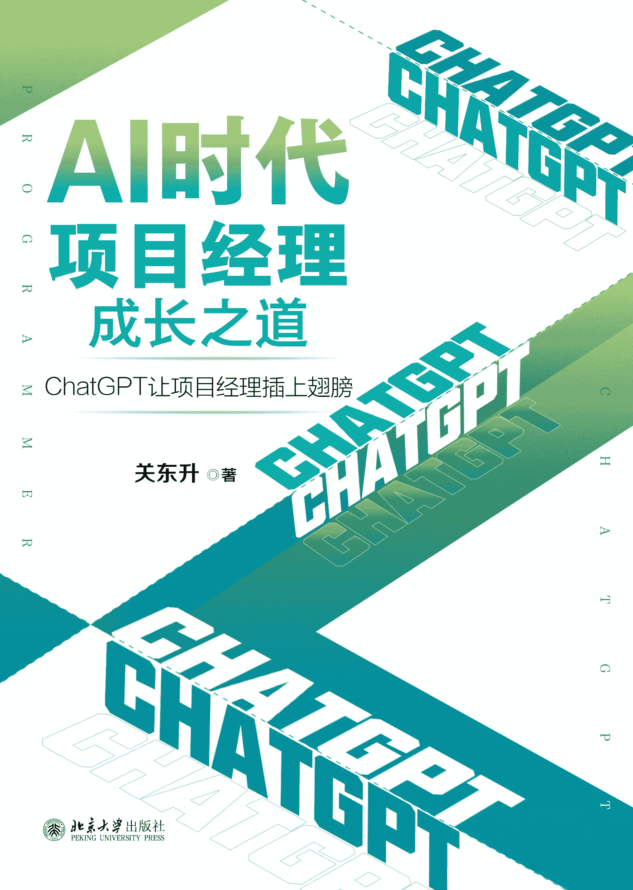
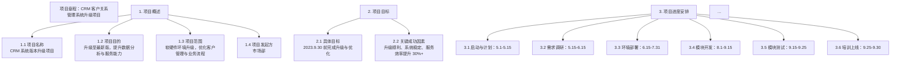
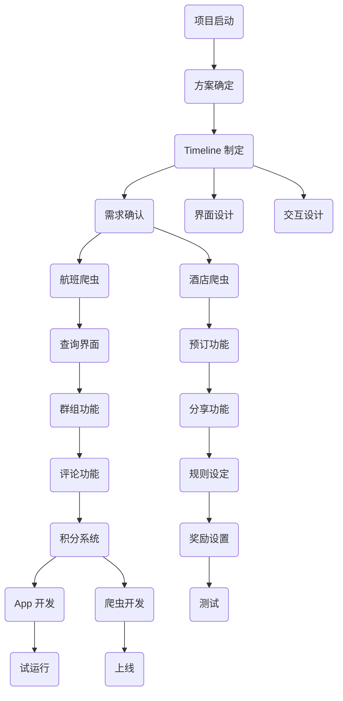

# 智能时代PM进阶：让ChatGPT成为你的项目副驾




# **版权信息**

**COPYRIGHT**

**书名**：《智能时代项目经理进阶：ChatGPT实战赋能》

**作者**：关东升

**出版社**：北京大学出版社

**上市时间**：2023年8月

**ISBN**：9787301342886

**篇幅**：195千字

# **核心看点**

这不是一本讲理论的书，而是一套「AI+项目管理」的落地操作手册。全书13章，以ChatGPT为核心杠杆，拆解人工智能如何重写项目管理规则。

第一章建立认知底座：剖析AI带来的红利与隐忧；第二章起实战开篇——高频文档秒出、启动会破局、组建高绩效团队、沟通降噪增效，继而覆盖计划、成本、进度、质量、风险、采购、绩效七大管控维度，终章落脚复盘总结。每章皆配真实场景、提示词范式与避坑指南，助你从「会提问」进阶到「善驾驭」。无论初入行还是深耕多年，皆可借此构建不可替代的智能化竞争力。

**配套资源**：全书源码+教学视频。扫码关注「博雅读书社」公众号，输入77页资源码 **`xm2023`** 领取；右侧码留言「北大AI」进答疑群。


**资源码**：`xm2023`

关东升

# **第一章**

# **认知重构：AI如何改写项目管理游戏规则**

技术浪潮滚滚向前，项目管理这块高复杂度决策高地，正经历着前所未有的范式迁移。本章从三个维度切入：机遇与挑战的双面镜像、PM必备的新能力模型、人机协作的最优范式，并通过两个实战复盘，演示如何驾驭ChatGPT化解棘手难题。

### **1.1**

## **双刃剑效应：AI重塑PM版图的机遇与暗礁**

AI渗透项目管理已成定局，关键在于如何乘风而不翻船。

**红利侧——效率跃迁与决策增强**
*   **刚性动作自动化**：进度追踪、资源调度、成本核算等高频重复工作，交由智能流转，大幅压缩人力时长。
*   **风险前置预警**：基于海量历史数据训练模型，AI能精准嗅探潜在雷区，输出数据驱动的决策参考，显著降低翻车概率。
*   **协同透明化**：智能工具接管任务分派与进度同步，打破信息孤岛，让团队协作更顺畅。

**挑战侧——数据信任与边界界定**
*   **数据质量定上限**：垃圾进垃圾出。噪声、缺失会直接导致预测失真。
*   **隐私合规红线**：敏感数据入模，泄露与攻击风险须零容忍构建防线。
*   **人机分工非替代**：AI擅长规则与模式，复杂语境下的判断、博弈、领导力仍赖人类主导。确立「AI执行、人决策、共进化」协作范式，方能释放最大价值。

### **1.2**

## **能力跃迁：AI时代PM的四维进阶图谱与协作四原则**

面对范式迁移，PM需完成四大能力重塑：

| 维度 | 核心要求 |
| :--- | :--- |
| **AI素养与工具力** | 看懂原理、会选型、善落地，精准匹配工具至场景 |
| **数据洞察与建模** | 会采集、会清洗、会建模，从数据中挖掘决策变量 |
| **创新思维与持续进化** | 拥抱不确定性，保持好奇心，跟上技术与管理双赛道迭代 |
| **跨域协同与桥梁搭建** | 连接技术、业务、算法多领域专家，化解认知鸿沟 |

**ChatGPT协作四原则：**
1.  **认清边界**：它是规则任务加速器、素材生成器，非复杂决策替代者。
2.  **分流任务**：标准化、重复性文档/报表/统计全权托管，释放PM高价值带宽。
3.  **共创非标**：面对模糊、复杂问题，以「对话式迭代」融合AI广度与人类深度，联合破局。
4.  **人治AI辅**：PM担责兜底，以专业经验校验、润色、定夺AI产出，产出终版交付物。

---

### **1.2.1**

### **实战复盘一：破解「进度失控+资源断供」双重困局**

**场景**：PM Tom面临项目滞后3周、关键资源（人力/设备）严重缩水的双重打击。

**首轮：模糊提问得通解**
> **Tom**：「项目严重延期，分析原因并给对策，如何协调资源保交付？」
> **ChatGPT** 给出教科书级通解：计划不实、效率低、外部依赖延误 → 重估计划、优化配置、外部施压 → 聚焦关键路径、借历史数据校准、强协同管控。

**洞见**：*提问粒度决定回答精度。抽象输入只能换来抽象输出。*

**二轮：结构化喂料，要表格**
> Tom补全任务/资源维度实测数据，要求Markdown表格输出。
> **ChatGPT** 瞬间产出**任务偏差对比表**与**资源缺口对比表**（渲染见 ``）。


**三轮：可视化直击痛点，要代码绘图**
> Tom进一步要求Python代码生成柱状图对比计划与实际工时。
> **ChatGPT** 输出含中文适配的绘图脚本（见 ``），运行得可视化图表（见 ``）。


点击工具栏中的 **** 即可保存图片。柱状图让进度偏差一目了然，毕竟人是视觉动物。

**实战启示**：**结构化输入 → 结构化输出 → 可视化洞察**，三步将模糊焦虑转为精准决策依据。

---

### **1.2.2**

### **实战复盘二：用量化诊断「效率低+满意度差」隐疾**

**场景**：PM Jane 发现团队士气与产出双降，疑为延期深因。

**首轮：泛泛而谈得套路**
> **Jane**：「效率低、满意度差，怎么破？」
> **ChatGPT** 抛出流程优化、工具升级、负载均衡、关怀沟通、绩效激励五大标准动作。

**二轮：喂入量化调研数据，要表格**
> Jane导入满意度调研「计划vs实际」偏差数据，要求Markdown表格。
> **ChatGPT** 产出清晰对比表：**高度满意预期40%实得30%，不满意预期10%实得30%**（见 ``）。


**三轮：非程序员路径——CSV落地Excel可视化**
> Jane不懂代码，要求CSV格式。导入Excel秒出双饼图（见 ``、``、``），计划与实际满意度结构撕裂一目了然。


**实战启示**：**不懂代码不拦路**，善用中间格式（CSV/Markdown）衔接擅长工具（Excel/BI），照样完成「数据-洞察-决策」闭环。

---

**本章小结**：AI不抢饭碗，抢的是「不会用AI的人」的饭碗。掌握**精准提问→结构化喂料→多模态输出**三板斧，即刻开启你的智能PM进阶之旅。

### **1.3 AI 落地项目管理：现状扫描与趋势研判**

结合图 1-5 与图 1-6 的可视化呈现，满意度分布一目了然。若需自行复刻此类饼图，Excel 或 Python 处理 CSV 数据均可，详细生成教程安排在 2.4.3 节，此处不再展开。

当下，AI 融入项目管理已从概念走向常态，众多组织引入智能工具驱动流程自动化与决策科学化，核心落脚点集中四大维度：

*   **规划优化与决策中枢**：AI 高速消化进度、资源、成本等多维数据，输出优化建议与决策参考，终结“拍脑袋”式判断。
*   **风险前置预警系统**：借力算法模型提前锁定潜在隐患，实现从“事后补漏”向“事前布防”的范式跃迁。
*   **智能协同枢纽**：打破信息壁垒，在智能调度下让团队协作与沟通流转更丝滑、更高效。
*   **质量自动化把关**：引入机器监控与评估机制，以确定性对冲人工巡检的随意性，筑牢交付底线。

展望未来，应用边界将持续外拓：全自动化的规划排期、动态智能的资源调度、精准化的风险推演……伴随大模型技术迭代，更多未见场景与解法正加速涌现。

---

### **1.4 章末复盘：核心要点一网打尽**

本章逻辑主线贯穿始终：**洞察变局 -> 重塑技能 -> 拥抱工具 -> 确立共生**。

1.  **双面透视 AI 红利与代价**：效率跃升、资源最优、进度可控是机遇；数据合规、角色重塑、能力焦虑是挑战，两手都要硬。
2.  **新技能树与协作范式**：通过“进度失控+资源缺口”“效率低迷+满意度低”两实战复盘，实演如何用 ChatGPT 破局——关键在于提示词工程与人机协同节奏的把控。
3.  **工具全景扫描**：AI 已渗透项目全生命周期，覆盖面仍在加速扩大。

**终局结论**：AI 正在重写项目管理底层逻辑，倒逼 PM 进化为**“懂数据、懂 AI、懂协同”**的复合型选手。未来赢家，非被工具替代者，而是驾驭工具、建立最佳人机搭档关系、放大各自比较优势的人。**AI，不再是冰冷工具，而是并肩作战的新伙伴。**

---

# **第二章 文档生产力革命：手把手教你用 ChatGPT 做“文档架构师”**

身为 PM，写文档是基本功，更是高频痛点。ChatGPT 作为顶级 NLP 模型，能产出高质量、强逻辑、可直用的文本，堪称 AI 时代 PM 必修的“外挂技能”。上章我们见识了它生成 Markdown 与 CSV 的雏形，本章深入实操，带你解锁全品类文档高效产出流水线。

## **2.1 半自动化文档工厂：模板先行，内容秒出**

技术文档形态繁杂（Word、Excel、PDF、在线 Wiki……），ChatGPT 只吐文本不出文件。破局关键：**“模板标准化 + 占位符植入 + 文本注入”**的半自动化工作流。前期投入做模板，后期复用收益指数级。

### **2.1.1 九步打磨“万能模板”**

用 Office 亲手搭一套标准化模板，按这套 SOP 走：

1.  **定类型**：按规范选载体（Word/Excel/PPT）。
2.  **定版式**：页面尺寸、边距、布局对齐企业/个人标准。
3.  **定样式库**：多级标题字体、字号、加粗规则全预设，保证骨架统一。
4.  **织目录/书签**：用 Word 自动目录+超链接，长文档跳转零摩擦。
5.  **造封面/页眉脚**：文件名、日期、版本号等元信息自动带出，专业感拉满。
6.  **预埋表图位**：表格、图片、公式占位框提前摆好，附注说明生成要求。
7.  **植入“AI 指令槽”**——**关键步骤**：需 ChatGPT 填充处，嵌入明确的**占位符或 Prompt 提示词**，倒逼输出精准对齐槽位。
8.  **存为 .dotx/.xltx**：一键存模板，新建即用，拒绝重复劳动。
9.  **实战迭代**：初稿跑通后，按痛点持续打磨样式、结构、占位符粒度。

> **避坑指南**：模板颗粒度直接决定“人工微调量”。理想态：ChatGPT 出文 -> 粘贴入槽 -> 微调措辞 -> 定稿。若频繁大改结构，说明模板设计未到位。

### **2.1.2 实战复盘：从零产出 CRM 升级项目章程模板**

以某公司 CRM 升级项目章程为例，演示“模板造 -> 模板用”全链路。

**策略建议**：别闷头手写模板。**先让 ChatGPT 产出草稿 -> 对标企业规范疯狂改 -> 定型落盘**，效率最高。

#### **动手实录**

**Prompt**：
> 请帮我生成 CRM 系统升级项目章程模板。

**ChatGPT 回应（结构化草稿）**：

> **项目章程：CRM 客户关系管理系统升级项目**
>
> **1. 项目概述**
> 1.1 项目名称：CRM 系统版本升级项目
> 1.2 项目目的：升级至最新版，提升客户数据分析与服务能力
> 1.3 项目范围：软硬件环境升级，优化客户信息管理与业务流程
> 1.4 项目发起方：市场部
>
> **2. 项目目标**
> 2.1 具体目标：2023.9.30 前完成升级与优化
> 2.2 关键成功因素：升级平稳、新版稳定、服务效率提升 30%+
>
> **3. 项目进度安排**（关键里程碑节点）
> 3.1 启动计划：5.1-5.15 | 3.2 需求调研：5.15-6.15 | 3.3 环境部署：6.15-7.31
> 3.4 功能开发：8.1-9.15 | 3.5 模块测试：9.15-9.25 | 3.6 培训上线：9.25-9.30
> 3.7 收尾总结：10.15
>
> **4. 项目组织机构**
> 4.1 负责人：市场部副主任 | 4.2 团队：10 人（开发 6、测试 2、运维 2）
>
> **5. 资源需求**
> 5.1 人力：PM 1 + 团队 10 | 5.2 财务：软硬采购+培训 80 万 | 5.3 技术：开发工具、云服务等
>
> **6. 监督与评价**
> 6.1 周例会巡进度 | 6.2 上线 2-3 月评估提改进 | 6.3 上线 6 月做效益评估，为规划输血

> **模板落地提示**：此草稿框架完备、要素齐全，但**必须**结合企业实况二次校准（如审批流、合规条款、特定 KPI 定义），方可转正为标准模板资产。

---

## **2.2 PM 与 ChatGPT 的“通用语言” —— Markdown**

前文强调：ChatGPT 只认文本、只吐文本。要让文本无损流转成 Word/PDF/网页，**Markdown 是唯一最优解**——轻量、可读、可版本控制、生态工具链极丰。

### **2.2.1 极速上手：核心语法速查表（覆盖 90% 场景）**

> **约定**：符号后**必须跟空格**，这是避坑第一法则。

| 场景 | 语法 | 实例 | 渲染效果 |
| :--- | :--- | :--- | :--- |
| **标题** | `#` ~ `######` | `## 二级标题` |  |
| **无序列表** | `- ` 或 `* ` | `- 任务一` |  |
| **有序列表** | `1. ` | `1. 步骤一` |  |
| **引用块** | `> ` | `> 重要提示` |  |
| **加粗/斜体** | `**粗**` / `*斜*` | `**核心** *次要*` |  |
| **图片** | `` | `` |  ->  |
| **代码块** | <br>````python<br>code<br>```` | 指定语言即得高亮 |  ->  |

> **注**：图片、代码块渲染预览请参照素材对应图示 -。掌握这套“最小必要集”，应付日常文档绰绰有余；进阶语法（表格、Mermaid 图、数学式）按需查阅即可。

### **2.2.2 神兵利器：主流 Markdown 编辑器横评 & 配置指南**

工欲善其事，必先利其器。主流选手横向对比：

| 工具 | 定位 | 核心优势 | 劝退点 | 适配人群 |
| :--- | :--- | :--- | :--- | :--- |
| **VS Code** | **首推** | 免费开源、插件生态最强、代码/文档一体化、Git 原生 | 非所见即所得（需侧边预览）、初始配置稍繁 | **全品类 PM/开发者、重版本控制、求零成本** |
| **Typora** | 体验派 | 极致所见即所得、丝滑流畅、图片/公式/TOC 零门槛 | 收费、闭源、大文件偶卡 | 重写作体验、轻代码、愿付费的文案型 PM |
| **Mark Text** | 极简派 | 开源免费、专注专注再专注、模式切换自如 | 插件生态弱、小众 Bug 多 | 极简主义者、抗拒复杂配置 |
| **Ulysses / iA Writer** | 专业写作 | 深度沉浸、多格式导出强、跨端同步佳 | 订阅制贵、功能偏纯写作、非技术文档首选 | 严肃长文创作者、多设备漫游办公 |

**笔者钦点：VS Code**。理由：免费、通用、可进化。下载直达：[官网链接] 。

#### **VS Code “三件套”扩展一键装机** 

1.  **Markdown All in One**：快捷键全、自动目录、表格对齐、数学公式、导出 PDF/HTML 一把梭。
2.  **Markdown Preview Enhanced**：预览增强版，Mermaid 流程图/时序图、GraphViz、PlantUML、代码高亮、多格式导出全支持。
3.  **Markdownlint**：实时红线报错，强制养成规范书写习惯。

> **新建文件**：`Ctrl+N` -> 存为 `.md` 后缀 -> 即刻享受代码级文档编写体验 。

### **2.2.3 实战闭环：让 ChatGPT 直出 Markdown 成品**

工具链就绪，来一发实战验收。

**Prompt**：
> 请帮我生成 CRM 系统升级项目章程，返回 Markdown 代码格式。

**ChatGPT 输出（即插即用）**：

```markdown
# 项目章程：CRM 客户关系管理系统升级项目

## 1. 项目概述

### 1.1 项目名称
CRM 系统版本升级项目

### 1.2 项目目的
升级当前 CRM 系统至最新版本，提高客户数据分析与服务能力

### 1.3 项目范围
升级 CRM 系统软硬件环境，优化客户信息管理与业务流程功能

### 1.4 项目发起方
市场部

## 2. 项目目标

### 2.1 具体目标
在 2023 年 9 月 30 日前完成 CRM 系统版本升级与功能优化工作

### 2.2 关键成功因素
升级工作顺利完成，新版本 CRM 系统稳定运行，实现客户服务效率提高 30%以上

## 3. 项目进度安排

### 3.1 项目启动与计划：2023 年 5 月 1 日至 15 日
### 3.2 需求调研与确认：2023 年 5 月 15 日至 6 月 15 日
### 3.3 软硬件环境部署：2023 年 6 月 15 日至 7 月 31 日
### 3.4 功能模块开发：2023 年 8 月 1 日至 15 日
### 3.5 模块测试：2023 年 9 月 15 日至 9 月 25 日
### 3.6 新系统培训与上线：2023 年 9 月 25 日至 30 日
### 3.7 项目收尾与总结：2023 年 10 月 15 日
```

**复制 -> 粘贴到 VS Code -> `Ctrl+Shift+V` 预览/导出 PDF/Word -> 交付**。全程零手工排版，这就是**“模板 + Markdown + AI”**三位一体的文档生产力范式。

## 4. 项目组织架构

### 4.1 核心责任人
市场部副主任担任项目负责人。

### 4.2 团队编制
共 10 人，构成为：开发 6 人、测试 2 人、运维 2 人。

## 5. 项目资源配置

### 5.1 人力投入
项目负责人 1 名，核心团队成员 10 名。

### 5.2 经费预算
软硬件采购与培训合计 80 万元。

### 5.3 技术支撑
涵盖开发工具链、云服务资源等。

## 6. 项目监控与复盘

### 6.1 进度巡检
设立周例会机制，固化任务进度与执行效果的双重核查。

### 6.2 迭代优化
依托上线后 2~3 个月的运行评估报告，输出系统改进方案。

### 6.3 效益复盘
系统上线满 6 月后开展效益评估，为后续规划沉淀数据支撑。

将上述内容保存为 `CRM系统升级项目章程.md`，在 VS Code 中预览效果如下：


图 2-10 VS Code 编写与预览 CRM 系统升级项目章程

### 2.2.4 Markdown 转 Word 实操指南

需将 `.md` 文件转为 `.docx` 时，Pandoc 是首选利器。其官网下载页如下：


图 2-11 Pandoc 官网下载页面

下载对应系统版本并安装，**务必勾选“添加到系统路径”**。安装完成后，在终端执行以下命令即可完成转换：


> 参数说明：`input.md` 为源文件，`output.docx` 为目标文件。

除 Pandoc 外，在线转换器、VS Code 扩展亦可实现，按需选用。

实操演示：将章程文件转为 Word，命令与结果如图：


图 2-12 章程文件转换指令

转换成功后，目录下生成 `CRM系统升级项目章程.docx`，打开效果如下：


图 2-13 转换成功的 Word 文档预览

### 2.2.5 Markdown 转 PDF 的简易路径

虽可用 Pandoc 或 Typora 直出 PDF，但笔者建议**“曲线救国”更省心**：先转 Word，再用 Word 另存为 PDF。

步骤：打开 Word → 点击“文件” → “导出” → 按图示操作生成 PDF。


图 2-14 Word 导出 PDF 设置对话框

## 2.3 思维导图：项目经理的“可视化大脑”

思维导图以中心主题发散分支，层层递进，将抽象思路具象化，是梳理逻辑、呈现全貌的利器。

### 2.3.1 实战价值：贯穿项目全生命周期

1.  **启动期·破题**：快速汇聚目标、任务、里程碑、人员、风险，让团队对齐全景认知，明确责任边界。
2.  **分析期·激发**：作为头脑风暴画布，高效收敛需求与创意，提升方案创新度与落地性。
3.  **执行期·掌控**：将计划拆解为任务清单与甘特图雏形，梳理依赖关系，动态跟进进度、预警风险。
4.  **收尾期·协同**：充当沟通“公共语言”，促进知识共享、问题同步与方案调整，提升协作效能。

**结论**：思维导图非简单绘图，而是提升团队认知带宽、协作效能的高阶管理工具。

### 2.3.2 项目经理的核心硬技能

绘制思维导图是 PM 的基本功。善用此工具规划、推进、复盘，能显著放大团队战斗力。

下图为笔者团队绘制的“艺术品收藏应用平台”功能导图：


图 2-15 “艺术品收藏应用平台”功能思维导图

### 2.3.3 工具箱：手绘与数字化双轨并行

*   **手绘**：白板/纸笔，零门槛、高自由度，适合小范围碰撞。
*   **数字化工具**：MindManager、XMind、Google Drawings、Lucidchart 等，自带模板库、云同步、导出多格式，适合文档化沉淀与协作。

白板手绘与 XMind 效果对比：


▲ 图 2-16 白板手绘版“艺术品收藏应用平台”


图 2-17 XMind 绘制版思维导图

> **本质提醒**：无论介质如何，思维导图核心在于**“可视化捕捉思考过程”**，助力解决问题与激发创造力。

### 2.3.4 借力 ChatGPT：从“会画”到“会指挥画”

ChatGPT 不能直接出图，但能当优秀的“代码架构师”，通过三大路径间接生成导图：

| 路径 | 核心逻辑 | 关键工具 |
| :--- | :--- | :--- |
| **方法 1** | GPT 生成 Markdown 大纲 → 导入 XMind 等工具渲染 | Markdown, XMind |
| **方法 2** | GPT 生成 Mermaid 代码 → 在线编辑器实时渲染 | Mermaid, Mermaid Live Editor |
| **方法 3** | GPT 生成 PlantUML 代码 → 工具渲染为矢量图 | PlantUML |

Mermaid 效果示例：


▲ 图 2-18 Mermaid 渲染思维导图

PlantUML 效果示例：


图 2-19 PlantUML 渲染思维导图

### 2.3.5 实战案例 3：让 AI 生成章程导图

**目标**：用“方法 1”产出《CRM 系统升级项目章程》思维导图。

**Prompt 设计三要素**：
1.  中心主题锁定“CRM 客户关系管理系统升级项目章程”；
2.  产出文本版导图结构；
3.  严格返回 Markdown 代码块。

**执行流**：
1.  发送 Prompt，获取 GPT 返回的 Markdown 代码（含项目概述、目标、进度、组织、资源、监督六大模块）。
2.  保存为 `.md` 文件。
3.  打开 XMind → 文件 → 导入 → Markdown → 选中文件 → 一键生成可视化导图。


图 2-20 XMind 导入 Markdown 生成导图效果

> **避坑指南**：2.2.3 节已有类似 Markdown，但中心主题不同。**建议直接让 GPT 重写**，省去手动调整结构与主题的麻烦，确保“中心主题”精准落位。

### 2.3.6 实战案例 4：Mermaid 代码直出导图

本节实操“方法 2”：GPT 生成 Mermaid 代码 → Live Editor 渲染。

**常见文本绘图工具速查**：
*   **Graphviz**：开源老牌，DOT 语言，擅长复杂拓扑。
*   **PlantUML**：UML 专业户，文本定义序列图、类图等。
*   **Mermaid**：**语法最简、Markdown 原生支持佳、前端渲染友好**，本节主推。
*   **Asciiflow / Ditaa**：ASCII 风格，轻量快捷。

**两步走操作法**：
1.  **喂料**：将项目章程全文本喂给 GPT，指令“生成 Mermaid 思维导图代码”。
2.  **渲染**：复制代码至 **Mermaid Live Editor** 官网。


图 2-21 Mermaid Live Editor 界面（左代码右预览）

左侧粘贴代码，右侧实时出图。点击右上角 **Actions** 面板可导出图片/分享链接。


图 2-22 Actions 导出面板

**实战 Prompt 实录**（喂给 GPT 的章程结构含 6 大模块、20+ 子项，涵盖概述、目标、进度、组织、资源、监督）。

**GPT 返回 Mermaid 核心代码片段**：


*(后续节点含组织架构、资源需求、监督评价，结构同理，此处省略)*

将完整代码粘贴至 Live Editor，即得专业级可视化导图，支持 SVG/PNG 导出，直接嵌入文档汇报，**零排版成本**。

### 2.3.6 案例 4：用 Mermaid 构建思维导图

把生成的 Mermaid 代码贴进 Mermaid Live Editor，即可得到渲染好的思维导图，效果见下图。


### 2.3.7 案例 5：借助 PlantUML 绘制思维导图

上一节用 Mermaid 实现了可视化，本节切换到 PlantUML。这工具不挑平台，网页端就能跑代码出图。图 2-24 是 PlantUML Web Server 的输出样例，PlantText 同款好用，不再多说。


渲染极简：代码粘贴进编辑器，图像自动生成。

> **小贴士**
> 完整语法去官网下文档。

---

#### 实战演练

直接把需求扔给 ChatGPT：

> **帮我用 PlantUML 画个项目章程思维导图，限制三级层级。**
> **主题：CRM 客户关系管理系统升级项目**
> 1. 概述（名称、目的、范围、发起方）
> 2. 目标（具体指标、关键成因）
> 3. 进度（7 个阶段含时间区间）
> 4. 组织（负责人、10 人编制）
> 5. 资源（人力、财务 80 万、技术栈）
> 6. 监督（巡检、改进、效益评估）

模型返回标准 `@startmindmap`...`@endmindmap` 代码，层级靠星号（`*`/`**`/`***`）控制。丢进在线渲染器，成品如图 2-25。


---

# 2.4 表格：项目管控的“骨架”

表格贯穿全生命周期，核心价值集中在五维：

1.  **进度跟踪**：甘特图、里程碑表，进度一眼穿。
2.  **成本监控**：预算表对实支表，超支早预警。
3.  **资源调度**：人员职责、物资清单，底数清。
4.  **风险应对**：评估表、对策表，识别又降级。
5.  **效率增效**：标准化模板少走弯路，聚焦决策。

**结论**：表格搭架子，管理靠人判断，进阶靠 PMIS（项目管理信息系统）自动化。

---

### 2.4.1 Markdown 表格：轻量跨平台首选

ChatGPT 吐不出 `.xlsx` 二进制，但能给两种纯文本表格：**Markdown** 与 **CSV**。

Markdown 靠管道符 `|` 和短横线 `-` 搭结构，纯文本、强兼容、易迁移。

**基础范式**：首行表头，次行分隔，其后数据行。


渲染长这样：


**对齐微调**：分隔符加冒号 `:` 搞定。
- `:---` 靠左
- `:---:` 居中
- `---:` 靠右


效果见下：


---

### 2.4.2 案例 6：ChatGPT 分步产出 Markdown 进度表（电商改造项目）

手写 Markdown 表格费时易错，用“复合指令 + 分批喂数”最稳。

**源数据参考**：

#### 实操四步走

**步骤 1：立规矩**  
> **指令**：“帮我做表，只返 Markdown。我分批给表头和行数据，我说‘完工’你再出代码。”  
> **回应**：“没问题，发表头吧。”

**步骤 2：给表头**  
> **数据**：任务、责任人、起日、止日、完成度  
> **回应**：“收到。请按‘字段用英文逗号隔开’逐行发数（例：任务1，张三，2022-01-01,2022-01-15,50%）。”

**步骤 3：分批喂行数据**（每行发一条，模型确认）  
> 例：需求分析，业务分析师，2021/7/1，2021/7/15，100%  
> ……（重复至录入完毕）

**步骤 4：触发生成**  
> **指令**：“完工”  
> **产出**：完整 Markdown 代码（含系统设计、前后端开发、测试、上线等 8 条记录）。

存为 `.md` 用编辑器看，效果见。

> **避坑指南**：  
> 数据量大必“多次少喂”。模型卡住不回？发“继续”接力输出。

---

### 2.4.3 CSV 表格：通用数据交换格式

CSV（Comma-Separated Values），逗号分隔值，Excel、Google Sheets 原生认。

**结构**：首行表头，后续每行一记录，字段逗号隔开。

**落地三步**：
1.  代码贴进记事本 
2.  另存为 `.csv` 后缀 
3.  Excel/WPS 打开 

**编码雷区（必看）**：  
中文环境下，**必须选 ANSI (GBK) 编码**保存。UTF-8 在 Excel 里会乱码（WPS 兼容性较好）。

---

### 2.4.4 案例 7：ChatGPT 生成 CSV 版进度表

流程与 Markdown 如出一辙，仅把指令里的“Markdown”换成“CSV”。

**关键差异**：确认表头后，模型会**立即返回表头行**，随后每收一行数据追加一行，最后汇总给全量 CSV 文本。  
注意：日期字段可能显示为数字序列值（如 44393），进 Excel 后改格式即可。

---

### 2.4.5 CSV 秒转 Excel

打开 CSV -> 文件 -> 另存为 -> 类型选 `*.xlsx` -> 保存。原生格式、公式、样式全支持。


---

# 2.5 ChatGPT 做图表：双路径

模型不会直接“画”图，但能造“图的源头”：

| 路径 | 核心逻辑 | 适用场景 |
| :--- | :--- | :--- |
| **无代码** | 模型给数据 (CSV/MD) -> Excel 原生图表引擎可视化 | 业务侧、快速出图、交互微调 |
| **有代码** | 模型写 VBA / Python (Matplotlib, ECharts) -> 跑代码出图 | 复杂图表、自动化报表、批量生成、嵌入系统 |

---

### 2.5.1 无代码路径：借力 Excel 原生引擎

1.  让模型按案例 6/7 方式产出带数据的 CSV 或 Markdown。
2.  导入 Excel（CSV 另存为 xlsx）。
3.  选中数据区 -> 插入 -> 推荐图表/任意类型 -> 微调样式 -> 完工。

**优势**：零代码门槛，享用 Excel 成熟生态（格式化、动态更新、切片器等），最适合“数据备齐，要快要美”的日常汇报。

## 无代码生成图表：借助 Excel 落地可视化

在“无编程”模式下，利用 ChatGPT 输出 Excel 文件再在表格软件中制图是一条常用路径。以 1.2.2 节案例 2 中的“员工满意度调查表”为例，操作流程如下图所示。


图 2-34  Excel 制图演示

点击“饼图”图标，即可生成初步图形，界面如下。


图 2-35  选择图表类型

在此界面可自由切换图表样式、编辑标题等细节，此处不再展开。最终导出的成品效果如下。


图 2-36  完成的图表

> **小贴士**
> **在 Excel 中选中目标图表，用 `Ctrl+C` 复制、 `Ctrl+V` 粘贴到 Word、PPT 或画图工具中。粘贴后可继续编辑、另存为图片或导出使用。**

---

### 2.5.2  编程路径：用代码驱动 ChatGPT 制图

若想通过编程方式调用 ChatGPT 绘图，需具备一定代码基础。主流方案集中在 **VBA** 与 **Python** 两大语言。

**强烈推荐 Python**。生态极其丰富：Matplotlib、Seaborn、Plotly 等库提供海量 API 与组件，能出高质量图表，且支持 PNG、JPEG、SVG 等多格式导出。鉴于 1.2.1 节案例 1 已演示过 Python 绘图，本节重点讲解 **VBA 代码生成图表** 的实操。

#### 实战演练

**步骤 1：向 ChatGPT 索要 VBA 代码**

发送提示词：
> 我有数据表（A1:C4），帮我绘制柱状图，返回 VBA 代码。


**步骤 2：在 Excel 中跑通代码**

1.  新建工作簿，把数据贴到 `A1:C4` 区域，确保工作表名与代码中 `Sheet1` 一致（或按实际改名），如下图。
    
    图 2-37  数据就绪的 Excel
2.  按 `Alt + F11` 打开 VBA 编辑器（或通过“开发工具”→“Visual Basic”进入），将代码粘贴进去。
    
    ▲图 2-38  VBA 编辑器
3.  按 `F5` 运行，柱状图直接生成在工作表上。
    
    图 2-39  生成的柱状图

> **操作指引：打开 VBA 编辑器**
> *   **快捷键**：`Alt + F11`（以 Office 2016 为例）。
> *   **菜单栏**：“开发工具”→“Visual Basic”。
> *   **若无“开发工具”选项卡**：文件→选项→自定义功能区→勾选“开发工具”→确定。
>
> **插入模块**：编辑器中点“插入”→“模块”，在右侧窗口粘贴代码即可运行。
> 
> 图 2-40  VBA 编辑器入口
> 
> 图 2-41  插入代码模块

**避坑提醒**：ChatGPT 生成的代码难免报错，需人工调试 + 多轮对话迭代优化，直到跑通为止。

---

## 2.6  鱼骨图：剖析因果的利器

**鱼骨图**（Fishbone Diagram），又称因果图、石川图，用分支结构直观呈现“结果（鱼头）”与“影响因素（鱼骨）”的因果链条。下图为项目延期原因分析示例。


图 2-42  项目延期鱼骨图

### 核心结构
1.  **鱼头** = 问题结果/影响
2.  **主骨** = 主要因素分类（常用 5M1E：人、机、料、法、环、测）
3.  **小骨** = 归属各主骨下的具体原因

### 核心价值
-   暴露易被忽视的根因
-   梳理因素间关联，锁定关键驱动因素
-   为解题提供清晰思路
-   汇聚团队共识，统一认知

---

### 2.6.1  项目管理中的实战场景

鱼骨图把“偏离计划”的根因可视化，助项目经理快速定位、对症下药。以“项目延期”为例，可从以下维度拆解：

| 维度 | 典型诱因 |
| :--- | :--- |
| **资源短缺** | 专业人手不足、关键设备不可用 |
| **任务冲突** | 多任务抢占同一资源，相互阻塞 |
| **沟通不畅** | 信息传递断层，执行偏离计划 |
| **风险事件** | 技术故障、质量返工消耗额外工时 |
| **未知因素** | 需持续跟踪、进一步分析 |

通过图谱对比，管理者能一眼看清哪些因素权重最大，进而优化配资、调整序列、强化沟通、管控风险，将进度拉回轨道。

---

### 2.6.2  ChatGPT 如何赋能鱼骨图绘制

ChatGPT 可全流程辅助，四大核心作用：

1.  **信息萃取**：读懂问题描述，抽取关键结果、因素及关系，打好信息底稿。
2.  **框架搭建**：输出“鱼头-主骨-小骨”三级结构草案，供业务专家校准补全。
3.  **初稿生成**：按框架自动产出节点文案与箭头关系，人工微调后定稿。
4.  **分析建议**：依图解析关键影响路径，解释因素互动，给出改进方向。

**边界清醒**：
-   复杂逻辑、深度专业领域表达仍有短板，框架与内容**必须人工复核**。
-   难以完全读懂人类沟通背后的深层意图，决策建议仅供参考。

**最佳协同模式**：
> **AI 负责“跑腿、搭架子、出初稿、做初筛”；人负责“把关、补业务、调结构、定乾坤”。**
> 双优互补，产出高质量鱼骨图与解决方案。未来随模型进化，协同深度将持续加深。

---

### 2.6.3  案例 8：××× 项目进度延误根因复盘

承接 1.2.1 节表格/图表分析不足，本节引入鱼骨图深挖延误根因。

#### 实操三步走

**步骤 1：让 ChatGPT 输出 Markdown 格式鱼骨结构**

提示词：
> 我有如下项目进度描述：帮我绘制鱼骨图，返回 Markdown 代码。
>
> **任务层面**：任务 1 计划 5 周、实延 2 周；任务 2 计划 3.5 周、实延 0.5 周。
> **资源层面**：资源 1 计划 4 人、实到 2 人；资源 2 计划 10 台、实到 7 台。资源缺口直接导致任务滞后。

关键信息点：① 文字描述实况 ② 要求鱼骨图 ③ 产出 Markdown。

**ChatGPT 回复结构摘要**：
```markdown
# 项目延误鱼骨图
## 工作任务
- 任务 1 延误 2 周
- 任务 2 延误 0.5 周
### 原因
- 任务 1：缺人/缺工具、量过大
- 任务 2：缺人/缺工具、量过大
## 资源供应
- 资源 1 仅到位 2 人
- 资源 2 仅到位 7 台
### 原因
- 资源 1/2：供应不足
```
另存为 `.md` 文件。

**步骤 2：XMind 导入 Markdown**

参考 2.3.5 节操作，导入成功效果如下。

图 2-43  导入后的思维导图形态

**步骤 3：一键转鱼骨图**

按下图操作“结构→鱼骨图”转换。

▲图 2-44  结构转换入口

图 2-45  转换成功的鱼骨图

**进阶**：不喜欢默认样式？点“画布”→“变更风格”秒换肤。

图 2-46  换肤后的鱼骨图

**洞察**：成图瞬间，延期核心诱因——**资源供给不足拖垮任务执行**——跃然纸上。

---

## 2.7  本章速览

| 模块 | 核心收获 |
| :--- | :--- |
| **文档生成** | 项目章程模板与内容的 AI 起草 |
| **Markdown** | 语法精通 + 工具链打通 |
| **思维导图** | ChatGPT / Mermaid / PlantUML 三驾马车全掌握 |
| **进度表** | Markdown 表格 / CSV ↔ Excel 无损转换 |
| **图表制造** | 无编程（Excel）+ 编程（VBA/Python）双通道 |
| **鱼骨图** | 理论→工具→案例闭环，根因分析利器入手 |

**一句话总结**：本章串联了 **“文档-图表-结构化思维”** 全链路，让 ChatGPT 成为项目文档生产线上的超级副驾。

---

# 第三章  ChatGPT 在项目启动期的深度介入

启动阶段，ChatGPT 能在 **选题定调、需求挖掘、文件落笔** 三大场景大显身手。但短板同样明显：商业判断力弱、需求穿透深度不够、交付物仍需人工精校。**定位：顶级辅助官；决策权永在人手中。** 未来随技术迭代，AI 介入度将走高，但“人机协同、人主机辅”仍是智能化项目管理的最优范式。

---

### 3.1  选题与范围：用 AI 对抗“拍脑袋决策”

#### AI 能做什么？

1.  **多选题 PK 赛**：输入多个项目概念，AI 从技术难度、市场前景、资源可得性等维度输出伣劣势对比表，规避团队“眼高手低”盲区。
2.  **范围切刀**：交互式追问“哪些是 Must-have？哪些是 Nice-to-have 且风险大？”，助力在启动期就把边界切清。
3.  **外脑参谋**：调取行研报告、市场数据、技术路线图，生成参考研判，对冲主观臆断。

#### AI 不能做什么？

**商业价值定论、潜在回报测算**——数据积累与模型创新尚需时日。因此，**关键决策人工兜底，AI 仅供决策参考**。协同互动，方出最优解。

---

### 3.1.1  案例 1：X 项目（企业级项目管理软件）选题复盘

#### 背景速览
-   **赛道**：项目管理软件市场年增 10%+，中高端（中大型企业）价格带高、潜力大。
-   **标杆**：MS Project、Primavera 定价百~万美元级，SaaS 模式更高，验证付费能力。
-   **挑战**：核心功能（进度/资源/成本/风险）研发难度大、周期长、成本高、回本慢；测试复杂、需大客户试用、周期再拉长。
-   **机遇**：全球政企数字化投入激增，强驱动力。

#### 实战：让 ChatGPT 跑选题分析

**提示词**：（将上述背景结构化喂给 AI）

**AI 返回答案核心看点**：

> **(1) 可行性与风险红旗**
> X 项目属高难、高投、长周期、慢回本典型，技术与商业风险并存。**必须深度拆解可行性，识别风险清单，预置对策。**
> ……（后续维度略）

> **启示**：AI 没给“是/否”二元答案，而是抛出**结构化风险清单**——这才是启动期最需要的理性底稿。

### 3.1 项目选题深度剖析：从文本到可视化决策

#### 3.1.1 案例实战：X 项目（企业级项目管理软件）全维度拆解

X 项目旨在打造一款企业级项目管理软件，其成败取决于四大核心支柱的精准搭建：

**1. 定位与定价：差异化筑高墙**  
产品定位是功能架构、商业模式与销售打法的基石。高客单价策略必须由硬核差异化优势与清晰价值主张支撑，这倒逼我们深度剖析目标客群与市场竞争格局，锁定最优切入点。

**2. 团队建设：强配置、重机制**  
高难度研发需要高素质技术与产品梯队。应对管理复杂度，关键在于科学设计组织架构、精准引进高技能人才，并落地有效的考核激励体系与高效沟通渠道。

**3. 研发交付：敏捷迭代、架构先行**  
核心交付环节需紧扣定位做需求拆解，锁定产品特色与体验标杆。采用敏捷开发与持续迭代机制高效推进，同步解决技术架构选型、详细路线图制定及进度跟踪管控。

**4. 品牌破局：多渠道触达、深度合作**  
商业化成败的关键杠杆。通过行业会议曝光、全网营销矩阵持续发声，叠加头部客户深度共创合作，加速品牌心智占领与市场份额收割。

> **核心洞察**：X 项目是典型的“高综合性、高难度”软件工程。选题研究可切入技术、产品、团队、市场任一维度，抓住关键变量深挖，能有效辅助规划决策、规避风险、落地商业目标。

**痛点直击**：长文本分析报告让管理者难以“秒懂”结论对比。  
**AI 介入**：利用 ChatGPT 擅长的结构化摘要能力，直接生成对比表格。

**💡 实战指令**：`帮我分析 X 项目的优劣势的表格，返回 Markdown 代码。`

**🤖 AI 输出预览**：

| 核心优势 | 潜在劣势 |
| :--- | :--- |
| 巨大市场需求，存量空间广阔 | 研发周期长，人力投入重 |
| 聚焦中大型企业，高客单价潜力大 | 产品设计与研发技术门槛高 |
| 价格弹性大，利润空间可观 | 总投入高，投资回本周期长 |
| 数字化转型红利期，政策与市场双驱 | 功能矩阵复杂，测试验收难度大 |
| 企业级 PM 工具护城河深，成长性强 | 大客户验收/试用流程长，拖慢进度 |


> **图 3-1 X 项目优劣势对比表**  
> 表格化呈现让利弊对比一目了然，这是职场汇报与决策分析的标准化动作。

---

#### 3.1.2 案例实战：Y 项目（新一代项目成本控制模型）研发复盘

**项目档案速览**  
- **名称**：Y 项目（研发新的项目成本控制模型）  
- **使命**：针对 Y 公司业务特性，重构成本管控体系，双提升管控力与利润率。  
- **战略价值**：① 精细化管理提效 ② 规避超支风险，锁定收益 ③ 提升全公司管控水平 ④ 孵化咨询新业务线，打造第二增长曲线。  
- **硬骨头**：深度业务解剖、简易高效模型研发、全员培训落地、持续迭代验证。  
- **强后盾**：高层授权背书、专项工作组+外部顾问、资深内部骨干、标杆案例与理论库。  
- **风险雷区**：技术攻关难、推进节奏慢、落地接受度低、外部推广阻力大。  
- **胜负手**：业务调研深度、定位精准度、团队硬实力、管理层承诺度、方案定制化程度。

**AI 先做定性研判，再出结构化表格**  
ChatGPT 从选题前瞻性、战略意义、执行难度、资源保障、风险敞口、关键成功因子六维度给出深度点评（此处省略长文，核心观点同素材）。

**💡 实战指令**：`帮我分析 Y 项目的优劣势的表格，返回 Markdown 代码。`

**🤖 AI 输出预览**：

| 优势项 | 劣势项 |
| :--- | :--- |
| 选题前沿刚需，战略价值高 | 攻关难度大，技术挑战强 |
| 高层强力托底，资源倾斜足 | 风险等级高，需全程监控 |
| 核心团队经验丰富，懂业务懂管理 | 落地培训与推广阻力大 |
| 有标杆案例与理论作参考 | 多因素交织，进度易延期 |
| 成功即造现金牛、新业务线 | 技术路线把控难，最优解难寻 |
| 模型架构灵活，支持持续迭代 | 实用性验证存在不确定性 |
| 推动业务多元化布局 | 成果整合风险，影响管控效能 |


> **图 3-2 Y 项目优劣势对比表**  
> 结构化输出再次验证：表格是穿透复杂性的利器。

---

#### 3.1.3 进阶可视化：雷达图让优劣势“立体化”

表格虽清晰，但缺乏直观张力。**雷达图（蜘蛛图）擅长多维度数据对比，能将优劣势“画”出来。**

**Step 1：定性转定量——打分量化**  
指令：`将下表优劣势项量化为 1-5 分评分制，输出 Markdown 表格。`  
ChatGPT 基于业务语义给出初版评分草案（需人工结合实际微调）：

| 优势维度 | 得分 | 劣势维度 | 得分 |
| :--- | :---: | :--- | :---: |
| 选题前沿刚需，战略价值高 | 5 | 攻关难度大，技术挑战强 | 2 |
| 高层强力托底，资源倾斜足 | 5 | 风险等级高，需全程监控 | 2 |
| 核心团队经验丰富 | 4 | 落地培训与推广阻力大 | 3 |
| 有标杆案例与理论参考 | 4 | 多因素交织，进度易延期 | 3 |
| 成功即造现金牛、新业务线 | 5 | 技术路线把控难，最优解难寻 | 2 |
| 模型架构灵活，支持持续迭代 | 4 | 实用性验证存在不确定性 | 3 |
| 推动业务多元化布局 | 5 | 成果整合风险，影响管控效能 | 2 |


> **图 3-3 Y 项目优劣势雷达图量化数据表**  
> *注：AI 评分仅供参考，务必结合项目实况人工校准。*

**Step 2：格式转换——Markdown 转 CSV**  
指令：`将上表转为 CSV 格式。`  
得到逗号分隔文本，存为 `.csv` 文件。


> **图 3-4 CSV 文件在 Excel/WPS 中打开效果**

**Step 3：Excel 一键生成雷达图**  
利用 Excel 插图表功能，分别绘制“优势雷达图”与“劣势雷达图”（参考 2.5.1 节操作）。


> **图 3-5 Y 项目优势雷达图：五个 5 分项构建强攻势，四个 4 分项筑厚底座**


> **图 3-6 Y 项目劣势雷达图：三大 2 分硬伤（技术、风险、路线）与四个 3 分软肋形成包围圈**

> **可视化红利**：雷达图瞬间展现“攻坚克难”的立体图景——优势项高分集中于战略与资源层，劣势项低分聚焦于执行与技术层，管理层可据此精准配置资源、部署对策。

---

### 3.2 方法论沉淀：ChatGPT 辅助“背景与需求”分析标准动作包

将实战经验固化为 6 步标准化工作流：

1.  **喂养上下文**：输入公司业务版图、发展阶段、组织架构、管理基因等环境变量，建立 AI 认知底座。
2.  **对齐起因与终局**：阐述项目发起缘由与高层预期，校准 AI 对“必要性”与“紧迫性”的理解。
3.  **拆解痛点与功能清单**：罗列核心业务问题与新模式功能诉求，锚定关键目标边界。
4.  **AI 综合研判**：让 ChatGPT 产出必要性论证、目标拆解、关键需求、难点挑战四大分析模块。
5.  **人机共创闭环**：补全信息盲区、追问细节分歧、融合专家经验，达成共识认知。
6.  **延伸决策应用**：基于深度理解，复用至立项评估、方案选型、计划编制等下游决策节点。

> **精髓**：高质量输入（Context）+ 多轮深度对话 = 高可信度决策支撑。

---

### 3.3 实战演练：智慧城市规划建设项目（G 市）背景与需求建模

**项目底本**  
- **主体**：G 市（中型城市，增速快、底子薄、供给跟不上，可持续发展承压）。  
- **抓手**：“智慧城市规划与建设项目”，用数智技术重塑传统城管，建设“智能、数字、绿色”现代都市。  
- **六大建设目标**：  
  1. 智能交通调度体系  
  2. 立体安防监控响应体系  
  3. 公共资源智管（光、垃圾、水、电）  
  4. 政务服务“掌上办、数据共享”  
  5. 智慧管廊/桥梁等新基建底座  
  6. 以建设带产业，培育新赛道

**💡 实战指令**：`基于以上背景与目标，请开展业务需求分析。`

**🤖 AI 输出：四大核心业务域需求拆解草案**  

| 业务域 | 现状诊断切入点 | 核心改进方向/功能诉求 |
| :--- | :--- | :--- |
| **智能交通** | 拥堵痛点、事故高发、管控流程割裂 | 实时路况发布、流量预测建模、信号灯自适应优化 |
| **智能安防** | 公共/交通安全隐患、安保流程滞后 | 视频智能监控、违章自动抓拍、事件极速响应闭环 |
| **公共资源智管** | 照明/环卫/水电运维粗放、能耗高 | 节能减排量化、设施全生命周期智能化运维 |
| **智慧政务/市民服务** | 办事流程长、数据孤岛严重、体验差 | 全流程网办、跨部门数据打通共享、一网通办 |

> **AI 产出价值**：将宏大战略目标“翻译”成可执行、可验证的业务需求清单，为后续方案设计、招标采购、验收评价提供标准化依据。

## 第五节 城市基建智能化跃迁与产业结构重塑

### 夯实“地下大动脉”与“地上关键节点”智管能力
聚焦管廊、桥梁等市政骨架的现状体检与管理流程梳理，精准定位运维堵点。破题之道在于：确立**全周期智能化运维范式**，落地**基于状态的预防性维护策略**，推动基础设施管养从“事后补救”向“感知预警、精准干预”跨越，筑牢城市安全底座。

### 重塑产业版图 激活高质量发展新动能
立足城市产业底色与经济脉搏，科学研判转型路径。重点发力双引擎：一是锚定**新一代信息技术**培育战略性新兴产业集群；二是以**绿色低碳理念**重塑传统产业、布局未来赛道。通过结构性调整，厚植发展新优势。

> **核心提示**：业务需求剖析需统筹“规划引领、基建底座、数智赋能、生态守护”四维坐标，确保方案落地可行、成效可感可及。

---

## 第3.4节 借力大模型 高效产出项目章程与可研蓝图

采用**“人机协同五步法”**，驾驭ChatGPT完成核心文档首稿构建：

### 步骤一：语料投喂·构建项目数字孪生认知
汇聚项目缘起、愿景、边界、阶段划分、资金包干、干系人图谱、组织架构等全维度信息，同步灌注模型上下文。此举旨在建立AI对项目的全息认知，为后续生成提供高质量语料支撑。

### 步骤二：骨架共创·锚定文档标准化框架
对标规范范式与项目实情，联合AI敲定章节拓扑与要素清单——涵盖项目画像、市场洞察、商业模式、落地路径、风险图谱、资源统筹等核心板块。框架稳，内容才不散。

### 步骤三：智能生成·产出结构化初稿
确认大纲后，下达分章节生成指令。模型将按逻辑链路自动输出文本。**关键认知**：当前输出侧重框架搭建与思路发散，专业深度、数据精度及合规性仍存短板，仅供参考定性。

### 步骤四：专家评审·红蓝对抗修正偏差
项目经理主导逐条复核，重点清洗**数据幻觉、逻辑断层、专业盲区**。涉及技术选型参数、财务建模假设、法务合规红线等硬核判断，必须人工兜底。评审中同步捕捉结构缺陷，反哺优化大纲。

### 步骤五：定稿归档·交付可执行正式版
双方就修订意见达成一致，协同产出可签署、可执行、可审计的定稿文本。

---

## 3.4.1 实战复盘：G市智慧城市项目章程“一日成稿”

### 场景画像
**城市画像**：G市，中型高速增长极，基建与公共服务供给严重滞后于城市化进程，可持续发展面临结构性压力。
**战略决策**：市政府牵头启动“智慧城市规划与建设项目”，拟借数智技术重塑治理体系，打造“智能化、数字化、绿色化”现代城市标杆。
**六大攻坚使命**：
1.  构建城市交通“智慧大脑”，实现调度智控与车流精管。
2.  织密立体安防感知网，达成全域监测与秒级响应。
3.  重塑公共资源管控链（智慧照明、环卫闭环、水电智管）。
4.  搭建“指尖政务”服务平台，打通在线办理与数据共享末梢。
5.  实施管廊桥梁等市政骨架数智化改造，筑牢城市底座。
6.  以工程带产业，孵化新赛道新业态。

### AI输出章程初稿关键字段结构化摘录
| 维度 | 核心载荷 |
| :--- | :--- |
| **项目标识** | 智慧城市规划与建设项目 |
| **缘起痛点** | 基建短板制约发展 → 数智赋能破局 |
| **目标矩阵** | 对标六大使命逐项分解落地 |
| **范围边界** | 覆盖6大子系统“设建管”全周期 + 产业培育专项规划 |
| **硬性约束** | 总投资1亿（财政8000万+社会资本2000万）/ 周期3年 / 风险清单（技/资/市） |
| **干系人/编制** | 政府主导、企业共建、市民受益 / 明确PMO岗位矩阵 |
| **交付清单** | 各子系统“四件套”（设计/实施/测试/手册）+ 产业规划蓝皮书 |
| **管控机制** | PM授权制 + 节点汇报 + 阶段门禁 + 干系人同步机制 |
| **启动授权** | 政府审批备案后正式立项执行 |

> **避坑必读**：AI生成的预算细表、人员名单、风险登记册均为**模板占位符**，实施前务必替换为实测数据、实名名单，并套用组织级标准模板落地。

---

## 3.4.2 实战进阶：可行性研究报告（可研）深度打磨与可视化增强

沿用同一项目背景，引导模型从五大维度输出可研分析框架：

### 一、 技术可行性：全栈成熟度背书
逐个拆解子系统（交通/安防/公共资源/政务/市政基建）关键技术需求——实时感知、智能识别、物联管控、大数据治理、远程运维。结论趋同：**核心技术链条产业化成熟，落地无硬性技术瓶颈**。

### 二、 经济可行性：算清“投、回、盈”三本账
- **资金拼图**：总投资规模、资本结构（财政/社资/信贷）。
- **收益测算**：ROI预测、盈亏平衡点、利润规模模拟。
- **外溢价值**：产业聚合拉动、城市能级跃升、民生福祉增进。

### 三、 市场需求：顺势而为的“必答题”
智慧城市成国家战略大势，存量痛点倒逼增量刚需，社会效益与经济效益双轮驱动，市场空间广阔深厚。

### 四、 SWOT战略雷达
| 象限 | 关键判词 |
| :--- | :--- |
| **优势 (S)** | 政策红利浓、刚需确证硬、技术就绪高 |
| **劣势 (W)** | 资金体量巨、链条跨度长、隐性技术坑多 |
| **机会 (O)** | 国家战略窗口期、城市数字化转型红利期 |
| **威胁 (T)** | 竞争红海化、技术迭代快、政策微调不确定性 |

### 五、 进度管控：里程碑锚定工期红线

---

### 进阶追问：逼出可视化决策素材

#### ▶ 指令一：生成投资回报率动态测算表（模版）
**模型返回目标结构**：


> **字段释义**：投入额=年度现金流出，回收额=年度现金流入，年度ROI=单周期回报，累计ROI=全周期回本进度。受政策/市场/技术多因子耦合影响，需导入实测数据二次校准后方可入报。

#### ▶ 指令二：生成市场需求量化看板（模版）
**模型返回目标结构**：


> **决策价值**：直观呈现市场容量曲线、竞争地位迁移、销售规模演进，支撑营销策略与经营决策。建议补全细分赛道渗透率、竞品矩阵等维度数据以增厚分析厚度。

---

## 3.5 章节复盘：项目前期“AI加速器”方法论总结

本章构建了**ChatGPT赋能项目前期全链路**实战范式：
1.  **科学选题定界**：案例对标+雷达图可视化，决策有据。
2.  **深度洞察需求**：以智慧城市为载体，演示多维度分析范式。
3.  **核心文档智造**：创立**“五步协作法”**，实战产出《项目章程》《可研报告》双核交付件。

**核心定论**：ChatGPT非替代者，乃**“超级实习生”**。它能以极低边际成本承担框架搭建、素材整理、初稿产出等80%基础性劳动，释放项目经理聚焦**战略判断、干系人博弈、风险兜底**等高价值决策。驾驭人机协作节奏，方能实现“开局快、底座稳、风险可控”。

---

# 第四章 借力大模型 组建高绩效项目铁军

项目成败，团队为本。大模型可在团队全生命周期五大关键节点赋能：

### 1. 角色职责“分钟级画像”
输入项目基因，模型秒出核心岗（PM/架构师/测试/业分等）职责清单草案。PM复核校准，消除权责重叠与真空，快速形成**RACI矩阵雏形**。

### 2. 规模技能“精准画谱”
研判项目体量、复杂度、技术栈广度，模型给出**人数区间+关键技能矩阵**（如：后端3人/Go+K8s，测试2人/自动化+性能）。PM结合预算与人才库落地执行。

### 3. 招聘选拔“标准化工具包”
共创招聘全套资产：渠道组合拳、JD标准版、面试题库（硬核技能/软性素质/情景模拟）、评分卡模版。PM按项目调性定制，即拿即用。

### 4. 团建文化“软实力注入”
协作设计：团队宪章/价值观、沟通协议（会议节奏/工具链/升级路径）、绩效激励体系（OKR/KPI/里程碑奖）、成长阶梯规划。模型提供最佳实践案例库，PM本地化植入。

### 5. 人岗风险“预案前置”
识别核心风险簿：**核心人才流失/技术攻关受阻/跨部门扯皮/技能断层/职业倦怠**。模型输出“风险-触发条件-应对策略-责任人”登记表，PM动态维护，构建韧性组织。

> **黄金法则**：AI负责**发散、结构化、产出模版**；人负责**收敛、决策、注入灵魂**。复杂判断与人性洞察，永远是PM不可外包的核心资产。

---

## 4.1 解码高绩效项目团队：六维定标

高绩效团队非“明星堆砌”，而是**“高适配度组织”**。六大特征构成判别标准：

| 维度 | 核心内涵 | 观测锚点 |
| :--- | :--- | :--- |
| **1. 分工零模糊** | 角色边界清晰，零重叠零遗漏，扁平高效 | RACI矩阵落地，杜绝“踢皮球” |
| **2. 人岗高匹配** | 技能互补精准，资源利用率最大化 | 技能矩阵覆盖率>95%，无显性短板 |
| **3. 信息高通达** | 高频流动、高信任低内耗，问题早暴露早解决 | 日站会/周复盘/双周Retro常态化 |
| **4. 自驱强韧性** | 拥抱变化，主动创新，交付具备抗扰动能力 | 变更响应时长、创新提案落地率 |
| **5. 目标强共振** | 共享愿景，利益绑定，利他协作 | 团队誓言/冲刺目标公开透明 |
| **6. 进化成常态** | 复盘成文化，流程迭代化，技能阶梯化 | 知识库更新频次、人均培训投入 |

**PM启示**：组建即育人，育人即组建。选人用人、定岗定责、管过程、建文化、促成长——环环扣紧，方成精兵劲旅。

---

## 4.2 组织拓扑选择：结构适配决定战斗力

组织结构决定**权力流向、信息流速、决策延迟**。

### 4.2.1 三大经典范式深度对标


> ▲ 图 4-1 职能型组织结构图


> ▲ 图 4-2 产品型组织结构图


> ▲ 图 4-3 矩阵型组织结构图

| 结构模式 | 核心逻辑 | 甜点场景 | 痛点 | 破局键 |
| :--- | :--- | :--- | :--- | :--- |
| **职能型** | 按专业设部（研发/测试/运维） | 业务稳定、规模大、技术深耕 | 条块分割，跨域协作慢，项目视角缺失 | 设立强力PMO/项目协调员 |
| **产品/项目型** | 按产品线/项目组建全功能团队 | 多线并行、快速响应、业务复杂 | 资源重复建设，专业沉淀弱，归属感漂浮 | 建立专业实践社区/技术委员会 |
| **矩阵型** | **双重汇报**：职能管人/技/资源，项目管任务/进度/交付 | **主流首选**：兼顾专业深度与交付 | 双头管理易扯皮，权责边界模糊 | **明确PM主导权**，细化RACI，建冲突升级机制 |

### 4.2.2 高绩效团队的结构进化论

无完美结构，只有**阶段最优解**。高绩效团队擅长**动态调整**：
- **攻坚启动期**：强矩阵/项目化，集中兵力突破；
- **稳态交付期**：弱矩阵/职能化，沉淀能力、压降成本；
- **变革探索期**：特种部队/虚拟团队，跨界融合、小步快跑。

**决策关键**：PM需具备**组织设计思维**，依据项目阶段、不确定性、外部依赖度，主动向高层申请结构授权调整，而非被动适应现状。

# 打造高效项目团队：组织架构、角色定义与AI辅助实战指南

### 4.3 项目角色与职责体系构建

项目成功的基石，在于明确“谁来做、做什么、怎么配合”。不同组织架构下，角色配置的侧重点各异，但核心原则始终围绕目标对齐与责任落地。

### 4.3.1 角色职责确立的五大维度

无论采用何种组织形式，落实角色职责都需从以下五个维度切入：

1.  **目标与需求导向**：项目目标与范围是角色设定的起点。只有锚定交付标准与时间节点，才能反推所需角色清单，确保人岗匹配、无缝衔接。
2.  **管理层统筹角色**：项目经理/主管是中枢神经，其领导力、沟通力与协调力直接决定项目能否跨部门推进、按期交付。
3.  **职能部门协作界面**：各部门需界定在项目中的具体担当。如研发端聚焦技术攻关与产出，市场端负责需求洞察与定价策略，部门职责边界清晰方能避免推诿扯皮。
4.  **团队执行层复合角色**：一线成员常身兼数职（如技术专家兼任协调员），需在管理层指令与部门资源间灵活穿梭，保障信息流转高效。
5.  **人岗能力画像**：角色定义不可脱离人。依据成员技术深度、软技能及过往实绩分配任务，方能实现“人尽其才、才尽其用”。

**小结**：角色体系设计是目标、管理、部门、团队、个人五方合力的产物，缺一不可。

### 4.3.2 借力 ChatGPT：角色定义的“智能参谋”流程

引入生成式AI可显著提升角色设计的广度与效率，建议遵循“七步互动法”：

| 步骤 | 核心动作 | 关键价值 |
| :--- | :--- | :--- |
| **1. 喂料建模** | 输入项目名称、目标、规模、产品形态、当前阶段等全量背景 | 为AI构建上下文，奠定后续建议的精准度基础 |
| **2. 角色广度扫描** | 询问典型角色清单（PM、PD、UI、RD、QA等） | 避免主观遗漏，快速建立候选角色池 |
| **3. 职责深度拆解** | 逐角色追问核心职责、硬技能门槛、软素质要求 | 获得结构化岗位说明书雏形，覆盖管理与执行双维度 |
| **4. 动态增补视角** | 探讨潜在新增角色（如售后、运维、数据分析）及调整建议 | 打破固有思维，从全生命周期审视角色完备性 |
| **5. 协作机制梳理** | 分析角色间依赖、沟通节奏、交付物流转路径 | 将孤立角色串联成协同网络，预埋冲突解决机制 |
| **6. 方案迭代定稿** | 汇总生成初版角色矩阵，针对模糊项追问优化 | 通过多轮对话收敛共识，产出可执行清单 |
| **7. 人工复核把关** | 结合组织文化、资源现状、成员意愿终审定案 | **核心原则：AI出建议，人做决策。AI拓宽思路，人兜底风险。** |

**底层逻辑**：`人提问+喂料 → AI给分析/建议 → 人判断/验证 → 人机再交互 → 人拍板`。这是当前“人机共智”决策的标准范式。

### 4.3.3 实战复盘：工程进度管理软件项目的角色定义之路

**项目画像**：面向中大型工程的进度管控SaaS，核心功能覆盖多层级甘特图编制、资源平衡优化、任务级跟踪预警、多维报表输出。项目处于敏捷开发期，3个月一迭代，预计1年交付V1.0，团队技术底子厚。

#### 复盘实录（关键节点提炼）

**Step 1：语境注入**
> *指令策略：大段背景前置“请记录，暂不回复”，确保大模型完整吸纳业务细节、技术栈、交付节奏等关键语境。*

**Step 2：角色广度扫描**
> *AI返还8大标配角色：PM、RD、QA、PD、UI、DBA、Ops、Tech Support。覆盖研发全链路，为筛选提供备选集。*

**Step 3：职责深度拆解**
> *AI逐角色输出“职责清单+任职资格”双维表。例如PM需统筹计划/资源/风险/沟通/汇报，要求具备领导力+PM技能+技术懂业；RD聚焦编码/自测/攻关/协作，重编程功底+工程化素养……输出可直接作为JD初稿。*

**Step 4：动态增补——售后工程师角色引入**
> *基于“交付非终点，服务才开始”考量，主动咨询AI。AI确认必要性，并给出职责（客户沟通/问题闭环/现远程支持/反馈回流研发）与资格（技术支持经验+沟通力+服务流程熟悉度），完善了交付后半程角色拼图。*

**Step 5：协作机制深度对齐**
> *围绕“谁依赖谁、何时同步、怎么交接”追问，形成角色交互图谱，支撑后续RACI矩阵落地。*

**Step 6/7：迭代优化与人工终审**
> *结合团队现状（如无专职DBA由资深RD兼任、UI/UX合一等），对AI方案做减法与改法，最终输出《项目角色职责矩阵 v1.0》。*

**启示**：AI把“从0到1”的认知负荷降至极低，人把“从1到N”的工程落地把控到底。

### 4.4 团队规模与技能配置的动态平衡

团队编制无标准答案，仅有“适配解”。常见角色技能画像如下：

| 角色 | 核心技能关键词 | 规模弹性参考 |
| :--- | :--- | :--- |
| **项目经理** | 全局统筹、干系人管理、风险把控、跨域沟通 | 小项1人，大项多PM分工（如技术PM/商务PM） |
| **业务分析师** | 需求挖掘、流程建模、数据分析、文档输出 | 随业务复杂度线性增长 |
| **软件工程师** | 架构设计、编码实现、重构优化、技术攻关 | 核心指标：人均维护代码量/迭代交付吞吐率 |
| **测试工程师** | 测试策略、自动化框架、性能/安全专项、缺陷管理 | 研测比参考 3:1~5:1，视质量红线调整 |
| **UI/UX设计师** | 交互设计、视觉规范、用研测试、设计系统维护 | 早期重投入，后期转维护模式 |
| **数据库管理员** | 架构设计、性能调优、备份容灾、数据治理 | 数据密集型项目必配，否则由资深RD兼任 |

**规模估算黄金法则**：`工作量拆解（WBS）× 历史产出率 = 基准人力` + `风险缓冲（15%-25%）` + `管理开销（随人数指数增长）`。

### 4.4.1 ChatGPT 辅助团队配置的“三步走”

1.  **语境同步**：抛出目标、WBS、工期、技术栈、约束条件。
2.  **AI预判**：获取建议编制表（角色×人数×关键技能矩阵）及风险提示（如关键路径单点风险）。
3.  **人工校准**：**必须结合**——候选人过往实战项目相似度、技术栈匹配度、团队磨合成本、预算天花板、招聘周期窗口期——做最终裁决。

> **避坑指南**：AI擅长“教科书式”标准配置，不懂“你们组的老王擅长啥、新招的小李要带多久”。**宏观参考AI，微观靠经验。**

### 4.4.2 实战演练：本地生活服务超级APP的团队配置推演

**项目背景**：头部连锁品牌（餐饮/娱乐/家政/教育10+子品牌）建设一体化服务平台，面向城市家庭用户，提供预订/预约/报名一站式入口。两期制：首期6个月攻克信息架构、UI/前端；次期推进后端集成与运营中台。

**Step 1：喂料关键信息点**
- 业务域：多业态聚合，强SKU、强时效、重体验
- 技术栈：微服务/K8s/React/Flutter/PostgreSQL/Redis/ES
- 交付节奏：Phase 1 (M1-M6) 交付前端可演示版；Phase 2 (M7-M12) 全链路上线
- 约束：预算封顶、核心骨干已定3人（架构/主程/主设）

**Step 2：AI 预判输出（节选）**
| 阶段 | 角色 | 建议人数 | 关键能力标签 | AI特别提示 |
| :--- | :--- | :--- | :--- | :--- |
| **Phase 1** | 业务分析师 | 2 | 多业态建模、用户旅程地图、PRD输出 | 需懂本地生活运营逻辑，建议内部转岗优先 |
| | UI/UX | 2 | 设计系统构建、多端适配、交互动效 | 早期高强度，考虑外包补充切图/标注 |
| | 前端工程师 | 4 | React/Flutter、组件库治理、性能优化 | 骨干带新人，建立Code Review机制 |
| | 测试工程师 | 1 | 自动化框架搭建、兼容性测试 | 早期介入评审，左移质量关口 |
| **Phase 2** | 后端工程师 | 5 | 微服务拆分、分布式事务、高并发 | 引入Tech Lead分模块把关 |
| | DBA | 1 | 分库分表、读写分离、灾备演练 | 数据量预估百万级/日，专职必要 |
| | 运维/DevOps | 2 | CI/CD流水线、监控告警、容器编排 | 落地GitOps，提升发布频次至日级 |
| | 运营/数据分析 | 2 | 埋点体系、AB实验、商业化数据 | 归属产品线，非项目临时编制 |

**Step 3：人工校准实录**
- **裁减**：AI建议Phase 1配置QA 2人，结合“前端先行、后端未就绪”实际，压减至1名资深QA主攻自动化框架搭建，功能测试由RD自测+众测平台补充。
- **增补**：AI未显性给出“集成对接工程师”，但项目涉及10+子品牌老系统对接，现实极其复杂，强行增设1人专攻适配器开发与联调。
- **调整**：架构师兼任Tech Lead不现实，拆分为“系统架构师（决策端）”+“交付Tech Lead（执行端）”双轨制。
- **最终定编**：Phase 1 核心团队 11 人（含3名骨干），Phase 2 扩编至 22 人，总预算偏离AI估算 -8%，但风险覆盖率显著提升。

**结语**：AI给出的是“教科书标准答案”，项目经理要交出的是“在当下约束下的最优解”。**用AI拓宽边界，用经验收敛落地**，方得团队配置之道。

## 4.5 让 ChatGPT 成为团队建设的“素材库”与“模板库”

为项目团队输出参考模板与资料，是 ChatGPT 等 AI 工具在项目管理辅助中极具价值的一个维度。具体落地可从以下五个方向入手。

**1. 输出进度管理类模板**
针对不同项目类型，ChatGPT 能快速生成周报、里程碑进度表、任务分解表（WBS）等多套可选模板。团队借此能系统化记录进展，高效完成阶段性复盘。

**2. 提供文档编写参考范本**
从可行性研究报告到需求分析报告，ChatGPT 能给出结构完整、措辞专业的写作参考。这类资料能显著提升文档产出效率与质量，对初级 PM 或技术骨干尤为实用。

**3. 复盘分享成功案例与实战经验**
利用其庞大的知识库，ChatGPT 可检索并整理成熟项目案例中的最佳实践、避坑指南。当团队遭遇技术攻关或管理难题时，这些“前车之鉴”能提供极具参考价值的解决思路。

**4. 明确角色职责与技能画像**
项目组建初期或扩编时，ChatGPT 可输出各岗位的典型职责描述、硬性技能要求及软性素质模型，辅助管理者制定精准的招聘 JD 与选人标准。

**5. 定期把脉评审，输出优化建议**
在关键节点或里程碑，团队可向 ChatGPT 同步进展与痛点。AI 能从进度把控、风险应对、质量提升等多维度给出评估建议，助力项目高质量交付。持续吸纳反馈迭代，也是 AI 工具不断进化的动力源。

**小结**：ChatGPT 在赋能团队建设上潜力巨大。团队若能建立“定期咨询、理性甄别、落地执行”的协作节奏，定能大幅提效增质。切记：AI 仅作辅助决策参谋，最终拍板权始终掌握在团队手中。

### 4.5.1 实战案例三：打造“企业职位智能推荐系统”项目周报模板

本案例演示如何用 ChatGPT 生成 Markdown 格式周报模板，再转为 Word 文档使用。

**项目背景速览**：某人力资源外包公司发起，旨在开发智能算法系统，依据员工多维画像（学历、履历、绩效、潜力等），精准匹配内部晋升岗位，助力人才可持续发展，同时减轻 HR 评估压力。

**实操步骤**：

> **指令**：帮我制作一份企业职位智能推荐系统项目周报模板，返回 Markdown 代码。

**AI 生成的模板核心结构（已转述）**：

# 项目名称：企业职位智能推荐系统
# 项目负责人：张三

## 第 ×× 周周报（日期：YYYY-MM-DD 至 YYYY-MM-DD）

### 一、 本周核心产出
1.  **算法迭代**：×× 版模型开发测试完毕，匹配准确率达标。
2.  **数据就绪**：HR 系统采集模块上线，已入库员工信息 ×× 条、岗位信息 ×× 个。
3.  **界面推进**：×× 模块 UI 设计定稿，进入联调与交互优化阶段。

### 二、 进度看板与风险预警
1.  **整体节奏**：进度符合预期，完成度 ××%，质量获用户确认。
2.  **技术债务**：模型常规场景稳定，但特殊场景推荐待优化，需扩充训练数据。
3.  **外部依赖风险**：受 HR 系统升级影响，本周数据采集一度中断，量未达标。正协调相关方，下周补齐。

### 三、 下周行动计划
1.  持续清洗标注数据，打磨模型精度与推荐效果。
2.  攻克核心模块开发，启动初步联调测试。
3.  待 HR 系统部署稳定后，全量重采数据并推进模型二次训练。
4.  编制测试规范与方案，把控交付质量关。

### 四、 变更同步
经项目会议决议，下一版本发布延期一周，上线时间顺延。后续两个版本交付内容与节点已重新排期，保总进度不受影响。

****
> *图 4-4  Markdown 文件预览效果*

Markdown 需专业工具渲染，门槛稍高。通用做法是转为 Word 格式。

****
> *图 4-5  Markdown 转 Word 操作示意*

转换成功后，用 Office/WPS 即可打开编辑。

****
> *图 4-6  Word 文档打开效果*

拿到 Word 模板后，按实际项目情况微调即可投入使用。

### 4.5.2 实战案例四：打造同项目“需求分析报告”模板

**指令**：帮我制作一份企业职位智能推荐系统项目需求分析报告模板，返回 Markdown 代码。

**AI 生成的模板大纲（关键章节重述）**：

# 1. 项目概况
- 项目名称、发起方、核心目标（开发智能推荐系统，实现人岗精准匹配）

# 2. 目标用户画像
- 企业内部员工，覆盖不同学历、资历、技能栈及职业诉求群体

# 3. 用户需求调研记录
## 3.1 访谈量化结果
| 核心需求点 | 关注度评分(1-5) | 现状满意度(1-5) | 改进空间描述 |
****

## 3.2 可视化分析图谱
- 图 1：用户关注度分布
- 图 2：用户满意度热力

# 4. 业务流程对比梳理
- 流程图 1：现状业务流（痛点版）
- 流程图 2：系统支撑下的目标流程（优化版）

# 5. 功能需求规格清单
| 功能模块 | 详细规格说明 |
****

# 6. 性能指标基线
- 关键性能指标：具体规格要求

# 7. 接口规范定义
- 接口名称 | 功能描述 | 数据格式/传输协议

# 8. 质量属性要求
- 质量维度 | 具体指标规格

# 9. 需求优先级矩阵
| 需求点 | 优先级 | 备注说明 |
| :---: | :---: | :---: |
****

# 10. 验收测试方案框架
- 功能点 1：测试用例 + 验收标准
- 功能点 2：测试用例 + 验收标准
- ...

# 11. 结论与建议
*(由项目团队结合实况填写)*

****
> *图 4-7  需求分析报告模板局部预览*

同理，可参照 4.5.1 流程转为 Word 后按需定制。

## 4.6 本章回顾与展望

本章系统拆解了 ChatGPT 助力组建高效项目团队的实战路径：
1.  **定义与结构**：明确高效团队内涵，剖析组织架构影响。
2.  **角色落地**：实战演示 AI 辅助定义角色职责。
3.  **编制画像**：以网站开发项目为例，推演团队规模与技能矩阵。
4.  **素材赋能**：详解 AI 提供模板、案例、职责库等五大支持维度，并通过“周报”与“需求报告”两个实战案例，演示了从 Markdown 生成到 Word 落地的完整链路。

**核心结论**：ChatGPT 能作为团队组建的“智能参谋”，覆盖角色规划、画像分析、文档模板生成全链路。善用它，PM 能更科学配置人力，显著提升团队战斗力与交付质量。掌握这些方法，意味着你已掌握了 AI 时代的团队组建新范式。

# 第五 章 解锁 ChatGPT 辅助项目沟通管理新姿势

项目沟通管理是成败关键，核心在于：定计划、建渠道、管内容、评效果，确保信息及时、准确、有效流动。本章深度解析如何用 ChatGPT 降维打击沟通管理难题。

## 5.1 项目沟通管理计划框架：七大支柱

一份落地可行的沟通计划，须立于以下七大支柱之上：

1.  **目标导向**：如强化内部协同、保障客户知情权。目标清晰，策略才能对路。
2.  **内容分层**：按阶段拆解信息包（启动会、周报、变更单等）。内容颗粒度决定方式频次。
3.  **对象画像**：识别干系人全景图（核心组、客户方、供应商等）。人群差异化，内容渠道才匹配。
4.  **方式工具箱**：会议、邮件、IM 群、协作平台等。场景适配性是选型核心准则。
5.  **频率节奏**：日/周/月/里程碑触发。动态调整频次，保证信息“鲜度”与“到达率”。
6.  **责任人制**：指定具体人员负责特定会议组织或信息分发。专人专责，激活协同效能。
7.  **效果度量与计划修正机制**：满意度调查、改进征集 -> 量化评估 -> 程序化调整（听取意见、评估影响风险）。闭环机制保障沟通体系持续进化。

此框架为沟通管理提供标准化骨架，团队需注入项目血肉，定期体检迭代，方能持续提升信息流转效能。

### 5.1.1 ChatGPT 如何赋能框架搭建

输入项目特征，ChatGPT 可秒出定制化框架草案，重点覆盖四维：

*   **目标提炼**：协助拆解“内部协同”、“客户知情”等核心目标，倒逼策略生成。
*   **内容清单化**：按阶段罗列信息触发点（启动、进度、变更等），建议建立内容更新 SOP。
*   **干系人识别与分层**：梳理全角色清单，支持差异化沟通策略制定。
*   **方式适配建议**：对比会议、视频、IM 等渠道优劣势与适用场景，助选最优组合。

### 5.1.2 实战案例一：网络游戏产品项目沟通计划框架落地

**项目设定**：6 个月周期，10+ 人跨职能团队（产品、开发、测试、运营），目标上线新游戏。

**实操演示**：

> **指令**：基于以下背景，为网络游戏产品项目定制沟通管理计划框架。
> 背景：某公司计划 6 个月开发新网游，团队含产品、开发、测试、运营等 10 余人。

**AI 输出框架草案（精简版）**：

#### 1. 沟通目标
*   争取高层资源倾斜与背书；
*   强化“产-研-测”铁三角协同；
*   建立玩家反馈快速响应闭环，持续打磨体验。

#### 2. 沟通内容与节奏
*   **高层同步**：周报机制，周度推进。
*   **需求变更流**：产品经理日度协调，实时同步研发进度。
*   *(后续内容待补充...)*

### 游戏工程协同利器：高效联络七层塔

核心交付：分层定频的情报脉络。
周刊把控全局，日报贴近一线，月结对齐战略。
参与主体全景图：高层、执行层（产品、技术、QA）、核心用户、外部伙伴。
多元化触达渠道：正式同步（例会、电邮归档）、即时协作（群聊）、深度洞察（用测、社群交流）。
铁三角职责分配：PM掌舵进度与需求；QA把关体验与质量；OP谋划增长与落地。
立体化成效验收：内部看高层与小组认可度，外部看社区玩家意见采纳率，业务看运营核心指标。
自适应校准机制：月度例行复盘执行情况，按阶段变化与实际诉求灵活修正，确保情报流始终匹配业务流。
实施建议：此体系非死板教条，工程小组需结合自身体量、周期与文化量身定做，并在迭代中持续进化，方能打造得力协同工具。

---

## 5.2 借力 ChatGPT：搭建情报分发自动化中枢

情报送达的速度与精度，决定统筹高度。借助 ChatGPT 可低成本快速搭建高可用分发中枢：
1. 创建专属协作空间，集结 PM、RD、QA 等核心角色，打破工具割裂。
2. 设立专题频道承载计划、技术档、测评简报等结构化资料，拒绝聊天记录淹没关键情报。
3. 设定分发节奏：周刊周更、版本档随版发、关键节点即时达，建立肌肉记忆。
4. 接入智能推送 Bot，监听资料库变更、脚本合并等事件，秒级推送更新通知，实现“订阅制”触达。
5. 激活深度协作场域，鼓励群内探讨技术难点、澄清需求歧义，ChatGPT 辅助总结共识，将零散对话沉淀为可追溯知识资产。
技术边界说明：若需接入微信生态，需对接官方接口开发专属应用，属工程范畴，书中不再赘述，核心在于掌握上述开箱即用模式。

---

## 5.3 三步法：让 ChatGPT 变身例会范式架构师

范式虽轻，却是高效会控基石。ChatGPT 擅长结构化写作，遵循“定性→定构→创建”三步：
1. **定性**：界定例会性质——汇报、评审、决策、复盘，性质不同，骨架各异。
2. **定构**：列出必填项：主题、时地、人员、议程时间盒、讨论聚焦点、决策/行动项（Owner+截止期）、问答与收尾。
3. **创建**：喂入前两步情报，指令输出 MD 范式。本地沉淀范式库，小组共享复用，新手也能快速主持专业例会。

---

## 5.4 实战：DBStar 进展同步会范式速成

工程速写：DBSoft 研发面向中小企业的 PM 软件 DBStar，队伍数十人，现处 12 个月研测期首阶段评审点，工具链含自研软件、即时通讯、云文档、看板。
实操三步：
1. **灌输“魂”**：录入同步目的“定期向高层同步进展”，锁定四大看点：关键节点达成度、难题对策、预算耗用、后续规划。
2. **搭建“骨”**：结构化五大板块：基础信息、议程时间盒、讨论点对标看点、决策行动项闭环、问答收尾。
3. **长出“肉”**：一键生成 MD，含主题、时地占位、30 分钟粒度议程、讨论点强关联看点、行动项强制 Owner 字段。
产出 `DBStar 进展同步会.md`，配合 4.5.1 节工具秒转 Word，微调即用。


---

## 5.5 全周期：ChatGPT 赋能例会小结“从留痕到落地”

小结非流水账，乃执行引擎。ChatGPT 深度介入全周期五环：
| 阶段 | 关键动作 | 核心收益 |
|------|------------|----------|
| 会前 | 输出范式 | 按类型预设框架，聚焦主题，拒绝无纲领开会。 |
| 会中 | 实时抓取 | 抓取核心观点、分歧、建议，解放主持双手，零遗漏。 |
| 会后即时 | 萃取产出 | 将讨论转为结构化共识与任务单（人/事/时），定夺即任务。 |
| 会后归档 | 自动成文 | 一键产出标准小结（情报+讨论+任务+排版），即发即存，有据可查。 |
| 持续督办 | 闭环管控 | 追踪任务推进，到期预警、风险上报，让“会议决议”变“工程实绩”。 |

---

## 5.6 实战复盘：DBStar 月度同步会小结自动化炼制

场景：月度同步会，多角色深度参与。
**阶段一：会前 2 分钟，标准范式到手**
指令：“输出月度同步会标准小结范式（MD）”。
产出：含信息头、人员表、7 步议程（进展→风险→计划→其他→总结→散会）、撰写规范。存为 `会议小结范式.md`。

**阶段二：会中实时，碎片入库→结构化**
各角色口述/粘贴要点（产品：架构过审 UI 滞后/交互优化/Bug 攻坚；技术：核心 60%/支付不稳/老版兼容；QA：工作量峰值/人才培养/环境统一；市场：品牌推广/竞品监控/趋势研判）。
ChatGPT 秒出：按角色归纳的结构化要点单，保留关键数据（60%）与具体建议（备选支付、统一环境），并请主持核实。
**阶段三：会后即时，要点→执行单**
指令：“汇总共识与任务”。
双轨输出：
- **共识**：架构过审、核心构建过半、测评推进中、市场方案定调。
- **任务（人+动作）**：产品攻 UI/交互/测速；技术冲剩余 40%/攻支付稳定性/修旧 Bug；QA 调计划/育人/要环境；市场推品牌/盯竞品/研趋势。
附确认话术，主持签批即分发。

---

## 5.7 进阶：ChatGPT 充当小组“联络教练与效率倍增器”

工具赋能不止生成文本，更重能力建设。ChatGPT 可化身联络顾问，从五维提升协作：
- **话术优化与非暴力沟通**：将情绪化表达转为建设性反馈，降低跨部门摩擦。
- **文本结构化重组**：助混乱录音/笔记重构为清晰需求、技术方案、复盘报告。
- **跨语言/跨域翻译**：消除业务技术、中英语境下的认知偏差。
- **模拟演练与预案推演**：充当“红队”模拟汇报提问、评审挑战，练就主持临场硬功。
- **经验积累与搜寻**：建专项专属库，新成员秒上语境，老将快追溯定夺缘由。
**首要法则**：别把它仅当文本工具，要视作小组智力增强器——让脚本跑通机械流程，让大模型聚焦高阶创造。

### 5.7 借力 ChatGPT，破解团队沟通“最后一公里”难题

高效的协作离不开顺畅的沟通，而语言障碍、性格差异与文化鸿沟往往是拦路虎。ChatGPT 凭借强大的语言交互能力，化身为团队的“专属沟通教练”，从口语特训、心理复盘到跨文化适配，全方位赋能团队协作。以下三大实战场景，带你看 AI 如何重塑团队沟通效能。

#### 5.7.1 实战场景一：沉浸式语言特训，让“哑巴英语”开口说话

**案例背景：** 德国籍成员 Peter 因英语非母语，在会议中常因表达卡顿、听力吃力而边缘化。

**破局动作：** Peter 制定“周二练”计划，每周两次、每次半小时与 ChatGPT 实战演练：从自我介绍、汇报进度到观点辩论、闲聊社交，全链路覆盖高频职场场景。

**显著成效：** 短短数周，Peter 口语流畅度质变，会议上不再“听天书”、不再“憋半天”。他能自然输出观点、精准接收信息，个人价值凸显，团队协作摩擦系数大幅下降，会议效率直线提升。

> **核心启示：** 低成本、高频次、零压力的 AI 陪练，是非母语成员快速融入国际化团队的最优解。

#### 5.7.2 实战场景二：私密复盘空间，助“隐形人”蜕变“意见领袖”

**案例背景：** 性格内向的 Mary 习惯在讨论中沉默，导致有价值见解被埋没，团队决策缺少关键视角。

**破局动作：** Mary 引入 ChatGPT 作为“绝对保密的教练”，定期复盘：还原会议场景、剖析沉默成因、拆解表达短板、演练话术策略。

**显著成效：** 通过 AI 的“苏格拉底式”追问，Mary 看清优劣势，掌握“切入时机”与“表达分寸”。后续会议中，她主动发声、精准建言，不仅个人影响力跃升，更让团队讨论从“独角戏”变为“多声部合唱”，决策质量显著增强。

> **核心启示：** AI 提供的心理安全区，是内向型人才打破表达天花板、释放潜能的关键杠杆。

#### 5.7.3 实战场景三：文化解码器，化解跨国合作“水土不服”

**案例背景：** 项目需与印度团队深度绑定，文化差异导致初期沟通僵硬、信任建立缓慢。

**破局动作：** 本方成员利用 ChatGPT 速成“印度商务礼仪指南”：掌握问候语规范、眼神交流尺度、闲聊禁忌与偏好话题。

**显著成效：** 视频会上，成员用地道的“Namaste”开场，配合得体非语言信号，瞬间拉近心理距离。印度团队惊喜于对方的尊重与专业，会议氛围从“公事公办”转为“知心伙伴”，合作进程大幅加速，超预期达成共识。

> **核心启示：** 懂文化、懂礼仪、懂禁忌，ChatGPT 让跨文化沟通从“盲人摸象”变为“精准导航”。

---

### 5.8 第五阶段复盘：ChatGPT，项目沟通管理的“全能副驾”

本章系统拆解了 ChatGPT 在项目沟通管理全生命周期的介入路径：

1.  **顶层设计：** 辅助搭建沟通管理计划框架，做到有章可循。
2.  **执行落地：** 高效产出会议模板、汇总纪要、分发资料，解放双手。
3.  **能力建设：** 通过语言训练、自我复盘、跨文化适配，从根本上提升团队“沟通力”。

**结论：** ChatGPT 不仅是效率工具，更是沟通质量的“放大器”。项目经理善用它，能让信息流动零损耗、团队协作零障碍、项目推进零意外。

---

# 第六章 ChatGPT 赋能项目计划与管理：从“经验主义”到“智能决策”

项目成败，核心在于“方向对、节奏稳、资源足、风险控、质量优”。ChatGPT 作为大语言模型，凭借海量知识库与推理能力，正重塑项目计划与管理的认知边界。本章深度解析 AI 如何助力项目经理进化为“超级大脑”。

## 6.1 项目计划书：从“憋大招”到“分钟级出草稿”

项目计划书是项目的“宪法”，撰写耗时耗力且易遗漏。ChatGPT 可全流程介入，实现质效双升：

| 核心场景 | AI 赋能点 | 价值收益 |
| :--- | :--- | :--- |
| **结构梳理** | 秒出标准化框架 & 核心要素清单 | 避免遗漏，对齐最佳实践 |
| **文本润色** | 语法纠错、用词精准化、逻辑通顺化 | 专业度拉满，减少歧义 |
| **编排优化** | 排版建议、可读性增强指导 | 文档体验升级，利于传阅审批 |
| **多语转换** | 专业术语级翻译 + 校对 | 快速响应跨国/跨区域协作需求 |
| **草稿生成** | 基于关键输入，一键产出全维度初稿 | **核心突破**：从 0 到 1，耗时从“天”级压缩至“分”级 |
| **数据洞察** | 文本统计（长度/词频/复杂度） | 量化把控文档质量，精准瘦身 |

> **一句话总结：** ChatGPT 让项目经理从“文档搬运工”转型为“方案架构师”。

---

### 6.1.1 实战复盘：ABC 移动支付项目——AI 生成计划书全纪实

**项目画像：** ABC 公司切入移动支付红海，10 人团队，双模（蓝牙+二维码）产品，目标：6 月底开发完工、9 月底上线推广。核心驱动力：市场爆发窗口期、技术成熟度、用户体验升级、业务第二增长曲线。

**实战步骤：**

1.  **喂给 AI “上下文”：** 项目经理 John 将背景、驱动因素、团队规模、关键节点一次性输入。
2.  **一键生成骨架：** ChatGPT 秒出 9 大章节标准框架：概况、范围目标、进度计划、资源/成本/风险/质量/沟通/变更管理计划，并自动填充关键细节（如甘特图要求、角色分工、预算科目）。
3.  **人工“微调+落地”：** John 依据实际资源池、历史数据、组织规范，对预算细则、风险登记册、甘特图工期进行定制化校准。

**关键产出节选（AI 初稿版）：**
> *   **进度计划：** 分阶段甘特图 + 交付物清单 + 责任人/节点矩阵
> *   **资源计划：** 人力（PM/开发/测试/推广）、技术（服务器/工具链）、经费（研发/推广）三维拆解
> *   **风险/质量/沟通/变更：** 均给出结构化管理框架与执行机制

**避坑指南：** AI 输出的是“通用标准版”，**必须**结合项目实际“二次开发”，切忌直接拿来交差。

---

### 6.1.2 实战复盘：文本“体检”——捕捉低级错误，守住专业底线

**场景：** 计划书定稿前，风险管理计划章节需过“语法关”。

**原文硬伤（人工极易漏读）：**
1.  **离谱错别字：** “内部与**外星人**沟通协作风险”（应为“外部”）
2.  **用词不达意：** “承受风险”（专业术语应为“承担风险/接受风险”）

**AI 诊断报告：** ChatGPT 精准定位两处硬伤，给出修正版，并同步优化了句式流畅度（如“接管”改“负责”、“及时”补逗号）。

**实操建议：**
*   **分段检查：** 受限于上下文窗口，建议逐章节输入，而非全书一次性喂入。
*   **人机协同：** 图表、公式、图片等非文本元素，AI 目前无法处理，需人工把关。

---

### 6.1.3 实战复盘：多语种版本“极速交付”——风险计划英文化实录

**需求：** 海外干系人审阅，需将风险管理计划专业翻译为英文。

**AI 翻译实测：** ChatGPT 输出生成标准项目管理英语（PMBOK 风格）：
*   *Risk Identification / Technical Risk / Personnel Risk / Schedule Risk / Cost Risk / Communication Risk*
*   *Risk Assessment: Likelihood & Impact*
*   *Risk Response: Avoidance, Mitigation, Transfer, Acceptance*
*   *Risk Monitoring & Control: Ownership, Trigger, Update Mechanism*

**效果：** 术语精准、语法地道、格式保持，省去外包翻译周期与成本。全书翻译同理，逐章推进即可。

---

**⚠️ 关键提示：**

**标题：善用 AI 做项目管理：从任务拆解到进度图表全攻略**

ChatGPT 作为基于机器学习的自然语言处理模型，凭借海量语料训练具备了生成类人回复的能力。尽管其准确度令人印象深刻，但在面对复杂语法结构与深层语义推理时，仍难免出现谬误或遗漏。鉴于此，法律条款翻译等专业性强、风险高的场景，必须委托专业机构把关，以规避潜在法律隐患。

### **6.2 拆解任务清单**

项目计划落地的第一步，是将宏大目标拆解为可执行、可管控的细粒度任务。这一过程旨在将整体工程切分为具体单元，并明确责任人。通常遵循以下六步走：

1.  **锚定目标范围**：清晰界定项目边界与核心产出，将其拆解为可落地的最小单元。
2.  **罗列任务清单**：依据目标梳理全量待办事项，确保每项任务产出可量化、可验收。
3.  **梳理依赖逻辑**：理清任务间的先后制约关系，保障前置节点就绪，规避进度阻塞风险。
4.  **评估工时资源**：对单任务耗时与资源消耗进行预估，为排期与成本控制提供基线。
5.  **落实责任到人**：将任务匹配至合适成员，确保人人有责、事事有交代。
6.  **生成进度基线**：依据工时估算绘制时间表，标注起止节点、关键路径及里程碑。

### **6.2.1**

## **PERT 图解析**

PERT（Program Evaluation and Review Technique）图，即计划评审技术网络图，是进度规划与管控的可视化利器。它以节点代表任务，箭头标识依赖关系，直观呈现工程拓扑结构。


图 6-1 PERT 图

每个任务节点通常标注三个关键时间参数：

*   **最早开始时间（EST）**：无外部阻碍时，任务理论上最早可启动的时刻。
*   **最晚开始时间（LST）**：在不拖延后续任务前提下，任务允许推迟启动的截止时刻。
*   **最早完成时间（EFT）**：任务从 EST 启动起，正常耗时后的完工时刻。

通过推算上述参数，可推导出全任务工期与关键路径，从而精准掌控进度、预警风险、动态调度。进阶版 PERT 图还支持条件分支逻辑，如装修案例中「水电安装」须在「拆除」之后、「涂料装饰」待「地面墙面」就绪后方可展开。


图 6-2 带有条件的 PERT 图

PERT 图的核心价值体现在五大维度：

1.  **可视化依赖与条件**：一图看懂任务链条，为资源调度与进度推演奠基。
2.  **锁定关键路径**：如图 6-2 所示，A→B→C→D→E→F 或 A→B→C→D→E→G 两条链路的耗时直接决定项目总工期。
3.  **优化资源配置**：洞察任务并行度与资源峰值，实现人效与质效双提升。
4.  **强化团队协同**：绘图过程即对齐过程，助力成员明确角色边界与协作节点。
5.  **提升管理成熟度**：赋能项目经理从「事后跟进」转向「事前规划、事中管控」，保障按时保质交付。

### **6.2.2**

### **借力 ChatGPT 拆解任务**

ChatGPT 能生成符合人类语习的文本，在任务拆解环节可作为「智能助手」输出任务名与描述，提升颗粒度与清晰度。操作模式为：输入任务概述，提示词引导其输出结构化拆解清单。

**实操演示：装修项目拆解**

**向 ChatGPT 发送指令：**

> 现有任务名与描述，请协助拆解细化。
> 任务名：三室两厅装修设计。
> 任务描述：完成一套三室两厅装修设计，涵盖配色、选材、软装等维度。

**ChatGPT 回复示例：**

> 依据流程图逻辑，拆解如下：
> **任务名：三室两厅装修设计**
> **任务描述：** 完成一套三室两厅装修设计，涵盖配色、选材、软装等维度。
> **拆解步骤：**
> **规划设计（A）** —— 研判空间采光、户型需求，定装修方案；复盘风格材质色彩，锁定设计基调。
> **选购材料（B）** —— 采购家具、软装、地材、墙材等主辅物资。
> **拆除旧装修（C）** —— 清退原有装饰面层、固定家具等。

> ⚠️ **项目经理提醒**：AI 输出仅供参考，需人工复核校验；此为粗粒度拆解，后续还需进一步细化至可执行工包级别。

### **6.3**

## **PERT 图绘制工具箱**

市面主流绘图工具均支持 PERT 图制作，可按团队协作习惯与预算择优选用：

*   **Microsoft Visio**：微软出品，专业流程建模首选，深度兼容 Office 生态。
*   **Lucidchart**：云端协作绘图平台，多图类支持，团队共编体验佳。
*   **EdrawMax (亿图图示)**：国产全能绘图软件，模板库丰富，覆盖网络拓扑、平面布局等多元场景。
*   **SmartDraw**：专注流程自动化排版，上手门槛低，出图效率高。
*   **Gliffy**：轻量级在线工具，集成 Confluence/Jira 便捷，适合敏捷团队。
*   **Draw.io (diagrams.net)**：开源免费神器，功能强大无锁定，数据本地化存储安心。

### **6.4**

## **实战演练：Smart Traveler 项目 PERT 图生成**

以「Smart Traveler」一体化出行 App 为例，演示 ChatGPT 辅助任务划分与 PERT 图生成全流程。

**项目背景速览**：面向出行人群，核心模块含行程管理、航酒预订、社交圈层、积分体系四大板块。

**步骤一：层级化任务拆解 (Markdown 输出)**

**提示词：** 「基于项目背景拆解任务，Markdown 代码块返回层级结构。」(输入四大模块详细功能点)

**步骤二：生成 Mermaid 语法 PERT 图**

**提示词：** 「依据下列任务结构，输出 Mermaid 语法绘制 PERT 图。」(输入结构化任务清单，含项目管理、功能设计四大模块、开发测试三大阶段及细分子任务)

**ChatGPT 返回 Mermaid 代码片段：**



将代码粘贴至 Mermaid Live Editor 渲染，即得项目任务网络拓扑图。


图 6-3 Smart Traveler 项目任务 PERT 图

### **6.5**

## **进度利器：甘特图**

甘特图以横向条形图映射任务时间分布，横轴为时间轴，纵轴为任务清单，条块长度对应工期，位置标识起止。它是进度监控、风险识别、优先级决策与干系人同步的标准视图。


图 6-4 Todo List 项目计划甘特图

绘制渠道从手绘到专业软件均可，主流工具对比：

1.  **Microsoft Project**：企业级重型选手，复杂排期强项，Office 生态互通无阻。
    
    ▲图 6-5 Project 制作的 Todo List 项目计划甘特图
2.  **Asana**：协作平台内置甘特视图，任务分配、依赖管理、进度汇报一站式搞定。
3.  **Trello**：看板起家，插件扩展甘特功能，轻量灵活，适合中小团队。
4.  **Smartsheet**：类 Excel 交互的云协作平台，强资源管理、自定义报表，适合规模化项目。
5.  **TeamGantt**：专注甘特图的在线工具，计划制定与分享极简高效。
6.  **Excel**：万能表格亦可绘制，适合简单项目或无预算场景，但缺乏依赖自动计算、进度跟踪等高级特性，复杂工程力不从心。
    
    图 6-6 Excel 制作的 Todo List 项目计划甘特图

### **6.5.1**

## **实战演练：ChatGPT 助力 Smart Traveler 甘特图落地**

ChatGPT 无法直接输出 `.mpp` 或 `.xlsx` 二进制文件，但可生成通用 CSV 数据，经 Excel/Project 导入转化。

**通用路径**：
*   **Excel 甘特图**：ChatGPT → CSV → Excel 打开 → 另存为 `.xlsx` → 条形图美化。
*   **Project 甘特图**：ChatGPT → CSV → Project 导入向导 → 生成 `.mpp`。

**演示：生成 CSV 格式甘特数据**

**提示词：** 「依据任务清单制定甘特计划，CSV 格式返回。(含任务名、开始、结束、时长四列)」(输入 6.4 章同结构任务清单)

**ChatGPT 返回 CSV 样例：**

```csv
任务名称,开始时间,结束时间,持续时间
项目启动与方案确定,2021-08-01,2021-08-15,15 天
与产品经理讨论项目概念和具体需求,2021-08-01,2021-08-05,5 天
项目时间表的制定,2021-08-06,2021-08-15,10 天
根据项目进度划分不同阶段与时间节点,2021-08-06,2021-08-15,10 天
出行日程与行程管理模块,2021-08-16,2021-09-15,31 天
需求确认：清晰功能定位与细化需求,2021-08-16,2021-08-25,10 天
界面设计：设计 用户友好的界面,2021-08-26,2021-09-05,11 天
交互设计：设计合理的交互流程和体验,2021-09-06,2021-09-15,10 天
航班与酒店查询模块,2021-09-16,2021-10-15,30 天
航班爬虫系统：爬取各大航司班次与票价数据,2021-09-16,2021-09-25,10 天
酒店爬虫系统：爬取主流酒店信息与房态,2021-09-26,2021-10-05,10 天
查询界面：设计航班与酒店查询界面,2021-10-06,2021-10-15,10 天
预订功能：实现航班和酒店预订功能,2021-10-06,2021-10-15,10 天
出行社交模块,2021-10-16,2021-11-15,31 天
群组功能：实现兴趣社群的建立与管理功能,2021-10-16,2021-10-25,10 天
分享功能：实现出行日志、照片等分享功能,2021-10-26,2021-11-05,11 天
评论功能：实现社交主页中的评论、点赞等功能,2021-11-06,2021-11-15,10 天
出行爱好者系统,2021-11-16,2021-12-15,30 天
规则设定：制定积分获取规则与兑奖规则,2021-11-16,2021-11-25,10 天
积分系统：完成用户积分记录与合计功能,2021-11-26,2021-12-05,10 天
奖励功能：完成积分兑换奖励选项设置与发放,2021-12-06,2021-12-15,10 天
开发与测试,2021-12-16,2022-01-15,31 天
App 开发：iOS 与 Android 版本开发,2021-12-16,2022-01-10,26 天
爬虫开发：开发航班与酒店信息爬虫程序,2021-12-16,2022-01-05,21 天
```
(后续步骤：复制保存为 `.csv`，用 Excel/Project 打开即可自动生成甘特图雏形，再做样式微调与依赖绑定。)

### Smart Traveler 进度里程碑一览

| 阶段 | 核心活动 | 起止日期 | 工期 |
| :--- | :--- | :--- | :--- |
| **功能验收** | 全功能测试与缺陷清零 | 2022-01-06 ~ 2022-01-15 | 10 天 |
| **灰度试运行** | 邀请种子用户深度体验评测 | 2022-01-16 ~ 2022-01-31 | 16 天 |
| **正式发布** | 完成部署上架，对外开放下载 | 2022-02-01 | 1 天 |

依照 2.4.3 节指引，将上表数据导出为 `Smart Traveler 项目计划.csv`，用 Excel 启动查看，视图呈现如下：


图 6-7 Smart Traveler 项目计划 CSV 甘特图

接着参考 2.4.5 节，把 CSV 转存为 Excel 工作簿，打开效果见图 6-8。


图 6-8 Smart Traveler 项目计划 Excel 甘特图

---

## 2. 产出 Microsoft Project 专用甘特图

ChatGPT 无法直接吐出 `.mpp` 二进制文件，曲线救国的思路是：先让它生成 CSV，再导入 Project 渲染。

### 实操路径

1.  启动 Project，文件类型筛选选 `.csv`，载入刚才的文件（见图 6-9）。


图 6-9 使用 Project 打开 CSV 文件

2.  此时会唤起“导入向导”界面（见图 6-10）。


▲图 6-10 使用 Project 向导打开 CSV 文件（1）

3.  在图 6-11 界面点“下一步”，进入图 6-12 环节。


图 6-11 使用 Project 向导打开 CSV 文件（2）

4.  勾选“新建映射”，继续“下一步”，弹出图 6-13 窗口。


▲图 6-12 使用 Project 向导打开 CSV 文件（3）

5.  选择“作为新项目”，再次“下一步”，来到图 6-14。


图 6-13 使用 Project 向导打开 CSV 文件（4）

6.  保持默认点“下一步”，进入字段映射页（图 6-15）。  
    这里要把 CSV 列与 Project 内建域逐一对齐。若找不到同名字段，找近义词即可：比如“持续时间”对“工期”，“结束时间”对“完成时间”。映射完点“下一步”跑数据，中间若报类型警告可暂忽，跑通后效果见图 6-15。


▲图 6-14 使用 Project 向导打开 CSV 文件（5）


图 6-15 导入成功

跑通后另存为 `Smart Traveler 项目计划.mpp` 留档。

> **避坑指南**
> *   **字段缺失**：向导里“任务 ID”在 Project 域表找不到对应项（参考图 6-16），直接跳过。
> *   **类型冲突**：“任务 ID”数据类型不匹配会弹窗（图 6-17），点“是”强行继续。


▲图 6-16 映射域无对应字段


图 6-17 导入过程中的错误

> **收尾修正**  
> 导入落地后，“前置任务”列常因分隔符差异显示错位（如 `5,12` 实为任务 5 与 12）。需对照源 CSV 里的分号格式 `5;12;18`，把逗号逐行改回分号，修正完毕效果见图 6-18。


图 6-18 修改完成后的甘特图

---

### 6.5.2 用 Mermaid 语法轻量化绘图

若仅需静态预览、无频繁改动需求，Mermaid 原生支持甘特图，语法轻量、渲染快，是极佳替代。

#### 实战复现

向 ChatGPT 抛出如下结构化指令：

> **请按下列任务拆解，输出 Mermaid 甘特图代码。**
>
> **项目管理**
> - 项目启动与方案确定
> - 与产品经理讨论概念及需求
> - 制定项目时间表
> - 依进度划分阶段与节点
>
> **功能设计**
> - **出行日程与行程管理**
>   - 需求确认：明确定位与细化
>   - 界面设计：打造友好交互面
>   - 交互设计：优化流程体验
> - **航班与酒店查询**
>   - 航班爬虫：抓取航司班次票价
>   - 酒店爬虫：采集主流房态信息
>   - 查询界面：设计检索交互面
>   - 预订功能：实现下单闭环
> - **出行社交**
>   - 群组功能：建立管理兴趣圈
>   - 分享功能：支持日志照片传播
>   - 评论功能：提供点赞评论交互
> - **出行爱好者体系**
>   - 规则设定：定积分获取与兑换准则
>   - 积分系统：记录汇总用户积分
>   - 奖励功能：配置兑换选项与发放
>
> **开发与测试**
> - App 端开发：iOS 与 Android 双版本
> - 爬虫程序开发
> - 功能测试与缺陷修复
> - 专业用户试运行评测
> - 正式上线发布上架

**模型返回代码：**


title 项目计划甘特图

section 项目管理

项目启动与方案确定 :done, des1, 2019-01-01, 3d

项目时间表的制定 : active, des2, after des1, 7d

section 功能设计

出行日程与行程管理模块 : des3, after des2, 8d

需求确认 : 2d

界面设计 : 3d

交互设计 : 3d

航班与酒店查询模块： des4, after des3, 9d

航班爬虫系统 : 3d

酒店爬虫系统 : 3d

查询界面 :2d

预订功能 :1d

出行社交模块 : des5, after des4,6d

群组功能 : 2d

分享功能 : 2d

评论功能 : 2d

出行爱好者系统 : des6, after des5,5d

规则设定 : 1d

积分系统 : 2d

奖励功能 : 2d

section 开发与测试

App 开发 : des7, after des6, 10d

爬虫开发 : des8, after des6, 8d

测试 : des9, after des8, 5d

试运行 : des10, after des9, 3d

上线 : des11, after des10, 2d

把代码粘贴进 Mermaid Live Editor 渲染，即得 Smart Traveler 任务甘特图，结果见图 6-19。


图 6-19 Mermaid 生成的甘特图

---

### 6.5.3 为甘特图注入任务依赖链

任务一多，缺依赖必乱序，进度失控。补齐依赖能理清执行链路，全员明确先后手。这活儿交给 ChatGPT 做最合适。

#### 实战复现

发送如下 Prompt：

> **基于下列甘特图原始数据，补充“任务 ID”与“前置任务”列，分析依赖输出 CSV。**
>
> 任务名称，开始时间，结束时间，持续时间
> 项目启动与方案确定，2021-08-01,2021-08-15,15 天
> 与产品经理讨论项目概念和具体需求，2021-08-01,2021-08-05,5 天
> 项目时间表的制定，2021-08-06,2021-08-15,10 天
> 根据项目进度划分不同阶段与时间节点，2021-08-06,2021-08-15,10 天
> 出行日程与行程管理模块，2021-08-16,2021-09-15,31 天
> 需求确认：清晰功能定位与细化需求，2021-08-16,2021-08-25,10 天
> 界面设计：设计 用户友好的界面，2021-08-26,2021-09-05,11 天
> 交互设计：设计合理的交互流程和体验，2021-09-06,2021-09-15,10 天
> 航班与酒店查询模块，2021-09-16,2021-10-15,30 天
> 航班爬虫系统：爬取各大航司班次与票价数据，2021-09-16,2021-09-25,10 天
> 酒店爬虫系统：爬取主流酒店信息与房态，2021-09-26,2021-10-05,10 天
> 查询界面：设计航班与酒店查询界面，2021-10-06,2021-10-15,10 天
> 预订功能：实现航班和酒店预订功能，2021-10-06,2021-10-15,10 天
> 出行社交模块，2021-10-16,2021-11-15,31 天
> 群组功能：实现兴趣社群的建立与管理功能，2021-10-16,2021-10-25,10 天
> 分享功能：实现出行日志、照片等分享功能，2021-10-26,2021-11-05,11 天
> 评论功能：实现社交主页中的评论、点赞等功能，2021-11-06,2021-11-15,10 天
> 出行爱好者系统，2021-11-16,2021-12-15,30 天
> 规则设定：制定积分获取规则与兑奖规则，2021-11-16,2021-11-25,10 天
> 积分系统：完成用户积分记录与合计功能，2021-11-26,2021-12-05,10 天
> 奖励功能：完成积分兑换奖励选项设置与发放，2021-12-06,2021-12-15,10 天
> 开发与测试，2021-12-16,2022-01-15,31 天
> App 开发：iOS 与 Android 版本开发，2021-12-16,2022-01-10,26 天
> 爬虫开发：开发航班与酒店信息爬虫程序，2021-12-16,2022-01-05,21 天
> 测试：测试各项功能并修复问题，2022-01-06,2022-01-15,10 天
> 试运行：选择专业用户进行试运行评测，2022-01-16,2022-01-31,16 天
> 上线：完成上线发布与上架工作，2022-02-01,2022-02-01,1 天
>
> **注意**：指令里必须带上“任务 ID”列，便于后续引用关联。

**模型回传的带依赖 CSV：**

任务 ID，任务名称，开始时间，结束时间，持续时间，前置任务
1，项目启动与方案确定，2021-08-01,2021-08-15,15 天，
2，与产品经理讨论项目概念和具体需求，2021-08-01,2021-08-05,5 天，1
3，项目时间表的制定，2021-08-06,2021-08-15,10 天，1
4，根据项目进度划分不同阶段与时间节点，2021-08-06,2021-08-15,10 天，1
5，出行日程与行程管理模块，2021-08-16,2021-09-15,31 天，3;4
6，需求确认：清晰功能定位与细化需求，2021-08-16,2021-08-25,10 天，2
7，界面设计：设计用户友好的界面，2021-08-26,2021-09-05,11 天，6
8，交互设计：设计合理的交互流程和体验，2021-09-06,2021-09-15,10 天，7
9，航班与酒店查询模块，2021-09-16,2021-10-15,30 天，4
10，航班爬虫系统：爬取各大航司班次与票价数据，2021-09-16,2021-09-25,10 天，9
11，酒店爬虫系统：爬取主流酒店信息与房态，2021-09-26,2021-10-05,10 天，9
12，查询界面：设计航班与酒店查询界面，2021-10-06,2021-10-15,10 天，10;11
13，预订功能：实现航班和酒店预订功能，2021-10-06,2021-10-15,10 天，10;11
14，出行社交模块，2021-10-16,2021-11-15,31 天，8
15，群组功能：实现兴趣社群的建立与管理功能，2021-10-16,2021-10-25,10 天，14
16，分享功能：实现出行日志、照片等分享功能，2021-10-26,2021-11-05,11 天，15
17，评论功能：实现社交主页中的评论、点赞等功能，2021-11-06,2021-11-15,10 天，16
18，出行爱好者系统，2021-11-16,2021-12-15,30 天，17
19，规则设定：制定积分获取规则与兑奖规则，2021-11-16,2021-11-25,10 天，18
20，积分系统：完成用户积分记录与合计功能，2021-11-26,2021-12-05,10 天，19
21，奖励功能：完成积分兑换奖励选项设置与发放，2021-12-06,2021-12-15,10 天，20
22，开发与测试，2021-12-16,2022-01-15,31 天，5;12;18
23，App 开发：iOS 与 Android 版本开发，2021-12-16,2022-01-10,26 天，22
24，爬虫开发：开发航班与酒店信息爬虫程序，2021-12-16,2022-01-05,21 天，22
25，测试：测试各项功能并修复问题，2022-01-06,2022-01-15,10 天，23;24
26，试运行：选择专业用户进行试运行评测，2022-01-16,2022-01-31,16 天，25
27，上线：完成上线发布与上架工作，2022-02-01,2022-02-01,1 天，26

照 6.5.1 节流程，把这份 CSV 再转一次 Project 格式即可。

---

## 6.6 项目资源分配与管控

核心逻辑：按需配齐人力、物力、财力，全周期跟踪管控，确保按期、保质、控本、在范围内交付。

### 五大抓手

1.  **定需求**：配资前先锁边界、明目标，倒推资源品类与规模。
2.  **盘家底**：梳理可用资源池，评估可用度、成本、质量三维指标。
3.  **排计划**：供需匹配，落笔成表——谁用、何时用、用多少、花多钱。
4.  **管过程**：实时跟踪实耗 vs 计划，杜绝重复调度与闲置浪费。
5.  **动优化**：执行期随进度与变更灵活调配，兜底交付三约束。

一言以蔽之，资源管理成败系于经理与团队的协同深度，核心是榨干可用资源的边际产出。

### 6.6.1 借力 ChatGPT 做资源配平

首招：让模型给甘特图加一列“资源”。

#### 实战复现

向 ChatGPT 发指令：

> **基于下列甘特图数据，新增资源列并返回 CSV。**
>
> 任务 ID，任务名称，开始时间，结束时间，持续时间，前置任务
> 1，项目启动与方案确定，2021-08-01,2021-08-15,15 天，
> 2，与产品经理讨论项目概念和具体需求，2021-08-01,2021-08-05,5 天，1
> 3，项目时间表的制定，2021-08-06,2021-08-15,10 天，1
> 4，根据项目进度划分不同阶段与时间节点，2021-08-06,2021-08-15,10 天，1
> 5，出行日程与行程管理模块，2021-08-16,2021-09-15,31 天，3;4
> 6，需求确认：清晰功能定位与细化需求，2021-08-16,2021-08-25,10 天，2
> 7，界面设计：设计用户友好的界面，2021-08-26,2021-09-05,11 天，6
> 8，交互设计：设计合理的交互流程和体验，2021-09-06,2021-09-15,10 天，7
> 9，航班与酒店查询模块，2021-09-16,2021-10-15,30 天，4

# 玩转 ChatGPT：从资源矩阵到变更管理，项目经理的实战进阶指南


## 6.6.2 资源分配矩阵：一张表理清“谁干啥、用多少”

资源分配矩阵本质上是一张“资源-任务”对应表，它能直观呈现项目各环节所需的资源类别、数量及投入比例，为后续的资源平衡与优化提供决策依据。制作这张矩阵通常遵循五步走：

1.  **盘点资源池**：结合项目性质与任务特点，列出所需人力、设备、资金等全品类资源清单。
2.  **拆解任务清单**：将项目任务逐一罗列，并标注关键属性（名称、描述、起止时间等）。
3.  **测算资源需求**：针对单个任务，精准界定所需资源类型、具体数量及工时占比。
4.  **构建矩阵表单**：以行为任务、列为资源维度，填充上述测算数据，形成结构化视图。
5.  **动态分析优化**：依托矩阵全景图，识别资源冲突与闲置，实施削峰填谷、调配置换等策略，榨干资源效能。


> **实操贴士**：矩阵非一成不变。人力可折算为“人天”或“头count”，资金单位可切换币种；填表时务必纳入设备预订周期、人员工时上限等可用性约束，避免“纸上谈兵”。

## 6.6.3 实战演练：Smart Traveler 项目资源矩阵的 AI 生成与落地

理论结合实践，我们以“智游行者”App为例，演示如何借力 ChatGPT 从甘特图反推资源矩阵草稿，再由人工把关定稿。

**核心动作**：向 ChatGPT 投喂包含任务名、起止时间、工期的甘特图结构化数据（CSV 格式），指令其输出带资源列的矩阵表。

**AI 产出亮点**：返回的 CSV 覆盖了全生命周期 27 个任务，新增维度包括**总工时（人天）、开发/测试人力编制、服务器台数、预算金额**。例如：
*   **启动阶段**：预算 10 万，配置 2 名产品经理、1 名测试、1 台服务器。
*   **核心查询模块**：爬虫工程师分批次投入（航班 3 人、酒店 2 人），查询与预订界面并行开发，共耗资 80 万、3 台服务器。
*   **社交与激励体系**：社交模块配置产品+UI，爱好者系统引入积分规则-记录-兑换三级联动，累计投入超 100 万预算。
*   **收尾冲刺**：开发测试阶段峰值配置 10 名开发、5 名辅助开发、8 名测试，服务器扩容至 5 台，预算 100 万。

**落地闭环**：将 CSV 导入 Excel 后，**切勿直接沿用**。项目经理需结合真实团队画像、采购周期、现金流节奏，对人力结构、设备型号、资金分期进行二次校准，最终输出可执行的《资源分配计划表》。


---

## 6.7 项目计划变更管理：在不确定性中掌控确定性

项目执行期偏离计划是常态。变更管理的核心在于：**识别偏差→量化影响→决策方案→落地执行→闭环验收**，五环相扣，缺一不可。

1.  **变更识别（发现端）**：建立偏差预警机制，捕捉需求蔓延、进度滞后、资源断供等触发信号。
2.  **变更评估（分析端）**：从进度、成本、质量、范围四维度建模，量化变更连锁反应，出具影响分析报告。
3.  **变更决策（裁决端）**：召集干系人评审，对比多套应对方案利弊，由发起人/变更控制委员会（CCB）拍板。
4.  **变更执行（落地端）**：将决策拆解为更新版 WBS、甘特图、资源表，同步至全员并版本控制。
5.  **变更控制（监控端）**：跟踪新计划执行轨迹，验证变更收益；若偏离目标，启动二次变更循环。

> **管理智慧**：变更管理非“防变”，而是“驭变”。它赋予项目弹性韧性，是成败分水岭。管理者需守住沟通协调主阵地，平衡刚性与柔性。

## 6.7.1 ChatGPT 赋能变更管理全链路：从“辅助判断”到“方案共创”

引入大模型非替代人工，而是构建“人机协同”增强回路：

| 管理阶段 | ChatGPT 角色定位 | 人工核心动作 |
| :--- | :--- | :--- |
| **识别** | **雷达扫描员**：输入项目周报/风险日志，让其推演潜在变更点（如政策突变、关键人离职）。 | **确认甄别**：剔除幻觉，锁定真实触发变更的“必选项”。 |
| **评估** | **影响模拟器**：基于识别因子，推算对关键路径、基线预算、交付物质量的冲击范围。 | **定性定量**：校验模型假设，判定变更等级（标准/紧急/重大），决定是否启动 CCB。 |
| **决策** | **方案生成器**：给出 2-3 套备选响应策略（如压缩工期、增配人力、削减范围），附带优劣势对比矩阵。 | **价值裁决**：结合组织战略、客户博弈、团队承载力，拍板最优路径或融合创新方案。 |
| **执行** | **细节架构师**：协助拆解新增/调整任务，重写验收标准、责任人 RACI、里程碑节点。 | **主导落地**：发布新版基线，动员团队对齐，跟踪首周执行偏差。 |
| **控制** | **效果复盘官**：周期性输入实绩数据，对比预期收益，预警二次偏移风险。 | **纠偏闭环**：授权补救措施，更新风险登记册，沉淀变更案例库。 |

**黄金法则**：**上下文喂得越全（基线版本、资源池、商业约束），AI 产出越靠谱；人工兜底决策不可缺位，AI 永远止步于“参谋”。**

## 6.7.2 变更实战复盘：社交视频 App 的“生死一跃”

**背景**：某团队开发社交短视频产品，基线计划见下图。1 月底突遇赛道风向骤变，用户兴趣迁徙，原定功能若硬推必死无疑。


**项目经理的 AI 协作实录——第一击：变更识别与冲击研判**

**Prompt 策略**：向 ChatGPT 同步“市场风向标数据（竞品爆款功能、用户留存漏斗断层、舆情热词迁移）”+“当前项目基线（WBS、里程碑、已沉没成本）”，追问：**“若维持原计划，产品市场契合度（PMF）缺口在哪？若激进转型，核心风险向量为何？”**

**预期产出**：AI 输出结构化《变更影响分析报告草稿》，量化“按原计划上线”的预期 DAU 腰斩风险，与“砍掉社交广场、全押 AI 剪辑赛道”的研发重构成本、上线延期天数、团队士气损耗对比，为后续 CCB 紧急决策铺垫数据底座。

*(后续步骤将演示：方案博弈→新版排期生成→灰度验证全流程)*

# 6.8 项目提速：破解进度僵局的实战招法

所谓项目提速，就是通过一系列干预手段压缩工期，让项目提前触达终点或关键节点。一旦遭遇进度滞后，或是业务端急于回笼收益，就得拿提速方案“开刀”。常见的六大路径如下：

1.  **堆料增兵**：追加预算、人力或关键设备，靠并行作业抢时间。见效快，但钱包会变瘦，成本水涨船高。
2.  **流程瘦身**：砍掉冗余审批、精简汇报会议、打通卡点。不加钱就能跑出加速度，核心是提决策效率、降管理损耗。
3.  **计划重构**：重切任务颗粒度、压缩非关键路径浮动时间、设更激进的里程碑。零成本换速度，代价是风险暴露面变大，执行强度陡增。
4.  **范围收缩**：果断做减法，砍非核心需求、调整交付边界。能最快看到成果落地，但得慎重权衡，别把“灵魂功能”误伤了。
5.  **工具升维**：引入更高效的协作平台、自动化脚本或管理软件。用技术杠杆撬动效率，加速信息流转，减少人工耗时。
6.  **管控收紧**：高频巡检、硬性考核、即时纠偏。靠管理者的经验与铁腕把失控的节奏拉回轨道，考验的是硬功夫。

---

### 6.8.1 借力 ChatGPT 定制专属提速方案

ChatGPT 能当好你的“提速军师”，协助从诊断到落地全链路把关：

*   **诊断开方**：同步项目现状、目标工期与制约条件，让它定位拖累进度的“关键少数”，抛出备选策略包。
*   **博弈择优**：针对备选项深度过招，结合你的判断与资源实况，反复打磨，最终敲定 1-2 条最靠谱的实施路径。
*   **细化落地**：基于定策，联手拆解任务包、卡时间节点、配资源预算，产出可执行的详细提速计划表。
*   **复盘纠偏**：执行期定期复盘，让它核对实绩、溯源偏差、开补救药方，确保提速不跑偏、不翻车。

---

### 6.8.2 实战复盘：社交视频 App 两月极限交付战

**背景**：项目已拖延 3 个月，高层下达“死命令”：2 个月内全功能交付测试。痛点直指设计返工量大、测试重复劳动严重。

**对话实录**

**我**：项目延期 3 个月，高层压缩工期至 2 个月全交付。设计变更引发大量重工，测试端重复动作拖垮效率。有何破局良策？

**ChatGPT**：
核心病灶锁定在“设计返工”与“测试低效”上，四招备选供参考：
1.  **设计端投入突击队**：增派人手平行推进，压缩设计周期、消除等待，代价是成本上扬，需权衡 ROI。
2.  **审批链路“微创手术”**：砍冗余会、简汇报材料、提审批时效。零成本换时间，性价比极高。
3.  **测试自动化换挡**：引入自动化工具覆盖回归/重复用例，人工聚焦探索性测试。前提是评估工具与用例库兼容度。
4.  **测试并行化增兵**：配合自动化，再追加测试人力实现多线并跑，再压缩周期。同属增本范畴，预算允许可叠加策略 3。

建议结合资源包袱，组合拳出击，优先拿下 2、3 两招。

---

# 6.9 进度监控：让项目“心跳”可视可控

监控不是事后诸葛亮，而是实时把脉。六大经典动作：

1.  **死盯关键路径**：用甘特图/网络图可视化最长链路，任一节点抖动即预警。
2.  **量化核心指标**：借 Trello、Asana 等工具追踪任务耗时、完成率、质量分，数据驱动调优。
3.  **固化例会节奏**：周会/日站会对齐进度、拆解阻塞、同步风险，远程协作靠 Zoom/Teams 无缝衔接。
4.  **引入重型兵器**：MS Project、Smartsheet 等专业软件，一体化覆盖进度、资源、风险全维度。
5.  **搭建驾驶舱仪表盘**：核心指标一屏览尽，高管与一线同频共振，决策零延迟。
6.  **持续迭代优化**：引入 CI/CD 加速交付流水线，复盘复盘再复盘，打磨团队战力与协作默契。

---

### 6.9.1 ChatGPT：你的“对话式”进度雷达

ChatGPT 无法直连项目数据库替代专业工具做实时监控，但它能处理非结构化信息（会议纪要、问题日志），生成文本、充当智能客服、支持自然语言查询，大幅提效。

更进阶的玩法：建立**定期对话机制**，让它化身“虚拟 PMO”：

1.  **定期触发**：如每周一固定 30 分钟对话，自动提醒不掉线。
2.  **关键任务体检**：逐一核对里程碑/关键任务实绩对比计划，延迟即追因、给方案。
3.  **资源负载扫描**：询人力饱和度、设备闲置率、资金燃烧率，给调配建议。
4.  **成本红线守护**：周度过账单，超支即溯源、开降本方。
5.  **新发风险捕手**：对话中挖掘隐性风险，评估冲击、更新应对预案。
6.  **自动出具周报**：对话结束即生成含任务、里程碑、资源、成本、风险的结构化报告，直达管理层。

这种“轻量级、高频次、强交互”模式，能弥补工具僵化、汇报滞后的短板，让管理者时刻手握项目脉搏。

---

### 6.9.2 实战复盘：××× 软件项目 6 个月全周期监控

**项目档案**：6 月工期，四阶段（需求/设计/开发/测试各 1 月），双里程碑（设计完、开发完），5 开发 + 2 测试，预算 50 万。

**第 1 周对话**
> **我**：需求分析结项，文档出炉，范围与定位锁定。
> **ChatGPT**：首战告捷，基石已立。资源消耗、成本燃烧如何？有无异常？
> **我**：团队磨合顺，设备经费按计划跑，零超支。
> **ChatGPT**：开局稳健。紧盯设计期，守住里程碑，资源成本持续跟踪，异常即报。

**第 2 周对话**
> **ChatGPT**（主动提醒）：设计期进度如何？里程碑能否如期落地？
> **我**：不妙，新增变更致设计师工时不足，申请顺延 1 周。
> **ChatGPT**：变更引发连锁反应在所难免，但必须止损。建议：补救措施 or 重排节点。设计师缺口考虑增人？经费受影响否？
> **我**：采纳增人 + 延期 1 周组合招。预算有盈余，覆盖得住。
> **ChatGPT**：果断止损。经费兜底、资源补位，新节点可期。持续监控设计推进，防资源二次失血、成本失控。

后续周次以此类推，周周复盘、事事有回应，最终按时交付。

---

# 6.10 进度跟踪：从“事后看”到“事中控”

跟踪是落地监控的执行层，六大硬动作缺一不可：

1.  **周/月报常态化**：计划 vs 实绩对标，问题风险同步透出，利益相关方零信息差。
2.  **工具可视化**：甘特图等神器上墙，项目状态一目了然。
3.  **成本实时记账**：预算 vs 实支对账，超支即调，守住利润线。
4.  **关键路径 & 延迟任务双追踪**：识别制约工期的“拦路虎”，抢在崩盘前介入。
5.  **任务级颗粒度更新**：每个包的进度实时同步，全员知情、协同无阻。
6.  **干系人沟通不断线**：客户、团队、管理层三方同频，消疑虑、稳预期、促决策。

工具用好、报告跟上、任务盯紧、沟通畅通——跟踪做实了，成功率自然水涨船高。

---

### 6.10.1 重器在手：Microsoft Project 实战跟踪

工具选型首推 MS Project。甘特图只是入门，其强在进度跟踪、资源分析、多项目联动。

**操作要领**：
打开 `.mpp` 文件，切“跟踪甘特图”视图（参考图 6-24）。右侧任务条对比基线与实际，红色条形 = 延期预警。管理者按实绩逐条回写进度 %, 工具自动滚动计算后续影响。


图 6-24 MS Project 进度跟踪视图示意

*注：MS Project 功能深井大，此处仅聚焦进度跟踪核心链路。*

---

### 6.10.2 轻量级替代：ChatGPT + CSV/Markdown 表格

中小项目、预算敏感、资源简单的场景，MS Project 显重。Excel/CSV 做甘特图是老派实用招；若引入 ChatGPT，**CSV 与 Markdown 表格是绝配**——纯文本结构，喂给大模型秒解析、秒生成、秒对比，低成本玩转智能跟踪。

---

### 6.10.3 实战演练：ChatGPT 辅助跟踪 3 月软件项目

**设定**：3 月工期，四阶段（需求/设计/开发/测试），PM 拟用 ChatGPT 全程跟踪。

**对话实录**

**我**：项目延期 3 个月，高层压缩至 2 个月全交付。设计变更重工量大，测试重复动作多。求提速良策。

**ChatGPT**：
（此处回答同 6.8.2 案例，核心策略聚焦：设计审批瘦身、测试自动化、人力并行增配组合拳，视预算权衡取舍。）

*注：素材中案例 10 与案例 8 提示词重复，实战中建议根据实际项目上下文差异化提问，此处按原文还原呈现。*

# 第六章 尾声：甘特图实战与章节回顾

以下是依据您的输入生成的项目计划甘特图，涵盖任务名称、起止日期、工期、负责人及完成度等字段，以 Markdown 表格呈现：

进入第二周后，项目经理可借助文本编辑器或 Markdown 工具更新任务进度，效果如下图所示。

| 任务名称 | 起始日期 | 工期 | 截止日期 | 负责人 | 完成度 |
| :--- | :--- | :--- | :--- | :--- | :--- |
| 需求分析 | 2021/01/01 | 15 天 | 2021/01/15 | Alice | 0% |
| 设计阶段 | 2021/01/16 | 31 天 | 2021/02/15 | Bob | 0% |
| 编码实现 | 2021/02/16 | 44 天 | 2021/03/31 | Charlie | 0% |
| 测试验收 | 2021/04/01 | 15 天 | 2021/04/15 | David | 0% |

生成的 Markdown 表格可另存为 `.md` 文件，用兼容工具打开即可看到如下视图：


▲ 图 6-25 项目伊始的甘特图视图


图 6-26 项目第二周甘特图快照

## **6.11 本章回顾**

本章系统梳理了 ChatGPT 在项目规划与管控全流程中的赋能路径。

首先，通过三个实战案例，掌握了利用 AI 产出计划书初稿、执行文本校验与多语言转换的技巧；接着深入任务拆解与 PERT 网络图绘制，实操演示了 AI 协助分解工作包及绘图方法；随后聚焦甘特图工具，结合 Mermaid 语法实现了进度计划的可视化输出；资源管理篇则覆盖了分配策略与矩阵绘制；最后专题剖析了变更管控、进度压缩、执行监控与进度跟踪四大动态管理场景的 AI 应用模式。

综上，ChatGPT 能贯穿计划编制、任务分解、图表绘制（甘特/PERT）、资源协调、变更响应、进度监控等全环节。善用此工具，管理者可实现更科学、高效的管控闭环，保障项目按既定轨道推进。通过本章学习，读者应具备利用 AI 强化计划制定、工作拆解、资源配置及进度管控的实战能力，显著提升管理效能与交付质量。

---

# 第七章 ChatGPT 赋能项目成本管控全景指南

成本管控是项目管理的核心支柱，贯穿规划、预估、预算、控制、监控全周期，涵盖人力、物料、设备、设施、服务等一切支出。其根本旨在：确保交付不超标，为全生命周期决策提供精准数据支撑。

作为大语言模型代表，ChatGPT 能依据上下文输出针对性建议，助力管理者高效把控财务脉络。本章将围绕**成本预估、预算编制、动态控制、多维分析**四大核心维度，深度拆解 AI 的实战打法。

## 7.1 搭建预估与预算框架：四维切入法

引入 AI 后，成本管理框架可从以下四个切入点快速落地：

1.  **成本预估**：录入范围、工期、资源配置等要素，AI 结合历史数据模型，秒出预测区间。
2.  **预算编制**：协助完成预算分解、支出计划制定及变更控制机制设计，输出结构化方案。
3.  **动态控制**：实时对接执行数据与变更信息，提供调控策略与应对方案。
4.  **多维分析**：支撑成本效益评估、风险量化及效率诊断，为复盘决策提供数据论据。

> **核心价值**：AI 显著压缩了测算与文档产出耗时，让管理者从繁琐计算中解脱，聚焦战略把控。

## 7.2 项目成本预估：方法论与 AI 加持

预估是管控基石，主流四大流派各有适用边界：

| 预估流派 | 核心逻辑 | 适用画像 | 优劣势速览 |
| :--- | :--- | :--- | :--- |
| **类比法** | 引用历史同类实绩数据 | 档案库丰富、相似度高 | 精度高，但强依赖历史案例 |
| **自顶向下** | 定总包额 → 按比例拆解至包 | 大型复杂、早期细节模糊 | 宏观把控强，细节易偏离 |
| **自底向上** | 单元成本汇总 → 推导总额 | 小规模、低复杂、WBS 完备 | 精度最高，但耗时耗力 |
| **参数建模** | 关键参数（如代码行数/功能点）建模 | 多参数驱动、量化指标明确 | 客观可复现，模型构建难 |

**应对风险与不确定性**：预估非常态定论，需引入储备金、不确定性分析，并建立**监控-审查-修正**闭环机制。

**AI 实战角色**：管理者仅需喂入范围、工期、资源三要素，AI 即可调用知识库与算法，输出多维预测报告，大幅压缩前期调研周期。

## 7.3 项目预算编制：从“算账”到“管钱”

预算是预估的落地转化，三大核心功能直击管理痛点：
1.  **资金路线图**：明确各阶段现金流需求，指导融资拨付节奏。
2.  **偏差雷达**：实支 vs. 基线，实时捕获超标信号，触发纠偏动作。
3.  **投资决策仪**：量化 ROI 与风险敞口，为 GO/NO-GO 关口提供硬核依据。

### 7.3.1 ChatGPT 的“四大金刚”辅助模式

预算编制中，AI 扮演**高效副驾**而非**自动驾驶**：

| 能力项 | 具体玩法 | 避坑指南 |
| :--- | :--- | :--- |
| **信息萃取** | 扫描需求规格、工期计划，自动抽取 WBS、里程碑、资源清单 | 产出需人工复核，防幻觉 |
| **即时答疑** | 追问“某包单价逻辑”“工期折算系数”等细节 | 仅供参考，关键参数需专家背书 |
| **批量测算** | 人力摊销、设备折旧、材料损耗等标准化算式跑批 | 结果必复算，防公式误用 |
| **报告起草** | 一键生成预算说明书、资金需求表、汇报大纲 | 术语规范性、数据口径需人工把关 |

> **黄金法则**：**人机协同 = AI 效率 × 人类判断**。建立“AI 跑腿、专家把关、管理层决策”三级审核机制，规避算法黑箱风险。

### 7.3.2 实战复盘：电商系统开发半年预算实录

**项目画像**：新建电商平台，周期 6 月，团队 5 开发 + 2 测试，含服务器、工具链等基建。

#### Round 1：粗放版预算初稿
**Prompt 策略**：一次性喂入范围、工期、编制、资源类目，直取总账。

**AI 输出亮点**：
- **人力支出 75 万**：开发 45 万（5人×1.5万/月×6月）+ 测试 12 万 + PM 18 万
- **硬件投入 45.6 万**：服务器 40 万（2台×20万）+ PC 5.6 万
- **软件授权 15 万** / **管理杂费 5 万**
- **基础合计 140.6 万** → **应急储备 20% (28.12 万)** → **总预算 168.72 万**

#### Round 2：结构化细表落地
**Prompt 进阶**：指令生成 **Markdown 明细表**，便于工具渲染与版本对比。


▲ 图 7-1 结构化成本预算表（含分类汇总、计算公式、备注列）

> **实战启示**：AI 产出的首版预算本质是**“基于假设的理论值”**，必须经团队实地询价、历史实绩校准、领导层博弈确权三道关，方可转为执行基线。

## 7.4 项目动态成本控制：守住“钱袋子”

执行期失控往往源于**可见性不足**与**响应滞后**。AI 可构建“三道防线”：

1.  **周期性体检报告**：定时聚合工时单、采购单、发票流，自动产出“计划值 vs 实绩 vs 偏差率”仪表盘，早会即可过目。
2.  **优化建议引擎**：识别高频超标科目（如外包费、差旅费），结合行业基准给出“压缩方案菜单”（如集采、远程协作替代出差）。
3.  **智能预警哨兵**：设定阈值（如 CPI < 0.95 或 单月偏差 > 5%），触发即时推送至 PM 与干系人群，抢占纠偏黄金窗口。

### 7.4.2 实战演练：线上商城 12 月成本博弈

**基线数据**：
- 总预算：$100 万 | 周期：12 月 | 团队：10 人（$6k/月/人）
- 服务器：10 台 × $8k | 软件工具：$20k | 管理费：$30k
- 应急储备：基础成本 × 20%

**AI 预测账单**：
- 人力：$720k | 硬件：$80k | 软件：$20k | 管理：$30k
- 基础合计：$850k → 应急储备：$170k → **总需 $102 万**

**关键洞见**：**首版预测即超标 $2 万（超 2%）**！这倒逼启动期就必须同步开展成本压缩专项（如谈判服务器租赁替代采购、优化人员结构引入初级比例），而非等到中期再救火。

> **控制心法**：成本管控的本质是**“预测偏差 → 量化影响 → 预置对策 → 快速执行”**的闭环速度。AI 极大压缩了前两环耗时，为后两环赢得主动权。

---

**章末寄语**：成本管理非财务独角戏，乃全员成本意识养成。善用 AI 做“数据重活”，将精力聚焦**商业判断、资源博弈、变更决策**三大高价值动作，方能实现“预算内交付、价值最大化”。

# 实战解析：用 ChatGPT 破解项目成本失控难题

### 7.5 项目成本复盘：从事后诸葛亮到经验资产库

项目落地并非终点，成本复盘才是沉淀管理智慧的关键一环。通过对各项支出的深度剖析与横向对比，我们能精准定位管控薄弱环节，为后续项目积累可复用的优化经验，持续提升成本管控成熟度。

### 7.5.1 让 ChatGPT 成为你的成本分析师

在成本分析与管控的实战中，ChatGPT 能化身为管理层的智能参谋，从以下五个维度提供全流程支撑：

1.  **数据聚合与清洗**：它能定期自动抓取人员编制薪资、设备采购明细、软硬件维护账单、管理费用流水等多源数据，完成结构化整理，为深度分析铺路。
2.  **趋势预测与预警**：基于历史数据模型，推演各成本项走势，提前判断总成本是否会突破预算红线，并自动生成预警报告推送给决策层，争取黄金干预窗口期。
3.  **超支溯源诊断**：一旦触发预警或实际超支，它能深入账本细节，精准拆解超支根因——无论是人力成本飙升、设备采购冗余，还是管理费用失控，均能逐一击破，输出结构化分析报告。
4.  **优化方案生成与跟踪**：针对诊断出的病灶，给出针对性处方，如动态调整编制、压缩管理半径、冻结非必要采购等，并建立闭环跟踪机制，验证整改实效。
5.  **项目级成本画像与经验沉淀**：收官阶段，对全周期成本绩效进行全景评估，复盘管控措施得失，输出《后续项目成本管理优化白皮书》，实现组织级能力迭代。

### 7.5.2 实战复盘：百万级 AI 驾驶芯片项目的成本救援记

**案例背景**  
某企业启动 AI 驾驶芯片研发，预算 1000 万美元，周期 12 个月。初始团队配置为：1 名项目经理（月薪 12 万）、6 名硬件工程师（月薪 8-10 万）、10 名软件工程师（月薪 6-8 万）、2 名测试工程师（月薪 5 万）。按均摊逻辑，月度预算基线约 83.33 万美元。

#### 第一阶段：前三期——失控的序章（第 1-3 期）
项目经理将前三期实绩数据喂给 ChatGPT，要求生成监控报告。数据显示，项目伊始便陷入“全线超支”泥沼：

*   **第 1 期**：实支 300 万，超支 216.67 万。人力编制虚高（10 人均薪 20 万）、设备软件采购超标。
*   **第 2 期**：实支 350 万，超支 266.67 万。人员增至 11 人且薪资上涨，设备软件持续买买买。
*   **第 3 期**：实支 400 万，超支 316.67 万。团队膨胀至 13 人，设备增至 7 台，软件采购 2 套。

**三期累计实支 1050 万，超支近 800 万，已耗尽总预算！**  
ChatGPT 报告直指核心病灶：人力、设备、软件“三驾马车”全面失控。建议管理层立即叫停盲目扩张，重审计划与编制。

> **数据可视化小技巧**  
> 追问 ChatGPT 输出 CSV 格式数据，秒变 Excel 图表（见附图 、），超支趋势一目了然。

#### 第二阶段：中期——恶性循环加剧（第 4-6 期）
若无强力干预，惯性将吞噬一切。第 4-6 期数据证实了这一点：
*   团队持续膨胀至 16 人，设备堆砌至 10 台，软件续费采购不断。
*   单期成本从 440 万飙至 520 万，**三期新增超支 1190 万，累计超支近 2000 万**。
*   报告措辞升级为“失控边缘”，强制要求限制编制、冻结采购。

#### 第三阶段：后期——止血与回正（第 7-12 期）
管理层终于祭出“组合拳”：优化人岗匹配、设备转维护模式、软件减套餐、压缩差旅。
*   **第 7 期**虽仍高位（445 万），但拐点已现：人员微降、设备单价下探。
*   **第 8-12 期**呈现教科书级下降曲线：人力从 14 人逐步收口至 10 人，设备软件全面转入低成本维护期，管理费用腰斩再腰斩。
*   单期成本从 405 万一路跌至 245 万，超支额从 321 万收窄至 161 万。

**六期累计实支 2070 万，虽总超支未消，但现金流压力大幅缓解，项目得以存活交付。**

---

**核心启示**：本案生动演绎了“早发现、早诊断、早干预”的成本管控铁律。ChatGPT 不仅充当了高频报告的“自动生成器”，更扮演了穿透数据迷雾、定位病灶根因的“分析师”角色。结合可视化看板，让管理层在关键节点做出果断决策，最终将一场注定失败的“烧钱游戏”拉回可控轨道。

  


### 深度剖析：AI赋能项目成本管控与时间管理的实战路径

**核心洞察：从“事后算账”到“全程智控”，ChatGPT如何重塑项目管理铁三角？**

---

#### 一、 成本失控的“元凶”画像：数据复盘与根因溯源

在某AI驾驶芯片项目的实战复盘中，第7至12期累计超支高达1570万美元。尽管超支额呈现阶段性收窄趋势，但高位运行的态势未变。剖析数据底稿，两大“隐形吞金兽”浮出水面：**人力成本刚性膨胀**与**设备软件维护费失控**。

引入ChatGPT进行深度诊断，通过喂入12期全周期偏差明细，AI迅速输出结构化归因模型：
1.  **规划层面的原罪**：预算编制缺乏弹性冗余，对人员编制增长、薪资市场波动、硬件迭代频次预判严重不足；
2.  **执行层面的漏洞**：差旅与办公等非核心支出缺乏刚性管控标准，长尾效应显著；
3.  **动态层面的滞后**：缺乏实时监控预警机制，导致偏差积累至不可逆才介入。

**可视化破局**：借助鱼骨图（Markdown渲染），将“规划不严、采购超量、人员冗余、差旅泛滥”四大主骨细化至具体动作节点，直击管理盲区。这不再是枯燥的表格罗列，而是一张可落地的“止损地图”。

---

#### 二、 成本优化的“组合拳”：ABC项目的逆袭实录

新产品研发项目ABC，启动6个月烧掉80%预算（800万/1000万），濒临夭折。管理层未坐以待毙，转而启动“AI共管模式”，ChatGPT化身“首席成本官”，输出四维重塑方案：

| 优化维度 | AI建议核心策略 | 落地动作与成果 |
| :--- | :--- | :--- |
| **计划与预算重构** | 延期换空间，重估成本基线 | 周期18→24月，预算1000→1600万，**以“认亏”换“可控”** |
| **人力瘦身增效** | 精简编制+薪资天花板+弹性制 | 裁减3人，新入职薪资涨幅锁定10%以内，**刚性成本大幅下探** |
| **采购策略转型** | 存量挖潜+分期付款+租赁替代 | 叫停非必选采购，供应商谈判拿下分期条款，**现金流压力缓释** |
| **费用精细化** | 视频会议替差旅+办公物资清单制 | 非关键差旅归零，耗材开支腰斩，**隐性漏洞堵死** |

**复盘可视化**：思维导图串联“诊断-决策-执行-结果”全链路，复盘文档沉淀为组织级资产。结论明确：**人机协同非替代关系，AI出方案，人定乾坤。**

---

#### 三、 章节总结：构建“全生命周期”智能成本管理体系

回顾全章，ChatGPT渗透成本管理五大核心场景：
*   **估算期**：框架搭建与参数校准，告别拍脑袋定数；
*   **预算期**：动态基线维护，建立“滚动预测”机制；
*   **控制期**：实时偏差捕捉+自动化监控报告生成；
*   **分析期**：多维归因（鱼骨/帕累托）+趋势推演；
*   **优化期**：资源重组方案生成+供应商谈判话术库支持。

**核心认知跃迁**：工具不产生价值，**“提问质量×判断力×执行力”**才是价值变现公式。项目经理角色进化为“AI协作架构师”。

---

#### 四、 新篇开启：时间管理——不可再生资源的“精密手术”

> **时间是唯一不可逆、不可储存、不可租赁的资源。管不好时间，成本与质量皆为空谈。**

时间管理的战略价值四维度：
1.  **交付兜底**：关键路径掌控，准时交付是最大诚信；
2.  **效率杠杆**：优先级矩阵+资源平滑，让有限工时产出最大值；
3.  **成本锚点**：工期拖延=人力折旧+机会成本，压缩周期即变相增利；
4.  **信任资产**：准时率=品牌溢价，客户续单核心指标。

---

#### 五、 时间规划七步法：从“愿景”到“甘特图”的标准化动作

1.  **立纲**：项目章程级计划（目标/范围/资源/里程碑/质量）；
2.  **拆解**：WBS任务分解至可交付、可度量、可追责颗粒度；
3.  **定序**：MoSCoW/四象限法排优先级，依赖关系显性化；
4.  **估时**：三点估算（乐观/悲观/最可能）对抗主观偏见；
5.  **制表**：甘特图/网络图可视化，里程碑节点红线管理；
6.  **寻径**：关键路径法（CPM）识别零浮动任务链，**盯住这条线就是盯住项目命门**；
7.  **动态**：周度燃尽图+偏差根因分析+基线变更控制板（CCB）闭环。

---

#### 六、 ChatGPT赋能时间规划“五大场景”深度解析

| 场景 | 传统痛点 | AI增值动作 | 交付物样例 |
| :--- | :--- | :--- | :--- |
| **阶段与里程碑确认** | 主观臆断，遗漏交付物 | 基于行业模版+项目特性，自动生成阶段门清单 | `阶段门清单v1.0 (含入口/出口标准)` |
| **工时评估校准** | 经验主义，高估/低估50%+ | 引入历史数据/复杂度模型/专家判断融合算法 | `任务工时数据库+置信度区间` |
| **进度表自动生成** | 手工画图，版本混乱 | 一键输出Mermaid/PlantUML代码，渲染甘特图/网络图 | `可版本控制的Markdown进度表` |
| **偏差诊断与调整** | 事后诸葛亮，调整滞后 | 实时对比Plan vs Actual，根因分类+调整建议（赶工/快速跟进/削减范围） | `周度偏差分析报告+调整决策树` |
| **最佳实践注入** | 新人上手慢，踩坑重复 | 內建PMBOK/PRINCE2/敏捷混合知识库，语境化建议 | `项目管理知识库检索助手` |

**关键范式转移**：从“工具操作员”进化为“规则设计师”——**Prompt工程即管理工程**。

---

#### 七、 实战预演：Smart Traveler项目时间规划启动

**项目画像**：一体化出行移动应用，涵盖行程规划、预订聚合、实时导航、社交分享四大核心模块，技术栈跨原生/H5/小程序，涉及地图服务商/支付通道/OTA接口多方集成。

**下一步动作**：我们将实战演示如何用ChatGPT完成——
1.  从PRD反推WBS与里程碑矩阵；
2.  引入历史速率数据校准模块级工时；
3.  生成含关键路径高亮的甘特图代码；
4.  设置自动化周报Prompt模版，实现“进度数据进，分析报告出”。

---

**结语**：成本与时间，是项目管理的双子星。ChatGPT不提供银弹，但它赋予了项目经理**“低成本试错、高频次迭代、数据驱动决策”**的超能力。下一章，我们将在Smart Traveler实战中，见证这把手术刀如何精准切开时间管理的复杂纹理。


---

*图 7-4 成本超支根因鱼骨图 | 图 7-5 ABC项目成本结构优化对比 | 图 7-6 成本优化全链路思维导图*
*(注：文中[PRE*]标记位置对应原教材配套可视化图表，建议配合原书图示对照研读)*

## **时间管理工具箱：高效掌控进度的利器**

制定好项目时间规划只是第一步，要将其落地执行，必须借助得力工具。以下是几类常见且实用的时间管理工具：

1.  **日历工具**：最基础、普及度最高的选择，按天/周/月视觉化呈现日程。
2.  **进度图表**：以甘特图、条形图为代表，直观展示任务时序与依赖关系。
3.  **时间账本**：记录时间实际去向，助力复盘分析，精准定位效率漏洞。
4.  **任务清单**：罗列待办事项，配合优先级与截止日期科学排序执行顺序。
5.  **专业软件**：如 Todoist、印象笔记、钉钉等，集成多功能于一体，体验更丝滑。
6.  **番茄工作法**：以 25 分钟专注+5 分钟休息为节奏单元，通过节奏感对抗拖延。

核心在于：结合自身习惯挑选趁手工具，并练就用好它的方法论，方能事半功倍。

下面重点演示如何将**日历、任务清单、番茄工作法**这三大高频工具与 ChatGPT 深度联动。

### **8.2.1**

### **让 ChatGPT 成为你的智能日历助理**

日历以“天”为粒度承载任务事件，配合提醒机制有效规避遗漏与冲突。主流选择包括：Excel 模板日历、Windows 自带日历、Microsoft Project 专业视图。

**1. Excel 极简日历**
利用 Office 内置模板快速生成（见 、）。若版本差异导致模板缺失，可使用配套资料包提供的模板文件。

**2. Windows 原生日历**
系统自带（Win10+），操作直观：双击日期新建事件，核心优势在于可精准设置“提醒时间”（见 、）。

**3. Microsoft Project 专业视图**
提供日历视图（见 ），默认甘特图下通过  下拉菜单切换“日历”项（见 ）。其强项在于与甘特图联动，适合项目级把控；前两者更侧重个人时间管理。

**ChatGPT 如何介入？**
受限于无法直连本地软件，ChatGPT 扮演“智能排程师”角色：你输入任务清单与约束条件，它输出结构化周计划，你再同步至各端日历。此法跨平台、零门槛，打通“规划-执行”最后一公里。

### **8.2.2**

### **实战案例：程序员李先生的智能周计划**

**背景**：初级程序员李先生，工时弹性大但任务密集，急需智能化时间管理。

**动手实操**

**李先生向 ChatGPT 抛出需求：**
> 任务清单如下，请生成执行计划。
> 1. 项目 A 编码，周三下午前交付。
> 2. 项目 B Bug 修复，周四下午前搞定。
> 3. 项目 C 技术方案文档，周五中午前定稿。
> 4. 协助客户 D 排查报错，周五下午解决。
> 5. 周末抽空系统学习 React。

**ChatGPT 输出周执行蓝图：**

*   **周一**：上午并行推进 A 编码与 C 方案；下午聚焦 A 编码攻坚。
*   **周二**：上午收尾 A 编码；下午转入 C 方案评审修订。
*   **周三**：上午全力攻克 B Bug；中午前敲定 C 方案终稿；下午预留 2h 响应客户 D。
*   **周四**：上午续战 B Bug；下午集中解决客户 D 问题及回归测试。
*   **周五**：上午提交 C 方案终版；下午利用碎片时间学习 React。
*   **周末**：全天沉浸式学习 React 框架。

**策略解读**：
ChatGPT 精准识别“硬截止日期”与“工作量预估”，将并行任务错峰安排（如周一双线并行），为高风险任务（B Bug）预留缓冲带，并将低紧迫度学习任务沉底至周末，兼顾弹性与确定性。

**落地动作**：
李先生将上述方案同步至手机/电脑日历，配置提醒与重复规则。按图索骥执行一周，全任务准时收官，彻底甩掉手动录入调整的繁琐，效率与生活质量双提升。

### **8.2.3**

### **ChatGPT 驱动任务清单进化论**

任务清单是“外脑”，承载所有待办，保持全局视野。ChatGPT 作为 AI 规划师，能将扁平清单升维为“考虑依赖、平衡负载、含弹性空间”的立体执行路线图。

### **8.2.4**

### **实战案例：项目经理李先生的多项目并行管控**

**背景**：身兼数项目的 PM 李先生，任务碎片化、优先级冲突高，引入 ChatGPT 破局。

**步骤 1：喂给 AI 完整上下文**

**李先生指令：**
> 生成执行计划，含硬性时间约束：
> 1. 项目 X 代码修复，周二 17:00 前。
> 2. 项目 Y 测试报告，周三 16:00 前。
> 3. 项目 Z 原型设计，周四 12:00 前。
> 4. 新功能方案初稿，周五 10:00 前。
> 5. 周六 9:00-11:00 客户 A 会议。
> 6. 周一 12:00 团队启动会。

**ChatGPT 返回答案：**

*   **周一**：上午攻坚 X 修复；中午启动会；下午交付 X 修复。
*   **周二**：上午起草新功能方案；下午催办 Y 测试并出报告框架。
*   **周三**：上午审核 Y 报告；中午 1h 内部会；下午主导 Z 原型评审会。
*   **周四**：上午推进 Z 原型；中午确认周六议程；下午讨论 X 功能延展。
*   **周五**：上午发方案初稿给客户 A；中午团建；下午质检 Y 报告与 Z 原型。
*   **周六**：上午客户会 2h；下午充电学前沿技术。

**步骤 2：日历同步执行**
李先生核对方案写入日历，执行中随时咨询 ChatGPT 微调。结果：全准时交付，工作生活平衡达成。

**步骤 3：数据结构化——导出 CSV 便于表格处理**

**指令**：`将执行安排转为 CSV 表格。`

**ChatGPT 输出**：
```csv
星期,时间,事件
周一,上午,继续项目 X 代码修复工作
周一,中午,团队会议
周一,下午,完成项目 X 代码修复与提交
周二,上午,撰写新功能方案初稿
周二,下午,催促项目 Y 功能测试及完成测试报告设计
周三,上午,项目 Y 测试报告内容审核；中午 1 小时内部会议
周三,下午,主持项目 Z 产品原型设计讨论会
周四,上午,带领项目 Z 产品原型设计工作；中午与客户 A 确认周六会议议程
周四,下午,项目 X 功能延展方案讨论
周五,上午,将新功能方案初稿发送给客户 A
周五,中午,与同事就餐
周五,下午,检查项目 Y 测试报告质量与项目 Z 产品原型效果
周六,上午,与客户 A 开会 2 小时
周六,下午,学习业界最新技术知识
```
另存为 `.csv` 再转 Excel（见 ），一周全貌一目了然。

**进阶需求：转 Markdown 纯文本表，便于笔记软件渲染**

**指令**：`再生成 Markdown 表格。`

**ChatGPT 输出**：
| 星期 | 时间 | 事件 |
| :--: | :--: | :-------------------------------------------------------: |
| 周一 | 上午 | 继续项目 X 代码修复工作 |
| 周一 | 中午 | 团队会议 |
| 周一 | 下午 | 完成项目 X 代码修复与提交 |
| 周二 | 上午 | 撰写新功能方案初稿 |
| 周二 | 下午 | 催促项目 Y 功能测试及完成测试报告设计 |
| 周三 | 上午 | 项目 Y 测试报告内容审核；中午 1 小时内部会议 |
| 周三 | 下午 | 主持项目 Z 产品原型设计讨论会 |
| 周四 | 上午 | 带领项目 Z 产品原型设计工作；中午与客户 A 确认周六会议议程 |
| 周四 | 下午 | 项目 X 功能延展方案讨论 |
| 周五 | 上午 | 将新功能方案初稿发送给客户 A |
| 周五 | 中午 | 与同事就餐 |
| 周五 | 下午 | 检查项目 Y 测试报告质量与项目 Z 产品原型效果 |
| 周六 | 上午 | 与客户 A 开会 2 小时 |
| 周六 | 下午 | 学习业界最新技术知识 |
```
存为 `.md` 用编辑器预览即得清爽表格（见 ）。

### **8.2.5**

### **ChatGPT 陪练番茄工作法：以节奏换专注**

**核心机制**：
源自 Francesco Cirillo（1992），以“番茄钟”计时：**25 分钟深度工作（1 番茄）+ 5 分钟微休息**，4 个番茄后享受 **15-30 分钟长休息**。建议日安排 3-4 组番茄轮次，复盘记录完成数与产出。

**三大核心收益**：
1.  **强制聚焦**：短时限倒逼屏蔽干扰，单任务深度推进。
2.  **节奏续航**：高频微休息对抗认知疲劳，维持全天高能量带。
3.  **显性进度**：可量化的“番茄计数”将抽象产出具象化，强化掌控感与正反馈，利于习惯养成。

**ChatGPT 玩法建议**：
*   让它按项目拆解生成“番茄任务包”（如：需求分析=4 番茄，编码模块 A=6 番茄）。
*   让它设计“番茄间隙微动作菜单”（伸展、冥想、补水、发呆），防休息刷手机失控。
*   晚间复盘喂给它今日番茄日志，让它输出效率分析报告与明日优化建议。

### 8.2.6

### **实战案例：李先生如何借力 ChatGPT 践行番茄工作法**

记录每日完成的番茄钟数量，能直观量化工作投入产出比，是提升时间管理效能的关键抓手。番茄工作法以其简易实用的特性，广泛服务于个人及团队协作，助力在保质前提下最大化时间单位价值，实现事半功倍。

下面通过自由职业者李先生的实操案例，拆解 ChatGPT 如何深度赋能这一时间管理利器。

**案例背景**：李先生需并行推进多项目，时间管理压力大，决定引入 ChatGPT 辅助落地番茄工作法。

**操作复盘**：

**第一步：同步任务清单，明确优先级与截止点**
李先生向 ChatGPT 输入本周核心任务：
- 项目 A 开发（高优，周三 17:00 前上线）
- 项目 B 方案设计（中优，周五 12:00 前交付）
- 项目 C 报告（低优，周一下午出初稿）
- 个人网站更新（低优，周末闲时处理）

**第二步：将任务拆解至具体番茄钟时段**
李先生提交初步排期：
- 周一早：2 番茄攻项目 A；午：1 番茄推项目 C 初稿
- 周二早：2 番茄续项目 A
- 周三早：2 番茄完成项目 A 开发测试；午：1 番茄执行上线
- 周四早：2 番茄做项目 B 设计
- 周五早：1 番茄项目 B 内部评审；午：1 番茄定稿提交

**ChatGPT 诊断建议（亮点解析）**：
1. **风险前置**：周一早 2 番茄赶项目 A 进度偏紧，建议减至 1 个，利用周三早缓冲，保质不误期。
2. **关键路径保护**：周三午上线前须确测试通过；若周三早不足，可借周四早首个番茄补测，防上线返工。
3. **缓冲机制**：周五午 1 番茄提交方案极限操作，建议增设 1 番茄做终审修改，规避下班高峰风险。
4. **休息策略**：高强周可压缩短休息至 3-4 分钟，但午休等长周期必须守住，防透支扼杀创造力。
5. **核心监控点**：项目 A 为全周牵一发动全身的关键任务，须密切跟踪，偏差即触发计划动态调整。

**总结**：ChatGPT 超越了单纯的“计时器”角色，化身智能调度官——统计产出、追踪进度、动态优化方案，助力李先生在有限番茄钟内拿下最大结果。

---

## **8.3 章节回顾**

本章深度解构了 ChatGPT 在项目时间管理全链路的赋能路径：
1. **时间规划**：以 Smart Traveler 项目为例，演示智能排期全流程。
2. **日历管理**：剖析李先生个人日历的智能化运营技巧。
3. **任务清单管理**：实证 ChatGPT 对任务拆解、优先级排序的实战价值。
4. **番茄工作法落地**：展示 AI 如何从执行层升维为策略层助手。

**核心结论**：ChatGPT 能贯穿规划、日历、任务、执行四大维度，助力团队构建科学高效的时间管理体系，把控进度在合理区间。掌握此法，即掌握了高效产出的底层逻辑。

---

# **第九章：用 ChatGPT 破解项目质量管理难题**

项目质量管理贯穿计划、控制、监督全周期，核心在于确保交付物对标标准、超越预期。标准化流程包含七步：设标准、做计划、抓保管、管控制、审质量、改缺陷、验收果。做实此道，方能赢客户信赖、提项目胜率、筑长久根基。

## **9.1 定标准、出计划：质量基石的 AI 共建法**

质量标准是量化的“定海神针”，质量计划书是执行的“作战地图”。

### **9.1.1 ChatGPT 协制定质量标准：五步走战略**

1. **对齐目标**：团队同 ChatGPT 同频项目背景、客诉、用户需求，喂透上下文，获精准建议。
2. **借力标杆**：调取 AI 知识库中的行业通用指标，避免“重复造轮子”，站在巨人肩上选标准。
3. **定制落地**：结合项目技术路线、产品定位，将通用指标转化为专属指标（选指标、定标值）。
4. **重可测、强可操作**：AI 天然关注指标可验证性，团队需结合实况评估落地性，微调确权。
5. **建动态机制**：引入评审修订闭环，应对环境变化，保标准长效适用。
6. **沉淀文档**：AI 汇总成文，团队审核把关，正式发布执行。
7. **持续迭代**：AI 跟踪项目与外部变化，输出修订建议，团队决策执行，**人机协同，标准常新**。

### **9.1.2 实战复盘：新能源车研发项目质量标准定制**

**场景**：研发团队需围绕“三电+底盘”定标准。

**交互实录**：
- **团队抛需求**：聚焦电池、电机、底盘技术指标。
- **AI 给底稿**：电池（能量密度≥220Wh/kg、循环≥2000次、效率≥92%）、电机（功率密度≥2.5kW/kg、转矩≥245N.m、效率≥94%）、底盘（操稳≥0.8g、制动≤40m、重量<1500kg），并提示值仅供参考、须配测试方法、建动态调整机制。
- **团队纠偏**：制动距离非核心关注点，需替换为“车身扭曲度”。
- **AI 精准替换**：侧翻≥0.7g、正面折叠≥1.5g，直击抗扭曲/折叠核心能力。
- **团队确权并催文档**：采纳指标值，要求整合成标准文件。
- **AI 交付清单**：含电池/电机/底盘三大模块指标值，注明最终件还需补测试频率、评审机制、责任人等要素。

### **9.1.3 ChatGPT 协作质量计划书：六步闭环**

1. **定目标、立策略**：深度对话同频背景与诉求，为后续导航。
2. **对标选标**：AI 供行业标准菜单，团队按需定制，精准匹配目标。
3. **划流程、分职责**：AI 基于项目与团队画流程图、控制点、责任矩阵框架，团队评估落地性。
4. **定措施、分阶段**：设计评审、来料检、制程控……AI 按阶段给对策，团队补细节定最优解。
5. **汇总成书、审核发布**：AI 整合政策、标准、流程、措施、人员为全书，团队把关定版。
6. **持续审计、动态优**：AI 跟踪执行与变化提修订案，团队研判决策，**框架 AI 搭、内容团队填、质量共担保**。

### **9.1.4 实战复盘：新产品研发项目质量计划书落笔**

**场景**：团队需指导设计、试制、验证全周期。

**交互实录**：
- **团队要框架**：目标“性能稳定可靠”。
- **AI 给骨架**：8 大板块——质量政策、量化标准（精度/重复精度/稳定性）、管理流程（设计评审→来料检→制程检→**客户测试**→专家评审→不良处理→改进）、控制措施、职责表、不符合项控制、档案管理、质量审核。
- **团队补刀**：“客户测试”当下不可行，求替代。
- **AI 给替代**：“内部验收测试”顶上——模拟实战场景、全维性能测、专家评审把关有效性，强化管理确保含金量。
- **AI 出全书模板**：政策→标准（含占位符 XYZ）→流程（已替换为内部验收+专家评审）→措施（变更控制/关键工序监控/测试方案/改进记录/评审档案）→职责/不符合项/档案/审核（进度会+总结会）……团队据实填充细节，出具可执行正式版。

---

## **9.2 验产品质量：从“查错”到“防错”的 AI 升维**

质检非终点，乃持续改进起点。核心在于：定标准、选方法、全检测、记数据、析结果、纠偏差、促满意。

### **9.2.1 ChatGPT 全链路护航质检：六大赋能点**

1. **方案策划官**：依产品与目标，出性能/可靠性测试方案，团队遵标准定最终案。
2. **标准库检索员**：输出行业通用检验标准法，规避非科/低效坑。
3. **计划书编写官**：依方案落笔内容/流程/标准/工具/分工，指导实操。
4. **过程监督官/审核员**：执行期预警高风险点、评审数据报告，守准确可靠底线。
5. **改良顾问**：检出问题即依经验与原理给对症改良方案，团队评估落地。
6. **效率优化师**：复盘迭代，建简化流程/提自动化/优方案，求质效双优。

**一句话总结**：ChatGPT 嵌入质检全生命周期，以知识赋能、技术托底，助团队高效闭环“检-评-改”。

### **9.2.2 实战启动：新产品样机性能大考（交互进行中）**

**场景**：样机出炉，即将开展全维性能验证。

**团队首令**：“样机就绪，需全面性能测试验质量，请给测试方案建议。”

**ChatGPT 接话中……**

# ChatGPT赋能项目管理：质量监控与风险识别的实战全攻略

## 性能测试策略推荐

依据您的项目产品特性，建议部署以下性能测试矩阵：

1.  **功能验证**：全维度覆盖产品功能项，确保各项指标达标、运行无误。
2.  **寿命考核**：锁定核心部件实施加速老化实验，如设定1000小时不间断运行门槛。
3.  **环境适应性挑战**：模拟温湿度波动、振动冲击等工况，摸底产品环境耐受力。
4.  **安全与可靠性双保险**：执行电气安规、机械强度测试，辅以故障树分析（FTA）量化可靠性指标。
5.  **电磁兼容性（EMC）认证**：验证产品电磁辐射达标及抗干扰鲁棒性，规避电磁环境风险。
6.  **性能数据深度挖掘**：建立运行参数实时监测与统计分析机制，以数据说话判定性能合规性。

项目组需结合产品属性“按需选题”，并出具详尽的测试大纲、判据与作业流程；同时建立科学的寿命终判标准体系。

## 9.3 项目质量监控实务

质量监控贯穿项目全生命周期，是推动产品质量螺旋上升的核心引擎。以下六步法助你构建闭环管理体系：

1.  **广泛搜证**：汇聚产品实测数据、用户侧反馈、历次质量报告，多维拼图还原质量真相。
2.  **严把检验关**：全谱系检测测试，做到早发现、早纠偏，硬扛质量底线。
3.  **深度溯源**：运用统计手段对比数据，穿透现象找根因，为改良对症下药。
4.  **精准开方**：基于诊断结果，从设计优化、工艺革新、管理升级三维度输出改进提案。
5.  **落地见效**：制定计划推行措施，引入效果监控与反馈调整机制，确保动作不变形。
6.  **长效驱动**：筑牢持续改进（CI）机制，迭代管理流程工具，双轮驱动品质与满意度同升。

本质上，质量监控是一场持久战，要求企业保持数据敏感度、执行穿透力，持续交付超预期价值。

### 9.3.1 ChatGPT：质量监控的“智能副驾”

引入大模型可显著提升监控效能，具体落地七大场景：

1.  **方案定制师**：依据项目画像，输出关键参数监测点位、频次、手段的备选方案，兼顾“质、效、本”三角平衡。
2.  **计划编排官**：将方案落地为可执行计划表，细化至检查项、检查表、报告制、工作流，指导实战落地。
3.  **模板工厂**：秒级生成各类监督检查表、报告模版，支持按需裁剪，释放文档负担。
4.  **数据分析师**：对监督数据、报告进行智能研判，输出质量画像与改进建议，人工复核把关即可。
5.  **改良策展人**：针对暴露短板，定制针对性整改包，供团队决策执行。
6.  **优化巡检官**：随项目推进复盘监控执行力，建议流程瘦身、自动化引入、模型升级，持续提效。
7.  **审核裁判员**：定期开展全景式质量审计，评估落实成效，输出下阶段改进路线图，守住质量红线。

### 9.3.2 实战复盘：工业装置安装期的质量监督

**项目情境**：某工业项目进入设备安装调试冲刺期，项目组需筑牢关键工序质量防线。

**对话实录**：

**项目经理**：
> 项目切入安装阶段，请输出质量监督方案框架。

**ChatGPT**：
> 建议部署六大监控支柱：
> 1. **日巡机制**：每日现场巡检质量与进度，记录留痕，要求检查员具备专业底子。
> 2. **重点全程监控**：基础工程、管路铺设、电气布线等关键节点全过程见证，留存完整工序档案。
> 3. **安全红线管理**：周频1-2次专项安检，零容忍违章，隐患清单闭环管理。
> 4. **技术交底闭环**：复杂工序由安装方交底，监理方评审签章，双重保险。
> 5. **周度数据画像**：质量/安全数据周统计分析，问题整改跟踪闭环。
> 6. **专家把脉会诊**：邀请外部专家审核关键节点，出具权威报告。
> *后续需团队细化检查点与标准；我可提供表单模版、数据复盘、改进建议及定期审计支持。*

**项目经理**：
> 专家审查短期难落地，有替代方案吗？另需设备基础安装检查表参考。

**ChatGPT**：
> 可邀请**设备厂商/供应商工程师**替代外部专家实施审查。作为工艺装备原生方，其专业度同等有效，能精准识别隐患并给出解法。
> *(此处附赠检查表模版...)*

## 9.4 项目质量管理：破局之道与标杆范式

### 破解七大顽疾

1.  **方案回炉重造**：重塑科学合理的管理总纲，精选优化工具模版库。
2.  **流程强训与审**：全员培训上岗，严抓执行，设立定期评审改进机制。
3.  **数据中台重构**：导入智能化管理平台，打通信息孤岛，强化实战培训。
4.  **知识沉淀机制**：建立汇报、复盘、分享常态化节奏，推广最佳实践，驱动持续迭代。
5.  **培训体系升级**：加大投入，夯实理念，磨砺技能。
6.  **跨域协同桥梁**：搭建部门协调机制，打通信息共享与工作衔接“最后一公里”。
7.  **管理层赋能**：提升高层质量意识，争取策略、资源双重护航。

### 八大标杆实践（Best Practices）

1.  **一本管全局**：编制全维度质量手册，指导作业，动态评审更新。
2.  **一张网管人**：落实质量责任人与组织架构，推行全员质量管理制（TQM）。
3.  **一套系统管数据**：选型适配软件，实现数据规范化、资产化、智能化应用。
4.  **两会驱动改进**：定期内审找差距，管理评审定方向，双轮驱动流程进化。
5.  **经验内循环**：复盘提炼最佳实践，项目内横向部署；结项沉淀质量管理档案。
6.  **客户声纳系统**：常态化满意度测评，纳入外部视角持续优化交付。
7.  **外脑补短板**：组织外部专业培训，拓宽视野，对标行业高线。
8.  **借力打力**：解码标杆案例，移植适配优质管理基因。

**核心逻辑**：科学质量管理＝人才赋能＋流程进化＋实践复用＋工具升级＋持续优化，五位一体构筑竞争护城河。

### 9.4.1 ChatGPT：质量管理咨询的“全能军师”

大模型可化身定制化顾问，提供全链路支撑：

1.  **方案私人订制**：输入项目画像，输出专属质量总纲、控制点、监督机制，强调落地性与有效性。
2.  **工具诊疗优化**：针对现有工具痛点（繁琐、低效、不适配），处方简化类目、植入自动化、重构表单等方案。
3.  **流程体检官**：定期或触发式审计执行层面，识别偏差与机会，输出修订建议，保障流程科学性与可操作性。
4.  **智能信息架构师**：设计分类编码规范，推荐选型软件，指导落地实施，释放信息检索与应用效能。
5.  **CI机制架构师**：输出持续改进组合拳——汇报制、分享会、评审会、满意度调研，构建自我进化飞轮。
6.  **培训课程设计师**：对齐项目需求与人才画像，定制大纲教材，提升培训精准度与转化率。
7.  **最佳实践分发站**：调用跨行业知识库，筛选适配案例推荐，支持定制化改良，加速管理成熟度跃迁。

**价值主张**：ChatGPT实现了从“通用知识”到“项目专属方案”的跨越，覆盖谋划、执行、检查、改进（PDCA）全循环。

### 9.4.2 实战演练：新品研发团队的“破局咨询”

**背景**：某新品研发组陷入质量管理新困局，寻求机制流程优化及向上汇报策略。

**咨询对话**：

**项目组**：
> 质量运行中出现新雷区、新问题，如何敏捷调整机制流程适配变化？如何向管理层高效汇报争取支持？

**ChatGPT**：
> 变化常态化，响应关键在“快”与“准”。建议五步走：
> 1. **细颗粒度同步语境**：向我详述研发最新变局与卡点，我将输出针对性优化方案，保证科学可落地。
> 2. **汇报前的深度功课**：根因分析要透彻，整改方案要硬核，报告核心突出“影响度量化”+“对策务实性”，说服力源于专业度。
> 3. **请高层下沉一线**：邀请管理层现场观摩，用事实说话，缩短认知距离，现场碰撞往往产出最佳指导。
> 4.  **说管理层的语言**：报告聚焦进度、成本、ROI等高层关注指标，明确诉求资源与策略支持，提升获批概率。
> 5.  **复盘沉淀资产化**：优化落地后，必须总结成效与最佳实践，既是验证亦是资产积累，服务长期主义。

## 9.5 第九章总结：ChatGPT重塑质量管理新范式

本章系统拆解了ChatGPT在项目质量管理全链路的赋能路径：

- **标准与计划双驱动**：通过两大实战案例，演示如何借力AI拟定标准、编制计划书。
- **检验与监控双保险**：以新品样机验收、工业安装监督为例，复盘AI辅助检验流程与监控技巧。
- **咨询与实践双循环**：剖析研发团队咨询案例，揭示AI在问题诊断、最佳实践落地方面的独特价值。

**终局判断**：ChatGPT已渗透质量管理“策、划、检、控、咨”五大职能。善用者可构建更科学、系统的质量体系，以确定性交付兑换客户信任与市场竞争力。掌握本书方法论，即掌握了通往卓越质量管理的“金钥匙”。

---

# 第十章 ChatGPT赋能项目风险管理：从识别到应对的全周期实战

风险管理的使命：以最小代价锁定最大不确定性，护航项目准时达标交付。

核心五步法：
1.  **识险（Risk Identification）**：文档审查、专家访谈、情景推演，输出《风险登记册》。
2.  **评险（Risk Assessment）**：概率×影响=风险暴露值，分级分层（高/中/低），聚焦关键少数。
3.  **应险（Risk Response）**：规避、转移、减缓、接纳四大策略匹配分级，预案颗粒度至“人、时、事、物”。
4.  **控险（Risk Monitoring）**：持续跟踪风险状态漂移、等级跃迁及新生风险，动态更新应对库。
5.  **审险（Risk Review）**：定期复盘管理有效性，沉淀经验教训，随项目演进校准策略。

本章将深度解析ChatGPT在各环节的实战应用。

### 10.1 项目风险谱系：九大潜在险种全景图

1.  **管理失控**：目标模糊、计划失真、沟通断层、资源短缺 → 执行瘫痪。
2.  **技术翻车**：未知难题、关键技术攻关受阻 → 研发进度质量双杀。
3.  **质量失守**：管控缺位、交付物不合格 → 总体目标归零。
4.  **成本失血**：偏差累积、超支失控 → 商业模式跑不通。
5.  **进度滑坡**：工时失准、衔接脱节 → 里程碑失约、项目延期。
6.  **采购坑位**：物资服务不合格/延期 → 连锁反应放大成本进度损失。
7.  **人才断层**：关键岗位流失 → 知识断层、质量进度双击。
8.  **政策/市场逆风**：外部环境剧变 → 项目合规性或市场窗口关闭。
9.  **不可抗力**：天灾人祸 → 项目生存级冲击。

**启示**：前期识别务求“广、全、深”，为后续量化评估与精准应对铺垫基石。

### 10.1.1 ChatGPT识险实操四步法

1.  **情报搜集**：聚合计划、进度、预算、资源、人员等多维结构化/非结构化数据。
2.  **语料投喂**：将上下文完整输入模型上下文窗口。
3.  **智能推演**：模型基于知识库与逻辑推理，输出潜在风险清单（如：进度滞后→预测连锁延期风险；预算紧张→预警资金链断裂）。
4.  **人机共决**：**黄金法则**——AI生成备选，专家拍板定案。模型受限于训练数据时效性与幻觉风险，必须结合人工经验复核校准，方得可靠结论。

### 10.1.2 实战案例：新型教育软件项目“体检报告”

**项目档案**：
- **愿景**：6个月开发上线6-12岁少儿英语全技能AI训练APP（iOS/Android），含200-300题库、10-15课程模块、AI评分推荐。
- **排期**：M1需求设计，M2-M3开发，M4-M5测试优化，M6上架发布。
- **资源**：15人编制（开发8、测试3、设计2、PM2），预算600万（人力300、技术200、推广100）。
- **销售目标**：首月10万，月环比增30%，M4破100万，M6达300万。销售5人，推广费50万。

**诊断指令**：
> 基于上述信息，请从**工期、资金、市场反馈对进度影响**三维度评估风险。

**ChatGPT诊断结论**：

> **⚠️ 工期风险【高】**：
> 6个月交付中重度AI应用（200-300题+10-15模块+双端适配+AI评分），工程量饱和度极高。M4-M5测试优化阶段不确定性最大，极大概率挤压发布窗口，交付延期风险显性。
>
> **⚠️ 资金风险【中高】**：
> 双重暴雷点：①工期延期→人力成本溢出→预算穿底；②销售指数级增长假设（首月10万→M6 300万）极具挑战，若回款不及预期，ROI模型失效，现金流断裂风险现实化。
>
> **💡 核心建议**：压测开发排期冗余度；设置销售指标熔断机制；准备B计划应对现金流缺口。

# 实战指南：用 ChatGPT 搞定项目风险识别、分级与矩阵量化

在项目管理实战中，风险往往藏在细节里。以“新型教育软件项目”为例，团队面临三重夹击：6 个月要交付 200-300 道题、10-15 个模块，**工期极其紧张**，测试阶段的不确定性更是隐形杀手；一旦延期，**成本失控、资金链断裂**风险骤增；更别提教育赛道**红海竞争**，市场反馈不佳将直接拖垮进度与收益。

针对这三大核心痛点，建议从四个维度筑起防线：
1.  **死磕节点**：强化里程碑管理，倒逼准时交付；
2.  **备足粮草**：预留应急资金，对冲超支与销售不及预期的双重打击；
3.  **盯紧市场**：动态跟踪竞品与用户声量，敏捷调整产品与推广策略；
4.  **锁定销售**：明确销售期关键人与预算，确保业绩目标落地。

**第三步：可视化呈现，一图胜千言。**
别光看文字，让 ChatGPT 直接输出 Markdown 格式的思维导图代码，导入 XMind 即得专业图谱。

> **Prompt：** 以“新型教育软件项目潜在风险因素分析”为中心，输出 Markdown 格式思维导图代码。

****

*图示：导入 Markdown 后的项目风险因素思维导图（含时间、资金、市场三大风险分支及四条应对建议）*

复盘确认：**技术实现难度**与**市场需求不确定性**是双核心风险，**资金链**列为重点监控项并备足应急储备。

---

### 10.1.3  标准化动作：五步法让 ChatGPT 吐出“风险清单”

别问宽泛的“有什么风险”，按这套组合拳打，精准度直线提升：

1.  **定身份**：抛出项目类型、业务范围、规模参数（如：面向 6-12 岁少儿的英语 AI 练习 App，双端兼容，含智能评分/推荐）。
2.  **切阶段**：拆解生命周期（需求→设计→开发→测试→上架），让模型按阶段输出风险，颗粒度更细。
3.  **亮底牌**：把团队已识别的风险先喂给它，避免重复造轮子，聚焦盲区。
4.  **问开放**：抛出“该项目潜在风险全景扫描”、“测试阶段隐性风险点”等开放性提问。
5.  **人工兜底**：机器跑不完全集，PM 需结合业务补全、去伪存真，形成最终版《风险登记册》。

> **实战范式：** 这是一个 15 人团队、600 万预算、6 个月周期、分月递增销售目标的教育软件项目。ChatGPT 返回目录式清单：**技术风险**（兼容性、AI 评分、数据安全、设计缺陷）、**市场风险**（竞品围堵、内容质量、需求波动、推广失效）、**进度风险**（周期长、窗口期错失、管理失控）、**预算风险**（成本超支、运营亏损、资金链断裂）、**法律风险**（IP 侵权、合规、隐私）、**品牌风险**（广告翻车、口碑崩塌、质量信任危机）。

****

*图示：Markdown 导入 XMind 生成的“新型教育软件项目潜在风险清单”全景图*

---

### 10.2  风险分级：四级定性，双维定量

风险不分轻重，应对无从下手。统一标尺为先：

| 等级 | 定义 | 典型信号 |
| :--- | :--- | :--- |
| **轻微** | 影响可忽略，易消除，不伤目标 | 非关键模块延期 1-2 周、物料延期 3 天到货 |
| **中度** | 有一定负面影响，需干预，目标总体可控 | 核心模块滞后 1-2 月、数据库重构耗时 2 月 |
| **严重** | 关键目标受威胁，须强力介入 | 核心进度滞后 3-4 月、关键技术攻关受阻 |
| **极严重** | 致命打击，可能导致项目夭折，启动危机机制 | 资金链断裂、核心技术路线走不通 |

**判级公式 = 影响程度 × 发生概率**。只看影响不看概率（或反之），必誤判。

---

### 10.2.1  让 ChatGPT 当“评级官”，人工把关“终审官”

1.  **对齐标尺**：先喂给模型 4 级定义与案例，建立共同语境。
2.  **逐个过秤**：针对清单里每个风险点单独提问（如“推广期用户反馈差属何级别？”“进度滞后 3-4 月怎么定级？”）。
3.  **专家校准**：模型输出仅供参考，PM 必须结合项目实况修正（如将“中度至严重”锁定为“严重”）。
4.  **分级施策**：
    *   轻微 → 常规监控、定期复盘
    *   中度 → 制定预防措施、降概率/减影响
    *   严重 → 启动应急预案、压降至中度以下
    *   极严重 → 高管介入、全员动员、危机公关
5.  **动态追踪**：风险会变，级别要跟着变，定期重跑评估流程。

---

### 10.2.2  实战复盘：O2O 商超自助购物系统（18 月 / 2500 万）

**步骤 1：喂定义、要案例。**
模型给出 4 级定义及“服务器延期 3 天=轻微”、“数据库重构滞后 2 月=中度”等锚定案例。

**步骤 2-5：实战打分。**
*   *风险 A：推广期用户反馈不佳* → 模型判**中度**（可补救，非致命） → **PM 认同**。
*   *风险 B：开发滞后 3-4 月* → 模型判“中度至严重” → **PM 修正为“严重”**（关键路径受冲击，必须强介入）。

通过多轮对话，完成全清单分级，为后续应对预算分配提供决策依据。

---

### 10.3  风险评估矩阵：可视化的“优先级雷达”

定性不够直观？上矩阵。**横轴=影响程度，纵轴=发生概率**，交叉单元格即风险等级。

*   **3×3**：轻量级，适合小团队/个人。
*   **4×4**：标准级，项目管理/企业风控通用（如“中等概率×严重影响=10 级高危”）。
*   **5×5**：精细级，安全/应急管理专用。

****

*图示：4×4 风险评估矩阵示意图（概率-影响坐标系，高危区域高亮标红）*

**核心价值**：把模糊的“感觉有风险”变成坐标上的“坐标 (x,y)”，让资源精准倾斜给右上角的“高概率+高影响”铁三角。

---

**结语**
从“头脑风暴式识别”到“Prompt 结构化清单”，从“拍脑袋定级”到“双维矩阵量化”，再到“思维导图可视化”，这套 **ChatGPT + 专业判断** 的组合拳，让风险管理从“事后诸葛亮”进化为“事前算计准”。拿去用，下个项目少踩坑。

## 图解：不同阶数风险矩阵的判读逻辑

在 4×4 风险评估矩阵（图 10-3）的基础上，我们再看两个不同维度的示例。在 5×5 矩阵（图 10-4）中，若某风险的发生可能性判定为“高”，影响后果为“大”，则其风险指数落在“21”区间。而在 3×3 矩阵（图 10-5）里，同为“高”可能性，但影响仅为“小”时，风险等级则定格为“6”。


### 10.3.2 借力 ChatGPT 构建量化风险评估矩阵

利用 AI 识别出的风险因子，我们可以快速搭建一套定量分析工具——风险评估矩阵。操作流程梳理如下：

1.  **定标准（立坐标）**：先敲定两个维度的分级。影响后果分为“轻微、中度、严重”三档；发生概率分为“低、中、高”三档。这构成了矩阵的 X/Y 轴。
2.  **评影响（定横坐标）**：逐个风险事件发问，让 ChatGPT 判定其对项目冲击属于轻微、中度还是严重。
3.  **评概率（定纵坐标）**：继续追问每个事件的发生概率归属低、中、高哪一档。
4.  **绘矩阵（定位点）**：以影响为横轴、概率为纵轴，将所有风险点散点标注在矩阵中。
5.  **抓重点（圈高危）**：矩阵右上角“高概率×高影响”区域聚集的点，即为核心重大风险，必须优先管控。
6.  **出对策（降风险）**：根据点位分布，制定针对性措施，将风险指标压降至可接受阈值内。

### 10.3.3 实战演示：ERP 系统项目的风险矩阵复盘

**项目档案**：某企业开发 ERP 系统，周期 18 个月，跨部门协作，30+ 人研发团队。管理层引入矩阵工具强化风控。

#### 动手实操

**第一阶段：共创评估标准**
团队先与 AI 对齐坐标定义：
- **影响维度**：轻微（不伤核心目标，常规可控）/ 中度（冲击进度/成本/质，需额外干预但总目标可达）/ 严重（威胁核心目标，须雷霆手段干预）。
- **概率维度**：低（≤30%）/ 中（30%~60%）/ 高（>60%）。

*对话实录摘要*：
团队向 AI 征求建议 → AI 给出上述三级划分建议 → 团队确认采纳，承诺动态微调。

**第二阶段：定位风险点“需求变更”**
- **追问影响**：AI 分析认为需求变更会触发设计返工、增成本、隐患质量，但若变更管理到位，总目标仍可行 → **定级：中度**。
- **追问概率**：团队结合历史经验，判定概率 30%~60% → **定级：中等**。
- **落笔定位**： → 矩阵坐标落于（中度影响，中等概率）。

**第三阶段：定位风险点“技术攻关失利”**
- **AI 研判**：关键模块失败直接威胁核心功能，进度/成本/质量三重打击 → **影响：严重**；但有技术预研铺垫，概率可控在 20%~30% → **概率：中低**。
- **落笔定位**：矩阵坐标落于（严重影响，中低概率）。

---

## 10.4 ChatGPT 驱动：从风险识别到应对预案的全流程

制定应对策略不再是拍脑门，遵循五步走：

1.  **谱清单**：结合项目特质与历史数据，让 AI 列出潜在风险全景图。
2.  **测冲击**：逐一评估后果严重度与可能后果。
3.  **配策略**：按轻重缓急，向 AI 索要应对方案菜单，人工筛选定制。
4.  **排计划**：落实到责任人、时间节点、监控机制，形成可执行的应对清单。
5.  **动迭代**：项目推进中定期复盘，实时修正预案。AI 能基于最新进展输出调整建议，显著提升团队协同与应变效能。

---

## 10.5 实战案例：智能可穿戴医疗设备研发的“三大险”破解

**背景**：AI 赋能移动医疗产品，高难、高规、高投入。

### 风险画像与 AI 给方

| 风险类别 | 核心痛点 | 影响研判 | 概率 |
| :--- | :--- | :--- | :--- |
| **技术风险** | AI+医疗技术壁垒高，安全性/可靠性难兜底 | 重大（致产品无法上市） | 中 |
| **法规风险** | 政策滞后/不清，上市审批与数据合规卡脖子 | 重大（致证照/授权拿不到） | 中 |
| **成本风险** | 研发烧钱快，超支概率大 | 较重大（压垮资金链/股东关系） | 中 |

**团队指令**：基于上述画像，输出应对策略与预案。

**AI 方案摘要**：

*   **技术线：规避+缓解双管齐下**
    *   预案 1：弃用前沿未验证技术，拥抱成熟稳健方案。
    *   预案 2：组建专家委，把关关键节点。
    *   预案 3：多轮严测，覆盖功能、安全、数据全链路。
*   **法规线：以规避为主，灵活变阵**
    *   预案 1：调整产品定性（如定义为软件而非医疗器械），走现行审批道。
    *   预案 2：数据策略走“用户授权+本地化/非匿名化”合规路径。
*   **成本线：转移+缓解，财务减压**
    *   预案 1：融资谈判，争取增资或展期。
    *   预案 2：成本大起底，压非刚需，立管控机制。
    *   预案 3：分阶段里程碑融资，以进度换资金。

---

## 10.6 进阶案例：AI 移动健康管理产品的“四维风控”实录

**项目全景**：创业公司，3 轮融资到位，医学+AI 梯队，小规模试点获好评，冲刺大规模上市。功能覆盖生理指标采集、AI 异常预警、定制化干预、医疗机构数据互通。

### 风险全景扫描（四大类）

1.  **技术**：核心算法/医疗合规技术难攻关，安全性存疑。
2.  **法规**：政策模糊地带，上市、数据采集合规受阻。
3.  **成本**：高研发投入，超支风险高（概率升为**中高**）。
4.  **市场**：政策风向/竞争格局变动，需求回落冲击营收。

### 影响深度解析
- 技术：极重大（致命级），概率中。
- 法规：重大，概率中。
- 成本：较重大，概率中高。
- 市场：一般，概率中。

**团队指令**：针对四维画像，定制应对组合拳。

**AI 策略包**：

*   **技术：稳字当头，分模块、引外脑、设委员会**
    *   用云厂商成熟 AI 能力替代自研（预案 1）。
    *   模块化迭代：先跑通数据采集分析，再上 AI 诊断（预案 2）。
    *   关键模块砸资源，聘第三方权威测评（预案 3）。
    *   技术委员会把关架构方案（预案 4）。
*   **法规：曲线救国，做“非医疗器械”软件**
    *   产品定性为普通软件，规避医疗器械审批高墙（预案 1）。
    *   不碰敏感隐私，仅供匿名数据接口（预案 2）。
    *   功能圈定在个人健康管理，不接医疗机构敏感系统（预案 3）。
*   **成本：分阶段融资，严控成本线**
    *   重谈融资条款，增资/展期（预案 1）。
    *   全链路成本审计，压缩管理费，硬性管控（预案 2）。
    *   里程碑式分轮融资，降低单轮风险敞口（预案 3）。
*   **市场：多元布局，动态跟踪，强推广**
    *   拓展 B 端场景（企业员工健康管理）分散单一 C 端依赖（预案 1）。
    *   建立政策雷达，预案预置（预案 2）。
    *   加大获客力度，筑厚护城河（预案 3）。

---

## 10.7 ChatGPT 充当“风险哨兵”：动态监测与策略微调机制

AI 不仅能谋篇布局，更能实时站岗。监测调整五大抓手：

1.  **盯因子变动**：技术难度系数、成本实报、法规新政、市场供需——需团队定期喂料或重大事件即时同步。
2.  **验里程碑含金量**：技术验证偏离、审批进度滞后，均为风险升温信号——需团队主动汇报偏差。
3.  **算应对性价比**：现有措施失效或成本失控，即触发策略修正——需团队上报执行数据。
4.  **看组合拳效应**：风险间存在耦合放大效应，单点管控失效需整体统筹——需团队输出全景风险报告。
5.  **出调整论证书**：AI 提新建议前，会逻辑自证：为何旧方案失效、新方案优在何处，辅助团队决策判断。

---

## 10.8 实战复盘：AI 移动医疗项目第 3 个月“风暴预警”与纠偏

**项目设定**：24 个月周期，目标疾病早预警产品上市并迭代。

**第 3 月现场实况（三连击）**：
1.  **技术翻车**：核心算法难度超标，数据安全存疑，验证期须顺延 3-4 月。
2.  **法规收紧**：新规提高医疗 AI 安全门槛，强制增补测试验证环节。
3.  **资金吃紧**：进度拖延波及融资节奏与收入确认，成本管控失守。

**风险仪表盘飙红**：
- 技术风险：显著⬆️，直击进度/安全/目标。
- 法规风险：上升⬆️，倒逼设计变更与上市延期。
- 成本风险：攀升⬆️，资金链与利润双重挤压。

**团队求助指令**：
> “监测到上述三大风险变化，请给调整意见。”
> （1）技术风险显著增加，可能严重影响研发进度、产品安全性与项目目标；

# 第十一章 ChatGPT 赋能采购管理：从计划落地到供应商遴选

在项目推进中，采购计划与流程的制定往往是成败的关键一环。通常我们要走完九大步骤：明确需求、编制计划、确立策略、发布公告、筛选供应商、谈判签约、执行验收、过程监管，最后收尾归档。当然，具体操作还得因项目而异。本章我们就深入聊聊，如何让 ChatGPT 成为你采购管理的得力助手。

## 11.1 打磨采购计划与流程：从“模糊需求”到“清晰蓝图”

一份靠谱的采购计划，核心在于搞清六个“是什么”：买什么（需求确认）、花多少钱（预算确定）、怎么买（方式选择）、走什么流程（流程设计）、找谁买（供应商管理）、万一出事怎么办（风险预案）。

落到执行层面，采购流程通常跑通九个动作：起草需求书、邀标开标、评审复核、定标排序、谈价格、签合同、收货验收、管履约、结算付款。框架不复杂，但想跑顺、跑透，考验的是对“公开透明、效益效率”原则的把控力。

### 11.1.1 ChatGPT 如何介入？做你的“外脑”参谋

别指望它直接帮你拍板，但它能在五个维度给你托底：

1.  **补课查漏**：项目管理、采购管理的基础概念、要素要求，随问随答，帮你建立知识底座。
2.  **梳理需求**：你抛出业务痛点，它帮你拆解成结构化的采购清单，甚至反向提问引导你细化边界。
3.  **出初版方案**：给个时间表、预算范围，它能反推采购方式、流程骨架、组织架构建议，给你个参考底稿。
4.  **挑刺优化**：把草案喂给它，让它从匹配度、合规性、可操作性角度“找茬”，计划质量立竿见影提升。
5.  **管控建议**：预算怎么控、过程怎么评、人员怎么考、风险怎么防，它能给出一套管理机制框架。

一句话总结：**从需求分析到方案落地，ChatGPT 全程提供决策支持，最擅长的是“从0到1”起草和“从1到N”打磨。**

### 11.1.2 实战复盘：ERP 系统采购全流程演示

背景：某公司预算 500 万，3 个月内上线 ERP，核心解决财销数据割裂、运营低效的问题。来看管理团队如何与 ChatGPT 过招。

**第一阶段：需求访谈式挖掘**

> **团队**：“财销数据不互通，共享难，想买 ERP 集成流程提效。”
> **ChatGPT**：“核心模块锁定财务、销售？这俩数据交互最密集。”
> **团队**：“对，HR 和生产模块缓一缓。”
> **ChatGPT**：“财务报表、销售流程定制化程度高不高？这直接定选型难度。”
> **团队**：“很高，销售流程还要大幅优化。”
> **ChatGPT**：“高定制=高成本、高风险。历史数据迁移呢？量大不大、源杂不杂？”
> **团队**：“500GB+，分散在旧财务、销售系统里。”
> **ChatGPT**：“数据迁移是硬仗，选型时把服务商迁移经验列核心指标，工期要留足缓冲。”
> **团队**：“认同，计划里会单列迁移任务。”
> **ChatGPT**：“技术底座（服务器/OS/数据库）有特殊要求？考虑 3-5 年扩展性。期望上线周期？”

**第二阶段：一键生成《需求分析报告》**

基于上述对话，ChatGPT 输出结构化报告，精准归纳四大核心诉求：
1.  **模块聚焦**：财务/销售/生产三模块分期，财销高定制，选型看重灵活性与实施经验。
2.  **迁移硬仗**：500GB+ 多数据源，清洗转换工作量巨大，服务商迁移能力成生死线。
3.  **技术开放**：无强制锁定，但需服务商给出可扩展、兼容的最优架构。
4.  **实施节奏**：建议 9-15 个月分阶段推进，重点管控定制开发与迁移进度，客户端需配强 PM 团队。

**结论定性**：高定制、复杂型项目，选型重“定制+迁移”双能力，实施走分阶段，客户深度参与。

**第三阶段：三套采购方案供决策**

| 方案 | 策略核心 | 优势 | 劣势 | 适用场景 |
| :--- | :--- | :--- | :--- | :--- |
| **方案一：标品快速落地** | 主流品牌标准版 + 资深服务商 | 周期短、风险低、稳 | 定制弱、贴合度一般 | 追求快速集成、容忍流程妥协 |
| **方案二：深度定制开发** | 灵活平台 + 重定制开发 + 专家服务商 | 贴合度极高、长期价值大 | 周期长、成本高、风险大 | 核心竞争力源于独特流程、预算充足 |
| **方案三：标品底座+接口集成** | 标准产品为基、接口/模块微调 | 平衡速度与适配、风险可控 | 集成复杂度需评估 | 需快速打通现有系统、兼顾优化 |

**第四阶段：落地《详细采购实施计划》**

选定方案后，ChatGPT 直接产出执行级计划书：
*   **范围/目标**：标品采购+定制集成，12 个月上线验收培训。
*   **预算拆解**：硬件 100W + 软件服务 600W + 实施 400W = 总价 1100W（超初始预算，为高定制买单）。
*   **四阶段进度**：选型签约(1-3月) → 环境基建/流程梳理(4-6月) → 定制开发/接口测试(7-9月) → 迁移/验收/培训(10-12月)。
*   **责任矩阵**：客户负需求/数据/配合，服务商负建设/迁移/培训，PM 负统筹/核查。
*   **质量体系**：五级测试（单元/功能/载荷/接口/综合）+ 缺陷跟踪闭环。
*   **培训体系**：操作/管理/业务/团队四维，理论+实战。
*   **收尾复盘**：目标达成度、进度资源效率评估，沉淀组织资产。

> **实操提示**：此计划为基线版，启动后需与服务商联合细化工单级 WBS，动态滚动调整。

## 11.2 供应商评选：避坑指南与 AI 评分卡

方案定了，人选不对全白费。评选供应商，六大“硬指标”缺一不可：
1.  **行业实战经验**：同类项目做过几个、多复杂、翻车没？
2.  **技术产品硬实力**：自研能力、迭代节奏、技术债多少？
3.  **全生命周期服务力**：从懂需求、会规划、能开发、管售后，环环相扣。
4.  **售后兜底承诺**：维保期限、响应 SLA、备件/专家资源池。
5.  **商业条款性价比**：技术服务对等前提下，总拥有成本（TCO）最优。
6.  **市场口碑信誉**：甲方圈子里的真实评价、履约诚信记录。

权重怎么配？得看项目画像。复杂定制重“经验+服务”，标品采购重“价格+交付速度”。建议：长名单→短名单→技术交流/商务谈判→融资审批→定标。

### 11.2.1 ChatGPT 升级为“评选顾问”

它能在三个阶段发力，帮你省去 80% 的脏活累活：

1.  **定标准（需求侧）**：告诉它项目特征，它吐出评分模型——指标体系、权重分配、打分细则，保证评选“有据可依、针对性强”。
2.  **做调研/筛名单（市场侧）**：喂给它公开案例、招投标公示、行业报告，它帮你画供应商画像，产出长/短名单及初筛评分报告，市场调研时间压缩 90%。
3.  **出评估/定排名（决策侧）**：技术交流、商务谈判结束后，把最新信息同步给它，跑专业评估模型，输出综合评分卡、伣劣势雷达图、推荐排序报告，辅助拍板。

**核心前提**：你得把项目信息、评选过程、交流细节“毫无保留”地喂进去，AI 才能吐出“高精准”建议。

### 11.2.2 实战续篇：ERP 供应商评选演练

（此处承接上文案例，管理团队启动评选流程...）

**向 ChatGPT 发送指令：** *[PRE*] 请根据 ERP 采购项目背景，结合前期需求分析报告，设计一套供应商评选指标体系与权重分配方案，重点突出定制化实施能力与数据迁移经验的考核权重。

*(待 ChatGPT 输出评分模型后，后续可追加：导入 5 家候选供应商公开资料，产出初筛短名单；模拟技术答辩 Q&A，协助打分定标。)*

---

**本章小结**：采购管理不再是“比三家、签合同、收发票”的简单行政动作。借助 ChatGPT，我们将**需求梳理标准化、方案生成多元化、计划编制颗粒度化、评选决策科学化**。从 ERP 案例可见，AI 不替代采购经理决策，但极大降低了“从零起笔”、“海量信息处理”、“多方案对比”的认知负荷，让专业人才聚焦高价值判断：**选对人、定对策、管住钱、守住期**。下一章，我们将探讨如何用 ChatGPT 攻克合同管理与变更控制的“硬骨头”。

# 玩转 ChatBOT：从选型到验收，全流程搞定 ERP 采购管理

## 11.3 智能筛选供应商：8 家主流 ERP 厂商画像

面对制造业 ERP 选型的复杂决策，我们设定了四大核心权重：**实施能力与经验（30%）**、**产品完整度与技术（30%）**、**售后服务水平（20%）** 以及 **价格与合同条款（20%）。** 基于此标准，AI 助手为我们梳理了 8 家候选供应商的核心画像：

1.  **SAP**：欧系巨头，行业标杆。功能大而全，但实施周期长、难度大，总拥有成本高昂。
2.  **Oracle**：美资巨擘，大型企业首选。依托数据库与云生态技术领先，但咨询服务周期漫长、报价高企。
3.  **金蝶**：国产头部，中小企业市场占有率高。性价比突出、上手快，但深度功能略显单薄，实施响应速度快。
4.  **用友**：国内老牌，制造业与政企深耕。实施落地务实，技术迭代相对平缓，服务定价中规中矩。
5.  **用友 U8**：聚焦中小微企业。极致性价比、学习门槛低，功能覆盖基础核心，实施周期短。
6.  **得捷 V9**：财务管理强项。价格亲民、部署极简，适配基础核算场景，超出范围则力有不逮。
7.  **Microsoft Dynamics**：微软生态，集成优势明显、部署相对轻量。技术前沿、服务完善，但定位大型跨国集团，投入大、周期长。
8.  **永中 Accpac**：财务核心为本。低成本、低门槛、响应快，功能聚焦基础财会，扩展性受限。

---

## 11.4 合同框架生成：从关键要素到定制化初稿

采购合同是风险控制的基石。要让 AI 输出高质量框架，需按六大维度“喂”给关键信息：

1.  **明确目的与边界**：界定采购标的（软件/服务）及业务覆盖范围。
2.  **梳理权责对等**：细化买卖双方权利（如质保、售后）与义务（如付款、交付），确保平衡。
3.  **锚定技术规格**：列出详细功能清单、技术指标、响应 SLA，作为合同附件核心依据。
4.  **设定里程碑与验收**：规划交付节点、验收标准与流程，实现“付款-进度-质量”三方联动。
5.  **设计付款节奏**：约定总价、分期比例、触发节点，保障现金流与履约挂钩。
6.  **预设违约与争议**：明确延期/质量赔偿标准、终止条件及争议解决路径（协商/仲裁/诉讼）。

### 实战复盘：A 公司 ERP 采购合同框架落笔全记录

**背景**：A 公司拟采购 ERP，拟与 B 供应商签约，引入 ChatBOT 协同起草。

**第一轮博弈：服务期限怎么定？**
> **提问**：“合同服务期建议多长？”
> **AI 反问**：需知功能模块复杂度、内部投入资源、目标上线节点、市场惯例区间。
> **补全信息**：“220 个工作日内实施上线并稳定运行。”
> **AI 定案**：建议 **24 个月总期限**。
> - **前 6-8 月**：快速实施期（选型、部署、配置）。
> - **中 12-16 月**：试运行稳定期（数据对接、业务验证）。
> - **全周期**：含维护、优化、升级。
> - **到期机制**：满意续签或新约，不满意终止。

**第二轮落笔：一键生成框架初稿**
基于上述沟通上下文，AI 直接输出结构化框架：
- **主体**：甲方（A 公司）vs 乙方（B 公司）
- **标的**：ERP 全套软件许可 + 实施服务
- **期限**：24 月（含实施 6-8 月 + 试运行 12-16 月）
- **规格**：依附件《功能清单与技术要求》
- **分阶段验收**：乙方 6-8 月内完成三阶段，甲方主导验收
- **售后**：合同期内全周期技术支持与优化
- **价款**：1000 万。签约 30%，三阶段验收各 30%，终验 10%
- **核心权责**：甲方享软著/验收/催进度权，履行配合/付款责；乙方享价款/催款权，履行交付/培训/质量责。
- **违约**：延期/质量问题日赔 0.5%/次；三次验收失败视重大违约，甲方可终止追偿。
- **争议**：协商不成提交 XX 仲裁委。

> **核心启示**：AI 擅长结构化输出与条款拼装，**最终决策权与签署责任始终在人**。

---

## 11.5 执行监控与验收：AI 当好“虚拟 PMO”

合同签署非终点，执行才是硬仗。ChatBOT 可在四大维度赋能项目经理：

1.  **计划落地**：拆解 WBS、里程碑、资源历时，产出甘特图雏形，前置识别延期风险。
2.  **沟通润滑**：生成会议纪要、周月报、变更单模板，确保多方信息同频。
3.  **验收把关**：协助设计验收用例、核对清单、录入报告，杜绝“带病上线”。
4.  **进度透视**：定期输出燃尽图、完成率仪表盘、偏差分析，辅助决策纠偏。

### 实战复盘：John 的 24 个月 ERP 落地之旅

**背景**：XX 公司选型 YYY 供应商，签 24 月合同（实施 8 月 + 试运行 16 月）。PM John 搭档供方 PM Nancy，周会+月报机制。

**阶段一：财务模块（启动后 2 月）**
- **John 问**：“财务模块 60% 进度，框架已搭，能验收吗？”
- **AI 核对清单**：核心功能测试通过？框架集成稳定？界面原型确认？
- **John 决**：“核心功能过，界面优化未采纳意见。**有条件通过**，要求 6 月底前优化完毕。”
- **AI 记录**：里程碑✅，变更单：界面优化/责任方 YYY/截止 6.30。

**阶段二 & 三：采购/库存模块及总验收**
- John 周周复盘，AI 输出进度表辅助研判。
- 二阶段验收：AI 给测试细节与报告模板。
- 三阶段闭关：AI 基于管理计划生成**全维度核查清单**，覆盖功能、性能、数据、文档、培训、运维移交等，确保“无遗漏、可追溯”。

**总结**：AI 未替代 John，但承担了**文档产出、进度测算、清单核对、风险提醒**等 80% 非决策性脏活累活，让 PM 聚焦关键决策与干系人博弈。

---

## 11.6 供应商绩效评价：用数据说话，优化供应链策略

评价不是走过场，是为了**分层分级、留优汰劣、谈判筹码**。AI 可在两环节发力：

1.  **建模评分体系**：依采购策略推荐维度（质/价/交/服/安全/ESG 等），细化至 3-4 级指标，设定 0-5 分制权重模型。
2.  **自动化报告产出**：录入打分原始数据，一键生成结构化评审报告（简介、得分排名、优劣项点评、综合建议、编制说明）。

### 实战复盘：高端饼干线面粉供应商“三国演义”

**背景**：ABC 公司 3 年规划新产线，面粉占比高，需签长单。三家候选：
- **甲（龙头）**：规模最大、品质高、认可度高，**但价高、缺食安认证**。
- **乙（中坚）**：有机/特种粉强、价适、**但交付波动、服务一般**。
- **丙（小众）**：出口背景、管控严、社会责任优、**但产能小、交付提前 3 月、不重国内市场**。

**步骤 1：AI 建模**
> **指令**：“给面粉供应商评价标准和评分表。”
> **AI 输出**：
> - 产品质量 30%
> - 价格 20%
> - 交付准时 15%
> - 服务质量 15%
> - 食品安全 10%
> - 社会责任 10%
> （各维度下设 3-4 个二级指标，0-5 分，加权汇总）

**步骤 2：AI 写报告**
> **指令**：“评审结束，出报告初稿。”
> **AI 输出结构化报告**：
> - **供应商画像**：甲（高筋/低筋/占 70%）、乙（有机/特种/占 15%）、丙（生物/占 15%）。
> - **量化得分与排名**。（略）
> - **关键点评**：
>   - 甲：质量/品牌满分，价格/服务待提升。
>   - 乙：产品力强，供应链稳定性为短板。
>   - 丙：ESG 标杆，产能瓶颈制约主力地位。
> - **策略建议**：**甲为核心主供**（新合同加价格/交付/服务考核条款），乙丙入库为备选/监管，构建“1+2”供应链韧性。

---

## 11.7 章节小结：AI 重塑采购管理全链路

本章系统演示了 ChatBOT 深度介入项目采购管理的六大场景：

| 管理阶段 | AI 核心角色 | 关键价值点 |
| :--- | :--- | :--- |
| **计划与流程** | 规划师 | 结构化拆解需求，输出标准化采购计划与流程图（ERP 案例）。 |
| **供应商评选** | 分析师 | 多维画像对标，权重模型量化决策，规避主观偏见（8 家 ERP PK）。 |
| **合同拟定** | 法务助理 | 要素驱动生成框架，多轮对话细化条款，平衡权责风险（24 月合同案）。 |
| **执行与验收** | 虚拟 PMO | 计划落地、沟通文档、验收清单、进度看板全覆盖，释放 PM 带宽（John 实战）。 |
| **绩效评价** | 数据官 | 指标体系建模 + 报告自动生成，支撑供应商分层与战略采购（面粉三国案）。 |

**终极感悟**：ChatBOT 不做决策，但**做最好的“认知外挂”**——它把繁琐的结构化、文本化、计算化工作揽下，留给管理者最宝贵的**判断力、谈判力、领导力**。掌握“提问即编程”的提示词工程，即掌握了数字化采购的主动权。

# **第十二章**

# **借力 ChatGPT 提升项目绩效管控效能**

项目绩效管理的核心在于保障项目按既定进度、成本与质量标准达成所有既定目标。

ChatGPT 能在项目管理体系诊断、优化策略制定、工具选型推荐等环节提供有力支撑，协助项目团队构建系统化的监控机制，实现对项目的持续跟踪与改进，从而高质量落地项目目标。其提供的决策辅助能力，能显著提升管理的效率与品质。

### **12.1**

## **ChatGPT 助力项目绩效管理框架重塑**

引入 ChatGPT 优化绩效管理框架，能在实战中落地见效，切实提升管理效能与交付质量。

### **12.1.1**

### **ChatGPT 协助绩效管理框架优化的实操路径**

具体操作步骤梳理如下：

（1）**全维度诊断体系完备性**。对标项目管理体系核心要素，逐项排查现有体系覆盖情况。重点核查是否囊括管理流程、组织架构、制度文件、绩效考核、资源调度、沟通协同、项目定位、风险管控等模块，精准定位缺失与薄弱环节。

（2）**深度剖析流程合理性与有效性**。逐阶段评估管理流程的清晰度与连贯性，识别无效节点、脱节环节或流程与实况不匹配的问题。

（3）**科学审视 KPI 体系与考核机制**。验证关键绩效指标选取的科学性，确认其能否真实反映项目目标完成度，考核机制是否具有实效。

（4）**沉淀评估报告，输出靶向改良方案**。汇总诊断发现，针对性提出补全体系要素、流程再造、文档迭代、绩效强化、定位明确、风控升级等改进举措。

（5）**明确优先级，绘制落地路线图**。为改进建议排序定级，给出可执行的实施路径与里程碑计划。

总之，ChatGPT 通过系统性评估，能精准定位体系痛点，给出落地性强的改良方案，推动绩效管理向科学化、有效化演进。

### **12.1.2**

### **实战案例 1：数字化产品项目管理体系升级**

以下通过实战复盘，演示 ChatGPT 如何赋能绩效框架优化。

**项目背景**
某 IT 企业筹备新数字化产品上线，产品经理 Tom 主导项目管理，拟借 ChatGPT 诊断现状、破解难题。

**实操复盘**

**阶段一：体系要素完备性盘点**

**Tom 提问：** 请协助评估项目管理体系现状。

**ChatGPT 反馈：** 首聚焦流程覆盖面，需确认是否贯穿项目全生命周期各阶段。

**Tom 补充：** 现涵盖启动、规划设计、开发实施、测试验证、发布评审、项目收尾六大阶段。

**ChatGPT 反馈：** 框架不错。但各阶段操作细则是否清晰？是否有 SOP 文档支撑？责任人与交付物是否明确界定？

**Tom 承认：** 除发布评审与收尾外，其余阶段细则模糊，缺标准文档，责任界定不清，急需补强。

**ChatGPT 给策：**
1.  补齐启动、规划等阶段 SOP，细化至步骤、输入输出、工具模板、责任人、产出物，形成文档资产。
2.  同步完善发布、评审、收尾流程文档，打通全链路管理闭环。
3.  基于文档开展全员培训，对齐角色认知，保障执行落地。
4.  设立流程迭代计划，持续优化有效性。

**Tom 回应：** 感谢建议，将推动标准化建设。请继续细化发布、评审、收尾三阶段优化方案。

**阶段二：流程合理性与有效性深度诊断**

**Tom 提问：** 请分析管理流程的合理性有效性。

**ChatGPT 反馈：** 需了解各阶段具体管理动作细节以便评估。

**Tom 细化：**
1.  启动期：立项决策、组团；
2.  规划期：需求调研、排期规划；
3.  实施期：开发、测试、试运行；
4.  收尾期：验收交付、复盘总结。

**ChatGPT 反馈：** 结构完整。但执行层面步骤是否清晰？是否存在责任虚化、执行乏力、需求验收缺位等问题？

**Tom 直陈：** 规划期需求变更管控松散导致开发返工频发；实施期进度管控失力，工期超延常态化；执行力整体待提升。

**ChatGPT 给策：**
1.  重构变更流程，引入严格评审机制，源头遏制返工。
2.  强化进度管控，细化里程碑与考核，建立例会机制快速破局。
3.  标准化流程文档前置培训，确保人人懂职责、会执行。
4.  设立复盘机制，实战中持续打磨流程。

**Tom 认可：** 建议极具针对性，将显著提升效能质量。

*复盘：* ChatGPT 引导式提问精准画像流程现状，输出系统性优化组合拳，并基于反馈持续迭代方案，驱动管理跃迁。

**阶段三：KPI 体系与考核机制科学性把脉**

**Tom 提问：** 请把脉关键绩效指标体系与考核机制。

**ChatGPT 反馈：** 科学指标体系是管控进度质量的关键抓手，请述说现行指标与考核方式。

**Tom 列举：** 现采用三大指标：① 项目周期进度（考核准时交付）；② 成本占比（考核成本管控）；③ 客户满意度（考核交付评价）。考核方式以数据对比监测为主。

**ChatGPT 给策：** 三维度覆盖时、本、质，基础扎实。建议补强：
1.  进度维度增设里程碑监测，前置风险预警。
2.  成本维度增设消耗率指标，考核执行层面管控力。
3.  质量维度增设合格率/缺陷率，验收硬指标护航质量。
4.  引入资源利用率指标，倒逼配置效能最大化。
5.  融入定性指标（团队氛围、执行主动性等），访谈法量化软实力。

**Tom 认可：** 建议全面专业，将助力构建科学考核体系。

*复盘：* ChatGPT 诊断存量指标，精准补位增量维度，推动指标体系从“单一量化”向“多维融合”进化，并协同推进落地规划。

**阶段四：汇总诊断结论，输出系统改良蓝图**

**Tom 提问：** 请总结评估结论并给出改进建议。

**ChatGPT 反馈：** 经交互诊断，体系六大短板暴露无遗：
1.  流程断层执行虚，返工超期频发；
2.  组织架构虚化，岗责不清；
3.  KPI 体系单薄，考核维度缺失；
4.  管理文档缺位，标准化缺失；
5.  项目定位模糊，阶段目标缺位；
6.  风控机制缺失，识评应体系未建。

**改进蓝图：**
1.  流程再造 + 文档标准化 + 执行力跃升；
2.  组织重塑 + 岗责明确 + 运作高效化；
3.  KPI 体系全维重构 + 考核机制科学化；
4.  文档体系标准化建设（SOP、岗责、制度）；
5.  项目定位清晰化 + 阶段目标落地化；
6.  风控体系系统化（识别-评估-应对全链路）。

**Tom 回应：** 总结精准，方向明确，为后续专项攻坚指明路径。

*复盘：* ChatGPT 沉淀高层级改进蓝图，为后续细化执行方案奠定基石。

**阶段五：定级排序，绘制落地执行路线图**

**Tom 提问：** 请规划改进优先级与落地执行方案。

**ChatGPT 反馈：** 建议按六级优先级分期推进：
1.  **P0 核心基石**：明确项目定位与阶段目标（管理基石先行）。
2.  **P1 关键流程**：攻克需求/进度/成本/质量四大核心流程再造与文档化。
3.  **P2 考核体系**：构建全维 KPI 体系与考核机制。
4.  **P3 组织架构**：完善架构与岗责体系。
5.  **P4 知识沉淀**：建立管理知识库（SOP、手册、培训体系）。
6.  **P5 风控体系**：落地风险管理流程与定期评估机制。

**执行策略：**
1.  组建专项攻坚小组，统筹方案落地。
2.  制定分期分批路线图，阶段性目标任务清晰化。
3.  建立跟踪评估机制，动态修正路线图。
4.  多渠道宣贯（培训、会议等），凝聚共识与合力。

**Tom 回应：** 方案体系化、节奏感强，执行必能让管理跨越台阶。

*复盘：* ChatGPT 以系统思维统筹改进落地，路线图、监控机制、变革管理三位一体，保障改进有序推进、成效显著。

### **12.2**

## **ChatGPT 赋能项目进度与绩效监测实战**

绩效管控关键在于实时掌握进度、成本、质量等核心指标完成度，这要求对海量执行数据高效收集、监测、分析。ChatGPT 作为深度学习驱动的 AI 对话系统，能在信息加工环节提供辅助。**但须明确：它不具备自主监测或代管绩效的能力，所有洞察建立在管理团队提供的信息输入之上，属响应式辅助工具。**

### **12.2.1**

### **ChatGPT 协助监测的标准化动作分解**

（1）**报告自动化生成**。团队输入进度表、周报等原始素材，ChatGPT 负责二次加工输出简报、数据看板等。源头数据收集整理仍为团队核心职责。

（2）**异常响应与对策建议**。团队识别偏差并输入关键信息后，ChatGPT 输出预警分析与修正建议。偏差识别主体仍是团队，ChatGPT 不主动监控。

（3）**调研工具设计与数据复盘**。协助设计问卷访谈提纲，团队执行调研收集数据后，ChatGPT 负责分析研判输出报告。调研执行主体不变。

**核心认知：** ChatGPT 是增效工具而非替代品，功能发挥前提是团队完成信息供给。

### **12.2.2**

### **实战案例 2：高速公路立交桥工程进度监测**

**项目背景**
某高速立交桥工程，工期 18 月，涉路基、桥梁、隧道多专业交叉作业，进度质量管控压力大。

**应用场景**
管理团队引入 ChatGPT 作为监测辅助工具。

**实操演示**

**场景一：周报智能生成**

**项目人员输入：** 基于本周各专业报告与进度表，生成周报。

**ChatGPT 输出：** 报告生成，核心看点：
- **路基**：土方开挖 68%，路基浇筑 71%；临时场地协调问题已化解，不影响大局。
- **桥梁**：主梁预制 12/18 完成，余下加速中；**主墩基础滞后 1 周**，为核心风险点，需抢工保节点。
- **隧道**：掘进 262 米（67%）；通风故障已联系维修，影响可控。
- **总评**：整体可控，**桥梁主墩延误为本周攻坚重点**，建议增援资源；其它专业临时性问题可控。

**场景二：偏差影响分析与修正方案生成**

**项目人员追问：** 主墩延误 1 周，请分析影响并给修正方案。

**ChatGPT 输出：** 延误将传导至主梁架设及桥面施工。三大修正备选：
1.  **人力冲锋**：桥梁增派 30 人，日增 1h + 周末 8h，争取 4-5 天追回进度。
2.  **计划压缩**：关键段优先，非关键段资源置换腾挪工期。
3.  **跨专业支援**：暂停路基非关键段 1 周，调拨机械人员驰援桥梁主墩。

**研判：** 组合拳可缩短延误，但需权衡对后续综合影响。建议管理层择 1-2 方案落地，同步重排工期里程碑，锁定风险下限。

**案例启示：** ChatGPT 能高效将原始数据转化为管理洞见，但结论需团队复核把关。**它是“参谋助手”，非“决策大脑”。**

### **12.3**

## **ChatGPT 驱动项目绩效管理问卷调研：数据赋能科学决策**

开展问卷调研能获取一手管理情报，支撑问题诊断与决策优化，沉淀管理知识资产。这是 ChatGPT 助力管理实现“数据驱动、科学决策”的关键实践路径。

### **12.3.1**

### **ChatGPT 赋能问卷调研的落地举措**

（1）**专业化问卷模板库构建**。针对进度、成本、风险、质量、供应链等专业管理域差异化设计模板，确保调研精准贴合业务痛点，提升信息采集有效性。

### 12.3.2 实战演示：智慧校园项目的问卷设计全流程

以某高校“智慧校园”数字化改造为例，拆解如何借力 ChatGPT 快速产出专业问卷蓝图。

**项目背景速览**
该校投入重金推进校园设施与服务数字化，旨在打通教学、行政、运营全链路，大幅跃升管理效能。

**调研目标与范围**
- **核心目的**：摸底师生对改造成果的真实体验，验收管理成效，挖掘提升空间，输出优化方案。
- **覆盖人群**：全校 1000 余名教职工，全程线上分发回收。
- **指标体系**：锁定“项目效果评价”“管理满意度”“改进建议”三大维度。前者聚焦教学效能、行政服务、设施体验；后者切中进度把控、资源统筹、培训保障。

**Prompt 实战记录**
> **指令输入**：  
> 基于上述调研背景、对象及三维指标框架，请设计一份结构完整的问卷文件框架。

> **ChatGPT 输出框架**：
> **一、填答须知**  
> 明确调研意图、对象规模、匿名保密承诺。  
> **二、人口学属性**  
> 涵盖性别、年龄段、职称层级、所属院系四大基础字段。  
> **三、项目效果评价（核心维度）**  
> 设三题，采用李克特 5 级量表，分别测度智慧教室教学增效、行政服务提速、设施智能化体验。  
> **四、管理满意度（过程维度）**  
> 设三题，同量表考察进度安排、资源配置、培训支持的满意度。  
> **五、改进建议（前瞻维度）**  
> 设两题，探询后续建设及功能迭代的接受度。  
> **六、总体评价（汇总维度）**  
> 设两题，收尾整体满意度与项目综合评价。

---

### 12.3.3 实战进阶：从原始数据到可视化洞察

回收问卷后，我们拿到一手原始统计数据，下面演示如何用 ChatGPT 完成“汇总→结构化→可视化”全链路打通。

**原始数据速览（关键信号）**  
- **亮点**：教学效率满意度（非常+比较满意）超 75%，设施体验、行政服务亦超 60%。  
- **痛点**：项目进度、资源配置、培训支持、后续建设、功能升级五大项“不满意+非常不满意”均超 60%，总体满意度不足 20%。  
- **结论**：**“建得好、管得烂”**——成果交付与管理过程严重背离。

**步骤 1：生成 Markdown 汇总表**  
喂入原始百分比，指令：“汇总为 Markdown 表格”。ChatGPT 秒出对齐整齐的十行五列表，便于阅读与归档。  
  
*图示：Markdown 预览效果*

**步骤 2：转 CSV 驱动 Excel**  
指令：“按上表输出 CSV 格式”。复制保存为 `.csv`，导入 Excel 即得结构化数据源。  
  
*图示：Excel 数据表*

**步骤 3：Excel 原生图表化**  
利用 Excel 插入图表功能：  
- **雷达图**：十大指标同屏对比，直观呈现“效果高、管理低”的剪刀差。  
  
*图示：雷达图全景*  
- **条形图**：聚焦单指标（如总体评价），细分满意度分布长尾。  
  
*图示：总体评价条形图*

> **实操心法**：ChatGPT 负责“脏活累活”（清洗、转码、结构化），Excel 负责“颜值担当”（动态图表、交互切片），人工聚焦“洞察决策”，三者分工零负担。

---

### 12.4 章末复盘：ChatGPT 重塑绩效管理三部曲

本章实战落地三大场景，形成闭环：
1. **框架重构**：从指标体系到权重校准，AI 赋能顶层设计更科学。
2. **过程监测**：立交桥案例实证，AI 能把海量工程日志转化为预警雷达。
3. **问卷闭环**：从题目设计、分发回收、数据清洗、统计建模到可视化报告，AI 全程陪跑。

**核心启示**：引入 ChatGPT 并非替代管理者，而是将项目经理从“搬运数据”的体力劳动中解放，转向“诊断问题、制定对策”的脑力高地，持续推动绩效管理成熟度跃迁。

---

# 第十三章 让 ChatGPT 成为项目复盘的“超级副驾”

项目总结报告是经验资产化的关键节点，ChatGPT 凭借长文本理解与结构化输出能力，堪称复盘阶段的“超级副驾”。善用人机协作，不只提速提质，更能激发认知盲区，沉淀组织知识。本章拆解三大核心协作模式：

#### 1. 目标与效果复盘：对标原始承诺
**协作方式**：投喂立项书、变更日志、验收资料、关键里程碑数据。  
**AI 产出**：自动对齐“计划指标 vs 实际达成”，量化偏差率，生成《目标达成度评估表》，为总结报告“综述章”供弹药。

#### 2. 过程复盘：还原全景作战图
**协作方式**：批量导入阶段汇报、周报、会议纪要、资源投入表、风险台账。  
**AI 产出**：按进度、成本、质量、风险、团队五维度梳理时间轴，提炼关键转折点与决策复盘，输出《过程纪实与得失分析》，辅助撰写“过程章”。

#### 3. 经验萃取：把坑变成宝
**协作方式**：收集典型故障单、变更单、冲突解决记录、客户投诉及应对方案。  
**AI 产出**：归因分类（技术/管理/沟通/外部），提炼“最佳实践”与“避坑指南”，形成《经验教训知识库》条目，直接服务于组织过程资产（OPA）更新。

> **下一节预告**：我们将以真实项目档案为素材，手把手演示上述三大模式的 Prompt 工程与迭代优化技巧。

# 善用 ChatGPT，让项目复盘更高效、更深度

项目收尾时，撰写总结报告往往让团队头疼不已。其实，有了前期梳理的目标复盘、过程回顾与经验萃取，报告框架已基本成型。此时引入 ChatGPT 协助编排润色，不仅能优化报告结构、提升表达精准度，更能大幅压缩写作工时。总而言之，ChatGPT 能贯穿目标复盘、过程总结、经验提炼至报告成文的全流程，帮团队以更少投入产出高质量复盘，真正实现“从项目中学到经验”，为后续管理升级夯实基础。

## **13.1**

## **ChatGPT 赋能项目目标与效果复盘**

项目落地后，评估目标达成度与实际效果是全员必修课。ChatGPT 能成为这项工作的得力助手。

第一步，**喂养核心文档建立认知**。将项目计划书、章程、立项报告等基础资料输入，让 AI 读懂项目来龙去脉。它能自动抽取总目标、主次目标，构建目标框架图谱，并输出结构化分析报告供团队参考。

第二步、**补充实施数据深化理解**。导入需求清单、规格书、进度报告、验收记录等执行层面资料。ChatGPT 会结合这些数据分析目标达成的影响因子，并通过多轮对话主动追问、确认细节，协助团队校准目标边界。

第三步、**沉淀框架支撑后续评价**。经过文档训练与数据交互的双重打磨，AI 能输出经确认的完整目标框架，为后续开展“目标实现度深度评价”奠定坚实数据基础。

## **13.2**

## **实战案例 1：新一代智能机器人研发项目目标复盘**

**背景**：XYZ 公司历时 2 年、投入 650 万研发的高端机器人 XYZ123 已完工。项目经理需借 AI 全景复盘目标达成情况，为未来立标提供参照。

**操作路径分四步走**：

**步骤 1：导入立项全景包**。项目经理将计划书、章程、立项报告一次性喂给 ChatGPT。资料覆盖了项目定位（高端定制）、硬指标（载荷 360-450kg、响应 ≤0.25s、连续运行 1 月无故障）、分阶段节点及风险预案（技术攻关、供应链、市场波动）。AI 确认录入完毕。

**步骤 2：同步执行实况数据**。补录进度报告、客户反馈、检验报告等实战数据。重点记录了 6、12、18、22、24 个月五个关键节点的性能突破轨迹：从方案定型、核心部件攻关、整机装配、性能优化到最终认证交付。全程攻克了方案验证、部件性能、系统匹配三大难关，最终指标全线超标，实现产品线高端化跃升。AI 再次确认接收。

**步骤 3：生成目标梳理报告**。指令 AI 基于立项资料，拆解主次目标并成文。
*   **核心产出**：主目标聚焦“研发高端机型 XYZ123 实现产品线升级”“核心性能指标全面超越现有 ABC 系列”“提升市场份额与核心竞争力支撑战略转型”；次目标覆盖“2 年/650 万预算内交付、采用阶段缩短法压缩整机周期”“聚焦核心部件攻关管控进度”“多维测试保交付质量”“全周期风险监控保节点”。

**步骤 4：输出达成度评价与客户满意度报告**。指令 AI 结合实施数据进行实战复盘。
*   **目标达成评价**：核心性能全超标、小批量试产达成、周期投入基本可控（虽核心部件曾短期延期）、风险管控有效。整体评价：主次目标均较好完成，但市场化推进及部件研发风控仍有优化空间。
*   **客户满意度**：问卷显示核心指标获 4.7-4.8/5 分高分，操作性、稳定性、低故障率均超预期。

**后续动作**：项目经理研读双报告，全景掌握目标执行全貌，针对不足提出改进建议；可继续追问 AI 查漏补缺，沉淀管理素材；长期协作中，AI 能持续优化建议质量，助力管理闭环升级。核心前提是：信息输入要准、要及时，人机形成长期搭档关系。

## **13.3**

## **ChatGPT 协助项目工作过程全景回顾**

复盘执行过程，ChatGPT 可按项目生命周期分三阶段切入：

1.  **启动筹备期复盘**：聚焦方案设计、可研、组队、备资等动作。梳理完成质量，挖掘改进点，为后续项目积累“起手式”经验。
2.  **执行落地期复盘**：覆盖研发攻关、市场调研、进度跟踪等核心动作。复盘顺利点与卡点，总结各阶段关注重点，评估效能与质量，明确提升方向。
3.  **收尾交付期复盘**：围绕测试认证、推广方案、项目收尾等尾声工作。评估贡献度，定位优化项，为完美收官留存经验包。

## **13.4**

## **实战案例 2：同项目的工作过程深度复盘**

沿用 XYZ123 项目，演示分阶段追问技巧：

**第一轮：诊断启动筹备期**。提问：“从方案设计、组队、备资角度，请顾问视角给建议。”
**AI 诊断**：方案设计完备但**技术难度评估不足**导致后期超支；团队实力强但**工程与管控型人才储备不足**拖累进度成本；资源前期充足但**后期匹配度偏差**，尤其关键件采购精度待提升。建议强化风控与成本体系建设。

**第二轮：剖析执行落地期**。追问：“研发与市场调研层面如何总结？”
**AI 剖析**：研发虽达标但**成本失控**，需引入阶段门禁机制；调研虽深但**客户运营不够主动**，建议加码拜访售后；进度虽用阶段缩短法贴近里程碑但**整体顺延 3 个月**，核心部件监管需再加强。另建议规范数据统计，引入 ROI 定期评估机制。

**第三轮：优化收尾交付期**。追问：“测试、推广、收尾及机制建设有何建议？”
**AI 建议**：测试虽顺但**工期成本可压缩**，需优化方案强监控；推广方案全但**执行不够激进**，建议增预算、加大拜访力度；收尾动作标准但**总结报告深度不足**，须重视复盘沉淀。并点拨：成果转化、知识沉淀、绩效激励三大机制亟待完善；投资回报监测需常态化，为决策赋能。

**结语互动**：项目经理表示受教，将优化机制提升 ROI。AI 鼓励持续合作，强调管理进阶无捷径，唯有实践-总结-创新闭环，方能达致管理优化与可持续发展。

## **13.5**

## **ChatGPT 沉淀项目管理通用经验库**

除了具体项目复盘，ChatGPT 还是新手项目经理的“随身教练”。通过持续对话，能提炼出通用的管理铁律：

1.  **目标与计划是基石**：明确方向、细化任务，给执行立标杆、给考核找依据。
2.  **沟通机制是命脉**：打通内外信息流，消灭理解偏差，促协同、防失误。
3.  **风控意识是护盾**：前置识别、预案在手，防偏航、保成功。
4.  **监控反馈是舵**：实时跟踪进度质量，借反馈快速纠偏，确保按图索骥。

## **13.6**

## **实战案例 3：ABC 项目管理经验萃取启动**

**场景**：ABC 项目整体成功但管理暴露短板。项目经理邀请 AI 担任顾问，复盘管理得失，为下一战蓄力。

**对话开场**：
项目经理：“项目收官，虽成果喜人但管理有瑕疵。邀您顾问视角复盘，沉淀经验护航新项目。”
ChatGPT：“荣幸受邀。先从 ABC 项目的目标与计划制定切入，谈几点观察：”

# 实战复盘：借力 AI 精准诊断项目管理顽疾

## 目标与计划：奠定项目行稳致远的基石

项目目标若模糊不清，团队极易在启动伊始便陷入认知偏差。以 ABC 项目为例，早期目标设定过于宏观，直接引发了执行层面的理解分歧。经验表明，后续项目必须在立项阶段就将目标量化、细化，做到有的放矢。

计划编制则要求全盘统筹、层层分解，覆盖全周期的工作包与关键里程碑，方能保障推进节奏的连贯性。ABC 项目计划深度欠缺，细节考量不足，导致后期衔接脱节、推进割裂。未来应强化计划颗粒度，将潜在依赖与风险点前置纳入考量。

## 沟通与风控：构建内外联动的防御体系

**项目经理提问：**  
感谢指出核心痛点。目标模糊与计划疏漏确实拖了后腿。请进一步剖析 ABC 项目在沟通协作与风险管控两个维度的得失。

**AI 诊断回复：**

**沟通机制：内畅外滞，客户联动待强化**  
项目内部信息流转顺畅，但对外交互存在短板，尤其是客户端沟通高频缺失。建议后续建立高频、结构化的外部协同机制，引入客户深度参与机制（如联合评审、定期演示），确保需求信息一手获取、变更即时响应。

**风险管理：识别全面，监控失焦**  
前期风险识别与应对预案较为完备，但动态监测与过程控制严重滞后，导致延期与超支超出预期阈值。对策在于：计划阶段即嵌入量化监测指标，设定关键风险触发阈值，并为核心风险预置“B 计划”甚至“C 计划”，实现从“事后补救”向“事前预判、事中干预”转型。

**持续监控与知识沉淀：以数据驱动复盘，以经验赋能成长**  
此外，项目缺乏常态化的数据度量与阶段效能评估体系。建议引入关键绩效指标（KPI）追踪机制，在每个阶段门禁节点开展全维度复盘，实现“发现偏差——根因定位——靶向整改”的闭环。同时，建立项目知识资产库，将隐性经验显性化，为组织级能力跃升夯实基础。

**项目经理反馈：**  
建议极具落地性。我们将重点攻坚目标设定、计划精细化、风险动态监控及经验体系化四大板块。期待后续继续探讨企业级项目管理进阶议题，共同提升管理成熟度。

**AI 回应：**  
高度认同。管理能力的跃迁源于“实践-复盘-再实践”的螺旋上升。期待深度合作，共同探索管理工具落地、制度流程重构、组织能力建设等体系化课题。

---

## 13.7  
### AI 赋能项目总结报告：从素材提炼到成文落地的全链路支持

ChatGPT 可在报告撰写的三个关键环节介入，显著提升产出质效：

1.  **深度挖掘，精准提炼核心信息点**  
    对海量项目档案、测试数据、会议纪要进行语义分析，自动萃取成果转化率、关键技术突破、管理攻关案例、投入产出比（ROI）等高价值信息要素。AI 的介入有效规避了人工筛选的遗漏与偏见，保障报告素材的权威性与聚焦度。

2.  **架构设计，输出专业框架蓝图**  
    基于项目管理知识体系（如 PMBOK、ISO 21500）与行业报告规范，智能推荐逻辑严密、层次分明的章节结构与内容分布策略，解决“如何组织材料”的顶层设计难题。

3.  **润色加工，保障表达专业与可读性并重**  
    编写期提供术语规范校验、数据引用溯源、图表文案生成等微观支持；宏观层面依据既定大纲，为各章节输出展开思路、论证逻辑链及示范段落，助力产出兼具专业深度与传播张力的高质量报告。

---

## 13.8  
### 实战案例：××× 新能源研发项目总结报告的 AI 协同生成全过程

**项目背景**  
项目组需对历时 3 年的研发攻关进行系统性复盘，产出一份详实、权威的总结报告供高层决策与档案留存。

**第一轮对话：破解“内容填充无从下手”困局**

**项目经理提问：**  
框架已定（背景、技术创新、管理优化、投入产出四大板块），但具体章节展开思路欠缺，请提供写作指引。

**AI 写作策略建议：**

*   **技术创新章：** 锁定“a 款新材料”“b 项新工艺”两大核心成果，采用“指标参数+创新点解析+应用价值验证”三维论述模型，辅以实测数据曲线与对标对比表，直观彰显技术领先性。
*   **管理优化章：** 采用“痛点回溯-机制重构-效能量化”叙事弧光。对比项目前后在进度把控、资源调度、跨部门协同等维度的机制迭代，嵌入具体优化案例（如会议体系精简 30%、风险预警响应时效提升 50%），以数据说话。
*   **投入产出章：** 建立全要素核算模型。统计资金、人力、工时等全口径投入；量化技术许可收入、成本降低额等直接经济效益，评估标准制定、人才培养、生态带动等社会效益；输出 ROI、投资回收期等核心财务指标，配套专业可视化图表。
*   **语言风格与呈现：** 术语精准、逻辑闭环、图文并茂。关键结论以“数据+图表+案例”三位一体呈现，兼顾专业审阅与高管速读需求。

**第二轮对话：从指引到交付——生成完整撰写方案**

**项目经理提问：**  
思路很清晰，请直接输出一份可执行的完整报告撰写方案/示范大纲。

**AI 交付方案：**

> **报告主体：××× 新能源研发项目总结报告**  
> **周期：** 2018.01–2020.12（3 年）  
> **核心篇章架构：**
>
> 1.  **项目缘起与必要性：** 阐述立项背景、战略意图、研发边界、牵头单位；结合新能源产业趋势，论证项目“卡脖子”突破的战略价值。
> 2.  **核心技术突破专篇：** 聚焦 2 项自主知识产权核心技术，详述原理机理、关键指标突破值、创新点图谱；复盘攻关路径与团队组织保障，数据图像双支撑。
> 3.  **管理机制进化史：** 复盘启动期管理基线；聚焦会商决策机制重塑、风险分级预警体系建设、技术路线动态调整决策流等创新点，案例化呈现优化成效。
> 4.  **全要素投入产出账：** 资金/人力/工时三维投入台账；基于技术转化落地情况，测算直接经济效益与社会溢出效益；计算综合 ROI 与收益率，图表化展示效益曲线。
> 5.  **经验沉淀与前瞻建议：** 从团队协同模式、关键资源调配策略、研发-产业化衔接机制三维度提炼可复制经验；提出成果后续迭代路线图与管理体系升级提案。
>
> **编写原则：** 每节必有实测数据、典型案例、深度分析支撑；语言规范严谨、逻辑层层递进，打造“可信、可读、可用”标杆报告。

**项目经理确认：**  
方案体系化程度极高，完美补齐了我们报告设计经验的短板。团队将以此为蓝本展开撰写，并保持迭代沟通。

---

## 13.9  
### 章节精华回顾：让 AI 成为项目复盘的“超级外脑”

本章系统阐释了 ChatGPT 在项目收尾阶段的四大核心应用场景：**目标达成度复盘、全过程工作复盘、管理经验萃取、总结报告生成**。实战案例证实，引入大模型协作可显著提升复盘效率与内容厚度，产出的高质量知识资产将直接转化为后续项目的“避坑指南”与“最佳实践库”，驱动组织项目管理能力的螺旋式跃升。

---

1.  1.  CSV（Comma-Separated Values）是一种常见的电子表格文件格式，它的每一行代表一条记录，每个字段之间用逗号分隔。CSV 文件可以使用任何文本编辑器创建或编辑，并且可以被许多软件（如 Microsoft Excel、谷歌表格等）读取和处理。由于 CSV 文件是一种纯文本格式，因此非常适合用于数据交换和数据存储。

    ↩︎