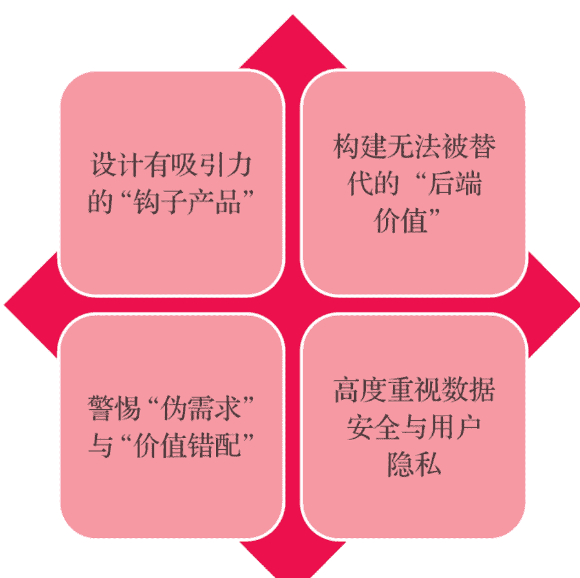
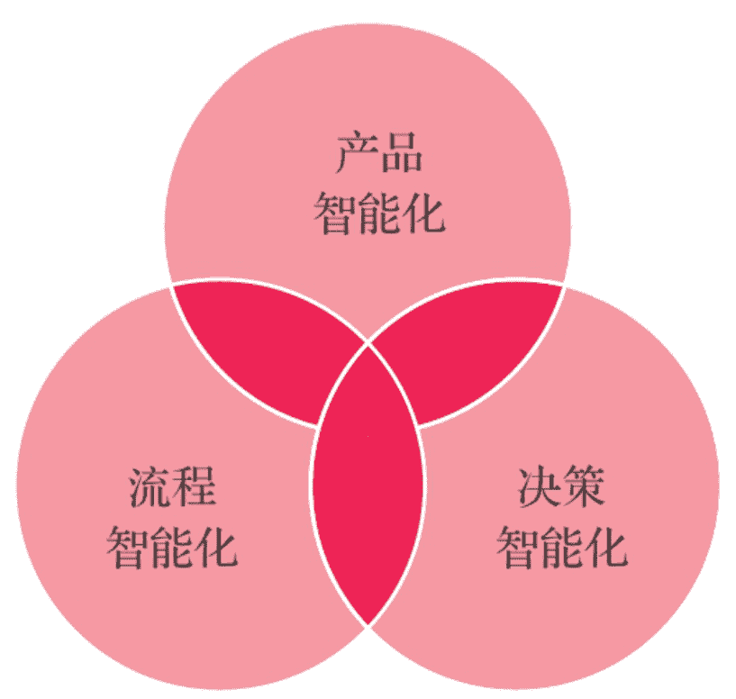
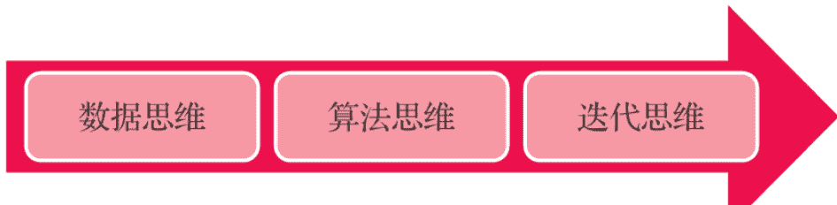
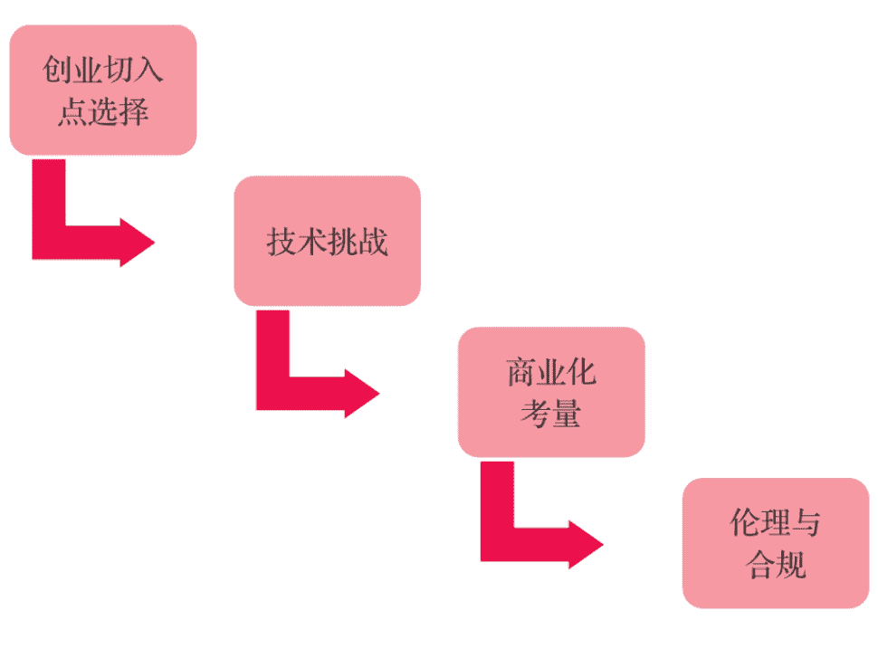

# AI时代创富法则：普通人如何实现财富自由

# 内容提要

未来五年，财富机遇藏于何处？本书为你精准导航。你将看清AI如何从“炫技”工具蜕变为各行各业的“新员工”，看清银发经济、单身社会与Z世代如何引领全新消费浪潮。本书揭示商业世界的范式革命：从“流量”到“留量”，从“规模至上”到“敏捷专业”，教你避开激烈竞争，成为价值链中不可或缺的“关键一环”。本书深入剖析绿色经济、健康赛道与体验消费的广阔蓝海，提供从机会甄别、模式设计到风险规避的一站式实战指南。本书拒绝空谈，只讲能落地的商机，助你在时代变革中，不仅能抓住趋势，更能赚到下一个五年的钱。

# 前言

你是否曾在某个深夜，看着朋友圈里别人晒出的成功，内心闪过一丝焦虑：时代的列车呼啸而过，我是否买对了车票？

你是否看着自己熟悉的行业日渐“内卷”，利润却薄如刀片，并不禁自问：除了拼命加班和降价竞争，未来的路究竟在何方？

你又是否被各种新概念——AI、元宇宙、Web 3.0轮番轰炸，感觉机会遍地，却不知从何入手，生怕一脚踏空，沦为泡沫的陪跑者？

如果你的心中曾有过这些疑问，那么，恭喜你，本书正是为你而写的。

我们正处于变革的浪潮下。过去四十年里，许多成功的商业故事的内核是“追赶”与“复制”：追赶成熟的商业模式，复制已被验证的产品形态。依靠流量红利、规模效应和资本助推，就能打造一个商业帝国。

然而，依靠旧地图，已经难以找到新大陆了。

那个确定的、线性的、可预测的商业世界正在崩塌。流量见顶，获客成本居高不下，“规模至上”的神话破灭，巨头环伺之下，后来者似乎已无路可走。

但，请别绝望。

危机的另一面，是前所未有的生机。旧的范式在瓦解，恰恰意味着新的规则正在建立。未来五年的商业图景，将不再由资本和规模独揽，而将被洞察力、敏捷性和价值创造力重新定义。

你会发现：最大的商机，不再藏在遥不可及的实验室“黑科技”里，而藏在AI赋能街角咖啡馆、社区小超市优化库存的“落地应用”中。

最具价值的商业模式，不再是“卖得更多”，而是如何让用户为一次深度城市漫步、一套个性化健康方案、一款用海洋塑料制成的环保球鞋而心动付费——他们买的不是产品，是体验，是意义。

本书带你穿越纷繁复杂的信息丛林。我们将一起，站在“浪潮之巅”，解读未来五年确定性强的宏观趋势——技术驱动、人口结构变化、价值观变迁与地缘新格局，看它们如何重塑每一个行业。

财富的潮水正在转向。你，是准备在旧沙滩上拾取最后的贝壳，还是与我们一同扬帆，驶向那片充满未知与机遇的蓝海？

# 第1章 变革浪潮前沿——解读未来五年的宏观趋势

我们正处于变革的浪潮下，过去科幻小说中的场景正加速变为我们的日常。未来五年，驱动变革的不再仅是飘在云端的理念，而是能真切创造价值、重塑每一个行业的落地技术。看懂这一波技术浪潮，不仅意味着不会被时代抛弃，更意味着能率先发现那片充满机遇的“新大陆”。

## 1.1 技术驱动：AI、生物科技、新能源的商业路径探索

未来五年的商业图景，将由一系列从前沿实验室走向广泛应用的硬核技术勾勒。AI、生物科技、新能源——这些曾被视作未来构想的“宏大命题”，正在褪去概念的光环，演变为触手可及的基础设施和商业工具。理解它们如何“落地”，就是从旁观者变为参与者的第一步。

### 1.1.1 AI：从“炫技”到“赋能”，成为行业“新员工”

AI，特别是生成式AI，已经超越了聊天机器人的范畴，正在作为“新员工”入职各行各业。麦肯锡预测，到2030年，生成式AI每年可为全球经济带来2.6万亿至4.4万亿美元的增长。其价值不在于替代人类，而在于承担那些重复、烦琐、需处理海量信息的工作，从而解放人的创造力。

比如在法律领域，AI助理可以通读万页案例，在几分钟内为律师起草合规审查报告；在医疗领域，AI影像系统能像不知疲倦的“超级实习生”一样，快速完成CT片初筛，将肺结节等病灶的检出效率提升50%以上，让资深医生专注于复杂诊断。你的商业机会就在于，为这些专业领域开发具备深度行业知识的“AI专家”。

### 1.1.2 智能体：你的“数字分身”

这是AI应用的下一站。智能体不再是简单的问答工具，而是能够自主理解、规划并执行复杂任务的“数字分身”。

个人智能体：一个能真正懂你的“数字合伙人”。它能根据你的工作会议，自动生成纪要并分派任务；能根据你的行程和偏好，自动预订机票和酒店；能分析你的财务状况，提供动态优化建议。“一人企业”将成为可能，因为你的智能体就是你的助理和分析师。

企业智能体：在企业内部，智能体将穿梭于不同系统之间。一个“智能招聘专员”能自动完成从简历筛选到初试安排的工作；一个“智能供应链管家”能实时预测需求波动，自动调整采购订单。咨询公司高德纳预测，到2026年，超过80%的企业将使用生成式AI。未来的商业效率，取决于你管理和调用智能体的能力。

| 个人智能体 | 企业智能体 |
| :--- | :--- |
| - 根据工作会议分派任务 | - 完成招聘工作安排 |
| - 根据行程和偏好预订机票和酒店 | - 预测需求波动，调整采购订单 |
| - 分析财务状况，提供建议 | |

### 1.1.3 做AI时代的“卖水人”：AI产业服务的确定性盈利逻辑

在每一次淘金热中，稳赚不赔的生意是卖铲子、卖牛仔裤和卖水。在AI浪潮中，为淘金者提供支持，是一个门槛低、需求稳定的赛道。机会领域如下。

- ①提示词工程与培训。向AI精准提问，将成为一项核心技能。为企业提供高质量的提示词库、培训员工有效使用AI，是一个潜在价值巨大的市场。
- ②数据清洗与标注。AI的“粮食”是高质量数据，为特定行业（如自动驾驶、智慧农业）提供专业、精准的数据服务，是产业链中的关键一环。
- ③行业解决方案集成。大多数传统企业不需要自己研发AI，它们需要的是“一站式AI解决方案交付”。将AI技术打包成解决具体业务（如客户服务、营销文案生成）痛点的SaaS（Software as a Service，软件即服务）产品，是潜在价值巨大的机遇。

### 1.1.4 生物科技：从治疗疾病到提升生活质量的消费化浪潮

生物科技正突破医院的围墙，从一个被动应对疾病的手段，转变为主动管理健康、提升生活质量的消费级产品。其核心是从“治疗”到“预防”与“改善”。

**案例：**

消费级基因检测市场方兴未艾。而下一步的机会，远不止于一纸报告。基于你的基因数据和肠道菌群检测结果，为你定制个性化营养方案、精准运动计划，正成为健康消费领域的新宠。专家指出，“我们正从‘一刀切’的大众健康时代，迈向高度个性化的‘精准健康’时代”。这意味着，每个人都能获得量身定制的健康管理服务，市场潜力高达万亿元级别。

### 1.1.5 合成生物学：通过细胞编程构建绿色产业新生态

合成生物学被誉为“第三次生物技术革命”，其核心是像编程一样设计、改造生物系统，来生产我们需要的物质。合成生物学是真正的“造物”技术。

**案例：**

美国公司Bolt Threads通过将蜘蛛丝蛋白基因植入酵母菌，让其发酵产出性能卓越的人造蜘蛛丝蛋白纤维，为时尚界提供了环保的新材料。

新加坡公司Shiok Meats则通过细胞培养技术，在实验室中培育出可食用的虾肉产品，旨在解决传统养殖业对环境的破坏问题。

**商业机遇：** 利用生物技术开发环保材料（如生物塑料、菌丝体皮革）、可持续食品（如人造肉）、新型药物和化妆品成分。这不仅是具备商业价值的赛道，更是用科技解决全球性问题的“向善商业”。

### 1.1.6 新能源：从“发电侧”到“系统侧”的价值大迁移

新能源的商业故事，已经从前几年的“造光伏板、造风机、造电动车”，转向了如何更智能、更高效地“管电、用电、交易电”。

构建“毛细血管”网络：未来的能源系统是集中式电网与无数分布式微电网共存的体系。新能源领域的商业机会在于为企业园区、商业楼宇提供“光伏发电+储能电池+智能充电桩”的一体化解决方案。这不仅能让用户用上便宜的绿电，还能在电网用电高峰时通过卖电获利。

虚拟电厂：虚拟电厂不是一个真实的电厂，而是一个能源物联网平台。它通过技术手段，将千家万户的屋顶光伏、储能电池、电动汽车、空调等分散的电力资源聚合起来，像一个“云端电厂”一样参与电网调度。

数字与前景：据国家电网测算，通过虚拟电厂实施削峰填谷，每千瓦时的成本仅为新建燃煤电厂的1/8～1/7。特斯拉的Autobidder平台就是一个成功的虚拟电厂，它自动联结成千上万个家庭储能用户，在电网需要时放电，为用户赚取收益。

你的机会：创业公司可以开发能源管理SaaS平台，帮助中小企业监测自身能耗并自动参与虚拟电厂项目，将省下的电费和获得的激励分成，作为新的收入。未来，每一栋建筑、每一辆电动汽车，都可能成为一个微型的“发电站”和“交易单元”。

技术驱动的商业机会，其内核正从“技术创新”本身，转向“应用创新”与“模式创新”。未来五年，最大的赢家未必是发明下一代AI算法的科学家，而极有可能是那个最懂如何用AI为街角咖啡馆优化库存、为本地工厂预测设备故障的“技术应用家”。当技术成为普惠性的基础设施时，你的洞察力、执行力与跨领域知识，就是将技术潜力转化为商业价值的点金石。

当我们在谈论市场时，本质上是在谈论人。未来五年，中国最确定无疑的商业机遇，就藏在人口结构的变化里，人口结构比例不是冰冷的数字，而是数亿人生活方式、消费选择和人生追求的集体转向。读懂他们，就是读懂未来五年的财富密码。

## 1.2 人口结构变化：银发经济、单身社会、Z世代消费观带来的全新需求

人口是商业世界的活水之源。未来五年的消费图景，将被三股强大而确定的人口力量深刻重塑：规模空前的老年群体、日益壮大的单身人群，以及正式登上消费主舞台的Z世代。他们不再是模糊的“细分市场”，而是需求鲜明，愿意为价值付费的“主力消费群体”。理解并满足他们的全新需求，是抓住未来商业机遇的关键。

### 1.2.1 银发经济2.0：从“生存型养老”到“享受型养老”

中国的银发浪潮正以前所未有的速度和规模袭来。到2035年，60岁及以上人口将突破4亿，占总人口比例超过30%。但今天的“新老人”与父辈截然不同：他们普遍拥有更高的教育水平、更丰厚的养老金，更开放的数字生活态度和更强烈的“补偿性”消费意愿。他们的需求，正从基础的物质需求，全面升级为精神富足、社交充实和生命质量的提升。

**案例：**

“时尚奶奶团”在社交媒体上的走红，绝非偶然。这群平均年龄超过65岁的女性，身着旗袍、妆容精致、步履从容，打破了社会对老年群体的刻板印象。她们代表的正是“银发经济2.0”的核心——拒绝被定义，追求美、社交和自我实现。围绕她们产生了老年时装、老年化妆教学、老年形象管理和老年主题旅游等一系列商业机会。

### 1.2.2 “数字鸿沟”变“数字红利”：科技适老的千亿元级蓝海

过去我们担心老年人被数字时代抛弃，而现在，商业机会在于主动帮助他们拥抱数字生活。这并非简单地放大手机字体，而是对他们的核心生活场景进行“润物细无声”的智能化、便捷化改造。

数据与机遇：根据QuestMobile的数据，中国银发移动网民规模已超1.5亿人，且人均使用时长仍在增长。商业机会体现在以下方面。

- 智能康护硬件：如具备跌倒检测、心率监测和一键呼救功能的智能手表/手环；能够记录服药时间并自动提醒的智能药盒。
- 适老化App与内容：界面极简、操作引导清晰的购物、短视频、社交App；专注于养生、戏曲等内容的垂直社群平台。
- 居家安全与便捷服务：建立简单的传感器网络，让子女能远程了解独居父母的起居异常（如长时间未开启冰箱）；提供上门助浴、居家改造（如安装扶手、铺设防滑地板）等专业服务。专家指出：“为老年人设计的产品，必须是‘科技温情主义’的典范。”

### 1.2.3 单身社会：“一人经济”催生完整商业生态

根据国家统计局与民政部2024年发布的人口数据显示，中国的单身成年人口已高达2.4亿，其中超过7700万人处于独居状态。“单身社会”不再是一种单纯的社会现象，而是发展为一个完整的、庞大的商业体系，催生了一切围绕“个体”消费需求展开的全新商业生态。

生活单元的微型化：“一人食”自热火锅、迷你电饭煲、小容量冰箱等产品畅销；200毫升的红酒、小包装的米粮成为超市新宠。房地产市场中，对高品质的小户型公寓（30～50平方米）的需求旺盛。

情感消费与陪伴经济：宠物产业是最大的受益者之一。从宠物食品、智能猫砂盆到宠物殡葬，这条产业链愈发精细。据《2023年中国宠物行业白皮书》显示，单只犬年均消费高达3280元。此外，虚拟偶像、陪伴型游戏、互动直播等，也成为情感寄托的重要载体。

### 1.2.4 悦己主义：为“自我取悦”买单成为新常态

单身人群的消费动力之一是“悦己”。他们不愿为取悦他人或符合社会期待而消费，而是更关注自身的感受、成长与即时快乐。

**案例：**

国内新锐香氛品牌“观夏”的成功，源于精准地捕捉到了这股“悦己”风潮。它贩卖的不仅是气味，更是一种“私人情绪疗愈”的体验。消费者购买一款名为“昆仑煮雪”的香薰，是为了在都市生活中收获一刻内心的宁静与欢愉。这种为情绪、氛围和片刻欢愉付费的意愿，催生了小众香氛、高品质家居用品、精品咖啡和冥想App等“小而美”赛道。

### 1.2.5 Z世代登场：要“圈层归属感”，不要“大众爆款”

Z世代已成为消费市场的新引擎。他们是在物质丰裕的时代于网络环境中成长起来的一代，其消费行为呈现出鲜明的“圈层化”特征。他们通过消费来寻找身份认同和社群归属感。

数据洞察：哔哩哔哩（以下简称“B站”）、小红书等平台是观察Z世代的有效窗口。无论是“二次元”“潮玩”、汉服、户外露营，还是冲浪、“剧本杀”，每一个兴趣圈层都自成体系，拥有独特的语言、消费符号。波士顿咨询公司的研究指出，“Z世代中，超过60%的消费直接受到其所在圈层文化的影响”。他们鄙视“什么火买什么”的盲从，崇尚专业与独特。

### 1.2.6 意义消费：为价值观和可持续发展投票

Z世代及更年轻的消费者是“清醒”的一代，他们用消费行为为自己认同的价值观投票，品牌的吸引力不再仅源于产品本身，更来自其背后的品牌故事、价值理念和社会责任。

**案例：**

新锐饮料品牌“好望水”，其品牌名蕴含“美好愿望”的寓意，产品设计融入国风美学元素，并通过联名非物质文化遗产、发起青年艺术家扶持计划等方式，构建了一个“传递美好”的品牌形象。这比单纯强调口味更能打动年轻消费者。同样，使用环保材料生产、推行公平贸易模式、公开供应链信息以保证透明化的品牌，会更容易获得年轻消费者的信任和青睐。“他们购买的不仅是产品，更是一个‘理想世界’的入场券。”

人口结构的变迁，如同缓慢但力量巨大的洋流，正悄然改变商业世界的版图。未来的赢家，将是那些能真正深入这些新兴人群的生活场景，理解他们细腻的情感需求，并用产品与服务为其提供解决方案的企业。无论是让一位老年人安享有尊严、有乐趣的晚年，还是支撑一个年轻人享受单身生活，抑或是为Z世代的爱好提供“装备”与“舞台”，其中都蕴藏着下一个五年里最确定、最有潜力的商业机遇。

当货架上的商品变得琳琅满目时，当“是否买得起”不再是问题时，人们开始用钱包为价值主张投票。一种静悄悄的革命正在发生：消费的核心，正从对物质占有的炫耀，转向对生命体验的丰富。未来五年，最大的商机将不再源于卖出了多少件商品，而在于为用户的生活注入了多少意义与美好。

## 1.3 价值观变迁：从“拥有更多”到“体验更好”，健康、环保、精神消费的崛起

我们正经历一场深刻的消费价值观变迁。在物质丰富的背景下，尤其是年轻一代消费者，开始重新审视消费的意义。“更多”不再是成功的唯一象征，“更好”成为新的追求。“更好”体现在三个方面：更健康的身心、更独特的精神体验以及对环境更友好的生活方式。这种价值观正在重塑从产品设计到品牌营销的每一个环节。

### 1.3.1 从占有到体验：为“瞬间”付费的时代来临

传统的消费逻辑是“购买即拥有”，占有带来的自豪感是核心驱动力。而新的逻辑是“购买即经历”，消费的目的是获取值得回忆和分享的体验。这种体验带来的满足感，远比一件物品的保质期长。

**案例：**

根据麦肯锡的调研，超过70%的全球消费者认为，体验比物质产品更能带来幸福感。在中国，这一趋势尤为明显。以旅游为例，传统的“打卡式”观光正在被“沉浸式”体验取代。例如，在阿那亚这样的社区，消费者购买的不仅是住宿，更是一种包含了孤独图书馆、音乐会、艺术展和社区社交的“精神归属”套餐。人们愿意为这种完整的生活方式体验支付溢价。正如未来学家阿尔文·托夫勒所预言：“服务经济的下一步是走向体验经济，商家将靠提供体验服务取胜。”

### 1.3.2 健康即终极奢侈品：从“治病”到“防病”的消费升级

健康的内涵正在被极大拓宽。它不再仅仅是“不生病”，而是一种积极的身心状态，涵盖了身体机能、营养、睡眠、情绪和外表等方面。消费者，特别是高净值人群，愿意为此投入重金。

**案例：**

- 精准营养：过去人们购买维生素可能是“跟风”，现在则是基于基因检测或肠道菌群检测报告。像LemonBox这类品牌，基于在线问卷调查结果为用户提供定制每日营养包，将健康管理融入日常生活。
- 健康监测科技化：智能手表不是仅有计步功能，而是成为持续监测心率变异性、血氧饱和度、睡眠质量的健康管家。这些数据正成为消费者做出健康决策（如调整作息、就医）的依据。

市场规模：全球健康研究所（GWI）数据显示，全球健康经济规模已超过4.5万亿美元。这意味着，任何能与“健康”建立强关联的产品或服务，都处于风口。

### 1.3.3 精神消费崛起：为“内心丰盈”买单

在物质需求被充分满足后，人们开始向内寻求精神的慰藉、成长的动力和心灵的宁静。为知识、情绪价值和心灵成长付费，成为一项重要的消费预算。

- 知识付费2.0：用户不再满足于碎片化信息，而是追求系统性的、能带来实际改变的知识体系。例如，付费参加能提供实操指导和成果检验服务的写作训练营、数据分析课程等。
- 心理健康服务：线上心理咨询平台（如简单心理）、正念冥想App（如潮汐）用户量激增。这表明，维护心理健康正像健身一样，成了一种日常自律行为。
- 情绪疗愈经济：能治愈人心的产品大受欢迎，例如，白噪声器、解压玩具以及拥有美好寓意的植物和艺术品。

### 1.3.4 环保不再是口号，而是购买的“许可证”

对于新一代消费者，尤其是Z世代，环保和可持续性已从一个高尚的道德选择，演变为对一个负责任品牌的基本要求。他们通过消费来支持与自己价值观一致的品牌，从而推动社会向善。

**案例：**

环保个护品牌“Tangent GC”来自瑞典，其产品强调使用天然有机成分、可生物降解的包装，并公开披露成分来源。它吸引的正是那些关注成分安全并希望自己的消费行为对环境友好的消费者。另一个例子是二手奢侈品平台红布林的兴起，它让“循环时尚”成为一种既环保又时髦的消费选择。

> 一位资深品牌顾问指出：“过去，环保是品牌锦上添花的‘故事线’；现在，它是决定品牌能否进入消费者选择清单的‘入场券’。缺乏可持续性承诺的品牌，在未来五年将面临被边缘化的风险。”

### 1.3.5 意义消费与身份构建：用购买行为定义“我是谁”

今天的消费可视为一种“投票”行为。消费者通过购买某个品牌的产品，来表达自己所支持的价值观，并以此构建和强化自己的社会身份。

**案例分析：** 选择国产运动品牌李宁，对许多年轻消费者而言，不仅仅是买服装，更是在表达对国潮设计的认可和文化自信。购买雇用残障人士的品牌的产品，是在支持社会公平。消费者不仅在购买产品本身的功能，更是借购买产品表达对某种价值观的支持。他们希望品牌能成为“理想社会”的共建者。

### 1.3.6 新商业逻辑：从“贩卖产品”到“经营信任”

在消费价值观深度变迁的背景下，旧的商业逻辑正在失效。成功的企业不再是简单的产品供应商，而是用户价值观的支持者和美好生活方案的提供者。

- 价值主张：从“我们卖什么”转向“我们和你共同相信什么”。
- 品牌沟通：从单向的广告轰炸，转向双向的、透明的、持续的对话。
- 产品设计：从追求功能堆砌，转向关注用户体验，以及产品背后的伦理和故事。

当价值观成为新的货币时，商业竞赛就从功能与价格层面，跃升至情感与意义层面。未来五年的创业者，需要是敏锐的“价值观洞察者”和“美好生活策划师”。你的任务，不再是提供更多的产品，而是为用户设计更值得回忆的体验，提供更能提升生命质量的健康方案，以及打造更能彰显用户精神追求的消费选择。谁能赢得用户的认同，谁就能赢得未来市场。

## 1.4 地缘与经济格局：全球化重构与区域化机遇，创业者如何顺势而为

过去几十年，“全球化”意味着企业可以在全球范围内寻找成本最低的生产地、最高效的供应链，并将产品卖往世界各地。然而，地缘政治紧张、疫情冲击和对供应链韧性的重新审视，正在终结这种单极的全球化叙事。我们正进入一个“全球化重构”的新阶段：一方面，全球产业链的完全脱钩不具备现实可行性；另一方面，基于地理邻近、政治互信和产业互补的“区域化”正在加速。理解这一宏观格局的巨变，并从中找到自己的位置，是未来五年创业者必须完成的任务。

### 1.4.1 “韧性”取代“效率”：供应链安全成为新优先级

过去，企业供应链管理的核心词是“效率”——追求成本最低和即时生产。而现在，核心词正在转变为“韧性”——应对冲击、快速恢复和灵活调整的能力。地缘政治风险和“黑天鹅”事件让企业意识到：一条虽成本略高但更安全、更短，更可控的供应链，远比一条长而脆弱的“完美”供应链更有价值。

**案例：**

根据高德纳的调查，超过80%的企业表示将在未来两年内，优先考虑供应链的韧性和灵活性，而非单纯的效率。一个典型案例是苹果公司。它正加速将其部分产能从中国转移到印度和越南。这并非简单的“撤离”，而是构建一个“中国+N”的备份体系，以增强其应对单一地区风险的能力。

启示：这种“近岸外包”或“友岸外包”的趋势，为东南亚、墨西哥和东欧等“近岸”区域带来了巨大的发展机遇。中国的创业者可以关注这些地区的配套产业、物流服务、本地化运营支持等“卖水”生意。

### 1.4.2 “区域化”机遇：在“朋友圈”里做生意

当全球大循环遇到阻力时，区域性的小循环正焕发勃勃生机。以《区域全面经济伙伴关系协定》（RCEP）、《美墨加三国协议》（USMCA）等为代表的区域性贸易协定，正在创造新的经济引力中心。对于创业者而言，深耕一个区域市场，比试图征服全世界更为务实。

**案例：**

中国的跨境电商巨头希音（SHEIN）和拼多多（Temu）的早期成功，很大程度上得益于对北美单一市场的极致深耕。而未来五年，RCEP区域（尤其是东南亚）将是下一个黄金市场。这里拥有年轻的人口结构、良好的数字经济基础和与中国文化相近的优势。

机遇不在于把“中国货”简单卖过去，而在于“深度本地化”。

- 产品本地化：根据东南亚炎热潮湿的气候和当地文化，开发合适的服装款式和食品。
- 内容本地化：在TikTok等平台上，借助当地语言和网红，制作符合当地审美的内容。
- 运营本地化：建立本地仓库、客服团队，与本地支付平台和物流伙伴紧密合作。

### 1.4.3 “国产替代”的逻辑深化：从“备胎”到“主力”

在关键技术领域，出于国家安全和产业安全的考量，“国产替代”已经从一道“选答题”变为一道“必答题”。这不仅仅是政府号召，更是市场自发的、基于供应链安全考虑的刚性需求。

**领域与机遇：** 这一趋势已从最初的芯片、操作系统，延伸到工业软件、科学仪器、高端材料，核心零部件等“卡脖子”领域。

**创业方向：** 这为专精特新企业提供了历史性机遇。创业者可以聚焦以下两点。

- 替代性开发：针对国外某款垄断性的工业设计或仿真软件，开发出更贴合中国工程师使用习惯、价格更亲民的国产版本。
- 缝隙市场切入：即使无法完全替代，也可以在某一特定功能或模块上做到极致，成为巨头供应链中不可或缺的“关键一环”。

### 1.4.4 “双循环”下的定位：“内外兼修”，以内促外

中国提出的“以国内大循环为主体、国内国际双循环相互促进的新发展格局”，是应对全球格局变化的顶层设计。对于创业者而言，这意味着需要重新思考业务的战略重心。

**战略解读：**

首先，你的产品或服务必须能在庞大的国内市场站稳脚跟，接受最严格的市场检验并实现盈利。内循环是根基和底气。然后，利用在国内市场打磨成熟的商业模式、供应链优势和产品力，有选择地出海。外循环是增长的放大器。

**案例：**

中国的新能源汽车产业是“双循环”的典范。它首先在国内激烈的市场竞争中锤炼出了强大的产品力（代表性品牌如比亚迪、蔚来、小鹏），然后才大举进入欧洲、东南亚等海外市场。“以内促外”让中国的新能源汽车产业出海时具备了足够的底气和竞争力。

### 1.4.5 创业者的新思维：从“全球公司”到“全球连接的本土公司”

在新的地缘经济格局下，成功的创业者不需要成为“全球公司”，而应立志成为“全球连接的本土公司”。这意味着你的业务有坚实的本土根基，同时又具备与全球其他区域市场进行资源、技术和人才双向连接与协同的能力。

**必备能力：**

- 地缘政治敏感度：需要像关心天气预报一样，关心国际关系和主要国家的产业政策。
- 敏捷的供应链布局：采用“多节点、分布式”的供应链，避免把所有鸡蛋放在一个篮子里。
- 跨文化管理能力：若布局海外市场，必须具备管理多元文化团队、适配不同区域市场文化偏好的能力，实现本土化运营与全球化布局的平衡。

### 1.4.6 顺势而为的行动框架

面对复杂的格局，创业者可以采纳一个简单的行动框架。

1. 重新绘制你的世界地图：不再只看重欧美，将目光更多投向RCEP、“一带一路”沿线等新兴区域。
2. 审查你的供应链风险：识别你的业务中最依赖单一来源的环节，并开始寻找备选方案。
3. 选择你的“主战场”和“试验田”：明确你的核心收入来源（即“主战场”），并选择一个文化、地理与“主战场”相近的区域作为出海的“试验田”，集中资源进行深度开发。
4. 构建“盟友”网络：在新的市场，积极寻找本地合作伙伴，他们能帮你绕过无数看不见的“坑”。

全球化重构不是世界运行的终点，而是世界运行规则的一次重大升级。它带来的不是机会的减少，而是机会的重新分配。过去的机会在于利用全球化带来的市场“均质化”红利，未来的机会则在于把握区域化催生的市场“差异性”价值。成功的创业者，将是那些能立足本土、眼观区域和心连全球的“冲浪者”，他们能敏锐地感知地缘经济洋流的细微变化，并巧妙地调整自己的航向，借着区域化的新浪潮，驶向更广阔的商业蓝海。

# 第2章 范式转移——旧商业模式的崩塌与新规则的建立

过去的成功路径，可能正是未来失败的原因。我们正站在商业世界的转折点上，那些曾经被奉为圭臬的做法——追逐流量、追求规模、“通吃”市场——正在纷纷失效。旧的商业大厦摇摇欲坠，新的地基已经动工。本章将带你看清这场静悄悄的革命，掌握在新世界里生存和发展的新规则。

## 2.1 从“流量思维”到“留量思维”：构建用户社群与提高品牌忠诚度

过去十年，无数企业家和创业者都痴迷于一个词：流量。仿佛生意的一切问题，都可以通过获取更多流量来解决。于是，我们见证了竞价排名、电商直通车、信息流广告的价格被推高，获客成本逐年攀升。根据行业报告，早在2022年，某些电商平台的单次点击成本就已突破5元，而一个有效新用户的获取成本甚至高达数百元。这是一种典型的“河流捕鱼”模式：河水（流量）如浪潮般涌来，企业却必须在同一处水域（平台）持续撒网，一旦停止付费买量，流量的水流便会即刻中断，生意也随之陷入停滞。

然而，商业的底层逻辑正在发生深刻的变化。当流量红利见顶，消费者的信任阈值提高，那种“一次性交易”的流量思维，已然行不通。未来的五年，成功的商业模式将不再是“捕鱼”，而是“养鱼”。你需要挖掘私有池塘——用户社群，精心运营，让用户自愿留下来，持续产生价值，甚至主动为你引来活水。这场从“流量”到“留量”的范式转移，是所有创业者必须上的第一课。

### 2.1.1 为何“流量思维”正在失效

流量思维的失效，并非偶然，而是由三个不可逆转的趋势共同导致的。

首先，是流量成本的不可持续性。正如前面所述，公域流量的价格已被竞拍到高位，对于绝大多数中小企业而言，依赖买量无异于为平台打工，利润被吞噬殆尽。其次，是消费者注意力的碎片化与广告免疫。现代人平均每天要接收上千条广告信息，对“硬广”的容忍度极低，简单的产品曝光，再也无法直接促成购买行为。最后，也是最重要的一点，是消费者需求的升级。他们已不仅仅购买产品本身的功能，产品背后的价值观、情感和社群归属感都会影响他们的购买决策。冰冷的、一次性的交易关系，无法满足消费者的深层需求。

这三个趋势共同指向一个结论：拥有用户的“关系深度”远比拥有“用户数量”更重要。一个粉丝有十万人但无人互动的公众号，其商业价值远不如一个粉丝只有五千人但互动活跃、粉丝信任度极高的付费社群。

### 2.1.2 “留量思维”的核心：深化关系

什么是“留量思维”？其核心并非聚焦于用户的“获取”，而是落脚于用户的“沉淀”与价值的“激活”。这一思维的目标是建立一种持续的、可信的甚至是温暖的用户关系，最终实现客户终生价值（Customer Lifetime Value, LTV）的最大化。

“留量”的阵地，就是我们常说的“私域”。它可能是一个微信社群、一个企业微信好友列表、一个品牌会员App，或者一个成员志同道合的俱乐部。在这里，你与用户是“直接连接”的，无须向第三方平台支付“过路费”，可以反复、免费、自由地触达他们。

衡量“留量”做得好不好的关键指标，不再是曝光量或点击率，而是复购率、转介绍率和互动时长。当你的用户愿意多次复购你的产品，并愿意将你推荐给朋友，甚至每天花时间在你的社群里交流时，你就真正拥有了“留量”。数据显示，提升仅仅5%的客户留存率，就能为公司带来25%到95%的利润增长。这，就是“留量”的惊人威力。

### 2.1.3 实战路径：从零构建你的用户社群

构建一个有生命力的社群，绝非建一个微信群并每天在群里发布广告那么简单。它是一个系统工程，需要精心的设计与运营。

1. 找到共同的价值锚点：一个社群不能只围绕“买便宜货”建立，那叫“羊毛群”，毫无用户忠诚度可言。你必须找到用户共同的价值观或兴趣点。例如，lululemon的价值锚点是“热汗生活”和“正念”；户外品牌Patagonia的价值锚点是“环保主义”与“地球税”。
2. 设计清晰的入群门槛与仪式：轻易得到的东西，往往人们不会珍惜。需要一定的入群门槛来筛选出同频的人。这个门槛不一定是金钱，可以是知识（如完成一个课前测试）、身份（如产品使用者）或任务（如邀请好友助力）。新人入群时要有欢迎仪式、发放社群专属权益，让成员感受到“身份”的转变——从普通用户变为“自己人”。
3. 持续提供价值：社群不是广告牌，而是价值交换平台。你需要持续为成员提供价值。价值可以体现在以下方面。
    - 内容价值：行业干货、独家资讯、“大咖”直播。
    - 产品价值：新品内测权、社群专属折扣。
    - 关系价值：组织线下活动，促成成员之间的交流与合作。
    - 情感价值：倾听成员的烦恼，为成员提供情感支持和归属感。
4. 激发成员的参与热情：最高级的运营，是让成员自己运营自己。鼓励成员在群里提问、分享和帮助他人。可以设立“群红”机制，表彰活跃成员。还可以邀请成员参与产品研发，征集他们的意见，让他们感觉品牌和社群的发展也有自己的一份功劳。

### 2.1.4 品牌忠诚度：从“交易”到“朋友”

构建社群的终极目标，是培养坚不可摧的品牌忠诚度。当用户与你的关系从“买卖方”变为“同道中人”，甚至“朋友”时，商业的护城河就建成了。

打造品牌忠诚度，需要层层推进。

- 利益忠诚：这是基础层，通过会员积分、折扣、赠品等物质利益留住用户。但这类忠诚很脆弱，对手给出更多物质利益，用户就可能流失。
- 情感忠诚：通过品牌故事、一致的价值主张、用心的服务，与用户建立情感纽带。例如，苹果用户对品牌的认同，已经超越了产品功能，成为一种身份象征。
- 归属感忠诚：这是最高层级。用户将与品牌的互动视为其生活的一部分，甚至是精神家园。他们捍卫品牌，主动传播，不容他人诋毁。

国内护肤品牌“林清轩”的案例极具代表性。它采取“门店导购+添加企业微信”的模式，将用户沉淀至私域。导购不再是推销员，而是“护肤顾问”。他们会记得用户的肤质、上次购买的产品，并提供个性化的护理建议。疫情期间，当绝大多数线下门店停止营业时，正是这数十万名私域用户，贡献了品牌绝大部分的销量，其私域用户的复购率超过50%，这就是将“交易关系”成功转化为“信任关系”的成果。

### 2.1.5 衡量成功：诊断你的“留量”健康度

是时候改变你的数据看板了。请密切关注以下指标，以诊断你的“留量”健康度。

- 复购率：你的用户多久复购一次？这直接反映了用户满意度和忠诚度。
- 社群活跃度：不仅要看发言人数，更要看发言质量与互动深度。
- 净推荐值：有多少用户愿意向朋友或同事推荐你的品牌？这是衡量用户忠诚度的黄金标准。
- 客户终生价值：一个客户在整个生命周期内能为品牌带来多少总收入？品牌应努力让客户终生价值远高于客户获取成本。

### 2.1.6 思维转变：从“收割用户”到“滋养用户”

这场范式转移要求创业者完成根本的心态转变：从“收割用户”到“滋养用户”。

你需要将用户视为需要被理解和服务的“人”，而非流量报表上冰冷的“数字”。你的每一次互动、每一款产品、每一项服务，都应以提升他们的体验为目标。当你真心实意地“滋养”你的用户时，商业上的回报，只不过是随之而来的、自然而然的结果。

在下一个五年，最值钱的资产，不是银行存款，而是你私域里那些信任你、热爱你、愿意与你共同成长的用户。

## 2.2 从“规模至上”到“敏捷专业”：小微企业的“超级个体”与“隐形冠军”之路

曾经，“做大做强”是商业世界里毋庸置疑的成功信条。企业家的梦想是打造商业帝国，追求员工人数、办公面积和市场份额的无限增长。然而，对于今天的绝大多数创业者而言，这条“规模至上”的道路正变得日益凶险。巨头们凭借资本和流量的碾压性优势，在“大而全”的战场上筑起了高墙，与其硬碰硬无异于以卵击石。

但危机之中孕育着新机。商业生态正在分化，一种全新的生存哲学正在崛起：不做笨重的“大象”，而做敏捷的“猎豹”；不追求扩大规模，而追求提升专业能力。未来能否获得商业成功，不再取决于你能否服务所有人，而取决于你能否在某一细分领域成为不可替代的存在。这条发展路径，主要通向两座耀眼的灯塔：一是“超级个体”，二是“隐形冠军”。

### 2.2.1 “规模陷阱”：为何传统路径已然失效

对于初创和小微企业而言，盲目追求规模隐藏着三大致命陷阱。

首先，是管理成本的指数级增长。随着团队扩张，沟通成本、协调成本会急剧上升。所谓“大公司病”——流程僵化、反应迟缓、创新乏力——会迅速扼杀初创期的活力。许多公司不是死于外部竞争，而是死于内部管理的混乱。

其次，是资源与注意力的极度分散。试图服务更广阔的市场，意味着产品要满足更多样的需求，营销要面对更复杂的人群。这会导致企业失去焦点，核心价值被稀释，最终在每个战场上都缺乏竞争力。

最后，是与巨头竞争的绝对劣势。在标准化、可复制的领域，大公司可以利用其规模效应和品牌优势轻易进行“降维”打击。当你辛苦摸索出一套可行的商业模式时，巨头只需投入你融资额的一小部分，就能快速复制并放大该模式，让你瞬间失去生存空间。

因此，新入局者必须彻底放弃“做得跟××一样，但比它更便宜”的旧思路，转而思考“我能做到哪些××根本做不到的事”。

### 2.2.2 新生存哲学：敏捷与专业的压倒性优势

在高度不确定性的时代，“敏捷”与“专业”成为小微企业最强大的武器。

“敏捷”意味着极低的试错成本、快速的决策机制和灵活的转向能力。一个三五人的小团队，发现一个需求，可能一周内就能推出MVP（Minimum Viable Product，最小可行产品）进行市场测试，并根据反馈在几天内完成迭代。而一个大公司要走完立项、评审、研发，测试的流程，可能就需要三个月。这种“船小好掉头”的优势，让小微企业能够紧紧抓住转瞬即逝的市场机会。

“专业”则是在一个极其狭窄的领域内，建立起极高的知识壁垒和技能壁垒。你不需要什么都懂，但必须在某一点上懂得比大部分人都要多。当你的专业度足够高时，你就拥有了定价权，客户愿意为你的“专业解决方案”支付溢价，你将不必在价格上与平庸的对手纠缠。

将“敏捷”与“专业”结合，你就能在巨头的视野盲区里，建立起一个坚固而利润丰厚的“堡垒”。

### 2.2.3 路径一：成为“超级个体”——一人就是一家公司

#### 核心能力为技能产品化与个人品牌化：

超级个体的核心能力之一，是能够将自身的知识、技能或才华，封装成标准化的“产品”或“服务”。例如，一位优秀的UI（User Interface，用户界面）设计师，不再只接项目，而是开发出一套“设计系统课程”或“设计组件库”来销售。同时，他们通过社交媒体（如小红书、抖音、视频号）持续输出专业内容，建立强大的个人品牌，从而吸引客户，而非寻找客户。

#### 典型画像与案例：

超级个体可能是独立开发者——专为某个细分行业（如餐饮、教育）开发定制化SaaS工具，年收入可达数百万元；资深商业顾问——为企业提供“私董会”轻咨询服务，一个项目收费数十万元；垂直领域知识博主，如专注于“跨境母婴用品选择”的专家，通过运营付费社群和提供咨询服务，实现收入远超白领。

一个典型案例是，某个前4A广告公司的创意总监，在抖音上开设账号，专门教授中小企业主“如何用手机拍出高级感产品视频”。他将复杂的广告美学知识转化为通俗易懂的教程，吸引了超过50万个粉丝，其开发的199元的视频课程售出数万份，并衍生出千元级的付费社群和万元级的企业内训服务，以一己之力创造了堪比一家小型广告公司的收入。

#### 关键工具与思维：

超级个体善用各类提效工具（如Notion、飞书）管理项目，利用外包平台（如猪八戒、Upwork）将非核心工作分发，从而将全部精力聚焦于核心价值创造。他们的思维是“杠杆思维”，用内容、产品和网络放大自己的个人影响力与专业能力。

### 2.2.4 路径二：成为“隐形冠军”——小领域里的王者

“隐形冠军”的概念源于德国，指那些在某个利基市场做到全球顶尖，却不被普通大众所熟知的中小企业。在中国，“隐形冠军”这条道路同样广阔且充满机遇。

“隐形冠军”通常具备三大特征：①极度专注，只专注于一个极其细分的产品领域，比如专门生产工业缝纫机的某个精密零件，或者专门做某种功能特殊的传感器；②深度创新，不追求颠覆式创新，而是进行持续的、深度的“微创新”，在材料、工艺，设计上不断打磨，做到极致；③具有全球视野，虽然产品小众，但面向全球市场。通过跨境电商等渠道，“隐形冠军”能将产品卖给全世界需要它的人。

**典型画像与案例：**

“隐形冠军”可能是专精特新“小巨人”企业，掌握关键核心技术，是产业链中的重要一环；细分消费品牌，比如专做“露营用轻量化钛餐具”的品牌，可能只靠几十个SKU（Stock Keeping Unit，存货单位）就能做到细分品类全网销量第一；关键部件供应商，比如有公司专门生产“手机无线充电测试设备”，全球主要的手机品牌都是它的客户。

一个著名的例子是德国伍尔特公司，它只生产螺丝、螺母等紧固件，却做到了全球第一，年收入超过百亿欧元。在中国，浙江有家企业专门生产“纺织机上的一个核心陶瓷零部件”，全球市场占有率超过60%，利润率高达30%以上，是典型的“隐形冠军”。

#### 构建壁垒：

“隐形冠军”的护城河在于其难以逾越的专业壁垒。这可能是技术专利、独有的工艺流程，或是长期积累的行业数据库。同时，在一个小领域里，口碑效应极其强大。“隐形冠军”成为头部客户的首选后，就会形成极强的客户黏性，后来者极难撼动。

### 2.2.5 如何选择与开始：找到你的利基市场

无论是成为超级个体还是“隐形冠军”，起点都是找到一个好的利基市场。一个好的利基市场应具备以下特点。

- 需求真实且迫切：市场虽小，但客户愿意为需求付费。
- 有足够的利润空间：能够支撑起你作为专家的溢价。
- 巨头看不上或做不好：市场规模对巨头没有吸引力，或者其庞大的体系无法满足该市场的个性化需求。
- 你自身有优势或兴趣：你在此领域有优势或充满兴趣，能够支撑你长期深耕。

在利基市场，务必遵循“单点突破”原则。放弃做一个平台的想法，集中所有资源，服务好一个极小、极具体的客户群体，将你的产品或服务做到令人惊叹的程度，形成初始的口碑和现金流。

### 2.2.6 未来的组织形态：分布式与网络化

这一范式转移，也预示着未来组织形态的演变。无论是超级个体还是“隐形冠军”，都不是孤岛。其将通过网络化协作，形成一个动态、高效的商业生态系统。

一个超级个体可以同时是多个项目的顾问，一个“隐形冠军”可以为核心企业提供关键部件。未来的商业图景，将不再是巨型的“航空母舰”独霸“海洋”，而是由无数敏捷专业的“驱逐舰”“潜艇”“补给舰”组成的“特混舰队”，它们协同配合，共同展现出更强大的战斗力与适应性。

选择成为“超级个体”或“隐形冠军”，不仅仅是选择一种商业模式，更是选择一种更自主、更专业、更可持续的商业人生。在下一个五年，深度，就是你的护城河；专业，就是你的通行证。

## 2.3 价值链重构：在巨头生态中寻找缝隙，做“关键一环”而非“通吃者”

当我们审视当下的商业格局时，会发现一个鲜明的特征：巨头们已经完成了主要平台和生态的构建。从腾讯的社交与内容生态、阿里巴巴的商业与物流生态，到抖音的兴趣内容生态、亚马逊的全球电商云服务生态，这些数字时代的“基础设施”已然渗透到商业世界的每一个角落。对于新入局的创业者而言，打造下一个淘宝或微信来颠覆它们，不仅不切实际，更是一种资源的巨大浪费。然而，这绝不意味着没有机会。恰恰相反，最大的机会正隐藏在这些庞大生态的“缝隙”之中——通过价值链重构，成为生态中不可或缺的“关键一环”，而非妄想做一个“通吃者”。

### 2.3.1 理解价值链：从线性链条到价值网络

传统的商业思维是线性思维：一家公司控制从原材料采购、产品设计、生产制造，营销销售到售后服务的全部或大部分环节，追求对链条的完全掌控，就像福特汽车在巅峰时期甚至拥有自己的橡胶园和钢铁厂。然而，在高度专业化、分工精细的今天，这种“大而全”的模式显得笨重且低效。

现代商业已经演变为“价值网络”的竞争。巨头们扮演的是“生态主”的角色，它们搭建了一个基础平台（如微信、抖音、亚马逊），定义了基本的游戏规则。但这个平台本身是“不完整”的，它需要无数外部伙伴来共同填充内容、提供服务、满足用户千变万化的长尾需求。这就好比一个巨大的商业综合体（生态主），它需要引入各式各样的专卖店、餐厅、电影院（关键一环）来实现共同繁荣。你的成功，不再依赖于自建一个商业综合体，而是取决于你能否在这个繁华的综合体里，开出那家受欢迎、无可替代的特色店铺。

### 2.3.2 生态的“缝隙”：为何巨头给你留出了机会

巨头在其生态中留下大量“缝隙”，是由其基因和商业模式的内在逻辑决定的。

首先，是巨头的“标准化”悖论。巨头平台要服务数亿甚至数十亿用户，必须提供标准化、通用化的基础服务。它们无法也不愿意去满足每一个微小、个性化、非标的需求。比如，微信提供了基础的群聊功能，但无法为每一个行业定制专属的客户管理工具；抖音提供了视频推荐算法，但不会为每一家餐厅量身打造本地营销方案。这些“标准化”之外的需求，就是你的机会。

其次，是规模不经济效应。某些极其细分、需要深度专业知识的领域，由巨头庞大的团队来运作，其沟通经济性、决策和运营效率反而不如一个三五人组成的专业小团队。在这些领域，小团队具备天然的“敏捷优势”和“成本优势”。

最后，是创新的分散性。真正的创新往往发生在边缘和交叉地带，它分散在无数个体和小组织的头脑中。巨头虽有强大的研发能力，但也无法垄断所有方向的创新。一个敏锐的创业者，完全可能在一个巨头尚未察觉或重视的细分技术或应用场景方面实现突破，从而成为生态内该领域的权威。

### 2.3.3 “关键一环”的定位：四种核心角色

在巨头的生态中，你可以选择扮演以下几种“关键一环”的角色。

**增值服务提供者：**

你基于巨头的基础设施，为企业客户或个人用户提供巨头本身不提供的、更具价值的服务。典型案例就是基于微信生态的SaaS公司，如微盟、有赞。它们不自己做社交平台，而是帮助商家在微信里搭建小程序商城、管理会员、进行营销活动，精准填补了微信标准化服务之外，企业在深度经营层面的需求空白。

**体验优化专家：**

巨头平台提供了功能，你能把其中某个功能的用户体验优化到极致。例如，在各大电商平台上活跃着大量的“代运营”公司，平台提供了开店的基础功能，而这些代运营公司精通视觉设计、数据分析和广告投放，能帮助品牌商家提升店铺的转化率和销售额，其优化的是平台之上的“商业体验”。

**流量价值深挖者：**

你帮助生态中的其他参与者，将平台分配的流量的价值最大化。典型例子是抖音、小红书上的MCN（Multi-Channel Network，多频道网络）机构和内容创作者。平台（生态主）分配了流量，而MCN机构和创作者通过生产优质内容，将流量转化为自身的粉丝，进而通过广告、电商和知识付费等方式进行深度变现。他们不做平台，但他们是平台内容生态繁荣的基石。

**技术能力延伸者：**

你将巨头的某项核心技术能力，与某个垂直行业的深度场景相结合，解决特定问题。例如，基于亚马逊AWS或微软Azure的“云原生”咨询和服务公司。他们不自己建造数据中心，而是利用这些云巨头的IaaS（Infrastructure as a Service，基础设施即服务）和PaaS（Platform as a Service，平台即服务），为金融、医疗、制造等特定行业客户搭建定制化的、安全合规的数字化系统，他们是巨头的技术能力在垂直领域的“手和脚”。

### 2.3.4 实战策略：如何嵌入巨大生态

成功嵌入巨头生态并成为不可替代的一环，需要清晰的策略。

**第一步为深入研究生态的“痛点”与“规则”。**

选择一个你感兴趣的生态（如微信、抖音、Shopify等），深入研究它。一方面，研究它的官方规则、政策红线与API（Application Program Interface，应用程序接口）开放能力。另一方面，深入观察生态内的参与者（商家、创作者、用户）有哪些平台自身无法解决的共同的痛点。他们的痛点，就是你的价值点。

**第二步为选择高价值、低替代性的切入点。**

你的切入点应该满足两个条件：一是具有“高价值”，即你能解决一个痛点，让客户愿意付费；二是具有“低替代性”，即你的解决方案需要一定的专业壁垒，不是随便谁都能提供的，或者巨头轻易不会自己提供的。例如，为跨境卖家提供“基于AI的多语言、多文化背景营销文案生成”服务，就比简单的“店铺装修”更具专业壁垒。

**第三步为与生态共同进化，建立“连接”壁垒。**

你的业务必须与生态深度绑定，你需要随着生态的升级而迭代你的服务。积极使用平台的最新开放能力，甚至争取进入其服务商联盟或合作伙伴计划。你的壁垒不仅仅是你的产品，更是你与这个生态的“连接深度”。你对该平台规则的理解、与平台官方的关系、在生态内积累的客户和口碑，共同构成了你难以被外部竞争者取代的护城河。

**第四步为构建你在生态内的“微品牌”。**

需建立自己在生态内的“微品牌”。例如，在抖音服务商圈子里，提到“直播带货操盘”就想到某家公司；在Shopify应用商店里，提到“邮件营销”就想到某个插件。这个“微品牌”能让你在生态内的众多服务商中脱颖而出，成为客户的首选。

### 2.3.5 风险与平衡：避免“生态依赖症”

在生态中寻找缝隙固然是明智之举，但也需警惕“生态依赖症”。你的生死存亡，很大程度上系于平台规则。平台政策变更、API调整甚至平台自己做你的业务，都可能对你造成毁灭性打击。

因此，聪明的“关键一环”会采取“生态共生”而非“生态寄生”的策略。这意味着你需要做到以下几点。

1. 持续提升自身核心价值：提升专业能力，让平台认为与你合作比取代你更划算。
2. 多元化生态布局：不把鸡蛋放在一个篮子里。你的SaaS工具可以同时适配微信、抖音、快手等多个平台，分散风险。
3. 积累自有用户：即使在平台内运营，也要通过建立社群和会员体系等方式，与你的终端用户建立直接、牢固的关系。这样即使平台渠道发生变化，你依然能触达和留住你的客户。

### 2.3.6 从“关键一环”到“新生态节点”

最高级的“关键一环”，甚至有机会从一个生态的依附者，成长为新的、小型生态的节点。当你在一个细分领域做到极致，积累了足够多的行业知识、技术和客户资源后，你本身就可以开放API，吸引更小的开发者或服务商围绕你进行开发。

例如，一个最初基于微信生态做餐饮SaaS的公司，在服务了数万家餐厅后，积累了深厚的行业数据与流程知识。它便可以开放自己的API，允许其他开发者为其系统开发有针对性的营销插件、供应链管理工具等，从而自己演变为“餐饮数字化生态”的核心节点。

这为我们揭示了一个更为宏大的图景：未来的商业世界将是一个由多重生境嵌套、彼此连接的“生态星系”。你不需要成为太阳（超级平台），但你可以努力成为一颗闪耀的行星，甚至是一个拥有自己卫星系统的恒星。在这个星系中，成功的关键在于找到你的轨道，并以你不可替代的专业性，发出独特而耀眼的光芒。放弃做“通吃者”，培养“关键一环”的共生新思维，这正是创业者在巨头时代的理性与智慧的体现。

## 2.4 利润池迁移：硬件不赚钱但赚服务，产品不赚钱但赚数据

在传统的商业逻辑中，一手交钱、一手交货是天经地义的事。产品的售价必须高于成本，利润直接来源于每一次交易。然而，在今天的商业世界，你会发现一种令人费解的现象：智能音箱售价仅为几十美元，几乎与成本持平；无数软件免费供人使用；甚至有些公司愿意贴钱让用户来体验其产品。这并非因为企业家失去了理智，而是因为商业的底层逻辑正在悄然变化——利润池发生了迁移。利润的来源与产品的售价正在脱钩，企业通过后端的服务、数据和生态来实现价值捕获。理解并掌握这一新模式，是在未来五年开展可持续生意的关键。

### 2.4.1 利润池迁移的底层逻辑：从“交易”到“关系”

利润池迁移的核心，是商业重心从“完成一次性的交易”转向“建立一种持续性的用户关系”。在传统模式下，企业与用户的关系在付款完成的那一刻就基本结束了，这是一种“断点式”的关系。而在新模式下，付款反而是关系的开始，企业追求的是用户的终身价值。

这种转变由三个关键因素驱动。首先，获客成本高昂，如果只做一锤子买卖，商业模型根本无法跑通，必须让一个用户带来长期、多次的价值。其次，数字技术的成熟，使得企业能够以极低的成本与海量用户保持连接和互动，为持续服务提供了可能。最后，数据成为新的生产要素，用户在使用产品过程中产生的行为数据，其价值可能远远超过产品本身的销售利润。因此，企业的战略从“卖产品”转向了“圈用户”，通过低利润甚至负利润的“钩子产品”与用户建立关系，然后在后续的漫长时光里，通过服务、订阅、内容和数据等多种方式，从这段“关系”中持续获利。

### 2.4.2 模式一：硬件不赚钱但赚服务

“硬件不赚钱但赚服务”是利润池迁移最经典的范式，常被称为“剃须刀-刀片”模式的升级版。吉列通过便宜的剃须刀架锁定用户，然后通过持续销售高利润的专用刀片来赚钱。在智能时代，这一模式被赋予了新的内涵。

**智能硬件作为服务入口：**

今天的智能硬件，本身往往不是利润来源，而是一个获取用户、接入服务的“入口”或“终端”。典型的例子是亚马逊的Echo智能音箱，其售价亲民。亚马逊的意图并非靠卖音箱赚钱，而是希望通过音箱将用户牢牢“圈”在自己的Alexa语音生态中。用户后续通过音箱进行的音乐订阅、有声书购买，语音购物以及智能家居控制，才是丰厚利润的来源。

**服务订阅产生持续性收入：**

这种模式将一次性的硬件销售收入，转变为了可预测、可持续的经常性收入。例如，一些智能健身镜公司推出售价可能仅略高于成本的镜子，但用户需购买每月数十美元的健身课程订阅服务。对于公司而言，硬件销售收入是一次性投入，而服务订阅则带来源源不断的现金流，其长期价值远超硬件本身。

**企业级市场的深化：**

在企业级市场，这一模式更为普遍。通用电气将其航空发动机以极具竞争力的价格销售或租赁给航空公司，但其利润的主要来源是后续高价值的维护、检修，数据分析及零部件更换服务。它卖的不是发动机，而是“确保飞机持续安全飞行”的能力。

### 2.4.3 模式二：产品不赚钱但赚数据

当产品本身是软件或数字服务时，“免费”成为可能，而数据则成了新的“石油”，孕育出巨大的利润池。

**数据的直接变现：**

最直接的数据变现方式是数字广告。谷歌和百度提供免费的搜索服务，抖音提供免费的短视频内容，它们通过收集用户的搜索历史、浏览行为和兴趣标签等数据，构建起精准的用户画像，从而向广告主收取高额的广告费用。在这里，用户不是客户，而是“产品”；广告主才是真正的客户。

**数据的间接赋能：**

更高级的数据应用，是将其用于优化用户体验、驱动业务决策和构建竞争壁垒。网飞不仅将用户的观看行为数据用于指导个性化内容推荐以提升用户留存率，更关键的是用于指导自制剧的投资决策，《纸牌屋》的成功便是数据驱动的典范。这些数据帮助它降低了决策风险，创造了巨大的商业价值。虽然网飞并未直接售卖数据，但数据成了其核心竞争力的基石。

**数据驱动的新业务孵化：**

当企业积累了大量、多维度的数据后，甚至可以孵化出全新的产品。蚂蚁集团最初的核心产品是支付宝，它本身是免费的。但通过长期的交易数据积累，它能够精准地评估个人和小微企业的信用风险，从而孵化出了利润丰厚的信贷产品（如花呗、借呗、网商银行）。在这里，免费支付产品沉淀的数据，成了金融业务的土壤。

### 2.4.4 模式的融合：服务与数据的双轮驱动

最高明的商业模式，往往是服务与数据利润池的融合。硬件或免费产品作为入口，既带来了持续的服务收入，又沉淀了有价值的数据，两者相互促进，形成飞轮效应。

特斯拉就是一个典型案例。购买特斯拉电动车（硬件）只是一次交易，但车主随后可能订阅全自动驾驶服务（软件服务），这是第一个利润池。同时，每一辆特斯拉汽车都在持续不断地收集真实的驾驶数据（数据），这些数据是训练和优化其自动驾驶算法的宝贵资产，其价值无法估量，构成了第二个利润池，这个利润池更深。这些数据壁垒确保了其在自动驾驶领域的长期领先地位，进而又反哺了其硬件销量和服务订阅，形成了强大的商业闭环。

### 2.4.5 实施路径与风险规避

要成功实施利润池迁移，企业需要清晰的路径和警惕潜在风险。

**设计有吸引力的“钩子产品”：**

你的“钩子产品”（硬件或免费软件）必须具有足够的吸引力，能够有效地“钩住”用户。它需要在解决某个核心痛点上有出色的表现，让用户愿意尝试并开始使用。

**构建无法被替代的“后端价值”：**

这是模式成功的关键。你的服务或数据应用必须为用户创造真实、不可或缺的价值。如果后端服务平庸，用户就不会为之后续付费；如果数据应用不能显著改善产品或辅助决策，数据就只是一堆无效资产。

**警惕“伪需求”与“价值错配”：**

并非所有产品都适合这种模式。要警惕为了迁移而迁移，如果用户根本不需要后续服务，或者数据的价值密度很低，那么这种模式就无法成立。必须确保前端的“舍”与后端的“得”从长期来看是匹配的。

**高度重视数据安全与用户隐私：**在“产品不赚钱但赚数据”的模式下，企业必须将数据安全和用户隐私置于最高战略位置。任何数据泄露或滥用行为，都会瞬间摧毁用户的信任，导致整个商业模式的崩塌。合规、透明地使用数据，是长久生存的前提。

### 2.4.6 思维转变：重新定义你的生意

利润池迁移，最终要求创业者完成一次根本性的思维转变：重新定义你究竟在做一门什么生意。

你不再是一个硬件销售商，而是一个“用户服务运营商”；你不再是一个软件开发商，而是一个“数据智能服务商”。你的财务报表需要新的评估指标：不再仅仅关注毛利率和单次交易利润，更要关注用户生命周期价值、续费率，数据资产价值等新兴指标。

在未来五年，成功的公司将是那些能够巧妙设计利润流动路径的公司。它们深谙“将欲取之，必先予之”的古老智慧，并通过现代技术手段，在用户生命周期里，构建起一个足够深、可持续的利润池。

# 第3章 数字新世界——在虚拟与现实的融合中淘金

我们脚下的土地正在变得数字化，我们呼吸的空气充满了数据字节。这不再是科幻小说的场景，而是正在发生的商业现实。在这里，最宝贵的矿藏不再是石油，而是算法与洞察力；最强大的工具不再是机械，而是能思考的代码。下一个五年，这里将诞生新一代的财富传奇。

## 3.1 核心趋势：从“互联网+”到“AI+”的范式革命

虽然我们无法准确预知未来，但我们一定要预判未来的趋势。理解未来，必须首先理解我们正在经历的底层逻辑变化。本节将深入剖析“互联网+”与“AI+”的本质区别，揭示这场范式革命如何重塑价值创造、商业竞争与组织形态，并为创业者指明思维转型的方向。

### 3.1.1 从“连接”到“重构”：两种范式的本质区别

要理解“AI+”，我们必须先回顾“互联网+”。过去二十年，“互联网+”的核心是连接。它通过消除信息不对称，重构了商品、服务与人之间的连接方式。淘宝连接了买家与卖家，微信连接了人与人，滴滴连接了乘客与司机。

“互联网+”其价值公式可以简化为：价值≈效率提升×连接范围。它的主要贡献是构建了一张覆盖全球的、高效的“信息网络”。

然而，“AI+”的核心不再是连接，而是重构。它不再仅仅优化信息流动的路径，而是开始介入价值创造的本体——智能本身。AI通过对数据的学习和推理，获得了生成内容、辅助决策甚至执行复杂任务的能力。其价值公式正在演变为：价值≈智能密度×应用深度。它正在从底层重构生产、分配，交换和消费的各个环节，其目标是构建一个覆盖物理世界的“智能网络”。

经典的对比如下：

互联网+医疗：催生了在线挂号平台，它连接了患者与医院，解决了“挂号难”的问题。

AI+医疗：催生了AI辅助诊疗系统，它通过阅读医学影像，重构了诊断环节，能够以超过人类专家的准确率识别早期癌症病灶。

前者优化了流程，后者则提升了核心业务能力本身。

### 3.1.2 价值创造的迁移：从模式创新到智能创新

在“互联网+”时代，最大的商业机会往往来自商业模式创新。无论是平台的撮合交易、共享经济的资源复用，还是订阅制的服务模式，其核心是通过新的规则和连接方式创造价值。

而在“AI+”时代，价值创造的基础正日益转向智能创新。这意味着，企业的核心竞争力将越来越依赖于其利用AI技术对核心业务进行智能化改造的深度和广度。

具体表现如下。

产品智能化：从“功能机”变为“智能体”。例如，一辆传统汽车（功能机）与一辆具备自动驾驶能力的智能汽车（智能体）的本质区别，在于后者拥有了持续学习和与环境交互的“大脑”。

流程智能化：企业内部的运营不再遵循固定流程，而是由数据实时驱动。比如，网飞使用AI算法动态优化其全球内容分发网络，在确保用户流畅观看的同时，将带宽成本降低了超过20%。

决策智能化：正如百度创始人李彦宏所言，“互联网思维是‘以用户为中心’，而AI思维是‘让机器理解用户’”。企业的战略、营销、研发决策，将从依赖高管的经验和直觉，转向依赖基于全量数据的AI模拟与预测结果。

### 3.1.3 竞争壁垒的重塑：从网络效应到数据飞轮效应

“互联网+”时代最强大的护城河是网络效应——用户越多，平台对每个用户的价值就越大（如微信）。这是一种由“连接”产生的规模效应。

“AI+”时代，一种新的、更强大的护城河正在形成，即数据飞轮效应。其运行逻辑具体如下。

1. 优秀的产品吸引早期用户。
2. 早期用户的使用行为产生宝贵的数据。
3. 这些数据用于“喂养”和训练AI模型，使产品变得更智能、更好用。
4. 更智能、更好用的产品吸引更多用户，从而产生更多数据。
5. 飞轮加速旋转，形成强者愈强的正向循环。

**案例：**

特斯拉的自动驾驶系统就是数据飞轮的典范。全球数百万辆特斯拉汽车每天都在真实路况中行驶，收集到海量的、其他公司难以收集的极端案例数据。这些数据被用于迭代其自动驾驶算法，使其模型性能遥遥领先。它的竞争壁垒不是汽车工厂，而是由数据和AI构成的、持续自我强化的闭环系统。

### 3.1.4 创业者的思维转型：从产品经理到“AI架构师”

范式革命，最终要求创业者思维的革命。在“互联网+”时代，成功的创业者往往是一个优秀的产品经理，深刻理解用户痛点，并设计出合适的解决方案。

而在“AI+”时代，创业者需要向“AI架构师”转型。这要求创业者不仅懂用户和市场，还要具备以下思维。

数据思维：能够识别业务中哪些环节可以数据化，并设计数据采集到反馈的闭环。

算法思维：能够将复杂的商业问题，抽象为可以被机器学习模型解决的数学问题。

迭代思维：接受AI系统的不完美，落实“设计—部署—反馈—学习”的快速循环，让系统与业务共同成长。

“互联网+”重构了商业的“生产关系”，而“AI+”正在重构的是“生产力”本身。这场范式革命，不是一次温和的升级，而是一次彻底的换轨。对于创业者而言，看清这一本质，是在这片数字新大陆上找到立足之点的第一步。

## 3.2 黄金赛道一：AI原生应用与智能体代理

当基础大模型逐渐成为公共设施时，真正的商业机会在于如何将这些“通用智能”转化为特定领域的“专业智能”。本节将深入剖析AI原生应用与智能体代理这两个关键赛道，揭示其商业模式、市场前景与创业路径，帮助创业者在AI浪潮中找到自己的立足点。

### 3.2.1 范式转移：从“智能工具”到“智能伙伴”

在传统软件时代，计算机被视为被动执行指令的工具。即便是早期的AI应用，也大多停留在“智能工具”的层面。然而，当前这场变革的本质在于，AI正在从“智能工具”演变为“智能伙伴”。这种转变的核心特征是系统具备了理解意图、自主决策和持续学习的能力。

根据斯坦福大学《2024年人工智能指数报告》，全球企业在AI应用层面的投资规模在2023年达到惊人的2570亿美元，同比增长42%。这一数据背后反映的正是企业对于“智能伙伴”的迫切需求。企业不再满足于简单的自动化，而是希望获得能够理解业务逻辑、参与决策过程的智能系统。

这种范式转移创造了全新的市场机遇。正如a16z合伙人马丁·卡萨多所言：“未来十年最大的创业机会，不是建造更好的基础模型，而是打造最懂行业、最懂岗位的AI原生应用。”这预示着创业的主战场正在从“制造大脑”转向“训练专家”。

### 3.2.2 AI原生应用：垂直领域的智能革命

**定义与特征：**

AI原生应用并非简单地将AI功能嵌入现有产品，而是从产品设计之初就以AI为核心驱动力。这类应用具有三个典型特征：首先，其核心价值完全由AI创造，如果移除AI功能，产品将失去存在意义；其次，它们具备持续进化的能力，随着使用数据的积累而不断优化；最后，它们通常采用全新的交互方式，如自然语言对话、多模态交互等。

**典型应用场景：**

在法律科技领域，诸如Harvey、Law.ai这样的AI原生应用正在重塑法律服务模式。它们不仅能进行法律文献检索，还能理解复杂的案情，自动生成法律意见书、诉讼策略。高盛研究显示，这类应用能够将律师在案件研究阶段的时间成本降低70%，同时将法律分析的准确率提升至92%。在国内，幂律智能推出的合同审查AI工具，能够快速识别条款风险并给出修改建议；华宇信息的“智慧法律大脑”则支持裁判文书智能生成与案情要素自动提取，已在多地法院投入应用。

在销售赋能领域，Gong.io、Chorus等AI销售教练通过实时分析销售对话，为销售人员提供精准的战术指导。这些系统能够识别客户的购买信号、异议点，甚至预测交易达成的概率。实际应用数据显示，使用这类工具的企业销售团队，其成交率平均提升25%，销售新人的成长周期缩短了60%。国内的代表企业如深维智信（Megaview）推出的销售会话智能平台，通过多模态分析帮助团队优化销售流程；励销云的AI外呼助手则能自动识别客户意向，显著提升线索转化效率。

在医疗诊断领域，AI原生应用展现出更大的价值。例如，Butterfly Network开发的AI辅助诊断系统，能够实时分析超声影像，为医生提供诊断建议。临床研究表明，这类系统能将早期病灶的发现率提高40%，同时将诊断时间缩短三分之二。国内方面，推想医疗的肺炎AI辅助筛查系统已在全国400余家医院部署，对微小病灶的敏感度达98%；联影智能的uAI集成平台可对CT、MRI（磁共振成像）等多模态影像进行自动分析，帮助医生快速定位病灶并生成结构化报告，实际应用中将肺结节筛查效率提升了约五倍。

| 法律科技领域 | 销售赋能领域 | 医疗诊断领域 |
| :--- | :--- | :--- |
| Harvey | Gong.io | Butterfly Network |
| Law.ai | Chorus | 推想医疗 |
| 幂律智能 | 深维智信 | 联影智能 |
| 华宇信息 | 励销云 | |

**商业模式创新：**

AI原生应用的商业模式呈现出多元化特征。除了传统的SaaS订阅模式外，还出现了基于使用量的“按需付费”模式、基于价值的“成果分成”模式等。例如，某些AI设计工具采用“按生成图片数量计费”模式，而部分AI营销工具则采用“按带来的转化效果分成”模式。

值得注意的是，成功的AI原生应用往往选择“小而美”的垂直赛道切入。正如创业导师保罗·格雷厄姆所说：“最好的创业创意往往来自解决一个非常具体、非常深入的问题。”在AI时代，这一建议显得更加珍贵。

### 3.2.3 智能体代理：自主执行的数字员工

**概念演进：**

智能体代理代表着AI应用的更高形态。如果说AI原生应用是“专业工具”，那么智能体代理就是“数字员工”。它们能够理解复杂指令、自主规划任务步骤、调用各种工具和服务，并在执行过程中实时做出决策。

**企业级智能体：**

在企业场景中，智能体正在重塑工作流程。以市场营销为例，一个成熟的营销智能体能够自主完成市场分析、竞品研究、内容策划和投放策略优化等全流程工作。它不仅可以调用各种分析工具，还能根据投放效果自动调整策略。亚马逊云服务前CEO亚当·塞利普斯基透露，使用这类智能体的企业，其营销活动的投资回报率平均提升35%，而人力投入减少60%。

在客户服务领域，智能体代理展现出更大的价值。它们不仅能够处理简单的咨询问题，还能理解复杂的客户诉求，调用多个系统来解决问题。例如，当客户提出“我要修改订单地址，并且把其中一件商品换成蓝色的”这样的复杂请求时，智能体能够自主操作订单系统、库存系统，完成所有修改工作。

**个人智能体：**

在个人应用层面，智能体代理正在成为每个人的“数字分身”。它们能够处理邮件、管理日程、协调会议，甚至代表用户进行简单的商务沟通。微软CEO萨提亚·纳德拉曾在演讲中表示：“个人智能体将从根本上改变我们与数字世界的交互方式，它们将成为我们每个人的数字延伸。”

**技术架构：**

智能体代理的技术架构通常包含四个核心层：感知层负责理解多模态输入；规划层将复杂任务分解为可执行的步骤；工具层提供各种可调用的工具；记忆层存储交互历史和经验。这种架构使得智能体能够处理越来越复杂的任务。

### 3.2.4 实施路径与挑战

**创业切入点选择：**

对于创业者而言，选择合适的切入点是成功的关键。建议从三个维度评估机会：首先是问题的重要性，要选择那些“痛点足够痛”的领域；其次是数据的可获得性，确保能够获取足够的训练数据；最后是价值的可衡量性，确保解决方案的效果能够被明确验证。

专家建议采用“一厘米宽，一公里深”的策略，在特定垂直领域做深做透。例如，不要试图做一个通用的医疗AI，而是专注于某个特定疾病的诊断辅助；不要做一个全能的销售AI，而是专注于某个特定行业的销售场景。

**技术挑战：**

尽管前景广阔，但创业者仍需面对诸多技术挑战。首先是“幻觉问题”，即AI可能生成看似合理但实际错误的内容。这需要通过检索增强生成、多轮验证等技术来缓解。其次是上下文长度的限制，使AI在处理复杂任务时可能遇到瓶颈。此外，还有系统稳定性、响应速度等工程挑战。

**商业化考量：**

在商业化方面，创业者需要特别关注几个关键指标：用户留存率、使用频次和价值贡献度。相关数据显示，成功的AI应用通常具备超过80%的月留存率，日均使用频次超过3次，并且能够为用户创造可量化的价值。

**伦理与合规：**

随着AI应用的深入，伦理和合规问题日益重要。创业者需要建立完善的数据隐私保护机制，确保算法的公平性和透明度，并建立相应的人工监督和干预机制。欧盟《人工智能法案》等监管框架的实施，对AI应用提出了明确的合规要求。

### 3.2.5 未来展望

展望未来，AI原生应用和智能体代理的发展将呈现三个明显趋势：首先是专业化程度不断加深，会出现越来越多针对特定行业、特定场景的深度应用；其次是自主性持续增强，智能体将能够处理更加复杂的任务；最后是协作能力不断提升，多个智能体之间能够有效协作，共同完成复杂任务。

对于创业者而言，这个赛道虽然竞争激烈，但机会窗口仍然敞开。关键在于找到正确的细分领域，培养扎实的技术能力，并建立可持续的商业模式。正如OpenAI CEO萨姆·奥尔特曼所说：“AI领域最激动人心的应用还没有被创造出来，这需要创业者们发挥想象力和创造力。”

在这个充满机遇的新世界里，成功将属于那些既懂技术又懂行业，能够将AI能力与真实业务需求深度结合的创业者。他们不是简单地使用AI技术，而是重新思考业务逻辑，提出全新的价值主张。

## 3.3 黄金赛道二：产业数字化的“卖水人”

在AI淘金热席卷全球之际，稳妥且潜力巨大的商业机会，往往不在于直接参与“淘金”，而在于为淘金者提供必不可少的工具和服务。本节将深入探讨产业数字化背景下“卖水人”角色的商业逻辑、市场空间与实施路径，揭示这一赛道为何能成为创业者稳健发展的黄金选择。

### 3.3.1 时代机遇：产业数字化的必然性与市场空间

当前，全球产业正经历一场深刻的数字化变革。根据麦肯锡研究报告，到2025年，数字化转型有望为全球经济创造超过100万亿美元的价值。这一数字背后反映的是传统产业对效率提升、成本优化和创新驱动的迫切需求。

产业数字化的核心驱动力来自三个维度：首先是市场竞争的压力，在全球化背景下，传统企业必须通过数字化提升竞争力；其次是技术成熟的推动，云计算、物联网、AI等技术的成熟使得数字化门槛大幅降低；最后是新生代企业家的认知转变，越来越多的传统行业经营者认识到数字化不是选答题，而是必答题。

国际数据公司预测，到2026年，全球在数字化转型上的支出将高达3.4万亿美元，年复合增长率达到16.3%。这一增长速度远超其他传统IT投资领域，充分说明了市场需求的强劲程度。特别值得注意的是，中小企业数字化服务市场正在以每年24%的速度增长，成为极具潜力的细分赛道。

### 3.3.2 商业模式：“卖水人”的独特优势与价值逻辑

相比于直接面向消费者的创业项目，产业数字化“卖水人”模式具有显著的战略优势。从风险收益比来看，这一模式避免了与互联网巨头的直接竞争，转而与传统行业形成共生关系。传统行业虽然数字化程度低，但拥有稳定的现金流和明确的付费意愿，这为创业者提供了可靠的生存基础。

在客户生命周期价值方面，产业数字化服务展现出卓越的商业模式特性。一项针对SaaS企业的调查显示，成功的产业数字化解决方案，其客户流失率通常低于10%，而客户终生价值可达到获客成本的5倍以上。这种良性的商业循环，为创业者提供了持续发展的坚实基础。

更重要的是，产业数字化服务具有明显的网络效应和规模效应。随着客户数量的增加，服务商能够积累更多行业数据，优化算法模型，从而为后续客户提供更优质的服务。这种“越用越智能”的正向循环，构成了难以逾越的竞争壁垒。

### 3.3.3 核心赛道一：垂直领域SaaS

在产业数字化的大潮中，垂直领域SaaS展现出强大的生命力。与通用型SaaS不同，垂直SaaS专注于特定行业的深度需求，通过高度定制化的解决方案解决行业痛点。

以制造业为例，针对中小型制造企业开发的轻量级MES（Manufacturing Execution System，制造执行系统），能够将设备利用率从55%提升至85%以上。这类系统通过AI算法优化生产排程，实时监控设备状态，预测维护需求，直接为企业创造可量化的经济效益。行业数据显示，一套优秀的MES能够在6～12个月内为企业带来200%以上的投资回报率。

在农业领域，智慧农业SaaS解决方案正在改变传统农业生产方式。智慧农业SaaS解决方案通过物联网传感器收集土壤数据、气象数据、作物生长数据，结合AI分析模型，为农户提供精准的灌溉、施肥、病虫害防治建议。实际应用案例显示，这类系统能够帮助农户降低20%的生产成本，同时提升15%的产量。

### 3.3.4 核心赛道二：数据中台与AIoT的融合创新

数据中台与人工智能物联网（AIoT）的结合，正在催生新的商业模式。这种模式的核心价值在于将物理世界的运营数据化、智能化，为传统企业提供前所未有的洞察力和决策支持。

在智慧养殖领域，通过部署AIoT传感器网络，实时采集畜禽的生理数据、行为数据、环境数据，结合数据中台的分析能力，能够实现精准饲喂、疾病预警、环境优化等。实践表明，这种解决方案能够将养殖成活率提升8%，将饲料转化率提高12%，直接创造显著的经济价值。

在工业制造场景中，AIoT与数据中台的组合更是展现出强大威力。通过对生产设备加装传感器，结合数据中台的预测性维护算法，能够提前14～30天检出设备故障，避免非计划停机带来的损失。某汽车零部件制造商在部署此类系统后，每年节省的设备维护费用超过300万元，停产时间减少65%。

### 3.3.5 核心赛道三：低代码/无代码平台

低代码/无代码平台的兴起，标志着数字化建设进入民主化新阶段。这类平台通过可视化开发和组件化搭建，让业务人员也能快速创建满足自身需求的数字化应用，极大地降低了数字化门槛。

在制造业，车间主任可以通过低代码平台，快速搭建生产质量管理、设备点检维护、员工绩效管理等系统。这些由一线人员开发的应用，往往更贴近实际需求，实施成功率更高。数据显示，使用低代码平台开发的业务应用，其开发成本比传统方式降低60%，开发周期缩短70%。

### 3.3.6 实施策略：成功路径与关键要素

要在这个赛道取得成功，创业者需要把握几个关键要素。首先是行业选择，应该优先选择市场规模大、数字化程度低、付费能力强的行业。制造业、农业、物流和建筑等领域都具有这样的特征。

其次是解决方案设计，必须坚持“价值导向”原则。产业客户最关心的是解决方案能带来什么实际效益，因此要确保每个功能都对应明确的业务价值。最好的做法是设计可量化的价值指标，并与客户共享价值成果。

在团队构建方面，需要既懂技术又懂行业的复合型人才。理想的团队应该包括行业专家、技术专家和产品专家，形成优势互补。特别是行业专家的参与，往往能够帮助团队准确把握行业痛点，设计出更接地气的解决方案。

### 3.3.7 未来展望：发展趋势与创新方向

展望未来，产业数字化“卖水人”赛道将呈现几个重要趋势。首先是解决方案的智能化程度将不断提升，AI技术将从辅助工具升级为核心引擎。其次是服务模式的轻量化，越来越多的解决方案将采用SaaS模式，降低客户的初始投入门槛。

另一个重要趋势是生态化发展。单一厂商很难满足产业客户的所有需求，未来将会出现更多基于平台生态的合作模式。创业者既可以选择自建生态，也可以选择加入现有生态，通过专业化分工实现合作共赢。

值得注意的是，随着技术的普及，产业数字化服务正在从大中型企业向小微企业延伸。小微企业这个市场虽然客单价较低，但数量庞大，具有巨大的规模潜力。针对小微企业的轻量级、标准化、低成本解决方案，将成为新的增长点。

对于创业者而言，产业数字化“卖水人”赛道提供了一个风险相对可控、市场空间巨大的创业选择。关键在于找准行业切入点，设计出真正创造价值的解决方案，并建立可持续的商业模式。在这个充满机遇的赛道，成功将属于那些既懂技术又懂产业，能够沉下心来服务传统行业的实干者。

## 3.4 必备能力：数据思维与敏捷迭代

在数字世界创业，技术能力固然重要，但真正决定成败的是一套全新的思维模式。本节将深入解析数据思维与敏捷迭代这两大核心能力，揭示如何通过数据驱动决策和快速迭代验证，在不确定的数字世界中找到确定的成功路径。

### 3.4.1 思维转型：从经验驱动到数据驱动

在传统商业环境中，决策往往依赖于创业者的经验和直觉。然而，在数字新世界，这种“拍脑袋”式的决策方式正在被数据驱动的科学方法所取代。根据麻省理工学院数字商业中心的研究，数据驱动型企业的生产率和利润率比传统企业高出5～6个百分点。

数据思维的核心在于将商业问题转化为可量化、可验证的数据问题。这要求创业者具备将抽象的商业直觉转化为具体的数据假设的能力。例如，当直觉告诉你“用户喜欢我们的新产品”时，数据思维要求你将这个直觉转化为具体的假设：“新产品的用户留存率将比旧产品提升20%。”

这种思维转型不仅关乎技术，更关乎企业文化。亚马逊在这方面树立了典范，其著名的“六页纸”会议文化要求所有提案都必须以数据为基础，每一个观点都需要有相应的数据支持。这种文化使得亚马逊能够在快速变化的市场中保持决策的科学性和准确性。

### 3.4.2 数据思维的三重境界

第一重为提出正确问题的能力：

优秀的数据思维始于提出正确的问题。在数字创业中，这意味着要将模糊的商业目标分解为可验证的具体问题。例如，不要问“如何提升用户满意度”，而要问“哪些因素与用户留存率呈正相关”。

实践表明，善于提出数据问题的创业者能够更快地找到业务增长的关键杠杆点。爱彼迎的创始人在早期就提出了一个关键问题：“什么样的房源图片能够带来更高的预订量？”通过对这个问题的数据验证，他们发现了专业照片对预订量的显著影响，从而建立了专业的摄影服务团队。

第二重为解读数据背后的真相：

数据解读能力是数据思维的核心。这要求创业者不仅要看到数据表面的变化，更要理解数据背后的因果关系和商业逻辑。当数据显示“点击率提升5%”时，需要进一步追问：这个提升是否具有统计显著性？是否能够带来实际的商业价值？

在数据解读过程中，要特别注意避免常见的认知偏差。证真偏误（Confirmation Bias）是最需要警惕的陷阱——人们倾向于寻找支持自己假设的数据，而忽视与自己假设冲突的数据。优秀的创业者会主动寻找否定自己假设的数据，通过证伪来逼近真相。

第三重为掌握提示词设计技巧：

随着AI工具的普及，与AI有效协作的能力正在成为数据思维的重要组成部分。这要求创业者掌握“提示词设计技巧”，能够清晰、准确地向AI描述数据需求。

有效的提示词应该包含四个要素：数据背景、任务目标、输出格式和约束条件。例如，“分析上个季度的销售数据（数据背景），找出销售额最高的三个产品类别（任务目标），用表格形式展示（输出格式），并排除促销期间的数据（约束条件）”。掌握这种结构化沟通方式，能够大幅提升数据分析和决策的效率。

### 3.4.3 敏捷迭代的实践框架

**MVP的艺术：**

敏捷迭代的核心在于MVP的设计。一个优秀的MVP应该具备三个特征：首先，它必须包含产品的核心价值主张；其次，它应该以最低的成本验证关键的风险假设；最后，它需要为用户提供完整的价值体验闭环。

Dropbox的MVP是这方面的经典案例。在产品开发初期，创始人仅仅制作了一个演示视频，展示了产品的核心功能。这个简单的MVP帮助他们验证了市场需求，收集到了早期用户反馈，为后续产品开发指明了方向。

**持续反馈的机制：**

建立有效的用户反馈机制是敏捷迭代成功的关键。这需要设计多元化的反馈渠道，包括用户访谈、数据分析和A/B测试等。重要的是要确保反馈的真实性和及时性。

在实践中，建议采用“双轨制”反馈系统：定性反馈用于深度理解用户需求，定量反馈用于验证假设的普遍性。Slack在产品开发过程中就采用了这种方法，通过深度用户访谈发现需求，通过数据验证功能效果，实现了产品的快速迭代。

**基于数据的优先级决策：**

在快速迭代过程中，如何确定功能开发的优先级是关键挑战。建议采用“价值-成本”评估框架，同时考虑用户需求的重要性和开发的复杂度。

一个有效的工具是RICE评分系统，它从覆盖范围（Reach）、影响程度（Impact）、置信度（Confidence）和投入精力（Effort）四个维度评估功能优先级。这套系统帮助许多创业团队在资源有限的情况下做出了明智的决策。

### 3.4.4 构建学习型组织

数据思维和敏捷迭代的最终落地，需要相应的组织文化支持。这要求创业者致力于构建学习型组织，在其中，实验精神被鼓励，失败被视作学习机会，数据成为共同的语言。

在具体实践中，可以采取以下措施：建立定期的数据复盘机制，鼓励团队分享失败经验和学习心得，将实验数量和创新尝试纳入绩效考核体系。谷歌的“20%时间”政策就是这种文化的典型代表，它允许员工将20%的工作时间用于自主项目的探索，催生了Gmail等创新产品。

更重要的是，创业者要以身作则，在日常决策中展示对数据的尊重，在失败面前表现出学习的姿态，在成功时归因于团队的迭代努力。这种文化氛围能够激发团队的创新活力，使组织在快速变化的市场中保持适应性和竞争力。

### 3.4.5 能力培养的实践路径

培养数据思维和敏捷迭代能力需要循序渐进，建议从三个层面着手：①个人层面，创业者应该主动学习基础的数据分析知识，掌握常用的数据分析工具，培养批判性思维习惯；②团队层面，要建立数据驱动的决策流程，引入合适的项目管理方法（如Scrum），打造透明共享的数据文化；③组织层面，需要投资建设数据基础设施，建立知识管理体系，打造支持快速实验的技术平台。

值得注意的是，这些能力的培养是一个持续的过程。随着技术的发展和市场的变化，创业者需要不断更新自己的知识体系和实践方法。保持学习的心态，拥抱变化的态度，本身就是数字时代创业者最重要的素质。

## 3.5 避坑指南：技术泡沫与合规风险

数字新世界既蕴藏着巨大机遇，也遍布致命陷阱。本节将系统剖析技术泡沫、数据合规、算法偏见、知识产权四大核心风险，为创业者提供识别预警信号、构建防护体系，实现可持续发展的实用指南。

### 3.5.1 技术泡沫：识别伪需求与虚假繁荣

当前AI领域确实存在一定的泡沫化倾向。根据高德纳的技术成熟度曲线，生成式AI正处于“期望膨胀期”的顶峰，预计在未来2～5年内将经历“幻灭期”。创业者需要具备识别伪需求与虚假繁荣的能力。

技术泡沫主要体现在三个方面：首先是过度强调技术先进性而忽视商业可行性，这类项目通常充斥着技术术语却缺乏清晰的商业模式；其次是依赖资本输血维持运营，无法形成自我造血的良性循环；最后是追求媒体曝光度胜过用户满意度，把融资当成绩效指标。

真实需求的验证方法包括：目标客户是否愿意为解决方案预付费用；用户使用频率是否持续增长；解决方案是否带来可量化的效率提升或成本节约。以客户关系管理领域为例，Salesforce的成功在于它确实帮助企业提升了销售效率，而非因为它采用了多先进的技术。

风险防范的具体措施应该包括：在大规模研发前，通过MVP验证市场需求；建立严格的投入产出评估体系，确保每一笔投资都能带来实际价值；保持团队的精简高效，避免在收入验证前过度扩张。

### 3.5.2 数据合规：构建合规管理体系

随着全球数据监管趋严，合规已经成为数字企业的生存底线。欧盟《通用数据保护条例》（GDPR）规定的罚款金额可达全球营业额的4%；中国《个人信息保护法》的罚款上限可达5000万元人民币或上年度营业额的5%。

需重点关注合规风险的领域主要包括：个人生物信息的采集与处理，如人脸、声纹等敏感数据；健康医疗数据的存储与使用；未成年人信息的保护；跨境数据传输的安全保障。这些领域都是监管的重点，也是处罚的重灾区。

合规管理体系的建设要点应该包括：建立数据分类分级管理制度，对不同敏感度的数据采取差异化的保护措施；实施隐私影响评估机制，在新产品上线前进行合规审查；设计数据生命周期管理流程，进行从采集、存储、使用到销毁的全流程管控。

最佳实践案例可以参考微软的合规管理体系，其特点是将隐私保护融入产品设计阶段，坚守“隐私设计”的原则，在源头上降低合规风险；同时建立独立的合规监督团队，定期进行合规审计和员工培训。

### 3.5.3 算法偏见：确保公平与透明

算法偏见不仅关乎伦理道德，更可能引发法律风险。亚马逊曾因招聘算法对女性求职者存在歧视而被迫弃用该系统；美国多个州已通过算法问责法案，要求企业对自动化决策系统进行偏见审查。

偏见的主要来源包括：训练数据本身存在的代表性偏差，如历史数据中隐含的歧视性因素；算法模型的设计缺陷，如过度依赖某些敏感特征；应用场景的不适配，如在跨文化场景中直接套用单一文化背景训练的模型。

偏见的检测与缓解应该建立多层次的防护体系：在数据层面，通过数据增强和重采样确保训练数据的代表性；在算法层面，采用去偏技术消除敏感特征的影响；在评估层面，采取多维度的公平性指标进行持续监控。

透明度建设的具体措施包括：为用户提供算法决策的解释说明；建立人工审核和申诉通道；定期发布算法影响评估报告。IBM的AI公平性工具包为我们提供了很好的借鉴，它提供了完整的偏见检测和缓解方案。

### 3.5.4 知识产权：保护创新成果

数字创业企业的核心资产往往就是知识产权，但相关风险却经常被忽视。根据世界知识产权组织2024年发布的报告指出，AI领域的专利纠纷在过去三年增长了近三倍。

专利风险防控需要重点关注：提前进行专利布局，避免陷入他人的专利陷阱；做好技术来源管理，确保核心代码的原创性；建立开源软件使用规范，防止因违反开源协议导致的商业风险。

商业秘密保护的关键在于：制定完善的信息安全管理制度；实施严格的访问权限控制；与员工签订保密协议和竞业限制协议。特别要注意的是，保护算法模型往往需要综合运用专利和商业秘密两种手段。

### 3.5.5 系统性风险管理框架

构建完整的风险管理体系需要从三个维度着手：技术维度，要建立安全开发生命周期，将安全要求融入每个开发环节；管理维度，要明确风险责任主体，建立跨部门的协同机制；运营维度，要持续监控，建立风险预警和应急响应机制。

风险评估的具体方法包括：采用OWASP AI安全风险框架进行系统性风险识别；定期进行红队演练，检验防御体系的有效性；建立关键风险指标，实现量化管理。

危机应对预案应该涵盖数据泄露的应急处理流程，算法故障的回滚机制，监管调查的应对策略。建议每季度更新应急预案，并通过模拟演练确保其有效性。

数字世界的风险治理不是一次性工程，而是需要持续投入的战略性工作。聪明的创业者懂得在追求发展的同时筑牢安全底线，这样才能在激烈的市场竞争中行稳致远。

## 3.6 案例工坊：一家“AI+跨境电商”服务商的崛起之路

让我们用一个真实的故事，将本章的主要概念串联起来。

2022年，一家名为“智贸通”的初创公司发现了这样一个痛点：中国有数十万户中小卖家在亚马逊等平台上经营，他们最头疼的问题就是“选品”——不知道下一个爆款会是什么。传统做法是靠卖家的“感觉”或简单看平台数据，成功率极低。

第一步：应用AI原生思维。智贸通没有自己去做电商，而是选择成为“卖水人”。他们开发了一款SaaS工具，其本质上是一个AI选品引擎。

第二步：培养数据思维与敏捷迭代能力。智贸通没有一开始就做一个“大而全”的平台，而是先推出一个简单的浏览器插件（MVP），该产品的功能只有一个：当卖家浏览某个商品时，插件能显示这个商品未来一个月的销量预测信息。智贸通通过早期用户反馈，快速迭代，陆续加入了“竞争对手监控”“社交媒体热度分析”等功能。

第三步：规避风险，构建壁垒。智贸通极其注重数据来源的合法性，只使用公开数据，并通过算法模型进行加工，避免了数据合规风险。随着用户越来越多，智贸通的模型因为拥有更多数据而变得越来越智能，这就构成了强大的护城河——“网络效应”。

一年内，这款付费工具吸引了超过2万名跨境电商卖家订阅，年营收突破5000万元人民币。一家小型创业公司，凭借精准的赛道选择和对AI的深刻理解，成功地在全球化的数字贸易中，为自己挖下了一口深深的“财富之井”。

1. 第一步：应用AI原生思维
2. 第二步：培养数据思维与敏捷迭代能力
3. 第三步：规避风险，构建壁垒

数字新世界的大门已经打开，它既要求我们有拥抱新技术的热情，也要求我们具备商业智慧和风险意识。记住，你的目标不是去追逐炫酷的技术，而是成为懂得如何用技术解决真实问题的人。

# 第4章 健康与生命——聚焦“整体健康”的万亿元级市场

当基本的温饱不再是问题，当物质拥有不再带来新的惊喜时，我们开始将目光投向人生最宝贵的资产——健康。健康不再仅仅意味着不生病，而是一种更积极、更全面的身心状态：身体充满活力、精神安宁以及从青年到老年全周期的高生命质量。这是一个由消费升级、科技赋能和价值观变迁共同催生的超级赛道。它不再局限于医院和药房，而是融入我们的日常饮食、睡眠、运动和情绪管理之中，孕育着一个规模超过万亿元的巨大市场。无论你是创业者还是投资者，理解“整体健康”的浪潮，就意味着抓住了未来五年最具温度和价值的商业机遇之一。

## 4.1 核心趋势：从“治疗”到“预防”与“改善”的消费升级

在过去的观念里，健康往往等同于“治病”。只有当身体发出警报时，我们才会走进医院，接受治疗。然而，这一传统范式正在被彻底颠覆。一个全新的健康消费图景正在我们面前展开：健康的定义，正从“没有疾病”的消极状态，转向“充满活力”的积极追求；健康的责任主体，正从医生和医院，转向每一个个体；健康的消费场景，正从医院和药房，延伸至我们日常生活的每一刻。这场从“治疗”到“预防”与“改善”的深刻变革，并非空穴来风，而是一场由社会结构、技术发展和消费观念三重力量共同驱动的、不可逆转的消费升级浪潮。

### 4.1.1 驱动因素：为何“治未病”成为新刚需

这场健康范式的变革，背后是强大而持续的社会与观念动力。

首先，人口结构变迁与疾病谱系的变化是最根本的推手。中国老龄化进程加速，预计到2035年，60岁及以上老年人口将突破4亿。与此同时，高血压、糖尿病等慢性病发病呈现年轻化趋势。这些慢性病无法被“治愈”，只能通过长期的生活方式干预和健康管理进行“控制”。这迫使人们将健康关注点前移，从“得病后治疗”转向“不得病、晚得病”的预防策略。

其次，健康信息的平等获取与消费者认知的觉醒功不可没。互联网，尤其是短视频和社交平台，让专业的健康知识以前所未有的速度和广度进行传播。消费者不再是医疗信息的被动接收者，他们主动学习营养学、运动生理学和心理学知识，越来越清晰地认识到，生活方式是健康的决定性因素。这种认知觉醒，催生了自主进行健康管理的强大内在动机。

最后，国民财富积累与“自我投资”观念的深化提供了经济基础。当基本生存需求被满足后，人们自然会将更多资源投入能提升生活品质的领域。健康，无疑是品质生活的基石。为健康付费，不再被视为一种“消费”，而被看作对自身人力资本最重要的“投资”。这种观念的转变，使得人们在健康预防领域的付费意愿和能力都大大增强。

### 4.1.2 市场呈现：“预防与改善”经济的三大支柱

这股消费趋势在市场上具体表现为三个支柱性领域蓬勃发展，它们共同构成了“预防与改善”经济的核心版图。

**健康监测与早期筛查的常态化：**

过去，体检可能是一年一次的任务。现在，健康监测正在走向常态化、居家化和数字化。智能手环、手表等可穿戴设备是这一趋势的典型代表。它们可以7×24小时监测心率、血氧饱和度、睡眠质量和压力水平等指标，让用户随时掌握自己的身体状态。根据国际数据公司的数据，2023年中国可穿戴设备市场出货量超过1.4亿台。此外，消费级基因检测、居家癌症早筛试剂盒等产品也日益普及，这些工具将疾病风险的发现节点大大提前，为早期干预赢得了宝贵时间。

**健康管理的个性化与精准化：**

“千人一面”的通用健康建议正在失效。得益于大数据和生物技术的发展，个性化健康管理正成为现实。例如，基于肠道菌群检测结果提供个性化饮食和益生菌方案，根据基因检测报告制定精准营养补充计划，根据连续血糖检测仪数据为个人定制动态饮食建议。这些服务不再满足于提供“泛泛之谈”的建议，而是追求“为你而生”的精准解决方案，虽然客单价较高，但因其有效性而备受追捧。

**健康生活方式的系统化与产品化：**

“预防与改善”最终要落脚于日常行为。因此，一切能帮助人们践行并维持健康生活方式的产品和服务都迎来了爆发式发展。这包括：健康食品（如低糖低热量食品、功能性食品）、科学运动服务（如基于App的个性化健身计划、在线瑜伽课）以及精神健康管理（如正念冥想App、在线心理咨询）。这些产品和服务将复杂的健康理念，转化为用户可以轻松执行的具体动作，使得“健康生活”成为一种可购买、可体验的消费品。

### 4.1.3 商业启示：创业者如何抓住这波浪潮

对于创业者而言，这一趋势意味着巨大的机遇，但也对商业逻辑提出了新的要求。

首先，价值主张必须从“解决问题”转向“助人达到更优状态”。提供产品或服务应该回答这样一个问题：如何让一个“健康”的人变得“更健康”“更有活力”“状态更好”？产品或服务的定位是帮助用户达到理想的健康状态，而不仅仅是解决他们的病痛。

其次，产品设计需要兼具科学性与体验感。在健康与生命领域，科学背书是信任的基石。任何产品广告都需要有科学依据或数据支撑。同时，产品必须让用户拥有良好的体验，能够轻松融入用户的日常生活。枯燥、反人性的健康产品难以收获长期用户。将复杂的科学原理，封装成简单、有趣，易用的产品是成功的关键。

最后，商业模式应着眼于长期用户价值。健康管理和疾病预防是一个长期的过程。因此，创业者应更多地思考订阅制、会员制等能够体现长期用户价值的商业模式。与其追求一次性的高额销售，不如设计一种模式，让用户愿意为持续的价值输出而长期付费。

从“治疗”到“预防”与“改善”，这不仅是健康的进化，更是整体健康产业价值链条的重塑。它要求我们重新审视健康的定义，重新发现用户的需求，并重新设计我们的商业模式。谁能在这场深刻的变革中，真正为用户提供科学、有效且令人愉悦的健康生活解决方案，谁就能在未来的健康消费市场中占据主导地位。

## 4.2 黄金赛道一：“精神家园”与心理健康服务

在物质丰裕的时代，一种新的“贫困”正在浮现——精神的困顿与心灵的迷失。快节奏的都市生活、无处不在的竞争压力、虚拟社交带来的疏离感，共同催生了现代人普遍存在的焦虑、抑郁和空虚感。世界卫生组织在2022年6月17日发布的《2022年世界精神卫生报告》中指出，全球有近10亿人受到精神健康问题困扰。根据《2022年国民抑郁症蓝皮书》数据，我国抑郁症患者人数超过9500万。这意味着，心理健康不再是一个小众的医学话题，而是一个涉及数亿家庭的普遍社会需求。与此同时，随着社会观念的进步，“看心理医生”逐渐褪去了“污名化”的色彩，被视为一种负责任的自爱行为。政策层面，《“健康中国2030”规划纲要》首次将心理健康纳入国民健康的重要组成部分。社会需求、观念转变与政策支持三重利好叠加，让“精神家园”与心理健康服务从一个被忽视的角落，迅速崛起为一个充满巨大潜力的黄金赛道。

### 4.2.1 需求觉醒：从“隐忍”到“疗愈”的社会观念变迁

理解这个赛道，首先要理解驱动其发展的深层社会观念变迁。过去，精神心理问题常常被贴上“想太多”“矫情”甚至“耻辱”的标签，人们倾向于隐藏问题和压抑情绪。而今，这种状况正在发生根本性转变。

年轻一代的观念引领是首要驱动力。Z世代成长于一个相对开放和信息爆炸的时代，他们更善于自我觉察，对心理健康有更高的认知度。他们视心理咨询如同健身，是对自身心理“肌肉”的锻炼，是主动的自我提升。

社会公共事件的催化作用显著。新冠疫情带来的隔离、不确定性以及对生命的反思，像一次全社会范围内的心理应激测试，让许多人前所未有地正视自己的情绪状态和心理健康需求，寻求专业帮助的意愿大幅提升。

经济压力也不容忽视。职场“内卷”，经济波动下的生存焦虑，使得员工帮助计划、职场心理健康管理等服务逐渐成了企业的“必需品”，旨在提升组织韧性和员工效能。这种从个人到社会的广泛需求觉醒，为心理健康市场提供了肥沃的土壤。

### 4.2.2 模式创新：数字化如何重塑心理健康服务生态

传统的线下心理咨询模式存在地域分布不均、价格高昂，隐私顾虑和便利性差等痛点。数字技术的介入，正在系统性重构心理咨询行业的服务模式，使其变得更可及、普惠和多元。

线上心理咨询平台是生态的核心。它打破了时空限制，让用户可以通过视频、语音或即时文字的形式，与来自全国的优质咨询师匹配。平台如“简单心理”“壹心理”等，不仅建立了严格的咨询师准入和培训体系，还提供了从心理评估、咨询到科普的一站式服务，服务了数百万名用户。

心理健康SaaS工具是赋能行业的关键。这类工具为心理咨询师和中小型心理咨询工作室提供日程管理、客户关系维护、视频咨询，电子笔记和付费签约等一站式解决方案，提升了行业整体的专业化水平和运营效率。

AI赋能的辅助工具展现了未来潜力。基于自然语言处理和认知行为疗法等原理开发的AI聊天机器人，能够提供7×24小时的初步情绪支持、正念引导和心理知识科普，虽然不能替代真人咨询师，但可以作为有效的补充和“第一道防线”，极大地扩展了服务的覆盖范围。

### 4.2.3 细分市场：五大高潜力服务方向

心理健康赛道内涵丰富，以下几个细分方向正展现出极高的增长潜力和商业价值。

#### 线上心理咨询与治疗平台：

这是目前最成熟、商业模式最清晰的领域。平台通过抽取佣金或收取会员费获取盈利。未来的竞争焦点在于构建更科学的匹配算法、提升咨询师群体的服务标准化水平，以及探索与商业保险结合的支付方式，以降低用户的使用门槛。

#### 正念冥想与睡眠改善应用：

这是一个面向更广泛市场的入口级产品。诸如“潮汐”、“Headspace”和“Calm”等应用，通过提供专业的冥想音频、助眠白噪声和呼吸训练指导，帮助用户缓解压力、改善睡眠。其商业模式通常是“免费基础功能+付费高级内容”的免费增值模式，市场估值屡创新高。

#### 职场心理健康管理：

这是一个由企业付费的B2B市场，潜力巨大。服务包括员工心理测评、7×24小时心理热线、线下团体工作坊以及管理者培训等。它帮助企业降低员工流失率、提升生产力和团队凝聚力，其投资回报率正得到越来越多企业的认可。

#### 青少年心理发展与家庭教育：

在学业压力和亲子关系挑战日益突出的背景下，这个市场刚需旺盛。服务涵盖青少年心理咨询、学习动力激发、厌学干预以及家长教养指导。能够提供“孩子+家长”协同解决方案的机构，正获得市场的青睐。

#### 情绪支持与同伴社群：

基于共同经历（如产后抑郁、重大疾病）建立的线上支持社群，提供了独特的情绪价值。成员间的“同伴支持”具有强大的共情力量，与专业服务有效互补。商业上可通过社群付费、关联课程和产品推荐变现。

### 4.2.4 挑战与瓶颈：行业发展的关键制约因素

尽管前景广阔，但心理健康赛道的发展仍面临几个核心挑战。

- （1）专业人才的培养与标准化是行业最大的瓶颈。一名合格的心理咨询师需要漫长的系统培训和实践经验积累。如何在高需求下保证服务质量的专业性和稳定性，是行业面临的长期课题。
- （2）服务效果的量化与评估难题亟待解决。心理改善的效果因人而异，难以像身体指标那样进行精确量化。这给用户选择服务和资本评估项目带来了困难。
- （3）支付方的多元化是市场做大的关键。目前服务主要依赖用户自费或企业员工帮助计划预算，覆盖范围有限。未来与商业健康险、社保的深度结合，是突破支付瓶颈的关键。
- （4）伦理与数据隐私风险尤为突出。心理数据是个人的核心隐私，平台想要在利用数据提升服务与保护用户隐私之间取得平衡，需要极其审慎的制度和技术设计。

### 4.2.5 未来展望：整合、科技与生态化发展

展望未来，心理健康赛道将呈现三大发展趋势。

- （1）服务模式的深度整合将成为主流。单一的线上或线下服务都将面临瓶颈，未来的主流模式将是“线上初步筛查与科普+AI辅助工具+视频咨询+必要时线下干预”的线上线下融合模式。
- （2）科技的应用将更加深入。虚拟现实（Virtual Reality，VR）技术可能用于暴露疗法，以治疗创伤后应激障碍；生物传感器数据（如心率变异性）将与情绪记录结合，以帮助咨询师更客观地诊断；借助大数据分析，咨询师将能更精准地预测心理风险并进行早期干预。
- （3）心理健康将与整体健康管理深度融合。“身心一体”的理念将促使心理健康服务与睡眠管理、营养指导、体育锻炼等服务整合成“整体健康方案”，为用户提供一站式的健康生活支持系统。

### 4.2.6 创业者入局指南：从哪里切入

有意进入此领域的创业者，可以从以下几个角度进行思考。

- 1. 垂直细分是可行的起点。与其做一个“大而全”的平台，不如专注于分析一个特定人群或问题，如“新手父母产后情绪管理”“程序员职场压力管理”或“青少年社交焦虑”，建立专业壁垒，获取用户信任。
- 2. “科技+服务”的模型最具可扩展性。纯人力驱动的模式扩张缓慢，应考虑如何用技术产品（如AI工具、SaaS系统）放大专业人才的价值，提升人均效能。
- 3. 构建信任关系是商业的核心。在这个极度敏感的领域，信任是唯一的通行证。只有持续输出科普内容、建立透明的服务标准和严格的隐私保护政策，才能积累起宝贵的品牌资产。

“精神家园”的构建，是一场关乎幸福感的商业革命。它要求创业者不仅具备商业智慧，更需具有同理心和社会责任感。在这个赛道，成功不仅由财务指标衡量，更由你所抚慰的心灵数量和为社会创造的情绪价值来定义。

## 4.3 黄金赛道二：银发经济的数字化与人性化

当我们谈论银发经济时，脑海中浮现的不应只是养老院和轮椅。中国正以前所未有的速度和规模步入老龄化社会，截至2023年年底，60岁及以上人口已超过2.8亿，占总人口的19.8%。这背后是一个规模高达数万亿元且正在高速增长的消费市场。更重要的是，新一代的老年群体正在崛起：他们是经历过改革开放、积累了财富、普遍具备初中以上文化程度的“新老人”。他们有钱、“有闲”、有越来越强烈的自我实现欲望，消费观念也从“生存型”向“享受型”和“发展型”转变。然而，供给端的滞后却异常明显：市场仍在用过去的眼光看待他们，产品与服务要么过度“老年化”，要么完全忽视他们的特殊需求。这种巨大的供需错配，正是创业者的机遇所在。成功的关键在于把握两大核心趋势：用数字化提升服务的效率和边界，用人性化产品与服务满足“新老人”在情感与精神上的核心需求。

### 4.3.1 用户画像重构：理解“新老人”的特征

要抓住银发经济的机遇，首要任务是摒弃对老年人的刻板印象，深刻理解“新老人”群体的特征。

- 财务自主权更高是第一大特征。这批老年人多数拥有退休金，拥有房产，没有沉重的房贷压力，且子女多已成年。他们的可支配收入相对宽裕，消费决策更为自主，愿意为高品质、健康和快乐买单。
- 数字化接纳度超乎预期是第二大特征。随着智能手机的普及，老年人正加速“触网”。根据中国互联网络信息中心数据显示，截至2023年6月，我国60岁及以上网民群体规模已达1.4亿。他们活跃在微信、抖音和拼多多等平台上，不仅进行社交娱乐，还熟练地进行网购、支付和预约。
- 需求层次显著提升是第三大特征。超越基本的衣食住行和医疗保障，他们的需求向上延伸至社交、尊重和自我实现。他们害怕孤独，渴望融入社会，期待在“下半场”活得精彩。因此，能缓解其孤独感，提升其社会参与度，帮助其学习新知识、展现自我价值的产品和服务，都蕴藏着巨大商机。

### 4.3.2 健康刚需的数字化升级

健康是老年群体最核心的需求，但服务形式正从被动就医向主动监测和预防发生深刻变革。

- 智能监测与预警设备是老年健康消费中增长最快的品类之一。具备跌倒检测、心率/血氧饱和度监测，一键呼救等功能的智能手环/手表，以及智能药盒、远程血压仪等，让子女和护理人员可以远程了解老人状况，极大地缓解了照护焦虑。数据显示，具备健康监测功能的老年智能穿戴设备市场年增长率连续多年超过30%。
- 远程医疗与健康管理平台应运而生。这些平台连接老人、子女和医生，提供在线问诊、用药提醒、电子健康档案查询和慢性病管理服务。例如，一些平台通过AI算法分析老人日常活动的传感器数据，能预警潜在的健康风险，实现从“治病”到“防病”的跨越。
- 康复辅助的科技化也在提速。针对中风、关节手术后等的居家康复，外骨骼机器人、智能康复器械等产品开始走入家庭，通过游戏化的交互设计，提升老人的依从性和康复训练效果。

### 4.3.3 社交与精神需求的精细化满足

抵御孤独、寻求精神寄托是“新老人”仅次于健康的第二大刚需。谁能减轻他们的孤独感，谁就抓住了这个市场。

- 垂直兴趣社交平台极具潜力。无论是线上老年大学（如“千尺学堂”“红松学堂”提供书画、声乐、手机摄影等课程）、旅游约伴社群，还是基于广场舞、棋牌和戏曲等爱好的线上社区，都满足了老年人强烈的社交和“再学习”需求。这类平台通过“兴趣”筛选用户，用户黏性极强。
- 经过适老化改造的文旅服务是一片蓝海。与传统老年旅行团不同，新式的老年旅游更注重深度、舒适和文化体验。小团定制、旅居养老以及针对摄影、历史等特定兴趣的主题游，尽管客单价更高，但越来越受欢迎。
- 代际融合的创新业态开始出现。一些城市出现的“社区共生项目”，将养老公寓与幼儿园、咖啡馆、书店等业态结合，鼓励老人参与社区活动、与年轻人互动，有效打破了社交孤岛，创造了全新的社会价值与商业价值。

### 4.3.4 居家养老的智能解决方案

“居家养老”是绝大多数中国老人的首选，如何让他们在熟悉的环境中安全、舒适地生活，催生了一个庞大的产品与服务市场。

- 居家环境适老化改造正从“概念”走向“落地”。这不仅包括加装扶手、消除高低差等基础改造，更延伸到智能家居系统的应用，如声控灯、自动感应夜灯、防溢灶具、水浸烟雾报警器等。
- 智慧养老服务平台扮演着“中枢”角色。这类平台通常以App或小程序的形式存在，整合了家政服务、上门护理、送餐、维修等各类生活服务，老人或子女可像点外卖一样便捷下单。一些领先的平台已开始通过数据算法预测老人需求，主动推送服务。
- 陪伴型机器人尽管仍处发展早期，但前景可期。除了提供简单的物品递送、提醒服务，具备简单对话、娱乐互动功能的陪伴机器人，能在一定程度上缓解老人的孤独感，是技术和情感结合的前沿方向。

### 4.3.5 创业与投资的切入点

面对养老这个庞大而多元的市场，创业者和投资者可以从以下几个高潜力方向切入。

- **方向一：打造老年消费品牌。** 在服装、食品、化妆品等领域，都存在打造专为老年人设计、审美时尚，功能专业的品牌的机会。例如，专注于“轻机能”的老年服装，既时尚又便于穿脱；开发低糖、易吞咽、营养均衡的“银发食品”。
- **方向二：成为养老行业的“卖水人”。** 为成千上万的中小养老机构、社区养老驿站提供数字化管理SaaS系统、标准化服务培训流程、智能设备等，是一门更易实现标准化和规模化的好生意。
- **方向三：深耕社区养老服务网络。** 以社区为单位，建立集日间照料、文化娱乐、健康管理、餐饮服务于一体的“嵌入式”养老服务站，并利用线上平台辐射周边家庭，形成“线上+线下”的闭环。
- **方向四：开发适老化的内容与娱乐产品。** 针对老年群体的知识付费、短视频甚至适配他们认知特点和兴趣的游戏，都是尚待开发的蓝海。
- **方向五：探索“养老+”的融合业态。** 将养老与旅游、农业、教育，保险等产业结合，创造出如“保险+养老服务”“农庄旅居养老”等创新模式。

在银发经济领域的创业，核心是“服务于人”的初心。它要求创业者既要具备用技术提升效率的“硬实力”，也要具备洞察人性需求、提供有温度服务的“软实力”。在老龄化社会，那些能真正尊重老人、理解老人，帮助他们实现晚年生命价值的企业，将获得丰厚的商业回报与社会尊重。

## 4.4 黄金赛道三：精准健康与个性化管理

在健康消费升级的浪潮中，一个更具颠覆性的趋势正崭露头角：人们对健康的追求，正从普适性的建议，转向高度个性化的精准方案。“千人一面”的传统保健模式正在失效，取而代之的是“一人一策”的健康管理新范式。这背后的驱动力是科技的突破与消费观念的演变：基因测序成本的断崖式下降、生物信息学的飞速发展、可穿戴设备的普及，以及消费者对“自我”认知的空前渴望，共同催生了“精准健康”这片蓝海。它不再满足于告诉你“大多数人怎么做更健康”，而是致力于回答“你独一无二的身体，需要什么才能达到最佳状态”。这是一个将生命科学、数据技术与消费服务深度融合的赛道，市场潜力巨大，其核心价值在于为每个个体提供独一无二的健康解决方案。

### 4.4.1 范式革命：从“群体医学”到“个体健康”

精准健康的崛起，是一场根本性的范式革命。它动摇了传统健康管理基于“群体平均数据”的基石，将个体差异置于核心位置。

- **传统模式的局限性日益凸显。** 以往的健康建议，如“每天走一万步”“多吃蔬菜水果”，是基于大规模流行病学研究得出的结论，对群体有指导意义，但对个体可能无效甚至有害。例如，摄入同样的食物，不同人的血糖反应差异巨大；同样的运动量，对某些人有益，对另一些人有害。
- **多组学技术提供了全新视角。** 基因组学、蛋白质组学、代谢组学等多组学技术，让我们能够从分子层面深入解读个体的生物学特性。通过基因检测可以了解先天的疾病易感性和营养代谢特点；通过肠道菌群检测可以评估后天的消化、免疫甚至情绪状况；通过代谢物检测可以实时掌握身体的动态变化。这些数据共同构成了每个人的“生命密码”。
- **数据驱动决策成为可能。** 精准健康建立在海量数据的基础上。通过收集个体的基因数据、生理数据（如血糖）、行为数据（饮食、运动、睡眠）和环境数据，并利用AI算法进行整合分析，能够生成高度个性化的健康干预方案，真正实现“数据为己所用”。

### 4.4.2 技术基石：驱动精准健康的三大引擎

精准健康并非空中楼阁，它的发展依赖一系列关键技术的成熟与普及。

- **基因组学的普及**是第一推动力。消费级基因检测的成本已从数十亿美元降至数千元人民币，使得普通人也能轻松获取自身的基因信息。这为基于遗传背景的疾病风险预测、营养需求评估和用药指导提供了依据。
- **生物传感器技术的微型化与连续监测**是关键突破。以连续血糖监测仪为代表的新型传感器，能够以分钟为单位持续收集生理数据，揭示借助传统体检无法发现的动态规律。这使个性化营养管理和动态健康干预成为现实。
- **AI与大数据分析**是大脑和枢纽。面对每个个体产生的海量多维度数据，借助传统方法无力处理。AI算法能够从中挖掘出复杂的联系和模式，构建预测模型，从而将原始数据转化为可执行的、个性化的健康洞察结果和建议。

### 4.4.3 核心赛道：个性化管理的四大应用场景

精准健康的概念正迅速渗透到多个具体的健康管理场景，催生出数个高速增长的细分市场。

- **个性化营养管理**是当前最活跃的领域。它超越了“热量计算”，深入微观营养素、食物与个体的相互作用。服务模式包括：基于基因和菌群检测的营养需求分析，为你推荐最适合你的食物类型和补充剂；利用连续血糖监测仪进行的饮食反应评估，帮你找到那些让你血糖飙升的食物；结合个人目标、口味和生活习惯的完全定制化餐谱配送服务。
- **个性化运动处方**正在重新定义健身。通过基因检测了解个体的肌肉类型、受伤风险和能量代谢特点，可以制定出最有效的运动方案（包括类型、强度和频率）。例如，某些基因变异的个体可能从耐力训练中获益更多，而另一些则可能对力量训练反应更佳。这实现了从“盲目锻炼”到“科学精准训练”的跨越。
- **个性化健康风险评估与早期干预**将预防医学推向新阶段。通过整合遗传信息、生活方式数据和临床指标，可以构建更精准的个人健康风险画像，预测未来数年甚至数十年内特定疾病（如心血管疾病、2型糖尿病、某些癌症）的发病风险，从而在症状出现前就实施极具针对性的早期干预措施。
- **个性化护肤与抗衰老**是美丽健康产业的新前沿。基于基因检测了解皮肤的抗氧化能力、胶原蛋白流失速度和光老化风险，再结合皮肤微生物组检测和表观遗传学年龄评估，可以配制出独一无二的护肤品，并制定内外结合的个性化抗衰老方案，实现“精准美容”。

### 4.4.4 商业模式：从检测到服务的价值链条

精准健康领域的商业模式通常围绕“检测—报告—产品—服务”的链条构建，价值层层递进。

### 4.4.5 挑战与边界：科学、伦理与商业的平衡

尽管前景广阔，精准健康领域的发展仍面临诸多挑战，需要从业者谨慎对待。

(1) 科学有效性的边界是首要挑战。目前，个性化健康建议的科学证据等级仍处于持续积累阶段，尤其是基因与复杂性状的关联并非简单的一一对应关系。行业需要避免过度宣传，坚守科学的严谨性，明确告知用户当前技术的局限性。

(2) 数据隐私与安全是生命线。基因数据、生理数据等健康数据是个人的敏感信息，确保数据在采集、存储、分析和应用过程中的安全，并获得用户的同意，是企业生存的根本。任何数据泄露或滥用都将导致毁灭性打击。

(3) 用户教育与市场认知需要长期投入。向大众解释复杂的科学概念并建立信任关系是一个漫长过程。如何降低理解门槛，让用户真正理解服务的价值而非盲目跟风，是市场规模化的必须跨越的障碍。

(4) 监管政策的滞后与不确定性是行业变量。全球范围内，对于消费级基因检测、个性化健康产品的监管都处于探索阶段。政策的风吹草动可能对整个行业产生巨大影响，企业必须保持对合规性的高度关注。

### 4.4.6 未来展望：从“精准健康”到“精准生命”

展望未来，精准健康将朝着更深入、更整合的方向演进。

(1) 多组学数据融合。未来的个性化方案将不再基于单一基因组数据，而是基于基因组、表观基因组、转录组、蛋白质组、代谢组和微生物组数据的整合分析，从而构建一个无比精细的“数字孪生体”，用于模拟和预测健康干预效果。

(2) 实时监测与动态干预。随着传感技术的进步，未来的健康管理将是7×24小时的实时数据流与AI驱动的即时反馈和调整，实现真正意义上的“动态精准”。

(3) 与医疗系统无缝衔接。消费级的精准健康数据将与临床医疗记录打通，为医生的诊断和治疗决策提供重要补充，实现从“健康管理”到“疾病治疗”的全周期覆盖。

精准健康，不仅仅是一门生意，更是一场关于人类如何重新认识自我、主宰自身健康命运的革命。它预示着，健康管理的未来，将高度个性化、由数据驱动且充满无限可能。对于创业者而言，在这个赛道上成功的关键，在于敬畏科学、驾驭技术以及深度洞察用户需求。

## 4.5 必备能力：科学背书与信任构建

在健康与生命科技这个充满希望却又极其敏感的领域，最稀缺的资源不是资本，也不是技术，而是信任。当你的产品和服务关乎用户的健康甚至生命时，他们做出的每一个决策都伴随着极高的心理门槛和风险评估。传统的营销话术在这里显得苍白无力，甚至适得其反。在这个行业，获取用户的信任不能依靠情感渲染或流量轰炸，必须建立在坚不可摧的科学基石之上。科学背书与信任构建，并非市场部门的辅助手段，而是企业战略的核心，是决定生死存亡的生命线。它要求创业者必须具备一种独特的能力：将严谨的科学语言，转化为可信赖的商业价值。

### 4.5.1 为何信任是健康领域的终极壁垒

理解信任的重要性，是制定一切策略的出发点。信任的重要性源于健康消费的三大独特属性。

- (1) 决策的高风险性与信息不对称。用户购买健康产品或服务，其效果关乎自身或家人的身体健康，决策风险远高于购买普通产品或服务。同时，健康领域的专业知识壁垒极高，普通消费者缺乏足够的能力去辨别真伪。这种信息鸿沟，使得他们只能依靠他们认为可靠的专业人员或机构。

- (2) 消费效果的主观性与滞后性。与购买手机后可以立刻验证其功能不同，健康产品和服务的效果往往需要时间显现，并且深受个体差异和心理预期的影响。在效果验证之前，用户持续的投入完全依赖初始建立的信任感。

- (3) 行业的历史教训与用户的天然警惕。过去保健品市场的乱象和夸大宣传，让整个社会对健康类新产品抱有本能的怀疑。任何新入局者，都必须首先为自己“正名”，打破这堵由历史问题筑起的“不信任之墙”。

### 4.5.2 科学背书的四大支柱

构建信任需要实实在在的支撑依据，科学背书是其最坚实的依托，主要体现在以下四个层面。

- (1) 权威机构与专家的认可是信任的“快车道”。与国内外知名的大学、科研院所、三甲医院合作开展临床研究或共同发布白皮书，其结论具有强大的公信力。聘请领域内的权威学者、资深医生担任科学顾问，能为你的品牌专业性提供强有力的信用背书。

- (2) 公开发表与同行评议是科学的“通行证”。将你的研究成果、产品原理和数据发表在经过严格同行评议的科学期刊上，意味着你的工作接受了科学共同体的检验。这不仅能证实你技术的可靠性，更能展示你的开放、自信与严谨态度。

- (3) 真实世界的数据与案例是理论的“试金石”。再完美的理论也需要现实的验证。系统地收集、分析并展示用户使用后的真实数据（在保护隐私的前提下），尤其是那些可量化的改善指标，具有极强的说服力。精心记录并呈现的、翔实可信的用户案例，能将冰冷的数据转化为有温度的证据。

- (4) 透明的沟通与坦诚的边界是长期信任的“黏合剂”。主动、清晰地向用户解释产品的作用原理、适用人群，局限性以及潜在风险，不过度承诺，不隐瞒缺陷。这种坦诚非但不会吓跑用户，反而有助于与用户建立起一种基于尊重和诚实的、更稳固的信任关系。

### 4.5.3 信任构建的实践路径

将科学背书转化为用户可感知的信任，需要一个系统性的落地过程。

- (1) 内容体系的专业性与可读性并重。建立专业的医学内容团队，负责产出从科普文章、专家访谈到深度研究报告等一系列内容。关键在于，要善于将复杂的科学知识，用大众能听懂的语言和形式（如图文、短视频）表达出来，充当用户身边的“健康翻译官”。

- (2) 视觉呈现的专业质感。从品牌标志、产品包装到官网和App的UI设计，每一个视觉细节都应传递出专业性、严谨性、可靠性的“科学感”。粗糙的视觉设计会引发用户对产品专业度的怀疑。

- (3) 客户服务的专业赋能。你的客服或健康顾问团队应接受基础的专业知识培训。他们需要能够准确解答用户关于产品原理、使用方法的疑问，成为品牌科学形象在终端的重要展示窗口。

- (4) 社群运营中的价值沉淀。在用户社群中，除了常规的运营活动，还应定期组织专家直播、答疑和深度内容分享等活动，将社群打造成一个持续输出科学价值的平台，从而将用户对专家个人的信任，逐步转化为对品牌的信任。

### 4.5.4 危机预警：信任维护与危机应对

在健康领域，信任的维护漫长而艰难，但崩塌却可能在一瞬之间。必须建立完善的信任维护与危机应对机制。

- (1) 建立前置的合规与风控体系。在产品研发、宣传推广的每一个环节，都设立严格的内审和合规流程，确保所有宣传语都有扎实的科学依据，从源头上杜绝信任危机事件。

- (2) 制定清晰的危机公关预案。一旦出现关于产品安全或效果的负面舆情，必须迅速反应、坦诚、负责任。首要原则是尊重事实，主动沟通，积极解决问题，而不是掩盖和推诿。一次成功的危机处理，有时甚至能加深用户信任。

- (3) 持续监测与主动迭代。建立用户反馈和市场舆情监测系统，及时发现潜在问题。对于科学上的新进展或产品使用中发现的新情况，要主动与用户沟通，并据此优化产品和服务，展示出一个科学企业应有的“进化”姿态。

在健康这个朝阳产业中，所有商业模式的终点都是用户的身心托付。科学背书是你通往这个终点的桥梁，而信任则是这座桥梁上最坚固的基石。要获取用户的信任，你需要科学严谨的商业智慧，以及一颗对生命充满敬畏的赤诚之心。

## 4.6 案例工坊：从“产后康复社群”到“女性全周期健康平台”

“元育”品牌的成功，完美诠释了如何在健康领域通过运营社群和建立信任关系实现跨越式增长。它最初只是一个专注于“产后康复”的微信社群。创始人是一位专业的康复师，她通过发布科学的产后恢复知识，吸引了第一批精准用户。

在这个社群里，她不仅提供专业的在线指导课程，更重要的是，她营造了一个妈妈们可以互相倾诉、鼓励的温暖社区。通过解决“产后腹直肌分离”等具体痛点，她与用户建立了极为稳定的信任关系。当妈妈们相信她在产后领域的专业度后，她顺势推出了婴幼儿辅食产品、女性护肤用品等。

基于坚实的信任关系，这些新产品的推广水到渠成。如今，“元育”已从一个单一的产后康复社群，演进为一个服务女性“孕、产、育、养生”全周期的健康平台，年营收突破亿元。它的故事告诉我们，在健康领域，从一个精准的痛点切入，用专业和情感建立深厚的信任，社群的能量将能支撑你扩展到更广阔的市场。

# 第5章 绿色经济——在可持续发展中发现商机

你是否曾想过，“环保”不再只是口号，而是一座真正的金矿？从新能源到循环经济，从绿色消费到可持续发展，一场席卷全球的绿色浪潮正带来前所未有的商业机遇。未来五年，谁先抓住这些机会，谁就能在新时代占据先机。本章将带你深入了解绿色经济，发现那些既能赚钱又能改变世界的生意。

## 5.1 核心趋势：“环保”从成本项变为价值项

在企业主的眼中，“环保”二字几乎等同于“罚款”、“关停”和“额外成本”。它是一种被动的合规行为，是财务报表上令人皱眉的支出项。然而，如今风向彻底改变。“绿色”不再是负担，而是企业耀眼的勋章、“硬核”的竞争力以及明确的利润增长点。一场深刻的变革正在发生：环保，正从“成本项”演变为“价值项”。

### 5.1.1 政策东风：从“约束”到“引导”

过去，环保政策多强调“限制”和“惩罚”。但现在，全球主要经济体已将绿色发展上升为国家战略，政策的核心转变为强力的“引导”与丰厚的“激励”。

最典型的例子莫过于中国的“双碳”目标（2030年前碳达峰，2060年前碳中和）。这一顶层设计并非一句空洞的口号，它背后是数以万亿元计的资金流动。国家绿色发展基金初始规模就达到885亿元人民币，各地方政府也配套了庞大的绿色产业投资计划。对于企业而言，符合“绿色”标准，就意味着能够优先获得低息贷款、政府补贴及税收减免等优待。

以新能源行业为例，这股东风催生了宁德时代、比亚迪这样的万亿元级巨头。在产业链上下游，无数中小型企业因此受益。例如，一家专注于工商业屋顶光伏系统集成的创业公司，其商业模式的核心竞争力之一，就是帮助高耗能企业利用政府补贴和绿色电力政策实现“零首付”安装，并通过电费打折分享节能收益。在这里，环保政策不再是“紧箍咒”，而是企业打开市场的“金钥匙”。

### 5.1.2 消费觉醒：用钱包投票的绿色选择

驱动环保价值化的第二股力量，来自市场的终端——消费者。新一代，特别是Z世代消费者，他们的消费观念发生了根本性变化。他们不再仅仅为产品的使用价值付费，更愿意为产品背后的价值观和社会意义买单。

埃森哲的全球消费者调研报告显示，超过50%的消费者表示愿意为环保品牌和可持续产品支付溢价。这种“意识消费”催生了一个庞大的绿色消费市场。一个经典的案例是环保科技品牌“KAFFTEC”。该品牌敏锐地捕捉到全球每年产生数十亿吨咖啡渣的痛点，并没有将咖啡渣视为垃圾，而是通过技术手段将其与生物质高分子材料结合，升级再造为时尚的杯具、文具等产品。该品牌讲述的“一杯咖啡的循环之旅”的故事，深深打动了注重环保和生活品质的年轻消费者，使该品牌的产品具备了远超普通产品的情感溢价和商业价值。在这里，环保成了品牌与用户建立情感连接的桥梁，是产品定价的依据。

### 5.1.3 资本追逐：ESG成为融资与市值的“新基建”

在投资界，ESG（Environmental，环境；Social，社会；Governance，治理）早已不再是边缘概念，而是主流投资机构的必选项和“新基建”。高盛、黑石等知名投资机构都明确将ESG因素纳入其核心投资决策流程。一个企业的ESG评级，直接影响其融资成本、保险费用和市值表现。

对于创业公司而言，一个优秀的ESG故事意味着能更容易地吸引到顶级风险投资。例如，新茶饮品牌“奈雪的茶”，在其发展早期就开始推行电子小票、使用可降解包装材料，并推出自带杯减碳积分等活动。这些举措不仅降低了运营成本，更在融资路演中向投资人清晰地展示了其品牌的长期价值、合规风险控制能力以及对未来消费趋势的把握，成为其获得多轮融资的加分项。

而对于上市公司，ESG表现直接关联市值。运动品牌安踏发布了详细的ESG报告，披露其在使用环保材料、减少碳排放方面的目标和成果。这不仅回应了监管要求，更向资本市场展示了其管理水平和可持续发展能力，赢得了更多长期价值投资者的青睐，巩固了其行业龙头地位。

### 5.1.4 成本重构：绿色技术让“省钱”和“环保”兼得

传统的认知是，环保等于增加成本。但现代科技的发展，让“降本”“增效”“环保”得以同时实现。通过引入绿色技术和循环经济模式，企业可以直接降低能源、原材料和废弃物处理的成本，从而在财务上直接受益。

在农业领域，某创业公司提供了一个范例。该公司专注于处理畜禽养殖产生的粪便等废弃物，通过先进的厌氧发酵技术，将其转化为清洁能源（生物天然气）和有机肥料。对于养殖场而言，原本需要花钱处理的污染源，现在变成了可以卖钱的能源和肥料，实现了污染治理与经济效益增长的双赢。这种“变废为宝”的模式，正是环保成为价值项的最直观体现。

在消费电子领域，“嗨回收”等平台通过精细化运营，将回收来的旧手机进行数据清除、专业检测和分级。成色好的翻新后再售，价值低的则拆解后提取贵金属，无法利用的部分再进行环保无害化处理。这套模式极大地提升了单台废旧手机的价值，将循环经济从理念做成了赚钱的生意。

### 5.1.5 品牌溢价：讲述动人的可持续发展故事

在产品同质化日益严重的今天，环保为企业提供了最独特、最难以复制的品牌叙事素材。一个真诚、可追溯的绿色故事，能够帮助品牌从市场中脱颖而出，提高用户忠诚度和品牌溢价。

户外运动品牌“Patagonia”是这方面的典范。其“1%地球税”计划（将销售额的1%用于环保组织）、维修再利用项目“Worn Wear”，以及揭露其供应链环境代价的广告片《不要买这件夹克》，都与其品牌内核深度绑定。它坦诚地告诉消费者：“我们的产品很好，但请少买，买了请多用。”这种反商业常规的举动，反而赢得了全球户外爱好者的信任与尊敬，其产品的售价和用户黏性远高于竞争对手。在中国，品牌“好瓶”用回收塑料瓶制成时尚包袋，并透明展示从回收塑料瓶到制成潮品的全过程，成功在年轻消费者心中树立了“环保潮牌”的鲜明形象。

### 5.1.6 风险抵御：构建面向未来的商业“免疫系统”

将环保内化为企业战略，还是一种强大的风险抵御机制。随着全球碳关税（如欧盟的CBAM）、供应链碳足迹追踪等制度的推行，高碳排放、高污染的企业将在国际贸易中面临更高的壁垒和成本。

提前布局绿色产业的企业，相当于为自己构建了面向未来的商业“免疫系统”。例如，一家为服装品牌提供数字化碳管理SaaS服务的初创企业，其价值就在于帮助出口型企业核算、管理和优化其产品碳足迹，以应对即将到来的碳关税壁垒。对于这些客户而言，购买这项服务不是为了即时的销售增长，而是为了确保其国际业务的畅通无阻，是一种至关重要的风险投资。

环保从成本项变为价值项，并非空洞的趋势预测，而是正在我们身边发生的由政策、市场、资本、技术和品牌等多重力量共同驱动的商业现实。对于今天的创业者而言，问题的关键不再是要不要环保，而是如何将绿色基因深度植入商业模式，让它成为驱动增长、塑造品牌、抵御风险的强大引擎。谁能率先完成这种认知的转变，谁就能在绿色经济的浪潮中，掘得属于未来的第一桶金。

## 5.2 黄金赛道一：新能源的“毛细血管”网络

当人们谈论新能源时，目光总是率先投向造车新势力与动力电池巨头。然而，真正支撑这场能源革命持续深入的，是那些如同“毛细血管”般渗透至社会各个角落的基础设施与服务网络。这些领域或许单个体量不大，却构成了新能源生态中最具韧性与创新活力的部分，为创业者提供了避开巨头锋芒、在细分市场建立竞争优势的绝佳机会。

### 5.2.1 智能充电网络：从“能源补给”到“生态入口”

随着中国电动汽车保有量突破2000万辆大关，充电焦虑已从“有无问题”转变为“体验问题”。这为充电运营领域创造了前所未有的机遇。头部企业（如特来电、星星充电）已建立起规模优势，但真正的精耕细作才刚刚开始。

以深圳市充电桩之家公司为例，这家初创公司敏锐地发现，大型充电站往往远离社区，而家庭用户最迫切的需求是实现“回家即充”。该公司专注于与物业公司合作，在老旧小区停车场进行智能慢充桩的改造安装。采用模块化设计、共享充电等模式，有效降低了单桩成本，解决了小区电网容量有限的痛点。更值得称道的是，该公司通过小程序不仅提供预约充电、费用支付功能，还整合了社区电商、洗车养护等增值服务，将充电桩从单纯的能源补给点，升级为智慧社区服务的终端入口。

### 5.2.2 光储充一体化：开启能源自治新时代

在电网负荷集中的商圈、高速公路服务区等场景，“光储充一体化”模式正展现出强大生命力。这种模式通过在场地建设光伏发电系统，配套储能设备进行电能调节，实现对充电桩的清洁电力供应。

浙江绿能慧充公司在此领域做出了成功探索。该公司在某高速公路服务区建设的光储充示范站，屋顶光伏年发电量达50万千瓦时，配套的储能系统既能在用电高峰时放电以减轻电网压力，也能在电价低谷时储电以降低运营成本。这套系统使得该服务区充电成本降低40%以上，甚至在电网停电时仍能保持正常运营。这项创新举措不仅解决了充电站建设中的电网扩容难题，更开创了分布式能源自治的新路径。

### 5.2.3 工商业节能改造：开启能源托管新模式

在工业领域，电费支出始终是企业的重要成本项。随着光伏技术进步和成本下降，分布式光伏正从“锦上添花”变为“降本刚需”。据国家能源局数据表明，分布式光伏装机容量连续三年保持30%以上增长，其中工商业屋顶项目贡献了主要增量。

江苏慧能电气公司创新推出的“零投资+收益分成”模式，彻底解决了中小企业资金不足的问题。该公司免费为企业建设屋顶光伏电站，并通过智能监控系统对企业用电进行精细化管理。企业无须投入一分钱，即可享受电费折扣，而慧能节电则通过节能收益分成获取盈利。这种能源托管模式，让环保与经济效益完美结合，该公司目前已为超过200家制造企业提供服务，年均节省电费支出超千万元。

### 5.2.4 虚拟电厂：编织分布式能源的智能网络

随着分布式能源设备的普及，将这些分散的资源有效整合，成为新的商业机遇。虚拟电厂通过先进的信息通信技术，将遍布各处的充电桩、储能设备、屋顶光伏等资源聚合起来，参与电网调度，获得收益。

广州电享加公司在此领域走在前列。该公司开发的核心平台能够实时聚合超过10万个分布式能源单元，总调控容量达500兆瓦。在用电高峰时段，这些分散的资源可以作为一个整体参与电网需求响应，既能获得电网公司的补偿，又能帮助维护电网稳定。2023年夏季用电高峰期间，该公司通过调节商业楼宇空调负荷及电动汽车充电功率，单次响应就获得超过百万元的收益。这种“看不见的电厂”正在重塑能源行业的运营模式。

### 5.2.5 农村新能源：开拓下沉市场新蓝海

在乡村振兴战略推动下，农村新能源市场展现出巨大潜力。不同于城市的集中用能模式，农村地区具有空间资源丰富、用能需求分散的特点，这为新能源微电网等创新模式提供了发展土壤。

山东农光互补创业团队探索出的“光伏+农业+储能”模式颇具代表性。他们在蔬菜大棚顶部安装光伏板，既满足大棚用电需求，又不影响棚内作物生长。配套建设的储能设备，还能在夜间为大棚补光、温控提供电力。这种模式使农户年均收入增加超过5万元，真正实现了“一份土地，两份收入”。

### 5.2.6 新能源运维服务：守护绿色电站的安全运行

随着新能源设施规模的快速扩张，专业的运维服务正在成为一个巨大的市场。据统计，全国需要专业运维的新能源设施规模已超千亿元，且每年以20%的速度增长。

成立于2020年的智维能源公司，凭借其创新的无人机巡检+AI诊断技术，在短短三年内发展成为行业新锐。该公司的无人机配备高清摄像头和热成像仪，能够快速发现光伏板热斑、灰尘遮挡等问题，结合AI算法进行故障诊断和发电量预测，使运维效率提升5倍以上。目前，该公司为全国超过500个新能源电站提供运维服务，成为新能源领域不可或缺的“守护者”。

新能源的“毛细血管”网络，代表着能源革命中最接地气、最具生命力的部分。这些领域不需要巨额资本投入，而需要敏锐的市场洞察、创新的商业模式和深耕细作的耐心。在未来五年，随着新能源渗透率的持续提升，这些细分领域将涌现出更多隐形冠军，它们或许不为人熟知，却在新经济生态中扮演着不可或缺的角色。创业者与其在红海中与巨头正面竞争，不如在这些充满机会的细分赛道中，找到属于自己的位置。

## 5.3 黄金赛道二：循环经济的时尚与科技

在传统认知里，“二手”往往与“过时”“廉价”画等号。然而，新一代循环经济正在彻底打破这一刻板印象。它不再是简单的废品回收，而是通过前沿科技赋能与卓越设计加持，将旧物转化为兼具经济价值、环保价值与审美价值的全新商品。这个价值万亿元的赛道，正成为技术创新与商业模式创新的热土。

### 5.3.1 高端二手奢侈品：信任机制的科技重构

中国二手奢侈品市场正以每年超过30%的速度增长，2023年规模突破千亿元大关。爆发式增长的背后，是科技对传统交易中最大的障碍——“信任”问题的系统性解决。

以头部二手奢侈品和时尚交易平台“红布林”为例，其核心竞争力建立在三重技术壁垒之上。首先，平台构建了包含超过50万款商品信息的AI鉴定数据库，通过高清图像识别包袋的针脚、五金、皮革纹理等数百个细节，将鉴定准确率提升至99.8%以上。其次，平台建立了标准化的养护中心，使用专业设备对回收的奢侈品进行清洁、修复和翻新，使其品相恢复至最佳状态。关键的突破在于，平台采取直播带货模式，让鉴定师在镜头前实时展示商品细节，解答用户疑问。这种“透明化”的交互方式极大地增强了消费者的购买信心。目前，红布林平台上的商品动销率超过80%，平均客单价达1500元，证明了市场对高品质二手商品的强劲需求。

### 5.3.2 电子产品循环再生：全链路价值深度挖掘

在电子产品领域，循环经济展现出更为精细化的运作模式。头部企业“爱回收”通过线上线下融合的商业模式，将一部旧手机的价值挖掘到极致。

当用户通过线下门店或邮寄方式将旧手机交给爱回收后，一套精密的价值分级系统开始运转。首先，借助专业数据清除设备对手机进行全盘数据覆盖，确保隐私安全。接着，通过自动化工装设备对手机进行30多项功能检测，根据检测结果将手机分为A、B、C、D、E五个等级。A级和B级设备经过清洁消毒后，进入二手市场销售；C级和D级设备被拆解，屏幕、摄像头等核心部件作为维修配件流通；E级设备则进入贵金属提炼环节，从中提取金、银、钯等稀贵金属。通过这套精细化运营体系，一台回收价500元的旧手机，经过循环再生后可以创造出超过700元的市场价值，实现了经济效益与环境效益的双赢。

### 5.3.3 时尚单品升级再造：从废弃物到设计瑰宝

在时尚领域，一批新兴设计师品牌正在将循环经济理念发挥到极致。它们不再满足于简单的二手转卖，而是通过对废弃材料的创造性再造，打造出独一无二的时尚单品。

设计师品牌“RE；CODE”在此领域做出了开创性探索。该品牌与服装工厂合作，收集生产过程中产生的边角料、库存布料，通过解构重组的设计手法，将其转化为具有独特美学价值的服装。每件商品都附有“身份标签”，详细记录所用材料的来源和再造过程。这种“有故事”的商品深受年轻消费者青睐，尽管价格不菲，却供不应求。该品牌成立三年来，已成功升级再造超过10吨纺织废料，产品销往全球20多个国家和地区，证明了高端循环时尚的商业可行性。

### 5.3.4 汽车零部件再制造：千亿元级市场的悄然崛起

在工业领域，汽车零部件再制造展现出了巨大的市场潜力。根据中国汽车工业协会数据显示，2023年我国汽车零部件再制造市场规模已突破800亿元，且保持年均25%的高速增长。

鼎配通公司在此领域建立了独特优势。该公司专注于发动机、变速箱等核心部件的再制造，通过引进德国精密检测设备，对旧件进行全方位评估。在再制造过程中，该公司不仅更换所有磨损件，还应用最新的升级技术，使再制造产品的性能超过原厂新品，而价格仅为新品的40%～60%。目前，该公司已与全国超过1000家维修企业建立合作关系，并为多家物流车队提供再制造服务，单是变速箱再制造一项，每年就可为客户节省维修成本超过3000万元。

### 5.3.5 循环材料科技创新：从源头重塑产品基因

材料科学的突破正在为循环经济开辟全新路径。一批科技企业致力于将废弃物转化为高性能新材料，从源头上改变产品的“基因”。

汇隆新材料公司开发的“海洋再生涤纶”技术颇具代表性。该公司从沿海地区回收废弃塑料瓶，通过特殊的清洗、分选和化学再生工艺，将其转化为高品质涤纶纤维。这种纤维不仅性能达到原生材料的水平，整个生产过程的碳排放比传统工艺降低75%。目前，该材料已获得多家国际运动品牌认证，用于制作环保系列服装，每件服装都明确标示使用约12个回收塑料瓶。2023年，该公司处理了超过5亿个塑料瓶，创造了3亿元的营收，展现了循环材料巨大的市场潜力。

### 5.3.6 家具循环新生态：打造全生命周期服务模式

在家居领域，循环经济同样大有可为。随着年轻人居住流动性的增加和环保意识的增强，高品质二手家具和循环租赁服务需求激增。

“趣居租”平台创新地推出了“购买—使用—回收—再流通”的全生命周期服务模式。用户不仅可以在平台上购买经过严格翻新的品牌二手家具，还可以选择租赁服务。当用户需要搬迁时，平台提供上门回收服务，并根据家具的折旧状况进行估价回购或再次租赁。为了确保品质，平台建立了专业的翻新工坊，使用环保涂料和工艺对回收家具进行翻新。这种模式既满足了年轻人对品质生活的需求，又降低了居住成本，同时还减少了家具废弃带来的环境压力。平台上线两年，已服务超过10万名用户，家具循环再利用率达85%。

循环经济的本质是通过技术创新和模式创新，重新定义“价值”。它打破了“新品”与“旧物”的二元对立，在资源的循环流动中创造出新的商业机遇。从奢侈品到电子产品，从时尚单品到工业部件，每一个细分领域都蕴含着巨大的市场空间。对于创业者而言，关键在于找到技术与商业的最佳结合点，用创新的解决方案解决传统循环经济中的痛点，在“变废为宝”的过程中，探索出具有持续竞争力的商业模式。未来五年，随着消费观念的进一步升级和技术的持续进步，循环经济必将从边缘走向主流，成为新商业文明的重要组成部分。

## 5.4 黄金赛道三：可持续消费品牌的崛起

在消费升级的浪潮中，一场静默却深刻的变革正在发生。新一代消费者，特别是掌握未来消费主权的Z世代，正在用购买权为他们的价值观投票。他们不再盲目崇拜国际大牌，而是转向那些在产品质量之外，更能体现其环保理念、社会责任感与生活态度的品牌。可持续消费品牌，正是这一变革中最耀眼的新星。它们通过将可持续发展理念融入品牌基因，实现了商业价值与社会价值的完美统一。

### 5.4.1 植物基革命：重塑餐桌上的未来

植物基食品已从素食者的小众选择，跃升为备受主流消费者追捧的饮食新风尚。根据中国食品工业协会数据，2022年中国植物肉市场规模突破50亿元，并预计在未来五年保持20%以上的年均增速。这一品类的爆发，不仅源于健康需求的驱动，更深层次的原因是消费者对低碳饮食、动物福利及环境可持续性的高度关注。

国内植物基品牌“星期零”的崛起路径极具代表性。它并未选择与传统肉制品在商超货架上正面竞争，而是创新性地采用B2B2C模式，通过与德克士、奈雪的茶、瑞幸咖啡等一线餐饮及茶饮品牌合作，将植物肉产品以“未来汉堡”“辣辣黑椒素肉卷”等创新形态，无缝植入年轻消费者的日常餐饮场景。这种策略极大地降低了消费者的尝新门槛，通过渠道伙伴的规模效应快速完成了市场教育。2024年，星期零已与全国超过100家品牌合作，覆盖线下门店超4万家，成功地将“植物基”从一个生涩的概念，转变为触手可及的消费潮流。

### 5.4.2 零废弃生活：日常用品的高阶美学

零废弃生活理念催生了一个庞大的日用消费品新品类。这个品类的品牌核心在于，它们并非简单地售卖一件产品，而是提供一套可持续的生活解决方案，并赋予其独特的美学价值和社交属性。

品牌“好瓶”是这一领域的佼佼者。它从“让环保酷起来”的初心出发，使用回收的PET（Polyethylene Terephthalate）塑料瓶制成的再生面料，设计制作成时尚的包袋和服饰。其爆款产品“24包”，顾名思义，由24个回收塑料瓶再造而成。品牌通过视频、图文等形式，透明地展示从回收塑料瓶到分拣、粉碎、纺丝、织造，最终制成潮流包袋的全过程。这种“故事化”的营销，让每一件产品都成为消费者参与环保行动的勋章。好瓶在2023年售出超过15万只包袋，不仅实现了商业上的成功，更引领了“负责任消费”的新时尚。

### 5.4.3 可持续美妆：纯净与环保的双重奏

美妆个护领域，“纯净美妆”与可持续理念正深度融合。消费者越来越关注产品成分的安全性、对皮肤及环境的友好程度，以及包装的可持续性。

国货品牌“至本”在可持续美妆领域树立了标杆。该品牌在产品端坚持采用安全、有效的成分，并公开全部原料来源及功效数据。在包装上，至本推出了可替换内芯的设计，其快递箱采用可循环利用的FSC（Forest Stewardship Council）认证纸张，并设计成可改造成收纳盒的样式，鼓励消费者重复使用。品牌还建立了系统的空瓶回收计划，消费者寄回的空瓶可兑换积分，回收的包装则交由专业机构进行循环处理。这一系列举措，虽然增加了运营成本，却因真诚和透明，为至本赢得了极高的用户忠诚度，其复购率长期保持在40%以上，成为美妆行业的一匹黑马。

### 5.4.4 环保童装：为下一代投资可持续未来

在母婴消费领域，新一代父母对产品的安全、健康与环保属性有着近乎苛刻的要求。这为专注于有机、环保材质的童装品牌提供了肥沃的土壤。

品牌“幼岚”抓住了这一机遇。该品牌的核心产品是使用100%全球有机棉标准认证的棉花制成的童装。与传统棉花相比，有机棉在种植过程中严格禁止使用化学农药和合成肥料，对婴幼儿娇嫩肌肤更安全，也极大地减少了对土壤和水源的污染。尽管产品单价高于市场平均水平，但“让孩子的第一件衣服就穿得安心”的理念，深深打动了高知父母群体。幼岚还推出了“童装回收计划”，鼓励用户寄回孩子的旧衣，经消毒处理后捐赠给有需要的儿童，或进行循环再生，构建了从生产到回收的良性闭环。

### 5.4.5 绿色餐饮：从农场到餐桌的可追溯革命

餐饮行业作为消费主战场，也掀起了可持续的浪潮。一批新式餐饮品牌将“本地采购”“有机食材”“零浪费厨房”作为核心卖点，重塑消费者的饮食体验。

上海“Green Friday”纯净素花园餐厅不仅提供全植物基菜单，更将可持续贯彻到运营的每一个细节。它通过与城市近郊的有机农场建立直供合作关系，确保食材新鲜且减少了长途运输的碳排放。在店内，几乎见不到一次性塑料制品，吸管是麦秆制的，打包盒使用可降解材料。最值得一提的是，餐厅通过精细设计的菜单和厨余垃圾处理系统，将食物浪费率控制在2%以下，厨余垃圾则通过堆肥转化为有机肥料返还给合作农场。这种“从农场到餐桌再回到农场”的闭环模式，尽管对供应链管理提出了极高要求，却因其可持续性，让该餐厅成了都市环保爱好者的聚集地，预订排队已成为常态。

### 5.4.6 可持续品牌的底层逻辑：信任与故事的构建

纵观这些成功的可持续消费品牌，其核心优势已超越了产品本身，源于两大基石：坚不可摧的信任体系和打动人心的品牌故事。

建立信任，需要极致的透明。无论是“好瓶”展示塑料瓶的再生全过程，还是“至本”公开全部成分数据，都是在用事实打消消费者的疑虑。第三方认证（如有机认证、共益企业认证）和可追溯系统（如区块链溯源）成为构建信任的重要工具。

品牌故事，则是由冷冰冰的环保理念转化而来的有温度、可感知的故事。它不再是说教，而是在情感和价值观上引发消费者共鸣。例如，“星期零”讲述的是“轻松低碳饮食，守护地球未来”的故事；“幼岚”讲述的是“给孩子的肌肤以温柔，给地球的未来以善意”的故事。这些故事让消费者感到，他们的每一次购买，不仅是在消费一件商品，更是在支持构建一个更美好的世界，从而产生了极强的用户黏性和品牌传播力。

可持续消费品牌的崛起，是一场不可逆的长期趋势。它标志着商业文明从“索取型”向“共生型”演进。对于创业者而言，这要求其必须将可持续性深度融入商业模式，从产品研发、供应链管理到品牌传播，进行全方位的创新。未来五年，我们将看到更多品牌在“商业向善”的轨道上竞逐，而最终的胜出者，必然是那些能够用创新的产品、真诚的态度和动人的故事赢得消费者价值认同的品牌。在这个赛道上，赚钱与行善不再是选择题，而是同一枚硬币的两面。

## 5.5 必备能力：供应链重构与绿色叙事能力

在绿色经济的浪潮中，一个残酷的现实是：仅有美好的环保愿景远远不够。许多初创企业失败的原因，并非其理念不受认可，而是缺乏将理念落地的“硬核”能力。这种能力主要体现在两个维度：一是对后端供应链进行系统性重构的工程能力，二是将前端绿色理念有效传递给消费者的叙事能力。二者缺一不可，共同构成了可持续品牌的核心竞争力。

### 5.5.1 逆向供应链：构建商业闭环的基石

传统供应链是线性的“获取—制造—丢弃”模式，而循环经济要求的是“回收—再生—再分销”的逆向供应链。构建这条逆向供应链，是绿色商业模式成立的技术核心。

以电子产品回收平台“爱回收”为例，其成功绝非仅仅依靠一个线上平台，还有背后搭建的复杂物流网络和处理体系。平台建立了覆盖全国140多个城市的700多家线下服务站，以及与京东、小米等品牌的深度合作渠道，确保了回收货源的稳定。回收来的设备被送往中央运营中心后，会经过一套标准化的“回收—分级—处置”流程：首先，进行专业数据清除，确保用户隐私安全；其次，通过自动化工装设备进行30多项专业检测，精准定级；最后，根据等级选择不同的价值循环路径——优质设备翻新后投入二手市场，残次设备被拆解，从中提取稀贵金属，无法利用的部分则进行环保无害化处理。这套复杂的逆向供应链体系，是其能将“回收”这门传统上低效、分散的生意，做成规模化、现代化产业的关键。

### 5.5.2 绿色供应链管理：从源头贯穿全程

对于使用环保材料的生产商而言，供应链管理的挑战在于如何确保从源头到成品的每一个环节都符合可持续标准。

环保鞋履品牌“Allbirds”在此方面树立了标杆。该品牌主打产品使用新西兰美利奴羊毛和南非桉树纤维作为原材料。为了确保供应链的“绿色”，该品牌为两款主要原材料分别创建了专属的供应链追溯系统。对于羊毛，该品牌与新西兰牧场合作，确保采用可持续的放牧方式，并精确追踪到羊毛的碳足迹。对于桉树纤维，则确保其来自获得FSC认证的可持续管理林地。不仅如此，Allbirds还创新性地为每款产品标注了碳足迹，像食品包装上的热量标签一样，将抽象的环保理念转化为具体、可感知的数字。这种对供应链极致的透明化管理和持续优化，使其“绿色”主张坚实可信，而非营销空谈。

### 5.5.3 绿色叙事：从“说教”到“共创”

消费者，尤其是年轻一代，对生硬的环保说教普遍抱有警惕甚至反感情绪。高超的绿色叙事能力，在于将环保行为从一种“道德负担”转变为一种“情感共鸣”和“价值认同”。

精品咖啡品牌“三顿半”的“返航计划”是这方面的经典案例。它没有苦口婆心地劝导用户回收咖啡空壳，而是设计了一个充满仪式感和奖励的互动游戏。用户可以在特定的“返航日”，将收集的空壳带到遍布各城市的线下“返航点”（通常是该品牌精心挑选的书店、咖啡馆等与其风格相符的空间），像兑换宝藏一样，将其兑换成新的咖啡或者限定周边产品。在这个过程中用户会收获如探险般的乐趣，空壳不再是垃圾，而是具有价值的“能量符号”。通过这种方式，三顿半在两年内回收了超过1000万个咖啡空壳，不仅解决了环保问题，还将一次回收行为升级为一场强化用户黏性和品牌认同的盛大仪式。

### 5.5.4 透明化沟通：用事实获取信任

在信息爆炸的时代，“绿色”可能成为营销的噱头，因此，获取信任最有效的方式就是透明化沟通。品牌需要主动打开“黑箱”，让消费者看见背后的努力和真实数据。

个护品牌“Lush”在此方面做到了极致。该品牌不仅在产品上明确标示所有成分及其来源，更对其中关键的“公平贸易”成分进行溯源。消费者可以通过扫描二维码，追踪到用于制作香皂的可可脂来自加纳的哪个合作社，甚至了解到该合作社是如何运作的。这种“原料故事”将遥远的供应链具象化，让消费者真切地感受到自己的购买行为如何支持了远方的社区发展和环境保护。这种基于事实的透明化沟通，在获取用户信任方面远比广告管用。

### 5.5.5 价值认同构建：与用户站在一起

最高级的绿色叙事，是让消费者感觉到品牌与自己是“同道中人”，自己与品牌共同致力于一项有意义的事业。这要求品牌必须言行一致，并敢于在更大的社会议题上表明立场。

户外品牌“Patagonia”是此方面的楷模。该品牌的广告语“不要买这件夹克”曾引发广泛讨论，它坦诚地告知消费者生产任何商品都会对环境造成负担，并鼓励用户理性消费、修复旧衣。这与其推出的旧衣维修和回收计划一脉相承。更令人印象深刻的是，它还将公司98%的股权捐出，用于应对环境变化。这些极端且一致的举动，使其“环保”主张拥有了无与伦比的公信力。消费者购买Patagonia的商品，不仅仅是购买一件衣服，更是通过消费行为来表达自己的环保立场，与品牌结成价值同盟。

### 5.5.6 数据化赋能：让能力可衡量、可优化

无论是供应链管理还是品牌叙事，在数字化时代都需要数据的赋能。通过数据监测，企业可以精准评估各项绿色举措的效率和效果，从而实现持续优化。

时尚电商平台“转转”在构建二手手机的碳减排体系时，就引入了数据化模型。平台会根据每一台成功交易的二手手机，计算出其对应的碳减排量，并将这些数据可视化地展示给用户，告诉用户他通过选择二手商品为地球节约了多少资源、减少了多少碳排放。这不仅增强了用户的成就感和参与感，也为企业的ESG报告提供了扎实的数据支撑。在供应链端，数据则被用于优化回收路径、提升检测分级的效率、预测不同型号手机的市场需求，从而不断降低运营成本，提升整个循环体系的效率。

供应链重构与绿色叙事，是绿色商业模式赖以飞翔的两翼。供应链是“硬实力”，它决定了你的环保理念能否从蓝图变为现实，决定了商业模式的效率和成本是否具有竞争力。绿色叙事是“软实力”，它决定了你的价值能否被消费者感知、认同，决定了品牌能否在激烈的市场竞争中建立护城河。立志于投身绿色经济的创业者必须同时在这两个维度上倾注心力：既要像工程师一样，沉下心去构建复杂而坚实的供应链；又要像作家和导演一样，学会用真诚、巧妙的方式，讲述一个能打动人心的绿色故事。只有当“做得扎实”与“说得动人”完美结合时，绿色生意才能真正行稳致远，基业长青。

## 5.6 案例工坊：一个用“海洋废弃塑料造鞋”的B Corp（共益企业）

运动品牌“bosie”的案例，为我们提供了一个将环保使命、产品创新与市场营销完美融合的典范。2021年，该品牌前瞻性地发起了“海洋再生计划”，其核心并非简单的慈善捐助，而是构建一个全新的商业闭环。该品牌深入沿海地区，与当地渔民合作，回收对海洋生态危害巨大的废弃渔网和塑料瓶，将这些被视为环境负担的废弃物，转变为核心的生产资源。

在执行路径上，bosie进行了一场深入的供应链创新。该品牌并非独自攻克技术难关，而是选择与专业的材料科技公司合作，通过先进的工艺将收集来的海洋塑料进行切片、熔融、拉丝，最终制成一种符合运动鞋要求的高性能纱线。有了创新的材料，产品设计随之跟上。该品牌推出了以“海雾蓝”命名的系列运动鞋，并明确告知消费者，每一双鞋都使用了约5个塑料瓶的再生材料，让环保贡献变得可感知、可衡量。

然而，真正让这个项目产生广泛社会影响力的，是其高超的叙事与传播能力。bosie并没有停留在产品功能的宣传上，而是拍摄了感人的纪录片，生动讲述渔民从“海洋索取者”转变为“海洋守护者”的故事，将供应链上游的努力可视化。同时，在社交媒体上发起“穿这双鞋，一起净海”的话题，成功吸引了超过200万名用户的参与，使购买行为升华为一种对环保事业的集体支持。

这一系列扎实的行动带来了显著成果。该系列运动鞋首批发售的一万双，在48小时内即告售罄，市场销量验证了消费者为可持续产品买单的强烈意愿。此举不仅让bosie在竞争激烈的运动鞋市场实现了鲜明的差异化，还让其成功获得了国际性的B Corp（共益企业）认证。

bosie因此成了一个“既能赚钱又能做好事”的典型代表，证明了商业价值与社会价值可以融合统一，为众多创业者点亮了一条可行的光明路径。

绿色经济不是遥远的理想，而是正在发生的现实。从新能源的“毛细血管”，到循环经济的时尚表达，再到可持续品牌的价值观输出，每一个细分领域都蕴藏着巨大的商业潜力。关键在于：你是否愿意跳出旧思维，用新的眼光重新发现“绿色”的价值。

# 第6章 体验与连接——重塑“人”的价值与幸福感

你是否发现，身边的年轻人越来越愿意为一次难忘的露营、一堂手作课，甚至一次城市探秘付费？他们追求的不再是拥有更多物品，而是体验更多的生活。当物质极大丰富后，人与人、人与世界的深度连接，以及由此带来的幸福感，正成为最稀缺的资源和最新的商业赛道。本章将带你探索“体验经济”的黄金机遇，看如何在小众兴趣、本地生活和知识服务中，找到属于你的那片蓝海。

## 6.1 核心趋势：从“物质占有”到“体验富足”

我们正处在一个消费观念发生深刻变革的时代。当基本物质需求得到满足后，特别是成长于物质丰富年代的年轻一代，开始重新审视消费的意义。他们不再以拥有更多商品为荣，而是转向追求更能丰富生命维度、塑造个人身份、创造持久记忆的体验。这种从“物质占有”到“体验富足”的转变，正在重塑整个商业世界的逻辑与格局。

### 6.1.1 驱动转变的三大社会因素

这一根本性转变的背后，是三种强大的社会力量在共同驱动。

首先是物质丰裕后的必然升级。当房子、车子及基础电子产品等大件商品逐渐普及后，物质带来的边际效用递减，人们自然会将可支配收入投向能带来更高层次满足感的领域，即精神消费和体验消费。

其次是社交媒体的放大效应。在抖音、小红书等社交平台上，一段独特的旅行Vlog（视频日志）、一次精心策划的露营活动、一堂有格调的花艺课，收获的点赞数、评论数和分享数，远比展示一个新款包包能带来更强烈的社会认同感。体验，成了数字时代最“硬”的“社交货币”。

最后是价值观的深层变迁。可持续发展和极简主义生活方式的兴起，让年轻人意识到无节制的物质消费对环境和个人空间造成的压力。他们开始接受“轻占有，重体验”的生活哲学，认为过度堆积物品反而是一种负担，而体验则是对自我成长和幸福感的长线投资。

### 6.1.2 “体验经济”的规模与边界

这股浪潮并非小众趋势，而已然形成一个规模庞大且高速增长的主流市场。数据显示，中国体验型消费市场的规模在2025年11月已突破18.4万亿元，同比增长22.6%，远高于社会消费品零售总额的平均增速。

更重要的是，体验经济的边界正在以前所未有的速度扩张。它早已超越了传统的旅游、观影范畴，渗透到日常生活的方方面面。例如，主打“社交+运动”的滑雪项目，在2022—2023年雪季吸引了超过3000万人次参与，它不仅仅是一项运动，更是一种融合了时尚、摄影及社交的综合性体验，带动了装备、培训、旅行和餐饮等全链条消费。另一个典型案例是“泡泡玛特”，它销售的远不止潮玩玩具本身，更是“盲盒”开启瞬间的惊喜、激动与期待，以及收藏、交换和展示过程中所获得的社群归属感和情感投射。这些产品本质上是“实体化的体验”。

### 6.1.3 意义消费：体验经济的核心价值主张

体验经济的底层逻辑是“意义消费”的崛起。消费者购买的不仅是一项服务或一个产品，还是附着于其上的情绪价值、社交价值和自我实现价值。

以近年来火爆的“沉浸式戏剧”为例，如上海的《不眠之夜》及其衍生出的各种沉浸式美食剧场、沉浸式剧本杀。观众不再是旁观者，而是穿上特定服装、进入精心布置的场景、成为故事的一部分。他们为这种高度的参与感、互动感和独一无二的个人叙事付费。再比如，知识服务平台“得到”推出的“线下高研院”，学员支付不菲的学费，其核心收获不仅仅是课程内容，更是与各行各业优秀同窗深度连接、思想碰撞的社群体验和身份认同。在这里，体验本身成为商品，而意义是其核心的附加值。

### 6.1.4 创业者的机遇与能力重构

这一趋势为创业者带来了全新的机遇。它意味着，即使没有庞大的资本和硬件生产能力，只要能够精准地捕捉某一细分群体的精神需求，并设计出打动人心的体验流程，就有机会创造巨大的商业价值。

成功的关键在于从“产品思维”转向“体验思维”。创业者需要思考的不再是“我的产品有什么功能”，而是“我的服务能为用户创造怎样的感受和记忆”。例如，一个成功的“城市漫步”项目，其核心竞争力可能不在于路线本身，而在于领队讲述的动人故事、精心安排的互动环节以及引发共鸣的仪式。

这要求创业者必须具备场景设计能力、情感共鸣能力和社群运营能力。他们需要像导演一样，为用户设计一段有“起承转合”、有峰值体验的“旅程”，并通过持续的社群互动，将一次性顾客转化为拥有共同身份认同的忠实社群成员，从而实现商业模式的持续与深化。

从“物质占有”到“体验富足”的转变，是一场深刻的社会消费革命。它宣告了一个以物质丰裕为背景，以追求个性表达、社会连接与精神满足为内核的新消费时代的到来。对于所有商业世界的参与者而言，理解并拥抱这一趋势，不再是一种选择，而是面向未来的必然要求。

## 6.2 黄金赛道一：小众兴趣的“圈层经济”

在商业竞争日益激烈的今天，大众市场似乎已被各个领域的巨头瓜分殆尽。然而，一个充满活力的新商业范式正在悄然崛起——小众兴趣的“圈层经济”。当年轻人的兴趣爱好越来越多元化和碎片化时，那些曾经不被主流商业关注的小众领域，反而孕育着巨大的商业机会。这里的游戏规则已经改变：不再是简单地生产产品和销售产品，而是要为特定圈层的人群打造“内容—社群—产品—服务”的完整闭环，构建一个能够满足他们精神需求的商业生态系统。

### 6.2.1 圈层经济的底层逻辑：从流量思维到关系思维

圈层经济的本质，是从传统的“流量思维”转向“关系思维”。大众商业追求的是触达尽可能多的人，进行一次性转化；而圈层经济追求的是与一小群人建立深厚的情感连接和持续的价值互动。这种模式的壁垒更高，用户黏性更强，利润空间也更可观。

圈层经济的底层逻辑建立在三个核心支柱上：身份认同、情感归属和价值共创。参与者通过消费特定的内容、产品和服务，来宣告自己属于某个群体，获得一种归属感。同时，他们不再是被动的消费者，而是活跃的参与者、内容的共创者，甚至是品牌的捍卫者。以汉服圈为例，一个汉服爱好者购买的不仅是一件衣服，而是对传统文化的认同，是与同袍相聚时的归属感，是参与社群活动时的自我实现。这种深层次的情感连接，是传统大众消费品牌难以做到的。

### 6.2.2 成功闭环的四个核心环节

要构建一个成功的圈层经济商业模式，需要精心打造一个由四个环节组成的增长飞轮，它们相互促进，缺一不可。

首先是内容破冰。发布高质量、有吸引力的内容，在茫茫人海中找到并吸引最初的同好。短视频和社交媒体是完成这一任务的绝佳工具。例如，本土陆冲品牌“逆山”在起步阶段，在抖音和B站持续发布高质量的陆冲教学视频和酷炫的“刷街”短片，将陆冲这项运动的魅力直观地展现出来，吸引了第一批用户。

其次是社群凝聚。将因内容而聚集的分散用户，通过线下活动和组织，转化为有凝聚力、有归属感的社群。逆山在全国多个城市定期组织新手教学班、周末“刷街”活动和陆冲主题派对。这些线下见面活动不仅教会了用户技能，更重要的是将用户真实地连接起来，将用户从“粉丝”变成了“家人”，收获了用户极强的信任和黏性。

再次是产品变现。在获得了足够的信任和社群认同后，推出解决痛点、彰显身份的产品就是水到渠成的事。逆山顺势推出了自己的陆冲板、专业护具以及与陆冲文化相关的潮流服饰。此时，用户购买产品，既是为了获得其功能，也是为了支持自己归属的社群，更是为了通过消费这一行为来强化自己的圈层身份。

最后是服务深化。当基础产品市场趋于饱和时，提供更有深度的、个性化的服务是提升用户终身价值和拓展商业边界的关键。逆山在此基础上，衍生出了高级定制教学、全国性赛事运营，乃至与旅行社合作推出海南陆冲主题旅行等深度服务，不断挖掘社群成员的消费潜力，构建起多元化的服务模式。

### 6.2.3 典型案例分析：从“三坑”服饰到模型手办

圈层经济的活力在各个小众领域绽放。除了陆冲，还有几个典型的赛道值得关注。

“三坑”服饰（汉服、洛丽塔裙、JK制服）是圈层经济的典范。以汉服品牌“十三余”为例，其创始人本身就是资深汉服爱好者，通过创作古风短视频和图文内容积累了大量同好。该品牌不仅在线上运营着活跃的粉丝社群，还通过举办线下雅集、国风走秀等活动强化社群连接。该品牌的产品设计融合传统形制与现代审美，每一件衣品背后都有一个文化故事。“十三余”通过与游戏、影视IP联名，不断“破圈”，年销售额已达数亿元，成功将一个小众爱好做成了一门大生意。

在模型手办领域，圈层经济同样威力巨大。品牌“52TOYS”不仅生产精美的变形玩具和收藏级手办，还通过打造原创IP、举办原型师大赛、参加全球各大动漫展及运营玩家社群等方式，构建了完整的文化生态。该品牌的产品线从几十元的盲盒到上万元的收藏级雕像，覆盖不同消费能力的粉丝。该品牌深谙圈层心理：收藏者追求的不仅是物品，更是对IP的情感寄托和在社群中的归属感。

即便是更微小的领域，也蕴含着商机。例如，“从前慢”手工皮具工作室，通过线上分享皮具制作过程和皮革知识，吸引手工爱好者，然后开设线下皮具制作体验课和系统教学班（服务），同时销售皮料、工具和材料包（产品），形成了一个“小而美”的商业闭环，利润率远超传统零售。

### 6.2.4 创业者的核心能力与关键挑战

要在圈层经济中成功创业，创业者需要具备几种核心能力。首先是“圈内人”身份与共情能力。创业者最好本身就是这个圈子的资深玩家，深刻理解圈内的文化、用语和规则，否则极易被排斥。其次是内容创作与讲故事的能力。创业者要能够持续产出打动圈内人的高质量内容。最后是社群运营与组织能力。创业者要能够激发社群活力，管理用户互动，甚至将核心用户发展为品牌的“合伙人”或“推广大使”。

同时，挑战也不容忽视。一是规模天花板，小众圈层的总体用户数有限，如何在不稀释核心文化的前提下适度破圈，是需要平衡的艺术。二是文化纯正性的维护，过度商业化会引起核心用户的反感，会被指责“出卖了圈子”。三是供应链的柔性要求，小众产品的订单量小、款式多，对供应链的快速反应和小批量生产能力提出了很高要求。

### 6.2.5 未来展望：圈层经济的演化路径

展望未来，圈层经济呈现三大演化路径。

一是圈层的矩阵化，一个成功的品牌可以围绕核心圈层，向外拓展相关的亚文化圈层，形成圈层矩阵。例如，一个从陆冲起家的品牌，可以自然地向街头穿搭、潮流音乐、户外露营等关联圈层渗透。

二是技术的赋能化。VR/AR技术可以让线上社群的互动体验更加沉浸，例如，举办虚拟模型展；区块链技术可以为限量版收藏品提供独一无二的数字认证，增强其收藏价值。

三是价值的外溢化。当一个小众圈层的文化影响力足够大时，其审美和价值观会向大众市场外溢。曾经的“小众潮牌”最终成为大众时尚，这就是圈层经济价值的终极体现。

圈层经济的崛起，是消费社会走向成熟和细分的必然产物。它证明了在商业世界里，“小”并不意味着弱小，垂直深耕同样可以创造出巨大的商业价值。对于新一代创业者而言，与其在红海市场中与巨头竞争，不如潜入一个自己真正热爱且精通的小众圈层，用真诚和智慧，服务好一群真正懂你的人。在这个过程中，创业者不仅能开展一门有护城河的生意，更有可能引领一种文化。

## 6.3 黄金赛道二：深度本地化与“城市微度假”

在经历了全球性疫情后，人们的生活与消费观念发生了深刻转变。长途旅行的不确定性与时间成本的高昂，促使都市人将目光重新投回自己生活的城市。“城市微度假”应运而生，它并非传统旅游的替代品，而是一种全新的生活主张：在熟悉的城市中，寻找陌生感与新鲜感，通过深度探索“附近”来获得身心放松。这标志着一种从“向外奔走”到“向内探寻”的消费转向，一个围绕本地生活美学的巨大市场正在展开。

### 6.3.1 “附近”的再发现：城市微度假兴起的三大动因

这股浪潮的兴起，源于三种社会情绪的叠加。

首先是对确定性的追求。在后疫情时代，无须复杂规划、不受外部环境剧烈影响的本地探索，为人们提供了更可控、更安全的休闲选择。周末的一次城市漫步或上一堂手工课，可以轻松实现，极大地降低了决策成本。

其次是深度体验的需求升级。“打卡式”旅游已不能满足资深旅行者，他们渴望理解一个地方的灵魂。深度本地化体验正好满足了这种“像当地人一样生活”的愿望，它关乎历史文化、市井烟火与生活方式的沉浸式感知。

最后是精神充电的即时性需要。面对工作压力，都市人需要一种能够快速切换场景、有效恢复精力的方式。城市微度假以其时间短、距离近和体验密度高的特点，成为完美的“精神快充站”，帮助人们在48小时内完成一次有效的能量补充。

### 6.3.2 内容驱动的探索：文化导览与城市漫步

城市微度假的核心是“内容”，而非“目的地”。专业的文化导览服务，将普通的街道变成了生动的露天博物馆。在这方面，“稻草人旅行”的“城市系列”堪称典范。该品牌彻底颠覆了传统导游模式，其领队由城市历史学者、建筑设计师和资深媒体人等专业人士构成。

这些“城市讲述者”带领参与者穿梭于外滩建筑群的后街，解读装饰艺术风格的精妙，或者深入北京的胡同，探访即将消失的手艺人工作室。一次价格为150元左右的“金融外的苏州河”主题城市漫步，不仅能全程爆满，还能激发参与者自发在社交媒体分享，形成持续的口碑传播。这种模式成功的关键在于，它售卖的不是路线，而是独特的知识视角和情感共鸣，是将物理空间转化为文化叙事的能力。

### 6.3.3 空间的再造：从废弃场域到文化地标

物理空间的创新是城市微度假的另一重要维度。一批具有前瞻视野的运营者，通过对城市存量资产的创造性改造，打造出融合多种业态的“复合文化空间”，成了吸引年轻人驻留的新目的地。

上海的“现所”是其中的杰出代表。“现所”由一座老旧的针织厂改造而成，在保留工业建筑骨架的同时，注入了极简现代的设计语言。空间内汇集了超过50家创意品牌，包括买手店、设计工作室、精品咖啡馆和主题餐厅和画廊。它不仅仅是一个购物中心，更是一个持续生产内容的平台。周末的创意市集、独立设计师的快闪店、天台上的爵士乐演出，藏在角落里的艺术展览……这些不断更新的活动，让“现所”始终保有新鲜感和吸引力，成为城市潮人的聚集地和社交空间。

### 6.3.4 美食与生活美学的深度融合

“吃”是体验本地文化的核心环节，但城市微度假中的餐饮体验，已经超越了单纯的味觉享受，升级为一场融合教育、社交与美学的综合体验。

北京的“大小咖啡”与“木木美术馆”的合作模式提供了新思路。顾客在观赏完艺术展览后，可以在咖啡馆参加由策展人主持的分享会，品尝以画作为灵感特调的“艺术特饮”。这种“艺术展览+主题餐饮+知识分享”的模式，创造了“1+1+1>3”的体验价值。

同样，一些主打“农场到餐桌”的餐厅，如“云味集”，不仅提供以本地有机食材为特色的时令菜单，还定期组织食客前往市郊的合作农场，参与食材的认识与采摘过程，将一餐饭延伸为一趟了解本地风土的美食教育之旅。

### 6.3.5 创业者的机会与运营要点

在这个赛道中，创业者拥有多样化的切入机会。首先是内容产品型，如开发特定主题（建筑、文学、电影取景地等）的城市探索路线、制作本地声音漫游指南等。其次是空间运营型，如打造专注于某一垂直领域的复合空间（中古家具+咖啡+沙龙），运营提供沉浸式剧本杀的古风庭院等。最后是服务整合型，如为企业团队提供定制化的城市微度假团建方案、为亲子家庭策划周末的自然教育之旅等。

成功运营的要点在于：极致的主题化，避免“大而全”，在一个细分领域做深做透；强烈的故事性，为每个体验环节注入打动人心的故事；专业的知识壁垒，依靠真实的知识和文化底蕴树立权威性；持续的内容更新，通过不断推出新活动、新主题来维持用户的新鲜感和复购率。

### 6.3.6 未来趋势：技术赋能与社区共生

展望未来，深度本地化体验将沿着两个方向深化发展。

一方面，技术将扮演更重要的角色。AR（Augmented Reality，增强现实）技术可以让用户通过手机镜头看到历史建筑上叠加的复原图像和历史信息；LBS（Location-Based Service，基于位置的服务）音频导览可以让用户随时随地开启一场自助的沉浸式城市漫游。

另一方面，与社区的共生关系将更加紧密。成功的项目将不再是城市中的“孤岛”，而是会主动与周边社区互动，邀请本地居民参与共创，成为激活整个街区的文化引擎。例如，一个本地文化空间可以联合社区里的老师傅，共同开设传统手艺工作坊，既保留地方文化，又为体验项目增添了地道的烟火气。

深度本地化与“城市微度假”的兴起，是一场关于如何与我们生活的城市重新深度连接的运动。它提醒我们，诗意不必远求，它可能就藏在楼下转角的老建筑里，在街边小馆的人情味里，在一次用心的探索中。对于创业者而言，这不仅是商业机会，更是一种城市文化的修复与再造。通过专业的解读、创新的空间运营和用心的服务设计，将本地未被充分发掘的价值呈现给都市人，完全有可能在“附近”开辟出一个充满活力、利润可观且富有社会意义的商业新天地。

## 6.4 黄金赛道三：新形态的知识与技能服务

我们正见证知识付费领域一场深刻的范式转移。随着信息过载成为常态，用户对知识的消费从“焦虑驱动”转向“结果驱动”。他们不再为“知道”付费，而是为“做到”和“改变”投资。这种转变催生了一个以“成果导向”为核心的新形态知识服务市场，其核心价值不在于传递了多少信息，而在于帮助用户解决了什么具体问题、达成了什么实际目标。

### 6.4.1 从“知识传递”到“能力交付”的范式革命

传统知识服务的模式本质上是“知识传递”。一个专家将他的知识录制成课程，用户购买后自行学习，学不学得会、能不能用上，全凭个人自觉和悟性。这种模式的完课率极低，普遍不足10%，用户获得感差，复购率低。

新形态的知识与技能服务则聚焦于“能力交付”。它把学习视为一个需要设计、引导和陪伴的过程。其核心特征有三个：一是个性化，拒绝通用内容，针对用户的具体问题提供定制化方案；二是强交互，通过高频的反馈、答疑和实操指导，确保用户真正掌握；三是重转化，设计明确的里程碑和交付物，让用户的进步可见、可衡量。例如，学习数据分析的用户不再只是听理论课，而是在导师带领下，用真实数据集完成一个属于自己的分析报告，这个报告就是交付物。

### 6.4.2 黄金模式一：成果导向的私教与轻咨询

这一模式彻底放弃了“平台梦”，转而提供高价值的单点服务。它针对用户一个明确、迫切的目标，提供高强度、短周期的深度陪伴，按效果或服务时长收取高额费用。

“菜鸟无忧求职”是此模式的杰出代表。它不再售卖“通用求职技巧”录播课，而是提供一对一、按环节拆解的深度服务。例如，其核心产品“面试护航计划”，由资深HR担任私教，服务内容包括基于目标岗位定制简历、进行多轮全真模拟面试并录像复盘、针对特定面试问题提供话术指导和帮助学员拿到心仪的offer。由于其服务直接与用户的职业发展这一高价值目标挂钩，尽管单次服务客单价高达数千元，依然需求旺盛。同样，在短视频创作领域，一些运营专家提供“账号陪跑”服务，在21天内，手把手指导用户从零打造一个能稳定“涨粉”和变现的账号，其收费远高于普通课程，但因其目标明确、效果可见，深受中小企业和个人创作者的欢迎。

### 6.4.3 黄金模式二：技能互换与协同学习社群

这是一种更具共享经济色彩的模式，它利用平台机制，将用户本身视为最重要的资源，通过技能匹配，实现低成本、高效率的互相学习。

平台“马凯斯技能交换”构建了一个精细的技能交换生态系统。用户经过审核后，将自己擅长的技能（如Python编程、UI设计、日语）标注为“可教授”，同时将自己想学的技能标注为“想学习”。平台算法会进行智能匹配，促成用户间结成“学习搭档”。他们通过线上视频等方式，按照约定好的节奏互相教学。这种模式的优势在于：第一，货币成本极低，只需付出时间，无须支付高昂学费；第二，学习氛围轻松，因为是平等交换，压力更小；第三，在“教”的过程中，自己对知识的理解也得以深化，实现了教学相长。这种模式特别适合那些体系化程度不高但实践性强的软性技能。

### 6.4.4 黄金模式三：知识管家与信息精炼服务

在信息爆炸的时代，“注意力”和“时间”成了稀缺的资源。因此，一种新的职业——“知识管家”应运而生。“知识管家”不生产知识，而是知识的“过滤器”和“翻译官”，其核心价值在于为用户节省时间、提升信息获取效率。

这类服务通常面向企业家、投资人，专业人士等高端用户。例如，一个名为“甲子光年”的知识服务团队，专门为科技领域的投资人提供“行研精炼”服务。他们每天监控上百个信息源，将关于AI、半导体等前沿赛道的最新动态、研报和观点，进行交叉验证、去芜存菁，最终提炼成一份不超过10页、直指核心的《每日趋势内参》，内含关键数据、核心观点和潜在影响分析。用户只需阅读半小时，就能掌握全天精华。这种“为你省时间”的服务，因能直接提升用户的认知水平和决策效率，创造了极强的客户黏性和付费意愿。

### 6.4.5 创业者的核心能力与商业模式构建

要在这个赛道成功创业，需要具备几种核心能力。首先是实战能力。你必须是某个领域的实干家，拥有拿得出手的成功案例，才能指导他人取得成果。其次是教学过程产品化的能力。你需要将模糊的“经验”拆解成可执行、可衡量的标准化步骤和工具。最后是深度陪伴的服务能力。你需要有一定的耐心和共情能力，能够持续激励用户。

在商业模式上，应摒弃单纯卖课程的思路，转向“轻咨询+重服务”的混合模式。还可以设置低门槛的轻咨询（如一次诊断）作为引流产品，再导向高客单价的长周期私教或小班陪跑（核心产品）。同时，要敢于根据交付的成果价值来定价，而非仅根据投入的时间成本。一个帮助用户薪资提升30%的求职服务，其价值自然支撑得起数千元的定价。

### 6.4.6 未来展望：AI赋能与垂直深化

展望未来，新形态的知识服务将与AI技术深度结合。AI可以承担部分基础性工作，如初步答疑、作业检查、学习进度跟踪等，从而将人类导师解放出来专注于更复杂的个性化指导和情感激励。例如，一个编程学习平台，可以用AI自动检查代码错误，而人类导师则负责讲解架构思想和优化方案。

市场将越来越垂直化、细分化，会出现专门教“儿科医生如何与患儿家长沟通”的咨询服务，也会有专注于指导“独立开发者如何对接海外客户”的陪跑计划。越是垂直，提供的解决方案就越精准，用户付费意愿也越强。未来的知识服务巨头，可能不再是覆盖所有领域的大平台，而是在垂直领域里拥有真知灼见和成功实践案例的专业服务提供者。

新形态的知识与技能服务，标志着知识付费从“内容产业”升级为“教育服务业”和“咨询服务业”。它的核心不再是信息的堆砌，而是基于专业能力和成功经验的、有温度的深度服务。对于拥有扎实技能和实战经验的个人或小团队而言，这是一个前所未有的机遇。通过将自身能力产品化、服务化，直接为用户交付可衡量的成果，完全可以在不依赖流量和营销的前提下，成功开展一门高客单价、高满意度且具有极强口碑效应的健康生意。在这个赛道，真正的壁垒是你的专业深度和你的服务信誉。

## 6.5 必备能力：社群运营与内容创造力

在体验经济时代，企业的核心资产正在发生根本性转移。厂房、设备等有形资产的重要性正在让位于无形的社群关系和内容资产。一个拥有百万个粉丝但缺乏社群凝聚力的账号，其商业价值可能远不及一个只有万余名铁杆会员的私域社群。社群运营与内容创造力，已经成了决定体验型商业模式成败的两大核心能力，它们共同构成了新商业时代的“软基础设施”。

### 6.5.1 从流量到留量：社群运营的本质是价值共创

现代社群运营的本质早已超越了简单的建群拉人，其核心在于实现从“流量”到“留量”的转变，最终达成“价值共创”。成功的社群不是产品的销售渠道，而是品牌与用户、用户与用户之间建立深度信任关系的场所，是成员共同创造价值的生态圈。

女性健康平台“美柚”的成长历程完美诠释了这一理念。该品牌从一个小小的产后康复微信群起步，创始人本身就是一位经历过产后恢复困扰的母亲。她通过在群内分享专业的康复知识、组织线上答疑和打卡活动，与成员们建立了亲密的关系。这个社群逐渐演变成一个成员间高度信任的共同体：成员们不仅购买产品，更会主动分享自己的使用体验，提出改进建议，甚至参与新产品的创意设计。正是基于这种深度的社群互动和信任积累，“美柚”才能够精准把握用户需求，成功地从单一的产后康复业务，拓展到涵盖经期管理、孕产护理、更年期保健等女性健康管理，完成了品牌的升级。

### 6.5.2 内容创造力：构建品牌磁力场的核心引擎

如果说社群是维系用户的“容器”，那么内容就是注入这个容器的“活水”。在信息过载的今天，创造优质内容成了穿透噪声、吸引目标用户的最有效方式。内容创造力不仅关乎传播，更关乎品牌磁力场的构建。

本土陆冲品牌“逆山”的内容策略极具代表性。其不仅仅拍摄产品宣传片，还通过精心策划的短视频内容，完整地展现陆冲的文化魅力：从新手第一次成功滑行的喜悦，到高手在街头自由穿梭的酷炫，再到社群成员一起“刷街”的欢乐氛围。这些内容真实、有趣、富有感染力，不仅教会用户技巧，还传递了一种自由、探索的生活方式。通过持续的内容输出，逆山成功地将品牌打造成了陆冲文化的代表，吸引着越来越多的人加入这项运动，成为其用户和社群成员。

### 6.5.3 方法论融合：构建“内容—社群—产品”的增长飞轮

将内容创造力与社群运营有机结合，可以构建一个自我强化的增长飞轮。在这个增长模型中，优质内容负责吸引潜在用户，社群负责沉淀和转化用户，用户反馈又反过来指导内容创作和产品迭代，形成良性循环。

知识服务平台“得到”的高研院项目是这种模式的优秀实践案例。该项目首先通过罗振宇的年度演讲和日常的精品课程（内容）吸引大量用户；然后通过严格的筛选机制，将其中最核心、最活跃的用户纳入高研院社群；在社群内，通过线下见面会、小组课题研究、线上分享等活动强化成员联系；社群成员的互动和共创又会产生新的内容灵感，指导平台的内容生产。这个闭环不仅极大地提升了用户黏性和忠诚度，还自然地促成了从免费用户到付费会员的转化，实现了商业价值的最大化。

### 6.5.4 能力培养：从技巧到思维的根本转变

培养社群运营和内容创造力，需要完成从单纯技巧到系统性思维的转变。在社群运营方面，关键不在于掌握了多少群管理工具，而在于是否真正理解“社群思维”：把用户视为有个性、有情感的“人”，而非冰冷的流量数字。运营者需要具备共情能力，能感知用户需求；需要具备组织能力，能设计有吸引力的社群活动；还需要具备激励能力，能让用户产生归属感和参与感。

在内容创造方面，则需要从“渠道思维”转向“价值思维”。不要问“我们应该在哪个平台发布内容”，而要问“我们的内容能为目标用户提供什么独特价值”。这种价值可能是实用的知识技能，可能是情感的慰藉，也可能是纯粹的娱乐享受。内容的形式应该服务于价值传递，无论是短视频、图文、直播还是播客，选择最能有效传递核心价值的形式才是关键。

在体验经济时代，社群运营与内容创造不再是锦上添花的营销手段，而是商业模式的核心组成部分。一个没有社群支撑的体验型品牌，就像没有根系的树木，难以长大；一个缺乏内容创造力的企业，就像没有灵魂的躯壳，难以动人。对于创业者而言，投入资源精心培养这两大能力，不是在花钱做宣传，而是在为企业的未来修筑最坚固的护城河。当你的社群成员因为认同而聚集，当你的内容因为价值而被传播时，你收获的将不仅是商业上的成功，还是一个真正有生命力的品牌。

## 6.6 案例工坊：将“废弃工厂”变为“城市青年文化地标”

位于杭州的“天目里”，前身是一个破旧的工业厂房，如今却成为长三角地区知名的青年文化地标。它的成功，在于完美地践行了体验与连接的理念。

**第一步：空间重构，打造沉浸式场景。** 项目负责人没有选择对天目里进行简单的装修，而是邀请知名建筑师，保留了厂房的工业骨架，同时注入现代设计和绿色植被，彰显一种粗粝与精致并存的独特美学。这种高“颜值”的空间本身，就成了年轻人争相“打卡”拍照的“内容”。

**第二步：业态融合，提供连续性体验。** 天目里不是一个单纯的商场，它融合了艺术展厅、独立书店、设计品商店、精品咖啡店、轻食餐厅和小型剧场等多种业态。周末，一个年轻人可以在这里看一场当代艺术展，逛一家选品独特的书店，参加一场新书分享会，再喝一杯咖啡。各种业态互相引流，为用户提供了停留一整天的理由。

**第三步：内容为王，运营“社交空间”。** 天目里的核心竞争力在于其强大的内容运营能力。它定期举办市集、音乐节和艺术展览，如曾火爆全城的“双手做工”主题市集。这些活动不断为空间注入新鲜感，使其不是一个静态的场所，而是一个持续产生新话题、新体验的“社交空间”。通过这种方式，天目里成功地从一个物理空间，转变为一个连接人与人、人与文化的活力平台，其商业价值自然也得到提升。

# 第7章 机会甄别与模式设计——将灵感变为可执行的蓝图

读到这里，你的脑海中可能已经充满了各种激动人心的商业想法。但如何从“我觉得这个能赚钱”的直觉，走向“我论证过这个能赚钱”的理性决策？本章将为你提供一套完整的工具箱，帮助你像侦探一样验证趋势，像建筑师一样设计模式，像科学家一样测试假设，最终将那个最闪光的灵感，变成一份属于你自己的、可执行的商业蓝图。

## 7.1 三步漏斗筛选法：找到与你匹配的黄金机会

在信息爆炸的时代，创业者每天都会接触到无数“风口”和“机会”。然而，并非所有机会都适合你。三步漏斗筛选法就像一套精密的过滤系统，能帮助你从纷繁复杂的商业机会中，筛选出那个真正属于你的黄金机会，避免因盲目选择而付出沉重代价。

### 7.1.1 趋势真实性甄别：洞察长期价值

判断一个机会是长期趋势还是短期泡沫，是创业决策的第一道关卡。这里推荐两个实用的分析工具：“五年周期预测法”和“政策-资本-技术三角模型”。

五年周期预测法要求你以长远的眼光审视商业机会。不妨问问自己：这个需求五年后还会存在吗？它会变得更重要，还是会被新技术取代？以预制菜赛道为例，在2020年进行判断时，你会发现“懒人经济”和“家庭小型化”是持续深化的社会趋势，人们对便捷、健康餐饮的需求只会增强，这表明预制菜具备长期发展的土壤。

政策-资本-技术三角模型则提供了更立体的验证维度。在政策层面，乡村振兴政策明确支持农业工业化发展，为预制菜的上游供应链提供了保障；在资本层面，IDG资本、美团龙珠等头部机构纷纷布局预制菜项目，真金白银的投入显示了专业投资者对这个赛道的看好；在技术层面，冷链物流技术的普及和食品加工技术的进步，让预制菜的口感和品质得到了保障。三个维度相互印证，基本可以判定这是一个真实的长期趋势，而非短暂的炒作热点。

### 7.1.2 市场吸引力评估：找准切入点

经过趋势验证的赛道，还需要评估其市场吸引力。这时，“TAM-SAM-SOM”模型就成了量化分析的利器。

以咖啡市场为例，TAM（Total Addressable Market，总潜在市场）可能是中国数千亿元的咖啡消费市场；SAM（Serviceable Available Market，可服务市场）则聚焦到你的产品定位能覆盖的部分，比如，百亿元规模的精品速溶咖啡市场。而SOM（Serviceable Obtainable Market，可获得市场）则是你在1～3年内能拿下的实际份额，比如，通过线上渠道获取的第一批核心用户。这个模型的价值在于，它既能让你看到市场的“天花板”，又能帮助你认清现实的起点，避免好高骛远。

同时，分析市场竞争格局同样重要。看看在头部玩家中是否存在可乘之机：星巴克等传统咖啡巨头是否因门店成本高企而无法提供更高性价比的产品？是否因其标准化流程而难以满足年轻人对个性化、新奇口味的需求？这些巨头的弱点，恰恰可能成为你的市场切入点。

### 7.1.3 个人匹配度验证：找到最合适的赛道

这是筛选过程中最个人化也最关键的环节。再好的机会，如果与你的个人特质不匹配，也很难取得成功。建议使用“热情-能力-资源三维评估表”来进行系统性的自我审视。

热情维度考量的是你内心的真实感受。问问自己：是否对这个领域有发自内心的热爱；是否愿意在未来三到五年内持续投入，即使遇到困难也能保持激情。能力维度需要你客观评估自己的知识储备、技能结构和经验积累。如果你想要进入AI教育领域，你是否有相关的技术背景或教育经验。资源维度则要盘点你的启动资金、行业人脉和渠道资源是否足以支撑项目启动。

最合适的事业机会应该是这三个维度的交集：你热爱它、擅长它，并且拥有实现它的条件。比如，一个有着五年教培行业经验、热爱技术并且拥有教育行业人脉的创业者，进入AI教育赛道就是一个高度匹配个人特质的选择。

### 7.1.4 动态调整：建立持续评估机制

市场环境和个人条件都在不断变化，因此机会筛选不应该是一次性的行为，而应该是一个持续的动态过程。

建议创业者建立季度复盘机制，重新审视自己选择的机会。市场格局是否发生了变化？新的技术突破是否改变了竞争态势？你个人的能力和资源是否有了新的积累？这些变化都可能让你需要重新评估当初的选择。

以在线教育行业为例，2021年“双减”政策的出台，就让整个行业的机会评估标准发生了根本性变化。那些能够及时调整方向，转向素质教育或职业教育赛道的创业者，往往能够在新环境下找到新的增长机会。保持对市场变化的敏感度，定期重新评估自己的选择，这是在快速变化的商业环境中保持竞争力的重要能力。

三步漏斗筛选法不仅是一套工具，更是一种思维模式。它帮助创业者从感性的“我觉得”走向理性的“我论证过”，系统性地降低创业风险。记住，最好的商业机会不一定是最大的风口，而是那个与你个人特质最匹配、你最能创造独特价值的领域。运用这套方法层层筛选，你找到的将不仅是一个能赚钱的机会，更是一个能让你发挥所长、获得成就感的事业方向。

## 7.2 商业模式画布：一张纸勾勒你的商业全景图

在创业的初始阶段，一份动辄数十页的商业计划书往往显得笨重且不实用。商业模式画布这一工具，将复杂的商业逻辑浓缩在一张纸上，通过九个相互关联的模块，帮助创业者快速厘清思路、验证逻辑，并与团队及合作伙伴高效沟通。它就像商业世界的“施工蓝图”，让你在动工之前，就能看清整个建筑的结构与关联。

### 7.2.1 价值主张：定义你存在的根本理由

价值主张是你商业模式的基石，它回答了最核心的问题：你为特定的客户群体提供了什么独一无二的价值？这种价值必须具体且可感知，通常是帮助客户解决一个关键的痛点，或带来显著的收获。

以国产美妆品牌“完美日记”为例，其在崛起之初的清晰价值主张是“为年轻女性提供高品质、高时尚度且极具性价比的彩妆产品”。它精准地解决了当时年轻消费者“追求大牌平替”的核心痛点——既想拥有时尚的妆容，又不愿或无力承担国际大牌产品的高昂价格。一个有力的价值主张，应该简洁、具体，并能直接触动目标客户的心智。

### 7.2.2 客户细分：找准你要为谁创造价值

没有一款产品能满足所有人的需求。客户细分要求你将市场划分为不同的群体，并精准描述你选择服务的那一个或几个群体。画像越清晰，你的产品、营销和服务的针对性就越强。

不能泛泛地将画像定义为“年轻人”，而应具体到“居住在一、二线城市，18-25岁的大学女生，每月可支配消费金额在1000～2000元，热衷于通过小红书、抖音获取美妆资讯，对性价比敏感”。这样的画像能让你清楚地知道，你的信息应该出现在哪里，用什么样的语言与她们沟通，以及她们最看重产品的哪些特性。

### 7.2.3 渠道通路：架起与客户连接的桥梁

渠道通路描述的是你如何接触客户细分群体，并向他们传递价值主张。它包括宣传、销售和交付等环节。在现代商业环境中，渠道往往是线上和线下融合的。

新兴茶饮品牌“喜茶”在初期通过在一线城市核心商圈开设具有设计感的门店（线下渠道），成功塑造了品牌高端、潮流的形象。同时，它充分利用微信小程序（线上渠道）进行点单、营销和会员管理，有效缓解了门店排队压力，并沉淀了私域流量。渠道的选择直接决定了客户体验和运营效率。

### 7.2.4 客户关系：建立并维系长期的信任关系

客户关系模块定义了公司与特定客户细分群体建立的关系类型，其目标是获取客户、维系客户，并提升单客价值。

实行会员制是建立强客户关系的典型方式。例如，电商平台“京东”通过“Plus会员”体系，以免运费、专属折扣等权益，锁定了大量高价值用户，极大地提升了用户的忠诚度和复购率。另一种方式是构建社群，如“蔚来汽车”运营高黏性的用户社群，让用户产生强烈的归属感和认同感，用户甚至自发成为品牌的推销员。

### 7.2.5 收入来源：构建健康的商业血液循环

收入来源是企业的命脉，它说明了企业如何从每个客户群体中获取现金收入。除了直接的产品/服务销售，现代商业模式还强调收入的多元化。

SaaS模式是持续性收入的典范。例如，办公协作工具“飞书”通过向企业客户收取年度或月度订阅费，获得了稳定、可预测的现金流。此外，“剃须刀+刀片”模式也是一种经典组合：智能硬件公司“小米”以接近成本价销售手机（剃须刀），通过后续的互联网服务、广告和应用商店分发（刀片）持续获得利润。

### 7.2.6 核心资源：守护商业模式的护城河

核心资源是让商业模式有效运转所必需的重要资产。这些资源可以是实体资源、金融资源、智力资源，它们构成了竞争壁垒。

对于短视频平台“抖音”而言，其核心资源就是强大的推荐算法（智力资源）和由此积累的海量用户行为数据。对于新能源汽车“比亚迪”，其核心资源是自研的“刀片电池”技术专利（智力资源）和垂直整合的供应链（实体资源）。清晰地识别并持续优化你的核心资源，是保持长期竞争力的关键。

### 7.2.7 关键业务：确保商业模式运转的引擎

关键业务是企业为了确保其商业模式可行，必须做的最重要的事情。这些业务因商业模式的不同而千差万别。

对于平台型公司“爱彼迎”，其关键业务是平台管理，包括持续吸引和审核优质的房东与房源，维护社区的信任与安全，以及优化匹配算法。对于制造型企业，如“格力电器”，其关键业务则是生产制造，包括保障空调等产品的质量和交付效率。明确关键业务，能让创业者将精力始终集中于最重要的事情。

### 7.2.8 重要伙伴：构建共赢的商业生态

重要伙伴是让商业模式有效运作所需的供应商与合作伙伴网络。建立伙伴关系可以优化商业模式、降低风险或获取资源。

智能手机公司“OPPO”的成功，离不开其与高通（核心芯片供应商）、索尼（摄像头传感器供应商）以及遍布全国的线下渠道商构成的强大合作伙伴网络。在初创期，与关键供应商或分销渠道建立稳固的联盟，往往能达到事半功倍的效果。

### 7.2.9 成本结构：控制商业模式的支出逻辑

成本结构描述了运营一个商业模式所产生的所有成本。创业者需要清楚钱主要花在何处。

对于生鲜电商“叮咚买菜”而言，其最大的成本项是采购成本、仓储物流成本以及“最后一公里”配送成本，这是一个典型的成本驱动型结构，其商业模式的核心在于极致地优化供应链效率以控制成本。而对于咨询公司，其核心成本是顶级人才的薪酬，这是价值驱动型结构，因为它通过投入高成本的人才来为客户创造高价值。

商业模式画布的九个模块是一个相互关联、相互支撑的有机整体。填充画布的过程，是一个不断自我诘问、逻辑推演和迭代优化的过程。它迫使创业者系统地思考商业的每一个环节，并检验其内在一致性——你的价值主张是否真的被目标客户所需要？你的收入是否能覆盖你的成本？通过“一页纸计划书”，你能在投入大量资源之前，最大限度地验证商业想法的可行性。

## 7.3 最小可行性业务测试：用最低成本验证核心假设

在创业途中，最危险的陷阱莫过于“自嗨”——你耗费大量心血打造的产品，市场却根本不买账。最小可行性业务测试正是对抗这种风险的利器。它的精髓不在于打造一个功能简陋的半成品，而是以最经济、最快速的方式，找到并验证你商业模式中那些风险最高、最不确定的核心假设，从而避免在错误的方向上浪费宝贵的资源和时间。

### 7.3.1 锁定核心假设：价值假设与增长假设

任何商业创意的背后，都隐藏着两个生死攸关的假设，最小可行性业务测试的首要任务就是将它们清晰地识别出来。

第一个是价值假设：你所提供的产品或服务，是否真的解决了目标用户的一个真实、紧迫的痛点？他们是否真的愿意为此付费？这些假设关乎你的业务存在的根本理由。例如，一个计划做“智能健身镜”的团队，其价值假设是：“健身爱好者愿意花费数千元，购买一面能提供AI动作指导的镜子，以替代部分健身房私教课程。”

第二个是增长假设：用户将通过什么渠道发现你，并为何愿意推荐你？这个假设决定了你的生意能否实现规模化增长。继续以智能健身镜为例，其增长假设可能是：“用户主要通过健身KOL（Key Opinion Leader，关键意见领袖）的评测视频认识我们，并因产品出色的AI纠错功能和丰富的课程内容而愿意向朋友推荐。”

最小可行性业务测试的设计，必须紧紧围绕验证这两个核心假设展开，而不是堆砌酷炫的功能。

### 7.3.2 最小可行性业务测试实战工具箱：三种低成本验证方法

有了明确的假设，下一步就是选择最合适的验证方法。以下是三种低成本验证方法。

**“装疯卖傻”式测试（假门测试）。** 这是成本最低的验证方法，尤其适用于验证价值假设。在任何技术开发之前，为你的“未来产品”制作一个精美的登录页或宣传视频，详细描述产品能带来的好处，并设置“立即购买”或“预约内测”的按钮。通过分析用户的点击转化率，甚至对点击用户进行电话回访，你可以直接获悉市场的付费意愿。Dropbox早期就是通过一个简单的演示视频，吸引了数十万名用户预约，有力地验证了市场对云端文件同步服务的强烈需求。

**众筹预售。** 这是一种“用订单投票”的强力验证方法。将你的产品创意发布在摩点、Kickstarter等众筹平台上，通过社区的资助来启动项目。通过这种方法，你不仅能在产品生产前就获得宝贵的启动资金，还能用筹资金额和支持者数量无可辩驳地验证市场需求的强度和规模。中国本土品牌“徕芬”在推出其高速吹风机前，就通过电商平台的预售模式，精准地测试了市场对“技术平权”理念的接受度，为后续的大规模量产和营销投入提供了决策依据。

**单点突破。** 对于服务型或需要深度运营的业务，应放弃一开始就做平台的幻想，要集中所有资源服务好一个极小的、具体的客户群体。例如，如果你想做一个“高端家庭育儿顾问平台”，不要先开发App，而是先在一个高端社区里找到10个家庭，为他们提供极致的顾问服务。通过为这10个家庭提供深度服务，你不仅能验证服务内容的价值和定价，还能通过他们的口碑传播验证增长假设。这个“小闭环”可行，扩张才有了坚实的基础。

### 7.3.3 定义成功：聚焦你的北极星指标

在最小可行性业务测试阶段，数据至关重要，但比收集数据更重要的是知道应该关注哪个数据。你需要定义你的“北极星指标”——那个最能直接反映你的核心价值被用户认可的关键指标。

这个指标因业务而异。对于一个旨在提升团队效率的SaaS工具，其北极星指标应该是“每周活跃团队数”，因为只有整个团队都在持续使用，才说明它真正创造了协作价值。对于一个内容社区App，其北极星指标则可能是“每日用户发布的高质量内容数”，因为这代表了社区的活跃度和自生长能力。而对于一个电商产品，创业者早期更应关注“首次购买用户的月度复购率”，因为这验证了产品体验和用户忠诚度。

在最小可行性业务测试阶段，切忌被虚荣指标（如总注册用户数、页面浏览量）所迷惑，必须紧紧盯住你的北极星指标，任何功能迭代和运营动作，都应以提升这个指标为准绳。如果经过1～2个迭代周期，北极星指标毫无起色，那么最理性的选择不是加倍投入，而是回到起点，重新审视你的核心假设是否成立。

最小可行性业务测试是理性创业的基石。它要求创业者以谦卑和科学的态度，将商业创意置于真实的用户环境中进行检验。通过锁定核心假设、运用巧妙的验证方法，并聚焦真正的关键指标，你就能用最小的代价，获得最宝贵的市场真相。记住，在创业这场游戏中，跑得快不如跑得对，而最小可行性业务测试正是确保你奔跑在正确赛道上的最可靠的指南针。

## 7.4 护城河构筑：如何让你的生意不被轻易复制

在商业世界中，一个绝妙的创意或一款畅销的产品，就像荒野中点燃的篝火，会迅速吸引无数飞蛾扑来。模仿者和竞争者终将出现，这是市场发展的必然。因此，真正的商业智慧不在于如何永远隐藏你的创意，而在于如何在成功后，构筑起他人难以逾越的防御壁垒——你的“护城河”。创业初期就应有意识地为你的生意构筑护城河，哪怕它起初只是一条浅浅的沟渠。

### 7.4.1 无形资产护城河：构建心智壁垒与法律壁垒

无形资产护城河是那些看不见、摸不着，却能为企业保驾护航的竞争优势，主要包括品牌、专利技术和特许经营资质。

品牌是最高级的护城河之一，它构建的是一种情感认同。运动品牌lululemon就是一个典范。它卖的远不止瑜伽裤，更是一种关于“健康、正念、积极生活”的价值观和社群归属感。当消费者购买lululemon的产品时，他们是在为自己的信仰投票，这种深厚的情感连接，是竞争对手仅靠模仿产品款式和降低价格难以撼动的。

专利技术则构建了坚实的法律壁垒。无人机巨头大疆凭借其在飞控系统、云台稳定等方面构建的庞大专利墙，让后来者难以在核心性能上与之匹敌。即使竞争对手可以模仿外观，也无法复制其技术内核带来的卓越体验。对于科技和制造领域的创业者，从第一天起就应该重视知识产权的保护。

### 7.4.2 成本优势护城河：效率驱动的成本制胜

成本优势护城河意味着，你能以比竞争对手更低的成本，提供品质相同甚至更优的产品或服务。这使你能够在价格战中拥有底气，并将节省下的成本反哺给消费者或投入研发，形成良性循环。

成本优势可以来自多个方面。零食品牌“馋匪”通过深度绑定上游工厂，实现了规模化采购以降低原材料成本；同时，它优化了从工厂到区域仓的物流路径，减少了中间环节和运输损耗。这使它在保证高品质的同时，能够制定更具竞争力的价格，并获得比同行更丰厚的利润。对于初创企业而言，其即便无法获得规模优势，也可以通过独特的买手制（如小众设计师品牌集合店“LOOKNOW”）或创新的工艺流程，在特定细分领域形成成本竞争力。

### 7.4.3 网络效应护城河：越用越强的飞轮

网络效应被誉为最强大的护城河，因为它能形成“赢家通吃”的局面。其核心在于：每增加一个新用户，都会让产品/服务对所有现有用户的价值变得更大。

微信是网络效应的极致体现。你的朋友、家人、同事都在使用微信，因此你不得不使用它，而你的加入又进一步增加了它对其他人的价值。这种由用户关系链构成的网络，几乎无法被复制。淘宝也是如此，海量的买家吸引了海量的卖家，而丰富的商品供给又反过来吸引了更多买家，形成了一个不断壮大的商业生态。对于平台型创业者，能否在设计商业模式之初就植入网络效应的基因，是决定其未来“天花板”的关键。

### 7.4.4 转换成本护城河：增强用户黏性

转换成本护城河是指通过提高用户放弃你、转向竞争对手的代价来锁定用户。这种代价可以是时间、金钱、数据或精力。

企业级SaaS软件是转换成本护城河的典型。一旦一家公司将其核心业务流程、客户数据和团队协作全部部署在飞书或企业微信这样的平台上，迁移到另一个系统的成本（包括数据迁移风险、员工重新培训的时间、业务流程中断的损失）将非常高昂，这使得企业不会轻易更换服务商。对于面向消费者的业务，也可以通过设计用户等级体系、积分奖励、独家内容等方式，提升用户的离开成本。例如，航空公司的常旅客里程和会员等级，就极大地增加了频繁飞行者更换航空公司的成本。

护城河的构筑非一日之功，它需要创业者在企业发展的不同阶段，有意识、有策略地持续投入。在初创期，你的护城河可能仅仅是创始人独特的专业洞察力（无形资产），或是一个尚未被广泛发现的细分市场（微型成本优势）。随着企业的成长，你需要将这种初期的优势，系统性地转化为品牌忠诚度、规模效应、网络价值或用户习惯。记住，没有护城河的生意，就像在沙地上建造的城堡，潮水（竞争）一来，便可能轰然倒塌，而拥有护城河的企业，则能穿越经济周期，实现长期而稳定的增长。

## 7.5 制定你的首个90天作战计划

创业的激情与灵感固然重要，但若没有清晰的行动路线图，很容易在复杂多变的现实中迷失方向。将前面所有的战略思考——从机会甄别到模式设计，从最小可行性业务测试到护城河规划——转化为一个具体、可执行的短期计划，是迈向成功的关键一步。你的首个90天作战计划，就是从“想法”到“现实”的桥梁，它能帮助你在创业初期稳住阵脚，将宏大的愿景分解为可衡量的阶段性任务。

### 7.5.1 第1～30天：聚焦与验证——完成从0到1的惊险一跃

这个阶段是整个创业旅程的基石，核心目标是用最低成本验证核心价值假设。你的全部精力应集中在回答一个根本性问题上：是否真的有人需要并愿意为我提供的解决方案付费？

核心任务一：完成商业模式画布初版。这不是一次性的作业，而是你未来90天的战略蓝图。你需要和团队（哪怕是只有你一个人）坐下来，认真填充画布的九个模块，重点打磨“价值主张”和“客户细分”，确保你对要解决的问题和目标用户有极其清晰的定义。例如，如果你要做一款面向新手父母的智能辅食机，你的价值主张就不能只是“做辅食”，而应是“为追求科学喂养但缺乏时间的都市新手父母，提供一键式、营养均衡的辅食解决方案”。

核心任务二：执行最小可行性业务测试并获取10个种子用户的反馈。根据你的商业模式，选择最合适的最小可行性业务测试方法。如果你的产品是App，可以先用墨刀或Figma制作一个高保真的可交互原型，找目标用户试用并观察其行为。如果你的业务是服务，比如，“企业新媒体代运营”，那么你的最小可行性业务测试就是为1～2家小企业提供免费或费用极低的服务，在真实的服务流程中验证你的服务内容、交付标准和客户满意度。务必获得至少10个种子用户的深度反馈，记录他们为什么愿意付费、最看重哪个功能以及认为最大的不足是什么。这个阶段，“追求完美”是最大的敌人，快速试错、获取真实的市场反馈才是成功的关键。

### 7.5.2 第31～60天：迭代与优化——从“有人用”到“有人爱”

在验证了价值主张基本成立后，第二阶段的目标是打磨产品/服务，并找到可复制的增长点。你不再是在黑暗中摸索，而是根据真实的用户反馈，让你的解决方案变得更精准。

**核心任务一：基于反馈进行迭代。** 仔细分析种子用户的反馈，区分“痒点”和“痛点”。集中资源解决关键的几个痛点。比如，辅食机的用户反馈“清洗太麻烦”可能比“希望增加食谱数量”更为迫切。这个阶段，你的产品/服务版本可能从MVP 0.1升级到MVP 0.5，核心体验必须得到显著改善。

**核心任务二：建立1～2个初步的有效营销渠道。** 是时候开始主动寻找你的前100名付费用户了。不要广撒网，而是选择一个与你目标用户画像最匹配的渠道进行深度运营。如果你的用户是年轻妈妈，那么专注在小红书上通过分享真实的育儿经验和产品使用场景来引流，目标可能是“每周稳定获取5个来咨询的潜在用户”。如果你的用户是小微企业，或许在知乎或行业社群进行专业知识输出是更有效的途径。在这个阶段，衡量渠道有效性的不是流量，而是咨询转化率。

### 7.5.3 第61～90天：放大与巩固——实现可持续的商业闭环

在前两个阶段打下坚实基础后，第三阶段的目标是实现小规模的市场放大，并确立长期的竞争优势。你的角色从一个产品验证者，开始向一个企业经营者转变。

**核心任务一：实现首批规模化收入，覆盖月度基础运营成本。** 这是第一个重要的商业里程碑，即实现“盈亏平衡”。它意味着你的商业模式初步成功了，创造了足以自我维持的现金流。例如，有了前60天积累的潜在用户，开始第一轮正式的付费转化，目标是让当月的营收覆盖你（和团队）的工资、服务器费用、营销投放等基础成本。这个目标的达成，是对商业模式最有力的肯定。

**核心任务二：有意识地构筑初期护城河。** 在追求收入的同时，必须有长远眼光。根据你的业务类型，开始构筑你的“护城河”。如果你以品牌为导向，可以开始系统地创作品牌故事，打造品牌的独特个性。如果你以供应链为导向，可以寻求与上游供应商建立更深的合作关系以降低成本。如果你依赖用户黏性，可以设计并实行一个简单的会员体系或积分计划。例如，一个原创设计首饰品牌在此时开始为第一批忠实用户建立VIP社群，提供新品预览和专属折扣福利，就是在构筑以“社群关系”为核心的初期护城河。

### 7.5.4 执行与复盘：让计划不断优化

一个再完美的计划，若不能有效执行，也只是一纸空文。建议使用一个简单的项目管理表格（可以是Excel、Notion或Trello）来管理90天作战计划。表格应包含关键任务、负责人，截止日期和成功标准。

成功标准必须是可量化的。例如，“完成商业模式画布”的成功标准是“团队全员认同并签字”；“建立小红书渠道”的成功标准是“发布10篇笔记，粉丝数达500名，每周有5个咨询量”。

每周召开一次15分钟的会议，快速核对进度，识别风险。每30天结束时，进行一次正式的复盘：哪些假设被验证是正确的，哪些是错误的？市场反馈让我们学到了什么？然后，基于这些复盘结果，勇敢地调整下一个30天的计划。这份90天作战计划，因此成为一个动态的、可持续的活文件，引领你的创业之舟稳健地穿越最初也是最关键的迷雾期。

# 第8章 风险规避与未来视野——行稳方能致远

经过前面七章的探索，你已经手握一份充满希望的商业蓝图。但正如出海远航，不仅要有一张好地图，更要懂得如何避开暗礁、应对风浪。创业之路从来不是一帆风顺的，真正的赢家不是那些从未遇到风险的人，而是那些能够预见风险、管理风险，并在不确定性中持续进化的智者。本章将与你一同审视前路上的主要风险，并探讨如何锻造一份能够穿越周期的商业韧性，助你行稳致远。

## 8.1 政策与合规风险：在新兴领域中如何把握政策红线

在创新前沿探索，犹如在不完整的地图上行走，政策与合规是必须时刻关注的指南针。许多充满潜力的新兴领域，如AI、数据服务、互联网金融等，其监管框架往往滞后于技术本身的发展。这意味着，今天看似畅通无阻的商业模式，明天可能就会面临新的监管要求。创业者必须认识到，合规不是发展的束缚，而是企业行稳致远的基石，是在激烈市场竞争中赢得用户信任和社会认可的“软实力”。

### 8.1.1 新兴领域常见的政策风险类型

在新兴领域创业，政策风险主要体现在三个层面。首先是数据安全与隐私保护风险。随着《数据安全法》《个人信息保护法》等法律的实施，数据合规已成了企业运营的基本要求。例如，一些过度收集用户数据、滥用用户画像进行精准营销的商业模式正面临严峻挑战。2023年，某知名跨境电商平台因数据出境不合规被处以巨额罚款，这就是典型的数据合规风险案例。

其次是行业准入与业务资质风险。在金融科技、在线教育、医疗健康等领域，国家设置了明确的准入资质要求，比如，从事互联网诊疗服务必须取得医疗机构执业许可证，开展教育培训需要获得办学资质。2021年“双减”政策出台后，大量未能及时转型的教培机构被迫退出市场，这正是行业政策变动带来的系统性风险。

最后是技术伦理与社会责任风险。在AI、算法推荐等领域，企业需要关注技术应用带来的伦理问题。如果算法推荐导致信息茧房效应加剧，或者AI生成内容存在侵权问题，都可能引起监管部门关注。某头部短视频平台就曾因算法推荐机制问题被要求整改，这警示创业者需要在技术伦理与社会责任之间找到平衡点。

### 8.1.2 建立合规风控体系的具体路径

建立合规风控体系需要从四个维度系统推进。首先是合规先行机制。在商业模式设计阶段就要引入专业法律顾问，进行合规性评估。某生鲜电商平台在拓展预制菜业务时，提前聘请食品安全法律专家参与产品研发，确保从原料采购到生产加工的全流程都符合最新法规要求，这种前瞻性的合规布局值得借鉴。

其次是建立常态化合规审查流程。建议企业设立专门的合规官岗位，定期开展合规自查。某金融科技企业每月召开合规例会，对照最新监管政策检查业务各环节，及时发现并整改潜在风险点，这种制度化的合规管理大大降低了运营风险。

再次是构建应急预案机制。针对可能出现的政策变动，提前制定应对预案。当网约车行业新政出台时，某出行平台因提前准备了司机合规化、车辆标准化等多套方案，得以快速适应新规要求，在行业洗牌中赢得了竞争优势。

最后要重视合规文化建设。通过定期培训、案例分享等方式，将合规意识深深融入企业。某数据服务企业每季度组织全员参加数据安全培训，使合规成为每个员工的行为准则，这种深植于企业文化的合规意识影响深远。

### 8.1.3 在合规中寻找创新机遇

精明的创业者善于从合规要求中发现新的商业机会。随着“双碳”政策推进，新能源、节能环保等领域涌现大量商机；数字经济政策的完善，为云计算、工业互联网等产业营造了良好发展环境。某创业团队敏锐把握个人碳账户政策导向，开发出碳足迹追踪系统，成功获得了市场和资本的双重认可。

更重要的是，合规经营能够转化为市场竞争优势。某母婴电商平台通过率先获得全链条母婴产品资质认证，树立了“百分百正品”的品牌形象，赢得了消费者信任。在跨境电商领域，某企业因早早布局海外仓和合规清关体系，在行业整顿期反而实现了逆势增长。

政策与合规风险管理的最高境界，是将合规要求内化为企业的核心能力。创业者应当突破“被动合规”的思维局限，以“主动治理”的视角，将合规体系建设作为企业战略的重要组成部分。建立专业的合规团队、完善的合规流程和浓厚的合规文化，不仅能够有效规避风险，还能在政策变革中把握先机，将合规优势转化为持续的竞争力。记住，在新兴领域的创业道路上，合规不是绊脚石，而是帮助企业穿越迷雾、抵达成功彼岸的可靠罗盘。

## 8.2 技术迭代风险：如何保持业务的敏捷性与抗脆弱性

我们正处在一个技术加速演进的时代。一项核心技术的突破，可能让昨日的行业巨头轰然倒塌，也可能让名不见经传的初创企业迅速崛起。对于创业者而言，技术迭代不再是遥远的威胁，而是必须直面并管理的核心风险。应对这种风险，需要的不是精准预测未来的能力，而是构建一个能够快速适应变化甚至在冲击中获益的敏捷且抗脆弱的组织体系。

### 8.2.1 技术颠覆的常态性与应对哲学

技术颠覆并非小概率的“黑天鹅”事件，而是商业世界中的“灰犀牛”——一个显而易见却常被忽视的巨大威胁。从数码相机颠覆柯达的胶卷帝国，到流媒体平台让传统DVD租赁巨头Blockbuster（百视达）破产，历史一再证明，没有哪条技术护城河是永恒的。

因此，创业者的应对哲学必须从“寻求永恒壁垒”转向“建立动态优势”。这意味着，你的核心竞争力不应固化为某一项特定技术，而应体现在你学习新技术、整合新资源，适应新环境的速度和能力上。正如亚马逊创始人贝索斯所言：“人们经常问我未来十年什么会改变，但很少有人问我未来十年什么不会变。而第二个问题实际上比第一个更重要……在我们的零售业务中，我们知道客户想要低价、快速配送和丰富选择，这一点在未来十年不会改变。当你知道某些事情在很长一段时间内是真实的，你就能围绕它们投入大量的精力。”这种对不变本质的洞察，是抵御技术变迁的定力之源。

### 8.2.2 架构敏捷性：打造可进化的技术底座

在技术层面，抵御迭代风险的首要策略是构建一个灵活、模块化的技术架构。这意味着要避免将整个业务构建在一个封闭、僵化的技术栈上。

微服务架构是这一思想的杰出实践。与将所有功能打包在一起的“单体架构”不同，微服务将应用拆分为一组小型、松散耦合的服务。例如，一个电商平台可以被拆分为用户服务、商品服务、订单服务和支付服务等独立的模块。当新的支付技术（如数字货币）出现时，你只需要重构或替换“支付服务”模块，而无须推翻整个系统。这不仅大大降低了技术更新的成本和风险，还允许不同的服务模块根据业务需求采用最合适的技术，保持了技术选型的灵活性。

云计算的使用也是提升架构敏捷性的关键。通过采用云原生技术，企业可以按需调配计算资源，快速试验新技术，而无须承担沉重的固定资产投入。当需要转向新的技术方向时，云环境的弹性使得“船小好调头”成为可能。

### 8.2.3 价值抗脆弱性：构建超越技术的核心竞争力

比技术敏捷性更深层的，是“价值抗脆弱性”——当你的特定技术优势被颠覆时，你的业务依然能凭借其他核心竞争力存活甚至发展。这要求你的商业模式建立在“技术+”而非“唯技术”的基础上。

特斯拉是价值抗脆弱性的典范。尽管它以电动汽车制造技术闻名，但其真正的护城河远不止于此。它包括：独特的品牌魅力（代表着创新和可持续发展）、庞大的真实驾驶数据（用于训练自动驾驶算法，数据壁垒随时间加固）以及完整的能源生态系统（太阳能、储能、充电网络）。即使未来电池技术路线发生重大变革，或出现新的电动汽车制造技术，特斯拉在这些方面积累的优势仍能提供强大的缓冲力，使其有能力快速吸收和整合新技术。

另一个案例是Adobe。它成功地从一家售卖盒装软件的公司，转型为提供云端创意工具服务的SaaS企业。当技术范式从本地计算转向云计算时，Adobe凭借其强大的用户黏性、领先的行业地位和极高的品牌忠诚度，不仅没有掉队，反而开启了新的增长曲线。它的抗脆弱性来自与创作者社群的深度绑定，而不仅仅是某款软件的技术代码。

### 8.2.4 组织学习机制：将应变能力植入企业基因

应对技术迭代风险的根本，在于打造一个具有强大学习能力的组织。技术会过时，但一个能够快速学习、持续进化的团队永远不会过时。

这需要建立一套有效的知识管理和创新机制。例如，谷歌著名的“20%时间”政策，允许员工将每周一天的时间用于自己选择的副项目，这催生了Gmail、Google News等创新产品。初创企业可以定期组织“技术雷达”会议，分析新兴技术的发展趋势；设立专门的创新孵化基金，鼓励团队进行小范围的技术实验；与学术界、研究机构合作，保持对前沿技术前沿的敏感性。

同时，要培养团队的“成长型思维”。当新技术出现时，不应视其为威胁，而应将其看作学习和成长的机会。鼓励员工持续学习新技能，为转型提供培训支持。一个典型的正面案例是微软，在移动互联网时代受挫后，其通过全面拥抱云计算和开源文化，成功实现了“大象转身”，其核心正是组织文化和学习能力的彻底革新。

在技术快速迭代的浪潮中，最大的风险不是变化本身，而是我们用不变的思维应对变化的世界。卓越的创业者不会试图建造一艘永不沉没的船，而是努力掌握一流的航海技能，无论风浪如何变化，总能找到前进的方向。通过构建敏捷的技术架构、深厚的价值抗脆弱性以及强大的组织学习能力，你不仅能规避技术迭代的风险，更能在每一次技术变革的拐点，抓住属于你的跃升机遇。记住，在这个时代，应变能力本身就是最核心的竞争力。

## 8.3 现金流管理：如何规划与监控创业公司的生命线

在创业的生死场上，许多创始人痴迷于用户增长和营收规模，却忽略了企业真正的生命线——现金流。据统计，高达82%的创业失败都直接源于现金流断裂。这意味着，即使拥有颠覆性的产品和巨大的市场潜力，如果无法管理好现金的流入与流出，企业依然可能在一夜之间崩塌。理解并掌控现金流，是创业者必须具备的核心生存技能。

### 8.3.1 现金流的本质与常见陷阱

现金流的本质是企业在特定时期内现金的流入与流出情况。它与利润有着根本区别：利润是账面上的会计数字，现金流却是企业活下去的实际保障。一家公司可能在账面上利润丰厚，却因应收账款堆积、存货过多或盲目扩张而陷入现金流枯竭的困境，这就是所谓的“盈利性破产”。

初创企业常见的现金流陷阱有几个。一是过度追求增长而忽视回款周期。例如，某家SaaS初创公司为了抢占市场，向大客户提供了过长的账期，虽然合同金额巨大，但销售收入迟迟不能转化为现金，导致公司无法支付服务器费用和员工薪资。二是库存管理失控。一家时尚电商创业公司因对产品销量预测过于乐观，大量备货后遭遇滞销，导致现金流紧张。三是固定资产的过度投资，将宝贵的现金投入豪华办公室或昂贵设备上，会极大地削弱企业的抗风险能力。

### 8.3.2 现金流预测：创业者的财务导航图

建立精准的现金流预测模型，是避免现金流危机的第一道防线。一份有效的现金流预测表应该覆盖未来12个月，按月甚至按周进行细化。预测的基础是合理的业务假设：客户的平均回款周期是多长？供应商要求的账期是多少？团队的扩张计划如何影响薪资支出？营销投入能带来多少现金回报？

制作预测表时，要采取保守原则。收入预测基于已签约的客户和合理的转化率，而非乐观的市场想象。支出预测则要包含所有可能发生的成本，包括那些容易被忽略的隐形开支，如税费、行政杂费和突发性的维修费用。当预测公司在未来某个时点可能出现资金缺口时，预留3～6个月的缓冲期来采取行动——融资、催收账款或削减开支。这种预见性，正是成熟创业者与新手的关键区别。

### 8.3.3 优化现金流的实战策略

改善现金流状况需要在收入和支出两端同时发力。在收入端，改变收款模式是最有效的策略。软件公司从一次性销售转向订阅制，教育机构推出年费会员，咨询公司收取项目启动预付金，这些都能显著改善现金流入的稳定性和及时性。某智能硬件初创公司通过在产品发布前发起众筹，不仅验证了市场需求，更提前锁定了数百万元现金，为后续生产提供了资金保障。

在支出端，精细化管控至关重要。与供应商谈判争取更长的付款周期，将固定成本转化为可变成本（如使用共享办公空间而非长期租赁），建立严格的预算审批制度。某生鲜配送初创公司通过将仓储从自营转为与第三方物流合作，成功将大量固定成本转化为随业务量波动的可变成本，极大地缓解了现金流压力。同时，管理营运资本也是关键环节，如加快存货周转、缩短应收账款账期、合理利用应付账款，这些都能缓解现金流压力。

### 8.3.4 建立现金预警与应急机制

即使有完善的预测和优化措施，企业仍可能遭遇意外的现金流波动。因此，建立一套现金预警系统至关重要。设定多个预警阈值：当现金储备低于3个月运营成本时触发黄色预警，启动开支审查；低于1个月运营成本时触发红色预警，启用应急方案。

应急方案应该包括具体的行动清单：查询可以立即暂停的非核心支出；梳理可以快速变现的资产；寻找可以通过应收账款保理获得的短期融资；获得同意暂时延迟发放部分薪资的核心团队成员名单。某科技媒体公司在遭遇主要客户突然违约时，正是依靠事先准备好的应急方案，通过暂停非必要项目、协商分期支付供应商款项，成功度过了3个月的危机期，等来了新的融资。

卓越的现金流管理，本质上是一种对商业本质的深刻理解。它要求创业者始终保持清醒的头脑，在追求增长的同时不忘风险，在拥抱机会的同时留有余地。将现金流管理置于战略高度，建立系统的预测、监控和优化机制，不仅能帮助你的企业穿越不可避免的经济周期，更能为你在机会来临时提供果断出击的“弹药”。记住，在这个充满不确定性的创业世界里，现金不仅是“王”，更是你的护身符。

## 8.4 拥抱不确定性，在动态中持续进化——写给未来五年的你

当我们翻过“风险”这一页，回望全书，从洞察趋势到设计模式，从规避风险到规划未来，贯穿始终的核心思想其实只有一个：在这个充满不确定性的时代，最大的风险是不敢承担任何风险，而最大的保障是拥有持续进化的能力。

未来五年，世界的变化只会加速不会减速。你今天所依赖的竞争优势，明天可能就会贬值；你今天所面对的市场格局，明天可能就会重塑。因此，请不要把本书中的任何结论当作一成不变的真理，而应将其视为一套动态的思维工具和方法论。

真正的创业者，不是在风平浪静时出海的船员，而是在狂风巨浪中依然能校准航向、调整风帆的船长。你需要培养的是在信息不完备时做出决策的勇气，在遇到挫折时快速调整的智慧，以及在诱惑面前坚守长期价值的定力。

写给五年后的你：希望你不仅创立了一家赚钱的公司，还拥有了一份能够创造真实价值、能够激励团队和用户，能够适应甚至引领变化的事业。希望你回首这五年时，能够自豪地说，你从未停止学习，从未停止探索，从未停止进化。创业，是一场无限游戏，愿你在其中，玩得尽兴，行稳致远。