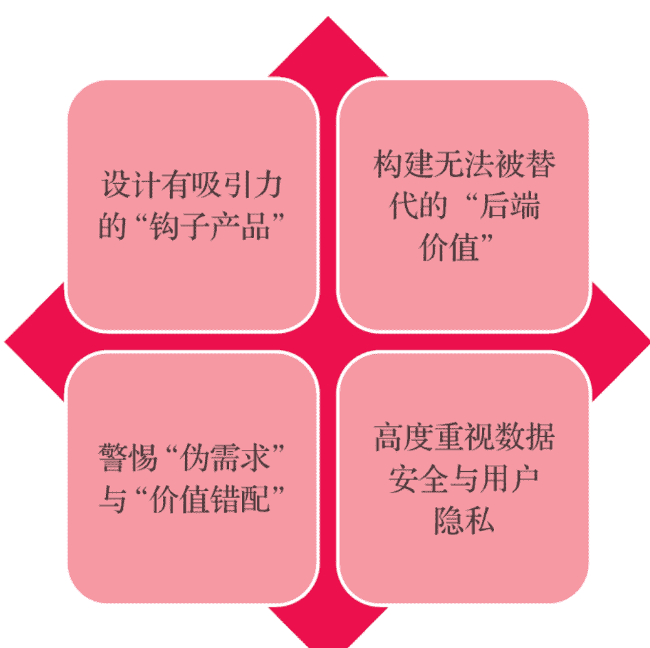
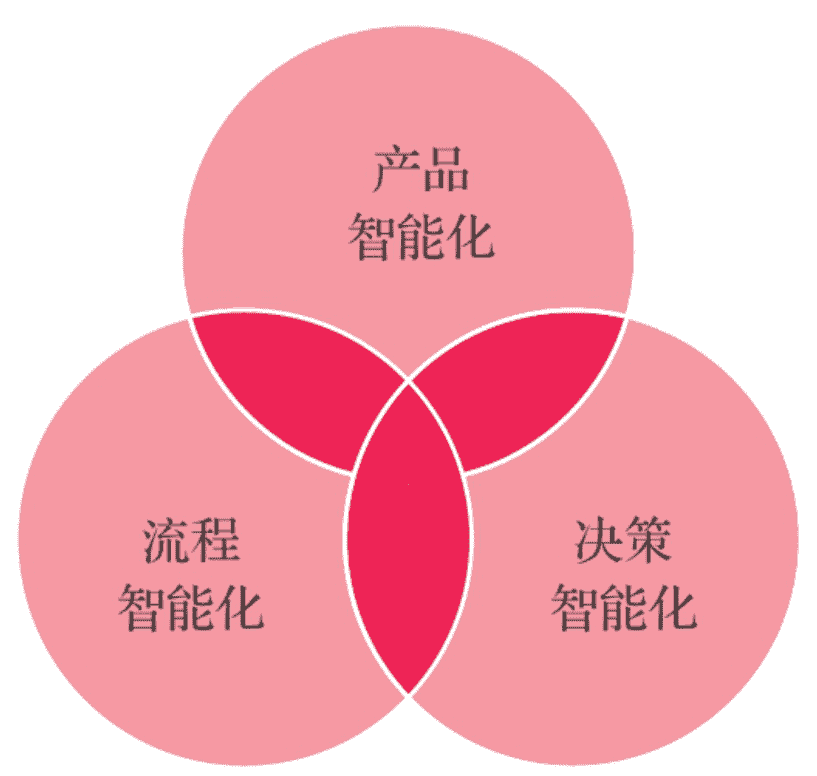
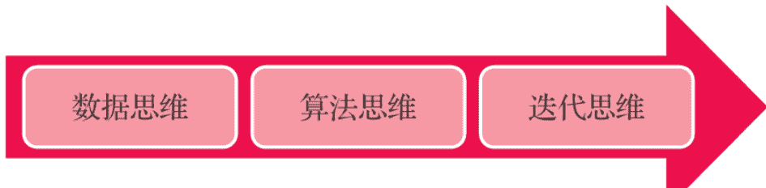
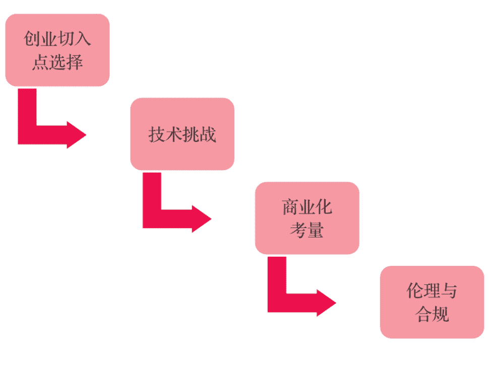

# AI浪潮里普通人的财富地图

# 核心速览
接下来几年资本和消费会向哪倾斜？本文帮你把脉。生成式智能正从演示噱头变成各行各业的上班族，庞大的老年群体、独居人群以及95后、00后主力正在重塑消费版图。商业打法的核心也在迁移，从拼获客到重留存，从追求规模到追求敏捷专业，卡位价值链的关键节点比盲目做大更值钱。绿色发展、身心健康、沉浸式体验构成了高确定性的蓝海。文章围绕机会判断、商业模式搭建与风险防范给出可落地的思路，不讲虚话，只聊能上手做的生意，助你在变局中读懂风向并赚到下一轮收益。

# 说在前面
是否曾在深夜刷到熟人晒出的成果时感到不安，怀疑自己上错了班车？

是否看着熟悉的赛道越卷越薄，拼命加班降价也守不住利润？

是否被智能、元宇宙、Web3轮番冲击，感觉机会很多却不敢出手？

如果你也有类似困惑，这篇内容就是为你写的。

我们正处于规则重写期。过去四十年不少商业成功靠的是跟跑与复制，照搬成熟玩法，靠流量红利、规模效应和资本加持就能做大。旧的导航图已找不到新大陆。流量触顶，获客成本飙升，规模崇拜失效，后来者硬闯的空间越来越小。

别灰心。旧范式瓦解的同时新规则在生长。往后五年的商业版图，将由洞察力、反应速度与创造价值的能力重新定义。

最大的机会不在于实验室的遥远黑科技，而在于咖啡店做库存优化、小超市做智能补货这类落地场景。

最有钱景的模式也不再是卖得更多，而是让用户愿为一次走心的城市漫步、一套量身的健康方案、一双用海洋塑料制造的环保鞋买单。他们买的是感受和意义。

我们一起穿越信息噪音，站到浪潮之上，看技术、人口、价值观、地缘如何重塑行业。财富潮水在转向，你是要在旧沙滩捡剩下的贝壳，还是和我们一起出海？

# 第1章 五年宏观趋势全景扫描
我们正处在变革中，科幻里的画面正在加速落地。真正驱动变革的不是空中理念，而是能创造价值、重写行业的落地技术。看懂这一轮浪潮，既能避免被淘汰，也能率先卡位新大陆。

## 1.1 技术下沉：智能、生命科学、新能源的变现路径
未来商业的轮廓，是前沿技术走出实验室变为基础设施的轨迹。智能、生命科学、新能源正褪去概念光环，成为可用工具链。理解它们怎么用，是从围观者变为参与者的第一步。

### 1.1.1 生成式智能进场，成为各行业的新同事
生成式智能已不再是聊天玩具，正作为新员工进入各行各业。麦肯锡测算，到2030年生成式智能每年可为全球经济带来2.6万亿至4.4万亿美元增量。它的价值不在替代人，而在承接重复、高频、海量信息处理的工作，把人的创造力解放出来。

法律场景里，智能助手能通读上万页判例，几分钟产出合规审查初稿；医疗场景里，智能影像像不眠的实习生，快速初筛CT片，把肺结节检出效率提升50%以上，让资深医生聚焦疑难诊断。你的机会是为专业领域打造懂业务、会行业的人工智能助手。

### 1.1.2 智能体：个人与企业的数字分身
这是智能应用的下一站。智能体能自主理解、规划、执行复杂任务，像一个数字分身。

个人侧的智能体是专属数字合伙人。它能把会议转成纪要并派发任务，按行程偏好自动订票订房，分析财务给出动态优化建议。一个人创业成为可能，因为分身就是助理加分析师。

企业侧的智能体在系统间穿梭。智能招聘官可自动筛简历排初面；智能供应链管家能实时预测波动并自动调采购单。高德纳预测，到2026年超80%企业将用上生成式智能。未来效率取决于你如何管理调用智能体。

个人与企业侧的功能大致对应：会议派单对应招聘流程自动化；行程偏好预订对应需求预测与订单调整；财务分析建议对应跨系统编排。

### 1.1.3 做智能时代的配套生意：产业服务更稳
每次淘金，卖铲子卖水最稳。智能浪潮里为淘金者配套同样门槛低且持续。

提示词工程与培训。精准提问是核心技能，为企业沉淀高质量提示词库、培训团队善用智能，需求很大。

数据清洗与标注。智能的燃料是高质量数据，为自动驾驶、智慧农业等做专业标注是关键链条。

行业解决方案交付。大多数传统企业不想自研，只想要端到端交付。把智能打包成解决客服、营销文案等具体痛点的SaaS产品，是高价值切口。

### 1.1.4 生命科学：从治病到消费化健康管理
生命科学正走出医院，从被动治病转向主动预防与生活质量提升，走向消费品。

消费级基因检测已起步，下一步是基于基因和肠道菌群数据定制营养方案、精准运动计划。专家说，我们正从一刀切的大众健康走向高度个性化的精准健康，单人化健康管理市场体量可达万亿级。

### 1.1.5 合成生物学：像编程一样造物
合成生物学被称作第三次生物技术革命，核心是用编程思维设计改造生物系统生产所需物质。

美国Bolt Threads把蜘蛛丝蛋白基因植入酵母发酵出高性能人造纤维，给时尚带来环保新材料；新加坡Shiok Meats用细胞培养技术在实验室培育食用虾肉，减少传统养殖对环境的冲击。

商业点在于用生物技术做环保材料如生物塑料、菌丝体皮革，可持续食品如人造肉，以及新药和化妆品成分。这既有商业价值，也是向善商业。

### 1.1.6 新能源：从发电到系统的价值迁移
新能源故事已从造板、造风机、造电动车，转向怎么更聪明地管电、用电、交易电。

未来电网是集中电网加无数分布式微电网并存。为园区、楼宇提供光伏加储能加智能充电桩的全套方案，使用户用上便宜绿电，并在用电高峰卖电获利。

虚拟电厂不是实体电厂，是能源物联网平台。它把千家万户的屋顶光伏、储能、电动汽车、空调等分散资源聚合，像云端电厂参与调度。国家电网测算，通过虚拟电厂削峰填谷，成本仅为新建燃煤电厂的1/8到1/7。特斯拉的Autobidder平台就连接了大量家庭储能，在电网需求时放电为用户创收。

创业机会是做能源管理SaaS，帮中小企业监测能耗并自动参与虚拟电厂，把省下的电费和激励分成变成新收入。未来每栋楼、每辆电动车都可能成为微型电站和交易单元。

技术机会的内核已从技术创新转向应用创新和模式创新。最大的赢家可能不是造算法的科学家，而是最懂用智能帮街角咖啡馆优化库存、帮工厂预测设备故障的应用专家。当技术成为普惠基础设施，洞察力、执行力和跨领域知识就能把技术潜力变现。

## 1.2 人口变化：老龄、独居、年轻群体带来的新需求
谈市场就是谈人。中国未来五年最确定的机会藏在人口结构里。它不是数字，而是数亿人生活方式和消费偏好的集体转向。

### 1.2.1 银发经济2.0：从基本生存到品质享受
到2035年，中国60岁以上人口将超4亿，占比过30%。新老人的教育水平、养老金、数字接受度都与父辈不同，消费意愿强。需求从物质基础升级到精神富足、社交充实和生活质量。

“时尚奶奶团”在社交媒体走红就是信号。平均65岁以上的女性精致穿搭、从容生活，代表银发经济2.0的核心：拒绝被定义，追求美、社交和自我实现。老年时装、形象管理、主题旅游等随之兴起。

### 1.2.2 数字红利：适老科技的千亿空间
过去担心老人被数字时代抛弃，现在机会是帮助他们无缝拥抱数字生活。不是放大字体，而是润物细无声的场景改造。

QuestMobile数据显示，中国银发移动网民已超1.5亿，人均时长仍在增长。机会包括具备跌倒检测、心率监测、一键呼救的智能手表；会提醒用药的智能药盒；界面极简、操作引导清晰的购物和短视频App；以及能让子女远程感知起居异常的居家传感器、上门助浴、适老改造等服务。好产品必须像科技温情主义。

### 1.2.3 单身社会：一人经济撑起完整生态
国家统计局和民政部2024年数据显示，中国单身成年人口达2.4亿，其中超7700万独自生活。单身不再是现象，而是完整商业体系。

生活单元微型化：单人自热火锅、迷你电饭煲、小容量冰箱、200ml红酒、小包装米粮热销；30-50平高品质小户型需求旺。

情感与陪伴经济：宠物是最大受益者，从食品到智能猫砂盆再到宠物殡葬，链条精细。《2023中国宠物行业白皮书》显示，单只犬年均消费达3280元。虚拟偶像、陪伴游戏、互动直播也成为情绪出口。

### 1.2.4 悦己主义：为自我取悦买单
单身人群消费动力是悦己，不为取悦他人而花钱，更看重感受、成长和即时快乐。

新锐香氛品牌观夏的成功在于贩卖情绪疗愈体验。“昆仑煮雪”香薰卖的是一刻宁静。类似的为情绪、氛围、片刻欢愉付费，催生了小众香氛、高品质家居、精品咖啡、冥想App等小而美赛道。

### 1.2.5 年轻族群登场：要圈层归属感，不要大众爆款
95后、00后已成消费主力。他们在网络环境长大，消费高度圈层化，用消费寻找身份认同。

B站、小红书等平台可见“二次元”“潮玩”“汉服”“露营”“剧本杀”等圈层各成体系。波士顿咨询研究指出，超60%的年轻群体消费直接受圈层文化影响。他们排斥盲从，崇尚专业和独特。

### 1.2.6 意义消费：为价值观投票
年轻群体用钱包投票，品牌吸引力来自故事、理念和社会责任。

饮料品牌好望水以国风美学、非遗传承、青年艺术家扶持构建“传递美好”形象，比单纯谈口味更打动人。环保材料、公平贸易、公开透明供应链的品牌更容易获得信任。他们买的不仅是产品，更是理想世界的入场券。

人口变迁像缓慢的洋流重塑版图。未来赢家是能深入新人群生活场景，理解细腻情感需求并提供解决方案的企业。让老人活得有尊严有乐趣，支撑年轻人享受单身生活，为年轻族群爱好提供装备和舞台，都是未来五年最确定最有潜力的方向。

## 1.3 价值观迁移：从拥有更多到体验更好
当货架琳琅满目、“买得起”不再是难题时，人们开始为价值主张买单。消费核心从物质占有转向生命体验。未来五年最大商机不在于卖出多少件商品，而在于为生活注入多少意义与美好。

### 1.3.1 从占有到体验：为瞬间付费
旧逻辑是买来拥有，新逻辑是买来经历。体验带来的满足感比物品更持久。

麦肯锡调研显示超70%全球消费者认为体验比产品更带来幸福感。中国尤为明显。以旅游为例，沉浸式体验取代打卡观光。阿那亚卖的不仅是住宿，而是包含图书馆、音乐会、艺术展、社区社交的精神归属套餐。商家靠提供体验取胜。

### 1.3.2 健康即终极奢侈：从治病到防病
健康的内涵被拓宽为身心状态，涵盖机能、营养、睡眠、情绪和外表。高净值人群愿重金投入。

精准营养兴起，基因或肠道检测后定制营养包，如Lemon Box按问卷结果配每日营养。智能手表从计步变成持续监测心率变异性、血氧、睡眠质量的健康管家。

全球健康研究所数据显示全球健康经济超4.5万亿美元。任何能与健康强关联的产品服务都处在风口。

### 1.3.3 精神消费崛起：为内心丰盈买单
物质满足后，人们向内寻求慰藉与成长。

知识付费2.0追求系统性、可落地的改变，如带实操和成果检验的写作训练营、数据分析课程。心理健康服务线上化，简单心理、潮汐等App用户激增，维护心理健康成日常自律。白噪声机、解压玩具、寓意美好的植物和艺术品也因治愈人心而热销。

### 1.3.4 环保从口号变购买门槛
对新一代消费者，尤其是年轻群体，可持续性是品牌基本要求。

瑞典个护品牌Tangent GC用天然有机成分、可降解包装并公开成分，吸引关注成分安全和环境责任的消费者。红布林等二手奢侈品平台让循环时尚既环保又时髦。环保已变成购买的许可证。

> 一位资深的品牌顾问曾点明：环保过去只是品牌叙事里的点缀，如今已演变为用户是否把你放进备选清单的基础门槛。没有可持续承诺的企业，接下来五年极易被市场挤到角落。

### 1.3.5 买的选择就是身份表达
今天的购买行为更像一次价值投票。用户借助品牌来投射自己认同的生活观，同时用这种选择来强化和展示社会标签。

以李宁为例，对不少年轻人而言，下单不止是面料与版型，更是对国潮审美的认同与文化自信的表达。选择雇用残障人士生产的商品，则是在用消费支持社会公平。即便产品功能仍在，决策的主线已转向立场表达。用户期待品牌不只是交付商品，而是与他们共同参与理想社会的构建。

### 1.3.6 从卖货到经营信任
价值观的迁移让旧打法失效。领先的企业不再局限于商品供给，而是成为用户信念的伙伴和美好生活方案的共创者。

- 价值主张：从“我们提供什么”转向“我们与用户坚守什么”。
- 品牌沟通：从单向投放转向双向、开放、持续的对话。
- 产品设计：从功能堆砌转向体验打磨，并关注伦理与叙事。

当价值观成为流通的硬通货，竞争轴线便从价格与参数上移到情感与意义。未来五年的创业者更像价值的洞察者和生活方式的设计师。任务不是堆砌 SKU，而是设计让人难忘的体验，提供提升生命质量的健康解法，打造彰显精神诉求的消费选项。赢得认同才是赢得市场。

## 1.4 全球化重写与区域化机会
过去几十年，企业追求的是全球寻找最低成本制造、最高效供给，再把产品推向世界。地缘摩擦、疫情冲击和对供给网络韧性的焦虑，正在改写这套逻辑。我们正进入重构期：全面脱钩不现实，但以地理邻近、政治互信与产业互补为基础的区域化在加速。读懂这种巨变并找准定位，是未来五年必须完成的功课。

### 1.4.1 韧性压倒效率
过去，供给网络管理的关键词是效率，追求最低成本和即时交付。现在关键词变为韧性，即抗冲击、快恢复与灵活调配的能力。风险事件让企业认识到，一条成本稍高却更安全、更短、更可控的网络，比一条脆弱的长链更有价值。

高德纳的调研显示，八成以上企业计划在两年内把韧性与灵活性置于效率之上。苹果把部分产能从中国转向印度、越南，并非撤离，而是构建“本土+外部备份”的体系，以对冲单一区域风险。

启示是近岸与友岸外包正兴起，东南亚、墨西哥、东欧等区域获得巨大机会。中国创业者可关注当地配套制造、物流服务、本地化运营支持等配套生意。

### 1.4.2 在朋友圈里做生意
全球大循环受阻时，区域小循环更活跃。RCEP、USMCA等区域协定正在形成新的引力场。对创业者而言，深耕单一区域比试图征服全球更务实。

希音和Temu的早期爆发，很大程度上源于对北美市场的极致深耕。未来五年，RCEP尤其是东盟将是下一个黄金带，这里人口年轻、数字基础扎实，且文化与中国相近。

机会不在于把国内货直接搬运，而在于深度本地化：

- 产品适配：依据湿热气候与本地文化开发服装、食品等适合版本。
- 内容适配：借助TikTok等平台的本地语言和达人，制作符合审美的传播内容。
- 运营落地：建设本地仓、客服团队，与本地支付和物流伙伴紧密协作。

### 1.4.3 国产替代从备胎走向主角
在关键技术领域，出于安全考量，国产替代已从可选变为必选。这是政策推动，也是市场基于供给安全的刚性需求。

赛道已从芯片、操作系统延伸至工业软件、科研仪器、高端材料、核心零部件等卡脖子环节。

创业方向有二：其一，针对国外垄断的工业设计、仿真软件，开发更贴合工程师习惯、价格更友好的本土方案；其二，在无法全盘替代时，聚焦单一功能或模块做到极致，成为上游巨头的关键一环。

### 1.4.4 双循环定位：先立内盘再放大外盘
以国内大循环为主、双循环相互促进，是应对格局变化的顶层设计。对创业者意味着战略重心的再排序。

产品或服务首先要在庞大的内需市场站稳脚跟，经受检验并实现盈利，内盘是根基。待模式成熟、供给与产品力打磨到位后，再择机出海，外盘是增长放大器。

中国新能源汽车是典范。比亚迪、蔚来、小鹏先在国内竞争中锻造出强大产品力，再大举进入欧洲、东南亚。以此为底气出海，竞争力自然不同。

### 1.4.5 新定位：有本土根基的全球连接者
新格局下，目标不是成为纯粹的全球公司，而是成为具备本土根基、能与各区域双向连接的企业。业务要稳固，同时具备资源、技术、人才的协同能力。

必备能力：对地缘政治与产业政策的敏感度，像看天气一样关注；采用多节点、分布式供给，避免单点依赖；具备跨文化管理能力，在本土化与全球化间取得平衡。

### 1.4.6 四步行动框架
1. 重绘地图：目光从单纯欧美转向RCEP、“一带一路”沿线等新兴区域。
2. 检视风险：识别依赖单一来源的关键环节，提前寻找备选。
3. 确定主战场与试验田：明确核心收入来源的主战场，并选择文化地理相近的区域作为出海试验田，集中资源深耕。
4. 组建盟友网络：在新市场寻找本地合作伙伴，帮助绕开隐形门槛。

全球化重构不是终点，而是规则升级。机会并未减少，而是重新分配。过去的红利来自全球化带来的均质化，未来属于把握区域化创造的差异化价值。立足本土、观照区域、心连全球的创业者，才能随区域化浪潮驶向更广阔的蓝海。

# 第2章 商业范式转移：旧规则瓦解新规则建立
曾经的成功路径可能正在成为未来的失败原因。我们正处商业拐点，追逐流量、追求规模、吃下全市场等旧信条纷纷失效。旧大厦摇晃，新的地基在搭建。本章梳理这场静默革命，并给出在新世界生存的新规则。

## 2.1 从流量到留量：用社群构建忠诚
过去十年，流量几乎是唯一执念。竞价排名、电商直通车、信息流投放价格水涨船高，获客成本逐年攀升。数据显示，2022年部分电商平台的单次点击成本已超5元，一个有效新用户的获取成本可达数百元。这是一种河流水捕鱼模式：只要持续付费，水流才会经过；一旦停止付费，生意即断。

底层逻辑在变。流量红利见顶，用户信任门槛抬高，一次性交易导向失效。未来五年，成功的模式从捕鱼转向养鱼，需要开凿私有池塘——用户社群，通过精细运营让用户自愿留下、持续创造价值，并主动带来新水。这是从流量到留量的关键一课。

### 2.1.1 流量导向失效的三大原因
失效并非偶然，而是三股不可逆趋势叠加。

其一是公域流量成本失控，中小企业靠买量等于为平台打工，利润被吞噬。其二是注意力碎片化与广告免疫下，硬广难以转化为购买。其三是需求升级，用户不仅买功能，更买价值观、情感和归属感。冰冷的一次性交易已无法满足深层需求。

结论指向：关系深度比用户数量更重要。十万粉丝的僵尸号，价值远不如五千人高互动、高信任的付费社群。

### 2.1.2 留量本质：经营关系
留量思维的核心不在获取，而在沉淀与价值激活。目标是建立持续、可信、温暖的关系，最大化用户终生价值。

留量的阵地即私域：微信群、企业微信、品牌会员App、志同道合的俱乐部。这里无需向平台支付过路费，可反复、免费、自由触达。

衡量标准发生变化：复购频率、转介绍率、互动时长成为健康指标。数据显示，客户留存率提升5%，利润即可增长25%至95%。这就是留量的力量。

### 2.1.3 社群搭建四步实操
建群发广告是破坏，社群是系统工程。

1. 找到价值锚点。社群不能只为薅羊毛而生，需要共同价值观或兴趣。如lululemon锚定热汗生活与正念，Patagonia锚定环保主义与地球税。
2. 设计门槛与仪式。轻易得到的东西不被珍惜。门槛可以是知识测试、身份认证或任务挑战。入群要有欢迎仪式和专属权益，让成员从用户变为自己人。
3. 持续提供价值。社群是价值交换平台，可包括内容价值、产品价值、关系价值、情感价值，如干货、内测权、线下活动、倾听与支持。
4. 激发参与。最高级的运营是让成员自运营。设置活跃激励，鼓励提问、分享、互助，并邀请成员参与产品共创，增强归属感。

### 2.1.4 忠诚度进阶：从买卖到朋友
社群的终极目标是坚固的品牌忠诚度。当关系从买卖方变为同道甚至朋友，护城河就形成了。

三层递进：利益忠诚靠积分、折扣、赠品留人，易被撬动；情感忠诚靠品牌故事、价值一致、用心服务建立纽带，如苹果用户的身份认同；归属感忠诚是最高层级，用户把品牌互动视作生活一部分，主动捍卫与传播。

林清轩的案例极具代表性。门店导购通过企业微信把用户沉淀至私域，导购转为护肤顾问，记住肤质与购买历史并提供个性建议。疫情期间线下停摆，私域用户贡献了绝大部分销量，复购率超50%，交易成功转化为信任成功。

### 2.1.5 评估留量健康的关键指标
改变看板，关注：复购率体现满意度；社群活跃度看发言质量与互动深度而非人数；净推荐值衡量用户是否愿意推荐；用户终生价值是否远高于获客成本。

### 2.1.6 思维升级：从收割到滋养
范式转移要求心态转变：从收割用户到滋养用户。把用户当作需要理解和服务的人，而非报表上的数字。每一次互动、每款产品、每项服务，都以提升体验为出发点。真心滋养用户，商业回报会自然到来。

未来五年，最值钱的资产不是现金，而是私域里那些信任你、热爱你、愿意共同成长的用户。

## 2.2 告别规模崇拜：小而精的超级个体与隐形冠军
做大做强曾是共识，但对大多数创业者，今天的规模之路越来越危险。巨头靠资本与流量碾压，在大而全的战场筑起高墙。硬碰硬只会受伤。

新哲学在兴起：不做笨重的大象，做敏捷的猎豹；不追求规模，而追求专业。未来能否成功，不取决于服务多少人，而取决于在细分领域是否不可替代。两条主线愈发清晰：超级个体与隐形冠军。

### 2.2.1 规模陷阱：传统扩张为何走不通
小微企业盲目求大有三大致命陷阱。其一，管理成本指数级增长，团队扩张带来沟通与协调成本飙升，大公司病迅速扼杀活力。其二，注意力与资源分散，试图覆盖更广市场导致定位模糊，在每个战线都缺乏竞争力。其三，与巨头竞争劣势绝对，模式被验证后，巨头可低成本快速复制，让你瞬间失去空间。

因此新入局者应放弃像XX一样但更便宜的思路，思考我能做到XX根本做不到的事。

### 2.2.2 核心优势：敏捷与专业
在不确定性时代，敏捷与专业是小微企业的压倒性优势。

敏捷意味着试错成本低、决策快、转向灵活。三五人团队一周内可推出MVP并快速迭代，而大公司走完流程可能需三个月。船小好掉头，让小团队能抓住转瞬即逝的机会。

专业是在极窄领域建立知识与技能壁垒。你不必样样精通，但必须在一点上比大多数人更懂。专业带来定价权，让企业不必陷入价格战。

二者结合，就能在巨头的视野盲区建立坚固的利润堡垒。

### 2.2.3 路径一：超级个体一人一公司
超级个体的核心是技能产品化与个人品牌化。

将自身知识、技能或才华封装成标准化产品或服务。例如优秀UI设计师不仅接项目，还可出售设计系统课程或组件库。通过小红书、抖音、视频号持续输出专业内容，建立个人品牌，让客户主动找上门。

典型画像包括：为细分行业开发定制化SaaS的独立开发者，年入数百万；提供私董会轻咨询的资深顾问，单项目收费数十万；专注跨境母婴用品选购等的垂直知识博主，通过社群与咨询实现高收入。

一个典型案例是某前4A创意总监在抖音开设账号，专教中小企业主用手机拍出高级感产品视频。把广告美学转化为通俗教程，吸粉超50万，199元课程售出数万份，并延伸出千元社群与万元企业内训，一人创造出媲美小型广告公司的营收。

#### 核心工具与放大思维

单兵作战者把效率工具当成标配，靠 Notion、飞书这类协作系统理清项目，把猪八戒、Upwork 之类的外包渠道拿来消化非核心事务，自己把时间全部押在能产生核心价值的高杠杆环节。支撑这种打法的是放大思维，用内容、产品和人脉网络把个人专业与影响力做倍增。

### 2.2.4 路径二：做隐形冠军，在细分赛道称王

隐形冠军最早由德国提出，指在极窄的利基里做到全球顶尖却鲜为人知的中小企业，这一模式在中国同样具有空间。

这类主体大致有三重共性：①极致聚焦，扎根于一个极细分的品类，比如只做工业缝纫机的某一精密零件，或某种功能特殊的传感器方案；②持续微创新，不追求颠覆，而是围绕材料、工艺、设计反复打磨到极致；③全球视野，产品虽小众却面向世界，通过跨境电商送到真正需要的人手里。

典型画像包括专精特新小巨人，掌握关键技术，卡在产业链要害；细分消费品牌，比如只做露营轻量化钛餐具，几十个 SKU 就能做到品类全网第一；关键零部件供应商，比如专门生产手机无线充电测试设备，全球主流手机品牌都是客户。

德国伍尔特只做螺丝螺母等紧固件，却做到全球第一，年收入超百亿欧元。国内浙江有一家企业专做纺织机上的核心陶瓷零件，市场占有率超60%，利润率超30%，是典型的隐形冠军。

#### 构建护城河

隐形冠军的壁垒是难以复制的专业门槛，可能是专利、独门工艺，或长期沉淀的行业数据库。在小圈子里口碑效应极强，一旦成为头部客户首选，就形成极强的客户黏性，后来者很难撼动。

### 2.2.5 如何选赛道与起步：锁定合适的小市场

无论走个人高手还是隐形冠军，起点都是找准利基。好市场通常具备：

- 需求真实且紧迫，市场虽小客户愿意付费
- 利润空间足以支撑专家溢价
- 巨头看不上或做不好，体量对巨头无吸引力，或其庞大体系无法满足个性化需求
- 你本人有优势或兴趣，能支撑长期深耕

进入后要坚守单点突破，放弃做大平台的想法，把资源集中服务一个极小极具体的客群，把产品或服务做到惊艳，快速形成口碑与现金流。

### 2.2.6 组织新形态：分布式协作与网络化

这种范式转移也在重塑组织形态。个人高手与隐形冠军都不是孤岛，而是通过网络化协作组成动态高效的商业生态。

一个高手可以同时担任多个项目的顾问，一家隐形冠军可以为核心企业提供关键部件。未来的商业图景不再是巨型航母独霸海洋，而是由无数敏捷专业的驱逐舰、潜艇、补给舰组成的特混舰队，协同作战更具适应力。选择个人高手或隐形冠军，本质是选择更自主、更专业、更可持续的商业人生。未来几年，深度是护城河，专业是通行证。

## 2.3 价值链重塑：在巨头缝隙中做关键一环

当下巨头已搭建主要平台与生态，腾讯的社交内容生态、阿里的商业物流生态、抖音的兴趣内容生态、亚马逊的全球电商云服务生态，已渗透商业各处。对新玩家而言，打造下一个淘宝或微信既不现实也浪费资源。真正的机会藏在庞大生态的缝隙里，成为不可或缺的关键一环，而非妄想通吃。

### 2.3.1 价值观：从线性链条到价值网络

传统思维是线性掌控，从原材料到售后全包，像巅峰期的福特甚至自建橡胶园钢铁厂。如今商业变成价值网络竞争。

巨头扮演生态主，搭建微信、抖音、亚马逊这类基础平台，定义基本规则。但平台本身不完整，需要无数外部伙伴填充内容、服务、满足长尾需求。就像一个大型商业综合体，需要各种专卖店、餐厅、影院来共同繁荣。你的成功不在于自建综合体，而在于在这个综合体里开出受欢迎且无可替代的特色店。

### 2.3.2 缝隙为何存在

巨头留出缝隙是基因决定的。

第一是标准化的悖论。巨头要服务数亿用户，只能做标准化通用服务，无法满足每个微小个性化需求。微信有群聊，但不会为每个行业定制客户管理工具；抖音有推荐算法，但不会为每家餐厅量身定制本地营销方案，这些就是机会。

第二是规模不经济。某些极细分且需要深度专业的领域，巨头庞大团队反而效率低，三五人专业小团队更敏捷更省成本。

第三是创新的分散性。真正创新多在边缘交叉地带，分散在无数个体与小组织。巨头研发强但无法垄断所有方向，敏锐创业者完全可能在巨头忽视的细分技术或场景突破，成为生态权威。

### 2.3.3 关键一环的四种角色

**增值服务提供者**
基于巨头基础设施，为企业或个人提供平台本身不做的深度服务。如微盟、有赞在微信生态里帮商家建小程序商城、做会员营销，填补了标准化之外深度经营的空白。

**体验优化专家**
把平台某个功能的用户体验做到极致。如电商平台上大量代运营公司，平台提供开店基础功能，他们用视觉设计、数据分析、广告投放把转化率和销售额拉满，优化的是平台之上的商业体验。

**流量价值深挖者**
帮助生态参与者把平台分配的流量价值最大化。如抖音、小红书的 MCN 机构与创作者，平台分发流量，他们通过优质内容变现为粉丝，再导向广告、电商、知识付费，是内容生态的基石。

**技术能力延伸者**
把巨头的核心技术与垂直场景结合，解决特定问题。如基于亚马逊 AWS 或微软 Azure 的云原生咨询服务公司，不自建数据中心，却为金融、医疗、制造等行业搭建定制化、安全合规的数字化系统，是巨头技术在垂直领域的“手脚”。

### 2.3.4 嵌入生态的四步策略

第一步，深挖生态痛点与规则。选定微信、抖音、Shopify 等生态，研究官方规则、红线、API 开放能力，同时观察商家、创作者、用户的共同痛点，痛点即价值点。

第二步，选高价值低替代的切入点。要能解决真痛点让客户愿付费，同时需要专业壁垒，不是谁都能抄，巨头也不愿轻易自研。如为跨境卖家提供基于 AI 的多语言多文化营销文案生成，比单纯店铺装修更有壁垒。

第三步，共生进化，构建连接壁垒。业务必须与生态深度绑定，随平台升级迭代，争取进入服务商联盟。壁垒不仅是产品，更是与平台的连接深度、对规则的理解、官方关系、在生态内的客户口碑。

第四步，在生态内打造微品牌。在抖音服务商圈提到直播带货操盘就想到某家，在 Shopify 应用商店提到邮件营销就想到某个插件，微品牌让你在众多服务商中脱颖而出。

### 2.3.5 风险与平衡：避开生态依赖症

在生态寻找缝隙要警惕依赖。平台规则变动、API 调整、平台自研，都可能致命。聪明的关键一环采取共生而非寄生策略：持续提升核心专业让平台更愿合作；做多元化生态布局，SaaS 同步适配微信、抖音、快手分散风险；积累自有用户，通过社群与会员体系直接触达终端客户，渠道变化时仍能留住人。

### 2.3.6 从关键一环到新生态节点

最高级的关键一环能成长为新的小型生态节点。当在一个细分领域做到极致，积累行业知识、技术与客户资源后，可开放 API 吸引更小开发者围绕你开发。

比如一家起初基于微信做餐饮 SaaS 的公司，服务数万家餐厅后积累了深厚行业数据与流程，便可开放 API，让第三方开发营销插件、供应链工具，自己演变为餐饮数字化生态的核心节点。

未来商业将是一个多重生境嵌套的生态星系，你不必成为太阳，但可以成为闪耀的行星，甚至拥有卫星系统的恒星。放弃通吃，培养关键一环的共生思维，是巨头时代的理性与智慧。

## 2.4 利润池迁移：硬件不赚钱但赚服务；产品不赚钱但赚数据

传统逻辑里售价必须高于成本，利润来自单次交易。如今出现反常识现象：智能音箱几十美元接近成本，软件免费，企业甚至贴钱获客。这不是失智，而是利润池在迁移，利润与售价脱钩，企业通过后端服务、数据与生态实现价值捕获。掌握这一模式是未来五年可持续经营的关键。

### 2.4.1 从交易到关系的底层逻辑

迁移核心是重心从一次性交易转向持续用户关系。传统关系在付款后结束，新模式付款是关系的开始，追求用户终身价值。

驱动因素有三：获客成本高昂，一锤子买卖跑不通，必须从用户持续获利；数字技术成熟，企业可低成本与海量用户保持连接；数据成为新生产要素，用户行为数据的价值远超产品本身。于是战略从卖产品转向圈用户，用低利润甚至负利润的钩子产品建立关系，再在长期里通过服务、订阅、内容、数据持续获利。

### 2.4.2 模式一：硬件搭台，服务唱戏

这是最经典的剃须刀刀片模式升级版。

智能硬件多是获取用户、接入服务的入口。亚马逊 Echo 售价亲民，目的不是卖音箱，而是把用户圈进 Alexa 生态，后续音乐订阅、有声书、语音购物、智能家居控制带来丰厚利润。

服务订阅带来可预测经常性收入。智能健身镜公司镜子卖得接近成本，但靠每月数十美元的课程订阅赚钱，硬件是一次性投入，订阅是持续现金流。

企业级市场更普遍。通用电气把航空发动机低价售卖或租赁给航空公司，利润来自后续高价值维护、检修、数据分析和零部件更换，卖的不是发动机，而是“确保飞机持续安全飞行”的能力。

### 2.4.3 模式二：产品免费，数据变现

软件类产品可做免费，数据是新石油。

直接变现最典型是数字广告。谷歌、百度提供免费搜索，抖音提供免费短视频，通过搜索历史、浏览行为、兴趣标签构建用户画像，向广告主收费。用户是产品，广告主才是客户。

间接赋能更高级。Netflix 用观看数据做个性化推荐提升留存，更关键的是指导自制剧投资，《纸牌屋》是数据驱动的典范。数据未直接售卖，却成为核心竞争力。

数据还能孵化新业务。蚂蚁集团的支付宝免费，但长期交易数据沉淀后精准评估信用，孵化出花呗、借呗、网商银行等高利润金融业务。免费支付是数据土壤。

### 2.4.4 服务与数据双轮驱动

最高明的是融合。硬件或免费产品做入口，既带来持续服务收入，又沉淀数据，两者形成飞轮。

特斯拉买车是单次交易，车主可订阅全自动驾驶服务带来持续收入；同时每辆车持续收集真实驾驶数据，用于训练自动驾驶算法，价值巨大。数据壁垒确保长期领先，反哺销量与订阅，形成商业闭环。

### 2.4.5 实施路径与风险规避

设计有吸引力的钩子产品，必须能解决核心痛点，让用户愿尝试。

构建无法替代的后端价值才关键。服务要真实不可或缺，否则不会续费；数据应用要显著改善产品或决策，否则就是无效资产。

警惕伪需求与价值错配，并非所有产品都适合迁移，若用户不需要后续服务或数据价值密度低，模式会失效。

高度重视数据安全与用户隐私。任何泄露或滥用都会瞬间摧毁信任，合规透明使用数据是长期生存前提。

### 2.4.6 思维升级：重新定义生意

利润池迁移要求根本性思维转变。你不再是硬件销售商，而是用户服务运营商；不再是软件开发商，而是数据智能服务商。财务指标也要更新：关注用户生命周期价值、续费率、数据资产价值，而非仅毛利率与单次利润。

未来五年，能巧妙设计利润流动路径的公司会胜出。它们懂得“取之先予之”的智慧，并借助现代技术在用户生命周期里构建深而持久的利润池。

# 第3章 虚实融合的数字淘金时代

我们脚下的土地正在数字化，我们呼吸的空气充满数据字节。这不是科幻，而是正在发生的商业现实。这里最宝贵的矿藏不再是石油，而是算法与洞察力；最强大的工具不再是机械，而是能思考的代码。下一个五年，这里将诞生新一代的财富传奇。

## 3.1 范式跃迁：从连接经济到智能重塑
没人能精确预判明天，但底层思路的转向必须提前捕捉。接下来的部分拆解互联网时代与人工智能时代的本质差异，说明这场范式更迭怎样改写价值创造、竞争格局与组织形态，并为创业者提供思维校准的坐标。

### 3.1.1 连接思维与重构思维的分野
要理解人工智能加时代，先回望互联网加时代。过去二十年，互联网加的核心是把分散的节点连起来。它通过削弱信息不对称，重塑商品、服务与人的联结方式。淘宝把买家和卖家拉到一起，微信把人与人串联，滴滴把乘客与司机配对。

那个阶段的价值大致可表达为：价值约等于效率增益乘以联结广度。其最大贡献是搭建了一张覆盖全球的信息网络。

人工智能加的核心已不再是联结，而是重塑。它不只是优化信息流动的路径，而是直接介入价值创造的本体——智能本身。模型通过学习与推理，获得了生成内容、辅助判断乃至执行复杂任务的能力。价值公式被改写为：价值约等于智能浓度乘以应用深度。它正从底层改写生产、分配、交换与消费，目标是构建覆盖物理世界的智能网络。

对比很直观：
互联网加医疗催生了在线挂号，把患者和医院接上，缓解了挂号难。
人工智能加医疗催生了AI辅助诊疗，通过阅片重构诊断环节，能以超越资深专家的精度揪出早期癌灶。
前者是流程优化，后者是核心能力的升级。

### 3.1.2 价值引擎转换：模式驱动转向能力驱动
互联网加时代，最大的机会来自商业模式创新。平台撮合、共享经济的资源复用、订阅制服务，本质都是用新规则与新联结创造价值。

人工智能加时代，价值创造的底座转向智能创新。企业的护城河越来越取决于用人工智能对主营业务进行智能化改造的深度和广度。

具体体现为：
产品智能化：由功能品走向智能体。一辆传统汽车与一辆具备自动驾驶能力的汽车差别在于，后者拥有持续学习并与环境互动的“大脑”。
流程智能化：内部运营不再固守固定SOP，而是被数据实时驱动。奈飞用算法动态调优全球内容分发，在保证流畅的前提下把带宽成本压低超过20%。
决策智能化：如百度创始人李彦宏所说，“互联网思维是以用户为中心，人工智能思维是让机器读懂用户”。战略、营销、研发的决策正从依赖高管经验和直觉，转向依赖全量数据的模拟与预测。

### 3.1.3 壁垒演进：规模效应让位于自增强循环
互联网加时代最强的护城河是网络规模效应——用户越多，平台对单个用户的价值越大，像微信。这是一种由联结带来的规模效应。

人工智能加时代，一种更强的壁垒在形成：数据自增强循环。运行逻辑如下。
1. 优质产品吸引早期用户。
2. 早期用户的使用产生宝贵数据。
3. 数据用于喂养和训练模型，让产品更聪明更好用。
4. 更聪明更好用的产品吸引更多用户，产生更多数据。
5. 循环加速，形成强者愈强的正向飞轮。

典型是特斯拉的自动驾驶。数百万辆车在真实道路上行驶，收集到其他公司难以获取的海量极端案例。这些数据用于迭代算法，让模型性能持续领先。其壁垒不是工厂，而是由数据与模型构成的持续自我强化的闭环。

### 3.1.4 创业角色升级：产品经理向智能架构师演进
范式变了，创业者的角色也在变。互联网加时代，成功的创业者往往是出色的产品经理，懂用户痛点并设计解决方案。

人工智能加时代，创业者需要进化成智能架构师。不仅要懂用户和市场，还要具备：
数据思维：识别业务里哪些环节可数据化，并设计采集到反馈的闭环。
算法思维：把复杂的商业问题抽象成机器学习可处理的数学问题。
迭代思维：接受系统不完美，用“设计—部署—反馈—学习”的快循环让系统与业务共同成长。

互联网加重构了商业的生产关系，人工智能加正在重构生产力本身。这不是温和升级，而是彻底换轨。看清本质，是在数字新大陆站稳脚的第一步。

## 3.2 黄金赛道一：原生智能应用与自主代理
当基础大模型逐渐变成公共设施，真正的商业机会在于把通用智能转化为特定领域的专业智能。下面拆解原生智能应用和自主智能体这两个关键赛道，揭示商业模式、市场前景与创业路径。

### 3.2.1 从工具到伙伴：角色跃迁
传统软件里，电脑是被动执行指令的工具。即便是早期的智能应用，也多停留在工具层面。现在的变化是，人工智能正从工具演变为伙伴。核心特征是系统能理解意图、自主判断并持续学习。

据斯坦福大学《2024年人工智能指数报告》，全球企业在应用层的投入2023年达2570亿美元，同比增长42%。这反映出企业对“智能伙伴”的强烈需求。企业不再满足于简单自动化，而是想要能读懂业务逻辑、参与决策的智能系统。

这种转移打开了新市场。正如a16z合伙人马丁·卡萨多所说：“未来十年最大的创业机会，不是造更好的基础模型，而是打造最懂行业、最懂岗位的原生智能应用。”创业主战场正从造大脑转向培养专家。

### 3.2.2 原生智能应用：垂直领域的智能爆发
定义与特征：
原生智能应用并不是把智能功能嵌进旧产品，而是产品设计之初就以智能为核心驱动。典型特征有三：核心价值完全由智能创造，去掉就失去意义；具备持续进化能力，随数据积累不断优化；通常采用全新交互，如自然语言对话、多模态交互。

典型场景：
法律科技领域，Harvey、Law.ai正在重塑法律服务。它们不仅检索文献，还能理解复杂案情，自动生成法律意见书和诉讼策略。高盛研究显示，这类应用能把律师案件研究时间压缩70%，法律分析准确率提升到92%。国内幂律智能的合同审查工具能快速识别条款风险并给出修改建议；华宇信息的智慧法律大脑支持裁判文书智能生成与案情要素自动提取，已在多地法院落地。
销售赋能领域，Gong.io、Chorus等销售教练实时分析对话，提供精准战术指导。可识别客户购买信号和异议点，甚至预测成交概率。数据显示，使用这类工具的企业销售团队成交率平均提升25%，销售新人成长周期缩短60%。国内深维智信Megaview的销售会话智能平台通过多模态分析帮助团队优化流程；励销云的AI外呼助手能自动识别客户意向，显著提升线索转化。
医疗诊断领域，Butterfly Network开发的辅助诊断系统可实时分析超声影像，为医生提供建议。临床研究表明，这类系统能把早期病灶发现率提高40%，诊断时间缩短三分之二。国内推想医疗的肺炎辅助筛查系统已部署在全国400余家医院，对微小病灶敏感度达98%；联影智能的uAI集成平台可对CT、MRI等多模态影像自动分析，帮助医生快速定位病灶并生成结构化报告，实际应用中肺结节筛查效率提升约五倍。

商业模式多元化。除SaaS订阅外，还出现按用量付费、按成果分成等模式。例如部分设计工具按生成图片数量收费，部分营销工具按带来的转化效果分成。

值得注意的是，成功的原生应用往往选择小而美的垂直赛道切入。正如创业导师保罗·格雷厄姆所说：“最好的创业创意往往来自解决一个非常具体、非常深入的问题。”在智能时代，这一建议更显珍贵。

### 3.2.3 自主智能体：会自己干活的数字员工
概念演进：
自主智能体代表智能应用的更高形态。若原生应用是专业工具，自主智能体就是数字员工。它们能理解复杂指令、自主规划步骤、调用各类工具服务，并在执行中实时决策。

企业级智能体：
以市场营销为例，成熟的营销智能体可自主完成市场分析、竞品研究、内容策划与投放策略优化。它不仅调用分析工具，还能根据投放效果自动调整策略。亚马逊云服务前CEO亚当·塞利普斯基透露，使用这类智能体的企业，营销活动投资回报率平均提升35%，人力投入减少60%。
客户服务领域，智能体价值更大。它们不仅处理简单咨询，还能理解复杂诉求并调用多个系统解决问题。例如客户说“我要改订单地址，并且把其中一件商品换成蓝色”，智能体即可自主操作订单系统与库存系统完成所有修改。

个人智能体：
在个人层面，智能体正成为每个人的数字分身。可处理邮件、管理日程、协调会议，甚至代表用户进行简单商务沟通。微软CEO萨提亚·纳德拉曾表示：“个人智能体将从根本上改变我们与数字世界的交互方式，它们将成为我们每个人的数字延伸。”

技术架构：
自主智能体通常包含感知、规划、工具、记忆四层。感知层理解多模态输入；规划层把复杂任务拆成可执行步骤；工具层提供可调用工具；记忆层存储交互历史与经验。该架构使其能处理越来越复杂的任务。

### 3.2.4 落地指南：机会点、风险与关键挑战
创业切入点选择：
建议从问题重要性、数据可获得性、价值可衡量性三个维度评估。应选择痛点足够痛、能获取足够训练数据、效果可明确验证的领域。

专家建议采用“一厘米宽，一公里深”策略，在特定垂直领域做深做透。例如不要做通用医疗智能，而是聚焦特定疾病诊断辅助；不要做全能销售智能，而是聚焦特定行业的销售场景。

技术挑战：
幻觉问题即智能系统可能生成看似合理但实际错误的内容，需通过检索增强生成、多轮验证等缓解。上下文长度限制使智能在处理复杂任务时易遇瓶颈。此外还有系统稳定性、响应速度等工程挑战。

商业化考量：
需关注用户留存率、使用频次与价值贡献度。数据显示，成功的应用通常具备超过80%的月留存率，日均使用频次超过3次，并能为用户创造可量化价值。

伦理与合规：
随着应用深入，伦理合规日益重要。需建立完善的数据隐私保护机制，确保算法公平透明，并建立人工监督与干预机制。欧盟《人工智能法案》等监管框架对应用提出明确合规要求。

### 3.2.5 未来展望
展望未来，原生智能应用与自主智能体的发展将呈现三趋势：专业化持续加深，会出现更多针对特定行业场景的深度应用；自主性不断增强，智能体可处理更复杂任务；协作能力不断提升，多个智能体间可有效协作共同完成复杂任务。

对于创业者，该赛道竞争激烈但机会窗口仍在。关键在于找到正确细分领域，培养扎实技术能力，建立可持续商业模式。正如OpenAI CEO萨姆·奥尔特曼所说：“人工智能领域最激动人心的应用还没有被创造出来，这需要创业者发挥想象力和创造力。”

在这个新世界，成功属于既懂技术又懂行业，能将人工智能能力与真实业务需求深度结合的创业者。他们不是简单使用技术，而是重新思考业务逻辑，提出全新价值主张。

## 3.3 黄金赛道二：产业数字化的“卖水人”
人工智能淘金热席卷全球时，稳妥且潜力巨大的机会往往不在直接淘金，而在为淘金者提供必不可少的工具与服务。本节探讨产业数字化背景下卖水人角色的商业逻辑、市场空间与实施路径。

### 3.3.1 时代机遇：产业数字化的必然性与市场空间
当前全球产业正经历深刻数字化变革。麦肯锡研究报告指出，到2025年，数字化转型有望为全球经济创造超过100万亿美元价值。这背后是传统产业对效率提升、成本优化与创新驱动的迫切需求。

核心驱动力来自三方面：市场竞争压力，全球化下传统企业必须通过数字化提升竞争力；技术成熟推动，云计算、物联网、人工智能成熟大幅降低数字化门槛；新生代企业家认知转变，越来越多传统行业经营者认识到数字化不是选答题而是必答题。

国际数据公司预测，到2026年全球数字化转型支出将达3.4万亿美元，年复合增长率16.3%。这一增速远超其他传统IT投资领域，充分说明需求强劲。特别值得注意的是，中小企业数字化服务市场正以每年24%的速度增长，成为极具潜力的细分赛道。

### 3.3.2 商业模式：“卖水人”的独特优势与价值逻辑
相比面向消费者的创业项目，产业数字化卖水人模式具有显著战略优势。从风险收益比看，该模式避开与互联网巨头的直接竞争，转而与传统行业形成共生。传统行业虽数字化程度低，但现金流稳定、付费意愿明确，为创业者提供可靠生存基础。

在客户生命周期价值方面，产业数字化服务展现出优异商业模式特性。针对SaaS企业的调查显示，成功的产业数字化解决方案客户流失率通常低于10%，客户终生价值可达获客成本5倍以上。这种良性循环为持续发展提供坚实基础。

更重要的是，产业数字化服务具有网络效应与规模效应。随着客户数量增加，服务商可积累更多行业数据、优化算法模型，为后续客户提供更优质服务。“越用越智能”的正向循环构成难以逾越的竞争壁垒。

### 3.3.3 核心赛道一：垂直领域SaaS
在数字化大潮中，垂直领域SaaS展现强大生命力。与通用型SaaS不同，垂直SaaS专注特定行业深度需求，通过高度定制化方案解决行业痛点。

制造业方面，面向中小制造企业的轻量级MES可将设备利用率从55%提升至85%以上。该系统通过算法优化生产排程、实时监控设备状态、预测维护需求，直接为企业创造可量化经济效益。行业数据显示，一套优秀的MES可在6至12个月内为企业带来200%以上的投资回报率。

农业领域，智慧农业SaaS解决方案正改变传统生产方式。通过物联网传感器采集土壤、气象、作物生长数据，结合人工智能分析模型，为农户提供精准灌溉、施肥、病虫害防治建议。实际案例显示，这类系统可帮助农户降低20%生产成本，同时提升15%产量。

### 3.3.4 核心赛道二：数据中台与AIoT的融合创新
数据中台与人工智能物联网的结合正催生新商业模式。核心价值在于把物理世界运营数据化、智能化，为传统企业提供前所未有的洞察力与决策支持。

智慧养殖领域，通过部署AIoT传感器网络实时采集畜禽生理、行为、环境数据，结合数据中台分析能力，可实现精准饲喂、疾病预警、环境优化。实践表明，该类解决方案可将养殖成活率提升8%，饲料转化率提高12%，直接创造显著经济价值。

工业制造场景中，AIoT与数据中台组合威力更大。通过为生产设备加装传感器，结合数据中台预测性维护算法，可提前14至30天检出设备故障，避免非计划停机损失。某汽车零部件制造商部署此类系统后，每年节省设备维护费用超过300万元，停产时间减少65%。

### 3.3.5 核心赛道三：低代码/无代码平台
低代码/无代码平台兴起标志数字化建设进入民主化新阶段。这类平台通过可视化开发与组件化搭建，让业务人员也能快速创建满足自身需求的数字化应用，极大降低数字化门槛。

在制造业，车间主任可通过低代码平台快速搭建生产质量管理、设备点检维护、员工绩效管理系统。这些由一线人员开发的应用往往更贴近实际需求，实施成功率更高。数据显示，使用低代码平台开发的业务应用，其开发成本比传统方式降低60%，开发周期缩短70%。

### 3.3.6 实施策略：成功路径与关键要素
要在此赛道取得成功，需把握关键要素。
行业选择应优先市场规模大、数字化程度低、付费能力强的行业。制造业、农业、物流、建筑等都具有此特征。
解决方案设计必须坚持价值导向原则。产业客户最关心方案能带来什么实际效益，因此要确保每个功能对应明确业务价值。最好做法是设计可量化价值指标并与客户共享成果。
团队构建方面，需要既懂技术又懂行业的复合型人才。理想团队应包括行业专家、技术专家与产品专家，形成优势互补。特别是行业专家参与，往往能帮助团队准确把握行业痛点，设计更接地气的解决方案。

### 3.3.7 未来展望：发展趋势与创新方向

产业数字化“卖水人”的下一阶段，已经能看到比较清晰的走向。第一，方案的智能化会继续抬升，AI不再只是辅助插件，而是要变成驱动业务的核心。第二，商业形态会更轻，SaaS化成为主流，用订阅和按需付费把客户的启动成本压下来。

第三，发展逻辑会走向生态。单个厂商覆盖不了产业客户的全部需求，平台化的协同合作会更常见。创业者既能自建生态，也能嵌入已有生态，通过专业化分工实现共赢。

还有一个被低估的增量是下沉。小微企业正在成为服务的新边界。它们单笔付费不高，却数量巨大，整体体量可观。面向这类客群的轻量、标准化、低价方案，正快速成为新的增长点。

对创业者来说，这条赛道风险相对可控，空间也足够大。成败的关键在于选准行业切口，做出真正有价值的解决方案，并跑通可持续的商业模式。最终能赢的，是既懂技术也懂产业、愿意扎根传统行业做长期服务的实干派。

## 3.4 必备能力：数据思维与敏捷迭代

做数字世界的生意，技术只是入场券，决定胜负的是底层思维方式。本节聚焦数据思维与敏捷迭代这两个核心能力，说明如何用数据来做决策，用快速试错来找到确定性。

### 3.4.1 思维转型：从经验驱动到数据驱动

传统生意里，很多判断靠创始人经验和直觉。但在数字环境中，拍脑袋决策正在被数据化方法取代。麻省理工学院数字商业中心的研究显示，数据驱动型企业在生产率和利润率上，比传统企业高出5到6个百分点。

数据思维的本质，是把商业问题转成可量化、可检验的问题。它要求把模糊的直觉拆成可验证的假设。比如直觉觉得用户喜欢新品，数据思维会把它表述为：新品留存率比旧品提升20%。

这种转变不仅是方法问题，更是文化问题。亚马逊的“六页纸”会议就是典型，所有提案必须数据化，每个观点都要有数据支撑，这让决策在变化中保持科学。

### 3.4.2 数据思维的三重境界

第一重是提问的能力。

好的数据思维从问对问题开始。不要问“怎么提升满意度”，要问“哪些因素与留存正相关”。爱彼迎早期就问过核心问题：什么样房源图片能带来更多预订。通过验证发现专业摄影效果显著，于是建立了摄影服务体系。

第二重是解读真相的能力。

看懂数据不只是看变化，而是看因果和商业意义。点击率涨5%要追问：是否统计显著？是否带来真实商业价值？同时要警惕认知偏差，尤其是证实偏误，人容易只找支持假设的数据。优秀的创业者会主动寻找反例，用证伪逼近真相。

第三重是提示词设计能力。

AI普及后，能否和AI高效协作成为新技能。好的提示词包含背景、目标、格式和约束。例如：“基于上季度销售数据，找出销售额前三的产品类别，用表格呈现，并剔除促销期数据。”结构化表达能极大提升分析效率。

### 3.4.3 敏捷迭代的实践框架

**MVP的艺术：**

敏捷迭代的核心是做出合适的MVP。好的MVP要满足三点：承载核心价值主张、用最低成本验证关键假设、给用户完整的使用闭环。Dropbox早期只做了一个演示视频，就验证了需求并获得首批反馈。

**持续反馈的机制：**

迭代靠反馈。建议搭建多元渠道：访谈、数据、A/B测试。更有效的是双轨制：定性反馈用于理解需求，定量反馈用于验证普适性。Slack在开发中就用深度访谈找需求，用数据验证效果，实现快速迭代。

**基于数据的优先级决策：**

资源有限时如何排优先级？可用价值-成本框架。RICE模型从覆盖面、影响力、置信度、投入四维度打分，帮助团队在有限资源下做更合理的取舍。

### 3.4.4 构建学习型组织

数据思维和敏捷迭代要落地，需要组织文化配合。组织要鼓励试错，把失败当成学习，把数据当成共同语言。

具体做法包括：定期复盘数据、鼓励分享失败经验、把实验数量纳入考核。谷歌的20%时间政策就是例证，员工用20%时间探索自主项目，催生了Gmail等产品。创业者更要以身作则，尊重数据、从失败中学习、把成功归于团队迭代。

### 3.4.5 能力培养的实践路径

能力建设要分层推进。个人层，创始人应补基础数据分析知识，熟悉常用工具，培养批判性思维；团队层，建立数据驱动决策流程，引入Scrum等项目方法，形成数据共享文化；组织层，投资数据基础设施，搭建知识管理体系，打造支持快速实验的技术平台。

这是一个持续进化过程，市场和技术都在变，保持学习和拥抱变化本身就是数字时代的核心素质。

## 3.5 避坑指南：技术泡沫与合规风险

数字新世界机会与陷阱并存。本节梳理技术泡沫、数据合规、算法偏见、知识产权四大风险，给出识别和防范建议。

### 3.5.1 技术泡沫：识别伪需求与虚假繁荣

当前AI领域存在泡沫化倾向。按高德纳成熟度曲线，生成式AI正处期望膨胀期顶峰，预计2到5年内会进入幻灭期。

泡沫的典型表现：过度强调技术先进性却缺乏商业模式；靠资本输血续命，无法自我造血；追求曝光和融资，而非用户满意度。

验证真实需求的方法：客户是否愿意预付费；使用频率是否持续增长；是否带来可量化效率提升或成本节约。Salesforce的成功在于真正提升销售效率，而非技术多先进。

防范措施：用MVP先验证需求；建立严格投入产出评估；收入验证前保持团队精简，避免过度扩张。

### 3.5.2 数据合规：构建合规管理体系

全球数据监管趋严，合规已是生存底线。欧盟GDPR最高可罚全球营收4%；中国《个人信息保护法》最高可罚5000万元或上年营业额5%。

高风险领域：人脸、声纹等生物信息；健康医疗数据；未成年人信息；跨境数据传输。

体系建设要点：数据分类分级管理；上线前做隐私影响评估；建立数据全生命周期管控，从采集到销毁。

微软的做法值得借鉴：把隐私设计融入产品早期，设立独立合规团队定期审计和培训，从源头降低风险。

### 3.5.3 算法偏见：确保公平与透明

算法偏见既是伦理问题也是法律风险。亚马逊曾因招聘算法歧视女性而弃用；多地已通过算法问责法案，要求审查自动化决策。

偏见来源：训练数据代表性不足，隐含历史歧视；模型过度依赖敏感特征；跨文化场景直接套用单一模型。

缓解体系：数据层做增强和重采样；算法层采用去偏技术；评估层用多维度公平指标持续监控。

透明化措施：向用户解释决策逻辑；提供人工复核和申诉渠道；定期发布算法影响评估。IBM的AI公平性工具包提供了系统化检测方案。

### 3.5.4 知识产权：保护创新成果

知识产权是数字企业的核心资产，却常被忽视。世界知识产权组织2024年报告显示，AI专利纠纷近三年增长近三倍。

专利防控：提前布局，避免陷入他人专利；管理技术来源，确保核心代码原创；规范开源软件使用，防止协议风险。

商业秘密保护：完善信息安全制度；严格权限控制；签署保密和竞业协议。算法模型往往需要专利加商业秘密双重保护。

### 3.5.5 系统性风险管理框架

风险管理要覆盖技术、管理、运营三个维度。技术维建立安全开发生命周期；管理维明确责任主体，建立跨部门协同；运营维持续监控，建立预警和应急响应。

评估方法：用OWASP AI安全风险框架识别风险；定期红队演练；建立关键风险指标量化管理。

危机预案应包括数据泄露应急流程、算法故障回滚机制、监管调查应对策略，建议每季度更新并演练。

风险治理是持续投入的战略工作，发展与安全必须并重。

## 3.6 案例工坊：一家“AI+跨境电商”服务商的崛起之路

2022年，“智贸通”发现了一个痛点：国内十几万中小卖家在亚马逊等平台经营，最头疼的是选品，靠感觉成功率极低。

第一步：应用AI原生思维。公司不做电商，做“卖水人”，推出一个AI选品引擎的SaaS工具。

第二步：数据思维与敏捷迭代。起步时没有做大平台，而是上线一个浏览器插件MVP，只提供未来一个月销量预测。基于用户反馈快速迭代，后续加入竞品监控、社媒热度分析等功能。

第三步：规避风险、构建壁垒。只用公开数据加工建模，避免合规风险。随着用户增长，模型数据越丰富越智能，形成网络效应护城河。

一年内，付费工具吸引超2万名跨境卖家订阅，年营收突破5000万元人民币。小团队凭借精准赛道和对AI的理解，在全球数字贸易中挖到深井。

1. 第一步：应用AI原生思维
2. 第二步：培养数据思维与敏捷迭代能力
3. 第三步：规避风险，构建壁垒

数字世界的大门已开，既需要拥抱技术的热情，也需要商业智慧和风险意识。目标不是追逐炫酷技术，而是用技术解决真实问题。

# 第4章 健康与生命：万亿级整体健康市场

当温饱问题不再是焦点，物质满足不再带来惊喜，人们开始把目光投向最宝贵的资产——健康。健康已从“不生病”转向“身心充盈、全周期高品质生活”。在消费升级、技术赋能和价值观变化共同推动下，健康不再局限于医院和药房，而是渗透到饮食、睡眠、运动和情绪管理中，形成规模超万亿元的超级赛道。理解整体健康的浪潮，就等于把握未来五年的高价值机遇。

## 4.1 核心趋势：从“治疗”到“预防”与“改善”的消费升级

过去健康等于治病，有症状才就医。如今范式正在转变：健康定义从消极的无病状态转向积极的活力追求；责任主体从医生转向个体；消费场景从医院延伸到日常每一刻。这场从治疗到预防与改善的升级，是人口、技术和观念三重力量驱动的不可逆趋势。

### 4.1.1 驱动因素：为何“治未病”成为新刚需

人口结构变化是根本推手。中国老龄化加速，预计到2035年60岁以上人口超4亿；高血压、糖尿病等慢性病年轻化。这些疾病难以根治，只能通过长期生活方式干预控制，促使关注点前移。

信息 democratization 觉醒认知。短视频和社交平台让专业健康知识快速扩散，消费者主动学习营养、运动、心理学，认识到生活方式决定健康，形成自主管理的内驱力。

财富积累带来“自我投资”观念。当生存需求满足后，人们更愿意为提升生活品质投入。健康被视为人力资本投资，预防性支出的意愿和能力同步提升。

### 4.1.2 市场呈现：“预防与改善”经济的三大支柱

**健康监测与早期筛查常态化：**

体检从一年一次变为日常监测。可穿戴设备7×24小时追踪心率、血氧、睡眠、压力。中国2023年可穿戴设备出货量超1.4亿台。消费级基因检测、居家癌症早筛试剂盒也在普及，把风险发现节点提前。

**健康管理个性化与精准化：**

通用建议失效，精准方案兴起。基于肠道菌群的个性化饮食、基于基因的精准营养、基于连续血糖监测的动态饮食建议，都追求“为你定制”。客单价更高，但因有效被追捧。

**健康生活方式系统化与产品化：**

预防最终要落地到行为。功能性食品、低糖低热产品、个性化健身App、在线瑜伽、冥想App、在线心理咨询等，把健康理念转化为可执行动作，让健康生活成为可购买的消费品。

### 4.1.3 商业启示：创业者如何抓住这波浪潮

价值主张要从“解决问题”转向“助人更优”。产品要回答：如何让健康的人更健康、更有活力。

设计要兼顾科学与体验。科学背书建立信任，良好体验确保融入日常。把复杂原理封装成简单有趣易用的产品是关键。

商业模式要强调长期价值。健康管理是长期过程，订阅制、会员制更能体现持续价值。相比一次性高价销售，长期留存的模式更可持续。

关注的重心正在从“治已病”滑向“防未病”“调状态”，这不只是认知迭代，更是整条健康产业价值链的重构。它逼着从业者重新界定健康的边界，重新读懂用户的真实诉求，重新搭建商业逻辑。谁能在深层变局中为用户提供科学可信、体验亲和的生活化方案，谁就更有可能在未来的健康消费市场中掌握话语权。

## 4.2 黄金赛道一：“精神家园”与心理健康服务
物质趋于饱足后，一种新型匮乏浮现——心灵倦怠与精神迷航。疾速的都市节奏、持续的竞争压力、虚拟社交带来的疏离，共同放大焦虑、抑郁与空虚感。世卫组织在2022年6月17日发布的《2022年世界精神卫生报告》指出，全球约近10亿人受精神健康困扰。《2022年国民抑郁症蓝皮书》显示，我国抑郁症患者已超过9500万。心理议题已从小众医学话题，变为牵动数亿家庭的社会命题。求助心理医生正摆脱污名，被越来越多的人视为负责任的自我关怀。《“健康中国2030”规划纲要》首次把心理健康纳入国民健康核心。需求觉醒、观念松动、政策加码三重合力，让精神关怀与心理服务从边缘走向高景气赛道。

### 4.2.1 需求觉醒：从隐忍到主动疗愈的观念迁徙
赛道扩张的底层是社会心态的深层变化。过去情绪问题常被归为想太多、矫情甚至耻辱，人们习惯藏着扛着。如今局面正在翻转。

Z世代扮演观念先锋。他们在开放的信息环境里成长，自我觉察更强，把心理咨询比作健身，是对心理能力的刻意锻炼。

社会事件加速认知升级。新冠疫情带来的隔离、不确定与对生命的反思，像一次全社会范围的心理应激试验，促使大量人直面情绪需求，寻求专业支持的意愿明显提升。

职场压力也不容忽视。内卷与经济波动催生的生存焦虑，让员工援助计划、职场心理管理从可选项变为企业提升韧性与效能的必选项。个人与组织的双重需求共同发酵，为市场提供肥沃土壤。

### 4.2.2 模式创新：数字技术如何改写供给
传统面诊受制于分布不均、价格高昂、隐私顾虑与时间不便。数字技术正系统性拆解这些痛点，让服务更可及、普惠与多元。

线上咨询平台构成生态核心。通过视频、语音或文字，用户可跨地域匹配优质咨询师。平台如简单心理、壹心理等，建立了严格的咨询师准入与培养机制，并提供评估、咨询到科普的完整路径，已服务上百万人。

心理健康云端管理工具成为行业赋能器。面向咨询师与小型机构提供排期、客户维护、在线会谈、电子记录、付费签约等一体化能力，提升专业度与运营效率。

智能对话助手描绘未来可能。基于自然语言处理与认知行为疗法原理的智能聊天机器人，可实现全天候的基础情绪陪伴、正念引导与知识答疑，虽不能替代真人，但能作为首道防线与补充，大幅拓展覆盖面。

### 4.2.3 五大高潜细分赛道
心理健康内涵丰富，多个细分赛道释放强劲增长力。

#### 线上咨询治疗平台
目前最成熟、商业模式最清晰的板块。盈利依赖佣金抽成或会员费。未来竞争将围绕更精准的匹配算法、咨询师服务标准化，以及与商业健康险的支付协同展开，以降低使用门槛。

#### 正念冥想·助眠应用
面向大众的入口级产品。潮汐、Headspace、Calm等通过冥想音频、助眠白噪音、呼吸训练帮助减压与改善睡眠。模式多为免费基础功能加付费内容增值，估值屡创新高。

#### 企业职场心理管理
B2B市场潜力巨大。服务包括员工心理测评、全天候热线、团体工作坊、管理者培训等，有助于降低流失、提升生产力与凝聚力，投资回报正获企业认可。

#### 青少年成长与亲子教育
学业压力与亲子冲突推升刚需。服务涵盖青少年心理咨询、学习动力激发、厌学干预及家长教养指导。能提供孩子与家长协同解决方案的机构更受青睐。

#### 情绪支持与同伴社群
以共同经历为纽带，如产后情绪、重大疾病的线上社群，靠同伴共情提供独特情绪价值，与专业服务形成互补。可通过社群付费、主题课程、产品推荐变现。

### 4.2.4 发展瓶颈与关键制约
前景虽好，行业仍面临四大卡点。

- （1）人才供给与标准化不足。合格咨询师需长期系统训练与实践，高需求与高质量供给之间的矛盾是长期瓶颈。
- （2）疗效量化困难。心理改善个体差异大，缺乏像生理指标那样的精确度量，用户选择与资本评估均受影响。
- （3）支付方式单一。目前主要靠自费或企业EAP预算，覆盖有限。与商业健康险、社保的深度衔接是做大市场的关键。
- （4）伦理与隐私风险。心理数据属于核心隐私，如何在数据驱动服务与隐私保护间取得平衡，需审慎的制度与技术设计。

### 4.2.5 未来走向：融合、科技与生态化
- （1）服务形态深度融合。纯线上或纯线下均将受限，主流模式将是线上筛查与科普加智能辅助加视频咨询加必要线下干预的闭环。
- （2）技术渗透加深。VR可能用于暴露疗法治疗创伤后应激障碍；心率变异性等生物传感器数据与情绪记录结合，提升诊断客观性；大数据助力风险预测与早期干预。
- （3）与整体健康管理融合。身心一体的理念推动心理服务与睡眠管理、营养指导、运动等整合为一站式健康方案。

### 4.2.6 入局建议：从何处切入
- 1. 垂直细分是起点。聚焦特定人群或痛点，如新手父母产后情绪、程序员职场压力、青少年社交焦虑，建立专业壁垒再扩大。
- 2. 科技加持服务。纯人力模式扩张慢，借助智能工具、云端系统放大专家效能，提升人均产出。
- 3. 信任是核心资产。持续做科普、公开服务标准、严格隐私保护，才能在高度敏感领域积累品牌信任。

精神栖所的建设是一场关乎幸福感的商业革命，需要商业智慧与同理心并重。胜负不仅由财务指标决定，更由抚慰的心灵数量与创造的情绪价值衡量。

## 4.3 黄金赛道二：银发经济的数字化与人性化
谈银发经济不应只联想到养老院与轮椅。中国老龄化速度与规模空前，截至2023年末60岁及以上人口超2.8亿，占比19.8%。背后是数万亿且高速增长的消费市场。更关键的是新老人崛起：他们经历改革开放、具备财富与文化资本，多为初中及以上学历。新老人有钱、有闲、追求自我实现，消费从生存型转向享受型与发展型。供给端却滞后，产品要么过度老年化，要么忽视个性需求。供需错配即为机会。核心在于用数字化提升效率边界，用人性化满足情感精神需求。

### 4.3.1 用户画像更新：读懂新老人
- 财务自主度高。多拥有退休金与房产，无房贷压力，子女独立，可支配收入充足，愿为品质、健康与快乐买单。
- 数字化接受度超预期。智能手机普及加速触网。中国互联网络信息中心数据显示，截至2023年6月，60岁及以上网民达1.4亿，活跃于微信、抖音、拼多多，进行社交、网购、支付与预约。
- 需求层级提升。超越衣食住行与医疗保障，渴望社交尊重与自我实现。缓解孤独、提升参与感、支持学习成长的产品与服务蕴藏巨大商机。

### 4.3.2 健康刚需的数字化升级
- 智能监测与预警。跌倒检测、心率血氧监测、一键呼救手环手表，智能药盒、远程血压仪等让子女与照护者远程掌握状态，缓解照护焦虑。健康监测类老年穿戴年增速多年超30%。
- 远程医疗与健康管理。平台连接老人、子女与医生，提供在线问诊、用药提醒、电子档案、慢病管理。AI分析日常活动传感器数据可预警风险，从治病转向防病。
- 康复科技化。外骨骼机器人、智能康复器械进入家庭，结合游戏化交互提升依从性与训练效果。

### 4.3.3 社交与精神需求的精细满足
- 垂直兴趣社交。线上老年大学、书画声乐手机摄影课程，旅游约伴社群，广场舞棋牌戏曲线上社区，以兴趣筛选用户黏性强。
- 适老化文旅服务。小团定制、旅居养老、摄影历史主题游注重深度、舒适与文化体验，客单价更高且受青睐。
- 代际融合业态。社区共生项目将养老公寓与幼儿园、咖啡馆、书店结合，鼓励跨代互动，打破社交孤岛，创造社会与商业双重价值。

### 4.3.4 居家养老的智能解法
- 适老化改造落地。加装扶手、消除高低差基础上，延伸至声控灯、感应夜灯、防溢灶具、水浸烟雾报警器等智能家居应用。
- 智慧养老服务平台。App/小程序整合家政、上门护理、送餐、维修，像点外卖一样下单，部分平台已用算法预测需求主动推送。
- 陪伴型机器人。虽处早期，但具备对话、娱乐互动的机器人能在一定程度上缓解孤独，是技术与情感结合的前沿方向。

### 4.3.5 切入方向
- 打造老年消费品牌。服装、食品、个护领域开发时尚且功能专业的银发品牌，如轻机能老年服饰、低糖易吞咽营养食品。
- 做养老行业的卖水人。为中小机构与社区驿站提供数字化管理SaaS、标准化培训、智能设备，实现规模化。
- 深耕社区养老网络。以社区为单元建设日间照料、文化娱乐、健康管理、餐饮一体化的嵌入式服务站，线上线下闭环。
- 开发适老内容与娱乐。知识付费、适配认知的短视频与游戏市场尚待开发。
- 探索养老+融合业态。将养老与旅游、农业、教育、保险结合，创造保险+养老服务、农庄旅居养老等创新模式。

银发经济创业需兼具技术的硬实力与人性的软实力。尊重与理解老人的企业，将收获商业回报与社会认可。

## 4.4 黄金赛道三：精准健康·个性化管理
健康消费升级的深层趋势是从群体建议走向个体化精准方案。千人一面的传统保健失效，为每个人定制方案成为新范式。基因测序成本骤降、生物信息学进步、可穿戴普及、消费者自我认知觉醒，共同催生精准健康蓝海。它要回答的不是大众怎么做，而是你的身体需要什么。

### 4.4.1 范式革命：从群体医学到个体健康
- 传统建议局限。以每天走一万步、多吃蔬果为代表的群体结论，对个体可能无效甚至有害，如同食不同人血糖反应差异显著。
- 多组学提供新视角。基因组学、蛋白质组学、代谢组学从分子层面解读个体特性。基因检测揭示疾病易感性与营养代谢，肠道菌群关联消化免疫情绪，代谢物反映动态变化，共同构成生命密码。
- 数据驱动决策。整合基因、生理、行为、环境数据并用AI分析，可生成高度个性化干预方案，实现数据为己所用。

### 4.4.2 技术基石：三大引擎
- 基因组学普及。消费级检测成本从数十亿美元降至数千元，为风险预测、营养评估、用药指导提供依据。
- 生物传感器微型化与连续监测。以连续血糖监测为代表，实现分钟级生理数据采集，发现传统体检难以捕捉的规律。
- AI与大数据。大脑与枢纽，从海量多维数据中挖掘关联、构建预测模型，将数据转化为可执行洞察。

### 4.4.3 个性化管理的四大场景
- 个性化营养管理。超越热量计算，基于基因与菌群的营养需求分析，结合连续血糖监测评估饮食反应，按口味与目标定制餐谱配送。
- 个性化运动处方。基因信息提示肌肉类型、受伤风险与能量代谢，定制运动类型、强度、频率，实现科学精准训练。
- 个性化风险评估与早期干预。融合遗传、生活方式与临床指标构建个人风险画像，提前预测心血管疾病、2型糖尿病、部分癌症风险并干预。
- 个性化护肤与抗衰老。基因检测皮肤抗氧化能力、胶原流失速度与光老化风险，结合皮肤微生物组与表观遗传年龄，配制专属护肤与内外结合抗衰方案。

### 4.4.4 商业模式：从检测到服务
价值链围绕检测—报告—产品—服务层层递进，从单次检测向持续管理与订阅服务延伸。

### 4.4.5 挑战与边界
(1) 科学有效性边界。目前个性化建议的证据等级仍在积累，基因与复杂性状关联非线性，行业需避免过度宣传并明确技术局限。

(2) 健康数据的保密与管控事关企业存续。基因序列、生理特征等都属于极度敏感的个人私密资产，涉及采集、保存、分析、应用的每一个环节都必须做到闭环可控且获得用户正向授权。若发生泄露或滥用，后果往往是品牌毁灭性的。

(3) 科普普及与认知建设是长期工程。让公众听懂复杂科学并形成稳定信任需要反复经营。把认知门槛降下来，让用户真正感知服务价值而非跟风模仿，是实现规模化必须突破的瓶颈。

(4) 监管框架滞后且存在不确定性，是行业变量。消费级基因检测、个性化健康产品在全球多地仍处探索阶段，政策微幅波动就可能改变整体格局，持续的合规敏感度不可缺位。

### 4.4.6 前瞻：精准健康迈向精准生命

精准健康正向更深、更整合的方向演进。

(1) 多组学融合。未来方案将摆脱单一基因视角，叠加基因组、表观基因组、转录组、蛋白质组、代谢组、微生物组等多维信息，构建极精细的数字孪生模型，用以模拟与预判健康干预结果。

(2) 全天候监测与即时调节。随着传感与穿戴进步，管理形态会演变为不间断的数据流，算法提供即时反馈并自动修正方案，才算实现真正的动态精准。

(3) 消费数据与临床体系互通。C端产生的精准健康信息将与医院电子病历打通，为医生诊断和治疗决策提供补充，实现从日常管理到疾病诊疗的全周期覆盖。

精准健康不仅是生意，更是人类重新厘清自我、掌控健康命运的变革。它指向一个高度个性化、数据驱动且潜能无限的未来。对于创业者而言，胜出的关键在于敬畏科学、驾驭技术并洞察真实用户需求。

## 4.5 关键能力：科学背书筑牢信任

在健康与生命科技赛道，最稀缺的资源既不是资金也不是技术，而是信任。当产品触及健康乃至生命时，用户决策心理成本极高，传统营销话术不仅无效还易反噬。获客必须建立在坚实科学之上，科学背书与信任建设已是战略核心，决定生死。它要求创业者具备把严谨科学语言转化为可信商业价值的能力。

### 4.5.1 信任为何是健康赛道的终极壁垒

信任的价值源于健康消费的三大特性。

- (1) 决策高风险且信息不对称。购买健康产品关乎自身或家人，风险远高于普通消费。专业壁垒高，普通人难以鉴别真伪，只能依赖自认可靠的专家或机构。
- (2) 效果主观且显现滞后。与手机功能立即可验不同，健康服务的效果需时间显现且受个体差异与心理预期影响。在效果验证前，用户的持续投入完全依赖初始信任。
- (3) 历史负面导致天然戒备。保健品行业的乱象与夸大宣传让社会对新品保持本能怀疑。新进入者必须先自证清白，打破历史问题筑起的不信任墙。

### 4.5.2 信任建设的四个支撑点

- (1) 权威合作加速信任。与知名高校、科研机构、三甲医院联合开展研究或发布白皮书，聘请权威学者与资深医生担任科学顾问，能显著提升品牌专业可信度。
- (2) 公开发表与同行评审是科学通行证。将研究成果、产品原理与数据投向经过同行评审的期刊，既证明技术可靠性，也体现开放、自信与严谨。
- (3) 真实数据与案例是理论试金石。在保护隐私前提下系统收集并展示使用后的真实数据，尤其是可量化的改善指标；翔实的案例能把冰冷数字变为有温度的证据。
- (4) 透明沟通与坦诚边界是长期黏合剂。主动清晰说明产品机理、适用人群、局限性与潜在风险，不夸大不隐瞒。坦诚反而能建立更稳固的尊重关系。

### 4.5.3 信任落地的实践路径

- (1) 内容专业且易懂。组建医学内容团队，输出科普文章、专家访谈、深度报告，用图文、短视频等大众化形式充当用户的健康翻译官。
- (2) 视觉保持专业质感。从品牌标识、包装到官网与App界面，每个细节都要传递专业、严谨、可信的科学感，粗糙设计会直接削弱信任。
- (3) 客户服务赋能专业。客服与健康顾问需接受基础专业培训，能准确解答原理与使用问题，成为品牌科学形象的终端窗口。
- (4) 社群运营沉淀价值。在社群中定期举办专家直播、答疑与深度分享，将社群打造为持续输出科学价值的平台，让对个人的信任逐步迁移到品牌。

### 4.5.4 风险预警：维护信任与危机应对

健康领域信任建立慢、崩塌快，必须建立完善维护与应急机制。

- (1) 前置合规与风控。在研发与宣传各环节设立内审合规流程，确保每条宣传语都有科学依据，从源头杜绝信任危机。
- (2) 明确危机公关预案。出现安全或效果负面舆情时须迅速反应、坦诚负责，尊重事实主动沟通并解决问题。妥善处理有时反而加深信任。
- (3) 持续监测与主动迭代。建立用户反馈与舆情监测体系，及时发现隐患；基于新科学进展与使用反馈优化产品，展现科学企业的进化姿态。

在健康产业，所有商业的终点都是用户的身心托付。科学背书是通向终点的桥梁，信任是桥梁的基石。需要科学严谨的商业智慧与对生命的敬畏。

## 4.6 案例：从产后康复社群到女性全周期健康平台

元育的成长诠释了健康领域以社群运营与信任变现实现跃迁的路径。起初它只是一个聚焦产后康复的微信社群，创始人为专业康复师，通过分享科学的产后恢复知识吸引首批精准用户。

社群不仅提供在线指导课程，更营造了妈妈们互诉互助的温暖空间。围绕产后腹直肌分离等具体痛点的解决，与用户建立了稳定信任。信任确立后，品牌顺势推出婴幼儿辅食、女性护肤等产品，推广自然水到渠成。如今元育已从单一社群发展为覆盖孕产育养生的女性全周期健康平台，年收入突破亿元。案例说明，从精准痛点切入，用专业与情感建立深厚信任，社群能量足以支撑品牌向更广阔市场延伸。

# 第5章 绿色经济：可持续发展中的新商机

环保正从口号变为真正的金矿。能源、循环、绿色消费与可持续发展正掀起全球浪潮，未来五年先行者将在新时代抢占先机。本章带你洞察绿色经济背后既能盈利又能改变世界的生意。

## 5.1 核心趋势：环保由成本负担转向价值引擎

过去企业把环保等同于罚款、停工与额外支出，是报表上的痛点。如今风向逆转，绿色成为耀眼勋章、硬核竞争力与明确的利润增长点。环保正由支出属性演变为价值属性。

### 5.1.1 政策转向：由管控到激励

过去政策多强调限制与惩罚，如今绿色发展已上升为国家战略，核心变为强力引导与丰厚激励。

中国双碳目标背后是万亿级资金流动。国家绿色发展基金首期规模885亿元，各地配套庞大投资。符合绿色标准意味着优先获得低息贷款、补贴与税收减免。

新能源赛道诞生了宁德时代、比亚迪等巨头。产业链中，一家聚焦工商业屋顶光伏集成的创业公司帮助高耗能企业利用补贴和绿电政策实现零首付安装，并通过电费节省分成获益。环保政策从紧箍咒变为市场金钥匙。

### 5.1.2 消费觉醒：用钱包投票的绿色选择

驱动价值化的第二股力量来自终端消费者。后千禧一代更愿为产品背后的价值观买单。

调研显示超50%消费者愿为环保品牌支付溢价。品牌KAFFTEC捕捉到咖啡渣的痛点，把它与生物质材料结合再生为杯具文具，以一杯咖啡的循环之旅打动注重环保和品质的年轻人，获得远超普通产品的情感溢价。环保成为连接品牌与用户的桥梁。

### 5.1.3 资本追逐：ESG成为融资与市值的“新基建”

ESG已是主流投资机构的必选项。高盛、黑石等把ESG纳入核心决策，评级直接影响融资成本、保险费用与市值。

新茶饮品牌奈雪早期推行电子小票、可降解包装和自带杯减碳积分，既降本又在融资路演中清晰展示长期价值与风险控制能力，成为加分项。上市公司安踏发布详细ESG报告，展示环保材料与减碳成果，赢得长期价值投资者的青睐。

### 5.1.4 成本重构：绿色技术让省钱与环保兼得

环保不再等于增本。技术进步使降本、增效、环保可并行。

农业领域有公司用厌氧发酵处理畜禽粪便，把它转化为生物天然气和有机肥。原本需付费处理的污染源变成可售能源与肥料，实现治理与收益双赢。

回收平台嗨回收对旧手机做数据清除、检测、分级，翻新再售或拆解提炼贵金属，把循环经济做成赚钱生意。

### 5.1.5 品牌溢价：讲述动人的可持续故事

同质化背景下，环保提供最难复制的品牌叙事。

Patagonia的1%地球税、Worn Wear维修再利用计划与广告《不要买这件夹克》深度绑定品牌内核，反商业常规地呼吁少买多用，反而赢得忠诚与高溢价。中国品牌好瓶用回收塑料瓶制成潮包并透明展示全流程，在年轻人中树立环保潮牌形象。

### 5.1.6 风险抵御：构建面向未来的商业免疫系统

碳关税、供应链碳足迹追踪等制度推行，高碳企业将面临贸易壁垒。

提前布局的企业相当于自建商业免疫系统。例如一家为服装品牌提供数字化碳管理SaaS的初创公司，帮助客户核算与优化碳足迹以应对碳关税壁垒，服务成为确保国际业务畅通的关键风险投资。

环保由支出属性变为价值属性是政策、市场、资本、技术与品牌共同驱动的现实。创业者关键在于把绿色基因植入商业模式，让它驱动增长、塑造品牌、抵御风险。

## 5.2 黄金赛道一：新能源的毛细血管网络

新能源革命不仅靠造车与电池巨头，更依赖渗透社会的毛细血管式基础设施与服务。这些细分虽单体不大，却构成生态中最具韧性与创新的部分。

### 5.2.1 智能充电网络：从能源补给到生态入口

中国电动车保有量突破2000万，充电焦虑从有没有转为体验好坏。

深圳充电桩之家公司聚焦老旧小区慢充改造，与物业合作采用模块化与共享模式降低成本并解决电网容量痛点。通过小程序提供预约支付，还整合社区电商、洗车养护等增值服务，把充电桩升级为智慧社区服务入口。

### 5.2.2 光储充集成方案：开启能源自治新时代

商圈与高速公路服务区出现光储充集成模式。

浙江绿能慧充在某服务区建设的光储充示范站，屋顶光伏年发电50万千瓦时，储能系统在高峰放电、低谷储电，使充电成本降40%以上并可离网运行，开创分布式能源自治路径。

### 5.2.3 工商业节能改造：能源托管新模式

工商业电费是刚性成本，分布式光伏装机连续三年超30%增长。

江苏慧能电气推出零投资加收益分成模式，免费为企业建屋顶光伏并智能精细化管理用电，企业无投入享电费折扣，公司靠节能收益分成盈利，已服务超200家制造企业，年均节电超千万元。

### 5.2.4 虚拟电厂：编织分布式能源智能网络

虚拟电厂聚合分散充电桩、储能、屋顶光伏参与电网调度。

广州电享加平台实时聚合超10万个单元，总调控容量500兆瓦，2023年夏季高峰通过调节楼宇空调与充电功率单次响应获超百万元收益，看不见的电厂重塑运营模式。

### 5.2.5 农村新能源：下沉市场新蓝海

乡村振兴下农村市场潜力巨大。

山东团队探索光伏加农业加储能模式，在蔬菜大棚顶部装光伏不影响作物，储能夜间提供补光温控电力，农户年增收超5万元，实现一地两收。

### 5.2.6 新能源运维服务：守护绿色电站安全运行

新能源设施规模快速扩张催生运维需求，市场规模已超千亿元且年增20%左右。

新能源末梢的力量

智维能源诞生于2020年，依托无人机巡视结合人工智能判读的打法，三年内便成长为行业的代表性新锐。旗下机载系统整合高清成像与红外热像单元，能够迅速锁定光伏组件的热点与积尘遮蔽等异常，算法据此完成故障定性与发电量预估，整体运维效能提升逾五倍。现阶段公司已覆盖全国五百余座新能源场站，为系统稳定运行提供关键守护。

能源革命的真正活力在于遍布终端的末梢网络。这类方向并不依赖巨额资本投入，核心在于市场嗅觉、商业模式创新以及长期深耕的耐心。未来五年随渗透率持续抬升，细分赛道将诞生更多低调但关键的隐形冠军。与其在头部红海硬碰，不如在机会充裕的细分领域寻找定位。

5.3 循环经济：旧物科技化新生
过去“二手”多与过时廉价挂钩。如今新一代循环经济正在改写认知，它借助科技赋能与设计升级，把旧物转化为兼具经济价值、环保价值与审美价值的新商品。万亿量级的市场正成为技术与模式创新的试验场。

5.3.1 高奢二手：技术重塑信任
中国二手高端奢侈品市场年增速稳定在30%左右，2023年规模已逾千亿元。爆发背后是技术对交易最大痛点信任的系统性修复。以红布林为例，其护城河建立在三层技术壁垒。首先是覆盖50万款商品的人工智能鉴定数据库，通过高清图像识别包袋的针线、五金、皮纹等上百处细节，鉴定准确率提升至99.8%以上。其次是标准化养护中心，利用专业设备对回收物品进行清洁、修复与翻新，恢复最佳品相。关键突破是直播鉴定，鉴定师在镜头前实时展示细节并解答疑问，实现流程透明化。平台当前动销率超80%，客单价约1500元，市场对高品质二手商品的需求得到验证。

5.3.2 电子循环：旧手机价值全链挖掘
爱回收通过线上线下融合，把一部旧手机的剩余价值挖掘到极致。用户通过门店或寄递交付后，精密分级流程启动。先以专业设备做全盘数据覆盖，保障隐私；再借助自动化工装完成30余项功能检测，按结果划分为A、B、C、D、E五级。A、B级机经清洗消毒后进入二手流通；C、D级拆解后屏幕、摄像头等核心部件进入维修配件循环；E级进入贵金属提炼，提取金、银、钯等稀贵金属。回收价约500元的手机，经此体系可创造超700元市场价值，实现经济与环境双赢。

5.3.3 设计再造：边角料化为美学单品
设计师品牌RE；CODE把循环做成美学实验。与服装厂合作回收生产边角料与库存布料，通过解构重组转化为具有独特审美的成衣。每件商品附带身份标签，记录材料来源与再造路径。这种有故事的单品在年轻群体中走俏，价格不低却供不应求。成立三年，已再造超10吨纺织废料，产品销往20多个国家，证明高端循环时尚具备商业可行性。

5.3.4 汽车再造：千亿市场悄然起势
据中国汽车工业协会数据，2023年汽车零部件再制造规模突破800亿元，年均增速约25%。鼎配通深耕发动机、变速箱等核心件再造，引入德国精密检测设备对旧件进行全面评估。再造过程不仅更换全部磨损件，还应用升级技术使性能超越原厂新品，价格仅为新品的40%至60%。公司已与超1000家维修企业合作，为多家物流车队服务，仅变速箱再造一项每年即可为客户节约维修成本超3000万元。

5.3.5 再生材料：从源头改写产品基因
汇隆新材料研发的海洋再生涤纶具代表性。公司从沿海回收废弃塑料瓶，经清洗、分选、化学再生制成高品质涤纶纤维，性能达到原生水平，生产碳排放较传统工艺降低75%。材料获多家国际运动品牌认证，每件服装标注约使用12个回收塑料瓶。2023年公司处理超5亿个塑料瓶，实现营收3亿元，展现循环材料的量级潜力。

5.3.6 家具循环：全生命周期服务
趣居租打造购买—使用—回收—再流通闭环。用户可在平台购得翻新品牌二手家具，也可选择租赁。搬迁时平台上门回收，按折旧估价回购或再次出租。平台自建翻新工坊，采用环保涂料与工艺确保品质。该模式兼顾品质生活、居住成本与环保减排。上线两年服务超10万名用户，家具循环再利用率达85%。

循环经济的本质是用技术与模式重新定义价值，打破新旧对立，在资源流动中创造新机会。无论奢侈品、电子、时尚、工业件，细分空间广阔。创业者需找到技术与商业的结合点，用创新解决传统循环痛点，在变废为宝中打造可持续竞争力。未来五年随消费观念升级与技术进步，循环经济将从边缘走向主流，成为新商业文明的重要支柱。

5.4 可持续消费：Z世代用消费表达立场
消费升级背后是价值观迁移。Z世代以购买行为表达环保、社会责任与生活态度，不再盲目追随国际大牌。可持续消费品牌正成为最亮眼新星，将可持续融入品牌基因，实现商业与社会价值统一。

5.4.1 植物基：餐桌低碳新选择
中国植物肉市场2022年突破50亿元，预计未来五年保持20%以上年均增速。驱动因素既有健康需求，也与低碳饮食、动物福利和环境关怀相关。星期零选择B2B2C路径，未在商超与传统肉制品正面竞争，而是与德克士、奈雪、瑞幸等餐饮茶饮品牌合作，把植物肉以未来汉堡、辣辣黑椒素肉卷等形态植入日常场景，降低尝新门槛并借渠道快速完成市场教育。2024年已与全国超100家品牌合作，覆盖线下门店超4万家，把植物基从概念变为日常。

5.4.2 零废弃：环保进阶为生活美学
好瓶以“让环保酷起来”为起点，用回收PET塑料瓶制成的再生面料制作包袋与服饰。爆款“24包”由24个回收瓶再造而成。品牌通过视频图文完整呈现从回收、分拣、粉碎、纺丝到织造的全过程，赋予产品故事属性。2023年售出超15万只包袋，既实现商业成功，也引领负责任消费潮流。

5.4.3 可持续美妆：成分与包装双洁净
国货品牌至本树立标杆，产品坚持安全有效成分并公开原料与功效数据。包装上采用可替换内芯，快递箱使用FSC认证可循环纸张并可改造为收纳盒，鼓励重复使用。品牌另设空瓶回收计划，回收包装由专业机构循环处理。真诚透明带来高忠诚度，复购率长期维持在40%以上，成为美妆圈黑马。

5.4.4 环保童装：为下一代做安全投资
幼岚主打100%全球有机棉标准认证童装。种植过程禁用化学农药与合成肥料，对婴儿肌肤更友好，同时减少对土壤与水源污染。单价虽高于市场均值，但“第一件衣安心穿”的理念打动高知父母。品牌还推出童装回收计划，旧衣经消毒后捐赠或再生，形成生产到回收闭环。

5.4.5 绿色餐饮：从农场到餐桌再回农场
上海Green Friday纯净素花园餐厅提供全植物基菜单，并将可持续贯穿运营。食材来自近郊有机农场直供，减少运输碳排；店内禁用一次性塑料，吸管用麦秆，打包盒可降解。通过菜单设计与厨余处理系统，食物浪费率控制在2%以内，厨余堆肥后返还农场。这种闭环让餐厅成为都市环保爱好者聚集地，预约常需排队。

5.4.6 信任与故事：可持续品牌的双支柱
成功的可持续品牌都建立在坚实信任与打动人心的故事上。透明是信任基础，好瓶展示再生全程、至本公开成分数据皆属其列。第三方认证与可追溯系统进一步增强可信度。品牌故事则把环保理念转化为情感共鸣，星期零讲轻松低碳守护地球，幼岚讲给予肌肤温柔、给未来善意。每一次购买都成为支持更美好世界的行动，黏性与传播力自然提升。可持续消费是不可逆趋势，商业正从索取转向共生。未来五年，能把可持续深度嵌入研发、供应链与传播，用产品、态度与故事赢得价值认同的品牌，才能在“商业向善”赛道胜出。

5.5 核心能力：供应链重构与绿色叙事
绿色愿景不够，落地能力决定生死。核心在于后端供应链的重构工程能力与前端绿色理念的叙事能力，二者共同构成可持续竞争力。

5.5.1 逆向供应链：闭环基石
以爱回收为例，真正壁垒不在平台，而在全国140多个城市700多家线下服务站及与京东、小米等品牌的合作网络，保障货源稳定。回收品进入中央运营中心后执行回收—分级—处置标准流程：专业数据清除保障隐私；自动化设备完成30多项检测精准定级；优质品翻新入二手市场，残次品拆解提炼稀贵金属，无法利用部分环保无害化处理。这套逆向体系把分散低效的回收生意做成规模化产业。

5.5.2 绿色供应链：从源头贯穿全程
Allbirds用新西兰美利奴羊毛与南非桉树纤维做主打，建立专属溯源系统。羊毛可追溯牧场与放牧方式及碳足迹，桉树纤维来自FSC认证可持续林地。品牌更在每款产品上标注碳足迹，如同食品营养标签，把抽象环保变成可感知的数字。这种极致透明让绿色主张可信而非营销话术。

5.5.3 绿色叙事：从说教到共创
三顿半的“返航计划”把回收变成仪式感游戏。用户在特定返航日把空壳带到线下返航点兑换新咖啡或周边，空壳成为能量符号而非垃圾。两年内回收超1000万个空壳，回收行为被升级为强化黏性与认同的品牌仪式。

5.5.4 透明沟通：用事实赢信任
Lush在产品上标明全部成分与来源，对公平贸易成分可溯源到加纳具体合作社。消费者扫码即可看到合作社运作情况，遥远供应链被具象化。这种基于事实的透明比广告更能建立信任。

5.5.5 价值同盟：与用户站在一起
Patagonia的广告语“不要买这件夹克”直言生产必然产生负担，并鼓励修复旧衣，与旧衣维修回收计划一致。公司更捐出98%股权应对环境变化。一致且极端的行动赋予品牌无与伦比的公信力，购买行为成为表达立场的方式。

5.5.6 数据赋能：让能力可衡量
转转构建二手手机碳减排模型，为每笔交易计算碳减排量并可视化展示给用户，增强成就感，也为ESG报告提供数据支撑。供应链端数据用于优化回收路径、提升分级效率、预测需求，降低成本并提升循环效率。

供应链重构是硬实力，决定理念能否落地和商业效率；绿色叙事是软实力，决定价值能否被感知与认同。创业者既要像工程师一样搭建坚实供应链，也要像创作者一样讲好打动人心的绿色故事。当做得扎实与说得动人结合，绿色生意才能行稳致远。

## 5.6 案例工坊：海废变鞋的共益闭环

运动品牌 bosie 把环保主张、产品研发和传播叙事做成一体。2021 年推出的海洋再生计划，不是一次性的公益秀，而是试图搭建可自我运转的商业回路。团队进入沿海作业区，与本地渔民建立合作，把对海洋伤害极大的废弃渔网与丢弃塑料瓶，从环境负担转为生产原料。

落地时 bosie 采取协作创新。收集的海废并未自行攻关，而是与材料科技公司联手，经切片、熔融、牵伸等工艺，得到满足跑鞋性能要求的再生纱线。材料打通后，设计端推出代号“海雾蓝”的鞋系，并在对外沟通中披露使用量：一双约可抵五瓶再生塑料，让环保贡献变得可量化、可感知。

真正放大影响的是故事化传播。品牌拍摄纪录片，呈现渔民从资源索取者到海洋守护者的身份转换，把供应链上游的投入具体化。同时在社交平台发起“穿上它一起清海”的话题，吸引超过两百万用户参与，把购买行为升级为对环保议题的集体表态。

效果迅速显现。首批十千余双在两日内售罄，验证了消费者为可持续商品买单的意愿。此番打法让 bosie 在拥挤的跑鞋市场获得清晰辨识度，并取得国际 B Corp 认证。

案例说明盈利与公益并非对立，商业价值和社会价值可以同向。绿色经济不是遥远的理想，从能源末端渗透到时尚循环，再到品牌价值输出，每个细分领域都藏着机会，关键在于能否跳出旧框架，用新视角重新定义绿色生意。

# 第6章 体验与连接——重塑人本价值与幸福感

当物质供给已经充足，以露营、手作课、城市探秘为代表的体验类消费，开始成为年轻人更愿意付费的选择。人们追求的已不是更多物件，而是更饱满的生活。人与人、人与城市的深度联结，以及由此带来的幸福感，正在变成最稀缺的资源与新的商业方向。本章拆解体验型消费的机会，看看在小众兴趣、本地生活与知识服务里能找到怎样的蓝海。

## 6.1 核心趋势：从占有到沉浸

消费观念正在结构性迁移。当基本生存需求被满足，尤其成长于富裕环境的一代，开始重新审视消费意义。他们不再以囤积商品为荣，而是转向能提升生命维度、塑造个人标签、留下持久记忆的沉浸式消费。这种从占有到感受的转向，重塑了商业逻辑。

### 6.1.1 驱动转变的三股推力

底层有三重力量在共振。

其一是物质饱和后的边际递减。住房、汽车、数码大件普及后，物质带来的满足感下降，可支配支出自然流向精神与体验类消费。

其二是社交媒体的放大作用。在短视频平台，一条独特的旅行记录、一次精心策划的露营、或一堂有格调的花艺课，所获得的点赞评论转发，往往比晒新包更具社会认可度。体验正成为数字时代的硬通货。

其三是价值观的转向。可持续与极简生活兴起，让年轻人意识到无节制消费对环境与个人空间的挤压。轻拥有、重感受的生活哲学流行，体验被视为对自我成长与幸福感的长期投入。

### 6.1.2 感受型消费的规模与边界

这并非边缘潮流，已成规模庞大且增速快的主流市场。数据显示，2025 年 11 月国内体验型消费规模已突破 18.4 万亿元，同比增长 22.6%，远超社会消费品零售总额平均增速。

边界也在快速扩张。体验早已超出观光观影，渗入日常。以运动加社交著称的滑雪为例，2022-2023 雪季吸引超 3000 万人次参与，它不仅是运动，更是时尚、摄影与社交融合的综合场景，带动装备、培训、出行、餐饮全链条。泡泡玛特亦是典型：消费者买的不仅是潮玩，更是盲盒开启瞬间的惊喜、收藏交换时的归属感与情感投射。产品本质是实体化的感受。

### 6.1.3 意义消费：体验消费的底层主张

体验消费的底层逻辑是意义消费抬头。人们购买的不仅是服务或商品，更是附加其上的情绪价值、社交价值与自我实现价值。

沉浸式戏剧是代表，如上海的《不眠之夜》及各类沉浸式美食剧场、剧本杀。观众不再旁观，而是穿上服装、进入场景、成为故事一部分，为高度参与感与独一无二的个人叙事付费。知识服务平台得到推出的线下高研院，学费不菲，核心收获却在于与各领域优秀同窗连接、思想碰撞与身份认同。在这里，体验本身是商品，意义是核心附加值。

### 6.1.4 创业者的机会与能力重构

这一趋势为创业者打开新空间。即便没有重资产与生产能力，只要能精准捕捉细分群体的精神诉求，并设计出打动人的体验流程，就能创造商业价值。

关键是从产品思维切换到体验思维。重点不是功能清单，而是服务能带来怎样的感受与记忆。以城市漫步为例，竞争力往往不在路线，而在领队的动人讲述、精心设计的互动与仪式感。

这要求创业者具备场景设计、情感共鸣与社群运营能力。要像导演一样为用户设计有起承转合、峰值体验的旅程，并通过持续互动，把一次性顾客转化为有共同身份认同的长期成员，实现模式的持续深化。

从占有到感受的转变，是一场深刻的消费革命。它宣告了一个以物质丰裕为背景、以个性表达、社会联结与精神满足为内核的新时代到来。理解并拥抱这一趋势，已是面向未来的必然选择。

## 6.2 黄金赛道一：小众兴趣的圈层生意

大众市场看似被巨头占据，小众兴趣的圈层生意却在快速崛起。当兴趣愈发多元碎片化，被主流忽视的细分领域反而孕育高价值机会。规则已变：不只是卖产品，而是为特定圈层打造内容—社群—产品—服务的闭环，构建满足精神需求的生态系统。

### 6.2.1 圈层商业的底层逻辑：从流量到关系

圈层商业的本质是从流量思维转向关系思维。大众商业追求触达尽可能多的人进行一次性转化；圈层商业追求与少数人建立深层情感连接与持续价值互动。壁垒更高，用户粘性更强，利润空间更可观。

底层支柱是身份认同、情感归属与价值共创。参与者通过消费特定内容、产品与服务来宣告归属，同时从被动消费者变为活跃参与者、内容共创者甚至品牌捍卫者。以汉服圈为例，爱好者买的不仅是衣服，更是对传统文化的认同、同袍聚会的归属感与社群活动的自我实现。这种深层情感连接是传统大众品牌难以复制的。

### 6.2.2 四环节闭环：破冰、凝聚、变现、深化

成功的圈层商业通常遵循四步飞轮。

内容破冰：用高质量内容在茫茫人群中找到同好。本土陆冲品牌逆山在抖音、哔哩哔哩持续输出教学视频与酷炫刷街短片，直观展示运动魅力，聚拢首批用户。

社群凝聚：通过线下活动把分散用户转为有归属感的社群。逆山在全国多城组织新手教学班、周末刷街与主题派对，让用户从粉丝变成家人，建立信任与粘性。

产品变现：当信任与认同到位，再推出解决痛点、彰显身份的产品。逆山推出自有陆冲板、专业护具及潮流服饰，购买既是功能需求，也是对社群的支持与身份强化。

服务深化：当基础产品趋于饱和，提供更有深度的个性化服务是提升用户终身价值的关键。逆山延伸出高级定制教学、全国赛事运营及与旅行社合作的海南陆冲主题旅行，形成多元服务矩阵。

### 6.2.3 典型案例：服饰、手办与手工

三坑服饰是圈层商业的典范。汉服品牌十三余创始人本身就是资深玩家，通过古风短视频积累同好，线上运营活跃粉丝社群，线下办雅集、国风走秀强化连接。产品融合传统形制与现代审美，每件单品背后都有文化故事，并通过游戏影视 IP 联名破圈，年销售额已达数亿元。

在模型手办领域，52TOYS 不仅生产精美玩具，还打造原创 IP、举办原型师大赛、参与全球动漫展并运营玩家社群，构建完整文化生态。产品线从几十元盲盒到上万元收藏雕像，覆盖不同支付能力的粉丝。收藏者追求的不仅是物品，更是对 IP 的情感寄托与社群归属感。

即便微小赛道也有机会。从前慢手工皮具工作室通过线上分享制作过程与皮革知识吸引爱好者，开设线下体验课与系统教学，同时售卖材料包与工具，形成小而美的闭环，利润率远超传统零售。

### 6.2.4 创业者的核心能力与关键挑战

要在圈层商业中成功，需具备三项核心能力：圈内人身份与共情力，能真正理解文化与黑话；内容创作与讲故事能力，持续产出打动圈内人的内容；社群运营与组织能力，能激活社群活力并培养核心用户为推广大使。

挑战同样明显：规模天花板，小众用户总量有限，如何在不稀释核心文化的前提下适度破圈是艺术；文化纯正性维护，过度商业化易被核心用户排斥；供应链柔性要求高，小批量、多款式对快速响应提出挑战。

### 6.2.5 未来演化路径

展望未来，圈层商业呈现三条路径。其一是矩阵化，围绕核心圈层向相关亚文化渗透，如陆冲品牌向街头穿搭、户外露营延伸。其二是技术赋能，VR/AR 带来沉浸式线上互动，区块链为限量收藏品提供数字认证。其三是价值外溢，当小众圈层文化影响力足够大时，其审美与价值观会向大众市场扩散。

圈层商业证明小不等于弱小，垂直深耕也能创造高护城河生意。对新一代创业者而言，潜入自己热爱且精通的小众圈层，用真诚服务一群懂你的人，既能做成好生意，也可能引领文化。

## 6.3 黄金赛道二：深度本地化与城市微度假

后疫情时代，远程旅行不确定性与时间成本上升，都市人重新关注身边。城市微度假应运而生，这不是传统旅游的替代，而是新生活主张：在熟悉的城市里寻找陌生感，通过深度探索附近获得身心放松，从向外奔走转向向内探寻。

### 6.3.1 附近的再发现：兴起的三大动因

三大社会情绪叠加推动。

对确定性的追求，后疫情时代无需复杂规划、不受外部剧烈影响的本地探索，提供更可控、更安全的休闲选择。

深度体验需求升级，打卡式旅游已不能满足资深旅行者，他们渴望理解地方灵魂。深度本地化体验满足像当地人一样生活的愿望，关乎历史文化、市井烟火与生活方式的沉浸感知。

精神充电即时性需求，面对工作压力，都市人需要能快速切换场景、有效恢复精力的方式。城市微度假以时间短、距离近、体验密度高的特点，成为完美的精神快充站。

### 6.3.2 内容驱动的探索：文化导览与城市漫步

城市微度假的核心是内容而非目的地。专业的文化导览服务把普通街道变成露天博物馆。稻草人旅行的城市系列堪称典范，其领队由城市史学者、建筑设计师与资深媒体人构成。

他们带领参与者穿梭外滩后街解读装饰艺术，或深入北京胡同探访即将消失的手艺作坊。一场约 150 元的金融外的苏州河主题漫步，常年爆满，并自发引发社交传播。成功的关键在于售卖的不是路线，而是独特的知识视角与情感共鸣，将物理空间转化为文化叙事。

### 6.3.3 空间的再造：从废弃场域到文化地标

物理空间创新是另一维度。一批运营者通过对城市存量资产的创造性改造，打造融合多种业态的复合文化空间。

上海现所由老旧针织厂改造而成，保留工业骨架并注入极简现代设计，汇聚 50 多家创意品牌，包括买手店、设计工作室、精品咖啡、主题餐厅与画廊。它不仅是购物中心，更是持续生产内容的平台。周末创意市集、独立设计师快闪、天台爵士、角落艺术展不断更新，让现所始终保有新鲜感，成为城市潮人聚集地与社交空间。

### 6.3.4 美食与生活美学的深度融合

吃是体验本地文化的核心，但城市微度假中的餐饮已超越味觉，升级为融合教育、社交与美学的综合体验。

北京大小咖啡与木木美术馆合作，顾客在观展后可在咖啡馆参加策展人主持的分享会，品尝以画作为灵感的特调饮品，实现艺术展加主题餐饮加知识分享叠加。

主打农场到餐桌的云味集则定期组织食客前往郊区合作农场参与采摘，把一餐饭延伸为了解本地风土的美食教育之旅。

### 6.3.5 创业者的机会与运营要点

切入点多样：内容产品型，如开发特定主题城市探索路线、制作本地声音漫游指南；空间运营型，如打造专注于某一垂直领域的复合空间；服务整合型，如为企业提供定制化城市微度假团建方案。

运营要点在于：极致主题化，避免大而全，在细分领域做深做透；强烈故事性，为每个体验环节注入打动人心的叙事；专业知识壁垒，依靠真实文化底蕴树立权威；持续内容更新，通过不断推出新活动新主题维持新鲜感与复购。

### 6.3.6 未来趋势：技术赋能与社区共生

未来发展沿两方向深化。一方面技术扮演更重要角色，AR 可让用户通过手机镜头看到历史建筑叠加的复原影像，LBS 音频导览让用户随时随地开启自助沉浸式漫游。另一方面与社区共生关系更紧密，成功的项目会主动与周边社区互动，邀请本地居民参与共创，成为激活街区的文化引擎。

深度本地化与城市微度假的兴起，是一场与生活城市重新深度连接的运动。它提醒我们诗意不必远求，可能藏在楼下转角的老建筑、街边小馆的人情味里。对创业者而言，这既是商业机会，也是城市文化修复与再造的实践。

## 6.4 黄金赛道三：新形态的知识与技能服务

# 结果交付成为知识服务的分水岭

信息过载已成常态，付费逻辑正在迁移。用户不再为囤积信息买单，而是愿意为可落地的行动和真实的生活变化买单。评价标准从“传递了多少内容”转向“解决了哪种具体难题、帮助客户达成了哪些可感知的目标”。

### 6.4.1 从知识搬运到能力交付的范式再造

过去的知识服务本质是搬运。专家把经验做成课程，学习者自行消化，能否学会能否用上全靠自觉与悟性。完课率长期个位数，体感差、复购难。

新一代服务聚焦能力交付，把学习当作需要设计、引导和陪伴的过程。典型特征有三：其一是个性化，拒绝一刀切，为具体问题定制方案；其二是强互动，通过高频反馈、答疑与实操督导确保掌握；其三是重转化，用清晰里程碑与交付物让进步可见可度量。比如学数据分析不再只听理论，而是跟随导师用真实业务数据完成一份专属分析报告，报告本身就是成果。

### 6.4.2 黄金模式一：以结果为导向的私教与轻咨询

该形态放弃平台化幻想，聚焦高价值单点服务。为一个明确且紧迫的目标提供短周期、高强度的深度陪伴，按效果或服务时长收取高价。

“菜鸟无忧求职”是典型代表。不卖通用求职技巧录播，而是提供分环节的一对一深度服务。核心产品“面试护航计划”由资深HR担任私教，内容包括按目标岗位定制简历、多轮全真模拟面试并录像复盘、针对特定问题的話术辅导，直至拿到心仪Offer。因为直指职业发展的核心诉求，即便客单价数千元，需求依然强劲。短视频领域也有类似做法，部分运营专家提供21天“账号陪跑”，手把手从零打造稳定涨粉并可变现的账号，收费远高于普通课程，因目标清晰效果可检验而受欢迎。

### 6.4.3 黄金模式二：技能互换与协同学习社群

这是更具共享经济色彩的形态，把用户本身当成核心资源，通过技能匹配实现低成本高效学习。

平台“马凯斯技能交换”搭建了精细的交换生态。审核通过的用户把擅长的技能如编程、界面设计、日语标注为可教授，同时把想学的技能标注为需求，平台算法撮合形成学习搭档，双方通过线上视频按约定节奏互相教学。优势在于：货币成本几乎为零，只消耗时间；氛围轻松，平等交换降低压力；在“教”的过程中自身理解也得以深化，实现教学相长。此模式尤其适合体系化程度不高但实践性强的软技能。

### 6.4.4 黄金模式三：知识管家与信息提炼服务

在信息爆炸的时代，注意力与时间成为稀缺资源，于是“知识管家”这一新职业出现。它不自行制造知识，而是做筛选与转译，为客户省时提效。

这类服务多面向企业家、投资人等高净值人群。科技知识服务团队“甲子光年”就为科技投资人提供“行研精炼”。团队每日监控上百个信源，围绕AI、半导体等前沿赛道进行交叉验证、去芜存菁，最终提炼成不超过十页的《每日趋势内参》，包含关键数据、核心观点与潜在影响。客户半小时阅读即可把握全天精华。此类“替你省时间”的服务因直接提升认知与决策效率，黏性与付费意愿都很强。

### 6.4.5 创业者关键能力与商业模式构建

想在这个赛道站稳，需要三类核心能力。第一是实战能力，你必须是可信赖的实干者，拥有拿得出手的成功案例才能带人出成果。第二是教学产品化能力，把模糊经验拆解为可执行、可衡量的标准化步骤与工具。第三是深度陪伴服务能力，有耐心与共情，持续激励学习者。

商业模式上要摒弃只卖课的思路，走向“轻咨询+重服务”的混合形态。可先用低门槛的一次性诊断做引流，再导向高客单价的长周期私教或小班陪跑。定价应以交付成果的价值为锚，而非投入时间成本。一个能让客户薪资提升三成的求职服务，数千元的定价自然有支撑。

### 6.4.6 未来走向：AI赋能与垂直深耕

新形态知识服务将与AI深度融合。AI可承担基础答疑、作业检查、进度追踪等工作，让人类导师聚焦复杂个性化指导与情感激励。例如编程学习平台可用AI自动检错，人类导师则讲解架构思想与优化方案。

市场将走向更垂直、更细分的方向，会出现教“儿科医生如何与患儿家长沟通”的咨询，也会有指导“独立开发者对接海外客户”的陪跑。越垂直，解决方案越精准，付费意愿越强。未来的头部可能不是覆盖全领域的平台，而是深耕垂直赛道、拥有真知灼见与成功案例的专业服务方。

新形态知识服务标志着行业从“内容产业”升级为“教育服务业”和“咨询服务业”。核心不再是信息堆砌，而是基于专业与经验、有温度的深度服务。对拥有扎实技能与实战经验的个人或小团队而言，这是高客单价、高满意度、强口碑的健康生意机会，壁垒在于专业深度与服务信誉。

## 6.5 社群运营与内容创造力：体验经济的软基建

在体验经济里，企业核心资产正在转移，有形资产的重要性让位于社群关系与内容资产。一个粉丝百万却凝聚力弱的账号，商业价值可能不如万余铁杆会员的私域社群。社群运营与内容创造力，已成为体验型商业模式成败的两大支柱，共同构成新商业的软基础设施。

### 6.5.1 从流量到留存：社群运营指向价值共创

现代社群运营早已不是建群拉人，核心是从流量转向留量，最终实现价值共创。成功的社群不是销售渠道，而是品牌与客户、客户之间建立深度信任的场所，是成员共同创造价值的生态。

女性健康平台“美柚”的成长就是例证。品牌从一个产后康复微信群起步，创始人本身是经历过产后恢复困扰的母亲。她在群内分享专业知识、组织答疑与打卡，与成员建立亲密关系。社群逐渐演变成高度信任的共同体：成员不仅购买产品，还主动分享体验、提出改进建议、参与新品创意。正是这份深度互动与信任，让美柚从产后康复扩展到经期管理、孕产护理、更年期保健，完成品牌升级。

### 6.5.2 内容创造力：塑造品牌吸引力的核心动力

社群是容器，内容是活水。在信息过载下，优质内容是穿透噪音、吸引目标用户的有效方式。内容创造力关乎品牌磁力场的构建。

本土陆冲品牌“逆山”的内容策略极具代表性。它不止拍产品宣传片，而是通过短视频完整呈现陆冲文化魅力：新手首次成功滑行的喜悦、高手街头自由穿梭的酷炫、社群成员一起刷街的欢乐。内容真实、有趣、有感染力，既授技巧又传递自由探索的生活方式。持续输出让逆山成为陆冲文化的代表，吸引更多人加入运动与社群。

### 6.5.3 融合方法论：内容社群产品的增长飞轮

将内容创造与社群运营结合，可形成自我强化的增长飞轮。优质内容吸引潜在用户，社群沉淀转化用户，用户反馈反过来指导内容与产品迭代。

知识服务平台“得到”的高研院项目是典型实践。先用罗振宇的年度演讲与精品课程吸引用户，再以严格筛选机制纳入核心活跃用户进入高研院社群，通过线下见面会、小组课题研究、线上分享强化联系。社群互动产生新内容灵感，指导平台生产。这个闭环大幅提升黏性与忠诚度，并自然促成免费到付费转化。

### 6.5.4 能力进阶：从工具技巧到系统思维

培养这两大能力需要从技巧转向系统思维。社群运营关键不在于工具多熟练，而在于是否具备社群思维：把用户视为有个性有情感的人而非数字。需要共情感知需求、组织设计有吸引力的活动、激励营造归属感与参与感。

内容创造则要从渠道思维转向价值思维。不是先问发在哪，而是问内容能为目标用户提供什么独特价值，可能是实用知识、情感慰藉或娱乐享受。形式服务于价值传递，短视频、图文、直播或播客皆可，选择最能有效传递核心价值的形式即可。

在体验经济时代，社群与内容不再是锦上添花，而是商业模式核心。一个无社群支撑的品牌如无根之木，一个无内容创造力的企业如无魂之躯。投入资源锻造这两大能力，是在为企业修筑护城河。当成员因认同聚集、内容因价值传播时，收获的不仅是商业成功，更是生命力十足的品牌。

## 6.6 案例工坊：旧厂房焕新为城市青年文化地标

杭州的“天目里”前身是破旧工业厂房，如今成为长三角知名青年文化地标，成功践行了体验与连接理念。

第一步是空间重构，打造沉浸式场景。团队保留厂房工业骨架，注入现代设计与绿植，形成粗粝与精致并存的美学。高颜值空间本身成为年轻人打卡拍照的内容。

第二步是业态融合，提供连续性体验。天目里融合艺术展厅、独立书店、设计品商店、精品咖啡、轻食餐厅与小型剧场。周末可看展、逛书店、参加分享会、喝咖啡，多种业态互相引流，形成停留一整天的理由。

第三步以内容为王，运营社交空间。定期举办市集、音乐节、艺术展，如曾火爆全城的“双手做工”主题市集。空间持续注入新鲜感，从静态场所变为不断产生话题与体验的社交平台，商业价值随之提升。

# 第7章 机会甄别与模式设计：把灵感变成可执行蓝图

脑中想法很多，如何从“我觉得能赚钱”的直觉走向“我论证过能赚钱”的理性决策？本章提供完整工具箱，帮助你像侦探验证趋势、像建筑师设计模式、像科学家测试假设，把最闪光的灵感变成可执行蓝图。

## 7.1 三步漏斗筛选法：锁定真正匹配的黄金机会

信息爆炸下创业者每天接触无数风口，并非所有机会都适合你。三步漏斗像精密过滤系统，帮助筛选出真正属于你的黄金机会。

### 7.1.1 趋势真实性甄别：看长期价值

判断机会是长期趋势还是短期泡沫是第一关。可用“五年周期预测法”与“政策-资本-技术三角模型”。

五年周期预测要求以长远眼光审视需求。以预制菜为例，2020年判断时“懒人经济”与“家庭小型化”是持续深化趋势，对便捷健康餐饮需求只会增强，具备长期土壤。

政策-资本-技术三角提供立体验证。政策上乡村振兴支持农业工业化；资本上IDG、龙珠资本等头部机构真金白银布局；技术上冷链物流与食品加工进步保障口感品质。三者印证，基本可判定为真实长期趋势而非炒作。

### 7.1.2 市场吸引力评估：找准切入点

趋势验证后需评估市场吸引力，“TAM-SAM-SOM”模型可量化分析。以咖啡市场为例，TAM可能是中国数千亿消费市场，SAM聚焦精品速溶咖啡等百亿级细分，SOM是1-3年内可拿下的实际份额。该模型既展示天花板，也锚定现实起点。

同时要分析竞争格局。星巴克等传统巨头因门店成本高难以提供高性价比产品，因标准化流程难以满足年轻人个性化需求。巨头短板正是切入机会。

### 7.1.3 个人匹配度验证：找最合适的赛道

机会再好，不契合个人特质也难成功。用“热情-能力-资源三维评估表”系统自检。热情看是否真心热爱与能否持续投入；能力看知识储备、技能与经验是否匹配；资源看启动资金、人脉与渠道是否足够支撑。最合适的事业是三者交集，如有五年教培经验、热爱技术且拥有行业人脉者进入AI教育赛道，匹配度高。

### 7.1.4 动态调整：建立持续评估机制

市场与个人条件都在变化，筛选不是一次性行为。建议建立季度复盘机制，重新审视机会。市场格局是否变化？技术突破是否改写竞争？你个人能力资源是否新增？这些变化可能要求重新评估。

以在线教育为例，2021年“双减”政策出台让机会评估标准根本改变，能及时转向素质教育或职业教育的创业者才在新环境找到增长。保持敏感度、定期复盘，是快速变化中保持竞争力的关键。

三步漏斗不仅是工具，更是一种思维：从感性的“我觉得”走向理性的“我论证过”，系统降低风险。最好机会不一定是最大风口，而是与个人特质最匹配、能创造独特价值的领域。

## 7.2 商业模式画布：一张纸呈现商业全景

创业初期数十页商业计划书笨重难用。商业模式画布把复杂逻辑压缩在一张纸，九个模块帮助快速理清思路、验证逻辑并高效沟通。它像商业世界的施工蓝图。

### 7.2.1 价值主张：定义存在的根本理由

价值主张是商业模式基石，回答为特定客户提供什么独一无二价值，必须具体可感知，通常是解决关键痛点或带来显著收获。

国产美妆品牌“完美日记”崛起初期的主张是“为年轻女性提供高品质、高时尚且极具性价比的彩妆”。它精准解决“追求大牌平替”的痛点，既想要时尚妆容又不愿承担高价。一个有力的主张应简洁具体，直击心智。

### 7.2.2 客户细分：找准为谁创造价值

产品无法满足所有人。需要把市场划分为不同群体，精准描述选择的服务对象。画像越清晰，产品营销服务越有针对性。

不能泛泛说“年轻人”，应具体到“大城市18-25岁在校女生，每月可支配消费1000-2000元，习惯用小红书抖音获取美妆资讯，对性价比敏感”。这样才能确定信息触达渠道、沟通语言与产品侧重点。

### 7.2.3 渠道通路：搭建与客户连接的桥梁

渠道描述如何接触客户细分并传递价值主张，包含宣传、销售与交付。在现代商业中渠道多为线上线下融合。

新茶饮品牌“喜茶”早期在大城市核心商圈开设设计感门店塑造高端潮流形象，同时用微信小程序点单营销会员管理，缓解排队压力并沉淀私域流量。渠道选择直接决定体验与效率。

### 7.2.4 客户关系：建立并维系长期信任

客户沉淀的常见打法归结为两类：做会员体系和做社群。京东用Plus会员的免邮、专属价位等加成权益，把高客单人群留在体系内，复购与忠诚度随之抬升。另一条路是运营高粘性圈层，蔚来围绕车主搭建归属感极强的社群，用户往往主动传播，甚至自发扮演品牌代言的角色。

### 7.2.5 收入来源：让现金流更有节奏
公司从哪里收钱，直接决定了造血能力。除了直接售卖产品或服务，成熟的商业模式更强调收入结构的多元与持续。
SaaS是典型的内容续费模式。飞书向企业客户收取按年或按月的订阅费用，形成可预期的现金流入。硬件低价走量、耗材持续获利也是经典组合，小米把手机接近成本价推出，后续靠互联网服务、广告及应用分发等“刀片”业务长期盈利。

### 7.2.6 核心资源：支撑模式运转的底座
能让商业框架跑起来的关键资产就是核心资源。既有看得见的实物与资金，也有看不见的智力成果，最终都构成竞争壁垒。
短视频平台抖音的底气来自强大的推荐系统，以及由此累积的海量用户行为数据。比亚迪则靠自研的刀片电池技术专利，以及纵向整合的供应链体系。厘清并持续打磨这些关键资产，是保持长期竞争力的核心。

### 7.2.7 关键业务：推动框架转动的引擎
商业模式要落地，必须把几件最核心的事做到位，这些就是关键业务，具体因模式而异。
平台型公司爱彼迎的关键在于平台治理，要持续引入并严格审核优质房东与房源，维护社区信任与安全，同时不断优化匹配机制。制造型企业如格力电器，则聚焦生产制造，保证空调等产品的品质与交付效率。把关键工作找准，能让创业者把精力始终放在最重要的事情上。

### 7.2.8 重要伙伴：共建生态网络
让商业框架有效运转，需要一套供应商与合作方的协作网络。好的伙伴关系能优化效率、分摊风险、补充资源。
OPPO的扩张离不开高通的芯片供给、索尼的影像传感器支持，以及覆盖全国的线下渠道网络。创业早期与核心供应商或分销渠道建立稳固联盟，往往能起到事半功倍的效果。

### 7.2.9 成本结构：看清支出逻辑
成本结构描绘了维持运营所需的所有开支，创业者必须清楚钱主要花在哪里。
生鲜电商叮咚买菜的核心开销集中在采购、仓储物流和末端配送，属于典型的成本驱动型，其关键在于通过供应链效率的极致优化来压低成本。咨询公司则属于价值驱动型，核心开销是顶尖人才的薪酬，正是通过高投入的人才为客户创造高价值。

九大模块构成的经营画布是一个相互支撑、有机联动的整体。填写画布的过程是持续自问、逻辑推演与迭代的过程，它迫使创业者系统审视每个环节的内在一致性——承诺的价值是否真被目标客户需要，收入能否覆盖支出。通过一页纸计划书，可以在重金投入前尽可能验证想法的可行性。

## 7.3 最小可行性业务测试：用最低成本验证核心假设
创业最危险的陷阱是自嗨，自己觉得好市场却不买单。最小可行性业务测试的精髓不是做一个功能残缺的半成品，而是以最省钱、最快的方式验证框架里风险最高、最不确定的关键假设，避免资源浪费在错误方向。

### 7.3.1 锁定核心假设：价值判断与扩张预判
每个商业创意背后都有两类生死攸关的前提，测试的首要任务是把它们明确出来。
价值层面的预判关乎产品或服务是否真正解决了目标用户的真实痛点，是否值得付费。比如计划做智能健身镜的团队，其价值预判是健身爱好者愿意花数千元购买带AI动作辅导的镜子，部分替代私教课程。
扩张层面的预判关乎用户如何发现你并愿意推荐你，决定生意能否规模化。延续同一案例，扩张预判可能是用户主要通过健身KOL的测评视频了解到产品，并因AI纠错和丰富的课程而愿意转介绍。测试设计必须围绕验证这两类预判展开，而不是堆砌炫酷功能。

### 7.3.2 最小可行性业务测试实战工具箱：三种低成本做法
明确假设后，选择合适的验证方法至关重要。
假门测试，即装疯卖傻式验证，是成本最低的做法，特别适合验证价值预判。在开发前为未来产品制作精美的落地页或宣传片，详细介绍用途并放置立即购买或预约内测按钮，通过点击转化率和电话回访直接感知付费意愿。Dropbox早期就靠一段演示视频吸引了数十万用户预约，验证了云端文件同步的强需求。
众筹预售是用订单投票的强验证方式。把创意放到摩点、Kickstarter等平台，通过支持者众筹启动项目。这不仅可在量产前拿到启动资金，还能用筹资金额和支持人数直观验证需求强度。本土品牌徕芬在推出高速吹风机前，利用电商预售测试了市场对技术平权理念的接受度，为后续投入提供依据。
单点突破适用于服务型或重运营的业务。不要一开始就想做平台，而是集中资源服务一个极小的客户群。如想做高端家庭育儿顾问平台，先在一个高端社区找到十个家庭提供极致服务。通过深度服务验证内容价值和定价，同时通过口碑验证扩张预判。小闭环跑通后才有扩张基础。

### 7.3.3 定义成功：聚焦你的北极星指标
测试阶段数据很重要，更重要的是知道看哪个数据。需要定义北极星指标，即最能体现核心价值被用户认可的关键指标。
不同业务指标不同。面向提升团队效率的SaaS工具，北极星指标可能是每周活跃团队数，只有整团队持续使用才说明创造了协作价值。内容社区App的北极星指标可能是日均高质量内容发布量，代表社区活跃度与自生长能力。电商早期更应关注首购用户的月度复购率，验证体验和忠诚度。
切忌被虚荣指标如总注册量、页面浏览量迷惑，必须紧盯北极星指标来指导迭代。若经过一到两个迭代周期指标仍无起色，最理性的做法是回到原点重新审视核心假设是否成立。

最小可行性业务测试是理性创业的基石。它要求创业者以谦卑和科学的态度把创意放到真实用户环境中检验。通过锁定核心假设、运用巧妙验证方法并聚焦关键指标，就能用最小代价获得最宝贵的市场真相。创业不是比谁跑得快，而是比谁跑对路，MVP测试正是确保你跑在正确赛道上的指南针。

## 7.4 护城河构筑：让生意难以被复制
好创意和畅销品会像篝火吸引飞蛾，模仿者终会到来。真正的商业智慧在于在成功后构筑他人难以跨越的防御壁垒。创业初期就有意识地开始构筑护城河，哪怕最初只是浅浅一条沟渠。

### 7.4.1 无形资产护城河：心智与法律壁垒
无形资产护城河看不见却能保驾护航，主要包括品牌、专利和特许资质。
品牌是最高级的壁垒之一，它构建情感认同。运动品牌lululemon卖的不仅是瑜伽裤，更是健康、正念、积极生活的价值观和社群归属感。消费者买的是信仰投票，这种深度连接很难被单纯模仿款式和降价撼动。
专利技术则形成法律壁垒。无人机巨头大疆凭借飞控系统、云台稳定等领域的庞大专利墙，让竞争对手难以在核心性能上匹敌。科技和制造领域的创业者应从第一天起重视知识产权保护。

### 7.4.2 成本优势护城河：以效率制胜
成本优势意味着以更低成本提供同质或更优的产品服务，在价格战中具备底气，并把节省的成本反哺给用户或投入研发。
零食品牌馋匪通过深度绑定上游工厂实现规模化采购，同时优化工厂到区域仓的物流路径，减少中间环节和损耗，从而在保证品质的同时给出更有竞争力的价格。初创企业即便拿不到规模优势，也可通过独特的买手制或创新工艺在细分领域形成成本竞争力，如小众设计师集合店LOOKNOW。

### 7.4.3 网络效应护城河：越用越强的飞轮
网络效应是最强的护城河之一，具备赢家通吃特征。每新增一个用户，产品对所有现有用户的价值就越大。
微信是典型代表。朋友、家人、同事都在用，所以你必须用，你的加入又进一步提升了对他人的价值。淘宝亦然，海量买家吸引海量卖家，丰富供给又吸引更多买家，形成不断壮大的商业生态。平台创业者能否在模式设计之初植入网络效应基因，决定了未来天花板。

### 7.4.4 转换成本护城河：提升用户留存
转换成本护城河是通过提高用户离开的代价来锁定用户，代价可以是时间、金钱、数据或精力。
企业级SaaS是典型。一旦公司把核心业务流程、客户数据和协作都放在飞书或企业微信上，迁移到别的系统的成本极高，包括数据迁移风险、员工再培训时间和业务中断损失，使用户不会轻易更换。面向消费者，也可通过等级体系、积分奖励、独家内容等方式提升流失成本，如航空公司的常旅客里程和会员等级极大增加了高频旅客换航司的成本。

护城河不是一日之功，需要在企业不同阶段持续投入。初创期护城河可能是创始人独特的专业洞察或一个尚未被发现的细分市场。随着成长，需要将其系统转化为品牌忠诚度、规模效应、网络价值或用户习惯。没有护城河的生意像沙上城堡，竞争的潮水一来便会倒塌，而拥有护城河的企业才能穿越周期实现长期稳定增长。

## 7.5 制定你的首个90天作战计划
激情和灵感需要清晰的行动路线图支撑。将前面从机会甄别到模型设计、从MVP测试到护城河规划的战略思考转化为可执行的短期计划是关键。首个90天作战计划是从想法到现实的桥梁，帮助创业者在初期稳住阵脚，把宏大愿景拆解为可量化的阶段任务。

### 7.5.1 第1～30天：聚焦与验证——完成从0到1的跃迁
本阶段目标是用最低成本验证核心价值假设。核心问题是是否真的有人需要并愿意付费。
核心任务一是完成经营画布初版。这不是一次性作业，而是未来90天的战略蓝图。需要坐下来认真填充九个模块，重点打磨客户价值与客户细分。例如面向新手父母的智能辅食机，价值承诺应是为追求科学喂养却缺乏时间的都市新手父母提供一键式营养均衡的辅食解决方案，而非泛泛的做辅食。
核心任务二是执行MVP测试并获取十个种子用户反馈。依据模型选择合适验证方式。App可先用原型工具做高保真交互让目标用户试用，服务业务如企业新媒体代运营，可先为一到两家小企业提供低价服务，在真实流程中验证内容、交付和满意度。务必收集至少十个深度反馈，记录为何愿意付费、最看重什么、最大不足。此阶段追求完美是最大敌人，快速试错获取真实反馈才是关键。

### 7.5.2 第31～60天：迭代与优化——从有人用到有人爱
价值主张基本成立后，第二阶段目标是打磨产品并找到可复制的增长点。
首先基于反馈迭代。区分痒点与痛点，集中资源解决关键痛点。如辅食机用户反馈清洗麻烦的优先级，应高于希望增加食谱数量。此时版本可能从MVP 0.1升级到0.5，核心体验需显著改善。
其次建立一到两个初步有效营销渠道。不要广撒网，而是选择与目标画像最匹配的渠道深度运营。若用户是年轻妈妈，可聚焦小红书分享真实育儿经验和场景，目标是每周稳定获得五个咨询。若用户是小微企业，知乎或行业社群的专业输出可能更有效。衡量标准不是流量，而是咨询转化率。

### 7.5.3 第61～90天：放大与巩固——实现可持续商业闭环
在前两阶段基础上，第三阶段目标是小规模放大并确立长期竞争优势。角色从验证者转向经营者。
第一是实现首批规模化收入，覆盖月度基础运营成本。这是重要的商业里程碑，即初步盈亏平衡，意味着模型能自我造血。以辅食机为例，利用前60天积累的潜在用户进行首轮付费转化，目标是当月营收覆盖人工、服务器、营销等基础开销。
第二是有意识构筑初期护城河。在追求收入同时要有长远眼光。品牌导向可系统创作品牌故事，供应链导向可深化与上游合作以降本，黏性导向可设计简单的会员或积分体系。如原创设计首饰品牌可为首批忠实用户建立VIP社群，提供新品预览和专属折扣，构筑社群关系壁垒。

### 7.5.4 执行与复盘：让计划不断优化
再完美的计划也需要执行。建议用项目管理工具管理90天计划，记录关键任务、负责人、截止日期和成功标准。
成功标准必须可量化。如完成经营画布的标准是团队全员认同并签字；建立小红书渠道的标准是发布十篇笔记、粉丝达五百、每周咨询五个。
每周开十五分钟例会核对进度并识别风险。每三十天做一次正式复盘：哪些假设被验证正确、哪些错误，市场反馈学到什么。据此大胆调整下一个三十天计划，让90天计划成为动态活文件，引领创业之舟穿越最初迷雾。

# 第8章 风险规避与未来视野——行稳方能致远
经过前七章的探索，你已手握一份充满希望的商业蓝图。但出海远航需要地图，也需要避开暗礁。创业不是没有风险，而是能否预见、管理并在不确定性中持续进化。本章聚焦主要风险与穿越周期的韧性建设。

## 8.1 政策与合规风险：在新兴领域中如何把握政策红线
在创新前沿探索像是在不完整地图上行走，政策合规是指南针。许多新兴领域如AI、数据服务、互联网金融，监管框架往往滞后于技术。今天看似畅通的模式，明天可能面临新的监管要求。合规不是发展的束缚，而是行稳致远的基石，是赢得用户信任与社会认可的软实力。

### 8.1.1 新兴领域常见的政策风险类型
新兴领域创业的政策风险主要集中在三方面。首先是数据安全与隐私保护风险。自《数据安全法》《个人信息保护法》实施后，数据合规成为运营底线。过度采集用户数据、滥用画像进行精准营销的模式正面临严峻挑战。2023年某知名跨境电商平台因数据出境不合规被处以巨额罚款，就是典型案例。
其次是行业准入与业务资质风险。金融科技、在线教育、医疗健康等领域设有明确准入要求，如互联网诊疗服务必须取得医疗机构执业许可证，在线教育培训需获得办学资质。2021年双减政策出台后，大量未能及时转型的教培机构被迫退出市场，正是政策变动带来的系统性冲击。

在算法和生成式工具普及的今天，技术伦理与社会责任已经成为创业者绕不开的隐形关卡。推荐系统如果长期投喂同质化内容，便会把用户困在信息回音壁里；由模型产出的素材一旦出现版权纠纷，也极易触发监管关注。国内某家领先的短视频平台就曾因推荐逻辑被主管部门约谈整改，这起案例提醒所有创业者，技术落地必须和伦理边界、社会责任形成共振。

### 8.1.2 建立合规风控体系的具体路径
把风控做扎实，不能靠临时救火，要从四个层面系统推进。第一是把合规提前埋进设计。商业模式成型之初就请专业律师介入做合规体检。有一家做生鲜的公司切入预制菜赛道时，早早请食品安全法务专家进研发团队，从原料进场到生产加工全链路对照最新规章，这种前置布局值得参考。

第二是让合规变成日常动作。建议设专人负责合规，定期做内部自检。某家做金融科技的公司每月开合规例会，把最新政策逐条对照业务环节，哪里有缝隙就立刻补上，制度化的节奏明显压低了运营波动。

第三是准备好应急预案。政策风向变化时要有预案可切换。网约车新规落地那阵子，某出行企业因为提前演练了司机合规化、车辆标准化等几套打法，能迅速对齐要求，在行业洗牌期反而抢到先机。

第四是把合规写进文化。靠培训、案例复盘把意识沉下去。某家数据服务商每季度让全员参加数据安全学习，把合规变成员工的默认行为，这种植入文化的自觉最有穿透力。

### 8.1.3 在合规中寻找创新机遇
善于观察的人总能从红线里看到机会。双碳政策持续加码，新能源、节能环保赛道不断放量；数字经济规则的完善，也为云计算、工业互联网释放了空间。有一个团队顺着个人碳账户的政策信号，做出了碳足迹追踪产品，既拿到用户认可也得到资本青睐。

合规本身也能变成壁垒。某母婴电商率先拿下全链路产品资质，用“百分百正品”建立信任口碑。跨境电商里，某玩家早早搭建海外仓和合规通关体系，在行业集中整顿时实现逆势增长。

合规管理的最高境界，是把外部要求内化成自己的能力。抛弃被动应付的思路，用主动治理的视角把合规纳入战略版图。配齐专业的人、打磨顺畅的流程、培育浓厚的氛围，既能降低风险，也能在规则变化时抢占先手。合规不是枷锁，而是帮助企业在迷雾中稳步前行的罗盘。

## 8.2 技术迭代风险：如何保持业务的敏捷性与抗脆弱性
我们正处在技术换代加速的周期。一次底层技术的突变，可能让昨日的巨头瞬间失速，也可能让名不见经传的团队快速崛起。对创业者而言，技术迭代不是远方的威胁，而是必须纳入日常管理的核心变量。关键不在于精准预测未来，而在于搭建一个能快速自适应、甚至借势成长的组织架构。

### 8.2.1 技术颠覆的常态性与应对哲学
技术颠覆不是小概率的黑天鹅，而是显而易见却常被低估的灰犀牛。数码相机终结柯达胶卷，流媒体重塑Blockbuster的命运，历史反复证明没有永恒的技术护城河。

因此思路要从追求永恒壁垒转向积累动态优势。核心竞争力不应钉死在一项具体技术上，而应体现在学习新技术、整合新资源、快速适应新环境的能力上。正如贝佐斯所说，人们总爱问未来十年会发生什么，却很少问未来十年什么不会变，而后者更关键。在零售里，用户要低价、要快送、要丰富，这十年不会变。抓住长期不变的需求本质，才能沉下心做积累，形成抵御技术波动的定力。

### 8.2.2 架构敏捷性：打造可进化的技术底座
在技术层面，抵御迭代的关键是做灵活、模块化的架构。避免把整片业务堆在一个封闭僵化的技术栈上。

微服务是典型做法。它把应用拆成多个松耦合的小服务，例如电商可拆成用户、商品、订单、支付等独立单元。当数字货币支付出现时，只需重构支付单元，无需推翻整个系统。这样既降低升级成本，也让各模块能选用最合适的技术，保持选择自由。

云原生是放大敏捷性的杠杆。按需申请算力、快速试错新方向，无需重资产投入。云的弹性让“船小好调头”真正可行。

### 8.2.3 价值抗脆弱性：构建超越技术的核心竞争力
比架构更深层的是价值抗脆弱性，即当某项技术优势被稀释时，业务仍能靠其他能力存活并成长。这要求商业模式是“技术加”而不是“唯技术”。

特斯拉是典型。其护城河不只是造车技术，还包括代表创新与可持续的品牌力、用于训练自动驾驶的海量真实驾驶数据，以及太阳能、储能、充电网络构成的能源生态。即便电池路线大变，这些积累仍能提供缓冲。

Adobe的转型也说明问题。从卖盒装软件到提供云端创意SaaS，当计算范式迁移时，它凭借创作者的高粘性、行业地位和品牌忠诚，开启了新增长。抗脆弱来自与用户的深度绑定，而非某段代码。

### 8.2.4 组织学习机制：将应变能力植入企业基因
应对迭代的根本是打造学习型组织。技术会老化，能持续学习的团队不会老化。

需要建立知识管理与创新机制。谷歌的20%时间催生了Gmail等产品；初创公司可定期开技术雷达会追踪前沿，设创新孵化基金做小范围实验，与高校保持合作。还要培养成长型思维，把新技术当成学习机会而非威胁。

微软在移动互联网受挫后，通过拥抱云和开源完成“大象转身”，核心是文化和学习能力的重塑。最大的风险不是变化，而是用僵化的思维应对变化的世界。敏捷架构、深厚价值韧性与强学习能力结合，才能在每次拐点抓住跃升机会。

## 8.3 现金流管理：如何规划与监控创业公司的生命线
创业战场上，很多人盯着用户和营收，却忘了企业的生命线是现金。数据显示82%的创业公司倒闭与现金断流直接相关。哪怕产品很强、市场很大，没钱续命也可能一夜归零。管现金，是创业者必备的生存技能。

### 8.3.1 现金流的本质与常见陷阱
现金流是特定时段内的资金流入和流出，与利润是两种概念。利润是账面数字，现金才是活下去的保障。有的公司账面盈利，却因应收堆积、库存积压、盲目扩张而现金见底，这就是人们说的盈利性破产。

常见坑有三类。一是为抢增长给大客户超长账期，合同好看，回款慢到发不出工资和服务器费。二是库存失控，某时尚电商因预测乐观备货太多，滞销后资金被锁死。三是重资产投入，把钱砸进豪华办公室或昂贵设备，抗风险能力被削弱。

### 8.3.2 现金流预测：创业者的财务导航图
做一份清晰的现金流预测是防危机的第一步。建议覆盖未来12个月，按月甚至按周拆解。预测要基于合理假设：客户平均回款多久？供应商给多久账期？团队扩张怎么影响工资？营销投入能换来多少现金回报？

做表时要保守。收入只算已签约和大概率转化的部分，支出要包含税费、杂费等容易被忽略的隐性成本。发现某个月可能缺口时，提前3到6个月准备融资、催收或降本。预见性是成熟创业者与新手的分界线。

### 8.3.3 优化现金流的实战策略
改善现金要收发两端一起做。收入端，调整收款节奏很有效。SaaS从一次性销售转订阅，教育机构推年费会员，咨询公司收启动预付款，都能让现金流入更稳定。某智能硬件团队在发布前众筹，既验证需求又提前锁定几百万元现金，为生产提供弹药。

支出端要精细管控。与供应商谈更长付款期，把固定成本变成可变成本，比如用共享办公代替长期租约，严格预算审批。某生鲜配送公司把自营仓换成第三方物流，把大量固定开销变成随业务波动的可变开销，现金压力明显缓解。加快库存周转、缩短应收账期、合理利用应付款，也能松绑资金。

### 8.3.4 建立现金预警与应急机制
再完善的预测也挡不住意外波动，所以要设预警线。现金储备低于三个月运营费用就亮黄灯，启动开支复核；低于一个月费用亮红灯，启动应急预案。

应急清单要具体：可暂停的非核心项目、能快速变现的资产、应收账款保理渠道、核心团队是否同意短期延迟薪酬。某科技媒体公司在主要客户违约时，靠事先准备的方案暂停非必要投入、协商供应商分期付款，挺过三个月困难期后拿到新融资。现金管理本质是商业清醒，它既是护身符也是出击的弹药。

## 8.4 拥抱不确定性，在动态中持续进化——写给未来五年的你
翻过风险这章会发现，贯穿始终的内核只有一个：在不确定时代，最大的风险是拒绝承担风险，最大的安全感来自持续进化的能力。

未来五年，变化只会更快。今天的优势明天可能贬值，今天的格局明天可能重塑。不要把书里的任何结论当成永恒真理，而要把它当作一套动态的思维工具。

真正的创业者不是在平静时出海的船员，而是在风浪中校准航向的船长。你需要信息不全时决策的勇气、受挫后快速调整的智慧、诱惑面前坚持长期价值的定力。

写给五年后的你：愿你不只拥有一家赚钱的公司，更拥有一项能创造真实价值、激励团队和用户、能适应甚至引领变化的事业。回首时能骄傲地说，你从未停止学习、探索与进化。创业是一场无限游戏，愿你玩得尽兴，行稳致远。