# AI 时代架构师进阶指南：用 ChatGPT 提升架构能力

## 内容概览
本书是一部面向人工智能时代的架构实践手册，以 ChatGPT 为核心辅助工具，梳理 AI 技术如何改变架构师的职责边界。全书共 13 章，系统探讨 AI 在架构设计中的落地方式，以及对传统工作流的冲击。学完后，读者能借助智能助手提升设计效率和创新产出。

主要面向在职架构师，从入行新人到资深专家均可获益，帮助在 AI 环境下打造更优秀的架构方案。同时也适合对架构感兴趣的软件工程师、系统分析师、技术顾问等技术人员，扩展对 AI 对系统整体架构影响的认知，提升全局把握能力。

## 前言 ► AI 时代的挑战与机遇
人工智能的爆发正在重塑技术架构的样貌。架构师处于变革最前线，既要直面前所未有的挑战，也能抓住难得的机遇。

在变化剧烈的环境里，架构师必须持续自我升级，跟上技术演进的节奏。需要保持敏锐判断和灵活思维，养成持续学习和创新的习惯。只有真正理解 AI 等新技术的本质，才能在快速变化中构建稳定可靠的系统。

与此同时，ChatGPT 等工具为架构创新提供了强力支持。它们拓宽思路、加快设计实现、促进团队协作。但工具仍需人的操控与判断，人机结合才是价值最大化的关键。

在 AI 环境下，架构设计对敏捷性和适应性的要求达到新高度。借助智能工具，文档与模型可以快速迭代，技术与方案评审更高效，现有架构也能持续优化。这让架构响应业务变化的周期大幅缩短。

总的来看，AI 既带来挑战也带来机遇。架构师要主动拥抱新技术，清醒认识工具局限，不断强化自身思维能力。AI 是推动变革的力量，但主导权仍在人。人的价值与 AI 的互补，需要共同探索。本书将深入讨论 AI 时代的架构设计，希望读者学有所得。

# 第1章 AI 如何重塑软件架构
人工智能推动世界进入新阶段，软件架构也进入转型期。AI 的广泛应用正在改变架构理念、设计形态和研发模式。系统更具动态性，数据驱动和以人为本成为主线，功能融合度提升，对可解释性和健壮性的诉求同步增强。这为架构创新打开空间，也带来转型机遇与风险。

架构师的职责随之发生根本变化。架构设计不再是静态蓝图，而是一个持续探索的过程。架构师需更紧密跟踪 AI 技术进展，利用智能工具提升创造力与效率，同时强化系统可解释性、健壮性与可管控性，以保证演进的连续性和运行的稳定。

AI 技术已渗透到研发全流程，推动架构自动化与持续创新。其中，微服务因自治性强、扩展灵活、交付持续，已成为 AI 企业快速创新的主流架构选择。

本章将剖析 AI 如何重塑软件架构、AI 在研发中的具体应用，以及架构师在新时代的角色定位。厘清挑战与机遇，有助于明确转型方向与路径。

## 1.1 人工智能对架构的深层影响
AI 的快速发展与普及正在重塑设计与演进逻辑，同时带来机遇与挑战。

### 1.1.1 技术浪潮的高速渗透
机器学习、深度学习、自然语言处理、计算机视觉等技术成熟度不断提升，越来越多场景要求在软件架构中内嵌这些能力。技术从概念走向日常，为架构带来新的可能性。

### 1.1.2 对传统架构的冲击
传统架构多处理已定义的规则与数据，而 AI 需要学习与自适应能力，能从数据中提炼模式与知识。这种需求转变倒逼架构设计与数据组织方式重新思考。

### 1.1.3 带来的创新空间
集成 AI 后，架构能更好地处理复杂分析、模式识别、自动化决策。AI 也为架构师提供新的辅助手段与优化方法，推动设计质量提升。

## 1.2 AI 时代架构师角色的重塑
随 AI 广泛应用，架构师的角色需同步调整。

### 1.2.1 新的能力要求
AI 时代的架构师需具备更宽的技术视野与更深的领域专业度。需理解机器学习、深度学习、NLP 等核心技术及其在不同场景的应用，还要熟悉数据管理、算法选型、模型评估等相关知识。

### 1.2.2 技术引领与决策权重
架构师从单纯设计者转向技术引领者和决策者。需评估适合 AI 应用的架构模式、算法模型与工具链，了解各技术优劣，在设计中做出合理取舍。

### 1.2.3 跨团队协作与沟通
工作边界不再局限于单一团队，需与数据科学家、开发人员、业务专家多方协同。良好的沟通与协作能力是把 AI 技术与业务目标结合的关键。

### 1.2.4 创新思维与持续学习
需保持创新意识，跟踪最新技术动态，掌握新架构模式与方法，应对 AI 应用中的新问题。积极参与行业交流，与同行互学互鉴。

## 1.3 AI 技术在架构中的典型应用
AI 已在多个领域切入软件架构。

### 1.3.1 机器学习驱动的数据分析与决策支持
通过构建机器学习模型，架构师可利用海量数据完成预测、分类、聚类、推荐等任务，优化系统性能、提升体验、支撑智能决策与业务创新。

### 1.3.2 自然语言处理赋能智能对话与内容分析
NLP 在智能客服、语音识别、语义理解中发挥关键作用，可构建聊天机器人与问答系统。同时用于内容分析、情感识别与信息抽取，处理海量文本。

### 1.3.3 计算机视觉支撑图像与视频理解
计算机视觉广泛应用于识别、检测和分析。架构师可基于此实现人脸识别、物体检测、场景理解，为系统提供视觉感知能力。

### 1.3.4 强化学习优化智能决策与自动化控制
强化学习可构建智能决策与自动化控制系统，实现行为优化与策略学习。典型场景包括自动驾驶、智能机器人、游戏策略与资源调度。

这些场景体现了 AI 的潜力与对架构的重要影响。架构师需掌握原理并在项目中合理落地，推动系统智能化。

## 1.4 本章小结
本章梳理了 AI 对软件架构的改变以及架构师的新要求。后续章节将继续探讨 AI 与架构的融合路径及实践方法。

# AI 时代
架构师修炼之路
ChatGPT 助力架构师起飞

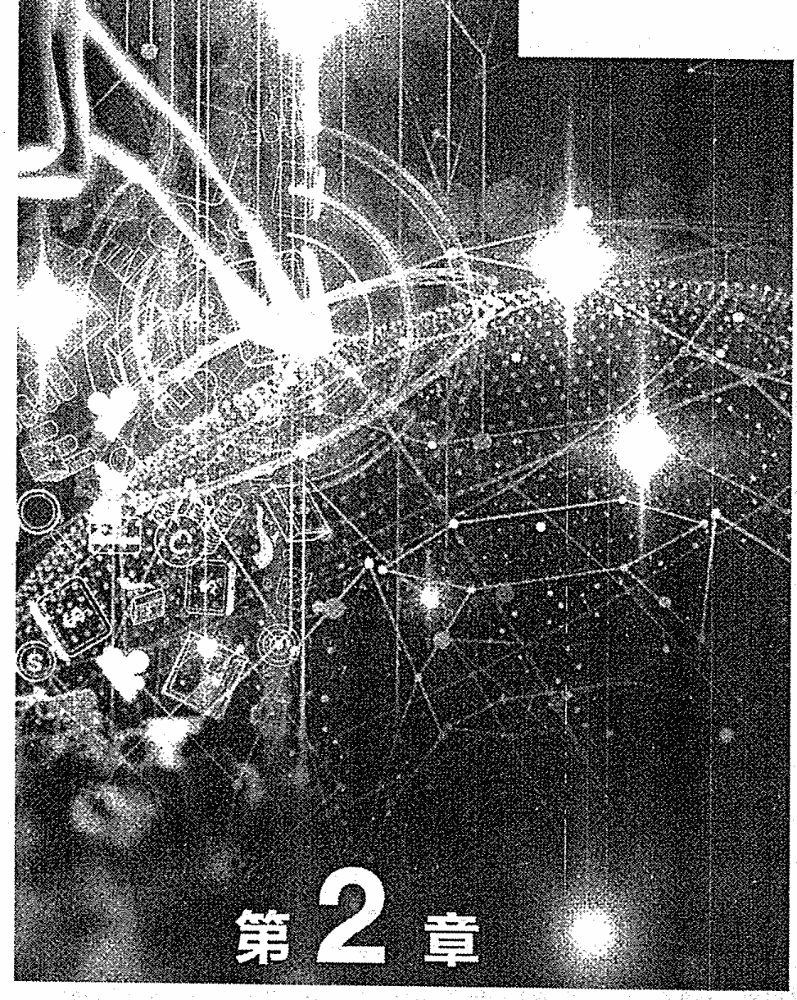

# 用 ChatGPT 高效生成各类文档
ChatGPT 基于自然语言处理，具备文本生成能力。在架构设计中，它可用于产出架构文档、需求文档、设计文档等类型。核心优势如下。

一是响应迅捷，可快速批量生成文本，提升编写效率。
二是具备一定灵活性，可依据输入指引产出符合要求的材料。
三是输出多样，可提供多角度方案，拓展思路。
四是知识面广，基于大规模训练数据，能给出丰富描述。
五是支持对话交互，可逐步细化与完善生成内容。

# 2.1 借助 ChatGPT 生成文档模板与内容
架构师产出 Word、Excel、PDF 及在线文档等多种形式。ChatGPT 本身不直接输出格式文件，可先用办公工具制作模板，再半自动填充内容，效率显著提升。

# 2.1.1 设计文档模板
设计技术文档模板的实施要点如下。

一是明确文档类型，选择 Word、Excel、PPT 等形式。
二是设定页面与边距，遵循公司规范或个人习惯。
三是统一标题样式，建立层级字体与格式库。
四是设置目录与书签，便于快速跳转。
五是制作封面页眉页脚，实现标准化。
六是插入表格图表公式等占位。
七是在需 AI 填充处加入文字提示。
八是保存为模板文件以便复用。
九是反复检验优化，提升适用性。

细致的模板直接影响生成质量与人工整合成本，理想状态下人工只需轻微润色即可使用。

# 第2章 借助 ChatGPT 产出各类文档
通过上述步骤即可形成可用模板，精细程度决定 ChatGPT 生成效果与后续整合难度。

# 2.1.2 案例一：ChatGPT 辅助撰写架构设计文档
下面以一个电商平台微服务架构方案为例说明流程。

案例背景
某初创科技公司计划上线在线电商平台，采用微服务以获得高扩展性、灵活性和可维护性。系统被拆分为多个自治服务，各自负责特定业务，通过轻量通信协作。

架构师 Tom 需输出微服务设计方案，包含组成、服务划分、通信、存储、容错监控等，为开发团队提供依据。

动手示例
Tom 向 ChatGPT 发出请求：帮我起草一份微服务架构设计方案，需覆盖设计原则、模块划分、通信机制等。

ChatGPT 的初稿如下。

微服务架构设计方案

1. 引言
本文档为在线电商平台微服务架构的详细设计思路，基于最佳实践，保障系统可扩展、灵活、可维护。

2. 设计原则
2.1 单一职责
每个服务聚焦单一业务，保持职责清晰，便于维护。
2.2 松耦合
服务间通过 RESTful API 或消息队列等轻量机制交互，降低耦合，提升灵活扩展。
2.3 高内聚
服务内部包含完整业务逻辑，减少对外部依赖，提升独立性与可测试性。
2.4 容错设计
考虑故障可能，采用熔断、限流、故障转移等机制保障可靠稳定。

3. 模块划分
3.1 用户管理
负责注册、登录、鉴权等。
3.2 商品管理
负责商品信息展示、列表、详情、搜索。
3.3 订单管理
处理创建、支付、配送等。
3.4 财务管理
处理支付结算与报表。
3.5 库存管理
管理库存查询与补货。

4. 通信机制
4.1 RESTful API
采用标准 HTTP 与 JSON 进行数据交互。
4.2 消息队列
用于异步通信，提升可伸缩性与性能，支持解耦与重试。

5. 技术选型
服务端框架 Spring Boot
数据存储 MySQL 与 Redis
消息队列 Kafka
API 网关 Netflix Zuul
配置中心 Spring Cloud Config
服务注册发现 Netflix Eureka
容器化 Docker 与 Kubernetes

6. 总结
本方案提供初步设计框架，后续将根据业务细化完善。

Tom 可通过对话逐步完善文档。

动手示例
Tom 补充需求：模块划分缺少支付管理模块，需处理支付接口集成与回调。

ChatGPT 的改进稿如下。

微服务架构设计方案

1. 引言
为电商平台系统设计提供详细微服务方案，遵循原则与实践，确保可扩展灵活可维护。

2. 设计原则
2.1 单一职责
每个服务专注单一业务，职责清晰。
2.2 松耦合
通过 RESTful API 或消息队列交互，降低耦合。
2.4 容错设计
采用熔断、限流、故障转移确保可靠。

3. 模块划分
3.1 用户管理
注册登录鉴权。
3.2 商品管理
信息展示与搜索。
3.3 订单管理
订单创建支付配送。
3.4 财务管理
支付结算报表。
3.5 库存管理
库存查询补货。
3.6 支付管理
负责支付接口集成与回调处理。

4. 通信机制
4.1 RESTful API
HTTP 与 JSON 交互。
4.2 消息队列
异步通信，提升伸缩性与解耦。

5. 技术选型
服务端 Spring Boot
存储 MySQL Redis
消息队列 Kafka
API 网关 Netflix Zuul
配置中心 Spring Cloud Config
注册发现 Netflix Eureka
容器化 Docker Kubernetes

6. 总结

本材料给出了一份初期微服务架构思路，重点围绕核心准则、模块划分及组件间交互展开。

# 2.2 ChatGPT 生成内容的通用载体 Markdown
此前章节已说明，ChatGPT 本身只能产出纯文字，无法直接交付 Word、Excel 或 PDF。若想得到这些格式，可先让模型产出 Markdown 源码，再通过编辑器或转换工具完成格式迁移。

# 2.2.1 Markdown 基础语法速览
Markdown 属于轻量级标记方案，以简洁易读的写法记录内容，随后可转为 HTML 等格式。借助适配工具，这类源码可导出为 Word 或 PDF 文件。

常见标记方式如下。

+   1. 标题

# 一级标题

## 二级标题

### 三级标题

#### 四级标题

##### 五级标题

###### 六级标题

把上面这段源码放入预览器，呈现效果如图2-1。

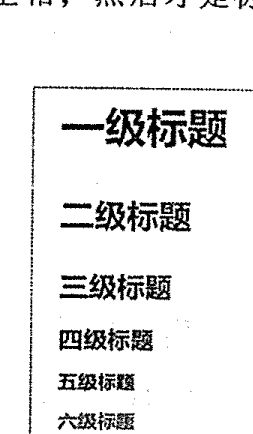

# 2. 列表
无序列表可使用 “-” 或 “*” 作为标记，有序列表则以数字加点号开头。标记符号之后建议保留一个空格，示例如下。

+   - 无序列表项 1

[PAGE 22]

+   - 无序列表项 2

- 无序列表项 3

+   1．有序列表项 1

2．有序列表项 2

3．有序列表项 3

把上述代码放进预览工具，可得到图2-2 所示的呈现。

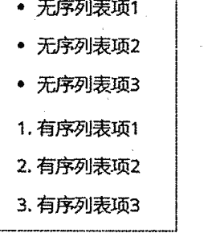

图2-2 Markdown预览效果(2)

# 3. 引用
引用借助 “>” 符号，表示引用内容，符号后也要留一个空格，示例如下。

> > 这是一段引用文本。

> 这是一段引用文本。

> 这是一段引用文本。

> 这是一段引用文本。

用预览工具打开上述代码，可看到图2-3 的效果。

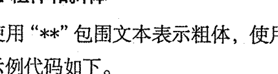

图2-3 Markdown预览效果(3)

# 4. 粗体和斜体
用 “**” 包裹文字表示加粗，用 “*” 包裹表示斜体，符号后建议留空格，示例如下。

这是 **粗体 ** 文本，这是 * 斜体 * 文本。

预览上述代码，可得到图2-4 的效果。


图2-4 Markdown预览效果(4)

# 5. 图片
Markdown 插入图片的写法如下。


示例代码如下。


把上述代码放入预览器，可看到图 2-5 的效果。


图2-5 Markdown 预览效果(5)

# 6. 代码块
使用三个反引号(``) 括起代码，并在首行注明语言名称，示例如下。

```
python
import re
def calculate_word_frequency(text):
    words = re.findall(r\b\w+\b, text.lower())
    word_counts = dict()
    for word in words:
        if word in word_counts:
            word_counts[word] += 1
        else:
            word_counts[word] = 1
```

[PAGE 24]

```
top_10 = sorted(word_counts.items(), key=lambda x: x[1], reverse=True)[ : 10]
return top_10...
```

# 注意
在三个反引号(``) 后可以指定编程语言，如示例中的 “python” 表示该段为 Python 代码，好处是可以实现语法高亮。

预览上述代码，可看到图2-6 的效果。

```
1 import re
2 
3 def calculate_word_frequency(text):
4     words = re.findall(r`\b\w+\b`, text.lower())
5     word_counts = dict()
6     for word in words:
7         if word in word_counts:
8             word_counts[word] += 1
9         else:
10             word_counts[word] = 1
11     top_10 = sorted(word_counts.items(), key= lambda x: x[1], reverse=True)[ : ]
12 return top_10
```

图2-6 Markdown预览效果(6)

以上已覆盖 Markdown 的基础用法，足以完成常见任务。如有特殊需求，可自行查阅更多标记规则。

# 2.2.2 常用 Markdown 编辑器
工欲善其事，必先利其器。撰写 Markdown 时需要合适的编辑预览软件。

所谓 Markdown 工具是指能编辑并实时预览 Markdown 文件的程序，典型代表有 VS Code、Typora、Mark Text 等。常见扩展如下。

(1

+   * Markdownlint: 提供语法检查功能，可在编写过程中发现并修复常见错误。

以上为常用的 Markdown 扩展，用户可按需安装。

在 VS Code 中安装扩展的步骤如图2-8所示。

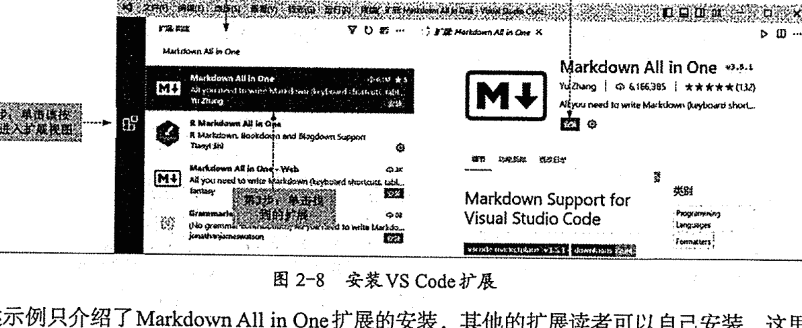

# 图2-8 安装VS Code扩展
示例仅演示了 Markdown All in One 的安装，其它扩展可自行完成，此处不再展开。

安装后，新建文本文件并保存为 “.md” 即可。在 VS Code 中编写和预览 Markdown，如图2-9所示。

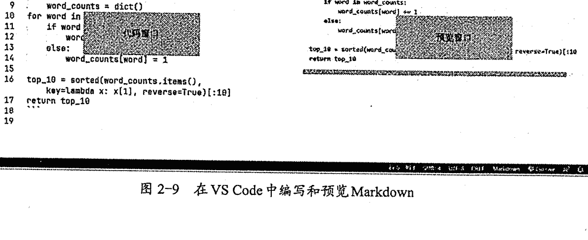

# 图2-9 在VS Code中编写和预览Markdown

# 第2章 借助 ChatGPT 生成各种文档

# 2.2.3 案例2：生成Markdown格式架构设计文档
编辑器准备好后，下面以案例1中的“微服务架构设计方案”为例，利用 ChatGPT 把它转成 Markdown 形式。

# 动手示例
向 ChatGPT 发送如下请求。

有如下“微服务架构设计方案”文档，帮我返回 Markdown 代码格式文档。

微服务架构设计方案

+   1. 引言

本文档旨在提供一份详细的微服务架构设计方案，以支持开发团队在构建在线电商平台时的系统设计和开发工作。本方案将基于微服务架构的原则和最佳实践，确保系统具备高可扩展性、灵活性和可维护性。

+   2. 架构设计原则

在设计微服务架构时，我们遵循以下关键原则：

+   2.1 单一责任原则

每个微服务应专注于单一的业务功能，确保服务的职责清晰明确，可维护性高。

+   2.2 松耦合原则

微服务之间应该通过轻量级的通信机制进行交互，如使用 RESTful API 或消息队列，以降低耦合度，提高系统的灵活性和可扩展性。

+   2.3 高内聚原则

每个微服务应该包含完整的业务逻辑，避免过度依赖其他服务，以提高模块的独立性和可测试性。

+   2.4 容错设计原则

在设计微服务架构时，考虑到故障的可能性，采用适当的容错机制，如熔断、限流和故障转移，以确保系统的可靠性和稳定性。

+   3. 模块划分

基于系统和业务功能，我们将系统划分为以下核心模块：

+   3.1 用户管理模块

负责用户注册、登录、身份验证等用户相关功能。

+   3.2 商品管理模块

负责商品信息的管理和展示，包括商品列表、详情、搜索等功能。

+   3.3 订单管理模块

处理订单创建、支付、配送等订单相关功能。

# 3.4 财务管理模块

负责处理支付、结算和财务报表等财务相关功能。

# 3.5 库存管理模块

管理商品库存信息，包括库存查询、补货等功能。

# 3.6 支付管理模块

负责处理支付相关功能，如支付接口集成、支付回调处理等。

# 4. 通信机制

为实现模块之间的通信和协作，我们将采用以下通信机制：

# 4.1 RESTful API

模块之间通过RESTful API进行数据的传递和交互，使用标准的HTTP协议和JSON格式进行通信。

# 4.2 消息队列

采用消息队列作为异步通信的机制，提高系统的可伸缩性和性能，支持解耦和消息重试。

# 5. 技术选型

为实现微服务架构的设计方案，我们将采用以下技术栈：

+   - 服务端开发框架: Spring Boot

+   - 数据存储: MySQL和Redis

+   - 消息队列: Kafka

+   - API网关: Netflix Zuul

+   - 配置中心: Spring Cloud Config

+   - 服务注册与发现: Netflix Eureka

+   - 容器化平台: Docker和Kubernetes

# 6. 总结

本文档提供一个初步的微服务架构设计方案，涵盖关键原则、模块划分和通信机制等内容。

通过加入支付管理模块，我们能够完整地支持系统的支付功能，包括支付接口集成和支付回调处理。该设计方案将为开发团队提供指导，确保系统的可扩展性、灵活性和可维护性。在实际的开发过程中，我们将进一步细化和完善该方案，以满足具体的业务需求和技术要求。

ChatGPT的回答如下。

下面是您要求的Markdown格式的文档:

# 微服务架构设计方案

# 1. 引言

本文档旨在提供一份详细的微服务架构设计方案，以支持开发团队在构建在线电商平台时的系统设计和开发工作。本方案将基于微服务架构的原则和最佳实践，确保系统具备高可扩展性、

# 2. 架构设计原则

在设计微服务架构时，我们遵循以下关键原则:

+   - 2.1 单一责任原则: 每个微服务应专注于单一的业务功能，确保服务的职责清晰明确，可维护性高。

+   - 2.2 松耦合原则: 微服务之间应该通过轻量级的通信机制进行交互，如使用RESTful API或消息队列，以降低耦合度，提高系统的灵活性和可扩展性。

+   - 2.3 高内聚原则: 每个微服务应该包含完整的业务逻辑，避免过度依赖其他服务，以提高模块的独立性和可测试性。

+   - 2.4 容错设计原则: 在设计微服务架构时，考虑到故障的可能性，采用适当的容错机制，如熔断、限流和故障转移，以确保系统的可靠性和稳定性。

# 3. 模块划分

基于系统需求和业务功能，我们将系统划分为以下核心模块:

+   - 3.1 用户管理模块: 负责用户注册、登录、身份验证等用户相关功能。

+   - 3.2 商品管理模块: 负责商品信息的管理和展示，包括商品列表、详情、搜索等功能。

+   - 3.3 订单管理模块: 处理订单创建、支付、配送等订单相关功能。

+   - 3.4 财务管理模块: 负责处理支付、结算和财务报表等财务相关功能。

+   - 3.5 库存管理模块: 管理商品库存信息，包括库存查询、补货等功能。

+   - 3.6 支付管理模块: 负责处理支付相关功能，如支付接口集成、支付回调处理等。

# 4. 通信机制

为实现模块之间的通信和协作，我们将采用以下通信机制:

+   - 4.1 RESTful API: 模块之间通过RESTful API进行数据的传递和交互，使用标准的HTTP协议和JSON格式进行通信。

+   - 4.2 消息队列: 采用消息队列作为异步通信的机制，提高系统的可伸缩性和性能，支持解耦和消息重试。

# 5. 技术选型

为实现微服务架构的设计方案，我们将采用以下技术栈:

+   - 服务端开发框架: Spring Boot

+   - 数据存储: MySQL和Redis

+   - 消息队列: Kafka

+   - API网关: Netflix Zuul

+   - 配置中心: Spring Cloud Config

+   - 服务注册与发现: Netflix Eureka

+   - 容器化平台: Docker和Kubernetes

# 6. 总结

本文档提供一个初步的微服务架构设计方案，涵盖关键原则、模块划分和通信机制等内容。通过加入支付管理模块，我们能够完整地支持系统的支付功能，包括支付接口集成和支付回调处理。该设计方案将为开发团队提供指导，确保系统的可扩展性、灵活性和可维护性。在实际的开发过程中，我们将进一步细化和完善该方案，以满足具体的业务需求和技术要求。

复制上述代码，保存为“微服务架构设计方案.md”文件，然后在VS Code中预览，如图2-10所示。

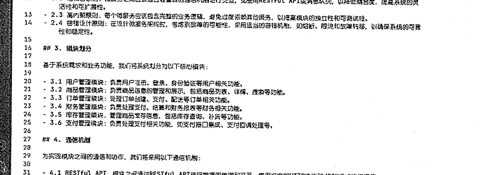

# 图2-10 在VS Code中预览微服务架构设计方案

# 2.2.4 将Markdown格式文档转换为Word文档
有时需要把 Markdown 转成 Word，可选用多种工具，其中 Pandoc 较为常用。Pandoc 官网页面如图2-11所示。

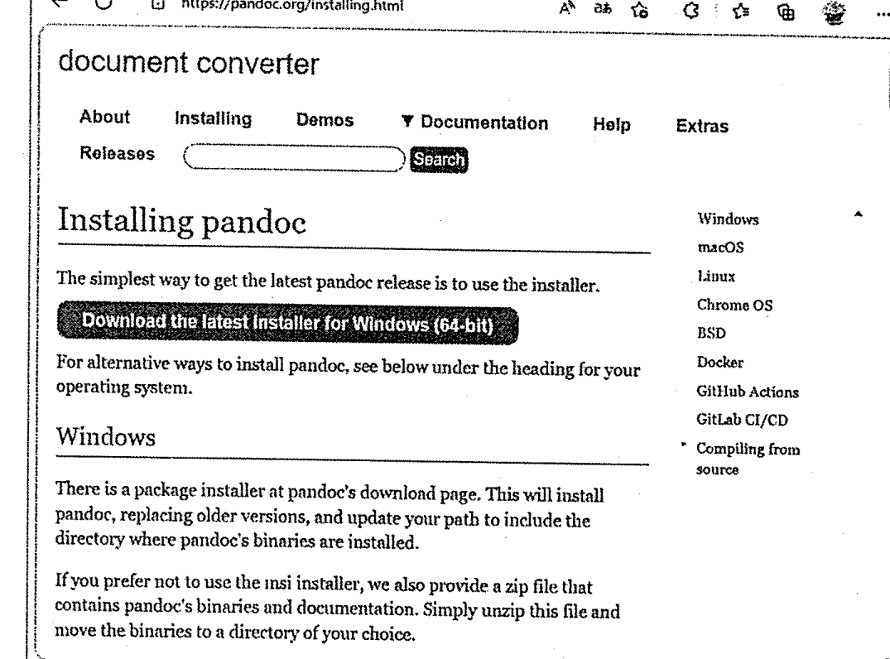

# 图2-11 Pandoc软件网站
在该页可下载对应系统的安装包，安装后需加入系统路径。

安装完成后，通过终端输入如下命令即可转换。

```
pandoc input.md -o output.docx
```

其中，“input.md” 为源文件名，“output.docx” 为生成文件名。

除 Pandoc 外，在线转换器、VS Code 扩展等也能实现此功能，用户可按需选择。

将“微服务架构设计方案.md” 转为 Word 文档，如图2-12所示。

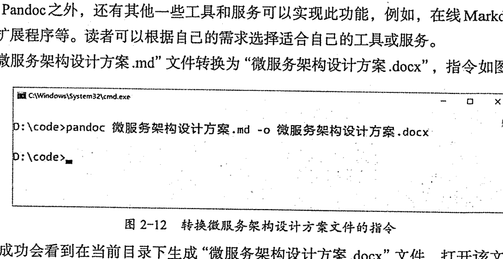

# 图2-12 转换微服务架构设计方案的指令
转换成功后当前目录会生成“微服务架构设计方案.docx”，打开效果如图2-13所示。

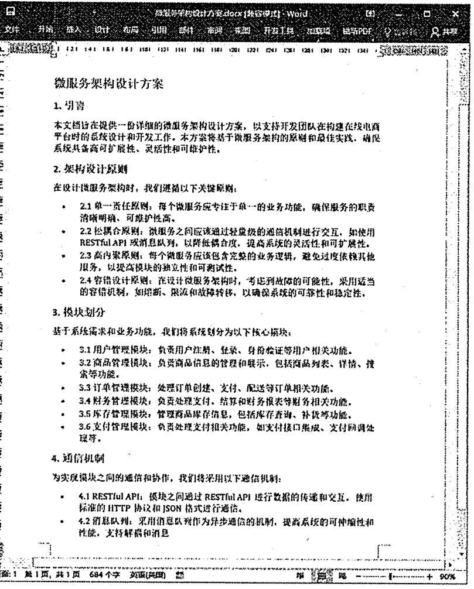

# 图 -13 转换成功的微服务架构设计方案.docx

# 2.2.5 使用Office工具设计格式
在 ChatGPT 生成并人工完善内容的基础上，可借助 Word 等 Office 工具对报告进行排版，包括字体、版式及图片图表的插入，最终形成正式的微服务架构方案。

Word 提供主题功能，可统一修改文档风格。具体操作如图2-14所示，点击“设计”选项卡，在“主题”组中选择“浏览主题”。这会打开主题面板，展示多种内置主题，如图2-15所示。

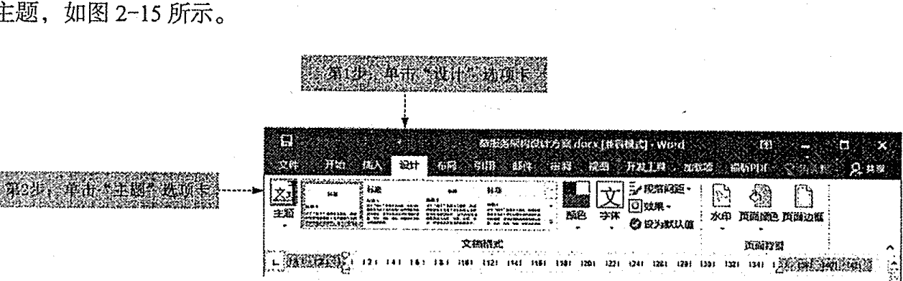

# 图2-14 选择主题功能
笔者偏爱“平面”内置主题，选用后效果如图11-16所示。

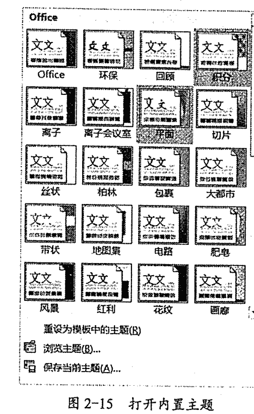

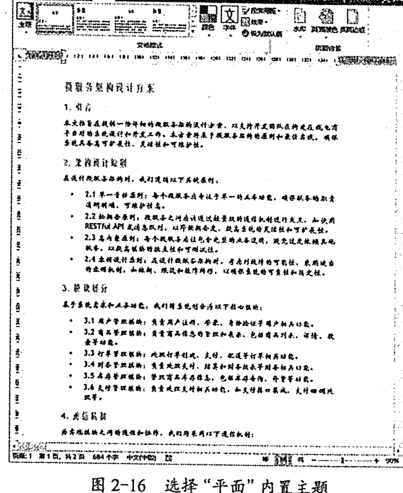

# 2.2.6 将Markdown格式文档转换为PDF文档
要把 Markdown 转成 PDF，可用 Pandoc 或 Typora 等工具。笔者认为这些方式稍显繁琐，不如先用 Word 打开转出的 Word 文件再导出 PDF 更顺手。

读者可使用 2.2.4 节生成的 Word 文件，将其输出为 PDF。

具体步骤：打开 Word 文件后，通过菜单“文件”→“导出”弹出如图2-17所示的对话框，按图示流程导出 PDF，导出的 PDF 效果如图2-18所示。

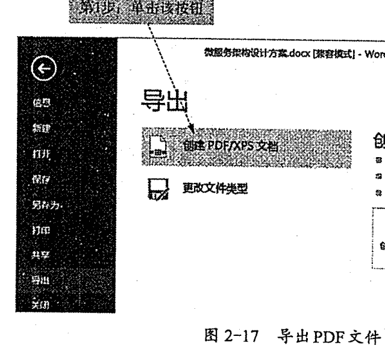

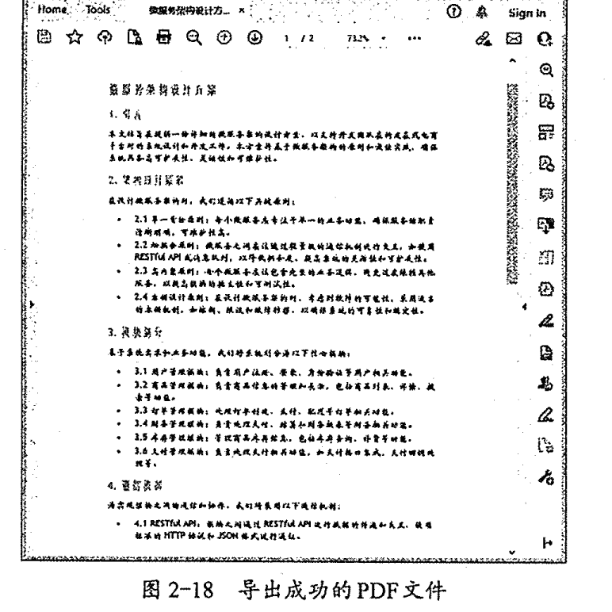

# 图-18 导出成功的PDF文件

# 2.3 使用表格
在架构设计中，表格被广泛使用，其作用主要体现在以下三点。

(1) 组织结构清晰：表格能把模块、职责和技术选型以清晰的结构呈现，让人一目了然地了解各模块职责和所用技术。

(2) 对比和对齐：表格便于对不同模块进行横向对比和对齐。将各模块的职责和技术选型放在同一表格中，更容易发现共性与差异，从而做出更好决策。

(3) 信息完整性：表格可提供更详尽的信息，包括模块名称、职责和所用技术，有助于保证设计方案完整，让人清楚系统各模块的功能与依赖关系。

(4) 快速抓取重点：把核心要素整理进表格后，读者不用逐段阅读冗长的说明，目光扫过即可抓住关键信息，沟通效率随之提升。
(5) 更新成本低：当设计方案以表格形式沉淀下来后，若出现新模块加入或技术选型变更，只需修改对应单元格，无需重写整份文档，后续维护更省力。

总的来看，在架构设计中引入表格，能够兼顾表述清晰、横向比较、要素完备、视觉直观以及迭代便捷，成为团队共同构建与共享方案的有效抓手。

# 2.3.1 Markdown表格

Markdown 本身无法导出二进制的 Excel 文件，实际工作中常借助 AI 助手生成可直接使用的文本表格。下面给出一种示例。

| 应用场景 | 优势 | 限制 |

|------------|-------|------|

| 微服务架构设计 | 模块化、可扩展、独立部署和维护 | 需要复杂的服务间通信和管理机制 |

| 需要复杂的服... |        |      |

| 数据架构设... | 高性能、可扩展、灵活查询和数据一致性 | 数据迁移和同步的复杂性、数据存储成本 |

| 数据迁...    |        |      |

| 安全架...   | 用户身份验证、访问控制、数据保护 | 增加系统的复杂性和开发成本 |

| 增加系...   |        |      |

| 弹性架...   | 高可用性、负载均衡、自动伸缩和容错处理 | 复杂性高、需要综合考虑系统的可用性和资源消耗 |

| 复杂性...   |        |      |

| 云架...     | 灵活的资源配置、弹性扩展和高度可靠性 | 对云服务提供商的依赖、可能导致供应商锁定 |

| 对云...     |        |      |

| 性能优...   | 响应时间优化、资源利用率提升、负载平衡 | 需要深入分析和测试、对系统的各个组件进行优化 |

| 需要深...   |        |      |

| 扩展性架...  | 可处理大规模用户、适应业务增长、支持水平和垂直扩展 | 架构复杂性增加、可能需要改变现有的系统架构 |

| 架构复...   |        |      |

| 多层架...   | 分层清晰、各层职责分离、易于维护和扩展 | 模块间通信和数据传递的开销增加、增加了系统的复杂性 |

| 模块间通... |        |      |

渲染效果如图 2-19 所示。

| 应用场景       | 优势                     | 限制                                   |

|------------------|-------------------------|----------------------------------------|

| 微服务架构设计    | 模块化、可扩展、独立部署和维护 | 需要复杂的服务间通信和管理机制            |

| 数据架构设计      | 高性能、可扩展、灵活查询和数据一致性 | 数据迁移和同步的复杂性、数据存储成本       |

| 安全架构设计      | 用户身份验证、访问控制、数据保护 | 增加系统的复杂性和开发成本                |

| 弹性架构设计      | 高可用性、负载均衡、自动伸缩和容错处理 | 复杂性高、需要综合考虑系统的可用性和资源消耗   |

| 云架构设计        | 灵活的资源配置、弹性扩展和高度可靠性 | 对云服务提供商的依赖、可能导致供应商锁定      |

| 性能优化架构设计   | 响应时间优化、资源利用率提升、负载平衡 | 需要深入分析和测试、对系统的各个组件进行优化   |

| 扩展性架构设计     | 可处理大规模用户、适应业务增长、支持水平和垂直扩展 | 架构复杂性增加、可能需要改变现有的系统架构     |

| 多层架构设计      | 分层清晰、各层职责分离、易于维护和扩展 | 模块间通信和数据传递的开销增加、增加了系统的复杂性 |

| 模块间通信

# 第2章 借助 ChatGPT 生成各种文档

商品展示与检索体验丰富，但需要处理大量商品数据并与订单管理模块对接。

# ChatGPT 的回答如下。

明白，继续补充商品管理模块的信息。

| 模块       | 功能                     | 优势                     | 限制                     |

|------------|--------------------------|--------------------------|--------------------------|

| 用户管理模块 | 用户注册、登录、个人信息管理 | 提供用户身份验证和个性化服务 | 需要处理大量用户数据、需要与其他模块进行集成 |

| 商品管理模块 | 商品信息管理、商品展示、搜索功能 | 提供丰富的商品展示和搜索体验 | 需要处理大量商品数据、需要与订单管理模块进行集成 |

# 架构师向 ChatGPT 发送如下请求消息。

模块三是订单管理模块，功能包括订单创建、支付、配送管理。它的优势是提供订单处理和配送跟踪功能，但限制是需要与用户管理模块和商品管理模块进行集成。

# ChatGPT 的回答如下。

明白了，我们添加订单管理模块的信息。

| 模块           | 功能                     | 优势                     | 限制                     |

|---------------|--------------------------|--------------------------|--------------------------|

| 用户管理模块   | 用户注册、登录、个人信息管理 | 提供用户身份验证和个性化服务 | 需要处理大量用户数据、需要与其他模块进行集成 |

| 商品管理模块   | 商品信息管理、商品展示、搜索功能 | 提供丰富的商品展示和搜索体验    | 需要处理大量商品数据、需要与订单管理模块进行集成 |

| 订单管理模块   | 订单创建、支付、配送管理     | 提供订单处理和配送跟踪功能   | 需要与用户管理模块和商品管理模块进行集成       |

按此思路，架构师可以陆续提供其他模块的功能、优势和限制，然后 ChatGPT 将为架构师生成完整的 Markdown 表格。

复制上述代码并保存为“各个模块和组件比较 .md”文件，然后使用 Markdown 工具预览，效果如图 2-20 所示。

# AI时代

架构师修炼之道 /ChatGPT让架构师插上翅膀

| 模块       | 功能                     | 优势                         | 限制                                   |

|------------|--------------------------|------------------------------|----------------------------------|

| 用户管理模块 | 用户注册、登录、个人信息管理 | 提供用户身份验证和个性化服务   | 需要处理大量用户数据、需要与其他模块进行集成 |

| 商品管理模块 | 商品信息管理、商品展示、搜索功能 | 提供丰富的商品展示和搜索体验    | 需要处理大量商品数据、需要与订单管理模块进行集成 |

| 订单管理模块 | 订单创建、支付、配送管理     | 提供订单处理和配送跟踪功能      | 需要与用户管理模块和商品管理模块进行集成 |

图 2-20 Markdown 预览效果

> 提示

事实上也可以一次性输入多条数据，但是输入数据多，也就意味着返回数据会增多。ChatGPT对返回数据量是有限制的，导致只能返回部分数据。建议读者“多次少输入”，如果出现ChatGPT不动的情况，说明返回数据太多，读者可以发送“请继续”，ChatGPT会继续返回数据。

# 2.3.3 CSV电子表格

2.3.2小节介绍返回的是Markdown格式的表格数据，此外，我们还可以让ChatGPT返回CSV电子表格。

CSV，全称是Comma-Separated Values，即逗号分隔值的文本文件的电子表格。CSV文件可以被许多应用程序读取和编辑，例如Microsoft Excel、Google Sheets等。每行表示一行记录，每个字段之间用逗号分隔。通常第一行包含表头，其余的行包含数据。例如，以下是包含表头和三行数据的示例代码。

姓名, 年龄, 性别

爱丽丝 ,25,女

鲍勃,30,男

查理,35,男

先将CSV代码复制到文本编辑器中，如图2-21所示。然后将文件保存为“.csv”格式文件，如图2-22所示。

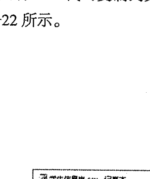

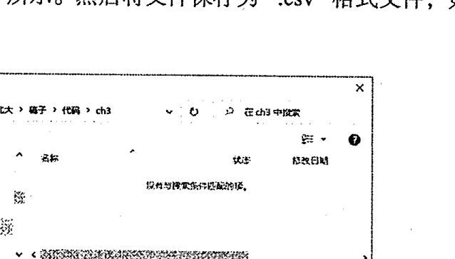

# 第2章 借助 ChatGPT 生成各种文档

保存好CSV文件之后，我们可以使用Excel和WPS等Office工具打开。图2-23所示的是使用Excel打开CSV文件的效果。

# 注意

在保存CSV文件时，要注意字符集问题！如果是在简体中文系统下，推荐字符集选择ANSI，ANSI在简体中文就是GBK编码。如果不能正确选择字符集则会出现中文乱码，图2-24所示的是用Excel工具打开UTF - 8编码的CSV文件出现中文乱码的情况，而用WPS工具打开时则不会有乱码。

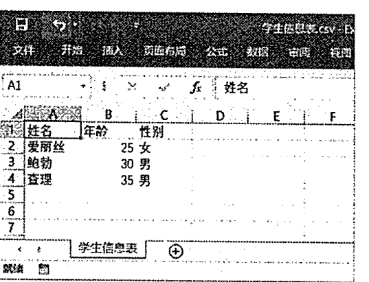

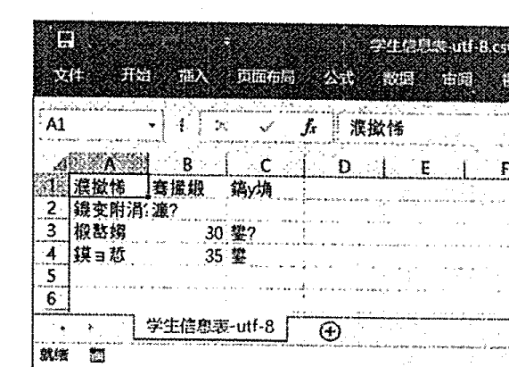

# 图2-23 使用Excel打开CSV文件

# 图2-24 CSV文件乱码

# 2.3.4 案例4：使用ChatGPT制作CSV表格

下面通过案例介绍一下，如何使用ChatGPT制作CSV表格。

使用ChatGPT制作CSV表格和制作Markdown表格类似，都是比较复杂的，可以采用复合指令实现。如果已经有Markdown表格，则可以让ChatGPT将其转换为CSV表格。

# 动手示例

我们向ChatGPT发送如下请求消息。

帮我将如下Markdown表格转换为CSV表格

| 模块 | 功能 | 优势 | 限制 |

| ———— | —————— | ——————— | |

| 用户管理模块 | 用户注册、登录、个人信息管理需要处理大量用户数据、需要与其他模块进行集成 | 提供用户身份验证和个性化服务 | |

| 商品管理模块 | 商品信息管理、商品展示、搜索功能需要处理大量商品数据、需要与订单管理模块进行集成 | 提供丰富的商品展示和搜索体验 |

# AI时代 架构师修炼之道 / ChatGPT让架构师插上翅膀

+   | 订单管理模块 | 订单创建、支付、配送管理 | 提供订单处理和配送跟踪功能 | 需要与用户管理模块和商品管理模块进行集成 |

# ChatGPT的回答如下。

当然！以下是给定的Markdown表格的CSV表示形式：

模块,功能,优势,限制

用户管理模块,用户注册、登录、个人信息管理,提供用户身份验证和个性化服务,需要处理大量用户数据、需要与其他模块进行集成

商品管理模块,商品信息管理、商品展示、搜索功能,提供丰富的商品展示和搜索体验,需要处理大量商品数据、需要与订单管理模块进行集成

订单管理模块,订单创建、支付、配送管理,提供订单处理和配送跟踪功能,需要与用户管理模块和商品管理模块进行集成

将这些CSV代码复制出来，粘贴到记事本中保存为CSV文件，这个过程不再赘述。

# 2.3.5 转换为Excel

使用ChatGPT制作的CSV表格如何转换成Excel呢？我们可以在使用Excel或WPS等工具打开CSV文件后，选择菜单“文件”→“另存为”，此时会弹出文件“另存为”对话框，在文件“保存类型”中选择“*.xlsx”，如图2-25所示。

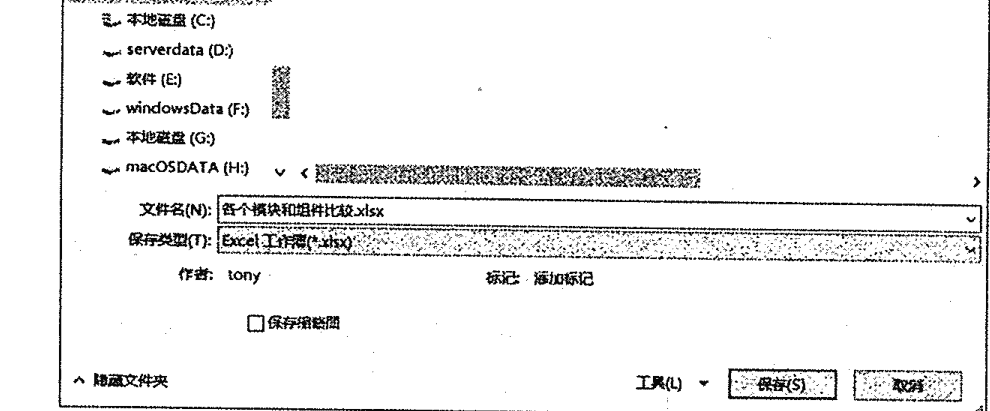

# 第2章 借助 ChatGPT 生成各种文档

# 2.4 本章总结

通过本章的学习，我们获得了ChatGPT在文档生成中的应用知识，同时掌握了Markdown语言、表格制作和文档格式转换的技巧。ChatGPT的协助提高了文档编写的效率和便捷性。在接下来的章节中，我们将继续研究ChatGPT在软件开发和文档编写领域的更多应用。

# AI时代

架构师修炼之道

ChatGPT让架构师插上翅膀

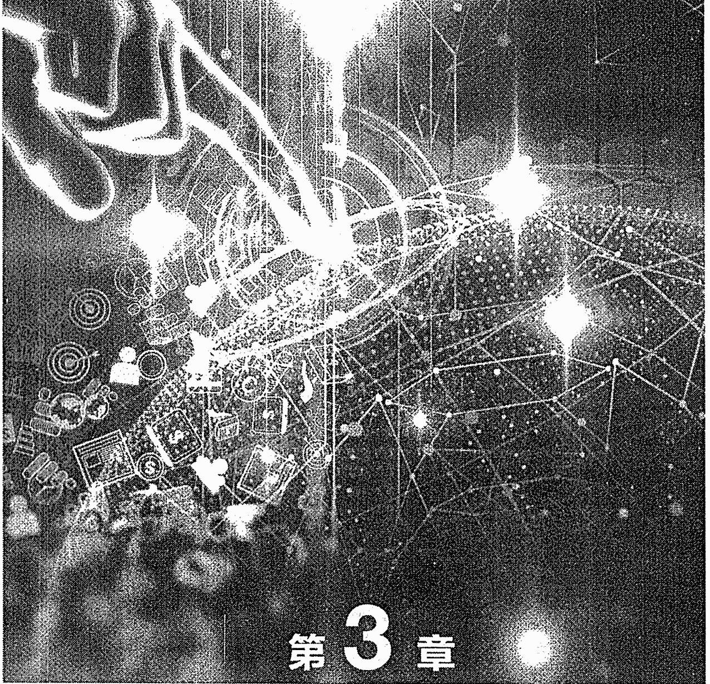

# 第 3 章

# 应用图形图表帮助思考和表达

在架构设计和系统开发过程中，图形是极为有用的辅助工具。通过使用各种图形图表，架构师和开发团队可以更好地理解和表达复杂的概念、关系，做出更好的设计方案。这些图形工具能够帮助架构师以可视化的方式捕捉关键的概念，促进团队之间的沟通和合作，并帮助架构师做出明智的决策。

本章将介绍一系列常用的图形图表，旨在帮助架构师和开发团队更好地思考和解决问题。我们将探索各种图表类型，包括思维导图、鱼骨图等。每种图表都有其特点和用途，可被用于不同的情景和目的。

通过学习这些图形图表的应用，我们能够更好地组织和展现架构设计思路，分析和解决问题，促进团队合作和创造力的发挥。不论是在架构设计讨论中进行头脑风暴，还是与利益相关者交流方案，这些图形图表都将成为宝贵的工具。

本章我们重点介绍思维导图和鱼骨图。

# 3.1 思维导图

思维导图是一种用于组织和表示概念及其关系的图表工具。它由一个中心主题发散出相关的分支主题，层层递进，直观地呈现思路和逻辑关系。

# 3.1.1 思维导图在架构设计中的作用

思维导图在架构设计中起着重要的作用。它是一种图形化的工具，能够帮助架构师整理和组织复杂的信息，展现产品的结构和关系，以及辅助决策和沟通。

以下是思维导图在架构设计中的几个重要作用。

+   (1) 组织思路和梳理需求：思维导图可以帮助架构师将大量的想法和需求整理成结构清晰的树状图。通过将不同的需求、功能和任务归类并连接起来，架构师能够更好地理解产品的整体架构和关键要素。(2) 可视化产品规划：思维导图可以将产品的各个模块、功能和流程以图形化的方式展示出来。这有助于架构师和团队成员更好地理解产品的组成部分和各个环节，从而更好地进行产品规划和设计。(3) 发现问题和解决方案：通过思维导图，架构师可以快速发现产品中的问题和面临的挑战，并探索可能的解决方案。思维导图的分支和关联结构可以帮助架构师进行头脑风暴，激发创新思维，并找到最佳的解决方案。(4) 沟通和共享：思维导图是一种简洁而直观的工具，能够清晰地传达产品的信息和用户的想法。架构师可以将思维导图用于内部沟通和团队协作，将复杂的概念和计划以可视化的方式呈现给团队成员和利益相关者，以便其更好理解和参与产品开发过程。(5) 追踪和管理进度：在产品开发过程中，思维导图可以作为产品路线图和计划的可视化工具。

架构师可以使用思维导图来跟踪项目进展、标记里程碑和任务，以及更新和调整产品计划。

总之，思维导图可以在架构设计中提供一种直观、结构化和可视化的方式来组织和管理产品信息，促进团队协作和决策，并帮助架构师更好地理解、规划和推进产品的发展。

# 3.1.2 架构师与思维导图

架构师与思维导图是紧密相关的，思维导图是架构师在设计和沟通系统架构时常用的工具之一。通过思维导图，架构师可以清晰地展示系统的组成部分、模块之间的关系及各个模块的功能。

图3-1所示的是笔者团队制作的“艺术品收藏应用平台”思维导图。

# 3.1.3 绘制思维导图

思维导图可以手绘或使用电子工具创建。当使用电子工具创建时，常使用专业的软件或在线工具，例如MindManager、XMind、Google Drawings、Lucidchart等，这些工具提供了丰富的绘图功能和模板库，可以帮助读者快速创建各种类型的思维导图。

图3-2所示的是在白板上绘制的“艺术品收藏应用平台”思维导图，而图3-3所示的是使用XMind绘制的思维导图。

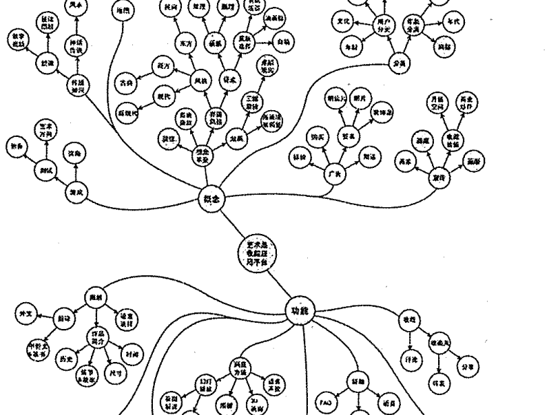

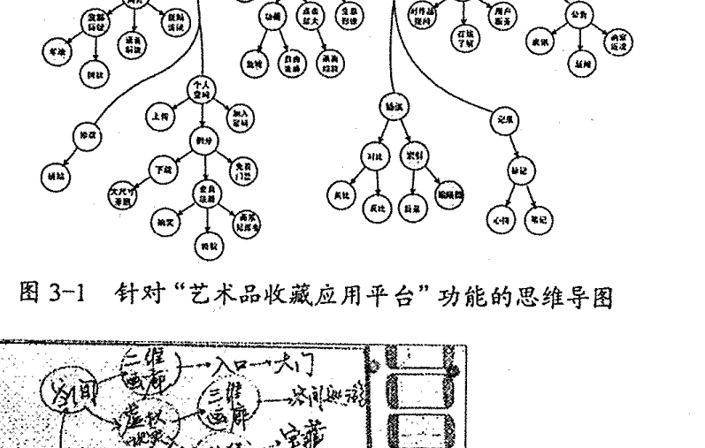

# 图3-1 针对“艺术品收藏应用平台”功能的思维导图

# 图3-2 在白板上绘制的“艺术品收藏应用平台”思维导图

# 图3-3 使用XMind绘制的思维导图

思维导图是一种记录和组织思考过程的工具，可以在纸质或数字介质上使用。使用目的是以可视化的方式捕捉和整理我们的想法，并帮助我们更好地理解和记忆信息。无论是手写还是使用软件创建思维导图，它都可以作为一个非常有用的工具来促进问题的解决和创造力的发挥。

# 3.1.4 使用ChatGPT绘制思维导图

ChatGPT是一种自然语言处理模型，它并不具备直接绘制思维导图的能力，但是可以通过如下方法实现。

方法1：通过ChatGPT生成Markdown代码描述的思维导图，然后使用一些思维导图工具从Markdown格式文件导入。

方法2：使用ChatGPT通过文本的绘图工具Mermaid绘制思维导图，图3-4所示的是使用Mermaid工具绘制的简单的思维导图。

方法3：使用ChatGPT通过文本的绘图工具PlantUML绘制思维导图，图3-5所示的是使用PlantUML工具绘制的简单的思维导图。

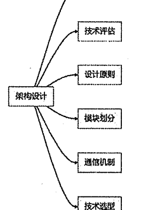

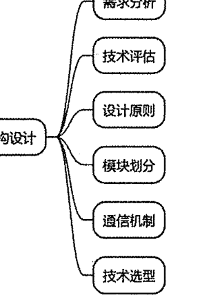

# 图 3-4 使用 Mermaid 绘制的思维导图

# 图 3-5 使用 PlantUML 绘制的思维导图

# 3.1.5 案例1：生成“微服务架构设计方案”思维导图

下面我们介绍如何通过“方法 ”创建思维导图。

# 动手示例

由于 ChatGPT 不能直接生成图片，我们可以换一种问法。

> 我们向 ChatGPT 发送如下请求消息。

# 微服务架构导图实战手记

围绕“微服务架构设计方案”这一主题，提出一个文本版思维导图并以 Markdown 形式交付。拆开看这个需求包含三个要素：

1. 核心议题是微服务架构设计方案；
2. 呈现方式是文本思维导图；
3. 交付形态是 Markdown 代码。

发出需求后，模型给出的答复如下。

好的，下面是以“微服务架构设计方案”为核心主题的文本版思维导图的 Markdown 代码：

```
# 微服务架构设计方案
- 引言   - 系统设计和开发工作支持   - 基于微服务架构的原则和最佳实践   - 高可扩展性、灵活性性和可维护性
  - 架构设计原则   - 单一责任原则   - 微服务专注于单一业务功能   - 职责清晰明确，可维护性高   - 松耦合原则   - 轻量级通信机制，如 RESTful API 和消息队列   - 高内聚原则   - 微服务包含完整业务逻辑   - 降低耦合度，提高灵活性和可扩展性   - 容错设计原则   - 适当容错机制，如熔断、限流和故障转移
```

# 3.1.6 案例2：Mermaid 绘制思维导图

3.1.5 已通过“方法一”得到导图，本节演示“方法二”。思路是利用 Mermaid 的文本绘图语法构建思维导图。Mermaid 属于文本化绘图方案，市面上同类工具不少，常见代表有：

* Graphviz：开源绘图工具，采用纯文本图形描述语言，可生成流程图、组织架构图、网络图、类图等。
* PlantUML：一种

# 第3章 图表驱动思考与表达

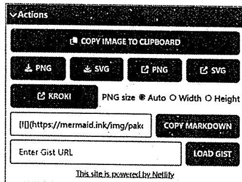

# 图3-8 操作面板视图

Mermaid 源码本书不再展开，我们仅借助 ChatGPT 产出 Mermaid 源码来作图。

下面以示例说明如何借助 Mermaid 完成思维导图的绘制。

# 实操示例

我们向模型发出如下指令。

有如下“微服务架构设计方案”文档，请使用 Mermaid 绘制思维导图。

微服务架构设计方案

# 1. 引言

本文档旨在提供一份详尽的微服务架构设计方案，为开发团队建设在线电商平台提供系统设计与开发依据。方案基于微服务架构原则与业界最佳实践，确保系统具备高扩展性、灵活性和可维护性。

# 2. 架构设计原则

设计微服务架构时，我们遵循以下关键原则：

# 2.1 单一责任原则

每个微服务应聚焦单一业务功能，保证职责清晰明确，提升可维护性。

# 2.2 松耦合原则

微服务间应通过轻量级通信方式交互，如 RESTful API 或消息队列，降低耦合度，提升灵活性和可扩展性。

# 2.3 高内聚原则

每个微服务应包含完整的业务逻辑，避免过度依赖其他服务，以提高模块独立性和可测试性。

# 2.4 容错设计原则

设计时需考虑故障可能，采用熔断、限流、故障转移等容错手段，确保系统可靠稳定。

# 3. 模块划分

结合业务需求和功能点，系统划分为以下核心模块：

# 3.1 用户管理模块

负责用户注册、登录、身份校验等用户相关功能。

# 3.2 商品管理模块

负责商品信息管理与展示，包括列表、详情、搜索等功能。

# 3.3 订单管理模块

处理订单创建、支付、配送等订单相关功能。

# 3.4 财务管理模块

负责支付、结算和财务报表等财务相关功能。

# 3.5 库存管理模块

管理商品库存信息，包括库存查询、补货等功能。

# 3.6 支付管理模块

负责支付相关功能，如支付接口接入、支付回调处理等。

# 4. 通信机制

为实现模块间通信与协作，采用以下机制：

# 4.1 RESTful API

模块间通过 RESTful API 传递数据，使用标准 HTTP 协议与 JSON 格式交互。

# 4.2 消息队列

采用消息队列实现异步通信，提升系统伸缩性和性能，支持解耦和消息重试。

# 5. 技术选型

为落地该设计方案，采用如下技术栈：

- 服务端开发框架: Spring Boot
- 数据存储: MySQL 和 Redis
- 消息队列: Kafka
- API 网关: Netflix Zuul
- 配置中心: Spring Cloud Config
- 服务注册与发现: Netflix Eureka
- 容器化平台: Docker 和 Kubernetes

# 6. 总结

本文档提供初步微服务架构设计方案，涵盖关键原则、模块划分、通信机制等。

加入支付管理模块后，可完整支撑系统的支付能力，包括接口接入与回调处理。该方案为开发团队提供指导，确保系统可扩展、灵活、可维护。实际开发中将进一步细化完善，以满足具体业务与技术需求。

§ 指令执行后，模型的回应如下。

当然，以下是以“微服务架构设计方案”为中心主题的文本版思维导图的 Markdown 代码：

```
graph TD
 A[微服务架构设计方案] -->B (1. 引言)
 A --> C (2. 架构设计原则 )
    C -->C1[单一责任原则]
    C -->C2[松耦合原则]
    C -->C3[高内聚原则]
    C -->C4[容错设计原则]
 A --> D (3. 模块划分)
    D -->D1[用户管理模块]
    D -->D2[商品管理模块]
    D -->D3[订单管理模块]
    D -->D4[财务管理模块]
    D -->D5[库存管理模块]
    D -->D6[支付管理模块]
 A --> E (4. 通信机制)
    E --> E1[RESTful API]
    E --> E2[消息队列]
 A --> F (5. 技术选型)
 A --> G (6. 总结)
```

将代码复制到 Mermaid Live Editor 工具中渲染，结果如图 3-9 所示。

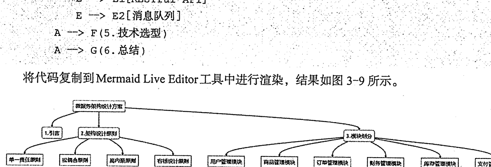

图 3-9 使用 Mermaid 绘制的思维导图(部分)

# 3.1.7 案例3：PlantUML 绘制思维导图

在 3.1.6 小节我们用“方法二”绘制了思维导图，本小节介绍“方法三”。该思路是借助 PlantUML 语法绘制思维导图。借助 ChatGPT 通过 PlantUML 绘制思维导图的具体步骤如下。

+ 第 1 步：根据任务描述，使用 ChatGPT 生成 PlantUML 源码。
- 第 2 步：使用 PlantUML 渲染工具生成图片。

由于本书多次使用 PlantUML 绘制架构设计中的各类图形，这里简要介绍 PlantUML 语言。

[PAGE 52]

# AI时代 架构师修炼之道 /ChatGPT让架构师插上翅膀

PlantUML 是一种使用简易文本描述生成 UML 图形的方式。它采用代码化语言，通过文本输入定义类、对象、关系、活动、用例等 UML 元素。

# 以下是 PlantUML 中常见的语言元素。

+ (1) Class: 表示一个类，关键字为“class”，可指定类名和属性列表。
+ (2) Object: 表示一个对象，关键字为“object”，可指定对象名称和类型。
+ (3) Relationship: 表示类或对象间关系，包括继承、实现、关联、聚合、组合等。
+ (4) Use Case: 表示一个用例，关键字为“usecase”，可指定用例名称和描述。
+ (5) Activity: 表示一个活动，关键字为“activity”，可指定活动名称和描述。
+ (6) Comment: 表示注释，使用单引号(’)或双斜杠(//)作为注释符号。

PlantUML 的描述语言属于代码化语言，因此可由 ChatGPT 生成与修改。

# 以下是编写 PlantUML 源码的基本步骤。

+ (1) 选择一个编辑器：可用任意文本编辑器或 IDE 编写 PlantUML 源码。建议使用支持 PlantUML 扩展的编辑器，如 VS Code、Sublime Text、Atom 等。
+ (2) 编写 PlantUML 源码：在编辑器中新建文件，使用 PlantUML 语言标记定义 UML 元素，如类、对象、关系、活动、用例等。可参考官方文档或示例学习。
+ (3) 导出 UML 图形：保存源码文件并导入 PlantUML 工具生成对应图形。可使用命令行工具、在线网站或插件导出。

例如，下面是一个简单的 PlantUML 类图示例，展示 Animal 类与 Dog 类的继承关系。预览效果如图 3-10 所示。

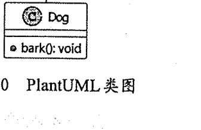

```
@startuml
class Animal {
    - name: string
    + eat(): void
}
class Dog extends Animal {
    + bark(): void
}
@enduml
```

下面重点介绍在 VS Code 中编写与预览 PlantUML 语言生成 UML 图表的流程。

+ (1) 安装 PlantUML 扩展：打开 Visual Studio Code，点击左侧扩展图标，搜索 PlantUML 扩展并安装，如图 3-11 所示。

[PAGE 53]

# 第3章 图表助力思考与表达

(2) 创建 PlantUML 文件：在 Visual Studio Code 中新建文件，将文件后缀改为“.puml”或“.plantuml”，VS Code 会自动关联 PlantUML 语言。

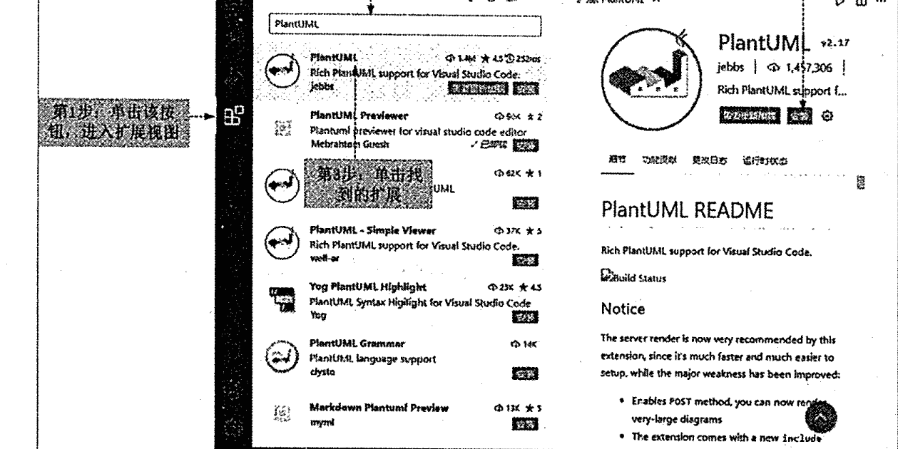

# 图 3-11 安装 PlantUML 扩展

(3) 编写 PlantUML 源码：在新文件中编写 PlantUML 源码，保存文件如图 3-12 所示。(4) 在 VS Code 内部预览图形：按 “Ctrl+Shift+P” 组合键，在命令面板输入 “PlantUML”，选择 “Preview Current Diagram”，可在 VS Code 中查看生成图形，如图 3-13 所示。

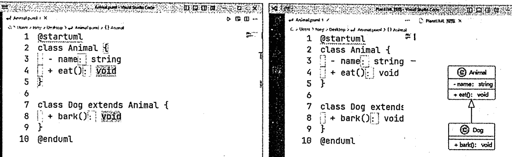

# 图 3-12 保存 PlantUML 文件

# 图 3-13 预览图形

(5) 导出 UML 图形：如需导出，可使用 PlantUML 官方命令行工具，或利用 VS Code 其他扩展导出，也可在预览窗口点击按钮复制图片到剪贴板，再粘贴到任意位置。

[PAGE 54]

# AI时代 架构师修炼之道 /ChatGPT让架构师插上翅膀

# 提示

有关 PlantUML 语言的更多语法，读者可在 PlantUML 官网下载。

下面通过示例介绍如何使用 PlantUML 工具绘制思维导图。

# 实操示例

我们向 ChatGPT 发送如下请求。

有如下“微服务架构设计方案”文档，请使用 PlantUML 绘制思维导图，注意文字过多，简化一下文案。

微服务架构设计方案

1. 引言

本文档旨在提供一份详细的微服务架构设计方案，以支持开发团队在构建在线电商平台时的系统设计和开发工作。本方案将基于微服务架构的原则和最佳实践，确保系统具备高可扩展性、灵活性和可维护性。

2. 架构设计原则

在设计微服务架构时，我们遵循以下关键原则：

2.1 单一责任原则

每个微服务应专注于单一的业务功能，确保服务的职责清晰明确，可维护性高。

2.2 松耦合原则

微服务之间应该通过轻量级的通信机制进行交互，如使用 RESTful API 或消息队列，以降低耦合度，提高系统的灵活性和可扩展性。

2.3 高内聚原则

每个微服务应该包含完整的业务逻辑，避免过度依赖其他服务，以提高模块的独立性和可测试性。

2.4 容错设计原则

在设计微服务架构时，考虑到故障的可能性，采用适当的容错机制，如熔断、限流和故障转移，以确保系统的可靠性和稳定性。

3. 模块划分

基于系统需求和业务功能，我们将系统划分为以下核心模块：

3.1 用户管理模块

负责用户注册、登录、身份验证等用户相关功能。

3.2 商品管理模块

负责商品信息的管理和展示，包括商品列表、详情、搜索等功能。

3.3 订单管理模块

[PAGE 55]

# 第3章 图表助力思考与表达

处理订单创建、支付、配送等订单相关功能。

# 3.4 财务管理模块

负责处理支付、结算和财务报表等财务相关功能。

# 3.5 库存管理模块

管理商品库存信息，包括库存查询、补货等功能。

# 3.6 支付管理模块

负责处理支付相关功能，如支付接口集成、支付回调处理等。

# 4. 通信机制

为实现模块之间的通信和协作，我们将采用以下通信机制：

# 4.1 RESTful API

模块之间通过 RESTful API 进行数据的传递和交互，使用标准的 HTTP 协议和 JSON 格式进行通信。

# 4.2 消息队列

采用消息队列作为异步通信的机制，提高系统的可伸缩性和性能，支持解耦和消息重试。

# 5. 技术选型

为实现微服务架构的设计方案，我们将采用以下技术栈：

- 服务端开发框架: Spring Boot
  - 数据存储: MySQL 和 Redis
  - 消息队列: Kafka
  - API 网关: Netflix Zuul
  - 配置中心: Spring Cloud Config
  - 服务注册与发现: Netflix Eureka
  - 容器化平台: Docker 和 Kubernetes

# 6. 总结

本文档提供一个初步的微服务架构设计方案，涵盖关键原则、模块划分和通信机制等内容。

通过加入支付管理模块，我们能够完整地支持系统的支付功能，包括支付接口集成和支付回调处理。该设计方案将为开发团队提供指导，确保系统的可扩展性、灵活性和可维护性。在实际的开发过程中，我们将进一步细化和完善该方案，以满足具体的业务需求和技术要求。

指令执行后，ChatGPT 的回答如下。

使用 PlantUML 工具绘制思维导图，简化后的文档如下。

```
@startmindmap
* 微服务架构设计方案
** 引言
** 架构设计原则
```

[PAGE 56]

# AI时代 架构师修炼之道 /ChatGPT让架构师插上翅膀

+   * * * 单一责任原则
+   * * * 松耦合原则
+   * * * 高内聚原则
+   * * * 容错设计原则
+   ** 模块划分
+   * * * 用户管理模块
+   * * * 商品管理模块
+   * * * 订单管理模块
+   * * * 财务管理模块
+   * * * 库存管理模块
+   * * * 支付管理模块
+   ** 通信机制
+   * * * RESTful API
+   * * * 消息队列
+   ** 技术选型
+   * * * 服务端开发框架: Spring Boot
+   * * * 数据存储: MySQL 和 Redis
+   * * * 消息队列: Kafka
+   * * * API 网关: Netflix Zuul
+   * * * 配置中心: Spring Cloud Config
+   * * * 服务注册与发现: Netflix Eureka
+   * * * 容器化平台: Docker 和 Kubernetes
+   ** 总结
+   @endmindmap

将上述代码复制到 VS Code 的 PlantUML 扩展工具中渲染后生成思维导图，如图 3-14 所示。

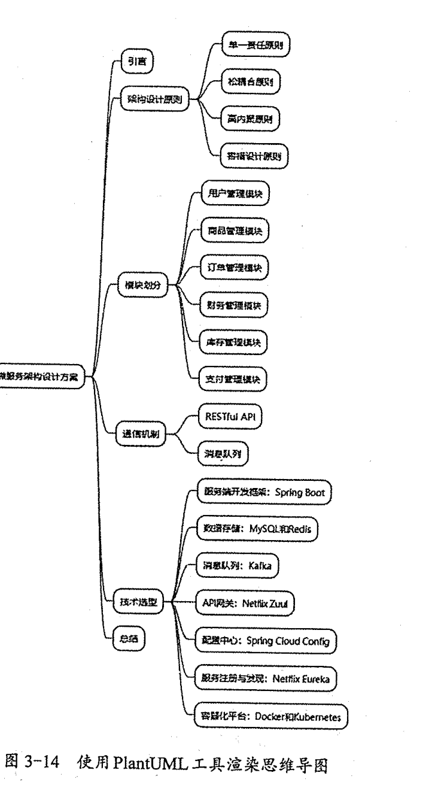

图 3-14 使用 PlantUML 工具渲染思维导图

> 有关 PlantUML 语言，也有类似 Mermaid Live Editor 的在线渲染网站，笔者推荐 PlantUML 和 PlantText 官网，具体使用过程不再赘述。

# 3.2 用 ChatGPT 生成图表

ChatGPT 不能直接制作图表，但可通过多种途径实现，归纳起来主要有以下两种方法。

(1) 无编程方法，可使用 ChatGPT 生成 Excel 电子表格，再利用 Excel 内置图表功能制作图表。
(2) 编程方法，通过 ChatGPT 生成代码，如使用 VBA、Python 等语言，从数据中生成图表。

# 3.2.1 无代码方式借助 ChatGPT 制作图表

通过无编程方法借助 ChatGPT 制作图表，流程如下：使用 ChatGPT 生成 Excel 文件，然后在 Excel 中制作图表。图 3-15 所示的是在 Excel 中制作的电子产品目录表。

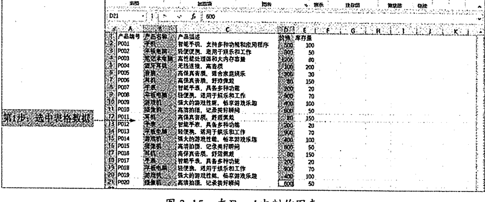

图 3-15 在 Excel 中制作图表

单击“推荐的图表”按钮，会弹出如图 3-16 所示的“更改图表类型”对话框。通常推荐的是柱状图，但是柱状图并不适合本例，

# AI时代 架构师修炼之道 /ChatGPT让架构师插上翅膀

个目录中。

运行代码后，会生成一个条形图，显示产品名称和对应的价格信息，如图 3-19 所示。

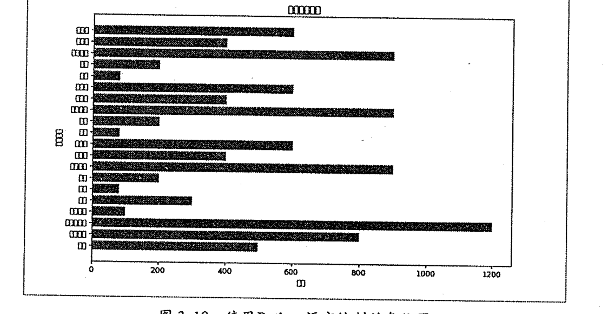

图 3-19 使用 Python 语言绘制的条状图

但是从运行结果可见，中文显示有问题，这是因为 Matplotlib 库本身对中文支持不好，可以让 ChatGPT 修改代码解决该问题。

> 向 ChatGPT 发送如下指令。

代码运行结果，有中文显示乱码，帮我修改代码。

上述指令执行后，ChatGPT 的回答如下。

```
import pandas as pd
import matplotlib.pyplot as plt
from matplotlib.font_manager import FontProperties
# 设置中文字体
font = FontProperties(fname='C:/Windows/Fons/msyh.ttc', size=12) # 指定中文字体文件路径和字号
# 读取Excel文件
data = pd.read_excel("电子产品目录表格10条.xlsx")
# 提取D列(价格)数据
prices = data['价格']
```
# 第3章 图形化工具助推架构思考
```
# 绘制条形图
plt.figure(figsize=(10, 6))
plt.barh(range(len(prices)), prices)
plt.xlabel('价格', fontproperties=font) # 设置x轴标签的字体
plt.ylabel('索引', fontproperties=font) # 设置y轴标签的字体
plt.title('产品价格分布', fontproperties=font) # 设置标题的字体
# 设置Y轴刻度标签为原始的产品名称
plt.yticks(range(len(prices)), data['产品名称'], fontproperties=font)
# 自动调整Y轴标签的位置，避免重叠
plt.tight_layout()
# 显示图形
plt.show()
```
执行完代码的保存与重跑后，控制台输出与图3-20一致。
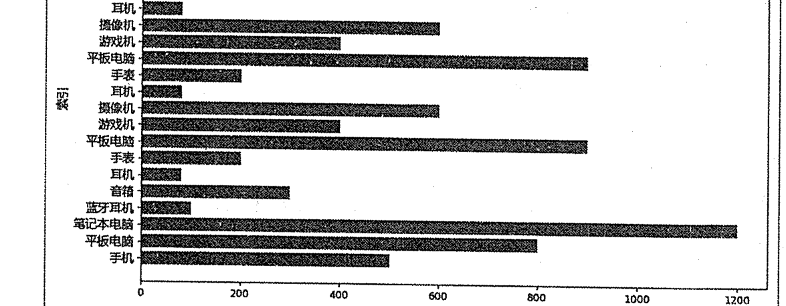
这次运行印证了中文显示问题已解决。

# 3.3 鱼骨图
鱼骨图亦称因果图或石川图，本质是用树状分支来映射结果与其成因的模型。
它把待分析的结果置于鱼头位置，各类影响因素作为鱼骨延伸，图3-21展示了项目延期原因的典型拆解。

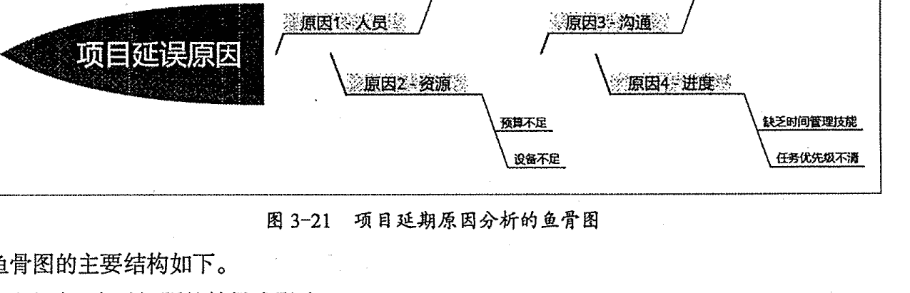
图3-21 项目延期原因分析的鱼骨图

构成要素
+ (1) 鱼头：指向需解决的问题或最终产出。(2) 主骨：概括影响结果的核心维度，诸如人力、设备、方法、物料、环境等。(3) 副骨：隶属于主骨的具体诱因，对某一维度做细化。

主要价值
+ (1) 直观呈现结果背后的隐性诱因，尤其是易被忽略的深层根因。(2) 厘清各诱因之间的关联，锁定关键驱动点。(3) 为问题解决提供清晰的思路框架与行动指向。(4) 汇聚团队对同一议题的多元认知，促进共识达成。

# 3.3.1 鱼骨图在架构设计中的应用
在架构实践中，鱼骨图既能用于问题剖析，也能助力协作。典型场景包括：
+ (1) 产品结构设计：借助鱼骨呈现产品的层级与架构关系，由顶层向子产品、模块、功能逐级展开，形成树状视图，指导开发落地并帮助团队对齐理解。(2) 需求管理：用鱼骨表达需求间的父子或依赖关系，区分核心需求与附属需求，并标注优先级与影响程度，优先推进关键需求。(3) 产品交付规划：对需求与任务做结构化梳理，明确依赖关系，拆分阶段目标与时间节点，提升交付透明度与效率。(4) 变更管理：需求或环境变化时，用鱼骨评估变更的传导影响，判断是否波及核心模块与功能，测算实现难度与工作量，指导应对策略与资源分配。

(5) 故障管理：产品异常时，可沿鱼骨快速定位问题层级与模块，评估是否会引发连锁反应，进而制定修复方案，尽快恢复运行。

总体而言，鱼骨图通过结构化表达产品层级与要素关系，在结构设计、需求管理、交付规划、变更管控与故障定位中价值突出，能加速共识形成，提升协作效率，是产品管理中简洁高效的手段。

# 3.3.2 使用ChatGPT辅助绘制鱼骨图
ChatGPT 可显著降低手工绘制成本，主要体现在：
+ (1) 问题识别与分析：将问题置于鱼头，按人员、流程、技术、环境等类别展开分支，帮助团队全面扫描问题面向，发现潜在诱因。
+ (2) 原因深挖：以问题为起点，按可能成因归类到不同骨架分支，引导团队探索多种假设，精准锁定主因。
+ (3) 方案共创：分支上团队成员可各自提出想法与建议，集体头脑风暴带来更丰富的创意，推动创新架构形成。
+ (4) 沟通对齐：作为视觉载体，鱼骨图让问题与关联因素一目了然，便于成员清晰表达思路，减少误解，提升沟通效率。

总之，借助鱼骨图，团队可更系统地识别问题、追溯根因、探索解法并加强协作，是架构设计中兼具分析力与沟通力的工具。

# 3.3.3 案例4：分析用户体验问题和系统性能问题
下面用一个实战案例演示鱼骨图的绘制思路。

# 案例背景
某团队正在构建在线电商平台架构，面临用户体验与系统性能的双重挑战，决定采用鱼骨图进行系统分析。

用户反馈集中在四点。
(1) 网站响应变慢：近期大量用户反映页面加载迟缓，浏览与下单耗时明显增加，需排查诱因。
(2) 交易失败率攀升：支付失败、订单提交失败等投诉增多，需找到根源。
(3) 页面崩溃与报错：部分页面访问时频繁出错或崩溃，影响购买与浏览，需定位潜在诱因。
(4) 界面不够友好：用户认为交互不直观、操作繁琐，下单支付体验受阻，需梳理导致不友好的因素。

绘制鱼骨图的流程如下。

# 动手示例
第1步：请模型分析问题并输出 Markdown 格式文本。
+ 团队向模型发出如下指令。
请根据下面反馈做根因分析并给出解决思路，以 Markdown 格式输出。
开发团队正在设计一个在线电商平台的架构，他们遇到了一些挑战，包括用户体验问题和系统性能问题。他们决定使用鱼骨图来分析问题并找到解决方案。
用户反馈如下：
1. 网站响应时间变慢：最近，用户投诉网站的加载速度明显变慢，他们需要等待很长时间才能浏览和购买商品。开发团队需要确定可能导致这个问题的因素。
2. 交易失败率升高：越来越多的用户投诉他们在进行交易时遇到问题，包括支付失败、订单提交失败等。开发团队希望找出可能导致交易失败率升高的原因。
3. 页面崩溃和错误：用户报告称他们在访问某些页面时遇到错误和崩溃的情况，导致无法完成购买和浏览商品。开发团队希望找出可能引起页面崩溃和错误的潜在原因。
4. 用户界面不友好：用户反馈称网站的用户界面不够直观和易用，导致他们在浏览商品、下单和支付过程中遇到困难。开发团队希望找出可能导致用户界面不友好的问题。

发送指令后，模型的回复如下。
以下是根据您提供的问题反馈生成的鱼骨图的Markdown代码：
```
# 问题分析鱼骨图
## 网站响应时间变慢
- 服务器负载过高
- 网络传输速度慢
- 代码优化不足
- 数据库查询效率低下
## 交易失败率升高
```
# 第3章 应用图形图表帮助思考和表达
+   - 第三方支付接口故障
- 订单处理流程复杂
- 交易信息验证不准确
- 数据库事务处理问题
# 页面崩溃和错误
+   - 编程错误导致页面崩溃
- 依赖的外部资源不可用
- 页面加载速度过慢
- 安全性漏洞导致系统异常
# 用户界面不友好
+   - 布局设计不合理
- 功能操作流程复杂
- 样式和视觉效果不吸引人
- 响应式设计不兼容不同设备
将这些代码保存为Markdown文件格式(.md)。

第2步：将 md 文件导入 XMind 软件。
参考2.3.5小节相关内容将前面生成的Markdown文件导入XMind，如果导入成功，效果如图3-22所示。
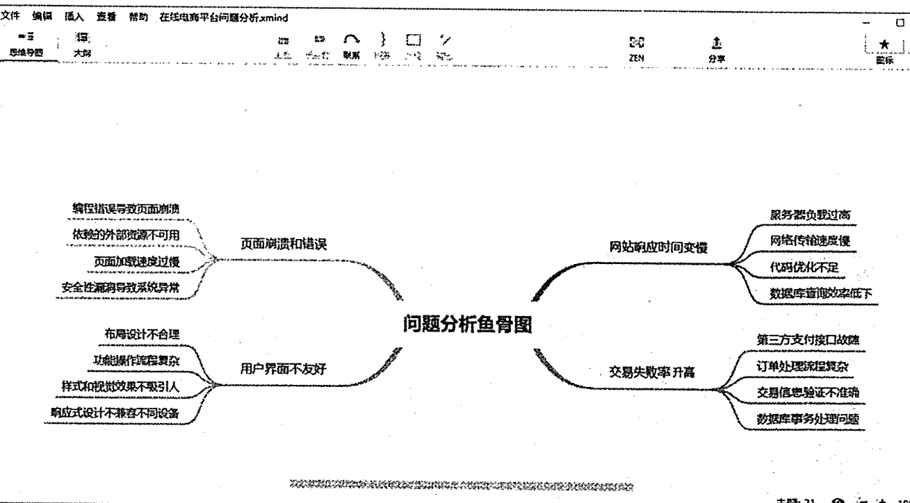
第3步：将思维导图转换为鱼骨图。
从图3-22可见，还是思维导图，我们可以使用XMind工具将其转换为鱼骨图。
# AI时代 架构师修炼之道 /ChatGPT让架构师插上翅膀
参考图3-23所示的步骤，将思维导图转换为鱼骨图，转换成功的鱼骨图如图3-24所示。
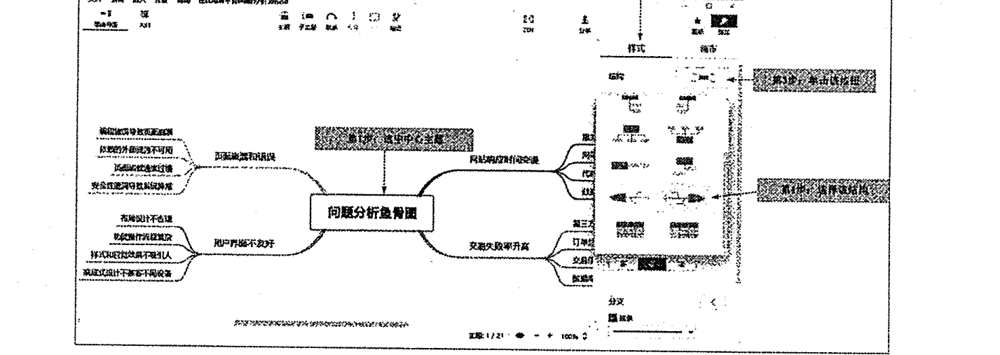
图3-23 将思维导图转换为鱼骨图
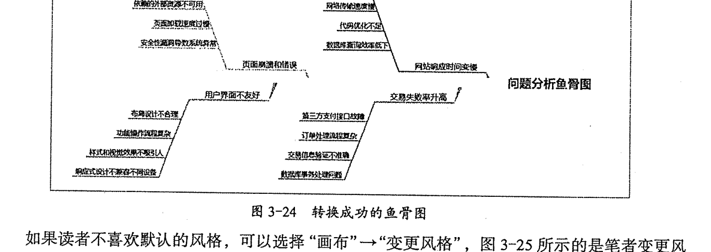
图3-24 转换成功的鱼骨图
如果读者不喜欢默认的风格，可以选择“画布”→“变更风格”，图3-25所示的是笔者变更风格的鱼骨图。
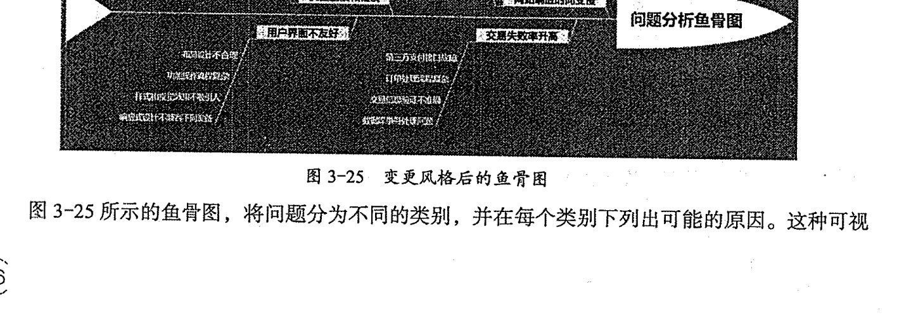
图3-25 变更风格后的鱼骨图
图3-25呈现的鱼骨图按类别划分问题，并在每个类别下罗列潜在诱因。此类直观展示能让团队更快把握问题本质，为根因查找与方案制定提供指引。

# 3.4 本章小结
本章聚焦软件架构设计中的图形化手段。首先介绍了思维导图的价值及借助 ChatGPT 辅助绘制的方法，随后探讨了图表在架构工作中的意义，包括借助模型生成各类图表的思路。最后重点讲解了鱼骨图在问题求解中的用法，以及如何借助 ChatGPT 高效产出鱼骨图。

# 第 4 章
# ChatGPT 赋能 UML 建模实践
本章聚焦 ChatGPT 在 UML 建模中的支持。首先对 UML 做通盘介绍，涵盖发展历程、版本演进以及常见图种的分类与用途。随后深入类图、用例图、活动图、时序图四种核心图，介绍构成要素、绘制要点与使用注意。最后探讨 ChatGPT 如何辅助理解、解析并自动生成 UML 图，提升建模效率。
借助 ChatGPT，架构师和开发团队能更快完成系统建模与分析，加速设计落地。模型提供便捷的解析与生成能力，帮助团队更好理解 UML 并促进沟通协作。

# 4.1 UML 总览
UML 即统一建模语言，是一种用于软件系统建模的标准语言，提供统一的图形符号与规范，用于描述系统的结构、行为与交互。它广泛应用于需求分析、系统设计、代码生成等全流程。

# 4.1.1 UML 的演进与版本
UML 的起源可追溯至20世纪90年代初，融合了 Booch 提出的方法、OMT 方法和 OOSE 方法三大面向对象建模思路。
随着发展，UML 历经多次迭代，目前主流为 UML 2.x 系列，包含 UML 2.0、2.1、2.2 等版本，每个版本都在表达能力和适用范围上做了增强。

# 4.1.2 UML 图种分类与应用
UML 提供多类图形用于描述系统不同侧面。常见类型包括：
+ (1) 类图：描述系统的静态结构，展示类、接口及其关联、继承等关系。(2) 用例图：刻画系统功能需求与用户角色的关系，表现用例与参与者间交互。
(3) 活动图：描述业务流程与操作行为，呈现活动、决策、并发等流程。
(4) 时序图：描述对象间交互与消息传递顺序，展示时序关系。
各类图各有侧重，可帮助架构师与开发团队更清晰描述系统，促进协作。后续章节将逐一解析其要素、绘制方法与注意事项。

# 4.2 类图
类图是 UML 中最常用的图种，用于描述系统的静态结构与类间关系，展示类、接口、关联、聚合、组合、继承等，有助于理解对象结构与交互。

# 4.2.1 类图的构成要素
类图主要包含以下要素，具体如下。
(1) 类：代表系统中的对象类型，描述属性与方法，图4-1 给出 Person 类的示例。
(2) 接口：定义一组操作的规范，相当于类的契约，图4-2 显示 Runnable 接口示例。
(3) 关联关系：描述两个类间的静态连接，图4-3 给出订单与商品关联示例。
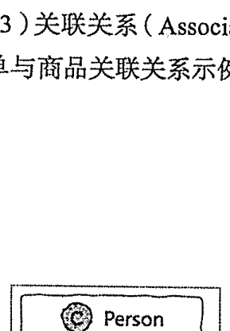
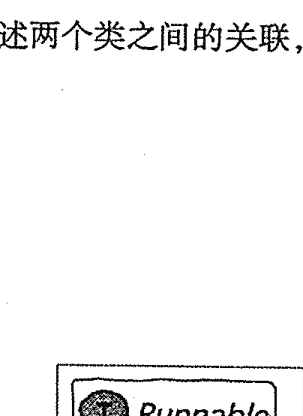
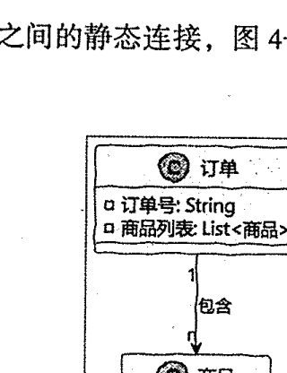
(4) 聚合关系：表达整体与部分的关系，部分可独立于整体存在。图4-4 所示的是学校与学生的聚合关系示例。注意聚合关系的符号为空心菱形。
(5)组合关系：表示整体与部分的关系
# AI时代 架构师修炼之道 /ChatGPT让架构师插上翅膀
(4)确定继承关系：继承关系表示类之间的继承关系，其中子类继承父类的属性和方法。通过带有箭头的实线连接父类和子类，箭头指向父类，表示子类继承自父类。(5)添加类图的其他元素：根据需要，可以添加类之间的依赖关系、接口实现关系等其他元素。依赖关系表示一个类依赖于另一个类，可以使用带箭头的虚线表示。接口实现关系表示类实现了一个或多个接口，可以使用带空心三角形的箭头表示。
> 在绘制类图时，还需要注意以下事项。(1)类的命名：选择有意义且符合命名规范的类名，以清晰地表达类的职责和功能。(2)关联关系的多重性：根据系统需求确定关联关系的多重性，即一个类与另一个类之间的关联数量。可以使用数字或符号表示多重性。(3)箭头的方向：在关联关系、继承关系和依赖关系中，箭头的方向表示类之间的方向性，指向被依赖、被继承或被关联的类。(4)类图的简洁性：保持类图的简洁性和可读性，避免过多的类和关系，以便更好地理解系统的结构和设计。遵循以上步骤和注意事项，大家可以绘制出准确、清晰的类图，用于描述系统中的类、属性、方法和它们之间的关系。这样的类图有助于沟通和理解系统的设计，并为软件开发和维护提供指导。

# 4.2.3 使用 ChatGPT 绘制类图
ChatGPT 本身不具备绘图能力，可结合 PlantUML、Mermaid 和 Graphviz 在内的文本绘图工具实现。其中 PlantUML 专为 UML 设计，本章以此为主。操作思路如下。(1)定义类及其属性方法：明确需要表达的类及其信息，包括名称、属性、方法。(2)用模型描述：向模型提供类的描述，内容清晰具体，便于模型准确理解。(3)生成类图：模型据描述输出类图，用户可要求一次性生成或分步添加。(4)确认与调整：审阅生成结果，按需修正遗漏或错误，可继续对话完善。
对话中需给出明确指示，生成后要人工校验准确性与完整性。

# 第4章 ChatGPT支持UML建模
# 4.2.4 案例1：用 ChatGPT 绘制学校管理系统类图
下面以具体案例演示如何借助 ChatGPT 辅助绘制类图。

# 案例背景
假设我们要设计学校管理系统，涉及学生 Student、教师 Teacher、课程 Course 三个核心类。现在希望借助 ChatGPT 辅助生成类图。具体步骤如下。

第1步：我们可以向模型描述每个类的属性和方法，具体如下。
学生（Student）类：
+   - 属性：学号（studentId）、姓名（name）
- 方法：获取学号（getStudentId）、设置学号（setStudentId）、获取姓名（getName）、设置姓名（setName）
教师（Teacher）类：
+   - 属性：工号（teacherId）、姓名（name）

教师类的操作集合包括：读取工号 getTeacherId、写入工号 setTeacherId、读取姓名 getName、写入姓名 setName

课程（Course）类：
- 字段：课程编号 courseId、课程名称 name
- 操作：读取课程编号 getCourseId、写入课程编号 setCourseId、读取课程名称 getName、写入课程名称 setName

# 实战演练

> 本轮演练里，架构师给 ChatGPT 的指令如下。

依据下面列出的类定义，请用 PlantUML 生成对应的类图。

学生（Student）类：
- 字段：学号 studentId、姓名 name
- 操作：读取学号 getStudentId、写入学号 setStudentId、读取姓名 getName、写入姓名 setName

教师（Teacher）类：
- 字段：工号 teacherId、姓名 name
- 操作：读取工号 getTeacherId、写入工号 setTeacherId、读取姓名 getName、写入姓名 setName

课程（Course）类：

[PAGE 74]

# AI时代 架构师修炼之道 /ChatGPT让架构师插上翅膀

- 字段：课程编号 courseld、课程名称 name
- 操作：读取课程编号 getCourseld、写入课程编号 setCourseld、读取课程名称 getName、写入课程名称 setName

发出指令后，ChatGPT 给出的反馈是。

要让 PlantUML 呈现类的结构，可先按字段与行为来组织描述，再据此生成图形：

```
@startuml
class Student {
    - studentId: String
    - name: String
    + getStudentId(): String
    + setStudentId(studentId: String): void
    + getName(): String
    + setName(name: String): void
}
class Teacher {
    - teacherId: String
    - name: String
    + getTeacherId(): String
    + setTeacherId(teacherId: String): void
    + getName(): String
    + setName(name: String): void
}
class Course {
    - courseId: String
    - name: String
    + getCourseId(): String
    + setCourseId(courseId: String): void
    + getName(): String
    + setName(name: String): void
}
```

[PAGE 75]

# 第4章 ChatGPT支持UML建模

把这段代码复制到 VS Code 的 PlantUML 插件中运行，就能得到图4-8 对应的类图。

| Student |

|---------|

| studentId: String |

| name: String |

| getStudentId(): String |

| setStudentId(studentId: String): void |

| getName(): String |

| setName(name: String): void |

| Teacher |

|---------|

| teacherId: String |

| name: String |

| getTeacherId(): String |

| setTeacherId(teacherId: String): void |

| getName(): String |

| setName(name: String): void |

| Course |

|---------|

| courseId: String |

| name: String |

| getCourseld(): String |

| setCourseld(courseId: String): void |

| getName(): String |

| setName(name: String): void |

| Teacher |

|---------|

| teacherId: String |

| name: String |

| getTeacherId(): String |

| setTeacherId(teacherId: String): void |

| getName(): String |

| setName(name: String): void |

| Course |

|---------|

| courseId: String |

| name: String |

| getCourseld(): String |

| setCourseld(courseId: String): void |

| getName(): String |

| setName(name: String): void |

| Course |

|---------|

| courseld: String |

| name: String |

| getCourseld(): String |

| setCourseld(courseld: String): void |

| getName(): String |

| setName(name: String): void |

# 图4-8 学校管理系统类图

下一步是补全类之间的关联与继承。

- 学生 Student 与课程 Course 存在关联，表示学生选修课程。可用连线把两者连起来，并用多重性标明数量。
- 教师 Teacher 与课程 Course 也存在关联，表示教师承担该课程的教学工作。
- 学生 Student 和教师 Teacher 本身并无直接联系，但可通过继承建立共同归属。假设 Student 继承自 Person，而 Teacher 也继承自 Person。

# 关系完善

架构师向 ChatGPT 提交以下指令。

- 学生 Student 和课程 Course 之间存在关联关系，表示学生选修了某门课程。可以使用关联线条连接两个类，并使用多重性标记表示关联的数量。
- 教师 Teacher 和课程 Course 之间也存在关联关系，表示教师负责教授某门课程。
- 学生 Student 类和教师 Teacher 类之间没有直接的关联关系，但可以通过继承关系来建立它们之间的联系。假设学生 Student 类继承自人员 Person 类，而教师 Teacher 类也继承自人员 Person 类。

执行后得到的回复如下。

依据上述关系，下面给出借助 PlantUML 画出类图的示例代码：

```
@startuml
```

```
class Person {
```

[PAGE 76]

# AI时代 架构师修炼之道 /ChatGPT让架构师插上翅膀

```
- name: String
+ getName(): String
+ setName(name: String): void
}
class Student {
- studentId: String
+ getStudentId(): String
+ setStudentId(studentId: String): void
}
class Teacher {
- teacherId: String
+ getTeacherId(): String
+ setTeacherId(teacherId: String): void
}
class Course {
- courseId: String
+ getCourseId(): String
+ setCourseId(courseId: String): void
}
Student "1" -- "0..*" Course: 选修
Teacher "1" -- "0..*" Course: 教授
Person <|-- Student
Person <|-- Teacher
@enduml
```

把代码粘贴到 VS Code 的 PlantUML 工具中渲染，即可得到最终类图，如图4-9 所示。

| © Student |

| :--- | © Teacher |

| □ studentId: String |

| □ name: String |

| ○ getStudentId(): String |

| ○ setStudentId(studentId: String): void |

| ○ getName(): String |

| ○ setName(name: String): void | □ teacherId: String |

| □ name: String |

| ○ getTeacherId(): String |

| ○ setTeacherId(teacherId: String): void |

| ○ getName(): String |

| ○ setName(name: String): void |

| :--- | :---

| □ courseld: String |

| □ name: String |

| ○ getCourseld(): String |

| ○ setCourseld(courseld: String): void |

| ○ getName(): String |

| ○ setName(name: String): void |

图4-9 最终的学校管理系统类图

细心读者会注意到，本节的类图视觉效果与 4.2.1 小节不同，4.2.1 小节采用了

[PAGE 77]

# 第4章 ChatGPT支持UML建模

手绘风格，线条呈现弯曲。若想复现该效果，可在 PlantUML 代码里加入下面语句。

```
skinparam handwritten true
```

于是将学校管理系统类图改成手绘风格，代码如下。

```
@startuml
skinparam handwritten true
```

```
class Person {
    - name: String
    + getName(): String
    + setName(name: String): void
}
```

```
class Student {
    - studentId: String
    + getStudentId(): String
    + setStudentId(studentId: String): void
}
```

```
class Teacher {
    - teacherId: String
    + getTeacherId(): String
    + setTeacherId(teacherId: String): void
}
```

```
class Course {
    - courseId: String
    + getCourseId(): String
    + setCourseId(courseId: String): void
}
```

```
Student "1" -- "0..*" Course: 选修
Teacher "1" -- "0..*" Course: 教授
Person <-- Student
Person <-- Teacher
@enduml
```

渲染后得到的类图如图4-10 所示。

[PAGE 78]

# AI时代 架构师修炼之道 /ChatGPT让架构师插上翅膀

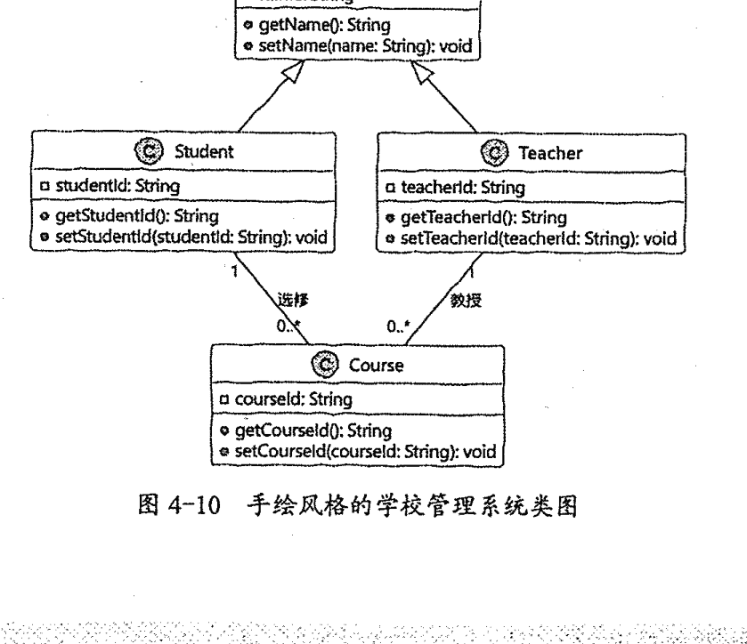

# 图 4-10 手绘风格的学校管理系统类图

# 4.3 用例图

用例图是用来以图形方式呈现系统功能和用户场景的手段，主要承担以下职责。

(1) 需求分析：用例图有助于梳理系统功能需求。通过绘制，能够明确系统与外部参与者间的交互，找出需要实现的功能点。

(2) 系统设计：用例图为架构设计提供依据。它展示核心功能与使用场景，有助于规划架构、模块和接口。

(3) 沟通协作：用例图表达直观，可提升团队协作效率。借助它，成员能更快理解功能与需求，提升合作质量。

(4) 需求验证：用例图可作为验证手段。通过模拟功能运行，确认是否满足用户期望。

总体来说，用例图在开发与设计阶段作用关键，可助力需求梳理、方案设计、团队沟通和需求校验，推动项目落地。

# 4.3.1 用例图的构成要素

绘制用例图时涉及以下要素。

(1) 参与者 Actors：参与者是与系统交互的外部主体，可以是人、其他系统或组织。每个参与者都有特定角色和目标，用例图中用类似小人的符号表示，如图 4-11 所示。

(2) 用例 Use Cases：用例代表系统的一项功能或用户场景。它描绘系统与参与者间的交互，可为具体操作、业务流程或系统功能。用例图中使用椭圆形表示，如图4-12所示。

(3) 关联关系 Associations：关联关系体现参与者与用例之间的联系。它描述交互与依赖。如图4-13所示，箭头指示用户与两个用例的关联，方向代表交互流向。

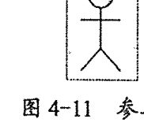

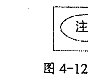

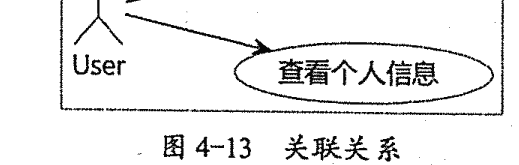

(4) 包含关系 Includes：包含关系表示一个用例调用另一用例。它描述执行过程中复用另一用例的情形。如图4-14所示，用带“<<include>>”标签的箭头表示。

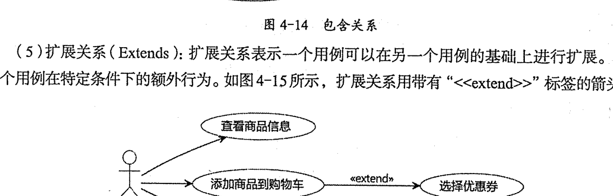

(5) 扩展关系 Extends：扩展关系表示一个用例在另一用例基础上进行扩展。它描述特定条件下的额外行为。如图4-15所示，用带“<<extend>>”标签的箭头表示。

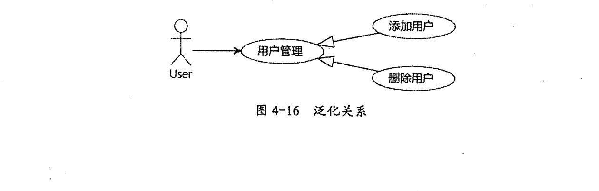

(6) 泛化关系 Generalization：泛化关系表示用例间的继承。它描述一个用例是另一用例的特例或变体。如图4-16所示，空心三角箭头加实线表示泛化，箭头指向父用例。


# AI时代 架构师修炼之道 / ChatGPT让架构师插上翅膀

## 4.3.2 用例图的绘制步骤

绘制用例图可按以下流程进行。

- (1) 确定参与者：识别系统中的参与者，包括用户、外部系统或组织。
- (2) 确定用例：识别系统各功能或用户场景，并以用例表示。
- (3) 确定参与者与用例之间的关系：用关联线条连接参与者与用例，表示交互关系。
- (4) 确定用例之间的关系：依据实际情况确定包含、扩展或泛化关系。
- (5) 添加其他元素：按需添加用例描述、注释等补充信息。

## 注意

绘制时还需注意以下几点。

- (1) 用例图应简洁明了，仅包含核心功能与关键参与者。
- (2) 用例应从用户视角描述，聚焦用户所需功能与目标。
- (3) 用例图可在不同层级细化与扩展，既可整体描述系统功能，也可在细节层展示流程与步骤。
- (4) 用例图可与其他图表如活动图、时序图结合使用，进一步完善行为与交互描述。

## 4.3.3 案例2：使用ChatGPT绘制在线购物平台用例图

下面通过具体案例说明如何借助 ChatGPT 辅助绘制用例图。

### 案例背景

需求：用户希望通过在线购物平台进行购物。流程包括选品、加入购物车、填写收货地址、选择支付方式、确认订单等。用户还可以选择快递配送服务。

### 用例实操

架构师向 ChatGPT 发送如下指令。

我有如下用例图描述，帮我使用PlantUML绘制用例图。

场景中，有两个参与者：客户和快递员。

客户可以执行以下用例：

- 购物：客户可以通过执行购物用例选择商品并添加到购物车。
- 填写地址：客户在购物流程中可以选择填写收货地址，这是一个可选步骤。
- 选择支付方式：客户在购物流程中选择支付方式来完成订单支付，这是一个必要步骤。
- 选择配送: 客户在购物流程中可以选择配送方式，这是一个可选步骤。

快递员是一个参与者，表示快递员会在用户选择配送服务后与用户进行交互。

上述指令执行后，ChatGPT 的回答如下。

以下是使用 PlantUML 绘制的用例图：

```
@startuml
left to right direction
actor 客户
actor 快递员
rectangle "购物流程" {
usecase 购物 as UC1
usecase 填写地址 as UC2
usecase 选择支付方式 as UC3
usecase 选择配送 as UC4
}
客户 -- UC1
客户 -- UC2
客户 -- UC3
客户 -- UC4
UC4 -- 快递员
@enduml
```

把上文给出的 PlantUML 源码直接导入 VS Code 的 PlantUML 插件渲染，就能得到图4-17 所示的用例图。

## 提示

若偏爱手稿质感，可在代码里追加 skinparam handwritten true，渲染后会呈现图4-18 的手绘效果。

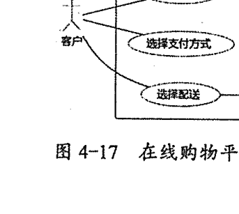

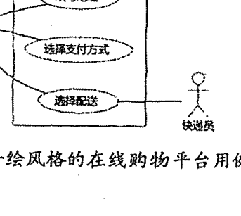

## 4.4 活动图
活动图是呈现系统动态行为的图形化手段，侧重刻画业务过程、工作流以及系统内部的活动与动作。它能直观表达活动间的先后顺序、并行关系、决策点与分支点，为需求梳理、业务建模和系统设计提供清晰视角。

常见应用场景包括。

(1) 业务流程呈现：把从起点到终点的业务步骤串联起来，展示执行路径与各环节的关联关系，便于分析与改进。

(2) 需求梳理与架构设计：需求阶段用于提炼功能点，理清各项活动间的逻辑与执行顺序；设计阶段用于规划业务处理流程与交互逻辑。

(3) 工作流建模：描绘工作流中的活动、判断节点与分支，帮助理解执行路径，通过优化图示提升效率与质量。

(4) 交互流程设计：表现用户与系统间的交互，包括输入、响应与反馈，指导界面与体验设计。

(5) 测试验证：作为测试用例的依据，帮助测试人员把握功能行为，设计覆盖面更广的测试方案。

总体来看，活动图在需求、设计、建模、交互与验证等环节都具有较强支撑作用，助力理解、描述与优化系统行为。

## 4.4.1 活动图的构成要素
在工程实践中，活动图主要由以下要素构成。

(1) 活动 Activity：系统要完成的具体操作或任务，用矩形表示，内部标注活动名称。

(2) 控制流 Control Flow：刻画活动执行的先后次序，用带箭头的直线连接。

(3) 分支 Decision：条件判断节点，用菱形表示，内部写明判断条件，各分支指向不同后续活动。

(4) 合并 Merge：多条路径汇合点，用菱形表示，将不同分支收敛为一条主线。

(5) 并发 Concurrency：多项活动可同时进行，用横向双线表示，每个分支拥有独立控制流。

(6) 起始点 Start：流程起点，用实心圆表示。

(7) 终止点 End：流程终点，通常用圆角实心矩形表示。

上述要素共同描述活动、顺序、条件判断与并行等行为，便于理解与设计操作流程。

图4-19 给出一个顺序示例，包含登录系统、查看个人信息、修改个人信息三个活动，起点与终点标记开始与结束，箭头体现控制流，无分支无并行。

图4-20 展示带分支的示例，先启动后执行任务A，随后根据条件1判定，满足则走任务B，否则走任务C，最后执行任务D结束。

图4-21 展示合并与并行示例，先执行任务A，再按条件1选择任务B或C，随后执行任务D、E，再并行执行任务F与G，合并后再依次执行任务H、I后结束。


## 4.4.2 案例3：使用ChatGPT学生管理系统绘制活动图
下面以一个具体案例说明如何借助 ChatGPT 辅助绘制活动图。

案例背景
某团队承接学生管理系统开发，系统需管理学生基础信息、课程安排与成绩记录。为保证项目顺畅推进，需要按流程完成需求收集、系统设计、编码与测试。

文字流程如下。

- 收集需求：项目启动，采集系统开发相关需求信息。
- 设计系统：基于已收集的需求，确定系统结构、功能与模块。
- 需求满足判断：评估当前设计是否满足需求。
- 若满足：进入编码阶段，按设计规格编写代码。
- 测试代码：编码完成后进行测试，验证正确性与功能有效性。
- 若不满足：进入需求修订，按实际情况调整需求。
- 重新设计系统：需求修订后重新确定系统结构与功能。
- 发布系统：编码与测试通过且需求满足后上线。
- 结束：流程终止。

动手示例
架构师向 ChatGPT 传送如下指令。

- 有如下需求，帮我用 PlantUML 画活动图。
- 列出上述九步流程...

执行后 ChatGPT 回复：

下面是按您需求生成的活动图示例：

```
@startuml
start
:收集需求;
:设计系统;
if (需求满足?) then (是)
    :编写代码;
    :测试代码;
else (否)
    :修订需求;
    :重新设计系统;
endif
:发布系统;
stop
@enduml
```

把这段代码复制到 VS Code 的 PlantUML 插件中渲染，即可得到图4-22 的活动图。

## 提示

若想要手绘风格，可在代码中加入 skinparam handwritten true，效果如图4-23。


## 4.5 时序图
时序图用来表现系统中对象间的交互时序。它展示消息传递的先后与时间关系，帮助理解协作流程，捕捉时序特征，常用于系统设计、需求分析与开发阶段。

时序图由对象与消息构成。对象以垂直生命线呈现，生命线代表对象在图中的存在时间。消息以箭头表示，从发送方指向接收方，体现调用与响应。

时序图突出交互顺序与时序关系，能清晰呈现通信流程与事件触发顺序，帮助开发者可视化系统行为并检验正确性与性能。

常见用途包括：

- 描述系统时序交互，如方法调用、消息传递。
- 展示对象间消息的顺序与时序关系。
- 在多对象协作场景下分析、设计系统行为。
- 与用例图、类图等其他 UML 图结合，共同完善系统描述。

绘制时序图有助于更好地理解与优化系统交互，提升软件可靠性与效率。

## 4.5.1 时序图要素
时序图主要包含以下部分。

(1) 对象 Objects：代表系统中的实体，可为具体对象、类、参与者或子系统。对象在图左侧标识，并沿垂直生命线排列，如图4-24所示。


(2) 生命线 Lifeline：表示对象的生命周期，是对象在时序图中的可视化延伸，从对象标识开始向下延伸至生命周期结束或图底，如图4-24所示。

(3) 消息 Message：表示对象间的通信，可为同步调用/响应或异步通知/事件。消息在对象间传递，体现交互顺序，如图4-24所示。

(4) 激活 Activation：在生命线上用垂直矩形框表示对象在某时间段处于活跃状态，执行操作或处理请求，与消息收发对应，如图4-24所示。

以上要素组合呈现对象交互与消息传递。时序图还可加入注释、条件、循环等辅助元素，增强表达力。

## 4.5.2 案例4：使用ChatGPT绘制在线购物系统时序图
下面通过案例介绍如何用 ChatGPT 辅助绘制时序图。

案例背景
团队开发在线购物系统，需用时序图描述购物交互。用户可在在线商店浏览商品、挑选商品、加入购物车并完成订单结算与支付。系统收到支付请求后，将订单信息发送至支付网关进行验证。支付验证通过后，系统会处理

# AI 时代架构师进阶法 / ChatGPT 赋能实践

# 5.2.1 设计模式分类
设计模式大致可分为三类：创建型模式、结构型模式与行为型模式。

## 1. 创建型模式
关注对象的创建机制，提供灵活的创建方式并隐藏实现细节。常见模式有：

- 单例模式 Singleton Pattern
- 工厂模式 Factory Pattern
- 抽象工厂模式 Abstract Factory Pattern
- 建造者模式 Builder Pattern
- 原型模式 Prototype Pattern

## 2. 结构型模式
关注对象组合与关系，提供清晰、可维护的组织方式。常见模式有：

- 桥接模式 Bridge Pattern
- 适配器模式 Adapter Pattern
- 装饰器模式 Decorator Pattern
- 组合模式 Composite Pattern
- 外观模式 Facade Pattern
- 享元模式 Flyweight Pattern
- 代理模式 Proxy Pattern

## 3. 行为型模式
关注对象间通信与协作，提供交互描述方法。常见模式有：

- 策略模式 Strategy Pattern
- 观察者模式 Observer Pattern
- 模板方法模式 Template Method Pattern
- 迭代器模式 Iterator Pattern
- 状态模式 State Pattern
- 责任链模式 Chain of Responsibility Pattern
- 命令模式 Command Pattern
- 解释器模式 Interpreter Pattern
- 中介者模式 Mediator Pattern

# 第5章 设计模式
- 备忘录模式 Memento Pattern
- 访问者模式 Visitor Pattern

# 5.2.2 设计模式在软件架构设计中的作用
设计模式在架构设计中作用关键，提供经过验证的通用解决方案，有助于解决常见设计问题并提升系统质量和可维护性。

(1) 提供解决方案：给出针对特定问题的成熟方案，通过明确的结构和行为帮助构建高质量系统。

(2) 促进复用与可扩展：鼓励代码复用和模块化，将系统拆分为独立组件，易于理解、测试和修改，提升可扩展性和灵活性，便于增加功能和适应需求变化。

(3) 提升可读性与可维护性：提供通用设计语言和规范，使代码更易读易维护，促进团队共识，便于协作。

(4) 降低开发风险：设计模式经过长期实践验证，应用后可减少开发风险，因其在类似问题上已被证明有效。

总体而言，设计模式是架构设计的有力工具，提供经过验证的设计思想和最佳实践，促进复用、可扩展、可读性和可维护性，帮助打造高质量软件系统。

接下来分别介绍 23 种设计模式。

# 5.3 单例模式
单例模式是一种创建型模式，确保一个类仅产生一个实例，并提供全局访问入口，常用于需要全局访问、共享资源或控制特定操作的场景。

## 5.3.1 应用场景
单例模式适用于以下情况。

(1) 全局唯一实例：系统要求某个类只能存在一个实例，如日志记录器、配置管理器或数据库连接池。

(2) 资源共享与访问控制：确保多个对象共享同一实例，实现资源共享和访问管控，如多线程环境下共享资源的管理。

(3) 延迟初始化：实例推迟到真正需要时才创建，对资源消耗大或初始化耗时的对象很有用，如游戏中的管理器对象按需创建。

(4) 控制实例数量：限制类只能创建固定数量的实例，达到上限后阻止新实例生成。

总之，单例模式适合需要全局唯一、资源共享、延迟初始化或实例数量受控的场景，确保唯一性和全局可访问性。

## 5.3.2 结构
单例模式主要由两部分组成。

- 单例类 Singleton Class：只能有一个实例的类，通过限制创建与访问保证全局唯一。通常包含静态变量保存唯一实例，并提供静态方法供客户端获取实例。

- 客户端 Client：使用单例类的部分，通过调用静态方法获取唯一实例并进行操作。

图5-1 展示了单例模式结构，包含单例类 Singleton、静态方法 getInstance() 和静态成员变量 instance，客户端通过 getInstance() 获取唯一实例。


## 5.3.3 优缺点
单例模式的优点包括：

(1) 全局可访问：提供全局访问点，系统任意位置均可调用。

(2) 资源共享：多个对象共享同一实例，节省资源，避免重复创建销毁开销。

(3) 延迟初始化：实例按需创建，提升性能和效率。

(4) 避免竞态：可解决多线程环境下的竞态条件，保证访问安全。

缺点包括：

(1) 全局状态：全局可访问导致状态可能被多处修改，增加复杂性和不可预测性。

(2) 扩展困难：单例特性使功能扩展需修改原类，灵活性受限。

(3) 单一职责违背：常承担过多职责，职责不清，违反单一职责原则。

(4) 生命周期管理：实例生命周期贯穿整个系统，可能长期占用内存，释放困难，增加内存压力。

[PAGE 95]

单例模式在合适的情境下能发挥不少积极作用，但使用时一定要克制，过度使用会让代码变得复杂、可维护性下降。选型时要结合系统实际需求和特点，权衡利弊后再决定用哪种设计方案。

## 5.3.4 代码示例

下面给出一段用 Java 语言实现的单例模式示例。

```java
public class Singleton {
    private static Singleton instance;

    // 私有构造函数，防止外部类实例化
    private Singleton() {
    }

    // 公共方法获取Singleton实例
    public static Singleton getInstance() {
        if (instance == null) {
            // 如果实例不存在，则创建一个新实例
            instance = new Singleton();
        }
        return instance;
    }
}
```

# 5.4 工厂模式

工厂模式属于创建型模式，核心思路是把对象的产生过程封装到专门的工厂类里。其主要目标是把创建行为和业务使用拆开，让调用方无需了解对象如何被实例化，只需通过工厂接口拿到实例即可。

在这种模式下会先定义一个抽象工厂来声明创建对象的规范，具体如何造对象则交给各个具体工厂去完成，每个具体工厂只负责生成自己对应的产品类型。客户端调用工厂提供的创建方法就能获得对象，而不用关心背后的构造细节。

引入工厂模式可以缓解以下痛点。

- （1）把创建逻辑与使用逻辑分离，提升代码灵活度和可维护度。
- （2）把构造细节隐藏起来，让调用方代码更清爽。
- （3）新增产品时只需扩展新的具体工厂，符合开闭原则。

# 5.4.1 应用场景

工厂模式适合的典型情境包括。

- （1）对象构造涉及复杂判断、条件分支或算法计算时，把这些逻辑收敛到工厂内部，客户端只需调用统一方法。
- （2）需要对构造过程做封装和隐藏，通过工厂中转避免客户端直接 new 对象，提升安全性和可维护性。
- （3）客户端依据不同条件或配置动态获取不同类型对象，工厂可根据请求返回对应实例，实现灵活创建。
- （4）降低模块耦合，客户端只依赖抽象工厂和抽象产品，不直接依赖具体实现，替换或新增产品不影响调用方。
- （5）集中管理对象的创建策略，比如实现单例、缓存、对象池等，确保唯一性、节省资源，并在工厂内复用通用逻辑。

总体来看，工厂模式适用于构造逻辑复杂、需要隐藏细节、希望灵活创建、降低耦合以及统一管控创建过程的场景，有助于构建扩展性更好、维护性更强的代码结构。

# 5.4.2 结构

工厂模式的关键角色有。

- 抽象工厂（Abstract Factory）：负责声明创建产品的接口和工厂方法。
- 具体工厂（Concrete Factory）：实现抽象工厂，专门生产某种具体产品。
[PAGE 96]

[PAGE 97]

# 第5章 设计模式

- 抽象产品( Abstract Product ): 规定产品的通用接口或抽象类。
- 具体产品( Concrete Product ): 落实现抽象产品，是真实可用的对象类型。

图5-2展示了工厂模式的组成关系，其中“Product”接口为抽象产品，“ConcreteProductA”和“ConcreteProductB”分别是两种具体实现。“Creator”类声明了用于生产产品的工厂方法，“ConcreteCreatorA”和“ConcreteCreatorB”则分别实现了该方法。


# 5.4.3 优缺点

工厂模式的优势主要体现在。

- ( 1 )创建与使用分离，客户端只需面向工厂接口，无需了解具体构造流程，耦合度下降。
- ( 2 )构造细节被封装，客户端代码更简洁，重复代码减少。
- ( 3 )通过新增具体工厂即可扩展产品类型，符合开闭原则，无需改动已有代码。

其不足之处在于。

- ( 1 )引入额外工厂类，系统结构会变复杂。
- ( 2 )产品种类增多时，工厂类可能臃肿难以维护。
- ( 3 )新增产品类型往往需要同时改动抽象工厂和所有具体工厂的实现。

综合判断，工厂模式在分离创建与使用、隐藏细节、便于扩展产品等方面有明显收益，能提升灵活性和可维护性。但在简单系统或产品种类固定的情况下，强行使用会增加不必要的复杂度。实际落地时应结合具体情境权衡取舍。

# 5.4.4 代码示例

下面是一段基于工厂模式的 Java 代码示例。

```java
// 抽象产品
interface Product {
  void operation();
}
```

[PAGE 98]

// 具体产品 A

```java
class ConcreteProductA implements Product {
    public void operation() {
        System.out.println("具体产品 A 的操作");
    }
}
```

// 具体产品 B

```java
class ConcreteProductB implements Product {
    public void operation() {
        System.out.println("具体产品 B 的操作");
    }
}
```

// 工厂类

```java
class Creator {
    public Product factoryMethod(String type) {
        if (type.equals("A")) {
            return new ConcreteProductA();
        } else if (type.equals("B")) {
            return new ConcreteProductB();
        }
        return null;
    }
}
```

// 测试代码

```java
public class Main {
    public static void main(String[] args) {
        Creator creator = new Creator();

        // 创建具体产品 A
        Product productA = creator.factoryMethod("A");
        productA.operation();

        // 创建具体产品 B
        Product productB = creator.factoryMethod("B");
        productB.operation();
    }
}
```

[PAGE 99]

# 5.5 抽象工厂模式

抽象工厂模式是一种创建型模式，用于统一封装一组关联或相互依赖对象的创建过程，而不需要指定具体类。借助它，客户端可以批量获取一套配合使用的产品族，而无需关心具体实现。

模式中包含两个核心概念。

(1) 抽象工厂（Abstract Factory）：声明创建多个相关产品对象的方法，每个方法对应一个产品族成员。
(2) 具体工厂（Concrete Factory）：实现抽象工厂定义的接口，负责实例化具体的产品对象。

# 5.5.1 应用场景

抽象工厂模式常被用在以下情境。

(1) 需要一次性创建一组关联或依赖的对象，例如图形界面中同时创建按钮、文本框、复选框等配套控件。
(2) 希望隐藏具体产品的实现细节，客户端只需依赖抽象工厂和抽象产品，提升封装性和可维护性。
(3) 在同一产品族内部选择不同的具体实现，通过抽象工厂按需返回产品族的一组实例。
(4) 支持多条产品等级结构的创建，为每种等级结构配备对应工厂，实现灵活组合。
(5) 帮助遵循开闭原则与依赖倒置原则，通过抽象解耦具体实现，增强系统扩展性和灵活性。

总体来说，抽象工厂模式适用于需要批量创建关联对象、隐藏实现细节、在产品族中做选择、支持多等级结构以及追求原则遵循的场景，能够构建更灵活、可扩展、易维护的架构。

# 5.5.2 结构

抽象工厂模式包含以下角色。

- 抽象工厂（Abstract Factory）：声明一组用于创建产品对象的抽象方法。
[PAGE 100]

[PAGE 101]

# 第5章 设计模式

- 具体工厂（Concrete Factory）: 实现抽象工厂的方法，负责生成具体的产品对象。
- 抽象产品（Abstract Product）: 规定产品对象的共同接口。
- 具体产品（Concrete Product）: 实现抽象产品接口, 是

# 第5章 设计模式

(3) 增加系统复杂度：引入抽象工厂模式会增加系统的类和对象数量，增加系统的复杂度和理解难度。因此，在设计初期就需要慎重考虑是否真正需要使用抽象工厂模式。

总的来说，抽象工厂模式在一定的场景下能够有效地封装变化、提供一致性、降低耦合度，并符合开闭原则。但是，它也存在一些缺点，包括扩展困难、不够灵活和增加系统复杂度。在使用抽象工厂模式时，需要根据具体的需求和系统的特点进行权衡和选择。

# 5.5.4 代码示例

下面是使用抽象工厂模式的 Java 代码示例。

```
// 抽象产品
interface Product {
    void operation();
}
```

```
// 具体产品 A
class ConcreteProductA implements Product {
    public void operation() {
        System.out.println("具体产品 A 的操作");
    }
}
```

```
// 具体产品 B
class ConcreteProductB implements Product {
    public void operation() {
        System.out.println("具体产品 B 的操作");
    }
}
```

```
// 工厂类
class Creator {
    public Product factoryMethod(String type) {
        if (type.equals("A")) {
            return new ConcreteProductA();
        } else if (type.equals("B")) {
            return new ConcreteProductB();
        }
        return null;
    }
}
```

```
// 测试代码
public class Main {
    public static void main(String[] args) {
        Creator creator = new Creator();
        
        // 创建具体产品 A
        Product productA = creator.factoryMethod("A");
        productA.operation();
        
        // 创建具体产品 B
        Product productB = creator.factoryMethod("B");
        productB.operation();
    }
}
```

# 5.6 建造者模式

建造者模式（Builder Pattern）是一种创建型模式，核心在于把复杂对象的构建步骤和最终形态分离，让同一套建造流程可以生成不同的表示。

该模式的目的是解耦构造过程与对象表示，使得构建过程可以被逐步细化并由不同建造者实现。这样新增表现形式或调整构建顺序都不会波及已有代码。

# 5.6.1 应用场景

建造者模式适用于以下情况。

+   (1) 当目标对象内部结构复杂，需要把构建过程与表示拆分时。
+   (2) 当产品由多个部件构成，且组装顺序或细节可能变化时。
+   (3) 当构建过程需要产出不同形态的表示时。

# 5.6.2 结构

建造者模式包含以下角色。

+   • 产品（Product）：正在构建的复杂对象，包含多个部件。
+   • 抽象建造者（Abstract Builder）：定义构建产品的通用接口，声明各部件的构建方法。
[PAGE 103]

# 第5章 设计模式

+   - 具体建造者（Concrete Builder）：实现抽象建造者，完成各部件的具体构造并返回成品。
- 指挥者（Director）：负责编排构建的顺序和流程，通常借助建造者组装产品。

图5-4 所示的是建造者模式的结构示意图。


图5-4 建造者模式的结构示意图

建造者模式的思路是通过指挥者控制组装流程，由具体建造者负责各部件的实现，最终得到完整产品对象。

# 5.6.3 优缺点

建造者模式的优点有。

+   (1) 将复杂对象的构建过程与表示分离，同一流程可创建不同形态。
(2) 封装性更好，隐藏内部细节，客户端只需使用高层接口。
(3) 可以细粒度控制构建过程，灵活配置和组合部件。
(4) 同一套构建算法可复用于生成不同产品。

建造者模式的缺点有。

+   (1) 需要定义多个具体建造者类，类数量会增加。
(2) 对于简单对象，使用建造者会显得过度设计。

[PAGE 104]

# AI时代 架构师修炼之道 /ChatGPT让架构师插上翅膀

# 5.6.4 代码示例

下面是使用建造者模式的 Java 代码示例。

```
// 产品类
class Product {
    private String part1;
    private String part2;
    private String part3;
    
    public void setPart1(String part1) {
        this.part1 = part1;
    }
    
    public void setPart2(String part2) {
        this.part2 = part2;
    }
    
    public void setPart3(String part3) {
        this.part3 = part3;
    }
    
    public void show() {
        System.out.println(
```

```
// 抽象建造者
abstract class Builder {
    protected Product product = new Product();
    
    public abstract void buildPart1();
    public abstract void buildPart2();
    public abstract void buildPart3();
    
    public Product getProduct() {
        return product;
    }
}
```

[PAGE 105]

```
// 具体建造者1\class ConcreteBuilder1 extends Builder {
    public void buildPart1() {
        product.setPart1("Part 1A");
    }
    
    public void buildPart2() {
        product.setPart2("Part 2A");
    }
    
    public void buildPart3() {
        product.setPart3("Part 3A");
    }
}
```

```
// 具体建造者2
class ConcreteBuilder2 extends Builder {
    public void buildPart1() {
        product.setPart1("Part 1B");
    }
    
    public void buildPart2() {
        product.setPart2("Part 2B");
    }
    
    public void buildPart3() {
        product.setPart3("Part 3B");
    }
}
```

```
// 指挥者
class Director {
    private Builder builder;
    
    public void setBuilder(Builder builder) {
        this.builder = builder;
    }
    
    public Product construct() {
        builder.buildPart1();
    }
```

# 第5章 设计模式导读

[PAGE 106]

# AI时代架构师修炼手册 / ChatGPT赋能架构升级

```
builder.buildPart2();
builder.buildPart3();
return builder.getProduct();}
}
// 客户端
public class Main {
public static void main(String[] args) {
Director director = new Director();
// 使用具体建造者1构建产品
Builder builder1 = new ConcreteBuilder1();
director.setBuilder(builder1);
Product product1 = director.construct();
product1.show();
// 使用具体建造者2构建产品
Builder builder2 = new ConcreteBuilder2();
director.setBuilder(builder2);
Product product2 = director.construct();
product2.show();
}
```

# 5.7 原型模式解析

原型模式归属创建型范式，核心思路是利用已有实例的复制来生成新对象，而不走传统的构造函数路径。工作时先准备一个原型对象，后续需求再通过克隆该原型来快速产出新实例。

# 5.7.1 适用场景

原型模式常见于以下情形。

+ (1) 对象构造过程繁琐或耗时，复制现成对象能明显提升效率。
+ (2) 需要批量生成相似对象，同时又希望每个实例可做个性化微调。
+ (3) 希望避免利用继承体系来创建对象。

[PAGE 107]

# 第5章 设计模式导读

# 5.7.2 组成结构

原型 Prototype 负责声明克隆能力的接口，用来复制已有对象并产生新对象。该模式主要涉及两大角色。

+ • 具体原型 Concrete Prototype：承接原型接口，实现 clone 方法完成自我复制。
+ • 客户端 Client：调用原型对象的克隆接口获取新对象。

图5-5 呈现了原型模式的框架：用 interface 关键字声明 Prototype 接口，内部仅提供 clone() 方法；用 class 关键字定义 ConcretePrototype 类，实现 Prototype 接口，类中保留私有字段 field 并给出 clone() 的实现。

# 5.7.3 优劣分析

原型模式的优势体现在：

(1) 创建更简洁：通过复制已有对象来得到新对象，绕开复杂的初始化步骤。
(2) 性能更优：克隆过程跳过构造时的初始化开销，对象生成更快。
(3) 运行时可塑：支持在运行期动态增删或修改对象属性，按需调整。

对应的不足有：

(1) 克隆实现要求高：必须正确实现 clone 方法，否则复制失败或结果异常。
(2) 结构复杂难克隆：对象内部若包含深层嵌套，克隆逻辑会变得繁琐且易出错。

总体看，原型模式适合对象生成成本高、实例间高度相似且不愿使用继承的场景，能简化创建流程并提速，但必须谨慎处理克隆实现和复杂对象结构。

# 5.7.4 代码示例

以下给出原型模式在 Java 中的典型实现。

```
// 抽象产品
interface Product {
    void operation();
}
```

[PAGE 108]

```
// 具体产品 A
class ConcreteProductA implements Product {
    public void operation() {
        System.out.println("具体产品 A 的操作");
    }
}
```

```
// 具体产品 B
class ConcreteProductB implements Product {
    public void operation() {
        System.out.println("具体产品 B 的操作");
    }
}
```

```
// 工厂类
class Creator {
    public Product factoryMethod(String type) {
        if (type.equals("A")) {
            return new ConcreteProductA();
        } else if (type.equals("B")) {
            return new ConcreteProductB();
        }
        return null;
    }
}
```

```
// 测试代码
public class Main {
    public static void main(String[] args) {
        Creator creator = new Creator();
        
        // 创建具体产品 A
        Product productA = creator.factoryMethod("A");
        productA.operation();
        
        // 创建具体产品 B
        Product productB = creator.factoryMethod("B");
        productB.operation();
    }
}
```

[PAGE 109]

# 5.8 适配器模式剖析

适配器模式属于结构型范式，作用是把某个类的接口转换为客户端期望的形式，让原本因接口不兼容而无法协作的类可以一起工作。

# 5.8.1 适用场景

适配器模式适合：

+ - （1）已存在类可用，但其接口与需求不匹配时。
+ - （2）希望复用已有类库，却不想逐个修改接口时。
+ - （3）需要对多个类或接口做统一适配时。

# 5.8.2 结构组成

适配器模式由以下角色构成。

+ - 目标接口 Target Interface：客户端期望的接口，适配器通过实现它与客户端沟通。
- 适配器类 Adapter Class：实现目标接口并持有被适配者引用，将客户端请求转译后调用被适配者。
- 被适配者类 Adaptee Class：已有实现，功能可用但接口与目标不一致。

图5-6 展示了四要素：Client、Target、Adaptee、Adapter。Client 调用 Target 的 request 方法；Adapter 内部持有 Adaptee 实例，并将 request 转译为 Adaptee 的 specificRequest 方法，从而让 Client 间接使用 Adaptee 功能。

# 5.8.3 利弊权衡

优点：

[PAGE 110]

# AI 时代架构师成长笔记 / ChatGPT助力设计实践

(1) 让不兼容接口协同。能在不改动原有代码结构的前提下，把已有类接入客户端流程。
(2) 提升复用率。通过适配器直接复用已有实现，避免重复造轮子。
(3) 解耦系统。降低客户端与被适配者之间的直接依赖，提高灵活性和可维护性。

缺点：

(1) 复杂性上升。适配层额外代码会增加理解成本和代码量。
(2) 可能损耗性能。接口转换带来额外调用开销。
(3) 隐藏细节。适配器掩盖真实实现，可能增加调试难度。

总体而言，适配器模式是在接口不兼容与代码复用之间的一种折中方案，价值明显但需权衡复杂度与性能影响。

# 5.8.4 代码示例

下面给出适配器模式的 Java 示例实现。

```
// 目标接口
interface Target {
    void request();
}
```

```
// 被适配者类
class Adaptee {
    public void specificRequest() {
        System.out.println("执行被适配者的方法 ");
    }
}
```

```
// 适配器类
class Adapter implements Target {
    private Adaptee adaptee;
    
    public Adapter(Adaptee adaptee) {
        this.adaptee = adaptee;
    }
```

```
public void request() {
    adaptee.specificRequest();
}

```

// 客户端代码

```
public class Client {
    public static void main(String[] args) {
        // 创建被适配者对象
        Adaptee adaptee = new Adaptee();
        
        // 创建适配器对象，并传入被适配者对象
        Target adapter = new Adapter(adaptee);
        
        // 调用目标接口的方法，实际上会调用被适配者的方法
        adapter.request();
    }
}
```

# 5.9 桥接模式详解

桥接模式是结构型设计方案，目的在于把抽象层与其具体实现层分离，使两者可独立演化。该模式通过桥接接口连接抽象与实现，实现各自独立扩展。

# 5.9.1 适用场景

适合使用桥接模式的情形包括：

+ (1) 类存在两个相互独立的变化维度，需要在运行时灵活组合。
+ (2) 系统需在不同平台或不同数据库间切换。
+ (3) 希望把抽象与实现解耦，便于各自独立扩展与修改。

# 5.9.2 结构组成

桥接模式包含以下角色：

+ - 抽象化 Abstraction：定义抽象接口，通常持有对实现部分的引用。
- 具体抽象化 Concrete Abstraction：实现抽象接口，调用实现部分完成具体
[PAGE 112]
的业务逻辑。
+ * 实现化 Implementor：定义实现部分的接口，描述具体实现契约。
+ * 具体实现化 Concrete Implementor：实现 Implementor 接口，提供具体逻辑。

图5-7 说明了框架：Abstraction 包含对 Implementor 接口的引用，RefinedAbstraction 继承 Abstraction 并实现抽象方法。Implementor 定义实现方法，ConcreteImplementorA 与 ConcreteImplementorB 分别实现该接口。通过桥接，抽象与实现解耦，可独立变化。


# 5.9.3 优劣分析

桥接模式的优势：

(1) 抽象与实现分离：两者可独立演进，更好适应需求变化，也方便新增抽象或实现。
(2) 可扩展性增强：解耦后可单独扩展抽象或实现，无需改动已有代码。
(3) 运行时灵活性：可在运行期动态绑定抽象与实现，按需切换。
(4) 耦合度降低：抽象与实现互不干扰，可各自修改。

不足：

(1) 设计复杂度提升：引入额外抽象层，设计与实现难度增加。
[PAGE 113]

# 第5章 设计模式导读

(2) 类数量增多：需要定义抽象与实现的接口和类，会增加内存与运行时开销。

总结来说，桥接模式通过解耦抽象与实现提升可扩展、灵活且低耦合，但会带来复杂度与类数量增长，应用时需权衡。

# 5.9.4 代码示例

以下是桥接模式的 Java 代码示例。

```
// 实现部分接口
interface DrawingAPI {
    void drawCircle(double x, double y, double radius);
}

```

```
// 具体实现部分A
class DrawingAPIA implements DrawingAPI {
    @Override
    public void drawCircle(double x, double y, double radius) {
        System.out.printf("DrawingAPI A: circle at (%.1f, %.1f) with radius %.1fn", x, y, radius);
    }
}

```

```
// 具体实现部分B
class DrawingAPIB implements DrawingAPI {
    @Override
    public void drawCircle(double x, double y, double radius) {
        System.out.printf("DrawingAPI B: circle at (%.1f, %.1f) with radius %.1fn", x, y, radius);
    }
}

```

```
// 抽象部分
abstract class Shape {
    protected DrawingAPI drawingAPI;
    
    protected Shape(DrawingAPI drawingAPI) {
        this.drawingAPI = drawingAPI;
    }

```

[PAGE 114]

# AI时代架构师进阶指南 / ChatGPT让架构更高效

```
abstract void draw(); }
// 具体抽象部分.A
class CircleShape extends Shape {
private double x, y, radius;

public CircleShape(double x, double y, double radius, DrawingAPI drawingAPI) {
super(drawingAPI);
this.x = x;
this.y = y;
this.radius = radius;
}

@Override
void draw() {
drawingAPI.drawCircle(x, y, radius);
}
```

```
// 客户端代码
public class Client {
public static void main(String[] args) {
DrawingAPI drawingAPIA = new DrawingAPIA();
DrawingAPI drawingAPIB = new DrawingAPIB();

Shape circleShapeA = new CircleShape(1, 2, 3, drawingAPIA);
Shape circleShapeB = new CircleShape(4, 5, 6, drawingAPIB);

circleShapeA.draw();
circleShapeB.draw();
}
}
```

# 5.10 装饰器模式

装饰器模式归入结构型设计家族，设计初衷是在不触动已有对象内部构造的前提下，动态为对象增添新行为。实现方式是把目标对象包进装饰器封装层，由该层在保留原始调用的前提下注入额外逻辑，从而完成能力扩充。

该模式倡导组合代替继承。通过把对象先后包裹进多个装饰器里，可在运行期间按需挂载或卸除特性。装饰器与被装饰对象共享同一抽象约定，于是调用方能够把包装后的对象视作原对象透明使用。

[PAGE 115]

装饰器层通过组合方式叠加功能，而非通过继承树扩展。把对象嵌套进若干装饰器后，可于运行时灵活增减行为。装饰器类与原始类遵循相同契约，保证了包装对象能无缝替代原始对象。

# 5.10.1 应用场景

装饰器模式适用的情境大体如下。

+   (1) 运行时动态增添行为：在不改动既有结构的前提下，需要为对象临时追加功能时适用。借助不同装饰器的组合，可在不影响原对象的前提下自由增减行为。
+   (2) 多层次能力叠加：当功能扩展呈现多层结构，每层诉求各异时适用。每一层装饰器负责特定增强，把装饰后的结果交给下一层装饰器，逐步累积能力。
+   (3) 运行时撤销已添加行为：装饰器支持在运行期剥离已挂载的能力。移除指定装饰层后，对象可回退至初始状态。
+   (4) 规避继承带来的类膨胀：若使用继承叠加功能会导致子类数目激增、代码重复或维护困难时，装饰器提供组合替代方案，避免继承缺陷。

总体而言，装饰器模式契合动态扩展、多层组合、动态撤销以及规避继承问题的场景，提供灵活且可维护的扩展手段。

# 5.10.2 结构

装饰器模式涉及以下角色。

+   * 抽象构件：为被装饰对象与装饰器规定共同接口或抽象类，作为双方遵循的规范。
+   * 具体构件：落实抽象构件，是实际被装饰的目标对象，提供最基础功能。
+   * 抽象装饰：继承抽象构件，并持有抽象构件引用，定义装饰器的公共契约，可在运行期为具体构件附加行为。
+   * 具体装饰：落实抽象装饰契约，同样持有构件引用。通过在调用前后注入额外逻辑，对具体构件进行包装。

此种构成允许对具体构件按需叠加能力，装饰器可任意组合，无需为每种组合单独创建子类。


# 5.10.3 优缺点

[PAGE 117]

# 5.10.4 代码示例

以下是装饰器模式在 Java 中的简例。

```
// 组件接口
interface Component {
    void operation();
}
```

```
// 具体组件实现
class ConcreteComponent implements Component {
    public void operation() {
        System.out.println("执行基本操作");
    }
}
```

```
// 装饰器基类
abstract class Decorator implements Component {
    protected Component component;
    
    public Decorator(Component component) {
        this.component = component;
    }
    
    public void operation() {
        component.operation();
    }
}
```

```
// 具体装饰器实现
class ConcreteDecoratorA extends Decorator {
    public ConcreteDecoratorA(Component component) {
        super(component);
    }
    
    public void operation() {
        super.operation();
        addFunctionality();
    }
    
    public void addFunctionality() {
        System.out.println("添加附加功能 A");
    }
}
```

[PAGE 118]

AI时代 架构师修炼之道 / ChatGPT 让架构师插上翅膀

```
// 具体装饰器实现.
class ConcreteDecoratorB extends Decorator {
    public ConcreteDecoratorB(Component component) {
        super(component);
    }
    
    public void operation() {
        super.operation();
        addFunctionality();
    }
    
    public void addFunctionality() {
        System.out.println("添加附加功能 B");
    }
}
// 客户端代码
public class Client {
    public static void main(String[] args) {
        Component component = new ConcreteComponent();
        Decorator decoratorA = new ConcreteDecoratorA(component);
        Decorator decoratorB = new ConcreteDecoratorB(decoratorA);
        
        decoratorB.operation();
    }
}
```

# 5.11 组合模式

组合模式属于结构型设计范式，把对象组织成树状结构以表达部分与整体的层次关系。该范式使客户端能以相同方式操作单一对象与对象集合，实现对叶子与复合节点的统一处理。

# 5.11.1 应用场景

组合模式适用情形包括。

[PAGE 119]

# 第5章 设计模式

(1) 表达部分-整体层次：当系统存在可拆分的层次，既有叶子节点也有复合节点，并希望统一对待时可采用组合模式。例如文件系统中文件与文件夹即构成部分-整体关系。

(2) 客户端统一操作个体与集合：组合模式提供统一调用入口，客户端无需区分操作对象类型，可简化调用代码，并在不影响客户端前提下新增叶子或复合节点。

(3) 对整体层级进行递归处理：组合模式天然支持遍历整棵树，对其中元素执行搜索、求和、打印等操作。

总体而言，组合模式适合表达部分-整体结构、统一操作个体与集合、以及需要递归处理层级的情况。它能简化代码、提升可维护性与可扩展性，常见于文件系统、菜单系统、组织架构等领域。

# 5.11.2 结构

组合模式关键角色如下。

+   • 构件：组合模式的抽象基类或接口，定义叶子与复合节点的共同行为，为客户端提供统一操作方法。
+   • 叶子：结构中的最小单元，无子对象，实现构件接口定义的操作方法。
+   • 复合：包含子对象的复杂节点，实现构件接口并维护一组子构件，可对其进行增删。

组合模式通过树形组织对象，使单一对象与复合对象被一致对待。复合节点可递归包含其他复合或叶子，形成层级结构，客户端无需关心具体类型即可操作。

图5-9 展示了组合模式的结构，其中，“Component” 是抽象类，定义了“operation” 方法。“Composite” 是复合对象，包含一个或多个“Component” 对象，并实现了“add” 和“remove” 方法来添加和移除子对象，同时实现了“operation” 方法。“Leaf” 是叶子对象，实现了“operation” 方法。

复合对象 “Composite ” 可以包含其他复合对象或叶子对象，形成一个层次结构。箭头表示复合对象与其子对象的关联关系。

此种结构可实现对复杂对象的组合与递归操作，使客户端能一致处理单一对象与复合对象，提升代码可扩展性与灵活性。


[PAGE 120]

AI时代 架构师修炼之道 /ChatGPT让架构师插上翅膀

# 5.11.3 优缺点

组合模式的优点体现如下。

(1) 简化客户端代码：通过统一接口对待单一对象与复合对象，客户端无需区分二者，可简化编写。
(2) 提升灵活性与可扩展性：能灵活增删改对象，系统具备较好扩展性。通过组合多个对象形成层次结构，可快速构建复杂结构。
(3) 统一操作入口：定义统一操作接口，使客户端能一致操作单一对象与复合对象，无需区分具体类型。
(4) 缓解对象间耦合：把对象层次结构封装在类中，减少对象间直接关联，降低耦合度。

不足之处如下。

(1) 特定操作受限：由于接口统一，部分特定操作可能不适用于所有对象，需要在客户端做类型判断，增加代码复杂性。
(2) 系统复杂度上升：使用组合模式会增加类与对象数量，进而提升系统复杂度与理解难度。
(3) 不适合频繁变动层次：若对象层次结构经常变化，频繁增删改对象，会导致系统复杂且难以维护。

总体来说，组合模式适用于需组织对象为层次结构并进行统一操作的场景，可简化客户端代码，提升系统灵活性与可扩展性。但需注意不适用于层次频繁变动的情况，并权衡统一操作接口带来的限制。

# 5.11.4 代码示例

以下是使用组合模式的 Java 代码示例。

```
import java.util.ArrayList;
import java.util.List;
```

```
// 抽象组件
interface FileSystemComponent {
    void display();
}
```

```
// 叶子组件：文件
class File implements FileSystemComponent {
    private String name;
    public File(String name) {
        this.name = name;
    }

    public void display() {
        System.out.println("File: " + name);
    }
}
```

# 第5章 设计模式

```
this.name = name; }
```

```
public void display() { System.out.println("File: " + name); }
```

// 容器组件：文件夹

```
class Folder implements FileSystemComponent { private String name; private List<FileSystemComponent> components;
```

```
public Folder(String name) { this.name = name; this.components = new ArrayList<>(); }
```

```
public void addComponent(FileSystemComponent component) { components.add(component); }
```

```
public void removeComponent(FileSystemComponent component) { components.remove(component); }
```

```
public void display() { System.out.println("Folder: " + name); for (FileSystemComponent component : components) { component.display(); } }
```

// 客户端

```
public class Client { public static void main(String[] args) { // 创建文件系统层次结构 Folder root = new Folder("root"); Folder folder1 = new Folder("folder1"); Folder folder2 = new Folder("folder2");
```

AI时代 架构师修炼之道 /ChatGPT让架构师插上翅膀

```
File file1 = new File("file1.txt");\nFile file2 = new File("file2.txt");\nroot.addComponent(folder1);\nroot.addComponent(folder2);\nfolder1.addComponent(file1);\nfolder2.addComponent(file2);\n// 遍历并显示文件系统\nroot.display();\n}\n
```

# 5.12 外观模式

外观模式属于结构型设计范式，提供统一入口访问系统中一组接口或子系统，以简化客户端与子系统间的交互。

# 5.12.1 应用场景

外观模式通常用于以下情形。

+   - (1) 简化复杂系统：当系统由多个子系统或组件构成，客户端需与这些子系统交互时，可用外观模式创建简化接口，将复杂细节隐藏，提供更简易接口给客户端使用。
+   - (2) 隔离系统变化：当子系统内部发生变化时，可用外观模式隔离客户端与子系统间的直接依赖。通过外观接口封装子系统变化，客户端无需改动代码即可适应变化。
+   - (3) 提供高层接口：当需要为一组相关接口提供更高层次接口时，可用外观模式。这样可降低客户端与子系统间的耦合，同时提供更简洁易用接口。

# 5.12.2 结构

外观模式包含以下角色。

+   - 外观(Facade)：提供简化接口，封装对子系统的访问，隐藏子系统复杂性。
+   - 子系统(Subsystem)：实现系统功能，处理具体业务逻辑。
+   - 客户端(Client)：通过外观访问子系统，简化与子系统的交互。

图5-10展示了外观模式的结构，其中，“SubsystemA”“SubsystemB”和“SubsystemC”表示子系统类，“Facade”表示外观类，外观类通过组合子系统类的实例来封装复杂子系统操作。

# 5.12.3 优缺点

外观模式的优点体现在。

(1) 简化客户端与子系统交互：提供统一接口，将复杂子系统操作封装，使客户端更简单地与子系统交互，无需了解内部细节。
(2) 提升系统灵活性与可扩展性：通过外观类与子系统解耦，可更方便修改或扩展子系统实现，不会影响客户端代码。
(3) 提供高层接口：可将一组相关操作封装成高层接口提供给客户端使用，使客户端更清晰理解系统功能。
(4) 降低客户端复杂度：客户端只需与外观类交互，无需直接与多个子系统类交互，从而降低复杂度。

外观模式的缺点体现在。

把多个子系统收进一个统一入口时，容易踩三个坑。第一，入口类很容易臃肿，转发调用越来越多，很难保持单一关注点。第二，底层子系统变动后，入口往往也要跟着改，扩展时难以做到对修改封闭。第三，看似简化了调用，实则让上层对底层产生隐式依赖，耦合加重，灵活性下降。

总体来看，门面在需要把复杂交互抽象成简洁入口、隔离底层波动、给客户端提供统一调度能力时是有价值的。落地前要先算账，衡量收益与代价，再决定是否引入。

# 5.12.4 代码示例

下面以 Java 演示门面模式的具体实现。

```
// 子系统A\nclass SubsystemA \{\npublic void operationA() \{
```
AI时代 架构师修炼之道 /ChatGPT让架构师插上翅膀
```
System.out.println("SubsystemA operation");
```
```
}
```
// 子系统B
```
class SubsystemB {
```
```
public void operationB() {
```
```
    System.out.println("SubsystemB operation");
```
```
}
```
```
}
```
// 子系统C
```
class SubsystemC {
```
```
public void operationC() {
```
```
    System.out.println("SubsystemC operation");
```
```
}
```
```
}
```
// 外观类
```
class Facade {
```
```
private SubsystemA subsystemA;
```
```
private SubsystemB subsystemB;
```
```
private SubsystemC subsystemC;
```
```
public Facade() {
```
```
    subsystemA = new SubsystemA();
```
```
    subsystemB = new SubsystemB();
```
```
    subsystemC = new SubsystemC();
```
```
}
```
```
public void operation() {
```
```
    subsystemA.operationA();
```
```
    subsystemB.operationB();
```
```
    subsystemC.operationC();
```
```
}
```
```
}
```
// 客户端代码
```
public class Main {
```
AI时代 架构师修炼之道 /ChatGPT让架构师插上翅膀
```
public static void main(String[] args) {
```
```
    Facade facade = new Facade();
```

# 5.13 享元模式

享元模式是一种结构型思路，核心是通过共享对象来支撑海量细粒度实例，从而降低内存与创建成本。

# 5.13.1 应用场景

常见于以下几种情况：

+   (1) 系统中存在大量相似且构造开销不小的对象时，利用共享机制可明显压缩内存。
+   (2) 需要把对象缓存起来反复使用时，享元能提升运行效率。
+   (3) 对象的状态可拆成可共享的内部部分和每次调用才确定的外部部分时，把内部部分抽出来共享，能大幅减少实例数。

# 5.13.2 结构

参与角色有：

+   • Flyweight：给出共享对象的交互规范，通常包含设置外部状态的方法。
+   • ConcreteFlyweight：实现该规范，为内部状态和外部状态提供存储。
+   • FlyweightFactory：负责创建、缓存和管理共享对象，对外提供获取入口。
+   • Client：使用方，通过工厂拿到对象并操作。

图5-11 展示了整体关系：客户端依赖工厂获取对象，工厂管对象的生养，接口定义能力，具体类完成实现。

AI时代 架构师修炼之道 /ChatGPT让架构师插上翅膀

借助该思路，相似实体的固有状态可以集中复用，从而降低实例创建量和内存开销。

# 5.13.3 优缺点

长处：

+   (1) 资源复用：同类对象可共享，避免重复构造。(2) 内存可控：共享内部状态后实例数下降，内存压力随之降低。(3) 性能更好：减少频繁创建销毁，系统响应更快。

短板：

+   (1) 管理更复杂：需要引入共享对象的管理机制，设计难度上升。(2) 状态限制：享元的内部状态必须可安全共享，这对模型设计与扩展形成约束。(3) 并发风险：多线程同时访问时需要同步，会增加实现负担。

选用前要结合实际场景权衡，确保模式能真正带来资源与性能的改善。

# 5.13.4 代码示例

下面给出享元模式的 Java 实现示例。

```
import java.util.HashMap;
import java.util.Map;
// 享元工厂类
class FlyweightFactory {
    private Map<String, Flyweight> flyweights = new HashMap<>();
    
    public Flyweight getFlyweight(String key) {
        if (flyweights.containsKey(key)) {
            return flyweights.get(key);
        } else {
            Flyweight flyweight = new ConcreteFlyweight(key);
            flyweights.put(key, flyweight);
            return flyweight;
        }
    }
}
// 享元接口
```

# 5.14 代理模式

代理模式是结构型手法，通过一个代理层来调控对真实对象的访问。代理充当替身，可在请求转发前后加入额外控制。

# 5.14.1 应用场景

常见用途包括：

+   (1) 远程代理：处理对远端对象的调用。
(2) 虚拟代理：对象创建成本高时延迟实例化，真正需要时才生成。
(3) 安全代理：限制对真实对象的访问权限。
(4) 智能代理：在访问真实对象时加入日志、缓存等增强行为。

# 5.14.2 结构

包含以下角色：

+   - 抽象主题( Subject )：为真实对象与代理对象提供统一接口，可为接口或抽象类。
- 真实主题( Real Subject )：真实业务逻辑的具体实现，被代理所指向。
- 代理( Proxy )：持有对真实主题的引用并实现同一接口，可在调用前后执行权限校验、缓存等额外处理。

AI时代 架构师修炼之道 /ChatGPT让架构师插上翅膀

图5-12 展示了代理模式的构成，其中“Subject”是代理和真实主题实现的共同接口，“RealSubject”表示真实的对象，它实现了“Subject”接口的功能。“Proxy”充当了客户端和真实主题之间的中介，它实现了与“Subject”相同的接口，并持有对真实主题的引用。“Proxy”可以在将请求委托给真实主题之前或之后执行其他任务。

# 5.14.3 优缺点

优点有：

+   (1) 代理模式可以实现客户端和真实对象的解耦，客户端只需与代理进行交互，无须直接与真实对象进行通信。
(2) 代理模式提供对真实对象的控制和管理，可以在代理中添加额外的逻辑，例如，权限验证、缓存等。
(3) 代理模式可以增强真实对象的功能，通过代理对象可以在不修改真实对象的情况下，对其进行扩展或增强。

不足有：

+   (1) 引入代理对象会增加系统的复杂性，需要额外的代码来处理代理和真实对象之间的交互。
(2) 在一些情况下，引入代理对象会增加请求的处理时间和资源消耗。

整体上代理在解耦、控制与功能增强方面有价值，但需权衡复杂度与性能成本。

# 5.14.4 代码示例

下面以 Java 代码展示代理模式的实现方式。

```
// 接口: 定义了真实对象和代理对象的共同行为
interface Image {
    void display();
}
```
```
// 真实对象: 实现了接口的具体对象
class RealImage implements Image {
    private String filename;

```
```
    public RealImage(String filename) {
        this.filename = filename;
        loadFromDisk();
    }

```
```
    private void loadFromDisk() {
        System.out.println("Loading image from disk: " + filename);
    }

```
```
    public void display() {
        System.out.println("Displaying image: " + filename);
    }
}

```
```
// 代理对象: 通过持有真实对象的引用，控制对真实对象的访问
class ImageProxy implements Image {
    private String filename;
    private RealImage realImage;

```
```
    public ImageProxy(String filename) {
        this.filename = filename;
    }

```
```
    public void display() {
        if (realImage == null) {

```
```
realImage = new RealImage(filename);
} realImage.display();
}
// 客户端代码
public class Client {
  public static void main(String[] args) {
    Image imagel = new ImageProxy("imagel.jpg");
    Image image2 = new ImageProxy("image2.jpg");
    
    // 在需要显示图片时才会真正加载和显示
    imagel.display();
    image2.display();
  }
}
```

# 5.15 策略模式

策略模式归属行为型范式，允许在运行时灵活挑选算法。把算法封装到独立策略类中，调用方无需关心具体实现细节。

# 5.15.1 应用场景

适用情境包括：

+   (1) 系统中存在多个相似算法，且实现可能随时间演进时。
+   (2) 需要在运行时动态切换算法时。
+   (3) 需要把一组相关算法打包成整体，在使用时进行切换时。

# 5.15.2 结构

由三个核心部件构成：

+   * 策略接口( Strategy Interface ): 规定算法的统一契约，具体策略需实现该接口。
+   * 具体策略类( Concrete Strategies ): 实现策略接口，封装各自算法。
+   * 环境类( Context ): 持有策略接口引用，负责在需要时调用对应策略。

图5-13展示了策略模式的结构，其中，“Strategy”是策略接口，定义了策略类需要实现的方法。“ConcreteStrategyA”“ConcreteStrategyB”和“ConcreteStrategyC”是具体的策略类，分别实现了不同的策略。“Context”是环境类，持有策略接口的引用，并提供设置策略和执行策略的方法。


# 5.15.3 优缺点

好处有：

+   (1)可以在运行时动态地改变对象的行为，即使在程序运行时也可以根据需要选择不同的策略。
+   (2)可以通过定义不同的策略类避免使用大量的条件语句，使代码更加清晰、简洁。
+   (3)提供一种松耦合的设计，策略类之间相互独立，易于单独修改、扩展和维护。

劣势有：

+   (1)会增加系统中的类和对象数量，每个具体策略类都需要一个对应的类。
+   (2)客户端必须知道所有的策略类，并自行选择合适的策略，这会增加客户端的复杂性。

总体而言，策略模式适合在不同情境下选用不同算法的场合，能提升灵活性与可扩展性，但使用时需权衡类数量膨胀与客户端选择复杂度。

# 5.15.4 代码示例

下面以 Java 代码展示策略模式的实现方式。

```
// 策略接口
interface PaymentStrategy {
    void pay(double amount);
}
// 具体策略类：支付宝支付
class AliPayStrategy implements PaymentStrategy {
    @Override
    public void pay(double amount) {
```
[PAGE 132]
AI时代 架构师修炼之道 /ChatGPT让架构师插上翅膀
```
System.out.println( "使用支付宝支付：" + amount + "元"); }
}
// 具体策略类：微信支付
class WeChatPayStrategy implements PaymentStrategy {
    @Override
    public void pay(double amount) {
        System.out.println( "使用微信支付：" + amount + "元");
    }

```
// 具体策略类：微信支付
```
class WeChatPayStrategy implements PaymentStrategy {
    @Override
    public void pay(double amount) {
        System.out.println( "使用微信支付：" + amount + "元");
    }
}
```
// 上下文类
```
class PaymentContext {
    private PaymentStrategy strategy;
    
    public PaymentContext(PaymentStrategy strategy) {
        this.strategy = strategy;
    }
    
    public void setStrategy(PaymentStrategy strategy) {
        this.strategy = strategy;
    }
    
    public void pay(double amount) {
        strategy.pay(amount);
    }
}
```
// 客户端代码
```
public class Main {
    public static void main(String[] args) {
        // 创建支付上下文对象，并传入支付宝支付策略
        PaymentContext context = new PaymentContext(new AliPayStrategy());
        // 使用支付宝支付
        context.pay(100.0);
        
        // 切换为微信支付策略
        context.setStrategy(new WeChatPayStrategy());
        // 使用微信支付
        context.pay(200.0);
    }
}
```
[PAGE 133]
# 第5章 设计模式
# 5.16 观察者模式

观察者模式为行为型范式，通过发布订阅机制建立一对多依赖，主题状态发生变化时，所有订阅方自动收到通知并更新。

# 5.16.1 应用场景

该模式常见于需要让多个对象依赖一个主题状态变化并自动感知更新的场景。

(1) 当某个对象状态发生变化时，需要让一批相关对象同步感知，且又不想让它们之间形成强依赖，观察者模式就能派上用场。

(2) 当一个抽象模型包含两个相互关联的视角，其中一个视角依赖另一个视角的变动时，可借助观察者模式把两者拆到各自独立的对象里，彼此独立演进也能复用。

# 5.16.2 结构

该模式的核心参与者可归纳为以下四类。

+   - Subject(主题)：作为被监视方，内部维护一份观察者清单，并对外暴露注册、注销以及广播通知的能力。

- Observer(观察者)：规定一个更新接口，当收到主题推送时据此做出相应动作。

- ConcreteSubject(具体主题)：是主题的实际实现类，继承自Subject并完成对观察者的增删与通知逻辑。

- ConcreteObserver(具体观察者)：则是观察者的具体实现，负责实现更新逻辑来处理来自主题的事件。


# AI时代架构师修炼 / ChatGPT助你起飞

# 5.16.3 优缺点

下面梳理该模式的利弊。

观察者模式的优点包括以下几个方面。

( 1 ) 解耦性：主题与观察者通过接口松耦合，各自可以独立演进。主题只感知观察者契约，无需了解具体实现，从而削弱相互依赖。

( 2 ) 扩展性：在该模式下，可以灵活地增删观察者，而不影响主题或其他观察者的运行。系统更易扩展与维护。

( 3 ) 实时性：支持一对多的推送机制，一旦主题状态改变，所有已注册的观察者能即时被触发，满足即时响应的需求。

观察者模式的缺点包括以下几个方面。

( 1 ) 内存占用：每个主题都要保存观察者列表，当订阅者数量激增或通知频率增高时，内存开销会上升。

( 2 ) 顺序性问题：通知的先后顺序并不固定，主题推送的顺序可能影响观察者的处理结果。若观察者间存在依赖，需要额外机制来保证执行顺序。

( 3 ) 异常处理：如果观察者在处理通知时抛出异常，可能波及后续观察者，需设计完善的异常隔离策略以保障整体稳定。

# 5.16.4 代码示例

下面给出一个基于Java的观察者模式实现片段。

```
import java.util.ArrayList;
import java.util.List;

// 观察者接口
interface Observer {
    void update(String message);
}

// 主题接口
interface Subject {
    void attach(Observer observer);
    void detach(Observer observer);
    void notifyObservers(String message);
}

// 具体主题类
class ConcreteSubject implements Subject {

```

[PAGE 135]

# 第5章 设计模式

```
private List<Observer> observers = new ArrayList<>();
```

```
public void attach(Observer observer) {
	observers.add(observer);
}
```

```
public void detach(Observer observer) {
	observers.remove(observer);
}
```

```
public void notifyObservers(String message) {
	for (Observer observer : observers) {
	\observer.update(message);
	}
}
```

// 具体观察者类

```
class ConcreteObserver implements Observer {
	private String name;
```

```
public ConcreteObserver(String name) {
	this.name = name;
}
```

```
public void update(String message) {
	System.out.println(name + " 收到消息 : " + message);
}
```

```
public class Main {
	public static void main(String[] args) {
```

// 创建具体主题对象

```
ConcreteSubject subject = new ConcreteSubject();
```

// 创建具体观察者对象

```
Observer observer1 = new ConcreteObserver("Observer 1");
```

```
Observer observer2 = new ConcreteObserver("Observer 2");
```

```
Observer observer3 = new ConcreteObserver("Observer 3");
```

// 注册观察者到主题

[PAGE 136]

# AI时代架构师成长 / ChatGPT加持

```
subject.attach(observer1);
```

```
subject.attach(observer2);
```

```
subject.attach(observer3);
```

// 主题发送通知给观察者

```
subject.notifyObservers("Hello, observers!");
```

// 移除观察者

```
subject.detach(observer2);
```

// 主题再次发送通知

```
subject.notifyObservers("Observer 2 has been detached!");
```

# 5.17 模板方法模式

模板方法模式属于行为型范式，它为算法搭建固定框架，把细节步骤推迟到子类去完成。这样子类可在保留整体流程不变的前提下，对局部步骤进行定制。

# 5.17.1 应用场景

该模式常见于以下情形。

+   (1)算法的大体流程已经锁定，仅有若干步骤需要因场景而异。可把可变部分交给子类实现。

+   (2)有一组相关类拥有相似的算法轮廓但细节各不相同。将公共流程抽到抽象父类，通过模板方法和抽象方法来约束，各子类各自实现，可简化设计与维护。

+   (3)需要强制规定执行顺序，保证关键步骤不被错乱，而具体实现允许灵活替换。

+   (4)希望在保留骨架的前提下，让子类对特定环节进行扩展，实现个性化需求。

+   (5)在算法的不同阶段插入可选的自定义行为，通过钩子方法提供扩展点。

总的来说，凡是需要固定算法框架同时允许步骤可变的情况，都适用模板方法。它能提升复用度与灵活性，并提供统一的实现规范。

[PAGE 137]

# 第5章 设计模式

# 5.17.2 结构

模板方法模式的角色包括以下几类。

+   * 抽象类(Abstract Class): 定义算法骨架，包含模板方法及若干具体方法或抽象方法。模板方法确定结构与执行顺序，具体方法或抽象方法用于实现细节步骤。

+   * 具体类(Concrete Class): 继承抽象类，负责实现其中定义的抽象方法。每个具体类可按需重写父类方法，以实现自己的业务逻辑。

图5-15描绘了该模式的构成，抽象类“AbstractClass”拥有模板方法“templateMethod()”和具体方法“primitiveOperation1()”“primitiveOperation2()”。具体类“ConcreteClass1”和“ConcreteClass2”继承自抽象类，并各自完成实现。


# 5.17.3 优缺点

模板方法模式的主要优点包括以下几个方面。

+   (1) 代码复用性强：把不变的共性逻辑提到父类，差异部分留给子类，降低重复。

+   (2) 流程封装清晰：稳定部分由父类固化，可变部分开放给子类实现。

+   (3) 骨架稳定：子类可在不破坏整体结构的前提下重定义某些方法。

模板方法模式的主要缺点包括以下几个方面。

+   (1) 扩展受限：子类的功能受父类约束，无法彻底改写父类的算法。

+   (2) 逻辑分散：实现拆分到父类与子类，不利于理解与维护。

+   (3) 顺序刚性：子类必须遵守父类定义的执行顺序，灵活性不足。

# 5.17.4 代码示例

以下展示模板方法模式在Java中的示例代码。

```
abstract class AbstractClass { \n    // 模板方法\n    public void templateMethod() { \n        step1(); \n        step2(); \n        step3(); \n    }
```

[PAGE 138]

# AI时代架构师进阶 / ChatGPT赋能

```
// 抽象方法，由子类实现
protected abstract void step1();
// 抽象方法，由子类实现
protected abstract void step2();
// 具体方法，通用的实现
protected void step3() {
    System.out.println("AbstractClass: Performing step 3");
}
}
class ConcreteClass extends AbstractClass {
    @Override
    protected void step1() {
        System.out.println("ConcreteClass: Performing step 1");
    }
    @Override
    protected void step2() {
        System.out.println("ConcreteClass: Performing step 2");
    }
}
public class Main {
    public static void main(String[] args) {
        AbstractClass abstractClass = new ConcreteClass();
        abstractClass.templateMethod();
    }
}
```

# 5.18 迭代器模式

迭代器模式是一种行为设计模式，它提供遍历聚合对象元素的统一方式，无需暴露其内部结构。

# 5.18.1 应用场景

迭代器模式的主要应用场景有以下几种。

（1）需要在不揭露聚合内部结构的前提下访问其内容。迭代器让聚合的实现细节与客户端解耦，即使集合内部变化，使用方式保持一致。例如，在集合框架中使用迭代器遍历集合中的元素，无须知道集合的内部结构。如果集合结构发生变化，迭代器的使用方式不会受影响。

```

# 第5章 设计模式

## 5.18.1 迭代器模式

(2) 为遍历不同的聚合结构提供一个统一的接口。迭代器模式会抽象集合的遍历，因此可以使用同一个接口遍历不同的集合对象。例如，在JDK集合框架中，Iterator接口定义遍历各种集合的统一接口。

(3) 支持对聚合对象的多种遍历。通过不同的迭代器，可以以不同的方式遍历同一个聚合对象。例如，同一个列表既可以前向遍历，也可以后向遍历，只需要使用不同的迭代器。

(4) 简化聚合类。通过使用迭代器，聚合类的接口更简单，只需要提供创建迭代器的接口即可，而不需要定义自己的遍历接口。例如，在JDK集合框架中，各个集合类只需要提供Iterator()方法产生迭代器，而不需要定义自己的遍历方法。

(5) 实现记忆过程的算法。通过迭代器可以轻松实现对聚合对象在遍历过程中对迭代位置的跟踪与记忆。例如，需要中断遍历并继续已遍历部分的算法可以使用迭代器轻松实现。

(6) 实现适配器模式的一种方式。通过迭代器可以将一个接口适配成客户所期望的另一个接口，实现适配器模式。例如，Iterator可以将不同集合类的接口适配成统一的接口供客户使用。

总之，迭代器模式主要适用于需要访问聚合元素而无须关心聚合内部结构、需要为不同的聚合结构提供统一访问接口、支持对聚合对象的多种遍历等场景。

## 5.18.2 结构

在迭代器模式中，有以下几个关键角色。

- 迭代器( Iterator )：定义访问和遍历元素的接口，提供一系列的方法，如获取下一个元素、判断是否还有下一个元素等。
- 具体迭代器( ConcreteIterator )：实现迭代器接口，具体定义对于集合对象的遍历方式。
- 集合( Collection )：定义创建迭代器对象的接口，可以是一个抽象类或接口，也可以是具体的类。
- 具体集合( ConcreteCollection )：实现集合接口，具体定义创建迭代器对象的方法，可以是一个数组、链表等数据结构。
- 客户端( Client )：通过迭代器来访问和遍历集合对象中的元素。

图5-16 展示了在迭代器模式的结构，其中包括客户端(Client)、迭代器接口(Iterator)、聚合接口(Aggregate)、具体迭代器(ConcreteIterator)和具体聚合(ConcreteAggregate)等组成部分。


## 5.18.3 优缺点

迭代器模式的优点包括以下几个方面。

(1)分离集合对象的遍历算法：迭代器模式将集合对象的遍历算法封装在迭代器中，使集合对象和迭代器对象可以独立变化，互不影响。这样一来，新增或修改集合对象的结构不会影响遍历算法的实现。

(2)简化集合对象的接口：迭代器模式将遍历集合对象的责任交给迭代器，集合对象只需要提供一个统一的迭代器接口，而不需要暴露内部的数据结构和遍历方法。

(3)支持多种遍历方式：迭代器模式可以为同一个集合对象提供不同的迭代器，从而支持多种不同的遍历方式，例如，正序遍历、逆序遍历、按条件过滤等。

(4)简化客户端代码：客户端只需要通过迭代器接口与集合对象进行交互，无须关心集合对象内部的的具体实现和遍历方式，可以简化客户端代码。

迭代器模式的缺点包括以下几个方面。

(1)增加系统的复杂性：引入迭代器对象和迭代器接口会增加系统的抽象层次，使代码结构变得更加复杂。

(2)增加代码的数量：为支持迭代器模式，需要定义迭代器接口和具体的迭代器实现类，这会增加代码的数量。

(3)遍历过程中不宜修改集合对象：使用迭代器遍历集合对象时，如果在遍历过程中修改集合对象，可能会导致遍历结果不准确或出现异常。

## 5.18.4 代码示例

以下是使用迭代器模式的Java代码示例。

```

// 迭代器接口

interface Iterator<T> {

    boolean hasNext();

    T next();

}

```

```

// 集合接口

interface Collection<T> {

    Iterator<T> createIterator();

}

```

```

// 具体迭代器实现类

class ArrayIterator<T> implements Iterator<T> {

    private T[] array;

    private int position;

    public ArrayIterator(T[] array) {

        this.array = array;

    }

this.position = 0;

}

public boolean hasNext() {

return position < array.length;

}

public T next() {

if (hasNext()) {

T item = array[position];

position++;

return item;

}

return null;

}

// 具体集合实现类

class ArrayList<T> implements Collection<T> {

private T[] array;

public ArrayList(T[] array) {

this.array = array;

}

public Iterator<T> createIterator() {

return new ArrayIterator<T>(array);

}

}

```

## 5.19 状态模式

状态模式（State Pattern）是一种行为型设计模式，它允许对象在内部状态改变时改变其行为。状态模式的核心思想是将对象的行为封装在不同的状态类中，使对象在不同的状态下具有不同的行为，从而将复杂的条件判断转移到状态类中处理。

## 5.19.1 应用场景

状态模式适用于以下场景。

+   (1) 对象的行为取决于其内部状态，并且在运行时可动态地改变行为。
(2) 对象具有大量的状态，且状态之间存在复杂的转换关系。
(3) 需要在不同的状态下执行不同的行为，而不是通过大量的条件判断语句来实现。
(4) 需要将状态的变化封装在独立的类中，使状态的变化对客户端透明。

## 5.19.2 结构

在状态模式中，有以下几个关键角色。

- Context(上下文)：它定义客户端感兴趣的接口，维护一个当前状态对象的引用，且其行为会随着状态对象的改变而改变。
- State(状态)：它是抽象状态类或接口，定义具体状态类的公共方法，并可以根据具体情况进行不同的实现。
- ConcreteState(具体状态)：它是具体的状态类，实现抽象状态类定义的方法，并且根据当前状态决定具体的行为。


## 5.19.3 优缺点

状态模式的优点包括以下几个方面。

(1)将状态的变化逻辑封装在具体状态类中，使状态的变化对客户端透明，客户端不需要关心状态之间的转换和具体的行为。

(2)状态类之间相互独立，新增、修改或删除状态类不会影响其他状态类和上下文类，符合开闭原则。

(3)将状态的判断逻辑分散到具体状态类中，使代码结构更加清晰、简洁，易于理解和维护。

(4)通过增加新的状态类，可以方便地扩展系统的功能，使系统更具灵活性和可扩展性。

状态模式的缺点包括以下几个方面。

(1)会增加系统的复杂度，引入更多的类和对象，特别是当状态较多且状态之间的转换逻辑较为复杂时，可能导致代码变得复杂和难以维护。

(2)状态模式需要为每个状态都创建一个具体状态类，如果状态较多，会增加类的数量，可能会导致系统的类的数量过多，增加系统的复杂性。

(3)当状态转换比较频繁时，会产生较多的状态对象，可能会占用较多的内存空间。

综上所述，状态模式在状态较多且状态之间的转换逻辑相对简单的情况下，可以提高代码的可维护性和灵活性，但在状态较复杂或状态转换频繁的情况下，可能会增加系统的复杂度和内存消耗。所以，在使用状态模式时需要权衡考虑。

## 5.19.4 代码示例

以下是使用状态模式的Java代码示例。

```

// 状态接口

interface State {

    void handle();

}

```

```

// 具体状态类：状态 A

class ConcreteStateA implements State {

    @Override

    public void handle() {

        System.out.println("处理状态 A");

    }

}

```

```

// 具体状态类：状态 B

class ConcreteStateB implements State {

    @Override

    public void handle() {

        System.out.println("处理状态 B");

    }

}

```

// 上下文类

```

class Context {

```

```

private State state;

```

```

public void setState(State state) {

```

```

this.state = state;

}

```

```

public void request() {

  state.handle();

}

```

```

public class Main {

```

```

public static void main(String[] args) {

```

// 创建上下文对象

```

Context context = new Context();

```

// 设置初始状态为状态 A

```

context.setState(new ConcreteStateA());

```

// 调用上下文的方法，执行状态对应的行为

```

context.request();

```

// 切换状态为状态 B

```

context.setState(new ConcreteStateB());

```

// 再次调用上下文的方法，执行状态 B 对应的行为

```

context.request();

```

```

}

```

## 5.20 责任链模式

责任链模式( Chain of Responsibility Pattern )是一种行为型设计模式，它允许多个对象按照顺序处理请求，直到其中一个对象能够处理该请求为止。

在责任链模式中，每个处理请求的对象都有一个对下一个处理者的引用，形成一个链条。当有请求到达时，首先由第一个处理器尝试处理，如果它能处理，则处理结束；如果不能处理，则将请求传递给下一个处理器，以此类推，直到有一个处理器能够处理请求为止。

## 5.20.1 应用场景

责任链模式适用于以下场景。

+   ( 1 )多个对象可以处理同一类型的请求，但每个对象的处理逻辑可能不同：当有多个对象可以处理相同类型的请求，但它们的处理逻辑可能不同或按照不同的顺序执行时，可以使用责任链模式。每个处理器可以根据自身的逻辑决定是否处理请求，以及是否将请求传递给下一个处理器。

+   ( 2 )需要动态指定处理请求的对象：在运行时可以动态地指定处理请求的对象，而不是在编译时确定，可以使用责任链模式。通过更改责任链的组成或顺序，可以灵活地调整请求的处理方式。

+   ( 3 )请求的发送者不需要知道具体的处理器：请求的发送者不需要知道请求由哪个具体的处理器处理，只需将请求发送给责任链的第一个处理器即可。这样可以降低发送者与处理器之间的耦合度，增加系统的灵活性。

+   ( 4 )需要对请求进行多级处理或过滤：责任链模式可以将请求按照一定的规则进行多级处理或过滤。每个处理器负责处理或过滤特定条件下的请求，可以根据需求增加、删除或重新排列处理器，灵活地构建责任链。

+   ( 5 )需要避免请求的发送者与接收者之间的直接耦合：责任链模式可以将请求的发送者和接收者解耦，发送者只需要将请求发送给责任链的第一个处理器，而不需要知道具体的处理器是谁。这样可以减少对象之间的直接关联，提高系统的可维护性和扩展性。

需要注意的是，责任链模式并不能保证请求一定会被处理，可能会出现请求无法被任何处理器处理的情况。此外，如果责任链过长或处理器之间的交互复杂，可能会影响系统性能和调试过程的复杂性。因此，在使用责任链模式时需要谨慎考虑，根据具体情况进行合理设计。

## 5.20.2 结构

责任链模式的结构包含以下几个角色。

- 抽象处理器( AbstractHandler )：定义处理请求的接口，以及设置下一个处理者的方法。

- 具体处理器( ConcreteHandler )：实现抽象处理者的接口，具体处理请求的逻辑，并可以选择是否将请求传递给下一个处理器。

- 客户端( Client )：创建处理器对象，并组成责任链。

[PAGE 146]

# AI时代 架构师修炼之道 /ChatGPT让架构师插上翅膀

图5-18展示了责任链模式的结构，其中，“Client”是客户端类，用于创建处理者对象并发送请求。“Handler”是抽象处理者类，定义处理请求的接口，并包含一个指向下一个处理者的引用。“ConcreteHandlerA”“ConcreteHandlerB”“ConcreteHandlerC”是具体处理者类，实现抽象处理者类的接口，根据具体的处理逻辑进行请求处理。

"Client"和"Handler"之间存在关联关系,"Handler"类之间通过继承形成责任链结构。

请求从"Client"发送到第一个处理者"ConcreteHandlerA"，如果该处理者无法处理请求，则将请求传递给下一个处理者"ConcreteHandlerB"，以此类推，直到找到能够处理请求的处理者或到达责任链的末尾。

责任链模式可以动态地组织和调整处理者的顺序，使请求的发送者和接收者解耦，提高系统的灵活性和可维护性。


## 5.20.3 优缺点

责任链模式的优点包括以下几个方面。

+   (1)解耦请求发送者和接收者：请求发送者无须知道具体的处理者，只需要将请求发送给第一个处理器，而处理者也无须知道请求的发送者是谁，只需要关注自己能够处理的请求类型。

+   (2)可扩展性：可以很容易地增加或修改处理者，无须修改客户端代码，符合开闭原则。

+   (3)灵活性：可以动态地组织和调整处理者的顺序，根据具体的业务需求进行配置和调整。

责任链模式的缺点包括以下几个方面。

+   (1)请求可能无法被处理：如果责任链中没有适合处理请求的处理者，请求可能会被无视而无法得到处理。

+   (2)可能引起性能问题：如果责任链过长或处理者的处理逻辑过于复杂，可能会影响系统的性能。

+   (3)可能导致系统变得复杂：责任链模式会增加系统的复杂性，因为需要维护处理者之间的关系和顺序。

需要根据具体的业务场景和需求来评估使用责任链模式的优缺点，并权衡其适用性。

## 5.20.4 代码示例

以下是使用责任链模式的Java代码示例。

```

// 抽象处理器

abstract class Handler {

    protected Handler successor;

    public void setSuccessor(Handler successor) {

        this.successor = successor;

    }

    public abstract void handleRequest(int request);

}

```

```

// 具体处理器A

class ConcreteHandlerA extends Handler {

    public void handleRequest(int request) {

        if (request >= 0 && request < 10) {

            System.out.println("ConcreteHandlerA 处理请求: " + request);

        } else if (successor != null) {

            successor.handleRequest(request);

        }

    }

}

```

```

// 具体处理器B

class ConcreteHandlerB extends Handler {

    public void handleRequest(int request) {

        if (request >= 10 && request < 20) {

            System.out.println("ConcreteHandlerB 处理请求: " + request);

        } else if (successor != null) {

            successor.handleRequest(request);

        }

    }

}

```

```

// 具体处理器C

class ConcreteHandlerC extends Handler {

    public void handleRequest(int request) {

        if (request >= 20 && request < 30) {

            System.out.println("ConcreteHandlerC 处理请求: " + request);

        } else if (successor != null) {

            successor.handleRequest(request);

        }

    }

}

```

```
# AI 时代架构师修炼笔记
模型现在能在几秒内给出可运行的样例，区分水平的关键不再是手速，而是是否能把经典设计思想拆解清楚并落在合适的场景里。下方三段实现分别展示了状态随上下文切换、请求沿链路依次尝试、以及将调用意图与具体执行分离这三种常用的解耦手段。借助 AI 进行边界推演和变体对照，思路的迭代速度会明显提升。
```

```java

} else if (successor != null) {

    successor.handleRequest(request);

} }

// 客户端

public class Client {

    public static void main(String[] args) {

        Handler handlerA = new ConcreteHandlerA();

        Handler handlerB = new ConcreteHandlerB();

        Handler handlerC = new ConcreteHandlerC();

        handlerA.setSuccessor(handlerB);

        handlerB.setSuccessor(handlerC);

        // 发送请求

        handlerA.handleRequest(5);

        handlerA.handleRequest(15);

        handlerA.handleRequest(25);

    }

}
```

# 5.21 命令模式

命令模式（Command Pattern）是一种行为设计模式，它将请求封装成一个对象，从而使用户可以用不同的请求对客户端进行参数化。该模式允许将请求的发送者和接收者解耦，并支持对请求进行排队、记录日志、撤销等操作。

# 5.21.1 应用场景

命令模式适用于以下场景。

+   (1)需要将请求发送者和接收者解耦的情况，使发送者和接收者不直接交互。
(2)需要在不同的时间点对请求进行排队、记录日志、撤销等操作。
(3)需要支持可扩展的命令操作，允许新增新的命令类而无须修改现有代码。

# 5.21.2 结构

命令模式包含以下几个角色：

- Command(命令)：定义执行操作的接口。
- ConcreteCommand(具体命令)：实现命令接口，将具体操作封装在命令对象中。
- Receiver(接收者)：执行具体操作的对象。
- Invoker(调用者)：调用命令对象执行操作。
- Client(客户端)：创建具体命令对象并设置命令的接收者。

图5-19展示了命令模式的结构，其中，“Client”（客户端）创建具体的命令对象（ConcreteCommand）并设置命令的接收者（Receiver），然后将命令对象传递给“Invoker”（调用者）。“Invoker”通过调用命令对象的“execute()”方法来执行具体的操作。命令对象持有对接收者的引用，并在“execute()”方法中调用接收者的操作方法。

这样，通过命令模式，我们实现了命令的发送者和接收者的解耦，使发送者不直接与接收者交互，而是通过命令对象间接地执行操作。这种设计模式可用于实现命令的撤销、重做、排队等功能，能够提高系统的灵活性和可扩展性。

# 5.21.3 优缺点

命令模式的优点包括以下几个方面。

(1) 解耦发送者和接收者：命令模式将发送者和接收者解耦，发送者只需知道如何发送命令，而无须关心具体的接收者和执行过程。这可以增强系统的灵活性和可扩展性。

(2) 可扩展性：命令模式易于扩展新的命令和接收者，可以在不修改现有代码的情况下新增命令和接收者的组合。这使系统可以方便地添加新功能。

(3) 支持撤销和重做操作：命令模式可以记录命令的历史，从而支持撤销和重做操作。通过保留命令的执行记录，可以回退到之前的状态，实现撤销操作；反之，可以重新执行命令，实现重做操作。

(4) 支持命令队列和日志记录：命令模式可以将命令按照顺序组织成队列，并且可以记录每个命令的执行日志。这可被用于实现任务调度和日志记录，便于系统的管理和监控。

命令模式的缺点包括以下几个方面。

(1) 类膨胀：每个具体命令都需要一个具体命令类，如果命令数量过多，可能导致类的膨胀，增加系统的复杂性。

(2) 命令顺序依赖：如果命令之间存在顺序依赖，需要额外的管理机制来保证命令的正确执行顺序。

(3) 系统性能影响：由于要引入额外的命令对象和调用过程，可能会对系统的性能产生一定影响。特别是在大规模命令的执行和撤销过程中，可能会增加系统的开销。


# AI时代 架构师修炼之道 /ChatGPT让架构师插上翅膀

需要根据具体的应用场景来评估命令模式的优缺点，并权衡是否适合使用该模式。

# 5.21.4 代码示例

以下是使用命令模式的Java代码示例。

```

// 命令接口

interface Command {

    void execute();

}

// 具体命令类

class LightOnCommand implements Command {

    private Light light;

    public LightOnCommand(Light light) {

        this.light = light;

    }

    public void execute() {

        light.turnOn();

    }

}

// 接收者类

class Light {

    public void turnOn() {

        System.out.println("The light is on.");

    }

    public void turnOff() {

        System.out.println("The light is off.");

    }

}

// 请求者类

class RemoteControl {

    private Command command;
真正的内化并不是记住写法，而是搞明白每种结构在解决哪类耦合、适配怎样的边界条件，以及需要支付的复杂度成本。AI 很擅长迅速搭起骨架、补全异常分支、把流程整理成图示，但取舍、权衡与落地判断始终由人主导。当这些决策形成习惯，AI 才从效率工具变成能力放大器。

# 设计模式核心实现速览

下面这组片段把命令、解释器、中介者、备忘录四类常用模式提炼成最简结构，便于快速回溯行为封装、表达式计算、对象协作与状态快照的思路。

    public void setCommand(Command command) {

        this.command = command;

    }

```

[PAGE 150]

```

public void pressButton() {

	command.execute();

}

public class Main {

	public static void main(String[] args) {

		// 创建接收者对象

		Light light = new Light();

		// 创建具体命令对象，并设置接收者

		Command lightOnCommand = new LightOnCommand(light);

		// 创建请求者对象，并设置命令

		RemoteControl remoteControl = new RemoteControl();

		remoteControl.setCommand(lightOnCommand);

		// 请求者执行命令

		remoteControl.pushButton();

	}

}

```

# 5.22 解释器模式

解释器模式( Interpreter Pattern )是一种行为设计模式，它定义一种语言的文法，并解析这个语言中的表达式。该模式可被用于处理自定义语言或规则的解析和解释。

# 5.22.1 应用场景

解释器模式适用于以下场景。

+   (1) 自定义语言解析和处理：当需要解析和处理自定义的语言或规则时，可以使用解释器模式。例如，编译器、解析器、正则表达式引擎等都可以使用解释器模式解析和处理输入的语言或规则。
(2) 查询语言解析：当需要解析和执行查询语言或查询条件时，解释器模式可以派上用场。例如，数据库查询语言（如 SQL）、搜索引擎查询语言等都可以使用解释器模式解析和执行查询条件。
(3) 数学表达式解析：解释器模式可被用于解析和计算数学表达式。例如，计算器应用程序中的表达式解析和计算就可以使用解释器模式实现。
(4) 符号处理器：当需要处理特定符号、标记或令牌序列时，解释器模式可以帮助解析和处理

[PAGE 152]

# AI时代 架构师修炼之道 /ChatGPT让架构师插上翅膀

这些符号。例如，编译器中的词法分析器就可以使用解释器模式处理源代码中的各种符号。

总之，解释器模式适用于需要解析和处理自定义语言、查询语言解析、数学表达式解析或符号处理器等场景。它能够将复杂的语法规则拆分成简单的表达式，并通过递归解析实现对语言或规则的解释和处理。

# 5.22.2 结构

解释器模式的结构包括以下几个核心组件。

+   - 抽象表达式（Abstract Expression）：定义解释器的接口，声明解释器的抽象方法，用于解释和执行表达式。
- 终结符表达式（Terminal Expression）：继承自抽象表达式，实现解释器接口的终结符表达式。它代表语言中的一个具体终结符，负责解释和执行该终结符所代表的语义。
- 非终结符表达式（Nonterminal Expression）：继承自抽象表达式，实现解释器接口的非终结符表达式。它代表语言中的一个非终结符，负责解释和执行该非终结符所代表的语义，通常由多个终结符表达式和非终结符表达式组成。
- 上下文（Context）：包含需要解释的语句或表达式，在解释器模式中充当数据的上下文环境。
- 客户端（Client）：负责创建和配置解释器对象，通过调用解释器对象的解释方法解释和执行语句或表达式。

这些组件共同工作，通过解释器对象的组合和递归调用，实现对语句或表达式的解释和执行。图5-20展示了解释器模式的结构。


# 5.22.3 优缺点

解释器模式的优点包括以下几个方面。

+   (1)灵活性：解释器模式可以灵活地扩展和修改语言的语法规则，通过增加新的解释器来处理新的语法规则，而无须修改现有的代码。
(2)可扩展性：由于解释器模式中的每个语法规则都对应一个具体的解释器类，因此可以通过增加新的解释器类来扩展语言的语法规则，使系统具备更强的表达能力。

[PAGE 153]

# 第5章 设计模式

(3) 易于实现语法解析：解释器模式提供了一种清晰简单的方式来解析和执行语法规则，它将语法规则分解为多个小的解释器类，使语法解析过程更加可控和易于实现。

解释器模式的缺点包括以下几个方面。

(1) 复杂性: 解释器模式通常涉及多个解释器类之间的组合和嵌套关系，因此在设计和实现时需要考虑类的结构和交互关系，可能会增加系统的复杂性。

(2) 性能问题: 解释器模式在解释和执行语法规则时，需要进行多次解释器的调用和执行，可能会导致性能上的损失，特别是在面对复杂的语法规则和大量的解释器对象的情况时。

(3) 可读性: 由于解释器模式将语法规则分解为多个小的解释器类，因此可能会导致代码量增加，降低代码的可读性和可维护性。

需要根据具体的应用场景和需求来评估解释器模式的适用性，并权衡其优缺点来进行设计和实现。

# 5.22.4 代码示例

以下是使用解释器模式的Java代码示例。

```

// 抽象表达式类

abstract class Expression {

  public abstract int interpret();

}

// 终结符表达式类

class NumberExpression extends Expression {

  private int number;

  public NumberExpression(int number) {

    this.number = number;

  }

  public int interpret() {

    return number;

  }

}

// 非终结符表达式类

class AddExpression extends Expression {

  private Expression left;

  private Expression right;

  public AddExpression(Expression left, Expression right) {

    this.left = left;

```

[PAGE 154]

# AI时代 架构师修炼之道 /ChatGPT让架构师插上翅膀

```

this.right = right;

}

public int interpret() {

return left.interpret() + right.interpret();

}

// 客户端类

public class Client {

public static void main(String[] args) {

    // 构建解释器的语法树

    Expression expression = new AddExpression(new NumberExpression(5),

new NumberExpression(3));

    // 执行解释器

    int result = expression.interpret();

    System.out.println(“解释器计算结果 : ” + result);

}

```

# 5.23 中介者模式

中介者模式(Mediator Pattern )是一种行为设计模式，它通过封装一系列对象之间的交互，来减少对象之间的直接耦合。中介者模式将对象之间的通信集中到一个中介对象，由中介对象协调和管理对象之间的交互。

# 5.23.1 应用场景

中介者模式适用于以下场景。

+   (1) 当对象之间的通信需要通过大量的相互引用时，使用中介者模式可以简化对象之间的关系，减少耦合。(2) 当一组对象之间存在复杂的交互逻辑，难以理解和维护时，可以使用中介者模式将交互逻辑集中到一个中介者对象。(3) 当一个对象的行为依赖其他对象的状态变化时，使用中介者模式可以提供一种集中式的管理和控制机制。

[PAGE 155]

# 第5章 设计模式

# 5.23.2 结构

中介者模式包含以下几个角色。

+   * 抽象中介者 ( AbstractMediator )：定义中介者的接口，提供对象之间通信的方法。
* 具体中介者 ( ConcreteMediator )：实现中介者接口，负责协调和管理对象之间的交互。
* 抽象同事类 ( AbstractColleague )：定义同事类的接口，包含与中介者通信的方法。
* 具体同事类 ( ConcreteColleague )：实现同事类接口，通过中介者进行通信。

图 5-21 展示了中介者模式的结构。

# 5.23.3 优缺点

中介者模式的优点包括以下几个方面。

( 1 ) 减少对象之间的直接耦合：中介者模式通过引入中介者对象，将对象之间的通信转移到中介者对象中进行，从而减少对象之间的直接耦合。各个对象只需要与中介者对象进行通信，不需要了解其他对象的细节，可以降低系统的复杂性。

( 2 ) 促进系统的松耦合：由于各个对象之间的通信通过中介者对象进行，各个对象之间的依赖关系减少，系统的耦合度降低。这使系统更具灵活性、可扩展性，易于维护和修改。

( 3 ) 简化对象间的交互：中介者模式集中对象之间的交互逻辑，使交互变得简单明了。各个对象只需要与中介者对象进行通信，不需要关心其他对象的状态和行为，可以降低交互的复杂性。

( 4 ) 增加新的中介者类：中介者模式通过引入中介者对象来管理对象之间的通信，因此可以灵活地增加新的中介者类，以应对不同的交互场景。这使系统具有更好的扩展性和灵活性。

中介者模式的缺点包括以下几个方面。

( 1 ) 中介者对象的复杂性：中介者对象需要处理多个对象之间的交互，可能会变得复杂。随着对象之间的关系复杂化，中介者对象的职责可能会变大，需要仔细设计和管理。

( 2 ) 可能导致单点故障：中介者模式将对象之间的通信集中在中介者对象，如果中介者对象发生故障或无法正常工作，可能会影响整个系统的运行。

( 3 ) 可能降低系统的性能：由于中介者模式将对象之间的通信转移到中介者对象进行，可能会增加通信的开销和延迟，从而影响系统的性能。

需要根据具体的系统需求和设计考虑是否采用中介者模式，权衡其优缺点。在某些复杂的对象交互场景中，中介者模式可以提供一种可行的解决方案，帮助简化系统的设计和维护。

[PAGE 156]

# AI时代 架构师修炼之道 /ChatGPT 让架构师插上翅膀

# 5.23.4 代码示例

以下是使用中介者模式的Java代码示例。

```

// 抽象中介者

interface Mediator {

    void send(String message, Colleague colleague);

}

```

```

// 具体中介者

class ConcreteMediator implements Mediator {

    private Colleague colleague1;

    private Colleague colleague2;

    public void setColleague1(Colleague colleague) {

        this.colleague1 = colleague;

    }

    public void setColleague2(Colleague colleague) {

        this.colleague2 = colleague;

    }

    public void send(String message, Colleague colleague) {

        if (colleague == colleague1) {

            colleague2.receive(message);

        } else {

            colleague1.receive(message);

        }

    }

}

```

```

// 抽象同事类

abstract class Colleague {

    protected Mediator mediator;

    public Colleague(Mediator mediator) {

        this.mediator = mediator;

    }

    public abstract void send(String message);

}

```

# 第5章 设计模式

```java

public abstract void receive(String message); }

// 具体同事类

class ConcreteColleague1 extends Colleague {

    public ConcreteColleague1(Mediator mediator) {

        super(mediator);

    }

    public void send(String message) {

        mediator.send(message, this);

    }

    public void receive(String message) {

        System.out.println("ConcreteColleague1 received: " + message);

    }

}

class ConcreteColleague2 extends Colleague {

    public ConcreteColleague2(Mediator mediator) {

        super(mediator);

    }

    public void send(String message) {

        mediator.send(message, this);

    }

    public void receive(String message) {

        System.out.println("ConcreteColleague2 received: " + message);

    }

}

// 客户端类

public class Client {

    public static void main(String[] args) {

        // 创建中介者对象

        Mediator mediator = new ConcreteMediator();

        // 创建同事对象

        Colleague colleague1 = new ConcreteColleague1(mediator);

        Colleague colleague2 = new ConcreteColleague2(mediator);

    }

}

```

// 设置中介者的同事对象
((ConcreteMediator) mediator).setColleague1(colleague1);
((ConcreteMediator) mediator).setColleague2(colleague2);

// 同事对象之间进行通信
colleague1.send("Hello from colleague1!");
colleague2.send("Hello from colleague2!");

# 5.24 备忘录模式

备忘录模式(Memento Pattern)是一种行为型设计模式，它允许在不破坏封装性的前提下捕获和恢复对象的内部状态。备忘录模式通过将对象的状态保存到备忘录对象，并在需要的时候进行恢复，可以实现对对象状态的保存与恢复。

# 5.24.1 应用场景

备忘录模式适用于以下场景。

+   (1)需要保存和恢复对象的内部状态。
(2)需要实现撤销、重做或历史记录功能。
(3)需要在不破坏封装性的前提下获取对象的状态快照。

# 5.24.2 结构

备忘录模式包含以下几个角色。

+   - Originator( 发起人 ): 负责创建备忘录对象并保存自身状态到备忘录中，也可以从备忘录中恢复自身状态。
- Memento( 备忘录 ): 用于存储 Originator 对象的内部状态，提供给 Originator 进行保存和恢复状态的操作。
- Caretaker( 管理者 ): 负责保存备忘录对象，但无法访问备忘录的具体内容。只能将备忘录传递给其他对象，以便后续恢复 Originator 的状态。

图5-22 展示了备忘录模式的结构。

# 5.24.3 优缺点

备忘录模式的优点包括以下几个方面。

+   (1) 提供对象状态的保存和恢复功能，使对象状态的管理更加灵活。

+   (2) 封装对象的状态，避免对象状态对外暴露，符合封装性的原则。

+   (3) 支持撤销、重做和历史记录等操作，可以增加系统交互和操作的灵活性。

备忘录模式的缺点包括以下几个方面。

+   (1) 如果需要保存的对象状态较大或需要频繁保存状态，会消耗较多的内存资源。

+   (2) 在使用备忘录模式时，需要注意备忘录的生命周期管理，及时删除不再需要的备忘录对象，避免内存泄漏。

# 5.24.4 代码示例

以下是使用备忘录模式的Java代码示例。

```java

// 备忘录类

class Memento {

    private String state;

    public Memento(String state) {

        this.state = state;

    }

    public String getState() {

        return state;

    }

}

// 发起人类

class Originator {

    private String state;

    public void setState(String state) {

        this.state = state;

    }

    public String getState() {

        return state;

    }

# 设计模式速览：状态回溯、操作分离、功能增强

## 快照机制与回退
当对象需要记住某个时间点的内部信息，并在之后随时回到该点时，可以把状态打包成独立的快照交给专门的保管者。产出快照和还原状态的职责落在原始对象上，而保管者只负责收纳与取出快照本身，对快照内部一无所知。职责分离后，捕获状态和保存状态解耦，撤销和回溯变得干净。典型使用是先写入一个初始值并输出，随后让对象生成快照，之后改动对象再输出一次，最后通过保管者取回快照把对象写回并输出结果。

    public Memento createMemento() {

        return new Memento(state);

    }

    public void restoreMemento(Memento memento) {

        state = memento.getState();

    }

}

// 管理者类

class Caretaker {

    private Memento memento;

    public void setMemento(Memento memento) {

        this.memento = memento;

    }

    public Memento getMemento() {

        return memento;

    }

}

// 客户端类

public class Client {

    public static void main(String[] args) {

        Originator originator = new Originator();

        Caretaker caretaker = new Caretaker();

        // 设置初始状态

        originator.setState("State 1");

        System.out.println("当前状态: " + originator.getState());

        // 创建备忘录并保存

        Memento memento = originator.createMemento();

        // 修改状态

        originator.setState("State 2");

        System.out.println("当前状态：" + originator.getState());

        // 恢复状态

        originator.restoreMemento(caretaker.getMemento());

        System.out.println("恢复后的状态：" + originator.getState());

    }

}

## 操作抽离与分发
当一组对象需要接受多种外部处理，又不想让对象本身被这些处理侵入时，可把行为抽离到独立的访问者中。每个元素提供统一的接收入口，把自身交给访问者后，访问者依据真实类型调用对应的处理方法。调用方只需准备好元素集合和访问者实例，通过接收入口触发即可。新增一种处理时，只需新增访问者实现，元素类无需改动，行为与结构得以分离。

```

# 5.25 访问者模式

# 5.25.1 应用场景

访问者模式适用于以下场景。

+   (1)当一个对象结构包含多个不同类型的对象，并且需要对这些对象进行统一的操作时。
(2)当需要对一个对象结构中的对象进行多种不相关的操作，而不希望在每个对象类中都添加这些操作的情况。
(3)当对象结构中的对象类很少发生变化，但经常需要添加新的操作时，可以通过访问者模式将新的操作添加到访问者类，而无须修改对象类。

# 5.25.2 结构

访问者模式包含以下几个主要角色。

+   * Visitor( 访问者 ): 定义对每个具体元素( Element )类访问的方法，通过这些方法可以对具体元素进行不同的操作。
* ConcreteVisitor( 具体访问者 ): 实现 Visitor 接口，定义对具体元素的具体操作。
* Element( 元素 ): 定义一个 accept (Visitor visitor) 方法，用于接受访问者的访问。
* ConcreteElement( 具体元素 ): 实现 Element 接口，具体元素类将自身传入访问者的方法，以便访问者进行操作。
* ObjectStructure( 对象结构 ): 定义一个或多个元素的集合，并提供遍历这些元素的方法。
图 5-23 展示了访问者模式的结构。

# 5.25.3 优缺点

访问者模式的优点包括以下几个方面。

(1) 分离数据结构和操作：访问者模式将数据结构与对数据的操作分离，使添加新的操作变得更加容易，而无须修改现有的数据结构。

(2) 增加新的操作：通过定义新的访问者类，可以在不修改现有元素类的情况下添加新的操作，符合开闭原则。

(3) 简化数据结构：访问者模式将对数据的操作集中在访问者类，使数据结构可以专注于自身的核心功能，可以简化数据结构的设计和实现。

访问者模式的缺点包括以下几个方面。

(1) 增加新的元素类困难：如果需要添加新的元素类，就需要在每个访问者类中添加相应的访问方法，这可能会导致访问者类的数量增加，并且修改现有的访问者类。

(2) 破坏封装性：访问者模式将操作逻辑封装在访问者类中，可能会破坏元素类的封装性，因为访问者需要访问元素的内部状态。

总体而言，访问者模式适用于数据结构相对稳定，但其操作可能会发生变化的情况。它能够提供一种灵活的方式来增加新的操作，但也会引入一定的复杂性。因此，在设计时需要权衡其优缺点，并根据实际需求进行选择。

# 5.25.4 代码示例

以下是使用访问者模式的Java代码示例。

```java

// 元素接口

interface Element {

    void accept(Visitor visitor);

}

// 具体元素A

class ConcreteElementA implements Element {

    public void accept(Visitor visitor) {

        visitor.visitConcreteElementA(this);

    }

    public void operationA() {

        // 具体元素A的操作

    }

}

// 具体元素B

class ConcreteElementB implements Element {

    public void accept(Visitor visitor) {

        visitor.visitConcreteElementB(this);

    }

    public void operationB() {

        // 具体元素B的操作

    }

}

// 访问者接口

interface Visitor {

    void visitConcreteElementA(ConcreteElementA elementA);

    void visitConcreteElementB(ConcreteElementB elementB);

}

// 具体访问者

class ConcreteVisitor implements Visitor {

    public void visitConcreteElementA(ConcreteElementA elementA) {

        // 对具体元素A的操作

        elementA.operationA();

    }

    public void visitConcreteElementB(ConcreteElementB elementB) {

        // 对具体元素B的操作

        elementB.operationB();

    }

}

// 客户端

public class Client {

    public static void main(String[] args) {

        Element elementA = new ConcreteElementA();

        Element elementB = new ConcreteElementB();

        Visitor visitor = new ConcreteVisitor();

        elementA.accept(visitor);

        elementB.accept(visitor);

    }

}

## 动态叠加功能
若要在不改动已有实现的前提下给对象增加额外职责，可采用分层包裹的方式。先定义部件接口，基座包装类持有部件引用并默认透传调用，具体包装类在调用前后加入自己的行为。调用方可在运行时把多个包装层套在一起，形成从内到外逐层增强的调用链。原对象保持完整，同时能灵活组合出不同功能。

```

# 5.26 本章总结

本章介绍了常用的软件设计模式，包括它们的概念、应用场景、结构、优缺点和代码示例。设计模式种类多样，如单例、工厂、建造者、适配器、观察者等，每种模式都有独特用途。

学习这些设计模式有助于提高代码的可重用性和可维护性，为解决不同的设计问题提供了有力工具。

# AI时代 架构师修炼之道 /ChatGPT让架构师插上翅膀


# 第6章

# ChatGPT 和设计模式

ChatGPT是一个自然语言处理的模型，可被用于完成各种任务，包括对设计模式的理解和应用。ChatGPT可以帮助架构师理解不同的设计模式，解释其概念和原则，并为特定问题提供设计模式的建议。以下是在设计模式方面可以应用ChatGPT的一些场景。

(1)模式识别：ChatGPT可以学习和识别常见的设计模式，并将其应用于给定的上下文。通过与ChatGPT交互，架构师可以检查代码或设计，并与ChatGPT探讨是否存在某种设计模式的适用性。

(2)模式解释和解答：ChatGPT可以解释和说明不同的设计模式，提供模式的定义、特点和使用场景。它可以回答与设计模式相关的问题，并提供示例和代码片段来说明模式的实际应用。

(3)模式选择和建议：ChatGPT可以根据给定的需求和约束条件，为特定的设计问题提供设计模式的建议。通过描述问题和要求，ChatGPT可以提供适合解决问题的设计模式选择，并给出实现该模式的指导和建议。

(4)模式扩展和变体：ChatGPT可以帮助架构师探索和理解不同设计模式之间的关系，以及它们的扩展和变体。它可以提供关于自定义和修改设计模式以适应特定需求的建议。

需要注意的是，虽然ChatGPT可以提供有关设计模式的指导和建议，但它并不能取代架构师的专业知识和经验。设计模式的应用还需要考虑具体的上下文和需求，以及软件系统的特定情况。ChatGPT只是一个辅助工具，可以提供有关设计模式的信息和建议，但最终的决策和实现仍由架构师负责。

### 6.1 ChatGPT对设计模式的解释和说明

本节我们将探讨ChatGPT在解释和说明设计模式方面的能力。ChatGPT作为一个强大的语言模型，可以提供关于不同设计模式的详细解释、特点和使用场景的说明。无论是经典的设计模式还是较新的模式，ChatGPT都可以为架构师提供相关的知识和理解。

通过与ChatGPT的交互，架构师可以向它提出关于特定设计模式的问题，例如该模式的目的、实现方式、适用性等等。ChatGPT将回答架构师的问题并提供清晰而详细的解释，帮助架构师更好地理解设计模式的概念和用途。

此外，ChatGPT还可以通过示例代码和场景描述来说明设计模式的实际应用。架构师可以描述一个具体的问题或情境，ChatGPT将为架构师提供适用的设计模式，并展示如何将其应用于解决问题的过程。

由于对设计模式的解释和说明能力，ChatGPT可以为开发人员和软件架构师提供一个强大的学习和参考工具。架构师可以利用ChatGPT的知识和见解，深入了解各种设计模式，并在实际的软件开发中灵活运用。

# 6.1.1 案例1：使用ChatGPT辅助掌握装饰器模式

下面我们通过具体示例解释一下如何使用ChatGPT辅助掌握装饰器模式。

# 👉 动手示例

## 第6章 ChatGPT和设计模式

架构师向ChatGPT发送如下请求消息。

有如下装饰器模式的示例代码，帮我使用PlantUML绘制类图。

```java

// 组件接口

interface Component {

    void operation();

}

// 具体组件类

class ConcreteComponent implements Component {

    public void operation() {

        System.out.println("执行具体组件操作");

    }

}

// 抽象装饰器类

abstract class Decorator implements Component {

    protected Component component;

    public Decorator(Component component) {

        this.component = component;

    }

    public void operation() {

        component.operation();

    }

}

// 具体装饰器类A

class ConcreteDecoratorA extends Decorator {

    public ConcreteDecoratorA(Component component) {

        super(component);

    }

    public void operation() {

        super.operation();

        System.out.println("执行具体装饰器A的操作");

    }

}

// 具体装饰器类B

class ConcreteDecoratorB extends Decorator {

    public ConcreteDecoratorB(Component component) {

        super(component);

    }

    public void operation() {

```

## AI时代 架构师修炼之道 /ChatGPT让架构师插上翅膀

```

super.operation();

System.out.println("执行具体装饰器B的操作"); }

)

public class Client {

public static void main(String[] args) {

// 创建具体组件对象

Component component = new ConcreteComponent();

// 使用装饰器包装具体组件

Component decoratedComponent = new ConcreteDecoratorA(new Concrete

DecoratorB(component));

// 调用装饰后的操作

decoratedComponent.operation();

}
```

> ChatGPT的回答如下。

装饰器模式是一种结构型设计模式，它允许向现有对象添加新的行为，而无须修改其底层结构。装饰器模式通过将对象包装在一个具有相同接口的装饰器对象中，来动态地为对象添加额外的功能。其主要作用包括:

+   - 扩展功能: 装饰器模式允许在运行时动态地为对象添加新的功能，而无须修改原始对象的代码。这使得在不改变现有代码的情况下，可以轻松地扩展对象的功能。
- 遵循开闭原则: 装饰器模式遵循开闭原则，即对扩展是开放的，对修改是关闭的。通过使用装饰器模式，可以在不修改现有代码的情况下，通过添加新的装饰器类来扩展对象的功能。

架构师向ChatGPT发送如下请求消息。

给出使用装饰器模式示例代码。

> ChatGPT的回答如下。

下面是使用装饰器模式的示例代码:
// 组件接口
interface Component {
void operation();

[PAGE 169]

## 第6章 ChatGPT和设计模式

```

// 具体组件类

class ConcreteComponent implements Component {

    public void operation() {

        System.out.println("执行具体组件操作");

    }

}

// 抽象装饰器类

abstract class Decorator implements Component {

    protected Component component;

    public Decorator(Component component) {

        this.component = component;

    }

    public void operation() {

        component.operation();

    }

}

// 具体装饰器类A

class ConcreteDecoratorA extends Decorator {

    public ConcreteDecoratorA(Component component) {

        super(component);

    }

    public void operation() {

        super.operation();

        System.out.println("执行具体装饰器A的操作");

    }

}

// 具体装饰器类B

class ConcreteDecoratorB extends Decorator {

    public ConcreteDecoratorB(Component component) {

        super(component);

    }

    public void operation() {

        super.operation();

        System.out.println("执行具体装饰器B的操作");

    }

}

```

[PAGE 170]

# AI时代 架构师修炼之道 /ChatGPT让架构师插上翅膀

```

public class Client {

    public static void main(String[] args) {

        // 创建具体组件对象

        Component component = new ConcreteComponent();

        // 使用装饰器包装具体组件

        Component decoratedComponent = new ConcreteDecoratorA(new ConcreteDecoratorB(component));

        // 调用装饰后的操作

        decoratedComponent.operation();

    }

}

# 动态扩展与统一创建

当需求频繁变动时，直接改动已有类会带来很大风险。两个经典结构提供了不同的解耦思路：行为扩展可以靠外层包裹来叠加，对象生成可以收敛到专门的制造者，从而降低耦合并提升可维护性。

```

// 创建具体组件对象

+   - Component decoratedComponent = new ConcreteDecoratorA(new Concrete DecoratorB(component));
  // 调用装饰后的操作
  decoratedComponent.operation();

在上面的示例中，“Component”接口定义了组件的操作方法。“ConcreteComponent”类是具体的组件实现类。

"Decorator"是抽象装饰器类，实现了"Component"接口并持有一个"Component"对象。它的构造函数接受一个"Component"对象作为参数。在"operation()"方法中，它先调用被装饰对象的"operation()"方法，然后执行自己的附加行为。

"ConcreteDecoratorA"和"ConcreteDecoratorB"是具体的装饰器类，它们扩展了"Decorator"类并实现了自己的附加行为。

在客户端代码中，首先创建一个具体组件对象"ConcreteComponent"，然后使用具体装饰器类进行装饰，最后调用装饰后的对象的"operation()"方法。

这个示例展示了如何使用装饰器模式在不修改原有对象结构的情况下，动态地给对象添加新的行为或功能。通过组合不同的装饰器，可以实现各种组合和扩展效果。

架构师可以复制上述代码并保存为“Client.java”文件，然后使用JDK编译和运行，这个过程不再赘述。

通过这个示例，可以看到ChatGPT如何帮架构师理解设计模式。

# 6.1.2 案例2：使用ChatGPT辅助绘制类图

无论是学习还是使用设计模式，架构师都需要了解程序的静态结构。在UML中静态结构是通过类图展示的，所以下面使用ChatGPT绘制类图。

👉 动手示例

> 👤 架构师向ChatGPT发送如下请求消息。
有如下装饰器模式的示例代码，帮我使用PlantUML绘制类图。

[PAGE 171]

## 第6章 ChatGPT和设计模式

```

// 组件接口

interface Component {

    void operation();

}

// 具体组件类

class ConcreteComponent implements Component {

    public void operation() {

        System.out.println("执行具体组件操作");

    }

}

// 抽象装饰器类

abstract class Decorator implements Component {

    protected Component component;

    public Decorator(Component component) {

        this.component = component;

    }

    public void operation() {

        component.operation();

    }

}

// 具体装饰器类A

class ConcreteDecoratorA extends Decorator {

    public ConcreteDecoratorA(Component component) {

        super(component);

    }

    public void operation() {

        super.operation();

        System.out.println("执行具体装饰器A的操作");

    }

}

// 具体装饰器类B

class ConcreteDecoratorB extends Decorator {

    public ConcreteDecoratorB(Component component) {

        super(component);

    }

    public void operation() {

        super.operation();

        System.out.println("执行具体装饰器B的操作");

    }

}

接口定义了可执行的行为，核心实现提供默认动作。抽象包装保留对被包装对象的引用并透传请求，具体包装在透传的基础上前后追加自身逻辑，由此形成可灵活叠加的处理链路。

```

[PAGE 172]

# AI时代
架构师修炼之道 / ChatGPT让架构师插上翅膀

```

}

}

public class Client {

    public static void main(String[] args) {

        // 创建具体组件对象

        Component component = new ConcreteComponent();

        // 使用装饰器包装具体组件

        Component decoratedComponent = new ConcreteDecoratorA(new ConcreteDecoratorB(component));

        // 调用装饰后的操作

        decoratedComponent.operation();

    }

}

实际使用中先实例化核心对象，再依次套入 B 与 A。一次入口触发会从最内层向外层展开，原始行为与额外行为按顺序依次执行。

```

# ChatGPT的回答如下。

下面是使用PlantUML绘制的装饰器模式类图:

```

@startuml

interface Component {

    +operation(): void

}

class ConcreteComponent {

    +operation(): void

}

abstract class Decorator {

    -component: Component

    +operation(): void

}

class ConcreteDecoratorA {

    +operation(): void

}

class ConcreteDecoratorB {

    +operation(): void

}

结构图把契约、实现、抽象包装与两个具体包装的依赖关系梳理清楚，职责划分一目了然。

```

[PAGE 173]

# 第6章 ChatGPT 和设计模式

+   Client --> Component

+   Client → ConcreteComponent

+   Client --> Decorator

+   Client --> ConcreteDecoratorA

+   Client --> ConcreteDecoratorB

+   Component <|. .. ConcreteComponent

+   Component <|. .. Decorator

+   Decorator <-- ConcreteDecoratorA

+   Decorator <-- ConcreteDecoratorB

@enduml

将上述代码复制到VS Code的PlantUML扩展工具中，渲染后生成类图，效果如图6-1所示。


# 6.1.3 案例3：使用ChatGPT辅助绘制时序图

无论是学习还是使用设计模式，架构师除了需要了解程序的静态结构，还需要掌握程序的动态行为。在UML中动态行为是通过时序图展示的，所以下面使用ChatGPT绘制时序图。

# 动手示例

> 架构师向ChatGPT发送如下请求消息。
有如下装饰器模式的示例代码，帮我使用PlantUML绘制时序图。

[PAGE 174]

# AI时代 架构师修炼之道 /ChatGPT让架构师插上翅膀

```

// 组件接口

interface Component {

    void operation();

}

```

// 具体组件类

```

class ConcreteComponent implements Component {

    public void operation() {

        System.out.println("执行具体组件操作");

    }

}

```

// 抽象装饰器类

```

abstract class Decorator implements Component {

    protected Component component;

}

public Decorator(Component component) {

    this.component = component;

}

public void operation() {

    component.operation();

}

}

```

// 具体装饰器类A

```

class ConcreteDecoratorA extends Decorator {

    public ConcreteDecoratorA(Component component) {

        super(component);

    }

    public void operation() {

        super.operation();

        System.out.println("执行具体装饰器A的操作");

    }

}

```

// 具体装饰器类B

```

class ConcreteDecoratorB extends Decorator {

    public ConcreteDecoratorB(Component component) {

        super(component);

    }

    public void operation() {

        super.operation();

        System.out.println("执行具体装饰器B的操作");

    }

}

为便于逐项阅读，关键片段被拆开呈现，核心理念保持不变。

```

[PAGE 175]

## 第6章 ChatGPT和设计模式

```

public class Client {

    public static void main(String[] args) {

        // 创建具体组件对象

        Component component = new ConcreteComponent();

        // 使用装饰器包装具体组件

        Component decoratedComponent = new ConcreteDecoratorA(new Concrete DecoratorB(component));

        // 调用装饰后的操作

        decoratedComponent.operation();

    }

}

这是一份写法上的小变体，调用路径与前面保持一致，仍是套层后统一触发。

```

ChatGPT的回答如下。

下面是使用PlantUML绘制的装饰器模式时序图:

```

@startuml

participant Client

participant Component

participant ConcreteComponent

participant Decorator

participant ConcreteDecoratorA

participant ConcreteDecoratorB

Client -> Component: 创建具体组件对象

Client -> ConcreteComponent: 实例化具体组件对象

Client -> Decorator: 使用装饰器包装具体组件

Client -> ConcreteDecoratorA: 实例化装饰器A对象

Client -> ConcreteDecoratorB: 实例化装饰器B对象

Client -> Component: 调用装饰后的操作

activate Component

ConcreteComponent -> Component: operation()

activate Decorator

ConcreteDecoratorA -> Component: operation()

ConcreteDecoratorB -> Component: operation()

deactivate Decorator

deactivate Component

时序图补充了从构造、包装到链式调用的完整顺序，帮助理解执行流向。

[PAGE 176]
# 解耦之道：装饰与工厂

当产物种类随场景变化时，将生成逻辑交给专门的制造者可让调用方只依赖抽象。下面以图书分类为例说明类型化生产的思路。

```
@enduml

将上述代码复制到VS Code的PlantUML扩展工具中，渲染后生成时序图，效果如图6-2所示。


### 6.2 ChatGPT的设计模式识别与应用能力

ChatGPT具有一定的设计模式识别与应用能力。它可以通过学习大量的设计模式示例和相关文档，理解不同设计模式的结构、特点和应用场景。当与ChatGPT进行交互时，架构师可以通过描述设计问题或提供代码片段，与ChatGPT一起探讨设计模式的适用性。

以下是ChatGPT在设计模式识别与应用方面的能力体现。

+   ( 1 ) 模式识别：ChatGPT可以分析提供的代码或设计描述，并尝试识别其中可能使用的设计模式。它可以根据代码结构、类关系和行为模式等进行模式识别。( 2 ) 模式应用建议：当描述某个设计问题时，ChatGPT可以根据给定的需求和约束条件，提供设计模式的建议。它可以分析问题，并根据设计模式的特点和优势，提供适合解决问题的设计模式选择和实现建议。( 3 ) 模式实现指导：ChatGPT可以为特定设计模式的实现提供指导。当架构师决定使用某个设计模式时，ChatGPT可以提供关于实现该模式的具体指导和技巧，以及在特定编程语言或框架中应用该模式的建议。

# 动手示例

架构师向ChatGPT发送如下请求消息。

我正在开发一个图书管理系统，我需要根据图书的类型(小说、科技、历史等)创建相应的图书对象。我应该如何设计这部分的代码?

# ChatGPT的回答如下。

对于这种情况，你可以考虑使用工厂方法模式来创建不同类型的图书对象。工厂方法模式可以帮助你将图书对象的创建逻辑与使用逻辑分离，提高代码的可扩展性和维护性。以下是示例代码，帮助你理解如何应用工厂方法模式:

```

// 图书接口

interface Book {

    void display();

}

```

```

// 小说类

class Novel implements Book {

    public void display() {

        System.out.println("显示小说图书");

    }

}

```

```

// 科技类

class Science implements Book {

    public void display() {

        System.out.println("显示科技图书");

    }

}

```

```

// 历史类

class History implements Book {

    public void display() {

        System.out.println("显示历史图书");

    }

}

```

```

// 图书工厂接口

interface BookFactory {

    Book createBook();

}

```

# AI时代 架构师修炼之道 /ChatGPT让架构师插上翅膀

```

// 小说图书工厂

class NovelFactory implements BookFactory {

    public Book createBook() {

        return new Novel();

    }

}

// 科技图书工厂

class ScienceFactory implements BookFactory {

    public Book createBook() {

        return new Science();

    }

}

// 历史图书工厂

class HistoryFactory implements BookFactory {

    public Book createBook() {

        return new History();

    }

}

public class Client {

    public static void main(String[] args) {

        // 根据图书类型选择对应的工厂

        BookFactory factory = new NovelFactory();

        // 使用工厂创建图书对象

        Book book = factory.createBook();

        // 调用图书对象的方法

        book.display();

    }

}

引入制造抽象后，新增分类只需补齐产品与对应制造者，调用方无需改动。随后商品模型的片段提供了领域实体的属性与构造入口，为更灵活的创建策略预留空间。

```

在这个例子中，你可以根据用户选择的图书类型来选择对应的图书工厂，然后使用工厂创建相应的图书对象。这样，你就可以将图书的创建逻辑与使用逻辑分离开，并且在需要添加新的图书类型时也更加方便。

通过这个例子可见，通过与ChatGPT的交流，架构师可以决定应该采用哪个设计模式。

# 6.2.2 案例5：使用ChatGPT辅助设计购物车功能

下面我们通过具体示例解释一下如何使用ChatGPT辅助设计购物车功能。

# 动手示例

架构师向ChatGPT发送如下请求消息。

我正在开发一个在线购物平台，其中有多个商家提供不同的商品。我希望能够实现一个购物车功能，让用户可以将多个商品添加到购物车并进行结算。有没有适合这种情况的设计模式？

# ChatGPT的回答如下。

针对你的需求，建议使用观察者模式实现购物车功能。观察者模式可被用于实现对象之间的一对多依赖关系，当一个对象状态发生变化时，其他依赖对象会自动收到通知并更新自己的状态。以下是示例代码，演示如何应用观察者模式实现购物车功能:

```

// 商品类

class Product {

    private String name;

    private double price;

    public Product(String name, double price) {

# 观察者模式：变化广播，各自响应

随着业务复杂度提升，模块间硬编码的依赖会让维护成本快速攀升。观察者模式的核心在于把“谁需要知道”从“谁在管理”中剥离：主体只负责发布事件，监听方自行决定是否订阅并作出反应。这样新增需求时无需改动核心逻辑，保持扩展更顺畅。以下通过购物车日志与总额统计、以及库存变动联动订单与库存管理的两个电商实践，来看这种松耦合协作的具体形态。

        this.name = name;

        this.price = price;

    }

    public String getName() {

        return name;

    }

    public double getPrice() {

        return price;

    }

}

// 购物车观察者接口

interface CartObserver {

    void update(Product product);

}

```

# AI时代 架构师修炼之道 / ChatGPT 让架构师插上翅膀

```

// 购物车类

class ShoppingCart {

    private List<Product> products;

    private List<CartObserver> observers;

    public ShoppingCart() {

        products = new ArrayList<>();

        observers = new ArrayList<>();

    }

    public void addObserver(CartObserver observer) {

        observers.add(observer);

    }

    public void removeObserver(CartObserver observer) {

        observers.remove(observer);

    }

    public void addProduct(Product product) {

        products.add(product);

        notifyObservers(product);

    }

    private void notifyObservers(Product product) {

        for (CartObserver observer : observers) {

            observer.update(product);

        }

    }

}

```

# // 购物车日志观察者

```

class CartLogObserver implements CartObserver {

    public void update(Product product) {

        System.out.println("商品已添加到购物车: " + product.getName());

    }

}

```

# // 购物车总价观察者

```

class CartTotalPriceObserver implements CartObserver {

    private double totalPrice;

    public void update(Product product) {

```

### 6.3 ChatGPT在设计模式选择和建议中的应用

(1) 问题分析: ChatGPT可以通过与用户的对话，深入了解特定的设计问题，包括需求、约束条件和预期的功能等。它可以帮助澄清问题，并从中提取关键信息以辅助设计模式的选择和建议。

(2) 设计模式知识库: ChatGPT拥有广泛的设计模式知识，可以根据用户的问题提供相关的设计模式信息和解释。它可以描述每个设计模式的定义、特点、使用场景和适用性等，并为用户提供理论基础。

(3) 模式匹配: ChatGPT可以将用户描述的设计问题与已知的设计模式进行匹配，并提供适合解决问题的设计模式建议。通过理解用户需求并对现有模式进行分析，ChatGPT可以识别最合适的设计模式并进行推荐。

(4) 实践经验: ChatGPT可以根据已有的设计模式实践经验，向用户提供针对特定问题的建议。它可以分享设计模式的使用案例、实际应用技巧和最佳实践，以帮助用户更好地理解和应用设计模式。

(5) 技术限制考虑: ChatGPT还可以考虑特定技术环境和限制条件，为用户提供适合该环境的设计模式建议。它可以了解各种编程语言、框架和平台的特性，并根据用户的技术背景提供相应的设计模式选择建议。

需要注意的是，ChatGPT在设计模式选择和建议中只是一个辅助工具，而不能取代架构师的专业知识和经验。最终的决策和实现应由架构师根据实际情况和具体需求进行。ChatGPT的作用是提供信息和建议，以帮助架构师做出更明智的设计决策。

# 6.3.1 案例6：使用ChatGPT辅助选择商品库存管理设计模式

下面我们通过具体示例解释一下如何使用ChatGPT辅助选择设计模式。

# 动手示例

架构师向ChatGPT发送如下请求消息。
我正在开发一个电子商务网站，需要一个模式来处理商品库存的管理和更新，你能给我一些建议吗？

ChatGPT的回答如下。
当涉及商品库存管理和更新时，可以考虑使用观察者模式。观察者模式允许多个观察者对象订阅并接收被观察对象的状态变化通知。在你的场景中，你可以将商品库存对象作为被观察者，而将各个功能模块(如订单管理、库存管理等)作为观察者。

架构师向ChatGPT发送如下请求消息。
这听起来很有趣！能详细解释一下如何应用观察者模式来处理商品库存管理吗？

ChatGPT的回答如下。
当一个商品的库存发生变化时，被观察者(商品库存对象)会通知所有注册的观察者(各个功能模块)。观察者模块可以根据收到的通知，执行相应的操作，例如更新订单状态、调整库存数量等。这种方式可以确保各个功能模块之间的解耦，使系统更具灵活性和可扩展性。

在实现中，架构师可以先定义一个抽象的被观察者接口，其中包含添加、删除和通知观察者的方法。然后，实现一个具体的商品库存类，它继承被观察者接口，并实现具体的库存管理逻辑。各个功能模块可以实现观察者接口，并在其相应的方法中定义处理库存变化的逻辑。

以下是简化的示例代码。

```

// 被观察者接口

interface Observable {

    void addObserver(Observer observer);

    void removeObserver(Observer observer);

    void notifyObservers();

}

// 观察者接口

interface Observer {

    void update();

}

// 商品库存类（被观察者）

class ProductInventory implements Observable {

    private List<Observer> observers = new ArrayList<>();

    private int quantity;

    public void setQuantity(int quantity) {

        this.quantity = quantity;

        notifyObservers();

    }

    public void addObserver(Observer observer) {

        observers.add(observer);

    }

    public void removeObserver(Observer observer) {

        observers.remove(observer);

    }

    public void notifyObservers() {

        for (Observer observer : observers) {

            observer.update();

        }

    }

}

// 订单管理类（观察者）

class OrderManager implements Observer {

    public void update() {

        // 处理库存变化后的订单管理逻辑

        System.out.println("订单管理模块收到库存变化通知，更新订单状态");

    }

```

# AI时代 架构师修炼之道 /ChatGPT让架构师插上翅膀

```

// 库存管理类（观察者）

class InventoryManager implements Observer {

    public void update() {

        // 处理库存变化后的库存管理逻辑

        System.out.println("库存管理模块收到库存变化通知，调整库存数量");

    }

}

public class Client {

    public static void main(String[] args) {

        // 创建商品库存对象

        ProductInventory inventory = new ProductInventory();

        // 创建观察者对象并注册到被观察者

        Observer orderManager = new OrderManager();

        Observer inventoryManager = new InventoryManager();

        inventory.addObserver(orderManager);

        inventory.addobserver(inventoryManager);

        // 商品库存发生变化，通知观察者

        inventory.setQuantity(100);

    }

}

```

这样，架构师可以根据具体的业务需求和设计约束，进一步完善和扩展上述基本的观察者模式，以满足电子商务网站的商品库存管理需求。

# 6.3.2 案例7：使用ChatGPT辅助绘制商品库存管理类图

6.3.1小节案例中的示例代码比较复杂，下面使用ChatGPT辅助绘制商品库存管理类图，帮助大家掌握设计模式的应用。

# 动手示例

架构师向ChatGPT发送如下请求消息。
有如下示例代码，帮我使用PlantUML绘制类图。
// 被观察者接口
interface Observable {
void addObserver(Observer observer);
void removeObserver(Observer observer);
}

## 第6章 ChatGPT和设计模式

```

void notifyObservers(); }

// 观察者接口

interface Observer {

    void update();

}

// 商品库存类(被观察者)

class ProductInventory implements Observable {

    private List<Observer> observers = new ArrayList<>();

    private int quantity;

       public void setQuantity(int quantity) {

        this.quantity = quantity;

        notifyObservers();

    }

    public void addObserver(Observer observer) {

        observers.add(observer);

    }

    public void removeObserver(Observer observer) {

        observers.remove(observer);

    }

    public void notifyObservers() {

        for (Observer observer : observers) {

            observer.update();

        }

    }

}

// 订单管理类(观察者)

class OrderManager implements Observer {

    public void update() {

        // 处理库存变化后的订单管理逻辑

        System.out.println("订单管理模块收到库存变化通知，更新订单状态");

    }

```

# AI时代 架构师修炼之道 /ChatGPT让架构师插上翅膀

```

// 库存管理类(观察者)

class InventoryManager implements Observer {

    public void update() {

        // 处理库存变化后的库存管理逻辑

        System.out.println("库存管理模块收到库存变化通知，调整库存数量");

    }

}

public class Client {

    public static void main(String[] args) {

        // 创建商品库存对象

        ProductInventory inventory = new ProductInventory();

        // 创建观察者对象并注册到被观察者

        Observer orderManager = new OrderManager();

        Observer inventoryManager = new InventoryManager();

        inventory.addObserver(orderManager);

        inventory.addObserver(inventoryManager);

        // 商品库存发生变化，通知观察者

        inventory.setQuantity(100);

    }

}

```

ChatGPT的回答如下。

以下是使用PlantUML绘制的类图，表示给定示例代码中的观察者模式：

```

@startuml

interface Observable {

    +addObserver(observer: Observer): void

    +removeObserver(observer: Observer): void

    +notifyObservers(): void

}

interface Observer {

    +update(): void

}

class ProductInventory {

    -observers: List<Observer>

    -quantity: int

    +setQuantity(quantity: int): void

}

@enduml

```

[PAGE 187]

## 第6章 ChatGPT和设计模式

```

+addObserver(observer: Observer): void

+removeObserver(observer: Observer): void

+notifyObservers(): void}

class OrderManager {

    +update(): void

}

class InventoryManager {

    +update(): void

}

Observable <|. ProductInventory

Observable <.. Observer

Observer <|. OrderManager

Observer <|. InventoryManager

@enduml

这两个示例共同说明，状态变更方与响应方保持单向依赖，新增关注逻辑只需实现接口并注册，无需侵入原有类。这种设计让系统更具弹性，也为后续加入更多业务关切提供了清晰的接入点。

异步解耦，让主流程更轻盈

在线业务里，商品可用量一经调整，通常会连带触发订单侧的核验、库存侧的校准等一系列后续动作。假如这些动作全部串行在同一请求里完成，接口响应会明显变慢，还容易形成连锁阻塞。

把容忍时延的操作挪到后台线程池，主线程只负责发出事件，就能保持响应迅速且吞吐更平稳。

Demo 以 ProductInventory 为事件源，内部维护订阅者集合并持有一个固定大小的线程池。调用 setQuantity 后会触发混合派发：遍历订阅者，若其实现了 AsyncObserver，就把 updateAsync 提交到线程池；否则直接在当前线程调用 update。订单相关的处理被推迟到后台执行，而库存本身的校准仍保持同步，保障一致性。

整体上，状态变更仅做广播，具体的同步或异步由订阅者自行声明。两种策略共存，边界清晰，耦合度降低。

```

将上述代码复制到VS Code的PlantUML扩展工具中，渲染后生成类图，效果如图6-3所示。


# 图6-3 使用PlantUML工具渲染生成商品库存管理类图

### 6.4 ChatGPT对设计模式扩展和变体的指导

ChatGPT可以提供一些指导和建议，帮助架构师理解设计模式的扩展和变体，并根据架构师的具体需求进行适当的修改。下面是ChatGPT在设计模式扩展和变体方面的一些应用。

+   (1) 扩展设计模式：ChatGPT可以提供关于扩展现有设计模式的建议。它可以分析已有设计模式的结构和目的，并提供一些扩展模式的思路和示例。例如，对于装饰器模式，ChatGPT可以介绍如何添加新的装饰器类，扩展已有的装饰功能。

+   (2) 变体设计模式：ChatGPT可以帮助架构师了解不同设计模式的变体和衍生模式。它可以解释变体模式的概念和用途，并提供与原始模式相比的差异和适用场景。例如，ChatGPT可以解释适配器模式和双向适配器模式之间的区别，以及它们在不同情况下的应用。

(3) 自定义设计模式：ChatGPT可以与架构师共同探讨特定需求下的自定义设计模式。通过描述问题和目标，ChatGPT可以提供一些思考方向和设计原则，以帮助架构师构思和定义适合特定情况的设计模式。它可以通过分析现有模式的组合和修改，提供一些建议和示例。

请注意，设计模式的扩展和变体需要谨慎考虑，并在实际项目中进行适当的评估和测试。ChatGPT只是提供一些思路和指导，最终的决策和实现仍由架构师负责。在实际应用中，架构师应结合自身的经验和专业知识，以及对特定需求和系统的理解，来决定是否使用，以及如何扩展或变体设计模式。

# 6.4.1 案例8：使用ChatGPT辅助扩展观察者模式

下面我们通过具体示例解释一下如何使用ChatGPT辅助扩展观察者模式。

# 案例背景

原始设计模式：观察者模式（Observer Pattern）。观察者模式用于实现对象之间的一对多依赖关系。当被观察者对象的状态发生变化时，观察者对象会自动收到通知并进行相应的更新。

扩展方向：添加异步通知能力。

扩展设计模式：异步观察者模式（Asynchronous Observer Pattern）。异步观察者模式是观察者模式的一种扩展形式，它在原有观察者模式的基础上添加了异步通知的能力。当被观察者对象的状态发生变化时，通知观察者对象的过程可以异步进行，从而提高系统的响应性能。

# 动手示例

架构师向ChatGPT发送如下请求消息。

我正在开发一个电子商务平台，我使用观察者模式来实现订单管理和库存管理的功能。但是现在我希望在观察者模式的基础上进行扩展，添加一个日志管理的功能，以记录订单和库存的变化情况。我希望通过ChatGPT辅助扩展设计模式，你有什么建议？

ChatGPT的回答如下。

当前的观察者模式确实适合实现订单管理和库存管理的功能，而你需要添加日志管理的功能。在这种情况下，一个可行的扩展设计模式是装饰器模式。装饰器模式允许你在不改变原有类结构的情况下，动态地为对象添加新的功能。

架构师向ChatGPT发送如下请求消息。

能否详细解释一下如何使用装饰器模式来扩展观察者模式？

[PAGE 189]

# 第6章 ChatGPT 和设计模式

# § ChatGPT的回答如下。

当使用装饰器模式来扩展观察者模式时，你可以创建一个新的具体装饰器类，用于添加日志管理功能。这个具体装饰器类应该实现观察者接口，并在update方法中实现日志记录的逻辑。在原有的观察者模式中，你需要将这个新的装饰器对象添加到被观察者对象的观察者列表，以确保日志管理功能被调用。

👤 架构师向ChatGPT发送如下请求消息。

非常感谢你的解释！那么，我需要如何修改我的代码来实现这个扩展呢？

# § ChatGPT的回答如下。

首先，你可以创建一个新的装饰器类，命名为LogManagerDecorator，实现Observer接口。在该装饰器类的update方法中，你可以添加日志记录的逻辑，将订单和库存的变化情况记录下来。接下来，在Client类的main方法中，创建LogManagerDecorator对象，并将其添加到ProductInventory对象的观察者列表。这样，当订单或库存发生变化时，LogManagerDecorator的update方法将被调用，实现日志记录的功能。
当使用装饰器模式来扩展观察者模式时，你可以创建一个新的具体装饰器类，用于添加日志管理功能。这个具体装饰器类应该实现观察者接口，并在update方法中实现日志记录的逻辑。

👤 架构师向ChatGPT发送如下请求消息。

这听起来很合理！我会按照你的建议修改我的代码。谢谢你的帮助！

# 根据与ChatGPT的交流，架构师编写如下代码。

```

import java.util.ArrayList;

import java.util.List;

import java.util.concurrent.ExecutorService;

import java.util.concurrent.Executors;

// 被观察者接口

interface Observable {

    void addObserver(Observer observer);

    void removeObserver(Observer observer);

    void notifyObservers();

}

// 观察者接口

interface Observer {

    void update();

}

// 异步观察者接口

```

[PAGE 190]

# AI时代 架构师修炼之道 /ChatGPT让架构师插上翅膀

// 异步观察者接口

```

interface AsyncObserver extends Observer {

    void updateAsync();

}

```

// 商品库存类（被观察者）

```

class ProductInventory implements Observable {

    private List<Observer> observers = new ArrayList<>();

    private int quantity;

    private ExecutorService executor = Executors.newFixedThreadPool(5);

    public void setQuantity(int quantity) {

        this.quantity = quantity;

        notifyObserversAsync();

    }

    public void addObserver(Observer observer) {

        observers.add(observer);

    }

    public void removeObserver(Observer observer) {

        observers.remove(observer);

    }

    public void notifyObservers() {

        for (Observer observer : observers) {

            observer.update();

        }

    }

    public void notifyObserversAsync() {

        for (Observer observer : observers) {

            if (observer instanceof AsyncObserver) {

                executor.submit(() -> ((AsyncObserver) observer).updateAsync());

            } else {

                observer.update();

            }

        }

    }

}

```

// 订单管理类（观察者）

```

class OrderManager implements AsyncObserver {

    public void update() {

        // 处理库存变化后的订单管理逻辑

        System.out.println("订单管理模块收到库存变化通知，更新订单状态 ");

    }

    public void updateAsync() {

```

[PAGE 191]

## 第6章 ChatGPT和设计模式

```

// 异步处理订单管理逻辑

System.out.println(`"订单管理模块收到库存变化异步通知，更新订单状态 "`);

}

```

// 库存管理类（观察者）

```

class InventoryManager implements Observer {

public void update() {

    // 处理库存变化后的库存管理逻辑

    System.out.println(`"库存管理模块收到库存变化通知，调整库存数量 "`);

}

}

```

```

public class Client {

public static void main(String[] args) {

    // 创建商品库存对象

    ProductInventory inventory = new ProductInventory();

    // 创建观察者对象并注册到被观察者

    Observer orderManager = new OrderManager();

    Observer inventoryManager = new InventoryManager();

    inventory.addObserver(orderManager);

    inventory.addObserver(inventoryManager);

    // 商品库存发生变化，通知观察者

    inventory.setQuantity(100);

}

}

```

# 6.4.2 案例9：使用ChatGPT辅助绘制扩展观察者模式类图

6.4.1 小节案例中的示例代码比较复杂，下面使用ChatGPT辅助绘制扩展观察者模式类图帮助大家掌握设计模式的应用。

# 动手示例

架构师向ChatGPT发送如下请求消息。

有如下示例代码，帮我使用PlantUML绘制类图。

```

import java.util.ArrayList;

import java.util.List;

import java.util.concurrent.ExecutorService;

import java.util.concurrent.Executors;

```

[PAGE 192]

```

// 被观察者接口

interface Observable {

  void addObserver(Observer observer);

  void removeObserver(Observer observer);

  void notifyObservers();

}

// 观察者接口

interface Observer {

  void update();

}

// 异步观察者接口

interface AsyncObserver extends Observer {

  void updateAsync();

}

// 商品库存类（被观察者）

class ProductInventory implements Observable {

  private List<Observer> observers = new ArrayList<>();

  private int quantity;

  private ExecutorService executor = Executors.newFixedThreadPool(5);

  public void setQuantity(int quantity) {

    this.quantity = quantity;

    notifyObserversAsync();

  }

  public void addObserver(Observer observer) {

    observers.add(observer);

  }

  public void removeObserver(Observer observer) {

    observers.remove(observer);

  }

  public void notifyObservers() {

    for (Observer observer : observers) {

      observer.update();

    }

  }

}

```

[PAGE 193]

## 第6章 ChatGPT和设计模式

```

public void notifyObserversAsync() {

    for (Observer observer : observers) {

        if (observer instanceof AsyncObserver) {

            executor.submit(() -> ((AsyncObserver) observer).updateAsync());

        } else {

            observer.update();

        }

    }

}

// 订单管理类(观察者)

class OrderManager implements AsyncObserver {

    public void update() {

        // 处理库存变化后的订单管理逻辑

        System.out.println("订单管理模块收到库存变化通知，更新订单状态");

    }

    public void updateAsync() {

        // 异步处理订单管理逻辑

        System.out.println("订单管理模块收到库存变化异步通知，更新订单状态");

    }

}

// 库存管理类(观察者)

class InventoryManager implements Observer {

    public void update() {

        // 处理库存变化后的库存管理逻辑

        System.out.println("库存管理模块收到库存变化通知，调整库存数量");

    }

}

public class Client {

    public static void main(String[] args) {

        // 创建商品库存对象

        ProductInventory inventory = new ProductInventory();

        // 创建观察者对象并注册到被观察者

        Observer orderManager = new OrderManager();

        Observer inventoryManager = new InventoryManager();

        inventory.addObserver(orderManager);

        inventory.addObserver(inventoryManager);

    }

```

## AI时代 架构师修炼之道 /ChatGPT让架构师插上翅膀

```

// 商品库存发生变化，通知观察者

inventory.setQuantity(100); }

}

```

# ChatGPT的回答如下。

以下是使用PlantUML绘制的类图：

```

@startuml

interface Observable {

    +addObserver(observer: Observer): void

    +removeObserver(observer: Observer): void

    +notifyObservers(): void

}

interface Observer {

    +update(): void

}

interface AsyncObserver {

    +updateAsync(): void

}

class ProductInventory {

    -observers: List<Observer>

    -quantity: int

    -executor: ExecutorService

    +setQuantity(quantity: int): void

    +addObserver(observer: Observer): void

    +removeObserver(observer: Observer): void

    +notifyObservers(): void

    +notifyObserversAsync(): void

}

class OrderManager {

    +update(): void

    +updateAsync(): void

}

class InventoryManager {

    +update(): void

}

Observable <|-- ProductInventory

Observer <|-- OrderManager

Observer <|-- InventoryManager

@enduml

# 用户与待办任务的关系模型拆解

做一个轻量的待办系统，数据设计其实就绕不开两个核心：谁来用，以及要记什么事。下面用更直观的方式把这两块的字段、行为和关联理清楚，帮助快速搭建原型。

先看整体的实体定位。用户侧负责身份管理与账号操作，任务侧负责事项的记录与时效管理，两者之间是一对多的归属关系，一个账号下可以产生多条待办。

```

+   -
- 
-

## 第6章 ChatGPT和设计模式

AsyncObserver <|.. OrderManager\nProductInventory --> ExecutorService\n@enduml

将上述代码复制到VS Code的PlantUML扩展工具中，渲染后生成类图，效果如图6-4所示。


### 6.5 本章总结

本章介绍了ChatGPT在设计模式方面的应用，包括装饰器和类图绘制的案例。我们强调了ChatGPT在设计模式识别、应用、选择和建议中的作用，以及其为提高设计模式的理解和应用效率提供的支持和指导。

# AI 时代
ChatGPT让架构师插上翅膀


# 第7章

# 使用 ChatGPT 辅助进行
数据库设计

## 第7章 使用ChatGPT辅助进行数据库设计

使用ChatGPT辅助进行数据库设计可以大大提高架构师的工作效率和质量。ChatGPT是一个基于机器学习的自然语言处理模型，具有强大的文本理解和生成能力，可以帮助架构师快速理解和分析系统需求，并根据需求生成相应的数据模型和数据库设计方案。

具体来说，使用ChatGPT进行数据库设计有以下几个优点。

- 自动化: ChatGPT可以自动解析和分析系统需求文档，根据需求生成相应的数据模型和数据库设计方案，避免烦琐的手工操作，提高工作效率。
- 高精度: ChatGPT在文本理解和生成方面具有很高的精度，可以识别系统需求中的重要信息并将其转换为相应的数据模型和数据库设计方案，从而提升设计质量。
- 可迭代性: 由于ChatGPT可以快速生成数据模型和数据库设计方案，因此可以方便地进行迭代和修改，以适应需求变化和优化设计方案。
- 可视化: ChatGPT可以将生成的数据模型和数据库设计方案进行可视化展示，便于开发团队理解和交流，减少沟通成本，提高协作效率。

综上所述，使用ChatGPT辅助进行数据库设计可以避免烦琐的手工操作，减少沟通成本，大大提高架构师的工作效率和质量，是一种高效、智能的数据库设计方法。

### 7.1 数据库设计阶段

数据库设计主要分为以下几个阶段。

- 需求分析。分析业务需求，理解数据实体及其关系，为后续数据库设计工作建立基础。需识别数据实体、属性、关系等要素。
- 概念建模。基于需求分析，识别业务中的主要概念及其关系，建立初步的概念模型。确认各数据实体及其之间的联系，以及实体的属性。
- 逻辑建模。将概念模型转换为数据库的逻辑结构，通常用ER模型表示。确认ER模型中的实体、属性、关系，并进行规范化设计。
- 物理建模。将ER模型转换为数据库的物理结构，如创建表、字段等结构。确定每个表的字段、数据类型、长度、是否主键等详细设计。
- 数据字典编制。编写数据字典，记录每个表和字段的详细信息，包括名称、类型、长度、说明等。数据字典是数据库设计的重要产出。
- 规范评审。审查数据库设计是否符合相关规范，如表命名、字段命名和字段定义规范等。提高数据库设计的质量与规范性。
- 性能优化。在数据库结构确定后，需要考虑其性能方面的表现，如添加索引、调整字段类型等，以优化查询与操作的性能。

数据库设计涉及需求分析、概念建模、逻辑建模和物理建模等方面。其目的是将业务需求转换为高质量的数据库结构方案。合理的数据库设计是软件项目成功的基石，直接影响系统的性能、可扩展性和数据完整性。

### 7.2 数据库概念建模

数据库概念建模是对业务需求中的概念及其关系进行抽象和归纳，建立概念模型的过程。它是数据库设计的基础，为后续的逻辑建模和物理建模工作奠定基础。

数据库概念建模的主要工作包括以下几个方面。

- (1)识别概念实体。分析业务需求，识别重要的概念实体，它们通常对应到数据库中的表。要确定每个概念实体的语义和属性。
- (2)识别概念关系。分析各个概念实体之间的关系，可以是1:1、1:N或M:N关系。关系可以对应到数据库的外键关联。
- (3)概括概念数据类型。分析概念实体的各属性，归纳出重要的概念数据类型，为后续确定表字段的数据类型提供参考。
- (4)建立概念模型。用图形或文本的方式描绘各概念实体、概念关系及重要属性，形成业务领域的概念模型。它应覆盖所有的需求相关的概念。
- (5)验证和评审。评审概念模型的准确性和完整性，确保它能正确表达需求中的所有概念及其联系，并进行必要的修改与优化。

# 7.2.1 案例1：使用ChatGPT对Todo List项目进行需求分析

数据库设计的第一步是对项目进行需求分析，从中找出系统的实体（Entity）。本小节以Todo List项目为例，介绍如何使用ChatGPT对Todo List项目进行需求分析。就数据库设计而言，需求分析的结果是获得系统中的实体。

> 提示 在软件开发中，实体通常指代具有唯一标识的对象或数据模型中的核心对象。实体代表现实世界中的具体事物，可以是物理实体(如人、汽车、产品)或概念实体(如订单、用户账户、文章)。 实体通常具有属性(数据)和行为(操作)，它们的属性描述实体的特征和状态，行为定义实体可以执行的操作。

# 案例背景

Todo List(待办事项清单)项目用于管理自己的待办事宜。Todo List项目的功能需求如下。

- (1)用户管理：支持用户注册和登录，可以设置个人信息。
- (2)任务添加：用户可以添加新的待办任务，包括名称、描述、期限等。
- (3)任务列表：用户可以查看所有待办任务的列表，可以按状态或日期过滤。
- (4)任务详情：用户可以查看特定任务的所有详情。
- (5)任务编辑：用户可以编辑未完成任务的信息，包括名称、描述和期限。
- (6)任务完成：用户可以将未完成任务标记为已完成。已完成任务以完成状态显示在列表。
- (7)任务删除：用户可以删除未完成或已完成的任务。已删除任务不会出现在任何列表中。

# 动手示例

架构师向ChatGPT发送如下请求消息。

有如下需求，帮我找出其中的实体。

Todo List(待办事项清单)项目用于管理自己的待办事宜。Todo List项目功能需求:

- （1）用户管理：支持用户注册和登录，可以设置个人信息。
- （2）任务添加：用户可以添加新的待办任务，包括名称、描述、期限等。
- （3）任务列表：用户可以查看所有待办任务的列表，可以按状态或日期过滤。
- （4）任务详情：用户可以查看特定任务的所有详情。
- （5）任务编辑：用户可以编辑未完成任务的信息，包括名称、描述和期限。
- （6）任务完成：用户可以将未完成任务标记为已完成。已完成任务以完成状态显示在列表。
- （7）任务删除：用户可以删除未完成或已完成的任务。已删除任务不会出现在任何列表中。

# 指令执行后，ChatGPT的回答如下。

根据需求描述，可以找出以下实体：

- 1. 用户(User)：用于表示系统中的用户，包括注册、登录和个人信息设置等功能。
- 2. 待办任务(Todo Task)：表示用户的待办事项，包括名称、描述、期限等属性。用户可以添加、编辑、完成和删除任务，还可以查看任务的详情。

根据上述需求，用户和待办任务是核心的实体概念，它们是系统中的主要对象，并负责具体的功能和操作。其他功能(如任务列表、过滤、任务详情等)可以视为对用户和待办任务进行操作和展示的辅助功能。

除了用户和待办任务实体外，还可以考虑以下潜在的辅助实体：

- 任务列表(Task List)：用于组织和展示用户的待办任务列表，支持按状态或日期进行过滤。

总之，根据需求描述，用户(User)、待办任务(Todo Task)和任务列表(Task List)可以作为系统中的实体。

从ChatGPT的回答可知，它主要提炼了用户(User)和待办任务(Todo Task)两个实体，还有辅助实体任务列表(Task List)。这些只是ChatGPT提供给我们的参考，最后的决定还要由架构师根据实际情况和自己的经验做出。

另外，为了便于查看，通过将这些实体和相关属性归纳成为表格。

# 动手示例

架构师向ChatGPT发送如下请求消息。

有如下实体，帮归纳成Markdown表格。

- 1. 用户 (): 用于表示系统中的用户，包括注册、登录和个人信息设置等功能。

- 2. 待办任务(Todo Task): 表示用户的待办事项，包括名称、描述、期限等属性。

指令执行后，ChatGPT的回答如下。

以下是将给定实体归纳为Markdown表格的示例:

```

| 实体 | 描述 |

| —— | —— |

| 用户 (User) | 用于表示系统中的用户，包括注册、登录和个人信息设置等功能 |

| 待办任务 (Todo Task) | 表示用户的待办事项，包括名称、描述、期限等属性

最简化的实体关系草图如下，聚焦用户名、密码、昵称、头像等基础身份字段，以及任务的标题、说明和到期时间，关系用一对多表达。

```


| 实体       | 描述                     |
|------------|--------------------------|
| 用户 (User) | 用于表示系统中的用户，包括注册、登录和个人信息设置等功能 |
| 待办任务 (Todo Task) | 表示用户的待办事项，包括名称、描述、期限等属性

复制上述代码并保存为“Todo List项目实体.md”文件，然后使用Markdown 工具预览，
效果如图 7-1 所示。

图 7-1 Markdown 预览效果

# 7.2.2 案例2：使用ChatGPT对Todo List项目进行数据库概念建模

7.2.1 小节中经过需求分析获得了 Todo List 系统的实体，下面就可以进行数据库概念建模了。

# 动手示例

架构师向ChatGPT发送如下请求消息。

有如下实体，请使用PlantUML语言对其进行数据库概念建模。

- 1. 用户(User): 用于表示系统中的用户，包括注册、登录和个人信息设置等功能。

- 2. 待办任务(Todo Task): 表示用户的待办事项，包括名称、描述、期限等属性。

指令执行后，ChatGPT的回答如下。

以下是使用PlantUML语言对给定实体进行数据库概念建模的示例:

```

@startuml

tentity "User" as user {

    * username

    --

    * password

    * nickname

    * avatar

}

tentity "TodoTask" as task {

    * id

    --

    * title

    * description

    * due_date

}

user ||--|{ task

@enduml

如果要落到表结构层面，用户的设计会更完整。主键用 id，属性包含用户名、密码、邮箱，行为上提供注册、登录、更新个人信息三个入口。

```

将上述代码复制到 VS Code 的 PlantUML 扩展工具中，渲染后生成概念建模，效果如图 7-2 所示。

从图 7-2 可以看到如下信息。

- (1)系统中有两个实体：“User”和“TodoTask”。
- (2)“User”实体包含“username”“password”“nickname”和“avatar”四个属性，
- (3)“TodoTask”实体包含“id”、“title”“description”和“due_date”四个属性。
- (4)“User”和“TodoTask”实体之间的关系：一个用户拥有多个待办事项，
一个待办事项属于一个用户。


# 7.3 案例3：使用ChatGPT对Todo List项目进行逻辑建模

数据库逻辑建模是将概念模型转换为数据库的逻辑结构的过程，主要工作包括以下几个方面。

- (1)选择数据模型：通常选择关系模型，用 ER 图表示数据库的逻辑结构。
- (2)确认实体：将概念模型中的概念实体转换为 ER 图的实体，确定实体的主属性(作为主键)和外键。
- (3)确认关系：表示概念模型中的概念关系为 ER 图的关系，确定关系的配比和参与度。
- (4)设计实体结构：为每个实体确定其所有属性，包括数据类型、长度、NULL 性等详细信息。
- (5)规范化设计：检验和优化ER模型，满足第一范式(1NF)、第二范式(2NF)和第三范式(3NF)等要求，避免数据冗余和更新异常。

架构师可以借助ChatGPT从系统功能需求中确定实体和实体关系，获得实体后，可以作为输入条件，让ChatGPT帮助绘制数据库逻辑模型。

# 👉 动手示例

架构师向ChatGPT发送如下请求消息。

有如下实体类，帮我使用PlantUML语言进行数据库逻辑建模。

- 1. 用户(User): 用于表示系统中的用户，包括注册、登录和个人信息设置等功能。
- 2. 待办任务(Todo Task): 表示用户的待办事项，包括名称、描述、期限等属性。

指令执行后，ChatGPT的回答如下。

下面是使用PlantUML语言进行数据库逻辑建模的示例，表示用户(User)和待办任务(Todo Task)之间的关系：

```

@startuml

!define Table(name, desc) class name as "desc" << (T,#FFAAAA) >>

!define PrimaryKey(x) <u>x</u>

!define ForeignKey(x) <u>x</u>

Table(User, "用户") {

    -- 主键 --

    id: PrimaryKey(int)

    -- 属性 --

    username: varchar(50)

    password: varchar(50)

    email: varchar(100)

    -- 方法 --

    + register(): void

    + login(): void

    + updatePersonalInfo(): void

}

把待办任务表补上后，关联就完整了。任务表主键为 id，记录事项名称、详细描述和截止时间，通过 user_id 外键指向用户，并提供创建、编辑、删除三个操作。整体表达为一个用户拥有多条任务。

```

复制上述PlantUML代码，保存后预览导出的Todo List项目数据库逻辑建模图，就是ER图，


图7-3 Todo List项目数据库逻辑建模ER图

# AI时代 架构师修炼之道 /ChatGPT让架构师插上翅膀

+   1. 用户 ( User ): 用于表示系统中的用户，包括注册、登录和个人信息设置等功能。
2. 待办任务 ( Todo Task ): 表示用户的待办事项，包括名称、描述、期限等属性。

§ 指令执行后，ChatGPT的回答如下。

下面是使用PlantUML语言进行数据库物理建模的示例，表示用户 ( User )和待办任务 ( Todo Task )之间的物理模型：

```

@startuml

!define Table(name, desc) class name as "desc" << (T,#FFAAAA) >>

!define PrimaryKey(x) <u>x</u>

!define ForeignKey(x) <u>x</u>

Table(User, "用户") {

    -- 主键 --

    id: PrimaryKey(int)

    -- 属性 --

    username: varchar(50)

    password: varchar(50)

    email: varchar(100)

    -- 方法 --

    + register(): void

    + login(): void

    + updatePersonalInfo(): void

}

Table(TodoTask, "待办任务") {

    -- 主键 --

    id: PrimaryKey(int)

    -- 属性 --

    name: varchar(100)

    description: varchar(500)

    deadline: datetime

    -- 外键 --

    user_id: ForeignKey(int)

    -- 方法 --

    + createTask(): void

    + editTask(): void

    + deleteTask(): void

}

User "1" -- "*" TodoTask : owns

@enduml

通用标记定义，保持后续图例一致。

```

## 第7章 使用ChatGPT辅助进行数据库设计

User "1" -- "*" TodoTask : owns

复制上述PlantUML代码，保存后预览导出的Todo List项目数据库物理模型图，就是ER图，如图7-4所示。

图7-4 所示的ER图中，用户(User)和待办任务(Todo Task)作为数据库中的表(Table )进行建模。在物理模型中，我们考虑了数据库的结构，通过将实体类定义为表，并使用主键和外键来建立它们之间的关系。

# 7.5 案例5：使用ChatGPT辅助生成DDL脚本

DDL(Data Definition Language )是用于定义数据库模式的语句，通常包括以下内容。

+   (1)创建表语句：用于创建数据库中的表结构，包括表名、列名、数据类型、大小限制、约束条件等。

+   (2)删除表语句：用于删除数据库中的表结构，包括表名、列名、数据类型、大小限制、约束条件等。

+   (3)修改表结构语句：包括增加、修改、删除表中的列，修改数据类型、大小限制、约束条件等。

+   (4)创建索引语句：用于在表中创建索引，提高检索效率。

+   (5)删除索引语句：用于删除表中的索引。

使用ChatGPT为Todo List项目生成DDL脚本，编写DDL脚本的依据是数据库物理模型。

# 动手示例

架构师向ChatGPT发送如下请求消息。

有如下数据库物理模型，帮我生成建表的DDL脚本，注意：基于MySQL8数据库，数据库名是TodoListDB。

@startuml

!define Table(name, desc) class name as "desc" << (T,#FFAAAA) >>

[PAGE 206]

# AI时代 架构师修炼之道 / ChatGPT 让架构师插上翅膀

```

!define PrimaryKey(x) <u>x</u>

!define ForeignKey(x) <u>x</u>

以上就是从概念到表的完整脉络，先定义角色与事项，再明确字段与行为，最后用外键把两者绑定，模型就清晰可用了。

Table(User, "用户") {

    -- 主键 --

    id: PrimaryKey(int)

    -- 属性 --

    username: varchar(50)

    password: varchar(50)

    email: varchar(100)

    -- 方法 --

    + register(): void

    + login(): void

    + updatePersonalInfo(): void

}

Table(TodoTask, "待办任务") {

    -- 主键 --

    id: PrimaryKey(int)

    -- 属性 --

    name: varchar(100)

    description: varchar(500)

    deadline: datetime

    -- 外键 --

    user_id: ForeignKey(int)

    -- 方法 --

    + createTask(): void

    + editTask(): void

    + deleteTask(): void

}

User "1" -- "*" TodoTask : owns

@enduml

```

指令执行后，ChatGPT的回答如下。

根据给定的数据库物理模型，以下是基于MySQL 8的建表DDL脚本，数据库名为TodoListDB:

-- 创建用户表

[PAGE 207]

## 第7章 使用ChatGPT辅助进行数据库设计

```

CREATE TABLE TodoListDB.User (

  id INT PRIMARY KEY AUTO_INCREMENT,

  username VARCHAR(50) NOT NULL,

  password VARCHAR(50) NOT NULL,

  email VARCHAR(100) NOT NULL,

  CONSTRAINT UC_User_username UNIQUE (username),

  CONSTRAINT UC_User_email UNIQUE (email)

 );

```

# — 创建待办任务表

```

CREATE TABLE TodoListDB.TodoTask (

  id INT PRIMARY KEY AUTO_INCREMENT,

  name VARCHAR(100) NOT NULL,

  description VARCHAR(500) NOT NULL,

  deadline DATETIME NOT NULL,

  user_id INT NOT NULL,

  CONSTRAINT FK_TodoTask_user_id FOREIGN KEY (user_id) REFERENCES TodoListDB.User (id)

 );

```

复制上述代码并粘贴到文本文件中，命名为“TodoListDB.ddl”，以备日后使用。

### 7.6 本章总结

本章重点介绍了ChatGPT在数据库设计中的应用，包括数据库概念建模、逻辑建模和物理建模的不同阶段。通过案例示例，展示了ChatGPT如何辅助需求分析、逻辑设计、物理建模和DDL脚本生成等工作。ChatGPT的应用为数据库设计提供了有力的支持，利用其自然语言处理和生成能力，提高了设计效率。

[PAGE 208]


# AI 时代
架构与编程之道 ChatGPT让架构师插上翅膀

# 第 8 章

# 使用 ChatGPT

# 编写高质量的程序代码

[PAGE 209]

# 第8章 使用 ChatGPT 编写高质量的程序代码

ChatGPT是一种语言模型，可用于生成文本，包括程序代码。使用ChatGPT创建高质量的程序代码，可以参考以下几点。

(1) 提供详细且准确的需求说明。要想生成高质量的代码，ChatGPT需要清晰地理解代码要实现的功能和业务逻辑。所以提供详细的需求说明和示例是非常必要的。

(2) 遵循代码规范和最佳实践。在说明中要表达清楚代码需要遵循的语言标准、设计模式及工程化要求，这样ChatGPT生成的代码质量会更高。

(3) 采取迭代协作的方式。很难通过一次交互就获得完全满意的代码。所以，最好采取迭代的方式，在ChatGPT生成第一版代码后，开发人员进行评审并提出修改意见，然后ChatGPT再生成修订后的代码，如此循环往复，逐渐提高代码质量。

(4) 人工验收和测试。虽然ChatGPT可以生成代码，但架构师还是需要对代码进行审阅、测试及必要的调整优化。人工的参与可以最大限度地保证最终的代码质量。

(5) 不断优化和改进。为ChatGPT提供的说明和条件越详细越好，这需要不断优化和改进。同时，架构师也需要不断总结在协作中的体会，优化和改进与ChatGPT的交互方式，这样可以更高效和深入地协作，生成更高质量的代码。

(6) 结合其他工具。除了ChatGPT，还可以结合其他工具，如静态代码分析工具、单元测试工具及性能测试工具等。这些工具可以提供更加客观和详尽的代码评估，有利于架构师提高与ChatGPT的协作效率，生成更高质量的代码。

综上所述，要使用ChatGPT高效工作并生成高质量的程序代码，需要架构师与ChatGPT保持高度协作。通过提供详细的需求说明、遵循代码规范、采取迭代方式、人工验收与测试、不断优化与改进、结合其他工具等方式，可以最大限度地发挥ChatGPT的作用，生成高质量的代码。

### 8.1 代码评审

代码评审（Code Review）旨在确保代码的质量和正确性。代码评审涉及对代码进行系统化的检查和审查，以确保其符合编码标准、最佳实践和安全要求。在程序代码中，可能存在语法错误、逻辑错误或安全漏洞等问题，因此需要通过代码评审来识别和纠正这些问题。

评审人员应该具备良好的程序设计和开发经验，能够识别常见的编码错误和潜在的安全隐患，并提出改进意见。此外，评审人员还应该关注代码的可读性、可维护性和效率等方面，以确保代码的长期可靠性和可持续性。

总之，对程序代码进行评审是非常重要的，这有助于确保代码的质量和正确性，并降低代码维护和更新的成本。

为了进行代码评审，我们可以使用一些工具，这些工具有：静态代码分析、逻辑验证(如单元测试等)和性能测试等。

[PAGE 210]

# AI时代 架构师修炼之遍 /ChatGPT让架构师插上翅膀

#### 8.1.1 静态代码分析工具

本小节先介绍使用静态代码分析工具评审代码，代码静态检查工具主要用于自动扫描代码，检查代码是否符合指定的代码规范和最佳实践，发现代码存在的潜在问题。主流的工具有以下几种。

( 1 ) Checkstyle：主要检查 Java 代码是否符合规范，如函数长度、变量命名、空格使用等。它定义了许多可配置的规则，可以检查 Java 代码是否满足我们指定的 Java 代码规范。

( 2 ) PMD：是 Java 静态代码分析工具，可以检测不规范 的代码，如未使用的变量、未捕获的异常等。还可以用来评估 Java 代码的规范性和鲁棒性。

( 3 ) FindBugs：用于检测 Java Bytecode 中的 bug 和不规范之处。它包含许多预定义的规则，可以发现 Java 代码中的潜在问题，如空检查、同步问题等。

( 4 ) Cppcheck：用于检查 C/C++ 代码的静态代码分析工具，可以检测未初始化的变量、内存泄漏等问题。还可以用来评估/C++ 代码质量。

( 5 ) PyLint：用于检查 Python 代码的静态代码分析工具，可以根据 PEP 8 Python 规范来检查代码，发现不规范之处。还可以自动评估 Python 代码是否符合 PEP 8 规范。

使用这些工具，可以自动化评估代码在规范、鲁棒性和质量方面的水平。评估结果可以形成报告，经检查后将需要改进的地方反馈给开发者，以消除代码中存在的问题。

下面我们分别介绍一下，Java 代码检查工具 Checkstyle、PMD 和 Python 的 PyLint 工具的使用方法。

#### 8.1.2 使用Java代码检查工具Checkstyle

Checkstyle 是一种用于软件开发的工具，可确保代码符合特定的编码标准和指南。它可以帮助识别和标记潜在的问题，如格式错误、命名约定及可能存在的错误或安全漏洞。

安装 Checkstyle 时，笔者建议在对应的 IDE 工具中安装插件，这种方式比较简单，不需要自己下载工具和配置环境。Java 流行的 IDE 工具是 IntelliJ IDEA，在 IntelliJ IDEA 工具中安装 Checkstyle 插件时，首先选择菜单 “File”→“Settings” 打开 “设置” 对话框，然后按照图 8-1 所示的操作安装 Checkstyle 插件。


[PAGE 211]

## 第8章 使用ChatGPT编写高质量的程序代码

安装插件完成后要重启工具，然后就可以使用了。

为测试Checkstyle工具，我们先准备一个糟糕的Java代码文件(BadCodeExample.java)，代码的内容如下。

```

public class BadCodeExample {

    public static void main(String[] args) {

        int x = 10;

        System.out.println("x is: " + x);

        for (int i = 0; i < 5; i++) {

            if (i == 3) {

                continue;

            }

            System.out.println("i is: " + i);

        }

        String s1 = "Hello ";

        String s2 = "World!";

        String s3 = s1 + s2;

        System.out.println(s3);

        String s4 = new String("abc");

        String s5 = new String("abc");

        if (s4 == s5) {

            System.out.println("s4 and s5 are equal.");

        } else {

            System.out.println("s4 and s5 are not equal.");

        }

        boolean flag = true;

        if (flag == true) {

            System.out.println("flag is true.");

        }

    }

}

```

这段代码有很多问题，这里不再赘述，我们看看如何使用Checkstyle工具检查其中的问题。

首先启动IntelliJ IDEA，打开BadCodeExample.java文件，我们应该先把BadCodeExample.java文件放到一个项目中，打开文件后在代码窗口的右键菜单中选中“Check Current File”，开始检查当前的代码文件，检查结果如图8-2所示。在检查结果的输出窗口中，单击检查的结果项目则会定位到指定的代码，然后根据相应提示修改对应代码就可以了。

[PAGE 212]

# AI时代 架构师修炼之道 /ChatGPT让架构师插上翅膀


在“Rules”选项中还可以选择验证规则，这里可以选择Googele或Sun，选择好之后再重新检查。

#### 8.1.3 使用Java代码检查工具PMD

PMD也是一种静态代码分析工具，用于检查Java代码中的潜在问题。它可以帮助构架师找到一些常见的编码错误、性能问题和不良实践。

PMD使用规则集定义要检查的问题类型。这些规则包括代码复杂度、未使用的变量、重复的代码、空语句块、不安全的操作等等。PMD还提供一个可视化的报告，以便构架师识别和修复问题。

PMD可以作为独立的命令行工具使用，也可以与其他开发工具（如Eclipse、IntelliJ IDEA和Maven）集成使用。它非常易于使用，并且可以根据项目的需求进行自定义配置和扩展。

下面介绍如何在IntelliJ IDEA工具中安装PMD插件。安装插件步骤与Checkstyle工具类似，参考8.1.1小节打开插件对话框，按照图8-3所示安装PMD插件即可。


图8-2 检查文件

图8-3 安装PMD插件

[PAGE 213]

## 第8章 使用ChatGPT编写高质量的程序代码

为了验证Java代码，我们需要准备一个描述验证规则文件pmd-ruleset.xml，读者可以参考如下代码编写和修改pmd-ruleset.xml文件。

```

<?xml version='1.0' encoding='UTF-8'?>

<ruleset name='My Java Rules'

    xmlns:xsi='http://www.w3.org/2001/XMLSchema-instance'

    xsi:noNamespaceSchemaLocation='https://pmd.sourceforge.io/ruleset_xml_schema.xsd'

    xmlns='https://pmd.sourceforge.io/ruleset/2.0.0'>

    <description>My custom rules for Java code</description>

    <rule name='UnusedLocalVariable'

        message='Avoid unused local variables or parameters.'

        class='net.sourceforge.pmd.lang.java.rule.unusedcode.UnusedLocalVariableRule'>

        <description>

            Unused private fields, method parameters and local variables are dead code.

        </description>

        <priority>3</priority>

        <example>

            <![CDATA[

                public class Test {

                    private int counter;

                    public void print() {

                        int x = 5;

                        System.out.println(x);

                    }

                }

            ]]

        </example>

    </rule>

    <rule name='UnusedMethod'

## AI时代架构师成长指南

```
<priority>3</priority>
<example>
<![CDATA[
public class Test {
    private int counter;
    private void unusedMethod() {}
    public void print() {
        int x = 5;
        System.out.println(x);
    }
}]]>
</example>
</rule>
</ruleset>
```
可将该配置文件直接放到 IntelliJ IDEA 工程的根目录中，示意图见图8-4。


在编辑器中打开待检源码，通过右键菜单依次选择 Run PMD → Pre Defined → All 启动全量扫描，扫描结果会呈现在图8-5的输出区。点击任意一条提示项，编辑器即可自动定位到对应位置，依据提示进行修复即可。

[PAGE 215]

## 第8章 借助ChatGPT打造高质量代码


若需要保存检查结果，可在图8-5输出面板左下角找到导出图标并点击，系统会弹出图8-6的保存对话框。


在保存对话框里指定存储路径并填写文件名，确认后点 Save 即可完成保存。报告内容的详细解读本文不再展开，读者自行打开查看，整体流程十分直观。

#### 8.1.4 Python 代码检测工具 PyLint 入门

前文已介绍了 Java 方向的静态检测方案，接下来转向 Python 生态，简要说明 PyLint 的使用方式。

[PAGE 216]

# AI时代架构修炼 ChatGPT提升效能

首要工作是完成 PyLint 的安装，打开命令行终端使用 pip 执行安装命令，具体操作可参考图8-7。


# 图8-7 安装PyLint工具

要在PyCharm这款Python IDE中启用PyLint，先得为PyCharm装上PyLint插件。PyCharm和IntelliJ IDEA都出自JetBrains，界面逻辑相近，所以插件安装流程也很相似。参照图8-8，打开插件对话框搜索PyLint，找到后点Install即可。


# 图8-8 PyLint插件安装示意

装完重启PyCharm就能正常使用。

为验证PyLint功能，先准备一个代码质量较差的Python示例BadCodeExample.py，内容如下。

```
def do_something():
 name = "John"  # 少了类型提示
 age = 30  # 变量命名不规范
```

[PAGE 217]

```
if age > 20:
    print(f"{name} is older than 20.")
```

在PyCharm里进行代码检查，先新建项目并把待检文件放进去，打开BadCodeExample.py后，在编辑区右键选择Check Current File启动检查，输出结果见图8-9。结果窗口中点选任意一条问题即可定位到对应行，按提示修改即可。


### 8.2 人工评审实践

人工代码评审是团队协作中常用的质量把控手段，通过成员间讨论对代码做系统性审阅。相比静态分析工具的自动化扫描，人手评审更灵活全面，能挖掘出更多潜在风险并给出具体改进建议。

常见的人工评审流程如下。

+ 
(1) 确定评审范围：明确本次要审的代码模块、功能点或变更点，梳理评审目标与重点。
(2) 选定评审人员：挑选具备相关技术背景的开发、架构师、测试等角色，确保评审覆盖面。
(3) 评审准备：评审前熟悉代码及相关文档，理解业务需求与设计意图。
(4) 逐行审查：结合编辑器、版本控制等工具，重点关注结构、逻辑、可读性和性能。
(5) 记录问题与建议：对发现的缺陷、隐患、安全风险、性能瓶颈等分类记录，建议包括重构、优化、命名规范化等。
(6) 评审讨论：评审人与作者共同复盘问题，解释原因并交流技术方案。

[PAGE 218]

# AI时代架构师成长笔记

这样能促进团队沟通达成共识，也便于找到更优解。

(7) 问题闭环与改进：开发人员据反馈修改代码，评审人跟进关闭情况并提供必要支持。

假设我们有一段示例代码。

```
def calculate_discount(price, discount_rate):
    if price > 100:
        discount = price * discount_rate
        price = price - discount
        return price

def print_price(price):
    print("The price is:", price)

def main():
    price = 120
    discount_rate = 0.1
    final_price = calculate_discount(price, discount_rate)
    print_price(final_price)
main()
```

下面从几个维度对该代码做人工评审。

+ (1) 可读性与命名：建议使用更有表达力的函数名和变量名，例如把calculate_discount改为apply_discount。函数和变量间用下划线分隔，符合Python惯例。
+ (2) 错误处理：当前未对非法输入做校验，比如price为负数时。建议增加参数校验与异常处理，提升健壮性。
+ (3) 代码逻辑：calculate_discount函数中折扣计算与价格计算混在一起，可读性下降。建议拆分步骤，使用更清晰的变量名如discount_amount。
+ (4) 结构与模块化：虽是简单示例，仍建议把折扣计算与价格打印拆成独立函数，提升可维护性与扩展性。
+ (5) 注释与文档：关键函数与逻辑段落应补充注释，说明用途与设计思路。

以上只是示例性的评审要点，具体内容会随项目复杂度而变化。

通过系统评审可提前暴露隐患，并给出改进方向，从而提升代码质量、可读性和可维护性。

[PAGE 219]

# 第8章 ChatGPT助力产出高质量代码

### 8.3 章节小结

本章说明了借助ChatGPT提升代码质量的方法，核心是静态分析工具与人工评审的结合。ChatGPT可解释工具输出并给出改进建议，支撑评审闭环。

[PAGE 220]

# AI时代


# 第9章

# 架构设计与敏捷开发实施

[PAGE 221]

# 第9章

敏捷开发中的架构设计实践

架构设计在敏捷项目中起关键作用，直接影响交付效率与成功率。本章聚焦敏捷实施中的架构关键概念与实践方法。

### 9.1 敏捷开发概览

敏捷开发是一种迭代增量的软件工程方法，强调灵活协作以快速交付高质量产品。它以人为中心，通过持续变更、团队协作与自组织来应对不确定性。

核心原则包括：

+ (1) 个体与交互优于流程与工具：重视团队沟通、协作与反馈，而非单纯依赖流程工具。
(2) 可工作的软件优于详尽文档：通过频繁交付可用软件验证需求，减少过度文档化。
(3) 客户合作优于合同谈判：与客户持续协作，通过反馈迭代满足真实需求。
(4) 拥抱变化优于固守计划：承认需求会变，快速调整计划与优先级。

敏捷通常采用2-4周的迭代周期。每轮内团队与客户紧密配合完成需求澄清、设计、编码、测试并交付可用软件。迭代末进行回顾，依据反馈调整下一轮计划。

敏捷强调协作、快速迭代与持续改进，以提升交付效率与客户满意度，适合需求多变、复杂度高的场景。

#### 9.1.1 ChatGPT在敏捷中的角色

ChatGPT是基于机器学习的自然语言模型，可理解并生成文本。在敏捷开发中可发挥多方面作用：

+ (1) 需求提炼与功能分析。自动解析用户反馈与需求描述，提取关键功能点，辅助产品经理梳理需求。
(2) 任务拆解与优化。依据需求描述生成清晰的任务分解方案与优化建议，辅助分配与估算。
(3) 产品原型设计。利用协作能力参与原型讨论，加速初步设计。
[PAGE 222]

# AI时代架构师修炼指南

(4) 流程优化。基于团队流程描述生成改进方案，提升效率与质量。
(5) 代码审阅建议。具备代码分析能力，可对编写代码进行语法检查与优化建议。

总体而言，ChatGPT可贯穿需求分析、产品设计、任务管理与流程优化，提升协作效率并加快交付。

# 9.1.2 案例1：ChatGPT辅助任务拆解

下面以具体案例说明ChatGPT如何辅助需求分析和任务拆解。

# 案例背景

某在线教育公司产品经理小王负责中学生学习管理App的设计与开发，需实现课程表、作业、成绩单、家长监控等功能，帮助学生提升学习效率。团队采用敏捷，要求快速落地。但功能多且复杂，需求提炼、任务拆解与估算常出现偏差，导致延期与频繁变更。

为此小王引入ChatGPT，利用其自然语言理解与生成能力，辅助需求分析、任务拆解与开发优化，提升效率、压缩交付周期并保证质量。

# 操作示例

小王向ChatGPT提出：

我们要做一款面向高中生的学习管理移动应用，需求包括课程表管理、作业管理、成绩管理和家长监控，请帮忙做任务拆解以制定开发计划。

ChatGPT回复：

请上传需求文档、流程图与界面原型，我会自动解析材料，提取核心功能与任务单元，结合优先级与资源限制给出规划建议。

[PAGE 223]

## 第9章 架构设计与敏捷开发实施

小王回复：

已上传需求说明书、流程图与部分原型，请分析并给出建议。

数分钟后……

# ChatGPT的回复如下。

+ 好的，对学习管理App做如下任务拆解:

1. 课程表管理
任务1: 设计课程信息管理界面
任务2: 实现课程表生成与展示
任务3: 设计课程变更与盘点功能

2. 作业管理
任务4: 设计作业列表展示界面
任务5: 实现新增、修改、删除作业功能
任务6: 设计作业截止提醒机制

3. 成绩管理
任务7: 设计成绩单界面与展示格式
任务8: 实现成绩录入功能
任务9: 设计成绩统计与分析功能

4. 家长监控
任务10: 设计家长监控中心界面
任务11: 实现家长查看课表、作业、成绩功能
任务12: 设计家长-老师沟通机制

以上为主要功能拆解。按优先级，任务1-8为高优先级，任务9-12为中优先级。团队可据此具体排期。

小王回复：

功能提取清晰，建议到位，将指导我们制定开发计划与进度管理。

[PAGE 224]

### 9.2 架构设计支撑敏捷

清晰合理的架构是敏捷落地的基石。优秀架构应具备：

(1) 模块化。将系统拆分为相对独立的模块，各自职责明确，通过标准接口交互，有利于分工。
(2) 可扩展性。在不影响现有系统的前提下可增删替换模块，支持需求演进。
(3) 低耦合。模块间依赖最小化，变更影响范围受控，降低维护成本与风险。
(4) 高内聚。每个模块聚焦单一或相关功能，元素集中，便于理解与维护。
(5) 可复用性。注重代码与组件复用，避免重复建设，缩短周期提升质量。

合理架构对提升效率、控制风险、缩短交付至关重要，为快速响应变化与持续交付奠定基础。

#### 9.2.1 ChatGPT辅助架构设计

ChatGPT在架构设计方面可提供多项支持：

(1) 自动提炼功能点与模块。理解需求文档后自动抽取关键功能与模块，为分层划分提供参考。
(2) 评估方案。接受不同架构模式，基于耦合、扩展、安全等维度评估并给出优选建议。
(3) 提出优化建议。从模块设计、接口定义、业务逻辑等角度给出改进意见，增强合理性。
(4) 检验实现。在编码阶段校验模块设计与接口是否符合目标架构，及时纠偏。
(5) 沉淀经验。跨项目学习与总结，形成经验库，为后续设计提供借鉴。

借助ChatGPT，团队可快速完成架构设计与评估，积累高质量经验，灵活应对变化。

# 9.2.2 案例2：ChatGPT辅助电商平台敏捷架构设计

以下案例展示ChatGPT如何辅助电商平台架构设计。

[PAGE 225]

# 案例背景

电商平台需提供商品展示、购买、支付、物流等功能。团队希望构建高效、可扩展、易维护的架构以支撑业务。为实现敏捷交付并适应需求变化，决定借助ChatGPT辅助架构决策。

团队向ChatGPT提供需求与现有方案描述，通过交互获得评估与优化建议。ChatGPT依据耦合度、扩展性、可复用性、安全等标准分析各方案优劣，帮助团队明智决策。

通过Chat

# AI时代架构师修炼之道

描述: 方案B采用单体架构，所有功能集中在一个应用中，如使用Monolithic架构开发整个电商平台。

优点: 方案B结构简单，维护部署方便，适合小规模或初期项目。

缺点: 扩展性和复用性差，规模扩大或需求变更时需大规模改动。

> ChatGPT的回答如下。

按评估标准，方案A在扩展性和复用性上表现更好，适合需要快速迭代的项目。方案B在简洁性和维护成本上有优势，适合小项目。根据需求与团队能力选择最合适的方案。

### 9.3 章节总结

本章阐述了ChatGPT在敏捷开发与架构设计中的应用，可用于任务拆解、需求分析及架构决策解释与建议，提升协作效率，支撑敏捷实施。

# 第10章 ChatGPT辅助编写可测试代码

可测试代码应结构清晰、耦合低、内聚高，便于独立、可重复、自动化测试。架构决策直接影响可测试性，设计时需充分考虑。

常见测试类型包括：

(1) 功能测试。验证软件是否满足预期需求，检查各特性运行是否正确，输出是否符合设计。
(2) 性能测试。评估系统在高负载下的表现，衡量响应时间、吞吐量、可扩展性与稳定性。

# 10.1 ChatGPT辅助功能测试

功能测试的核心是单元测试，验证软件按设计正确运行。

#### 10.1.1 单元测试与测试用例

单元测试针对最小可测试单元如函数、类、模块。作为开发者，日常测试即单元测试范畴，对保障质量至关重要。

编写单元测试需基于需求设计测试用例。

测试用例是对功能验证的输入、预期结果与执行步骤的描述，是测试设计与执行的基础依据。

# 10.1.2 案例1：ChatGPT辅助生成测试用例

以下案例说明如何借助ChatGPT生成测试用例。

# 案例背景

Tom团队正在开发ShoppingCart购物车系统，需编写测试用例验证功能正确性，拟利用ChatGPT辅助生成。

# 操作示例

Tom询问ChatGPT：

我需要为ShoppingCart系统编写测试用例验证功能，能否提供设计建议？

# § ChatGPT的回答如下。

当然可以！请问你想测试哪些具体功能？

👤 Tom回复：

我想测试添加商品、移除商品、计算购物车总价等功能。

# ChatGPT 助力梳理 ShoppingCart 验证清单

从把商品放入 ShoppingCart 的行为切入，几个基础的校验视角可以这样组织：

+ 放入一件商品后，检查篮中是否确实出现了该条目。
+ 一次性放入多件不同商品，核对篮中是否完整保留全部内容。
+ 对同一商品重复放入，确认内部计数是否正确，而不是重复创建记录。

Tom 把想法抛给 ChatGPT。

这些角度很实用。那关于从篮中删除商品，有哪些核查建议？

# ChatGPT 的第二轮思路

针对删除行为，可以围绕以下场景验证：

+ 把其中一个条目删掉后，确认它已从篮中消失。
+ 尝试删除并不存在的条目，看篮中状态是否保持原样。
+ 对同一条目连续执行删除，检查最终剩余数量是否合理。

Tom 继续追问。

覆盖很全面，很有参考价值。合计金额方面的验证场景该如何安排？

# ChatGPT 的第三轮思路

金额汇总的检查大致包括：

+ 空篮时，合计应输出零。
+ 仅含一件商品时，合计应等于该商品单价。
+ 包含多种商品时，合计应等于各单价的累加。

经过几轮对话，Tom 能就不同功能获取验证思路与指导。ChatGPT 可依据具体功能给出建议，帮助搭建完整有效的验证集合，从而保证代码可测且功能正确。

如果希望便于查阅，也可以请 ChatGPT 把内容归纳整理成电子表格。

# 动手示例

Tom 发出指令：

帮我生成 Markdown 表格代码。

# ChatGPT 给出的表格代码

+   | 测试用例 | 描述 | 预期结果 |

| -------- | ---- | ------ |

| 添加单个商品到购物车 | 将一个商品添加到购物车 | 购物车中应包含添加的商品 |

| 添加多个商品到购物车 | 将多个商品添加到购物车 | 购物车中应包含添加的所有商品 |

| 添加相同的商品多次到购物车 | 多次添加相同的商品到购物车 | 购物车中应包含正确数量的商品 |

| 从购物车中移除单个商品 | 从购物车中移除一个商品 | 购物车中应不再包含被移除的商品 |

| 从购物车中移除不存在的商品 | 从购物车中移除一个不存在的商品 | 购物车不应受影响，仍然包含原有商品 |

| 从购物车中移除多个商品 | 从购物车中移除多个商品 | 购物车中应不再包含被移除的所有商品 |

| 购物车中只有一个商品 | 购物车中只有一个商品 | 计算总价应为该商品的价格 |

| 购物车中有多个商品 | 购物车中有多个商品 | 计算总价应为所有商品价格之和 |

| 购物车中有相同的商品多个 | 购物车中有相同的商品多个 | 计算总价应为单个商品价格乘以数量 |

| 空购物车的总价应为0 | 购物车为空时计算总价 | 总价应为0 |

| 空购物车移除商品时不应该引发异常 | 从空购物车中移除商品 | 不应引发异常 |

| 商品的价格为0          | 商品的价格为0             | 计算总价应为0               |

| 商品的价格为负数        | 商品的价格为负数           | 计算总价应为负数             |

| 购物车中商品数量超过上限  | 购物车中的商品数量超过设定上限 | 超过上限的商品不应被添加到购物车 |

| 添加空商品到购物车是否引发异常 | 尝试添加空商品到购物车中     | 应引发异常                  |

| 移除不存在的商品是否引发异常 | 尝试从购物车中移除一个不存在的商品 | 应引发异常                  |

把上述 Markdown 代码复制保存为 .md 文件后预览，效果如图10-1所示。

# 10.1.3 案例2：使用ChatGPT辅助生成测试代码

ChatGPT 能协助产出测试代码的骨架，具体实现仍需开发者补充。可以先描述验证点，再让 ChatGPT 生成对应的框架。

编写测试代码时挑选合适的测试框架很重要。框架可提供用例管理、断言、执行和报告等能力，让测试开发更高效可靠。常见框架有：

(1) JUnit: Java 生态里最主流的单元测试工具，提供丰富的断言集合和测试执行器，支持用例组织、运行和报告生成。
(2) NUnit: .NET 平台的单元测试工具，功能与 JUnit 相近，支持断言、参数化测试和数据驱动测试。
(3) pytest: Python 下灵活且功能强大的测试工具，支持自动发现用例、丰富断言、标记和插件机制，使编写和运行测试代码更加简单和灵活。
(4) Jasmine: JavaScript 行为驱动开发风格的测试工具，语法清晰，断言丰富，易于编写可读用例。

选型时可以考虑：
(1) 项目语言和技术栈是否匹配；
(2) 工具提供的功能特性是否满足需求，如断言丰富度、运行器灵活性、报告生成等；
(3) 社区活跃度和支持资源；
(4) 团队熟悉度和使用偏好。

Tom 团队用 Java 完成了 ShoppingCart 类的编码，具体实现如下。

```
import java.util.ArrayList;import java.util.List;
public class ShoppingCart {
    private List<Item> items;

    public ShoppingCart() {
        items = new ArrayList<>();
    }

    public void addItem(Item item) {
        items.add(item);
    }

    public void removeItem(Item item) {
        items.remove(item);
    }

    public double calculateTotalPrice() {
        double total = 0;
        for (Item item : items) {
            total += item.getPrice();
        }
        return total;
    }
}
```

```
class Item {
    private String name;
    private double price;

    public Item(String name, double price) {

```

## 第10章 使用ChatGPT辅助编写可测试性代码

由于 ShoppingCart 使用 Java 编写，团队选用 JUnit 编写单元测试。

Tom 向 ChatGPT 发出请求：

有如下ShoppingCart类，帮我编写基于JUnit框架的测试代码。

```
this.name = name;
this.price = price;
}
public double getPrice() {
    return price;
}

```

```
import java.util.ArrayList;
import java.util.List;

public class ShoppingCart {
    public List<Item> items;

    public ShoppingCart() {
        items = new ArrayList<>();
    }

    public void addItem(Item item) {
        items.add(item);
    }

    public void removeItem(Item item) {
        items.remove(item);
    }

    public double calculateTotalPrice() {
        double total = 0;
        for (Item item : items) {
            total += item.getPrice();
        }
        return total;
    }

```

```
class Item {
    private String name;
    private double price;
    
    public Item(String name, double price) {
        this.name = name;
        this.price = price;
    }
    
    public double getPrice() {
        return price;
    }
}
```

ChatGPT 的回复如下。

有如下ShoppingCart类，帮我编写基于JUnit框架的测试代码。

```
import org.junit.jupiter.api.Test;

import static org.junit.jupiter.api.Assertions.assertEquals;

public class ShoppingCartTest {
    @Test
    public void testAddItem() {
        ShoppingCart cart = new ShoppingCart();
        Item item = new Item("Apple", 10.0);
        cart.addItem(item);
        assertEquals(1, cart.items.size());
    }
    @Test
    public void testRemoveItem() {
        ShoppingCart cart = new ShoppingCart();
        Item item = new Item("Apple", 10.0);
        cart.addItem(item);

```

```
cart.removeItem(item);
assertEquals(0, cart.items.size());
}
```

```
@Test
public void testAddItem() {
    ShoppingCart cart = new ShoppingCart();
    cart.addItem(new Item("Apple", 10.0));
    assertEquals(0, cart.items.size());
}

```

```
@Test
public void testCalculateTotalPrice() {
    ShoppingCart cart = new ShoppingCart();
    cart.addItem(new Item("Apple", 10.0));
    cart.addItem(new Item("Orange", 20.0));
    assertEquals(30.0, cart.calculateTotalPrice(), 0.01);
}

```

```
@Test
public void testCalculateTotalPriceWithEmptyCart() {
    ShoppingCart cart = new ShoppingCart();
    assertEquals(0.0, cart.calculateTotalPrice(), 0.01);
}

```

上述测试代码包含以下测试点。

+   (1) testAddItem: 验证 addItem 功能，添加一件商品后购物车大小变为 “1”。
(2) testRemoveItem: 验证 removeItem 功能，先添加再移除，购物车应变为空。
(3) testCalculateTotalPrice: 验证 calculateTotalPrice 功能，添加两件商品后总价计算正确。
(4) testCalculateTotalPriceWithEmptyCart: 验证空购物车的总价计算，结果为 “0”。

这些用例覆盖了 ShoppingCart 类的核心方法，能有效检验正确性和可靠性，后续可继续补充以提升覆盖率。

测试代码基于 JUnit 单元测试工具，通过 @Test 注解标识测试方法，使用 Assert 断言校验结果，这是 Java 中最主流的单元测试方式之一。

以上只是测试骨架，开发人员还需结合实际代码进行完善。

### 10.2 测试驱动开发

10.1 节展示的常规测试流程为：编写目标程序→设计测试用例→写测试程序→测试运行。

测试驱动开发的流程在此基础上加入重构：编写目标程序→设计测试用例→写测试程序→测试运行→重构优化。

那么测试驱动开发到底是什么？

# 架构师实践 / ChatGPT 助力测试驱动

测试驱动开发 Test-Driven Development，TDD 是一种较为严格的软件开发方法，核心思想是先写测试再写代码，并确保测试覆盖全部功能需求和场景。虽然 TDD 能提升质量和可维护性，但需要团队具备较高技术水平并严格自律，实施难度较大。

## TDD 核心价值

+   (1)提升软件质量：先写测试再写代码能推动需求分析，促使产出高质量代码，减少缺陷，明显提升稳定性和质量。
+   (2)促进重构：Red 失败-Green 成功-Refactor 重构的循环推动持续优化，保持代码简洁清晰，便于扩展。
+   (3)辅助设计：测试先行倒逼接口设计思考，在写测试过程中澄清需求，能形成更简洁高效的设计方案。
+   (4)确认需求：通过编写测试用例全面理解并确认需求，在编码前消除误解或遗漏，避免后期大改。
+   (5)提高产能：简洁设计减少代码量，先测试后编码降低调试时间，提升整体效率。
+   (6)促进协作：为多人开发提供统一的分析、设计和编码框架，保持认知一致，提升协同效果。
+   (7)驱动变更：测试能有效管理需求变更，新增需求可通过新增测试落地，控制影响范围。

总体而言，TDD 能显著提高质量与效率，支持设计与需求确认，促进重构与协作，并驱动演进。前期测试编写投入较大，但能减少后期调试和返工，生命周期成本效益高。

#### 10.2.1 使用ChatGPT辅助实施测试驱动开发

ChatGPT 能在多个环节辅助 TDD，建议重点从以下两方面入手：

+   1. 快速生成测试用例
ChatGPT 可依据功能需求、输入条件和预期结果自动产出相关用例，大幅减少编写工作量，提升覆盖度。
+   2. 撰写简单实现代码
ChatGPT 具备一定编码能力，可根据测试用例快速生成满足要求的简单实现，程序员再重构完善即可启动开发。

我们之前已介绍过这两个环节，单元测试落地的关键仍在人，ChatGPT 只是辅助工具。

## 第10章 使用ChatGPT辅助编写可测试性代码

## 10.2.2 案例3：实施测试驱动开发计算器

下面通过一个小例子说明如何实施测试驱动开发。

## 动手示例

首先编写测试用例，这里设计一个 Java 语言计算器类的测试，代码如下。

```java
public class CalculatorTest {
    @Test
    public void testAdd() {
        Calculator calculator = new Calculator();
        int result = calculator.add(1, 2);
        assertEquals(3, result);
    }
}
```

在 IntelliJ IDEA 中运行测试，显示测试失败，因为 Calculator 类尚未创建，如图10-2所示。


编写 Calculator 类，代码如下。

```java
public class Calculator {
    public int add(int a, int b) {
        return 0;
    }
}
```

再次运行测试，仍失败，因为 add() 方法返回结果不正确，如图10-3所示。


修改相应代码，具体如下。

```java
public class Calculator (
    public int add(int a, int b) {
        return a + b;
    }
)
```

借助 IntelliJ IDEA 再次执行测试用例，结果全部通过，可参考图10-4。


接下来补充新的测试用例，代码示例如下。

```java
public class CalculatorTest {
    @Test
    public void testAdd() {
        // ...
    }
    @Test
    public void testSubtract() {

```

启动测试后，testSubtract 出现失败提示，见图10-5。


对 Calculator 类进行修正，修改后的代码如下。

```java
public class Calculator {
    public int add(int a, int b) {
        return a + b;
    }
    
    public int subtract(int a, int b) {
        return a - b;
    }
}
```

重新运行全部用例，均已通过，详见图10-6。


反复进行写用例、跑测试、改代码的循环迭代，最终实现全量通过，这正是一个典型的测试驱动开发示范。该方式有助于加快迭代节奏并提升代码健壮性。

## 10.3 ChatGPT 助力性能压测

生成式助手能在性能压测环节提供多维支持，具体包括：

+   (1) 自动化设计测试场景。基于业务诉求与已知瓶颈，模型能够规划覆盖核心流程的压测用例，帮助团队更全面地评估系统表现。
+   (2) 给出调优方向。执行期间，模型可解读报告与数据，定位性能短板并提出改进建议，指导开发人员针对性优化。
+   (3) 实时追踪核心数据。可持续观测 CPU 占用、内存消耗、响应时长、吞吐速率等指标，并自动汇总成分析报告，便于跟踪与复盘。
+   (4) 跨轮次对比分析。模型可保存多次压测结果并做横向比较，揭示性能走势及主要影响因素，助力更深入理解系统行为。
+   (5) 方法论支持。模型熟悉各类压测工具、框架与技术栈，可推荐适配方案并附带使用要点与最佳实践，帮助团队设计更高质量的评估计划。

#### 10.3.1 常用压测工具盘点

性能压测可选方案较多，业界常见工具包括：

+   (1) Apache JMeter：开源负载测试方案，面向 Web 应用。支持模拟多种协议与场景，具备多线程、分布式压测能力，并提供丰富图表与报告以便分析。
+   (2) Gatling：基于 Scala 构建的高性能负载压测工具，同样适用于 Web 应用。采用异步事件驱动与非阻塞 I/O，展现出优秀的并发与吞吐表现，并兼容多种协议。
+   (3) LoadRunner：商业化负载测试产品，擅长大型复杂 Web 应用及企业级系统的性能评估。支持 Web、移动、Java、SAP 等协议，提供深度的监控与分析手段，帮助定位瓶颈根源。
+   (4) VisualVM：免费的 Java 虚拟机监控分析工具，可实时查看 Java 程序的内存、CPU、线程运行状态，并提供插件辅助诊断性能隐患。
+   (5) JMH：JMH（Java Microbenchmarking Harness）是一款专注于 Java 微基准测试①的组件，提供 API 与注解来便捷编写与执行测试，支持多线程、热点识别、预热等机制，有助于量化代码变更带来的性能差异。

上述工具在实际使用时均可获得 ChatGPT 的补充支持，接下来重点介绍其在微基准测试中的协同方式。

## 10.3.2 案例4：ChatGPT 协同微基准测试

若要细粒度衡量代码性能，微基准测试是有效手段。以 ChatGPT 为协作者，可以更高效地撰写、运行并解读微基准测试，提升效率与准确度。具体而言，模型可协助生成与执行测试用例，并帮助解析报告以定位性能瓶颈产生原因。

针对 Java 实现，推荐选用 JMH 作为测试载体。

1. JMH 安装与项目搭建

若采用 IntelliJ IDEA 创建工程，记得勾选 Maven 支持，参考图10-7所示。


新建或打开 Java 工程后，在 pom.xml 中引入 JMH 依赖，代码如下。

```xml
<dependencies>
    <!-- JMH -->
    <dependency>
        <groupId>org.openjdk.jmh</groupId>
        <artifactId>jmh-core</artifactId>
        <version>1.32</version>
    </dependency>
    <dependency>
        <groupId>org.openjdk.jmh</groupId>
        <artifactId>jmh-generator-annprocess</artifactId>
    </dependency>
</dependencies>
```

该框架常用于量化代码变更对性能的影响，执行时需关注垃圾回收、JIT 编译、CPU 缓存等变量，以确保结果可靠可复现。

```xml
<version>1.32</version>
<scope>provided</scope>
</dependency>
</dependencies>
```

# 第 10 章 ChatGPT 助力可测试代码编写

```
# Blackhole mode: full + dont-inline hint
# Warmup: 3 iterations, 10 s each
# Measurement: 5 iterations, 10 s each
# Timeout: 10 min per iteration
# Threads: 1 thread, will synchronize iterations
# Benchmark mode: Throughput, ops/time
# Benchmark: com.example.SumBenchmark.sumParallel
```

```
# Run progress: 50.00% complete, ETA 00:01:20
# Fork: 1 of 1
# Warmup Iteration 1: 256144.320 ops/s
# Warmup Iteration 2: 262946.028 ops/s
# Warmup Iteration 3: 263714.813 ops/s
Iteration 1: 263031.881 ops/s
Iteration 2: 260387.647 ops/s
Iteration 3: 262659.094 ops/s
Iteration 4: 263270.159 ops/s
Iteration 5: 262940.317 ops/s
```

Result "com.example.SumBenchmark.sumParallel":

262457.820 ± (99.9%) 4535.091 ops/s [Average]

(min, avg, max) = (260387.647, 262457.820, 263270.159), stdev = 1177.749

CI (99.9%): [257922.728, 266992.911] (assumes normal distribution)

```
# Run complete. Total time: 00:02:41.
```

REMEMBER: The numbers below are just data. To gain reusable insights, you need to follow up on

why the numbers are the way they are. Use profilers (see -prof, -lprof),

design factorial

experiments, perform baseline and negative tests that provide experimental

control, make sure

the benchmarking environment is safe on JVM/OS/HW level, ask for reviews

from the domain experts. Do not assume the numbers tell you what you want them to tell.

| Benchmark       | Mode | Cnt | Score               | Error          | Units |

|----------------|------|-----|--------------------|---------------|-------|

| SumBenchmark.sum| thrpt| 5   | 540160049.605 ± 4424601.910 |                | ops/s |

| SumBenchmark.sumParallel | thrpt | 5   | 262457.820 ±       4535.091 |                | ops/s |

# AI时代 架构师修炼之道 /ChatGPT让架构师插上翅膀

## 10.3.3 案例5：ChatGPT 解析微基准报告

10.3.2 小节产出的微基准报告若直接在控制台查看，可读性不佳。可将其导出为文本文件，再借助 ChatGPT 的文本处理能力进行解读。

# 动手示例

解读前需明确使用的是哪种基准框架，以及报告文件位置。

```
向ChatGPT发送如下请求消息。
如下JMH测试报告，帮助我进行分析。

# JMH version: 1.32
# VM version: JDK 18.0.2.1, Java HotSpot(TM) 64-Bit Server VM, 18.0.2.1+1-1
# VM invoker: C:\Program Files\Java\jdk-18.0.2.1\bin\java.exe
<省略>
SumBenchmark.sum thrpt 5 540160049.605 ± 4424601.910 ops/s
SumBenchmark.sumParallel thrpt 5 262457.820 ± 4535.091 ops/s
```

这是一个通过JMH框架进行的基准测试报告。该测试包含两个测试方法: Sum Benchmark.sum 和 SumBenchmark.sumParallel。其中，SumBenchmark.sum 的平均吞吐量为540,160,049.605 ops/s，标准偏差为1,149,055.065; 而SumBenchmark.sumParallel的平均吞吐量为262,457.820 ops/s，标准偏差为1,177.749。通过这些数据可以比较这两个方法的性能表现。需要注意的是，这些数据仅仅是数据，要获取可重复使用的见解，需要更多的试验并确保测试环境的安全性及寻求领域专家的帮助。

# 指令执行后，模型的回复如下。

基于最新报告，可提炼以下观察与结论：

+   - 环境切换为多线程后，sum 的平均吞吐保持在 540160049.605 ops/s，sumParallel 为 105439873.115 ops/s。sumParallel 的表现得到明显提升，已领先于 sum。
- sumParallel 的误差为 ±2696230.784 ops/s，占比约 2.56%，低于 sum 的误差，数据更可靠。
- sumParallel 的吞吐区间介于 103403269.741 ops/s 至 106589255.262 ops/s，波动较小，表现较为稳定。
- sumParallel 的标准差为 5367475.267 ops/s，低于 sum，运行更平稳。
- sumParallel 的置信区间为 [98883638.331, 111960507.900] ops/s，比 sum 更窄，结果更精确。
6. 本次压测采用 8 个线程，预热 3 次、测量 5 次，配置更为合理，可信度提升。

因此多线程环境下，sumParallel 的并发优势得以释放，性能超越单线程 sum，验证了其设计思路在并发场景下的价值，单线程时该优势难以显现。

调整环境后，sumParallel 的并发性能充分展现并取得领先。

如需结构化展示，可要求模型以表格形式返回。

# 动手示例

向模型发送指令：请给我返回表格。

# 指令执行后，ChatGPT 的反馈如下。

| 方法 | 平均吞吐量 | 误差 | 最小吞吐量 | 最大吞吐量 | 标准差 | 置信区间 |
| :——: | —— | —— | —— | —— | —— | —— |
| sum | 540160049.605 ops/s | ±4424601.910 ops/s | 538825030.022 ops/s | 541536371.942 ops/s | 1149055.065 ops/s | [535735447.695, 544584651.515] ops/s |
| sumParallel | 105439873.115 ops/s | ±2696230.784 ops/s | 103403269.741 ops/s | 106589255.262 ops/s | 5367475.267 ops/s | [98883638.331, 111960507.900] ops/s |

将上述 Markdown 保存为文件并预览，效果如图 10-9 所示。

| 方法 | 平均吞吐量 | 误差 | 最小吞吐量 | 最大吞吐量 | 标准差 | 置信区间 |
| --- | --- | --- | --- | --- | --- | --- |
| sum | 540160049.605 ops/s | ±4424601.910 ops/s | 538825030.022 ops/s | 541536371.942 ops/s | 1149055.065 ops/s | [535735447.695, 544584651.515] ops/s |
| sumParallel | 105439873.115 ops/s | ±2696230.784 ops/s | 103403269.741 ops/s | 106589255.262 ops/s | 5367475.267 ops/s | [98883638.331, 111960507.900] ops/s |

# 图 10-9 微基准测试报告

# AI时代 架构师修炼之道 /ChatGPT让架构师插上翅膀

### 10.4 可测试代码设计准则

遵循 SOLID 设计原则有助于打造易于测试的代码，具体如下。

S：单一职责原则，单个类或方法仅承担一项职责，使代码更易读、易测、易复用。
O：开闭原则，软件实体对扩展开放、对修改封闭，便于新增功能而无需改动已有实现。
L：里氏替换原则，子类应能透明替代父类，保证扩展时行为保持一致。
I：接口隔离原则，类不应依赖其不需要的接口，降低耦合、提升内聚。
D：依赖倒置原则，高层模块不应直接依赖低层实现，二者均依赖抽象，抽象不依赖细节，细节依赖抽象，使系统更易扩展且松耦合。

SOLID 是构建高质量软件的基石，能够实现低耦合、高内聚、易维护。熟练运用该原则需要在实践中不断加深理解并反复演练，找到理论与实践的最佳结合。

#### 10.4.1 编写可测试代码的实践建议

除 10.4 节原则外，以下技巧也有助于提升代码可测试性。

(1) 选择合适的设计模式：设计模式提供通用解决方案，可提高可测试性。常用模式包括工厂模式、依赖注入、策略模式等。

(2) 采用模块化拆分：把程序拆成相互独立的小单元，各自承担单一业务职责。模块化能削减整体复杂度，让测试更聚焦、更精准。
(3) 以抽象定义依赖：用接口或抽象类来描述外部依赖，而非直接绑定具体实现。如此一来，测试时便于注入假对象，运行期也能灵活切换实现版本。
(4) 编写输入输出清晰的逻辑：方法应明确参数与返回值，尽量杜绝全局变量和副作用，测试用例因此更易撰写与维护。
(5) 借助成熟测试生态：善用 JUnit、Mockito 等常用工具链，可大幅降低测试代码的开发与运行成本。
(6) 补充集成与自动化验证：在单元测试之外，配套集成测试与自动化流程，才能保障模块间协作顺畅、系统整体稳定。

# 第10章 用 ChatGPT 提升代码可测试性

可测试的代码是工程质量的基石。遵循合理设计原则，结合恰当的实践与工具，就能产出维护成本更低的实现。这样的代码不仅提升质量与可靠性，也为扩展与持续交付提供支撑，还能促进协作效率。

#### 10.4.2 让 ChatGPT 参与可测性设计
若想借助 AI 设计出易于测试的代码，可参考以下做法。
(1) 拒绝过度复杂：与 AI 探讨方案时优先选择简洁流程，复杂度降低后，构造用例和校验行为都会更轻松。
(2) 降低耦合度：采纳 AI 建议的低耦合结构，代码更易隔离测验，后期改动也更安全。
(3) 对齐 SOLID 思想：请 AI 从面向对象视角审视方案是否符合 SOLID，符合规范的设计天然更易扩展、维护与测试。
(4) 选择测试友好栈：让 AI 推荐易于 Mock 依赖、编写用例的框架，提升测试效率。
(5) 增强可观测性：采纳 AI 提出的日志等手段提升可观测性，便于判断期望输出与定位缺陷。
(6) 保持规范统一：遵循 AI 推荐的编码规范，产出风格统一的代码，方便评审与自动化测试。

总的来看，借助 AI 设计可测代码的核心在于设计编码阶段保持高频对话，大量吸收建议，控制复杂度、松散耦合并坚持 SOLID。

# 10.4.3 案例6：为购物车组件注入可测试性
以下案例演示如何利用 AI 为购物车类打造可测试设计。

# 场景说明
某电商团队正在搭建购物网站，需实现商品浏览、加入购物车与结算流程。架构师 Tom 的任务是设计一个测试友好型的购物车类来承接这些操作。

# 实操演示
Tom 向 AI 发出首条提问：我正在设计一个 Java 购物车，需要支持增删商品和计总价，如何做出易测的版本。

[PAGE 250]

# AI时代 架构师修炼之道 / ChatGPT 让架构师插上翅膀

AI 回应：可以先把功能拆成更细的方法，单元测试会更清晰。

Tom 追问方法划分的具体思路。

AI 回应：可先实现 addItem，接收商品参数并加入购物车。测试时新建实例调用该方法，再校验购物车是否包含该商品。

Tom 询问删除商品的处理。

AI 回应：可新增 removeItem，接收商品参数并移出购物车。测试时先放入若干商品，再调用移除并验证目标商品已不存在。

Tom 询问总价计算。

AI 回应：可增加 calculateTotalPrice，遍历商品累加价格。测试时使用已知价格的商品，校验返回总价是否符合预期。

Tom 询问是否还有其他建议。

[PAGE 251]

## 第10章 使用ChatGPT辅助编写可测试性代码

AI 回应：可进一步提升可测试性。例如用模拟对象或桩对象替换购物车依赖的其他组件，如商品库或价格计算器，测试就能聚焦自身逻辑。

Tom 追问是否还有其他注意点。

AI 回应：为方便编写与执行测试，可选用 JUnit 这类框架，提供注解与断言，组织用例并输出可读结果。

讨论结束后，Tom 让 AI 协助生成代码与对应测试。

# 实操演示
Tom 的请求：基于刚才的讨论，请给出具体代码以及对应的测试代码。

AI 回应：下面是一个基于讨论的 Java 示例。

(1) 购物车类代码：

```
import java.util.ArrayList;
import java.util.List;
public class ShoppingCart {
    private List<Item> items;
    
    public ShoppingCart() {
        items = new ArrayList<>();
    }
    
    public void addItem(Item item) {
        items.add(item);
    }

```

[PAGE 252]

# AI时代 架构师修炼之道 /ChatGPT让架构师插上翅膀

```
public void removeItem(Item item) {
  items.remove(item);
}

```

```
public double calculateTotalPrice() {
  double totalPrice = 0;
  for (Item item : items) {
    totalPrice += item.getPrice();
  }
  return totalPrice;
}

```

```
public List<Item> getItems() {
  return items;
}

```

```
public class Item {
  private String name;
  private double price;

```

```
public Item(String name, double price) {
  this.name = name;
  this.price = price;
}

```

```
public String getName() {
  return name;
}

```

```
public double getPrice() {
  return price;
}

```

(2) 购物车类的单元测试代码，使用 JUnit 框架编写:

```
import org.junit.jupiter.api.Assertions;
import org.junit.jupiter.api.BeforeEach;
import org.junit.jupiter.api.Test;
```

## 第 10 章 使用 ChatGPT 辅助编写可测试性代码

```
public class ShoppingCartTest {
    private ShoppingCart cart;
    private Item item1;
    private Item item2;
    private Item item3;
    @BeforeEach
    public void setup() {
        cart = new ShoppingCart();
        item1 = new Item("Item 1", 10.0);
        item2 = new Item("Item 2", 20.0);
        item3 = new Item("Item 3", 30.0);
    }
    @Test
    public void testAddItem() {
        cart.addItem(item1);
        cart.addItem(item2);
        Assertions.assertEquals(2, cart.getItems().size());
    }
    @Test
    public void testRemoveItem() {
        cart.addItem(item1);
        cart.addItem(item2);
        cart.addItem(item3);
        cart.removeItem(item2);
        Assertions.assertEquals(2, cart.getItems().size());
        Assertions.assertFalse(cart.getItems().contains(item2));
    }
    @Test
    public void testCalculateTotalPrice() {
        cart.addItem(item1);
        cart.addItem(item2);
        cart.addItem(item3);
        double totalPrice = cart.calculateTotalPrice();
        Assertions.assertEquals(60.0, totalPrice);
    }
}
```

上述示例使用了 JUnit 框架，并针对购物车类各方法编写了测试用例。

# AI时代 架构师修炼之道 / ChatGPT 让架构师插上翅膀

Tom 可以运行这些单元测试，验证购物车类的行为与功能是否正确。

### 10.5 本章总结
本章介绍了 AI 在可测试代码编写中的作用。AI 可用于生成测试用例、支持测试驱动开发、进行性能测试，以及提供可测试性设计的建议。通过与团队互动，AI 提升了代码质量与可测试性，为测试工作提供支持。

## 第11章 ChatGPT 助力编写可扩展代码
借助 AI 可以辅助编写具备可扩展性的代码。可扩展性是指系统能够应对负载、用户和需求的增长，同时保持性能和可靠性，可扩展代码也是架构设计的重要目标。

### 11.1 可扩展代码与架构设计的关联
可扩展代码通常具备以下特征。
- (1) 松散耦合：模块间依赖较松，不会形成紧密耦合，便于系统灵活扩展，新增或变更模块影响有限。
- (2) 面向接口：核心功能以抽象接口定义，实现类可灵活扩展，体现开放封闭原则，可扩展而不必修改已有代码。
- (3) 避免“神类”①：防止单个类承担过多职责导致复杂难维护，使系统能灵活调整类边界与职责。
- (4) 注重内聚：模块内部功能完整独立，交互与依赖不过度复杂，便于拆分或合并以实现扩展。
- (5) 使用抽象层：在各层面引入抽象屏蔽实现细节，不同实现可相互替换，增强灵活性。
- (6) 预留扩展点：在关键位置预留空接口或抽象类作为未来新功能的接入点，需要设计时具备前瞻性。
- (7) 开发规范：保持统一的命名、注释和接口定义规范，便于理解维护，扩展开发更高效。
- (8) 高内在质量：重视可读性、健壮性、可测性和性能等内在属性，使扩展可在稳健基础上高效进行。
- (9) 持续重构：根据新需求和技术变化不断检视代码并重构优化，保持扩展性、灵活性和系统健康。

可扩展代码与架构设计紧密关联、相互促进。高质量架构是可扩展代码的基础，而可扩展代码的实践也会不断丰富架构。

总体而言，高质量可扩展代码离不开优秀架构，架构完善也依赖扩展实践。设计、实现和演进需要深入沟通协作，架构师与开发人员需在同一高度认识可扩展系统的构建。

> ① “神类” 指功能高度集中、违反单一职责原则的庞大类或模块，导致难以理解、维护和测试。

### 11.2 ChatGPT 在可扩展开发中的角色与实践
在可扩展代码编写中，AI 可以发挥以下作用并采用相应方法。
- (1) 理解需求和功能：架构师可与 AI 交流系统需求与功能，AI 帮助澄清需求、理解功能并提供可扩展性指导，确保设计与需求一致。
- (2) 提供设计方案建议：根据提供的信息，AI 给出架构、模块划分、组件通信等方面的建议，提供可扩展设计原则、模式和最佳实践。
- (3) 优化算法和性能：与开发人员讨论代码优化与性能问题，针对算法改进、性能瓶颈、并发处理等给出优化建议和策略，编写高效可扩展代码。
- (4) 数据管理和存储策略：参与数据库选型、数据分区、缓存机制等讨论，提供存储方案、缓存策略和数据管理最佳实践，设计高效可扩展的数据方案。
- (5) 弹性和容错性设计：协助讨论故障恢复、容错机制、系统监控等，提供弹性设计策略、容错方案和监控建议，构建高可靠弹性的架构。

通过与 AI 的互动，团队能够获得更全面的视角和创意，从而改进和优化系统的可扩展代码。

## 11.2.1 案例1：ChatGPT 帮助厘清需求和功能
正确理解需求对开发至关重要，误解需求会导致后续工作白费。

下面通过案例介绍如何用 AI 辅助理解需求和功能，为可扩展代码设计提供帮助。

## 场景说明
某团队正在开发在线学习平台，提供各类课程与资源。架构师 Alice 希望借助 AI 辅助厘清需求与功能，以保证设计的可扩展性。

## AI时代 架构师修炼之道 /ChatGPT让架构师插上翅膀


Alice 的提问：我正在设计一个在线学习平台，想了解用户需求和平台功能，你能帮忙吗？

AI 回应：当然可以！请提供更多关于用户需求和平台功能的细节。

Alice 的提问：我希望用户能注册账号、浏览不同课程、选择感兴趣的课程学习，并在课程中进行互动讨论。

AI 回应：那么，账号注册需要收集哪些信息？用户需提供哪些个人资料？

Alice 的提问：用户需提供姓名、电子邮件和密码注册，另外可填写头像、个人简介等资料。

AI 回应：明白了。在浏览课程方面，用户能否按类别筛选？

Alice 的提问：可以的，例如编程、设计、营销等类别。

AI 回应：用户在选择课程学习时，能否查看课程详细信息？

Alice 的提问：可以查看课程介绍、讲师信息、学习目标等详情。

## 11.2.2 案例2：ChatGPT 提供设计思路建议
下面通过案例介绍如何用 AI 辅助提供设计方案建议。

## 场景说明
某公司正在开发在线商城系统，需设计可扩展的订单处理模块。架构师 Alice 希望从 AI 获取设计建议与指导。

## 实操演示
Alice 的提问：我正在设计一个可扩展的订单处理模块，你能给我一些建议吗？

AI 回应：当然可以。首先请问系统中与订单相关的功能和需求有哪些？

Alice 的提问：系统需要支持用户下单、支付、订单状态管理等功能，预计订单数据量大且并发处理要求高。

AI 回应：

## 11.2.3 案例3：算力与响应协同优化的实践

先看一个具体场景说明怎样借助 ChatGPT 提升算法效率和响应速度。

背景介绍
一家电商团队在搭建推荐系统。架构师艾丽丝想通过 ChatGPT 收集关于算法和性能提升的思路，以期在推荐准确度与系统响应上取得改善。

互动片段
艾丽丝提问：
随着用户和商品规模扩大，推荐系统明显变慢，能否给出优化思路？

助手回应：
可以支持。请先说明目前采用的推荐模型是什么？

艾丽丝提问：
我们用的是协同过滤，随着数据量增长，重算推荐结果所需时间不断拉长。

助手回应：
在推荐性能上可以围绕三条主线展开：
- 采用增量式更新，只对发生变化的部分进行重算，避免全量刷新，从而降低计算量并加快响应。
- 增设缓存层，将已算出的推荐结果暂存复用，减少重复计算开销。
- 用分布式计算并行处理推荐任务，提升整体算力。

艾丽丝提问：
增量计算和缓存我们会尝试。算法本身还有什么改进方向？

助手回应：
在模型层面可以考虑引入深度学习或集成学习方法，以进一步提升推荐的精准度。

## 11.2.4 案例4：数据治理与存储策略的辅助设计

下面通过一个案例展示如何借助 ChatGPT 打磨数据管理与存储方案。

背景介绍
某团队在构建大规模电商平台，需要高效管控商品、用户、交易等海量数据。负责人决定利用 ChatGPT 优化数据治理与存储设计。

互动片段
负责人提问：
我正在规划平台的数据管理与存储，想做到高效存取海量数据，有什么建议？

助手回应：
在大规模数据场景下，分布式数据库是常见选择。可通过水平分区把数据分散到多个节点，实现负载均衡与高可用。查询侧引入分布式缓存来加速访问也很有价值。

负责人提问：
分区策略该如何挑选？

助手回应：
选择取决于访问模式和数据特征。若查询多基于某个属性，可采用范围分区按属性区间切分。按哈希值均匀散布到各节点的哈希分区也是常见做法。

负责人提问：
一致性与备份方面需要注意什么？

助手回应：
一致性与可靠性很重要。可采用主从复制把数据同步到多个节点，形成冗余与备份。同时要定期备份并建立恢复流程，应对意外丢失。

负责人提问：
部分敏感数据如用户隐私该如何保护？

助手回应：
对敏感信息可采用加密存储，例如落库前对隐私字段加密，并配合访问控制仅允许授权主体读取。传输环节建议使用 HTTPS 等安全协议，保障数据在途安全。

## 11.2.5 案例5：弹性与容错设计的辅助思路

下面介绍一个借助 ChatGPT 完善弹性与容错设计的案例。

背景介绍
某团队在设计大规模分布式系统，需要兼顾弹性与容错。他们借助 ChatGPT 完善相关设计。

互动片段
负责人提问：
我们希望系统具备较好的弹性和容错能力来应对故障与异常，有什么建议？

助手回应：
弹性容错可考虑以下要点。首先选用无状态或无共享状态的服务，便于水平扩展和故障恢复。其次借助消息队列或事件驱动架构实现解耦与异步通信，避免单点故障并提升弹性。再引入断路器模式和限流机制，控制负载防止故障扩散。

负责人提问：
容错机制具体怎么落地？

助手回应：
容错方面可采用多副本部署与数据复制实现冗余。用容器编排工具可实现服务的自动重启和故障转移。配合心跳检测与健康检查及时发现异常节点并替换。备份恢复策略也是容错设计的关键，保证数据可靠性与可恢复性。

负责人提问：
系统监控也是重点，有什么建议？

助手回应：
监控上可采用分布式日志采集与分析工具实时收集日志，快速定位问题。引入监控告警机制及时发现异常并响应。配合可视化监控面板，直观展示运行状态和性能指标。

## 11.3 借助 ChatGPT 构建可扩展易维护代码

借助 ChatGPT 编写可扩展易维护代码时，可以从以下角度入手。

- 设计良好架构：与助手讨论系统架构相关问题，可获取关于可扩展性、易维护性的设计原则、架构模式与最佳实践，帮助形成清晰模块化、可扩展的代码结构。
- 选用设计模式：助手可就适用设计模式给出建议，设计模式是解决常见软件设计问题的成熟方案，可帮助挑选合适模式提升可扩展性与易维护性。
- 编写可测试代码：助手可提供可测试代码建议，提升质量与可维护性。可获取单元测试、集成测试与自动化测试的最佳实践。
- 优化性能与扩展性：与助手讨论性能与扩展性问题，可获取算法优化、性能调优、并发处理等建议，指导代码优化。
- 代码审查与重构：与助手共同讨论代码审查与重构，可获取关于代码风格、结构与组织的反馈，提升可读性与可维护性。

通过互动，架构师可获取可扩展与易维护性的指导，结合自身专业判断，将 ChatGPT 作为有益资源来指导编码。

## 11.3.1 案例6：良好架构设计的协作案例

下面通过案例介绍如何借助 ChatGPT 完成良好架构设计。

背景介绍
架构设计直接影响系统的可扩展性与易维护性。架构师艾丽丝在设计电商系统架构时，使用 ChatGPT 获取指导。

互动片段
艾丽丝提问：
我正在设计电商系统架构，希望得到一些指导。

助手回应：
你好，很乐意帮忙。请问系统的规模、功能需求、用户量等信息有吗？

艾丽丝提问：
系统约有几十万用户，需支持注册、商品浏览、购物车管理等功能。

助手回应：
针对该规模与功能，建议考虑微服务架构。将系统拆分为多个独立服务，各司其职，可提升扩展性与灵活性。

艾丽丝提问：
这些模块和组件该如何划分？

助手回应：
电商系统可将用户管理、商品管理、订单管理等作为独立服务，各自拥有数据库和业务逻辑，通过 API 通信。这种模块化设计更易维护扩展。

艾丽丝提问：
模块间通信有什么建议？

助手回应：
可采用异步消息队列或 RESTful API。消息队列提升可伸缩性与可靠性，RESTful API 让通信更简单灵活。

艾丽丝提问：
这些建议很有帮助。还有哪些设计原则与实践能提升可扩展性与易维护性？

助手回应：
可遵循松耦合高内聚原则，减少模块间依赖，每个模块聚焦单一职责。同时合理使用设计模式与代码复用技术，也能提升可扩展性与易维护性。

以上对话展示了架构师与助手的协作过程，通过提问与建议可设计出可扩展易维护的架构。

## 11.3.2 案例7：性能与扩展性优化的协作案例

下面通过案例介绍如何借助 ChatGPT 优化性能和扩展性。

背景介绍
艾丽丝参与大型电商平台开发，平台需支撑大量用户和交易，处理高并发请求。她希望借助 ChatGPT 获取架构、设计、性能优化与数据管理方面的建议。

互动片段
艾丽丝提问：
我正在参与电商平台开发，想请教关于良好架构设计的问题。

助手回应：
你对良好架构有哪些具体疑问？

艾丽丝提问：
我想了解如何设计可扩展架构以应对未来用户增长和交易负载提升。

助手回应：
可扩展架构可考虑几个关键点。首先采用微服务架构拆分为独立服务并用合适机制交互。其次做水平扩展，通过增加实例处理更多请求。可配合负载均衡和缓存优化性能。

艾丽丝提问：
设计模块间通信时有什么推荐方法？

助手回应：
模块间通信可考虑事件驱动架构或消息队列实现松耦合，支持横向扩展。也可使用 RESTful API 或消息格式等通信协议和数据格式，确保数据有效传输和集成。

艾丽丝提问：
谢谢！另外想了解如何优化代码性能和扩展性。

助手回应：
优化性能和扩展性是关键。可使用高效算法和数据结构提升执行效率。合理进行并发处理和多线程编程，充分利用系统资源。缓存和数据库优化也能减少数据访问次数。

艾丽丝提问：
还有数据管理和存储策略方面的建议吗？

助手回应：
数据管理上可根据数据特性和访问需求选择关系型或 NoSQL 数据库。数据分区和索引设计能提高查询效率。热门数据可用缓存减少数据库访问。分布式存储和备份策略可保障可靠性和可恢复性。

艾丽丝提问：
谢谢！我对架构和代码优化有了更清晰的认识。

以上为艾丽丝与助手的对话，通过具体提问获得建议和指导。

## 11.3.3 案例8：代码审查与重构的协作案例

下面通过案例介绍如何借助 ChatGPT 做代码审查和重构。

背景介绍
在某软件团队，架构师艾丽丝负责代码审查和重构，她借助 ChatGPT 提升代码质量和可维护性。

互动片段
艾丽丝提问：
请提供关于代码审查和重构方面的建议。

助手回应：
当然可以，你有什么具体问题或关注点吗？

艾丽丝提问：
首先想了解如何做代码审查，有什么方法或技巧能发现问题？

助手回应：
审查时可关注常见问题，如重复代码片段、未使用变量或函数、潜在逻辑错误或边界未处理等。也可关注可读性和一致性，如命名规范、缩进、注释等。逐行审查并结合工具和静态分析可更全面发现问题。

艾丽丝提问：
这些建议很好。代码重构方面有什么常见模式或技巧？

助手回应：
重构时可提取重复代码创建函数或类避免冗余。将复杂逻辑拆分为更小函数或方法，提升可读性和可维护性。也可合并重复条件、简化复杂表达式、引入设计模式来改善结构和可扩展性。

艾丽丝提问：
审查和重构时还有什么需要注意？

助手回应：
重构后代码仍需符合系统设计原则和架构目标。了解团队编码规范和最佳实践，并与团队成员合作讨论，能更好地提升代码质量。

艾丽丝提问：
非常感谢建议和指导！我会应用这些方法提升代码质量和可维护性。

## 11.4 编写可扩展代码的实践技巧与建议

在使用 ChatGPT 辅助编写可扩展性代码时，可参考以下实践技巧。

1. 提出明确问题：交互时确保问题明确具体，有助于助手更好理解需求并给出相关建议。
2. 分析筛选回答：助手可能提供多种选项或不同观点，使用时需分析筛选，选择契合项目需求和目标的建议。
3. 结合领域知识：助手基于训练数据生成，并非完全准确的领域专家，使用建议时需结合自身经验综合判断。
4. 进一步研究验证：对建议进行进一步研究和验证，查阅文献、参考专家观点并在实践中验证，确保可行性和有效性。
5. 不完全依赖决策：助手建议仅作参考，不应完全依赖。架构师和团队仍需依靠专业知识和判断力。
6. 保护敏感信息：交互时避免泄露敏感或机密数据，保持交流安全和保密。

总之，ChatGPT 是辅助工具，可提供有价值建议，但仍需保持批判性思维和专业判断，确保设计符合项目需求。

## 11.5 本章小结

本章介绍了如何使用 ChatGPT 辅助编写可扩展性代码，应用包括需求理解、设计建议、性能优化、代码审查和重构等。通过交互，团队可获得相关建议，帮助编写具备良好扩展性的代码。

AI时代 架构师修炼之道
ChatGPT让架构师插上翅膀


## 第12章 使用 ChatGPT 辅助 设计高效的软件开发架构

在软件开发中，设计一个高效的软件开发架构是至关重要的。它能够提供良好的代码组织和可维护性，加快开发速度，降低错误率，并为团队合作提供支持。使用 ChatGPT 作为辅助工具，可以进一步提升设计高效软件开发架构的能力。

## 12.1 常见的软件架构

谈到常用的软件架构时，有一些常见类型，具体如下。

# 主流软件架构模式快览

单体式结构：把全部业务功能打包成一个紧密耦合的整体协同开发与发布，模块集中且多数共享统一技术栈。

客户端-服务器结构：系统分为前端与后端两端，前端承担界面呈现与交互，后端负责接收请求、执行业务并管理数据存储。

事件驱动结构：以事件与消息为通信基础，各个组件通过产生、发布与订阅事件实现协作，达到解耦与灵活响应。

层次化结构：依据职责把应用切分为若干层次，各层功能清晰且松耦合，常见三层为展现层、业务逻辑层与数据接入层。

领域驱动结构：以业务领域为中心，把系统拆解为领域模型与领域服务，依靠对业务的深入理解构建内聚性强、耦合度低的设计。

服务导向结构：把应用组织为一组可复用服务单元，服务间通过标准化接口交互，每个服务对应特定业务能力，可独立部署与升级。

微服务结构：把应用拆分为多个小型自治服务，每个服务聚焦单一业务能力，支持独立开发、部署与弹性扩缩，并以轻量机制协同。

## 12.2 智能助手在架构设计阶段的价值

大语言模型可与开发团队进行对话式协作，提供解答、建议与指导，在架构设计环节可发挥以下作用。

+ (1) 需求对齐：帮助架构师与开发人员更准确把握需求意图，通过问答获取详尽解释与补充说明。
+ (2) 决策辅助：在设计阶段充当智能伙伴，提供思路与参考，支持探讨不同方案的优劣并辅助拍板。
+ (3) 实践与模式推荐：针对具体情境给出可落地的实践参考与模式建议，帮助快速定位合适方案。
+ (4) 性能与伸缩优化：就性能与伸缩性提供优化思路，协助讨论如何设计与调优以提升系统承载能力。
+ (5) 异常处理支持：作为技术支持伙伴，提供排错与异常处理建议，助力快速定位问题。

## 使用大模型协同设计高效架构

可直接向模型提出问题，获取针对特定情境的最佳实践与设计模式的推荐建议。

性能与伸缩优化方面，模型能提供相关优化建议，架构师可与之交流，讨论如何设计和优化架构，以提高系统的性能和伸缩性。

错误处理与故障排除方面，在开发过程中可能会遇到错误和故障。模型可以作为技术支持助手，为架构师提供故障排除和错误处理的建议，帮助解决问题。

下面分别介绍层次化结构、领域驱动结构和微服务结构。

## 12.3 层次化结构

层次化结构是一种常用模式，把应用按职责划分为不同层次，每层承担特定功能。核心概念与原则如下。

(1) 层级划分：系统被拆分为多个层级，各层职责明确，常见包括展现层、业务逻辑层和数据接入层。
(2) 关注点分离：每层聚焦特定任务，与其它层保持松耦合，使开发、测试与维护可独立进行。
(3) 接口约定：层间通过明确接口通信，接口清晰描述交互方式，便于层间替换与切换。
(4) 单一职责：每层只负责与其相关的任务，提升代码可读性、可维护性与可测试性。
(5) 可扩展性：在不影响其它层的前提下对单层进行扩展，例如增加新的展现层或业务逻辑层。
(6) 可复用性：鼓励把可复用组件放在合适层级，提高复用率，减少重复开发。
(7) 安全性与可靠性：可在各层实施安全与错误处理机制，提升整体质量，例如数据接入层进行校验与访问控制。

采用层次化结构，团队能够把复杂系统拆解为更小可控的模块，实现模块化、可维护与可扩展的设计，有利于组织代码与并行协作。

### 12.3.1 层次化结构的核心构成

层次化结构把系统功能与职责划分为多个逻辑层，各层职责明确。

( 1 ) 展现层 Presentation Layer：负责用户界面与交互，包含 UI 组件、视图模板、控制器等，接收用户输入、展示数据并处理操作。
( 2 ) 业务逻辑层 Business Logic Layer：又称服务层，负责业务规则与流程，包含业务服务、业务流程、校验逻辑等，协调业务功能并执行规则。
( 3 ) 数据接入层 Data Access Layer：负责数据交互与持久化，包含数据访问对象 DAO、对象关系映射 ORM 等，用于从数据库或其他存储读取与写入。

# 第12章 大模型驱动的架构设计实战

### 优点

+ * 可维护性：层次分离明确，修改某层不会波及其它层，降低维护成本与副作用。
+ * 可测试性：各层可独立进行单元测试与集成测试，便于验证功能与逻辑。
+ * 可扩展性：可对不同层独立扩展，松耦合设计让系统灵活应对规模与需求变化。
+ * 可复用性：接口与依赖清晰，促进组件复用，将同一层组件应用于不同系统可提升效率。

### 缺点

+ * 复杂度上升：额外层次与接口提升系统复杂度，需要较强的设计能力把控依赖。
+ * 性能损耗：层间通信与数据传递会带来一定开销，高并发场景需精细优化。
+ * 过度设计：对小型或需求频繁变化的系统，复杂分层可能增加开发与维护负担。
+ * 通信成本增加：多层传递与转换提升延迟与通信成本。
+ * 不适合简易系统：对于小规模简单应用，分层可能冗余，单层架构更直观高效。

权衡上述利弊后选择合适模式，层次化结构在多数场景下灵活强大，但在特定情境下需考虑其它方案。

### 层次化结构的应用场景

层次化结构适用于多种场景。

+ (1) Web 应用：可将界面层、业务逻辑层与数据访问层分离，实现良好的模块化与前后端协同。
+ (2) 企业应用：对复杂业务逻辑与数据流进行管理，不同层次处理不同业务功能，易于开发测试维护。
+ (3) 移动应用：分离界面、业务与数据访问，利于代码复用与跨平台开发，保持可维护与可扩展。
+ (4) 大型系统集成：把大型集成方案划分为多个模块与子系统，各模块负责不同功能，提升可伸缩、可维护与可测。
+ (5) 面向服务的架构 SOA：分层构建服务，通过层次划分实现松耦合与可复用，促进灵活性与扩展性。

层次化并非万能，小型简单应用使用分层可能带来不必要复杂度，选择时应结合规模、需求与复杂程度。

### 案例1：借助智能助手进行医院管理系统层次化设计

以下案例说明如何借助大模型进行层次化设计。

#### 案例背景

某大型医院希望构建综合管理系统，管理患者就诊、医生排班与药品信息，支持预约挂号、排班安排、库存管理等功能，以提升效率与服务质量。架构师借助大模型完成层次化设计。

#### 对话示例
提问：

我们正在开发医院管理系统，目标是提升工作效率与服务质量。系统需管理患者就诊信息、医生排班信息与药品信息。我们希望采用层次化结构设计，并借助大模型进行架构讨论。

回答：

我很乐意协助。先确认系统功能与需求细节，请提供更具体的信息，以便对齐理解。

提问：

主要功能包括患者预约挂号、医生排班安排与药品库存管理。预约挂号需支持患者信息维护与排队等待；排班安排需支持排班表管理与医生资源合理利用；库存管理需追踪药品库存并提供配方与配送功能。

回答：

清楚了。建议将系统拆分为患者管理、医生排班、药品管理三个模块，各自负责对应功能，通过清晰接口交互。下一步可明确各模块职责。

提问：

患者管理负责患者信息的增删查改与预约排队管理；医生排班负责排班表管理与医生可用时段提供；药品管理负责库存追踪、配方与配送。

回答：

很好。建议思考模块间协作方式，例如患者管理调用医生排班获取排班信息以完成预约；药品管理与数据接入层交互获取库存。

提问：

我们采用层次化结构：最上层为展现层处理输入输出；中间业务逻辑层处理模块间业务与交互；数据接入层负责数据库读写；最底层为数据库层存储数据。

回答：

合理。分层可实现职责分离，提升可维护与可扩展性。可进一步考虑依赖注入、观察者等设计模式优化架构。

提问：

感谢建议，我会结合需求与模式完善设计，协助非常有价值。

通过反复讨论与修正，设计不断完善，确保层间交互清晰、职责分离，并兼顾可维护、可扩展与性能。

随后请模型归纳总结。

提问：

请对刚才讨论的医院管理系统进行归纳。

回答：

讨论结论如下：

系统功能与需求：患者预约挂号、医生排班安排、药品库存管理。

模块划分：患者管理模块、医生排班模块、药品管理模块。

模块职责：
+ - 患者管理模块：患者信息维护与预约排队管理。
+ - 医生排班模块：排班表管理与医生可用时段提供。
+ - 药物管理模块：库存追踪、配方与配送。

层次化设计：
+ - 展现层：处理用户输入输出，含 UI 控制器与界面。
+ - 业务层：处理患者管理、医生排班、药品管理业务逻辑。
+ - 数据接入层：与数据库交互，读取与存储数据。
+ - 数据库层：系统数据存储。

设计模式：可考虑依赖注入、观察者等模式优化架构。

该层次化设计实现职责分离，提升可维护与可扩展性，可按实际需求进一步完善。

为理清思路，请模型生成思维导图。

提问：

请把设计方案归纳为 Markdown 代码形式的思维导图。

回答：

# 医院管理系统层次化设计方案

# 系统功能和需求

+   - 患者预约挂号

+   - 医生排班安排

+   - 药物库存管理

# 模块划分

+   - 患者管理模块

+   - 医生排班模块

+   - 药物管理模块

# 模块职责和功能

# 患者管理模块

+   - 患者信息的添加、查询和更新

+   - 管理患者的预约和排队信息

# 医生排班模块

+   - 医生排班表的管理和调整

+   - 提供医生的可用时间表

# 药物管理模块

+   - 跟踪药物的库存情况

+   - 提供药物配方和药品交付的功能

# 分层架构设计

+   - 表示层（Presentation Layer）

+   - UI Controller

+   - User Interface

+   - 业务层（Business Layer）

+   - 患者管理

+   - 医生排班

+   - 药物管理

+   - 数据访问层（Data Access Layer）

+   - 与数据库进行交互，读取和存储数据

复制上述代码并保存为“医院管理系统层次化设计方案.md”文件，然后参考3.1.5小节相关内容，使用XMind工具将文件“医院管理系统层次化设计方案.md”文件导入工具，获得的思维导图如图12-2所示。


通过思维导图可以很直观地查看设计方案，但还希望使用大模型绘制组件图。

对话示例
> 👤 架构师向模型发送请求消息。

使用PlantUML绘制医院管理系统组件图。

> 🔍 模型的回答如下。

当然，下面是使用PlantUML绘制的医院管理系统的组件图：

graph TD

subgraph 表示层

UI_Controller -> User_Interface;

User_Interface --> 用户;

end

subgraph 业务层

[PAGE 281]

# 第12章 使用ChatGPT辅助设计高效的软件开发架构

用户 --> 患者管理模块；

用户 --> 医生排班模块；

用户 --> 药物管理模块；

end

# subgraph 数据访问层

患者管理模块 --> 数据库；

医生排班模块 --> 数据库；

药物管理模块 --> 数据库；

end

# subgraph 数据库层

数据库；

end

将代码复制到PlantUML工具中进行渲染，结果如图12-3所示。


### 领域驱动设计架构

领域驱动设计 Domain-Driven Design 是一种将业务领域与软件设计紧密结合的方法，旨在构建易理解、可维护、可扩展的系统。关键概念如下。

#### (1) 领域模型
DDD 的核心是领域模型，它是对业务领域的抽象映射，包含业务概念、规则与行为。通过建模可更好地理解需求并转化为实现。

#### (2) 聚合根
聚合根是领域模型中的核心实体，代表一组相关对象的业务一致性边界，通过聚合根访问与操作，并承载关键业务操作与规则执行。

#### (3) 领域服务
领域服务用于处理跨越领域模型边界的业务逻辑，提供高级操作并与聚合根及其它领域对象协作，常用于解决复杂业务场景。

#### (4) 限界上下文

在领域驱动设计的视角里，限界上下文承担把整体业务切分为若干独立语境的任务，每个语境都拥有自己的一套领域模型与业务规则。当边界被明确划定后，模块化程度与可扩展性随之增强，同时不同模型之间的复杂纠缠与耦合也会显著下降。

#### (5) 领域事件

领域事件是 DDD 体系中记录关键业务发生的机制。通过捕获并发布系统内的核心业务事实，可实现模型间的松耦合交互，也为构建事件驱动架构奠定基础。

#### (6) 应用服务

应用服务位于表现层与领域层之间，负责接收用户请求、调用领域逻辑并管理业务流程。它将界面传来的输入转化为领域操作，并把结果反馈回界面。

借助 DDD 架构，开发团队能够更贴近真实业务诉求，降低开发过程中的误解与沟通成本，最终输出可维护、可演进的软件。它聚焦于业务核心概念与规则，依托清晰的领域建模与聚合根设计，提升开发效率与可靠性。

#### 领域驱动设计架构的组成部分

DDD 架构由以下核心要素构成。

#### (1) 领域模型(Domain Model)

领域模型是对业务领域的抽象映射，包含概念、规则与行为。是整个架构的核心，反映业务本质，也是业务语言与技术实现的桥梁。

#### (2) 聚合根(Aggregate Root)

聚合根是聚合的入口实体，具有一致性边界与生命周期。它维护聚合内部的一致性，并定义对聚合的操作规则。

#### (3) 领域服务(Domain Service)

领域服务提供跨越单一模型之外的业务逻辑处理。它对领域模型实施高级操作，与聚合根及领域对象协同，常处理复杂场景或跨聚合需求。

#### (4) 限界上下文(Bounded Context)

限界上下文把业务领域拆分为不同上下文，每个上下文拥有独立的领域模型与业务规则。帮助将大型系统拆解为更小、自治的模块，降低复杂度并提升可扩展性。

#### (5) 领域事件(Domain Event)

领域事件用于表示系统内发生的关键业务事件，可被发布和订阅，实现领域模型间的解耦与通信。不同限界上下文之间也能基于事件进行协作。

#### (6) 应用服务(Application Service)

应用服务是用户界面与领域模型之间的中间层，负责协调用户请求、驱动领域模型与处理业务流程。接收用户输入，转为领域操作，并把结果返回给界面。

上述要素共同构成 DDD 架构的基础，合理组织与设计可实现高度可理解、可维护、可扩展的软件系统。

领域驱动设计架构的组件图如图12-4所示。


#### 领域驱动设计架构的优缺点

优劣如下。

#### 优点

+   * 高内聚：业务逻辑与数据模型紧密结合，代码内聚性提升。每个领域对象职责明确、行为清晰，便于理解与维护。
+   * 迭代友好：需求变动时影响范围可控，支持快速迭代与持续演进。

## 第12章 使用ChatGPT辅助设计高效的软件开发架构

## 📌 案例 背景

设想 eCommerceMart 是一个在线电商平台，提供各类商品的浏览与交易。团队希望借助领域驱动设计构建高可扩展、灵活的平台，以满足用户需求并提供优质购物体验。

在此背景下，架构师 Tom 利用 ChatGPT 辅助进行 DDD 架构设计。

## 👉 动手 示例

👤 Tom向ChatGPT发送如下请求消息。

我们的目标是为eCommerceMart设计一个高度可扩展和灵活的电子商务平台，我希望使用领域驱动设计架构来实现这个目标。我可以通过一些问题了解更多业务需求和功能吗？

❝ ChatGPT的回答如下。 ❞

当然！eCommerceMart是一个电子商务平台，我们希望用户能够在平台上浏览商品、下订单、进行支付，并获得良好的购物体验。平台需要支持商品管理、订单管理、支付处理等核心功能。

👤 Tom向ChatGPT发送如下请求消息。

非常感谢！关于商品管理，您希望系统具备哪些特点？

❝ ChatGPT的回答如下。 ❞

我们需要能够添加、编辑和删除商品信息，并且能够对商品进行分类和搜索。每个商品应该有唯一的标识符、名称、描述、价格和库存信息。

👤 Tom向ChatGPT发送如下请求消息。

明白了。在订单管理方面，您希望系统能够支持哪些功能？

❝ ChatGPT的回答如下。 ❞

用户应该能够将商品添加到购物车并下订单，订单应该包含商品信息、数量、价格和收货地址等。系统应该能够处理订单的创建、取消和支付，并提供订单状态的跟踪。

## AI时代 架构师修炼之道 /ChatGPT让架构师插上翅膀

Tom向ChatGPT发送如下请求消息。

好的。最后，关于支付处理，您希望系统具备哪些功能？

# ChatGPT的回答如下。

我们需要能够支持多种支付方式，如信用卡支付、支付宝、微信支付等。系统应该能够与第三方支付平台进行集成，确保安全可靠的支付过程。

Tom向ChatGPT发送如下请求消息。

非常感谢您提供的信息！根据我们的对话，我会将这些功能和要求纳入领域驱动设计架构的设计中。我们将定义商品领域模型、订单领域模型和支付领域模型，并在业务层中实现相应的业务逻辑。

# ChatGPT的回答如下。

非常期待看到最终的系统设计！如果有任何进一步的问题，请随时向我提问。

通过这样的对话，架构师Tom能够更深入地了解业务专家对电子商务平台的需求和功能要求，并将这些信息应用于领域驱动设计架构的设计过程。ChatGPT作为辅助工具，可以帮助架构师提出问题、整理信息，并促进双方之间的沟通和理解。

最后，Tom让ChatGPT进行归纳总结。

## 动手示例

Tom向ChatGPT发送如下请求消息。

帮我们对刚才讨论的eCommerceMart电子商务平台进行归纳。

# ChatGPT的回答如下。

根据我们刚才的讨论，对于eCommerceMart电子商务平台，可以进行如下归纳：

+   1. 用户界面( UI ) : 负责与用户进行交互，展示商品列表、购物车、订单等信息，并提供用户注册、登录、支付等功能。

2. 应用服务( Application Service ) : 作为用户界面与领域层之间的接口，接收用户请求，处理业务逻辑，协调各个领域对象之间的交互。

3. 聚合根( Aggregate Root ) : 定义业务上的一致性边界，聚合相关的实体和值对象，并对其进行管理和操作，如订单聚合根、商品聚合根等。

## 第 12 章 使用 ChatGPT 辅助设计高效的软件开发架构

4. 实体( Entity )：具有唯一标识并拥有自己的生命周期，代表业务领域中的具体对象，如用户、商品、订单等。

5. 值对象( Value Object )：没有唯一标识，通过其属性来描述某个概念或特定的值，如商品价格、订单地址等。

6. 领域服务( Domain Service )：处理业务逻辑，封装与具体实体和值对象无关的操作，提供更高层次的业务操作。

7. 领域事件( Domain Event )：表示领域中发生的某些重要事件，用于通知其他部分对该事件做出响应，如订单创建事件、商品下架事件等。

8. 数据访问( Data Access )：负责与数据库进行交互，存取实体和值对象的持久化数据。

9. 外部服务( External Service )：与外部系统进行集成，如支付接口、物流接口等。

10. 消息队列( Message Queue )：用于异步处理和解耦不同组件之间的消息通信，如订单下单消息队列、库存更新消息队列等。

以上是对 eCommerceMart 电子商务平台的归纳，涵盖不同层级和组件，以支持领域驱动设计架构的实现。这些组件相互协作，共同构建一个可扩展和灵活的电子商务平台。

Tom 不喜欢大段文字，为了厘清思路，他让ChatGPT把这个设计方案绘制成思维导图。

## 动手示例

> Tom 向 ChatGPT 发送如下请求消息。

把设计方案归纳成用 Markdown 代码表示的思维导图。

# ChatGPT 的回答如下。

下面是将设计方案归纳为用 Markdown 代码表示的思维导图：

# # eCommerceMart 电子商务平台设计方案

+   - 用户界面( UI )

- 商品列表

- 购物车

- 订单管理

+   - 应用服务( Application Service )

- 用户注册

- 用户登录

- 商品浏览

- 下单流程

+   - 支付处理

+   - 聚合根(Aggregate Root)

+   - 订单聚合根

+   - 商品聚合根

+   - 实体(Entity)

+   - 用户

+   - 商品

+   - 订单

+   - 值对象(Value Object)

+   - 商品价格

+   - 订单地址

+   - 领域服务(Domain Service)

+   - 库存管理

+   - 订单处理

+   - 用户认证

+   - 领域事件(Domain Event)

+   - 订单创建事件

+   - 商品下架事件

+   - 数据访问(Data Access)

+   - 数据库交互

+   - 实体和值对象的持久化

+   - 外部服务(External Service)

+   - 支付接口

+   - 物流接口

+   - 消息队列(Message Queue)

+   - 订单下单消息队列

+   - 库存更新消息队列

复制上述代码并保存为“eCommerceMart电子商务平台设计方案.md”文件，然后参考3.1.5小节相关内容，使用XMind工具将文件“eCommerceMart电子商务平台设计方案.md”导入工具，获得的思维导图如图12-5所示。

## 第12章 使用ChatGPT辅助设计高效的软件开发架构


# 图12-5 eCommerceMart电子商务平台设计方案思维导图

通过思维导图可以很直观地查看设计方案，但是Tom还希望使用ChatGPT绘制组件图。

## 动手示例

Tom向ChatGPT发送如下请求消息。

请使用PlantUML绘制eCommerceMart电子商务平台设计方案组件图。

# ChatGPT的回答如下。

以下是使用PlantUML绘制的eCommerceMart电子商务平台设计方案组件图的代码表示:

```
@startuml
```

```
skinparam componentStyle uml2
```

```
package "用户界面 (UI)" {
```

```
[商品列表]
```

```
[购物车]
```

```
[订单管理]
```

```
}
```

```
package "应用服务 (Application Service)" {
```

```
[用户注册]
```

```
[用户登录]
```

```
[商品浏览]
```

```
}
```

[PAGE 290]

# AI时代 架构师修炼之道 /ChatGPT让架构师插上翅膀

+   [下单流程]

+   [支付处理]

```
)
```

```
package "领域层 (Domain Layer)" {
```

```
package "聚合根 (Aggregate Root)" {
```

+   [订单聚合根]

+   [商品聚合根]

```
)
```

```
package "实体 (Entity)" {
```

+   [用户]

+   [商品]

+   [订单]

```
)
```

```
package "值对象 (Value Object)" {
```

+   [商品价格]

+   - 订单地址

```
)
```

```
package "领域服务 (Domain Service)" {
```

+   [库存管理]

+   [订单处理]

+   - 用户认证

```
)
```

```
package "领域事件 (Domain Event)" {
```

+   [订单创建事件]

+   - 商品下架事件

```
)
```

```
package "数据访问层 (Data Access Layer)" {
```

+   [数据库交互]

+   - 实体和值对象的持久化

```
)
```

```
package "外部服务 (External Service)" {
```

+   [支付接口]

+   - 物流接口

```
)
```

```
package "消息队列 (Message Queue)" {
[订单下单消息队列]
[库存更新消息队列]
}
```

+   [用户界面] --> [用户注册]

[用户界面] --> [商品浏览]

[用户界面] --> [下单流程]

[用户界面] --> [订单管理]

[应用服务] --> [领域服务]

[领域服务] --> [外部服务]

[聚合根] --> [实体]

[聚合根] --> [值对象]

[实体] --> [数据访问层]

[领域事件] --> [消息队列]

@enduml

将代码复制到PlantUML工具中进行渲染，由于图很大，笔者进行了简化，结果如图12-6所示。


## 12.5 微服务架构

微服务把单体应用拆解为一组小型且彼此独立的服务集合，每个服务都能单独构建、发布和扩容。该思想可追溯至面向服务架构，但在服务自主性与自治程度上更为突出。

演进路径如下。

+   - 早期阶段：数十年来单体应用占主流，全部功能集中在单一程序中。
+   - SOA 时代：应用被拆分为松耦合的服务，每个服务提供一组相关功能。通信依赖标准接口，通常借助重量级的企业服务总线。
+   - 微服务时代：随着互联网规模扩张，微服务获得关注。应用被拆分为更小更独立的服务，各自拥有数据库与业务逻辑，采用 RESTful API 等轻量机制通信，可独立部署与扩容。

## 12.5.1 微服务构架的组成部分

微服务架构由多个协同工作的自治服务构成，主要要素如下。

+   ( 1 ) 服务( Services ) : 由多个独立服务组成，各自承担特定业务。划分通常依据业务边界或功能模块。
+   ( 2 ) 服务注册与发现( Service Registration and Discovery ) : 服务需自行注册并被其他服务发现调用，常用 Consul、Eureka、ZooKeeper 等方案。
+   ( 3 ) 服务间通信( Inter-Service Communication ) : 服务间需协作，常见同步请求响应如 HTTP API，异步则用消息队列。
+   ( 4 ) 数据管理( Data Management ) : 各服务拥有独立数据库或存储，保存相关业务数据，可选适配的技术与访问模式。
+   ( 5 ) 服务治理( Service Governance ) : 需监控运行状态、性能与可用性，涵盖日志、监控、错误处理、负载均衡与故障恢复。
+   ( 6 ) 部署与扩展( Deployment and Scaling ) : 服务可独立部署与扩容，常借助 Docker 等容器化技术实现快速可重复部署。
+   ( 7 ) 安全性( Security ) : 需关注服务间认证、授权、数据隔离与通信加密。

以上是微服务架构的关键构成，各部分在整体中发挥重要作用。落地时需综合考量并结合业务需求与技术栈选择实现方式。

微服务架构的组件图如图12-7所示。

[PAGE 293]


## 12.5.2 微服务构架的优缺点

常见优缺点如下。

+   - 灵活可扩展：系统拆分为多个小型服务，支持独立开发、部署与扩容，模块化设计更易适应变化。
+   - 独立开发部署：各服务由不同团队负责，提升效率，且单服务故障不影响整体稳定。
+   - 技术多样：允许各服务选用最适合的技术栈，提升灵活性与性能。
+   - 精准伸缩：可针对特定服务单独扩容，优化资源使用与性能。
+   - 容错可恢复：单服务故障不影响其他服务，便于快速恢复与替换。
+   - 复杂与管控成本：服务与组件增多导致复杂度上升，管理监控需专业工具与更多人力。
+   - 分布式挑战：引入网络延迟、数据一致性、分布式事务等难题，需更高级的架构与技术应对。

- 服务间网络交互负担：微服务里各个单元都要走网络来协同，这会带来额外的传输消耗和响应延迟，在调用链跨好几个服务时表现得更明显。
- 交付与运维负担加重：服务数量多、组件分散，发布和监控的复杂度显著上升，必须借助自动化流水线和工具才能把部署、观测的工作量压下来。
- 数据治理难度提升：不同服务往往自带独立的数据存储，导致一致性维护、数据复制、跨服务查询等难题接踵而至。

结合具体业务诉求和规模权衡利弊，才能判断微服务是否合适。

## 12.5.3 微服务架构的适用场景

(1)复杂的大型系统：面向规模大、逻辑复杂的业务，微服务能提供更好的伸缩性和灵活性。将整体拆成若干小型单元后，复杂度更易掌控，扩展与维护也更顺手。

(2)敏捷迭代开发：微服务天然契合敏捷理念，团队可以更快地推出新功能与补丁。每个服务由精干小队独立负责，开发周期被压缩，并行推进成为可能。

# AI加持下的架构师修行：ChatGPT 赋能设计实践

优惠券服务：对外暴露优惠券相关接口，具备独立扩容能力，便于营销活动灵活支持。

上述拆分以业务解耦、扩展能力以及高内聚为核心考量，可随实际情况微调，关键原则是服务内部高度凝聚、服务之间松散关联。同时要警惕数据一致性与分布式事务的处理风险。请给出评估意见。

> Tom向ChatGPT发送如下请求消息。
拆分思路基本达标，不过订单与支付环节必须引入分布式事务保障，再者用户与商品信息的一致性也要关注，我们对核心功能的强一致性有硬性要求。

# ChatGPT的回应如下。

您的提醒很到位。现对方案做如下补充：

+   1. 订单与支付服务须依赖分布式事务来保证数据强一致，可选用 Seata 或 Fescar 等方案。
+   2. 用户服务与商品服务同样需要保证用户与商品信息的强一致，可在数据变更时通过 MQ 异步通知等方式实现同步。
+   3. 网关服务需承担权限校验与请求合并的职责，确保微服务安全与性能，鉴权可采用 Oauth2 等机制。此外对整体技术选型的建议如下：

• Spring Cloud Alibaba：服务注册发现、负载均衡、配置中心等基建。
• Seata：负责分布式事务，保证订单与支付数据强一致。
• RabbitMQ：用于下单异步通知、用户与商品信息实时更新等场景。
• OAuth2：在网关层实现统一鉴权。
• Docker&K8S：容器化与编排平台，便于 CI/CD 落地。
• MySQL, MongoDB：数据存储组合。
• Jenkins：持续集成流水线。

如需深挖，可进一步讨论各技术选项的实现细节。强一致性与架构安全等关键点需审慎处理。

总体来看，该设计在业务与架构层面质量较高，期待您继续提供宝贵建议，我们希望在反复交流中持续优化。

最后，Tom请 ChatGPT 做一次归纳。

# 第12章 ChatGPT 驱动的高效软件架构设计

# ChatGPT的回应如下。

方案要点梳理如下：

架构选型：微服务架构。

# 服务拆分建议：

+   - 商品服务：负责商品信息的新增、修改、删除、查询等能力，底层数据落 MySQL。
- 订单服务：负责订单全流程，包含下单、支付、发货、取消等接口，下单流程通过 RabbitMQ 做异步通知。
- 用户服务：负责账号体系，包含注册、登录等接口，数据持久化采用 MongoDB。
- 网关服务：提供统一入口，实现路由、鉴权与监控。
- 支付服务：提供支付相关接口，现阶段可接入第三方，后续可自研。
- 优惠券服务：提供优惠券相关接口，支持独立扩展以配合营销。

# 强一致性策略：

+   - 订单与支付需通过分布式事务确保强一致，可引入 Seata 或 Fescar。
- 用户与商品信息的一致性，可在源数据变更时发送 MQ 异步通知实现收敛。

# 技术栈建议：

+   - Spring Cloud Alibaba：注册发现、负载均衡、配置管理。
- Seata：分布式事务处理。
- RabbitMQ：异步通知与信息实时更新。
- Oauth2：网关层统一鉴权。
- Docker&K8S：容器与编排，支撑 CI/CD。
- MySQL, MongoDB：异构存储。
- Jenkins：持续集成。

# 需关注的风险：

+   - 服务粒度与测试难度之间的平衡。
- 数据一致性及分布式带来的复杂性。
- 强一致性保障与架构安全。

以上为设计要点，实际落地时请结合具体情况调整优化。

Tom 偏好简洁表达，为理清思路，他要求 ChatGPT 将方案整理成思维导图。

# 动手示例

> Tom向ChatGPT发送如下请求消息。
请把设计方案浓缩成 Markdown 格式的思维导图。

# AI时代架构师成长路径 ChatGPT助力设计

ChatGPT的回应如下。

以下是基于 Markdown 的思维导图结构：

# # 电商微服务架构设计概览

# ## 架构选型

+   - 微服务架构

# ## 服务拆分

+   - 商品服务：商品信息管理，数据存 MySQL
+   - 订单服务：订单全流程管理，下单异步通过 RabbitMQ
+   - 用户服务：账号管理，数据存 MongoDB
+   - 网关服务：路由、鉴权、监控
+   - 支付服务：支付接口
+   - 优惠券服务：优惠券接口

# ## 强一致性处理

+   - 订单与支付使用分布式事务保证强一致
+   - 用户与商品信息通过变更通知保持一致

# ## 技术选型

+   - Spring Cloud Alibaba
+   - Seata
+   - RabbitMQ
+   - OAuth2
+   - Docker&K8S
+   - MySQL, MongoDB
+   - Jenkins

# ## 注意事项

+   - 服务拆分粒度与测试成本
+   - 数据一致性与分布式问题
+   - 强一致性与安全保障

将以上代码保存为“电商微服务架构设计方案.md”，并参照 3.1.5 节说明，利用 XMind 导入即可得到可视化结构，如图12-8 所示。

# 第12章 ChatGPT 驱动的高效软件架构设计


# 图12-8 电商微服务架构设计方案思维导图

思维导图能让设计全貌一目了然，但 Tom 还想让 ChatGPT 产出组件图。

# 动手示例
Tom向ChatGPT发送如下请求消息。
请用 PlantUML 绘制电商微服务架构设计方案的组件图。

# ChatGPT的回应如下。

下面是用 PlantUML 表示组件图的示例代码：

```
@startuml
skinparam component {
BackgroundColor White
BorderColor Black
BorderThickness 1
ArrowColor Black
ArrowThickness 1
}
package "eCommerceMart" {
component "商品服务" as goodsService
component "订单服务" as orderService
component "用户服务" as userService
component "网关服务" as apiGateway

```
component "支付服务" as paymentService

component "优惠券服务" as couponService

@enduml

```

然后将代码复制到PlantUML工具中进行渲染，由于图很大，笔者进行了简化，结果如图12-9所示。


# 12.6 架构设计与制作技术原型

技术原型或概念验证原型，主要用于评估架构设计方案的可行性和有效性。这种原型不仅关注用户界面和交互，还关注系统的整体结构、组件之间的通信和数据流动等方面。

# 12.6.1 制作技术原型

技术原型是实现敏捷开发的重要手段之一。它可以快速验证需求与设想，发现问题，并及时调整开发进度与方向。制作一款高质量的技术原型应遵循以下原则。

+   (1) 聚焦主要需求。技术原型应专注于实现产品的主要功能与流程，避免过度完善，这可以加快开发进度。(2) 简单易用。原型应简单易用、操作流畅，以便用户可以快速理解与使用，给出直观的反馈意见。应避免复杂的交互形式与烦琐的操作流程。(3) 实现核心功能。技术原型应聚焦实现产品的核心功能，非核心功能可以省略。这可以让用户快速理解产品的主要价值。(4) 快速修改。原型应具备较强的可修改性，可以根据用户反馈快速进行修正与优化。这需要选用相应的开发工具或组件，避免过度定制。(5) 无须持久数据。技术原型的开发应避免涉及较复杂的数据库设计与数据持久化处理。数据

[PAGE 301]

# 第12章 使用ChatGPT辅助设计高效的软件开发架构

# 12.6.2 使用ChatGPT辅助制作技术原型

ChatGPT作为一款人工智能语言系统，可以为团队制作技术原型提供很好的辅助作用。它可以从以下几个方面提供帮助。

(1) 快速理解需求与生成原型方案。ChatGPT可以理解产品需求与设计文档，并根据需求快速生成技术原型的初步设计方案与界面框架，这可以为团队提供很好的参考，可以缩短制定方案的时间。

(2) 检验原则合理性与提出优化建议。ChatGPT可以检验技术原型的设计是否遵循聚焦主要需求、高可修改性、简洁易用等原则，并针对问题提出具体的优化建议，这可以帮助团队制作出高质量的技术原型。

(3) 分析不同设计方案。当团队提出多个技术原型方案时，ChatGPT可以从功能实现、用户体验和开发工作量等角度分析不同方案的优劣，为团队选择提供参考。这可以避免团队在方案选择上花费过多时间。

(4) 总结迭代经验。在技术原型的迭代过程中，ChatGPT可以不断学习与总结，产生有价值的经验知识。这可以为团队后续原型设计或产品开发提供借鉴，不断提高团队的设计与开发能力。

(5) 发现不足与提出新思路。ChatGPT可以在技术原型的设计与开发过程中，从不同角度检视方案与效果，发现不足之处与潜在问题，并提出创新性的思路与方法论，这可以加强团队的设计思维，激发更多创意。

# 12.6.3 案例4：使用ChatGPT辅助制作智能家居App技术原型

下面通过一个具体案例介绍一下如何使用ChatGPT辅助制作智能家居App技术原型。

# 案例背景

某公司计划开发一款面向普通用户的智能家居App。架构师Jack希望首先设计一份高质量的技术原型以验证产品的技术方案与核心体验。他组建了一支5人的团队，并使用ChatGPT辅助完成此技术原型。

# 动手示例

Jack向ChatGPT发送如下请求消息。

我们要开发一款面向普通用户的智能家居App，能帮助用户通过语音与手势控制家电。首先我们需要设计一份技术原型来验证产品的可行性，你能提供一些建议吗？

# AI时代 架构师修炼之道 /ChatGPT让架构师插上翅膀

# ChatGPT的回答如下。

您好Jack，我可以提供以下建议:

+   1. 采用React Native等跨平台框架开发App，可以部署到iOS与Android，验证产品的跨平台兼容性。

+   2. 实现语音交互，引入第三方语音SDK，完成常用指令的语音识别与控制，如“开灯”“空调温度28度”等。这可以验证产品的语音交互体验。

+   3. 设计控制中心、定时任务和场景模式3个核心功能模块。简化设计流程，实现最核心的交互体验。这可以验证产品的主要功能与价值。

+   4. 在真机iPhone XS和三星S10上完成部署与HomeKit等设备的连接，实现设备的控制与演示。这可以验证App在真实环境下的可用性。

+   5. 邀请20位普通用户进行内测，获取对产品功能、交互体验与界面反馈的评价。这可以检验技术原型的质量并获得优化意见。

+   6. 制作3～5分钟的功能演示视频，直观展示App的主要功能与交互。这可以作为技术原型的重要组成部分。

我可以在具体的设计与开发过程中提供优化建议和提出改进方案。技术原型需要人工智能与团队的密切协作，我会尽最大努力为您提供帮助。请检验我的建议并提出宝贵的反馈意见。

> Jack向ChatGPT发送如下请求消息。
方案很扎实，我们采纳你的全部建议。定时任务的流程可以简化一点，场景模式可以增加一点动画演示。可以具体谈一下这两点的优化建议吗？

# ChatGPT的回答如下。

非常好，我同意简化定时任务流程和增加场景模式动画演示可以提高用户体验，具体建议如下：

+   1. 定时任务设置步骤简化为选择任务类别(如空调)→设置开始时间与结束时间→确认，不需要增加其他确认步骤，以简化体验。

+   2. 场景模式设置增加睡眠模式、在家模式和离开模式3个选项。选择每个模式时使用动画演示该模式中需要执行的功能，如睡眠模式可以演示窗帘关闭、灯光关闭和空调设置睡眠温度等。动画演示可以加深用户印象并简化交互流程。

我会继续检验设计团队的技术原型方案并提供更为具体的改进建议。

以上步骤仅提供了基本的制作技术原型的指导。具体的原型制作过程可能会因项目需求、团队实际情况和选择的技术栈不同而有所差异。在实际开发中，设计人员可能需要进行更多的细化和具体化来适应项目的要求。

[PAGE 303]

# 第12章 使用 ChatGPT 辅助设计高效的软件开发架构

# 12.7 本章总结

本章介绍了ChatGPT在软件架构设计中的应用。强调了ChatGPT作为有价值的工具，可以帮助理解需求、提供架构设计建议，并辅助制作技术原型。通过与ChatGPT的互动，开发团队可以获得有关架构设计的指导和建议，提高设计效率。案例展示了分层架构、领域驱动设计架构和微服务架构的应用，以及ChatGPT在制作技术原型方面的支持。ChatGPT在架构设计过程中起到了重要作用。

[PAGE 304]

# AI时代
架构师修炼之道
ChatGPT让架构师插上翅膀


# 使用 ChatGPT 辅助
评估和改进设计方案

[PAGE 305]

# 第13章 使用 ChatGPT 辅助评估和改进设计方案

ChatGPT作为一款强大的自然语言处理模型，可以与架构师进行对话，为其提供有关设计方案的建议和改进。以下是利用ChatGPT辅助改进设计方案的一些方法。

(1) 问题定义和背景说明：架构师需要明确定义设计方案中存在的问题或挑战，并提供相关的背景信息。这可以包括需求、约束条件、性能要求、可扩展性需求等。

(2) 与 ChatGPT 对话：将问题描述输入 ChatGPT，并开始对话。架构师可以逐步与 ChatGPT 交流，解释问题的细节，回答 ChatGPT 的问题，并提供进一步的上下文信息。

(3) 探索不同的方案：与 ChatGPT 一起探索不同的设计方案。架构师可以向 ChatGPT 提供多个可能的解决方案，并询问其对每个方案的看法和建议。ChatGPT 可以基于其训练数据和模式识别能力，提供有关每个方案的优点、缺点和潜在风险的洞察。

(4) 迭代和改进：根据 ChatGPT 的反馈和建议，架构师可以对设计方案进行迭代和改进。这可以包括细化方案的某些方面，重新考虑设计决策，或者探索其他的替代方案。ChatGPT 可以提供反馈和思路，帮助架构师更好地优化设计方案。

(5) 综合和评估：在与 ChatGPT 的对话中，架构师需要综合考虑 ChatGPT 的建议和自己的专业判断。通过综合评估各个方案的优劣，并结合设计目标和约束条件，最终确定最合适的设计方案。需要注意的是，ChatGPT 虽然具有强大的语言生成能力，但它仍然只是一款模型，其输出应被视为参考而非标准答案。架构师应该对 ChatGPT 的建议进行适当的审查和验证，以确保最终的设计方案是可行且符合需求的。

通过与 ChatGPT 的交互，架构师可以获得额外的洞察和创意，加速设计方案的改进过程，并搭建一个可行的参考框架，使设计方案更加完善和优化。

# 13.1 确定设计问题

在确定设计方案中存在的问题或挑战时，确保对问题有清晰的了解是非常重要的。以下是在一些常见的设计方案中可能面临的问题或挑战的。

(1) 性能问题：系统可能在处理大量数据或高并发访问时性能下降。这可能导致响应时间延迟、吞吐量下降或资源利用不足等问题。

(2) 可扩展性问题：系统可能无法适应业务规模的增长或用户数量的增加。随着需求的增加，系统可能遇到扩展性方面的挑战，如负载均衡、数据分片或分布式处理等。

(3) 用户体验问题：用户可能遇到界面不直观、操作烦琐或反应迟缓等问题，导致用户体验不佳。这可能影响用户的满意度、使用频率和用户保留率。

(4) 安全性问题：系统可能面临潜在的安全风险，如数据泄露、身份验证漏洞或恶意攻击。确保系统具备适当的安全措施和防护机制是至关重要的。

(5) 可维护性问题：系统可能缺乏良好的代码结构和模块化设计，导致代码难以理解、修改和扩展。这可能增加开发和维护的复杂性，并降低系统的可维护性和可测试性。

[PAGE 306]

# AI时代 架构师修炼之道 / ChatGPT让架构师插上翅膀

(6) 兼容性问题：系统可能与其他系统、平台或设备的集成存在问题。确保系统能够与外部系统进行良好的集成和交互是至关重要的。

(7) 成本效益问题：设计方案可能面临成本效益方面的挑战。需要权衡功能需求、技术选择和资源投入之间的关系，以确保设计方案在经济和效益方面达到平衡。

明确了解和定义设计方案中的问题或挑战，有助于确保设计方案的目标与解决方案的关注点保持一致，并为后续的方案评估和改进提供指导。

# 13.2

# 第13章 使用ChatGPT辅助评估和改进设计方案

服务器上。

Tom向ChatGPT发送如下请求消息。

这很有帮助。另一个挑战是可扩展性。随着用户和订单数量的增加，网站可能难以处理这个负载。我该如何确保可扩展性？

ChatGPT的回答如下。

为了实现可扩展性，你可以采用分布式架构，并利用具备自动扩展能力的云服务。这样，网站可以根据需求动态分配资源。实施水平扩展，通过添加更多服务器，并使用像数据库分片这样的技术，可以有效地分布工作负载。

Tom向ChatGPT发送如下请求消息。

好的观点，用户体验也是至关重要的。在我的设计中，有哪些潜在的用户体验问题我应该解决？

ChatGPT的回答如下。

通过设计简洁直观的用户界面，优化页面加载时间，并确保针对不同设备的响应式设计，可以改善用户体验。实施像分面搜索、个性化推荐和无缝结账流程等功能，可以提升整体用户体验。

Tom向ChatGPT发送如下请求消息。

优秀的建议。安全性也是一个问题。我该如何确保网站和用户信息的安全？

ChatGPT的回答如下。

为了增强安全性，你应该实施安全的通信协议(例如HTTPS)，加密敏感的用户数据，并实施强大的身份验证和授权机制。定期进行安全审计、漏洞扫描和渗透测试，有助于识别和解决潜在的漏洞。

Tom向ChatGPT发送如下请求消息。

这很重要。最后，我可以做些什么来提高代码库的可维护性？

ChatGPT的回答如下。

为了提高可维护性，要遵循编码最佳实践，坚持模块化和良好结构的设计模式，并有效地记录代码库。应用自动化测试、持续集成和版本控制等实践，还可以简化开发和维护过程。

通过对话，设计师明确和总结了设计问题，ChatGPT为改进设计方案提供了指导和方向。这种讨论和分析的过程有助于设计师深入了解设计中的问题和挑战，并从不同的角度审视和评估设计方案的优缺点。

另外，为了清楚地看到讨论的结果，Tom又让ChatGPT归纳讨论的结果。

# 动手示例

Tom向ChatGPT发送如下请求消息。

根据上面的讨论，请将问题总结一下，返回Markdown代码。

ChatGPT的回答如下。

根据上述讨论，以下是对问题的总结：

| 问题       | 描述                                                                 |
|------------|-----------------------------------------------------------------------|
| 1. 用户界面复杂度 | 用户界面可能过于复杂，导致用户难以理解和操作。                           |
| 2. 信息展示和组织 | 信息展示和组织可能不够清晰和直观，影响用户获取所需信息的效率。             |
| 3. 互动和交流   | 平台的互动和交流功能可能不够便捷和直观，用户可能面临困难或阻碍。             |
| 4. 响应速度和性能 | 平台的响应速度和性能可能不够高效，导致用户体验下降。                       |
| 5. 移动设备适配  | 平台可能在移动设备的适配方面存在问题，导致用户在移动设备的使用体验不佳。       |
| 6. 用户导航和导航结构 | 用户导航和导航结构可能不够直观和易于理解，用户可能迷失或感到困惑。           |

复制上述代码并保存为“问题归纳.md”文件，然后使用Markdown工具预览，效果如图13-1所示。

# 图13-1 Markdown预览效果

# 13.3 评估与检测方案

在设计过程中，评估和检测方案的重要性不可忽视。它可以帮助我们验证设计的可行性、可靠性和效果，并及早发现潜在问题和风险。ChatGPT可以在评估和检测方案中发挥辅助的作用，提供实时的反馈和建议。以下是一些常见的评估和检测方案的方法。

(1) 性能评估：评估设计方案在运行时的性能表现，包括响应时间、吞吐量、资源利用率等指标。ChatGPT可以通过模拟用户场景、执行压力测试或使用性能分析工具来帮助评估系统的性能，并提供性能优化建议。

(2) 可扩展性评估：评估设计方案在面对不断增长的需求和规模时的扩展能力。ChatGPT可以帮助模拟并分析系统在高负载情况下的行为，检测潜在的性能瓶颈和瓶颈点，并提供扩展性改进的建议。

(3) 用户体验评估：评估设计方案对用户体验的影响，包括界面友好性、易用性、可访问性等方面。ChatGPT可以提供对用户界面的评估和反馈，帮助识别潜在的用户体验问题，并提供改进建议。

(4) 安全性评估：评估设计方案的安全性和防护措施，识别潜在的安全漏洞和风险。ChatGPT可以参与安全风险评估，提供安全建议和解决方案，帮助确保系统的安全性和数据的保护。

(5) 功能完整性检测：检测设计方案中的功能是否符合需求和规格说明。ChatGPT可以作为测试伙伴，帮助执行功能测试并验证系统是否按预期工作，提供错误报告和问题诊断。

(6) 数据一致性检测：检测设计方案中的数据是否一致、准确和可靠。ChatGPT可以参与数据验证和一致性检测，帮助发现数据错误、冲突或异常，并提供数据清理和修复建议。

(7) 效果评估：评估设计方案是否达到预期的效果和目标。ChatGPT可以参与数据分析和效果评估，帮助分析和解释数据，提供洞察和建议，便于进一步优化和改进设计方案。

结合ChatGPT的智能辅助能力，团队可以更加全面及时地评估和检测设计方案，获取有价值的反馈和建议。这有助于减少潜在问题和风险，并提升设计方案的质量和效果。

# 13.4 案例2：电商系统设计方案评估

下面我们通过具体示例解释一下如何使用ChatGPT辅助评估设计方案。

# 案例背景

Tom是一名设计师，正在设计一个电商系统，主要功能有商品浏览、购物车、下单、支付等。整个系统采用Spring Cloud微服务架构，包括商品服务、购物车服务、订单服务和支付服务等10个服务。目前已经完成了基本功能开发，想请ChatGPT帮忙对这个设计方案进行评估，需要特别关注其扩展性与安全性。

# 动手示例

👤 Tom向ChatGPT发送如下请求消息。

我们设计了一个电商系统，主要功能有商品浏览、购物车、下单、支付等。整个系统采用Spring Cloud微服务架构，包括商品服务、购物车服务、订单服务和支付服务等10个服务。目前已经完成了基本功能开发，请您帮忙对这个设计方案进行评估，需要特别关注其扩展性与安全性。

❓ ChatGPT的回答如下。

好的，没有问题。可以提供一些系统的基本参数让我了解当前的情况吗？如每秒请求数、响应时间要求、服务器配置、缓存方案等。

👤 Tom向ChatGPT发送如下请求消息。

+   - 好的，系统参数如下。
  - 平均每秒请求数: 200个
  - 响应时间要求: <200ms
  - 服务器: 2核4G内存，20台
  - 数据库: MySQL
  - 缓存: Redis
  - 内容大小: 每篇1KB

❓ ChatGPT的回答如下。

+   - 理解，根据这些参数，我的初步评估如下:
  1. 响应时间要求较高，需要确认在200ms内处理一个请求是否可行。如果内容访问量激增，目前的服务器配置可能会成为性能瓶颈。
  2. 可以考虑测试内容管理系统在每秒500个请求的情况下的性能表现。如果响应时间超过要求，需要提高配置或其他优化方案。
  3. 给定的内容大小较小，缓存可以发挥重要作用。需要确认Redis中内容的失效策略及最大缓存量，避免因缓存不足而直接访问数据库。
  4. 数据库连接池的设置也会影响性能。连接池过小会有线程等待的情况，可以根据并发访问量进行评估。

♿ Tom向ChatGPT发送如下请求消息。

你提到的这些点都很精彩，我们也担心在高并发场景下的性能问题。请你帮我们设计一个压力测试方案，看看实际的性能表现如何。

ChatGPT的回答如下。

好的，这里是我建议的压力测试方案：

+   1. 压力测试工具: 可以选择JMeter、LoadRunner或Gatling等开源工具。

+   2. 测试场景: 每秒500个请求，持续5分钟。请求为随机访问不同内容，读取内容详情并返回。

+   3. 测试指标: 主要监控平均响应时间、最大响应时间、错误率等。如果平均响应时间超过200ms，或最大响应时间有较大波动，则表现不理想。

+   4. 测试环境: 使用与生产环境相同的服务器配置和网络条件进行测试。

+   5. 测试步骤:

+   (1) 启动测试工具并配置测试方案，连接生产环境的内容管理系统。

+   (2) 启动压力测试，同时启动测试环境和系统的监控方案，监控关键性能指标的变化。

+   (3) 测试结束后，统计和分析测试报告，检查是否存在性能瓶颈或优化空间。

+   (4) 如果测试结果不能满足性能要求，需要进一步提高配置或对系统进行优化以提高性能。

这样的压力测试可以有效地检测内容管理系统在高负载下的性能表现。

# 13.5 讨论与迭代优化

在设计过程中，讨论和迭代优化是非常重要的环节，可以帮助团队不断改进设计方案并提升方案质量。通过与设计师和相关利益相关者的交流，团队可以发现潜在的问题、挑战和改进点，并采取相应的措施进行优化。

在讨论和迭代优化阶段，ChatGPT可以作为一个有益的工具和参与者。它可以提供专业的见解、建议和反馈，帮助设计师和团队从不同的角度思考问题，并提供新的想法和解决方案。

设计师和ChatGPT可以进行有针对性的讨论，讨论设计方案中的具体问题、改进点和挑战。ChatGPT可以提供对现有方案的评估和建议，引发深入的讨论，并协助设计师进行优化决策。这种迭代的讨论和优化过程可以在多个轮次中进行，直到达到满意的设计效果。

在迭代优化过程中，ChatGPT还可被用于验证和验证新的设计决策的有效性。设计师可以提出不同的方案和变化，并与ChatGPT进行讨论，评估其潜在影响和优劣势。ChatGPT可以提供对这些变化的见解和反馈，帮助设计师做出明智的决策并进行迭代优化。

总之，讨论和迭代优化是设计过程中不可或缺的环节，能够帮助设计师和团队不断改进设计案

## AI时代 架构师修炼之道 /ChatGPT让架构师插上翅膀

## 13.8 本章总结

本章介绍了使用ChatGPT辅助评估和改进设计方案的方法。案例展示了ChatGPT在问题识别、方案评估、讨论与迭代优化，以及决策比较方面的应用。ChatGPT作为有价值的工具，提供专业建议、全面分析和有意义的讨论，有助于优化设计方案，强调了持续讨论和迭代的重要性。
```