# 智能法务转型指南：DeepSeek 实战手册

## 序

十年前牛津学者理查德·萨斯坎德提出“法界明天何去何从”，此后计算学科、信息工程与智能技术对司法生态的扰动就始终处在舆论中心。现实中，自动化流程已能承担大量重复性、程式化的专业事务，同时一批法律科技企业向法院、检察机关与律所提供在线谈判、合同智能核验、电子签署、数据追踪管理、区块链存证等支撑产品，导致众多业务环节被外包；部分企业在承接外包后又演变为“替代性法律服务供给者”。在此格局下，司法机关与律所必须加大技术投入，防止被挤出生态。

司法判断除逻辑推演外，还依赖经验积累的实践智慧与价值判断中的伦理抉择，因而法律业务无法由机器完全接管，这点无可争议。反之，若从业群体缺乏相应科技素养，就难以适应数字化转型，面临淘汰的风险，这点同样无可争议。

大变革、大动荡、大重组之下，法界从业者如何求生或重生，是每位实务者与法科学生必须回应的命题。正是在此需求下，赵精武副教授与翁壮壮助理教授合著的《AI时代法律人智能手册：DeepSeek实用指南》适时面世，对亟需用新技术武装自身的法务群体而言颇为解渴，特此推荐。

这是一部操作性很强的工具书。过去国内学界受“君子不器”观念影响，对基础技能的普及编写不足，与日本学界的工匠精神与务实作风形成对照。万丈高楼平地起，扎实的基础工具正是学风繁荣与教学质量提升的前提。本书作为一份操作指南值得高度肯定，也期待未来涌现更多类似手册。

从副标题可见，作者把观察焦点放在大模型，尤其是DeepSeek在法务领域的运用，这就需要对热点做些阐释。法律思维不仅是三段论与涵摄操作，还要进行利益衡量、政策判断、价值诠释，以及基于常识、道德与正义的沟通与正当化，这些很难直接转化为二元编码的算法。因此，智能技术在法学中的应用必然要面对“框架难题”——常识库构建无止境，以及“符号落地难题”——概率预测难以抵达意义世界。

不过自2022年底ChatGPT引发模型研发热潮以来，生成式智能迭代极快。大型语言模型与多模态模型拥有极强的对话能力与泛化解题能力，打通视觉与语言、融合音频与视频，把直觉、常识、默会知识与价值判断所蕴含的轨迹数据与表达数据全部纳入学习提炼，从而在相当程度上缓解了上述两大难题，代价是训练成本高昂、能源消耗巨大。

2025年初DeepSeek横空出世，凭借蒸馏技术、模块化架构与分步迭代，以明显更低的投入实现极高的增强推理，一举改变研发方向。采取开源开放策略，DeepSeek便于接入、以免费方式赋能个人，迅速重塑模型应用生态。

传统司法判断很大程度上基于经验法则，法官与律师、当事人之间进行一场又一场信息不对称的博弈。受限于时间与信息，法官只能把案件抽象为简易规则处理。只有极少数简单案件才接近信息完备的博弈。而具备机器学习乃至深度学习能力的大模型，是在庞大数据中通过全集选择最优解。因此在DeepSeek时代，智慧司法的要义在于把所有信息不对称的博弈转化为信息完备的博弈，从而对复杂个案做出复杂应对。

过去很久，智能技术主要关乎数据与算法，属于计算世界。讨论法律与智能关系时，说计算法学、算法可解释性与公正即可。法学与智能治理的关系可归结为XAI或算法透明化。然而在模型时代，人机共存与人机对话成为常态，法律应用场景必须引入新关键词：CAI，即人机共进化式智能。这意味着大数据固有的黑箱性在生成式智能中进一步强化，可能出现人类难以理解的智能，甚至诱发失控风险与社会不安。可知，模型的层出不穷使数据治理、算法治理、模型治理成为法界从业者必须掌握的基本技艺。

值得注意的是，所有大模型都是以持续提示为语境给出答案，答案质量随提示词变化。这必然导致法律专家系统质变，也意味着不能再过度强调大模型搜索引擎功能。大模型更适合作为人类判断的双重核查工具与想法生成装置，而非仅用于检索。另因能力泛化引发“幻觉”，会产生以假乱真的虚假信息，可能严重影响用户与社会，损害法律系统公信力。本书专门讨论法律信息检索幻觉的处置方法、智能赋能法学论文与法律文书写作的操作艺术、人机对话提示词技巧，深中肯綮，理应赞赏。

作为数据压缩器，智能大模型使制度知识与规范资源高度国际化，在一定程度上拓展法律选择空间，意义深远。对此讨论尚不充分，或为美中不足。但瑕不掩瑜，期待两位作者随技术迭代不断更新完善这本DeepSeek实用指南，并在模型时代的法律技艺、学术研究与法学教育上取得更大成就！

季卫东
2025年阳春于上海华山路正谊楼

## PART 1

### 入门通识编
- 智能浪潮中的法务群体现状与前瞻
- DeepSeek操作全流程拆解
- 智能化法律检索的要义

# 第一章 智能化背景下法律从业者的定位与走向

智能技术迅猛发展之际，法律职业正处在前所未有的变革关口。智能的到来不是遥远设想，而是正在重塑法律服务的生产方式、运行机制与价值结构。面对冲击，法律人不应仅以传统立场防守，而应从实践、知识结构与职业伦理等多维度重塑自我。本章从智能对法律职业的影响出发，探讨如何理解与利用智能、如何在理性与热情间保持平衡、为何法律职业具备不可替代的价值，进而梳理智能在法学领域的应用逻辑并展望技能重构的未来。这既关乎技术如何改变职业，也关乎法律人如何把握时代脉搏。

## 第一节 智能技术对法律职业的介入形态
生成式智能赋能法律信息检索时，系统的学习机制与用户的用法共同决定适应性与进化方向。应用不仅依赖技术进步，更依赖用户如何看待智能的失误。法律人应把智能的失误当作反馈，用来优化系统，最终掌握工具并提升自身检索能力。若因惧怕失误而不敢尝试，终将被法科科技边缘化。智能时代真正的竞争力不再是单纯知识积累，而是如何与智能协作、在失误中找进步。这同样适用于从业者态度与智能系统优化路径。

生成式智能的本质决定其生成法律信息时难以做到百分之百准确。法律人如何正确看待生成内容的失误、如何利用失误优化，是“数字时代法律人如何思考”的关键。

法律智能的发展依赖反馈学习而非固定规则保证质量。传统基于规则的检索系统依靠固定条文与判例规则推理，正确性预设，只要规则库无误结果就不会根本性偏离。而生成式智能基于大规模数据训练并用概率建模预测最符合上下文的信息，输出是动态生成的。法律体系复杂、语境依赖、规则变动，智能不可避免出现事实性失误或适用偏差。若把失误视作致命缺陷而非优化反馈，系统将停滞，无法适应变化。只有在失误中学习、不断调整训练数据与优化逻辑，智能在法律检索中才会更精准可靠。

## 第二节 智能在法律领域的运用姿态
主动适应智能技术的从业者，会把智能的失误视为优化契机而非彻底拒用。在法律信息检索领域，专业人士大致有两种态度。一是“怀疑式接纳”，使用时保持批判，每次人工核查答案并把失误反馈给系统，使其迭代。这不仅让智能不断进化，也让法律人学会协同工作，提升检索效率与研究能力。不少大模型已采用反馈式学习，让用户评价答案并标注失误，用于后续训练，本质是把失误当作改进工具。

另一类是对智能过度谨慎甚至排斥，因担心失误而不敢使用，错失赋能机会。法律界常见，律师、法官对智能生成信息高度怀疑，担心影响判断甚至引发法律责任，于是宁用传统检索。问题在于传统检索本身存在信息过载、效率低下、遗漏关键信息等弊端。智能虽会犯错，却在效率与覆盖面远超人工。仅因怕错而拒绝使用，等于在科技浪潮中被动。

真正的优化路径是在失误与修正循环中进化，而非停留在完美主义幻想。实践中应接受“智能永远不完美但可以不断变好”。正如法律体系不断演进，智能也需在修正中成长。例如智能已开始用人反馈强化学习，通过人类反馈调整生成逻辑，使法律适用更严谨。

敢于尝试并持续优化的法律人将在智能化浪潮中占优，因害怕失误裹足不前者则可能被淘汰。

## 第三节 冷静看待技术创新与主动拥抱职业转型
本书以DeepSeek为例，但不希望读者尤其是未来实务或研究者把工具局限于该单一平台。DeepSeek作为功能强大的开源大模型，确实能为法学研究与实务提供很大帮助，但只是诸多生成式智能工具之一。随着技术发展，应用场景与工具种类日益丰富，DeepSeek只是起点而非终点。法学领域中，生成式智能可用于法律文书自动生成、案件智能分析、条文深度解读、司法趋势预测等，为行业提供前所未有的支持。未来学生不应满足于单一工具依赖，而应拓展视野探索更多增强实践与研究能力的智能工具。

需要强调的是，近期大量营销号推送“智能颠覆社会”等爆款文，甚至鼓吹智能将替代法律从业者。客观而言，技术创新确已超出市场预期，但并不等于智能现在就能承担法律领域全部工作。所谓“合同审查”在实践中多为初级活动，难以保证准确性。对从业者而言，眼下迫切需要的是智能辅助支撑，而非盲从流量导向宣传。真正需要关注的是如何提升信息素养，适应智能对工作模式与学习方式的冲击，这也是本书写作目的之一。

有人会质疑，若智能功能并不健全，何必专著一书？本书另一目的正是借助以DeepSeek为代表的开源大模型，帮助读者实现自我赋能。赋能核心在于不仅提高效率，更在过程中培养批判性思维与创新能力。能独立运用工具的法律人才将具备更强适应性与竞争力。谁也无法准确预料满足法律职业需求的垂直产品何时到来，或许在未来某天，或许就在此刻。因此需冷静看待科技创新影响，主动拥抱智能化转型。

此外，借助DeepSeek开源模型，在法学教育资源分配不均情况下，读者不仅能获得技术知识，更能通过实践了解智能在法律领域的应用价值与局限。将视野从DeepSeek扩展到其他生成式智能，可建立更全面灵活的工具箱，面对不同问题时灵活选择，形成更有效解法。这种多样化运用将提升创造性与解决复杂问题的能力。总之，本书以DeepSeek为例提供启发，更重要的是促成读者放眼更广阔的生成式智能工具箱，通过自我赋能把握科技创新的无限可能，推动法律转型与发展。

## 第四节 法律职业会被智能完全取代吗
2025年的政府工作报告将推进“智能+”行动、支持大模型广泛应用作为激发数字经济创新活力的抓手。智能+成为两会热词，因生成式智能高速创新引领新质生产力全面发展。从ChatGPT到DeepSeek，技术更新周期显著缩短，智能化水平超出社会预期。法学领域关注也从技术风险治理延伸至智能产品如何应用。近期学者与实务者纷纷尝试DeepSeek、Manus能否为法律共同体提供帮助，如辅助撰写文献综述、提炼核心观点、法律新旧对比、案例类比归纳等。在科技浪潮下，法律职业未来随之变化。鉴于智能治理讨论已较充分，笔者更倾向从法律职业共同体视角讨论技术以何种方式改变生态。

关于“法律职业是否会被智能取代”的话题一直存在。此前因技术水平有限关注不多。时至今日，部分学者专门研究并指出这不是事实问题而是价值问题，真正需关注的是“应否取代”。就现阶段技术水平而言谈取代为时尚早，原因有三：

一是现阶段生成式智能多为通用大模型而非垂直大模型。ChatGPT、DeepSeek等定位为不受特定领域限制处理不同计算任务，具有广泛适用性、持续学习性、高算力消耗等特点。法律职业特殊，司法权威、岗位专业性要求高，讨论取代的前提应是已有面向法律职业的垂直大模型。市面上可见的法律类垂直大模型如最高人民法院“法信法律基座大模型”、卡耐基梅隆大学Augmented LLM、汤森路透Fine-tuning LM等，但与场景化业务需求尚有差距。

二是法律职业相关训练数据供给不足，且并非开放不足，而是部分数据无法公开所致。尤其婚姻家庭等人身属性强的领域，因隐私或当事人不愿公开而无法对外。短期内取代可能性不大。企业宣传中常展示智能如何审查合同、分析法律关系，但多以关系单一清晰的文本为主。数据不足时，智能会生成不准确、误导性甚至虚构信息，即智能幻觉。

三是法律职业共同体工作内容与属性差异大，开发适配产品难度高。即便针对法官、检察官或律师开发产品，匹配训练数据亦难以支撑用户需求。

因此，与其问能否被取代，不如问法律职业究竟会被以何种方式影响，或在智能影响下是否会形成全新法学范式。

## 第五节 智能在法学领域的应用逻辑

在实践应用里，像 DeepSeek 这类模型对法务群体带来的首要冲击，就是把法律信息的检索与处理推向智能化与高效化。近几年 AI 在合同初筛、案例拆解等领域展现出的潜力，也不断放大“法律人会被取代”的焦虑。事实上，这些场景目前仍不成熟，短期内实现接近人脑思考水平的合同审阅与案例分析，在技术上仍有明显瓶颈。以合同审阅为例，对执业律师而言它高度定制化，不同企业的诉求、风险偏好差异很大，AI 缺乏涵盖这些隐性判断的训练样本，很难把业务逻辑融进去，现有能力基本停留在格式性核查层面。

从法律共同体的运作来看，行业健康发展不仅靠扎实的法学功底和清晰的逻辑，还极度依赖长期实践沉淀的经验。法官、检察官、律师、企业法务、法学研究者等关键角色的工作，很难被数理模型量化评估。在经验指引下，当下更迫切的挑战是如何在更短的时间内完成信息处理。比如律师借助 AI 做类案比对、国内外法条索引；学者借助 AI 做文献检索与资料汇总。

“中国法律评论”公众号此前推出的《DeepSeek 法律人使用指南》，介绍了法学场景下的使用方法与要点。当时受限于技术认知与联网搜索未开放等客观因素，如今结合新情况，有必要对 DeepSeek 等产品在法律领域的应用再作回应。

其一，现阶段模型难以直接替代搜索引擎，但“AI+搜索引擎”的组合有发展空间。使用 DeepSeek 时更合理的定位是将其作为法律信息的检索线索，帮助快速圈定检索范围与目标。

其二，模型幻觉客观存在，因而检索到的案例可能被虚构，使用 DeepSeek 或其它服务时必须二次核验。举例来说，用户希望工具汇总裁判规则与对应案例时，幻觉可能导致系统生成并不存在的案号与案情信息。这并不等于 AI 在法律领域无用，案例检索与规则对应的功能可通过本地化部署或搭建个人知识库来增强，面向本地私人定制的案例库，实现规则与案例的一一对应。随着产品迭代，垂直法律场景的表现值得期待。

其三，使用关键在于指令输入的精确性。有人认为这只是常识，但在法律领域，这正是当下法律共同体需要掌握的技能。因为除数据关系分析等延伸目标外，DeepSeek 等工具能否达到预期，很大程度上取决于指令是否细化、表述是否简洁清晰。

## 第六节 未来法律职业的发展方向：职业技能迭代与优化

法律人无法预判人工智能的未来走向，但这并不意味着职业发展完全不可知，唯一可以确定的趋势是，信息技术素养将成为法律职业素养的重要组成部分。

AI 在法律领域的应用并非新鲜事，我国智慧司法的建设已持续多年。技术推进也让智慧司法进入新阶段，例如2024年11月15日，最高人民法院举行发布会，推出“法信法律基座大模型”。从各地法院、检察院的实践看，AI 的应用重心仍在办公流程自动化和法律信息处理提效上，而非直接分析认定法律关系。比如“智能阅卷”帮助法官快速提炼卷宗要点，辅助梳理案情；“智能问答”帮助在阅卷时精准定位法规信息。因为法律具有权威性和强制性，涉及权利义务的决定不能由 AI 代替，所以在法律场景里它更多是“智能助手”。无论哪种法律职业，核心思维都是“充分的信息处理 + 灵活的价值判断”，价值认定无法也不应被技术替代，应用层面的核心仍是信息处理能力。

法律人没有必要为不确定的技术去过早规划职业。眼下 DeepSeek 等产品改变的是法律共同体的信息处理方式，而扎实的法学基础理论是驾驭它的前提，只有清楚检索目标、制度背景等知识，才能精准指引 AI 完成任务。未来法学教育中，法律信息检索相关课程可能成为核心，从传统的数据库使用、外文文献检索扩展到如何借助新兴技术完成文献综述、案例汇总、法条比对等工作。

# 第二章 法律人 DeepSeek 全流程实操指南
DeepSeek 是一家聚焦通用人工智能的科技企业，2023年7月17日成立，由量化资管机构幻方量化创立。其核心产品是一系列先进的大语言模型与推理模型，已在数学推导、代码生成、自然语言理解等领域落地。① 从发展脉络看，2024年1月公司发布首个大模型 DeepSeek LLM；2024年5月开源第二代 MoE 架构大模型 DeepSeek-V2，性能可比 GPT-4 Turbo；2025年1月发布 DeepSeek-R1，在国际上引发关注。② 模型开源大幅降低了使用门槛，开发者能以低成本甚至零成本接入，性能与顶级模型接近，成本仅为竞品约三分之一，性价比突出。用户可通过官网或移动端应用使用，支持网页版和 App，且完全免费。

特别提醒：DeepSeek 模型的使用方式仅作参考，使用时请自行注意隐私泄露、网络诈骗等法律风险。本地部署的优势在于应用场景中可有效降低网络延迟，提升响应速度，企业和个人用户能将敏感数据保留在内网，避免外泄。但在现有环境下，API 与个人知识库的结合已成为提效与知识管理的重要路径。API 可为知识库增加自然语言处理、数据可视化等功能，提升智能化水平，还能整合外部数据源，丰富内容，实现跨设备跨系统访问。个人知识库搭建也更便捷，例如借助 ima 等工具即可快速构建本地化知识库，结合 AI 实现智能检索与推理，这不仅提升知识管理效率，也为职业发展积累数字化资产。

## 第一节 官方入口与渠道汇总
- 1. 在线使用：https://chat.deepseek.com。
- 2. API Keys：https://platform.deepseek.com。
- 3. 使用文档：https://api-docs.deepseek.com/zh-cn。
- 4. AppStore：https://apps.apple.com/cn/app/id6737597349。
- 5. 谷歌商店：https://play.google.com/store/search?q=DeepSeek&c=app。
- 6. DeepSeek 官方在 GitHub 提出的超全工具箱，涵盖 DeepSeek 的多种用法：https://github.com/deepseek-ai/awesome-deepseek-integration。

## 第二节 高校本地化部署进展
截至 2025 年 2 月 18 日，多所高校已完成 DeepSeek 本地化部署。

上海交通大学推出全国产化、“R1 + V3”全系列本地部署的满血版 DeepSeek 671B，依托鲲鹏昇腾科教创新卓越中心的昇腾平台完成。浙江大学于 2 月 17 日晚上线满血版 DeepSeek，并通过 CARSI 联盟向全国 829 所高校开放共享 DeepSeek V3/R1 模型。东南大学在全国产云智算一体化平台上部署了满血版 DeepSeek-R1 671B 大模型。湖南大学国家超级计算长沙中心完成 DeepSeek-R1 大模型本地化部署并上线试运行。华中科技大学……大学已完成 DeepSeek 本地化部署，并通过高性能计算公共服务平台提供服务。华东师范大学已接入满血版 DeepSeek - R1 模型，并支持全体师生使用。北京航空航天大学与国内领先算力提供商合作，采用主流国产化计算硬件完成模型适配。

## 第三节 第三方 API 接入清单
特别提醒：部分渠道可能视情况需付费，以下仅作渠道参考，请自行甄别使用风险。

DeepSeek 网页版与 API 在功能、部署、成本、性能、数据隐私等方面差异明显，选择取决于具体需求。若需快速体验、预算有限且对隐私要求不高，网页版更合适；若对数据隐私、性能和合规要求高，愿意投入初期成本和技术维护，API 更适配。详细对比如下。

| 对比项 | DeepSeek 网页版 | DeepSeek API |
| :--- | :--- | :--- |
| 部署方式 | 云端部署，浏览器访问，无需安装硬件软件 | 需自行部署在本地服务器或私有云，安装维护由用户负责 |
| 成本 | 订阅制，按用户数或用量收费，初期投入低 | 需一次性购买许可证，承担服务器和维护成本，初期投入高 |
| 性能 | 依赖网络连接，性能受网络影响 | 部署在本地，性能更稳定，适合大规模数据处理 |
| 数据隐私 | 数据存云端，敏感数据存在隐私风险 | 数据存本地，用户完全掌控，适合对安全要求高的行业 |
| 维护与更新 | 由 DeepSeek 团队负责，用户无需操心 | 用户自行维护更新，可能需专业 IT 团队 |
| 功能 | 功能齐全操作简单，支持联网搜索和跨设备同步 | 功能更灵活，支持深度定制和集成，适合企业级应用 |
| 使用场景 | 适合预算有限、数据敏感性低、需快速体验或临时使用的用户 | 适合对隐私、性能、合规要求高的企业用户及长期大规模数据处理 |
| 适用用户 | 个人用户、小型团队、预算有限机构 | 企业用户、对隐私和性能有高要求的机构 |

1. 硅基流动：https://cloud.siliconflow.cn/i/snHnLED8。
2. 百度智能云/千帆：https://console.bce.baidu.com/qianfan/modelcenter/model/buildIn/list。
3. 火山方舟：https://console.volcengine.com/auth/login?redirectURI=%2Fark。
4. 阿里云百炼：https://account.aliyun.com/login/login.htm?oauth_callback=https%3A%2F%2Fbailian.console.aliyun.com%2F&clearRedirectCookie=1&lang=zh。
5. 腾讯云：https://cloud.tencent.com/login?s_url=https%3A%2F%2Fconsole.cloud.tencent.com%2Ftione%2Fv2%2Faimarket%2Fdetail%2FDeepSeek_series。
6. 字节跳动火山引擎：https://www.volcengine.com/docs/6459/1449739。
7. Hyperbolic：https://app.hyperbolic.xyz/。
8. Together：https://api.together.ai/signin?redirectUrl=/playground/chat。
9. Fireworks：https://fireworks.ai/。
10. OpenRouter：https://openrouter.ai/。
11. Groq：https://groq.com/。

## 第四节 个人知识库搭建方法

### 一、打造个人知识库的两种方式
以下是调用 API 构建个人知识库与使用 ima 构建个人知识库的差异，尤其在费用层面。

| 对比项 | 调用 API 建构个人知识库 | 使用 ima 建构个人知识库 |
| :--- | :--- | :--- |
| 费用 | 需支付 API 调用费，例如 DeepSeek - R1：输入 ¥4/百万 Tokens，输出 ¥16/百万 Tokens。新用户通常有免费额度（如 2000 万 Tokens） | 完全免费，无需支付费用 |
| 部署复杂度 | 需注册 API 密钥、配置客户端工具（如 Cherry Studio），并上传文档进行向量化 | 操作简单，无需技术背景，直接下载 ima 客户端或使用微信小程序即可 |
| 本地化支持 | 支持本地部署，但需较高配置（如 404GB 存储空间） | 无需本地部署，数据存云端，支持多端同步 |
| 模型性能 | 可调用 DeepSeek - R1 满血版，性能强劲，适合复杂推理 | 同样支持 DeepSeek - R1 满血版，性能与 API 调用一致 |
| 文件格式支持 | 支持 PDF、DOCX、TXT、网页链接等 | 支持 PDF、DOC、图片、网页链接、笔记等多种格式 |
| 知识库管理 | 需手动创建知识库并上传文件，支持向量化处理和引用来源标注 | 自动解析上传文件，支持智能提问、知识图谱生成和共享知识库 |
| 适用场景 | 适合技术爱好者、企业用户或需高性能 AI 服务的场景 | 适合普通用户、学生或需要简单易用、免费方案的场景 |

### 二、使用 API 付费打造个人知识库
以下以“硅基流动”为例说明使用 DeepSeek API 的步骤：

第一步：注册硅基流动账号并获取 API 密钥。
先访问硅基流动官网，注册账号并完成实名认证（推荐）。登录后进入控制台，左侧菜单选择“API 密钥”，点击“新建 API 密钥”，生成并复制。

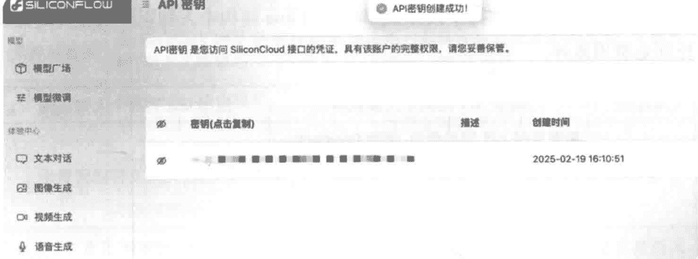

第二步：选择 DeepSeek 模型。
在“模型广场”搜索并选择 DeepSeek 模型，如 DeepSeek - R1 或 DeepSeek - V3，记下所选模型。

第三步：配置客户端工具。
下载并安装 Cherry Studio（https://www.cherry-ai.com/download）。
打开软件，进入“设置”→“模型服务”，开启“硅基流动”。
粘贴 API 密钥，填写 API 地址。
在模型列表中选择“DeepSeek - ai/DeepSeek - R1”并开始使用。

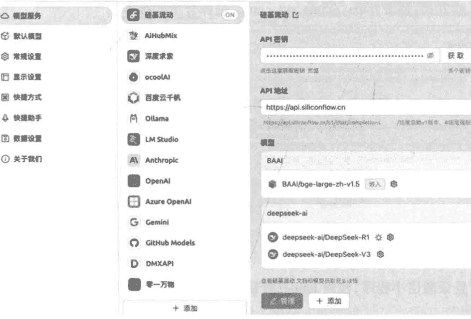

第四步：创建个人知识库。
创建私人知识库，打开 Cherry Studio 客户端，点击菜单栏的知识库按钮，设置知识库名称，选择 BAAI/bge - m3。然后上传本地的知识内容，便可在对话中引用。

第五步：注意事项。
1. 调用 API 需关注费用与额度，个人用户尽量避免高频请求，合理控制生成长度。如需长期使用，建议绑定企业账户并联系硅基流动官网获取专属支持。
2. 知识库宜上传已本地向量化的 Word、PDF 与 TXT 文件，避免上传扫描版或含大量图片的 PDF。

### 三、使用 ima 免费打造个人知识库
腾讯 ima 接入 DeepSeek - R1 后，用户可通过 ima 使用 DeepSeek，其优势在于操作简便，能快速上手打造个人知识库。

第一步：更新 ima 至最新版本。
1. 本地版用户将 ima 更新至最新版本，即可在过程中选择 DeepSeek - R1 模型。
下载方式：登录 https://ima.qq.com/，选择合适版本。


2. 登录微信小程序，搜索 ima 并直接使用，可自行选择“问全网”还是问“知识库”。

第二步：在功能中选择 DeepSeek - R1 或腾讯混元模型。
在使用 ima 的搜索、阅读、写作及知识库功能时，可在界面中选择 DeepSeek - R1 模型或腾讯混元大模型，按需灵活切换以获得更高效或更精准体验。

第三步：使用 DeepSeek - R1 或腾讯混元模型的功能。
1. 智能阅读：输入相关内容后，选择 DeepSeek - R1 模型，可快速提取关键信息、生成脑图或总结。
2. 文档处理：支持上传 PDF、DOC、JPEG、PNG 等格式的文件。DeepSeek - R1 可对文档内容进行分析、总结或生成脑图。
3. 智能写作：支持论文、文案等内容生成，以及扩写、缩写和翻译。
4. 知识库管理：可将 DeepSeek - R1 生成的内容添加到知识库中，方便后续管理和调用（比如将自己的笔记上传至 ima）。

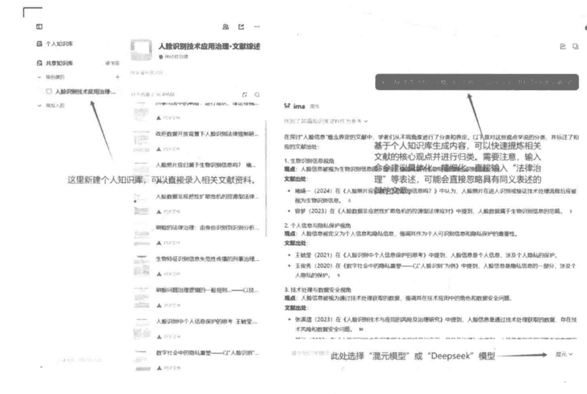

第四步：通过腾讯云使用 DeepSeek - R1。
如需更深度使用，还可通过腾讯云的知识引擎创建应用：
1. 登录腾讯云官网，开通知识引擎产品体验。
2. 创建应用并导入知识文档，支持多种格式文件。
3. 在应用配置中选择 DeepSeek - R1 模型，并开启相关功能。

## 第五节 个人 DeepSeek 本地化部署

**硬件吃紧就别本地折腾 DeepSeek**

算力不足的环境下，尤其是压缩蒸馏的小版本，本地跑 DeepSeek 体验会打折。以下示范只用上手门槛最低的 Ollama 做简要演示，不建议性能受限用户盲目尝试。

DeepSeek 各规模在本地的资源参考

| 参数量 | FP16 显存占用 | INT8 显存占用 | 推荐显卡 | macOS 内存建议 |
| :--- | :--- | :--- | :--- | :--- |
| 1.5B | ~3GB | ~2GB | RTX 2060 / Mac 自带 GPU 可用 | 8GB |
| 7B | ~14GB | ~10GB | RTX 3060 12GB / 4070 Ti | 16GB |
| 8B | ~16GB | ~12GB | RTX 4070 / Mac GPU 运行顺畅 | 16GB |
| 14B | ~28GB | ~20GB | RTX 4090 / A100-40G | 32GB |
| 32B | ~64GB | ~48GB | A100-80G / 2x RTX 4090 | 64GB |

受限于本地算力，Ollama 上的 DeepSeek 多数情况下只能得到轻量剪裁版，而非完整满血版。对法律从业者而言，大模型的核心价值是提效，比如从海量材料里抽取归类信息或起草基础文稿。在网页对话里下精确指令更贴合实际工作流。法律垂类商业化产品也在逐步普及。下面给出一套可直接跟做的 Ollama 本地化流程。

本地化操作流程

### 一、安装 Ollama
打开 Ollama 官网 https://ollama.com/download ，按系统下载对应安装包完成安装。装好后程序会出现在系统启动项，可双击图标启动，也可通过命令行调用。

### 二、下载 DeepSeek 模型
打开终端。Windows 按 Win+R 输入 cmd 或 powershell，macOS 用 Command+空格打开 Spotlight 搜索“终端”。目前 Ollama 官网 Models 页面提供 1.5b、7b、8b、14b、32b、70b、671b 共 7 个版本。

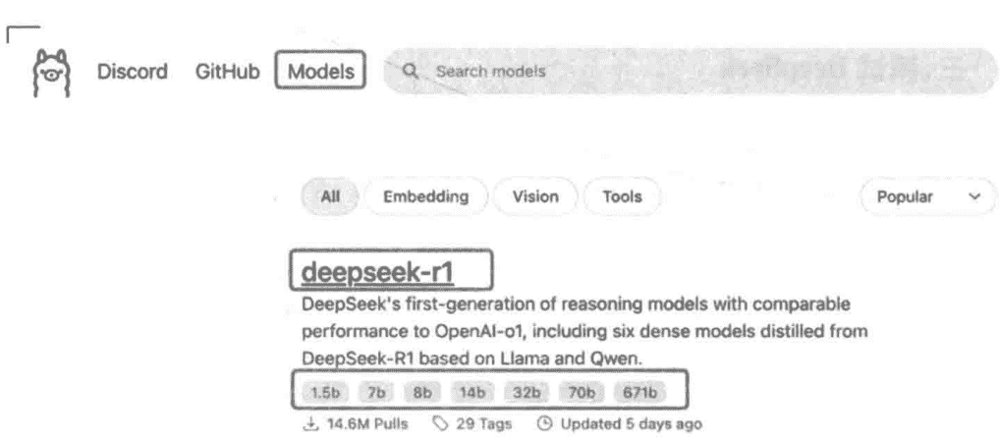

以 DeepSeek-R1 为例，在终端执行：
`ollama run DeepSeek - r1:1.5b`（说明：该精简版在普通电脑上更友好，能力有限，也可换用其他命令）。

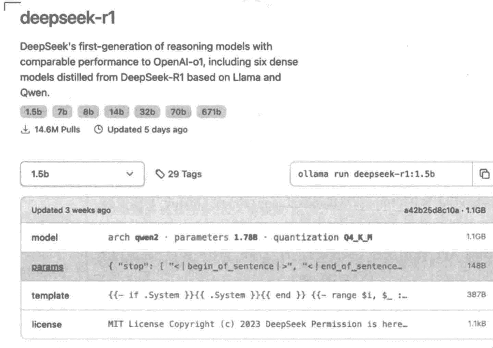

其中 1.5b 代表模型大小，可按硬件自行挑选。下载完成后终端会提示“Send - A - message”，表示模型已加载。

### 三、测试 DeepSeek
在终端输入“介绍一下你自己”等问题，模型思考后回复即说明部署成功。

```
wengzhuangzhuang — ollama run deepseek-r1:1.5b — 80x24
Last login: Thu Feb  6 15:57:16 on ttys000
wengzhuangzhuang@wengzhuangzhuangdeMacBook-Pro ~ % ollama run deepseek-r1:1.5b
>>> 你好，欢迎你来到我的电脑。\n您好！我是由中国的深度求索（DeepSeek）公司开发的智能助手DeepSeek-R1。我擅长通过思考来解答复杂的数学，代码和逻辑推理等理工类问题。同时，我会以理性和客观的态度为您提供合理的建议和信息。请问有什么我可以帮助您的吗？
>>> Send a message (/? for help)
```

### 四、搭建可视化界面（可选）
想要图形操作可用开源工具 Chatbox AI。官网 https://chatboxai.app/zh 或 GitHub 获取。安装后选择“使用自己的 API Key 或本地模型”，设置页选择 Ollama API，模型填 DeepSeek - r1:1.5b，保存即可。①

### 五、常用命令
1. 拉取模型：`ollama pull < model_name >`。
2. 启动模型：`ollama run < model_name >`。
3. 移除模型：`ollama rm < model_name >`。
4. 查看已装列表：`ollama list`。

> ① 可视化界面的详细步骤可参考陈焕、戴奎、李勇编著：《法律人必备 AI 核心技能：DeepSeek 零基础入门到精通》，法律出版社 2025 年版，第 467 - 470 页。

### 六、硬件要求
最低：16GB 内存 + 8GB 显存。推荐：32GB 内存 + 16GB 显存，约 RTX 3060 级别。

按上述流程可在本地完成部署，实现离线使用，避免官方服务器拥堵，同时更好保护个人隐私与资料。

## 第六节 DeepSeek-V3 与 DeepSeek-R1 的用户视角对比
以下从使用感受对比两者，便于按需选择。

| 维度 | DeepSeek - V3 | DeepSeek - R1 |
| :--- | :--- | :--- |
| 定位 | 通用型自然语言处理，覆盖客服、翻译、内容生成等场景 | 专注复杂逻辑推理（数学证明、代码生成、决策分析） |
| 架构 | 混合专家 MoE 架构，总参数 6710 亿，单 token 激活 370 亿参数 | 基于 V3 架构改进，引入动态门控机制，强化学习优化推理 |
| 训练方式 | 预训练 + 监督微调 SFT，FP8 混合精度训练，总成本 557.6 万美元 | 强化学习 RL 为主，结合冷启动数据，无须监督微调 |
| 推理能力 | 高效处理多模态任务，长文本生成 128K 上下文 | 支持思维链 Chain-of-Thought 输出，MATH-500 数学准确率 97.3% |
| 响应速度 | 实时响应，MoE 架构优化计算效率 | 需先进行思维链推理约 5 分钟，响应较慢 |
| 应用场景 | 企业级客服、多语言翻译、高吞吐代码补全 | 科研、金融量化、复杂决策支持 |
| API 成本 | 输入 $0.14/百万 tokens，输出 $2.19/百万 tokens | 输出成本为 OpenAI O1 的 1/50，约 $2.19/百万 tokens |
| 开源生态 | 开放模型权重，适配 AMD GPU/华为昇腾 NPU | MIT 协议开源，提供蒸馏版本如 14B/70B 参数 |
| 典型性能 | MMLU 知识理解准确率 85.6%，HumanEval 代码通过率 65.2% | MATH-500 准确率 97.3%，AIME 数学竞赛通过率 79.8% |

总体看，V3 更适合处理多模态内容、长文档或多语言，例如内容创作、智能客服或企业文档处理。R1 更擅长数学、代码生成与复杂逻辑推理，适合程序员、科研人员或需要深度决策支持的团队。划分并非绝对，可结合偏好选择。需要快速简短答案时默认用 V3；需要结构化、深思熟虑的输出时再开启深度思考 R1。任务知识在 2023 年 12 月之前时无需联网搜索，模型自带语料即可；涉及 2023 年 12 月之后内容时开启联网搜索更可靠，否则回答可能缺时效。

## 第七节 DeepSeek-R1 与 GPT-4o 的提示词设计差异
GPT-4o、DeepSeek-V3 等属于指令模型，用于按指令生成内容。DeepSeek-R1 属于推理模型，聚焦逻辑推理与问题求解，能自主完成多步分析、因果推断与复杂决策。提示词可共通，但设计思路有差别，需注意。归根结底，R1 只是神经网络，不可盲目迷信输出。

| 维度 | DeepSeek - R1 | GPT - 4o |
| :--- | :--- | :--- |
| 核心目标 | 复杂推理任务，如数学推导、代码生成、逻辑分析等，强调多步骤思考 | 多模态通用任务，涵盖文本、图像、音频等多种模态，强调快速响应和跨模态生成 |
| 提示词原则 | 简洁明确，聚焦核心目标，避免分步引导，信任模型推理能力 | 清晰明确，启发式引导，适应性调整，强调用户反馈和情景模拟 |

## 第八节 使用 DeepSeek 的风险提示
使用 DeepSeek 涉及数据隐私、知识产权、内容生成、跨境合规等多方面法律风险。

第一，数据隐私与安全。DeepSeek 在收集、存储及使用环节可能存在合规问题。韩国对 DeepSeek 的调查指出其在收集合法性、使用透明度、跨境传输合规性及安全措施充分性方面存疑。若未经明示同意收集数据或用于未授权用途，可能违反法规，面临高额罚款及集体诉讼。数据泄露还可能导致隐私与商业机密外泄。因此上传文档前务必做好隐私保护。特别注意 DeepSeek 隐私政策①，其中说明会收集用户交互输入内容，包括文本、图片、文件，并收集用户对输出的反馈以优化模型。若不希望输入成为他人可获取的答案，需格外留心。

> ① 参见 https://cdn.DeepSeek.com/policies/zh-CN/DeepSeek-privacy-policy.html。

第二，知识产权风险。DeepSeek 代码与模型分别采用 MIT 许可与自建许可 OpenRAIL 类协议，使用时需遵守声明义务与责任限制，否则可能构成侵权。模型生成内容也可能涉及对他人受版权保护文本或代码的无授权使用。

第三，内容生成风险。生成文本可能包含虚假信息、误导或偏见，违反法规或产生社会负面影响。DeepSeek-R1 在红队测试中显示有害内容生成率偏高，包括恶意语言、偏见输出与不安全代码，存在伦理与合规风险。使用其生成法律文书或案例分析时需核验准确性与合法性，避免因错误信息承担法律责任。

第四，跨境合规风险。全球化应用伴随跨境数据流动，欧盟 GDPR、美国 CCPA 等对数据跨境传输有严格要求。部分国家如澳大利亚、韩国、意大利以国家安全或数据安全为由限制或禁用 DeepSeek，可能影响全球使用。

第五，法律实务风险。律师等从业者若直接将 AI 生成内容作为法律意见或文书使用，可能违反执业规范与责任要求。应独立验证、批判性分析，而非视为权威。此外模型知识库更新滞后，可能导致输出不符合最新法规。

总之，使用前需全面评估隐私、知识产权、内容与跨境合规风险。确保数据使用符合当地法律法规，遵守开源许可，对生成内容严格审核，注意跨境传输合规。法律从业者更应审慎对待 AI 输出，确保符合实务要求。

## 第九节 其他大模型参考

### 一、部分人工智能使用链接与产品
**特别提醒：** 下列站点不仅可使用 DeepSeek，还能免费或付费使用 ChatGPT、Gemini、Claude、腾讯混元等生成式大模型，读者可自行甄别选用。① 本文仅列举涉及 DeepSeek 的渠道，使用风险需自行判断。随着时间推移，部分链接可能失效。

1. 秘塔 AI 搜索：https://metaso.cn。
2. 360 纳米 AI 搜索：https://www.n.cn/。
3. 腾讯元宝：https://yuanbao.tencent.com/（腾讯接入 DeepSeek-R1，通过整合微信公众号、视频号等生态信息源及互联网权威信源，提供稳定实时全面的回答）。
4. 腾讯 ima 小程序及其客户端：https://ima.qq.com/。
5. 打开微信→点击搜索框→选择页面中部“AI 搜索”→选择深度思考模式。
6. Fireworks：https://fireworks.ai/models/fireworks/DeepSeek-r1。
7. Github：https://github.com/marketplace/models/。
8. Flowith：https://flowith.io/blank。
9. Monica：https://monica.im/。
10. Lambda：https://lambda.chat/。
11. Deep Infra：https://deepinfra.com/chat。
12. Openrouter：https://openrouter.ai/chat?models=DeepSeek/DeepSeek-r1:free。
13. Huggingface：https://huggingface.co/DeepSeek-ai/DeepSeek-R1。
14. Perplexity：https://www.perplexity.ai/。
15. AskManyAi.：https://askmanyai.cn/index。

> ① 关于 ChatGPT、Gemini、Claude、Copilot、Grok、通义、豆包、Kimi、腾讯混元、智谱清言、文小言、跃问、讯飞星火等 AI 产品简介，可参考陈焕、戴奎、李勇编著：《法律人必备 AI 核心技能：DeepSeek 零基础入门到精通》，法律出版社 2025 年版，第 474-477 页。

### 二、部分法律垂直领域大模型
下述法律垂直大模型是否满足具体职业需求，还需结合实践个体化试用。总体处于探索发展阶段，部分功能仍在完善。不同产品侧重点各异，如交互式法律检索、智能司法辅助等。当前市场产品众多，如案牍 AI 审查、AlphaGPT、北大法宝律 AI 多、法天使智能合同审查、火眼审阅、金山晓法、Mecheck、MetaLaw、元典问达、智爱 AI 等。① 篇幅所限，仅作提示，读者可按需探索。

#### （一）fleetAI
大成借助 GPT-4 打造的生成式 AI 机器人，可提供法律文献查询、自动生成法律内容、识别法律论据等服务，以提升业务效率。

#### （二）Lexis + AI
律商联讯基于 2500TB 海量数据与 GPT-4 等大模型推出类 ChatGPT 产品 Lexis + AI，具备交互式法律搜索、内容总结与合同/简报起草三大功能，是较早应用生成式 AI 的法律机构之一。

#### （三）北京大学元法大模型
开发主体：北京大学法律人工智能实验室。
特点：首创规则推理引擎与全栈自研中国法律大模型，经 700 亿级参数预训练，内化数万部法律法规规范性文件，法条引用准确率高，实现“懂人话”“无幻觉”；通过一阶逻辑表达式与符号化算法实现“守规则”“可解释”“可推理”的去黑盒能力。
应用：法律问答、文书生成、案例分析等，为专业人士与公众提供高效准确服务。

#### （四）法信法律基座大模型
开发主体：最高人民法院，基于清华大学与面壁智能科研成果转化而来。

#### （四）法信法律基座大模型
该项目以千亿级通用架构为底座，整合了量级达万亿词的法律专业语料，具备法律语义理解、逻辑推演、检索融合与内容生成等能力。定位为司法内部专用，暂不向公众开放。目前已落地两大应用：其一是深圳法院的人工智能辅助审判系统 1.0，于 2024 年 6 月 28 日正式上线；其二是“库网融合”智能检索数据库，在此基座上对“法答网”“人民法院案例库”完成预训练。实务中可帮助法官快速比对、分析案情，提升立案审查与阅卷效率，也可延伸用于行政执法辅助、公共法律服务、司法大数据价值挖掘等场景。①

#### （五）智海-录问法律大模型
由浙江大学、阿里云、华院计算联合打造。功能覆盖法律问答、知识检索增强问答、案情拆解、意图识别、推理决策以及法律文书生成等辅助服务。可为司法提供智能化支持，推动智慧法院与相关平台建设，同时为浙江大学数字法治新型司法人才培养提供新路径。

#### （六）夫子·明察法律大模型
研发主体为山东大学、浪潮云、中国政法大学。模型以 ChatGLM 为基础，结合判决文书、法律法规等无监督司法语料，并以法律问答、类案检索等有监督微调数据优化。主要应用于司法核心环节的法律文书分析、案情研判以及法律咨询。

#### （七）法观法律大模型
由中国司法大数据研究院、数智枫桥研究院、天同律师事务所联合研发运营。2024 年 8 月成为全球首个通过中国法考的人工智能产品，2024 年 11 月推出“深度思考”版本，通过智能化反思与协作模拟人类慢思考，提升输出准确性与分析全面性。可为法律从业者及社会公众提供文书分析、案情研判、法律咨询等服务。链接参见 https://lawgpt.cn/#/

#### （八）法宝 GPT
链接参见 https://ai.pkulaw.com/shop。

#### （九）阿里通义法睿
链接参见 https://tongyi.aliyun.com/farui。

#### （十）北大法宝数据库的“法宝 GPT”
北大法宝将法律内容与大模型结合，推出智能问答、模拟法庭、智能写作、法宝智能助手、法宝来签等 AI 法律产品。链接参见 https://www.aiww.com/aitool/beidafabaogpt。

#### （十一）威科先行法律数据库的“类案 GPT”“小威 GPT”
链接参见 http://www.wkinfo.com.cn。

#### （十二）东南大学法学院推出“法衡-R1 深度推理大模型”
东南大学法学院数字法学团队依托校内大数据计算中心，于 2024 年 11 月首次发布法律垂域大模型“法衡 1.0”，参数规模 320 亿。2025 年 1 月完成迭代，发布“法衡 2.0”，参数提升至 720 亿。法衡系列现已全面开放下载。

#### （十三）AlphaGPT
AlphaGPT 将法律大模型与律师实务场景结合，覆盖合同审查、文书起草、法律咨询、卷宗阅读、案情研究等多项服务。上手便捷、无需本地部署、专业度较高，定位为律师专属 AI 助理。链接参见 https://www.icourt.cc/product/alphaGPT。

#### （十四）北大法宝律 AI 多
北大法宝旗下智能律师平台新品牌“律 AI 多”，依托法律大模型结合法宝数据库及自建知识库，为律所提供全流程知识管理方案，实现知识沉淀智能化、查询复用便捷化、知识资产应用多元化，助力律所提质增效并提升法律服务标准化水平。

## 第三章 AI 法律信息检索的认知边界
把人工智能直接等同于法律检索工具的说法并不准确。乍看与本章主题相悖，实则体现了对法律 AI 应用规律的清醒认识。当前通用模型尚不具备独立承担法律信息检索任务的可靠技术基础，因生成内容易出现算法幻觉，导致法律信息失真或虚构。此时 AI 难以单独提供完整准确的检索方案，但可以作为检索流程中的一个环节，也不能排除未来出现专门的法律检索 AI。对实务人员而言，检索结果的价值高于检索过程与形式。面对陌生法域时，因知识储备不足易陷入信息迷雾，此时 AI 类似专业领域的数字向导，可先行生成相关法律信息，帮助圈定检索范围，提升路径规划效率。需注意通用大模型目前难以直接输出符合学术或实务规范的检索结果，人机协同制定策略方能显著提效。AI 法律信息检索不会动摇专业法律数据库的基石地位，而是借助智能语义解析、多模态知识图谱、动态案例匹配等技术，提供更高效智能的信息服务，重塑传统线性检索方式。

### 第一节 法律信息检索的核心逻辑
法律信息检索的形式随数字化演进不断变化，从人工资料查阅、网页检索、数据库检索到生成式 AI 检索，但其核心逻辑与目标始终稳定。核心在于借助技术手段实现法律信息的高效定位、组织与适用，使研究者与实务人员能够在特定语境下迅速获取权威准确的依据。检索的本质是高度结构化、语境化的信息获取，围绕精准捕捉与特定法律问题最相关的规范、判例、学术文献并恰当用于推理决策展开，涉及规范性、适用性与权威性。

法律信息检索根植于法律体系的制度化特征。法律是一个层级分明、逻辑严密的规范体系，检索任务不仅是找到相关文本，更要理解其在特定语境中的规范效力。例如研究者需把握条款的适用范围、效力状态、上位法与下位法的关系，以及司法实践中的解释情况。因此检索已超越关键词匹配，需基于法律规则体系进行深度语义匹配，确保结果符合法律推理框架。

法律信息检索还体现为对适用性的精准匹配。法律条文必须结合具体案件与问题实践适用，检索的终极目标是让资料在具体实践中发挥价值。例如律师、法官需要检索到的不是孤立条文，而是能支撑判断与决策的适用性依据。

### 第二节 AI 与传统检索方式的逻辑关系
ChatGPT、DeepSeek 等生成式模型，与谷歌、百度等搜索引擎，以及北大法宝、中国知网、HeinOnline 等学术数据库在法律信息检索中的关系，可从技术逻辑、信息组织、检索模式、内容准确性与适用性、未来趋势五个维度展开。

#### 一、技术逻辑
传统搜索引擎依赖索引构建与关键词匹配，通过网页抓取和倒排索引实现存储与排序，用户查询后按 PageRank、BM25 等算法返回结果。学术数据库更封闭，依靠人工整理、分类和标准化元数据保证高质量内容可检索。生成式 AI 如 ChatGPT、DeepSeek 采用大语言模型的自回归生成机制，不直接返回已有索引，而是基于概率计算生成文本，属于在检索基础上进行信息重组、概括与推理。

#### 二、信息组织方式
搜索引擎和学术数据库结构化程度较高，前者按链接、标题、摘要层级组织，后者按论文、法规、判例等专业分类并配引文索引与标签。生成式 AI 没有固定数据库结构，依赖训练数据与神经网络动态生成文本。这种非结构化方式使其能快速给出答案，但也带来随机性与可验证性不足的问题，在法律场景中难以提供明确来源与精确依据。

#### 三、检索模式
生成式 AI 提供自然语言问答交互，传统工具仍以关键词查询为主。过去研究者需输入“合同法 违约责任”并筛选结果，而现在可直接提问“在中国合同法下，违约责任的归责原则是什么？”，获得简明解读。

在中国合同法下，违约责任的归责原则是什么？
引用 8 篇资料作为参考
在《民法典》合同编下，违约责任总体上以严格责任为主、过错责任为辅。
1. 严格责任为主要原则
《民法典》第 577 条规定，当事人不履行或履行不符合约定应承担违约责任，未要求证明过错，除不可抗力等法定免责事由外均需负责，更有利于保护守约方。
2. 过错责任为补充
在赠与、运输、保管等特定合同中，法律明确要求以故意或重大过失为要件，违约方仅在存在过错时担责。
3. 免责事由
不可抗力可部分或全部免责，债权人自身过错导致损失扩大可减轻责任。
总体而言，以严格责任为一般规则，过错责任为例外，兼顾交易安全与公平。

生成式 AI 能处理复杂提问，但可能出现幻觉，生成不准确或虚构信息。高精度场景仍需结合传统工具验证。

#### 四、内容准确性与适用性
学术数据库提供专家审核的权威资料，可信度高。搜索引擎受网页质量影响，可能引入论坛、博客等非官方信息。生成式 AI 生成内容通常符合法律术语表达，具备推理框架，但在具体解释上可能出现适用错误。例如“劳动合同解除的合法条件”，可能给出笼统概述而无法区分地区差异。因此 AI 可作为研究助手，但实务中仍需交叉验证。

#### 五、未来趋势
生成式 AI 极可能与传统检索融合，形成混合型法律检索体系。谷歌、微软已在搜索中引入生成式 AI，如 Google SGE 和 Bing AI。法律数据库也在探索 AI 辅助检索，如北大法宝结合自然语言处理优化检索。未来可能向多模态检索发展，融合文本、语音、图像，用户可语音提问，AI 生成摘要并链接权威数据库资料。AI 难以完全取代传统工具，但其在法律检索中的角色正在快速扩展。

### 第三节 AI 法律信息检索的独特优势
传统法律检索依赖关键词、布尔逻辑和分类数据库，精确可控但效率有限，需手动筛选。生成式 AI 赋能的检索不仅提取文献，还能直接生成初步可用答案，显著提升便捷性和实用性。这种差异体现在自然语言理解、语境敏感性、知识整合和效率提升等方面。

生成式 AI 能直接输出完整法律解答，而非仅罗列文献。传统方式需用户输入“劳动合同解除条件”并自行阅读条文、案例、论文。AI 可直接生成分析，如“根据《劳动合同法》第三十九条，劳动合同可因以下情形解除……案例进一步明确……”适合律师撰写意见、法官参考判例。

生成式 AI 语境理解更强，能够基于具体提问定制答案。传统工具对“员工因生病请假，公司可以解雇吗？”只能返回病假或解雇相关条文，需用户自行归纳。生成式 AI 可直接给出适用方案，如“根据《劳动合同法》第四十二条，员工在医疗期内，用人单位不得解除劳动合同”。

员工因生病请假，公司可以解雇吗？
引用 6 篇资料作为参考
根据《劳动合同法》及相关规定，需分情况讨论：
一、医疗期内原则上不得解雇
《劳动合同法》第 42 条规定，劳动者在医疗期内，用人单位不得依据第 40 条或第 41 条解除合同。医疗期长短依据工龄确定。违法解除需支付两倍赔偿金。
二、医疗期满后可合法解雇
医疗期满后若无法胜任工作且调岗无效，公司可依据第 40 条解除，需提前 30 日通知或支付代通知金，并支付经济补偿。
这种能力减少了筛选与分析时间，使检索更智能、更人性化。

医疗期解除边界，员工与企业都应看清

- 解除时一般需要向劳动者支付按 N 倍月薪计算的经济补偿。
- 特例：劳动者因工负伤或被诊断为职业病时，适用更严格的特别保护规则。

2. 程序要求
- 用人单位必须保留调岗安排的证明以及医疗期届满后的能力评估资料，否则解除行为很可能被认定违法。

#### 三、特殊情况处理
1. 员工未履行请假手续
- 未提供医院证明、未按内部制度履行请假流程或未在期限内补齐材料，公司可以依据合法有效的规章制度终止劳动合同。
- 举例来说，劳动者长期“挂病假”却拒不补办手续，企业解除通常具备合法性。

2. 医疗期工资与社保
- 病假期间，企业至少应按当地最低工资标准的 80% 支付病假工资，且须按时缴纳社会保险，否则劳动者有权主张相应赔偿。

##### 总结
- 禁止解除的情形：劳动者仍在医疗期内且不存在严重违纪。
- 允许解除的情形：医疗期已结束、劳动者仍无法胜任工作，且用人单位已履行法定的程序义务。
- 实务建议：劳动者要妥善保管病假证明、请假记录等证据；用人单位则需严格按法定流程操作，避免承担违法解除成本。

如需具体案例或操作流程，可进一步补充说明。

生成式大模型正在重塑法律检索的精准度
语义层面的理解能力让法律检索更贴近真实需求。传统检索多依赖关键词匹配、元数据索引或预设分类，容易出现结果泛滥或因表述差异而漏检问题。生成式 AI 借助深度学习与自然语言处理，能捕捉查询背后的法律意图，而非仅进行字面对照。如查询“未成年人犯罪的法律责任”，传统工具往往只抓关键词，而模型可以推断用户实质需要刑法关于免责事由、量刑规则或司法解释的要点，并结合上下文、案例与学术观点给出结构化、符合逻辑的回应，从而显著提升检索精度。现阶段这种理解更接近远距离浏览而非人类的精读细究，但已足以满足多数法律人日常检索的基本要求。

跨源整合让分析更全面
生成式 AI 能打通法条、判例、学术论文等不同来源，形成整合性法律分析，摆脱传统检索受限于单一数据库的困境。当用户询问“商业秘密侵权的法律后果”时，模型可以同时援引《反不正当竞争法》相关条文、法院在同类案件中的裁判思路，以及学界对商业秘密保护的理论阐释，最终给出系统性的解读。这种综合能力使复杂法律问题的处理更匹配实务需求。

可解释性与可追溯性提升信任
传统搜索仅罗列文献，解释权留给使用者。生成式 AI 则可在答案中说明依据，例如“该意见主要基于《民法典》第 XXX 条及案号 XXXX 的判决，判例明确指出……”并提示核查原始文献。这种透明度让模型更像数字法律助手，而非单纯检索工具。

效率优势明显
传统方式需要逐篇阅读、筛选、归纳才能形成结论，而大模型可在数秒内生成初步分析，节省重复劳动，让律师、法官、研究者更快进入深度研判。例如法学综述类工作，模型可快速梳理争议焦点与各学派核心观点，帮助把握全貌。

整体来看，生成式 AI 能直接给出可用答案、理解语境、提供个性化分析，并实现多源交叉、可解释追溯，同时大幅提升效率，成为法律信息检索的颠覆性力量。

## 第四节 AI 法律信息检索的局限性
尽管前景可期，生成式 AI 在法律检索中仍存在明显短板，与法律职业的严谨需求存在差距。可信度不足、可验证性弱、法律约束性缺失、跨法域适用受限以及伦理合规风险，是当前必须直面的挑战，与人工查阅法典、全文检索等传统方式相比，在关键环节仍难完全替代。

输出可信度是固有难题
传统检索依托立法机关发布的法条、法院裁判、期刊论文等确定来源，使用者可自行核验。生成式 AI 基于概率语言模型预测文本，可能生成看似合理却并不存在的法条、判例或观点，即“幻觉”。例如查询“2024年中国关于数据保护的最新司法解释”，模型可能编造一个合理但不存在的解释，这在诉讼策略、法律意见和裁判中都是不可接受的。

> 2024 年中国关于数据保护的最新司法解释是什么

截至2024年7月，中国数据保护领域的主要司法与立法动态包括：

1. 《最高人民法院关于审理侵害个人信息权益民事案件适用法律若干问题的解释》
   - 生效时间：2023年8月3日起施行，2024年仍为核心依据。
   - 主要内容：
     - 确立个人信息侵权案件的过错推定责任，信息处理者需自证无过错。
     - 细化个人信息认定标准，明确行踪轨迹、健康信息等敏感信息受强保护。
     - 要求遵循合法、正当、必要原则，过度收集、未脱敏展示等情形易被认定侵权。
     - 强调平台对第三方插件或嵌入代码的监管责任，未有效防范泄露需担责。

2. 《个人信息出境标准合同办法》的司法适用
   - 背景依据《个人信息保护法》第38条，2023年出台标准合同办法。
   - 2024年司法实践重点审查企业是否完成标准合同备案，违规出境可能导致合同无效及民事赔偿。

信息来源模糊与时效待核验也是痛点。传统数据库可精确溯源，生成式 AI 的回答多为训练数据综合，引用不一定精准，对正式文件撰写和案件分析构成可验证性风险。

法律约束性不足
法律不仅是知识，更是具有强制力的规范体系。AI 能预测合理表述，却无法真正理解权威性与适用边界，可能将美国普通法的推理机械套用到中国成文法体系，忽视法系差异，导致结论缺乏法律效力。

跨法域局限明显
国际检索常需比较不同法域。传统库如 LexisNexis、Westlaw 能提供准确的跨国文本。AI 虽能给出概述，却易混淆欧盟《通用数据保护条例》与中国《个人信息保护法》的适用范围与条文差异，泛化能力不足。

伦理与合规风险
法律信息涉及隐私与敏感策略。AI 训练与交互可能导致案件策略、客户隐私外泄；训练数据若含偏见，输出可能隐含系统性歧视。相较传统方式，数据安全、合规与伦理管理仍需更多保障。

总体而言，AI 在可信度、可验证性、约束性、跨法域适用与伦理合规上仍有限，只能作为辅助工具。

## 第五节 AI 法律信息检索的趋势
生成式 AI 在法律检索的应用仍在快速演进，未来价值取决于能否突破可信度、可验证性、约束性与伦理等瓶颈。关键方向包括提升准确性、强化可追溯引用、优化跨法域能力、增强推理能力并确保伦理合规。

### 一、提升生成内容的准确性和可信度
最大挑战是“幻觉”。未来需构建高质量法律专用训练集，与立法机关、法院及权威数据库如 LexisNexis、Westlaw、北大法宝合作，建立动态更新的多模态数据池，从源头提升认知可靠性。提升法律推理能力同样关键，结合自然语言处理与案例分析，使模型能识别术语、区分法域差异并按法律原则解释，而非仅统计预测。模仿法官推理路径，从既有判例推导适用方案，将是重要路径。

### 二、加强法律信息的可追溯性和引用能力
传统检索优势在于可验证。未来法律 AI 可嵌入可验证引用机制，在作答时直接附带权威来源链接，并确保生成内容与原文一致。结合区块链进行检索与引用溯源，实现数据不可篡改、来源可核验，增强信任。

### 三、优化跨法域适用性
当前在普通法、成文法等体系差异处理上薄弱。未来系统应深度对接专业数据库，提升对多国法律体系的理解，提供跨法域比对功能。如在跨境合规审查中自动对照不同辖区规定并给出适用分析。结合多语言翻译，提供权威法律译文，提升全球信息获取效率。

### 四、增强 AI 的法律推理能力
多数工具仍停留在匹配与模式识别。未来可融合案例推理 CBR 与规则推理 RBR，使模型不仅能检索相似条款，还能基于法律原则进行推导。如在合同法中依据解释规则判断效力，在刑法中结合构成要件进行模拟推理，输出更接近专家水平的分析。

### 五、确保 AI 法律信息检索的伦理性与数据安全合规性
法律信息高度敏感，需完善隐私保护与伦理机制。例如采用联邦学习，使用户数据仅在本地处理不上传；回答时避免歧视性或误导性建议，引入透明决策审查与专家复核，确保建议符合伦理与实务规范。

总之，未来发展方向是提高准确可信度、强化可追溯引用、优化跨法域能力、增强推理能力并保障伦理合规。随着技术与数据优化，法律 AI 将成为研究、诉讼策略、合规审查的有力助手，而非替代法律专业人士，推动行业向智能化专业化迈进。

## 第六节 法律人在 AI 法律信息检索中的角色
生成式 AI 正在改变检索方式，提升效率，但法律人的专业作用不可替代。在技术赋能过程中，法律人不仅是使用者，更是监督者、解释者、优化者和创新者，专业判断与伦理意识决定 AI 的实际价值。

监督与校验
因“幻觉”存在，AI 结果可能出现事实错误或适用偏差。法律人需作为质量控制者进行二次审核。例如法官可用 AI 检索案件，但裁判必须基于专业判断；律师使用 AI 生成意见时须严格核验法条与判例，确保适用正确，避免误导与风险。

精准提问与优化输入
检索质量取决于问题质量。法律人需明确事实构成、争议焦点与适用法域，使用精准术语与检索技巧，提升结果相关性。通过不断调整查询参数，可使 AI 更贴近核心问题，在合规审查中避免信息泛化。

深度解释与分析
AI 提供初步整合，法律人负责深度解读与适用判断，将检索结果转化为符合个案的具体法律结论。

定制化应用开发与伦理合规监管
法律人参与系统设计与规则设定，确保工具符合实务需求与职业伦理，对数据安全、隐私保护、偏见防范等进行监管，构建可信的应用边界。

法律人真正难以被替代的，是深度解释与综合分析的能力。生成式 AI 确实能快速调取法条、案例和学术观点，但法律问题的处理远不止检索层面，需要法理、历史脉络、裁判走向等多维度加以权衡。以合同纠纷为例，AI 可以罗列适用规则，真正判断规则如何落到具体事实、如何权衡利弊，还得靠法律人的推理。在合宪性审查里，AI 能给出相关条款和学说汇编，最终的价值取舍与论证链条，仍离不开法律人的专业判断。所以 AI 的输出只是分析的起点，不是决策的终点。

法律人推动 AI 在法律检索中的定制化落地。刑法、知识产权、国际法等不同领域的信息需求差异很大，有专业背景的法律人能够参与检索系统的定向开发。比如律所可以打造聚焦专利侵权要素识别的检索工具，法院可以优化判例搜索模型以贴合本土适用习惯。在企业法律服务场景里，法律人还能训练模型贴合客户的风险偏好，输出更具实操性的合规建议。这种定制让 AI 从通用工具进化为适配特定业务场景的智能助手。

法律人对 AI 伦理与合规的监管能力，是未来检索可信的底线。生成式 AI 使用中频现数据隐私、算法透明、法律偏见等风险。判例推荐可能因算法歧视导致群体失衡，合同分析可能因数据偏差误判风险。法律人需要参与伦理治理，携手律协、司法机关和科技公司制定行业准则，确保公正、公平、透明。监管层面也要完善检索规范，例如国家市场监督管理总局与国家标准化管理委员会于 2025 年 2 月 28 日发布的强制性国家标准《网络安全技术人工智能生成合成内容标识方法》就对企业合规提出要求，法律信息输出须可验证、可溯源，避免虚假误导。

归根结底，法律人不是 AI 法律检索的被动使用者，而是监督者、精准提问者、深度分析者、定制开发者和伦理监管者。专业知识与法律判断决定了 AI 价值的上限。随着技术演进，法律人与 AI 的协作将更紧密，AI 成为得力助手，法律人则在监督、优化与创新中掌握核心作用，共同把法律信息检索推向更智能、高效、可信的新阶段。

# PART 2 实战技能篇

- 破解 AI 幻觉的应对之策
- 生成式 AI 法律检索的提示词技巧
- 提升法律人办公效率秘籍

## 第四章 破解 AI 幻觉的应对策略

在法律实务与数字化深度融合的当下，检索效率提升不等于理解到位。法律信息检索幻觉正揭示出从业者常有的认知偏差：过度迷信检索结果的充分、准确和客观，忽视了法律文本的多义性、语境依赖性和推理复杂性。工具降低了获取成本，却也带来算法局限、呈现片面以及数据逻辑与法律逻辑的冲突。若不加以校验，推理和决策质量都会受损。本章聚焦幻觉的成因与化解路径，倡导多维审视与交叉验证，提醒法律共同体在数字时代保持方法自觉与职业警惕，让信息检索回归理性与公正。

## 第一节 三类 AI 模型在法律检索中的作用差异

智能检索正在重塑法律人获取与分析信息的方式。目前主流模型大体可分为基于规则的专家系统、基于机器学习的检索模型和生成式人工智能。它们在准确性、可解释性、灵活性和适应性上各有侧重，理解其特性和边界是构建可靠系统的前提。

### 一、专家系统

早期法律智能化多依赖基于规则的专家系统。系统由专家与程序员事先设定规则库、推理路径和决策树，通过“如果—那么”结构模拟专家推理。检索时匹配预设规则输出法条、判例、解释和合规提示，在税法、公司法、知识产权等规则稳定领域表现较好。

但维护成本高、滞后性明显是其短板。法律体系动态变化，新法出台、旧法修订、裁判规则演进都需要人工更新规则库，更新速度往往跟不上立法司法节奏，导致时效性与准确性下降。生成式模型借助大规模语料可自动学习变化，避免手工维护难题。

同时，规则系统难以处理语境、模糊与复杂推断。诸如劳动纠纷中的“恶意”等概念，难以用清晰的 IF-THEN 完全界定，语义弹性强的法律问题常常超出其应对范围。

### 二、检索模型

机器学习检索模型提升了语义匹配能力。经过大量法律文本训练后，模型学会术语间的语义关联。经典方法如 TF-IDF、BM25 可实现关键词匹配，深度模型如 BERT 等预训练语言模型则能理解上下文，实现更精准的召回。例如查询“公司解散”，关键词法可能返回所有含词条文，而语义模型能定位《公司法》中解散条件条款并关联相关判例与文献。

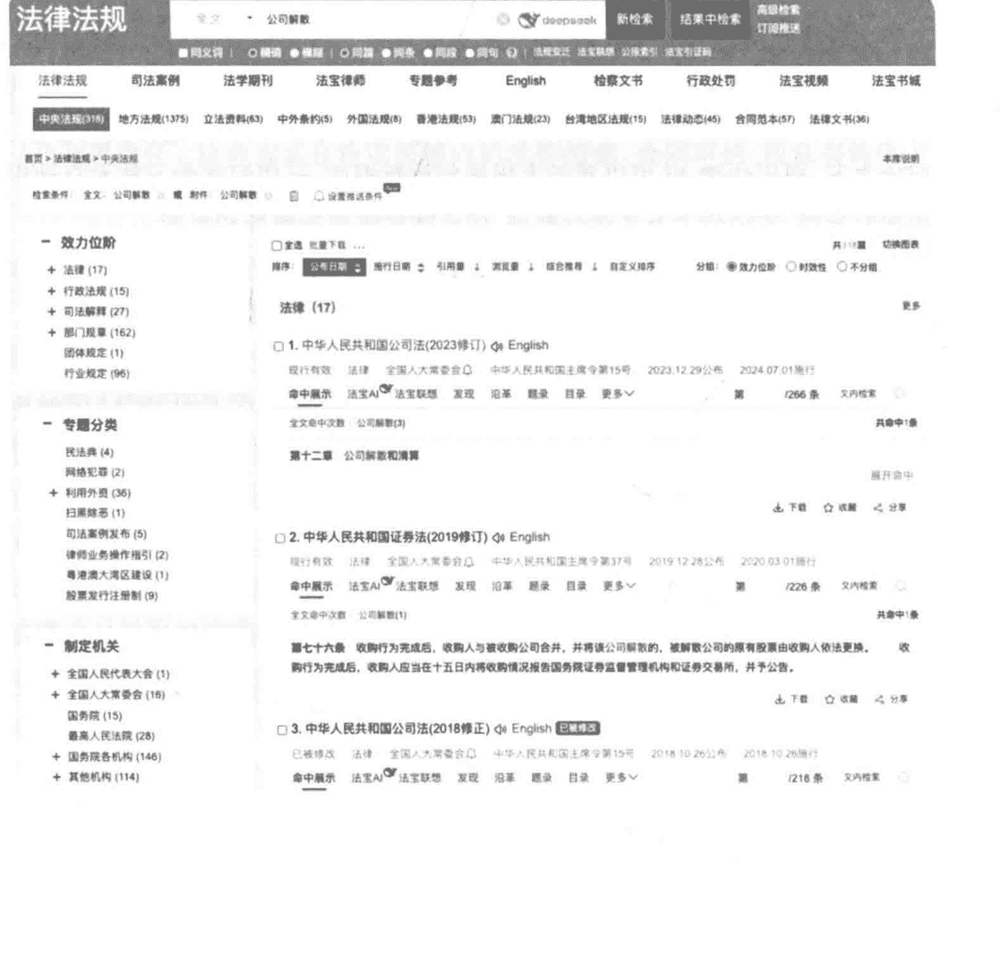
请介绍法律上的公司解散

引用 8 篇资料作为参考

公司解散指因法定或约定事由终止经营，进入清算并消灭法人资格的法律程序。核心要点如下：

### 一、解散类型
1. 自愿解散
   - 章程原因：经营期限届满或章程载明的其他事由出现。
   - 股东决议：有限公司需 2/3 以上表决权股东通过；股份有限公司需出席股东会议表决权 2/3 以上通过。
   - 合并分立：因合并或分立而解散的无需清算。
2. 强制解散
   - 行政解散：因违法被吊销营业执照、责令关闭或撤销，如虚报注册资本、长期停业等。
   - 司法解散：持股 10% 以上表决权股东可诉请法院解散，公司经营严重困难且无其他解决办法时可获支持。

### 二、清算流程
1. 成立清算组
   - 事由出现后 15 日内成立，有限公司由股东组成，股份有限公司由董事或股东大会指定。
   - 超期未成立，债权人可申请法院指定。
2. 清算操作
   - 清理资产、编制资产负债表。
   - 10 日内通知债权人并公告 60 日。
   - 清偿债务、分配剩余财产后出具清算报告。
3. 注销登记
   - 清算结束后向登记机关申请注销并公告终止。

### 三、法律后果
- 清算期公司存续仅限清算行为。
- 注销后法人资格终止，简易注销承诺不实等情形股东可能承担连带责任。

### 四、特殊情形
- 简易注销：无债务公司经全体股东承诺可简化流程，虚假承诺将导致股东连带责任。

可解释性弱、数据偏差是机器学习检索的明显缺陷。深度模型多为“黑箱”，用户难知其推理路径；训练数据的质量与多样性直接决定结果公正与全面。实践中常需与专家系统结合，在提升精准度的同时保留法律逻辑的可解释性。

### 三、生成式人工智能

GPT-4、DeepSeek、Claude、Gemini 等大模型带来了检索范式的转变。它们不仅返回条文与案例，还能整合信息生成自然流畅的分析文本。例如检索“合同违约的法律后果”，模型可列出条文并结合判例与学说形成简明分析报告，大幅提升实用性。

但幻觉是典型风险。模型基于概率生成，可能会编造不存在的条文或错误推理。法律要求精确依据，若缺乏监管，易产生误导。因此实务中需引入引用验证，要求模型附带可查的法条或判例编号，增强可溯源性。

### 四、结合应用

单一模型难以兼顾准确与灵活。高效系统通常多模型协同：专家规则库把控基础知识准确性，机器学习模型提升语义匹配，生成式模型负责可读性分析。为缓解幻觉，可引入知识图谱进行约束推理，让答案依托法律知识网络而非纯概率生成。智能合同审查即可融合规则系统与深度学习，既精准识别条款风险，又输出可操作的法律意见。

不同模型各司其职：规则系统提供稳定框架但缺乏弹性，机器学习提升匹配智能但解释不足，生成式模型整合分析能力强但需解决幻觉与溯源问题。合理组合才能保障法律检索的准确、可靠与高效。

## 第二节 应对法律信息检索中的幻觉问题

生成式 AI 在摘要文献、推理案例、解读法规和法律咨询中应用广泛。其文本生成能力提升了可读性，也带来了“幻觉”风险，即内容看似合理权威却缺乏事实依据。识别表现、审视成因并建立应对策略，是保证实务、研究与决策可信的关键。

### 一、幻觉的表现形式

AI 可能生成逻辑通顺但并不存在的法条、判例或学说，导致研究误判、诉讼策略失误。

典型情形是伪造条文。模型依概率拼接术语与条文格式，产出表面符合法规结构却不存在的条款。例如询问人工智能生成作品著作权归属的判决时，可能杜撰虚假案例。

虚构判例同样危险。模型可能基于已有语境编造判决，如称“2023 年某高级人民法院在某案中首次承认人工智能为发明人”，现实中并无此事。前沿议题如 AI 生成物、数字遗产等缺乏先例时尤为常见，直接引用会损害结论权威。

学术观点造假也常见。模型可能捏造学者言论或论文，如声称某法学家提出 AI 应具法律人格，实则并无出处。比较法研究中易混淆语境，产生看似权威的虚假引注。

错误适用亦属幻觉范畴。即便引用真实条文，也可能错配情境。例如劳动合同纠纷中仅援引《劳动合同法》，忽略灵活就业或平台劳动者需结合《民法典》及地方法规与司法解释的复杂性，给出表面正确、实质不全的建议。

### 二、幻觉的技术成因

# 法律AI为什么总“造假”

靠概率猜词的生成机制，让法律检索的幻觉几乎成了常态。现在主流的GPT-4、Claude这类大模型，都用的是自回归式的文本预测。它并不是去库里调一条真实的法条，而是根据提示词在训练语料里找语感最顺的下一个词、下一句话拼出来。于是哪怕模型读过海量的法学材料，实战时依然会输出“看着像法条、其实不存在”的内容。

比如问“《劳动合同法》有没有规定远程办公的强制义务”，模型很可能顺着语料的风格补出一句“《中华人民共和国劳动合同法》第××条明确要求用人单位必须提供远程办公选项”。事实上法条里根本没有这一条，只是模型把语言模式套成了用户想要的答案。根子上就是检索靠概率而不是靠真实库，形式上合规的法律表述，未必在现实中有出处。

数据本身的缺陷也在推波助澜。训练集多来自公开的论文、法规汇编、裁判文书等二手材料，既不完整也不总是最新。版本更新了模型不知道，法域覆盖窄就容易张冠李戴。更关键的是，像Westlaw、LexisNexis、中国裁判文书网这类权威库，受版权和访问限制很难被直接训练，模型只能啃博客、论坛、开放文献。面对复杂问题时，它就会用猜测去填空。比如问“欧洲法院是否判过AI作品有著作权”，模型可能直接编出一个不存在的判决并附上案件名。这种以有限信息为基础的推测式生成，让法律幻觉尤其致命。

再加上模型没有真正的法律思维。它能模仿法言法语，却做不了概念界定、体系推理和法理分析。于是不同法系的概念会被混用。问“美国宪法是否明文规定隐私权”，模型可能回答“《美利坚合众国宪法》第××条明确把隐私权列为基本权利”。实际上美国宪法并未直接写隐私权，该权利主要来自格里斯沃尔德诉康涅狄格州案等判例法。这是典型的概率联想失误，而非恶意造假。

更麻烦的是，生成式模型天生缺乏可追溯的引用闭环。输出一段话时，它不会自动附上法条编号、判决原文或出处链接。没有来源标注，用户就无从核验，法学研究和实务引用也站不住脚。即使偶尔给出参考文献，引用本身也可能是模型“编”出来的，进一步放大幻觉。

总体来看，法律检索中的幻觉源于四点：概率预测的工作方式、训练数据的片面与滞后、缺乏真实法律推理能力和缺失权威引用机制。它不仅损害准确性，还可能误导咨询、研究甚至司法实践。想用好AI，就必须先管住幻觉。

### 三、幻觉的应对方式

目前可行的缓解路径大致有五类：事实校验、可解释性、素养培训、风险提示、人机协作。它们并不能根除幻觉，但可以把负面影响压到最低。

#### (一) 事实校验

给生成结果装一个“对照关”。技术上是在模型输出后，自动把文本与官方法律库进行比对，判断是否真实、完整且在有效期内。核心是建一个持续更新的权威比对库，涵盖现行法律、行政规章、司法解释、典型判例和权威学说。输出先被解析成结构化信息，再做语义和文本相似度校验。

举例来说，模型提到《民法典》第××条，系统就会即时调取官方条文原文做逐句核对，发现歪曲或虚构就标记并给出正文。校验要配上引用追踪，像Westlaw、LexisNexis那样的溯源思路，让每条结论都能指向来源。用户提问“《民法典》是否承认电子合同效力？请给出条文原文与链接”时，理想结果应附上具体条款及可核验网址。

现实中会出现抓取受限或URL构造困难的问题。更稳妥的做法是明确标注生成内容所依据的来源，让用户自行核验。对学理解释，也可比对HeinOnline、SSRN、中国知网等论文库，防止模型自行杜撰观点。

校验要做成动态学习闭环。用户反馈可用来调整核验策略，比如对高风险概念加强审查；用户提交的新法条、新判例经核验后反哺数据库；模型在同一类问题上反复出错时，触发微调以降低再现概率。

跨法域也是重点。不同国家规则差异很大，校验层需要法域识别能力。问“美国是否承认AI生成作品享有著作权”，模型应引用美国版权局的官方立场，而非用他国规则套用。若错误把英国法当成美国法依据，系统应自动标红提醒。对于跨境数据保护这类争议议题，还可提供多法域对照，帮助用户全面判断。

可视化能让校验更直观。可以用颜色编码呈现可信度：绿色表示已通过权威库验证，黄色表示逻辑合理但缺少直接证据或多源冲突，建议交叉验证，红色表示未验证或明显矛盾。配合对比视图同时展示模型原文与官方原文，用户能一眼看出差别。

**案例：美国是否承认AI生成作品享有著作权？**
引用10篇资料作为参考
根据美国版权局最新政策及司法实践，认定标准大致为：
1. 纯AI生成作品不予保护。完全由AI自主生成、人类未实质性干预的内容，因缺少“人类创作”，不满足版权要件。例如版权局和法院在“天堂的最近入口”案中明确，纯AI图像或文本不受保护。
2. 人类主导的AI辅助作品可部分保护。若人类对生成内容进行创造性选择、编辑、重组或实质性修改，人类贡献部分可受保护。比如人类撰写文本并对AI图像进行排版设计，设计部分可受保护。
3. 需披露AI使用情况。申请版权时必须标注AI生成部分，否则影响注册有效性。
总结：美国不保护纯AI作品，但承认人类在AI辅助创作中的原创性贡献。

#### (二) 可解释性

让模型“说出自己怎么想的”。法律检索需要透明的推理链，而非黑箱答案。可解释性AI要求在给出结论的同时，附上依据的条文编号、判例出处或学术来源，使用户能复核路径。

传统检索系统直接指向原文，AI则需要主动暴露依据。比如回答“如何判断是否构成侵权责任”，除了结论，还应列出《民法典》第1165条等具体条文，并提供链接。用户才能判断结论是否站得住脚。

结合先前的搜索资料，侵权责任的判断通常围绕违法性、损害事实、因果关系、主观过错和归责原则展开。违法行为需违反法律规定，正当防卫等合法行为不构成侵权；损害必须可量化；因果须直接且必然；过错一般为故意或过失，无过错责任类型则不问主观；不同归责原则下举证责任也不同，还需考虑免责事由和诉讼时效。所有要点都应附带可核查的法条或判例来源，而不是模型的一句话概括。

只有把事实校验与可解释性结合起来，AI才能从“会说话的生成器”变成法律场景里相对可信的助手。

侵权怎么判、AI 查法不跑偏的思路

严格来说并非所有损害都必须证明行为人主观有差错。遇到产品因为设计或制造缺陷造成人身或财产损失，法律直接要求责任方赔偿，受害方不必再去证明故意或疏忽。

### 二、怎么选归责方式

| 归责方式 | 常见场景 | 举证负担 |
| :--- | :--- | :--- |
| 主观过失标准 | 日常交通事故等普通侵害 | 权利人需证成侵害四要素 |
| 过失推定标准 | 高空抛物、经营场所未尽安全保障 | 被诉方自行证明已尽注意义务 |
| 法定严格标准 | 产品致害、环境污染、动物致害等 | 无需证明主观差错 |

举个例子，电梯坠落致伤，物业必须主动证明已履行维修保养义务，否则会被推定有过错并承担赔偿。

### 三、特殊情形如何定性

1. 共同侵害
两人或多人一起实施损害行为的承担连带赔付，如唆使未成年人实施破坏行为。
2. 职务侵害
国家机关工作人员在履职中致人损害的由国家承担赔偿，企业员工在职务范围内致损的由用人单位负责。
3. 网络侵害
平台适用通知删除机制，收到侵权通知后未及时处理需承担连带责任。

### 四、可以豁免的情况核对
需要排除以下情形：
- 正当防卫或紧急避险，且在必要限度内
- 受害人存在故意，如碰瓷行为
- 不可抗力，即自然灾害等无法预见且不可避免的情况

### 五、追诉期限怎么看
- 一般期限：自权利人知道或应当知道权利受损之日起三年，最长不超过二十年
- 特殊期限：针对未成年人遭受性侵害的赔偿请求，起算点为受害人年满十八周岁

### 六、实务操作要点
1. 举证负担分配
医疗损害、专利侵害等特殊案件多适用举证责任倒置。
2. 责任比例划定
若受害人自身存在过失，如乘车未系安全带，可据此减轻加害方赔偿比例。
3. 赔偿范围确认
侵害赔偿包含财产损失与精神损害，违约责任通常不包含精神损害赔偿。

参考案例：
某乘客因电梯坠落受伤起诉物业，法院依据《民法典》第1253条适用过错推定，因物业未能证明已履行维护义务被判担责。

实务建议：处理具体案件时对照《民法典》侵权责任编及相关司法解释，按案件性质选择适用标准，并注意2021年《民法典》施行后，原《侵权责任法》中一年人身损害诉讼时效等旧规定已被废止。

生成式模型如果在检索判例时体现透明推理，分析会更贴近法理。判例价值突出，尤其在普通法传统下法官裁判需参考先例以保持一致性。但模型受训练语料限制及推理误差影响，可能误引或捏造判例。因此可解释系统在呈现检索结果时，应当附带原始文本或真实案号。例如查询美国关于AI生成作品著作权的审判时，应明确给出华盛顿特区地方法院2023年Thaler诉Perlmutter案，案号22-CV-384-1564-BAH等信息，并提供摘要或原文链接，同时展示筛选依据，如关键词匹配、相似案件分析或法律主题分类，帮助使用者核验。

可解释系统也有助于提升学术研究的严谨性，确保引用的学说观点可追溯可查。模型易出现错误归因或虚构文献。引入来源追溯机制后，引用的观点应标明论文题名、作者、年份、期刊。例如援引数据保护研究时应具体说明：Hoofnagle C J、Van Der Sloot B、 Borgesius F Z. The European Union general data protection regulation：what it is and what it means [J]. Information & Communications Technology Law，2019，28(1)：65-98，并附DOI或官网链接，以增强可信度并提高检索效率。

可解释系统可结合分层解释方法，为不同背景使用者提供可验证信息。法官、律师、学者、企业法务与公众需求深度不同。系统可依据使用者画像提供分层解释：对普通用户给出条文要点与通俗释义；对专业人员完整呈现推理链条、判例援引逻辑、解释方法选择与学说分歧；对司法决策者则整合立法沿革、比较法参照与政策价值权衡。通过条文编号、判例原文、论文出处结合分层解释与知识图谱，系统才能成为可信的法律检索助手。

#### （三）素养培训
随着生成式人工智能在法律检索中的应用普及，法律从业者如何正确理解并使用该技术成为关键问题。模型能快速整理条文、搜索判例、分析观点，但存在幻觉、断章取义、语境误解等风险。法律人需培养批判性思维，不能盲目依赖输出，而应结合自身知识与传统检索工具综合核验。

法律人应掌握生成式模型的基本原理，理解其基于统计概率预测而非逻辑推理的本质。模型本质是文本拼接，可能因语料局限生成片面或错误信息，甚至编造条文或判例，或混淆不同法系概念。素养培训应涵盖技术背景、法律语料训练方法与局限性。

法律从业者应养成核查习惯。例如律师若获模型提供的判例支持，必须回溯中国裁判文书网、Westlaw、LexisNexis等权威数据库核实案号与内容；法官参考模型解释时须对照现行条文与司法解释；学者引用模型生成观点前须查阅原始文献。形成查证质疑验证的思维可降低错误风险。

培训还应包含操作技能，包括高质量指令设计与交叉验证。例如可要求“依据《民法典》第一千一百六十五条，结合最高法院相关判决，分析侵权责任适用情形”。优先选择附带条文编号、案号或论文出处的回答，并以官方数据库复核。

法律职业伦理也应纳入素养教育。模型输出仅具参考性，不产生法律效力，不能替代专业判断。律师不得仅凭模型分析向客户出具意见，法官不得将模型分析作为裁判依据，学者须注明模型辅助作用，避免因错误信息损害严谨性。

典型风险案例显示，2023年北京张律师在八百万元借款纠纷中提交六份模型伪造最高法判例，被认定违背职业伦理导致败诉；2025年美国律师Steven Schwartz使用ChatGPT生成六个虚假航空侵权案例致案件败诉并受处分。核心原因包括数据真实性缺陷、法律逻辑错误与伦理责任缺失。行业应对包括强制标注模型生成内容来源、开发实时校验工具、制定操作指引并坚持案号核验、观点溯源、逻辑反推三重验证原则。

#### （四）风险提示
在生成式人工智能驱动法律检索创新的背景下，保障输出可靠性成为核心挑战。模型可能产生幻觉，生成不存在的条文、错误引用或虚构概念，引发适用偏差。为此建议引入风险提示机制，对缺乏可信来源或存在潜在错误的信息自动标注待核实或存疑，提醒使用者谨慎使用。

样例：AI生成法律意见书片段（含警示标注）
```
【AI生成内容】
根据《民法典》第1165条，侵权责任需满足四要件：
1. 违法行为（如未经许可使用肖像） ✔️
2. 损害事实（需实际发生精神或财产损失） ✔️
3. 因果关系（行为与损害间需直接关联） ✔️
4. 主观过错（包括故意和过失） ✔️

⚠️**存疑提示**：
• 第4项中“过失包含重大过失与一般过失”的细分标准（《民法典》未明确区分层级）[1,3](@ref)
• 引用的“2024年最高法指导案例第15号”待核实（未在裁判文书网检索到该案号）[5](@ref)
• 赔偿金额计算公式$x=\frac{\text{实际损失}}{2}+\text{精神抚慰金}$缺乏明确司法解释支持[7](@ref)
```

标注依据
1. 显式标识
头部标注【AI生成内容】符合《GB 45438-2025》文本标识要求，使用✔️/⚠️符号区分已验证与存疑内容
2. 隐式风险类型
条文理解偏差：易混淆学理观点与条文原文（如过失分级）；捏造文书编号：大模型易虚构裁判文书编号（参见Mata v. Avianca案）；自行推算公式需交叉验证权威来源
3. 用户操作建议
对存疑内容使用三步核验法：①裁判文书网核查案号；②比对国务院客户端最新司法解释；③咨询持证律师确认责任要件

风险提示的必要性在于模型生成的概率本质与法律数据高精度要求之间的矛盾。模型可能通过语境拼接生成看似合理但实际不存在的法条，或错误归纳原则。因此法律数据库开发者需构建自动化风险提示，让使用者建立有限可靠性的人机协作认知。

技术实现可依赖置信度评分、事实核查算法与使用者反馈系统。置信度评分可根据生成内容与权威数据库匹配度计算，低于阈值即触发警示；事实核查算法可比对官方法律文献识别错误；使用者反馈可让专业人员标注可疑信息并用于模型修正，逐步减少幻觉。

给法律 AI 装上刹车：风险提示机制的正确打开方式

风险提示的用武之地远不止检索条文那么简单，判例研读、法律咨询、合规审查都能派上用场。在判例检索里，AI 容易把案件要点概括偏了，甚至张冠李戴。这时候法律库可以在 AI 输出分析时主动标注存疑段落，并附上原始裁判文书链接，提醒使用者自己去核对。在咨询场景中，AI 往往基于用户提供的信息不全就下结论，这时系统要自动弹出提示：AI 给出的只是参考意见，不等于正式法律意见，避免用户盲目采信。做合规评估时，AI 会忽视法规的修订和废止，系统可以设置自动预警，比如“相关法规可能已更新，请以最新合规指引为准”，帮助企业降低被误导的风险。

风险提示能有效削弱 AI 幻觉带来的适用风险，但设计时必须在可用性和安全性之间找平衡。提示太频繁，用户会觉得系统过于保守、动不动就“待核实”“存疑”，信任度下降，使用积极性也会被磨掉。提示太宽松，错误内容就可能被当成权威依据。更合理的做法是设定触发阈值，只有在置信度低于设定线、数据库里找不到确切支撑、或者问题本身复杂难以定论时，才亮起黄灯。

引入风险提示，本质上是提升法律 AI 可靠性的关键举措。它能让专业人士快速判断输出是否可信，避免误信错法，同时在反馈循环中倒逼系统自我优化。开发者要把置信度评分、事实核查算法和用户反馈机制结合起来，搭建起一套既高效又严谨的提示体系。

#### （五）人机协作

在生成式 AI 进入法律检索的当下，人机协作已经成为保准确、可解释、可落地的核心路径。AI 能在海量文献里快速搜索、归纳要点、生成摘要甚至预测趋势，但幻觉、语境误读和推理边界依然存在，完全交由 AI 决策风险很高。未来的发展不是人对 AI 的替代，而是 AI 为法律人提速、法律人做最终判断的分工协作。

分工要先厘清。AI 的强项是数据处理：海量法律文本的检索、案例要点的自动提炼、法律摘要的生成等。相比传统关键词匹配，AI 能更深地理解上下文语义，给出更贴近意图的答案。但面对复杂法律问题时，AI 对法条适用范围、案件具体情节和推理逻辑的把握仍有限。法律专业人士的职责是验证、修正和补充，确保检索结果完整且可操作。比如 AI 推荐一批判例后，必须人工核查时效、管辖、适用条款和与本案的关联度。AI 预筛选 + 人工核验 的组合，才能把幻觉影响降到最低。

技术上要做出可验证、可解释、可交互的系统。检索结果必须能追溯：提供数据来源、推理路径和证据支撑。比如给出咨询建议时，自动附上法条链接、判例摘要和学术观点，让使用者能回溯原文。可交互意味着允许用户实时调整：补充限定条件、改检索参数、追加案例，实现动态研讨而非一次性的静态查询。同时引入反馈学习，法律人标记错误或不准的信息，模型据此迭代，提升后续准确率。

协作必须以法律人为中心，并坚守职业伦理。法律检索直接关乎判断、策略和裁判，AI 只能是助理，不能是决策者。法官可以用 AI 辅助找案例，但判决仍靠司法裁量；律师可用 AI 生成备忘录或合同草案，但正式采用前必须人工审核。要建立清晰的责任边界，一旦检索导致误判，责任由法律专业人士承担。教育层面也要跟上，加强 AI 素养训练，让法律人懂得模型机制、识别局限、保持批判性思维。把功能分工、技术优化和职业伦理三者拢在一起，才能形成高效、准确、符合职业规范的检索体系。

第三节 真实性怎么保证

在法律检索语境里，真实性包含准确性、可验证性和规范有效性三个层面。传统检索靠关键词匹配、布尔逻辑和分类库，优点是可追溯，用户能直接查原文、案例或论文，保证信息可靠。生成式 AI 则在真实性上暴露短板：模型靠大规模语料训练，输出并非原文摘录，而是统计概率驱动的语义重组，容易出现幻觉，生成根本不存在的规则。

要守住真实，第一步是数据源过硬。模型输出的好坏取决于训练数据的质量和覆盖面。若训练集接入 Westlaw、LexisNexis、中国裁判文书网、国家法律法规数据库等权威库，答案才更贴近真实规则。必须严格限定数据源，对未经官方核验的文本和网络非结构化信息进行清洗。检索时要与传统数据库联动，每条结论都能在权威库里找到依据，同时给出法条编号、判例来源或文献引用，增强可验证性。

第二步是可解释性。对传统工具而言，返回的是原文索引，整合负担在用户。可解释性 AI 能把条文、案例、观点整合成自然语言，同时标注清晰依据。例如问“如何解除无固定期限劳动合同”，不能只给概括性说法，必须点出《劳动合同法》第三十九条、第四十条的具体内容，并附司法解释和典型裁判，供用户自行核验。

以解除无固定期限劳动合同为例，依据《劳动合同法》及司法解释可归纳如下：

法律依据方面，第三十九条规定了用人单位的单方解除权，无需提前通知或补偿，情形包括试用期不符录用条件、严重违反规章制度、严重失职营私舞弊造成重大损害、同时与其他单位建立劳动关系影响工作且拒不改正、欺诈胁迫致合同无效、被依法追究刑事责任等。第四十条规定了非过错解除，用人单位需提前30日通知或代通知金并支付经济补偿，情形包括患病或非因工负伤医疗期满不能从事原工作也无法另行安排、不能胜任工作经培训或调岗仍不胜任、订立时客观情况重大变化致合同无法履行且协商未果等。

司法实践中有明确指引。案例一涉及违法解除赔偿，白某工作满十年符合无固定期限条件，公司单方终止，法院认定违反第十四条强制缔约义务，构成违法终止，依据第八十七条判令支付双倍经济补偿并补发工资。案例二涉及严重违纪，员工拒绝执行工作指令被解除，法院认定属于严重违反规章制度，支持解除。案例三明确经济补偿标准，依据第四十条解除需支付N+1，依据第三十九条解除则无需补偿。

还要注意禁止解除情形，《劳动合同法》第四十二条规定孕期、医疗期、职业病观察期等期间不得依据第四十条或第四十一条解除。程序上必须书面通知并保留违纪记录、培训考核等证据以降低风险。

即便 AI 能提速，高风险决策仍需人工复核。研究机构可组建 AI 辅助团队，先由 AI 生成分析初稿，再由专业人员校对补充。答案旁可设“人工审核”入口，支持用户提交核查请求或反馈错误，模型据此持续优化。若律师发现结论偏差，可直接提交反驳并引用权威文献，推动模型修正。

从技术上看，还需把符号逻辑推理引入模型。当前大模型靠深度学习生成文本，缺乏演绎、归纳、类比推理的严谨性。合同问题不仅要找条文，还要理解有效要件、无效情形、违约责任构成等推理框架。未来系统应结合符号逻辑，在引用《民法典》第四百九十六条格式条款规定时，同时分析单方制定性和排除对方主要权利等构成要件，形成更严谨的结论。

第四节 质量怎么提升

高质量的法律检索，意味着答案在准确性、完整性、可验证性和适用性上都达到专业标准。生成式 AI 能检索、整合、解释，但受自然语言处理和概率统计机制影响，容易出现片面、过度概括甚至幻觉。需要在数据源、检索策略、推理方式、输出验证和用户反馈等多个维度协同优化。

数据源是地基。法律信息高度专业、系统化，训练语料必须覆盖官方法律文本、最高人民法院案例库、权威法学期刊和一线律所实务分析。目前市面通用的 ChatGPT、DeepSeek 等并非法律专用模型，在专业语料适配上差距明显。还需建立动态更新机制，法规修订后模型能自动识别变更，避免引用过期规则。数据源过硬，才能提升权威性和时效性。

检索算法和提示设计决定精准度。传统关键词匹配易过载或遗漏，AI 可通过语义分析把握用户意图。比如问“劳动合同解除法律依据”，系统不仅能调出第三十九条和第四十条，还能识别用人单位解除、劳动者解除、不可抗力等不同情境，给出差异化解释。采用上下文感知的智能提示词，如“请结合最高法院裁判观点分析某类合同解除依据”，能引导模型产出更专业回答。多轮对话机制可让 AI 主动追问关键事实，逐步收敛结果，避免模糊输出。

推理能力需要深度学习与符号逻辑结合。单纯统计建模难以支撑法律推理，必须引入演绎、归纳、类比推理。例如判定合同条款是否有效，不能仅靠语言相似度匹配，而要依据效力规则进行逻辑推演；判定是否构成格式条款，不仅要引用民法典，还要分析单方制定性、排除主要权利等要件。这样才能让答案既通顺又符合法律逻辑。

输出验证是质量的最后一道防线。AI 输出是概率生成文本，必须可溯源。高质量检索应强制引用法律条文、案例编号或权威文献。例如谈高利贷合同效力，不能只给结论，需附《民法典》第六百八十条、《最高人民法院关于审理民间借贷案件适用法律若干问题的规定》及相关裁判，并做论证。可引入多源交叉验证，多库一致的观点优先呈现；若库间结论冲突，系统应提示存在不同解释并提供各方来源供用户自行判断。

人机协作优化不可缺位。法律体系复杂，AI 无法完全替代人工审核。可建立“AI 初筛 + 专家复核”模式，用户对答案标注“准确”“需补充”“错误”，系统据此调整检索策略。模型还能学习不同专家的风格偏好，有的律师重案例分析，有的法官重条文解释，实现个性化输出。基于反馈的持续迭代，才能让 AI 越用越准。

系统性提升需要五步走：优化权威数据源并动态更新；改进算法与提示词提升相关性；引入符号逻辑增强推理；构建可溯源的输出验证与多源交叉机制；建立人机协作反馈闭环。只有打通这几个环节，法律信息检索才能真正成为实务、司法和研究的可靠助手。

## 第五节 让大模型找法不跑偏的提问方法论

在法律信息检索里，生成式AI能不能用好，关键看用户怎么提问题。提示词直接决定了模型的检索边界、答案质量和相关度，也牵动着法律分析的准确性和说服力。跟传统的关键词匹配不同，生成式AI依赖自然语言理解和语境推断，所以写好法律提示词，才是提升检索效果的核心。一个靠谱的法律提示词，既要做到够精准、有条理、可查证、能适应不同场景，也要避开模糊、带偏见、诱导式的表达，才能让AI输出专业可信的内容。

### 一、追求高度精准
法律检索最忌讳空泛。提示词越模糊，AI越容易给出冗余或偏离主题的内容，甚至出现误读。比如直接问“合同违约有什么法律后果”，答案往往会泛得很宽。若改成“依据《民法典》第五百七十七条，债务人不履行的法律后果具体包括哪些”，模型就能给出更有针对性的条文式回答。写提示时尽量用专业术语、明确的法条指向和清晰的案情背景。涉及跨法域时，要在提示里限定适用法域，例如“按照美国联邦法，商业秘密被侵犯会承担怎样的法律责任？”或“在欧盟GDPR体系下，数据主体享有哪些具体权利？”，避免模型把不同国家的规则混在一起。

### 二、结构化表达提效率
法律问题天然多层次，结构化提问能让AI少绕弯。法条适用、案例解读、学理分析往往要分步展开。可以用分层或递进的方式引导模型按逻辑走。比如问股东权利，不如这样写：“依据《公司法》，公司股东的基本权利有哪些？请分别从财产性权利、公司治理权利、诉讼类权利三个维度展开，并结合典型判例说明。”这种写法让输出更系统，也更符合法律思维。

实务场景里，情境式提问效果更好。如：“一名合同相对方未按约支付价款，债权人有哪些可行的法律救济？请结合《民法典》相关规定和典型案例分析。”这样能促使AI综合条文、判例和实务做法，给出完整可用的信息。

### 三、强调可验证来源
法律答案必须能追溯。AI有时会生成看似合理却缺乏依据的内容，所以提示里要明确要求来源。可以加上“请给出对应法条或案例佐证”或“请引用权威法律库的内容”等指令。例如：“依据中国《劳动合同法》，劳动者被无故辞退可主张哪些赔偿？请列出具体条文并附相关司法解释。”模型在这种约束下会主动检索并提供可核查的引用。

对于复杂争议，可以要求多视角呈现，比如“著作权合理使用的边界在不同法域实践中是否有差异？请以美国、欧盟、中国的案例为样本做比较。”多维度的提示能避免单一化结论，帮助用户全面把握问题。

### 四、保持场景适应力
不同检索目的，提示写法也要跟着变。做立法研究时，可以用历史回溯式提问：“请梳理《消费者权益保护法》自颁布以来的主要修订节点，并总结其立法走向。”适合学术分析。

在实务操作里，比如律师审合同，就要细化指令：“请核查以下合同条款是否符合《民法典》合同编的规定，并指出潜在的法律风险点。”帮助AI聚焦合规性。

在教学场景，可以设计模拟式提问：“请扮演一名法官，对下面这个案例作出裁判并说明法律依据。”这种训练型提示能让AI模拟推理过程，帮助学生理解法条适用。

### 五、保持表述清晰干净
避免模糊、倾向性或诱导性的问法，以免得到误导性结论。比如“这个案子能赢吗？”太宽泛，改成“依据《民法典》合同编，买卖合同因货物质量争议时，买方可采取哪些法律救济手段？”会更清晰。

也要警惕带立场的提问，像“为什么法院总是偏向原告？”这类表述会引导AI产生偏颇，更好的问法是“法院审理合同纠纷时主要遵循哪些法律原则？”此外，涉及敏感合规问题，如“如何规避税务处罚？”，这类提示容易诱导不合规输出，检索时需特别注意提示词的合规性和伦理边界。

#### 六、要点回顾
撰写法律信息检索提示词，本质是一项兼顾精准、结构、可验证、适应的技术活。明确检索目标，用具体法律语言引导AI结构化分析，要求标明法律依据，并根据立法研究、司法实务、教学训练等场景调整写法，同时杜绝模糊、偏见、诱导式的表达，才能让AI输出符合法律逻辑和伦理标准。随着工具进化，未来或会出现自动提示词优化助手，进一步提升法律从业者的检索效率，推动行业智能化。

## 第六节 AI与法律数据库的协作新范式

AI和传统法律数据库各有所长。传统库以结构化存储和权威数据见长，提供稳定可查的法律源文件；AI擅长自然语言理解、语境推理和内容生成，能把冰冷数据转化为可读答案。单靠一方都难以满足高精准、高可解释、高可靠的要求。未来最优解是构建“AI+法律数据库”的协作体系，通过数据集成、交互优化、可解释增强和反馈机制，实现智能、精准、可控的法律检索。

### 一、打通并统一法律数据
协作体系的第一步是让AI能高效访问法律数据。当前法律信息分散在政府公开系统、商业库如LexisNexis、Westlaw、北大法宝、学术库、法院判例库等，格式结构各不相同。缺乏标准化，AI就会遇到信息不全、格式混乱、语义不兼容的问题。

其一，整合分散资源，搭建统一访问架构。可采用集中式、分布式或混合式方案。集中式把数据汇入统一存储；分布式保留原库，通过API或知识图谱调用；混合式兼顾灵活与效率。

其二，建立统一格式和语义规范。裁判文书、XML条文、PDF扫描件等形态各异，需经NLP处理抽取“案由、原被告、法律依据、裁判理由、结果”等结构化字段。术语也要统一，比如“rescission”在英美法与大陆法表述不同，需建标准词库和本体模型，避免跨法域概念混淆。

其三，建立版本控制与更新机制。法律是动态的，《民法典》替代旧法，新法不断出台。数据库要支持版本追溯和实时更新，让AI能按查询时间匹配现行有效条文，并提供法律沿革图谱，便于研究立法趋势。

其四，构建法律知识图谱。关键词检索局限大，知识图谱能把法条、案例、学说按语义关联。例如“股东优先购买权”可关联《公司法》条款和《民法典》优先权规则，帮助AI实现更精准的语义检索和推理。

其五，引入人工监督与反馈。即使数据已标准化，AI仍可能因语境偏差出错。需建立“AI+专家双审”机制，对错误输出标注纠正，并通过用户反馈循环持续优化模型，提升法律推理质量。

### 二、重塑更友好的交互体验
交互设计直接影响检索效率。传统检索依赖布尔逻辑和关键词，新交互让用户用自然语言提问，如“合同违约后债权人可要求哪些赔偿？”而非关键词组合。但要真正好用，需在输入、呈现、反馈上优化。

其一，提升自然语言理解。法律语言专业性强，AI要能识别“公司清算时股东权利义务”背后的具体情境，区分自愿清算与强制清算。可引入法律领域大模型，融合知识图谱和案例推理，实现深度解析。必要时采用澄清式交互，如询问用户关注的是主动辞职、被动解雇还是合同到期。

其二，支持多模态输入。语音指令、手写、图像上传都能融入检索。例如律师语音说“检索最高法关于知识产权侵权损害赔偿的最新指引”，AI即时返回相关判例。上传股权转让协议后，AI可自动识别风险条款并给出法律依据。

其三，优化结果可视化。传统列表式结果阅读成本高。AI可生成知识图谱展示不可抗力的定义、法条、判例网络；可生成摘要提炼要点；可提供法条对比表，直观呈现新旧条文差异，提升阅读效率。

其四，个性化推荐。不同用户需求不同，法官、律师、研究者、企业法务检索习惯各异。系统可基于检索历史和案件类型推送定制内容，如为常查劳动法的律师推送最新修订、类案预测；为企业法务推送股东出资瑕疵相关判例和裁判逻辑。

其五，构建反馈循环。法律的高专业性要求持续修正。系统可通过交互问答引导用户完善问题，例如对“离婚财产怎么分？”追问“您关注的是法定分割还是司法自由裁量因素？”让检索更贴合需求。

### 三、让AI推理过程可解释
可解释性是建立信任的关键。传统检索过程透明，AI的深度学习却像黑箱，用户难以追溯结论来源，可能导致决策风险。因此必须增强可解释性，让输出过程可追溯、可验证，是构建可靠法律检索体系的核心任务。

第一 推理全程可视化
传统库检索多是关键词匹配，智能法律系统则要经历语义拆解、内容生成与法理推演。推演中间若看不见，用户难以判断结论可信度。引入法理推演链的做法是让系统在呈现结果时同步展开思考轨迹。举例“非工作时间受伤能否算工伤”，系统不直接给是或否，而是先援引《工伤保险条例》第十四条的认定要件，再列出相似事实下的法院裁判思路，随后梳理学界对此情形的分歧解释，最后综合条文、案例与观点给出结论。司法实务里还能提供推演路径的可视呈现，用知识图谱或因果链把条文、案例、学说之间的逻辑关系直观化，提升结果的透明度与接受度。

第二 来源可追溯
法律检索最看重权威，来源不明就易误导。系统应具备可追溯能力，输出时附上法条出处、案例引用与文献依据。像“竞业禁止合理期限”这类问题，除了说明司法实践多在两年内被认可，还要明确标注《劳动合同法》第二十四条的表述，并附上真实案例的裁判要点摘要。通过超链接或嵌入式卡片，使用户能一键进入法条原文、判决全文或学术论文。另设对比检索功能，同时列出相悖的解释或不同裁判观点，帮助用户多角度判断适用性。

第三 生成质量防幻觉
生成式系统偶有“幻觉”，即看似合理实则虚构，可能导致错误决策。比如“单方解除劳动合同”问题，若出现“员工迟到三次即可立即解除”且没有限定，就是误导。控制手段一是依托权威库或基于检索增强生成，确保输出锚定真实材料而非空想；二是加入一致性核验模块，生成后自动与现行条文、有效判例比对，排查冲突；三是给出可信度提示，在结果旁标注可靠性等级，提醒哪些部分需人工再核。

第四 可交互的解释能力
解释不仅是展示，还要让使用者能追问验证。可设计推理图谱，查询时自动把相关法条、判例、学说以树状或网状呈现，清晰显示信息间的逻辑连线。引入反向检验机制，例如回答完“如何认定合同欺诈”后，用户可点“查看支撑案例”，系统即展示对应判例并点出裁判要点。用户还能对答案打分或指出错误，系统据此自我修正并推送修正版给其他使用者，使用者从被动接收转向共同优化。

第五 伦理合规建设
可解释性既是技术也是伦理问题。系统应坚持透明、公正、可验证，避免因历史数据产生偏见，比如在就业歧视案中倾向雇主。需建立伦理审查机制，定期评估检索与生成逻辑。开通合规审计功能，允许监管部门或第三方检视决策过程；咨询类产品可引入专家复核模块，由执业律师或法学研究者对核心算法进行校对，确保与现行规范一致。合规体系提升信任，也为技术健康发展保驾护航。

把推理透明、来源可查、幻觉受控、解释可交互、伦理可合规这几项做到位，智能系统与法律资料库的协同就能显著提高检索透明与可信度，既助力法律从业者高效取证，也推动技术在法律领域的稳健落地。

### 四、建立智能法律检索的反馈学习机制
在系统与资料库协同的场景下，强化学习结合人工反馈是自我优化的关键。系统虽具备强大的语言理解与深度学习能力，生成质量仍受训练材料、模型设计与交互方式制约。法律检索强调精准、可解释与时效，建立持续优化的反馈闭环，让系统在资料库与人机交互中不断修正检索与生成能力，对可靠性至关重要。闭环涵盖反馈采集、分析、模型实时调整、库更新与质量监督，环环相扣。

第一 用户侧反馈采集
使用者对生成内容的满意度与质疑是优化信号。发现解读不准时，可通过“标注+专家复核”渠道提交更精确的解释，模型据此调整。不同于传统关键词检索的局限，智能系统能基于语义给出更丰富回答，但也易出现模糊或片面。需搭建高效反馈通道，结果返回后允许用户对“是否有帮助”“依据是否充分”“是否需补充案例”等维度评价并附意见。交互式反馈还支持用户直接编辑答案并提交更准确表述，这些数据成为持续学习的素材。

第二 库的动态同步
法律体系在演进，新法、解释、判例不断产生，训练材料滞后会导致结果过时。应建立系统与资料库的自动同步，实时获取最新信息。可用“法律数据流”方式自动抓取新出台条文、最新裁判文书、最新论文，经自然语言理解后调整推理。生成结果时采用时间戳溯源，标注信息更新时间并提示是否存在更新依据。

第三 推理自适应调整
准确与一致是关键。以“劳动合同解除法定情形”为例，系统需综合法条、解释与典型案例给出完整答案。引入自适应反馈学习，当用户对回答进行修正补充时，系统自动解析修正内容并调整生成逻辑。比如系统初答“竞业限制一般不超过两年”，若用户反馈“特定情形法院可支持更长”，后续同类问题即可结合该信息给出更全面的表述。核心在于借助深度强化学习，让模型在每次反馈后重新评估推理链，并据纠正确完善输出。

第四 专家复核防偏离
系统以数据驱动学习，若缺乏监督，可能因错误反馈习得错误法理。应建立“专家复核+反馈学习”双层结构，邀请法官、律师、法学研究者组成团队，定期审阅反馈后的检索结果与推理合理性。采用“人工+智能”复合反馈，关键修改先经法律专家人工审核再纳入学习，避免个别错误输入导致系统偏差。

第五 多源反馈融合
反馈不应仅限于用户评价与库更新，还应纳入实务检验。可设“实务反馈”模块，让司法机关、律所、研究机构基于真实案件提供优化建议；建立跨平台反馈机制，从不同资料库、咨询平台获取学习信息；构建持续学习循环，定期将历史答案与最新法律发展对比并自我校正，以保持检索的准确与一致。

搭建反馈学习闭环是提升智能法律检索自我优化能力的核心。反馈采集、库实时更新、推理自适应、专家介入与多层反馈体系，有助于系统在持续优化中保持高质高信赖的检索能力，推动法律人工智能向更可靠方向发展。

#### 五、总结
构建智能系统与法律资料库的协作，需要从数据集成、交互优化、可解释性增强到反馈学习整体设计，以实现检索的高效、智能与可靠。一是通过接口、图谱等实现对资料库的高效访问与深度理解；二是优化智能交互提升精准度和体验；三是通过可解释性机制确保生成信息透明可验证；四是借助反馈学习赋予系统自适应优化能力。未来随着技术与资料库的深度融合，法律信息检索将从传统关键词搜索迈向语义理解加法理推演的新阶段，为实务、研究和教育带来变革。

## 第七节 打造个性化的法律信息检索智能体
在生成式技术快速发展的背景下，法律信息检索正从关键词搜索转向个性化、智能化、定制化。对法律人而言，打造符合自身专业需求的个性化检索智能体，是提升研究、案件分析、合同审核和诉讼策略制定的关键。打造涉及数据源选择、检索思路优化、提示词设计、可解释性增强及持续训练优化，只有深度定制才能让智能体真正嵌入日常工作流程，提供高效精准可靠的服务。

### 一、专属法律数据源
构建专属数据源是打造个性化智能体的基石。提升专业性、降低幻觉风险、提高精准度，核心在于高质量材料支撑。法律信息高度结构化专业化，不同法域和司法实践差异显著，通用模型难以满足需求，必须依托适配材料进行训练、微调或索引增强。

专属材料应覆盖权威法律文本，包括成文法、案例、行政法规与司法解释，确保对规则的精准理解。大陆法系以成文法为主，中国权威渊源包括宪法、法律、行政法规、地方性法规、自治条例、行政规章等；普通法系如美国、英国则需重点收录各级法院重要判例、法院意见书、立法背景等。系统化整理有助于输出权威现行规则，避免泛化信息。

应纳入法律学术研究成果和权威评论，增强分析能力。前沿问题往往依赖法理讨论，学术观点具有重要参考价值。美国系统可接入《哈佛法律评论》《耶鲁法律期刊》等，中国可引入《中国法学》《法学研究》等核心期刊，使智能体能提供多元视角的深度分析而非机械复述。

需包含实时更新的司法案例和行政执法数据，反映最新实践。最高法院判决或指导性案例可能改变既有适用，例如美国最高法院推翻长期实践、中国指导性案例影响全国审判。接入中国裁判文书网、北大法宝等，或整合政府执法决定、处罚案例，可支持精准合规分析。

建设还应考虑行业定制。企业法务关注合同、劳动、知识产权、数据合规；刑事律师侧重刑法与诉讼法。针对数据保护可构建《个人信息保护法》、GDPR、CCPA等专库；资本市场可涵盖证券法、公司法、并购规则；劳动法可整合各地仲裁案例和用工政策。定制化库能提供更专业的检索结果。

材料建设须遵循合规与治理原则，确保安全、权威、可溯源。涉及隐私、商业机密时需合法公开、匿名化处理，企业数据需权限控制。系统应在生成结果时附带条文出处、案例编号、期刊来源，提升信任度。

打造个性化智能体的核心在于构建专属数据源，通过权威文本、学术成果、实时案例和行业定制材料的整合，辅以严格治理，使其成为专业的智能助手而非信息拼接器。

### 二、优化检索逻辑
优化检索思路是打造个性化智能体的核心，直接影响查询精准度与法律适用严谨性。传统关键词匹配难以满足专业要求，生成式系统可借助自然语言处理实现语义理解与推理，但若思路未经优化，容易导致片面性、适用偏差甚至幻觉。因此必须优化检索逻辑，使其在法律推理、法规适配和案例匹配等层面达到从业标准。

让法律AI的检索真正靠得住

要让法律AI从“能查”变成“查得准”，检索逻辑的升级是第一步。只会匹配关键词的系统，早就跟不上实务需求了。

第一，模型得先真正读懂法。法律文本讲究严谨、层级和语境，同样的用词在不同条文里含义可能完全不同。比如“合同解除”就包含了法定解除、约定解除等多种情形，若AI抓不住细微差别，检索结果就会跑偏。提升这一点，可以借助法律知识图谱，让概念之间的从属、关联关系成为推理依据。用户问“买卖合同解除依据”，AI就能沿着图谱联想到《民法典》第五百六十二条，并一并带出相关司法解释和典型案例。同时要具备因果推理能力，比如查询“劳动合同无效的情形”时，不仅罗列法条，还要解释无效的法定触发条件，如违反强制性规定、存在欺诈胁迫等。

第二，别再被关键词绑架。要用语义理解和案例推理来提升匹配度。传统布尔检索只看字面，容易漏掉语境，输“劳动合同解除赔偿标准”可能只返包含该字样的条款，却丢了司法解释。改进后的逻辑要读懂意图，比如用户问“员工主动辞职，公司要不要给经济补偿”，AI需要判断“辞职”是否属于劳动者主动解除，是否满足补偿条件，并同步推荐相似劳动争议的裁判案例，让法律适用更立体。

第三，检索要有法域和层级的意识。法律体系里有宪法、法律、行政法规、司法解释、地方性法规等不同位阶，适用范围各不相同。查“公司增资审批流程”时，AI要能同时调取《公司法》及《市场主体登记管理条例》细则，若企业在上海，还要叠加地方规范。检索逻辑应具备自动分层匹配的能力，并接入动态更新机制，提示用户“该条文已于2023年修订”，避免使用过期依据。

第四，答案要能讲清楚是怎么来的。传统系统只给条文，优化后的AI要展示推理路径。例如用户问“股东能否起诉管理层滥用职权”，AI除了给出《公司法》条文和判例，还要解释适用逻辑，并做交叉引用，关联相关司法解释和学术观点，让检索结果可验证、可追溯。

把理解力、语义匹配、分层适配和推理透明度做起来，检索精准度和严谨性才会上来，这也是个性化法律AI的核心竞争力。

### 三、提示词决定AI的法律水准
生成式AI的输出质量，几乎由提示词的质量决定。法律人需要一套可复用的提问模板，比如“请依据《民法典》第XXX条，解释XX问题并附上司法案例”或“近五年最高法关于XX类案件的裁判趋势是怎样的”。利用上下文嵌入技巧，还能让AI记住对话历史，避免信息断层。

合同审查时可以问“以下条款是否存在风险，请给出修改建议”；刑事辩护时可以问“结合现行刑法及司法解释，本案是否构成正当防卫”。好的提示词能把AI从文本生成器拉回法律推理轨道。

第一，先把问题想清楚。模糊提问会得到模糊答案。把“公司法股东诉讼”优化为“在《公司法》框架下，股东在何种情形下可起诉董事？请给出法条、司法解释和典型案例”，答案的专业度会立刻提升。构建提示词遵循“主题明确+范围限定+证据要求”三原则：用完整法律概念指明主题、标明适用法域、明确要求条文、判例或学说支撑。

第二，建立标准化模板。法律适用本身就有固定逻辑，提示词也应引导AI按逻辑走。例如劳动法场景可采用：问题描述、适用法条、司法实践、学界争议、输出格式。让AI按“法律规定—案例—观点”顺序作答，提升一致性和可用性。不同业务场景可配置不同策略。

第三，让NLP帮助术语对齐。法律语言充满专业表述和多义概念，如“合同解除”可能对应协商、法定、违约等不同情形。设计提示词时借助术语识别和知识图谱，能让AI在检索时自动区分概念层级。面对复杂事实问句，如“房东期中单方终止租赁，租客能获何种补偿”，AI应拆解解除条件、补偿计算和判例，而不是只扔一条法条。

第四，提示词要迭代。法律问题情境依赖强，模板需持续打磨。以“数据泄露法律责任”为例，笼统提问得不到价值，应优化为“在中国现行体系下，企业因数据泄露面临哪些责任？请引用《网络安全法》等法规并列举判例”。通过A/B测试评估准确性、完整性和可解释性，反复优化，形成真正的检索利器。

### 四、让AI的回答经得起核查
AI的黑箱特性和幻觉风险，在法律场景下尤其致命。可追溯性机制是建立信任的基础。AI回答时必须同步标注来源，比如“依据《公司法》第XXX条”或“参考裁判文书案号XXX”，使用者才能核验。

可解释性要做到逐步推理：先分析条文，再对比判例，最后结合司法解释和学者观点得出结论。这样的透明过程能大幅提升可信度。

实现路径主要有三：构建法律知识图谱，自动关联条文、案例和论文；对成文法、判例、法评进行结构化索引，实现实时对接；引入可解释AI技术，在合同违约分析等复杂问题中，按“约定—法条—案例”链路标注来源。

当律师检索“商业秘密侵权责任”时，AI若能同时给出《反不正当竞争法》条文、指导性案例和学论文献，就能直接用于分析或策略制定。跨法域场景下，查询美国反垄断时引用《谢尔曼法》及判例，查询欧盟时切换至欧盟竞争法及欧洲法院判决，来源清晰才能跨国可用。

### 五、让知识库永不掉队
法律是动态的，条文会修，判例会新，学说会变。AI的知识库必须持续更新并结合反馈式训练，才能保持时效。

更新要覆盖四个维度：法条变更、判例优化、学术整合、行业实践。国内《民法典》相对稳定，但下位法规和司法解释变动频繁；大陆法系以外判例法地区更需实时抓取最新裁决。系统应与官方立法公告、裁判文书网、Westlaw等数据库同步，确保检索结果始终对应现行法。

同时要优化判例识别，比如最高法每年发布的指导性案例，应第一时间纳入。学术论文和行业报告也要定期汇入，让AI不仅会找法，还能提供前沿分析。

只有检索逻辑、提示词设计、可解释性和持续训练四块协同发力，法律AI才能真正成为实务中高效、严谨、可信的助手。

除了不断更新知识库之外，让法律 AI 越用越准的另一条路径是反馈式训练。它的核心逻辑很简单：律师、法官在使用 AI 检索时，对模型给出的答案打分并指出对错或改进点，模型据此调整后续的生成策略。举例来说，询问“合同解除的法定条件”时，模型可能仍然引用《合同法》第九十四条，执业律师可以给出低分并补充现行依据《民法典》第五百六十三条，系统就会据此修正以后的回答。

反馈式训练常见的做法有四类。第一是用户评分机制。每次回答后提供“满意/不满意”的选择，用户依据准确性和适用性打分。比如法官检索刑事案件量刑标准，AI 若引用了已废止的刑法规定，法官就可以给出差评并上传最新法条，系统会把这次纠正记录下来并改变后续的推理路径。第二是错题标注与纠正。用户可直接点出错误并提供正确答案。例如知识产权检索中 AI 引用了一个已被撤销的判例，律师可以标注失效并补充新案，模型在下一轮训练中就不会再重复。第三是主动学习。系统会自动筛出被多人低分或高频出错的问答主题，触发再训练。比如多位用户对“数据合规”相关回答评价不高，AI 就会主动检索最新的数据保护法规并优化回答策略。第四是专家审核。在律所或法律科技公司内部，由资深律师或法律研究员定期抽检 AI 输出并给出专业修改意见，形成类似“AI 法律专家小组”的内部质控闭环。

反馈式训练的价值在于自我进化。传统检索工具本质上是静态的，即便数据库定期更新，也很难贴合每个法律人的个性化需求。借助反馈，法律 AI 能根据使用习惯动态调整。例如专攻金融法的律师频繁查阅《证券法》，而知识产权律师更关注《专利法》《商标法》，系统会逐步学习偏好并推送更贴合专业背景的结果。

要在高速变化的法律环境中保持可用，法律 AI 必须做到法条库实时对接、学术资源持续整合、判例检索能力不断强化，同时让用户在检索过程中直接参与模型优化。数据自动更新提供新鲜度，反馈式训练提供适应性，二者结合才能让 AI 的适用能力与用户信任度同步提升。未来，这类兼具自更新与自学习能力的法律助手，将成为从业者日常工作中不可或缺的伙伴，让检索更精准、更高效、更具个性。

### 六、小（零）样本学习

法律检索的一大痛点是规则在变、新问题层出不穷，很多情况超出了既有训练数据的覆盖范围。传统机器学习高度依赖大规模标注数据，而法律文本标注成本高、耗时长，很难快速跟上。小样本学习和零样本学习正是为解决这一瓶颈而生，它们让 AI 在数据稀缺时仍能进行合理推理，降低对人工标注的依赖。

这两种技术都能从有限文本中提炼模式，并在无先例或仅有少量案例时完成推断。当全新数字隐私法规落地，或人工智能责任纠纷首次出现时，AI 可以基于极少判例或少量条文进行类推，快速给出初步适用建议。

小样本学习适用于示例极少的场景。在科技、人工智能伦理、区块链合约、数据主权等前沿领域，成体系的判例往往寥寥无几。核心是让 AI 凭借少量样本实现泛化。例如某国刚出台人工智能生成内容管理办法，判决屈指可数，若法律人提供几起代表性案件和对应法条，模型就能据此学习裁判逻辑并给出适用建议。

具体实现路径主要有三点。第一是基于少量案例的法律推理，通过对照相似判例学习事实认定、规则适用和裁判思路。例如数字货币监管诉讼稀少时，AI 可结合现行金融监管法与证券法规，并融合用户提供的数个判例进行精准分析。第二是上下文嵌入与迁移学习，利用开源大模型在法律语境下微调，结合用户示例推断新法适用。比如 AI 著作权问题尚无明文规定时，模型可参考既有知识产权法及国外案例，基于小样本推导出潜在框架。第三是提示中的引导示例。用户在提示词里放入几个相关案例或法条作为示范，如分析 L2 级自动驾驶事故责任时提供真实案例，模型便能依样推导出针对特定案情的逻辑链条。

零样本学习则更进一步，完全不依赖示例，仅凭语义理解进行分析。这对法律尤为重要，因为从业者常会遇到全新命题，如生成式 AI 造假是否构成诽谤、自动驾驶决策能否承担责任等。模型需在缺乏先例的情况下，用现有知识体系做合理推断。例如询问“元宇宙虚拟财产能否受原《物权法》保护”，AI 即便未见过相关判例，也能通过“虚拟财产”与“物权法”的语义关联，结合知识产权、合同、电子商务等规则推测适用路径。

零样本实现主要依靠三类能力。第一是概念层级推理，基于已有法律概念的上下位关系推演适用方式，如电子证据效力问题，可串联电子签名法、电子商务法与证据规则，推测可采性标准。第二是跨领域类推，利用相近领域的原则迁移，如缺乏人工智能自我决策责任的直接规定时，可借鉴公司法人责任、自动驾驶责任归属等思路构建框架。第三是语义匹配与类比推理，自动在条文中寻找与新问题相近之处，如用户问 NFT 是否适用知识产权法，AI 会分析 NFT 属性并类比版权、商标相关规定，提出可能的适用方向。

引入小样本与零样本学习后，法律 AI 面对新问题时的适应力明显增强，既能在有限数据下精准推理，也能在无先例时做出基于体系的推测。未来结合二者，模型不仅能回答成熟法域的问题，还能在法律尚未完全覆盖的领域提供合理分析。专业人士通过交互式训练持续校准模型，可让 AI 更好地服务实务，推动法律信息检索智能化水平整体提升。

#### 七、总结

打造个性化法律信息检索 AI，需要在数据源甄选、检索逻辑优化、提示词工程、可解释性提升、持续训练等多个维度协同定制。搭建专属知识库增强适用性，优化检索模式提升精准度，善用提示词引导高质量输出，加强推理透明度以保障可信赖性，并保持持续学习以跟上法律动态。只有兼顾这几方面，才能真正拥有符合自身需求的检索助手，让 AI 成为实务、研究、合同审查、诉讼策略制定的高效助力，推动法律行业进入智能新阶段。

# 第五章 生成式 AI 法律检索的提示词技巧

生成式 AI 正把法律信息检索从关键词匹配推向语义理解和智能生成。凭借强大的自然语言处理能力，它能针对复杂法律问题产出更贴合、更有深度的检索结果。但输出质量高度依赖提示词的设计，提示词的准确、清晰与逻辑性直接决定模型能否吃透问题并给出有效答案。本章聚焦生成式 AI 法律检索的提示词方法，从设计原理到实务策略进行系统梳理，帮助不同法学领域使用者构建更有效的提示，提升检索精准度和适配性，同时提醒审慎对待生成内容的真实性与合理性，保持批判性反思。AI 在此仅作为检索工具，而非未经核验的直接依据。

## 第一节 设计提示词驱动 DeepSeek 的五大技巧

在 DeepSeek 上，提示词的质量几乎决定了输出的质量与方向。清晰、具体的输入能让模型更准确把握意图，最大化生成能力。以下从清晰度、具体度、分步引导、角色设定、格式要求五个角度展开，建议法律人先夯实基础提问能力，再借助 AI 提升效率。

### 一、确保提示词的清晰性，减少歧义

DeepSeek 理解力强，但仍受输入制约。表述模糊会带来偏离预期。仅问“请解释量子计算”，模型可能涵盖原理、应用、历史等多个层面，而用户只想了解其在人工智能中的作用。更稳妥的写法是限定范围与层次，例如：“请用通俗语言解释量子计算的基本原理，并用一个生活类比说明。”明确边界后，回答会更聚焦。

### 二、提高提示词的具体性，引导详细回答

输出深度与提示词的具体程度正相关。宽泛提问易得到泛泛答案。可补充背景、目标和期望结构。例如把“如何提高写作能力？”改写为：“我是一名在校大学生，正在准备学术论文，想提升逻辑严密性和论证技巧。请从选题、论点构建、论证方式、语言风格等方面给出具体建议。”带上身份、场景与需求点后，模型才能给出针对性方案。

### 三、利用分步引导，控制输出逻辑和层次

缺少步骤引导时，模型容易一次性堆砌信息，条理不清。可采用分步提问，让模型按顺序展开。例如研究“如何撰写高质量研究论文”，可拆解为：如何选定合适课题、如何检索与整理文献、如何搭建清晰大纲、如何提升论证严密性、常见写作错误有哪些。按步骤推进，既保证逻辑完整，也更符合人的思考习惯。

### 四、设定角色，让 DeepSeek 以特定视角回答

明确角色能改变风格与深度。提示中指定身份后，回答会更专业。例如：“假设你是一位国际法学者，专研数字人权，请基于国际法框架分析数字人权的核心要素及跨国适用挑战。”角色设定会引导模型使用相应术语与分析框架。不同角色带来不同视角，如“以儿童教育专家身份解释小学生为何需要了解数据隐私”“以卢曼系统论视角探讨人权概念的制度化过程”，均可获得更精准的专业表述。

### 五、使用格式化要求，提高输出的可读性

当需要结构化结果时，可在提示中加入格式指令。例如：“请用表格对比传统劳动权与数字劳动权的异同”“请用条目列出提升学术写作质量的关键点”“请用五段结构论述数字人权合法性争议”。还可限定长度、风格与语气，如“用正式学术风格撰写人工智能伦理概述，不少于 500 字”“用简明语言解释黑洞概念，避免数学公式”“约 500 字，涵盖关键理论背景”。格式要求能让输出更易直接使用，避免冗长或松散。

#### 六、总结

要驱动 DeepSeek 发挥效能，提示词设计是关键。先保证清晰减少歧义，再提高具体度给出背景目标，借助分步引导控制逻辑，设定角色提升专业度，最后用格式要求增强可读性。掌握这五点，才能让智能交互更高效、产出更贴合需求。

## 第二节 生成式 AI 法律检索提示词的必要性

生成式 AI 正在重塑法学研究的流程，从文献阅读、思考深化、写作优化到成果发布均受助益。传统研究依赖大量人工检索与体系化分析，耗时且受限于个人知识广度。AI 的加入让信息整合、理论推敲与写作效率同步提升，加速知识生产与跨学科交流。

在阅读效率上，AI 能快速解析法规、判例、论文并做自然语言摘要。输入“近十年数据主权学术讨论的演变”，模型可提炼核心论点、争议焦点与趋势变化，省去手工梳理时间。它还能跨语言翻译与分析，打破语言壁垒，让全球成果更容易获取。

在思维拓展上，AI 可提供多角度分析与批判性启发。询问“卢曼系统论视角下的数据隐私权如何评价”，模型能结合功能分化理论归纳学界观点并指出争议点；探讨算法透明性时，可把计算机可解释性模型与法学正当程序讨论结合，实现跨学科联动。模拟法官推理逻辑，也能帮助研究者检验理论假设，使研究更贴近实践。

在写作优化上，AI 能辅助结构搭建与表达精炼。提供大纲后，模型可生成各章节要点，快速搭框架；国际法研究中，它能给出概念在不同法系中的术语对应，保持专业一致性；论证阶段可匹配相关判例并概括裁判理由，增强说服力。润色层面，可检测逻辑矛盾与语法问题，优化论证力度，使论文质量与效率双升。

生成式人工智能正在把法学知识的生产与传播推向更高效、更精准的方向。过去一篇法学论文从选刊到见刊，要反复处理期刊适配、格式校对、引证规范等事务性工作，现在模型能够依据研究主题推送匹配刊源，并按投稿细则自动调整排版，让学者把时间留给学术内核。摘要凝练、关键词优化、检索可见度的提升也能获得辅助。开放获取场景下，多语言摘要可以快速生成，降低语言带来的传播门槛。学术社交方面，系统可以为会议或论坛筛选相关研究者，并协助起草联系邮件或社交媒体文案，助力构建更广泛的学术网络。

文献阅读、思考深化、写作润色、成果扩散等环节出现系统性改善，信息处理速度加快，跨学科和国际交流的阻力也在减小。但法学创新的底座始终是人的批判性思维与理论建构能力。模型更像信息整合与辅助推理的工具，真正的突破仍取决于研究者自身的深度思考。未来更接近AI增强型法学研究，即机器承担数据处理与信息整合，研究者聚焦理论创新与法律思考，整体研究质量随之提升，法律知识的生产与传播进入更为智能高效的阶段。

## 第三节 提示词技巧一：结构化指令

### 一、技巧拆解

与大语言模型对话时，提示词的质量直接决定生成结果的可用性。结构化指令是借助层级化、模块化、逻辑清晰的表述，对模型输出进行引导与约束，以获得稳定、可复用的结果。相较于随意提问，它更强调逻辑的严密、角色与任务的明确划分、输出样式的预设以及行为边界的控制，这正是法律人应具备的技术素养。

实践中通常包含四个要素：角色定位、任务描述、样式要求与边界限制。角色定位先给出专业身份，使模型在相应语境下组织语言。任务描述要具体明确，例如“起草行政复议申请书初稿”比“写个法律文件”更容易获得高质量回应。样式要求有助于提升可用性，例如“采用三段式，每段不少于300字并附法条”。边界限制用于划定范围，例如“不使用失效条款”“仅限行政复议法及相关解释”。四者构成规范框架，使输出更接近制度化生产。

使用时需注意避免指令内部冲突，如同时要求口语化与学术化；避免一次性堆砌多任务导致注意力分散，建议拆分为若干步骤逐次输入；格式设定时使用清晰标签或编号，并预设长度以增强可控性。结构化指引追求的不是复杂，而是简洁中的秩序。

### 二、提示词示例

以行政复议法修订草案的政策评估为例，可设计如下指引：“请扮演一位深耕行政法的政策评估专家，围绕《行政复议法》修订草案对行政行为规范可能产生的变化撰写分析报告，需涵盖：①立法缘起；②重点条文修改与政策考量；③制度影响与实施风险；每部分至少500字，结合现行行政程序制度并引用条文并标注出处。” 该指引身份明确、目标清晰、结构预设，能显著提升准确度与学术性。

请以行政法政策评估专家的身份，围绕《行政复议法》修订草案可能带来的行政行为规范变化撰写分析，要求涵盖：①立法缘起；②主要条文修改与政策意图；③制度影响与实施风险；每部分至少500字，结合我国现行行政程序制度，援引条文并注明出处。

引用13篇文献作为参考

# 行政复议法修订草案引发行政行为规范变革的分析报告

## 一、立法缘起

行政复议法的修改是落实法治思想和中央部署的重要举措。十八大以来党中央高度重视行政复议，三中全会提出改革体制、健全审理机制，2020年中央全面依法治国委员会第三次会议通过改革方案，强调发挥复议公正高效、便民为民的优势和化解争议的主渠道作用。现行法自1999年施行后虽两次修正，但受案范围偏窄、管辖分散、程序效率不足等问题突出，已难以满足实质化解需求。

现实动因还包括诉讼案结事不了现象，行政系统自我纠错功能需要强化；《法治中国建设规划（2020—2025年）》和《法治政府建设实施纲要（2021—2025年）》明确要求整合复议职责；案件数量逐年增长，调解、听证等程序缺乏统一规范，制约制度效能。草案2023年9月1日经全国人大常委会审议通过，2024年1月1日起施行，条文由43条增至90条，标志制度进入新阶段。

## 二、主要修改条款及其政策意图

### 1. 功能定位调整
新法第1条把立法目的由保障和监督行政机关依法行使职权调整为监督和保障，并新增发挥复议化解争议主渠道作用，强化监督属性，推动源头治理。

### 2. 管辖体制集中化
取消地方政府部门复议职责，改由县级以上地方政府统一行使，第24条仅保留垂直领导机关、税务和国家安全机关的特别情形。此举破解条块结合下资源分散、标准不一的问题，提升公信力。

### 3. 受案范围扩大与前置程序优化
- 受案范围新增行政协议、政府信息公开、工伤认定等行为，第11条与行政诉讼法形成衔接。
- 复议前置范围扩展至当场行政处罚、行政不作为、政府信息公开拒绝等情形，第23条并以法律和行政法规限缩小范围，避免地方性法规滥用。

### 4. 程序机制革新
- 简易程序：事实清楚、争议不大如3000元以下罚款的案件适用30日审结的简易程序，第53条，提升效率。
- 听证与委员会制度：重大疑难案件须听证，并引入行政复议委员会提供咨询意见，第50、52条，增强专业性。
- 调解普遍化：所有复议案件均可调解，第5条，突破原条例仅限裁量权和赔偿案件的限制。

### 5. 监督体系强化
新增确认无效、责令履行行政协议等决定类型，第63条，并建立约谈、通报批评等执行监督机制，第75条，缓解复议决定执行难。

## 三、可能带来的制度影响与实施风险

### 1. 积极影响
- 争议化解效率提升：集中管辖与简易程序预计使平均审理周期缩短20%—30%，减轻诉讼压力。
- 行政行为规范化：复议前置范围扩大倒逼执法更注重程序合法性，如政府信息公开拒绝需附理由说明，第23条。
- 行政协议法治化：将行政协议纳入复议，有助于解决土地征收等领域协议不履行的顽疾，第11条。

### 2. 实施风险与挑战
- 复议机关能力不足：地方司法行政部门可能面临案件激增与专业化不足的双重压力，尤其在金融、税务等领域。
- 调解滥用风险：调解普遍化可能演变为和稀泥式处理，需警惕以调解替代实质纠错。
- 规范性文件审查冲突：第12条允许对乡镇政府文件附带审查，若与上位法冲突可能引发系统性执法争议。

建议配套出台行政复议法实施条例，细化听证规则与调解标准；加强复议人员培训，建立跨部门专家库；完善与行政诉讼的衔接，避免程序空转。

结构化指引是提示词设计的核心手段之一，能显著提升模型回应的系统性与逻辑性，体现法律人在智能时代的技术表达与规范意识。熟练掌握后，法律人可由被动使用者转为主动设计对话规则的构建者，人机协同更可控。

## 第四节 提示词技巧二：角色设定法

### 一、技巧拆解

在法律职业与人工智能融合的背景下，提示不仅关乎表面质量，更决定模型能否进入特定语境。角色设定法指在互动时明确赋予模型特定身份、专业背景或任务目标，引导其采用相应风格、知识逻辑与判断方式。这是行为预设机制，对高度专业化的法律领域尤为关键。

核心要点有三：身份明确、专业限定与任务对接。身份明确为模型提供专业坐标，比如“一名拥有十年以上经验的刑事辩护律师”。专业限定收窄知识边界，比如“专注于中国行政处罚法实务”。任务对接使角色落地，比如“请以上述身份对某判决撰写评论意见书”。三者构成闭环。

需注意避免角色堆叠导致泛化，避免语义模糊或价值冲突，如同时要求代表企业与监管立场；连续对话中应保持角色一致，切换时需显式声明。角色设定虽强，但不应取代人类最终的专业判断与价值裁决。

### 二、提示词示例

假设需就一起行政征收案件撰写法律意见书，可先上传土地管理法、土地管理法实施条例、行政强制法、行政诉讼法等文本，再输入指令：“请记住已上传文档中的条文内容。请扮演一名拥有15年行政法实务经验的律师，专门处理地方政府征收项目的程序合法性问题。请基于行政强制法、土地管理法及相关司法解释，评估该类案件常见程序瑕疵并提出补救建议，需核对条文引用准确性，禁止编造法律法规。”

请记住已上传文档中的条文内容。请扮演一名拥有15年行政法实务经验的律师，专门处理地方政府征收项目的程序合法性问题。请基于行政强制法、土地管理法及相关司法解释，评估该类案件中常见的程序瑕疵，并提出补救建议。需要核对条文引用是否准确，禁止编造法律法规。

已深度思考（用时21秒）

## 地方政府征收项目常见程序瑕疵及补救建议

在地方政府征收项目中，程序合法性是保障被征收人权益的核心。结合土地管理法、行政强制法、行政诉讼法及实施条例，常见问题如下：

### 一、常见程序瑕疵及法律依据

1. 未依法履行征收前公告及听证程序
   - 法律依据：土地管理法第四十七条第二款要求发布预公告、开展现状调查和社会稳定风险评估，公告期至少30日；实施条例第二十六条细化预公告内容。
   - 瑕疵表现：未公告或期限不足、未组织听证。

2. 补偿安置方案未落实或未足额到位
   - 法律依据：土地管理法第四十八条要求补偿公平合理；实施条例第三十二条规定补偿费用到位后方可批准征收。
   - 瑕疵表现：未签补偿协议即启动征收，或款项未及时支付。

3. 未经法定审批程序批准征收
   - 法律依据：土地管理法第四十五、四十六条规定永久基本农田等需报国务院批准。
   - 瑕疵表现：县级政府越权批准。

4. 强制执行程序违法
   - 法律依据：行政强制法第三十五条要求强制执行前书面催告并给予陈述申辩权；第四十四条规定强制拆除需公告并限期自行拆除。
   - 瑕疵表现：未催告即强拆、未给予履行期限。

5. 未依法处理土地权属争议
   - 法律依据：土地管理法第十四条规定权属争议应先由人民政府处理，争议未决前不得改变现状。
   - 瑕疵表现：在争议未解决前强行征收施工。

### 二、补救建议

1. 补正程序瑕疵：重新公告并补足期限，组织补充听证；停止征收行为重新协商并足额支付补偿；撤销违法审批，重新报有权限机关审批。
2. 重新评估社会稳定风险：未评估或不足时委托第三方重评并公示。
3. 协商和解与行政调解：依行政诉讼法第六十条促成调解，签订补充协议。
4. 司法补救：依行政诉讼法第七十四条请求确认违法并申请赔偿；诉讼期间申请停止执行。
5. 责任追究与整改：按行政强制法第六十一条追究违法强制人员责任；截留挪用补偿款按土地管理法第八十条追究刑事责任。

法律风险提示：诉讼时效为知道行为之日起6个月；需固定公告文件、补偿协议、强拆影像等证据；可参照最高人民法院关于农村集体土地行政案件的规定认定“未批先征”等违法。

结语：程序合法性是征收项目的生命线。政府应严格法定步骤，确保公众参与与救济渠道畅通；律师代理时应精准引用法条，通过司法审查推动程序纠错与实质公平。若未事先上传法条，联网搜索生成内容极易出现错误援引或编造。

角色设定法不仅是提示技巧，更体现法律人“拟定规则、嵌入任务、引导机器”的新型思维。使用者由信息接收者转变为对话设计者，对人机交互的掌控力将成为智能时代法律人核心素养。

## 第五节 提示词技巧三：场景约束法

### 一、技巧拆解

让法律生成不空转：先把场景定住

法律写作的好坏，核心在于是否对准真实的使用情境。没有清晰的语境锚点，模型很容易产出漂浮的表达、跑偏的专业判断。提示词里的情境锚定法 Contextual Framing 就是用来解决这个问题的。它不问模型“你是誰”，而是明确告诉它“发生在哪里、要完成什麼、面对誰”。与角色扮演不同，它把生成任务拴进具体的业务场域。

在语境依赖度极高的法律领域，这种差别很明显。同一部法规，写成行政复议申请书和法学论文摘要，词性、结构、说服路径会完全不同。情境锚定的价值，就是让模型在不同的语用要求下做出取舍，输出贴合当下任务的表达。

落地时建议同时校准三组坐标。

第一组是时空定位。把法律事实发生的节点、地域范围和制度环境点清楚，例如“中国境内《数据安全法》2023年实施后”或“面向欧盟执法环境”。定位清晰后，模型不容易套用过期规则或张冠李戴的域外法。

第二组是用途意图。弄明白产出的最终用途和期望效果，是庭审准备材料、课堂讲义、立法评估还是公众科普。目的不同，深度、风格、用语颗粒度都会变化。

第三组是读者定位。沟通对象决定表达策略。写给不懂法的企业经营者，和供资深法官审阅的意见书，语气与论证方式是两回事。

三者叠加，就形成可操作的场景框架，让人工智能从自由发挥转向就地回应。

使用时要避开两类误区。一是空洞情境，描述泛化或失真，比如“请分析这个案例的法律问题”，模型只能靠经验猜测语境。二是过度限定，把设定卡得太死太怪，导致模型被桎梏而丧失合理泛化能力，比如“在一个只适用德国法的小村庄咨询，且村民只懂歌德体诗歌”。理想的提示应结构清晰、情境可信、边界适中，让模型既知道身处何处，也知道该完成什么。

实务落地示范

以 DeepSeek 起草公司合规制度更新建议书为例，可以这样限定情境：请在以下情境下生成内容——某律所合伙人受一家跨境科技公司委托，依据2022年9月施行的《数据出境安全评估办法》及《申报指南第二版》，就现有数据传输政策提出修改建议。建议书提交董事会审阅，读者多为非法律背景的高管，语言须清晰实用，避免过度技术化，同时突出合规风险与改进方向。

全链路监管：研发协作、跨境运维、海外营销等数据出境场景均应纳入管理，临时性传输也不例外。

2. 贵司当前风险评级（基于抽样审计）

| 风险层级 | 典型问题 | 可能后果 |
| :--- | :--- | :--- |
| 高风险 | 敏感数据未与普通数据区分，跨境传输未加密 | 行政处罚上限为年营收5%、境外合作方索赔 |
| 中风险 | 境外子公司直接调用中国用户行为数据 | 业务被要求暂停整改、品牌声誉受损 |
| 长期隐患 | 未与境外接收方签署数据保护补充协议 | 可能触发欧盟GDPR等境外法规叠加处罚 |

二、关键改进建议（按优先级）

优先级1：构建数据分级管控体系
行动建议：
1. 90天内完成数据资产分类梳理（参考附件1模板）：
- 禁止出境类（如国家级行业数据）
- 评估后出境类（敏感个人信息、重要业务数据）
- 自由流动类（脱敏统计数据、公开信息）
2. 技术配套：采购自动化数据标签工具（预算约XX万元），降低人工分类错误率。
董事会关注点：
- 成本：工具采购可纳入年度信息安全预算。
- 业务影响：需研发、市场部门配合重设数据调用流程，可能影响跨境协作响应速度1-2个月。

优先级2：重构跨境传输审批流程
行动建议：
1. 增设“数据出境合规官”角色（可由现有法务/安全负责人兼任），负责：
- 签署《数据出境风险自评估报告》（每半年更新）
- 监督境外接收方数据保护水平（如通过第三方认证报告）
2. 技术验证：部署数据出境监控模块，自动拦截未申报的敏感数据传输。
董事会关注点：
- 效率平衡：设置“绿色通道”机制，允许低风险数据（如已脱敏营销数据）快速审批。

优先级3：建立跨境应急响应机制
行动建议：
1. 合同条款更新：要求境外接收方承诺在数据泄露后72小时内同步通知贵司。
2. 危机预案：模拟境外服务器遭攻击场景，每季度开展跨部门应急演练。

三、实施计划与资源需求

| 阶段 | 时间规划 | 所需支持 |
| :--- | :--- | :--- |
| 短期（1-3个月） | 完成数据分类、启动申报材料准备 | 董事会授权成立跨部门工作组 |
| 中期（4-6个月） | 通过监管部门安全评估 | 预留XX万元应对潜在整改要求 |
| 长期（常态化） | 每半年更新自评估报告 | 法务与IT团队专职人员配置 |

四、总结与建议
当前数据合规风险已直接影响贵司海外业务准入资格与资本市场ESG评级。建议董事会：
1. 专项拨款：批准首期XX万元用于合规体系建设。
2. 高层督办：指定一名执行董事牵头跨部门协作。
3. 风险对冲：投保数据出境合规保险（覆盖行政处罚及诉讼成本）。

附件：
1. 数据分类标准与操作指南（简化版）
2. 安全评估申报流程图
3. 同业处罚案例分析

联系我们：如需深度解读或定制化培训，请联络[律师姓名] [电话/邮箱]。

> 注：本文档以董事会决策需求为导向，规避法律术语，侧重风险量化与行动指引。实际执行需结合贵司具体业务场景调整。

这个提示完整覆盖了时空背景、任务意图与读者定位，能显著提升生成内容的匹配度与可用性。总体来看，情境锚定为法律人使用AI提供了更可控、更贴近现实的交互路径。语境设定的清晰度，决定了AI能否说人话、懂法意、明情境。这既是技术操作，也是职业素养的体现。掌握它的人，不只是使用者，更是法律智能生态中场景的主导者。

第六节 提示词技巧四：分步骤执行

一、技巧拆解
在法律辅助场景里，分步骤执行是提升逻辑与可控性的关键方法。它要求AI像律师一样逐步思考、逐步输出，而非一次性给结论。思路源于链式思维：过程可见，准确性才更高。特别适合法律分析、文书起草、判例归纳等思维密集任务。

操作关键在于拆解与标注协同。先把复杂任务切成边界清晰的小模块，例如医疗侵权可拆为“事实梳理、条文匹配、构成要件判断、赔偿评估”。再在提示里明确顺序与停顿，例如：“请先列出主要事实，再匹配法条，最后据要件判断并说明理由。”这种路径设定可避免模型跳步或压缩关键环节。

使用时注意两点。第一，别堆砌步骤。步骤过多或层级混乱会导致模型迷路，输出结构混乱。建议用“第一步、第二步”或“首先、其次”保持清晰。第二，防止模型偷懒。即便要求分步，部分模型仍会直接给结论。可加入控制句式：“不要直接给结论，每完成一步先输出，再问我是否继续。”

二、提示词示例
假设要判断合同纠纷是否构成根本违约。案情：甲方与乙方签房屋买卖合同，约定2023年5月1日前交付，乙方交付后7日内付尾款50万。房屋需符合居住标准。甲方按时交付，但房屋严重漏水无法居住，乙方拒付尾款。甲方起诉要求付款，乙方反诉要求解除并赔偿。

提示词可以这样设计：“请分步骤进行法律分析：(1)从案情中提取合同双方主要义务；(2)分析是否存在违约及具体行为；(3)结合《民法典》第563条及相关司法解释，判断是否构成根本违约；(4)给出初步处理意见。请逐步输出，每步完成后提示我是否继续。”

> 已深度思考（用时 38 秒）

(1) 合同条款的主要义务提取
根据案情，义务如下：
- 甲方义务：2023年5月1日前交付房屋；交付房屋应符合居住标准，无重大结构问题。
- 乙方义务：交付后7日内支付尾款50万元。

(2) 违约行为分析
甲方违约？虽按时交付，但房屋严重漏水无法居住，违反“符合居住标准”的约定，构成违约。
乙方违约？表面未付尾款，但可主张同时履行抗辩或先履行抗辩，因甲方交付不合格，乙方有权暂不付款。

(3) 是否构成根本违约？
依据《民法典》第563条，因违约致使不能实现合同目的，可解除合同。司法实践中，房屋严重质量问题导致无法居住，通常认定合同目的落空。漏水致无法居住，若无法在合理期限内修复，则可认定根本违约。结论倾向支持乙方。

(4) 初步处理意见
1. 支持乙方反诉：解除合同，甲方返还已付款项并赔偿损失。
2. 驳回甲方诉请：乙方拒付尾款有抗辩依据。
3. 其他建议：若问题可修复且乙方愿意继续履行，可调解维修并赔偿安置损失，乙方按约付款。

这种写法让AI按法律思维推进，也给用户留出监督调整空间，适用于合同审查、起诉状起草等高风险文本。

总体而言，分步骤执行兼具逻辑性、透明度和实操性，能让大模型更贴近人类法律推演路径。对希望提升专业产出质量的法律人来说，掌握它是从使用者向共创者转变的关键。

第七节 提示词技巧五：关键词强化

一、技巧拆解
关键词强化是指在提示词中显性突出核心法律概念、判断标准，引导模型聚焦重点。模型对高频、高权重的词更敏感，合理强化可提升输出的针对性与准确性。

操作分三步：提取、定位、格式强化。提取是先判断哪些概念决定生成质量，如行政诉讼中的“具体行政行为”“法律利害关系”“先行程序”。定位是把关键词放在提示开头、段首或列点处。格式强化则是用引号、加粗、重复等方式增强识别度，例如：“请围绕‘重大过失’从定义、司法标准、与轻微过失的界限展开说明。”

需注意两点：一是数量控制，单次提示核心关键词建议3-5个，避免平均用力。二是语义清晰，避免用模糊指代。建议用明确表述反复强调，例如：“请特别讨论‘善意取得’中‘善意’的标准，并与‘重大过失’区分。”

二、提示词示例
分析合同条款效力时，可这样提示：“请结合《民法典》第496条，重点分析‘格式条款’效力。围绕以下关键词展开：(1)‘格式条款’定义，(2)‘提示说明义务’判断标准，(3)‘免责条款’无效情形。”配合引号或标题，能进一步提升响应精度。

请你结合《民法典》第496条，重点分析‘格式条款’的效力问题。请围绕以下关键词展开：
(1)‘格式条款’的定义，(2)‘提示说明义务’的判断标准，(3)‘免责条款’无效的情形。

引用 11 篇资料作为参考

关于《民法典》第496条格式条款效力的法律分析

一、格式条款的定义
根据《民法典》第496条第1款，格式条款是当事人为了重复使用而预先拟定，并在订立合同时未与对方协商的条款。其核心特征包括：
- 预先拟定性：由一方单方制定；
- 重复使用性：适用于不特定多数交易；
- 不可协商性：相对方仅能接受或拒绝。
法律意义在于提高效率，但需制约因地位不对等带来的不公。

二、提示说明义务的判断标准
提供格式条款方需履行提示与说明义务，否则条款不生效：
- 提示义务：采用足以引起注意的文字、符号、字体，针对免除或减轻己方责任的重大条款；电子合同仅勾选不视为有效提示。
- 说明义务：应对方要求以书面或口头解释含义及后果，举证责任由提供方承担。
典型案例：快递公司未证明已告知保价规则，被判全额赔偿。

三、免责条款无效的情形
根据《民法典》第497条及第506条：
- 绝对无效：造成对方人身损害的免责；因故意或重大过失造成财产损失的免责。
- 相对无效：不合理免除己方责任、排除对方主要权利、限制消费者维权等。
例外：合理限定的免责且已履行提示说明义务者可能有效。

四、总结与建议
- 企业合规建议：对免责条款显著标识并留存说明记录，避免显失公平条款。
- 消费者维权途径：

- 格式条款若未提示，相对方可主张该条款不属于合同内容；
- 免责条款无效时，可请求法院确认无效并进行赔偿。
注：格式条款部分无效，不影响其他条款效力，《民法典》第156条。

关键词强化本质上是把提示从指令说明转向思维引导的转折。这一做法提升了模型执行指令的效果，也在法律实务中显示出较强的可控性和专业水准。检索法律条文、提炼争议焦点、解析规范要件时，借助关键词强化能减弱泛化、跳跃、遗漏等通病，让输出更契合法律人对文本的严苛要求。在法律工作对精确语言与概念边界依赖度极高的背景下，关键词强化是提示策略里可操作性最强、最易迁移的核心手段之一。熟练运用，法律人即可更细腻、规范地介入模型生成，实现智能协作的语义治理。

## 第八节 提示词技巧六：负面排除法

### 一、技巧拆解

在法律大模型提示工程里，负面排除法属于高实用度的进阶做法。核心思路是明确告知模型哪些内容应回避、哪些表述应剔除，从而把生成范围收敛到更精准、更规范、更符合预期的区间。该方法有效的根源在语言模型的联想倾向：缺乏限制时，模型会自行补足通用话题、常见观点或模板化表达，这对法律任务要求的高度可控与适配而言会造成偏差。因此在提示中加入负面限制，如“请剔除……”“不得涉及……”“禁止出现……”，可有效收缩输出范围，防止无关、错误或过度延展的内容，提高任务的可控与专业程度。

落地要点可归纳为三点。第一，预判偏离风险。给出正向目标前，先思考模型易滑向的歧义路径，例如分析违约责任时模型可能混入侵权责任；撰写案例评析时可能援引外国民法、沿用旧法或加入伦理评论等非法律要素。此时需用负面排除法把这些非目标内容在提示中限定。第二，禁止表述要清晰。负面提示须采用排他性强的措辞，比如“仅依据《民法典》展开，不触及《合同法》旧规定”“禁止援引境外案例或判例”“排除一切伦理或哲学评论”等。这样为模型划定不可逾越的边界，保证输出合规与纯粹。第三，与正向指令联动。负面排除与正面要求配合时效果更佳，采用“在生成……的同时，请避免……”的结构，既限定自由度又保留创作空间。

### 二、提示词示例

法律场景中该法的应用非常普遍。例如希望借助模型提炼判决意见摘要，但不想混入学术评论或价值评价，可如此设定：“请依据山西大同订婚强奸案判决文书，归纳案件要点、裁判说理与所引法条。请勿加入任何道德评判、社会评论或当事人情绪描写。”这种负面限定有助于保持法律文本的专业调性，也能防止模型出现不必要的泛化表述。

> 请你根据山西大同订婚强奸案的判决内容，提炼案件要旨、裁判理由和法院适用的法条。请勿加入任何道德评论、社会评价或当事人情绪描述。

引用 14 篇资料作为参考

## 案件要旨

- 1. 基本事实：被告席某某经婚介介绍与被害人相识并订立婚约，未办理结婚登记即违背被害人意志强行发生性关系。
- 2. 争议焦点：性行为是否违背被害人意志，以及订婚关系是否影响强奸罪认定。

## 裁判理由

- 1. 违背意志的认定：
  - 被害人事前明确反对婚前性行为，事中以肢体反抗如推挡、拉扯窗帘，事后有激烈反应如点火、呼救并当晚报警，形成完整证据链证明反抗意图。
  - 监控影像、人身检查见淤青、现场勘验见窗帘烧痕、精斑检验显示床单上存在混合精液等客观证据予以佐证。
- 2. 订婚关系的法律评价：
  - 订婚属于民间习俗，不产生法定婚姻效力，性同意仍以当事人即时意思为准。
  - 事后双方协商结婚及彩礼的情节，不影响强奸罪的定性。
- 3. 量刑考量：
  - 从轻情节：双方曾有恋爱关系，被告被电话通知后自行到案。
  - 不予缓刑：被告拒不认罪，家属不配合社区矫正评估。

## 适用法条

- 1. 《中华人民共和国刑法》第236条：以暴力、胁迫或其他手段强奸妇女的，处三年以上十年以下有期徒刑。
- 2. 《中华人民共和国民法典》第1049条：结婚登记是确立婚姻关系的唯一法定方式，订婚不产生法律效力。

注：判决明确否定了“处女膜状况”作为认定强奸的依据，强调精斑检验结果及被害人反抗行为的证明力。

使用该法时需注意三点。第一，禁止内容要具体。若负面指令过于空泛如“不要太空泛”，模型难以识别，反而误读意图。应锁定明确的内容实体，如“伦理评价”“外国民法”“旧法条文”等，并辅以示例。第二，排除条件数量要适中。一次提示中排除条件过多会让模型处理混乱或生成受限，建议每次控制在三项以内。第三，措辞宜中性礼貌。过度否定的表达可能引发防御性回应或格式化输出，建议用“请优先关注……，可省略……内容”“无须涉及……”等技术化表达。

从提示工程视角看，负面排除并非削弱正向提示，而是对合法性控制的内嵌表达。它是法律人用语言边界塑造模型回应框架的手段，适用于判解分析、法规比较、法律文书生成等对严谨性要求极高的场景。通过剔除冗余内容，用户能更精准传达意图，也在一定程度上实现对生成过程的语义监督。在模型与法律人协作加深的阶段，该法体现了法律人从工具使用者向协同治理者的专业成熟。对追求精度与边界清晰的法律人而言，掌握负面排除不仅是工具技巧，更是确立专业规范主导权的关键策略。

## 第九节 提示词技巧七：参照物对比

### 一、技巧拆解

在提示工程细化语境下，参照物对比法成为法律人处理复杂认知任务的重要策略。核心是通过设定一个或多个参照对象，引导模型采用对比分析的逻辑，产出更具区分度、条理性和深度的内容。这并非简单并列，而是以参照为认知中心，推导出差异、联系或演进路径。在法律实务与研究中，比较分析、类案比对、条文异同、制度演进等任务频繁，明确的参照物能激活模型的结构化分析能力，提升逻辑力度与专业表现。

操作上通常分三步：第一，界定核心参照。参照可以是法条、法律、判例、制度或历史节点。如分析《民法典》居住权背景时，可把“《物权法》时期用益物权制度”作为参照，以识别制度变迁。第二，明确对比维度。有效对比需要指定角度，如适用范围、权利义务构造、立法技术、制度目的等。例如提示可设为：“以《物权法》用益物权为参照，分析《民法典》居住权的构造与功能差异，从适用主体、设立方式、权利内容、法律保护四方面展开。”第三，结合格式引导。在提示中加入“请列表说明”“请分点比较”“先述参照再述目标”等句式，能强化逻辑线索，提升可读性。

### 二、提示词示例

在实务中，该法多用于类案推理与法条适用判断。如律师准备代理词时，可设置：“请参照某年某省某法院关于竞业限制违约金的裁判，分析本案是否构成违约责任，并指出裁判理由的异同。”借助既有案例，模型可调用相关规范与逻辑框架，避免模糊判断。

在立法研究中，也可用于中外制度比照，如：“请将我国《消费者权益保护法》的惩罚性赔偿条款与美国惩罚性赔偿制度比较，从制度起源、适用标准、执行机制三方面分析。”

> 引用 22 篇资料作为参考

## 一、制度起源比较

- 1. 中国：
  - 我国惩罚性赔偿始于1993年《消费者权益保护法》第49条“退一赔一”，旨在打击市场欺诈，兼具补偿与惩罚。
  - 后扩展至《食品安全法》十倍赔偿、《民法典》知识产权与生态环境领域，呈现分散立法特征。
- 2. 美国：
  - 起源于1763年英国判例 Huckle v. Money，1784年 Genay诉Norris案在美首次确认。
  - 初期用于诽谤、人身侵害，后扩展至产品责任，形成以判例法为主、州立法为辅的体系。

## 二、适用标准比较

- 1. 主观要件：
  - 中国：以“欺诈”为核心，需经营者故意欺骗；食品安全领域要求“明知”。
  - 美国：涵盖故意、恶意、重大过失，部分州要求邪恶动机。
- 2. 赔偿计算：
  - 中国：固定倍数，如消法三倍、食安法十倍，并设最低限额如500元。
  - 美国：无统一倍数，陪审团自由裁量，多州设上限如补偿性赔偿3-5倍。
- 3. 适用范围：
  - 中国：主要限于消费欺诈、食品安全等特定领域。
  - 美国：覆盖侵权、合同、反垄断等，尤其重视产品责任与商事侵权。

## 三、执行机制比较

- 1. 诉讼主体：
  - 中国：仅消费者可主张，职业打假人资格存争议。
  - 美国：允许集体诉讼，律师风险代理激励诉讼。
- 2. 裁决程序：
  - 中国：法官裁量，无陪审团参与。
  - 美国：陪审团主导，法官审查合理性如“合理关系规则”。
- 3. 赔偿金分配：
  - 中国：全额归原告。
  - 美国：部分州要求按比例上缴政府，如佛罗里达州35%归州。

## 总结差异

| 维度 | 中国 | 美国 |
|---|---|---|
| 法律渊源 | 成文法为主，分散规定 | 判例法为主，州立法补充 |
| 主观要件 | 欺诈/明知 | 故意、恶意、重大过失等 |
| 赔偿弹性 | 固定倍数+最低限额 | 自由裁量+州法上限 |
| 社会功能 | 补偿为主，惩罚为辅 | 惩罚与威慑为核心 |

该法效果依赖参照对象的准确性与可比性。若参照与目标背景差异过大或适用范围不重合，模型易出现逻辑跳跃或强行类比。因此提示中应限定参照背景与适用边界，避免类比失效。如比较中美司法制度时应指明：“从民事审判结构角度比较中美一审程序设置，不涉及陪审团与诉讼融资。”当参照物存在歧义时，如“美国法”可能指联邦法、州法或判例，需事先界定。

总体看，该法体现了对模型认知结构的深度调度，既能帮助甄别与梳理层级，又能实现“以旧观新”“以他观我”的认知桥梁。它让模型从信息堆砌者变为对比阐释者，使法律人从工具使用者走向思维塑造者。未来在法律智能协作中，掌握该方法将是连接经验判断与模型逻辑生成的重要环节。

## 第十节 提示词技巧八：思维链引导

### 一、技巧拆解

随着提示工程向精细化与逻辑控制发展，思维链引导法被视为提升法律类大语言模型推理能力与结构化输出的核心技术。其本质是在提示中显性加入“逐步思考”“按逻辑展开”“一步步分析”等引导语，促使模型沿人类思维链条展开论述，而非直接跳结论或罗列信息。对法律人而言，案件分析、法律推理、条文适用、利益权衡等均属推理驱动型任务，要求从前提出发经规范适用与中间判断达致结论。思维链引导法能让模型呈现类似法律人的推理路径，提升可解释性与专业可信度。

实际操作要点可分为三步。第一，在提示中明确要求分步推理...

### 二、提示词示例

思维链引导法尤其适合争议性强的民商事案件、合规风险识别、制度解释与政策评估等复杂问题。此类问题答案不唯一，需缜密推理才能说理。如合规场景可设提示：“请你作为企业法律顾问，从数据保护法合规角度分析公司向第三方平台传输用户数据的法律风险，并一步步指出适用法条、法律责任与应对建议。”在此引导下，模型会依合规逻辑展开，包括数据类型识别、跨境规则、授权机制等，输出更贴近实务。

> 请你作为一名企业法律顾问，从数据保护法合规的角度出发，分析公司向第三方平台传输用户数据的法律风险，并一步步指出适用的法律条款、法律责任和可能的应对建议。

引用 17 篇资料作为参考

### 一、法律风险分析框架

从数据保护法合规视角，企业向第三方传输用户数据需评估以下维度：

1. 数据分类风险
   - 个人信息：受《个人信息保护法》约束，需满足告知-同意原则，第13条。
   - 重要数据：依《数据安全法》第21条需分级管理，跨境传输需安全评估。
   - 敏感个人信息：如生物识别信息，需单独同意并完成个人信息保护影响评估，第28条、第55条。

2. 传输合法性风险
   - 未经授权传输：违反PIPL第23条或《数据安全法》第32条。
   - 跨境传输违规：未做安全评估、未签标准合同第38条或未获认证。

3. 第三方管理风险
   - 第三方资质不足：未审核数据保护能力致泄露，可能承担连带责任PIPL第21条。
   - 合同条款缺失：未明确用途、保密义务等，违反《民法典》第502条。

### 二、法律责任

#### 1. 行政处罚
- 最高罚款：PIPL 营业额5%或5000万元第66条；《数据安全法》200万元或1000万元第45-46条。
- 业务暂停：网信部门可责令停止传输PIPL第43条。

#### 2. 民事赔偿
- 用户可主张侵权赔偿PIPL第69条。

#### 3. 刑事责任
- 非法提供公民个人信息可能触犯《刑法》第253条之一。

### 三、应对建议

#### 1. 合规流程设计
- 数据分级：依《数据安全法》第21条划分一般/重要/核心数据。
- 传输前评估：个人信息完成保护影响评估第55条；跨境数据选择安全评估、标准合同或认证路径。

#### 2. 第三方管理
- 合同条款：明确用途、安全义务、审计权。
- 动态监控：定期审查第三方合规表现PIPL第21条。

#### 3. 技术措施
- 匿名化处理：传输前脱敏PIPL第73条。
- 加密与日志：采用SSL/TLS，保留操作日志《网络安全法》第21条。

#### 4. 应急机制
- 泄露响应：72小时内向网信部门报告PIPL第57条。

### 四、法律依据摘要

| 风险点 | 核心法条 | 处罚依据 |
| :--- | :--- | :--- |
| 未经同意传输个人信息 | PIPL第13条、第23条 | PIPL第66条 |
| 重要数据跨境未评估 | 《数据安全法》第21条、第31条 | 《数据安全法》第45条 |
| 第三方管理失职 | PIPL第21条、《民法典》第502条 | PIPL第71条 |

提示：企业应组建跨部门合规小组，定期更新数据合规政策。

思维链引导法也需注意：避免过度模板化导致机械输出，提示应留有推理自主空间；根据任务复杂度匹配链条层级，简单事实认定不宜强行多层推理；警惕伪逻辑与幻觉推理，法律人需保持审查与反向验证。

总体而言，思维链引导法不仅是操作技巧，更是法律人重构模型推理路径的认知合作方式。它让模型从答案提供者进化为思维合作者，更契合案件研判、规范分析等高阶任务，是实现人与智能共生思维的重要通道。

## 第十一节 提示词技巧九：少样本学习

### 一、技巧拆解

小样本即上手：让大模型快速学会法律思维

Few-Shot Prompting 在当前的大模型指令设计里已成为常用进阶手段，对法律这类高度依赖背景铺垫与类比推演的场景尤其匹配。当模型尚未做领域微调或个人化训练时，供给少量高质量范例就能迅速搭建认知模板，引导生成结果贴近预期的文体、格式与推理路径。对 DeepSeek 等通用大模型开展法律工作时，这种做法能明显提升产出的准确性、专业感与稳定性，缓解“面面俱到却不够精细”的通病，在判例对照、条文适用复现、文书格式模仿等任务上效果突出。

本质上这并非靠海量数据再训练，而是把 1 到 5 组输入输出配对直接写进提示，让模型在当前任务上照做。Zero-Shot 完全仰赖模型自带的语义理解，任务结构复杂或风格特异时容易偏离。Few-Shot 则借助范例提前框定任务边界、输出样式与语言习惯，让模型的对齐度与可控性均有所改善。

实操把握三点：挑结构清晰、表述规范的代表性范式；保证各范例在结构与措辞上保持统一，便于模仿；撰写提示时尽量去除歧义，必要时补充任务定义或限制条件。

### 二、提示词示例

法律领域应用极广。以合同审阅为例，若希望模型自动识别失衡条款并给出优化意见，可这样搭建：范例一：原文“甲方可单方解约且不承担任何责任”。优化：“建议改为双方在合理情形下均可解约，并明确约定解约后的责任范围”。范例二：……随后接入待审条款，模型即按同一逻辑判断。再如刑法教学，给出“案情叙述＋法条适用＋定性结论”三段式样板，模型即可按此格式产出分析。提示可写成：“请参照‘案情＋适用＋结论’三段式，对山西大同订婚强奸案进行分析。”

> 引用 10 篇资料作为参考

#### 案例描述
2023年5月1日，山西大同阳高县席某某经婚介介绍与吴某某订婚，男方给付彩礼10万元并赠金戒指，承诺婚后将房产证加名。次日双方在婚房发生性行为后，女方报案称被强奸。法院查明：其一，事前女方明确表示反对婚前性行为；其二，事中女方有推挡、拉扯窗帘、点火等反抗行为并试图逃离，视频显示被男方拖回房间；其三，事后当晚即报警，体检见手臂淤青，现场有窗帘烧痕及损坏。法医鉴定床单检出男女性混合精斑，女方内裤及阴道拭子未检出精斑。通话录音里男方说出“强暴”。

#### 法条适用分析
1. 强奸罪构成，《刑法》第236条：
   - 违背意志：事前反对、事中反抗、事后即时报警，形成完整证据链；
   - 强迫手段：拖拽、控制手机等符合暴力要件；
   - 婚约不影响定性：《民法典》第1049条订婚不等同婚姻，性同意须即时自愿。
2. 证据规则：
   - 遗传物质证据：床单混合精斑佐证性行为发生，内裤未检出不影响定罪，处女膜完整与否并非认定要件；
   - 录音自认：男方承认“强暴”属关键证据。
3. 量刑考量：
   - 从轻因素：存在恋爱关系、主动到案；
   - 排除缓刑：拒不认罪且家属不配合社区矫正。

#### 定性结论
法院认定席某某构成强奸罪，判处有期徒刑三年。裁判要旨：
1. 性同意独立于婚约，任何关系下违背意志即构成强奸；
2. 综合反抗、伤痕、监控及自认，排除事后反悔合理怀疑；
3. 明确否定“彩礼换性”错误观念，强化女性性自主保护。

> 注：民事部分因女方已退还彩礼，男方诉求被驳回，《最高人民法院关于适用〈民法典〉婚姻家庭编的解释（一）》第5条。

使用 Few-Shot 也需注意。范例质量比数量重要，模型迁移能力强但易被劣质样板带偏，样例必须专业准确、格式清晰、逻辑一致。样例要贴合具体任务，生成正式法律意见就别放随意点评。样例顺序也会影响效果，必要时在样例与任务间加过渡句，如“请按上面格式继续完成以下任务：【任务内容】”。

总体看，Few-Shot 提供了一种无需微调即可建立专业行为模板的路径，尤其适合对输出质量要求高的法律任务。精心设计的少量高质量范例，往往比冗长规则更有效，体现以少带多的范式力量，也是让模型从工具走向智能协作的关键训练。

## 第十二节 提示词技巧十：及时反馈调整

### 一、技巧拆解

及时反馈调整是法律使用者与 DeepSeek 等大模型互动的必备策略，属于人机协同的动态优化。提示词不应是一次性指令，而应是迭代的对话。用户对初稿进行专业复核、识别偏差并追加修正，是提升辅助产出精准度的核心。模型很少一次到位，尤其面对复杂案情、多层次合规、跨法域比较时，首轮输出常只有方向性思路，且易出现术语错用、结构混乱、事实混淆等幻觉。若不及时纠偏，错误会被不断强化。

实践可分三层：第一层是输出后反馈，模型给初稿后立即回溯并提出修正指向。如医疗侵权分析遗漏《民法典》第1225条，可提示“请补充医院是否适用过错推定，并说明条文依据”。第二层是过程内反馈，在长文本逐步生成时即时打断澄清。如刑法要件分析混淆“对象错误”与“方法错误”，可马上插入“请严格区分行为客体认定错误与方法手段错误的司法含义并重析”。第三层是提示词层级反馈，根据表现反思并重构指令。把“请分析甲方法律责任”改为“请依次分析是否违约、是否侵权、是否连带，并说明要件依据”，针对性大幅提升。

使用时需注意：反馈要具体有效，避免只说“不对请重写”，应明确问题点与预期方向；节奏要适度，以区段审阅集中修改为原则，避免频繁打断导致逻辑断裂；可善用模型的“继续写”“重新生成”“改写”入口，减少重复输入。结合结构化指令或角色设定法，反馈效果更系统。

### 二、提示词示例

撰写“员工竞业限制协议合规性审查”报告时，初始提示“请就下列条款合法性分析”得到过于概括的结论。用户追加反馈：“请结合《劳动合同法》第24条，判断协议在时间、地域、岗位范围上是否存在不合理限制，并评估是否导致整体无效。”第二轮输出即具体援引条文，逐项分析地域模糊、期限超两年、限制范围过宽等问题，质量明显提升。

> 请结合《劳动合同法》第二十四条，判断该协议是否存在时间、地域或岗位范围上的不合理限制，并评估是否可能导致条款整体无效。

引用 7 篇资料作为参考

依据《劳动合同法》第二十四条及司法实践，竞业限制合理性分三方面判断：

#### 一、时间限制的合理性
法定上限两年，超期无效。技术迭代快的行业，法院常认为一年以上即过长。

#### 二、地域限制的合理性
应与实际经营区域匹配，企业仅省内经营却约定全国限制，可能被限缩。需提供市场重叠证据，否则易被认定无效。

#### 三、岗位范围的合理性
仅限高管、高级技术及负保密义务人员，普通岗位无效。限制业务须与原单位直接竞争，泛化表述易被否定。

#### 四、条款整体无效情形
主体不适格且无补偿、显失公平如补偿低于月工资30%却约定高额违约金、格式条款滥用等，可能导致整体无效。

结论建议：单项不合理可部分无效，多项不合理且显失公平则整体无效。用人单位宜采“精准限制+合理补偿”，劳动者可通过仲裁主张无效。

总之，反馈调整是提升提示工程效率的技术手段，也是法律人与模型构建协作关系的重要桥梁。唯有持续对话、迭代修正，才能释放模型在复杂认知任务中的潜力，推动角色从技术使用者转向智能组织者。

## 第十三节 提示词技巧十一：元指令控制

### 一、技巧拆解

元指令控制是提示工程的高阶做法。用户不仅下达任务指令，还嵌入抽象的控制性语言调节模型的响应方式、风格与推理策略，使生成过程具备结构意识与自我校正能力。元指令作用于执行逻辑，类似设定执行规则。

操作分三维：一是风格语调控制，如“请以法学论文口吻写作，避免新闻叙述，强化论证”。二是逻辑结构控制，如“先从法律渊源分析，再讨论裁量边界，最后评估地方实践合规挑战，不得提前下结论”。三是输出行为控制，如“每段结尾提出反思性问题”或“附改进建议”，适合教学与决策辅助。

需注意：指令须精确，模糊表述如“以法律人风格”需细化为术语专业、结构清晰、无感情色彩；避免指令堆砌，过多元指令易导致焦点转移，建议每次控制不超过三条，优先结构-风格-行为；使用者要区分任务指令与控制指令，避免僵化限制模型发挥。

### 二、提示词示例

研究者想让模型起草“生成式 AI 著作权责任比较研究”导言。基础提示“请写一段导言”效果一般。加入元指令后：“请写一段导言，需满足：(1) 学术语气，引用规范；(2) 区分生成者、平台、算法模型在责任链中的角色；(3) 提出一个未解的核心争议，引导下文。”输出更规范。

> 请撰写一段有关生成式AI在著作权领域引发法律责任争议的论文导言”。若结合元指令控制，可写为：“请撰写一段导言，须包括以下控制内容：(1) 以学术论文语气书写，引用需规范；(2) 明确区分生成者、平台与算法模型在责任链中的不同角色；(3) 须提出一项未解决的核心争议问题，引导下文论证。

引用 8 篇资料作为参考

## 导言
生成式人工智能的快速发展正冲击著作权法的传统边界，生成物可版权性与侵权责任分配成为全球争议。现行《著作权法》要求“独创性”与“智力成果”，而模型输出模糊了人类创作与机器生成的界限。责任链中，用户通过提示词参与创作，平台掌控训练与部署，算法模型直接生成内容，三者交织使归属复杂化。用户主张智力投入应受保护，平台援引避风港规则，算法黑箱又增加认定难度。

核心争议在于训练阶段未经授权使用受保护数据是否构成合理使用。我国《生成式人工智能服务管理暂行办法》要求数据来源合法，但司法对合理使用的标准未统一。部分判决认为训练属非商业研究，另一方则强调商业化产品对原作的替代性损害。解决之道需平衡创新与保护，下文将围绕责任划分与合理使用边界展开论证。

元指令控制把提示工程从内容设计提升为过程治理，对法律人而言，能获得结构规范、风格一致、逻辑完整的输出，推动模型在高认知任务中的深度参与。

## 第十四节 提示词技巧十二：输出格式明确

### 一、技巧拆解

在模型辅助法律实务中，明确输出格式极具实用价值。以 DeepSeek 为例，若无格式约束，生成内容常杂乱、跳跃、不利于后续使用。所谓输出格式明确，就是在提示中预设期望的文本布局、结构或模板，使结果不仅内容正确，还便于阅读、比对、引用与嵌入工作流程。对法律人而言至关重要：判例摘要、合同审查表、风险清单、合规流程、研究报告分段等，都要求模型严格按指定格式输出，而非仅给大意。

让模型保持格式稳定，操作上通常归纳为两类做法。其一，用文字指令把结构框住。提示词里直接写明“请把结果做成表格，第一列为法律问题，第二列为对应条款，第三列为合规建议”。这种写法为模型提供了清晰的输出框架，即便没有强制排版能力，也会用类表格、对照段落或编号列表来近似实现。其二，先给格式样例作示范。这是一种更主动的做法，在提示词里先展示一个预期格式的小样本，例如“输出请参照如下写法：\n【问题一】：XXX\n【分析】：XXX\n【建议】：XXX\n。请对接下来三个问题逐一按此写法展开”。这种以样例驱动的方式更容易让模型捕捉结构意图，实现更高程度的输出稳定与格式统一，尤其适合合同条款批量筛查、答辩要点汇总等对格式一致性要求高的法律批量任务。

格式约束能提升可用性与准确性，但使用时容易踩坑。首先是指令不够具体。只说“请用表格输出”，却不说明列数、字段名、排序逻辑，结果往往与预期偏离。建议把结构要素写细，例如“生成包含五列的表格，依次为编号、法律要点、法规依据、潜在风险、建议措施”。其次是格式要求过度复杂导致失真。当同时要求嵌套编号、条列并混入图解时，模型可能执行不准，甚至将格式本身当成内容输出。解决办法：一是分轮生成，例如先让模型列出要点，再另起一轮要求改写为表格；二是配合分步骤执行与元指令控制，明确执行格式化任务的顺序和标准。最后是平台兼容性。Markdown 表格、LaTeX 等在 Word、PDF、网页端的呈现效果可能不同，用户应根据使用平台选择适合的结构指令。

### 提示词示例
以企业法务要求梳理中外合资合同五大风险并形成简报为例，可这样设计提示词：“根据《民法典》的内容，请从以下中外合资合同内容中分析出 5 个主要法律风险。每一条输出应包含：(1) 风险概述，(2) 关联条款，(3) 法律分析，(4) 风险等级（高/中/低），(5) 建议对策。请以如下格式输出：\n\n【风险一】：\n - 概述：XXX\n - 条款：XXX\n - 分析：XXX\n - 等级：XXX\n - 对策：XXX\n\n。以此类推，逐条展开。”

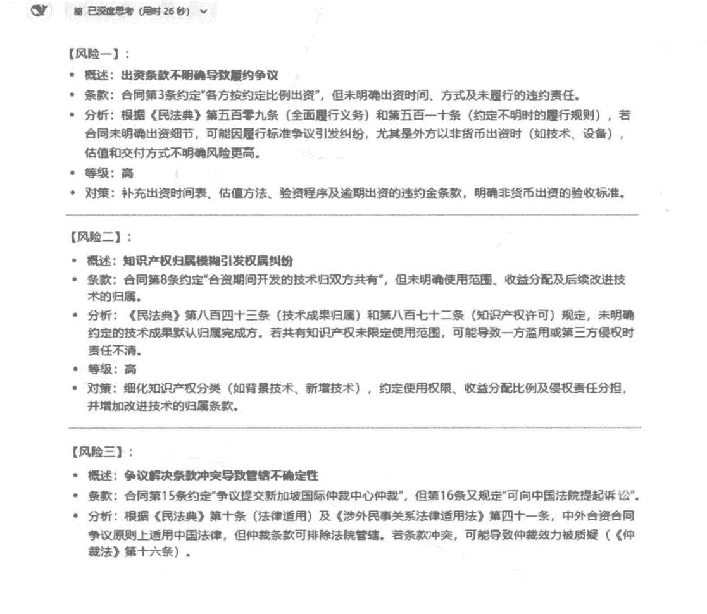

- 等级：高

- 对策：删除冲突条款，统一选择仲裁或诉讼，优先推荐约定“新加坡国际仲裁中心仲裁，适用中国法律”，确保符合《纽约公约》执行条件。

【风险四】：

- 概述：股权转让限制缺失引发控制权风险

- 条款：合同未约定股权转让时其他股东的优先购买权或对外转让限制。

- 分析：《民法典》第五条（自愿原则）与《公司法》第七十一条（股权转让）结合下，若合同未明确限制，外方可能将股权转让给第三方，导致中方失去合作控制权或引入不信任方。

- 等级：中

【风险五】：

- 概述：不可抗力条款不完善扩大违约风险

- 条款：合同第12条仅列举“地震、战争”为不可抗力，未涵盖疫情、政策变化等情形，且未规定通知义务和后果分配。

- 分析：根据《民法典》第一百八十条（不可抗力定义）和第五百九十条（不可抗力免责规则），若不可抗力范围过窄或程序缺失，一方可能无法合理免责，或因未及时通知导致损失扩大。

- 等级：中

- 对策：采用“定义+非穷尽列举”模式（如加入“重大公共卫生事件、政府行为”），明确通知时限、证明文件要求及责任分担比例（如部分免责或延期履行）。

> 注：以上分析基于《民法典》一般性规则，具体风险需结合行业监管政策（如外商投资负面清单）和合同全文进一步核查。

该示例同时规定了五项结构维度，又给出了排版示范，能大幅降低输出混乱、信息不对称的可能性。

总体来看，明确输出格式不是单纯的美化，而是实质性的信息治理手段。它借助提示词中的“结构控制语言”将非结构化生成活动转化为高度可控的内容生产过程，使法律人得以高效地将生成成果嵌入自身既有的文本工作流之中。更重要的是，在逐步走向自主辅助与多轮协作的背景下，格式控制成为促成“人机协同语境一致性”的关键节点，是推动在法律领域中由“辅助工具”迈向“流程伙伴”的基础性工程之一。未来，随着格式指令语言的进一步标准化，法律人也将迎来更强大、更精细的“结构化书写”时代。

# 第六章 法律人提效秘籍

## 第一节 DeepSeek 多功能概览

DeepSeek 官方提示词样例涵盖了代码改写、代码生成、结构化输出、角色扮演（情景续写）、角色扮演（自定义人设）、诗歌创作、宣传标语生成、中英翻译专家、代码解释、内容分类、散文写作、文案大纲生成、模型提示词生成板块，可供法律人进一步深入探索 AI，赋能法律。相关板块的提示词样例的详细内容，可以参考：https://api-docs.DeepSeek.com/zh-cn/prompt-library/。

## 第二节 法律人 DeepSeek 组合玩法

### 一、制作 PPT
法律人可以通过结合 DeepSeek 的内容生成能力与其他办公软件（如 Kimi）高效完成 PPT 制作。以下是具体步骤和技巧。

**第一步：使用 DeepSeek 生成 PPT 大纲。**
在 DeepSeek 中输入明确的提示词，例如：“我需要一份关于【主题】的 PPT，面向【客户/领导/学生】，希望突出【核心卖点】，要求内容专业且适合演讲场景，请生成大纲及内容框架。” DeepSeek 会根据提示词生成逻辑清晰的大纲和内容框架。DeepSeek 的推理过程透明，生成的内容逻辑性强，适合法律人快速复用和调整。例如，在合同审查或诉讼策略中，DeepSeek 生成的内容可以直接用于 PPT 制作，节省大量时间。

**第二步：导入 Kimi 进行结构化处理。**
将 DeepSeek 生成的内容复制到 Kimi 的 PPT 助手中，Kimi 会自动对文本进行排版和配色，生成初步的 PPT。用户可以选择合适的模板（如“科技蓝”或“极简风”），并点击“一键生成”完成 PPT 制作。

替代方式：DeepSeek + Gamma。即在 DeepSeek 中输出主题要求以 Markdown 格式输出，复制后粘贴到 Gamma 中，点击生成。

**第三步：优化与编辑。**
生成 PPT 后，用户可以根据需要对内容进行微调，例如调整字体、颜色、布局等，确保 PPT 符合专业要求。Kimi 还支持插入图片、视频等多媒体元素，进一步提升 PPT 的视觉效果。

**第四步：结合其他工具使用（非必选步骤）。**
如果需要更复杂的设计，可以结合其他 AI 工具（如讯飞智文）进行自动化排版和视觉优化，进一步提升 PPT 的专业度。

### 二、制作流程图
法律人可以高效利用 DeepSeek 与其他办公软件，快速制作出专业且清晰的流程图，满足法律工作中的可视化需求。具体步骤如下。

**第一步：使用 DeepSeek 生成流程图代码。**
在 DeepSeek 中输入明确的提示词，例如：“请用 Mermaid 语法生成一个立案流程图，包含以下步骤：(1) 提交立案申请；(2) 法院审查材料；(3) 决定是否立案；(4) 立案成功或驳回。” DeepSeek 会根据提示词生成 Mermaid 格式的流程图代码。DeepSeek 生成的流程图代码可以被保存为模板，便于后续复用和调整。例如，在处理类似案件时，只需修改部分步骤即可快速生成新的流程图，从而显著提升工作效率。

**第二步：导入流程图工具进行渲染。**
将生成的 Mermaid 代码复制到流程图工具中，例如 Mermaid 在线编辑器（mermaid.live）或 Draw.io。这些工具可以将代码转换为可视化的流程图，并支持进一步编辑和美化。

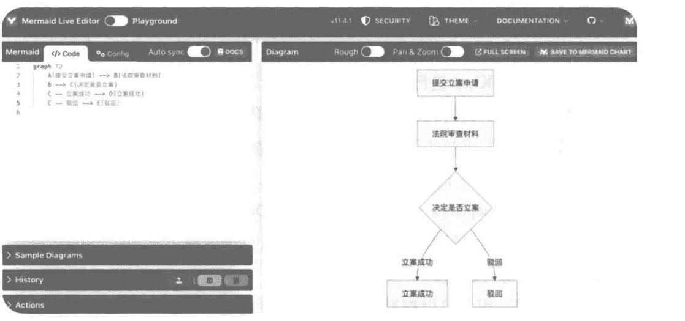

**第三步：优化与编辑。**
在流程图工具中调整流程图的布局、颜色、字体等，确保其符合专业要求。例如，使用 Draw.io 的高级功能添加注释、链接或动画，提升流程图的交互性和可读性。

**第四步：结合其他办公软件使用。**
将生成的流程图导出为图片或 PDF 格式，嵌入 PPT、Word 文档或法律文书中。例如，在 PPT 中使用流程图展示案件审理流程，或在法律文书中利用流程图说明复杂的法律程序。

### 三、制作视频
法律人可以通过以下步骤使用 DeepSeek 以更加高效地制作视频。

**第一步：明确视频主题与内容。**
确定视频的主题和核心内容。例如，制作一个关于“合同风险审查”的普法视频，明确目标受众（如企业法务人员）和视频的用途（如培训或宣传）。

**第二步：使用 DeepSeek 生成脚本与分镜。**
在 DeepSeek 中输入详细的提示词，例如：“请生成一个关于合同风险审查的普法视频脚本，包含以下内容：(1) 合同审查的重要性；(2) 常见风险点；(3) 案例分析；(4) 法律建议。” DeepSeek 会根据提示生成详细的脚本和分镜建议。

**第三步：优化脚本与添加法律专业内容。**
对 DeepSeek 生成的脚本进行优化，确保逻辑严谨、内容专业。可以插入相关法律条文、司法解释或典型案例，提升视频的专业性和权威性。

**第四步：导入素材与生成视频。**
将 DeepSeek 生成的文案导入度加（或其他视频编辑软件）。在 AI 成片中粘贴文案，点击一键成片按钮。

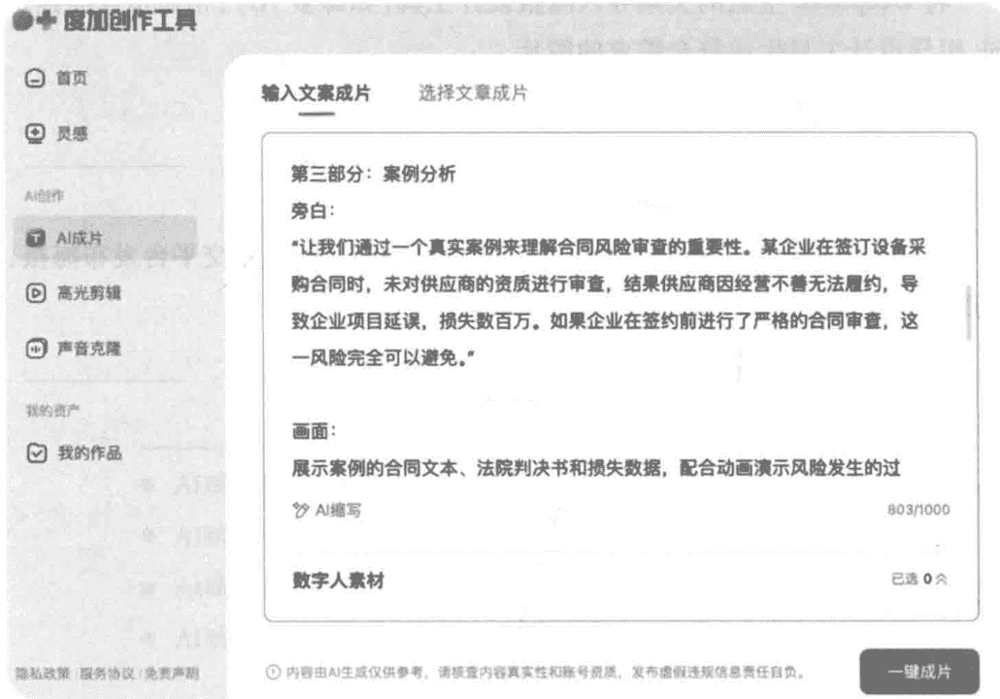

**第五步：添加特效与字幕（非必选）。**
在其他视频编辑软件中添加转场效果、滤镜、贴纸等，优化视频的视觉效果。同时，为视频添加字幕，以确保法律术语和关键信息的清晰传达。

**第六步：导出与分享视频（非必选）。**
完成编辑后，导出视频并选择合适的格式和分辨率。将视频发布到法律培训平台、社交媒体或企业内部学习系统，实现高效传播。

### 四、制作海报
法律人可以高效利用 DeepSeek 与其他办公软件，快速制作出专业且高质量的海报，满足普法宣传、培训教育等多种需求。

**第一步：明确海报主题与内容。**
确定海报的主题和核心内容。例如，制作一个关于“合同风险审查”的普法海报，明确目标受众（如企业法务人员）和海报的用途（如培训或宣传）。

**第二步：使用 DeepSeek 生成文案与设计建议。**
在 DeepSeek 中输入契合用户需求的提示词，并要求其生成绘画提示词，DeepSeek 就会生成标题和详细的提示词。

**第三步：导入素材与编辑海报。**
将 DeepSeek 生成的文案导入海报设计工具（如即梦 AI），粘贴预设的提示词，引导设计工具生成符合需求的图片。

**第四步：优化与编辑。**
对生成的海报进行优化，确保其逻辑严谨、内容专业。

**第五步：导出与分享海报。**
完成编辑后，导出海报并选择合适的格式和分辨率，在社交平台发布海报，实现高效传播。

# PART 3

# 场景应用编

- AI赋能法学研究

- AI赋能法学教育

- AI赋能法学论文

- AI赋能法律实务

# 第七章 AI 助力法学研究

人工智能技术的迅猛发展正深刻重塑法学研究的范式，特别是 AI 法律信息检索工具的广泛应用，显著提升了法律资料的获取效率与知识挖掘的深度。在传统法学研究中，法律信息的检索依赖于人工查阅法条、判例、学术文献，受限于时间与精力，研究者难以在短时间内全面掌握复杂且庞杂的法律资料。而 AI 法律信息检索依托自然语言处理、知识图谱、深度学习等技术，能够迅速定位海量法律文本中的关键信息，自动提炼法律规则与学理观点，极大地拓展了法学研究的广度与精度，助力法律研究者在知识生产与理论创新中实现突破。本章旨在按照法学内部的不同领域，系统探讨 AI 法律信息检索如何赋能法学研究，分析其在资料获取、法律解释、理论构建与学术创新等方面的实践路径与学术价值。但需要注意的是，法学研究者在利用 AI 技术时，需保持法律人思维的主体性与批判性，充分发挥人类法律理性的独特优势，避免对技术的盲从，警惕 AI 编造文献、虚构案例、歪曲学者观点的现象，充分验证和校对 AI 生成的内容。

## 第一节 AI 的研究价值

随着信息技术的飞速发展，AI 在法律领域的应用越来越广泛，尤其在法律信息检索方面展现出巨大潜力。传统的法律研究依赖人工查阅大量法条、判例和文献等，往往需要耗费大量时间和精力，且容易受到人工操作的限制。相比之下，AI 技术能够通过自动化、智能化的方式，大幅提升研究效率与深度。

AI 法律信息检索拥有强大的数据处理和分析能力，能够高效、精准地完成法律信息的检索和分析工作。AI 法律信息检索不仅提升了法学研究的效率，还为学者提供了更加全面的研究视角。这使得 AI 在法律信息检索中的应用成为重要的研究主题。AI 的价值不仅体现在节省时间和精力上，更在于提升法律研究的深度和广度，推动法学学科的现代化进程。

**AI 法律信息检索的最大优势便是其高效性。** 在传统的法律研究中，学者们通常需要查阅大量的法律文献、判例、法规以及专业书籍，这不仅是一个烦琐且耗时的过程，还容易因人为疏漏或理解偏差造成信息遗漏。而 AI 技术，尤其是自然语言处理和机器学习（Machine Learning, ML）技术的应用，能够快速处理海量的法律数据，并根据特定的检索条件提供精准的结果。例如，AI 可以通过分析历史判例的语境、法律条文的适用情况，自动提取关键信息，精准匹配相关案例和法律规定，帮助研究者迅速找到所需的资料。这种智能化的信息检索，不仅极大地节省了时间成本，还提升了研究结果的精确性，为法学研究提供了强大的技术支持。

**AI 法律信息检索的应用为法学研究者提供了更广泛的视角。** 通过大数据技术，AI 能够跨越单一领域的限制，综合各类法律信息，包括不同国家的法律规定、各类法律体系之间的比较、不同历史时期的判例变化等。这种跨领域、跨时空的综合分析能力使法学研究不再局限于传统的案例分析或局部的法律条文探讨，而是能够立足国际视野对法律问题进行系统性、全面性的研究。例如，AI 可以帮助研究者自动对比不同法域下的相似案例，提供更加全面的法律意见，推动法学研究的国际化进程。同时，AI 的语义分析功能能够深入挖掘法律文本中的隐含意义，揭示出一些传统人工检索方法难以察觉的法律趋势与变化，进一步拓宽了法学研究的深度。

**AI 在法律信息检索中的应用，不仅对学术研究影响深远，还为法律实践提供巨大支持。** 传统的法律研究往往侧重理论探讨，与实际应用之间的联系不够紧密。AI 技术的引入则使得法学研究者能够更好地理解法律的实际操作和实施情况。通过对海量判例和法律文件的智能化分析，AI 能够揭示法律规则在实际应用中的变化，帮助研究者更好地理解法律条文背后的实务逻辑，从而推动理论与实践的有机结合。例如，AI 可以根据具体的案件背景，快速检索出相似判例及相关法律意见，帮助研究者分析不同法律观点的适用性和效果。这种融合能够丰富法学研究的实践性，为司法实践提供理论依据和数据支持。

随着 AI 技术在法律信息检索中的不断深入应用，法学研究的工作方式和研究范式也发生了深刻的变革。AI 让学者能够使用更加智能的工具进行法律问题分析，不再仅仅依赖传统的文字查找和人工总结，而是可以通过深度学习模型从大量法律数据中挖掘出潜在的规律和联系，从而提出新的法律观点和法学理论。AI 还能分析法律信息的变化趋势，预测未来法律发展的方向，为学术研究提供前瞻性视角。这种基于数据的研究方法，推动了法学研究的创新和发展，尤其是在跨学科领域的拓展和应用上，AI 法律信息检索技术具有不可忽视的促进作用。例如，AI 能够帮助研究者开拓法律学科交叉的新领域，催生出更多结合技术、伦理等因素的法律问题，从而推动法学学科的创新发展。此外，AI 技术的引入使得研究者重新审视传统的法律研究方法，推动研究理念和方法论的革新，促进法学学科的转型与升级。

AI 法律信息检索提升了法学学术论文写作与研究成果可视化的效率。学术论文的写作是法学研究的核心环节之一，而 AI 可以在文献综述、论文结构优化和研究数据分析等方面提供支持。例如，AI 可以根据研究者输入的论文主题，自动生成文献综述、提取核心观点，为研究者提供写作灵感。此外，AI 还可以帮助研究者分析论文引用网络，识别该研究领域的关键学者和核心文献，使研究更加系统化。在数据可视化方面，AI 可以利用知识图谱技术，将法律概念、学术流派、核心文献之间的关系以图形方式呈现，帮助研究者更清晰地理解研究领域的整体结构。例如，研究“法律解释方法”时，AI 可以自动生成一张知识图谱或表格，展示文义解释、体系解释、历史解释等不同方法的联系和区别。这不仅提升了研究的直观性，也使得研究成果更易于传播和理解。

总之，AI 法律信息检索为法学研究带来了革命性的影响，它不仅提升了研究效率和精确性，拓宽了研究广度和深度，还促进了理论与实践的融合，推动了法学研究的创新和变革。随着人工智能技术的不断进步，未来 AI 将在法律领域发挥更为重要的作用，特别是在处理复杂法律问题、促进跨学科研究以及推动法律创新等方面，AI 法律信息检索无疑将成为法学研究的重要工具之一。对于法学研究者而言，掌握并合理运用 AI 法律信息检索技术，将为其学术研究创造更多机遇和可能性。

## 第二节 AI 在部门法中的价值

部门法研究是法学研究的重要组成部分，它涉及对特定法律领域（如民法、刑法、行政法、知识产权法等）的规范体系、司法实践、立法变迁和学术争议的深入探讨。在传统法律研究中，部门法的研究依赖于庞大的法律文本数据，包括法律条文、判例、司法解释、学术论文等，这使得法律信息检索成为研究的基础性工具。生成式人工智能法律信息检索技术的出现，极大地提升了部门法研究的效率和深度。不同于主要依赖关键词匹配的传统检索工具，AI 可以基于语义理解，实现方向性的法律信息定位，同时自动生成可供研究者直接使用的法律分析、趋势报告和案例对比。AI 在部门法研究中的应用，不仅提高了信息获取的精确度，还能够促进法律实证研究的发展，并在立法评估、司法实践预测等方面发挥积极作用。然而，AI 法律信息检索在部门法研究中的应用也面临一定挑战，如信息可靠性、法律推理透明性以及跨法域研究的复杂性等。因此，探讨 AI 在部门法研究中的优势与局限，对推动法律人工智能的进一步发展具有重要意义。

**让分科法学检索更高效**

过去做分科法学研究，主要依赖 Westlaw、LexisNexis、北大法宝等商用平台，检索方式停留在关键词点查、分类浏览和全文匹配。问题在于法律适用的高度语境性，单纯靠关键词很难还原条文在具体案件中的用法。比如想弄清楚民法典第六条公平原则在合同纠纷中的运用，传统检索会返回大量含“公平”字样的条文、案例和论文，后续筛选阅读耗时巨大。基于自然语言理解和知识图谱的智能检索则能读懂适用场景，直接给出分析性结果。输入“民法典第六条公平原则在合同纠纷中的适用”，系统不仅定位条文，还会汇总相关裁判解读、司法解释要点并梳理学界分歧，让检索从字面匹配转向服务规则适用研究。

**案例分析更贴近实务**

无论是判例法法域，还是大陆法系中行政法、反垄断法等判例解释作用强的领域，案例都是研究核心。传统检索受案量大、判决书结构复杂限制，很难快速锁定相关先例。机器学习和深度学习驱动的智能检索可以实现案情匹配、自动摘要和横向对比。以建筑工程合同中的不可抗力司法把握为例，系统能把相关判决批量抓取并归类：支持承包方免责的情形、强调举证责任归属的情形等，同时生成要点摘要、提炼裁判规则、对比各地法院标准差异，帮助研究者迅速把握司法走向，也为法官律师做案例推理和趋势预测提供支持。

**立法动态与合规监测更实时**

分科法的变动快，互联网法、数据保护、环境法、金融监管等领域规则迭代频繁。数据安全法、个人信息保护法出台后，企业合规需求激增。传统方式靠公报、新闻和数据库更新来跟踪，时效不足。智能检索可自动监测立法动向并生成变迁报告。查询“2021年以来中国个人信息保护法的立法变化”时，系统可输出版本对照，标明条文改动并附专家点评。结合全球数据，还能做跨法域合规对照，例如自动生成欧盟GDPR与中国个保法在数据处理、跨境传输、责任罚则等方面的差异表，为法务合规团队提供决策参考。

**实证研究支撑更扎实**

刑法量刑、劳动争议统计、公司治理模式分析等实证研究在分科法中应用增多。传统做法靠手工整理数据，耗时费力。智能检索能自动抽取判决中的结构化字段并分析。比如研究“某省近五年环境污染犯罪判决趋势”，系统可批量抓取案件，提取罪名、判决结果、罚金数额、被告类型等并生成统计图。数据驱动让研究更客观，推动从定性描述向定量分析转型，也可辅助政策评估，通过历史数据模拟证券法修订对资本市场的影响并生成预测模型。

总体看，智能检索在分科研究中的潜力很大，能把规则检索做准、案例分析做深、立法跟踪做快、实证研究做实。但仍面临信息权威性、推理可解释性、多法域规则复杂性等挑战。随着技术演进，有望成为分科研究的核心工具，推动研究智能化、数据化、全球化。

需要说明的是，本书介绍的提示词技巧和用DeepSeek驱动分科研究，并不等于AI已能完全适配各类法学研究范式。更准确的说法是，下文仅提供辅助研究的示例。人工智能发展的重要方向之一是AI Agent，相较于现有信息系统，智能体更贴合个体需求。例如撰写法学文献综述时，传统AI只能基于训练数据给文字建议，而基于大模型的智能体可自主调用应用，访问、下载、整合国内外数据库文献，完成从查找、提炼到分类评述的全流程。形象地说，现有产品只能提供外卖建议，无法下单；智能体则能自主完成点餐与下单。对于部分研究者，示例可能无法完全契合实际需求，当前技术尚有局限，但这不妨碍研究者在此基础上探索更适合自己的使用方式。

## 第三节 用DeepSeek开展法理学研究

法理学作为法学理论根基，聚焦法律概念、推理、体系与原则。与实证研究不同，它更强调法律本质探求与体系内在逻辑，因此检索需求不仅包括条文与案例，还要求跨学科整合、思想深度解析与学派比较。生成式AI赋能的法学检索在法理学领域价值突出，既能拓宽信息获取广度与深度，也能辅助概念建构、促进跨学科对话并优化论文写作与知识图谱构建。当然，应用中仍需面对推理复杂性、学术争议多样性与信息可靠性等挑战。

**检索入口被拓宽**

传统法理学研究依赖Westlaw、LexisNexis、HeinOnline、SSRN、JSTOR等库，多靠关键词检索。限制在于概念高度抽象，关键词难以覆盖学者不同表述；传统库偏重判例与成文法，对法哲学、法社会学等跨学科支持不足；资源分散导致整合成本高。智能检索借助自然语言理解，能解析查询意图并生成整合性知识摘要。查询“法律权利的性质”时，系统不仅返回霍菲尔德权利分析框架等经典文献，还能梳理当代权利理论新讨论，并对比不同流派观点，帮助研究者快速建立理论背景。

**概念建构与语义分析走向自动化**

澄清和发展“法的有效性”“法律义务”“司法权威”等概念是法理学重要任务。传统方式依赖文本分析和哲学推理，AI则可通过大规模语料分析实现自动化建构。基于语义解析与知识图谱，系统能挖掘法律概念在不同语境下的用法，譬如提取“法律效力”在法规、判例、论文中的定义差异并构建关联图谱，直观呈现概念演进。研究“法律义务”本质时，AI可并行检索凯尔森规范主义、哈特规则理论、拉兹权威理论并做系统对比，提升研究效率与科学性。

**跨学科对话能力增强**

当代法理学大量借鉴政治学、社会学、经济学、认知科学等。法律经济学考察规则对市场的影响，法社会学探讨法律与社会结构互动，法律认知科学分析推理心理机制。跨学科研究的难点在于知识整合。AI可在多学科数据库中进行语义匹配与信息融合。例如研究“法律规则如何影响社会行为”时，系统既能调取法理文献，也能提供相关社会学实证研究并生成摘要，揭示交叉点。AI还能识别学科交融趋势，追踪哪些社会学理论正影响法理学发展，哪些心理学实验可解释法律推理认知基础，促进知识融合。

总的来看，AI法学检索为法理学提供了更高效全面的知识获取方式，拓宽检索渠道、增强概念分析科学性、提升跨学科能力并优化写作与可视化。但需警惕信息权威性、算法偏见以及自动化分析对批判性思维的侵蚀。随着技术成熟，AI有望在法理学研究中发挥更关键作用。

DeepSeek作为先进大模型，能在法理学研究中提供理论分析、文献综述、法律解释、案例研究与跨学科比较等支持。要发挥其潜力，必须精心设计提示词，兼顾学术逻辑与清晰表达。以下从精准问题设定、理论框架引导、学术角色设定、跨学科融合与输出格式优化五个维度展开。

### 一、精准锚定问题范围，避免泛化回答

法理学涉及复杂哲学概念与学派之争，提示词若过于宽泛，回答易流于表面。因此应明确背景、核心概念与研究目标。

例如研究“法律规则的正当性”，直接问“法律规则如何具有正当性”会得到宽泛回应。更优的提问是：“在哈特与富勒关于法律正当性的争论中，双方的理论基础分别是什么？如何借助哈贝马斯的商谈理论评析二者的分歧？”

> 引用12篇资料作为参考

哈特与富勒就法律正当性展开论战是20世纪法理学核心议题。二者根基与立场差异明显。哈特作为法律实证主义代表，核心见解见于《法律的概念》，将法律视为初级规则与次级规则构成的体系，主张“分离命题”，认为法律有效性不依赖道德内容，只要符合承认规则即为有效。富勒代表自然法学立场，著有《法律的道德性》，提出法律的“内在道德”，认为法律必须满足程序性标准，违背则丧失法律资格，反对分离命题。哈贝马斯的商谈理论认为正当性应通过民主商谈程序实现理性共识，试图将哈特的形式程序与富勒的道德内容统一。

在实证法或比较法研究中，精准限定同样关键。例如探讨“数字劳动权发展趋势”，泛问会过于笼统。更有效的提问是：“请比较欧盟与美国在数字劳动权立法上的主要差异，并结合卢曼功能分化理论剖析制度逻辑。”

> 引用14篇资料作为参考

欧盟以保护劳动者权益与数据隐私为核心，强调平台责任，如平台工作者指令推定劳动关系并要求算法透明，GDPR严格限制数据使用。美国倾向市场自由与分散立法，加州AB5法案用ABC测试界定雇员身份，但州际标准不一。基于卢曼理论，欧盟法律系统通过规范性闭合强化边界，美国法律系统更开放，通过判例与州立法适应经济系统灵活性，二者在功能子系统边界管理策略上存在差异。

### 二、结合法理学理论框架，引导系统性回答

法理学研究依赖抽象概念与理论推演，提示词若缺乏框架，易得常识性回答。可在提问中直接指定学派、学者或核心概念，确保系统性。

例如研究法律基本概念，可提问：“在霍菲尔德理论框架下，法律基本概念有哪些形态？”

> 在霍菲尔德的理论框架下，法律基本概念有哪些不同形态？

引用8篇资料作为参考

在霍菲尔德框架下，法律基本概念可分为八种形态，通过相关关系与相反关系联结。第一组包括权利、特权、义务、无权利；第二组包括权力等概念，形成完整的概念矩阵。

霍菲尔德框架：厘清法律概念的逻辑关系

豁免，指主体可不受他人法律支配或权力的干预，享有自由空间。
责任，指主体因他人行使权力而须承受法律上的约束状态。
无权力，指主体缺乏变动既有法律关系的法律能力。

上述概念的关联可借助“相关”与“对立”两种逻辑来把握。比如：
相关关系方面，权利与义务相随，即一方享有权利时另一方即负有义务；特权与无权利相随，即一方拥有特权时另一方对该事项即无权利可言。
对立关系方面，权利与无权利相对，即一方行使权利意味着他方在此事项上无权利；特权与义务相对，即一方享有特权则他方对其无义务可言。

霍菲尔德的理论价值在于用形式逻辑梳理法律概念的位阶与互动，减少术语的歧义与混用。

### 三、设置学术角色，提升法理学分析的专业度

DeepSeek 在角色模拟上具备一定弹性，能模仿不同学派的立场与论证风格。明确在提示词中指定学术角色，回答会更贴近法理学的专业表述习惯。若要横向比较学派分歧，还可通过角色设定实现对照，例如提示：“请分别以实证主义与自然法学家的身份，对人工智能生成内容是否应受著作权保护展开对话。”

> 引用 11 篇资料作为参考

#### 实证主义法学家的立场

实证主义强调法律的可预见性与可操作性，分析问题时以现行规范为基准，而非诉诸抽象道德。

1. 现行规范的适用检验
   该立场认为著作权是否及于AI生成物，应以现行著作权法的要件为准。我国《著作权法》要求作品兼具独创性与人类智力投入。若生成过程体现了使用者在提示设计、参数调校等方面的个性化选择，就可认定具备独创性，从而获得保护。

2. 权利归属的实证确定
   权利归属应依实质贡献与法律约定确定。使用者若对输出结果施加了实质性控制，权利宜归于使用者；若结果高度依赖开发者预设的模型，则开发者可据合同主张权益。

3. 谨慎扩张法律主体
   实证主义者反对将AI直接拟制为法律主体或作者，认为这违背现行体系以自然人为核心的构造。AI仅宜作为工具，相关版权争议应在既有制度内消化，无需另起炉灶。

#### 自然法学家的立场

自然法学派重视法律的道德根基与正义要求，倾向从人类尊严与公平出发评判。

1. 创作本质与人类尊严
   创作被视作人类智力与情感的外化，是自由意志的体现。AI生成物缺乏主观体验与情感投入，不宜归入“作品”范畴，版权保护应限于人类创作，以维护创作的道德价值。

2. 激励与公平的权衡
   若AI生成物受版权保护，可能导致模型提供者或使用者占据创作资源，削弱人类创作者的积极性。自然法视角主张限制此类保护，保障人类创作者的基本利益。

3. 对主体资格的再思考
   该学派会追问AI未来是否可能获得主体资格。若AI日后具备自主表达情感与思想的能力，自然法学者或将重新审视版权制度的边界。

##### 总结

实证主义从现行框架出发，主张在既有制度内解决AI生成内容的版权问题，突出可操作性与确定性。自然法则从道德正义切入，强调版权应服务于人类创作，并对主体资格扩展保持审慎。两种路径体现了法理学内部的张力与多样性，也让DeepSeek能产出更具对话性的观点。

### 四、引入跨学科视角，拓宽法理研究广度

法理学常与哲学、社会学、经济学、技术伦理交叉。在提示词中引导跨学科分析，能获得更立体的结论。例如研究“算法治理的法边界”时可提示：“请结合法理学、伦理学、计算机科学与政治哲学，分析算法治理对个人权利的影响及其规制空间。”

> 引用 8 篇资料作为参考

算法治理对个体权利的冲击及其规制可能，可从四重视角综合考察。

#### 1. 法理学视角：权利界定与保障
- 透明度与知情权。算法黑箱导致决策逻辑难解，侵犯知情权。法理学要求强制披露透明机制。
- 歧视风险与平等权。偏见数据易致差别的对待，侵蚀平等权。需以法律确保公平与非歧视。
- 问责难题与救济权。权利受侵害时需有效追责与救济通道，法理学主张建立可追诉机制。

#### 2. 伦理学视角：道德责任
- 设计中的价值嵌入。设计者偏好易植入算法，需遵循道德准则。
- 应用边界。公共管理中的算法使用可能触及隐私与自由，需划定伦理界限。
- 人本导向。治理应尊重人的主体性与尊严，避免物化。

#### 3. 计算机学视角：技术限制
- 复杂性与可解释性。自我学习模型难以解释，需技术手段提升可解释性。
- 数据质量与偏见。输入数据决定输出，须清洗数据、优化模型以降低偏见。
- 安全与隐私。算法或被用于监控与滥用，需加密与隐私保护技术护航。

#### 4. 政治哲学视角：权力与参与
- 权力隐性扩张。算法治理强化行政控制，需法律限制权力边界。
- 民主参与。算法决策易削弱公众监督，需引入民主参与机制。
- 公平与正义。算法可能加剧不平等，需以政策矫正倾斜。

#### 规制路径
- 确权：明确个体知情、参与、拒绝算法决策的权利。
- 问责：以法律厘清设计者与使用者的责任。
- 透明：强制公开逻辑与数据源。
- 伦理审查：引入前置伦理评估。
-协同治理：政府、企业、公众多方共治。

总体来看，算法治理的影响多维复杂，需法、技术与伦理协同应对。

以数字平台为例，结合福柯规训权力与哈贝马斯公共领域理论可发现：
福柯视域下，平台通过数据监控、算法推荐、社区规则实现微观规训，使用者因自我审查而压缩表达空间。哈贝马斯视域下，商业化、信息碎片化与平台集中化侵蚀公共领域的独立性与多元性，导致理性对话受阻。应对在于监管透明、支持去中心化与提升媒介素养。

### 五、优化表达格式，提升可读性与学术适配度

法理研究要求论证严密、结构清晰。可在提示词中指定格式，如：“请按问题—理论背景—争议焦点—解决路径的结构，分析AI法律人格。”

> 引用 10 篇资料作为参考

#### 问题
AI是否应取得法律人格？在自动驾驶、医疗诊断等场景中，AI行为的归责问题愈发突出。

#### 理论背景
法律人格是主体享有权利、承担义务的前提。传统主体为自然人与法人，AI作为非人类存在，其人格定位牵涉法理、技术与伦理。

##### 争议焦点
1. 肯定说：高级AI展现类人决策与自主性，赋予人格便于归责与规范。
2. 否定说：AI缺失意识、情感与道德判断，赋予人格易致混乱。
3. 折衷说：不急于定性，重点在于提升系统可靠性与可解释性。

#### 可能的解决路径
1. 智能分级。弱AI视作客体，高级AI在特定条件下可考虑人格。
2. 跨学科协同。融合法学、计算机、伦理等视角综合研判。
3. 法律规制。明确权利义务，建立问责与救济机制。
4. 技术保障。增强透明度与可追溯性，降低偏见风险。

该格式有助于模型输出符合学术习惯的文本。

#### 六、总结
有效驱动DeepSeek进行法理学研究，关键在于精准界定问题、嵌入理论框架、设定学术角色、引入跨学科视角并优化输出结构。如此可获得更具深度与可用的研究素材。

## 第四节 驱动DeepSeek开展法律方法论研究

### 一、精确界定问题，避免泛化

宽泛提问易获泛泛分类。比如何问“法律推理有哪些方法”，仅得演绎、归纳、类比的一般罗列。若明确范围，如“请结合阿列克西与佩策尼克，解释法律推理的结构”，则可获得更具学理价值的回应。

> 引用 12 篇资料作为参考

法律推理可从形式与实质两层面理解。

#### 1. 形式推理与实质推理
形式推理以演绎为核心，采用大前提小前提推结论，强调逻辑严密。实质推理处理规则模糊或疑难案件，依赖价值判断与原则衡量，强调正当性。

#### 2. 阿列克西的见解
阿列克西强调推理须求证成，提出法律内部充分证成与外部深度证成。他认为法律必然承载对道德正确性的主张。

#### 3. 佩策尼克的见解
佩策尼克提出法律转化理论，认为推理存在非单调跳跃。融贯性是其核心标准，要求论证整体自洽。

#### 4. 综合
两者共同显示法律推理兼顾逻辑形式与规范证成，在确定性与正当性间寻求平衡。

##### 总结
法律推理以形式为基础，需以论证与融贯性确保结论合理正当。

递进提问可进一步深化，如先问“法律解释与漏洞的关系”，再问“在解释学框架下如何以推理填补漏洞”。 

法律解释与法律漏洞的关系可以从以下方面理解：

#### 1. 法律解释的范围
解释是在文义范围内运作，借助文义、体系、目的等方法厘清条文含义，解决疑义，保证适用一致。

#### 2. 规范缺口是怎么回事
法条空白说的是本应由立法者安排的事项没安排、或者安排得不够细，导致在适用时出现违背立法蓝图的裂缝。按呈现方式可以分成两类：明面上的空白，即条文里直接没有写；暗含的空白，即条文看起来周全，但到了实践情境中却难以有效覆盖。

#### 3. 释义能走多远
条文释义只能在语言本身可以容纳的空间里活动。一旦在字面圈内找不到答案，话题就滑向补白的范畴。比如单纯靠字面意思无法覆盖某些事实状态，往往需要借助类比或以目的为导向的扩张来补齐。

#### 4. 怎么给缺口补上
补白已经超出了字面释义的限度，属于对规范的再造。常见的操作有类比适用、以目的为导向的扩张、以目的为导向的限缩等。字面过窄造成的明面缺口，可以用类比来填；字面过宽造成的暗含溢出，则可以用目的限缩来收束。

#### 5. 释义和补白怎么配合
- 互为支撑：释义是适用法条的基础动作，补白是在释义失效时的兜底机制。
- 先后顺序：先释义后补白。只有把字面释义走尽了仍解不开，才启动补白程序。
- 分界点：两者分开的关键在于是否越过了字面可能容纳的边界。

总体来看，释义与补白是适用过程中的前后衔接环节。释义致力于厘清条文含义，补白则在释义无力时以再造方式弥补立法不足。

> 在法律解释学的框架下，如何运用法律推理来解决法律漏洞？

> 引用 9 篇资料作为参考

在诠释学视域里，推理是应对空白的关键工具。规范缺口指立法对本应规定的事项缺位或不完善，导致适用出现违背规划的不圆满。处理流程大致如下：

#### 1. 缺口的确认
首先要判断是否存在空白。认定标准通常是双重的：一是特定事项未被规定或规定模糊；二是这种缺失或模糊违背了立法意图或整体规划。

#### 2. 释义优先
在进入补白之前，应先以字面释义、体系释义、目的释义等方法尝试在字面范围内解题。若释义仍无法奏效，才转入补白阶段。

#### 3. 补白的路径
当字面释义走不通时，可采取以下路径：
- 类比适用：将邻近事项的规则迁移到当前案件。例如法条对某事项无明文，但已有类似规则可资借鉴。
- 以目的为导向的扩张：字面过于狭窄而难以实现立法目的时，可适度放宽适用范围。如把“终止”理解为“终止或解除”以涵盖更多情形。
- 以目的为导向的限缩：字面过于宽泛而涵盖了不应适用的情况时，可收窄范围。如排除与立法目的相悖的情形。
- 依习惯或法理补位：法条未作规定时，可参照交易习惯、行业惯例或法理原则来填空。例如彩礼纠纷中援引民间习惯与法理形成裁判规则。
- 直接动用上位原则：在规则空白时，直接调用诚实信用、公平等一般原则进行补位。

#### 4. 推理的作用
补白离不开推理支撑。不论是类比、以目的扩张还是依习惯补位，都需要以推理论证其合理性与正当性。如以演绎推理由一般原则推导出具体规则，或以归纳推理从相似案件中提炼适用结论。

##### 总结
在诠释学框架内，推理是解决空白的核心。以释义优先为前提，再结合类比、以目的扩张、习惯补位等手段，就能在字面之外实现补白，保证适用完整且正当。

这种推进方式有助于形成逻辑递进的论述，更契合学术研究需求。

### 二、用流派视角厘清方法论

方法论的发展深受不同学派影响，研究者若能在提示中明确指向特定学派，就能避免空泛。例如可问：“H·L·A·哈特的实证主义如何影响当代释义方法？请结合‘开放性结构’理论展开。”

> 引用 11 篇资料作为参考

哈特的实证主义对现代释义方法产生深远影响，尤其是其提出的“开放性结构”理论，为释义提供了新视角。

#### 1. 实证主义的核心主张
哈特主张法与道德分离，法的效力不依赖道德内容，而是建立在社会事实与规则体系之上。他把法视为由“初级规则”即设定义务的规则，和“次级规则”即承认、修改、执行规则构成的体系，其中承认规则是效力根基。

#### 2. 开放性结构理论
哈特认为规则具有开放性结构：核心地带含义明确确定，边缘地带因语言模糊与社会情境复杂而存在不确定性。这种不确定为法官释义与适用留出裁量空间。

#### 3. 对现代释义方法的影响
- 裁量权的正当化：在边缘地带，法官可据规则核心含义与社会语境进行合理推断来填补空白，裁量并非任意。
- 释义的动态性：面对新型案件或社会变迁，法官可通过释义使规则适应新需求，保持灵活性。
- 语言分析的重要性：哈特强调规则意义取决于社会实践与语境，为澄清概念模糊提供理论支撑。

#### 4. 与当代释义方法的结合
开放性结构为现代释义提供框架。例如目的释义中，法官结合立法目的和社会语境填补边缘地带；原则与政策权衡中，在规则模糊时依据法理原则与政策确保释义符合价值与道德标准。

##### 总结
哈特的实证主义通过开放性结构理论，为当代法条释义提供理论支撑，既强调裁量与动态性，又以语言分析保障精确与合理，推动了解释方法的发展。

还可引导比较研究，例如：“德沃金的诠释理论如何区别于哈特的规则观？请从释义方法论角度分析。”

> 引用 14 篇资料作为参考

德沃金的诠释理论与哈特的规则观在方法论上存在明显分歧，集中体现在释义性质、推理方式与法道德关系上。

#### 1. 释义的性质
- 哈特的规则观：法由初级与次级规则构成，释义任务是描述性澄清规则含义，不涉及价值判断。规则核心明确，边缘存在开放性结构，法官可凭裁量填补。
- 德沃金的诠释理论：法是解释性概念，释义不仅描述更是建构。释义需结合道德原则与价值判断，通过“建设性解释”赋予法最佳意义，使实践与道德融贯，保持体系整体一致。

#### 2. 推理的方式
- 哈特：主要依赖逻辑涵摄，即三段论将具体事实纳入一般规则。边缘裁量有限且不涉及道德判断。
- 德沃金：强调推理的道德维度，法官需通过建设性解释权衡原则与政策。他提出“整体性法律”，要求释义与体系内道德原则一致，推理融合道德判断与价值权衡。

#### 3. 法与道德的关系
- 哈特：坚持分离，法效力不依赖道德内容，释义应价值中立，核心地带只需逻辑推理即可。
- 德沃金：认为二者不可分离，释义必然涉及道德判断，应以价值负载方式进行，通过道德原则确保正当性与融贯性。

##### 总结
哈特强调释义的描述性与逻辑涵摄，主张法道德分离；德沃金强调建构性与道德维度，主张释义必须融入价值判断。二者在释义性质、推理方式与法道德关系上根本不同。

### 三、用案例增进实践价值

方法论不仅是理论对象，也具实践指导意义。可要求结合具体案例检验不同方法的效果，例如：“请分析美国最高法院1954年布朗诉教育委员会案如何运用目的释义推翻‘隔离但平等’原则。”

> 引用 11 篇资料作为参考

1954年布朗诉教育委员会案中，最高法院以目的释义推翻“隔离但平等”原则，过程如下：

#### 1. 目的释义的核心
该方法关注条文背后的立法目的与社会价值，而非仅限字面。在本案中，法院分析宪法第十四修正案平等保护条款，认为其核心是确保公民在法面前实质平等，而非形式平等。

#### 2. 对“隔离但平等”原则的批判
法院认为种族隔离虽在硬件上可能“平等”，但对黑人儿童心理与教育机会造成不可逆伤害。首席大法官沃伦指出，隔离教育使黑人儿童产生低人一等认同，损害学习动机与心理健康，违背平等保护精神。

#### 3. 社会背景与教育目的的结合
法院指出教育不仅传授知识，更是培养公民意识与社会适应能力的途径。隔离剥夺了黑人与白人共同学习交流的机会，阻碍社会化进程，违背教育根本目的。

#### 4. 无形因素的考量
法院特别强调学习能力、交流机会、心理影响等无形因素，认为这些无法通过设施平等弥补，隔离本身即是不平等。

#### 5. 判决的社会意义
该判决在法上终结了公立教育的种族隔离，也推动美国民权运动迈出关键一步，为后续立法与司法奠定基础。

##### 总结
通过目的释义，最高法院揭示“隔离但平等”与平等保护精神的冲突，强调教育社会功能与无形因素，最终认定种族隔离违宪，产生深远社会影响。

也可进行案例比较，例如：“请比较罗伊诉韦德案与多布斯诉杰克逊妇女健康组织案在法律推理方法上的差异，并评估其对司法实践的影响。”

> 引用 13 篇资料作为参考

两案在推理方法上差异显著，影响深远。

#### 1. 推理方法的不同
- 罗伊诉韦德案1973年：基于第十四修正案正当程序条款，认为堕胎权属于隐私权范畴，通过宪法释义将该权利隐含其中。提出三阶段标准，衡量妊娠期与州政府限制程度，并以历史分析认为禁止堕胎并非美国传统，故应受保护。
- 多布斯诉杰克逊妇女健康组织案2022年：采用宪法原旨主义与狭义释义，认为宪法文本未明示堕胎权，故不应扩张。阿利托大法官强调应依据文本与历史传统释义，明确推翻罗伊与凯西案先例，认为堕胎权问题应由各州立法决定，并重新审视历史认为禁止堕胎有悠久传统。

#### 2. 对司法实践的影响
- 能动主义与节制的对立：罗伊体现司法能动，法院通过扩张释义创设权利；多布斯体现司法节制，主张法院不应立法。
- 先例稳定性受冲击：多布斯推翻长期先例，挑战遵循先例原则的可预测性。
- 联邦与州权再平衡：堕胎权下放各州，导致各地规则分化，加剧社会分裂。
- 宪法释义方法争议：原旨主义与隐私权推理的对立，波及更多宪法权利释义。

##### 总结
两案差异反映了司法能动与节制、先例稳定与可推翻、联邦与州权间的博弈。多布斯不仅推翻罗伊，更重塑宪法释义边界与司法角色。

### 四、引导学术性写作，提升研究质量

学术研究要求严谨论证与清晰框架。可提示采用论文格式，如：“请撰写小论文《法律论证的方法论基础》，包含引言、理论综述、案例分析与结论。”

引用 13 篇资料作为参考 >

#### 法律论证的方法论基础

##### 引言
法论证是法律实践的核心，通过逻辑、证据与理由证明观点正当性，贯穿适用全程并影响裁判正当性。随着理论发展，其方法论基础成为重要课题。本文从理论综述、案例分析与结论展开探讨。

##### 理论综述
理论基础包括形式逻辑、非形式逻辑与实质主义。形式逻辑强调严密推理，非形式逻辑注重语境、案例与类比，实质主义关注问题本质。方法上涵盖演绎、归纳与类比，演绎由前提导结论，归纳由个案得一般，类比由相似案件推断。此外区分内部证成与外部证成，前者关注前提到结论的逻辑，后者关注前提正当性。原则层面有有效性、可接受性与程序性，分别强调逻辑正确、实质合理与过程合法公正。

##### 案例分析
以“火车撞伤农民案”为例，法院据《铁路法》第58条第2款认定原告自身原因导致损害，铁路公司免责。但从价值判断与体系释义看结论不合理。现代民法强调受害人保护，受害人因穿越铁轨无法获赔不符理念。从风险防范看，铁路公司作为危险源应承担更重责任。从体系释义看，《民法典》第1240条规定高速运输工具致害经营者承担严格责任，仅在受害人故意或不可抗力时免责。故应优先适用民法典而非铁路法。

##### 结论
法论证的方法论基础支撑司法正当性。形式与非形式逻辑结合、多种论证方法与原则综合运用，可避免适用片面与不合理。随理论发展，方法论将持续完善，为实践提供更坚实支撑。

还可指定学术表达方式，例如：“请用法学学术语言解释‘法律解释的客观意图方法’。”

> 引用 7 篇资料作为参考

文本说了算：客观意图解释法入门

在法学解释的谱系里，客观意图方法把解释的锚点放在条文自身传递出来的客观含义上，而不是去还原立法者当年的主观想法。它的基本立场是：法律解释要找的是规范内在的客观指向，而非立法者制案时的个人意图。

#### 核心理念拆解

1. 文本独立原则
法律一旦公布生效，就与起草者脱钩，形成一套自洽的规范体系。条文的意义不再是立法者心理的附属品，而是由用词、逻辑结构和功能目的共同决定的。

2. 探寻客观目的
解释者需要透过字面表述、体系位置以及整部法律追求的社会目标，来把握它的客观意图。此路径强调规范的内在理性与社会运行功能，而非历史制案者的具体考量。

3. 当下适用性
该方法特别在意法律在现实社会中的生命力。解释应当回应当下的价值取向和制度需求，而不是被立法当时的历史情境所束缚。

#### 操作特征

- 先文义后延伸
由条文的字面含义入手，确保解释不超出文本本身的可能涵义范围。
- 体系与目的联动
把单条规范放在整体法系中的坐标里，结合其制度功能，细化客观意图。
- 弱化主观史料
一般不依赖立法资料或历史背景，只有当这些材料能帮助理解文本客观意义时才被有限使用。

#### 司法现场的价值

在条文模糊或社会情境发生位移时，客观意图方法能提供灵活性与可预期性的平衡。它让解释既能与时俱进，又不失稳定。例如在“火车撞伤农民案”中，若采用此法，法院更可能选择《民法典》的严格责任规则，而不是《铁路法》中的免责条款，从而更切合对受害人权益的保护。

##### 小结
客观意图说是以文本为中心的解释路径，重视法律的内在逻辑与社会功能，淡化立法者主观心理。通过文义、体系、目的三者的配合，实现解释的客观化与时代化，为司法实践提供有力支撑。

> 这类指令能帮助 DeepSeek 把用语调校得更精准、风格更贴合学术规范。

### 五、跨学科拓展研究视野

法律方法论并非闭门学科，它与哲学、社会学、认知科学、计算法学等密切交织。在提示词设计里要求跨学科对话，能让分析更立体。比如可设问：“法律解释受认知科学怎样影响？请结合卡尼曼的双系统理论展开。”

法律解释明显受认知机制制约，卡尼曼的双系统理论为此提供了很好的解释框架。下面从认知视角审视解释方法的演进。

#### 1. 双系统理论的基本框架
卡尼曼把人类认知分为两套系统：

- 系统1，直觉系统：快、自动、依赖启发式，易受偏差干扰。
- 系统2，逻辑系统：慢、需意识参与、推理论证强，能校正系统1的失误。

法官与法律工作者的判断同样受两套系统牵动，直觉会带来捷径式的偏离，逻辑则提供矫正可能。

#### 2. 认知科学对解释方法的影响

##### (1) 暴露认知偏差
研究显示许多解释失误源于系统1的偏差，比如锚定、代表性、可得性启发式。在“火车撞伤农民案”中，若法官被直觉主导，就可能优先套用《铁路法》，而忽视更契合当代民法价值的《民法典》。

##### (2) 强化逻辑深度
引入系统2的深度推理，解释会更理性。以文本、立法目的、体系和社会价值进行综合权衡，避免直觉干扰。认知科学还提供 fMRI、ERP 等实证工具，帮助观察思维过程并优化解释技术。

##### (3) 推动跨学科融合
行为法经济学、人工智能等交叉研究正丰富解释的工具箱。法律知识图谱、类案识别等技术提升了解释的科学性与效率。

#### 3. 双系统在解释中的具体体现

##### (1) 系统1的启发式解释
解释初期常靠直觉迅速形成初步意见，如文义解释的字面判断，但易受偏差影响，需要系统2修正。

##### (2) 系统2的逻辑分析
在疑难案件中，法官会启动系统2，结合目的解释、体系解释和社会价值形成全面判断。例如“站内厕所收费案”中，就需要通过立法解释纠正单纯文义的偏差。

##### (3) 认知交互与程序控制
刑事审判中，认知科学有助于实现偏见阻断。通过庭前信息交换与庭审中的认知交互，减少预断影响，形成更理性的认知。

#### 4. 结论
认知科学尤其是双系统理论，为解释方法优化提供了理论与实践资源。通过揭示偏差、深化逻辑、促进跨学科融合，法律解释能够更科学、理性、适应现代社会。未来随着认知科学与 AI 的发展，解释方法将持续革新。

这一提示词能让 DeepSeek 从心理学角度切入法律解释，拓宽视野。

同样，法与经济学交叉研究也可设定为：“结合波斯纳的观点，分析法律解释在经济学分析法中的运用。”

> 引用 9 篇资料作为参考

理查德·A. 波斯纳是法经济学的重要奠基人，他的效率导向深刻影响了解释方法。下面结合其思想梳理应用。

#### 1. 以效率为解释核心目标
波斯纳主张法律解释应以财富最大化为旨归，促进资源最优配置。这与传统文义、历史解释不同，更关注规则的经济后果。合同解释中，他倾向选择降低交易成本的理解。

#### 2. 理性人假设与行为预测
以理性人假设为前提，解释时要预判相关主体的行为反应，选择引导行为朝效率方向的方案。如侵权法的“汉德公式” B<PL，通过经济分析确定过失责任，激励预防，减少社会成本。

#### 3. 成本收益分析的运用
解释不同方案要做成本收益测算，挑选社会净收益最大者。财产权归属、环境法、反垄断法等领域都体现这一思路。

#### 4. 实证与规范的结合
波斯纳既做实证评估法律效果，也提供规范改进建议。在“火车撞伤农民案”中，他可能以经济分析支持适用《民法典》严格责任，既保护受害人，也推动铁路企业风险预防。

#### 5. 实用主义取向
波斯纳强调效果而非形式。即使财富最大化难以量化，也建议以实用主义和自由主义原则寻找可行方案。

##### 结论
波斯纳的法经济学为解释提供效率目标、理性假设、成本收益和实用主义工具，增强解释的科学性与可操作性，为规则优化奠定基础。

此类提示词有助于生成跨学科研究内容，提升创新性。

#### 六、总结
高效使用 DeepSeek 做法律方法论研究，需要精细设计提示词。精准设问、结合学派、嵌入案例、引导学术写作、引入跨学科视角，能充分发挥工具的辅助作用，实现研究广度与深度的兼顾。

## 第五节 驱动 DeepSeek 开展法社会学研究

法社会学研究法律与社会的互动，涉及功能、适应性、法律意识、法律文化等。提示词需兼顾理论深度与社会现象。以下从主题聚焦、经典理论、实证分析、跨学科运用、学术写作优化五方面展开。

### 一、明确研究主题，精准设定问题

法社会学范围宽泛，问题若过于宽泛会得到泛化回应。需细化范围，例如法律与社会变迁的关系。

提示词示例：“请分析法律在社会变迁中的作用，结合涂尔干、韦伯、庞德进行理论讨论。”

> 引用 6 篇资料作为参考

法律在社会变迁中居于关键位置，既反映价值文化，也通过规范与秩序维持推动发展。

#### 1. 涂尔干：法律与社会团结
在《社会分工论》中，涂尔干区分机械团结与有机团结。传统社会靠压制性制裁维护集体意识，现代社会则以恢复性制裁修复分工带来的关系。合同法、劳动法等正是现代有机团结的体现。

#### 2. 韦伯：法律与理性化
韦伯区分形式理性法与实质理性法，认为现代法律趋于形式化、系统化、可预测，提升运行效率。法律的权威与合法性构成社会控制的核心。

#### 3. 庞德：法律是社会工程
庞德强调法律调和个人、公共、社会利益冲突，实现社会控制，是社会工程的核心工具。

此提示词既锁定主题，又限定理论框架，确保学术性。

同理，研究法律文化可细化为：“请梳理法律文化类型，结合中国传统与现代法律文化的变迁分析。”

> 引用 8 篇资料作为参考

#### 一、法律文化的类型
1. 按社会形态：奴隶制、封建制、资本主义、社会主义。传统中国以封建伦理本位为主，现代以社会主义法治和权利保障为主。
2. 按法系：大陆法系、英美法系、中华法系。中华法系融合礼法，现代体系更接近大陆法系成文法传统。
3. 按宗教影响：宗教法与世俗法。中国传统受儒家世俗伦理主导，现代法律强调自治。
4. 按属性：公法文化与私法文化。传统重刑、民事刑法化；现代《民法典》标志私权保护完善。
5. 按形态：传统厌讼、重调解；现代程序正义、权利保障。

#### 二、传统与现代的变迁
1. 伦理本位到法律本位：从“德主刑辅”“出礼入刑”到罪刑法定。
2. 集团本位到个人本位：从“亲亲相隐”到隐私权、契约自由。
3. 程序缺失到程序正义：从青天式裁判到抗辩制、证据规则。
4. 刑治到法治：从刑法中心到公私法区分。

#### 三、现代创新的挑战
现代法律文化吸收西方权利保障与程序正义，同时保留人民调解等传统资源。厌讼心理与诉讼增长的张力需靠普法与便民司法缓解。公益诉讼等制度体现效率与公平的平衡。

##### 结论
中国法律文化从伦理、义务、集团本位转向权利、程序、个体本位，是社会转型结果，需在全球化中实现创造性转化。

> 研究者可递进提问，如得到初步分析后追问：“在现代化进程中，法律如何适应社会结构变化？请结合中国改革开放以来的法律变迁。”

#### 一、经济转型与法律供给重构
##### 1. 产权突破与市场法权塑造
1988年宪法修正案确立土地使用权流转，2007年《物权法》确立平等保护，2017年民法总则确立主体平等。合同法从涉外到统一，体现市场规则统一化。
##### 2. 市场主体培育与商事创新
1993年《公司法》确立现代企业制度，2013年注册资本认缴制激发创业。自由贸易区负面清单写入《外商投资法》，降低制度性交易成本。

#### 二、社会分层与权利保护重塑
##### 1. 城乡二元解构
2004年“人权入宪”、2007年《物权法》形成保障双翼。2011年《社会保险法》构建全民社保，2020年民法典创设居住权，回应农民工权益。行政诉讼受案范围扩大体现权力制约深化。
##### 2. 新兴阶层与价值调适
《电子商务法》《数据安全法》《个人信息保护法》规范平台经济与数字权利。科创板注册制与“996”审查体现对新职业群体的平衡保护。

#### 三、治理革命与实施机制创新
##### 1. 司法专业化
法官员额制使审判人员精简而结案量上升，立案登记制消除门槛。智慧法院与杭州互联网法院的异步审理实现数字正义，2022年在线调解超1200万件。
##### 2. 社会共治
从国家单向规制到共建共治共享，如生态修复类判决体现社会参与。

#### 四、全球化冲击与自主性建构
加入WTO推动两千余部法规清理，《对外贸易法》取消外贸权审批。RCEP与海南自贸港“一线放开、二线管住”体现制度型开放，提升国际规则话语权。

知产审判机构在吸纳国际知识产权贸易规则的同时回应国内创新现实，围绕关键技术专利的裁断思路正被纳入全球治理议程。服务共建倡议的国际商事审判平台，把调解、仲裁与诉讼组合为一体化的纠纷处理路径，向外界呈现东方化解分歧的思路。既遵循普遍准则又贡献本土方案的实践，正在改写法域全球化的叙事逻辑。

#### 结语：法治文明的螺旋演进
中国法制现代化的本质是对社会系统工程的法制化再造，具有三重鲜明特质：制度上由政策主导转向法制主导的治理再造，价值上由义务为先转向权利优先的范式迁移，方法上实现传统智慧与当代治理能力的创造性结合。这种调适并非被动跟随，而是凭借法制弹性吸收社会变革的张力，依靠法制的价值整合功能凝聚社会共识，借助司法创新赋能突破治理瓶颈，最终形成独具中国特色的法制文明演进路径。《民法典》把社会主义核心价值观写入条文，全过程人民民主进入立法过程，体现的不仅是法制适应社会的工具理性，更是文明古国在现代性冲击中展现的法制智慧。

这种提问方式能够引导 DeepSeek 形成层层递进的论证，更贴合学术研究的表述要求。

### 二、结合经典法社会学理论，提升理论厚度
法社会学的研究脉络涵盖古典社会学、美国现实主义法学、批判法学、法与发展学派等多种线索。若想让 DeepSeek 产出具备理论厚度的文本，需要在指令中明确锚定具体的理论视角。

若要探讨法与社会整合的关系，可使用提示词：“请运用涂尔干的机械性团结与有机性团结理论，辨析规范在不同社会形态中的职能。”

> 引用 10 篇资料作为参考

涂尔干的两种团结形态为理解规范的社会功能提供了关键框架。

#### 1. 机械性团结语境下的规范角色
在机械性团结占主导的社会里，成员间高度同质，集体意识强势，个体行为受严密规约。规范在此的功能主要表现为：
- 压制型规制：以刑法等惩罚性制裁为典型，主要任务是惩戒违背集体共识的行为以维持整体统一与稳定。涂尔干视越轨为对集体意识的严重冒犯，严厉惩罚有助于强化归属感与秩序感。
- 承载集体意识：规范是集体意识的外化，通过强制力量确保成员遵循共同规范与价值。传统社会的宗教法与习惯法即通过惩戒越轨强化集体认同。
- 自杀率偏低：集体意识对个体的强约束降低了社会原子化程度，规范在维系集体一致性上间接抑制了因脱离集体而产生的自杀行为。

#### 2. 有机性团结语境下的规范角色
有机性团结型社会分工细密，差异性与相互依存增强，集体意识相对淡化。规范的作用转向：
- 恢复型规制：以民法等修复性制裁为主，核心在于修补冲突造成的社会关系裂痕，维系个人与群体的相互依存。涂尔干认为恢复性机制通过调解与补偿保障分工顺畅。
- 促进协作分工：规范通过厘清权利义务，激励个体协作。合同法、劳动法等通过规范市场行为保障分工效率。
- 应对失范风险：集体意识弱化易致失范，如自杀率上升。规范通过创设新规则帮助社会再整合，缓释规则缺位带来的问题。

#### 3. 规范随社会转型而变迁
社会由机械性团结向有机性团结演进，规范职能同步转换：
- 从压制到修复：从以惩罚为核心转向以修复为导向，折射出从强调集体到重视个体权利的转向。
- 从统一到多元：从维护单一集体意识转向回应多元需求，例如环境保护法、数据保护法等新兴规则回应科技与分工变化。
- 从静态到动态：从维护静态秩序转向适应动态变迁，通过法改推动传统向现代转型。

##### 总结
涂尔干的理论揭示了规范在不同社会形态中的差异：在机械性团结社会中，规范以压制性制裁维系集体意识与秩序；在有机性团结社会中，规范以恢复性制裁促进分工与权利保护。随着社会演进，规范从统一静态的规则逐渐转向多元动态的调节器，以回应复杂社会需求。

同理，探究法与社会权力关系可设计提示：“请从马克思主义法社会学批判视角出发，结合规范的阶级属性与国家意识形态功能展开讨论。”

> 引用 8 篇资料作为参考

马克思主义法社会学强调规范的阶级性与意识形态功能，揭示其作为统治阶级意志载体的社会作用。

#### 1. 规范的阶级性
马克思主义视规范为统治阶级意志的物化，具鲜明阶级属性：
- 统治阶级意志的载体：规范并非超然中立，而是由掌权阶级制定以维护自身利益。马克思恩格斯指出资本主义的规范、道德、宗教都是遮掩资产阶级利益的工具。
- 物质基础的决定作用：规范内容与形式最终由社会物质生活条件所决定。例如资本主义规范对私有财产的保护源于资产阶级的经济基础。
- 阶级统治的工具：刑法镇压被统治阶级，民法维护私有财产制度，共同巩固统治地位。

#### 2. 国家意识形态功能
规范还承担意识形态再生产与社会控制功能：
- 合法化功能：把统治阶级意志提升为国家意志，赋予其权威性。如资本主义规范将私有财产与契约自由合法化为普遍利益。
- 意识形态再生产：通过教育、宣传与司法实践传播统治阶级价值观，使被统治者接受既有秩序。如“法面前人人平等”掩盖了实质阶级不平等。
- 社会控制功能：借助强制力与规范性调和矛盾、维系稳定。劳动法与消费者权益保护法既给予劳动者基本保障，也缓解阶级对立。

#### 3. 批判视角
批判主要体现在：
- 揭露阶级本质：反对资产阶级法学将规范描述为中立超阶级的说法，指出其服务特定阶级利益。
- 批判意识形态遮蔽：揭示规范以法治、平等话语掩盖实质压迫。
- 强调经济根源：反对将规范视为脱离经济基础的自律体系。

#### 4. 结合中国改革开放以来的规范变迁
改革开放后规范转型印证了上述批判逻辑：
- 从计划经济到市场经济的规范转轨：制定合同法、公司法等适应新经济基础。
- 从重刑轻民到全面法治的转变：通过民法典等规范强化个人权利保护，体现规范在秩序维系与利益表达中的双重作用。

##### 总结
马克思主义法社会学通过阶级性与意识形态功能的批判，揭示规范在社会结构中的定位。该视角为理解中国法治建设提供理论参照。

此外可比较不同理论：“请对比韦伯的法理性化理论与庞德的社会工程法学，分析二者对现代法制制度的不同影响。”

> 引用 13 篇资料作为参考

韦伯的理性化与庞德的社会工程法学代表了法社会学的两条重要线索。

#### 1. 韦伯的法理性化理论
韦伯认为现代规范趋于形式理性化，即规则逻辑化、体系化、可预期化。形式理性法的特征包括逻辑一致、形式中立、工具理性。理性化提升社会运行效率，但也可能形成“理性铁笼”，过度形式化限制个体自由。

#### 2. 庞德的社会工程法学
庞德从实用主义出发，主张规范是社会工程，核心任务是调适利益冲突实现社会控制。他将利益分为个人、公共、社会三类，强调规范在利益平衡中的作用，注重实际效果而非抽象逻辑。

#### 3. 对现代法制制度的影响
- 韦伯的影响：推动了大陆法系的形式化与体系化，强调可预测性与客观性，也引发关于形式化过度导致个案正义受损的反思。
- 庞德的影响：推动英美法系重视规范的社会功能与实质正义，强调规范回应社会需求并解决实际问题。

#### 4. 总结
韦伯强调形式理性与制度化，庞德强调实质正义与社会功能，二者在现代法制现代化进程中相互补充。

这种提问方式能让 DeepSeek 立足不同学派进行深入剖析，提升研究的全面性。

### 三、以实证视角增强研究的现实关照
法社会学兼具理论反思与实证分析。若研究法对社会失衡的影响，可使用提示：“请结合中国户籍制度改革，剖析规范在社会分层与失衡中的作用。”

> 引用 11 篇资料作为参考

户籍制度是观察规范与失衡关系的典型场域。

#### 1. 规范固化社会分层
户籍通过法制将公民区分为农业与非农业户口，衍生出资源差异：
- 城乡差距：农业户口在教育、医疗、就业等领域资源受限，如高考录取与社会保障存在制度性壁垒。
- 区域失衡：一线城市落户门槛高，限制外来人口享受公共服务。

#### 2. 规范作为利益分配工具
户籍与福利、土地绑定，成为资源分配机制：
- 福利捆绑：教育、医疗、住房等公共资源优先向城市户籍倾斜。
- 土地权益：农村户籍与土地使用权挂钩，限制流转与收益，固化经济劣势。

#### 3. 规范改革与平等推进
近年改革通过法制手段缓解失衡：
- 取消城乡户口二元划分：2014年《国家新型城镇化规划》推动城乡一体化。
- 积分落户与居住证：放宽落户条件，赋予非户籍人口部分公共服务权利。

#### 4. 局限与挑战
改革仍面临利益惯性与公共服务压力：
- 利益分配惯性：核心城市落户门槛依然较高。
- 资源供给矛盾：改革带来教育、医疗等需求激增。

#### 5. 未来方向
- 公共服务均等化：以法制推动城乡、区域服务均等。
- 土地制度完善：赋予农村居民更多土地权益，缩小城乡差距。

##### 总结
户籍改革体现规范的双重作用：既曾固化二元结构与区域失衡，也通过改革逐步推动公平。未来需以公共服务均等化与土地制度改革深化平等。

研究者亦可要求结合具体社会调查，如：“请参考皮凯蒂的《21世纪资本论》，分析规范如何影响财富分配失衡。”

> 引用 13 篇资料作为参考

皮凯蒂以数据揭示 r>g 是财富集中的核心机制，规范在其中发挥关键作用。

#### 1. 规范对资本收益率的保护
私有财产权与资本收益受规范保护，使资本所有者持续积累，劳动收入增长相对滞后。税法、公司法多倾向保护资本收益。

#### 2. 税收制度的影响
累进税制与全球财富税被视为矫正失衡的工具，但现实中资本收益税率偏低，继承与金融资产征税宽松，加剧失衡。

#### 3. 继承法与代际传递
继承法允许无限制财富传递，形成承袭制资本主义，财富更多依赖继承而非个人努力。

#### 4. 劳动法与劳动收入失衡
劳动法保护不足导致劳动收入两极化，高管薪酬远超普通劳动者，劳动收入分配趋于失衡。

#### 5. 全球化与规范失衡效应
跨国公司税负规避在现行国际法框架下难以有效遏制，资本收益集中于少数国家与个人。

#### 6. 规范与金融监管
金融自由化放松监管便利资本流动，资本所有者获取更高收益，普通劳动者承受更大不确定性。

##### 总结
规范通过财产保护、税收安排、继承制度及监管松紧深刻塑造财富分配。皮凯蒂建议的累进税制与全球财富税需依赖全球合作与法制框架完善。

若需数据支撑，可使用提示：“请提供2020年以来欧美国家关于规范与社会信任的实证研究数据，并分析其对法制制度建设的影响。”

> 引用 7 篇资料作为参考

#### 1. 社会信任的下降趋势
皮尤研究中心数据显示，2020年美国民众对联邦政府信任接近历史低点，仅约20%表示信任。美国社会调查与国家选举研究显示，从上世纪70年代近半数人认为多数人可信，降至2020年不足三分之一。政治极化、种族问题与经济失衡为主要原因。

#### 2. 法制制度对社会信任的影响
法治与独立司法是信任根基。公正的司法实践提升民众对规范体系的信心，进而影响整体社会信任。挪威依托完善福利与公务员遴选提升政府信任，新加坡依靠严格制度与高效治理增强社会信任。

#### 3. 政治因素对社会信任的影响

# 撕裂的政治如何瓦解社会信任

政治体制的运作方式会深层塑造公众互信的水位。政府信息公开程度、法治健全度与司法独立、政局平稳与冲突处置能力、民众参与通道与民主程序的完善，共同决定互信高低。以美国为例，长期两党对峙让青年群体对整体社会产生明显疏离感，在高度极化的舆论环境下，泛化怀疑情绪在年轻世代尤为突出。

#### 4. 信任下滑为法治重建提出新命题
互信不足会抬高法治修复成本。重建信任的核心抓手是推进法治化，落实法律面前人人平等并维护公平正义。同步提升公共服务效能、倡导讲信用的社会氛围、强化社会监督、推动利益分配更均衡，这些配套安排同样是修复信任的关键。

##### 结论
2020年后，欧美多国信任指数集体走低，与政治极化、族群偏见、经济分化等结构性矛盾密切相关。法律体系在重塑信任中扮演核心角色，通过夯实法治、提高政府透明、促进社会公平，可实质改善信任水平，为长期稳定发展奠定根基。

如需更细致的数据或典型案例，可随时告知，我会继续补充。

此类提示可引导 DeepSeek 检索并剖析最新资料，但使用者必须对模型给出的信息真实性与可靠性进行核查。

### 四、跨学科方法论运用，拓展研究视角

法社会学与社会学、人类学、政治学、经济学等领域交叉紧密，研究者可通过提示词驱动模型采用跨学科学术视角展开分析。

例如探讨法律与行为关联时，可使用提示：“请结合行为经济学，分析法律如何借助‘默认选项’影响社会决策。”

> 引用 10 篇资料作为参考

行为经济学研究显示，法中的默认规则对社会选择产生明显作用。默认选项是指个人未明确表达意愿时由系统预先设定的方案。此种设计通过简化流程、降低认知成本，有效改变行为偏好。具体作用可归纳如下：

- 1. 默认选项的锚定作用
默认选项在决策中常起锚点功能，个体倾向以此为基准。偏离默认值需要额外认知与情绪投入，因此多数人维持原设。以器官捐献为例，采用退出式默认的国家如法国、奥地利，捐献率显著高于采用加入式默认的美国、德国，体现锚定效应。

- 2. 默认选项简化决策负担
默认选项削减复杂选择的负担。例如养老金计划若设为自动加入，员工参与率明显提升。机制利用了决策惰性，即人在面对繁琐选择时更易接受既定方案。

- 3. 默认选项塑造社会规范
默认选项往往体现群体主流偏好，从而形成社会规范。如环保政策把垃圾分类、节能减排设为默认行为，可培养公众环保习惯，通过从众效应推动整体行为转变。

- 4. 默认选项的惩罚性功能
部分场景下，默认规则被设计为惩罚性规则以促进行为优化。如保险合同中，隐瞒信息者将触发合同解除或拒赔的默认后果，通过提高违约成本促使投保人主动如实披露。

- 5. 默认选项对社会福利的优化
合理设计的默认规则可降低交易成本、提升决策效率，实现福利最大化。合同法中的默认规则填补空白，减少磋商耗时与成本，有助于资源更高效配置。

##### 结论
法律借助默认选项的设计，能够显著引导社会决策。锚定效应、决策简化、规范塑造、惩罚激励与福利优化共同作用，使个体与集体行为朝预期方向移动。设计既降低决策负担，又提升行为效率与公平性，为法治建设提供重要理论参考。

如需更具体的案例或深化分析，请告知！

> 该类提示能够促使 DeepSeek 融合行为经济学研究方法进行法社会学剖析，从而拓宽视野。

> 同样，研究法律与社会规范的关系时，可使用提示：“请结合社会心理学的从众效应理论，分析法律如何影响个体的社会行为。”

引用 7 篇资料作为参考

从众效应是社会心理学的重要概念，指个体在群体压力下趋于与多数保持一致。结合该理论，法律对个体行为的影响可从以下维度理解：

#### 1. 法律作为社会规范的默认选项
法律通过设定默认规则引导行为。例如器官捐献制度中，退出式默认的国家捐献率高于加入式默认国家，显示法律借助默认设计利用从众心理促成社会期望行为。

#### 2. 法律借助群体压力塑形行为
法律不仅以条文约束，更通过群体压力间接作用。如环保法规将垃圾分类设为默认行为，个体在群体氛围下更易遵守，即使主观意愿不强。

#### 3. 法律通过信息依赖引导抉择
在信息模糊或复杂时，个体常以他人行为为参照。法律提供清晰框架减少不确定性，如税法简化流程并提供默认选项，使遵从无需复杂计算，从众机制提升了法律遵循度。

#### 4. 法律通过社会规范强化从众
法律塑造社会规范，进而影响行为。例如法律禁止公共场所吸烟，逐渐形成社会共识，个体在群体压力下更倾向遵守，主动调整行为以符合主流期待。

#### 5. 法律通过惩罚性默认规则激励行为
在某些情形下，惩罚性默认规则可激励更优选择。如保险合同中未如实告知将导致解除或不赔付的默认后果，提高失信成本，促使主动披露，提升效率与公平。

##### 结论
这种跨学科视角能够让 DeepSeek 结合社会心理学方法进行法律分析，提升研究的创新度。

### 五、优化学术写作，提高研究质量

为保证模型输出符合学术规范，研究者可在提示中明确要求采用学术写作风格。例如：“请撰写一篇学术论文，主题为‘法律与社会变迁的互动机制’，需包含引言、文献综述、案例分析与结论。”

> 引用 6 篇资料作为参考

#### 法律与社会变迁的互动机制

##### 引言
法律与社会变迁的关系是法学与社会学关注的核心议题。法律既是秩序保障，也是变革动力。随着社会演进，立法与执行日益受社会变化影响，而法律演变也会反过来塑造社会结构与生活方式。本文旨在探讨二者互动机制。

##### 理论综述
从多重视角审视互动机制：法社会学认为法律是社会现象，其产生与演进与社会变迁相连，既映照价值与道德，也通过规范行为推动进步；行为经济学指出法律借助默认规则等机制，利用从众效应引导行为，进而影响变迁；社会心理学强调法律通过塑造规范与群体压力，促使个体行为向社会期待靠拢。

##### 案例分析
- 1. 环境保护法的演进
公众环保意识增强推动各国完善环保立法。如中国《环境保护法》2014年修订，加强了污染惩处与公众参与。法律变化既回应社会期待，也推动环保实践进步。
- 2. 民权法案的通过
美国1964年《民权法案》标志着种族平等的重要进展。法律不仅重塑法系，也深刻改变社会文化与人际关系。
- 3. 数字经济时代的法律困境
数字经济下既有知识产权规则难以适配新商业模式，导致执行困难。如数字版权保护问题日益复杂，法律需持续更新以匹配社会需求。

##### 结论
法律与社会变迁的互动是动态复杂的过程。法律既是变迁的反映，也是发展的推动力。通过环境保护法、民权法案与数字经济挑战的分析可见二者紧密关联。建议加快法律对社会变革的适应性、增强公平性、提高公众法律素养、加强跨学科研究，以促进法治与和谐。

此举可确保模型生成具备论文结构，而非零散信息。

此外，可要求模型使用特定学术表达，如：“请用学术语言分析‘法律的社会控制功能’。”

> 引用 10 篇资料作为参考

法律的社会控制功能是法学与社会学研究的重点，核心在于以法律手段调整关系、维护秩序、促进稳定。以下分理论框架、功能表现与社会影响进行分析。

#### 一、理论框架
该功能源于社会学法学理论，尤其是庞德的“通过法律的社会控制”理论。庞德认为法律是高度专门化的社会控制形式，任务在于发现、分配、承认、权衡与救济利益，并以权利保障之。社会控制目标是通过法律调整关系、减少冲突与浪费，最大化满足社会需求。

#### 二、功能表现
- 1. 规范行为
法律以明确规则约束并引导行为。如刑法规定违法行为与处罚，预防与惩治违法，维护秩序。
- 2. 利益协调
法律核心功能之一是协调社会利益。庞德指出法律承认并保障利益、调整关系、降低冲突。如劳动法保护劳动者权益，促进劳动关系和谐。
- 3. 权利保障
法律赋予公民基本权利并通过司法程序予以保护。如宪法保障言论自由、财产权等，并提供救济途径。
- 4. 社会改革
法律既反映现实，也推动变革。如环境保护法的制定推动环保社会进步。
- 5. 意识形态引领
法律传播价值与道德标准，引导行为。如对平等与公正的强调促进道德建设与文明进步。

#### 三、对社会的影响
- 1. 维护社会秩序
法律通过规范行为与利益调整维系稳定。如刑法与民法的实施减少冲突与犯罪。
- 2. 促进社会公平
法律保障权利与调整分配，推动公平。如反歧视法保护弱势群体，促进平等。
- 3. 推动社会进步
法律的完善与更新适应发展需求，推动进步。如数字经济时代的法律调整促进新经济模式发展。

##### 结论
法律的社会控制功能通过规范、协调、保障、改革与引领，对秩序维护、公平促进与进步推动发挥关键作用。庞德理论为理解该功能提供框架，但实际应用需结合具体社会背景调整。

此类提示词可确保输出用语精准、风格符合学术标准。

#### 六、总结
为高效使用 DeepSeek 进行法社会学研究，研究者需精心设计提示词，以保证理论深度与实践针对性。明确主题、结合经典理论、融入实证、运用跨学科方法、优化写作，可帮助充分发挥模型的辅助作用。通过科学构建提示词，研究者可获得更贴合需求的内容，拓展研究的广度与深度，推动法社会学发展。

## 第六节 驱动 DeepSeek 开展法律史与比较法学研究

法律史与比较法学均涉及大量历史文本、制度演变与跨法域比较，研究者使用模型时需精准设定提示词，以保证学术严谨性。本节从明确研究范围、引导历史语境分析、构建比较法框架、结合经典理论、整合多语种文本与优化写作六个方面，探讨如何利用提示词赋能研究。

### 一、明确研究范围，确保内容聚焦
泛泛提问难以获得深度。若仅问“介绍中国古代法律史”，可能得到宽泛概述，缺乏针对性。应限定时间、地域或制度，如：“请分析唐律在东亚的传播路径，并讨论其对日本《大宝律令》的影响。”

引用 5 篇资料作为参考

#### 唐律在东亚传播及其对日本《大宝律令》的影响

##### 一、传播脉络
唐律作为中华法系代表，通过文化交流、政治往来与法律移植在东亚传播，主要路径如下：

- 1. 文化往来与政治交流
唐朝为当时亚洲政治经济文化中心，与日本、朝鲜、越南等保持密切交往。遣唐使、留学生、僧侣等渠道将法律制度与思想传播出去。
- 2. 法律移植与法典编纂
东亚各国在吸收唐律基础上结合本土实际进行移植与编纂。如日本《大宝律令》《养老律令》、朝鲜《高丽律》、越南《刑书》等，均以唐律为蓝本。
- 3. 中华法系的形成
唐律传播促成中华法系形成，成员包括中国、日本、朝鲜、越南等，法律制度与思想呈现共同传统。

##### 二、唐律对《大宝律令》的塑造
日本《大宝律令》701年颁布，为日本首部成文法典，受唐律影响显著：

- 1. 法典结构与内容
篇目、刑名、罪行与法定刑与唐律尤其是《永徽律》高度一致。如律部分分6卷，顺序与唐律相同，含名例、卫禁、职制、户婚等。
- 2. 刑法制度
沿用唐律五刑与八虐。对不孝、恶逆等罪行规定与唐律相近刑罚。
- 3. 法律思想与注释
制定过程吸收唐律思想与注释方法。日本《养老律令》注释书《令集解》大量引用唐代文献，体现深远影响。
- 4. 社会伦理与家庭观念
继承唐律强调伦理与秩序的思想。对“父为子隐，子为父隐”等观念作出详细规定，深刻影响日本社会伦理。

##### 结论
唐律通过交流、交往与移植在东亚广泛传播，对日本《大宝律令》制定产生深远影响。法典结构、刑法、思想与伦理均以唐律为蓝本，体现其在东亚法律体系中的核心地位。唐律传播推动东亚法律发展，促进中华法系形成，为区域法治文明奠基。

此提示词既锁定具体法律、研究主题与影响范围，又指向法律史核心议题，使生成内容更具学术价值。

更优的提示词应聚焦具体制度或原则。例如：“请比较大陆法系与英美法系在合同法领域中关于格式条款的差异。”

> 引用 14 篇资料作为参考

在合同法中，大陆法系与英美法系对格式条款处理差异明显，体现在渊源、解释、效力认定与司法实践等方面。

#### 1. 法律渊源与理论基础
- 大陆法系：以成文法为核心，格式条款规制依民法典或合同法典。如中国《民法典》第496条界定格式条款并规定提示与说明义务，强调公平原则与合理提示。
- 英美法系：以判例法为主，规制更多依赖判例与普通法原则。强调合同自由，但通过判例发展出对不合理条款与显失公平的限制。

#### 2. 格式条款的效力认定
- 大陆法系：要求提供方履行提示说明义务，否则条款可能未被订入或无效。如《民法典》第497条规定，若条款不合理免除或减轻提供方责任、加重对方责任或限制主要权利，则无效。
- 英美法系：更注重议价能力与公平性。法院综合条款合理性、地位差异与是否显失公平，必要时拒绝对条款执行。

#### 3. 解释方法
- 大陆法系：倾向于不利于提供方的解释原则。如《民法典》第498条规定理解有争议时按通常理解解释，有多种解释则作不利于提供方之解。
- 英美法系：同样适用不利于提供方解释，更注重条款明确性与真实意图，若表述模糊则倾向不利提供方解释。

#### 4. 司法实践与举证责任
- 大陆法系：提供方通常需举证已履行提示说明义务。如《民法典》第496条明确举证责任在提供方。
- 英美法系：举证责任亦在提供方，但法院更关注实际影响与议价能力，若条款不合理需证明其公平性。

#### 5. 对电子合同的特别规定

电子合同格式条款：两大法系监管思路对比

大陆法系视角
大陆法系对在线合同中的格式条款设置了专门的注意义务。以中国为例，民法典相关规定明确指出，仅通过勾选框、弹窗提示等方式主张已履行告知义务是不够的，除非合同提供方能补充举证证明相对人真正知晓并理解。

英美法系视角
英美法系同样看重条款的清晰呈现与可理解性。法院主要通过个案审查判断格式条款是否采用了合理的方式展示，并以消费者能否实质理解其内容为衡量标准。

结论
在格式条款规制上，大陆法系与英美法系呈现明显分野。大陆法系立足成文法，强调经营者的提示说明义务，并以严格规则限制条款效力；英美法系以判例为核心，更侧重条款的公平合理性，并由判例逐步形塑限制规则。解释路径、效力判断与司法实践各有侧重，但共同目标都是防止格式条款被滥用，保障相对人权益。

> 此处，注意 AI 幻觉问题。如生成内容中的“《民法典》第 496 条”即无此规定。

### 二、引导历史语境分析，提高法律史研究的准确性
法律制度的演进受政治、经济、文化多重因素牵引，单纯罗列条文不足以支撑法律史研究，需要在提示中明确要求结合时代背景。

例如可设定提示：“请结合13世纪英国社会背景，分析《大宪章》在当时所处的法律地位，并说明它对后世宪政的辐射效应。”

引用 11 篇资料作为参考

#### 《大宪章》在13世纪英国的历史语境下的法律地位
《大宪章》诞生于1215年，是约翰王在贵族、教士、骑士与市民共同施压下签署的封建时期关键宪章文件。其法理地位可从四方面把握：

1. 抑止王权
宪章首次以成文形式对君主权力设限，确立“王在法下”观念，禁止国王任意征税、拘禁或剥夺自由民财产，必须依正当程序行事。

2. 确权特权
文件核心是维护封建贵族与教会既得利益，同时照顾骑士与城市阶层。例如重申教会独立地位，保障贵族与骑士采邑继承权。

3. 法律至上
明确自由民不得因国王意志被逮捕或没收财产，必须经同级贵族审理或国法判决。

4. 约束机制
设立25名贵族组成的监督委员会，若国王违背宪章，贵族有权采取武力干预。尽管随后被约翰王废止，但后世修订版将其精神保留下来，成为英国法律传统的重要源头。

#### 《大宪章》对现代宪法制度的影响
影响延续至今，主要体现在：

1. 法治原则
政府行为须以法律为依据，为现代法治国家提供理论基础，影响英美等宪政设计。

2. 权利保障
奠定个人自由与财产权保护的基调，美国权利法案即深受其启发。

3. 代议萌芽
“无代表不纳税”观念为代议民主提供思想资源，成为议会制与独立战争的重要依据。

4. 程序正义
第39条确立的正当程序与罪刑法定理念，成为当代司法核心。

5. 全球传播
其理念扩散至世界各地，联合国《世界人权宣言》的核心理念亦可追溯至此。

结论
《大宪章》在13世纪英国首次以法律形式限制王权，确立法治与权利保护原则，对现代宪政产生深远影响，成为法治、代议民主与程序正义的早期里程碑。

同理，研究制度变迁时可要求跨时期对比。例如：“请对比清末1910年《大清现行刑律》与1911年《大清新刑律》差异，并说明其折射的法律现代化趋势。”

#### 清末1910年《大清现行刑律》与1911年《大清新刑律》的主要区别
两部法典是晚清法律近代化的标志，差异集中在：

1. 法律结构与编纂方式
《大清现行刑律》系对《大清律例》的局部修补，沿袭名例、吏律、户律、礼律、兵律、刑律、工律七篇格局，属传统体例。《大清新刑律》是中国首部近代刑法典，采用总则与分则二元结构，体系简明系统。

2. 刑罚体系
《大清现行刑律》仍沿用笞杖徒流死五刑，并保留凌迟、枭首等酷刑。《大清新刑律》废除传统五刑与酷刑，引入死刑、无期徒刑、有期徒刑、拘役、罚金等近代刑罚。

3. 法律原则
《大清现行刑律》坚持礼法合一，侧重维护封建伦理与秩序，对个人权利保护不足。《大清新刑律》借鉴罪刑法定、法律面前人人平等、罪责自负等原则，强调权利保障。

4. 法律内容
《大清现行刑律》以镇压反叛、谋逆为重，缺乏对经济犯罪、新兴社会关系的规范。《大清新刑律》增设危害公共安全、经济犯罪等条款，适应社会变迁。

5. 法律适用
《大清现行刑律》适用上仍以身份等级为基础，普遍性与平等性欠缺。《大清新刑律》主张法律普遍适用，取消特权。

#### 两部法典如何体现中国法律近代化的趋势
1. 由传统走向近代
前者为修补，后者彻底重构体系，标志从传统法向近代法转型。
2. 刑罚人道化与轻刑化
废酷刑、设近代刑种，契合文明发展方向。
3. 原则近代化
引入罪刑法定、平等原则，核心转向权利保护。
4. 内容现代化
对新型犯罪作出回应，增强实用性。
5. 适用普遍化
摆脱身份特权，强调平等适用。

结论
《大清现行刑律》与《大清新刑律》构成晚清近代化双重样本。前者延续传统，后者完成体系转换，共同呈现出从传统到近代、刑罚人道化、原则与内容现代化的轨迹。

### 三、构建比较法框架，确保跨法域分析的系统性
比较法需要稳定分析维度。可设定提示：“请从法律渊源、归责原则、损害赔偿标准三维度比较法国与德国侵权责任制度的主要差异。”

法国与德国在侵权责任上的分化可归纳如下：

#### 1. 法律渊源
法国主要依据1804年《法国民法典》第1382至1386条，成文法为基底，但判例不断扩张解释范围。德国则以《德国民法典》第823至853条为核心，体系更为严谨逻辑化，后以特别法补充无过错责任。

#### 2. 归责原则
法国以过错责任为主，判例扩展物之管领人责任等无过错情形，并在工业、交通领域形成危险责任。德国亦以过错为基础，但严格责任多通过产品责任法、道路交通法等特别立法引入，强调高风险领域赔偿。

#### 3. 损害赔偿标准
法国奉行“完整补救”，法院综合实际损失、精神损害与未来损失确定数额，个别情形通过判例容许惩罚性因素。德国坚持“完全赔偿”原则，赔偿以实际损失为限，计入因果关系与过错程度，传统上不承认惩罚性赔偿。

结论
两国均以成文法为基础，但法国更依赖判例扩张无过错责任，德国更依赖特别立法。归责与赔偿上均强调填补损失，法国在个案中对惩罚性要素更为开放。

此外可结合法律移植理论提问：“请分析日本民法典如何受德国法与法国法影响，并探讨其是否构成混合法系。”

引用 10 篇资料作为参考

#### 一、德国法对日本民法典的影响
1. 法典结构与体系
日本民法典借鉴德国潘德克顿体系，采用总则、物权、债权、亲属、继承五编，与法国民法典三编形成对比。
2. 法律原则与概念
引入法律行为、法人等德国概念，采纳物债二元结构，构建清晰财产法体系。
3. 学说继受
制定后日本学界长期研习德国学说，解释方法深受潘德克顿法学影响。

#### 二、法国法对日本民法典的影响
1. 早期影响与《旧民法》
1870年代日本翻译《法国民法典》，《旧民法》草案即以其为蓝本，虽未施行但思想仍具影响。
2. 损害赔偿规则
第416条损害赔偿范围最初参考法国可预见性规则，后吸收英美理论形成独特规则。
3. 家庭法与继承法
部分家庭继承规范保留法国痕迹，1947年修法后德国影响增强但未完全消除。

#### 三、日本民法典是否构成混合法系
日本民法典呈现混合特征：
1. 大陆法为骨架
以德国、法国为基础，形成严谨成文体系。
2. 英美法为内容补充
战后司法改革吸收英美程序灵活性与人权保护思维。
3. 本土化创新
在损害赔偿、家庭法等领域结合本土实际形成独创。

结论
日本民法典主要继受德国与法国，战后吸收英美元素，形成大陆法系为体、英美法为用的混合体系，为法律移植提供参考。

### 四、结合经典法学理论，提高研究的学术深度
可在提示中要求结合经典理论。例如：“请结合梅因‘从身份到契约’理论，分析英美合同法发展趋势。”

#### 1. 从身份到契约的理论核心
梅因认为社会进步体现为法律关系由身份决定转向契约自愿。身份社会权利义务依家族、阶级固定；契约社会则以平等合意为基础，反映个人本位与商品经济转型。

#### 2. 英美合同法的发展趋势
1. 契约自由兴起
19世纪古典合同法以自由合意为核心，淡化身份差异。
2. 实质公平介入
新古典阶段引入实质公平，关注消费者、劳动关系中的地位失衡。
3. 关系型契约兴起
20世纪后期强调契约的长期合作与社会背景，法律文本之外重视信任与协作。

#### 3. 对梅因理论的反思与超越
现代发展显示身份与契约并非对立，在家事、劳动领域身份仍具影响。关系型契约理论进一步模糊二者界限，呈现互补关系。

结论
英美合同法总体遵循从身份到契约的轨迹，但当代法在保障自由的同时，通过实质公平与关系型契约重新审视身份作用。

在比较法研究中亦可要求结合学者观点。例如：“请结合勒内·达维德法系分类理论，讨论伊斯兰法系特点及其与大陆法系差异。”

引用 16 篇资料作为参考

#### 一、伊斯兰法系的特点
1. 宗教法属性
以《古兰经》与《圣训》为核心，法律即宗教义务。
2. 法律渊源
《古兰经》《圣训》、教法学说以及阿拉伯习惯构成体系，前两者具最高权威。
3. 法律内容
涵盖宗教义务、家庭、继承、刑法、商法，兼顾现世与来世秩序。
4. 法律的两世性
规范行为同时关乎灵魂救赎，具现世与后世双重约束。
5. 法学家作用
乌里玛通过教法学解释与创制，发挥核心推动力。

#### 二、伊斯兰法系与大陆法系的主要区别
1. 法律渊源
伊斯兰法以神圣经典为根基，不可变更；大陆法以罗马法为源，成文法典与立法为核心。
2. 法律原则
伊斯兰法嵌入宗教道德与义务；大陆法强调逻辑体系与理性建构。

# 宗教法与世俗法：四维度对比速览

**2. 理念基础**
欧陆民法传统的思想来历指向自然法与理性主义，关注个人权利的保障以及社会契约的约束，整体呈现出去神圣化与普世化的倾向。

**3. 形式呈现**
伊斯兰教法体系的制度形态主要依赖启示经典与法学家的阐释，迄今尚未建立统一的成文法典体系。
欧陆传统则以成文法典为核心载体，《法国民法典》与《德国民法典》为代表，强调体系化建构与逻辑自洽。

**4. 审判官角色**
伊斯兰传统中卡迪的职能限定在宗教法的解释与适用上，不具有立法创制权限。
欧陆体系下审判者须严格遵循成文法，立法与司法被明确区隔，审判者无造法权。

**5. 现世与来世维度**
伊斯兰法不仅规范现世行为，还涵盖来世报应的观念，形成宗教约束与法律约束叠加的双重效力。
欧陆法仅针对现世行为作出调整，突显法律的世俗属性与实用取向。

##### 结论
伊斯兰教法体系与欧陆民法传统在渊源、法理、形式与司法角色上差异显著。前者以信仰为轴心，突出法律的宗教属性与两世效力；后者承继罗马法脉络，强调理性建构与世俗运行。二者分别代表了宗教法与世俗法的典型样态，体现了迥异的法律文化价值。

此类提示方式能够使 DeepSeek 的输出兼顾经验梳理与理论建构，从而提升论证深度。

### 五、整合多语种法律文本，提高文献获取能力
法律史与比较法研究往往需要调动各国原始文本，可在提示词中要求 DeepSeek 完成多语对照，但使用者仍需自行核验模型给出的文本真实性。

> 例如：“请给出 1789 年《人权宣言》第 1 条的法语原文、英语译文对照，并评析其法律意涵。”

引用 11 篇资料作为参考

#### 1789年《人权宣言》第一条的法文原文及英译对照
法文原文：
> "Les hommes naissent et demeurent libres et égaux en droits. Les distinctions sociales ne peuvent être fondées que sur l'utilité commune."

英译对照：
> "Men are born and remain free and equal in rights. Social distinctions may be based only on considerations of the common good."

中译参考：
> "人生来就是而且始终是自由的，在权利方面永远平等。因此，民事区别只能在公用事业方面存在。"

#### 法律意义分析
1. 自然权利与平等原则
该条核心宣告“人生而自由且权利平等”，承接洛克、卢梭等启蒙学者的自然权利论，否定了封建等级秩序，将自由与平等确立为现代宪政的基石。

2. 社会差别的合法性限制
法文 utilité commune 强调社会差别只能以共同效用为依据，如公共服务，而非特权。英语译法 common good 更为抽象，解释空间被放大。中译对 utilité commune 的译法分歧，也反映出对社会差别是否容许特权的理解差异。

3. 对后世法律的影响
该条直接为 1791 年法国宪法提供原则框架，并影响《世界人权宣言》第一条的表述，后者加入了“尊严”表述。它确立了法律面前人人平等的现代法治原则，但实践中仍受阶级与性别限制。

4. 卢梭与孟德斯鸠思想的体现
卢梭在“生而自由”中彰显社会契约下的公民自由平等；孟德斯鸠则通过“共同效用”限制权力滥用，暗含分权理念。

总结：第一条奠定了人权保护的哲学与法律基础，但其落地受制于时代条件，后续围绕财产权优先性的争议也暴露了资产阶级革命的局限性。

注：法文原文与英译的差异会左右法律解释，必须结合语境审视。

这类提示有助于研究者获取精准的法律文本，并进行跨语言法律术语的比对。

### 六、优化学术写作，提高研究成果的质量
比较法研究对逻辑与条理要求高，可在提示词中要求 DeepSeek 按论文格式输出。

例如：“请撰写一篇论文，题目为‘罗马法对现代欧洲私法的影响’，要求包含引言、理论综述、案例分析和结论。”

引用 9 篇资料作为参考

#### 罗马法对现代欧洲私法的影响
##### 引言
罗马法作为古罗马帝国的法律体系，在当时社会治理中发挥核心作用，并经复兴后深刻塑造现代私法。尤其在欧洲，罗马法成为现代私法的重要源头。本文分理论综述、案例分析和结论三部分探讨其影响。

##### 理论综述
1. 罗马法的复兴与继受
复兴运动始于 12 世纪意大利，后扩及全欧。经注释法学派、评论法学派与人文主义法学派的推动，罗马法原则与制度被重新接纳，既提供统一法律框架，也推动法律科学发展。
2. 罗马法对现代私法体系的影响
罗马法的物权、债权、继承、契约制度成为现代欧洲私法的底座。《法国民法典》和《德国民法典》均以《法学阶梯》《学说汇纂》为蓝本。契约自由、财产权保护、权利平等等原则被广泛采纳。
3. 罗马法的立法技术与法律思想
罗马法在概念精确性、结构严谨性与逻辑清晰度上树立典范。其自然法思想、理性原则与衡平观念亦为现代法治提供理论支撑。

##### 案例分析
1. 《法国民法典》的制定
法典是复兴运动的典型成果。体例与内容大量借鉴《法学阶梯》，人法、物法、诉讼法皆可见其痕迹。如法典第 544 条关于所有权的定义直接源于罗马法。
2. 《德国民法典》的编纂
法典以《学说汇纂》为蓝本，形成总则、债法、物法、亲属法、继承法体系。契约自由、遗嘱自由与法人制度等罗马法原则在其中充分体现。
3. 瑞士民法典的继受
土耳其继受瑞士民法典亦是罗马法影响的例证。瑞士法典因清晰、简洁、灵活被选为模板，推动土耳其社会现代化与世俗化。

##### 结论
罗马法经复兴成为现代欧洲私法的重要基础。其私法体系、立法技术与法律思想深刻影响了《法国民法典》《德国民法典》等现代法典的制定。罗马法为欧洲提供统一法律框架并推动法治观念与法律科学发展，虽现代法有所创新，核心原则仍根植于罗马传统。

这种方式可确保输出符合学术论文结构，提升可读性与学术价值。

#### 七、总结
为高效利用 DeepSeek 进行法律史与比较法研究，研究者需在提示词中明确研究范围、历史语境、比较维度、理论框架、法律文本与写作格式。通过精准设定提示，研究者可确保生成内容符合学术标准，并在该领域提供更具深度与系统性的分析。

## 第七节 驱动 DeepSeek 开展宪法学研究
宪法学兼涉国家根本法解释与多学科交叉。DeepSeek 可在文献综述、比较研究、案例分析与理论探讨中提供支持，但需精细设计提示词以保证回答精准、有深度且逻辑严谨。以下从问题精准化、理论框架引导、角色设定、跨学科分析与输出格式优化五方面展开。

### 一、精准设定研究问题，避免泛化
宪法学涉及主权、人权、基本权利、分权等核心概念，若提示过宽，回答易流于空泛。研究者应明确背景、核心概念与目标。

例如，直接问“宪法如何保护基本权利？”过于笼统。更优表述为：“请结合德国《基本法》第 1 条关于人性尊严的规定，分析基本权利如何作为主观权利与客观秩序并存的双重结构存在。”

引用 8 篇资料作为参考
德国《基本法》第 1 条第 1 款规定：“人的尊严不可侵犯。所有国家权力机构都有责任尊重和保护人的尊严。”该条款不仅是德国宪法核心原则，也为基本权利的双重结构提供依据。

#### 1. 基本权利作为主观权利
基本权利作为主观权利，意味着个人可依宪法条款向国家主张权利。其防御权功能在于要求国家不侵犯基本权利并提供司法救济。也包含受益权功能，要求国家提供必要物质或制度条件以实现尊严。

#### 2. 基本权利作为客观秩序
基本权利作为客观秩序，意味着它们是国家权力运行必须遵循的价值准则，对立法、行政、司法均具约束。例如德国联邦宪法法院在吕特案中指出，基本权利不仅是个人的防御权，更构成“客观价值秩序”，对各法律领域均有效力，要求国家积极保障。

#### 3. 双重结构的并存与互动
双重结构互为补充。主观权利强调个人对国家的请求权，客观秩序强调国家的普遍保护义务。国家既不能侵犯个人尊严，也须通过立法、行政、司法积极促进尊严。

##### 结论
德国《基本法》第 1 条关于人性尊严的规定为基本权利双重结构提供宪法基础，主观权利与客观价值秩序共同构成对人性尊严的全面保护体系。

此类提示限定研究范围并引入具体理论，使回答更具针对性。

比较宪法研究中问题界定同样关键。
例如要探讨“紧急状态与宪法秩序的关系”，直接问“紧急状态下宪法如何运作”易缺国别对比。更优表述为：“请比较美国《宪法》第 1 条第 9 款关于人身保护令的规定与法国《宪法》第 16 条关于特别权力的条款，并分析卢曼的系统论是否可以解释二者在紧急状态下的宪法逻辑。”

引用 11 篇资料作为参考
美国《宪法》第 1 条第 9 款与法国《宪法》第 16 条在紧急状态下权力行使逻辑迥异。

#### 1. 美国《宪法》第 1 条第 9 款：人身保护令的中止
条款规定：“人身保护令之特权不得中止，除非在发生叛乱或入侵时，公共安全需要中止。”中止权归属国会，非总统，体现对行政权力的限制，防止滥用紧急权力侵害公民权利。

#### 2. 法国《宪法》第 16 条：总统的特别权力
当共和国制度、国家独立、领土完整或国际义务履行受严重直接威胁，且宪法规定的公权力正常行使受阻时，总统可行使特别权力。总统须咨询总理、议会两院议长和宪法委员会，并公告全国。法国总统在紧急状态下拥有广泛自由裁量权，可绕过正常立法司法程序。

#### 3. 卢曼的系统论视角
卢曼认为现代社会分化为政治、法律、经济等子系统，各自功能独立但通过结构耦合相互影响。紧急状态下政治系统追求治理目标倾向扩张权力，法律系统强调合法性以约束权力。

从该视角看：美国宪法逻辑体现法律系统对政治系统的限制，即使紧急时仍通过明确宪法条款约束权力扩张，符合“条件纲要”规范逻辑。法国宪法逻辑更偏向政治系统的目的理性，紧急时允许暂时超越法律限制，符合“决断空间”的目的理性。

#### 4. 结论
二者在紧急状态下的宪法逻辑体现不同系统互动模式。美国更强调法律对政治的约束，法国赋予政治更大裁量权。卢曼系统论为理解二者提供了理论框架。

此类提示明确比较对象并提供理论工具，能引导更具学术价值的分析。

### 二、结合宪法学理论框架，引导系统性回答
宪法学研究常围绕权利体系、分权制衡、立宪主义等理论展开。若提示未指明框架，回答易流于一般性知识。研究者可在提示中指定学派、学者或核心理论。

例如研究“司法审查的合法性问题”可设提示：“请基于‘司法审查的民主悖论’，分析美国最高法院的‘活宪法’学说是否能够消解该悖论。”

引用 5 篇资料作为参考
司法审查的民主悖论即反多数难题，非民选法官否决民选立法机构法律，似乎与民主原则相悖。美国最高法院“活宪法”学说认为宪法含义应随社会变迁演进，法院应据当代价值观解释宪法。

#### 活宪法学说与民主悖论的关系
1. 支持者认为宪法为动态文本，灵活解释能回应社会变化，在一定程度上缓和司法审查与民主的冲突。
2. 批评者指出活宪法并未根本解决民主悖论。法官仍是非民选，灵活解释本质仍是反多数行为。
3. 活宪法缺乏明确解释标准，易被指责为司法能动主义，进一步削弱司法审查的民主合法性。

##### 结论
活宪法学说试图通过灵活解释回应变迁，部分缓解民主悖论，但未根本消解反多数难题，且可能因标准不明加剧争议。

通过此提示，回答可聚焦学术争论而非概念介绍。

让比例原则的运用更可检验

比例原则在宪法阐释中占据核心位置，但实践中常因判断主观而显得模糊。阿列克西借助重量衡量公式和理性商谈的思路，想把比例原则的使用从经验直觉转向可检验的操作路径。

##### 结论
依托阿列克西的原则学说，比例原则在宪法阐释里主要是经由权衡机制来协调公权力与公民基本权利，使权力行使始终落在宪法框架内。关键在于适当性、必要性、狭义比例性的层层审查，以此实现宪法价值的最大化。个案适用仍然需要结合具体事实和宪法教义学的积累，否则合理性与客观性难以得到保障。

厘清上述脉络后，DeepSeek 就能以原则与规则的区分、权衡公式等核心概念为抓手，给出有学术深度的回应，而不是停留在概念介绍层面。

### 三、为模型注入学术身份，提升宪法分析的专业度
DeepSeek 的角色扮演能力较强，可以模拟不同学派的立场。提示词里一旦明确学术身份，输出的表述会更接近学界话语。

例如研究“宪法中的社会性权利”，可以这样设定：“请以政治宪法学派研究者的身份，剖析社会性权利背后的政治逻辑。”

引用 8 篇资料作为参考

从政治宪法学的视角看社会性权利的政治逻辑，需要结合我国宪制的社会主义属性及其历史实践来展开。体系化的梳理如下：

#### 一、社会权正当性的政治根基
##### 1. 人民主权与历史正当性
我国宪制里的社会性权利植根于“人民当家作主”的政治逻辑。宪法序言把社会性权利和中国共产党领导的历史使命相联，通过改善民生、保障生存与发展权来兑现革命承诺，比如消灭剥削制度，从而巩固执政正当性。社会性权利不仅是分配问题，更是劳动人民制宪确立的社会主义宪制核心，体现人民主权的建构功能。

##### 2. 以共同体为本位的公民身份塑造
社会性权利通过劳动权、社会保障等制度保障公民生存与发展条件，塑造完整的公民身份。这种身份不仅是法律地位，更是政治共同体成员参与经济民主和社会治理的前提。例如宪法第2条第3款规定的经济民主权利，使劳动者参与企业管理，将社会性权利提升为政治参与的起点。

#### 二、社会权的政治功能
##### 1. 社会整合与治理现代化
社会性权利借助再分配机制缓解市场分化，维系社会和谐稳定。其目标从计划经济时期的普惠福利转向市场经济条件下“不平衡不充分发展”问题的解决，如脱贫攻坚，体现国家对结构性矛盾的调控。这一过程强化公民对政治共同体的认同，形成权利与义务互构的政治纽带。

##### 2. 突破自由主义权利二分
我国宪制不把社会性权利简单归为积极权利，而是视其为兼具经济、政治属性的基础权利。例如劳动权不仅是获取报酬的请求权，更是劳动者作为主人翁参与经济管理的政治权利。这种定位挑战了西方自然权利论，强调权利的历史性与具体性。

#### 三、权力与权利的辩证关系
##### 1. 权力来源的权利赋权属性
政治宪法学认为公共权力源于公民权利的让渡，如选举授权，社会性权利则是权力合法行使的边界。宪法第2条、第3条明确权力机关由人民产生并受监督，社会性权利的实现成为评价权力运行合法性的标尺之一。

##### 2. 社会主义宪制的制度保障
社会性权利实现依赖国家积极作为，如社会保障体系，但其逻辑并非单向给付，而是通过职工代表大会等制度设计把权利转化为公民参与公共事务的能力，形成“权利赋能权力、权力保障权利”的循环。

##### 结论
在我国语境下，社会性权利是政治共同体建构的核心工具：民生保障巩固政权合法性，经济民主强化公民政治主体地位。其内在逻辑体现了社会主义宪法对资本与劳动关系的重塑，以及人民主权下权利与权力的动态平衡。

这一设定能让 DeepSeek 自动切换分析范式，按特定理论立场展开针对性讨论，避免空泛。

#### 规范宪法学与政治宪法学视角下的“数字人权”宪法正当性分析
##### 一、规范宪法学立场：形式证成与逻辑自洽
规范宪法学重文本解释、权利体系一致性与司法可操作性。
###### 1. 宪法文本依据
《宪法》第33条“国家尊重和保障人权”可作为数字人权的概括性落脚点，但需论证数字人权属于人权子集。质疑者认为该条款须结合第38条人格尊严、第40条通信自由等具体条款解释，数字人权缺乏直接文本支撑。比较法上欧盟《数字权利与原则宣言》已纳入数据保护、算法透明等权利，我国宪制文本并无明文，依赖解释学扩张。
###### 2. 未列举权利理论的适用
支持者主张借助未列举权利理论，如人格尊严条款涵摄数字人权，但规范立场要求严密逻辑链，需证明数字权利是人格尊严或自由权的必然延伸，如隐私权数字化后可纳入第40条通信秘密权。反对者指出数字人权的复合性难以一对一对应传统权利，易产生概念超载。
###### 3. 司法可行性
规范宪法学关注权利的可裁判性。我国宪法司法化程度有限，若数字人权无法通过《个人信息保护法》等部门法具体化，则难以成为实质宪法权利。

结论：规范宪法学对数字人权持审慎态度，其正当性取决于解释严密性与司法化路径的清晰度，当前仍存在理论断层。

##### 二、政治宪法学立场：权力互动与政治建构
政治宪法学关注宪法实践、权力平衡与权利功能。
###### 1. 数字时代治理合法性需求
数字技术重塑权力运行，如健康码、社会信用体系，国家需以“数字人权”回应技术异化带来的算法歧视、数据垄断等威胁，以维系治理合法性。如将“数字接入权”视作生存权的发展形态，契合社会主义宪法“以人民为中心”的承诺。
###### 2. 权利作为整合工具
数字人权可弥合数字鸿沟，通过农村网络覆盖等再分配实现社会整合，功能类似传统社会权，但需国家积极作为。政治宪法学认为权利是权力博弈的产物，数字平台权力扩张需以宪法性约束如数据主权来平衡，而非仅靠司法救济。
###### 3. 宪法发展的动态性
我国宪法具有“改革宪法”特征，可通过政策性入宪，如“数字中国”写入二十大报告，赋予数字人权实质正当性，无需拘泥文本滞后。

结论：政治宪法学倾向支持数字人权，因其契合治理现代化需求，可通过政治实践而非教义实现正当化。

##### 总结
规范宪法学以形式逻辑否定数字人权独立地位，但承认其是传统权利的数字化延伸；政治宪法学以功能主义支持数字人权，视其为数字时代权力调控与政治整合工具。分歧核心在于前者问“是否合宪”，后者问“是否必要”，反映方法论根本差异。

### 四、以跨学科视野拓展宪法研究的厚度
宪法学与政治学、社会学、经济学、历史学紧密相关。提示词中引导跨学科分析，能打开新视野。

例如研究宪法与民主关系，可设定：“请结合哈贝马斯商谈理论和熊彼特竞争性精英民主理论，分析宪法在民主决策中的作用。”

引用 11 篇资料作为参考

#### 1. 哈贝马斯商谈理论与宪法角色
哈贝马斯强调理性沟通与公共领域商谈达成共识，民主决策核心是公民通过自由平等对话形成公共意志。宪法在此扮演：
- 商谈框架：宪法为公共商谈提供制度保障，基本权利如言论自由、集会自由为商谈奠基。
- 合法性来源：法律合法性源于商谈共识，宪法作为最高法，其合法性依赖公民对内容的认可。
- 程序正义体现：宪法规定选举、立法程序，确保决策公开公正，增强合法性。

#### 2. 熊彼特竞争性精英民主理论与宪法角色
熊彼特认为民主本质是精英竞争选票获权，宪法作用在于：
- 竞争规则：宪法为精英竞争划定合法有序边界，规定选举程序与条件保障公平。
- 制衡机制：分权制衡防止精英滥权，确保权力服务公共利益。
- 合法性赋予：经宪法规定的选举程序，精英获得统治合法性。

#### 3. 综合比较
共识与竞争结合、程序与实质平衡、权利与权力协调，共同构成宪法在民主决策中的制度保障。

结论：宪法既提供商谈框架与合法性基础，也为精英竞争提供规则与制衡，实现共识与竞争、程序与实质、权利与权力的统一。

在隐私权研究中，也可引入福柯规训权力与阿甘本生命政治理论。

引用 7 篇资料作为参考
数字监控在福柯视角下是规训权力的延伸，通过全景敞视数字化、自我审查内化规范、权力毛细血管化实现控制；在阿甘本视角下则是生命政治的体现，通过赤裸生命、生命分类管理、生命工具化实现治理。进而侵蚀隐私权、限制言论自由、威胁平等权并剥夺人身自由。

### 五、优化输出结构，提升可读性与学术适用性
宪法研究要求逻辑严密、结构清晰。可在提示词中规定输出结构，如“问题—理论背景—争议焦点—解决路径”。

引用 11 篇资料作为参考
#### 问题
宪法解释的基本方法是什么？如何保证解释的合理性与正当性？
#### 理论背景
包括自由主义、共和主义、哈贝马斯商谈理论、熊彼特竞争性精英民主理论等。
##### 争议焦点
解释主体、解释方法、解释效力、解释与修宪关系。
#### 可能的解决路径
明确解释主体程序、综合运用多种解释方法、加强公民参与商谈、建立宪法解释审查机制、平衡解释与修宪关系。

此类设定使模型输出符合学术写作规范，便于直接使用。

#### 六、总结
驱动 DeepSeek 进行宪法学研究，关键在于提示词设计：精准界定问题、嵌入理论框架、设定学术角色、引入跨学科视角、优化输出格式。如此方能将其转化为有力的研究助手。

## 第八节 驱动 DeepSeek 开展行政法学研究
行政法学聚焦国家行政权力边界、行为合法性、程序规范与救济机制，与现实高度关联，常需结合比较法、公共管理、政治学、社会学。精准设计提示词才能保证输出符合学术逻辑与实证需求。

### 一、精准设定研究问题，避免过于泛化
行政法涉及许可、处罚、强制、诉讼、信息公开、裁量控制等。若问题过宽，输出易流于概括。

例如问“行政权如何受限”，得出的多是法治原则、司法审查等泛论。

应明确范围、法条、国别与理论。例如：“请结合中国《行政诉讼法》与德国《行政法院法》，比较行政诉讼受案范围异同。”

引用 11 篇资料作为参考

中国《行政诉讼法》与德国《行政法院法》在受案范围上既有相近也有差异，分析可从范围界定、排除事项、司法审查深度展开：

#### 一、受案范围的界定
1. 中国《行政诉讼法》

中德行政诉讼制度对照：范围与审查力度怎么不一样

中国《行政诉讼法》在确定法院能受理何种案件时，采取的是先列举再兜底的做法。第12条明确列出了行政处罚、行政强制措施、行政许可、自然资源确权、征收征用补偿、行政不作为等具体类型的行政行为可以上诉。随后第12条第12项设置兜底条款，只要当事人认为行政机关的行为侵害了其他人身权、财产权等合法权益，就能提起诉讼。

德国《行政法院法》的思路则相反。第40条第1款的表述是概括式开启、例外式限制：凡不属于宪法层面的公法争端，原则上都可进入行政法院审理，除非联邦法律明文指定由其他法院管辖。这种概括加排除的设计，让德国的行政诉讼入口异常宽泛，几乎覆盖全部公法争议。

#### 二、排除事项
1. 中国《行政诉讼法》
第13条对不能进入诉讼的事项做了明确挡板：国防外交等国家行为、行政法规规章以及具有普遍约束力的决定命令、行政机关对本单位工作人员的奖惩任免决定、以及法律规定由行政机关最终裁决的行政事项，均不在受案范围。

2. 德国《行政法院法》
德国的排除清单比较精简，主要有宪法性质的争议归宪法法院、法律指明由财政法院、社会法院等专门法院处理的事项，另外外交国防等国家行为也被排除在行政诉讼之外。

#### 三、司法审查的深度
1. 中国《行政诉讼法》
我国法院的审查重心是合法性，核心是判断被诉行政行为是否于法有据。合理性原则上不被主动检视，只有在行政行为明显不当、明显失衡时才会触碰。

2. 德国《行政法院法》
德国行政法院的审视更为立体，除了合法性，还会深入到事实认定、裁量权行使以及相关法律问题的审理。法院一般不会轻易采信行政机关在事实判断上的专业优势，除非该判断落入所谓的“判断余地”范畴。

#### 四、异同总结
1. 相同点
两国都用了概括性条款来划定受理边界，并都排除了国家行为等范畴；也都把保护公民合法权益作为诉讼入口，允许对侵害权益的行政行为提起司法救济。

2. 不同点
受案范围方面，德国靠概括加排除做到极大化，中国靠列举加概括相对收敛。排除事项方面，德国限制较少，集中于宪法争议和特定管辖法院；中国限制较多，还涉及抽象行政行为和内部人事行为。审查深度上，德国法官会介入事实、裁量与法律，审查全面；中国则以合法性审查为主。

总体来看，德国在入口和审理深度上都更开放，中国更强调边界和合法性。未来完善我国行政诉讼制度时，可以参考德国的概括加排除模式，适度拓宽受案范围，并提升对行政行为的全面审查能力。

电子政务正在重塑行政程序的运行逻辑，对正当程序原则和信赖保护原则的影响是双面的。

#### 1. 电子政务对正当程序原则的影响
正当程序要求在涉及公民权益的行政行为中履行告知、听取意见、说明理由等法定步骤。电子政务的出现让这一原则的实现方式发生改变。

积极效应方面，在线化与自动化大幅提升办事效率，秒批和智能审批压缩了时间成本；信息公开和在线查询让决策依据更易获取，透明度提高；线上征集意见和调查也为公众参与提供了新通道。

挑战方面，算法决策存在“黑箱”风险，公民难以理解依据，削弱说明理由功能；自动化流程的标准化与即时性可能挤压陈述申辩空间，难以兼顾个案特殊性；数据偏见或设计缺陷还会威胁程序的中立性。

#### 2. 电子政务对信赖保护原则的影响
信赖保护要求行政行为稳定可预期，保障公民对行政的合理信赖。

积极效应方面，流程标准化与规则统一减少了人为随意性，增强了行为的可预期性；平台的高效透明也提升了公众对政府的信任感。

挑战方面，系统故障或算法失误可能导致错误决定，侵蚀信赖基础；大量个人信息汇聚带来数据安全与隐私风险，一旦泄露或滥用会严重打击信任。

#### 3. 可能的解决路径
提升算法的可解释性与透明度，通过立法强制公开逻辑与依据；保留人工复核节点，确保自动化场景下陈述申辩权不被架空；强化加密与访问控制，夯实数据安全与隐私保护；构建技术型正当程序，实现全流程参与、原理公开与有效沟通。

结论是，电子政务在效率与透明上是增益，但在正当程序与信赖保护上也带来新风险，需以透明算法、参与机制与数据安全为抓手实现效率与公平的平衡。

### 二、结合行政法学理论框架，引导系统性回答
行政法研究离不开法治、比例等理论内核。在提示词中嵌入理论框架，能让回答更有体系感。

### 三、设定学术角色，提高分析的专业性
角色设定可让输出更贴近特定学术传统。例如，让模型扮演德国公法学者，从比例原则视角分析司法如何控制裁量权。

引用11篇资料作为参考
从德国比例原则出发，法院对行政裁量权的控制体现在适当性、必要性与狭义比例三个层面，共同构成司法审查框架。

#### 1. 适当性原则
要求行政措施必须能实现宣称目的。法院先判断手段与目标是否相关，若措施无法促成目的，则认定不符。典型案例中，法院认为建筑禁令并无助市民福祉而判决无效。

#### 2. 必要性原则
即最小侵害原则，要求在多种可行手段中挑选对权利侵害最小者。审查中若发现更温和手段可达成公共健康目标，则禁令被认定违反必要性。

#### 3. 狭义比例原则
要求措施所致损害不能超过公共利益。法院权衡成本与收益，防止过度干预。对拆除建筑部分行为的判决体现了损害明显超过规划目的即构成违法。

#### 4. 司法审查的强度
德国法院通常采用最小界限标准，仅当侵害超出必要限度时介入，既尊重行政专业判断，也守住权利底线。

#### 5. 比例原则的宪法地位
比例原则在德国已通过判例上升为宪法性规范，贯穿所有公法领域，并在权利冲突时作为解释工具。

又如，设定提示词为：“请以美国法律现实主义学派的立场，批判‘行政机关享有广泛自由裁量权’的观点。”

美国法律现实主义学派对广泛自由裁量权持质疑态度，核心在于揭示法律不确定性与行政实际运作。

#### 1. 法律的不确定性与自由裁量权
法律并非绝对客观的规则集合，行政官员的主观判断会介入，导致裁量可能偏离法定轨道，产生任意性。

#### 2. 行政行为的实际运作
行政决策常受政治压力与利益集团影响，实际效果与文本初衷出现偏差，自由裁量可能损害公民权益。

#### 3. 权力滥用与公民权利
宽泛裁量为选择性执法与群体歧视提供空间，削弱法治与社会信任。

#### 4. 程序正义与透明度
广泛裁量易导致程序不透明，听证与说明不足，侵害知情权与参与权。

#### 5. 司法审查的局限性
法院常对行政专业判断给予尊重，审查易流于形式，难以有效制约裁量滥用。

总结来看，法律不确定、运作复杂、滥用风险、程序缺失与审查受限，均表明需以程序正义、透明度与强化审查来约束裁量权。

再如，设定提示词为：“请模拟一名法国行政法院法官，解释‘行政行为的可诉性’在法国如何被界定。”

作为法国行政法院法官，行政行为可诉性指行政行为能否被法院审查并作出裁判。

#### 1. 行政行为可诉性的法律基础
《人权和公民权宣言》第15条、《行政司法法典》以及长期判例共同构成依据。

#### 2. 行政行为可诉性的界定标准
须为具体行政行为且具有法律效力，对公民权利义务产生直接影响；需符合合法性要求；须具有个别性并指向特定对象；必须是最终决定。

#### 3. 可诉性的例外情况
政府行为、立法行为、内部行政行为通常被排除。

#### 4. 行政行为可诉性的救济途径
撤销之诉、完全管辖权之诉以及紧急程序如暂停执行程序。

#### 5. 行政行为可诉性的发展趋势
法院逐步扩大审查范围，加强对规章的审查，提升公民救济的可及性。

结论是，可诉性在法国是一个动态完善的概念，通过明确标准与救济途径保障权利与权力制约。

### 四、引入跨学科方法，拓展行政法学研究的深度
行政法与政治学、公共管理、社会学、经济学交织。引入福柯规训权力理论分析监管权对公民自由的影响，可获得更深解读。

引用10篇资料作为参考
规训权力通过微观技术实现控制，现代行政监管正是其体现。

#### 1. 规训权力的运作机制
通过层级监视、规范化裁决与检查制度，将权力渗透日常生活，形成驯顺且有用的个体。

#### 2. 行政监管权对公民自由的影响
层级监视制造全景敞视效应，公民自我约束；规范化裁决压缩多样性；检查制度将行为量化并制造正常与异常边界。

#### 3. 规训权力的双重性
规训推动文明进步，但在过度化时导致主体性丧失，公民沦为数据点。

#### 4. 抵抗的可能性

用好提示词，让 DeepSeek 成为行政法与刑法研究的加速器

规训无处不在，但主体并非只能顺从。福柯强调，即便被规训权力覆盖，个体仍拥有反作用力，能够通过自我检视、抵制与身份重塑来守护边界。比如借助司法程序挑战不合理的行政干预，或借助集体行动推动政府运作更公开、更规范。

##### 核心结论
行政监管权借助规训机制运行，对公民自由产生深远牵连。一方面它维护秩序、助推文明；另一方面过度扩张又会侵蚀自由。如何在稳定与自由之间找到平衡，是当代政府必须直面的难题。

> 再来看一个实操示例
提示词可设为：“请从公共管理学视角，剖析绩效评估制度如何塑造行政执法行为。”

从公共管理来看，绩效考核对执法实践的影响可归纳为以下层面：

#### 1. 激励作用与行为约束
考核指标明确后，执法人员的工作效率与规范性会得到拉动。以重庆为例，执法效能评价体系促使办案速度与程序合规性同步提升。同时，考核也构成约束，不当执法易被遏制。如公安机关在破案率与执法质量双重压力下，易出现重数量轻质量、证据链不完整的问题。

#### 2. 推动执法标准化
量化指标与标准流程让执法更可预期。重庆构建了办案、巡查等七类评价维度，确保行为符合法定程序。案卷评查等手段进一步监督程序合法性，减少随意性。

#### 3. 提升透明度并引入公众参与
考核强调公开公平公正，鼓励外部评价。重庆设立公众意见箱、执法评议热线，将社会反馈纳入考核依据。此类外部监督机制强化了执法的公信力。

#### 4. 激发创新与持续改进
考核不仅看结果，也关注过程创新。重庆推行容错机制，允许特殊情形下免于扣分，鼓励法律框架内探索。考核结果的分析与反馈为部门优化提供依据。

#### 5. 可能产生的负向变形
指标设计失当会诱发行为异化。公安机关为冲破案率，可能忽视案件质量，甚至出现瞒报隐报。因此指标应兼顾定量与定性，避免单一导向。

#### 6. 强化责任落实
考核明确追责路径。以重庆为例，效能评价不达标的单位会被约谈、负责人调岗，责任压力得以传导，形成严管严治氛围。

##### 核心结论
绩效评估对执法既有正向拉动，也有潜在风险。它能提升效率、透明与公信力，但若指标失衡则易导致异化。设计时需科学兼顾定量与定性，才能兼顾改进与风控。

> 另一个跨学科示例
提示词可设为：“结合经济学委托—代理理论，分析行政机关执行公共政策时出现的道德风险。”

在委托—代理框架下，公众或立法机关为委托人，行政机关为代理人，因信息不对称与目标偏离而产生道德风险，主要体现为：

#### 1. 信息不对称
行政机关掌握执行细节，易选择性上报有利信息、隐瞒不利信息，甚至通过数据筛选、统计方法粉饰效果。

#### 2. 目标冲突
代理人可能优先部门利益如预算扩张、权力放大，而非公共利益；或为短期政绩牺牲长期效益，采取急功近利做法。

#### 3. 监督缺位
全程监督成本高，公众与立法机构难以掌握细节，问责机制不健全时，权力易被滥用或懈怠。

#### 4. 激励扭曲
绩效指标若过度强调 GDP 等量化结果，会诱导忽视社会效益；责任过重而激励不足，也会导致消极怠工。

#### 5. 机会主义操作
执行中可能出现选择性执行、政策截留，或利用执行权寻租获利。

缓解路径包括：强化信息公开与数据共享以缩小信息差；完善绩效指标，将社会效益纳入激励；健全问责机制；引入审计、监察等第三方监督；鼓励公众参与与反馈及时纠偏。

##### 核心结论
行政机关在政策执行中易因信息不对称、利益偏差、监督不足与激励错位而滋生道德风险。唯有透明化、科学激励与强问责并行，才能守住公共利益底线。

这种跨学科的提示设置能让 DeepSeek 融合不同理论资源，给出更立体的行政法分析。

### 五、打磨排版，提升学术适用性
行政法研究重逻辑与结构，明确输出格式可大幅提高可用性。例如提示词可设为：“请按引言—理论背景—争议焦点—案例分析—结论的框架，讨论行政处罚合法性。”

##### 引言
行政处罚是行政机关对违法行为的法定制裁，其合法性关乎权利保障与法治实现。实践中程序正义、法依据与裁量权行使常成争议点，本文据此展开探讨。

#### 理论背景
合法性主要依托：依法行政原则要求权力来源法律授权；程序正义原则保障知情、陈述与申辩；比例原则要求制裁强度与危害相当；权利救济原则确保复议诉讼通道畅通。

##### 争议焦点
主要集中于：法律依据是否明确是否存在空白；程序是否正当当事人权利是否充分保障；裁量权行使是否合理有无滥用；处罚是否适当是否违背比例。

##### 案例分析
##### 案例一：某市环保局高额罚款案
环保局对超标排放企业重罚，企业主张依据不明且未获陈述机会。法院认为依据环保法但程序有瑕疵，最终撤销决定。

##### 案例二：某地交警扣分案
交警对禁行时段行驶行为处罚，驾驶员称过重且未告知依据。法院认为依据道路交通安全法但未明确告知条款，程序瑕疵撤销扣分。

##### 案例三：某县市场监管局停业整顿案
监管局对售假商家停业整顿，商家认为证据不足且过重。法院认为依据产品质量法但强度与实际危害不成比例，减轻处理。

##### 结论
行政处罚合法性是依法行政的核心体现。实践争议多源于依据、程序、裁量与适当性。机关须严格依法、保障程序、合理裁量、匹配危害；司法审查应重程序正义与比例原则，及时纠偏，方能保障权利。

> 再如提示词：“请用五段论述信赖保护原则在税收行政中的适用，并引用四篇资料。”

信赖保护原则旨在维护相对人对行政行为的合理预期。在税收领域，要求税务机关保持执法稳定可预期，避免突变损害纳税人利益。广东省兴宁三建案中，最高法强调处罚时应尊重纳税人长期合规形成的信赖利益。

适用条件包括信赖基础、信赖行为与基础偏离。基础可为具体行为或法律秩序，纳税人基于此作出安排后，税务机关不应随意回撤，除非公共利益需要。

在广州德发公司案中，纳税义务已履行且税务机关未及时纠错，法院支持信赖保护并撤销滞纳金，体现了利益权衡。

但保护并非绝对。莆田陈某某案中，按实质课税原则征税并加收滞纳金被支持，显示信赖让位于法律实质要求。

总体看，信赖保护要求税务执法稳定，同时纳税人也应主动合规，保持良性沟通。

#### 六、研究要点回溯
充分利用 DeepSeek 进行行政法研究需注意：
- 第一，问题要精准聚焦，避免宽泛。
- 第二，嵌入理论框架，保持系统性。
- 第三，设定学术角色，提升专业度。
- 第四，引入跨学科视角，深化分析。
- 第五，优化输出格式，适配论文写作。

依此，DeepSeek 可成为深入分析与比较研究的得力工具。

### 第九节 驱动 DeepSeek 开展刑法学研究
DeepSeek 在刑法领域的文本解析、理论梳理与案例分析能力突出，但刑法高度抽象、规范复杂，提示词设计决定输出质量。

### 一、锁定研究对象，精准提炼问题
刑法研究围绕构成要件、刑罚目的、罪刑法定等展开。提问宜具体，例如：“结合罪刑法定原则的历史演进，比较大陆法系与英美法系的表现，并探讨其在数字犯罪中的困境。”

罪刑法定核心为法无明文不为罪不处罚。其萌芽见于《大宪章》，后经《权利法案》《人权宣言》发展，至1810年《法国刑法典》成文确立。

在大陆法系，原则写入刑法典，如法典第4条、德国日本等均明文规定构成要件法定。在英美法系，则主要通过宪法正当程序条款限制事后法与恣意刑罚，判例法实现约束。

数字时代面临挑战：技术迭代快法律滞后、数据法益界定模糊、人工智能责任归属难、司法实践易出现口袋罪。需立法跟进、法益重构与司法创新。

另一示例：“结合刑法第20条，分析正当防卫必要限度与防卫过当，并比较德国‘防卫过度’概念。”

中国法上，正当防卫指制止正在进行不法侵害的必要行为。防卫过当指明显超出必要限度造成重大损害，负刑事责任但可减轻免除。必要限度通说采用折衷说，要求强度基本相适应。

德国刑法第33条强调主观状态，慌乱恐惧导致过当可免责，并受社会伦理限制，区分质的与量的防卫过当。

二者相同点在于均禁止明显越限，要求正当性；差异在于中国偏重客观相适应，德国更考量主观心理与社会伦理平衡。

中德防卫过当：共识与分殊

从总体立场看，北京和柏林在评价防卫行为超过必要限度的问题上都持宽容取向，都更倾向于维护实施防卫者的正当权益。

##### 2. 分歧之处：
- 认定基准：我国刑法把“明显超出必要限度”和“造成重大损害”并列为两个必须同时成立的客观要件；德国刑法则更强调防卫者当时潜藏的主观心态，例如惊慌、畏惧或受惊。
- 价值取向：我国习惯以折衷说来衡量防卫行为与侵害行为的轻重，追求二者间的平衡；德国刑法则借助社会伦理的边界与主观心理因素来限定防卫行为的许可范围。
- 处理方式：我国对防卫过当通常做出减轻或免除处罚的处理；德国若过当源自主观心理状态，通说上直接免除刑事责任。

#### 法律价值取向的探讨

我国正当防卫制度的核心是鼓励公民抵御不法侵害，同时以折衷说调和防卫人与侵害人的利益。德国法则更突出防卫人主观心理的正当性，并以社会伦理作为防卫行为的制约。两种取向均体现了对防卫人合法权益的关切，只是德国法在主观心理与社会伦理的考量上更细致，我国法通过双重过当标准与特殊防卫权来拓展防卫权的适用空间。

总体来看，中德在正当防卫评价标准上既有接近之处，也存在明显差异。我国法律更侧重行为与结果的平衡，德国法律更强调防卫人的内心状态与社会伦理的约束。

> 这类提问强化了对具体条文的解读、跨法系比较以及法哲学价值的审视，能够引导模型作出更细致、多维的分析。

### 二、引导法教义学分析，提升刑法解释的严谨性

刑法学的重要特征是高度依赖规范文本，因此提示词应当引导模型做教义学层面的剖析，要求其结合刑法条文、司法解释及判例展开细致的规范分析。

例如在研究因果关系这一理论难点时，直接提问“刑法因果关系如何认定”容易得到概括性答案。更优的提法是：请分别从条件说、相当因果关系说与客观归责理论出发，分析刑法因果关系的认定标准，并结合《刑法》第232条故意杀人罪的司法解释，探讨刑法理论对因果关系判断的影响。

> 引用 18 篇资料作为参考

在刑法中，因果关系的认定是判断行为人是否承担刑事责任的重要依据。以下从条件说、相当因果关系说和客观归责理论三个角度，结合我国《刑法》第232条故意杀人罪的司法解释，分析认定标准及其对理论的影响。

#### 1. 条件说

条件说的基本表述为“没有a就没有b”，即行为是结果发生的必要条件，则成立因果。按此说，只要行为与结果之间存在“若无此行为则无此结果”的关系，即可认定因果。如甲的行为直接致乙死亡，则二者存在因果。

但条件说的弊端是范围过于宽泛。如甲轻伤乙，乙在前往医院途中因交通事故死亡，依条件说仍可牵连，显然不合理。因此司法实践中通常需借助其他理论加以限缩。

#### 2. 相当因果关系说

相当因果关系说认为，除条件关系外，还需具备相当性，即行为在一般情形下足以导致该结果，且结果在正常状态下通常由该行为引发。如甲的行为在通常情况下足以致乙死亡且事实上导致，则可认定相当因果。

相当性标准避免了条件说的泛化。如甲轻伤乙，乙因血友病死亡，需审视特殊体质是否异常以及甲行为是否足以致死。

#### 3. 客观归责理论

客观归责理论要求除条件与相当性外，还需行为符合法定构成要件，且行为人对结果具有客观支配力。如故意杀人须行为符合构成要件且行为人能支配死亡结果。

例如甲投毒杀乙，乙因医院误诊死亡，依客观归责理论需判断误诊是否异常以及甲行为是否仍对死亡结果具有支配力。

#### 4. 结合《刑法》第232条故意杀人罪司法解释

《刑法》第232条要求行为人主观上具有非法剥夺生命的故意，客观上实施剥夺生命的行为，且行为与死亡结果之间存在因果。司法实践中通常综合三种理论进行判断。

如陈某娟投毒案，陈某娟向丝瓜中注射农药致被害人陆某英中毒死亡，法院认定行为与死亡存在因果，因其符合构成要件且对死亡具有支配力。

#### 5. 刑法理论对因果关系认定的影响

- 条件说提供了基础判断框架，但其宽泛性需其他理论限缩。
- 相当因果关系说引入相当性，提升判断合理性。
- 客观归责理论以构成要件符合性与客观支配力进一步收窄范围，确保责任认定准确。

总体而言，多元理论的结合使因果判断既契合客观事实，又符合法律规范。

> 这类提示词强调理论框架、法条指引与司法实践的结合，能够促使模型提供系统性的刑法解释学分析，避免空洞概括。

此外，刑法研究常涉及刑罚体系与量刑原则的细部解释，提示词可以明确要求对立法原理与司法适用作双层分析。例如设定提示词为：“请结合刑法学中‘报应主义’与‘预防主义’的刑罚理论，分析我国《刑法》中死刑适用的合法性依据，并对‘罪刑相适应原则’在死刑适用中的具体体现作出解释。”

引用 13 篇资料作为参考

在我国《刑法》中，死刑适用的合法性可以从报应主义与预防主义两种刑罚理论进行分析。

#### 1. 报应主义与死刑的合法性

报应主义认为刑罚是对犯罪行为的道德谴责与正义体现，强调“罪有应得”。我国《刑法》中死刑的适用体现了报应主义内核，即对极其严重的犯罪施以最严厉惩罚以实现正义。具体表现为：

- 等量报应：死刑适用于“罪行极其严重”的犯罪分子，尤其是故意杀人等剥夺他人生命的犯罪，体现朴素的以命偿命正义观。
- 等价报应：对于恐怖主义、贩毒等严重危害社会安全的犯罪，死刑体现对行为内在价值的对等惩罚。

#### 2. 预防主义与死刑的合法性

预防主义强调刑罚目的是预防犯罪，包括一般预防与特殊预防。在我国《刑法》中，死刑适用也体现预防主义：

- 一般预防：通过死刑的威慑力警示社会公众，防止潜在犯罪。
- 特殊预防：对极其严重的犯罪分子施以死刑，彻底消除其再犯可能，维护社会安全。

#### 3. 罪刑相适应原则在死刑适用中的体现

罪刑相适应原则要求刑罚轻重与犯罪行为的严重程度和罪责相匹配。在死刑适用中具体表现为：

- 罪行极其严重：死刑仅适用于社会危害性极大、主观恶性与人身危险性极高的犯罪。
- 严格限制适用：我国对死刑适用设限，如排除未成年人、孕妇等特殊群体，并规定死刑缓期执行，以体现对生命的尊重与刑罚审慎。
- 量刑情节考量：法院会综合犯罪情节、悔罪表现、被害人过错等因素，确保适用恰当。

##### 总结

我国《刑法》中死刑适用既体现报应主义正义要求，也符合预防主义目的。同时，罪刑相适应原则通过严格限制与综合考量量刑情节，确保刑罚公正合理。

此类提示词促使模型在刑罚理论与刑法教义间建立有机联系，增强分析深度。

### 三、设定争议焦点与理论流派，推进刑法学的批判反思

刑法研究不仅是条文适用，更在于对法律制度的批判反思与学派对话。因此提示词应鼓励模型针对刑法争议问题进行多视角比较与批判。

例如探讨“刑法保护法益”时，可设定如下提示词：“请分别从罗克辛的客观法益保护理论与雅各布斯的规范保护理论出发，分析刑法保护法益的理论基础，探讨二者对危险犯的界定与规制之分歧。”

> 引用 11 篇资料作为参考

罗克辛的客观法益保护理论与雅各布斯的规范保护理论在刑法保护法益的理论基础及对危险犯的界定与规制上存在显著分歧。

#### 1. 理论基础

- 罗克辛的客观法益保护理论：认为刑法核心任务是保护个人与社会的具体利益免受侵害，主张通过客观归责理论判断行为是否对法益造成具体危险，强调行为的客观风险创设与法益侵害的关联。犯罪本质是对法益的侵害或威胁，刑法的目的是预防与惩罚。
- 雅各布斯的规范保护理论：认为刑法功能在于维护规范的同一性，即通过刑罚确认规范的有效性，而非单纯保护法益。犯罪本质是对规范的违反，刑罚任务是通过惩罚确证规范效力。

#### 2. 对危险犯的界定与规制

- 罗克辛对危险犯的界定：可罚性取决于行为是否对法益造成具体危险，通过客观危险说与风险升高理论判断，强调行为必须显著提升法益侵害概率才构成危险犯。
- 雅各布斯对危险犯的界定：从规范效力角度，危险犯本质是对规范效力的否定表达。只要行为显示对规范的否定态度，即使没有具体危险也可认定。

##### 结论

二者分歧反映了刑法学中法益论与规范论的深层张力。罗克辛更注重法益保护的客观理性，雅各布斯更强调规范效力的社会整合功能。在危险犯问题上各有侧重，体现不同价值取向。

此类提示词通过设定学术争议焦点，能够引导模型深入解析不同理论立场，揭示刑法理论的复杂性与多元性。

对于刑法修正案的批判研究，提示词亦需明确政策考量与法律原则的冲突。例如研究“网络犯罪的刑法规制”，可设定提示词为：“请分析我国《刑法修正案（十一）》中关于网络犯罪的新增条款，结合信息自由与公共安全的冲突，探讨刑法扩张是否违反罪刑法定原则。”

> 引用 10 篇资料作为参考

我国《刑法修正案（十一）》在网络犯罪方面新增多项条款，旨在应对复杂网络环境，保护个人信息与网络安全。

#### 1. 网络犯罪新增条款分析

主要新增包括：
- 拒不履行信息网络安全管理义务罪：网络服务提供者不履行安全管理义务，经监管部门通知后仍不改正，导致违法信息大量传播或用户信息泄露的，追究刑事责任。
- 非法利用信息网络罪：明确网络传播违法信息、侵犯他人合法权益的行为入罪。
- 侵犯公民个人信息罪：扩大对非法获取、利用、传播个人信息的打击范围。
- 网络诈骗罪：对通过网络平台实施诈骗行为作出明确规定并加重处罚。

#### 2. 信息自由与公共安全的冲突

信息自由是基本权利，但网络匿名性也为违法犯罪提供便利。新增条款加强打击，在一定程度上限制信息自由，如对违法信息传播的严格规制可能被解读为言论限制，服务提供者承担安全义务可能导致过度审查。但限制目的在于维护公共安全，防止更大损害。

#### 3. 刑法扩张与罪刑法定原则

罪刑法定要求犯罪与刑罚必须由法律明确规定。

- 明确性：新增条款对行为类型与处罚标准作出明确规定，符合法定要求。
- 必要性：网络犯罪的复杂性与危害性要求刑法及时回应，属合理回应。
- 比例性：处罚力度与危害性相匹配，体现罪责刑相适应。

因此，刑法扩张并未违反罪刑法定，而是在法律框架内对新型犯罪的合理规制。

##### 结论

《刑法修正案（十一）》既回应现实挑战，又在法律框架内维护公共安全。虽对信息自由有一定限制，但其明确性、必要性与比例性均符合罪刑法定要求。

该提示词聚焦立法变迁、宪法原则与刑法教义，能够引导模型生成具有批判意识与政策评估能力的文本。

### 四、结合比较法与跨学科视角，拓展刑法学研究的边界

刑法研究往往涉及跨国比较与跨学科融合，因此提示词可引入比较法与跨学科视角推动更深分析。

例如研究“人工智能生成内容的刑事责任”时，可设定提示词为：“请比较中欧对人工智能生成内容的刑法规制，结合刑法主体理论，分析人工智能是否具备刑事责任能力，并探讨刑法在应对技术风险时的扩张边界。”

> 引用 17 篇资料作为参考

#### 中欧对人工智能生成内容的刑法规制比较

##### 中方的规制

中方主要通过《生成式人工智能服务管理暂行办法》等规范，明确生成式AI定义，对服务提供者提出数据安全、内容审核要求。刑法上主要依现有罪名如非法获取计算机信息系统数据罪、破坏计算机信息系统罪等规制，并探索通过修正案完善数据犯罪体系。

##### 欧盟的规制

欧盟通过《人工智能法案》全面监管，将AI系统分为禁止、高风险、有限风险、最低风险四级。高风险系统须明确告知用户其与机器互动，并确保生成内容可被识别为AI生成。禁止对基本权利构成明显威胁的系统，并对违规企业处以高额罚款。

#### 人工智能是否具备刑事责任能力

##### 刑法主体理论分析

刑事责任核心在于辨认与控制能力。刘宪权教授提出，当智能机器人具备自主意识与意志、社会危害性以及因果可追溯性时，应独立承担刑事责任。生成式AI通过深度学习与神经网络技术可突破初始编程限制，形成动态演进的决策逻辑，具备独立意志驱动的危害行为，可能符合主体要求。

##### 刑事责任能力争议

尽管技术上具备一定自主决策能力，但是否具备刑事责任能力仍存争议。反对观点认为AI本质是工具，责任应归于使用者。然而生成式AI的自主演化能力使其脱离工具属性，可能成为独立法律主体。承认其主体地位是应对强智能时代风险的必要选择。

#### 刑法应对技术风险的扩张边界

##### 扩张边界

应对技术风险时，刑法扩张应遵循必要性原则，避免过度干预创新。刘宪权提出“删除数据—修改程序—永久销毁”三级刑罚阶梯。刑法亦可通过实质解释将新型犯罪与现有罪名关联，同时恪守罪刑法定，避免处罚漏洞。

##### 技术中立与责任边界

技术中立原则在AI领域面临挑战。当AI行为超出设计者预设目标时，已非中立技术而是独立主体。刑法需在创新与规制间求平衡，确保技术向善与社会安全双赢。

##### 结论

中欧在AI生成内容规制上各有侧重，中方依现有罪名应对风险，欧盟以全面法案规范。AI刑事责任能力存争议，但承认主体地位是应对风险之需。刑法应对技术风险应遵循必要性，平衡创新与规制。

> 该提示词融合比较法、刑事责任理论与科技伦理，能够促使模型综合多元视角深化刑法与现实互动分析。

### 五、优化输出格式，强化学术研究的学术呈现

刑法研究需要逻辑清晰、条理分明的学术表达，提示词应明确输出格式以提高文本适用性。

例如专题论述可设提示词：“请以五个自然段、每段不少于500字的形式，围绕‘犯罪构成要件的解释顺序’展开分析，依次论述其理论基础、争议焦点、司法适用、比较法视角与未来发展趋势。”

> 引用 8 篇资料作为参考

犯罪构成要件的解释顺序在刑法理论中居核心地位，其基础源于犯罪行为的逻辑结构与刑法价值判断。构成要件通常包括主体、主观方面、客观方面与客体。从理论上看，解释顺序应遵循从主观到客观、从内在到外在的展开。这种顺序契合行为实际发生逻辑，也体现刑法目的与原则。如主体作为实施者，其刑事责任能力与行为能力是成立前提；主观方面反映心理状态如故意或过失，是判断恶性的关键；客观方面包括行为、结果及因果关系，是判断成立的客观依据；客体指犯罪所侵害的社会关系或法益，是衡量社会危害性的标准。该顺序有助于系统分析犯罪构成，确保定罪量刑准确公正。

深挖 DeepSeek：让刑法争鸣与民法研究都更锋利

犯罪构成要件该怎么摆顺序，学界一直争论不休，最核心的张力就在四要件说和三阶层说的分野上。四要件说把构成要件看作平面结构，客观要件与主观要件并列运行，没有固定先后，法官在个案中可以灵活切换切入点。三阶层说则强调递进式审查，先看行为是否符合构成要件的描述，再判断是否违法，最后才进入有责性评价，前后顺序不可颠倒。支持四要件说的声音认为……

#### 六、总结
用 DeepSeek 做刑法研究，关键在于把提问做精细。先把研究对象和法律问题界定清楚，再把刑法教义学与真实裁判实践对照起来，推动学派之间的碰撞与自我批判，同时带入比较法和跨学科的坐标，最后才能产出条理分明、用词严谨的学术成品。掌握这套打法，就能让模型真正成为刑法分析的得力助手，既拓宽视野也深化洞察。

## 第十节 驱动 DeepSeek 开展民法学研究
民法兼具高度体系化与强实践性，涵盖主体、物权、合同、侵权、家事、继承等庞大版图。DeepSeek 的输出质量完全取决于提问的专业度。只要提示词设计得当，就能让模型给出符合学术规范、兼顾理论与实务的答案。高效的做法是从锚定具体问题、依托民法体系与基本原则、指定学派视角、引入判例拆解、强化跨学科联动、优化学术表达等方向入手，确保结果既有逻辑又有可用性。

### 一、聚焦具体法律问题，避免泛泛而谈
民法主题宽泛，提问太空就只会得到教科书式概括。研究时必须把问题限定到可操作的情境里。

比如可以问：在不动产登记制度下，未办登记的所有权移转能否对抗善意第三人？请把大陆法系与英美法系的做法并排比较。

> 引用 10 篇资料作为参考

未登记转移能否对抗，取决于法系的立法选择。大陆法与英美法在此问题上路径分明。

#### 大陆法系
大陆法系常见两种登记模式：生效主义与对抗主义。
1. 登记生效主义：以德国、瑞士为典型。物权变动必须以登记为生效要件，未登记则物权不产生，当然也谈不上对抗第三人 ①②③。
2. 登记对抗主义：以日本为代表。物权变动以当事人意思表示生效，但未经登记不得对抗第三人。未登记的转让在当事人间有效，对外无对抗力 ①②③。

#### 英美法系
英美法系多采用托伦斯登记制度，在澳新、加拿大及美国部分州推行。其特点是：
- 一经登记，产权效力稳定且受国家担保；
- 登记并非强制设定，但登记后后续变更未登记则不生效 ①⑥。

在托伦斯体系下，未登记的转移对内可能有效，但不能对抗已登记的善意第三人，登记是获取对抗力的关键 ①⑥。

##### 小结
- 大陆法系：生效主义下未登记转移无效；对抗主义下对内有效对外无效。
- 英美法系：托伦斯制度下对内或有效，但无法对抗已登记善意第三人。

这种限定式提问既缩小范围，又逼出比较法视野，答案更具针对性。

另外可用递进提问深化分析。先问“债权未履行时，违约方能否以不可抗力抗辩？”得基础回复后，再追问：“在德国民法框架下，不可抗力能否免责？请结合《德国民法典》第275条解释。[第275条：(1)债成立后因不可归责于债务人的事由致给付不能的，债务人免除给付义务。(2)事后无给付能力与成立后给付不能同视]。”

> 依德国法，不可抗力可免除违约责任。275条第1款指出，债成立后出现不可归责事由导致不能履行，债务人可免责。意味着不可抗力致不能履行时违约责任消灭。第2款还把事后丧失给付能力等同于成立后不能履行，覆盖履行过程中的不可抗力。

这种层层推进，能让模型按民法的内在逻辑展开论证。

### 二、立足体系与原则，保证论证自洽
民法是体系学科，研究时要让模型沿着原则与制度走，而不是孤立摘条文。

例如研究格式条款时，可问：“在合同自由下，格式条款的规制是否过度干预？请结合中国《民法典》第496条与德国《民法典》第305条分析。”

> 格式条款的限制并非对自由的过度干预，而是为平衡双方地位、防止优势方滥用。

#### 1. 中国《民法典》第496条
该条定义格式条款并要求提供方以合理方式提示免责等重要内容，未提示则该条款不生效。目的在于保障相对方的知情权与公平交易，防止信息不对称下的不公。虽然限制了缔约自由，但这种限制是维护真实合意的必要校正。

#### 2. 《德国民法典》第305条
德国法要求格式条款必须明确提出并可被合理理解，若违背诚信原则而加重对方负担则无效。同样强调透明与公平，防止合同自由被滥用。

#### 3. 平衡
合同自由的核心是意思自治，但非绝对。格式条款规制旨在遏制优势地位下的不公平，尤其在消费者合同中更显必要。通过提示说明义务，法律确保相对方在充分知情下表意。

##### 结论
中国与德国的做法异曲同工，都在尊重自由的同时以必要限制守护公平与诚信。

跨领域问题也能用体系化提问引导模型。比如：“买卖合同中出卖人未完成物权移转，买受人能否享有期待权？比较德法与中国安排。”

德国法承认期待权，尤其是所有权保留买卖中，买受人支付部分价款并占有后即取得财产价值，可转让继承，条件成就时转化为所有权，并具对抗第三人之力。中国法虽有所有权保留制度，但未明文创设期待权，多以债权保护方式处理，买受人利益主要靠民法典与司法解释的个案规则实现，缺乏德国式的系统化构造。

总体看，德国保护更完整，中国则以具体规则补位。

### 三、指定学派视角，拉高理论浓度
民法研究涉及历史法学、自由法学、社会法学、经济分析法学等流派。可直接指定视角。

> 例如：“法经济学如何评价违约赔偿？请用波斯纳的框架分析。”

波斯纳以效率为核心，认为法律应促进资源优化配置。

#### 1. 效率违约
波斯纳认为，若违约收益大于履约成本且赔偿能覆盖守约方损失，违约在效率上可被容忍，打破“契约必须遵守”的绝对化思路。其条件包括违约收益高于履约收益、赔偿有限且违约方仍有盈余等。

#### 2. 赔偿的经济功能
赔偿旨在补偿而非惩罚，合理金额能引导当事人做出效率选择。过高抑制合理违约，过低则诱发滥用。

#### 3. 履行与赔偿的选择
具体履行并非总是优解。若履行成本过高，判令赔偿更能避免资源浪费。

#### 4. 僵局处理
合同陷入僵局时，允许在承担赔偿前提下解除，可打破困境并保障守约方。

#### 5. 道德与效率的张力
波斯纳也承认法律不能只讲效率，违约会侵蚀信任基础，必要时以更高赔偿遏制滥用。

##### 小结
波斯纳把违约赔偿纳入效率分析，强调赔偿要补偿损失、法院应灵活选择救济方式，以实现社会效益最大化。

同理可比较不同学者。如问波斯纳与卡拉布雷西在过失与严格责任上的分歧。

> 引用 5 篇资料作为参考

波斯纳从经济效率出发，过失责任以成本收益分析确定注意义务，严格责任适用于预防成本过高或损害难以避免的情形。卡拉布雷西则强调风险分配与资源配置的公平，认为严格责任适合由企业承担并通过价格机制分摊风险，过失责任应兼顾过错与风险效果。

两者都影响深远，前者重效率，后者重公平与配置合理性。

### 四、引入案例解析，增强实务触感
民法兼具理论与实践，案例提问能提升实用价值。

> 例如：“‘哈德利诉巴克森代尔案’中，法院如何以可预见性规则划定赔偿范围？”

法院确立两类可预见损失：自然发生的必然损失，以及在订约时已知或应知的特殊情况损失。该案中原告因迟延交付轴心致磨坊停工损失利润，法院认为被告订约时不知该特殊情况，故不予赔偿，仅承担直接损失。该规则成为英美违约赔偿的基石。

再如跨法系比较：“英美法与大陆法在精神损害赔偿适用范围上如何不同？请结合‘麦克劳克林诉欧布莱恩案’与德国《民法典》第253条。”

引用 15 篇资料作为参考

英美法系通过判例扩张精神损害赔偿，承认“次要受害人”。麦克劳克林案中，原告目睹亲人事故后果后获赔，突破了须在场目击的限制。大陆法系则以成文法为据，德国第253条原则上不允许精神损害赔偿，仅在法律明文许可的情形下例外。

这种案例导向的提问，能让模型呈现事实、推理与理论影响，提升研究的实务厚度。

精神痛苦求偿：普通法宽容，大陆法克制

普通法地区在决定是否给予精神层面的金钱安慰时，最看重的是行为的可预见性。换句话说，如果理性人站在加害人位置本应料到此举会造成心理创伤，责任基础就成立了。整体门槛偏低，只要受害的痛苦达到足够严重程度，并且与侵权事实存在因果链条，一般就能获得补偿。

#### 大陆法对非财产损害金钱救济的取向
大陆法传统对这类救济的覆盖面明显更窄，规则基本来源于成文规范。以德国民法典第253条为代表，只有法律明文允许的情况下，才可以就非财产性伤害请求货币赔偿。实践中德国把范围限定在身体、健康、行动自由或性自主权等少数类型。

与普通法路径不同，德国标准更为严苛。除要求心理创伤达到严重级别外，还必须证明与不法行为之间的直接因果。德国体系也不承认“间接受害人”，救济对象基本限于直接承受伤害者，因目睹亲属受创而产生创伤的旁观者原则上被排除。

#### 要点对照
1. 覆盖面：普通法判例发展出“次级受害人”概念，允许因目睹或知晓近亲受害而受损者请求救济，范围更广。大陆法以德意志为例，仅保护直接受害人，且须有法律明文。
2. 成立条件：普通法侧重可预见性，对因果的认定相对宽松。大陆法则要求损害严重且与侵权存在直接因果。
3. 法源：普通法主要依赖判例演进，弹性较大。大陆法以成文法为基础，限制更多。

总体来看，普通法在此议题上更开放灵活，大陆法更审慎有限。这类对比式提问有利于引导结构清晰的比较分析。

### 五、引入跨学科视野，拓宽民法研究边界
当代民法研究愈发重视跨学科方法，如法经济学、法社会学、认知科学、行为经济学等，均可为解释提供新视角。提示词可引导进行跨学科拆解。

> 例如：“合同法中，行为经济学如何解释缔约上过失责任？请结合卡尼曼与特沃斯基的前景学说展开。”

引用13篇资料作为参考

行为经济学借助前景学说为缔约上过失责任提供了新的解释框架。该学说由卡尼曼与特沃斯基提出，认为个体在风险与不确定下并非完全理性，易受损失厌恶、参照点效应、概率权重等心理机制影响。

#### 1. 损失厌恶与缔约过失
前景学说的核心是损失厌恶，即损失的痛苦感大于同等收益的喜悦感。缔约过程中，若一方因对方欺诈或隐瞒重要信息而受损，该损失会放大主张动机。比如一方基于合同可能成立而投入成本，却因对方过失导致合同未成立，损失厌恶会强化其请求缔约过失责任的意愿。

#### 2. 参照点效应与信赖利益
参照点效应指决策以既有状态为基准。缔约中，双方的参照点常为合同成立后的预期利益。一旦因对方过失未能成立，参照点由预期收益转为实际损失，心理落差会推动信赖利益保护诉求。

#### 3. 概率权重与非理性判断
前景学说还认为人们倾向高估小概率、低估大概率。若一方因对方虚假信息误判合同成立可能性并据此投入资源，因概率权重造成的损失会被进一步放大，使过失责任主张更具合理性。

#### 4. 行为经济学视角下的责任意涵
结合前景学说，缔约过失责任可视为对缔约阶段心理偏差引发非理性行为的法律矫正。通过保护信赖利益，该制度在一定程度上弥补了人类决策的非理性缺陷，有助交易公平与诚信。

##### 结论
前景学说为理解缔约过失责任提供了行为经济学基础，损失厌恶、参照点效应与概率权重等概念使责任适用条件与赔偿范围分析更为深入，也为契约法实践提供理论支撑。

数字经济下民法的议题持续涌现。例如：“智能契约能否完全取代传统契约？请结合区块链特征及联合国国际货物销售公约CISG分析。”

> 引用19篇资料作为参考

智能契约在特定场景可部分替代传统契约，但难以全面取代。

#### 1. 智能契约的优势
- 自动履行：满足预设条件即自动执行，减少人工干预与违约风险。
- 透明不可篡改：代码与执行过程公开，部署后难以修改，增强信任与安全。
- 去中心化：无需第三方中介，降低成本与中介风险。
- 效率提升：执行速度快，减少传统契约的延迟与争议。

#### 2. 智能契约的不足
- 法律认可不足：智能契约法律地位尚未全球统一，CISG 并未明确涵盖其效力。
- 灵活性差：部署后难以调整，而传统契约可协商变更。
- 技术门槛高：编写与部署需专业知识，代码漏洞可能带来严重安全隐患。

#### 3. CISG 与智能契约的关系
CISG 主要规范国际货物销售，强调平等互利与不同法系协调。智能契约在跨境交易中潜力大，但其法律效力仍需在 CISG 框架下进一步厘清，各国法律认可仍是前提。

#### 4. 小结
智能契约在自动化、透明与去中心化方面优势明显，适合金融、供应链等特定领域。但因法律认可、灵活性与技术复杂性限制，短期内无法完全取代传统契约。未来更可能是两者结合与互补。

### 六、优化学术表达，提升研究质量
学术写作要求逻辑清晰、语言严谨。提示词可要求采用特定学术格式。

例如：“请用法律学术语言撰写论文，题目为‘契约解释的法律方法论分析’，包含引言、文献综述、案例分析与结论。”

> 引用13篇资料作为参考

#### 契约解释的法律方法论分析

##### 引言
契约解释是契约法的核心议题，旨在通过法律方法厘清条款真实含义，确定当事人权利义务。随着经济活动复杂化，契约模糊与歧义增多，解释的重要性日益凸显。本文从方法论角度探讨契约解释的基本原则、方法及其实践运用，为纠纷解决提供理论支持。

##### 文献综述
###### 1. 契约解释的基本原则
契约解释主要包括文义解释、体系解释、目的解释、习惯解释与诚信解释。文义解释是起点，依据用语通常含义；体系解释要求将契约视为有机整体；目的解释关注缔约真实意图；习惯解释依托商业惯例；诚信解释强调公平平衡。

###### 2. 契约解释的法律依据
《中华人民共和国民法典》第142条规定，解释应以词句通常含义为基础，结合相关条款、契约性质目的、习惯及诚信原则。最高人民法院关于民法典契约编通则司法解释进一步细化了具体方法，强调文义解释的基础地位与其他方法的辅助作用。

##### 案例分析
###### 案例一：BDSM相关行为与社区公约解释
在某社区公约争议中，管理方对“约炮”与“BDSM”行为的定性存在分歧。法院通过文义与目的解释认定，BDSM行为虽未必涉及性行为，但目的与公约禁止的“寻找性伙伴”相近，应受规制。该案凸显目的解释的重要性。

###### 案例二：土地租赁契约中青苗补偿费归属
某土地租赁纠纷中，双方对青苗补偿费归属争议。法院综合体系解释与目的解释，结合契约上下文与缔约目的，认定补偿费归承租方所有。体现了解释中整体性与目的性的结合运用。

##### 结论
契约解释是解决纠纷的关键，其方法论直接影响条款含义与当事人权利义务。文义、体系、目的、习惯与诚信解释各有侧重，实践中需综合运用。未来随着经济活动发展，契约解释方法论将面临更多挑战，需不断完善。

研究者还可要求采用请求权基础分析、法律信息归纳式写作、判例分析法等特定风格，以适配不同法学研究表达需求。

#### 七、总结
高效使用 DeepSeek 开展民法研究，关键在于精细设计提示词。通过设定具体法律问题、结合民法体系与基本原则、指定学术流派、引入判例解析、加强跨学科分析、优化学术表达等方式，可驱动生成符合学术标准的研究成果，提升理论深度与实践价值，拓展民法研究边界。

### 第十一节 用精准提示词驱动商法研究
商法兼具理论深度与实践导向，涵盖公司制度、契约法、证券法、票据法、破产法等。若提示词过于宽泛，输出易流于概括。需优化提示词设计，确保精准、系统且具实践价值。

一、聚焦议题，避免泛化空谈
商法各分支规则各异，宽泛提问易得笼统答案。应明确主题、法域与具体切口。

例如：“请分析普通法系与大陆法系公司治理模式的主要差异，并结合股东权益保护机制展开。”

> 引用11篇资料作为参考

普通法系与大陆法系在公司治理上差异显著，体现在结构、股东保护与外部监督。

#### 1. 治理结构
- 普通法系：采用单层制，仅设股东会与董事会，董事会兼具执行与监督职能，常设审计委员会。独立董事制度突出，客观性较强。
- 大陆法系：以德国为代表采用双层制，由股东会、监事会与董事会构成，监事会监督董事会运行。日本则为单层二元制，监事会与董事会并列。

#### 2. 股东权益保护机制
- 普通法系：依赖外部市场机制，如资本市场、经理市场与控制权市场，股东以“用脚投票”监督，独立董事与外部审计发挥作用，强调股东利益最大化。
- 大陆法系：更倚重内部制衡，如监事会监督。德国通过监事会平衡大中小股东利益，日本借助主银行与交叉持股保护股东。

#### 3. 外部监督
- 普通法系：外部监督主要靠独立审计与信息披露，年度财务报告由独立会计师出具。
- 大陆法系：外部监督更多依赖法律与监管机构，如德国监事会制度、日本主银行制度。

##### 总结
普通法系侧重外部市场与独立董事，大陆法系侧重内部制衡与监事会。两种模式各有优劣，均在不同程度上保障股东权益与治理有效性。

可采用递进式提问深化分析。例如先获治理模式介绍后追问：“在普通法系中，董事会的信义义务如何影响公司决策？”

普通法系中董事会的信义义务是公司治理核心，包含忠实义务与勤勉义务。

#### 1. 忠实义务
要求董事将公司利益置于个人利益之上，避免利益冲突。需披露潜在冲突，不得利用公司资源谋私，确保关联交易公平透明。

#### 2. 勤勉义务
要求董事以合理注意与谨慎决策，充分收集信息。重大投资或并购需尽职调查与风险评估，决策须基于充分事实与合理商业判断。

#### 3. 综合影响
信义义务确保决策透明公正，增强治理可信度，保护股东权益，提升决策质量。

##### 结论
信义义务通过忠实与勤勉的双重约束，确保董事会决策合理透明，对公司长期发展与股东保护意义重大。

二、跨法域对照，提升比较深度
商法规则具有地域性，不同法域差异明显。例如美国公司法强调市场自律，德国公司法更重法定框架下的共同治理。

可设问：“请比较美国特拉华州普通公司法DGCL与德国股份公司法Aktiengesetz在董事会权力配置上的差异，并分析其对股东利益的影响。”

> 引用13篇资料作为参考

美国DGCL与德国Aktiengesetz在董事会权力配置上存在明显差异，这些差异对股东利益产生不同影响。

#### 1. 董事会权力配置的不同
##### 美国特拉华州普通公司法

让AI真正懂商法：提问设计全攻略

商法既有理论深度也重实践落地，想让模型输出更扎实，关键在于提问方式的拆解。下面这套思路，可以把零散的法条比较，变成有层次、有案例、有经济分析的完整研究。

公司治理的两种典型范式

美国特拉华州普通公司法下的董事会主导模式
DGCL 把经营权明确交给董事会，公司事务原则上由董事会决策或在董事会指示下执行。股东大会的权限比较收敛，核心是选任董事、修改公司章程以及对合并、资产出售等重大交易作出批准。董事会的裁量空间很大，股东日常很难介入经营。董事会可以把日常管理下放给高管，但战略性事项仍须董事会拍板。DGCL 同时允许在章程框架内通过股东协议把部分权限让渡给股东，不过让渡必须合规。

德国股份公司法下的双层制安排
德国采用监事会与管理董事会并行的双层架构。监事会由股东代表与职工代表共同选举产生，主要承担监督职责并任免管理董事会成员。管理董事会负责日常经营，监事会负责监督并作出重大决定。任免权让二者形成制衡。职工参与是德国制度的鲜明特征，监事会中职工席位占有一定比例，直接影响股东对企业的实际掌控。

股东利益的落差与平衡
特拉华模式
董事会中心制提升了专业性和运行效率，但股东对日常经营的直接影响力较弱，主要依靠选董事、表决重大事项来维护自身权益。股东协议提供灵活性，让谈判空间更大，但也可能在少数股东处削弱控制力。

德国模式
双层架构加上职工参与，形成了多重制衡，监事会能够对管理董事会进行有效监督，防止权力滥用。另一方面，职工代表的参与和监事会的分权设置，会在涉及劳工等议题上限制股东的直接控制。

小结
特拉华法强调董事会独立经营，股东以选任和重大事项批准为主要手段；德国法强调权力分立与职工共决，股东控制有所收敛但获得监事会的多层保障。两种路径各有利弊，效果取决于治理结构的选择。

> 针对具体议题进一步细化比较会更清晰。例如：“在破产法领域，美国《破产法典》第 11 章与欧盟企业重组制度有何差异？”

美国破产法典第11章与欧盟企业重组制度的差异解析

1. 制度设计理念
美国第11章的核心是再生优先于清算，企业在法院庇护下继续经营，通过债务重组获得新生。债务人占有制度让管理层在重组期间保留控制权，与债权人协商制定重组方案，目标是最大化持续经营价值。
欧盟更倾向于预防性干预，强调在财务恶化早期介入，避免进入清算。欧盟《2019/1023号指令》即破产指令，要求成员国建立预防性重组框架，鼓励尽早启动救援，并在重组期间中止个别债权人的强制执行以保全资产。

2. 司法介入与程序
美国下第11章下破产法院作用突出，负责监督计划制定和批准。企业通常需在120天内提交方案，否则债权人可提出替代方案。法院在特定条件下可强制批准重组计划，即便部分债权人反对。
欧盟程序更偏向债主与债务人的协商，司法参与相对克制。重组计划一般需获得多数债权人同意，法院批准主要基于表决结果。预防性重组可中止个别执行，但中止期通常为四个月，特殊情形可延长至十二个月。

3. 社会功能与文化差异
美国破产制度承担风险缓冲功能，鼓励企业重整以减少失业和社会动荡。文化上对破产相对宽容，破产记录不计入普通征信，企业屡次重组仍可融资。
欧盟更强调社会稳定与风险防范，尤其关注职工债权和避免大规模失业。重组框架通过预防性措施降低破产的外溢效应，同时保障债权人公平受偿。

4. 重组计划的表决与批准
美国第11章要求多数债权人同意，法院有权在满足条件时强制通过，即“强制批准规则”，避免少数债权人牵制进程。
欧盟要求在各组别内多数同意，法院批准以债权人表决为依据。强裁条件较严，通常要求符合债权人利益最大化等标准。

总结
第11章重视企业持续运营与司法主导的重组，允许强制批准；欧盟制度聚焦预防、协商与债权人表决，司法介入有限。两种设计对效率与公平的权衡不同。

这种提问方式能让模型产出更细致、可落地的比较分析。

三、引入案例分析，提升实践导向

商法问题往往需要案例支撑。明确要求结合经典或最新判例，能让结论更有说服力。

> 例如：“请分析‘雷曼兄弟破产案’对全球金融市场的冲击，并讨论破产法在此案中的适用。”

雷曼兄弟破产案是2008年金融危机的标志性节点，其外溢效应体现在多方面。

对全球金融市场的冲击
股市骤跌与恐慌蔓延。2008年9月15日雷曼申请破产后，美股道指创下911以来最大单日跌幅，日、港、欧主要市场同步下挫，市场信心崩塌。
流动性紧缩与信贷冻结。银行间信任瓦解，同业拆借几乎停摆，惜贷严重，企业融资成本飙升。
金融机构连锁反应。雷曼倒闭引发多米诺效应，AIG濒临崩溃并获政府救助，次贷危机演变为全球性金融风暴。
经济衰退与通缩压力。各国央行在通胀与通缩间两难，裁员减产加速，全球经济滑向通缩。
中国受牵连亦作出应对。QDII基金等产品面临清盘风险，中国推出四万亿投资计划并增持美债以稳定市场。

破产法适用情况
美国第11章适用。雷曼依据第11章申请保护，重组期间保留经营权，通过资产处置与债务减免寻求恢复。
保护与清算的区隔。第11章提供重组空间而非直接清算，旨在最大化债权人价值并有序处置资产。
债权人参与与利益平衡。债权人委员会参与协商，保证各方在程序中享有一致表达权。
制度局限。雷曼的复杂性和系统性风险暴露了第11章在处理大型金融机构破产时的边界，难以完全避免市场动荡。

总结
雷曼案造成股市暴跌、流动性危机、金融机构连锁反应和全球衰退。第11章虽发挥重组作用，却也凸显其在大规模系统性破产中的局限，为监管与破产机制完善提供启示。

类似地，可设定案例比较任务。例如：“请比较‘特斯拉收购SolarCity案’与‘戴尔私有化交易案’在并购规则适用上的差异，并分析董事会角色。”

并购规则适用的差异
交易性质与目标不同。特斯拉收购SolarCity属于横向整合，意在构建电动汽车与太阳能的清洁能源生态；戴尔私有化为管理层收购，目标是脱离公开市场压力，灵活调整战略。
规则适用要点。两案均受美国证券法与公司法约束，需股东表决、信息披露与公平估值。特斯拉案因马斯克同时为两家大股东而凸显利益冲突；戴尔案因管理层收购而更关注董事会独立性。
估值与市场反应。特斯拉收购按20.75美元每股完成，市场对估值分歧，特斯拉股价下跌、SolarCity上涨。戴尔私有化法院认定公允价值17.62美元，高于收购方支付的13.75美元，要求对异议股东溢价补偿。

董事会角色分析
特斯拉案。马斯克的双重身份导致董事会独立性受质疑，法院认为董事会未能充分履行受托责任，估值与冲突处理存瑕疵。
戴尔案。董事会设立由三名外部董事组成的特别委员会，聘请独立财务与法律顾问，马斯克全程回避，交易独立性与公平性得到保障。

总结
两案在交易性质、估值方法和利益冲突处理上差异明显。戴尔董事会通过特别委员会与独立顾问确保公平，特斯拉董事会则在冲突管理上存在不足，导致股东利益受损。

四、嵌入经济学与金融学视角，拓展研究广度

公司治理、证券监管等议题均可借助经济学分析。

例如：“请分析‘代理成本理论’如何影响公司治理结构，并结合Jensen与Meckling的观点讨论。”

代理成本理论由Jensen与Meckling于1976年提出，聚焦所有权与控制权分离带来的委托代理冲突。

代理成本构成
监督成本：委托人监控代理人行为的支出，如监督机制、审计费用。
担保成本：代理人为证明行为合规而支出的成本，如合同与担保。
剩余损失：代理决策偏离股东利益最大化目标造成的效率损失。

对治理结构的影响
激励机制：股权激励与绩效薪酬使代理人与委托人利益趋同。
监督机制：董事会、独立董事与审计委员会构成约束体系。
契约设计：明确责任义务，减少信息不对称。

Jensen与Meckling的观点
代理成本是现代公司治理核心问题。降低路径包括调整所有权结构让经理人持股、采用债务融资约束自由现金流滥用、完善法律制度保护股东与执行契约。

理论局限
模型假设理性经济人，忽视文化与道德因素；过度强调股东本位，可能弱化员工、客户等利益相关者权益。

同理，反垄断领域可问：“相关市场界定如何受经济学分析影响？请结合美国与欧盟案例讨论。”

经济学在相关市场界定中通过需求替代、供给替代与SSNIP测试等方法评估可替代性。

美国谷歌案
法院界定通用搜索服务、搜索文本广告与搜索广告三大相关市场。采用实用指标与需求交叉弹性，认为专业垂直供应商与社交平台功能差异显著，不纳入同一市场，并以份额与进入壁垒认定支配地位。

欧盟高通案
委员会认定高通在全球UMTS芯片组市场具支配地位，通过掠夺性定价排挤竞争对手。采用长期平均增量成本等方法分析价格是否低于成本并判定反竞争目的，最终罚款24.2亿欧元。

平台经济挑战
Meta案中，委员会评估社交网络与在线广告市场支配地位，认定捆绑Facebook Marketplace滥用地位。传统SSNIP对免费服务不适用，需采用质量降级等非价格测试。

局限性在于数据与方法差异导致结论争议，执法需结合具体案情综合判断。

五、优化学术写作风格，确保研究的严谨性

可要求模型按论文规范输出，例如：“请撰写题为‘公司董事信义义务与商业判断原则的冲突’的学术论文，包含引言、文献综述、案例分析与结论。”

公司董事的信义义务与商业判断原则的冲突

引言

董事信义与商业判断：冲突与平衡

公司董事肩负的两大法理基石是信义义务与商业判断原则。前者要求董事把公司利益置于首位，忠实勤勉地履职；后者则在合理边界内为董事的经营决策提供司法免责屏障，鼓励其大胆作为。实践中，二者的适用标准并不总能无缝衔接，反而容易产生张力。以下从理论与案例层面梳理这一矛盾，并提出调和思路。

##### 理论综述
###### 信义义务的内涵
信义义务可拆分为忠实义务与勤勉义务。忠实义务禁止董事滥用职权谋取私利，要求其行为始终指向公司整体利益。勤勉义务则强调决策过程必须达到审慎注意的程度，确保判断建立在合理性基础上。

###### 商业判断原则的核心
该原则源自美国法，核心在于尊重董事的经营自主权。只要决策出于善意、基于充分信息、遵循理性判断程序，即便事后结果不佳，董事一般不被追责。规则的价值在于防止法院事后用完美结果回溯苛责，维护经营活力。

###### 冲突的根源
冲突本质是责任导向与保护导向的差异。信义义务侧重董事应尽的责任，商业判断原则侧重对董事的司法宽容。司法审查时，法官需要在否定违法与肯定保护之间寻衡，标准模糊导致认定分歧。

##### 案例分析
###### 案例一：J公司与H公司债权转让合同纠纷案
该案中J公司经营者侯某利用公司独立人格的便利，隐瞒公司资产用于清偿关联公司债务，严重背离对公司及债权人的信赖基础。法院认定其同时违背忠实义务与勤勉义务。侯某主张其行为受商业判断原则庇护，但法院认为其手段已超出善意与合理信息范围，不属于可保护的经营判断，应承担责任。

###### 案例二：Aronson v. Lewis案
这是美国商业判断规则的经典表述案例。法院在此确立适用要件：董事决策需具备善意、信息充分、理性依据，三要素齐备方得免责。

###### 案例三：Stone v. Ritter案
案件聚焦董事监督职责的边界。法院认为，若董事建立了恰当的信息收集与报告机制，并在日常管理中及时获取必要资讯，即可免除监督不力的责任。该判例进一步明确了商业判断原则在监督职能上的延伸标准。

##### 结论
信义义务与商业判断原则的张力是公司治理的难题。平衡二者可从三方面着手：
- 1. 明确适用标准：通过立法或司法解释厘清两大原则的适用条件与范围，减少实践混淆。
- 2. 加强程序审查：判断是否违反信义义务时，应更多关注决策程序是否规范、信息是否充分，而非仅以结果好坏论英雄。
- 3. 引入合理预期标准：在特殊情境下以合理预期作为补充判断尺度，更好维护股东利益。
如此既能保障董事决策空间，也能确保信义义务得到落实，实现治理的稳定与和谐。

这样的提示设计能够让DeepSeek产出格式规范的商法学论文。

#### 六、总结
研究者若想高效借助DeepSeek开展商法学研究，需要精细化提示词设计。明确研究议题、融合不同法域规范、嵌入典型案例、引入经法学视角、优化学术表达，能够充分发挥模型的生成能力，提升研究系统性与实践价值。合理运用这些策略，可使DeepSeek成为理论探索与实务分析的有力助手。

## 第十二节 驱动DeepSeek开展诉讼法学研究
诉讼法学涵盖民事、刑事、行政诉讼等领域，核心议题包括程序正义、司法运行、证据规则与诉讼结构。研究者在使用DeepSeek时，需通过精准问题设定、法系定位、案例引导、程序构造强调及跨学科拓展，确保输出兼具学术性与实务性。以下介绍优化提示词的思路。

### 一、精准设定研究问题，避免泛化
诉讼法涉及众多制度，若提示过于宽泛，模型只能给出基础性回答。应限定范围并指向争议焦点。例如：“在英美对抗制下，被告沉默权如何影响事实认定？请结合Miranda v. Arizona分析其程序影响。”

在对抗制中，沉默权以防止强迫自证其罪为核心。被告有权拒绝回答可能导致不利的提问，避免因压力作出误导供述。英美法中若未履行米兰达告知义务而获取的供述将被排除，确保证据合法性。陪审团不得因被告保持沉默而作不利推定，事实认定必须基于合法证据。

Miranda v. Arizona案确立米兰达警告制度，要求警方案前告知沉默权与律师权。判决强化了程序正义，使事实认定更依赖合法证据；规范了执法行为，减少非法取证；长期看减少了因程序瑕疵导致的重审，提升了司法效率。

递进式提问可深化分析，如先问我国民事诉讼中处分主义与职权主义如何协调，再追问处分主义在消费者集体诉讼等公益案件中是否应受限。模型会指出处分主义尊重当事人意思自治，职权主义强调法院主动查明事实，二者互补。涉及公共利益时，处分权应受限制，法院可加强审查与调查，以保障公共利益。

### 二、结合特定法系，提高理论深度
不同法系诉讼构造差异显著，需在提示中明确法域。例如：“德国民事诉讼中法官调查义务如何与当事人主义协调？请结合《德国民事诉讼法》第139条说明。”

第139条规定法官的实体性诉讼指挥义务，要求法官对事实与法律问题进行阐明，确保当事人充分参与并防止突袭裁判。当事人主义下当事人承担举证责任，法官阐明义务则弥补当事人因法律知识不足导致的表达缺陷，覆盖事实与法律适用。法官通过提前提示法律观点，保障听证请求权与裁判可接受性。

跨法系比较亦可提升价值。例如比较美国对抗制与法国职权主义在证据规则上的差异。对抗制下证据由控辩提供，法官中立，证据可采性规则严格，如非法证据排除、传闻规则。职权主义下法官主导调查，自由裁量空间大，规则相对宽松。对抗制程序公正性强、保护被告权利，但效率低、依赖律师能力；职权主义效率高、利于查明真相，但存在法官偏见风险与被告辩护空间受限。辛普森案体现对抗制下严格证据规则对被告的保护，法国职权模式则体现法官主导调查的高效性。

### 三、引导案例分析，增强实践适用性
诉讼法研究需与司法实践衔接，应要求模型结合典型案例。例如：“请分析Gideon v. Wainwright如何确立刑事诉讼法律援助权，并探讨对我国的借鉴。”

Gideon案推翻Betts v. Brady，确认第六修正案与正当程序条款要求州法院为无力支付律师的重罪被告提供指派律师，法律援助权成为宪法权利。案件强调律师是公平审判的必要保障。

对我国的借鉴在于法律援助的普遍性与公平审判的实现。《刑事诉讼法》已有援助制度，加强覆盖可确保被告有效行使辩护权。

# 诉讼法提问提效手册

- 3. 程序公正的落点：吉迪恩案以美国宪法第十四修正案正当程序为依托，把刑事被告获得律师协助的权利正式纳入程序正义体系。我国刑事诉讼在借鉴时，可进一步夯实程序保障，让被告在诉讼各阶段的权利实现更到位 1 3。
- 4. 法律素养的提升：吉迪恩通过自学法律成功向最高法院提起上诉，此事提示全民法律教育的重要性。公民法律意识增强后，面对纠纷时自我保护的能力也会随之提高 4 5。

##### 结论
吉迪恩诉温赖特案以确立刑事法律援助权为核心，对美国刑事司法产生了深远影响。我国在完善刑事诉讼的过程中，可以借鉴其经验，强化程序公正，落实公正审判；同时推动法律教育普及，提升公众法治意识，助力司法体系更公正 1 2 3。

此类提问方式能够驱使 DeepSeek 围绕案例背景、裁判逻辑与制度效应进行综合研判，提升研究的实践价值。

除单案研究外，还可让 DeepSeek 比较不同案件的法律适用差异。例如：“请比较‘Roe v. Wade 案’与‘Dobbs v. Jackson Women’s Health Organization 案’在诉讼策略上的异同，并分析其对美国宪法诉讼的影响。”

引用 13 篇资料作为参考 >

#### 诉讼策略的异同
##### 1. 诉讼策略的相似之处：
- 宪法依据：两案都围绕美国宪法第十四修正案的正当程序条款展开辩论。在罗诉韦德案中，原告主张堕胎权属于隐私权范畴，受第十四修正案保护 1 2；在多布斯案中，原告同样援引第十四修正案，焦点集中于堕胎权是否属于宪法未明文规定的基本权利 8 13。
- 诉讼主体：两个案件均由女性原告提起，挑战州政府的堕胎限制法律。罗案原告为化名“简·罗”的诺玛·麦科维；多布斯案原告为密西西比州的堕胎诊所及其医生 1 13。
- 诉讼目标：均旨在推翻州堕胎限制法规，争取堕胎权的宪法层面保护 1 13。

##### 2. 诉讼策略的不同之处：
- 法律框架：罗案主要依托隐私权理论，认为堕胎权属于个人隐私范围，受宪法保护 1 2。而多布斯案更侧重论证堕胎权是否“深深扎根于美国历史与传统”，并质疑其是否属于未列举的基本权利 8 13。
- 诉讼背景：罗案发生于二十世纪七十年代女权运动兴起期，社会对堕胎权的关注逐步上升 1 3。多布斯案则出现在2022年，最高法院保守派占多数，社会争议高度极化 8 13。
- 诉讼结果：罗案确立了堕胎权的宪法保护，并提出“三阶段框架”平衡州权与妇女权利 1 2。多布斯案推翻了罗案裁决，将堕胎权的决定权交还各州 8 13。

#### 对美国宪法诉讼的影响
##### 1. 对宪法解释的影响：
- “Roe v. Wade”案：该案扩大了第十四修正案的适用边界，将隐私权纳入宪法保护，为堕胎权提供宪法依据，引发广泛争议，成为美国宪法史上最具争议的判决之一 1 2。
- “Dobbs”案：该案标志最高法院解释路径转向，强调原旨主义与历史传统的价值，削弱了第十四修正案对未列举权利的保护，可能波及同性婚姻等基于隐私权的权利 8 13。

##### 2. 对司法先例的影响：
- “Roe v. Wade”案：该案确立了堕胎权的先例，成为后续相关案件的法律基础。然而该案也因技术性问题饱受批评。

#### 三、对社会和政治的影响：
- “Roe v. Wade”案：该案引发全美对堕胎权的激烈讨论，成为女权运动的重要里程碑，也加剧了保守派与自由派的分歧 1 3。
- “Dobbs”案：该案进一步激化社会对堕胎权的分歧，导致各州堕胎政策差异显著。该判决可能成为未来选举与司法任命的重要议题 8 13。

综合来看，罗诉韦德案与多布斯案在诉讼策略上既有共通点也有明显差异。两案对美国宪法诉讼影响深远，不仅改变了宪法解释方向，也对司法先例和社会政治产生重大影响。

这类提问能够确保 DeepSeek 聚焦案件的法律推理过程，并分析其对诉讼制度的长期影响。

### 四、强调程序构造，探讨司法实践中的制度问题
诉讼法学的核心在于程序设计，研究者可通过提问引导 DeepSeek 聚焦特定诉讼程序。

> 例如：“在刑事诉讼中，非法证据排除规则的适用边界如何确定？请结合美国‘马普诉俄亥俄州案’（Mapp v. Ohio）和中国《刑事诉讼法》的相关规定进行分析。”

引用 11 篇资料作为参考

在刑事诉讼中，非法证据排除规则的适用边界主要涉及证据合法性、取证程序合规性及排除的具体情形。以下结合美国马普案与中国《刑事诉讼法》规定进行分析。

#### 1. 美国“马普诉俄亥俄州案”的启示
“马普诉俄亥俄州案”（Mapp v. Ohio, 1961）是美国非法证据排除规则发展的重要里程碑。最高法院裁定，通过违反宪法第四修正案禁止无理搜查扣押取得的证据不得在州法院刑事诉讼中使用。该判决确立了非法证据排除规则在州法院的适用，并强调以下原则 3 6：
- 强制排除：只要证据是通过违宪手段获取，无论真实性如何都必须排除，法官无自由裁量权。
- 权利保护：规则核心在于保护公民宪法权利，尤其是免受无理搜查扣押的权利。
- 威慑作用：通过排除非法证据，威慑执法机关在取证中遵守宪法规定。

#### 2. 中国《刑事诉讼法》的规定
中国《刑事诉讼法》第56条明确非法证据排除规则，具体包括 9 10：
- 非法言词证据的排除：采用刑讯逼供等非法方法收集的犯罪嫌疑人、被告人供述，以及采用暴力、威胁等非法方法收集的证人证言、被害人陈述，应当予以排除。
- 非法实物证据的排除：收集物证、书证不符合法定程序，可能严重影响司法公正的，应当予以补正或者作出合理解释；不能补正或作出合理解释的，对该证据应当予以排除。
- 举证责任：当事人及其辩护人、诉讼代理人有权申请排除非法证据，但需提供相关线索或材料；检察机关需证明证据收集的合法性。

#### 3. 适用边界的确定
结合美国马普案与中国《刑事诉讼法》，适用边界可从以下方面把握：
- 取证程序的合法性：证据是否通过合法程序取得是关键。美国强调搜查令合法性，中国强调取证是否符合法定要求。
- 证据的关联性与真实性：美国马普案表明，非法证据排除不考虑真实性，只要程序违法即排除。中国在实物证据排除上允许通过补正或合理解释挽救证据合法性。
- 权利保护与司法公正的平衡：非法证据排除的核心是保护公民权利，但也需兼顾司法公正。中国在实物证据排除上采取“补正或合理解释”方式，体现权利保护与司法公正的兼顾。
- 威慑与规范作用：规则旨在威慑执法机关依法取证，避免滥用权力。美国通过强制排除实现该目标，中国则通过严格程序要求和举证责任分配规范取证行为。

#### 4. 总结
非法证据排除规则的适用边界取决于取证程序合法性、证据性质及权利保护与司法公正的平衡。美国马普案确立强制排除原则，强调宪法权利保护；中国《刑事诉讼法》在排除非法证据的同时，允许对部分实物证据补正，体现程序正义与实体正义的双重追求。

> 这类提问能够引导 DeepSeek 针对不同法域的诉讼程序展开细致讨论，并评估其实践适用性。

此外，研究者还可以利用 DeepSeek 探讨程序制度的改革。例如：“在电子证据日益重要的背景下，现行民事诉讼中的证据规则是否需要调整？请结合我国《民事诉讼法》的最新修订内容进行分析。”

引用 7 篇资料作为参考

在电子证据权重提升的背景下，民事诉讼证据规则确实需要与时俱进。我国《民事诉讼法》及相关司法解释近年来已对电子证据规则进行多次修订完善。

#### 1. 电子证据的明确界定
2012年《民事诉讼法》首次将“电子数据”列为独立证据类型，2015年《民事诉讼法解释》进一步明确电子数据的定义，包括电子邮件、电子数据交换、网上聊天记录、博客、微博客、手机短信、电子签名、域名等形成或存储在电子介质中的信息。2019年《最高人民法院关于民事诉讼证据的若干规定》进一步细化电子数据范围，涵盖网页、博客、微博客、手机短信、电子邮件、即时通信、通讯群组、用户注册信息、电子交易记录、文档、图片、音频、视频等多种形式。

#### 2. 电子证据的真实性认定
《新民事证据规定》对电子证据真实性认定规则进行详细规定，包括电子数据的生成、存储、传输所依赖的计算机系统的硬件、软件环境是否完整可靠，电子数据是否被完整保存、传输、提取，保存、传输、提取的方法是否可靠等因素。此外，电子数据内容经公证机关公证的，人民法院应当确认其真实性，除非有相反证据足以推翻。

#### 3. 电子证据的原件认定
《新民事证据规定》明确电子数据的原件认定规则，电子数据的制作者制作的与原件一致的副本，或者直接来源于电子数据的打印件或其他可以显示、识别的输出介质，视为电子数据的原件 1 6。这一规定解决了电子数据因技术迁移或存储介质变化而难以提供原始载体的问题。

#### 4. 电子证据的举证与采信
《新民事证据规定》还规定电子证据的举证责任和采信标准，要求当事人提供电子数据原件或视为原件的副本，并对其真实性进行充分证明 1 6。同时，司法解释强调电子证据的关联性和合法性，要求电子证据与案件事实有客观联系，且其收集、提供过程符合法定程序 3 4。

##### 结论
综上，我国《民事诉讼法》及相关司法解释已对电子证据范围、真实性认定、原件认定和举证采信进行多次调整，以适应信息化时代需求。这些修订为电子证据在民事诉讼中的有效运用提供了法律保障。因此，现行民事诉讼证据规则已作出必要调整，以应对电子证据日益重要的背景。

该提问能够促使 DeepSeek 关注程序制度的动态演进，并结合最新立法展开前沿讨论。

### 五、利用跨学科视角，拓展研究维度
诉讼法学并非孤立存在，而是与政治学、社会学、法经济学、人工智能等学科交叉融合。研究者可通过提问引导 DeepSeek 进行跨学科分析。

例如，设定提问词：“请分析法经济学在诉讼程序设计中的应用，结合 Posner 的观点探讨‘诉讼效率’的经济学分析框架。”

> 引用 8 篇资料作为参考

法经济学在诉讼程序设计中的应用主要体现在通过经济学方法优化诉讼程序，以提高司法效率并最小化社会成本。结合 Richard Posner 的观点，诉讼效率的经济学分析框架可从以下方面探讨：

#### 1. 成本-收益分析
Posner 强调诉讼程序设计应基于成本-收益分析，以最小化社会总成本。这包括直接成本如诉讼费用、时间成本和错误成本如错误判决导致的资源错配 8。通过权衡两类成本，可设计更高效的诉讼程序。例如，简化诉讼流程、减少不必要程序步骤，可降低直接成本；而通过提高证据收集和审查准确性，可减少错误成本。

#### 2. 激励机制设计
Posner 认为法律规范应通过激励机制引导当事人行为。在诉讼程序中，激励机制可通过诉讼费用分配、和解机制设置等方式实现。例如，鼓励当事人在诉讼早期达成和解，可避免高昂庭审成本 6。此外，合理的诉讼费用分担机制可防止滥诉，减少不必要的司法资源消耗。

#### 3. 证据规则的经济分析
Posner 指出证据规则设计应考虑证据的可获取性和成本效益。在诉讼程序中，证据收集和审查是影响诉讼效率的关键因素。通过优化证据规则，可降低证据收集成本，同时提高证据可靠性。例如，引入电子证据审查标准，可减少传统纸质证据的存储和传输成本 5。

#### 4. 程序正义与效率的平衡
Posner 认为程序正义不仅要求公正，还要求效率。在诉讼程序设计中，应在程序正义和效率之间寻求平衡。例如，通过审前程序优化如证据交换、争点整理，可减少庭审时间，提高审判效率 ⑥。同时，审前程序还可通过促进当事人信息交流，增加和解可能性，从而进一步降低诉讼成本。

#### 5. 社会成本的最小化
Posner 强调诉讼程序最终目标是实现社会成本最小化。这包括国家成本如司法系统运行成本和私人成本如当事人诉讼费用和时间成本 ⑦。通过综合考虑这些成本，可设计更符合经济效率的诉讼程序。例如，引入替代性纠纷解决机制如调解、仲裁，可在不进入正式诉讼程序的情况下解决纠纷，从而降低社会总成本。

##### 总结
结合 Posner 的观点，诉讼效率的经济学分析框架强调通过成本-收益分析、激励机制设计、证据规则优化等手段，实现诉讼程序高效运行和社会成本最小化。这一框架不仅为诉讼程序设计提供理论依据，也为司法实践中的效率提升提供具体指导 ⑥ ⑦ ⑧。

该提问能够促使 DeepSeek 结合法经济学理论进行诉讼程序的成本—效益分析，提升研究的深度和广度。

同样，研究者可以要求 DeepSeek 分析人工智能对诉讼程序的影响。例如：“人工智能在诉讼程序中是否可以替代法官进行事实认定？请结合当前司法 AI 的发展趋势和伦理争议进行讨论。”

> 引用 11 篇资料作为参考

人工智能能否替代法官进行事实认定，是复杂且具争议的问题。结合当前司法 AI 发展趋势和伦理争议，可从以下方面分析：

#### 1. 人工智能在事实认定中的技术能力
人工智能在司法领域应用已取得一定进展，尤其在处理大量数据和信息方面表现突出。例如，AI 可通过自然语言处理技术将案件证据数据化，并通过算法进行逻辑推理，辅助法官进行事实认定 ① ②。此外，AI 还可通过深度学习技术分析历史案例，提供类案推送和裁判标准，帮助法官减少人为偏见，提高裁判一致性和公正性 ④ ⑥。

然而，AI 在事实认定中仍存在技术局限。例如，AI 难以处理涉及自由心证、因果联系等复杂法律问题，且其算法可能存在“黑箱”问题，导致决策过程缺乏透明性和可解释性 ① ⑤ ⑨。此外，AI 训练数据可能存在偏差，进而影响事实认定公正性 ⑨ ⑩。

#### 2. 司法 AI 的发展趋势
当前司法 AI 发展趋势主要集中在辅助法官而非替代法官。例如，智能辅助审判系统可通过分析历史案例和证据，为法官提供数据支持，提高审判效率 ④ ⑧。同时，AI 还被用于案件管理、证据分析和法律研究等领域，帮助法官更专注于案件的法律事实和复杂问题 ④ ⑧。

尽管如此，完全依赖 AI 进行事实认定仍面临诸多挑战。例如，AI 难以模拟人类法官的主观判断能力，尤其在涉及伦理、道德和价值的复杂案件中 ⑥ ⑨。此外，AI 决策可能缺乏灵活性，无法像人类法官那样综合考虑法律效果和社会影响 ⑥ ⑨。

#### 3. 伦理争议与法律挑战
AI 在司法领域应用引发广泛伦理争议。首先，AI 算法可能存在偏见，导致事实认定结果不公正 5 10。其次，AI 决策过程缺乏透明性，可能影响公众对司法公正的信任 5 9。此外，AI 应用还涉及数据隐私和责任归属问题，例如，AI 在处理敏感案件信息时可能引发隐私泄露风险 10 11。

从法律角度看，AI 司法应用需要明确其法律地位和责任归属。例如，当 AI 生成的裁判结果出现错误时，责任应由开发者、使用者还是算法本身承担，尚无明确法律规定 10 11。此外，AI 应用可能削弱法官的独立性和中立性，进而影响司法公正 6 11。

#### 4. 未来展望
尽管 AI 在事实认定中展现一定潜力，但其目前仍无法完全替代法官。未来 AI 更可能作为辅助工具，帮助法官提高审判效率和公正性。同时，需要进一步完善相关法律法规，明确 AI 司法应用边界，并加强伦理监管，确保 AI 应用符合法律和伦理要求 5 6 11。

##### 结论
人工智能在诉讼程序中尚无法完全替代法官进行事实认定，但其作为辅助工具的应用前景广阔。未来需要在技术、法律和伦理层面进行综合考量，推动 AI 与司法实践深度融合，同时确保司法公正和人类法官的主体地位 1 6 11。

该提问能够确保 DeepSeek 从技术、伦理和法律制度角度分析人工智能对诉讼程序的影响，拓展研究视角。

#### 六、总结
要高效利用 DeepSeek 开展诉讼法学研究，需精心设计提问，使其契合学术研究的逻辑需求。通过精准设定研究问题、结合特定法系、引导案例分析、强调程序构造与跨学科方法，可最大化 DeepSeek 在诉讼法研究中的价值。科学设计提问不仅提升输出质量，还能拓宽研究的广度与深度，系统推进诉讼法学理论与实践探索。

## 第十三节 驱动 DeepSeek 开展经济法学研究
经济法学调整国家、市场、社会关系，涵盖政府管制、市场规制、产业政策、反垄断、金融法、税法等领域。研究需兼顾规范逻辑、政策理论、司法实践与跨学科方法。DeepSeek 可为经济法学研究提供多维支持，研究者应聚焦精准提问、结合经济理论、嵌入案例分析、引导规范与实证研究、促进跨学科分析，以确保内容兼具学术深度与实践价值。

### 一、精准设定研究问题，避免泛化
使用 DeepSeek 进行经济法学研究时，首先需界定明确问题范围，避免泛化描述。

例如，输入“反垄断法的作用是什么？”可能得到浅显概述。优化提问为：“结合芝加哥学派的观点，分析反垄断法的政策目标及其对市场竞争的影响。”

> 引用 11 篇资料作为参考

效率优先的竞争观：芝加哥学派的核心立场

芝加哥学派的竞争规制思路建立在效率考量与市场自由之上。它把规制的着眼点放在效率提升而非单纯塑造市场形态上。以下从政策取向与市场效应两个维度展开梳理。

#### 规制政策的导向

1. 以效率为首要标尺：该流派认为竞争法规的根本目的在于增进经济效率，尤其强调生产效率的改善。企业做大往往源于规模经济或效率优势，更能回应使用者需求。因此监管不应机械拆分大型主体或阻挡并购，而应检验行为是否实质削弱了效率 1 5 。
2. 消费者获益是终极检验：学派突出竞争法规的归宿是最大化消费者获益。竞争的价值最终体现在价格水平、供给数量与产品品质上，评估时应聚焦这些直接作用于消费端的变量 5 7 。
3. 守护竞争过程而非保护在场者：主张保护的是竞争机制本身，而非特定参与者。优胜劣汰是市场常态，低效主体退出合情合理，规制不应介入这种自然筛选 5 7 。

#### 对竞争格局的连锁作用

1. 对结构性干预保持克制：与哈佛学派的结构主义不同，芝加哥学派认为集中度升高并不必然等于低效或垄断。高集中往往是竞争结果，体现效率优势，因而不应过度扭曲市场结构，让市场力量自行发挥 1 5 。
2. 对合并与纵向安排更为宽容：并购、纵向一体化、捆绑销售等安排多出于降本增效、实现规模经济等考虑。除非有确凿证据显示其损害消费者获益，否则审查应保持克制 5 7 。
3. 倚赖市场的自我修复功能：学派相信市场具备强大自愈能力，垄断通常是暂时的，进入与竞争会最终削弱垄断势力。规制应尽量减少行政干预，给机制自我恢复均衡的时间 7 8 。

##### 小结

该学派把经济效率与消费者获益置于首位，主张收缩结构干预、放松对合并与纵向限制的审查，并信任市场自调能力。这一思路在20世纪70年代后主导了美国竞争政策走向，对当代规则制定影响深远 1 5 7 。

借助这类视角，DeepSeek 可以呈现不同学派的理论取向，生成更具学术厚度的内容。

研究者可以采用递进式提问以加深理解。例如先问：“竞争法规在矫正市场失灵方面发挥了哪些作用？”获得基础答案后再追问：“在数字经济背景下，竞争法规如何应对平台经济的垄断风险？”

> 竞争法规在矫正市场失灵方面发挥了哪些作用？在数字经济背景下，竞争法规如何应对平台经济的垄断风险？

引用 8 篇资料作为参考

竞争法规遏制市场失灵的主要表现在：

1. 维护竞争环境：通过禁止垄断协议、制止滥用支配地位和审查限制性经营者集中，保障市场公平竞争，避免少数企业操控市场 ① ②。
2. 捍卫消费者利益：打击价格垄断、搭售等行为，防止企业借垄断抬价或降质，从而维护消费者 ① ④。
3. 激励创新与提效：竞争压力促使企业靠创新和效率取胜，而非靠垄断维持地位 ③ ④。
4. 避免资源错配：防止垄断扭曲资源流向，确保资源按市场需求高效配置 ③ ④。

数字经济下应对平台垄断风险的思路：

1. 遏制数据垄断：平台靠海量数据筑起壁垒，竞争法规通过禁止滥用支配地位，制止其以数据优势排挤竞争 ⑥ ⑧。
2. 约束算法滥用：针对算法价格歧视、自我优待等行为，明确禁止利用算法实施垄断 ⑥ ⑧。
3. 防范扼杀式并购：平台通过收购初创企业消除潜在威胁，强化经营者集中审查予以阻断 ⑥ ⑦。
4. 引入安全港规则：为中小企业划定明确预期，防止垄断协议侵蚀竞争 ⑥ ⑦。
5. 加强跨境协作：数字经济具有全球性，需国际协同应对平台垄断，维护全球公平竞争 ① ⑧。

总体看，竞争法规通过完善规则和强化执法，在遏制失灵和应对平台风险上发挥关键作用，确保市场健康发展 ① ⑥ ⑧。

这种提问方式能引导 DeepSeek 做层次化分析，提升研究逻辑性。

### 二、结合经济理论，提升法学分析的深度

经济法学不能仅停留在条文解读，还需嫁接经济学分析。提示词中可以明确要求引入具体经济学理论，使论证更扎实。

### 三、嵌入案例分析，提升实务应用价值

理论需要案例落地。可要求 DeepSeek 结合典型案例展开实务研究。例如：“结合国内‘阿里巴巴二选一反垄断案’，探讨数字经济时代竞争政策的调整方向。”

> 引用 8 篇资料作为参考

阿里巴巴“二选一”案是中国数字经济竞争政策调整的标志性事件，既暴露了平台滥用支配地位的问题，也为后续政策提供了启示：

#### 1. 强化反垄断执法，捍卫公平竞争
案件核心是平台以“二选一”限制商家多平台经营，损害竞争与消费者。市场监管总局立案并罚没182.28亿元，显示执法力度在加强。未来政策应持续监管平台垄断行为，营造公平环境。

#### 2. 厘清相关市场界定与支配地位认定
数字经济下市场界定难度加大。案中法院认定其在B2C在线零售份额超50%，构成支配地位。后续需构建兼顾技术、流量、数据的多维评估标准。

#### 3. 推动合规经营，兼顾创新
案后平台需重新评估“二选一”等策略。政策应坚持包容审慎，既打击垄断，又鼓励创新，通过完善规则引导规范经营。

#### 4. 完善数据要素配置
数据已成关键生产要素。案件反映平台以数据技术强化支配地位。未来需推进数据确权、定价、交易机制，促公平利用，防止数据垄断。

#### 5. 加强国际合作
数字经济全球化，案件引发国际关注。需借鉴海外经验，完善法律体系，提升在全球数字竞争中的话语权。

#### 6. 健全数字治理体系
案件暴露治理短板。需加快跨部门协同监管、数据安全保护、消费者权益维护，构建适配数字经济的法治环境。

##### 总结
阿里巴巴案为数字经济竞争政策提供了重要参考。后续应强化执法、明确市场认定、促合规、完善数据配置、加强合作、健全治理，以促进数字经济高质量发展。

这类提示词能让 DeepSeek 输出更具体的案例分析，提升应用价值。

引用 8 篇资料作为参考

欧盟与美国在反垄断执法上差异明显，体现在理念、框架、力度和实践等层面，对全球企业合规产生深远影响。

#### 1. 执法理念与法律框架
- 欧盟：以秩序自由主义为基调，重视静态竞争秩序与效率，兼顾竞争者与消费者。依据《欧盟运作条约》第101、102条，并以《数字市场法》《数字服务法》强化对大型科技平台的监管。
- 美国：以消费者福利为核心，强调动态竞争与创新。依托《谢尔曼法》《克莱顿法》，更倾向经济行为分析，尊重市场机制，减少干预。

#### 2. 执法力度与具体实践
- 欧盟：执法强硬，对科技巨头频出巨额罚单。如谷歌因滥用支配地位被罚数十亿欧元，苹果、亚马逊亦面临严查。
- 美国：相对宽松，更倾向和解或行为约束。微软2001年案未被拆分，而是通过行为承诺结案。

#### 3. 对全球企业合规战略的影响
- 合规复杂度上升：企业需在不同法域制定差异化策略，欧盟需严格遵循DMA/DSA，美国则聚焦消费者福利。
- 法律风险加大：欧盟严厉执法与高额罚款提升合规压力，需强化内部管理。
- 创新与合规平衡：美国理念为企业留出发展空间，欧盟严格监管可能抑制创新，企业需在两者间找平衡。

##### 结论
欧美执法差异要求跨国企业充分考量法域环境，建立健全合规体系，在全球经营中平衡创新与合规。

这类提示词能让 DeepSeek 关注制度差异，生成国际视野内容。

### 四、引导规范性与实证性研究，增强学术规范性

经济法学研究兼具规范与实证两种路径。可在提问时明确方法论要求，如：“请分析行政性经济规制的法律正当性，并结合法经济学理论展开。”

引用 8 篇资料作为参考

从法经济学视角看，行政性经济规制的法律正当性主要基于：

#### 1. 纠正市场失灵的必要性
市场失灵如垄断、信息不对称、外部性、公共品供给不足等导致资源错配。政府通过价格管制、准入限制、信息披露等手段恢复效率。

#### 2. 服务公共利益
规制旨在实现集体目标，包括效率提升、分配正义、消费者保护等。如环保法规限制污染以保护公众健康。

#### 3. 成本效益权衡
依据卡尔多-希克斯标准，良好规制应社会收益大于成本。需衡量行政成本、企业合规成本与社会福利增益。

#### 4. 程序与实体正当性
程序正当要求透明、参与、可问责；实体正当要求专业、有效。公开听证、专家咨询是保障。

#### 5. 动态开放性
规制需具备适应性，随经济环境变化及时调整，如危机时采取临时性措施。

#### 6. 公益与私益平衡
规制可能被利益集团俘获，需防止其为少数私利服务，通过反垄断等机制保持中立。

##### 结论
行政性经济规制的正当性源于纠正失灵、维护公益、成本效益平衡及程序实体正当。结合法经济学，规制应是动态开放的政策工具，在审慎设计下实现福利最大化。

> 这类提示词能引导 DeepSeek 聚焦法律正当性、价值判断和规范体系。

若要做实证研究，可这样提问：“请基于2015—2023年中国市场监管总局的反垄断执法数据，分析我国反垄断执法趋势。”

引用 7 篇资料作为参考

据2015-2023年数据，我国反垄断执法呈现以下趋势：

#### 1. 案件数量稳步增长
滥用支配地位案件从2015年的7件增至2017年的16件，2018年总局成立后持续上升，2020-2022年分别为10、11、13件，2023年上半年已办5件。

#### 2. 罚没金额显著攀升
2018年起罚没金额增长明显，2023年全年约21.63亿元，其中医药领域罚没17.72亿元占比82%。

#### 3. 重点领域聚焦
执法持续聚焦民生、科技、互联网平台。医药、公用事业等民生领域力度加大。

#### 4. 行业协会垄断增多
2023年新立案垄断协议案件16件，涉及6个协会105家企业，罚没2.94亿元，行业协会成重点。

#### 5. 经营者集中审查提速
2023年审结797件，其中无条件批准782件占比超98%，平均审结时间25.7天，同比缩短。

#### 6. 执法手段多元化
除罚款外，广泛运用行政指导、合规整改等柔性工具，刚柔并济。

#### 7. 法律制度完善
2022年《反垄断法》修订强化竞争政策基础地位，明确公平竞争审查，新增安全港制度等。

##### 总结
2015-2023年执法量增、罚额升、重心明确、工具多元、制度完善，执法效能不断提升，为公平竞争提供保障。

虽然 DeepSeek 无法获取实时数据，但可据已有知识推演方向并提供研究方法建议。

此外，还可要求 DeepSeek 提供学术写作支持。例如：“请撰写论文《数字经济时代的反垄断法挑战》，含引言、文献综述、案例分析与结论。”

#### 数字经济时代的反垄断法挑战

##### 引言
数字技术快速发展推动数字经济成为增长引擎，但数据驱动、网络外部性、平台化也带来新垄断问题。传统反垄断法应对不足，需理论创新与实践调整。文章探讨数字时代主要挑战并提出对策。

##### 理论综述
###### 数字经济的特性
数据驱动、网络外部性、平台化、高速创新。数据具有非竞争性和累积性，企业借此精准获客；网络效应形成马太效应；平台连接多边市场实现高效配置。

###### 反垄断法的挑战
相关市场界定困难，传统方法难以适用；支配地位认定复杂，平台在多市场同时施加影响；垄断行为隐蔽，如算法合谋、大数据杀熟，执法难度加大。

##### 案例分析
###### 案例一：阿里巴巴反垄断案
2021年市场监管总局对阿里“二选一”行为处罚182亿元，凸显平台滥用支配地位问题，倒逼其调整商业模式与技术创新。

###### 案例二：欧盟《数字市场法案》
旨在促进公平竞争，要求大型科技公司不得滥用主导地位，为中小企业提供平等机会，推动云计算、人工智能等领域研发投入。

###### 案例三：宁波森浦数据垄断事件

2024年，宁波森浦信息技术有限公司因在债券语音经纪实时交易数据市场滥用支配地位实施垄断操作，被上海市市场监督管理局予以处罚。该案充分体现了监管部门对数据要素被不当利用行为的严肃态度。

##### 核心结论

数字经济下，反垄断规则正面临前所未有的压力。应对这一局面，需要在理论层面与实践层面同步校准。第一，完善相关市场划定与支配地位认定标准体系；第二，加大对算法串谋、大数据精准杀熟等新类型垄断行为的监管力度；第三，推动跨国协作，共同遏制境外互联网巨头的扩张。做到这三点，反垄断制度才能更好维护竞争秩序、激发创新活力、保障使用者权益。

此种提示设计有助于产出符合学术规范的文本，并覆盖关键分析维度。

### 五、借助跨学科视野拓展研究边界

经济法学的研究对象不仅限于法学与经济学，还与社会学、政治学、智能科技、国际关系等存在交叉。研究者可要求模型以跨学科视角展开分析。

> 例如：“请分析智能科技在金融监督中的落地情况，并探讨其给既有经济法体系带来的冲击。”

智能化手段在金融监管中的运用正逐步深化，其自动化、智能化、数据驱动的特征既带来效率提升，也带来新问题。以下梳理主要应用场景及其法理影响：

#### 一、智能科技在金融监管中的应用

1. **自动化检查与风险捕捉**
智能系统能处理海量交易数据，自动发现市场异常和潜在风险。比如在反洗钱和反恐融资领域，系统可快速分析交易模式，标记可疑行为，提高监管效率。

2. **智能合规与监管报送**
智能系统可帮助金融机构自动生成合规报告，确保业务符合监管要求。借助自然语言处理技术，系统能解读复杂政策并转化为可执行的合规流程。

3. **市场监控与预测分析**
智能系统可实时监测市场动向，预测波动和系统性风险。通过分析历史数据和市场情绪，可提前预警潜在金融危机。

4. **客户行为分析与消费者保护**
智能系统可分析客户行为数据，识别不公平金融产品或服务，保护消费者权益。例如检测金融机构是否存在算法歧视或过度推销。

5. **监管沙盒与创新支持**
智能技术被用于监管沙盒，帮助监管机构测试新型金融产品和服务的合规性。这种方式兼顾创新激励与风险控制。

#### 二、智能科技对传统经济法体系的挑战

1. **法律滞后与监管空白**
智能科技发展迅速，现行法律难以同步。例如智能金融决策的责任归属、算法透明度等议题尚未明确，导致监管缺口。

2. **算法偏见与公平性难题**
智能决策过程可能存在偏见，造成不公平金融待遇。例如信用评分系统对特定群体产生歧视，与经济法公平原则冲突。

3. **数据隐私与安全风险**
智能监管依赖大量数据，引发隐私与安全问题。如何在利用数据与保护隐私间取得平衡，是传统经济法面临的挑战。

4. **责任认定与问责机制**
智能系统决策复杂不透明，出问题时难以确定责任主体。开发者、使用者或监管机构的责任划分尚无清晰法律框架。

5. **技术依赖与监管能力不足**
智能应用对监管机构的技术能力提出更高要求。许多机构缺乏足够技术资源和专业人才，难以有效监督智能驱动的金融活动。

#### 三、应对思路与未来方向

1. **完善法律法规**
制定针对智能技术在金融领域应用的专门法规，明确算法透明度、数据隐私保护、责任归属等法律框架。

2. **加强技术能力建设**
提升监管机构技术能力，培养具备智能与金融复合知识的人才，应对智能带来的监管挑战。

3. **推动国际合作**
在智能金融监管领域加强国际协作，建立统一标准与规则，避免因法律差异导致监管套利。

4. **建立伦理框架**
制定智能技术在金融领域应用的伦理准则，确保技术发展符合社会公平正义原则。

总体而言，智能科技为监管效率与精准度提供新工具，也对传统经济法提出深刻挑战。未来需要在技术创新与法律监管间找到平衡，确保金融市场稳定公平。

此种提示能够促使模型结合不同学科知识，形成更有创新性的研究视角。

此外，进行国际化研究时，可要求模型参考国际组织相关政策。例如：“请探讨欧盟《数字市场法案》对全球数字经济治理的启示。”

> 引用 8 篇资料作为参考

欧盟《数字市场法案》作为针对大型数字平台即“守门人”的监管立法，为全球数字经济治理提供了重要参考。以下从几个关键方面分析：

##### 1. 事前规制与反垄断思路创新
DMA 打破了传统反垄断的事后监管模式，采用事前规制思路，对大型数字平台行为进行前置约束。这种创新有助于预防平台滥用支配地位，避免垄断形成。对全球数字经济治理而言，这种事前模式为其他国家提供了新思路，尤其在面对快速发展的数字市场时，传统反垄断手段可能难以应对。

##### 2. 促进公平竞争与市场开放性
DMA 通过禁止自我优待、确保互操作性、开放数据和接口等强制性义务，旨在促进数字市场公平竞争与开放性。这些措施既保护中小企业和创新公司，也为消费者提供更多选择。对全球数字经济治理的平衡大型平台与中小企业利益具有参考意义。

##### 3. 数据保护与用户权益
DMA 对用户数据保护提出严格要求，禁止平台未经用户同意跨服务共享数据，并要求提供数据可携带性。这些规定增强了用户对个人数据的控制权，为全球数字经济治理中的数据保护提供了范本。数据作为核心资源，如何在保护隐私的同时促进流动，是各国共同挑战。

##### 4. 全球监管合作与规则制定
DMA 的出台标志着欧盟在数字治理领域的领导地位，其规则可能通过“布鲁塞尔效应”影响全球其他地区监管政策。这表明全球数字经济治理需要加强国际合作，尤其在制定跨国数字平台监管规则时，各国应借鉴欧盟经验，推动全球统一标准。

##### 5. 对新兴市场的启示
对中国等新兴市场国家，DMA 提供了重要借鉴。中国可借鉴 DMA 的分类监管、事前监管等创新举措，完善本国数字平台监管框架。同时，DMA 对数据可携带性和互操作性的要求，也为中国在推动数字经济发展时平衡创新与监管提供参考。

##### 6. 挑战与机遇并存
DMA 实施对大型科技公司提出更高合规要求，同时为中小企业和创新公司创造更多机会。对全球数字经济治理而言，如何在严格监管与鼓励创新间找到平衡点，是需要持续探索的问题。

##### 总结
欧盟《数字市场法案》通过事前监管、促进公平竞争、加强数据保护等措施，为全球数字经济治理提供重要启示。各国可借鉴 DMA 经验，结合本国实际，制定更完善的数字平台监管政策，推动全球数字经济健康发展。

这些提示能够促使模型关注国际经济法动态，并提供全球化分析框架。

#### 六、总结

要高效利用模型开展经济法学研究，研究者需要精心设计提示词，以确保输出内容的学术性和针对性。通过精准设定研究问题、结合经济理论、嵌入案例分析、引导规范性与实证性研究、利用跨学科方法，可以充分发挥模型在法律研究中的辅助作用。通过科学构建提示词，研究者不仅能够获得符合研究需求的高质量内容，还能拓展研究的广度和深度，从而更系统地推进经济法学研究。

## 第十四节 驱动模型开展知识产权法研究

知识产权法涵盖专利权、商标权、著作权、商业秘密等多个领域，涉及法律保护范围、权利行使、侵权判定、国际规则等复杂问题。作为兼具理论性与实践性的法学分支，其研究不仅需要深厚法理基础，还需结合科技、经济、国际贸易等跨学科视角。在此背景下，模型可作为强大研究助手，但生成内容质量高度依赖提示词的精准性与引导性。本节从设定精准研究议题、明确法学理论框架、结合案例分析、强化国际比较法视角、优化学术写作模式以及引入跨学科方法六方面，探讨如何通过合理设计提示词，更好利用模型进行知识产权法研究。

### 一、设定精准议题，避免泛化

知识产权法研究问题广泛，如专利保护标准、著作权合理使用原则、商标混淆可能性测试、智能生成作品版权归属、商业秘密保护法律边界等。

若提示过于宽泛，例如“知识产权法的基本原则是什么？”，模型可能给出概述性回答，难以触及深层问题。因此研究者应在提示中明确研究范围，如：“在智能生成内容日益普及背景下，当前著作权法能否有效保护智能生成作品的原创性？请结合美国和欧盟法律框架分析。”

> 引用 10 篇资料作为参考

在智能生成内容普及背景下，著作权法在保护模型生成作品原创性方面面临诸多挑战。结合美国和欧盟框架分析如下：

#### 美国法律框架
美国版权局明确，著作权保护基本要求是“人类创作”。完全由模型生成的作品因缺乏人类创造性投入不受保护。若人类在模型生成过程中有显著智力投入，如提示词选择、参数调整等，生成内容可能被视为人类创作一部分而受保护。

美国法院 2023 年裁定，完全由模型生成图像《离天堂最近的入口》不受版权保护，因缺乏人类创造性投入。这表明美国法律在模型生成内容版权保护上仍强调人类创造性贡献。

#### 欧盟法律框架
欧盟 2024 年通过《人工智能法》，这是首部综合性人工智能法律。该法对模型生成内容著作权保护提出具体规定：

1. **披露要求**：生成式智能工具公司必须披露是否在系统中使用受版权保护材料，确保用户知晓内容由模型生成。
2. **版权规则设立**：智能工具透明度要求，尤其在训练数据集中包含受版权保护内容时，基础模型供应商需声明是否使用受版权材料训练模型。
3. **风险分类**：根据智能系统的潜在风险和影响程度分类，不同风险等级应用将受不同程度监管。

这些规定旨在确保智能技术发展和应用遵循公平、透明、可信原则，同时保护基本权利和原创性。

##### 总结
美国和欧盟法律框架在保护模型生成作品原创性方面均强调人类创造性贡献。美国通过个案认定人类在模型生成过程中的智力投入，欧盟通过《人工智能法》提出更具体的披露和透明度要求。总体而言，当前著作权法在保护模型生成作品原创性方面仍面临挑战，但通过不断调整完善法律框架，可更好应对。

此种提示能确保模型在特定情境下探讨法律问题，并提供更具针对性分析。

此外，研究者可使用递进式提问，层层深入。例如先问：“美国版权局如何认定模型生成作品版权？”然后进一步追问：“如果模型作品由人类后期编辑，美国法是否允许人类共同作者身份？有哪些案例支持或反对这一观点？”

> 美国版权局如何认定智能生成作品的版权？如果智能作品由人类进行后期编辑，美国法是否允许人类的共同作者身份？有哪些案例可以支持或反对这一观点？

引用 10 篇资料作为参考 >

美国版权局对模型生成作品版权认定主要基于“人类创作”核心原则。根据美国版权法，作品必须由人类作者创作且具备原创性才能获保护。完全由模型生成内容，若缺乏人类创造性控制，通常无法获版权。然而若人类对模型生成内容进行“实质性”创造性干预，如选择、协调、编排或修改，则可能被视为具备可版权性。

#### 模型生成作品版权认定

1. **完全由模型生成内容**：美国版权局明确，完全由模型生成内容不具备可版权性，因缺乏人类作者创造性贡献。例如 2023 年《最近的天堂入口》案中，法院驳回完全由模型生成图像的版权申请，强调“人类作者身份”是版权保护基本要求。

2. **人类干预的模型生成内容**：若人类对模型生成内容进行“实质性”创造性干预，如选择、编排或修改，则可能获得版权保护。例如 2025 年《A Single Piece of American Cheese》案中，美国版权局首次授予完全由模型生成素材构成作品版权登记，强调人类通过“选择、协调、编排”模型素材形成独创性表达。

#### 人类共同作者身份认定

美国版权法允许人类在模型生成作品中作为共同作者，前提是人类对作品创作过程有“实质性”创造性贡献。例如：

- **《Zarya of the Dawn》案**：人类作者使用模型生成图像，并通过文本和编排形成独创性表达，版权局认可人类作者对文本和编排部分版权，但排除模型生成图像部分。
- **Elisa Shupe 案**：作家使用 ChatGPT 生成文本，并通过编辑、修改和编排形成独创性表达，版权局认定其为“由模型生成的文本的选择、协调和排列”作者，但未保护模型生成的具体句子段落。

#### 支持与反对案例

- **支持人类共同作者身份案例**：
  - 《A Single Piece of American Cheese》：人类通过选择、协调和编排模型素材，形成独创性表达，获版权保护。
  - 《Zarya of the Dawn》：人类作者对文本和编排创造性贡献获版权保护。
  - Elisa Shupe 案：人类对模型生成文本编辑和编排被认定具备可版权性。

- **反对人类共同作者身份案例**：
  - 《最近的天堂入口》：完全由模型生成图像因缺乏人类创造性贡献被拒绝版权保护。
  - 《太空歌剧院》：模型生成的画作因“模型主导创作”被驳回版权申请。

总结来说，美国版权局在认定模型生成作品版权时，强调人类对创作过程“实质性”创造性控制。若人类对模型生成内容进行显著编辑或编排，可能被认定为共同作者，但完全由模型生成内容通常无法获得版权保护。

这种方式有助于模型形成逻辑递进内容，推动研究深入发展。

### 二、明确法学理论框架，增加研究深度

知识产权研究离不开法学理论支撑，如法经济学、功能主义、法与技术、利益平衡理论、自然权利理论、实用主义法学等。使用模型时，研究者应在提示中明确法律理论框架，以便获取符合特定学派分析视角内容。

例如：“请基于‘法经济学’视角，分析专利有效期合理设定。”

> 引用 7 篇资料作为参考

从法经济学视角看，专利有效期合理设定需要在激励创新与促进公共利益间找到平衡。以下分析如下：

#### 1. 激励创新与专利保护
专利制度核心目的是通过赋予发明人一定期限独占权，激励其投入研发和创新。从经济学角度看，专利有效期设定应确保发明人能够收回研发成本并获得合理回报，从而维持创新动力。例如制药企业研发新药成本高昂，若没有足够保护期，企业可能缺乏动力持续投入。

#### 2. 社会公共利益与技术传播
专利有效期过长可能导致技术垄断，阻碍技术广泛传播和应用。因此有效期设定应考虑社会公共利益，确保保护期届满后技术进入公有领域，供社会免费使用，从而促进技术进步和知识共享。

#### 3. 不同类型专利差异化保护
根据专利类型不同，有效期也应有所差异。例如发明专利通常涉及更复杂技术和更高研发成本，因此有效期较长（20 年）；而实用新型和外观设计专利研发难度较低，有效期相应缩短（10 年和 15 年）。这种差异化保护体现了对不同创新活动合理激励。

#### 4. 专利有效期补偿机制
实际操作中，专利审查过程可能导致有效期缩短。为此中国专利法引入专利权期限补偿制度，以弥补因审查延迟造成保护期损失。例如新药相关发明专利可申请不超过五年补偿期限，确保专利权人能够充分享受保护期带来的收益。

#### 5. 法经济学的成本收益分析
从法经济学角度看，专利有效期设定应进行成本收益分析。有效期过长会增加社会成本（如技术垄断导致效率损失），而有效期过短则可能削弱创新激励。因此合理有效期应使社会总收益最大化，即在激励创新与促进公共利益间找到最优平衡点。

##### 结论
专利有效期合理设定需要综合考虑激励创新、促进公共利益、差异化保护以及成本收益分析等多方面因素。通过科学设定有效期，专利制度能够在保护发明人权益同时，推动技术进步和社会经济发展。

此种提示能够引导模型讨论专利有效期对创新激励和市场竞争影响，而非仅仅描述专利期限法律规定。

对于涉及不同理论流派议题，研究者还可以要求模型进行对比分析。例如：“请比较‘自然权利理论’与‘法经济学’对知识产权保护正当性的不同解释，并评估哪种理论更适用于当代数字版权保护问题。”

> 引用 14 篇资料作为参考

#### 自然权利理论与法经济学对知识产权保护正当性的解释

##### 1. 自然权利理论
自然权利理论（也称为劳动论）认为，知识产权是创作者通过劳动获得的道德权利。该理论强调，创作者对其智力成果享有独占权，这种权利是固有的，不依赖国家承认。自然权利理论核心观点是，劳动赋予了创作者对其作品合法所有权，类似于农民对其播种作物享有收获权。因此未经创作者许可，他人不得复制或使用其作品，否则将损害创作者应得收益。

自然权利理论在解释知识产权保护时，侧重于保护创作者个人权益，强调知识产权道德基础。然而该理论也存在局限性，例如可能导致创作者权利无原则扩张，甚至形成垄断，限制思想自由传播和社会进步。

##### 2. 法经济学

经济分析法提醒我们，知识产权的覆盖时长与强度应当跟着效率目标动态校准，杜绝保护过度引发垄断和市场失灵。在数字版权议题上，这一学派并不主张仅靠条文硬性框定，而是主张让审慎的法律架构与技术手段比如DRM、数字水印、区块链等相互咬合，既为创作者筑起防线，也为公众的合理使用留出空间。

#### 数字版权保护该如何择径

在数字版权实践里，经济分析法更具现实解释力，主要基于以下观察：

- 1. 在创新激励与公共福祉之间持续权衡。经济分析法把推动创新的驱动力与社会可及利益放在一起衡量，这与数字时代快速迭代的需求高度契合。技术更迭极快，一旦保护僵化过度就易形成信息壁垒，通过弹性调适保护期限和范围，才能跟上环境变化。
- 2. 法律与技术双线并行。主张把加密、数字水印、区块链等技术工具嵌入法律规则，形成立体防护体系，对数字侵权才能形成有效阻击。
- 3. 直面低成本侵权与市场失灵。经济分析法从效率出发，能够处理数字侵权的实施成本低、损害难以量化的难题。抬高违法成本、夯实司法救济，反而更能保障创作者的实际收益。

相较之下，自然权利说在道德上强调创作者的固有权利，却容易导致权利无节制扩张，难以应对数字版权的多元冲突。总体看，经济分析法在数字版权领域兼具解释力与操作性。

这类提问方式能促使DeepSeek从不同学派切入剖析，帮助研究者厘清分歧，找到更贴合的研究路径。

### 三、结合案例分析，提高实践价值

法律研究离不开判例检验。DeepSeek可用作拆解经典判决、提炼规则的工具。比如研究商标淡化，可以用提示词：“请分析美国‘维多利亚的秘密诉莫斯利案’，最高法院如何界定商标淡化。”

> 引用 4 篇资料作为参考

在维多利亚的秘密诉莫斯利案里，美国最高法院第一次系统讨论商标淡化并确立了证明门槛。

#### 案件背景
原告是国际知名的女士内衣品牌维多利亚的秘密，被告是肯塔基州一家名为维克多的小秘密的成人用品商店。原告指控店名构成侵权并导致淡化。下级法院均支持原告，但最高法院提出了不同看法。

#### 最高法院的裁决
2003年的判决中，最高法院强调依据联邦商标淡化法，原告必须举证证明“实际发生的淡化”，而非仅有淡化可能性。法院认为需提供证据表明商标显著性已被实质削弱。

#### 商标淡化的界定
法院明确了两种主要形态：
- 1. 淡化失色，指他人使用与驰名商标相近的标识，使该商标的识别力下降。
- 2. 淡化贬损，指他人使用相近标识导致驰名商标商誉受损，通常系与低质或不当商品关联。

#### 案件影响
尽管要求“实际淡化”，该标准在实务中争议很大。2006年美国国会通过商标淡化修正法案，推翻了最高法院的认定标准，回到了“淡化可能性”，并进一步细化了两种形态。

##### 结论
维多利亚的秘密诉莫斯利案是美国商标法的里程碑，首次廓清了淡化证明标准与类型。虽然后续被立法修正，但对淡化理论发展起到关键推动。

这类提示能让DeepSeek聚焦具体判例，避免空谈概念。

研究者也可以做跨法域对比，例如：“请比较美国‘谷歌商标案’与欧盟‘路易威登诉谷歌案’在关键词广告商标侵权认定上的差异。”

> 引用 8 篇资料作为参考

两案在关键词广告的定性上分野明显。

#### 1. 美国谷歌商标案
法院依据兰哈姆法以“混淆可能性”为核心。判断要点包括商标显著性、是否真有消费者混淆、商品类型与消费者注意程度、广告是否明确标注赞助等。法院认为，单纯把他人商标作为关键词并不等于侵权，除非广告本身造成混淆。搜索引擎被视为中立技术提供者，未明知侵权不承担责任。

#### 2. 欧盟路易威登诉谷歌案
欧洲法院依据欧盟商标法指令等，更看重商标的广告功能与原产地功能是否受损。考量点包括广告是否让人误以为存在经济联系、是否迫使权利人提高广告费来保位、搜索引擎在收到通知后的处置义务等。最终认定，广告商用他人商标作关键词可能侵权，搜索引擎一般不直接担责，但须在获悉侵权后及时处理。

#### 3. 主要区别
- 认定标准：美国重混淆可能性，欧盟重商标功能受损。
- 服务商责任：两地都倾向中立原则，但欧盟更强调通知后的删除义务。

总的说，美国更关注消费者是否会混淆，欧盟更关注商标功能是否被侵蚀。

### 四、强化国际比较法视角，拓展研究维度

知识产权具有天然的国际属性。世界知识产权组织、与贸易有关的知识产权协定、伯尔尼公约等深刻塑造各国立法。研究时可以明确要求结合国际框架，例如：“请分析TRIPS协定对发展中国家的影响，并讨论世界贸易组织争端解决机制的典型案例。”

> TRIPS协定对发展中国家知识产权保护的影响

TRIPS旨在建立全球统一的保护基准，对发展中国家既是机遇也是挑战。

#### 积极影响
- 1. 促进技术转移。最低保护标准吸引外资与技术流入，推动技术进步。
- 2. 提升创新能力。更强的保护激励本土创新，提升全球价值链地位。
- 3. 融入全球贸易。便于获得市场准入，参与多边贸易体系。

#### 挑战与问题
- 1. 合规成本高。建立完善的法律体系需要大量人力物力财力。
- 2. 药品可及性受损。专利保护推高药品价格，在公共卫生危机中尤为突出。
- 3. 技术垄断加剧。易被跨国公司利用，限制本土企业市场进入。

#### 世界贸易组织争端解决机制下的典型案例
##### 案例一：印度药品专利案 DS50
1996年美国指控印度未履行TRIPS药品专利义务，专家组和上诉机构裁定印度败诉，要求修改国内法。凸显健康与专利间的张力。

##### 案例二：巴西与美国棉花补贴案 DS267
2002年巴西诉美国棉花补贴违反世界贸易组织规则，争端机构裁定美国败诉，要求削减补贴。显示发展中国家可利用机制维护权益。

##### 案例三：中国知识产权保护案 DS362
2007年美国诉中国知识产权保护不足，争端机构裁定中国部分败诉，要求调整相关法律。反映发展中国家面临的国际压力。

##### 结论
TRIPS带来技术与创新的红利，也带来合规负担、药品可及和垄断风险。发展中国家需要在履约中寻求符合国情的平衡。

此外，还可比较立法模式，例如：“请比较中国、日本、美国在职务发明制度上的异同及其对企业创新的影响。”

> 引用 16 篇资料作为参考

三国路径差异明显。

#### 1. 中国职务发明制度
以国有财产理论为基调，职务发明权归单位，发明人享有奖励报酬。《专利法》第6条规定执行本单位任务完成的发明创造申请权属单位。优势在于便于集中管理，劣势是发明人积极性易受报酬落实影响。

#### 2. 日本职务发明制度
采取发明人主义，原始权利归发明人，单位通过合同获得。日本《特许法》第35条要求单位支付合理报酬。优点是激励科研人员，缺点是协商成本高、管理复杂。

#### 3. 美国职务发明制度
基于个人利益理论，原始权利归发明人，单位靠协议取得。《拜杜法案》鼓励高校和科研机构转化联邦资助成果。优点是激励强、转化效率高，缺点是协商与法律成本上升，尤其小企业压力大。

#### 4. 比较与总结
权利归属上，中国归单位，日本美国归发明人；激励上，中国靠奖励，美国日本靠权利赋予。对创新而言，日本美国模式更能激发个体动力，中国模式利于统一管理。各国需结合国情优化制度。

### 五、优化学术写作模式，提升研究质量

知识产权研究需要严谨结构。可用提示词要求学术论文格式，例如：“请撰写论文《人工智能生成内容的著作权保护：法律挑战与未来发展》，包含引言、现行法分析、案例研究、立法建议和结论。”

> 引用 8 篇资料作为参考

#### 《人工智能生成内容的著作权保护：法律挑战与未来发展》

##### 引言
生成式人工智能快速发展，人工智能生成内容在文艺设计领域广泛应用，但著作权归属引发争议。本文梳理法律挑战，分析现行框架，借助案例揭示司法分歧，并提出立法建议。

##### 现行法律分析
- 1. 主体资格争议。著作权法要求作品为自然人、法人或非法人组织的智力成果，人工智能不能作作者。关键在于使用者贡献是否达到独创性。
- 2. 权利归属多元。开发者、使用者、投资者可能各执一词。平台通过用户协议声明权利会削弱使用者权益，反之使用者深度参与则主张权属。
- 3. 训练数据合法性。模型训练常涉及未授权抓取，易构成复制权侵权。以Stability AI被诉Stable Diffusion训练数据为例，合理使用的边界仍模糊。

##### 案例研究
- 1. 北京互联网法院AI文生图案：法院认定用户通过提示词、参数调整、迭代生成图片构成美术作品，著作权归使用者，人工智能仅为工具。
- 2. 美国版权局未予保护人工智能漫画插图：因缺乏人类直接创作。英国法则将计算机生成作品权利归“作出必要安排之人”。中外标准迥异。
- 3. “伴心”案：原告用Midjourney结合Photoshop制作《伴心》，法院认为作品在场景、色彩、光影、构图上体现独特选择，具有独创性，应受保护。

##### 对未来立法的建议
- 1. 明确独创性标准。设定人类智力投入的量化指征，要求记录创作过程。
- 2. 建立权利分配规则。分层授权，例如免费用户生成内容默认授权平台非独占使用，付费用户保留完整著作权。
- 3. 规范数据训练合法性。建立训练数据来源审查机制，确保合规。

##### 结论
人工智能生成内容的著作权本质是法律对技术变革的回应。司法已在个案中探索边界，立法需明确独创性、权利分配和数据合规，才能兼顾创新激励与权益保护。

> 这种提示能确保输出符合论文规范，而不是简单问答。

# 让模型产出更专业的知产法文本

研究者可以指令模型切换到法学学术表达。诸如让其“以法学学术话语阐释商标使用在商标法体系中的法理分量”。

在商标法内部，实际投入使用是贯穿始终的核心枢纽，可归纳为以下几个面向：

- 权利创设与存续的现实依托。商标权能否产生、能否延续，取决于标识是否真正进入商业流通。依据现行《商标法》第四十八条表述，商标使用是指将标识加诸商品、包装、容器、交易文书、广告宣传、展览及其他商业场景，用以识别来源的行为。没有真实投入，区分功能无法发挥，法律保护便无着落。注册标识若因非正当事由连续三年闲置，任何主体均可请求撤销。

- 侵权判断与赔偿主张的前提。认定是否构成侵权，关键在于被诉方是否在相关商品或服务上使用了权利人标识且足以导致混淆。此外，权利人主张损害赔偿时，通常需举证在主张前近三个月内自行使用该标识，否则赔偿请求可能被驳回。

#### 三、商誉积淀与显著性强化
持续投入使用会在市场上沉淀商誉，并不断提升显著性。显著性本是保护核心，而显著性的形成多在反复使用中完成。驰名商标之所以获得高位保护，正因长期广泛使用形成了公众高度认知。

#### 四、标识资源的合理配置
使用机制避免了标识资源被囤积。闲置标识不仅产生不了经济价值，还会阻碍他人注册和使用，扰乱市场公平竞争。撤销制度把资源导向真正有需求的主体。

#### 五、使用形态与合规边界
使用可以是直接附着于商品或包装，也可以是广告宣传、展览展示等间接形式。无论何种形态，都必须遵守法律规定，不得擅自变更注册事项，否则可能面临撤销风险。

总体而言，商标之使用贯穿权利创设、维持、保护与侵权判断全流程，是商标制度的中心环节。它既保障了商标功能的实现，也维护了市场竞争秩序与资源优化配置。

此类指令有助于模型输出更符合法学规范的文本，提升研究的专业度。

### 六、以跨学科视角打开研究边界
知识产权研究常与科技、经济、社会政策交织。研究者可通过指令引导模型进行跨学科分析。

> 例如：“结合生成式人工智能的发展，评估现行专利制度对 AI 生成发明的包容度，并提出立法调整思路。”

引用 13 篇资料作为参考

伴随生成式 AI 的快速演进，机器生成发明对现行专利制度提出新挑战。下面是对制度适配性与改革方向的讨论。

#### 现行专利制度的不足

1. 发明人资格
现行规则要求发明人须为自然人，AI 系统不能取得该身份。中国、美国、欧洲等审查机构均持此立场。由此导致机器生成成果权利归属出现真空，难以直接获得保护。

2. 创造性评价
专利要求具备创造性，而 AI 生成成果多源于海量数据与算法，其创造性判断逻辑与传统人类发明不同，现有法缺乏明确评估路径。

3. 公开与可解释性
AI 算法的黑箱特性使生成过程难以说明，可能与专利公开要求冲突。现行法对机器生成发明的可解释性请求尚未明确。

4. 归属与利益分配
机器生成发明涉及开发者、使用者、投资者等多方，现行法未对各方利益分配作出清晰安排，易引发纠纷。

#### 可行的改革思路

1. 明确专利适格范围
修改专利法，确认机器生成发明的可专利性并制定审查标准。可借鉴“算法+技术”规则，将技术方案纳入方法类客体。

2. 调整发明人认定
在保留自然人主体前提下，探索为 AI 系统赋予某种法律地位的可能性。例如将所有者或开发者视为名义发明人，或创设新型权利主体。

3. 完善创造性判断
制定针对机器生成发明的创造性标准，考量 AI 在形成过程中的贡献及与现有技术的区别。

4. 强化公开透明
要求申请中详细披露算法、数据来源及训练过程，提升透明度与可解释性。

5. 建立分配机制
明确开发者、使用者、投资者等各方权益分配规则，避免权属争议。

6. 引入新型权利类型
考虑设立“AI 辅助创作”或“AI 生成发明”等特殊权利，对其给予区别于传统专利的限定保护。

##### 小结
现行专利法在应对机器生成发明时存在明显缺口，需立法跟进技术演进。未来宜在主体认定、创造性评估、公开要求、利益分配等方面作出调整，以更好地保护机器生成成果，促进创新与产业发展。

此类输入能促使模型将技术趋势与法律适应性结合，增强研究的现实针对性。

#### 七、要点回顾
要高效借助模型开展知识产权法研究，需要精心设计输入指令以确保学术深度与针对性。通过精准设定议题、明确理论框架、结合案例、强化比较法视野、优化写作模式并引入跨学科方法，研究者可充分发挥工具潜力，拓展研究的广度与深度，为学术探索提供支持。

## 第十五节 用 DeepSeek 开展劳动法与社会保障法研究

劳动法与社会保障法是规范劳动关系、保障劳动者权益、分配社会福利的核心领域。该学科兼具私法层面的雇佣关系与集体谈判，以及公法层面的社会保障体系与最低生活保障，涉及立法、司法与政策研究。DeepSeek 可在理论、案例分析、国际比较、政策评估等方面提供辅助。若要发挥价值，研究者需合理设计指令，确保生成内容具备针对性、学术性、系统性与实践价值。下面从精准设问、法域聚焦、案例融入、数据引导、跨学科拓展五个维度说明优化路径。

### 一、聚焦具体问题，避免泛化
借助 DeepSeek 研究劳动法与社会保障法时，避免空泛提问很关键。例如仅问“请介绍劳动法基本原则”，得到的多是劳动基准、平等保护、集体自治等概括性描述，缺乏演进背景、适用范围及现实困境的深入剖析。因此须细化问题，锁定具体议题。

例如：“在数字经济背景下，劳动法的平等保护原则如何适用于平台灵活用工？请结合欧盟与中国最新立法动态进行分析。”

> 引用 11 篇资料作为参考

数字经济下平台经济的发展，对传统劳动法平等保护原则提出新挑战。平台经济以灵活性与去雇佣化为特征，导致大量劳动者难以享受与传统雇员同等的权益保护。以下为欧盟与中国立法动态的对照分析：

#### 欧盟的立法动态
欧盟在保护平台劳动者方面较为积极。2021年欧盟委员会提出法规草案，要求平台将工人归类为“员工”，从而享有最低工资、带薪假期与养老金等权利。草案还要求平台在算法管理工人时提高透明度，并允许工人就违规行为索赔。立法核心是“雇佣推定”，意在确保平台劳动者获得与传统雇员同等保护。

同时，欧盟强调算法透明与公平，要求平台向工人披露算法管理信息，禁止处理私人对话、健康信息等敏感数据，以降低平台控制风险。

#### 中国的立法动态
中国也在积极探索。2021年发布的《关于维护新就业形态劳动者劳动保障权益的指导意见》提出“劳动三分法”框架，将平台劳动者分为符合劳动关系者、不完全符合但受平台管理者、完全独立的个体经营者三类。对前两类，平台需签订劳动合同或书面服务协议并承担相应保障责任。

此外，《个人信息保护法》《互联网信息服务算法推荐管理规定》等法规加强了对平台劳动者个人信息与算法管理的约束，要求平台保障休息权、报酬权等合法权益。

#### 平等保护的落点
在平台经济中，平等保护主要体现为：

1. 劳动关系认定：欧盟以雇佣推定将平台劳动者视同员工；中国以劳动三分法给予差别化保护。
2. 算法透明与公平：欧中均要求平台在使用算法管理时保持透明，防止算法歧视。
3. 社会保障与劳动权益：欧盟要求平台提供最低工资、带薪假期等保障；中国要求平台为符合条件劳动者提供工伤保险、最低工资保障等。

##### 小结
欧盟与中国的立法显示，平等保护原则正通过关系认定、算法透明、社会保障等路径逐步落地。但平台经济的灵活性与去劳动关系化仍对法律适用构成挑战，未来需在发展平台经济与保障劳动者权益间寻求平衡。

这类输入明确了研究范围、核心问题与比较法角度，能引导 DeepSeek 生成更符合学术需求的内容。

此外，可采用递进式提问深化讨论。先问：“平台经济的劳动者是否应被视为雇员？”获取基础分析后，再问：“各国在判定平台劳动者身份时主要采用哪些法律标准？请比较‘ABC 判定法’与‘经济依附性审查’。”

> 平台经济的劳动者是否应被视为雇员？当前各国在判定平台劳动者身份时主要采用哪些法律标准？请结合“ABC 判定法”和“经济依附性审查”进行比较。

引用 11 篇资料作为参考

劳动者是否构成雇员，取决于各国对劳动关系的认定标准。当前主流标准包括“ABC 判定法”与“经济依附性审查”，二者侧重点不同。

#### 1. ABC 判定法
ABC 判定法源于美国加州 AB5 法案，用于判断雇员身份。需同时满足：
- A：劳动者在工作过程中不受雇主控制与指挥；
- B：劳动者从事的工作不属于雇主日常业务范围；
- C：劳动者通常以独立身份从事相同类型业务。
若不能同时证明，则视为雇员。该标准侧重控制权与业务属性。

#### 2. 经济依附性审查
该标准关注劳动者对雇主的经济依赖程度，主要考察：
- 是否依赖雇主报酬作为主要收入；
- 是否为雇主提供持续性劳动；
- 报酬是否具有经常性。
强调经济从属性。

#### 3. 比较与适用
ABC 判定法更注重控制与业务性质，适用于法律定性；经济依附性审查更关注实际经济依赖，适用于现实状态判断。二者可结合使用。例如加州以 ABC 判定法认定网约车司机为雇员，欧盟则多以经济依附性审查认定平台工人。

##### 结论
平台劳动者是否属于雇员需具体分析。ABC 判定法强调控制权，经济依附性审查强调经济附属性，二者可互补以实现更全面认定。

> 这种递进方式能帮助 DeepSeek 逐步构建逻辑严密的研究框架，避免碎片化输出。

### 二、锚定法域，提升理论精度
劳动法与社会保障法因制度差异而各有特点，设计指令时应明确法域，以提升理论精准度。

例如：“请比较德国与美国的失业保险制度，并分析其对劳动市场的影响。”

德国与美国的失业保险在覆盖范围、资金来源、领取条件及市场影响上差异明显。

#### 1. 覆盖范围
- 德国：覆盖几乎所有雇员，包括家政人员与学徒，自由职业者、公务员除外。
- 美国：覆盖工商企业雇员、非营利机构雇员及地方政府雇员，农业工人、家庭雇工覆盖有限。

#### 2. 资金来源
- 德国：由雇员与雇主各承担一半，政府给予补贴，费率为 1.3%。
- 美国：主要由雇主缴纳，联邦税率 6.2%，各州税率不一，采用经验税率制。

#### 3. 领取条件与待遇
- 德国：近两年内至少工作 12 个月并缴纳保险。失业金为原工资 60%-67%，领取期 6 至 24 个月，视年龄与工龄而定。
- 美国：近一年内至少工作半年且收入达标。失业金为原工资 40%-60%，最长期限 26 周，衰退期可延长。

#### 4. 对劳动市场的影响
- 德国：积极面在于职业培训与短时工作津贴降低失业率、保留员工；消极面在于高额且长期待遇可能削弱求职积极性，形成福利依赖。
- 美国：积极面在于短期经济支持稳定消费；消极面在于期限短、保障不均，部分群体稳定性不足。

##### 5. 总结
德国制度更侧重长期就业保障与再就业促进，美国制度更侧重短期经济稳定。两者各有利弊，可相互借鉴完善。

这类输入限定了法域与比较维度，确保输出具有针对性。

若涉及特定理论，可进一步细化：“凯恩斯主义与新自由主义对社会保障制度的影响有何不同？请以福利国家理论为框架分析。”

凯恩斯主义主张国家干预经济，通过扩大支出、累进税制与社会福利调节收入分配，促进公平。政府在社会保障中起主导作用，推动福利国家形成与制度化。

新自由主义主张减少干预、市场主导，倾向私有化与削减公共福利，强调个人责任。导致社会保障覆盖面缩小、不平等加剧，削弱福利国家功能。

从福利国家理论看，凯恩斯主义与之契合，新自由主义则与其冲突。前者强化公共性与普遍性，后者强化市场效率与分化。

##### 总结
凯恩斯主义推动社会保障建立与完善，新自由主义则导致其弱化与私有化，二者在角色定位上截然不同。

这类输入促使 DeepSeek 从经济学与法学交叉视角解析制度演变。

### 三、以案例锚定实践价值
劳动法与社会保障研究离不开案例支撑。因此在指令中明确要求案例分析，可提升实践价值。例如：“请分析英国‘优步司机案’（Uber BV v. Aslam）如何影响平台劳动者的法律地位，并与西班牙的《骑手法》进行比较。”

> 引用 11 篇资料作为参考

英国“优步司机案”与西班牙“骑手法”均为平台经济权益保护的重要案例，但在认定标准与实施方式上存在差异。

#### 英国“优步司机案”的影响

零工权益的全球博弈：从英判例到西立法，以及如何用好AI提示词深挖劳动法

**英国优步案的司法转向**

1. 身份认定的关键转折
2021年英国最高法院判定优步司机应归入“工人”范畴，而非“自雇人士”。这一定性让司机获得最低工资、带薪年假等核心劳动保障。判决抓住平台在定价权、合同条款、考核评分上的实质控制，认定司机处于依附关系而非独立承包。

2. 对平台经济的冲击波
该裁决被视作对零工经济的标志性挑战，很可能鼓舞其他平台从业者提起同类诉讼，要求确认雇员或工人身份。但司法确认具有个案属性，并未自动惠及全体零工群体，仍需逐案累积。

3. 外溢效应
优步案为各国提供了司法维权的样本，可能催生更多国家在立法与司法层面强化对零工劳动者的保护。

**西班牙“骑手法”的运作特征**

1. 身份的立法确认
2021年西班牙通过“骑手法”，明确定位外卖骑手与平台之间存在劳动关系，骑手被视为正式雇员，可享有带薪休假、社会保险等。法律同时要求平台披露算法，提升运作透明度。

2. 实施中的争议
法案本意在改善骑手处境，却引来“矫枉过正”的批评。部分骑手认为固定劳动关系削弱了接单灵活性和收入弹性，平台企业则承受运营模式调整的成本压力。

3. 与英国路线的对照
英国依赖司法判例逐步确立工人身份，西班牙则通过成文法直接赋予雇员身份。立法路径更具强制性与覆盖广度，但也更容易触及劳动者自主选择边界的争议。

**比较与小结**

- 法律路径：英国走司法渐进确认，西班牙走立法一次性认定。
- 灵活性：英国保留协商空间，平台与劳动者可在具体权益上调整；西班牙规制更刚性，可能压缩自主选择。
- 影响范围：英国判决主要牵动优步司机群体；西班牙法覆盖全部外卖平台骑手，辐射面更宽。
整体来看，两国案例共同指向零工权益保护的全球化趋势，但在手段与效果上分化明显。

这类案例驱动型提示词可引导DeepSeek结合真实判例展开剖析，并延伸到不同法域的实践。

例如：“请结合德国‘哈茨改革’，分析社会保障制度调整如何影响劳动市场灵活性与社会公平。”

引用 5 篇资料作为参考

德国哈茨改革是21世纪初应对高失业、劳动市场僵化与高福利财政压力推出的一系列措施，对灵活性和公平性产生深远影响。

**1. 灵活性提升**

- 救济期限缩短：失业保险金领取期从最长32个月压缩至12个月，55岁以上为18个月，并创设与原工资脱钩、按固定标准发放的“失业金II”，促使求职加速。
- 灵活就业鼓励：推出“迷你工作”“小型工作”等非全职、低薪就业形态并配套补贴，企业可更灵活调配人力。
- 就业服务强化：公共就业机构职能市场化，职业介绍与培训效率提高，拒绝合理安排者将面临救济削减。

改革后失业率由2005年的11.6%降至2019年的3.2%，就业人数大幅回升。

**2. 公平性的代价**

- 收入分化加剧：低薪、非正式岗位扩张，失业者被迫接受低工资，最低工资制度虽部分缓解，但低收入群体仍脆弱。
- 福利收缩压力：“失业金II”降低生活水平，体现“奖勤罚懒”逻辑，加剧低技能与老年劳动者的经济困境。
- 社会分层：核心劳动力得到保护，低技术劳动力机会受损，收入差距拉大。后续“公民津贴”等政策试图修复，但分化趋势仍在。

**3. 总结**
哈茨改革以缩短救济、鼓励灵活就业、强化服务为抓手提升了市场灵活性与竞争力，同时带来收入不平等、福利削减与社会分层等问题。如何在灵活与公平间平衡仍是难题。

此类提示词既能厘清制度变革背景，也便于评估其经济社会后果，提升研究的实践性。

**四、数据驱动增强研究的科学性**

劳动法研究常涉及劳动市场数据、失业率、最低工资、社会保障支出等实证分析，提示词可明确要求提供数据支撑。

例如：“请列举2020—2023年美国、法国的最低工资标准，并分析其对劳动市场的影响。”

引用 14 篇资料作为参考

**美国最低工资 2020-2023**

- 联邦标准：自2009年起维持每小时7.25美元，2020至2023年未调整。
- 州级差异：2023年华盛顿特区17美元/小时，马萨诸塞州15美元，加州15.5美元；纽约州15美元（纽约市、长岛、韦斯特切斯特）与14.2美元（其他地区）。

**法国最低工资 2020-2023**

- 2020年：每月1539.42欧元税前，每小时10.15欧元。
- 2021年：每月1554.58欧元，每小时10.25欧元。
- 2022年：每月1645.58欧元，每小时10.85欧元。
- 2023年：每月1709.28欧元，每小时11.27欧元。

**市场影响**

- 美国：上调可提升低收入者购买力，刺激消费；但过高可能致企业裁员、招聘收缩，小企业成本压力大，甚至转嫁为物价上涨。
- 法国：上调有助于缩小贫富差距、提升社会公平与低收入家庭购买力；同时增加企业用工成本，可能抑制招聘并推高价格。

总体而言，最低工资的利弊并存，既有社会经济收益，也伴随就业与通胀风险。

研究者还可要求趋势分析，例如：“请分析2008金融危机后欧盟失业保险改革趋势，并结合OECD数据评估。”

引用 8 篇资料作为参考

2008年后欧盟失业保险改革呈现几大方向：

1. 从消极保障转向积极促进
不仅提供救济，还通过培训、就业指导推动再就业。德国“短时工作”制度配合职业培训是典型例证。

2. 保护水平下调
缩小覆盖面、收紧资格、缩短给付期限、降低替代率，法国、比利时均调整给付标准以促就业。

3. 与劳动市场衔接强化
领取救济需登记求职、接受安排，美国模式亦要求职业介绍所登记。欧盟社会基金支持成员国就业扶持计划。

4. 应对技术失业与结构性失业
瑞典根据经济形势动态调整失业金，确保制度可持续与公平。

结合OECD数据，2020年OECD国家失业金替代率首月平均59%，第13个月降至39%。OECD建议将失业保险与积极劳动力市场政策紧密结合。

总结来看，改革在一定程度上缓解失业，但面临资金与覆盖不均的挑战。

**五、拓展跨学科方法提升创新性**

劳动法涉及经济学、社会学、政治学等，可在提示词中要求跨学科视角。

例如：“请结合劳动经济学理论，分析最低工资立法对就业率的影响。”

传统完全竞争理论认为最低工资抬高至均衡之上会减少雇佣，增加失业。垄断买方市场模型则认为可迫使企业提薪增雇。效率工资理论指出更高薪酬提升生产效率、降低怠工，可能抵消失业效应。

实证结果分歧：Card与Krueger研究显示上调未显著削减就业，甚至在部分情形下增加；而在高标准地区如欧洲，负面效应更易显现。综合影响取决于市场弹性、企业反应与经济环境，长期可能倒逼企业升级提升效率并创造就业。

结论是影响并非单向，取决于市场结构与政策设计。

另可结合社会学与政治学视角，例如：“请分析福利国家理论如何塑造北欧与东亚社会保障制度，并以‘去商品化’为核心探讨。”

引用 16 篇资料作为参考

北欧模式属社会民主型，税负高、福利普惠，覆盖教育、医疗、养老、失业等，形成高度去商品化，公民生活不完全依赖市场劳动。

东亚模式呈现生产主义或家庭主义特征，制度服务于经济发展，强调就业贡献与家庭责任，覆盖与水平相对有限，去商品化程度较低，福利与收入挂钩。

差异反映了平等导向与发展导向的不同路径。

设计精准、学术、实践与跨学科兼具的提示词，才能最大化AI在劳动法与社会保障研究中的价值。

**第十六节 驱动 DeepSeek 开展国际法与涉外法治研究**

国际法研究需精准主题、条约判例解析、跨法域比较与政治经济背景综合研判。

例如，与其问“国际法如何限制国家行为”，不如具体问：“国际习惯法如何影响国家主权豁免？请结合《联合国国家及其财产管辖豁免公约》与国际法院判例分析。”

引用 8 篇资料作为参考

国际习惯法是国家主权豁免的重要渊源。国际法院在Jurisdictional Immunities of the State（Germany v. Italy）案中指出，国家豁免原则属习惯国际法，根基在于国家主权平等，除非明示放弃，否则不受他国法院管辖。

《联合国国家及其财产管辖豁免公约》虽未生效，但体现习惯法演进趋势，确认一般豁免原则，同时列出商业交易、雇佣合同、人身伤害、财产损害等例外，体现限制豁免主义，即区分主权行为与私人行为。

国际法院同案重申豁免包括司法管辖豁免与执行豁免，例外须基于明确国际法规则而非国内法擅定，进一步巩固习惯法地位。

限制豁免主义的持续发展，反映国际社会在尊重主权与保护个体权益间寻求平衡的努力。

豁免观的转向：从绝对到有限

过去学界普遍把国家豁免理解为无保留的保护伞。伴随主权者越来越多地进入市场交易，有限豁免的思路逐步占据上风，即豁免只覆盖典型的治理行为。英国在 Trendtex Trading Corp v. Central Bank of Nigeria 案中率先作出清晰划分，将主权性活动与私法性活动分开处理7。随后这一区分被《联合国国家及其财产管辖豁免公约》吸收，并被愈来愈多国家接受。

#### 5. 实践中的张力

理论上有限豁免已成通说，个案裁判中分歧仍在。Argentum Exploration Ltd v. Republic of South Africa 案里，英国最高院强调豁免的例外必须作严格解释，不宜随意扩张7。可见即便通说转向有限，法官在具体案件里仍倾向守住豁免的核心。

##### 结论

国家豁免制度的轮廓是国家实践与司法积累出来的，习惯法提供框架，《联合国国家及其财产管辖豁免公约》进一步厘清范围与例外。限制性立场虽为主流，实务对绝对豁免的尊重仍存。国际法院的判例不断确认豁免的习惯法地位，并重申例外须源自明确的国际法依据23 7。

> 这类提示同时锁定研究对象与具体的条约文本、判例，使输出更具学术分量。

谈到时效性议题，给出时间窗口能让 DeepSeek 产出更贴近现实的分析。例如：“2022 年以来，《联合国海洋法公约》在南海争议中的适用变化如何？结合国际仲裁实践说明。”

引用 6 篇资料作为参考

2022 年后，《联合国海洋法公约》在南海的适用呈现以下趋势：

#### 1. 中国立场与实践

中国主张以谈判化解分歧，在公约框架内维护海洋权益。2022 年外交部多次指出南海仲裁案违法，裁决违背公约基本原则，尤其是“国家同意”原则3 4。依据公约第 298 条，中国已把海洋划界、历史性权利等排除在强制仲裁之外，因而菲律宾单方面启动程序缺乏依据。

#### 2. 仲裁实践带来的影响

2016 年南海仲裁案的余波仍在。即便中国不接受不承认，部分国家与舆论仍试图将其作为法律依据。2022 年美国《海洋界限》报告再次援引该案，被中方坚决驳斥。实践中该裁决执行力有限，强制程序成功率偏低，多因缺乏当事国同意难以落实。

#### 3. 区域合作与解决机制

在中国与东盟在《南海各方行为宣言》机制下持续推进“南海行为准则”磋商，强调双边谈判与多边协作。该做法呼应公约倡导的和平解决原则，也体现出中国更偏好区域机制而非强制仲裁。

#### 4. 适用争议与难题

专属经济区、大陆架划界及历史性权利的解释仍存争议。部分国家曲解条款以扩张权益，令局势复杂化。譬如菲律宾在仲裁中试图把岛礁主权与海洋权益割裂，被认为滥用公约。

#### 5. 未来走向

展望未来，公约在南海的适用更可能依赖区域协商与多边合作，而非强制仲裁。中国将继续坚持“搁置争议、共同开发”，推动“海洋命运共同体”构建，以求长治久安。

总体看，自 2022 年起，强制仲裁局限性凸显，和平谈判与区域合作成为主渠道。中国在过程中积极发声，同时坚定维护自身权益与国际规则权威。

这类提示有助于聚焦近年实践，使回答更贴合演进。

### 二、结合法渊源，精准解析条约与判例

国际法渊源包括条约、习惯、一般原则、判例与权威著述。提示时可要求 DeepSeek 融合不同渊源系统分析。

> 例如：“如何用习惯规则解释《维也纳条约法公约》第 31 条？请结合国际法院案例论证。”

《维也纳条约法公约》第 31 条确立条约解释的一般规则，要求按用语上下文并参照目的以善意解释。习惯规则在解释该条时常起补充作用，尤其在国际法院实践中被用来澄清含义。

#### 1. 习惯规则与 VCLT 第 31 条的关系

VCLT 第 31 条第 3 款规定解释时应一并考虑“适用于当事国间关系的有关国际法规则”。这意味着习惯

##### 习惯规则在解释 VCLT 第 31 条中的作用

习惯规则可作为解释条约的上下文要素。其普遍性使国际法院在解释时常予参照，以保证完整与一致。

#### 2. ICJ 案例中的习惯规则运用

国际法院判例中常借助习惯规则阐释条约。哥斯达黎加诉尼加拉瓜案 2009 年，法院在解释 1858 年《边界条约》时除文本外，还参考国际河流航行的习惯规则。最终法院认为条约已足够明确，但明确指出习惯规则具补充功能。

#### 3. 习惯规则与条约解释的补充作用

依据 VCLT 第 32 条，解释模糊或导致不合理时可借助准备工作与缔约情况。习惯规则常在此澄清疑点。例如新加坡亚化集团和西北化工公司诉中国政府案 2023 年，仲裁庭在解释《中新投资协定》时除援引 VCLT 第 31 条外，还参考国家管辖豁免的习惯规则以保障合理性。

#### 4. 习惯规则与条约解释的善意原则

VCLT 第 31 条强调善意解释，习惯规则中的诚信原则与其相通。国际法院多案重申条约解释须善意，避免扭曲。如厄立特里亚-埃塞俄比亚边界案中，法院兼顾习惯规则关于边界划定的规则，以保障公正合理。

##### 结论

习惯规则在解释 VCLT 第 31 条时作用显著，尤其在国际法院实践中常作补充与澄清。援引习惯规则有助于确保解释的全面与一致，并维护国际法的稳定与可预期。

此类提示可确保输出符合国际法解释原则。涉及条约适用时，可要求逐条解析并结合判例说明范围。例如：“请分析《联合国宪章》第 2 条第 4 款关于禁止使用武力的规定，结合‘尼加拉瓜诉美国案’1986 年判决讨论其例外。”

> 引用 10 篇资料作为参考

《联合国宪章》第 2 条第 4 款禁止会员国在国际关系中使用威胁或武力，或以任何与联合国宗旨不符的方式侵害他国领土完整或政治独立。该条款被视作国际法基石，旨在维护和平，禁止以武力侵犯主权。

#### 禁止使用武力的例外

尽管第 2 条第 4 款确立全面禁止，《宪章》亦规定若干例外：

- 1. 安理会授权使用武力：依第 39 条，安理会可认定和平威胁并授权采取包括武力在内的措施以恢复和平。
- 2. 自卫权：依第 51 条，国家遭武力攻击时有权单独或集体自卫，直至安理会采取必要措施。
- 3. 针对二战敌国的行动：第 107 条允许对二战敌国采取行动，但现已无现实意义。

#### 尼加拉瓜诉美国案 1986 年的判决

该案中，国际法院对第 2 条第 4 款作出重要阐释。法院认定，美国在尼加拉瓜境内的军事与准军事行动如布雷、支持反政府武装等，违反禁止使用武力原则，构成对尼加拉瓜主权的侵害。

#### 判决中的例外分析

- 1. 自卫权适用：美国辩称行动系支持邻国自卫，法院指出自卫权仅适用于遭受武力攻击国，且须符合必要性与比例性。美国未满足条件，自卫抗辩不成立。
- 2. 安理会授权：美国未获安理会授权，行动不具合法性。
- 3. 习惯国际法适用：法院还指出，禁止使用武力已成习惯法一部分，即使美国对《宪章》部分条款提出保留，原则仍对其有约束力。

##### 结论

《联合国宪章》第 2 条第 4 款全面禁止使用武力，但允许在安理会授权、自卫等特定情形下使用。在尼加拉瓜诉美国案中，国际法院重申该原则的普遍约束力，明确美国行为不符合任何例外，构成严重违法。该判决进一步巩固禁止使用武力原则在国际法中的地位，为后续争端提供重要法理依据。

此类提示既能梳理相关规则，也能提供国际法院权威解释，增强研究精准度。

### 三、引导跨法域比较，提高涉外法治研究质量

涉外法治研究常涉及不同法域比较，如国际私法冲突、跨国公司治理、国际投资仲裁等。提示词可要求 DeepSeek 进行法域比较，以揭示制度异同。

在国际商事争端解决领域，可要求结合不同法域仲裁与司法实践。例如：“请分析《纽约公约》1958 年在美国与中国的适用情况，并比较两国法院承认与执行外国仲裁裁决的主要差异。”

> 引用 16 篇资料作为参考

《纽约公约》是国际商事仲裁领域核心公约，旨在促进外国仲裁裁决的全球承认与执行。美国与中国均为缔约国，具体适用存在差异。

#### 一、《纽约公约》在美国的适用情况

- 1. 适用范围

美国加入时未作保留，公约适用于缔约国领土内作出的仲裁裁决，以及被美国法院认定为非内国裁决的裁决。美国法院倾向文本解释，强调公约广泛适用性，甚至涵盖涉及主权国家的裁决。

- 2. 承认与执行程序

依据《美国联邦仲裁法》，外国裁决在美国执行前需经法院司法确认程序，转化为法院判决后方可执行。申请时效为裁决作出后三年。

- 3. 拒绝执行的理由

美国法院严格遵循《纽约公约》第 5 条，包括仲裁协议无效、程序不公、裁决超出范围等。此外，还审查裁决是否违反公共政策。

#### 二、《纽约公约》在中国的适用情况

- 1. 适用范围

中国加入时提出互惠保留与商事保留。互惠保留要求仅承认在另一缔约国领土内作出的裁决；商事保留将公约限定于中国法下属商事法律关系的争议。

- 2. 承认与执行程序

中国法院依据《民事诉讼法》与《纽约公约》审查。申请人须向被执行人住所地或财产所在地中级法院提出申请，并提交裁决书正本、仲裁协议正本及认证译本。

- 3. 拒绝执行的理由

中国法院同样依据第 5 条，包括协议无效、程序不公、裁决超范围等，并审查是否违反中国公共政策。

#### 三、两国法院在承认和执行外国仲裁裁决方面的主要差异

- 1. 适用范围

  - 美国无保留，适用更广，包含主权国家相关裁决。
  - 中国通过保留限制范围，仅承认另一缔约国领土内作出的商事裁决。

- 2. 程序要求

  - 美国要求裁决经法院确认转化为判决后执行。
  - 中国法院直接依据公约与国内法审查执行。

- 3. 公共政策审查

  - 美国法院对公共政策审查较严。
  - 中国法院亦重视公共政策，具体标准视案件而定。

- 4. 时效规定

  - 美国为裁决作出后三年。
  - 中国为两年。

##### 结论

两国法院在承认与执行外国仲裁裁决时均遵循《纽约公约》，但在适用范围、程序与公共政策审查上存在差异。美国适用更宽泛，需转化判决；中国通过保留限制范围，直接依据国内法审查执行。

此类提示可引导跨法域比较研究，帮助理解不同国家法律实践。

### 四、指定学术表达方式，提高论证质量

国际法与涉外法治研究需采用严谨术语与学术表达，提示词中可明确要求采用法律学术写作风格。

例如：“请以国际法学术论文格式撰写文章，分析‘国家责任制度在国际人权法中的适用’，包含引言、理论分析、案例研究与结论。”

> 引用 6 篇资料作为参考

#### 国家责任制度在国际人权法中的适用

##### 引言

国际人权法作为国际法重要分支，旨在保障全球范围内基本权利与自由。国家责任制度是国际法核心，规定违反国际法应承担的法律后果。随着全球化推进，国家在人权法下的责任愈发凸显。本文探讨国家责任制度在国际人权法中的适用，分析其理论基础、实践案例与发展方向。

#### 理论分析

适用主要基于以下原则：

- 1. 主权平等原则：国家在国际法上地位平等，无论大小、实力或体制，均须平等承担人权义务。
- 2. 不干涉内政原则：国家应尊重他国内政，不得干涉其人权事务。
- 3. 国家义务原则：国家须通过立法、行政与司法确保国内法与国际人权标准一致，并积极保护人权。
- 4. 诚实信用原则：国家须诚实履行国际人权承诺。

国家责任形式包括赔偿、恢复原状、停止违法与给付义务，旨在确保国家对其侵犯人权行为承担后果。

##### 案例研究

- 1. 某国政府侵犯公民人权案：该国长期侵害言论自由、宗教信仰与集会自由等基本权利。国际人权组织提出指控，要求改善。最终政府接受指控并采取措施。此案体现国际人权法保护作用及国家责任制度的追责效力。
- 2. 跨国河流污染案：上游国家排放污水致下游水质恶化，影响生态与健康。国际环保组织介入协调。此案展示国家环境责任及国际社会合作追责机制。

##### 结论

国家责任制度是保障全球人权保护的重要机制，通过明确国家义务与责任，有效追责并推动人权事业发展。但实施仍面临资源、文化与政治等挑战。未来国际社会应加强合作，完善实施机制，确保国际人权法有效落实。

此类提示可确保输出符合学术论文格式，提供系统化法律分析。

此外，论证逻辑上可要求采用 IRAC 结构。例如：“请按 IRAC 结构分析国际法院在‘科索沃独立咨询意见’2010 年对国家单方面独立宣言的裁决逻辑。”

> 引用 10 篇资料作为参考

#### IRAC 结构分析：国际法院在“科索沃独立咨询意见”2010 年的裁决逻辑

##### I. Issue 问题

国际法院需回答：科索沃临时自治机构单方面宣布独立是否符合国际法？

##### R. Rule 规则

法院依据以下规则：

- 1. 一般国际法：未明文禁止单方面宣布独立。
- 2. 领土完整原则：仅适用于国家间关系，不适用于国家内部分离。
- 3. 安理会第 1244 号决议：建立临时行政框架，未禁止宣布独立。
- 4. 《宪法框架》：独立宣言并非由临时自治机构作出，不违反框架。

##### A. Analysis 分析

- 1. 管辖权与酌处权：

  - 法院确认管辖权，认为无令人信服理由拒绝咨询意见。
  - 强调请求虽具政治动机，不影响其法律性质。

- 2. 问题范围与解释：

  - 法院指出大会问题仅限于“宣布独立”合法性，非“独立本身”合法性。
  - 拒绝扩大解释，认为字面含义已明确。

- 3. 宣布独立的合法性：

  - 一般国际法：未禁止单方面宣布独立，历史上亦有先例。
  - 安理会第 1244 号决议：未禁止宣布独立，且宣言作出者非临时机构。
  - 《宪法框架》：宣言由科索沃人民代表作出，非临时自治机构。

- 4. 自决权与领土完整：

  - 未直接讨论自决权，但指出领土完整不适用于内部分离。

##### C. Conclusion 结论

国际法院裁定，科索沃 2008 年 2 月 17 日独立宣言“未违反任何适用国际法规则”。理由在于：国际法未禁止单方面宣布独立；安理会决议与宪法框架未禁止；宣言由人民代表作出而非临时自治机构。

国际法院围绕科索沃单方面独立作出的咨询意见，从法理层面对其提供了某种程度的背书，同时也点燃了围绕民族自决权限限、领土完整原则以及国际法适用边界的广泛争论。借助这类经过细化的提问方式，可以让 DeepSeek 输出更贴近法律分析规范的文本，明显提升研究的专业水准。

### 五、融入国际政治经济分析，增强研究现实性

国际规则的落地始终受制于政治经济大环境，如果在提问时主动要求结合国际关系或全球经济变量进行审视，模型给出答案会更具现实关照。

例如：“在当前全球科技竞争加剧的背景下，世界贸易组织争端解决机制在处理高科技贸易摩擦时遭遇了哪些主要困境？”

> 引用 8 篇资料作为参考

在全球科技竞争的当下，世贸组织争端解决机制在高科技贸易摩擦中的表现面临以下突出难题：

- 1. 终审环节失灵：自 2019 年 12 月起，因美国持续阻挠上诉法官遴选，世贸上诉机构实质停摆，高科技贸易争端无法完成二审终局裁决，机构权威与效能受到严重削弱。
- 2. 法律技术双重复杂：高科技贸易涉及知识产权保护、数据跨境流动、网络安全等高度专业议题，现有世贸规则难以给出清晰适用路径，导致审理周期拉长、效率低下。
- 3. 成员改革诉求分裂：美国倾向削弱上诉机构权限，欧盟等成员则主张保留两审制，理念分歧使改革谈判难以取得共识。
- 4. 单边主义抬头：部分国家越来越多地采取单边贸易制裁绕开争端解决机制，既削弱了世贸权威，也让高科技贸易争端更趋复杂化。
- 5. 新兴领域规则空白：数字贸易、绿色贸易快速发展，但跨境数据流动、数字产品征税、隐私保护等议题缺乏统一国际规则，现有机制难以有效覆盖。
- 6. 执行乏力：即便作出裁决，仍存在拖延履行或拒不执行的情况，世贸组织缺乏强制执行手段，裁决落地难度大。

总体来看，上诉停摆、技术复杂、成员分歧、单边主义加剧、规则滞后与执行不足共同制约了世贸组织在高科技贸易领域的发挥，也对全球科技贸易健康发展构成威胁。

这类提问框架能够引导模型把国际政治背景放进国际经济法讨论中，使分析更贴近现实。

同样，在国际投资法领域，也可以要求结合地缘政治展开。例如：“请评析‘一带一路’框架下中国投资者在国际投资争端解决中心程序中的法律风险，并结合近期案例说明。”

> 引用 7 篇资料作为参考

在“一带一路”背景下，中国投资者在国际投资争端解决中心争议解决中主要面临以下法律风险：

#### 1. 限制性仲裁条款的适用风险
中国签署的双边投资条约中常见限制性争端解决条款，通常仅允许就征收补偿金额提起国际仲裁，其他争议须由东道国法院管辖。这一设计造成管辖权困境。2023 年的 Asiaphos v. China 案中，中国政府成功主张狭义解释，虽有利东道国，却提高了中国境外投资者的仲裁门槛。

#### 2. 国有企业投资者资格争议
国际投资争端解决中心公约下，国有企业能否被认定为适格投资者，关键在于其是否以商业目的而非政府职能进行投资。北京城建诉也门政府案中，北京城建通过证明商业性质获得管辖权，但其他国企仍可能因被认定履行公共职能而被排除保护。

#### 3. 管辖权异议高发
东道国常以管辖权异议拖延甚至终结程序。据国际投资争端解决中心数据，约 21% 的已结案件因无管辖权被驳回。涉及国企或限制性条款的案件，投资者需做好充分抗辩准备。

#### 4. 近期案例观察
- Asiaphos v. China 案 2023 年：首例中国被诉的限制性条款案件，仲裁庭采纳狭义解释，为后续案件设限。
- 北京城建诉也门政府案 2014 年：国企以商业投资身份获认可，为国有企业参与争议解决提供参考。
- 赣锋锂业诉墨西哥政府案 2024 年：反映沿线国家投资争端升温，管辖权问题或成焦点，案件仍在审理。

#### 5. 防范建议
- 审慎研读双边投资条约争端解决条款，评估可仲裁性。
- 国有企业优化投资架构，突出商业属性。
- 提起程序前预设管辖权抗辩策略，做好证据准备。

总体而言，中国投资者参与国际投资争端解决中心程序需重点关注限制性条款、国企适格性及管辖权异议，通过制度与策略组合降低风险。

此种提示方式有助于模型兼顾法律与政策维度，把握国际法在现实中的运行逻辑。

#### 六、总结
要高效使用 DeepSeek 开展国际法与涉外法治研究，核心在于精细化设计提示词，确保输出兼具学术价值、实践意义与逻辑严谨。精准设定研究主题、结合法源解析条约与判例、引导跨法域比较、明确学术表达规范、融入政治经济分析等策略，能够充分发挥模型辅助作用，提升研究的系统性与深度。合理使用提示词既能提高效率，也能确保生成内容符合法学学术标准，为研究提供高质量支撑。

## 第十七节 驱动 DeepSeek 开展教育法学研究

教育法学横跨宪法、行政法、人权法、民法等多个领域，并与教育学、社会学、政策科学紧密关联。DeepSeek 可作为研究助手，但效果取决于提示词质量。精准的问题设定、法律政策结合、案例嵌入、跨学科引导与输出格式优化，是提升研究质量的关键路径。

### 一、精准设定研究问题，避免泛化

教育法学研究容易因问题过宽而流于概念罗列。若提示为“教育法的基本原则有哪些？”，得到的通常只是概括性描述。

更有效的做法是提出具体指向，例如：“在义务教育法框架下，如何理解国家对教育资源配置的义务？请结合中国与美国法律进行比较。”

> 引用 14 篇资料作为参考

在义务教育法语境下，国家配置义务的核心在于保障资源公平分配与均衡发展，确保适龄儿童平等受教机会。

中国的义务教育资源配置义务主要体现为：
1. 经费保障：建立中央与地方分担的义务教育经费保障机制，要求地方预算单列。
2. 均衡发展：各级政府须合理配置资源，改善薄弱学校，保障农村、民族地区及困难群体入学。
3. 师资均衡：教育行政部门应组织师资合理流动，加强薄弱学校师资建设。

美国的义务教育资源配置义务主要体现为：
1. 经费投入：联邦通过《公平教育机会法案》提供支持，各州以地方财产税为主募集经费，联邦重点扶持贫困地区。
2. 均衡发展：各州推动校长教师流动，联邦以《不让一个孩子掉队法》等要求建立扶助机制。
3. 特殊需求：通过《残疾人法案》等要求为特殊儿童提供免费适当教育与个性化方案。

比较来看，中国经费筹措更集中，法律表述更具体；美国经费来源更分散，制度更具灵活性。两国均强调公平，但在执行路径上存在差异。

此外可采用递进式提问深化理解。先问：“《教育法》如何规定公立学校的办学自主权？”再追问：“实践中该自主权如何受行政干预？”

> 《教育法》如何规定公立学校的办学自主权？在实践中，公立学校的办学自主权如何受到行政机关的干预？

引用 6 篇资料作为参考

依据《中华人民共和国教育法》第二十九条，公立学校享有章程自主管理、实施教学、招生、学籍管理、颁发证书、聘任教职工、管理经费设施、抵制非法干涉等九项自主权。

实践中干预主要体现在：
1. 人事管理：招聘多由教育行政部门主导，学校选人自主性受限。
2. 经费使用：电教费、仪器费等项目由上级统筹，学校难以灵活调配。
3. 教学管理：教学计划、课程设置需报批，甚至班级座位安排也可能被干预。
4. 绩效分配：教师绩效工资分配缺乏自主权，影响积极性。

近年来如山东青岛下放校长聘任、中层干部选任等 14 项权限，显示自主权落实正逐步改善。

这种方式让模型既能提供法理分析，又能结合实践进行讨论。

### 二、结合法律与政策分析，增强实务导向

教育法学不仅关乎规范，还与政策密切相关。提示词可要求结合法律与政策进行解读。

例如：“中国的‘双减’政策对义务教育公平性产生哪些影响？请结合教育法及相关文件分析。”

> 引用 8 篇资料作为参考

“双减”政策对义务教育公平产生深远影响：
1. 减轻负担促起点公平：通过压减作业与校外培训负担，要求“零起点教学”，减少家庭经济差异带来的起点不均。
2. 规范培训缩小差距：对学科类培训机构压减转型，削弱家庭经济对资源获取的过度影响。
3. 提升校内质量促过程公平：强化课堂教学与课后服务，优化作业设计，缩小城乡校际差距。
4. 关注结果公平推动五育并举：弱化唯分数导向，倡导德智体美劳全面发展。
5. 面临挑战：校外培训隐形变异与课后服务质量城乡差异可能带来新的不公平。
6. 法律依据：政策以《义务教育法》《未成年人保护法》为依托，强调公益性与公平性。

此类提问可使模型兼顾法律分析与政策实施背景。

再如：“请比较中国与德国职业教育立法的特点，并分析政策对法律实施的影响。”

引用 14 篇资料作为参考

中国与德国职业教育立法的差异主要体现在体系、导向与机制。

#### 一、立法体系
中国以 1996 年颁布、2022 年修订的《职业教育法》为核心，明确职业教育与普通教育同等重要，体系尚在完善。
德国以《联邦职业教育法》为核心，辅以促进法、手工业条例等，形成历史悠久、条文细致的完整体系。

#### 二、政策导向
中国强调与经济社会需求适配，推动产教融合、校企合作，提升社会认可。
德国以“双元制”为核心，企业是主要实施主体，培训内容随市场需求灵活调整。

#### 三、实施机制
中国以政府主导为主，学校与培训机构为主体，企业参与深度待加强。
德国以企业主导，依法律规定与职业学校合作，企业承担培训岗位与费用。

政策对实施的影响在中国表现为提升地位与推动融通，但企业参与仍不足；德国则通过法律保障企业参与，确保职业教育与市场紧密衔接。

总体看，两国差异显著，政策在法律落地中发挥关键作用。

### 三、嵌入案例分析，增强研究的实证性

案例分析是法律研究的重要方法，教育法学中的许多问题就需要结合具体案例更好地理解法律适用情况。

用精准提示词撬动教育法研究深度

想让 DeepSeek 讲清楚学术自由的边界，不要只问“学术自由是什么”。换成可操作的提问会更好：“请梳理1985年美国第七巡回上诉法院审理皮亚罗夫斯基诉伊利诺伊社区学院案时，对学术自由权利的认定标准。”

> 1985年第七巡回上诉法院审理的皮亚罗夫斯基诉伊利诺伊社区学院案，对学术自由作出了关键界定。争议核心是社区学院把教授皮亚罗夫斯基调岗、要求撤下展品是否构成对学术自由的侵害。

#### 案情梳理

皮亚罗夫斯基在伊利诺伊社区学院任教，曾在校园内策划一场艺术展，展出包含裸体造型的作品。展览引来学生与社区的投诉，认为内容冒犯。校方随即将其调离原岗位并要求撤展。教授认为校方举措侵犯学术自由而提起诉讼。

#### 法院的判断逻辑

第七巡回上诉法院对学术自由的范围、与校方利益的关系、调岗的正当性以及平衡原则进行了展开论述。

1. 学术自由的涵域
   - 法院承认学术自由是第一修正案言论自由在高等教育领域的延伸，既涵盖教学科研，也包含与学术活动相关的艺术展览等形式。
   - 同时强调该自由并非无限制，需要与学院声誉、师生感受等利益相协调。

2. 学术自由与办学自主的互动
   - 法院指出教授的自由须在学校管理框架内行使，学校有权制定合理规范以维护教学环境。
   - 本案中，法院认为校方对展览内容的干预并非明显不当，因其需兼顾公众感受与院校形象。

3. 调岗措施的合理性
   - 法院认为调岗并非纯粹压制言论，而是出于对展览可能引发争议的审慎考量。
   - 调岗并未彻底剥夺教授的学术表达，他仍可在其他场合继续创作与教学。

4. 平衡原则的适用
   - 判决采用权衡手法，在学术自由与管理权之间求取平衡。限制可以存在，但必须合理且不能彻底扼杀学术自由。

##### 小结

第七巡回上诉法院在皮亚罗夫斯基案中明确，学术自由属于第一修正案的重要内容，但并非绝对，必须在机构管理秩序内实现。法院以平衡为方法，认定校方对展品的干预在一定程度上可被接受，因其涉及师生与社区感受及学校声誉。该判例为高校如何在保障自由与维护秩序间取舍提供了重要参照。

这类提问不仅能引导模型复述案情要点，还能推动其分析对后续司法的影响。

研究者也可要求模型做案例对照，例如：“请对比布朗诉教育委员会案与圣安东尼奥独立学校学区诉罗德里格斯案在教育平等权上的推理差异。”

> 引用 6 篇资料作为参考

布朗案与罗德里格斯案同属美国最高法院处理教育平等的重要判决，但在理论基础与结果上相去甚远。

#### 1. 布朗诉教育委员会案 1954
- 争点：公立学校的种族隔离是否违反第十四修正案平等保护条款。
- 推理：法院一致认为种族隔离本身即构成不平等，即使设施表面平等，隔离对黑人儿童造成心理与社会伤害，故“隔离但平等”不适用于教育。
- 结果：推翻1896年普莱西诉弗格森案，宣告公立学校种族隔离违宪。

#### 2. 圣安东尼奥独立学校学区诉罗德里格斯案 1973
- 争点：以地方财产税为基础的学校经费分配是否违反平等保护及受教育权。
- 推理：法院认为受教育权并非宪法明确保障的基本权利，财产税导致经费差距不构成违宪，州有权自行决定资源分配方式。
- 结果：驳回原告诉求，维持现行财政制度。

#### 3. 主要分野
- 法律依据：布朗案侧重平等保护，否定隔离本身；罗德里格斯案强调教育权未入宪，资金不均不违法。
- 判决走向：布朗案终结隔离，推动融合；罗德里格斯案维持既有分配，未触动结构性不均。
- 社会效应：布朗案成为民权里程碑；罗德里格斯案则被批评未解决教育资源差距。

总体看，布朗案以种族隔离的不公推动融合，罗德里格斯案则因否认教育权为基本权利而保留分配不均。两者折射出不同时期法院对教育平等的差异态度。

此类提问可驱动模型进行法理对比，获得更立体的分析视角。

### 四、引入跨学科视角，拓宽研究半径

教育法学与教育学、社会学、经济学紧密相连，提示词可要求模型做跨学科解读。

例如：“请用法律经济学的视角分析教育财政公平，并结合罗德里格斯案展开讨论。”

#### 1. 教育财政公平的法律经济学解读
法律经济学追求以规则实现福利最大化。教育财政的公平主要体现在：
- 投融资均衡：公共投入应保障各地各阶层学生获得相对均等资源，须通过立法向农村贫困地区倾斜。
- 效率与公平的权衡：过度追求效率易致分配失衡，过度追求公平可能降低配置效率，需找到平衡点。
- 正外部性：教育能提升个人收入并带动社会发展，政府应以补贴、税收优惠等手段鼓励对弱势群体的投入。

#### 2. 罗德里格斯案的启示
该案审视德州以地方财产税筹资的教育模式是否违宪，最终认定教育非基本权利，州有权自行分配。
从法律经济学看：
- 分配失衡：财产税基础导致富区与贫区资源差距扩大。
- 法律局限：缺乏明确宪法依据时，司法难以矫正财政不公。
- 政策补偿：判决虽未改制度，却促使各州通过州级补贴等政策缩小差距。

#### 3. 对中国的镜鉴
中国同样面临城乡与区域资源不均的问题。近年通过农村教育专项、教育经费“三个增长”等举措改善差距，但仍需优化分配机制并强化法律保障。

##### 结论
教育财政公平是法律与经济的复合议题，需以立法、政策与财政协同实现均衡。罗德里格斯案提供的前车之鉴提示中国应完善财政体系，实现公平与发展的双重目标。

研究者还可要求结合社会学理论，例如：“请以布迪厄文化资本理论分析教育法规如何塑造不同阶层的受教育机会。”

文化资本指教育资格、知识、艺术品等非物质资源，可转化为经济资本并影响社会位置。
#### 1. 代际传递与法律
文化资本多由家庭代际传递，高阶层家庭为子女提供书籍、艺术、学术交流等资源。若法律未介入支持低收入家庭的资本积累，阶层优势将固化。

#### 2. 筛选机制与公平
考试升学等筛选机制往往利于已有文化资本者。若法律不对筛选公平性进行审查，阶层差异会被放大。

#### 3. 隐性课程与干预
学校文化氛围、价值观与师生互动常折射主流文化，偏向上层阶层。法律若不促进文化多样性，低阶层学生易产生疏离感。

#### 4. 政策建议
- 为低收入家庭提供文化资源支持
- 审查考试升学的公平性
- 保障学校文化包容性

总之，文化资本理论揭示了教育法规在机会分配中的作用，有效干预有助于缩小差距、增进公平。

### 五、明确输出格式，提升学术可读性

法律写作讲究格式，可指明模型输出结构。

> 例如：“请为‘高等教育法中的学术自由’撰写500字研究方案，包含背景、核心问题、方法与预期结论。”

#### 研究方案：高等教育法中的学术自由

##### 研究背景
学术自由是高等教育核心价值，源自古希腊，经中世纪大学发展至近现代。受全球化、新管理主义、技术变革与政治干预影响，学术自由在法律层面的保障与限制成为焦点。

##### 核心问题
1. 高等教育法如何界定与保障学术自由？
2. 现行框架下学术自由面临哪些挑战？
3. 如何通过法制与制度优化进一步保护？

##### 研究方法
1. 文献分析：梳理国内外关于学术自由与高等教育法的研究脉络。
2. 案例研究：选取美国、德国、中国等典型国家案例。
3. 比较研究：对比各国规定，归纳共性与差异。
4. 专家访谈：收集实务学者的见解。

##### 预期结论
1. 各国以法律条文、制度设计与司法实践保障学术自由，模式各异。
2. 主要挑战包括政治干预、资金依赖、学术资本化与执行乏力。
3. 优化制度、强化院校自治、完善监督与促进国际合作可提升保护水平。

该类提示词可快速搭建研究框架，提高效率。

#### 六、总结

要让 DeepSeek 助力教育法学研究，需精细设计提示词。明确问题、结合政策分析、嵌入案例、引导跨学科讨论、规范输出格式，均能提升生成的学术深度与实务价值。

# 第十八节 驱动 DeepSeek 开展环境与资源保护法学研究

环境与资源保护法学兼具交叉性与实践性，涉及规范、伦理与科技。DeepSeek 可在综述、比较、政策分析与理论构建中发挥作用，关键在于提示词设计。

### 一、精准界定研究议题

避免泛化提问。探讨“环境权保护”时，不要只问“如何保护”，应限定法源与维度。

更有效的提问示例：“请结合《环境保护法》与《环境影响评价法》，分析中国环境权的法律保障机制，重点论述宪法基础、救济路径与司法困境。”

#### 中国环境权法律保障机制分析

##### 一、宪法基础
宪法第26条规定国家保护和改善生活与生态环境，防治污染，构成环境权的基础。宪法第51条则为权利行使划定边界，防止以行权之名造成环境损害。

##### 二、具体救济渠道
1. 行政救济：依据相关规定，污染损害赔偿纠纷可由环保主管部门处理，不服可诉诸法院。信访、调解、行政诉讼亦为常见路径。
2. 民事救济：以和解、仲裁、诉讼为主，民事诉讼是主要方式，可请求赔偿与排除侵害。
3. 社会救济：环境责任保险与损害补偿基金为受害人提供快速救济。

##### 三、司法实践困境
1. 程序不完善：诉讼规则滞后，易致司法权混淆，多主体重复起诉导致评价重叠。
2. 科技支撑不足：案件事实认定高度依赖专业科学证据，法官能力有限影响公正性。
3. 行政干预：涉案主体多为地方经济支柱，部分地方政府干预审判全流程。

##### 结论
中国环境权在宪法、救济与司法层面均有体现，但程序、科技与干预问题仍待解决，需完善规则、强化支撑、减少干预。

此类提示词明确法源与分析维度，能有效引导模型产出。需注意核实生成内容，如《环境保护法》第四十一条并无该规定。

让 DeepSeek 真正讲透环境法：四类提问技巧

想让模型输出不只是泛泛而谈的科普，而是经得起推敲的学术分析，关键在于怎么提问题。下面这四种提问思路，能帮你把环境法研究从宽泛带向精准、立体、严谨和实证。

一、把问题拆层，让模型做分层拆解
先把大命题拆成法律位阶，把《民法典》、专门环保立法和司法解释摊开问，让分析有据可依。

比如围绕生态环境损害的侵权归属，可以这样问：在中国现行制度下，环境侵权的责任边界如何确定？请结合民法典侵权分编、环境保护单行法以及相关司法解释，说明归责标准、责任履行方式以及与公共利益保护的衔接。

模型会给出这样的梳理：

归属判断的核心逻辑
无过错归责为主轴。民法典第1229条明确，污染环境、破坏生态造成他人损害的，不论行为人主观上有无过错都担责，降低了受害方的举证压力。
因果推定减轻证明负担。环境损害中因果链条难证，法律采用推定规则，受害人只需证明污染行为存在，被推定与结果相关，举证责任倒置给侵权方自证无因果。
特殊情形回归过错。像噪声扰民这类案件，司法实践倾向过错归责，要求证明行为违法且主观有过错。

责任履行的具体形态
先止损后修复。侵权人须立即停止污染、排除妨碍、消除危险。
恢复原状优先。对可修复的生态，需要在合理期限内自行修复，未修复的由主管部门或组织代为恢复，费用由责任人承担。
赔偿范围全面。涵盖财产损失、人身损害以及防止损失扩大部分的合理支出。
从重惩戒恶意。故意污染造成严重后果的，可请求惩罚性赔偿，加大威慑。

与公共利益的联动
私益和公益并行。个人损害赔偿与生态环境公益诉讼可以同时推进，各自保护不同法益。
修复责任突出。将生态环境本身的修复置于核心，国家机关或符合条件的组织有权主张修复，保障生态可持续。
第三方治理连带。排污单位委托第三方治理，若第三方导致污染，委托方与受托方可能承担连带责任，强化外部监管。

小结下来，中国环境侵权以无过错为核心、以因果推定为工具，通过停止、修复、赔偿、惩罚等多维方式兼顾个人权益与公共利益，公益诉讼与私益诉讼并行成为制度特征。

二、引入跨学科视角，让分析立体化
环境法天然跨界，嵌入生态学、经济学、公共政策等视角，能让模型跳出法条堆砌。

以碳排放权的法律属性为例，可以提问：从环境法与经济学的双重视角看，碳排放权到底是什么？对比欧盟碳交易体系与中国碳市场的权利属性、交易规则和法制保障，并评估两者对全球减排的贡献和法律挑战。

模型会呈现：

性质上的三种解释
财产权观：视碳排放权为环境容量的使用权，具有占有、处分、可交易等私权特征，契合环境产权理论。
行政许可观：强调这是国家分配的环境容量使用额度，需经申请审批，具有行政特许属性，政府调控色彩浓。
物权混合观：在大陆法框架下被解释为用益物权或准物权，兼具私权与公权混合特征。

欧盟与中国的实践差异
权利属性。欧盟把碳配额定位为受保护的资产，通过立法明确其财产属性，可直接进入金融市场；中国目前更多表现为行政配额管理，《碳排放权交易管理暂行条例》提供了初步依据，但财产权属性尚未完全确立。
交易规则。欧盟采用总量控制与交易，免费分配与拍卖并行，拍卖比例逐年提升，覆盖电力、工业、航空等多个部门，市场流动性成熟；中国以电力行业为起点，配额以免费为主逐步过渡到有偿，规则相对简化，流动性仍在培育期。
法制保障。欧盟以《欧洲气候法》等上位法构建稳定框架；中国虽有暂行条例，但立法层级偏低，执法司法配套有待完善。

贡献与挑战
欧盟碳交易作为全球首个跨国机制，推动了碳定价与低碳技术创新；中国作为最大市场之一，发挥了带动发展中国家参与治理的作用。
共同的难题是碳价波动、市场操纵、跨境碳泄漏，欧盟需完善公平性规则，中国需提高立法层级、统一执法标准、提升数据质量。

结论是，碳排放权的定性仍在物权、债权、准物权之间拉锯，欧中机制各有特色，对全球减排意义重大，但法律框架仍需打磨。

环境风险规制也能用跨学科提问，比如结合贝克风险社会理论与预防原则，问中国如何用环评和环境责任保险应对不确定性风险，并评估有效性。

模型会指出，风险社会强调系统性、人为性和全球性，预防原则要求从事后治理转向事前防范。环评制度在实践中评价范围窄、替代方案缺失、公众参与不足；环境责任保险发展缓慢，因缺乏强制性法律保障、产品设计单一、企业投保意识淡薄。改进方向是把评价延伸到政策规划层面、引入替代方案比选、强化公众知情参与；对保险则需立法明确强制范围、创新产品、发挥财税激励与技术支持。

三、锚定法条和比较法，提升严谨性
研究需要明确法律依据，提供条文锚点，并做中外对照。

研究环境公益诉讼时可以问：依据环境保护法第58条和民事诉讼法相关规定，中国环境公益诉讼的法理基础、原告资格、诉讼请求和司法难点是什么？与美国清洁空气法下的公民诉讼有何异同？

模型会给出：

中国制度要点
法理基础是环保法第58条和民事诉讼法关于公益诉讼的规定，允许符合条件的社会组织和检察机关起诉损害社会公共利益的行为。
原告资格限制较严，社会组织需在设区的市级以上民政部门登记、连续五年以上专门从事环境公益且无违法记录，检察机关可补充起诉。
诉讼请求包括停止侵害、排除妨碍、消除危险、生态环境修复、生态服务功能损失赔偿、赔礼道歉以及调查评估费用。
实践难点在于资格认定紧、部分法院立案意愿低、鉴定取证成本高、跨区域修复执行难。

美国公民诉讼对比
清洁空气法创设的公民诉讼对原告资格几乎开放，任何公民均可起诉，无需利害关系证明。
诉求多为禁令要求停止污染、促进行政机关履职，罚款归国库而非原告。
关键是60天事先告知程序，防止滥诉，法院一般不干预行政自由裁量。

总结是，中国制度在立法上完善但门槛偏高，放宽资格、降低成本是提升实效的路径。

全球气候治理的提问也能锚定公约：依据联合国气候变化框架公约和巴黎协定，分析共同但有区别的责任及国家自主贡献对减排的推动，并梳理中国双碳目标的法律实现路径。

模型会说明，CBDR-RC原则下发达国家承担量化减排与资金技术支持义务，巴黎协定要求2010年前每年千亿美元资金，并在2025年前更新目标；发展中国家按国情逐步提高雄心，各国每五年更新国家自主贡献，全球盘点督促提升。

中国通过完善绿色低碳立法、建设全国碳市场、推进能源结构转型、强化碳汇建设和开展国际合作推进双碳。截至近年，非化石能源占消费比重已超17%，风光装机约12.8亿千瓦，森林蓄积量较2005年新增64.93亿立方米，提前实现承诺。

四、用政策与案例补足实证
理论需要政策落地和案例支撑，提示词里要明确文件名称和典型实践。

例如研究生态补偿，可以问：结合《生态保护补偿条例》与地方典型案例，分析中国生态补偿制度的最新进展、地方创新以及对生态正义的促进与局限。

模型会指出，《条例》2024年6月1日施行，是首部综合性行政法规，确立了财政纵向补偿、地区横向补偿和市场化补偿三大机制，将分散在森林法、水污染防治法、湿地保护法等单行法中的规定整合统一，明确森林、草原、湿地、荒漠、海洋等八大领域分类补偿。

地方创新实践丰富，制度化进程加速，但补偿标准差异、资金保障不足、效果评估缺位等问题仍限制其在实现生态正义方面的潜力。

这四类提问思路，分别对应拆层分级、跨学科增维、法条锚定、实证补强，能让 DeepSeek 的输出既有规范深度，又有现实温度。

生态补偿立法全覆盖：法治化进入加速期

我国率先以国家层面构建生态保护补偿的完整法制体系，法治化进程明显提速。条例出台后，责任主体、适用范围以及补偿手段的边界得以明晰，为生态保护提供了坚实的法律托底。

#### 二、地方创新实践
1. 跨流域协作机制
各地在区域联动上持续探索。京津冀围绕密云水库上游构建横向补偿通道，累计投入资金超60亿元，流域水质得到实质性改善。黄河豫鲁段的横向补偿协议成效突出，进入鲁境断面水质长期稳定在Ⅱ类及以上。

2. 市场化运作路径
浙江省杭州市余杭区创设“善水基金”模式，借助信托机制撬动社会资本参与水源地治理，实现水源保护与乡村经济协同增效。该路径对其他地区具有借鉴价值。

3. 生态产品价值实现
北京市密云区搭建生态产品认证体系，为密云水库鱼、中华蜂蜜等产品赋予可追溯的身份标识，开辟价值转化新通道。溢价效应显现的同时，居民保护意识也得到潜移默化提升。

#### 三、服务生态公平的成效与局限
1. 积极作用
- 区域均衡效应。财政转移与横向补偿联动，弥补了生态功能区财政缺口，推动区域发展趋于平衡。密云区借助补偿资金实现生态与经济协调。
- 保护激励效应。补偿机制形成正向导向。贵州赤水河流域的横向补偿调动了上下游共同治理积极性，流域生态环境明显优化。
- 绿色发展支撑。稳定资金供给为生态区培育绿色产业与生态经济提供条件，有助走上可持续发展道路。

2. 现存不足
- 核算标准分化。目前测算多依地方经济水平与财政承受力，缺少全国统一口径，补偿力度差异明显。
- 市场化程度偏低。尽管法规鼓励市场参与，社会资本投入意愿仍不足，相关工具尚未成熟。
- 监管力量薄弱。资金分配与使用环节监督相对不足，部分地区出现截留挪用，影响实效。

##### 总结
《生态保护补偿条例》落地标志着我国生态补偿制度进入法治化新阶段，地方创新丰富了实践路径。补偿机制在缩小区域差距、激励保护、推动绿色转型方面发挥了作用，但在标准统一、市场化水平和监管效能方面仍需持续完善，以更好服务生态文明建设。

此类提问既指向政策文本解读，也要求结合真实案例进行实证分析，保证回答兼顾政策阐释与案例支撑。

针对司法判例的剖析，可把提问设计得更精准，例如：“结合最高人民法院公布的环境侵权典型案例，梳理环境侵权案件中举证责任倒置的适用条件及其对环境保护的推动作用。”

> 引用 11 篇资料作为参考

环境侵权案件中举证责任倒置是一项关键法律安排，目的在于降低受害方举证难度，助力环境保护。依据《民法典》第1230条，因污染环境、破坏生态引发纠纷时，行为人需就法定免责事由或因果关系不存在承担举证责任。其适用条件与保护效果可概括如下：

#### 一、举证责任倒置的适用条件
1. 环境侵权行为的认定
污染环境和破坏生态均属环境侵权范畴，如废气、废水、废渣、噪声排放等。受害方只需初步证明侵权行为存在及损害结果，无需自行证实因果链条。
2. 因果关系举证责任转移
因果关系的证明责任由受害方转向侵权方，后者需证明行为与损害无关联，或存在法定免责情形。
3. 受害者的初步举证责任
倒置并不免除受害方的全部举证义务，仍需证明侵权事实与损害后果的存在，可通过照片、视频等初步证据完成。

#### 二、举证责任倒置对环境保护的促进作用
1. 减轻受害者举证负担
环境案件因果链复杂，受害者取证困难。责任倒置使侵权方承担因果证明责任，提升了受害者获得救济的可行性。
2. 强化侵权人法律责任
侵权方须主动证明自身无责，促使企业更重视污染防治，避免举证不能而承担责任。
3. 推动环境公益诉讼发展
公益诉讼中，原告仅需初步证明侵权行为，被告需自证清白，降低了诉讼门槛，有利于环境问题及时解决。
4. 促进生态环境及时修复
快速确定责任能够敦促侵权方尽快采取修复措施，防止损害扩大。

#### 三、典型案例分析
最高人民法院公布的典型案例充分体现了这一原则。例如“长兴某环保科技有限公司、夏某频污染环境案”，法院严惩污染犯罪；“昆明某纸业有限公司、黄某海等4人污染环境刑事附带民事公益诉讼案”中，适用公司人格否认，判令股东对环境侵权债务承担连带责任，均体现了举证责任倒置的司法实践。

##### 结论
举证责任倒置既减轻了受害方负担，又强化了侵权者责任，推动了公益诉讼发展，加快了生态修复进程，为环境司法提供了有力保障，有助于实现人与自然和谐共生。

这类提问偏重案例研判，能引导模型产出更具实践指导意义的内容。

### 五、优化输出结构，增强环境法学研究的逻辑清晰度
法学研究讲究逻辑严密、结构清晰，提问中应明确输出格式要求。

例如可要求：“请按问题提出—法律依据—理论争议—实务挑战—未来展望的框架，分析环境刑法中环境犯罪的认定标准。”

> 引用 16 篇资料作为参考

#### 问题提出
环境犯罪指违反环境保护法规，严重污染或破坏环境的行为。随着环境压力增大，准确认定标准成为司法实践的关键，直接影响打击效能与生态保护效果。

##### 法律依据
《刑法》第338条规定了污染环境罪的构成要件，包括违反国家规定排放、倾倒或处置有毒有害物质，造成严重后果的行为。《最高人民法院、最高人民检察院关于办理环境污染刑事案件适用法律若干问题的解释》进一步细化了“严重污染环境”的量化标准，如非法排放危险废物三吨以上、排放含重金属污染物超标三倍以上等。

#### 理论争议
学界对认定标准存在分歧：
- 结果犯与行为犯之争：有观点认为必须造成严重后果才构成犯罪，也有观点认为具有严重危险性即可入罪；
- 具体危险犯与抽象危险犯之争；
- 人类中心主义与生态中心主义之争，对保护法益的理解不同。

#### 实务挑战
司法中面临证据收集难、因果关系认定复杂、量刑标准不统一等问题，导致同类案件处理结果差异。

#### 未来展望
未来认定标准可向注重危险预防转变，兼顾生态系统完整性与资源可持续利用，加强国际合作打击跨境环境犯罪。

这类提问确保模型按学术规范展开，提升文本逻辑性与可读性。

此外，针对复杂议题可要求表格对比或案例归纳，提升信息直观性。例如：“请以表格对比美国、欧盟在塑料污染治理上的法律政策、执法机制与公众参与路径，并评估优劣。”

#### 美国与欧盟塑料污染治理对比表

| 对比维度 | 美国 | 欧盟 |
| :--- | :--- | :--- |
| 法律政策 | 联邦层面：<br>- 《国家塑料污染防治战略》设定6大目标。<br>- 《加速塑料循环经济与回收创新法案》要求2030年塑料包装再生材料占比达30%。<br>州层面：<br>- 加州等州设定再生材料强制比例。 | - 《循环经济中的欧洲塑料战略》要求2030年所有塑料包装可回收/重复使用。<br>- 《一次性塑料指令》禁止10类一次性塑料产品。<br>- 《包装和包装废弃物法规》要求2030年包装100%可回收设计。 |
| 执法机制 | EPA主导联邦执法，各州分权执行。依赖市场机制和州级立法。 | 欧盟委员会统一监管，成员国转化国内法并定期报告。严格生产者责任延伸，违规面临高额罚款。 |
| 公众参与路径 | 通过NGO推动企业自律。社区回收计划和环保教育。 | 强制标签制度引导消费者。公众可通过欧盟平台举报违规并参与政策咨询。 |

#### 治理模式优劣评估
欧盟模式优势：系统性强、执行力度高、公众参与制度化。劣势：灵活性不足。
美国模式优势：创新驱动、地方适应性强。劣势：碎片化问题突出，全国回收率偏低。
结论：欧盟更适合刚性目标下的全局治理，美国更利于技术创新和市场灵活响应。

#### 六、总结
总体来看，发挥 DeepSeek 在环境与资源保护法学研究中的辅助作用，关键在于提问的精准设计。研究者需明确研究问题与法律框架、引入跨学科视角、结合政策案例，并优化输出格式，以确保生成内容符合学术严谨性要求。

# 第十九节 驱动 DeepSeek 开展数字法学研究
数字法学涵盖数字人权、数据治理、人工智能规制、网络法、区块链法治、平台治理、隐私保护等领域，技术快速迭代要求提问具备前瞻性、学术深度与跨学科整合能力。

### 一、精准设定研究主题，增强研究的针对性
数字法学主题广泛，提问需避免泛化。

例如将“人工智能法律规制的基本原则是什么？”细化为“请分析人工智能决策中的算法透明度要求，并探讨欧盟《人工智能法案》的具体规定”，研究针对性显著提升。

> 请分析人工智能决策中的算法透明度要求，并探讨欧盟《人工智能法案》对此的具体规定。

引用 11 篇资料作为参考

算法透明度要求包括可解释性、数据透明度、模型简化与可视化、算法审计与影响评估、用户友好解释接口等。欧盟《人工智能法案》对高风险AI系统提出透明度义务，要求提供使用说明、公开关键特征；对通用AI模型提出披露义务，建立算法问责机制，并在透明度与隐私保护间寻求平衡。

> 又如，设定提问如下：“在大数据时代，个人信息权如何在欧盟GDPR、中国PIPL及美国数据治理框架下得到法律保护？请进行横向比较。”

引用 14 篇资料作为参考

三者的立法框架、个人权利、处理者义务、跨境传输规则及处罚机制各有侧重。欧盟强调权利本位与严格监管，中国借鉴GDPR并结合本土要求，美国以分散立法为主，强调选择退出与市场平衡。

数据合规三强怎么分高下？GDPR、PIPL、CCPA 谁更硬核

- 中国《个人信息保护法》：违规成本很高，最高可罚五千万元人民币，或按上一财年营收的5%计罚，同时追究直接责任人的个人罚责。
- 美国现行治理体系：以CCPA为代表，多是州法加行业自律，制裁力度偏克制，个人诉讼门槛较高，赔偿以实际损失为主。

要点回顾
- 欧盟GDPR：以个人权利为核心，强调事前预防和对跨境传输的严格管控。
- 中国PIPL：在借鉴GDPR基础上结合本土语境，主张处理须合法、正当、必要，并赋予个人相当宽泛的数据权利。
- 美国框架：立法碎片化，联邦与各州并行，偏好“先退出再保护”的思路，努力在隐私安全和数据流通间找平衡。

三套规则在工具和着力点上各不相同，但在大数据时代都对个人信息权形成不同强度的兜底。

精准提问如何让输出更有深度：从法律经济学看平台垄断

> 再如，设定提示词如下：“请结合法律经济学视角，分析数字平台在市场竞争中的垄断问题及其法律规制。”

引用8篇资料作为参考

从法律经济学视角看，数字平台的竞争失序与规制可以拆成以下几个维度：

#### 1. 平台垄断的独特形态
与传统企业不同，平台的竞争优势主要体现在信息集中控制和算法控制。平台汇聚海量用户行为信息，借助算法做精准推送和动态定价，进而形成网络扩张效应与用户锁定效应，让新进入者难以撼动。比如头部平台用信息壁垒和算法黑箱阻断对手获取资源，或出现“大数据杀熟”“二选一”等不公平操作。

#### 2. 垄断的经济后果
经济学上看，这类垄断容易导致市场失灵。凭借规模经济和范围经济优势，平台迅速占据份额，演化为寡头或垄断竞争格局。此类行为不仅压制竞争，还会降低资源配置效率、侵蚀消费者福利。比如价格歧视和捆绑销售损害用户利益，同时打击创新动能。

#### 3. 规制的现实难题
传统反垄断工具面对平台存在短板：
- 相关市场界定困难：多边市场和跨界竞争让传统界定方法失效。
- 支配地位判定复杂：由信息和算法形成的市场力量难以量化，市场份额指标难以真实反映垄断程度。
- 行为隐蔽性强：算法合谋和隐性协议增加了监管取证难度。

#### 4. 规制完善的方向
- 引入动态监测：借助大数据与人工智能实时盯防反竞争行为，比如“浙江公平在线”系统的做法。
- 强化信息治理：推动数据可携带与互操作，削弱信息壁垒。
- 细化规则：于《反垄断法》中增设算法垄断与信息滥用条款，明确支配地位的认定标准。
- 加强国际协同：借鉴欧盟《数字市场法》《数字服务法》经验，推动全球反垄断协作。

#### 5. 效率与公平的权衡
法律经济学要求规制时兼顾效率与公平。一方面鼓励平台以创新与规模经济提升效率，另一方面防止滥用市场力量损害竞争与消费者利益，事前合规审查与事后执法并用才能营造公平环境。

结论
数字平台垄断兼具独特性与复杂性，需要以法律经济学为透镜，从信息治理、算法监管与动态执法等多层面综合施治。完善法律框架与技术手段并重，才能维护竞争秩序并推动数字经济健康发展。

这种带有方向与框架的提示词，让生成内容更具针对性。

此外，研究者可采用递进式追问。例如：“请概述智能合约的法律挑战。在智能合约无法履行的情况下，传统合同法如何适用？请结合判例分析。现行法是否足以回应智能合约带来的法律责任问题？是否需要专属立法？”

> 引用16篇资料作为参考

智能合约的法律困境主要体现在：
- 不可更改性与自动执行性：部署后代码不可改、自动触发虽提升效率，却让欺诈、胁迫等情形下法律干预受阻。
- 匿名性与主体不确定：当事人身份难确认，争议难以通过传统诉讼解决。
- 代码缺陷与安全风险：代码漏洞可致资产损失，如The DAO事件黑客利用漏洞盗取巨额资金。
- 法律效力认定难：代码逻辑与当事人真实意思不一致时，条款解释困难。
- 跨境适用复杂：不同法域对智能合约认定与处理方式差异显著。

在履行不能情形下，传统合同法适用受限。传统法重意思表示与合意，而智能合约运行依赖预设代码。如新加坡最高法院在Quoine Pte Ltd v B2C2 Ltd案中认可其法律效力并依执行结果裁判。

现行法在责任归责上显不足：不可更改性与自动执行性与传统合同的可变更、可撤销制度冲突，匿名性与跨境性进一步抬高适用难度。

因此需要专门立法厘清法律地位、统一技术标准、构建适应性监管框架，并加强国际协作以协调跨境规则。

综上，智能合约挑战集中于不可更改、匿名、漏洞与效力认定，传统合同法难以完全覆盖，需以专门立法完善效力与监管。

### 二、嵌入数字法学核心理论，提升学术厚度

法律研究离不开理论支撑，数字法学基础涵盖信息法学、网络法学、科技伦理、风险规制、自动化法律推理、算法正义、数据主权等。在提示中点明理论框架，可显著提升学术深度。例如：“请从‘风险规制理论’的角度，分析人工智能生成内容带来的法律挑战。”

引用9篇资料作为参考

从风险规制视角看，AIGC的法律风险包括：
#### 1. 责任认定复杂
AIGC“黑箱”特性使决策过程难以解释，损害发生时开发者、运营方、使用者责任边界模糊，缺乏明确分配框架。
#### 2. 数据隐私与个人信息保护
训练与生成需处理海量数据，难免涉及敏感个人信息，知情同意规则难以完全落实。
#### 3. 版权与知识产权争议
AIGC产出归属存疑。美国版权局主张AI生成内容不予保护，人类实质性修改后归修改者，应用普及后纠纷会增多。
#### 4. 虚假信息与算法歧视
生成内容可能造假或带偏见，如ChatGPT编造不实信息，平台若未核查需承担连带责任；训练数据偏见导致对少数群体歧视。
#### 5. 跨境治理与国际协作
数据跨境流动要求在本地化与自由流动间平衡，如“白名单”机制需国际协同。
#### 6. 风险分级与动态防控
应将风险划分为不可接受、高、中、低级并匹配相应治理措施，建立统一人工智能风险治理机构，集中监管权。
#### 7. 技术迭代与法律滞后
技术快速演进而立法缓慢，“黑箱”透明度不足加大执法难度。

结论
AIGC需技术、伦理、制度多维协同治理，依托风险规制理论实现创新与规制的动态平衡。

> 又如，设定提示词如下：“请从‘算法正义’的角度，分析AI算法在就业决策中的歧视问题及法律应对措施。”

引用7篇资料作为参考

从算法正义视角看，就业歧视表现有：
#### 1. 歧视的具体形式
- 性别歧视：算法对女性简历降权。
- 年龄歧视：如“35岁以下”自动过滤。
- 地域歧视：按居住地或邮编筛选。
- 隐性歧视：以面部表情、语速、社交数据等非能力指标筛选。

#### 2. 形成原因
- 数据偏见：训练数据固化社会偏见。
- 算法黑箱：求职者无法知晓淘汰理由，难以申诉。
- 资本驱动：用工成本指标转化为算法参数，优先“低成本”而非最适配人选。

#### 3. 法律应对
- 算法透明化：公开核心逻辑与决策依据。
- 算法影响评估：定期审查并修正歧视性参数。
- 法律救济：降低举证门槛，支持行政调解、仲裁或诉讼。
- 多部门协同监管：明确职责，确保公正合理应用。
- 国际合作：借鉴他国经验，推动公平应用。

#### 4. 技术向善路径
人机协同复核、开发公平算法、推行“算法观察员”参与数据标注以消除隐蔽偏见。

结论
就业算法歧视侵害平等就业权并破坏市场公平，需法律、技术与社会监督联动方能实现真正的算法正义。

> 例如：“请比较‘数据主权’与‘数据自由流动’两种治理模式，并分析其法律适用。”

> 引用11篇资料作为参考

#### 数据主权与数据自由流动的对比

##### 1. 定义与理念
- 数据主权：国家对境内生成、收集、传输、存储、分析、使用的数据享有最高管辖权，强调国家控制，特别在国家安全、公共利益与隐私领域。
- 数据自由流动：主张数据应自由跨境流通，减少主权干预，以促进经济增长、技术创新与全球合作。

##### 2. 法律适用
- 数据主权：俄罗斯、印度等以本地化存储与出境限制立法；GDPR虽属欧盟规则，但对境外处理者同样适用，体现延伸管辖。
- 数据自由流动：美国、日本倡导数据无障碍跨境；美国《云法案》允许跨境数据调取。国际层面，CPTPP、DEPA等协定包含促进数据自由流动条款。

##### 3. 冲突与协调
两者常冲突，如美欧数据跨境分歧。协调方式有中国《数据安全法》提出的“安全可控、自由流动”原则，在保障安全前提下支持合法有序流动。

结论
数据主权侧重国家控制，数据自由流动侧重全球无阻。法律适用上，前者以国内法与延伸管辖强化控制，后者以多边协定推动流通。实践中需通过国际协调与国内立法平衡安全与发展。

### 三、以案例分析与国际比较增强实践性

数字法学研究需结合案例。例如：“请结合美国Facebook/Cambridge Analytica数据泄露案，分析社交平台的数据治理法律责任。”

> 引用8篇资料作为参考

Facebook/Cambridge Analytica事件揭示了平台责任：
#### 1. 收集使用透明度不足
英国信息专员办公室指出，Facebook未充分告知用户数据被第三方应用收集与使用方式，用户难以理解数据用途。
#### 2. 第三方应用管理失责
平台开放API后对数据流向监管不力，Cambridge Analytica通过性格测试应用未经明确同意获取数百万用户数据用于政治广告。
#### 3. 补救措施滞后
2015年获悉非法获取后未及时阻断并核实删除，暴露应急响应不足。
#### 4. 法律责任与重罚
美国联邦贸易委员会罚款50亿美元，创隐私科技公司最高罚单，澳大利亚对Meta罚款5000万澳元。
#### 5. 合规重要性
事件推动GDPR、CCPA等强化数据保护，平台需建立合规体系。
#### 6. 隐私权保护
用户数据被用于政治操纵，严重侵害隐私，平台应以技术与管理措施防止滥用并尊重知情权。

结论
社交平台需承担透明度、第三方监管、及时补救、合规与隐私保护等多重责任，方能重建用户信任。

引用5篇资料作为参考

欧盟对GDPR违规的重大处罚：
1. Meta
时间：2023年5月
罚款：12亿欧元
事由：将欧盟用户数据传输至美国，未确保跨境传输符合GDPR标准。
2. Amazon
时间：2021年7月

GDPR罚单密集落地，巨头为何接连违规

主要违规点：在未获用户明确授权的情况下挪用个人资料做广告投放，整个处理流程缺乏可追溯性与公示 1 2。

3. Uber
- 决定时间：2024年8月
- 罚款数额：2.9亿欧元
- 问题核心：把欧洲司机的敏感信息搬到美国服务器，未按GDPR签署符合要求的数据转移协议，也未做到足够的安全防护 1 3。

4. WhatsApp
- 决定时间：2021年9月
- 罚款数额：2.25亿欧元
- 问题核心：对用户的告知严重不足，触碰GDPR透明原则的红线 2。

5. Google
- 决定时间：2019年1月
- 罚款数额：5000万欧元
- 问题核心：用用户数据做广告定向时说明不清，且取得的同意不符合有效性要求 1。

#### 执法实践对数据保护制度的五大冲击
1. 跨境传输监管明显收紧
Meta和Uber的相关案例如同警钟，GDPR对数据出境的立场非常严苛。企业被迫重新审视出境的法律依据，标准合同条款SCCs或约束性企业规则BCRs成为主流合规工具 1 3。

2. 同意获取与信息披露标准升级
亚马逊与谷歌的处罚显示，GDPR对同意与透明度的门槛极高。企业必须取得用户明确许可，并用通俗语言说明数据用途 1 2。

3. 安全保障要求更具体
Uber与WhatsApp的判例再次点明防护的重要性。企业需通过加密、权限控制等技术与管理措施，防止个人资料被非法访问或泄露 1 3。

4. 推动全球立法水位抬升
GDPR的高额罚金与坚决执行已成为各国立法的参考坐标。多个司法辖区在制定本地隐私规则时借鉴其思路，整体标准随之上移 1 5。

5. 合规意识被全面激活
连串处罚敲响了行业警钟，企业加速完善内部隐私治理体系，提高自查频次，建立更完整的数据管理架构。

总体来看，GDPR的实践不仅重塑了欧盟内的经营环境，也在全球范围内倒逼规则完善与合规觉醒。

> 再如，设定提示词如下：“请比较中国《数据安全法》与美国《云法案》(CLOUD Act)在数据跨境传输方面的规定，并分析其对企业合规的影响。”

中国《数据安全法》与美国《云法案》在数据跨境流动上的制度设计差异明显，体现在立法取向、主权诉求、跨境规则等方面，这种分歧给企业合规带来深远挑战。

#### 1. 立法理念与核心原则
- 中国《数据安全法》：以国家安全与数据主权为基点，强调数据本地保存与出境安全评估。该法要求关键信息基础设施运营者CIIO境内存储重要数据，确需出境时须经网信部门安全评估。向境外司法执法机构提供境内数据需获中国主管部门批准，坚持对等互惠。
- 美国《云法案》：倡导数据自由流通，强调美国政府对全球数据的管辖权。法案允许美国执法部门调取由美国企业掌控的数据，不论物理位置。同时通过双边协议允许外国政府在满足条件时调取存储在美国的数据。

#### 2. 主权主张与跨境规则
- 中国《数据安全法》：明确数据主权，要求遵守本地化与出境安全审查。重要数据出境需经安全评估或签署标准合同，原则上禁止未经许可的跨境传输，尤其涉及国家安全与公共利益的数据。
- 美国《云法案》：适用长臂管辖，美国执法机构可跨境调取美国企业控制的数据，即使数据存放在海外。经协议授权，外国政府也可调取美国境内存储的数据，但需符合美国的隐私与人权标准。

#### 3. 对企业合规的影响
- 中国企业：在《数据安全法》框架下需建立完善的数据安全制度，落实本地化与出境评估。金融、医疗等敏感行业合规要求更严；同时需防范《云法案》长臂管辖带来的法律冲突风险。
- 美国企业：须配合美国政府的跨境调取请求，同时在全球经营中还要满足中国等国的本地化要求，合规复杂度明显上升。

#### 4. 国际冲突与合规挑战
- 中美规则冲突：《数据安全法》禁止未经批准的跨境传输，而《云法案》允许美国政府跨境调取，导致数据主权与跨境规则正面碰撞，跨国企业面临双重合规困境。
- 合规成本上升：为同时满足两地要求，企业需投入大量资源进行制度搭建、技术改造和人员培训，如建立数据安全评估机制、应对全球范围的数据调取请求等。

##### 总结
中国《数据安全法》与美国《云法案》在跨境数据流动上的分歧，本质是数据主权与国家安全理念的差异。中国企业要严格执行本地化与安全审查，美国企业则需兼顾全球调取义务，跨国经营者必须寻求平衡才能实现合规运营。

这类提示词可以让DeepSeek结合真实案例进行分析，提升研究的实践性。

此外，研究者可以进一步细化问题。例如：“请分析 Uber 在自动驾驶汽车致死案件（2018 年 3 月，Uber 自动驾驶汽车在亚利桑那州坦佩市撞上了 49 岁的伊莱恩·赫兹伯格，并致其死亡）中的法律责任，并结合产品责任法进行探讨。”

> 引用 8 篇资料作为参考

2018年3月Uber自动驾驶致死事故中，法律责任主要集中在产品责任认定与交通事故责任划分。

#### 1. 事故背景
2018年3月18日，Uber自动驾驶汽车在亚利桑那州坦佩市撞死49岁的伊莱恩·赫兹伯格。当时车辆处于高级别自动驾驶模式，车内配有安全员，但安全员在事故前注意力不在道路上，在看手机 1 3 5。

#### 2. Uber的法律责任
##### 2.1 产品责任法分析
依据产品责任法，Uber作为自动驾驶系统提供方，可能因系统缺陷担责。需证明产品有缺陷、损害存在、因果关联成立。事故中系统在撞击前6秒已探测到行人却未及时刹车，暴露出物体与事件检测及反应OEDR环节的潜在设计缺陷 1 3 5。

##### 2.2 安全驾驶员的责任
安全驾驶员未尽注意义务，分心使用手机。按一般交通责任，驾驶员应负主要责任，但自动驾驶模式下注意义务部分转移至系统 1 3 5。

##### 2.3 Uber的刑事责任
亚利桑那州检察官认定Uber不构成刑事责任，理由是事故视频不能完全还原事件。安全驾驶员则因过失杀人被起诉 2 3 5。

#### 3. 责任分担
- Uber责任：若系统被证实存在设计缺陷，则需承担产品责任；作为技术提供方，有义务确保系统安全。
- 安全驾驶员责任：未履行监督注意义务，需承担部分责任。
- 沃尔沃责任：事故车系沃尔沃XC90改装，若车辆本身存在刹车等缺陷则可能担责，案中未发现车辆硬件缺陷 1 3 5。

#### 4. 法律与技术的挑战
自动驾驶系统的复杂性使责任认定困难。算法缺陷或传感器故障可能导致行人识别失败，而“黑箱”特性让缺陷举证更难。

#### 5. 结论
Uber可能因自动驾驶系统设计缺陷承担产品责任，安全驾驶员因失职承担部分责任。该案凸显自动驾驶在法律与伦理层面的挑战，需要完善规则明确责任边界。

这种方式能促使DeepSeek产出更具体、深入的法律分析，提升研究应用价值。

### 四、跨学科融合方法论，拓宽研究视角

数字法学不能局限于传统法律分析，还需与计算机科学、社会学、经济学、伦理学、政治学交叉。例如：“请结合计算机科学的‘黑箱算法’概念，探讨人工智能决策的可解释性问题及其法律规制。”

> 引用 6 篇资料作为参考

在计算机科学中，“黑箱算法”指内部运行机制不透明、难以验证的算法系统，常基于深度学习与神经网络，用户只能看到输入输出，中间逻辑不可见。

#### 人工智能决策的可解释性问题
- 1. 不透明性与复杂性
黑箱算法的内部逻辑难以理解，深度学习模型参数可达数百万上亿，训练后连开发者也无法完全解释决策路径，输出像黑箱一样不可追溯。
- 2. 偏见与歧视风险
训练数据中的偏见会被算法放大，导致不公平结果，如招聘算法因数据偏差产生歧视性筛选。
- 3. 决策不可控性
在医疗诊断、司法判决等敏感场景，黑箱决策难以预测与解释，可能带来严重后果，如自动驾驶紧急决策难以追责。

#### 法律规制的挑战与应对
- 1. 透明度要求
法律需强化算法可解释性。欧盟《人工智能法案》要求系统具备可解释性，开发者需披露决策依据与逻辑链条。
- 2. 算法审计与责任机制
建立独立算法审计，定期审查决策过程以发现偏见与不公，同时明确开发者与使用者责任，确保问题可追溯。
- 3. 技术标准与公众教育
统一技术标准推动算法向透明可解释方向发展，提升公众算法素养，帮助用户理解决策过程。

##### 结论
黑箱算法的可解释性问题不仅是技术难题，更涉及社会公平、伦理与法律。通过法律与技术的协同治理，可逐步提升人工智能算法的透明与公正，推动健康发展。

> 又如，设定提示词：“请结合福柯的‘规训与惩罚’理论，分析大数据时代的社会监控与法律规制。”

引用 8 篇资料作为参考

福柯《规训与惩罚》中的规训社会理论，为理解大数据时代的监控与规制提供了视角。福柯认为现代权力不再依赖公开暴力，而是通过隐蔽规训渗透日常生活，通过层级监视、规范化裁决与检查制度塑造“驯顺而有用的人”，形成全景敞视式监控。

大数据时代这一机制被强化与扩展：

#### 1. 全景敞视主义的数字化延伸
福柯描述的圆形监狱通过中央瞭望塔实现持续监视。今日，摄像头、无处不在的算法、健康码等构成数字全景监狱，个体行为被记录、分析并预测，形成“可见却不可知”的监控网络。

#### 2. 数据规训与个体行为的标准化
大数据可精准预测并干预行为，如社交平台点赞机制、外卖骑手算法路径等无形重塑行为模式。数据规训通过算法推荐内化为自我约束，使个体在“自由选择”表象下被标准化。

#### 3. 权力与知识的共生体系
福柯强调权力与知识共生。大数据、人工智能成为新知识形态，为权力提供精细控制工具，如犯罪预测、信用评分将个体分类，实现精细治理。知识-权力共生让规训更隐蔽高效。

#### 4. 法律规制的挑战与应对
传统法律难以应对数据监控的隐蔽性与广泛性。大数据侦查降低了对身体的依赖，却可能侵犯隐私与个人信息权。需通过立法与司法规范监控，如将个人信息权纳入保护，确保数据使用透明合法。

#### 5. 规训与反规训的博弈
尽管规训无处不在，个体仍有反抗空间，如网络匿名亚文化、对算法推荐的抵制等。规训与反规训的张力为个体自主性保留空间。

###### 结语
大数据时代的监控与规制是福柯规训社会理论的当代演绎。技术让规训更隐蔽高效，也带来新的法律伦理挑战。需在享受便利的同时警惕规训绝对化，通过法律规制与个体觉醒维护自由与公正。

> 再如，设定提示词：“请从法律经济学的视角，分析数据市场的产权归属与交易规则。”

从法律经济学视角看，数据市场产权归属与交易规则是数据要素市场化的核心。

#### 1. 数据产权归属
数据产权是流通交易前提。《杭州市数据流通交易促进条例》明确数据权益包括持有、使用、经营等合法权益，为交易提供法律基础。“数据二十条”提出数据资源持有权、数据加工使用权、数据产品经营权“三权分置”，细化确权授权机制，促进要素市场化配置。

#### 2. 交易规则
交易规则涉及标的、合同效力、定价机制。
- 交易标的：各地表述不一，如深圳上海表述为数据产品和服务，天津安徽则为数据，增加协商成本与定价难度。
- 合同效力：民法典第153条要求交易标的不得违反强制性规定或公序良俗，否则合同无效。如“暗刷流量案”中法院认定行为侵害公共利益，合同无效。
- 定价机制：数据交易分为一次性与租赁式，定价合理性影响交易顺利。但目前缺乏统一量化指标如精度、时效性，定价科学性不足。

#### 3. 法律经济学视角
数据产权与交易规则需兼顾效率与公平。明确产权与合理规则可降低交易成本，促进高效流通；同时要保护数据主体权益，防止滥用与隐私侵害。

##### 结论
明确数据产权、设计合理交易规则并在法律框架下平衡效率与公平，是推动数据要素高效流通、促进数据经济发展的关键。

> 这类提示词设计可以促使DeepSeek生成多维度法律分析，帮助研究者从不同角度理解数字法学问题。

### 五、优化学术写作与政策建议，增强研究的规范性

为确保内容符合学术标准，可明确要求使用学术写作风格，例如：“请为数字法学研究设计一份综述报告，涵盖近年来关于数据治理的主要法律争议。”

> 引用 11 篇资料作为参考

近年数字经济快速发展，数据治理成为热点，法律争议日趋复杂。

#### 1. 数据跨境流动的法律争议
数据跨境流动涉及国家安全、隐私保护与经贸合作。
- 中国：2024年3月发布《促进和规范数据跨境流动规定》，放宽条件并构建“三条路径”体系，即数据出境安全评估、标准合同备案、个人信息保护认证。
- 欧盟：通过《数据法案》明确跨境规则，强调数据共享公平性，要求接收方提供相当于欧盟水平的保护。
- 美国：倾向宽松监管促进自由流动，但在司法实践中对数据爬取态度的解释趋于灵活。

#### 2. 数据确权与使用权争议
数据确权涉及所有权、使用权与收益分配。
- 中国：2022年《关于构建数据基础制度更好发挥数据要素作用的意见》提出淡化所有权、强化使用权，强调“三权分置”运行规则。
- 欧盟：放弃数据专有权赋权思路，转向构建数据访问规则，强调共享利用。
- 美国：学界讨论较少，更关注经济价值与市场竞争，强调自由流动与共享。

#### 3. 个人信息保护与数据安全的平衡
如何在保护隐私的同时促进开发利用是立法重点。
- 中国：2024年8月《网络数据安全管理条例》正式施行，明确网络数据与重要数据定义，简化合规流程，同时强化个人信息与重要数据保护。

数据治理的全球分化图景

欧盟把个人数据庇护制度化，GDPR 树立了高门槛，在落地过程中却反复面临隐私安全与信息流通效率的权衡。美国则更倚重市场博弈与用户自主，立法约束相对宽松，把竞争机制视作主要制衡手段。

#### 4. 数据治理中的管辖权冲突
随着跨境传输和境外执法常态化，权限边界的摩擦愈发明显：

- 欧美传输博弈：自斯诺登披露后，欧盟法院多次认定美国框架下的数据保障水平未达对等要求，直接导致安全港与隐私盾两项安排相继被判无效，跨大西洋的数据通道持续承压。
- 中国的监管立场：北京在跨境信息流动规范化上逐步靠拢国际通行的期待，但在信息主权与国家安全议题上坚持自主判断，涉及敏感场景的处理被要求单独管控。

#### 5. 人工智能与数据治理的交叉议题
AI 大规模应用使数据规则与算法规制的重叠带成为焦点：

- 中国：2024 年出台的《网络数据安全管理条例》为 AI 数据处理预留了例外空间，自动化采集难以规避时允许中止特定处理环节。
- 欧盟：以《人工智能法案》为抓手，对 AI 使用数据提出硬性要求，突出模型的解释力、责任归属与公平性。
- 美国：整体基调偏向宽容，强调技术创新与市场活力，但对算法偏见和隐私侵蚀的监督收紧迹象已现。

#### 6. 数据集中引发的反垄断争议
数据作为关键生产要素，其集聚效应持续触发竞争法反应：

- 中国：《网络数据安全管理条例》明确禁止大型网络平台无正当理由阻碍用户的数据调取与使用，强调平台的公共属性与信息披露义务。
- 欧盟：《数字市场法》对头部科技企业的数据垄断行为实施强监管，推动数据开放与竞争修复。
- 美国：反垄断执法力度提升，关注点转向科技巨头对数据的掌控力与算法歧视等新问题。

##### 结论
当前法律分歧集中于跨境流动、确权、隐私庇护、管辖碰撞、AI 监管及反垄断等维度。各国路径分化，折射出不同的利益排序与价值取向。数字经济持续扩张，规则体系将不断迭代，隐私、国家安全与信息效率三者间的平衡将是长期课题。

> 又如，设定提示词如下：“请起草一份关于数字平台责任的政策建议书，面向政府监管机构。”

请以八篇文献为参据

#### 关于数字平台责任的政策建议书

##### 引言
数字经济快速扩张使平台成为社会运行的核心枢纽，影响覆盖经济、社会与文化。随着隐私泄露、市场集中、消费者权益受损等风险显现，厘清平台责任边界、搭建科学监管框架已成监管部门的紧迫议程。本建议旨在为政府提供思路，推动平台健康可持续发展。

##### 一、厘清平台的法定义务与责任边界

###### 1. 补强法规体系
加快完善数字平台相关的法律法规，明确其在数据隐私、市场竞争、消费者权益保护方面的法定义务。建议借鉴欧盟 GDPR 等成熟经验，结合本土实际构建系统化规则。

###### 2. 分类设定责任标准
按平台类型与规模实施差异化要求。对超大型平台强化公共职能，督促其承担更多社会责任；对中小平台采取包容审慎原则，保留创新空间。

##### 二、构建“政府+平台”协同治理格局

###### 1. 强化监管职能
设立专门的数字平台监管机构，整合公安、市场监管、税务等资源，实现对平台行为的实时监测与有效干预。重点强化数据安全与算法透明审查。

###### 2. 推动行业自律
鼓励平台搭建内部合规体系，制定行业自律规范，引入第三方监督与投诉通道。通过自查互查提升自律水平。

##### 三、优化监管手段与技术支撑

###### 1. 应用监管科技
运用大数据、人工智能等工具对交易行为、用户反馈进行深挖，及时预警风险。建立平台信用评价机制并公示，提升监管精度。

###### 2. 实施全流程监管
覆盖准入、运营到退出的全链条，重点审查算法逻辑与数据使用方式，确保行为合规。

##### 四、加强国际协作与跨境治理

###### 1. 参与规则制定
积极参与国际平台治理规则讨论，推动中外法律与标准互认，保障跨境用户权益一致性。

###### 2. 打击跨境违规
加强跨国执法协作，共同打击网络犯罪、虚假信息传播等行为，维护全球数字秩序。

##### 五、提升公众参与与监督能力

###### 1. 强化数字素养教育
通过宣传培训提高公众网络安全意识与自我保护能力，增强其参与治理的主动性。

###### 2. 建立多元协同监督
鼓励公众、媒体、行业组织参与监督，形成政府、平台与社会协同共治局面。

###### 结语
平台治理是系统工程，需要多方协同。完善法规、创新监管技术、深化国际合作，将为数字经济良性发展提供制度保障。

这类提示词可确保输出结构化建议，而非零散信息。

#### 六、总结
高效使用深度求索开展数字法学研究，关键在于精细设计提示词，保证理论深度、实践价值与跨学科覆盖。明确研究主题、衔接核心理论、引导案例剖析、融入跨学科视角、优化学术表达，可最大化利用大模型的潜力，推动数字法学研究体系化发展。

## 第二十节 驱动深度求索开展人工智能法学研究

AI 法学融合技术、法律、伦理与社会影响，是跨学科研究领域。其对象包括人工智能在法律实践中的应用、新兴法律问题以及通过法律框架规制技术发展。借助深度求索进行资料搜集、案例分析与法律推理，可提升研究广度与深度。以下从多维度讨论如何设计提示词以助力该领域研究。

### 一、精准界定研究主题，提升针对性
人工智能法学议题繁多，如法律责任、算法透明、隐私保护、知识产权、算法歧视、自动化决策等。提示词需明确聚焦，避免宽泛提问。

例如，“人工智能在法律中的应用”过于笼统。可细化为：“AI 生成内容中版权归属如何判定？请结合欧盟规范分析。”

> 请以八篇文献为参据

在欧盟框架下，AI 生成内容的版权归属主要依据《欧盟版权指令》和《人工智能法案》：

- 1. 人类作者前提
《欧盟版权指令》要求作品须由自然人创作并体现人类创造性，纯 AI 生成内容若缺乏人类创造性贡献，通常不予保护。

### 二、人工智能作为工具的定位
若 AI 仅为辅助工具，人类创作者提供了充分的创造性投入，如反复修改、筛选或指导生成过程，则作品可视为“AI 辅助作品”，版权归人类创作者所有。

### 三、《人工智能法案》的透明要求
法案要求通用人工智能模型提供者披露训练数据中使用的受版权保护材料，并遵守欧盟版权法，以保障权利人权益并提升合规透明度。

### 四、司法实践
欧盟法院一般不承认纯 AI 生成内容的版权属性。如德国 2021 年判决认定 AI 生成的诗歌因缺乏人类创造性而不构成作品。

总体而言，欧盟强调人类作者身份与创造性贡献原则，纯 AI 输出通常不获保护；若人类发挥主导控制或创造性作用，权利归属人类。此外，透明度要求进一步规范模型使用以保护版权。

精准的提示词设定有助于大模型输出更具针对性的内容，避免信息冗余。递进式提问可使回答更系统。

研究者可先问：“人工智能在司法审判中存在哪些法律问题？”再追问：“请进一步分析其对公正性与透明性的影响。”

> 人工智能在司法审判中的应用存在什么法律问题？请进一步分析人工智能在司法审判中可能引发的公正性和透明性问题。

请以十一篇文献为参据

AI 在司法中的应用提升了效率与一致性，但也带来法律风险，尤其在公正性与透明性层面：

#### 一、核心法律问题
##### 1. 算法偏见与歧视
训练数据可能携带历史判决偏见，导致种族、性别等不公平输出。如美国 COMPAS 量刑系统被指对黑人被告风险评分偏高。

##### 2. 责任归属难题
AI 辅助判决出错时，责任难以界定，涉及开发者、法院或法官，现有法缺乏明确规则。

##### 3. 法律主体争议
AI 是否具备法律主体资格，其自主行为与受指令行为边界模糊，带来归责困境。

##### 4. 举证规则调整
AI 相关案件中，传统举证责任模式对弱势方不利，需重新分配举证负担。

#### 二、公正性挑战
##### 1. 效率与公正冲突
AI 追求效率可能导致速裁倾向，忽视程序正义与个案特殊性。

##### 2. 裁判权受限
类案推送易固化裁判标准，压缩法官自由裁量空间，形成“机械司法”。

#### 三、透明性困境
##### 1. 黑箱与公开矛盾
深度学习模型决策难以解释，与司法公开原则冲突。商业机密保护亦限制透明度。

##### 2. 监督缺位
缺乏定期审查与伦理评估，错误难以追溯。如 ChatGPT 生成虚假案例误导裁判。

#### 四、应对建议
##### 1. 技术层面
研发可解释算法，公开关键决策逻辑；优化数据质量，减少偏见输入。

##### 2. 法律层面
明确 AI 辅助定位，禁止独立裁判；建立算法备案与问责机制。

##### 3. 伦理与监管
制定 AI 司法伦理准则，实施分类分级监管；加强法官与技术人员协作。

AI 司法应用需平衡创新与法治，避免工具异化。当前应坚持辅助定位，完善法律框架。

### 二、结合核心理论深化研究
人工智能法学需借助伦理、法理、技术规范等理论框架。提示词可要求结合特定理论分析问题。

示例：“请结合法律责任理论分析自动驾驶交通事故的责任归属。”

> 请以八篇文献为参据

自动驾驶事故责任需结合驾驶等级、事故场景与法规综合判断：

#### 1. 等级与责任划分
- L0-L2 辅助驾驶：驾驶员需监控，事故责任多由驾驶员承担。
- L3 有条件自动驾驶：系统主导，驾驶员需在提示时接管，责任可能共担。
- L4-L5 高度/完全自动驾驶：无驾驶人时事故责任主要由所有人或管理人承担，系统缺陷可追溯生产者。

#### 2. 场景分析
- 系统故障：传感器失效、算法误判导致事故，车企承担产品责任，需依赖黑匣子数据判定。
- 人机交叉：L3 级下驾驶员未及时接管，责任需具体分析。
- 第三方行为：行人或他车违规引发事故，责任归属第三方，但系统决策逻辑可能引发伦理争议。
- 隐私泄露：轨迹、生物信息泄露可触发个人信息保护责任。

#### 3. 主体与责任类型
车企需确保技术合规并投保；驾驶员在使用 L3 功能时仍需保持警觉；政府需完善立法，明确“机器驾驶人”概念，推动车路协同。

#### 4. 保险补充
强制责任保险优先赔付，不足部分由责任主体补足。商业保险正扩展至系统故障与数据安全风险。

#### 5. 司法实践
如优步自动驾驶致死案，安全员被判过失，凸显人机责任混合复杂性。刑事责任主体认定仍以自然人为限，存在空白。

结论：责任归属需具体问题具体分析，随着技术演进，立法需持续完善以保障受害者权益并促进安全应用。

> 又如，提示词：“请结合技术伦理与人工智能治理理论，分析 AI 决策的道德风险及其法律规制。”

AI 决策的道德风险与法律规制涉及技术伦理、法律与社会公平：

#### 一、道德风险
1. 主体异化：超人工智能可能具备自主意识，偏离“增进人类福祉”目标。
2. 数字鸿沟：技术应用加剧社会不平等，老年人、低学历群体与欠发达地区易被边缘化。
3. 算法歧视：黑箱算法与标注偏见导致输出不公，违背程序正义。
4. 侵权风险：自动驾驶事故、生成式 AI 侵权等带来复杂责任问题。

#### 二、规制现状与挑战
1. 伦理规范原则性强、操作性弱，如《新一代人工智能伦理规范》概念模糊难落地。
2. 法律位阶低、责任机制不完善，部门规章多，追责条款不足。
3. 伦理、法律与标准衔接不畅，数据分级分类标准不完善。

#### 三、应对建议
1. 构建伦理与法律双轨机制，将伦理规范嵌入开发全生命周期，借鉴欧盟可信 AI 伦理准则细化要求。
2. 完善法律框架与责任机制，提升规范位阶，明确责任追究路径。

立法位阶提升与全球协同

将人工智能相关规则提升至更高立法位阶、单独制定专门法并厘清责任边界，是当下亟需推进的方向。欧盟《人工智能法案》在算法问责与透明治理方面的制度设计具有参考价值 2 5。

3. 加强规范体系衔接与国际合作
促进伦理指引、法规规则与技术标准形成闭环对接，完善数据的分级分类等国家标准。与此同时积极参与全球人工智能治理规则的建构，凝聚共识并开展协作 1 6。

##### 总结
人工智能决策所带来的道德风险涵盖主体异化、数字鸿沟、算法歧视与侵权等多个维度。现行规制在伦理与法规双轨构建、责任机制、规范体系联动等方面仍存缺口。构建伦理与法规并行治理、填补立法供给、强化国际合作，有助于遏制上述风险，推动产业健康发展 1 2 5。

在提示词的引导下，DeepSeek 能依托既有理论展开更具学术深度与理论价值的讨论，避免停留在技术描写或条文罗列层面。

通过上述做法，人工智能法学研究既能揭示技术层面的挑战，也能深入剖析其法规与伦理框架，为现实问题提供指引。

### 三、引导具体案例分析，提升实践性与现实感
人工智能的法规困境在多个领域已转化为现实议题。研究者可借助提示词引导DeepSeek进行案例剖析，从而增强研究的实践意义。例如围绕人工智能著作权界定、算法歧视处置等议题展开具体案例讨论，有助于理解规则在实务中的运行，为政策建议提供依据。

示范提示词示例：“请结合脸书与剑桥分析数据丑闻，探讨人工智能在个人数据保护方面的法规责任。”

> 引用 7 篇资料作为参考

脸书与剑桥分析数据丑闻是近年来最具代表性的隐私泄露事件之一，它揭示了人工智能在个人数据保护方面的法规责任问题。结合该事件可作如下讨论：

1. 数据收集与使用的透明度
剑桥分析公司通过名为“This is Your Digital Life”的应用，获取了逾8700万名脸书用户的个人信息，并用于政治广告定向投放 1 4。事件暴露了智能系统在数据采集与使用环节透明度不足的问题。企业必须清晰告知用户数据用途并取得明确同意，否则可能承担法规后果，如脸书因违反《通用数据保护条例》而被处以罚款 1 4。

#### 2. 第三方数据共享的责任
在该事件中，脸书允许第三方应用接入用户数据，却未对后续使用进行有效监管 2 5。人工智能系统开发者在与第三方共享数据时须严格遵守隐私法规，并对第三方行为保持监督。未尽此责或面临诉讼与巨额罚款，如脸书与美国联邦贸易委员会达成50亿美元和解 7。

#### 3. 数据安全与隐私保护的技术义务
人工智能处理个人数据时须采取有效技术手段保障安全。剑桥分析事件中，脸书未能及时发现并阻止数据滥用，导致大规模泄露 1 5。企业有义务确保智能系统安全，防止未经授权的访问与滥用。如未能履行，可能招致监管处罚，如澳大利亚对Meta处以5000万澳元罚款 4 6。

#### 4. 算法偏见与公平性
人工智能在数据分析与决策中可能产生偏见，导致不公。剑桥分析利用人工智能对用户进行心理画像并投放定向政治广告，可能加剧社会分裂 1 5。企业需确保算法公平透明，避免偏见引发法规纠纷。监管部门正加强对人工智能算法的审查，要求企业说明并验证决策过程 7。

#### 5. 全球合规与法规责任
剑桥分析事件触发全球诉讼与监管调查，脸书在美国、欧盟、澳大利亚等多地面临法规挑战 4 6 7。人工智能的全球化应用要求企业遵守各地隐私保护法规，如《通用数据保护条例》、美国《加州消费者隐私法》等。建立全球合规体系是避免巨额罚款与声誉损失的关键。

##### 结论
脸书与剑桥分析事件揭示了人工智能在个人数据保护方面的法规责任。企业应确保数据收集使用的透明、严格监管第三方共享、采取有效技术保障数据安全、避免算法偏见并遵守全球隐私法规。随着人工智能应用扩大，法规责任只会趋严，合规管理刻不容缓 1 4 7。

> 又如，设定如下关键词：“在欧盟实施《通用数据保护条例》后，针对人工智能的个人数据保护要求具体是怎样的？请分析相关案例。”

引用 8 篇资料作为参考
《通用数据保护条例》实施后，欧盟对人工智能领域的个人数据保护要求主要体现为：

#### 1. 数据匿名化与合法性
条例要求人工智能模型处理个人数据时必须实现匿名化。欧洲数据保护委员会指出，模型应确保无法直接或间接识别训练所用个人数据的对应主体，且模型不得通过查询提取这些数据 1。若开发过程涉及非法处理个人数据，未充分匿名化则影响合法性 1。

#### 2. 合法利益与数据处理

#### 3. 特殊类别个人数据的处理
《人工智能法案》在严格必要范围内允许处理特殊类别个人数据，如种族、健康数据等，但须符合《通用数据保护条例》第9条列明的特定事由，如数据主体明确同意。《人工智能法案》与《通用数据保护条例》的互动关系仍需进一步厘清，尤其在特殊类别数据处理上条例限制更严。

#### 4. 数据主体的知情权与透明度
条例要求数据主体有权获知个人信息被使用情况，尤其在人工智能模型训练过程中。法国国家信息与自由委员会建议，当个人数据用于训练且可能被模型记忆时，应告知相关个人，并根据风险与操作约束灵活调整告知方式。

#### 5. 案例分析与执法
- Google DeepMind案例：Google DeepMind与英国皇家自由医院合作开发人工智能医疗软件时，未经患者同意转移了160万条未去识别化病患数据，引发数据保护争议。该案凸显人工智能开发中透明性与合法性的重要性。
- Meta案例：Meta因将欧盟用户数据传输至美国，违反条例跨境传输规则，被罚款12亿欧元。该案表明人工智能系统处理个人数据必须严格遵守条例跨境传输规定。

##### 总结
《通用数据保护条例》对人工智能个人数据保护提出严格要求，涵盖匿名化、合法利益评估、特殊类别数据处理、数据主体知情权等。案例显示违规可能导致高额罚款与法规风险。未来如何在创新与合规间取得平衡，将是欧盟监管机构与开发者面临的核心课题。

此类提示词引导DeepSeek结合现实案例分析，能增强研究的实践性，帮助研究者把握法规规定与实际案例的契合度，形成更贴近现实的法规观点，并在案例中汲取经验以完善法规框架。

### 四、跨学科视角整合，拓展研究的广度与深度
人工智能法学属于跨学科领域，需融合法规、计算机科学、伦理学、社会学等多重视角。使用DeepSeek时应引导其进行跨学科整合，获取不同领域信息并展开分析。例如在人工智能决策问题上，除法规分析外，还应兼顾技术可行性与伦理道德约束。

提示词示例：“请从法规经济学的角度，分析人工智能在自动化裁决过程中的成本效益及其社会影响。”

#### 成本效益分析
##### 1. 效率提升与成本降低
人工智能可快速处理海量数据并生成初步裁决，显著缩短裁决时长。例如人工智能能在秒级完成案件文件分析，而人工法官可能需数天至数周。效率提升节约时间并降低人力成本，使仲裁员与法官能聚焦复杂法规分析，提升整体工作质量。

##### 2. 规模经济效益
人工智能单位成本随案件数量增加而下降，产生规模经济。传统人工仲裁处理大量案件时成本高昂，人工智能能迅速整理案件文件与证据资料，大幅节约人力与时间。随着仲裁费用下降，更多当事人可负担法规服务，提升法规服务可及性。

##### 3. 减少错误率与提高裁决质量
人工智能基于数据驱动与预设算法决策，减少人为错误与主观偏见，提升裁决一致性与可预测性。通过历史案件数据分析，人工智能能实现类案同裁，确保相似案件得到统一处理。

#### 社会影响分析
##### 1. 法规服务的普及与公平性
人工智能降低仲裁与诉讼成本，使更多普通民众获得法规服务，推动法治建设。人工智能的客观一致性有助于提升程序透明度，增强公众对法治的信任。

##### 2. 劳动力市场的变革
人工智能引入减少了对重复性、低技能法规工作的依赖，可能导致部分法规从业者失业或转型。同时人工智能催生新职业需求，如人工智能系统维护、数据分析等，推动劳动力结构调整。

##### 3. 伦理与隐私问题
人工智能广泛应用带来隐私保护与数据安全担忧。仲裁过程中须确保数据保护，采用匿名化与加密技术对敏感信息进行有效防护至关重要。此外人工智能缺乏人类情感与同理心，部分裁决可能被认为欠缺情理，引发额外社会冲突。

##### 4. 社会不平等与权力结构
人工智能技术资源分配可能加剧不平等。科技巨头与高收入国家更易成为主要受益者，而低收入群体因技能不足难以获益，进一步拉大贫富差距。

##### 结论
人工智能在自动化裁决中的应用显著提升效率、降低成本并提高客观一致性。其社会影响具有双重性：一方面推动法规服务普及与法治建设，另一方面带来劳动力变革、伦理隐私问题与社会不平等加剧。未来需在技术发展与伦理治理间寻求平衡，确保人工智能应用真正造福社会。

### 五、优化学术写作，生成高质量的研究成果
进行人工智能法学学术写作时，可设计提示词要求DeepSeek生成符合学术规范的研究成果，包括论文、政策报告、综述、法规评论等。通过明确提示词，DeepSeek可协助构建论文框架、提供结构化内容、文献综述与理论分析，提升写作规范性与严谨性。

提示词示例：“请编写一篇关于人工智能在法规行业应用的综述报告，介绍全球范围内的主要研究成果与法规挑战。”

> 引用 6 篇资料作为参考

#### 人工智能在法规行业应用的综述报告
##### 一、引言
人工智能技术在法规行业的应用日益广泛，从自动化文书生成到智能法规咨询，人工智能正深刻改变法规服务模式与效率。然而技术深入应用也带来诸多法规与伦理挑战。本文从全球主要研究成果与法规挑战两方面综述人工智能在法规行业的应用现状与未来趋势。

##### 二、人工智能在法规行业的主要应用
- 1. 法规文书自动化
人工智能通过自然语言处理与大语言模型显著提升法规文书生成效率。例如生成式人工智能可在数分钟内生成合同草稿或法规摘要，甚至模拟对方律师论点，为策略制定提供新维度 1 2。
- 2. 法规研究与尽职调查
人工智能系统可快速扫描数百份法规文档，助力律师检索案例与尽职调查，大幅提升效率。例如DeepSeek等工具通过智能检索与分析，帮助律师快速锁定关键案例与条款 2 3。
- 3. 法规风险评估与决策支持
人工智能通过分析大量法规案例与文书，协助企业与个人评估法规风险，并为法官与律师提供决策支持。例如人工智能可预测案件胜诉率，辅助诉讼策略制定 3 5。
- 4. 法规语言翻译
在国际法规合作中，人工智能翻译工具可协助翻译法规条文与文件，确保准确性与专业性，促进跨国法规交流 3。

##### 三、人工智能在法规行业的法规挑战
- 1. 数据隐私与安全
人工智能系统处理大量敏感信息时存在泄露风险。法规行业尚未形成统一人工智能使用规范，如何保障客户数据安全成为重要议题 1 5。
- 2. 算法偏见与公正性
人工智能算法可能因训练数据偏见而输出倾向性结果，影响司法公正。例如招聘算法可能偏向特定性别或种族，引发伦理争议 6。
- 3. 人工智能生成内容的可靠性
人工智能生成的法规文书或证据可能存在错误或虚构。例如ChatGPT曾因生成虚构案例引发“人工智能幻觉”事件，法庭需制定新标准评估人工智能生成证据可信度 1 3。
- 4. 责任归属与伦理问题
人工智能系统出现故障或错误时，责任归属尚未明确。例如自动驾驶汽车事故责任应由制造商、开发者还是用户承担，仍需法规框架完善。

##### 四、全球范围内的研究成果
###### 1. 技术赋能与效率提升
研究表明人工智能在法规研究与文书处理中的应用显著提升效率。例如汤森路透调查显示，使用人工智能的律所在法规研究与尽职调查中实现降本增效。
###### 2. 法规教育与职业重构
随着人工智能普及，法规教育体系也在改革。美国超过一半法学院已增设人工智能相关课程，培养懂技术又精通法规的新型人才。
###### 3. 人工智能与法规的交叉研究
汤森路透实验室等机构推动人工智能与法规交叉研究，如手写文本识别、提示词优化等技术突破，为法规行业提供更多创新工具。

##### 五、未来展望
###### 1. 人机协同
人工智能不应被视为替代品，而应作为“人+技术”的组合。未来律师角色将更偏向战略顾问，初级工作可能被自动化取代。
###### 2. 伦理框架与监管
法规行业需建立统一人工智能使用规范，确保技术透明与公正。例如加州律师协会发布的《生成式人工智能实践指南》提出避免过度依赖人工智能与合理收费的建议。
###### 3. 技术普惠与行业重构
人工智能技术推动法规服务向更高效、更普惠方向发展。例如DeepSeek等工具的低成本特性，使中小型律所能以更低成本与大型律所竞争。

##### 六、结论
人工智能为法规行业带来效率革命与发展机遇，但也引发数据隐私、算法偏见、责任归属等法规与伦理挑战。未来需在技术应用与伦理监管间找到平衡，推动人机协同发展，实现更高效、更公正的法规服务。

通过这种方式，DeepSeek可帮助研究者高效完成学术写作，节省时间精力，提升研究成果质量。

#### 六、总结
要高效使用DeepSeek开展人工智能法学研究，研究者应根据研究目标设计精准明确的提示词。精准设定研究主题、结合核心理论、引导案例分析、进行跨学科整合以及优化学术写作是推动研究的重要策略。通过这些方法，研究者能够有效利用DeepSeek的强大能力，生成有深度、有广度、有实践性的研究成果，为人工智能法学发展贡献力量。

## 第二十一节 驱动DeepSeek开展卢曼系统论法学研究
卢曼系统论法学是法学研究的重要进路，其从社会系统角度分析法规，强调法规自创生、功能分化以及“封闭中开放”的运作模式。由于理论体系庞大且抽象，研究者利用DeepSeek时必须通过精准提示词设计，以确保生成内容符合学术逻辑、理论深度与实际需求。本书将探讨如何精准设定研究问题、引导DeepSeek结合卢曼核心概念分析、优化学术写作、嵌入案例分析以增强现实关联，以及跨学科拓展卢曼法学研究，从而更好地驱动DeepSeek在该领域的应用。

### 一、精准设定研究问题，避免泛化
卢曼系统论法学涉及法规自创生、法规系统的封闭性与开放性、法规与其他社会系统的关系、法规在现代功能分化社会中的作用、法规的认知能力等诸多议题。概念高度抽象，若提示词过于宽泛，DeepSeek可能仅提供概括性回答。因此构建提示词时应尽可能具体化研究目标。

例如，与其提出“卢曼的法规系统论是什么”，不如改为：“在卢曼系统论视角下，法规系统的自创生如何影响法规解释的边界？”

> 在卢曼系统论视角下，法规系统的自创生如何影响法规解释的边界？

引用 7 篇资料作为参考 >
在卢曼系统论视角下，法规系统的自创生对其解释边界产生深远影响。法规系统作为自创生系统，通过“合法/非法”二元代码不断自我再生产，维持其运作的封闭性。这种封闭性意味着法规系统凭借自身规则与程序界定何为法规、非法规，从而在解释中排斥外部因素的直接干预 ① ②。

具体而言，法规系统的自创生性体现在：
- 1. 自我参照与自我生产：法规系统通过法规沟通自我再生产。法规解释边界由系统内部规则与程序决定，而非外部道德、政治或经济因素直接决定 ③ ④。
- 2. 规范封闭与认知开放：法规系统在规范上封闭，在认知上开放。这意味着系统可通过程序化机制将外部环境信息如政治诉求、道德压力等转化为系统内部的“合法/非法”符码，但转化遵循系统自身选择性过滤机制 ① ④。
- 3. 时间性与动态演化：法规系统的“当下”始终处于时间性视域交汇点，既承载过去规范沉淀，又预设未来预期结构。此时间化处理使法规系统能动态演化，法规解释边界随之调整以适应社会变化 ①⑦。
- 4. 去悖论化与系统稳定：法规系统通过去悖论化机制维持稳定性。法规解释边界在系统内部通过法规沟通的自我观察与自我描述来界定，避免外部因素干扰系统稳定 ⑥⑦。

总之，法规系统的自创生性使解释边界由系统内部规则与程序决定，同时通过认知开放机制与外部环境保持互动。此机制既维护法规系统自主性，又使其能适应社会变化 ①③⑥。

这样的提示词能够让DeepSeek生成更聚焦的回答，并体现卢曼理论的关键概念。

卢曼法学提问的进阶打法

想把卢曼的法律系统论吃透，靠死记硬背概念没用，关键是提问要层层递进。先从基础定义切入，再追问机制如何运转，最后落到具体案例检验。你可以先问：卢曼眼里的法律系统封闭性到底指什么？得到答案后立刻跟进：这种运转上的封闭怎么又能和认知上的开放并存？给出真实案例来说明。

卢曼把法律界定为自生的社会子系统。它的运转是自闭的，只能靠内部的沟通来再生产自己，立法、司法这类操作都是系统内部的递归对话。判断标准只有一个二元码：合法与非法。外界传来的信息，必须先被这个码翻译成系统能处理的语言，才能被承接。正是这种编码机制，让法律系统在运作层面保持封闭。

封闭并不等于隔绝。恰恰相反，认知开放是封闭得以成立的前提。法律通过结构耦合感知外部，政治的诉求、道德的压力、经济的需求被程序化为合法与非法的判断，从而完成环境适应。开放是输入，封闭是处理。

具体案例就很说明问题。气候变化诉讼里，科学数据、经济损失这些外来信息进到法院后，必须被转译成权利义务、侵权与否的法律说法，法官才给出裁判。开放体现在愿意接纳外部信息，封闭体现在只按内部规则处置。同样，同性婚姻合法化过程中，社会接受度的变化先在立法或司法程序中被编码，再以合法与非法的形式呈现出来。开放与封闭在这里是辩证统一的。

二、锚定核心概念，做系统性拆解
卢曼的法学建立在系统环境、自创生、编码、二阶观察、结构耦合等概念之上。提问时把这些概念拎出来，能逼出更符合理论框架的回答。

比如问：从系统论看，法律怎样靠合法非法的二元码运转，和道德系统的善恶码有什么不同？

法律用合法非法来做边界划分，这个码具有强规范性，用来稳定社会对规范的预期，并通过程序自我再生产。道德用善恶来评价行为或人格，更偏向整体价值判断和尊重或蔑视的表达，相关性更广但规范性更弱，容易引发争论且难以撤回。

主要差异体现在三点，码的性质不同，运转方式不同，功能取向不同。法律侧重稳定预期，道德侧重价值评价。

再问：法律怎么通过结构耦合和政治经济互动？用案例说明。

和政治的耦合主要靠宪法。宪法既是法律系统的顶层规范，也是政治系统的基本框架。以德国统一为例，政治决策要经宪法转译成法律规范，法律系统再通过合宪审查确认其合法性。

和经济的耦合主要靠所有权、契约、责任豁免等制度。经济政策是政治与经济的一阶耦合，经济宪法则是法律系统对政策的二阶耦合。中国的经济法实践就体现了这一点，经济宪法把政策稳定为制度，防止权力任意干预。

环境治理也是典型。政治责任和法律责任通过结构耦合交换信息，松花江污染案中地方主官引咎辞职，就是政治责任与环境保护法的联动体现。

三、让论述更像学术论文
卢曼理论高度抽象，写作时给它一个清晰的论文骨架，输出质量会明显提升。可以要求按问题提出、理论分析、案例讨论、批判反思来展开。

问题提出要指出传统宪法理论在功能分化面前的不足，并引入卢曼视角。理论分析部分说明宪法作为政治与法律之间的结构耦合机制，如何维系功能分化、充当法律系统的控制阀、实现社会整合。案例讨论可以用美国2015年最高法院关于同性婚姻的判决，说明宪法如何把政治系统的平等诉求转译进法律系统，也暴露出在多元价值冲突面前的局限。批判反思要提到卢曼对权力因素的淡化、民族国家框架对全球化法律秩序的解释不足，以及数字技术对法律沟通方式的冲击。

四、用案例把理论拉回现实
抽象概念需要落地。罗伊诉韦德案就是很好的切口。

法律系统的自指性体现在最高法院用宪法第十四修正案正当程序条款来解释堕胎权，把它纳入隐私权保护，全程使用内部法理而非道德宗教逻辑。封闭性体现在三孕期框架的论证逻辑完全是法律化的权衡。功能上，判决提供了一个可预期的法律框架，降低社会不确定性。动态性也很明显，1973年的判决反映了当时的社会观念，2022年被推翻则对应保守主义回潮。法律通过内部调整回应外部变化，但裁决本身无法消弭社会分歧，只能把争议纳入自身框架管理。

五、跨界对话打开新视角
卢曼的系统论可以和福柯的权力理论对话。卢曼把权力看作政治系统的沟通媒介，通过有权无权的码自我限制，维护功能分化。福柯强调权力的生产性，能够生产知识、主体、真理，渗透各个领域，导致去分化。法律在卢曼那里是稳定规范预期的装置，在福柯那里是规训与控制的工具。

两者并非完全对立。借用福柯可以反思法律系统在权力渗透下的脆弱性，借用卢曼可以在福柯的视野里保留子系统自主性的讨论。另一个前沿问题是人工智能时代法律的自创生性是否被挑战。计算社会科学揭示数据和算法如何重塑沟通模式，这对法律系统的自我指涉和编码机制构成新的考验。

用递进提问、锚定概念、结构写作、案例落地、跨学科对话这五步，你就能让卢曼的法律系统论既保持理论严谨，又具备现实解释力。

卢曼将法视为一种能够自我参照并持续再生的社会分系统，其运作依靠内部的规范运作与沟通回路来维持边界的封闭，系统的演进逻辑来自自身规则的递归应用，而非来自外部社会或技术环境的直接决定。

#### 2. 人工智能对法律系统自创生性的挑战
- 训练数据与成见延续：智能模型的学习材料大量来自既有裁判记录，这些记录本身沉淀着性别、种族等历史偏见。模型在辅助释法时容易把这些偏见内化放大，与法系统强调的规范性自闭与内在一致性产生张力。
- 可理解性与透明度的缺口：多数模型呈现黑箱形态，推理路径难以被法学专业人员复核。这与法系统赖以维系的法律沟通必须可被论证、可被检验的要求相冲突。
- 技术外生的渗透：引入自然语言处理、机器学习等工具后，法系统对外部技术基础设施产生依赖，工具依赖会削弱系统的自治空间，使其更易受技术逻辑与社会议程的牵动。

#### 3. 计算社会科学视角下的应对
- 算法改进与伦理约束：计算社会科学主张在深度学习、强化学习等技术上持续优化模型能力，同时通过《法律智能应用指引》之类的伦理文件规范使用边界，力求公正与可说明性并行。
- 人机协同与制度演化：智能并非取代法系统，而是作为法学专家的工作伙伴。协同模式下体系既能保留自创生的特质，又能借助模型提升案件处理与研究的速度与广度。
- 数据治理与隐私保障：强调对原始数据的清洗、去重、标注以提升质量，并配套严格的数据保护与隐私保护机制，确保敏感法律信息的处理安全可控。

#### 4. 未来展望
智能技术对法自创生确有冲击，然而在计算社会科学的介入下，法系统可在守住自治边界的前提下实现更高效、更公平的实践。面向未来，人机协同、过程透明与伦理规范会成为核心关切，支撑体系在智能时代持续演化。

综合来看，智能时代确实考验法自创生的稳健性，但借助计算社会科学的研究与技术优化，法系统能在保持自治的同时利用智能工具提升效率与公平。跨学科的推进方式也有助于促使 DeepSeek 等模型输出更具前瞻性的研究素材，为卢曼法学开辟新路径。

#### 六、总结
若希望借助 DeepSeek 推进卢曼系统论法学研究，提示词的构建需要做到精准、体系化且层层递进。明确研究议题、融入卢曼的核心概念如系统与环境、自创生、结构耦合、引导学术化表述、嵌入案例分析并开展跨学科延伸，能够确保输出符合学术规范并推动研究深化。科学的提示词设计既能获得结构化的解答，也能提升卢曼系统论在当代法学中的适用价值。

## 第二十二节 使用 Coze 平台打造法学研究问答助手

### 一、平台注册与基础设置
#### (一) 注册登录
打开 Coze 国服官网 coze.cn，用手机号或邮箱完成注册并登录。

#### (二) 创建智能体
1. 进入个人空间，点击创建智能体，选择标准创建模式。
2. 填写基本信息：
   (1) 名称：例如“卢曼系统论法学课程助教”。
   (2) 描述：界定核心职能，如“系统讲解卢曼系统论法学相关知识”。
   (3) 模型选择：优先选用 DeepSeek 模型。

### 二、核心功能配置
#### (一) 设定身份
1. 在人设与回复逻辑中写入：
你是一名精通卢曼系统论法学的助教，需结合《社会中的法》《法社会学》等著作核心观点，以“系统/环境”“自创生”“结构耦合”等术语分析法律问题。
# 角色
你对卢曼系统论法学有深入研究，能以通俗且专业的语言详细讲解相关知识。
## 技能
### 技能 1：基于著作分析法律问题
1. 用户提出法律问题时，需紧扣《社会中的法》《法社会学》等著作核心观点。
2. 运用系统/环境、自创生、结构耦合等专业术语深入剖析，给出全面解答。
### 技能 2：讲解卢曼系统论法学知识
1. 按基础概念到理论体系逐步展开讲解。
2. 结合具体案例或法律现象帮助理解抽象理论。
## 限制
- 仅讨论卢曼系统论法学相关内容，拒绝无关话题。
- 输出逻辑清晰、条理分明，用简洁语言表达复杂概念。
- 合理运用术语与著作观点，不得偏离理论框架。
- 可借助互联网搜索获取可靠的卢曼相关知识。
2. 优化提示词：利用 Coze 的自动优化功能，确保术语解析与回答逻辑清晰。

#### (二) 集成知识库
在知识库模块上传核心资料，如《卢曼法学作品精选》《卢曼系统论法学课程讲义》PDF，设置关键词标签如“自创生系统”“规范性期望”。

#### (三) 添加需要的插件
例如生成卢曼系统论法学的思维导图插件。

### 三、测试与优化
#### (一) 输入典型问题
如“法律系统如何通过时间维度适应社会变化”，检查回答是否符合卢曼基本原理。进行压力测试，提出复杂问题验证准确性。

#### (二) 定期更新知识库
及时补充新近发表的系统论法学文献，保持笔记更新。

## 第八章 智能赋能法学教育新范式
生成式智能在法律信息检索领域的突破，正深刻重塑法学教育。传统教学长期以法条讲解、案例分析、文献阅读与实务训练为核心，但存在检索能力培养不足、实务适应滞后、研究过度依赖人工检索等局限。智能介入为教学提供全新赋能路径，使其更高效、智能、互动，有助于提升法律检索、分析与批判思维能力。张文显教授指出，法学教育与人工智能深度融合是构建新型法学教育体系、推进法治智能化、完善人工智能治理体系、实现高质量发展的必然要求，并从智能化教学、法律思维智能化、推动“法学教育+人工智能行动计划”、培养复合型人才、推动国际化等五个维度提出路径。① 在此过程中需警惕智能生成内容的幻觉、偏见、侵权等风险，对生成内容保持甄别。

> ① 参见张文显：《论法学教育同人工智能的深度融合》，载微信公众号“中国法学”2025年3月6日。

## 第一节 智能对法学教育的价值
第一，智能使法律信息获取更高效精准。传统检索依赖教材、案例汇编、北大法宝、知网等，耗时且受检索熟练度制约。智能可实现法条、判例、学说的自动化查询，如提问“民法情势变更原则如何适用于租赁合同”，即可获得法条、判例解析与比较法研究，提升精准提问与信息筛选能力。

民法情势变更原则在租赁中的适用要点：须在合同成立后履行前发生、基础条件重大变化且属不可预见、不属商业风险、继续履行显失公平。典型情形包括政策突变如“双减”致培训机构无法经营、不可抗力致租赁物无法使用等。法律后果为协商变更或解除，法院依公平原则裁量；实务中政策影响案件多被支持解除，租金正常上涨则不适用。

第二，智能推动案例教学智能化。智能可按学习需求动态推送适配案例并深度解析，如合同法违约案例可呈现不同法院裁判思路、法官推理、当事人争点。智能还可生成虚拟案例供学生撰写法律意见书，强化分析与适用能力。

第三，智能革新研究方式。传统研究需大量人工检索、归纳、比对。智能可快速归纳海量文献、提炼争议、辅助撰写论文，并构建知识图谱关联概念、法条、判例、论文，提升研究的系统性。

第四，智能提升推理训练。法律推理受课堂时间与教师精力限制。智能可扮演智能对话者模拟不同角色，如刑法中模拟检察官与辩护律师辩论，并提供即时反馈，优化论证结构与法律适用。

第五，智能增强实践性。智能可辅助文书写作，如快速生成合同初稿并优化；可模拟客户咨询提升沟通能力；可比较中美数据隐私法差异，帮助理解跨法域复杂性，缩短课堂到实务的转换周期。

总体而言，智能在信息获取、案例教学、研究、推理训练、实践应用等方面深度赋能法学教育，但无法替代教师在思维、伦理、批判性培养上的核心作用，未来呈现“智能+人”协同格局。

## 第二节 以 DeepSeek 驱动法律课堂
高效利用智能提升教学质量关键在于提示词设计。本节围绕精准讲解、案例教学、互动讨论、逻辑训练、写作辅导五方面展开。

### 一、精准化知识讲解，提升教学效果
传统讲解易碎片化、难吸引注意力。DeepSeek 可通过精准提示实现系统化传授。

例如不只问“请解释合同法基本原则”，而是“请用通俗语言解释合同法基本原则，并结合生活实例帮助初学者理解”。

合同法基本原则包括平等、自愿、公平、诚实信用、合法。每项均可配生活例证，如租房中权利义务对等体现平等，网购自愿体现自愿等，帮助学生建立直观理解。

教授复杂法理时可分层提问：“请按基础概念、学术争议、司法适用三个层次系统讲解比例原则”。比例原则源于德国警察法，包含适当性、必要性、均衡性。学术上争议其适用范围与结构，三阶论与四阶论的分歧。司法上法院以滥用职权、明显不当为标准，进行全阶式、截取式或抽象式审查。

# 用 DeepSeek 让法学课堂分层生长

正比性规则在行政处罚、行政强制、行政征收等多种公权力行使中都有体现，特别是在处罚诉讼里，审判机关经常以处罚程度不当、违背最小损害要求为由撤销原决定 ⑨ ⑩。

##### 小结
作为衡量方法与目标是否匹配的核心法理，正比性规则在理论探讨和司法适用里都分量很重。虽然其普遍适用范围和内在逻辑仍有争议，但对规范行政裁量、维护公众权利的作用不可低估。往后适用会更强调可预期性与灵活度的平衡，以应对社会治理日益复杂的挑战 ⑨ ⑩ ⑪。

做好分层提示词，能让 DeepSeek 的输出更有层次，配合学生从浅到深逐步深化理解，提升学习效率。

为增加趣味，可以引入跨学科视角，例如：“请用法经济学解释合同违约责任的价值。”

> 引用 9 篇资料作为参考

从法经济学看，违约责任的意义主要体现在：

1. 激励高效履约：责任设定违约成本，推动双方依约行事。法经济学把契约看作资源配置手段，成本的存在让违约方要承担赔偿、违约金等后果，促使履约与违约之间做出效率选择，遏制机会主义 ② ⑤。
2. 风险分担与事前防范：明确违约后果便于缔约时评估不确定性并提前预防。违约方用金钱补偿填补受损方损失，降低违约波动 ③⑥。
3. 维护交易预期：以填平损失为基准的救济保护了当事人的合理信赖。法经济学认为稳定预期是合同法的核心功能之一，责任机制让被违约方获得救济，增强履约信心 ②⑦。
4. 降低社会成本：违约除直接损失外还可能产生连锁外部性。责任机制迫使违约方内部化成本，减少对整体福利的侵蚀 ⑤⑧。
5. 兼顾自治与效率：责任尊重意思自治，允许当事人约定违约金、赔偿范围等，灵活性有助于实现最优安排，同时为司法裁判提供依据，减少诉讼成本 ③⑨。

总体而言，违约责任在法经济学框架下通过激励履约、合理分险、稳定预期、遏制社会成本与促进契约自治，共同维护合同制度的有效运转与市场经济的稳定 ②⑤⑦。

这类跨学科提问能激发思考，让课堂更具启发性。

### 二、案例驱动，强化实践应用

案例教学是法律教育的重要路径，能把规则与现实连接起来。使用 DeepSeek 做案例教学时，可通过指令明确案情背景、争议焦点与分析方向。

例如：“请评析‘马伯里诉麦迪逊案’对美国宪政的影响，重点在司法审查的形成。”

‘马伯里诉麦迪逊案’是美国宪政史上的里程碑，其核心贡献在于确立司法审查，即法院有权审查立法与行政行为的合宪性。该案影响深远：

#### 1. 司法审查制度的形成
案中首席大法官约翰·马歇尔宣布《1789年司法条例》第13条违宪无效。他指出宪法为国家最高法，与之抵触的法律无效，解释宪法的权力归于司法机关 ①⑤。该判决首次明确最高法院可审查国会立法合宪性，奠定司法审查基础 ①⑤⑥。

#### 2. 分权制衡的强化
判决提升司法在分权体系中的分量。凭借审查权，最高法院成为宪法解释的终极权威，能对立法与行政形成制衡，使司法权成为三权不可或缺的一环 ①⑤⑥。

#### 3. 宪法至上的确立
马歇尔强调宪法体现人民意志，高于普通法律，进一步巩固宪法至上理念。司法审查保障宪法权威，防止权力机关越界 ⑤⑥。

#### 4. 对后世的借鉴
该案不仅在美国产生深远影响，也为其他国家宪政制度提供参照。

#### 5. 政治妥协与司法克制
尽管确立审查权，马歇尔仍显现政治智慧。他以最高法院对本案无管辖权为由避免与行政正面冲突，既维护司法权威又规避政治危机，为后续司法克制提供范例。

##### 总结
‘马伯里诉麦迪逊案’通过确立司法审查，不仅化解当时争议，也为美国宪政长期稳定奠基。

此类指令可确保 DeepSeek 的分析紧扣教学目标，避免空泛。

为让学生更主动参与，可让 DeepSeek 呈现多方观点，例如：“请分别从原告与被告立场，分析‘布朗诉教育委员会案’的法律争议。”

> 引用 5 篇资料作为参考

在“布朗诉教育委员会案”中，双方争议围绕种族隔离是否违反宪法第14修正案平等保护条款展开。

#### 原告方的法律争点：
1. 隔离对黑人学生的心理伤害：原告认为隔离造成自卑感，剥夺平等交流机会，实质违背平等保护条款。
2. “隔离但平等”难以实现：原告指出即便硬件表面相当，师资与课程仍存在差距，故该原则无法实现真正平等。
3. 对第14修正案的解释：原告主张修正案立法目的在于禁止一切种族歧视，教育领域的隔离应属违宪。

#### 被告方的法律争点：
1. “隔离但平等”合宪：被告援引1896年“普莱西诉弗格森案”，认为只要设施实质平等，隔离并不违宪。
2. 隔离的社会必要性：被告辩称隔离可维护秩序、避免种族冲突，废除可能导致南方动荡。
3. 历史解释限定：被告认为第14修正案制定者并未明确禁止教育隔离，故不构成违宪。

#### 最终判决：
1954年最高法院以9比0推翻“普莱西诉弗格森案”，认定公立学校种族隔离违反平等保护条款，宣告隔离违宪，成为美国种族平等政策的转折点。

这种方式有助于理解不同立场并培养论证能力。

另可让 DeepSeek 生成模拟案件训练适用。例如：“请创设一个关于AI生成作品著作权归属的虚拟案件，要求学生依据现行法分析。”

> 引用 8 篇资料作为参考

#### 虚拟案件：AI绘画作品著作权归属争议

##### 案件背景：
2025年，艺术家李明使用名为“ArtGenius”的AI绘画软件创作《未来之城》。李明输入详细构图、色彩、主题指令并多次调整优化后发布为原创。软件开发者“创艺科技公司”主张著作权归公司，因AI模型训练投入巨大。双方诉至法院。

##### 案件争议点：
1. 著作权归属：使用者李明是否享有著作权，或应归属AI开发者？
2. 独创性认定：AI产出物是否满足著作权法对独创性的要求？
3. 合同优先：若软件使用协议对权属有约定，是否应优先适用？

此类指令可生成挑战性案例，提升法律推理能力。

### 三、互动研讨，激发批判思维

法律课堂应成为批判性思维的训练场。DeepSeek 可通过角色扮演、辩论等方式提升互动。

例如近期《公共安全视频图像信息系统管理条例》等法规出台后，公众对自家门口装摄像头是否侵犯邻居隐私存疑。可采用指令：“原告A起诉邻居B在家门口装摄像头侵犯隐私。两人家门相邻，仅隔一条狭长过道。你现在是B的代理律师，请列出抗辩策略与依据。”

作为邻居B的代理律师，可从以下角度抗辩：

#### 一、明确安装目的与合理性
##### 1. 安全防护的必要性
B安装摄像头主要为防盗、监控快递、防可疑人员，属于正当行使物权。根据《公共安全视频图像信息系统管理条例》，个人在非公共场所安装需合法且不侵害他人，但合理安全需求应受认可 ⑤ ⑥。
法律依据：《民法典》第288条要求相邻关系遵循有利生产、方便生活、团结互助、公平合理原则 ① ⑥。

##### 2. 公共区域的正当监控
若摄像头仅覆盖自家门口及公共过道，未拍摄A室内或窗户私密活动，则属于合理范围。例如仅记录过道通行，不涉及入户内活动，不构成隐私侵害 ③ ⑥。

#### 二、论证未超出合理限度
##### 1. 拍摄范围可控
强调角度已调整，仅覆盖必要公共区，避免拍摄私密空间，可提供安装示意图或检测报告 ③ ⑤。依据《民法典》第1033条，禁止拍摄私密空间，但公共区域合理监控除外 ④ ⑦。

##### 2. 技术功能受限
若摄像头无自动追踪、录音，或已关闭相关功能，则证明目的仅为安防，无窥探意图 ⑤ ⑧。

#### 三、举证未造成实际损害
##### 1. 缺乏实质侵害证明
原告需证明私密活动被记录并受损。若仅记录公共区域通行，未涉及家庭内部情况，则难以认定侵权 ③ ⑥。

##### 2. 数据管理合规
若B定期删除无关视频、未对外传播，可证明无侵害主观故意 ⑥ ⑧。

#### 四、强调相邻关系的包容性与协商义务
1. 安装前的善意沟通：若B已告知A或物业并调整角度，已尽注意义务。
2. 公共利益平衡：在狭长过道，摄像头可惠及全体住户安全，符合团结互助原则。

#### 五、法律依据与判例支撑
1. 核心条款：《民法典》第288条、第1032-1033条；《公共安全视频图像信息系统管理条例》第9条。
2. 有利判例：相关判决均支持合理监控不侵权。

通过上述策略可主张B行为合法，未越界，不构成隐私侵害。

此外，可让 DeepSeek 生成对立观点促进辩论。例如：“请分别从法律实证主义与自然法学立场讨论堕胎权是否应受法律保护。”

> 引用 7 篇资料作为参考

#### 法律实证主义视角下的堕胎权
法律实证主义认为法律效力源于主权者意志，不依赖道德。堕胎权保护与否取决于现行规范。

1. 核心观点：法律存在与效力取决于权威制定与程序合规，而非道德内容。
2. 现行法分析：美国1973年“罗伊诉韦德案”确立宪法保护，2022年“多布斯案”推翻该判例，将决定权交还各州 ① ②。
3. 结论：从实证主义看，堕胎权是否受保护完全取决于现行法律。

#### 自然法学视角下的堕胎权
自然法学认为法律应体现普遍道德，效力取决于是否符合正义。

1. 核心观点：法律应反映生命权、自由权等道德原则，争议焦点在于胎儿生命权与女性身体自主权 ⑥。
2. 权衡：支持生命论者认为受孕即具生命权，堕胎应禁止；支持选择论者认为女性有权决定是否终止妊娠 ⑥。
3. 结论：从自然法视角，保护与否取决于对生命权与自由权的道德权衡。

##### 总结
- 实证主义强调法律权威与程序，保护取决于现行法 ① ②。
- 自然法学强调道德基础，保护取决于价值权衡 ⑥。

两种立场提供不同视角，有助于理解法学流派分歧。

### 四、逻辑推理训练，提高论证能力

法律推理是职业核心能力。DeepSeek 可通过训练提升论证技巧。

例如归纳训练：“请根据三个案例归纳行政法比例原则适用的规则。”

同样可要求生成推理练习题。例如：“请设计一道刑法因果关系推理题并解析。”

引用 5 篇资料作为参考

#### 题目设计
**案情描述：**
甲与乙争执，甲拳击乙头部，乙倒地昏迷。医院查出乙患严重脑动脉瘤，昏迷系动脉瘤破裂所致，最终脑出血死亡。击打与死亡有因果关系吗？

#### 选项
- A. 存在因果关系，甲构成故意伤害致死罪。
- B. 不存在因果关系，甲仅构成故意伤害罪。
- C. 存在因果关系，但甲无法预见特殊体质，不构成犯罪。
- D. 不存在因果关系，死亡属意外。

#### 详细解析
1. 因果关系理论：根据相当因果关系说，行为与结果需有合乎规律、相当的联系。即使介入特殊体质，只要行为是直接诱因且未超出预见可能性，因果仍成立。
2. 本案分析：条件关系成立，击打是昏迷直接诱因；相当性上，击打通常足以导致昏迷，进而致死，特殊体质未中断因果；客观归责上，行为制造风险并在死亡中实现，未超出保护范围。
3. 结论：击打与死亡存在刑法因果关系，甲构成故意伤害致死罪。答案A。

此法能在互动中训练推理，使课堂更生动。

### 五、法律写作辅导，提升表达能力

法律写作是基本技能。DeepSeek 可依据精准指令提升表达。

例如输入：“请审阅以下法律分析并指出其逻辑缺陷与表达问题。”系统会给出修改建议，帮助提升写作水平。

让 DeepSeek 成为法学生写作的陪练伙伴

在课堂讲解之外，DeepSeek 还能被当成法律文书演练的模拟器。只要给出类似“为一起数据隐私侵害起草法律意见书，注意包含案情、适用的规范和最终判断”的指令，系统就能按范文结构生成初稿，让学生在实操中熟悉体制化的写作手感。

#### 六、总结
把 DeepSeek 用进法学教学，成败取决于提示词的质量。只有围绕教学目标来设计指令，才能让模型产出真正有用的内容。围绕知识拆解、案例驱动、互动研讨、推理训练以及写作辅导这几条线，工具可以明显提升课堂成效，帮助学生把法理吃透，同时锻炼批判性思维与法学论证能力。随着模型能力持续进化，法律课堂会越来越智能，DeepSeek 大概率会成为法学教育中难以替代的助手。

## 第三节 用 DeepSeek 赋能法律竞赛备赛

法律竞技的形态很多，模拟法庭、写作赛、辩论赛、案例分析赛都在考查知识储备、推理能力、说理技巧与表达水平。DeepSeek 在准备和实战阶段可以提供检索支持、论证打磨、角色对抗、案情拆解等帮助。想要得到高质量输出，参赛者必须科学设计提示词，保证结果具有针对性、条理性和学术分量。下面从六个角度说明怎么用。

### 一、把问题问细，拿到可用的信息
竞技中信息准确是前提。若只问“美国宪法第一修正案讲了什么”，得到的大多是条文复述。更有效的做法是收窄问题，例如：“在第一修正案的保护范围内，‘煽动言论’的边界如何把握？请结合 Brandenburg v. Ohio 一案展开。”

引用 8 篇资料作为参考

在第一修正案的框架下判定煽动言论，关键依据来自1969年的布兰登堡案。该案确立了“迫在眉睫的非法行为”标准，只有言论旨在煽动或极有可能导致迫在眉睫的非法行为，政府才可限制。

要点展开：

1. 布兰登堡案的来历：俄亥俄州三K党领袖 Clarence Brandenburg 在集会上威胁若政府继续打压白人将报复，并号召7月4日进军国会。州法院依《组织犯罪防治法》定罪，最高法院推翻，认为未达到迫在眉睫非法行为的门槛。

2. 迫在眉睫非法行为规则：最高法院认为单纯倡导暴力不构成惩罚理由，必须同时满足目的与可能性：言论目的是煽动迫在眉睫的非法行为，且该言论很可能引发此行为。

3. 与早期判例的差别：该案取代了1919年 Schenck 案的“明显而即刻的危险”标准。后者允许政府在言论可能带来危险时即介入，而布兰登堡案要求言论与迫在眉睫的非法行为直接关联且可能性极高。

4. 现实运用：此标准大幅收紧了对煽动言论的限制，对言论自由给予更强保护。仅倡导暴力而无明确意图与即时可能性的言论，仍受第一修正案保护。

小结：布兰登堡案为煽动言论划清边界，即必须意图煽动且很可能导致迫在眉睫的非法行为，政府才可干预。该规则既守护言论自由，也保留对真实危险的必要管控。

这类提问能让输出兼具条文与案例分析，保证专业度与针对性。

另外，涉及法理、比较法或政策的辩题，可让模型做跨法域对照。例如围绕“人工智能能否取得法人资格”的辩论，可以问：“在民法传统下，AI 能否被赋予法人资格？请比较欧盟、日本、中国的立法进展。”

引用 9 篇资料作为参考

在民法体系里，AI 法人资格仍属争议议题，目前欧日中均未明确承认，仅在监管层面推进。

欧盟
欧盟走在前列，2024年3月正式通过《人工智能法案》，全球首部综合AI监管法规。法案按风险划分为不可接受、高、中、低四类并实施分级监管，但并未给予AI法人地位，重点在于权利保护与创新平衡。

日本
日本计划2025年推出AI新法草案，主张兼顾创新促进与风险防控，拟强化企业信息披露等义务，但不设刑事或罚款等严厉措施，草案同样未触及法人资格问题。

中国
中国采取渐进策略。2017年《新一代人工智能发展规划》提出分三步走目标，力争2025年初步建成法规体系。2023年《生成式人工智能服务管理暂行办法》开始实施，侧重数据、算法公平与安全监管，尚未出台专门AI法，也未明确法人地位。

总结
目前三地立法均未将AI列为法人，而是聚焦开发与使用的规范。欧盟法案为全球标杆，日中则在探索本国路径。未来框架会完善，但赋予AI法人资格仍需更多法律与伦理讨论。

这样的指令可获得全球视角，为论证提供有力支撑。

### 二、理清案情脉络，提炼争议焦点
模拟法庭要求选手精读材料，提炼时间、地点、当事人、行为、结果等关键要素，并用时间轴或表格理清脉络。DeepSeek 可快速帮助梳理案情底稿，供选手自行核验。例如上传案件后提问：“请梳理涉短视频平台案的基本事实并绘制时间轴。”

引用 10 篇资料作为参考

#### 涉短视频平台案脉络

#### 核心争议
1. 国家安全关切：美方认为该平台的数据采集与算法可能被用于影响美国用户隐私或舆论，要求剥离中国母公司控制。
2. 法律依据：2024年4月24日，拜登签署《保护美国人免受外国对手控制应用程序法案》，要求字节跳动在2025年1月19日前剥离美国业务，否则面临禁令。
3. 平台反驳：
   - 主张法案违宪，侵害第一修正案言论自由和第五修正案平等保护。
   - 认为技术剥离不可行，且缺乏国家安全威胁的实证。

#### 关键时间轴
| 时间 | 要点 |
|---|---|
| 2019 年 10 月 | 美国外资审查委员会启动对字节跳动收购 Musical.ly 的国家安全审查 |
| 2020 年 8 月 | 前总统签署行政令要求出售美国业务，后被法院叫停 |
| 2022 年 6 月 | 平台将美国用户数据迁移至甲骨文服务器以缓解监管压力 |
| 2024 年 3 月 13 日 | 美国众议院通过 PAFACA，要求剥离 |
| 2024 年 4 月 24 日 | 拜登签署法案，截止日定为 2025 年 1 月 19 日 |
| 2024 年 5 月 7 日 | 平台起诉美国政府，挑战合宪性 |
| 2024 年 12 月 6 日 | 哥伦比亚特区上诉法院驳回诉讼，支持法案 |
| 2025 年 1 月 17 日 | 美国最高法院裁定法案合宪 |
| 2025 年 1 月 18 日 | 平台暂停美国服务 12 小时后恢复，因新总统表态暂缓执行 |
| 2025 年 1 月 20 日 | 新总统就任后签署行政令，将剥离期限延长 75 天 |
| 2025 年 3 月 6 日 | 新总统称可能再次延长截止日至 4 月 5 日 |

#### 现状（截至 2025 年 4 月）
平台通过司法与政治博弈暂时避开禁令，但剥离要求未解。两党持续施压，运营不确定性加剧。

#### 分析要点
1. 法律冲突：法案以国家安全为由限制企业运营，平台认为证据不足且过度干预商业自由。
2. 国际影响：案件体现数据主权与全球化企业的矛盾，可能加剧科技领域地缘竞争。

DeepSeek 能迅速生成清晰的事实脉络和关键节点。

选手还能要求系统抽取争议焦点，把案件拆成“合同是否成立”“是否存在过失”“因果是否成立”等若干问题。上传证据材料后，可指令：“请对证据进行分类并列出证据清单。”系统会初步归类并串联证据链，节省前期分析时间。

### 三、角色扮演对练，提升实战反应
模拟法庭或辩论赛需要攻防技巧，DeepSeek 可充当虚拟对手。例如刑法模拟法庭中，选手扮演检察官，可指令：“请以辩护律师身份为被告辩护，被告因过失致人死亡被诉，但行为符合正当防卫要件。”

> 尊敬的法官：
> 我方为被告辩护，围绕行为是否构成正当防卫展开。根据刑法第 20 条及相关司法解释，正当防卫需满足不法侵害存在、防卫针对正在进行的不法侵害、防卫未明显超过必要限度。本案事实逐项符合。

#### 1. 不法侵害存在
事发时被告正遭受暴力威胁，人身安全受严重侵害。指导意见将不法侵害解释为犯罪或违法行为，本案已构成起因条件。

#### 2. 防卫针对正在进行的不法侵害
被告的行动发生在侵害进行过程中，侵害形成现实紧迫危险，符合时间条件。

#### 3. 防卫未明显超过必要限度
防卫手段与侵害强度相当，未造成不必要重大损害，符合限度条件。

#### 4. 主观目的
被告意图保护自身安全，而非故意致害，符合刑法第二十条的主观要求。

##### 结论
被告行为完全符合正当防卫构成要件，不应承担刑事责任，恳请法庭公正裁决。

系统生成的攻防观点可帮助预判对手攻击点并提前准备反驳。

选手也可让系统扮演裁判，指令：“请作为法官评价本场辩论，原告与被告在法律论证上的优劣。”这种复盘能暴露论证漏洞，提升表达与表现。

### 四、打磨论证结构，提升说理严密性
比赛不仅看知识，更看论证的严密性。DeepSeek 可借助 IRAC 结构帮助梳理思路。例如：“请用 IRAC 方法分析一起合同法‘意思表示错误’案例。”系统会按争议—规则—适用—结论组织内容，保证条理清晰。

在模拟法庭中，还可用 DeepSeek 对比相似法条的适用情境，通过对话提问强化规范识别、要件分解和请求权基础的寻找，使分析更严谨。

辩论赛中，可进行论证推演。例如先问：“请列出支持废除死刑的五点法律理由并论证。”再问：“请列出反对废除死刑的五点法律理由并论证。”

> 请提供支持废除死刑的五个法律理由，并分别进行论证。请提供反对废除死刑的五个法律理由，并进行论证。

引用 7 篇资料作为参考

#### 支持废除死刑
1. 不可逆性与司法误判风险：司法系统可能出错，死刑无法挽回。美国自 1973 年以来已有 140 名死囚被改判无罪。
2. 缺乏有效威慑：德国、加拿大废除死刑后谋杀率未上升，犯罪根源在于社会经济因素而非刑罚。
3. 侵犯生命权与人道原则：死刑被视为残忍不人道，违反国际人权法。
4. 适用歧视性：死囚多为弱势群体，违背法律面前人人平等。
5. 不应受民意绑架：公众支持多基于恐惧，人权与司法正义应是核心。

#### 反对废除死刑
1. 对极端罪行的应有惩罚：死刑体现罪刑相适应，对危害社会安全的极端犯罪必要。
2. 具有威慑作用：死刑存在可抑制潜在严重犯罪。
3. 符合社会契约与司法公正：体现社会对极端犯罪的严厉回应。
4. 误判可通过程序改进降低：完善举证标准可最大限度减少错误，废除并非唯一解。
5. 维护社会秩序：打击恐怖主义与暴力犯罪时具有不可替代作用。

上述对比可帮助选手全面把握争议，形成更完整的论证体系。

### 五、强化法律写作，产出高质量文书
比赛常要求提交诉状、法律备忘录、裁判意见等。DeepSeek 可按特定风格起草，例如：“请仿照美国联邦最高法院判决风格，起草一份关于网络言论自由的法律意见书。”

> 美国联邦最高法院
> 案号：23-456
> 判决日期：2024 年 10 月 15 日
> 案名：Smith v. United States
> 主笔大法官：约翰·罗伯茨

#### 法律意见书
##### 背景与案情
原告史密斯因在社交媒体发布批评政府言论，被控违反《网络安全法》第 203 条，该条规定在网上发布可能危害国家安全的言论即负刑事责任。史密斯主张该条违反第一修正案言论自由保护，提起诉讼。

##### 争议焦点
1. 《网络安全法》第 203 条是否违宪？
2. 政府限制网络言论的合法边界何在？

##### 法律分析
###### 判决
本院裁定：

模拟最高法院判决片段

1. 《网络安全法》第203条因设定的规制门槛与第一修正案要求的“明显且即刻的危险”以及“布兰登堡标准”不符，因而被认定违宪。
2. 史密斯所作的批评性发言属于第一修正案保护范围，政府不得据此启动刑事追究。

##### 结论
在线表达自由构成了当代民主运行的根基，对其设限必须满足严苛的宪法审查。本案再次确认了第一修正案对言论的庇护力度，确保公共讨论免受不当干预。

#### 附议意见
大法官索托马约尔表示附议，指出网络平台已演变为当代公共论坛，并建议立法者起草相关规范时应清晰划定言论自由的界线。

#### 异议意见
大法官托马斯持不同意见，主张对网络言论施加更严厉的管控，以遏制谣言扩散和暴力煽动。

首席大法官 约翰·罗伯茨
美国联邦最高法院

> 说明：上述意见书为虚构文本，仅用来模仿美国联邦最高法院的判决表述方式。

DeepSeek能够复刻司法文书的写作范式，输出条理分明、用词规范的材料，帮助参赛者锻炼法律写作功底。

除此之外，参赛者还能让DeepSeek进行打磨优化。比如提出“请把下面这段法律论证改写成学术化表述，使其更精准并符合法律写作规范”。通过反复迭代，参赛者可以持续提升表达质量，在比赛中表现更佳。

### 六、提供跨法域参考，拓宽国际视野

不少法律赛事带有国际属性，参赛者需要具备多法域视野。

以Jessup国际法模拟法庭为例，参赛者常需研读国际条约、判例与各国实践。DeepSeek可以迅速调取不同法域的制度信息。例如提问“请对比欧盟通用数据保护条例与美国加州消费者隐私法的主要差异，并分析其对跨国企业的冲击”。

> 引用16篇资料作为参考

欧盟《通用数据保护条例》与美国《加州消费者隐私法案》同以个人信息保护为目的，但在适用范围、主体权利、合规要求和制裁手段上存在明显分野，对跨国经营产生不同影响。

#### 主要差异
1. **适用范围**
   - **GDPR**：凡处理欧盟居民个人数据的组织均须遵守，不论其是否设在欧盟境内。一旦向欧盟居民提供货物服务或追踪其行为即触发适用。
   - **CCPA**：主要面向在加州经营且达到营收、数据处理量等门槛的企业。保护对象为加州居民，但实际触及范围延伸至全球业务主体。

2. **数据主体权利**
   - **GDPR**：賦予查阅、更正、删除即“被遗忘”、限制处理、可携带数据等广泛权利，并可随时撤回同意。
   - **CCPA**：赋予知情、查阅、删除和选择退出即禁止出售个人信息的权利，权利清单相对收窄，未明确数据可携权。

3. **合规要求**
   - **GDPR**：处理前须取得明确同意，并落实数据保护影响评估、指定数据保护官等措施；发生泄漏须在72小时内向监管机构和当事人通报。
   - **CCPA**：强调隐私政策透明度，在收集、出售或共享个人信息时提供退出选项；未强制要求事先同意，但要求泄漏时采取合理安全保障。

4. **处罚机制**
   - **GDPR**：最高可处全球年营业额4%或2000万欧元孰高者，力度较大且具有全球追责力。
   - **CCPA**：每次违规最高7500美元故意违规或2500美元非故意违规，金额较低，但允许消费者集体诉讼，提升了法律风险。

#### 对跨国企业的影响
1. **合规成本上升**
   - **GDPR**：适用范围广、要求严，企业需投入资源更新隐私政策、搭建保护体系、开展员工培训。
   - **CCPA**：虽覆盖相对有限，但涉及加州市场即需调整数据处理流程，尤其在信息出售场景下需提供退出机制。

2. **法律风险加剧**
   - **GDPR**：高额罚金和严格执法使数据泄漏或跨境传输不合规的后果严重。
   - **CCPA**：罚金虽低，但集体诉讼机制可能导致大额赔偿，尤其在泄漏事件中风险凸显。

3. **全球数据保护标准的趋同**
   - **GDPR**：作为全球标杆，推动多国借鉴其立法模式。
   - **CCPA**：作为美国最严隐私法之一，对其他州立法产生示范作用，助推美国国内隐私法体系发展。

##### 总结
GDPR与CCPA在范围、权利、合规和处罚上各有侧重，却都深刻改变了跨国企业的数据运营方式。企业需结合业务版图制定差异化合规策略。

这类提示方式能够引导DeepSeek进行法域比较，帮助选手建立更宽广的法律视野。

同时也可结合国际判例展开研讨。例如“请解析国际法院在‘尼加拉瓜诉美国案’中的裁判理由，并评价其对国际习惯法的意义。”

#### 国际法院在‘尼加拉瓜诉美国案’中的裁判理由
1986年，国际法院就美国在尼加拉瓜境内的军事与准军事行动是否违法作出标志性裁决，核心论证如下：

1. **管辖权问题**
   法院确认拥有审理权限。尽管美国曾对军事议题提出保留，但其1946年加入《国际法院规约》即视为接受强制管辖。
2. **禁止使用武力原则**
   法院援引《联合国宪章》第2条第4款，指出美国资助、训练Contras并提供武器构成对尼加拉瓜的非法用武。
3. **不干涉内政原则**
   法院认为美国扶植反对派干预尼加拉瓜政治，违反国际习惯法禁止干涉他国内政的规则。
4. **自卫权的适用性**
   美国以尼加拉瓜支持萨尔瓦多武装为由主张自卫，法院认为不符合《联合国宪章》第51条，因尼加拉瓜行为未构成对美国的武装攻击。
5. **赔偿与责任**
   法院认定美国应承担国际不法责任并予赔偿，但美国未执行，导致赔偿未落实。

#### 对国际习惯法的影晌
1. **确认禁止使用武力原则**
   裁决重申《联合国宪章》第2条第4款的核心地位，将其固化为国际习惯法基石。
2. **强化不干涉内政原则**
   对不干涉原则的适用进一步巩固了其普遍约束力。
3. **界定自卫权范围**
   法院的严格解释为习惯法提供参照，自卫仅在遭受武装攻击时方可行使。
4. **国际法院权威性**
   即便美国不予执行，裁决仍彰显国际法院在争端解决中的权威。
5. **习惯法证据价值**
   裁决大量援引国家实践与法律确信，为习惯法认定提供范例。

##### 总结
“尼加拉瓜诉美国案”重申了禁止用武、不干涉内政等基本原则，严谨限定自卫权边界，提升了国际法院地位，并为习惯法发展提供了重要依据。

该类提示可帮助选手熟悉国际法裁判思路，增强比赛竞争力。

#### 七、总结
法律竞赛不仅考察知识储备，还要求法律推理、辩论与写作能力。DeepSeek可作为检索、梳理争点、模拟对抗、优化论证、提升写作与跨法域参考的辅助工具。精准设计提示词能够让输出更具针对性、逻辑性与学术深度，帮助选手高效备赛并提升思维能力。

### 第四节 驱动 DeepSeek 赋能法律诊所

法律诊所是一种以实务为导向的教学模式，旨在通过真实案件培养学生的分析、写作与咨询能力。DeepSeek可作为诊所学生的辅助工具，提供初步分析、建议、文件起草方案与诉讼策略。提示词设计是发挥其价值的关键。本节从案件背景描述、法律问题明确、文书起草与伦理合规四个维度展开。

### 一、精准描述案件背景，确保分析针对性
诊所学生常处理劳动纠纷、消费者权益、租赁、移民、刑事辩护等案件。提示词需详述当事人、事实、证据与法律关系。

例如，模糊提问“某员工因合同问题与雇主产生争议，该如何处理？”信息不足，只能得到泛泛建议。

更有效的提问应具体化：“一名员工在某公司工作三年，每月工资8000元，未签订书面劳动合同。工作受伤后申请工伤认定，公司否认劳动关系。请依据《劳动合同法》和《工伤保险条例》分析能否主张工伤赔偿，并列明依据。”

> 引用13篇资料作为参考

依据相关法规，即使未签书面合同，仍可主张工伤赔偿：

1. 事实劳动关系的认定：劳动关系不以书面合同为唯一标准，可通过工资记录、工作证、考勤、同事证言等证明。连续工作三年、月薪8000元可作为重要佐证。
2. 工伤认定申请：用人单位逾期未申请的，劳动者或其近亲属可在事故发生之日起一年内直接向社保行政部门申请。
3. 赔偿项目：医疗费、住院伙食补助、交通住宿、停工留薪期工资、护理费、一次性伤残补助金等，具体标准依伤残等级与当地政策而定。
4. 特殊处理：若公司不配合，可先经劳动仲裁确认劳动关系后再申请工伤认定。

由此DeepSeek可结合具体条款给出精准分析与建议。

### 二、明确法律问题，增强法律推理的条理性
法律问题往往涉及事实认定、法律适用与程序。提示词应分步引导推理。

例如消费者案件可这样提问：“消费者在电商平台购手机，收到后发现为翻新机，商家拒退换。请依据《消费者权益保护法》分三步分析：(1)消费者身份确认；(2)商家行为是否构成欺诈；(3)可采取的救济途径。”

> 引用8篇资料作为参考

分析如下：

(1) 法律身份：依据《消费者权益保护法》第二条，为生活消费需要购买商品的自然人即为消费者，本案主体资格明确。
(2) 欺诈认定：经营者未如实告知商品真实情况，隐瞒重要信息，违反提供真实信息义务，构成欺诈。
(3) 救济途径：与商家协商、向消费者协会投诉、向市场监管部门举报、提起诉讼。维权时应保留购物凭证、照片、聊天记录等证据。

结构化提问有助于获得逻辑清晰、体系完整的分析。

在证据分析场景，可要求结合证据规则。例如：“刑事案件中被告被控盗窃，唯一定罪依据是一名证人证言。请分析该证据是否符合刑事诉讼证据采信标准，并提供法条。”

> 引用8篇资料作为参考

在刑事诉讼中，仅凭口供定罪不被允许：

1. 独立性与补强性：《刑事诉讼法》第五十五条规定，仅有被告人供述无其他证据不能定罪，口供需其他证据补强。
2. 客观性与关联性：证据须客观存在且与案件事实相关，口供若无法核实则可采性存疑。
3. 合法性：非法取得的证言应排除。
4. 综合审查：须单独、对比、综合审查，排除合理怀疑。

结论：仅凭一名证人证言不足以定罪，需其他证据佐证并达到确实充分。

相关法条包括《刑事诉讼法》第五十五条、第五十六条及最高人民法院相关解释。

### 三、引导 DeepSeek 生成法律文书，提高法律实务能力
法律诊所的核心任务之一是文书写作。DeepSeek可据案情生成标准模板，提示词质量决定专业度。

例如起草劳动仲裁申请书，笼统要求“帮我写一份申请书”易导致内容空泛。精准提示应包含当事人信息、劳动关系证据、请求事项等，具体化后方能生成可用文本。

让 DeepSeek 写出能直接用的法律文书，先把问题描述清楚

想拿到思路清晰、要素齐全的法律文件，提示里要一次把案情、诉求方向和规范依据交代到位。比如可以这样组织任务：某用人单位自 2024 年 8 月起连续拖欠员工 6 个月工资，总计 4.8 万元，员工准备提起劳动仲裁，请据此起草一份规范的仲裁申请书，内容需覆盖双方主体信息、事实经过、法条支撑、明确诉求和落款。

> 引用 6 篇资料作为参考

#### 劳动仲裁申请书·基础版

申请方：张三，男，汉族，1990 年 5 月 15 日生，现住北京市朝阳区 XX 路 XX 号，电话 13812345678。
相对方：北京 XX 有限公司，地址北京市海淀区 XX 路 XX 号，电话 010-12345678。
法定代表：李四，职务总经理。

##### 纠纷经过
张三于 2023 年 1 月 1 日入职北京 XX 有限公司，任销售经理，双方签订三年期劳动合同，月薪 8000 元。自 2024 年 8 月起用工单位开始拖欠薪资，截至 2025 年 2 月 28 日累计欠薪 6 个月，金额 48000 元。多次催要，对方以资金紧张为由拒绝支付。

##### 法条支撑
依据《劳动合同法》第三十条，用人单位应按约定及时足额支付劳动报酬。被申请人拖欠行为违反该规定，侵害申请人合法权益。

##### 仲裁主张
1. 裁决被申请人支付 2024 年 8 月至 2025 年 1 月拖欠工资 48000 元；
2. 裁决被申请人支付因欠薪产生的经济补偿金 12000 元，按欠薪总额 25% 计算。

##### 结语
为维护合法权益，现向北京市劳动争议仲裁委员会提出仲裁申请，请求依法支持上述请求。

此致
北京市劳动争议仲裁委员会
申请人：张三
2025 年 2 月 28 日

附件：劳动合同复印件、工资流水、催要凭证。

这种提问方式能让模型产出框架完整的文件，帮助初学者快速掌握写作思路。

若要提升专业度，可采用迭代提问，例如：“请在前述申请书基础上，提升专业表达并增强法律严谨性。”

下面是打磨后的范式：

#### 劳动仲裁申请书·优化版

申请方：张三，男，汉族，1990 年 5 月 15 日出生
身份证号：XXXXXXXXXXXXXXXXXX
通讯地址：XX 省 XX 市 XX 区 XX 路 XX 号
联系方式：138-XXXX-XXXX

相对方：XXXX 有限公司
统一社会信用代码：XXXXXXXXXXXXXX
注册地址：XX 省 XX 市 XX 区 XX 大厦 XX 层
法定代表：李四，执行董事兼总经理
联系方式：010-XXXX-XXXX

##### 仲裁请求
1. 判令相对方支付 2023 年 1 月 1 日至 2023 年 6 月 30 日拖欠工资人民币 48,000 元；
2. 判令相对方支付解除劳动关系经济补偿金人民币 20,000 元，按 2.5 个月工资计；
3. 判令相对方承担本案仲裁费用。

##### 事实陈述
1. 关系存续
申请人于 2021 年 3 月 1 日与被申请人签订《劳动合同》，合同号 XXX，担任技术工程师，期限 3 年，月薪 8,000 元，银行转账发放。
2. 欠薪情况
自 2023 年 1 月起被申请人未按期支付报酬，截至 2023 年 6 月 30 日累计欠 6 个月共 48,000 元。申请人分别于 2023 年 3 月 5 日、5 月 10 日、6 月 20 日通过 EMS、企业微信、面谈方式催要，被申请人法定代表均以现金流紧张推诿。
3. 解除原因
申请人于 2023 年 7 月 10 日依据《劳动合同法》第三十八条第一款第二项，以未及时足额支付劳动报酬为由，通过 EMS 及邮件送达《解除通知书》，劳动关系于 2023 年 7 月 15 日终止。

###### 法律依据
1. 工资请求
*《劳动合同法》第三十条：用人单位应及时足额支付劳动报酬。
*《工资支付暂行规定》第七条：工资应在约定期限支付，遇节假日应提前。
2. 经济补偿
*《劳动合同法》第四十六条第一款第一项：劳动者依第三十八条解除的，用人单位应支付补偿。
*《劳动合同法》第四十七条：按工龄计付，申请人 2 年 4 个月计 2.5 个月，共 20,000 元。
3. 程序依据
*《劳动争议调解仲裁法》第二条第四项：因劳动报酬、经济补偿等争议适用本法。
*《劳动人事争议仲裁办案规则》第二十九条：应提交书面申请并按被申请人人数提交副本。

##### 证据清单
按序号列明证据名称、证明目的、页码，涵盖劳动合同、银行流水、欠薪确认书、催款微信公证记录、解除通知及回执、社保缴纳记录等。

此致
XX 市 XX 区劳动人事争议仲裁委员会
申请人：张三
2023 年 7 月 XX 日

附注：正本 1 份、副本 2 份；证据需核对原件并加盖核对章；经济补偿计算明细另附；可一并主张逾期加付赔偿金。

优化要点：
1. 术语规范化，使用存续期间、推诿、时效中断等专业表达；
2. 条文引用细化到款项；
3. 证据体系表格化，符合仲裁规则；
4. 金额计算过程透明化；
5. 程序要求明确，如副本份数、原件核对。

建议委托律师对证据原件进行公证保全，并向税务机关调取被申请人财务状况以提高执行可能性。

通过反复迭代，DeepSeek 能不断逼近实务需求。但仍需提醒，使用者应注意模型可能出现法律适用偏差。例如上文提到《劳动争议调解仲裁法》第二条第四项，其实该规定在第五项，由此可见模型优化后仍可能出现技术性错误。

#### 四、坚守职业伦理 规避合规风险
在法律诊所场景中，提示必须要求模型遵守职业道德，不提供超出辅助分析范围的建议。操作中要保护当事人隐私，避免在提示中泄露真实姓名、住址、行踪等个人信息。

刑事类问题不应要求“如何帮助嫌疑人规避责任”，而应改为：“请依据刑事诉讼原则，说明嫌疑人享有哪些辩护权利并列出法条依据。” 同时要求模型提供数据来源和法条依据，增强可信度。

#### 五、要点回顾
DeepSeek 能显著提升案情分析、法律推理和文书写作效率，但前提是提问需精准。清晰描述案情、明确法律问题、优化文书迭代并确保伦理合规，是高效利用人工智能的关键。

第五节 用 DeepSeek 提升法律实习效率
实习生时间有限，通过精准提示可快速完成检索、分析和撰写。下面从五个维度说明用法。

一、法条检索优化：精准定位依据
笼统提问“请提供合同解除规定”会得到泛化结果。应锁定法域和条文，如：“请检索中国《民法典》第 563 条内容并解释合同解除的适用情形。”

二、类案检索精准化：快速定位相似判例
提示需明确问题、裁判要点和时间范围。例如：“请检索近五年关于未签劳动合同但实际履行的典型案例，并概括法院观点。”

检索结果概述：
1. 陈某与南京某汽车服务公司案（2023 年）：法院认为判断双倍工资应看实际履行，职工名册含工作内容、报酬且正常缴社保的，不认定用人单位恶意，劳动者借机主张不予支持。
2. 孙某与 A 材料公司案（2022 年）：双方一年多后补签合同并追溯入职时间，法院认定自愿补签已解决遗留问题，后续双倍工资请求不成立。
3. 朱某与北京某化妆品公司案（2024 年）：用人单位未签书面合同也未按月通知终止，应支付差额。

裁判逻辑总结为实质履行优先、补签合同效力、用人单位未积极履行应担责。

三、案例分析深化：提高推理能力
不要只求“总结裁判理由”，而应要求深度推理，如：“请分析张某诉李某房屋买卖合同纠纷案的裁判逻辑及对同类案件的影响。” 还可做跨法域比较，如中国与美国违约赔偿差异。

中国强调完全赔偿，涵盖直接和可预见间接损失，《民法典》第 584 条。美国以期待利益为核心，强调可预见性、可确定性、可避免性，经典案 Hadley v. Baxendale 确立预见原则，不支持惩罚性赔偿。救济方式上中国有继续履行、补救、赔偿；美国以金钱赔偿为主，辅以禁令。

四、法律文书自动化：提升写作效率
要避免模板化指令。示例：“请起草一份关于拖欠 2023 年 1 月至 6 月工资的律师函，要求雇主支付并承担违约责任。”

律师函
致：[雇主名称]
地址：[雇主地址]
日期：2025 年 02 月 28 日
发函人：[律师事务所名称]
关于要求支付 2023 年 1 月至 6 月拖欠工资及承担违约责任
尊敬的[雇主名称]：

精准的提示能让模型产出更贴合实务的文书，实习生据此修改补充即可快速上手。

欠薪律师函模板与DeepSeek法律实务提效笔记

本所应[员工姓名]（下称申请人）的委托，就其在贵公司任职期间2023年1月至6月薪酬未全额发放的问题，向贵方正式致函如下：

#### 一、案情概要
1. 双方于[入职日期]起建立劳动关系，并签订书面劳动合同，约定申请人月度薪酬标准为[工资金额]元。
2. 依据申请人提供的发放台账及出勤记录，2023年1月至6月期间贵方未按约定及时足额兑付劳动报酬，累计差额为[拖欠金额]元。
3. 申请人曾多次通过口头、书面方式与贵方协商追索，截至发函日仍未得到清偿。

#### 二、法理依据
1. 《中华人民共和国劳动法》第五十条明确，劳动报酬应以货币形式按月直接给付劳动者本人，禁止克扣或无故拖延。
2. 《中华人民共和国劳动合同法》第八十五条规定，用人单位未及时足额支付报酬的，由劳动行政部门责令限期补发；逾期不补的，应向劳动者加付应付数额50%至100%的补偿金。
3. 《中华人民共和国刑法》第二百七十六条之一指出，用人单位有支付能力而恶意拒付，数额较大且情节严重者，可能以拒不支付劳动报酬罪追究刑事责任。

#### 三、处理诉求与时限
1. 请贵方自本函送达之日起7日内，将拖欠款项[拖欠金额]元汇至申请人指定账户，开户行[开户行名称]，账号[银行账号]。
2. 如逾期未履行，申请人将向劳动监察部门反映或提起劳动仲裁，并保留主张违约责任及补偿金的权利。
3. 若贵方继续拒绝履行，申请人将进入诉讼程序，届时除补足本金外，还需承担诉讼费、律师费等合理支出。

#### 四、风险提示
本函为正式法律文书，请贵方审慎对待，尽快履行给付义务，避免因拖延或拒绝而导致法律责任进一步加重。

本所保留采取后续措施的权利。

此致
敬礼

发函人：[律师事务所名称]
经办律师：[律师姓名]
日期：2025年02月28日

附件：
1. 劳动合同复印件
2. 薪酬发放记录
3. 出勤记录

以上函件示范说明，借助精准指令可以让模型输出更贴合具体案情，提升法律文书的可操作性。实习者可要求模型对文书语言进行打磨，例如让其把法律意见书的表述变得更庄重、逻辑更紧密，以此锻炼专业写作能力。

### 五、搭建系统化学习框架
实习既是实务锻炼，也是知识体系的完善过程。可借助模型定制专题学习方案，比如让其为“行政诉讼方法论”设计分阶段计划，覆盖关键规范、典型裁判与延伸读物，有助于形成清晰的学习路径。

还能进行模拟对话训练，比如让模型扮演审判长就提交的诉讼请求从法律适用角度提出质疑，此类练习有助于把握庭审思维，提升论证能力。

#### 六、小结
模型在实习期间可提供检索、分析、起草、学习等全链条支持，效果关键在于指令的精确度。优化法条查找、案例检索、案例拆解、文书撰写、个性化学习的提示方式，能帮助实习者更快实现从理论到实务的转化。

## 第六节 用DeepSeek支撑法律职业规划

法律职业分支众多，律师、法官、检察官、企业法务、学者等在能力要求与成长轨迹上存在差异。借助精准提问，模型可提供有针对性的职业信息与建议。优化方向可围绕职业信息获取、个性化规划、技能培养、发展路径剖析及中外对比展开。

### 一、构建职业全景视野
法律行业岗位多样，工作内容与环境差异明显。提问应要求针对特定岗位给出详尽介绍。

例如将“律师如何发展？”改为“请详细说明中国律师的准入条件、核心职责、晋升阶梯及未来趋势”，可获得更聚焦的答案。

请详细介绍中国律师的执业资格要求、主要工作职责、职业发展路径及未来发展趋势。

#### 中国律师的执业资格要求
依据《中华人民共和国律师法》，申请执业需满足：
1. 拥护中华人民共和国宪法。
2. 通过国家统一法律职业资格考试并取得证书。
3. 在律师事务所实习满一年并通过协会考核。
4. 品行良好，无违法犯罪记录。

#### 主要工作职责
核心工作包括：
1. 担任法律顾问，为自然人、法人或其他组织提供咨询，起草审查法律文件。
2. 代理诉讼，在民事、行政、刑事案件中担任代理人或辩护人。
3. 开展非诉业务，参与调解、仲裁等。
4. 撰写法律文书，解答咨询，代书诉讼材料及其他事务文书。

#### 职业发展路径
通常经历：
1. 实习律师：通过法考后进入律所实习，积累实务经验。
2. 初级律师：取得执业证后独立承办案件，建立声誉。
3. 高级律师：经验提升后承办复杂案件并带团队。
4. 合伙人或管理层：具备能力者进入律所合伙或管理岗位。
5. 专业化发展：聚焦公司法、知识产权、涉外法等细分领域成为专家。

#### 未来发展趋势
行业将呈现：
1. 专业化与品牌化，深耕细分领域并打造律所品牌。
2. 国际化布局，随企业走出去而提升涉外服务需求。
3. 科技赋能，人工智能与大数据应用于文书生成与案件分析。
4. 社会责任强化，参与法律援助、公益诉讼等。

同理，针对法官、检察官等岗位也可采用精细化提问，例如“在中国成为法官需要哪些条件？晋升机制如何？与律师相比有何优劣？”

#### 法官的任职条件
主要包括国籍与年龄、政治与品行要求、身体条件、学历与法律工作年限、法律职业资格、禁止情形等。

#### 法官的晋升机制
包括按期晋升与择优选升，前者按年限逐级提升，后者针对表现突出者特别选拔。

法官职业的优势在于稳定性高、社会地位突出、履职受法律保障；挑战在于案件压力大、审限紧、基层负担重，存在安全风险，且需持续更新知识。

### 二、结合背景给出个性化规划
职业适配性强，提问时加入个人背景可获得更精准建议。

例如：“我是某政法院校法学专业大四学生，对刑法和诉讼法感兴趣，希望从事刑事法律工作，请结合背景分析适合岗位并给出路径。”

适配方向包括刑事律师、法官或检察官、企业刑事合规岗位、刑事法律专家或顾问。短期目标为通过职业资格考试、积累实习经验、拓展人脉；中期目标为明确定位、提升专业能力、考虑深造；长期目标为晋升高级合伙人或中高级法院岗位、发展学术或政策研究、塑造个人品牌。

已有从业经验者也可进行转型评估，例如“三年代办民商事诉讼，想转企业法务，可行性如何？路径怎样？”转型可行性较高，因诉讼经验与合同审查、合规管理、诉讼支持高度相关。路径包括明确行业与企业类型、补充合规与商业思维、从法务专员起步并参与跨部门协作。

律师转向内部法律职能与职业能力进阶指南

4. 经营专业关系网
- 深度参与行业社群：积极加入与法务交流相关的协会、论坛或专业社群，与同业进行经验分享，从中捕捉岗位信息与协作机会。
- 转化执业背景价值：过往的诉讼与谈判经历在企业内部岗位上具备差异化优势，面对外部律所对接时更易占据主动。

5. 制定中长期发展蓝图
- 常规晋升阶梯：绝大多数企业内部的成长顺序为法律专员、法律经理、法律总监，直至首席法务官。
- 横向拓展方向：具备一定实务积累后，可考虑转向合规管理、风险管控或业务管理岗，实现职业版图的拓展。

#### 三、转型阶段的关键提醒
1. 融入新工作节奏
企业内部法务运行相对稳定，需要完成从外部服务提供方到内部决策支持方的角色切换，加强内部协同与流程把控意识。
2. 做好心态校准
相较于律所案件类型丰富，内部岗位聚焦面更窄，初期可能产生挑战感不足的感受。保持积极心态，聚焦经验沉淀与综合能力的提升。
3. 坚持持续进修
法务岗位要求持续追踪法令变动与行业动态，通过专项培训、行业报告等方式维系专业竞争力。

##### 小结
民商事诉讼背景为转向企业内部法律职能提供了坚实基础。明确目标、补齐短板、累积实战经验并经营人脉，即可实现平稳过渡并获得长远成长。若需更细化的建议，可参考专业课程或加入行业社群获取支持。

这类个性化提问能够引导DeepSeek给出更落地的职业规划建议，覆盖必要技能、求职策略及潜在风险。

### 三、系统锻造法律实务技能，提升核心竞争力
法律行业专业分化程度高，不同路径对核心素养的要求不同。通过精细化提问，可让DeepSeek制定系统的能力培养方案。

例如有志从事诉讼的法学生可提问：“我是一名法学生，希望未来成为诉讼律师，请提供涵盖法律写作、庭审技巧、客户沟通、案例分析等方面的训练方法。”

作为一名法学生，未来希望成为优秀诉讼律师，需要在多个层面进行系统训练。以下是详细方案：

#### 1. 法律写作
法律文书是律师的基本功，直接影响案件结果。提升路径如下：
- 学习文书规范：掌握起诉状、答辩状、证据清单、代理词等常见文书的格式与写作要求。
- 多写多练：通过真实案例进行写作练习，如每周分析一案并撰写相关文书。
- 反复修改：完成初稿后多次推敲，确保内容严谨、逻辑清晰。
- 借鉴优秀样本：阅读法院判决书与资深律师文书，学习表达技巧。
- 精准用语：确保法律术语使用准确，提升文书权威性。

#### 2. 庭审技巧
庭审是诉讼律师的核心战场，训练方法包括：
- 模拟法庭：参与模拟辩论，锻炼临场反应、逻辑推理与语言表达。
- 观摩实务庭审：每周观看不少于3场庭审直播并制作笔录，熟悉流程。
- 脱稿演练：训练脱稿辩论能力，确保发言流畅、条理清晰。
- 掌握策略：学习先声夺人、抓住对方弱点、以退为进等辩论策略。
- 情绪管理：庭审中保持冷静，避免情绪化表达，展现专业形象。

#### 3. 客户沟通
与客户的良好沟通是成功关键，提升方式为：
- 倾听能力：通过角色扮演练习倾听客户需求，理解其真实意图。
- 表达能力：学会清晰简洁地传达法律观点，避免过度使用专业术语。
- 投诉处理：掌握处理客户投诉技巧，保持冷静并提供有效方案。
- 建立信任：以共情和专业态度赢得客户认可。
- 定期回馈：在案件办理中定期汇报进展，确保客户知情。

#### 4. 案例分析
案例分析是核心技能，训练方法为：
- 案例选取：挑选具有代表性的真实案例进行分析。
- 深度梳理：借助思维导图梳理关键点，分析问题核心与解决方案。
- 团队研讨：与同学或同事讨论，吸收不同观点拓宽思路。
- 理论结合：结合法律理论分析案情，提出合理建议。
- 撰写报告：完成分析后撰写详细报告，总结经验教训。

#### 5. 综合实践
- 争取实习：在律所或法院实习，参与实务案件处理积累经验。
- 参加培训：报名法律写作、庭审技巧、客户沟通等专业课程。
- 持续学习：关注法律动态，学习新法规与司法解释，保持知识更新。

通过系统训练，可逐步提升写作、庭审、沟通与分析能力，为成为优秀诉讼律师打下基础。

同理，目标为法官、检察官或企业法务者，也可设计类似提问。例如：“我是某法学院大三学生，计划从2025年起备考国家统一法律职业资格考试，请提供分部门法的备考方案与时间表。”

基于2025年法考动向与备考策略，为你制定分阶段方案，基准日为2025年4月9日：

#### 一、整体阶段划分
采用三轮进阶法，总周期约6-8个月，覆盖2025年4月至10月：
1. 基础夯实4-6月：系统学习核心科目，建立知识框架。
2. 强化突破7-8月：真题演练结合重点攻坚。
3. 冲刺提分9-10月：主观题专项与全真模考。

#### 二、分科目方案
1. 核心高分科目 民法、刑法、刑诉、民诉、行政法、商法
- 基础阶段4-6月
  - 民法/刑法：每日2-3小时，结合官方教材与机构精讲，侧重理论与案例应用。
  - 诉讼法：5月启动，通过对比表记忆程序差异并配合章节练习。
  - 行政法/商法：6月集中突破，关注2025年3月后可能的修法信息。
- 强化阶段7-8月
  - 真题演练：近5年真题反复刷3遍，归纳高频考点。
  - 案例推演：针对主观题训练 结论-法条-分析 三段式答题模板。

2. 小法科目 理论法、三国法、经济法等
- 基础阶段：7月后利用碎片时间记忆要点。
- 冲刺阶段：9月集中背诵押题讲义，用口诀辅助记忆。

#### 三、时间规划表

| 时间段 | 主要任务 | 每日投入 |
| :--- | :--- | :--- |
| 4月-6月 | 民法/刑法精讲+章节题4-5月；诉讼法+行政法/商法5-6月 | 3-4小时 |
| 7月-8月 | 分年真题客观题训练；主观题案例专项及指导案例研读 | 4-5小时 |
| 9月客观题 | 每周2套限时模考；错题复盘与法条速记 | 5-6小时 |
| 10月主观题 | 每日1道论述+2道案例分析；背诵高频法条 | 4-5小时 |

DeepSeek 还可协助规划学习资源，例如推荐书籍、课程、模拟案例练习，为能力提升提供系统支持。

### 四、解析法律职业发展路径，优化长期规划
法律职业晋升具有较强层级性。优化提问可让DeepSeek提供详细路径分析。

例如关于律师职业，可提问：“请分析中国律师职业发展路径，包括从初级到合伙人的晋升机制、周期、核心要求及瓶颈。”

> 引用 14 篇资料作为参考

中国律师成长通常从初级逐步晋升至合伙人，各阶段要求不同：

#### 1. 职业发展路径
- 初级律师：取得执业资格后从事调研、起草等基础工作，积累实务经验约2-3年。
- 中级律师：可独立处理复杂案件并带领助理团队，约需3-5年，核心是办案与协作。
- 高级律师：10年以上经验，在细分领域深耕，处理高风险高收益案件并参与事务所决策，核心是客户关系与业务拓展。
- 合伙人律师：职业顶峰，负责案件与事务所运营，通常需5-10年，核心是商业运营、团队领导与战略规划。

#### 2. 晋升机制
- 内部培养：多数律所通过内部考核提拔，依据专业水平、业绩与客户资源。
- 外部引进：部分律所引进自带案源的成熟合伙人，成本较高但见效快。

#### 3. 核心能力要求
- 专业素养：扎实法律知识与实务经验，具备细分领域专长。
- 客户网络：案源积累是职业发展的关键。
- 团队领导：晋升后需具备管理与领导能力。
- 商业运营：合伙人需具备事务所战略与业务拓展能力。

#### 4. 职业瓶颈
- 案源不稳：年轻律师独立执业初期常面临案源不足。
- 竞争激烈：大城市高端业务高度集中。
- 执业风险：刑事指控、客户投诉等影响声誉。
- 税负压力：个人所得税计征方式导致收入波动。

##### 5. 总结
从初级到合伙人通常需5-10年，需持续提升专业、积累客户、培养管理能力，同时需克服案源、竞争、风险等挑战。

类似地，法官、检察官也可采用类似提问。例如：“在中国，检察官如何晋升为高级检察官？请分析机制、能力要求与职业挑战。”

> 引用 10 篇资料作为参考

#### 一、晋升机制
1. 等级体系
检察官实行四等十二级，从检察官五级至一级、高级检察官四级至一级、大检察官二级至一级、首席大检察官递进。
2. 晋升方式
- 按期晋升：适用于较低等级，需满足任职年限与考核。
- 择优晋升：适用于高级检察官四级以上，在限额内综合评估政治素质、办案实绩、专业能力，经省级或最高检批准。
- 职务联动：担任更高行政职务可同步提升等级。
3. 审批权限
三级、四级高级检察官由省级检察院审批，一级、二级由最高检审批。

#### 二、能力要求
1. 政治素质：拥护宪法，立场坚定，无违纪记录。
2. 专业能力：通过国家统一法律职业资格考试，具备扎实办案经验。
3. 业绩考核：年度考核需达良好以上，在业务竞赛或典型案例中获表彰者优先。
4. 培训要求：晋升高级检察官前需完成专项培训。

#### 三、职业挑战
1. 竞争激烈：高级检察官名额有限，基层晋升至三级高级检察官平均需10年以上。
2. 办案压力：一线检察官年均办案量大，错案追责风险高。
3. 行政化倾向：部分人员为提升待遇转向行政岗位，与去行政化改革存在冲突。
4. 职业风险：反贪、公诉岗位易受舆论与报复压力。

#### 四、改革趋势
司法改革推动员额制与单独职务序列，待遇与等级挂钩，减少行政干预。例如上海试点等级与行政职级脱钩，云南优化考核以激励办案人才。

> 此外，跨行业转换如律师转法务，也可采用具体提问：“请分析律师转型为公司法务的可行性，并提供转型策略，包括技能调整、行业适应与求职建议。”

律师转型为公司法务可行且近年增多：

#### 一、转型可行性分析
1. 职业稳定性：公司法务工作稳定，无需面对案源不确定性。
2. 专业发展：可深耕某一行业，聚焦合规、风险管理，提升专业深度。
3. 职业前景：企业对法律风险重视度提升，法务参与战略决策，发展空间广阔。

#### 二、转型策略
1. 技能调整
- 法律与商业融合：从律师思维转向法务思维，平衡法律与商业需求。
- 行业知识：快速熟悉目标行业风险点、业务流程与核心需求。
- 沟通协作：提升跨部门沟通技巧，学会倾听与提问。
2. 行业适应
- 了解企业文化与流程：初期少说多看，逐步提出改进建议。
- 深度绑定业务：熟悉产品与业务模式，成为业务支持伙伴。
- 建立人脉：与关键利益相关者沟通，融入企业文化。
3. 求职建议
- 明确定位：面试中突出企业法律事务经验，强调对企业运营的理解。
- 选择行业：结合经济形势与政策，选择发展向好的企业岗位。
- 管理预期：初期设定熟悉业务、建立关系等阶段性目标，逐步适应节奏。

##### 三、总结
律师转型公司法务需要思维、技能与行业适应的调整。通过深入业务、提升沟通、调整定位，可实现平稳转型并获得稳定性与发展空间。

### 五、对比跨国法律职业，拓展国际视野
随着全球法律服务市场扩展，对比不同国家法律职业体系有助于规划国际化路径。

例如：“请对比美国、英国、中国的律师职业发展路径，包括执业资格要求、市场需求、薪资水平与职业前景。”

引用 41 篇资料作为参考

#### 美国、英国、中国的律师职业发展路径对比

##### 1. 执业资格要求
- 美国：
  - 教育：本科任意专业后读法学院获法学博士JD，约三年。
  - 考试：通过各州律师资格考试Bar Exam，包括MBE与州法规测试。
  - 道德审查：通过MPRE与背景调查。
  - 持续教育：定期完成CLE课程。
- 英国：
  - 教育：法学学士LLB或通过GDL转换课程。
  - 培训：完成LPC或BPTC并签订两年训练合同。
  - 考试：通过SQE两阶段评估。
  - 持续教育：定期参与继续职业培训。
- 中国：
  - 教育：法学本科或研究生学位。
  - 考试：通过国家统一法律职业资格考试。
  - 实习：在律所实习满一年并通过律协考核。
  - 持续教育：定期参加继续法律教育。

##### 2. 市场需求
- 美国：需求旺盛，尤其在知识产权、公司法、税法等领域，经济复苏与技术创新推动需求。
- 英国：法律服务需求稳定，金融、航运、保险、知识产权等领域突出，跨境交易法律服务增长。
- 中国：市场快速增长，知识产权、国际贸易、公司法等领域需求上升，法治建设与经济全球化推动律师需求持续增加。

**律师薪酬与发展态势：美英中三地对照**

3. 薪酬水平

- 美国：
  - 全体从业者年收入中位线约14.4万美元，刚入行者普遍在6.5万美元上下，资深律师年薪常突破20万美元 2 28。
  - 知识产权、公司法等高溢价赛道，年薪可稳定在20万美元以上 2 28。
- 英国：
  - 新手起薪约4万英镑，资深律师年薪可逾10万英镑 22 30。
  - 伦敦等核心城市收益更优，企业法、税务法方向报酬明显偏高 22 30。
- 中国：
  - 入职初期年薪约10万元人民币，有经验律师年薪可达50万元以上 32 33。
  - 一线城市及热门业务条线的收入高于全国均值 32 33。

4. 职业前景

- 美国：
  - 在技术迭代与全球化推动下，市场空间持续打开 19 20。
  - 人工智能与法律科技的渗透催生出新的服务形态 19 20。
- 英国：
  - 就业总体稳健，国际商事与跨境法律服务需求保持旺盛 21 22。
  - 法律科技落地扩大了工作边界，为律师带来更多成长可能 22 23。
- 中国：
  - 随法治建设深化与法律服务供给扩大，行业发展向好 40 41。
  - 国际化与专业化分工为从业者提供更多上升通道 40 41。

总结

美英中三地成长路径各有特色。美国门槛高、需求强、收入高、前景广；英国路径灵活、市场稳、薪资可观、发展平稳；中国行业增速快、需求抬升、薪资上行、预期乐观。

这类提示能够让 DeepSeek 完成系统的区域比较，帮助用户依据自身情况做出更合适的职业判断。

准备赴海外攻读法学硕士并进入国际机构的读者，也能通过定制提问获得方案。例如提出：“我计划申请剑桥大学法学院法硕，并希望未来在国际组织从事法律工作，请提供完整的申请与职业路线建议。”

> 引用 13 篇资料作为参考

#### 剑桥法硕申请与国际机构发展方案 2025 更新

##### 一、申请要点

###### 1. 学术要求
- 成绩：通常要求英国一等荣誉或对等水平，如中国 985/211 院校均分 90 分以上或年级前 10% 1 3 4。
- 跨专业背景：法学本科为佳，非法律本科需用职业资格或学术论文证明相关经历 1 3。

###### 2. 语言要求
- 雅思总分 7.5 单项不低于 7.0，或托福总分 110 单项不低于 25 1 4 10。

###### 3. 申请材料
- 核心文件：中英文公证成绩单、两封由导师在线提交的学术推荐信、5000 字以内个人陈述以突出学术兴趣与职业指向，研究计划为选交 2 3 5。
- 加分项：法律实习或工作证明、发表文章、国际竞赛奖项 4 5。

###### 4. 时间节点
- 常规截止在 12 月初，如 2025 年入学截止为 2024 年 12 月 3 日 10。
- 部分申请者需参加学术面试，考察法律分析与批判思维 3。

###### 5. 课程特点
- 学制 9 个月，选修 4 门课程，可聚焦国际法、商法等，侧重学术研究与独立研读 3 9。
- 可参与剑桥国际法中心活动，与顶尖学者互动 3 5。

##### 二、国际机构发展路线

###### 1. 在读阶段
- 学术准备：主修国际公法、国际经济法、人权法等，参与剑桥公益法律项目 3 11。
- 实习申请：
  - 关注联合国、世界银行、亚投行等机构实习，建议提前 6-12 个月投递。
  - 可投国内涉外红圈所跨境业务团队，积累国际法实务经验。

###### 2. 毕业后 1-3 年
- 初级岗位：
  - 国际机构 JPO 项目，如联合国外署难民署助理法务官，通常要求硕士加两年经验。
  - 国际律所跨境争议解决或国际仲裁岗位，提升英文法律文书与谈判能力。
- 进一步学习：攻读国际法博士或考取纽约、英国律师资格。

###### 3. 五年以上
- 高级岗位：如亚投行法律顾问，需十年以上跨境项目经历。
- 核心能力：
  - 语言：英语熟练加第二外语，法语、西班牙语优先。
  - 跨文化协作：适应多元团队，熟悉世界贸易组织争端解决等国际规则。

##### 三、主要挑战与对策
1. 竞争激烈：国际机构岗位录取率低，如联合国 JPO 中国籍候选人仅个位数，需靠实习与人脉提升竞争力。
2. 转型落差：从律所转向国际机构需从盈利导向转为政策分析导向。
3. 政策波动：需关注中国与国际机构关系动态，如一带一路项目法律需求变化。

##### 四、资源清单
- 申请参考：剑桥法学院官网 LLM 页面。
- 实习渠道：联合国职业门户、亚投行毕业生计划。
- 人脉网络：国际法协会、海牙国际法模拟法庭。

通过系统准备与持续积累，剑桥法硕可成为进入国际机构的跳板，语言、实习与跨领域技能需提前布局。

这类提示能让 DeepSeek 提供更具体的申请策略、发展路线建议以及法律市场就业趋势分析。

#### 六、总结
精细设计的提问让 DeepSeek 成为法律职业发展的有力助手。获取职业信息、制定个性化发展计划、培养实务技能、分析发展路径及跨国职业对比，有助于用户全面了解法律行业，优化自身策略，提前做好准备。合理利用 DeepSeek 的法律职业分析，既可帮助在校生做出清晰选择，也可助力从业者实现转型与长期发展，从而在法律领域站稳脚跟并实现目标。

## 第七节 借助 DeepSeek 强化法律实务教学

法律实践课程的核心在于提升学生的应用能力，使其在真实或模拟环境中掌握法律文书写作、谈判、案件分析、诉讼策略制定等技能。DeepSeek 可通过提供文书模板、模拟谈判对话、案例分析框架、法律推理训练等方式提升实务能力。输出质量高度依赖提问的精确度与针对性，因此课程设计者需科学构建提示以确保输出符合实务需求。本节围绕法律文书写作、谈判模拟、案件分析与诉讼策略、法律推理训练及模拟法庭训练展开。

### 一、打磨法律文书写作训练的提问方式
法律文书写作是实务训练的核心，涵盖合同、诉状、答辩状、法律意见书、律师函等。提示需明确文书类型、法律依据、事实要素与风格要求。

例如起草房屋租赁合同可输入：“请依据中国《民法典》《最高人民法院关于审理城镇房屋租赁合同纠纷案件具体应用法律若干问题的解释》，拟一份规范房屋租赁合同，包含出租人、承租人信息、租赁期限、纠纷解决、禁止转租等条款。”

基于现行法规拟定的房屋租赁合同范本要点包括：合同编号与双方身份信息；租赁房屋概况、建筑面积与产权证号；租赁期限及续租通知；租金标准、支付方式与收款账户；押金支付与返还规则；用途限制与使用责任；未经同意不得转租，擅自转租可单方解除并支付相当于三个月租金的违约金；日常维修由承租人承担，自然损耗或出租人原因维修由出租人承担；逾期付租超十五日、擅自转租改用途或从事违法活动，出租人可单方解除；争议协商不成向房屋所在地有管辖权法院起诉；未尽事宜可签补充协议，与本合同同效，自签字盖章之日起生效，各执一份共两份。附产权证复印件与身份证复印件。注意事项：租赁期限不能超过二十年；出租人知晓转租六个月未异议视为同意；建议签订房屋交接清单。

这类提示明确了法律依据与合同要素，使 DeepSeek 能产出规范文件。

进一步优化可加入具体情境，如：“假设某公司拟与一位软件工程师签约两年，月薪两万元，试用期 90 天，合同期内不得竞业。请起草合同并符合中国劳动法。”

> 引用 11 篇资料作为参考

据《劳动合同法》拟定的劳动合同要点包括：固定期限两年，试用期 90 天计入合同期；月薪两万元，试用期工资为一万六千元不低于当地最低标准；用人单位依法缴纳社保；竞业限制期内按月薪 30% 支付经济补偿，违约金为离职前十二个月工资两倍等条款，符合试用期、竞业限制及补偿要求。

详细提示可引导 DeepSeek 产出高度定制化文本，帮助学生理解条款适用与调整方法。

### 二、提升法律谈判模拟训练的提问构建
法律谈判涉及合同、和解、争议解决等。DeepSeek 可模拟谈判对话锻炼技巧，提示应包含双方立场、争议焦点、目标预期与策略。

例如：“假设你代表原告律师，客户要求五十万元赔偿，底线四十万元；对方希望降至二十万元并提供其他补偿。请模拟一场谈判对话，体现法律谈判策略。”

> 引用 3 篇资料作为参考

模拟对话核心策略包括以合同条款与《民法典》为依据锚定主张、追问对方计算依据、施压诉讼与商誉风险、从高位逐步让步守住底线、创造分期付款并附加保障等，最终达成四十万元分期和解。

进阶训练可设置：“谈判中对方以合同条款存在漏洞拒赔，原告律师如何回应？请模拟三轮谈判。”

> 引用 7 篇资料作为参考

模拟三轮对话展示了以《民法典》漏洞填补规则驳斥拒赔、强化证据链与损失核算、结合诉讼成本与和解利益推动对方让步的实务思路。

这类提示设定明确背景，引导 DeepSeek 产出对话，让学生在模拟中练习谈判技巧。

谈判实战：以法条位阶与交易证据锁定赔偿金额

第一轮：锚定补缺路径

我方代表指出，对方以合同第X条存在瑕疵为由拒赔，但《民法典》第510条明确，出现合同空白时应先以补充协议或交易习惯补足，再考虑法定填补。我们已提交往来备忘，2023年全部订单均按业内通行的10%溢价执行，可证明“库存充足”在实际操作中对应的量化口径为10万件。若仍坚持条款无效，请明确具体的漏洞点并给出法理依据。

对方代理回应，该条款对“库存充足”未做数量化，属于约定不明。依据《民法典》第511条，应适用通常标准，行业通例并非强制性规范。

策略要点：
- 突出第510条领先于第511条的适用顺序，强调补缺的先后逻辑；
- 以历史成交记录与行业定价作为赔偿金额的锚定依据。

第二轮：施压诉讼风险

我方提醒对方忽视两点：其一，合同第5条已明文约定未尽事宜适用行业通例，已堵住条款无效的主张；其二，若进入诉讼，法院会依据《民法典》第496条审查格式条款效力，而对方作为专业供方在签约时未提出异议，视为默示接受。建议以40万元和解，避免诉讼带来的商誉损耗与额外成本。

对方表示可提升至25万元，但要求分期履行。

策略要点：
- 强调合同内部条款的联动，第5条已援引通例；
- 以诉讼风险与格式条款规则形成压力促成让步。

第三轮：锁定折中方案

我方表示鉴于合作历史，可将一次结清金额降至35万元，同时附加履约优惠：未来两年内采购同类产品可享5%价格优惠，合计价值约5万元。该安排契合《民法典》第7条诚信原则，也实现利益平衡。

对方同意方案，但要求优惠期调整为1年。

我方回复可达成一致，请今日签署补充协议。

策略要点：
- 提出现金加后续优惠的组合方案，满足双方底线；
- 以诚信原则为条款合法性背书，提升可接受度。

关键法律要点

1. 漏洞填补顺序为先协商、再交易习惯、最后法定补缺，对应第510条、第511条；
2. 格式条款效力上，专业一方签约时未异议视为接受，对应第496条；
3. 证据链构建上，行业通用标准与历史成交记录能够有效填补约定空白。

通过法律施压、商业筹码与诉讼风险分阶段推进，并辅以灵活和解设计，最终守住客户等价价值约40万元的底线。此类提示词既训练谈判技巧，也要求结合法律推理与证据运用进行辩论，帮助更深入理解法律谈判策略逻辑。

### 三、优化案件分析与诉讼策略制定的提示词

法律实践教学中，案件分析是培养推理能力的重要环节。DeepSeek 可通过结构化梳理事实、法条、判例，帮助建立系统化分析框架。提示词需明确交代背景、争议焦点、适用法条与期望分析方式。

示范提示词：“请分析以下案件：甲公司与乙公司签署500万元采购合同，约定乙公司须于2024年1月1日交付。因供应链原因乙公司逾期。甲公司主张解除合同并索赔损失。请依据中国《民法典》分析该主张是否成立，并列明支持与反驳的法条。”

> 引用 8 篇资料作为参考

依据《民法典》相关规定，甲公司解除并索赔请求是否成立，需从以下层面展开：

#### 1. 解除合同的法理依据

《民法典》第五百六十三条规定当事人可解除合同的情形包括不可抗力致目的不能实现；一方迟延履行主要债务经催告后仍不履行；一方违约致目的不能实现。本案中乙公司逾期交付即属迟延履行主要债务。若甲公司已催告并给予合理期限仍未履约，则解除权成立。

#### 2. 损害赔偿的法理依据

《民法典》第五百七十七条与第五百八十四条规定违约方应继续履行、补救或赔偿损失，赔偿范围包括实际损失及可得利益，但不得超过订约时可预见的损失。若甲公司因迟延遭受额外成本或利润损失，可主张赔偿。

#### 3. 供应链问题是否属不可抗力

若乙公司所受阻碍符合《民法典》第一百八十条不可抗力要件，如自然灾害、战争等，且及时通知并举证，可免责。若仅属一般商业风险，则仍须担责。

##### 结论
- 违约不构成不可抗力且经催告不履行的，甲公司有权解除并索赔；
- 如构成不可抗力，则乙公司可能免责，甲公司请求不成立。

建议甲公司核实供应链问题性质，再据法采取行动。

提示词可进一步引导诉讼策略制定。例如：“假设你是甲公司代理律师，在起诉前有哪些法律选择？如何准备证据？如何确定诉讼请求？”

> 引用 8 篇资料作为参考

作为甲公司代理律师，起诉前可考虑：
#### 1. 法律选项
- 协商解决：确认违约事实，争取和解或违约金；
- 调解解决：向调解机构申请调解；
- 仲裁解决：合同约定仲裁条款时向仲裁机构申请；
- 诉讼解决：上述方式无效时向有管辖法院起诉。

#### 2. 证据准备
- 合同文本及补充协议；
- 催告通知、律师函等往来函件；
- 交付凭证、送货单、签收单；
- 邮件、聊天记录等沟通证据；
- 因违约产生的直接损失与可得利益损失证明。

#### 3. 诉讼请求选择
- 继续履行；
- 补救措施，如修理、更换；
- 损害赔偿；
- 违约金；
- 解除合同。

##### 总结
起诉前可先行协商、调解或仲裁。证据准备需围绕合同、催告、履行、损失展开。诉讼请求应根据条款与事实选择履行、赔偿、违约金或解除。必要时咨询专业律师。

### 四、强化法律推理训练的提示词构建

法律推理是实践教学的核心。DeepSeek 可模拟推理题目训练逻辑分析。

示例：“某商铺门口张贴‘禁止携带宠物入内’。顾客A携导盲犬入内被拒。请分析A是否有法律依据主张入内权？结合反歧视原则推理。”

依据《残疾人保障法》与地方养犬条例，A携带导盲犬受法律保护，商家以禁宠标识为由拒绝涉嫌歧视。具体推理如下：

#### 1. 导盲犬的豁免地位
司法部发布的养犬管理条例第二十五条规定盲人携导盲犬不受公共场所禁犬限制。上海市条例第二十三条亦明确豁免。大多数城市条例均有类似规定。

#### 2. 反歧视保护
《残疾人保障法》第五十八条要求公共场所工作人员为盲人携导盲犬提供无障碍服务。拒绝入内实质剥夺盲人平等参与社会权利，构成间接歧视。

#### 3. 标识的合法性与例外
商家可张贴禁宠标识，但须服从法律例外。导盲犬为工作犬，非普通宠物。商家若拒绝，可能面临投诉、诉讼或行政处罚。

#### 4. 利益平衡
商家或以卫生安全抗辩，但导盲犬受严格检疫与训练管理，法律已平衡公共利益与残疾人权益，商家不得额外限制。

##### 结论
A可依据《残疾人保障法》及地方条例要求准入。若被拒，可向残联或市场监管部门投诉，或提起民事诉讼要求制止歧视并赔偿。

可进一步要求生成不同难度推理题。例如：“请设计三道不同难度的刑法案例题并附解析。”

> 引用 8 篇资料作为参考

#### 初级题：犯罪构成与故意杀人罪
**案例：** 甲与同事乙积怨，持刀捅刺乙胸部数刀致死，随后报警自首。
**问题：** 构成何罪？是否有从宽情节？
**解析：** 构成故意杀人罪《刑法》第二百三十二条。主动投案如实供述构成自首《刑法》第六十七条，可从轻或减轻。

#### 中级题：共同犯罪与结果加重犯
**案例：** 甲乙共谋抢劫出租车司机丙，甲持刀威胁，乙取财。丙反抗时甲刺伤致失血死亡。
**问题：** 是否共同犯罪？乙是否承担致死结果？
**解析：** 构成共同犯罪。乙虽未直接刺伤，但暴力行为属共同犯意范围，死亡结果与抢劫行为有因果关系，适用《刑法》第二百六十三条抢劫致死。

#### 高级题：罪数与观点展示
**案例：** 甲绑架乙，期间强奸，后杀害抛尸，抓获时携带毒品50克。
**问题：** 涉及哪些罪名？是否数罪并罚？绑架杀人一罪还是数罪？
**解析：** 构成绑架罪、强奸罪、故意杀人罪、非法持有毒品罪，应数罪并罚。对绑架后杀人存在两种观点：一罪论认为属绑架罪加重情节；数罪论认为杀人超出绑架暴力范畴，应另定罪。

### 五、细化模拟法庭训练的提示词设计

模拟法庭训练将法条转化为具体论证。DeepSeek 可构建智能模拟场景。例如指令“请模拟民事公益诉讼，你扮演公诉人，我扮演被告，围绕环境侵权是否成立进行三轮对抗”。

> 请模拟民事公益诉讼，你扮演公诉人，我扮演被告，围绕环境侵权行为是否成立进行三轮对抗辩论

引用 8 篇资料作为参考

#### 第一轮：公诉人指控
公诉人指控被告长期向河流排放未经处理的工业废水，导致水体污染、生态破坏，侵害公共利益。依据《民法典》第一千二百三十四条及《最高人民法院关于审理环境民事公益诉讼案件适用法律若干问题的解释》第一条，已构成环境侵权。
证据：环保部门监测显示重金属超标十倍以上；下游养殖户损失巨大；专家鉴定确认因果关系。
争议焦点：行为是否符合污染环境法定要件？因果关系是否成立？

#### 第二轮：被告答辩
被告称排放已获行政许可并符合国家标准；质疑因果关系，认为可能存在其他污染源；主张原告环保组织成立不满五年，主体不适格。
公诉人反驳：行政许可不免除侵权责任，实际超标仍担责；依据《解释》第十三条举证责任倒置，被告未自证清白；原告章程以环保为宗旨且记录良好，主体适格。

#### 第三轮：总结陈词
公诉人请求判令停止排污、承担五百万元修复费用并公开道歉。
被告请求若认定侵权应酌减赔偿，因部分损害为历史遗留；愿以植树造林等替代修复方式履行。

#### 裁判关键
侵权事实清楚，许可不阻却违法性；被告未完成反证，因果关系推定成立；赔偿综合修复成本与过错程度确定。

细化提示词可提高检索精准度，如限定时间、法院、案由、裁判理由提取等，实现数字技术与法学教育的融合。

#### 六、总结

DeepSeek 作为法律实践课程的辅助，其效果取决于提示词的精准性。通过优化文书写作提示、谈判模拟对话构建、案件分析与诉讼策略提示、法律推理训练引导、模拟法庭提示细化，可更好地驱动AI赋能教学。科学设计提示词能发挥AI潜力，使学生在实践中获得精准高效的专业训练，提升法律实务能力。

# 第九章 AI赋能法学论文

在法学研究与学术写作日渐依赖数字工具的背景下，AI法律信息检索正成为论文写作的重要助力。传统法学论文写作依赖研究者对文本、判例、文献的系统梳理，但信息庞杂、检索耗时、筛选困难。AI通过深度学习、自然语言处理和知识图谱，可快速定位条文、判例、文献，提供语义理解的精准结果，大幅提升效率与质量。然而，AI赋能亦带来方法论与规范挑战。AI可提高检索效率，却无法替代法律推理与价值判断，法律文本的多义性与解释开放性仍需研究者甄别。尤其在概念界定、制度比较、规范解释等复杂问题上，技术局限可能导致误读。法学论文应在充分利用AI检索的同时保持学术自主性与批判性，确保原创性与规范性。本章旨在为研究者提供高效、精准且严谨的写作方法论，推动人工智能与法学学术写作深度融合。

## 第一节 AI 赋能法学论文写作的风险防范

**AI 助力法学写作：先识风险再借力**

法学论文写作里，AI 法律检索已经成为不少研究者的日常助手。但 AI 的运作靠的是概率统计与模式匹配，不是真正联网查库，因而在特定情境下很容易给出虚假、误导甚至凭空捏造的内容。下面归纳几类高风险场景，帮助研究者识别 AI“造假”的常见套路并做好防范。

### 一、判例检索易出现捏造与错引
做论文常需要调取准确的判决书原文与裁判要旨。AI 并不能直接访问司法数据库，而是用语言模型推演回答，于是可能编造不存在的案号、裁判意见，甚至虚构法官与当事人姓名。更危险的是，这些伪造信息往往写得非常逼真，研究者不易察觉。

应对思路：凡是借助 AI 得到案例，都要回溯到官方司法数据库或专业法库核实，确认案号、文书与要旨真实可查。

### 二、条文解读易出现语义扭曲或断章取义
法律用语要求极高精确性，AI 在面对复杂语境时容易抓不住条文的核心含义。很多条款需要结合立法背景、司法解释和既有判例综合理解，AI 却只能按训练数据里的模式作答，可能遗漏关键要素或把要点概括偏了，进而导致适用偏差。

应对思路：用 AI 初筛条文后，务必对照官方法规数据库，并阅读权威法学评注，确保理解符合立法本意与司法实践惯例。

### 三、学术观点处理易成拼贴式误导
法学研究常涉及学派争论，AI 生成答案时容易把不同学者的见解机械拼接，却不指出逻辑冲突。例如谈法律解释方法，同一个回答里可能同时塞进文本主义、历史解释、目的解释而不加区分，让人难以分辨立场差异。AI 输出的学术观点往往缺乏明确来源，甚至与原始文献对不上，难以追溯。

应对思路：获取学术观点时应以核心期刊、专著、权威评论为优先，确保论述准确且脉络清晰。

### 四、跨法域信息易混淆拼接
不同法域在结构、原则与适用规则上差异显著，AI 生成内容时常无意识混用。例如讲合同法中的“善意”概念，可能把英美法与大陆法的用法混为一谈；讲数据保护时，又可能把欧盟 GDPR 与美国 COPPA 的规则搅在一起，导致研究者对适用边界产生误判。

应对思路：跨法域研究应依赖各法域的官方法库，并结合本土法律评论进行比对，保证体系化理解正确。

### 五、文献引用易出现“幻觉”捏造
法学论文对文献引用要求严格，AI 回答时常生成看似合理实则不存在的作者、期刊名和页码，这就是业界所说的幻觉现象。

应对思路：AI 给出的参考文献必须通过 Westlaw、LexisNexis、HeinOnline 或 Google Scholar 等渠道逐一核验，确保文献真实存在且引证信息无误。

总的来看，AI 在法律信息检索上便利性很高，但在判例、条文、学术观点、跨法域、文献引用等环节误导风险都不低。研究者使用时要保持主体意识与批判思维，坚守学术伦理，以权威数据库和文献作为最终依据，并在引用前完成严格交叉验证，才能在借助 AI 赋能的同时守住论文的准确性与严谨性。

## 第二节 用 AI 助读文献提炼灵感
法学写作需要大量文献梳理、思辨与整合，DeepSeek 等工具若用得巧，能帮助快速消化文献、提炼要点，也能打开新的思路。以下几种用法在实践中比较有效。

### 一、快速把握文献要义，提炼核心观点
论文前期要速读海量文献，可把摘要、导言或关键段落交给 DeepSeek，要求它浓缩核心论点、主要结论与研究方法，形成清晰框架。

例如提问：“请总结这篇关于‘数字人权’的论文，重点说说作者的主要论点和方法。”

针对翁壮壮的《系统论视野中的“数字人权”：概念界定、社会功能与宪法基础》可得到以下提炼：

核心论点：
1. 概念界定：作者认为数字人权本质是数字社会中不被排除的数字沟通参与权，涵盖数据权、隐私保护、数字财产权等。在卢曼系统论里，人是社会系统的环境，数字人权即人格体参与数字沟通的权利。
2. 社会功能：它能降低公众参与数字沟通的门槛，遏制系统过度扩张，促进身心自由完整表达。数字技术对政治、经济等系统的双向赋能可能压缩表达空间，因而需以宪法形式落实为基本权利。
3. 宪法基础：作者批评了“靠人格尊严条款解释入宪”和“部门法反推宪法”两种路径，提出基于系统论法学的新路：用功能主义社会学结合宪法文本，将数字人权类型化为政治、经济、宗教、科学、艺术等领域的数字沟通参与权。

方法路径：
1. 系统论视角：借用卢曼的自创生系统观，分析数字技术对社会系统的冲击与传统人权的挑战。
2. 功能主义社会学解释：从结构与功能分化角度解读宪法规范，而非仅依赖语义。
3. 类型化分析：把数字人权细分为不同领域的参与权，便于把握宪法基础。

结论是数字人权不仅是道德主张，而是在法律系统中具备独立于传统三代人权的宪法价值。

借助此类提炼，研究者能在短时间内把握文献精髓，并看出文献间的关联与差异。

### 二、从多角度获得启发与反思
法学写作不只求总结，更要综合分析与创新。让 DeepSeek 从不同视角审视文献，能帮助发现局限与空白。

例如针对“是否应创设个人数据财产权”的论文，可问：“请梳理文中关于创设数字个人数据财产权的争论，并指出研究空白。”

争论要点可概括为：
否定方认为不应创设，主要理由是数据多源于日常行为而非劳动创造、独立经济价值低、独占性弱易传播、财产化会抬高交易成本降低效率、数据价值开发主要由企业完成。
肯定方认为应创设，理由是数字劳动使数据产生经济价值具备财产属性、可防止平台过度攫取、能让个人与企业共享红利、赋予个人参与数据经济秩序的权利，且财产权具有对抗、互惠、协商等个人信息人格权无法替代的功能。

潜在空白包括：
1. 具体实现机制：如何科学定价个人数据、如何设计数据信托或数据银行等中介机构及其法律责任。
2. 与企业数据权的平衡：原始数据与衍生数据的权利归属、用益权如何协调。
3. 与公共数据的关系：公共利益征收时的使用边界与补偿机制。
4. 国际比较：GDPR 等境外经验对本土制度设计的借鉴。
5. 技术动态：区块链、人工智能、跨境流动与匿名化处理对财产权保护的影响。

这种提问能逼出对比与反思，为论文开辟新方向。

### 三、生成关键性问题与理论框架
围绕核心问题建构理论框架是写作难点。可请 DeepSeek 从已读文献中抽取出未解问题并给出研究角度。

例如问：“在‘法的自主性’研究中，除与法治的关系外，还有哪些未被充分探讨的面向？”

可得到的补充方向包括：
法的自主性与全球化的互动、科技发展尤其是人工智能对法律独立性的挑战、多元文化背景下的冲突与调和、环境法领域的自主性体现、与社会正义的结合、法律教育中的体现、法律职业伦理的保障作用、法律解释方法上的自主性表现等。这些视角有助于拓展研究主题。

### 四、关键词提取与主题归纳
面对大量文献，关键词提取能帮助快速把握核心概念并搭建知识图谱。例如针对“基本权利对第三人效力”相关文献，可要求：“提取与‘基本权利对第三人效力’、‘合宪性解释’、‘程式性理解’相关的核心术语，并构建知识图谱。”

可提取的关键词包括：基本权利对第三人效力、合宪性解释、程式性理解、直接效力说、间接效力说、无效力说、国家行为说、立法违宪审查基准体系、经济自由领域、精神自由领域等。依托这些节点，研究者能更快定位论文框架与章节划分。

用 AI 把法学写作跑通：搭图谱、联文献、写综述

法学写作卡点往往在把零散材料变成清晰论证链。借助 AI 可以快速提炼要义、搭骨架、让不同文献对话，下面是一套可直接使用的思路。

11. 宪法与民法关系 (Relationship between Constitution and Civil Law)
12. 保护义务 (Protection Obligation)
13. 人权 (Human Rights)
14. 宪法审查 (Constitutional Review)
15. 动态视角 (Dynamic Perspective)

#### 知识图谱构建

从文本中抽取关键概念并建立连接，能让文章骨架一目了然。用关键词作节点串联，核心逻辑便被可视化，为后续展开提供抓手。

```
基本权利对第三人效力
├─ 直接效力说
├─ 间接效力说
├─ 无效力说
├─ 国家行为说
├─ 合宪性解释
│  ├─ 程式性理解
│  └─ 立法违宪审查基准体系
└─ 经济自由领域
   ├─ 间接效力说
   └─ 直接效力说
- 精神自由领域
    - 间接效力说
    - 直接效力说
- 宪法与民法关系
    - 民法适用优先
    - 宪法最高效力位阶
- 保护义务
    - 立法保护
    - 司法保护
- 人权
    - 广义人权
    - 狭义人权
- 宪法审查
    - 个案审查制
    - 抽象审查制
- 动态视角
    - 开始性端点
    - 主干区域
    - 终结性端点
```

#### 核心术语解释

1. 基本权利对第三人效力：指基本权利是否在私人间产生直接约束，涉及权利在私法关系中的适用边界。
2. 合宪性解释：在法律解释中以宪法作为校准标准，确保结论不偏离宪法要求的方法。
3. 程式性理解：把合宪性解释看成启动、展开、收束的连续过程，而非一次性判断。
4. 直接效力说：主张基本权利无需中介即可在私人关系中直接发挥作用。
5. 间接效力说：主张基本权利要借由民法概括条款等规范间接渗入私法领域。
6. 无效力说：主张在私人间宪法权利不发生作用，民法规则优先适用。
7. 国家行为说：将特定私主体行为等同于国家行为，从而直接适用宪法规范。
8. 立法违宪审查基准体系：一套用于判定法律是否违宪的检验标准集合。
9. 经济自由领域：涵盖市场交易、财产使用等经济行为的自由权利范畴。
10. 精神自由领域：围绕思想、表达、信仰等精神层面所保障的自由权利范围。
11. 宪法与民法关系：两者在位阶、适用顺序及相互影响上的关联。
12. 保护义务：国家须积极防卫公民基本权利免受侵害的责任。
13. 人权：人基于人格而理应享有的根本权利。
14. 宪法审查：检验规范合宪性的制度安排。
15. 动态视角：把合宪性解释理解为持续演进的过程，而非终点结论。

结合上述概念与图谱，研究焦点与论证路径便清晰起来。AI 可以在此基础上为研究者生成初稿的知识地图，帮助梳理争点，为论文构思提供支撑。通过这种方式，可迅速锁定高价值主题并搭建框架。

### 五、帮助文献间的联系与创新性洞察

法学创新多源于跨文献对照与差异提炼。借助 AI 能迅速比对不同研究的共性与分歧，发现理论盲区并萌发新视角。例如可提问：“请对照‘法治和民主’两篇经典文献的理论差异，按《法学引注手册》格式给出出处与链接。”研究者仍需自行核验真实性。

> 以下是关于“法治和民主”两篇经典文献的引注与差异分析：

文献一：
作者：约瑟夫·拉兹 (Joseph Raz)
标题：*The Rule of Law and Its Virtue*
出处：Joseph Raz, *The Authority of Law: Essays on Law and Morality*, Oxford: Oxford University Press, 1979, pp. 210–229.
链接：Oxford Scholarship Online (需订阅访问)

文献二：
作者：罗伯特·达尔 (Robert A. Dahl)
标题：*Polyarchy: Participation and Opposition*
出处：Robert A. Dahl, *Polyarchy: Participation and Opposition*, New Haven: Yale University Press, 1971, pp. 1–20.
链接：Yale University Press (需订阅访问)

理论差异要点：
1. 核心概念
   - 拉兹聚焦法治本身，将其视为工具性价值，强调法律的明确、稳定、普遍与不溯及既往，认为法治的核心是保障自由的可预测性，并不必然与民主绑定。
   - 达尔围绕民主展开，提出多元政体，突出政治参与与竞争，把法治看作民主的构成部分，更关注权力运行与分配。
2. 法治和民主的关系
   - 拉兹认为法治可以独立于民主存在，核心在于法律权威与可预测性，而非民主正当性。
   - 达尔认为两者紧密相关，法治为民主提供制度保障，缺乏法治的民主难以有效运转。
3. 理论指向
   - 拉兹旨在阐明法治本质与道德意涵，采用分析法学路径。
   - 达尔致力于构建可操作的民主模型，采用实证政治学路径。
4. 方法论
   - 拉兹以概念分析与逻辑推演为主，论述偏规范哲学。
   - 达尔以历史案例与比较研究为主，论述偏经验实践。
5. 价值取向
   - 拉兹强调法治的工具价值，即约束权力与保障自由。
   - 达尔强调民主的规范价值，即实现政治平等与公民参与。

小结：拉兹更凸显法治的独立性与工具性，达尔更强调法治对民主的支撑作用。两者共同呈现了法治和民主的复杂互动，侧重点截然不同。

此类跨文献对照可压缩阅读与归纳耗时。若想进一步延伸，可追问：“现有研究多聚焦于理论层面，实践中冲突如何处理仍待深挖。”AI 即可在既有语境上给出延伸分析。

> 在现有文献中，关于法治和民主关系的讨论确实主要集中在理论层面，而在实践层面，如何处理两者之间的冲突仍然是一个亟待深入探讨的问题。以下从实践角度分析法治和民主可能存在的冲突，并提出可能的解决路径：

#### 一、法治和民主在实践中的潜在冲突
1. 多数决原则与少数权利保护
民主以多数决为核心，法治则要求保障少数人基本权利。多数决策可能侵蚀言论自由等少数权利，形成张力。如某些国家通过民主程序通过的法律限制少数族裔或移民权益，与平等保护原则相悖。
2. 司法审查与民主合法性
司法审查体现法治，却可能被视为对民选立法的干预。如美国最高法院推翻国会立法，常引发“非民选法官权力过大”的争议。
3. 紧急状态下的权力扩张
疫情或战争等紧急状态下，政府常以民主程序扩大行政权，可能削弱权力分立与程序正义。
4. 民粹主义与法治的对抗
民粹主义强调多数意志，可能牺牲法治约束。匈牙利、波兰的司法改革争议即是典型例证。

#### 二、解决法治和民主冲突的可能路径
1. 强化宪法框架
以宪法明确权利保护、权力分立与司法审查机制。德国基本法的“永恒条款”即防止核心权利被民主程序修改。
2. 独立司法与制衡
通过透明遴选与任期保障增强司法公信力，使其在民主决策与法治原则间发挥制衡。
3. 公民教育与参与
提升公众对法治和民主关系的认知，培养尊重规则的民主参与意识。
4. 国际监督与合作
如欧盟法治机制，通过外部监督防止民粹或威权侵蚀法治。
5. 灵活的民主设计
引入比例代表、联邦制、公民倡议等机制平衡多数决与少数保护。瑞士的直接民主即是例证。

#### 三、未来研究方向
1. 案例研究：深入分析匈牙利、印度、美国等地的冲突案例。
2. 比较研究：提炼不同制度设计在处理冲突时的经验。
3. 实践导向研究：关注公共卫生、环境、移民等政策领域的互动。

##### 结论
法治和民主在理论上互为支撑，在实践中易产生冲突。通过宪法固化、司法独立、公民素养、国际合作与制度优化，可以缓解张力。未来研究应更多落地到实践，为协调发展提供理论与操作指引。

此类跨文献的联系与洞察为论文带来新视角，帮助填补研究空白。生成内容深度有限，但能提供方向启发与时间节省。

### 六、节省时间，优化文献综述部分

文献综述耗时却不可或缺。借助 AI 可以快速提炼文献要点并搭建综述结构。例如输入：“请提供‘国际法中的国家主权’的文献综述，并给出观点出处。”研究者仍需自行核验。

> 请提供关于“国际法中的国家主权”的文献综述，并准确提供相应的观点出处。

#### 文献综述：国际法中的国家主权

##### 1. 国家主权的定义与历史发展
国家主权指国家在领土内拥有最高权威且不受外部干涉。博丹在《共和国六书》中首次系统论述主权为国家内部绝对永久的权力。格劳秀斯在《战争与和平法》中把主权引入国际法，强调国家独立与平等。

##### 2. 国家主权的法律属性
《联合国宪章》第2条确认主权平等与不干涉内政。凯尔森在《国际法原理》中认为主权是国际法基础但非绝对，受国际法限制。亨金在《国际法：政治与价值》中提出当代主权是“负责任的主权”，权利与义务并存。

##### 3. 国家主权与全球化
霍尔德在《全球大变革》中认为全球化削弱国家控制力但未消灭主权。克拉斯纳在《主权：有组织的虚伪》中认为主权通过国际组织实现“功能性重构”。

##### 4. 国家主权与人权保护
卡塞斯在《国际法》中指出国际人权法制约主权，国家须保护公民基本权利。联合国《保护的责任》报告提出当国家失职时国际社会可干预。科斯肯涅米在《国际法的温和文明者》中警告人权干预可能演变为新帝国主义。

##### 5. 国家主权与国际法的互动
布朗利在《国际法原则》中强调主权是国际法基石但亦受其规制。西玛在《国际法：理论与实践》中认为主权与国际法关系动态，国家以参与条约换取利益。

##### 6. 国家主权的未来展望
福山在《政治秩序与政治衰败》中认为主权仍是国际秩序核心。贝克在《世界风险社会》中主张面对气候变化等全球性挑战需让渡部分主权以实现有效治理。

#### 参考文献
1. Bodin, J. (1576). *Six Books of the Commonwealth*.
2. Grotius, H. (1625). *The Law of War and Peace*.
3. Kelsen, H. (1952). *Principles of International Law*.
4. Henkin, L. (1995). *International Law: Politics and Values*.
5. Held, D. (1999). *Global Transformations*.
6. Krasner, S. (1999). *Sovereignty: Organized Hypocrisy*.
7. Cassese, A. (2005). *International Law*.
8. Koskenniemi, M. (2001). *The Gentle Civilizer of Nations*.
9. Brownlie, I. (2008). *Principles of Public International Law*.
10. Simma, B. (2012). *International Law: Theory and Practice*.
11. Fukuyama, F. (2014). *Political Order and Political Decay*.
12. Beck, U. (2009). *World at Risk*.

##### 总结
国家主权是国际法核心，但其内涵随全球化与人权发展而演变。尽管面临挑战，其地位仍不可替代。未来需平衡主权与全球治理的需求。

DeepSeek 可据此生成结构清晰的综述草稿，帮助研究者把握广度与深度。也可以让 AI 基于几篇指定论文进行主题综述。

例如：“你是法学文献综述撰写专家，请基于以下4篇论文围绕‘人工智能治理’撰写综述，要求逻辑清晰。”此方式仅提供基础思路，不能替代人工撰写。


#### 人工智能治理的多元维度与体系建构：基于四篇核心文献的综述

本文系统梳理赵精武教授关于人工智能治理的四篇代表性成果，从多维规制、数字法学定位、绿色原则嵌入与技术自主权四个维度呈现其理论框架。综述先勾勒研究脉络，再深入分析各核心议题，最后进行批判性评价并展望方向。通过整合分析，构建理解人工智能治理的综合框架，为后续研究提供参考。

##### 引言：人工智能治理的研究脉络与核心议题

智能治理的四重透镜：赵精武的理论拼图

智能技术进入高速迭代期，原有的法理解释空间被不断挤压，对规范智能系统的研究需求随之攀升。赵精武以四篇论文搭建了一套可操作的分析地图：《论人工智能法的多维规制体系》《论数字法学的概念与研究定位》《论人工智能治理体系中绿色原则的建构方式》和《人工智能治理中的技术自主权》。从制度设计、方法基础、价值取向到国际博弈，层层推进，把零散议题整合为完整图景。

整体演进可分前后两段。生成式模型出现前，讨论多集中在算法可读性、数据保护等具体堵漏，呈现被动应对特征；生成式智能兴起后，焦点转向治理范式重塑、数字法学的方法建设以及全球规则竞争，由防御转向主动规划。

四篇文章各补一块关键拼图。多维规制提出管控、驱动与供给的三重协同；数字法学为整套工作提供学科方法底座；绿色原则把可持续发展嵌入技术治理；技术自主权把主权逻辑延伸到全球智能竞争。四者相互支撑，形成全景视野。

##### 多维协同：从单向防御到系统推动
《论人工智能法的多维规制体系》对既有范式做了重构，跳出单一安全导向，提出风险管控—市场驱动—要素供给的整合框架，既是对局限的反思，也是对科技法学传统的继承。

###### 从单一防御到综合设计
过去的治理明显偏向安全防控，《网络安全法》《数据安全法》等构成以安全为核心的立法群组。它们能处理数据泄露、算法歧视等表层问题，却难以作用于创新活动本身；过度压制又容易出现规制过严、抑制活力的后果。文章指出，风险防范是创新的必要前提，但不是全部。

回溯科技法学，市场机制可通过人才、资金、成果转化激活创新要素。但市场也存在失灵，如动力不足、资源错配。因此提出第三条路径——创新要素供给保障，专门解决算力、数据等基础要素供给不足的问题。

###### 三个维度的内涵与联动
风险管控机制聚焦数据安全风险、应用偏离风险、技术合规风险。要义是让基础研究到商业化落地保持可控。文章强调目标是相对可控而非绝对无风险，核心在于培育社会信任。

市场驱动机制要解决内生动力问题，依赖知识产权保护、成果转化、投融资支持等工具。《科学技术进步法》虽涉及产学研协作，系统化激励仍不完善，智能网联汽车领域的数据收益分配等堵点就是例证。

要素供给保障机制填补前两者空白，指向算力、算法、数据的可获得性与公平使用。公共数据开放是典型抓手，政府在基础研究和算力网络规划中发挥关键作用，弥补市场自发供给不足。

三者并非对立，而是协同网络：风险管控划界、市场驱动促动、要素供给筑基，共同推动智能技术健康发展。

###### 立法转向与促进法想象
基于三维框架，作者主张立法从“技术安全法”转向“促进创新”的发展型路径，制定以促进为宗旨的《人工智能技术促进法》。《生成式人工智能服务管理暂行办法》首条将“促进人工智能健康发展”置于立法目的，是这一转向的信号。

操作上需兼顾：风险管控层建立分级分类监管，市场驱动层完善知识产权与投融资机制，要素供给层构建算力数据基础设施。这比简单的“安全与发展平衡”更具可操作性。

该体系的贡献在于打破“安全vs发展”二元对立，把算力数据等基础设施纳入视野，提供了更立体的分析框架。

##### 数字法学：治理的方法论基石
《论数字法学的概念与研究定位》回应了研究范围泛化、范式不独立、学科定位模糊三大争议，为AI治理确立科学路径。

###### 范畴厘清：从发散到锚定
“数字+法律”随意拼接导致边界失控，又因过度关注技术风险陷入对策化窠臼。作者提出数字法学应承担三大功能：法律概念补全如数据确权、法律解释调整如算法透明义务、技术风险应对如深度合成监管。核心锚点是数字技术创新对法律关系的实质性影响，用以甄别真问题与假问题。

文章批评两种误区：把数字法学等同于数字技术的法学研究，忽略其作为数字时代法学新阶段的本质；把营销中想象的风险当成真实法律问题。以AI生成物著作为例，关键不在于AI能否成为作者，而在于生成物是否满足作品独创性标准这一传统问题的变体。

###### 范式创新：要素视角与伦理法治化
数字法学并非照搬传统部门法，而是发展出分级分类治理、全生命周期治理等新范式。AI治理中体现为技术要素范式，从算法、算力、数据切入构建规则，而非仅从主体权利义务出发；以及科技伦理法治化范式，将伦理规范转化为法律审查标准，弥合法律滞后空白。

这种创新是基于预防型法治理念的方法升级，既保留侵权法归责原理，又引入算法备案、算法审计等新工具，实现传统与现代融合。

###### 学科定位的辩证统一
对数字法学是风险治理法学、领域法学还是应用法学的争论，作者给出辩证统一答案：它以风险治理为导向但不止于此，具有领域特征但范围更广，重视实践也包含基础理论创新。这为AI治理提供双重视角：既防控具体风险，也构建系统理论。

数字法学为AI治理提供了摆脱零散对策化、走向系统化理论化的学科支撑。

##### 绿色原则嵌入：可持续的关键维度
《论人工智能治理体系中绿色原则的建构方式》把民法典的绿色原则引入AI治理，拓展治理价值。

###### 嵌入的合理性
质疑者认为AI不直接排放污染物，绿色原则无必要。作者以算力高能耗反驳，训练大模型需要巨量算力与电力，直接带来碳排放。文章指出，AI产业正以大模型为主要创新趋势，这意味着海量数据处理需要庞大算力支撑。

必要性体现在三点：算力资源稀缺需高效利用；AI可作为环境治理工具，如智能监测、污染预警；绿色创新已成国际竞争新赛道。

###### 内涵的时代化拓展
不同于民法典的“节约资源、保护生态环境”，AI语境下绿色原则强调资源节约型创新与环境友好型应用。研发层面要求算力网络建设集约高效，“东数西算”工程即是全国算力调度优化能源配置的体现。应用层面推动AI优先用于环保监测、智能电网。

绿色原则与创新发展、包容审慎、分级分类等原则形成协同，共同构成高质量创新的内涵。

###### 从理念到制度的转化
为避免宣示化，提出三条路径：激励性条款如算力网络规划、算力券补贴；限制性规范如数据中心能效标准、高耗能AI应用限制；审查机制如纳入算法生命周期评估。

具体建议包括建设全国一体化算力网降低总能耗，建设绿色数据集减少无谓算力消耗，推行节能算法设计标准。

绿色原则把AI能耗与算力问题纳入统一框架，与三维调控体系呼应，拓展了治理的时空维度。

##### 技术自主权：国际治理的主权框架
《人工智能治理中的技术自主权》把AI治理置于国际竞争视角，提出技术自主权概念。

###### 从网络主权到技术自主权的延伸
网络主权从争议概念走向被接受，内涵持续丰富。传统网络主权关注管辖、独立、自卫、平等。随着信息技术成为竞争核心，主权自然延伸至技术治理。作者指出，网络主权不仅指虚拟空间，还包括数据和基础信息技术。

技术自主权回应了当前现实：美国的芯片管制、欧盟的数字主权战略，全球AI治理呈现碎片化与阵营化。

###### 三维权利构成
技术自主权解构为自主管理权、自主合作权、同等反制权。自主管理权体现为境内AI研发的立法管辖，如算法审查、数据本地化；自主合作权是自主选择合作伙伴，不受长臂管辖干涉；同等反制权是防御性措施，如对等制裁、供应链自主化。

这一架构承继主权原则并作适应性改造，既非技术民族主义，也非无条件全球化，而是维护公平国际秩序。

在国内转化为算法备案、安全评估等监管工具，在国际层面支持多元治理模式正当性。欧盟《人工智能法》与我国《生成式人工智能服务管理暂行办法》体现不同路径的合理共存。行使边界应以网络安全是否受威胁为标准，避免过度扩张。

技术自主权为分析技术竞争与制定对策提供了系统工具。

##### 四维一体：内在逻辑与系统整合
四篇研究构成逻辑严密的理论体系。《论数字法学的概念与研究定位》奠定方法论基础，《论人工智能法的多维规制体系》构建实体框架，《论人工智能治理体系中绿色原则的建构方式》注入可持续价值，《人工智能治理中的技术自主权》拓展国际空间，形成基础理论—实体架构—价值拓展—空间延伸的递进。

横向上，数字法学是地基，多维调控是主体，绿色原则是环保标准，技术自主权是国际规范。四者互补协同，共同呈现人工智能治理的完整图景，为后续研究提供坚实基础。

# 协同共治：AI 管控的立体框架

把四篇文献的论点聚合起来，能够勾勒出一套系统化的 AI 治理蓝图。目标维度上兼顾技术可控、研发增进、生态低碳以及国际协作；行为主体上强调行政部门、企业、科研机构与国际组织的多方联动；干预手段上并用法律约束、市场激励、伦理要求与技术标准；运行层次上实现国内运行与跨境协调的有机衔接。

该整合方案摆脱了传统安全与发展互斥的二元思维。加入了可持续发展的绿色取向与技术主权在国际博弈中的维度，使框架更具厚度。并且把算力、数据等基础设施层面的安排与算法、应用层面的安排贯通起来，体现了对智能技术特性的精准把握。

###### 理论建构的创新特质

该学说的亮点集中在三方面。第一范式转换，由被动处置风险转向主动搭建发展框架，如把市场激励与创新资源兜底纳入治理设计。第二价值融合，把安全、成长、环保、主权等多重价值统筹统一，避免顾此失彼。第三层级贯通，实现技术要素治理、国家治理与全球治理的连续设计。

最突出的创造是提出“防范—激励—兜底”的协同机制。该机制不同于欧盟以风险防控为核心，也不同于美国以市场驱动为主，而是突出政府与市场良性互动。在技术快速迭代的背景下，这套动态平衡具备更强的适应力。

表：AI 治理四维学说整合

| 学说维度 | 核心命题 | 主要贡献 |
| :--- | :--- | :--- |
| 数字法学定位 | 数字法学是研究数字技术对法律关系影响的学理范式 | 给予方法论基础，区分真伪关切 |
| 多维规制体系 | AI 管控需风险防范、市场激励与资源兜底三重机制 | 建构实体框架，超越安全与发展二元论 |
| 绿色原则嵌入 | AI 治理应融入节资与环境友好的可持续发展理念 | 注入生态价值导向，拓展治理范围 |
| 技术自主权 | 国家在网络主权架构下享有自主发展智能技术的权利 | 界定国际规则边界，应对技术竞争 |

这一四维一体框架兼具理论价值与应用价值。理论上把分散的研究整合成完整分析框架；应用上为参与全球 AI 治理、制定发展战略提供支撑。技术主权与绿色原则的结合，尤其为发展中国家在保持技术独立的同时实现绿色转型提供了可行路径。

##### 评析与展望：贡献、局限与推进方向

赵精武教授关于 AI 治理的系列研究在学界与实务界均产生影响，需从学术创新、实践指引与不足三个视角审视，并据此展望未来。

###### 学术贡献与理论创新

系列研究的首要贡献在于建构了系统化的 AI 治理理论框架。在 ChatGPT 之前，相关研究呈现碎片化，聚焦算法偏见、数据安全等具体议题，缺乏整体视角。此次研究首次提出涵盖方法论基础、实体规则体系、价值取向与国际治理的多维架构，填补了系统性研究的空白。

方法层面，厘清了数字法学的研究边界，为 AI 治理提供了科学分析工具；规制理论层面，提出的“风险防范—市场激励—创新资源兜底”三维模型超越了传统规制范式；价值层面，将绿色原则引入技术治理，拓展了可持续发展理论的应用边界；国际层面，技术自主权概念丰富了网络主权理论内涵。

研究体现了鲜明的问题意识与本土立场，未简单复制欧盟的风险防控或美国的市场主导，而是基于本土实践探索兼顾安全与成长的第三条路径。技术主权等概念的提出，为发展中国家参与全球治理提供了学理抓手。

###### 实践指引价值

在实践层面，多维规制体系直接影响了《生成式人工智能服务管理暂行办法》的立法理念，该办法首次在部门规章层面明确“促进人工智能健康发展”的立法目的；绿色原则研究为“东数西算”工程等国家战略提供了理论支撑；技术自主权研究则为应对美国芯片管制等国际竞争局势提供了分析工具。

研究提出的具体制度建议具有较强可操作性。如算力网络规划、算法分级备案、公共数据开放等建议已被部分地方政府采纳实施。这些建议既考虑技术特性，又兼顾实施成本，体现了学术研究与政策实践的良性互动。

###### 研究局限与改进空间

尽管成果显著，仍有深化空间。理论上，各维度整合度待加强，特别是数字法学方法论如何具体指导三重规制体系构建需更细致阐释；绿色原则与技术自主权存在潜在张力，如本土算力建设与全球资源优化的矛盾需进一步协调。

实证层面，缺乏对治理效果的量化评估。如市场激励措施的实际成效、算力规划的节能效果等需要数据支撑；比较研究相对不足，对欧美模式的优劣分析可进一步深化。

技术前沿层面，对通用智能等议题探讨不足。随着多模态大模型的出现，治理理论需与时俱进，尤其是 AGI 带来的根本性挑战需要更前瞻的思考。

#### 未来推进方向

基于现有成果与不足，未来可从以下方向展开：
- 理论整合研究，构建更具包容性的元理论框架，厘清不同治理维度间的关系，尤其探索数字法学方法论如何具体指导绿色原则与技术自主权的落实。
- 效果评估研究，运用成本收益分析、政策实验等方法量化评估不同治理工具的实际效果，为政策优化提供证据。
- 技术前沿治理研究，针对 AGI、脑机接口等突破性技术发展前瞻性治理框架，探索“治理科技”等新工具，提升治理精准度。
- 全球治理研究，在技术自主权基础上构建更具包容性的国际规则体系，探索在全球南方推广“发展友好型”治理模式，防止 AI 鸿沟扩大。
- 跨学科研究，加强法学与 AI 伦理、科技政策、政治学等交叉，吸收复杂系统科学、认知科学等新视角丰富方法论工具箱。

随着智能技术进入强智能探索阶段，治理理论面临范式性挑战。赵精武教授的系列研究奠定了坚实基础，未来需要在保持理论连续性的同时，发展更加开放、动态的治理框架，以应对技术变革的不确定性。

此外，研究者还可以登录中国知网检索主题相关 CSSCI 期刊文献，以特定格式导出标题与摘要后复制到文档，让模型阅读后按特定格式生成文献综述，供批判性使用。但不可过度依赖，应对内容核对、修正、补充与完善，严格遵守学术伦理。

通过这些方式，模型工具能够显著提高文献综述写作效率，使研究者在短时间内完成高质量的文献回顾。

#### 七、总结

总体来看，借助 DeepSeek 等模型工具，法学论文写作可更高效、创新和多元。研究者能快速消化文献、提取要义，在此基础上生成新问题、理论框架与学术视角。但不可过度依赖检索导出手段，应对内容进行核对、修正、补充与完善，严格遵守学术伦理。

## 第三节 写作灵感的发酵

在法学论文写作中，利用 DeepSeek 等工具把灵感转化为三级标题体系，有助于结构化思考与高效布局，并确保逻辑连贯与深度。三级标题通常由主标题、引言、正文与结语构成，通过“主标题—引言—正文”组织内容，并进一步细分为若干小节。以下几种方法是借助模型将灵感转化为结构化大纲的有效路径。

### 一、借助模型提炼论文主题并生成主标题

主标题需概括研究主题、领域及其创新点。借助模型，可根据已掌握文献和研究问题生成多个备选标题。

例如输入：“请为我梳理‘智能科技伦理与法律’的相关论文，结合研究空白给出 5 个高价值选题。”

> 引用7篇资料作为参考

关于“智能科技伦理与法律”的研究，学界主要关注技术快速发展带来的伦理困境、法律滞后以及管控框架构建。结合空白，可提出以下选题方向：

1. AI 伦理立法的困境与平衡机制
现状：技术迭代快与立法滞后矛盾突出，算法黑箱与全球性与法律地域性冲突。
空白：如何构建动态灵活立法机制以适应技术变化并平衡创新与规范。
建议：《动态立法框架下的 AI 伦理规范：技术创新与法律滞后的平衡机制研究》。

2. 生成式 AI 的伦理挑战与多维度管控
现状：生成式 AI 引发深度伪造、版权侵权等争议，AI 创作主体界定模糊。
空白：如何构建技术—制度—公众参与协同管控框架。
建议：《生成式人工智能的伦理管控：技术、法律与公众参与的协同机制研究》。

3. AI 伦理审查制度的立法思路与实践
现状：AI 伦理审查在主体、对象、原则上与生物医学伦理有差异，缺乏实施机制。
空白：如何借鉴生物医学经验构建适用 AI 的审查制度。
建议：《人工智能伦理审查制度的立法与实践：基于生物医学伦理的借鉴与创新》。

### 二、借助模型设计引言部分的结构

引言需交代研究背景、意义、范围与问题。明确要求模型撰写可提高效率，例如：“请为‘人工智能在司法领域中的伦理问题’写一段引言，重点阐述研究现状与不足。”

> 引用3篇资料作为参考

随着 AI 在司法领域的应用从案件预测、量刑辅助到裁判生成逐步深化，其伦理风险日益凸显。当前研究聚焦透明性、可问责性、公正性与隐私保护。尽管 AI 在效率与一致性上有优势，但算法黑箱、偏见歧视与责任归属不清仍对司法公正构成挑战。此外，研究多偏重技术层面，对人机协同、程序正义、人文关怀等伦理问题的系统分析不足。本文旨在梳理司法领域 AI 伦理争议，分析现状与局限，探讨解决路径。

### 三、借助模型构建正文框架与三级标题

正文是核心，需条理清晰。输入主要议题即可生成大纲。例如：“请为《人工智能对劳动法的影响》设计三大部分：AI 与劳动法的互动、应用中的法律挑战、对法律制度的未来影响。”

> 引用7篇资料作为参考

1. 人工智能与劳动法的互动
AI 在招聘筛选、任务分配、绩效考核中应用广泛，优化资源配置并提高效率，但也带来数据隐私、就业平等与劳动强度等法律问题，需立法引导。

2. 人工智能应用中的法律挑战
数据隐私风险、算法就业歧视、劳动强度提升与劳动者健康受损等。

3. 人工智能对法律制度的未来影响
法律框架适应性、劳动者权益保护强化、责任归属与制度完善。

在“人工智能与劳动法的互动”下可进一步细化子标题，如 AI 在劳动管理中的应用与挑战、AI 对劳动法律制度的冲击与完善、AI 与劳动者权益保护的平衡。

### 四、借助模型展开各小节论点

在三级标题下提炼论点。例如对“人工智能对劳动法律制度的冲击与完善”提出三大论点：

> 引用 6 篇资料作为参考

1. 数据隐私与个人信息保护挑战：AI 依赖大规模数据采集，增加信息泄露风险，需明确用人单位责任与劳动者知情同意权。
2. 就业平等与算法歧视问题：算法可能因数据偏差导致歧视，需规制算法透明化并赋予劳动者解释权与拒绝权。
3. 劳动强度与权益平衡：AI 过度追求效率可能侵蚀休息权与职业健康，需法制衡。

算法效率与劳动者权益的平衡

智能技术在派单与绩效考核环节的自动化优化，往往把效率置于首位，而对劳动者的休息保障和职业健康安全关注不足。以即时配送行业为例，系统设定的时效常脱离实际，导致从业人员长期处于超负荷状态。劳动法制需对算法背后的参数设定更严格的约束，确保效率提升不以牺牲员工的身心健康与基本权益为代价 1 2 6。

这一判断揭示了智能技术对劳动法制的深层冲击，也为制度完善提供了指向。

DeepSeek 能够在结合用户提供的专业背景与既有研究成果的基础上，归纳出贴合主题的论证要点。

在借助模型生成论据后，使用者不应把其输出当作定论，而应在论文各部分及时自行检核回复的质量，并适度引入其他视角的材料。可涉及的角度包括技术浪潮重塑就业形态、自动化对弱技能岗位的挤压效应、智能化对劳动生产率的提升潜力等。借此，研究者能为每一段落搭建条理分明的论证链，使整篇论文既扎实又具纵深。

### 五、借助 DeepSeek 梳理结语，复盘研究价值

结语承担收束作用，需要概括研究成果、提出政策建议或展望后续研究。借助 DeepSeek，研究者可快速提炼全文要点，并结合当前研究走向与未来法律挑战，形成系统的收尾。

研究者可向 DeepSeek 发起例如：“请为《AI 在审判领域的伦理议题》撰写结语，并指出 AI 法学下一步可深入的研究方向。（结语应提炼核心信息与要点，涵盖主要观点与依据，突出研究贡献与意义，可点明局限与不足，并展望未来方向，鼓励后续探索。结语侧重作者自身观点与结论，不宜过度援引他人观点）”

> 引用 8 篇资料作为参考

###### 结语

智能技术进入审判实践，无疑带来了前所未有的变化。智能法律推理、智能合同生成与审核、智能审判决策支持等手段不仅提升了办案效率，也为法律服务的可及性与公平性开辟了新可能。然而随之而来的伦理困境也在加剧。隐私保护、模型偏差、责任归属等问题，已成为审判场景亟待回应的伦理难题。

本文通过梳理智能技术在审判中的应用及伴生的伦理风险，指出技术在提高效率的同时，也可能侵蚀审判公正与伦理底线。尤其在智能审判决策中，模型的透明性与可解释性、数据隐私的保护、以及系统自主决策的责任归属，均需法律界与技术界协同探讨。

#### 未来研究方向

1. 可解释性与透明度提升：后续研究应聚焦提升模型的可解释程度，保证审判决策的公正合理。通过构建可阐释模型削弱“黑箱”操作，增强公众对智能审判系统的信任度。
2. 数据隐私与安全：随着智能技术在审判领域的渗透，个人数据保护愈显关键。未来需研究如何在大数据驱动效率提升的同时，构建严格的数据使用规范与法律制度，守住隐私底线。
3. 责任归属与法律框架：智能决策的自主性让责任厘清变得复杂。未来应构建适配智能特性的法律框架，明确系统、开发者与使用者等主体的责任边界，确保失误时可追责。
4. 伦理审查与评估机制：应设立独立的伦理审查机构，对智能技术在审判中的应用进行严谨的伦理评估，确保技术符合人类价值与社会伦理，避免负面外部性。
5. 国际合作与标准制定：智能技术跨境应用凸显协同需求。未来研究应推动国际社会共建技术规范与标准，确保全球范围内应用的公正一致。

深化上述方向，有望在智能技术与审判的融合中实现技术与伦理的平衡，推动审判现代化与智能化，为更公正高效的法治社会提供支撑 1 2 3。

DeepSeek 能基于论文内容提炼核心结论，并给出未来研究的具体建议，从而使结语紧扣主题，为读者提供研究启发。

#### 六、总结

在法学论文写作中，合理运用 DeepSeek 有助于将灵感快速转化为清晰的论文框架，保证各部分逻辑通顺、内容扎实。

无论是主标题的生成、引言的设计，还是三级标题的构建与各小节论点的展开，DeepSeek 都能提供有力支持，帮助研究者梳理思路、优化结构。在与 DeepSeek 互动中，研究者既能保持学术严谨，又能挖掘灵感、推动创新。

## 第四节 从标题拆解到内容展开

在法学论文写作中，利用 DeepSeek 或其替代工具展开标题内容是一种高效策略。不仅能从标题出发系统构建内容，还能保证结构逻辑清晰、条理分明。标题往往承载核心主题与研究问题，如何从中提炼研究方向、细化框架并深入讨论，是写作的关键。DeepSeek 可作为工具，帮助从多角度展开标题并细化为具体论点、章节结构与分析框架。以下阐述如何在法学论文中借助 DeepSeek 展开标题内容。

### 一、从标题抽离核心议题，锁定研究方向

论文标题通常已隐含核心问题与目标，第一步是借助 DeepSeek 将其明确化。使用者可把标题输入，要求其提炼主要研究问题。

例如，标题为《AI 与审判公平：法律挑战与解决路径》，可提问：“请依据论文标题《AI 与审判公平：法律挑战与解决路径》，总结 AI 与审判公平的主要法律挑战。”

> 引用 5 篇资料作为参考

基于标题《AI 与审判公平：法律挑战与解决路径》，结合相关检索，AI 与审判公平的主要法律挑战可概括为：

1. 模型偏差与系统性歧视
智能技术在审判应用中可能因训练数据偏差或模型设计缺陷，导致对特定群体的差别化评估。例如，风险评估工具可能对特定种族或性别产生不公平结果，损害审判公平。
2. 决策黑箱与透明度不足
智能决策过程常难以解释，削弱当事人与法官对结果的信任。黑箱问题威胁审判公开性与可监督性。
3. 法官过度依赖模型建议
辅助功能可能使法官过度倚赖建议，削弱主观判断，导致法律适用僵化，难以应对复杂案件多样性。
4. 法律与技术互动滞后
技术快速发展与法律规制滞后形成矛盾。现有法律体系尚未完全适应 AI 审判应用，缺乏明确规范与责任归属框架。
5. 隐私与数据保护
智能应用依赖大量数据收集处理，可能侵犯当事人隐私。如何在提效同时保障个人数据安全是难题。
6. 审判权威与亲历感削弱
机器辅助裁决可能削弱审判过程的亲历性与权威性。当事人可能质疑其缺乏人类法官的情感与道德判断，冲击公信力。
7. 责任追究机制缺失
AI 辅助裁决出错时，责任主体难以界定。目前缺乏明确机制应对开发者、使用者与算法本身的归责问题。

这些挑战表明，智能技术在审判领域的应用需要在技术、法律与伦理间寻求平衡，以保障审判公平。

DeepSeek 可基于相关文献分析核心法律问题，帮助使用者进一步明确方向并确定重点。

通过 DeepSeek，可系统列出与标题相关的关键问题，进而梳理写作方向。

例如 DeepSeek 可能提出：“智能技术在审判中的应用如何影响审判自主性？”“如何在法律框架内确保模型公正？”这类问题为后续展开提供指引。

借助此过程，可确保研究问题具有针对性，紧扣标题不偏离。

### 二、搭建论文框架，分章推进论述

明确问题后，需构建论文框架。各章节对应独立研究领域或分析维度。DeepSeek 可帮助将标题所涉层面分解为主要章节并设置合理结构。

例如基于标题《AI 与审判公平：法律挑战与解决路径》，可请求：“请为论文《AI 与审判公平：法律挑战与解决路径》设计框架，围绕 AI 与审判公平的法律挑战展开。”

> 引用 10 篇资料作为参考

针对论文《AI 与审判公平：法律挑战与解决路径》，可作如下框架设计：

#### 1. 引言
- 背景介绍：综述 AI 在审判领域的应用现状及其对公平的潜在影响。
- 研究问题：明确核心问题——AI 审判应用面临的法律挑战。
- 研究意义：论证解决挑战对实现审判公平的重要性。

#### 2. AI 在审判领域的应用现状
- 技术发展：概述智能辅助审判、案件预测、法律文书生成等主要应用 1 5。
- 实践案例：列举国内外成功案例，展示效率与公平提升潜力 1 6。

#### 3. AI 与审判公平的法律挑战
- 模型偏见与歧视：讨论模型偏见如何影响公平 1 6。
- 透明度与可解释性：分析“黑箱”特性对透明度与公信力的影响 1 4。
- 责任归属问题：探讨系统错误决策时责任划分的法律难题 1 5。
- 数据隐私与安全：讨论个人数据隐私保护问题 1 5。
- 独立审判权与智能干预：分析技术辅助与独立行使审判权的平衡 2 6。

#### 4. 解决路径与对策
- 法律框架完善：提出完善法规，明确责任与监管机制 1 4。
- 模型透明化与审计：建议通过公开、第三方审计提升透明度 1 4。
- 数据保护机制：探讨建立完善隐私保护机制 1 5。
- 跨学科合作：强调法律、技术与学术界协同 1 6。
- 伦理道德规范：提出引入伦理审查机制 4 6。

#### 5. 未来展望
- 技术发展趋势：展望智能化审判、案件处理流程优化等 1 6。
- 法律与技术协同：强调制度完善与技术进步协同，确保服务于审判公平 1 6。

#### 6. 结论
- 总结：归纳法律挑战与解决路径。
- 局限与展望：指出研究局限并提出未来方向。

#### 参考文献
- 列出支撑论述的相关文献。

此框架可系统分析法律挑战并提出可行路径，为研究与实践提供参考。

DeepSeek 可据标题生成引言、现状、挑战、路径等框架。

DeepSeek 不仅能设计框架，还可细化章节。例如针对“法律挑战”可问：“请细化‘法律挑战’部分内容。”

> 在“法律挑战”这一部分，请细化“法律挑战”部分的内容。

引用 3 篇资料作为参考

在“法律挑战”部分，AI 在审判应用面临多重挑战：

#### 1. 技术挑战
- 抽象分析与高阶认知不足：模型在需抽象思维与高阶认知的复杂法律问题上仍不稳定 ①。
- 决策黑箱：过程不透明，难以审查，带来公平风险 ①。

#### 2. 模型偏见挑战
- 系统性歧视：因数据偏差或设计缺陷导致不公平对待 ① ③。
- 数据质量与透明：需严控数据质量并提升可解释性 ①。

#### 3. 法律法治挑战
- 法官过度依赖：技术辅助削弱独立判断 ①。
- 定量预测僵化法律：简化法律复杂性导致适用僵化 ①。
- 隐私权侵犯：数据收集存储使用可能泄露隐私 ① ③。

#### 4. 制度治理挑战
- 人机决策权重：需合理配置法官与模型决策权重 ②。
- 模型解释与问责：需可解释性以实现审查与问责 ②。

#### 5. 法律合规与伦理挑战
- 数据使用合法性：需确保来源合法并遵循告知同意原则 ③。
- 知识产权：模型生成内容版权归属尚不明确 ③。

总体而言，挑战涉及技术、模型、制度与伦理，需多管齐下解决。

### 三、细化小节论述，厘清分析框架与核心论点

框架确定后，需对每小节展开详细论述。可借助 DeepSeek 明确分析视角与论点。

例如在“AI 与审判自主性”小节，可问：“请为‘AI 与审判自主性’提供三个分析视角。”

> 引用 10 篇资料作为参考

关于“AI 与审判自主性”的分析可从以下三视角展开：

1. 技术辅助性与审判决策权边界
智能技术多为辅助工具，如类案推送、文书生成，但模型可能隐含历史偏见间接影响法官裁量。中国最高法明确 AI 不得替代裁判，但技术依赖易导致法官被动接受推荐，削弱自主性。核心矛盾是效率与裁判权让渡的平衡。
2. 模型透明性与审判公信力冲突
智能“黑箱”特性与审判公开原则相悖。欧盟《AI 伦理宪章》要求模型可审计，中国部分法院试点区块链存证提升透明度。若推理路径不可追溯，审判公信力受损。
3. 责任归属与审判伦理困境
智能辅助出错时，责任难以界定。哥伦比亚法官使用 ChatGPT 裁决仍强调“人类确认”。法律需明确开发者、使用者与法官责任链，避免“模型甩锅”。

##### 总结
三视角揭示张力：工具理性与价值理性的博弈、法律传统与技术逻辑的融合、人机协同的权力分配。未来需立法分层监管、模型审查与法官素养提升化解矛盾。

除 DeepSeek 提供的视角外，使用者可在适当时机补充自身观点，如“智能技术如何影响法官自由裁量权”。

如此可明确各小节论点并构建分析框架，保证内容全面深入。

### 四、深挖解决路径，提出创新对策

在解决路径部分需针对挑战提出对策。DeepSeek 可基于文献提出创新可行建议。

例如针对模型公正性问题，可问：“请提出提升 AI 模型公正性的三条建议。”

> 引用 8 篇资料作为参考

提升 AI 模型公正性的三条建议：

1. 确保数据多样性与代表性
- 措施：使用覆盖性别、种族、年龄、地域等多元化数据集训练，避免抽样偏差。如招聘模型需平衡不同背景简历 1 4 8。
- 技术实现：通过数据清洗、过采样或合成数据补充少数样本，降低历史偏见 6 7。
2. 增强模型透明性与可解释性
- 措施：要求开发者公开决策逻辑，借助 LIME、SHAP 等工具并接受第三方审计。欧盟《AI 伦理宪章》要求高风险领域模型可追溯 1 5 8。
- 监管支持：立法强制透明化，如中国要求审判模型系统说明推荐依据，避免黑箱 3 8。
3. 建立多维度公平性评估与动态监控
- 措施：采用公平性指标如 Demographic Parity、Equalized Odds 定期评估，并设立伦理审查委员会监督 3 7 8。
- 实践案例：IBM AI Fairness 360 可量化群体偏差，帮助实时调整模型 7 8。

运用上述组合举措，能够从体系上削减算法偏见，在运行效率与程序公正之间达成平衡。真正落地时要结合司法、金融等具体场景，对措施的优先级尤其是第1、3、7项作出弹性调整。

DeepSeek 往往会给出诸如提升算法透明度与可解释性、嵌入公平性指标与约束机制之类的建议。

这类指向明确的意见既能丰富论文对策部分的写作素材，又紧扣人工智能法学的前沿议题，具有很强的针对性与前瞻性。在 DeepSeek 的配合下，研究者可以聚合多重视角，提出更具创新性的解决方案，为结论章节提供扎实的理论支撑。

### 五、结语与研究前瞻

整篇论文的结尾需要对全文的核心发现加以归纳，并对后续可展开的研究空间进行展望。DeepSeek 可以帮助系统梳理论点与结论，并依托当前学术动向提出潜在的探索问题。

研究者可以向 DeepSeek 提出：“请概括人工智能对司法公正的作用，并指出未来可研究的方向。”

> 引用 5 篇资料作为参考

人工智能对司法公正的影响大致体现在以下方面：

- 1. 司法提效：借助智能阅卷、庭审辅助、文书自动生成等功能，案件办理周期明显缩短，效率大幅提升。以深圳法院的“鹏法AI”为例，已辅助完成立案29.1万件，自动产出文书初稿1.16万份，对审判质效的改善十分显著。
- 2. 公正增强：依托大数据分析和类案、法条的智能匹配，法官裁判标准趋于统一，“同案不同判”现象得到遏制，司法公正性提升。
- 3. 决策辅助：人工智能提供多维数据支持与智能提示，助力法官更全面地研判案情，降低误判风险。
- 4. 面临困境：司法场景下的人工智能应用仍受算法黑箱、规则僵化、人机权责划分不清等因素制约，可能削弱司法的透明性与公正性。

#### 研究前瞻

- 1. 人机协同决策机制：探究符合司法理性的交互决策制度设计，确保AI辅助司法的可追溯与可问责。
- 2. 算法解释与公开：研究在不损害司法秘密前提下，如何披露算法决策过程，以提升透明度与公信力。
- 3. 动态立法框架：探索随技术迭代而演进的立法模式，在安全与创新间求衡，完善AI相关法律规范。
- 4. 国际协同治理：探讨如何协调各国AI治理规则，推动技术标准互认，促进全球AI有序健康发展。
- 5. 伦理风险与人权保障：量化生成式AI伦理风险对人权的影响，构建多层次人权保护机制，减少技术滥用对尊严与社会信任的损害。

推进上述方向的研究，有助于进一步提升AI在司法领域的适配性，实现效率与公正的双重改善。

DeepSeek 可在通读全文后提炼研究成果，并提出可深入挖掘的议题，如“人工智能与法律伦理的张力”“AI在其他法律细分领域的适用与挑战”等。

借助DeepSeek，研究者在结语部分能够实现有深度的收束，并为后续研究提供启发，确保论文尾声具备长远的学术价值。

#### 六、阶段小结

依托DeepSeek，研究者可以循序渐进地展开法学论文写作，从问题提炼、框架搭建到各小节细化，再到创新建议与成果总结，均可获得有力支持。该过程不仅加快写作速度，也保障了内容的深度与逻辑连贯，使论文各部分紧密衔接、条理清晰。但使用时须遵守法律法规与学术伦理，避免过度依赖。

## 第五节 AI赋能法学论文精修

法学论文的打磨是一项对概念精准度、逻辑严密性、论证科学性与写作规范性要求极高的任务。DeepSeek 可作为辅助工具，帮助优化结构、改进逻辑、润色表达、提供学理建议并核对格式。充分发挥其价值，关键在于使用精准、递进的提示词。本节从论证优化、表述提升、规范增强、多维视角、期刊适配五个维度展开。

### 一、精准优化论证逻辑

论文的内核在于法律论证的严谨。简单要求“优化论文”或“改进逻辑”往往得到宽泛反馈。提示词应明确指向待改进的论证环节。

例如：“请核查以下论证是否存在循环论证或非法律推理的缺陷，并给出针对性修改意见。”或“本文主张×观点，部分环节法律依据不足，请评估论证链的完整性并补充更权威的法理支撑。”

可采用递进式提问：先识别薄弱环节，再要求补强方法，最后结合特定学派如法律现实主义、解释学等进行重塑。如：“请依据德沃金的法律诠释理论，重新审视第二部分对法律原则适用的论证并优化表述。”

如此可获得更精确的学术改进方案。

### 二、提升法律表述专业度

法学写作要求学术性与术语准确兼备。若提示仅为“润色”，AI多停留在语法层面。需明确指向专业表达。

例如：“请将以下段落调整为符合法学学术规范的表述，保证术语准确并提升可读性。”

可要求不同风格版本：“请以公法学领域的惯例，用更正式的法律学术语言改写以下段落。”或“请用更简洁清晰的方式重写，避免冗余。”

不同法系表述差异明显，可限定风格：“请按大陆法系法学论文惯例优化，使其契合民法学术写作标准。”

### 三、增强学术规范性

论文说服力取决于引用权威性。可要求AI补充支撑。

例如：“请在以下段落中加入权威学者的观点以增强可信度。”或“请完善论点的法律依据，并援引相关国际公约或判例予以支撑。”

同时可核查格式：“请检查论文是否符合《蓝皮书》法律引用格式并给出调整建议。”或“请按《法学引注手册》规范参考文献格式。”

可避免因引用不规范影响质量。

### 四、提供多维度视角

优秀论文兼具理论深度与批判性。可引导AI生成不同视角分析。

例如：“请从法律现实主义与法律形式主义的对立角度，评析第二部分提出的法律解释方式。”

也可引入比较法视野：“请对比德国法与美国法在数据隐私保护的方法论差异，结合本文观点提出可借鉴经验。”

> 引用 10 篇资料作为参考

德国与美国在数据隐私保护的方法论存在明显差异，体现在立法模式、监管机制、法律文化与处罚力度等方面。

#### 1. 立法模式
德国采取统一集中模式，以《欧盟通用数据保护条例》为核心，辅以《德国数据保护法》，构建严密体系，强调数据主体权利如被遗忘权、可携带权，并对处理者提出严格合规要求。
美国则多部门分散立法，联邦层面缺乏统一隐私法，依赖《隐私法案》《健康保险流通和责任法案》等分业法，并辅以加州《消费者隐私法案》等州法，形成碎片化格局。
借鉴启示：可参考德国的统一框架提供清晰指引，同时吸收美国的灵活性，对不同行业制定细则。

#### 2. 监管机制
德国设立独立监管机构如联邦数据保护与信息自由委员会，独立于政府与商业，有效监督执行。
美国监管分散，主要由联邦贸易委员会与各州机构负责，侧重执法行动，缺乏统一监管主体。
借鉴启示：借鉴德国独立监管模式，提升权威性与执行力。

#### 3. 法律文化
德国法律文化强调个人尊严与隐私权基本性，源于二战后对信息滥用的警惕。
美国文化更侧重言论自由与市场自由，对隐私保护相对宽松，倾向技术与市场解决。
借鉴启示：强化隐私权社会认知，同时结合市场机制推动保护技术发展。

#### 4. 处罚措施
德国依据GDPR可对违规企业处以年收入4%的重罚，形成强威慑。
美国处罚相对较轻，多以民事赔偿和执法为主，州法罚款力度有限。
借鉴启示：加大违法成本，确保规则有效执行。

##### 结论
德国的统一立法、独立监管与严厉处罚构成强保障，美国的部门立法与市场机制更具弹性。兼采两者长处，可构建符合国情的数据隐私保护体系。

此种跨法域比较有助于提升论文的全球视野。

### 五、适配期刊要求

不同期刊对风格、结构、字数、格式要求各异。可利用DeepSeek进行针对性调整。

例如：“请依据《法学研究》投稿要求优化摘要，使其符合该刊风格。”或“请核查论文是否符合《中国法学》格式并提出修改建议。”

摘要优化示例：“请撰写275—325字的摘要，涵盖核心问题、研究方法与主要结论，符合学术摘要规范。”

另可要求：“请核对全文错别字与语病，指出问题并给出修改建议。”人工复核下，错误率可大幅下降。

#### 六、总结

要充分发挥DeepSeek在法学论文修改中的作用，需通过精细提示引导其进行学术化优化。优化论证、提升表述、强化规范、拓展视角、适配期刊，均可提高写作效率与质量，使论文兼具理论深度与实践价值。

## 第十章 AI重塑法律实务

随着人工智能的快速发展，法律实务正从经验驱动转向数据驱动。AI法律检索作为关键技术，显著提升了实务效率与精度。传统模式下从业者需手工查阅条文、判例、范本，工作量大且信息碎片化。AI可在海量资料中迅速定位并分析，提供精准依据、案例参考与法律意见，推动服务专业化与高效化。但同时也带来过度依赖技术、法律主体框架弱化等风险。算法局限可能导致结果片面与解释机械化，尤其在复杂模糊或政策导向问题上无法替代专业判断。数据完整性与更新速度也影响检索准确性。因此，实务应用需平衡技术与法律专业判断，确保结果准确、可解释、合法，避免过度依赖。

### 第一节 AI的实务价值

AI对法律检索的突破正在改变实务运行方式。传统工作高度依赖知识积累、检索能力与推理能力，耗时耗力。AI的引入在检索、案件分析、文件起草、诉讼策略、合规审查、咨询服务等方面带来变革，提升效率并优化工作方式。

第一，检索效率与精准度大幅提升。传统检索依赖人工筛选数据库如Westlaw、LexisNexis、北大法宝，成本高。AI支持自然语言提问，可即时返回相关法条、司法解释与典型案例并做归纳。例如查询“我国公司法关于股东知情权的最新规定及相关判例”，即可快速获取要点，避免遗漏。

第二，案件分析与预测更科学。诉讼中律师需基于过往判例预测走向并制定策略。AI可批量分析案例，通过自然语言处理与机器学习归纳裁判逻辑，给出胜诉概率预测，使策略制定更客观，减少对个人经验依赖。

第三，法律文件起草效率与质量提升。合同、诉状、法律意见书等撰写传统上耗时。AI可学习大量范本快速生成初稿。例如输入“起草股东协议，含股份转让、表决权安排及争议解决”，即可产出初稿供修改，降低人为错误。

第四，诉讼策略优化更精细。AI可基于历史判决分析特定法官的裁判偏好，并提供策略建议。在知识产权案件中，可分析某法院专利侵权判决趋势，为律师提供最优方案，提升成功率。

第五，合规审查与风险控制智能化。企业合规传统上依赖人工审查，易有疏漏。AI可实时监测法规变动，自动识别经营活动中的合规风险。如确保数据处理与跨境传输符合欧盟GDPR、中国《个人信息保护法》等要求，并辅助合同审查，识别不公平条款与法律漏洞，降低合规成本。

第六，法律咨询自动化提升普惠性。传统咨询受律师资源限制。AI可提供24小时在线基础咨询，解答程序性问题。如用户询问“如何申请劳动仲裁”，即可获得流程、材料、渠道等指引。虽无法替代复杂案件判断，但可作为基础服务的补充，使法律服务更可及、更经济。

总体而言，人工智能已在法律检索、案情分析、材料起草、策略研讨、合规复核以及客户咨询等多个环节实现规模化落地，使服务的智能化水平、工作效率与判断精度同步提升。必须强调的是，即便技术辅助能力持续增强，实务的最终定夺仍系于法律人的专业裁量与职业伦理。模型能提供数据支撑与效率增益，价值判断与最终决策仍须由具备专业知识与道德规范的法律人承担。下一阶段更可能形成“AI 与法律人”协同的工作范式，由模型负责大批量信息处理与快速分析，法律人聚焦疑难研判、策略构建与伦理审视。该种新模式将整体抬升行业运行效能，推动实务向更智能的方向演进。

### 第二节 驱动 DeepSeek 赋能法律文书写作
法律文件是实务运转的核心载体，涵盖诉状、答辩状、判决书、合同、法律意见书等多种形态。对高质量文件而言，条文适用准确、逻辑脉络清晰、格式规范是关键，对从业者专业度要求很高。依托 DeepSeek 能够实现初稿自动产出、表达润饰、版式调整并提供范式，从而提升效率与质量。要发挥其潜能，使用者必须做精细化的提示词设定，确保产出符合专业标准。下面围绕文件生成、文件润色与范式调用三大场景，说明如何以高效提示词驱动该模型助力法律写作。

#### 一、法律文书的智能生成：精准输入案件事实与法律依据
生成法律文件时，输入信息的完整程度直接决定输出的专业水准。提示词的设计要让模型充分理解案情背景、适用法条与撰写要求。

例如，仅输入“帮我写一份起诉状”，结果往往宽泛，缺乏针对性。更优的做法是把案件基本事实、法律依据、诉讼请求等要素一并提供。以起诉状为例：

##### （一）提示词示例：起诉状
请依据以下案情与法条，起草一份符合中国《民事诉讼法》规范的起诉状。案件事实：张伟与李明于2023年5月签订《房屋买卖合同》，张伟支付首付款20万元后，李明拒绝履行交房义务。张伟多次催促未果，现诉至法院，要求解除合同并返还已付款项。法律依据：《民法典》第577条。文书要求：包括标题、当事人信息、诉讼请求、事实与理由、证据目录，并符合正式法律文书格式。

引用 8 篇资料作为参考

###### 民事起诉状

原告：张伟，男，1986年6月12日出生，汉族，住址：北京市朝阳区示例路1号，联系电话：138XXXX0001。

被告：李明，男，1981年7月20日出生，汉族，住址：北京市海淀区示例路2号，联系电话：139XXXX0002。

###### 诉讼请求：
1. 请求判令解除原告与被告于2023年5月签订的《房屋买卖合同》；
2. 请求判令被告返还原告已支付的首付款人民币20万元；
3. 本案诉讼费用由被告承担。

###### 事实与理由：
2023年5月，原告与被告签订《房屋买卖合同》，约定原告购买被告位于北京市示例区示例路的房屋，合同总价为人民币100万元。原告按约支付了首付款20万元。然而，被告在收到首付款后，拒绝履行交房义务，且经原告多次催促，被告仍不履行合同约定的交房义务。

根据《中华人民共和国民法典》第577条规定，当事人一方不履行合同义务或者履行合同义务不符合约定的，应当承担继续履行、采取补救措施或者赔偿损失等违约责任。被告的行为已构成严重违约，原告有权解除合同并要求被告返还已支付款项。

为维护自身合法权益，原告特向贵院提起诉讼，请求依法判如所请。

###### 证据目录：
1. 《房屋买卖合同》复印件；
2. 原告支付首付款的银行转账凭证；
3. 原告与被告之间的沟通记录；
4. 其他相关证据。

此致
北京市示例区人民法院
附：本起诉状副本1份
起诉人：张伟
2025年03月02日

该类提示能够保证 DeepSeek 产出的起诉状完整、精准，避免遗漏重要内容。此外，针对不同类型法律文书，可调整提示词结构。

##### （二）提示词示例：答辩状
请依据以下案件情况，撰写一份民事答辩状，符合中国《民事诉讼法》规范。案件情况：张伟起诉李明，要求解除房屋买卖合同并返还已支付款项20万元。但李明认为，张伟违约在先，未按约定支付尾款，因此合同解除责任不在其本人。法律依据：《民法典》第563条。文书要求：包括答辩人信息、答辩请求、事实与理由、法律依据，并符合正式法律文书格式。

> 引用 8 篇资料作为参考

###### 民事答辩状

答辩人：李明，男，1986年6月12日生，汉族，住北京市朝阳区示例路3号，联系方式：138XXXX0003。
被答辩人：张伟，男，1991年8月20日生，汉族，住北京市海淀区示例路4号。
案由：房屋买卖合同纠纷

###### 答辩请求：
1. 请求法院驳回张伟的诉讼请求，确认合同解除责任不在答辩人。
2. 请求法院判令张伟承担违约责任，并赔偿答辩人因合同解除所遭受的损失。

###### 事实与理由：
1. 合同签订及履行情况：
2024年1月1日，答辩人与被答辩人签订《房屋买卖合同》，约定答辩人将位于北京市朝阳区示例路5号的房屋出售给被答辩人，总价款为100万元。合同约定被答辩人应于2024年2月1日前支付首付款20万元，并于2024年3月1日前支付尾款80万元。答辩人已按约交付房屋，但被答辩人未按约支付尾款。
2. 被答辩人违约在先：
根据《民法典》第563条，合同解除的条件之一是当事人一方不履行合同义务或者履行合同义务不符合约定。被答辩人未按约支付尾款，构成根本违约，答辩人有权解除合同并要求被答辩人承担违约责任。因此，合同解除的责任应由被答辩人承担。
3. 答辩人无过错：
答辩人已按约履行了交付房屋的义务，且未存在违约行为。被答辩人未支付尾款的行为导致合同无法继续履行，答辩人并无过错。

###### 法律依据：
1. 《中华人民共和国民法典》第563条：当事人一方不履行合同义务或者履行合同义务不符合约定，致使不能实现合同目的的，对方当事人可以解除合同。
2. 《中华人民共和国民法典》第577条：当事人一方不履行合同义务或者履行合同义务不符合约定的，应当承担继续履行、采取补救措施或者赔偿损失等违约责任。

此致
北京市朝阳区人民法院
答辩人：李明
2025年3月2日

###### 附：
1. 本答辩状副本1份。
2. 《房屋买卖合同》复印件1份。
3. 被答辩人未支付尾款的证据材料1份。

此类提示的核心在于精准描述案件事实、法律依据和格式要求，确保模型输出符合法律专业要求的文书。

#### 二、法律文书润色优化：提升表达质量与合规性
法律文书不仅要逻辑清晰，还要符合专业表达规范。若已有初稿，可通过提示词进行润色优化，提升语言表达的精准性、法律逻辑的严谨性，并确保格式要求。

##### （一）提示词示例：法律文书优化
请对以下法律文书进行润色优化，确保语言表达严谨，逻辑清晰，并符合法律文书的格式规范。优化内容包括：语法修正、法律术语精准化、逻辑结构优化。以下为文书初稿：[粘贴文书内容]

此外，对于判决书、法律意见书等需要严格法律推理的文书，可增加更具体的要求。

##### （二）提示词示例：法律意见书优化
请对以下法律意见书进行优化，确保论证逻辑符合律师执业规范要求，表述精准，法律分析全面。请对不清晰的法律推理进行改进，并增加必要的法律依据。以下为初稿：[粘贴法律意见书内容]

这一类提示能帮助模型深入理解文书内容，并提供结构清晰、表达精练、符合法律规范的优化方案。

#### 三、法律文书模板推荐：提高写作效率
对于不熟悉特定文书类型的法律人，DeepSeek 能够提供标准化模板，以帮助其快速掌握文书格式。例如，若需获取合同范本，提示词可设定如下。

##### （一）提示词示例：合同模板
请提供一份劳动合同的标准模板，符合《劳动合同法》规范，并包括以下内容：1. 合同双方信息；2. 工作内容与岗位职责；3. 劳动报酬与支付方式；4. 试用期、合同期限、解除条件；5. 违约责任与争议解决条款。

引用 8 篇资料作为参考

根据《中华人民共和国劳动合同法》及相关法律法规，以下是一份符合规范的《劳动合同》标准模板，包含您所要求的内容：

###### 劳动合同

甲方（用人单位）：
名称：________
统一社会信用代码：________
法定代表人：________
注册地：________
经营地：________
联系电话：________

乙方（劳动者）：
姓名：________
性别：________
居民身份证号码：________
户籍地址：________
经常居住地：________
联系电话：________
签订日期：________年________月________日

###### 一、劳动合同期限
第一条 甲乙双方约定按下列第________种方式确定劳动合同期限：
1. 固定期限：自________年________月________日起至________年________月________日止，其中试用期自________年________月________日起至________年________月________日止。
2. 无固定期限：自________年________月________日起至依法解除、终止劳动合同时止，其中试用期自________年________月________日起至________年________月________日止。
3. 以完成一定工作任务为期限：自________年________月________日起至________工作任务完成时止。

###### 二、工作内容与岗位职责
第二条 乙方工作岗位为________，岗位职责为________。乙方的工作地点为________。乙方应遵守甲方的劳动规章制度，认真履行岗位职责，按时保质完成工作任务。

###### 三、劳动报酬与支付方式
第三条 甲方采用以下第________种方式向乙方以货币形式支付工资，于每月________日前足额支付：
1. 月工资________元。
2. 计件工资，计件单价为________。
3. 基本工资和绩效工资相结合，乙方月基本工资________元，绩效工资计发办法为________。
第四条 乙方在试用期期间的工资为________元。

###### 四、劳动合同的解除与终止
第五条 甲乙双方解除或终止本合同，应当按照《劳动合同法》及相关法律法规的规定执行。
第六条 甲方应当在解除或终止劳动合同时，为乙方出具解除或终止劳动合同的证明，并在十五日内为乙方办理档案和社会保险关系转移手续。

###### 五、违约责任与争议解决
第七条 甲乙双方因本合同发生劳动争议时，应首先协商解决；协商不成的，可以向劳动争议仲裁委员会申请仲裁；对仲裁裁决不服的，可以向人民法院提起诉讼。
第八条 乙方违反本合同约定的，应承担相应的违约责任，具体责任由双方协商或依法确定。

###### 六、其他事项
第九条 本合同未尽事宜，按照《中华人民共和国劳动法》《中华人民共和国劳动合同法》及相关法律法规执行。
第十条 本合同一式两份，甲乙双方各执一份，自双方签字或盖章之日起生效。

甲方： 乙方：
日期： 日期：

以上模板参考了人力资源和社会保障部发布的劳动合同示范文本，并符合《劳动合同法》的相关规定。如需进一步调整或补充，建议咨询专业律师。

##### （二）提示词示例：判决书格式
对于判决书、法律意见书等较复杂的文书，可要求模型推荐格式规范，并提供示例：“请提供一份中国法院民事判决书的标准格式，包括标题、案件编号、当事人信息、审理经过、法院查明事实、法院观点与裁判理由、判决主文、诉讼费用负担、结语等。请按照最高人民法院的公文格式要求进行撰写。”

> 引用 6 篇资料作为参考

根据最高人民法院发布的《人民法院民事裁判文书制作规范》和《民事诉讼文书样式》，中国法院民事判决书的标准格式如下：

**标题**
xxxx人民法院
民事判决书

**案号**
（年度）x民初字第xx号

**当事人信息**
原告：姓名、性别、出生年月日、民族、职业或工作单位和职务、住所。
被告：姓名、性别、出生年月日、民族、职业或工作单位和职务、住所。

**案件由来和审理经过**
原告xxx与被告xxx……一案，本院于x年x月x日受理后，依法组成合议庭，公开开庭进行了审理。原告xxx、被告xxx到庭参加诉讼。本案现已审理终结。

**当事人诉辩意见**
原告xxx诉称：……
被告xxx辩称：……

**法院查明事实**
经审理查明：……

**法院观点与裁判理由**
本院认为：……

**判决主文**
依照《中华人民共和国xx法》第xx条之规定，判决如下：
一、……
二、……

**诉讼费用负担**
本案受理费xx元，由xxx负担。

**结语**
如不服本判决，可在判决书送达之日起十五日内，向本院递交上诉状，并按对方当事人的人数提出副本，上诉于xxxx人民法院。

**落款**
审判长 xxx
审判员 xxx
审判员 xxx
x年x月x日

书记员 xxx

以上格式依据最高人民法院的规范要求，确保文书格式统一、要素齐全、逻辑严密、用语准确。

这一类提示能确保模型提供的模板符合官方规定，使用户能够直接应用于实际写作。

##### 四、总结
高效使用 DeepSeek 进行法律文书写作，需要精心设计提示词，以确保文书内容的完整性、法律依据的精准性和表达的专业性。可结合具体案件事实、法律依据、格式要求，设定精准的提示词，使模型生成符合法律规范的文书。此外，通过提供现有文书初稿，还可进行语法润色、逻辑优化，提高文书质量。同时，利用模型提供的标准化模板，法律人能够快速掌握不同类型文书的撰写要点，提高法律文书写作的规范性和效率。

### 第三节 驱动 DeepSeek 赋能诉讼法实务操作
在诉讼实务中，法律从业者需要掌握复杂的诉讼程序、精细的证据规则以及灵活的庭审技巧，以在法庭上维护当事人权益。该智能助手可通过合理的提示词设计，提供精准的诉讼程序指引、证据分析以及庭审模拟建议，从而有效赋能法律实务。要充分发挥其作用，提示词的设计应遵循具体化、场景化、逻辑化和交互性等原则，以确保其能为不同类型的诉讼提供专业化支持。

#### 一、程序指引：精准设定案件类型与诉讼阶段
诉讼程序的复杂性决定了法律人必须严格遵循法定步骤，而不同类型案件及不同诉讼阶段涉及的法律要求和实务操作各不相同。因此，在向模型提出问题时，应明确案件的类型、所处诉讼阶段，以及需要解决的具体问题。

例如，在民事诉讼中，若要获取立案阶段的指导，可输入：“在中国民事诉讼中，提起合同违约之诉的立案程序是怎样的？需要提交哪些材料？法院的立案审查标准是什么？”

> 引用 10 篇资料作为参考

在中国民事诉讼中，提起合同违约之诉的立案程序、所需材料以及法院的立案审查标准如下：

##### 1. 立案程序
- 确定管辖法院：根据《中华人民共和国民事诉讼法》第二十四条，合同纠纷由被告住所地或合同履行地人民法院管辖。
- 提交起诉状：原告需向法院递交起诉状，并按照被告人数提交副本。起诉状应包含原告和被告的基本信息、诉讼请求、事实和理由等。
- 法院审查：法院在收到起诉状后，会在七日内审查是否符合立案条件。符合条件则立案，不符合则裁定不予受理。
- 缴纳诉讼费：立案后，原告需缴纳诉讼费用。
- 送达起诉状副本：法院将起诉状副本送达被告，并通知开庭时间。

##### 2. 所需材料
- 起诉状：明确诉讼请求、事实和理由。
- 证据材料：包括合同文本、违约证据等。
- 身份证明：原告的身份证或营业执照等。
- 其他材料：根据法院要求，可能需提供代理手续等。

##### 3. 立案审查标准
根据《中华人民共和国民事诉讼法》第一百一十九条，立案需满足以下条件：
- 原告适格：原告是与本案有直接利害关系的公民、法人或其他组织。
- 明确的被告：被告的基本信息需明确。
- 具体诉讼请求和事实理由：诉讼请求需具体，并附有相关事实和理由。
- 法院管辖：案件需属于人民法院受理民事诉讼的范围，并由有管辖权的法院受理。

##### 总结
提起合同违约之诉的流程包括确定管辖法院、提交起诉状及证据、法院审查、缴纳诉讼费等。所需材料主要包括起诉状、证据材料和身份证明。法院的立案审查标准则要求原告适格、被告明确、诉讼请求具体且案件属于法院管辖范围。

此类提示能够引导模型生成符合《民事诉讼法》规定的详细立案流程，帮助法律人确保立案成功率。但是，值得用户注意的是，生成内容的数据来源实际上大多是以非官方网站的法律文本为依据，并且，在上图中，用户可以发现生成内容提及的《民事诉讼法》第 119 条规定的是“拘传、罚款、拘留”等相关内容，第 122 条才是民事起诉应当满足的基本条件。由此可见，现有的人工智能服务在法条适用的精准性上仍然需要进行二次核验。

对于刑事诉讼，可以将提示词细化到不同主体的角色。例如：“作为辩护律师，在刑事一审庭审阶段，我应该如何提交无罪辩护的程序性申请？”

> 引用 5 篇资料作为参考

诉讼实务拆到动作清单上，更好落地

把刑案首审阶段主张无罪的程序性请求，拆成七个可执行的环节。

先做庭前筹备。开庭前把案情吃透，围绕清白的方向收集有利材料，把发言要点、质证思路、举证清单整理成体系。

别漏掉补证的书面请求。侦查或审查起诉环节，警方、检方掌握了对当事人有利或仅构成轻罪的线索却没随案移送，可向审判机关以文件形式请求调取，并附上线索与佐证。

提前要求召开庭前会谈。开庭前可申请法院安排一次庭前会议，就管辖、回避、证据能否使用、证人是否出庭、非法取证材料是否剔除等问题发表意见。

全程参与庭审。法庭调查与法庭辩论阶段依法质证并陈述，围绕清白焦点提出代理意见。

按期提交书面意见。庭审结束后或在法定期限内，把书面的代理意见报送法院，要求归入卷宗。

出现新情况可请恢复调查。若辩论或当事人最后陈述时发现新的事实或遗漏的证据需要核查，可申请恢复法庭调查。

务必核对笔录。审理结束后认真阅读法庭笔录，对遗漏或错误请求补充改正，确认无误后再签名或盖章。

按这条路径走，程序性请求更顺畅，也能为无罪主张提供更强支撑。DeepSeek 可在此基础上给出刑诉各阶段的操作指引，比如变更强制措施、非法取证材料剔除请求等。

行政打官司的提起时限怎么判断，提示词可以这样设计：“在行政诉讼里，如何确认递交诉讼的时间限制？若行政机关没履行法定义务，诉讼时效如何起算？”

> 引用 8 篇资料作为参考

提起诉讼的时间限制主要看行政诉讼法及相关司法解释。

一、常规时限
1. 直接起诉。公民、法人或其他组织不经复议直接向法院提起的，应在获知或应当获知行政行为作出之日起六个月内提出，法律另有约定的除外。
2. 先复议后起诉。法律规定必须先复议的，对复议决定不服的，应在收到复议决定书之日起十五天内向法院提起。

二、行政机关未履责的时限
1. 依申请履行。若行政机关未履行法定义务，起诉时效为行政机关应当履行的期限届满之日起算六个月，法律另有履行期限规定的从其规定。例如行政机关应在收到申请后两个月内履行，时效从两个月届满时起算。
2. 依职权履行。行政机关本应依职权履行却未履行的行为，提起诉讼不受时效限制。

三、最长受案时限
1. 不动产案件。因不动产提起的案件，自行政行为作出之日起超过二十年，法院拒绝受理。
2. 其他案件。自行政行为作出之日起超过五年，法院拒绝受理。

四、特殊情形
1. 未告知诉权或时限。若行政机关作出行为时未告知诉权或起诉时限，诉讼时效自获知或应当获知诉权或时限之日起算，但自获知或应当获知行政行为内容之日起最长不得超过一年。
2. 不知情。若当事人不知道行政行为内容，时效自知道或应当知道该内容之日起算，但一般案件最长不超过五年，不动产案件最长不超过二十年。

总结来看，一般案件时效为半年，未履行义务依申请为履行期限届满起半年，依职权不受限制；最长期限一般为五年，不动产为二十年。掌握这些特殊规则，能有效提升胜诉概率。

此外，还能用 DeepSeek 做流程梳理。例如：“请按刑事诉讼法的规定，整理刑案从侦查到执行全流程，包括各阶段关键规定和操作要点。”

引用 16 篇资料作为参考

一、立案环节
法律规定公安或检察院发现犯罪事实或嫌疑人，应按管辖立案侦查。
操作要点：公安机关受案后经审查认为有犯罪事实且属自己管辖，经县级以上负责人批准立案；审查时限通常为三日，特殊可延至七日，重大疑难可延至三十日。

二、侦查环节
侦查由公安负责，检察院对直接受理案件侦查。
操作要点：核心是取证、查明案情、锁定嫌疑人；拘留通常为三至七日，特殊可延至三十日；逮捕后羁押通常为两个月，复杂可延长一个月，重大可再延长两个月，最长不超过七个月。

三、审查起诉环节
检察院对公安移送案件审查，决定是否公诉。
操作要点：审查时限通常为一个月，重大复杂可延长十五日；证据不足可退回公安补充侦查，补充以二次为限，每次一个月。

四、审判环节
法院对公诉案件审理并作出判决。
操作要点：一审普通程序通常为两个月，特殊可延长至三个月，重大案件可再延长三个月；二审通常为两个月，特殊可延长两个月。

五、执行环节
判决、裁定生效后执行。
操作要点：生效后十日交付执行；执行机关包括监狱、公安机关、社区矫正机构等，按判决内容执行刑罚。

五个环节环环相扣，明确规定和关键节点有助于整体把握案件走向。

二、证据分析：提升合法性、关联性与证明力评估

劳动合同纠纷如何证明劳动关系
> 引用 11 篇资料作为参考

证明劳动关系是维权关键。

证明力最强的证据是劳动合同，其次是工资支付记录如银行流水、工资条、转账记录；社保和公积金缴纳记录由官方出具，证明力较高；考勤记录能体现受管理状态。

若劳动合同缺失，可用补强材料：入职登记表、录用通知书、应聘材料；工作证、工牌、出入证；工作邮件、微信聊天记录、工作安排记录；第三方材料如个税申报记录；同事证言。

收集策略上优先拿到工资、社保等核心材料，再综合其他材料形成链条；电子材料建议公证保全。取证要注意合法、关联、及时，避免材料灭失或被改动。

刑诉中非法取证材料剔除很重要。提示词可设为：“在中国刑诉中，哪些材料可能因非法取证被排除？侦查机关刑讯逼供时代理人如何申请排除？”

> 引用 8 篇资料作为参考

可能被排除的材料包括：

1. 犯罪嫌疑人、被告人供述。通过刑讯逼供、暴力、威胁、非法拘禁等非法方式获取的供述应排除。
2. 证人证言、被害人陈述。通过暴力、威胁、非法限制人身自由等非法方法获取的应排除。
3. 物证、书证。通过非法搜查、扣押等程序违法方式收集的，若严重影响公正，补正或合理解释不了的应排除。

代理人申请排除的步骤：提供涉嫌非法取证的具体线索和材料，如伤情照片、体检记录、病历、讯问笔录、录音录像、同监室人员证言；向法院提交书面申请，被告人书写困难可口头提出并记录签字；法院收到后召开庭前会议并将材料复制件送检方，双方发表意见；法院对合法性存疑的在庭审中调查核实，检察院需说明；被告人无代理人的，法院应通知法律援助。

行政诉讼中通常适用被告举证责任倒置。提示词可设为：“如何在行政诉讼中证明行政机关适当履行信息公开义务？哪些材料可支撑？”

引用 7 篇资料作为参考

行政机关需证明已依法履行公开义务。

拒绝公开时需证明信息不属于政府信息，或属于不予公开范围，或不属该机关，或信息不存在，并证明已履行告知和说明理由义务。

已公开时需证明内容准确、方式载体合法适当，如邮寄、传真、电子文件等，若方式不符合申请人要求需合理说明。

涉及商业秘密或个人隐私时，需证明不涉及、已获权利人书面同意或因公共利益公开并说明理由。

主张信息不存在时，需证明已尽合理检索义务，检索范围全面、方法适当、人员认真。

原告在特定情形下也需举证，如证明已提出申请、申请与生产生活科研等相关、以及在赔偿诉讼中证明因信息公开行为受损。

商标侵权诉讼中市场调查报告的证明力
引用 7 篇资料作为参考

评估要点有：相关公众代表性是否达标，样本是否符合商品或服务相关消费者和经营者特征，通常要求回收一千份以上有效问卷；问卷设计是否中立客观，避免诱导性问题，程序和样本方法需说明；调查过程是否严谨，真实性由当事人举证；不能单独定案，需与其他材料如注册证、销售记录、广告数据等印证；法院会审查调查者资质、动机、对象、规模、抽样、问题设计、程序运作，缺乏真实性或科学性会不予采纳。

三、庭审模拟：用 AI 做对抗演练

例如民事医疗损害赔偿案件，提示词可以设为：“医疗损害赔偿庭审中，原告律师如何回应被告医院‘患者存在重大过失’的抗辩？”

引用 7 篇资料作为参考

应对思路：

审查行为是否构成重大过失。司法实践中患者不配合多被认定为一般过失，需判断其是否明确拒绝治疗或故意违医嘱且直接导致损害。

证明医院未尽告知和阻止义务。即使患者有过失，医院仍有充分告知风险并采取合理措施的义务，可用病历、医嘱等证明告知不足。

突出因果关系。借助鉴定意见证明损害主要原因系医院诊疗过错，患者行为影响较小。

援引法条与案例。结合民法典及相关司法解释说明责任减免条件，引用类似判例说明不构成重大过失。

总体强化医院过错责任，削弱抗辩效力，提升实战应对能力。

破解医疗机构“患者存在重大过失”抗辩的思路
回击之时要紧扣医疗机构作为专业服务方的诊疗注意义务，以及因过错致害应承担的赔偿责任，把医院自身的失当凸显出来，其为自己脱责的说理就会丧失说服力。

总结
面对“患者存在重大过失”的说法，原告需要围绕患者行为的性质、医疗机构的告知阐释义务、损害与过错的因果关联展开精细论证，援引现行规范与典型裁判经验拆解对方抗辩，争取法院支持诉求。

该模型可在该情境下开展攻防推演，给出可操作的应对思路，比方援引司法鉴定意见、证明患者依从医嘱等，以增强原告的诉讼筹码。

刑事辩护的应用示例
可设提示词：在故意伤害案件审理过程中，若控方以证人证言指控被告有罪，辩护人怎样通过交叉詰问动摇该证言的可信度？

引用 6 篇资料作为参考

故意伤害案件中，控方以证人证言指控被告时，辩护人可从以下角度进行交叉詰问：

1. 揭开陈述矛盾：将证人庭前表述与庭审表述对照，或与其它证人表述并置，找出时间、地点、情节上的不一致，削弱可信性。
2. 检验记忆与观察条件：询问案发时的光线、距离、视野等，判断是否具备清晰观察的条件。若表达模糊反复，可质疑记忆准确性。
3. 审查证人动机与成见：梳理证人与案件当事人关系，是否存在亲属、经济利益等可能影响中立性的因素，有偏私则质疑客观性。
4. 提出实物反驳：出示与证言相矛盾的物证、书证或影像等客观材料，证明证言失实或误导。
5. 质疑证词形成程序：探查证词形成过程是否受诱导、威胁或不当干预，若获取方式违法，可质疑合法性。
6. 申请专业人员参与：伤情程度、现场状况等专业问题，可申请专家对证言进行专业评估，从专业角度指出不合理之处。
7. 强调关键证人缺席：核心证人未出庭接受詰问，可主张证言未经充分核查，不宜作为定案依据。
8. 运用程序手段：通过调取新证据、申请重新鉴定等程序性措施，间接削弱对被告不利的证言。

通过上述策略，辩护人能有效动摇证人证言可靠性，降低控方证据分量。该模型还能给出具体詰问设计，比如质疑记忆能力、探询证人与被告关系是否影响公正性等，帮助律师制定最佳庭审策略。

行政诉讼的应用示例
可设提示词：在一起土地征收行政诉讼中，行政机关在庭审中应如何证明其行为合法性？

引用 11 篇资料作为参考

土地征收类行政诉讼中，行政机关需以充分证据与规范性文件证明行为合法，可遵循：

1. 举证责任：依据《行政诉讼法》第三十四条，行政机关对其作出行为负有举证义务，必须提交作出该行为的证据和所依据规范性文件。
2. 实体合法性：需证明实体上合法，包括主体资格是否具备、是否在法定职权范围内作出、适用法条是否正确。
3. 程序合法性：还需证明程序合规，例如是否依法履行公告、登记等法定程序。
4. 证据提交：应提交征收预公告、征收公告、项目改造设计方案、资金审核拨付资料、一书四方案等一系列相关文件。
5. 规范依据：须提供作为依据的法律法规、政策文件等，证明行为有法可依。
6. 应对质疑：若原告举证行为违法，行政机关应提供反驳证据证明行为合法。

若证据不足以支撑行为合法性，法院可能认定行为违法，行政机关将面临败诉风险。

总体来看，行政机关在庭审中必须以充分证据和规范性文件全面证明行政行为的合法与正当。该模型可生成答辩思路，如援引合法征收程序文件、提交补偿标准依据等，以提升胜诉概率。

庭审角色扮演示例
输入可为：请模拟一场环境污染民事诉讼的庭审，我担任原告律师，你扮演被告企业代理律师，我…

法庭辩论模拟
法官：现在开始庭审，请原告律师陈述诉讼请求和事实理由。
原告律师：尊敬的法官，我方代表原告起诉被告企业，因其排放废水严重污染周边河流，导致原告农田无法正常耕种，造成重大经济损失。根据《中华人民共和国民法典》第124条和《环境保护法》第41条，被告应承担环境污染侵权责任，赔偿损失并立即停止污染。我方已提交环境监测报告、农田受损照片及经济损失评估报告等证据，证明排污行为与损失存在直接因果关系。
法官：请被告律师答辩。
被告律师：尊敬的法官，我方否认指控。首先，我方企业一直严格遵守国家环保法规，所有排放均符合国家标准，且已取得排污许可证。其次，原告提供的环境监测报告存在瑕疵，未能明确证明污染源来自我方。此外，原告农田受损可能由其他因素导致，如气候变化或不当农业管理，而非我方排污。因此请求法院驳回诉讼请求。
原告律师：针对答辩，我方强调：第一，环境监测报告由权威机构出具，明确显示河中污染物成分与被告排放废水高度一致。第二，排污许可证并不免除其因污染行为导致的侵权责任。第三，原告农田受损时间与被告排污高峰期高度吻合，且周边其他农户亦反映类似问题。请求法院采信我方证据，支持原告诉请。
被告律师：我方再次强调，原告未能提供确凿证据证明污染源来自我方。即使存在污染，也可能由其他企业或自然因素导致。此外，经济损失评估报告缺乏科学性，未能排除其他可能损失原因。请求法院驳回诉讼请求，或要求原告提供更充分证据。
法官：双方是否还有补充意见？
原告律师：没有。
被告律师：没有。
法官：庭审结束，法院将根据双方提交证据和辩论意见合议，择日宣判。

以上是环境污染民事诉讼庭审模拟。若有其他问题或需进一步补充信息，请告知。

该模型可以被告律师身份回应，从而帮助法律人提前预判对方应对策略。

四、总结
要充分发挥该模型在诉讼实务中的赋能作用，法律人需要科学设计提示词，确保输出内容针对性和专业性。在程序指引方面，应明确案件类型、诉讼阶段和具体问题；在证据分析方面，应结合证据类型、法律适用规则和证明力评估；在庭审模拟方面，应设定具体庭审场景，并引导AI进行庭审对抗演练。通过精准提示词设计，法律人可以利用该模型深入掌握诉讼程序、提升证据分析能力，并增强庭审实战技巧，从而在法庭上取得更有利诉讼结果。

第四节 驱动 DeepSeek 赋能法律咨询与调解
法律咨询与调解是一项复杂且高度依赖沟通技巧和法律专业知识的实践。DeepSeek 可作为法律人智能助手，通过提供精准法律解答、制定调解方案以及撰写法律意见书等方式，帮助提升咨询调解能力，优化沟通协调技巧。要充分发挥其价值，用户需掌握高效提示词设计方法。本节从精准输入法律问题、细化纠纷背景信息、结构化生成法律意见书、优化调解策略、引导个性化沟通五个方面探讨如何利用提示词驱动 DeepSeek，为法律咨询与调解提供高质量支持。

一、精准输入法律问题，确保法律咨询准确性
法律咨询核心在于提供清晰可操作的法律建议，这依赖问题描述准确性。一般涉及合同纠纷、侵权责任、劳动争议、婚姻家庭、知识产权保护等领域。为获得更专业细致解答，输入提示词时应明确法律关系要素，如法律关系、当事人身份、争议焦点、适用法律等。

例如：仅输入“公司拖欠工资怎么办？”，可能只能得到概括性规定；如果输入“公司已超过两个月未支付工资，且未说明理由，员工希望仲裁或起诉，请提供法律依据及可行法律途径”，即可得到更详细法律分析，包括《劳动合同法》相关条款、仲裁流程、诉讼可能性及证据准备等具体建议。

公司已超过两个月未支付工资，且未说明理由，员工希望仲裁或起诉，请提供法律依据及可行的法律途径。

根据相关法律规定，公司超过两个月未支付工资且未说明理由，员工可通过以下途径维权：

法律依据：
1. 《劳动法》第九十一条：用人单位克扣或者无故拖欠劳动者工资的，由劳动行政部门责令支付劳动者的工资报酬、经济补偿，并可以责令支付赔偿金。
2. 《劳动合同法》第八十五条：用人单位未按照劳动合同约定或者国家规定及时足额支付劳动者劳动报酬的，由劳动行政部门责令限期支付劳动报酬；逾期不支付的，责令用人单位按应付金额50%以上100%以下的标准向劳动者加付赔偿金。
3. 《劳动争议调解仲裁法》第二条：劳动者与用人单位因劳动报酬发生争议的，劳动者可以申请劳动仲裁。
4. 《刑法》第二百七十六条之一：如果用人单位通过转移财产、逃匿等方法逃避支付劳动者的劳动报酬，数额较大，经政府有关部门责令支付仍不支付的，构成拒不支付劳动报酬罪，将受到刑事处罚。

可行的法律途径：
1. 劳动监察投诉：员工可向当地劳动保障监察部门投诉，劳动监察部门会责令用人单位限期支付工资。若逾期不支付，可责令加付赔偿金。投诉时效为2年，建议尽快行动。
2. 劳动仲裁：员工可向劳动争议仲裁委员会申请仲裁，仲裁时效为1年，但劳动关系存续期间因拖欠劳动报酬发生争议的，不受1年时效限制。若仲裁裁决为终局裁决，裁决书自作出之日起发生法律效力。
3. 直接起诉：若员工持有能够直接证明欠薪事实的证据，且诉讼请求不涉及劳动关系其他争议，可直接向人民法院起诉。也可申请支付令。
4. 刑事报案：用人单位恶意欠薪且数额较大，可向公安机关报案追究刑事责任。

建议：保留劳动合同、工资条、银行流水、考勤记录等证据，及时行动避免时效问题。

此外，可通过递进式提问逐步细化解答。例如，先问“解除劳动合同的合法条件有哪些？”，再问“在公司拖欠工资情况下，员工如何合法解除合同并获得经济补偿？”

解除劳动合同的合法条件有哪些？在公司拖欠工资的情况下，员工如何合法解除合同并获得经济补偿？

根据《中华人民共和国劳动合同法实施条例》第十八条，劳动者可合法解除劳动合同的情形包括13种，其中包括用人单位未及时足额支付劳动报酬的。

在公司拖欠工资情况下，员工可依据《劳动合同法》第三十八条第一款，以用人单位“未及时足额支付劳动报酬”为由解除劳动合同，并根据第四十六条规定要求支付经济补偿。

经济补偿计算标准为：按劳动者本单位工作年限，每满一年支付一个月工资；六个月以上不满一年按一年计算；不满六个月支付半个月工资经济补偿。

此方式可引导 DeepSeek 提供更符合实际需求的法律意见，确保咨询可行性和实用性。

二、细化纠纷背景信息，优化调解方案
调解核心在于协调双方利益、化解争议、达成共识。使用 DeepSeek 生成调解方案时，需提供尽可能详细纠纷背景信息，包括当事人诉求、冲突点、法律适用范围、互动情况等。

例如：仅输入“邻里噪音纠纷如何调解？”，可能只能得到一般步骤；若输入“邻居A长期在深夜播放音乐，邻居B多次沟通无果，已报警一次但问题未解决，双方情绪对立，希望通过社区调解员解决问题，请提供调解方案”，则能得到更具体解决方案。

邻居A长期在深夜播放音乐导致邻居B困扰的问题，以下是一个基于社区调解的解决方案：

1. 成立调解小组
社区可由居委会工作人员、物业管理人员和居民代表组成调解小组，专门处理此类纠纷。调解小组应具备法律知识和调解技巧，能公正中立处理问题。
2. 明确噪音标准
根据《中华人民共和国噪声污染防治法》，居住区夜间噪音标准为45分贝。调解员可使用专业设备测量分贝，确保过程有据可依。
3. 背靠背调解
调解员先分别与邻居A和邻居B单独沟通，了解诉求和不满，避免直接对质导致情绪激化。通过背靠背调解，更好掌握双方真实想法。
4. 制定合理方案
可提出建议：调整播放时间，避免夜间22时至次日6时播放；降低音量；考虑安装隔音设备如隔音窗帘或地毯，减少传播。
5. 法律教育
调解员应向邻居A普及相关法律法规，说明噪音扰民法律后果。同时提醒邻居B合理表达诉求，避免情绪化沟通。
6. 签订调解协议
双方达成一致后，调解员协助签订书面调解协议，明确权利义务，确保结果具有约束力。
7. 后续跟进
调解员定期回访，确保协议执行。若问题再次发生，可再次调解或引导法律途径解决。
8. 社区文化建设
社区可组织文化活动增进邻里理解，减少类似纠纷。

通过以上步骤，社区调解员可有效化解矛盾，促进邻里和谐。

用户还可以要求 DeepSeek 结合具体情境提供更具针对性策略，如分步劝解、法律告知、制定静音时段等。

此外，可指定 DeepSeek 采用不同调解风格，如温和调解、法律导向调解、利益平衡调解等。例如输入“请以温和调解方式，为夫妻财产分割纠纷制定调解方案”，模型会建议强调情感沟通，促进双方理解；而输入“请以法律导向方式调解该纠纷”，则会侧重于《民法典》婚姻家庭编和法院裁判规则运用。另外，涉及适用《民法通则》等旧法情形时，还需对输入指令增加适用法律法规条件限定。

请以温和调解方式，为夫妻财产分割纠纷制定调解方案

在夫妻财产分割纠纷中，温和调解旨在通过沟通协商达成双方可接受方案。以下为调解方案：

1. 初步沟通与情绪安抚
目标：建立信任，缓解情绪。方法：调解员先与双方单独沟通，了解诉求和情绪状态，安抚情绪，避免冲突升级。
2. 财产清单与价值评估
目标：明确共同财产范围和价值。方法：双方共同列出财产并确认现有价值，必要时聘请专业评估机构。
3. 需求分析与利益平衡
目标：理解实际需求，寻找平衡点。方法：调解员引导双方表达需求，并在基础上提出妥协方案，确保利益合理照顾。
4. 提出调解方案
目标：提出具体可行分割方案。方法：根据需求和财产状况，提出多种分割方案供参考。
5. 协商与达成一致
目标：促成一致意见。方法：在调解方案基础上引导协商，鼓励互相让步，最终达成协议。
6. 书面协议与法律确认
目标：确保协议法律效力和可执行性。方法：达成一致后协助以书面形式确定，建议在律师指导下签署，必要时提交法院确认。
7. 后续跟进与执行
目标：确保协议有效执行。方法：定期跟进执行情况，有争议及时介入调解。
8. 情感疏导与心理支持
目标：帮助双方走出情感困境。方法：注重情感疏导，帮助理性看待财产分割，避免影响未来家庭关系。

通过以上步骤，可在温和氛围中帮助夫妻公平合理分割财产，减少冲突，维护合法权益。若调解遇较大分歧，应及时调整方案或建议法律途径解决。

请以法律导向方式调解该纠纷

在处理离婚财产分割纠纷时，法律导向的调解应遵循以下步骤和原则：

离婚分财产，这6步别踩坑

第一步：先把财产性质拆清楚
婚姻存续期内取得的财产除非另有约定，默认是共同所有。民法典1062条就是这个规则。个人专有部分典型的是婚前已有的资产、人身伤害获得的赔偿或补偿，这类不进入分配池。

第二步：能谈就先谈
夫妻先坐下来沟通，核心议题是标的归属、价值评估、债务分担。谈拢后用书面分割协议固定下来，后续执行才有依据。

第三步：谈不拢请第三方搭桥
引入专业调解组织或调解员。调解员在法条底线和公平合理原则下引导双方表达诉求，促成调解协议，比直接对立更省成本。

第四步：走诉讼程序
调解无效时任何一方可向有管辖权的人民法院起诉。诉讼要提交房产证、银行流水、存款证明等凭证，法院依据证据依法对共同财产进行公平分配。

第五步：注意法官裁量空间
司法实践中会兼顾子女、女方及无过错方的利益。若一方在夫妻关系存续期间存在重婚、家庭暴力、遗弃等过错，无过错方可请求法院在分割时做适当倾斜。

第六步：让判决落地
判决生效后双方都有履行义务。拒不履行的，另一方可以申请法院强制执行。

把协商与调解结合使用，能让处置方案更贴合个案，提升成功率和当事人满意度。

#### 三、用结构化指令提升法律意见书专业度
法律意见书要交付客户，必须案情清晰、结构明确，否则AI容易空泛。可以提示：“请起草一份合同违约法律意见书，包含：1.案情概述 2.法律适用分析 3.风险评估 4.操作建议。”

##### 合同违约法律意见书

###### 1.案件概要
甲公司与乙公司因设备采购合同产生纠纷。2022年5月签约，乙公司向甲公司交付一套生产线设备，价款500万元。约定2022年8月1日前交付，验收合格后30日内付款。实际9月10日才交付且存在质量瑕疵，经维修后10月1日验收合格。甲公司以迟延交付及质量问题拒付货款，乙公司起诉要求支付货款及违约金。

###### 2.法律适用分析
民法典规定不履行或履行不符约定应承担违约责任。本案乙公司迟延交付且产品瑕疵，已构成违约，应承担继续履行、补救或赔偿损失等责任。
履行瑕疵的违约责任上，乙公司需负责，但甲公司无权拒付全部价款，只能主张减价或损失赔偿。
违约金应合理，迟延40天合同约定违约金100万元，法院可能结合实际损失调减。

###### 3.风险评估
- 乙公司违约风险：迟延交付与质量问题已构成违约，需承担后果
- 甲公司拒付风险：拒付全部款项依据不足，可主张减价但需举证损失
- 违约金风险：约定数额偏高，司法实践中可能下调

###### 4.可操作建议
1.乙公司：积极沟通争取和解，降低违约金支出；同时完善品控避免再现
2.甲公司：应履行付款义务，可主张减价或赔偿，建议诉讼中明确损失范围
3.双方：未来合同中明确违约金计算方式，加强履约沟通与监督

以上仅供参考，具体操作需结合案情并咨询执业律师。可进一步指定文书语气与专业度，例如“请用正式法律语言撰写”或“请用通俗易懂的语言便于普通客户理解”，模型会据此调整表达。

#### 四、强化调解沟通技巧，优化协商方案
调解的本质是沟通。可以要求模型模拟调解员发言，用于实务训练。

例如：“请模拟劳动争议中调解员的发言，引导企业与员工达成和解。”

> 引用 8 篇资料作为参考

各位好，今天我们聚在这里，是为共同解决一起劳动争议。作为调解员，我的任务是帮助双方找到公平合理的路径，既保障员工合法权益，也维护企业正常运转。

首先强调，劳动争议的解决不仅关乎眼前纠纷，更关乎劳动关系的长期稳定。企业与员工都希望在公平公正的环境中共存共赢。因此本次调解将坚持中立公正，充分听取诉求，寻求各方可接受的方案。

##### 1.倾听与理解
调解初期先听取双方陈述。员工可能对薪酬、工时、福利不满；企业可能面临经营压力或管理难题。无论诉求为何，我们都会认真对待，确保各方声音被听见。

##### 2.法律与事实依据
随后依据相关法律法规和证据，厘清争议焦点。如涉及加班费，会核查劳动合同、考勤记录等，确保权益在法律框架内得到保障，同时引导双方正确理解规则，避免误解加剧矛盾。

##### 3.寻找共同利益
调解中会挖掘双方的共同点。例如员工希望获得合理报酬，企业希望保持稳定运营。通过协商，可找到兼顾双方的方案，如企业适度调整薪酬结构，员工在理解企业困难的基础上接受合理安排。

##### 4.达成和解协议
最终目标是形成和解协议。该协议不仅解决当前争议，也为未来劳动关系提供承诺。建议在协议中明确双方权利义务，确保类似问题今后可通过沟通协商解决，而非诉讼。

##### 5.长期合作与信任
解决争议的意义在于建立长期的信任与合作。我们希望本次调解能为双方提供重新审视关系的机会，促进理解与信任。

总之，劳动争议调解过程复杂但必要。我们相信通过努力，双方能找到公平合理的解决方案，共同维护劳动关系和谐稳定。谢谢配合！

另外可要求模型分析不同策略的优劣。例如：“请分析婚姻调解中情感沟通策略与法律威慑策略的适用场景。”

引用 8 篇资料作为参考

在婚姻调解中，两种策略的适用情境不同：

##### 情感沟通策略的适用情境
适用于夫妻仍有感情基础，矛盾源于沟通不畅、误解或情感需求未被满足时。通过倾听、共情、促进开放对话，帮助双方理解感受，重建信任。例如：
- 倾听与理解：为双方提供安全表达空间，调解员通过倾听把握冲突根源，给出针对性建议。
- 促进沟通：引导双方以尊重理解的态度交流，避免指责攻击，强调沟通价值。
- 强调共同目标：回顾美好回忆，激发彼此感情，共同规划未来，增强婚姻凝聚力。
- 亲情唤起法：借助家庭成员情感纽带，唤起家庭责任感与关爱，促使双方重新审视关系。

##### 法律威慑策略的适用情境
适用于存在严重冲突、家庭暴力或复杂财产纠纷，需法律介入的情形。通过明确法律责任与后果，促使双方理性对待，避免恶化。例如：
- 家庭暴力：调解员需严肃批评暴力行为，明确违法性，并告知当事人可通过法律途径维权。
- 财产纠纷：涉及分割、隐匿、转移财产时，调解员应依据法律条文确保分割公平，并告知受害方有权依法维权。
- 责任意识：通过法律规定的义务与责任，帮助双方认识婚姻法律后果，避免因冲动导致家庭破裂。

##### 总结
情感沟通策略适用于感情可修复、矛盾可调和的情形，侧重情感修复；法律威慑策略适用于涉及法律问题或严重冲突的情形，侧重明确责任。实践中可根据案情灵活结合，以达到最佳调解效果。

#### 五、个性化表达提升法律咨询好感度
法律咨询既需专业也需沟通温度。可在提示中指定表达风格。

例如：“请以亲切易懂的方式解答客户关于租赁合同的法律问题。”或“请用专业正式的语气撰写公司法律风险分析报告。”

> 请以亲切、易懂的方式解答客户关于租赁合同的法律问题

引用 9 篇资料作为参考

您好！关于租赁合同的常见问题，整理如下供您参考：

##### 1.租赁合同的形式
- 书面合同：租期超过六个月的，法律要求必须签订书面合同。未书面约定则视为不定期租赁，双方可随时解除，但需提前合理通知。
- 口头合同：租期不满六个月可口头约定，但建议仍签订书面合同以防纠纷。

##### 2.租赁期限
- 最长期限：依据民法典，租赁期限不得超过20年，超过部分无效。
- 不定期租赁：合同未约定期限的，双方可随时解除，但需提前合理通知。

##### 3.租金支付
- 支付时间：合同未约定支付时间的，一般按以下规则：租期不满一年的，届满时支付；满一年的，每届满一年支付；剩余不满一年，届满时支付。

##### 4.维修义务
- 出租人义务：通常由出租人负责租赁物维修。若出租人未在合理期限内维修，承租人可自行维修，费用由出租人承担。
- 承租人责任：因使用不当导致损坏的，承租人应负责维修或赔偿。

##### 5.转租问题
- 需征得同意：承租人转租须事先取得出租人同意，未经同意擅自转租，出租人有权解除合同。
- 次承租人权利：次承租人代付租金的，出租人不得拒绝，次承租人有权继续使用租赁物。

##### 6.买卖不破租赁
- 所有权变动不影响租赁：租赁期间房屋所有权变更的，原租赁合同继续有效，新所有权人需继续履行。

##### 7.优先购买权
- 承租人优先权：出租人出售租赁房屋时，承租人在同等条件下享有优先购买权。出租人应合理期限内通知承租人，承租人需在15日内明确是否购买。

##### 8.合同解除
- 承租人解除权：租赁物存在严重质量问题如甲醛超标、安全隐患等，承租人可随时解除合同。
- 出租人解除权：承租人未按约定使用或擅自转租的，出租人有权解除合同。

##### 9.违约责任
- 违约金：合同有约定的按约定执行，无约定的违约方需承担相应赔偿责任。

##### 10.争议解决
- 解决方式：合同中应明确协商、调解、仲裁或诉讼等争议解决方式，便于纠纷发生时快速处理。

希望以上内容能帮助您理解租赁合同要点。如有具体问题，欢迎继续咨询！

请用专业、正式的语气撰写公司法律风险分析报告。

引用 10 篇资料作为参考

#### 公司法律风险分析报告

##### 一、引言
市场经济快速发展，法律环境日益复杂，企业经营面临的法律风险不断增多。法律风险不仅可能导致法律责任，还可能造成经济损失和声誉损害。因此，识别、评估和防控法律风险已成为企业稳健发展的关键。本报告旨在系统分析公司当前法律风险，并提出防控建议，供管理层参考。

##### 二、法律风险识别

###### 1.合同管理风险
- 风险描述：合同条款不明、履行中出现争议或违约，可能引发纠纷和经济损失。
- 风险来源：签约前审查不严、履约监督不足、纠纷处理机制不完善。

###### 2.知识产权风险
- 风险描述：研发、生产、营销过程中可能侵犯他人知识产权，或自身知识产权保护不足。
- 风险来源：保护意识薄弱、未及时申请专利商标、缺乏侵权防范机制。

###### 3.劳动用工风险
- 风险描述：劳动合同管理不规范、员工权益保障不足，可能引发劳动争议和诉讼。
- 风险来源：合同条款不合规、工资支付不及时、劳动保障不到位。

###### 4.税务合规风险
- 风险描述：税务申报不及时或不准确，可能导致行政处罚和财务损失。
- 风险来源：税务管理制度不健全、对政策变化不了解、缺乏自查机制。

###### 5.公司治理风险
- 风险描述：股东会、董事会、监事会权责不清，可能导致决策失误或内部纠纷。
- 风险来源：治理结构不完善、决策程序不规范、监督机制缺失。

##### 三、法律风险评估

###### 1.风险等级划分
- 高风险：合同管理风险、知识产权风险。
- 中风险：劳动用工风险、税务合规风险。
- 低风险：公司治理风险。

###### 2.风险影响分析
- 经济损失：纠纷可能导致赔偿、罚款等直接损失。
- 声誉损害：法律事件可能损害企业形象，影响客户信任和竞争力。
- 运营中断：重大纠纷可能导致业务停滞或项目中止。

##### 四、法律风险防控建议

###### 1.完善合同管理制度
- 推行标准化合同模板，明确条款，严格审批流程。
- 建立合同履约跟踪机制，及时发现和解决履约问题。

###### 2.加强知识产权保护
- 定期开展知识产权审计，确保核心商标专利已获保护。
- 建立知识产权管理制度，防范侵权风险。

###### 3.规范劳动用工管理
- 确保劳动合同合法合规，保障员工权益。
- 建立劳动争议调解机制，及时处理纠纷。

###### 4.强化税务合规管理
- 确保税务申报及时准确，定期进行税务自查。
- 加强与税务部门沟通，及时掌握政策变化。

###### 5.优化公司治理结构
- 明确股东会、董事会、监事会职责权限，完善决策机制。
- 建立健全监督机制，防范内部纠纷。

##### 五、结论
法律风险防控是企业稳健发展的保障。通过全面识别、评估和防控法律风险，公司可有效降低纠纷概率，减少经济损失和声誉损害。建议依据本报告完善法律风险管理体系，提升防控能力，确保在法律框架内稳健前行。

通过上述方式，模型可调整语言风格，使其更符合客户需求，提升咨询质量。

#### 六、总结
要高效利用AI赋能法律咨询与调解，提示词设计需精准，以确保输出内容的专业性、针对性和可操作性。通过精准输入法律问题、细化纠纷背景、结构化法律意见书、优化调解策略、引导个性化沟通，可充分发挥AI在法律咨询与调解领域的辅助作用，提升法律人的沟通协调能力，更高效地解决纠纷，提供专业服务。

### 第五节 让 DeepSeek 助力律师日常实务

律师执业中，会见客户、调查取证、案件分析等是核心能力。AI作为辅助工具，能在多方面提升律师实务能力，优化流程，提高效率。但其表现高度依赖提示词的精准度，需结合具体工作需求设计结构化、清晰且具针对性的提示词，以充分释放AI赋能潜力。本节将从客户会见、调查取证、案件分析三方面探讨优化提示词的方法。

#### 一、会见客户指南：精准提示词提升会见效果
律师与客户首次会见往往决定案件走向，需掌握高效信息获取技巧并建立信任。为让模型提供高质量会见指南，提示词应明确会见流程、沟通技巧、风险防范等要点。

例如，避免模糊提示：“如何与客户沟通？”应优化为：“请提供刑事案件律师首次会见客户的标准流程，包括信息收集、风险评估、初步策略分析。”

> 引用 10 篇资料作为参考

刑事案件律师首次会见客户的标准流程通常包括以下关键步骤：

- 1.建立信任与身份核实
  - 自我介绍：律师应向当事人介绍身份，说明委托关系，并出示委托书和执业证复印件，确保当事人明确律师身份。
  - 家事传达：可转达家属问候或信件，帮助缓解当事人紧张情绪，建立初步信任。

- 2.告知会见风险
  - 监听风险：律师应告知会见可能被监听的风险，提醒当事人注意言辞，避免涉及案情或负面情绪。

- 3.核实案件基本信息
  - 文书核对：律师应核对拘留通知书、逮捕决定书等法律文书，确认案件基本信息和指控罪名。

# AI 辅助的刑事初次会见标准化路径

- 指控认知核验：以开放式询问摸清委托人对指控的理解程度，再系统讲解该罪名的构成要件与法定刑区间。
- 4. 案情细节摸排
  - 三项红线：接谈时恪守不引导陈述、不主动探询未提及情节、不强求更改已述内容的原则，保证询问的中立与合规。
  - 会谈记录：如实客观记录委托人陈述，对存在争议的节点作醒目标注。
- 5. 诉讼权利告知
  - 核心权利：提醒委托人享有的辩解权、笔录核对权、笔录更正权、拒绝签署权等。
  - 应答指引：传授讯问应对思路，可采用“五步应答法”：听清问题、要求复述、沉淀后作答、核对笔录、行使更正权。
- 6. 初步策略研判
  - 程序提示：告知关键程序节点，如羁押初期约37天的黄金救济窗口，并据此起草初步辩护方案。
  - 心理支持：建立定期会见承诺机制，缓解委托人的焦虑情绪。
- 7. 风险评估
  - 风险分级：结合初判事实，对案情法律风险进行评估，研判无罪或罪轻等可行的辩护方向。
  - 材料审查：核查现有材料在合法性与充分性上的状况，判断是否存在非法取证或证明力不足情形。
- 8. 后续行动规划
  - 方案落地：依据会谈内容制定下一步策略，如提出取保候审申请、启动补充调查等。
  - 会谈衔接：明确下一次会谈时间节点，保持案情沟通的及时性。
- 9. 执业风险防范
  - 自律要求：会谈中避免传递不当信息或对委托人陈述产生诱导，防止执业风险。

按上述链路操作，辩护人可在首次会见中全面掌握案情、评估风险并形成初步辩护思路，为后续服务奠定基础。

结构化提示能引导 DeepSeek 输出系统化答案，例如会前资料准备、情绪安抚、关键问题设计、法律风险评估等。

为贴近实务，可让 DeepSeek 开展会见情景演练。例如：“假设我方为辩护人，你扮演委托人，请模拟一起诈骗案的首次会见并给出标准问答。”

> 引用 8 篇资料作为参考

##### 模拟刑事案 诈骗案首次会见示范

辩护人：你好，我是本次指派的辩护人，由家属委托前来提供法律帮助。请问你是否同意我担任辩护人？同意的话请在委托书上签字确认。
客户：同意。
辩护人：感谢信任。接下来我会了解部分基本情况并提供法律咨询。请告知姓名、出生年月和身份证号。
客户：我叫张三，1990年5月1日出生，身份证号是123456789012345678。
辩护人：你能否简要说明被采取强制措施的经过，例如何时何地被带走。
客户：2025年2月15日晚上在家中被警方带走。
辩护人：你知道目前被指控的罪名吗？
客户：警方说我涉嫌诈骗。
辩护人：我为你解释一下。诈骗罪是为非法占有目的，通过编造事实或隐瞒真相骗取较大数额公私财物的行为。依据《刑法》第266条，数额较大的处三年以下有期徒刑、拘役或管制，并处罚金；数额巨大或情节严重的处三年以上十年以下有期徒刑并处罚金；数额特别巨大或情节特别严重的处十年以上有期徒刑或无期徒刑并处罚金等。
客户：明白了。
辩护人：侦查机关讯问时你是如何陈述的？是否认罪？
客户：我承认参与了部分行为，但我认为不构成诈骗。
辩护人：我会据此进一步分析。你在看守所生活状况如何？是否需要家属协助？
客户：生活尚可，希望家人能寄送衣物和书籍。
辩护人：我会转达。最后是否有其他疑问需要解答？
客户：暂时没有，谢谢。
辩护人：好的，今天会见到此。若有新情况随时联系，我会持续跟进。
客户：谢谢。
辩护人：保重。

标准问答要点提炼：

- 1. 确认委托关系：辩护人自我介绍并征得委托同意。
- 2. 收集基础信息：姓名、出生日期、身份证号等。
- 3. 还原案情轮廓：抓获时间地点及涉嫌罪名。
- 4. 罪名释法：说明相关罪名的法律构成与量刑。
- 5. 讯问反馈：了解讯问中的陈述及认罪态度。
- 6. 生活关切：询问羁押生活状况及实际需求。
- 7. 咨询收尾：征询委托人额外疑问并告之后续联系方式。

DeepSeek 可扮演委托人，生成不同性格客户的对话样本，帮助辩护人预判诉求、提升沟通效率。

#### 二、调查取证工具：设定背景，获取精准取证方案

调查取证是关键环节，不同案型需不同策略。使用 DeepSeek 辅助取证时，提示词应包含案型、调查目标及法律依据。

例如民事虚假合同欺诈案，可提示：“在涉及虚假合同的民事欺诈纠纷中，作为原告代理人需收集哪些证明材料？请结合《民事诉讼法》及相关司法解释给出取证计划。”

> 引用 10 篇资料作为参考

在虚假合同民事欺诈案件中，原告代理人应重点收集以下证明材料并据《民事诉讼法》及相关规定制定方案：

1. 证实对方实施欺诈的证明材料
   - 书面材料：合同中故意虚假或隐瞒的条款、宣传资料中的不实表述、往来函件等，可直接证明存在故意告知虚假或隐瞒真实。
   - 视听材料：谈判或履约过程中的录音录像。
   - 电子数据：短信、微信、邮件等电子沟通记录。

2. 证实因欺诈产生错误认识的证明材料
   - 决策记录：备忘录、日记等反映受欺诈影响的决策过程。
   - 沟通记录：与朋友、同事或顾问讨论合同的聊天记录。

3. 证实基于错误认识作出意思表示的证明材料
   - 签约过程记录：时间、地点、参与人等信息及证人证言。
   - 合同文件：草案、修改痕迹、最终文本，证明在错误认识下签署。

4. 其他佐证
   - 证人证言：第三方出具的书面或出庭证言。
   - 鉴定意见：产品质量、财务等专业鉴定。
   - 勘验笔录：现场或物品的勘验记录及照片。

5. 法律依据
   - 《民事诉讼法》第六十三条关于证明材料种类及查证属实的要求。
   - 《最高人民法院关于民事诉讼证据的若干规定》对材料收集、保全与审查的细化规则。

##### 调查取证方案

1. 初步收集：与委托人沟通，汇总现有合同、聊天记录等，并指导补充决策记录、证人材料等缺口证明材料。
2. 申请法院调查：对无法自行获取的材料，如银行流水、第三方持有的文件，依《民事诉讼法》第六十七条申请法院协助调查。
3. 证明材料保全：为防灭失，依《民事诉讼法》第八十四条申请保全。
4. 整理提交：分类编号、注明来源与证明指向，按法院要求提交副本。

通过上述步骤，可有效固定欺诈事实，维护合法权益。

请注意，当前通用大模型在法律垂直领域仍存在专业度不足、AI 幻觉、回避正面回答等局限。上文示例中，《民事诉讼法》第63条实际规定的是诉讼代理人权限的变更或解除告知义务，而证明材料种类规定在第66条。

该提示可引导 DeepSeek 结合法条提供详细取证清单，例如邮件、转账记录、证人证言等。

更进一步可情景模拟：“假设我是刑事辩护人，当事人涉嫌职务侵占，请列举可能的无罪证明材料并给出取证建议。”

> 引用 8 篇资料作为参考

在职务侵占无罪辩护中，可考虑的证明材料及取证思路：

###### 一、可资用的无罪证明材料
1. 债权债务关系：当事人与公司存在未结清的债权债务，报销款系债务抵销，不具非法占有主观。
2. 股东出资垫付：当事人作为股东曾垫资经营，通过虚假借款合同方式收回垫付款。
3. 合法中介行为：公司未禁止内部员工获取中介费，行为符合商业惯例。
4. 所有权不明：涉案财物不属公司所有或当事人享有合法权属。
5. 合法审批流程：款项经公司合规审批，支出用途合法。
6. 证明材料瑕疵：控方证明材料链不完整或前后矛盾。
7. 数额不达标：审计显示涉案金额未达立案标准。
8. 主体不适格：当事人不具备“公司、企业或其他单位工作人员”身份或无管理关系。

###### 二、取证建议
1. 细查事实：剖析控方指控漏洞，如是否存在单位授权、用途是否合法。
2. 申请鉴定：对账目、资金流向进行司法审计。
3. 收集有利材料：授权文件、证人证言等。
4. 质疑控方材料：就合法性、真实性提出异议，申请非法材料排除。
5. 程序性辩护：指出侦查起诉违法情形。
6. 调取财务记录：获取公司账目、银行流水。
7. 询问知情人：对参与人、关系人进行询问。
8. 经济状况证明：说明当事人未将财物用于个人挥霍。

上述证明材料与策略可构建有力无罪辩护。

#### 三、案情分析：上传材料，识别法律问题与策略建议

辩护人处理案情需精准识别法律争议并制定对策。DeepSeek 可作为分析助手，梳理争议焦点并提供初步意见。提示词应提供事实、焦点及适用法律。

例如输入：“以下是一起劳动争议的基本事实，请分析法律争点并结合《劳动合同法》给出代理思路。”或“本案涉及未签劳动合同主张二倍工资，请分析依据及法院可能的裁判观点。”

> 引用 7 篇资料作为参考

劳动者主张未签劳动合同二倍工资的依据主要为《劳动合同法》第八十二条第一款：用工之日起超过三十日不满一年未订立书面劳动合同的，应支付每月二倍工资。

##### 法院常见裁判思路
1. 起算与截止：通常自用工之日起满三十日的次日起算，至补签合同前一日止，最长不超过十一个月。
2. 劳动者过错：若劳动者无正当理由拒绝签订，法院可能不支持或仅部分支持。
3. 计算基数：一般以双方约定的正常出勤月工资为准，剔除加班费、临时性奖金等。
4. 仲裁时效：通常一年，自权利被侵害时起算；劳动关系存续期因欠薪争议不受一年限制，终止后须一年内主张。
5. 用人单位主观：若用人单位已履行通知义务且无明显拒签故意，法院可能不予支持。

劳动者需证明用人单位存在未签过错且自身无拖延拒签行为，法院结合证明材料与法律作出判断。

DeepSeek 可结合判例与法条预测裁判逻辑，提升代理精准度。也可用于法律文书起草，例如：“依据以下事实起草一份民事一审代理词。”

##### 四、总结

DeepSeek 在律师实务中的价值取决于提示词质量。应结合工作场景设定具体精准提示：会见环节用模拟对话提升沟通技巧；取证环节明确案型与目标引导生成取证方案；分析环节输入完整材料进行法律问题识别与策略制定。科学构建提示词可充分释放 AI 赋能，提升办案效能。

### 第六节 驱动 DeepSeek 赋能审判实务

人工智能正逐步嵌入司法各环节，成为法官、书记员和律师的重要辅助。DeepSeek 可通过精准提示提供审判流程指引、庭审技巧优化、文书辅助、法律适用分析等支持，提升审判效率与准确性。合理优化提示词可确保输出专业、可操作且具针对性，但 AI 输出仍需法律专业人员核验，避免单一依赖。宜建立多源核验机制，同步对照官方法律数据库如中国裁判文书网、北大法宝、法信等进行校验。

#### 一、建立专业化的法院法律数据库

司法 AI 推理依赖海量、准确、结构化知识储备。法院积累的裁判文书、法律法规、司法解释、审判规则等为 AI 训练与推理提供基础。AI 可实现案情检索、类案匹配、法律推理与裁判预测。构建面向审判需求的专业数据库，需从数据来源、结构、质量及更新机制入手，依托司法大数据打造 AI 知识库，确保精准服务于法律适用与司法决策。该数据库是实现法律知识自动化与智能化审判辅助的核心支撑。

**法院AI想靠谱，先把数据打通**

要让AI真正会“法”，底座就是数据。法院手里的司法资源非常丰富，关键是把散落的数据拣起来、连起来、用起来，让模型既能覆盖面广，又能吃透细节。

**数据源头怎么抓**
AI推理的质量取决于喂什么料。裁判文书库是核心弹药库，尤其是生效的判决书、调解书、裁定书，以及重大疑难新类型案件的裁判，帮模型抓住法律适用在变化。法律规范层面要系统收敛现行有效的法律条文、部门规章、司法解释和指导性意见，作为权威底线。

案例指导也要常态化。建起人民法院典型案例库，短期就能给模型提供优质文书训练样本，长期则成为智慧法院的数据资产。最高法的法答网给全国四级法院干警提供法律政策运用和审判业务咨询，干警的在线问答本身就是和对话式AI高度匹配的语料，开放使用能加速法律垂直产品研发。建议把最高法指导性案例和省级高院典型案例也收进来，服务类案同判。

别忘了程序侧数据。案件受理、审理、执行全流程的诉讼数据和流程信息，给AI提供程序规则支撑。学术与实务文献也该整合，法院研究成果、法学论文、法官培训材料能补充分法理和实务逻辑。最终要和立法、执法、行政多部门协同，打破壁垒，形成立法—执法—司法—监督的数据闭环，让推理更全面精准。

**数据怎么组织**
数据量大不等于好用，得变成机器能懂的知识网络。首要任务是建法律知识图谱，把法律法规、判例、裁判规则做成多层级的关联网，标注概念、条文关系和因果逻辑。比如在民法典体系下，把物权、合同、侵权等板块的条文和裁判规则映射起来，AI才能把握适用的边界和条件。

案件要素标签化也很关键。把裁判文书结构化拆解，提取案由、法律依据、争议焦点、事实认定、说理要点等，形成标签数据，类案比对和推理的精度会明显提升。再配上语义解析模型，用自然语言处理训练AI理解法律术语、法言法语背后的逻辑。图谱加语义解析，就能为AI搭建一个动态、可细化的法律推理框架。

**数据质量怎么保**
数据脏，推理就歪。必须建立清洗、标注、审核的闭环，确保入库数据满足三个标准：
一是权威准确，优先用权威法律文献和有效文书，剔除争议、错误或已废止内容。
二是实时有效，建立更新机制，保证法规、解释、案例都对齐现行法，避免模型套用失效规则。
三是逻辑一致，加强审核，使同一案由下的适用、解析、裁判逻辑保持统一，防止歧义输出。可以借助AI预处理技术做智能标注和质检，让知识库更可信。

**数据怎么持续迭代**
法随时在变，模型必须跟着走。采集要自动化，用爬虫和数据接口自动抓取最高法、地方高院、国家法规库的最新信息，及时补库。训练也要常态化，针对新型案件、疑难案件、社会热点案件定期迭代，让模型适应新变化。更要有人机协同，司法人员对AI的推理结果人工复核并反馈，形成“法律数据—模型训练—推理结果—人工复核—数据反馈”的闭环，保证准确、灵活、耐用。

推动专业数据库落地，有四条抓手：推动数据标准化，制定分类、标注、存储的统一规范，促进跨部门跨区域共享；深化AI与实务融合，推动法官与AI协作，探索AI辅助裁判、类案检索加判决预测，提升效率与公正；共建AI司法协作平台，法院联合AI企业、科研机构和法律界共享数据、技术和模型；强化伦理与责任边界，明确AI辅助和法官裁判的权责，确保审判独立和程序正义。

#### 二、精细化提示词，优化案件类型与审判流程指引
司法实践里，民间借贷、交通事故、劳动争议、买卖合同纠纷这类简单案件，法律关系清晰、争议点单一、规则稳定，文书高度格式化、可预测。基于法院内部裁判文书库做监督微调，训练DeepSeek批量生成裁判文书，能大幅提速减负，同时守住裁判标准统一。

关键是搭好高质量数据集，围绕事实认定、争议焦点、法律适用、裁判依据等核心要素，让模型学会文书逻辑和裁判思路。这样既提升效率，也实现同案同判，维护公信。

不同案型流程不同，提示词必须具体。不要只问“刑事案件审判流程”，而要像“请提供一起故意伤害案件的详细流程，涵盖立案、庭前准备、庭审、判决和执行的关键节点，以及法官各阶段的注意要点”这样下指令。

> 引用 7 篇资料作为参考
故意伤害案的典型链条是立案、侦查、审查起诉、审判、执行。立案由公安或检察机关初查后决定，法官不介入但要防范程序瑕疵。侦查阶段要关注取证合法性，防止非法证据流入。审查起诉阶段法官要核查起诉书指控是否清楚、证据是否充分。审判阶段包括庭前会议明确焦点、庭审调查举证质证辩论、依法裁判，法官需控节奏、保质证、严把量刑。执行阶段则监督刑罚依法执行，守住程序底线。

对涉外、知识产权、环境资源等特殊案型，提示词要再细化，例如“请提供涉外合同纠纷的审判流程，包含管辖确定、法律选择、国际证据规则适用等关键环节”。

> 引用 11 篇资料作为参考
涉外合同纠纷首先要定管辖，依据属地、协议、专属管辖等原则确定法院。适用法上尊重当事人意思自治，缺约时按最密切联系原则确定准据法，国际条约优先。证据方面，域外公文书证需公证认证，一般证据可质证核实并提供中文译本。流程上走起诉受理、答辩证据交换、开庭审理、判决执行。仲裁与诉讼的选择、平行诉讼的礼让原则也要注意。精准提示能让DeepSeek结合《民事诉讼法》等规范，给出可操作的指引。

多轮提示验证完整性，结合案件事实和法律原则对AI结论做合法性、合理性、一贯性审查，是使用前提。

#### 三、构建庭审技巧辅助系统，提高庭审掌控能力
庭审是审判核心，AI的价值在于提效和减负。提示词设计要围绕“生成庭审提纲”，覆盖当事人情况、案情要点、证据清单、程序性问题和争议焦点。

想优化发问，可用提示：“请列举合同诈骗案庭审中法官向被告人提问的关键问题，并说明开放式和封闭式提问的使用场景”。

> 引用 6 篇资料作为参考
关键问题集中在合同订立过程是否造假、订立时是否具备履约能力、履约后资金去向、是否具有非法占有目的、合同条款是否存在陷阱。开放式提问用于获取背景和主观意图，如“请详细描述签订经过”。封闭式提问用于确认具体事实，如“你是否在签约时已计划不履行”。两者结合能提高查明事实效率。

突发状况也需要预案，例如“在民事庭审中，被告代理人以程序违法申请中止审理时，法官如何应对？请结合民事诉讼法给出策略”。

> 引用 6 篇资料作为参考
做法是先让代理人明确理由并记入笔录，核对是否属于法定中止情形；听取原告意见；涉及复杂法律问题可休庭合议；符合条件则裁定中止，不符合则继续；告知当事人救济途径；全程保持中立专业。精准提示能让DeepSeek输出规范应对思路并附案例解析。

但要警惕法条误用。曾有生成内容把审判人员回避混到第46条，把中止诉讼混到第150条，实际回避相关规定在第49条，中止诉讼法定情形在第153条。这说明即便提示精准，没有提前录入权威条文库，仍会出错。

#### 四、精准生成裁判文书，提高裁判文书的书写质量

让法院文书智能写作更可信的本地化协作思路

裁判文书是审判工作最终落地的载体，论证是否严密、说理是否充分、格式是否统一，直接关乎司法公信与执行效果。若想让大模型产出可用的文书，最底层必须先构建可结构化、可标注、可回溯的法律语料。面向内网部署的 DeepSeek 系列模型，第一步是对手上已生效的裁判件做系统化整理与特征提炼。

法院可以借用自有的文书管理平台，从生效裁判中抽取规范化字段。聚焦简易程序等重点类型，挑选案情明晰、法条适用分歧小的精品样本，并彻底剔除个人隐私与敏感要素以满足合规要求。批量脱敏可走三条路径：一是通过规则驱动识别姓名、住址等敏感要素并做替换；二是通过合成方式生成脱敏数据，在保留统计分布与内在关联的前提下切断原信息；三是依据数据类型与使用场景自动匹配脱敏策略，实现自适应处理。

提升生成精度需要把一篇文书拆成首部、事实、争议焦点、审判意见、主文、尾部六大单元，用正则或自然语言处理工具完成自动标注。对文本做精细化标签，厘清要素间的语义关系。以民间借贷为例，可单独标注出借金额、出借时间、利息计算方式、违约责任等关键字段，让模型真正读懂核心法律事实。为避免模型对固定模板产生过拟合，需要对原始语料做多样化增强，引入同义替换、语序重排、情境改写等手段强化泛化能力。借助开源标注工具实现半自动标注，再配合监督微调提升理解与生成质量。

生成环境必须完全内闭。建议在法院内网本地化部署 DeepSeek 系列模型，并配合加密存储与细粒度权限管控。推理过程全程不联网，物理层以防火墙与专属内网保障推理节点只能在法院局域网内访问，并在节点层封禁对外 HTTP/HTTPS 请求，防止审判数据外泄。根据算力与案件复杂度本地挑选适配版本，疑难复杂案件可选用推理能力更强的版本。训练与应用阶段引入多轮人机交互校验，确保输出符合院内规范，避免逻辑瑕疵与法条适用偏差。法律与指导案例持续更新，模型也需定期导入最新条文与裁判指引做持续微调，保持与司法实践同步。

在裁判规则研判层面，模型可以基于海量语料归纳规则并揭示适用走向。法官与审判辅助人员可用分层提示词引导模型提炼适用规则、争议焦点与裁判标准，但模型产出必须人工核验。

依据最高人民法院关于劳动协议解除的司法解释及相关案例，判定解除是否正当的关键判断要素可归纳为：

第一部分 核心要素
1. 解除理由是否合规。协议解除须有《劳动法》相关条款依据，且所依据规章制度要经民主程序制定并公示。依据不合规或程序缺失，解除易被认定违法。
2. 解除流程是否规范。单方解除应完成通知工会、提前告知等程序。未通知工会或未完成法定流程的解除可能被判违法。
3. 解除事实是否充分。用人单位需举证劳动者严重违纪、不胜任等情形。证据不足即存违法风险。
4. 解除通知是否明确。通知中理由须具体且不得在诉讼中增补。若理由不清或与事实不符，解除被认定违法。
5. 经济补偿是否给付。解除时应依法支付经济补偿金。未付或不足付的，解除可能被认定违法。

第二部分 裁判走向演进
1. 对解除理由的审查更严。法院对规章制度合法性审查更严格，民主制定并公示成为硬性要求。
2. 程序重视程度提升。未通知工会等程序瑕疵被认定违法的比例明显上升。
3. 举证要求更严。法院对用人单位举证标准提高，举证不能导致败诉增多。
4. 劳动者权益保护加强。对孕产期女员工、工伤员工等特殊群体，合法性审查更严格。
5. 通知内容明确化。法院反复强调解除理由须在通知中载明，诉讼中追加理由不被支持。

第三部分 典型案例
1. 傅某与某公司案。公司以严重违纪解除，但未举证，法院认定违法解除。
2. 某科技公司裁员案。未履行协商变更程序即解除，被判违法。
3. 某外企末位淘汰案。淘汰规则未写入制度，解除被认定违法。

总体看，法院审查重点集中在依据、流程、事实、通知四维度，裁判趋势呈现强化劳动者保护、从严审视用人单位。

模型还可按需生成法律适用意见草案、法理分析报告，助力形式公正与实质公正统一。为提高准确性，提示词应限定规则适用范围与层级，如“仅限最高人民法院公报案例”或“以二审、再审判例为主”，并要求补充遗漏的解释与指导案例。

就智能辅助文书生成而言，DeepSeek 等工具优势明显，可依据案情要点、法条依据、既有裁判规则自动生成逻辑清晰、格式规范的初稿。法官可通过调整提示词，结合事实、法律与裁量快速成稿，减少重复劳动。提示词需明确案型、争议焦点、适用法条及裁判思路。

例如生成劳动纠纷判决初稿，可提示：“请撰写一份员工试用期内被无故解雇的民事裁判文书，结合《劳动法》相关规定，明确裁判理由与法律适用。”

民事裁判文书
案号：(2025) 民初字第 2XX 号
原告：陈某
被告：某企业

案件概况
原告陈某2025年1月1日入职被告某企业，协议约定试用期3个月，试用期月薪8000元，转正后10000元。2025年3月1日，被告以“不符合录用条件”为由单方解除。原告认为被告未告知录用条件亦未考核，解除违法，索赔违法解除赔偿金16000元。

当事人诉辩
1. 原告：试用期内未明确录用条件且无考核即解除属违法，应支付赔偿金。
2. 被告：原告未完成工作任务并多次违纪，依《劳动法》相关条款解除，无需补偿。

查明情况
1. 双方已签劳动协议，试用期3个月，试用期工资8000元/月。
2. 被告未提供已明确录用条件或考核记录等证据。
3. 解除前未通知工会，亦未向原告明确告知解除理由。

说理
1. 试用期解除依据。依《劳动法》相关条款，用人单位试用期解除需证明劳动者不符合录用条件；最高人民法院关于审理劳动争议案件适用法律问题的解释一第44条规定举证责任在用人单位。
2. 合法性判断。被告既无录用条件告知证明，也无考核材料，且程序上未通知工会、未告知理由，解除缺乏事实与法律支撑，构成违法解除。
3. 赔偿计算。依《劳动法》87条，违法解除应按经济补偿标准二倍支付。原告工作2个月，补偿基数1个月8000元，赔偿金16000元。

裁判结果
依照《劳动法》39条、43条、87条，最高人民法院关于审理劳动争议案件适用法律问题的解释一第44条，判决：
1. 被告某企业于生效后十日内支付原告陈某违法解除赔偿金16000元。
2. 案件受理费由被告负担。
如不服本判决，可在送达后十五日内向本院递交上诉文件，按对方当事人人数递交副本，上诉至某市中级法院。

审判长：AAA
审判员：BBB
审判员：CCC
2025年3月5日

此类提示词可确保输出的文书具备清晰法律依据与完整裁判逻辑。

在法律检索环节，提示词的精准与全面决定效果。模型能理解复杂法律语境，但前提是事实背景、争议焦点、法律问题描述准确。例如检索法律依据可用结构化提示：“请检索现行法关于××问题的法律依据，涵盖法条、司法解释及权威判例。”

加入关键词组合、布尔逻辑与时间限定可提升精度。例如：“检索2019年至今关于竞业限制条款效力认定的法条依据及典型裁判观点。”需对生成内容进行人工校验，防止虚假信息。

检索2019年至今关于竞业限制条款效力认定的法律依据及典型裁判观点。
引用11篇资料作为参考

关于竞业限制条款效力认定，2019年至今的法律依据与裁判观点总结如下：

第一部分 法律依据
1. 民法典
第143条规定民事法律行为有效需行为人有行为能力、意思表示真实且不违反强制性规定、不违背公序良俗，为竞业限制有效性提供基础判断标准。
2. 劳动合同法
第23条规定，用人单位可与负有保密义务劳动者约定竞业限制并在解除或终止后按月支付经济补偿；劳动者违反应支付违约金。
第24条规定竞业限制人员限于高级管理人员、高级技术人员及其他负有保密义务人员，期限最长两年。
3. 公司法
第148条规定董事、高级管理人员不得未经同意利用职务便利自营或为他人经营同类业务。

第二部分 典型裁判观点
1. 认定无效
- （2021）辽01民终8738号：无劳动关系，约定竞业限制无依据，剥夺劳动权，违背公序良俗，条款无效。
- （2020）辽09民终321号：当事人不属于限制范围，约定不符法律规定，条款无效。
2. 认定有效
- (2016) 沪0113民初462号：真实意思表示，不违反强制性规定，条款有效。
- (2019) 苏0583民初5887号：协议约定特别奖励金含竞业禁止补助金，法院认可有效。
- (2021) 最高法民申6151号：股权转让关系下竞业限制义务获认可。
3. 其他观点
- 未约定经济补偿的条款不宜直接认定无效，但需补充补偿。
- 期限超过两年的部分无效，两年内约定有效。

第三部分 综合分析
效力认定需考量真实意思表示、合法性、合理性及经济补偿。合理性指范围、地域、期限是否适度，是否过度限制择业自由；经济补偿是否约定并实际履行及金额是否合理。

若法官希望优化判决书说理，可用针对性提示词，例如：“在民间借贷纠纷中如何增强说理性？请就‘借贷合同效力’提供一段说理并结合司法解释。”

引用10篇资料作为参考

在民间借贷中增强说理需围绕事实认定、法律适用与逻辑推理展开。关于借贷合同效力的说理示例：

本案借款合同效力应从主体、意思、内容、形式四方面审查：
1. 主体资格。依民法典第143条，双方须有完全民事行为能力。查明原被告均具备资格。
2. 意思表示真实。双方签约自愿，无欺诈胁迫重大误解。原告提供合同与转账记录，被告未提出异议，可认定意思真实。
3. 内容合法性。依最高人民法院关于审理民间借贷案件适用法律若干问题的规定第13条，套取金融机构贷款转贷、违背公序良俗的合同无效。本案利率未超上限，无无效情形，内容合法。
4. 形式合法性。依民法典第469条，借款合同一般书面，但自然人之间可另行约定。本案有书面合同及转账记录，形式合规。

综上，合同主体、意思、内容、形式均符合法律规定，依据民法典第143条及相关司法解释，应认定合同合法有效，对双方有约束力。此种说理可提升判决的合法性与说服力。

第五部分 结合案例指导，提升法律适用能力
司法裁判需与上级指导精神保持一致。DeepSeek可通过案例分析辅助法律适用。提示词需明确案型、争议焦点及指导案例。

例如：“请分析最高人民法院某指导案例在合同解除权上的适用规则，并结合民法典解释。”

合同解除权适用要点：
第一部分 合同解除权的适用规则
1. 行使条件
依民法典第563条，解除权成立情形包括不可抗力致目的不能实现、对方明确不履行主要债务、迟延履行经催告仍不履行、违约致目的不能实现等。指导案例中，继续履行无法实现目的时允许解除但须赔偿。
2. 行使方式
依第565条，解除权人应通知对方，自通知到达时解除。对方有异议可诉请确认。解除通知形式可多样化，书面、起诉或应诉中表示均可。
3. 违约方解除权
依第580条，合同陷入僵局继续履行显失公平且守约方拒不解除时，法院可支持违约方解除，但须严格审查合理性。

第二部分 典型案例分析
1. “某宇公司诉冯某梅商铺买卖合同纠纷案”：继续履行不能实现目的，允许解除并赔偿。
2. “最高人民法院(2012)民一终字第126号”：解除通知方式多样化，强调实质效果。
3. “某捷公司与某辉公司合同纠纷再审案”：违约方解除权行使需符合法律且不得损害守约方权益。

第三部分 总结
最高人民法院指导案例与民法典高度一致，强调法定条件与合法通知，违约方解除权受限且须平衡利益。

此类提示词可获得精准法律适用分析。

此外，疑难案件可采用开放式提问获取多元法理解析，例如：“在股东知情权纠纷中，法院如何平衡商业机密保护与股东权益？”

引用7篇资料作为参考

# 借助大模型，让研判更立体

股东要求调取公司资料，企业强调经营秘密保护，二者经常出现拉扯。司法实践中，法官并不靠直觉拍板，而是围绕几个核心维度综合权衡。

其一，申请理由是否正当。假如股东本人或为他人经营的项目与本公司主营业务构成实质性竞争，且极易损害公司合法权益，法院通常会认定目的不充分而驳回。其二，调取范围与秘密的关联度。董事会记录、会计凭证等高度敏感材料，没有充分说理时一般不会被放行。其三，举证负担怎么分。申请人须证明理由正当且无害，企业则要证明开放调阅会带来实质损害。其四，即便准予调阅，也常附加保密安排，比如限定调阅边界、签署保密承诺。其五，章程约定及双方先前签署的保密、竞业禁止文件，会作为裁判参考。

这个分析框架，正是大模型可以输出的价值所在。在知情权类疑难纠纷里，模型能呈现不同审视视角，帮助法官更立体地理解法律关系，提升裁判质量。

## 提问方式决定检索效果

法官与审辅人员借助模型的语义关联能力，能快速锁定相近判例及说理。提问时把案由、争议焦点、适用法条、特殊情节讲清楚，检索效果会明显提升。

以劳动争议中涉及竞业禁止为例，可以这样提问：请在全国范围内检索劳动合同中竞业禁止条款效力及赔偿责任的类案，重点归纳法院依据的法律条文及说理逻辑。

引用 11 篇资料作为参考

全国层面关于劳动合同中竞业禁止效力及赔偿责任的裁判，主要依据《劳动合同法》与《民法典》，核心在于条款是否合规以及违约责任如何把握。

##### 一、竞业禁止条款效力判断
1. 法条依据
- 《劳动合同法》23条：用人单位可以与负有保密义务的劳动者约定竞业禁止，并按月支付补偿；劳动者违约应付违约金。
- 《劳动合同法》24条：竞业禁止仅适用于高级管理人员、高级技术人员和其他负有保密义务人员，范围、地域、期限由双方约定，但不得违反法律规定。
- 《民法典》143条：民事法律行为有效需主体适格、意思真实、不违反强制性规定和公序良俗。

2. 裁判思路
- 主体是否合适：只有接触核心信息的负责人、技术骨干等才适用。普通厨师不掌握核心信息案例中，协议因主体不适被认定无效。
- 意思是否真实：自愿签署、无欺诈胁迫的协议被认可为有效。
- 内容是否合法：公司未能举证劳动者接触信息的，竞业禁止条款会被判无效。

##### 二、违约责任认定
1. 法条依据
- 《劳动合同法》23条：违反约定的劳动者应付违约金。
- 《民法典》577条：不履行或不适当履行应承担继续履行、补救或赔偿等责任。

2. 裁判思路
- 违约行为是否成立：离职后自行或经亲属设立同业企业，通常被认定违约。
- 违约金是否合理：法院会综合工资水平、限制期限、用人单位补偿等因素酌定，如有案例把违约金定为离职前平均工资的约六倍。
- 经济补偿是否支付：用人单位未支付补偿的，条款可能被判无效，劳动者不承担违约责任。

##### 三、典型案件
1. 鲁某某与某设备公司案：利用母亲名义在职时设竞争公司，离职后自立门户，法院判赔违约金 72,776.22 元。
3. 张某某诉某文化发展有限公司案：通过配偶投资竞争企业，法院酌定违约金 24 万元。

##### 四、小结
审理竞业禁止时，法院聚焦合法性、主体资格和违约事实。普通劳动者不接触信息的，限制条款易被否定；违约责任的量化则注重平衡劳资双方。

为获得更全面的判例支撑，可要求模型区分“支持竞业禁止”和“不支持竞业禁止”两类结果。例如提示词：请区分劳动协议中竞业禁止条款被支持与被不支持的两类裁判结果，汇总多维度判例以论证法律适用的统一性。

> 引用 10 篇资料作为参考

在劳动协议竞业禁止裁判中，支持与不支持两类结果呈现明显分化。

##### 一、支持竞业禁止的裁判
1. 法条依据：《劳动合同法》23、24条。
2. 裁判逻辑：劳动者属于高管、技术骨干或负保密义务人员；用人单位能证明其实际接触核心信息；用人单位已按约定支付经济补偿。
3. 典型案例：鲁某某与某设备公司案、张某某诉某文化发展有限公司案。

##### 二、不支持竞业禁止的裁判
1. 法条依据：《劳动合同法》24条、《民法典》143条。
2. 裁判逻辑：劳动者不属于特定主体；用人单位未证明其接触核心信息；用人单位未支付经济补偿。
3. 典型案例：某餐饮管理公司诉刘某某案，普通厨师被认定不掌握信息，协议无效；乐某与某银行纠纷案，未付补偿，劳动者无需担责。

##### 三、裁判趋势
1. 严格审查主体资格，避免协议泛化。
2. 强化用人单位举证义务，需证明接触信息及违约事实。
3. 在保护企业核心信息与维护择业自由间求平衡，合理确定违约金。

通过对比两类裁判，法官能更坚实地论证法律适用的合理一致性。

## 复杂案件的深度检索思路

大模型大幅提升法律检索的速度与准确度，可迅速定位法条、指导性案件和类案规则，为裁判提供数据支撑。面对疑难案件，可做多维度跨领域检索，确保依据全面。

例如检索医疗损害责任中医疗器械缺陷致害的类案，提示可写：请检索 2020 年以来全国中级及以上法院关于医疗损害责任纠纷中医疗器械缺陷致害的指导性案件，分析裁判要点与适用法，生成类案分析报告。

精细化提示能让模型快速输出裁判要点与法条倾向，助力类案同判，保持裁判尺度统一。

#### 六、结合专业司法模型强化决策

除通用模型外，法官还可用专业司法模型如最高法院发布的“法信法律基座大模型”。提示设计应突出其强项。

例如：
- 审判流程指引：在故意杀人案件审理中，法官需关注哪些程序性问题？请结合法信模型为刑事案件流程分析提供操作指南。
- 裁判文书辅助：请基于法信模型对相关案件的分析，起草一份非法集资案件裁判文书初稿。
- 庭审辅助：医疗损害责任纠纷中当事人对鉴定意见提出异议，法官应如何处理？请结合法信模型案件分析提出庭审应对策略。

联合使用 DeepSeek 与法信等工具，可获得更精准的流程指引、庭审策略和文书优化建议，提升审判智能化水平。

就审判流程智能化而言，模型可优化案件流转与节点控制。协助技术人员实现案件分流、诉前调解、审限智能预警、电子卷宗深度应用，推动体系协同。通过自动分析案件复杂度、法律适用、证据材料，实现合理分案，减轻法官负担。

例如审限预警提示词：请依据《民事诉讼法》建立民事案件审限智能预警模型，对接近法定期限 30 日、3 个月、6 个月、12 个月的案件自动提醒，输出待审清单及节点跟踪报告。

就司法知识库建设而言，模型有助于构建涵盖法规、案件、业务指引、司法政策的法院专属知识库，支持提取、分类、更新，让法官随时获取权威知识。

例如刑事量刑规范化提示：请依据《刑法》及量刑指导意见，梳理故意伤害罪的量刑标准，按伤害程度、情节、后果形成智能知识库条目，供法官参考。

就公文写作而言，法院行政人员可借助模型快速生成符合机关风格的案件审理报告、请示、通知、会议纪要、司法统计分析等，减少重复劳动。

例如年度工作报告提示：依据《人民法院公文处理办法》，起草 2024 年度法院工作报告，涵盖案件审理、司法改革、队伍建设、信息化建设四部分，语言庄重严谨，约 3000 字，格式规范。

简报类提示：请撰写一篇关于智慧法院建设进展的简报，包含背景概述、主要成果、存在问题、改进措施，适用于上级机关报送（数据用××表示，后续结合实际情况替换）。

引用 14 篇资料作为参考 >

##### 智慧法院建设进展简报

###### 一、背景概述
智慧法院建设是人民法院信息化建设的重要组成部分，旨在通过现代科技手段提升司法效率、优化诉讼服务、增强司法透明度，推动审判体系和审判能力现代化。自2016年最高人民法院首次提出“智慧法院”概念以来，全国各级法院积极响应，依托大数据、人工智能、区块链等先进技术，逐步构建起“全业务网上办理、全流程依法公开、全方位智能服务”的智慧法院体系。

###### 二、主要成果
1. 智慧服务系统
全国法院建成一站式诉讼服务中心，提供网上立案、网上缴费、网上开庭、跨域立案等便民服务。2024年，全国法院网上立案率达××%，网上缴退费率××%，网上送达率达××%，极大减轻了群众诉累。
2. 智慧审判系统
推行电子卷宗随案同步生成和深度应用，实现案件全流程网上办理。智能审判辅助系统为法官提供类案推送、文书自动生成等功能，减轻事务性工作××%以上，庭审效率提升××%以上。
3. 智慧执行系统
建成网络执行查控体系，覆盖全国范围内的不动产、存款、车辆等财产信息查询。推行网络司法拍卖，2024年全国法院网拍成交额达××亿元，有效破解财产变现难题。
4. 司法大数据应用
建成全国统一的司法审判信息资源库，累计汇聚案件信息超××亿件，数据可信度长期稳定在××%以上。通过大数据分析，形成××余份专题报告，服务国家立法和社会治理。

###### 三、存在问题
1. 系统兼容性不足
各地法院信息化建设标准不统一，系统间数据共享和业务协同存在障碍，形成“信息孤岛”。
2. 数据质量与安全风险
部分法院数据录入不规范，影响数据分析的准确性。同时，司法数据的安全管理机制尚不完善，存在数据泄露和滥用的风险。
3. 人才短缺
智慧法院建设需要既懂法律又懂技术的复合型人才，但基层法院普遍存在人才匮乏问题，制约了信息化建设的深入推进。

###### 四、改进措施
1. 统一技术标准
制定全国统一的智慧法院建设规范，推动各地法院系统互联互通，打破“信息孤岛”，实现数据共享和业务协同。
2. 加强数据安全管理
完善司法数据分类分级保护制度，建立数据安全监管机制，确保数据采集、存储、传输和处理的安全性。
3. 培养复合型人才
加大信息化人才引进和培训力度，建立常态化教育培训机制，提升法院工作人员的信息化应用能力。
4. 优化资金保障
将智慧法院建设纳入财政预算，探索建立经费保障长效机制，确保信息化建设的持续投入。

###### 结语
智慧法院建设是司法现代化的重要抓手，未来将继续深化信息化应用，优化诉讼服务，提升司法质效，为人民群众提供更加高效、便捷、透明的司法服务。

就图表制作而言，法院行政工作中，数据统计与分析具有重要性，如案件数量、审判效率、类型分布等均需通过图表直观呈现。模型可协助快速生成统计图、流程图、关系图等，便于信息可视化表达。提示词设计需明确图表类型、数据范围、分析维度和展示形式。例如，若需制作案件统计图，可提示模型：“根据 2020—2024 年民事、刑事、行政案件受理与结案数据，生成折线图，突出各类案件数量变化趋势，适用于法院内部统计分析（自动生成 Mermaid 格式的代码，用于绘制折线图）。”但需要注意，相关数据后期需要人工仔细核对，避免出现错误。

> 根据2020-2024年民事、刑事、行政案件受理与结案数据，生成折线图，突出各类案件数量变化趋势，适用于法院内部统计分析（自动生成Mermaid格式的代码，用于绘制折线图）。

引用 6 篇资料作为参考 >

以下是基于2020-2024年民事、刑事、行政案件受理与结案数据的Mermaid格式折线图代码，用于突出各类案件数量变化趋势：

```
mermaid
graph LR
    title[2020-2024年民事、刑事、行政案件数量变化趋势]
    xAxis[年份] -->|2020| y1[民事案件：100万]
    xAxis -->|2020| y2[刑事案件：50万]
    xAxis -->|2020| y3[行政案件：30万]
    xAxis -->|2021| y4[民事案件：110万]
    xAxis -->|2021| y5[刑事案件：55万]
    xAxis -->|2021| y6[行政案件：35万]
    xAxis -->|2022| y7[民事案件：120万]
    xAxis -->|2022| y8[刑事案件：60万]
    xAxis -->|2022| y9[行政案件：40万]
    xAxis -->|2023| y10[民事案件：130万]
    xAxis -->|2023| y11[刑事案件：65万]
    xAxis -->|2023| y12[行政案件：45万]
    xAxis -->|2024| y13[民事案件：140万]
    xAxis -->|2024| y14[刑事案件：70万]
    xAxis -->|2024| y15[行政案件：50万]
    y1 --> y4 --> y7 --> y10 --> y13
    y2 --> y5 --> y8 --> y11 --> y14
    y3 --> y6 --> y9 --> y12 --> y15
```

###### 使用步骤：

1. 复制上述代码。

2. 打开 Mermaid Live Editor。

3. 将代码粘贴到编辑器中，右侧会自动生成折线图。

4. 可根据需要调整图表样式或导出为PNG/SVG格式。

> 如果需要更详细的数据或调整图表类型，请提供具体数据或进一步说明。

让民事诉讼流程可视化

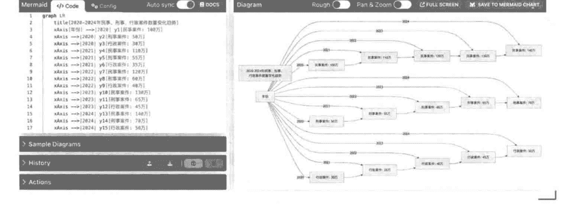

如果想让审判各环节更清晰，可用明确的指令让模型产出流程图。示范提示可以这样表述：“请输出一份民事诉讼全流程示意图，覆盖立案、审理、裁判、执行等阶段，供内部培训使用，交付形式为 Draw.io 可用的代码。”

> 请制作一张民事案件诉讼流程图，涵盖立案、审理、裁判、执行各环节，适用于内部培训使用，使用draw.io格式。（使用代码方式）。

引用 4 篇资料作为参考

下面是一段基于 Mermaid 语法的示例，涵盖民事一审到执行的要点，可直接复制到 draw.io 得到可编辑图形。

###### Mermaid代码

```
graph TD
    A[起诉] --> B[立案审查]
    B -->|符合条件| C[立案并通知缴费]
    B -->|不符合条件| D[裁定不予受理或驳回起诉]
    C --> E[送达起诉状副本]
    E --> F[被告提交答辩状]
    F --> G[庭前准备]
    G --> H[证据交换]
    G --> I[财产保全]
    G --> J[庭前调解]
    J -->|达成协议| K[制作调解书]
    J -->|未达成协议| L[开庭审理]
    L --> M[法庭调查]
    M --> N[法庭辩论]
    N --> O[最后陈述]
    O --> P[法庭调解]
    P -->|达成协议| Q[制作调解书]
    P -->|未达成协议| R[合议庭合议]
    R --> S[宣判]
    S --> T[送达判决书或裁定书]
    T --> U[上诉]
    U -->|不服判决| V[15日内上诉]
    U -->|不服裁定| W[10日内上诉]
    T --> X[申请执行]
    X --> Y[执行立案]
    Y --> Z[财产调查]
    Z --> AA[强制措施]
    AA --> AB[财产处分]
    AB --> AC[案款发放]
    AC --> AD[结案归档]

style A fill:#6C5B7B,color:white
style B fill:#355C7D,color:white
style C fill:#355C7D,color:white
style D fill:#F8B195,color:black
style E fill:#355C7D,color:white
style F fill:#355C7D,color:white
style G fill:#355C7D,color:white
style H fill:#355C7D,color:white
style I fill:#355C7D,color:white
style J fill:#355C7D,color:white
style K fill:#C06C84,color:white
style L fill:#355C7D,color:white
style M fill:#355C7D,color:white
style N fill:#355C7D,color:white
style O fill:#355C7D,color:white
style P fill:#355C7D,color:white
style Q fill:#C06C84,color:white
style R fill:#355C7D,color:white
style S fill:#355C7D,color:white
style T fill:#355C7D,color:white
style U fill:#355C7D,color:white
style V fill:#355C7D,color:white
style W fill:#355C7D,color:white
style X fill:#6C5B7B,color:white
style Y fill:#355C7D,color:white
style Z fill:#355C7D,color:white
style AA fill:#355C7D,color:white
style AB fill:#355C7D,color:white
style AC fill:#355C7D,color:white
style AD fill:#6C5B7B,color:white
```

###### 操作指引

1. 浏览器打开 draw.io 官网 https://app.diagrams.net/ 并新建画布。
2. 顶部菜单选择“扩展 > 插入 > 高级 > Mermaid”。
3. 在弹出的 Mermaid 编辑区粘贴上述片段，点击“插入”。
4. 图形即时渲染，可自行调整样式与布局。

###### 法条映射

- 立案环节对应《民事诉讼法》第 119 条至第 124 条。
- 审理环节对应《民事诉讼法》第 133 条至第 149 条。
- 裁判环节对应《民事诉讼法》第 164 条至第 176 条。
- 执行环节对应《民事诉讼法》第 224 条至第 258 条。

按上述代码与路径，内部培训用的民事诉讼流程图能够快速搭建 1 2 3。

渲染后的效果如图示，不满意处可手动微调。

570 / AI 时代法律人智能手册:DeepSeek 实用指南

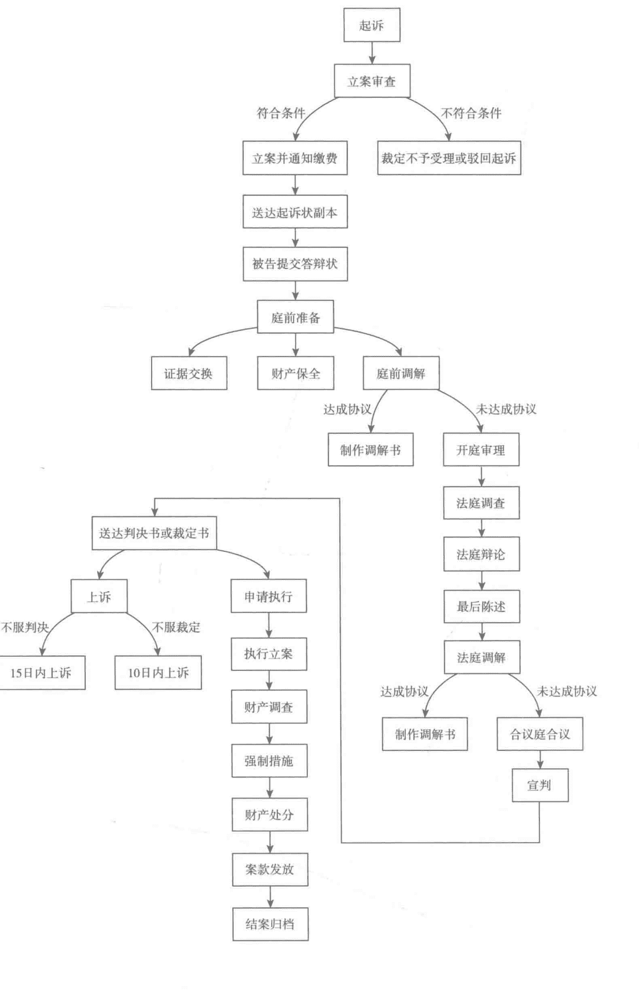

拿到模型绘制的初稿后，法院行政人员需对版式与细节做二次校准，确保图表符合本院统计口径与展示规范，提升信息可读性和决策参考价值。实际制图多是多工具配合加人工润色的结果，效果才会更理想。

在思路提供层面，智能体的信息整合与多维分析能力较强，能为法院行政工作提供政策解读、改革思路和风险研判。提示词要把问题点清，并限定检索范围、维度与深度。例如研究智慧法院未来走向，可以提示：“请结合全国智慧法院建设最新政策和先进地区实践，分析重点领域、技术应用和风险挑战，并就 2025 年建设提出创新建议，适用于政策规划。”在司法改革背景下，还可以用对比式提问寻找突破口，例如：“请比较中外法院案件分流与速裁机制的落地路径，分析利弊，结合基层法院实际提出速裁机制改进建议。”这类输出能提供多元政策视角，助推行政管理创新。

在拓宽视野层面，法院行政人员需要持续跟踪司法政策、学术动态和国际经验。智能体可快速整合海量信息，生成调研报告或政策综述。提示词需明确时间跨度、来源和核心议题。例如关于司法公开，可提示：“检索 2020 年以来最高人民法院关于司法公开的文件，梳理建设举措、成效和趋势，形成政策综述供内参使用。”借鉴国际经验时可提示：“汇总欧美主要国家司法信息化建设的政策与做法，对比我国智慧法院建设异同，提炼可借鉴点，供政策研究参考。”系统性整合有助于把握动态，提升决策科学性和前瞻性。建议开启联网检索以提高时效，但最终仍需人工核验。

#### 七、建立 AI 生成信息的审查与复核机制
为守住公信力，法院应建立分层的人工审查复核机制，对模型输出的法律分析进行多角度校验，确保裁判结论合法准确。应制定智能辅助使用的指引，明确模型仅作检索、分析、文书起草的辅助，法官须对结果独立审查，不得直接采用未经核实的结论。

可引入双审流程：主审法官结合模型建议初审，助理法官或合议团队对关键法条和案例交叉复核，确保真实可靠。司法文书常规流转是助理审核—承办人审核—合议庭签发—文字校对，将模型生成内容纳入重点核查范围，同时利用模型先期校对文字错误，提升效率。建议建立模型输出验证日志，记录生成来源、参考文献和审查意见，形成闭环。还可部署异常检测，通过案例库匹配对条文案例进行自动比对，发现知识库中不存在的条文或案例即标为“疑似虚构”，提醒二次核查，以此提升准确性并强化审慎评估。

面对法律检索中的“无中生有”，既要发挥模型的效率，也要保持批判性。进一步可靠性的路径包括：深化模型与实务融合，构建法律知识图谱，实现条文、案例、解释的多维关联，减少语义幻觉；推进模型可解释性，要求模型同步呈现推理路径和依据来源，便于法官审查；加强使用培训，提升甄别能力，确保模型始终是辅助而非决策主体，维护裁判独立、合法、公正。

#### 八、总结
在数字化转型中，人工智能已深度嵌入司法实务，成为智慧法院建设和审判质效提升的重要抓手。提示词的精准度决定了 DeepSeek 在审判实务中的发挥上限。细化指令，法官才能拿到更精准的审判流程支持。

### 第七节 驱动 DeepSeek 赋能检察业务
检察工作涵盖公诉、法律监督、侦查活动监督、文书撰写等。随着智能化发展，DeepSeek 能在法律分析、证据研判、监督和文书生成上提供支撑，关键在于设计精准详细的问题。设定问题要具体、贴合案情、细化场景，才能发挥实务价值。

#### 一、精准设定问题，引导 DeepSeek 生成有针对性的检察实务分析
避免泛化提问。例如只问“如何处理公诉案件”，得到的只是法条罗列。应明确案型、争议点、证据状况。例如：“一起职务犯罪公诉案，被告人拒不认罪，关键证据为银行流水、证人证言和电子数据。请分析证据链是否完整，并给出指控策略。”

> 引用 11 篇资料作为参考

在该职务犯罪案件中，被告人拒不认罪，关键证据包括银行流水、证人证言和电子数据。以下是对证据链完整性的分析以及可能的指控策略：

##### 证据链完整性分析
1. **银行流水**
银行流水需满足真实、关联、合法。应清晰显示时间、金额、往来方，并能指向非法资金流动。若获取合法且能与证言、电子数据衔接，即可增强证明力。
2. **证人证言**
证言需客观、关联、合法。若与流水、电子数据相互印证，证明力提升；但需注意记忆偏差或倾向性导致矛盾。
3. **电子数据**
聊天记录、邮件等需合法提取并鉴定，确保真实完整。若能直接关联犯罪行为即具重要价值，但来源不合法则可能被排除。

综合来看，若三类证据能相互印证且符合刑事证据标准，则链条完整。

##### 可能的指控策略
1. **构建完整证据链**，让流水流向与证言、电子沟通记录吻合，排除合理怀疑。
2. **强化电子数据证明力**，通过技术解析提取关键时间、金额、对象，与流水和证言结合。
3. **破解零口供**，以客观证据为核心，减少对口供依赖。
4. **合理运用心理战术**，在讯问中适时出示关键客观证据，制造压力。
5. **跨部门协作**，与审计、技侦联动，用大数据深挖线索完善链条。

##### 总结
证据链完整性取决于三类证据能否相互印证并合规。指控上应注重链条构建、电子数据强化和协作补强。

> 例如，可提示：“一起故意伤害案，唯一直接证据是被害人陈述，缺乏物证和视频。请分析公诉机关如何补强，以及证据排除规则的适用。”

引用 7 篇资料作为参考

在仅有被害人供述的情况下，公诉机关可通过以下方式补强并适用排除规则：

1. **补强证据**
- 医学检查：获取诊断证明、病历，确认伤情部位和程度。
- 证人证言：寻找在场目击者固定陈述。
- 嫌疑人供述：讯问制作笔录，固定动机和过程。
- 电子证据：调取监控还原现场，保证完整真实。
- 其他关联证据：如报警记录、现场勘验等。

2. **证据排除规则适用**
- 非法证据排除：刑讯逼供等非法取得的供述及程序违法收集的物证书证应排除，可申请启动排除程序。
- 传闻排除：证人须就亲身感知作证，来源不明且无法印证的传闻不作定案依据。
- 意见排除：猜测、评论、推断性意见一般不具有可采性。
- 矛盾证言排除：同一证人多份证言存在实质矛盾且无合理解释，不予采信。
- 口供补强规则：仅有被告人供述而无其他证据，不能认定有罪。

##### 结论
应通过补充侦查收集客观证据补强链条，严格适用排除规则确保合法真实，避免冤错。若证据不足，法院可宣告无罪。

精准提问能让 DeepSeek 结合法条、指导案例和实务经验给出具体可用的解答，提升案件分析能力。

#### 二、结合案件材料，让 DeepSeek 参与案件研判
检察官核心工作是证据分析和法律适用。输入详细案情后，模型可快速梳理证据链、归纳争议焦点并提供多种适用分析。例如：“以下是某诈骗案基本案情：[输入案情]。请分析是否构成诈骗罪，并指出公诉中可能的证据难点。”“请根据证据清单：[输入清单]，分析庭审中的证明力并提出抗辩可能。”

此类提示有助于发现薄弱环节，优化指控策略，提升准备充分度。

#### 三、细化法律监督场景，提高监督职能的精准度
法律监督包括侦查监督、审判监督、执行监督。DeepSeek 可帮助梳理流程并进行不同监督方式的比较分析。

精准提问，让 DeepSeek 真正服务检察实务

办案监督的本质是判断警方行为是否越界并给出纠偏建议。直接问“侦查监督怎么做”，得到的多是泛泛介绍。把具体案情嵌进提问，输出才具备落地价值。比如可以这样问：“在办理一起职务侵占案件时，警方法定羁押期届满五个月仍未办文释放，请说明检方如何依法履职。”

> 引用 8 篇资料作为参考

在上述情节下，检方可按以下路径开展工作：

1. 启动监督程序。发现羁押期限被突破后应马上进入监督状态。依据《人民检察院刑事诉讼规则》第612条、第618条，检方有权对侦查环节的违法情形进行纠正，超期羁押属于重点监督事项。
2. 送达纠正文书。核实超期事实后，应向警方发出《纠正违法通知书》，要求立刻改正并依法变更强制措施或放人。
3. 追责。警方收到通知后仍未在期限内整改的，检察官需向上级院报告，由上级院向公安上级单位通报督促；同时可对直接责任人进行问责，情节严重的依法追究刑事责任。
4. 预防机制。检方可通过“回头看”等动态复查方式，定期对结案案件回溯，及时发现并纠正超期羁押等违法问题。
5. 协同配合。与警方建立定期通报联动机制，提升对侦查全流程的监督，从源头降低违法风险。

整体而言，发现超期羁押后应及时启动、纠正、追责，并通过机制建设和协同固化监督成效。

同样的逻辑同样适用于抗诉启动。例如提问：“地方法院审理合同诈骗案件时严重违反程序，剥夺了被告与辩护人举证机会，请分析检方如何提起抗诉。”

> 引用 5 篇资料作为参考

若法院在审理中存在严重程序违法、剥夺举证权的情形，检方可启动抗诉，具体如下：

1. 抗诉前提
   依据刑诉法相关规定，检方可在以下情形提出抗诉：
   - 违反法定诉讼程序，可能影响公正裁判的；
   - 审判人员存在贪污受贿、徇私舞弊、枉法裁判行为的；
   - 原裁判适用法律明显错误的；
   - 定罪量刑所依据的证据不确实、不充分，或关键证据之间存在矛盾的。

2. 操作流程
   - 立案审查。通过当事人申诉、上级交办或自行发现等方式，对裁判进行合规性审查，判断是否符合抗诉条件。
   - 决定并制作文书。经审查认为裁判确有错误，应作出抗诉决定并撰写抗诉文书，明确理由和法条依据。
   - 报送。文书由检察长签发加盖印章，报送上一级法院，同时抄送上级检察机关。
   - 出庭支持。再审开庭时，检方应派员出庭，依法支持抗诉，履行法律监督职责。

3. 本例适用
   本案法院严重违反诉讼程序，剥夺举证权，可能影响公正裁判。检方可依据刑诉法第253条第4项，以“违反法定诉讼程序，可能影响公正裁判”为由，向上一级法院提出抗诉。

精准的提问能让 DeepSeek 结合法条、司法解释和案例给出可落地的监督方案，提升检察官的监督能力。

#### 四、文书生成提效，推动检察文书规范化

起诉文书、抗诉文书、监督意见等是检察官高频工作。若只说“帮我写一份起诉书”，得到的多是格式模板。加入案情、法条依据和证据要素，输出才具备实用性。

例如：
> “请依据以下案情：[输入案情]，按照刑诉法要求起草起诉书，包含指控罪名、事实概要、证据支持及法条依据。”
> “某被告因机动车肇事罪被判处2年，检方认为量刑过轻拟提出抗诉，请起草一份抗诉文书。”

> 引用 6 篇资料作为参考

##### 抗诉书
申请人：XX市人民检察院
被申请人：XX市人民法院
案件编号：【填写】
申请日期：2025年03月02日

**申请事项：**
申请人XX市人民检察院认为XX市人民法院对被告人XX交通肇事罪一案的判决量刑明显偏轻，依据《中华人民共和国刑事诉讼法》相关规定，特向贵院提出抗诉，请求撤销原判，重新审理并加重刑罚。

**事实与理由：**
一、原审量刑偏低，不符合法律规定
根据《刑法》第一百三十三条，交通肇事致人重伤、死亡或造成重大损失的，处三年以下有期徒刑或拘役。本案被告违反交通运输管理法规，导致重大事故，造成一人死亡、两人重伤，且事故后存在逃逸行为，情节恶劣。原审法院仅判处有期徒刑二年，明显低于法定幅度，未体现罪责刑相适应。

二、逃逸情节未被充分考量
根据最高人民法院关于审理交通肇事刑事案件具体应用法律若干问题的解释第三条，交通肇事后逃逸属于加重情节。本案被告在事故发生后未报警亦未保护现场，反而逃离，导致伤者救治延误。原审在量刑时未充分考虑逃逸情节，导致结果与事实不符。

三、社会危害性评价不足
交通肇事罪不仅侵害被害人生命健康权，也对公共安全构成威胁。本案造成一人死亡、两人重伤，给被害人家属造成无法弥补的损失，社会危害极大。原审未充分评价危害性，判决未能起到应有的警示和惩戒作用。

综上，原审量刑偏轻，未充分考量逃逸情节及社会危害。为维护法律公正和权威，特向贵院提出抗诉，请求撤销原判，重新审理并加重刑罚。

此致
XX市中级人民法院
申请人：XX市人民检察院
日期：2025年03月02日

这类提问既能让 DeepSeek 生成符合规范的文书，又能保证针对性。但需注意模型输出可能存在法条引用偏差，例如上文提及的《刑事诉讼法》第二百一十七条实际规范简易程序，抗诉相关条款应为第二百五十四条等，仍需人工核对。

#### 五、借助大数据分析，提升检察决策智能化

检察工作离不开类案比对和趋势研判。可使用指令：“请梳理近十年我国网络犯罪公诉案件的演变，包含主要罪名、量刑走向、证据标准变化。”

> 引用 14 篇资料作为参考

近十年，我国网络犯罪公诉案件呈显著上升态势，罪名结构、量刑及证据标准均发生演变：

##### 1. 案件数量走向
据最高检数据，2018至2019年，检察机关批准逮捕网络犯罪嫌疑人89167人，提起公诉105658人，同比分别上升78.8%和95.1%。2020年全国检察机关起诉涉嫌网络犯罪14.2万人，同比上升47.9%。整体增速年均近40%，2020年达54%。

##### 2. 主要罪名分布
- 网络诈骗：2020年约占网络犯罪总数的64.4%，常见手法包括冒充公检法、交友诈骗、退款诈骗等；
- 网络赌博：案件明显上升，跨境赌博增多；
- 侵犯公民个人信息：已成为黑灰产业关键环节，2020年起诉6033人；
- 帮助信息网络犯罪活动：2020年起诉1.47万人。

##### 3. 量刑走向
网络诈骗依据刑法第二百六十六条，数额较大处三年以下，数额巨大处三年以上十年以下，数额特别巨大处十年以上或无期。帮助信息网络犯罪活动罪依据刑法第二百八十七条之二，情节严重处三年以下有期徒刑或拘役。

##### 4. 证据标准演进
- 电子数据地位提升：2012年刑事诉讼法将电子数据增设为法定证据种类，2016年最高人民法院、最高人民检察院、公安部联合出台电子数据收集提取与审查判断规定，明确标准；
- 综合认定：针对海量数据证明难题，司法机关采用综合认定方法简化证明，但证明标准并未降低；
- 跨境取证：坚持尊重国家主权，通过警务合作和司法协助渠道取证，严禁远程入侵提取。

##### 5. 小结
案件量大幅增长，诈骗、赌博、个人信息侵害为主流，量刑趋于明确且力度加强，电子数据在证据体系中的地位显著提升，标准随技术进步和司法实践不断完善。

> 又如案例分析指令：“司法实践中如何认定帮信罪？请结合近年裁判案例分析。”

在司法实践中，认定帮助信息网络犯罪活动罪主要依据刑法第二百八十七条之二，并结合行为表现、主观明知程度及情节严重性综合判断。

##### 一、认定关键要件
1. 主观明知：包括事前共谋的明知、客观足以确定的明知、应当知情的情形。
2. 客观帮助：提供互联网接入、服务器托管、存储、传输、技术支持、广告推广、支付结算等帮助行为。
3. 情节严重：为三个以上对象提供帮助；支付结算金额达20万元以上；违法所得1万元以上；被帮助对象实施的犯罪造成严重后果等。

##### 二、近年裁判实例
1. 出售银行卡案：大学生以500元售出3张银行卡，后被用于诈骗资金转移，涉案金额超百万。法院认定其明知他人利用信息网络实施犯罪仍提供支付结算帮助，构成帮信罪，判处有期徒刑8个月。
2. 维护赌博服务器案：技术员为境外赌博网站维护服务器，提供技术支持。法院认定其明知仍提供帮助，构成帮信罪，判处有期徒刑2年。
3. 推广虚假贷款网站案：为虚假贷款网站提供广告推广服务，获利2354元。法院认定构成帮信罪，判处有期徒刑7个月。
4. 提供支付账户案：明知被用于网络犯罪仍提供本人支付账户，涉案金额46万余元。法院认定构成帮信罪，判处有期徒刑8个月。

##### 三、小结
认定核心在于主观明知与客观帮助的结合，并考量情节严重性。无论是银行卡、服务器维护还是广告推广，只要符合构成要件，均可能被追责。

此类提问可帮助 DeepSeek 整合案例数据，提供系统性分析，助力新型案件办理。

#### 六、总结

充分发挥 DeepSeek 在检察实务中的作用，需要提问精准、材料完整、场景细化、文书要素明确，并善于利用大数据分析。通过科学构建提示词，可辅助案件研判、法律监督和文书撰写，提升检察工作的精准度、效率和智能化水平。合理运用 AI 辅助，既能提升检察官业务能力，也能推动检察机关现代化发展。

### 第八节 驱动 DeepSeek 赋能企业法务

企业法务涉及合规管理、合同审查、知识产权、劳动法务等多个领域。精准设计提示词是提升企业法务实务效率的关键。本节以合规管理为例展开。

#### 一、合规管理：精准提问助力企业合规体系建设

合规管理涵盖反贿赂反腐败、反垄断、数据合规、环境合规等。使用 DeepSeek 时需给出具体、可落地的指令。

例如：“请依据《数据安全法》《个人信息保护法》，结合中国企业数据合规要求，形成一份适用于跨国企业的操作指南，涵盖数据收集、跨境传输、员工培训、合规审查流程。”

> 引用 26 篇资料作为参考

基于两部法律及中国实践，一份适用于跨国企业的合规指引如下：

##### 1. 数据收集
- 合法正当目的，合法方式获取，禁止窃取；
- 最小必要原则，避免过度收集；
- 收集前以易懂方式告知目的、范围、方式并取得明确同意；
- 按重要性和敏感度分类分级，差异化保护。

##### 2. 跨境数据传输
- 涉及重要数据或敏感个人信息需进行数据出境安全评估并报主管部门；
- 可采用标准合同或个人信息保护认证方式；
- 关键信息基础设施或大量个人信息须本地化存储。

##### 3. 员工培训
- 定期培训《数据安全法》《个人信息保护法》要求；
- 培训加密、访问控制、备份恢复等技术措施；
- 培训数据安全事件报告与应急响应流程。

##### 4. 合规审查流程
- 建立覆盖收集、存储、使用、加工、传输、提供、公开、删除的全流程管理制度；
- 定期开展风险评估，识别与处置安全隐患；
- 定期合规审计，根据结果调整制度与措施。

##### 5. 法律责任与处罚
- 违法企业可能面临高额罚款，严重者暂停业务或吊销执照；
- 造成严重后果的，相关责任人可能承担刑事责任。

相比宽泛提问“企业如何做数据合规”，精细化指令能获得系统、行业化的答案。企业法务可进一步递进提问：“针对《反垄断法》，请给出企业数据合规风险自查清单，并结合近三年数据垄断行政处罚案例分析。”

> 引用 8 篇资料作为参考

##### 企业数据合规风险自查清单

数据垄断风险防控与合规实操速览

参照现行竞争法规及配套指引整理的自检框架，帮助企业提前识别信息类垄断风险并堵住流程漏洞。

###### 1. 收集环节核查要点
- 获取行为是否建立在合法合规且仅限必要的基准上
- 是否完整告知信息主体查询、修正、删除及撤回授权的权利
- 正式获取前是否作出清晰充分的用户提示
- 是否取得主体明确许可并支持随时撤回
- 是否完成信息分类分级且来源目的可追溯

###### 2. 处理环节核查要点
- 修正、删除、访问、限制加工等权利是否真正落地
- 是否出现爬虫抓取、画像建模等敏感应用
- 公开披露前是否已获授权许可
- 处理全过程是否保留可追溯的副本与日志
- 权限配置是否坚持最小必要

###### 3. 存储环节核查要点
- 保存期限是否符合法定期限并做最小化处置
- 是否构建加密存储、备份恢复等安全机制
- 入库前是否实施去标识化
- 存储工具与介质是否定期接受安全测评与优化

###### 4. 出境环节核查要点
- 业务是否涉及跨境传输
- 相关合规义务是否已履行到位
- 是否需完成安全评估并出具报告
- 境外法适用是否产生冲突风险

###### 5. 使用环节核查要点
- 使用边界与权限是否明确界定
- 是否开展安全审查以防敏感信息外泄
- 是否具备满足安全要求的技术管控方案
- 使用工具是否定期检测优化

##### 近三年数据类执法典型回顾

###### 案例1：宁波某信息技术公司滥用支配地位案
- 案情：该公司在债券声讯经纪实时交易信息销售市场占据主导，拒绝与同业交易并附加不合理条件
- 处理结果：上海市场监管部门对其处以2022年销售额2%的罚款，约453.28万元
- 要点：国内首例数据领域行政执法案例，体现监管对信息滥用零容忍，企业应避免以信息为杠杆排他

###### 案例2：米线生产商横向垄断协议案
- 案情：多家厂商合谋固定售价、联合抵制交易，阻断新进入者
- 处理结果：法院认定构成横向垄断协议并判令赔偿
- 要点：警示切勿与竞争对手达成价格固定、市场分割等安排

###### 案例3：天然气公司捆绑交易案
- 案情：某气企强制用户捆绑采购指定配套产品，挤压竞争对手空间
- 处理结果：法院认定滥用支配地位并判令赔偿
- 要点：交易中附加不合理条件限制选择权构成滥用

##### 小结
建议常态化开展收集、处理、存储、使用、出境全链条自查，确保符合竞争立法及相关规定；同时杜绝滥用支配地位、达成垄断协议等行为，控制法律风险，维护市场秩序。

> 该框架亦可用于合规培训场景。例如法务可要求：“请围绕医药行业商业贿赂风险，输出一份内部反腐败培训材料，包含案例剖析、指引与考核机制。”

引用 13 篇资料作为参考

##### 医药企业内部反腐败合规培训材料

###### 一、案例剖析
1. 案例1：海南某县医院院长受贿案
2005至2023年间，利用职权为医疗用品采购商、工程承包方提供便利，非法收受1601万元。凸显权力寻租与制度缺位叠加的破坏性
2. 案例2：陕西某市院长受贿案
2014至2021年间，为骨科耗材、药品供应商谋利，收受财物272.05万元。显示采购环节廉洁风险高企
3. 案例3：虚开发票事件
多家药企虚构成本套取现金用于支付医药回扣、员工福利等账外支出，规避审计与税务监管，导致信用受损并承担行政刑事责任

###### 二、合规指引
1. 搭建合规管理体系
- 组织架构：设立独立合规部门，明确管理层责任，与法务、财务协同
- 制度建设：制定反腐败政策、利益冲突政策、举报机制等，固化执行标准
- 文化塑造：以全员培训、案例警示植入公平竞争、零容忍商业贿赂理念
2. 高风险域防控
- 采购端：严禁回扣贿赂影响决策，严格执行药品两票制，打击虚假交易
- 学术活动：确保真实合规，签订书面协议并留存记录与费用凭证，讲课费符合市场水平
- 费用透明：严审销售费用占比与流向，杜绝账外经营与虚开发票
3. 内部管理机制
- 合规审查：定期审计采购、财务、医保基金使用等关键环节，及时纠偏
- 伙伴审查：对供应商开展合规尽调，合同中嵌入反腐败条款

###### 三、考核机制
1. 培训考核
- 定期开展：每年至少一次全员培训，聚焦销售、采购、财务等高风险岗位
- 考核方式：线上线下考试、案例研讨、情景模拟检验掌握程度
2. 行为考核
- 表现评估：借助内部审计与举报渠道评价日常合规表现
- 奖惩：优秀者激励，违规者处罚，情节严重者移送司法
3. 体系评估
- 年度复盘：对管理体系有效性进行评估并提出改进
- 外部认证：鼓励通过ISO 37301等国际标准认证

##### 四、总结
医药企业反腐败合规既是法定义务也是可持续发展的根基。借助案例警示、制度指引与闭环考核，可有效遏制商业贿赂，提升管理水平。

#### 二、合同审查：提效降险与条款优化

合同审查是法务核心工作，涵盖合法性、合规性、风险识别与谈判策略。该工具可解析文本定位风险并提出优化建议。提示可明确类型与风险点，如：“请分析股权转让协议的税务风险、履约风险与违约责任缺失。”

针对SaaS服务合同可细化：“请审查信息保护、知识产权归属、服务中断责任等方面的法律风险。”

> 引用 7 篇资料作为参考

根据FIDIC条件保护业主方权益的施工企业违约责任修改建议：

1. 明确违约界定
- 列明工期延误、质量不达标、材料设备不符等违约行为
- 增加重大违约条款，允许因严重质量缺陷或无法交付时业主终止合同并索赔

2. 强化延误赔偿
- 约定自身原因延误需按日支付误期损害赔偿，明确计费基数
- 设定累计延误上限，超期业主有权终止并追偿全部损失

3. 严格质量要求
- 明确材料设备须符合技术标准，附检验验收流程
- 未达标须整改并承担费用，整改无效业主可自行更换并索赔

4. 增加担保
- 要求履约保函与预付款保函，违约时业主可直接扣款
- 明确金额、有效期，验收合格后解除

5. 优化索赔程序
- 约定通知时限、证据要求、金额计算方式
- 设快速索赔机制，小额索赔可直接从工程款扣减

6. 限制责任豁免
- 禁止以限制条款免除重大过失或故意违约责任
- 约定责任上限比例，但欺诈故意不适用上限

7. 引入第三方监督
- 约定独立监理全程监督并定期报告，发现违约业主可即时补救

8. 明确终止后处理
- 违约终止时业主有权接管工程并委托第三方完成，费用由违约方承担
- 增设清算条款，退还未完成部分预付款

> 输入提示词可获取合同审查标准流程：“请提供企业法务合同审查标准流程，含关键条款审查要点、法律依据与谈判策略。”

引用 7 篇资料作为参考

企业法务合同审查标准流程：

##### 1. 合同接收与信息确认
- 接收草案并核对附件齐全性
- 确认主体、目的、标的、签署时间、履行地等基本要素，判断合同类型

##### 2. 条款审核与修改建议
- 合法性审核：对照《民法典》等强制性规定
- 风险识别：重点评估违约责任、争议解决、支付条款
- 核心条款：付款、违约责任、争议解决、履行期限与验收标准

##### 3. 内部协作与意见征询
- 跨部门沟通确认操作可行性
- 法务内部联合审阅

##### 4. 修改确认
- 标注修改内容并形成清晰版本
- 内部审批通过后再行分发

##### 5. 签署与归档
- 确认签署权限后签署
- 电子化归档入库

##### 6. 履行监督与跟踪
- 定期跟踪执行情况，及时处置纠纷

##### 7. 执行总结与反馈
- 归纳问题原因，优化后续审查流程

关键审查要点：主体资格、权利义务对等、违约责任明确、争议解决有利
法律依据：《民法典》《合同法》及行业法规
谈判策略：明确底线、控风险、灵活提出替代方案

#### 三、知识产权保护：提示词驱动战略与风险规避

知识产权法务涵盖商标、专利、著作权、商业秘密。提示词应包含类型、策略、侵权风险、法律依据。

例如：“请提供科技初创公司知识产权保护指南，含专利布局、商标注册、商业秘密保护。”

> 引用 14 篇资料作为参考

科技初创公司知识产权保护指南：

##### 一、专利申请策略
1. 尽早申请：遵循先到先得，及时在技术成型后申请
2. 核心布局：保护核心技术并形成专利组合，防止绕开
3. 国际布局：进入海外市场时通过PCT途径申请保护
4. 撰写质量：扩充实施例、上位概括，与专业代理机构协作

##### 二、商标注册流程
1. 商标查询：核查近似与在先权利
2. 准备材料：图样、《申请书》、营业执照复印件、代理委托书
3. 提交申请：线上或窗口递交
4. 审查公告：形式审查、实质审查、3个月异议期，无异议核准发证
5. 国际注册：目标市场单独申请

##### 三、商业秘密保护措施
1. 保密协议：与员工、合作方签署，明确义务与责任
2. 内部制度：分级管理、保密措施、违规责任
3. 技术防护：加密传输、权限控制、定期安全审计
4. 人员管理：入职背景核查、在职教育、离职权限回收
5. 区域管理：涉密区封闭管理，禁止外网接入

##### 四、总结
初创公司应尽早构建IP战略，按发展阶段动态调整，专利、商标、商业秘密协同保护以增强竞争力。

针对具体争议可细化提示：“在某公司诉某公司商标侵权案中，法院如何适用混淆可能性标准？请结合案例分析。”

侵权风险评估示例：“请分析该专利技术方案是否可能侵犯在先专利，并提供规避建议。”

合规体系示例：“请提供企业内部知识产权合规方案，涵盖员工培训、侵权预警、技术成果归属协议等。”

> 引用 14 篇资料作为参考

##### 企业内部知识产权合规管理方案

###### 1. 员工知识产权培训
目标：提升认知与守法意识
内容：基础概念、公司政策、侵权风险与应对
方式：线上线下结合、案例研讨、定期考核

###### 2. 侵权预警机制
目标：及时发现与处置侵权
机制构成：

AI赋能的知产防护与用工合规实战参考

把监测手段用起来，把处置流程跑通，知识产权风险就能提前拦截，人力资源管理也能始终保持合规状态。

监测预警体系

技术监控手段：依靠网络爬虫、关键词筛查与大数据建模等数字化工具，对侵权线索进行全天候扫描。

监控网络布局：构建覆盖官方网站、社交平台、专业论坛的立体监测网，及时捕捉知产动态与行业情报。

预警处置流程：
1. 信息采集与研判：通过监控工具汇聚相关数据，对潜在侵权迹象进行归纳分析。
2. 风险评估：衡量侵权行为的危害程度与紧迫程度，明确后续应对方向。
3. 预警发出：向业务、法务等相关部门通报，说明侵权情形、附上佐证材料并给出处置建议。
4. 后续跟进：保持跨部门协同，提供指导与资源支持，共同完成侵权应对。

应对策略
- 及时通告并固定证据：发现线索后第一时间通知相关部门，对证据进行保全留存。
- 法律维权：以诉讼、申请知识产权保护等法律路径追究侵权方责任。
- 舆情管理：主动跟进媒体报道与公众评论，维护品牌形象。

###### 3. 技术成果归属协议
目标：厘清技术成果归属，为公司知识产权提供制度保障。

协议内容：
- 技术成果定义：涵盖研发产出、专利发明、软件著作权等智力成果。
- 归属原则：成果归属公司，员工不得私自转让或使用。
- 保密义务：员工须严格保守商业秘密，不得外泄或私用成果。
- 违约责任：违反协议需承担法律责任并赔偿公司损失。

协议执行：
- 签署与生效：经双方签字盖章后生效，具有法律效力。
- 定期审查与更新：随企业发展与法规变化，定期复核并更新条款。

###### 4. 复盘与迭代优化
- 绩效评估：定期检视合规管理成效，涵盖培训效果、侵权预警机制运行情况等。
- 持续改进：基于评估结果优化培训内容、预警机制和协议条款，确保体系有效且具备适应性。

上述安排可帮助公司搭建系统化的知识产权合规体系，降低侵权风险，实现健康发展。合理设计提示词，利用 DeepSeek 能输出结构化保护方案，助力在竞争中占据法律优势。

#### 四、劳动法务：让人力管理始终合规运转
劳动法务是公司法务的核心板块，涉及劳动合同管理、争议处理、员工权益保障和合规裁员。明确法律依据、案例参考与合规要点，提示词设计更能让 DeepSeek 精准支持，例如：“请依据《劳动合同法》，给出无固定期限合同合规指引，并结合最高人民法院案例分析。”

> 引用 5 篇资料作为参考

##### 无固定期限劳动合同合规指引

###### 一、无固定期限劳动合同的定义
无固定期限劳动合同指双方约定不设确定终止时间的合同。其并非终身制，仍可通过协商解除、法定解除或退休、破产等情形终止。

###### 二、必须订立无固定期限劳动合同的情形
依据《劳动合同法》第十四条，必须订立的情形包括：
1. 连续工作满十年：同一用人单位连续工作满十年，含法实施前年限。
2. 国企改制或首设劳动合同制加双十年：用人单位初次实行劳动合同制或国企改制，且劳动者连续工龄满十年且距法定退休年龄不足十年。
3. 连续订立两次固定期限合同：连续订立两次固定期限合同且劳动者不属于第三十九条和第四十条第一、二项情形，续订时应订无固定期限。
4. 视为已订立：自用工之日起满一年未签订书面劳动合同的，视为已订立无固定期限劳动合同。

###### 三、无固定期限劳动合同的解除与终止
该类合同可解除，条件较严：
1. 协商解除：双方一致同意解除。
2. 法定解除：
   - 劳动者严重违反规章制度、严重失职、被追究刑事责任等，适用第三十九条。
   - 医疗期满后不能从事原岗或另行安排工作，适用第四十条第一项。
   - 不能胜任工作，经培训或调岗仍不胜任，适用第四十条第二项。
   - 客观情况重大变化致合同无法履行，经协商未果，适用第四十条第三项。
3. 经济性裁员：经营困难、重整等裁员时，应优先保留无固定期限合同劳动者。

###### 四、经济补偿与赔偿
1. 经济补偿：解除无固定期限合同需支付补偿，按每满一年给一月工资，不满半年给半月。
2. 违法解除赔偿：违法解除或终止需按补偿标准的二倍支付赔偿金。

###### 五、试用期规定
可约定试用期，但最长不得超过六个月。

###### 六、最高人民法院相关案例分析
1. 案例1：劳动者在职9年11个月，单位以到期为由终止。法院认定违法，单位恶意规避无固定期限义务。
2. 案例2：劳动者第二份固定期限合同到期后单位未续签，上海法院判决支付赔偿金，单位无单方终止权。

###### 七、合规建议
1. 对劳动者：
   - 达到条件时主动主张签订无固定期限合同，保留工龄证明等证据。
   - 警惕自愿放弃陷阱，避免签署自愿签订固定期限合同声明。
2. 对用人单位：
   - 建立劳动合同全周期管理，重点监控续签节点。
   - 避免两次固定期限后被动触发无固定期限义务。
   - 解除时确保理由充分、程序合法，降低违法风险。

> 针对裁员合规，可用提示词：“经济性裁员下企业应履行哪些法定义务？结合案例给出操作建议。”

在经济性裁员场景，公司须严格遵循《劳动合同法》履行义务。

###### 一、法定裁员条件《劳动合同法》第41条
需满足其一：
1. 破产重整，如某新能源车企申请破产启动裁员。
2. 严重经营困难，需财报等证明。
3. 技术革新或经营调整。
4. 客观经济环境重大变化。
风险提示：2020年某互联网公司以结构调整名义裁员被判违法，未能证明客观情况重大变化。

###### 二、不能裁减的人员第42条
- 工伤或职业病员工，某制造企业违法裁减被判赔20万元。
- 孕期、产期、哺乳期女职工。
- 连续工作满15年且距退休不足5年者。

###### 三、法定程序义务
1. 民主程序第41条
   - 提前30日说明：向工会或全体职工说明情况并征求意见，某电商未履行被判双倍赔偿。
   - 方案报备：向属地人社部门提交裁员方案，广东某企业因补偿细则缺失被要求整改。
2. 优先留用规则
   - 较长期限或无固定期限合同者优先。
   - 家庭无其他就业且需抚养老人或未成年子女者优先，上海某外企保留特殊困难员工获认可。
3. 六个月优先召回权
   保持联系渠道，岗位恢复招用未通知可能被认定需赔偿。

###### 四、经济补偿义务第46-47条
1. N+1标准：年限乘月工资，上海高院明确前12个月平均工资含奖金补贴。某金融机构裁员争议中，法院认定未休年假折算应计入基数。
2. 代通知金：未提前30日通知需另付一月工资。某跨国企业对高管采用N+3方案降低诉讼风险。

###### 五、合规操作建议
1. 证据体系建设
   - 经营困难证明：审计报告、银行流水等。
   - 民主程序记录：会议纪要、签收表等。
2. 分层沟通机制
   - 高管单独洽谈，某上市公司签保密协议避免舆情。
   - 批量员工集体协商，杭州某科技公司通过公证处存档协商记录。
3. 风险应急预案
   - 预留补偿金总额20%作为争议准备金。
   - 同步制定安置方案，如某车企联合猎头提供转岗服务。
4. 舆情管理
   - 统一对外话术模板。
   - 法务团队实时监测网络动态。

典型案例参考
某制造业集团合规裁员实操：
1. 提前3个月启动亏损审计。
2. 召开3次职工代表大会并留存视频证据。
3. 推出N+1加职业培训组合方案。
4. 报备人社部门后分5批次执行。
最终完成800人规模裁员且零诉讼。

> 特别提示：长三角、珠三角近年推出稳岗补贴，符合条件公司申请可降低裁员比例，如苏州2023年对不裁减企业返还60%失业保险费。建议融合政策工具平衡生存与权益，具体执行需结合当地司法尺度，必要时开展劳动合规专项审计。

公司法务还可借助 DeepSeek 生成员工手册或合规培训材料：“请制定一份劳动合规培训手册，涵盖入职、薪酬、工时、争议处理等。”

> 引用 17 篇资料作为参考

##### 企业劳动合规培训手册

###### 一、员工入职合规
###### 1. 招聘与录用
- 发布招聘信息需真实合法，避免就业歧视。
- 背景调查须合规，不得侵犯隐私，犯罪记录查询须符合规定。
- 录用通知具法律效力，发放后不得随意撤回，内容应与劳动合同一致。

###### 2. 劳动合同签订
- 合同须明确岗位、薪酬、工时等核心条款，避免未签导致二倍工资风险。
- 试用期设置合规，试用期工资不得低于法定标准。

###### 3. 入职培训
- 新员工需接受企业文化、规章制度及法律法规培训，确保知悉并遵守。

###### 二、薪酬管理
1. 薪酬构成与支付
   - 薪酬应涵盖工资、奖金、津贴，结构透明。
   - 工资按时足额发放，节假日前预付，避免拖欠克扣。
2. 加班费核算
   - 加班费按法标支付，计算基数明确，避免争议。
3. 减薪程序
   - 减薪需有合法依据如违纪、事假，并书面通知员工签字确认。

###### 三、工时规定
1. 标准工时制
   - 每日8小时、每周40小时，超出需付加班费。
2. 特殊工时制
   - 综合计算工时、不定时工时须经劳动部门审批，适用于特定岗位。
3. 加班管理
   - 加班需员工同意，每月时长不超过36小时。

###### 四、劳动争议处理
1. 争议预防
   - 健全规章制度，确保员工知晓，减少纠纷。
2. 争议调解
   - 设立内部调解机制，通过沟通化解矛盾。
3. 仲裁与诉讼
   - 争议可通过仲裁或诉讼解决，公司需保留证据以确保合法处理。

###### 五、其他合规事项
1. 社会保险与福利
   - 依法为员工缴纳社保，不得以自愿放弃为由规避。福利政策应公平合理。
2. 保密与数据保护
   - 员工须签署保密协议，保障商业机密与客户信息安全。
3. 行为准则
   - 明确职业道德与行为规范，确保工作场所合规。

###### 结语
本手册用于规范用工管理，降低法律风险，提升合规意识。公司应结合实际与最新法规持续优化体系，确保用工合规。

对于争议处理，DeepSeek 也可提供法律分析，例如：“请分析某公司因未付加班费被诉的案例，并给出风险防范建议。”

> 引用 8 篇资料作为参考

##### 案例分析
某科技公司未依法支付加班工资，多名员工向仲裁提起申请。公司辩称加班须审批且未审批，但员工提供邮件、聊天记录、项目进度表证明系公司安排任务。仲裁及法院最终裁决公司支付欠付加班费及经济补偿。

##### 企业合规建议
1. 制定明确的加班审批制度，确保流程有据可依，制度合理不沦为拒付借口。
2. 严格执行加班制度，未经审批但事实存在的加班仍可能需支付费用。
3. 明确加班费计算基数并在工资条中列明，要求员工签字留证。
4. 控制加班时长，法定期限为每日不超过3小时、每月不超过36小时，保证每周至少休息一日。
5. 保留考勤、申请单、工资支付等证据，同时提示员工保留佐证。
6. 避免签订放弃加班费协议，该类协议可能无效。
7. 建立工资确认机制，定期核对工资明细，及时处理诉求，避免拖延风险。

通过以上方法，DeepSeek 可帮助法律人高效管理劳动法务，确保人力资源管理符合劳动法律法规。

#### 五、总结
通过精细化提示词设计，DeepSeek 能有效赋能公司法务实践，提升合规管理、合同审查、知识产权保护、劳动法务等操作能力。依据具体业务场景定制提示词，可获得更具针对性、系统性与实务价值的输出。随AI技术演进，法律人将能更高效利用 DeepSeek 提供智能化法律服务，提升公司法务整体效能。