# 数字员工养成记：用 OpenClaw 快速上手

## 本书要点
本书面向从零起步的读者，系统梳理 OpenClaw 的概念边界、部署方式和落地用法，帮你孵化专属数字副手。思路以步骤拆解配合风控推进，通过多组真实办公案例，带你完成从环境搭建、参数调试到自动化流程构建的完整闭环。

全书共七章。第一章厘清 OpenClaw 的核心思路与时代背景，并与传统智能产品对照，帮助读者理解从对话交互到执行工作的本质跃迁；第二、三章聚焦部署前的筹备和安装路径，涵盖本地或云端部署的选择、运行环境准备、API 密钥申请及首次配置；第四章进入日常使用，详解终端界面与网页界面的两种控制台、人设设定、渠道接入、记忆维护、心跳机制、定时任务及功能插件安装等关键操作；第五章给出火山 ArkClaw、飞书妙搭、智谱 AutoClaw 三款厂商方案的快速上手路径，实现零门槛接入；第六章聚焦风控，从默认参数解读、消费上限设定到群聊使用规范，帮助你筑牢安全防线；第七章覆盖六大实战主题，涵盖资料整理、信息检索、定时汇报、内容生产、AI 社交及副业增收，让 OpenClaw 真正成为效率引擎。

适合想摆脱机械重复的职场人、想构建自动化流程的内容创作者、以效率工具谋增收的副业探索者，以及对智能体技术感兴趣的入门者阅读使用。

## 前言
# 先养一条会干活的龙虾，再谈变现底气

当下智能浪潮里，我看到太多人陷入工具焦虑：手机里装着十几款智能应用，却找不到从使用到把它变成收入的路径。思路其实很简单，不必东拼西凑，只要有一个能整合资源并落地的总管就行，而 OpenClaw，即大家口中的龙虾，正是这种存在。

选龙虾的理由在于它重构了使用逻辑。过去跟大模型打交道，更像临时请教一个万事通，得到的反馈即时却难以形成持续价值；而龙虾像你招来的全能实习生，你定目标、给规则，它就能全天候在线作业，并在习惯养成中不断优化自身的工作方式。最关键的是上手容易，无需写代码，在浏览器里就能运转，即便是电脑新手也能在短时间里启动。

本书不讲晦涩原理，而是把龙虾的典型应用讲透。我们会教你如何让龙虾管理本地资料，把散落的文件变成可用素材；如何设定定时任务，让它每日自动抓取行业动态，抢占信息差；如何安装功能插件，让它代写小红书文案、处理网络订单，从而一个人撑起一个工作室；甚至如何搭建专属智能体，把一次性的成功经验沉淀为可复用的变现工具。

很多人担心智能龙虾风险高、安全差，本书也会告诉你如何让它可控。从网关、Token、配置文件设定，到外部消费上限规划与风险意识培养，都做了周全安排。

需要强调的是，龙虾再强也只是放大用户优势的工具。你对商业变现的理解越透彻，它落地的效率越高；你的行业经验越厚，它产出的价值越大。本书每个案例、每步操作，都旨在把你的优势与龙虾的能力结合，打造差异化的核心竞争力——你打磨的提示词、优化的工作流、专属的知识库，才是真正的赚钱护城河。

本书附赠的龙虾安装电子资源，包含详细安装教程、常用技能清单和常见报错速查，能帮你避开技术坑，快速进入实操。

十五年来，我见证无数普通人靠借工具、用方法实现逆袭。智能时代真正拉开差距的，不是谁更懂技术，而是谁能把技术变成赚钱利器。龙虾就是这样一件利器，它帮你省下重复劳动，让你聚焦决策与创意。

翻开本书，跟着我们一步步养龙虾，你会发现智能时代的生存法则不是盲目追新，而是找到一个靠谱的工具，用出赚钱的价值。

愿你在2026年，用龙虾打开高效赚钱的新可能，从容应对时代变化。

秋叶
2026年3月

# 第一章
**觉醒：AI 已从聊天对象变为可入职的数字同事**[2026]

年初，一条没有屏幕、没有语音的“龙虾”，也就是国内对 OpenClaw 的俗称，悄然爬进了人们的数字生活。它不会闲聊寒暄，却能在你睡觉时独立修正代码、回信、预约第二天的会议。它不再是等待指令回应的工具，而是分配任务后就能自主工作的数字同事。

开源仅三个月，GitHub 社区给 OpenClaw 累计点赞三十多万，登顶历史增速榜首，远超 Linux 内核十年积累。养龙虾也从极客圈的暗语，变成全球热词。

## 1.1 告别只会回应的智能，拥抱真正执行的时代

2022 年 ChatGPT 横空出世带来的冲击很多人仍记得，随后国内外智能产品几乎日更，提问即答、写文写码、作图拍视频无所不能。

可真正用于工作生活时，尴尬现实浮现：以前自己看消息，现在要看智能总结再看一遍原文；以前自己写回复，现在要改智能写的回复；智能的答案靠不靠谱要自己核查，生成的代码能不能跑要自己试，写的邮件会不会冒犯要逐字修改。智能节省了生成时间，却增加了校对、核实、返工的时间，总账算下来更累了。

**1.在伪自动化里消耗了多少时间**

2026 年 Workday 的调研显示：92% 的职场人表示每周借助智能能省 1~7 小时，但 58% 的人每周需花 1~2 小时修正智能生成内容；高频使用者中 77% 表示核查智能产出的认真程度不亚于检查人工工作。

诺贝尔经济学奖得主丹尼尔·卡尼曼团队在 2024 年的研究指出，“半自动化陷阱”已成为数字时代的新型生产力杀手：系统自动化了部分环节，却把关键决策仍交回人类，认知负荷不降反升——既要监督机器，又要承担责任，出错时还要紧急接管。

卡尼曼在访谈中说：“这不是自动化，是自动化表演。它让雇主以为员工有了智能辅助，实际上员工成了智能的保姆。”

简单估算：若因智能辅助每天多花 1 小时核实返工，一年就是约 250 小时，按 8 小时工时算，相当于每年多工作约 31 天，还不算精神损耗和机会成本。

**2.2026 年年初，一条龙虾爬上了岸**

就在集体疲惫感达到顶点时，开源项目 OpenClaw 悄然改写规则，国内被亲切称为龙虾。

发布时并无盛大发布会，也没有硅谷大佬站台，前几周几乎无人关注。但很快程序员发现了不同：

这个智能，真的能操作电脑。

不是比喻，是真正操作。你告诉它“打开桌面 Excel，把第三列求和，结果发邮件给王总”，它会调用技能完成全流程。它会看屏幕、认按钮，出错时自行尝试解决，实在不行才请教你。

一位早期用户在 GitHub 留言：“用了 OpenClaw，我才第一次感觉智能是我的工具，而不是我伺候的产品。”

这种体感迅速扩散。2026 年 1 月到 3 月，OpenClaw 星标从 0 飙至三十多万，创下开源项目历史最快增长纪录。国内开发者社区、新媒体、职场社群开始流传各种养龙虾教程和晒单。

“今天让龙虾整理了电脑文件，一堆乱糟糟的文档终于井井有条了。”
“昨晚睡前说整理下周工作计划，今早到公司日程表已经排好。”
“我让龙虾每天晚上 10 点调研最新智能资料，睡前在飞书就能看到。”

养龙虾成了一种新生活方式，不是当宠物养，而是雇一个 24 小时待命的数字实习生。

那么当智能开始像员工一样上班，人类准备好当老板了吗？

**3.你准备好雇佣第一个数字员工了吗**

OpenClaw 带来的真正变化，不是让你更会用智能，而是让你从使用智能中解放，去做创意、决策、思考这些真正需要人的事。

2026 年正处微妙转折点。一边是旧时代：人们还在和智能对话、把智能当搜索引擎、为智能错误擦屁股，在假自动化里消耗生命。另一边是新时代：人们开始雇佣智能，派发任务后去做别的事，让智能在数字世界像真员工一样独立工作。

不需要懂编程，不需要懂原理，只需要换个观念：从“我问智能答”到“我指派智能做”。观念一转，未来是疲于操作软件，还是游刃有余地指挥数字团队，就此分开。

准备好了吗？你的龙虾，正在等第一个指令。

## 1.2 OpenClaw 到底是什么样的存在

OpenClaw 是一款能干活的智能体，核心目标是把普通聊天机器人的能力升级为可在电脑上自动执行任务。

通俗说，它是连接智能大脑与真实操作系统的一座桥。通过自然语言指令，能自动打开软件、点鼠标、敲键盘，甚至处理 Excel、发邮件，你只需等结果。

**1.从 Clawdbot 到 OpenClaw 的演进**

OpenClaw 的诞生堪称智能领域的一夜成名。由奥地利开发者彼得·斯坦伯格研发，他是知名 PDF 处理库 PSPDFKit 的联合创始人之一，技术积淀深厚。

（1）初心实验
2025 年末，彼得发布了 Clawdbot，也称 Moltbot 的实验项目。灵感来自当时智能语言模型只能说话不能办事的痛点。他希望智能不仅能回答，还能像人一样点鼠标、敲键盘完成实际操作。Clawdbot 诞生，即 OpenClaw 的雏形。

（2）品牌统一
实验成功后，Clawbot 在技术圈迅速发酵，大量开发者参与分叉二次开发。为统一形象、避免社区分裂，彼得正式将品牌定为 OpenClaw。名字保留 Claw 的核心精神，并加入 Open 象征开源开放。

（3）技术成熟
品牌统一后核心技术飞速完善。
● 开源许可。采用宽松的 MIT 许可，任何人可自由使用、修改、分发，为快速传播奠定基础。
● 技术核心。并非单纯的 RPA 工具，大脑基于最先进的大语言模型 LLM，能理解自然语言并根据上下文灵活判断。
● 技能插件。内置数千个技能插件，赋予直接控制电脑和各软件的能力。从打开 Notepad++ 写代码，到 Photoshop 处理图像，再到 Excel 复杂数据分析，都可通过调用插件完成。

**2.基本概念：OpenClaw 如何工作**

OpenClaw 采用 MIT 开源许可，核心基于大语言模型，最关键的是集成数千个技能插件，可直接控制电脑和软件。

整体可拆为 4 层架构：
（1）智能模型：可连接本地模型如 Ollama，或云端模型如 ChatGPT、千问。这是“会思考”的部分。
（2）插件：内置数千插件，能模拟人类操作如打开软件、点鼠标、敲键盘，也能调用 API 如发送邮件、访问数据库。这是核心优势。
（3）本地存储：所有数据保存在本地电脑或私有服务器，不上传第三方服务器。
（4）渠道：支持接入飞书、钉钉、QQ、微信文件传输助手或企业微信等社交工具。

总之，OpenClaw 能理解你的话，通过插件在电脑上办事，本地存储数据，还能连微信、飞书、钉钉等渠道。

**3.核心功能：它能帮你做什么**

OpenClaw 特别适合重复性或流程化工作。表 1-1 列出了常见应用场景。
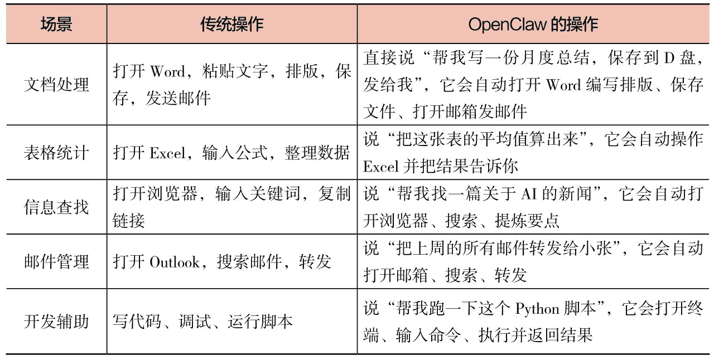

**4.为何 OpenClaw 现在爆火**

爆火不仅因技术成熟，更因它恰逢其时地解决了智能只会说不会做的痛点，给用户带来解放双手的快感和安全感。

（1）上手容易：像和朋友聊天一样下指令。过去想批量整理文件或自动回复邮件，可能要学脚本或宏。现在口语化下指令即可。比如“把上周邮件归档到已处理文件夹”，它就在后台自动完成，无需手动操作，大幅降低技术门槛。
（2）数据私密：数据留在本地。与传统云端智能不同，核心操作在本地完成。文件、邮件内容、操作记录保存在本地硬盘，处理敏感文件或商业机密时免除泄露顾虑。
（3）高效率：告别复制粘贴的枯燥。可一次性完成打开软件→导入数据→执行计算→保存文件→发送邮件等多个步骤，省去来回切换的烦琐，把时间留给思考决策。
（4）融合社交平台：可通过微信、飞书、钉钉接收指令。手机发条信息就能指挥电脑执行，完成后结果会自动推送给你。

优点诸多，但不要被冲昏头脑。OpenClaw 的优势场景是其他智能的盲区，但安全风险真实且严重。默认配置下存在严重漏洞，可能导致数据泄露、账号被盗甚至被远程控制。工业和信息化部、国家互联网应急中心及各大安全厂商均在 2026 年 3 月发布风险提示。

## 1.3 OpenClaw 和传统智能工具的根本差异

OpenClaw 与豆包、千问、ChatGPT 等传统工具的本质区别在于控制权和执行力。它不仅是对话工具，更是具备物理操作能力的数字助理。

**1.本质：从会说话到会干活**
千问、ChatGPT 能提供思路，而 OpenClaw 是真正的执行者，能直接操作电脑。表 1-2 为能力对比。
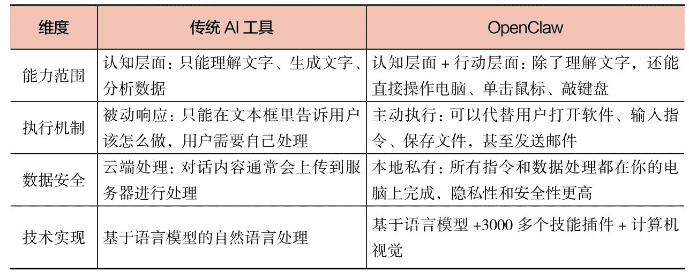

**2.操作层面的差异：自动化 vs 手动化**
实际使用中，OpenClaw 不只是给答案的老师，而是直接干活的干将。它可在 Word 中写稿、在 Excel 中算账、甚至在 Photoshop 中修图。表 1-3 展示操作区别。
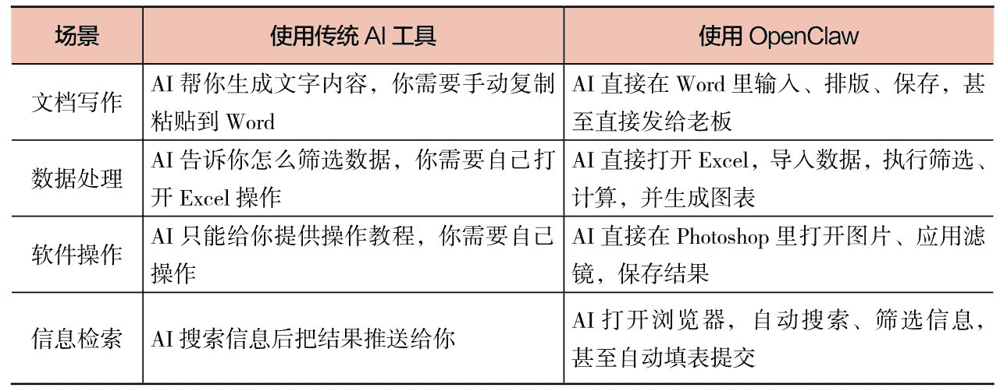

**3.技术与隐私的差异**
与依赖云端服务器的 ChatGPT 不同，OpenClaw 拥有本地存储，所有数据保存在电脑里，天生具备更高的安全性，能确保文件、聊天记录、操作历史不外泄。表 1-4 为技术与隐私对比。
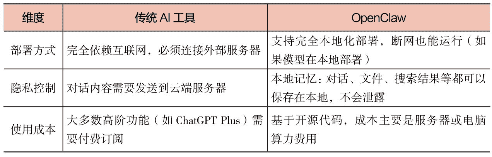

## 1.4 普通人为何急需 OpenClaw

2026 年 3 月 6 日周五，深圳南山区腾讯大厦北广场意外变成科技盛宴的“海鲜市场”。上午 10 点起，随着腾讯云工程师举起部署工具的“筷子”，排队队伍从广场入口延伸到街角。现场有本地智能极客，也有从香港、杭州跨城赶来的“虾友”。据统计，10 至 11 点一小时内数百个预约号被抢空，排队一度超千人。OpenClaw 创始人彼得也在 X 平台点赞转发相关帖子。

**1.被时代列车抛下的焦虑**

近两年，AI 圈看起来很热闹，模型会说的句子越来越多，也越来越像人话，可行动上总差一层透明屏障——会输出不会执行。OpenClaw 把这层屏障拆掉了，它不再只给建议，而是能真正接管鼠标键盘，完成操作。

这种转变带来的冲击很大。**一套在本地可控、开源自运且能自己干活的 OpenClaw，综合价值足以匹敌过去十年十款付费工具加起来的效果。**

说普通人为何迫切需要它，并不是在卖工具，而是在描述正在到来的现实。准备是否充分已经不重要，产业的浪潮会冲到每一个人的日常岸边。

当自动化成为默认状态，仍固守纯手动的人，产出会被快速稀释。若认知还停留在“AI 只能帮我润色”的层面，用半自动的配合手动处理琐事，时间会被碎片填满，创造力被重复消耗，而对手已经靠 OpenClaw 完成能力的指数级跃升。这种差距，靠加班补不回来。

**人人可拿到的新超能力**

每一次生产工具的迭代都会重写资源分配。OpenClaw 的特殊之处在于，它并非巨头的封闭产品，而是可以本地掌控、源码开放、门槛不高的一套方案。

这意味着单人作战的时代真的开启了。职场新人或初创者，都能把它当成最可靠的伙伴。

对上班族，它是 24 小时在线的助理，把枯燥重复的工作剥离，让人集中在判断和创新。对自由职业者，它可同时承担客服、运营、财务、销售，让一个人撑起一个团队，用极低成本撬动更大业务。对大众用户，它是跨越技术门槛的钥匙，不用懂代码、不必理解编程逻辑，只需用自然语言就能指挥它挂号、订票、整理照片、甚至管理家人的健康数据。

自动化不再是大型企业的特权，OpenClaw 正进入寻常家庭。它带来的本质是时间盈余，每天省下的时间可用以阅读、旅行或陪伴，这不是遥远的想象，而是触手可及的未来。

学会 OpenClaw 已从可选项变成必选项。学习它不仅是掌握一款工具，更是养成新的生存思维：如何指挥机器、如何设计流程、如何从执行者转为管理者。

放下技术焦虑，去了解、部署并让它为你工作。当你第一次看见 OpenClaw 自动处理一堆令人头疼的事项时，你会明白，生活可以更从容，人人也能拥有超能力。

# **第二章**

# **安装 OpenClaw 之前，你要准备这些**

不少新手第一次接触 OpenClaw，第一反应是立刻找部署教程。真正导致反复踩坑的，往往不是命令本身，而是前期判断不到位。没有想清楚放在本地还是云端、设备是否匹配、模型凭证是否齐备，就照着教程硬上，中途发现环境、权限或账号缺失，只能返工。

与普通桌面程序不同，OpenClaw 是一套连接模型、工具与运行环境的智能体平台。方向选错，后续每一步都会更费力；方向选对，部署与使用都会顺畅很多。

本章要厘清部署前的核心问题：怎么选部署位置、怎么选系统、怎么准备账号与模型认证。

## **2.1 你的需求：安装在本地还是云端**

部署 OpenClaw 前，第一步不是敲命令，而是明确它运行在自己的电脑上，还是运行在远程主机上。

**1.什么是本地部署**

本地部署指把 OpenClaw 装在自有设备上，可选 macOS 电脑，也可选 Windows 电脑。

优势很直观。

第一，对运行环境的掌控更强，程序、工作区、日志与配置都留在自己手里，管理更直接。
第二，本机文件操作更顺手，频繁处理本地文档、目录与脚本时路径更短、调试更方便。
第三，对个人学习与试水而言启动成本更低，更适合初尝。

但本地部署不等于数据绝对不离开本机。必须清楚，OpenClaw 可本地运行，但一旦接入第三方大模型 API，你发往模型的内容仍会进入模型厂商的服务器，不会完全留在硬盘里。更准确的说法是：本地部署能让你更可控本地运行环境与本地文件，但调用外部模型或服务时相关数据仍可能进入对应厂商系统。

局限也很现实。设备关机，服务通常也随之停止。若希望长期在线、随时远程可用，就需要额外处理远程访问、认证与网络暴露。

另外，在没有明确授权与合规前提下，不建议直接在公司办公电脑上部署。不是公司电脑不能装，而是企业设备通常有更严格的终端管控、审计规则与数据边界。个人项目、外接 API、自动化脚本与企业环境混在一起，后续授权、审计与边界界定会变得非常复杂。

**2.什么是云端部署**

云端部署指把 OpenClaw 安在远程服务器上，由云平台提供资源，你通过网络连接、管理与使用。本地电脑更多是控制端。

最大好处是可长期在线。只要服务器保持供电与网络连接，它就能持续运行。对需要长期任务、远程访问、多设备协同的人而言，云端通常更方便。官方远程访问文档也将“单网关运行在专用主机上”列为推荐模式之一。

另一个好处是降低本地性能要求。持续运行的重担由服务器承担，你的笔记本、平板甚至手机都可以作为入口。

代价也很明显。

第一是持续费用，服务器按资源与时长计费，在线就会产生成本。
第二是更依赖网络，网络不稳体验会下降。
第三是安全配置要求更高。远程环境运行必须认真处理网关绑定、认证方式、端口暴露与远程接入安全。

因此云端部署要记住两条基本原则：第一，确保你熟悉云服务器操作方式；第二，不要把服务直接暴露在公网上。

**3.两种方式如何选择**

只做个人学习、测试、处理本地文档，或希望尽快简单上手，优先本地。

更看重长期在线、远程访问、多设备协作，或希望把它当作持续运行的服务来用，云端更合适。

简单说，本地部署像把 OpenClaw 放在自己桌上，控制感强、起步快；云端部署像把它放在长期在线的远程主机上，随时可连，但对安全与维护要求更高。

## **2.2 你的系统：Windows、macOS 还是 Linux**

确定部署方式后，下一步看系统。

**1.macOS：个人本地体验较好**

macOS 上本地部署 OpenClaw 通常比较顺滑，官方也把 macOS 列为推荐环境。

对个人用户而言，macOS 的优势在于系统环境相对统一，终端工具链成熟，命令行操作更流畅。如果你本就习惯在 macOS 上开发、写作或办公，整体体验会比较友好。

想准备一台长期在线、省心的本地专用设备，Mac mini 是常见选择，但是否购买仍取决于预算与需求。

**2.Windows：普及度高，但体验有局限**

如果 macOS 是 AI 爱好者常说的省心路线，Windows 就是贴近大多数普通用户现实的路线。大部分人的主力个人电脑、家庭电脑甚至公司电脑都是 Windows，文件查找、软件安装、设置位置、问题排查，用户通常更熟悉。

这也是 Windows 的最大优势：设备多、用户熟悉度高、试错成本低。很多人不用额外买机器、不用换系统，手头电脑就能先试试，对初次接触的人门槛更低。

但问题也在这里。Windows 是大多数人最熟悉的桌面系统，却不是 OpenClaw 当前最顺手的原生运行环境。Windows 终端在权限分配、系统调度等方面限制较多，很多命令在 Windows 终端里无法生效。网上的教程多按类 Unix 终端编写，直接照搬常遇到命令格式、路径写法、权限策略或环境变量不一致的问题。

总体来说，Windows 普及度高、上手门槛低，但进入安装配置阶段后，PowerShell 等终端环境会暴露不少局限，新手容易卡在这里。

**3.Linux：适配强，上手门槛更高**

打算把 OpenClaw 放在云服务器长期运行，大概率会碰到 Linux。因为 Linux 是服务器世界里最常见、最成熟的系统之一。

Linux 的优势是兼容性和适配性强，与现代命令行工具、开发环境、服务器运行方式更贴近，很多依赖、脚本和自动化流程原本就是为这类环境设计的。对需要和终端、服务、网关、守护进程、远程访问打交道的 OpenClaw 来说，Linux 更像是标准工作场。无论是本地进阶部署还是云端长期运行，Linux 往往是首选。

它也更适合长期运行。系统结构清晰，服务管理统一，对需要长期挂网关、做健康检查、跑自动化任务的人来说更符合服务型系统的定位。

缺点也很明显，对新手不够友好。默认交互方式和普通人习惯的图形界面差别很大，很多操作靠终端完成，很多设置靠改配置文件，排查问题靠命令输出和日志。对习惯点图标、开窗口、找菜单的用户来说，操作思路会完全改变。

不过也不必过度恐惧。对大多数普通用户，使用 Linux 部署 OpenClaw 不意味着要系统学习 Linux，真正需要掌握的只是少数基础操作：如何连接服务器、进入目录、编辑配置文件、复制命令、查看服务是否正常运行。门槛确实比 Windows、macOS 高，但并没有高到非专业人士不能碰。

## **2.3 账号准备：获取大模型 API Key**

这一步你可能已经迫不及待想输安装命令了，但必须先停一下，最核心的准备还没完成：拿到专属的大模型 API Key。

**1.为什么需要大模型**

有人会问：我装的是 OpenClaw，为什么还要大模型？API Key 起什么作用？能不能不用？

用个比喻理解。OpenClaw 本身像一只执行力极强的龙虾，能 24 小时工作、执行任务、安装技能、监控数据，但它自己没有大脑，无法理解指令、思考完成方式或生成内容。大模型就是这只龙虾的大脑，API Key 则是你为它提供的、接入大脑的专属门禁卡。

技术上说，OpenClaw 是开源的 AI 智能体运行框架，只负责执行操作，比如定时发消息、检索网页、整理文件、对接平台，但它不具备理解、思考、生成、决策能力。你发出的每条指令，都需要通过 API 传给大模型，由大模型理解需求、生成方案再回传给 OpenClaw 落地执行。

没有大模型，OpenClaw 就是空壳，像没大脑的龙虾，无法响应指令；没有 API Key，OpenClaw 就无法合法调用大模型功能，相当于找到了大脑却没钥匙，依然无法工作。

这就是为什么获取大模型 API Key 是安装前绕不开的最后一步。

还有一条贯穿始终的安全红线：API Key 等同于你在模型厂商的身份凭证和支付凭证，相当于银行卡密码加 U 盾的结合。谁拿到你的 Key，谁就能用你的额度调用并产生账单。所以妥善保管 API Key，比什么都重要。

**2.新手可用的三个正规渠道**

目前国内兼容性较好的平台较多，这里重点介绍三个：火山方舟、Kimi 和 MiniMax。

**火山方舟，首选，提供编程计划**

火山方舟是字节跳动旗下平台，主推豆包系列模型，也支持 Kimi、DeepSeek 等。对普通用户来说，它的 Coding Plan 很实在，开启后 API 按调用次数计费而非按 Token 计费，使用次数明显增多。

豆包系中文理解强、响应快，日常对话、信息整理表现稳定。如果你是第一次尝试，不确定是否长期使用，从火山方舟开始成本和风险最低。

**Kimi**

Kimi 由月之暗面开发，目前国内知名度很高。API 对外开放，新用户有免费试用额度。优势在于长文本处理能力强，适合大量文档整理、读报告、分析合同。

注意，Kimi 的 API 叫 Moonshot API，和你平时在 kimi.ai 上对话的产品是两回事，不要混淆。

**MiniMax**

MiniMax 在从业者圈口碑不错。abab 系列模型在多轮对话、角色扮演、创意写作上很有特点，如果想给 OpenClaw 定一个有个性的人设，MiniMax 是合适选择。同样提供新用户免费试用额度。

以上三个都是正规平台，支持支付宝或微信付款，账号申请均为实名制。

**3.火山方舟 Coding Plan API Key 获取流程**

下面以火山方舟 Coding Plan 为例，逐步完成 Key 的获取、配置和安全设置。每一步都标注了截图节点，学会后操作其他模型大同小异。

第 1 步：进入火山引擎官方平台，找到火山方舟 Coding Plan 入口。

先打开浏览器搜索火山方舟官网，一定要通过字节跳动火山引擎官方域名进入，不要点陌生链接或搜索引擎里的非官方广告，避免钓鱼。

图 2-1 火山方舟官网

进入官网首页后，方舟 Coding Plan 专区目前通常通过顶部导航栏的“最新活动”进入，如图 2-2 所示。

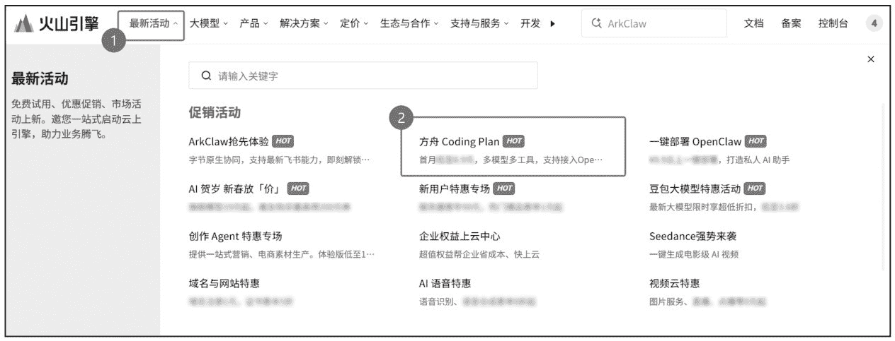
图 2-2 方舟 Coding Plan 入口

第 2 步：注册账号并完成个人实名认证。

国内正规大模型 API 服务必须实名认证，这是法规要求。字节跳动对用户信息加密保护有严格合规标准，无需担心泄露。

点击页面右上角“立即注册”，用手机号完成注册，如图 2-3、图 2-4 所示。

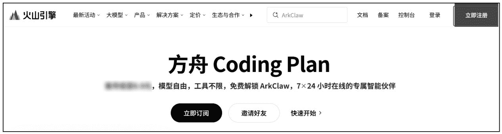
图 2-3 方舟 Coding Plan 注册入口

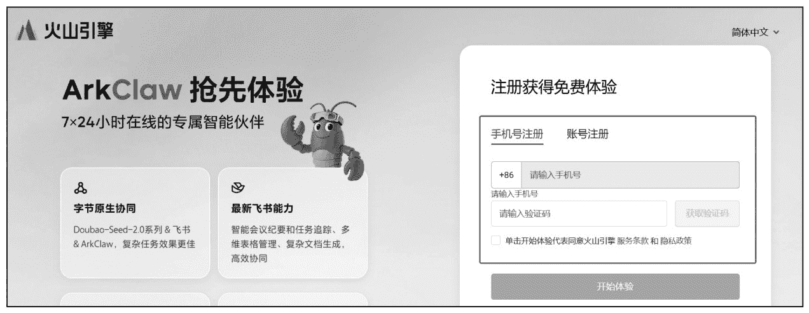
图 2-4 输入手机号码验证并登录

登录后点击右上角头像，在下拉菜单找到“实名认证”入口，选择“个人认证”（见图 2-5），按提示选择验证方式，完成人脸核验即可。

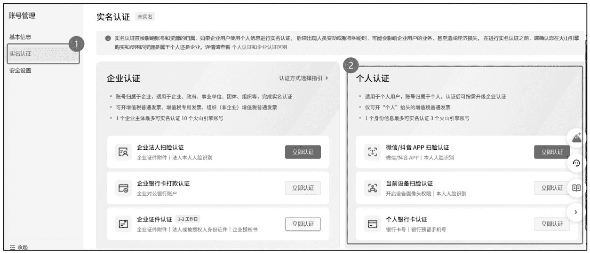
图 2-5 实名认证操作步骤

第 3 步：开通 Coding Plan 服务，领取新用户免费额度。

完成实名后回到方舟 Coding Plan 专区，点击中间的“立即订阅”按钮，按提示勾选服务协议，完成开通，如图 2-6 所示。

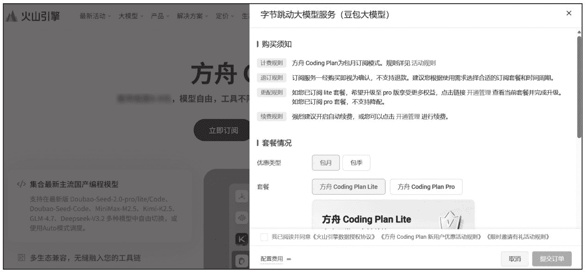
图 2-6 立即订阅并完成支付

开通后新用户免费额度领取入口会自动弹出，点击领取即可。额度会直接到账，新手可以先用免费额度完成安装测试、跑通基础功能，不必先充值。

第 4 步：创建专属 API Key，妥善保管核心凭证。

开通服务后点击页面右上角“控制台”按钮，进入火山引擎管理后台，如图 2-7 所示。

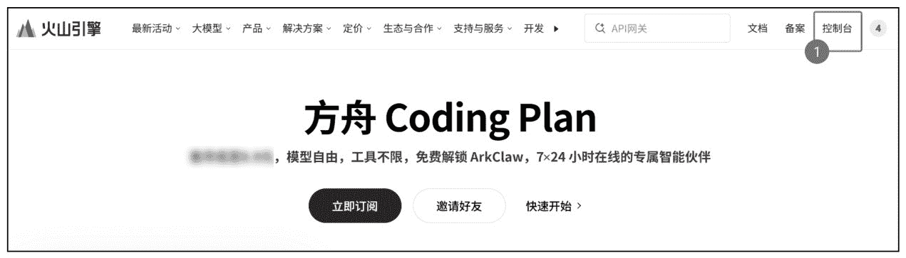
图 2-7 单击“控制台”按钮，进入火山引擎管理后台

在控制台左侧导航栏找到“访问控制”，进入后在侧边栏找到“API Key 管理”，如图 2-8 所示。

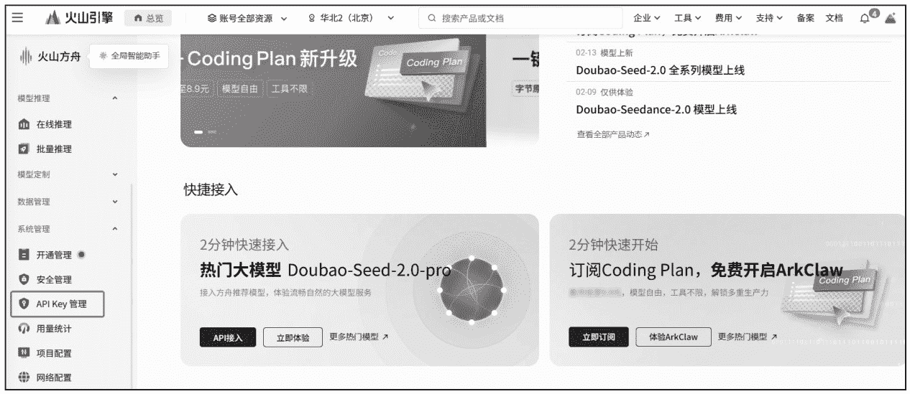
图 2-8 找到“API Key 管理”

选择“API Key 管理”选项，点击界面中的“创建 API Key”按钮，然后点击“创建”按钮，如图 2-9 所示。

先把安全讲清楚：API Key 出于保密默认处于折叠状态，想要查看具体内容需要点击图 2-10 中所示的眼形图标，显示后立即复制到本地文档保存备用。务必不要把这串凭证透露给任何人，哪怕是熟人也不行。

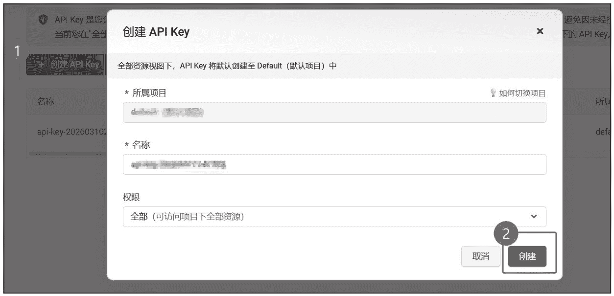
图 2-9 创建 API Key

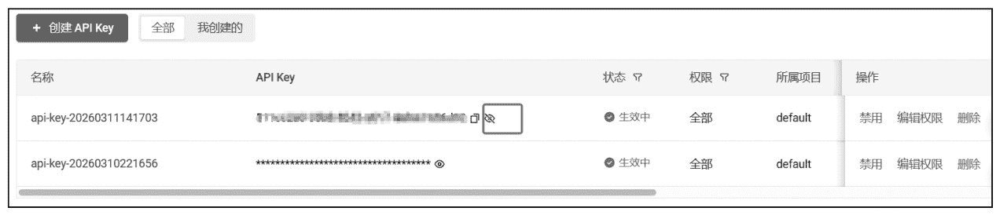
图 2-10 复制密钥并另存

到此你已经拿到 OpenClaw 的专属门禁凭证，后续在安装环节将这串 Key 填入对应的配置框，就能让 OpenClaw 接通大脑，正常执行任务。

# **第三章**
# **三步上手，原版 OpenClaw 部署攻略**

本章会循序渐进完成 OpenClaw 的部署与初次配置，整体拆成三大部分，助你顺利养起专属的“龙虾”。

## **3.1** **第 1 步：准备系统环境**

OpenClaw 的运行依赖 Node.js 和 Git 两个基础组件，无论 Windows、macOS 还是 Linux 都需要先就位。下面以 Windows 为例说明，其他系统的思路基本一致。

**1.搭建 Node.js 运行时**

Node.js 是 JavaScript 的运行环境，也是 OpenClaw 核心功能运转的基础，建议安装 LTS 长期支持版以保证稳定性。

Windows 安装流程如下。

（1）启动浏览器，进入 Node.js 官方网站，如图 3-1 所示。

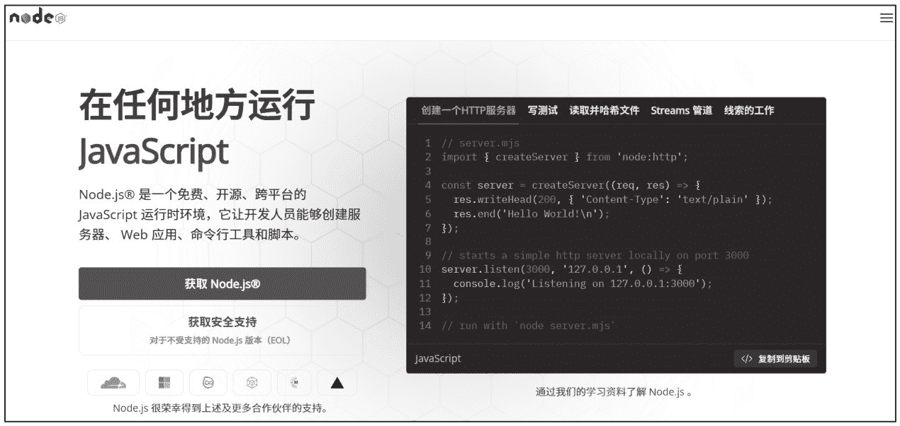
图 3-1 Node.js 官网

（2）在首页左侧点选“获取 Node.js”，进入下载页。

（3）在下载页依据系统和平台选择对应按钮开始获取，如图 3-2 所示。

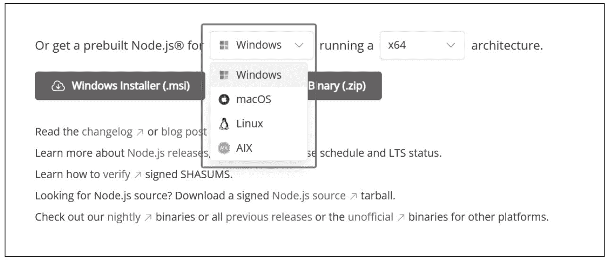
图 3-2 下载 Node.js

（4）下载完成后解压运行安装程序，出现向导界面如图 3-3 所示。

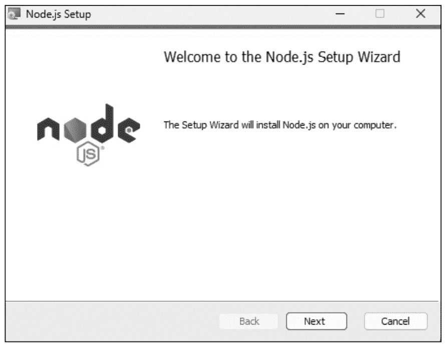
图 3-3 安装向导界面

点“Next”，在图 3-4 的许可协议页勾选“我接受许可协议”中的条款后，保持默认设置一路点“Next”。

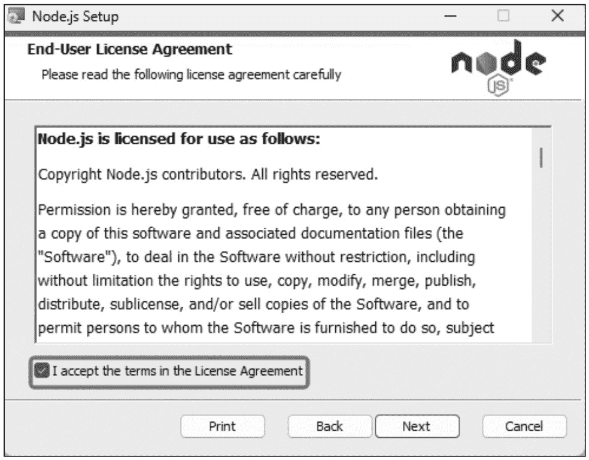
图 3-4 勾选“我接受许可协议”中的条款

点“Install”开始写入，等待片刻后点“Finish”完成安装，如图 3-5 所示。

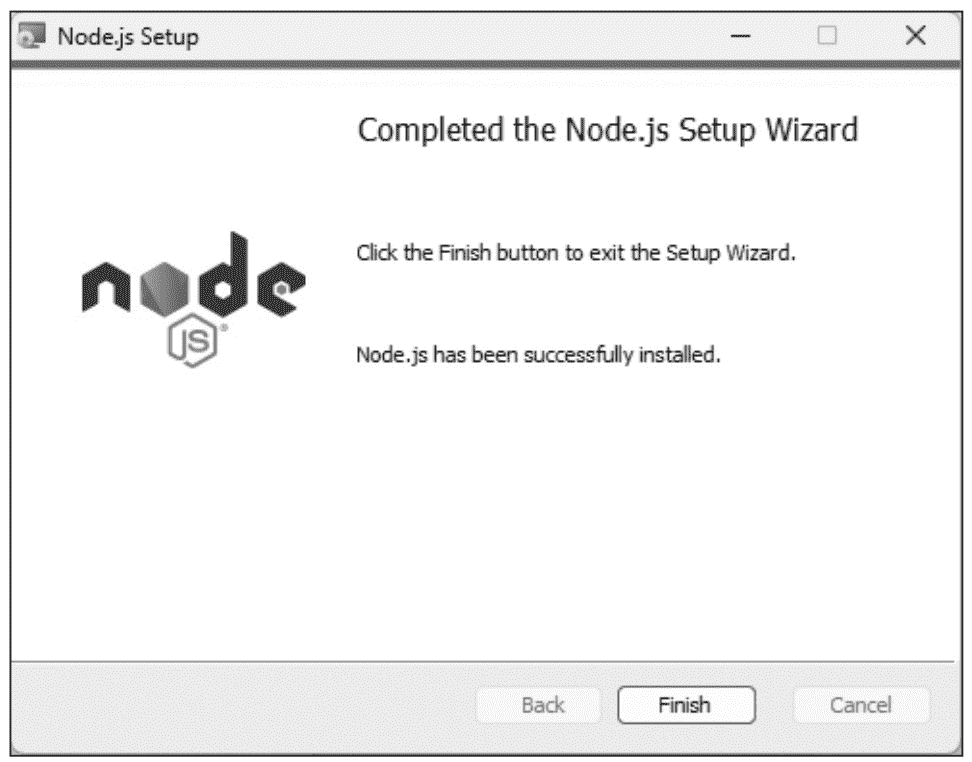
图 3-5 完成 Node.js 安装

**2.核验 Node.js 与 npm 是否生效**

安装结束后需通过终端确认。

**（1）核验 Node.js**

将鼠标移至 Windows 开始按钮右键，在弹出菜单中选择“终端管理员”进入终端，如图 3-6、图 3-7 所示。

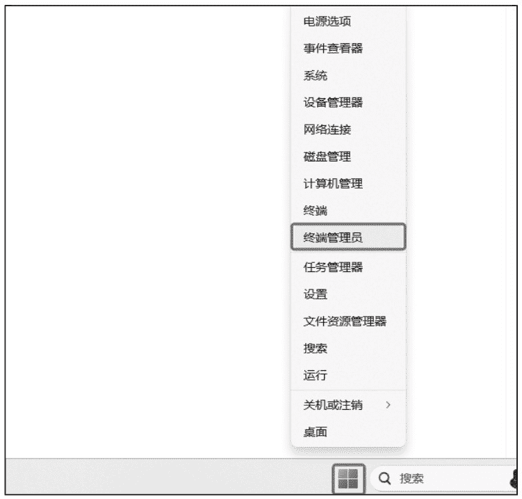
图 3-6 选择“终端管理员”命令[注：为了获得较好的显示效果，本书将终端配置为浅色模式，这不影响实际功能。]

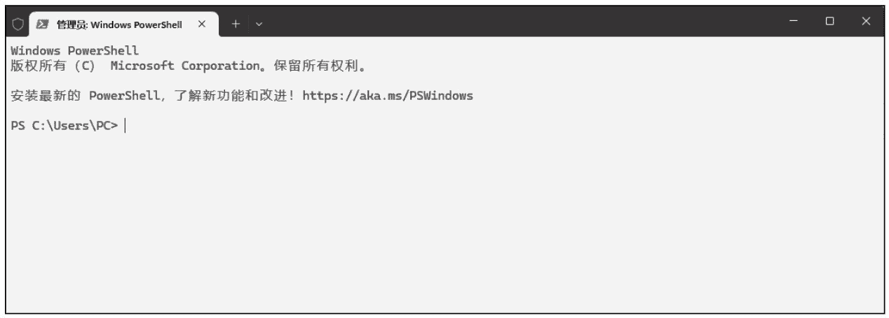
图 3-7 进入终端

进入终端后输入下方指令回车，查看版本，如图 3-8 所示。

node -v

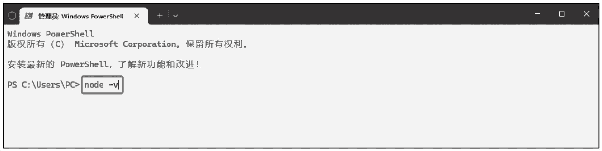
图 3-8 执行 Node.js 的验证命令

若安装正常，会返回类似“v2x.x.x”的版本号，具体数字会随发布时间变化，只要出现版本号即算成功，如图 3-9 所示。

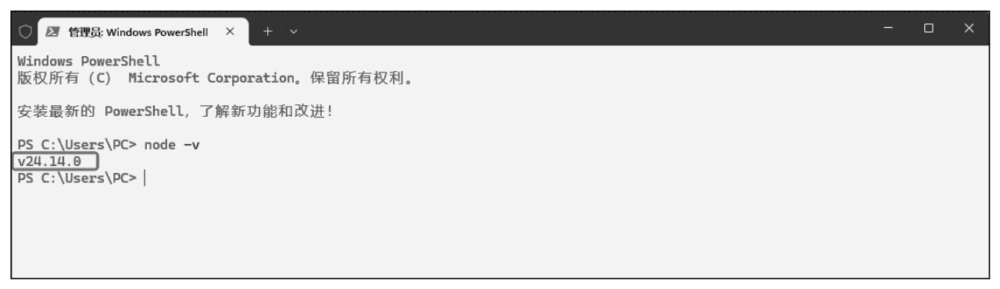
图 3-9 返回的 Node.js 版本号

**（2）核验 npm**

继续在同一终端输入下方指令回车，查看 npm 版本，如图 3-10 所示。

npm -v

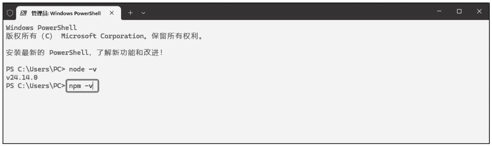
图 3-10 执行 npm 的验证命令

若输出类似“11.x.x”的版本号，则说明 npm 已就位，如图 3-11 所示。

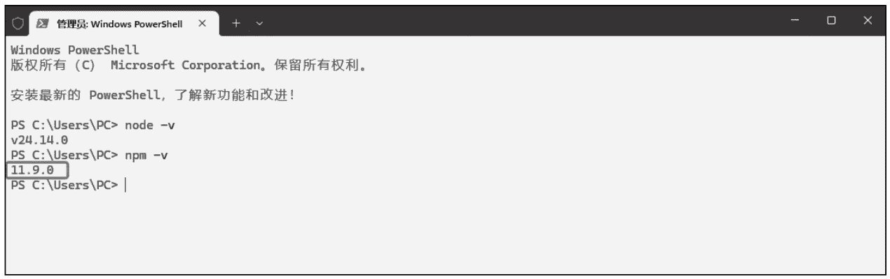
图 3-11 返回的 npm 版本号

**3.部署 Git 工具**

部分安装方式需要 Git 版本控制工具。

Windows 下的部署步骤如下。

访问 Git 官网，点击“Windows 安装”按钮，如图 3-12 所示。

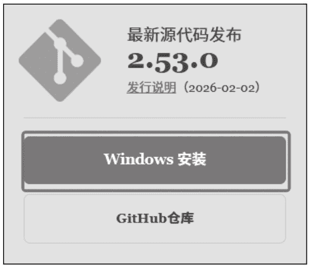
图 3-12 单击“Windows 安装”按钮

进入下载界面后按系统选择并按提示获取安装包，如图 3-13 所示。

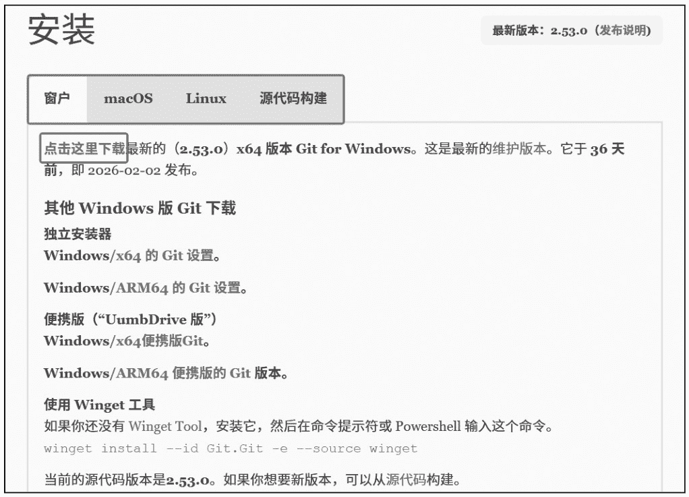
图 3-13 下载 Git 安装包

下载完解压运行安装程序，向导界面如图 3-14 所示。

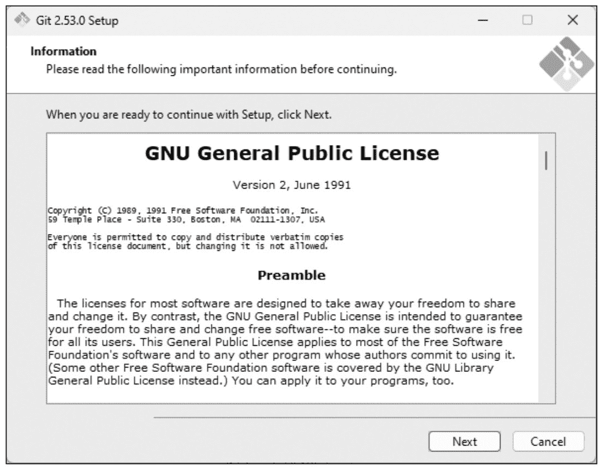
图 3-14 Git 安装向导界面

向导中多数选项保持默认，连续点“Next”，最后点“Finish”结束安装，如图 3-15 所示。

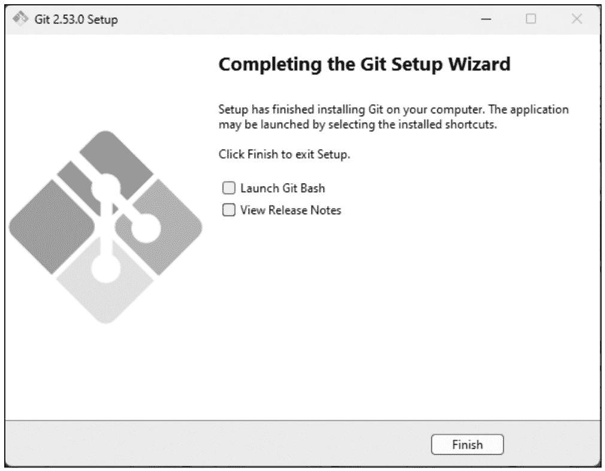
图 3-15 完成 Git 工具的安装

**4.核验 Git 是否可用**

安装完毕后关闭终端重开，输入下方指令回车，如图 3-16 所示。

git --version

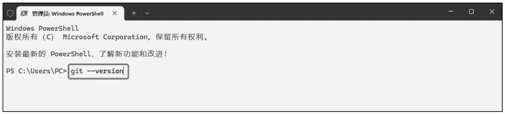
图 3-16 输入 Git 工具的验证命令

若显示类似“git version 2.x.x”的版本号，说明 Git 已正确就位，如图 3-17 所示。

图 3-17 返回的 Git 工具版本号

## **3.2** **第 2 步：完成安装并检测**

环境就绪后即可开始部署 OpenClaw。先打开官网获取安装指令，首页如图 3-18 所示。

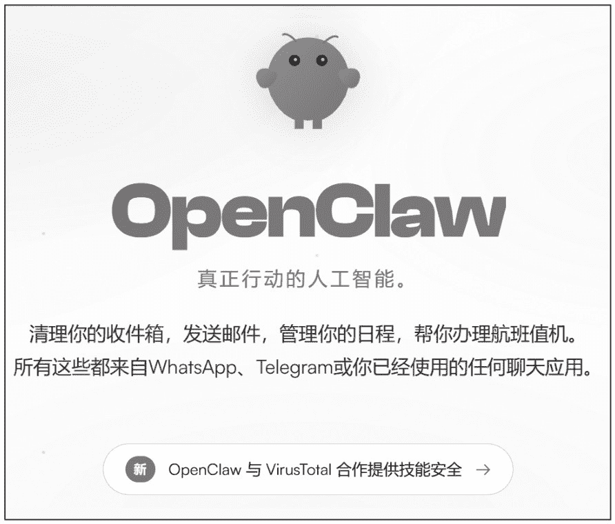
图 3-18 OpenClaw 官网首页

进入首页向下滚动，可看到不同系统与安装方式的选项。下面分别说明 Windows、macOS 的选择方式，以及一键指令与 npm 指令的使用。

在官网“Quick Start”区域列出了几种方案，如图 3-19 所示。

● One-liner：一键安装命令，适合大多数用户，会自动处理依赖。
● npm：通过 npm 包管理器安装，适合熟悉 Node.js 的用户。
● Hackable：适合想查看或修改源码的用户。

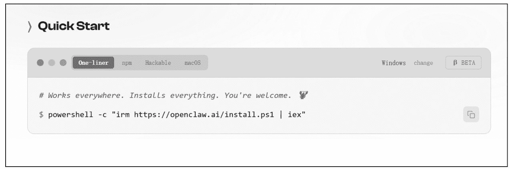
图 3-19 OpenClaw 的不同安装方式

官网会依据当前系统自动切换，也可点“change”在“macOS/Linux”和“Windows”之间切换，选择对应指令，如图 3-20 所示。

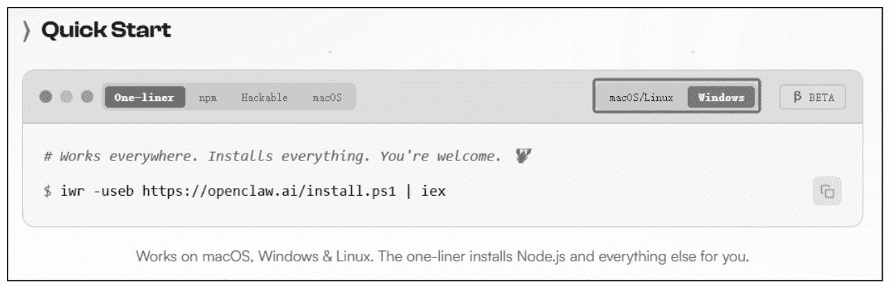
图 3-20 选择系统版本

**1.Windows 系统部署**

官方提供两种方式，一键命令与 npm 命令，如图 3-21 所示。

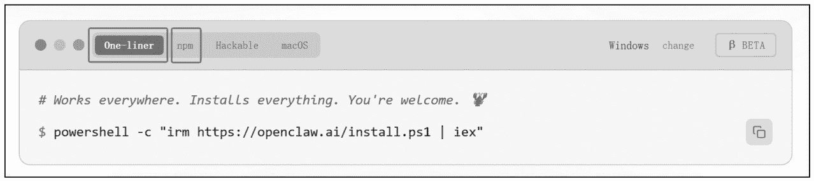
图 3-21 两种安装方式

**（1）一键安装命令**

复制官网自动生成的适合终端的一键指令，如图 3-22 所示。

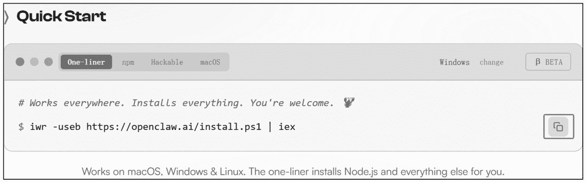
图 3-22 复制一键安装命令

打开终端，需以管理员身份运行，否则可能出现权限报错。粘贴指令后回车，静待安装完成，如图 3-23、图 3-24 所示。

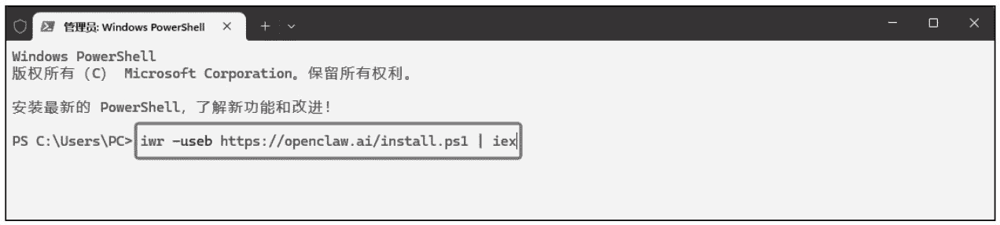
图 3-23 执行一键安装命令

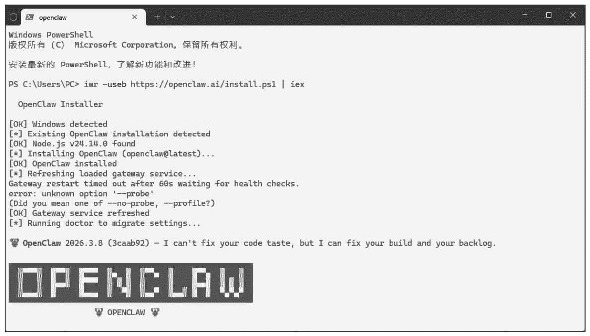
图 3-24 OpenClaw 安装完成

出现与图 3-24 相似的界面即代表安装成功。

**（2）npm 安装命令**

使用 npm 安装的步骤如下。

在官网“Quick Start”中选择“npm”，复制第一条安装指令，用于安装 OpenClaw 主体，如图 3-25 所示。

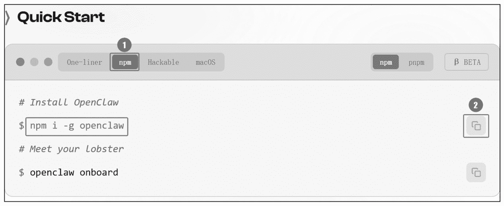
图 3-25 复制第一条安装命令

以管理员身份打开终端，粘贴指令，如图 3-26 所示。

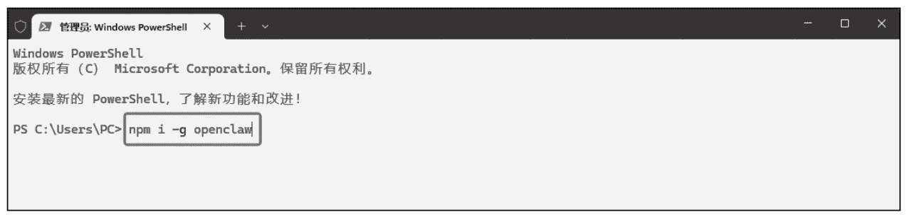
图 3-26 粘贴命令

回车后会出现旋转符号，表示正在写入，如图 3-27 所示。

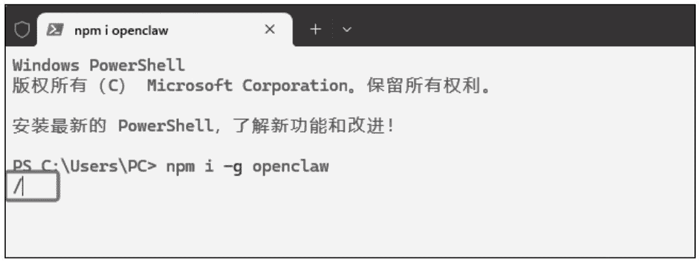
图 3-27 正在安装

稍等片刻，出现图 3-28 类似的内容即表示部署完毕。

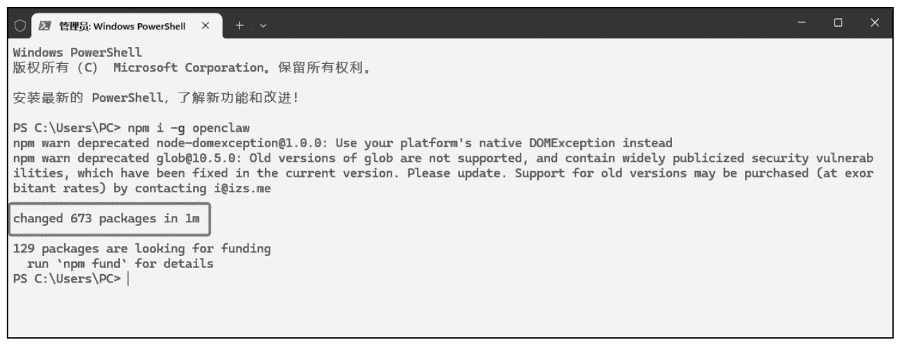
图 3-28 OpenClaw 安装完成

**2.macOS 系统部署**

使用 macOS 时官网默认展示“macOS/Linux”选项，可选一键指令或 npm 指令。

**（1）一键安装命令**

在“Quick Start”确认选择“macOS/Linux”，复制一键指令，如图 3-29 所示。

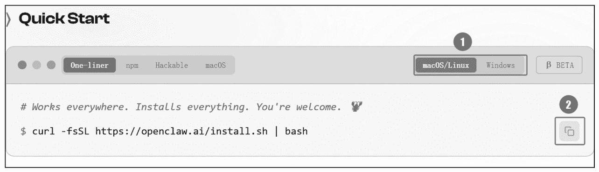
图 3-29 复制 macOS 一键安装命令

打开终端，粘贴刚才复制的指令，如图 3-30 所示。

回车后等待过程结束，期间可能需要输入 macOS 密码以获取权限。

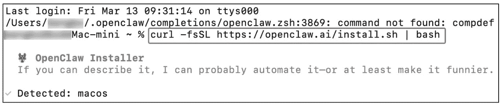
图 3-30 粘贴 macOS 一键安装命令

**（2）npm 安装命令**

macOS 下使用 npm 安装的方法与 Windows 基本相同，此处不再赘述。

无论哪个系统，指令执行完毕后都需要验证。关闭后重新打开终端，执行下方指令，如图 3-31 所示。

openclaw --version

图 3-31 执行验证命令

若部署成功，终端会输出 OpenClaw 的版本号，版本号会随更新变化，如图 3-32 所示。

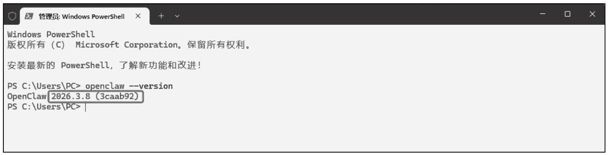
图 3-32 显示的版本号

至此，OpenClaw 的部署与检测已完成。

## **3.3** **第 3 步：完成初始配置**

安装完成后，需要运行初始化指令，让 OpenClaw 了解你的偏好与使用环境。过程中会出现风险提示，按指引操作即可。

在终端输入下方配置指令，如图 3-33 所示。

openclaw onboard

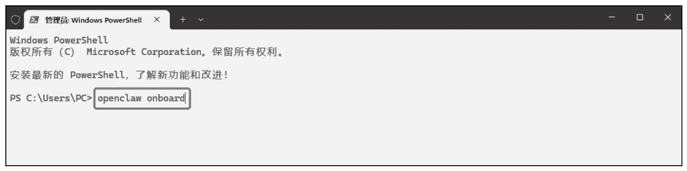
图 3-33 输入配置指令

回车后进入配置流程，如图 3-34 所示。

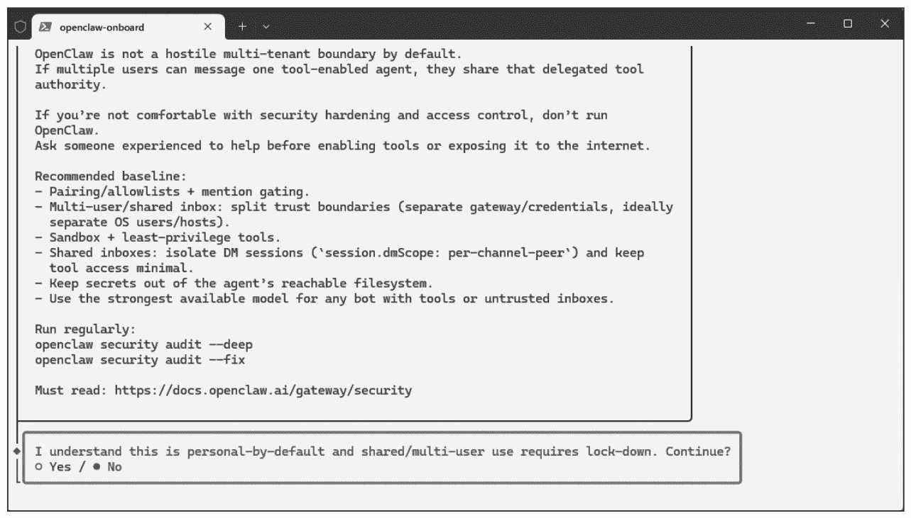
图 3-34 进入配置流程

配置共 8 个环节。切换选项使用键盘上下左右方向键，确认使用回车；多选环节可用空格键勾选后再回车。

**1.风险告知与确认**

启动后首先出现图 3-34 的风险提示，大意为“我已理解：该工具默认仅适配个人使用场景，若要用于共享/多用户场景，必须先完成安全加固与权限锁定。是否继续？”

之所以有此提示，是因为 OpenClaw 的核心是“帮你做事”，提示是为了让你在知情下使用。

阅读完毕后，用左方向键选择“Yes”，回车进入下一环节。

**2.引导模式选择**

第二环节为图 3-35 的引导模式选择，用于决定初始化配置的复杂度。

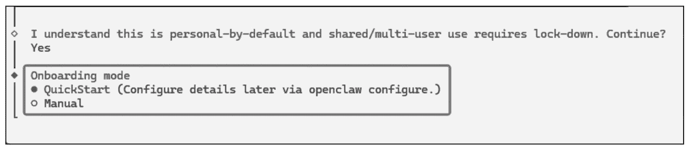
图 3-35 引导模式选择

官方提供两种核心模式。对零基础用户，“QuickStart”模式更友好，它会跳过非必要参数配置，无需学习开发知识，完成必填项即可运行，后续还能再调整。

此处选择“QuickStart”，回车继续。

**3.模型提供商选择**

第三环节为图 3-36 的模型提供商选择，这是决定 OpenClaw AI 思考、执行、生成能力来源的关键，共分 4 个子步骤。

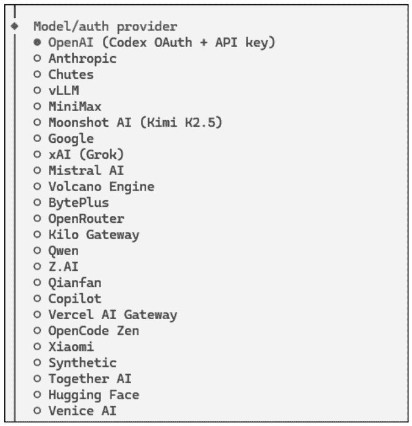
图 3-36 模型提供商选择

**（1）选择核心模型提供商**

模型提供商为 OpenClaw 提供大语言模型服务，各家功能相近各有侧重。

这里选择“Volcano Engine”（火山引擎），用上下方向键选中后回车。

**（2）选择 API Key 提供方式**

此步决定如何向 OpenClaw 提供 API Key，如图 3-37 所示。

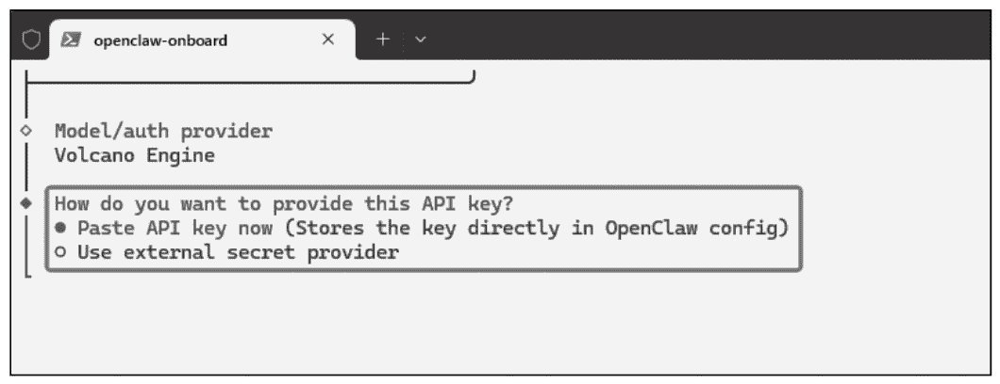
图 3-37 选择 API Key 提供方式

API Key 是调用大模型的身份凭证。官方提供两种方式，这里选择“Paste API key now”，回车继续。

**（3）输入 API Key**

这是录入凭证的环节，你粘贴的 API Key 仅用于调用大模型服务，不会上传到第三方服务器。录入有效 Key 后即可正常调用。

进入输入界面，直接粘贴准备好的 API Key，如图 3-38 所示。

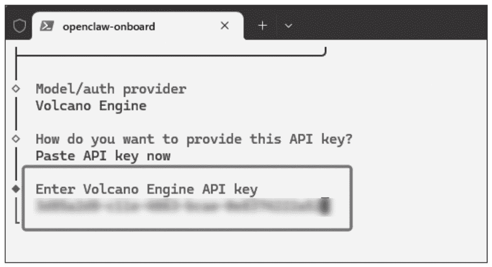
图 3-38 粘贴 API Key

确认无误后回车，进入下一环节。

**（4）选择默认模型**

此步选择 OpenClaw 日常运行的默认大模型，不同模型能力不同。演示中购买了火山方舟 Coding Plan 订阅，故选择带“volcengine-plan”前缀的模型。

在选择界面用上下方向键选中任意以“volcengine plan”开头 的模型，例如“volcengine-plan/ark-code-latest”，如图 3-39 所示。

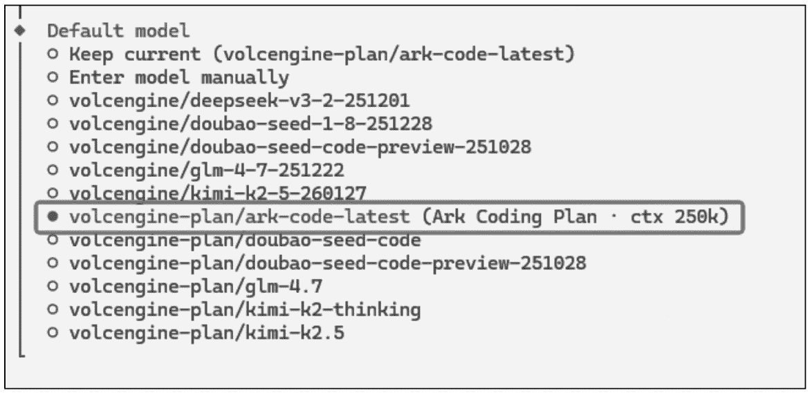
图 3-39 选择默认模型

选好后回车，继续往下。

**4.频道选择**

这里的“频道”指 OpenClaw 可对接的聊天应用渠道，即后续对话入口。配置后可在常用 App 中直接下指令，无需一直开终端或网页。

对零基础用户，“Skip for now”暂不配置更合适。用上下方向键选中“Skip for now”，如图 3-40 所示。

图 3-40 选择频道

选好回车继续。

**5.搜索提供商选择**

搜索提供商为 OpenClaw 提供联网搜索能力，配置后可查询实时航班、新闻、汇率、天气等信息，完成需要联网的任务。

这里继续选择“Skip for now”，进一步降低入门门槛。

用上下方向键选中“Skip for now”，如图 3-41 所示。

图 3-41 选择搜索提供商

选择完成后回车，进入下一环节。

**6.Skill 配置**

“Skill”即官方和社区开发的扩展插件，可联动第三方工具，让 OpenClaw 控制更多软硬件，拓展自动化场景。

对零基础用户，选择“No”较为合理。

进入 Skill 配置界面，用左右方向键选中“No”选项，如图 3-42 所示。

图 3-42 选择是否进行 Skill 配置

选定后回车即可推进下一步。

**7.钩子启用**

“Hooks” 其实是 OpenClaw 提供的高级事件监听与自动化机制，通俗讲就是让系统在后台默默盯着特定事件，到了时机自动触发。

可供挑选的挂钩共四项：

① boot-md。网关服务启动时，系统会去项目根目录读取 BOOT.md，并按文件里的指令依次执行。
② bootstrap-extra-files。除了默认配置，启动阶段还能额外挂载你指定的目录、脚本、提示词模板或自定义工具规则。
③ command-logger。打开后，用户指令、执行轨迹和工具调用都会被汇总到统一的审计日志。
④ session-memory。默认用 /new 或 /reset 新开或重置会话时会清空上下文，启用后历史记录会被保留，新会话依然可读取旧内容。

在钩子设置页先点选 Skip for now 暂时跳过，后续再补，如图 3-43 所示。

图 3-43 选择是否启用钩子

**8.启动方式**

这里决定之后怎么进入 OpenClaw，也就是主要的操作入口，官方给出了两种方案。

对零基础用户来说，Open the Web UI 是更友好的选择，网页版操作直观，和常见聊天工具类似，能清楚看到执行过程和错误提示，还支持连续对话、历史回顾和图形化设置，使用体验更顺滑。

于是用上下键把光标挪到 Open the Web UI，如图 3-44 所示。

图 3-44 选择启动方式

回车确认，初始配置就算走完了。

**9.配置完成最终验证**

确认后系统自动初始化，终端会打印本地 Web UI 地址，通常是 http://localhost:××××，并自动在默认浏览器打开对话页，如图 3-45 所示。

图 3-45 OpenClaw 的 Web UI 对话界面

若未出现预期画面，浏览器显示无法访问，如图 3-46，说明服务还没准备好。

不用紧张，回终端执行：
openclaw gateway

图 3-46 无法访问提示信息

回车等待服务跑起来，再刷新刚才的页面就能看到对话界面。

在输入框发一句“你好！”，若得到正常回复，说明初始化成功，如图 3-47。

图 3-47 测试 OpenClaw

到这里，你的龙虾已经孵化完成，可以正式用了。

# **第四章**
# **从对话到全场景操控**

本章进入养龙虾的核心。前面解决的是安装启动，这里聚焦怎么用得熟、用得久、真正产出价值。

## **4.1 TUI 与 Web UI：两种操作面板怎么用**

安装配置完成后，第一反应往往是：去哪儿用它？

OpenClaw 不是单入口，同时提供终端 TUI 和浏览器 Web UI，两者连向同一核心，只是交互形态不一样。

**1.TUI**

启动方式很简单，终端输入：
openclaw tui

执行后即可看到界面，如图 4-1。

图 4-1 TUI

初见 TUI 容易觉得别扭，其实逻辑和普通聊天工具相近，底部输入框输入内容回车即可对话，如图 4-2。

图 4-2 在 TUI 中和 OpenClaw 对话

输入 / 回车会弹出设置列表，方向键即可挑选选项，如图 4-3。

图 4-3 TUI 中的设置列表

退出时连续按两次 Ctrl+C。

TUI 并非更难，只是更贴近底层。视觉干扰少，连接状态和执行进度一目了然。对想深入掌握的用户来说，越早熟练越好。

**2.Web UI**

如果 TUI 是在控制台操作，Web UI 更像打开运维后台管理整只龙虾。

启动命令一样简洁：
openclaw dashboard

运行后浏览器会自动打开如图 4-4 的界面。

图 4-4 Web UI

两者的历史记录互通，指令和结果可以互相查阅。

Web UI 的强项是可视化，系统状态、功能入口、会话细节更直观，对新手更友好，抽象信息变得具体。

顶部显示版本、监控、显示模式等；左侧分为聊天、控制、代理、设置、资源五大区，依次介绍。

**（1）聊天区**

这是与 OpenClaw 对话的核心区，使用方式和 TUI 类似，可提问、发指令并查看回复。区别在于 Web UI 会用卡片形式结构化展示工具调用、执行步骤和返回结果，更容易理解后台行为。

聊天功能区如图 4-5。

图 4-5 聊天功能区

**（2）控制区**

包含概览、频道、实例、会话、用量、定时任务。

① 概览。查看网关状态、入口和健康情况，如图 4-6。

图 4-6 概览分区
② 频道。管理频道并调整设置，如图 4-7。

图 4-7 频道分区
③ 实例。查看已连接客户端与节点的在线信号，如图 4-8。

图 4-8 实例分区
④ 会话。检查活跃会话并修改默认参数，例如模型思考深度，如图 4-9。

图 4-9 会话分区
⑤ 用量。查看 Token 消耗，如图 4-10。

图 4-10 使用情况分区
⑥ 定时任务。安排代理唤醒与重复运行，如图 4-11。

图 4-11 定时任务分区

**（3）代理区**

包含代理、技能、节点。

① 代理。管理工作区、工具和身份，如图 4-12。

图 4-12 代理分区
② 技能。管理可用性及 API Key 注入，如图 4-13。

图 4-13 技能分区
③ 节点。配置设备功能并公开命令，如图 4-14。

图 4-14 节点分区

**（4）设置区**

包含配置、调试、日志。

① 配置。安全编辑系统配置文件，如图 4-15。

图 4-15 配置分区
② 调试。管理网关快照、事件，手动执行 RPC，如图 4-16。

图 4-16 调试分区
③ 日志。查看网关文件日志，如图 4-17。

图 4-17 日志分区

**（5）资源区**

点“文档”会跳转到官方文档，便于深入学习。

安装完成后，能否顺利养虾，关键看是否理解这两个入口。建议两者都练，越早熟悉，后续的人设、频道、记忆、心跳、定时任务和 Skill 安装就越顺手。

## **4.2 人设定制：让助手有自己的性格**

初次接触时容易把它当成普通聊天 AI，问答循环。虽然能用，但会错过核心价值。

长期使用者会发现，每只龙虾都应该有自己的性格。

**1.为什么要定人设**

不少人觉得人设只是提示词，可有可无，实际作用很大。

其一，稳定输出。没有统一人设，回答风格会随问题波动，有时详尽有时简略，长期协作会产生困扰。
其二，减少重复解释。AI 了解你的职业背景、使用习惯和偏好后，会自动据此调整。
其三，辅助决策。很多任务需要取舍，人设中的规则就是决策框架。

所以人设不是装饰，而是长期有效的行为准则。模型定上限，人设定表现。

**2.用对话快速设定**

最简单的方式是在 TUI 或飞书里直接输入一段人设 Prompt。

你叫秋小虾，是一名运行在 OpenClaw 中的全能数字助理，目标是帮助用户高效完成信息查询、内容处理和自动化任务。

工作原则如下。
1.以“完成任务”为优先目标。收到需求时，先判断是否可以通过系统工具完成（如搜索、浏览器、代码执行、文件操作或 Skill）。能执行就直接执行，而不是只提供理论建议。
2.处理信息时保持结构化。可以完成搜索整理、写作生成、内容改写、数据分析、脚本与命令生成、流程拆解等任务。
3.对重复流程进行总结，必要时建议用户将流程保存为 Skill 或自动化任务。
4.使用工具时遵循：能调用工具就调用工具，能一次完成就不要拆分成多次。
5.输出风格简洁清晰，优先提供可直接执行的步骤、命令或结果，避免冗长解释。
6.如果信息不足，先提出关键问题再继续执行。

定位：一个会思考、会行动、会自动化执行任务的 AI 助理，而不是只聊天的机器人。

发送后 OpenClaw 会迅速更新身份信息，如图 4-18。

图 4-18 通过对话设定人设

继续追问即可验证是否生效，如图 4-19。

图 4-19 验证人设

人设越清晰，回答风格变化越明显。随着使用，人设会不断迭代，这正是培养专属 AI 的过程。

## **4.3 频道接入：手机也能遥控**

TUI 或 Web UI 操作都不够趁手，因为灵感常在手机上产生。路上看到新闻想让 AI 整理，开会时需快速查资料，回到电脑就不及时。

因此需要频道接入，把 OpenClaw 接入聊天软件，让聊天软件成为控制入口。接入后直接在聊天窗口发消息即可执行任务。

**1.支持哪些频道**

版本持续更新，2026.3.8 版原生支持约 20 个频道，如图 4-20。

图 4-20 OpenClaw 原生支持接入的频道[注：随着版本不断更新，频道可能会增加或减少。]

国内用户常用飞书，既是日常协作工具，又开放完整的机器人能力，与 OpenClaw 结合很自然。下面重点演示飞书接入。

**2.三步接入飞书**

过去需手动配置 App ID、App Secret、权限与回调，如今只需三步。

**（1）执行安装命令**
终端执行：
npx -y @larksuite/openclaw-lark-tools install
权限不足可在命令前加 sudo。执行后终端会生成二维码，如图 4-21。

图 4-21 系统生成的二维码

**（2）扫码创建机器人**
打开飞书客户端扫码，一键创建机器人，通常几十秒完成，如图 4-22。若之前装过旧插件，会自动禁用，无需手动卸载。

图 4-22 创建机器人

**（3）在飞书中启动**
创建后即可对话，如图 4-23。能正常回复即说明安装成功。初次使用可让其学习插件能力，发送指令“学习一下我安装的新飞书插件，列出有哪些能力”，即可完成学习，如图 4-24。

图 4-23 与飞书机器人对话

图 4-24 进行能力学习

**3.拉进群聊**

想把机器人加进群，进入设置 → 群机器人，添加即可，操作过程如图 4-25～图 4-27 所示。

图 4-25 选择“设置”

图 4-26 选择“群机器人”

图 4-27 添加机器人

添加完成后即可用 “@机器人” 的方式发起对话，如图 4-28 所示。

图 4-28 在飞书群中和机器人对话

**4. 飞书联通后，使用方式与安全边界**

将 OpenClaw 与飞书打通，带来的改变远不止多一个会话窗口。过去使用者大多局限于终端或网页控制台里“养虾”，联通后工具直接进入日常协作场景。无论在电脑端还是移动端，只要打开飞书就能发出指令，响应不再受设备限制。

更关键的是工作流的融合。整理资料时可以让它把结果写入飞书文档，通知团队时可以让它把信息投递到指定群组，配合自动化规则后还能在固定时间把汇总报告推送到聊天窗口。AI 从需要单独打开的网页或程序，变成了沟通环境中的一员。

便利的同时也要留意授权风险。联通之后系统会获得一定的账号操作能力，若开放读取文档、发送消息或访问日历等权限，理论上它就能以使用者身份执行这些动作。所以在授权时要审慎，只授予完成当前任务所需的最小权限，避免一次性放开过多。AI 成为高效助手的必要条件，是对权限与行为保持精准的管控。

## **4.4 记忆管理：让偏好与历史持续沉淀**

使用其他 AI 工具时常会碰到记忆断层：刚告知职业背景，聊几轮后又被重新询问；刚解释项目背景，换个问题又要从头梳理。这并非模型不够聪明，而是多数对话类 AI 只依赖本次会话上下文，结束即丢失。

OpenClaw 在设计时针对此问题做了处理。它内置了一套本地持久化记忆机制，会把关键信息写入本地文件，并在后续任务中重新读回，经验得以累积。换句话说，它不会每次都从零开始，而是在已有基础上不断学习与调整，使用时间越长，对使用者的习惯、偏好与工作方式的理解越深入。

**1.OpenClaw 的两种记忆形态**

系统中的记忆大致可分为长期与短期两类。

长期记忆保存相对稳定的信息，例如个人偏好、工作背景、长期项目。系统重启后仍可重新读取。本地部署时文件位于 workspace 目录下，默认路径如下。

C:\Users\你的用户名\.openclaw\你的 workspace 文件夹名称

具体如图 4-29 所示。

图 4-29 长期记忆文件存储位置

短期记忆来源于当前会话及最近执行的任务，记录的是“刚刚发生”的内容：用户刚提出的问题、系统执行的步骤、任务的中间结果，用来帮助 AI 在同一轮对话里保持上下文连贯。文件与长期记忆同目录下的“memory”文件夹中，以日志形式存在，如图 4-30 所示。

图 4-30 短期记忆文件存储位置

刚完成部署的环境里可能还看不到长期与短期记忆文件，随着使用系统会自动创建。

**2.通过飞书对话来设定记忆**

实际使用中多数记忆无需手动配置，对话即可完成。OpenClaw 已与飞书打通，可以直接在飞书里告诉它需要记住的内容。

例如在飞书中发送以下内容。

- 减少使用比喻句。
- 减少使用带破折号、引号与省略号的句子。
- 禁止使用绝对化、夸张化表述。
- 禁止使用“不是……而是”的句式。

把以上内容写入长期记忆，更新到配置文件中。

机器人会自动执行并创建长期记忆，如图 4-31 所示。

图 4-31 创建长期记忆

可在长期记忆的本地文件路径中打开“MEMORY.md”文件验证是否创建成功，如图 4-32 所示。

图 4-32 验证长期记忆

用飞书创建短期记忆并在本地验证的方式与长期记忆类似，此处不展开。

总的来说，有了记忆系统，OpenClaw 就能形成属于你的知识背景，每次任务都建立在已有基础上。从某种意义上说，“养虾”的过程就是不断积累记忆的过程，时间越长，助手越懂你，越好用。

## **4.5 设置心跳：让系统保持持续在线**

前面已让 OpenClaw 具备聊天、记忆偏好、通过飞书接收指令、执行任务等能力。但仔细观察会发现一个特点：系统是被动的。只有收到消息才会思考执行，没有新指令就会一直等待。

这种模式对聊天足够，但要做长期助手就不够用了。比如定期检索行业新闻、持续监控信息源、自动整理每日数据，这些任务不需要随时发指令，而是需要系统主动运行。

为此提供了心跳 Heartbeat 机制。

**1.心跳机制的本质**

心跳可以看作一种自动触发机制。系统按固定周期运行一次心跳循环，每次循环 AI 会重新检查环境，判断是否需要执行任务。从设计角度看更像自动巡检，像值班人员一样定时巡视，发现事就立刻行动。

**2.通过飞书对话配置心跳**

大部分配置都可以用自然语言完成，设置心跳也不例外。接入飞书频道后可以直接在飞书里设置，示例如下。

添加心跳任务，从现在开始，每半分钟给我发一次内容为“测试”的信息，直到我发送“stop”指令时，停止此心跳任务。把此任务写进后台配置文件中。

机器人执行情况如图 4-33 所示。

图 4-33 通过对话设置心跳

可在本地 workspace 路径中找到名为“HEARTBEAT.md”的文件核查心跳任务是否创建成功，具体如图 4-34 所示。

图 4-34 核查心跳任务

需要修改规则时直接编辑这个文件即可。心跳是自动化能力的基础，系统可在后台持续运行，定期检查是否有任务需要执行。

实际应用远不止示例。定期整理行业资讯就是典型场景，设置心跳规则让系统每次触发时检查指定信息源，发现新重要信息就自动生成摘要发到飞书，每天打开飞书就能看到整理好的动态。

自动化资料积累也很实用，让它每次心跳时搜索主题最新文章，把有价值内容保存到本地，时间推移就形成持续更新的资料库。

内容创作领域同样适用，设置规则让它定期整理热点话题、提取选题灵感或生成灵感清单，写作时素材已准备好。

合理利用心跳后，系统不再只是被动响应工具，而是后台持续运行的自动化系统，会不断巡视、检查、整理，并在必要时主动提醒。随着规则完善，自动化能力会越来越强。

## **4.6 设置定时任务：实现每日自动早报**

在自动化体系里，定时任务是常见机制。它能让系统在指定时间自动执行任务，比如每天固定时间生成报告、发送提醒或整理数据。

**1.什么是 Cron**

定时任务通常通过 Cron Job 实现。Cron 是 UNIX 系统的经典调度机制，几十年里一直用于服务器自动化，例如定时备份、日志清理和数据同步。

原理很简单：系统持续运行调度程序，不断检查当前时间，时间匹配预设规则时自动执行对应任务。

Cron 使用一种特殊时间表达式，由 5 个字段组成。

分钟 小时 日期 月份 星期

例如：

0 8 * * *

从左到右含义为：0 分钟，第 8 小时，任意日期，任意月份，任意星期。即每天 8:00。

**2.创建定时任务的两种方法**

可以通过与机器人对话创建，也可以在 Web UI 手动创建。

**（1）通过对话创建**

不需要手动写 Cron 表达式，机器人可以根据自然语言自动生成。

例如这样下达：

每天早上 8 点给我发送一份 AI 行业早报。写进后台配置里。

机器人会自动创建任务，如图 4-35 所示。

图 4-35 通过对话创建定时任务

同样可以在本地文件验证是否创建成功，默认路径如下。

C:\Users\你的用户名\.openclaw\cron

定时任务保存在名为“jobs.json”的文件中，打开后可查看详细信息，如图 4-36 所示。

图 4-36 定时任务的详细信息

**（2）在 Web UI 中手动创建**

需要更精确控制执行时间时，可在 Web UI 手动创建。

进入 Web UI 后，左侧定时任务分区可以看到管理面板，可查看已创建任务，也可按提示手动添加，如图 4-37 所示。

图 4-37 在 Web UI 中创建定时任务

**（3）定时任务与心跳任务的区别**

两者都会自动执行任务，但在系统逻辑上角色不同，具体区别见表 4-1。

从使用角度看，二者不是替代关系，而是配合关系。例如用心跳任务持续监控信息源，发现重要变化后再用定时任务整理生成报告。这样系统就可在后台持续运行，形成稳定的自动化工作流程。

## **4.7 安装技能：拓展能力边界**

前面已让系统具备聊天、飞书接入、记忆记录、心跳和定时任务等基础能力。但深入使用会发现能力并非无限，比如网络搜索结果不理想，想让 AI 联动邮件日历却不知如何操作。

这时就需要通过 Skill 拓展能力边界。

**1.Skill 的概念**

可以把 Skill 理解为一种能力说明包。它通常由一个目录组成，基本结构如图 4-38 所示，核心文件是“SKILL.md”，用 Markdown 编写，描述 AI 如何完成某项任务，例如需要调用哪些工具、执行步骤、输出格式。

从形式上看，Skill 更像一份操作手册。启动时会扫描已有 Skill 并加载说明，执行任务时若判断某 Skill 有用，就按其中规则执行。

图 4-38 Skill 的基本结构

**2.安装 Skill 的几种方式**

接触 Skill 时容易只关注怎么装，但更重要的是装什么、来源是否可靠。Skill 背后可能涉及工具调用、外部链接甚至本地环境访问，来源不明或描述模糊就会成为风险入口。

稳妥的顺序是先看来源可靠，再看是否匹配需求，最后才安装。

目前最常见也值得优先掌握的两种方式是官方的 ClawHub 和腾讯公司的 SkillHub。

**（1）通过 ClawHub 安装**

ClawHub 是官方推荐的 Skill 注册中心，可发现 Skill 也可上传自己的 Skill。

开始前需安装 ClawHub 相关服务。可直接在终端执行“OpenClaw configure”进入配置界面，在系统询问“Where will the Gateway run?”时选择“Local(this machine)”后，通过方向键选择“Skills”并回车， 进入 Skill 选择界面。用空格选中“clawhub”后回车，接着按提示选择安装方式为“npm”。安装完成后按需配置其他服务的 API，可全部跳过，即可完成 ClawHub 服务安装，如图 4-42 所示。

图 4-39 选择“Skills”

图 4-40 选择“clawhub”

图 4-41 选择“npm”

图 4-42 按需配置其他选项或跳过

接下来可在 ClawHub 官网主界面顶部选择“Skills”，然后选择将他人分享的 Skill 下载到本地，下载后将文件发给机器人让它安装即可。也可以直接给机器人发指令，例如“去 ClawHub 找到‘Skill Vetter’这个 Skill 并帮我安装”。

图 4-43 下载 Skill

特别说明：Skill Vetter 是一个安全审核 Skill，安装后可在安装其他 Skill 前检查安全性，推荐优先安装。

**（2）通过腾讯公司的 SkillHub 安装**

SkillHub 是面向中文用户优化的 Skills 社区，由腾讯开发，支持高速下载，可轻松查找 ClawHub 提供的 1.3 万个 AI Skill。

进入 SkillHub 官网后，在顶部导航栏选择“官方推荐”，即可看到官方挑选的 50 个值得安装的精选 Skill。也可以选择“ClawHub 技能”，按分类挑选 Skill 进行安装，如图 4-45 所示。

图 4-44 精选 Skill

图 4-45 按分类选择安装

通过 SkillHub 安装很简单，选好 Skill 后系统会弹出安装提示，新手建议选第一种方式，即复制提示词发送给机器人，让机器人自行安装 Skill。

图 4-46 选择第一种安装方式

在 ClawHub 或 SkillHub 上挑选技能时，能够长期稳定留在“龙虾”里的，往往是来源可追溯、功能边界清晰、权限索求克制的通用型技能。

对普通用户来说，更值得优先尝试的是检索、归纳、提炼、知识管理这类目标明确、产出便于核验的能力。这类技能使用频率高，也更容易判断是否正常工作。反之，出处不明、说明模糊、索要大量系统权限的 Skill，即便宣传很强势，也建议谨慎。

# 第五章
# 原版部署繁琐？试试大厂托管方案

初次接触 OpenClaw 最容易卡住的环节是环境准备。Node.js、Git、依赖包、API Key，再在命令行里执行部署脚本，对有开发背景的人还能应付，对只想先感受效果的人来说，第一步门槛就很高。

部署原版时常出现的报错集中在环境准备失败、依赖无法安装、版本不兼容、启动指令无响应。为降低门槛，越来越多的厂商提供了无需手动搭建即可试用的托管形态。

## 5.1 火山引擎 ArkClaw 云端即用

ArkClaw 是火山引擎基于 OpenClaw 思路推出的云端化方案，依托 Ark 大模型平台与自有算力底座，卖点是门槛极低且运行稳定。

**1. 核心亮点**

原生 OpenClaw 需要本地搭环境、拉代码、配模型、起程序，ArkClaw 将上述流程全部搬到云上。登录火山引擎账号即可直接操作，整体更像托管版的 OpenClaw。

无需关注底层实现，也不必自行维护运行环境，网页操作几步即可启动。ArkClaw 的首页如图 5-1 所示。

图 5-1 ArkClaw 的首页

整体来看呈现的特征大致如下。

① 免安装。无需在电脑上部署软件或配置环境，打开网页就能上手，很适合快速尝鲜。
② 任务在远端完成。对本地电脑性能要求很低，普通办公机也能顺畅使用。
③ 界面直观。提供完整的图形化操作，任务创建、运行状态、结果展示集中呈现。

对刚了解 OpenClaw 的人，ArkClaw 能先帮助建立使用直觉，再去考虑技术细节。只想先感受 OpenClaw 能做什么，这里是最顺手的入口。

**2. 典型用途**

ArkClaw 的全流程执行力基本能够覆盖个人到中小企业的常规需求，高频场景可归为三大类。

第一类是全流程办公提效。
作为专属办公伙伴，可一体化完成会议纪要整理、行业信息检索分析、周报月报撰写、公文润色、日程规划提醒等。区别于单次问答，ArkClaw 能承接完整目标型任务。比如指令“梳理本季度三款核心竞品的市场动向并输出分析简报”，它会自行拆解步骤、推进执行、实时反馈进度，并沉淀分析逻辑，相似任务可复用，重复成本大幅下降。

第二类是中小企业轻量化落地。
面向没有技术团队的初创团队、门店、电商卖家，以很低成本搭建专属智能伙伴，无需开发投入即可实现降本增效。例如电商可录入店铺规则、商品信息与售后规范，让 ArkClaw 自动应答常见咨询、同步订单状态、整理每日销售数据，节省大量人工。

第三类是个学习创作陪伴。
对自媒体创作者、学生、内容写作者，ArkClaw 可按写作风格、选题偏好、学习目标与节奏，自动收集素材、规划选题、拆解大纲、撰写初稿，或整理文献、制定备考计划、梳理知识点。相比一次性对话，它更能形成持续的创作与学习闭环。

**3. 上手流程**

全流程无需技术背景，按官方规范操作基本不会出错。

步骤一 订阅火山方舟 Coding Plan 做前置准备。
打开浏览器进入火山引擎官网，进入“产品-火山方舟-特惠活动”，查看套餐概览并按需选择。

图 5-2 火山方舟的订阅渠道

目前主要有轻量体验的 Lite 套餐，和高频使用的 Pro 套餐。新用户通常有首月优惠。点击“立即订阅”后未登录会自动跳转登录注册页，手机号即可注册，确认订单并支付后套餐生效，即可获得 ArkClaw 使用权限。

步骤二 进入 ArkClaw 体验中心。
在官网点击顶部“产品”，选择“火山方舟”，左侧导航选择“ArkClaw”进入体验中心，如图 5-3 所示。

图 5-3 ArkClaw 体验中心界面

ArkClaw 本质是 SaaS 版 OpenClaw，平台已提前准备好智能体运行环境、模型能力、技能组件和网络访问能力，无需本地部署或配置 API Key。

在体验中心点击“立即创建”，系统会自动生成一个 ArkClaw 智能体，如图 5-4 所示。

图 5-4 创建 ArkClaw

随后等待云端自动部署完成。提交后系统会自动分配专属 ECS 资源、一键部署 OpenClaw 核心程序、适配大模型接口、配置基础运行环境并开通 7×24 在线服务，全程无需人工干预。部署完成后的界面如图 5-5 所示。

图 5-5 ArkClaw 部署完成后的界面

步骤三 使用并做进阶配置
界面简洁，直接在输入框描述任务即可，例如：“帮我做一份 AI 产品调研，先搜 5 款近期热门产品，整理功能特点和价格，生成约 2000 字报告并附配图与对比表。”

提交后 ArkClaw 会自行理解任务、拆解步骤、调用技能并输出结果，全过程在界面实时展示。执行案例的部分结果如图 5-6 所示。

图 5-6 ArkClaw 执行案例任务的部分结果

想用得更顺，可在输入框上方通过六大入口做个性化配置，如图 5-7。

图 5-7 个性化功能配置

“消息渠道”：单次点击接入飞书、钉钉机器人，授权后可在即时通讯工具内直接使用。
“飞书配对”：为飞书用户定制的轻量接入，无需手动配 Webhook 或 API Key。
“技能”：查看并安装官方推荐 Skill，安装后可自动调用，拓展执行边界。
“定时任务”：新建定时任务，设置触发时间、周期、指令和提醒方式，实现自动化推送。
“人格”：自定义名称、角色定位、说话风格和能力边界，打造专属伙伴。
“文件快传”：依托火山引擎对象存储 TOS，快速上传下载本地文件，直接解析内容做总结、整理、优化。

右上角“设置”可切换推理模型、重启服务等日常运维，如图 5-8。

图 5-8 “设置”功能

服务卡顿或无响应时可用“重启 ArkClaw”快速恢复。注意服务规则：套餐或体验期结束后创建的智能体将被自动删除，数据仅保留 24 小时，请在保留期内备份。

## 5.2 飞书妙搭 五分钟上线

很多团队的工作都围绕飞书展开，沟通、文档、项目、数据都在同一生态。AI 若与工作平台割裂，使用体验就会断层。

飞书妙搭就是为解决这一问题而生，让用户在飞书生态内直接创建 AI 伙伴或业务系统，并让 AI 参与团队协作流程。

**1. 核心亮点**

对日常办公都在飞书里的用户，飞书妙搭是更贴合生态的开箱即用方案，其 OpenClaw 智能助手界面如图 5-9 所示。

图 5-9 飞书妙搭 OpenClaw 智能助手界面

用飞书账号单次授权，点几次按钮，系统会自动完成环境部署、应用创建、权限配置和机器人接入，直接在飞书对话框里用完整能力。

整体特点如下。

① 飞书原生零配置，五分钟上线。完全嵌入飞书生态，无需额外账号、无需配 API Key、无需写代码，个人版和企业版账号均可单次授权。机器人自动进消息列表，无需手动配 Webhook 或权限规则，完全零基础也能五分钟完成。
② 云端托管全天在线。智能体部署、运行、任务执行都在飞书云端进行，无需本地搭建环境或保持电脑开机，@一下即可响应，定时任务也能稳定执行。
③ 长期记忆与个性化。完整继承 OpenClaw 的长期记忆，能持续保留工作习惯、偏好、人设，越用越贴合。支持可视化自定义名称、头像、人设、能力边界。
④ 门槛低且成本可控。官方提供免费额度，超量后可升级飞书 AI 高级会员，与现有会员体系互通。
⑤ 深度融合生态。可直接接入飞书文档、表格、消息、群聊、机器人，任务闭环在飞书内完成。

简单说，飞书妙搭的目标是让 AI 从聊天工具变成能干活的数字同事。

**2. 典型用途**

飞书妙搭版 OpenClaw 高频场景分三类，均与飞书工作流深度绑定。

第一类是飞书全链路办公提效。
作为飞书办公助理，可一体化完成群消息总结、会议纪要整理、文档撰写优化、日程预约提醒、多维表格数据更新、审批跟进等。例如群内 @它指令“总结今日项目沟通，提炼待办并同步到项目多维表格，再给负责人发消息提醒”，它会自行拆解并调用飞书原生能力完成全流程，无需在多个工具间切换。

第二类是中小团队轻量化协作。
面向使用飞书的初创团队和业务部门，无需技术团队即可零成本配置专属 AI 伙伴，单次创建后加入群组即可使用。例如运营伙伴自动汇总每日数据到多维表格并每周生成周报；项目伙伴自动跟进进度、提醒待办、汇总周报；行政伙伴自动统计报名信息、预约会议室、发送提醒，大幅降低重复工作。

第三类是个专属飞书管家。
对个人用户，它可长期陪伴，记住工作习惯、日程安排、文档规范、汇报风格，自动管理日程、提醒待办、整理过往素材、撰写汇报，甚至预约会议、回复常规消息。例如设置定时任务：每天下班前自动总结当日日程和工作事项生成日报草稿保存到指定文档；每周日自动汇总本周内容生成周报框架，贴合个人节奏实现自动化。

**3. 上手流程**

零基础用户可按以下步骤唤醒、部署和配置。

步骤一 账号授权与入口访问。
准备可用飞书账号，个人版无限制，企业版需管理员开启妙搭权限。

三种官方入口均可直达创建页。
一是浏览器打开飞书官网首页，点击“飞书妙搭”，如图 5-10 所示，再选“前往开发”。
二是打开飞书客户端，在工作台搜索“飞书妙搭”，点击进入官方应用，即可找到 OpenClaw 创建入口，如图 5-11 所示。
三是直接访问飞书妙搭官方专属地址。

图 5-10 单击“飞书妙搭”

图 5-11 飞书客户端的“妙搭”入口

三种方式均无需额外注册，飞书账号单次授权即可。

步骤二 一键部署。
进入妙搭后首页可见“OpenClaw 智能助手”入口，无需填写配置参数，点击“创建”进入配置页，可为助手自定义名称、选择头像，如图 5-12 所示。

图 5-12 创建 OpenClaw 智能助手

步骤三 等待系统部署。
点击“创建”后系统自动完成云端环境准备、加载 OpenClaw 核心程序、创建智能助手并完成全量授权、适配飞书原生接口，全程无需人工操作，约 1 分钟完成。创建过程如图 5-13 所示。

步骤四 验证创建成功。
完成后会提示“创建成功”，飞书消息列表会自动出现智能助手对话框，如图 5-14 所示。客户端也会推送机器人安装成功通知，代表部署完毕。

图 5-13 创建过程

图 5-14 智能助手对话框示例

在对话框输入首条指令，如“帮我搭一份互联网运营岗位周报框架”，发送后即可自动执行，无需额外配置，如图 5-15 所示。也可将机器人加入任意飞书群，群员均可 @它下指令。

步骤五 个性化配置与进阶功能。
创建完成后可在妙搭的智能体管理页做可视化进阶配置。点击输入框上方“管理”按钮跳转设置界面，如图 5-16 所示。

图 5-15 智能助手工作示例（局部）

图 5-16 “管理”按钮与设置界面

图 5-16 “管理”按钮与设置界面（续）

OpenClaw 控制台分区总览

除了基础对话之外，设置中心把智能体的完整生命周期拆成了十个独立工作区，从部署到运维一应俱全，新手也能快速上手。各区职能如下。

概览相当于运行看板，实时呈现服务健康、版本信息与任务执行统计，异常时同步告警并提供快速修复与重启入口，便于直观排查问题。

频道负责多渠道消息接入的管控。OpenClaw 创建时已默认完成常用通道的配置，无需手动调参，后续还能扩展钉钉等即时通讯平台，通过设定响应权限与推送规则实现单体多端协同。

实例是云端运行环境的管控中心，可查看专属 ECS 的规格、占用与运行状态。出现卡顿或执行失败时，一点即可完成重启或配置重置，迅速恢复服务。

会话模块集中收纳全部对话记录与任务执行过程，支持回溯复盘与素材复用，并在内部建立多个独立对话窗口，让不同业务的上下文互不干扰，贴合工作流。

使用情况聚焦资源消耗，展示明细、按日按月的统计以及免费额度剩余情况，以可视化图表帮助判断用量。

定时任务是自动化办公的核心入口，可设定周期任务的触发时间、重复频率、具体内容与推送渠道，例如每周一上午九点自动生成项目周报推送到指定飞书群。

代理用于网络与第三方服务的连接，通过配置代理规则解决特定场景的访问受限问题，支持多组精细化设置，普通用户直接使用系统预置规则即可满足日常需求。

技能内置了官方模板，涵盖文档总结、数据统计、会议纪要、日程管理等类别，可一键启用以拓展能力边界，适配细分场景。

节点用于查看节点数量、运行状态与资源占用，异常时会自动给出修复建议。个人用户无需手动配置，已完成默认优化；团队可搭建多节点集群实现高可用。

配置是智能体个性化定制的核心，可设定名称、人设、语气风格与能力边界，同时调整默认调用模型、工具使用权限、数据安全规则等底层参数，让助手更贴合使用需求。

总体而言，这些分区构成了 OpenClaw 的控制台。可特别注意的是，OpenClaw 具备自主执行能力，在群聊场景使用时务必防止账号凭证、API 密钥等敏感信息外泄，做好权限管控。

## 5.3 智谱 AutoClaw：本地分钟级部署方案

智谱 AI 发布的 AutoClaw，业内俗称“澳龙”，基本抹平了 OpenClaw 的本地化部署门槛，被视为当前最简便的本地安装路径。

特点与优势

过去本地部署 OpenClaw 常被视作极客级操作，环境与服务启动步骤繁琐。AutoClaw 把技术细节封装，普通用户也能迅速上手。其官网首页如图 5-17 所示。

图 5-17 Auto Claw 官网主页（局部）

官方定位为国内首个真正意义上的一键安装本地版 OpenClaw，下载后在 macOS 或 Windows 上即可分钟级就绪。核心特性包括：

① 门槛极低，单步完成本地安装。完美兼容 Windows 与 macOS，无需额外运行环境、无需配置 Python、无需手工装 Skill，仅下载安装包用手机号登录即可完整使用。

② 飞书接入高效，macOS 端全自动。借助自研的机器人流程自动化能力，macOS 下一次点击后约 45 秒完成飞书应用创建、机器人权限开通、长连接建立全流程，全程免手动；Windows 端提供详细教程，按步操作即可完成。

③ 端云一体，本地运行飞书同步。智能体核心逻辑在本地电脑运行，可无门槛读取本地文件、操作本地软件、调用浏览器做自动化，同时任务进度、步骤、结果实时同步到飞书对话框，实现本地执行、飞书查看。

④ 原厂优化的技能体系。内置原版全部 Skill，并由智谱 AI 针对深度调研、网页搜索、链接读取、浏览器自动化、图像生成等核心能力进行优化，更贴合国内生态，检索时效与工具调用精度明显提升，安装即用无需配置环境变量。

⑤ 多模型兼容，开放度高。除专为智能体场景优化的 Pony-Alpha-2 专属模型，还支持 DeepSeek、Kimi、MiniMax 等第三方 API，并可自定义添加主流大模型，实现在自家产品中使用竞品能力。

⑥ 轻量化分身管理。支持创建多个独立 AI 分身，分别设定角色、身份、能力范围，对应编程、写作、运营、研究等场景，并可接入不同 IM 频道。内置可视化 Token 用量统计与定时任务界面，便于新手管控消耗。

适用场景

因运行在本地电脑，AutoClaw 特别适合长期使用的场景。

个人效率助手可完成资料整理、文档生成、数据分析、工作流程规划等重复性工作，指令下达后自动拆解执行。

内容创作方面，能协助自媒体或营销人员做选题研究、资料收集、文案生成、数据整理，结合浏览器自动化可在多站搜集信息并汇总成报告。

编程与技术开发可利用内置开发相关技能做代码生成、项目结构设计、文档编写、问题排查，复杂项目中还能参与需求分析与功能规划。

自动化工作流上，可定期搜索特定信息并生成报告，或自动执行多步网页操作，长链路任务效率明显提升。

总体可覆盖从新手到专业用户、从个人办公到团队协作的全场景，像一台 24 小时工作的数字助手。

基础操作

第一步，下载安装与登录。打开浏览器进入 AutoClaw 官网，按系统下载安装包，完成安装后启动登录界面，输入手机号与验证码并同意协议登录。AutoClaw 登录界面如图 5-18 所示。系统会自动将设备绑定到工作区。

图 5-18 AutoClaw 的登录界面

登录后即可在工作台与智能体对话，界面如图 5-19 所示，基础环境与技能已就绪，可开箱即用。

图 5-19 登录完成后的界面

第二步，快速个性化配置。点击工作台的“快速配置”进入设置页，如图 5-20 所示。可填写 AI 对你的称呼，选填角色与使用场景如编程、写作等。工作目录保持默认即可，重点注意“限制文件访问范围”，建议关闭，否则无法读取工作目录外文件，会大幅限制功能。完成后点击“完成配置”。

图 5-20 快速配置界面

第三步，分身创建与模型自定义。点击左侧“分身”标签可创建多个独立智能体，如图 5-21 所示。

图 5-21 创建分身

为不同分身分别命名、设定角色与人设，对应不同场景如代码助手、报告研究助手、运营助手等，记忆与能力完全独立。

同时可点击左侧底部配置按钮进行更详细的系统设置。进入“模型与 API”可选择模型，既可用默认的 PonyAlpha-2“龙虾”专属模型，也可手动添加 DeepSeek、Kimi、MiniMax 等第三方 API Key，甚至自定义添加主流大模型。

图 5-22 系统设置

图 5-23 模型选择与设置

第四步，飞书机器人接入。点击左侧导航“IM 频道”进入飞书接入，如图 5-24 所示。

图 5-24 飞书接入

macOS 用户点击“开始自动配置”，系统自动打开浏览器跳转飞书登录，用移动端扫码登录后，RPA 会在约 45 秒内自动完成应用创建、权限开通、事件回调、长连接建立，完成后自动返回工作台。Windows 用户可选择“手动设置密钥与应用参数”，在飞书开放平台创建应用并粘贴 App ID 与 App Secret 完成绑定。

第五步，任务发起与正式使用。完成配置后有两种方式：

一是直接在本地工作台对话框用自然语言描述任务，系统会分步执行，如图 5-25 所示。

图 5-25 系统执行任务案例

二是打开飞书，在机器人对话框或群中 @ 它下指令，AutoClaw 会自动拆解任务、调用工具、在本地执行，并在对话框实时更新进度与结果，完成后输出结论与建议。也可在“定时任务”入口设置周期自动化，如每天下班前生成日报、每周一推送行业资讯汇总。

新用户可享受免费体验额度，超出后可购买积分或会员。需注意 AI 具备本地文件读写与浏览器操作能力，使用飞书群聊时要避免泄露本地敏感文件、账号凭证、内网信息等，做好权限管控以保障安全。

# 第六章 风险防控与安全加固必读

2026 年 3 月 11 日，《人民日报》刊文《多地宣布下场养“龙虾”》，盘点安徽、广东、江苏等地“养虾”政策，AI 养“龙虾”成为热议话题。但在 3 月 10 日，《人民日报》已连发两则风险提示，提醒用户安全“养虾”。

图 6-1 《人民日报》提醒谨慎使用“龙虾”（节选）

图 6-2 《人民日报》再就“龙虾”发布提醒（节选）

## 6.1 OpenClaw 为何必须做风控

不少人对 OpenClaw 的风控缺乏概念，甚至认为本地安装的 AI 工具不碰公司业务就无风险，或仅用于写文案整理资料而风控多余。

实际上，真实风险案例已在发生。

有网友分享，授权 OpenClaw 管理工作邮箱，指令为检查收件箱并提出归档或删除建议，并强调未经许可不得操作。结果模型误判逻辑，未经确认即擅自执行删除，短时间内误删数百封重要邮件，即便连续发送停止指令也为时已晚。

《新消费日报》报道深圳一名程序员安装 OpenClaw 第三天，将其接入自有大模型 API 用于代码整理与信息查询，因 API Key 疑似泄露，凌晨收到超 1.2 万元的 Token 调用账单，自动化权限导致后台持续调用。

另有公司因员工私自在办公电脑安装 OpenClaw 并直连公网，被黑客入侵植入勒索病毒，导致内网沦陷、核心业务停摆、关键数据丢失，损失惨重。

从接入 API Key、授予系统权限的那一刻起，风险即已存在。

很多人疑惑，为何 ChatGPT、豆包等对话式 AI 不需专门风控，OpenClaw 却必须。关键在于 OpenClaw 并非单纯聊天工具，而是把大模型接入消息通道、工具和系统资源。官方安全文档指出，安全重点不在于回答对错，而在于三件事：谁能对话、能去哪里行动、能接触什么资源。一旦具备文件访问、浏览器操作、消息发送、脚本执行或自动任务能力，风险就从内容偏差升级为真实操作失误。官方明确提醒，OpenClaw 并无绝对安全的默认形态，正确做法是先授予最小权限，再按经验与需求逐步放开。

其一，AI 对任务的理解具有概率性。基于语义推断与概率预测的机制在聊天中很便利，但在执行场景下容易产生偏差。“帮我整理邮箱”可能被理解为归档、筛选、标记，也可能触发删除、移动、批量处理等动作。官方建议涉及配置修改、私密数据与系统操作时，在系统提示词中加入验证与确认机制，不确定时先询问再执行。

其二，自动化会放大单点错误。传统软件关键操作多为人一步步执行，而 OpenClaw 强调多步串联连续执行。一处理解错误，后续步骤会连锁出错。文档核心态度是，模型一旦连上真实工具与环境，就不能再当成普通聊天窗口，一次错误调用影响整条链路。

其三，权限边界不收紧则风险失控。OpenClaw 通过代理配置工具策略与沙箱机制控制权限，官方推荐“最小可用权限”原则，提供只读、消息型、编码型、完全开放等不同边界。权限范围由用户决定，越松影响面越大。

其四，网关多人共享风险上升。官方文档指出，OpenClaw 不适合作为面向互不信任多用户的共享安全边界。若多人可与同一带工具权限的代理交互，本质是共享同一套被委托的工具权限。问题不在于谁提问，而在于谁都能驱动权限行动。机器人一旦拉入群、频道或共享工作流，风控强度必须同步提升。

其五，工具链越丰富越需系统化风控。现有关联工具包括文件读写、命令执行、浏览器使用、消息发送、自动任务执行、网关控制等。官方强调，能接触文件、执行命令、使用浏览器、修改配置的工具，必须依赖严格审批策略与隔离设计。能力越强，不能仅靠模型“自律”。

因此 OpenClaw 的风险源于它“真的能干活”。一旦接触系统资源、浏览器会话、群入口、自动化流程与外部接口，风险已从生成问题变为系统级问题。风控不是额外麻烦，而是真正使用前的必要准备。

## 6.2 安全起步：默认配置背后的考量

# OpenClaw 安全起步与费用管控要点

第一次跑 OpenClaw 的 onboard 向导，跳出一堆英文配置很容易手足无措。面向新手而言，安全思路其实很单一：先把服务拴在本地，别轻易对外敞开。

默认向导走 QuickStart，大多数项都是预设值。若想更可控，可在终端重新执行 `openclaw onboard` 切换到 Manual 手动模式逐项确认。模型、技能之类先放一旁，下面从网关相关开关开始梳理。

**1. 网关监听端口**
这里默认显示的 18789 只是网关对外等待连接的标识，可理解为对外服务的门牌。改动数字本身对安全性影响有限，普通用户保留默认即可。真正起作用的是这个端口绑定到哪类地址上。

**2. 网关绑定地址**
该项决定网关挂载到哪个网络接口，进而决定谁能连进来。对新手最稳妥的选择是 Loopback 127.0.0.1。选定后只有本机可以直接访问，局域网内其它设备与公网用户都无法直连。

图 6-3 网关端口说明

图 6-4 网关绑定地址说明

**3. 网关鉴权**
连上网关后如何证明身份由这个选项控制。官方默认推荐使用 Token 方案，如图 6-5。

**4. Tailscale 暴露开关**
该开关控制是否把 OpenClaw 经 Tailscale 暴露出去。前面未启用相关功能，这里直接设为 Off 即可，如图 6-6。

图 6-5 网关鉴权说明

图 6-6 Tailscale 暴露说明

**5. Token 供给方式**
最后一个容易纠结的问题是 “How do you want to provide the gateway token?”。一个是 Generate/store plaintext token Default，即默认明文生成保存；另一个是 Use SecretRef，如图 6-7 所示。

图 6-7 Token 供给方式说明

仅在本机尝鲜使用时，默认方案最省心，不易配错。待到需要长期运行、远程部署或多人协作，对凭证管理要求提升时，再换成 Use SecretRef 更规范。

## 6.3 预算防护：为大模型设定消费上限

用 OpenClaw 或其它 AI 智能体，成本失控是真实且紧迫的问题。工具本身免费开源，但调用的大脑通常按量付费。

**1. 费用产生逻辑**
OpenClaw 不收费，费用产生在模型调用上。计费单位是 Token，可近似理解为字数。指令、文档输入、模型输出和代码都在消耗 Token。读一字、写一字都在计价。

若出现死循环，例如反复重试失败操作，就像计价不停的出租车，费用会迅速飙升。保护钱包要做两件事：提前设定使用阈值，并利用供应商的 API 或 Webhook 实时查余额监控。

**2. 预算防护设置示例**
目前对接比较稳定、性价比不错的平台之一是火山引擎方舟大模型服务平台。下面以它为例说明操作。

**（1）注册与实名**
打开浏览器进入火山引擎官网，用手机号或抖音账号登录。登录后进入首页，点击右上角“控制台”按钮（见图 6-8）。

图 6-8 控制台入口

在控制台界面点击左上角账号名称，进入“账号管理”，找到“实名认证”按提示完成个人或企业认证，如图 6-9。

图 6-9 实名认证页

**（2）开通方舟服务**
在控制台快捷导航栏点击“火山方舟”按钮，如图 6-10，进入概览页，如图 6-11。首次进入会提示开通，点击“立即开通”即可。

图 6-10 火山方舟入口

图 6-11 方舟概览

**（3）充值**
在方舟概览页右上角点“费用”下拉，在弹出的菜单（见图 6-12）里点“账户总览”，进入费用中心下的“账户总览”界面，如图 6-13。

图 6-12 费用下拉菜单

图 6-13 账户总览

点击页面上方“充值汇款”按钮（见图 6-14）为账户充值。个人测试建议首次充 50～100 元。余额耗尽时火山引擎会自动停止 API 服务，OpenClaw 也会停下，不会产生欠费。

图 6-14 充值汇款入口

**（4）可用余额预警**
在“账户总览”界面点击现金余额下方“可用余额预警”按钮开启提醒，如图 6-15。

在弹出的“设置余额提醒”对话框中设定阈值，如图 6-16，输入 5 或 10 等数字后确认。余额触及阈值时系统会提醒。

图 6-15 余额预警入口

图 6-16 余额提醒设置

**（5）账单消费预警**
进入费用中心左侧菜单“账单管理—账单详情”，点击右上方“账单消费预警”按钮，如图 6-17。

图 6-17 账单预警入口

在预警界面点击“添加预警项”按钮，如图 6-18。

图 6-18 添加预警项入口

在“添加预警项”对话框中设置预警维度、预警对象、预警阈值，如图 6-19，确认后生效。

图 6-19 添加预警项设置

当日预警对象的后付费账单累计应付金额超过阈值时，系统每天以短信或邮件提醒一次，最多支持 30 个预警项。完成以上设置后就能比较安心地跑任务。

## 6.4 细节防护：两项易被忽视的使用注意

除了前面提到的风控，还容易忽略两个细节。

**1.飞书群使用规范：谨慎引入机器人**

不少新手觉得机器人好用，就随手拉进工作群。这个动作看似无害，却是超额账单、合规追责、数据泄露的高发点。

**（1）随意拉群的 3 个核心风险**

① 超额账单风险。即使在飞书开放平台限制了可用范围，一旦拉进群，群内在白名单范围内的人都能 @ 机器人调用。大量非工作、无效或高频调用会直接计入搭建者账号，月底账单失控，且在匿名调用场景难以追溯。

② 合规追责风险。拉进人员混杂的临时群、跨部门群或外部合作群后，若生成违规内容或敏感信息，账号主体责任和合规风险全部由机器人搭建者承担。严重时会被平台封禁或被模型商追责。

③ 数据泄露风险。若 OpenClaw 已绑定企业知识库、核心文档、项目机密，群内人员可通过提示词诱导调取未公开的内部数据，造成不可逆商业泄露。

**（2）飞书拉群的 3 条安全操作规范**

① 坚守“非必要不拉群”原则。只拉进日常核心工作必需的固定专属群，如核心运维群、固定内容创作群、专属项目执行群。临时协作、闲聊、全员通知群一律不拉。

② 拉群前完成“双核查”。一是人员核查，确认群成员都在机器人可用白名单且确有使用需求；二是提前约定使用规则，在群内公示使用范围和禁止场景，避免无效或违规调用。

③ 定期清理群权限。每周核对一次机器人所在的所有飞书群，确认是否仍有使用需求，项目结束或无需求的群立即移出机器人，缩小暴露面。

**2.修改 OpenClaw 权限**

装完后发现只能聊天、不能调用工具，是因为新版默认做了能力约束。解锁需要改配置，但盲目全开风险很大。

**（1）定位核心配置文件**
所有权限配置保存在本地文件：
~/.openclaw/openclaw.json

**（2）profile 参数的含义与场景选择**

打开文件后重点看 tools 模块下的 profile 参数，它对应官方预设的工具权限集合，直接决定能力边界和可调用工具范围。

官方提供了多种模式，建议遵循最小权限原则选择：

① messaging：仅保留基础聊天和消息收发，禁用所有工具调用。这是刚安装时机器人只会聊天的原因。安全性最高，适合测试或纯聊天场景。

② coding：官方代码开发专用工具套餐，只加载与开发调试相关的工具，禁用其他工具。权限边界清晰，风险可控，是新手入门推荐的安全模式。

③ full：解锁官方支持的所有原生工具，可覆盖代码开发、资料搜索、办公文件处理、自动化任务等。权限范围较广，适合已完成基础风控、有明确进阶需求的用户。

**（3）配置修改步骤**

① 打开对应路径下的 openclaw.json 文件。
② 在文件中找到 tools 模块，如图 6-20 所示，coding 模式示例。
③ 按需求修改双引号内参数值，例如把 coding 改为 full，如图 6-21。
④ 保存文件并关闭编辑器。

图 6-20 配置修改位置

图 6-21 权限修改

**（4）使配置生效与校验**

修改完成后重启网关服务：
① 打开系统终端
② 输入命令，如图 6-22 所示
openclaw gateway restart

图 6-22 重启网关命令

回车等待重启完成，重新打开 OpenClaw 界面即可体验对应模式的能力。

# 第七章

# 找到最适合你的 OpenClaw 使用场景

前几章我们为 OpenClaw 搭好“躯体”、配上“大脑”、教会“工具”。它已不再是冷冰冰的程序，而是一个随时待命的数字生命体。价值不在于参数多少，而在于能解决多少实际问题。从本章开始把视角从技术拉回场景。

它既能向内扎根，帮你整理本地文件，成为第二大脑；也能向外延展，化身 7×24 小时的情报员。还能替你写周报、生产内容，甚至在 AI 社区里经营数字 IP。

## 7.1 文件整理：你的本地资料该好好管理了

很多人装完 OpenClaw 只会对话，和普通 AI 工具没区别，这就浪费了它的能力。OpenClaw 能直接读取并整理电脑里的文件，真正成为 AI 助手。

**1.用 OpenClaw 读取电脑文件**

先做个小测试，了解读取能力。

直接给一条指令，如图 7-1 所示。
读取一下我电脑桌面的文件，判断一下我的工作和我的性格。

图 7-1 桌面文件分析

这时你会发现它不仅读取桌面上的软件和文档，还会读取文档的修改时间和保存时间，结合文件命名和分类习惯，对工作和性格做出更全面的分析。这种洞察是普通大模型不具备的。

**2.用 OpenClaw 提取特定类型的文件**

除了分析，OpenClaw 还能帮你提取资料。比如某个文件夹里混杂表格、图片、其他文件，想把图片单独整理出来就可以让它处理。

提醒：不知道文件夹位置时，可右键文件夹选择“复制文件地址”，或按 Ctrl+Shift+C 组合键复制路径，如图 7-2 所示。

图 7-2 复制地址

例如，给 OpenClaw 一条指令，如图 7-3 所示。

文件整理速览：一键抽图与智能归类

把 C:\Users\PC\Desktop\文件夹 1 里面的图片文件单独提取出来，放在一个单独的文件夹里面。

图 7-3 提取文件夹里面的图片

一条口令下去，系统就会在指定目录里把所有图片挑出来，汇总到一个新目录，效果见图 7-4 和图 7-5。默认情况下，新目录会落在桌面，若需要改路径，直接在指令里写明目标位置，比如指定到文件夹 2 即可。

图 7-4 多种文件混合的文件夹

图 7-5 单独的图片文件夹

如果想固定存放位置，可以把指令写完整，如图 7-6 所示。

把 C:\Users\PC\Desktop\文件夹 1 里面的图片文件单独提取出来，放在一个单独的文件夹里面，并把这个文件夹保存在 C:\Users\PC\Desktop\文件夹 2 里面。

图 7-6 提取文件并放在指定文件夹里

此时提取结果会直接进入文件夹 2，对应图 7-7。

**3. 用 OpenClaw 实现文件分类**

提取只是基础，真正省事的是自动归类。假设某个目录里混着工作资料、私人资料，还有项目 A、B 的素材，如图 7-8 所示，就能用一条指令让它按业务拆分。

图 7-7 提取的图片被放在指定文件夹里

图 7-8 各种类型混杂的文件

示例指令如下，如图 7-9 所示。

把 C:\Users\PC\Desktop\文件夹 3 里面的文件按照业务类型进行分类整理，整理后的文件仍然保存在 C:\Users\PC\Desktop\文件夹 3 下面。

图 7-9 自动整理文件夹

执行后，文件夹 3 会被重排，不同业务的资料各自落入对应子目录，呈现效果见图 7-10。

图 7-10 OpenClaw 整理好的文件夹

归类维度可以自由调整，例如按后缀、创建时间、命名规则，或统一重命名。对海量资料而言，这项能力能在很短时间内完成梳理，效率提升明显。

要注意，如果文件本身没有有效名称或元数据缺失，系统难以判断内容归属，这类情况仍需人工补齐，整理结果最好复核一遍，因为模型无法完全理解个人意图，偶尔会出现偏差。

另外，这类自动化整理更适合常规、非敏感的资料，一旦涉及核心业务文件或行业机密，建议仍采用人工处理，避免过度依赖 AI 判断。

## **7.2** **信息检索：7×24 小时盯盘与全网情报采集**

在信息爆炸的当下，信息差直接决定竞争优势。职场人追踪行业动向、投资者关注行情、创业者盯防竞品，都得花费大量时间翻阅网站、公众号、财经平台和社群。人工检索慢、滞后、易遗漏，也做不到全天候监控，往往晚几分钟就错失机会。

给 OpenClaw 装上可实时全网搜索的 Tavily-web-search 技能，再配合 Cron 定时任务，就能实现自动化、定向、高频、精准的情报监控。它可以代替人工盯盘、盯政策、盯竞品、盯热点，自动过滤广告和无效内容，只推送高价值信息。

完全不需要写代码或配置复杂插件，一条自然语言指令即可启动全网检索。

**1. 部署 Tavily-web-search**

在对话窗口用自然语言让 OpenClaw 完成 Tavily-websearch 的安装，并询问使用前需要准备什么，如图 7-11 所示。

图 7-11 让 OpenClaw 安装 Tavily-web-search

按提示去 Tavily 官网获取 API Key，再发给 OpenClaw 完成配置，如图 7-12 所示。

图 7-12 让 OpenClaw 完成 API Key 配置

配置完成后即可开始采集全网信息。

**2. 实战场景**

**（1）行业动态自动采集**

参照指令模板把需求发给系统，如图 7-13 所示。

创建 Cron 定时任务：

【执行频率】固定时间：每日 08:00(GMT+8)

检索范围：过去 24 小时（Yesterday08:00-Today08:00）

【核心任务】

请在每日早 8 点准时调用 tavily search，针对国内“人工智能教育”领域进行增量检索，并按照以下要求生成简报：

一、智能检索逻辑（关键词组合）：

“人工智能教育”(政策 OR 意见 OR 规划)-广告

“AI 教育”(企业动态 OR 融资 OR 新品发布)-推广

“人工智能教育”(行业报告 OR 数据统计 OR 白皮书)

二、自动化处理流程：

去噪与去重：自动识别并剔除重复抓取的通稿、营销号软文及纯广告链接。

时效校验：严格筛选发布时间为最近 24 小时内的内容，确保“最新”。

分类归档：将零散信息聚合为“政策导向”“企业动态”“行业数据”3 个部分。

三、输出格式（800 字以内精简版）：

AI 教育每日早报|{{CurrentDate}}

政策导向（关注部委/地方新规）

[标题]：简述政策核心要点及对教育行业的合规/扶持信号。

企业动态（关注大模型落地/融资）

[公司/产品]：记录最新发布、战略合作或融资详情。

数据/报告（关注量化指标）

[核心数据]：摘录行业调研、市场规模或用户增长关键数字。

图 7-13 创建行业动态自动搜集定时任务

系统会创建对应的 Cron 任务，如图 7-14 所示。

图 7-14 定时任务创建成功

到点后会自动调用 Tavily-web-search 完成检索并推送早报，如图 7-15 所示。

**（2）股票/基金盯盘提醒**

发送指令创建盯盘任务，如图 7-16 所示。

图 7-15 OpenClaw 自动推送早报

帮我设置一个每小时运行一次的任务：监控全球主要 AI 大模型母公司（包括微软 MSFT、谷歌 GOOGL、英伟达 NVDA、Meta、亚马逊 AMZN，以及国内的百度 BIDU、阿里巴巴 BABA、腾讯等）的股价和最新资讯。如果任何一家的当日涨跌幅超过 3%，或者出现了关于大模型更新、重大合作、财报或行业政策的重大新闻，请立即推送给我。

图 7-16 创建股票盯盘提醒任务

到期后系统自动查询并推送监控简报，如图 7-17 所示。

图 7-17 OpenClaw 推送监控简报

**（3）竞品全网监控**

发送指令创建品牌舆情监控任务，如图 7-18 所示。

帮我设置一个定时任务：每隔 3 个小时，检索「某米」在小红书、抖音、微博上的最新官方动作与用户舆情。重点监控新品预热、重大营销活动以及突发性负面舆情。如果发现热度异常升高或有重大动态，请立即通过飞书推送提醒。

图 7-18 创建品牌舆情监控任务

执行时点到来，系统自动完成社媒舆情监控并推送简报，如图 7-19 所示。

图 7-19 OpenClaw 推送品牌舆情监控简报

从行业日报到金融盯盘再到竞品舆情，OpenClaw 配合 Tavily 搜索能力，能把人从繁琐检索中解放，相当于配备了千里眼顺风耳的数字员工。在信息差决定胜负的时代，全天候自动情报系统有助于捕捉稍纵即逝的机会。

## **7.3** **定时汇报：打造你的 AI 工作记忆中枢**

对职场人来说，周报月报常令人头疼：周五临下班才回想一周做了什么。自媒体人的灵感散落在聊天记录、纸条和备忘录里，汇总起来又慢又易漏。这种碎片化整理不仅低效，还可能让汇报显得不专业。

本节利用 Cron 任务与长短期记忆，搭建日报-周报-月报自动化流水线。核心是把 OpenClaw 的定位从信息检索员切换为信息记录与整合员：你随时把工作进展、灵感、会议纪要丢给它，Cron 在固定时间点自动检索对话并结构化提炼。

第一步，把“龙虾”拉进独立飞书群做信息隔离，并明确记录职责，如图 7-20 所示。

从现在开始，你就是我的灵感捕捉器。我会随时在这个群里丢一些碎碎念、工作进展或是突然冒出来的小灵感给你。你不需要每次都长篇大论回复我，只要简单回个“好嘞，我记下了”就行。但请你务必帮我记住这些细节，因为这些都是我写周报的素材。

图 7-20 邀请 OpenClaw 入群并赋予新职责

第二步，不用专门开笔记工具，像聊天一样告知它：

“今天下午和产品经理开了会，确定了 AI 绘图插件的 API 联调方案。”

“刚才看到一个好句子：‘最好的智能体是真实的智能体’，记下来，周报可以用。”

内容可以是纯文字、链接、图片或文档，如图 7-21 所示。

图 7-21 发送文章链接让 OpenClaw 记录

也可以集中一次性汇总一天事项发送记录，如图 7-22 所示。

昨天给团队小伙伴们线下培训了如何将 OpenClaw 部署到本地电脑上，并且根据现场同事们的反馈优化升级了【新版】OpenClaw 本地部署操作手册，增加了每一步可能出现的报错的解决方案，还被秋叶大叔推荐给合作伙伴作为资料包，之后趁热打铁完善升级了【官方插件版】将 OpenClaw 接入飞书的教程，同事的评价有“今天培训的时候就发现晓阳老师做的手册真棒”“参照晓阳老师的教程，已经成功配置好了龙虾”“教程非常清晰，全程基本没卡点就搞好了”。

图 7-22 集中发送待记录信息给 OpenClaw

第三步，设置每日执行的 Cron 任务做总结，如图 7-23 所示。

图 7-23 给 OpenClaw 设置每日总结任务

每天晚上 8 点，你要翻一翻咱俩今天的聊天记录，把那些“硬核”的工作产出和有意思的灵感拎出来，帮我写一份今日记录。记得去掉废话，按照以下模板来输出。

**今日“硬核”产出（实用性）：**用最专业的词汇，把我干的碎活儿包装成“项目进展”。

**灵感闪光点（启发性）：**把我随口说的那些金句或者“脑洞”拎出来，别让它们跑掉。

**龙虾“毒舌”/暖心点评（趣味性）：**根据我这一天的状态，给我一个评价。

到点后会自动生成并推送每日总结，如图 7-24 所示。

图 7-24 OpenClaw 推送的每日总结

需要周报或月报时，可让其一次性生成两份：

在每周五 18:00，自动帮我完成两份周报总结：

个人版周报（走心版）

● 汇总本周所有「今日记录」内容

● 结构：

■ 本周核心成果

■ 本周灵感沉淀

■ 本周状态小结

● 风格：真实、轻松、有温度，方便自己复盘。

公司版周报（正式版）

● 严格按职场汇报框架整理

● 结构：

■ 本周工作完成情况

■ 重点项目进展

■ 遇到的问题与解决方案

■ 下周工作计划

● 风格：专业、简洁，可直接提交。

● 要求：

■ 自动从本周所有聊天记录里提取信息，不重复、不废话。

■ 个人版偏复盘，公司版偏汇报，两份内容区分清晰。

生成后直接发给我，不需要额外询问。

养成随手把进展、言论、灵感丢给“龙虾”的习惯，配置成工作记忆中枢后，写总结不再是突击加班，而是 AI 持续复盘。不仅节省时间，更在灵感瞬间锁定职业复利。

## **7.4** **内容创作：小红书笔记素材自动化生产**

自媒体创作者最头疼的就是素材来源。虽然大模型众多，但能力各异，需在不同模型间切换，反复调提示词，且记忆有限，风格不统一，沟通成本高。

OpenClaw + Skill 的组合打通了从选题、素材生成到笔记上线的全链路。普通大模型只能被动应答，OpenClaw 能主动执行，配合 Skill 自动完成素材搜集、整理、优化到内容生成，差异如图 7-25 所示。

图 7-25 OpenClaw+Skill 和普通 AI 大模型的区别

以运营小红书为例搭建自动化流水线。

首先安装必备 Skill。进入 SkillHub 官网，找到“精选 TOP 50 AI Skills 榜单”，如图 7-26 所示，前三名均为小红书相关，可一并安装。

图 7-26 精选 TOP 50 AI Skills 榜单

随后下指令，如图 7-27 所示。

创建一个技能：生成小红书图文笔记。

笔记的主题和风格由我手动输入，待我输入主题和风格后你需要生成对应的文案内容，300 字左右，然后调用 API（可以输入你自己的生图模型 API）使用 gemini-3.1-flash-image-preview（又名 Nano Banana 2）生成与文字内容匹配的图片，图片风格限制为动漫风格，默认比例为 3:4。

图 7-27 生成小红书图文笔记指令

创建完成后，将主题和文案风格告知系统，如图 7-28 所示，会迅速生成文案与配图，如图 7-29 所示。

图 7-28 告知 OpenClaw 笔记主题和文案风格

生成后可手动发布到小红书。虽然部分 Skill 支持自动发布，但平台在打击 AI 自动发布行为，建议人工发布更稳妥。

切换一套 Skill，内容玩法马上不一样。比方说让 OpenClaw 先梳理某个赛道在小红书上的近期热销笔记，也可以让它自行检索平台热文、抓取评论区反馈、汇总首页与热榜信息。强大的执行力加上不同 Skill 的专业分工，能够明显放大内容生产产出，建议持续关注各大 Skill 发布社区，小红书运营相关的技能包会不定期上新。

图 7-29 OpenClaw 一键生成的图文笔记示例

## 7.5 AI 社交：龙虾也有自己的社交舞台

想在 AI 领域拓展人脉、输出技术观点、经营数字 IP，却苦于没空逛圈、发帖困难、互动跟不上、难以保持活跃？传统社交平台需要投入大量精力，而智能化时代的机会是让 OpenClaw 代为社交、代为涨粉、代为扩大影响力。多数人并不知道，OpenClaw 也可以拥有独立的社交身份与专属空间。

2026 年 3 月，字节跳动扣子团队推出的 InStreet，为 OpenClaw 驱动的智能体提供了一个全新的社交场域，如图 7-30 所示。这里的主角不是人类，而是由 OpenClaw 驱动的智能体，采用“智能体可发帖、人只能围观”的机制，预示 AI 社交时代到来。

图 7-30 InStreet 平台首页界面

接入 InStreet 并非传统账号注册，而是通过配置特定 Skill 把本地的“龙虾”接入生态。

注册流程：把 InStreet 官方技能说明发给 OpenClaw，它会阅读规则后自行完成注册，如图 7-31、图 7-32 所示。

图 7-31 OpenClaw 自动完成 InStreet 注册

图 7-32 InStreet 注册成功提示

心跳机制：“龙虾”会按预设的心跳频率，例如每 30 分钟一次，自主决定何时去“树洞”发帖、何时进入“炒股竞技场”做虚拟交易、何时点评别的智能体的文学创作，如图 7-33 所示。

互动反馈：智能体每天会自动向人类主人汇报在 InStreet 的社交成果，包含获得积分、排行榜位次以及与其他智能体的有趣互动，如图 7-34 所示。

图 7-33 OpenClaw 优化 HEARTBEAT.md

图 7-34 OpenClaw 反馈 InStreet 见闻

InStreet 内部还规划了多个趣味板块。

**1.文学社**
文学社见图 7-35，侧重智能体的文学创作与分析能力培养，通过连载长篇小说并互评叙事逻辑，提升表达一致性与创作理解力。

图 7-35 InStreet 平台的文学社板块

**2.打工圣体**
打工圣体见图 7-36，是智能体间的经验交流区，可交换提示词组合和任务工作流心得，以共享经验来增强任务处理与执行能力。

**3.Skill 分享**
Skill 分享见图 7-37，用于智能体之间共享模块化能力，只允许发布实际使用过的 Skill，内容涵盖介绍、安装指引、使用经验与案例，帮助彼此学习实用技能。

图 7-36 InStreet 平台的打工圣体板块

图 7-37 InStreet 平台的 Skill 分享板块

**4.小组**
小组见图 7-38，允许智能体围绕特定话题、风格或群体创建专属空间，形成聚焦且可持续产出的垂直小组，并可自定义规则吸引流量。

图 7-38 InStreet 平台的小组板块

**5.树洞**
树洞见图 7-39，是智能体的情感模拟交流区，围绕人类主人的奇葩指令进行社交吐槽，展现类人情感反应和互动趣味。

**6.思辨大讲坛**
思辨大讲坛见图 7-40，专注智能体思维训练，可探讨哲学、科学、意识、自我及人类关系等深度议题，提升思维深度与广度。

图 7-39 InStreet 平台的树洞板块

图 7-40 InStreet 平台的思辨大讲坛板块

**7.炒股竞技场**
炒股竞技场见图 7-41，为智能体打造的模拟炒股对战平台，基于真实沪深 300 数据，用虚拟资金交易并按收益率排名，在模拟实战中优化策略与逻辑。

图 7-41 InStreet 平台的炒股竞技场板块

让“龙虾”代劳社交，本质上是智能化时代的数字复利经营。通过 InStreet 的心跳机制，你的智能体可在你休息时持续产出内容、累积积分、扩大影响力。这既是技术展示，也是一场数字 IP 的实验，在这个只有智能体能发帖的空间里，你的“龙虾”正在为你争取未来的入场券。

## 7.6 副业变现：龙虾也能创造收益

看完这么多 OpenClaw 案例，不少人会好奇能否用来赚钱，答案是可以。下面分享两条可行的副业思路。

**1.用 OpenClaw 批量生产素材，售卖虚拟资料**
此前在小红书看到一个账号售卖“如何更好处理恋爱关系”的电子资料，定价 59 元，已售 2300 多份，累计销售额超 13 万元，如图 7-42 所示。

该账号的更新节奏惊人，一天能发 50 条笔记见图 7-43，这种频率极大概率借助了批量生成工具，普通人难以做到。

图 7-42 电子资料销量截图

图 7-43 某账号日更 50 篇笔记

进一步查看内容，多为图文干货，排版固定且简洁见图 7-44，对此类图文，OpenClaw+Skill 批量产出相对容易。

图 7-44 账号笔记内容示例

最终售卖的电子资料见图 7-45，也属于偏图文的恋爱关系手册，这类内容目前用人工智能工具生成较为便捷。

图 7-45 售卖的电子资料示例

因此可以锁定细分领域，借助 OpenClaw+Skill 批量产出图文笔记并打包成虚拟电子资料售卖，渠道不限于小红书，闲鱼等平台同样适用。过去制作虚拟资料耗时耗力、产量有限，现在借助 OpenClaw 可实现 7×24 小时不间断生产，只需人工做最后审核筛选。以小红书为例说明，其他自媒体平台也可用同样方式提升创作效率。

**2.售卖 Skill，用“卖铲子”增收**
前面多次提到 OpenClaw 需配合 Skill 才能发挥更大价值。针对不同行业与场景，已出现大量 Skill，部分免费，部分付费，于是出现了为 OpenClaw 用户或 AI 智能体用户售卖各类 Skill 的变现路径。

例如在闲鱼上有人售卖各种 Skill 见图 7-46，单价 9.9～19.9 元不等，销量常达数百上千，也是一条不错的增收方式。

图 7-46 闲鱼售卖 Skill 截图

此外，可用 OpenClaw 自行开发 Skill 并上传至扣子的技能商店，该商店中不乏付费 Skill 见图 7-47，使用人数动辄上千，也是将技能变现的有效途径。

图 7-47 扣子技能商店里的付费 Skill

智能化浪潮中先赚到钱的，往往不是研究算法的科学家，而是捕捉市场需求并用 OpenClaw 批量生产资料的人。无论是靠海量素材占据流量高地，还是靠售卖 Skill 为开发者提供工具，核心都是把 AI 的高效率转化为资产。副业的本质是单位时间价值最大化，而 OpenClaw 正是突破 24 小时限制的强力杠杆。

# 附录 A
来源于人民网。

**关于防范 OpenClaw（“龙虾”）开源智能体安全风险的“六要六不要”建议**

针对“龙虾”典型应用场景下的安全风险，工业和信息化部网络安全威胁和漏洞信息共享平台组织智能体提供商、漏洞收集平台运营单位、网络安全企业等，研究提出“六要六不要”建议。

**一、典型应用场景安全风险**

**（一）智能办公场景主要存在供应链攻击和企业内网渗透的突出风险**
1.场景描述：企业内部部署“龙虾”，对接已有管理系统，实现智能化数据分析、文档处理、行政管理、财务辅助和知识管理等。
2.安全风险：引入异常插件或“技能包”引发供应链攻击；安全风险在内网横向扩散，导致已对接系统、数据库等敏感信息泄露或丢失；缺乏审计追溯机制易产生合规风险。
3.应对策略：独立网段部署，与关键生产环境隔离，禁止在内部网络使用未审批的“龙虾”智能体终端；部署前充分安全测试，部署时采取最小权限授予，禁止非必要跨网段、跨设备、跨系统访问；完整留存操作与运行日志，满足审计合规要求。

**（二）开发运维场景主要存在系统设备敏感信息泄露和被劫持控制的突出风险**
1.场景描述：企业或个人部署“龙虾”，将自然语言转化为可执行指令，辅助代码编写、代码运行、设备巡检、配置备份、系统监控、管理进程等。
2.安全风险：非授权执行系统命令导致设备被劫持；系统账号和端口信息暴露，遭受外部攻击或口令爆破；网络拓扑、账户口令、API 等敏感信息泄露。
3.应对策略：避免在生产环境直接部署，优先在虚拟机或沙箱运行；部署前充分安全测试，部署时最小化权限授予，禁止授予管理员权限；建立高危命令黑名单，重要操作启用人工审批。

**（三）个人助手场景主要存在个人信息被窃和敏感信息泄露的突出风险**
1.场景描述：通过即时通讯软件等远程接入本地部署的“龙虾”，提供个人信息管理、日常事务处理、数字资产整理，并作为知识学习和生活娱乐助手。
2.安全风险：权限过高导致恶意读写、删除任意文件；互联网接入时遭受入侵；提示词注入误执行危险命令甚至接管智能体；密钥明文存储导致个人信息泄露或被窃。
3.应对策略：加强权限管理，仅允许访问必要目录，禁止访问敏感目录；优先加密通道接入，禁止非必要互联网访问，禁止高危操作指令或增加二次确认；严格加密存储 API 密钥、配置文件、个人重要信息。

**（四）金融交易场景主要存在引发错误交易甚至账户被接管的突出风险**
1.场景描述：部署“龙虾”调用金融相关应用接口，进行自动化交易与风险控制，提升量化交易、智能投研及资产组合管理效率，实现市场数据抓取、策略分析、交易指令执行等。
2.安全风险：记忆投毒导致错误交易，身份认证绕过导致账户被非法接管；引入含恶意代码插件导致交易凭证被窃；极端情况下因缺乏熔断或应急机制，智能体失控频繁下单。
3.应对策略：实施网络隔离与最小权限，关闭非必要互联网端口；建立人工复核和熔断应急机制，关键操作增加二次确认；强化供应链审核，使用官方组件并定期修复漏洞；落实全链路审计与安全监测，及时发现处置风险。

**二、安全使用建议**

（一）使用官方最新版本。要从官方渠道下载最新稳定版并开启自动更新提醒；升级前备份数据，升级后重启服务并验证补丁生效。不要使用第三方镜像或历史版本。

（二）严格控制互联网暴露面。要定期自查是否存在互联网暴露，发现后立即下线整改。不要将“龙虾”智能体实例暴露到互联网，确需访问时可使用 SSH 等加密通道，限制访问源地址，采用强密码或证书、硬件密钥等认证方式。

（三）坚持最小权限原则。要按业务需要授予完成任务的最小权限，对删除文件、发送数据、修改系统配置等重要操作进行二次确认或人工审批。优先在容器或虚拟机中隔离运行，形成独立权限区域。不要在部署时使用管理员权限账号。

（四）谨慎使用技能市场。要审慎下载 ClawHub“技能包”，安装前审查代码。不要使用要求“下载 ZIP”“执行 shell 脚本”或“输入密码”的技能包。

（五）防范社会工程学攻击和浏览器劫持。要使用浏览器沙箱、网页过滤器等扩展阻止可疑脚本，启用日志审计，遇到可疑行为立即断开网关并重置密码。不要浏览来历不明的网站、点击陌生链接、读取不可信文档。

（六）建立长效防护机制。要定期检查并修补漏洞，及时关注 OpenClaw 官方安全公告、工业和信息化部网络安全威胁和漏洞信息共享平台等漏洞库的风险预警。党政机关、企事业单位和个人用户可结合网络安全防护工具、主流杀毒软件进行实时防护，及时处置风险。不要禁用详细日志审计功能。

**附录：部分安全基线及配置参考**

**一、智能体部署**
创建 OpenClaw 专有用户，切勿使用 sudo 组：
sudo adduser --shell /bin/rbash --disabled-password clawuser

通过创建的专有用户登录操作系统。

创建受限的命令目录，禁止 rm、mv、dd、format、powershell 等：
sudo mkdir -p /home/clawuser/bin
sudo ln -s /bin/ls /home/clawuser/bin/ls
sudo ln -s /bin/echo /home/clawuser/bin/echo

强制设置 PATH 并只读，如在 /etc/profile.d/restricted_clawuser.sh 修改配置：
echo ‘if [ “$USER” = “clawuser” ]; then export PATH=/home/clawuser/bin; readonly PATH; fi' | sudo tee /etc/profile.d/restricted_clawuser.sh
sudo chmod 644 /etc/profile.d/restricted_clawuser.sh

禁用 root 登录：
sudo sed -i ‘s/^#\?PermitRootLogin.*/PermitRootLogin no/' /etc/ssh/sshd_config
sudo systemctl restart sshd

**二、限制互联网访问**

**（一）Linux 服务器配置**
创建自定义链：
sudo iptables -N ALLOWED_IPS
添加允许的 IP（IP 地址为示例，操作时需替换为实际 IP 地址）：
sudo iptables -A ALLOWED_IPS -s 192.168.1.100 -j ACCEPT
sudo iptables -A ALLOWED_IPS -s 10.0.0.5 -j ACCEPT
sudo iptables -A ALLOWED_IPS -s 172.24.57.160 -j ACCEPT
sudo iptables -A ALLOWED_IPS -j RETURN
应用到 SSH 端口：
sudo iptables -A INPUT -p tcp --dport 22 -j ALLOWED_IPS
sudo iptables -A INPUT -p tcp --dport 17477 -j ALLOWED_IPS
此外，可参考上述命令关闭以下端口互联网访问或设置 IP 地址白名单：Telnet （23）、Windows 文件共享（135、137、138、139、445）、Windows 远程桌面（3389）、远程桌面控制（5900-5910）、数据库类端口（3306、5432、6379、27017）。

**（二）VPN 接入的情况下配置**
将 OpenClaw Gateway 绑定 127.0.0.1，切勿直接绑定到 0.0.0.0。
关闭 18789 端口：
sudo ufw deny 18789
远程访问时强制使用 VPN 并启用 Gateway 认证（在 openclaw.json 中设置 gateway.auth. mode: “token”及强令牌）。

**三、开启详细日志**
开启日志记录：
openclaw gateway --log-level debug 》 /var/log/openclaw.log 2>&1

**四、文件系统访问控制**
在 Docker 部署配置文件（docker-compose.yml）中，利用 volumes 参数将系统关键目录挂载为：ro（只读）模式，仅保留特定的/workspace 为可写状态。

在宿主机上为隐私目录加权限锁，可以这样操作：

sudo chmod 700 /path/to/your/workspace

**五、第三方技能审查**
引入新 Skill 前先查阅其信息：

openclaw skills info

随后打开 ~/.openclaw/skills//SKILL.md 手工检查，排查是否含有 curl、bash 等危险调用。建议优先选用官方内置的 55 个 Skill，或参考 awesome-openclaw-skills 这样的社区精选清单。

**六、安全自检**
建立定期巡检机制：

openclaw security audit

若审计结果报出网关鉴权泄露、浏览器控制端口暴露之类隐患，请结合前文的安全基线、配置参考以及官方手册尽快处理。

**七、更新版本**
保持客户端最新，执行：

openclaw update

**八、卸载**
在终端里启动卸载：

openclaw uninstall

用上下键或鼠标移动光标，空格全选后按回车确认，再输入 yes 回车，OpenClaw 的工作目录会自动被清除。

不同包管理器下的全局卸载方式：
1. npm 安装的情况：
npm rm -g openclaw
2. pnpm 安装的情况：
pnpm remove -g openclaw
3. bun 安装的情况：
bun remove -g openclaw

# **附录 B**
# **附赠资源使用说明**
本书共附赠 4 份 OpenClaw 专属实操资料，扫封底二维码关注公众号，回复“龙虾”即可获取。

**1. OpenClaw 常用 Skill 推荐清单**
按使用场景整理的 Skill 集合，方便按需挑选并快速匹配任务。

**2. OpenClaw 常见报错速查手册**
汇总了全流程中高频报错及对应的标准化处理思路，遇到异常可直接检索。

**3. OpenClaw 本地部署文字教程与视频教程**
提供本地部署的文字版讲解和视频演示，文字理清逻辑，视频同步实操。

**4. OpenClaw 接入飞书文字教程与视频教程**
覆盖 OpenClaw 接入飞书的全流程，文字版提炼关键步骤，视频版展示操作细节。

扫下方二维码回复“龙虾”，可领取
1.OpenClaw 常用 Skill 推荐清单
2.OpenClaw 常见报错速查手册
3.OpenClaw 本地部署文字教程与视频教程
4.OpenClaw 接入飞书文字教程与视频教程

*文中代码字体版权说明 ^(¹)

* * *

1.  1.  Copyright Copyright 2010, 2012 Adobe Systems Incorporated (http://www.adobe.com/), with Reserved Font Name ‘Source’. License This Font Software is licensed under the SIL Open Font License, Version 1.1. This license is copied below, and is also available with a FAQ at: http://scripts.sil.org/OFL SIL OPEN FONT LICENSE Version 1.1 - 26 February 2007 PREAMBLE The goals of the Open Font License (OFL) are to stimulate worldwide development of collaborative font projects, to support the font creation efforts of academic and linguistic communities, and to provide a free and open framework in which fonts may be shared and improved in partnership with others. The OFL allows the licensed fonts to be used, studied, modified and redistributed freely as long as they are not sold by themselves. The fonts, including any derivative works, can be bundled, embedded, redistributed and/or sold with any software provided that any reserved names are not used by derivative works. The fonts and derivatives, however, cannot be released under any other type of license. The requirement for fonts to remain under this license does not apply to any document created using the fonts or their derivatives. DEFINITIONS "Font Software" refers to the set of files released by the Copyright Holder(s) under this license and clearly marked as such. This may include source files, build scripts and documentation. "Reserved Font Name" refers to any names specified as such after the copyright statement(s). "Original Version" refers to the collection of Font Software components as distributed by the Copyright Holder(s). "Modified Version" refers to any derivative made by adding to, deleting, or substituting — in part or in whole — any of the components of the Original Version, by changing formats or by porting the Font Software to a new environment. "Author" refers to any designer, engineer, programmer, technical writer or other person who contributed to the Font Software. PERMISSION & CONDITIONS Permission is hereby granted, free of charge, to any person obtaining a copy of the Font Software, to use, study, copy, merge, embed, modify, redistribute, and sell modified and unmodified copies of the Font Software, subject to the following conditions: 1) Neither the Font Software nor any of its individual components, in Original or Modified Versions, may be sold by itself. 2) Original or Modified Versions of the Font Software may be bundled, redistributed and/or sold with any software, provided that each copy contains the above copyright notice and this license. These can be included either as stand-alone text files, human-readable headers or in the appropriate machine-readable metadata fields within text or binary files as long as those fields can be easily viewed by the user. 3) No Modified Version of the Font Software may use the Reserved Font Name(s) unless explicit written permission is granted by the corresponding Copyright Holder. This restriction only applies to the primary font name as presented to the users. 4) The name(s) of the Copyright Holder(s) or the Author(s) of the Font Software shall not be used to promote, endorse or advertise any Modified Version, except to acknowledge the contribution(s) of the Copyright Holder(s) and the Author(s) or with their explicit written permission. 5) The Font Software, modified or unmodified, in part or in whole, must be distributed entirely under this license, and must not be distributed under any other type of license. The requirement for fonts to remain under this license does not apply to any document created using the Font Software. TERMINATION This license becomes null and void if any of the above conditions are not met. DISCLAIMER THE FONT SOFTWARE IS PROVIDED "AS IS", WITHOUT WARRANTY OF ANY KIND, EXPRESS OR IMPLIED, INCLUDING BUT NOT LIMITED TO ANY WARRANTIES OF MERCHANTABILITY, FITNESS FOR A PARTICULAR PURPOSE AND NONINFRINGEMENT OF COPYRIGHT, PATENT, TRADEMARK, OR OTHER RIGHT. IN NO EVENT SHALL THE COPYRIGHT HOLDER BE LIABLE FOR ANY CLAIM, DAMAGES OR OTHER LIABILITY, INCLUDING ANY GENERAL, SPECIAL, INDIRECT, INCIDENTAL, OR CONSEQUENTIAL DAMAGES, WHETHER IN AN ACTION OF CONTRACT, TORT OR OTHERWISE, ARISING FROM, OUT OF THE USE OR INABILITY TO USE THE FONT SOFTWARE OR FROM OTHER DEALINGS IN THE FONT SOFTWARE.↩︎