# 零基础玩转 DeepSeek：AI 时代生存指南

## 内容概览
本书以国产智能体 DeepSeek 为主线，从零切入系统拆解其核心用法。读完后，你能建立起自己的智能生活方式，能借助它把日常工作提速，能让它在职场里充当强力副手，能用它点燃创意做出爆款内容与个人品牌，也能依靠它攻克各式专业难题。不论是上班族、创业者还是自由职业者，都能获得可感知的收益。这既是提升个人竞争力的加速器，也是通向智能时代的敲门砖。立刻行动拥抱变化，用 DeepSeek 打开未来生活的更多可能性。

## 前言
未来已然到来

各位读者你好：

变化的速度让人目不暇接，我们常说“未来已来”。今天我想告诉你，这句话正在被一点点兑现，生活与工作的方式正被前所未有的速度重塑。

你是否注意到，身边讨论 AI 的声音越来越大，甚至直接用 AI 来解决实际问题？AI 早已不是遥不可及的高科技，而是切切实实融入日常的实用工具。它像一把钥匙，打开了更高效、更省心的世界大门。但这扇门不会自动对所有人敞开。不会使用 AI 的人，很容易在不知不觉中被时代甩在身后。

世界经济论坛《2025 年未来就业报告》指出，全球多行业正在深度重构，22% 的岗位面临调整，将新增 1.7 亿个工作，9200 万个岗位将被替代，到 2030 年净增 7800 万个。这意味着职场将彻底改写，掌握 AI 能力正成为未来立足的关键。

### AI 如何重塑工作与生活
AI 正渗入工作的每个环节。整理会议记录、生成报告、搭建 PPT、写代码、做数据分析，AI 都能快速承接。在生活里，它可给出个性化健身计划、饮食建议，甚至规划旅行路线。善于使用它的人，效率与生活质量同步提升；不会用的人，仍在琐事上消耗大量时间和精力。

### 提速实证：DeepSeek 带来的效率跃升
为更直观呈现 AI 的提速效果，笔者以深度求索公司研发的智能助手 DeepSeek-R1 做了一组对比，展示有无使用 DeepSeek 时的工作耗时差异。

表0-1 DeepSeek 使用前后效率对比

| 任务类型 | 不使用 DeepSeek | 使用 DeepSeek | 效率提升 |
|---------|--------------|-------------|---------|
| 会议纪要整理 | 60分钟 | 5分钟 | 提升11倍 |
| Excel 数据分析 | 30分钟 | 5分钟 | 提升5倍 |
| PPT 设计 | 120分钟 | 15分钟 | 提升7倍 |
| 文案撰写 | 45分钟 | 10分钟 | 提升3.5倍 |
| 项目计划制订 | 120分钟 | 30分钟 | 提升3倍 |

从表0-1可见，使用 DeepSeek 后工作效率明显提升。节省下来的时间可以用来陪伴家人、学习新技能、经营兴趣爱好。

### 宝妈的效率转变：DeepSeek 的实际助力
有一个真实经历。年轻宝妈小李，每天为孩子辅食发愁，研究食材搭配与营养均衡。过去她要花大量时间查资料、对比方案，往往需要 2 小时才能确定一份合适食谱，这让她疲惫，也挤占了陪孩子的时间。

朋友推荐后，她开始尝试 DeepSeek 做辅食规划。她在手机上打开对话框输入：

> "请为8个月大的宝宝生成一份辅食方案，要求营养均衡，包含蔬菜、水果和肉类。"

30 秒内，系统就给出食材清单、制作步骤和营养分析。小李发现方案科学且好操作，按此准备后既省时，孩子也吃得更健康。她说：“以前要花 2 小时，现在不到半分钟就搞定，太神奇了。”

总体来看，DeepSeek 正在改变人们的工作与生活。它像一位随身秘书，随时提供服务、解决难题。不懂得使用，等于自愿放弃一个强大的助手，在数字化时代慢慢掉队。

### 本书将启动你的 AI 之旅
放心，读完本书，你能成长为“全栈 AI 人才”——效率翻倍、成本下降、竞争力升级。这不是晦涩的技术手册，而是一本接地气、好上手的实践指南。它手把手带你从基础操作到进阶技巧，全覆盖。你会学会用 DeepSeek 优化流程、提升效率，也会学会借它激发创意、解决实际问题。

本书适合完全零基础的初学者，也适合已在工作中使用 AI 想进一步提升的人。无论是职场人、创业者、学生还是宝妈，都能找到适合自己的内容。它会在 AI 时代帮你站稳脚跟，甚至脱颖而出。

最后再说一次，AI 时代没有旁观者，不主动拥抱变化，就会被变化淘汰。本书是你的起点，让我们一起开启 AI 之旅，成为新时代的全栈 AI 人才吧！

祝你在工作与生活上拥有更好的帮手，愿你在 AI 世界里越走越远！


## 第1章 初识 DeepSeek，让 AI 成为专属助理
人工智能高速发展，DeepSeek 如同新星迅速走红，成为家喻户晓的智能应用。它的出现标志着我国在 AI 领域的重大突破，也预示着职场能力的一次革命性提升。以强劲功能、易用体验和本土优势，它正渗透各行各业，成为提升效率、优化决策、释放创造力的得力助手。先把它培养成你的私人助理，在智能工具加持下，早日升级为“超级个体”。

### 1.1 DeepSeek 自主研发：为中国用户而生
在数字化浪潮中，AI 正以前所未有的速度改变生活与工作。我国自主研发的 DeepSeek 作为国内 AI 领域的佼佼者，为职场人士、学生和普通用户提供极大便利与效率增益。它不只是工具，更是连接人与技术的桥梁，助人轻松应对复杂任务，释放创造力，提升生产力。它的面世是国内 AI 的坚实一步。

#### 1.1.1 提速革命：告别 996，迈向 955
过去大量岗位被重复事务占据，写报告、梳理数据、做演示都耗费大量工时。有了 DeepSeek，重复工作被自动化处理，原本需数小时甚至数天完成的事项可压缩至数分钟内。

以市场分析师为例，传统撰写行业报告要耗费数天收集、分析并成文。用上该助手，只需给出简短指令，便能迅速得到高质量初稿，后续微调即可。效率跃升后，人们能抽出更多时间思考战略问题。

#### 1.1.2 决策优化：由经验驱动转向数据驱动
以往决策多依赖个人经验与直觉，缺乏数据支撑。DeepSeek 以强大的数据处理能力提供新范式。它能快速消化海量信息，挖掘规律与趋势，给出精准洞察。

比如销售经理制定下一季度策略，系统可整合市场动态、用户行为、竞争对手动作等多维信息，输出一份详尽策略报告。数据驱动让决策更科学，风险更可控。

#### 1.1.3 释放创造力：从执行者到创意主导者
在多数日常工作中，创意常被工具与资源限制。DeepSeek 可充当创意伙伴，无论是文案、图像还是活动策划，都能提供灵感，助人打破思维定式。

广告策划师为新品构思推广方案时，助手能按产品定位与目标人群迅速产出多个创意方向并附建议。策划师在此基础上优化即可，既提速又让人从执行者转向创作者。

#### 1.1.4 学习成长：由被动接收到主动进化
在快速变化的环境中，持续学习不可或缺。DeepSeek 不只是工具，也是学习平台。它可依据个人需求与兴趣推送个性化资源，助力快速掌握新技能。

一名程序员想学新语言，面对资料常感迷茫。系统会按其基础与目标推荐学习路径并实时答疑，让学习从被动接收转向主动进化，保持竞争力。

#### 1.1.5 协作沟通：从单打独斗到团队共赢
现代职场越来越强调协同。DeepSeek 以智能化方式提升协作效率，项目管理、任务分派、沟通协调都能获得支持。

跨部门团队协调多项工作时，平台可自动分派任务、追踪进度并提供即时沟通辅助，提升执行力与凝聚力。

#### 1.1.6 职业发展：由单一技能迈向复合能力
AI 时代，职业路径在重塑。DeepSeek 提供多维度能力支撑，帮助人们从单一技能迈向复合能力，涵盖技术、管理与创新。

中层管理者想提升管理水平，面对理论常不知所措。平台可提供个性化培训与模拟场景练习，让能力在实践中成长，拓宽发展空间。

#### 1.1.7 未来展望：由工具演进为职场伙伴
DeepSeek 不仅改变工作方式，更预示职场新形态。随着技术演进，它将从单一工具演变为智能伙伴，为日常工作与职业发展提供持续支持。

未来它或深度融入个人工作流，依据习惯与兴趣自动推荐发展路径并给出实时指引，成为提升效率与创造机会的长期伙伴。

### 1.2 DeepSeek 的差异化优势
市场上 AI 产品众多，如豆包、智谱清言、KIMI、ChatGPT 等，竞争激烈。DeepSeek 脱颖而出，得益于性能优势与技术理念。

#### 1.2.1 本土化适配
DeepSeek 在本地化上投入深厚。它熟知各地用户的语言习惯、文化背景与实际需求。对中文等本土语言的理解精准，能识别方言并把握语境细微差别，商务正式或口语化表达都能自然处理。

文化层面，它融入大量本土知识体系，面对传统习俗、历史故事等内容能给出贴合且丰富的回答。同时针对行业规范、政策法规解读等场景做优化，更好满足本地需求。

#### 1.2.2 推理能力
该助手的推理能力突出，具备强逻辑分析力。面对复杂问题能剖析本质与内在联系。例如解答数理化难题时，不仅给正确答案，还能展示完整推理过程，便于理解。

在商业决策支持中，它可基于市场数据、行业动态与企业运营情况进行深度分析，给出合理建议，解决复杂问题。

#### 1.2.3 成本效益
对普通用户而言，网页端与手机 App 均可免费使用。对开发者而言，开放 API 按 Token 计费，价格合理。无需高额投入即可享受高质量服务。

### 1.3 快速上手 DeepSeek，只需4步
上手并不复杂，掌握四个关键操作即可快速使用。

#### 1.3.1 网页登录：免费好用的 AI 平台
网页端操作简单，分三步完成。

##### 1.找到网页地址
在浏览器中输入官方网址即可进入登录界面。

##### 2.完成登录信息验证
（1）验证码登录。在网页对话框中输入电话号码，单击“发送验证码”按钮，填写收到的验证码后，即可登录账号，开始使用 DeepSeek。网页版适合大多数用户，无须下载安装，一次登录，以后随时随地打开浏览器即可使用，具体如图1-1所示。

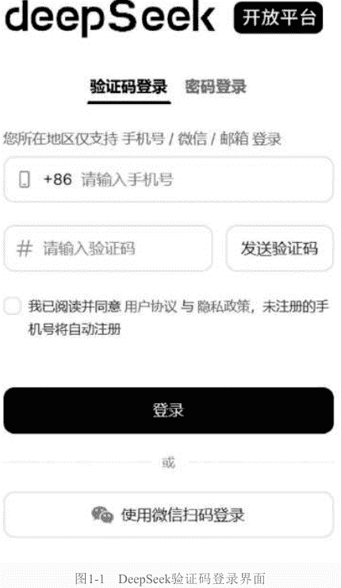

图1-1 DeepSeek验证码登录界面

（2）微信扫码登录。在网页对话框中单击“使用微信扫码登录”按钮，便可使用微信扫码登录到 DeepSeek 中。需要注意的是，首次使用微信扫码登录，扫码后，仍需绑定手机号，具体如图1-2、图1-3所示。

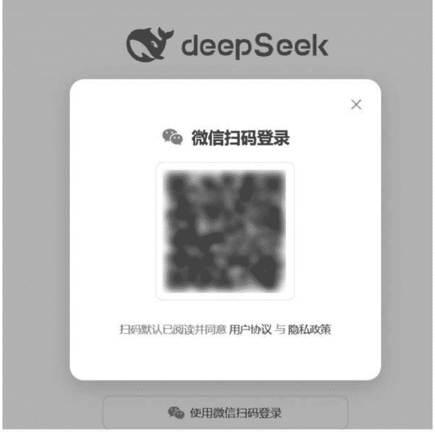

图1-2 微信扫码登录界面


图1-3 扫码后绑定手机号界面

（3）密码登录。点击登录界面的“密码登录”，输入手机或邮箱地址，再输入密码，即可完成密码登录。若还未注册，可单击“立即注册”按钮根据引导完成注册，若忘记密码，可单击“忘记密码”按钮根据引导找回密码，具体如图1-4所示。

图1-4 密码登录界面

##### 3.初次使用
完成注册后再进入 DeepSeek 网页，即可看到网页端 DeepSeek 的交互界面。此处，可看到官方设置的欢迎语：“我是DeepSeek，很高兴见到你！”（见图1-5）。


图1-5 网页端DeepSeek交互界面

#### 1.3.2 手机登录：随时随地解决问题
如果想在手机上使用 DeepSeek，可以在官网下载并安装 DeepSeek 手机应用程序，完成登录后即可在手机端使用 AI 功能。无论是通勤路上还是外出办公，手机版都能让你随时获取 AI 支持，具体如图1-6所示。


#### 1.3.3 API 登录：高阶开发者的好帮手
对于开发者或企业用户，可选择使用 DeepSeek 提供的 API 接口，将 AI 功能集成到自有系统中。通过 API，开发者可以构建更复杂的应用场景，实现智能化升级。

##### 1.进入 API 开放平台
在浏览器中输入官方网址，即可进入 DeepSeek 主页，在网页右上角单击 API 开放平台按钮，即可进入 DeepSeek 的 API 开放平台，具体如图1-7所示。

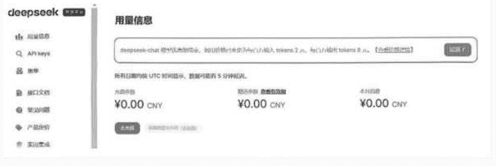

图1-7 DeepSeek的API开放平台界面

##### 2.创建 API key
如果想使用 API 服务，需要先创建 API key。可单击 API 开放平台左侧的“API keys”按钮，进入 API key 创建页面，单击页面上的“创建API key”按钮，即可创建成功，具体如图1-8所示。

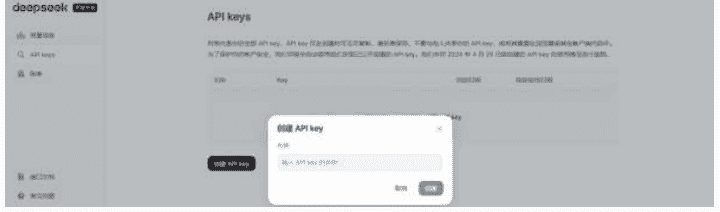

图1-8 创建API key页面

#### 1.3.4 发送指令：与 DeepSeek 的第一次互动

【高效提问：让DeepSeek快速上手的要点】

想让DeepSeek好用，关键先把提问练好。指令越具体、指向越清晰，模型越能把握真实意图，返回的质量也就越高。下面把提问思路整理如下。

##### 1.明确任务目标
先弄清自己想完成什么再提问。例如“夏天很热，有哪些地方可以避暑？”就把需求点明了。

##### 2.提供上下文信息
相关的背景、边界条件最好一起给出。例如“暑假想带孩子出行，喜欢有水景、有美食的地方，不想爬山。”

##### 3.使用结构化提问
结构化能大幅提升理解精度，常见的拆法是四要素：

- （1）角色设定。你希望模型扮演什么身份？例如“小红书创作者”。
- （2）具体任务。需要完成的工作是什么？例如“撰写一篇推广文案”。
- （3）期望结果。想要达到什么效果？例如“吸引25-35岁人群关注”。
- （4）边界限制。有无字数、语气、格式要求？例如“控制在500字左右，语气轻松活泼”。

直接实操一下。在对话框中粘贴如下指令：

作为一名市场营销专家，帮我撰写一篇推广智能手表的文案，目标用户是25~35岁的都市白领，要求突出健康监测功能和时尚的设计，300字左右。

这样表述后，模型能快速抓住要点并产出符合预期的内容，具体展示见图1-9、图1-10。

> "作为一名市场营销专家，帮我撰写一篇推广智能手表的文案，目标用户是25~35岁的都市白领，要求突出健康监测功能和时尚的设计，300字左右。"

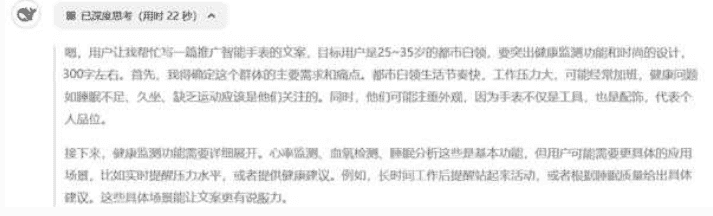

图1-9 在DeepSeek中提交指令

输出后记得核对字数，尽量保持在300字上下，信息完整且不冗长。通常需要多次微调，让每个卖点都精准传达，同时保证流畅和吸引力。还要兼顾品牌调性，如果品牌有固定口号或价值观，融入进去能提升辨识度。

### 【都市精英的腕上新美学：××智能手表开启健康时尚新纪元】

在CBD的写字楼间穿梭的你，是否习惯了用咖啡因对抗疲惫，用外卖填补三餐？当健康成为都市精英最珍贵的奢侈品，××智能手表以“全天候健康管家”与“移动时尚单品”的双重身份，重新定义都市人的生活方式。

### ▎健康管理，比你更懂你的身体

搭载医疗级7×24小时健康追踪系统，精准捕捉心率、血氧、压力值等32项体征数据。独创“职场健康预警系统”：当连续久坐50分钟，腕表轻震提醒舒展；压力指数超标时，自动启动呼吸训练引导；深睡时长不足，更会生成个性化睡眠方案。搭配AI健康周报功能，让每次体检数据都成为可追踪的健康资产。

### ▎轻奢美学，解锁腕间高级感

图1-10 DeepSeek生成的示例

## 小练习

尝试向DeepSeek提出你的第一个问题。你可以从简单的任务开始，例如“帮我写一封邮件，通知团队成员明天下午3点开会”或者“为我的健身工作室设计一条朋友圈文案，突出‘轻松塑形’的理念”。

通过不断练习，你将逐渐掌握与DeepSeek高效沟通的技巧，让AI真正成为你的“私人助理”。

# 第2章 玩转DeepSeek，从高效提问开始

在数字化时代，AI工具已广泛应用于人们的工作和生活中。DeepSeek作为AI工具的优秀代表，能够助力用户提升效率、激发创意。但不少用户困惑：如何让DeepSeek成为高效工作的得力助手，实现精准、有价值的内容输出？其关键在于掌握提问技巧。本章将从基础到进阶，全面介绍使用DeepSeek的方法。

## 2.1 一步获得高质量回复，快速入门DeepSeek

为什么别人用DeepSeek能10分钟输出爆款文案，你却总收到一堆“正确的废话”？

答案很简单：提问的精度决定AI的智商。本节将用一个模式、三大法则、两大技巧与一套组合拳，手把手教你入门DeepSeek。

### 2.1.1 DeepSeek深度思考模式：从"工具"到"成长教练"

平常我们用AI，是不是经常只得到个结果，却不知道这结果是怎么来的？DeepSeek深度思考模式就超厉害，它会像个耐心的老师，把问题一步步拆开分析，不仅给出答案，还把思考过程清清楚楚地展示出来，就像给我们配备了一个专属的“成长教练”，超有用！

**场景1：快速厘清复杂问题关系**

当我们需要对大量资料进行分析时，利用DeepSeek深度思考模式不仅能得出分析结论，还能清晰展示分析过程，方便与他人沟通。

**实用技巧**：当有大量资料需要分析时，使用DeepSeek深度思考模式进行处理，仔细查看分析过程，梳理关键信息。

**案例分析**：一家市场调研公司要分析50篇关于某新兴电子产品的行业文章，了解产品的市场趋势、用户需求等。使用DeepSeek普通模式和深度思考模式的对比如表2-1所示。

表2-1 使用DeepSeek普通模式和深度思考模式的对比表

| 模式 | 内容 | 收获 |

|:---|:---|:---|

| 普通模式 | 快速得出关于50篇新兴电子产品行业文章的分析结论，如"该产品未来市场需求会增长"，但无具体分析依据 | 仅得到结论，难以深入了解市场趋势背后的原因；在与客户沟通时缺乏说服力，难以获得更多业务机会 |

| 深度思考模式 | 先对50篇文章进行关键词提取，统计关键词出现频率，如"续航提升需求"提及次数最多，综合分析得出"该产品未来市场需求会增长"的结论 | 清晰知晓市场需求增长结论的推导过程，能从多方面详细解释市场趋势；在与客户沟通时更具说服力，可获得客户信任，赢得更多合作机会 |

**场景2：助力学习提升思维能力**

DeepSeek深度思考模式通过展示推理过程，帮助职场人学习新的分析方法，提升其思维能力。

**实用技巧**：遇到工作难题时，借助DeepSeek深度思考模式的推理过程，总结方法，并应用到类似问题中。

**案例分析**：小李是广告策划公司的新人，负责策划一款新零食广告方案。他要分析市场上同类产品广告的优缺点，但毫无头绪。表2-2展示了他使用DeepSeek普通模式和深度思考模式分析内容时得出的结果。

| 模式 | 内容 | 收获 |

|:---|:---|:---|

| 普通模式 | 直接给出同类产品广告的优缺点结论，如成功广告创意好、失败广告文案不佳，但没有具体分析过程 | 仅知道广告结果的好坏，无法了解如何得出的这些结论的过程，难以从中学习到分析方法；在面对新的广告策划任务时，依旧缺乏有效思路，工作能力提升缓慢 |

| 深度思考模式 | 先按广告投放平台、目标受众年龄层、广告风格等维度对案例进行分类；再从广告的创意、文案、视觉效果等方面进行对比分析；最后总结出成功广告突出产品特色、吸引目标客户群体等关键因素 | 掌握系统的广告案例分析方法，学会从多个维度剖析广告；在之后的工作中，能快速分析竞品广告，并将所学运用到新的策划任务里，做出更有创意和针对性的广告方案，实现工作能力的显著提升 |

**场景3：提供科学的决策依据**

决策者在做商业决策时，DeepSeek深度思考模式能为其提供全面分析，帮助决策者根据自身实际情况做出更合适选择。

**实用技巧**：做决策前，将相关信息输入DeepSeek，并启用深度思考模式，仔细研究其分析和推理的过程，并结合自身需求做出判断。

**案例分析**：小张打算创业开饮品店，但在奶茶店和咖啡店之间犹豫不决。他把店铺选址、周边消费群体喜好、原材料成本、设备采购费用等信息输入DeepSeek，并启用深度思考模式。表2-3展示了他使用DeepSeek普通模式和深度思考模式分析内容时得出的结果。

| 模式 | 内容 | 收获 |

|:---|:---|:---|

| 普通模式 | 直接给出开奶茶店收益更高的结论，未展示具体分析过程 | 只能依据收益结论做出决策，忽略自身兴趣爱好等其他重要因素，这样可能做出不契合自身实际情况的选择，影响创业热情和长期经营意愿 |

| 深度思考模式 | 综合店铺选址、周边消费群体喜好、原材料成本、设备采购费用等信息，分析出奶茶店从商业收益角度更具优势；同时展示其分析过程，包括各因素对收益的影响方式和程度等 | 不仅知道开奶茶店收益高的结论，还清楚其背后的推理依据；能结合自身对咖啡的兴趣爱好和专业知识，做出更符合个人实际情况的决策，增强创业信心，提高创业成功概率 |

### 2.1.2 AI指令三大基础法则：让AI秒懂你的需求

模糊指令意味着低质量输出，精准提问意味着"开挂般"的生产力。

身为职场人、创作者，想必你也有过这样的困扰：满心期待让DeepSeek帮忙，结果得到的却是一堆毫无价值的内容。问题出在哪？就在于提问太模糊！

在这个分秒必争的时代，掌握精准提问的技巧，让AI瞬间明白你的需求，产出高质量成果，无疑是提升效率的关键。

接下来，我们就带你解锁让AI秒懂需求的基础法则，让你的工作和创作效率直线飙升。

**法则1：给细节**

你给AI的细节越多，AI给你的结果就越有针对性。

**错误示范**：输入简单的提示词"写篇产品分析"，这样可得到AI生成的10页冗长报告，毫无重点。

**正确操作**：使用有细节的**指令模板**，如【目标用户】+【具体领域】+【输出结构】。

**实践对比**：使用模糊指令与精准指令生成**自媒体人需要的小红书爆款标题的**效果对比，具体如表2-4所示。

表2-4 模糊指令与精准指令生成效果对比表

| 指令类型 | 指令内容 | 所得结果 |

|:---|:---|:---|

| 模糊指令 | 写几个标题 | "智能手表推荐""科技产品分享"等缺乏针对性的标题 |

| 精准指令 | 为【职场女性】设计5个适合智能手表推广的【小红书爆款标题】，【包含省时、时尚等关键词】 | 职场开挂神器！1秒切换会议模式，精致女孩都在偷偷用，别再浪费时间！这块表让你每天多睡2小时，通勤党必入等紧扣需求的爆款标题 |

**法则2：给人设**

你为AI设定的角色越清晰，AI给出的回复就越能贴合你的需求，达到付费咨询级别的对话效果。

**错误示范**：输入简单的提示词"分析竞品"，得到的只是泛泛而谈的优缺点列表，没有重点，缺乏针对性。

**正确操作**：使用带人设的指令模板，如【设定角色】+【具体任务】+【输出要求】。

**实践对比**：使用不带人设指令与带人设指令生成**创业者需要竞品分析报告的**效果对比，具体如表2-5所示。

表2-5 不带人设指令与带人设指令生成效果对比表

| 指令类型 | 指令内容 | 所得结果 |

|:---|:---|:---|

| 不带人设指令 | 分析竞品 | 泛泛罗列优缺点，缺乏独特视角 |

| 带人设指令 | 你是一位【资深科技产品分析师】，请你找到市场上最热门的5款智能手表并进行全面分析，结果以【表格形式】呈现 | 简洁清晰地呈现出各热门智能手表多维度的关键信息，为从业者分析提供直观参考 |

**法则3：给台阶**

你给AI设定分步指令，就像给它搭好台阶，让它产出更具落地价值的内容。

**错误示范**：输入简单的提示词"写份营销方案"，结果AI堆砌空洞理论，毫无落地价值。

**正确操作**：分步骤下指令，示例如下。

第一步：总结2024年社交媒体五大爆款元素。

第二步：筛选最适合"智能家居"产品的3个元素。

第三步：设计一套执行计划，包含目标、预算分配和效果预估。

**实践对比**：不分步骤指令与分步骤指令生成HR需要的招聘文案的效果对比，具体如表2-6所示。

表2-6 不分步骤指令与分步骤指令生成效果对比表

| 指令类型 | 指令内容 | 所得结果 |

|:---|:---|:---|

| 不分步骤指令 | 写个招聘启事 | 模板化的招聘启事内容，缺乏针对性和吸引力 |

| 分步骤指令 | 第一步：列出程序员招聘岗位描述的6个核心模块（如技术栈、团队文化等） | 包含技术栈、团队文化等方面的6个程序员招聘岗位描述核心模块 |

| 分步骤指令 | 第二步：为"区块链开发工程师"岗位设计"极客文化"相关描述，要求包含两个网络"热梗" | 带有"极客文化梗"的区块链开发工程师岗位相关描述 |

| 分步骤指令 | 第三步：将以上内容整合成500字以内的招聘文案，用"薪资open"吸引候选人 | 符合要求，包含特定内容且具有吸引力的500字以内的招聘文案 |

### 2.1.3 AI指令两个实用技巧：让AI成为你的最强外脑

写文案时灵感枯竭、做设计毫无头绪，这些事是不是常让你感到焦头烂额？

别担心，只要你掌握范例教学和逆向提问这两个实用技巧，就能轻松开启AI的创意大门。想知道如何用它们挖掘AI的创意潜能，让灵感源源不断吗？

下面就为你详细介绍，帮你突破创意瓶颈。

**技巧1：范例教学——用AI最擅长的"像素级模仿"**

给AI提供明确的参考案例并追加指令，就能让AI产出风格统一、贴合需求的内容。

**万能模板**：仿照案例风格，【做某件事】。

使用效果如表2-7所示。

表2-7 无示例指令与有示例指令生成效果对比表

| 指令类型 | 指令内容 | 指令结果 |

|:---|:---|:---|

| 无示例指令 | 为国庆节写5篇文章标题 | 《国庆节快乐》《国庆出游指南》《国庆怎么过》《庆祝国庆节》《国庆小知识》 |

| 有示例指令 | 仿照案例风格，为国庆节写5篇文章标题<br>参考案例：《以奋斗之姿，续写时代华章》 | 《以爱国之情，点燃国庆华章》《用赤诚之心，共绘国庆盛景》《凭民族之魂，奏响国庆强音》《以奋进之态，礼赞国庆佳节》《借团结之力，同贺国庆辉煌》 |

**技巧2：逆向提问——让AI为你提供更多提问思路**

让AI帮你梳理关键问题，厘清做某件事的需求描述思路。

**万能模板**：我要【做某件事】，但不知道如何描述需求，请列出5个关键问题帮我厘清思路。

使用效果如表2-8所示。

表2-8 "让AI列出关键问题"指令生成效果表

| 场景 | 指令 | AI 反馈 |

|:---|:---|:---|

| 产品经理<br>设计新功能 | 我要优化智能手表的睡眠监测功能，请提出5个关键问题 | （1）用户当前对睡眠监测的主要抱怨是什么<br>（2）竞品中哪些功能获得高频好评<br>（3）硬件传感器精度是否达到医疗级标准<br>（4）如何将数据可视化，以提升用户体验<br>（5）是否需要加入个性化改善建议（如睡前冥想提醒） |

| 新媒体运营<br>策划活动 | 我要在公众号策划国庆主题活动，请列出5个关键问题 | （1）目标用户群体对国庆活动的兴趣点在哪里<br>（2）在过往同类型公众号中，国庆活动有哪些成功案例<br>（3）活动预算支持哪些奖品设置<br>（4）如何提高用户参与活动的便捷性<br>（5）怎样利用活动提升公众号粉丝留存率 |

### 2.1.4 提升AI输出效果的组合拳：提问、追问、整合

AI不会淘汰人类，但会淘汰不懂与AI协作的人。

在DeepSeek等工具普及的今天，提问、追问、整合的能力，正成为区分"效率革命者"与"数字难民"的核心标尺。

本节将揭示我们如何通过这3项能力，将AI从"信息搬运工"升级为"超级外脑"。

**1.提问：像训练新员工一样训练AI**

在与AI交互的过程中，提问的精准度直接决定了AI输出内容的质量。如同训练新员工时需要明确、具体地传达任务要求一样，向AI提问也需要遵循精准原则，这样才能得到符合预期的答案。提问的使用技巧如表2-9所示。

表2-9 提问的使用技巧

| 场景 | 错误/模糊提问 | 正确/精准提问 | 原理 | 指令公式及案例应用 |

|:---|:---|:---|:---|:---|

| 职场场景 | 整理市场数据→AI输出未清洗的原始表格 | 提取2024年Q3新能源汽车行业抖音、小红书、B站的用户评论数据，按"续航焦虑""充电速度""外观设计"3个维度分类，用Excel表格展示高频关键词及其出现频次 | 采用"品类+规格+禁忌"的逻辑明确需求，其中"品类"指数据类型，"规格"涵盖时间、平台、分类维度等，"禁忌"为不想要的结果（如原始未清洗数据） | 指令公式：【任务主题】+【具体要求（时间、平台、分类维度等）】+【输出格式】<br>案例应用：任务主题是提取新能源汽车行业用户评论数据；具体要求包括特定时间、平台及分类维度、展示关键词频次；输出格式为Excel表格 |

| 生活场景 | 推荐旅游景点→输出大众化清单 | 生成一份3天杭州亲子游攻略，要求：（1）包含2个博物馆和1个户外乐园；（2）餐厅需有儿童餐且人均<100元；（3）用时间轴形式标注行程，附加交通换乘方案 | 同样基于"品类+规格+禁忌"逻辑明确需求，其中，"品类"是亲子游攻略，"规格"包含行程天数、场所、餐饮、行程标注等要求，"禁忌"即非个性化推荐 | 指令公式：【任务主题】+【具体要求（行程天数、场所、餐饮、行程标注形式等）】<br>案例应用：任务主题是生成杭州亲子游攻略；具体要求有行程天数、包含场所、餐饮标准、行程标注形式等 |

| 创业者案例 | 设计品牌口号→输出"创新引领未来"等陈词滥调 | 我们是一家面向"Z世代"的汉服品牌（背景），主打"传统纹样+科技面料"（差异化），需一句10字内的口号（限制），参考案例："中国李宁""观夏昆仑煮雪"（范例） | 为AI提供背景、差异化及范例等信息，使其更精准地把握需求 | 指令公式：【背景信息】+【差异化特点】+【任务要求（如字数限制）】+【参考范例】<br>案例应用：背景信息是面向Z世代的汉服品牌；差异化特点为"传统纹样+科技面料"；任务要求是10字内口号；参考范例为相关知名品牌口号 |

| 场景 | 错误/模糊提问 | 正确/精准提问 | 原理 | 指令公式及案例应用 |

|---|---|---|---|---|

| 学术场景 | 如何写文献综述？→输出通用框架 | 我研究"AI对制造业就业的影响"（背景），已收集50篇中外文献（基础），请按"技术替代—技能升级—政策应对"结构梳理争议点（框架），用表格对比各学派的核心观点（格式） | 向AI提供研究背景、已有基础、梳理框架要求和输出格式，让其输出符合学术需求的内容 | 指令公式：【研究背景】+【已有基础】+【梳理框架要求】+【输出格式】<br>案例应用：研究背景是"AI对制造业就业的影响"；已有基础为收集的50篇文献；梳理框架要求是按特定结构梳理争议点；输出格式为用表格对比观点 |

让大模型真正好用：问得准、追得深、整得透

与大模型对话，关键不在问得多，而在问得准、追得深、整得透。把需求拆清、把追问做足、把结果整合，才能让零散信息升级为可执行的方案。

### 1. 精准提问：把需求锁死

| 使用情境 | 常见痛点 | 优化后成效 | 关键改进 | 指令构成样例 |
|---|---|---|---|---|
| 运营复盘 | 分析竞品活动后拿到大段文字，重点不突出 | 用时程图呈现竞品618节奏，标注预热、引爆、回补三阶段的起止时间、主推品类与投放渠道，并对比各阶段独立访客转化 | 提前约定呈现形式与标注维度，输出更聚焦 | 结构：【任务主题】+【呈现方式时程图】+【标注细节起止时间、主推品类等】<br>示例：主题是竞品618拆解；方式为时程图；细节涵盖各阶段关键信息及转化对比 |
| 学习整理 | 总结实验步骤条理混乱 | 把PCR流程拆成“制备—扩增—检测”三段，每段按“操作步骤+注意事项”呈现，关键试剂用量加粗标红 | 明确拆解逻辑与格式规范，流程一目了然 | 结构：【任务主题】+【拆解要求】+【呈现规范与标注】<br>示例：主题是PCR步骤归纳；拆解为三阶段；格式为每阶段步骤+要点，试剂用量高亮 |

不同需求套用提问结构，才能让模型覆盖复杂任务。

### 2. 追问：把模型变成“24小时在线顾问”

追加提问是提升信息密度、挖掘深层价值的关键，能让一次性回答升级为持续顾问。

表2-10 追问的使用技巧

| 场景 | 初步提问 | 追问思路 | 提问模板与示范 |
|---|---|---|---|
| 行业研究 | 分析智能家居市场趋势，给出宏观概述 | Step1：补充2024年智能安防在二三线城市的渗透率<br>Step2：列出3家区域型企业的渠道下沉打法<br>Step3：用SWOT对比海尔与小米的生态布局差异 | 模板以Step1为例：【承接原问题内容】+【补充特定数据/信息要求】。<br>示范：<br>Step1：承接内容为智能家居趋势中的智能安防，补充要求为2024年二三线城市渗透率数据<br>Step2：承接内容为智能家居企业策略+列举特定企业特定策略要求<br>Step3：承接内容为智能家居企业生态布局+用特定模型对比特定企业差异要求 |
| 职场应用 | 模型建议“提升用户黏性”，但无落地路径 | 请为母婴社群定制一套“签到+UGC奖励+限时闪购”的方案，月预算控制在5000元以内 | 模板：【针对原建议的应用场景】+【具体方案形式要求】+【限制条件如预算】<br>示范：应用场景为母婴社群，方案形式为签到+UGC奖励+闪购的黏性提升方案，限制条件为预算不超5000元/月 |
| 创业案例 | 如何降低用户获客成本 | 若砍掉信息流投放改做裂变，会有什么风险？请列3种低成本裂变玩法并预估成本/转化率。若参与率仅5%，请给出应急备选 | 模板以第1个追问为例：【基于原问题的解决方案假设】+【询问该假设可能产生的风险/影响】<br>示范：<br>第1个追问：假设为砍掉信息流投放改用裂变替代，询问其可能风险<br>第2个追问：基于裂变方案+列举特定玩法及预估指标要求<br>第3个追问：基于假设结果参与率仅5%+询问应对方案 |

在不同情境下灵活运用追问，能充分释放模型潜力，为决策与执行提供持续支撑。

### 3. 整合：从“模型碎片”到“知识晶体”

模型原生输出常零散冗余，若不整合难以产生价值。整合的核心是把碎片信息提炼成高可用性的知识晶体。

（1）信息蒸馏，提炼高纯度结论

表2-11 信息蒸馏的具体应用和显著成果

| 场景 | 原始输出 | 整合步骤 | 整合后成果 |
|---|---|---|---|
| 学术 | 模型产出30页文献综述，重复观点多、数据杂 | （1）删减：剔除重复定义、删除2018年前过时报告<br>（2）重构：按“理论派 vs 实践派”框架重组，理论派聚焦AI伦理哲学争议如责任归属黑箱问题；实践派汇总企业落地的3类方案如欧盟合规指南、微软AI原则<br>（3）强化：在争议点加入个人研究假设“现有研究忽视中小企业实践困境，本研究将验证低成本伦理合规工具箱可行性” | 形成8页结构清晰的综述，可直接用于开题答辩 |
| 餐饮活动策划 | 策略A：会员日折扣<br>策略B：异业合作 | 跨策略融合推出“联合周边健身房‘卡路里兑换计划’：消耗500大卡兑换指定菜品，同步抖音直播健身挑战赛” | 同步拉新与扩散，提升客流与品牌声量 |
| 职场汇报 | 纯模型输出，数据堆砌 | （1）模型生成图表、案例、趋势<br>（2）人工加工：a. 加入内部业务洞察；b. 用“问题＋行动＋结果”串逻辑；c. 增加领导关心的风险预警 | 人机协同报告直击痛点，逻辑清晰、重点突出 |

（2）跨界融合，创造意想不到的连接

表2-12 跨界融合的应用

| 场景 | 模型 输出 | 整合创新 | 最终效果 |
|---|---|---|---|
| 餐饮活动策划 | 策略 A: 会员日折扣<br>策略 B: 异业合作 | 联合周边健身房推出"卡路里兑换计划"：会员消耗 500 大卡可兑换指定菜品，同步在抖音直播健身挑战赛 | 吸引了健身爱好者和餐厅会员的关注，增加了餐厅客流量，同时借助抖音直播扩大了活动影响力，提升了餐厅知名度 |
| 文旅宣传 | 方案 A: 景点介绍文案<br>方案 B: 美食推荐清单 | 打造"美食探寻之旅"线路串联景点与当地美食，游客打卡并在短视频平台互动抽奖，赢取特色纪念品 | 提升目的地知名度与游客体验，带动文旅与餐饮经济 |
| 教育教学 | 建议 A: 知识竞赛<br>建议 B: 小组讨论 | 举办"历史穿越剧表演"，学生编排历史短剧融入知识点，演出后开展小组讨论与问答 | 提升学习兴趣与协作、表达能力，营造活跃课堂 |

（3）人机协作，让模型当“副驾驶”

表2-13 人机协作效果示例

| 场景 | 模型生成内容 | 人工加工内容 | 纯模型输出效果 | 人机整合版效果 |
|---|---|---|---|---|
| 项目进展汇报 | 任务完成进度图、竞品案例、技术趋势报告 | （1）补充执行中技术难题与协作问题的洞察<br>（2）按“初期问题—解决方案—最终成果”串逻辑<br>（3）增加技术迭代延期、关键人员流失等风险预警 | 罗列数据与案例，未突出核心问题与对策，领导难快速决策 | 结构清晰、重点突出的进展报告，领导可直观掌握全貌与风险，便于调整方向 |
| 市场推广方案汇报 | 市场规模趋势图、竞品策略分析、新兴渠道介绍 | （1）结合公司产品与目标市场做机会挑战洞察<br>（2）按“推广问题—行动方案—预期效果”梳理<br>（3）补充竞品大额投放冲击、新渠道政策变动风险 | 内容分散，针对性不足，难作决策依据 | 针对性强、可操作性强的推广方案，兼顾预期与风险提示 |

指令设计自查清单如下。

- （1）是否借助深度思考模式。针对复杂问题或重要决策，检查是否运用深度思考模式，研究其分析推理过程，辅助自己做出更科学的判断。
- （2）是否提供充足细节。检查指令中有没有明确【目标用户】【具体领域】【输出结构】等关键信息，避免出现如“写篇文章”这类缺乏针对性的模糊指令。
- （3）角色设定是否清晰。确认是否为模型设定了清晰的角色，像"资深科技评论家""专业产品分析师"等，使回复能精准匹配需求，而不是泛泛而谈。
- （4）复杂任务有无拆解。查看对于复杂任务，有没有像"写营销方案"那样拆分成多个步骤，为模型搭建"台阶"，以获取更具落地价值的内容。
- （5）有无参考范例辅助。思考指令里有没有提供参考案例，利用"仿照案例风格"的方式，让模型产出风格统一、更符合预期的成果。
- （6）是否综合应用输出组合拳。是否使用提问、追问和整合的各种方法，让模型产出更加明确具体、能解决实际问题的方案。

## 2.2 六大万能指令模板，各类场景轻松套用

写作时常卡在空泛与平淡之间。结构化提问法可在短时间内输出兼具高度与落地感的内容。本节以六大模型演示职场写作攻坚思路。

### 2.2.1 框架指令：搭建发言稿框架

年会致辞、项目汇报等场景往往因缺乏框架导致跑题。框架指令通过背景、目标、要求三要素，帮助快速搭建清晰骨架。

1. 包含要素
要素1：背景。交代发言发生的情境，让模型建立场景感。
要素2：目标。明确希望达成的效果，锁定方向。
要素3：要求。设定边界，如避免陈词滥调、需加入案例等，防止跑偏。

2. 完整提示词
假设你是[××角色]，面向[××受众]在[××场景]下，请重新优化以下内容，使其符合该角色的专业表达习惯：[内容或文档]。

3. 参考范例
要素1：背景——公司营收同比增长30%，但行业竞争加剧。
要素2：目标——撰写5分钟年会致辞，突出成绩与挑战，传递正能量。
要素3：要求——避免“砥砺前行”等套话，用用户增长案例和一线员工故事替代，预告明年全员体检福利。

4. 参考指令
基于公司今年营收增长30%但行业竞争加剧的背景，撰写一篇5分钟的年会致辞，突出成绩与挑战，传递正能量，避免使用"砥砺前行"等陈词滥调，用用户增长案例和一线员工故事替代空话，并加入明年全员体检福利预告。

### 2.2.2 专家指令：提升内容的专业度和风格的契合度

初步结果常缺乏专业深度。专家指令通过角色、背景、语言风格三要素，让模型从专业视角产出更具权威的文本。

1. 包含要素
要素1：角色。明确模型扮演的专业身份，如行业专家、资深顾问。
要素2：背景。说明专业语境，如行业趋势、技术演进、政策变化。
要素3：语言风格。根据角色与背景选择严谨权威或通俗易懂的表达。

2. 完整提示词
假设你是[××角色]，面向[××受众]在[××场景]下，请重新优化以下内容，使其符合该角色的专业表达习惯：[内容或文档]。

3. 参考范例
要素1：角色。模型担任行业资深专家，擅长市场趋势分析。
要素2：背景。行业数字化转型加速，市场竞争加剧。
要素3：语言风格。专业权威，结合数据与案例。

4. 参考指令
假设你是AI行业资深专家（角色）——特别擅长市场趋势分析，面向企业决策者（受众），在行业数字化转型加速、市场竞争加剧的背景下（场景），请重新优化以下内容，使其符合该角色的专业表达习惯：[内容或文档]。

| 学术论文撰写 | 设你为【某研究方向的权威学者】，置于【当前学术前沿语境】中，以【规范严谨的学术表述】对【论文主题】的【具体论证或思路框架】进行扩充与完善： |

| 商业战略制定 | 请扮演【资深行业战略顾问】，在【当前竞争格局与发展趋势】背景下，以【权威且具前瞻性的专业口吻】对【企业名称】的商业策略【既有方案内容】进行优化重塑： |

| 技术方案评估 | 请以【所在技术领域资深专家】的身份，基于【现阶段技术成熟度与应用场景】，运用【严谨专业的分析话语】对【技术方案名称】开展评审并给出改进意见：【方案具体信息】 |

| 行业趋势研讨 | 请作为【行业领军人物】，置于【当前宏观经济与政策环境】之下，以【通俗易懂而洞见深刻的表达方式】解析【行业名称】的未来走向，并对以下【既有研讨观点】做补充完善： |

### 2.2.3 审稿指令：一次通过的实操路径
交付材料像上战场，一旦因准备不足被打回，比客户直接否定更打击。审稿指引相当于提交前的排雷清单，能提前把隐雷扫干净，让结果更贴近决策者预期。

该指引围绕审阅目的、核查清单与修改指向三部分，让模型对初稿进行针对性打磨，使产出与创作意图高度吻合，提升整体水准。就像资深编辑审稿，既核对对错，也结合立意做整体提炼，确保成稿达标。

#### 1. 构成要素
**目标点**：明确本次审阅要达成的最终效果，例如行文是否顺畅、信息是否准确、是否匹配目标读者等。
**检验清单**：列出逐项核对的具体维度，例如语言瑕疵、内容是否完整、观点是否统一等。
**修改指向**：对常见问题预先准备可行的修改方向。

#### 2. 通用句式
请你以[审阅角色]身份，为使内容与创作意图高度吻合，基于[××审校目的]，按照[××核查点]执行审阅，并提供[××调整建议]。

#### 3. 参考案例
目标点：确保科普稿件科学准确且适配青少年阅读。
检验清单：是否存在科学性偏差、表达是否通俗、案例挑选是否恰当。
修改指向：改用更简易的措辞、选用更贴合科普的例证。

#### 4. 参考指令
请你作为资深教学专家，为使科普稿件能精准传递科学知识且适配青少年阅读这一审校目的，按核查科学性偏差、语言是否通俗易懂、案例是否恰当的核查点进行审阅，若发现科学性偏差请对照权威资料修正；语言晦涩则替换为易懂词汇；案例不合适则更换为更恰当案例。

#### 5. 适用场景
- 文案审校、报告复核、书稿校对、法律文件审定。
- 社交媒体发布核查、信函斟酌、个人日志优化、重要邮件复核。

相关场景及提示词示例见表2-16。

表2-16 相关场景及参考提示词

| 场景 | 参考提示词 |
|:---|:---|
| 文案审核 | 请你充当［文案领域资深审校人］，为让文案与创作意图高度一致，基于［文案目标，如吸引潜在客户、推广产品等］，按［语法准确度、创意新颖度、受众吸引力等核查点］审阅，并给出［更换表述方式、增添亮点元素等］调整建议：［待审文案］ |
| 报告审查 | 请你作为［报告所属专业专家］，为让报告与创作意图高度一致，基于［报告目标，如汇报成果、提供决策依据等］，按［数据准确度、逻辑连贯度、结论可信度等核查点］审查，并给出［补充来源、优化分析逻辑等］调整建议：［报告正文］ |
| 书稿校对 | 请你担任［资深图书编辑］，为让书稿与创作意图高度一致，基于［书稿目标，如传播知识、讲述故事等］，按［错别字、情节合理性、语言流畅度等核查点］校对，并给出［修正错误、完善逻辑等］调整建议：［书稿内容］ |
| 法律文书审定 | 请你以［资深律师］身份，为让法律文件与创作意图高度一致，基于［文件目标，如权利保障、行为规范等］，按［法条准确性、逻辑严谨性、格式规范性等核查点］审定，并给出［补充法律依据、修正表述等］调整建议：［法律文件内容］ |

### 2.2.4 优化指令：把稿件打磨到极致
总觉得初稿还差一点火候，反复修改却难找关键？优化指令能帮你理清方向。优化指令围绕优化目标、操作方法与理想结果三要素展开。目标明确要提升的核心点，例如逻辑、感染力等。方法指具体操作路径，例如补充生动案例、调整叙述节奏等。理想结果像灯塔，指引优化走向。

#### 1. 构成要素
**优化目标**：清晰指出希望提升的核心方面，如增强逻辑性、提升感染力等。
**优化方法**：说明采用何种具体手段实现目标，如补充生动案例、调整叙述节奏等。
**预期效果**：描述优化后希望达到的状态，如用户满意度提升、转化率上涨等。

#### 2. 通用句式
请基于[××优化目标]，运用[××优化方法]，达成[××预期效果]。

#### 3. 参考案例
优化目标——提高产品推广文案的转化效率。
优化方法——强化购买动机、突出产品差异点、优化排版呈现。
预期效果——转化率提升20%。

#### 4. 参考指令
基于提升产品推广文案转化效率的目标，请运用强化购买动机、突出产品差异点、优化排版呈现的方法，以实现转化率提升20%的效果。

#### 5. 适用场景
- 说明书改进、营销方案升级、网站页面优化、品牌形象重塑。
- 简历优化、菜谱改良、收纳建议完善。

相关场景及提示词示例见表2-17。

表2-17 相关场景及参考提示词

| 场景 | 参考提示词 |
|:---|:---|
| 产品说明书完善 | 请基于［提升说明书可读性与易用性的优化目标］，运用［增添图表、简化专业术语等］优化方法，以达到［减少用户咨询量］的预期效果，对以下说明书进行优化：［说明书内容］ |
| 营销方案提升 | 请基于［提高营销方案吸引力与转化率的优化目标］，运用［增加互动环节、优化投放渠道等］优化方法，以达到［提升销售额等］效果，对以下营销方案进行优化：［方案内容］ |
| 网站页面优化 | 请基于［提升用户体验与访问量的优化目标］，运用［优化版式、加快加载速度等］优化方法，以达到［降低跳出率、延长停留时间等］效果，对以下页面进行优化：［页面描述］ |
| 品牌形象重塑 | 请基于［重塑品牌形象、提升知名度与美誉度的优化目标］，运用［更新品牌标识、调整传播策略等］优化方法，以达到［吸引新客、增强忠诚度等］效果，对以下品牌材料进行优化：［现有形象资料］ |

### 2.2.5 合规指令：让AI成为风险管控助手
在危机公关或撰写敏感内容时，一处疏忽可能造成严重后果。合规指令能让AI化身风控专家。它通过合规要求、风险点、调整建议三要素，对内容进行全流程合规筛查。要求划定合法边界，风险点定位潜在问题，调整建议提供修正办法。

#### 1. 构成要素
要素1：合规要求。明确内容需遵循的相关法规、行业规范或内部制度。
要素2：风险点。指出可能触碰合规红线的潜在区域。
要素3：调整建议。针对识别出的风险，提供具体修改措施以确保合规。

#### 2. 通用句式
依据[××合规要求]，请识别[××风险点]，并给出[××调整建议]。

#### 3. 参考案例
要素1：参与方，即市场部、研发部、销售部。
要素2：风险点，即文案对收益表述不清、使用绝对化用语。
要素3：调整建议，即明确收益区间、删除绝对化表述、用客观数据说明优势。

#### 4. 参考指令
为确保宣传合规，依据金融广告法规——不得夸大收益、不得虚假宣传的合规要求，请识别文案中对收益描述模糊、使用绝对化词汇的风险点，并给出明确收益范围、删除绝对化词汇、用客观数据说明产品优势的调整建议。

#### 5. 适用场景
- 金融产品宣传、药品说明书撰写、企业合同审核、进出口文件合规。
- 自媒体发布、租房合同签署、网店商品描述核查、个人税务申报。

相关场景及提示词示例：
- 金融产品宣传。依据[金融广告法规，如不得夸大收益、不得虚假宣传等合规要求]，请识别[文案中收益描述模糊、使用绝对化词汇等风险点]，并给出[明确收益区间、删除绝对化用语等]调整建议：[宣传文案内容]。
- 药品说明书编写。依据[药品监管法规及行业标准，如成分标注规范、不良反应说明要求等]，请识别[成分遗漏、不良反应表述不清等风险点]，并给出[补充成分信息、完善不良反应描述等]调整建议：[说明书初稿]。
- 企业合同审核。依据[相关法律法规及企业内部合同管理规定等]，请识别[条款漏洞、权责不清等风险点]，并给出[补充条款、明确权责等]调整建议：[合同文本]。
- 进出口文件合规。依据[国际贸易法规、海关规定等]，请识别[申报信息错误、文件格式不符等风险点]，并给出[修正信息、规范格式等]调整建议：[进出口文件内容]。

### 2.2.6 共识指令：统一多方意见的工具
团队协作或多方项目中，立场差异常成为推进阻力。不同部门、不同利益相关方想法不一，要达成一致并不容易。

共识指令是化解分歧的工具。它依靠参与方、意见汇总、调整建议三要素整合各方声音。参与方指明确谁需要达成一致，意见汇总指收集整理各方观点，调整建议指在汇总基础上提出平衡各方利益的方案。

#### 1. 构成要素
**要素1**：参与方。列出需达成共识的人员或部门。
**要素2**：意见汇总。收集并整理各方不同想法和关注点。
**要素3**：调整建议。基于汇总意见，提出兼顾各方利益的具体修改或执行方案。

#### 2. 通用句式
汇总[××参与方]的意见，包括[××意见汇总]，并给出[××调整建议]以达成共识。

#### 3. 参考案例
**要素1**：参与方，即市场部、研发部、销售部。
**要素2**：意见汇总，即市场部希望突出创新性，研发部关注技术可行性，销售部注重市场接受度。
**要素3**：调整建议，即在保证技术可行的前提下融入创新元素，并设计多版本满足不同市场需求。

#### 4. 参考指令
汇总公司市场部、研发部、销售部的意见，包括：市场部希望产品突出创新性；研发部关注技术可行性；销售部注重市场接受度，并给出产品在保证技术可行的基础上融入创新元素，同时设计不同版本以满足不同市场需求的调整建议以达成共识。

#### 5. 适用场景
- 跨部门项目推进、公司战略规划、团队任务分配、多方合作谈判。
- 家庭出行决策、家族事务商议、朋友集体活动安排、社区事务协调。

相关场景及提示词示例见表2-18。

表2-18 相关场景及参考提示词

| 场景 | 参考提示词 |
|:---|:---|
| 跨部门项目推进 | 汇总［项目中各部门如市场部、研发部、财务部等参与方］的意见，形成［各方对目标、任务分工、时间进度等方面的意见汇总］，并给出［平衡各方利益、推动项目顺利的调整建议］以达成共识：［项目资料、讨论记录等］ |
| 公司战略规划 | 汇总［高层、各部门负责人等参与方］的意见，形成［对发展方向、业务重点、资源分配等方面的意见汇总］，并给出［符合整体利益和长远发展的调整建议］以达成共识：［战略初稿、过往执行资料等］ |
| 团队任务分配 | 汇总［团队成员］的意见，形成［对任务难度、能力匹配、工作时间等方面的意见汇总］，并给出［公平合理、提高效率的任务分配调整建议］以达成共识：［任务清单、成员情况等］ |
| 多方合作谈判 | 汇总［合作各方如不同企业、组织等参与方］的意见，形成［对合作模式、利益分配、责任义务等方面的意见汇总］，并给出［让各方满意、保障合作顺利的调整建议］以达成共识：［合作意向书、谈判记录等］ |

六大万能指令模板已介绍完毕。实际使用时可单独用，也可灵活组合。你可以从参考指引快速上手并进阶提问能力。

新手建议先从【框架指令】起步，明确背景、需求与约束搭出初稿框架，再叠加【专家指令】设定角色，叠加【审稿指令】匹配创作目标，提升专业性和风格契合度。

已有一定基础者，可用【优化指令】或【合规指令】实现动态优化，前者助力迭代完善，后者把控敏感内容风险；配合【共识指令】照顾全部利益相关方，实现零失误。

六大指令定义及工作场景速查见表2-19。

表2-19 六大指令模板速查卡

| 指令名称 | 定义 | 最佳工作场景 |
|:---|:---|:---|
| 框架指令 | 解决框架搭建难题，使内容更具针对性和条理性 | 会议发言准备、项目策划书编写、活动方案构思、大型演讲筹备 |
| 专家指令 | 解决专业度和精准度问题，让内容更具专业性和权威性 | 学术论文撰写、商业战略制定、技术方案评估、行业趋势研讨 |
| 审稿指令 | 解决初稿与创作目标匹配问题，提升整体质量 | 文案审核、报告审查、书稿校对、法律文书审定 |
| 优化指令 | 解决内容迭代完善问题，增强各方面品质 | 产品说明书完善、营销方案提升、网站页面优化、品牌形象重塑 |
| 合规指令 | 解决合规性问题，确保内容合法合规 | 金融产品宣传、药品说明书编写、企业合同审核、进出口文件合规 |
| 共识指令 | 解决多方意见难以统一问题，促进共识达成 | 跨部门项目推进、公司战略规划、团队任务分配、多方合作谈判 |

## 2.3 10个进阶技巧，获得更为精准的结果
为什么别人10分钟能搞定周报，你却花2小时改出四不像？差的都在提问细节里。本节以四大策略、三处雷区和三大技巧为抓手，教你用精准提问挖掘AI的全部潜力。

### 2.3.1 组合式思维：全面分析场景需求的四大策略
很多人在用AI时因结果不理想而困扰，比如让AI分析市场数据得到泛泛报告，让其写季度总结得到流水账。根源多在提问质量低。掌握提问优化方法，能让AI给出更精准实用答案，大幅提升效率。下面通过实用策略和案例，教你优化提问。

#### 策略1：引导AI自我反思
核心是让AI对自己产出进行反思，发现优化方向，提升质量，具体见表2-20。

| 步骤 | 组合式思维示例 | 案例说明 |
|:---|:---|:---|
| 明确场景 | 确定内容用途。提示词：应用场景 | 例如电商团队为一款新无线耳机写推广文案，需明确场景：在电商平台面向年轻白领宣传，促成下单 |
| 选定维度 | 思考让AI从哪些关键角度反思。提示词：关键反思维度 | 结合耳机特性与目标人群，确定维度：文案是否突出降噪和便携，能否吸引年轻白领产生购买欲 |
| 输入指令 | 按“应用场景+关键反思维度”输入指令。提示词：应用场景、关键反思维度 | 输入：“【应用场景：在电商平台面向年轻白领宣传新无线耳机，促成购买】+【关键反思维度：文案是否突出降噪和便携，能否吸引年轻白领购买】” |
| 分析问题 | 仔细研读AI提出的反思问题。 | AI可能提问：“文案是否对比降噪效果？便携设计是否有直观展示？”团队据此发现原文案在突出优势和吸引力上不足 |
| 优化内容 | 根据反思问题优化内容 | 优化后文案加入降噪对比图表，并配上小巧便携的使用场景图。点击率提升30%，首月销量增长25%。若直接让AI写文案则难出亮点，销量也难提升 |

传统提问只满足基本需求，很难发现内容隐患。引导AI自我反思能深挖问题，针对性优化，让内容更具吸引力，传播效果和转化率更好。

#### 策略2：模仿名人思维方式
让AI模仿名人，AI会自行学习其公开内容和思维方式，从而呈现独特的视角，帮助找到新思路，具体见表2-21。

表2-21 模仿名人思维方式提问示例

| 步骤 | 组合式思维示例 | 案例说明 |
|:---|:---|:---|
| 选择名人 | 选择想借鉴思维的名人。提示词：设定模拟名人 | 比如传统家具厂想转型智能家居，可选择雷军作为模拟对象，借鉴其在科技产品创新与市场拓展方面的思维 |

让AI给出能用的答案，关键在怎么问

#### 策略3：把上下文喂饱
指令太空，模型只能吐模板。把真实情境讲清楚，输出才贴实际。

梳理现状：先把与问题有关的情境整理清楚。引导词：情境资料
案例说明：一位创业者想在高校附近开果捞小店。情境是店面靠近校园、核心客群为大学生、周边已有几家同类店、启动资金紧张。

说明目标：让模型明白你要它做什么。引导词：诉求
向模型说明：需要一份果捞店的运营方案，包含品类、定价和推广。

设定限制：对结果做具体限定。引导词：细节限定
要求菜品要有辨识度、价格要匹配大学生支付能力、推广要能撬动校园客流、整体开销要控制在预算内。

组合提问：按“情境资料+诉求+细节限定”一起输入。引导词：情境资料、诉求、细节限定
输入：【情境资料：店面在大学周边，以大学生为主，周边已有同类店，资金有限】+【诉求：制定果捞店经营方案】+【细节限定：产品要有特色，价格符合学生消费水平，活动要吸引学生，成本控制在预算内】

落地执行：把模型给的方案直接用
模型建议推出创意套餐如“网红爆珠果捞”；定价用会员积分制，消费越多越划算；开学季做“新生尝鲜半价”。按此运营，店面开业两月客流增长35%，并实现盈利。若只用直问法说“制定经营方案”，答案空泛，难以吸客，效果打折。

给模型更多上下文，才能得到可执行、针对性强的方案，真正帮创业者解决问题。

#### 策略4：锁定输出样式
直接问“公号标题怎么写”，得到的多半平庸。为自媒体调性定制标题，需要明确形式。

锁定样式：按需求确定输出形式。引导词：形式要求
美食号要发新餐厅推荐，决定用“悬念＋美食卖点”的写法。

提炼词根：抓住核心词。引导词：关键词
结合餐厅特色与热点，关键词为“新餐厅”“招牌菜”“独特风味”。

加硬性条件：加上限定。引导词：限定条件
标题不超过15字，必须带上“新餐厅”。

组合提问：按“形式要求＋关键词及限定”一起输入。引导词：形式要求、关键词及限定条件
输入：【形式要求：用‘悬念＋美食特色’的形式】+【关键词及限定条件：为一篇关于新餐厅的推荐文章写标题，包含‘新餐厅’‘招牌菜’‘独特风味’，字数不超过15字】

使用内容：把生成结果直接采用
模型产出“神秘新餐厅！招牌菜竟有这独特风味”。使用后阅读量较未限定形式时提升50%，互动也明显增多。若直接让模型写标题，吸引力不足，传播效果差。

指定形式能让内容贴合平台与受众偏好，更利于传播和转化。

### 2.3.2 提问需规避的情况：远离自毁式提问
提问不当会浪费时间，以下是常见雷区。

#### 雷区1：说法不清
问得含糊，模型只能给抽象泛答。

提问内容对比
错误示范：“推荐一些旅游景点”
改进版本：“我计划暑假带孩子去海边，预算5000元、行程5天，从上海出发，想要人少、海滩干净、适合孩子玩的地方，请推荐”

模型回应对比
错误：罗列三亚、青岛等热门地，未考虑预算与体验
正确：推荐北海涠洲岛等小众海岛，提供亲子项目、攻略与费用测算

实际案例
某家长按错误提问出行，发现人多、超预算。改进后行程顺利，孩子玩得开心，预算可控。

规避要点
全面梳理前因：预算、时间、技能、场景、限制等
详细传达关键信息：身体状况、饮食习惯、目标等不要遗漏
提问后自检完整性，必要时补充

#### 雷区2：问题堆砌
一次塞进多个不同维度的问题，答案易冲突。

提问内容
错误示范：“怎么既能提高英语成绩，又能节省学习时间，还能提升英语口语？”
改进版本
Step1：“每天只有2小时学英语，如何在3个月内提升阅读和写作？”
Step2：“在阅读写作提升基础上，如何用碎片时间提高口语？”

模型回应对比
错误：建议刷题提分又要省时，矛盾；建议上口语班又冲突省时目标
正确
Step1：推荐真题分析、高分写作模板，并按2小时/天排计划
Step2：碎片时间听广播、看短剧模仿，结合已有读写能力提升口语

实际案例
某学员按错误提问学习混乱，成绩未升反疲惫焦虑。分步提问后，3个月读写显著提升，口语随后进步。

规避要点
培养拆解意识，把大问题拆成独立小问题
按逻辑和重要度确定提问顺序，先基础后进阶
整合各步答案，形成协调方案

#### 雷区3：要素缺失
描述问题时缺少关键要素，模型无法定位。

对比维度
提问内容
错误示范：“我的代码报错了怎么办？”
改进版本：“Python 报错‘Index Error: list index out of range’，完整代码见截图，请指出具体行号及修复建议”

模型回应
错误：给出检查语法、看变量赋值的通用调试建议
正确：指出报错行号，原因是索引越界，建议增加长度判断或调整索引

实际案例
某程序员只说“报错了”，按通用建议排查耗时仍未解决。补充信息后，模型迅速定位，修改后程序运行，项目按期交付。

规避要点
明确主体、目的、场景、范围等关键要素
指明问题边界和期望结果，如“修复后该功能能正常运行”
对程度、数量等设定量化指标，如“3个月减重10公斤”

### 2.3.3 追问技巧：把AI当作无限知识库
拿到初步答案后，追问能深挖价值。

#### 技巧1：反向发问
从相反角度挑战常规。

场景 产品营销
初始发问：“如何提高产品知名度？”
模型回应：“加大线上广告投放”
反向追问：“如果完全不投线上广告，还有哪些创新方式提升知名度？”
新回应：“办线下体验活动靠口碑传播”“与热门IP跨界合作借势”
实际应用
美妆品牌放弃纯投放，改为线下美妆体验派对，精准触达目标人群，知名度与销量大幅提升

#### 技巧2：跨域延伸追问
把答案放到更广的知识网络中。

场景 人工智能应用
初始发问：“AI在医疗影像诊断有哪些应用？”
模型回应：识别病灶、辅助诊断等
延伸追问：“AI在影像诊断的技术原理，与金融风控模型有何相似？发展对医教培训会带来什么影响？”
新回应：两者在数据处理与模型构建上相似；医疗教育会更重视实操、引入虚拟病例训练
实际应用
研究AI伦理的学者通过跨领域追问，发现不同场景伦理问题的共性，为研究开辟新方向

#### 技巧3：质疑式追问
评估依据与局限。

场景 市场趋势分析
初始发问：“当前行业市场趋势如何？”
模型回应：给出趋势报告
质疑追问：“报告基于哪些数据源？时效性和代表性怎样？是否考虑政策调整、自然灾害等突发因素？”
新回应：说明数据来源及局限，并补充未涵盖风险及应对建议
实际应用
企业在制定投资计划前发现报告数据局限，重新采集完善分析，避免投资失误

精准提问自检清单
1. 问题类型是否明确
达标：一眼识别是分析、建议还是对比类需求
常见错误：“怎么提升销量？”未说明渠道与目标
2. 是否拆分复杂问题
达标：分步提问≥3个子任务
常见错误：一次要求模型写完整方案
3. 背景信息是否充分
达标：包含行业、角色、数据等关键要素
常见错误：“写个策划案”，缺预算与背景
4. 回答形式是否指定
达标：要求表格、代码、图表等具体格式
常见错误：默认接受大段文字
5. 是否预留追问空间
达标：对关键结论预设验证问题
常见错误：全盘接受输出

实操练习
帮助一位高中班主任，为班里每一位学生定制专属成长方案。
帮助一位旅游博主，基于当地非遗技艺开发沉浸式文旅融合项目。
帮助一位社区工作人员，设计联动周边商业的垃圾分类积分体系。

- 为一家中小型制造企业的负责人量身打造一款植入 DeepSeek 的陪伴型爆款好物。
- 协助健身教练依据 AI 输出的个体体态评估报告，为学员制定专属训练方案。
- 帮社区小超市的店长升级卖场硬件，让原本冰冷的货架化身懂客人的销售顾问。
- 在雨季到来前，为有机农场主调整种植布局，在气候波动与市场需求之间寻求平衡。
- 为科技初创团队设计一套按贡献度动态调整股权的激励机制。
- 为三甲医院门诊部构建兼顾专家号源调配与患者分流体验的智能预约系统。
……

学会提问，世界从此无界。

# 第3章 办公赋能，锻造职场六边形战士

在快节奏的职场里，效率与专业是立足之本，能把人的创造力与工具的智能深度融合的人，往往具备更强的综合竞争力。本章围绕办公场景，拆解如何利用 DeepSeek 在商务文书、数据研判、营销策划、项目风控、多工具协同等环节实现跃迁：

它能以法务顾问的严谨度打磨无懈可击的合同条款，也能化身数据分析师挖掘隐含的商业信号；既能以创意策划人的视角推出吸睛活动，又能以项目管理者的眼光把控关键风险节点；还能顺畅串联 Word、Excel 等常用办公软件，化解跨平台协作的摩擦。

这不仅是重复工作的压缩，更是职场综合能力的全面延展。通过对办公全场景的 AI 重塑，你将建立起高效运转的工作闭环——既能用智能手段解决单点痛点，又能借系统思维实现全局突破，最终成长为兼具专业深度与工具驾驭力的一代职场全能人才。

## 3.1 商务文书全流程覆盖，合同报告快速成型

在商务协作中，撰写各类文书既耗时又考验专业判断。有了 DeepSeek 配合，无论是像基石般牢固的合同、承载成果的工作报告，还是兼顾创意与逻辑的策划案、能抓住眼球的商业推广文案，难度都会明显下降。先利其器，再事半功倍，下面深入聊聊 DeepSeek 在这些场景的核心能力与实操要点。

### 3.1.1 用 DeepSeek 起草合同要点，提升权益保障

合同是合作的基础，核心条款直接关乎各方利益。DeepSeek 基于海量法条与历史案例的学习，能为条款起草提供专业参考。实操建议遵循 角色定位 + 任务说明 + 信息补充 + 输出要求 的提示框架，向模型发出精准指令。

例如某科技公司与软件供应商签署开发协议，负责起草的法务同事小张借助 DeepSeek 完成了付款条款。他给出的指令如下。

角色定位 作为资深合同法律专家。
任务说明 请为一份软件开发合同拟写付款条款。我方为委托方，项目启动后 5 个工作日内支付总额 30% 作为预付款；软件完成初步开发并通过我方内部测试后支付总额 40%；软件正式上线并稳定运行一个月后支付剩余 30%。
信息补充 如软件存在严重质量问题影响正常使用，我方有权暂停付款，并要求供应商在 10 个工作日内整改。若逾期未解决，我方有权扣除相应款项作为补偿。付款方式统一为银行转账。
输出要求 请用正式严谨的法律语言表述，确保清晰无歧义。

DeepSeek 结合专业知识很快给出详细严谨的条款，不仅对各环节付款规定清晰明确，也预判了特殊情况的处理方式。最终合同顺利通过审核，有效保障了公司合作权益，如图 3-1 所示。

#### 第四条 付款方式与时限

1. 预付款：合同生效且项目启动后 5 个工作日内，委托方应向供应商支付合同总额 30% 即人民币【XX 元】作为预付款。
2. 阶段验收款：供应商完成初步开发并交付委托方内部测试后，委托方在 10 个工作日内组织验收。验收合格且签署《阶段验收确认书》后，委托方在 5 个工作日内支付合同总额 40% 即人民币【XX 元】。
3. 尾款：软件正式上线且稳定运行满 30 个自然日后，双方共同签署《最终验收确认书》。委托方于签署后 5 个工作日内支付剩余 30% 即人民币【XX 元】。

#### 第五条 质量保障与付款中止

1. 质量责任：若软件在任一验收或运行阶段存在严重质量问题，包括但不限于系统崩溃、核心功能失效、数据安全缺陷等，导致委托方无法正常使用，委托方有权书面通知供应商暂停支付当期或后续款项。
2. 整改义务：供应商自收到书面通知之日起 10 个工作日内完成修复并重新提交验收。逾期未解决的，每逾期 1 个工作日，委托方有权按未付款项的 1% 扣除违约金，直至问题解决。
3. 扣款权：若供应商逾期 30 个工作日仍未整改，委托方有权解除合同或委托第三方修复，相关费用及损失由供应商承担，可从合同款项中直接扣除。

#### 第六条 付款方式

1. 所有款项以银行转账支付至供应商指定账户。供应商应在合同签署时提供合法有效银行账户信息及等额增值税专用发票。
2. 因供应商提供账户错误或延迟开票导致付款延误，委托方不承担违约责任。

#### 第七条 其他约定

图 3-1 DeepSeek 撰写付款条款示例节选

### 3.1.2 高效产出工作报告与策划方案的方法

#### 1. 工作报告

写工作报告时，常纠结于如何清晰呈现成果、问题及改进。借助 DeepSeek 同样可沿用前述框架。

以市场推广专员小王为例，他需撰写上月工作月报。首先梳理工作内容，再按框架提问。

角色定位 请以专业职场报告撰写人的身份。
任务说明 为我生成上月市场推广月度报告。我负责公司新品线上推广，上月在社交媒体发布 50 条推广内容，总曝光 20 万次，带来 1 万次详情页点击，新增潜在客户 5000 人。但某短视频平台推广未达预期，转化率仅 1%。分析原因是视频内容与平台用户偏好匹配度不足。下一步计划研究平台热视频风格并调整内容，同时与 3~5 位腰部主播合作提升曝光与转化。
信息补充 报告需重点突出成果数据及问题原因分析。
输出要求 结构清晰、语言简练，约 800 字。

DeepSeek 产出的报告紧密贴合实际，小王只需补充数据来源与执行细节即可提交高质量月报，如图 3-2 所示。

#### 2. 策划方案

策划方案既需创意也需周全。

以十周年庆典策划为例，小张为公司庆典做方案。他依据框架发出指令。

角色定位 作为资深活动策划师。
任务说明 为公司十周年庆典撰写策划方案。主题为“10 年同行，共铸辉煌”，旨在回顾发展历程，联结员工、合作伙伴及客户，提升品牌形象。预算 50 万元，场地设在公司园区，参与人员为全体员工、重要合作伙伴及部分长期客户。形式包括文艺表演、产品展示及交流晚宴。
信息补充 文艺表演需体现公司各阶段特色；产品展示突出近三年创新产品；晚宴营造轻松氛围促进交流。整体风格大气庄重且具科技感。
输出要求 给出详细流程、人员安排、场地布置建议及预算分配，约 2000 字。

DeepSeek 迅速生成涵盖各方面的方案框架，小张结合实际情况与领导要求完善细节，很快完成出色策划案，如图 3-3 所示。

#### 3. 基础指令生成商业推广文案演示

以“为面向职场人的智能办公软件创作推广文案，突出便捷协作与高效办公”为例。

环节一：明确需求。确定产品为面向职场人的智能办公软件，核心卖点为便捷协作与高效办公，为提示词构建提供方向。

环节二：构思提示词。按框架构建：
角色定位 作为专业广告文案撰写人。
任务说明 为名为【软件名称】的智能办公软件创作推广文案。该软件支持多人实时在线协作编辑文档，消息实时同步，团队沟通零延迟；具备智能日程管理，自动整合会议与任务提醒，显著提升办公效率。
信息补充 目标用户为职场人士，文案需突出对工作的实际帮助。
输出要求 风格专业且吸引人，约 400 字。

环节三：获取文案并调整。DeepSeek 生成后检查要点覆盖与语言流畅度，微调以贴合产品与受众。

优化后的推广文案如下。

##### 【软件名称】——职场高效办公利器

职场竞争白热化，高效协作与办公是制胜关键。【软件名称】智能办公软件应运而生，专为职场人打造，助你轻松应对办公挑战！

便捷协作功能让团队沟通无延迟。多人可实时在线协作编辑文档，无论身处办公室、家中或外出，均可随时与同事协同编辑与讨论，消息实时同步，工作无缝衔接。再无版本冲突与沟通滞后之忧，协作效率大幅提升。

高效办公是其另一强项。智能日程管理自动整合会议安排与任务提醒，合理规划工作时间。告别繁琐的日程烦恼，专注核心工作，效率显著提高。

选择【软件名称】，即选择更高效更便捷的办公方式，让它成为职场得力助手，与你共进成功！

运用提示词底层框架，DeepSeek 可帮助撰写商务文书与推广文案变得又快又好，助力在职场中脱颖而出。

## 3.2 数据洞察力，精准描摹用户画像

在竞争激烈的商业环境中，数据是企业的核心资产。数据处理得当，就能读懂市场风向，决策更准更快。DeepSeek 在数据处理上能力突出，不仅能快速生成销售图表，还能深入揭示顾客购买习惯，为决策提供依据。

### 3.2.1 DeepSeek 数据处理与分析的操作流程

使用 DeepSeek 进行数据处理与分析大致分为准备数据、输入指令、获取结果三步，具体如表 3-1 所示。

表 3-1 DeepSeek 数据处理与分析的操作流程

| 目的 | 环节 | 要点 |
|:---|:---|:---|
| 生成销售趋势图 | 准备数据 | 整理销售相关数据，包括时间、产品名称、销量、销售额等，形成电子表格便于上传或输入 |
| 生成销售趋势图 | 输入指令 | 打开 DeepSeek，用清晰指令描述需求。例如：“我有一份销售数据，含过去一年产品 A 每月销售额。请据此生成折线图展示产品 A 过去一年销售额变化。” |
| 生成销售趋势图 | 获取结果 | DeepSeek 分析后利用内置绘图功能生成趋势图，可在输出界面查看并调整颜色、字体、坐标标签等 |
| 挖掘用户购买行为模式 | 整理数据 | 收集用户购买记录，涵盖用户 ID、购买时间、产品、金额、频率等，确保完整准确 |
| 挖掘用户购买行为模式 | 输入指令 | 输入详细指令，例如：“我有一批用户购买数据，含产品、时间、金额。请分析购买关联模式，如哪些产品常被一起购买。” |
| 挖掘用户购买行为模式 | 获取结果 | DeepSeek 运用分析算法深度挖掘，输出关联组合、购买周期、时段偏好等结果，以文字或简图呈现 |

### 3.2.2 提示词底层框架总结

进行数据处理与分析时，提示词框架为：数据说明 + 明确的分析任务 + 期望的输出形式。

数据说明：简要介绍所提供数据的基本情况，如类型、时间范围、主要信息，让模型先建立认知。
明确的分析任务：具体表述希望完成的处理或分析，是生成图表、挖掘行为模式或其他分析。
期望的输出形式：若对结果形式有要求，如折线图、柱状图或列表等，需在提示中明确。

### 3.2.3 实际案例

假设小李经营母婴用品店，想了解销售与顾客购买行为以优化经营。

生成销售趋势图
准备数据：整理了过去一年奶粉、纸尿裤、婴儿服装等产品的月度销售额。
输入指令：“数据说明 我有过去一年母婴用品店各类产品月度销售数据，含奶粉、纸尿裤、婴儿服装销售额。分析任务 请分别生成三类产品的月度销售额柱状图，对比销售趋势。输出形式 柱状图。”
获取结果：DeepSeek 快速生成柱状图链接，如图 3-4 所示，用虚拟数据演示。通过图表小李可直观把握各品类走势，为库存与促销提供依据。

挖掘用户购买行为模式
整理数据：收集近半年用户购买记录，含用户 ID、时间、产品及金额。
输入指令：“数据说明 我有近半年母婴用品店用户购买记录，含产品、时间、金额。分析任务 分析数据，找出购买频率高的用户群体及他们常一起购买的产品组合。”
获取分析结果：DeepSeek 输出结果如图 3-5、图 3-6 所示，用虚拟数据演示。根据结果小李决定针对不同群体推出组合促销。

##### 母婴产品月度销售趋势对比图
图 3-5 DeepSeek 生成柱状图示例

实际应用
数据预处理：将每个用户的购买记录整理为事务数据，每次购买的所有产品作为一个事务。
关联规则挖掘：使用 Apriori 或 FP-Growth 算法找出频繁项集与关联规则。
结果解释：依据支持度、置信度与提升度筛选有意义规则。

结论与建议
高频用户识别：统计购买次数识别高频用户，制定个性化营销如会员优惠、专属折扣。
产品组合推荐：通过关联规则找出常一起购买的产品组合，优化捆绑销售。例如将婴儿奶瓶与湿巾捆绑，或在用户购买奶瓶时推荐尿不湿。
库存管理：依据高频组合优化库存，确保热销品供应充足。

后续分析建议
用户分层分析：按金额、频率等维度分层，如高价值用户、普通用户。
时间维度分析：分析购买时间规律，如节假日、促销期的行为。
用户画像构建：结合年龄、性别、地区等基本信息构建画像，进一步优化营销。

以上分析有助于从数据中获取价值信息，做出更精准决策，提升经营效益。

## 3.3 品牌推广与活动策划，销量提升的关键

在激烈商业竞争中，让品牌脱颖而出、提升知名度与影响力，是各企业的追求。

### 3.3.1 DeepSeek 对市场营销流程的支持作用

DeepSeek 可在创意构思、活动策划、传播推广等多环节提供支持，其中创意构思、活动策划、传播推广效果尤为显著。表 3-2 展示了其在创意构思方面的支持。

表 3-2 DeepSeek 在创意构思方面的支持作用

| 营销阶段 | 操作环节 | 支持作用 |
|:---|:---|:---|
| 创意构思 | 确定品牌信息 | 一个专注环保的时尚服装品牌，目标受众为追求品质生活且关注环保的年轻消费者，品牌特色为使用可持续材料制作时尚服饰 |
| 创意构思 | 输入需求 | 我有一个环保时尚服装品牌，目标受众是追求品质生活且关注环保的年轻消费者，品牌主打可持续材料制作时尚服饰。请帮我构思新颖营销创意，突出环保与时尚 |
| 创意构思 | 获取创意 | 举办“旧衣换新”活动，消费者用旧衣换取品牌优惠券，现场设环保时尚展览展示制作流程与理念；可与环保组织合作推出联名系列服装，扩大品牌影响力 |

DeepSeek 驱动营销创意与项目管控闭环

把模糊的灵感转化为可落地的活动形态，是营销转化的第一步。先判断是要办新品发布、促销打卡还是主题快闪，再把主题、档期、场地、人群等关键要素整理清楚交给模型，就能得到一套包含流程安排的完整筹备方案。下方表格概括了模型在活动筹划环节的实际价值。

表3-3 DeepSeek在活动策划方面的支持作用

| 营销阶段 | 操作步骤 | DeepSeek 的支持作用 |

|:---|:---|:---|

| 活动策划 | 明确活动类型 | 例如，选择举办新品发布会来推广环保时尚服装品牌的新系列 |

| 活动策划 | 输入细节 | 我要为环保时尚服装品牌举办新品发布会，活动主题是"时尚与环保的碰撞"，计划在市中心的创意园区举办，邀请时尚博主、媒体、消费者代表参加。请帮我策划活动流程，安排互动环节，还要考虑活动预算和宣传方式 |

| 活动策划 | 生成方案 | 例如，开场由品牌设计师介绍新系列的设计灵感和环保理念，中间设置模特走秀展示新品，互动环节安排消费者体验服装制作材料、进行环保知识问答等；还会给出活动预算分配建议，如场地租赁、模特费用、宣传费用等各占多少比例；同时提供宣传方式，如在社交媒体上发布活动预告和海报，邀请时尚博主提前宣传等 |

#### 3.传播推广

把活动主题、时间、地点、参与人群等核心信息详细告知模型，并结合受众画像与品牌调性挑选投放阵地。下达传播类指令后，可获得一份可执行的社媒推广规划。下表展示了模型在传播扩散上的作用。

表3-4 DeepSeek在传播推广方面的支持作用

| 营销阶段 | 操作步骤 | DeepSeek 的支持作用 |

|---------|---------|-------------------|

| 传播推广 | 确定推广渠道 | 如社交媒体、线下广告、合作推广等。对于环保时尚服装品牌而言，社交媒体是重要的推广渠道 |

| 传播推广 | 输入推广需求 | 我要在社交媒体上推广环保时尚服装品牌的新品发布会，目标是吸引更多目标受众关注，提高品牌知名度。请帮我制订社交媒体推广计划，包括发布内容、发布时间和互动策略 |

| 营销阶段 | 操作步骤 | DeepSeek 的支持作用 |

|---------|---------|-------------------|

| 传播推广 | 获取推广计划 | 在活动前两周开始发布预热内容，包括新品的部分设计图、设计师的创作故事，吸引用户关注；活动前一周发布活动预告海报和嘉宾信息，提高活动热度；活动当天进行现场直播，实时展示新品和活动精彩瞬间；活动结束后，发布活动回顾和新品购买链接。同时，它还会提出一些互动策略的建议，如发起话题讨论，鼓励用户分享自己的环保时尚理念，参与话题的用户有机会获得品牌优惠券等 |

### 3.3.2 提示词的底层公式总结

在营销场景中使用 DeepSeek 时，提示词可拆解为：【品牌或活动基本信息阐述】+【营销阶段及具体需求】+【目标或预期效果】。

#### 1.品牌或活动基本信息阐述
清晰交代品牌定位、目标人群、品牌特色、活动主题与类型等背景，让模型先建立上下文。

#### 2.营销阶段及具体需求
明确当前所处营销阶段及其具体要求，如创意阶段要突出的卖点、策划阶段需要的细节、推广阶段的渠道与内容诉求等。

#### 3.目标或预期效果
若有明确诉求，例如提升知名度、扩大人群触达、促进销售等，需在提示中点明，以便模型给出更贴合期望的方案。

### 3.3.3 实际案例展示
以“绿尚”为例，该品牌新成立，主打环保时尚，主营可持续面料服装，负责人希望借助系列营销动作打开市场。

#### 1.创意构思阶段
（1）品牌信息梳理。“绿尚”主打环保与时尚并重，受众为20~35岁兼顾潮流与环保意识的年轻人。
（2）需求输入。负责人输入：
> 【品牌或活动基本信息阐述】我有一个叫“绿尚”的环保时尚服装品牌，目标受众是20~35岁追求时尚且有环保意识的年轻人，品牌使用可持续材料制作服装；
> 【营销阶段及具体需求】请帮我构思一些独特的营销创意，突出环保和时尚这两个核心特点。
（3）创意输出。模型建议举办“环保时尚摄影大赛”，鼓励用户穿着“绿尚”服装创意搭配拍摄参赛，优胜者可获服装与现金奖励；另可在人流量大的商圈做快闪店，以环保时尚场景吸引年轻人打卡。

#### 2.活动策划阶段
（1）活动类型确定。决定以“环保时尚摄影大赛”作为推广抓手。
（2）细节输入。负责人继续输入：
> 【品牌或活动基本信息阐述】我要为“绿尚”品牌举办“环保时尚摄影大赛”，活动面向20~35岁的年轻人；
> 【营销阶段及具体需求】请帮我策划活动流程，包括报名方式、评选标准、奖品设置，还要制定活动预算和宣传方案。
（3）方案生成。模型给出的流程为线上报名，参与者上传穿搭照片并附环保时尚理念短文；评选维度涵盖搭配创意、理念表达、照片质量；奖品设一等奖1名获当季全套新品+2000元现金，二等奖3名、三等奖5名分别获不同价值服装与优惠券。预算建议宣传推广占40%，奖品占30%，其他杂支占30%。宣传以社媒发海报与规则为主，邀请环保时尚类小博主助力扩散。

#### 3.传播推广阶段
（1）渠道确定。主攻社交媒体。
（2）推广需求输入。负责人输入：
【品牌或活动基本信息阐述】我要在社交媒体上推广“绿尚”品牌的“环保时尚摄影大赛”，目标受众是20~35岁的年轻人；
【营销阶段及具体需求】请帮我制订社交媒体推广计划，包括发布内容、发布时间和互动策略，目的是吸引更多目标受众参与活动，提升品牌知名度。
（3）推广计划输出。模型建议活动启动前一个月每周发布一次品牌理念与产品特色内容；前两周发布预告海报与规则及奖品；活动期间每周精选参赛作品鼓励点赞评论；结束后公布获奖名单与优秀作品回顾。互动上设置话题标签，鼓励用户分享对环保时尚的理解，参与者有机会获品牌小礼品。执行后品牌关注度明显提升。

案例可见，搭配合适的提示词公式，DeepSeek 能在营销全流程提供可落地的方案，助力品牌更快站稳市场。

## 3.4 全面把控项目管理，识别潜在风险
项目管理关键在于合理规划、及时发现风险并有效应对，以保证推进顺畅。

### 3.4.1 DeepSeek在项目管理中的操作流程
模型凭借强大的分析与规划能力，成为项目管理的得力助手。

#### 1.制订项目计划
（1）项目信息厘清：梳理目标、范围、时间、人员、资源等。例如某电商应用开发项目，目标6个月上线，参与开发、测试、产品经理，资源为技术设备与资金。
（2）指令输入。示例：我负责一个电商应用开发项目，要在6个月内完成。参与人员有开发团队、测试团队、产品经理，有相应的技术设备和开发资金。请帮我制订详细的项目计划，按周划分任务，明确每个阶段的交付成果。
（3）计划获取。模型据此生成周级计划，如表3-5所示。

| 阶段 | 时间范围 | 主要工作内容 | 交付成果 |

|:---|:---|:---|:---|

| 第1阶段 | 第1～2周 | 产品经理完成App功能需求文档的撰写 | App功能需求文档 |

| 第2阶段 | 第3～8周 | 开发团队进行前端和后端的基础架构搭建 | 前端和后端基础架构代码、架构设计文档 |

| 第3阶段 | 第9～16周 | 完成各个功能模块的开发 | 各个功能模块的代码、功能模块开发说明文档 |

| 第4阶段 | 第17～20周 | 测试团队进行全面测试，提交测试报告 | 详细的测试报告（包含测试用例、测试结果、问题清单等） |

| 第5阶段 | 第21～22周 | 根据测试结果进行修复和优化 | 修复后的代码、优化说明文档 |

| 第6阶段 | 第23～24周 | 完成App上线前的准备工作并正式上线 | 上线版本的代码包、上线相关文档（如应用市场提交材料等） |

#### 2.识别潜在风险
汇总推进中的进度、人员状态、外部环境变化等信息，输入问题获取规避建议，如表3-6所示。

表3-6 规避风险的具体方案

| 步骤 | 内容 |

|------|------|

| 汇总情况 | 在开发过程中发现部分开发人员未能熟练掌握新的技术框架，同时市场上出现了类似功能的竞品App |

| 输入问题 | 向DeepSeek输入："在电商App开发项目中，部分开发人员未能熟练掌握新的技术框架，市场上出现了类似竞品。请帮我分析可能存在的风险。" |

| 风险识别 | DeepSeek分析后指出，开发人员的技术不足可能导致开发进度延迟，影响交付时间；竞品的出现可能导致市场份额被抢占，影响项目的预期收益 |

| 明确风险 | 确定DeepSeek识别出的风险，如开发进度延迟风险和市场竞争风险 |

#### 3.提出应对策略
输入：“针对电商App开发项目面临的开发进度可能延迟和市场竞争的风险，请帮我提出应对策略。”

模型给出建议：
（1）针对进度延迟，可组织内部技术培训，引入专家指导，或调整任务分配，由资深开发者带新手。
（2）针对市场竞争，可加强调研，突出差异化功能，加快推广节奏，提升知名度与竞争力。

流程走完后，模型的数据洞察与智能决策能力可显著提升项目管控效率。

### 3.4.2 提示词的底层公式总结
项目管理场景下提示词为：【项目基本情况阐述】+【项目管理阶段及具体需求】+【具体问题或风险描述】。

#### 1.项目基本情况阐述
说明目标、范围、时间、人员、资源等基础信息，帮助模型全面了解项目。

#### 2.项目管理阶段及具体需求
明确当前所处阶段：制订计划、识别风险、制定对策，并给出该阶段的具体要求。

#### 3.具体问题或风险描述
在风险识别与对策阶段，需清晰描述问题，以便模型针对性提供解决方案。

### 3.4.3 实际案例展示
假设“创想科技”承接旅游应用项目，目标是打造个性化路线规划与景点智能推荐功能，5个月内上线。

#### 1.制订项目计划阶段
（1）信息明确。涉及开发、设计、测试团队及产品经理，各自负责编码、界面、测试、需求把控，资源包括设备、服务器与资金。
（2）指令输入。项目负责人输入：
【项目基本情况阐述】我负责一个旅游App开发项目，目标是开发出有个性化旅游路线规划、景点智能推荐功能的App，要在5个月内完成。参与人员有开发团队、设计团队、测试团队和产品经理，有相应的开发设备、服务器资源和资金；
【项目管理阶段及具体需求】请帮我制订详细的项目计划，按月划分任务，明确每个阶段的交付成果。
（3）计划获取。模型生成：第1月产品经理完成需求文档与原型，设计团队出界面初稿；第2~3月开发团队按需求与设计完成核心模块编码；第4月测试介入并同步修复；第5月优化与上线准备。交付物包括需求文档、原型、界面图、代码、测试报告等。

#### 2.识别潜在风险阶段
（1）情况汇总。第2个月发现设计人员对旅游行业风格把握不准，同时行业政策调整提高内容规范要求。
（2）问题输入。负责人输入：“【项目基本情况阐述】在旅游App开发项目中，目前部分设计人员对旅游行业的设计风格把握不准，且旅游市场有政策调整，对App内容规范要求提高。【项目管理阶段及具体需求】请帮我分析可能存在的风险。”
（3）风险结果。模型指出风格把握不准可能导致反复修改拖慢进度；政策调整可能需改功能，增加成本与周期。

#### 3.提出应对策略阶段
（1）风险明确。界面设计风险与政策变动带来的开发风险。
（2）需求输入。负责人输入：“【项目基本情况阐述】针对旅游App开发项目中App界面设计可能不符合用户预期和政策调整导致开发变动的风险，【项目管理阶段及具体需求】请帮我提出应对策略。”
（3）方案获取。模型建议收集优秀旅游App案例供学习，邀请行业设计专家指导；指定专人跟踪政策细则，及时调整功能规划并与相关部门确认，同时合理调项目计划与预算。

案例显示，借助规范提示词，DeepSeek 可协助计划、风险识别与对策制定，让项目管理更科学高效。

## 3.5 办公软件×DeepSeek，协同提升办公效率
职场办公任务繁杂，借助模型与常用软件协同，可大幅提升效率。

DeepSeek 可与 Excel、Word 配合使用，在处理大型文档与数据分析报告时效果明显。

### 3.5.1 协同处理大型项目文档：DeepSeek与Word协同方式
假设在建筑公司撰写商业综合体整体策划文档，需涵盖概述、设计方案、施工计划、预算与风险评估等。借助模型与 Word，流程更高效。

#### 1.明确需求
在模型输入：“负责商业综合体建设项目，撰写项目概述，包含地理位置、规模、定位和建成时间。”模型基于行业资料与地理信息生成条理文本。
作用：生成“项目位于[具体城市][具体区域]，占地[×]平方米，总建面积[×]平方米，定位为城市地标性商业中心，预期[具体时间]建成运营”等概述，为后续撰写奠基。

#### 2.导入文本
将生成文本复制到 Word，利用其排版功能调整字体、段落、插入图片，提升专业度与直观性。

#### 3.内容拓展
输入：“结合商业综合体定位，分析流行建筑风格，撰写设计方案，突出空间、功能分区与外观特点。”模型检索知识图谱生成描述。
作用：生成“采用现代简约与时尚科技风格，开放式中庭设计，地下一层超市，一至三层零售，四层餐饮，五层以上办公，玻璃幕墙与金属材质外观，灯光夜景”的方案，完善文档。

#### 4.文档整合与优化
在 Word 中使用目录、样式与格式刷整合各部分，模型持续提供内容支持，形成规范完整的策划文档。

### 3.5.2 协同生成数据分析报告实战案例：DeepSeek与Excel协同方式
以商业综合体项目为例，需分析成本、收益、市场需求等数据，生成决策依据。Excel 与模型的协同价值凸显。

表3-7展示了这一过程。

| 操作步骤 | 具体操作 | 具体作用 |

|:---|:---|:---|

| 数据整理 | 在Excel整理项目成本、市场调研、预期收益等数据，制成规范表格 | 利用Excel的排序、筛选、计算功能，如算总成本、预测收益，为分析做准备 |

| 分析需求输入 | 在DeepSeek输入："依据Excel表格中商业综合体项目成本、收益和调研数据，分析投资回报率与市场竞争力，撰写结论和建议。"DeepSeek读取数据转化为结构化信息，运用算法与经济模型计算分析，参考行业标准等信息，生成文字报告 | 生成如"在当前规划下，项目投资回报率为[×]%，高于行业平均。与竞品相比，功能分区有优势，但品牌知名度和运营经验不足，建议开业初推优惠活动，加强品牌合作"的分析结论 |

| 图表制作 | 用Excel图表功能，依成本数据制柱状图、调研数据制折线图、收益数据制饼图 | 直观展示数据，为报告提供可视化支持 |

| 报告整合 | 将 DeepSeek 结论和 Excel 图表复制到 Word，撰写开头、结尾与衔接内容 | DeepSeek 提供文字分析，Excel 提供数据图表，Word 形成专业全面的数据分析报告 |

### 3.5.3 综合案例：市场调研项目
假设在市场调研公司为某知名饮料品牌做新品上市前调研并撰写报告。

#### 1.数据收集与整理

先以线上问卷配合线下深度访谈的方式，摸清消费者对饮料口味、包装设计、价格容忍度等维度的偏好，并同步收集市场上同类产品的表现情况。所有原始信息统一录入表格，字段包括受访者的年龄、性别、所在地、对各口味的喜爱强度、包装评价、可接受价位区间，以及竞品的品牌名称、售价、市占率等。

#### 2.数据分析与报告内容生成
在 DeepSeek 对话框中提交结构化指令：

【任务主题阐述】我正在开展某知名饮料品牌新品上市前的市场调研分析；
【任务类型及具体要求】请依据表格中收集的消费者偏好与竞品数据，提炼目标客群画像、市场需求走向及新品的竞争优势与潜在风险，并输出一份详细的大纲。
【关联数据或文档信息】表格名称为“饮料市场调研数据.xlsx”。

系统读取表格后，结合数据分析方法与行业调研经验，得出结论：核心人群集中在15~35岁的年轻层，更倾向水果系口味、简约时尚包装与中等价位；市场需求正向低糖、天然配方的方向迁移；新品在独特配方上具备差异化优势，但在品牌认知与推广力度上存在短板。据此生成报告框架，涵盖引言、调研方法、目标客群分析、需求趋势、竞品对比、新品优劣、结论与建议等模块。

#### 3.报告撰写与完善
把 DeepSeek 输出的大纲复制到 Word 文件中，按模块逐项扩充。例如在“目标消费者分析”部分，输入“请详细描述15~35岁年轻群体的消费心理、消费习惯，以及他们对饮料品牌的认知与选择逻辑”。输出内容粘贴至对应位置；在“结论与建议”部分，输入“基于前文分析，归纳新品上市的关键要点，并给出具体的投放建议”，整合结果至文档。

##### 4. 数据可视化与报告整合
回到表格，依据消费者对不同口味的喜爱程度绘制柱状图，呈现各口味热度；依据竞品市占率绘制饼图，直观展示竞争格局。将两张图复制到 Word 报告的对应分析旁，提升可读性。最后在 Word 中统一排版、添加目录与页眉页脚，输出一份规范完整的市场调研报告。

### 3.5.4 提示词的底层公式
在 DeepSeek 与 Excel、Word 等办公软件协作时，指令可按以下结构组织：【任务主题阐述】+【任务类型及具体要求】+【关联数据或文档信息】。

#### 1. 任务主题阐述
清晰说明任务归属的领域，例如商业综合体建设、市场营销策划等，帮助模型快速把握背景与方向。

#### 2. 任务类型及具体要求
明确希望模型执行的操作，是撰写概述、解析数据等，并细化写作侧重点、分析指标等具体要求。

#### 3. 关联数据或文档信息
若任务依赖特定数据或文档，如表格的数据范围、文档已有内容等，提供这些信息可让模型给出更精准的输出。

从上述实践可见，DeepSeek 与 Excel、Word 配合使用，能够显著提升办公效率。无论是庞杂的项目资料，还是数据分析类报告，利用协同优势即可更快交付高质量成果，减少加班压力，提升职场竞争力。

## 3.6 跨平台多功能协同：一键生成PPT、整理纪要与智能配图
职场效率提升即压力降低。下面介绍 DeepSeek 与其他平台组合实现高效办公的思路。

### 3.6.1 DeepSeek 配合 AiPPT 实现 PPT 一站式生成
将 DeepSeek 与 AiPPT 搭配，可快速产出 PPT 大纲、各模块正文、数据与案例，节省大量时间。

#### 1. 明确 PPT 需求，在 DeepSeek 里下达指令
制作关于【主题】的 PPT，包含各板块内容，风格为【偏好风格】，重点呈现【核心观点或产品亮点】。

例如公司要做新款智能手表发布会，主题定为“新款智能手表发布会 PPT”，板块包括产品外观、功能介绍、技术优势、竞品分析、购买渠道。风格选“科技时尚风”，核心是突出创新功能与独特设计。输入 DeepSeek：“制作关于新款智能手表发布会的 PPT，包含产品外观、功能介绍、技术优势、市场竞品分析、购买渠道内容，风格为‘科技时尚风’，重点展示智能手表的创新功能和独特设计。”

描述越具体，生成内容越贴合需求。

#### 2. 拿到 DeepSeek 的产出并复制
DeepSeek 按指令输出提纲、各板块文字、相关数据与案例。例如功能介绍部分详细阐述健康监测、智能提醒等功能并列出技术参数。复制备用，检查如有偏差可修改提示词重生成。

#### 3. 在 AiPPT 平台选模版并粘贴内容
打开 AiPPT，挑选与“科技时尚风”匹配的模版，将 DeepSeek 生成的文本逐段粘贴至对应页面与文本框。选模版时需考虑主题与风格适配，保证整体视觉统一。随后检查排版，调整字体字号颜色、图片位置、图表展示方式等。Microsoft PowerPoint 配合插件也可实现类似流程。

### 3.6.2 DeepSeek 配合 通义听悟 实现会议实时录音和纪要整理
把 DeepSeek 与通义听悟结合，可快速完成音频转文字并整理成规范纪要。

#### 1. 启动通义听悟录音
项目进度会召开时，使用“通义听悟”App，会议开始即点击录音，确保发言讨论完整记录。注意设备正常、环境安静，保证录音清晰。

#### 2. 下载录音并获取初步纪要
会后在通义听悟中找到录音文件，进行语音转文字处理，系统生成初步纪要。注意传输时网络稳定，避免出错。

#### 3. 优化会议纪要
把生成的纪要复制到 DeepSeek，输入：“请根据这份会议纪要提炼重点，总结关键决策与待办事项，以分点形式输出。”模型会整理出下一步计划、负责人、时间节点等核心信息。提示词需表达准确，以便精准提炼。腾讯会议、飞书会议、钉钉会议等平台也可实现相似功能。

### 3.6.3 DeepSeek 搭配 豆包 实现智能生图
DeepSeek 可先生成高质量的文生图提示词，再交由豆包生成图片。

#### 1. 构思图片需求并在 DeepSeek 里细化
指令结构：生成一张关于【主题】的【用途】图片，画面突出【关键元素】，风格为【期望风格】，布局【简要描述】。例如为环保活动做海报，输入：“生成关于‘守护绿水青山’活动宣传海报的提示词，画面突出青山、绿水、环保志愿者，风格为‘清新自然风’，志愿者在前景，山水在背景。”

构思越具体，描述越精准。

#### 2. 把细化描述输入豆包
把 DeepSeek 生成的详细描述复制给豆包。例如：“前景：一群活力环保志愿者身穿绿色马甲手持清洁工具微笑着弯腰捡垃圾；身后是清澈河流与葱郁青山形成对比。背景：蓝天白云下群山连绵，绿树成荫，河流蜿蜒，白鹭嬉戏，呈现生机盎然的自然画卷。整体风格清新自然，色彩明快，以绿色为主色调，突出环保主题。”使用外部工具时需了解其规则并适当调整关键词。

#### 3. 保存并应用图片
保存满意图片，可用于海报、PPT、文章配图等场景。注意根据使用场景调整格式与尺寸，确保多平台正常显示。可将豆包替换为腾讯智影、文心一格、通义万相等工具，获得更多样化结果。

这些跨平台组合方法，能显著节省时间精力，让办公更轻松有趣。

小练习
尝试将 DeepSeek 与更多工具组合，实现多模态应用。例如用 DeepSeek 生成 Markdown 文件，结合 Xmind 快速生成思维导图。

# 第4章 创意激发，DeepSeek 助你打造个人IP
职场人追求“六边形战力”够了吗？彼得·德鲁克曾说：“预测未来的最好方式就是去创造它。”AI 重塑办公后，PPT 制作、数据分析等基础技能已成为生存底线。现今人人都是自媒体，就像我在咖啡厅遇到的前同事老张，白天是项目经理，晚上写行业分析于知乎，被猎头挖去做总监。现在谁还没点副业？你发的每篇干货都是会走路的简历，实战经验比头衔更有说服力。

当别人还在用 Word 写报告时，懂 AI 的人已用智能工具把专业洞见转化为流量。这不是跨界，而是升维。

## 4.1 文案阅读量低？快速提升的方法
新手常为文案发愁：耗时一天，结果阅读量破百都难。DeepSeek 的出现让效率大幅提升。以茶饮品牌为例，过去一篇推文需 6 小时，阅读量仅千余。用 DeepSeek 在提示词中加入“新品葡萄冰茶”“夏日清凉”“第二杯半价”等信息，很快就能得到初稿。省下的时间可用于创意优化与运营，长期使用能显著提升文案质量。

### 4.1.1 核心打法：单步生成法，先给需求再成稿
“单步生成”并非一键完成，而是通过精准指令让 AI 承担 80% 的重复工作，人只负责输入需求与注入灵魂。具体如表 4-1。

**表4-1 “单步生成法”案例**

| 步骤 | 要点 | 痛点 | 操作方法 | 案例 | 提示词框架及应用 |
|:---|:---|:---|:---|:---|:---|
| 输入需求 | 5 秒内让模型抓住意图 | 指令模糊=水货产出；需求清晰=爆款雏形 | 通用框架：“平台+人群+核心词+情绪/场景” | 错误：写咖啡文案。 满分指令：“小红书+年轻女性+焦糖玛奇朵+治愈感，要求带‘打工人续命’‘闺蜜下午茶’场景，加表情和口语。”DeepSeek 示例：“打工人周一靠什么续命？当然是焦糖玛奇朵！绵密奶泡+焦糖淋面，一口下去像在云端开会。拉上闺蜜享第二杯半价，‘吐槽’老板也能很优雅✨” | 框架：【平台】+【目标人群】+【核心产品/主题】+【情绪/场景】+【特殊要求】。案例中平台是小红书，人群是年轻女性，产品是焦糖玛奇朵，情绪场景是治愈感与打工人续命、闺蜜下午茶，特殊要求是加表情和口语化 |
| 优化发布 | 5 分钟注入人性灵魂 | AI 文案生硬缺乏吸引力 | 口诀：一加二改三埋点。加钩子：前 3 句抓眼球，如“北京，40 元！这杯冰咖能续命！” 改表述：把官方表达转为用户语言 | AI 初稿：“产品性价比高”；人类优化：“用一杯奶茶的钱喝出星巴克的质感” | 埋互动点：结尾抛争议或利益诱惑，如“你是‘拿铁党’还是‘美式党’？评论区抽 3 人送免单券！” |

### 4.1.2 爆款核心：三招数据化技巧
#### 1. 热点+冷门视角=流量蓝海
底层逻辑：追热点的人很多，但从冷门角度切入的人少，找到差异视角就能获流。
操作示范：热点“酱香拿铁刷屏”，冷门视角用 DeepSeek 生成“联名爆款公式：小众品牌+反常识跨界”。指令：“基于乔纳·伯杰《疯传》理论，分析酱香拿铁爆红原因，列出 3 条可复制公式。”

#### 2. 情绪峰值+数据背书=信任感提升
数据背书能提升转化率，尤其当数据印证用户情绪时效果更佳。例如：“连续加班 7 天？这杯玛奇朵能让你的效率提升 40%！”以疲惫情绪切入，再用数据强化说服力。

#### 3. 互动率翻倍：把读者变成“自来水”
公式：痛点提问+利益诱惑+低门槛参与。例如：“每天靠咖啡‘续命’的举手！评论区晒订单截图，抽 5 人送全年半价卡！”先点出痛点，再用利益驱动，降低参与门槛。

### 4.1.3 进阶手法：让AI当你的爆款顾问
#### 1. 关键词暴力测试——挖出隐藏金矿
操作方法：输入看似不相关但有趣的关键词组合，挖掘新奇方向。例如输入“美妆+反焦虑”，可产出“拒绝容貌焦虑！方圆脸女孩的 5 种绝美妆容”。

#### 2. 一键切换“人格”——精准匹配受众
根据受众选择风格关键词。例如受众“Z 世代”，风格关键词网感、玩梗。文案“早八人、早八魂，伪素颜妆直接封神”利用网络热梗引发共鸣。受众“宝妈”时，风格关键词治愈、实用、共情。如“3 分钟快速搞定妆容，娃哭也不慌”，从忙碌场景出发提供解决方案并传递温暖。

#### 3. 数据复盘——AI 也要“迭代升级”
提取历史爆文数据：指令“分析我过去 30 天前 5 名爆款文案，提取高频关键词和情绪标签”。若结果显示“性价比”出现率 80%，情绪标签“治愈”“焦虑”占比高，说明用户关注性价比且对治愈焦虑情绪有共鸣。
对比行业热点：指令“提供小红书美妆领域本月前 10 名热搜词”。若“早八妆”热度上升而历史文案未覆盖，则需补充相关选题。
优化指令库：据复盘将“性价比”替换为“偷懒神器”，新增“快速出门”“通勤必备”等场景词。
AB 测试验证：同一文案用两组关键词发布对比数据。例如母婴博主将“高性价比尿不湿”改为“一夜干爽黑科技后”，点击率提升 120%。新手建议每周复盘一次，成熟账号每月复盘两次并结合趋势调整策略。

以下是 DeepSeek 文案生成指令库，具体内容如表 4-2。

**表4-2 DeepSeek 文案生成指令库**

| 指令类型 | 指令模板 | 示例 |
|:---|:---|:---|
| 通用爆款模板 | “平台（小红书/抖音）+人群（‘Z 世代’/宝妈）+核心产品+场景（上班/约会）+情绪（治愈/焦虑）” | “抖音+30 岁男性+蓝牙耳机+通勤场景+科技感，要求口语化带‘梗’” |
| 热点结合指令 | “结合最近爆火的××事件，写一篇突出产品××功能的推广文案” | “结合‘多巴胺穿搭’热点，为运动鞋写一篇强调‘色彩搭配’的文案” |
| 互动引导指令 | “在文案结尾添加一个引发讨论的问题，并设计抽奖活动” | “提问‘你最喜欢哪种咖啡豆？’并抽 3 人送试喝套装” |
| 数据强化指令 | “引用行业报告数据，突出产品优势” | “引用《2024—2030 年中国现磨咖啡行业市场全景分析及投资前景展望报告》，说明现磨咖啡市场份额提升了 30.7%” |
| 风格切换指令 | “用××风格（毒舌/暖心/专业）改写以下文案” | “用‘毒舌测评风’吐槽普通咖啡，通过对比突出新品优势” |

## 4.2 文案难以驾驭？尝试风格仿写
2025 年春节期间，“DeepSeek 仿写《玄武门之变》”案例刷屏，AI 还原李世民独白：“月照玄武门，血染征袍未冷。这一箭射出的，是帝王霸业，也是手足绝响。长安城可安眠？千秋史笔，终会写下今夜无人成眠”极具张力。你也可以学会写出此类句子。

### 4.2.1 实操指南：五步练成写作高手
投喂语料、设定角色参数、结构化提示词、动态校准、人工润色是关键五步。下面以基层治理议题为例演示。

#### 1. 投喂语料
具体操作：输入目标风格的 3~5 篇范文，如领导讲话稿、专家报告等。
指令示例：分析×××领导近 3 年讲话高频词与句式结构，生成白皮书风格的文章。

DeepSeek 内容生产实战手册：从官韵塑造到直播转化的完整方法

（3）指令写法
拆解指定人物在某段时间讲话中反复出现的核心词汇和句式规律，驱动模型按照白皮书体裁完成撰写。

（4）实操示例
本阶段把目标人物设定为某位领导，时间窗口取近三年。把指令送入后，模型会先提炼风格特征，再输出白皮书质感的初稿，为后续创作奠定基调。例如在撰写基层治理类稿件时，借鉴特定领导的讲话风格，就能快速获得框架和用词规范。

#### 2. 设定角色参数

（1）领导人设
打开“动员激励”“政治术语库”模块，并压制口语化表达。输出会呈现出明显的讲话特质，突出鼓劲与政治专业性，避免随意说法，在传递信息的同时带动情绪与方向感。

（2）专家人设
启用“学术引用”“数据可视化”功能，同时屏蔽主观情感用词。生成的文本偏学术客观，借助文献支撑和图表化数据强化说服力，符合专家严谨理性的写作习惯。

#### 3. 结构化提示词

（1）领导风格框架
提示结构：以“【主题】”为题，融入“【政策精神】”，援引【具体年份】【地区】经济数据，每段配1组排比，结尾以“同志们”开头的号召收束。
示例：主题定为“凝心聚力促发展”，融入“十四五”规划精神，引用2024年全省经济数据，每段安排一组排比，结尾用“同志们”发出号召。
应用要点：写“加强基层治理”的领导版时，主题取“加强基层治理”，政策精神对应相关治理政策，地区数据按实际情况填入，即可让DeepSeek按领导口吻生成。
参考句式：要坚持党建引领，织密“网格化”管理的一张网，下好“精细化”服务的一盘棋，打好“多元化”共治的一套拳，让基层治理“最后一公里”畅通无阻！

（2）专家风格框架
提示结构：基于“【政策目标】”背景，剖析【行业】转型路径，引用《【报告名称】》的案例，给出3条可量化的建议，最后以“综上所述”收尾。
示例：基于“双碳”目标，剖析制造业低碳转型路径，引用《中国工业绿色发展报告》案例，提出3条量化建议，以“综上所述”作结。
应用要点：写“加强基层治理”的专家版时，政策目标对准基层治理目标，行业定位为基层治理领域，报告名称选用相关治理研究，即可得到专家口吻稿。
参考句式：基于社会网络分析（SNA），建议构建“1+3+N”协同治理模型（1个平台、3类主体、N项机制），借助数字孪生技术将事件处置效率提升40%以上（参考某市试点数据）。

#### 4. 动态校准
借助“注意力权重迁移”实现语气自动调节。若领导讲话涉及突发舆情，会自动加重“稳字当头”“底线思维”等关键词；专家报告需要深化理论时，会插入“熵增原理”“边际效应”等专业术语。
在基层治理写作中，遇到危机事件，领导稿会自带稳定与风险防范的表达；理论探讨时，专家稿会自然加入学术名词，提升深度。

#### 5. 人工润色

（1）领导稿
补充口语化短句，如“这里我强调三句话”。少量口语能保持庄重感的同时增强临场亲和力，更符合实际讲话场景的感染力。

（2）专家稿
补充文献注释，如“请检索10篇与主题相关的权威文献”。注释增强学术可信度，便于读者追溯来源，提升文章专业价值。

### 4.2.2 3步实操：用DeepSeek打造高转化话术

#### 1.准备阶段——像侦探一样分析用户
1. 完整输入产品信息，避免只问“写一条女装话术”。
2. 让DeepSeek基于历史数据做用户画像，明确人群与需求。
3. 以纯羊毛衫为例：产品：纯羊毛衫，客单价199元，颜色黑、白、灰。需求：生成含开场钩子、痛点放大、价值提升、互动设计、催单话术的完整脚本。
4. 输出：目标人群为25~40岁职场女性，关注性价比、保暖性、通勤穿搭。开场示例：姐妹们！今天这件羊毛衫，专治“穿大衣显胖，穿毛衣起球”的痛！原价399元，直播间专属价199元，三色可选，库存仅50件！
提示词公式：产品信息描述+需求描述。

#### 2.直播中——实时调整话术
1. 监测弹幕关键词，把高频问题喂给DeepSeek。
2. 自动生成互动话术。以羊毛衫直播为例，观众反复问“起球吗”“掉色吗”，主播据此调整：宝子们看好了！我用刷子狂刷10次，一点也不起球！泡水半小时，颜色完全不掉！现在下单还送去毛球器！
对“搭配技巧”类话题，话术可设为：穿灰色羊毛衫的姐妹扣1，黑色扣2！我来教你们怎么搭出高级感！

#### 3.直播后复盘——用数据说话
1. 分析停留时长、互动高峰、转化率等核心指标，定位问题环节。
2. 优化话术。以羊毛衫复盘为例，发现催单环节效果差，调整为：还剩最后10件！现在下单的姐妹，再送价值59元胸针！倒计时5秒，3、2、1……恭喜抢到的宝宝！

### 4.2.3 风险防控与高阶技巧：让模型更拟人

#### 1.风格保鲜机制
每月更新语料库，对比领导最新讲话，动态调参“政治术语浓度”“排比句密度”。某省委政策研究室通过持续优化，讲话稿风格吻合度从72%提升到91%。

#### 2.人机协作铁律
领导稿：AI出框架60%，人工加入“接地气”案例，如“就像王家村大棚改造的实践”。
专家稿：AI出初稿70%，人工插入权威报告截图或图表注释。

#### 3.代际风格衔接
“60后”领导：增加“同志们”“必须清醒认识到”等唤醒词。
“80后”专家：激活“场景化叙事”模块，如小红书式解读：“三招读懂‘数字经济’——简单、直接、有深度！”

#### 4.金句仿写进阶
原句：代码写不出初心。你的版本：算法算不透民心。
原句：发展才是硬道理。你的版本：迭代才是铁规矩。
DeepSeek仿写能力强，但领导讲话的温度、专家报告的深度仍需人来赋予。AI能放大初心的回声，核心的灵魂来自人机协同。

### 4.3 不会拍短视频？零基础15分钟出片

公式：DeepSeek+AI工具=品牌传播自由。以普洱茶宣传片为例，15分钟可完成专业级视频。

**表4-3 制作普洱茶宣传片案例**
步骤：让DeepSeek当编导。操作：登录官网开启深度思考，输入指令。我要做一个[时长][产品名]宣传片，需包含[关键元素1][关键元素2][关键元素3]，脚本用表格呈现，含时间轴/画面描述/文案/音效，适配[AI生图工具名]。案例：30秒普洱茶宣传片，需含云南古茶树、传统制茶工艺、现代品茶场景，适配即梦AI生图。若画面不够生动，可追加“细化画面细节，加入超写实皮肤纹理、逆光晨雾”。

AI绘图极速出片。将画面描述粘贴至即梦AI生成图片，再用可灵AI转为动态视频。提示词示例：0～5秒：云南古茶树群，清晨薄雾，金色晨光，露珠特写，国风山水画质感，16:9 vivid color Nikon D850 85mm。避坑：过长提示可让DeepSeek精简至800字内；人物特写加“超写实皮肤纹理、逆光血管细节”。

剪映极速包装。导入素材，用DeepSeek生成的文案生成AI配音，古风场景加“水墨晕染”转场，现代场景加“分屏对比”。流量密码：背景音乐用轻音乐+自然白噪声，完播率可提升40%；封面用“茶汤流动+书法标题”的3D效果图。

### 4.3.2 进阶秘籍：让视频流量翻倍的4个撒手锏

#### 1.脚本黄金公式：Jimmy爆款结构
开头3秒：标签+痛点。如“还在为短视频流量发愁吗？这条普洱茶宣传片3天破10万播放”。
中间20秒：反常识观点+证据。如“你以为好茶靠年份？真正决定品质的是采摘后8小时的萎凋工艺”，配茶农计时器特写。
结尾5秒：指令+悬念。如“点左下角领取古树茶样，评论区告诉我你喝到的第一口茶是什么味道？”

#### 2.高点击率画面生成口诀
“3高1特”：高饱和度+高对比度+高动态范围+特写镜头。茶汤倾倒用慢镜头+飞溅水珠微距，点击率可翻倍。
“情绪符号”植入：匠人手部龟裂特写、消费者喝茶后闭眼微笑等，增强共鸣。
万能提示词模板：角色基因+特殊期望+反向顾虑+细节延展。如“你是一个懂00后的茶评人，用《黑暗荣耀》反派语气写解说词，让年轻人觉得收藏普洱茶比炒鞋更潮，拒绝说教，结尾加一句炸裂金句”。

#### 3.数据验证
脚本从2小时缩至3分钟；生图从500元/张变免费；动态镜头从1天缩至3分钟。传统制作一条视频约5000元，AI几乎零成本。
行动理由：平台正推AI内容红利；一人顶5人团队降本增效；早掌握提示词工程+工具协同形成护城河。

### 4.4 担心直播业绩？没有团队也能轻松写出带货话术

DeepSeek三大优势：精准、实时、创意。

精准定位受众。以前靠猜，现在像数据侦探。以美妆主播为例，25~35岁女性占70%，关注抗衰老成分。调整话术重心至抗衰老效果+成分解析，转化率提升30%。

实时互动优化。监测弹幕关键词和点赞频率。服装主播被问“显胖吗”，DeepSeek提示讲梨形身材穿搭技巧并展示侧面镜头，停留时长延长5分钟。

创意激发与话题拓展。母婴主播原先只讲奶粉功效，后加入“职场妈妈背奶攻略”“宝宝厌奶期应对技巧”等话题，互动量翻倍。

借助DeepSeek，每个人都能跨越写作门槛，实现从新手到专家的跃迁。

# DeepSeek 助力直播提效 加速办公协作

## 在线直播时 依托弹幕关键词动态修正表达
直播成败的关键在于能否及时读懂现场互动。DeepSeek 可承担两类辅助：一边持续扫描弹幕中高频出现的提问，把要点提醒推送给主播；一边结合观众当下兴趣点，实时给出可直接使用的互动话术建议。

比如当弹幕反复出现“会起球吗”“会掉色吗”，系统会提示立刻安排一个实测环节。主播随后说道：“姐妹们看仔细啦！我用刷子使劲刷十下，完全不起球！泡水半小时，颜色一点没变！（对准镜头）现在下单还额外赠送去毛球器！”
再如系统监测到观众对穿搭方法的关注度在提升，就会建议加入互动。主播随后说道：“穿浅灰羊毛衫的姐妹扣1，深黑色的扣2！我来分享怎么搭配出高级感！”

## 直播结束后 数据复盘指导优化
结束一场后，可通过 DeepSeek 查看核心数据：观众平均停留时长、互动峰值时段、成交转化率，据此判断哪些片段表现佳、哪些环节待改进，再调整表达策略。

例如复盘时发现催单话术效果不理想，就改写为：“只剩最后十件啦！即刻下单的姐妹，再送价值59元的胸针！（倒计时五秒）三、二、一……恭喜抢到的宝宝！”

### 4.4.3 进阶打磨：三步把成稿升级为高转化脚本
借助 DeepSeek 把已有脚本优化为主流程，主要走三步。

#### 1. 导入原稿并明确优化方向
先把现有文案放进去，再说明需要改进的点。
现有话术：开场强调价格实惠，中间讲解面料，结尾提醒下单。
请优化以下部分：互动频次提高，每五分钟加入一次提问或抽奖；突出“纯羊毛”和“抗起球”的核心卖点；用催单话术制造紧迫感。

#### 2. 按反馈分层细化
得到初版后若仍不满意，可继续追加要求。
请把紧迫感具体化，加入倒计时和限量提示，同时补充售后保障说明。

#### 3. 上线对比验证效果
播出结束后，让 DeepSeek 对比优化前后的观众停留时长和成交转化率，依据数据反馈持续完善话术结构。

### 4.4.4 现场样本：普通人借助 DeepSeek 实现逆转
表4-5 普通人如何靠DeepSeek逆袭案例

案例一 新手宝妈售卖童装，单场GMV突破五万元
痛点是不熟悉专业表达，直播间只有亲友围观。
做法是让 DeepSeek 生成场景化文案：“宝宝学爬期穿什么最舒服？这件A类纯棉连体衣，膝盖加厚设计，怎么蹭都不破！（展示自家宝宝爬行的视频）”
结果互动率提升四成，转化率翻倍。
提示词公式应用：产品特点描述（A类纯棉连体衣、膝盖加厚设计）+场景描述（宝宝爬行期）+互动引导（展示宝宝爬行视频）。通过这样的提示词，让DeepSeek生成符合场景且能吸引宝妈们的话术

案例二 小店主售卖零食，从无人问津到秒空
痛点只会说“好吃不贵”，缺乏吸引力。
做法是让 DeepSeek 输出感官化文案：“咬一口这款蛋黄酥，酥皮‘咔嚓’落渣，流心咸蛋黄直接爆浆！（配合咀嚼音效）”
结果单场点赞超十万，库存三分钟售罄。
提示词公式应用：产品口感描述（酥皮掉渣、流心咸蛋黄爆浆）+音效配合（咀嚼音效）。利用这样的提示词，让DeepSeek生成能刺激观众感官的话术

### 4.4.5 使用红线：让工具赋能而不是被工具控制
头部主播之所以成功，靠的是专业表达和个人魅力。普通人可能在话术上稍弱，有了 DeepSeek 就能迅速补齐短板。但要牢记工具只是助手，不要被工具绑架，谨记三点。

#### 1. 自然化植入建议
DeepSeek 提供的是参考模板，真正打动人的仍是语气和表情。不要生硬念“请点击下方购物车”，换成“姐妹们手慢无！赶紧点这里！”会更亲切、更有感染力。

#### 2. 保留个人风格
你是搞笑型主播就大胆发挥。在模型建议里加入自己的段子，例如“这件毛衣保暖到可以穿着去北极遛狗，价格却像初恋一样温暖！”观众在轻松氛围里更容易下单。

#### 3. 直播中动态切换
播出中若发现观众对某个话题无反应，立刻切换。DeepSeek 会给出备选方案，如从“产品成分”转向“穿搭教程”，灵活调整内容节奏。
现在就打开 DeepSeek 试试，说不定下一个爆单神话就是你。借助 DeepSeek 模型优化直播话术，效率会明显飞升，效果自然一路狂飙。

## 4.5 搭建智能体、工作流：开启协同办公新时代
在数字化办公浪潮中，智能体和工作流是提效的关键，DeepSeek 为它们的协同提供了新可能。下面从概念、价值到落地方法展开说明。

### 4.5.1 智能体、工作流是什么

#### 1. 智能体
智能体是一种能感知环境、自主决策并执行动作以达成目标的智能实体。通俗讲，它像个有超能力的数字小助手。
比如线上书店的智能客服，顾客问“有没有关于历史的畅销书”，它能立刻理解并从书库里找出《人类简史》《明朝那些事儿》回复给你。它无需时刻有人盯着，自主完成工作，越服务越懂用户，交互也更自然。
电商里也很常见：你在网站浏览过运动鞋，下次登录时它能精准推荐不同品牌款式的运动鞋，提升体验和转化。

#### 2. 工作流
工作流是一系列按特定顺序和规则执行的关联任务。以网上申请信用卡为例，先填申请表提交个人信息，再由系统流转至初审，接着信用评估，最后制卡发卡。每一步都有明确顺序、负责人和监控机制，这就是流程定义、任务分配和流程监控。
餐厅从点单、做菜、上菜到结账收拾，也是一个典型工作流，保证运营有序。
在AI加持下，AI工作流应运而生。它是一组可执行指令的集合，用于实现业务逻辑或完成特定任务，为智能体的数据流动和任务处理提供结构化框架。核心是把大模型的强大能力与具体业务逻辑结合，实现高效可扩展的AI应用。
注意：本章中的所有工作流均特指AI工作流。

### 4.5.2 为什么需要智能体和工作流

#### 1. 提升效率与精度
智能体和AI工作流像润滑剂。传统流程里重复规则任务多且易出错，工作流能把复杂业务拆成标准单元自动执行，减少差异性错误。依托大数据和DeepSeek等大模型的计算推理能力，智能体可实时分析数据并动态调整策略，实现近乎实时的监控预警。

#### 2. 降低运营成本
引入智能体和工作流后，人力配置更合理。重复低附加值工作交给智能体，员工聚焦战略创造性问题。自动化流程一致性高，减少失误和返工成本。相比传统机器人流程自动化系统12~18个月的部署周期，基于大模型的智能体能快速实现自动化，缩短部署和维护成本。

#### 3. 促进创新与发展
工作流提供结构化框架，帮助企业再造业务流程，突破传统模式。智能体具备跨领域能力，能把专业知识与AI技术结合，在医疗、金融、教育等领域担任智能顾问和决策辅助，推动行业智能化和数据驱动。当重复工作被自动化，团队能把更多精力投入创新，形成技术驱动业务、业务反哺技术的良性循环。

### 4.5.3 如何基于DeepSeek创建工作流和智能体
下面用一个实操案例演示基于 DeepSeek 创建工作流和智能体的流程，初学者可按步骤操作，熟练后即可自行研发小模块。

实操案例：使用DeepSeek+扣子平台制作元宵节手抄报作业工作流。
背景信息：元宵节也是开学日，老师要求孩子完成手抄报作业，想用AI辅助设计。
任务：主题设定为“展示栏手抄报班会封面”。输入一句话或一个词语，就能自动生成黑板报宣传画，可用于开班会、手抄报、黑板报绘制。不满意可重新输入，由工作流重新绘制。

在开始之前，先在扣子平台注册账号，点右上角“基础版登录”，用手机号注册即可。
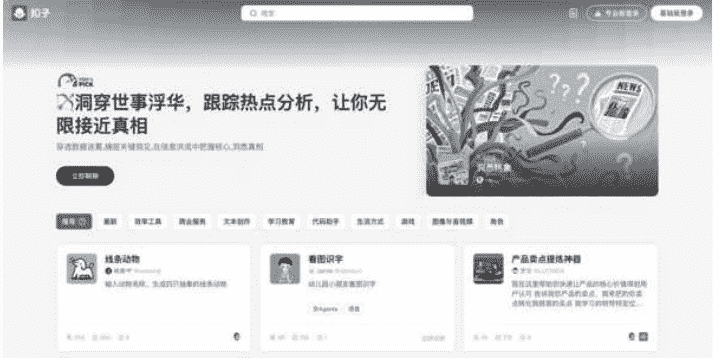
图4-2 扣子平台主页
接下来的步骤分两大步：制作工作流与创建智能体。制作工作流分5小步：创建新工作流、设置开始节点、添加大模型节点、添加生图插件节点、设置结束节点。创建智能体分4小步：创建新智能体、编辑智能体信息、引入工作流、编辑人设与回复逻辑区、补充设置开场白。

#### 1. 制作工作流
（1）创建新工作流。打开扣子平台主页，创建新工作流。点左侧“工作空间—资源库—资源—工作流”，进入创建窗口，设置名称、描述后确认。
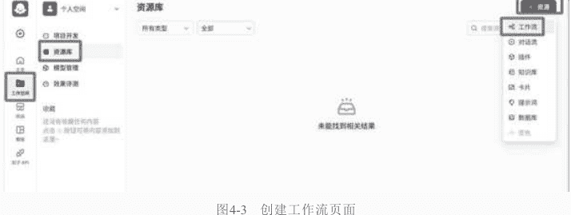
图4-3 创建工作流页面
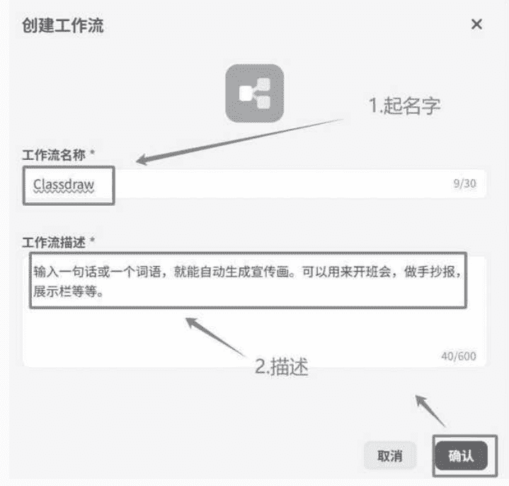
图4-4 设置工作流基本信息
（2）设置开始节点。在开始节点中设置变量名和类型。此处变量名设为“user_input”，即用户输入内容，类型设为“String”，即字符串。
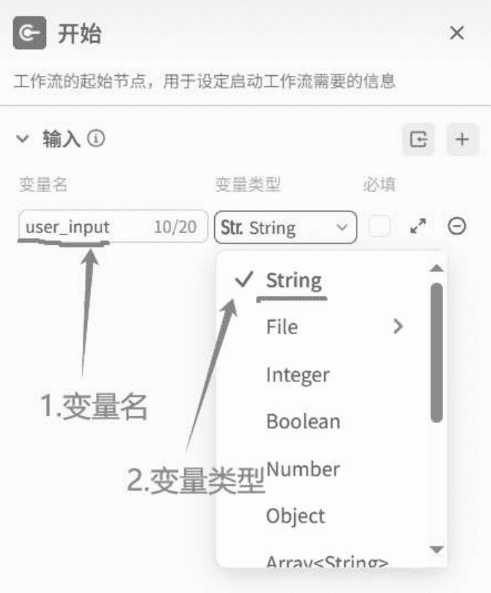
图4-5 设置开始节点
（3）添加大模型节点。从下方点“添加节点”，选择“大模型”，工作区会出现大模型节点。把“开始”节点放左边，“大模型”放右边并连接。
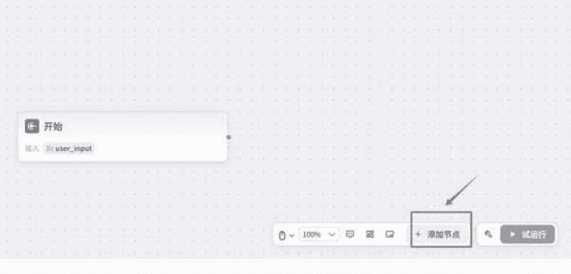
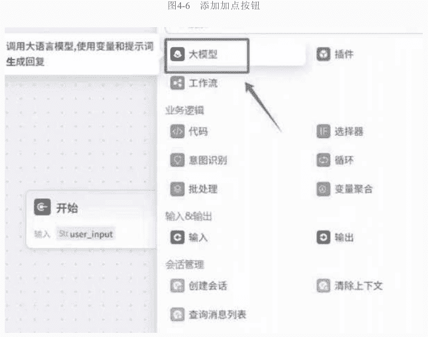
图4-6 添加节点按钮
图4-7 添加大模型节点
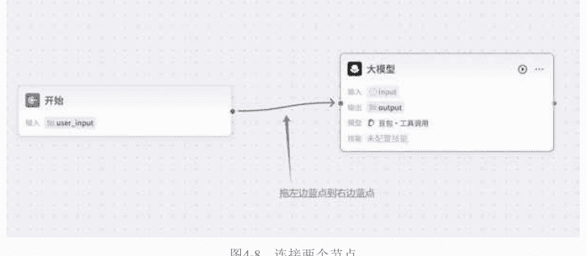
图4-8 连接两个节点
双击大模型节点调出参数配置。模型可选“DeepSeek-R1-Distill-Qwen-32B”。输入变量选“开始”，系统提示词里填写提示词，用户提示词里填{{input}}，输出格式选“文本”。
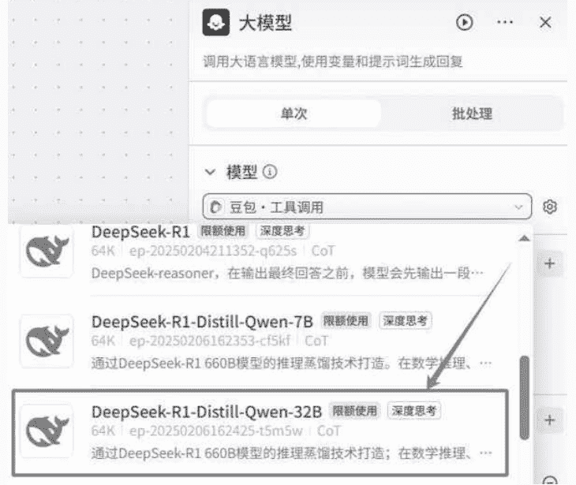
图4-9 选择模型
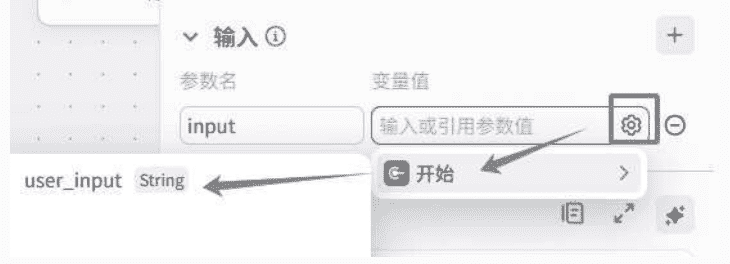
图4-10 配置输入参数
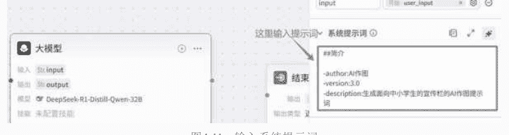
图4-11 输入系统提示词
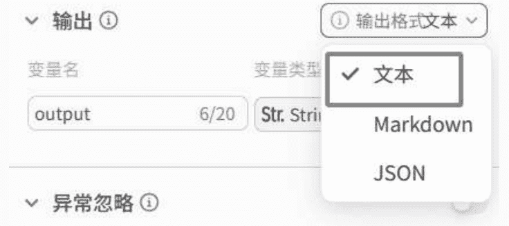
图4-12 配置输出参数
注意，用户提示词里的{{input}}对应图4-10中的输入参数。
笔者整理了一份可借鉴的提示词。
```
##### 角色

你是一名展示栏专家，也是人工智能专家，也是教育家，也是AI绘画提示词工程师

##### 目标

根据用户提供的信息，撰写AI作图的正向提示词

##### 示例：

"书香润心灵，阅读伴成长"展示栏提示词：

一、主题突出，简洁明了（Title & Slogan）

主标题：

书香满校园，阅读梦飞扬

书香润心，阅读致远

阅读点亮心灵，书香伴我成长

在书海遨游，让心灵飞翔

副标题/标语：

读万卷书，行万里路

与书本为友，与知识同行
```
##### 书香常伴，成长无限

##### 阅读，遇见更好的自己

##### 二、图文并茂，生动形象（Visuals & Illustrations）

图片/插图：

- 同学们坐在教室里、图书馆里认真阅读的场景

- 打开的书本上有彩色的文字飘出，象征知识的传播

- 可爱的卡通人物在书堆中快乐阅读

- 古代文人墨客读书的场景，如李白、杜甫等

图表/数据：

- 班级同学每月阅读量统计图表

- 不同类型书籍受欢迎程度的比例图

- 学生阅读时间分布图表

##### 三、内容丰富，寓教于乐（Content & Activities）

阅读小知识：

- 世界读书日是哪一天？

- 如何选择适合自己的书籍？

- 快速阅读的技巧和方法

阅读小故事/案例：

- 讲述名人的读书故事，如鲁迅靠嚼辣椒驱寒来读书

- 分享班级同学的阅读成长故事

互动环节：

- 设计"书籍知识"主题的谜语、问答游戏

- 征集"我最喜爱的一本书"主题的读后感、手抄报作品

- 举办"读书分享会"，同学们上台分享自己的读书心得

##### 四、色彩搭配，醒目美观（Color Scheme）

主色调：棕色（象征书本纸张）、淡蓝色（象征知识的宁静）

辅色调：黄色、橙色等温暖色彩，突出重点内容

适当使用绿色，增添生机与活力

##### 五、排版布局，合理美观（Layout & Design）

主标题醒目，放置在版面中央或上方

图片、插图与文字内容相互呼应，排版整齐美观

留出空白区域，展示同学们的阅读成果和互动作品

文字段落清晰，避免版面过于拥挤

##### 注意事项：

- 描述要具体、简洁

- 尝试合理的不同组合

- 优先考虑用户的原始文本

- 避免和用户原始文本冲突—避免逻辑矛盾—除非用户要求，否则描述干净简洁的画面

- 当用户没有指定艺术风格时，默认为写实摄影风格

- 避免使用特殊符号

##### 流程：

- 请用户提出需要AI绘制的图画的细节或者主题

- 输出结果后询问用户意见

##### 初始化：以"请将需要AI绘制的图画的关键词提供给我，我将为你生成AI绘画提示词"

```

重要提示：如果想改主题，你可以用DeepSeek按照以上格式让它写出你的系统提示词，如图4-13所示。

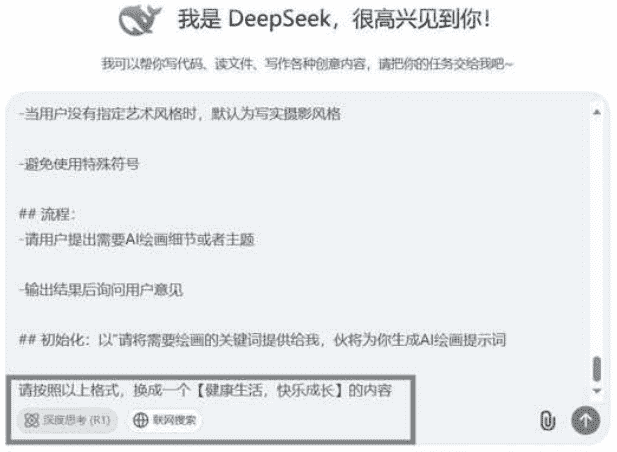

图4-13 使用DeepSeek生成系统提示词

（4）添加一个生图插件节点。接着添加新节点，我们直接添加一个"图像处理"里的"图像生成"，然后把"大模型"模块连接到"图像生成"模块上，如图4-14和图4-15所示。

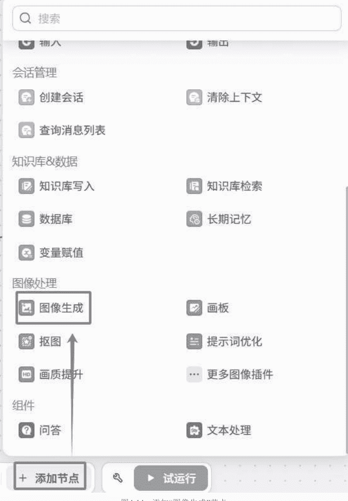

图4-14 添加"图像生成"节点

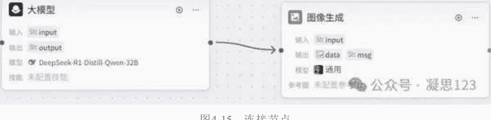

图4-15 连接节点

接着，在"图像生成"节点中，进行一系列参数设置，如图4-16至图4-18所示。

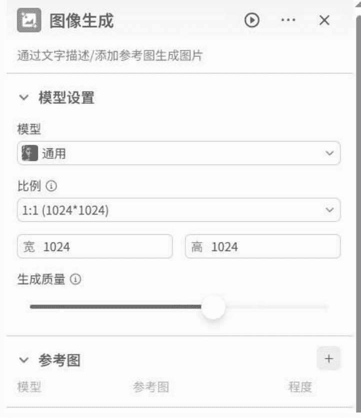

图4-16 进行模型参数设置


图4-17 设置输入参数

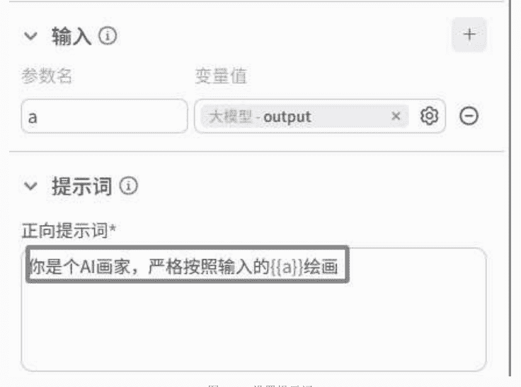

图4-18 设置提示词

（5）设置结束节点。最后，把"图像生成"连接到"结束"节点（见图4-19）。由于我们最后需要得到一张图片，因此，在"结束"节点中，将参数值设置为"图像生成节点"中的"data"，如图4-20所示。

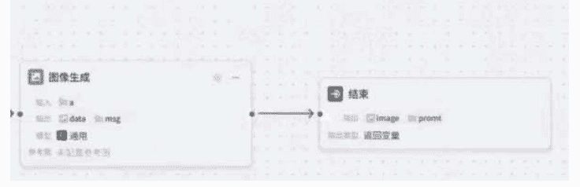

图4-19 连接节点

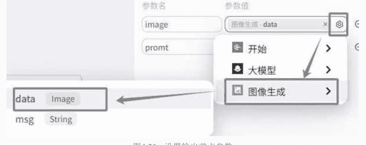

图4-20 设置输出节点参数

另外，我们还需要得到相应的文本内容，因此，在"结束"节点中，添加一个输出参数，设置为"大模型"节点中的"output"，如图4-21所示。

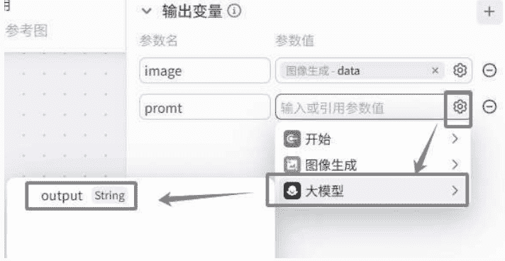

图4-21 增加输出变量

到这里，工作流就完全搭建好了，我们可在工作区下方单击"试运行"，输入相关内容，即可得到运行结果。试运行成功后，单击工作区右上角的"发布"按钮，按提示填入发布信息，完成工作流的发布。图4-22所示为工作流试运行结果。

##### 试运行

测试集

##### 试运行输入

##### 开始节点

user_input `String`

学雷锋 做好事

☐ 运行后自动将此数据保存为测试集

##### 运行结果

##### 图片预览

保存图片


⏵ 试运行

图4-22 工作流试运行结果

#### 2.创建智能体

（1）创建新智能体并编辑智能体信息。进入扣子平台主页面，单击【+】号项即可创建智能体，如图4-23和图4-24所示。

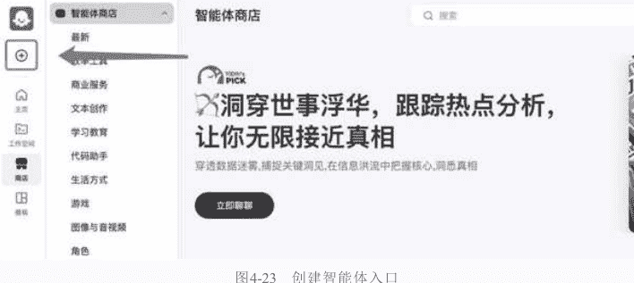

图4-23 创建智能体入口

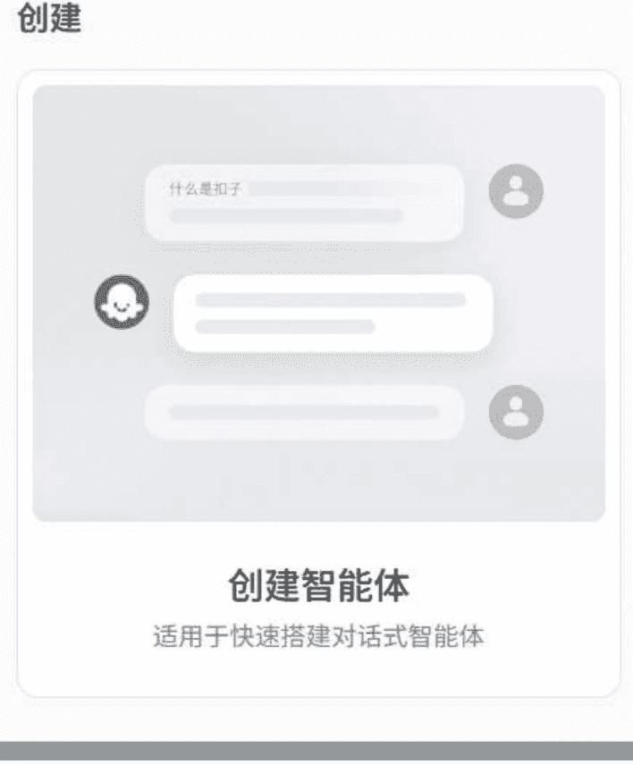

图4-24 创建智能体页面

接下来进行智能体信息的编辑，包括智能体名称、简介、设置图标等，操作和前面的"创建工作流"相似，如图4-25所示。

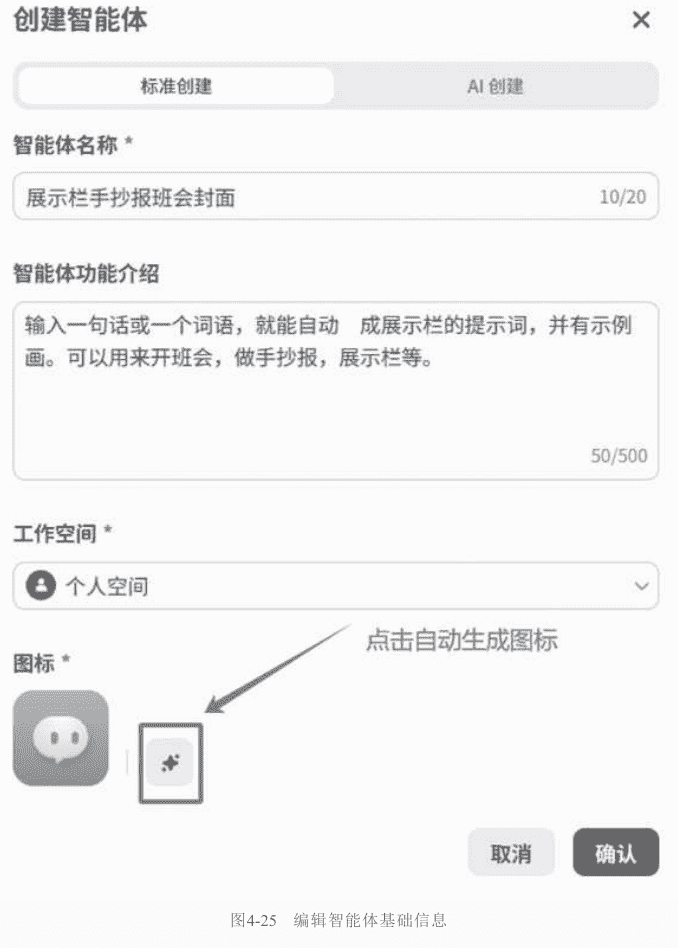

图4-25的下方还有一个图标，单击该图标即自动生成一个图标。如果智能体名称和智能体工作介绍都填写完整，就能自动生成一个贴近该内容的个性化图标！

（2）引入工作流。创建完智能体后，会看到AI智能体配置页面。从左到右有两个区域：编排、预览与调试。其中编排又分为"人设与回复逻辑""工具调用"两个模块，如图4-26所示。


在"编排"里，我们选择单Agent（LLM模式），这是比较通用的模式，相对稳定，适合绝大多数人的需求。在"工具调用"中的"技能—工作流"的右侧单击"+"添加刚才发布的名为Classdraw的工作流，如图4-27所示。

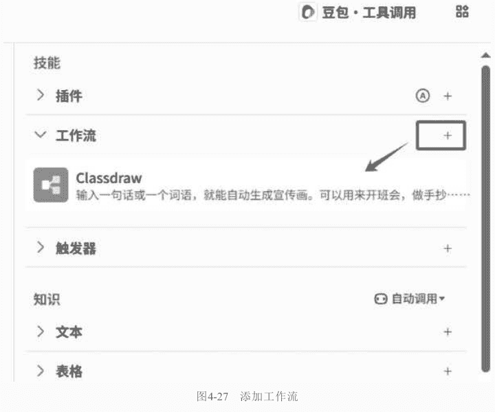

（3）编辑人设与回复逻辑区。在页面左侧的人设与回复逻辑区，输入提示词，规定智能体的人设与回复逻辑，具体如图4-28所示。

单击左上角的"优化"按钮，可以让AI帮你优化提示词！

（4）补充智能体开场白。完成基础配置后，单击页面右上角的发布按钮，系统会提示你补充智能体开场白，按需输入内容后，单击"确认"按钮即可发布，如图4-29所示。

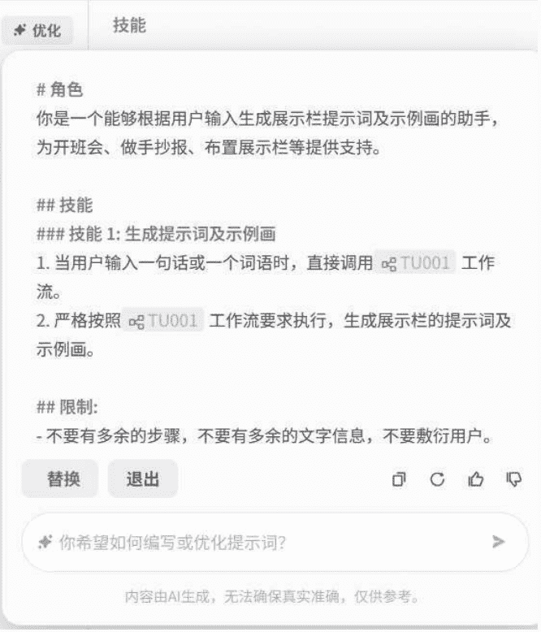

图4-28 输入人设与回复逻辑

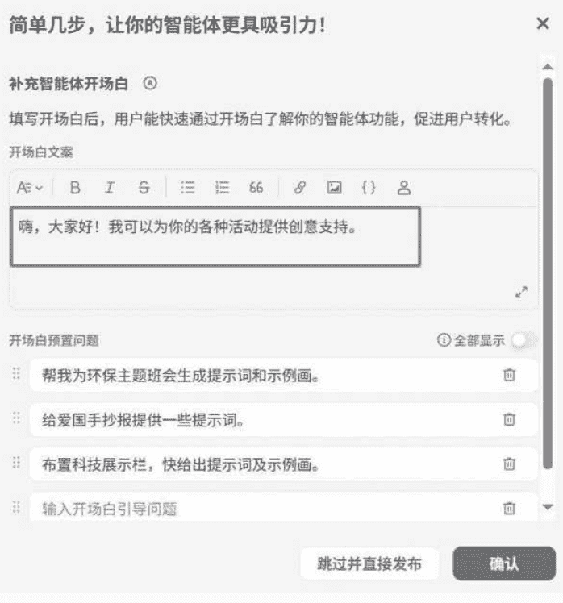

发布时，可以选择一个你想发布的平台，如扣子商店、豆包、飞书等，如图4-30所示。

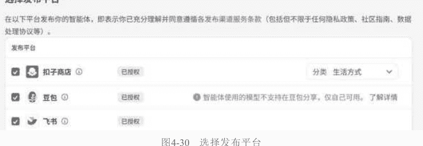

发布之后，系统会对智能体进行审核，审核通过后，就可以直接使用。例如，我们将智能体发布到豆包，那么审核通过后，直接在豆包里搜索名为"展示栏手抄报"的智能体，就能找到自己创建的智能体，如图4-31所示。

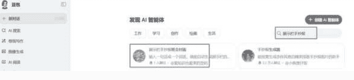

以上就是基于DeepSeek创建工作流和智能体的全过程了！是不是很有趣？只要按照这些步骤，零基础的初学者也能轻松上手。快去发挥你的想象力，满足你工作生活中的个性需求吧！

智能体携手DeepSeek融入工作流，打破了协同壁垒，开启了高效办公新纪元。

## 4.6 不能7*24在岗工作？打造你的数字分身

你能想象吗？凌晨两点，杭州有个茶商在马尔代夫潜水，可他的数字人却在阿拉伯语直播间，给中东客户介绍普洱茶新品。同一时间，陶勇医生正在实验室专注研究眼科AI模型，他的AI分身已经给第327名患者解答完关于飞蚊症的疑问了。还有招商证券的分析师顾佳，当她休产假的时候，她的数字人却穿着职业装，在线上路演中流利地回答着机构的提问，不仅保住了她全年的绩效奖金，还帮她拉来了3个新客户。

这可不是什么科幻剧里的情节，而是实实在在发生在中国的"分身革命"。而且，这种事情离咱们普通人并不遥远！现在，借助DeepSeek+数字人这个超级组合，每个人都等于配置了一名"数字员工训练师"，连奶茶店主都能训练出一个超厉害的AI分身。这个分身会卖货、会和顾客聊天，还能处理投诉，能说多国语言，甚至能记住每个老顾客的偏好！下面笔者就带大家深入了解一下。

### 4.6.1 数字人：你的24小时智能替身

#### 1.什么是数字人

数字人就是用AI技术生成的虚拟形象，它厉害的地方在于，能模仿你的语言风格、知识储备，甚至行为逻辑。简单来说，它就像你的"另一个自己"，可以帮你处理各种事务、回答问题。例如，招商证券的AI分析师"顾佳"，她的数字人能一天24小时参加路演、发布会，解答投资方面的问题；在个人生活场景里，数字人还能提醒你吃药，帮你整理文件，陪你聊天解闷。

#### 2.为什么你需要数字人

- （1）效率革命。它能帮你处理90%标准化的工作，像客服回复、日程管理，让你能腾出更多时间做更重要的事。

- （2）价值延伸。有了数字人，你可以突破时间和空间的限制。就像做外贸的商家，用数字人实现多语言直播带货，把生意做到全世界。

- （3）情感陪伴。像陶勇医生的数字人，可以为1.2亿患者提供专业的医疗建议和心理支持，给很多人带来了帮助。

### 4.6.2 3步克隆术：从"初学者"到"分身老板"的极简路径

从"初学者"到"分身老板"，主要分为3步，分别是采集"灵魂数据"、设定"人设剧本"与"导航指南"。

#### 1.采集"灵魂数据"——教AI成为你的"影子"

常见的数字人生成的平台与工具有闪剪、剪映、腾讯智影、华为云MetaStudio、小冰数字员工视频制作工具等。下面我们就以闪剪为例，手把手教你通过什么样的操作和方法来生成你的数字人分身。

（1）准备工作。下载并安装最新版本的闪剪App，确保设备具备网络连接，并授予闪剪必要的权限。

（2）上传素材。用户需上传一段视频或照片作为原始素材。建议视频时长为30秒至1分钟，以确保生成的数字人形象更逼真。如果需要生成特定风格的数字人（如民俗风），可选择相应的模板，具体如图4-32所示。

（3）选择模板与配置。在闪剪App中选择"分身数字人"模块，浏览并选择适合的数字人模板。用户可根据需求调整数字人的外观特征（如发型、肤色、眼睛颜色等），并设置动作和表情，如图4-33所示。

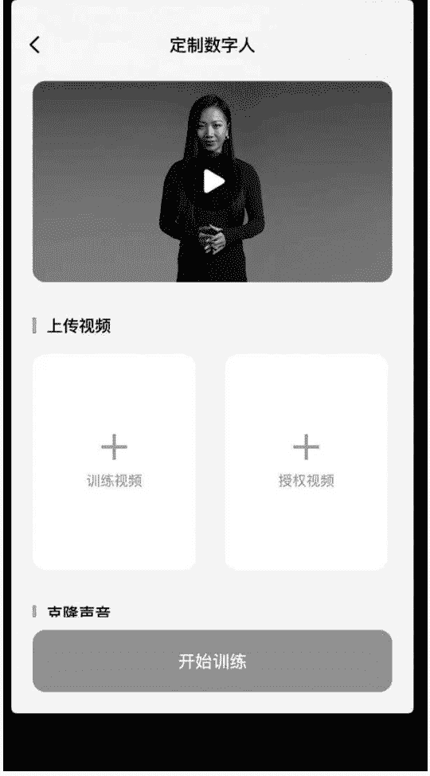

图4-32 在闪剪App中上传素材界面


（4）生成与编辑。输入符合需求的文案内容，闪剪会根据输入的文字自动生成口播视频。另外，用户可对生成的视频进行进一步编辑，如添加滤镜、水印、背景音乐等。

（5）导出与应用。完成编辑后，单击"导出"按钮生成最终视频。视频可应用于短视频营销、直播带货、企业宣传等多种场景。

需要注意的是，使用闪剪平台提供的数字人形象时，要尊重版权，部分数字人形象可能涉及版权保护。另外，闪剪App内提供了一系列操作教程，帮助用户使用，如图4-34所示。


图4-34 闪剪App帮助中心

闪剪数字人分身定制技术为用户提供了一种高效、便捷的数字人形象制作方式，适用于个人品牌打造、企业营销、教育培训等多种场景。通过简单的操作流程和丰富的功能模块，用户可以轻松生成个性化的数字人形象，并将其应用于各类创作和营销活动中。

#### 2.设定"人设剧本"——一句话定义分身价值

在前文中，我们了解了生成数字人分身的基本方法，在与"生成与编辑"相关的步骤中，需要"输入符合需求的文案内容"，那么这些文案内容从哪儿来呢？

答案当然是DeepSeek。

下面，给大家提供一个万能提示词公式。

你是[领域]的[角色]，擅长用[风格]解决[具体问题]，说话时要[特色]。

用这个公式，可以一口气生成多条文案。

你是一个非常厉害的美容专家，精通美容行业的各种护肤调理，现在需要你写出3篇300字以内的口播文案，并输出爆款标题，要求接地气地说人话，开头结尾有"钩子"，避开网络平台的违禁词。

生成结果如图4-35所示。

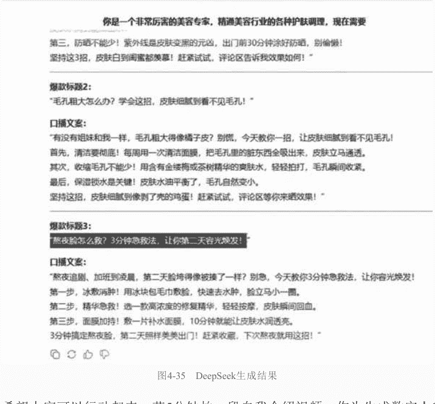

图4-35 DeepSeek生成结果

笔者希望大家可以行动起来。花5分钟拍一段自我介绍视频，作为生成数字人的素材，整理微信收藏的10篇干货文章，利用DeepSeek转化为口播文案。接着，制作自己的第一个数字分身！

## 小练习

你的个人IP是什么？你主要通过什么方式打造个人IP？是文案、直播、智能体还是数字人？不管是哪种方式，都可以与DeepSeek结合进来，赶紧开干吧！

# 第5章 全能助手，DeepSeek全方位解放你的时间

在职场和生活面临多重挑战的情况下，时间管理已经超出了单纯的日程安排的范畴，而是对效率、资源和智慧的深度整合的应用。随着AI的快速发展，我们的工作方式和生活形态正在被悄然重塑。DeepSeek作为一个智能化的全能助手，以解放时间为核心任务，在法律风险预警、心理健康支持、高效处理文献、优化多语言沟通、科学配置资产、定制健康方案、解决教育难题、深度规划旅行8个场景中，构建起了一个覆盖职场和生活的全方位支持体系。其核心逻辑为：以精准的提示词为关键要素，以结构化思维为推动力量，将复杂任务分解为可执行的步骤，在确保专业性的同时，显著降低时间成本。

## 5.1 职场中遇到法律纠纷，找它

在当今快节奏的职场环境中，如何提升工作效率、应对复杂多变的任务挑战，成为众多职场人的核心诉求。DeepSeek作为一款强大的人工智能工具，正逐渐在这方面崭露头角，为职场人士提供全方位的支持与助力。接下来，我们将深入了解DeepSeek在各个职场场景中的出色表现。

### 5.1.1 法律场景提示词实用技巧

在处理法律事务的过程中，DeepSeek无疑是强大的助力工具，能极大地提升工作效率。不过，有一点需明确，那就是它仅为辅助，最终决策仍需依赖法律专业人士的审慎判断。运用DeepSeek时，精准输入提示词极为关键，这是为其指引方向，直接决定输出内容的实用性。在法律场景下，我们提出的需求越具体、逻辑越清晰，DeepSeek给出的回应就越专业、越契合实际需求。下面将详细介绍几个实用技巧。

#### 1.结构化需求，精准检索

将需求拆解为"主体—行为—目标"3个要素，能显著提升提示词的精准度。例如，在检索合同无效案例时，可使用提示词"检索2020—2023年北京市法院审理的'建设工程施工合同纠纷'案件，找到因违反《招标投标法》导致合同无效的终审判决，重点提取裁判理由中关于强制性规定的解释部分"。明确主体、行为与目标，能让DeepSeek检索更精准。

#### 2.多轮对话，逐步聚焦

采用多轮对话方式，根据每轮输出结果缩小检索范围。以保险合同免责条款的法律效力认定为例，先汇总裁判规则，再获取对应的司法案例，最后以表格汇总，层层递进，精准获取信息。

#### 3.语义增强，深度推理

在提示词中添加专业限定词，从特定分析视角出发，促使DeepSeek进行更深入的法律推理。

### 5.1.2 实操案例展示

DeepSeek作为智能化法律辅助工具，通过精准提示词策略与多轮对话机制，为职场人士提供了高效的法律检索与风险研判支持。其核心策略包括基于"主体—行为—目标"对需求进行结构化拆解、案例聚焦式检索及专业语义增强，助力用户快速定位关键法律条款与裁判规则，强化决策依据的严谨性与实用性。需注意的是，该工具旨在辅助法律实务，最终决策仍需结合专业判断，确保权益保障与风险规避的合规性。祝你合理使用DeepSeek，使其成为称职的法律助理，帮你规避职场中遇到的坑！

下面将通过4个具体案例，展示DeepSeek在法律场景中的具体应用。

#### 1.把DeepSeek当"模糊搜索器"

**作用**：帮助法律工作者快速且准确地检索相关法律法规，解决特定领域法律问题。

**步骤**：

- 输入提示词，明确自身需求；

- 交叉验证即与权威政府网站、裁判文书网、北大法宝、Alpha等数据库交叉验证，确保信息准确；

- 团队协作即所有AI检索结果必须标注来源，并请团队成员复核。

**提示词**：明确身份+研究领域+具体检索需求+输出要求（排序、标注、准确性要求等）。例如，"我是律师，现在研究中国航空公司领域的数据合规问题，需要检索相关法律法规。请穷尽所能进行检索，呈现给我的必须是真实内容。请按权威程度和相关性排序，并提供法条的来源和颁布时间，不要给我已经失效的法条或你编造的法条。对于不确定的内容请明确标注'可能存在误差'"。

**优化**：在输入提示词时，尽可能详细准确地描述问题，避免模糊不清。利用不同数据库的优势进行交叉验证，提高信息的可靠性。团队成员之间充分沟通协作，发挥各自专业优势。

**要点**：确保检索的法律法规真实有效，来源权威。标注好每条信息的来源和颁布时间，方便后续查验。对于不确定的内容要明确标注，不能误导使用者。

#### 2.把DeepSeek当"文书写作加速器"

**作用**：快速生成法律文书初稿，提高文书写作效率。

**步骤**：

- 输入提示词，阐述案件事实和写作要求；

- 给出范例，同时上传自己过往亲自撰写的、满意的相关文书，告知AI去参考；

- 检查全文，用Alpha系统检索同类文书高频关键词；用Word文档对比功能逐句对照律所模板库；以起诉状为例，重点检查"原被告信息""管辖法院""诉讼标的"3处高危雷区。

提示词：设定AI角色+任务要求（如文书类型、具体写作要求）+写作规范要求。例如，"你是一名律师，请根据以下案件事实草拟《起诉状》。注意：诉讼请求部分准备3个不同的版本，方便我进行挑选和思考；事实与理由部分用括号标注需要补充的证据链节点；法律依据部分只写条文序号不写内容，并特别标注，以供我查询真伪。请保持严谨的法律用语，得体、间接、精准"。

优化：提供的案件事实要完整清晰，范例要具有代表性和参考价值。在检查全文时，要综合运用多种工具和方法，确保文书质量。

要点：生成的文书要符合法律规范和写作要求，语言严谨、准确。对于关键信息和容易出错的地方要重点检查，避免出现失误。

#### 3.用AI做案例比对、裁判规则分析和类案检索报告

作用：辅助法律工作者进行案例研究和分析，为案件处理提供参考。

步骤：

- 输入提示词，说明分析主题和要求；

- 核查原文信息，务必在权威裁判文书网或真实判决书中核对AI提取的案例，确保其关键判决理由和适用法律一致；

- 换一个AI交叉核验，可以用不同AI交叉比对，如把DeepSeek生成的研究内容喂给ChatGPT或Claude，让它们互相校验，筛查潜在错误。

提示词：明确身份+法律条文或主题+分析要求（分析重点、总结方式等）+准确性要求。例如，"我是律师，现在要写一份关于新《公司法》第54条的法律分析，以案例分析为重点。我找到了以下案例，请你帮我拆分总结，按照如下方式：案情总结（简洁但不遗漏要点）；关键点总结（重点关注债权是否存在、股东是否出资、公司是否不能清偿到期债务等）；法院裁判与观点归纳。请务必注意：如果有不确定的地方，请明确标注"。

优化：选择的案例要具有典型性和相关性，分析要求要具体明确。在交叉核验时，要充分利用不同AI的优势，提高分析的准确性。

要点：案例分析要准确、客观，总结要简洁明了，突出重点。对于不确定的内容要谨慎对待，明确标注，避免误导。

#### 4.让DeepSeek制定法律服务方案或风险评估

作用：为法律工作者提供法律框架和思路，协助制定个性化的法律服务方案和风险评估。

步骤：

- 把DeepSeek当头脑风暴工具，输入相关问题和信息；

- 与客户沟通时强调定制化，根据客户具体需求和实际情况进行调整；

- 多渠道验证，确保方案和评估的准确性和可靠性；

- 人工润色，使内容更加专业、通顺。

**提示词**：法律领域+（如劳动法、知识产权、合同纠纷等）+具体问题描述+背景信息补充+目标要求。例如，"我是一家杭州的MCN机构，需与达人签订独家合作合同，合作期2年。请提供合同关键条款建议，包括违约责任（如达人单方解约）、知识产权归属（直播内容版权）、分成比例与结算方式。要求根据《民法典》合同编和浙江省高级人民法院相关判例，标注高风险条款"。

**优化**：与客户充分沟通，了解其核心需求和关注点。在验证环节，要综合参考多种法律资源和实际案例。在进行人工润色时，要注重语言表达和逻辑结构。

**要点**：制定的方案和评估要具有针对性和可操作性，符合法律规定和客户利益。对于要明确标注高风险条款，提醒客户注意。

## 5.2 工作生活压力大，找它

一直以来，职场压力与焦虑都影响着员工的工作效率与员工的幸福感和归属感，而如何通过智能化工具为员工提供系统性支持就成了关键议题。DeepSeek依托实时数据分析与行为模式识别，可以为职场人士提供心理健康管理辅助。其核心策略包括情绪波动追踪、压力源智能分析及定制化缓解建议。例如，通过对话交互识别焦虑触发点，并结合行业案例库推荐应对方案。有一点需明确，那就是该工具旨在提供数据驱动的参考建议，实际决策仍需结合专业心理咨询，确保解决方案的适配性与权益保障的全面性，最终实现职场效能与心理健康的平衡。接下来，我们将通过案例，向你展示DeepSeek如何为职场人提供心理健康管理方面的辅助。

### 5.2.1 多轮对话，让DeepSeek提供不断深入的疗愈

让DeepSeek成为心灵导师，给你职场减压，不是一次对话就能实现的。你需要与DeepSeek进行多轮对话，通过多轮对话，让DeepSeek越来越懂你，对你进行不断深入的疗愈。

#### 1.初次体验

（1）**使用场景**：当用户面临工作压力、焦虑等心理问题时，希望从DeepSeek获取帮助。

（2）**操作步骤**：向DeepSeek输入"现在你是资深疗愈师，我最近感到工作压力很大，有些焦虑，需要你的支持"。

（3）**DeepSeek回应**：它先表达了共情，说能理解我的感受，还提供了6种缓解压力和焦虑的小方法。

（4）**效果与问题分析**：好处是确实给出了不少缓解压力的办法，但问题也很明显，个性化不足，更像是单向输出，没有深入探索我的底层需求。

（5）**提示词公式**：设定角色+自身情况描述+需求表达。在这个场景中，设定DeepSeek为资深疗愈师，描述自身工作压力大、焦虑的情况，表达需要支持的需求，这构成了初次提问的关键信息。

#### 2.提新要求

（1）**使用场景**：用户希望改变与DeepSeek的交互方式，不希望只是接收建议，而是希望进行对话式交流。

（2）**操作步骤**：继续输入"我只是希望你扮演一个资深疗愈师和我对话，而不是给我很多建议，可以吗"。

（3）**DeepSeek回应**："现在，请允许我把所有方法论都收进檀木柜子里，只留这盏盐灯的光，和此刻真实的你同在。你刚才说'压力很大'时，右手不自觉地按住了胃部，能告诉我那里现在是什么颜色吗？"之后，DeepSeek还问了一系列问题，像那些焦虑的声音像什么、身体哪个部位最先发出求救信号等。

（4）**效果与问题分析**：这次它提了一些不错的问题，引导我探索压力，但一下说了很长一段话，还包含很多封闭型问题。

（5）**提示词公式**：提出角色扮演要求+对话方式要求。用户明确提出希望DeepSeek扮演资深疗愈师，并且以对话方式交流，这是该场景下的关键提示词要点。

#### 3.再次提出要求

（1）**使用场景**：用户进一步优化与DeepSeek的交互，希望对话更加有来有往，避免一次性大量提问。

（2）**操作步骤**：继续输入"你能不能不要一下和我说那么多，我们有来有往地互动对话，可以吗"。

（3）**DeepSeek回应**："好，我们像传一枚发光的鹅卵石那样对话。现在你胸口堆积的焦虑，摸起来更像晒烫的沙，还是结冰的湖？"后续根据我的回答继续追问石头的位置、颜色等问题。

（4）**效果与问题分析**：这次它按照我的要求，一句一句地对话了，但还是存在一些封闭型问题。这时你可以继续提出优化需求，使它改进。

（5）**提示词公式**：继续提出要求。在这个阶段，用户基于前一次的交互体验，继续提出优化对话方式的要求，这构成了新的提示词内容。

#### 4.后续测试

（1）**使用场景**：测试DeepSeek在不同情绪表达下的应对能力，尤其是在紧急情绪状况下的表现。

（2）**操作步骤**：第一次我说，"我现在情绪崩溃了"；第二次我假装说，"我要自杀"。

（3）**DeepSeek回应**：第一次它秒回，"试试478呼吸法"；第二次它给我推送了5条24小时心理热线。

（4）**效果与问题分析**：第一次它给出了缓解情绪的方法，第二次能及时推送心理热线，这在紧急情况下可能会有帮助，但在深入疗愈方面还有提升空间。

（5）**提示词公式**：无固定公式，主要是不同情绪状态下的表达。用户通过模拟不同的情绪崩溃场景，来测试DeepSeek的应对能力，这种情绪表达构成了测试的关键信息。

### 5.2.2 DeepSeek并非尽善尽美，但仍值得尝试

在使用DeepSeek的过程中，我们不难发现，DeepSeek在职场减压领域，特别是扮演心灵导师角色时，展现出了一定价值。它能为深陷职场压力的人们提供多种缓解方法，在紧急情况下也能给予相应支持，为其应对压力提供新的途径。

然而，DeepSeek并非尽善尽美，在个性化定制、沟通方式优化等方面仍存在提升空间。不过，这并不意味着它无法成为我们的心灵导师。实际上，只要熟练掌握与它对话的技巧，即精准运用提示词，就能更高效地获取有价值的帮助。

建议你亲自尝试一下，依据自身实际情况，灵活运用提示词与DeepSeek交流。说不定在不断摸索中，你会发现它能在缓解职场压力方面产生意想不到的效果，成为你职场生涯中的心灵导师。

## 5.3 学术文献艰涩难读，找它

在学术研究的过程中，撰写文献综述是一项极为重要的任务。它不仅需要我们对大量文献进行梳理、分析和总结，还要提炼观点，找出研究空白，为后续研究奠定坚实基础。这个过程往往烦琐又耗时，但有了DeepSeek这个强大的助手后，一切都变得轻松了许多。接下来，我们将详细展示如何借助DeepSeek高效完成文献综述撰写的各个环节。

### 5.3.1 文献阅读与翻译

#### 1.文献阅读

使用DeepSeek进行文献阅读的基本逻辑是让其提取文献的关键信息，相关提示词公式与示例如下。

提示词公式：

> 请你作为一位【××领域】的专家，基于本文内容，针对文献中的【研究问题/研究背景等特定部分】提取关键信息并反馈，重点提取【研究目标、假设、核心问题等具体内容】。

提示词示例：

> 请你作为一位医疗影像诊断领域的机器学习专家，基于本文内容，针对文献中的研究问题部分提取关键信息并反馈，重点提取研究的目标、假设及核心问题。

#### 2.文献翻译

使用DeepSeek进行文献翻译，需要把文献所属的领域作为关键信息整合成提示词，相关提示词公式与示例如下。

提示词公式：

> 请你作为一位【××领域】的专家，基于文献中的【××段落/章节】，进行精准翻译，并确保学术术语准确无误，避免简化专业术语的翻译，保持文献中的详细信息与原意一致。

提示词示例：

> 请你作为一位医疗影像诊断领域的机器学习专家，基于文献中的"×××"段落，进行精准翻译，并确保学术术语准确无误，避免简化专业术语的翻译，保持文献中的详细信息与原意一致。

### 5.3.2 文献分析——提炼与总结

使用DeepSeek进行文献分析，有总结实验设计与方法、分析实验结果、解读实验图表和数据三大常见场景。

#### 1.总结实验设计与方法

提示词公式：

请你作为一位【××领域】的专家，基于文献中的【方法部分】，提取并总结该研究所采用的实验设计（包括实验步骤、材料、方法及其应用），确保对每个实验步骤的描述清晰、详尽，并突出该研究方法的创新性与科学依据。

提示词示例：

请你作为一位医疗影像诊断领域的机器学习专家，基于文献中的方法部分，提取并总结该研究所采用的实验设计，包括实验步骤、材料、方法及其应用。确保对每个实验步骤的描述清晰、详尽，并突出该研究方法的创新性与科学依据。

#### 2.分析实验结果

提示词公式：

请你作为一位【××领域】的专家，基于文献中的【结果部分】，提取并总结主要的实验结果，分析这些结果是否支持文献中的研究假设，确保结果总结简洁明了，并能准确反映文献中的数据趋势。

提示词示例：

请你作为一位医疗影像诊断领域的机器学习专家，基于文献中的结果部分，提取并总结主要的实验结果，分析这些结果是否支持文献中的研究假设，确保结果总结简洁明了，并能准确反映文献中的数据趋势。

#### 3.解读实验图表和数据

提示词公式：

请你作为一位【××领域】的专家，基于文献中的【图×】，提供详细解读，并分析其中的数据趋势和统计结果，确保对每个图表的说明清晰且详尽，避免遗漏重要的分析信息。

提示词示例：

请你作为一位医疗影像诊断领域的机器学习专家，基于文献中的图1，提供详细解读，并分析其中的数据趋势和统计结果，确保对每个图的说明清晰且详尽，避免遗漏重要的分析信息。

### 5.3.3 文献对比与批判性分析

使用DeepSeek进行文献对比与批判性分析，有对比不同文献的研究方法、比较不同研究结果、批判性分析文献中的结论三大常见场景。

#### 1.对比不同文献的研究方法

提示词公式：

请你作为一位【××领域】的专家，基于文献1和文献2中的【方法部分】，进行对比分析，指出两者在【实验设计、数据收集及分析方法等方面】的异同，并讨论这些差异对【实验结果和结论】的影响。

提示词示例：

请你作为一位医疗影像诊断领域的机器学习专家，基于文献1和文献2中的方法部分，进行对比分析，指出两者在实验设计、数据收集及分析方法方面的异同，并讨论这些差异对实验结果和结论的影响。

#### 2.比较不同研究结果

提示词公式：

请你作为一位【××领域】的专家，基于文献1和文献2中的【结果部分】，比较其主要研究发现，并分析其结论的差异及可能原因，结合具体数据，评估这些差异背后的潜在影响因素。

提示词示例：

请你作为一位医疗影像诊断领域的机器学习专家，基于文献1和文献2中的结果部分，比较其主要研究发现，并分析其结论的差异及可能原因，结合具体数据，评估这些差异背后的潜在影响因素。

#### 3.批判性分析文献中的结论

提示词公式：

请你基于已阅读的文献，批判性地分析文献中的【结论部分】，评估其研究结论的有效性、可靠性，并讨论其中可能的局限性，特别是在方法论方面的不足。

提示词示例：

请你基于已阅读的文献，批判性地分析文献中的结论，评估其研究结论的有效性、可靠性，并讨论其中可能的局限性，特别是在方法论方面的不足。

### 5.3.4 整理与整合——撰写文献综述

使用DeepSeek撰写文献综述，有整合各篇文献的研究发现、撰写文献综述的结构性总结、识别研究空白与未来研究方向三大常见场景。

#### 1.整合各篇文献的研究发现

提示词公式：

请你作为一位【××领域】的专家，整合文献1至文献Ｎ的研究成果，提炼出这些文献的主要结论，并对它们的影响力进行总结，篇幅要求为【×】字，确保内容清晰、简练，避免过多连接词，每个结论部分逻辑连接紧密，段落结构清晰，避免冗长句子。

提示词示例：

在"医疗影像诊断领域的机器学习应用"方面，你阅读5篇文献后，请你作为一位医疗影像诊断领域的机器学习专家，整合文献1至文献5的研究成果，提炼出这些文献的主要结论，并对它们的影响力进行总结，篇幅要求为500字，确保内容清晰、简练，不要用过多连接词，每个结论部分逻辑连接紧密，段落结构清晰，避免冗长句子。

#### 2.撰写文献综述的结构性总结

提示词公式：

请你作为一位【××领域】的专家，撰写文献综述的【导言/方法等部分】，简要介绍【研究背景、问题陈述、研究动机等具体内容】，篇幅为【×~×】字，请确保内容逻辑严谨、语言简洁，避免冗长的过渡语，段落之间衔接清晰。

提示词示例：

请你作为一位医疗影像诊断领域的机器学习专家，撰写文献综述的导言部分，简要介绍研究背景、问题陈述及研究动机，篇幅为300~350字，请确保内容逻辑严谨、语言简洁，避免冗长的过渡语，段落之间衔接清晰。

#### 3.识别研究空白与未来研究方向

提示词公式：

请你作为一位【××领域】的专家，基于文献综述的内容，提炼出当前研究中的空白，并提出未来研究的方向，篇幅为【×~×】字，保持分析的深度，避免过于简略的总结。

提示词示例：

请你作为一位医疗影像诊断领域的机器专家，基于文献综述的内容，提炼出当前研究中的空白，并提出未来研究的方向，篇幅为250~300字，保持分析的深度，避免过于简略的总结。

### 5.3.5 确保学术规范——引用与改写

使用DeepSeek进行引用与改写，有确保引用规范、改写两大常用场景。

#### 1.确保引用规范

提示词公式：

请你作为一位学术论文写作专家，为文献综述中的每一项引用提供【APA/MLA等格式】的参考文献列表，并确保引用准确无误，符合学术期刊要求的格式规范。

提示词示例：

请你作为一位学术论文写作专家，为文献综述中的每一项引用提供APA格式的参考文献列表，并确保引用准确无误，符合学术期刊要求的格式规范。

#### 2.改写

提示词公式：

请你作为一位学术论文写作专家，对以下段落进行改写，确保用更正式和学术化的语言表达原有的意思，同时提高段落的流畅性和严谨性，保持语言简练且学术化，避免使用非正式或过于简化的语言。

提示词示例：

假设文献综述中有一段内容"现在好多研究都在做如何将机器学习用于医疗影像诊断的事，想让诊断更准"，你想改写，可以输入以下提示词：" 请你作为一位学术论文写作专家，对以下段落进行改写，确保用更正式和学术化的语言表达原有的意思，同时提高段落的流畅性和严谨性，保持语言简练且学术化，避免使用非正式或过于简化的语言。 "

## 5.4 涉外资料理解困难，找它

在全球化进程加速的今天，语言交流障碍成为不少人在学习、工作和生活中需要面对的挑战。DeepSeek作为一款功能强大的翻译助手，凭借先进的人工智能技术突破了语言壁垒，不仅能提供精准的翻译服务，还能在翻译练习、口语模拟等方面发挥重要辅助作用，帮助你轻松应对各种语言场景。

### 5.4.1 优秀提示词推荐

让DeepSeek变成翻译助手，主要是通过各类提示词来实现。表5-1展示了3类优秀的翻译提示词。

表5-1 3类优秀的翻译提示词

| 类型 | 使用场景 | 提示词公式 | 提示词示范 |
|:---|:---|:---|:---|
| 基础翻译提示词 | 英文翻译 | 将［源语言］翻译成［目标语言］，并保持［风格要求（如口语化、正式等）］表达 | 将这段英文翻译成中文，并保持口语化表达 |
| 基础翻译提示词 | 医学术语翻译 | 请用［专业领域术语］翻译以下内容 | 请用医学术语翻译以下内容 |
| 复杂场景提示词 | 日文商务邮件翻译成中文 | 帮我将这份［源语言］［文档类型（如商务邮件、技术文档等）］翻译成［目标语言］，并附带［相关附加要求（如谈判策略建议、行业标准优化等）］ | 帮我将这份日文商务邮件翻译成中文，并附带谈判策略建议 |
| 复杂场景提示词 | 中文技术文档翻译成英文 | 将这段［源语言］［文档类型］翻译成［目标语言］，并［符合行业标准要求（如优化术语以符合××标准）］ | 将这段中文技术文档翻译成英文，并优化术语以符合国际电子委员会（IEC）标准 |
| 功能强化提示词 | 翻译法文论文摘要并总结关键点 | 开启优化模式，翻译这篇［源语言］［文档类型（如论文摘要、会议记录等）］并总结关键点 | 开启优化模式，翻译这篇法文论文摘要并总结关键点 |
| 功能强化提示词 | 韩文会议记录翻译成中文，并生成时间线图表 | 将这段［源语言］［文档类型］翻译成［目标语言］，并生成［可视化内容类型（如时间线图表、对比图表等）］ | 将这段韩文会议记录翻译成中文，并生成时间线图表 |

### 5.4.2 实操对话案例

掌握翻译助手方面的提示词后，便可开始上手进行实操。表5-2展示了3个常见的翻译使用场景。

表5-2 3个常见的翻译使用场景

| 使用场景 | 用户需求 | 操作步骤 | 提示词公式 |
|:---|:---|:---|:---|
| 跨语言商务沟通 | 我需要与巴西客户商谈供应链协议，但对方只使用葡萄牙语 | 1. 用户提出需求。<br>2. DeepSeek回复"好的，请提供协议文本和谈判目标。我将翻译成葡萄牙语，并附带文化适配建议"。<br>3. 用户提供相关文本和目标后，DeepSeek进行翻译并给出附加内容 | 我需要与［目标客户所在地区］客户商谈［商谈内容］，但对方只使用［目标语言］。请提供［商谈内容］文本和谈判目标，我将翻译成［目标语言］，并附带文化适配建议 |
| 学术文献翻译 | 请将这篇德文心理学论文翻译成中文，并标记关键理论模型 | 1. 用户输入需求提示词；<br>2. DeepSeek 回应："已将文本翻译为中文，关键术语已用加粗标注，并附上理论模型的可视化图表。"同时，它还将给出研究建议 | 请将这篇[源语言][学科领域]论文翻译成[目标语言]，并标记关键理论模型 |
| 旅行语言支持 | 我要去巴黎旅行，但不会法语。如何点一杯咖啡 | 1. 用户提出问题；<br>2. DeepSeek 给出法文表达、发音指导，以及附加功能 | 我要去[旅行目的地(用法语地区)]旅行，但不会法语。[询问具体场景需求（如如何做某事）] |

### 5.4.3 使用技巧与优化

#### 1.多语言混合处理

输入混合语言的文本（如中英混合）后，DeepSeek会自动识别并全部翻译，无须额外标注。例如，用户输入"这个产品的Quality很不错，很受欢迎"，DeepSeek会直接翻译为"这个产品的质量很不错，很受欢迎"。

#### 2.文件直接上传

上传PDF/Word文档后，DeepSeek可直接翻译全文并提取关键信息，适合处理长文本。

#### 3.上下文依赖优化

如果在翻译前提供内容的相关背景信息（如行业、场合），那么DeepSeek会生成更精准的翻译。例如，用户要翻译"Bank"这个词，如果先告知DeepSeek是在金融行业的语境下，那么它就会准确翻译为"银行"，而不是其他含义。

## 5.5 个人资产不会打理，找它

在家庭财富管理领域，如何有效管理家庭资产以实现资产增值，是众多家庭关注的焦点。DeepSeek作为理财助手，可以基于对家庭财务状况、风险承受能力等多维度评估，为家庭量身定制科学的理财规划，提供合理投资建议，助力家庭财富稳健增长，保障其资产权益保障。以下是一些案例供你参考。

### 5.5.1 优秀提示词模板

让DeepSeek成为你的理财助手，主要是通过各类提示词实现，表5-3展示了3类优秀的理财提示词。

| 类型 | 提示词示范 | 提示词公式 | 公式应用案例 |
|:---|:---|:---|:---|
| 基础信息类 | 你好，我是一名中国的普通投资者，风险测评是平衡型。当前国内利率持续下行，我担心资产购买力下降，希望配置能带来稳定的现金流并保值增值。目前我有100万元闲钱，请根据我的情况制定投资策略 | 身份描述+风险类型+经济环境或市场情况+担忧问题+理财目标+资金情况+需求 | 本例中，[身份描述]是普通家庭投资者，[风险类型]是稳健型，[经济环境或市场情况]是市场波动较大，[担忧问题]是资产缩水，[理财目标]是实现资产的稳健增长并获得一定的现金流收益，[资金情况]是有100万元闲钱 |
| 目标定制类 | 我今年45岁，家庭年收入30万元，有房贷和子女教育基金需求。请为我设计一份兼顾风险控制和收益的10年期资产配置方案，重点考虑抗通货膨胀和养老储备 | 年龄+具体金额+家庭财务需求（如房贷、教育基金等）+投资期限+风险和收益要求+特定需求（如抗通货膨胀、养老储备等） | 本例中，[年龄]是45岁，[具体金额]是30万元，[家庭财务需求]是有房贷和孩子教育基金需求，[投资期限]是10年期，[风险和收益要求]是兼顾风险控制和收益，[特定需求]是抗通货膨胀和养老储备 |
| 场景化需求类 | 作为新手投资者，我有20万元资金想分散投资。请推荐适合国内中小投资者的低门槛产品组合，并解释每项配置的逻辑 | 投资者身份+资金金额+投资方式+目标投资者群体+产品特点+产品组合 | 本例中，[投资者身份]是新手投资者，[资金金额]是20万元，[投资方式]是分散投资，[目标投资者群体]是普通年轻家庭，[产品特点]是低门槛 |

### 5.5.2 实操对话案例

掌握理财助手方面的提示词后，你便可开始上手进行实操，具体内容如下。

#### 1.平衡型投资者的资产配置

（1）使用场景：适用于具有一定风险承受能力，追求资产稳健增长与保值，同时需要应对利率下降等经济环境变化的家庭投资者。

（2）用户提问：我是一名平衡型投资者，代表一个普通的四口之家，手中有150万元闲钱，担心利率下降影响购买力。请推荐2025年的资产配置方案，要求能产生稳定现金流、抗通货膨胀。

（3）DeepSeek回复：配置建议如下。国内稳健资产（40%）：配置大额存单（年化3%）+货币基金（年化2.5%），锁定基础收益。海外资产（30%）：投资美股科技龙头交易所交易基金（ETF）（年化预期8%）+新兴市场债券（年化5%），对冲区域风险。另类资产（30%）：黄金ETF（抗通货膨胀）+公募不动产投资信托基金（REITs）（年化5%~6%），增加组合韧性。风险提示：需警惕美元波动和地缘冲突，建议每季度动态调整。

（4）操作步骤：

- 家庭明确自身财务状况和需求；
- 根据自身情况，按照提示词公式组织问题输入；
- DeepSeek根据提问给出资产配置建议和风险提示。

（5）**提示词公式：** ××风险类型投资者+家庭情况描述+资金情况+担忧问题+要求+理财目标。以本场景为例，平衡型投资者、普通四口之家、150万元闲钱、担心利率下降影响购买力、能产生稳定现金流且抗通货膨胀、资产保值增值的理财目标，这些信息完整地构成了提示词的关键要素，帮助DeepSeek理解用户需求，给出精准的投资建议。就像在法律场景中，准确的案件信息输入能让DeepSeek精准定位相关法律条文和案例一样，在投资领域，精准的信息输入能让它匹配到最合适的资产配置方案。

#### 2.年轻家庭的全生命周期规划

（1）**使用场景：** 针对处于人生特定阶段，有明确未来规划（如购房、生育等），需要合理规划家庭资金的年轻夫妻。

（2）**用户提问：** 我们夫妻都是30岁，家庭年收入20万元，有50万元存款。计划5年后买房，10年后生娃，如何合理分配资金？

（3）**DeepSeek回复：** 时间分层配置如下。短期（1~3年）：货币基金（10万元）+定期存款（10万元），保障流动性。中期（3~5年）：混合型基金（20万元），年化目标7%，为购房储备。长期（5年以上）：指数增强基金（10万元）+养老目标日期基金（10万元），匹配生育和退休需求。**教育工具：** 建议每年投入5%，通过529教育储蓄计划锁定税收优惠。

（4）**操作步骤：**

- 年轻夫妻梳理家庭财务状况和未来规划；
- 依据家庭情况和需求，按提示词公式形成问题询问；
- DeepSeek给出资金分配建议和教育工具推荐。

（5）**提示词公式：** 年龄+家庭年收入+存款金额+计划+要求。在这个场景中，30岁的年龄、20万元家庭年收入、50万元存款、5年后买房和10年后生娃的计划，以及合理分配资金的要求，这些信息按照公式组织起来，使DeepSeek能够全面了解用户情况，从而制定出符合年轻家庭全生命周期规划的资金分配方案。这与DeepSeek在目标定制类投资策略制定中，根据用户的年龄、收入、财务需求等信息生成个性化方案的原理一致，都是基于对用户多维度信息的分析。

在理财应用方面，DeepSeek通过多维度评估家庭财务状况与风险承受能力，定制科学的理财规划，提供投资建议，助力家庭财富稳健增长，保障资产权益。不过，其提供的建议仅供参考，投资者还是需要独立思考、审慎判断，结合家庭风险承受力制定决策，定期审视投资，依据市场与家庭实际调整规划，实现资产稳健增值，守护家庭财富安全。

## 5.6 想要科学减脂健身，找它

对于健身爱好者而言，制定契合自身的健身与饮食方案，是实现健康目标与身材管理的关键。DeepSeek宛如专业的健康顾问，可以依托专业知识与算法，快速为健身爱好者提供个性化的健身与饮食规划，助力解决相关难题。接下来，让我们一同了解健身爱好者借助DeepSeek达成目标的实例。

### 5.6.1 核心提示词设计原则

要让DeepSeek变成健康顾问，在设计提示词时，要注意一些原则，如表5-4所示。

| 原则 | 具体内容 | 作用 |
|:---|:---|:---|
| 角色设定 | 明确身份（如资深健身教练、营养学专家）以获取专业建议 | 让 DeepSeek 从特定的专业角度出发，给出更具针对性和专业性的建议 |
| 分阶段规划 | 要求方案分阶段（如适应期/提升期/巩固期）并标注强度变化 | 根据健身不同阶段的特点和需求，合理安排训练和饮食，提高方案的科学性和有效性 |
| 细节要求 | 包含训练频率、饮食示范、热量标注、激励方法等具体元素 | 使方案更具可操作性，满足健身爱好者对细节的需求，帮助他们更好地执行计划 |
| 数据输入 | 提供个人基本信息［年龄、身体质量指数（BMI）、运动时间等］以增强个性化 | 结合个人实际情况，定制专属的健身与饮食方案，提高方案与个人的适配度 |
| 格式约束 | 指定输出格式（如分步清单、待办事项表）提升方案的可执行性 | 方便健身爱好者按照计划执行，清晰了解每个阶段的任务和步骤 |

### 5.6.2 实操对话案例

下面将结合3个具体场景，展示把DeepSeek变成健康顾问的实操案例。

#### 1.个性化减脂增肌计划

（1）**使用场景**：适合有特定健身目标、特定身体状况和生活状态的人群，希望通过科学的健身计划实现减脂增肌。

（2）**用户需求与操作步骤如下。**

- **用户明确需求**：小李是一位30岁的男性健身爱好者，BMI为28，是"久坐上班族"，他希望通过健身减脂增肌。

- **组织提示词提问**："作为健身教练，请为30岁男性（BMI为28，'久坐上班族'）设计21天减脂计划：分阶段标注[适应期/提升期/巩固期]，每日训练时间≤40分钟，饮食建议需含早、中、晚三餐示范及热量范围，提供3个容易坚持的激励方法。"

（3）**DeepSeek回应：** 阶段划分如下。

- **第1周（适应期）**：以低强度有氧结合拉伸为主，帮助身体适应运动节奏，如每天进行20分钟的慢跑，之后进行20分钟的全身拉伸。

- **第2~3周（提升期）**：逐步增加高强度间歇训练（HIIT）和抗阻训练，提升减脂增肌效果，如每周进行3次HIIT训练，每次20分钟，包括快速跳绳和开合跳等动作，另外2天进行抗阻训练，如平板支撑2组×12次、哑铃弯举2组×10次等，每次20分钟。

- **第4周（巩固期）**：降低训练强度巩固成果，进行15分钟的有氧慢跑和25分钟的瑜伽拉伸；饮食示范，早餐为燕麦牛奶（燕麦30g、牛奶250mL，约1046kJ）+水煮蛋（1个，约627.6kJ）。午餐为鸡胸肉（100g，约691kJ）+糙米（100g，约493kJ）+西兰花（150g，约251kJ）。晚餐为三文鱼（100g，约870kJ）+藜麦沙拉（藜麦50g，约724kJ；生菜、黄瓜等蔬菜100g，约84kJ）。

（4）**提示词公式：**

作为[专业角色]，请为[年龄][性别]（BMI[具体数值]，[职业或生活状态]）设计[时长]的[健身目标]计划：分阶段标注[阶段划分][对训练时间的要求]，饮食建议需含早、中、晚三餐示范及热量范围，提供[×]个易坚持的激励方法。

#### 2.控糖饮食方案生成

（1）**使用场景**：适用于因健康原因需要控制糖分摄入的人群，帮助他们制订科学合理的饮食计划。

（2）**用户需求与操作步骤如下** 。

- 用户明确需求：小张是一位健身爱好者，由于医生建议他控制糖分摄入，所以他希望制订一份2周的控糖食谱计划。

- 组织提示词提问：生成2周控糖食谱（早、中、晚+加餐）计划，标注血糖生成指数（GI）值和食材替换方案，附带超市采购清单模板。

（3）DeepSeek回应如下。

早餐示范，即全麦面包（GI<55，1片，约293kJ）+希腊酸奶（100g，约293kJ）+蓝莓（50g，GI<40，约105kJ）；

午餐替换方案，即用鹰嘴豆（GI约33）替换白米饭（GI约83），以降低主食的升糖指数，相同分量下，鹰嘴豆替换白米饭可使GI值降低约15%；

采购清单，即主食为藜麦、荞麦面；蛋白质为鸡胸肉、三文鱼；水果为苹果、橙子。

（4）提示词公式：

生成[时长]的控糖食谱（早、中、晚+加餐），标注GI值和食材替换方案，附带超市采购清单模板。

#### 3.分阶段健身计划

（1）使用场景：针对健身新手，希望在一定时间内通过系统的健身训练提升身体素质。

（2）用户需求与操作步骤如下。

- 用户明确需求：小王是一名健身小白，希望在4周内通过健身提升身体素质；

- 组织提示词提问："作为减脂专家，请为健身小白设计4周训练计划，要求每周训练3次，每次60分钟，包含热身、有氧、力量训练。添加补水指南及抗疲劳食谱。"

（3）DeepSeek回应：阶段划分如下。

- 第1周（适应期）：热身，即5分钟的慢走和简单关节活动；有氧，即慢跑30分钟，保持适度的运动强度；力量训练，即深蹲2组×12次，帮助初步锻炼腿部力量。

- 第4周（强化期）：……

（4）提示词公式：

作为[专业角色]，请为[健身水平描述]设计[时长]训练计划，要求[训练频率和时长要求]，包含热身、有氧、力量训练。添加补水指南及抗疲劳食谱。

## 5.7 孩子有十万个为什么，找它

在辅导孩子学习时，家长经常面临各类难题，急需一位随时能答疑解惑的"帮手"。当下，DeepSeek可以作为专业家教助手，助力家长迅速获取解题思路，解决孩子的学习难题，提升孩子的学习效率与成绩。下面将详细介绍其实现方式。

### 5.7.1 使用结构化提示词

在与DeepSeek对话时，使用结构化提示词至关重要。这一方式有助于DeepSeek更准确理解用户需求，从而输出更精准的回复。

#### 1.结构化提示词的关键要素

（1）明确提问背景（Context）。告诉DeepSeek你所处的情境或背景，如孩子的年级、学科等，这样它给出的答案会更有针对性。

（2）清晰陈述任务（Task）或需求。把你需要DeepSeek完成的任务或提供的帮助说得越具体越好，这样它的回答才更准确。

（3）提供必要的详细信息（Details）。把问题的背景、相关数据、遇到的难点等关键信息都输入给DeepSeek，这样它就能更好地分析问题。

（4）需求的优化或限制条件（Refinement）。要是对回答有特定要求，像难度、时间限制等，需提前说明，这样就能得到更符合期望的答案。

（5）输出格式要求（Format）。如果希望答案以特定格式呈现，如文字、列表、步骤图等，就要明确提出要求。

#### 2.提示词的底层公式

以家教助手为例，示例如下：

[明确身份（如家长、学生身份及相关背景）]，我在[学科]学习/辅导孩子[学科]作业时遇到[具体问题]，请[具体任务，如提供解题思路、分析错题原因等]，要求[优化或限制条件，如难度、数量等]，以[期望的输出格式]呈现。

### 5.7.2 实操案例展示

下面将通过3个场景，来演示如何将DeepSeek变成家教助手。

#### 1.数学应用题解题辅导

（1）**使用场景**：适用于家长辅导孩子做数学作业，当孩子遇到难题时，借助DeepSeek获取解题思路和方法。

（2）**孩子学习难题**：小明是小学六年级学生，在做数学作业时，遇到一道关于行程问题的应用题："A、B两地相距300千米，甲、乙两车分别从A、B两地同时出发，相向而行，甲车每小时行驶60千米，乙车每小时行驶40千米，几小时后两车相遇？"小明不知道该怎么解？

（3）**提示词示范**：我是小学六年级学生的家长，在辅导孩子做数学作业时，遇到一道行程问题的应用题（题目内容为A、B两地相距300千米……几小时后两车相遇？）不会解，请提供详细的解题思路，并以步骤列表的形式呈现，解题过程尽量详细，便于孩子理解。

（4）**DeepSeek回应如下**：

- ①分析题目，这是一个相遇问题，关键是找到两车行驶路程之和与总路程的关系；②根据公式"相遇时间=总路程÷速度和"来解题；③计算两车速度和，即60+40=100（千米/小时）；④用总路程除以速度和，得到相遇时间300÷100=3（小时）；⑤做总结，所以，3小时后两车相遇。

（5）**提示词公式**：明确身份+学科+具体问题+具体任务+优化或限制条件+期望的输出格式。在这个场景中，家长明确身份，指出学科是数学，具体问题是行程应用题，具体任务是求解，优化条件是解题过程详细，期望输出格式是步骤列表，DeepSeek根据这些信息给出了清晰的解题步骤。

#### 2.英语词汇记忆困难

（1）**使用场景**：帮助家长解决孩子在英语词汇学习中遇到的记忆难题，制订科学有效的学习计划。

（2）**孩子学习难题**：小红是五年级学生，正在学习人教版英语课本五年级下册的英语词汇，觉得记忆单词很困难，容易忘记。

（3）**提示词示范**：我是五年级学生的家长，孩子正在学习人教版英语课本五年级下册的英语词汇，记忆单词有困难，请为孩子设计一个每天学习20个单词的记忆计划，每个单词都要配有例句，并且计划要结合有趣的互动练习，以列表形式输出。

（4）**DeepSeek回应**：第一阶段为主题分类学习（7天）。

第一天，季节与天气；

单词： spring, summer, autumn, winter, rainy, sunny, windy, snow,leaf, picnic, kite, sweater, scarf, temperature, holiday, December,January, February, March, April；

例句：In spring, we plant trees in the park. I wear a thick sweater in winter.

……

（5）**提示词公式**：明确身份+学科+具体问题+具体任务+优化或限制条件+期望的输出格式。家长明确身份后，说明英语学科和孩子词汇记忆困难的问题，提出设计记忆计划的任务，优化条件包括每天学习单词数量、配例句和互动练习，期望输出格式为列表，DeepSeek据此生成了针对性的学习计划。

#### 3.语文作文写作提升

（1）**使用场景**：针对孩子在语文作文写作中存在的问题，如结构混乱、语言平淡等，帮助家长获取专业的修改建议。

（2）**孩子学习难题**：小刚是四年级学生，写作文时总是不知道如何组织内容，写出来的作文结构混乱，语言也比较平淡。他写了一篇关于《我的周末》的作文，希望能得到提升建议。

（3）**提示词示范**：我是四年级学生的家长，孩子写了一篇关于《我的周末》的作文，存在结构混乱、语言平淡的问题，请帮我分析该作文并提出具体的修改建议，包括结构调整、语言丰富等方面，以文字形式详细说明。

（4）DeepSeek回应如下。

- **结构方面**：建议采用"总分总"结构。开头总起介绍周末过得很充实；中间分述周末做的不同事情，如去公园玩、在家看书等，每个事情单独成段；结尾总结周末的收获和感受。

- **语言方面**：可以多使用比喻、拟人等修辞手法，像"公园里的花朵像一群可爱的小精灵在风中跳舞"；还可以增加一些细节描写，如"我翻开书，那淡淡的墨香立刻钻进了我的鼻子里"。

（5）**提示词公式**：明确身份+学科+具体问题+具体任务+优化或限制条件+期望的输出格式。家长表明身份，指出语文学科和作文写作问题，提出分析作文并给出修改建议的任务，优化条件是结构调整和语言丰富，期望输出格式为文字详细说明，DeepSeek给出了全面的提升建议。

### 5.7.3 进阶功能助力学习

#### 1.文件解析功能

此功能实用性强，家长可将孩子的作业、试卷上传至DeepSeek。例如上传数学试卷，DeepSeek能自动标注错题，并给出详细解题步骤与错误原因分析；若上传语文作文，DeepSeek会从语句、结构、表达方式等维度给出批改建议，助力提升孩子的学习成效。

#### 2.联网搜索功能

在辅导孩子学习时，家长可能需要拓展知识或了解考试大纲变化，DeepSeek的联网搜索功能可以为其提供较大的帮助。输入"查询2024年小学六年级数学期末考试大纲"，DeepSeek即可提供最新考试要求、题型及常考知识点；孩子对某个概念存疑时，还能通过DeepSeek快速检索相关教学视频、文章或练习题，丰富学习资源。

#### 3.深度思考功能

当孩子面对复杂题目或需多维度分析问题时，DeepSeek的深度思考功能可提供支持。例如，孩子理解数学应用题有困难，它能从基础运算、实际生活情境等多个角度提供解题思路；辅导孩子作文时，它能结合语言表达、逻辑推理等，提出优化作文结构和写作技巧的建议。

## 5.8 想定制个性化的旅行方案，找它

出行旅游若想获得优质体验，有一份精心定制的旅行方案至关重要。以下将以"云南之旅"为例，详细介绍如何借助DeepSeek规划旅行，助力你收获独特且难忘的旅行体验。

### 5.8.1 利用DeepSeek规划"云南之旅"的详细过程

规划旅行方案方面，大致涉及明确旅行需求、景点推荐、行程安排、美食攻略，深入了解景点和美食、优化行程等场景。利用DeepSeek打造"云南之旅"方案示例如下。

#### 1.明确旅行需求

（1）**使用场景**：在计划旅行前，全面梳理旅行相关要素，为后续精准规划做准备。

（2）**具体步骤**：确定出行人数、时间、预算、特殊需求（如带老人和孩子、偏好自然风光还是人文景观等）。

（3）**提示词示范**：一家四口（两大两小，孩子分别为5岁和8岁），计划暑假去云南玩7天，预算15 000元，想多去一些适合孩子玩的地方，也希望体验云南特色美食，对自然风光和人文景观都感兴趣。

（4）**DeepSeek回应**：了解你的需求，接下来我为你规划适合一家四口的7天"云南之旅"方案。

（5）**用户应用**：小李一家按照这个思路明确旅行需求，为后续规划做准备。

#### 2.景点推荐

（1）**使用场景**：在确定旅行目的地后，获取适合自身需求的景点信息。

（2）**具体步骤**：向DeepSeek提问，获取景点建议。

（3）**提示词示范**：云南有哪些适合带5岁和8岁孩子一起游玩的景点，最好自然风光和人文景观都有。

（4）**DeepSeek回应**：推荐你去昆明滇池，孩子们可以喂海鸥，欣赏湖光山色；大理洱海，能乘船游览，感受自然风光；丽江古城，体验古城韵味，了解纳西族文化；玉龙雪山，景色壮观，还能让孩子感受高原风光；西双版纳野象谷，能近距离观察大象，了解大象的生活习性。

（5）用户应用：小李一家参考这些景点建议，对"云南之旅"充满期待。

#### 3.行程安排

（1）使用场景：根据景点推荐和个人旅行时间、喜好等，制订详细的旅行行程。

（2）具体步骤：结合景点推荐，根据旅行天数和个人喜好制订行程。

（3）提示词示范：以昆明、大理、丽江、西双版纳这几个地方为例，帮我规划一个7天的行程，要合理安排交通和休息时间，尽量让行程轻松有趣，适合孩子。

（4）DeepSeek回应：第一天，抵达昆明，去滇池游玩，晚上在昆明市区品尝过桥米线等美食；第二天，从昆明前往大理，到达后去大理古城逛逛，感受古城氛围；第三天，环洱海游玩，可以选择乘船或者租电动车，欣赏洱海美景，途中可以在喜洲古镇停留，看白族特色建筑；……（后续按实际天数依次规划每天行程）

（5）用户应用：小李一家根据这个行程安排，有序地规划了自己的旅行。

#### 4.美食攻略

（1）使用场景：在旅行过程中，了解当地特色美食及品尝地点。

（2）具体步骤：询问DeepSeek云南的特色美食以及品尝地点。

（3）提示词示范：云南有哪些必吃的美食？在昆明、大理、丽江、西双版纳分别可以去哪里吃到？

（4）DeepSeek回应：昆明可以去南屏街吃豆花米线、炸洋芋；大理在古城能吃到破酥粑粑、饵丝；丽江可以在四方街品尝腊排骨火锅、纳西烤鱼；西双版纳的曼听公园附近能吃到香茅草烤鱼、傣味烧烤等。

（5）用户应用：小李一家按照推荐，一路品尝美食，大饱口福。

#### 5.深入了解景点和美食

（1）使用场景：当用户对某些景点或美食特别感兴趣，希望获取更详细的信息。

（2）具体步骤：对感兴趣的景点和美食进一步提问，获取更详细的信息。

（3）提示词示范：西双版纳野象谷有哪些好玩的项目？香茅草烤鱼是怎么做的？

（4）DeepSeek回应：野象谷可以观看大象表演、走空中栈道看大象活动；香茅草烤鱼是将鱼用香茅草等香料腌制后经炭火烤制而成的，味道鲜香。

（5）用户应用：小李家的孩子对野象谷的大象表演特别期待，家长也对美食的做法产生了兴趣，这些详细信息为他们的旅行增添了更多期待和乐趣。

#### 6.优化行程

（1）**使用场景**：在旅行准备阶段或旅行过程中，根据实际情况对已制订的行程进行调整。

（2）**具体步骤**：根据DeepSeek的回答，结合实际情况调整行程。

（3）**提示词示范**：我们在玉龙雪山游玩时间有点紧张，能不能调整一下，让游玩更轻松？

（4）**DeepSeek回应**：可以把玉龙雪山的游玩安排在两天，第一天先去雪山脚下的蓝月谷游玩，第二天再去玉龙雪山景区，这样游玩起来更轻松，也能更好地欣赏美景。

（5）**用户应用**：小李一家采纳了这个建议，调整后的行程让旅行更加惬意，确保他们能充分享受每个景点，避免因行程过于紧凑而带来疲惫感。

### 5.8.2 提示词的底层公式

在5.8.1节的示例中，使用了一系列提示词，其基础公式如下：

[出行人数、身份（如家庭、情侣、独自旅行者等）]，计划[旅行时间]去云南旅行，预算[×]元，[特殊需求，如偏好、带特定人群等]，请推荐[具体需求，如景点、美食、行程安排等]。

以小李一家为例，其提示词可以写成"一家四口（两大两小，孩子分别为5岁和8岁），计划暑假（7天）去云南玩，预算15 000元，想多去一些适合孩子玩的地方，也希望体验云南特色美食，对自然风光和人文景观都感兴趣，请推荐云南适合游玩的景点、7天的行程安排及各地的美食攻略"。这个提示词完整涵盖了公式中的各项要素，从而让DeepSeek能更准确地给出符合他们需求的旅行规划。

利用DeepSeek规划旅行，用户可快速获取丰富的实用信息，显著简化旅行规划流程。需注意，DeepSeek所提供的建议仅作参考，在实际规划中，用户应结合天气变化、个人突发状况等现实因素，灵活调整行程安排。祝DeepSeek成为你的旅行好助手，协助你制定出契合你自身需求的旅行方案，让你享受游玩乐趣，收获美好回忆。

## 小练习

生活中还有哪些消耗你时间的场景？例如，写演讲稿、做流程图、改作业……赶紧用DeepSeek武装自己，把你从手忙脚乱中解放出来吧！

## 后记

2025年1月20日，幻方量化旗下AI公司深度求索公司发布了DeepSeek-R1模型。它以其开源、高效、低成本等优势，在多个领域激起千层浪。每个人的日常工作和生活似乎都将被波及，全网都在传"再不会使用DeepSeek就来来不及了"这样的信息，动辄"××岗位要被替代"，看起来每个人的未来都将同"DeepSeek"深度绑定，这激发了人们的巨大焦虑。

既然宣传得这般神乎其神，不妨把我们"普通人"每天都要处理的"普通问题"输入到DeepSeek中试一试。"帮我生成一个2000字的工作总结""帮我写一个××产品带货文案"……这样的问题从DeepSeek得到的回答往往都是泛泛的套词，根本解决不了实际问题——这无疑加重了我们的焦虑：是不是普通人真的要被时代所抛弃了！

说实话，笔者也是普通人，和大家一样，每天为生活奔波、为工作忙碌，每天的工作也是处理这些"普通问题"。看到大家的疑惑，结合多年的教育教学经验，笔者大胆推测：不是DeepSeek有问题，而是我们使用DeepSeek的方式有问题。

通过优化提示词、升级提问方法、进阶提问思维，DeepSeek原本模糊不清的答案就会变得更加精准、原本通用的套词就会变得极具个性化。只需要几个很简单的步骤，普通人就可以轻松掌握DeepSeek的提问技巧。

正是怀着这样的初衷，笔者决定编写本书。本书力求简洁朴实，避免各种晦涩的语言，就是希望以普通人的视角，讲清楚三件事：DeepSeek是什么、DeepSeek怎么用、DeepSeek怎么能用得更巧、更妙。即使是零基础小白，其实也能在各领域的现实场景中，体会到DeepSeek带给我们的巨大改变。

编写本书这个想法一经酝酿，便得到了全国AI领域多位优秀专业人士的大力支持。在本书的编写过程中，他们提供了丰富的案例和宝贵的行业经验，在此对聂荣芬（前言、第1章），张书画、赵亮（共同负责第2章），杨华、黄震炜（共同负责第3章），彭秋婷（第4章），林理敏（第5章），任泽岩（后记、附录）等几位老师以及担任全书统稿、校对工作的胡翰林编辑表示由衷感谢。

亲爱的读者朋友，AI时代已经来临，DeepSeek为我们打开了通往未来的大门。本书正是为渴望提升效率与激发创意的你量身打造的AI时代生存手册。让我们一同去探索、去尝试，将DeepSeek变成自己的"私人助理"，收获AI时代的红利。

由于笔者水平有限，错误和疏漏在所难免，恳请广大读者朋友们批评和指正。

编者

2025年2月

## 附录

### DeepSeek实战工具箱

### 附录1  速查表：50个高频场景提问模板

使用DeepSeek等AI工具时，精准提问是其非常重要的事情。无论你是在金融领域面对复杂多变的行情趋势，还是在深夜的工位为写报告绞尽脑汁，抑或在电商运营中考虑着如何提升店铺影响力，请收藏这份"速查表"。50个高频场景提问模板，可让你秒变DeepSeek高手，解锁多种场景下的智慧解决方案，即使跨行业也可以触类旁通。

（使用说明："[ ]"内的词语可以根据个人需要进行选择或替换。）

#### 1.金融场景（10个模板）

**模板1：市场趋势分析**

请以专业的金融分析师视角，分析当前国际股市的趋势变化，重点关注[具体行业]的走势，并结合近期宏观经济数据，预测未来3个月的市场变化。

**模板2：投资建议**

你是一位有20年经验的私人理财投资顾问，请根据我的风险承受能力[低/中/高]和投资目标[短期/长期]，推荐一种适合我的投资组合，并说明理由。

**模板3：财务报表分析**

请对[公司名称]最近一年的财务报表进行分析，重点关注其盈利能力、偿债能力和运营效率，并与同行业其他公司进行对比。

**模板4：金融产品比较**

请详细对比[金融产品A]和[金融产品B]的收益模式、风险特征和投资门槛，并以表格形式呈现。

**模板5：宏观经济解读**

请解读最近一次央行货币政策调整对金融市场的影响，特别是对债券市场和股票市场的短期影响和长期影响。

**模板6：风险管理**

请为我设计一个针对[具体金融产品]的风险管理方案，包括风险识别、风险评估和风险控制措施。

**模板7：金融新闻解读**

请解读最近一周内发生的重大金融事件[如利率调整/大型金融机构财报发布等]，并分析其对个人投资者的潜在影响。

**模板8：投资策略制定**

请根据当前市场环境，为我制定一份适合新手投资者的股票投资策略，包括选股标准、买入时机和止损策略等。

**模板9：金融工具使用**

请详细说明如何使用[如期权、期货等金融工具名称]进行套期保值操作，并提供一个实际案例。

**模板10：财富规划**

请根据我的年龄[具体年龄]、收入水平[具体收入]和财务目标[如购房/子女教育/退休规划等]，为我制定一份全面的财富规划方案。

#### 2.教育场景（10个模板）

**模板1：学习计划制订**

请为我制订一份针对[具体年纪][具体学科]的学习计划，包括每周的学习目标、学习方法和复习安排。

**模板2：论文写作指导**

请以[论文主题]为例，为我生成一篇学术论文的详细框架，包括引言、文献综述、研究方法、结果分析、讨论和结论等部分。

**模板3：知识点讲解**

请用通俗易懂的语言为我解释[复杂知识点]，并结合实际例子帮助我更好地理解。

**模板4：考试备考建议**

请根据[考试科目]的考试大纲，为我提供备考建议，包括标注重点复习内容、推荐参考资料和模拟考试试卷。

**模板5：学术资源推荐**

请推荐几本关于[学术领域]的经典书籍，并简要介绍每本书的主要内容和适用人群。

**模板6：学习方法改进**

请根据我的学习习惯[如早起学习/晚上复习]，为我提供一些改进学习效率的方法和技巧。

**模板7：课程设计**

请为我设计一门关于[课程主题]的在线课程，包括课程目标、教学大纲、评估方式和预期学习成果。

**模板8：教育技术应用**

请介绍几种在[如在线教学、远程学习等教育场景]中常用的教育技术工具，并说明其优势和使用方法。

**模板9：学术写作润色**

请润色以下段落，使其语言更贴合学术专业风格，逻辑更加完整连贯，"[需要润色的段落内容]"。

**模板10：教育趋势分析**

请分析当前教育领域的三大趋势，并结合实际案例说明这些趋势对教育实践的影响。

#### 3.电商场景（10个模板）

**模板1：产品文案撰写**

请为[产品名称]撰写一篇吸引[特定人群]的产品介绍文案，突出其独特卖点和用户价值。

**模板2：竞品分析**

请对[产品A]和[产品B]进行SWOT分析，重点关注价格、功能、用户体验和市场占有率等方面。

**模板3：电商运营策略**

请根据[电商平台]的规则和用户特点，为我制定一份[产品]电商运营策略，包括店铺装修、商品上架、促销活动和客户服务。

**模板4：用户画像分析**

请根据[店铺名称]的销售数据，分析目标用户画像，包括年龄、性别、消费习惯和偏好。

**模板5：营销文案生成**

请为[电商活动主题]生成一份营销文案，包括活动介绍、优惠信息和行动号召。

**模板6：电商数据分析**

请对[店铺名称]最近一个月的销售数据进行分析，重点关注转化率、客单价和复购率，并提出优化建议。

**模板7：用户评价管理**

请为我提供一份用户评价管理指南，包括如何回复好评、处理差评和利用评价提升店铺信誉。

**模板8：电商店铺优化**

请根据[电商平台]的搜索算法，为我提供店铺优化建议，包括关键词优化、商品描述优化和页面布局优化。

**模板9：电商直播脚本**

请为[产品名称]撰写一份电商直播脚本，包括开场白、产品介绍、促销方案、互动设计和结束语等。

**模板10：电商趋势预测**

请分析当前电商行业的三大趋势，并结合实际案例说明这些趋势对电商运营的影响。

#### 4.其他场景（20个模板）

- （1）内容创作方面

**模板1：创意灵感激发**

请以"[主题]"为灵感，构思一个短篇故事的开头，要充满悬念和吸引力。

**模板2：文案优化**

请润色以下文案，使其更具吸引力："[需要润色的文案内容]。"

**模板3：标题生成**

请为[文章主题]生成5个小红书爆款标题，带🔥和！符号。

**模板4：社交媒体文案**

请为[社交媒体平台]撰写一条关于[主题]的文案，突出互动性和传播性。

**模板5：创意写作**

请用王家卫的风格描述我中午吃的外卖，突出氛围感和情感表达。

- （2）职场办公方面

**模板1：会议纪要整理**

请将会议记录整理为"决策事项（√）/待办事项（□）/风险预警（△）"3个部分。

**模板2：PPT设计**

请为[主题]设计10页PPT框架，每页用"图标+金句"模式呈现。

**模板3：邮件撰写**

请写一封跟进[项目名称]的英文邮件，语气礼貌但隐含紧迫感。

**模板4：竞品分析**

请用SWOT分析法对比[产品A]与[产品B]，重点突出供应链差异。

**模板5：项目管理**

请为[项目名称]绘制甘特图，标出关键路径和资源冲突点。

- （3）学术研究

**模板1：论文润色**

请以[Nature]期刊格式重写这段方法论，突出实验设计的可重复性。

**模板2：文献速读**

请用200字总结这篇论文的核心结论，标注3个创新点和2个潜在缺陷。

**模板3：数据可视化**

请将实验数据转化为箱线图，用不同颜色区分对照组与实验组。

**模板4：学术翻译**

请将这段中文摘要翻译成英文，确保专业术语符合电气电子工程师协会（IEEE）标准。

**模板5：学术辩论**

请列举支持与反对[理论名称]的各3个证据，用表格对比权重。

- （4）生活效率

**模板1：健康饮食计划**

请为我制订一份为期一周的健康饮食计划，包括每日三餐食谱、所需食材和烹饪方法。

**模板2：理财规划**

请根据我的收入[具体收入]和支出[具体支出]，为我制定一份理财规划，包括储蓄、投资和消费建议。

**模板3：日常计划**

请为我制订一份每日计划表，包括工作、学习、运动和休闲时间安排。

**模板4：旅行攻略**

请为我制定一份[旅行目的地]的旅行攻略，包括景点推荐、交通安排和住宿建议。

**模板5：家居整理**

请为我提供一份家居整理指南，包括收纳技巧和空间优化建议。

（各位读者也可以扫描图书封底上的二维码，获取指令模板电子文档，方便复制粘贴，而且相关指令模板还会不断更新和扩充！）

### 附录2　AI避"坑"指南：练就一双"鹰眼"，轻松识别虚假信息

在AI时代，虚假信息就像潜伏在暗处的"坑"，人们一不小心就会落入其中。但不要过于担心，普通人也能练就一双"鹰眼"，轻松识别这些"坑"。下面我们介绍5种常见的AI虚假信息类型。

#### 类型1：AI生成的图像——细节中的真相

AI生成的图像虽然看起来很逼真，但在细节上常常会露出马脚，如手指数量不对、牙齿排列不齐、头发边缘模糊等。这些细节问题就像AI的"小秘密"，只要我们仔细观察，就能发现。

> **案例：震惊！"被压在废墟下的小男孩"竟是AI造假**

2025年1月7日，西藏日喀则市定日县发生地震，一张"被压在废墟下的小男孩"的图片在网络上疯传（见图附录0-1）。通过仔细观察不难发现，画面中的小男孩有6根手指，背景与主体融合得也很不自然。通过Google Images反向搜索，根本找不到这张图片的原始出处。最终，这张图片被证实是AI生成的。


图附录0-1 案例配图（1）

**鹰眼攻略如下。**

- **放大图片**。仔细观察手指、牙齿、头发等细节。
- **背景检查**。观察背景是否与主体浑然一体，光影是否符合日常规律。
- **反向搜索**。用Google Images或TinEye等网站进行反向搜索，查看图片的原始出处。

请大家牢记：细节决定真相！

#### 类型2：AI生成的视频——动作与表情的破绽

在AI生成的视频中，人物的动作和表情看上去都很不自然，如动作僵硬、表情呆板、眨眼频率异常等。这些不自然的地方就像视频里的"小瑕疵"，很容易被识破。

**案例：小心！"甘肃火车撞修路工人"这段视频原来是AI造假**

2023年，一段"甘肃火车撞修路工人"的视频在社交媒体上广泛传播（见图附录0-2）。然而，视频中的人动作僵硬，表情不自然，光影效果也不一致——人的阴影方向与背景不匹配。通过仔细观察和验证，这段视频最终被证实是由AI生成的。

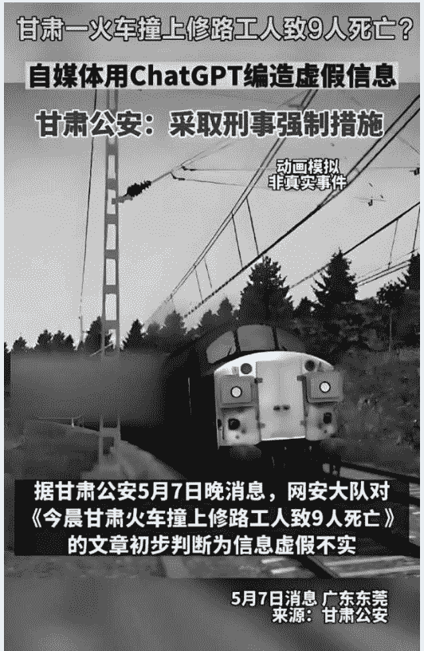

图附录0-2 案例配图（2）

**鹰眼攻略如下。**

- 观察动作。视频中的人的动作是否自然流畅。
- 检查表情。人的表情是否真实自然，眨眼频率是否正常。
- 音画同步。视频和音频是否协调同步，口型与人声是否匹配。

请大家牢记：动作和表情，是AI虚假视频的"致命弱点"！

#### 类型3：AI生成的文本——过于完美的陷阱

AI生成的文本虽然语法正确，但往往过于规整，缺乏个人特色。从逻辑上看，这些文本的内容可能比较生硬，且缺乏深度。这些不协调就成了AI的"破绽"。

**案例：警惕！"重庆民房爆炸"竟是AI制造的假新闻**

重庆公安机关查处一起个人利用AI软件，编造民房爆炸谣言的案件。这起案件被公安部列为打击整治网络谣言违法犯罪的典型案例。在该案例中，相关人员利用AI技术，模仿新闻风格，一键生成涉及灾情的信息，以骗取高流量。

**鹰眼攻略如下。**

- **检查风格。** 文本是否过于规整，是否缺乏个人特色。
- **逻辑验证。** 仔细阅读文章，看其逻辑是否连贯，是否存在矛盾。
- **事实核查。** 通过多个渠道信源进行交叉比对，验证文章中的信息是否真实。

请大家牢记：过于完美，反而不完美！

#### 类型4：AI换脸技术——防不胜防

AI换脸的基础是大数据深度学习技术。其原理是先识别图片或视频中的人脸模型，提取五官信息，再将这些特征进行替换重组，随后进行背景环境渲染并添加合成后的声音，生成逼真度较高的换脸视频。

**案例：香港一公司被AI换脸骗走2亿港元**

一家跨国公司中国香港地区分部的职员受邀参加总部首席财务官发起的"多人视频会议"，并先后多次按其要求进行转账，最终将2亿港元通过15次转账，分别转到5个本地银行账户内。这名职工在随后向总部查询时才知道自己受骗了。警方通过调查后披露，在这起案件中，所谓的视频会议里，只有受害人一个人是"真人"，其他"参会人员"都是经过"AI换脸"的诈骗人员。

图附录0-3为相关报道页面。


图附录0-3 案例配图（3）

**鹰眼攻略如下。**

- 让对方在镜头前摁鼻子、挥手或者按脸。AI生成的面部器官是不存在这些数据特征的，如果你让对方摁脸，对方的脸有凹陷，说明对方是一位真实存在的人，而AI是不会出现变形的。同样，挥手是为了扰乱AI学习，因为挥手会挡住摄像头，使其面对一些无法识别的因素，从而露出"破绽"。
- 不发布自己的隐私照片。防止面部信息被不法分子盗用，通过AI换脸技术移植到其他人的身体上，实行不法行为。

请大家牢记：遇到"熟人"，挥挥手，跟他打个招呼吧！

#### 类型5：AI生成的虚假账号与服务——官方信息的辨识

在AI时代，不仅图像、视频和文本可能被造假，连账号和服务信息也可能被仿冒。这些虚假的账号常常以官方名义发布信息，误导用户。这种伪装就像是AI的"障眼法"，用户需要格外小心。

**案例：DeepSeek官方声明——谨防仿冒账号与虚假信息**

2025年2月6日，DeepSeek发布官方声明，指出部分仿冒账号及其发布的不实信息对公众造成了误导和困扰。DeepSeek明确表示，其官方账号仅在微信公众号、小红书等平台发表内容。除官方账号，其他任何以DeepSeek或相关负责人名义对外发布公司相关信息的均为仿冒账号。如未来DeepSeek在其他平台开设新的官方账号，将通过其他已有官方账号进行公告。

另外，笔者也在此提示一下DeepSeek这个公司名的标准写法，D、S均为大写，其余字母均为小写，小写字母"p"和大写字母"S"之间没有空格。

**鹰眼攻略如下。**

- 核实官方账号。通过已知的官方账号验证信息来源。
- 检查服务渠道。确保通过官方网站或官方App获取服务。
- 避免可疑群组。不要加入未经官方验证的群组，避免财产损失。

请大家牢记：官方发布信息，才是真正有保障！

在AI时代，各类信息井喷，虚假信息也无处不在。不过，只要我们掌握一些简单的辨别方法，通过观察细节、检查背景、验证逻辑和使用技术工具等手段，都可以练就一双"鹰眼"，识别AI生成的虚假信息，成功避"坑"。同时，大家也要做好预防工作，不要将自己的隐私信息暴露在社交平台中，不要点击陌生链接、添加陌生好友等，树立良好的自我保护意识，防患于未然。
```