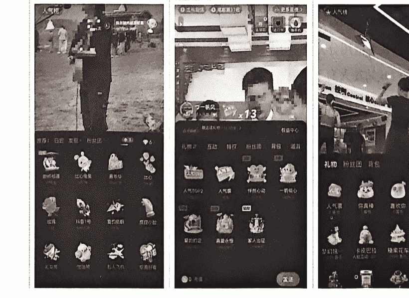
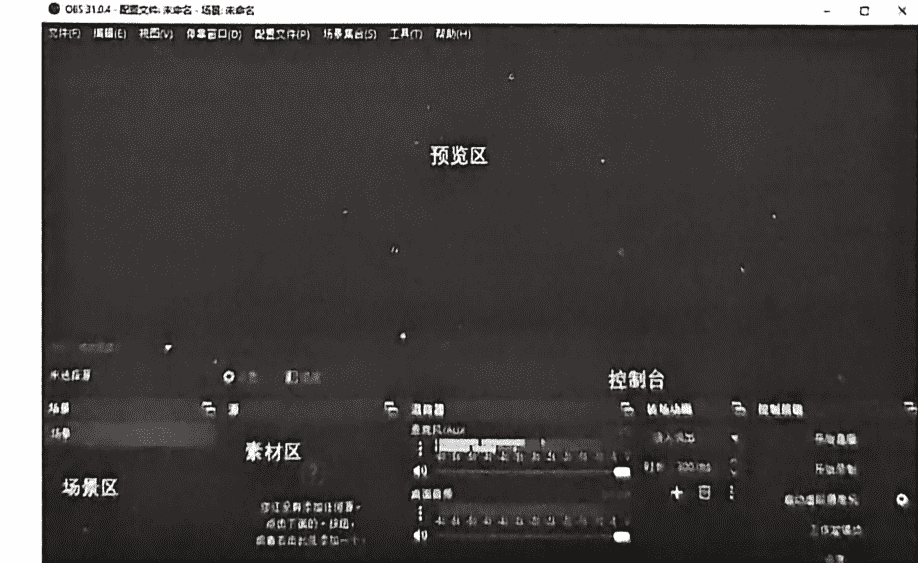

# AI时代白手创富天机

## 上 篇
### 21 个绝招
### 打造短视频“印钞机”

# 第1章
## 内容直接变现的 5 把金钥匙

### 1.1 流量分成：平台主动打钱的秘密

你是不是也想知道，那些短视频大神们究竟是怎么轻松赚钱的？本节咱们就手把手拆解抖音、快手、B站这些平台的“发钱密码”。其实只要摸透“流量分发”和“广告分成”这两个核心机制，普通人也能玩转短视频变现。

**【流量变现三大黄金定律】**
- 播放量是工资基数：每 1000 次播放 ≈ 真金白银进账。
- 互动率是奖金系数：点赞评论越多，赚得越多。
- 完播率是隐藏暴击：看到最后的人都是“财神爷”。

**【五大平台流量变现能力 PK】**

| 平台 | 新手友好度 | 变现速度 | 天花板高度 | 特色玩法 |
| :--- | :--- | :--- | :--- | :--- |
| 抖音 | ★★★★☆ | 快 | 千万级 | “中视频”闷声发财 |
| 快手 | ★★★★★ | 极快 | 百万级 | “老铁”经济 |
| 视频号 | ★★★☆☆ | 稳 | 百万级 | 评论区藏金矿 |
| B站 | ★★☆☆☆ | 慢但持久 | 百万级 | 忠实粉丝变现王者 |
| 小红书 | ★★★☆☆ | 看颜值 | 百万级 | “种草”经济 |

#### 一、保姆级拆解：短视频平台的流量分发机制

##### （一）抖音流量密码：算法三要素大公开

抖音的流量分配就像个超级大脑，你刷抖音时有没有发现，刚看完美食视频，马上又推荐同类型内容？这背后藏着抖音的核心算法公式：Y=F（Xi，Xu，Xc）

别被公式吓到，翻译一下就是：

- Xi（内容）：你的视频质量、文案、背景音乐都得过关
- Xu（用户）：刷视频的人喜欢看啥（用户历史行为数据建模）
- Xc（环境）：用户什么时候看、在哪儿看（时空特征分析）

这个公式翻译一下就是：**内容质量 + 用户兴趣 + 环境因素 = 播放量**

- 智能分发：系统先扔给一小撮潜在观众，数据好看就直接上推荐位
- 推荐逻辑：你的视频会被推给爱看类似内容的人，标签打得好 = 曝光翻倍
- 热度加权：点赞、评论、转发是硬通货，完播率直接决定视频能飞多高

举个例子：你发了一段“宠物”视频，系统会启动分批次推荐机制：初始流量池测试（100～500播放量）→标签化分发（匹配宠物类用户画像）→协同过滤扩散（相似兴趣用户群扩展）。如果这批人80%都看完了，还点赞评论，那你的视频就会像坐火箭一样冲向下个流量池。

**【行动指南】**
- 标题带“爆款”“必看”，系统优先给流量
- 蹭热门标签要快准狠（日抛型流量密码）
- 冷启动期求互动（评论区引导赚钱模板）
- 黄金发布时间：7～9点/18～22点（流量高峰时段）
- 隐藏技巧：用抖音相机直接拍摄（获得原创流量加成）

**【高阶密码】**
八级流量池机制：播放量 200 → 500 → 1000 → 5000 → 1万 → 10万 → 50万→100万以上

冷启动关键：前3秒完播率>30%触发二次推荐

账号权重公式：近期作品均播量×互动率×垂直度

##### （二）快手“老铁”经济：社交关系链才是王道

在快手想火？记住这个口诀：**先交朋友再卖货！** 平台会把你的视频优先推给：

- 你的粉丝（就算只有100个粉丝，也有30%~40%的触达率）
- 和你有共同好友的人（三度人际关系链）
- 喜欢同类内容的“老铁”（地理位置匹配）

快手头部主播的粉丝复购率高达67%。悄悄告诉你：**在快手发视频时根据发布位置添加“同城”标签+地域关键词，播放量能翻倍。** 快手变现精髓就四个字：**人情世故！** 这里流量分发像摆地摊：

- 去中心化：粉丝黏性比播放量重要，30%的流量来自关注页
- 社交加权：评论区热闹=系统疯狂推，标题带家乡名（如“东北老铁必看”）涨粉快
- 双列瀑布流：真实人设才是王道
- 变现三驾马车：直播打赏/小黄车/广告分成（5%最低抽成）

**【快手致富“三板斧”】**
粉丝到达率40%的秘密：每发布3条视频必须有一条@“老铁”互动

标题公式：“月入5万元的窍门”+感叹号×3=自然流量暴涨200%

凌晨发三轮车维修教学，获得早起汽修师傅流量红利

**【变现重点】**
直播连麦比发视频更赚钱（“老铁”打赏心理学）

同城话题是冷启动神器（地摊式精准获客）

粉丝群运营获取更多流量（日更3条语音消息）

三农领域凌晨4~6点发视频（平台流量扶持期）

必学技能：制作 9.9 元引流款商品（自然流量转化神器）

**【高阶密码】**
流量差距调控：头部账号流量限制在 30% 以内
“老铁”关系链权重：互关粉丝观看时长加成 50%
电商转化系数：直播间小黄车点击率 >5% 触发流量扶持

##### （三）B 站“三连”文化：为什么投币比点赞更重要

B 站的流量分配是“学霸逻辑”，质量比数量重要！

- 千人千面：首页永远是用户最爱的内容，互动质量 > 播放量
- 一键三连：点赞 + 投币 + 收藏是流量密码，数据好看 UP 主（B 站创作者）直接走红
- 公平机制：“小透明”也有机会爆，只要内容够硬核

来过 B 站的都知道，“一键三连”才是硬通货。平台推荐机制暗藏用户互动质量权重：

收藏（权重系数 1.2）> 投币（1.0）> 点赞（0.8）
弹幕情感分析（正向弹幕 +0.5 分）
评论区知识密度（专业讨论 +1 分）
长尾推荐机制：优质内容持续推荐长达 180 天
课堂模式加成：知识类视频完播率阈值降低至 60%

划重点：做知识类内容记得在视频里设置“课代表总结”环节，用户收藏率提升 50%

**【B 站流量变现财富密码】**
创作激励计划（50 万粉丝 = 月入 5 万元以上）
充电计划（忠实粉丝承包你买咖啡的钱）
广告商单（“恰饭”视频也有百万播放量）
收益公式：播放量 × 0.01 ~ 0.03 元（优质内容系数加成）

**【数据对比】**
50 万粉丝 UP 主月入 5.5 万 ~ 8.25 万元，1 万粉丝 UP 主仅 1100 元
在 B 站想赚钱？记住这个公式：硬币 × 收藏 × 分享 = 你的余额数字

**【内容变现重点】**
- 蹭学科热点（法律 / 财经 / 科技类商单价翻倍）
- 片尾求三连（赚钱设计直接影响收益）
- 专栏文章同步发（文字内容也能赚创作激励）
- 必做功课：申请“创作激励”和“悬赏计划”
- 冷知识：动态区发外链会封禁创作激励功能

**【三个变现关键】**
- 养电子宠物要够专业！必须细分到“东南亚跨境电商选品”这种级别
- 视频前 30 秒埋“一键三连”赚钱，三连率暴涨 150%
- 每周四晚 8 点发“大学生赚钱”教学，卡住学生党考前焦虑期

##### （四）视频号：评论区竟能轻松收钱？！

- 社交裂变系数：好友点赞带来 3 次裂变曝光
- 广告触发机制：评论区“666”“想要”等关键词触发广告
- 结算保护规则：提现账户需实名认证 + 绑定超 30 天
- 在视频下方偷偷塞广告贴片（观众很难发现）
- 独家政策：4 星达人保级送 1 万元推广金

##### （五）小红书：素人逆袭颜值经济

**【流量密码】**
封面决定生死！高点赞封面公式：Instagram（照片墙）风调色 + 大字报标题 + 对比图（before/after）

**【“种草”提现术】**
①好物分享暗藏淘客链接；②穿搭视频挂同款商品；③教程类笔记植入工具推荐

**【高阶算法】**
阶梯测试机制：200 次→2000 次→1 万次→5 万次播放量曝光四轮赛马
SEO（搜索引擎优化）规则：标题含 2～3 个长尾关键词流量 +50%
爆文复制公式：爆款笔记评论区发已“更新在主页”导流

**【平台规则对比】**
五大核心指标权重

| 平台 | 内容质量 | 互动率 | 完播率 | 粉丝黏性 | 变现潜力 |
| :--- | :--- | :--- | :--- | :--- | :--- |
| 抖音 | ★★★★☆ 中视频加成 | ★★★☆☆ 点赞为主 | ★★★★★ 8秒生死线 | ★★★☆☆ 流量池主导 | ★★★★★ 全链路打通 |
| 快手 | ★★★☆☆ 侧重互动 | ★★★★☆ 评论驱动 | ★★★☆☆ 容忍跳出 | ★★★★★ “老铁”经济 | ★★★★☆ 私域为王 |
| B站 | ★★★★★ 专业度至上 | ★★★★★ “三连”文化 | ★★★★☆ 长视频宽容 | ★★★★☆ 圈层文化 | ★★★★☆ 多元组合 |
| 小红书 | ★★★★☆ 审美优先 | ★★★★★ 收藏为王 | ★★★☆☆ 快速滑动 | ★★★☆☆ 内容导向 | ★★★☆☆ 品牌偏好 |
| 视频号 | ★★★☆☆ 社交属性 | ★★★★☆ 转发关键 | ★★★★☆ 完整观看 | ★★★★☆ 社交关系 | ★★★☆☆ 生态限制 |

#### 二、广告分成模式：手把手教你算钱

**【收益计算器】**
各平台真实收益对照表

| 平台 | 千次播放收益 | 万赞收益 | 爆款临界值 | 信用分影响 |
|---|---|---|---|---|
| 抖音 | 0.5 ~ 3 元 | 200 ~ 800 元 | 50 万播放 | 无 |
| 快手 | 0.3 ~ 2 元 | 150 ~ 500 元 | 30 万播放 | 每扣 1 分降 2% |
| B 站 | 1 ~ 5 元 | 500 ~ 2000 元 | 10 万播放 | 无 |
| 小红书 | 0.2 ~ 1.5 元 | 100 ~ 300 元 | 5 万点赞 | 无 |
| 视频号 | 0.1 ~ 0.8 元 | 50 ~ 200 元 | 20 万播放 | 违规封禁 |

1. 抖音：抽成弹性大，MCN（内容创作与数字媒体运营公司）等级是关键

真实案例：某搞笑博主 1 万粉丝时接广告，单条报价 500 元；10 万粉丝时报价直接飙到 5000 元。广告分成公式：你的收益 = 播放量 × 广告单价 ×（1 - 平台抽成）

重点提醒：2025 年抖音调整了 MCN 抽成政策：

- S 级机构：仅抽 5%，剩下的全是创作者的
- A 级机构：抽 30%+5% 技术服务费
- 现在小程序广告分佣比例暴涨到 70% ~ 90%

避坑指南：保证金 500 元可退，但扣分 >12 分会被永久冻结

起量秘籍：挂教育类广告单价比美妆高 3 倍

Q：为什么播放量高但分成少？

A：广告单价才是核心！挂个 3C（计算机、通信和消费类电子产品的统称）产品广告，单次点击赚 50 元。

2. 快手：稳定抽 5%，社交变现强

快手平台只拿 5%，但粉丝打赏和直播带货才是重头戏！

土味电商：卖农产品 + 直播演示，转化率比抖音高 40%
家族经济：加入头部家族，广告分成还能再涨 30%
三农领域：补贴 +30%
算钱秘诀：广告金 =（展示量 × 0.8）+（直播间人气 × 2）+“老铁”打赏 × 0.7
快手的隐藏福利：70% 流量分给新人！意味着 10 万粉丝小号可能比百万粉丝的大 V 更赚钱

3. B站：学生党的零花钱基地

B站平台抽成最低（5% ~ 8%），还送“创作激励”当零花钱！
知识付费：讲编程教程 + 挂官方合作广告，月入 3 万元不是梦
粉丝牌机制：粉丝刷礼物升级，UP 主能拿分成！但必须知道的规则：50 万粉丝“恰饭”报价为 5 万 / 条（美妆区翻 3 倍）
创作激励计划要绑定学生证流量加成

4. 视频号：财富盲盒

上半月收益次月 1 日结算，下半月收益次月 15 日结算
单条视频评论区广告曝光量达 1 万次，当日收益破百元
激励政策：成长值兑换流量
评分体系：4.8 分以上有流量倾斜
违规处罚：虚假宣传直接封店，违规诱导点击广告直接封禁分成权限

5. 小红书：变现秘籍

财富密码：完播率 > 10% 直接触发流量池暴击
阶梯式算法：新笔记需通过 3 轮流量测试（200 次 → 2000 次 → 1 万次曝光）
搜索页权重秘密：标题含“教程”“攻略”等关键词流量 +30%
本地页新风口：带定位笔记完播率要求降低至 8%
冷启动技巧：先开“零门槛店铺”测款（无粉丝限制）

**【平台荣誉体系】** 认证账号收益加成
抖音“黄V”认证：分成系数+0.2
快手“蓝V”认证：信用分初始值+20
B站“大闪电”认证：商单报价翻倍
小红书品牌合作人：广告分成+30%
视频号“金V”认证：结算周期缩短3天

#### 三、实战指南：提高分成的重点策略

##### 1. 三个动作让流量翻倍

动作1：给视频装个“吸铁石”
前3秒必放“冲突画面”
每15秒设置互动锚点（符合抖音播放时长权重算法）
结尾引导三连（提升互动率达标值5%）

动作2：建立你的流量流水线
每周发布4~6条垂直内容
爆款合集需包含30%热点+40%干货+30%人设内容
评论区运营采用“小号提问-大号回复”策略（提升评论权重）

动作3：读懂平台“晴雨表”
◎ 完播率：抖音新算法要求前5秒留存率>65%
◎ 互动率：计算公式（点赞+评论+分享）/播放量
◎ 粉丝转化率：行业基准值：新号3%，成熟号5%

##### 2. 五步打造爆款

第一步：选对平台
快速爆红选抖音：算法推荐占比70%
私域变现蹲快手：粉丝触达率40%碾压全场
专业路线攻B站：长尾流量能吃三年

第二步：内容炼金术

前 3 秒下猛料公式：“这方法能让你 7 天多赚” +（你的领域）× 3 倍
每 15 秒埋爽点：用 A/B 测试工具找到观众爽点
结尾促互动赚钱：“点赞过 1 万解锁新文档”

第三步：流量加成指南

凌晨 4 点发美食教程（获取早餐店老板流量）
周二下午发职场干货（打工人周中疲倦高峰）
周五晚发心灵情感鸡汤（配合“周末复合”效应）

第四步：平台福利获取

抖音“掘金计划”：三农领域流量包 × 3 倍
快手“老铁扶持”：连发 7 天视频奖 300 元曝光券
B 站“学术激励”：论文解读类内容补贴 50 元 / 分钟

第五步：防封号保命符

医疗内容用“某院院士”代替具体名词
财经领域要说“小步试错”规避风险
日更 3 条养号大法：7:00 知识 +12:00 娱乐 +20:00 情感

#### 四、成功案例库：素人逆袭的真实剧本

##### 案例 1：抖音视频赚钱大法 农村小杨靠拍养猪日常月入上万元

**核心操作：**
每条视频强行凑满 1 分钟
结尾必说“明天教大家怎么选猪饲料”
评论区置顶卖自家腊肠链接

**技术细节：**
利用中视频完播率加权机制，故意延长视频时长至 65 秒
养殖知识类垂直内容广告单价达 0.8 元 / 千次播放
三农领域创作者可申请平台流量扶持包

##### 案例 2：快手“老铁”反向操作

某修驴蹄博主靠 ASMR（指通过视觉、听觉反馈使人精神放松）治愈视频变现

**变现秘籍：**
- 直播修蹄子挂蹄油链接
- 视频里说“想听哪种蹄声评论区‘点菜’”
- 私信卖定制修蹄工具包

**算法破解：**
- 快手大模型精准识别“ASMR”标签，推送至失眠用户群体
- 私域流量转化率高达 15%，是普通电商的 3 倍
- 信用分满分账号可获得“诚信商家”流量加成

##### 案例 3：视频号评论区创富神话

某博主评论区赚钱秘籍

**核心操作：**
- 每条视频前 3 秒喊话“重要提示在评论区”
- 置顶评论设置“点击查看解决方案”赚钱
- 单日广告曝光量破 50 万次

**数据解码：**
- 评论区广告 CTR（点击率）达 3%，是常规广告的 2 倍
- 家居类内容分成系数达 0.8 元 / 千次曝光
- 连续 30 天更新可触发“勤奋创作者”流量包

#### 五、避坑指南：这些操作随时可能被封号

- 抖音：不要同时切多个账号！
- 快手：别用模拟器刷播放量！
- 视频号：禁止诱导点击广告！
- B 站：千万别在封面写“求三连”！
- 小红书：禁止搬运 Instagram 美图！

##### 【高危禁区】

抖音 7 秒以下视频无分成权限
快手信用分 <80 将降低 50% 分成比例
B 站商单未报备直接限流
小红书虚假“被问爆”脚本触发审查

##### 【流量红灯预警】

抖音：单个视频完播率 <15% → 账号降权
快手：直播间观看时长 <1 分钟 → 限制推荐
B 站：三连率 <5% → 停止长尾推荐
小红书：收藏率 <3% → 停止流量池推进
视频号：转发率 <2% → 限制社交传播

##### 【终极行动清单】

现在你已经掌握了流量变现的底层逻辑：**优质内容 × 平台规则 × 持续迭代 = 赚钱可能**，今晚就能做的变现动作：

- 马上检查账号是否满足开通条件
- 修改 3 段旧视频引导互动话语
- 注册西瓜视频开通中视频计划
- 设置每天 18:00 定时发布闹钟
- 检查快手信用分并修复违规
- 申请 B 站花火商单权限
- 绑定视频号微信提现账户
- 小红书笔记添加定位标签

### 1.2 直播打赏：“老铁”经济的终极奥义

手机刷着刷着就致富？没错，抖音、快手、视频号、B 站、小红书正在上演真实版“点石成金”！本节教你玩转直播打赏，看完就能实操的提现秘籍。附真实案例拆解。

#### 一、平台打赏提现规则大 PK

记住这个公式：**到手钱 = 总打赏 × 分成比例 - 平台抽成 - 公会抽成 - 税费**

| 平台 | 主播分成比例 | 平台分成 | 公会抽成 |
| :--- | :--- | :--- | :--- |
| 抖音 | 50% 起步（个人）55% ~ 70%（公会主播） | 对半砍 | 5% ~ 15% |
| 快手 | 70%（但有人实测为 30%） | 官方说只抽 30% | 10% ~ 20% |
| 视频号 | 新人 70% | 30% 手续费 | 返点高达 15% |
| B 站 | 50% | 50% | 二次获利 20% |
| 小红书 | 打赏对半砍，带货留 80% | 未统一规定 | 30% |

避坑指南：新人首推视频号，70% 超高分成 + 微信私域导流，简直是新手村福利！

##### 【各平台充值礼物排行榜】

抖音嘉年华：1个 =3000元！收到立即全站推送（建议每晚8点整开播）
快手666：6快币 =6毛钱，但“老铁”们能刷屏（三农主播必学话语）
B站舰长：200元礼物到手仅80元
小红书玫瑰：1元礼物平台先砍半（建议不如直接挂购物车带货）

变现秘诀：抖音要追爆款礼物，B站玩舰长体系，小红书主攻带货转化

#### 二、必缴税收

增值税：6%起步，每赚100元先扣6元（平台代缴）
个税：3%～45%，月入10万元要交35%（劳务报酬阶梯税率）
隐藏扣费：快手先扣20%再分成，B站连环抽成
真实案例：抖音主播收100万元礼物→平台扣50万元→个税再扣20万元→实际到手30万元（提醒：签约公会能多留15%～20%）

#### 三、直播打赏变现操作手册

##### 【黄金三件套】

时段选择：抖音晚8～10点，B站凌晨
脚本模板：“感谢榜一大哥”已过时！2025最新脚本：“现在点亮粉丝灯牌，马上解锁专属福利！”，或者“冲榜前三送私人定制视频！”
变现组合拳：抖音打赏 + 带货“双杀”，小红书“种草” + 商城闭环
实战案例：美妆博主在视频号直播时，用“微信扫码进福利群”脚本、单场转化私域3000人，次月带货GMV（商品成交总额）暴涨5倍

##### 【平台规则】

1. 抖音：流量王者的游戏规则
必杀技：卡准晚8点黄金档 + 狂刷“嘉年华”（1个 =3000元！收到就上全站推送）
注意：个人主播永远被抽 50%，不加公会亏到哭

2. 快手：“老铁”经济的财富密码
必杀技：打造“家人们”人设 + 三农 / 美妆垂直领域
注意：说好的 70% 分成？先扣税 20% 再五五开

3. 视频号：微信生态的私域金矿
必杀技：朋友圈 + 社群导流 + 知识付费三板斧
注意：新人保护期过直接打七折，不加公会血亏 15%

4. B 站：二次元世界的现实法则
必杀技：玩转“舰长”体系（200 元礼物实际到手 80 元）+ 周边变现
注意：签约，平台公会双重获利

5. 小红书：精致穷的变现秘诀
必杀技：穿搭 / 家居场景化直播 + 带货佣金 80%
注意：打赏分成 50%

#### 四、素人逆袭真人案例

##### 案例 1：抖音舞者三天收入百万元

凌晨 2 点开播
编发教学 + 变换服装造型引爆流量
收到 30 个“嘉年华”直接冲上热门
到手：150 万元打赏→平台抽 75 万元→税后 45 万元

##### 案例 2：快手“老铁”月入 50 万元秘籍

打造“玉米地里的接地气乡村主播”人设
每晚 8 点准时带老乡砍价
建立 12 个 500 人“老铁”群
到手：100 万元 GMV → 带货抽 80 万元 + 打赏 20 万元

> 【终极忠告】记住这个变现公式：70% 平台选择 + 20% 脚本 + 10% 运气 = 100% 提现成功

### 1.3 知识付费：知识变现的降维打击

短视频不只是娱乐工具，更藏着月入 10 万元以上的知识付费金矿！刷屏的职场课、理财训练营背后，藏着这些平台变现密码。知识付费就是新时代“卖水生意”。刷短视频学技能已成新刚需！用户愿意为“能马上用”的知识买单（比如三天学会 PS 接单 / 职场沟通脚本模板）。

#### 一、知识付费三板斧：“小白”也能上手的变现公式

> 【知识付费底层逻辑】

灵魂拷问：你的专业认知是否在白白浪费？
刷屏真相：62% 的用户愿为垂直领域知识付费
变现风口：各平台砸 10 亿元流量扶持优质问答内容，现在入局 = 坐电梯上升

> 【五大知识付费主战场特色盘点】

抖音：6 亿日活的流量巨无霸（泛知识内容播放量占 20%）
快手：最早搞付费的平台（2020 年就开付费课）
视频号：微信生态圈（公众号 + 社群 + 朋友圈变现闭环）
B 站：高知青年聚集地（内测课程被疯抢）
小红书：女性向变现天堂（薯币买课超方便）

##### 【各平台知识变现效率对比】

抖音客单价 9.9 ~ 299 元（转化率 1.2% ~ 3.7%）
B 站课程均价 368 元（完课率 81%）
视频号私域复购率是公域的 3 倍

##### 【知识付费变现平台段位榜】

| 段位 | 平台 | 变现方式 | 启动难度 | 变现天花板 |
| :--- | :--- | :--- | :--- | :--- |
| T0 | 抖音 | 会员体系 + 私域捆绑 | ★★ | 1000 万元以上 |
| T1 | B 站 | 硬核课程 + IP 溢价 | ★★★ | 500 万元以上 |
| T2 | 视频号 | 微信生态闭环 | ★★ | 300 万元以上 |

#### 二、五大平台知识付费模式详解

##### （一）抖音知识付费底层逻辑

“拍垂直短视频→挂课程链接→小程序自动收钱”。技术门槛低，连 60 岁阿姨都能操作。举个例子：职场大佬发个“升职加薪 3 秘诀”短视频，挂个 199 元《年薪百万沟通课》，后台即可赚钱。

###### 【抖音知识付费变现方式】

- ①会员订阅
创作者设置专属会员功能
粉丝支付费用成为会员
会员可以查看专属内容，包括会员问答
- ②内容付费
创作者可以设置付费视频
用户支付费用后才能观看、收入由平台和创作者分成

###### 【三大赚钱方式】

- 付费咨询：有绝活就能定价，PS/摄影/法律咨询统统可卖
- 电子课件：把知识打包成“武功秘籍”，比如《小红书涨粉36计》
- 会员社群：建个VIP粉丝群，年费998元服务到位
真实案例：某职场导师玩转“会员分级制”：青铜会员9.9元（送简历模板）、黄金会员299元（加内部答疑群）、钻石会员999元（私教1对1）。结果：高阶课程购买率暴涨38%

###### 【高收入实现功能说明书】

- 会员问答：粉丝付费才能解锁的“私密朋友圈”（月流水5万元以上博主必备）
- 会员空间：发条语音都能收钱的“付费树洞”（情感博主人人百万元秘籍）
- 冷启动攻略：1000个粉丝就开通！电脑端“创作者服务中心”→“专属会员”立即开通

###### 【变现方式】

- 会员费抽成
- 隐藏课程分销（用小程序闷声发财）

###### 【变现路线图】

三步打造知识变现：会员体系→专属内容→分层变现
知识套娃术：免费短视频引流→9.9元轻知识→999元系统课
赚钱模板：“摄影教学”视频爆款→99元调色问答包→2999元私教圈（案例：某摄影师年人百万元）；“职场干货”爆款→199元简历优化服务→999元职业规划1v1（案例：某求职导师月变现15万元）。

##### （二）快手知识付费变现方式

###### 【快手知识付费底层逻辑】

“拍短剧/开直播→挂小程序卖课”。快手从2020年就开始玩付费内容，比抖音还早两年。

###### 【三大赚钱玩法】

- 技能教学：教“老铁”们汽修/美甲/养殖（垂直领域更吃香）
- 直播带货式卖课：边唠嗑边挂小程序链接（易知课堂、海豚知道等工具超好用）
- 付费短剧：拍土味连续剧，1元/集解锁全集（跟追剧一样上头）

###### 【挂载易知课堂暴击流】

三部曲：注册小程序→上传课程→挂车直播
月入3万元真实案例：宝妈育儿经靠“0基础辅食课”单月变现8.7万元
核心数据：27%分成比例+直播转化率23%+复购率61%

###### 【快手知识付费避坑指南】

千万别碰的3类问题：医疗诊断/投资建议/政策解读
必火选题模板：“××领域10大坑”“90%人不知道的××秘籍”

###### 【快手知识付费特殊方法】

- 挂载能力申请=开店许可证（在开发者平台填表就能搞）
- 批量挂载术：1分钟给100条视频装上“收钱按钮”API（应用程序编程接口）自动关联视频课程
- 达人白名单：需要申请达人白名单才能获取完整挂载功能，找平台要专属流量特权
- 代开通接口：第三方工具帮你绕过技术坑

##### （三）视频号微信生态变现术

开通操作：电脑登录“视频号助手”→勾选协议→上传2个试看视频（必须设置悬念钩子）

###### 【视频号知识付费底层逻辑】

“公众号导流 + 视频号直播 + 社群复购”

实操案例：某法律号靠“公司法20问”3天变现28万元，转化路径：短视频热点→9.9元问答包→2999元年度法律顾问

###### 【三大变现途径】

- 付费课程内测：收到官方邀请的赶紧上车
- 会员专区：收年费199元，提供专属内容，有效关注数1万人以上
- 直播卖课：结合社群裂变，9.9元引流课→999元高阶课，转化率吊打图文
变现案例：某AI课程团队，单场直播成交500多单，私域沉淀3000名以上精准粉丝，复购率达45%，课程类型为AI工具实操 + 行业解决方案

##### （四）B站学霸变现法

###### 【知识区UP主赚钱公式】

付费视频 + 课程专栏 + 直播连麦的三重叠加

真实案例：某考研UP主《复试通关秘籍》单课卖出17000份，流水破千万元

###### 【B站横屏变现术】

“专业人设 + 组合拳打法”（横屏视频更有知识感）

- 独家课程：职场 / 编程 / 考证等刚需领域
- 课堂星河计划：开课即赚，平台流量扶持
真实案例：某职场课用“B站 + 抖音双平台打法”，转化率飙升317%

掉粉3万的付费视频惨案：内容必须超出免费内容3倍价值，试看片段要留“啊哈时刻”（用户在使用产品或服务的过程中，突然发现产品的核心价值的关键节点）

##### （五）小红书知识捞金暗线

###### 【颜值经济变现链】

“50元教你画出明星眼妆”类笔记霸屏搜索页

数据真相：美妆问答平均客单价87元，复购率碾压其他品类3倍

###### 【精准打击术】

- 笔记带“付费咨询”标签
- 首图大字报“已帮1000多位姐妹变美”
- 评论区引导私域转化（脚本模板：“戳我领取价值199元变美手册”）

###### 【薯币获利指南】

“种草”式卖课+私域闭环（精准触达都市白领）
专栏三件套：直播课/录播课/1v1咨询
付费社群：知识星球+小红书双向引流
真实案例：博主靠“穿搭课程+会员群”年入百万元，复购率碾压同行

#### 三、实操加速器：知识付费变现养成计划

##### 【内容炼金术】

- ◎ 精准定位：别当全能选手！专攻一个领域（比如专教PPT美化/宠物烘焙）
- ◎ 爆款公式：痛点+解决方案+行动指令（例：“3天被领导夸爆的Excel技巧”）
必火选题=痛点+反常识+即刻可用（例：“做小红书根本不用写文案”）
- ◎ 视觉暴击：问答封面统一“小红书Instagram风”排版
- ◎ 定价秘籍：免费内容价值≤付费内容1/10
- ◎ 跨平台套利：抖音竖屏引流 +B 站横屏转化，用户追着你送钱

##### 【技术支持】

- 小鹅通：“小白”也能用的“自动收银机”（课程上架 / 支付 / 售后全包）
- 海豚知道：快手直播挂课神器（挂链接就能收钱）
- 数据追踪术：用热力图找出“爆款密码”，复制赚钱模板

##### 【营销方式】

- ◎ 社群培养：把粉丝变“家人”（发专属福利 / 定期直播答疑）
- ◎ 用户画像神器：给“土豪用户”打标签，推送高价课程
- ◎ 案例应用：用学员逆袭故事制造“焦虑 - 希望”闭环（宝妈学剪辑后月入 2 万元）

##### 【互动一招鲜】

- 脚本模板：“这个问题价值 3000 元，今天 9.9 元解锁”（转化率提升 70%）
- 销售技巧：“前 100 名送独家资料包”（制造稀缺感）

##### 【数据掘金术】每天必看 3 大数据：

- 问题点击率（<5% 立即改标题）
- 完读率（<60% 优化内容结构）
- 转化率（<3% 重置钩子脚本）

##### 【知识付费红线预警】

- 绝对不做：搬运抄袭 / 虚假承诺 / 专业领域超纲
- 必须配置：电子合同 + 免责声明 + 咨询记录存档

#### 四、行动指南：抓住知识付费变现窗口

- ◎ 立即测试：选最擅长的领域，7 天内出 1 套试听课
- ◎ 矩阵布局：主攻 1 个平台，同步分发 3 个平台
- 技术傍身：注册小鹅通 / 海豚知道，先“上车”再优化
- 数据获利：每天分析转化率，快速迭代课程

##### 【知识付费行动计划】抓住各平台流量补贴期，立即执行“3 周启动计划”

- 第 1 周：打造 3 个爆款免费问答
- 第 2 周：设计 9.9 元入获取门产品
- 第 3 周：跑通首个付费用户闭环

### 1.4 星图任务：接单变现的官方渠道

本节这份攻略给你详述抖音、快手、视频号、B 站、小红书的官方接单渠道，从入驻秘籍到变现公式，从避坑指南到爆单案例，五大平台接单变现。

#### 一、任务接单必备知识库

1. 任务分类：
   - 硬广任务：直接展示产品，要求明确标注“广告”
   - 软广任务：剧情植入，需保持内容自然度
   - CPS（按销售付费）任务：按销售分成，适合带货达人

2. 接单方式：
   - 官方平台接单（安全但抽成高）
   - 私下接单（风险大但收益高）
   - MCN 代接（适合新人但分成低）

3. 税务要点：
   - 平台代扣 20% 劳务税
   - 个体户注册可节税

#### 二、五大平台接单变现详解

##### (一) 抖音巨量星图：流量王者的“恰饭”基地

###### 【入驻条件】

粉丝达到 1 万人（账号粉丝量大于 1000 个如果同时开通了直播小黄车权限，也可申请）
入驻流程：抖音 App → 我 → 三横杠 → 创作者中心 → 电商带货 → 填资料等审核

###### 【任务类型】

- 指派任务：客户指定达人完成任务，客户验收后支付任务服务费
- 投稿任务：客户圈选达人投稿，根据表现效果结算
- 共创任务：客户指定主投稿达人及参与达人，客户验收后支付任务服务费
- 招募任务：客户圈选达人完成任务，客户验收后支付任务服务费
- 招商短剧任务：客户对选中的短剧创建任务，客户验收后支付任务服务费
- 星广联投任务：客户按照展示量计费结算，平台目前限时免收客户平台服务费
- 抖音小程序分佣任务：客户圈选达人完成任务，根据任务转化数据结算

###### 【限流机制】

①单日接单不超过 3 条；②广告视频占比不超过 20%

###### 【收益分成规则】

基础抽成：接单金额的 5%（个人号）或 3%（机构号）
变现密码：CPS 效果分成。生活 / 票务商家任你选，分成比例自己谈

###### 【爆单技巧】

- 场景穿帮会掉价！广告植入要和原视频画风一致。
- 追热点能让你接单接到手。带“618”“双 11”的广告点击率暴涨 50%
- 大客户玩“联合建模”，小品牌用“联邦学习”、精准投放

##### （二）快手磁力聚星：下沉市场的变现平台

###### 【零门槛开通】

粉丝大于 1000 个即可申请
隐藏入口：创作者中心→找客服输入“开通磁力聚星”

###### 【交易结算规则】

按效果结算！任务结束 14 天后打款

###### 【违规红线】

①不得引导私下交易；②医疗类内容需特殊资质

###### 【“老铁”秘籍】

- 瞄准 00 后 + 三、四线城市用户，视频要够真实！
- 短视频引流 + 直播间获利，日播 4 小时算法自动推流
- 重点搞家居家电 / 日用快消，“三八节”某大牌狂赚 25 万元！
- 连麦 PK 时自然植入广告
- 挂小铃铛转化更高

#### 【变现案例】

农村小美 4 个月怒赚 25 万元！秘诀：白天拍喂猪 Vlog，晚上直播卖土特产。记三点：

- 快手“老铁”爱看“家、爱情、友情”三件套
- 短视频引流 + 直播间获利 = 黄金组合
- 凌晨发“情感语录”视频，算法给量更多

##### （三）视频号互选平台与视频变现任务：私域流量的金矿

###### 【入驻门槛】

① 100 个粉丝可开通直播带货，100 个以下粉丝可橱窗带货，100 个以上粉丝可开通视频带货；②双端操作：PC 端视频号助手 / 手机端创作者中心

###### 【定价权在手】

1 分钟视频报价 3000 元，时长越长越贵
汽车 / 奢侈品一条视频报价超过普通人一个月工资

###### 【中年富豪攻略】

素材要高清、大气、上档次！参考宝马、奥迪的科技感大片
重点抓 35 岁以上高消费男性，评论区专业问答
车企闭环案例：科学选号 + 实时加热 = 精准转化

###### 【深度玩法】

- 内容矩阵：主号接品牌广告，小号做分销带货
- 私域玩法：“视频号 + 公众号 + 社群”三件套；最后导入企业微信承接流量

##### （四）B 站花火：Z 世代的“恰饭”密码

###### 【二次元通行证】

硬核门槛：1 万粉丝 + 信用分 60 + 成年认证
创作中心→花火平台→五步签约

###### 【新人必杀技】

电磁力 <60 分怎么办？三招回血：
- 每天坚持发“游戏实况”攒信用
- 用必剪 App 做鬼畜视频（官方给流量）

###### 【平台分账】

平台抽成保密
游戏 /3C 数码单子最多，一条定制视频报价高达 5 位数

###### 【破圈指南】

- 用必剪 App 做漫剪，官方工具自带流量加持能力
- 新人先去创作学堂修炼，官方认证课程免学费
- 某国货品牌靠“种拔一体”策略，在 B 站直接卖爆库存

##### 【内容规范】

①需标注“包含商业内容”；②不能影响原创创作风格

###### 【报价策略】

①动画区创作者:0.5～1 元／粉丝；②生活区创作者:0.3～0.8 元／粉丝

##### （五）小红书蒲公英：精致女孩的变现平台

###### 【素人逆袭通道】

需有 5000 个粉丝
后台操作：创作者中心→蒲公英平台→填案例等审核

###### 【“种草”任务秘籍】

- 合集测评最吃香
- 对比实验更可信
- 点击率 >8% 算优质
- 收藏率 >5% 可以引爆浏览量

###### 【预充值玩法】

出资方先打钱到平台，再也不怕甲方跑路
美妆／母婴类报价最高，万粉博主单条笔记 5000 元以上

###### 【爆文心法】

- 标题必须带“显白”“显瘦”“氛围感”等流量密码
- 用官方后台查关键词，哪个火就用哪个
- 新手案例：大学生做穿搭博主，月接 4 单净赚 2000 元

##### 【平台接单变现比拼擂台】

| 维度 | 抖音 | 快手 | 视频号 | B站 | 小红书 |
| :--- | :--- | :--- | :--- | :--- | :--- |
| 新手门槛 | 1万粉丝 | 隐藏低门槛 | 1000粉丝 | 1万粉丝 | 1000粉丝 |
| 分钱模式 | 明码抽5% | 效果不一 | 自主定价 | 神秘分账 | 预付安全 |
| “恰饭”领域 | 全品类通吃 | 下沉市场 | 高端品牌 | 二次元经济 | 精致生活 |

##### 【新人必看行动清单】

- 立即检查账号是否实名认证
- 按粉丝量对号入座开通渠道（不够就冲直播权）
- 新号前10条视频必须垂直（算法考察期）
- 别只看播放量！私信率>5%才有出资方找你
- 每天刷30条对标爆款，模仿场景+音乐+脚本
- 接单后48小时内必更3版脚本给出资方选
- 每周四下午3点找客服催审核，通过率更高

##### 【血泪教训】

- 不报备接私单会账号限流
- 视频带购物车会降低内容权重
- 同一产品30天内别接超过3单
- 未成年人不能接单
- 医疗金融类需资质

### 1.5 音乐分成：背景音乐也能轻松赚钱

◎ 为什么你的音乐不赚钱
当你在纠结“发歌到底能不能赚钱”时，有人已经靠原创BGM（背景音乐）喜提玛莎拉蒂！各大平台现在就是行走的变现平台，但 90% 的音乐人根本不知道这些隐藏玩法：

- 抖音直播打赏平台抽成 50%？错！加入公会能额外获得 20%
- 快手播放量收益能日结？“草根”音乐人靠这个月入上万元
- 视频号评论区挂广告轻松收钱？这波官方福利必须要抓住

#### 一、抖音音乐创作变现宝典

【底层变现逻辑】
抖音采用多种音乐分成模式，主要包括视频播放量收益、直播打赏收入和广告分成计划等。在“分成模式”下，平台上的音乐使用量直接与收入挂钩，无论是观看、评论、分享还是创作、翻唱和混音，都为音乐版权所有者提供了参与视频货币化的机会。你的 BGM 每被用一次，后台账户就自动增加 1 分钱。

【三大变现方式】
流量提现：抖音平台会根据翻唱或原创音乐视频的播放量给予一定的收益，视频播放量越高、互动数据（点赞、评论、分享等）越好，获得的流量分成就越多。视频爆了 = 自动变现（播放量越高，广告分成越多）。
直播获利：观众在直播间赠送的礼物会以抖币的形式呈现，歌手可以从这些打赏中获得一定比例的分成。
官方通道：认证音乐人直接解锁隐藏提现通道，抖音推出了多种音乐人扶持计划，如“抖音音乐人扶持计划”，通过流量扶持和现金激励帮助音乐人成长。

【算钱公式大公开】
爆款视频 = 播放量 × 0.01 元 + 点赞 × 0.005 元
直播收益 =（礼物总价 - 平台抽成 50%）× 你的分成比例
音乐使用费 = 1000 次使用 ≈ 10 元

##### 【变现密码】

记住这“三板斧”：
作品质量要封神：8 分靠实力，2 分靠运气
直播频率拉满：每周 3 场保底，“家人们”点点关注
抓住平台福利：音乐开放平台每天刷三遍

##### 【隐藏玩法】

公会加成：加入优质公会可提升分成比例至 60%～70%
音乐人特权：认证后解锁“音乐热榜”流量扶持
二次创作：再混音版本可重复计算版权收益

#### 二、快手音乐创作变现超级福利

##### 【“草根”逆袭指南】

快手对原创音乐采取实时的分成模式，音乐人能够根据自己的歌曲在快手 App 内的播放量来获得收入。快手的逻辑更偏向于底层用户里的“音乐人”，认证的音乐人几乎全部来自“草根”。这里没有明星特权！认证音乐人直接解锁：

播放量收益：快手音乐人可以根据歌曲播放量获得收入，播放量越高，收益越多。

亿元激励计划：快手推出“亿元激励计划”，为音乐人提供真金白银的分成，官方直接撒钱（播放量过万自动触发）。参加官方大赛？快手大赛 TOP300 的音乐人是“亿元激励计划”首批获益音乐人，参与签约授权的音乐作品按计划规则计算分成。

直播间挂小黄车卖 U 盘：音乐人转型带货王只需 1 步。

##### 【收益暴击秘籍】

双场景结算：快手推行短视频与直播双场景音乐结算，并向公司机构和独立音乐人开放结算通道，在不要求独家版权的前提下，对结算金额不设上限。快手推出直播间场景音乐版权结算标准，新增词、曲版权单独结算以及独立音乐人版权等结算通道。

实时提现：今天播放量爆了明天收益到账。

真实案例：一位快手音乐人的一首原创单曲上线七个月以来在快手上获得了 296 万次使用量。快手音乐人作品在 9 个月内获得了 130 亿次播放。

#### 三、视频号变现模式

##### 【微信生态隐藏玩法】

视频号创作分成计划是基于视频号生态体系，符合一定条件的视频号优质原创作者，可在原创视频评论区通过展示广告内容，获取广告收入的模式。这些操作变现效果好：

- 评论区广告位招租（每点击一次到账 0.5 元）
- 新主播福利局（前三个月分成比例为 70%，老主播为 69%）
- 音乐号转型卖 U 盘（爆单秘籍：伤感背景音乐 + 怀旧金曲）

##### 【变现组合拳】

- 私域导流：视频号 + 公众号 + 小程序三件套
- 年龄分层：00 后爱电音，80 后爱怀旧金曲
- 节日营销：春节 / 情人节专属背景音乐流量翻倍

##### 【开通流程】

视频号创作分成计划是可以自主申请开通的，不需要等系统邀请。创作者可以点击创作者中心→创作者服务→更多→创作分成计划，满足条件即可开通。

#### 四、B站变现二次元版

【用爱发电也能赚钱】
B站的盈利模式包括会员费、广告收入、游戏联运和直播打赏等。B站为创作者主提供了多种收益渠道，包括平台的各种奖励机制、签约费、合作获得制作费、直播打赏等。
记住这些财富密码：
创作激励计划：B站的创作激励计划是一种基于视频播放量、互动量和粉丝数等指标来计算创作者收益的机制。创作激励 = 播放量 × 1.2 元 / 千次
充电计划：B站的充电计划也是创作者获取收益的一种方式。充电计划 = 粉丝直接打钱
游戏联运 = 音乐人跨界当策划

【破圈秘籍】
弹幕互动：神级空耳歌词引爆二次创作
虚拟歌姬：初音未来风格作品有专属流量池
课程变现：音乐教学视频可设置付费观看

【变现小账本】
1000 次播放量约等于 1.2 元，也就是每 1000 次播放，音乐人可以获得约 1.2 元的版权收益。按照这个比例计算，80 亿次播放量约等于 960 万元收益。

#### 五、小红书变现“凡尔赛”

【小红书音乐人变现速览】
广告分成：创作者可以通过在内容中展示广告来获得收益
电商分成：通过分享商品链接，引导用户购买，从中获得分成
直播打赏：在直播中获得用户打赏
小红书的具体音乐分成比例，根据短视频行业的普遍情况，分成比例在30%～70%之间，具体取决于创作者的粉丝量、内容质量和平台政策。

##### 【精致穷人获利指南】

三步变身音乐达人：
九宫格图片精修 + 氛围感背景音乐
直播教钢琴顺便卖课
好物分享挂链接（小众耳机 + 黑胶唱片机 = 中产获利机）

##### 【变现新思路】

- 歌单带货：旅行背景音乐 + 行李箱组合销售
- 情绪标签：伤感 / 治愈 / 燃系分类精准引流
- 品牌联名：小众音乐人联名款服饰溢价 30%

##### 【音乐变现平台红黑榜】

| 平台 | 变现难度 | 变现速度 | 适合人群 | 盈利指数 | 版权要求 |
| --- | --- | --- | --- | --- | --- |
| 抖音 | ★★★ | ⚡⚡⚡ | 喜欢搞怪有表演欲 | ★★★★ | 需官方授权 |
| 快手 | ★★ | ⚡⚡ | “草根”音乐人 | ★★★ | 原创优先 |
| 视频号 | ★★★★ | ⚡ | 微信生态玩家 | ★★ | 无明确限制 |
| B站 | ★★★★ | ⚡⚡ | 二次元大佬 | ★★★ | 二创需标注 |
| 小红书 | ★★★★★ | ⚡⚡ | “凡尔赛”大师 | ★★ | 无强制要求 |

##### 【素人靠什么逆袭】

> Q：翻唱能赚钱吗？
A：抖音“张同学背景音乐”揭秘：用官方曲库，播放量自动变现。但记得买授权

##### 【音乐变现风向标】

版权大战升级：翻唱记得买授权
元宇宙背景音乐兴起：虚拟演唱会分成新蓝海
AI 作曲爆发：用工具批量生产爆款背景音乐

##### 【行动清单】

明天就做这 5 件事：
注册所有平台音乐人认证
研究 10 个爆款背景音乐的谱子
策划每周 3 场直播剧本
准备 500 个 U 盘开始带货

##### 【工具箱】

必备软件：FL Studio/Audacity 音乐编辑软件（免费版够用）
硬件清单：200 元麦克风 + 手机支架即可起步
数据监测：新榜 / 飞瓜数据追踪热门背景音乐
维权通道：中国音乐著作权协会自助登记

# 第2章 带货变现的3种方式

## 2.1 直播带货：实时“印钞机”的正确打开方式

2025年抖音直播间GMV都破万亿元了，快手“老铁”一晚上能清空整个服装厂，有的视频号发条朋友圈能引流几千人。

### 一、抖音直播变现全攻略：流量“印钞机”启动

抖音作为国内最大的短视频平台之一，其直播带货规则经历了多次调整。根据最新政策，抖音电商进一步加强了直播带货准入管理，从源头保障商品与内容质量。

> 【权限通关秘籍】
粉丝数量门槛：2025年2月17日起，粉丝数从1000人变成2000人？错！是“有效粉”！有效粉丝是指创作者通过持续发布符合平台要求的内容获得的粉丝。那些买粉刷量的等着被清退吧。
实名认证：身份证正反面 + 手持照
起号“三板斧”：1000关注 +3条作品 +500赞（新号先别急着开播，等个三天再说）

商品需提前备案，包括商品名称、品牌、价格、型号、产地等信息
特殊类目限制：食品需《食品经营许可证》，美妆要《化妆品生产许可证》

#### 【商品上架变现】

服装美妆随便卖？NO！这些类目要额外资质（赶紧去翻营业执照）
脚本雷区：全网最低？史无前例？这些词可能会直接限流
直播防猝死机制：单场 <4 小时 + 间隔 1 小时
商品标签分类：必须精确到三级类目（错标类目降权 50% 流量）

#### 【资质认证流程】

带货资质类型选择“个人”，点击“填写带货资质”进入个人的填写带货资质信息页面，上传身份证正反面照片，输入姓名、身份证号等信息。
对于个体工商户和企业，需要提供相应的营业执照和法人身份证等资料。
开通“小时达带货”权限（短视频/图文/直播都能挂商品）。

#### 【抖音直播流量分配机制】

采用实时赛马机制，即在同一时间开播的直播间会相互竞争，系统会根据每 5 分钟、30 分钟、60 分钟的数据表现来决定给哪个直播间更多的流量。
对于带货类直播间来说，直播间的成交率最为关键，每 5 分钟刷新一次榜单。转化率 > 停留时长 > 互动率（记住这个排序）。
新手保护期：前 3 场直播有额外流量扶持
偷师技巧：晚上 8 点蹲守 Top 直播间，记录他们的“憋单①”脚本和上品节奏
流量池分级：观看量每级考核指标不同

#### 【直播流量获取方式】

◎ 自然流量：通过优化直播内容，提升用户的兴趣和参与度来获取。例如，优化直播标题和封面，引导粉丝评论、点赞、转发、关注等。预告视频必须带 #直播预告（平台白给的流量）

◎ 付费流量：通过广告投放等方式获取，抖音提供多种广告投放方式，帮助直播间增加曝光。投“直播间引流”，别投“视频加热”，ROI（投资回报率）差3倍

> ① 注：“憋单”是直播或销售场景中一种通过层层引导调动用户购买欲望、制造稀缺感，最终促成集中下单的销售技巧。

##### 【流量密码】

记住这几个核心逻辑：

- 200～1000播放量是“生死线”（完播率>30%才能晋级）
- 用户停留时长决定“生死”（前3秒必须抓眼球）
- 搜索+推荐联动新玩法（热门关键词=流量直通车）
- “憋单”必杀：前30分钟不放购物车（把在线人数冲到500以上再获利）
- 连麦机制：与同量级主播PK流量翻倍，但别找竞品

#### 【新手必杀技】

起号“三板斧”：

抄作业神器→抖音App-商品橱窗-带货视频管理

挂载小程序裂变（转化率提升50%的隐藏技巧）

凌晨2～4点发垂直领域视频（实测流量暴涨3倍）

#### 【实操案例】

记住这个公式：知识分享+情景带货+方言互动=算法最爱，某网红主播的三农带货视频平均停留时长2分18秒，完播率超45%！

##### 案例1：家纺素人逆袭

错误操作：天天发产品图=被判营销号

解法：拍“婆婆夸四件套”剧情短视频，7天涨5万粉丝

神操作：直播间背景换成卧室实景，转化率直接翻倍

数据指标：停留时长从30秒→2分半（关键突破点）

##### 案例2：0粉丝7天起号

设备：3 台手机 +T 型支架 + 环形灯，缺一不可
脚本模板：“刚进来的宝子扣 1，抽 3 人送枕头”
必杀技：每天固定 3 场福袋，精准卡直播推荐流量
起号成本：500 元投流 +200 元样品，ROI 做到 1：8

### 二、快手直播带货掘金手册：“老铁”经济真香

【带货达人宣传规范】
禁止带货达人以垃圾或低质内容进行推广，包括但不限于直播回放直播历史和循环音视频、直播黑屏、长时间无真人出镜或缺乏有效互动（如睡觉）、站内外多开等。

【营销推广限制】
直播回放当新内容（系统 10 秒就能识别）
黑屏唠嗑 / 无实物讲解（超过 5 分钟就限流）
多平台同步直播
方言限制：必须配字幕（否则降权）

【账号认证】 选择合适的账号类型，如个人账号、企业账号或机构账号，并完成实名认证。

【小店功能】
开通快手小店功能，这样就能直接在直播间展示商品，方便粉丝购买
设置好店铺相关信息，包括店铺名称、简介、联系方式等

【快手直播带货流量机制】
对用户来说，他们会因为一个主播的推荐或穿搭而产生购买决策。相比于传统的门店店主和网店店主，快手网红更为重视与粉丝之间的互动沟通，通过个人 IP 建立信任。快手的推荐算法会根据直播内容的质量、主播的表达能力、粉丝互动情况等因素进行综合评估，并根据评估结果给予相应的流量支持。

#### 【“老铁”信任公式】 关系 > 流量

- 连续 7 天发同类型作品（算法才能打标签）
- 直播背景要“土”（实体店背景 > 专业直播间）
- 每场必说“家人们”（不说“老铁”觉得你是机器人）
- 信任凭证：晒身份证 + 营业执照（转化率增加 40%）

#### 【流量密码】 快手“老铁”就爱真实。记住这组神秘数据：

- 直播间前 30 分钟推流速度 >200 人 / 分钟
- IP 切片带货视频完播率 >25% 自动触发叠加推荐
- 星火计划最高 27% 分佣（挂个小程序轻松收钱）

##### 【避坑指南】

- 保证金必须交，个人号最低 500 元，企业号 2000 元
- 建立直播脚本禁用词清单（“最便宜”“绝对有效”说了就违规）
- 正确姿势：用“IP 切片 + 连麦 PK”组合拳，某美妆品牌单场 GMV 破百万元

##### 案例 1：某服装案例：

- 方法：现场量三围 + 仓库实拍（打消尺寸顾虑）
- 脚本：“大码姐妹看过来，这件能穿到 200 斤！”
- 必杀：退货包运费（转化率暴涨 300%）
- 数据指标：复购率做到 35%（私域运营是关键）

##### 案例 2：某美食案例：

- 必拍：后厨制作过程（“老铁”就爱看这个）
- 脚本结构：痛点→解决方案→价格对比（三幕式营销）
- 神操作：拍快递打包过程（减少 50% 售后纠纷）

### 三、视频号直播带货指南：微信生态就是金矿

视频号依托微信 13 亿月活用户，借助微信社交属性，通过分享、点赞、评论等方式获取流量
通过微信群、朋友圈等渠道，实现私域流量的高效转化
重视与粉丝的互动，建立稳定的私域流量池
通过社群运营、粉丝福利等方式，增强用户黏性和购买意愿

#### 【起号必备】

- 实名认证 + 开通橱窗（0 粉丝也能带货）
- 绑定支付分 650 以上（否则提现受限）
- 创建至少 3 个 500 人群（私域流量发动机）

#### 【平台推荐机制】

视频号推荐算法根据内容质量、用户互动、粉丝增长等进行综合评估，给予相应流量支持

#### 【流量裂变“三板斧”】

- 直播预约弹窗（强制触达所有好友）
- 社群分层运营（按消费力建 5 个等级群）
- 朋友圈剧透式预告（每天 3 条倒计时海报）
- 关键数据：预约人数 >500 才能进推荐流

#### 【私域转化方式】

三大变现链路：
公众号导流→企微承接→直播转化（适合知识付费）
朋友圈广告→小程序直购（适合高客单价）
社群拼团→直播砍价（适合快消品）
变现效率：私域流量转化率是公域的 7 倍

#### 【裂变秘籍】

记住这个黄金公式：公众号推文 + 社群预告 + 直播提醒 = 转化率提升300%

案例：某母婴博主靠“社群秒杀 + 直播专属价”，单场GMV从5万元飙到170万元

#### 【真实案例】

##### 案例1：母婴类主播

通过专业的育儿知识和实用的母婴产品推荐，吸引宝妈群体的关注
结合社群运营和私域流量，实现稳定的转化和复购

##### 案例2：家居类主播

通过专业的家居设计和搭配建议，满足用户对美好生活的追求
结合线上线下资源，提供一站式家居解决方案，实现高转化率

### 四、B站直播带货：二次元少年的变现指南

#### 【内容审核】

B站对直播内容有严格的审核标准，特别是对于二次元文化和ACG（动画漫画游戏）内容
直播带货内容需符合B站社区的文化氛围和用户喜好

#### 【商品选择】

更适合二次元和ACG相关的产品，如动漫周边、游戏设备、手办等
需要符合B站社区的文化氛围和用户喜好

必爆商品Top 5：

- ①盲盒（客单价<100元）
- ②角色扮演服装（定制款溢价300%）
- ③游戏皮肤（虚拟商品零成本）
- ④手办（日版限定款最吃香）
- ⑤键盘鼠标（RGB红绿蓝灯光是灵魂）
- 避坑指南：盗版商品直接封号

#### 【B站直播带货的流量机制】

社区文化流量：B站的流量很大程度上来源于其独特的二次元社区文化。通过参与社区讨论、创作优质内容、与粉丝互动等方式，获取社区流量支持。
平台推荐机制：B站的推荐算法会根据内容质量、用户互动、粉丝增长等因素进行综合评估，给予相应的流量支持。越符合B站社区文化的内容，越容易获得平台推荐。

#### 【破圈密码】

一定要做“小黄车”挂载（点击率提升80%）
三大流量池：科技区/美妆区/美食区

#### 【弹幕互动心法】

三大催单脚本：
“三连抽奖”（投币收藏）
“老板大气”（刺激打赏）
“下次一定”（反套路促单）
数据指标：弹幕量<1000个/小时算失败

##### 案例1：动漫解说主播

通过专业的动漫解说和推荐，吸引动漫爱好者关注
结合动漫周边商品的带货，实现内容与商业的有机结合

##### 案例2：游戏主播

通过专业的游戏解说和技巧分享，吸引游戏玩家关注
结合游戏设备和游戏周边商品的带货，实现稳定的转化和收入

##### 案例3：科技类创作者

靠“硬核拆机+专属优惠码”，单条视频带货ROI高达1:27
记住：在视频第45秒插入商品讲解，转化效果最佳

### 五、小红书直播带货：精致女孩的“种草”平台

小红书作为国内最大的生活方式分享平台，其直播带货规则有其独特之处。

#### 【内容审核】

小红书对直播内容有严格的审核标准，特别是对于生活方式、美妆、时尚等内容。直播带货内容需符合小红书社区的调性和用户喜好。

#### 【商品选择】

更适合生活方式、美妆、时尚等相关的产品
需要符合小红书社区的调性和用户喜好

#### 【小红书直播类型打造】

三种最赚钱类型：
- 海归贵妇（客单价 3000 元以上）
- 细分领域（转化率 40% 以上）
- 学生党“种草机”（跑量神器）

雷区：人设与商品价格不匹配必“翻车”

#### 【起爆关键】

- 笔记带货新规：挂链接需≥1000粉丝（快速涨粉秘籍）
- 封面图必须带价格（点击率提升 150%）
- 凌晨 5~7 点发美妆类笔记（实测流量高峰）

#### 【避雷手册】

- 禁用滤镜过度的摆拍（会被打假号围攻）
- 严禁搬运某宝买家秀（直接限流）
- 正确姿势：“沉浸式开箱 + 素颜测评”方法，15 天带货破千万元

#### 【典型案例】

##### 案例 1：美妆博主

通过专业的美妆教程和产品评测，吸引美妆爱好者关注，结合美妆产品的带货，实现内容与商业的有机结合。

##### 案例 2：生活方式博主

通过优质的生活方式分享和家居布置，吸引生活方式爱好者关注，结合家居用品和生活小物件的带货，实现稳定的转化和收入。

#### 【五大平台直播带货能力 PK】

| 平台 | 变现难度 | 启动资金 | 适合人群 | 流量机制 | 用户特点 |
| :--- | :--- | :--- | :--- | :--- | :--- |
| 抖音 | ★★★ | 500 元 | 创意党 | 算法推荐为主 | 年轻化、娱乐化 |
| 快手 | ★★ | 1000 元 | 唠嗑型选手 | 算法 + 社交推荐 | 偏下沉市场 |
| 视频号 | ★★ | 0 元 | 微商转型党 | 私域 + 公域流量 | 微信生态用户 |
| B 站 | ★★★★ | 2000 元 | 技术宅 / 学霸 | 社区文化 + 算法推荐 | 二次元 ACG 爱好者 |
| 小红书 | ★★ | 500 元 | 精致生活家 | 社区分享 + 算法推荐 | 女性、中高收入 |

#### 【未来直播带货风向标】

- 内容专业化：随着用户对内容质量的要求提高，直播带货内容将更加专业化和精细化
- 技术赋能：AI、AR（增强现实）、VR（虚拟现实）等技术为直播带货带来新体验和可能性
- 垂直细分：不同平台将更加注重垂直领域的深耕，形成差异化竞争优势
- 合规化：随着监管力度的加强，直播带货将更加规范化和透明化
- 社交化：直播带货将更加注重社交属性，通过社区互动增强用户黏性和购买意愿

## 2.2 团购带货：本地商家的救命稻草

随着移动互联网的迅猛发展，团购带货作为一种新兴的商业模式，在各大社交媒体平台上迅速崛起。抖音、视频号、快手、B站、小红书等平台凭借其庞大的用户基础和多样化的功能，为团购带货提供了丰富的土壤。数据显示，抖音团购配送服务上线首月GMV就破亿，快手头部主播单场带货轻松破百万。跟着官方政策走，抓住平台流量红利期，素人也能逆袭成带货达人。

### 一、团购带货通用操作指南

#### （一）社交电商的四大团购运营模式

社交电商主要包括四种运营模式，其中部分模式与团购带货密切相关：

- **拼购类社交电商（如拼多多）**：通过社交裂变实现组团优惠，用户自主分享带动订单裂变。
- **会员制社交电商（如云集）**：S2B2C（供应商－店家－消费者）模式连接供应商与消费者，店主负责用户运营。
- **社区团购**：团长负责社群运营与末端配送，平台提供供应链支持。
- **社群团购**：依托社群信任关系实现高频转化，复购率可达传统电商的3倍。

#### （二）团购带货变现机制

##### 【平台分成机制】

团购带货的底层逻辑：刷视频→“种草”→下单→赚钱。短视频平台的团购带货通常采用佣金分成模式，平台、商家和创作者按照一定比例分享收益。创作者通过销售商品获得佣金，平台从中收取一定比例的服务费。比如，100元套餐中平台抽10%，商家让利20%，你得10%纯佣金。

##### 【货源渠道】

创作者可以通过多种渠道获取货源：自有商品、与商家合作、平台提供的选品中心。

##### 【支付与物流】

团购配送完整流程：刷到视频→选套餐→填地址→勾选隐私保护→支付。
以抖音的“团购配送”为例，用户完成购买后，需要填写收货信息，勾选“号码保护”等信息，最后支付即可完成整个购买流程。物流配送通常由商家负责、部分平台可能提供统一的配送服务。

##### 【用户行为特征】

- 决策链路：短视频“种草”（62%）→直播讲解（38%）→社群咨询（24%）→跨平台比价（15%）
- 转化峰值：晚8～10点为黄金时段，周末订单量较工作日提升45%
- 客单价分布：视频号（200～500元）>小红书（150～300元）>抖音（80～200元）>快手（50～150元）

#### （三）团购带货常见操作步骤

- 【注册与认证】注册平台账号→进行实名认证
- 【开通带货权限】通过平台认证获得带货权限→开通商品橱窗功能
- 【选品与上架】选择合适的商品→上架到个人橱窗
- 【内容创作与发布】创作带货内容→发布带货视频
- 【引导购买】在视频中添加购物链接→引导粉丝购买商品

##### 【专业术语注释】

- 报白：特殊类目需平台白名单报备
- 完播率：视频被完整观看的比例
- 挂车：视频添加购物车链接
- API接口：不同系统间的数据通道
- 矩阵运营：员工+达人组团式带货法
- 号码保护：抖音配送特有的用户隐私保护功能

#### （四）团购带货优化策略

##### 【内容策略】

- 精准定位目标受众：明确自己的目标受众
- 精心策划活动：好的团购活动需要精心策划
- 制作吸引人的内容：在抖音上，内容才是王道

##### 【运营策略】

- 矩阵运营：让员工和创作者形成矩阵，共同推广商品
- 零基础入门：对于新人，需要从注册账号、实名认证、开通橱窗、发布优质内容、精准定位受众、提升带货技巧等方面入手。

##### 【数据分析】

- 关注用户反馈：及时了解用户对商品的评价和建议
- 分析销售数据：根据销售数据调整带货策略
- 优化内容形式：根据用户喜好调整内容形式和风格

### 二、抖音、快手团购带货变现装备库

#### （一）抖音团购作战指南：流量获利这样玩

抖音的团购带货功能属于“生活服务返佣计划”的一部分，主要以同城带货为主。抖音还推出了“团购配送”服务，探索外卖新模式，用户可以选择合适的团购套餐，完成购买流程后即可收到商品。抖音团购带货模式具有以下特点：

- 全链路营销：抖音团购避免了因跳转丢单的问题，直接提高了商家的推广转化率。视频+图片相结合的展示方式，使得用户互动性更高，商家成本低且更高效
- 零成本引流：商家可以通过设置团购佣金吸引达人分享产品特色，从而增加店铺的流量。抖音平台不会从团购活动中收取佣金，仅在结算时收取低手续费，对于中小企业来说是一个很大的优势

##### 【抖音团购变现底层逻辑】

抖音的团购带货主要通过创作者的影响力吸引用户购买商品，创作者通过销售商品获得佣金。抖音的“团购配送”服务与外卖平台类似，用户可以完成从选择团购套餐到支付的完整购买流程。

平台给你流量池→你用内容吸引用户→挂商品链接销售→坐等佣金到账！

记住这个公式：爆款视频 = 精准人设 + 场景化“种草” + 限时优惠引流

平台分成机制：佣金被平台、商家和创作者三方瓜分，抖音生活服务返佣计划主打同城带货

抖音的团购带货模式包括：

- ①达人带货：通过认证的创作者可以带货
- ②团购模式：强调“货”和“低价”的拼杀

##### 【抖音团购实操三步走】

- 开通权限：创作者中心→带货中心→选品→开通达人权限。0 粉丝也能开通，正确挂团购链接才能赚佣金
- 选择商品：点击带货中心→选品（选择有货源的商品，本地生活服务类商品佣金高达 30%，餐饮/美发/游乐场套餐最吃香）→挂团单（正确挂团购链接才能赚取佣金）
- 发布视频：通过“创作者服务中心→团购带货”路径发布商品视频。探店视频 + 价格对比 + 倒计时优惠，用户不下单都难
- 核销方式：支持线上小程序核销与线下扫码核销，商家可以通过“芝麻核销助手”管理券码

##### 【门店通团购功能】

门店通是抖音团购的重要功能，操作流程包括：

- 确认版本与资格：确保获得试用资格，且版本为旗舰版
- 开启抖音团购功能：在门店后台找到“多平台”→“抖音”→“抖音团购”开启功能
- 门店授权并关联商品 ID：“抖音团购”→“门店授权”，获取抖音商家 ID 和门店 ID，授权完成后，添加抖音团购关联绑定门店商品 ID 推广与引导消费，在抖音完善团购信息，通过短视频、直播告知消费者核销方式，优化门店装修展示核销入口
- 核销与管理：“概况页→快速验券”或“开单页→扫码核销”，扫码或输入券码核销抖音券

##### 【内容策略】

- 短视频：采用“场景化 + 价格锚点”模式，如餐饮类用蒸汽特写搭配 ASMR 音效，突出“深夜食堂”氛围，同时标注原价与团购价
- 直播：头部达人与千粉素人按 7：3 比例组合投放，通过“总裁 IP+ 限时秒杀”提升转化，如某企业董事长直播首秀带动足疗套餐销售额破纪录

##### 【抖音团购变现秘籍】

- 黄金发布时间：午休 12 点 & 下班 18 点
- 热门背景音乐：《好运来》
- 评论区脚本：“点击左下角立省 50 元”“手慢无套餐已卖 300 多套”
- 带货模式：直播带货拼“货”和“低价”，短视频带货拼“专业”和“场景”
- 账号类型：随拍随发的个人号与专注带货的专业号相比，后者转化率高 3 倍
- 达人进阶技巧：在创作者中心查看“带货分”，每周提升 1 个等级佣金涨 5%
- 数据优化：利用抖音“巨量算数”分析用户画像，调整内容发布时间
- 跨平台导流：简介区放置经过处理的跳转链接，规避平台限制，将流量引至微信私域

#### （二）快手团购变现手册：“老铁”经济这样撬动

##### 【变现特色】

快手作为国内领先的短视频平台之一，其团购带货模式具有以下特点：
- 创新团购玩法：在“双11”期间，快手电商推出的“万人团”和“购物团”等创新玩法，目的在于提升消费者的参与感和群体购买的积极性
- 购物团功能：购物团功能吸引了3900多万用户参与，购物团成员的购买力表现显著高于普通用户。这种以团购为基础的模型，利用分享和推荐的方式，有效降低了用户的购买门槛，同时增加了客单价
- 快手小店带货：快手小店为创作者提供了便捷的带货渠道
- “家人们”文化：高黏性粉丝，复购率比抖音高15%！重点攻略下沉市场，9.9元秒杀套餐最容易爆单

##### 【操作捷径】

- 团购入驻：快手侧边栏→“更多”→创作者中心→团购带货
- 筛选带货店铺：点击“开始视频带货”→选择合适的带货店铺→筛选高佣商品（建议优先选东北/山东地区商家）
- 拍摄和发布视频：当你的视频上传到编辑页时，中间会有一栏显示店铺信息，添加完合适的视频描述文案后，就可以一键发送了。短视频发出去以后，消费者沿着视频左下角的贴片就可以进行购物
- 快手小店团购带货：进入快手小店→拍视频赚钱→发带货视频→拍摄一段视频→点击下一步→填写作品描述→点击作者服务→点击关联商品→选择主推品→点击添加商品→选择去关联（可最多关联10个所售商品）→保存确认无误后点击发布。（隐藏功能：快手小店的“号码保护”功能，防止用户信息泄露）

##### 【成功案例】

在“双11”期间，某主播在直播中通过购物团的新颖推介，单场GMV突破2300万元，显示出强大的市场潜力。直播中，购物团用户的GMV占比超 50%、客单价增长了 58%。

#### （三）B 站团购带货操作

在 B 站平台上开展团购带货，主要操作方法如下：

- 开环带货模式：通过与天猫等电商平台的合作，采用“开环带货”模式。用户可以在 B 站上发现商品，然后在天猫等平台上完成购买，这种模式突破了平台限制，增加了商业转化的可能性。
- 天选 NEW 人明星社团联盟计划：这是一种创新的带货模式，通过与天猫合作，让 B 站的创作者在“双 11”期间参与带货，实现内容创作与商业转化的结合。

##### 【成功案例】

杭州本土烘焙品牌案例：通过发布产品制作过程的短视频，搭配真实用户评价如“盲测评分 9.2 分”，设置阶梯式优惠，如满 30 人享 8 折，满 50 人额外赠送定制甜品，联动多位万粉博主进行场景化推广，营造话题热度如“周末野餐必备”，成功实现了单场团购破千单。

#### （四）微信团购带货操作

微信小店官方发布消息，称视频号带货达人将升级至“微信小店带货者”。升级后可在微信全域带货，场景包括视频号、公众号、服务号等。微信小店还在测试“商品直接分享到朋友圈”的新功能。已经开通橱窗带货的达人，可通过“视频号 - 创作者中心 - 带货中心”升级为微信小店带货者，升级后，原有视频号账号会自动绑定为达人的带货渠道，资产、数据均保留，不需重复缴纳保证金。经营流程依旧是从选品中心选品带货。

在“微信小店带货助手”服务号中选择“去带货”，将进入更清晰的全新带货经营页面，可使用数据罗盘、查看政策通知、链接团长机构、学习带货知识等工具。手机电脑端可同步管理。如果还没有开通过视频号带货权限，则不受本次升级影响，可以直接注册带货者账号开始带货。

对达人来说，流量入口倍增，可突破单一场景限制。比如，达人可以在公众号上发布文章时插入商品卡，相比单一的视频号场景多了新的渠道和机会。

### 三、团购带货爆单秘籍大公开

【记住这个团购变现公式】
（精准人设 + 高频发布）×（平台红利 + 选品技巧）= 源源不断的收入

【三大黄金法则】

1. 选品要精挑细选——购买频率高且为刚需（火锅 > 法餐）
   必看数据：商圈热力图 / 同行爆款榜
2. 脚本要像闺蜜聊天——“我跟你们说……”
   禁忌词替换表：“最便宜” → “我见过最值”
3. 发布时间要卡点——周五 18：00 发 KTV 套餐
   算法机制：完播率 > 互动率 > 转化率

【流量密码工具箱】

- 探店视频必备背景音乐：《干饭人之歌》
- 万能台词模板：“这个价老板真的不亏吗？”
- 必加特效：价格弹幕 + 倒计时贴纸
- 数据分析神器：蝉妈妈 / 飞瓜数据

【实战案例拆解】

- 素人逆袭版运营 SOP（标准作业程序）流程：
  - 早 10:00：发 9.9 元咖啡套餐（打工人刚需）
    拍摄要点：咖啡拉花过程 + 电脑办公场景
  - 晚 8:00：发 199 元双人 SPA（水疗，闺蜜约会）
    脚本设计：“做完脸直接素颜去约会！”
  - 周六集中轰炸“周末限定”套餐。
    组合策略：餐饮 + 电影票捆绑销售。
    变现撒手锏：每次拍完必说：“报我名字送甜品！”（后台设置专属优惠码追踪转化）。

##### 【避坑指南】

- 不要碰虚拟商品（容易违规封号）
- 不要直接搬运视频（平台算法能识别）
- 不要直接搬运商家图（限流警告）
- 不要选佣金低于 15% 的商品（不值得浪费流量）

看完还在等什么？马上打开抖音→点“+”号→拍下你正在喝的奶茶。加定位挂链接，今晚加鸡腿的钱就有了！

## 2.3 盲盒带货：让年轻人欲罢不能的赚钱赛道

知道吗？有个直播间靠卖 10 元钱的小乌龟，一晚上狂赚 5 位数！本节我们就来解密这个让年轻人疯狂入迷的盲盒直播玩法，手把手教你用“不确定性”撬动财富密码。

### 一、盲盒直播的变现逻辑（新手必看）

【神秘感经济学】你以为盲盒只是玩具？早过时了！现在连茶杯咖啡都能玩盲盒。记住这个公式：神秘感 × 随机性 = 用户下单率。这届年轻人就爱开盲盒的刺激感。成本 3 毛的塑料小乌龟，套上“限量隐藏款”的包装，直播间能卖出 39.9 元的高价。

【核心玩法】悄悄告诉你:60包必出1~2个隐藏款。配上主播的“哇塞”表情，用户根本停不下来下单。

#### 【分类大全】

- 按载体分: 实物盲盒(潮玩/卡牌)和虚拟盲盒(游戏皮肤/会员权益)，实物类需注意物流成本，虚拟类利润率更高但依赖平台支持
- 按价格分: 9.9元引流款/39.9元利润款/199收藏款
- 按类型分: 潮玩盲盒/美食盲盒/数码盲盒/服饰盲盒

【底层逻辑】利用“斯金纳箱”心理机制: 随机奖励刺激用户持续消费

【用户心理三要素】惊喜心理(隐藏款)、收集爱好(成套性)、社交货币(晒图炫耀)

### 二、五大平台盲盒带货变现地图

#### (一) 抖音: 新手必看6步法 + 官方供应链

抖音自建仓库! 所有货品平台直供，假一赔十!

- ① 9.9元福利品开路(记住，停留=流量，成交=推流);
- ② 开箱秀要浮夸(“OMG! 隐藏款出现了!”);
- ③ 产品组合要出其不意(玩具+美妆? 就是要意想不到);
- ④ 每10分钟发红包;
- ⑤ 凌晨开播有玄机(特别吸引喜欢熬夜的群体)
- ⑥ 节日预售玩心跳(提前20天吊胃口，餐品盲盒分开发货)。

##### 【平台限制】

抖音风控红线: “必中”“百分百”“保底”等绝对化承诺的词语不能说，违者扣信用分

保证金要求: 食品类目需缴2万元保证金，玩具类目5000元起

【避坑警告】千万别碰平台自营供应链外货源。有主播私接“三无”产品，账号直接被永封。

【新人必学】直接照搬“乌龟对对碰”的变现剧本。手速快到飞起的开箱表演 + “隐藏款送 iPhone”的噱头（别看乌龟丑，月销百万不是梦）。

#### （二）快手：“老铁”专属玩法 + 违规预警

快手严打第三方引流！私下交易直接封号。

- 三连引爆法：关注 + 点赞 + 评论抽免单。
- 连麦 PK 玩法：和同行主播比拼销量。
- 家族式运营：培养“拆盒气氛组”。
- 违规清单：严禁诱导私下交易、虚假抽奖、价格欺诈。

#### （三）视频号：零粉丝也能玩的 5 种变现方法

- 零粉丝开橱窗（绑定微信小店）。
- 社群裂变：转发 3 个群领拆盒券。
- 玩“集卡兑奖”（集齐 5 张卡换 286 元纸质书大奖）。
- 开箱视频要“土味”（越真实越吸粉）。
- 玩“集数字赢大奖”（用户赖着不走）。
- 数据指标：分享率 > 评论率 > 点赞率。

#### （四）B 站：二次元金矿

##### 【独家高收益玩法】

开通“魔力赏”打赏功能，一个手办盲盒能溢价 300% 销售。二次元用户客单价 200 元，魔力赏才是 B 站电商真营收支柱。

##### 【变现链路】

- 开通条件：满 18 岁 + 实名认证 + 粉丝 ≥ 1000 人。
- 礼物分层：迷你盒（6 元）、梦幻盒（30 元）、奇迹盒（198 元）。
- 分成比例：UP 主拿 50%，B 站抽成 50%。

##### 【核心玩法】

- 魔力赏盲盒 + 金瓜子打赏。
- 记得找 coser（角色扮演）带货（JK 制服 + 手办 = 销量暴增）。
- 魔力赏玩法：投喂金瓜子开盒。
- 漫展同款：限量版手办盲盒。
- 虚拟开箱：用舰长礼物引流。

#### （五）小红书：冷门蓝海

##### 【素人逆袭公式】

准备个 Instagram 风直播间背景，去义乌小商品市场批发热门盲盒（成本压到 5 毛以内），每天坚持发开箱视频。

##### 【人设打造】

- 账号矩阵策略：主号 +3 个小号同步运营，主号专业拆盒。
- 内容三板斧：沉浸式开箱视频→评论区引导互动→直播预告笔记。

##### 【场景布置】

Instagram 风背景 + 柔光灯 + 展示架 + 地毯 = 转化率升高。

##### 【操作要点】

- 脚本模板：“姐妹快看！这个隐藏款绝了！”
- 运营节奏：每周三 / 五晚 8 点固定开播。
- 素人开播更吃香（品牌就爱“野生感”）。
- 记住！卖水晶要执照（别踩雷）。

##### 【标签玩法】

一定要打：#盲盒开箱 #拆盒惊喜 #隐藏款。

### 三、爆单必杀技：实操工具箱

#### 【选品原则】

- 成本 < 售价 10%（3 毛卖 30 元）
- 体积 < 快递盒 1/3

重量 <1 公斤
非易碎品
新手先卖三四毛的潮玩 / 卡片起号

#### 【组合策略】

基础款 70%+ 热销款 20%+ 隐藏款 10%

#### 【互动 5 件套】

- ①倒计时开箱（制造紧张感）
- ②截屏抽奖（每 15 分钟一次）
- ③点名互动（@ 老用户专属福利）
- ④盲盒竞猜（猜中送赠品）
- ⑤连麦拆盒（增强真实感）

#### 【流量引爆节奏表】

（按这个时间轴跑，场观轻松破 10 万以上）
19：00 福袋留人→ 19：30 连拆爆款→ 20：00 限量秒杀→ 20：30 返场加赠

#### 【营销日历 + 节日玩法】

- 1 月：新年限定礼盒
- 3 月：樱花季主题
- 9 月：中秋月光宝盒
- 11 月：“双 11” 福袋
- 12 月：圣诞倒数日历

实战公式：重大节日提前 20 天预售（餐品盲盒分开发）

#### 【脚本公式】

悬念式：“下一个盲盒可能是……”（延长停留）
紧迫式：“还剩最后 3 组库存，手慢无！”（逼单）
报喜式：“刚才有位家人连开 3 个隐藏款！”（从众心理）

#### 【脚本模板】

隐藏款触发时要尖叫：“恭喜宝子！加送 × × 福利！”
“家人们！这箱卡牌已经拆出 3 张 SSR（超级稀有卡牌）了！现在下单的宝子，我再送一套典藏版卡套！”

#### 【流量工具】

DOU+ 精准投放：定向 18 ~ 24 岁女性用户，ROI 可达 1 : 5
直播间标签：打上“盲盒、限量、收藏”等关键词，自然流量提升 30%

#### 【避雷指南】

- 必须公示抽奖概率
- 不得虚构中奖信息
- 7 天无理由退换货
- 特殊类目需营业执照
- 禁止未成年人消费

#### 【变现案例】

某直播间靠 9.9 元小乌龟盲盒，单日狂销 5000 单！秘密在于：
每 60 单塞 1 个“黄金龟”大奖（概率控制在 1.6% 合规范围内）
中奖者必须当场返图引发跟风（利用用户生成内容反哺直播间）
凌晨开播吃透平台冷门流量（避开晚 8 点黄金时段竞争）
平均停留时长：2 分 48 秒（超出行业均值 1.5 倍）
转粉率：8.7%（靠“关注抽免单”脚本）
UV 价值：4.2 元（通过搭配销售盲盒收纳盒提升）

### 四、未来趋势

#### 【出海机会点】

- 东南亚：TikTok Shop
- 日本：动漫 IP 联名
- 欧美：潮玩收藏市场

#### 【技术新玩法】

- AR 实时试玩 /AR 虚拟开箱
- 元宇宙数字盲盒

> Q：零粉丝怎么起号？
> A：学视频号的“寻宝玩法”！准备 5 部手机同时开播，每隔 40 分钟放个神秘数字，集齐就送价值 286 元的纸质书。

# 第3章
## 商业合作的3大黄金法则

### 3.1 探店变现：吃喝玩乐还能赚钱

随着短视频平台的崛起，探店带货已经成为一种新兴的商业模式，为创作者、商家和平台三方带来巨大的商业价值。普通人能分一杯羹吗？当然！看这些素人案例：吃货小美（3万粉丝）每月奶茶钱自由；Tony探店（5000粉丝）获得超级福利五星级下午茶。

#### 一、探店变现的基本模式

在探讨探店变现之前，我们需要理解直播带货和短视频带货的本质区别：

**直播带货：** 本质上是“团购模式”，拼的是“货”和“低价”。其核心在于实时互动和限时促销，通常需要配备专业直播设备（如环形灯、声卡等）和至少3人以上的运营团队。

**短视频带货：** 更像是“导购模式”，拼的是“专业”和“场景”。可采用单兵作战模式，主要依赖手机拍摄和剪辑软件（如剪映、Premiere等）。

这一本质区别决定了两种不同的运营策略和用户互动方式。

##### （一）直播带货 = 线上大卖场

拼的就是“骨折价！手慢无！”
核心类型：秒杀型 / 专场型 / 连麦型
必备工具：直播中控台 / 场控大屏
限制条件：需 1000 粉丝 +10 万赞开通权限

##### （二）短视频带货 = 闺蜜安利现场

“这家火锅店我刷了 5 次卡！”
用场景让你秒变“我也要！”
细分形式：探店 vlog / 产品测评 / 教程类
黄金时长：15 ~ 30 秒完播率最高
隐藏规则：挂车视频需报白类目

#### 【探店内容形式分类】

- 体验式探店：完整记录消费过程，时长 3 ~ 5 分钟
- 快剪式探店：15 秒内突出核心卖点
- 攻略式探店：整合多家店铺的横向测评
- 剧情式探店：植入商业信息的故事情节

#### 二、平台探店变现指南

##### （一）抖音探店变现

###### 【内容类型】

- 云探店：通过商家提供的素材进行二次创作
- 盲测挑战：不透露店名的真实测评
- 价格对比：与同类商家的性价比分析

###### 【进阶变现工具】

- 抖店：自营店铺管理系统
- 巨量百应：达人接单平台
- 蝉妈妈：第三方数据监测工具

###### 【抖音探店赚钱路径】

1. 搜“带货达人”开通权限
2. 拍你吃饭/喝奶茶的日常。记住！最后3秒一定要喊“点左下角！”
3. 坐等系统打钱

##### 【避坑指南】

- 别学网红摆拍！（不要天天催粉丝“快去买！要没啦！”）
- 不要直接说“超便宜”（用“性价比天花板”替代）
- 展示门店电话（用私信引导代替）

##### （二）快手探店变现

###### 【运营手段】

- “老铁”团：粉丝专属折扣套餐
- 连麦探店：与商家实时互动
- 溯源直播：食材供应链展示

###### 【风控要点】

严禁虚假定位（需开启GPS定位）；餐饮类需出示食品经营许可证；美妆类需提供质检报告

##### 【必杀技】

- 把粉丝处成亲戚
- 宝妈都能月入过万的秘诀：每天狂刷5家店！（账号矩阵搞起来）
- 直播间喊“家人们！这个套餐我姥姥吃了都说好！”（立刻爆单）
- 官方福利：平台直接砸钱砸流量给你撑腰（“飞鸟计划”早上车）

##### （三）视频号探店变现

变现：99%优质内容+1%打广告。一条视频99%的时长讲优质内容，最后在 1% 的时间里插播广告，引导下单。例如，端午节视频可以在讲雨水大的同时，推荐适合的节气民俗产品。

**公式示范：** 拍端午节暴雨→突然掏出自热火锅 “下雨天和火锅最配哦”

**血泪教训：** 拿着抖音 / 快手的平台玩法和经验来微信行不通，因为平台基因和发展阶段不同。

###### 【微信生态组合拳】

- 公众号导流：文中嵌入商品卡片
- 小程序商城：定制化店铺页面
- 社群运营：企业微信沉淀客户

###### 【内容审核规范】

- 不得出现 “最”“第一” 等绝对化用语
- 医疗类内容需资质备案
- 酒类商品必须标注警示语

##### （四）B 站探店变现

###### 【特有内容形式】

- 学术派测评：实验室级检测报告
- 文化考据：餐饮历史渊源解析
- 特效视频：AE 制作的创意动画

**生存法则：** 你可以带货，但必须够硬核

###### 【教科书操作】

- 拆箱测评直接上显微镜，用户就爱看这个
- 卖零食？先把配料表拍出论文感

###### 【创作激励计划】

- 电磁力等级 ≥ Lv3 可申请
- 每周发布 ≥ 2 条原创内容
- 内容垂直度需≥ 80%

###### 【B站探店的优化策略】

- 内容真实：在带货过程中展示真实的商品使用体验，如现场拆开包装加真实试用展示。
- 精准定向：B站广告支持自定义人群包功能，支持拓展/排除特定人群，优化投放效率。
- CPM 出价：按转化目标（播放/点击/唤起）智能优化成本，支持托管计划批量投放。

##### （五）小红书探店变现

小红书在 2023 年将“电商”和“直播”业务合二为一，组建交易部，形成了笔记带货和本地团购相结合的模式。

###### 【小红书探店变现机制】

- 笔记带货：商家达人合作分佣的模式。
- 本地团购：小红书在多城市开放餐饮团购，打通从“种草”到购买的交易闭环。消费者被“种草”或搜索到美食攻略后能直接在平台内领券。
- 本地生活模式：商家入驻、开通账号、挂载套餐，撮合达人参与活动、挂载链接、创作内容。

###### 【具体操作方法】

1. 账号认证：注册并认证账号，完成实名认证，年龄≥ 18 岁，粉丝数≥ 1000 人。
2. 开通电商功能：小红书“我”→左上角“≡”→“创作中心”→“买手合作”。
3. 内容创作：通过笔记分享美食攻略，添加“到店优惠”或店铺主页的“团购”链接。

###### 【功能模块】

- 探店地图：地理标记聚合页
- 好物榜单：算法推荐热门商品
- 直播预约：提前锁定流量

###### 【财富代码】

拍出 Instagram 风，把麻辣烫拍成法餐的感觉（光线滤镜拉满）；文案写“无意间发现的宝藏小店”。

###### 【爆款视频黄金公式】

- 前 3 秒必杀技：“天哪！这家日料店人均才 30 元？”
- 中间展示必拍：芝士拉丝特写 + 环境 Instagram 风
- 结尾神操作：“定位已发，姐妹冲！”

###### 【探店变现加速器】

短视频带货是概率游戏，日更 3 条比周更 1 条爆单率高 200%。

###### 【违规红线】

- 禁止私下导流微信
- 必须标明合作笔记：# 赞助 # 广告
- 医美内容需特殊报备

###### 【成功要素与特色策略】

| 平台 | 内容优化 | 运营优化 | 关键成功要素 | 数据分析 |
|---|---|---|---|---|
| 抖音 | 吸引人的内容、清晰的行动号召 | 明确目标受众、精心策划活动、与粉丝互动 | 内容质量、行动号召、数据分析 | 分析用户行为、调整营销策略、优化团购带货效果 |
| 快手 | 保持内容真实性和互动性 | 参与热门话题、单个商品讲解、建立账号矩阵 | 内容真实、参与热门话题、商品讲解 | 分析视频播放量、点赞量、评论数等数据 |
| 视频号 | 99%内容+1%广告、高质量内容 | 避免套用其他平台经验、全渠道整合 | 内容为王、避免套用其他平台经验、全渠道整合 | 了解微信生态特点、优化内容呈现方式 |
| B站 | 现场拆包试用、单个商品讲解 | 完成商品入库、加入个人橱窗 | 内容真实、选择优质品牌、精准定向 | 利用OCPM（优化后的每千次展示成本）优化成本 |
| 小红书 | 美学导向、“种草”性强 | 建立商品池、合理规划流量分配 | 商品池建设、合理流量分配、全渠道整合 | 分析用户消费行为、优化笔记内容 |

### 3.2 联名产品：内容 IP 的终极变现

当你在深夜刷着萌宠视频时，头部宠物博主正在和猫粮品牌签联名大单；当你在B站追着美食创作者时，他们可能已经靠联名厨具赚得盆满钵满。本节带你解锁全套变现操作，从底层逻辑到实战案例，从避坑指南到变现攻略。

#### 一、联名产品入门指南

##### 【什么是联名产品】

联名产品，也称为联名款，是最符合“产品即营销”的方式，既是产品，也是营销手段。它是指两个或更多品牌、IP或名人通过合作推出融合型产品并赋能其“联名款”的一种市场行为。这种合作方式主要制造“陌生感”和“新鲜感”，吸引消费者关注。

##### 【联名产品的价值】

联名款产品不仅仅是将不同的商家名号结合在一起，更是商品和服务质量、信誉的叠加。因此，选择的合作对象应当具有相应的行业生产、销售资质，能保证产品符合标准。成功的联名合作能够实现“1+1>2”的效果，品牌方之间、品牌与热门IP之间，品牌与著名演员、歌手之间通过跨界合作的形式，推出新款联名产品，打造出新奇的概念，为用户带来奇特的体验，瞬间引发“化学反应”，带来超预期的市场效果。

##### 【创作者IP价值的转化】

在短视频平台上，创作者通过建立个人IP，积累粉丝群体，然后将这种影响力转化为商业价值。联名产品成为这种转化的载体，它们将创作者的个人品牌与实物产品相结合，创造新的商业价值。

##### 【联名本质】

这是场精准的价值爆破实验。别被“贴牌合作”迷惑。

公式拆解：粉丝信任度 × 品牌势能 × 场景契合度 = 变现当量
举个例子：宠物博主 × 猫粮 = 宠物饲养者“必抢奖杯”（转化率超40%）

##### 【生命周期】

通常为3～6个月，限定款价值更高（参考B站限定徽章溢价300%现象）

##### 【法律红线】

- 联名协议必须包含《知识产权归属条款》（参考某创作者T恤图案版权纠纷案）
- 食品类需SC认证 + 质检报告（某零食联名因菌落超标被下架）

##### 【联名四大法则】

| 法则 | 具体内容 | 细分类型 |
| :--- | :--- | :--- |
| 品牌CP | 产品联名，双方品牌共同开发联名商品，结合彼此特色，推出独特产品 | 行业跨界型（如美妆×食品） |
| 明星带飞 | 品牌与明星、知名形象或角色合作 | 代言衍生型 |
| 内容破圈 | 品牌与影视、音乐、游戏、节目、动漫等内容 IP 合作 | IP 二创型（需授权） |
| 网红定制 | 专门为网红量身定制的产品 | 私域特供型 |

##### 【联名四大策略】

| 策略 | 适配平台 | 变现案例 | 陷阱 |
|---|---|---|---|
| 流量轰炸 | 抖音 / 快手 | 美妆博主联名面膜单场 GMV 破 800 万元 | 高频联名导致人设崩塌 |
| 心智渗透 | B 站 | 乌江榨菜 × B 站破次元营销 ROI 1 : 7 | 硬植入引发弹幕嘲讽 |
| 私域获利 | 视频号 | 健身博主 × 蛋白粉私域转化率 51% | 客诉处理拖累口碑 |
| “种草”闭环 | 小红书 | 露营博主 × 联名帐篷笔记互动超 10 万次 | 供应链延迟发货翻车 |

##### 【冷启动秘籍】

10 万粉丝以下必看，“微联名三板斧”（周边小批量定制）：
- 用 Canva 设计限量手机壳（成本 <8 元 / 个）
- 发动粉丝二创传播（案例：可达鸭手办众创获 600 万人次曝光）
- 快闪店模式（参考快手 × 健身房 3 天回本策略）

##### 【阶梯分成】

5 万粉丝以下通常拿销售额 8% ~ 15%，百万粉丝可达 30%

##### 【联名价值暴击公式】

（优质 IP × 靠谱品牌 × 精准粉丝）÷ 市场饱和度 = 真实收益

##### 【关键指标】

- 抖音星图广告 CPM 15 ~ 30 元（需自然植入不违和）
- 小红书 KOL（关键意见领袖）带货 CPS 8% ~ 20%（垂类可达 30% 以上）
- B 站充电计划分成比例 1 : 0.7（联名款充电专属福利）。

##### 【临界点】

粉丝黏性 >35% 时效果最佳

##### 【红线】

- 联名频率 > 季度 2 次会导致价值稀释（某美食博主季度联名 3 次，掉粉 23%）。
- 某数码博主联名充电宝爆炸，赔偿金高达销售额 300%。

#### 二、实战工具箱：手把手教你联名变现

##### 第一步：选品避坑指南

###### 【资质核查清单】

- 品牌方生产许可证，食品需 SC 编号（食品生产许可证）
- 质检报告（如服装需提供 GB18401 标准）
- 联名授权书（必须含销售地域期限）

##### 第二步：设计吸金大法

###### 【禁忌雷区】

- 字体侵权（某创作者用未授权字体被索赔 30 万元）
- 元素敏感（某国潮联名因龙纹争议下架）
- 实物色差（色卡偏差需 <5%）

###### 【增效技巧】

- “埋梗”设计（如知识博主把金句印在咖啡杯上）
- 开箱仪式感（B 站案例显示特殊包装能提升 25% 复购）

##### 第三步：推广流量矩阵

- 曝光层：平台开屏广告 + 热搜话题（成本约 5 万 ~ 8 万元 / 天）
- 兴趣层：KOC（关键意见消费者）素人测评（找 50 个腰部达人）
- 转化层：直播间专属优惠码（监测 ROI 核心指标）

###### 【全平台作战手册】

| 平台 | 起爆点 | 转化钩子 | 监测指标 |
| --- | --- | --- | --- |
| 抖音 | 挑战赛贴纸 | 直播间专属折扣码 | ROI>1 : 3 |
| B 站 | 共创征集 | 充电专属福利 | 弹幕正向率 >85% |
| 小红书 | 素人铺量 | 评论区暗号优惠 | 笔记收藏比例 >15% |

###### 【排期表模板】

| 时间 | 平台动作 | 私域动作 | 负责人 | KPI |
| --- | --- | --- | --- | --- |
| T-30 | 联名预告 teaser（悬念视频）/ 二创征集 | 社群预热 | 内容组 | 播放量 >10 万次 |
| T-7 | 开箱视频投放 /KOC 测评 | 抽奖锁客 | 运营组 | 互动率 >8% |
| T day | 直播间首发 / 总裁空降 / 限定装扮 | 专属客服 | 主播 | 转化率 >3% |

##### 第四步：分钱高阶玩法

###### 【协议示例】

- 保底销售 5000 件：按销售额 12% 分成
- 超 5000 件部分：按 18% 阶梯分成
- 未达 3000 件：品牌方有权终止合作

###### 【税务要点】

- 个人创作者需代开“设计服务费”发票（税率 6%）
- 公司主体可抵扣进项税（需增值税专用发票）

#### 三、避坑大全

##### 【五大自己坑自己的行为】

- 侵权抄袭：某穿搭博主盗用大牌花纹被起诉（判赔 27 万元）
- 虚假宣传：化妆品联名宣称“医用级”被罚（典型案例罚没款 46 万元）
- 私接暗推：绕过平台接单导致账号降权（某案例播放量暴跌 90%）
- 忽视品控：粉丝收到劣质联名产品 = 大型脱粉现场
- 供应链崩盘：联名款延迟发货引发集体投诉

##### 【三大赚钱心法】

1. 人设纯度检测
   - 核心标签识别度 >60%（工具：百度指数人群画像）
   - 内容垂直度 >80%（用新榜垂类评分）

2. 私域沉淀 SOP
   - 企微加粉脚本：“联名款 VIP 专属通道，扫码解锁隐藏福利”

3. 产品经理思维
   - 竞品分析（用 5118 挖竞品联名关键词）
   - 用户调研（腾讯问卷快速收集 200 份以上样本）

##### 【未来财富列车】

1. 虚拟 IP 联名
   - 技术门槛：需制作 3D 模型（成本约 2 万 ~ 5 万元 / 个）
   - 变现案例：虚拟歌姬“洛天依”联名月饼卖出 15 万盒

2. AI 定制联名
   - Midjourney 设计包装（30 美元 / 月）
   - DeepSeek 生成 slogan（提示词公式：为“品类”创作 10 个包含“关键词”的年轻化文案）

3. 跨平台联名
   - 抖音 ROI>1 : 3 时同步投放小红书（人群重合度校验工具：热力数据）
   - B 站 + 淘宝联盟 CPS 组合（佣金通常为 8% ~ 20%）

### 3.3 资源置换：低成本的高级玩法

某旅行博主用 3 条视频换来三亚五星酒店套房 + 免费下午茶！如何用你的粉丝流量当筹码，不花一分钱换产品 / 服务，还能做出产业链？

#### 一、资源置换的底层逻辑

##### 【价值交换的视角】

资源置换到底是什么操作？
- 经济学本质：以物易物的商业形态，符合亚当·斯密《国富论》中“交换倾向”理论。
- 通俗解释：你发笔记，品牌送产品！不用掏钱就能获取最新款手机/大牌化妆品/网红零食！你手握10万粉丝=手握10万次广告位，品牌方手握产品=手握实体广告费，当你们相遇：你出广告位，他出产品，互相获取福利成就彼此。
- 核心公式：你的内容价值=产品价值（举个例子：500元报价=价值500元的降噪耳机）

##### 【双向获利的赚钱密码】

- 博主视角：创作成本直降90%！体验产品还能出爆款
- 品牌视角：营销费用砍半！精准获利你的粉丝群体
- 举个例子：某旅行博主用3篇笔记换三亚五星酒店套房，随手拍vlog又涨粉2万人，酒店入住率飙升30%。

##### 【四大置换类型】

1. 实物置换：电子产品/美妆/食品等
2. 服务置换：酒店住宿/旅游体验/课程会员
3. 流量置换：跨平台互相导流
4. 技术置换：用剪辑/设计技能换资源

##### 【资源置换变现逻辑】

如何让品牌追着你送钱？
- 粉丝就是“印钞机”：1万粉丝=行走的广告牌
- 内容就是“银行卡”：一条爆款笔记=品牌全年赞助
- 平台就是“提款机”：抖音“节盟计划”直接给资源
- 生态共建：快手“光合计划”让创作者用内容置换流量包+培训资源

技术赋能：B站虚拟主播通过3D建模技术置换品牌虚拟代言

#### 二、资源置换变现实操指南

【进阶心法】
阶梯式报价：1万粉丝基础价 + 每增1万粉丝加价30%
组合套餐：视频 + 图文 + 直播打包置换
长尾效应：爆款内容持续带来置换机会

【实操工具箱】
第一步：选对战场 = 成功50%

| 平台 | 变现秘籍 |
| --- | --- |
| 抖音 | #节盟计划 + 小黄车 |
| 小红书 | 置换笔记 + 好物体验官 |
| 视频号 | 零粉丝带货 + 直播裂变 |
| 快手 | 下沉市场置换率超高（农产品置换案例超30%） |
| B站 | 二次元周边 + 游戏装备置换专场 |

第二步：内容开挂公式
“3秒暴击法”：前3秒一定要出现产品
实测数据：带开箱镜头的视频完播率提升200%（某耳机品牌置换案例验证）。

【必备工具包】
剪辑：剪映（自动字幕）+ CapCut（特效）
作图：Canva（模板库）+ 醒图（调色）
数据：新榜（报价参考）+ 千瓜（小红书分析）

##### 第三步：谈判脚本模板

“王总，我们账号女性粉丝占比85%，上月爆款视频播放500万次以上，用您家新品做沉浸式体验内容，预计能带来××曝光量……”

被品牌方索取福利？教你反公式脚本：“亲，我家粉丝画像和贵品牌高度重合呢，不过最近排期紧张，您看是否需要优先安排？”

##### 【合作流程】

- 签订电子协议（推荐“腾讯电子签”）
- 明确交付标准（视频时长/露出次数）
- 设置验收节点（初稿→修改→发布）

##### 【避坑指南】这些雷区千万别踩！

- ✖ 过度“恰饭”：粉丝不是韭菜！谨记某美食博主接9条广告掉粉10万人的“惨案”。
- ✔ 破解大招：每3条内容只接1条广告，用“本周好物”等栏目化包装。
- ✖ 索取福利陷阱：警惕用“曝光机会”抵账的无良品牌！
- ✔ 防坑口诀：先签协议再创作，置换明细写清楚。
- ✖ 接置换接到手软？小心粉丝取关警告。
- ✔ 救命绝招：每周最多接1单置换，内容必须和账号调性100%匹配。

##### 【三大红线】

①不接“三无”产品
②不承诺转化数据
③不碰平台违禁品

研究警示：62%的置换纠纷源于价值评估体系缺失。

专业解法：采用CPS（成本置换系数）=（粉丝活跃度 × 内容质量系数）/ 产品单价

##### 【灵魂拷问】

Q：粉丝数不过万能做置换吗？
A：500个粉丝就能玩！本地餐饮/美容院最爱小博主，一顿霸王餐换条探店视频。

Q：置换来的产品用不完怎么办？
A：挂闲鱼售卖/粉丝抽奖/转赠其他博主……二次变现公式多着呢！

#### 三、各平台资源置换变现实操地图

##### （一）抖音的节盟计划：官方外挂

操作口诀：在广告位植入“抖音电商”元素，官方直接给你导流。
案例实测：某美妆博主参与计划后，单条视频播放量暴涨300%，直接变“种草”现场。

##### （二）小红书的置换江湖：女粉获利机

变现揭秘：500元报价 = 500元产品任选！耳机/化妆品/小家电随便挑（新手建议从美妆个护类切入）。
避坑指南：千万别接“三无”产品！置换前先查企业资质，否则“翻车”分分钟掉粉。

##### （三）视频号的微信生态：私域流量平台

基本操作：用公众号 + 社群 + 视频号三件套，把置换资源价值放大3倍。

##### 【实战案例库】

###### 案例1：获取酒店福利的36计

资源置换三连击：免费住总统套房→拍大片引流→反手接旅游局合作。
某知乎博主：用酒店体验笔记撬动马尔代夫旅游局赞助，全程VIP待遇还赚5万元推广费。

###### 案例2：航空公司的隐藏福利

冷知识：粉丝数过5万可申请体验官，免费机票 + 酒店 + 地接全包。

操作要点：重点展示目的地稀缺性，比如拍迪拜跳伞/冰岛极光，航司抢着给升头等舱。

###### 案例3：大学生用2000个粉丝换来全年零食自由

操作路径：零食测评视频→置换10家品牌→搭建“零食博物馆”账号→签约MCN。

关键数据：单条视频带来300多次精准咨询。

###### 案例4：宝妈靠亲子酒店置换环游中国

进阶玩法：酒店体验→旅游局合作→航空公司赞助。

变现链路：内容引流→私域转化→定制旅行团。

##### 【行动清单】看完不执行 = 白看！

- 今天就去注册节盟计划。
- 整理10个目标品牌清单。
- 设计专属置换报价单（粉丝量 × 0.5 = 产品价值）。
- 用Canva制作专属作品集。
- 今晚就私信3个本地品牌试水（用本攻略的脚本模板发送合作邀约）。

# 第4章

## 私域变现的4个“致命杀招”

### 4.1 微信导流：把公域流量变“提款机”

刷短视频的过客都是行走的人民币，14亿人使用微信，本篇手把手教你把这些流量变成自家变现平台。

**【变现底层逻辑】** 公域是公共的，私域才是自留地。
变现老手都知道：把平台的过路游客变成自家VIP客户，才能细水长流！记住这个赚钱公式：爆款内容吸引→花式导入微信→广撒网宣传→花式赚钱。

**【微信生态圈】** 视频号 + 公众号 + 企业微信三件套
视频号主页绑公众号：直接给主页装个传送门，用户点进去就会掉进你的流量池。
公众号自动回复留下吸引互动消费的线索：设置“加客服领福利”脚本，自动推企业微信活码。
企业客户社群：用“微伴助手”自动拉群发资料，日产3000个以上精准粉。

#### 一、五大平台 + 微信导流操作大全

##### 1. 抖音私域导入粉丝的神公式

主页藏宝图：在个人资料玩文字游戏“加VX领福利”，每日导入的粉丝数量200个以上精准粉丝。
评论区留福利：置顶“加微信送资料包”，让粉丝追着你跑（亲测日加300个以上）。
直播暗度陈仓：福袋设置“加客服兑奖”，广州女装品牌靠这招沉淀率干到15%。
私信截流术：用“火星工具”生成跳转页，规避平台监测（日加粉500个以上不封号）。
AI语音留福利：自动给点赞用户发语音“私信领福利”，转化率提升3倍
高阶玩法：在直播口播中植入“加微信看独家内容”，配合包裹卡沉淀会员。

##### 2. 快手私域导入粉丝的秘籍

主页闪现术：卡片直跳微信小程序，成交转化率飙升50%。
私信招募粉丝宝典：自动回复“加老板微信领专属折扣”，日转化1000个以上宝妈粉丝。
企业微信招募粉丝：个人名片挂企业微信入口，美妆博主靠这招月收200万元。
直播“礼物榜”排名引流：给大V刷礼物上榜，昵称改成“VX：×××”精准截流。
“老铁”圈层渗透：加入50个同城群，用“快闪脚本”每日添加300个以上同城粉丝。
隐藏秘籍：快手关注页打造个人IP阵地，用小程序聚合页沉淀高价值用户。

##### 3. B站破壁指南

00后学霸的钱最好赚，某游戏UP主的操作：视频高潮处突然黑屏→闪现微信二维码3秒→每天添加500个以上充值玩家（评论区留暗号“加群领攻略”效果更好）。

弹幕吸引关注：用“彩虹弹幕”发联系方式，存活时间比普通弹幕长3倍。

专栏文章添加好友的暗示：在攻略文章里藏“加V领完整版”，转化率超40%。

充电计划说明资料设置引流线索：设置“充电专属客服”，自动推送企业微信二维码。

冷启动必杀：个性签名写“资料在公众号”，配合口播引导转化效率翻倍。

##### 4. 小红书获取微信好友方法

留号不封秘籍：把微信变成“小红薯号”，评论区引导“看我红薯资料”。

吸引人贴暴击：发对比图写“加我拿修图预设”，摄影博主日倒800个以上精准客户。

私信脚本库：准备20套不同场景脚本，用“关键词触发”自动回复微信。

合集引流术：创建“资源合集”笔记，置顶评论“私信领取完整版”。

直播截流术：在竞品直播间刷“我有更低价货源”，日截流300个以上精准客户。

高阶操作：用微信豆拦截竞品流量，直接抢同行精准客户。

##### 5. 微信生态核弹级玩法

连麦导流术：与大V连麦时，背景板放活码日加2000个粉丝。

弹幕红包雨：发红包备注“加VX领双倍”，转化率高达70%。

评论区矩阵：用50个小号在热门视频下统一脚本引流。

直播挂机术：24小时循环播放“加客服领福利”脚本录音。

官方白名单：绑定公众号后主页自动显示入口，合规导流不封号。

#### 二、微信导流实操指南

【五大变现方法】导入微信才是开始

- 朋友圈宣传：每天3条精准广告 + 2条生活晒单 + 1条客户好评 = 月赚万元。
- 群聊客户群：发红包 + 限时秒杀 + 专属福利，转化率直接拉满80%。
- 视频号挂链接：直播时下方挂“微信客服”，客单价3000元的课程月销万元。
- 小程序裂变：设计“邀请3人解锁福利”，日增500个以上精准粉丝。
- 企业微信SOP：用“微伴助手”设置自动追单，成交率提升200%。
- 变现组合拳：广告 + 卖课 + 付费社群 + 电商四管齐下，月流水轻松破万元。

【避坑指南】

- ❌ 千万别在抖音直接发微信号！轻则限流重则封号。
- ✔️ 正确方法：引导到企业微信，用“语音工具箱”生成活码，日加2000个粉丝不封号。
- ❌ 小红书别用“微信”二字！秒判营销号。
- ✔️ 替代方案：用“卫星”“薇❤”“VX”等谐音。
- ❌ B站别在简介留联系方式。
- ✔️ 破解方法：把微信号做成动态水印打在视频角落。
- ❌ 快手别用同脚本群发，容易触发风控。
- ✔️ 解决方案：准备20套不同脚本轮换使用。

风控核心：所有导流动作必须披“用户福利”外衣，用企业微信做合规护城河。

【变现案例库】育儿号年赚900万元神操作

抖音拍萌娃日常→主页写“加妈妈群领早教资料”。

微信分群运营：0~3岁群卖奶粉 / 3~6岁群卖绘本。

私域精准爆破：每周一场直播带货，单场GMV破百万元。
裂变钩子设计：“邀请3个宝妈送育儿手册”。
朋友圈人设打造：早教专家 + 二胎妈妈双IP背书。
升级玩法：搭建知识付费体系，1980元/年的VIP会员服务转化率超25%。

【高阶工具包】
- 活码生成器：语鹦 / 微伴 / 火星（防封必备）
- 自动回复机器人：wetool魔改版（日回5000多封私信）
- 弹幕机：B站彩虹弹幕生成器（存活率提升3倍）
- 脚本库：500套引流脚本模板（含防封脚本）
- 风控检测：灵鲲营销检测工具（提前“扫雷”）
- SOP管理系统：微盛·企微管家

### 4.2 付费社群：99元会员年收百万元的玄机

> “家人们谁懂啊！每天拍10条视频，收益还不够交电费？”你是不是也陷入了这样的死循环？会玩社群的高手，99元会员年费能收百万元，而普通创作者还在为广告分成争吵。本节带你解锁如何用短视频付费社群进行变现。

#### 一、付费社群变现模式的崛起

【四大变现方法段位排行】
- 青铜：接广告当乙方（被动接单）
- 白银：直播带货累到躺倒（体力活）
- 黄金：知识付费站着挣钱（需IP背书）
- 王者：付费社群轻松收钱（复购率最高）
B站独家秘籍：虚拟UP主＋二次元会员礼包

##### 【什么是付费社群】

付费社群是一种基于共同兴趣或需求的在线社区，用户需要支付一定费用才能加入。这种模式结合了内容消费和社交互动，为创作者提供了稳定的收入来源和深度用户互动的平台。随着用户对高质量、个性化内容需求的增加，付费社群在短视频平台上逐渐兴起。创作者通过建立付费社群，为用户提供专属内容、互动服务和专业知识，从而实现变现。

##### 【付费社群的典型变现方式】

- 年费会员制：创作者通过收取年费吸引用户加入社群，提供全年专属服务和内容。
- 课程＋社群＋助教模式：通过课程销售吸引用户，再通过社群和助教提供持续服务支持。
- 知识博主三大主要收入来源：付费培训（课程＋实训＋收徒）＋付费社群＋付费广告。

##### 【主要平台分成机制】

抖音：知识付费抽成30%～50%
快手：私域交易仅抽5%
B站：大会员分润比例最低（30万粉丝创作者收入是腰部创作者的10倍）
视频号：冷启动3000个种子用户裂变出7000个粉丝

#### 二、付费社群变现实操手册大全

> 【灵魂拷问】“刷视频免费，社群凭啥收费？”

记住这个公式：**专属内容＋深度服务＋社交炫耀＝社群变现**

【核心机密】构建三层价值体系：基础内容（免费）＋进阶服务（付费）＋尊享权益（高客单）

##### 【三大必杀技】

1. 年费制：“99元买整年服务，不贵吧？”
工具：知识星球 + 小鹅通组合拳。
限制：需至少20条独家内容打底 + 视频号独家福利（公众号导流免抽成）。

2. 课程 + 陪跑：卖课只是开始，社群才是变现渠道
必备工具：腾讯文档 + 飞书妙记 + B站进阶玩法（虚拟直播间 + 弹幕互动答疑）。
雷区：周更低于3次必掉粉。

3. 师徒制：收徒教学还能抽成
工具：鲸打卡 + 金数据 + 视频号冷启动秘籍（企业微信养5000个宝妈群）。
红线：徒弟分成低于30%会跑路。

##### 【各大平台付费社群实操指南】

1. 抖音（隐藏功能：专属会员权限）
操作路径：创作者中心→专属会员→设置年费权益。
避坑指南：必须绑定企业微信才不会被封。
案例：某知识博主靠会员日更干货，年费用户续费率80%（搭配粉丝群闭环运营）。

2. 快手（冷门玩法：小程序 + 私域联动）
神操作：用小程序引流，企业微信宣传。
数据指标：消息打开率 < 60% 立即优化。
案例：易知课堂靠这招转化率提升300%（配合快手独家推送算法）。

3. 小红书（视觉杀器：付费文章 + 颜值排版）
必杀技：爆款视频 + 公众号导流 + 付费文章三连击。
排版工具：Canva + 稿定设计。
案例：某用户单篇付费文章赚了2万元。

4. B站（二次元财富密码）
独家玩法：虚拟UP主 + 充电专属表情包。
变现公式：30万粉丝可年入百万元（需搭配会员购周边）。
案例：某创作者靠文化名人解读狂揽2800万粉丝。

5. 视频号（微信生态工具）
裂变机制：3000个种子用户裂变新增流量。
变现组合拳：社群卖课 + 母婴团购（客单价3000元）。
案例：某教育机构年营收1500万元（5000个宝妈群 + 企业微信自动化）。

#### 三、新手保姆级运营心法

##### 【精准定位】对号入座

宝妈群体→育儿课程 + 母婴团购（客单价300元以上）
职场新人→简历模板 + 内推机会（需保offer协议）
创业“小白”→陪跑社群 + 资源对接（必须实名认证）
二次元用户→虚拟直播 + 限定周边（B站独家玩法）

##### 【定价理念】

记住这三个魔法数字：9.9元（引流款）→199元（主力款）→999元（尊享款）
定价公式：行业均价 × 2.5倍 + 情感溢价
设置用户层级：免费群、基础群（99元）、VIP群（999元），用专属身份标识刺激升级

##### 【日进斗金运营术】

早8点：扔行业早报（用今日热榜 + DeepSeek摘要）
午12点：发限时优惠搞营销（倒计时工具 + 社群机器人）
晚8点：开直播答疑制造紧迫感（提前彩排3次 + 数字人备播）
凌晨0点：AI自动发次日预告（用DeepSeek生成脚本）

#### 四、付费社群变现案例库

案例1：宝妈天团年入1500万元
玩法：企业微信养5000个宝妈群
变现：儿童课程 + 奶粉团购 + 母婴广告
秘籍：每天3次群接龙，人均年消费3000元以上
裂变率：1带7进群
复购率：83%
组合：群机器人自动发婴儿成长曲线 + 视频号直播连麦育儿专家

案例2：知识付费三件套
组合拳：99元课程 → 999元实训 → 9999元弟子班
变现链：课程引流 + 社群转化 + 徒弟抽成
交付流程：
99元课：录播 + 脑图（3天交付）
999元：周作业批改（用Notion管理）
9999元：线下闭门会（必须穿正装）

##### 【行动清单】

1. 准备阶段
注册企业微信（个人号必封）+ 视频号“蓝V”认证
买3个充电宝（防直播断电）+ AI写作会员

2. 执行阶段
每天加30个精准粉（用爆款视频引流 + 评论区“埋钩子”）
每周发2条付费动态（带干货截图 + 进度条刺激）

3. 升级阶段
开发年度社群产品（必须含线下活动 + 虚拟权益）
训练AI小助手（回复常见问题 + 自动踢广告党）

4. 终极警告
不做用户分层 = 白干
不设付费门槛 = 被免费享用
不搞线下活动 = 没信任感

### 4.3 线下转化：短视频引流到店的核心公式

“‘老铁’们注意了，现在实体店老板不玩抖音等于白扔钱！”刷着短视频喝着奶茶的工夫，某美容院已经通过同城号月增30%客流量。本篇这份脱水干货，教你用短视频把线上流量变成兜里的真金白银。

#### 一、线下转化底层逻辑

> 【短视频到店变现四步变现公式】

混脸熟：15秒视频 = 黄金广告位（品牌曝光就像社交，先混个脸熟）
引欲望：高颜值店员 + 产品特写 = 线上版“橱窗诱惑”（刷着视频就忍不住想打卡）
锁私域：扫码加微信 = 把过路客变回头客（加好友送5元券）
玩裂变：带3个姐妹打折 = 人拉人永动机

**【核心认知】** 到店转化率 = 内容力 × 触达力 × 信任力

黄金转化时段：工作日午休（11:30-13:30）+ 下班后（18:00-20:00）

**【三频共振理论】** 商品目标用户、账号用户画像、直播间观众必须一致

**【变现模式大全】** 8种盈利路径

①直接到店消费（基础款）
②会员储值变现（锁定长期价值）
③线上线下一体化：线上领券线下核销（数据闭环）
④到店打卡分销（客户变推客）
⑤联名套餐分成（异业合作）
⑥招商加盟引流（视频代替招商手册）
⑦本地达人培训（知识付费）
⑧账号矩阵售卖（孵化同城号转卖）

#### 二、平台玩法：五大战场作战手册

**1. 抖音：同城流量获利机**

抖音同城号就是你的黄金广告位（认证后直接发电话/地址）。

冷启动秘籍：新号前5条视频用“城市名 + 暴击词”（例：#北京必吃榜 #人均30元吃到撑）

算法偏好：完播率 > 互动率 > 转化率（前3秒必须出现门店爆点）

POI功能：挂载门店地址 + 优惠券 + 一键导航（转化率提升60%）

大屏播放术：在门店循环播放爆款视频（进店顾客转化率翻倍）

隐形工具：抖音来客App（可查看竞品热销套餐数据）

**【限流红线】**

同一Wi-Fi下超过3个账号发营销内容。

##### 2. 快手：“老铁”现场经济深度玩法

直播挂小铃铛（预约到店功能，转化率高 22%）
信任公式：日更视频 + 每周 3 场直播 + 评论区秒回
社区裂变：“老铁”带新客到店享双倍积分（复购率提升 35%）
流量密码：方言口播 + 价格对比（“超市卖 198 元，咱家只要 88 元！”）
真实案例：沈阳烧烤店老板直播切羊肉，评论区秒变点菜现场，当天到店人数破纪录。

##### 3. 视频号：微信生态变现能力 Max

朋友圈广告 LBS 定向（瞄准周边 3 千米内的住户，可精准到 500 米范围）
私域闭环：视频号 + 公众号 + 小程序三端联动（加好友就送代金券，留存率提升 90%）
企业微信 SOP：客户分层标签（新客 / 老客 / 高消费）
隐藏功能：门店导航卡片（比文字地址点击率高几倍）
员工统一用企业微信，客户资料自动录入 CRM（客户关系管理）系统，后续追销一网打尽。

##### 4. B 站：年轻人获利指南 Ultra

知识区“恰饭”视频要埋“钩子”（到店报暗号解锁隐藏菜单）
弹幕互动：设置到店打卡弹幕抽奖（参与率提升 50%）
弹幕抽奖必须设置到店条件。

##### 5. 小红书变现

素人探店笔记矩阵（20 篇笔记霸屏同城搜索）。
爆款封面公式：产品 + 价格 + emoji（例：提拉米苏 15.9 元!）
封面最佳比例：3 : 4（信息流展示面积大 30%）
搜索权重：标题含“城市 + 品类 + 长尾词”（例：上海静安寺小众咖啡馆）
“种草”公式：图文 + 短视频 + 探店直播组合拳（转化率提升 3 倍）

#### 三、实操手册：三天引爆客流的公式

##### Day 1：账号人设打造专业秘诀

起名公式：城市 + 品类 + 记忆点（例：杭州火锅一哥）
人设四维定位法：专业度 x 亲和力 x 记忆点 x 持续性
高颜值店员：让店员出镜展示产品（信任度提升 200%）

【首页装修五要素】
- 置顶爆款视频（播放量最高的引流视频）
- 联系方式大字报（背景图直接写“到店报抖音立减 50 元”）
- 商家蓝 V 认证（官方背书提升信任度）
- 作品分类标签（如“爆款菜品”“顾客实拍”）
- 直播预告浮窗（提前锁定流量）

##### Day 2：爆款内容流水线

【拍摄脚本模板】
- 00：00 - 00：05 高颜值店员出镜（别怀疑，这就是流量密码）
- 00：06 - 00：10 产品特写 + 价格暴击（原价 198 元，现价 98 元）
- 00：11 - 00：15 到店指引 + 福利（报暗号“抖音来的”送小菜）

【升级脚本模板】
黄金 6 秒结构：痛点（排队久）+ 解决方案（到店立减）+ 证据（排队画面）
真实展示：拍摄食材处理全过程（打消安全顾虑）
必火背景音乐：使用平台“热榜音乐”（流量池加权）
数据证实：带价格标签的视频完播率提升 65%（原价 / 现价 / 节省金额三栏式）

##### Day 3：私域变现组合拳

- 到店客户必加微信（扫码送纸巾盒，成本 3 元换客户终身价值）
- 社群每日定点发车（11：00 发午餐优惠，17：30 发“欢乐时光”）
- 每周三会员日裂变（带新人到店双方得 50 元代金券）
- 到店客户拍照打卡发抖音，返现 20 元（UGC 内容裂变）
- 会员体系：储值送短视频拍摄权益（客单价提升 80%）
- 开发专属小程序（会员积分 + 到店签到 + 线上商城）
- 设置 KOC 成长体系（消费满 500 元升级探店官）

#### 四、赚钱案例拆解

##### 案例 1：奶茶店逆袭神话

让“00 后”店员拍变装视频（工服换“萝莉裙”播放量破 50 万次）。
评论区玩梗：“到店对暗号‘芋泥啵啵’送隐藏款”。
单月新增客户 2000 个以上，抖音渠道贡献 68% 营收。

##### 案例 2：服装店私域狂飙

变现动线：抖音爆款视频→微信秒杀群→线下试衣间追销。
数据亮点：私域客户年均消费比散客高 4.2 倍！

> 【避坑指南】新手必看陷阱
- 忽略 POI（兴趣位置点）热度（选择低竞争高流量 POI 标签）。
- 不做数据复盘（每周分析点击率 / 到店转化率）。
- 内容假大空；必须真实展示产品细节（差评率降低 60%）。
- 盲目模仿爆款（要结合门店基因做差异化）。
- 忽略“中视频”（1~3分钟深度内容转化更高）。

你的门店还在等客上门吗？今晚就拍第一条引流视频，错过这波红利，明年房租可能都交不起！

### 4.4 个性化定制：高客单价的秘密

#### 一、入门篇：为什么别人能靠粉丝年入百万元

你还在用9.9元包邮获利粉丝？看看头部玩家怎么玩转高客单：抖音摄影服务客单价做到3500元，B站创作者卖1.5万元洗衣机照样抢空，小红书直播间退货率低到惊人……这篇攻略给你拆解个性化定制高收入玩法。个性化定制是创作者经济中的重要策略，创作者根据粉丝需求和平台特点，提供差异化内容和产品。他们的粉丝黏性强、信任度高，高客单价产品也更容易在买手直播间销售。

> 【高客单价定义】指商品单价超过行业平均水平3倍以上，通常≥1000元。
> 【变现闭环公式】精准流量×转化率×客单价×复购率=变现收益

#### 二、平台个性化定制变现秘籍

##### （一）抖音

变现底层逻辑：抖音只认GPM（千次曝光赚多少）。
必杀技1：短视频“种草”→直播间获利黄金组合。
必杀技2：8~25岁主推2000元套餐，25~35岁精英直接上3500元高端款，万元定制服务专攻土豪粉。
变现案例：某摄影机构用“低客单引流+高客单获利”公式，GMV直接翻倍。
必备工具：巨量千川（投流）、蝉妈妈（数据分析）。
流量密码：DOU+内容加热+小店随心推组合投放。
冷门数据：开播先用福利款引流，中期推高客单组合（牛肉+鸡肉捆绑销售），转化率暴涨300%。

##### （二）快手

冷知识：在快手卖6000元的包包居然月赚4.5万元？“老铁”经济暗藏玄机。
官方外挂：磁力聚星平台（创作者接单神器）+快手粉条投流工具（客单价环比增长两位数）。
特殊技巧：珠宝玉石卖家必看！直播比图文效率高10倍，超级品牌日打造“高性价比”心智。
实操案例：箱包卖家2个月涨粉3.3万人，投放成本暴降81%。

【信任建立“三板斧”】
- ①连麦PK增加曝光
- ②工厂溯源直播
- ③72小时无理由退换

产业带客户必学的投放模型：单场GMV从20万元到月100万元。
隐藏数据：快手复购率>40%才能持续获利。

##### （三）B站

震惊！B站UP主深度拆解20分钟长视频竟能带货5000万元？
高知用户获利指南：家装UP主年销7亿元。
高阶玩法：提前1周发深度评测，把粉丝当选品官（某创作者单场卖爆500万条裙子）。
隐藏数据：B站用户对完播率>70%的内容付费意愿更强。

【高转化内容生产 SOP】
选题会→脚本打磨→分镜设计→埋梗 3 处→发布后 2 小时数据监控→动态优化。
隐藏机制：B 站算法根据用户关注话题定制推送，垂直领域内容曝光量翻倍。

##### （四）小红书：贵妇圈的变现“圣经”

揭秘“三高一低”奇迹：高转化 / 高客单 / 高复购 / 低退货的黄金组合。
白领最爱：买手直播间脚本模板 + 个性化清单工具（精准匹配用户需求）。
内容武器：用“小清单”工具把“种草”转化率拉高 300%。
机构必看：差异化定制策略让 MCN 业绩翻倍的落地步骤。

【平台红线】
- 不能直接放淘宝链接。
- 避免硬广告脚本。
- 图片不得出现价格水印。
- 正确方法：用“入手价”“专柜同款”等脚本 + 场景化“种草”（如装修季推吸尘器）。

【跨平台变现对照表】

| 平台 | 变现方式 | 品类 | 新人上手难度 | 核心指标 |
| --- | --- | --- | --- | --- |
| 抖音 | 流量闪电战 | 3C/ 轻奢 / 定制服务 | ★★ | GPM>2000 元 |
| 快手 | “老铁”信任经济 | 珠宝 / 地域特产 | ★★★ | 复购率 >40% |
| B 站 | 深度内容变现 | 家居 / 科技产品 | ★★★★ | 完播率 >70% |
| 小红书 | 精致生活方案 | 设计师品牌 / 轻奢 | ★★ | 收藏率 >15% |

共性策略：所有平台都要专注内容质量 + 用户互动 + 长期品牌建设

#### 三、个性化定制变现实操手册

【高客单内容三大类型】
- ①解决方案型（痛点＋产品组合）
- ②身份认同型（圈层专属定制）
- ③稀缺收藏型（限量编号款）

【直播间黄金公式】
- 前 30 分钟：用 9.9 元福利款把人气值拉到 500 以上
- 中场：突然放出镇店之宝（案例：某牛肉商家靠产品组合把客单价拉高 3 倍）
- 终场：限量尊享定制款收尾，制造稀缺感

【憋单脚本结构】
痛点放大→权威背书→价格锚点→限时福利→憋单脚本
高阶玩法：B 站创作者邀请粉丝“审判”选品，提前 1 周发评测视频培养信任

【避坑指南】 高客单≠高利润！这些数据必须达到：
- 粉丝静默下单率 >60%
- 直播间互动率 >15%
- 老客复购率 >30%

【风险提示】 资金占用陷阱！
- 定制类产品需 30% 定金
- 账期通常 T+7
- 退货率虽低但单件损失大

冷门真相：快手珠宝商家靠工厂溯源直播降低退货率，图文转化率仅为直播 1/10。

**【立即行动清单】** 明天就试的 3 个动作：
- ①用年龄分层法重组你的产品线（18～25 岁 /25～35 岁 /35 岁以上定制款）；
- ②在下一期视频埋入场景化“种草”钩子（如“装修党必看” + “情人节送礼指南”）；
- ③私信 10 个高消费粉丝做需求调研。

# 第5章 高阶变现的6种神操作

## 5.1 代运营：月入30万元的乙方生存指南

短视频代运营是一种服务模式，主要是将短视频的策划、制作、发布、运营等环节委托给专业的第三方团队。代运营服务商拥有经验丰富的团队，具备专业的技术和创意能力，能够根据平台特性制定有效的运营策略，帮助品牌和商家实现高效增长和商业变现。

### 一、起手式：看懂代运营的黄金赛道

为什么品牌都抢着找代运营？专业团队 = 流量获利机。他们手握三大撒手锏：①省时神器：甩开拍摄剪辑的琐事；②涨粉方法：精准拿捏平台算法；③变现加速器：从0到1搭建变现通路。

> 【代运营价值点】
> - 规避平台规则风险（抖音封号预警系统 + 舆情监控看板）
> - 供应链整合能力（白牌商品3日上架SOP）
> - 矩阵运营方案（快手店群月铺货5000个以上标准库存单位）

【N种代运营模式任选】
- 专业号代运营：企业官方账号“全职保姆”
- 达人“种草”局：KOL带货流水线（含素人矩阵玩法）
- 投流高手：精准狙击目标用户（聚光/巨量千川等）
- 店铺代运营：电商小白的救命稻草（含无货源模式）
- 矩阵号代运营：10个账号同步获利
- 全托管代运营：从选品到发货全包
- “蓝V”号代运营：企业认证账号专属运营（含星图任务接单权限）
- 直播代运营：从脚本到投流全包服务（含快手信任指数维护方案）
- 影视号变现：影视剪辑+小程序变现组合拳（抖音中视频计划）

### 二、平台变现比拼

#### （一）抖音代运营

抖音代运营主要针对企业抖音号，需要根据抖音的特性进行专业运营。
主要模式包括：
- 品牌/商家自播：企业直接通过官方账号进行直播
- 达人/素人带货：借助有影响力的内容创作者进行推广
- 无货源带货：不需要自己拥有库存，通过代发货模式运营
- 付费投流卖货：通过精准投放获取流量并实现销售转化
- 抖音代运营：将账号完全委托给专业团队运营

【抖音代运营变现通道】
- 直播带货：日销百万的常规操作（需500个粉丝开通）
- 星图任务：接广告接到手软（需1万个粉丝门槛）
- 商品橱窗：24小时自动卖货（需1000个粉丝+10条内容）
- “中视频”计划：横屏内容分成
- 游戏发行人：试玩结算模式
- 红线预警：医疗类目需报备白名单。新号前 5 条视频决定账号权重
- 流量公式：(完播率 >15%) × (点赞率 >6%) = 爆款标配

#### （二）快手代运营

快手代运营包括店铺策划、内容制作、数据分析和营销推广等方面。常见的代运营模式包括：
- ①小店代运营：负责店铺的宝贝上货、价格调整、营销推广、售后服务等全方位运营。
- ②矩阵式运营：同时运营多个快手小店，通过批量操作来放大收益。
- ③全托管模式：从选品到发货整套流程系统自己跑，几乎不需要人工干预。

流量公式：(播完率 >40%) × (互动率 >8%) = 流量通行证

【快手代运营变现超级福利】
- 直播打赏：“老铁”666 刷屏术（需实名认证）
- 信任电商：把粉丝变代理（需小店开通）
- 矩阵铺货：10 个店铺同步获利（需营业执照）
- 付费内容：知识付费专栏
- 本地生活：团购带货分成
- 信息流广告（鲁班投流 ROI 计算器）

【限制条件】
- 挂榜需提前 48 小时报备。
- 虚拟商品类目特殊资质要求。
- 冷启动口诀：前 3 场直播务必满 2 小时。

#### （三）视频号代运营

视频号代运营主要关注内容创作、粉丝互动和商业化变现。
流量公式：（私域导流率 >20%）×（复购率 >15%）= 变现金矿

【视频号代运营变现链路】
- 知识付费：通过视频内容分享专业知识，吸引用户付费学习。
- 直播带货：通过直播形式销售产品或服务。
- 广告分成：通过平台的广告系统获得收入。
- 付费社群：建立付费社群，提供更深度的内容和服务。

#### （四）B站代运营

B站代运营主要提供账号提升服务，包括：
- 账号曝光提升：通过专业的运营策略和营销技巧，提高账号的曝光率。
- 粉丝数量增加：通过优质的内容吸引更多的用户关注。
- 内容创作优化：根据B站的推荐机制和用户喜好，创作符合平台特性的内容。

流量公式：（弹幕密度 >5条/分钟）×（收藏率 >10%）= 优质内容认证

【B站代运营变现方式】
- 增值服务变现：通过会员订阅、付费内容等方式获得收入。
- 游戏变现：通过游戏联运和游戏内消费获得收入。
- 流量变现：通过广告、商业合作等方式获得收入。
- 电商变现：通过打通商业化链路，加速内容变现。

【五大变现方法】
- 充电计划：粉丝为爱发电（需1000个粉丝）。
- 花火商单（需官方合作备案）。
- 课程分销：知识变现利器（需入驻学堂）。
- 品牌邀约：定制视频合作。
- 直播带货：需报备白名单。

#### （五）小红书代运营

【代运营三种模式】
- ①专业号代运营：针对企业或机构的官方账号进行全方位运营。
- ②聚光投流代运营：专注于内容的精准投放和流量获取。
- ③达人“种草”代运营：通过意见领袖进行产品“种草”和推广。

【两类变现模式】
- ①卖东西：销售实物产品和虚拟产品（如课程、资料等）。
- ②卖时间：销售个人时间和技能。

【赚钱模式】
- ①接推广赚钱：商家付费推广产品。
- ②发布体验笔记：商家提供免费产品或服务，博主发表体验笔记进行推广。
- ③素人笔记铺垫：品牌方在笔记投放时，不仅选择达人进行投放，还需要有素人笔记的铺垫，几百个粉丝也可以接通告变现。

流量公式：（关键词密度 3%～5%）×（首图点击率 >8%）= 爆文公式

【七大逆袭路径】
- ①品牌合作人：官方接单平台（需 5000 个粉丝）。
- ②店铺带货：笔记挂商品链接（需 1000 个粉丝）。
- ③话题营销：商业话题承包。
- ④测评账号：免费样品获利。
- ⑤素人笔记铺垫（500 个粉丝账号接单攻略）。
- ⑥爆文复制系统（同赛道高赞笔记结构拆解）。
- ⑦搜索 SEO 优化（标题 / 正文 / 标签三件套模板）。

【各平台代运营决策对比表】

| 平台 | 内容形式 | 冷启动周期 | 团队配置要求 | 变现效率 |
| --- | --- | --- | --- | --- |
| 抖音 | 15秒强节奏视频 | 7~15天 | 编导+投流手 | ★★★★★ |
| 快手 | 直播+长视频 | 30天以上 | 主播+供应链 | ★★★★☆ |
| 视频号 | 图文视频混合 | 60天以上 | 私域运营专员 | ★★★☆☆ |
| B站 | 10分钟深度内容 | 90天以上 | 专业内容团队 | ★★★★☆ |
| 小红书 | 图文/短视频 | 14~21天 | 美工+文案 | ★★★☆☆ |

### 三、代运营实操手册

【运营工具箱清单】
- 抖音 DOU+ 计算器：预测投流 ROI
- 快手小店选品库：实时热销榜单
- 视频号裂变追踪器：扫描私域导流路径
- B站弹幕分析仪：捕捉用户高频词
- 小红书标题生成器：3种爆款标题模板+emoji搭配指南
- 多平台数据看板：统一监测5大平台
- AI脚本生成器：1分钟产出爆款文案
- 违禁词雷达（整合各平台最新敏感词库）
- 对标账号分析系统（自动拆解爆款内容结构）

【变现组合拳】
- **青铜玩家**：抖音热点+小红书挂车
- **白银玩家**：B站科普+微信私域转化
- **王者玩法**：快手直播+抖音切片+社群复购
- **地狱模式**：视频号私域+B站深度课+小红书素人海+抖音挑战赛+快手产业带直播

赚钱公式：影视混剪（中视频计划）+ 知乎好物 + 自动回复变现

【执行路线图】
- 第 1 周：完成 5 个赛道内容 A/B 测试
- 第 2 周：锁定 ROI>3 的变现路径
- 第 3 周：搭建标准化内容生产线
- 第 4 周：启动矩阵账号规模化复制

## 5.2 培训变现：获利红利的终极艺术

各大短视频平台如抖音、快手、B 站、视频号吸引了大量用户和创作者。针对短视频平台使用技巧和赚钱方法的培训课程应运而生，成为教育培训市场的新热点。本节将深入研究短视频平台使用技巧与赚钱方法培训课程的变现逻辑、机制、操作方法。

Q：普通人能做培训吗？
A：只要你有一技之长即可开设培训。
Q：需要多少粉丝才能变现？
A：精准 500 粉丝胜过 10 万泛粉！有创作者靠 37 个精准客户卖出 12.8 万元高价课。

### 一、短视频培训课程变现密码

【培训变现方法】
- 知识付费：通过提供专业化的培训课程，帮助学员掌握短视频平台的使用技巧和赚钱方法，从而实现知识付费的变现。
- 服务收费：为学员提供一对一的指导、咨询服务、资源对接等，根据服务质量收取额外费用。
- 流量变现：通过培训课程吸引大量学员，形成流量池，再通过广告、带货方式实现流量变现。
- 社群经济：建立学员社群，通过社群内的互动和资源共享，创造价值并实现变现。
- 佣金分成：通过培训帮助学员在短视频平台上实现变现，从中抽取一定比例的佣金。

### 二、培训变现产品打造大法

#### （一）培训课程内容设计

【平台规则与运营策略】
- 短视频策划与运营相关方式方法
- 短视频直播带货技巧
- 直播带货的人、货、场核心
- 直播组品、组品逻辑、直播脚本等相关内容

【电商直播运营】
- 电商直播运营规划和定位的方法
- 直播间的搭建和布置
- 电商直播的运营策略
- 电商直播的活动策划
- 如何打造、培养电商直播团队

【新媒体运营技能】
- 掌握新媒体行业发展前景以及职位薪资的查询方法
- 快速掌握 Photoshop 在运营领域的应用
- 了解影视剪辑账号在抖音的制作流程

##### 掌口播类账号的拆解和制作

##### 【短视频内容创作】

在短视频平台卖课，首先得创作吸引人的短视频内容。可以分享课程中的精彩片段、实用知识点，或者以故事、案例的形式展示课程能带来的价值。

#### （二）教学方法与效果评估

##### 【四维教学法】

- 案例解剖（拆解百万粉账号）
- 实战演练（现场直播 PK）
- 社群共创（学员互评作品）
- 持续迭代（每周更新平台新规）

##### 【效果评估系统】

- 流量指标：完播率 >30%，转评赞 >5%
- 转化指标：橱窗点击率 >15%，私信转化率 >3%
- 结业标准：30 天起号粉丝破万，单条视频 GMV 破万元

##### 【机构变现王】

- “巨量学”变现矩阵：
  - 认证课程：短视频运营官认证（2980 元/人）
  - 企业服务：广告投放代运营（消耗返点 + 服务费）
  - 生态分成：输送学员到星图平台接单抽佣

##### 【成功经验四要素】

- 专家人设：讲师需有百万粉丝账号 + 实操案例背书
- 迭代速度：课程每月更新，紧跟平台政策变化
- 社群裂变：学员打卡奖励机制，分享课程返现 30%
- 生态闭环：培训 + 代运营 + 供应链全链路服务

### 三、实操宝典：手把手带你“起飞”

##### 【冷启动必备】两个零粉丝也能赚钱的神操作

- 信息差搬运术：把知乎高赞回答做成 PPT 视频，挂小程序赚佣金（日入百元，实测有效）
- 平台活动：参加“中视频伙伴计划”，播放量直接换钱（大学生靠影视剪辑月入过万元）

##### 【起号必备流程】

- 养号阶段（3～7天）：每天刷 1 小时同领域内容
- 破冷启动：发布时 @ 小助手，同时添加热门话题
- 数据优化：完播率 >30%，互动率 >5%

##### 【精细化运营“三板斧”】

1. 个性化教学：
   - “小白”班：侧重基础操作 + 模仿翻拍
   - 进阶班：钻研流量算法 + 投放技巧
   - 大师班：打造个人 IP+ 矩阵号运营
2. 持续支持体系：
   - 毕业追踪：3 个月流量扶持计划
   - 资源对接：MCN 机构签约绿色通道
   - 校友会：每月大咖闭门分享会
3. 变现方式：培训机构的 4 层获利体系
   - 前端：免费直播课（转化率 30%～50%）
   - 中端：训练营（客单价 2000～5000 元）
   - 后端：私域会员（年费 1 万元以上）
   - 隐藏款：供应链抽佣（带货分成 5%～20%）

##### 【服务收费秘籍】

- 1v1 陪跑服务：账号诊断 2980 元/次，代运营 5000 元/月起
- 企业内训：短视频营销定制课 8 万元/场，含平台规则解读 + 矩阵号搭建
- 资源掮客：撮合品牌与达人合作，收取 10% ~ 20% 佣金

##### 【课程体系设计金字塔】

- L1 引流课（9.9 元）：3 天短视频起号训练营
- L2 进阶课（999 元）：21 天直播带货实战班
- L3 私董会（5 万元）：年度陪跑 + 资源对接

##### 【培训变现避坑指南】

- 抖音：不得引导站外交易。在抖音说“加微信”直接封号
- 视频号：禁止医疗健康类内容（会被直接封号）
- B 站视频前 3 秒出现二维码（会被判定为营销内容）
- 快手直播间频繁要礼物（小心被“老铁”集体取关）
- 小红书：软广需报备（否则降权）

##### 【看完就能用的行动清单】

新人 30 天成长路径：
- 第 1 周：完成 5 条短视频作品（测试内容方向）
- 第 2 周：开通商品橱窗（500 粉门槛）
- 第 3 周：进行 3 场 1 小时直播（锻炼脚本）
- 第 4 周：搭建私域流量池（企业微信 + 社群）

##### 【明天就执行的 3 件事】

1. 用备用手机注册新账号（防止被大数据标记）
2. 在剪映创建“爆款模板”文件夹（收藏 10 个对标账号）
3. 准备 9.9 元引流课脚本

## 5.3 AI直播：24小时不停机的变现方案

“AI就是我的赛博打工人！”某MCN老板边数钱边说。随着人工智能技术的快速发展，AI直播在短视频平台上的应用正逐渐成为一种新的趋势和商业模式。AI直播主要包括数字人直播、虚拟直播、AI实景直播三种形式。

**数字人直播**：利用人工智能技术生成的虚拟人物，在直播平台上进行实时互动与内容传播；

**虚拟直播**：利用智能绿幕、手机摄像头改造、AR技术、数字人、4K屏幕等技术和装置，以虚拟场景/特效场景或者录播视频场景，代替实景进行直播；

**AI实景直播**：在真实场景中进行直播时，通过AI技术替代主播进行语音讲解和文字语音互动。

### 一、平台AI直播政策红黑榜

#### （一）抖音：官方认证的变现特区

- 允许三类数字人：企业自研/第三方/软件运营服务平台
- 必须打标“虚拟人”（字体≥屏幕1/20）

##### 【技术红线】

- 禁止换脸政要、明星
- 禁用境外IP生成人设
- 必须保留完整操作日志

##### 【高危行为清单】

- 生成境外虚假人设（教训：某商家用AI生成韩国明星、账号直接被封）
- 诱导虚假互动（假抽奖真引流）
- 发布不良 AI 内容（直接封号）

#### （二）快手：“老铁”们的保守派

- 流量诅咒：用 AI 直播？官方直接断你电！（AI 直播间权重系数 ×0.7）
- 非官方数字人无法挂小黄车
- 破局绝招：只能用快手“女娲”数字人
- 必须搭配真人场控

##### 【互动生死线】

- 每 10 分钟需真人语音互动
- 虚拟主播不得单独回复敏感问题（如医疗咨询）

#### （三）视频号：AI 主播修罗场

##### 【绝对禁令】

- 虚拟人开播 = 封号（踩雷实录：某机构用 AI 驱动直播，账号被封）
- 实景 AI 特效需提前报备

##### 【生存法则】

- 真人出镜 +AI 辅助工具
- 虚拟物品展示 ≤直播时长 30%

##### 【实名门槛】

- 虚拟账号需绑定真人身份证 + 人脸识别
- 企业账号需提交《AI 技术使用承诺书》

#### （四）B 站：“技术宅”的试验田

##### 【隐藏福利】

- 开放数字人 API 接口
- 虚拟创作者专属推荐位

##### 【变现限制】

- 打赏分成比例降低 20%
- 禁止 AI 生成限定周边

##### 【法律警示】

- 某法院判决：虚拟数字人不享有表演者权
- 影视级数字人需额外申请《视听许可证》

#### （五）小红书：“种草”党的春天

##### 【特殊政策】

- AI 生成笔记需打标：#AI 创作
- 虚拟博主可开通店铺

##### 【内容规范】

- 美妆类必须真人实测
- 穿搭类允许虚拟试穿

##### 【AI 责任条款】

- 用户需独立承担生成内容责任
- 虚拟肖像商用需上传《授权证明》

### 二、AI 直播变现操作手册

##### 【装备指南】

- 智狐 AI 直播助手（搜索“群星矩阵”领取免费试用）
- 智狐 AI 直播手机
- Kreado AI 直播数字人
- 抖音云智能主播 / 快手虚拟直播 SDK/ 微信 AI 直播插件

##### 【流量密码】

- 黄金 3 秒法则：AI 主播必须每 3 秒有表情变化
- 意外触发机制：随机插入“系统卡顿”特效
- 多模态交互：语音 + 弹幕 + 手势三重响应

##### 【变现神器】

- 带货狂魔：数字人比真人更敢说！某直播间靠 AI 喊“OMG”，GMV 翻倍
- 广告永动机：虚拟爱豆同时接 10 个代言，金主直呼内行
- 知识“印钞机”：AI 讲师 365 天开课，睡觉都在收学费

##### 【AI 直播运营 SOP】

- 07：00－09：00 知识付费专场
- 09：00－12：00 循环播放高光片段
- 12：00－14：00 智能连麦答疑
- 14：00－18：00 直播切片分发
- 18：00－24：00 黄金时段带货

##### 【八大封号雷区】

1. 长时间静态画面（>3 分钟）
2. 音频视频不同步（延迟 >500ms）
3. 非本人声线（相似度 <85%）
4. 背景文字模糊（分辨率 <720P）
5. 违规商品展示（需手动打码）
6. 诱导虚假互动（点赞抽奖等）
7. 跨平台同步直播（推流地址重复）
8. 未成年人形象（即使获得授权）

##### 【高危项】

- 未实名认证开播（视频号最严，直接封号）
- 代理加盟模式涉传销（某 6.6 万元加盟项目被立案）

##### 【新人必看避坑指南】

血泪案例：冯先生花 6 万元加盟 AI 直播，三个月后被“割韭菜”。
防骗口诀：“赚钱项目不要信，自己养号才是真。”

##### 【垂直领域爆发】

- 教育答疑（24 小时 AI 讲师）
- 医疗咨询（合规版数字医生）
- 跨境直播（实时多语种切换）

##### 【立即测试你的赛道】

- 低门槛：虚拟陪伴（情感/教育）
- 中门槛：跨境直播（多语种 AI）
- 高门槛：医疗健康（需资质）

##### 【灵魂拷问】

Q：会被平台限流吗？
A：记住“三要三不要”：要备案、要标识、要真人待命；不要碰红线、不要搞擦边、不要全自动。

## 5.4 数据贩卖：流量背后的隐秘生意

你是不是每天盯着粉丝数焦虑？是不是总在愁流量没法变现？别急，你的粉丝数据就是金矿！本节带你解锁高阶玩法，把粉丝数据变成真金白银。

### 一、粉丝画像变现大揭秘

##### 【什么是能换钱的“粉丝画像”】

这可不是简单的年龄性别统计，变现高手都在分析这些：
- 基础信息：性别 / 年龄 / 地域
- 财富密码：职业 / 收入 / 消费能力
- 行为轨迹：最爱看啥内容 / 几点活跃
- 心理弱点：婚姻状况 / 心理健康 / 价值观
- 设备特征：手机型号 / 网络环境
- 社交图谱：关注列表 / 互动关系

##### 【变现工具包】

1. 福利党必备平台自带工具：
   - 抖音数据后台（粉丝活跃时段分析）/ 快手热榜（地域偏好追踪）/ B站创作中心（内容互动热力图）
2. 专业玩家装备：
   - 新榜有数（全平台通杀，含竞品监控模块）
   - 灰豚数据（抖音爆款预测器 + 带货转化率分析）
   - 千瓜数据（小红书“种草”雷达 + 有爆火潜力的文章基因检测）
   - 飞瓜数据（B站创作者商业价值评估）
3. 企业级工具：
   - 卡思数据：MCN机构御用红人管理系统
   - FineReport：一键生成高品质可视化报告
   - Tableau/Power BI：华尔街投行级分析神器

操作口诀：数据抓取 + 交叉对比 = 轻松赚钱的情报网

##### 【数据换钱案例库】

**案例 1：程序员小河矩阵（20 个“克隆号”①+统一剧本=年入百万元）**

- 粉丝喜好：用灰豚数据发现程序员最爱在周三晚 8 点看自黑段子
- 批量复制人设：20 个账号同步发秃头/加班梗（内容发布时间精确到分钟）
- 接单接到手软：用粉丝画像报告说服 IT 培训机构投精准广告（转化率提升 300%）

**案例 2：小红书信息售卖（某博主靠卖数据包月入万元）**

- 每周发布《95 后美妆消费报告》（千瓜数据抓取 Top 100 爆款笔记）
- 私域售卖《2023 爆款笔记公式大全》（含标题生成器+封面模板）
- 企业定制《竞品投放策略分析》（监控 10 个对标账号的广告排期）
- 神操作：免费报告里埋“数据盲盒”（扫码付费解锁完整版）

**案例 3：游戏主播数据中介（某 LOL 主播的神操作）**

- 用飞瓜数据统计粉丝常用英雄/段位分布
- 打包卖给外设品牌定制“黄金段位鼠标推荐清单”
- 抽成每单销售额的 15%（月均赚钱万元）

**案例 4：微播易的 KOL 金矿**

- 百万网红数据库+AI 匹配系统=品牌主的投放外挂
- 独家玩法：用粉丝消费能力数据反向定价广告位
- 神操作：把腰部 KOL 打包成“虚拟顶流”套餐卖

**案例 5：夸克网盘的教科书级操作**

- 小红书“羊毛党”画像分析→精准推送 88 元 VIP 会员活动
- 数据神操作：监测“百度网盘”关键词讨论热区
- 变现链路：免费用户→付费会员→企业云服务

> ① 注：输出内容一样并被一个主体掌管的账号。

### 二、数据换钱操作三步手册

**第一步：数据炼金术**

- 抓数据→新榜有数据自动爬取（设置关键词监控）
- 洗数据→Excel 数据透视表（筛选出 20% 的关键指标）
- 榨数据→FineBI 生成动态图表（带预测曲线）
- 记住这个万能公式：粉丝活跃时间 + 内容偏好 + 消费能力 = 黄金变现组合拳

**第二步：信息产品设计（产品清单）**

- 基础款：9.9 元粉丝画像报告（必须含竞品对比模块）
- 进阶款：8888 元行业白皮书（附赠季度数据更新服务）
- 王炸款：5 万元定制竞品监控（含实时警报功能）
- 盲盒款：19.9 元解锁隐藏数据维度（饥饿营销必备）

**第三步：精准获利指南（脚本模板）**

- to 小品牌：“您竞品上周投放的 3 个爆款视频，我们破解了算法偏好。”
- to 大企业：“这是您的目标用户尚未被满足的三大需求（附数据验证）。”
- to 同行：“卖你一份起号速成攻略 + 防封号秘籍组合包。”
- to 机构：“提供年度数据代运营服务，月费制省心省力。”
- to 投资机构：“这是 Z 世代消费赛道三大未被满足需求（附画像验证）。”
- to 研究机构：“提供季度性社会情绪波动数据包 + 代运营服务。”

##### 【避坑指南】血泪教训！

- 数据红线：平台明文禁止的数据千万别碰（如用户手机号）
- 法律雷区：在报告封面注明“数据来源合法，仅供内部参考”
- 差异化秘诀：每份报告加入“独家数据维度”（如情绪波动曲线）
- 信任公式：每月免费发布《行业数据简报》
- 专家背书：与数据分析公司联合出品报告（瞬间提升专业度）
- 法律护甲：在合同中注明“数据经脱敏处理，不涉及个人隐私”

## 5.5 IP 衍生品开发：从内容到实物的跨领域赚钱方法

刷短视频时，你肯定被这些操作暴击过：美妆博主卖联名化妆刷直接卖断货、宠物博主撸猫视频里植入宠物零食链接、科技宅男用自制工具包获利直男钱包。看看别人家 IP 怎么用周边商品月入百万元，5 分钟解锁个人 IP 周边变现全攻略。

### 一、变现先搞人设：三步打造吸金人设

人设黄金公式 = 超强记忆点 × 持续暴击

##### 【人设三要素】

- 辨识度（外貌 / 口头禅 / 标志动作）
- 专业度（垂直领域认证）
- 亲和力（接地气的表达）

##### 【真实人设案例】

- 某穿搭博主：夸张表达 + 高级脸
- 某知识博主：严肃讲解 + 快嘴鉴定
- 某手工博主：深山老林 + 木工绝活

##### 【划重点】

1. 人设要像钉子一样扎进粉丝脑子！每周至少 3 条同风格视频轰炸！
2. 建立“三感”：专业感（垂直领域认证）+ 真实感（生活化场景）+ 反差感（突破刻板印象）
3. 平台差异化定位：
   - 抖音：强娱乐属性，适合快节奏人设
   - B 站：知识浓度要高，适合深度解析（用户以年轻人为主，需专业内容支撑）
   - 小红书：生活化场景，适合“种草”型人设
   - 视频号：与微信生态深度捆绑（用户成熟度高，适合高客单价产品）

##### 【暴击点】

用“A/B测试法”找到最合适的组合，每周至少3条同风格视频轰炸。同时注意：

- 专注垂直领域：教育类IP必须深耕知识点拆解
- 私域流量池搭建：把20%铁粉沉淀到微信，复购率提升3倍

### 二、IP选品暴利指南：这些周边让粉丝抢着买

##### 【IP变现王者榜单】

| 品类 | 毛利率 | 复购率 | 操作难度 | 适配IP类型 |
| :--- | :--- | :--- | :--- | :--- |
| 联名潮玩 | 300% ↑ | ★★☆ | 需授权 | 动漫/游戏/潮文化IP |
| 工具套装 | 150% | ★★★☆ | 简单 | 知识/技能类IP |
| 知识卡片 | 500% ↑ | ★★★★ | 极简 | 教育/心理/职场IP |
| 限量周边 | 1000% ↑ | ★☆ | 需设计 | 所有IP（需铁粉基础） |

##### 【选品核心四维模型】

- 情感价值（粉丝为情怀买单）
- 实用价值（解决具体问题）
- 炫耀价值（社交货币属性）
- 稀缺价值（限时限量玩法）

##### 【选品核心指标】必须测试！

- 粉丝匹配度 >60%（问卷调研）
- 生产成本 < 售价30%
- 物流成本 <15%
- 退货率 <5%

##### 【供应链变现】

- 找工厂必问：起订量多少？打样周期几天？
- 防坑口诀：先签合同再付定金，留 30% 尾款验货后付

##### 【平台渠道组合拳】

- 高利润款走自建小程序（避开平台抽成）
- 引流款挂抖音小店（吃自然流量）

##### 【赚钱小贴士】

- 新手建议从客单价 50 ~ 200 元的实用型周边切入
- 必须做 MVP 测试：先预售 500 件测市场反应
- 季节性产品提前 3 个月布局（如圣诞限定）

##### 【暴击点】

- 冷启动必杀技：用“预售众筹”测试市场水温（某国产动画众筹狂揽 1665 万元）
- 高阶玩法：开发“内容衍生型”周边（如知识博主的思维导图手册 + 实体手账套装）

### 三、五步玩转“种草”带货：B 站 / 抖音 / 小红书通用

##### 1. 埋点测试期：

- 在视频背景不经意露出周边（自然植入）
- 用弹幕 / 评论区引导粉丝发现“彩蛋”

##### 2. 深度“种草”期：

- 制作“开箱 / 使用教程”系列视频（3 ~ 5 期内容密集发布，记得挂链接，3 秒必现购买入口）
- 设计剧情类短视频（如“这个工具救了我的选题荒”）

##### 3. 转化爆破期：

- 直播专场设置“限量福利价”（脚本：“点赞破 10 万次抽 3 位送全套”）
- 发布买家秀合集刺激从众心理（重点展示素人使用场景）

##### 4. 私域沉淀期：

- 微信社群专属折扣码
- 会员制周边优先购买权（美团某 IP 靠会员体系提升复购）
- 限量款制造饥饿营销（编号证书 + 专属刻字服务）

##### 5. 裂变传播期：

- 设计“晒单抽奖”活动
- KOC 分销奖励机制

##### 【各平台带货秘籍】

- 抖音：挑战赛 + 商品搜索词优化
- 快手：“老铁”砍价 + 连麦带货
- B 站：限定弹幕样式 + 众筹玩法
- 小红书：合集测评 + 小号晒单

##### 【案例暴击】

1. 某穿搭博主靠“测评失误”反向带货，把 79 元的搭配手册卖爆 10 万本。
2. 某知识博主用“错题本”周边撬动百万元销售额，秘诀在于：前期用免费模板引流 + 中期推出实体精装版 + 后期开发联名限定款。

### 四、避坑指南：这些雷区踩了就完蛋

##### 【自毁三连】

- 人设带货不符（科技直男卖彩妆 = 无用功）
- 定价迷之自信（成本 30 元卖 300 元 = 等着被封）
- 售后不完善（差评直接掉粉 20%）

##### 【高阶雷区】

- 侵权风险（字体 / 图片商用授权）
- 平台限流（硬广超过视频时长 20% 必被降权）
- 税务炸弹（月流水超 10 万元必须办执照）

##### 【法律红线】

- 盗版 IP 形象（赔偿金额可达收益的 10 倍）
- 虚假宣传（平台直接封号）
- 资质不全（食品 / 化妆品类需特殊许可）

##### 【供应链大坑】

- 样品和量产货不对版
- 预售期超过 30 天（粉丝流失率增加 300%）
- 物流破损率高（差评风暴预警）

##### 【IP 价值衰减】

- 内容同质化导致粉丝流失（对策：每月创新 1 个内容形式）
- 过度商业化破坏信任（对策：保持 60% 干货 +40% 带货比例）

##### 【保命工具箱】

- 合同审查：用“腾讯电子签”规范供应商
- 风控系统：安装“店透视”监控差评
- 数据看板：搭建“抖音罗盘 + 私域 CRM”联动体系，监控粉丝复购周期

保命口诀：选品 = 人设延伸 × 粉丝需求 × 合理利润

##### 【必须准备的 5 份文件】

- 商品质检报告
- 品牌授权书
- 售后承诺书
- 物流时效说明
- 危机公关预案

### 五、IP 开发终极变现模板

##### 第 1 个月：基建期

1. 人设定位：
   - 完成 3 版 A/B 测试
   - 做 100 份竞品分析
   - 设计 3 个记忆点
2. 内容养粉：
   - 囤积 20 条垂直视频
   - 前 3 个月每周 5 更
   - 建立 10 个核心粉丝群
3. 供应链建设：
   - 敲定 2 家备用供应商（优先选择支持小批量定制的工厂）

##### 第 2 个月：冷启动

1. 测款试水：
   - 开发 3 款低成本周边

###### 2. 全平台“种草”：

- 制作 20 个“种草”素材
- 找 30 个 KOC 铺量

###### 3. 平台差异化运营：

- 抖音：侧重 15 秒高密度“种草”视频
- B 站：制作工具类深度测评长视频
- 私域搭建：企微社群沉淀 1000 人

##### 第 3 个月：爆发期

- 主推品：打造 199 元爆款套装
- 矩阵号：孵化 3 个细分领域小号
- 建立分销体系
- 技术赋能：用 AI 工具生成周边设计稿，效率提升 5 倍
- 跨界联名：寻找互补品牌合作（如知识 IP+ 文具品牌）

##### 第 4 个月：迭代期

###### 1. 私域复购

- 设计会员等级体系：推出年费制周边订阅
- 每月 1 次限定发售
- 线下变现：举办粉丝见面会限定款

###### 2. 升级产品

- 收集 1000 份用户反馈
- 开发 IP 联名款

【行动】立即执行“3天极速测试法”

- Day 1：发布带购物车视频（哪怕只是手机壳）
- Day 2：投100元DOU+测试转化
- Day 3：根据数据决定全力投入的方向

记住这个公式：年入百万元 = 50% 人设记忆点 + 30% 供应链把控 + 20% 数据运营

## 5.6 AI配音：机器代替人声的高收入玩法

现在刷抖音快手是不是总被各种小说推文轰炸？那些让你抓心挠肝的言情片段、悬疑高潮，背后全是AI配音变现团队。本篇教你怎么用AI语音合成、零粉丝也能赚钱。

### 一、AI配音变现大解密

#### （一）AI配音变现有多香

- 效率开挂：原本需要专业录音棚的活儿，现在用工具5分钟搞定整本小说（声咖平台实测1人搞定百万字有声书，成本砍掉90%）
- 声音自由：御姐音/霸道总裁音/方言梗随便切换
- 类型全覆盖：支持悬疑、言情、玄幻等全品类小说配音（AI能自动适配不同文风）
- 多语言支持：英语、日语等外语配音一键生成（跨境变现必备）

##### 【爆款工具推荐】

| 工具名 | 必杀技 | 变现场景 | 核心参数 |
| :--- | :--- | :--- | :--- |
| 配音蜂 | 永久免费福利党福音 | 新手试水必备 | 支持 50 多种基础音色 |
| TTS vue | 开源神器零门槛使用 | 批量生成流水线作业 | 最高支持 100 万字/天 |
| 逗哥配音 | 云浩宇声线全网最火 | 女频小说流量密码 | 20 种情绪调节参数 |
| 豆包软件 | 东北话、四川话随意切换 | 下沉市场通杀利器 | 方言库覆盖 30 多个地区 |
| 魔音工坊 | 影视级配音效果 | 高端定制需求 | 支持声纹克隆备案 |

#### （二）小说推文流水线

【变现底层逻辑】 用户刷到视频→心痒想看后续→点链接跳转小说 App→你坐等收钱（用户每点一次链接你就有钱拿，每消费 1 元钱你还能抽成）

【变现类型】
- CPA（按下载付费）：单次 2～8 元
- CPS（销售分成）：充值金额的 30%～70%
- 平台补贴：“中视频”计划千次播放 3～10 元（抖音快手播放量直接换钱）

【内容分类】
- 男频：战神/赘婿/神医流
- 女频：霸总/言情/种田文
- 小众：悬疑/刑侦/电竞文

### 二、AI 配音实操四步走（抖音版）

1. 【选文】 直接扒平台爆款（注意：要选主角虐恋/豪门恩怨/战神归来这些狗血桥段）
   - 避坑：避开涉政、涉黄等违规内容
   - 技巧：用数据工具分析近期爆款关键词

2. 【AI生成】图片用SD/即梦直接生图（记住这个公式：凄美背景音乐+AI播音腔=流量密码）
   - 参数设置：语速控制在180字/分钟，音色选择带“磁性”或“甜美”标签
   - 高级玩法：关键剧情插入3D环绕音效

3. 【剪辑】剪映加个磨砂滤镜，关键剧情打马赛克（就是要让观众急得跺脚）
   - 必加元素：进度条、弹幕特效
   - 时长控制：严格控制在55~58秒

4. 【发布】挂#小说推文 #情感共鸣 #深夜emo三个标签（凌晨1点发布流量暴涨）
   - 发布频率：每天3~5条最佳
   - 冷启动：前5条用DOU+投相似达人

### 三、AI配音案例

案例1. 抖音某变现小能手用AI把《霸道总裁的替身娇妻》做成漫画推文
- 变现小能手：用AI把《霸道总裁的替身娇妻》做成漫画推文
- 爆款数据：单条视频播放587万次，引流3.2万人到××小说App
- 变现成绩：5天提现1.7元（收益构成：平台分成+CPS抽成+贴片广告）

案例2. 快手某故事王用方言配音《乡村神医》
- 神操作：给每个角色配不同东北口音（老头用铁岭腔，女主用沈阳话）
- 收益爆炸：1条视频引流900多人，佣金8元/个，净赚7200元
- 成本核算：时间成本（2小时/条）、工具成本（0元，全部用免费版）；流量成本：（200元DOU+测试）

##### 【各平台 AI 配音变现比较】

| 平台 | 财富密码 | 雷区 | 官方限制 |
| --- | --- | --- | --- |
| 抖音 | 用 AI 做漫改推文 | 直接搬运小说原文 | 单日最多推 3 本不同小说 |
| 快手 | 方言 + 土味剧情 | 高端文艺范 | 必须加字幕 |
| B 站 | 动漫声优级配音 | 机械音解说 | 需标注 AI 生成 |
| 小红书 | 女频甜宠 +Instagram 风画面 | 男频热血文 | 不能带下载链接 |
| 视频号 | 中年情感故事 + 大字报特效 | 年轻人玩梗 | 必须绑定合规版权方 |

##### 【版权红线】

- 番茄 / 七猫等签约作品不能碰
- 晋江文学城 VIP 章节必侵权

##### 【技术雷区】

- 避免使用未备案的声纹克隆
- 别用真人原声，某博主用自己的声音被声纹克隆诈骗
- 方言配音要避开敏感词汇

##### 【平台规则】

- 抖音严禁同一内容多账号发布
- 快手会检测重复配音音轨
- 别堆砌关键词，标签超过 5 个直接限流

##### 【变现新姿势】

- 紧跟平台政策（例：快手现在给方言配音额外流量扶持）
- 多模态融合趋势：未来 AI 将实现文字 + 语音 + 图像一键生成
- 内容付费风口：用户愿为高质量配音买单，IP 化运营赚钱长尾收益

# 下 篇

## 几十款“赚钱神器”

# 第6章 拍摄剪辑全家桶

## 6.1 手机拍摄神器：轻颜 / 无他相机隐藏功能揭秘

在当今短视频时代，手机拍摄神器如轻颜相机、无他相机等应用已成为内容创作者的必备工具。这些应用凭借其强大的美颜、滤镜和特效功能，极大地提升了普通用户的创作能力，使他们能够制作出专业级的视觉内容。轻颜 = 抖音涨粉核弹，无他 = 直播变现神器。

### 一、短视频变现必备的美颜神器

#### 1. 轻颜相机：自带流量效果的颜值外挂

轻颜相机是一款连续霸榜的自拍相机，将时下最流行的自拍效果定义成不同的风格，内置有丰富好看的滤镜和精致自然的美颜效果，用户可在不同场景下一键轻松拍出高级风格。

- 风格滤镜 一键封神：直接套用抖音网红同款妆容，省下 80% 后期时间（“小白”秒变大佬的福利器）。
- AI 场景适配高科技：智能识别光线环境自动切换滤镜组合（夜景 / 逆光都能完美把握）。
- 姿势模板解救尴尬症：摆拍困难户看这里，跟着屏幕虚线摆 pose，连手指尖都有数字。点击三角符号还能编辑视频参数（导出下限设置为1080P）。
- 抖音特效直通车：用轻颜拍完直接发抖音，自带话题标签，更吸粉（实测播放量翻倍）。
- 跨平台画质优化：独家支持抖音/快手/B站多平台分发不压缩。

#### 2. 无他相机：直播美颜的神器

无他相机是一款超实用的在线美颜相机，支持实时美颜效果，让用户在拍照时就能看到瘦脸、美白等效果，即使不会P图的用户也能够轻松变美，无须点击确认，直接实时查看效果。无他相机是国内最早一批可以实时美颜的应用程序。

- 实时美颜直接圈粉：开播即瘦脸+大眼+冷白皮，直播间颜值即正义（主播圈都在用的财富密码）。
- 用户粘性王者：超60%用户日均打开3次，97%拍摄内容直接分享至短视频平台。
- 动图直出省时大法：Live实况功能直接生成动图，发小红书点赞翻倍（美妆博主亲测涨粉神器）。
- 5分钟长视频暴击：拍带货视频不用分段剪辑，一条视频拍到底（服装店主日销300单）。

### 二、各平台特效相机变现方式大公开

#### （一）抖音变现流

##### 【轻颜必杀技】

1. 打开“探索”→点“创作”。
2. 选爆款特效（推荐“纯欲妆”+“港风滤镜”）。
3. 拍完秒传抖音，自动带#轻颜 标签（流量池直接开闸）。
   - 注意：选择“竖屏9:16”格式可获得最佳流量推荐。

##### 【无他神操作】

1. 直播时开“手机录屏模式”，粉丝截图都美到出圈（实测礼物收益提升40%）。
2. 隐藏技巧：开启“礼物特效映射”功能，让打赏特效直接显示在美颜画面上。

#### （二）快手接地气变现

##### 【“老铁”们看这里】

1. 用无他“方言字幕”+“土味滤镜”，拍农村生活日常（播放量轻松破10万次）。
2. 关键设置：美颜参数调到30%以下保持真实感（符合快手真实社区调性）。

#### （三）小红书“恰饭”指南

##### 【轻颜的小心机】

1. 拍穿搭用【油画滤镜】，衣服质感直接拉满（合作品牌主动找上门）。
2. 高阶玩法：使用“局部美颜”功能重点突出产品细节。

#### （四）B站知识变现

##### 【无他高科技】

1. 开启“绿幕模式”录制课程视频，后期可自由更换PPT背景（完播率提升25%秘籍）。
2. 冷知识：B站用户更吃“自然系美颜”，建议磨皮参数≤40%。

### 三、实操手册

#### 1. 轻颜的流量密码：抖音热榜玩法

1. 打开“姿势”→选最近爆火的舞蹈手势。
2. 拍完点“同步到抖音作品”。
3. 加热门背景音乐发布（实测三天涨粉 5000 个）。
4. 进阶：使用“模板创作”功能复制爆款视频结构。

#### 2. 无他的直播赚钱术：礼物获利大法

1. 开播前调好“精灵耳” + “微笑唇”。
2. 用“礼物特效提醒”功能提醒粉丝刷火箭。
3. 下播前卖定制滤镜（月入万元的隐藏玩法）。
4. 专业技巧：设置“美颜参数套餐”作为直播间专属礼物。

#### 3. 血泪教训避坑指南

- ✖ 美颜开太大 = 账号限流
  ✔ 正确方法：瘦脸参数别超 50%，保留个人特色
- ✖ 同一滤镜用到死 = 审美疲劳
  ✔ 财富密码：每周更新 2～3 种风格（粉丝黏性暴涨）
- ✖ 直接搬运模板 = 低流量
  ✔ 破解方法：叠加 2～3 个特效创造独家风格
- ✖ 忽略平台调性 = 错失推荐
  ✔ 底层逻辑：抖音要精致 /B 站重干货 / 快手需真实

#### 4. 变现矩阵搭建

- 轻颜拍“种草”视频→引流私域
- 无他做直播转化→成交变现
- 组合使用打造个人 IP
- 记住这个公式：爆款内容 = 50% 热门元素 +30% 个人特色 + 20% 美颜加持

## 6.2 电脑剪辑工具：PR/FCPX 百万博主私藏插件包

“家人们谁懂啊！昨天随手拍的猫猫视频用剪映加了个特效，播放量直接破百万次！”现在不会剪视频等于把钱往外推。这篇教你选对工具，短视频剪辑神器红黑榜，让每条视频都变成流量变现放大器。

### 一、变现第一步：选对工具库

市面上剪辑软件非常多，选软件就像选对象。PR 适合技术流接大单，剪映适合日更薅流量，影忆专攻下沉市场，选对赛道才能赚钱。

【6 款真变现剪辑神器】

1. Adobe Premiere Pro（PR）→ 影视民工必备，接大单就靠它（支持 Windows/Mac 双平台，与 AE/PS 全家桶无缝联动）。
2. Apple Final Cut Pro X（FCPX）→ Mac 党赚钱机器（独家磁性时间线 + 好莱坞级光效插件）。
3. 剪映 → 手机电脑双开挂，零基础也能日更 10 条（独家支持 AVI/MOV 等专业格式，抖音热榜模板每日更新）。
4. iMovie → 苹果自带的变现平台（Siri 语音剪辑 + iPhone 素材自动同步）。
5. AVID Media → 好莱坞大佬专用（8K 超清工业级标准，漫威御用剪辑系统）。
6. 影忆 → 土味爆款制造神器（5000 多个本土化模板库，三农带货视频 3 分钟出片）。

【变现神器 PK：PR vs FCPX】

这俩王者比较，谁才是你的变现平台？

#### 1. 操作体验：

- PR：理工直男型（支持 32 轨道音频混音 + 专业 Lumetri 调色，需 7～15 天学习期）。
- FCPX：贴心暖男型（M1 芯片实时渲染 + 语音自动生成字幕，3 天速成）。

#### 2. 变现绝招：

- PR：接企业宣传片必备。5 万元起报价（配合 AE 做粒子特效，甲方马上打款）。
- FCPX：做知识付费神器！3D 字幕让课程溢价 300%（搭配 Motion 制作炫酷片头）。

#### 3. 外挂级神器：

PR 党必装→
- Boris FX：奥斯卡级特效套装（瞬间让宣传片质感飙升）。
- ClearPlus：废片秒变电影质感（弱光修复神器，夜景素材起死回生）。

FCPX 党必备→
- mTracker 3D：追踪神器（带货视频自动锁定产品位置）。
- 棱镜插件：79 种爆款光效（三农视频播放量提升 230%）。

【变现案例】

- 美妆博主 A 用 PR+FilmImpact 插件（30 种好莱坞转场），一条广告报价从 500 元涨到 2 万元（耗时 2 周精修）。
- 旅行博主 B 靠 FCPX 光效插件（mVolumetric 三维光效），单条视频带货佣金破 10 万元（3 天快速出片 + 自动语音字幕）。

### 二、“小白”逆袭指南：变现三件套

#### 1. 剪映：抖音官配工具

- 全平台通吃：手机 / 平板 / 电脑全都能用
- 百万曲库 + 背景音乐热榜：卡点神曲一秒到位
- AI 抠图高科技：绿幕？不需要！自动给你人像打光
- 关键帧玩法：让产品 360° 旋转展示（带货必备）
- 变现场景：想抢抖音热门？直接套用“带货模板”，挂车视频三天破万单的秘诀！实测新手 2 小时就能出片，日更毫无压力。

#### 2. 快影：快手“老铁”致富密码

- 八大 AI 全家桶：文案自动改写 + 动漫脸生成（规避真人出镜风险）
- 深度绑定快手：发布即推流，新号冷启动神器
- 倒放变速三连：土味剧情秒变魔性爆款
- 变现案例：东北张大爷用 AI 数字人功能，1 人操作 5 个养生号，月带货中药茶包过万元。

#### 3. 秒剪：微信私域工具

- 朋友圈 9：16 黄金比例：告别视频被裁剪的痛
- 红包封面定制：导流私域的神器（实测转化率高 30%）
- 模板跟着热点走：中秋 / 春节营销节点提前三个月布局
- 避坑指南：发视频号切记勾选“高清传输”，模糊画质直接掉粉 50%

#### 4. 快剪辑：矩阵号工具

- 用 AI 成片生成 100 条育儿知识视频
- 批量修改开头 3 秒画面
- 矩阵账号同步分发
- 实测单个育儿号月引流私域 3000 多名宝妈

#### 5. “手残党”必看

- 手机党：剪映→语音转字幕准确率 98%（支持方言识别），拍猫拍狗都能火
- 电脑小白：影忆→独家“傻瓜式绿幕”功能（农村直播间一秒变高端卖场）

### 三、专业变现装备库

1. Adobe 全家桶：百万博主的钞能力
   - Premiere Rush 版：专门针对 15 秒短视频优化
   - 动态图形模板：套用大 V 同款片头（某宝 5 元能买 500 个）
   - 色彩预设包：美食 / 美妆类目调色直接偷师顶流
   - 慎用警告：非专业团队慎入，光插件安装就能劝退 80% “小白”

2. DaVinci Resolve：调色界爱马仕
   - 抖音专属色彩空间：让画面比竞品亮 30%
   - AI 降噪功能：夜间拍摄废片秒变电影感大片
   - 批量生产公式：1 个模板改 10 个产品，日剪 50 条不是梦
   - 数据说话：摄影老法师用达芬奇调色后，汽车类广告报价从 5000 元飙到 5 万元。

3. 万兴喵影：国货之光真香警告
   - 曲线变速：卡点视频点击率提升 200%
   - 电商绿幕素材：直接抠图换背景，不用再租拍摄场地
   - 语音转字幕：方言口音都能识别，农村赛道必备
   - 变现组合拳：美食号 = 万兴剪辑 + 剪映模板 + 快影发布，三件套日产出 20 条探店视频！

##### 【剪辑工具红黑榜】

| 需求 | 闭眼入神器 | 注意 |
| --- | --- | --- |
| 抖音日更 | 剪映 + 醒图 | PR 专业版 |
| 快手剧情号 | 快影 + 美图秀秀 | Final Cut Pro |
| 私域导流 | 秒剪 + 创客贴 | AE 特效包 |
| 矩阵号操作 | 万兴喵影 +ChatGPT | 达芬奇工作室版 |

##### 【变现赚钱的5种方法】

1. 广告合作：百万播放≈接单报价1万元（需用PR制作带品牌植入的B-Roll）
2. 知识付费：剪辑课卖199元（用FCPX制作3D动画课件，溢价300%）
3. 带货分成：挂小黄车佣金高达50%（需用影忆添加10个产品标签）
4. 账号交易：10万粉丝账号估值20万元（需用PR制作专业作品集）
5. 私域变现：用剪映批量生成引流视频（日更20条导流微信）

##### 【行动指南】

- 新手村：剪映模板日更3条（坚持7天必出爆款）
- 进阶玩家：快影AI生成+人工微调（效率提升10倍）
- 团队作战：万兴批量生产+达芬奇调色（接商单必备）

##### 【Q&A急救包】

Q：完全不会剪辑怎么起步？
A：抖音搜“剪映模板”，直接替换文字和产品图，日更10条。
Q：苹果安卓哪个更香？
A：苹果用剪映+可画，安卓用快影+美图，实测流量没差别。

## 6.3 AI剪辑高科技：五款神器一键生成爆款视频

这波AI浪潮不上车就亏了，短视频这片金矿还在疯狂出金，零基础也能日更10条片。本节手把手教你5款AI剪辑神器，吃到短视频红利。

### 一、五款 AI 横向测评

【变现选手天团】

1. 腾讯智影：功能全家桶
2. Runway AI：好莱坞级特效库
3. Kapwing：“手残党”救星
4. 剪映：移动端扛把子
5. Fliki AI：文案秒变爆款视频

【按适用场景分类】

- 全自动流水线型：腾讯智影 /Fliki（适合批量生产）
- 特效加工型：Runway（适合专业级精修）
- 模板快餐型：Kapwing/ 剪映（适合快速出片）

【按技术原理分类】

- NLP 驱动型：Fliki（自然语言处理，文本转视频人工智能）
- CV 驱动型：Runway（计算机视觉主导）
- 混合型：腾讯智影 / 剪映（多模态 AI 融合）

### 二、五大神器变现解密

#### （一）腾讯智影

【变现亮点】

- 输入文字自动出片（打工人狂喜）
- 数字人主播 24 小时待命（省下真人出镜费）
- 海量素材库随用随取（再也不用全网找素材）

【变现神操作】某知识变现博主，用“文章转视频”功能把自己在知乎平台上由许多点赞的回答文章答案改成科普视频，挂小黄车卖资料包，月入万元。关键操作很简单：复制爆款文案扔进系统→选个虚拟教授当主播→自动生成字幕 + 配乐→挂车发布坐等分账。

【隐藏限制】

- 数字人播报时长≤5分钟（超时需分段）
- 商用素材需额外购买版权（小心侵权雷区）
- 4K导出仅限付费版（免费版最高1080P）
- 免费版每日素材转换3次封顶（批量生产需开会员）
- 文章转视频仅适配微信图文排版（其他平台内容需二次调整）

【变现方式矩阵】

- 流量分成：挂载平台广告（需万粉门槛）
- 知识付费：虚拟人讲解课程（需绑定支付接口）
- 商单接单：企业宣传片代制作（需申请服务商资质）

【隐藏功能解锁】

- 语音克隆：上传1分钟录音即可克隆声线（适合打造个人IP）
- 智能分镜：自动生成运镜脚本（含推拉摇移建议）
- 热点日历：内置各平台流量高峰时间预测

#### （二）Runway AI：好莱坞特效平替

【专业级工作流】

- 绿幕素材预处理→AI自动抠像（比PR快3倍）
- 动态追踪→产品Logo植入（支持3D空间跟踪）
- 光影匹配→自动补光（识别场景光源方向）

【移动端正面效益】

- iOS实时预览：手机端查看渲染效果（支持Apple Pencil标注）
- 云协作空间：支持5人同时在线审片（自动生成修改批注）
- 素材智能推荐：根据剪辑内容推荐背景音乐（含版权检测功能）

##### 【炫耀必备技能】

- 擦除乱人的路人（再也不用凌晨拍街景）
- 一键给视频加电影感（拯救废片神器）
- 自动跟踪产品打光（带货视频格调拉满）

##### 【接单定价策略】

- 基础剪辑：200 ~ 500 元 / 分钟
- 特效加工：800 ~ 1500 元 / 分钟
- 电影级修复：3000 元 / 分钟（需签订保密协议）

【接单案例】影视工作室小王靠该工具接美食广告，原片后厨实拍画面杂乱，Runway 三连招，擦除闲杂人 + 菜品追光 + 景深特效。成品有米其林品质既视感，报价直接翻倍。

#### （三）Kapwing：小白友好型变现平台

##### 【“手残党”福音】

- 拖拽式操作（会玩手机就会用）
- 100 多种爆款模板（跟着用就行）
- 多平台适配（一条视频发遍全网）

##### 【爆款模板库分类】

- 带货类：商品 360° 展示模板（含价格弹幕位）
- 知识类：知乎体图文转视频模板（自动分段动画）
- 剧情类：分镜脚本自动生成（含运镜建议）

##### 【时间管理技巧】

- 模板复用功能：保存常用品牌 VI 设置
- 团队协作模式：3 人同时编辑（适合 MCN 机构）

##### 【进阶玩法】

画中画特效：自动生成 Instagram 风多屏效果
字幕节奏匹配：根据 BPM（Beats Per Minute，每分钟节拍数）自动卡点
品牌水印连击：批量添加 logo（支持透明度动画）

##### 【实操手册】

开奶茶店的小美用模板 3 步做出网红视频：选“开业促销”模板→替换自家 logo 和产品图→自动生成横版 + 竖版 +15 秒精华版→发完当天团购券卖出 2000 多张。

#### （四）剪映：手机党的变现外挂

##### 【移动端王炸功能】

AI 画质修复（画质秒变 4K）
防抖高科技（手持拍摄也相当稳定）
热点模板雷达（获取流量必备）
智能补帧：60 帧丝滑展示产品细节（客单价可提高 50%）
自动拆条：1 场直播自动生成 50 个切片
数字人直播：24 小时无人值守卖货

##### 【AI 核心技术】

超分算法：SRCNN 模型（低清→高清）
防抖算法：陀螺仪数据 + 图像流分析
智能配音：BERT 模型情感调节（可选欢快/严肃等 5 种语气）

##### 【起号冷启动策略】

用“热点日历”功能预判流量高峰
“一键成片”生成 10 个不同版本测试
投放 DOU+ 定向同类目活跃用户

##### 【专业级配置】

多轨剪辑：支持 6 条音视频轨道（手机端罕见）
关键帧动画：自定义运动路径（媲美 PC 端）
智能封面：自动截取高光帧 + 标题生成

##### 【变现实测】某美食博主：

拍糊的煎蛋→AI 修复成美食大片
手抖的运镜→防抖后丝滑如德芙
挂车卖平底锅，30 天爆单 5000 多台

#### （五）Fliki AI：文字变现流水线

【赚钱攻略】 把公众号爆文喂给 AI → 自动生成 20 国语言版本 → 一键分发网络平台
知识付费大佬靠这招获利全球学员，时差区 24 小时出单。

##### 【全球化配置】

语音库含 87 种方言（包括粤语 / 闽南语）
自动匹配当地货币符号（美元 / 日元等）
文化敏感词过滤（避免宗教禁忌）

##### 【跨境变现路径】

TikTok 英区：用 AI 英腔配音 + 英镑定价
中东市场：阿拉伯语字幕 + 黄金时段发布
东南亚：多语言字幕同屏显示

##### 【知识付费利器】

课件转视频：自动分割章节 + 添加过渡动画
重点标记：关键数据自动放大强调
问答卡片：根据文本生成随堂测试题

### 三、避坑指南

腾讯智影免费版每天限 3 次（建议开企业账号）
Runway 复杂操作需电脑端（手机党慎入）
剪映电脑版更强大（但需要配置够高）
Fliki 生成后要微调（直接导出像机器人）

##### 【设备门槛清单】

Runway：需 RTX 3060 以上显卡（苹果 M 芯片跑不动）
腾讯智影：浏览器必须 Chrome 100 以上版本
剪映 4K 导出：iPhone12 以上 / 安卓骁龙 865 以上

##### 【时间成本预警】

Fliki 生成后需人工校对（平均 1 分钟 /20 秒素材）
Kapwing 自动字幕准确率约 85%（需人工校准）
AI 配音嘴型修正：数字人需额外 30% 时间微调

##### 【隐形雷区】

版权扫描盲区：AI 推荐音乐可能误判侵权
数字人面部抽搐：长时间播报需插入切镜画面

##### 【变现工具用起来】

学生党：用剪映 + 腾讯智影做书单号
宝妈：Kapwing 做萌宠变装视频
实体店主：Fliki 生成促销视频
影视民工：Runway 接高端商单

##### 【潜力赛道】

AI 口播号：数字人 + 热点资讯（日更压力小）
跨境带货号：Fliki 多语言 + 独立站链接
本地生活号：剪映模板 + 商家优惠券挂载
影视解说号：Runway 混剪 + “中视频”计划

【高阶组合技】剪映粗剪→Runway 加特效→腾讯智影挂载小黄车（一条视频吃遍平台补贴 + 带货佣金 + 广告分成）

##### 【量产秘籍】

- 脚本矩阵：1 个热点生成 20 种不同标题
- 素材复用：横屏改竖屏 + 变速处理 = 3 条新视频
- 智能分发：自动适配各平台分辨率要求

##### 【参数参考】

- 新手爆款率：5% ~ 10%（需测试 30 条以上）
- 成熟账号爆款率：25% 以上（需建立选题库）
- 带货转化率：0.3% ~ 1.2%（取决于选品）

##### 【变现放大器】

- 评论区营销：AI 自动回复带转化脚本
- 进度条卖点：在视频播放至 20% 处插入黄金三秒
- 片尾爆炸性效果：设置悬念引导主页流量

# 第7章
## 直播作战装备库

## 7.1 OBS 推流：单场观看破百万的推流配置方案

在众多推流工具中，OBS（Open Broadcaster Software）凭借其开源免费、高度定制化的特点，成为许多创作者的首选工具。直播不是靠运气，是靠技术。你还在为直播间冷清发愁？本节教你用免费神器 OBS 打造吸金直播间。

- **【OBS 变现兵器谱】** 这玩意儿到底多能打？
- 开源获取福利，不用去找破解版（商业用途也完全免费）。
- 自定义程度非常高，支持 Windows/Mac/Linux 三端通用。
- 20 多个平台同步推流。
- 插件超市中 300 多种插件任选（音频降噪 / 虚拟绿幕 / AI 字幕）。
- 场景管理大师，支持创建多场景无缝切换，满足不同直播环节需求。
- 本地录制双保险，FLV/MP4 双格式同步录制，关键帧间隔建议 2 秒确保剪辑精度。

### 一、六大 OBS 变现必杀技

1. 多屏暴击术：游戏画面 + 真人出镜 + 弹幕墙，三屏同开直接引爆互动
   类型：画面布局类
   工具：场景集合 + 来源叠加
   限制：显卡性能决定最多支持 4 层画面
   玩法：支持画中画、分屏、动态转场等专业级效果

2. 场景闪现术：带货秒切产品特写，才艺直播丝滑转场
   流程：预设场景→设置热键→0.5 秒切换
   概念：转场特效包含淡入淡出 / 滑入滑出等 6 种
   核心：通过“场景”功能自由组合摄像头、游戏画面、文本等元素

3. 钞能力浏览器：实时显示打赏榜 / 促销倒计时
   方式：通过浏览器源嵌入 html5 页面
   工具：需配合 JavaScript 代码实现动态效果
   妙用：实时展示电商倒计时、投票数据等互动内容

4. 声优调教器：一键消除键盘声 + 增强人声（深夜 ASMR 必备）
   类型：音频处理链
   流程：噪声抑制→压缩器→限幅器→VST 插件
   秘技：支持向上压缩器优化音频质量，消除声音失真

5. 无限分身术：同时推流 10 个平台
   工具：第三方插件如 Restream.io
   限制：需购买专业版实现 8 平台同步
   配置：自定义流媒体服务器设置，输入各平台推流参数

6. 后悔药功能：直播录屏一键存，精彩切片第二天继续圈粉
   方式：FLV/MP4 双格式录制
   概念：关键帧间隔建议设为 2 秒确保剪辑精度
   扩展：支持直播回放功能，自动保存最近 30 分钟内容

### 二、“手残党”也能学会的 OBS 变现操作

#### 【5 分钟装机指南】

1. 官网下载→安装包双击→无脑下一步（注意区分 Studio 版和经典版）
2. 安装时勾选“创建桌面快捷方式”。打开后看到这个界面，重点盯住三个区域：

场景区：你的直播间舞台
素材库：摄像头 / 游戏画面 / 文字贴片都在这里加
控制台：点这里开始变现

3. 首次启动选择“仅优化录制”或“直播推流”模式
4. 自动配置向导：根据硬件自动生成推荐参数

#### 【“印钞机”组装教程】

##### 1. 摄像头设置

加摄像头：点“+”→视频捕捉设备→选你的装备（不会选？默认就可以）
分辨率：1920×1080（需设备支持）
帧率：30fps（动态场景建议60fps）
色彩空间：709/sRGB
滤镜：锐化滤镜 + 色彩校正，提升画面专业度

##### 2. 显示器捕捉

捕捉电脑屏幕：点“显示器捕捉”→选你要秀的窗口（游戏画面/PPT教学随便切）
捕获方式：自动/手动选择窗口
鼠标指针：可选显示/隐藏
热键：Alt+Tab快速切换来源
优化：使用显示器捕获而非窗口捕获降低资源占用

##### 3. 动态文字

搞动态文字：添加文本源→输入促销信息（“前50名下单送签名照！”）
字体：优先选用思源黑体/阿里巴巴普惠体
滚动速度：15px/秒最佳可读性
描边：建议3px黑色描边增强辨识度
数据：支持实时读取Excel表格更新内容

### 三、百万观看配置方案

#### （一）必烧装备清单

- CPU：i7 起跳（建议直接上 i9）
- 显卡：3060 打底（直播不能卡），最好能 RTX4090（NVENC 编码器专属优化）
- 采集卡：Elgato 4K60 Pro（环出延迟 <3ms）
- 网络：千兆宽带 + 六类网线 + 5G 双链路热备（不要用无线，除非你想当场翻车）
- 内存：16G 起步（达到 32G 才能开特效）

#### （二）画质调教秘籍

##### 【高级编码设置】

- 关键帧间隔：2 秒（直播）/10 秒（录制）
- B 帧数量：2 帧（平衡延迟与质量）
- 心理视觉调优：开启 trellis 量化
- 码率策略：动态码率调整范围 ± 30%
- 分辨率：1080P+30 帧（平衡画质和流畅度）
- 码率：6000 kbps 起跳（网速快直接拉满）
- 滤镜：锐化 + 色彩校正（画质像电影）

##### 【HDR 模式】

- PQ 曲线：1000 nit 峰值亮度
- 元数据：写入 SMPTE2084 标准
- 兼容：支持 HLG/PQ 双标准转换

##### 【网络稳定技巧】

- 开播前用 speedtest 测速（网速不够？赶紧升级）
- 关掉某雷/某盘（别让下载偷走流量）
- 备个 4G 流量包（断网？不存在的）

##### 【流量整形】

- 发包间隔：20ms（TCP 协议）
- 缓冲区：2 秒（移动网络建议 4 秒）
- FEC 前向纠错：丢包率 >5% 时启用
- 推流策略：选择就近 CDN 节点降低延迟

### 四、OBS 变现实操手册

##### 【五大赚钱途径】

- 打赏获利机：直播间挂“充电”链接（B 站金主最爱投喂）
- 广告“恰饭”术：OBS 实时插入品牌贴片（甲方看了直呼专业）
- 会员俱乐部：开通专属表情/身份铭牌（忠实粉丝也是忠实消费者）
- 带货“印钞机”：多屏展示商品 + 倒计时（“手慢无”公式永远有效）
- 知识付费流：直播录制转付费课程（休息时也能有收入）

##### 【打赏分成】

- B 站：电池兑换比例 50%
- 抖音：音浪提现比例 37%
- Youtube：Super Chat 抽成 30%
- 技巧：设置打赏触发特效（如专属弹幕样式）

##### 【广告计费】

- CPM：每千次展示 15 ~ 80 元
- CPC：每次点击 0.5 ~ 3 元
- CPA：每个转化 10 ~ 300 元
- 形式：嵌入式贴片广告 + 动态口播结合

##### 【真实变现案例】

B站某游戏UP：用OBS多屏互动+实时弹幕，单场收礼破万元
某带货主播：绿幕抠像+产品360°展示，转化率提升300%
知识付费大佬：直播同步录制+课程切片，月入万元不是梦

### 五、新人避坑指南

#### 1. 这些雷千万别踩

用笔记本自带摄像头（画质不清晰）
无线网络开播（卡成PPT直接掉粉）
不开音频降噪（键盘声劝退观众）
忘记测试推流（开播翻车当场“社死”）

#### 2. 画质模糊

解决方案：开启Lanczos缩放滤镜
参数：32采样+锐度0.8
根源：检查编码预设是否设置为fast模式

#### 3. 音画不同步

校正方法：音频同步偏移+200ms
工具：Timecode同步插件
硬件：检查采集卡延迟是否>3ms

### 六、行动清单

##### 【看完马上做】

下载OBS（官网地址 obsproject.com）
照抄本文画质参数（直接复制粘贴）
测试推流 15 分钟（就当模拟考）
设计 3 个场景（游戏 / 带货 / 聊天室）
明天就开播

##### 【压力测试】

连续推流 4 小时监控帧率波动
模拟 2000 人弹幕压力
网络抖动测试：模拟 30% 丢包率环境

##### 【合规准备】

网络文化经营许可证
广播电视节目制作经营许可证
直播内容存档：保留 60 天直播录像

## 7.2 数字人系统：最火的四款 AI 主播实测报告

### 一、数字人变现时代来了

知道现在直播间里那些 24 小时不下班的主播都是谁吗？偷偷告诉你们——全是 AI 数字人！为啥要用数字人变现？它能帮你把 1 个人活成 100 个分身！某宝头部直播间已经靠它月省万元人工费。

##### 【数字人变现三大绝杀技】

| 真人主播 | AI 数字人 | 变现优势 |
| --- | --- | --- |
| 月薪 2 万元 + 五险一金 | 零底薪 + 7 天 × 24 小时待命 | 省下就是赚到 |
| 每天最多播 8 小时 | 全年无休直播 | 流量吃到饱 |
| 培训3个月上岗 | 5分钟生成形象 | 今天开播今天赚 |

##### 【三种数字人类型】

- 2D卡通型（成本最低）
- 3D超写实型（土豪专享）
- 真人克隆型（需授权）

##### 【四大技术流派】

- 百度派（AI算法最强）
- 阿里派（电商基因）
- 腾讯派（社交生态）
- 硅基派（深度学习专家）

##### 【数字人变现四种方式】

| 类型 | 变现方式 | 启动成本 | 回本周期 | 适合人群 | 技术需求 |
| :--- | :--- | :--- | :--- | :--- | :--- |
| 流量型 | 打赏和平台分成 | <1万元 | 1个月 | 大学生/宝妈 | 基础操作 |
| 带货型 | 赚佣金差价 | 3万~5万元 | 3个月 | 实体店主 | 脚本优化 |
| 服务型 | 企业定制费 | 10万元以上 | 6个月 | 工作室/公司 | 企业级定制 |
| 培训型 | 教别人用数字人 | 零成本 | 即时 | 懂技术的 | 全栈开发 |

**隐藏玩法：** 跨境直播模式突破地域限制，某公司通过多语种数字人拿下数百海外客户。

### 二、数字人神器大测评

##### 【四大金刚平台对比】

| 平台 | 核心优势 | 变现适配场景 | 技术亮点 |
| --- | --- | --- | --- |
| 百度曦灵 | 超写实 24 小时直播 | 电商 / 新闻播报 | 表情动作 AI 生成 |
| 阿里云 | 智能比价脚本 | 直播带货 | 商品卡自动生成 |
| 腾讯智播 | 微信生态打通 | 私域流量运营 | 多模态交互 |
| 硅基智能 | 深度学习拟真 | 高端品牌营销 | 批量视频生成 |

#### （一）百度曦灵：技术流首选

##### 【撒手锏】

超写实数字人 +AI 自动带货脚本

##### 【五步操作流程】

上传产品图→自动生成脚本→选择人设模板→调整微表情（独家：悲伤时皱眉 + 嘴角下垂）→设置自动回复

##### 【限制条件】

- 单次直播最长 6 小时
- 需备案营业执照
- 需配合智能客服系统

#### （二）阿里云数字人：电商特供

##### 【撒手锏】

1 分钟生成带货视频

##### 【隐藏功能】

- 自动生成商品卡
- 智能比价脚本
- 违规词过滤
- 客户情绪分析（通过语义识别调整脚本）

实测案例：某服装店老板用预置模特形象，每天自动生成 200 条短视频，抖店流量暴涨 300%，现在每天后台自动接单到手软。

#### （三）腾讯云智播①：跨境变现必备

##### 【撒手锏】

多语言自动切换

##### 【独家资源】

- 视频号流量扶持
- 微信客服直连
- 小程序跳转
- 朋友圈广告导流

实测案例：“00后”大学生靠它做 TikTok 无人直播，现在月入 6 位数。重点是不用请翻译，自动生成 8 国语言带货脚本，外国人看了都以为是真人。

#### （四）硅基智能：拟真专家

##### 【撒手锏】

- 表情肌肉级模拟
- 方言口音定制
- 批量生成工具
- 实时直播渲染

> ① 腾讯云推出的直播相关服务与解决方案，依托腾讯多年的音视频技术平台，为用户提供专业、稳定、快速的直播接入和分发服务。

### 三、动手能力差的人也能搞的暴利操作

#### Step 1：人设打造

##### 【人设类型矩阵】

| 专家型 | 闺密型 | 搞笑型 |
| :--- | :--- | :--- |
| 转化率高 | 复购率高 | 流量大 |

##### 【模板推荐】

- 御姐：美妆 / 奢侈品
- 萌妹：零食 / 日用品
- 专家：3C / 知识付费

警告：千万别选正装大叔，实测转化率暴跌 50%。

##### 【人设优化秘籍】

- 每周更新 3 套表情包
- 植入品牌记忆点（如专属手势）
- 设置 10 种情绪反应模板

#### Step 2：素材处理

正确姿势：直接把产品详情页丢给 AI

错误示范：自己写脚本（AI 写得比你好 100 倍）

##### 【必备神器】

- DeepSeek 写脚本（植入热词算法）
- Canva 做海报（自动套用爆款模板）
- 剪映自动剪辑（设置转场节奏参数）

##### 【素材升级技巧】

产品图必须 4K 分辨率
背景音乐选抖音 Top 100
每 30 秒插入互动提问

#### Step 3：直播设置

##### 【黄金参数配置】

- 码率：4500kbps
- 帧率：30fps
- 分辨率：1080p
- 比特率：8000kbps
- 音频采样率：48kHz

##### 【黄金时段表】

- 00：00－06：00 夜猫子专场（实测转化率最高）
- 12：00－14：00 “摸鱼”经济（办公室午餐必看）
- 19：00－21：00 家庭主妇下单时间

##### 【防封杀设置】

- 敏感词替换功能开启
- 录播切片随机播放
- 设置 3 套备用推流方案

### 四、数字人变现实录

##### 【六种变现途径】

1. 数字人租赁（月租千元以上）
2. 形象定制（单个万元起）
3. 直播代运营（抽佣 20%）
4. 跨境直播（多语种时差套利）

##### 【素人逆袭案例库】

案例 1：程序员靠数字人卖课
用 AI 生成技术大牛形象，月销编程课 2000 多份，现在每天轻松赚钱。
神操作：设置自动回复“加 V 领资料”，私域转化率飙升 80%。

案例 2：宝妈用数字人做童装
3 个数字人矩阵号同时开播，月流水破 50 万元，比请主播便宜 10 倍。
秘诀：设置“哄娃脚本”，妈妈们根本忍不住下单。

案例 3：留学生代购神器
用多语言数字人做跨境直播，零时差获利全球客户，利润率增加 300%。
重点：一定要开凌晨直播，外国人白天看直播像发现新大陆。

案例 4：技术中间商
某团队靠转卖硅基智能定制形象月入 15 万元，秘诀：
囤积 100 多种明星脸型模板，48 小时急速交付，提供脚本数据库。

案例 5：教育掘金
用数字人讲师卖 199 元网课：
设置导师形象，24 小时答疑直播，自动剪辑课程切片。

##### 【避坑指南】

别碰加盟：某团队被割 6.5 万元定金（加盟商都是中间商）。
警惕“免费”陷阱：某平台前 10 分钟免费，后面每分钟收 5 元钱。
必须测流量：新号先投 100 个抖音视频的抖加，ROI>2 再全力投入。

## 7.3 AI 实景直播系统：源头技术智狐用户超 20 万人

你是不是也遇到过这些扎心问题：请主播太贵，自己上镜又紧张？直播间总是冷场没人互动？今天手把手教你用“AI 印钞机”破局。为什么它能帮你变现？这就是个 24 小时不睡觉的“赛博销售员”。手机架着就能自动开播，AI 摄像头比人眼还精，商品细节直接放到观众眼前。更神的是会自己念脚本、弹商品链接，连弹幕都能自动回复！

### 一、智狐 AI 到底是什么工具

“这就是个 24 小时不停歇的赚钱机器！”想象有个顶级带货主播，能 7×24 小时帮你：

- 自动讲产品（100 多种真人声线随意选）
- 自动弹优惠
- 自动回复观众（评论秒回）

最神奇的是——它用你店铺实景直播，顾客还以为你在店里拼命带货呢！

##### 【智狐 AI 揭秘】

操作模式：比发朋友圈还简单，架手机→录脚本→点开播，三步完成赚钱闭环。
赚钱模式：半夜三点观众问“主播睡了吗”，AI 秒回“亲，我在线等哦”。
场景万能：便利店冰柜 / 美甲工作台 / 仓库货架，适配餐饮前台后厨、工厂车间、零售店铺、田间地头等不同商业场景……万物皆可直播！
虚实切换：支持实景直播 / 虚拟背景两种模式自由切换。
支持平台：抖音 / 快手 / 视频号 / 淘宝 / 拼多多 / 美团 / 1688……都兼容。
手机型号：华为 / 小米 / OPPO / vivo 全系适配。
特殊功能：安卓机支持虚拟摄像头。

##### 【成本砍 100 倍】

真人团队 6 万 ~ 8 万元 / 月，AI 助手 600 元 / 月。一台手机 = 24 小时自动收钱！无论是宝妈还是“小白”都能操作：

- 零主播培训费
- 零声卡设备
- 24 小时挂机
- 自动弹商品

### 二、智狐 AI 智能直播操作指南

##### 【赚钱配置】

设备：找个旧安卓手机（推荐 Nova9 或红米 K60 以上配置）
时间：每天挂机 8 小时
操作：比刷抖音还简单，3 步开启赚钱模式

##### 【三步开启】

Step 1：智狐 AI 智能版后台配置 → 录脚本建知识库，跟填问卷一样简单。
Step 2：连 Wi-Fi → 打开抖快号直播。
Step 3：扫码认证授权 → 悬浮开播。

##### 【必杀技】

脚本库：存 20 段以上营销脚本。
智能回复：设置“要优惠？”“怎么买？”等关键词。
冷场救星：自动发红包点赞抽奖脚本。

##### 【实景直播间搭建】

###### 1. 场景搭建：

样品准备：根据直播内容准备相应样品，如卖蛋糕需准备蛋糕模型。
背景布置：使用 KT 板搭建小而美的直播场景，提升画面质感。
设备选择：可使用专用手机或自己的手机进行直播。
辅助工具：搭配专用软件进行讲解互动，增强直播效果。
灯光布置：添加氛围灯让画面更好看，提升视觉效果。
动态元素：在样品下方放置小转盘使其转动，增加画面动感。
时间显示：准备 10 元左右的小闹钟显示当前时间。

###### 2. 注意细节：

实时验证：通过时间显示和调形灯随机变化防止非实时录播。
灯光技巧：调形灯的变化可验证直播实时性。
在家开播：在家直播需购买相关样品搭建场景。
实体店/工厂/农田开播：可直接对着产品和消费生产场景开播。

### 三、变现实操手册：普通人也能月入万元

##### 【创富流水线】

1. 选场景记住三要素：
光线要明亮，背景要好玩，货要够特色。

2. 写脚本直接抄爆款直播间脚本模板：
“家人们！这货架第三排的×××只剩最后3件！”
“弹幕输入1的宝子统统送运费险！”

3. 开挂设置重点勾选这两个按钮：
①自动弹窗（弹商品比主播手速快10倍）；
②智能互动（弹幕关键词触发促销脚本）。

##### 【高阶玩家秘籍】

- 流量密码：整点报时+天气提醒（提升停留时长）。
- 权重技巧：每天固定下播前做3分钟预告。
- 矩阵玩法：3个账号组成直播联盟（互相导流）。
- 数据秘密：保持15%互动率（点赞/评论/关注比例）。

##### 【实测这3招赚钱最快】

- 便利店深夜档：凌晨用AI直播冰柜，挂泡面+饮料链接，大学生游戏党看到直接下单。
- 老板娘人设号：用店铺实景做背景，AI自动喊“粉丝们帮忙清库存”，客单价翻3倍。
- 二奢代购局：镜头看着鉴定过程，AI循环播放“专柜验货”“支持复检”，转化率暴涨80%。

##### 【各行各业的变现方式】

餐饮老板：后厨实景 +AI 叫卖 → 客流量翻 3 倍。
案例：某火锅店用 AI 直播切牛肉，团购爆单 2000 多单。
服装店主：试衣间轮播 + 自动报价 → 转化率提升 60%。
案例：杭州小姐姐靠这个月入万元。
旅游公司：景区实拍 + 自动解说 → 咨询量暴涨 5 倍。
案例：三亚某酒店直播间转化率提升 300%。

##### 【AI 直播防坑指南】

直播画面别静止，放台摇头风扇都比待着强。
动态场景需包含 3 种以上元素（如：产品 +logo+ 促销贴片）。
脚本别用敏感词，“最便宜”“最低价”改成“超值价”。
别用拼接视频，一个素材违规全盘皆输。
固定时段开播培养观众生物钟（AI 比人更懂坚持）。
新号首播不要超过 2 小时（阶梯式增长）。

# 第8章 运营增长工具箱

## 8.1 数据分析：飞瓜数据 / 蝉妈妈 / 新抖的另类玩法

随着短视频平台的快速发展，数据分析在内容创作、运营策略制定以及商业变现过程中扮演着越来越重要的角色。用数据工具获取平台流量成为短视频变现的必修课。

### 一、起号神器三选一：你的变现方法属于哪种

当前市场上，飞瓜数据、蝉妈妈和新抖是三大主流抖音数据分析平台。

飞瓜数据（www.feigua.cn）提供抖音数据、快手数据、B站数据等数智分析功能，包括抖音、快手、B站的热门视频、直播排行榜、带货电商数据等。飞瓜数据的定位是“短视频生态服务平台”，专注于提供多维度的数据分析服务。

蝉妈妈（www.chanmama.com）是短视频内容营销与直播电商洞察平台，为品牌、商家、达人、MCN机构等提供全方位电商视角。蝉妈妈的定位是“内容电商一站式服务平台”，更偏向于电商方向的数据分析。

新抖（xd.newrank.cn）是抖音短视频 & 直播电商数据工具，不仅提供抖音热门视频、抖音话题挑战赛等抖音创意素材，抖音号及MCN机构排行查找，还提供打卡探店、直播等数据分析服务。

##### 【飞瓜数据 // 蝉妈妈 // 新抖怎么选】

“野生”操盘手：“我要 24 小时监控全平台” → 飞瓜数据（多平台覆盖 + 分钟级更新 + SPU 标准化产品单元全域追踪 + Z 世代用户画像深度解析）。
带货狂魔：“GMV 才是硬道理！” → 蝉妈妈电商雷达启动（转化率监控 + 选品库透视 + 直播复盘系统 + 私域流量转化路径追踪）。
矩阵玩家：“手里 100 个号怎么管？” → 新抖“我的收藏”功能教你做时间管理大师。

##### 【数据分级】

飞瓜数据：支持秒级直播数据抓取（适用于高频率营销活动）。
蝉妈妈：提供按 SKU 维度的转化追踪（最小可监测 9.9 元商品）。
新抖：细分到县级地域的受众分析（本地生活类账号必备）。

##### 【三大神器比拼现场】

懒人速记版

| 维度 | 飞瓜数据 | 蝉妈妈 | 新抖 |
| :--- | :--- | :--- | :--- |
| 核心优势 | 全链路数据追踪 | 电商转化率拆解 | 热点捕捉引擎 |
| 数据覆盖 | 全平台制霸 | 电商特攻 | 抖音专精 |
| 数据盲区 | 小红书数据较弱 | 非带货类目覆盖浅 | 仅限抖音生态 |
| 隐藏技能 | AI 预测爆款趋势 | 直播排班 / 录屏回放 | 探店热力地图 |
| 元值建议 | 土豪首选 | 电商人刚需 | 多账号党福音 |
| 学习曲线 | 需 7 天适应期 | 3 天可上手 | 即装即用 |
| 团队协作 | 需企业版支持 | 自带角色权限管理 | 免费协作空间 |
| 一句话“安利” | 数据界的百科全书 | 带货人的工具箱 | 矩阵运营便捷工具 |

##### 【工具链整合】

第三方接入能力：
飞瓜数据：通过 OpenAPI 对接 Shopify 等跨境电商平台。
蝉妈妈：与有赞 / 微盟等 SaaS 系统深度打通。
新抖：支持企业微信用户标签自动同步。

##### 【避坑指南】

飞瓜数据操作手册比高数课本还厚？收下这个福利码：
重点盯 “SPU 全域观察”（支持竞品 SKU 级对标）。
善用 “AI 智能预警”（可设置波动阈值告警）。
巧用 “数据沙盒” 功能（模拟推演内容效果）。

### 二、数据驱动流量破解密码：三个 90% 的人不知道的额外福利

#### （一）评论区挖金矿指南

##### 【操作三部曲】

1. 用飞瓜数据导出 Top 100 视频评论（注意选择 6 ~ 18 点活跃时段）。
2. 塞进 NLP 情绪分析工具（推荐使用 DeepSeek）。
3. 抓住这三个致命爽点：
高频词突现区（用户真实需求）；
表情包密集带（情绪爆发节点）；
二级回复链（深度互动话题）。

#### （二）背景音乐变科学（百万剪辑师不会告诉你的选曲秘诀）

蝉妈妈 “带货背景音乐排行榜”（转化率前 20 神曲）。
飞瓜数据 “情绪 - 音乐匹配模型”（悲伤 = 钢琴曲配曲 + 忧郁表情）。
冷知识：Z 世代最爱搞笑视频配抒情背景音乐（反差感永远有效）。

##### 【音乐三阶匹配法】

1. 1 阶：基础情绪（蝉妈妈情绪标签库）；
2. 2 阶：节奏密度（飞瓜数据节拍分析器）；
3. 3 阶：记忆点植入（新抖高潮片段标记）。

冷知识：治愈系视频配电子音乐可提升 15% 完播率。

#### （三）竞品监控神操作（流量波动大怎么办？粉丝质量差怎么办？互动数据异常如何自救？）

##### 【高科技套餐】

- 凌晨 3 点粉丝暴涨？→ 飞瓜数据“僵尸粉检测器”启动（识别机器号特征）。
- 竞品直播突然爆单？→ 蝉妈妈“实时带货监控”盯盘（每 5 秒刷新 GMV）。
- 评论区惊现水军？→ 新抖“异常 IP 分析”一键取证（识别集群操作）。

### 三、矩阵起号真实案例复盘

#### 1. 某 MCN 月增百万粉的操作

- 飞瓜数据用户画像交叉比对 → 锁定三大人群交集。
- 蝉妈妈带货数据反推 → 确定变现最优路径。
- 新抖团队协作功能 → 让实习生也能高效产出。

##### 冷启动期（0~1 周）：

- 飞瓜数据“黑马账号”筛选器（日增粉 >5%+ 用户画像年轻化指数）。
- 新抖“爆款元素提取器”（拆解前 50 条视频 + 多平台热度衰减模型）。

##### 爆发期（2~4 周）：

- 蝉妈妈“黄金发布时间推算”（精确到分钟 + 用户活跃时段漂移补偿）。
- 飞瓜数据“跨平台导流路径”（B 站→抖音 + 私域流量转化漏斗）。

#### 2. 冷启动到爆单的六个节点（配合数据监控工具使用更佳）

第 3 天：发现凌晨 2~4 点用户活跃度激增（飞瓜数据活跃时段监测：需排除节假日干扰 + 学生群体行为特征）。

第 7 天：某小众背景音乐带动转化率提升 300%（蝉妈妈音乐关联分析：注意版权风险 + 音乐生命周期预测）。

第 15 天：蹭上突发热点话题（新抖实时热榜提醒：提前布局 3 组备用素材 + 舆情情感分析预判）。

第 30 天：矩阵账号互相导流，ROI 提升 45%（设置不同设备登录 + 用户画像重叠度检测）。

隐藏爆点：通过飞瓜数据 SPU 功能发现美妆 + 碳中和内容蓝海（用户需求交叉指数达 87%）。

### 四、平台算法拿捏手册

#### 1. 算法调教三件套

更新日志反向工程 → 抓住每次算法变动的福利期
爆款视频元素拆解 → 用飞瓜数据透视“完播率密码”
灰度测试大法 → 新账号前 5 条视频的黄金实验期

A 组：正常发布（对照组 + 资源分配基准线）。
B 组：标题 +3 个话题（实验组 + 关键词组合算法）。
C 组：发布时间 ±2 小时（变量组 + 用户活跃时段模型）

数据分析要点：完播率 > 点赞率 > 转发率（需排除粉丝基数干扰项）。

#### 2. 真实案例：某知识博主的四步方法：

① 用蝉妈妈分析“知识类目 Top 10”频（避开饱和赛道 + 内容同质化指数监测）“完播率杀手” → 把 10 分钟 | 剪成 30 段短视频
② 飞瓜数据“用户兴趣图谱”定位蓝海领域（如碳中和 + 美妆 + Z 世代渗透率）靠飞瓜数据粉丝画像 → 把上午发的视频偷偷改到凌晨更。
③ 新抖“标题关键词组合器”生成 100 个变体（植入情感触发词 + 冲突制造因子）借新抖热点日历 → 把专业内容伪装成娱乐话题。
④ 人工筛选出“最不像知识类”的 20 个标题（规避算法疲劳阈值）。

结果：三个月知识付费变现破数万元。

### 五、变现必备安全指南

##### 【法律风险等级】

红色禁区（立即封号）：绕过 API 直接爬取（构成侵入计算机系统 + 设备指纹捕获）。
黄色警告（限流处罚）：高频次监测（大于 100 次 / 分钟 +IP 异常波动）。
灰色地带（可能违规）：跨平台数据合并分析（需进行地理位置模糊化处理）。

合规福利的正确使用方法（数据脱敏三件套）

1. 飞瓜“数据马赛克”功能。
2. 蝉妈妈“虚拟账号池”。
3. 新抖“去标识化处理”。

##### 【数据脱敏三原则】

去除设备指纹（IMEI/MAC 地址 + 浏览器特征码）。
模糊化地理位置（精确到城市即可 +50km 偏移算法）。
限制数据存储周期（<30 天自动删除 + 分布式碎片化存储）。

终极安全牌：购买平台官方数据接口（虽然贵但能规避 95% 风险）。
记住：用公开数据组合出独家洞察才是真本事。

### 六、变现组合拳

#### （一）变现模型 001：数据驱动内容工厂

##### 【每日执行清单】

- 7：00：飞瓜数据“昨日爆款预警”（抓取 3 个潜力话题 + 用户画像修正）。
- 8：00：用新抖抓取昨日爆款元素。
- 9：00：新抖“创意脚本生成”（产出 20 条备选 + 资源分配权重计算）。
- 12：00：蝉妈妈筛选高转化背景音乐。
- 14：00：蝉妈妈“实时热榜适配”（匹配货盘 + SPU 竞争指数分析）。
- 18：00：三平台数据交叉验证（排除虚假热度 + 数据安全合规审查）。
- 20：00：飞瓜数据预测最佳发布时间。
- 凌晨 2 点：AI 自动生成 20 条标题。
- 深夜彩蛋：用飞瓜数据 AI 推演明日爆款（需人工校正 30% 误差率）。

结果：单个账号月产能提升 3 倍。

#### （二）变现模型 002：矩阵计划

##### 【账号分工策略】

- 主账号：飞瓜数据指导的“人设号”（每日发布 + Z 世代兴趣图谱）。
- 小号 A：蝉妈妈加持的“带货号”（每周 3 场直播 + 私域转化路径优化）。
- 小号 B：新抖赋能的“热点号”（日更 3 条短平快 + 多平台数据反哺）。
- 互导秘诀：在 A 号评论区埋 B 号彩蛋。
- 高阶玩法：主号评论区埋设小号跳转链接（需配合 IP 隔离技术）。

### 七、写在最后：操盘手真心话

##### 【这个行业最残酷的真相】

- 不用数据工具的创作者 ≈ 蒙眼开车的司机。
- 只看基础数据的运营 ≈ 刻舟求剑的渔夫。

##### 【高阶玩家变现】

每月 1 日必看平台《创作者生态报告》（隐藏算法倾向 + 合规边界调整）。
每季度重置“数据监测策略”（防平台反爬升级 + 设备指纹更新）。
每年参加 2 次官方培训（获取白名单权限 + 提前知晓 API 变更）。
终极忠告：所有数据工具需配合人工判断使用，机器推荐仅供参考（特别是 Z 世代用户行为存在 30% 数据失真率）。

## 8.2 矩阵管理：一人控制 100 个账号的超级系统

你刷短视频时有没有发现，有些账号像克隆人军团一样霸屏？别怀疑，这就是价值百万的矩阵玩法！短视频矩阵运营已成为企业、MCN 机构和内容创作者实现内容高效分发、用户精准触达和商业价值最大化的关键策略。本节教你用“号海战术”轻松涨粉。

### 一、核心认知：矩阵是数学题

#### （一）矩阵本质：用 10 个账号抢 1 个赛道的流量

黄金公式：总收益 = 单账号收益 × 账号数量 × 平台数量。
举个例子：1 个美妆号月赚 1 万元，用矩阵铺 10 个号就能赚 10 万元。

##### 【三大致命差异】

① 内容寿命：短视频 3 天过期 vs 公众号 3 个月长尾。
② 起号周期：7 天暴力起号 vs 3 个月温水煮青蛙。
③ 变现路径：直播带货即时转化 vs 私域宣传慢获利。

#### （二）矩阵类型大全（按定位划分）

金字塔形：1个主号+N个子号（适合品牌方）。
平行宇宙型：同内容不同人设（适合个人IP）。
蜂窝型：细分领域全覆盖（适合MCN机构）。
按平台打法分抖音/快手/TikTok特攻队，按内容分垂直领域（美妆/科技）获利机。

#### （三）装备库：打工人必备的神器

##### 【工具实测榜】

| 工具 | 撒手锏 | 适合人群 | 隐藏功能 | 价格区间 |
| :--- | :--- | :--- | :--- | :--- |
| 蚁小二 | 1键发20个平台 | 时间管理大师 | 自动避开审核高峰 | 299元/月 |
| 万媒易发 | 自动生成爆款文案 | 文案困难户 | 智能规避敏感词 | 买断制 |
| 九章云媒宝 | 管理100个以上账号 | 福利党首选 | 伪装设备指纹 | 免费+VIP |
| 智狐矩阵 | 账号矩阵+视频混剪 | 短视频MCN | 一站私信回复 | 980元/年 |

##### 【设备矩阵搭建指南】

基础版：1机1卡1号（月成本≈500元）。
进阶版：云手机+动态IP（月成本≈2000元）。
土豪版：机房级矩阵（月成本≈2万元以上）。

##### 【技术内幕】

账号克隆术：用AI混剪实现1条视频100种变体（变速/镜像/画中画三件套）。
云控系统：机房级操作，1台电脑控制500台云手机（需搭配动态IP池）。

### 二、实战教程：三天起号流水线

第一步：批量生成账号（日更 100 条的秘密）
爆款模板复用：把点赞 10 万以上的视频拆成公式。
AI 混剪大法：用“剪映 + Python 脚本”自动生成。
注意：记得改封面 / 字幕 / 背景音乐。

【内容去重“五板斧”】
- ①变速（±10%）；
- ②镜像翻转；
- ③画中画叠加；
- ④滤镜调色；
- ⑤字幕重排。

第二步：平台游击战（每个平台准备 3 套不同脚本模板）
抖音：前 3 秒必须嗨点。
快手：“老铁”文化要到位。
B 站：玩梗玩到飞起。

【各平台审核红线】
抖音：严禁搬运（AI 查重最严）。
快手：抵制营销号。
视频号：宗教内容零容忍。

第三步：数据炼金术（每天必看 3 个数据）
完播率 <30% → 改开头。
转评赞比 <1 : 50 → 加互动“钩子”。
涨粉成本 >1 元 → 换选题。

【流量密码对照表】

| 数据指标 | 优质区间 | 危险值 | 急救方案 |
| :--- | :--- | :--- | :--- |
| 停留时长 | > 45s | < 20s | 加悬念条 |
| 互动率 | > 8% | < 3% | 设计争议话题 |
| 转粉比 | 1 : 100 | 1 : 500 | 主页留“钩子” |

### 三、变现案例：矩阵玩家都在学习的招数

#### 案例 1：电商直播切片

某服装厂用 50 个账号发直播片段，单月 GMV 破 500 万元（每个号只发 1 个爆款单品）。

【带货矩阵搭建流程】

- 主账号直播录制
- AI 自动切片（5～8 个爆点）
- 分发给矩阵号
- 挂不同小黄车

#### 案例 2：知识付费裂变

理财导师用 100 个垂直号铺关键词，转化率提升 300%（矩阵号只引流，主号做交付）。

【知识付费三大变现模型】

- 九宫格模型：不同账号讲同一课程不同章节。
- 难度梯度模型：初级号→中级号→高级号。
- 角色扮演模型：学员号 / 助教号 / 导师号联动。

【MCN 机构秘籍】

- SOP 流水线：1 个编导带 5 个剪辑，日产 100 条切片视频。
- 数据驾驶舱：监控矩阵账号健康度（限流 / 降权实时预警）。
- 法律护城河：所有素材保留版权证明，用方言配音规避查重。

【合规化运营三原则】

- 原创度 >60%（混剪视频必须添加 10 秒以上原创镜头）。
- 法律底线：禁用影视剧未授权片段，音乐用 CC（知识共享）协议曲库。
- 小号注册不用同一身份证。
- 二次创作添加新观点。
- 保留原始素材版权证明。

【立即行动清单】

完成这三步，你已经超过 80% 的同行：
- 注册 3 个平台小号；
- 搜索“群星矩阵”微信公众号，下载智狐矩阵系统；
- 学习 5 条爆款视频。

## 8.3 智能脚本：DeepSeek + 飞书多维表格，1 分钟生成 50 个爆款脚本

如何批量生成爆款视频脚本？本节教你用飞书多维表格 + DeepSeek 搭建内容生产自动化流水线，一分钟生成 50 个脚本，甚至还可以直接按分镜用 AI 批量生成视频片段。

### 第一步：飞书表格秒变脚本工厂

1. 创建数据表：登录飞书，新建多维表格，命名为“视频脚本生成库”。
设置以下基础字段：
- 主题：填写视频核心关键词（如“职场沟通技巧”）。
- 风格：选择预设标签（如“幽默吐槽”“干货教程”）。
- 时长：输入数值（如“60秒”）。
- 目标人群：描述用户画像（如“25~35岁职场新人”）。
- 数据来源：链接至AI社交媒体数据监控或热点榜单。

2. 关联数据源：通过飞书多维表格的“字段捷径中心”功能，查找“视频数据”或“社交媒体数据”，选择合适的插件进行关联（需要API Key关联账户）。

### 第二步：DeepSeek R1 模型接入与脚本批量生成

1. 新增“视频脚本”字段。
2. 启用字段捷径：点击字段选取“字段捷径中心”，选择“DeepSeek R1”。

3. 配置以下参数：
- 引用字段：关联“主题”“风格”“时长”“目标人群”“数据来源”。
- 提示词模板：

生成短视频脚本：
1. 主题：{ 主题 }
2. 风格：{ 风格 }
3. 时长：{ 时长 }
4. 目标人群：{ 目标人群 }
5. 必含元素：{ 数据来源 }中的热点关键词
6. 结构要求：
   - 开头 3 秒设置悬念（如“你知道吗？”）
   - 中间分 1~3 个分镜展开
   - 结尾引导互动（如“评论区聊聊你的看法”）
   - 根据“时长”字段自动压缩/扩展分镜数量，保持单镜头平均时长 2~4 秒
7. 输出格式：
   ## 标题
   ## 分镜格式
   - 时间轴
   - 画面描述
   - 台词
   - 运镜方式
   - 音效

### 第三步：自动生成视频片段

1. 新增“分镜头一”“分镜头二”“分镜头三”字段。
2. 选择“信息提取”，从“视频脚本”字段中，分别提取“分镜 1”“分镜 2”“分镜 3”相关的描述信息。
3. 新增“视频 1”“视频 2”“视频 3”字段，在“字段捷径中心”选择合适的 AI 视频生成插件，如“Vidu AI 生视频”。生成视频的提示词分别引用“分镜头一”“分镜头二”“分镜头三”。

“视频生成”的搜索结果 (11)

- 高品视频生成 (即梦AI)：导入商品 URL 一键生成短视频
- 智谱 视频生成 (清影AI)：文字描述转化为动态图像
- AI 生成视频 (豆包) (火山引擎)：根据给定的文字描述和图片（可选）自动生...
- AI 生成舞蹈视频 (Cinemate AI)：生成舞蹈视频，超越时间和空间的限制
- Vidu AI 生视频 (北京生数科技有限公司)：极元的AI视频生成平台，灵感秒变大片
- 图片生成 (即梦AI)：简单文本描述，生成高质量图像，让创意在一...

现在批量生成爆款视频脚本和视频片段素材的自动化流水线搭建好了，输入不同的主题、风格、时长、目标人群、对标同行爆款视频链接，就可以一键生成同款脚本和视频素材。

# AI时代白手创富天机

- 揭秘月销百万元的 5 步冷启动法
- 单场 GMV 提升 300% 的配置方案
- 9 元付费社群年收入百万元的底层逻辑
- 当你的竞争对手学会用 OBS 推流破百万次观看时，你该掌握的是 AI 军团
- 接单秘籍：从 500 元/条到 5 万元/条的跃迁路径
- 特别揭露：20 万人在用的 AI 实景直播系统操作全案