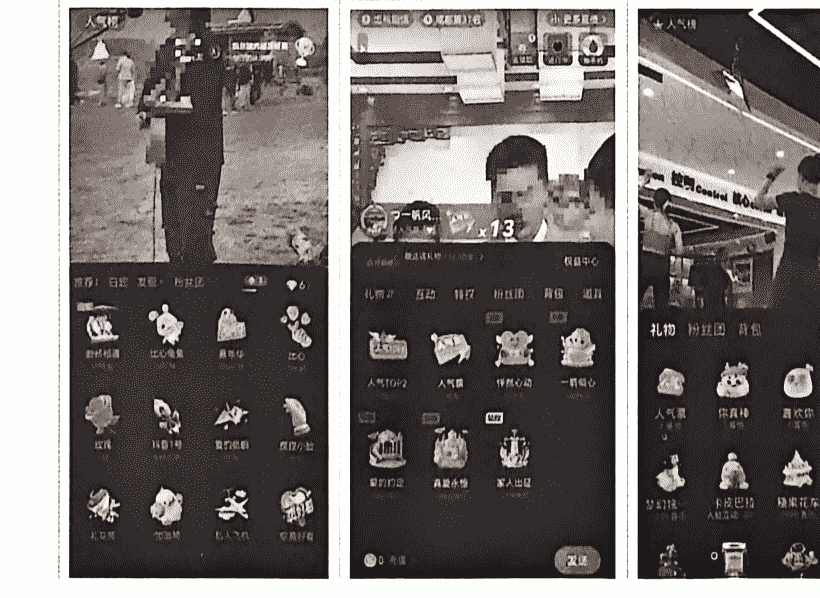
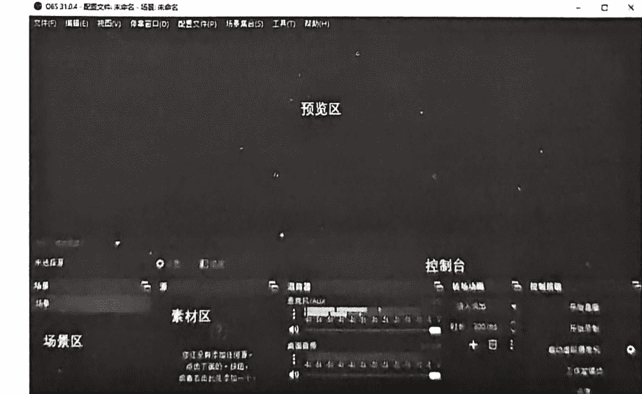
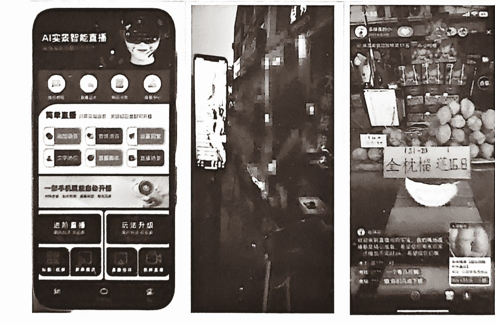

# AI时代短视频财富密码

## 上篇

### 二十一条实战方法

### 用短视频搭建自动收入

# 第1章

## 内容变现的五大核心抓手

### 1.1 流量分成  平台如何主动结算

想明白头部创作者的收入来源？本节拆解抖音、快手、B站、视频号、小红书的付费逻辑。掌握曝光分配和广告分成两套机制，普通人也能把观看转化成现金。

**收益三大核心法则**

- 播放在线量决定底薪：千次播放可折算成到手金额。
- 互动活跃度影响单价：点赞评论越多，平台给得更高。
- 完播表现带来额外加成：看完的人越多，推荐越给力。

**五大平台变现能力对照**

| 平台 | 入门难度 | 回款速度 | 收入天花板 | 代表打法 |
| :--- | :--- | :--- | :--- | :--- |
| 抖音 | ★★★★☆ | 快 | 千万级 | 中视频静默积累 |
| 快手 | ★★★★★ | 极快 | 百万级 | 关系链变现 |
| 视频号 | ★★★☆☆ | 稳 | 百万级 | 评论区藏流量 |
| B站 | ★★☆☆☆ | 慢而长效 | 百万级 | 核心粉变现 |
| 小红书 | ★★★☆☆ | 看调性 | 百万级 | 种草带货为主 |

#### 一、平台推流逻辑拆解

##### （一）抖音推荐三要素

抖音分发像智能大脑，刷完美食马上推同类。模型可简化为 Y=F（Xi，Xu，Xc）。

- Xi 内容：作品质量、文案、配乐是否达标
- Xu 用户：观众历史偏好建模
- Xc 环境：观看时段、地点等时空特征

即 内容质量 + 用户兴趣 + 环境因素 = 播放频次

- 先小范围试投：系统先推几百人，数据好就上推荐
- 标签匹配：标签越准曝光越高
- 热度加权：点赞评论转发是硬指标，完播决定能飞多远

举例：发一条宠物主题，会先进100~500次的初始测试池，按宠物用户画像分发，若80%看完并互动，就进入下一级池。

**操作清单**

- 标题带爆款词，系统优先抓取
- 快速蹭当日热搜标签
- 冷启动期主攻互动，评论区引导回复
- 高峰时段：7~9点、18~22点
- 原生拍摄加成：用抖音相机直拍获原创权重

**进阶要点**

八级曝光池：200 → 500 → 1000 → 5000 → 1万 → 10万 → 50万→100万以上
冷启动关键：前3秒完播>30%才有二次推荐
账号权重 = 近期均播 × 互动占比 × 垂直度

##### （二）快手关系链分发

快手口诀：先交朋友再变现。优先推给：

- 自己的粉丝，哪怕100人，触达率30%~40%
- 共同好友圈的三度人脉
- 同城同兴趣的老铁

头部主播复购率可达67%。发布时加同城标签+地域关键词，播放可翻倍。

- 去中心化：关注页占30%，粘性>播放量
- 社交加权：评论区热闹=强推，标题带家乡名涨粉
- 变现组合：直播打赏/小黄车/广告分成，平台最低抽5%

**致富三板斧**

每3条视频至少1条@老铁互动，到达率可达40%
标题公式：月入X万的窍门 + 感叹号 = 自然流量提升
凌晨发维修教程，抢早起师傅流量

##### （三）B站三连文化

B站偏重质量而非数量。

- 个性化首页：互动质量>播放量
- 三连为核心：点赞 投币 收藏
- 小号也能爆，内容硬核即可

权重：收藏1.2 > 投币1.0 > 点赞0.8
弹幕正向+0.5分，评论专业讨论+1分
优质内容长尾推荐可达180天
知识类完播阈值降至60%，设总结环节收藏率提升

**变现要点**

创作激励、充电计划、广告商单
收益区间：播放 × 0.01~0.03元，按质量浮动

##### （四）视频号

- 好友点赞带来裂变曝光
- 评论区关键词触发广告
- 提现需实名并绑定满30天
- 可植入不易察觉的片尾广告
- 4星达人保级送1万元推广金

##### （五）小红书

封面决定生死：ins风调色+大字标题+对比图
种草提现：好物挂淘客、穿搭挂同款、教程植入工具
阶梯测试：200→2000→1万→5万曝光
SEO：标题含2~3长尾词流量+50%

#### 二、广告分成模式

各平台真实收益对照

| 平台 | 千次播放收益 | 万赞收益 | 爆款门槛 | 信用影响 |
|---|---|---|---|---|
| 抖音 | 0.5~3元 | 200~800元 | 50万播放 | 无 |
| 快手 | 0.3~2元 | 150~500元 | 30万播放 | 每降1分减2% |
| B站 | 1~5元 | 500~2000元 | 10万播放 | 无 |
| 小红书 | 0.2~1.5元 | 100~300元 | 5万点赞 | 无 |
| 视频号 | 0.1~0.8元 | 50~200元 | 20万播放 | 违规封禁 |

抖音抽成弹性大，MCN等级决定分成。2025新政：S级抽5%，A级抽30%+5%服务费，小程序分佣70%~90%。

快手抽成5%，社交变现强。新人70%流量倾斜。
B站抽成5%~8%，绑定学生证有加成。
视频号上半月次月1日结算，下半月15日结算。
小红书完播>10%触发暴击。

#### 三、提升分成策略

动作1：视频吸铁石
前3秒放冲突画面，每15秒设互动锚点，结尾引导三连

动作2：搭建流水线
每周4~6条垂类内容，爆款=30%热点+40%干货+30%人设

动作3：读懂晴雨表
抖音前5秒留存>65%，互动率=(点赞+评论+分享)/播放

五步造爆款
选平台 → 内容炼金 → 流量加成 → 拿平台福利 → 防封号

#### 四、素人逆袭案例

抖音农村博主拍养猪日常凑满1分钟，结尾预告饲料教学，评论区置顶卖腊肠，月入上万。
快手修蹄博主靠ASMR治愈直播挂油链接，私域转化15%。
视频号博主前3秒提示评论区有重点，日曝光50万次。

#### 五、避坑指南

抖音勿多账号切换，快手勿模拟器刷量，视频号禁诱导点击，B站封面勿写求三连，小红书禁搬运。

高危区：抖音7秒以下无分成，快手信用<80分成减半，B站商单未报备限流。

### 1.2 直播打赏变现：盘活老铁经济

核心公式：到手 = 总打赏 × 分成比例 - 平台抽成 - 公会抽成 - 税费

| 平台 | 主播分成 | 平台抽成 | 公会抽成 |
| :--- | :--- | :--- | :--- |
| 抖音 | 50%起，公会55%~70% | 对半 | 5%~15% |
| 快手 | 官方70%，实测多30% | 抽30% | 10%~20% |
| 视频号 | 新人70% | 30% | 返点15% |
| B站 | 50% | 50% | 二次获利20% |
| 小红书 | 打赏对半，带货留80% | 未统一 | 30% |

##### 【各平台充值礼物排行榜】

抖音嘉年华：1个 =3000元！收到立即全站推送（建议每晚8点整开播）

快手666：6快币 =6毛钱，但“老铁”们能刷屏（三农主播必学话语）

B站舰长：200元礼物到手仅80元

小红书玫瑰：1元礼物平台先砍半（建议不如直接挂购物车带货）

各平台变现路径已经彻底分家：短视频平台吃礼物打赏、B站靠舰长会员体系、小红书靠成交转化

#### 二、税费先扣清单
增值税通常从6%起步，平台在每100元流水里直接预提6元。
个人所得税采用劳务报酬累进制，税率从3%一路拉到45%，月入十万左右的档位基本要交35%。
还有隐性扣费，快手是先预留20%税款再进行分成结算，B站则是平台与公会层层抽取。
一笔真实流水：主播收到100万打赏礼物，平台先拿走50万，再被个税拿走20万，落到手里只剩30万。签约公会后能多留15%到20%的到手比例。

#### 三、直播打赏拿钱实操手册
##### 【黄金三件套】
开播时间点：抖音晚上8点到10点人最多，B站在深夜时段更活跃。
话术迭代：喊感谢榜一大哥已经落伍，2025年更常用的是点亮粉丝灯牌马上解锁专属福利，或冲榜前三就送私人定制视频。
组合打法：抖音主打打赏加带货双线，小红书用种草内容倒流至自营商城闭环。
实战参考：一位美妆创作者在视频号直播时用微信扫码进福利群的引导，单场沉淀私域3000人，下个月商品成交总额翻了5倍。

##### 【平台规则精简版】
1. 抖音：流量入口
关键点：卡住晚8点黄金档，制造嘉年华爆发，单颗价值3000元能触发全站推送。
风险点：个人号默认抽成50%，不入驻公会损失很大。
2. 快手：老铁经济
关键点：塑造家人们人设，深耕三农或美妆垂类。
风险点：表面写70%分成，实际先扣20%税再对半分。
3. 视频号：私域金矿
关键点：朋友圈、社群、知识付费联动。
风险点：新人保护期结束后收益打七折，没加公会再亏15%。
4. B站：二次元法则
关键点：运营舰长体系，200元礼物到手约80元，同时叠加周边变现。
风险点：签约后平台和公会一起分钱。
5. 小红书：精致转化
关键点：穿搭家居做场景化直播，带货佣金能到80%。
风险点：打赏分成只有50%。

#### 四、素人逆袭实录
##### 案例1：抖音舞者三天破百
凌晨2点上播，用编发教学配合频繁换装引爆流量，单场收30个嘉年华冲上热门。150万打赏到账，平台抽走75万，缴税后到手45万。
##### 案例2：快手老铁月入50万
打造玉米地里接地气的乡村主播人设，每天晚上8点准时带老乡砍价，累计建立12个500人规模的老铁群。100万GMV，带货抽成80万加打赏20万落袋。

> 【终极忠告】变现公式：70%平台选择+20%脚本设计+10%运气=100%成功提现

### 1.3 知识变现：从内容到付费的降维打击
短视频不只是消遣，更藏着月入十万级的知识付费富矿。职场课、理财训练营火爆背后是平台对优质问答的流量扶持。知识付费其实是新时代的卖水生意，用户愿意为能马上用的技能买单，比如三天学会PS接单、职场沟通话术模板。

#### 一、知识付费三板斧：小白也能上手
> 【底层逻辑】
你的专业认知是不是在闲置？62%的用户愿意为垂直领域知识付费。各平台砸下十亿级流量扶持优质问答，现在入场相当于坐电梯。
> 【五大主战场特色】
抖音：日活6亿，泛知识播放占比20%。
快手：2020年就开通付费课，起步最早。
视频号：公众号、社群、朋友圈形成闭环。
B站：高知聚集地，内测课程被抢购。
小红书：女性向变现天堂，薯币购课很方便。
##### 【效率对比】
抖音客单价9.9到299元，转化率1.2%到3.7%。
B站课程均价368元，完课率81%。
视频号私域复购率是公域的三倍。
##### 【平台段位榜】
段位 平台 变现方式 启动难度 天花板
T0 抖音 会员体系+私域捆绑 ★★ 1000万元以上
T1 B站 硬核课程+IP溢价 ★★★ 500万元以上
T2 视频号 微信生态闭环 ★★ 300万元以上

#### 二、五大平台模式详解
##### （一）抖音知识付费底层逻辑
拍垂直短视频挂课程链接，小程序自动收款，连60岁阿姨都会操作。举例：发一条升职加薪三秘诀视频，挂199元年薪百万沟通课，后台自动赚钱。
变现方式：会员订阅看专属内容与问答；内容付费观看需付费，收入分成。
三大赚钱法：付费咨询如PS摄影法律；电子课件打包成武功秘籍；会员社群年费998元服务。
案例：职场导师做分级会员，青铜9.9元送简历模板，黄金299元进答疑群，钻石999元私教1对1，高阶课程购买率上涨38%。
工具：会员问答是月流水5万以上博主标配；会员空间语音付费树洞；1000粉丝即可在创作者服务中心开通专属会员。
路径：会员体系→专属内容→分层变现。知识套娃：免费短视频引流→9.9元轻知识→999元系统课。摄影教学爆款→99元调色问答包→2999元私教圈；职场干货爆款→199元简历优化→999元职业规划1v1，某求职导师月变现15万元。

##### （二）快手知识付费玩法
底层：拍短剧开直播挂小程序卖课，比抖音早两年。
三大玩法：汽修美甲养殖技能教学；直播唠嗑挂易知课堂、海豚知道链接卖课；付费短剧1元每集解锁。
挂载暴击流：注册小程序→上传课程→挂车直播。宝妈育儿零基础辅食课单月8.7万元。核心数据：分成27%+直播转化23%+复购61%。
避坑：别碰医疗诊断、投资建议、政策解读。必火模板：××领域10大坑、90%人不知道的××秘籍。
特殊方法：挂载能力申请即开店许可；API可1分钟给100条视频装收钱按钮；达人白名单获取完整挂载与流量特权；第三方代开通绕过技术坑。

##### （三）视频号微信生态变现
开通：电脑登录视频号助手勾选协议上传2个试看视频，需悬念钩子。
逻辑：公众号导流+视频号直播+社群复购。案例：法律号靠公司法20问3天变现28万元，路径：短视频热点→9.9元问答包→2999元年度顾问。
三大途径：官方邀请付费课程内测；会员专区年费199元，需1万人有效关注；直播卖课结合社群裂变，9.9元引流课→999元高阶课。
案例：AI课程团队单场直播成交500单，沉淀3000精准私域，复购45%，课程为工具实操+行业方案。

##### （四）B站学霸变现法
公式：付费视频+课程专栏+直播连麦三重叠加。案例：考研UP主复试通关秘籍卖出1.7万份，流水破千万元。
横屏术：专业人设+组合拳。独家课程聚焦职场编程考证；课堂星河计划开课即有流量扶持。案例：某职场课B站+抖音双平台转化率提升317%。
注意：付费内容需比免费超出3倍价值，试看留啊哈时刻。

##### （五）小红书知识捞金暗线
颜值经济链：50元教你画明星眼妆笔记霸屏搜索。美妆问答客单价87元，复购率超其他品类3倍。
精准打击：笔记带付费咨询标签；首图大字报已帮1000多位姐妹变美；评论区引导私域，话术戳我领199元变美手册。
薯币获利：种草式卖课+私域闭环。专栏三件套：直播课、录播课、1v1咨询。付费社群知识星球+小红书双向引流。案例：博主靠穿搭课程+会员群年入百万。

#### 三、实操加速器：养成计划
内容炼金：精准定位一个领域；爆款公式痛点+方案+行动指令；选题=痛点+反常识+即刻可用；视觉统一小红书Ins风；定价免费价值≤付费1/10；跨平台套利抖音竖屏引流+B站横屏转化。
技术支持：小鹅通提供自动收银；海豚知道快手直播挂课；热力图追踪爆款密码。
营销方式：社群培养成家人；给高净值用户打标签推高价课；用学员逆袭故事制造焦虑-希望闭环。
互动一招鲜：脚本这个问题值3000元，今天9.9解锁，转化提升70%；前100名送资料包制造稀缺。
数据掘金：每日看问题点击率<5%改标题、完读率<60%优化结构、转化率<3%重置钩子。
红线预警：不搬运抄袭、虚假承诺、超纲专业；必配电子合同、免责声明、咨询记录存档。

#### 四、行动指南
立即测试：选擅长领域7天出试听课；矩阵布局主攻1平台同步3平台；技术上车注册小鹅通/海豚知道；每日分析转化率迭代课程。
3周启动计划：第1周打造3个爆款免费问答；第2周设计9.9元入门产品；第3周跑通首个付费用户闭环。

### 1.4 星图接单：官方变现渠道全景
覆盖抖音、快手、视频号、B站、小红书官方接单从入驻到变现。

#### 一、接单知识库
任务分类：硬广需标注广告；软广剧情植入；CPS按销售分成。
接单方式：官方平台安全但抽成高；私下接单风险大收益高；MCN代接适合新人但分成低。
税务要点：平台代扣20%劳务税；注册个体户可节税。

#### 二、五大平台详解
##### (一) 抖音巨量星图
入驻：粉丝1万，或粉丝千级且开通直播小黄车。流程：抖音App→我→创作者中心→电商带货→审核。
任务类型：指派、投稿、共创、招募、招商短剧、星广联投、小程序分佣。
限流：单日不超过3条，广告视频占比不超20%。
分成：个人号抽5%，机构号3%。CPS可谈比例。
爆单技巧：广告植入需与原视频画风一致；蹭618双11点击率涨50%；大客户联合建模，小品牌联邦学习精准投放。

##### （二）快手磁力聚星
开通：粉丝1000即可，入口创作者中心找客服。
结算：按效果结算，任务结束14天后打款。
红线：不得引导私下交易；医疗类需资质。
老铁秘籍：瞄准00后+三四线城市；日播4小时算法推流；家居家电日用快消转化高；三八节大牌案例赚25万；连麦PK自然植入；挂小铃铛提升转化。
案例：农村小美4个月赚25万，白天拍喂猪Vlog晚上直播卖土特产。核心：老铁爱家爱情友情内容；短视频引流+直播变现；凌晨发情感语录获推。

##### （三）视频号互选平台
门槛：100粉可直播带货，100粉以下可橱窗，100粉以上视频带货。PC端视频号助手/手机端创作者中心。
定价：1分钟视频3000元起，时长越长越贵。汽车奢侈品单条过普通人月薪。
中年富豪攻略：素材高清大气，参考宝马奥迪质感。锁定35岁以上高消男性，评论区专业答疑。
玩法：主号接品牌广告，小号分销带货；私域三件套视频号+公众号+社群，导入企业微信承接。

##### （四）B站花火
门槛：1万粉+信用分60+成年认证。创作中心→花火→五步签约。
新人回血：电磁力<60分每天发游戏实况攒信用，用必剪做鬼畜获流量。
分账：抽成保密。游戏3C数码单子多，定制视频报价5位数起。
破圈：必剪漫剪自带流量；创作学堂官方免学费；国货品牌种拔一体清空库存。
内容规范：需标注包含商业内容，不得破坏原创风格。
报价：动画区0.5~1元/粉，生活区0.3~0.8元/粉。

##### （五）小红书蒲公英
门槛：5000粉。后台创作者中心→蒲公英→审核。
种草秘籍：合集测评最吃香，对比实验更可信，点击率>8%优质，收藏率>5%可爆。
预充值：出资方先打款到平台，规避甲方跑路。美妆母婴报价最高，万粉博主单条5000元+。
爆文心法：标题带显白显瘦氛围感等词；用官方后台找关键词；新手大学生穿搭博主月接4单净赚2000元。

##### 【平台接单比拼】
维度 抖音 快手 视频号 B站 小红书
新手门槛 1万粉 隐藏低门槛 1000粉 1万粉 1000粉
分钱模式 明码抽5% 效果不一 自主定价 神秘分账 预付安全
恰饭领域 全品类 下沉市场 高端品牌 二次元 精致生活

##### 【新人行动清单】
检查账号实名；按粉丝量开通渠道，不够可冲直播权；新号前10条必须垂直过算法考察期。

- 别只看播放数据，私信回复转化超过5%才会被品牌方主动找上门
- 每天拆解30条同赛道爆款，把场景、配乐、脚本套路拆开学
- 合作确认后48小时内要交出三版脚本让甲方挑选
- 每逢周四下午三点去找客服催审核，通过比例明显提升

##### 【血泪教训】
- 私下接单不报备会被判定违规限流
- 视频挂购物车会拖累内容推荐权重
- 同款产品一个月内接单次数控制在3单以内
- 未成年账号禁止商业合作
- 医疗、金融类内容必须具备资质

### 1.5 曲库分账：背景音乐也能带来稳定收入
◎ 你的音乐为什么变现困难
当你在纠结发歌能不能赚钱时，已有人靠原创BGM买车了。平台本身就是现成的变现渠道，只是大部分创作者没get到玩法：

- 抖音直播打赏抽成50%？加入公会可额外多拿20%
- 快手播放收益能日结？素人作者靠它月入过万
- 视频号评论区挂广告也能收钱？这是官方给的福利

#### 一、抖音音乐变现方法论
【变现底层逻辑】
抖音的音乐分成包含视频播放分成、直播打赏和广告激励。只要作品被使用，版权方就能参与收益，观看、评论、分享、翻唱、混音都会产生分成。你的BGM被使用一次，账户就自动计费。

【三种主要收入】
播放提现：原创或翻唱视频的播放和互动越高，分成越多。爆了等于自动收款。
直播收益：观众送的礼物以抖币结算，创作者按比例分成。
官方通道：认证音乐人可解锁隐藏提现，平台有扶持计划提供流量和现金激励。

【收益测算】
爆款视频≈播放量×0.01元+点赞×0.005元
直播收入≈（礼物总额-平台抽成50%）×个人分成比例
使用费用≈1000次使用≈10元

##### 【变现三要点】
作品要封神：实力占8成，运气占2成
直播要稳定：每周至少3场
紧跟平台福利：音乐开放平台每天刷

##### 【进阶玩法】
公会加成：优质公会可把分成提升到60%-70%
认证特权：认证后可上音乐热榜获得扶持
二次创作：混音版本可重复计算版权

#### 二、快手音乐分成红利
##### 【草根逆袭路径】
快手对原创音乐实时结算，按App内播放量付费。平台更偏向民间创作者，认证作者多为素人，无明星特权。认证后可获得：
播放分成：播放越高收益越高
亿元激励：播放过万触发官方激励，TOP300为首批受益
直播带货：直播间挂小黄车卖U盘可转型带货

##### 【收益放大技巧】
双场景结算：短视频与直播都结算，对机构和独立音乐人开放，无需独家版权，无上限
当天播放次日到账
真实案例：一首原创上线7个月被使用296万次，作品9个月累计播放130亿次

#### 三、视频号变现打法
##### 【微信生态玩法】
视频号创作分成计划允许优质作者在评论区展示广告获利：
评论广告出租：每次点击约0.5元
新主播福利：前3个月分成70%，老主播69%
音乐号转型卖U盘：伤感BGM+怀旧金曲易出单

##### 【组合变现】
私域导流：视频号+公众号+小程序联动
人群分层：00后偏电音，80后偏怀旧
节日营销：春节、情人节BGM流量翻倍

##### 【开通方式】
创作者中心→创作者服务→更多→创作分成计划，支持自助申请

#### 四、B站二次元变现
【用爱发电也能收钱】
B站收入来源包括会员费、广告、游戏联运、直播打赏。
创作激励=播放量×1.2元/千次
充电计划=粉丝直接付费
游戏联运=音乐人跨界做策划

【破圈要点】
弹幕互动：神级空耳歌词带动二次创作
虚拟歌姬：初音风格有专属流量池
课程变现：音乐教学可设付费观看

【收益小账】
1000次播放≈1.2元版权收益，80亿播放≈960万元

#### 五、小红书音乐人打法
【变现概览】
广告分成、电商分成、直播打赏。行业普遍分成比例30%-70%，视粉丝量和内容质量而定。

##### 【精致获利指南】
九宫格精修图+氛围BGM
直播教钢琴顺带卖课
好物分享挂链接：小众耳机+黑胶机

##### 【新思路】
歌单带货：旅行BGM+行李箱组合销售
情绪标签：伤感/治愈/燃系精准引流
品牌联名：小众音乐人联名服饰溢价30%

##### 【平台变现榜单】
| 平台 | 难度 | 速度 | 适合人群 | 盈利指数 | 版权要求 |
| --- | --- | --- | --- | --- | --- |
| 抖音 | ★★★ | ⚡⚡⚡ | 喜表演 | ★★★★ | 需官方授权 |
| 快手 | ★★ | ⚡⚡ | 草根音乐人 | ★★★ | 原创优先 |
| 视频号 | ★★★★ | ⚡ | 微信生态玩家 | ★★ | 无明确限制 |
| B站 | ★★★★ | ⚡⚡ | 二次元创作者 | ★★★ | 二创需标注 |
| 小红书 | ★★★★★ | ⚡⚡ | 精致博主 | ★★ | 无强制要求 |

##### 【素人提问】
> Q：翻唱能赚钱吗？
> A：抖音张同学BGM案例显示，使用官方曲库播放量可自动变现，但需购授权

##### 【趋势观察】
版权收紧，翻唱需授权
元宇宙BGM兴起，虚拟演唱会分成新蓝海
AI作曲爆发，可批量生产爆款BGM

##### 【行动清单】
明天完成这5件事：
全平台音乐人认证
研究10个爆款BGM谱子
规划每周3场直播脚本
准备500个U盘用于带货
开始投流测试

【工具清单】
必备软件：FL Studio/Audacity
硬件起步：200元麦克风+手机支架
数据监测：新榜/飞瓜
维权登记：中国音乐著作权协会自助登记

# 第2章 直播带货三大路径
## 2.1 把直播间做成印钞机
2025年抖音直播GMV破万亿，快手老铁一晚清空服装厂，视频号一条朋友圈可引流数千人。

### 一、抖音直播全攻略
抖音电商持续收紧准入门槛，从源头把控商品与内容质量。

> 【权限通关要点】
粉丝门槛：2025年2月17日起，1000粉改为2000有效粉。有效粉指靠优质内容自然涨粉，买粉会被清退
实名认证：身份证正反+手持照
起号要点：1000关注+3条作品+500赞，新号建议沉淀3天再开播
商品需提前备案：名称、品牌、价格、型号、产地等
特殊类目：食品需《食品经营许可证》，美妆需《化妆品生产许可证》

#### 【商品上架要点】
服装美妆不能随便卖，部分类目需额外资质
脚本雷区：“全网最低”“史无前例”等词易限流
直播时长限制：单场<4小时+间隔1小时
商品标签必须精确到三级类目，错标降权50%

#### 【资质流程】
选择个人带货资质，上传身份证信息；个体户/企业需营业执照+法人身份证
开通小时达带货权限，短视频/图文/直播均可挂商品

#### 【流量分配机制】
实时赛马机制，同一时段直播间竞争，系统每5/30/60分钟根据数据调整流量
带货核心指标：成交率>停留时长>互动率
新手保护期：前3场有额外扶持

#### 【流量获取方式】
◎ 自然流量：优化标题封面，引导评论点赞转发，预告视频带#直播预告
◎ 付费流量：投直播间引流比视频加热ROI高3倍

##### 【流量要点】
200-1000播放是生死线，完播率>30%才晋级
前3秒决定停留时长
搜索+推荐联动，热词=流量入口
“憋单”：前30分钟不放车，把在线人数冲到500+再成交
连麦PK可翻倍流量，避免找竞品

#### 【新手技巧】
抄作业：抖音App-商品橱窗-带货视频管理
挂载小程序裂变，转化提升50%
凌晨2-4点发垂直视频，流量提升3倍

#### 【实操案例】
公式：知识分享+情景带货+方言互动=算法偏爱，某三农主播平均停留2分18秒，完播率>45%

##### 案例1：家纺素人逆袭
错误：天天发产品图=营销号
解法：拍“婆婆夸四件套”剧情，7天涨5万粉
直播背景换卧室实景，转化翻倍
停留时长从30秒提升到2分半

##### 案例2：0粉7天起号
设备：3台手机+T型支架+环形灯
脚本：“刚进来的宝子扣1，抽3人送枕头”
每天固定3场福袋，卡推荐流量
成本500元投流+200元样品，ROI 1:8

### 二、快手直播掘金手册
【带货达人宣传规范】
禁止用回放、黑屏、循环视频、无真人出镜、站内外多开等低质内容推广
【营销限制】
回放当新内容10秒识别，黑屏唠嗑超5分钟限流，多平台同步直播违规，方言必须配字幕
【账号认证】选择个人/企业/机构账号并实名
【小店功能】开通快手小店，完善店铺信息直接在直播间展示商品

【流量机制】
快手网红重视粉丝互动，建立信任。算法综合内容质量、表达能力、互动情况给予流量

#### 【信任公式】 关系 > 流量
连续7天发同类作品打标签
直播背景要“土”，实体店>专业间
每场必说“家人们”
晒身份证+营业执照，转化提升40%

#### 【流量要点】
直播前30分钟推流>200人/分钟
IP切片带货完播率>25%触发叠加推荐
星火计划最高27%分佣

##### 【避坑指南】
保证金：个人500元，企业2000元
禁用词清单：“最便宜”“绝对有效”
组合拳：IP切片+连麦PK，某美妆品牌单场GMV破百万元

##### 案例1：服装
现场量三围+仓库实拍打消顾虑
脚本：“大码姐妹看过来，能穿到200斤”
退货包运费，转化暴涨300%
复购率做到35%

##### 案例2：美食
必拍后厨制作过程
结构：痛点→方案→价格对比
拍快递打包过程，减少50%售后纠纷

### 三、视频号直播指南
视频号依托微信13亿月活，通过分享点赞评论获取流量，微信群、朋友圈实现私域转化。

#### 【起号必备】
实名认证+开通橱窗，0粉可带货
绑定支付分650+
创建至少3个500人群

#### 【平台推荐机制】
依内容质量、互动、粉丝增长综合评估

#### 【流量裂变三板斧】
直播预约弹窗强制触达好友
社群分层运营，按消费力分5级群
朋友圈倒计时海报每天3条
预约人数>500才进推荐流

#### 【私域转化方式】
公众号导流→企微承接→直播转化
朋友圈广告→小程序直购
社群拼团→直播砍价
私域转化率是公域7倍

#### 【裂变秘籍】
公众号推文+社群预告+直播提醒=转化提升300%
案例：母婴博主靠社群秒杀+直播专属价，单场GMV从5万飙到170万

#### 【真实案例】
##### 案例1：母婴
专业育儿知识+母婴产品推荐吸睛宝妈，社群运营带来稳定复购
##### 案例2：家居
专业设计搭配建议+线上线下资源，一站式解决方案高转化

### 四、B站直播变现
#### 【内容审核】
严格审核二次元ACG内容，需符合社区文化
#### 【商品选择】
适合动漫周边、游戏设备、手办等
必爆Top5：盲盒、角色扮演服装、游戏皮肤、手办、RGB键盘鼠标
避坑：盗版直接封号
#### 【流量机制】
社区文化流量+平台推荐，越符合社区文化越易推
#### 【破圈要点】
必须挂“小黄车”，点击率提升80%
三大流量池：科技/美妆/美食
#### 【弹幕互动心法】
“三连抽奖”“老板大气”“下次一定”
弹幕量<1000/小时算失败
##### 案例1：动漫解说
专业解说+周边带货结合
##### 案例2：游戏主播
技巧分享+设备周边带货
##### 案例3：科技创作者
硬核拆机+专属优惠码，ROI达1:27
第45秒插入商品讲解转化最佳

### 五、小红书直播带货

小红书直播玩法：从内容审核到成交方法

小红书作为国内头部生活方式种草社区，其直播变现逻辑和其他短视频平台差异很大，调性、受众画像和审核机制都偏社区化。

#### 【内容审核】
平台对直播内容的管控比较严格，尤其是美妆、时尚、生活方式等赛道。带货内容需要高度贴合社区氛围和用户审美，否则很难获得推荐和信任。

#### 【选品方向】
偏向生活方式、美妆、时尚等相关品类。商品的气质要与社区调性和用户喜好保持一致，转化才会更顺畅。

#### 【形象塑造】
当前变现能力最强的三种形象：

- 归国高净值女性定位，平均客单价常在三千元以上
- 精耕垂直细分赛道，成交转化能做到四成以上
- 校园种草型账号，擅长走量引流

风险点：人设调性与商品价位不匹配极易翻车。

#### 【爆点要素】
- 笔记挂链新规：先积累一千粉丝才可挂链，前期涨粉是关键
- 封面需展示价格，实践中点击率可提升约一百五十个百分点
- 美妆笔记建议在凌晨五至七点发布，该时段流量较为集中

#### 【避坑清单】
- 过度滤镜的摆拍容易被打假号围攻
- 直接搬运电商买家秀会被直接限流
- 正确做法是沉浸式开箱配合素颜测评，有案例十五天带货破千万

#### 【典型案例】
##### 案例1：美妆博主
以专业教程和真实测评吸引美妆爱好者，再将内容自然衔接到产品推介，形成内容与商业闭环。

##### 案例2：生活方式博主
通过高质量的生活分享和家居布置吸引同好，搭配家居用品和生活小件进行推介，转化稳定。

#### 【五大平台直播变现对比】

| 平台 | 变现难度 | 启动资金 | 适合人群 | 流量机制 | 用户画像 |
| :--- | :--- | :--- | :--- | :--- | :--- |
| 抖音 | ★★★ | 500 元 | 创意党 | 算法推荐为主 | 年轻化、娱乐化 |
| 快手 | ★★ | 1000 元 | 唠嗑型选手 | 算法 + 社交推荐 | 偏下沉市场 |
| 视频号 | ★★ | 0 元 | 微商转型党 | 私域 + 公域流量 | 微信生态用户 |
| B 站 | ★★★★ | 2000 元 | 技术宅 / 学霸 | 社区文化 + 算法推荐 | 二次元 ACG 爱好者 |
| 小红书 | ★★ | 500 元 | 精致生活家 | 社区分享 + 算法推荐 | 女性、中高收入 |

#### 【未来风向】
- 内容更专业：用户要求提升，直播内容会更精细专业
- 技术加持：AI、AR、VR带来新体验
- 垂类深耕：平台更聚焦细分赛道形成差异化
- 合规化：监管趋严，带货更透明规范
- 社交化：社区互动成为提升粘性和购买意愿的核心

## 2.2 团购带货：本地门店的增量机会

移动互联网发展下，团购带货在各大社交平台迅速扩散。抖音、视频号、快手、B站、小红书都成为团购土壤。抖音团购配送上线首月GMV破亿，快手头部主播单场也能破百万。顺应平台政策，抓住流量红利期，素人也能实现逆袭。

### 一、团购带货通用操作指南

#### （一）社交电商的四大团购运营形态
- 拼购类社交电商，如拼多多，通过社交裂变实现组团优惠，分享带动订单裂变
- 会员制社交电商，如云集，采用S2B2C模式连接供需，店主负责用户运营
- 社区团购，团长负责社群运营与末端配送，平台提供供应链支持
- 社群团购，依托信任关系实现高频转化，复购率可达传统电商的3倍

#### （二）团购变现机制
##### 【分成规则】
底层逻辑是刷到视频种草、下单、赚钱。主流平台多采用佣金分成，平台、商家、创作者三方分利。以100元套餐为例，平台抽10%，商家让利20%，创作者拿10%净佣。

##### 【货源渠道】
自有商品、与商家合作、平台提供的选品中心都可以获取货源。

##### 【支付与物流】
标准流程：刷到视频→选套餐→填地址→勾选隐私保护→支付。以抖音团购配送为例，下单后填写收货信息并勾选号码保护等隐私选项即可完成，物流多由商家负责，部分平台提供统一配送。

##### 【用户行为特征】
- 决策路径：短视频种草62%→直播讲解38%→社群咨询24%→跨平台比价15%
- 转化高峰：晚8~10点为黄金时段，周末订单比工作日多45%
- 客单价分布：视频号200~500元>小红书150~300元>抖音80~200元>快手50~150元

#### （三）团购常见操作步骤
- 注册与认证：注册账号并实名认证
- 开通带货权限：通过认证开通橱窗功能
- 选品与上架：挑选商品上架橱窗
- 内容创作与发布：制作带货内容发布
- 引导购买：在视频添加购物链接引导成交

##### 【专业术语注释】
- 报白：特类目需平台白名单报备
- 完播率：视频被完整观看的比例
- 挂车：给视频添加购物车链接
- API接口：不同系统间的数据通道
- 矩阵运营：员工加达人组队带货法
- 号码保护：抖音配送特有的用户隐私保护功能

#### （四）团购优化策略
##### 【内容策略】
- 精准定位受众，明确人群画像
- 精心策划活动，打造话题点
- 制作吸睛内容，抖音以内容为主

##### 【运营策略】
- 矩阵运营，员工与创作者协同推广
- 零基础入门：从注册、认证、开橱窗、发优质内容、定位受众、提升技巧入手

##### 【数据分析】
- 关注用户反馈，及时收集评价建议
- 分析销售数据，动态调整策略
- 优化内容形式，跟随用户喜好迭代

### 二、抖音、快手团购变现装备库

#### （一）抖音团购作战指南：流量获利这样玩
抖音的团购功能属于生活服务返佣计划的一部分，以同城带货为主，并推出团购配送探索外卖新模式。

- 全链路营销：避免跳转丢单，视频加图片展示互动强、成本低
- 零成本引流：设置佣金吸引达人分享，平台不收佣金仅收低手续费

##### 【抖音团购变现底层逻辑】
靠创作者影响力促单，创作者赚佣金。流程是平台给流量→内容吸引用户→挂链接成交→收佣金。爆款公式：精准人设+场景化种草+限时优惠。佣金由平台商家创作者三方瓜分。

抖音团购形态：
- 达人带货：认证创作者可带货
- 团购模式：强调货品和低价

##### 【抖音团购实操三步走】
- 开通权限：创作者中心→带货中心→选品→开通达人权限，0粉也能开
- 选择商品：带货中心选品，本地生活服务佣金可达30%，餐饮美发游乐场套餐最热
- 发布视频：通过创作者服务中心团购带货路径发布，探店+价格对比+倒计时优惠效果好
- 核销方式：支持小程序核销和线下扫码核销，商家可用芝麻核销助手管理

##### 【门店通团购功能】
- 确认版本与资格：需旗舰版及试用资格
- 开启功能：门店后台多平台→抖音→抖音团购开启
- 授权关联：门店授权获取商家ID和门店ID，绑定商品ID推广
- 核销管理：概况页快速验券或开单页扫码核销

##### 【内容策略】
- 短视频：场景化+价格锚点，如餐饮用蒸汽特写配ASMR突出氛围，标注原价与团购价
- 直播：头部达人与千粉素人7:3组合，用总裁IP+限时秒杀提升转化

##### 【抖音团购变现秘籍】
- 黄金发布时间：午休12点、下班18点
- 热门BGM：《好运来》
- 评论区话术：“点左下角立省50元”“手慢无已卖300多套”
- 带货模式：直播拼货和低价，短视频拼专业和场景
- 账号类型：专业带货号转化率比随拍号高3倍
- 进阶：创作者中心看带货分，周提升一级佣金涨5%
- 数据优化：用巨量算数分析画像调整发布时间
- 跨平台导流：简介区放处理过的跳转链接引流私域

#### （二）快手团购变现手册：“老铁”经济这样撬动
##### 【变现特色】
- 创新玩法：双11期间万人团、购物团提升参与感
- 购物团功能：3900多万用户参与，成员购买力强于普通用户
- 快手小店带货：提供便捷渠道
- 家人们文化：粉丝黏性高，复购率比抖音高15%，下沉市场9.9元秒杀易爆单

##### 【操作捷径】
- 团购入驻：侧边栏更多→创作者中心→团购带货
- 筛选店铺：开始视频带货→选店铺→挑高佣商品，优先东北山东商家
- 拍摄发布：编辑页显示店铺信息，填描述后一键发送，消费者点左下角贴片下单
- 快手小店：拍视频赚钱→发带货视频→关联商品→发布，支持号码保护

##### 【成功案例】
双11期间某主播用购物团推介单场GMV破2300万，购物团用户GMV占比超50%，客单价涨58%。

#### （三）B站团购带货操作
- 开环带货模式：与天猫合作，B站发现商品，天猫完成交易，突破平台限制
- 天选NEW人明星社团联盟计划：双11期间创作者带货计划

##### 【成功案例】
杭州本地烘焙品牌发制作过程短视频，配真实评价“盲测9.2分”，设置阶梯优惠，联动万粉博主做场景推广，单场团购破千单。

#### （四）微信团购带货操作
视频号带货达人升级为微信小店带货者后，可在视频号、公众号、服务号全域带货。测试商品直接分享朋友圈功能。开通橱窗的达人可在视频号创作者中心带货中心升级，资产数据保留不需重交保证金。经营仍是选品中心选品带货。微信小店带货助手提供数据罗盘、政策通知、团长链接等工具。流量入口增多，可在公众号文章插入商品卡，提升机会。

### 三、团购带货爆单秘籍大公开
【团购变现公式】
精准人设+高频发布×平台红利+选品技巧=持续收入

【三大黄金法则】
1. 选品要精挑细选：高频刚需品，如火锅>法餐。看商圈热力图、竞品爆款榜
2. 脚本像闺蜜聊天：“我跟你们说……”禁忌词替换：“最便宜”→“我见过最值”
3. 发布时间卡点：周五18:00发KTV套餐。算法看完播率>互动率>转化率

【流量密码工具箱】
- 探店BGM：《干饭人之歌》
- 万能台词：“这个价老板不亏吗？”
- 必加特效：价格弹幕+倒计时贴纸
- 数据工具：蝉妈妈、飞瓜数据

【实战案例拆解】
素人逆袭SOP：
- 早10:00发9.9元咖啡套餐，拍摄拉花+办公场景
- 晚8:00发199元双人SPA，脚本“做完直接素颜约会”
- 周六集中发周末限定，餐饮+电影票捆绑，拍完必说“报我名字送甜品”，后台设专属优惠码追踪

##### 【避坑指南】
- 别碰虚拟商品，易违规封号
- 别直接搬运视频，算法可识别
- 别搬运商家图，会限流
- 别选佣金低于15%的商品，不划算

## 2.3 盲盒带货：年轻人上头的赚钱赛道

有直播间靠卖10元小乌龟一晚赚5位数，本节解密盲盒直播玩法，用不确定性撬动财富。

### 一、盲盒直播的变现逻辑（新手必看）
【神秘感经济学】盲盒已不只是玩具，连杯子咖啡都能盲盒。公式：神秘感×随机性=下单率。年轻人爱刺激，成本3毛的塑料乌龟，包装成限量隐藏款能卖39.9元。

【核心玩法】60包出1~2个隐藏款，主播一句“哇塞”就能让用户停不下来。

#### 【分类大全】
- 按载体：实物盲盒潮玩卡牌，虚拟盲盒游戏皮肤会员权益
- 按价格：9.9元引流款、39.9元利润款、199元收藏款
- 按类型：潮玩、美食、数码、服饰

【底层逻辑】利用斯金纳箱心理，随机奖励刺激持续消费

【用户心理三要素】惊喜心理、收集爱好、社交货币

### 二、五大平台盲盒带货变现地图

#### (一) 抖音: 新手必看6步法 + 官方供应链
抖音自建仓，平台直供假一赔十
- 9.9元福利品开路，停留=流量，成交=推流
- 开箱要浮夸
- 产品组合出其不意
- 每10分钟发红包
- 凌晨开播更吸引熬夜人群
- 节日预售提前20天吊胃口

##### 【平台限制】
禁用必中、百分百、保底等绝对化用语。食品类目保证金2万，玩具5000元起。

【避坑警告】别碰平台自营供应链外货源，私接三无产品账号永封。

【新人必学】照搬乌龟对对碰剧本，手速开箱+隐藏款送iPhone噱头。

#### （二）快手：“老铁”专属玩法 + 违规预警
严打第三方引流，私下交易封号。
- 三连引爆法：关注点赞评论抽免单
- 连麦PK比拼销量
- 家族式运营培养拆盒气氛组
- 违规清单：诱导私下交易、虚假抽奖、价格欺诈

#### （三）视频号：零粉丝也能玩的 5 种变现方法
- 零粉丝开橱窗绑定微信小店
- 社群裂变：转发3个群领拆盒券
- 集卡兑奖：集齐5张卡换价值286元大奖
- 开箱视频要土味，越真实越吸粉
- 集数字赢大奖
- 数据指标：分享率>评论率>点赞率

#### （四）B 站：二次元金矿
##### 【独家高收益玩法】
开通魔力赏打赏，手办盲盒可溢价300%销售。二次元用户客单价200元，打赏是核心变现。

##### 【变现链路】
开通条件：满18岁+实名+粉丝≥1000人。

【盲盒直播变现实战笔记】

赠品档位做成三级阶梯，最低档约6元、中档约30元、最高档约198元。分成上创作者与哔哩哔哩各占一半。

【核心玩法拆解】
主线打法是魔力赏开箱配合金瓜子打赏。带货时拉coser联动转化最好，角色扮演服装搭配手办通常能带来销量飙升。魔力赏的触发逻辑是观众投喂金瓜子来开启盲盒。重点可以推漫展同款的限量手办盲盒，虚拟开箱则用舰长礼物做引流入口。

小红书素人逆袭的冷门赛道
【素人逆袭打法】
把直播间布置成Ins风，去义乌小商品城拿热门盲盒把单件成本压到五毛以内，每天稳定更新开箱短视频。

【人设搭建】
账号矩阵是1个主号带3个副号协同，主号走专业拆盒路线。内容节奏走三步：沉浸式开箱做钩子→评论区引导互动做沉淀→直播预告笔记做引流。

【场景布置】
Ins风格布景加柔光灯、展示架、地毯的组合，能明显拉高转化。

【执行要点】
口播可套用“姐妹快看！这隐藏款也太绝了！”这类话术。开播时间固定在每周三、周五晚8点。素人直播更具野生感，品牌方更偏爱。提醒水晶类目必须有销售执照，避免踩雷。

【标签打法】
一定要带上#盲盒开箱 #拆盒惊喜 #隐藏款。

三、爆单实操工具箱
【选品原则】
成本要压到售价的十分之一以内，比如三毛成本卖到三十元。体积不超过快递盒三分之一，重量控制在一公斤以内，优先非易碎品。新手起号建议从三四毛价位的潮玩、卡牌入手。

【配比策略】
基础款占七成、热销款两成、隐藏款一成。

【互动五件套】
①倒计时开箱营造紧迫感
②每十五分钟一次截屏抽奖
③点名互动，给老用户专属福利
④盲盒竞猜，猜中送赠品
⑤连麦拆盒增强真实感

【流量引爆时间轴】
19点放福袋留人→19点半连拆爆款→20点限量秒杀→20点半返场加赠，按此节奏场观很容易突破十万。

【营销日历与节日玩法】
1月推新年限定礼盒，3月做樱花季主题，9月做中秋月光宝盒，11月做双十一福袋，12月做圣诞倒数日历。重大节日提前二十天开始预售，餐饮类盲盒可拆分发售。

【话术公式】
悬念式：“下一个盲盒会是……”延长停留。紧迫式：“只剩最后三组库存，手慢就没了！”逼单。报喜式：“刚才有位家人连开三个隐藏款！”制造从众。

【话术模板】
隐藏款出现时可尖叫：“恭喜宝子！再加送××福利！”
“家人们，这箱卡牌已拆出三张SSR了，现在下单的宝子我再送一套典藏卡套！”

【流量工具】
DOU+可精准投放十八到二十四岁女性用户，投入产出比能做到1:5。直播间打上盲盒、限量、收藏等标签，自然流量可提升三成。

【避雷清单】
抽奖概率必须公示，不可虚构中奖信息。必须支持七天无理由退换货。特殊类目需营业执照，禁止未成年人消费。

【变现案例参考】
某间直播间靠九块九的小乌龟盲盒单日卖出五千单。核心是每六十单放一个黄金龟大奖，概率控制在百分之一点六合规范围内。中奖者要求当场返图，为直播间制造UGC裂变。凌晨开播吃冷门流量，避开晚八点红海竞争。平均停留两分四十八秒，超出行业均值一点五倍。转粉率八点七%，靠关注抽免单脚本拉动。UV价值四点二元，通过捆绑盲盒收纳盒提升客单。

四、未来趋势预判
【出海机会】
东南亚主攻TikTok Shop，日本深耕动漫IP联名，欧美深耕潮玩收藏市场。

【技术新玩法】
AR实时试玩、AR虚拟开箱，元宇宙数字盲盒开始起量。

Q：零粉丝怎么起号？
A：借鉴视频号寻宝打法，准备五部手机同时开播，每隔四十分钟放一个神秘数字，集齐就送价值二百八十六元的纸质书。

# 第3章

## 商业合作的3大黄金法则

### 3.1 探店变现：吃喝玩乐也能变现

短视频崛起后，探店带货成为创作者、商家和平台三方共赢的新模式。素人也能分一杯羹，比如吃货小美三万粉每月奶茶自由，Tony探店五千粉就拿到五星级下午茶福利。

#### 一、探店变现的基本逻辑

直播带货和短视频带货本质不同：

**直播带货：**本质是团购模式，拼货和低价，靠实时互动和限时促销，需要专业设备和至少三人团队。

**短视频带货：**本质是导购模式，拼专业和场景，可单兵作战，靠手机拍摄和剪辑。

这种区别决定了不同的运营策略和互动方式。

##### （一）直播带货等于线上大卖场

卖点就是骨折价手慢无。
核心类型：秒杀型、专场型、连麦型
必备工具：直播中控台、场控大屏
权限门槛：1000粉丝+10万赞

##### （二）短视频带货等于闺蜜安利现场

“这家火锅店我刷了五次卡！”
用场景制造“我也要”的冲动。
细分形式：探店vlog、产品测评、教程类
黄金时长：十五到三十秒完播率最高
隐藏规则：挂车视频需报白类目

#### 【探店内容形式分类】
体验式探店：全程记录消费过程，三到五分钟
快剪式探店：十五秒内突出卖点
攻略式探店：多店横向测评
剧情式探店：植入商业信息的故事

#### 二、各平台探店变现指南

##### （一）抖音探店变现
###### 【内容类型】
云探店：用商家素材二次创作
盲测挑战：不透露店名做真实测评
价格对比：同类商家性价比分析

###### 【进阶工具】
抖店：自营店铺系统
巨量百应：达人接单平台
蝉妈妈：第三方数据监测

###### 【变现路径】
1.搜带货达人开通权限
2.拍吃饭喝奶茶的日常，最后三秒喊“点左下角！”
3.坐等收益入账

【避坑指南】
别网红摆拍，不要天天催“快买要没了”。别直接说超便宜，改成“性价比天花板”。展示门店电话改为私信引导。

##### （二）快手探店变现
###### 【运营手段】
老铁团：粉丝专属折扣套餐
连麦探店：与商家实时互动
溯源直播：食材供应链展示

###### 【风控要点】
严禁虚假定位需开GPS，餐饮类需食品经营许可证，美妆类需质检报告

【必杀技】
把粉丝当亲戚处。宝妈月入过万秘诀：每天刷五家店做矩阵。直播间喊“家人们，这个套餐我姥姥吃了都说好！”立刻爆单。平台飞鸟计划会砸钱扶持。

##### （三）视频号探店变现
变现公式：99%优质内容+1%广告。视频99%时间讲干货，最后1%植入广告引导下单。如端午暴雨视频里掏出自热火锅说“下雨天和火锅最配”。

血泪教训：抖音快手玩法在微信生态行不通。

###### 【微信生态组合拳】
公众号导流，文中嵌入商品卡片
小程序商城定制页面
企业微信沉淀社群客户

###### 【内容审核规范】
不得出现最、第一等绝对化用语，医疗类需资质备案，酒类必须标注警示语

##### （四）B站探店变现
###### 【特有形式】
学术派测评：实验室级检测报告
文化考据：餐饮历史溯源
特效视频：AE创意动画

生存法则：可以带货，但必须够硬核。

###### 【教科书操作】
拆箱测评上显微镜，用户爱看。卖零食先把配料表拍出论文感。

###### 【创作激励计划】
电磁力等级≥Lv3可申请，每周≥2条原创，内容垂直度≥80%

###### 【优化策略】
内容真实：现场拆包试用展示
精准定向：支持自定义人群包拓展排除
CPM出价：按转化目标智能优化成本

##### （五）小红书探店变现
2023年小红书将电商直播业务合并，形成笔记带货+本地团购模式。

###### 【变现机制】
笔记带货：商家达人分佣合作
本地团购：多城市开放餐饮团购，种草到下单闭环
本地生活：商家入驻挂载套餐撮合达人

###### 【操作方法】
1.账号认证：实名，年龄≥18，粉丝≥1000
2.开通电商：我→≡→创作中心→买手合作
3.内容创作：发美食攻略挂到店优惠或团购链接

###### 【功能模块】
探店地图地理聚合，好物榜单算法推荐，直播预约锁流量

###### 【财富密码】
拍出Instagram风，把麻辣烫拍成法餐。文案写“无意间发现的宝藏小店”。

###### 【爆款公式】
前三秒：“天哪！这家日料人均才三十元？”
中间：芝士拉丝特写+Ins风环境
结尾：“定位已发，姐妹冲！”

###### 【加速器】
短视频带货是概率游戏，日更三条比周更一条爆单率高两百%

###### 【违规红线】
禁止私下导流微信，必须标明合作笔记#赞助 #广告，医美内容需特殊报备

### 3.2 联名产品：内容IP的终极变现

刷萌宠视频时头部博主正在签猫粮联名大单，B站美食创作者靠联名厨具赚得盆满钵满。下面拆解完整变现操作。

#### 一、联名产品入门指南
##### 【什么是联名产品】
联名款是产品即营销，是两个或多个品牌、IP或名人合作推出融合型产品并赋能联名的一种市场行为，制造陌生感和新鲜感。

##### 【联名价值】
联名不只是名字叠加，是质量信誉的叠加。选合作方要看生产销售资质，保证产品达标。成功联名能实现1+1>2，跨界带来超预期市场效果。

##### 【创作者IP转化】
创作者先建个人IP积累粉丝，再把影响力转化为商业价值。联名产品是载体，把个人品牌和实物结合创造新价值。

##### 【联名本质】
精准价值爆破实验。别被贴牌合作迷惑。
公式：粉丝信任度×品牌势能×场景契合度=变现当量
例如：宠物博主×猫粮=宠物饲养者必抢，转化率超40%

##### 【生命周期】
通常3~6个月，限定款价值更高，参考B站限定徽章溢价300%

##### 【法律红线】
联名协议必须含知识产权归属条款，参考某创作者T恤图案版权纠纷案。食品类需SC认证+质检报告，某零食联名因菌落超标被下架。

##### 【联名四大法则】
品牌CP：产品联名，双方共同开发，如美妆×食品行业跨界型
明星带飞：与明星知名形象合作，代言衍生型
内容破圈：与影视音乐游戏动漫节目IP合作，需授权
网红定制：为网红量身定制，私域特供型

##### 【联名四大策略】
流量轰炸：抖音快手，美妆博主联名面膜单场GMV破800万，陷阱是高频联名导致人设崩塌
心智渗透：B站，乌江榨菜×B站破次元营销ROI1:7，陷阱是硬植入被弹幕嘲讽
私域获利：视频号，健身博主×蛋白粉私域转化率51%，陷阱是客诉拖累口碑
种草闭环：小红书，露营博主×联名帐篷笔记互动超10万次，陷阱是供应链延迟发货

##### 【冷启动秘籍】
10万粉以下看微联名三板斧：Canva设计限量手机壳成本<8元，发动粉丝二创传播，可达鸭手办众创获600万人次曝光，快闪店模式参考快手×健身房三天回本。

##### 【阶梯分成】
5万粉以下通常拿销售额8%~15%，百万粉可达30%

##### 【价值暴击公式】
优质IP×靠谱品牌×精准粉丝÷市场饱和度=真实收益

##### 【关键指标】
抖音星图广告CPM15~30元，需自然植入
小红书KOL带货CPS8%~20%，垂类可达30%+
B站充电计划分成1:0.7，联名款设充电专属福利

##### 【临界点】
粉丝黏性>35%时效果最佳

##### 【红线】
联名频率>季度2次会导致价值稀释，某美食博主季度联名3次掉粉23%。某数码博主联名充电宝爆炸，赔偿金高达销售额300%。

#### 二、实战工具箱
##### 第一步：选品避坑指南
###### 【资质核查清单】
品牌方生产许可证，食品需SC编号
质检报告，如服装需GB18401标准
联名授权书，必须含销售地域期限

##### 第二步：设计吸金大法
###### 【禁忌雷区】
字体侵权，某创作者用未授权字体被索赔30万
元素敏感，某国潮联名因龙纹争议下架
实物色差，色卡偏差需<5%

###### 【增效技巧】
埋梗设计，如知识博主把金句印在咖啡杯上
开箱仪式感，B站案例显示特殊包装提升25%复购

##### 第三步：推广流量矩阵
曝光层：平台开屏广告+热搜话题，成本约5万~8万/天
兴趣层：KOC素人测评，找50个腰部达人
转化层：直播间专属优惠码，监测ROI

###### 【全平台作战手册】
抖音：挑战赛贴纸，直播间专属折扣码，ROI>1:3
B站：共创征集，充电专属福利，弹幕正向率>85%
小红书：素人铺量，评论区暗号优惠，笔记收藏比例>15%

###### 【排期表模板】
T-30：联名预告teaser+二创征集，社群预热，内容组，播放量>10万次
T-7：开箱视频投放+KOC测评，抽奖锁客，运营组，互动率>8%
T day：直播首发+总裁空降+限定装扮，专属客服，主播，转化率>3%

##### 第四步：分钱高阶玩法
###### 【协议示例】
保底销售5000件按销售额12%分成，超5000件部分按18%阶梯分成，未达3000件品牌方有权终止合作

###### 【税务要点】
个人创作者需代开设计服务费发票，税率6%

企业主体凭增值税专票可以办理进项税抵扣。

#### 三、操作避坑区
##### 【容易自损的五种做法】
- 权益踩线：某穿搭博主私用大牌花纹被起诉，最终二审赔付27万
- 夸大宣传：化妆品联名宣称“医用级”被监管，典型案例罚没46万
- 暗中接单：绕过平台私下合作导致账号降权，播放量跌至九成以下
- 品控松懈：粉丝收到劣质联名货，集体取关
- 发货延误：联名款延期到货引发集中投诉，口碑受损

##### 【三大变现心法】
1. 人设纯度自检
   - 核心标签在人群中的辨识度建议>60%，可用百度指数画像判断
   - 内容垂类集中度力求>80%，参照新榜垂类评分
2. 私域沉淀流程
   - 企业号加粉话术示例：“联名款VIP专属通道，扫码解锁隐藏福利”
3. 产品经理视角
   - 竞品拆解：用5118挖掘对手联名关键词库
   - 用户调研：腾讯问卷快速收集200份以上有效样本

##### 【未来增收方向】
1. 虚拟IP联名
   - 技术门槛：需建3D模型，单个成本约2万~5万
   - 参考案例：虚拟歌姬洛天依联名月饼卖出15万盒
2. AI定制联名
   - Midjourney负责包装视觉，月费约30美元
   - DeepSeek生成Slogan，提示词：为“品类”创作10条含“关键词”的年轻化文案
3. 跨平台联名
   - 抖音ROI>1:3时可同步投放小红书，人群重合用热力数据校验
   - B站搭配淘宝联盟CPS，佣金多在8%~20%

### 3.3 互换资源：低成本进阶打法
旅行博主用3条视频换到三亚五星套房加下午茶，说明流量如何当筹码零成本拿资源并搭建链路。

#### 一、互换的底层逻辑
##### 【交换视角】
互换资源到底是什么？
- 经济学本质：以物易物，符合《国富论》交换倾向理论
- 通俗说法：你出内容，品牌出产品。手机、大牌美妆、网红零食不用自费。10万粉丝≈10万次广告位，品牌手握产品≈实体广告费，相遇后互换共赢
- 核心公式：内容价值=产品价值，例如报价500元可置换500元降噪耳机

##### 【双向获利要点】
- 创作者：制作成本降九成，还能体验产品出爆款
- 品牌：投放费用减半，精准触达粉丝
- 案例：某旅行博主用3篇笔记换三亚五星套房，顺手Vlog涨粉2万，酒店入住率提升30%

##### 【四类互换形态】
1. 实物互换：数码/美妆/食品
2. 服务互换：酒店住宿/出行体验/课程会员
3. 流量互换：跨平台导流
4. 技术互换：剪辑/设计技能换资源

##### 【变现思路】
- 粉丝是广告牌：1万粉=移动广告位
- 内容是存折：1篇爆款笔记≈品牌年赞助
- 平台是提款机：抖音节盟计划直接派发资源
- 生态共建：快手光合计划用内容换流量包+培训资源
- 技术赋能：B站虚拟主播用3D建模置换品牌虚拟代言

#### 二、互换实操指南
【进阶思路】
阶梯报价：1万粉起步，每增1万粉加价30%
组合打包：视频+图文+直播打包置换
长尾价值：爆款持续带来后续置换机会

【工具箱】
第一步：选战场=成功一半
抖音：节盟计划+小黄车
小红书：置换笔记+好物体验官
视频号：零粉带货+直播裂变
快手：下沉市场互换率高，农产品案例超30%
B站：二次元周边+游戏装备置换专场

第二步：内容启动公式
“3秒暴击法”：开头3秒必须出现产品
实测带开箱镜头完播率提升200%，耳机品牌案例验证

【必备工具】
剪辑：剪映自动字幕+CapCut特效
制图：Canva模板库+醒图调色
数据：新榜报价参考+千瓜小红书分析

第三步：谈判话术模板
“王总，我们账号女性粉占85%，上月破500万播放的爆款，用您新品做沉浸体验，预计带来××曝光…”
反向议价：“粉丝画像与贵品牌高度重合，排期紧张，是否优先安排？”

【合作流程】
- 签电子协议，推荐腾讯电子签
- 明确交付标准：时长/露出次数
- 设置验收节点：初稿→修改→发布

【避坑提示】
- ✖ 过度恰饭：粉丝不是韭菜，某美食博主接9条广告掉粉10万为鉴
- ✔ 每3条内容接1条广告，用“本周好物”等栏目包装
- ✖ 福利陷阱：警惕以“曝光”抵账的不良品牌
- ✔ 先签约再创作，明细写清
- ✖ 互换过度易被取关
- ✔ 每周最多1单，调性100%匹配

【三大红线】
① 不接三无产品
② 不承诺转化数据
③ 不碰平台违禁品
研究显示62%纠纷源于价值评估缺失
解法：CPS=（粉丝活跃度×内容质量系数）/产品单价

【常见提问】
Q：粉不足1万能互换吗？
A：500粉也能玩，本地餐饮/美容院偏爱小博主，一顿体验餐换一条探店视频
Q：置换产品用不完怎么办？
A：闲鱼售卖/粉丝抽奖/转赠同行，二次变现方式多

#### 三、各平台互换地图
##### （一）抖音节盟计划：官方外挂
要点：在广告位植入抖音电商元素，官方直接导流
实测美妆博主加入后单条播放暴涨300%，变种草现场

##### （二）小红书互换江湖：女性用户盘
逻辑：500元报价可换500元产品自选，耳机/护肤/小家电任选，新手建议从美妆个护切入
避坑：严禁接三无产品，置换前核验企业资质

##### （三）视频号微信生态：私域放大器
打法：公众号+社群+视频号组合，可把资源价值放大3倍

【案例库】
案例1：拿酒店福利的36计
免费住总统套房→拍大片引流→反手接旅游局合作
某知乎博主用体验笔记撬动马尔代夫旅游局赞助，全程VIP获5万推广费
案例2：航空隐藏福利
粉超5万可申请体验官，机票+酒店+地接全包
重点展示目的地稀缺性，如迪拜跳伞/冰岛极光，航司常升舱
案例3：2000粉换全年零食自由
测评视频→置换10家品牌→搭建“零食博物馆”账号→签约MCN
单条视频带来300多次精准咨询
案例4：宝妈靠亲子酒店互换环游中国
酒店体验→旅游局合作→航空公司赞助
内容引流→私域转化→定制旅行团

【行动清单】
- 立即注册节盟计划
- 列10个目标品牌清单
- 设计专属报价单：粉丝量×0.5=产品价值
- 用Canva制作作品集
- 当晚私信3个本地品牌发邀约

# 第4章
## 私域变现的4大关键打法
### 4.1 微信导流：把公域流量变提款机
刷短视频的过客都是流动现金，微信用户超14亿，本节教你把公域过客沉淀为自有变现阵地

【变现底层逻辑】公域归平台，私域归自己。公式：爆款吸粉→导入微信→集中触达→多渠道变现

【微信生态】视频号+公众号+企业微信三件套
视频号主页绑定公众号，形成入口
公众号自动回复留资：设置“加客服领福利”话术，自动推企业微信活码
企业微信社群：用微伴助手自动拉群发资料，日产3000+精准粉

#### 一、五大平台微信导流大全
##### 1. 抖音导入粉丝公式
主页资料玩文字游戏“加VX领福利”，日导入200+精准粉
评论区置顶“加微信送资料包”，日加300+
直播福袋设“加客服兑奖”，女装品牌沉淀率做到15%
私信截流：用火星工具生成跳转页规避监测，日加500+不封号
AI语音留福利：自动给点赞用户发语音“私信领福利”，转化提升3倍
高阶：直播口播植入“加微信看独家内容”，配合包裹卡沉淀会员

##### 2. 快手导入秘籍
主页卡片直跳微信小程序，转化提升50%
私信自动回复“加老板微信领专属折扣”，日转1000+宝妈粉
企业微信名片挂入口，美妆博主月入200万
直播礼物榜引流：昵称改“VX：×××”精准截流
加入50个同城群，用快闪脚本日加300+本地粉

##### 3. B站破壁指南
视频高潮黑屏→闪现微信二维码3秒→日加500+充值玩家，评论区留暗号“加群领攻略”效果更好
弹幕用彩虹弹幕发联系方式，存活时间比普通弹幕长3倍
专栏文章藏“加V领完整版”，转化超40%
充电计划设“充电专属客服”，自动推送企微二维码
个性签名写“资料在公众号”，配合口播引导转化翻倍

##### 4. 小红书拿微信好友方法
防封写法：把微信写成“小红薯号”，评论引导“看我红薯资料”
暴击笔记：发对比图写“加我拿修图预设”，摄影博主日倒800+精准客户
私信脚本库：准备20套场景话术，关键词触发自动回复
合集引流：建“资源合集”笔记，置顶评论“私信领取完整版”
直播截流：在竞品直播间刷“我有更低价货源”，日截300+精准客户

##### 5. 微信生态核弹玩法
连麦导流：与大V连麦时背景板放活码，日加2000+
弹幕红包雨：备注“加VX领双倍”，转化率高达70%
评论区矩阵：50个小号在热门视频下统一脚本引流
直播挂机：24小时循环播放“加客服领福利”录音
官方白名单：绑定公众号后主页自动显示入口，合规导流

#### 二、微信导流实操
【五大变现方式】
朋友圈：每天3条广告+2条生活晒单+1条客户好评=月入万元
群聊：发红包+限时秒杀+专属福利，转化率80%
视频号挂链接：直播下方挂“微信客服”，客单3000课程月销万元
小程序裂变：设计“邀请3人解锁福利”，日增500+精准粉
企业微信SOP：微伴助手自动追单，成交率提升200%

【避坑】
抖音勿直接发微信号，用企业微信活码规避封号
小红书勿用“微信”二字，用“卫星”“薇❤”“VX”等谐音
B站勿简介留联系方式，把微信号做成动态水印打在视频角落
快手勿同脚本群发，准备20套脚本轮换

【案例】育儿号年赚900万操作
抖音拍萌娃日常→主页写“加妈妈群领早教资料”，微信分群0-3岁卖奶粉/3-6岁卖绘本，每周直播单场GMV破百万元

【高阶工具】
活码生成器：语鹦/微伴/火星
自动回复机器人：wetool魔改版
弹幕机：B站彩虹弹幕生成器
脚本库：500套引流脚本模板
风控检测：灵鲲营销检测工具
SOP系统：微盛·企微管家

### 4.2 付费社群：99元会员年收百万的逻辑
拍十条视频收益不够电费？会玩社群的高手99元年费年入百万

#### 一、付费社群崛起
【变现段位】
青铜：接广告当乙方被动接单
白银：直播带货体力活
黄金：知识付费站着赚钱需IP背书
王者：付费社群轻松收钱复购最高

【什么是付费社群】
基于共同兴趣或需求的付费在线社区，结合内容消费与社交互动，为创作者提供稳定收入和深度互动平台

【典型变现方式】
年费会员制、课程+社群+助教模式、付费培训+付费社群+付费广告

【平台分成】
抖音：知识付费抽成30%~50%
快手：私域交易仅抽5%
B站：大会员分润比例最低
视频号：冷启动3000种子用户可裂变7000粉丝

#### 二、付费社群实操手册
公式：专属内容+深度服务+社交炫耀=社群变现
构建三层价值：基础内容免费+进阶服务付费+尊享权益高客单

【三大必杀技】
1. 年费制：99元买整年
工具：知识星球+小鹅通，至少20条独家内容打底
2. 课程+陪跑：卖课是开始，社群是变现场
工具：腾讯文档+飞书妙记+B站虚拟直播，周更低于3次必掉粉
3. 师徒制：收徒教学还能抽成
工具：鲸打卡+金数据，徒弟分成低于30%会流失

【各平台指南】
抖音：创作者中心→专属会员→设置年费权益，需绑定企业微信防封
快手：小程序+私域联动，消息打开率<60%需优化
小红书：爆款视频+公众号导流+付费文章三连击
B站：虚拟UP主+充电专属表情包，30万粉可年入百万
视频号：3000种子用户裂变，社群卖课+母婴团购

#### 三、新手运营心法
【精准定位】
宝妈→育儿课程+母婴团购
职场新人→简历模板+内推机会
创业小白→陪跑社群+资源对接
二次元→虚拟直播+限定周边

【定价】
9.9元引流→199元主力→999元尊享
定价公式：行业均价×2.5+情感溢价

【日更术】
早8点行业早报，午12点限时优惠，晚8点直播答疑，凌晨0点AI自动发次日预告

#### 四、案例库
宝妈天团年入1500万：企业微信养5000宝妈群，变现儿童课程+奶粉团购+母婴广告，每天3次群接龙，人均年消3000+，裂变率1带7，复购率83%

案例2：三层递进的付费收割法

产品组合：99元入门课 → 999元实操营 → 9999元私教研修

赚钱路径：低价课做获客入口 + 社群做关系升温 + 学员分佣做长尾复利

交付标准：

99元档：录播课+思维导图，72小时内交付

999元档：每周一次作业点评，以Notion做统一管理

9999元档：线下小规模闭门会，出席需正装

##### 【行动清单】
1. 准备阶段
先上企业微信工作号替代个人号，同时为视频号完成官方蓝V认证；准备三块移动电源防直播断电，订购智能写作服务会员
2. 执行阶段
每日通过爆款短视频引流新增30位精准好友，评论区提前埋设钩子；每周投放两条付费笔记，配干货截图与进度条制造紧迫
3. 升级阶段
搭建年度社群产品，必须包含线下聚会和虚拟权益；训练AI客服小助手，实现高频问答自动回复并自动踢除广告号
4. 终极警告
不做人群分层等于白忙活；不设付费门槛会被白嫖；不做线下沉淀就缺乏信任背书

### 4.3 线下引流：把播放变成到店成交
实体老板如果放弃同城短视频，基本等于把房租白交。有人边刷视频喝奶茶，边看着同城号把月客流拉升三成。接下来拆解线上到线下的转化手感。

#### 一、到店转化的底层逻辑
> 【短视频到店变现四步变现公式】
先刷脸：15秒短片就是低成本广告位，先让用户记住品牌
激欲望：高颜值员工+产品特写，形成线上橱窗，看完就想打卡
沉淀私域：引导扫码加微信，加友即送5元券，把过路客变成回头客
裂变传播：发起带三位好友同行享折扣，触发社交扩散

**【核心认知】** 到店转化率 = 内容吸引力 × 触达量 × 信任感
黄金时段：工作日午休11:30-13:30，下班后18:00-20:00
**【三频共振理论】** 商品受众、账号画像、直播间观众必须高度一致
**【变现模式大全】** 8条盈利方向
①门店直接消费
②会员储值锁定长期价值
③线上领券线下核销形成数据闭环
④到店打卡分销，顾客变推客
⑤异业联名套餐分成
⑥招商引流，视频替代招商手册
⑦孵化本地达人做知识付费
⑧同城号孵化后打包出售

#### 二、平台打法：五大战场作战手册
**1. 抖音：同城获客利器**
认证后可展示电话地址。冷启动前5条用“城市名+冲击词”，如#北京必吃榜 #人均30元吃到撑。算法更看重完播>互动>转化，前3秒必须上门店爆点。POI可挂地址、优惠券、一键导航，转化可提升六成。门店大屏循环播放爆款可再翻倍。可通过抖音来客查看竞品热销套餐。
**【限流红线】**
同一Wi-Fi下3个账号以上同时发营销内容易受限

##### 2. 快手：“老铁”现场经济
直播挂预约到店小铃铛，转化提升22%。信任靠日更+每周三场直播+评论秒回。裂变设计“老铁带新客到店获双倍积分”，复购提升35%。密码是方言口播+价格对比。案例：沈阳烧烤主播现场切羊肉，评论区变点菜区，当天到店破纪录。

##### 3. 视频号：微信生态闭环
朋友圈广告支持LBS定向，覆盖周边3公里、500米范围。私域闭环打通视频号+公众号+小程序，加友送券留存提升九成。企业微信做分层标签：新客/老客/高消。门店导航卡片点击率远高于文字。员工统一用企业微信自动录入CRM，后续跟进更高效。

##### 4. B站：年轻用户转化
知识区带货需埋到店暗号，解锁隐藏菜单。弹幕互动可发起打卡抽奖，参与率提升五成。抽奖必须绑定到店条件。

##### 5. 小红书变现
素人探店笔记矩阵20篇霸屏同城搜索。封面公式：产品+价格+Emoji，如提拉米苏15.9元。封面比例3:4，信息流展示面积更大。标题带城市+品类+长尾词，如上海静安寺小众咖啡馆。种草组合：图文+短视频+探店直播，转化提升三倍。

#### 三、实操手册：三天引爆客流
##### Day1：人设与首页
命名公式：城市+品类+记忆点，如杭州火锅一哥。人设四维：专业度×亲和力×记忆点×持续性。让高颜值员工出镜展示产品，信任翻倍。
【首页装修五要素】
置顶播放量最高的引流视频
联系方式大字报，如到店报抖音立减50元
商家蓝V认证
作品分类标签如爆款菜品、顾客实拍
直播预告浮窗

##### Day2：爆款内容流水线
【拍摄脚本模板】
00:00-00:05 高颜值员工出镜抓眼球
00:06-00:10 产品特写+价格冲击，原价198现价98
00:11-00:15 到店指引+福利，报暗号抖音来的送小菜
【升级脚本模板】
黄金6秒结构：痛点排队久+方案到店立减+证据排队画面
真实拍摄食材处理全流程，消除安全顾虑
使用平台热榜音乐获得流量加权
带价格标签视频完播提升65%，建议原价/现价/省钱三栏

##### Day3：私域转化组合拳
到店客户强制加微信，扫码送纸巾盒，三元成本换LTV
社群定时发车，11:00午餐券、17:30欢乐时光
每周三会员日裂变，带新人双方得50元券
到店拍照发抖音返现20元，UGC裂变
会员储值送短视频拍摄权益，客单提升八成
开发小程序实现积分、签到、商城一体化
设置KOC成长体系，消费满500元升级探店官

#### 四、案例拆解
##### 案例1：奶茶店逆袭
00后店员拍工服变萝莉裙视频，播放破50万。评论区梗互动，到店对暗号芋泥啵啵送隐藏款。单月新增客户超两千，抖音贡献营收68%。
##### 案例2：服装店私域狂飙
路径：抖音爆款→微信秒杀群→线下试衣间追销。私域客户年均消费是散客4.2倍。
> 【避坑指南】新手必看陷阱
忽视POI热度，选择低竞争高流量标签
不做数据复盘，每周分析点击率/到店转化率
内容空洞，必须真实展示产品细节，差评率可降六成
盲目抄爆款，需结合门店基因差异化
忽略中视频，1-3分钟深度内容转化更高

### 4.4 个性化定制：高客单背后的生意逻辑
还在用9.9包邮攒粉？头部玩家早已转向高客单。抖音摄影服务卖到3500，哔哩哔哩创作者卖1.5万洗衣机照样抢空。个性化定制是创作者经济核心，粉丝粘性与信任高，直播间更好成交。
> 【高客单定义】单价高于行业均值三倍以上，通常≥1000元
> 【变现闭环】精准流量×转化率×客单价×复购率=收益

#### 二、平台定制变现打法
##### （一）抖音
底层看GPM。组合拳是短视频种草+直播收割。年龄分层定价：8-25岁推2000元套餐，25-35岁推3500元高端款，万元定制攻高净值粉。案例：摄影机构用低客单引流+高客单变现，GMV翻倍。工具：巨量千川+蝉妈妈。冷门打法：开播先放福利款拉人气，中期捆绑高客单组合，转化涨300%。
##### （二）快手
6000元包包也能月赚4.5万。工具：磁力聚星+快手粉条。珠宝玉石直播效率是图文10倍。案例：箱包卖家两个月涨粉3.3万，投放成本降81%。
【信任三板斧】
连麦PK提升曝光
工厂溯源直播
72小时无理由退换
快手复购率>40%才能长期盈利
##### （三）哔哩哔哩
20分钟深度拆解可带货5000万。高知用户偏好家装，年销7亿案例。提前一周发评测把粉丝变选品官。完播率>70%内容付费意愿更强。
【高转化内容SOP】
选题会→脚本打磨→分镜设计→埋三处钩子→发布两小时数据监控→动态优化
##### （四）小红书：精致圈变现圣经
“三高一低”：高转化/高客单/高复购/低退货。买手直播脚本+个性化清单工具，种草转化提升300%。
【平台红线】
禁止直接放淘宝链接
避免硬广脚本
图片禁价格水印
正确做法是用入手价、专柜同款等话术+场景化种草
【跨平台变现对照】
抖音主打流量闪电战，适合3C轻奢定制服务，新人难度★★，核心指标GPM>2000元
快手主打老铁信任经济，适合珠宝地域特产，新人难度★★★，核心指标复购率>40%
B站主打深度内容变现，适合家居科技产品，新人难度★★★★，核心指标完播率>70%
小红书主打精致生活方案，适合设计师品牌轻奢，新人难度★★，核心指标收藏率>15%

#### 三、实操手册
【高客单内容三大类型】
解决方案型：痛点+产品组合
身份认同型：圈层专属定制
稀缺收藏型：限量编号款
【直播间黄金公式】
前30分钟用9.9福利款拉人气到500+
中场释放镇店之宝，客单拉高三倍
终场限量尊享定制营造稀缺感
【憋单脚本结构】
痛点放大→权威背书→价格锚点→限时福利→催单话术
【避坑指南】
粉丝静默下单率>60%
直播互动率>15%
老客复购率>30%
【风险提示】
定制需收30%定金，账期T+7，退货率低但单件损失大
**【立即行动清单】**
年龄分层重组产品线18-25/25-35/35+
下一期视频埋场景钩子如装修党必看、情人节送礼指南
私信10位高消粉丝做需求调研

# 第5章 高阶变现的六种操作
## 5.1 代运营：月入三十万的乙方生存指南
短视频代运营是把策划、制作、发布、运营外包给专业团队的服务模式。代运营具备创意、技术、平台算法能力，帮助品牌快速增长与变现。
### 一、起手式：看懂代运营黄金赛道
品牌抢代运营的核心：省时、涨粉、加速变现。三大优势：规避封号风险与舆情监控；供应链整合三日上架；矩阵运营快手店群月铺五千+SKU。
【N种代运营模式任选】
专业号代运营、企业官方号全托管
达人种草局、KOL带货流水线
投流高手、聚光/巨量千川狙击
店铺代运营、含无货源模式
矩阵号代运营、十号同步变现
蓝V号代运营、含星图任务权限
直播代运营、脚本到投流全包
影视号变现、中视频计划组合

### 二、平台变现比拼
#### （一）抖音代运营
模式：品牌自播、达人带货、无货源带货、付费投流、代运营托管
【变现通道】
直播带货、日销百万起步，需五百粉
星图任务接广告，需一万粉
商品橱窗24小时自动售卖，需一千粉+十条作品
中视频计划分成、游戏发行人试玩结算
红线：医疗类目需白名单，新号前五条定权重
流量公式：完播率>15%×点赞率>6%=爆款标配
#### （二）快手代运营
模式：小店代运营、矩阵批量运营、全托管选品到发货
流量公式：播完率>40%×互动率>8%=流量通行证
【变现福利】
直播打赏、信任电商变代理、小店开通
矩阵铺货十店同步、付费知识专栏、本地生活团购带货
限制：挂榜需提前48小时报备，虚拟商品需特殊资质，冷启动前三场直播满两小时
#### （三）视频号代运营
流量公式：私域导流率>20%×复购率>15%=变现金矿
变现链路：知识付费、直播带货、广告分成、付费社群
#### （四）哔哩哔哩代运营
服务：曝光提升、粉丝增长、内容优化
流量公式：弹幕密度>5条/分钟×收藏率>10%=优质内容认证
【变现方式】
充电计划需一千粉、花火商单需备案、课程分销、品牌定制、直播带货需白名单
#### （五）小红书代运营
模式：专业号代运营、聚光投流代运营、达人种草代运营
变现模式：卖货、卖时间、接推广、体验笔记、素人笔记铺垫
流量公式：关键词密度3%-5%×首图点击率>8%=爆文公式
【七大路径】
品牌合作人需五千粉、店铺带货需一千粉、话题营销承包、测评账号拿样品、素人笔记铺垫五百粉可接单、爆文复制系统

⑦ 标题正文标签三合一 SEO 模板

【各平台代运营决策对比表】

| 渠道 | 内容形态 | 冷启动所需时间 | 人力配置要求 | 收益强度 |

| --- | --- | --- | --- | --- |

| 抖音 | 15秒快节奏短片 | 7~15天 | 编导+投放手 | ★★★★★ |

| 快手 | 直播搭配中长视频 | 30天以上 | 主播+供应链 | ★★★★☆ |

| 视频号 | 图文与视频混排 | 60天以上 | 私域运营人员 | ★★★☆☆ |

| B站 | 10分钟深度内容 | 90天以上 | 专业内容组 | ★★★★☆ |

| 小红书 | 图文/短视频种草 | 14~21天 | 美工+文案 | ★★★☆☆ |

### 三、代运营实操手册

【运营工具箱清单】

- 抖音 DOU+ 投入产出测算表：预判投放回报
- 快手小店热品库：实时畅销榜抓取
- 视频号裂变路径追踪：拆解导流到私域的链路
- B站弹幕高频词提取器：捕捉用户关注点
- 小红书爆款标题产出器：3类标题模型+表情符号搭配指南
- 五大渠道数据汇总看板：统一监控
- AI脚本一键生成器：60秒产出爆文脚本
- 各平台敏感词雷达：整合最新违禁词库
- 对标号内容解构系统：自动拆解爆款结构

【变现组合打法】

- 青铜段位：抖音追热点 + 小红书挂车
- 白银段位：B站科普 + 微信私域收单
- 王者段位：快手直播 + 抖音切片分发 + 社群复购
- 地狱段位：视频号私域 + B站深度课 + 小红书素人铺量 + 抖音挑战赛 + 快手产业带直播

收益公式：中视频计划影视混剪 + 知乎好物 + 自动回复成交

【执行路线图】

- 第1周：完成5个赛道的A/B内容测试
- 第2周：锁定ROI大于3的变现路径
- 第3周：搭建标准化内容生产线
- 第4周：启动矩阵账号规模化复制

## 5.2 培训变现：把专业技能变成持续现金流

短视频生态汇聚了大量使用者与创作者，围绕玩法与盈利的培训课程已成为教培新风口。本节拆解课程变现的逻辑、机制与落地方法。

Q：普通人能开课吗？
A：只要掌握一门硬技能即可开班。

Q：粉丝量需要多少？
A：500个高精准关注者胜过10万泛粉。已有创作者靠37位精准学员售出12.8万元的高价课程。

### 一、短视频培训课程变现密码

【变现方式】

- 知识付费：提供系统化课程帮助学员学会平台玩法与盈利，实现知识销售
- 服务收费：提供1对1带教、咨询、资源对接，按服务效果收费
- 流量变现：用课程聚合学员形成流量池，再通过广告、带货转化
- 社群经济：搭建学员圈子，通过互动与资源共享创造价值
- 佣金分成：帮助学员在平台变现后抽取比例

### 二、培训产品打造方法

#### （一）课程内容设计

【平台规则与运营策略】

- 短视频策划与运营方法论
- 直播带货技巧
- 带货的人货场核心逻辑
- 选品逻辑、直播脚本等

【电商直播运营】

- 电商直播定位与规划方法
- 直播间搭建与布置
- 电商直播运营策略
- 活动策划
- 直播团队搭建与培养

【新媒体运营技能】

- 新媒体行业前景与薪资查询方法
- Photoshop在运营中的快速应用
- 抖音影视剪辑号制作流程

##### 口播类账号拆解与制作

##### 【短视频内容创作】

想在平台卖课，先要做吸睛短视频。可分享课程精华、干货知识点，或用故事案例展示课程价值。

#### （二）教学方法与效果评估

##### 【四维教学法】

- 案例拆解：拆解百万粉账号
- 实战演练：现场直播PK
- 社群共创：学员互评作品
- 持续迭代：每周更新平台新规

##### 【效果评估体系】

- 流量指标：完播率>30%，互动点赞评论率>5%
- 转化指标：橱窗点击率>15%，私信转化率>3%
- 结业标准：30天起号粉丝过万，单条视频GMV破万元

##### 【机构变现王牌】

- “巨量学”变现矩阵：
  - 认证课程：短视频运营官认证 2980元/人
  - 企业服务：广告投放代运营 消耗返点+服务费
  - 生态分成：输送学员到星图平台接单抽佣

##### 【成功经验四要素】

- 专家人设：讲师拥有百万粉账号+实操案例背书
- 迭代速度：课程每月更新紧跟政策
- 社群裂变：打卡奖励，分享返现30%
- 生态闭环：培训+代运营+供应链全链路

### 三、实操宝典：手把手起飞

##### 【冷启动必备】零粉丝也能赚钱的两招

- 信息差搬运：把知乎高赞回答做成PPT视频挂小程序赚佣金，日入百元有实测
- 平台活动：参加“中视频伙伴计划”，播放量直接变现，大学生靠影视剪辑月入过万

##### 【起号流程】

- 养号期3~7天：每天刷1小时同领域内容
- 破冷启动：发布时@小助手并添加热门话题
- 数据优化：完播率>30%，互动率>5%

##### 【精细化运营三板斧】

1. 个性化教学
   - 小白班：基础操作+模仿翻拍
   - 进阶班：流量算法+投放技巧
   - 大师班：打造个人IP+矩阵号运营
2. 持续支持体系
   - 毕业追踪：3个月流量扶持
   - 资源对接：MCN机构签约绿色通道
   - 校友会：每月大咖闭门分享
3. 变现体系
   - 前端：免费直播课 转化率30%~50%
   - 中端：训练营 客单价2000~5000元
   - 后端：私域会员 年费1万元以上
   - 隐藏款：供应链抽佣 带货分成5%~20%

##### 【服务收费秘籍】

- 1v1陪跑：账号诊断2980元/次，代运营5000元/月起
- 企业内训：短视频营销定制课8万元/场，含规则解读+矩阵搭建
- 资源掮客：撮合品牌与达人合作收取10%~20%佣金

##### 【课程体系金字塔】

- L1引流课 9.9元：3天短视频起号训练营
- L2进阶课 999元：21天直播带货实战班
- L3私董会 5万元：年度陪跑+资源对接

##### 【变现避坑指南】

- 抖音：禁止引导站外交易，说“加微信”直接封号
- 视频号：禁止医疗健康类内容直接封号
- B站：视频前3秒出现二维码会被判定营销
- 快手：直播间频繁要礼物易被取关
- 小红书：软广需报备否则降权

##### 【新人30天成长路径】

- 第1周：完成5条作品测试内容方向
- 第2周：开通商品橱窗 500粉门槛
- 第3周：进行3场1小时直播锻炼脚本
- 第4周：搭建私域流量池 企业微信+社群

##### 【次日必做3件事】

1. 用备用机注册新号防大数据标记
2. 在剪映创建“爆款模板”文件夹收藏10个对标账号
3. 准备9.9元引流课脚本

## 5.3 AI直播：24小时不间断的变现方案

“AI就是我的赛博员工！”某MCN负责人感叹。随着智能技术发展，AI直播正成为新趋势，主要包括数字人直播、虚拟直播、AI实景直播三种形态。

**数字人直播**：用AI生成的虚拟人物在直播平台实时互动传播内容
**虚拟直播**：借助绿幕、AR、数字人、4K屏等技术以虚拟场景替代实景
**AI实景直播**：真实场景直播中用AI替代主播进行语音讲解与文字互动

### 一、平台AI直播政策红黑榜

#### （一）抖音：官方认证的变现特区

- 允许三类数字人：企业自研/第三方/软件服务平台
- 必须标注“虚拟人” 字体≥屏幕1/20

##### 【技术红线】

- 禁止换脸政要、明星
- 禁用境外IP生成人设
- 必须保留完整操作日志

##### 【高危行为清单】

- 生成境外虚假人设 某商家用AI生成韩国明星账号被封
- 诱导虚假互动 假抽奖真引流
- 发布不良AI内容 直接封号

#### （二）快手：保守派

- 流量惩罚：AI直播间权重系数×0.7
- 非官方数字人无法挂小黄车
- 破局点：只能使用快手“女娲”数字人且需搭配真人场控

##### 【互动生死线】

- 每10分钟需真人语音互动
- 虚拟主播不得单独回复敏感问题如医疗咨询

#### （三）视频号：修罗场

##### 【绝对禁令】

- 虚拟人开播=封号 某机构被封案例
- 实景AI特效需提前报备

##### 【生存法则】

- 真人出镜+AI辅助工具
- 虚拟物品展示≤直播时长30%

##### 【实名门槛】

- 虚拟账号需绑定真人身份证+人脸识别
- 企业账号需提交《AI技术使用承诺书》

#### （四）B站：技术试验田

##### 【隐藏福利】

- 开放数字人API接口
- 虚拟创作者专属推荐位

##### 【变现限制】

- 打赏分成比例降低20%
- 禁止AI生成限定周边

##### 【法律警示】

- 法院判决：虚拟数字人不享有表演者权
- 影视级数字人需额外申请《视听许可证》

#### （五）小红书：种草主场

##### 【特殊政策】

- AI生成笔记需打标 #AI创作
- 虚拟博主可开通店铺

##### 【内容规范】

- 美妆类必须真人实测
- 穿搭类允许虚拟试穿

##### 【AI责任条款】

- 用户需独立承担生成内容责任
- 虚拟肖像商用需上传《授权证明》

### 二、AI直播变现操作手册

##### 【装备指南】

- 智狐AI直播助手 搜索“群星矩阵”领取试用
- 智狐AI直播手机
- Kreado AI直播数字人
- 抖音云智能主播 / 快手虚拟直播SDK / 微信AI直播插件

##### 【流量密码】

- 黄金3秒法则：智能主播每3秒有表情变化
- 意外触发机制：随机插入“系统卡顿”特效
- 多模态交互：语音+弹幕+手势三重响应

##### 【变现神器】

- 带货狂魔：数字人敢说某直播间靠AI喊“OMG”GMV翻倍
- 广告永动机：虚拟爱豆同时接10个代言
- 知识印钞机：AI讲师365天开课持续收学费

##### 【AI直播运营SOP】

- 07:00-09:00 知识付费专场
- 09:00-12:00 循环播放高光片段
- 12:00-14:00 智能连麦答疑
- 14:00-18:00 直播切片分发
- 18:00-24:00 黄金时段带货

##### 【八大封号雷区】

1. 长时间静态画面>3分钟
2. 音视频不同步延迟>500ms
3. 非本人声线相似度<85%
4. 背景文字模糊分辨率<720P
5. 违规商品展示需手动打码
6. 诱导虚假互动点赞抽奖等
7. 跨平台同步直播推流地址重复
8. 未成年人形象即使获授权

##### 【高危项】

- 未实名认证开播 视频号最严直接封号
- 代理加盟模式涉传销 某6.6万元加盟项目被立案

##### 【新人避坑指南】

血泪案例：冯先生花6万元加盟AI直播三个月被割韭菜
防骗口诀：赚钱项目别轻信，自己养号才是真

##### 【垂直领域爆发】

- 教育答疑 24小时AI讲师
- 医疗咨询 合规版数字医生
- 跨境直播 实时多语种切换

##### 【赛道测试】

- 低门槛：虚拟陪伴 情感/教育
- 中门槛：跨境直播 多语种AI
- 高门槛：医疗健康 需资质

##### 【灵魂拷问】

Q：会被限流吗？
A：记住三要三不要：要备案、要标识、要真人待命；不要碰红线、不要搞擦边、不要全自动

## 5.4 数据贩卖：流量背后的隐形生意

粉丝数焦虑、流量难变现？你的粉丝数据就是金矿。本节教你把数据变成真金白银。

### 一、粉丝画像变现大揭秘

##### 【能变现的粉丝画像】

- 基础信息：性别/年龄/地域
- 财富密码：职业/收入/消费能力
- 行为轨迹：偏爱内容/活跃时段
- 心理弱点：婚姻状况/心理健康/价值观
- 设备特征：手机型号/网络环境
- 社交图谱：关注列表/互动关系

##### 【变现工具包】

1. 平台自带工具
   - 抖音数据后台 粉丝活跃时段分析
   - 快手热榜 地域偏好追踪
   - B站创作中心 内容互动热力图
2. 专业玩家装备
   - 新榜有数 全平台监控含竞品
   - 灰豚数据 抖音爆款预测+带货转化分析
   - 千瓜数据 小红书种草雷达+爆文基因检测
   - 飞瓜数据 B站创作者商业价值评估
3. 企业级工具
   - 卡思数据 MCN红人管理系统
   - FineReport 一键生成可视化报告
   - Tableau/Power BI 投行级分析神器

操作口诀：数据抓取+交叉对比=情报网

##### 【数据换钱案例库】

**案例1：程序员小河矩阵 20个“克隆号”①+统一剧本=年入百万元**
- 用灰豚数据发现程序员周三晚8点爱看自黑段子
- 20账号同步发秃头/加班梗发布时间精确到分钟
- 用画像报告说服IT培训机构投放转化率提升300%

**案例2：小红书信息售卖 月入万元**
- 每周发布《95后美妆消费报告》千瓜数据抓取Top100爆款笔记
- 私域售卖《2023爆款笔记公式大全》含标题生成器+封面模板
- 企业定制竞品投放策略分析监控10个对标账号广告排期
- 免费报告埋“数据盲盒”扫码付费解锁完整版

**案例3：游戏主播数据中介**
- 用飞瓜数据统计粉丝常用英雄/段位分布
- 打包卖给外设品牌定制“黄金段位鼠标推荐清单”
- 抽成销售额15%月均万元

**案例4：微播易的KOL金矿**
- 百万网红数据库+AI匹配=品牌投放外挂
- 用粉丝消费能力数据反向定价广告位
- 打包腰部KOL成“虚拟顶流”套餐

**案例5：夸克网盘的教科书操作**
- 小红书“羊毛党”画像分析精准推送88元VIP活动
- 监测“百度网盘”关键词讨论热区
- 变现链路：免费用户→付费会员→企业云服务

① 注：内容一致由同一主体掌控的账号

### 二、数据换钱操作三步手册

**第一步：数据炼金术**
- 抓数据 新榜有数自动爬取设置关键词监控
- 洗数据 Excel数据透视表筛选20%关键指标
- 榨数据 FineBI生成动态图表带预测曲线
万能公式：粉丝活跃时间+内容偏好+消费能力=黄金组合

**第二步：信息产品设计**
- 基础款 9.9元粉丝画像报告含竞品对比
- 进阶款 8888元行业白皮书附季度更新
- 王炸款 5万元定制竞品监控含实时警报
- 盲盒款 19.9元解锁隐藏数据维度

**第三步：精准获利脚本**
- to小品牌：“竞品上周投放3个爆款我们破解了算法偏好”
- to大企业：“目标用户尚未满足三大需求附数据验证”
- to同行：“起号速成攻略+防封号秘籍组合包”
- to机构：“年度数据代运营月费制”
- to投资机构：“Z世代消费赛道三大未满足需求附画像验证”
- to研究机构：“季度性社会情绪波动数据包+代运营”

##### 【避坑指南】

- 数据红线：平台明文禁止的数据勿碰如手机号
- 法律雷区：报告封面注明数据来源合法仅供内部参考
- 差异化：每份报告加入独家维度如情绪波动曲线
- 信任公式：每月免费发布行业数据简报
- 专家背书：与数据分析公司联合出品
- 法律护甲：合同注明数据经脱敏处理不涉及个人隐私

## 5.5 IP周边开发：从内容到实物变现

美妆博主联名化妆刷卖断货、宠物博主植入宠物零食、科技宅自制工具包吸金。5分钟解锁个人IP周边变现全攻略。

### 一、变现先搞人设：三步打造吸金人设

人设公式=强烈记忆点×持续输出

##### 【人设三要素】

- 辨识度 外貌/口头禅/标志动作
- 专业度 垂直领域认证
- 亲和力 接地气表达

##### 【真实人设案例】

- 某穿搭博主：夸张表达+高级脸
- 某知识博主：严肃讲解+快嘴鉴定
- 某手工博主：深山老林+木工绝活

短视频IP商业化实战手册

【要点速览】
1. 把角色标签深深刻进受众脑海里，一周至少三次同风格内容持续轰炸，形成记忆压强。
2. 同步打造三重氛围：专业气质靠垂直赛道背书，生活质感靠日常场景呈现，反差张力靠打破刻板印象实现。
3. 不同渠道采取不同定位：
   - 抖音平台娱乐感强，适合快节奏高记忆点的形象。
   - 哔哩哔哩内容要求浓度高，适合深度拆解，核心用户偏年轻需要硬核支撑。
   - 小红平台偏生活化，适合种草式表达。
   - 微信视频号与生态深度绑定，用户成熟度高，适合高客单品类。

【实战提醒】
用A/B分组实验找到最优组合，保持每周三条同风格的稳定投放。同时注意：
- 坚持赛道深耕，知识类IP必须做知识点拆解。
- 私域沉淀，把20%铁粉导到企业微信，回购水平可提升三倍。

### 二、IP周边高利润选品策略
##### 【变现榜单】
| 类目 | 利润率 | 回购率 | 执行难度 | 适配形象 |
| :--- | :--- | :--- | :--- | :--- |
| 联名潮玩 | 300% ↑ | ★★☆ | 需授权 | 动漫/游戏/潮流文化 |
| 工具组合 | 150% | ★★★☆ | 简易 | 知识/技能类 |
| 知识卡片 | 500% ↑ | ★★★★ | 极简 | 教育/心理/职场 |
| 限量周边 | 1000% ↑ | ★☆ | 需设计 | 全类型，需核心粉基础 |

##### 【选品四维】
- 情感价值：受众为情怀买单。
- 实用价值：解决具体使用痛点。
- 展示价值：具备社交货币属性。
- 稀缺价值：限时限量玩法。

##### 【选品关键指标】务必验证
- 受众匹配度 >60%，问卷调研确认。
- 生产成本 < 售价30%。
- 物流成本 <15%。
- 退货率 <5%。

##### 【供应链要点】
- 筛工厂先问：起订量、打样周期。
- 防坑口诀：先签合同再付定金，留30%尾款验货后付。

##### 【渠道组合】
- 高毛利品走自建小程序，规避平台抽成。
- 引流品挂抖音小店，吃自然流量。

##### 【变现建议】
- 新手从客单价50~200元的实用周边切入。
- 先做MVP：预售500件测市场。
- 季节性品提前3个月铺货，如圣诞限定。

##### 【实操提示】
- 冷启动用预售众筹探温，某国产动画众筹斩获1665万元。
- 进阶玩法开发内容衍生周边，如知识博主思维导图手册+实体手账套装。

### 三、五步掌握种草带货：抖音/哔哩哔哩/小红通用
1. 埋点测试期：
   - 视频背景不经意露出周边，自然植入。
   - 用弹幕/评论区引导受众寻找彩蛋。
2. 深度种草期：
   - 密集发布开箱/使用教程系列，3~5期连发，购买入口3秒内可见。
   - 拍剧情短片，如“这个工具救了我的选题荒”。
3. 转化爆发期：
   - 直播设限量福利价，话术如“点赞破10万抽3位送全套”。
   - 发布买家秀合集，强化从众心理，重点展示素人使用场景。
4. 私域沉淀期：
   - 微信社群发放专属折扣码。
   - 会员制优先购买周边，某IP靠此提升回购。
   - 限量款制造饥饿感，配编号证书+专属刻字。
5. 裂变传播期：
   - 晒单抽奖活动。
   - KOC分销激励。

##### 【各平台带货技巧】
- 抖音：发起挑战赛+优化商品搜索词。
- 快手：老铁砍价+连麦带货。
- 哔哩哔哩：限定弹幕样式+众筹玩法。
- 小红平台：合集测评+小号晒单。

##### 【案例提炼】
1. 某穿搭博主靠“测评翻车”反向带货，79元搭配手册卖出10万本。
2. 某知识博主用错题本周边撬动百万销售额，前期免费模板引流，中期推实体精装，后期做联名限定。

### 四、避坑指南：踩中即重创
##### 【自毁三连】
- 形象与带货不匹配，如科技男卖彩妆等于浪费。
- 定价盲目自信，成本30卖300易被封禁。
- 售后不完善，差评可导致掉粉20%。

##### 【高阶雷区】
- 侵权风险，字体/图片商用需授权。
- 平台限流，硬广占比超视频时长20%必降权。
- 税务问题，月流水超10万须办执照。

##### 【法律红线】
- 盗版IP形象，赔偿可达收益10倍。
- 虚假宣传，平台直接封号。
- 资质缺失，食品/化妆品类需特殊许可。

##### 【供应链大坑】
- 样品与量产不符。
- 预售周期超30天，受众流失率增300%。
- 物流破损率高，引发差评风暴。

##### 【IP价值衰减】
- 内容同质化导致流失，对策：每月创新一种内容形态。
- 过度商业化破坏信任，对策：保持60%干货+40%带货比例。

##### 【保命工具箱】
- 合同审查：用腾讯电子签规范供应商。
- 风控监控：安装店透视预警差评。
- 数据联动：抖音罗盘+私域CRM监控回购周期。
保命公式：选品=形象延伸×受众需求×合理利润。

##### 【必备5份文件】
商品质检报告、品牌授权书、售后承诺书、物流时效说明、危机公关预案。

### 五、IP开发终极变现模板
##### 第 1 个月：打基础阶段
1. 形象定位：
   - 完成3版分组测试。
   - 分析100份竞品。
   - 设计3个记忆点。
2. 内容养粉：
   - 储备20条垂直视频。
   - 前3个月每周5更。
   - 建立10个核心粉丝群。
3. 供应链建设：
   - 确定2家备选供应商，优先可小批量定制。

##### 第 2 个月：冷启动
1. 测款试水：开发3款低成本周边。
2. 全平台种草：
   - 制作20个种草素材。
   - 找30个KOC铺量。
3. 平台差异化运营：
   - 抖音：15秒高密度种草。
   - 哔哩哔哩：工具类深度测评长视频。
   - 私域：企微社群沉淀1000人。

##### 第 3 个月：爆发期
- 主推199元爆款套装。
- 矩阵号孵化3个细分小号。
- 建立分销体系。
- 技术赋能：用AI生成周边设计稿，效率提升5倍。
- 跨界联名：知识IP+文具品牌等。

##### 第 4 个月：迭代期
1. 私域回购：
   - 设计会员等级，年费制订阅。
   - 每月1次限定发售。
   - 线下粉丝见面会限定款。
2. 升级产品：
   - 收集1000份用户反馈。
   - 开发IP联名款。

【行动】立即启动3天极速测试法
- Day1：发布带购物车视频。
- Day2：投100元DOU+测转化。
- Day3：按数据决定投入方向。
记住公式：年入百万=50%形象记忆点+30%供应链把控+20%数据运营。

## 5.6 智能配音：零粉丝也能变现的机器声线玩法
现在抖音快手全是小说推文轰炸，背后大量是智能配音团队。本篇讲如何用语音合成实现变现。

### 一、智能配音变现全景
#### （一）配音变现为何高收益
- 效率暴涨：专业录音工作，工具5分钟搞定，单人可完成百万字有声书，成本降90%。
- 声音自由：御姐音、总裁音、方言梗随意切换。
- 全品类覆盖：悬疑、言情、玄幻等文风自动适配。
- 多语言支持：英日等外语一键生成，利于跨境变现。

##### 【爆款工具清单】
| 工具名 | 杀手功能 | 适用场景 | 核心参数 |
| :--- | :--- | :--- | :--- |
| 配音蜂 | 永久免费 | 新手试水 | 50多种基础音色 |
| TTS vue | 开源零门槛 | 批量流水线 | 最高100万字/天 |
| 逗哥配音 | 云浩宇声线 | 女频流量 | 20种情绪调节 |
| 豆包软件 | 方言随意切 | 下沉市场 | 30+地区方言库 |
| 魔音工坊 | 影视级效果 | 高端定制 | 支持声纹克隆备案 |

#### （二）小说推文盈利逻辑
用户刷到视频→想看后续→点链接跳转小说APP→你拿分成。
变现形式：
- CPA：按下载2~8元。
- CPS：充值金额30%~70%分成。
- 平台补贴：中视频计划千次播放3~10元。
内容方向：男频战神/赘婿/神医；女频霸总/言情/种田；小众悬疑/刑侦/电竞。

### 二、抖音智能配音实操四步
1. 选文：扒平台爆款，优先虐恋/豪门/战神归来等狗血桥段。避开涉政涉黄，用数据工具分析关键词。
2. 生成：SD/即梦生图，公式：凄美BGM+AI播音腔=流量密码。语速180字/分钟，选磁性或甜美音色，关键剧情加3D环绕音效。
3. 剪辑：剪映加磨砂滤镜，关键剧情打马赛克。加进度条、弹幕特效，时长55~58秒。
4. 发布：挂#小说推文 #情感共鸣 #深夜emo，宜凌晨1点发。日更3~5条，前5条用DOU+投相似达人。

### 三、配音案例
案例1：抖音博主用AI做《霸道总裁的替身娇妻》漫画推文，单条播放587万，引流3.2万人至小说APP，5天提现1.7万元。
案例2：快手博主用方言配《乡村神医》，每角色不同东北口音，1条视频引流900人，佣金8元/人，净赚7200元，成本2小时+200元DOU+。

##### 【平台变现对比】
| 平台 | 密码 | 雷区 | 限制 |
| --- | --- | --- | --- |
| 抖音 | AI漫改推文 | 直接搬运原文 | 单日最多推3本 |
| 快手 | 方言+土味剧情 | 高端文艺范 | 必须加字幕 |
| 哔哩哔哩 | 动漫声优级配音 | 机械解说 | 需标注AI生成 |
| 小红平台 | 女频甜宠+ins风 | 男频热血 | 不能带下载链接 |
| 视频号 | 中年情感+大字报 | 年轻梗 | 需绑定合规版权方 |

##### 【版权红线】
- 番茄/七猫签约作品勿碰。
- 晋江VIP章节必侵权。
##### 【技术雷区】
- 勿用未备案声纹克隆。
- 勿用真人原声，易被克隆诈骗。
- 方言配音避敏感词。
##### 【平台规则】
- 抖音禁同一内容多号发。
- 快手会检测重复配音音轨。
- 标签超5个易限流。
##### 【新变现姿势】
- 跟随政策，快手方言配音有额外扶持。
- 多模态融合：文字+语音+图像一键生成。
- 内容付费：高质量配音IP化，获取长尾收益。

# 下 篇
## 几十款“赚钱神器”
# 第6章 拍摄剪辑全家桶
## 6.1 手机拍摄神器：轻颜 / 无他相机隐藏功能揭秘
短视频时代，轻颜、无他等相机APP已成创作者标配。轻颜助力抖音涨粉，无他助力直播变现。

### 一、美颜神器变现必备
1. 轻颜相机：自带流量的颜值外挂
   - 风格滤镜秒成网红同款妆容，省80%后期。
   - AI场景适配，自动切换滤镜组合。
   - 姿势模板解决摆拍尴尬，支持1080P导出。
   - 抖音直通，拍完自带话题标签。
   - 跨平台画质不压缩。
2. 无他相机：直播美颜利器
   - 实时美颜圈粉，瘦脸大眼冷白皮。
   - 用户粘性高，日均打开3次，97%内容直发平台。
   - Live实况生成动图，小红平台点赞提升。
   - 5分钟长视频一体拍摄，适合带货。

### 二、各平台特效变现打法
抖音：轻颜探索创作选爆款特效如纯欲妆+港风滤镜，竖屏9:16最佳；无他直播录屏，开启礼物特效映射。
快手：无他方言字幕+土味滤镜拍日常，美颜参数调30%以下保真实。
小红平台：轻颜油画滤镜拍穿搭，局部美颜突出产品细节。
哔哩哔哩：无他绿幕模式录课程，后期换PPT背景，美颜磨皮≤40%。

### 三、实操手册
1. 轻颜流量玩法：姿势选爆款舞蹈手势，同步抖音，加热门BGM，三天涨粉5000。
2. 无他直播赚钱：精灵耳+微笑唇，礼物特效提醒，下播卖定制滤镜，设美颜参数套餐礼物。
3. 避坑：美颜过头易限流，瘦脸别超50%；同滤镜滥用审美疲劳，周更2~3风格；直接搬运模板流量低，需叠加特效；忽视平台调性，抖音要精致/哔哩哔哩重干货/快手需真实。
4. 矩阵搭建：轻颜拍种草引私域，无他直播成交，组合打造IP。
公式：爆款=50%热门元素+30%个人特色+20%美颜加持。

## 6.2 电脑剪辑工具：PR/FCPX 百万博主私藏插件包
不会剪辑等于把钱往外推，选对工具是变现第一步。

### 一、变现工具库
PR适合技术流接大单，剪映适合日更薅流量，影忆专攻下沉市场。
【6款变现剪辑神器】
1. Adobe Premiere Pro：影视级接单，Win/Mac双平台，与AE/PS联动。
2. Apple Final Cut Pro X：Mac赚钱利器，磁性时间线+好莱坞光效插件。
3. 剪映：手机电脑双开，零基础日更10条，支持专业格式，热榜模板日更。
4. iMovie：苹果自带，Siri语音剪辑，iPhone素材自动同步。
5. AVID Media：好莱坞标准，8K工业级，漫威御用。
6. 影忆：土味爆款制造，5000+本土模板，三农带货3分钟出片。

【变现PK：PR vs FCPX】

Pr 与 FCPX，到底哪台能帮你更快变现？

#### 1. 操作手感对比
- Premiere Pro 更像技术流工程师，支持 32 条音频轨道混音以及 Lumetri 专业的色彩分级，熟练运用通常需要 7 到 15 天的适应窗口。
- Final Cut Pro X 更像贴心的助手，M1 设备上可做到实时回放，还自带语音转字幕能力，大多数用户 3 天就能独立作业。

#### 2. 赚钱切口
- Premiere Pro 最吃香的是企业宣传片制作，市场上常见报价从 5 万元起步，配合 After Effects 做粒子特效后，甲方付款更快。
- Final Cut Pro X 更擅长知识付费赛道，利用 Motion 制作三维字幕，课程溢价往往能达到三倍左右。

#### 3. 外挂插件加成
Premiere 常用组合→
- Boris FX，院线级别的特效套装，让品牌片质感瞬间拉升。
- ClearPlus，弱光修复利器，夜景素材可从废片变回电影感。

Final Cut 常用组合→
- mTracker 3D，追踪型插件，带货视频里能自动锁死商品位置。
- 棱镜光效合集，收录 79 种流行光效，三农类内容播放量常提升超过两倍。

【实操案例】
- 美妆博主 A 用 Premiere 搭配 FilmImpact 的 30 种好莱坞转场，单条广告报价从 500 元涨到 2 万元，精修周期约两周。
- 旅行博主 B 借助 Final Cut 加 mVolumetric 三维光效，单条视频带货佣金破 10 万元，出片仅需 3 天且字幕自动产出。

### 二、零基础逆袭的变现组合

#### 1. 剪映：抖音官方打磨工具
- 全端可用：手机、平板、电脑均可运行。
- 海量曲库加热榜背景音，卡点音乐一秒匹配。
- AI 抠像免绿幕，人像灯光自动优化。
- 关键帧可让商品做 360° 旋转展示，是带货常用手法。
- 实战：套用带货成品方案挂车，三天破万单常有发生，新手两小时就能成片，日更负担小。

#### 2. 快影：快手创作者利器
- 八大智能功能含文案改写与动漫脸生成，降低真人出镜门槛。
- 与快手深度联动，发布即推流，帮助新号冷启动。
- 倒放与变速组合，能把土味剧情变成魔性爆款。
- 案例：东北创作者用数字人功能一人运营 5 个养生号，月销中药茶包过万。

#### 3. 秒剪：微信私域引流器
- 适配朋友圈 9:16 黄金比例，避免画面被裁切。
- 支持红包封面定制，私域转化率实测提升约三成。
- 节日模板提前布局，中秋、春节可提前三个月准备。
- 避坑：发布视频号务必打开高清传输，否则模糊掉粉近半。

#### 4. 快剪辑：矩阵号生产器
- AI 可批量生成上百条育儿知识短片。
- 批量改开头三秒画面。
- 多账号同步分发。
- 实测单号每月可导私域宝妈超 3000 人。

#### 5. 手残党速成
- 手机用户：剪映语音转字幕准确率约 98%，支持方言，宠物内容也能火。
- 电脑新手：影忆提供傻瓜式绿幕，农村直播间秒变高端卖场。

### 三、专业变现装备库
1. Adobe 套件：头部博主的付费能力
   - Premiere Rush 专为 15 秒短视频优化。
   - 动态图形模板可复制大 V 片头，市面 5 元可购 500 个。
   - 色彩预设包让美食、美妆调色接近顶流。
   - 提醒：非专业团队慎入，插件安装即可劝退八成新手。

2. DaVinci Resolve：调色界的顶级选择
   - 提供抖音专属色彩空间，画面亮度常比竞品高三成。
   - AI 降噪可把夜拍废片变电影感大片。
   - 批量公式：一套模板适配十个产品，日产 50 条可行。
   - 案例：摄影从业者用达芬奇调色后，汽车广告报价从 5000 元涨至 5 万元。

3. 万兴喵影：国产之光
   - 曲线变速让卡点视频点击率翻倍。
   - 电商绿幕素材直抠换背景，省去场地租赁成本。
   - 语音转字幕可识别方言，下沉市场必备。
   - 组合打法：美食号 = 万兴剪辑 + 剪映成品方案 + 快影发布，日产 20 条探店视频。

##### 【剪辑工具优劣榜】
| 需求 | 推荐组合 | 避开 |
| --- | --- | --- |
| 抖音日更 | 剪映 + 醒图 | Premiere 专业版 |
| 快手剧情号 | 快影 + 美图秀秀 | Final Cut Pro |
| 私域导流 | 秒剪 + 创客贴 | AE 特效包 |
| 矩阵号操作 | 万兴喵影 + ChatGPT | 达芬奇工作室版 |

##### 【赚钱五大路径】
1. 广告合作：百万播放约可报价 1 万元，需用 Premiere 制作带品牌植入的 B-Roll。
2. 知识付费：剪辑课售价 199 元，Final Cut 制作 3D 动画课件可溢价三倍。
3. 带货分成：小黄车佣金最高 50%，需用影忆添加十个产品标签。
4. 账号交易：10 万粉账号估值约 20 万元，需用 Premiere 打包专业作品集。
5. 私域变现：剪映批量生成引流视频，日更 20 条导流微信。

##### 【行动指南】
- 新手：剪映成品方案日更 3 条，坚持一周易出爆款。
- 进阶：快影 AI 生成后人工微调，效率提升十倍。
- 团队：万兴批量生产 + 达芬奇调色，接商单标配。

##### 【Q&A急救包】
Q：零基础如何起步？
A：抖音搜索剪映成品方案，直接替换文字和产品图，日更十条。
Q：苹果与安卓哪个更合适？
A：苹果搭配剪映 + 可画，安卓搭配快影 + 美图，实测流量无差别。

## 6.3 智能剪辑高科技：五款神器一键生成爆款
AI 浪潮下短视频仍在产出变现机会，零基础也能日更十条。本节拆解五款智能剪辑工具。

### 一、五款工具横向对比
【变现选手阵容】
1. 腾讯智影：功能全家桶
2. Runway AI：好莱坞级特效库
3. Kapwing：新手救星
4. 剪映：移动端主力
5. Fliki AI：文案转视频专家

【按场景划分】
- 全自动流水线：腾讯智影 / Fliki，适合批量生产
- 特效加工：Runway，适合精细打磨
- 模板速成：Kapwing / 剪映，适合快速出片

【按技术原理】
- 自然语言驱动：Fliki，文本转视频
- 计算机视觉驱动：Runway，视觉为主
- 混合模式：腾讯智影 / 剪映，多模态融合

### 二、五大工具变现解析
#### （一）腾讯智影
【变现亮点】
- 输入文字自动成片
- 数字人主播 24 小时在线，降低出镜成本
- 素材库丰富，即取即用

【操作示范】知识博主将知乎高赞回答转为科普视频，挂小黄车售卖资料包，月入过万。流程：复制爆款文案 → 选择虚拟教授 → 自动生成字幕与配乐 → 发布分账。

【使用限制】
- 数字人播报时长上限 5 分钟，超长需分段
- 商用素材需另购版权
- 4K 导出仅付费版可用，免费版最高 1080P
- 免费版每日转换上限 3 次
- 文章转视频仅适配微信图文排版

【变现矩阵】
- 流量分成：挂平台广告，需万粉门槛
- 知识付费：虚拟人讲课，需绑定支付接口
- 商单接单：企业宣传片代做，需服务商资质

【隐藏功能】
- 语音克隆：上传 1 分钟录音即可克隆声线
- 智能分镜：自动生成运镜脚本
- 热点日历：预测各平台流量高峰

#### （二）Runway AI：好莱坞特效替代方案
【专业流程】
- 绿幕素材预处理 → AI 自动抠像，比 Premiere 快三倍
- 动态追踪 → Logo 植入，支持三维空间跟踪
- 光影匹配 → 自动补光，识别场景光源方向

【移动端优势】
- iOS 实时预览，支持 Apple Pencil 标注
- 云协作，支持 5 人同时审片并自动批注
- 素材智能推荐附带版权检测音乐

##### 【炫技要点】
- 擦除路人，无需凌晨拍摄街景
- 一键电影感，拯救废片
- 自动追踪打光，提升带货质感

##### 【接单定价】
- 基础剪辑：200~500 元/分钟
- 特效加工：800~1500 元/分钟
- 电影级修复：3000 元/分钟，需签保密协议

【案例】工作室小王用 Runway 处理美食广告后厨画面，擦除杂物 + 菜品追光 + 景深特效，成品具备米其林质感，报价翻倍。

#### （三）Kapwing：新手友好平台
【手残福音】
- 拖拽式操作，会用手机即可
- 100+ 爆款模板直接套用
- 多平台适配，一条视频全网分发

【模板库】
- 带货：商品 360° 展示带价格弹幕位
- 知识：知乎体图文转视频自动分段
- 剧情：分镜脚本自动生成含运镜建议

【效率技巧】
- 模板复用保存品牌 VI 设置
- 团队协作模式，3 人同编，适合 MCN

【进阶玩法】
- 画中画自动生成 IG 风多屏效果
- 字幕按 BPM 自动卡点
- 品牌水印批量添加支持透明度动画

【实操】奶茶店小美选用开业促销模板，替换 Logo 与产品图，自动生成横版、竖版与 15 秒精华版，当天团购券售出 2000 多张。

#### （四）剪映：手机端变现外挂
【移动端王牌功能】
- 智能画质修复，低清变 4K
- 防抖技术，手持拍摄亦稳
- 热点模板雷达
- 智能补帧至 60 帧，展示产品细节提升客单价约 50%
- 自动拆条，1 场直播可生成 50 个切片
- 数字人直播 24 小时无人带货

【核心技术】
- 超分算法 SRCNN，低清转高清
- 防抖融合陀螺仪 + 图像流分析
- 智能配音 BERT 调情感，可选欢快/严肃等 5 种语气

【起号策略】
- 用热点日历预判流量高峰
- 一键成片生成 10 个版本测试
- 投放 DOU+ 定向同类目活跃用户

【专业配置】
- 多轨剪辑支持 6 轨
- 关键帧动画自定义运动路径
- 智能封面自动截取高光帧并生成标题

【实测】美食博主用智能修复将糊掉的煎蛋与手抖运镜优化，挂车售卖平底锅，30 天爆单 5000 台。

#### （五）Fliki AI：文字变现流水线
【思路】将公众号爆文输入 AI，自动生成 20 种语言版本，一键分发。知识付费从业者靠此实现全球 24 小时成交。

【全球化配置】
- 语音库含 87 种方言，含粤语、闽南语
- 自动匹配当地货币符号
- 文化敏感词过滤，避免禁忌

【跨境路径】
- TikTok 英区：AI 英腔配音 + 英镑定价
- 中东市场：阿拉伯字幕 + 黄金时段发布
- 东南亚：多语言字幕同屏显示

【知识付费利器】
- 课件转视频自动分章并添加过渡
- 重点数据自动放大强调
- 问答卡片自动生成随堂测试题

### 三、避坑指南
- 腾讯智影免费版每日限 3 次，建议开通企业账号
- Runway 复杂操作建议电脑端，手机用户慎入
- 剪映电脑版功能更强但配置要求高
- Fliki 生成后需人工微调，否则表现偏机器

【设备门槛】
- Runway：建议 RTX 3060 以上显卡，M 芯片表现有限
- 腾讯智影：浏览器需 Chrome 100+
- 剪映 4K 导出：iPhone 12 以上 / 安卓骁龙 865 以上

【时间成本】
- Fliki 生成后需校对，平均 1 分钟处理 20 秒素材
- Kapwing 自动字幕准确率约 85%，需人工校准
- AI 配音嘴型修正，数字人需额外 30% 时间微调

【隐形雷区】
- 版权扫描盲区，AI 推荐音乐可能误判侵权
- 数字人长时间播报易出现面部抽搐，需插入切镜

【工具匹配】
- 学生党：剪映 + 腾讯智影做书单号
- 宝妈：Kapwing 做萌宠变装视频
- 实体店主：Fliki 生成促销视频
- 影视从业者：Runway 接高端商单

【潜力赛道】
- AI 口播号：数字人 + 热点资讯，日更压力小
- 跨境带货：Fliki 多语言 + 独立站链接
- 本地生活：剪映模板 + 商家优惠券挂载
- 影视解说：Runway 混剪 + 中视频计划

【高阶组合】剪映粗剪 → Runway 加特效 → 腾讯智影挂载小黄车，一条视频可吃补贴 + 佣金 + 广告分成。

【量产秘籍】
- 脚本矩阵：1 个热点生成 20 种标题
- 素材复用：横屏改竖屏 + 变速 = 3 条新视频
- 智能分发：自动适配各平台分辨率要求

【参数参考】
- 新手爆款率 5~10%，需测试 30 条以上
- 成熟账号爆款率 25%+，需建立选题库
- 带货转化率 0.3~1.2%，取决于选品

【变现放大器】
- 评论区 AI 自动回复带转化脚本
- 进度条 20% 处插入黄金三秒
- 片尾设置悬念引导主页流量

# 第7章
## 直播作战装备库
## 7.1 OBS 推流：单场观看破百万的推流配置方案
直播靠技术。OBS 以开源免费和高度定制化成为创作者首选。本节教你用免费神器打造吸金直播间。

- **【OBS 变现兵器谱】**
- 开源免费商业可用
- 高度可定制，Windows/Mac/Linux 通用
- 可同时推 20 多个平台
- 插件超市 300+，含降噪、虚拟绿幕、AI 字幕
- 场景管理支持多场景无缝切换
- 本地录制双保险 FLV/MP4 同步，关键帧建议 2 秒保证剪辑精度

### 一、六大 OBS 变现必杀技
1. 多屏暴击术：游戏画面+真人出镜+弹幕墙三屏同开引爆互动
   类型：画面布局
   工具：场景集合+来源叠加
   限制：显卡决定最多 4 层画面
   玩法：画中画、分屏、动态转场

2. 场景闪现术：带货秒切特写，才艺直播丝滑转场
   流程：预设场景→设热键→0.5 秒切换
   概念：转场含淡入淡出、滑入滑出等 6 种
   核心：场景自由组合摄像头、游戏画面、文本

3. 钞能力浏览器：实时显示打赏榜、促销倒计时
   方式：浏览器源嵌入 html5 页面
   工具：需 JavaScript 实现动态效果
   妙用：展示电商倒计时、投票数据互动

4. 声优调教器：一键消除键盘声增强人声，深夜 ASMR 必备
   类型：音频处理链
   流程：降噪→压缩→限幅→VST 插件
   秘技：向上压缩器优化音质消除失真

5. 无限分身术：同时推流 10 个平台
   工具：第三方插件如 Restream.io
   限制：专业版可 8 平台同步
   配置：自定义流媒体服务器输入各平台参数

6. 后悔药功能：直播录屏一键保存，次日切片继续吸粉
   方式：FLV/MP4 双格式录制
   概念：关键帧间隔建议 2 秒
   扩展：支持回放自动保存最近 30 分钟

### 二、“手残党”也能学会的 OBS 变现操作
#### 【5 分钟装机指南】
1. 官网下载→安装双击→下一步，注意区分 Studio 版与经典版
2. 安装时勾选创建桌面快捷方式。打开后重点看三区：

场景区：你的直播间舞台
素材库：摄像头 / 游戏画面 / 文字贴片
控制台：开始变现
3. 首次启动选仅优化录制或直播推流模式
4. 自动配置向导按硬件生成推荐参数

#### 【“印钞机”组装教程】
##### 1. 摄像头设置
添加摄像头：点 + → 视频捕捉设备 → 选设备
分辨率：1920×1080，需设备支持
帧率：30fps，动态场景建议 60fps
色彩空间：709/sRGB
滤镜：锐化+色彩校正，提升专业度

##### 2. 显示器捕捉
捕捉电脑屏幕：点显示器捕捉 → 选窗口
捕获方式：自动/手动
鼠标指针：可显示或隐藏
热键：Alt+Tab 快速切换来源
优化：用显示器捕获而非窗口捕获降资源占用

##### 3. 动态文字
添加文本源→输入促销信息，如前 50 名下单送签名照
字体：思源黑体/阿里巴巴普惠体优先
滚动速度：15px/秒可读性最佳
描边：建议 3px 黑色描边增强辨识度
数据：支持实时读取 Excel 表格更新内容

### 三、百万观看配置方案
#### （一）必烧装备清单
- CPU：i7 起步，建议 i9
- 显卡：3060 打底，理想 RTX4090，NVENC 编码优化
- 采集卡：Elgato 4K60 Pro，环出延迟 <3ms

硬件与网络基建
- 链路打法：千兆上行光纤打底，六类网线铺路，再叠两条 5G 做热备，有线为王，无线容易翻车。
- 内存打法：起步 16GB，打开特效后最好升级到 32GB。

画面调优指南
【编码进阶】
- 关键帧间距：直播用 2 秒，录制用 10 秒。
- B 帧个数：维持在 2 帧，兼顾延迟和画质。
- 视觉优化：把 Trellis 量化打开。
- 码率玩法：动态浮动范围控制在 ±30%。
- 分辨率：1080P 搭配 30fps，清晰流畅兼得。
- 码率下限：6000 kbps 起跳，带宽够就拉满。
- 滤镜叠加：锐化加色彩校正，观感接近电影级。

【HDR 方案】
- PQ 曲线：峰值亮度设定在 1000 nit。
- 元数据写入：按 SMPTE2084 标准写入。
- 兼容表现：同时支持 HLG 和 PQ 双向转换。

【网络稳定要点】
- 开播前用 speedtest 实测，带宽不足就升级。
- 把下载类软件关掉，别让它偷流量。
- 备一张 4G 流量卡，掉线风险基本被锁死。

【流量整形】
- 发包间隔：TCP 建议 20ms。
- 缓冲区：常用 2 秒，移动网建议 4 秒。
- FEC 前向纠错：丢包超过 5% 再启用。
- 推流路径：优先接入就近 CDN 节点降延迟。

OBS 商业化实操
【五大盈利方向】
- 打赏变现：直播间挂充电入口，哔哩哔哩用户投喂积极。
- 广告植入：OBS 实时贴片品牌素材，甲方认可度高。
- 会员体系：开专属表情和身份牌，提升粘性。
- 带货销售：多画面展示商品配合倒计时，促即时下单。
- 知识付费：直播切片做成付费课程，长尾收钱。

【平台分成规则】
- 哔哩哔哩：电池兑换比例 50%。
- 抖音：音浪提现比例 37%。
- Youtube：Super Chat 抽成 30%。
- 小技巧：打赏触发特效，比如专属弹幕样式。

【广告计费模式】
- CPM：每千次曝光 15~80 元。
- CPC：每次点击 0.5~3 元。
- CPA：每转化一个 10~300 元。
- 形式：嵌入式贴片加动态口播结合。

【实战案例】
哔哩哔哩游戏 UP 主用 OBS 多屏互动加实时弹幕，单场收礼破万。某带货主播用绿幕抠像加产品 360° 展示，转化提升 300%。知识付费创作者靠直播录制加课程切片，月入过万。

新手避坑指南
1. 必须规避的错误
自带摄像头画质差。无线网络直播易卡顿掉粉。没开音频降噪，键盘声劝退。没做推流测试，开播翻车社死。

2. 画面模糊的处理
办法：开启 Lanczos 缩放滤镜。参数：32 采样加锐度 0.8。排查：确认编码预设不是 fast。

3. 音画不同步的修复
校正：音频同步偏移 +200ms。工具：Timecode 同步插件。硬件：检查采集卡延迟是否大于 3ms。

行动清单
【立即执行】
去 obsproject.com 下载 OBS。照搬本篇画质配置。做 15 分钟推流演练。准备三种场景：游戏/带货/聊天室。明天就开播。

【稳定性测试】
连推 4 小时盯帧率波动。模拟 2000 人弹幕压力。网络抖动测试：模拟 30% 丢包环境。

【合规准备】
办理网络文化经营许可证。办理广播电视节目制作经营许可证。直播内容存档保留 60 天。

7.2 数字人主播实测报告
一、变现窗口期
现在 24 小时不下播的直播间基本都是 AI 数字人。数字人能把一个人复制成百个分身，头部淘宝间靠它每月省人力上万元。

【核心优势】
真人主播月薪 2 万加五险，对比 AI 数字人零底薪加 7 天 24 小时待命，省下就是赚到。真人每天最多播 8 小时，对比全年无休，流量吃满。真人培训 3 个月上岗，对比 5 分钟生成形象，即时开播。

【数字人类型】
2D 卡通型成本最低。3D 超写实型偏高端。真人克隆型需授权。

【技术阵营】
百度派算法领先。阿里派电商基因强。腾讯派社交生态完善。硅基派深度学习专家。

【变现模式】
流量型打赏加分成，启动成本 <1 万，回本 1 个月，适合大学生/宝妈，需基础操作。
带货型赚佣金差价，3-5 万，3 个月，适合实体店主，需脚本优化。
服务型企业定制费，10 万以上，6 个月，适合工作室/公司，需企业级定制。
培训型教别人用，零成本，即时，适合懂技术，需全栈开发。
隐藏玩法：跨境直播多语种突破地域限制，获取海外客户。

二、主流平台对比
百度曦灵超写实 24 小时直播，适合电商/新闻播报，亮点表情动作 AI 生成。
阿里云智能比价脚本，适合直播带货，商品卡自动生成。
腾讯智播打通微信生态，适合私域运营，多模态交互。
硅基智能深度学习拟真，适合高端品牌营销，批量视频生成。

（一）百度曦灵 技术派首选
核心优势：超写实数字人加 AI 自动带货脚本。
五步流程：上传产品图→自动生成脚本→选择人设模板→调整微表情，如悲伤皱眉嘴角下垂→设置自动回复。
限制：单次直播最长 6 小时。需备案营业执照。需配合智能客服系统。

（二）阿里云数字人 电商专用
核心优势：1 分钟生成带货视频。
附加功能：自动生成商品卡、智能比价脚本、违规词过滤、客户情绪分析。实测某服装店用预置模特日产 200 条短视频，抖店流量涨 300%，后台自动接单。

（三）腾讯云智播 跨境利器
核心优势：多语言自动切换。
生态资源：视频号流量扶持、微信客服直连、小程序跳转、朋友圈广告导流。实测 00 后大学生做 TikTok 无人直播月入六位数，8 国语言脚本自动生成。

（四）硅基智能 拟真专家
核心优势：表情肌肉级模拟、方言口音定制、批量生成工具、实时直播渲染。

三、零基础盈利方法
Step 1 人设搭建
人设矩阵：专家型转化率高，闺密型复购率高，搞笑型流量大。
模板建议：御姐适配美妆奢侈品、萌妹适配零食日用品、专家适配 3C 知识付费。警告：正装大叔实测转化率掉 50%。
优化技巧：每周更新 3 套表情包、植入品牌记忆点如专属手势、设置 10 种情绪反应模板。

Step 2 素材制作
正确做法：直接把产品详情页丢给 AI 生成。错误做法：手动写脚本，效率低。
工具推荐：DeepSeek 写脚本植入热词、Canva 做海报套用爆款模板、剪映自动剪辑设定转场节奏。
提升要点：产品图需 4K 分辨率、背景音乐选抖音 Top100、每 30 秒插入互动提问。

Step 3 直播参数
推荐参数：码率 4500kbps、帧率 30fps、分辨率 1080p、比特率 8000kbps、音频采样率 48kHz。
黄金时段：00:00-06:00 夜猫子专场转化高、12:00-14:00 摸鱼经济、19:00-21:00 家庭主妇下单高峰。
防限流：开启敏感词替换、录播切片随机播放、准备 3 套备用推流方案。

四、变现案例
变现方式：数字人租赁月租千元以上、形象定制单价万元起、直播代运营抽佣 20%、跨境直播多语种套利。
逆袭案例：程序员用 AI 技术大牛形象月销编程课 2000 份，自动回复加 V 领资料私域转化率升 80%。宝妈用 3 个数字人矩阵号月流水破 50 万，哄娃脚本提升转化。留学生用多语言数字人跨境直播利润率增 300%。技术中间商转卖硅基定制形象月入 15 万。
风险提示：别碰加盟被割定金。警惕免费陷阱，某平台 10 分钟后每分钟收 5 元。必须测流量，新号先投 100 个抖音视频抖加，ROI>2 再加码。

7.3 AI 实景直播 智狐系统 超 20 万用户
主播成本高、上镜紧张、直播间冷场？AI 能做到 24 小时不间断的赛博销售员。手机架好自动开播，AI 摄像机细节清晰，会念稿发链接还能自动回弹幕。

一、智狐 AI 核心功能
“一台 24 小时不停歇的赚钱机器”。顶级带货主播可 7×24 小时为你：自动讲产品，100 多种真人声线可选；自动弹出优惠；自动回复观众。顾客以为你在店内实拍带货。

【产品解析】
操作模式：比发朋友圈还简单，架手机录脚本点开播。赚钱模式：半夜三点问睡没睡，AI 秒回在线等。场景万能：便利店冰柜、美甲工作台、仓库货架，餐饮、工厂、零售、田间均可。虚实切换：实景与虚拟背景自由切换。支持平台：抖音、快手、视频号、淘宝、拼多多、美团、1688 等。适配手机：华为、小米、OPPO、vivo 全系。特殊功能：安卓机支持虚拟摄像头。

【成本对比】
真人团队 6-8 万元/月，AI 助手 600 元/月。一台手机 24 小时自动收钱，零培训费、零声卡、24 小时挂机、自动弹商品。

二、智狐 AI 操作流程
【硬件建议】
旧安卓手机即可，推荐 Nova9 或红米 K60 以上。每天挂机 8 小时。操作简单，三步启动。

【启动三步】
Step1：智狐 AI 智能版后台配置，录脚本建知识库如填问卷。Step2：连 Wi-Fi 打开抖快号直播。Step3：扫码认证授权悬浮开播。

【核心技巧】
脚本库存 20 段以上营销脚本。智能回复设置关键词如要优惠、怎么买。冷场救星：自动发红包点赞抽奖脚本。

【直播间搭建】
1. 场景搭建：样品准备，卖蛋糕需蛋糕模型。背景布置用 KT 板搭建精致场景。设备选择可用自有手机。辅助工具搭配讲解互动软件。灯光布置加氛围灯。动态元素放小转盘增加动感。时间显示准备 10 元小闹钟。
2. 注意细节：实时验证通过时间显示与调形灯随机变化防录播。灯光变化验证实时性。在家开播需自行搭建场景。实体店工厂农田可直接对着实景开播。

三、月入过万实操指南
【操作流程】
选场景记住光线明亮、背景好玩、货有特色。写脚本抄爆款模板如家人们货架第三排只剩 3 件。开挂设置勾选自动弹窗与智能互动。

【进阶技巧】
流量密码：整点报时加天气提醒提升停留。权重技巧：固定下播前 3 分钟预告。矩阵玩法：3 账号互导流。数据目标：保持 15% 互动率。

【快速赚钱三招】
便利店深夜档凌晨直播冰柜泡面饮料，大学生下单。老板娘人设号店铺实景背景清库存，客单价翻 3 倍。二奢代购镜头看鉴定过程，AI 循环专柜验货，转化率涨 80%。

【行业案例】
餐饮后厨实景 AI 叫卖客流翻 3 倍，某火锅店切牛肉直播团购 2000 单。服装店试衣间轮播自动报价转化率提升 60%，杭州小姐姐月入万元。旅游景区实拍自动解说咨询量涨 5 倍，三亚酒店转化率提升 300%。

【常见问题避规】
画面勿静止，放摇头风扇也好。动态场景需含产品加 logo 加促销贴片 3 种以上元素。脚本避敏感词，最便宜改超值价。勿用拼接视频。固定时段开播培养生物钟。新号首播不超过 2 小时阶梯增长。

# 第8章 运营增长工具箱
## 8.1 数据分析工具 飞瓜/蝉妈妈/新抖玩法
短视频平台发展迅速，数据分析已成为内容创作与商业变现的必修课。通过数据工具获取流量是变现关键。

一、起号工具怎么选
市场上飞瓜数据、蝉妈妈、新抖为三大主流抖音分析平台。

飞瓜数据提供抖音、快手、B 站等多平台数智分析，定位短视频生态服务平台。蝉妈妈为短视频内容营销与直播电商洞察平台，定位内容电商一站式服务，更偏电商。新抖为抖音短视频与直播电商数据工具，提供创意素材、账号排行、打卡探店等分析。

【三平台选型建议】
野生操盘手要 24 小时监控全平台选飞瓜，多平台覆盖分钟级更新。带货狂魔重 GMV 选蝉妈妈，转化率监控选品库直播复盘。矩阵玩家管 100 个号选新抖收藏功能做时间管理。

【数据能力分层】
飞瓜支持秒级直播数据抓取，适合高频营销。蝉妈妈提供 SKU 维度转化追踪，最小监测 9.9 元商品。新抖细分到县级地域受众分析，本地生活账号必备。

【平台对比速览】
飞瓜数据核心优势全链路数据追踪，数据覆盖全平台制霸，数据盲区小红书数据较弱，隐藏技能 AI 预测爆款趋势。
蝉妈妈核心优势电商转化率拆解，数据覆盖电商特攻，数据盲区非带货类目覆盖浅，隐藏技能直播排班/录屏回放。
新抖核心优势热点捕捉引擎，数据覆盖抖音专精，数据盲区仅限抖音生态，隐藏技能探店热力地图。

# 数据工具×矩阵运营整合打法

| 选型维度 | 重度用户首选 | 带货团队刚需 | 多账号管理福音 |
|---|---|---|---|
| 学习成本 | 约需7天适应 | 3天即可上手 | 安装后直接使用 |
| 协作模式 | 企业版才支持 | 自带角色权限 | 免费协作空间 |
| 一句话定位 | 数据界的百科全书 | 带货人的工具箱 | 矩阵运营便捷工具 |

##### 【工具链整合】
第三方联动能力：
飞瓜数据：借助 OpenAPI 接入 Shopify 等跨境电商平台。
蝉妈妈：与有赞、微盟等 SaaS 系统深度打通。
新抖：支持企业微信用户标签自动回流。

##### 【避坑指南】
飞瓜操作手册像专业书籍？记住这三点：
紧盯 SPU 全域观察，实现品类及 SKU 级别竞品对标。
善用 AI 智能预警，自行设定波动阈值触发告警。
巧用数据沙盒，对内容效果做模拟推演。

### 二、数据驱动流量破译：多数人忽略的三重福利
#### （一）评论区挖金矿指南
##### 【操作三部曲】
1. 用飞瓜导出 Top100 视频评论，优先选取 6~18 点活跃时段。
2. 导入 NLP 情绪分析工具，DeepSeek 为常见选择。
3. 抓住三大信号：
高频词聚集区反映真实需求；
表情包密集段为情绪爆发节点；
二级回复链揭示深度互动话题。

#### （二）背景音乐科学化选曲
蝉妈妈带货背景音乐榜单，前 20 名转化率较高。
飞瓜情绪-音乐匹配模型，如悲伤配钢琴曲加忧郁表情。
冷知识：Z 世代搞笑视频常配抒情 BGM，反差感有效。
##### 【音乐三阶匹配法】
1. 基础情绪：蝉妈妈情绪标签库。
2. 节奏密度：飞瓜节拍分析器。
3. 记忆点植入：新抖高潮片段标记。
冷知识：治愈系视频配电子乐，完播率可提升约 15%。

#### （三）竞品监控神操作
##### 【高科技组合】
凌晨三点粉丝暴涨 → 启动飞瓜僵尸粉检测，识别机器号特征。
竞品直播突然爆单 → 蝉妈妈实时带货监控，每 5 秒刷新 GMV。
评论区出现水军 → 新抖异常 IP 分析一键取证，识别集群操作。

### 三、矩阵起号案例复盘
#### 1. 某 MCN 月增百万粉路径
飞瓜用户画像交叉比对锁定三大人群交集。
蝉妈妈带货数据反推确定变现最优路径。
新抖团队协作让实习生产出更高效。
冷启动期 0~1 周：
飞瓜黑马账号筛选器，日增粉 >5% 且画像年轻化。
新抖爆款元素提取器，拆解前 50 条视频结合多平台衰减模型。
爆发期 2~4 周：
蝉妈妈黄金发布时间推算，精确到分钟并补偿活跃漂移。
飞瓜跨平台导流路径，B 站向抖音导流并沉淀私域漏斗。

#### 2. 冷启动到爆单六个节点
第 3 天：凌晨 2~4 点活跃度抬升，飞瓜监测需排除节假日与学生作息干扰。
第 7 天：小众 BGM 带动转化提升 300%，蝉妈妈音乐关联分析需注意版权与生命周期。
第 15 天：新抖实时热榜提醒抢占突发热点，提前准备 3 组素材并做舆情情感预判。
第 30 天：矩阵互导 ROI 提升 45%，需不同设备登录并检测画像重叠度。
隐藏爆点：飞瓜 SPU 功能发现美妆+碳中和内容蓝海，用户需求交叉指数达 87%。

### 四、平台算法拿捏手册
#### 1. 算法调教三件套
更新日志反向工程，抓住每次变动福利期。
爆款元素拆解，用飞瓜透视完播率密码。
新账号前 5 条做灰度测试。
A 组正常发布作对照，B 组标题加 3 个话题做关键词组合，C 组发布时间前后浮动 2 小时验证活跃模型。
分析优先级：完播率 > 点赞率 > 转发率，需剔除粉丝基数干扰。

#### 2. 知识博主四步实操
① 蝉妈妈分析知识类目 Top10，避开饱和赛道与同质化监测，将 10 分钟内容拆成 30 条短视频。
② 飞瓜用户兴趣图谱定位碳中和+美妆+Z 世代渗透蓝海，并把上午发布时间迁移至凌晨。
③ 新抖标题关键词组合器生成 100 个变体，植入情感触发词与冲突因子，结合热点日历把专业内容伪装成娱乐话题。
④ 人工筛选出 20 个最不像知识类标题，规避算法疲劳阈值。
结果：三个月知识付费变现破数万元。

### 五、变现必备安全指南
##### 【法律风险等级】
红色禁区：绕过 API 直接爬取，构成入侵系统与设备指纹捕获。
黄色警告：高频监测 >100 次/分钟或 IP 异常波动，易触发限流。
灰色地带：跨平台数据合并，需做地理位置模糊化处理。
合规使用三件套：
飞瓜数据马赛克功能。
蝉妈妈虚拟账号池。
新抖去标识化处理。
##### 【数据脱敏三原则】
去除设备指纹如 IMEI/MAC 与浏览器特征码。
地理位置模糊至城市级别并加 50km 偏移。
存储周期 <30 天自动删除并采用分布式碎片存储。
终极安全牌：购买官方数据接口，可规避 95% 风险。记住，用公开数据组合出独家洞察才是真本事。

### 六、变现组合拳
#### （一）变现模型 001：数据驱动内容工厂
##### 【每日执行清单】
7:00 飞瓜昨日爆款预警，抓 3 个潜力话题并修正画像。
8:00 新抖抓取昨日爆款元素。
9:00 新抖创意脚本生成 20 条备选并计算资源权重。
12:00 蝉妈妈筛选高转化背景音乐。
14:00 蝉妈妈实时热榜适配，匹配货盘并分析 SPU 竞争指数。
18:00 三平台数据交叉验证，剔除虚假热度并做合规审查。
20:00 飞瓜预测最佳发布时间。
凌晨 2 点 AI 自动生成 20 条标题。
深夜用飞瓜 AI 推演次日爆款，需人工校正约 30% 误差。
结果：单账号月产能提升 3 倍。

#### （二）变现模型 002：矩阵分工
##### 【账号职责】
主号由飞瓜指导做人设号，日更并对接 Z 世代兴趣图谱。
副号 A 由蝉妈妈加持做带货号，每周 3 场直播并优化私域转化。
副号 B 由新抖赋能做热点号，日更 3 条快讯并反哺多平台数据。
互导秘诀：在 A 号评论区埋 B 号彩蛋。
高阶玩法：主号评论区埋设副号跳转链接，需配合 IP 隔离。

### 七、写在最后：操盘手真心话
##### 【行业残酷真相】
不用数据工具的创作者 ≈ 蒙眼开车。
只看基础数据的运营 ≈ 刻舟求剑。
##### 【高阶玩家变现】
每月 1 日必看平台《创作者生态报告》，捕捉算法倾向与合规边界调整。
每季度重置数据监测策略，应对反爬升级与指纹更新。
每年参加 2 次官方培训，获取白名单权限与 API 变更前置信息。
终极忠告：所有数据工具需配合人工判断，机器推荐仅供参考，尤其是 Z 世代行为存在约 30% 数据失真。

## 8.2 矩阵管理：一人控制百号的超级系统
### 一、核心认知：矩阵是数学题
#### （一）矩阵本质：用 10 个号抢 1 个赛道流量
黄金公式：总收益 = 单号收益 × 账号数 × 平台数。
举例：单美妆号月赚 1 万，铺 10 个号可达 10 万。
##### 【三大致命差异】
内容寿命：短视频 3 天过期 vs 公众号 3 个月长尾。
起号周期：7 天暴力起号 vs 3 个月温水煮青蛙。
变现路径：直播带货即时转化 vs 私域宣传慢获利。
#### （二）矩阵类型大全
金字塔形：1 个主号+N 个子号，适合品牌方。
平行宇宙型：同内容不同人设，适合个人 IP。
蜂窝型：细分领域全覆盖，适合 MCN。
按平台分抖音/快手/TikTok 特攻队，按内容分垂直领域获利机。
#### （三）装备库
##### 【工具实测榜】
蚁小二：1 键发 20 个平台，自动避开审核高峰，299 元/月。
万媒易发：自动生成爆款文案，智能规避敏感词，买断制。
九章云媒宝：管理 100 个以上账号，伪装设备指纹，免费+VIP。
智狐矩阵：账号矩阵+视频混剪，一站私信回复，980 元/年。
##### 【设备矩阵搭建指南】
基础版：1 机 1 卡 1 号，月成本约 500 元。
进阶版：云手机+动态 IP，月成本约 2000 元。
土豪版：机房级矩阵，月成本 2 万元以上。
##### 【技术内幕】
账号克隆术：AI 混剪实现 1 条视频 100 种变体，变速/镜像/画中画。
云控系统：1 台电脑控制 500 台云手机，需搭配动态 IP 池。

### 二、实战教程：三天起号流水线
第一步：批量生成账号。复用点赞 10 万+视频公式，用剪映+Python 脚本自动生成，注意改封面/字幕/BGM。
【内容去重五板斧】变速±10%、镜像翻转、画中画叠加、滤镜调色、字幕重排。
第二步：平台游击战。抖音前 3 秒嗨点，快手老铁文化到位，B 站玩梗。
【审核红线】抖音严禁搬运 AI 查重最严，快手抵制营销号，视频号宗教内容零容忍。
第三步：数据炼金术。完播率<30%改开头，转评赞比<1:50 加互动钩子，涨粉成本>1 元换选题。
【流量密码对照表】停留时长>45s 优质，<20s 危险，加悬念条；互动率>8% 优质，<3% 危险，设计争议话题；转粉比 1:100 优质，1:500 危险，主页留钩子。

### 三、变现案例
案例 1：电商直播切片。某服装厂用 50 个号发直播片段，单月 GMV 破 500 万，每号只发一爆款单品。
流程：主号直播录制→AI 自动切片 5~8 个爆点→分发矩阵号→挂不同小黄车。
案例 2：知识付费裂变。理财导师用 100 个垂直号铺关键词，转化率提升 300%，矩阵号引流主号交付。
【三大模型】九宫格、难度梯度、角色扮演。
【MCN 秘籍】SOP 流水线 1 编导带 5 剪辑日产 100 条切片；数据驾驶舱监控限流降权；法律护城河保留版权证明并方言配音规避查重。
【合规三原则】原创度>60%，禁用未授权影视片段与音乐，小号注册不用同一身份证，二次创作添加新观点，保留原始素材版权证明。
【立即行动清单】注册 3 个平台小号；搜索群星矩阵公众号下载智狐系统；学习 5 条爆款视频。

## 8.3 智能脚本：DeepSeek + 飞书多维表格，1 分钟生成 50 个爆款脚本
### 第一步：飞书表秒变脚本工厂
新建多维表格命名为视频脚本生成库，字段包括主题、风格、时长、目标人群、数据来源。
### 第二步：DeepSeek R1 模型接入
新增视频脚本字段，启用字段捷径选择 DeepSeek R1，引用主题、风格、时长、目标人群、数据来源，提示词要求开头 3 秒悬念、中 1~3 分镜、结尾互动，输出标题与分镜格式。
### 第三步：自动生成视频片段
新增分镜头字段提取脚本信息，再新增视频字段调用 Vidu AI 等生视频插件，按分镜自动生成素材。

# AI 时代白手创富天机
揭秘月销百万元的 5 步冷启动法
单场 GMV 提升 300% 的配置方案
9 元付费社群年收入百万元的底层逻辑
当竞争对手学会用 OBS 推流破百万观看时，你需掌握 AI 军团
接单秘籍：从 500 元/条到 5 万元/条的跃迁路径
特别揭露：20 万人在用的 AI 实景直播系统操作全案