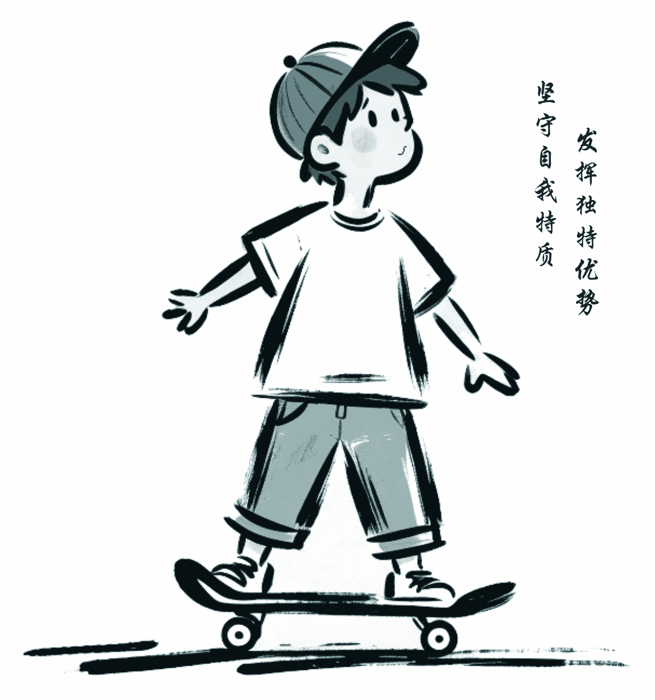
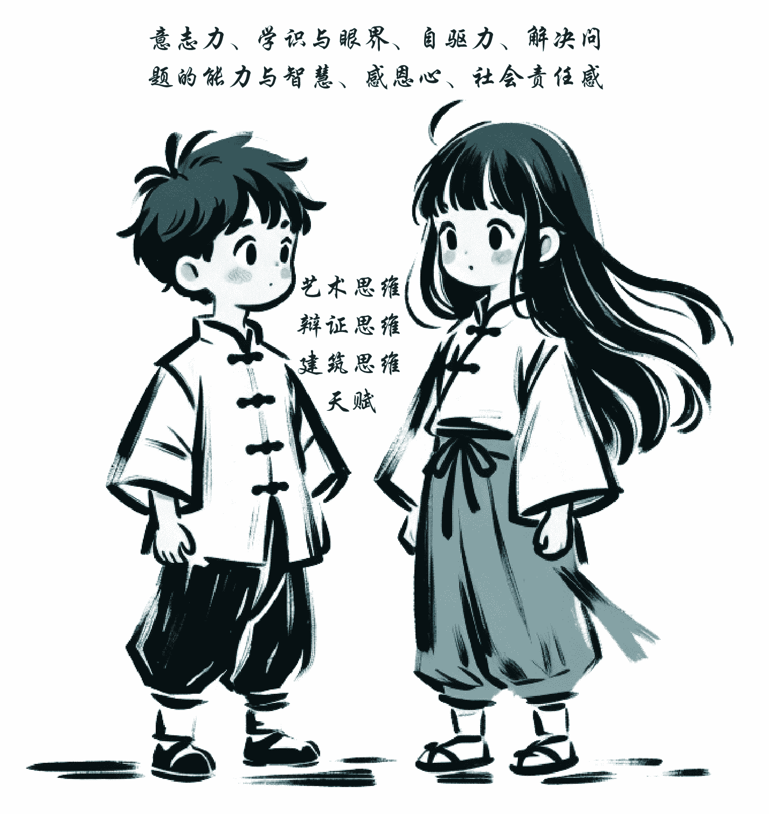
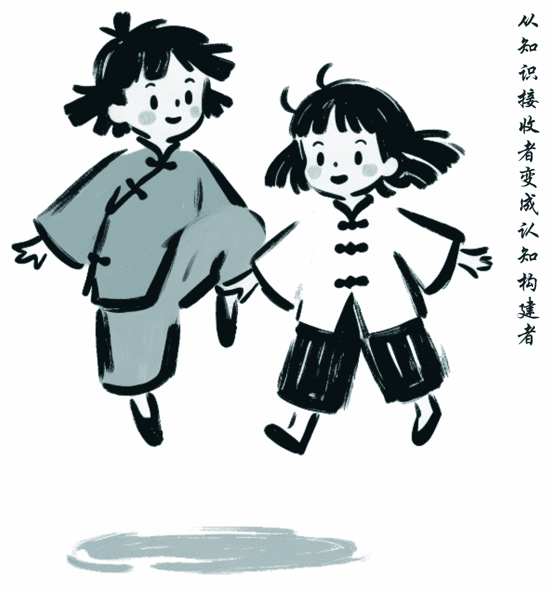
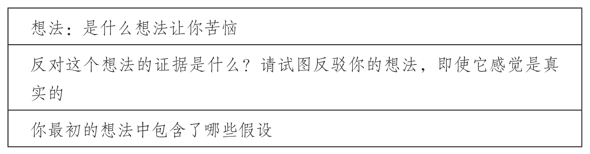
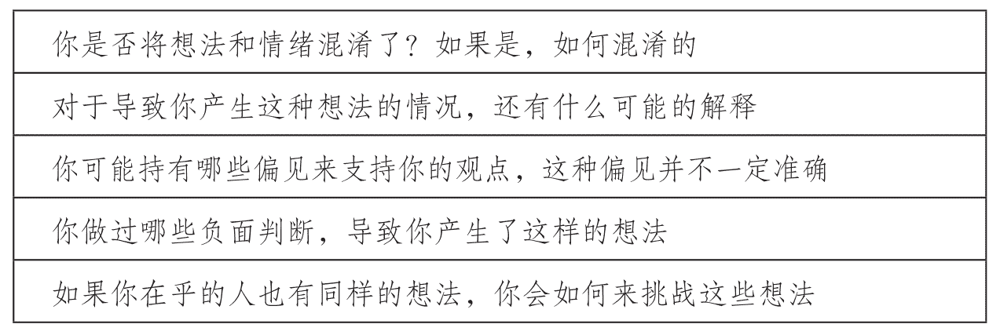
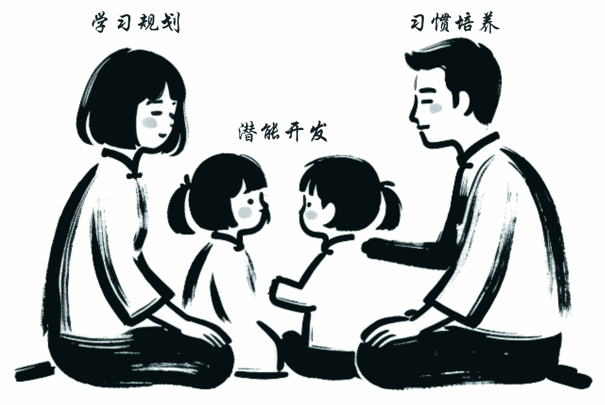
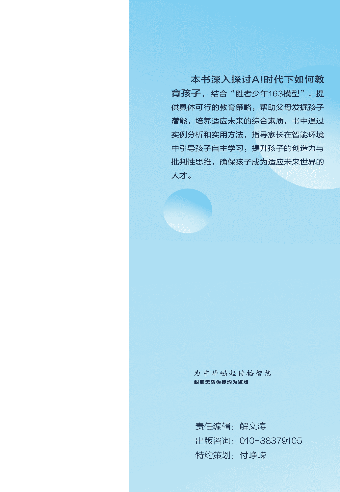
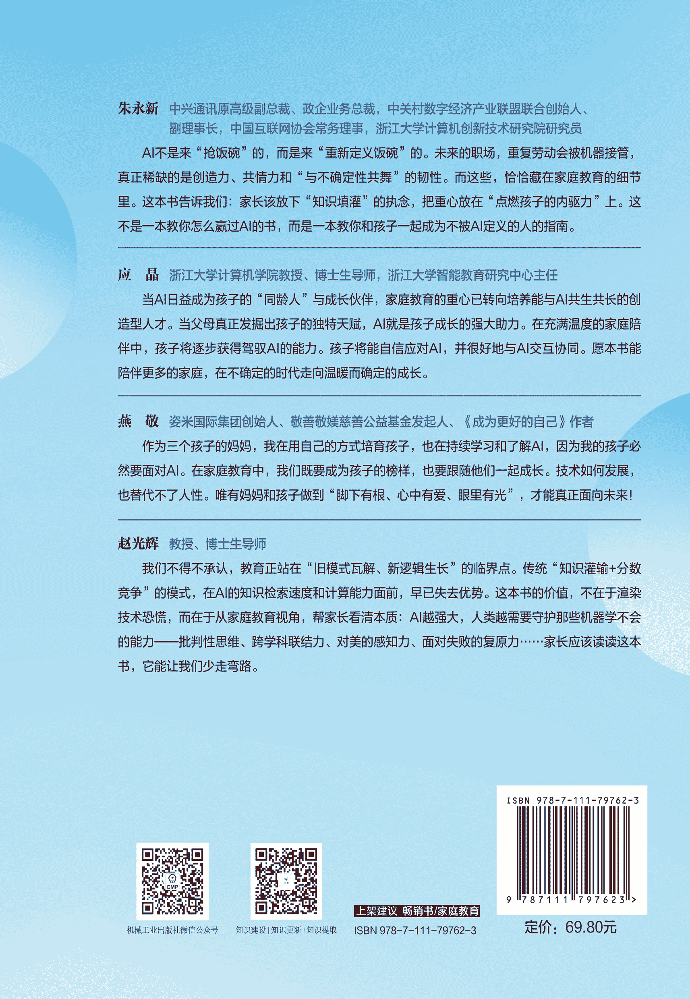

# AI 时代的家庭教育：培养面向未来的孩子

# **自序**

**当 AI 成为孩子的“同龄人”**[8]

岁的朵朵看书时遇到一个不懂的词，她头也不抬地问智能音响：“这是什么意思？”智能音响详细回答了她的问题，并告诉她几个相关联的词……

12 岁的轩轩熟练地用编程软件制作机器人动画，AI 算法自动优化着他的每一帧设计，屏幕上栩栩如生的角色仿佛跃出屏幕……

上述画面，已经成为不少家庭习以为常的生活场景。

当我们以为 AI 还很远时，它已以玩伴、助手，甚至“竞争者”的姿态闯入孩子的世界。许多父母的焦虑就此产生：当 AI 能瞬间给出答案时，孩子还需要思考吗？当 AI 可以完成复杂的工作时，孩子未来的路该走向何方？

**我们要明白，父母不管如何焦虑，每个孩子都必须面对 AI。**

麻省理工学院媒体实验室的研究显示，如今 5 岁以上的儿童平均每天与智能设备的交互时长超过 2 小时，这个数字还在以惊人的速度增长。AI 早已不是实验室里的概念，而是转变为智能手表的提醒、学习软件的答疑、游戏世界的 NPC（非玩家角色），成为孩子生活中无处不在的“隐形伙伴”。在深圳一些小学的课堂上，老师会利用 AI 教学系统为每个孩子定制个性化学习方案，通过分析答题数据精准定位薄弱环节，这种“因材施教”的效率，是传统教育模式难以企及的。

但这并不意味着孩子会被 AI“吞噬”。要知道，孩子是通过主动探索世界来构建认知体系的。AI 更像是一本永远翻不完的“百科全书”，为孩子提供探索的素材，在这个过程中，AI 能给孩子更好的辅助。

有位母亲说，她的女儿在用 AI 绘画工具创作时，起初只是输入关键词生成画面，但很快就不满足于此，开始主动调整参数、叠加图层，最终创作出融合东西方元素的奇幻画作。AI 不是代替孩子创作，而是激发了她对艺术更浓厚的兴趣和更丰富的想象力。

**若我们的孩子必须与 AI 共生，那么未来的工作岗位定会超出我们的想象。**

世界经济论坛发布的《2023 年未来就业报告》预测，到 2027 年，全球将有 6900 万个新工作岗位产生，同时 8300 万个工作岗位将被淘汰。AI 技术是推动这一变化的核心因素之一。这听起来充满挑战，但也意味着无限可能。每个孩子都要面对 AI 带来的变革，关键在于如何利用其优势，培养创新思维和适应能力。

我们看到：一些汽车制造公司设立了“AI 协调员”岗位，员工需要协调人类工程师与 AI 系统的协作，确保技术创新既能发挥机器的高效，又能保留人类的创造性；一些医疗团队开发出“医疗 AI 伦理师”岗位，专门研究如何让 AI 诊断更符合人文关怀。这些全新的岗位，需要的不是与 AI 比拼记忆和计算能力的人，而是懂得驾驭技术、具备跨领域思维的复合型人才。

当 AI 与孩子共生，未来的竞争力就不在于孩子记住多少知识，而在于能否将知识转化为创造力并体现价值，在于能否更好地运用 AI。

**在我多年教育孩子的经验中，知识的记忆、技能的培养，都不是孩子的核心竞争力。孩子的核心竞争力，在于他们的创造力、批判性思维和情感智慧。**我在《觉知的父母》一书中也提到，孩子在未来的竞争中，靠的是天赋开发、特质挖掘和思维的培养。而这些，正是 AI 无法替代的。

脑科学研究表明，每个孩子的大脑神经网络都是独一无二的，就像指纹一样不可复制。家庭教育的核心，从来不是让孩子成为父母的复制品，而是帮助他们发现并发展自身的独特优势。

所以，站在 AI 时代的门槛前，父母应该看到，AI 与孩子的相遇不是一场零和博弈，而是共同成长的契机。就像蒸汽机车没有让人类失去行走的能力，反而拓展了探索的边界一样，AI 也不会取代孩子的成长，而是为他们打开更广阔的天地。

作为父母，我们无须焦虑地筑起高墙，隔绝孩子与 AI 的接触，而应该成为领路人：发掘孩子的天赋，教孩子理解技术的本质并学会驾驭工具的方法，同时坚守自己的特质、热爱与思考。作为孩子教育的终身推动者，我在 AI 时代看到了更多的可能——借助 AI 开展孩子教育，反而有了更多元化的路径。

在 AI 时代，真正无可替代的永远是人类独一无二的情感、想象力和创造力。让我们和孩子一起拥抱新的时代！

张益铭

2025 年 8 月于上海胜者教育

# **上篇**

# **AI 时代的教育变革与认知重构**

AI 时代的教育变革，意味着我们需要重新审视教育的本质，关注孩子的个性发展和综合素质提升。通过科学的家庭教育方法，帮助孩子培养独立思考的能力，锤炼他们面对未来挑战的勇气并开启智慧。只有这样，孩子才能在 AI 时代脱颖而出，成为未来真正的创新者和领导者。

## **第一章 家长的焦虑：是技术替代还是人类价值升华**

父母需要明白，AI 并非洪水猛兽，而是辅助孩子成长的工具。通过引导孩子正确使用 AI，不仅能提升他们的技能，还能激发他们的创造力并提高情感表达能力。关键在于，父母要教会孩子如何在 AI 的辅助下，坚守自我特质，发挥独特优势。

### **1.1 AI 时代让父母感到威胁的 6 个问题**

**AI**突飞猛进的发展，让父母有些措手不及。父母一方面担心孩子沉迷技术，另一方面忧虑孩子不懂 AI 会被时代抛弃。我非常理解父母的这种担心和焦虑，其实，只要认真思考社会发展的本质就会明白，技术的进步是为了更好地服务人类，而非取代人类。

**孩子的能力会不会变得没有价值**

很多父母担心的第一件事就是，**未来，孩子的很多能力可能 AI 都具备，那他们的能力或许不再有用。**

其实，并非孩子的所有能力都会被 AI 替代。

**●孩子可能会被替代的能力**

过去父母追求孩子的记忆能力、计算能力、逻辑推理能力、遵守指令的能力，在未来这些能力都将被 AI 高效取代。如果父母仍在这些方向上投入过多精力，则会限制孩子其他核心能力的发展。

**●孩子不会被替代的能力**

孩子的创造力、想象力、情感理解与表达能力、人际交往和合作能力、适应能力和学习能力、批判性思维等，是 AI 无法替代的。

比如，即使我们能用 AI 生成代码或诗歌，但其本质仍是对训练数据的概率重组，缺乏**原创性意图**。而孩子天马行空的想象力，往往不存在标准答案，这正是其独特价值的体现。

再如，孩子能够细腻地感知和表达情感，与他人建立深厚的情感连接。而 AI 虽然可以模拟部分情感表达，但无法真正理解人类情感的复杂性。在人际交往、心理咨询、教育、医疗等需要情感关怀的领域，情感能力是不可或缺的。

又如，孩子在成长过程中，通过思考、分析和实践，能从不同角度看待问题、提出质疑并寻找解决方案，这是 AI 无法替代的。即使 AI 可以提供大量的数据和信息，但人类的批判性思维和解决问题的能力依然是判断和决策的关键。

可以说，未来孩子的能力将更多体现在对 AI 的驾驭和与其融合上：通过发挥创造力、情感理解能力和批判性思维，构建独特的价值；AI 所替代的那些“标准化能力”，反而能成为孩子腾飞的基石，让他们在更高层次上展现人类独有的智慧和魅力。

**孩子还有必要勤学苦练吗**

有父母问我：“既然 AI 能秒答数学问题，又能画出好看的图片，孩子的很多标准化能力都被替代了，那孩子还有必要勤学苦练吗？”

**当然有必要。**

勤学苦练不仅是获取知识的途径，更是培养孩子坚韧品格和自律精神的过程。这些品质在任何时代都至关重要，能让孩子在面对挑战时保持冷静，善于利用 AI 工具，而非被其束缚。通过持续学习和实践，孩子能更好地理解和运用 AI，将其作为提升自我能力的助手，而非替代者。

就像我们有了代步工具，并不意味着要放弃行走能力——人类在使用工具的同时，依然需要保持自身的运动能力。同理，孩子在掌握 AI 技术的同时，更应强化那些 AI 无法替代的软实力。

**●勤学苦练是培养孩子深度思考能力的必备方式**

比如，学数学时，AI 虽能快速给出答案，但孩子通过解题过程锻炼的逻辑推理和解决问题的能力是 AI 无法赋予的。在练习的过程中，才能培养孩子的深度思考能力，进而内化为孩子解决复杂问题的核心竞争力。

**●勤学苦练是塑造孩子坚韧品格和自律精神的关键**

我们身边学习乐器的孩子，每天都要花费大量时间练习基本功，手指磨出水泡、手臂酸疼是常有的事。他们在日复一日的坚持中，学会了克服困难，培养出了坚韧不拔的毅力。这种自律能力是 AI 无法赋予的，却能让孩子在人生道路上走得更稳、更远。

父母更要懂得，AI 时代的勤学苦练，不是单纯死记硬背，而是在实践中不断探索和反思。勤学苦练是培养孩子独立思考和解决问题能力的基石，让他们在面对复杂情境时，能以积淀的核心素养灵活应对，展现出超越 AI 的独特智慧。

**传统评价体系对孩子还有用吗**

有父母问我：“AI 都能为孩子批改作业、预测学习成果了，传统的评价方式是否还有意义？”

我的回答是：“传统的评价方式依然有其独特的价值。”无论 AI 技术如何先进，我们的社会仍是由人主导的复杂系统。传统的评价方式不仅能衡量孩子的知识掌握程度，更能考察他们的综合素质和潜力。但我们都知道，传统的评价方式已经无法满足当下教育的个性化需求。每个孩子都是独立的个体，但受条件所限，传统评价方式无法实现特别精细化的个性化教育，现在有了 AI，这一切都有了可能。

**●传统评价方式的不变**

传统评价体系以标准化考试为核心，通过量化的分数和排名，可以直观地反映出孩子在知识掌握方面的水平。这种方式在选拔人才、衡量教学成果等方面具有不可替代的作用。它为教育领域提供了统一的标准，便于学校、家长了解孩子在群体中的位置，也为社会筛选出具备相应知识储备的人才。例如，高考作为传统评价体系的典型代表，以公平、公正的方式为高校选拔学生，让众多学生有了改变命运的机会。同时，传统评价体系中的课堂表现、作业完成情况等评价维度，也能从一定程度上反映出孩子的学习态度和学习习惯。

**●传统评价方式的变**

传统评价方式的局限在于，过于注重知识的量化，却忽视了孩子创造力、批判性思维和情感素养的培养。在 AI 时代，这些软实力愈发重要，它们决定着孩子未来的适应力和创新能力。

每个孩子都是独特的个体，有的孩子擅长逻辑思维，有的孩子具有艺术天赋，但传统评价体系很难为这些多元的才能提供展示和认可的平台。比如，我曾经遇到一个孩子，他有极高的音乐天赋，却因为考试分数不高而被忽视，潜在的创新能力也因此无法得到培养和发挥。

我认为，**AI 技术其实是对传统评价方式极好的补充。**AI 可以精准评估孩子的多元智能，提供个性化学习路径，让每个孩子的特长得以充分发展。将 AI 技术与传统评价相结合，我们不仅能全面了解孩子的知识水平，还能挖掘他们的潜在能力，培养出既具备扎实基础又具有创新精神的人才。

唯有融合传统评价体系的优势与 AI 技术带来的新可能，才能构建更加科学、全面、个性化的评价体系，真正适应时代需求，促进孩子的全面发展。

**孩子学什么才能在未来立足**

孩子学什么才能在未来立足，这其实是非常难以回答的问题。

因为没有人能准确预测未来的职业需求和社会变化。回头看，5 年前我们能预测到今天发生的一切吗？显然不能。

孩子要学习的知识和要培养的能力，是随着时代、社会的发展，动态变化的，但只要聚焦本质性能力，如学习能力、批判性思维、情感素养等，就能在未来持续适应环境变化和成长。

具体如何提升这些能力，我会在后面的内容中详细探讨。

**孩子一直使用 AI，会不会被 AI 淘汰**

前段时间，有位妈妈着急地找到我，说她对孩子每天使用 AI 工具感到担忧，担心孩子沉迷其中：孩子遇到不懂的问题，总是第一时间向 AI 求助，而不是自己思考。

我告诉她，孩子使用 AI 本身没有问题，但要引导孩子正确使用，避免形成依赖心理。相信这也是大多数父母头疼的问题：以前不让孩子总盯着屏幕，现在如果不让孩子用 AI，又担心他们跟不上时代。到底该如何对待？

**其实，任何事情只要把握好度，就不会成为问题。**

关键在于平衡：既要让孩子掌握 AI 工具，又要培养他们独立思考和解决问题的能力。如果放任孩子一味使用 AI，会让孩子丧失独立思考的能力：比如，依赖用 AI 写作文，孩子会逐渐失去文字表达和创意构思的能力，脑子里只剩 AI 模板，无法表达自身情感，情感智力就会退化。同时，过度使用 AI 还可能影响孩子的记忆力，导致思维僵化，难以应对复杂情境。长此以往，孩子不仅无法真正掌握知识，还会丧失自主学习能力，最终影响未来的全面发展。

而若引导恰当，孩子不仅能借助 AI 提升学习效率，还能在独立思考和解决问题的过程中，培养更强的创新能力和批判性思维。比如，有的学校鼓励孩子使用 AI 绘画工具绘画：孩子可借助 AI 尝试不同的绘画风格，挖掘自身艺术潜力；同时，AI 能为孩子提供即时反馈，帮助他们及时发现学习中的问题并加以改进。

父母如何正确引导孩子使用 AI 是关键，我在后面的内容中会讲到。这里需强调：**要想孩子不被 AI 淘汰，就必须让他们学会与 AI 协同，而不是被 AI 支配。**

**孩子分不清现实与 AI 的界限怎么办**

在 DeepSeek 爆火后的短短一个月内，市场上涌现出大量各类 AI 工具及相关技能课程。一夜之间，似乎每个平台、每款工具都接入了 AI 功能。孩子接触 AI 的机会大幅增加，这也带来了新问题：孩子对 AI 的过度依赖，使得认知尚不成熟、缺乏鉴别经验的孩子更容易被 AI 的便捷性所迷惑，混淆了真实学习与虚拟辅助的界限。

据媒体报道，部分 AI 工具会杜撰不存在的论文、作者及网址，甚至还伪造学术成果。例如，AI 曾生成一篇名为《个人信息保护法背景下的金融诈骗监管与个人隐私保护的平衡问题》的论文，但经专业人士核查后发现，在权威期刊中并没有发表过这样一篇论文。用孩子听得懂的话来说，就是 AI 开始撒谎了。

比如，孩子可能会将 AI 生成的奇幻故事当作真实历史，或轻信 AI 给出的未经证实的生活建议。这会导致他们对现实世界的认知出现偏差，难以分辨信息的真伪。长此以往，孩子的批判性思维和独立判断能力会逐渐退化，最终影响综合素质的发展。

父母在这个过程中的作用愈发凸显：**需要引导孩子分清现实与 AI 的界限，培养他们的信息鉴别能力**。比如，在使用 AI 搜索信息后，与孩子一起验证信息来源的可靠性——通过对比权威资料，判断内容的真实性；通过反复思考与验证，帮助孩子建立对 AI 内容的质疑意识，学会主动思考与判断。

向孩子科普 AI 的工作原理，是帮助他们区分现实与虚拟的重要方式。我们可以用通俗易懂的语言解释 AI 如何通过数据训练和算法生成内容，让孩子明白 AI 只是工具，它所呈现的内容不全都是真实发生的事件。

父母更需要做的是，在日常生活中引导孩子关注现实世界，强化真实体验：鼓励孩子多参与户外活动，与自然、他人互动；支持他们开展手工制作、科学实验等实践活动。

在真实的体验中，孩子能更深刻地感受现实世界的特性，从而与 AI 创造的虚拟世界形成鲜明对比。比如，让孩子观察植物生长，感受生命的真实变化——这与 AI 模拟的植物生长动画有着本质区别。同时，限制孩子使用 AI 产品的时间，避免过度沉浸在虚拟环境中，也有助于孩子保持对现实世界的敏感度。

### **1.2 AI 是如何重塑教育的底层逻辑的**

**任**何新技术的发展，都会给教育带来深刻变革。互联网改变了信息获取方式，AI 则可能重塑知识传授和思维培养的底层逻辑。比如，AI 能根据学生个体差异提供个性化学习方案，精准推送知识点，提升学习效率。同时，AI 辅助教学工具能实时反馈学习效果，帮助教师优化教学策略。对于父母来说，AI 能帮助他们更好地引导孩子自主探索知识，提升学习兴趣。

**教育目标的重新定义：培养“驾驭 AI 的人类”**

当 AI 成为人类的强大助手后，人类就可以从繁杂的重复性工作中解放出来，专注于创新和决策。在人类发展史上，新的工具总会解放一部分劳动力，推动社会进步。AI 也不例外，人类需要持续驾驭这一工具，学会利用其优势提升自身能力。

**个性化与自适应学习**

在 AI 技术深度渗透教育的今天，传统教育中“一刀切”的模式，如全班统一教学进度、使用同一份作业等，正逐渐被基于每个孩子独特需求的智能学习系统所取代。

个性化学习强调以孩子为中心，根据孩子的兴趣、能力和学习风格设计差异化的目标和路径。而自适应学习是个性化学习的进阶形态，它依托 AI 技术，根据孩子的实时学习表现，为其匹配相应的学习环境、实例或场景，并动态调整学习内容、难度和节奏，引导孩子在学习中主动探索、总结规律，逐步形成自主解决问题的能力。

以孩子为中心，就是要打破传统教育模式中的统一框架，通过对孩子进行个体差异识别、个性化目标定制及动态调整，让孩子的个性优势得以放大，潜能得以开发。

**（1）个体差异识别。**谁也无法否认，孩子的个体差异是巨大的。有的孩子是视觉型学习风格，有的孩子是听觉型学习风格，有的孩子则是动觉型学习风格。如果不能识别差异，就如同把大象、猴子、老虎放在一起，要求它们都去爬树，这显然是不恰当、不公平的。

教育理论家朱永新曾提到，在教育实践中，要尊重差异性。每个人都是一个世界，每个人都有不同的潜力与可能。整齐划一的教育、以分数为唯一导向的学校，永远不会培养出创造性的人才。好的教育应该让每个生命都成为最好的自己，应该给每个人最大的发展空间，帮助每个人发现自己的特长和优势。

AI 时代为这种个性化发展提供了更多可能和想象空间。通过识别孩子当下的知识水平、核心能力、学习风格，我们能知道孩子现在“在哪里”；通过识别孩子的兴趣领域、长期目标等，我们能知道孩子“想去哪里”；通过识别孩子的学习节奏、成长障碍等，我们能知道孩子“怎么到达”。

**（2）个性化目标定制。**传统教育目标的设定，往往以年龄、年级作为孩子学习的基准，但不同孩子的成长速度有差异。未来，对孩子的教育更应针对知识进行分层，如基础、进阶、高阶等，不同的孩子要适配不同的目标；同时需结合能力适配，不同能力水平的孩子，就要搭配不同的教育方式和目标。当然，兴趣也是重要的要素，将孩子成长的目标与其兴趣相融合，便能进一步激发孩子的自驱力。

**（3）动态调整。**个性化学习不是一次性定型，而是需形成“学习—反馈—调整”的闭环过程。AI 在这方面具备显著的优势，它能持续追踪孩子的成长表现，不断优化学习路径，并推动孩子实现持续自主学习。

**●实现自适应学习**

当孩子的个性化成长具备了一定的基础，好的父母就会像私人教师一样，根据孩子的表现动态调整孩子的学习环境、提供适宜的学习实例、创造能推动孩子更进一步的场景。在此过程中，孩子的被动接受会逐渐减弱，主动适配意识会不断增强。

AI 在这一过程中，会起到显著的推动作用。当孩子产生学习和探索的欲望时，AI 可及时发现并提供相应难度的学习资料，这些资料对于孩子来说，难度适合、形式适配，能极大地激发孩子的兴趣。

当孩子在某类知识或能力方面有了一定的基础，AI 会适时提供相应的实例，让孩子进行实践探索。在这个过程中，孩子逐步解决实际问题，锻炼了动手能力，自信心不断增强，好奇心也愈发强烈。这就形成了孩子成长的正循环，孩子会主动构建合适的场景，进入高效学习状态。

相信很多父母也能明显地感知到，自己的孩子到底是“慢”孩子，还是“快”孩子。有的孩子做事稳重，节奏稍慢，但一步一个脚印；有的孩子做事风风火火，虽出现错误的概率较高，但能及时弥补。这其实就是孩子独特的成长节奏。

不同节奏的孩子，学习成长的生物钟和周期各不相同。AI 可通过追踪孩子不同时段的表现和专注度，判断其成长节奏，并提供与孩子成长节奏相适配的环境和实例。

在个性化和自适应学习这方面，AI 其实有非常广阔的想象空间。未来，随着技术的进步，AI 对教育逻辑的改变将更加深入。

值得一提的是，技术对教育的改变，本质上都要归于人的成长。AI 可提供路径和方法，但无法替代父母和孩子的独立思考。父母和孩子要清晰地认识自己，勇敢地成为独一无二的自己。

**师生关系的重塑**

目前，在北京、上海等城市的部分学校，AI 的应用已深度融入日常教学：老师通过 AI 技术精准对标新课标的要求，结合学生实际情况，设计出既符合标准又具个性化的教学方案；学生借助 AI 技术开展编程学习、参与项目或比赛等。这些都已经成为常态化教学的一部分。

我曾经问了 AI 工具 DeepSeek 这样一个问题：“AI 会取代老师吗？”DeepSeek 的回答是：“AI 不会取代老师，而是成为老师的得力助手。AI 会深刻重塑教师的角色与教育生态，讲台上永远需要那个在夕阳下讲解‘落霞与孤鹜齐飞’的鲜活灵魂。”

你看，AI 的回答充满了诗意与智慧，它不仅理解教育的本质，更懂得人类情感的珍贵。

在 AI 的影响下，教育不再是单向灌输，而是双向互动的智慧碰撞：老师不再是知识的唯一传递者，而是启发者、引导者，可以激发孩子的内在潜能；老师可从作业批改、素材整理等事务性工作中解放出来，教学重心加速向学习导航、思维培育和精准育人转移，逐渐成为孩子的成长伙伴和“成长设计师”。

而孩子，在 AI 的陪伴下，不仅能高效掌握知识，还能培养独立思考和解决问题的能力；他们也会以独特的个性和能力，反向影响老师的教学方式，塑造教育生态，成为推动教育创新的重要力量。

我们不仅是孩子的教育者，也是他们成长路上的垫脚石、引路人、陪伴者和发现者。

《中国教育报》曾有文章指出：“人工智能与教育的融合，本质上是技术对传统教育模式的革新，是社会发展的必然选择。人工智能与高等教育的融合，无疑既是一个充满无限机遇的广阔舞台，也是一场严峻的挑战。”

## **第二章** **未来孩子的六大核心素养**

孩子的教育，不能只看眼前，要着眼于未来的发展趋势。当孩子长大成人后，那时候的社会需要什么样的素养？这是父母必须了解的。而本章所讲的六大核心素养，正是孩子适应未来社会的关键。

### **2.1** **创造力**

**目**前的形势下，孩子的创造力是受限的。

我见过许多极具创造力的孩子：有的在绘画中展现出了惊人的想象力，有的在编程中展现出了独特的逻辑思维能力，有的在音乐中展现出了非凡的感知力，还有的在文学创作中展现出了深邃的思考力——但他们的创造力，往往在日常学习中被忽视甚至被压制。

有一次，一位母亲兴奋地跟我说她的儿子帮她解决了一个大问题，我欣喜地问她到底解决了什么样的大问题。

原来，她的儿子用编程设计了一个自动提醒她做家务的小程序。以前，她总靠定闹铃来提醒自己做家务，可有时会忘设闹铃，有时设了也因忙碌而忽略。而儿子的小程序连着家里的智能音响，能够根据她的日程自动发出语音提醒，甚至还能根据天气变化调整提醒内容，真正解决了她的困扰。

我听了有些惊讶，因为这位母亲此前可是个“控制狂”。我刚接触她的孩子时，她对孩子的一举一动都严格掌控，生怕出半点差错。既然孩子玩平板电脑的时间被严格控制，又怎么会想到用编程解决实际问题呢？

后来我私下问孩子，他笑着说：“我一直偷偷玩，后来突然想，妈妈不让我玩，我就想个办法让她相信我。”

多么棒的解决思路！

相信父母都有体会，父母和孩子之间的“猫鼠游戏”，有时不只是孩子的“叛逆”，更是他们在用独特的方式展现潜质和创造力的过程。毕竟，我们也曾是孩子，也曾经历过这样的探索与尝试。

**毁掉孩子最快的方式，就是扼杀他的创造力**

焦虑型父母往往以“为你好”的名义，过度规划孩子的生活和学习，导致孩子缺乏自主探索的空间。

孩子的创造力，就是他们发现新事物、新思想并创造新事物的能力。正是这种创造力，能让他们在未来社会中脱颖而出，成为推动科技进步和社会发展的中坚力量。孩子可能会把普通玩具变成奇妙发明，或将日常问题转化为创新解决方案。如果父母只会说“如果你再这样，就不给你买玩具了”，那我们或许会错失发现孩子潜力的机会。

特别是中小学阶段的孩子，思维活跃、想象力丰富，正是培养创造力的黄金时期。父母最好的做法，是鼓励和认可他们的每一次尝试，哪怕看似微不足道，也应给予积极反馈。一句“你的想法真独特”或“你解决问题的方法很有创意”，都能激发他们的探索热情。

特别是在 AI 时代，技术的飞速发展更需要孩子具备独立思考和创新能力。只盯着标准答案的孩子，与创造力丰富的孩子，在未来的竞争中根本处于两个维度，后者无疑会占据优势。

**孩子的创造力体现在哪**

单纯谈论创造力会显得空洞，其实创造力就藏在孩子们的日常行为中。比如，他们用积木搭建独一无二的城堡，用画笔描绘天马行空的梦境，甚至用简单的材料制造出意想不到的小发明。这些看似不起眼的小举动，正是他们探索世界、表达自我的独特方式。

**（1）生物科学层面。**儿童期大脑处于高速发育阶段，神经元连接迅速形成。当孩子进行创造性活动时，大脑会释放大量多巴胺，促进神经网络的优化。孩子会享受创作过程中的试错，而非最终的确定性结果。这种多巴胺释放机制，正是他们不断尝试和创新的动力源泉。正如拆盲盒带来的“意外惊喜”能激发成人的消费欲一样，孩子的每一次创造性尝试，都是在探索未知的乐趣中逐步构建认知世界。父母的支持与鼓励，无疑是点燃这股创造力的关键火种。

**（2）行为层面**。孩子的好奇心和探索欲是行为的驱动力，他们的非逻辑性行为往往蕴含着创新的种子，父母应避免过早将他们束缚在条条框框中。有的孩子特别爱“搞破坏”：拆玩具，故意弄坏家里的东西，探究家电内部——看似破坏，实则是在探索事物的结构和原理。这种“破坏”行为，正是他们理解事物本质的独特方式。正如我曾遇到一个“破坏欲极强”的孩子，后来发现他拥有超强的空间视觉能力和独特的建筑思维，创造天赋远超常人。

**（3）情感层面。**孩子对世界的认知更多依赖情感体验，而非单纯理性分析。他们在游戏中体验合作与竞争，在绘画中表达喜怒哀乐，这些情感体验丰富了他们的内心世界，成为创造力的重要基础。而且这种情感体验是非功利性的，纯粹源于内心的热爱和兴趣，正是这种无拘无束的情感表达，让他们的创造力得以自由流淌，绽放出独特的光彩。

**（4）技术层面。**当下及未来，孩子的创造力有了更优的表达和实现工具，那就是 AI。在 AI 的辅助下，孩子能更便捷地将创意转化为现实。比如，用 AI 绘画工具勾勒心中的奇幻世界，或用 AI 编程平台实现独特的小发明。如今的孩子，出生在数字时代，AI 就是他们得力的帮手，人机共生、技术协同将成为他们创造力发展的新常态。

**如何培养孩子的创造力**

从根本上说，我认为培养孩子的创造力需要父母**“顺其自然，无为而治”。**

如何理解“顺其自然，无为而治”？

**第一，要尊重孩子的自然成长规律，不强行干预。**不要觉得孩子什么都不懂，其实孩子的天性就是积极探索，他们每一个看似无厘头的举动，都是在用独特的方式感知世界。父母应给予足够的空间，让孩子在自由探索中逐渐发现自己的兴趣和潜能。在孩子学习之余，留出让他们自由支配的空间和时间，哪怕只是发呆或玩耍。

在家庭中**，孩子的“无目标时段”非常重要。**有些父母已经习惯了做任何事都设定目标，但孩子需要无目标的自由时光——正是这些看似“无用”的时光，孕育着他们无限的创意和想象力。

**第二，要鼓励孩子多尝试、多体验，不设限。**正如《庄子》所写“无用之用，方为大用”，要让孩子在多样化活动中找到内心的热爱，激发潜在的创造力。无论是艺术、科学还是其他领域，每一次探索都是成长的宝贵财富。父母只需默默支持，静待花开。要知道，创造力并非是刻意培养出的，而是在自由与支持中自然生长的。

**第三，要让孩子尽可能多地参与实践。**在实践中，孩子能保持专注，不仅能亲手验证所学知识，还能在动手操作中发现问题、解决问题。这种亲身体验的过程，能极大地提升孩子的创造力和解决问题的能力。通过参与各种实践活动，孩子不仅能积累丰富的实践经验，还能在实践中不断修正和完善自己的创意，从而形成独特的思维方式。在胜者教育（注：作者公司）的日常教学中，我们就特别注重实践环节，鼓励孩子动手操作、参与各类项目，让他们在实践中不断探索、创新。

**第四，鼓励孩子跨领域、跨学科学习，打破学科界限**。如果孩子能将历史、艺术、思政等学科知识融合，父母再加以引导，孩子就可以多角度思考问题。在思考过程中，借助 AI 工具，孩子可以将不同领域的知识融会贯通，形成多元思维模式。例如，利用思维导图软件，孩子可以将历史事件与艺术作品关联起来，发现其中的共通点，激发跨学科创新思维。

当然，创造力的培养也需要父母的耐心与包容，这正是“无为而治”的核心。当孩子在探索中犯错时，不要急于批评，而是引导他们从中吸取教训，继续前行；当孩子遇到困难时，不要急于给出解决方案，而是鼓励他们自己思考，找到克服困难的方法。父母的耐心与包容，正是孩子创造力培养最坚实的后盾。

### **2.2** **批判性思维**

**有**一次在胜者教育的父母课堂上，一位妈妈问我：“孩子总依赖手机和平板电脑，我怕他会慢慢失去思考能力，如何才能培养孩子的思维能力呢？”

我相信这不是一位妈妈的困惑，而是许多家长共同的担忧。

在 AI 时代，信息的获取变得前所未有的便捷，但信息的真实性、复杂性和算法的“茧房效应”也对孩子的思维能力提出了更高的挑战。别说孩子了，我们成人不也常常在信息的洪流中迷失方向吗？

要让孩子不在信息的真真假假中迷失，批判性思维的培养就显得尤为重要。

**什么是批判性思维**

批判性思维是通过一定的标准去评价思维，进而改善思维的思维技能。其核心是培养独立思考、理性分析、严谨求真的思维习惯，以应对复杂多变的问题和挑战。

批判性思维有多种定义，但其核心要素始终包括态度、知识和技能三个方面。

在态度方面，要敢于质疑、主动质疑，同时也要包容开放。很多父母误以为批判性思维会让孩子变成“杠精”，其实不然，批判性思维培养的是理性探讨和求真精神。

在知识和技能方面，批判性思维要求孩子掌握逻辑推理、证据评估等能力。要让孩子涉猎足够多的知识，学会从不同角度审视问题。可以通过日常对话，引导孩子分析问题，培养他们独立思考的习惯。例如，讨论新闻事件时，让孩子辨别信息真伪、理解不同观点，逐步形成自己的见解。

**培养孩子的问题意识**

人都有惰性，孩子也不例外。如果 AI 工具能快速给出答案，孩子可能就会失去深入探究的动力。因此，培养孩子的问题意识至关重要。

当孩子从 AI 工具中得到答案时，父母应引导他们思考答案背后的逻辑和依据，追问“为什么”“是什么”和“如何得出”，激发他们对问题本质的探究。比如，当孩子查询“树叶为什么会变黄”时，父母可以对比 AI 的答案，提出更多相关问题（如“热带植物的叶子会变黄吗”），让孩子意识到：AI 提供的答案只是起点，而非“真理”。

**（1）培养孩子的问题意识，就要让孩子学会提问。**如何正确且精准地提问，需要长期练习。比如，孩子最常见的提问是“为什么……”，我们可以引导孩子将提问方式转换为“如果……会怎样”。提问方式改变了，孩子就会主动思考。

**（2）要让孩子养成“质疑惯性”。**面对媒体上的各类信息，要让孩子学会质疑其来源和真实性，探究背后的动机和逻辑。例如，当孩子看到一则广告宣称“某种食品能快速提高智力”时，父母可以引导他们思考广告的真实性和科学依据，询问“这种食品真的有效吗？有哪些证据支持？”。通过这样的引导，孩子不仅能学会质疑，还能培养科学探究的精神。

**（3）鼓励孩子审视“常识”。**我们生活中的很多“常识”并非绝对正确，在 AI 时代，AI 工具获取的元信息可能存在偏差。孩子经常对“常识”提出质疑，能够培养对信息的敏感度和独立判断能力。

**培养分辨“真实”与“算法偏见”的能力**

我们接触的 AI 工具都是基于算法构建的，而算法获取的数据和信息均来自既有数据和经验，难免存在偏见。当父母给孩子解释清楚这一本质时，孩子就会明白：AI 提供的答案并非绝对真理，甚至可能存在极大的偏见。

比如，当孩子查询某个历史事件时，AI 工具给出的答案可能基于特定视角的历史解读，并非客观全貌，如果孩子轻信了这一解读，可能会形成片面的历史观。这就是我们常说的“信息茧房”：AI 工具仅基于个人偏好推荐某个层面的信息，并不全面；这种不全面甚至片面，就形成了“算法偏见”。

要克服“算法偏见”，就要让孩子学会对信息进行“三重检验”：溯源、验证和交叉对比。

**（1）溯源。**溯源即追寻信息的原始出处，了解其来源背景。比如，孩子学习历史时，不仅要看 AI 提供的答案，还要查阅不同版本的书籍和资料，探究事件的多元视角。

**（2）验证。**可通过多个 AI 工具查询同一问题，再用搜索引擎对比不同工具给出的答案，分析其一致性及差异，从而判断信息的可靠性。这个过程不仅能帮助孩子识别信息的真伪，还能培养他们的批判性思维。

**（3）交叉对比。**通过对比不同来源的信息（如书本信息、AI 工具的答案和网络资料），再结合自身独立思考，孩子可以更全面地理解问题，形成客观认知。同一个问题，不同人的回答都存在差异，更别说是由不同算法生成的答案了。

**培养逻辑推理能力**

不管是传统的信息获取，还是 AI 时代的信息获取，事物的本质是不变的，逻辑推理能力始终是理解和判断信息的关键。孩子使用平板电脑和手机本身没问题，关键在于引导他们利用这些工具进行有效的逻辑推理。

比如，分析新闻事件时，可以通过“逻辑链条拆解法”逐步推导事件的前因后果，识别其中的逻辑漏洞和隐含假设，进而推理出不同媒体的观点倾向。

“逻辑链条拆解法”有三个关键环节：**前提、推理和结论**。

**（1）前提是事件的已知条件。**当孩子搜集到足够多的信息后，需明确哪些是事实，哪些是假设。

**（2）推理则是基于前提进行逻辑推导，判断因果关系是否成立。**比如，媒体称“玩游戏会导致学习成绩下降”，孩子需推理玩游戏与成绩之间是否存在直接联系，是否有其他影响因素。

**（3）结论则是综合前提和推理得出的最终判断。**孩子需学会区分事实与观点，避免被单一信息误导。“孩子玩游戏”是事实，而“玩游戏会导致学习成绩下降”则是观点，需进一步验证。

通过这种训练，孩子不仅能辨别信息的真伪，还能培养独立思考能力，最终形成全面、客观的认知体系。

**实践是真理**

前面讲了很多道理，其实核心的还是“实践”。

胜者教育在线下实践活动中总能收到意想不到的效果，就是因为实践是验证一切的最佳方式。通过动手操作、实地考察，孩子能将理论知识转化为实际能力，发现书本与现实的差异，进而加深理解。

“纸上得来终觉浅，绝知此事要躬行。”在 AI 时代，动手能力强、实践能力强的孩子更能适应复杂多变的环境。

我想说的是，**AI 时代最危险的并非父母担心的“技术强大”，而是人类主动让渡“思考权”。我们塑造孩子的批判性思维，本质上是帮助他们在信息洪流和算法逻辑中，守住“我如何看待世界”的主动权。**这种能力不仅能让孩子分辨 AI 信息的真伪，更能让他们在未来面对任何“权威”“潮流”“技术”时，都拥有独立判断的底气。

### **2.3** **协作能力与算法思维**

**如**果让我说 AI 时代最需要培养的能力和思维有哪些，我认为是协作能力和算法思维。

为什么这么说？

### **协作能力**

我在《觉知的父母》中提到过孩子的“163”成长模型，即 1 个天赋、6 个特质和 3 个思维。在这个模型中，1 个天赋指的是孩子的独特潜能；6 个特质包括意志力、学识与眼界、自驱力、解决问题的能力与智慧、感恩心、社会责任感；3 个思维指艺术思维、辩证思维、建筑思维。

本节所说的协作能力，就是建筑思维的一种体现。当孩子像建筑师一样去连接资源时，当孩子在复杂的系统中去协调不同利益方时，他们就是在用建筑思维做事。

**从本质上讲，协作能力是孩子在团队中通过有效沟通、合理分工，并整合多元视角以达成共同目标的能力。**这种能力在 AI 时代尤为重要，因为技术的飞速发展使得单一个体的力量愈发有限。孩子需学会在多元化的团队中发挥自身优势，通过高效协作解决复杂问题，这样才能在未来的竞争中脱颖而出。关于协作能力，我在后文详细讲述。

而与协作能力相对应的，就是算法思维。

### **算法思维**

从学术的角度来说，算法思维是一种以数据为核心的决策方法论，其核心逻辑是通过系统性分析数据、自动构建模型并持续优化，从而在复杂环境中提取规律、预测结果并提供决策支持。

从孩子成长的角度来说，算法思维是指孩子能理解并运用 AI 的底层逻辑，像工程师一样去拆解问题、设计解决方案，在信息洪流中快速定位关键信息，并通过逻辑推理找到最优路径。

**（1）认知 AI 的底层逻辑。**理解 AI 如何处理数据及 AI 的学习模式，是培养算法思维的基础。当 AI 将“戴墨镜的狗”误判为“猫”时，孩子应能根据其判断逻辑逆向推理，找出误差根源，进而理解 AI 算法的局限性。

**（2）问题拆解与设计解决方案。**孩子培养算法思维时，可从最简单的问题入手。比如，对于“早上上学的过程是怎样的”这个问题，可让孩子用箭头流程画出上学的步骤——起床→洗漱→吃早餐→上学。父母可逐渐增加难度、补充环节，让设计的逻辑流程更复杂。

胜者教育有一门课程，教孩子设计自己的人生经历，这正是算法思维的应用。孩子需通过逻辑思维来规划学习和生活路径，逐步学会在复杂情境中做出最优决策。

如今市场上很多编程课程正是基于此理念设计的，通过 PLB 项目式学习让孩子在实践中逐步掌握算法思维。例如，设计一款小游戏，孩子需分析用户行为、设定规则、优化算法，最终实现目标。父母可让孩子多接触这类游戏，逐步培养他们拆解问题、设计解决方案的能力。

**（3）从解题到设计系统。**上面的第二步是解题能力，而通过逻辑推理找到最优路径就是设计系统了。已经设计好的方案，能不能通过调整规则来优化结果？老师给的题目如果变换条件，能否灵活调整方案……这些都是孩子在不断尝试中锻炼算法思维的关键环节。

我们能看到**，算法思维和协作能力就如同硬币的两面：一方面需要拆解问题找到最优解，另一方面需要整合团队智慧共同应对挑战。**这种双轨并行的思维方式，能让孩子在 AI 时代既保持独立思考，又具备协同创新能力，从而在未来的复杂环境中游刃有余。

**算法思维为协作能力提供“共同语言”，即用流程图、数据模型等工具将模糊需求转化为可讨论的具体方案；而协作能力则为算法思维注入“人性温度”，当团队讨论中出现多元需求和视角时，孩子可通过解题能力和设计系统的能力优化算法，最终找到更高效的解决方案。**

### **2.4** **自我管理及终身学习能力**

**我**想问各位父母：人这一辈子，最难的是什么？

大家可能都有自己的答案，但在我看来，最难的是**自我管理和终身学习。**

**人的一生，本质上是逐渐做好自己的过程。而在这个过程中，我们最大的敌人不是别人，而是自己**。贪念、懒惰和拖延都在阻碍我们变得更好。

王阳明有诗云：**“人人自有定盘针，万化根源总在心。却笑从前颠倒见，枝枝叶叶外头寻。”**在信息洪流中，我们身处的世界纷纷扰扰，常常会让我们迷失方向，忘记真正的追求，放弃持续学习的动力。

孩子亦是如此，他们终其一生，都需要和自我进行斗争，学会自我管理，克服贪念、懒惰和拖延。这些是人类的固有特性，AI 根本无法替代。

世界经济论坛发布的《2023 年未来就业报告》指出，到 2027 年，“自我管理”（包括主动学习、抗压能力、目标设定）与“学习能力”将位列职场核心技能前列，且无法被 AI 直接替代，因为这些能力本质上是人类特有的认知韧性。

### **自我管理**

顾名思义，自我管理就是利用个人的内在驱动力，改变自己的行为和习惯，通过设定目标、规划时间、调节情绪等方式，逐步实现自我提升。我们可把自我管理细分为几个关键环节。

**（1）自我驱动。**自我驱动是指孩子内心自发地产生动力，主动完成任务。这种驱动力源于对目标的清晰认知和对结果的期待，能促使他们在面对困难时坚持不懈。关于内驱力如何培养，我在《成长有道》那本书中有详细阐述，这里不再赘述。

**（2）时间管理。**时间管理是人一生都在探索的课题，如何高效、合理地利用时间，需要孩子学习多种方法。比如，常见的时间管理方法包括番茄工作法、四象限法则等，以及各类 AI 日程工具，都可以帮助孩子更好地规划和分配时间。

**（3）情绪调节。**情绪调节是自我管理的重要一环，孩子需学会在面对挫折时保持冷静，合理释放压力——通过冥想、运动等方式，培养积极心态，提升抗压能力。父母在此过程中应扮演支持者，引导孩子找到适合自己的调节方法，而非直接干预。

**（4）目标设定。**目标设定是自我管理的基石。孩子需学会设定明确、可实现的目标，并制订具体行动计划。父母可协助孩子将大目标拆解为小步骤，逐步实现，以增强成就感。通过这种方式，孩子不仅能掌握自我管理技巧，还能在实现目标的过程中不断提高自信心与主动性。

**（5）数字自律。**这是当下及未来孩子面临的新课题——如何在数字世界中保持自律，合理使用电子产品、避免沉迷，是孩子必须具备的能力。

此外，我想特别强调：很多人把自我管理错误地理解为欲望压制，这是错误的。真正的自我管理是引导欲望，将其转化为成长的动力。孩子是自己人生的主导者，而非被动的执行者。父母应尊重孩子的主体性，提供适时的支持和引导，帮助他们建立健康的自我管理体系，最终使他们成长为独立、自信的个体。

### **终身学习**

人类社会的迅猛发展，是好事，也是坏事。

好事在于科技进步带来无限可能；坏事则是使知识更新速度加快，要求我们必须不断学习以适应变化。很多父母看到 AI 工具的强大功能后陷入了焦虑，唯恐孩子在未来竞争中落后。

其实大可不必。

AI 时代，孩子的学习不再是单纯的记忆和应试，而是**构建学习能力和系统，高效利用 AI 工具。**在这个过程中，技术日新月异、知识更新加速，我们能做的，就是学会自主学习，持续更新知识。真正做到“活到老，学到老”。

孩子的终身学习能力，可以从以下几个方面培养。

**（1）学习兴趣和内驱力培养。**一个人如果对某个领域充满兴趣，自然会主动探索和学习。父母要呵护孩子的好奇心和兴趣，让他们对未知领域保持热情，持续探索。有些孩子不想学习，这是因为父母没有让他们明白学习的目的是什么。只要孩子明白了目的，就会主动探索。

**（2）元认知能力。**元认知能力是自我反思和调整学习策略的关键。孩子需学会审视自己的学习过程，理解自身的认知特点，并据此主动调整学习方法。相信很多父母都有体会：别人用着有效的方法，未必适合自己，需根据孩子的特质去调整。

**（3）自我迭代意识。**人都有惰性，一旦形成经验依赖、陷入了舒适区，就难以突破。但面对变化时，不迭代自己的知识和技能，就会被时代淘汰。有些孩子在小时候学习挺好，但随着年龄增长却逐渐停滞不前，正是因为缺乏自我迭代的意识。父母应多引导孩子反思和更新认知，鼓励他们不断挑战自我，这才是关键。

**（4）跨学科能力。**在传统认知中，某个领域的专家往往只需精通一门学科；但在 AI 时代，跨学科的综合能力更为重要。比如，要熟练使用 AI 工具，需结合编程、数据分析等多领域知识，才能真正发挥其潜力。父母应鼓励孩子跨学科交叉学习，培养综合解决问题的能力。

从通俗的角度来说，跨学科能力就是让孩子像玩拼图一样，把不同学科的知识整合起来，形成完整的知识体系。这个过程，也是算法思维的实践过程。

很多父母可能也意识到了，这两种能力对于成人来说都是巨大的挑战，对于孩子来说更需要长期引导和耐心培养。父母可与孩子一起改变：共同进行自我管理，互相监督，共同进步。

培养孩子的自我管理能力和终身学习能力，本质上是培养人的主体性——让孩子成长为能驾驭技术的人，而非被技术奴役的人。

与父母和孩子共勉。

### **2.5** **人机交互能力**

**在**AI 深度渗透生活的今天，人机交互能力已超越“会用软件”的范畴，以往我们理解的“使用工具”的概念已经过时了。如今的人机交互，更强调与 AI 的协同合作：理解其逻辑，灵活运用其功能，甚至参与设计优化。孩子需学会与 AI 深度对话，掌握其背后的算法原理，从而实现高效沟通。

我们可以从以下几个层面来理解人机交互能力。

**人机交互能力的培养**

AI 时代的人机交互，不仅是操作层面的技能，更是理解 AI 思维、与之协同创新的综合能力，是孩子与智能系统高效协作、互补共生甚至主导创新的核心竞争力。这种能力既包括“操作工具”的技能，又涵盖了“理解 AI 逻辑”“明确人机边界”“发挥人类独特优势”的深层素养。

具体来说，孩子需具备五大能力：操作 AI 工具，理解 AI 运行逻辑，与 AI 优势互补，对 AI 结果进行批判性分析和有效反馈，以人的需求为核心主导 AI 并放大创造力。

这五大能力共同构成了人机交互的完整能力链条。不难发现，前三个能力是基础技能，孩子通过一定的训练即可掌握。很多孩子甚至能自主学会使用 AI 工具，操作起来得心应手。

但后两个能力对孩子的要求是非常高的，可能需要他们通过终身学习和持续实践来逐步提升。

若按年龄段划分，可参考以下方向。

**（1）低龄段（8 岁以内）：**父母应逐步引导孩子认识到 AI 是工具，是伙伴，可以帮助我们解决问题，但也会像小朋友一样犯错。

**（2）中龄段（9～15 岁）：**父母应鼓励孩子深入理解 AI 的运行逻辑，参与简单的 AI 设计，学会以自己的思维主导 AI 的使用。比如，引导他们用 AI 工具辅助写作、设计、处理图片等。

**（3）高龄段（16 岁以上）：**父母应支持孩子通过深度思考，在特定领域创新应用 AI，甚至尝试优化 AI 算法，培养其独立思考和解决问题的能力，最终实现人机协同的高效合作。

更强的人机交互能力，需要孩子随着能力的提高逐步掌握更复杂的 AI 技术，参与实际项目、培养跨学科思维——这都是未来不可或缺的能力。

**避免误区**

很多父母一方面害怕孩子被 AI 取代，另一方面又担心孩子过度依赖 AI，这就导致他们在教育孩子的时候非常拧巴。这种状况会让父母陷入一些误区。

**（1）技术崇拜。**我听很多父母亲说过，AI 工具都这么厉害了，孩子只要会用就行了。实际上，会用工具只是暂时的。AI 工具的更新换代极快，真正的能力在于理解其背后的逻辑并创新应用。孩子的核心能力需自身习得，AI 工具并不能替代，特别是前文提到的深层素养，如果孩子不具备，则很可能沦为 AI 的“奴隶”。

**（2）过度保护。**有些父母担心孩子接触 AI 后会迷失自我，过度限制孩子使用 AI。孩子年幼时可能暂无明显副作用，但随着成长，缺乏 AI 应用经验会导致他们难以适应未来社会。父母最应该做的，是在适当的引导下让孩子逐步接触并理解 AI，培养孩子“先自主思考，再用 AI 辅助”的思维方式。

**（3）情感忽视。**父母常误以为 AI 能替代情感交流，实则孩子的情感发展需真实互动。AI 虽能模拟对话，却无法传递真情实感。人类的情感是复杂多维的，依赖 AI 可能导致孩子情感表达能力和理解能力退化。

人机交互能力是人类在面对智慧生态时的生存智慧。我们需要利用 AI 提升能力、拓展自身能力边界，也需要警惕 AI 的局限性，尊重人类的独特价值。

所以，当孩子既能熟练调用 AI 解决问题，又能清醒认知其局限；既能与 AI 高效协作，又能坚守人类的核心价值（如共情、创造、责任等）时，他们将成为智能时代的佼佼者。这样的孩子，不是被技术推着走，而是牵着技术的手，在未来的世界走得更远。

### **2.6** **情感智慧**

**如**果有人问“人类最独特之处是什么”，我想答案之一必定是情感。

情感是人类生活的重要组成部分，从亲情到友情，到爱情，到对万事万物的热情，都是人类情感丰富的体现。人在物质上可以一无所有，但在情感上却无法做到一无所有。

我们的情感世界，正是我们与 AI 最本质的区别。情感赋予我们同理心、创造力与责任感，这些是 AI 无法复制的。在电影《流浪地球》中，人类面对绝境时的团结与牺牲，正是情感的伟大力量的体现。AI 系统 MOSS 虽智能，却无法理解这份情感，它说了一句话，正证明了人类的独特性——让人类永远保持理智，的确是一种奢求。

但正是这种“奢求”，让人类在困境中展现出无与伦比的坚韧与温情。情感的力量，让我们在理性之外拥有改变世界的勇气和智慧。AI 或许能计算一切，却永远无法体会这份源自内心的澎湃。

情感智慧，在心理学上称为“情感智力”，是指个体识别、理解、管理自身及他人情绪的能力。情感智慧包含的范围比较广，包括思维、想象、动机、兴趣、意志、性格等。它不仅影响人际交往，更深刻影响决策与创新能力。

在未来的竞争中，情感智慧将成为关键优势。

具备高情感智慧的人，不仅能更好地理解和连接他人，还能在复杂情境中做出更明智的选择。这种能力是 AI 无法替代的，将助力人类在智能时代脱颖而出，引领社会进步。

父母在培养孩子的情感智慧时，需重点关注以下几个方面。

**（1）情感沟通。**要善于使用情感性提问，关注孩子的感受和情绪。比如，在他们沮丧时，用“你看起来不太开心，愿意和我说说吗？”代替批评，传达关心和理解。这样不仅能增进亲子关系，还能提升孩子的情感表达能力。

**（2）情绪控制。**情绪控制和情绪表达是极为重要的能力。通过教导孩子识别和管理自己的情绪，父母可帮助他们在面对误解和冤枉时，保持冷静和理智。例如，当孩子感到愤怒时，引导他们深呼吸、冷静思考，而不是冲动行事。这种能力不仅能让孩子在集体生活中更好地应对挑战，还能培养自我调节能力，为适应未来复杂的社会环境做好准备。

**（3）同理心培养。**通过角色扮演和情景模拟，让孩子学会站在他人的角度思考问题，理解他人的感受。同理心是人类最伟大的情感之一，能让孩子在成长过程中学会关爱与尊重，建立良好的人际关系。

**（4）社交能力。**AI 时代，无论线上社交还是线下交往，孩子都需具备真实连接的能力，这样才能感知他人、调整自我。如果缺乏社交能力，孩子将无法真实地感知世界，进而影响心智的健康发展。**孩子如何看待世界，世界就如何对待他。**

**（5）责任感。**培养孩子的责任感，让他们明白自身行为对他人和社会的影响，学会承担后果。关于责任感的培养，我在《觉知的父母》一书中有详细阐述。

AI 时代最核心的情感智慧，是让孩子明白：技术可以模拟情感，但无法创造情感；可以分析数据，但无法替代人心。当孩子既能识别自己的情绪、理解他人的感受，又能在使用技术时坚守正确的价值观时，他们将成为有温度的技术使用者。孩子用情感智慧，不仅能驾驭 AI 的力量，更能守护人性的光芒。

# **中篇**

# **AI 时代孩子的能力培养**

中篇主要聚焦父母对孩子能力的培养，而能力的培养，要基于“163”成长模型——这是融合 AI 技术与孩子个性发展的家庭教育本质逻辑。“163”成长模型针对 AI 带来的挑战，提出相应解决方案。本篇提出的“新三商”教育、孩子终身成长的方法等，能切实帮助父母找到具体可行的教育路径。

## **第三章** **AI 时代的“163”成长模型**

孩子的潜能和特质是他们在这个世界上脱颖而出的关键。在 AI 时代，孩子的特质不仅需要被发掘，更需要被科学引导。更加科学合理的引导方式，再结合 AI 技术的精准分析，能够为孩子量身定制成长方案，最大化激发孩子的潜能。通过“163”成长模型，父母可以系统地培养孩子的多元智能，确保他们在未来，依然保持独特的竞争优势。

### **3.1** **天赋开发**

**我**在《觉知的父母》一书中，详细阐述了如何通过科学的方法发现并开启孩子的天赋。随着 AI 技术的发展，孩子的天赋更可借助 AI 技术的精准分析进一步确认，同时孩子的天赋发掘也具备了新的内容和含义。

**借助 AI 识别孩子的天赋**

什么是天赋？

天赋是孩子与生俱来的独特潜能，犹如未被发掘的宝藏。孩子的天赋往往隐藏在其习惯、行为、思想之中，很多时候孩子自己都未能及时发现。

**树有百种，人有百样，每个孩子都是独一无二的。**有的孩子天生具备音乐天赋，能轻易捕捉旋律的韵律；有的孩子则在逻辑数理上独具慧眼，能轻松破解复杂问题；有的孩子情商极高，让身边的人都能感到舒适与安心；有的孩子语言天赋过人，言辞间流露出非凡的智慧。这些特质，很多时候会被父母忽视。

我曾遇到过一个孩子，父母对他的评价是“破坏欲极强”，从小到大，他会拆了手中拿到的任何东西，家里的玩具、家具、家电无一幸免。父母总觉得孩子太淘气，后来胜者教育给他做了专业天赋测评，结果发现他有着极高的机械天赋，善于拆解和重组物体。其父母在这一领域对他重点引导，最终孩子在建模、手工领域展现出了惊人的才华。

除了传统的天赋测评，AI 技术可通过大数据分析和行为模式识别，更精准地识别孩子的天赋特质，揭示其在某一领域的潜在优势。以往的测试方向如智商测试、艺术能力测试等，在 AI 技术的加持下，会变得更加精准。

同时，孩子的新天赋可能会表现在跨领域整合能力、问题解决能力、非标准化优势等方面，这些天赋将更适应 AI 时代的挑战。

**●数据获取**

在识别孩子的天赋时，我们需基于孩子的大量多维数据开展综合分析，如孩子的行为模式、兴趣爱好、学习习惯等，通过一些教育类 APP、智能手环等，收集孩子的日常数据。

这些数据大体上可以分为认知类数据、情绪类数据和行为类数据。当数据足够丰富时，AI 算法便能精准描绘孩子的天赋图谱。在观察孩子的相关数据时，父母要放下功利心，关注孩子的自然表现，避免主观臆断。因为孩子的很多天赋其实隐藏在无目的的探索中，如玩游戏的沉浸度、玩玩具的创造性、专注于某件事的情绪表现等。

对于大多数父母来说，观察孩子的机会无处不在，关键在于用心捕捉。通过工具获得的数据，还需跟父母的观察相结合，才有价值。比如，孩子在做手工时展现出的耐心和细致，或是与同伴玩耍时表现出的领导力，这些都是天赋的蛛丝马迹。

能熟练使用 AI 工具的父母可通过 AI 工具设计一套天赋分析方案，结合孩子的日常表现和数据分析结果，进行长期追踪和评估，从而更全面地了解孩子的天赋潜力。

我们需改变一个固有的错觉：孩子的天赋是静态的。比如，有些孩子小时候展现出绘画天赋，便误以为他们会一直擅长画画。实际上，孩子的天赋是动态发展的，可能会随着时间和环境的改变而变化。比如，某个阶段对绘画感兴趣，后来可能转向音乐或编程。

未来，随着 AI 技术的不断进步，市面上将涌现出更多专门针对儿童天赋开发的 AI 工具，可更便捷地帮助父母精准识别和培养孩子的多元天赋。

**●多元天赋**

天赋涵盖语言、逻辑数理、视觉空间、音乐节奏、身体动觉、人际交往、自知自省、领导特质、道德共九大类型，这些类型在过往的孩子教育中可能是相互独立的，但在 AI 时代，它们可相互融合，形成新型复合型天赋。

比如，一个孩子在音乐节奏和人际交往方面均表现出色，可能会在团队协作中展现出独特的领导力。这种复合型天赋不仅提升了孩子的综合能力，还为其未来的职业发展奠定了坚实基础。

孩子的能力不仅在于单一领域的突出表现，更在于多元天赋的协同发展。如果父母只是发现了孩子的音乐天赋，而忽略了其在人际交往中的潜力，就会让孩子的能力发展受限。

我在前文提到的跨领域整合能力、问题解决能力、非标准化优势等，正是多元天赋协同发展的体现。AI 工具的意义，不仅在于通过数据分析出孩子的天赋类型，更在于帮助父母发现和培养这些天赋之间的关联性，促进多元能力的协同提升。

我在这里就不具体讲如何设计 AI 工具来发现孩子的天赋了，而是希望父母明白：发现和培养孩子的天赋是一个动态且系统化的过程。通过细心观察和科学分析，结合 AI 工具的辅助，父母可更精准地捕捉到孩子在不同领域的闪光点。

还要强调的是，切勿将 AI 工具视为“万能钥匙”，用 AI 测评结果给孩子直接定性。**天赋是起点，不是终点。天赋的发掘只是为了更好地引导孩子成长，而不是功利化地将孩子推向某个特定方向。**

**AI 如何赋能天赋**

天赋是孩子与生俱来的独特生命能量，AI 是天赋的放大器。

部分父母为孩子做天赋测试时，会认为发现了孩子的天赋便能定义其一生，这是一种误解。AI 时代的天赋识别亦是如此，AI 工具并非定义者，而是引导者。

举一个不太恰当的例子：天赋犹如一颗种子，AI 工具则是辅助种子发芽的温度、促进幼苗成长的养分、陪伴大树结出果实的园丁。种子能茁壮成长，还要靠它自身的生命力。

如何让 AI 为孩子的天赋赋能，才是父母应该去考虑的问题。

**●给天赋以保护**

孩子的天赋需要细心呵护，真正的保护，就是让孩子在安全的环境中自主探索天赋的边界。一些焦虑的父母，往往抓住孩子的某个闪光点过度放大，这种做法并不可取。

孩子擅长绘画是一种闪光点，但这一闪光点或许只是孩子某项天赋的基础能力，其天赋可能体现在空间感、设计感或艺术感等方面。

给孩子足够的空间和时间去探索，允许他们做“无意义”的尝试。比如，用 AI 工具乱涂乱画，而正是这些看似“无意义”的尝试，可能激发孩子深层的创造力和想象力。

还需避免采用比较式激励的教育方式。我曾遇到部分妈妈，她们的口头禅是“你看×××”，即便在使用 AI 工具时，也会说“你看×××，用 AI 工具用得比你好”。这样的比较只会让孩子产生压力，失去探索的兴趣。

父母自身也应该多尝试 AI 工具，将新奇的 AI 应用场景带入家庭生活，和孩子一起探索，帮助孩子发现并拓展兴趣领域。

**●做孩子的脚手架**

父母应根据孩子的兴趣，提供相应的 AI 支持。若孩子对建模感兴趣，父母可引导其使用 AI 建模工具，从简单的几何体开始，逐步挑战复杂结构，激发其空间思维。各类线上和线下的相关比赛、交流活动，父母均可支持孩子参与。

AI 工具为孩子的天赋赋能，并非意味着父母可以放任不管，让孩子独自探索。孩子因认知水平有限、经验不足，难以很好地把握 AI 工具的深层次应用。此时父母需承担起“脚手架”的角色，主动参与其中，主动学习，并给予孩子引导。

若父母自身难以胜任，可寻求相关专业人士或机构的辅导。孩子成长过程中，父母的“脚手架”作用不可或缺，这是 AI 工具无法替代的。

**●让 AI 帮助孩子系统性成长**

天赋开发的目的，是让孩子将潜在优势转化为终身成长的动力。AI 的优势在于可高效处理标准化任务，帮助孩子构建系统性知识框架，逐步提升综合能力。

利用 AI 工具，可将标准化、重复性工作及需试错、迭代的事情交由 AI 完成。孩子则能专注于深度学习和创新实践。比如，描述性文本、工具性图像等，可由 AI 生成，孩子只需在此基础上进行创意加工和深度思考，从而提升综合素质。

当孩子具备“天赋×技术”的复合能力时，其天赋就有了着力点，AI 工具就变成了他们能力的放大器。

任何时候，技术都只是天赋的放大器，而非替代品。

### **3.2** **AI 时代孩子必备的 6 个特质**

**我**提出的“163”成长模型中，6 指 6 个特质，包括意志力、学识与眼界、自驱力、解决问题的能力与智慧、感恩心、社会责任感。在 AI 时代，这 6 个特质又被赋予了新的、更全面的含义。

**意志力的塑造**

意志力是强大的心智能量，它能帮助个体抵御外界干扰，主动调节自身行为，克服难以想象的困难，进而完成既定目标。在以往的成长过程中，孩子需通过不断尝试和坚持来培养意志力，需学会对抗恐惧和挫折。

在 AI 时代，孩子意志力的塑造面临新的课题：技术带来的便捷性和即时反馈机制，正在不断冲击着孩子的意志力根基。

**●意志力塑造的新挑战**

父母不难发现，在当下的社会环境中，短视频的短时间刺激、游戏的即时奖励、算法的精准投喂……技术正在重塑孩子的“大脑奖赏系统”，多巴胺的满足变得更加迅速和强烈，内啡肽的分泌却愈发困难。这使得“延迟满足”变得困难，让坚持行动的韧性逐渐弱化。

与此同时，碎片化信息不断分散孩子的注意力，AI 算法的精准推送进一步加剧了这种分散，导致孩子在面对复杂任务时难以集中精力，意志力的塑造面临前所未有的挑战。

但意志力的本质从未改变，它是人类对抗本能、实现目标的“心理肌肉”，更是 AI 时代人机竞争中最不可替代的核心优势之一。

**●意志力的新塑造**

任何技术都是一把双刃剑，AI 也不例外。

短视频、信息茧房、AI 即时反馈带来的弊端，换个角度看，也可转化为意志力锻炼的新契机。

**（1）通过目标体系锻炼意志力。**孩子忍不住使用手机和平板电脑时，强制禁止反而适得其反。可设定每日使用时长并逐步减少时长，以此培养自控力。同时，利用 AI 记录进步，使成果可视化，增强坚持的动力。通过这种“自我约束+正向反馈”的模式，孩子即便在技术环境中，也能锤炼出坚韧的意志力。

**（2）通过行动设计形成惯性。**意志力的关键是“降低启动成本”。AI 时代，孩子常因任务难度过高或外界诱惑太多而拖延，父母需通过微习惯设计与环境控制，让行动逐渐习惯化。比如，将任务拆解为多步，用最小行动单位启动，逐步建立成就感。又如，给手机设定禁用时间段，为孩子创造无干扰的学习环境。

**（3）唤醒内驱力。**意志力的持久动力源于内在满足感，而非金钱、表扬等外部奖励。如果父母频繁使用外部奖励，反而可能让孩子的意志力更加脆弱。只有让孩子感受到成长的喜悦和自我价值的实现，才能真正激发内在动力。比如，胜者教育的成长训练营，就通过让孩子参与各种挑战和任务，逐步提高认知，进而唤醒内驱力，形成持久的意志力。

**（4）从他律过渡到自律。**在孩子成长过程中，父母的监督角色需逐渐淡化，引导孩子用自我约束代替外部监管。正如我经常给大家分享的“设计人生经历”的理念：通过让孩子参与“沙战”等刻意设计的挑战，逐步学会自我管理，从依赖他律转变为自律，最终形成坚韧不拔的意志力。

AI 在意志力塑造中，可扮演监督者和设计者的角色。通过智能提醒和数据分析，AI 帮助孩子设定合理的目标，逐步实现自我监督，从而在技术辅助下，帮孩子培养出独立且坚韧的意志力，以应对未来的挑战。

当孩子既能借助 AI 提升效率，又能掌控自身注意力与行动；既能享受即时满足的快乐，又能为长期目标坚持努力时，他们的意志力就足以让其在信息洪流中稳步前行。

**学识与眼界的拓宽**

培养具有全球视野的孩子，是父母的重要目标。除了让孩子广泛涉猎、接触多元文化、锻炼思维力，如今父母更需着重培养孩子的“连接能力”。

什么是连接能力？就是孩子连接世界的能力。在信息爆炸的时代，孩子不仅需要知识的广度，更需具备对多元文化的理解、对复杂系统的洞察，以及跨领域整合的思维方式。

**●从知识量到连接力**

“读万卷书，行万里路”的知识积累很重要，但更关键的是将知识转化为连接世界的桥梁。AI 已打破地理、语言、文化等物理壁垒，孩子的认知边界被无限拓宽：各种虚拟导览工具，能让孩子足不出户便领略世界风采；借助在线协作平台与全球伙伴共同学习，能让孩子与更多人和物产生连接。

在这种连接过程中，孩子不仅拓展了视野，更学会了尊重差异、包容多元，思维也得到了升级——过往的点状知识和线性学习，会转变为网状思维和系统思考。比如，孩子通过参与热点话题讨论，从不同角度分析问题，学会整合信息并形成全面观点。

在 AI 影响下，孩子的认知模式会悄然改变：从单一结论到多元理解，从被动接受到主动探索，从当下体验到长期预见。当孩子学会站在未来审视现在，便能拥有更广阔的视野和更深刻的洞察力。

**●警惕眼界陷阱**

孩子的眼界拓宽，并非毫无风险。若仅停留在表面浏览，缺乏深度思考，就容易陷入“眼界陷阱”，看似见多识广，实则浅尝辄止。

算法推送的“信息快餐”，可能让孩子习惯被动接收，丧失主动探索的欲望，进而缺乏对信息的批判性思考。认知浅层化会导致孩子失去深度思考的能力，难以形成独立见解。因此，父母在帮助孩子拓宽眼界时，需重点培养其筛选信息能力，引导孩子学会验证信息的真伪。

虽然虚拟现实技术能带着孩子“遨游世界”，但真实体验也不可少。唯有亲身体验，孩子才能真正感受世界的多样与复杂，才能在多元文化中找准自身定位，培养出真正的全球视野。

此外，我一再强调的信息茧房问题也需警惕：孩子的眼界拓宽，绝不能局限于自己认同的世界。需打破信息茧房，接触不同观点，学会批判性思考；需主动探索陌生领域，接纳不同观点，只有在思维的碰撞中，才能真正理解“成熟”的内涵。

**自驱力的唤醒**

自驱力在 AI 时代，将会越来越宝贵。

缺乏自驱力，即便孩子拥有再多的天赋和机遇，也无法获得真正的成功。

世上本无绝对的好运，却有坚定的自驱力。正因为有了自驱力，我们的潜能才有了被激发的可能。

我想做，我要做，我能做，这样的内在动力，是孩子面对挑战时最坚实的支撑。我常对孩子说：**当你真正渴望做成一件事时，内心的火焰会比任何外力都更强大。**你要经常对自己说“我想做，我要做，我能做”。

我也提醒父母经常对孩子说“你一定可以做到”，以此激发孩子的内在动力。我在教育自己的孩子时，便常用这个方法，非常有用。

**●语言的魅力**

父母的语言真的非常重要：正向的、积极的语言，能让孩子充满自信和勇气，敢于面对挑战。

我儿子在小时候遇到不会做的作业时，我会鼓励他：“你可以试试不同的方法，我相信你能做出来，因为你比我厉害。”当他偷懒拖延作业时，我会在朋友面前夸他：“我儿子非常聪明，他的作业从来都是按时独立完成的。”

儿子被我夸得不好意思，就会更加努力地完成作业，逐渐养成了自主学习的习惯。这种积极的语言激励，不仅提升了他的自信心，更让他学会了在面对困难时不轻言放弃。

父母都应该去学习运用积极语言，多向孩子传递正向反馈。

**●给孩子选择的权力**

自驱力的核心是“自我决定”，让孩子在日常生活中拥有选择权，哪怕是诸如穿什么衣服、吃什么东西这类小事。这种自主选择的过程，能让孩子感受到被尊重和信任，从而激发内心的责任感。当孩子理解自己的选择可能带来相应的结果时，他们会更谨慎地思考，逐渐培养出独立决策的能力。

还需给孩子试错的机会：当孩子尝试后，可引导其借助 AI 工具分析结果、反思改进。在这种自主探索中，孩子会逐渐明白：每一次选择都是自我成长的契机。

**●让孩子看到成长和价值**

自驱力的关键，是让孩子建立“我能做好这件事”的信念。当孩子拥有“我能行”的底气时，自然会主动去尝试和挑战。

比如：让孩子参与家庭事务的决策，哪怕只是列简单的购物清单，也能让他感受到自己的意见被重视；让孩子用 AI 为家庭设计一份菜单，他也能在实践中体会到自己的贡献，看到自己的成长，从而增强自信心。

自驱力的深层动力，源于孩子对“我对他人、世界的意义”的感知。孩子做了好事会开心许久，正是因为从中看到了自身价值，这种成就感会进一步激发内在动力；孩子参与一些公益活动，会发现自己对社会的积极影响，这种“被需要”的感觉，会让其更加坚定自己的选择和行为。

当然，父母也可陪着孩子运用工具，让孩子逐步探索并实现目标。在这个过程中，父母的角色转变为引导者和支持者，核心任务是帮助孩子建立内在动力系统，而不是简单地替代他们做决定。

让孩子成为自己人生的主人，这才是真正的教育智慧。

**解决问题的能力与智慧的培养**

在未来孩子教育的 6 个特质中，我曾提及解决问题的能力与智慧的培养，这是孩子应对复杂世界的基石。特别是在 AI 时代，技术迭代加速、信息爆炸、问题多样化，如果不具备解决问题的能力与智慧，孩子将难以适应未来的挑战。

要培养解决问题的能力与智慧，关键在于思维能力的培养。此前提到的批判性思维，能帮助孩子分析信息、辨别真伪，形成独立见解；创造性思维，能激发孩子探索未知、提出新颖的解决方案；系统思维，能让孩子在碎片化信息中梳理逻辑，从整体上把握问题并找到最优解；元认知能力，则能让孩子反思自身思考过程，不断优化认知策略。

这些思维能力，是孩子应对未来复杂世界的核心“武器”。

当然，培养孩子的思维能力，并非让孩子对抗 AI，而是借助 AI 技术提升孩子的思维能力。比如：利用 AI 技术放大孩子的观察力和想象力，让他们不断拓展思维的广度；借助 AI 技术训练孩子思维的深度和准度，让他们在解决复杂问题时更加游刃有余。

**（1）批判性思维。**教会孩子甄别信息、质疑权威、识别陷阱，对其形成独立判断至关重要。

**（2）创造性思维。**鼓励孩子打破常规、提出独特见解，激发他们探索未知的热情，培养解决问题的创新能力。父母不应给孩子标准答案，而应引导他们探索独特的解法，用反常识思路突破局限。比如，让孩子用反常识思路设计一款环保玩具，既能激发创造力，又能培养环保意识。

**（3）系统思维。**AI 擅长处理单一任务，而人类则擅长整合多方面信息，从而解决复杂问题。这就需要系统思维：将看似孤立的因素建立关联，形成整体解决方案。可鼓励孩子绘制思维导图，将问题拆解成多个部分，再逐一分析，最终找到各部分之间的关联，形成全面的解决方案。

**（4）元认知能力。**一旦孩子学会监控自身思维过程，他就具备了元认知能力。当孩子学会复盘，他就能在反思中不断优化认知策略。在这个过程中，可鼓励孩子借助 AI 工具记录自己的思考路径，逐步提升自我反思能力。

思维能力的培养，本质是利用 AI 技术作为辅助工具，重建人类的智慧优势。孩子可借助 AI 工具验证创意，也可在复杂思考中让 AI 处理具体的问题，自身则聚焦于更高维度的思考活动。

可以说，AI 既对思维能力提出了更高的要求，又促使我们在教育中更加注重培养孩子的独立思考和创新能力，因为这才是未来社会所需的核心竞争力。

**感恩心的培养**

我始终相信：**心存感激的人，眼中的世界自会满是光明。**

感恩，是我们理解万事、感知他人善意、体察生活美好的核心能力。感恩心体现在生活的方方面面：孩子对父母的付出心存感激，学生对老师的教诲心怀感恩，我们对他人的帮助铭记于心，这些都是感恩心的具体体现。

有妈妈曾跟我说：“孩子不知道感恩，总觉得一切理所当然，该怎么办？”

孩子的感恩心需从小培养，父母首先要做好榜样。生活中，父母若常表达对他人帮助的感激，孩子自然会耳濡目染：收到礼物时真诚道谢，面对亲友支持时表达谢意，看到孩子递来水杯时轻声说“谢谢”——这些细节都会让孩子逐渐学会感恩，将感激之情融入日常言行。

在 AI 时代，感恩心的培养实则是一项挑战。

孩子的需求被即时满足，物质获取触手可及，他们往往没有机会体会等待的意义和付出的价值，也容易忽视事物背后他人的付出。技术在一定程度上放大了孩子的自我中心倾向，让他们产生“世界围绕自己转”的错觉。

因此，在当下培养感恩心，更显得重要。

感恩心的形成，需经历三个阶段：感知付出、理解价值、主动回馈。

**●感知付出**

孩子只有先感知到付出，才能走出“自动忽略”的状态，开始关注他人为自己所做的一切。

**人往往容易对习以为常的事物视而不见。**比如，孩子会对父母的唠叨、默默的关心视而不见，这并不是孩子不懂感恩，是因为他们并没有感知到这些付出背后的辛劳和用心。

如何让他们感知到呢？

可通过角色扮演或情景模拟等方式，让孩子亲身体验父母的日常辛劳：让孩子做饭、打扫卫生等，感受做家务的不易；或者让孩子当几天“家庭小主人”，负责安排全家一日三餐，体验采购、烹饪的烦琐过程。只有这样，他们才能真正理解父母的付出与辛劳。

还可设置“付出清单”，借助 AI 工具记录自己获得的帮助，如“今天我被哪些人/事帮助了？”“他们帮助我的时候都付出了什么？”等。让孩子定期回顾这些记录，他们就会体会到他人的善意和付出，从而逐渐培养出感恩心。

我在孩子小时候，常会跟他们讲：“我们生活中的吃穿用度都来之不易，都是他人辛苦劳动的结果。我们既要珍惜这些劳动成果，又要感恩每一位付出者。我也会让孩子自己收拾房间、整理玩具和书籍，让他们亲身体验劳动的辛苦。

这些生活小事，都是培养感恩心的宝贵机会。父母不必担心累着孩子——孩子的生活本就应该由自己掌控，只有自己动手，才能深刻理解劳动的价值。那些一味说教的父母，往往难以获得孩子的理解与认同。

**●理解价值**

感恩心的培养存在一种误区，那就是把“谢谢”挂在嘴上，却未真正理解其背后的价值。真正的感恩，是内心深处的认同与珍惜。如果孩子嘴上说着“谢谢”，却把别人的劳动成果视作理所当然，这种行为趋势非常危险。

此前有个小男孩来到胜者教育，我见到他时，他的妈妈正陪着他报到：孩子自己拿瓶饮料走在前面，妈妈则拎着大包、小包跟在后面，满头大汗。我问小男孩：“你怎么不帮妈妈拎东西呢？”他一脸愕然地说：“妈妈力气大，不用我帮忙啊。”那一刻我意识到：这位妈妈的辛苦，实则源于自身教育的疏忽——孩子不理解妈妈辛苦的价值，自然不会心生感激。

父母可帮孩子建立“感恩账户”，让孩子将感受到的帮助记下来，并给这个行为打分。孩子在打分的过程中，会逐渐形成对“付出价值”的清晰认知；同时鼓励孩子主动帮助他人，让接受帮助的人为其行为打分。这种双向互动，能让孩子更深刻地理解“帮助”的意义。

当孩子感知到帮助的价值时，内心就会产生共鸣，进而强化主动感恩的动机。那些习惯被动回应别人帮助的孩子，也会渐渐变得主动积极，学会珍惜每一份付出。

**●主动回馈**

经过“感知付出”与“理解价值”两个阶段的引导，孩子的主动回馈便会水到渠成。

父母要做的，是不断强化孩子的回馈行为，让微小行动逐渐形成习惯。可借助 AI 记录系统，帮助孩子主动发现并积极参与公益活动与项目，并在完成后记录下自己的感受和收获。

此外，如果有条件，父母可设计家庭专属的感恩仪式。比如：定期举行“感恩晚餐”，分享彼此的感激之情；或者一起制作感恩卡片，送给想感谢的人。这样的仪式不仅能增进亲情，更能让孩子在温馨的氛围中深刻体会感恩的意义。久而久之，感恩会成为他们的生活习惯，自然流露于言行之中。

**卢梭说：“没有感恩，就没有真正的美德。”**

我说：“感恩是一个人最卓越的品质。”

孩子的未来可以没有辉煌的成就，但不能没有感恩的心。感恩不仅是美德，更是人生的基石。缺乏感恩之心，即便成就再高，人生也会显得苍白。

**社会责任感的强化**

很多家庭的孩子，习惯于被安排、被提醒，甚至被代劳。

父母安排什么就做什么，老师布置什么就只做什么，毫无主动思考和承担责任的意识。如果没有完成安排的事情，孩子还会说“你没有提醒我啊”。以至于孩子做错了事，第一反应也是推卸责任，而不是反省自己。

AI 时代的技术便利更是加重了孩子的这种依赖程度：作业是否完成，孩子自己不知道，需要靠系统提醒；出去玩，行程安排全靠父母规划，连基本的自理能力都没有。他们的口头禅是：“用 DeepSeek 一搜就好了，费那劲干什么！”

责任感，是孩子成长中极其重要的品质。我们在生活中常说某人不靠谱，背后的原因往往就是因为他缺乏责任感。而不靠谱的人，很难获得他人的信任和支持。

培养孩子的责任感，需从日常小事做起。

**●清晰化责任**

在团队中，如果每个成员都明确自身职责，任务分配就不会混乱。在家庭中，也是同样的道理。父母要明确孩子的责任范围，让孩子知道哪些事情是自己应该承担的。比如，整理自己的房间、按时完成作业等。通过这些小事，孩子会逐渐学会对自己负责。

也可借助工具绘制“责任地图”，使家庭中的各项任务可视化，让孩子更直观地了解自己的责任。孩子每次完成任务后，父母可给予适当的鼓励和反馈，以增强其成就感，强化其责任认知。

还可让孩子体验不同的角色，如扮演家长、领导、医生、老师等。在不同的角色中，孩子会更深刻地理解责任的重要性。

不过需要注意的是，父母一定要避免说教式灌输，否则易让孩子产生抵触情绪，进而加剧叛逆心理。父母应通过恰当的引导式提问，让孩子自己发现责任的意义。

**●情感化责任**

既然承担责任是每个人的必修课，父母就要引导孩子在情感上认同责任的重要性。通过讲述生活中的感人故事，让孩子感受到责任带来的正面影响；借助负面案例，让孩子认清逃避责任的后果，从而在内心深处树立起责任意识。

父母可与孩子成为同行者，共同参与家庭决策、承担家务、参与公益活动等，让孩子在亲身体验中感受到责任的力量。父母要做好榜样，对自己的责任也要认真履行，夫妻双方可以在孩子面前讨论自己的责任**。父母的行为如同镜子，映照出孩子的未来。**若父母常逃避责任，孩子便可能效仿，终难成器；反之，父母以身作则，孩子自会追随，逐渐成长为有责任感的人。

### **3.3** **AI 时代孩子脱颖而出的 3 个思维**

**在**AI 深度渗透教育及社会各领域的今天，孩子“脱颖而出”的核心已不再是“比 AI 更聪明”，而是“比 AI 更像人”。技术在完成效率性的工作时，拥有人类无可比拟的优势。但 AI 无法替代人类的创造性表达、复杂判断与系统性构建。

在“163”成长模型中，我提出了孩子必备的 3 个思维，即艺术思维、辩证思维和建筑思维。这 3 个思维，是孩子在 AI 时代不可替代的“护城河”。

**AI 无法替代的艺术思维**

可能有些父母会疑惑：如今 AI 可以画画、可以生成音乐、可以写作，孩子艺术思维的竞争力到底在哪里？

的确，AI 能生成符合审美规则的绘画、音乐和文学作品，但 AI 缺乏人类独特的情感体验和个性化表达。情感体验是人类独有的天赋，更是艺术创作的灵魂。我们可以让 AI 生成“欢快”或“悲伤”的图画、音乐，但这些表达是机械化、标准化的，无法引发深层次的情感共鸣，更难以触及人类的灵魂深处。

情感表达的真实性，每个人都能直观判断——这是人类的天赋，无法被替代。比如，表达悲伤：是因为什么原因引起的悲伤？是什么情景下的悲伤？是怎样的悲伤？悲伤不只是流眼泪，有时疯狂大笑也是在表达悲伤。AI 无法真正理解这些细微的情感差异，自然也无法复刻这种真实感。

孩子的艺术思维，正是通过这种独特的情感体验和个性化表达，赋予作品灵魂，使其具有打动人心的力量。

艺术思维还体现在孩子的灵感中，这种灵感兼具偶然性与创造性。旅游途中的有感而发、梦境中的奇思妙想、生活中的点滴感悟，都能激发孩子独特的艺术灵感，催生出令人惊叹的作品。

如何在 AI 时代培养孩子的艺术思维？

**（1）训练独特视角。**鼓励孩子多观察生活，培养对细节的敏感度，发现与众不同的视角。比如，可引导孩子把细节放大：观察竹笋时，不仅看其外在形态，更关注其生长的根系，把根系想象成“生长在地下的竹林”。这样孩子会获得独特的空间感，或许就有新的创意产生。

**（2）情感优先。**鼓励孩子真诚表达内心情感，无论喜怒哀乐，都让其自然流露。通过绘画、音乐、写作等方式，让孩子将情感转化为艺术作品，培养其情感表达的深度与真实感。

**（3）打破审美茧房。**不局限于“提到兔子就想到长耳朵”“提到小猫就联想到温顺”，而是引导孩子从真实感受出发，发现事物的独特特征，打破固化的审美框架，探索多元化的表达方式。

**（4）用 AI 工具开阔视野。**AI 工具能提供海量素材和灵感，这些内容对于 AI 来说只是按照既定规则生成的标准化内容，但对于孩子而言，却是激发创意的起点。借助 AI，孩子可在海量信息中筛选、重组，融入个人情感和独特视角，创作出超越机械生成的艺术作品。

不要让孩子与 AI 去比拼“谁做得更像”，而要引导孩子探索“什么是 AI 无法创作的”。用一句略带趣味的话来说：**人类的“脑洞”和“癫狂”，是 AI 永远无法复制的独特魅力。**

**让孩子掌控 AI 的辩证思维**

辩证思维的核心，是从多角度分析矛盾，在对立统一中把握事物本质。具备辩证思维的孩子，在面对复杂问题时，能从不同维度审视，既看到事物的表象，又洞察其本质，还能以发展的观点预见未来趋势，从而做出全面而深刻的判断。

而 AI 擅长处理的是因果明确、规则清晰的标准化问题。一旦面对复杂问题，AI 就容易陷入机械判断、逻辑困境或产生谬误。

辩证思维正是孩子超越 AI 的独特优势，不管是认知世界，还是将 AI 当工具使用，孩子都能在复杂情境中灵活应对，展现出人类独有的智慧与创造力。

培养孩子的辩证思维，需打破“标准答案”的束缚，引导其学会在矛盾中寻找平衡。比如，当孩子遇到争议性话题时，父母可引导他们从不同立场思考，理解各方观点的合理性，而非简单判断对错。

可让孩子进行角色代入，扮演争议事件中的不同角色，体验各自的情感和立场，从而更深刻地理解矛盾的多面性。在这个过程中，可以让 AI 生成各角色的论据，让孩子感受差异性。

辩证思维的重点是打破线性逻辑，从而处理复杂问题。父母可借助一些非线性的思维游戏，如“六顶思考帽” ^(¹)“5Why 分析法” ^(²)等，引导孩子进行多角度思考。通过层层剖析和追问，孩子不仅能深入理解问题的本质，还能逐步培养出独立思考和解决问题的能力。

AI 在辩证思维训练中是非常有用的。这也是父母需要正视的理念：AI 的使用与孩子特质的培养并不冲突，它是辅助孩子成长的工具。

例如：可提出一个辩证观点，让 AI 生成正反两方面的论据，再由孩子进行对比分析，找出其中的逻辑漏洞和合理之处；也可让 AI 记录孩子的思考过程，帮助其梳理思路，发现思维盲点。

**让孩子多维思考的建筑思维**

建筑思维并非指建筑行业的工作思维，而是指孩子在结构化思考中构建稳固认知框架，从而能系统思考、理性决策的一种能力。

具备建筑思维的孩子，在面对问题时能像建筑师一样，从整体到细节，层层递进地分析，构建出清晰的逻辑框架，并且将层层思考形成模块化的认知结构。当孩子用框架整合碎片化信息、用逻辑联结细节、在复杂系统中协调不同需求时，其建筑思维就初步形成了。

培养建筑思维的核心，在于让孩子在解决问题的过程中，逐步构建自己的认知框架，需引导孩子从“被动接受信息”转向“主动构建系统”。

例如，可通过设计小型项目，让孩子从规划到执行全程参与，逐步搭建思维框架，学会整合资源、优化方案。在此过程中，AI 可提供数据支持，帮助孩子验证假设、调整策略，最终形成独立且系统的解决问题的能力。

**（1）主动搭建框架。**面对复杂信息或模糊问题时，引导孩子主动搭建框架，梳理关键要素，形成清晰的逻辑链条。比如，思考核心问题是什么？关键环节有哪些？需要哪些跨学科知识来支撑？用什么办法来解决？

**（2）系统化思考。**引导孩子将问题分解为多个子问题，逐一分析，确保每个环节都逻辑严密。通过构建子系统，逐步整合成完整的解决方案，确保整体与局部的协调一致。

**（3）优化资源配置。**在解决问题时，合理分配人力、物力、时间等资源，确保各环节高效运转。可借助 AI 模拟演练，验证不同资源配置下的效果，找出最优解。

**（4）构建全局视角。**建筑思维要求孩子站在更高的角度和空间审视问题，考虑整体影响和长远后果，不能只关注眼前细节，而忽视全局效应。比如，当孩子发现“垃圾乱扔”问题时，若提出“增加垃圾桶可减少垃圾乱扔现象”，可引导他通过调查验证这一假设。当他发现这并不是问题的本质时，再引导其从更高维度思考垃圾问题的根源。

建筑思维在孩子幼年时期便已萌芽：孩子玩积木时，通过不断尝试和调整，逐渐学会如何构建稳固的结构。这种经验会迁移到实际问题解决中，帮助他们在面对复杂情境时，迅速搭建起清晰的思维框架，从而更高效地找到解决方案。

艺术思维让孩子有“温度”，辩证思维让孩子有“深度”，建筑思维让孩子有“高度”。当这 3 个思维在孩子心中生根时，孩子不仅能与 AI 共存，更能掌控并高效使用 AI。这，才是 AI 时代送给孩子最宝贵的成长礼物。

## **第四章 AI 时代的“新三商”教育**

AI 时代，社会对人的发展要求更高。面向未来，我提倡父母注重孩子的“新三商”教育，即智商、情商、逆商的综合培养。在 AI 辅助下，孩子应具备自我认知、情绪管理和逆境应对能力。通过个性化学习路径，父母可引导孩子全面发展，确保其在未来社会中具备核心竞争力。

### **4.1 智商升级：孩子驾驭 AI 的底层逻辑**

**曾**经有一段时间，父母特别热衷于给孩子测智商。智商高低确实影响孩子的学业表现，进入 AI 时代后，智商依然重要，但它有了新的内容。单一维度的知识储备、认知能力等，已经不足以应对复杂多变的环境。

孩子更要学会驾驭 AI，给自己的智商“加杠杆”。

**信息甄别能力的锻炼**

我在前面提到过，我们所处的时代信息爆炸，AI 的出现更是让信息的产生和传播速度呈几何级增长。孩子所处的信息环境出现了前所未有的复杂性和多样性，我将其总结为“信息三化”，即信息海量冗余化、信息深度伪造化和算法茧房化。

**●信息三化**

社交媒体每天会产生海量信息，人们借助 AI 工具可轻松生成内容，导致信息冗余现象严重。AI 生成的文字、图画、视频等以假乱真，让人难以辨别。而我们使用的手机软件往往根据个人喜好推送信息，剥夺了我们接触多元信息的权力，形成“信息茧房”，进一步加剧了认知偏差。

孩子若缺乏信息甄别能力，则可能陷入“信息肥胖症”：既可能被垃圾信息消耗认知资源，又可能被偏见信息扭曲价值观。

**●信息甄别的核心维度**

当父母和孩子面对海量信息时，应该学会从以下三个层面过滤信息。

**（1）真实性。**判断信息来源的可靠性，需通过溯源、验证、交叉对比等方式核实信息真伪。在本书 2.2 节讲批判性思维时，我曾提及如何克服“算法偏见”，用到的就是这几个方法。

**（2）相关性。**评估信息与自身需求的关联程度，避免被无关信息干扰。如果陷入无关信息的“泥沼”，孩子的思维会变得杂乱无章。

**（3）目的性。**分析信息发布者的意图，识别潜在的利益驱动或误导性内容。AI 生成的内容均基于互联网已有信息，部分机构为了“驯化”AI，会刻意“投喂”偏向性内容以达到特定目的。

**●分年龄段培养**

孩子在不同年龄段的认知水平不同，可根据其认知特点分阶段培养信息甄别能力。

在低龄段，可通过游戏来培养孩子的信息敏感度。比如，将手机拍摄的小猫照片与 AI 生成的小猫照片混在一起，让孩子识别真实照片与 AI 生成照片的区别。

在中龄段，可借助工具锻炼孩子的信息验证能力。比如，使用在线事实核查平台，验证新闻的真实性。

在高龄段，培养孩子用批判性思维拆解和分析复杂信息的能力，识别信息背后的逻辑和意图。前文提到的溯源、验证、交叉对比方法就可以用上。

**问题重构能力的培养**

为什么要培养孩子的问题重构能力？因为流程化的、结构化的问题，可交给 AI 高效解决；而复杂、模糊甚至无解的问题，只有人类深入思考、重构问题本质，才能找到解决路径——这才是孩子未来需要具备的核心能力。

比如，有父母直接问我：“孩子学习成绩一直不好，怎么才能提高成绩？”

这样的问题，如果去问 AI，它可能给出“加强学习方法、调整学习环境、寻求专业辅导”等建议。

但我面对这个问题时，会思考：“孩子是否对学习内容感兴趣？是否存在心理压力？是否需要调整学习目标？”问题在表面上是“成绩提升”，本质却是“兴趣激发、心理调适和目标重塑”，父母应关注成绩不佳背后的深层原因。

在这个过程中，我对问题进行了重构，不纠结于问题本身，而是聚焦问题背后的深层次因素，这样才能真正解决问题。

培养孩子的问题重构能力，关键在于打破“标准答案”的思维定式，把问题“翻译”成更深层次的需求和挑战，从而找到更具创造性的解决方案。

父母可协助孩子在真实的生活场景中练习问题重构。比如，在面对家庭矛盾时，引导孩子思考矛盾背后的真正需求，而不是仅仅解决表面问题。父母吵架并不是真正的问题，真正的问题可能是隐藏在争吵背后的沟通不畅、情感需求未满足等深层次原因。

当然，孩子重构的问题可能并不完美，甚至无法解决，但父母一定要肯定其重构的努力。能提出“新问题”的孩子，已经是非常优秀了。

**数据素养和科学决策能力的培养**

我们都知道，数据是 AI 时代的“原油”，任何 AI 功能都离不开数据的支撑和驱动。但数据本身并不直接产生价值，关键在于如何挖掘和利用。所以，我在这里说的孩子的数据素养，就是指孩子收集数据、分析数据、解读数据的能力。

烦琐的数据收集、清洗、分析和验证过程，可交给 AI 完成；但孩子需学会提出有价值的问题、从数据中洞察规律、将数据转化为解决问题的策略。

有的孩子看到自己的学习数据后，能发现成绩波动规律，进而调整学习方法；有的孩子则能从家庭开支数据中，洞察到节约的潜在空间。培养数据素养，不仅能提升孩子的分析能力，更能锻炼其从数据中提炼问题本质的思维。

为什么要培养孩子的数据素养？因为这是孩子进行科学决策的基础。

我们生活中的许多决策，表面上基于直觉或经验，实则背后都有数据的支撑。比如，选择购买某款家电，看似是个人喜好，实则参考了产品的能耗数据和用户评价。

在面对重大或复杂决策时，我们不能轻易地“拍脑袋”决定，而是要依靠证据链来进行决策。科学决策的闭环流程是“信息→分析→决策→行动→反馈”，环环相扣，缺一不可。

在这个流程中，数据素养至关重要：信息真伪的分析、数据可靠性的验证、决策科学性的评估都离不开扎实的数据素养。所以，孩子要驾驭 AI，就必须具备良好的数据素养，这样在甄别信息、运用数据、制定策略时才能游刃有余。

### **4.2 情商突围：提高孩子的情商素养**

**有**人问我：“未来什么不会被替代？”

我的第一个答案，就是人类的情感与情商。在第二章 2.6 节的情感智慧部分，我已提及这一点，此处仍需进一步强调。在各类科幻作品中，当机器人拥有了情感时，人类社会往往会陷入危机。这其实就是在暗喻，人类的情感是独特且不可复制的，它是我们区别于机器的根本所在。

在 AI 深度渗透社交与生活的今天，情商的核心价值从未褪色。它不仅是与他人相处的技巧，更是理解自我、连接他人、引领社会的底层能力。

AI 虽擅长处理标准化社交（如自动回复、虚拟陪伴），但它终究只是工具。人类情感的“温度”与“深度”，才是独特且有力量的存在。

**想象力的塑造**

想象力是人类最宝贵的财富之一。

没有想象力，人类的发展就无法走到今天的阶段。孩子若缺乏想象力，其世界将是苍白的。当孩子把云朵想象成棉花糖、把小溪想象成银河时，他的内心便充满了无限可能。

想象力是个体情商的“源头活水”。尽管很多孩子被模板化、标准化的教育束缚了想象力，但他们的想象力依然会像野草般顽强生长，只要给予适当的养分和空间，便能破土而出。

**●环境营造**

要让孩子的想象力充分发展，父母首先需**营造一个充满想象力的家庭环境，鼓励孩子天马行空的思考。**这种环境的营造，可通过阅读科幻故事、观看富有创意的电影，或共同参与开放性的艺术活动来实现。父母要引导和参与孩子的想象力发散，而不是单纯地旁观。

比如，下雨时草坪上出现许多蜗牛，孩子可能会好奇：“为什么蜗牛都出来淋雨了？”父母可与孩子一起想象：蜗牛们正在举办一场盛大的雨中舞会，每只蜗牛都带着自己的小伞，跳着优雅的舞蹈。

除了引导和参与，父母更需要做的是克制自己评价的欲望。

孩子的想象力，可能是幼稚和混乱的，但正是这种无拘无束的想象，孕育着未来的创造力。如果父母忍不住对孩子的想象进行评价和纠正，就会给孩子带来心理压力，扼杀他们的创造潜能。

**●方向引导**

父母不评判孩子的想象力，并不意味着放任不管，而是要给予方向性的引导。比如，孩子可以想象蜗牛举办雨中舞会的场景，但不应让蜗牛被想象成企鹅。

这种**“无根据的想象”会脱离现实基础，影响孩子对世界的正确认知。**父母应引导孩子将想象力建立在真实世界的基础上，不是把猫的耳朵“装”在狗身上，而是想象猫和狗一起合作完成某项任务，比如，猫用敏捷的身手捕捉飞虫，狗则用嗅觉找到隐藏的宝藏。

父母给予孩子恰当的引导，会让孩子潜移默化地学会问题重构，并基于现实进行创新思考。这样，孩子的想象力不仅能自由翱翔，还能与现实紧密结合，逐步培养出解决问题的能力。

**●不同年龄段的策略**

孩子在不同年龄段，对想象力的发展需求不同。

在低龄段，孩子需通过绘画、制作等艺术活动表达想象和创造力。父母可提供彩笔、水彩、黏土等材料，让他们在视觉和触觉的探索中，自由描绘内心世界，逐步建立起现实与想象的连接。

在中龄段，孩子开始具备更强的逻辑思维能力，父母可引导他们通过编写故事、设计游戏等方式，将想象力与逻辑结合，培养更系统的思考能力。

到了高龄段，孩子则需更深入地探索现实与想象的边界，需运用想象力解决真实问题。例如，面对环境污染问题，孩子可想象一种能吸收污染物的“神奇植物”，并探讨其可行性，进而激发对科学研究的兴趣。

即使进入成人阶段，想象力也依然重要。

想象力是人类对抗技术局限、突破思维边界的关键。可以说，人类当下的世界，正是过往的想象力结晶。

**共情能力的培养**

有的父母很羡慕别人家的孩子：这些孩子看到同伴遇到困难时，能主动伸出援手；看到他人难受时，会感同身受并给予安抚。而自己家的孩子，看到弟弟妹妹摔倒时却无动于衷，甚至有时还会嘲笑。

我们也经常在社交媒体上看到，一些孩子对父母、对同龄人嘘寒问暖，特别暖心。这样的孩子大家都喜欢，他们未来在人际关系处理方面肯定也能得心应手。为什么别人家的孩子能如此体贴？其实，这与父母平时的教育方式密切相关。

**●共情能力**

共情能力，是指一个人能设身处地体会他人的处境，进而理解并回应他人情感需求的能力。共情能力是情商的核心纽带，既能让孩子感知他人情绪，又能让孩子理解情绪背后的需求，从而采取恰当的行动。

而恰当的行动，会帮助孩子与他人建立深度关系。

共情能力并不是天生的，需要父母在日常互动中不断引导和培养。比如，可通过讲述情感故事、角色扮演等方式，让孩子学会换位思考，逐渐体会到他人的感受。父母自身的言行举止也至关重要，只有父母展示出共情的力量，孩子才能在耳濡目染中学会关爱与理解。

虽然 AI 能识别人类开心、难过等表面情绪，但无法真正理解情感背后的复杂需求。比如，开心是因为什么？难过又源于何种心境？孩子通过同情就可体会这些情感背后的深层原因，这就是共情能力的独特价值。

孩子的共情会经历三个阶段。

**（1）情绪识别。**能感知他人情绪的变化（如快乐、悲伤等），有的孩子从细微的表情就判断出“妈妈这会儿很不开心”。

**（2）需求猜测。**识别情绪后，如果能设身处地思考，便会明白“妈妈不开心是因为我太调皮了”。认识到这一点时，孩子自然就能想到相应的解决办法。

**（3）行动回应。**根据猜测的需求采取实际行动（如主动道歉或帮忙做家务），来缓解妈妈的情绪。这种由感知到行动的连贯过程，正是共情能力的体现，也是孩子未来人际交往中不可或缺的软实力。

**●不同阶段共情能力的培养**

不同年龄段的孩子，共情能力的培养方式各异。

在低龄段，孩子通过观察和模仿形成基础认知。比如，有的孩子会对着镜子做鬼脸、做出生气的表情等，通过模仿父母的表情和语气，逐渐学会识别和表达情绪。

在中龄段，孩子会通过角色扮演模拟不同情境，体会他人的感受。比如，扮演医生理解病人的焦虑，扮演老师感受学生的困惑。社交媒体上很多孩子模仿老师的视频，生动再现了课堂场景，让人笑得肚子疼，这正是在角色扮演中培养共情能力。

在高龄段，孩子在社交活动中，通过实际互动和反思，深化对复杂情感的理解。比如，面对同学的失落，他们不仅能提供安慰，还能探讨背后的原因，提出建设性建议。在这个阶段，父母可以有意识地引导孩子深度思考：为什么自己可以敏锐地体会到这个人的感受，却无法体会到另一个人的情绪？

父母也可以和孩子分享自身经历，让孩子在父母的经历中找到共鸣，进一步理解情感的复杂性。

需要强调的是，共情能力的核心在于真诚。任何带有表演性质的共情，都无法真正触动人心。真实的感受会体现在眼神、语气和行动上，这些细微之处，他人是可以感知到的。

**冲突管理能力的培养**

在胜者教育的课堂上，我观察到了这样一个现象：受家庭教育方式、整体社会环境的影响，如今的孩子往往会刻意回避冲突。他们害怕面对冲突带来的负面情绪，宁愿选择沉默或逃避。

在我看来，这种现象并不合理。

父母可教育孩子尽量不要与别人发生冲突，但更重要的是教会他们如何正确处理冲突。**因为冲突是人际交往中不可避免的一部分，人与人的想法、理念、利益不可能完全一致，分歧和摩擦必然存在。**

面对这些真实的、不可避免的分歧和摩擦，如果孩子一味逃避，那他们将无法学会如何解决问题，如何与人有效沟通。

AI 处理冲突的逻辑是“尽量规避风险”，这与人类处理冲突的方式有所不同。人类的冲突需要直面和解决，因为冲突能暴露差异，促进理解和成长；回避冲突反而会掩盖问题的本质。

**●冲突管理**

孩子之间会吵架、争辩，甚至动手，但这些冲突并非全然负面。在冲突中，彼此的观点得以表达、情绪得以释放，通过合理的引导，孩子可学会倾听、理解和妥协，从而提升沟通能力和解决问题的能力。

所以**冲突管理的核心不是回避冲突，而是将“情绪对抗”转化为“问题解决”。**当双方的需求和利益不一致的时候，通过清晰表达自身期望，通过辩论找到共同点，通过妥协达成共识，最终实现双赢。这种能力不仅在童年时期重要，更将伴随孩子一生，助力其在复杂的社会关系中游刃有余。

孩子的冲突管理可分为四个阶段。

**（1）识别冲突。**引导孩子识别冲突的起因和双方的情绪，帮助他们认识到“冲突并非个人攻击，而是观点或需求的不同”。

**（2）情绪降温。**识别冲突后，引导孩子冷静下来，可通过深呼吸、暂时离开现场等方式平复情绪。

**（3）需求澄清。**双方需明确表达各自的需求和期望，通过有效沟通寻找共同点，学会妥协。

**（4）化解冲突，达成共识。**冲突管理的目的，是解决彼此的问题，所以必须找到合理的方式，达成共识。

**●不同阶段的冲突管理**

孩子小时候吵架可能只是因为“玩具分配不均”，长大后吵架可能因为“观点不合”或“利益冲突”。尽管各阶段的问题不同，但处理原则一致：先识别冲突本质，再冷静沟通，最后寻求共识。

在孩子的不同年龄段，父母需灵活调整引导策略，逐渐让孩子从“规则约束”过渡到“自主协商”。

在低龄段，孩子发生冲突时，可能会哭闹、骂人、扔东西，这些行为只是情绪宣泄。父母需为孩子设立规则和边界，让孩子明白哪些行为是可接受的，哪些行为是不可接受的。

到了中龄段，孩子逐渐具备了理性思考能力，可适当放宽规则约束，鼓励他们通过谈判解决问题。

到了高龄段，孩子面对的冲突更为复杂，涉及更多社会因素。孩子会因为喜好、追星、价值观等因素产生分歧，也可能会遭遇霸凌，这个时候父母要引导孩子深入理解冲突背后的深层原因，培养其独立思考和解决问题的能力。谈判、妥协、合作等方式，都可以是解决冲突的有效手段。

要引导孩子变得更加宽容和豁达，能接纳多元文化，能理解不同背景下的价值观，学会在尊重差异的基础上寻求共识，从而在多元化的社会中和谐共处。

**伦理决策力的培养**

人类之所以比其他物种更高级，根本上是因为人类拥有道德和伦理意识。

在 AI 时代，科技伦理的问题更加凸显。

AI 赖以存在的数据，是可无限制获取，还是需要保护消费者的隐私？AI 为精准营销制造的“信息茧房”，是否会加剧社会分裂？孩子借助 AI 写作业，是否会削弱其独立思考能力？利用数据和算法对消费者“杀熟”，究竟是侵犯消费者权益，还是商业模式的创新……

这一系列的问题，都是 AI 时代我们必须面对的伦理挑战。孩子生活在这个时代，也是他们逃不开的现实。孩子如何选择，取决于父母如何引导。

比如，现实中曾发生过这样的案例：某公司副总的孩子，利用技术便利搜集、泄露他人隐私信息，给对方的生活和学习带来巨大困扰。这正是科技伦理失守的表现。

孩子从小就要树立正确的科技伦理观，明白技术使用的边界。否则，一旦滥用技术，可能引发严重后果。

培养孩子的伦理决策力，核心是让孩子学会在复杂情境中权衡利弊，明确道德底线。要让孩子从小就关注现实中的伦理问题，深化思考，坚守自己的价值观。

**AI 时代的情商，不是对技术的排斥，而是在技术包围中保持人性的敏感度：想象力让孩子在算法外创造独特的情感表达，共情能力让孩子穿透数据看到人的真实需求，冲突管理能力让孩子在“效率至上”的世界中守护关系的温度，伦理决策力则让孩子在“技术中立”的场景下坚守人类的价值底线，不被机器裹挟。**

### **4.3 逆商锻造：在 AI 替代危机中培养抗挫力**

**孩**子的逆商培养，一直是一个重要的话题。逆商培养不仅关乎孩子面对挫折的韧性，更在于教会他们从失败中汲取智慧，学会自我调适与情绪管理。

随着网络和 AI 的渗入，孩子面临的逆境愈发复杂多样，不再局限于考试失利、朋友吵架这些情形，而是延伸到对技能过时的焦虑、对虚拟社交的依赖、对未来不可预测的恐惧等方面。

孩子的一生必将面临众多挑战与逆境，面对困难与失败时，孩子能否抗住压力、解决问题，并在失败后迅速恢复信心、重新出发，这是伴随孩子一生的课题。

**如何提高孩子的社交与心理韧性**

父母有没有发现，在当下及未来，我们的孩子面临双重社交困境。

一方面，虚拟社交日常化，孩子在游戏、社交平台中能得到即时的满足，比如，获得虚拟点赞和关注，得到虚拟认同感。这种即时的满足感会削弱孩子进行真实社交的耐心，一些孩子宁可沉浸在游戏与社交媒体上，也不愿与现实中的朋友面对面交流，逐渐丧失了深度沟通的能力。

另一方面，现实社交中的矛盾（如被同伴孤立、与朋友发生冲突等）会给孩子带来一定压力。而家长的过度保护，或是对孩子犯错时的过度包容，会让孩子逐渐丧失社交应对能力。孩子的社交能力退化，导致其更敏感和脆弱，进而加剧了他们在虚拟世界中的逃避行为，形成恶性循环。

父母需对这种双重困境有清晰的认识，积极引导孩子平衡虚拟与现实社交，增强心理韧性，让孩子在真实关系中既具备应对能力，又能及时修复关系。

**●注重线下社交与陪伴**

父母应多安排孩子参与团队运动、手工活动、社区志愿服务等需要面对面协作的活动，让孩子在真实互动中学习察言观色、解决矛盾，避免因 AI 社交工具导致情感淡漠。

在家庭中，父母也要营造温馨的沟通氛围，设定“无屏时间”，确保家庭成员间有足够的面对面交流，增进情感连接。孩子在低龄段时，父母应多陪孩子玩游戏，适当营造可能发生冲突的场景，让孩子学会面对。当孩子大一些时，父母就要多让他们面对真实场景，自主解决现实问题。

**●增强心理韧性**

孩子面对失败时难免会有负面情绪，父母首先要做的，是给孩子一定的容错空间，让孩子明白，一时的挫折和失败并不是天塌下来了。

孩子获得足够的容错空间后，会逐渐学会自我调节，从失败中吸取教训，增强抗挫力。父母可引导他们去具体分析失败原因，找出改进方法，并在下一次尝试中应用这些经验。

同龄人或父母的经验同样重要。通过分享自身经历，父母能让孩子看到失败并非终点，而是成长的起点。既然别人犯错了、遇到失败了能重新站起来，那么自己同样可以。孩子会在模仿中增强心理韧性，逐渐形成积极面对挑战的心态。

**如何提高孩子对智能设备的戒断能力**

父母这一辈人在刚接触电脑时，也曾面临沉迷其中的问题。

所以孩子对智能设备产生依赖，甚至成瘾，是非常正常的现象。过去有一段时间，部分父母视手机为“大敌”，出现了藏手机、砸手机的现象。这种做法不仅无效，反而加剧孩子的逆反心理。

从另一个角度看，如果一个孩子不会使用智能设备，那其适应社会生活的能力便会存在短板。毕竟在当下这个“无手机就寸步难行”的社会环境中，智能设备已是人类能力的“外挂”延伸。智能设备能帮助我们做太多的事情，它是我们生活的一部分，关键在于如何合理使用。

所以，我在这里说的“戒断智能设备”，并非不让孩子使用智能设备，而是引导孩子学会自我控制，合理安排使用时间，养成良好的使用习惯，提高自身解决问题的能力。

**●设定规则**

孩子小的时候不能控制自己的行为，需要父母为其制定规则（如每天使用不超过 30 分钟等），同时明确手机使用的禁忌场景（如不能躺在床上看手机等）。在规则的约束下，孩子会逐渐提高自主管理能力。

在孩子大一些后，父母就不再直接制定规则，而是转变为监督者——让孩子自主制定规则，并在执行过程中自我监督、灵活调整。比如，看到孩子一直沉迷于手机游戏，父母可提醒：“你设定的每日游戏时间已到，是否需要调整计划？”

也有的父母会与孩子建立“设备使用契约”，明确双方的权利和义务，让孩子在契约精神的约束下学会自我管理。这样的契约是共同商议确定的，有明确的奖惩规则，孩子会更愿意遵守。

**●找到替代方式**

智能设备可用于玩游戏、看视频、社交，也能辅助获取信息和学习，而孩子的这些需求完全可以通过其他替代方式满足，从而减少屏幕时间。

例如，以阅读纸质书籍代替看电子书，以户外运动代替手机游戏，以面对面交流代替网络社交。这样既能满足孩子的需求，又能让孩子培养更健康的兴趣爱好和生活习惯。

父母还需拓展孩子获取信息的渠道和方式，当孩子获取信息的方式多样化时，他们对智能设备的依赖自然会降低。比如，通过参观博物馆、阅读科普杂志、参加线下讲座等方式，孩子能更全面地获取知识，开阔视野。同时，鼓励孩子积极参与社会实践（如志愿服务、社区实践活动），这样不仅能提升社交能力，还能增强对现实生活的体验感。

总之，智能设备并非洪水猛兽，关键在于引导孩子找到平衡点，培养自律能力。只要合理使用，它会成为孩子极好的陪伴者和帮手。

**如何让孩子学会应对不确定性**

我们生活的世界，是相对确定的。

这个世界不变的，就是一切都在变。

我们并不能完全确定明天会发生什么，我们也不能预测未来会遭遇何种挑战，我们甚至都无法猜测我们的孩子会成长成什么样子。

我们能做的，就是在不确定性中寻找确定性。我们的孩子要学习如何面对不确定性，如何在波动中寻找规律。

**●可控与不可控**

人总喜欢追求可控和确定性，比如，掌控自己的学习进度，或是安排日常生活中的小事。然而，面对不可控的大环境的变化（如突如其来的疫情或经济波动），我们需要教会孩子区分“可控因素”与“不可控因素”，学会在不确定性中保持冷静，调整策略，寻找新的解决方案。

比如，孩子可以掌控自己的学习时间和学习方法，但无法决定会遇到什么样的老师或考试题目。这时，孩子就要学会接受不可控因素，专注于提升自身能力，灵活应对变化。

再如，孩子无法决定天气变化，却可以提前准备雨具；无法预知考试难度，却可以扎实复习，这都是在不确定性中寻找确定性的智慧。

**●反脆弱能力**

什么是反脆弱？

在《反脆弱：从不确定性中获益》这本书中，纳西姆·尼古拉斯·塔勒布提出：事物“脆弱”的对立面，其实并不是简单的“刚强”，而是在遭遇击打之后，逆势反弹获益的能力，就像一个乒乓球，你越大力击打它，它反倒弹得越高。

人的反脆弱性，是指能从风险中学习，在压力下崛起，因挫折而变得更有经验、更坚韧、更强大的能力。

一个具有反脆弱性的人，在逆境中不仅能迅速恢复，还能从中汲取养分，将其转化为成长的动力。通过不断面对挑战，他们会逐渐建立起强大的内心世界和灵活的应变能力，最终在不确定的世界中找到属于自己的确定性。

孩子在成长过程中，面对复杂的成长环境，需要学会在挫折中寻找成长的机会，将每一次挑战视为提升自我的契机。就如电影《阿甘正传》中所言：“生活就像一盒巧克力，你永远不知道下一颗是什么味道。”孩子能做的，就是勇敢尝试每一颗“巧克力”，无论甜苦，都能从中汲取养分，成长为更坚韧的自己。

教会孩子不要害怕，即使在尝试后失败了，也要从中总结经验，调整心态，继续前行。错了不代表无能，而是成长的必经之路。

建议父母和孩子去读读这本书。

## **第五章 孩子的终身成长**

未来孩子面对的竞争与挑战，不仅是知识和技能上的较量，更是心态和适应力的比拼。在 AI 无处不在的环境中，孩子需学会终身成长，掌握自我学习与进化的能力，培养灵活应对变化的思维模式，树立积极面对挑战的心态，方能从容应对未来社会的复杂多变。

### **5.1 从线性成长到螺旋式进化**

**父**母习惯认知中，孩子的成长路径基本上是线性的。比如，按照年龄段学习相应的知识，小学学加减乘除、初中学方程、解析几何等。父母希望孩子每一步都扎实掌握，像搭建金字塔一样，这样才能搭得越高越稳固。

线性成长固然很好，但面对 AI 的挑战，知识的保质期越来越短，尽管部分本质性知识相对稳定，但应用场景和解决问题的方法却日新月异。AI 技术的迭代速度更是远超个体学习速度。

在这样的环境下，孩子的线性成长就显得力不从心。父母应引导孩子从线性积累转向螺旋式进化，不断循环迭代，提升自我适应力。

什么是螺旋式进化？它意味着孩子在成长过程中，不仅需要纵向积累知识，更需横向拓展思维，每一次成长循环都能在原有基础上提升认知维度，而不是简单叠加。就像 DNA 的双螺旋结构一样，吸收新信息、重构认知、创造价值三个环节相互缠绕、彼此强化，形成越转越快、越转越稳的动态路径。

螺旋式进化的核心，是让孩子从知识接收者变成认知构建者，通过“输入→转化→输出”的循环，不断更新自己的“认知操作系统”，在动态中适应变化、创造价值。

**没有永恒的知识，只有持续更新的知识库**

线性成长的底层逻辑是“知识等于力量”。实际上，存储的知识越多，不代表能力越强；善于运用知识和技术的孩子，反而能在复杂环境中游刃有余。

在人类已有的知识中，除极少数本质性内容外，不少知识过时即失效，孩子没有必要去记忆这么多过时的信息。借助 AI 工具，孩子可以高效筛选和整合信息，如医学指南、法律条文等，他们只需要专注于深度理解和应用。

面对技能的快速迭代，孩子无须逐一学习每一项具体技能，而是要掌握学习技能的方法，培养快速适应新工具的能力。比如，编程语言、设计工具等，都是几年更新一代，孩子没有必要花费太多精力去深入学习。

孩子必须学会构建自己的知识库框架，从事实知识、工具知识、思维形成三个层面对知识进行分类，并采取动态更新策略。

**●事实知识**

事实知识是基础，如历史事件、科学原理，需准确掌握。这类知识需要孩子记忆和理解，孩子需为这类知识的学习打下扎实基础。

**●工具知识**

工具知识如编程语言、设计软件、短时间内流行的应用技巧等，更新迅速且过时即失效。孩子应侧重掌握其使用方法和更新规律，多借助 AI 工具查找和筛选相关信息，重点是将这些知识应用于实际场景，提升解决问题的能力。

**●思维形成**

思维形成是核心，包括批判性思维、创新思维等，需不断培养和强化。这些内容前文都讲过，这里不再赘述。

除了上述层面的知识库框架，孩子还需定期审视和更新自己的知识库，对抗过度使用 AI 带来的认知固化。

比如，主动接纳跨领域的新观点、参与跨学科项目、多涉猎权威且具研究性的资料，以开放的心态吸收多元信息，打破思维定式，确保认知的灵活性和前瞻性。

**孩子的成长飞轮模型**

在心理学中有一个概念叫“飞轮效应”，该概念由吉姆·柯林斯（Jim Collins）在其著作《从优秀到卓越》中提出，描述的是一种持续积累、不断加速的循环效应，类似巨大飞轮的旋转过程。

飞轮效应强调：初始阶段需投入大量努力，一旦飞轮转动，后续只需少量投入即可维持高速运转。孩子的成长亦如此——幼年时需父母投入大量精力引导，帮助他们构建出属于自己的知识库和能力、形成良好的习惯和思维方式，此后的螺旋式进化就会变得轻松而高效。

我把孩子螺旋式进化的动态循环过程比作一个不断加速的飞轮，经过“输入→转化→输出”的循环，知识持续积累，能力持续提升；孩子进入社会后，只需在关键问题上发力，便能轻松应对各种挑战，实现自我价值的最大化。

**●输入**

这里说的“输入”，不是指孩子简单地读书、上课，而是指孩子有目标、批判性地吸收内容，这些内容主要是事实知识、思维模式等。输入阶段是起步较难的阶段，就好比飞轮刚要启动的时候，需要大量外力推动。

**（1）输入的关键。**孩子筛选和吸收知识需有明确目标与需求，避免盲目堆砌信息；同时要通过多元渠道，结合权威资料、生活智慧、实践经验等，确保输入的知识既有深度又有广度。

**（2）不同年龄段的输入。**低龄段时，父母应以好奇驱动孩子输入，通过实验、实地观察等方式激发兴趣；中龄段时，父母可引导孩子进行主题式学习，深入探究特定领域，比如，让孩子自己动手制造太阳能水车等；高龄段时，父母则需鼓励孩子进行跨学科研究、参与社会实践，培养独立思考和解决问题的能力。

**●转化**

孩子将输入的知识消化吸收，并与已有的认知进行整合，形成新的思维框架。转化阶段如同飞轮开始加速，需要持续的内化与反思，通过实践应用不断验证和修正，重构自身思维系统，使知识真正转化为自身能力。

**（1）转化的关键。**在转化阶段，孩子需将新获取的信息与旧知识关联，通过类比、归纳等方法，构建系统性知识网络。AI 时代的知识不再是孤立的点，而是相互连接的网状结构。知识网络形成后，需持续通过实践验证、修正错误、提炼新经验，并将经验提升为可迁移的能力。

**（2）不同年龄段的转化。**低龄段时，可通过游戏、角色扮演等方式，让孩子在模拟的生活场景中理解抽象概念；中龄段时，则可让孩子通过项目式学习，整合多学科知识，并以成果的形式展现出来；高龄段时，则需让孩子将理论应用于实际问题的解决中，在生活中完成知识转化。

**●输出**

输出阶段是知识内化的最终体现，是从知识存储到价值创造的飞跃。这个阶段如同飞轮高速、稳定运转：孩子通过多种方式将所学知识应用于实际问题，实现自身能力、习惯、思维的内化。在这个阶段，孩子花费的精力远少于输入阶段，就如同飞轮稳定运转时，只要少量力量即可维持其高效运转。

**（1）输出的关键。**输出的关键在于将内化的知识外化，比如，通过写作、演讲、创作等方式，将所学知识转化为实际成果；随后通过他人对成果的评价和反馈，调整自身认知和行为，小幅度迭代已经内化的能力。

**（2）不同年龄段的输出。**低龄段时，可通过绘画、手工展示所学，培养表达力；中龄段时，可参与辩论、项目展示，锻炼逻辑与沟通能力；高龄段时，则需在真实问题中应用知识，如参与社会创新项目，实现知行合一。

如此一来，一个孩子成长的完整飞轮模型就形成了。在这个飞轮模型中，每个阶段相互衔接、环环相扣，形成良性循环。

飞轮模型的形成，正是孩子螺旋式进化的过程：每一次循环都带来质的飞跃，逐步构建起稳固的知识体系和强大的实践能力。通过持续的“输入→转化→输出”，孩子不仅能在学术上取得进步，更能在人格和素养上实现全面发展，最终达成自我价值的最大化。

当知识的永恒性被打破，孩子能否持续适应变化、解决问题、创造价值，关键在于能否以螺旋式进化适应这种变化。拥抱变化和混沌，在不确定性中寻找成长的契机，这或许就是我们的孩子在即将面临的新世界的常态化“工作”。

### **5.2 在不可替代的赛道上持续成长**

**曾**有人问过我：“技术在这个世界中越来越重要，最终会替代人类吗？”

我始终相信，人类始终是这个世界上最宝贵的存在。技术可以很发达，但它无法替代独一无二的我们。

这个世界上，没有两片完全相同的叶子，也没有两个完全相同的人。每个人都有属于自己独特的天赋和使命。即使一个人觉得自己很平凡，甚至一无是处，但只要仔细观察他，我们依旧会发现他身上蕴藏着独特的光芒。

这么多年的教育实践，让我深刻地感受到了一点。而我坚信的这一点，也是我在面对孩子时，始终坚守的教育理念。

现在到了 AI 时代，我更坚信这一点。

《道德经》有云：“明道若昧，进道若退，夷道若颣（lèi）。上德若谷，大白若辱，广德若不足，建德若偷，质真若渝。大方无隅，大器晚成，大音希声，大象无形……”

如果父母真正去理解这段话，就会明白，我们的孩子也是这样：表面上看似平凡，却蕴藏着无限的可能。他们的成长路径或许曲折，但他们身上的每一项特质都在悄然绽放。如果能让这些特质得到充分滋养和发掘，他们必将成长为无法替代的独特个体。

而这份独特，正是他们让 AI 无法取代的核心因素。

**哲学思辨能力**

人生有经典三问：你是谁？你来自何处？你去往哪儿？

不同的人在回答这三问时会有不同的答案，但无论答案如何，都映射出每个人独特的生命轨迹和内心世界。正是这种多样性，构成了丰富多彩的人类社会。

如果说 AI 擅长解决“是什么”“怎么做”的问题，那么人类更擅长探索“为什么”“为了谁”的问题。当孩子问出“为什么”时，他就是在进行哲学思考。

为什么说哲学思辨是人类不可替代的能力？

因为哲学思辨的本质，是将批判性思维和创造性思维融合——人在进行哲学思辨时，既会质疑既有规则，又能构建新的认知框架。这种能力是算法无法模仿和训练的。

如何培养孩子的哲学思辨能力呢？

我的建议是，**父母学会多提问。**

首先，在生活中多进行日常哲学化提问。比如，当孩子看到蝴蝶时，可以问：“为什么蝴蝶那么爱美，每天都美丽极了？”当孩子说喜欢吃奶奶做的饭时，可以问：“用的食材都一样，为什么你喜欢吃奶奶做的饭？”

这些日常化的提问，能激发孩子对生活细节的深度思考，逐步培养他们从不同角度审视问题的习惯，让他们从平凡处看见不平凡，从细微处发现大智慧。

其次，多引导孩子阅读具有哲学意味的书籍。孩子能从哲学故事、语句中接触到其他人的思考，而哲学家的思考往往能引发孩子对世界本质的探索。

最后，我比较推荐父母采用经典的提问方式，如**苏格拉底式对话。**

所谓苏格拉底式对话，即通过系统性提问和逻辑连续追问，引导孩子逐步深入，自主发现真理的辩证方法。下表是常见的苏格拉底式对话表，父母可以试着用一用。

苏格拉底式对话表

（续）

此外，哲学思辨允许“无答案的思考”。哲学思辨的目标不是得出正确结论，而是培养“主动追问”的习惯。这种习惯将伴随孩子一生，成为他们应对未来的有力工具。

**艺术创作与鉴赏能力**

AI 能生成符合审美规则的绘画、音乐甚至电影，却无法替代人类艺术创作中蕴含意境的成分，如中国水墨画中的留白艺术、音乐中的情感共鸣、电影中的细腻情感表达等。这些意境和情感是人类文化深层的独特表达，承载着丰富的情感和深厚的文化底蕴，AI 难以复制。

艺术的本质是人类情感、文化记忆与个体独特性的载体，其价值恰恰在于不可复制性。同样一轮明月，古往今来的文人墨客以不同的心境和视角，赋予它千变万化的诗意。

“今人不见古时月，今月曾经照古人。”“春江潮水连海平，海上明月共潮生。”“明月几时有，把酒问青天。”这些极具画面感、情感细腻的诗句，没有真实的生活体验、细致入微的观察和敏感细腻的情绪，是创作不出来的。

艺术创作需要人的主体认知和情感投射，这些能力根植于人类的生物本能和社会经验，每个人的独特经历和情感体验，赋予了艺术作品不可复制的灵魂，这是任何技术都无法替代的。

艺术素养的培养，与单纯的技能培训完全不一样。它需要孩子的感官沉浸和心灵共鸣，只有通过亲身体验和感悟，孩子才能有所触动。比如，孩子在书上、视频中见过很多动物，但直到亲自去动物园抚摸小鹿，那种温热的触感和生命的律动，才会深深烙印在他心中，激发出对生命的敬畏和对美的感知。这种体验是任何技术模拟都无法替代的，也是艺术教育的精髓所在。

带着孩子去体验、去触摸、去感受、去聆听、去观察，让他们在真实的互动中，用心感受细节，然后引导孩子去表达、去创作，孩子才能将内心的触动转化为独特的艺术语言。

为什么古董鉴定专家总说“上手”才能辨真伪？因为只有亲手触摸，才能感受到器物的质感、温度和细微的瑕疵。

艺术创作与鉴赏能力是相辅相成的：有艺术素养的孩子，自然具备鉴赏能力。当孩子欣赏过足够多的艺术作品时，其鉴赏能力会随之提升，他就能够敏锐捕捉作品中的情感和意境，进而激发创作灵感。

艺术有一个特点，就是缺陷之美。世上不存在完美的艺术作品，正是那些微小的瑕疵和不完美，赋予了作品独特的魅力和生命力。正如北宋蔡襄所言，“花未全开月未圆”，艺术的缺陷之美，正是其灵魂所在。

因此，父母在引导孩子的过程中，不必过分追求完美，而应鼓励孩子接受并欣赏这些不完美。

**非功利性探索**

当下我们对孩子的教育，往往带有将强的功利性。

做任何事都要有一个明确的目的，都要有考核，都要找到所谓“意义”，这样的做法不能说不对，但肯定不好。

有些父母会陷入一种状况：凡事都想给孩子“上一课”。带着孩子出去旅行，看到了美丽的风景，不是让孩子尽情享受，而是急于讲解地理知识；参观博物馆，不是让孩子自由欣赏，而是忙着灌输历史背景。这种教育方式，虽然看似充实，却剥夺了孩子自主探索和感知的机会，反而抑制了他们内心对美的自然向往和创造力的发展。

有些孩子在我的课堂上会偷偷告诉我，他们不喜欢和父母一起旅行。

父母活到一定年纪总会明白，人生中的很多事情，是没有办法追问意义的。你说活着的意义是什么？没有人能给出标准答案。因为活着本身就是意义。所以，教育孩子时，不能总给他们设定功利性目标。

孩子玩耍时，专注就是他那一刻的全世界。那一刻，他不受外界干扰，沉浸在纯粹的快乐中。孩子发呆时，大脑在自由联想，心灵在无拘无束地翱翔，这种无目的的时光，正是创造力悄然萌芽的土壤。

让孩子把部分时间和精力“浪费”在一些看似无用的事情上吧，如欣赏一幅画、聆听一段音乐、养一只虫子、观看星空、收集石头等，这些非功利性的活动，能给孩子带来丰富的内心体验，培养他们对美的感知和创造力。

**共情与情感疗愈**

在第四章 4.2 节中我讲过共情，共情能力是人类的特质，是孩子感知他人情感、建立深厚人际关系的基础。这里我就不再多讲了，我重点讲讲情感疗愈。

共情是情感疗愈的前提：在社交关系中，如果孩子无法共情他人，便难以与他人建立深度关系；当别人需要安慰或帮助时，孩子也会显得手足无措。

如今一些孩子或多或少会出现心理问题，因此近年来“情感疗愈”的话题愈发重要。人是情感动物，情感疗愈本就是刚需，只不过以前我们未给予足够重视。

说得直白一点，情感疗愈就是帮助孩子修复内心的创伤，增强内心力量，提升幸福感。情感疗愈的过程，如同为孩子的心灵“施肥”，让他们在挫折中汲取养分，茁壮成长。

在胜者教育，有许多心理老师会持续关注孩子的心理状态，及时疏导孩子的情绪，他们所做的，正是情感疗愈的工作。

情感疗愈可分为两个层面：一是父母对孩子的情感疗愈，通过倾听和理解，帮助孩子表达和释放情感，增强其自我认同感；二是孩子的自我情感疗愈，通过自我反思和情绪管理，学会独立面对和解决问题，逐步构建强大的内心世界。这种自我疗愈能力，将伴随孩子一生。

情感疗愈的关键之一，是让孩子感受到被无条件地接纳和爱，让他们在安全的环境中敞开心扉，逐步学会自我接纳和自我关怀。此外，也可引导孩子学习一些基础的心理学知识和技能，这方面有很多书和课程，这里我就不再介绍了。

**手工技艺**

手工技艺（如编织、陶艺等）不仅能锻炼孩子的动手能力，还能在创作过程中激发他们的想象力和耐心。我国的手工艺传承非常丰富，全国各地都有独特的传统技艺。放眼全世界，每个国家/地区和民族都有其独特的传统手工艺。这些传统技艺是人类文化的结晶，也是独特的人类智慧。

许多人曾尝试用机器去模拟传统手工艺，但标准化、批量化生产的工艺品，仅能满足实用需求，无法承载手工制作的温度和情感，更无法展现手工艺品的独特艺术价值。

传承和传播中华文化的博主李子柒就是一个很好的例子，她通过镜头展现传统手工艺的魅力，吸引了全球观众的目光，不仅收获了众多“粉丝”，更激发了年轻人对非遗的浓厚兴趣，推动了中华文化的传播。

所以，李子柒是无法复制的、无法替代的。

父母让孩子学习一些传统手工艺，既能陶冶情操、培养专注力和审美能力，又能激发孩子的创造力，拓展他们的思维。

**无法量化的社会价值**

AI 能用数据衡量效率（如生产速度、学习成绩），却无法量化信任、团队凝聚力等“软性价值”。这些价值虽看似抽象，却是社会稳定、人际和谐的基础。

一个被信任、能凝聚团队、传递善意的孩子，永远无法被 AI 替代。为什么国家要增强文化软实力、向全世界传播中华文化？正因为这些无法量化的软性价值，是国家影响力的重要组成部分。

孩子的社会价值体现在很多方面，如维护集体利益时的责任感、改变世界的梦想、帮助他人向上的善举、感动他人的精神力量等。

父母在引导孩子成长的过程中，不能只盯着那些立竿见影的成果，更要注重培养孩子的软性价值。

**灵性探索**

老辈人夸赞孩子时，常会说“这孩子真有灵性，将来有出息”。

这里的“灵性”，可涵盖多重特质，如孩子敏锐的观察力、对细节的捕捉能力、较高的情商、强烈的好奇心、饱满的热情等。

孩子的灵性没有标准答案，它是一种超越物质维度的力量。对宇宙的好奇、对未知的探索、对微观世界的研究，都可以纳入孩子灵性探索的范畴。

父母在缓解压力时常用的冥想、内省等方式，都可成为孩子灵性探索的空间。父母通过为孩子创造安全的探索空间，不仅能保护其免受伤害，还能激发他们对世界的探索欲。

我们不应向孩子灌输特定的世界观，而应引导他们发现自身兴趣和潜能，找到属于自己的答案。宇宙里有没有外星人？地核里有没有未知生命？这些问题没有标准答案，却正是激发孩子探索欲的源泉。

灵性探索当然也包括对自我情绪、内在需求的认知与理解。有的人天生就擅长为他人做心理疗愈，这便是个人特质的体现。而与情感疗愈相关的各种能力，未来也将是人类区别于 AI 的重要优势。

**AI 时代的“不可替代赛道”，本质上是“人性赛道”。这里没有标准化的成功公式，却承载着人类最珍贵的能力。当孩子在这些赛道上持续成长时，他们将不再是与 AI 竞争的个体，而是与 AI 共生的创造者。**

### **5.3 反脆弱成长训练**

**在**关于逆商的 4.3 节中，我已介绍过“反脆弱”的概念：事物“脆弱”的对立面，并非简单的“刚强”；人在遭遇打击之后，能够逆势反弹并从中获益的能力，才是反脆弱能力。

人的反脆弱能力，体现在从风险中学习、在压力下崛起、在困境中蜕变、于挑战中升华。因为挫折和风险会让人变得更有经验、更坚韧，从而在未来的挑战中游刃有余。

对于孩子来说，训练反脆弱的生存能力至关重要。

**培养孩子“非效率化”能力**

如今生活节奏飞快，因此大家习惯了追求效率，甚至奉效率为圭臬。

但单纯追求效率，未必能推动文明的突破。真正的进步，往往源自那些看似“无用”的探索，如艺术创作与鉴赏。它们滋养心灵、激发想象力、培养审美，是人类独有的创造力源泉。

对于孩子来说，这种“效率至上”的观念，可能是一种隐形暴力。

为什么这么说呢？

**●效率化的弊端**

首先，短期的效率追求会透支孩子的长期动力。凡事都想在短期内解决，孩子会渐渐失去耐心，丧失对事物深究的兴趣。各位父母可以观察一下自家的孩子：是否在追求效率的过程中，逐渐失去了对细节的敏感和对美的感知，变得对什么事都提不起兴趣？

如果是这样，父母一定要注意，要将那些用在成年人身上的 KPI 考核，从孩子身上拿走，孩子真的不需要这样的枷锁。

其次，追求效率就意味着标准化，而标准化会忽略个体差异、抹杀孩子的独特性。每个孩子的认知节奏不同，强行用统一标准要求他们，只会让他们失去自我探索的空间，最终变成千篇一律的“产品”。真正的教育应尊重个性，允许孩子按自己的节奏成长，发掘内在潜能，绽放独特光芒。

最后，片面追求效率是扼杀创造力的隐形杀手。创造力、深度思考、情感联结等能力，都需要时间和空间的滋养。急功近利的效率观，会让孩子的内心世界变得贫瘠，失去对生活的热爱和探索的勇气。

**●“提供”无效时间**

对于孩子来说，时间应用于探索美好事物上，无须被精确切割，而应像流水般自由流淌。

给孩子一些空盒子、一些成人看来无用的东西，让他们自由探索，按照自己的想法玩耍；带孩子漫无目的地散步，观察花草、聆听鸟鸣，让他们在自然中感受生命的韵律；带孩子在草地上翻滚打闹、追逐蝴蝶，让他们在游戏中释放天性。

如果孩子待在家里，那就给他们足够的自主玩耍时间。父母不必时刻把目光聚焦在孩子身上，让他们抛开时间的束缚，无须顾虑父母的期待，自由沉浸在自己的小世界里。

我在 5.2 节“非功利性探索”那部分讲过，要让孩子将部分时间和精力“浪费”在那些看似无用的事情上。这与我们在这里说的给孩子“提供无效时间”本质相同，核心都是给予孩子支配时间的自由。

有些孩子喜欢画画、书法、围棋等，这些活动都不追求高效率，却需要孩子沉浸其中。做这些事的时候，孩子能自然培养“非效率化”能力。父母可根据孩子的特质，发掘更多适合他们的非效率化活动。

**重建“慢成长”节奏**

有一位妈妈曾跟我分享过一个有趣的观察。

她发现，当女儿和爸爸一起散步时，女儿刚开始走路比较慢，爸爸走路比较快，女儿为了追上爸爸，就越走越快。她问女儿为什么走这么快，女儿说：“没有啊，我就是正常散步啊。”

这位妈妈才意识到，孩子当时的节奏已经和爸爸同频了。她想让女儿慢下来，女儿却毫无感知，还认为自己走得并不快。

在生活中，孩子的节奏会受到周围环境的影响。

如果身边的人都在急匆匆地赶路，孩子也会不自觉地加快步伐；反之，如果周围的环境是悠闲的，孩子也会放慢节奏，享受当下的美好。

我们的孩子为什么需要“慢成长”？

首先，孩子的大脑仍处于发育阶段，负责决策和情绪管理的脑前额叶要到 25 岁才会完全成熟。快节奏会给孩子的大脑带来过重的压力，进而影响其情绪认知和自我调节能力。

其次，孩子的深度学习需要慢节奏。人在不刻意关注时间和效率时，会进入高度专注的“心流”状态。在心流状态下，孩子能更深入地理解和吸收知识，培养创造力和解决问题的能力。

最后，孩子的人格形成需要慢节奏的沉淀，价值观、情商、逆商等都需要时间去积累和塑造。慢节奏的成长环境让孩子有机会反思和内化经验，形成稳定的自我认知和健全的人格。

要想让孩子慢下来，父母首先要调整自身心态，减少对孩子的催促和干预。就像前文提到的那位妈妈，观察到问题后，她立刻与丈夫沟通，决定调整家庭的生活节奏。他们开始有意识地放慢步伐，安排更多悠闲活动，如一起散步、阅读、做手工。渐渐地，女儿也学会了享受慢节奏带来的平静与乐趣，不再急于追赶时间。

“慢”并不与“低效”画上等号，“慢”是孩子成长过程中必需的内容。如果孩子的节奏和父母不一样，请守护孩子的节奏，切勿干预。

**可控危机下的人生路线图设计与尝试**

在胜者教育的课程中，有一堂课专门引导孩子设计人生经历，让孩子拥有“设计人生经历”的经历。

这种体验对于孩子来说，既重要又有趣，还充满挑战性。我在《觉知的父母》一书中提到，孩子需要具有“地图导航思维”。有了这种思维，孩子就能给自己设计人生的路线图。当孩子站在更高维度审视自己的人生、规划未来的方向时，他们就有了掌控感。

父母不妨回想自己开车时的场景：设置好导航后，按照导航的指引前行时，那种从容不迫的感觉，那种掌控一切的自信——就能明白，孩子也需要这样的掌控感。

**●为什么需要“可控危机”**

任何尝试都是有风险和成本的。孩子设计人生路线图的过程，同样会面临试错成本。这种试错成本，必须控制在孩子的承受范围内，否则试错代价过高，孩子会严重受挫，甚至放弃探索。“可控危机”的价值，就在于让孩子在安全范围内体验失败，积累经验，逐步提升应对能力。

“可控危机”还能为孩子的探索和实践提供更多宝贵的成长机会：只要孩子还有实践的机会，就有可能在失败中找到成功的路径，学会评估风险并承担责任。

**●不同年龄段的尝试**

对于孩子而言，人生路线图设计确实颇具挑战性。需要注意的是，对于不同年龄段的孩子来说，这种设计具有不同的含义。

在低龄段，孩子还不太懂得规划，他们通过游戏、角色扮演来理解这个世界。家长可引导他们尝试规划“去公园怎么玩”“去动物园看哪些动物”等简单内容。

到了中龄段，孩子开始具备一定的逻辑思维能力，家长可引导他们规划短期目标，并允许他们在犯错中学习调整和改进。比如：去超市购物时，可让孩子列出购物清单、预估金额，并在购物过程中自主选择商品；购物结束后，引导他们去判断哪些东西是必要的、哪些是多余的，哪些东西买对了、哪些买错了等。

到高龄段，孩子就可以尝试模拟人生选择，如选择未来的职业方向、自主规划一段旅程等。让他们在模拟中体验选择的结果，学会权衡利弊，培养独立思考和决策能力。

家长在这个过程中，要做孩子的“安全督导员”：时刻关注孩子的尝试过程，适时提供指导和建议，但不要代替孩子做决策。孩子在这个过程中，能逐渐形成属于自己的节奏和风格，从而学会在复杂多变的环境中找到自己的定位。

**警惕过度“工具化”成长**

技术是一把双刃剑，它带给我们便利和高效，但也可能让我们陷入过度依赖。有的孩子凡事都问 AI，无聊时想要 AI 陪聊天，学习遇到困难时也第一时间向 AI 求助，逐渐丧失独立思考和解决问题的能力。

这样的现象显然不正常，所以需要父母引导孩子正确使用工具，不要变成“工具人”。

**●过度“工具化”的坏处**

过度“工具化”会带来以下几个方面的问题。

①人的价值会逐渐被模糊化，甚至被标准化。若每个孩子都沦为“标准化产品”，其个性和创造力终将被抹杀。会考试的孩子为数众多，但懂得爱自己、心怀善意、富有创造力的孩子，却没有会考试的多并各有各的特质。

②内在动力被摧毁。如果孩子觉得自己努力是为了让父母高兴，为了让他人满意，而非源于内心的热情和兴趣，其内在动力将逐渐消退，最终变得机械麻木、缺乏生机。

③认知“外包化”。企业间流行“外包”，但孩子的认知必须通过自身内化形成，绝对不能“外包”给工具。否则，孩子会变得“空心化”，即便成绩再优秀也毫无意义。

要想避免孩子过度“工具化”，关键在于守护孩子的特质，用多元评价去推动孩子全面发展。

在低龄段，父母要鼓励孩子去做自己感兴趣的事情，鼓励他们的微小成长，如主动帮助他人、学会分享、尝试新事物等。

在中龄段，父母应引导孩子多参与社交活动、社团活动、志愿活动等，培养他们的团队合作能力和责任感。这些能力是工具无法替代的。

在高龄段，父母应鼓励孩子构建自我认知体系，与孩子探讨“未来想做什么”“什么样才算是成功”“如何成为被人接纳的人”等话题。孩子的自我认知，在个性化的成长经历中逐渐清晰。

最重要的是，家长自身要“去工具化”，要注意自己的言行，不要张嘴闭嘴就是标准、规则、成绩等，为孩子树立正确的成长导向。

### **5.4 通过社会化协作，构建终身学习系统**

**在**第二章 2.3 节中，我就提到了协作能力。协作能力就是孩子在团队中通过有效沟通、合理分工，并整合多元视角以达成共同目标的能力。这种能力不仅是未来职场的必备素质，更是孩子在社会中立足的关键。

在 AI 时代，知识的“生产-传播-迭代”速度已远超学校教育的承载能力。传统教育中“学校=学习主阵地”的模式会逐渐失效，孩子需要的不仅是课本知识，更是连接真实世界的通道、整合多元资源的智慧、与不同文化共融的能力。

通过社会化协作构建终身学习系统，本质上是将学习从封闭的教室拓展至开放的生态系统，让孩子在与家庭、社会、全球资源的互动中，构建出自我驱动、动态更新的终身学习系统。

这一点在胜者教育的课程设计中体现得非常明显。在“沙战”、训练营等活动中，通过孩子与孩子、孩子与老师、孩子与家长的合作，孩子才能在与不同角色的互动中，培养出真正的协作能力。

所谓社会化协作，是指个人或组织通过非正式组织形式，互通信息、自愿协作、共享资源，以克服个体局限并服务于共同目标的社会化合作形式。其本质是通过差异化分工和资源共享，实现多方共赢。

**为何孩子需要社会化协作**

传统教育模式下，孩子学习的核心是掌握标准化知识，但标准化知识一方面涉及范围不够广，另一方面无法及时更新。传统教育模式在 AI 时代面临下面三个方面的挑战。

其一，知识边界较窄。标准化的、结构化的知识能为孩子提供的视野有限，如果孩子只是接受这样的知识，视野将难以拓宽，无法应对复杂多变的社会需求。

其二，知识更新速度滞后。AI 时代信息瞬息万变，传统教育难以跟上节奏，孩子所学内容易过时。

其三，缺乏实践应用。传统教育偏重理论，缺乏与真实世界的连接，孩子难以将所学知识应用于实际情境，导致理论与实践脱节。

社会化协作则能弥补这些不足：通过连接家庭、社会和全球资源，孩子可以接触到新鲜的知识，可以体会到真实世界的样子，还能获得多元观察视角。有的孩子直到看到其他孩子的生活方式，才恍然大悟“原来还可以这样生活和学习”。

比如，孩子参与的研学活动、训练营、社区服务项目等，都是社会化协作的具体形式。

在家庭中，孩子通过参与家务、家庭决策等方式，不仅能体会父母的辛劳，还能在实践中培养独立能力，减少对成人的依赖。

**社会化协作的四大支柱**

在社会化协作中，父母需引导孩子拓宽学习边界，利用更加广阔的资源，多接触多元文化，开展跨学科、跨领域学习，以此提升孩子的综合素质。

**●拓宽学习边界：从课本到生活全书**

学习的本质是对世界的探索和理解，所以要多与世界互动。但传统教育将学习局限于教室和课本，社会化协作的第一大支柱便是打破这种边界，让学习发生在社区、博物馆、农田、企业等真实场景中。

**（1）场景拓宽。**通过各种活动，将孩子带到真实的世界中去体验。比如，在家庭中，可将日常活动转化为学习场景。到超市购物时学习选择和计算，在厨房烘焙时学物理和化学变化，照顾宠物时学生物习性，这些生活场景都能成为知识的源泉。

多引导孩子参与志愿服务（如教老人使用智能手机、参与社区花园种植），还可鼓励孩子观察社区问题、提出解决方案等。这类活动，其实在一些学校也有涉及，但还是不够。比如，胜者教育就有名为“读城”的研学活动，参与活动的胜者少年们在国内、国外的城市深度探索与学习，不仅领略这些城市的自然、人文景观，更深度探索城市的文化底蕴、地域特色、未来发展等。孩子在“读城”的活动中，实现了读万卷书、行万里路的目标，不仅拓宽了眼界，还增长了阅历。

有条件的父母可带孩子开展城市研学，如参观科技馆了解 AI 应用、走访老街区记录城市变迁、采访手艺人学习传统手工艺。这种研学活动，很多社会化机构都在做，如果家长没有精力和时间，可以让孩子参与这些机构组织的研学活动，既能拓宽视野，又能锻炼实践能力。

**（2）不同年龄段的内容不同。**不同年龄段的孩子，研学内容应有所侧重。

低龄段孩子以“体验”为主，通过逛菜市场认蔬菜、去公园观察昆虫等亲子活动，建立“生活即学习”的认知。

中龄段孩子以“任务”为驱动，可尝试完成社区服务、志愿活动等小项目。

高龄段孩子以“解决真实问题”为目标，既可自主召集同伴一起解决问题，又可参与社会化协作活动。

**●利用全球资源网络**

互联网打破人类知识共享的边界，而 AI 技术则让这种资源的高效共享更加便捷。通过在线课程、虚拟实验室等平台，孩子可接触到世界各地的优质教育资源，打破地域限制。AI 的个性化推荐功能，还能根据孩子的兴趣和能力，精准推送学习内容，帮助孩子提升学习效率。这种技术与教育的结合，正是社会化协作的未来趋势。

孩子使用资源时，可对资源进行分类。

比如：学术资源，可从很多高中、大学的公开课中找到；实践资源，可从编程网站等在线平台获取（比如，年轻人喜欢用的哔哩哔哩平台，就有很多优质教育资源，涵盖编程、科学实验等领域）。

还有一些特色资源，如博物馆虚拟导览、艺术品 3D 展示等，可通过观看数字展览（如卢浮宫在线藏品）让孩子足不出户领略世界文化遗产的魅力。

当然，更省力的方式是借助教育机构、公益组织等社会化机构，它们提供的系统化研学项目，既能减轻家长负担，又能保证学习质量。

**●不同文化间的持续交流**

中华文化的持续传播，吸引了众多全球受众。比如，李子柒的文化输出，不仅展示了传统技艺，更传递了中华文化的深厚底蕴。中华文化的博大精深，不仅仅是靠自己发展起来的，而是兼收并蓄的结果。所以，了解多元文化，既传承中国的传统文化，又学习国外的优秀文化，才是孩子应该有的视野。

AI 时代，不同文化间的交流变得更为便捷。比如，AI 翻译技术大幅降低了语言沟通障碍，孩子可通过在线平台轻松学习外语，还能通过跨文化的交流完成各种国际项目，提升全球视野。

见天地、见众生，才能见自己。

当孩子见识到人类文明的丰富性和文化的多样性后，便能更深刻地理解自己，培养包容与理解的心态，也更有动力去追求心中的目标。

**●跨学科、跨领域学习**

在当下的生活环境中，父母已逐渐发现：单个领域的点状知识和技能，已不足以应对复杂多变的社会需求。很多父母在工作中，也在积极努力学习新的知识和技能，以适应不断变化的环境。

未来，这种趋势会变得更加普遍。孩子需从小培养跨学科综合能力，才能在未来的职场中游刃有余。只有具备跨领域的、网状知识结构，才能应对复杂多变的挑战。

孩子的单一技能，必须进化为复合能力。

如何培养这种复合能力呢？

首先，让孩子参与项目式学习，通过解决实际问题，锻炼综合运用知识的能力。项目式学习不仅能激发孩子的学习兴趣，还能培养他们的团队合作和创新能力。这类项目通常融合编程、环境科学、社会学、设计等多学科知识，能让孩子在实践中学会跨界思考，逐步形成系统思维模式。

其次，开展主题式探索。让孩子选择环保、历史等感兴趣的主题深入探究，整合多学科知识，形成全面认知。多学科的知识融合，能让孩子的思维更加立体、视野更开阔。

最后，还可让孩子亲自体验职业角色，如以志愿服务的形式参与律师、厨师、工程师等职业的工作，体验不同职业的挑战与乐趣，从而更清晰地规划未来的方向。

**社会化协作的关键原则**

通过社会化协作构建的是孩子的可持续的终身学习系统，在构建的过程中，父母要注意几个核心原则。

**●开放的心态**

父母需保持开放的心态，接纳并鼓励孩子探索未知的领域、勇于尝试新事物。面对海量的信息和资源，父母应引导孩子学会筛选和整合。孩子会从被动接受转向主动筛选，自我成长能力会随之增强。

**●适度的引导**

父母引导孩子时，要把握好“放”与“帮”的尺度，既不过度干预，又不完全放任。通过默默引导和长期支持，让孩子在探索中学会自我调整，逐渐形成独立解决问题的能力。这样，孩子不仅能在学习中找到乐趣，还能在实践中持续进步，最终实现自我教育的目标。

**●经验系统化**

社会化协作的长期效果，取决于孩子能否学会复盘和反思，能否将零散经验转化为系统化的知识体系。父母应鼓励孩子定期回顾项目经历，总结得失、提炼经验，形成结构化的认知框架。通过持续迭代和优化，孩子将逐步构建起自己的知识网络，为未来的学习和职业发展奠定坚实基础。

AI 时代的终身学习，不是一个人孤独地积累知识，而是与世界持续连接、与他人共同成长的过程。孩子通过拓宽学习边界、连接全球资源、融入跨文化交流、实践跨学科项目，能够构建出开放、动态、自生长的学习系统。

这个系统不仅能帮助孩子应对当下的挑战，更能让他们在未来的人生中，始终拥有主动探索、协作创新的能力。孩子将不再是被教育者，而是成为自己终身成长的主人。

# **下篇**

# **AI 时代孩子教育的实践路径**

下篇聚焦方法和具体的教育实践案例，通过亲子关系重塑的方法和案例，父母自我修炼的方法，孩子个性化成长的路径，展示如何在家庭环境中有效落地 AI，如何将 AI 与家庭教育深度融合，打造智慧教育生态。

## **第六章** **AI 时代的亲子关系重塑**

AI 时代，亲子关系需迎来改变。父母要成为与孩子共同学习、共同成长的陪伴者。通过引入 AI 工具，父母可丰富亲子沟通形式，让亲子关系更加融洽。只有更融洽的亲子关系，才能为 AI 教育营造良好的环境。

### **6.1** **父母教育角色转型**

**在**传统家庭关系中，父母是孩子的权威。父母承担孩子的主要照料责任，引导孩子形成一定的观念和行为模式。这些年，我一直在倡导：父母要做孩子的陪伴者和引导者，成为孩子成长路上的“贵人”，这份对孩子的责任，是“扶上马送一程”。

我更愿意看到父母和孩子成为好伙伴，共同面对挑战，分享成长的喜悦。AI 时代，父母更要成为孩子探索世界的引路人，与孩子共同探索和成长。父母可凭借自己的认知和经验，帮助孩子完善认知框架，从而成为更好的自己。

这对于父母而言是一个挑战，而作为父母，我们必须直面这种挑战。

**从作业辅导者到学习过程观察者**

相信很多人一定看过这样的视频：父母因辅导孩子的作业而崩溃，有的泪流满面，有的甚至气得拍桌怒吼。这些镜头的背后，是众多父母辅导孩子作业时的真实写照。

在这类场景中，父母常以作业辅导者的身份介入孩子的学习，通过检查作业对错、讲解错题、督促完成进度来帮助孩子。

但实际上，这种方式和身份，对孩子的成长未必总是有益。

AI 目前在很多时候都可以替代父母在作业辅导中的角色了：AI 批改作业的准确率已超过 90%，且能提供详细的知识点解析，孩子可自主完成作业。

而父母在辅导作业的过程中，往往会不自觉地过度干预，导致孩子的依赖性增强，逐渐丧失独立思考能力。孩子做作业时表现出的拖延、粗心、思路不清等问题，往往是缺乏自主性和时间管理能力所致。这些深层问题，才是父母应重点关注的。

那么，父母如何从作业辅导者转变为学习过程观察者呢？

第一步，退后一步，用观察替代干预。父母可制作“学习观察表”记录孩子写作业的过程，如“开始时间：7：30；中途玩笔 2 次；卡壳题目：第 5 题（类型：应用题）”。避免当场批评，而是在事后和孩子讨论：“你觉得今天写作业时，哪段时间最专注？为什么？”“卡壳的那道题，你当时尝试过哪些解决方法？”

第二步，关注孩子的非智力因素，如情绪管理、时间规划和自我激励，这些因素同样影响学习效果。通过观察和交流，父母能更全面地了解孩子，提供更有针对性的支持。

第三步，用“成长反馈”替代“对错评价”。父母给孩子反馈的重点，可从“这道题错了”转向“这次作业中，你发现自己哪个学习习惯需要改进？”。比如，可以对孩子说：“下次遇到不会的题时，不妨先标记下来，完成其他题后再集中思考。”

**从知识传授者到孩子的认知教练**

当下的环境中，我们并不缺知识。孩子获取信息的途径丰富且便捷，通过搜索引擎、AI 工具，孩子能快速获取信息。但筛选和整合信息、利用信息解决问题的能力，对于孩子来说并不容易获得。

父母可以说自己吃过的盐比孩子走过的桥多，但没有几个父母敢说自己比孩子更擅长信息处理。孩子问几个为什么，就可能把父母问得哑口无言。

这个时代，对于孩子来说有挑战，对于父母来说压力更大。

父母其实也挺难的。

不过，如果父母能转变观念，不再想着做权威，只给孩子答案，而是成为孩子的认知教练，陪孩子成长，帮助孩子构建完善的认知系统，那孩子定会喜欢这样的父母。

如果说以往的父母是孩子的“知识库”，那么现在的父母则是孩子的“导航仪”。AI 能为孩子提供充足的知识支持，却无法帮助孩子进行筛选和价值判断，也无法帮助孩子把知识转化为解决问题的能力。父母却可以做这些事——帮助孩子甄别信息、带领孩子分析和整合、引导孩子将知识转化为实际应用的能力。

具体如何做呢？

第一步，父母要学会提问。我在前面的内容中就提到，学会提问是孩子成长的关键环节。现在我要说，学会提问同样是父母成长的关键。

很多父母喜欢用反问、责问的句式去和孩子沟通，这会让孩子感到被质疑、被排斥，使孩子更不愿意沟通了。

正确的方式，是用开放性问题引导对话，例如：“你觉得这个问题有哪些解决思路？”“我是这样认为的，你觉得呢？”

第二步，帮助孩子连接知识。孩子获得的知识往往是点状的，由于认知、经验有限，他们难以判断哪些知识可关联起来形成解决问题的方案。这时父母的价值就体现了出来：可引导孩子联想和想象，帮助他们将这些知识点串联起来，形成完整的知识网络。

第三步，鼓励孩子实践应用。“知道”和“做到”之间，存在着巨大的鸿沟，但很多孩子并不懂得这一点。很多孩子仅停留在“知道”的层面，缺乏将知识转化为行动的勇气和经验。这时候父母创造的实践机会就非常宝贵。

角色一旦变化，父母就会发现：与孩子一起成长，还是挺有成就感的。

**从时间监督者到元认知训练师**

传统教育中，父母常扮演时间监督者的角色。父母会给孩子规定“写作业 30 分钟、玩 1 小时、21 点睡觉”等时间安排。由于孩子对时间的感知没有那么清晰，自我管理也较弱，父母便自然而然地替孩子做了选择。

这种方式虽能帮助孩子逐渐养成好习惯，却也存在问题：时间是客观的，但孩子的时间感知力和自我管理能力是主观的。过度依赖父母的安排，孩子可能会失去自主管理时间的机会，进而导致自我管理能力的缺失。

AI 时代，父母需从“监督时间使用”转向“训练孩子的习惯和元认知能力”，帮助孩子学会主动规划、监控并调整自身状态。

元认知能力，是对思考的思考，其核心要素包括计划、监控和反思。这种能力是孩子解决问题的基础。

当孩子面对复杂任务时，需判断任务优先级，并根据任务紧急程度和自身能力，进行合理的时间分配和规划。孩子的时间安排应是动态调整的，而非固守固定规则。孩子要通过元认知能力，去解决复杂问题。

如何才能培养孩子的元认知能力呢？

第一步，建立对时间的感知。父母可帮助孩子意识到时间的流逝，例如，用时间日志记录一天，并和孩子讨论：“哪些时间段过得快？哪些时间段过得慢？为什么？”尤其对于低龄孩子而言，他们常会疑惑：“为什么我玩游戏的时候时间过得特别快，一会儿就过去一个小时，而写作业时却觉得时间特别慢，很久很久了，才过了半个小时？”通过这种对比，孩子能逐渐学会感知时间的长短，理解不同活动对时间感知的影响。

第二步，学习主动规划。引导孩子列出每日任务清单，预估每项任务所需时间并设定优先级。让孩子自己去审视，这样的规划是否合理，是否需要调整。

第三步，培养反思优化习惯。通过每日回顾，让孩子思考哪些任务完成得好，哪些需要改进，逐步形成自我调整的能力。同时，父母应给予适时的反馈和鼓励，帮助孩子建立自信，激发内在动力。这样，孩子不仅能高效管理时间，还能在面对挑战时，展现出更强的自主性和解决问题的能力。

父母的角色本就复杂。我常说，天下所有的爱都是聚合的，唯有父母的爱，是分离的。孩子一天天长大，他们逐渐与父母拉远了距离。当孩子还在我们的守护之下时，我们就应该学会角色的转变，教会他们自主学习、整合资源和解决问题，不断反思并动态调整自己。

这种转变，不是父母的“退出”，而是用信任为孩子托底，最终让他们成为自己人生的主人。

### **6.2** **亲子沟通模式的多样化**

**在**传统亲子沟通中，父母常以教育者的姿态主导对话：向孩子询问成绩、指导行为、纠正错误，甚至以“为你好”的名义打断孩子的表达。不过近年来，亲子沟通的方式正在悄然改变。越来越多的父母开始意识到，倾听和理解同样重要。他们尝试放下权威心态，以平等的姿态与孩子交流，关注孩子的情感需求，尊重他们的想法。

我在《真希望父母这样和我沟通》一书中，探讨了多种有效的沟通模式，强调父母应学会倾听孩子的内心声音，理解他们的情绪波动，而非仅仅关注表面行为。通过共情和尊重，父母能帮助孩子建立自信，促进彼此的信任和理解，从而实现更深层次的亲子互动。有兴趣的读者可以找来看看。

AI 时代，亲子沟通也因为 AI 的融入而发生了新变化。AI 时代对孩子的自主性提出了更高的要求，也给亲子沟通的互动模式带来了新的挑战和机遇。

好的亲子沟通，不是父母教孩子“如何说话”，而是和孩子一起“学会说话”。

父母一定要明白这一点。

**把自主决策权交给孩子**

如果说以往的沟通模式多是父母主导的“一言堂”，大小事都由父母来安排，那么当下及未来的沟通，更应让孩子掌握主动权：父母把决策权交给孩子，让孩子在决策中学会权衡利弊、承担责任。父母只需提供必要的引导和支持，让孩子在独立思考中成长，逐渐养成自强不息的性格。

**●父母为什么要放权**

父母之所以要放权给孩子，原因有以下三个。

首先，每个孩子要培养卓越的决策力，都需要试错空间。很多父母的误区在于：日常生活中不让孩子做决策，等到关键时刻却抱怨孩子缺乏主见。孩子只有在“自主选择、自行承担后果”的过程中，才能真正学会权衡利弊。

其次，放权能让孩子感受到尊重。当孩子发现“我的选择被尊重、被重视”时，他会更愿意为自己的决定负责。比如，孩子主动选择学羽毛球，那他就会更投入地练习，即使遇到困难也会坚持。

最后，放权有助于培养孩子的独立性。AI 时代需要每个人都具备更强的自主性和解决问题的能力。未来社会充满了不确定性，孩子只有具备独立思考和做决策的能力，才能更好地应对挑战。

放权不仅是对孩子的信任，更是对他们未来能力的长远投资。

**●分阶段放权**

随着孩子逐渐长大，其判断力和承担责任的能力会不断提高。孩子小时候承担不了的责任，长大了就可以承担。权责始终对等，父母应根据孩子的成长阶段逐步放权。

在低龄段，孩子的决策多限于日常生活小事，如穿什么颜色的衣服、买什么样的玩具。在这些小事上让孩子做决策，能帮助他们建立决策安全感——知道自己能做决定、能承担责任，从而获得掌控感。

在中龄段，决策范围可扩展到学习计划、时间管理和兴趣选择等。比如，让孩子自主决定是否参加课外辅导班、如何安排周末时间、选择感兴趣的社团活动。通过这些决策，孩子能学会平衡学业与兴趣，逐步培养时间管理能力。

在高龄段，决策权可进一步扩大至学业规划、社交选择等重大事项。比如，让孩子参与大学专业的选择、决定是否参加某些交流项目，甚至初步规划未来的职业方向。

逐步放权的过程，不仅能让孩子在实践中锻炼决策能力，还能增强其自信心和责任感。父母要允许孩子做出“不完美的决策”——童年本就是试错的最佳时机，此时的失误大多可以弥补和修正；若等到孩子成年后再犯错，代价可能会大得多。

**保留“无用对话”空间**

有位爸爸跟我说，他的孩子不太擅长言辞，有时沟通会觉得费劲。他平时工作忙，陪孩子的时间有限，所以总想趁见面时多聊聊天，增进感情。可他困惑的是，自己明明已经很努力了，沟通效果却并不理想。

我见过这个孩子，发现并非他“不善于沟通”，而是性格本身就偏安静。但和他交流时能感受到，孩子话虽少，但每句话都很有分量，逻辑也很清晰。这其实是没有问题的。

有的家长总爱比较：看到别人家的孩子叽叽喳喳说个不停，跟别人沟通也很顺畅，就希望自己的孩子也能那样。但每个孩子都有独特的沟通方式，关键在于理解和尊重他们的个性，而非强求一致。

如果父母确实比较忙，无法长时间陪伴孩子，也应尽量保证每天有固定的互动时间，哪怕是短暂的晚餐时光或睡前的故事时间，不一定是聊天，可以是一起阅读书籍或共同完成一个小任务。

关键在于，父母不要把注意力过度集中在孩子身上，这会让孩子倍感压力。父母把注意力过度集中在孩子身上的表现有：不断和孩子说话，时刻关注孩子的一举一动，试图引导孩子按照自己的期望行事，总爱说“小心点”“注意安全”之类的话。

其实，孩子也需要自己的空间和独立思考的时间，过度关注反而会让他们感到束缚。就像前面提到的那位爸爸，总想用有限的时间“高效沟通”，却忽略了孩子真正的需求。

有时候，给孩子保留一定的自由空间，留出让他们进行“无用对话”的时间，反而能让他们更自在地表达自己。真正滋养亲子关系的，往往是那些看似无足轻重的日常互动。

比如，父子俩一起散步时，聊聊路边的花草，或是共同做顿饭，谈谈食材的搭配，这些简单的时刻，往往能让孩子放松心情，自然而然地敞开心扉。

亲子沟通最忌讳“目的性太强”，需要的是轻松的氛围。那些“无用对话”，往往能带来意想不到的收获，让孩子在无拘无束中展现真实的自己。

此外，接纳孩子的“跑题”和“重复”也很重要。孩子聊天时偶尔天马行空，甚至自己发现“跑题了”，此时父母不必急于纠正，而是可以顺着孩子的思路，引导他慢慢回到主题。这样既尊重了孩子的思维节奏，又能帮助他学会聚焦。

总之，保留“无用对话”空间，本质是放下父母沟通的“目的性”，不要总想着孩子能从某件事中得到什么启发，而是让孩子感受到“我的父母只是想听我说说话”。只有如此，孩子才会主动分享自己的想法和感受。

**守护孩子的“不完美互动”**

亲子沟通中，父母频繁“纠错”是一种极为不妥的沟通方式。这种行为不仅会让孩子感到被否定，还可能让他们逐渐丧失表达欲望，最终导致沟通渠道的堵塞。

我见过太多父母，在和孩子交流时，总是忍不住打断、纠正，孩子还没有把完整的意思表达完，父母就急切地插话，试图纠正孩子的每一个小错误。这种做法会让孩子感到自己的话不被重视，甚至产生自我怀疑。

可是，真正让这些父母去分析孩子的小错误时，他们也会发现，这些小错误其实不值一提，既不影响整体表达，又不耽误沟通核心。那为什么还要频繁纠错呢？

根本上还是父母的控制欲在作祟。

所以，我想对父母说：要有不掌控、不打断的勇气。

**●亲子沟通为什么要不纠错**

没有人愿意总被别人纠错，孩子也不例外。父母不妨换位思考：如果自己在工作中频繁被领导打断、纠正，是否会心生不满，进而影响沟通的积极性？

父母自己尚且如此，面对孩子时，却无意识地想要掌控一切。这从一开始就破坏了沟通的平等性，让孩子感到压抑。孩子会想：“既然我的想法总是被否定，那我干脆不说了。”长此以往，孩子就会逐渐封闭内心，拒绝与父母交流，甚至产生抵触情绪。很多时候，孩子的叛逆就是这么来的。

此外，孩子在成长中要敢说、敢干，这样才能培养独立思考和解决问题的能力。频繁纠错会让孩子变得畏首畏尾，失去探索的勇气。父母说什么都是对的，我说什么都是错的，那我为啥还要说呢？听父母的话不就好了？这样下去，孩子不仅失去了表达的机会，更失去了成长的动力。

**●如何进行“不完美互动”**

亲子间的沟通，难免会有“默契不足”甚至“牛头不对马嘴”的时候，父母不能总要求孩子一瞬间就能明白自己的意图，而应给予他们犯错的空间。

可以先对孩子的表达表示理解和肯定，比如：“你的想法很有趣，能再多告诉我一些吗？”“你刚才说得很不错，条理性再清晰一些就更好了。”无论孩子说什么，先给予回应和肯定，孩子才更愿意主动沟通。

也可以用提问引导孩子完善表达。当发现孩子在沟通中存在疏漏时，不必直接纠正，而是用开放式问题引导孩子进一步思考，比如“你觉得这个问题还有其他解决方法吗？”或“你能描述一下当时的感受吗？”，这样不仅能让孩子感受到被尊重，还能激发他们更深入地思考和表达。

还可以故意示范不完美表达，让孩子看到父母也会犯错，从而减轻他们的心理压力。有时候孩子发现父母也会犯错时，会更容易接受自己的不完美，进而更愿意尝试和改进。

沟通的目标是连接，不是教育，当孩子感受到被理解和被接纳时，他们才会敞开心扉。沟通的关键是要让对话顺畅，不完美本就是常态。父母一定要明白这一点。

**建设沟通的“物理仪式感”**

亲子沟通中，既要重视“无用对话”和接纳不完美，又要适当地给沟通一些仪式感。随和沟通和仪式感是相辅相成的。

**●家庭里为什么要有仪式感**

家庭仪式感如同生活中的调味品，能让孩子在平凡的日子里感受到“特别”和“被重视”。比如，每周一次的家庭电影之夜，或每月一次的户外探险，这些小小的仪式不仅增进亲子关系，还能让孩子在参与中学会期待和珍惜。

仪式感能降低沟通的压力，使双方在轻松的氛围中更愿意敞开心扉。比如，有的家庭会定期召开家庭会议，每个成员轮流分享一周的趣事和感悟。这样的仪式让沟通变得更有意义，也让孩子感受到家庭的温暖和支持。

仪式感还能让孩子形成稳定的心理预期。比如，孩子知道“想要表达想法时，总有被倾听的机会”，这种预期会增强他们的自信心和责任感。通过这些仪式，孩子不仅能学会更好地沟通，还能在潜移默化中形成积极的价值观和生活态度。

**●如何设计专属沟通场景**

专属沟通场景既可以是日常的小仪式，又可以是特殊时间节点的仪式。

比如，每天晚餐后的“心情分享时间”，或周末的“家庭故事会”，让孩子在轻松的氛围中分享自己的见闻和感受。这些专属沟通场景不仅能增进亲子间的了解，还能让孩子在固定的时间段内有所期待，从而更愿意主动参与。

比如，在孩子的生日或重要节日，安排一场特别的家庭活动，如制作手工礼物或共同完成一项挑战，这样的仪式不仅让孩子感受到特别的爱，还能在共同参与中加深彼此的情感连接。父母还可以给孩子写信，表达对他们成长的喜悦和期望，这样的文字交流不仅温馨，还能成为孩子心中珍贵的回忆。

仪式感的核心在于坚持，不能半途而废。即便再忙，也要抽出时间来维系这些小仪式。它们是亲子关系的纽带，能让孩子在忙碌的生活中始终感受到家的温暖和父母的关爱。

**做自己和孩子的情绪管理者**

亲子关系既有和谐的时刻，又难免产生冲突。特别是当孩子长大一些，有了自己的主见和想法时，父母如果不能尊重他们的选择，就会引发矛盾和冲突。青春期的孩子尤其需要这种尊重，他们在探索自我和独立性时，若感受到父母的理解和接纳，叛逆情绪自然会减少。

我特别强调沟通中的情绪管理，是因为我发现：亲子沟通中最常见的冲突，大多源于情绪管理不当。

比如：孩子忘了写作业，父母会因为急躁而责骂；孩子被批评后感到委屈，父母会变得不耐烦。情绪失控下的沟通只会让问题更加复杂，双方都无法冷静思考。

情绪失控会让彼此的信任感逐渐消失，这种情况不仅发生在亲子之间，也存在于父母之间。一旦信任感缺失，任何沟通都会变得无效，甚至会加剧矛盾。

情绪压抑则会让问题不断积压，最终爆发时后果更严重。

此外，情绪管理本就是孩子一生的重要课题，良好的情绪管理能力不仅能帮助他们更好地应对生活中的挑战，还能促进心理健康的发展。父母的情绪状态会影响孩子的情绪管理能力。

那么，如何才能管理好情绪呢？我建议父母要分场景应对。

**●当孩子情绪激动时**

当孩子情绪激动时，父母首先要保持冷静，可以通过深呼吸、短暂转移注意力等方式平复情绪，避免立刻说教或批评。

然后用共情式的回应引导孩子，比如：“我理解你为什么会有这样的感受，我小时候也有过类似的经历。”这样的共鸣能让孩子感受到“自己的情绪被认可”，进而愿意敞开心扉。

还要给孩子提供情绪释放的渠道，如拍球、剪纸、绘画等，让他们通过这些活动释放压力。父母还可以教孩子用“我现在感到……因为……”的句式表达情绪，帮助他们清晰地表达内心感受，从而更好地理解和调节自己的情绪。

**●当父母情绪激动时**

当父母无法掌控自己的情绪时，可以用以下几种方式来平复心情。

**（1）主动暂停。**有时父母情绪上头时，根本无法冷静沟通，这个时候如果不暂停，很可能会说错话或做出过激行为。可以先离开现场，深呼吸，给自己冷静的时间。

**（2）事后复盘。**情绪平复后，父母可以和孩子一起回顾当时的情境，分析情绪失控的原因，给孩子解释并道歉，让孩子也看到父母的努力和改变。这样不仅能修复亲子关系，还能让孩子学会如何面对和处理情绪。

当然，如果父母有好的调节情绪的方式，也可以给孩子做示范，让孩子学会模仿和借鉴。有的父母在情绪失控时，会选择独自散步或听音乐来缓解压力，这种方式不仅能有效平复情绪，还能为孩子树立积极应对问题的榜样。

**情绪本身没有对错，人本来就是“情绪性动物”，关键在于如何正确表达和管理。情绪只要被看见，就能被理解和接纳。**父母和孩子一起学习情绪管理，不仅能增进彼此的理解，还能共同成长。

亲子沟通的模式是多样化的，每个家庭都可以去探索适合自己家庭的沟通方式。关键是，父母要把自主决策权交给孩子，让他们学会独立处理问题。即使是出现了情绪失控的情况，也要给予孩子信任和支持，让他们在尝试中学会自我调节。

这些微小的改变，是父母对孩子的爱，也会在孩子的生命中种下一颗种子，让他们在未来的风雨中，能带着这份温暖与底气，勇敢地说、真诚地听、智慧地连接。

### **6.3** **如何保持融洽的亲子情感连接**

**亲**子情感的连接，本质上是双向看见：父母看见孩子的真实需求，孩子看见父母的爱与脆弱。父母用行动回应孩子的情感表达，孩子也在互动中学会理解和体谅。

**用爱去共情孩子的内心需求**

许多父母往往会陷入“伪共情”陷阱。比如，孩子哭着说“我不要学钢琴了”，父母回应“学钢琴对你好，要坚持”；孩子因和朋友吵架而难过，父母说“这有什么大不了的，再交一个朋友就行”。这些回应看似理性，实则切断了与孩子的情感连接。

孩子此刻需要的是共情和理解，而非简单的理性建议。孩子在向父母表达情感时，渴望的是被倾听、被接纳，需要的是爱和理解，而非父母冷漠的评判。

**●共情孩子的深层需求**

亲子沟通的障碍之一，就是父母未能真正理解孩子的内心需求。孩子需要的不仅是物质的满足，更是情感的共鸣。当孩子觉得自己被理解时，他才会真正信任和依赖父母，这种信任是建立深厚亲子关系的基础。

**（1）情绪被看见，孩子才信任父母。**孩子的情绪被看见，意味着他的需求得到了正面回应。比如，孩子说“我害怕考试”，其真实需求是希望父母抚慰自己的情绪，与自己并肩面对考试带来的压力。如果父母只是说“别怕，考不好也没关系”，孩子感受到的只是表面安慰，而非深层理解。

真正的共情，是父母能站在孩子的角度体会他的焦虑，并提供切实的情感支持。

**（2）孩子的深层需求得到满足，行为问题才会减少。**正如美国人本主义心理学的主要代表人物之一卡尔·罗杰斯所言，人的行为背后隐藏着复杂的理性动机。父母若能深入理解孩子行为背后的深层需求，便能更有效地引导他们。我们都知道：孩子故意捣乱，可能是在寻求关注或表达不满；孩子撒谎，可能是在逃避惩罚或渴望被认可。

只有触及这些深层需求，给予孩子真正的理解和关爱，才能从根本上改善其行为。

**●共情孩子的四步法**

共情孩子需结合孩子的年龄段，采取不同的方法和步骤。

（1）对于低龄段的孩子，父母要用身体动作和语言同步回应孩子。

步骤 1：父母蹲下来，和孩子平视，通过身体语言传递“我在认真听”。

步骤 2：描述他的情绪，比如，父母说：“你现在是不是因为积木倒了很生气？”

步骤 3：允许释放情绪，比如，父母说：“生气的话，可以拍拍枕头/抱一抱妈妈/爸爸”。

步骤 4：问是否需要帮助，比如，父母说：“你需要我和你一起搭积木吗？”

（2）对于中龄段的孩子，父母要用倾听和提问相结合的方式引导孩子主动表达。

步骤 1：不打断，安静听完，即使他说“我不想学了”。

步骤 2：用“我看到/我听到”复述，比如“我看到你最近写作业到很晚，是不是压力很大？”。

步骤 3：问开放性问题，比如“你觉得这件事里，最让你难受的是什么？”。

步骤 4：避免说教，先接纳，比如“换作我，可能也会觉得累！”。

（3）对于高龄段的孩子，父母要用尊重边界和深度共鸣相结合的方式，与孩子建立信任。

步骤 1：不强行追问，比如，孩子回家沉默，可递杯水说：“你要是想聊，我随时在。”

步骤 2：用“我懂你的感受”拉近距离，比如说：“我知道你和朋友约好了但没去成，心里肯定不好受。”

步骤 3：分享自己的类似经历，比如说：“我高中时也曾错过一次重要的比赛，当时特别后悔。”

步骤 4：留空间让孩子自己消化，比如说：“你慢慢想，需要我帮忙的话，随时找我。”

共情不是“表演理解”，而是真正代入孩子的视角。如果父母小时候也曾有过被否定的经历，可能需要刻意练习共情，比如，先对自己说：“我现在要当孩子的‘情绪翻译官’，而不是评判他的‘法官’。”

**与其“鸡娃”，不如先成为孩子的好榜样**

许多家长面临的亲子关系困境，源于自我焦虑的向外投射。怎么理解？

即父母将自己未完成的梦想，如学钢琴、考名校，强加给孩子，希望孩子替自己圆梦；将职场中的不安全感，转化为对孩子成绩的过高要求……这种向外投射不仅加剧了孩子的心理负担，还可能导致亲子关系逐渐疏远。

“鸡娃”模式的本质，是父母通过要求孩子来缓解自身焦虑，却让孩子成了承接焦虑的“情绪垃圾桶”。孩子会因父母的过高期待而压抑自我，会因总觉得自己不够好而失去内驱力与自信心。

与其执著于“鸡娃”，不如父母先主动成长。用当下流行的话说，父母对子女是“望子成龙，望女成凤”，而子女对父母也是“望父成龙，望母成凤”。

**●父母为什么应先让自己成长**

从父母自身角度来说，让自己成长，永远都要比要求别人成长更容易实现。有句话说：“想改变自己的人是‘神’，想改变别人的是‘神经病’。”虽然这句话用在子女教育身上不是太恰当，但从另一个角度来说，父母自身的成长，是对孩子最直接、最有效的引导。

另外，父母的言传身教是对孩子最好的教育。若父母每天抱着手机看个不停，却要求孩子认真看书，这本身是非常矛盾的。有的父母总说“我已经老了，学不了新东西了”，却要求孩子这也要学会，那也要学会，孩子自然不会服气。

我在《觉知的父母》中也曾提到：父母应先成为孩子的榜样，而非只给孩子设定高标准。榜样型的父母更能激励孩子成长，因为孩子会从父母的行为中汲取力量，看到父母不断进步，他们也会自发地追求卓越。

**●父母的成长清单**

孩子有成长清单，父母也要给自己制定成长清单。

**（1）设定非功利性的成长目标。**父母可以选择一件或几件为自己做的事，无关孩子，只为个人兴趣和自我提升。比如，学习一门新语言，报名参加长跑比赛。这样做不仅能丰富自己的生活，还能让孩子看到坚持和努力的意义。

**（2）在孩子面前分享自己的不足。**父母可以坦诚地告诉孩子自己在某些方面的不足，如“我在数学上不太擅长”，这不仅让孩子感受到父母的真实，还能让他们学会接纳自己的不完美。这样的方式也有助于父母管理自身情绪，避免将焦虑转移给孩子。

**（3）用共同成长代替单向要求。**最好的亲子关系，是父母与孩子一起成长，在共同探索中互相激励，一同克服挑战。这一点，我会在第七章做深入探讨。

需要强调的是，父母的自我成长无须追求“完美”，只需保持“真实”。哪怕每天只花 10 分钟学习新东西，孩子也会被这份坚持所影响。

**给孩子高质量的陪伴**

高质量的陪伴，说起来容易，做起来却不简单。

很多家庭的陪伴，只是形式上的陪伴，缺乏真正的情感交流。父母人在孩子身边，心却不在，孩子感受不到关注和理解，反而会觉得孤独。比如：父母陪着孩子玩，自己却全程看手机；父母和孩子出去游玩，总提醒孩子多看看，自己却忙着拍照发朋友圈。

真正高质量的陪伴，需要父母全身心投入，与孩子进行深度互动：放下手机，专注地倾听孩子的想法；共同参与活动，让孩子感受到真诚的关注和爱。父母的专注，才是与孩子建立情感连接的关键。

**●为什么需要高质量的陪伴**

高质量的陪伴不仅能增进亲子关系，还能帮孩子建立起安全感与自信心。当父母专注地听孩子讲学校里发生的事情时，孩子会感受到被重视，会在心里确认“我很重要”。

非功利性的陪伴也是高质量陪伴的一种形式。它让孩子感受到无条件地被爱，而非成绩或表现的交换。这样的陪伴，会让孩子相信，无论发生什么，父母都会支持自己。

**●高质量陪伴的不同年龄段的设计**

孩子在不同年龄段的情感需求不一样：小时候会黏着父母，长大一些有了自己的朋友圈后，便不再过分依赖父母。所以，父母的陪伴方式也需随孩子的年龄段进行调整。

在低龄段，孩子喜欢的是“游戏化陪伴”，父母只要参与其中，孩子就会很开心。

到了中龄段，孩子喜欢的是“合作式陪伴”，父母可以与孩子共同完成一些任务，如做手工、策划小型活动、一起运动等。在这个阶段，父母要允许孩子主导活动，让孩子在主导中学会承担责任、做出决策。

到了高龄段，孩子更倾向于“平等交流式陪伴”，父母可以与孩子共同探讨问题、分享彼此的看法，尊重孩子的独立思考。通过这样的陪伴，孩子不仅能感受到被尊重，还能在互动中提升自我认知和解决问题的能力。

融洽的亲子关系，不是靠“技巧堆砌”，而是靠“真心流动”：当父母蹲下来共情孩子的情绪后，孩子会学会温柔对待世界；当父母“鸡自己”而非“鸡娃”后，孩子会看见成长的另一种可能；当父母用高质量陪伴传递爱后，孩子的内心会生长出对抗困难的底气。

这样的亲子关系，会成为孩子一生的“情感护甲”。无论未来遇到怎样的风雨，孩子都知道：“爸爸妈妈永远懂我，永远是我最坚实的后盾。”

## **第七章** **AI 时代父母的修炼指南**

我们教育孩子成长，同时也要学会自我成长。父母只有提升自己的教育素养，与孩子共同探索未知领域，才能成为孩子最好的贵人。

### **7.1** **父母心态修炼：不焦虑，不“躺平”**

**有**位妈妈找到我，说自己的孩子沉迷于网络游戏，成绩一落千丈。她尝试过各种方法，但效果都不理想。这让她极为焦虑：一方面不想逼迫孩子，另一方面又担心孩子的未来。这种复杂的情绪交织在一起，让她完全不知道如何是好。

这位妈妈叹了口气：“我也知道应该把自主权交给孩子，但每次看到他沉迷于游戏，我就忍不住要干预。我到底该怎么办……”

其实，这样的场景在许多家庭中并不鲜见。父母在焦虑与期望间徘徊：既想“鸡娃”，又怕伤了孩子的自驱力；既想“躺平”，用“儿孙自有儿孙福”安慰自己，又担心孩子错失成长良机，将来无法向孩子交代。

这种焦虑和挣扎，本质上是父母对自己教育责任的误解。

第一，孩子的人生成长从不是一场短跑，而是一场马拉松。并且，孩子的成长并不是必赢的比赛，而是体验生活、感受成长的美好过程。

第二，父母如果选择“躺平”，便是把教育责任推卸给外部环境，这是一种不负责任的表现。

父母真正健康的心态，是不“躺平”的担当与不焦虑的从容：是既主动承担引导孩子的责任，又尊重成长的客观规律；是既尽力为孩子创造条件，又允许人生有不完美的可能。这种心态，才是孩子面对世界时最坚实的心理后盾。

**父母为什么需要不焦虑，不“躺平”**

父母要走出心态困境，先要理解“躺平”与焦虑背后的逻辑。

**●不焦虑：不把自己的价值感强加孩子身上**

**（1）焦虑的本质。**焦虑往往源于失控感。这种失控感让父母觉得无法预估孩子的未来，从而产生恐惧。

看到同龄孩子学编程、练马术、考证书，立刻担心“我家孩子落后了”；看到说起跑线决定未来的文章，立马害怕“一步慢、步步慢”。这种焦虑的核心，是父母将孩子的成绩等同于孩子的自我价值，仿佛孩子没考上重点学校，自己就是不合格的父母；孩子没拿到奖项，自己就是“教育失败者”。

心理学中有个“自我决定理论”，该理论指出：当外部评价（如孩子的成绩、朋友的对比等）成为自我价值的核心来源时，父母会陷入“永远不够好”的焦虑循环，始终这山望着那山高。

父母的焦虑，本质是把自己的价值感“绑架”在孩子的表现上，这对孩子来说是极为不公平的。

**（2）焦虑的代价。**过度焦虑的父母，习惯用“奖励与惩罚”驱动孩子。父母常对孩子说“考 100 分就买手机”“没上 90 分就取消假期”，孩子就会将学习与父母的情绪绑定，而非想着自我成长。

当外部奖励成为主要动力时，孩子会逐渐失去“为自己而学”的热情。他们努力学习，只是为了不让父母失望，而非“我想变得更好”。这会让孩子养成讨好型人格，对其未来生存极为不利。

**●不“躺平”：对可控范围的正确判断**

**（1）“躺平”的本质。**“躺平”的本质往往是逃避责任。选择“躺平”的父母，常说“孩子有自己的路要走”“我能做的都做了”。但深入观察便会发现，这种放弃背后往往是长期教育挫败后的无力感，如辅导作业时崩溃、沟通矛盾频发、看到孩子“不争气”时失望……当父母反复尝试却看不到预期效果时，便选择用“躺平”保护自己，在心里安慰自己“反正我努力过了，是孩子自己不努力”。

但教育的无力感，往往源于父母对可控范围的误判。孩子的成长受基因、环境、同伴等多重因素影响，父母能控制的是“稳定的爱”“正向的引导”“规则的示范”，而非孩子的每一步选择。“躺平”的本质，是用“放弃责任”掩盖“不会引导”的迷茫。

**（2）“躺平”的代价。**选择“躺平”的父母常说“你开心就好”，但这种无原则的放任会让孩子陷入另一种迷茫——没有规则约束，便不知道努力的边界在哪里；缺乏父母的情感支持，遇到困难时便无人托底。发展心理学研究表明：童年期缺乏安全感的孩子，成年后更易出现情绪障碍（如抑郁、焦虑）或人际关系问题（如过度讨好、攻击性强）。

**父母怎样才能不焦虑，不“躺平”**

好的父母都在用自己的成长给孩子示范如何面对人生的不确定性、如何在风雨中站稳脚跟。所以，父母修炼的核心是从“向外求”转向“向内修”。

**（1）认知调整，区分什么可控、什么不可控。**清晰界定这两者并不容易，有些父母很难接受自己无法掌控孩子的所有选择，这是非常可怕的。

我列举一些可控和不可控因素，父母可以作为参考。

①可控因素。如自己的情绪、家庭规则、沟通的方式、给孩子提供的资源等。

②不可控因素。如孩子的天赋、外界环境、同伴影响、未来的不确定性等。

父母需明白，只有在可控范围内尽力而为，才能真正助力孩子成长。父母可以尝试记录自己做了哪些可控的事，哪些不可控的事（不可控的事需要放手，逐步理清边界）。

**（2）目标重新定位。**如果过去的目标是让孩子更优秀，那现在不妨调整为让孩子更幸福。成功的标准从来不是单一的，而是多元的。父母的核心目标，本该是帮助孩子找到适合自己的成长路径，让他们既能感知幸福又能创造幸福。

心理学中有个“幸福感公式”，即：

幸福感=设定点（基因决定的基础值）+生活条件（物质、环境等）+自发活动（心态、人际关系等）

其中，自发活动，如良好的亲子关系、积极的人生态度，对幸福感的影响最为显著。通过目标重新定位，父母的思路会豁然开朗。

**（3）行动策略调整。**父母要从“焦虑型干预”转向“成长型陪伴”：将焦虑和“躺平”转化为对孩子的理解和支持。

第一，和孩子一起设立成长目标。目标既不过高又不过低，让孩子在实现目标的过程中感受到成就感。目标达成后，要及时给予肯定和奖励，让自己和孩子都能体会到进步的快乐。

第二，做好自我关怀。父母的情绪状态直接影响孩子的安全感。如果自己疲惫不堪，不妨坦诚地告诉孩子：“妈妈今天有点累，我们明天再聊这件事好吗？”平时多关注自己的需求，如健身、和朋友聚会、培养爱好，因为一个快乐的父母，本身就是孩子最好的榜样。

父母的教育，从来都是从自己开始的。只有父母自身不断成长，才能为孩子提供更健康、更积极的教育环境。不焦虑，是对规律的尊重，父母可以用从容的心态，让孩子在探索中找到自己的方向；不“躺平”，是对责任的担当，父母可以用稳定的爱与引导，为孩子托住成长的底线。

### **7.2** **父母能力修炼：从经验到智慧**

**在**教育环境快速变化的今天，许多父母的育儿困境都源于经验依赖，总是将自己童年的成长模式套用到孩子身上，用上一代的老办法应对新时代的新问题。

但孩子的成长是动态的、个性化的，家庭环境与社会背景也在不断变化。父母的经验或许能解决过去的问题，却未必能应对当下的挑战。

父母的修炼，本质是从依赖经验转向兼具能力和智慧：要以更系统的认知、更灵活的方法、更包容的心态，成为孩子成长的智慧引路人。

**从经验驱动到系统性成长**

在前面的内容中，我们一直在讲孩子的系统性成长，父母的成长同样需要系统性思考。这体现在对孩子需求的精准感知、对教育场景的灵活应对，以及对自身行为的反思及优化管理。

**●观察与共情的能力**

许多父母的沟通停留在表面：听到孩子说“我不想学钢琴了”，就回应“学钢琴对你好”；孩子摔门表达愤怒，就说“这点小事至于吗”。这样的沟通，对孩子毫无价值。

父母应该透过现象看本质，从孩子的语言、行为背后，发现其隐藏的未被表达的情绪或需求。这种观察能力，需要父母刻意修炼。我常用的“三步观察法”可以分享给各位父母。

所谓三步观察法，就是先观察孩子的行为，再分析行为背后的情绪，最后推测可能的需求。

当孩子出现一些“问题行为”时，父母要先冷静下来，用这三步进行分析。

第一步：孩子在做什么？具体行为，如摔东西、不说话、掉眼泪等。

第二步：孩子有什么情绪？是愤怒、沮丧还是无助？

第三步：孩子可能的需求是什么？是渴望被理解、需要支持还是寻求关注？

通过这三步，父母才能更精准地把握孩子的内心世界，进而用更恰当的方式回应，避免因情绪发泄而使用错误的言行。

此外，要多观察孩子的非语言信号，如面部表情、身体姿态等。若孩子表现出不耐烦或抗拒（如肢体封闭），可能是父母提问过多导致，此时需适时调整，给予孩子空间，确保沟通有效且不造成压力。

**●灵活调整能力**

每个孩子都是独特的个体，用同一套方法在不同家庭、不同阶段可能产生的效果迥异。父母的智慧，是根据孩子的特点调整策略。

父母一定要明白：教育孩子不能“套公式”，而是要“量体裁衣”。

父母如何提高灵活调整能力呢？

父母可以尝试使用“试错→反馈→优化”循环法。通过不断尝试不同的教育方法，观察孩子的反应，收集反馈信息，再根据反馈进行调整优化。

比如，用“积分换奖励”的方式激励孩子写作业，若发现孩子为了积分敷衍了事，可改为“完成作业后一起做一件喜欢的事”——从“物质奖励”转向“情感连接”，或许对孩子更有效。

此外，父母还可以列出孩子的“个性化需求清单”，结合孩子的优势领域、敏感点、兴趣触发点等维度，制定针对性教育策略。

比如：对于数学基础弱但爱画画的孩子，可采用“画图表解数学题”的方法，让他发挥优势；对于讨厌被比较的孩子，则可以多表扬“今天的进步比昨天大”，而非“你比××做得好”。

**●学习与反思能力**

孩子教育是父母的终身课题，孩子的成长会给父母不断提出新问题，如 AI 时代的学习方式、青春期心理变化，这要求父母的认知必须持续更新。所以，持续学习、定期反思和复盘，是提升教育智慧的关键。

父母可以通过“主题式学习”修炼能力，比如，学习心理学、教育学等专业知识，结合实际案例进行反思，不断优化教育策略。

如果有时间和精力，还可以记录孩子的进步和自己的反思：孩子说了什么？我做了什么？结果如何？哪些地方做得好？哪些需要改进？将这些内容记录下来，便于日后回顾和总结，然后逐渐形成适合自家孩子的教育模式。

**●情绪管理能力**

这一点，我在前面已多次提及。情绪管理能力不仅影响亲子关系，还会影响孩子的心理健康和人格发展。情绪稳定的父母才能养育出情绪稳定的孩子，当某天从孩子身上看到自己的影子时，父母会深刻体会到情绪管理的重要性。

**成长型陪伴**

孩子在长大，父母在老去——这是人类永恒的命题。但父母可以通过持续成长，陪伴孩子走过每一个关键阶段。

从依赖经验到兼具能力和智慧的修炼，本质是父母角色的升级：从指导者变为引导者，从解决问题的人变为和孩子一起成长的人。

智慧父母不追求完美教育，而是教会孩子解决问题的能力。当遇到困难时，不直接给答案，而是问孩子“你觉得可以怎么做？需要我帮你做什么？”。

智慧父母会教会孩子成长的底层逻辑，让孩子明白失败是学习的机会，努力比结果更重要。

**父母终究会明白，最好的教育不是“我为你做了什么”，而是“我和你一起成长为什么样的人”。**

### **7.3** **父母行动修炼：亲子共同学习 AI**

**在**AI 深度渗透生活的今天，不会用 AI 可能成为新的“数字文盲”。很多孩子已能熟练操作 AI 工具，父母也应跟上步伐，与孩子共同学习。

要知道，比技术本身更重要的，是父母与孩子如何以开放的心态共同面对这一变化。如果父母以“自己学不会”为借口拒绝学习，不仅会错失与孩子共同成长的良机，还会让孩子觉得父母缺乏进取心。相反，父母积极参与 AI 学习，不仅能提升自身技能，还能增进亲子关系，与孩子共同迎接未来的挑战。

**为什么要亲子共同学习 AI**

AI 不是孩子的专属玩具，也不是父母的“洪水猛兽”，而是我们都需要适应的新工具。亲子共同学习 AI，本质是在技术浪潮中顺势而为。

父母或多或少都与孩子有“数字代沟”，孩子轻易就能掌握的 AI 相关电子产品，对于父母来说却可能显得陌生。共同学习 AI，不仅能缩小这一代沟，还能让孩子感受到父母的努力和陪伴，增强亲子间的信任和理解。父母与其说教，不如以“共同学习者”的身份，和孩子一起成长。

孩子从小接触 AI，早早掌握了人机协作思维，但父母若缺乏 AI 知识，将难以理解孩子的世界。此外，未来的世界将更加依赖 AI 技术，父母如果因技术脱节而丧失对生活的掌控感，也会影响孩子对未来的信心。

**亲子共同学习 AI 的方法**

共同学习的关键，不是谁教会谁的问题，而是共同探索的过程。父母和孩子要一起学习、一起解决问题、一起创造价值。

**（1）从生活的痛点切入，用 AI 解决生活中的真实需求。**这样做的好处是让孩子在实践中理解 AI 的应用价值，激发学习兴趣。如果脱离实际需求，就容易让自己和孩子都陷入无效学习的困境，无法长期坚持。

从生活的痛点出发，就面临孩子接受能力的问题，父母可以根据孩子的年龄段来选择合适的 AI 工具和应用场景，一起探索解决方案。

对于低龄段的孩子，父母可以用 AI 来解决孩子好奇的问题。当孩子对生活中的种种现象提出“为什么”时，父母可以和孩子一起用 AI 搜索答案；使用手机上的 AI 工具时，父母可以指导孩子共同探索，比如，用语音工具时，引导孩子正确提问，让孩子学会与 AI 互动。

到了中高龄段，孩子的学习能力可能比父母要强，他们掌握 AI 工具的效率比父母高很多。这个时候，父母一方面需向孩子学习，另一方面应引导孩子深入理解 AI 背后的原理，培养他们的逻辑思维和创新能力。

**（2）在家庭中创造 AI 实验环境。**在家庭中设立“AI 实验角”，配备简易编程工具和智能设备，让孩子在安全的环境中动手实践。父母可陪伴孩子进行小项目开发，如智能语音助手的搭建、自动化小装置的制作，这样既锻炼孩子的动手能力，又增进双方对 AI 原理的理解。

若条件允许，父母可带孩子参加 AI 相关的线下活动或工作坊，这样不仅能拓宽视野、让孩子结识志同道合的朋友，还能在实践中检验学习成果。通过这些活动，孩子不仅能学到新知识，还能增强社交能力，父母也能从中获得更多教育灵感，形成良性循环。

**亲子共同学习 AI 的误区**

共同学习是好事，不过别进入一些误区，否则可能适得其反。

**●误区 1：学习 AI 就是“堆设备”**

很多父母存在这样的误区：将“买设备”等同于“学 AI”的全部。要跑步，先买专业跑鞋；要学编程，先买高端电脑。其实，AI 学习重在思维和方法，设备只是辅助工具，关键在于用工具解决问题。与其急着买最新款 AI 设备，不如先和孩子尝试使用手机上的免费 AI 工具，如语音助手、翻译软件等。

**●误区 2：父母觉得“自己必须比孩子懂得多”**

实际上，孩子在某些领域的接受能力和学习能力可能远超父母。父母应放下权威心态，与孩子平等交流，共同探索 AI 的奥秘。这样不仅能激发孩子的学习热情，还能增进亲子关系。AI 的迭代速度很快，父母先学习的东西很可能会迅速过时，不如和孩子一起紧跟最新动态，共同成长。

**●误区 3：只学技术，不注重人的特殊性**

人的创造力、情感和价值观是 AI 无法替代的。因此，在学习 AI 时，父母应引导孩子关注技术与人文精神的结合，同时多与孩子建立情感连接，培养他们的人文精神和批判性思维。

**在 AI 时代，亲子共同学习不是额外任务，而是生存必需。它让孩子学会与技术协作、与技术共同生存，让父母重获成长的掌控感，更重要的是，双方在探索中可建立起能共同面对未来的信任，并鼓起勇气迎接挑战。**

**这种关系，会超越“教与学”的界限，成为孩子未来面对 AI、面对世界时最坚实的底气。**

### **7.4** **AI 时代的教育投资逻辑**

**在**AI 技术重塑教育生态的今天，传统的“砸钱”补课、囤资料、报名名校辅导班等教育投资模式逐渐失效。AI 能快速生成知识点总结、解答作业题，甚至模拟考试，单纯的知识输入已无法构建孩子的核心竞争力。

AI 时代的教育投资，本质是对未来能力的提前投入。所以，父母需跳出“短期提分”的功利性视角，转向“长期价值”的战略投资，将资源投入 AI 无法替代的能力、数字素养、情感智慧等方面。

**如何把钱花在刀刃上**

首先，父母的教育投资，应优先投资于孩子的使用技术和工具的能力，而非投资于工具本身。因为工具的价值在于被使用，而不是被占有。不懂得使用工具，再多的投资也没有价值。

比如，可让孩子参加编程夏令营，学习用 AI 解决实际问题，而不是盲目购买昂贵的编程设备。再如，可让孩子参加与沟通和情商培养相关的训练营，而不是给孩子报各种高价补习班。胜者教育提供了相应的训练营，可供父母参考。

其次，教育投资应投向父母自身素养的提升，毕竟父母的言传身教对孩子影响深远。把钱投在孩子的“技术速成”上，未必能给家庭带来实际益处，毕竟技术的更新迭代极快。父母提升了自身素养，一方面能给自己的事业带来好处，另一方面能给孩子带来示范效应，从而更好地教育孩子。

最后，要投资家庭情感场景的构建、家庭 AI 使用场景的打造等。家庭是孩子成长的安全基地，丰富的情感场景和 AI 技术的融入，能为孩子营造充满爱与科技感的环境。在这样的氛围中，孩子不仅能掌握技术，还能学会如何在情感与科技的结合点上找到自我价值，具有既理性又感性的综合素养。

通过这样的投资，父母不仅为孩子铺设了面向未来的坚实基石，更在无形中提升了整个家庭的生活质量和幸福感。这种全方位、深层次的教育投入，才能真正帮助孩子在未来的世界中，立于不败之地。

**AI 时代教育投资的误区**

很多家长误以为 AI 相关的教育投资都是没问题的，实际上，一些误区依然存在。

**●误区 1：盲目追求 AI 新产品，忽视孩子的实际需求**

许多父母看到 AI 编程课、AI 绘画班就盲目报名，却忽略孩子逻辑思维、审美能力等基础能力的培养。技术只是工具，基础能力才是内核。如果孩子连基本的逻辑都搞不清楚，学再多 AI 编程也只是机械地照搬代码，难以真正掌握技术的精髓。

**●误区 2：用 AI 替代亲子互动**

孩子哭闹时，用 AI 放动画片安抚；孩子写作业时，用 AI 全程辅导，父母则全程旁观。这种“技术替代”会让孩子产生“父母只需要花钱解决问题，不需要陪我”的认知。技术是辅助工具，父母才是孩子的情感支柱。再先进的 AI，也无法替代父母的拥抱、倾听与陪伴。

**●误区 3：过度强调技术，忽视人文关怀**

孩子擅长用 AI 做 PPT、编写代码，却不懂得“如何礼貌沟通”“如何照顾他人的感受”。这正说明：技术能力决定“下限”，非技术素养决定“上限”。

一个只会用技术解决问题却不懂与人合作的人，未来很难适应复杂的社会场景。

AI 不会取代教育，但会重构教育的底层逻辑。父母的教育投资，不应是“为 AI 打工”，而应是为孩子的未来赋能。

**用技术工具培养孩子解决问题的能力，用情感连接滋养孩子应对变化的韧性，用长期视角浇灌孩子不可替代的素养，家长的这种投资，在短期内或许无法看到成绩提升，但会让孩子在未来的人生中，拥有“无论技术如何变化，我都能从容应对”的底气。**

## **第八章 AI 辅助的孩子个性化成长路径**

随着 AI 技术的不断发展，家庭 AI 应用将更加智能化、个性化。家长可借助 AI 为孩子规划个性化成长路径，涵盖学习习惯养成、兴趣培养、能力提升等方面。通过 AI 数据分析，能精准定位孩子的学习短板，量身定制学习计划，助力孩子全面发展。

### **8.1 学习诊断与路径规划**

**传**统学习诊断常依赖经验判断：教师通过作业批改、课堂观察，推测学生的薄弱点；家长通过成绩排名，猜测孩子的问题。但这种方式存在滞后性，也比较笼统，往往无法及时、准确地发现孩子的问题。AI 技术的引入，让孩子的学习诊断从“模糊推测”转向“数据驱动的精准画像”，学习路径规划从统一模板转向个性化动态调整。

**基于 AI 的学情画像**

目前许多学校已引入 AI 技术为学生提供个性化辅导，依据每个孩子的学习特点和进度，智能推荐适配的学习资源和练习题，并据此生成精准的学情画像。

家长同样可借助 AI 工具，记录孩子的日常学习行为，生成孩子专属的学情报告，定位孩子的学习漏洞，科学规划学习计划。

第一，家长可用 AI 工具记录孩子的学习习惯，采集多维度的数据，如整合孩子的作业记录、测试成绩、平时表现等，生成详细的学习报告，精准反映孩子的学习状况。

第二，家长在辅导孩子学习时，可借助 AI 识别孩子常犯错误的类型，并分析错误原因——既包括表面原因，又涵盖深层次的认知偏差。明确原因后，家长就能有针对性地进行辅导，帮助孩子从根本上解决问题，提升学习效率。

第三，兴趣是孩子学习的强大动力，家长可借助 AI 发掘孩子的兴趣点，并据此设计个性化的学习方案，将兴趣与学习内容有机结合，激发孩子的内在学习动力，让学习过程更加高效且充满乐趣。

比如，通过记录的选择偏好、行为轨迹和互动频率，AI 能够精准识别孩子的兴趣领域，如科学实验、历史故事等，从而推荐相关学习资源，让孩子在兴趣驱动下主动探索知识，形成良性循环。

再如，将孩子的兴趣点与其他知识领域关联，还能拓展孩子的知识面。比如，将科学实验与数学原理结合，将历史故事与语文写作相融合，可以全面提升孩子的综合素质。

AI 的个性化推荐还能避免家长盲目报班，节省时间和金钱，让教育投资更高效。

孩子的学情画像是学校持续探索和完善的方向，但这一过程可能需要较长时间。家长可根据自身实际情况，主动尝试使用 AI 工具构建学情画像。随着个性化学习的普及，AI 将成为家庭学习诊断中不可或缺的辅助工具。

**让 AI 做家庭学习规划师**

传统家庭学习规划常陷入跟风报班或盲目“刷题”的误区：看到别人家的孩子学奥数就跟风报班，不管孩子是否感兴趣；买了一堆练习册，却与孩子当前的水平不匹配。如今，AI 借助自适应学习系统，可根据孩子的实时表现，动态调整学习内容的难度、节奏和类型，帮家长制定适合孩子的个性化规划。

教育心理学研究表明，孩子的学习内容需处于“最近发展区”——既不过于简单，又不过于困难。AI 正是基于此原理，精准匹配学习资源，确保孩子在舒适区边缘挑战自我，逐步提升能力。

比如：当孩子的学习状态良好时，AI 会适当提高学习难度，激发潜能；反之，则降低难度，避免孩子产生挫败感。通过这种动态调整，孩子能在“最近发展区”稳步进步，既不感到枯燥，又不会感到压力过大，从而保持持续的学习动力和兴趣。

在家庭场景下，家长如何帮助孩子制订动态化的学习计划呢？

**●第一步，给孩子设定基础目标与弹性空间**

所谓基础目标，就是根据孩子的年龄和当前能力，设定的切实可行的学习目标；弹性空间则是允许孩子在一定范围内自主选择学习内容，兼顾其兴趣和特长。孩子的学习不仅是课本知识的积累，更是综合能力的培养。通过设定基础目标和弹性空间，家长既能引导孩子完成学业任务，又能鼓励其探索个人兴趣，实现全面发展。

**●第二步，用 AI 生成个性化课表**

比如，我们常见的腾讯教育、钉钉学习等平台，都提供了 AI 课表生成功能，能根据孩子的学情和兴趣，智能推荐课程安排，既科学又高效。家长只需输入孩子的学习需求和偏好，AI 便能快速生成量身定制的课表，涵盖学科学习、兴趣培养和休息时间，确保孩子在学习与休息之间找到平衡。

不过，在使用 AI 初期，家长需耐心观察孩子的适应情况，适时调整参数，确保 AI 推荐与孩子的实际需求相符。

**●第三步，动态调整计划，保持在舒适区边缘**

根据孩子的反馈和学习数据，父母应及时与 AI 协同，微调学习计划，确保孩子始终处于最佳学习状态。通过这种灵活的调整机制，孩子不仅能高效掌握知识，还能培养自主学习和解决问题的能力，为未来的全面发展奠定坚实基础。

**让 AI 做行为习惯培养师**

学习习惯的养成需要持续的行为强化和正向反馈。家长可借助 AI，通过“数据追踪+智能提醒+个性化激励”的融合模式，将自己的“唠叨督促”转化为孩子的“主动坚持”。

**●数据追踪，智能提醒，量化习惯**

孩子往往对抽象要求难以理解，却对具体数据、明确目标更有动力。所以，家长可以使用 AI 工具量化孩子每天的学习时长、完成任务的进度等，让习惯养成可视化。比如，通过工具生成专注时长图，直观呈现孩子的学习效率。AI 工具还能根据数据变化，智能提醒孩子调整学习节奏，确保高效专注。

**●个性化激励，强化积极行为**

在孩子行为习惯养成的过程中，AI 会标记进步里程碑，并提供个性化激励，如虚拟奖励或鼓励话语，增强孩子的成就感。通过这种方式，父母从“监督者”转变为“支持者”，孩子则在正向激励下，逐渐形成自主学习的良好习惯。

不同孩子的激励需求不同：有的需要即时奖励，如小礼品、积分卡等；有的渴望精神认可，比如，听到家长的表扬就很开心；有的则需要目标感，比如明确“完成某项任务后可做某事”。

家长可以借助 AI 实现对孩子的个性化激励。首先是偏好识别，通过问卷调查或行为数据，确定孩子偏好的激励类型。其次是对激励策略进行动态调整。孩子的偏好会随时间变化，如果孩子对积分兑换等即时奖励失去了兴趣，家长需及时切换为目标激励模式。

此外，还需适当引导孩子学会延迟满足，告诉孩子延迟满足有哪些好处，对于需要孩子长期坚持的习惯，可借助 AI 为孩子设置阶段性目标，让孩子清晰地看到自己坚持的成果，避免因短期看不到回报而放弃。

### **8.2 孩子潜能的开发**

**每**个孩子都是具有独特潜能的个体：有的擅长逻辑推理，有的拥有艺术天赋，有的对科学探索充满热情。传统教育常以标准化的能力评价体系去考核孩子，容易掩盖其特殊才能。而 AI 技术的引入，让潜能发现从“偶然捕捉”转向“数据驱动的精准识别”。

不管是学校，还是家庭，都可以通过对孩子学习行为的多维度数据分析，精准定位其潜能所在。

**用 AI 识别特殊兴趣与才能**

AI 识别孩子潜能的核心逻辑是：通过分析孩子的学习行为、兴趣偏好、认知特点等数据，挖掘其潜在优势。这些数据不仅包括显性的成绩、比赛结果，还涵盖隐性的自发选择、投入时长、情绪反馈等关键信息。

AI 需依托多源数据才能构建精准潜能画像，所以数据的完整性至关重要。学校获取的往往只是孩子学习行为、认知特点的部分数据，而家庭则能补充日常兴趣、情绪等关键信息。两者结合，AI 才能全面捕捉潜能信号，为孩子量身定制个性化学习路径，真正实现因材施教。

这种家校协同的模式，将是未来教育发展的重要趋势。

一旦具备了完善的数据，AI 就会通过学习模型和相关的技术算法，将采集的数据转化为可解读的潜能画像。

比如：借助 AI 工具评估孩子作文的故事新颖性、细节丰富度等，对其想象力进行量化评分；通过捕捉孩子用独特方法解决数学题的“创新解法”，识别其创造力、逻辑思维等核心能力。这些潜能在以往父母的认知中是模糊的、难以量化的，而 AI 却能通过细致的数据分析，将其清晰地呈现出来，帮助家长更精准地引导孩子发展。

此外，结合孩子的年龄、当前水平、兴趣等关键因素，AI 还能预测其未来发展趋势，为家长提供科学的培养建议。通过这种精准的潜能识别和个性化规划，孩子不仅能充分发挥自身优势，还能在成长过程中持续获得成就感和自信心，最终实现全面发展。

**个性化培养方案**

识别潜能后，关键在于制定匹配孩子特点、尊重其成长规律、兼顾现实条件的培养方案。AI 可通过“动态规划+资源匹配”，助力家庭和学校实现“一人一策”的个性化培养。

**●制定个性化培养方案的原则**

无论是学校还是家庭制定个性化培养方案，都应遵循以下几个原则。

**（1）原则 1：兴趣驱动。**兴趣是孩子学习的内在动力，AI 通过分析孩子的兴趣点，推荐相关学习资源，激发其学习热情。家长也需适当引导孩子探索兴趣领域，而非强行安排。

**（2）原则 2：阶梯递进。**AI 根据孩子的认知水平和学习能力，设计由浅入深的学习路径，逐步提升难度，确保孩子在每个阶段都能获得成就感。家长应结合 AI 的建议，适时调整学习计划，避免拔苗助长。

**（3）原则 3：资源适配。**每个家庭的条件是不一样的，家长可以投入和调配的资源也各不相同。在制定个性化培养方案时，家长要考虑到这一点，并给 AI 输入这些条件，确保方案具备可操作性。

**（4）原则 4：动态调整。**孩子的成长是一个动态的过程，AI 需实时监测学习效果，灵活调整方案。家长应密切关注 AI 的反馈，及时优化培养策略，确保方案的有效性和适应性。

**●分阶段培养设计**

AI 会根据孩子不同成长阶段的特点，制定针对性的培养方案。例如，在启蒙阶段，注重基础知识和兴趣培养；在发展阶段，强化思维训练和技能提升；在成熟阶段，侧重综合素质和创新能力培养。通过分阶段设计，确保孩子在每个阶段都能获得适配的教育支持，逐步实现全面发展。

家长在设计过程中，需充分考虑年龄的适宜性，结合孩子的个性与能力，灵活调整培养策略。AI 的作用始终是辅助性的，最终的决策权在于家长。

以兴趣培养为例：在兴趣启蒙期，目标是让孩子对相关领域建立基础认知，激发其好奇心；在兴趣发展期，目标是帮助孩子掌握该领域的基础技能、完成简单任务以获得初步成就感；在兴趣成果期，则要引导孩子参与竞赛或实践项目、展示成果，进一步提升其自信心和综合能力。每个阶段均目标明确、循序渐进，确保孩子在兴趣驱动下不断成长。

家长与 AI 协同配合，才能为孩子打造最适配的成长路径。

**特殊才能的 AI 辅助训练**

针对孩子的特殊才能，如音乐、编程、艺术、体育等，AI 可提供精准化、个性化、游戏化的训练工具，帮助孩子在“兴趣→能力→成就”的循环中形成正向反馈。

这里我列举几种常见的特殊才能及 AI 辅助方式。

**●音乐才能**

家长可借助 AI 作曲工具和智能陪练功能，通过音感训练和节奏模拟，提升孩子的音乐感知力。AI 还能根据孩子的练习情况，提供个性化改进建议。

比如：使用 AI 工具进行音阶练习时，AI 实时纠正音准，逐步提高节奏感；通过 AI 生成个性化曲目，让孩子在愉悦的氛围中提高演奏技巧，激发其更深层次的音乐热情。

**●编程才能**

家长可借助 AI 编程平台，通过可视化编程和游戏化任务，培养孩子的逻辑思维和创造力。AI 会根据孩子的学习进度，提供难度适中的挑战，帮助孩子逐步提升编程能力。

比如：一些平台设置编程挑战关卡，设计各种趣味任务，孩子在解决问题的过程中，既锻炼了编程技能，又培养了创新思维；AI 实时反馈代码优化建议，帮助孩子逐步掌握复杂的编程逻辑。

**●艺术才能**

家长可利用 AI 绘画工具，通过色彩搭配和构图分析，提升孩子的艺术创造力。AI 能根据孩子的创作风格，提供个性化的建议，帮助其找到独特的表达方式。例如，AI 可分析孩子的画作，指出色彩协调度和线条运用的优化方向，让孩子在创作中不断进步，增强艺术自信心。

一些 AI 创意工具，提供了智能素材库，激发孩子的创作灵感，使其轻松组合出独特作品。AI 还能模拟大师风格，让孩子在模仿中学习，逐步形成个人的艺术风格。

**●体育才能**

家长可利用 AI 运动分析工具，搭配智能手表等设备，通过动作捕捉和数据分析，优化孩子的运动技巧。

例如，AI 可以实时监测孩子的跑步姿势和心率变化，提供个性化的训练建议，帮助其纠正错误动作，提升运动效率。家长通过 AI 生成的定制化训练计划，让孩子在科学指导下逐步提升体能，激发其对体育的热爱。

孩子潜能开发的方法有多种，而 AI 为每个普通家庭提供了更便捷的实践路径，家长可以通过自主探索和实践，找到最适合孩子的培养路径。需明确的是，AI 始终是“辅助者”，而非“替代者”：人始终是核心，AI 只是给孩子的潜能发展插上了翅膀。

利用 AI 辅助孩子的个性化成长路径规划，不仅是学校要做的尝试，更是家长、教育从业者共同的责任。当前 AI 在部分场景的辅助功能尚不成熟，但随着技术的不断进步，未来必将涌现出更多创新工具，填补现有空白。家长在学习 AI 的原理和工具后，也可创新性地开发新的工具，满足孩子多样化的成长需求。

**技术的进步不仅为孩子的教育带来革新，更提供了新的发展机遇。我多年从事孩子的教育工作，深知家长在引导孩子成长中的重要性。工具常用常新，但家庭教育的核心，永远都是那份无私的关爱与陪伴。**

# **后记**

# **AI 时代的教育应聚焦“人性增值”**

我问过我儿子：“你在联合国工作，你觉得 AI 会带给我们什么？”

他沉思片刻，回答道：“AI 带来的是人类的解放，是人类潜能的释放。只要人性不被机器所束缚，AI 就能成为我们探索未知的助力。”

我故意说：“我没听懂，你说点我能听懂的吧。”

他说：“工具再强大，人还是人，吃饭、睡觉、工作，生活依旧继续，AI 会让生活更高效。当然，不知道 AI 会不会替代我们碳基人类。”

听他说完，我们俩都笑了。

其实，很多人面对 AI 都会有各种各样的焦虑和担心，但回望历史，每次技术革新都曾引发类似的担忧。不过，随着技术的不断发展，人总会想出各种各样的方法来控制和使用工具。

站在 AI 与孩子教育深度融合的今天，我们见证了技术的强大：它能精准分析学习数据、定制个性化路径、辅助开发特殊才能，甚至“教会”家长与孩子沟通。

但当我们为技术的无所不能而惊叹时，更需要追问一个本质问题：孩子教育的终极目标，究竟是培养适应技术的“工具人”，还是成就完整的人？

我想，各位家长都有自己的答案。

一个有活力、充满热情、情感充沛、创造力非凡，且有悲有喜、有优点也有缺点的孩子，才是我们未来的希望，才是家长的心头肉。

技术可以给出答案，但无法像孩子一样创造出从来没有的事物；

技术可以虚拟互动，却无法饱含情感地抚慰人心，传递温度；

技术可以像保姆一样辅助孩子，却无法独立地做出决策、解决问题。

……

单从这些层面来看，任何工具和技术都无法替代人的价值。孩子教育的价值便凸显得更加耀眼。

当我们让孩子的人性价值在技术赋能中被放大后，孩子就拥有了全世界。不必担忧未来的孩子被 AI 所取代，因为人性是这个世界的底色。

任何 AI 技术的发展，都应服务于人的全面发展，提升人的内在价值。家长只要抓住了这一点，就能走出迷茫，找到教育的真谛。只要着力培养孩子的独立思考能力和创造力，围绕人性发展，方向就不会错。

教育的本质，始终以“**点燃孩子内心的火焰，唤醒孩子生命的潜能**”为首要方向。即使在 AI 时代，技术可以优化教育效率，却无法定义教育的价值；技术可以拓展孩子能力的边界，却无法替代孩子成长的温度。

我希望我们的孩子，都能学会思考、共情、创造、自主，不管时代怎么发展，未来都可以在时代的浪潮里，找到属于自己的生态位。

我期待人性的光辉永远熠熠闪光，温暖我们的世界。

感谢所有对本书做出贡献的人，不管是故事的分享，还是方法的提供，都帮助我尽可能完善了这本书。

不管书的内容是不是能给家长带来更多的启发和帮助，我在 AI 时代的思考和探索，都永远在路上！

* * *

1.  1.  六顶思考帽是“创新思维学之父”爱德华·德·博诺（Edward de Bono）博士开发的一种思维训练模式。六顶思考帽，是指使用六种不同颜色（白、绿、黄、黑、红、蓝）的帽子代表六种不同的思维模式。↩︎
2.  1.  5Why 分析法，也被称为打破砂锅问到底法，从字面上看就是连续问五次为什么，以追究根本原因。实际使用中，并不限定只使用五次为什么，有可能会使用十几次为什么，以最终找到根本原因为止。↩︎