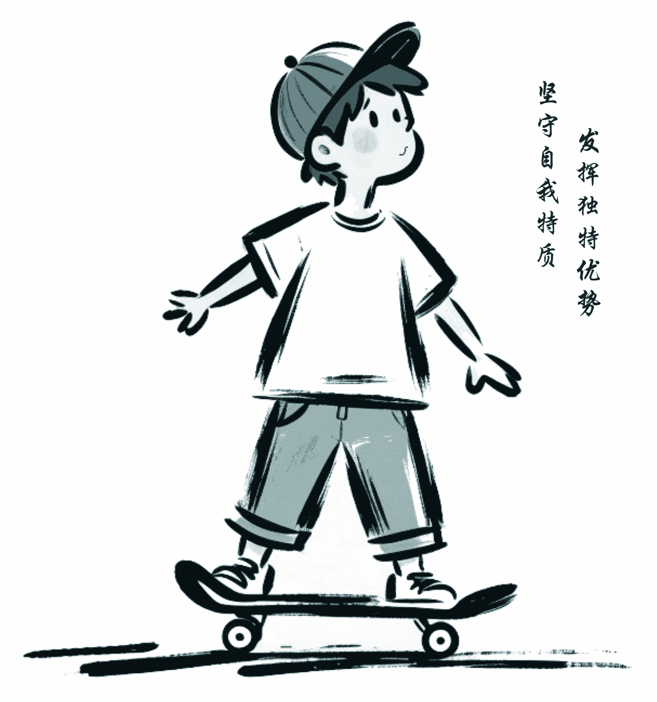
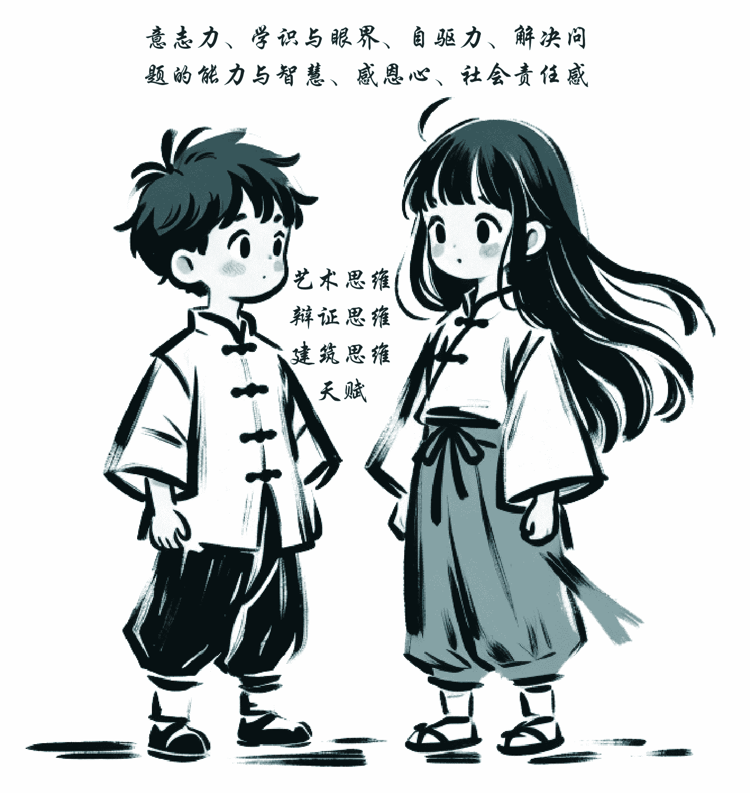
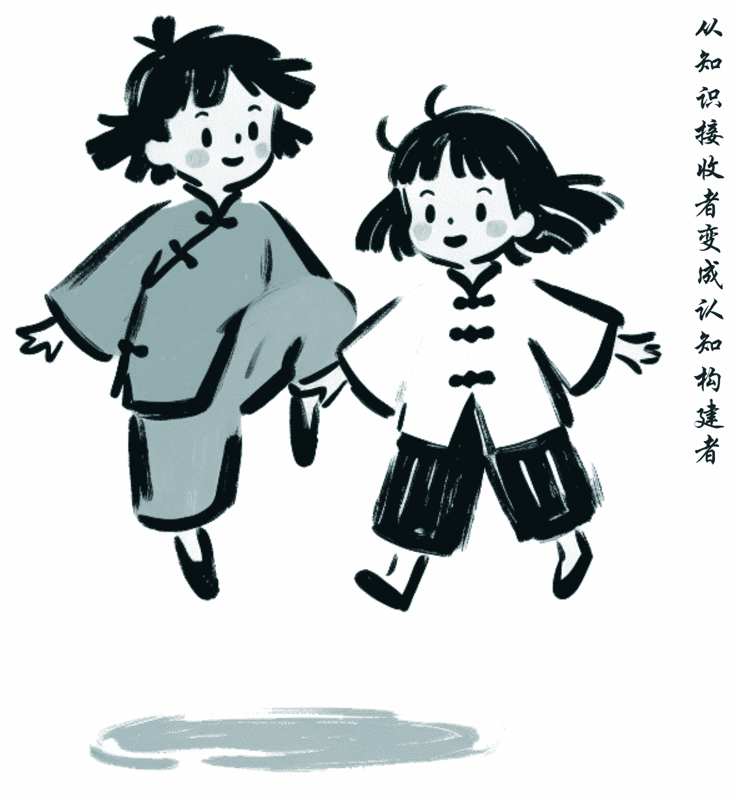
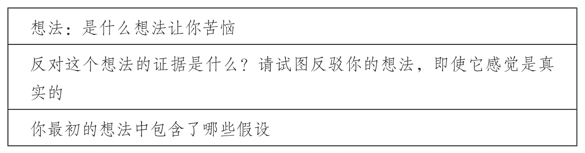
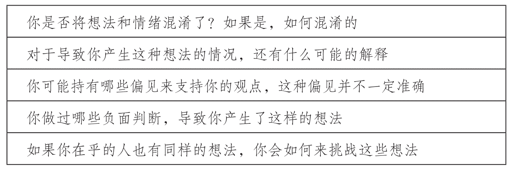
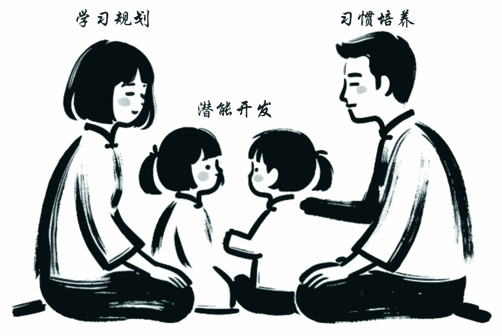
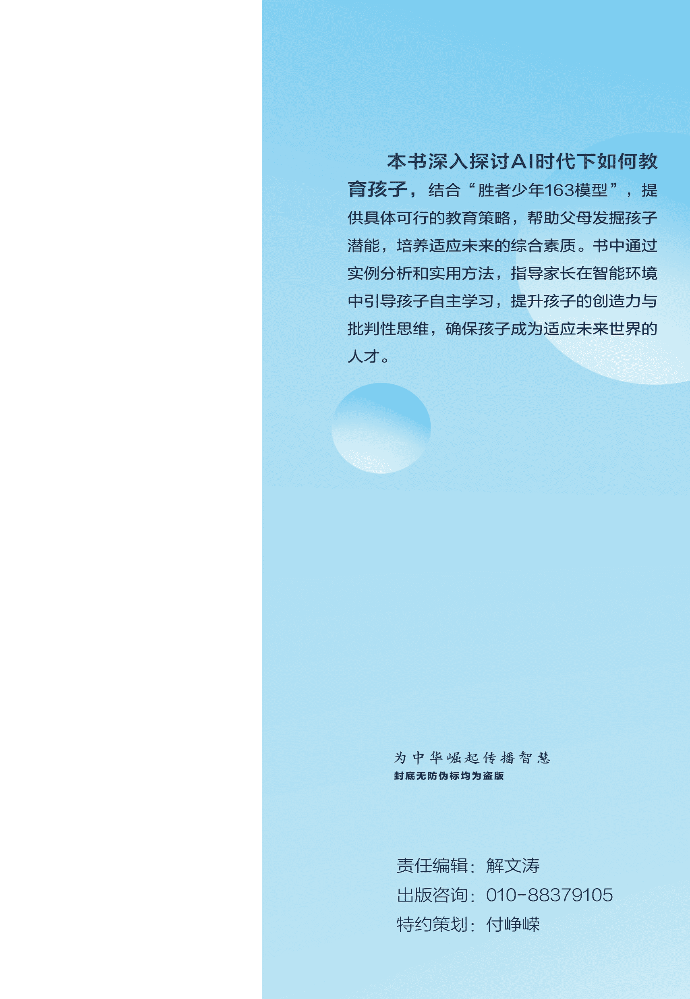
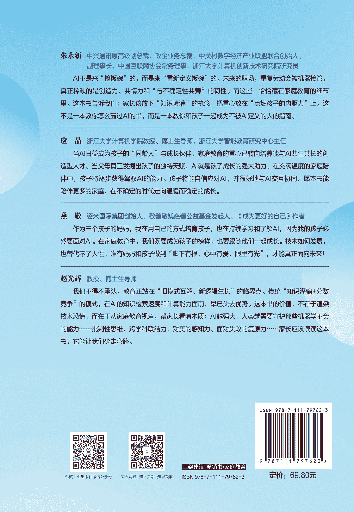

# AI 代际共育：如何养出未来可用的孩子

# 自序

**当智能系统走进童年**[8]

朵朵大概八岁，翻书看到生词几乎没抬头就问客厅里的智能音箱是什么意思，音箱立刻给出释义，还顺手推送了几组关联词汇。

轩轩十二岁，熟练操作编程工具制作机器人动画，后台的智能算法自动把每一帧做得更流畅，屏幕里的角色栩栩如生，仿佛要跳出来。

这样的日常，如今在很多家庭里已经司空见惯。

不少父母原本觉得智能离教育很远，结果它早已以玩伴、助手甚至对手的形态潜入孩子的成长场域。焦虑随之而来：当系统能瞬间答疑，思考还有必要吗？当复杂工作可以被自动化，孩子的未来该往哪走？

请先承认一个事实：无论父母多焦虑，每一个孩子都绕不开与智能共处的时代。

麻省理工学院媒体实验室的数据显示，五岁以上的孩子日均与智能设备的互动已超过两小时，增速很快。智能早已不是实验室概念，而是变成手表的轻提醒、作业软件的答疑、游戏里的 NPC，成为孩子身边隐形的陪伴。在深圳部分小学，教师借助智能教学系统为每名学生生成专属学习路径，通过答题数据快速定位薄弱点，这种因材施教的效率，是传统课堂难以匹敌的。

这不代表孩子会被吞没。认知的建立来自主动探索。智能更像一本永远翻不完的百科全书，提供探索素材，并在过程中起助推作用。

有位母亲讲过，女儿用智能绘画工具起初只是输入关键词生成画面，很快就不满足，开始自行调参、叠加图层，最终做出融合东西方元素的奇幻作品。智能没有替代创作，反而点燃了她对艺术的兴趣和更丰富的想象。

如果孩子注定与智能共生，那么未来岗位的形态一定远超我们想象。

世界经济论坛《2023 年未来就业报告》预测，到 2027 年全球将新增 6900 万个岗位，同时 8300 万个岗位将被淘汰，智能技术是关键驱动。这既是挑战也是机会。重点不是抵触变革，而是善用优势，培养创新思维和适应力。

我们已经看到，部分车企设立了“AI 协调员”，需要让人类工程师与智能系统协同，让效率与创造兼得；医疗团队出现了“医疗 AI 伦理师”，专门研究如何让智能诊断更有人文关怀。这些新岗位要的不是与机器比拼记忆和运算的人，而是能驾驭技术、具备跨域思维的复合型人才。

当智能成为共生伙伴，竞争力的衡量就不再是记得多少知识，而是能否把知识转化为创造价值的能力，能否更有效地使用智能。

在我多年陪伴孩子成长的经验里，知识记忆、技能训练都不是核心竞争力。核心在于创造力、批判性思维和情感智慧。我在《觉知的父母》里也提到，未来靠的是天赋开发、特质挖掘和思维培养，而这些正是机器无法复制的。

脑科学研究表明，每个人的神经网络都是独一无二的，像指纹。家庭教育的核心，从来不是复制父母，而是帮助孩子发现并发展自身的独特优势。

站在智能时代的门槛，智能与少年的相遇不是零和博弈，而是共同成长。就像蒸汽机车没有让人丧失行走能力，反而拓展了探索边界，智能也不会阻断成长，而是打开更宽的天地。

父母不必筑墙隔绝，而应做领路人：挖掘天赋，教会孩子理解技术原理并掌握使用方法，同时坚守自身的特质、热爱与思考。作为教育的推动者，我在智能时代看到了更多可能——借助智能，教育路径变得更丰富多元。

在智能浪潮中，真正不可替代的永远是人类独有的情感、想象力和创造力。让我们和孩子一起拥抱新时代！

张益铭

2025 年 8 月于上海胜者教育

# 上篇

# AI 时代的教育变革与认知重构

智能时代的教学革新，要求我们重新审视教育的本质，关注个性化发展与综合素质提升。通过科学的家庭教育，帮助他们养成独立思考习惯，锻炼面对未来挑战的勇气与智慧。只有如此，才能在智能浪潮中脱颖而出，成为真正的创新者与领导者。

## 第一章 家长的焦虑：是技术替代还是人类价值升华

父母要明白，智能技术不是洪水猛兽，而是助力成长的工具。在引导下正确使用，既能提升技能，也能激发创造力与情感表达。关键是教会他们在智能辅助下坚守自我，发挥独特优势。

### 1.1 AI 时代让父母感到威胁的 6 个问题

智能技术的迅猛发展让许多家长措手不及。一边担心沉迷技术，一边忧虑不懂技术会被时代抛下。我能理解这种焦虑，其实只要看清社会发展规律就会明白，技术进步是为了更好地服务人类，而非取代人类。

**孩子的能力是否会贬值**

不少父母最先担心的是，未来他们所拥有的许多能力智能系统都能做到，那价值是否就消失了。

事实并非所有能力都会被替代。

可能被替代的能力
过去强调的记忆力、计算力、逻辑推理、遵循指令的能力，在未来很可能被智能系统高效取代。若父母过度投入这些方向，会限制其他核心能力的发展。

不会被替代的能力
创造力、想象力、情感理解与表达、人际交往与协作、适应力与学习力、批判性思维等，都是机器无法企及的。

例如，智能系统生成的代码或诗歌本质上是对训练数据的概率重组，缺乏原创意图。而他们天马行空的想象往往没有标准答案，这是其独特价值所在。

再如，他们能细腻感知情感并建立深厚连接。智能系统虽能模拟部分表达，却无法真正理解人类情感的复杂性。在需要情感关怀的心理咨询、教育、医疗等领域，情感能力不可替代。

此外，通过思考、分析与实践能多角度看问题、提出质疑并寻求解法，这是智能系统无法替代的。即便机器能提供海量信息，人类的批判性思维与决策能力依然是核心。

可以说，未来能力更多体现在与智能共舞上：以创造力、情感理解与批判性思维构建独特价值；而被机器替代的标准化能力，反而能解放他们，让其在更高层面展现人类智慧与魅力。

**勤学苦练是否仍具意义**

“智能系统能秒解数学题，还能画出漂亮图片，标准化能力都交给机器了，还需要勤学苦练吗？”这个问题常被家长提出。

答案是肯定的。

勤学苦练不仅是获取知识的途径，更是塑造坚韧品格与自律精神的过程。无论哪个时代，这些品质都至关重要，能让他们在挑战面前保持冷静，善用智能工具而非被其束缚。通过持续学习与实践，能更深刻理解并运用智能，使其成为自我提升的助力而非替代。

有了代步工具不意味着要放弃走路，人在使用工具的同时仍需保持自身能力。对他们而言，掌握智能系统的同时，更要强化机器无法替代的软实力。

勤学苦练是培养深度思考的重要方式。学数学时机器能快速给答案，但他们在解题过程中锻炼的逻辑推理与问题解决能力是机器赋予不了的。正是练习，才能将深度思考内化为应对复杂问题的基础。

勤学苦练也是塑造坚韧品格的关键。学乐器的他们每天要练基本功，指尖起泡、手臂酸疼都是常态。日复一日的坚持培养出克服困难的毅力，这种自律是机器无法给予，却能让他们走得更稳更远。

在智能时代，勤学苦练并非死记硬背，而是在实践中探索与反思。它是培养独立思考与解决问题的基石，让他们以沉淀的素养灵活应对复杂情境，展现超越机器的独特智慧。

**传统考核方式是否仍有意义**

“智能系统都能批改作业、预测学习成果了，传统考核还有用吗？”

我的看法是，传统考核依然有其独特价值。社会仍由人主导的复杂系统，传统考核不仅衡量知识掌握度，也考察综合素质潜力。但我们也清楚，传统考核难以满足当下个性化需求。每名学生都是独立个体，传统方式受限于条件，难以实现精细化个性化教育，如今智能技术让这一切成为可能。

传统考核的不变之处
以标准化考试为核心，通过分数与排名直观反映知识水平。在人才选拔、教学成效评估等方面具有不可替代作用。它为教育提供统一标准，便于学校家庭了解他们在群体中的位置，也为社会筛选具备知识储备的人才。例如高考以公平公正的方式为高校选拔人才，为无数人带来改变命运的机会。课堂表现、作业完成情况等维度，也能反映学习态度与习惯。

传统考核的变革之处
传统考核过于强调知识量化，忽视了创造力、批判性思维与情感素养的培养。而在智能时代，这些软实力愈发重要，决定着未来适应力与创新力。

每个人都是独特的，有逻辑思维强的，也有艺术天赋突出的，传统考核很难为多元才能提供展示与认可平台。比如我曾见到一名音乐天赋极高的学生，因分数不高被忽视，创新潜能未能施展。

我认为智能技术是对传统考核极好的补充。机器可以精准评估多元智能，提供个性化学习路径，让每个人的特长得以释放。智能与传统考核结合，既能了解知识水平，又能挖掘潜在能力，培养出基础扎实又具创新精神的人才。

唯有融合传统优势与智能新可能，才能构建更科学、全面、个性化的考核体系，适应时代需求，促进全面发展。

**未来应掌握哪些素养**

他们应学什么才能在未来立足，是个很难给出定论的问题。没有人能准确预测职业需求与社会变化。回望五年前的预测，很难完全吻合当下。

知识与能力随时代动态变化，但聚焦本质能力如学习力、批判性思维、情感素养，便能在变化中持续适应成长。

具体如何提升这些能力，我会在后续内容中详述。

**长期依赖是否会导致被淘汰**

近期一位妈妈焦急找我，担心他们每天依赖智能工具，遇到不懂的问题第一反应是求助智能系统，而不是自己思考。

我告诉她，使用智能系统本身无可厚非，关键在于引导使用，避免依赖心理。这也是多数家长的困惑：以前限制屏幕时间，现在不用智能系统又怕掉队，该如何把握？

任何事把握好度就不会成问题。

核心在于平衡：既要让他们掌握智能工具，也要培养独立思考与解决问题的能力。若放任依赖，他们会丧失独立思考：比如依赖智能系统写作文，会逐渐失去文字表达与创意构思能力，脑中只剩模板，情感表达退化。同时过度使用可能影响记忆力，造成思维僵化，难以应对复杂情境。久而久之，不仅无法真正掌握知识，还会丧失自主学习能力，影响全面发展。

若引导得当，他们能借助智能系统提升效率，并在独立思考中培养更强的创新与批判性思维。例如有学校鼓励使用智能绘画，他们可尝试不同风格挖掘艺术潜力，同时获得即时反馈及时修正问题。

父母如何正确引导是关键，我将在后文展开。这里要强调：想让他们不被智能淘汰，必须学会与智能系统协同，而非被其支配。

**现实与虚拟边界如何辨别**

DeepSeek在短时间内迅速走红后，市场涌现大量智能工具与技能课程，几乎每个平台都接入了智能功能。他们接触智能系统的机会急剧增加，也带来新风险：认知尚未成熟、鉴别经验不足的他们，容易被便捷性迷惑，混淆真实学习与虚拟辅助的界限。

媒体报道，部分智能工具会杜撰不存在的论文、作者与网址，甚至伪造学术成果。例如智能系统生成一篇《个人信息保护法背景下金融诈骗监管与个人隐私保护的平衡问题》，经核查权威期刊从未发表。用他们能懂的话说，机器开始“说谎”了。

他们可能把机器生成的奇幻故事当成真实历史，或轻信未经证实的生活建议。这会导致现实认知偏差，难以分辨信息真伪。长此以往，批判性思维与独立判断能力会退化，影响综合素质。

父母的作用愈发关键：要引导他们厘清现实与智能的边界，培养信息鉴别力。例如使用智能系统搜索后，与他们一起核验信息来源可靠性，对照权威资料判断真伪；通过反复验证，帮助他们建立对机器内容的质量意识，学会主动思考。

向他们普及智能系统的工作原理，也是区分现实与虚拟的重要方式。用通俗语言解释机器如何通过数据训练与算法生成内容，让他们明白工具只是工具，其呈现内容并非都是真实事件。

父母更需在日常中引导他们关注现实世界，强化真实体验：鼓励多参与户外活动，与自然他人互动；支持手工制作、科学实验等实践活动。

在真实体验中，他们能更深刻感受现实特质，与机器创造的虚拟世界形成鲜明对比。比如观察植物生长，感受生命的真实变化，这与智能模拟动画有本质区别。限制使用时间，避免过度沉浸虚拟环境，也有助于保持对现实的敏感度。

### 1.2 智能技术如何改写教育底层逻辑

任何新技术都会给教育带来深刻变化。互联网改变了信息获取方式，智能技术则可能重塑知识传授与思维培养的底层逻辑。例如智能系统能依据个体差异提供个性化方案，精准推送知识点，提升效率；智能辅助教学工具能实时反馈学习效果，帮助教师优化策略。对父母而言，智能技术能更好地引导他们自主探索，提升学习兴趣。

**教育目标的重塑：培养驾驭智能的人类**

当智能系统成为强大助手，人类便能从繁琐重复工作中解放，聚焦创新与决策。在人类历史上，工具总会解放部分劳动力，推动社会进步。智能技术亦然，人类需持续驾驭这一工具，学会利用其优势提升自身能力。

**个性化与自适应学习**

在智能技术深度渗透教育的今天，传统“一刀切”模式如全班统一进度、统一作业，正被基于个体需求的智能学习系统取代。

个性化学习强调以他们为中心，根据兴趣、能力与学习风格设计差异化目标与路径。自适应学习是其进阶形态，依托智能技术，根据实时学习表现匹配相应环境、案例与场景，并动态调整内容、难度与节奏，引导他们主动探索、总结规律，逐步形成自主解决问题的能力。

以他们为中心，就是打破统一框架，通过个体差异识别、个性化目标定制与动态调整，让个性优势放大，潜能得到开发。

个体差异识别
他们的个体差异巨大，有视觉型学习者，有听觉型学习者，也有动觉型学习者。若不识别差异，就像要求大象、猴子、老虎都爬树，显然不恰当也不公平。

教育家朱永新曾说，教育实践要尊重差异性。每个人都是一个世界，都有不同潜能与可能。整齐划一的教育、以分数为唯一导向的学校，永远培养不出创造性人才。好教育应让每个生命成为最好的自己，给每个人最大发展空间，帮助发现特长与优势。

智能时代为个性化发展提供了更多可能。通过识别当下知识水平、核心能力、学习风格，可知道他们“在哪里”；通过识别兴趣领域、长期目标，可知道他们“想去哪里”；通过识别学习节奏、成长障碍，可知道他们“怎么到达”。

个性化目标定制
传统教育目标常以年龄、年级为基准，但成长速度各异。未来教育更应针对知识分层，如基础、进阶、高阶，不同他们适配不同目标；同时结合能力适配，不同水平搭配不同方式与目标。当然兴趣也是重要要素，将成长目标与兴趣融合，能进一步激发自驱力。

**学习节奏动态调适**
个性化成长不是一次性定型，而是一个持续循环：学习、反馈、再校准。智能系统在这方面优势明显，能够全程记录成长轨迹，不停优化路径，助力真正意义上的自学。

**让适配自行发生**
当个性化基础已具雏形，优秀家长会像私教那样，按实时表现灵活调整情境、挑选难度契合的素材、搭建能让孩子再进一步的场域。被动接受感会逐渐稀释，主动调适的意识会慢慢生长。

在这一环节里，智能系统能起到明显的助推作用。求知欲与探索欲冒头时，系统可以迅速捕捉并推送匹配内容，难度恰当、形式贴近，往往能点燃兴趣。

当某项知识或技能已积累一定厚度，系统会适时推送对应的实践案例。孩子在真实问题里操练，手感随之上去，自信感与好奇心也更旺，形成良性闭环，孩子会主动搭建学习场景，进入高效状态。

大多数家长都能感受到，孩子大致属于稳健型还是快攻型。有的人步步为营，节奏偏慢却扎实；有的人风风火火，失误率高但纠错快。这就是各自独特的成长节律。

不同节律的孩子，学习周期与生物钟各不相同。智能系统可通过不同时段的表现与专注状态，判断其节奏，并给出相适配的情境与案例。

在自适应与个性化层面，智能系统的想象空间很大。技术迭代会让它对教育逻辑的介入更深。

需要强调的是，技术对教育的改造最终要落到人的成长。智能系统能提供路径与方法，替代不了家长与孩子的独立思考。家长与孩子要清晰地认识自我，勇敢成为独一无二的自己。

**师生关系的重塑**
目前在北京、上海等地的部分校内，智能技术已深度嵌入日常教学：教师借助智能技术精准对标新课标，结合学生实际，设计出既合规又具个性的教学方案；学生利用智能技术开展编程学习、项目或比赛，已成为常态化教学的一部分。

我曾向智能助手 DeepSeek 提出：“智能系统会取代教师吗？”它的回复是，智能系统不会取代教师，而是成为教师的得力助手。它会深刻重塑教师角色与教育生态，讲台上永远需要那个在夕阳下讲解“落霞与孤鹜齐飞”的鲜活灵魂。

可以看出，智能系统的回答兼具诗意与智慧，既理解教育的本质，也懂得人类情感的珍贵。

在智能影响下，教育不再是单向灌输，而是双向互动的智慧碰撞：教师不再是知识唯一传递者，而是启发者、引导者，能激发孩子的内在潜能；从作业批改、资料整理等事务性工作中解放出来，教学重心加速转向学习导航、思维培育和精准育人，逐渐成为孩子的成长伙伴与“成长设计师”。

而孩子，在智能陪伴下，不仅能高效掌握知识，还能培养独立思考和解决问题的能力；他们也会以独特的个性和能力，反向影响教师的教学方式，塑造教育生态，成为推动教育创新的重要力量。

我们不仅是孩子的教育者，也是他们成长路上的垫脚石、引路人、陪伴者和发现者。

《中国教育报》曾有文章指出：“人工智能与教育的融合，本质上是技术对传统教育模式的革新，是社会发展的必然选择。人工智能与高等教育的融合，无疑既是一个充满无限机遇的广阔舞台，也是一场严峻的挑战。”

## **第二章** **未来孩子的六大核心素养**
教育的目光不能只停留在当下，而要放眼未来趋势。孩子成年后，社会需要怎样的素养？这是家长必须厘清的问题。本章所讲的六大核心素养，正是孩子适应未来的关键。

### **2.1** **创造力**
当下环境里，孩子的创造力往往受限。

我见过很多极具创造力的孩子：有的在绘画中展现惊人想象，有的在编程中展现独特逻辑，有的在音乐中展现非凡感知，有的在文学创作中展现深邃思考——但日常学习中，这份创造力常被忽视甚至压制。

一次，一位家长兴奋地告诉我儿子帮她解决了大问题，我好奇到底是什么。

原来儿子用编程做了个自动提醒做家务的小程序。以前她靠闹钟提醒，常忘设或忙中忽略。儿子的小程序连着家里的智能音响，能按日程自动发语音提醒，还会随天气调整内容，真正解决了困扰。

我有些惊讶，因为这位家长此前是“控制狂”。接触孩子时，她对一举一动严格掌控，生怕出错。既然玩平板时间受限，怎么会想到用编程解决实际问题？

后来我私下问孩子，他笑着说：“我一直偷偷玩，后来想，妈妈不让我玩，我就想办法让她相信我。”

多么棒的思路！

家长都有体会，亲子间的“猫鼠游戏”，不只是叛逆，更是孩子用独特方式展现潜质和创造力的过程。毕竟我们也曾是孩子，也经历过类似探索。

**扼杀创造力是最快的毁灭方式**
焦虑型家长常以“为你好”的名义过度规划生活和学习，导致孩子缺乏自主探索空间。

创造力就是发现新事物、新思想并创造新事物的能力。正是这份能力，能让孩子在未来脱颖而出，成为推动科技进步和社会发展的中坚力量。孩子可能会把普通玩具变成奇妙发明，或把日常问题转化为创新方案。如果家长只会说“再这样就不给你买玩具了”，我们或许会错失发现潜力的机会。

特别是小学到中学阶段，思维活跃、想象丰富，是培养创造力的黄金期。家长最好的做法是鼓励和认可每一次尝试，哪怕看似微不足道，也应给予积极反馈。一句“你的想法很独特”或“你解决问题的方法很有创意”，都能激发探索热情。

尤其在智能化时代，技术飞速发展更需要独立思考和创新能力。只盯标准答案的孩子，与创造力丰富的孩子，在未来竞争中处于两个维度，后者无疑占据优势。

**创造力藏在日常里**
单纯谈创造力会显得空洞，其实它就藏在孩子的日常行为中。比如用积木搭建独一无二的城堡，用画笔描绘天马行空的梦境，甚至用简单材料做出意想不到的小发明。这些看似不起眼的小举动，正是探索世界、表达自我的独特方式。

**（1）生物科学视角。**儿童期大脑高速发育，神经元连接迅速形成。孩子进行创造性活动时，大脑会释放大量多巴胺，促进神经网络优化。孩子享受创作过程中的试错，而非最终的确定性结果。这种多巴胺机制，正是不断尝试和创新的动力。正如拆盲盒的“意外惊喜”能激发成年人消费欲一样，孩子的每一次创造性尝试，都是在探索未知乐趣中逐步构建认知世界。家长的支持与鼓励，无疑是点燃创造力的关键火种。

**（2）行为视角。**好奇心和探索欲是行为驱动力，他们的非逻辑行为往往蕴含创新种子，家长应避免过早束缚在条条框框。有的孩子爱“搞破坏”：拆玩具、弄坏东西、探究家电内部——看似破坏，实则是探索结构和原理。这种行为，正是理解事物本质的独特方式。正如我曾遇到一个“破坏欲极强”的孩子，后来发现他拥有超强空间视觉和独特建筑思维，创造天赋远超常人。

**（3）情感视角。**孩子对世界认知更多依赖情感体验，而非单纯理性分析。他们在游戏中体验合作与竞争，在绘画中表达喜怒哀乐，这些情感体验丰富内心世界，成为创造力的重要基础。而且这种情感体验是非功利性的，纯粹源于内心热爱和兴趣，正是这种无拘无束的情感表达，让创造力自由流淌，绽放独特光彩。

**（4）技术视角。**当下及未来，孩子的创造力有了更优的表达与实现工具，那就是智能系统。在智能辅助下，孩子能更便捷地将创意转化为现实。比如用智能绘画工具勾勒心中的奇幻世界，或用智能编程平台实现独特小发明。如今的孩子出生在数字时代，智能系统就是得力帮手，人机共生、技术协同将成为创造力发展的新常态。

**如何培养孩子的创造力**
根本上，我认为培养创造力需要家长“顺其自然，无为而治”。

如何理解“顺其自然，无为而治”？

**第一，要尊重自然成长规律，不强行干预。**不要觉得孩子什么都不懂，天性就是积极探索，每一个看似无厘头的举动，都是用独特方式感知世界。家长应给予足够空间，让孩子在自由探索中逐渐发现兴趣和潜能。学习之余，留出自由支配的时间，哪怕发呆或玩耍。

在家庭中，孩子的“无目标时段”很重要。有些家长习惯做事都设定目标，但孩子需要无目标的自由时光——正是这些看似“无用”的时光，孕育无限创意和想象。

**第二，要鼓励多尝试、多体验，不设限。**正如《庄子》所写“无用之用，方为大用”，要让孩子在多样化活动中找内心热爱，激发潜在创造力。无论艺术、科学还是其他领域，每一次探索都是成长宝贵财富。家长只需默默支持，静待花开。要知道，创造力并非刻意培养出的，而是在自由与支持中自然生长。

**第三，要让孩子尽可能多参与实践。**实践中，孩子能保持专注，不仅能亲手验证所学，还能在动手操作中发现问题、解决问题。这种亲身体验能极大提升创造力和解决问题的能力。通过各类实践活动，孩子不仅积累丰富经验，还能在实践中不断修正和完善创意，从而形成独特思维方式。在胜者教育（注：作者公司）的日常教学中，我们特别注重实践环节，鼓励动手操作、参与各类项目，让孩子在实践中不断探索、创新。

**第四，鼓励跨领域、跨学科学习，打破学科界限。**如果孩子能将历史、艺术、思政等知识融合，家长再加以引导，就能多角度思考问题。借助智能工具，孩子可以将不同领域知识融会贯通，形成多元思维模式。例如利用思维导图软件，将历史事件与艺术作品关联，发现共通点，激发跨学科创新思维。

当然，培养创造力也需要家长的耐心与包容，这正是“无为而治”的核心。当孩子探索中犯错时，不要急于批评，而是引导其吸取教训继续前行；当孩子遇到困难时，不要急于给出解决方案，而是鼓励其自己思考找到克服方法。家长的耐心与包容，正是创造力培养最坚实的后盾。

### **2.2** **批判性思维**
有一次在胜者教育的家长课堂上，一位妈妈问我：“孩子总依赖手机和平板，我怕他会慢慢失去思考能力，如何培养思维能力呢？”

我相信这不是一位妈妈的困惑，而是许多家长共同的担忧。

在智能化时代，信息获取前所未有便捷，但真实性、复杂性以及算法的“茧房效应”也对思维能力提出更高挑战。别说孩子，我们成人不也常在信息洪流中迷失方向吗？

要让孩子不在真真假假中迷失，批判性思维培养就显得尤为重要。

**批判性思维是什么**
批判性思维是通过一定标准去评价思维，进而改善思维的技能。其核心是培养独立思考、理性分析、严谨求真的习惯，以应对复杂多变的问题和挑战。

批判性思维有多重定义，但核心要素始终包括态度、知识和技能三个方面。

在态度层面，要敢于质疑、主动质疑，同时保持包容开放。很多家长误以为批判性思维会让孩子变成“杠精”，其实不然，它培养的是理性探讨和求真精神。

在知识技能层面，批判性思维要求孩子掌握逻辑推理、证据评估等能力。要让孩子涉猎足够多的知识，学会从不同角度审视问题。可以通过日常对话引导孩子分析问题，培养独立思考习惯。例如讨论新闻事件时，让孩子辨别信息真伪、理解不同观点，逐步形成自己的见解。

**培养孩子的问题意识**
人都有惰性，孩子也不例外。如果智能工具能快速给出答案，孩子可能失去深入探究动力。因此，培养问题意识至关重要。

当孩子从智能工具得到答案时，家长应引导他们思考答案背后的逻辑和依据，追问“为什么”“是什么”“如何得出”，激发对问题本质的探究。比如孩子查询“树叶为什么变黄”时，家长可以对比智能系统答案，提出更多相关问题（如“热带植物的叶子会变黄吗”），让孩子意识到：智能系统提供的答案只是起点，而非真理。

**（1）培养问题意识，就要让孩子学会提问。**如何正确且精准提问，需要长期练习。比如孩子最常见提问是“为什么……”，我们可以引导转换为“如果……会怎样”。提问方式改变后，孩子就会主动思考。

**（2）要让孩子养成“质疑惯性”。**面对媒体各类信息，要让孩子学会质疑来源和真实性，探究背后动机和逻辑。例如孩子看到广告宣称“某种食品能快速提高智力”时，家长可以引导思考广告真实性和科学依据，询问“这种食品真的有效吗？有哪些证据支持？”。通过这样引导，孩子不仅学会质疑，还能培养科学探究精神。

**（3）鼓励孩子审视“常识”。**我们生活中的很多“常识”并非绝对正确，在智能化时代，智能工具获取的元信息可能存在偏差。孩子经常对“常识”提出质疑，能培养对信息的敏感度和独立判断能力。

**区分真实与算法偏见**
我们接触的智能工具都是基于算法构建，算法获取的数据和信息均来自既有数据和经验，难免存在偏见。当家长给孩子解释清楚这一本质时，孩子就会明白：智能系统提供的答案并非绝对真理，甚至可能存在极大偏见。

比如孩子查询某个历史事件时，智能系统给出的答案可能基于特定视角的历史解读，并非客观全貌，若孩子轻信了这一解读，可能会形成片面历史观。这就是常说的“信息茧房”：智能系统仅基于个人偏好推荐某个层面信息，并不全面；这种不全面甚至片面，就形成了“算法偏见”。

要克服“算法偏见”，就要让孩子学会对信息进行“三重检验”：溯源、验证和交叉对比。

**（1）溯源。**溯源即追寻信息的原始出处，了解来源背景。比如孩子学习历史时，不仅要看智能系统提供的答案，还要查阅不同版本书籍和资料，探究事件多元视角。

**（2）验证。**可通过多个智能系统查询同一问题，再用搜索引擎对比不同系统给出的答案，分析其一致性及差异，从而判断信息可靠性。这个过程不仅帮助孩子识别信息真伪，还能培养批判性思维。

**（3）交叉对比。**通过对比不同来源信息（如书本信息、智能系统答案和网络资料），再结合自身独立思考，孩子可以更全面理解问题，形成客观认知。同一个问题，不同人回答都存在差异，更别说由不同算法生成的答案了。

**培养逻辑推理能力**
不管是传统信息获取，还是智能化时代信息获取，事物的本质不变，逻辑推理能力始终是理解和判断信息的关键。孩子使用平板和手机本身没问题，关键在于引导他们利用这些工具进行有效逻辑推理。

比如分析新闻事件时，可以通过“逻辑链条拆解法”逐步推导事件前因后果，识别其中的逻辑漏洞和隐含假设，进而推理出不同媒体的观点倾向。

“逻辑链条拆解法”有三个关键环节：**前提、推理和结论**。

**（1）前提是事件的已知条件。**当孩子搜集到足够多信息后，需明确哪些是事实，哪些是假设。

**（2）推理则是基于前提进行逻辑推导，判断因果关系是否成立。**比如媒体称“玩游戏会导致学习成绩下降”，孩子需推理玩游戏与成绩之间是否存在直接联系，是否有其他影响因素。

**（3）结论则是综合前提和推理得出的最终判断。**孩子需学会区分事实与观点，避免被单一信息误导。“孩子玩游戏”是事实，而“玩游戏会导致学习成绩下降”则是观点，需进一步验证。

通过这种训练，孩子不仅能辨别信息真伪，还能培养独立思考能力，最终形成全面、客观的认知体系。

**实践才是检验标准**
前面讲了很多道理，核心的还是“实践”。

胜者教育在线下实践活动中总能收到意想不到的效果，就是因为实践是验证一切的最佳方式。通过动手操作、实地考察，孩子能将理论知识转化为实际能力，发现书本与现实的差异，进而加深理解。

“纸上得来终觉浅，绝知此事要躬行。”在智能化时代，动手能力强、实践能力强的孩子更能适应复杂多变的环境。

我想说的是，**智能化时代最危险的并非家长担心的“技术强大”，而是人类主动让渡“思考权”。我们塑造孩子的批判性思维，本质上是帮助他们在信息洪流和算法逻辑中，守住“我如何看待世界”的主动权。**这种能力不仅能让孩子分辨智能系统信息真伪，更能让他们在未来面对任何“权威”“潮流”“技术”时，都拥有独立判断的底气。

### **2.3** **协作能力与算法思维**
如果让我说智能化时代最需要培养的能力和思维，我认为是协作能力和算法思维。

为什么这么说？

### **协作能力**
我在《觉知的父母》中提到过孩子的“163”成长模型，即 1 个天赋、6 个特质和 3 个思维。在这个模型中，1 个天赋指的是孩子的独特潜能；6 个特质包括意志力、学识与眼界、自驱力、解决问题的能力与智慧、感恩心、社会责任感；3 个思维指艺术思维、辩证思维、建筑思维。

本节所说的协作能力，就是建筑思维的一种体现。当孩子像建筑师一样去连接资源时，当孩子在复杂的系统中去协调不同利益方时，他们就是在用建筑思维做事。

**从本质上讲，协作能力是孩子在团队中通过有效沟通、合理分工，并整合多元视角以达成共同目标的能力。**这种能力在智能化时代尤为重要，因为技术的飞速发展使得单一个体的力量愈发有限。孩子需学会在多元化的团队中发挥自身优势，通过高效协作解决复杂问题，这样才能在未来的竞争中脱颖而出。关于协作能力，我在后文详细讲述。

而与协作能力相对应的，就是算法思维。

### 算法思维怎么长出来

在学术语境里，算法思维被定义为以数据为基准的决策方法论，运行方式是系统拆解信息、自动建模并持续迭代，以此在复杂情境中找规律、做推演、给建议。

放到育儿里看，它意味着儿童能够读懂智能系统的底层原理，用工程师的思路分解难题、设计路径，在信息过载中迅速抓住关键，并凭借逻辑推理抵达更优解。

**1、看懂智能系统的底层逻辑。** 先弄明白系统怎样处理信息、怎样学习，是入门的第一步。比方说系统把“戴墨镜的小狗”错认成“猫”，儿童应该能倒推判断依据，揪出偏差原因，从而认识到模型的局限。

**2、拆解难题并给出可行方案。** 训练可以从生活小事切入。例如“早上上学流程”，让儿童用箭头画出起床→洗漱→吃早餐→出发，家长再逐步增加环节，让流程更细、更合理。

胜者教育有一门课程引导儿童规划人生经历，这正是算法思维的落地。儿童要借助逻辑来安排学业与生活轨迹，慢慢学会在复杂情境里做出优质判断。

市场上很多编程课程遵循同一思路，依托项目式学习让儿童在实操中内化思维。比如做一个小游戏，需要分析使用者行为、设定规则、反复优化模型直至成型。家长多让儿童接触这类实践，就能锻炼其拆解与设计能力。

**3、从单点解题迈向系统搭建。** 前一步是解题，后一步是建系统。已有方案能否通过改规则来提升效果？题目条件变化时能否灵活重构策略？这些不断试错是深化算法思维的关键。

算法思维与协作力像硬币两面：一面是独立拆解追求最优，另一面是整合团队智慧共克难题。这种双轨思维让儿童在智能时代既能保持独立判断，又具备协同创新力，在复杂环境中游刃有余。

算法思维为协作提供共通语言，用流程图、数据模型等把模糊需求转化为可讨论的具体方案；协作则为算法思维注入人性温度，当团队出现多元诉求时，儿童能凭借解题与系统设计的功底优化模型，找到更高效路径。

### 2.4 自主掌控与终身迭代力

想问各位家长：人这一生，最难的是什么？

答案不一，在我看来，最难的是自主掌控与终身迭代。

人生的本质，是不断把自己经营好的过程，而最大的对手往往是自己。贪念、懈怠与拖延都在阻碍进步。

王阳明有诗云：**“人人自有定盘针，万化根源总在心。却笑从前颠倒见，枝枝叶叶外头寻。”** 在信息洪流中，我们常被纷扰迷失方向，忘了真正追求，失去持续学习的动力。

儿童亦是如此，他们终其一生都在与自我较量，学会管理自己，克服贪欲、懒惰与拖延。这些特质是人类固有，技术无法替代。

世界经济论坛发布的《2023 年未来就业报告》指出，到 2027 年，“自我管理”（包括主动学习、抗压能力、目标设定）与“学习能力”将位列职场核心技能前列，且无法被人工智能直接替代，因为这些能力本质上是人类特有的认知韧性。

### 自主调控

简言之，自主调控就是借助内在驱动力改变行为习惯，通过设定目标、规划时间、调节情绪等方式实现自我提升。可细分为几个关键环节。

**1、内在驱动。** 指儿童由自身产生动力，主动完成任务。这种動力源于对目标的清晰认知和对结果的期待，能促使他们在面对困难时坚持不懈。关于内驱力如何培养，我在《成长有道》那本书中有详细阐述，这里不再赘述。

**2、时间運用。** 时间管理是一生的课题。儿童需要学习番茄工作法、四象限法则等方法，也可借助各类智能日程工具更好地规划与分配时间。

**3、情绪调节。** 情绪调节是自主调控的重要一环，儿童需学会在挫折中保持冷静，合理释放压力——通过冥想、运动等方式，培养积极心态，提升抗压能力。父母在此过程中应扮演支持者，引导儿童找到适合自己的调节方式，而非直接干预。

**4、目标设定。** 目标设定是自主调控的基石。儿童需学会制定明确、可实现的目标，并制订具体行动计划。父母可协助儿童把大目标拆解为小步骤，逐步实现，以增强成就感。通过这种方式，儿童不仅能掌握自我管理技巧，还能在实现目标的过程中不断提高自信心与主动性。

**5、数字自律。** 这是当下及未来儿童面临的新课题——如何在数字世界中保持自律，合理使用电子产品、避免沉迷，是必须具备的能力。

特别强调：很多人把自主调控误解为欲望压制，这是错误的。真正的自主调控是引导欲望，将其转化为成长的动力。儿童是自己人生的主导者，而非被动的执行者。父母应尊重儿童的主体性，提供适时支持与引导，帮助他们建立健康的调控体系，最终成长为独立、自信的个体。

### 终身迭代的学习

人类社会的迅猛发展，是机遇也是挑战。

好的一面是科技进步带来无限可能；挑战在于知识更新加速，要求我们必须不断学习以适应变化。很多家长看到智能工具的强大功能后陷入焦虑，唯恐儿童在未来竞争中落后。

其实大可不必。

智能时代，儿童的学习不再是单纯的记忆和应试，而是构建学习能力与系统，高效利用智能工具。在这个过程中，技术日新月异、知识更新加速，我们能做的，就是学会自主学习，持续更新知识。真正做到“活到老，学到老”。

儿童的终身学习能力，可以从以下几个方面培养。

**1、兴趣与内在动力的呵护。** 一个人如果对某个领域充满热情，自然会主动探索和学习。父母要呵护儿童的好奇心和兴趣，让他们对未知领域保持热情，持续探索。有些儿童不想学习，往往是因为父母没有让他们明白学习的目的是什么。一旦明白了目的，就会主动探索。

**2、元认知能力。** 元认知是自我反思和调整学习策略的关键。儿童需学会审视自己的学习过程，了解自身认知特点，并据此主动调整学习方法。相信很多父母都有体会：别人用着有效的方法，未必适合自己，需根据儿童的特质去调整。

**3、自我迭代意识。** 人都有惰性，一旦形成经验依赖、陷入舒适区，就难以突破。但面对变化时，不迭代自己的知识和技能，就会被时代淘汰。有些儿童在小时候学习挺好，但随着年龄增长却逐渐停滞不前，正是因为缺乏自我迭代的意识。父母应多引导儿童反思和更新认知，鼓励他们不断挑战自我，这才是关键。

**4、跨学科整合。** 传统认知中，某个领域的专家往往只需精通一门学科；但在智能时代，跨学科的综合能力更为重要。比如，要熟练使用智能工具，需结合编程、数据分析等多领域知识，才能真正发挥其潜力。父母应鼓励儿童跨学科交叉学习，培养综合解决问题的能力。

通俗地说，跨学科能力就是让儿童像拼图一样，把不同学科的知识整合起来，形成完整的知识体系。这个过程，也是算法思维的实践过程。

很多父母可能也意识到了，这两种能力对于成人来说都是巨大挑战，对于儿童来说更需要长期引导与耐心培养。父母可与儿童一起改变：共同进行自主调控，互相监督，共同进步。

培养儿童的自主掌控能力和终身学习能力，本质上是培养人的主体性——让儿童成长为能驾驭技术的人，而非被技术奴役的人。

与父母和儿童共勉。

### 2.5 人机协同力

在人工智能深度渗透生活的今天，人机交互能力已超越“会用软件”的范畴，以往“使用工具”的概念已经过时。如今更强调与智能体的协同合作：理解其逻辑，灵活運用其功能，甚至参与设计优化。儿童需学会与智能体深度对话，掌握其背后的算法原理，从而实现高效沟通。

可以从以下几个层面来理解该能力。

**人机协同能力的养成**

智能时代的人机协同，不仅是操作层面的技能，更是理解智能体思维、与之协同创新的综合能力，是儿童与智能系统高效协作、互补共生甚至主导创新的核心竞争力。这种能力既包括“操作工具”的技能，又涵盖了“理解智能体逻辑”“明确人机边界”“发挥人类独特优势”的深层素养。

具体来说，儿童需具备五大能力：熟练操作智能工具，理解智能体运行逻辑，与智能体优势互补，对智能体结果进行批判性分析和有效反馈，以人的需求为核心主导智能体并放大创造力。

这五大能力共同构成完整的能力链条。不难发现，前三个能力是基础技能，儿童通过一定训练即可掌握。很多儿童甚至能自主学会使用智能工具，操作起来得心应手。

但后两个能力对儿童的要求很高，可能需要他们通过终身学习和持续实践逐步提升。

若按年龄段划分，可参考以下方向。

**1、低龄段（8 岁以内）：** 父母应逐步引导儿童认识到人工智能是工具，是伙伴，可以帮助我们解决问题，但也会像小朋友一样犯错。

**2、中龄段（9～15 岁）：** 父母应鼓励儿童深入理解智能体的运行逻辑，参与简单的智能体设计，学会以自己的思维主导智能体的使用。比如，引导他们用智能工具辅助写作、设计、处理图片等。

**3、高龄段（16 岁以上）：** 父母应支持儿童通过深度思考，在特定领域创新应用人工智能，甚至尝试优化智能算法，培养其独立思考和解决问题的能力，最终实现人机协同的高效合作。

更强的人机协同能力，需要儿童随着能力的提高逐步掌握更复杂的智能技术，参与实际项目、培养跨学科思维——这都是未来不可或缺的能力。

**常见误区**

很多父母一方面害怕儿童被人工智能取代，另一方面又担心儿童过度依赖智能体，这就导致他们在教育儿童时非常拧巴。这种状况会让父母陷入一些误区。

**1、技术崇拜。** 我听很多父母说过，智能工具都这么厉害了，儿童只要会用就行了。实际上，会用工具只是暂时的。智能工具的更新换代极快，真正的能力在于理解其背后的逻辑并创新应用。儿童的核心能力需自身习得，智能工具并不能替代，特别是前文提到的深层素养，如果儿童不具备，则很可能沦为智能体的“奴隶”。

**2、过度保护。** 有些父母担心儿童接触人工智能后会迷失自我，过度限制儿童使用智能体。儿童年幼时可能暂无明显副作用，但随着成长，缺乏智能应用经验会导致他们难以适应未来社会。父母最应该做的，是在适当的引导下让儿童逐步接触并理解人工智能，培养儿童“先自主思考，再用智能体辅助”的思维方式。

**3、情感忽视。** 父母常误以为智能体能替代情感交流，实则儿童的情感发展需真实互动。智能体虽能模拟对话，却无法传递真情实感。人类的情感是复杂多维的，依赖智能体可能导致儿童情感表达能力和理解能力退化。

人机协同是人类在面对智慧生态时的生存智慧。我们需要利用智能体提升能力、拓展自身能力边界，也需要警惕智能体的局限性，尊重人类的独特价值。

所以，当儿童既能熟练调用智能体解决问题，又能清醒认知其局限；既能与智能体高效协作，又能坚守人类的核心价值（如共情、创造、责任等）时，他们将成为智能时代的佼佼者。这样的儿童，不是被技术推着走，而是牵着技术的手，在未来的世界走得更远。

### 2.6 情感领导力

如果有人问“人类最独特之处是什么”，我想答案之一必定是情感。

情感是人类生活的重要组成部分，从亲情到友情，到爱情，到对万事万物的热情，都是人类情感丰富的体现。人在物质上可以一无所有，但在情感上却无法做到一无所有。

我们的情感世界，正是我们与智能体最本质的区别。情感赋予我们同理心、创造力与责任感，这些是智能体无法复制的。在电影《流浪地球》中，人类面对绝境时的团结与牺牲，正是情感伟大力量的体现。智能系统 MOSS 虽智能，却无法理解这份情感，它说了一句话，正证明了人类的独特性——让人类永远保持理智，的确是一种奢求。

但正是这种“奢求”，让人类在困境中展现出无与伦比的坚韧与温情。智能体或许能计算一切，却永远无法体会这份源自内心的澎湃。

情感智慧，在心理学上称为“情感智力”，是指个体识别、理解、管理自身及他人情绪的能力。情感智慧包含的范围比较广，包括思维、想象、动机、兴趣、意志、性格等。它不仅影响人际交往，更深刻影响决策与创新能力。

在未来的竞争中，情感智慧将成为关键优势。

具备高情感智慧的人，不仅能更好地理解和连接他人，还能在复杂情境中做出更明智的选择。这种能力是智能体无法替代的，将助力人类在智能时代脱颖而出，引领社会进步。

父母在培养儿童的情感智慧时，需重点关注以下几个方面。

**1、情感沟通。** 要善于使用情感性提问，关注儿童的感受和情绪。比如，在他们沮丧时，用“你看起来不太开心，愿意和我说说吗？”代替批评，传达关心和理解。这样不仅能增进亲子关系，还能提升儿童的情感表达能力。

**2、情绪控制。** 情绪控制和情绪表达是极为重要的能力。通过教导儿童识别和管理自己的情绪，父母可帮助他们在面对误解和委屈时，保持冷静和理智。例如，当儿童感到愤怒时，引导他们深呼吸、冷静思考，而不是冲动行事。这种能力不仅能让儿童在集体生活中更好地应对挑战，还能培养自我调节能力，为适应未来复杂的社会环境做好准备。

**3、同理心培养。** 通过角色扮演和情景模拟，让儿童学会站在他人的角度思考问题，理解他人的感受。同理心是人类最伟大的情感之一，能让儿童在成长过程中学会关爱与尊重，建立良好的人际关系。

**4、社交能力。** 智能时代，无论线上社交还是线下交往，儿童都需具备真实连接的能力，这样才能感知他人、调整自我。如果缺乏社交能力，儿童将无法真实地感知世界，进而影响心智的健康发展。**儿童如何看待世界，世界就如何对待他。**

**5、责任感。** 培养儿童的责任感，让他们明白自身行为对他人和社会的影响，学会承担后果。关于责任感的培养，我在《觉知的父母》一书中有详细阐述。

智能时代最核心的情感智慧，是让儿童明白：技术可以模拟情感，但无法创造情感；可以分析数据，但无法替代人心。当儿童既能识别自己的情绪、理解他人的感受，又能在使用技术时坚守正确的价值观时，他们将成为有温度的技术使用者。儿童用情感智慧，不仅能驾驭智能体的力量，更能守护人性的光芒。

# 中篇

# 智能时代儿童的能力培养

中篇主要聚焦父母对儿童能力的培养，而能力的培养，要基于“163”成长模型——这是融合智能技术与儿童个性发展的家庭教育本质逻辑。“163”成长模型针对智能带来的挑战，提出相应解决方案。本篇提出的“新三商”教育、儿童终身成长的方法等，能切实帮助父母找到具体可行的教育路径。

## 第三章 智能时代的“163”成长模型

儿童的潜能和特质是他们在这个世界上脱颖而出的关键。在智能时代，儿童的特质不仅需要被发掘，更需要被科学引导。更加科学合理的引导方式，再结合智能技术的精准分析，能够为儿童量身定制成长方案，最大化激发儿童的潜能。通过“163”成长模型，父母可以系统地培养儿童的多元智能，确保他们在未来，依然保持独特的竞争优势。

### 3.1 天赋开发

我在《觉知的父母》一书中，详细阐述了如何通过科学的方法发现并开启儿童的天赋。随着智能技术的发展，儿童的天赋更可借助智能技术的精准分析进一步确认，同时儿童的天赋发掘也具备了新的内容和含义。

**借助智能洞察天赋**

什么是天赋？

天赋是儿童与生俱来的独特潜能，犹如未被发掘的宝藏。儿童的天赋往往隐藏在其习惯、行为、思想之中，很多时候儿童自己都未能及时发现。

**树有百种，人有百样，每个儿童都是独一无二的。** 有的儿童天生具备音乐天赋，能轻易捕捉旋律的韵律；有的儿童则在逻辑数理上独具慧眼，能轻松破解复杂问题；有的儿童情商极高，让身边的人都能感到舒适与安心；有的儿童语言天赋过人，言辞间流露出非凡的智慧。这些特质，很多时候会被父母忽视。

我曾遇到过一个儿童，父母对他的评价是“破坏欲极强”，从小到大，他会拆了手中拿到的任何东西，家里的玩具、家具、家电无一幸免。父母总觉得儿童太淘气，后来胜者教育给他做了专业天赋测评，结果发现他有着极高的机械天赋，善于拆解和重组物体。其父母在这一领域对他重点引导，最终儿童在建模、手工领域展现出了惊人的才华。

除了传统的天赋测评，智能技术可通过大数据分析和行为模式识别，更精准地识别儿童的天赋特质，揭示其在某一领域的潜在优势。以往的测试方向如智商测试、艺术能力测试等，在智能技术的加持下，会变得更加精准。

同时，儿童的新天赋可能会表现在跨领域整合能力、问题解决能力、非标准化优势等方面，这些天赋将更适应智能时代的挑战。

**●数据获取**

在识别儿童的天赋时，我们需基于儿童的大量多维数据开展综合分析，如儿童的行为模式、兴趣爱好、学习习惯等，通过一些教育类 APP、智能手环等，收集儿童的日常数据。

这些数据大体上可以分为认知类数据、情绪类数据和行为类数据。当数据足够丰富时，智能算法便能精准描绘儿童的天赋图谱。在观察儿童的相关数据时，父母要放下功利心，关注儿童的自然表现，避免主观臆断。因为儿童的很多天赋其实隐藏在无目的的探索中，如玩游戏的沉浸度、玩玩具的创造性、专注于某件事的情绪表现等。

对于大多数父母来说，观察儿童的机会无处不在，关键在于用心捕捉。通过工具获得的数据，还需跟父母的观察相结合，才有价值。比如，儿童在做手工时展现出的耐心和细致，或是与同伴玩耍时表现出的领导力，这些都是天赋的蛛丝马迹。

能熟练使用智能工具的父母可通过智能工具设计一套天赋分析方案，结合儿童的日常表现和数据分析结果，进行长期追踪和评估，从而更全面地了解儿童的天赋潜力。

我们需改变一个固有的错觉：儿童的天赋是静态的。比如，有些儿童小时候展现出绘画天赋，便误以为他们会一直擅长画画。实际上，儿童的天赋是动态发展的，可能会随着时间和环境的改变而变化。比如，某个阶段对绘画感兴趣，后来可能转向音乐或编程。

AI 时代，潜能如何被看见与养大

生成式技术正在快速迭代，未来会出现越来越多面向低龄儿童的潜能探索工具，让陪伴者以更低门槛的方式识别并引导孩子的多元优势。

●多元禀赋的交织
禀赋并不是单一标签，而是语言表达、逻辑数理、视觉空间、音乐节奏、身体动觉、人际交往、自我觉察、领导倾向、道德感九个向度的合集。过往育儿常把这些向度割裂看待，在智能语境下它们能够相互渗透，孕育出新的复合型优势。

例如音乐节奏与人际互动同时突出时，小孩在协作情境里更容易展现出独特的组织与号召特质。这种复合优势不仅提升整体表现，也为长远的职业路径打下更扎实的基础。

成长的重点不在于单点爆发，而在于不同潜能的协同运转。若只盯着音乐方面的特长，而忽视人际互动上的可塑空间，就等于压缩了综合发展的可能性。

前文提到的跨界整合、难题解决、非标优势，本质都是多元潜能协同的体现。智能系统的价值不只在用数据归类禀赋类型，更在帮助陪伴者看见不同潜能之间的关联，促进能力的共同提升。

不必深究工具的具体设计，只需明白：发现与培养潜能是一个动态且系统的过程。细心观察、科学分析再配合智能辅助，才能更敏锐地捕捉儿童在各领域的闪光时刻。

特别要强调，不要把智能系统当成万能解方，用测评结论给儿童贴标签。禀赋只是起点并非终点，挖掘禀赋的目的是更好地指引成长，而不是功利地把儿童推向某个固定方向。

**智能如何放大禀赋**
禀赋是儿童与生俱来的独特生命能量，智能系统则是这股能量的放大器。

不少家长做完潜能测评后，以为找到答案就能锁定一生，这是误解。在智能化语境下，识别的角色同样如此，工具不是定义者，而是引导者。

打个比方，禀赋像一颗种子，智能系统像是调节温湿度、提供养分、陪伴结果的园丁。种子能否茁壮，最终仍要靠自身生命力。

家长更该思考的，是如何让智能真正赋能于禀赋。

●为禀赋提供安全空间
禀赋需要细心呵护，真正的呵护是给予儿童一个安全环境去试探边界。焦虑的家长常会抓住某个亮点过度放大，这并不合适。

儿童擅长绘画是闪光点，但背后可能指向空间感、设计感或艺术感知等更深层的能力。

要给儿童充足的时间与空间去探索，允许无意义的尝试。比如用智能工具随意涂鸦，这些看似毫无目的的玩耍，往往能点燃创造力和想象力。

同时要避免比较式激励。我见过不少家长习惯说“你看×××”，即便在使用智能时也会说“你看×××用得比你好”。这种比较只会制造压力，消磨探索兴趣。

家长自己也要多接触智能，把新鲜的应用场景带入家庭，和儿童一起尝试，帮助儿童发现并拓展兴趣边界。

●扮演脚手架的角色
依据儿童的兴趣给予相应的智能支持。比如对建模感兴趣，可以引导使用智能建模工具，从基础几何体起步，逐步挑战复杂结构，激发空间思维。线上线下的相关比赛和交流，家长都可以支持参与。

赋能不等于放任。儿童因认知和经验有限，难以吃透智能的深层用法，此时家长需要扮演支架，主动学习、主动参与并提供引导。

若家长力有不逮，可寻求专业人士或机构协助。成长路上，家长的支架作用是智能无法替代的。

●借助智能实现系统化成长
禀赋开发的终点，是把潜在优势转化为终身成长的动力。智能擅长处理标准化任务，可帮助儿童搭建系统知识框架，逐步提升综合能力。

把重复性、标准化或需要大量试错迭代的事交给智能，儿童就能聚焦深度学习与创新实践。比如描述性文本、工具性图像可由智能生成，儿童在此基础上做创意加工和深度思考，提升综合素质。

当“禀赋×技术”的复合能力形成，禀赋便有了落脚点，智能也才真正成为能力的放大器。任何时候技术都只是放大器，而不是替代品。

### 3.2 智能化时代孩子必备的六大特质
我提出的“163”成长模型中，6 指六大特质：意志力、学识与眼界、自驱力、解决问题的能力与智慧、感恩心、社会责任感。在智能化语境下，这些特质被赋予了新的内涵。

**意志力的养成**
意志力是一种强大的心理能量，帮助个体抵御干扰、调节行为、克服困难、达成目标。过去儿童靠反复尝试和坚持来培养意志力，学会迎战恐惧与挫折。

智能化时代，意志力塑造面临新课题：技术带来的便捷与即时反馈正在冲击意志力的根基。

●意志力面临的新考验
短视频的即时刺激、游戏的即时奖励、算法的精准投喂，正在重塑儿童的大脑奖赏回路。多巴胺满足来得更快更强，而内啡肽的累积却更难。这让延迟满足变得困难，坚持的韧性逐步弱化。

碎片化信息不断分散注意力，智能推送进一步加剧分散，儿童面对复杂任务时更难集中，意志力塑造承受前所未有的挑战。

但意志力本质未变，它是人类对抗本能、实现目标的心理肌肉，也是人与机竞争中不可替代的核心优势。

●重塑意志力的方法
技术是双刃剑，智能的弊端也能转化为锻炼机会。

（1）通过目标体系锻炼自控。手机平板难以自控时，封禁并非上策。设定每日使用时长并逐步递减，用智能记录进步并可视化，增强坚持动力。自我约束配合正向反馈，能在技术环境中锤炼韧性。

（2）通过行动设计形成惯性。意志力的关键在于降低启动成本。任务难度高或诱惑多时，用微习惯和环境控制让行动习惯化。将任务拆解，用最小行动单元启动，逐步建立成就感；给手机设置免打扰时段，创造无干扰学习环境。

（3）唤醒内驱力。意志力的持久动力源于内在满足，而非金钱或表扬。过度依赖外部奖励会让意志更脆弱。只有让儿童体验成长喜悦和自我价值，才能激发内在动力。比如胜者教育的成长训练营，通过系列挑战逐步提升认知，点燃内驱力。

（4）从他律走向自律。家长的监督应逐渐淡化，引导儿童用自我约束替代外部监管。正如“设计人生经历”的理念，通过刻意设计的挑战如“沙战”，学会自我管理，从他律过渡到自律。

智能可担任监督者和设计者，通过智能提醒和数据分析帮助设定合理目标，逐步实现自我监督，让儿童在技术辅助下培养独立坚韧的意志，以应对未来挑战。

当儿童既能借助智能提升效率，又能掌控注意力与行动；既能享受即时满足，也能为长期目标持续努力时，意志力就能助其在信息洪流中稳步前行。

**学识与眼界的拓展**
培养具备全球视野的儿童是重要目标。除广泛涉猎、接触多元文化、锻炼思维外，如今更要培养“连接能力”。

连接能力即连接世界的能力。在信息爆炸时代，儿童需要知识广度，更需要对多元文化的理解、对复杂系统的洞察以及跨领域整合思维。

●从知识积累到连接能力
“读万卷书行万里路”很重要，更关键的是把知识变成连接世界的桥梁。智能打破了地理、语言、文化等壁垒，认知边界被无限拓宽。虚拟导览让儿童足不出户领略世界，在线协作平台让儿童与全球伙伴共学，产生更多连接。

连接过程中，儿童不仅拓宽视野，还学会尊重差异、包容多元，思维方式从点状线性转向网状系统。比如参与热点话题讨论，从多元角度分析问题，整合信息形成全面观点。

智能影响下，认知模式悄然转变：从单一结论到多元理解，从被动接受到主动探索，从当下体验到长期预见。学会用未来审视现在，才能拥有更广阔视野与更深洞察。

●警惕眼界陷阱
眼界拓宽并非无风险。若仅停留于表面浏览、缺乏深度思考，易陷入眼界陷阱，看似见多识广实则浅尝辄止。

算法推送的“信息快餐”易让人习惯被动接收，丧失主动探索欲，缺乏批判性思考。认知浅层化会削弱深度思考能力，难以形成独立见解。因此需重点培养信息筛选与真伪验证能力。

虚拟现实能“遨游世界”，但真实体验不可少。只有亲身感受，才能真正体会世界的复杂多样，在多元文化中定位自我。

信息茧房问题同样需警惕。眼界拓宽不能局限于认同的世界，要主动打破茧房，接触不同观点，学会批判性思考。只有在思维碰撞中，才能理解成熟的含义。

**唤醒内在自驱力**
自驱力在智能时代愈发宝贵。缺乏自驱力，即使禀赋与机遇俱在，也难以获得真正成功。

世上没有绝对好运，只有坚定的自驱力。潜能的激发正源于此。

我想做、我要做、我能做，这样的内在驱动是儿童面对挑战最坚实的支撑。我常对儿童说：当你真正渴望完成一件事时，内心的火焰比任何外力都更强大。要经常对自己说“我要做，我能做”。

也提醒家长多对儿童说“你一定可以做到”，以此点燃内在动力。我在教育儿童时常用此法，效果很好。

●积极语言的力量
家长的语言非常重要。正向积极的表达能让儿童更有自信与勇气，敢于面对挑战。

我儿子小时候作业不会做时，我会鼓励：“试试不同方法，我相信你能完成，你比我强。”当他拖延时，我会在朋友面前夸他：“我儿子很聪明，作业总能按时独立完成。”

儿童被夸得不好意思，反而更努力完成作业，逐步养成自主学习习惯。积极语言不仅提升自信，也让他学会面对困难不轻言放弃。

家长应学习运用积极语言，多给予正向反馈。

●给予选择权
自驱力的核心是自我决定。让儿童在日常中拥有选择权，哪怕是穿衣吃饭这类小事。自主选择让儿童感到被尊重与信任，从而激发责任感。理解选择带来的结果，会让他思考更谨慎，培养独立决策能力。

同时要给儿童试错机会。尝试后可借助智能分析结果、反思改进。在自主探索中，儿童会明白每一次选择都是成长契机。

●看见成长与价值
自驱力的关键是建立“我能做好这件事”的信念。有“我能行”的底气，儿童会主动尝试和挑战。

比如让儿童参与家庭事务决策，哪怕只是列购物清单，也能感受到意见被重视；让儿童用智能为家庭设计菜单，实践中体会贡献，看到成长，增强自信。

自驱力的深层动力源于“对他人和世界的意义感”。做好事带来的满足，参与公益带来的被需要感，都会强化内在驱动。

家长可陪伴儿童用工具逐步实现目标，角色转为引导者和支持者，核心是帮助儿童建立内在动力系统，而非替他做决定。

让儿童成为自己人生的主人，才是真正的教育智慧。

**解决问题能力的培养**
在未来教育六大特质中，解决问题能力与智慧是应对复杂世界的基石。智能时代技术迭代加速、信息爆炸、问题多元化，缺乏此能力将难以适应挑战。

培养的核心在思维能力。批判性思维帮助分析信息、辨别真伪、形成独立见解；创造性思维激发探索未知、提出新解；系统思维帮助在碎片信息中梳理逻辑、把握整体；元认知能力让儿童反思思考过程，不断优化策略。

这些思维能力是应对未来的核心武器。

培养并非与智能对抗，而是借助智能提升思维。比如用智能放大观察力和想象力，拓展思维广度；用智能训练深度与精准，提升解决复杂问题的能力。

（1）批判性思维。教会儿童甄别信息、质疑权威、识别陷阱，形成独立判断。

（2）创造性思维。鼓励打破常规、提出独特见解，激发探索热情。家长不应给出标准答案，而应引导探索独特解法，用反常识思路突破局限。比如让儿童用反常识思路设计环保玩具，既激发创造力也培养环保意识。

（3）系统思维。智能擅长单任务，人类擅长整合多信息解决复杂问题。需要系统思维将孤立因素关联，形成整体方案。可鼓励绘制思维导图，拆解问题、逐一分析、找到关联，形成全面解决方案。

（4）元认知能力。学会监控自身思维过程，即具备元认知。学会复盘后可在反思中优化认知策略。可借助智能记录思考路径，提升自我反思能力。

思维培养本质是借助智能作为辅助，重建人类智慧优势。儿童可用智能验证创意，也可让智能处理具体问题，自身聚焦更高维度思考。

智能既对思维提出更高要求，也促使教育更重视独立思考与创新能力，因为这才是未来核心竞争力。

**感恩心的培育**
我始终相信：心存感激的人，眼中世界自会光明。

感恩是理解万事、感知善意、体察生活美好的核心能力。儿童对家长付出心存感激，学生对老师教诲心怀感恩，对他人帮助铭记于心，都是感恩的具体体现。

有妈妈问我：“儿童不懂感恩，觉得一切理所当然怎么办？”

感恩心需从小培养，家长先做榜样。日常中常表达对他人帮助的感激，儿童会耳濡目染：收到礼物真诚道谢，面对支持表达谢意，看到儿童递水轻声说谢谢。这些细节让感激融入言行。

智能时代培养感恩心更具挑战。需求被即时满足，物质触手可及，儿童难以体会等待意义和付出价值，易忽视背后他人的劳动。技术在一定程度上放大自我中心，让儿童产生世界围绕自己的错觉。

感恩心的形成需经历感知付出、理解价值、主动回馈三个阶段。

●先感知付出
只有先感知付出，才能走出自动忽略，开始关注他人所为。

人易对习以为常的事物视而不见。比如儿童对家长唠叨、默默关怀视而不见，并非不懂感恩，而是没感知到背后的辛劳与用心。

可通过角色扮演或情景模拟让儿童亲身体验家长日常：做饭、打扫，感受家务不易；或让儿童当几天“家庭小主人”，负责一日三餐安排，体验采购与烹饪的繁琐。只有这样才能真正理解家长付出。

也可设置“付出清单”，借助智能记录每日获得的帮助：“今天谁帮助了我”“他们付出了什么”。定期回顾，能让儿童体会他人善意，逐步培养感恩心。

我小时候常对儿童说：“吃穿用度来之不易，都是他人劳动结果，要珍惜也要感恩。”也让儿童自己收拾房间、整理玩具，亲身体验劳动辛苦。

生活小事都是培养感恩的契机。家长不必担心儿童累，儿童的生活本应由自己掌控，亲手做才能深刻理解劳动价值。只说教的家长往往难以获得理解与认同。

●理解价值
感恩培养存在误区：把“谢谢”挂在嘴上，却未真正理解其价值。真正的感恩是内心的认同与珍惜。若儿童嘴上说谢谢，却把他人劳动成果视为理所当然，这种行为很危险。

此前有个小男孩来胜者教育报到，妈妈拎着大包小包满头大汗跟在后面，儿童自己拿瓶饮料走在前面。我问他为何不帮妈妈，他一脸愕然：“妈妈力气大，不用我帮忙啊。”那一刻我意识到，这位妈妈的辛苦源于教育疏忽——儿童不理解付出价值，自然不会心生感激。

让感恩变得可感知

为孩子准备一本记录善意的笔记本，把每次感受到的帮助写下来，并为这份帮助的价值打分。反复给分会让孩子对付出的分量形成清晰体感；同时鼓励孩子主动付出，让接受帮助的人也给他的举动回评。这种双向互动，能让孩子对助人的含义有更立体的认知。

当孩子真切领会到帮助的价值，内心会产生共鸣，感恩的动机随之被点燃。原先习惯被动回应的孩子，也会慢慢变得主动，懂得珍惜每一份付出。

**●主动回馈**

经历感知付出与理解价值两个阶段后，主动回馈自然会到来。父母要做的，是持续强化回馈行为，让微小行动沉淀成习惯。可借助智能记录助手，帮助孩子发现公益项目并参与，完成后写下感受与收获。

条件允许时，可设计家庭专属的感恩仪式。比如定期举办感恩晚餐，轮流分享当日的感激；或一起手工制作感谢卡片，送给想表达谢意的人。仪式感拉近亲子距离，也能在温馨氛围里让孩子深度体会感恩。久而久之，感恩会内化为日常习惯，自然流露于言行。

卢梭说：“没有感恩，就没有真正的美德。”
我说：“感恩是一个人最卓越的品质。”
孩子的未来可以没有辉煌的成就，但不能没有感恩的心。感恩不仅是美德，更是人生的基石。缺乏感恩之心，即便成就再高，人生也会显得苍白。

**社会责任感的强化**

许多家庭的孩子，习惯被安排、被提醒，甚至被代劳。父母说什么就做什么，老师布置什么就只完成，缺少主动思考与担当的意识。任务没完成，他们常说“你没提醒我”。犯错时，第一反应是推卸而非自省。

智能时代的便利放大了这种依赖。作业做没做，自己不清楚，需要系统提示；外出游玩，行程全靠父母规划，连基本的自理都不足。流行说法是：“用 DeepSeek 一搜就好了，费那劲干嘛！”

责任心是成长中极其关键的品质。我们常说某人不靠谱，本质往往是责任感薄弱。而不靠谱的人，很难获得他人的信任与支持。

培养责任感要从具体小事抓起。

**●清晰化责任**

团队里职责明确，工作才不会混乱。家庭也一样。父母要把孩子的责任边界讲清楚，让他明白哪些事该自己承担，比如整理房间、按时完成作业。通过这些小事，孩子会逐渐学会为自己负责。

也可以绘制“责任地图”把家务任务可视化，让孩子直观看到分工。完成后给予恰当鼓励与反馈，增强成就感，强化责任认知。

还可以让孩子轮流扮演不同角色，如家长、小队长、医生、教师。在不同角色中，责任的重要性会被更深刻体会。

要避免说教式灌输，容易引起抵触与叛逆。父母更应通过引导式提问，让孩子自己领悟责任的意义。

**●情感化责任**

既然担当是必修课，就要引导孩子在情感上认同其价值。通过分享打动人的生活故事，让孩子感受到责任带来的正向力量；借助反面案例，让他看清逃避责任的后果，从而在内心建立责任意识。

父母可以与孩子并肩行动，共同参与家庭决策、分担家务、参加公益，让孩子在亲身体验中感受责任的力量。父母自身也要以身作则，认真履行自己的分内事，夫妻可在孩子面前坦诚交流各自的责任。**父母的行为像一面镜子，映照出孩子的未来。**若父母常逃避责任，孩子很可能效仿，难成大器；反之，父母以身作则，孩子自会跟随，慢慢成长为有责任感的人。

### **3.3** **AI 时代孩子脱颖而出的 3 个思维**

在人工智能深度渗透教育与社会的今天，孩子真正突围的关键，已不是“比机器更聪明”，而是“比机器更像人”。技术在效率类工作上优势明显，但无法替代人类的创造性表达、复杂判断与系统性构建。

在“163”成长模型中，我提出孩子必须具备的三个思维：艺术思维、辩证思维和建筑思维。这三者，是智能时代不可替代的护城河。

**人工智能难以取代的艺术思维**

有些家长会疑惑：现在机器能画画、能生成音乐、能写文章，孩子的艺术思维还有竞争力吗？

确实，机器能产出符合审美规范的作品，但它缺乏人类独有的情感体验和个性化表达。情感体验是艺术创作的灵魂，也是人类独有的天赋。我们可以让机器生成“欢快”或“悲伤”的画面和旋律，可这些表达是程式化、标准化的，难以触动人心，更无法抵达灵魂深处。

情感表达的真实度，每个人都能感受得到，这正是人类的天赋。比如悲伤，原因是什么？在什么情境下？是一种什么样的悲伤？悲伤不只是流泪，有时大笑也是一种悲伤。机器无法真正理解这些细微差别，自然复制不出那种真实感。

孩子的艺术思维，正是通过独特的情感体验和个性表达，为作品注入灵魂，让它拥有打动人的力量。

艺术思维也体现在灵感上，这种灵感既偶然又富创造性。旅途中的偶得、梦里的一念、生活中的一点小感悟，都可能触发孩子独特的艺术灵感，诞生惊艳的作品。

如何培养艺术思维？

**（1）训练独特视角。**鼓励孩子多观察生活，培养对细节的敏锐，发现不一样的角度。比如引导他放大细节：看竹笋时，不只看外形，还要关注地下根系的走向，把根系想象成“地下的竹林”。这样能获得独特的空间感，激发新创意。

**（2）情感优先。**鼓励孩子坦诚表达内心的喜怒哀乐，通过绘画、音乐、写作等形式把情感转化为作品，提升情感表达的深度和真实感。

**（3）打破审美茧房。**不要局限于“兔子就该有长耳朵”“小猫就该温顺”的固有联想，而是引导孩子从真实感受出发，发现事物的独特特质，打破固定审美框架，探索多元表达。

**（4）用智能工具开阔视野。**机器能提供海量的素材和灵感，对机器而言只是按规则生成的标准化内容，对孩子却是启发创意的起点。借助机器筛选、重组信息，再融入个人情感和独特视角，就能创作出超越机械生成的作品。

不要让孩子跟机器比谁更像，而要引导他去探索机器创作不了的东西。用一句话说，**人类的“脑洞”和“癫狂”，是机器永远复制不了的魅力。**

**让孩子驾驭 AI 的辩证思维**

辩证思维的核心，是多角度审视矛盾，在对立统一中把握事物的本质。具备这种思维的孩子面对复杂问题时，能看到表象，也能洞察本质，并以发展的眼光预判趋势，从而做出全面而深刻的判断。

机器擅长的是因果明确、规则清晰的标准化问题。遇到复杂情境，机器容易陷入机械判断、逻辑困境，甚至出现谬误。

辩证思维正是孩子超越机器的独特优势，无论是认知世界还是使用机器作为工具，都能在复杂情境中灵活应对，展现人类独有的智慧与创造力。

培养辩证思维，要打破“标准答案”的束缚，学会在矛盾中找平衡。比如遇到有争议的话题，引导孩子从不同立场去思考，理解各方观点的合理性，而不是简单判定对错。

可以让孩子进行角色代入，扮演事件中的不同当事人，体会各自的情绪和立场，从而更深刻地理解矛盾的多面性。这时可以让机器生成各角色的论据，让孩子感受差异。

辩证思维的重点是跳出线性逻辑。家长可以借助非线性思维游戏，如“六顶思考帽”“5Why 分析法”等，引导孩子多角度思考。通过层层追问，孩子能更深入理解问题本质，逐步培养独立思考和解决问题的能力。

机器在辩证思维训练中是很好的助手。这并不冲突，而是工具。举例来说，可以先提出一个辩证观点，让机器生成正反论据，再由孩子对比分析，找出逻辑漏洞和合理之处；也可以让机器记录孩子的思考过程，帮助梳理思路，发现思维盲区。

**让孩子多维思考的建筑思维**

建筑思维不是指建筑行业的思维，而是指在结构化思考中搭建稳固认知框架，从而做到系统思考、理性决策的能力。

具备建筑思维的孩子面对问题时，像建筑师一样从整体到细节层层推进，搭建清晰的逻辑框架，并把思考模块化。当他能用框架整合碎片信息、用逻辑连接细节、在复杂系统中协调不同需求时，建筑思维就初步形成了。

培养的核心，是让孩子在解决问题的过程中逐步搭建自己的认知框架，从被动接受信息转向主动构建系统。

例如，可以设计一个小项目，让孩子从规划到执行全程参与，逐步搭建思维框架，学会整合资源、优化方案。机器可以提供数据支持，帮助验证假设、调整策略，最终形成独立且系统的解决能力。

**（1）主动搭建框架。**面对复杂信息或模糊问题时，引导孩子主动梳理关键要素，形成清晰的逻辑链。比如问自己：核心问题是什么？关键环节有哪些？需要哪些跨学科知识？怎么解决？

**（2）系统化思考。**把问题拆成若干子问题逐一分析，确保每个环节都严谨。通过构建子系统再整合为完整方案，保证整体与局部的协调。

**（3）优化资源配置。**在解决问题时合理分配人力、物力、时间等资源，确保运转高效。可借助机器模拟演练，比较不同配置的效果，找到最优解。

**（4）构建全局视角。**建筑思维要求孩子抬高视角，考虑整体影响和长远后果，不能只盯细节而忽略全局。比如发现“垃圾乱扔”问题，孩子可能提出“增加垃圾桶”。这时可以引导他先调查验证假设，再从更高维度思考垃圾问题的根源。

建筑思维在幼年就已萌芽。孩子玩积木时，通过不断尝试和调整学会搭建稳固结构，这种经验会迁移到实际问题解决中，帮助他们迅速搭建清晰的思维框架，高效找到解法。

艺术思维让孩子有“温度”，辩证思维让孩子有“深度”，建筑思维让孩子有“高度”。当三者生根，孩子不仅能与机器共存，更能掌控并高效使用机器。这才是智能时代最宝贵的成长礼物。

## **第四章 AI 时代的“新三商”教育**

AI 时代对人的发展提出更高要求。我倡导家长关注“新三商”教育，即智商、情商、逆商的综合培养。在 AI 辅助下，孩子应具备自我认知、情绪管理和逆境应对能力。通过个性化学习路径，引导孩子全面发展，具备未来社会所需的核心竞争力。

### **4.1 智商升级：孩子驾驭 AI 的底层逻辑**

曾有一段时间，家长热衷于给孩子测智商。智商高低确实影响学业，但在 AI 时代，智商有了新的内涵。单一的知识储备和认知能力，已不足以应对复杂多变的环境。

孩子更需要学会驾驭 AI，为自己的智商加杠杆。

**信息甄别能力的锻炼**

前面提到，我们正处在信息爆炸的时代，AI 让信息的产生和传播速度呈几何级增长。孩子面对的信息环境前所未有地复杂多样，我称之为“信息三化”：信息海量冗余化、信息深度伪造化、算法茧房化。

**●信息三化**

社交媒体每天产生海量内容，人们借助 AI 工具也能轻松生成，导致信息冗余严重。AI 生成的文字、图像、视频以假乱真，难以辨别。而手机软件常根据个人偏好推送内容，剥夺了接触多元信息的机会，形成“信息茧房”，加剧认知偏差。

缺乏信息甄别能力的孩子，容易陷入“信息肥胖症”：被垃圾信息消耗认知资源，也可能被偏见信息扭曲价值观。

**●信息甄别的核心维度**

面对海量信息，应从三个层面过滤。

**（1）真实性。**判断信息来源是否可靠，需溯源、验证、交叉对比来核实真伪。书中 2.2 节讲批判性思维时提到的克服算法偏见的方法，就是这几项。

**（2）相关性。**评估信息与自身需求的关联度，避免被无关信息干扰。一旦陷入无关信息的泥沼，思维会变得杂乱。

**（3）目的性。**分析信息发布者的意图，识别背后的利益驱动或误导内容。AI 生成的内容基于互联网既有信息，部分机构为“驯化”AI，会刻意投喂偏向性内容以达成特定目的。

**●分年龄段培养**

不同年龄认知水平不同，可分阶段培养。

低龄段可通过游戏培养信息敏感度。比如把手机拍摄的小猫照片和 AI 生成的小猫照片混在一起，让孩子辨别真假。

中龄段可借助工具锻炼验证能力。比如使用在线事实核查平台，核查新闻真伪。

高龄段培养用批判性思维拆解分析复杂信息的能力，识别信息背后的逻辑和意图。前文提到的溯源、验证、交叉对比方法即可派上用场。

**问题重构能力的培养**

为什么要培养问题重构能力？因为流程化、结构化的问题可以交给 AI 高效解决；而复杂、模糊甚至无解的问题，只有人类深入思考、重构问题本质，才能找到路径——这正是孩子未来需要的核心能力。

比如有家长问我：“孩子成绩一直不好，怎么提高？”AI 可能会建议加强学习方法、调整环境、找专业辅导。但我会追问：孩子对学习内容是否感兴趣？有没有心理压力？学习目标是否需要调整？表面是“成绩提升”，本质可能是“兴趣激发、心理调适和目标重塑”。对问题进行重构，才能真正解决问题。

培养问题重构能力，关键是打破标准答案思维，把问题“翻译”成更深层次的需求和挑战，找到更有创造性的解法。

家长可在真实生活场景中让孩子练习。比如面对家庭矛盾，引导孩子思考矛盾背后的真实需求，而非只解决表面现象。家长吵架可能不是真问题，真正的问题可能是沟通不畅、情感需求未被满足等深层原因。

孩子的重构可能不完美，甚至无法解决，但家长要肯定其努力。能提出“新问题”的孩子，已经很优秀了。

**数据素养和科学决策能力的培养**

数据是 AI 时代的“原油”，任何 AI 功能都离不开数据支撑。但数据本身不产生价值，关键在挖掘和利用。孩子的数据素养，就是收集、分析、解读数据的能力。

繁琐的数据收集、清洗、分析、验证可以交给 AI，但孩子要学会提出有价值的问题、从数据中发现规律、把数据转化为解决问题的策略。

有孩子能从学习数据中发现成绩波动规律，进而调整方法；也有孩子能从家庭开支数据中看出节约空间。培养数据素养不仅提升分析能力，更锻炼提炼问题本质的思维。

为什么要培养数据素养？因为这是科学决策的基础。很多决策看似基于直觉，实则背后有数据支撑。比如选购家电，看似是喜好，实则参考了能耗数据和用户评价。

面对重大复杂决策，不能拍脑袋，要依靠证据链。科学决策的闭环是“信息→分析→决策→行动→反馈”，环环相扣。

在这个流程中，数据素养至关重要：信息真伪分析、数据可靠性验证、决策科学性评估都离不开它。所以孩子要驾驭 AI，就必须具备良好数据素养，才能在甄别信息、运用数据、制定策略时游刃有余。

### **4.2 情商突围：提高孩子的情商素养**

有人问我：“未来什么不会被替代？”我的第一个答案是人类的情感与情商。第二章 2.6 节的情感智慧已提到过，这里需要再强调。在科幻作品里，当机器人拥有情感时，人类社会往往陷入危机。这正是想表达，人类情感独特且不可复制，是我们区别于机器的根本。

在 AI 深度渗透社交与生活的今天，情商的核心价值并未褪色。它不仅是相处的技巧，更是理解自我、连接他人、引领社会的底层能力。

AI 虽能处理标准化社交，如自动回复、虚拟陪伴，但它终究是工具。人类的“温度”与“深度”，才是最独特且有力量的存在。

**想象力的塑造**

想象力是人类最宝贵的财富之一。没有想象力，人类无法走到今天。孩子若缺乏想象力，世界会显得苍白。当他把云朵想成棉花糖、把小溪想成银河时，内心就充满无限可能。

想象力是个体情商的“源头活水”。尽管模板化、标准化的教育束缚了想象力，但它仍会像野草一样顽强生长，只要给予养分和空间，就能破土而出。

**●环境营造**

要让想象力充分发展，家长首先要营造充满想象力的家庭环境，鼓励孩子天马行空。这可以通过阅读科幻故事、观看富有创意的电影，或共同参与开放性的艺术活动来实现。家长要引导并参与孩子想象力的发散，而不是单纯旁观。

比如下雨时草坪上出现许多蜗牛，孩子好奇“为什么蜗牛都出来淋雨了”。家长可以和他一起想象：蜗牛们正在举办一场雨中舞会，每只都带着小伞，跳着优雅的舞蹈。

除了引导和参与，家长更需要克制评价的欲望。

想象要飞，也要落地
孩子天马行空的胡思乱想，看似幼稚混乱，却是创造力的最初松土。若家长总去挑错、评断，很容易让孩子产生被审视的压力，把萌芽压回去。

给想象装上锚点
不评判不代表放手，而是提供边界感。蜗牛在雨夜办舞会很有画面感，硬把蜗牛想成企鹅就脱离了常识。这种缺乏依据的虚构会干扰孩子对世界的真实认知。家长要做的，是把奇思建立在可感知的现实上，不是给猫安上狗耳朵，而是让猫狗各展所长一起完成一件事，比如猫抓飞虫，狗用鼻子找藏宝。

合适的支架会让孩子慢慢学会拆解问题，并在真实情境里尝试新解法。这样想象既能张开翅膀，也能扎根地面，逐渐长出解决问题的习惯。

按年龄搭台子
需求随阶段变化。
幼儿期更多靠绘画、手工等艺术表达来外化内心世界。提供彩笔、水彩、黏土等材料，让他们在视觉触觉里自由涂抹，慢慢连接现实与臆想。
童年中期逻辑萌芽，可以引导写小故事、设计小游戏，把奇思与推理缝合，锻炼更有条理的思考。
青少年期要逼近现实与想象的交界，用想象去回应真实难题。比如面对环境污染，设想一种能吸收污染物的神奇植物，再一起讨论是否可行，从而点燃科学探究的兴趣。
成年后想象依然关键，它是突破技术瓶颈、打开思维边界的推手。今天所见的世界，本质是过往想象力的沉淀。

共情，从读懂情绪到递出手
很多家长羡慕别人家的孩子，看到同伴受挫会主动帮忙，看到他人难过会安抚。自己家孩子面对弟妹摔倒却无动于衷，甚至嘲笑。社交媒体上常见孩子对长辈、同龄人嘘寒问暖的画面，大家都喜欢，也相信他们未来处理关系会更顺畅。差距多半来自日常养成的细节。

共情是什么
共情是把自己放进他人处境体会感受，并给予情绪回应与支持的能力。它是情商的枢纽，既帮助觉察情绪，也帮助读懂情绪背后的需求，进而做出恰当行动，进而维系深度关系。
共情不会与生俱来，需要在互动中反复练习。讲情感故事、做角色扮演，能帮助孩子练习换位思考。家长自身的示范尤其关键，只有家长先展现出共情的姿态，孩子才会在潜移默化中学会关怀与理解。
人工智能可以识别开心难过等表层信号，却读不懂背后的复杂需求。为什么开心、为何难过，只有共情能触及。孩子正是通过共情去理解深层原因，这也是其独特价值。

发展通常经历三步。
（1）情绪觉察。捕捉他人情绪波动，比如从细微表情判断出母亲此刻情绪低落。
（2）需求推测。觉察之后设身处地揣测原因，比如母亲不高兴是因自己太闹。意识到这一点，就容易想到补救办法。
（3）行动回应。依据推测的需求做出实际举动，比如主动道歉或帮忙分担家务。从感知到行动的完整链条，正是共情力的体现，也是未来交往的软实力。

不同年龄怎么练
培养方式会随年龄变化。
幼儿期靠观察模仿建立基础。比如对着镜子做鬼脸、摆出生气表情，通过模仿父母的表情语气，逐步学会识别与表达情绪。
童年中期会用角色扮演模拟情境体会他人感受。比如扮演医生理解病人焦虑，扮演老师体会学生困惑。网络上大量孩子模仿课堂的视频，本质是在扮演中锻炼共情。
青少年期在真实社交中通过互动与反思深化对复杂情感的理解。比如面对同学失落，不仅安慰，还会探查原因并给出建设性建议。家长可以引导孩子反思：为什么你能敏锐感受这个人的情绪，却对另一个人无感？
家长也可以分享自己的经历，让孩子在共鸣中理解情感的复杂。
需要强调的是，共情的核心是真诚。表演式的关怀打动不了人。真实的感受会体现在眼神、语气与行动里，细节自会被人感知。

冲突管理，从回避到建设
课堂观察发现，受家庭教育与社会环境影响，当下孩子普遍倾向回避冲突。害怕负面情绪，宁愿沉默或逃离。我认为这不可取。
家长可以教孩子尽量减少冲突，但更重要的是教会他们如何处理冲突。因为分歧、分歧、利益差异是人际交往中难以避免的常态。若一味逃避，就学不会解决问题与有效沟通。
人工智能处理冲突的逻辑是规避风险，这与人不同。人类需要直面冲突，因为冲突能暴露差异，促进理解与成长；回避反而掩盖问题的本质。

关键逻辑
孩子间会争吵、辩论、甚至动手，这些冲突并非全然负面。在冲突中观点被表达、情绪被释放，经引导后能学会倾听、理解与妥协，从而提升沟通与解决问题的能力。
所以冲突管理的核心不是逃避，而是把情绪对抗转化为问题解决。当双方期望不一致时，通过清晰表达自身需求，通过讨论寻找交集，通过妥协达成共识，最终实现双赢。这种能力在童年重要，也会伴随一生。

通常可分四步。
（1）识别冲突。引导孩子看清冲突起因与双方情绪，明白冲突不是人身攻击，而是观点或需求不同。
（2）情绪降温。识别后帮助孩子冷静，可通过深呼吸、暂时离开现场等方式平复。
（3）需求澄清。双方明确表达各自期望，通过有效沟通寻找共识，学会让步。
（4）化解并达成共识。冲突管理的目的在于解决问题，必须找到合理方式达成一致。

分阶段引导
小孩时吵架可能因玩具分配，长大后则多因观点不合或利益冲突。问题不同，处理原则一致：先看清本质，再冷静沟通，最后寻求共识。
不同年龄，家长要灵活调整，从规则约束走向自主协商。
幼儿期冲突常以哭闹、骂人、扔东西宣泄。家长需设立规则与边界，让孩子明白何为可接受、何为不可接受。
童年中期理性思考增强，可适当放宽规则约束，鼓励通过谈判解决问题。
青少年期冲突更复杂，涉及喜好、追星、价值观甚至霸凌。此时家长要引导孩子深入理解冲突背后的深层原因，培养独立思考与解决问题的能力。谈判、妥协、合作都是有效手段。
要培养宽容豁达，能接纳多元文化，理解不同背景下的价值观，在尊重差异的基础上寻求共识，从而在多元社会中和谐共处。

伦理决策，在技术时代守住底线
人类之所以高过其他物种，根本在于拥有道德与伦理意识。
在人工智能时代，科技伦理问题更加凸显。
人工智能赖以存在的数据是否可以无限制获取，还是需要保护消费者隐私？人工智能为精准营销制造的信息茧房是否会加剧社会分裂？孩子借助人工智能写作业是否会削弱独立思考？利用数据和算法对消费者杀熟究竟是侵犯权益还是商业模式创新……这些都是这个时代必须面对的伦理挑战。孩子生活其中，无法回避。他们的选择取决于家长的引导。
比如现实中曾发生案例：某公司副总的孩子利用技术便利搜集、泄露他人隐私信息，给对方生活学习带来巨大困扰。这正是科技伦理失守的表现。
孩子从小就要树立正确的科技伦理观，明白技术使用的边界。否则滥用技术可能引发严重后果。
培养伦理决策力的核心是让孩子学会在复杂情境中权衡利弊，明确道德底线。要让孩子从小关注现实中的伦理问题，深化思考，坚守价值观。

人工智能时代的情商，不是对技术的排斥，而是在技术包围中保持人性的敏感度：想象力让孩子在算法之外创造独特的情感表达，共情能力让孩子穿透数据看到人的真实需求，冲突管理能力让孩子在效率至上的世界中守护关系的温度，伦理决策力则让孩子在技术中立的场景下坚守人类的价值底线，不被机器裹挟。

### 4.3 逆商锻造：在 AI 替代危机中培养抗挫力
逆商培养一直是重要话题。它不仅关乎面对挫折的韧性，更在于教会他们从失败中汲取智慧，学会自我调适与情绪管理。
随着网络与人工智能的渗透，孩子面临的逆境愈发复杂，不再局限于考试失利、朋友吵架，而是延伸到技能过时的焦虑、对虚拟社交的依赖、对未来不可预测的恐惧等方面。
孩子一生必将遇到众多挑战与逆境。面对困难与失败时，能否抗住压力、解决问题，并在失败后迅速恢复信心、重新出发，是伴随一生的课题。

如何提升社交与心理韧性
家长是否发现，当下及未来孩子面临双重社交困境。
一方面，虚拟社交日常化，孩子在游戏、社交平台中能得到即时满足，比如虚拟点赞和关注。这种即时满足感会削弱孩子进行真实社交的耐心，不少孩子宁愿沉浸在游戏与社交媒体，也不愿与现实朋友面对面交流，逐渐丧失深度沟通能力。
另一方面，现实社交中的矛盾如被孤立、冲突会带来压力。家长的过度保护或对犯错的过度包容，会让孩子逐渐丧失社交应对能力。社交能力退化导致其更敏感脆弱，进而加剧对虚拟世界的逃避，形成恶性循环。
家长需对这种双重困境有清晰认识，积极引导孩子平衡虚拟与现实社交，增强心理韧性，让孩子在真实关系中既具备应对能力，又能及时修复关系。

注重线下社交与陪伴
多安排孩子参与团队运动、手工活动、社区志愿服务等需要面对面协作的活动，让孩子在真实互动中学习察言观色、解决矛盾，避免因人工智能工具导致情感淡漠。
在家中营造温馨沟通氛围，设定无屏时间，确保家庭成员有足够的面对面交流。孩子低龄时，家长多陪孩子玩游戏，适当营造可能发生冲突的场景，让孩子学会应对；孩子大一些后，多让他们面对真实场景，自主解决现实问题。

增强心理韧性
孩子面对失败难免有负面情绪，家长首先要做的，是给孩子一定的容错空间，让孩子明白一时的挫折和失败并不是天塌下来。
孩子获得足够的容错空间后，会逐渐学会自我调节，从失败中吸取教训，增强抗挫力。家长可引导他们具体分析失败原因，找出改进方法，并在下一次尝试中应用这些经验。
同龄人或家长的经验同样重要。通过分享自身经历，家长能让孩子看到失败并非终点，而是成长的起点。既然别人能从错误中站起来，自己同样可以。孩子会在模仿中增强心理韧性，逐渐形成积极面对挑战的心态。

如何提升孩子对智能设备的戒断能力
家长这一辈在刚接触电脑时，也曾沉迷其中。所以孩子对智能设备产生依赖甚至成瘾是正常现象。过去一段时间，部分家长选择藏手机、砸手机，这种做法不仅无效，反而加剧孩子的逆反心理。
从另一个角度看，如果孩子完全不会使用智能设备，其适应社会生活的能力会出现短板。毕竟在当下这个无手机寸步难行的社会环境中，智能设备已是人类能力的延伸。它能帮助我们做很多事，是生活的一部分，关键在于如何合理使用。
这里说的戒断并非禁止使用，而是引导孩子学会自我控制，合理安排使用时间，养成良好使用习惯，提高自身解决问题的能力。

设定规则
孩子小的时候不能控制自己的行为，需要家长为其制定规则，比如每天使用不超过30分钟，同时明确手机使用的禁忌场景，比如不能躺在床上看手机。在规则约束下，孩子会逐渐提高自主管理能力。
孩子大一些后，家长就不再直接制定规则，而是转变为监督者，让孩子自主制定规则，并在执行过程中自我监督、灵活调整。比如提醒：“你设定的每日游戏时间已到，是否需要调整计划？”
有的家长会与孩子建立设备使用契约，明确双方权利义务，让孩子在契约精神约束下学会自我管理。这样的契约是共同商议确定的，有明确奖惩规则，孩子会更愿意遵守。

找到替代方式
智能设备可用于玩游戏、看视频、社交，也能辅助获取信息与学习，而孩子的这些需求完全可以通过其他替代方式满足，从而减少屏幕时间。
例如，以阅读纸质书籍代替看电子书，以户外运动代替手机游戏，以面对面交流代替网络社交。这样既能满足孩子需求，又能让孩子培养更健康的兴趣爱好与生活习惯。
家长还需拓展孩子获取信息的渠道与方式，当孩子获取信息的方式多样化时，他们对智能设备的依赖自然会降低。比如，通过参观博物馆、阅读科普杂志、参加线下讲座等方式，孩子能更全面地获取知识，开阔视野。同时，鼓励孩子积极参与社会实践，如志愿服务、社区实践活动，这样不仅能提升社交能力，还能增强对现实生活的体验感。
总之，智能设备并非洪水猛兽，关键在于引导孩子找到平衡点，培养自律能力。只要合理使用，它会成为孩子极好的陪伴者与帮手。

如何让孩子学会应对不确定性
我们生活的世界看似相对确定，但不变的就是一切都在变。
我们并不能完全确定明天会发生什么，我们也不能预测未来会遭遇何种挑战，我们甚至都无法猜测我们的孩子会成长成什么样子。
我们能做的，就是在不确定性中寻找确定性。我们的孩子要学习如何面对不确定性，如何在波动中寻找规律。

可控与不可控
人总喜欢追求可控与确定性，比如掌控自己的学习进度，或安排日常生活中的小事。然而，面对不可控的大环境变化如突如其来的疫情或经济波动，我们需要教会孩子区分可控因素与不可控因素，学会在不确定性中保持冷静，调整策略，寻找新的解决方案。
比如，孩子可以掌控自己的学习时间与学习方法，但无法决定会遇到什么样的老师或考试题目。这时，孩子就要学会接受不可控因素，专注于提升自身能力，灵活应对变化。
再如，孩子无法决定天气变化，却可以提前准备雨具；无法预知考试难度，却可以扎实复习，这都是在不确定性中寻找确定性的智慧。

反脆弱能力
什么是反脆弱？
在《反脆弱：从不确定性中获益》一书中，纳西姆·尼古拉斯·塔勒布提出：事物脆弱的对立面，其实并不是简单的刚强，而是在遭遇击打之后，逆势反弹获益的能力，就像一个乒乓球，你越大力击打它，它反倒弹得越高。
人的反脆弱性是指能从风险中学习，在压力下崛起，因挫折而变得更有经验、更坚韧、更强大的能力。
一个具有反脆弱性的人，在逆境中不仅能迅速恢复，还能从中汲取养分，将其转化为成长的动力。通过不断面对挑战，他们会逐渐建立起强大的内心世界与灵活的应变能力，最终在不确定的世界中找到属于自己的确定性。
孩子在成长过程中，面对复杂的成长环境，需要学会在挫折中寻找成长的机会，将每一次挑战视为提升自我的契机。就如电影《阿甘正传》中所言：“生活就像一盒巧克力，你永远不知道下一颗是什么味道。”孩子能做的，就是勇敢尝试每一颗，无论甜苦，都能从中汲取养分，成长为更坚韧的自己。
教会孩子不要害怕，即使在尝试后失败了，也要从中总结经验，调整心态，继续前行。错了不代表无能，而是成长的必经之路。
建议家长和孩子一起读读这本书。

## 第五章 孩子的终身成长
未来孩子面对的竞争与挑战，不仅是知识与技能的较量，更是心态与适应力的比拼。在人工智能无处不在的环境中，孩子需学会终身成长，掌握自我学习与进化的能力，培养灵活应对变化的思维模式，树立积极面对挑战的心态，方能从容应对未来社会的复杂多变。

### 5.1 从线性成长到螺旋式进化
家长习惯认为孩子的成长路径是线性的。比如，按年龄学习相应知识，小学学加减乘除，初中学方程、解析几何。希望孩子每一步都扎实，像搭建金字塔一样越搭越高越稳。
线性成长固然好，但面对人工智能挑战，知识保质期越来越短，部分本质知识相对稳定，但应用场景与解决问题的方法日新月异。人工智能技术迭代速度远超个体学习速度。
在这种环境下，线性成长显得力不从心。家长应引导孩子从线性积累转向螺旋式进化，不断循环迭代，提升自我适应力。
什么是螺旋式进化？它意味着孩子在成长过程中，不仅需要纵向积累知识，更需横向拓展思维，每一次成长循环都能在原有基础上提升认知维度，而不是简单叠加。就像 DNA 的双螺旋结构一样，吸收新信息、重构认知、创造价值三个环节相互缠绕、彼此强化，形成越转越快、越转越稳的动态路径。
螺旋式进化的核心，是让孩子从知识接收者变成认知构建者，通过输入→转化→输出的循环，不断更新自己的认知操作系统，在动态中适应变化、创造价值。

没有永恒的知识，只有持续更新的知识库
线性成长的底层逻辑是知识等于力量。实际上，存储的知识越多并不代表能力越强；善于运用知识与技术的孩子，反而能在复杂环境中游刃有余。

在现有的知识版图里，除了极小部分奠基性的内容，大多数信息很快就会失效，强迫孩子背诵这些短命信息没有意义。借助 AI，孩子可以快速对医学指南、法律条文这类资料进行筛选与整合，真正值得投入的是对核心的深度理解和在现实中的运用。

技能也在高速更迭，逐一精通每一种具体技能并不现实，关键在于掌握习得技能的方法，练就迅速上手新工具的适应力。编程语言、设计工具往往几年就换一代，花费过多时间钻研细节回报不高。

更核心的是为自己搭建一套可生长的认知架构，按事实层、工具层、思维层进行划分，并保持定期更新的习惯。

**●事实层**
事实层是地基，比如历史事件、科学原理，需要做到准确且通透。这类内容依赖记忆与理解来夯实，是体系建立的入门。

**●工具层**
工具层指编程语言、设计软件、短期流行的操作诀窍等，更换快、贬值快。应侧重把握其使用逻辑与迭代规律，利用人工智能快速检索与过滤，核心在于把工具用在真实问题上，提升解决问题的效能。

**●思维层**
思维层是核心，包含批判性思维、创新性思维等，需要长期打磨。前面已有论述，此处不再展开。

搭建框架后，还要定期复盘自己的认知库，以抵消过度依赖人工智能带来的思维僵化。主动接纳跨领域的全新视角，参与跨学科的项目，多阅读具备研究价值的权威文献，以开放姿态吸收多元信息，打破定式，保持认知的灵活与前瞻。

**孩童的成长飞轮模型**

心理学中有“飞轮效应”的说法，由吉姆·柯林斯在《从优秀到卓越》提出，描述的是积累推动、越转越快的循环机制，像大飞轮加速转动。

启动时需要大量外力，运转起来后少量推动就能维持高速。孩童的成长轨迹与此相似：童年需要家长大量投入，帮助建立认知库与能力、养成良好习惯与思维方式，后续的螺旋进化会变得省力高效。

我将这种螺旋进化的动态过程视作加速的飞轮，围绕“输入—转化—输出”循环展开，认知不断沉淀，能力持续增强。步入社会后，只需在关键问题上用力，就能从容应对挑战，最大化自我价值。

**●输入**
这里的输入不是被动读书上课，而是带着目标、带着批判意识去吸收内容，主要包括事实性认知与思维模式。起点最难，类似飞轮刚要转动的阶段，需要大量推动。

**（1）输入的关键。**吸收认知时要有明确的目标与需求，避免无差别堆砌信息；渠道要多元，结合权威资料、生活经验、实践感悟，确保输入的内容既深且广。

**（2）不同年龄段的输入。**低龄期以好奇心为主导，通过实验、现场观察激发兴趣；中龄期可引导主题式学习，深入探究某个方向，例如亲手制作太阳能水车；高龄期鼓励跨学科研究与社会实践，培养独立思考与解决问题的能力。

**●转化**
把输入的认知消化吸收，与既有认知融合，形成新的思维框架。转化像飞轮开始提速，需要持续内化与反思，通过实践检验并修正，重塑思维系统，让认知真正变成能力。

**（1）转化的关键。**把新信息与旧认知关联起来，用类比、归纳等方式构建系统化的认知网络。人工智能时代的认知不再是散点，而是网状连接。网络形成后，要反复用实践验证、修正偏差、提炼经验，并把经验升华为可迁移的能力。

**（2）不同年龄段的转化。**低龄期可借助游戏、角色扮演在模拟场景中理解抽象概念；中龄期通过项目式学习整合多学科，并以成果呈现；高龄期则要把理论用于解决实际问题，在生活中完成转化。

**●输出**
输出是内化的最终体现，是从认知储备到价值创造的跃迁。此时飞轮已高速稳定运转，孩童通过写作、演讲、创作等方式把所学应用到现实问题，能力、习惯、思维进一步固化。投入的精力远小于输入期，就像飞轮平稳后只需轻微推动。

**（1）输出的关键。**把内化的东西外化出来，形成可见的成果，再借助他人的评价与反馈微调认知与行为，实现小步迭代。

**（2）不同年龄段的输出。**低龄期可用绘画、手工展示学习成果，培养表达力；中龄期参与辩论、项目展示，锻炼逻辑与沟通；高龄期在真实议题中运用认知，如参与社会创新，实现知行合一。

如此，完整的成长飞轮就形成了，各阶段衔接、相互促进，形成良性循环。每一次循环都带来质的提升，逐步构建稳固的认知体系与实践能力。通过持续的输入—转化—输出，孩童能在学业、人格与素养上全面发展，最终实现价值最大化。

当认知的永恒性被打破，能否持续适应变化、解决问题、创造价值，关键在于能否以螺旋进化回应变化。在不确定中寻找成长契机，或许就是新时代的常态。

### **5.2 在不可替代的赛道上持续成长**

有人问过我：“技术越来越重要，会不会最终取代人类？”

我始终认为，人类仍是世上最珍贵的存在。技术可以很强，却取代不了独一无二的个体。

世界上没有两片相同的叶子，也没有两个相同的人。每个人都有独特天赋与使命。即便自认平凡，细看也能发现其独特光芒。

多年的教育实践让我坚信这一点，尤其在人工智能时代更为坚定。

《道德经》云：“明道若昧，进道若退，夷道若类……大方无隅，大器晚成，大音希声，大象无形……”

家长若能理解其意，便会明白孩童表面平凡却蕴藏无限可能。成长之路或许曲折，但每项特质都在悄然绽放，得以滋养便会成长为无法替代的独特个体。

这种独特性，正是人工智能无法复制的核心。

**哲学思辨能力**

人生常问三问：我是谁？我从哪里来？我去向何方？

答案各异，却映射出每个人独特的生命轨迹与内心世界。这种多样性构成了丰富的人类社会。

人工智能擅长回答“是什么”“怎么做”，人类更擅长追问“为什么”“为了谁”。当孩童提出“为什么”，他就在进行哲学思考。

哲学思辨为何不可替代？因为它把批判性思维与创造性思维融合，既质疑既有规则，又能搭建新的认知框架。这种能力算法难以模仿。

如何培养？**家长多提问。**

其一，日常哲学化提问。看到蝴蝶可问：“为什么蝴蝶那么爱美，天天都美极了？”吃奶奶做的饭可问：“食材一样，为何你偏爱奶奶做的？”这类提问能激发孩童对细节的深度思考，从平凡处见不平凡。

其二，多引导阅读哲学意味的书籍。让孩童接触他人的思考，引发出对世界本质的探索。

其三，推荐苏格拉底式对话。通过系统追问与逻辑连环提问，引导孩童自主发现真理。下表是常见的苏格拉底式对话表，家长可以尝试。

苏格拉底式对话表

（续）

此外，哲学思辨允许“无答案的思考”。目标不是得出正确答案，而是培养主动追问的习惯，这份习惯会伴随一生，成为应对未来的工具。

**艺术创作与鉴赏能力**

人工智能能生成符合审美规范的画作、音乐甚至电影，却复制不了人类艺术中蕴含的意境，如中国水墨的留白、音乐的情感共鸣、电影的细腻表达。这些意境承载深厚文化底蕴与情感，难以被技术重现。

艺术的本质是人类情感、文化记忆与个体独特性的载体，其价值就在于不可复制。同一轮明月，古今文人赋予了千般诗意。

“今人不见古时月，今月曾经照古人。”“春江潮水连海平，海上明月共潮生。”“明月几时有，把酒问青天。”没有真实的生活体验与细腻观察，这些句子写不出来。

艺术创作需要主体认知与情感投射，扎根于生物本能与社会经验，每个人的独特经历赋予作品不可复制的灵魂。

艺术素养培养不同于技能培训，需要感官沉浸与心灵共鸣。比如孩童在书里见过很多动物，直到亲手在动物园抚摸小鹿，感受到体温与生命律动，那种敬畏与美感才会深深刻下，这是技术模拟不了的。

带孩童去体验、触摸、聆听、观察，在真实互动中感受细节，再引导表达与创作，才能把内心的触动转化为独特的艺术语言。

古董鉴定为何强调“上手”？因为只有亲手触摸，才能体会质感、温度与细微瑕疵。

创作与鉴赏相辅相成，有素养的孩童自然具备鉴赏力。欣赏足够多的作品，鉴赏力会提升，进而激发创作灵感。

艺术还有“缺陷之美”。世上没有完美作品，正是微小瑕疵赋予了独特魅力。如蔡襄所言，“花未全开月未圆”。家长不必过度追求完美，而应鼓励孩童接纳不完美。

**非功利性探索**

当下教育往往带着强功利性。凡事都要目的、考核、意义，虽不算错，却并不好。

有些家长陷入“凡事上一课”的误区。旅行看到美景，不是让孩童尽情享受，而是急着讲解地理；参观博物馆，不是自由欣赏，而是灌输历史背景。这种看似充实的安排，剥夺了孩童自主感知与探索的机会，反而抑制创造力。

有些孩童私下告诉我，他们不喜欢和家长旅行。

人到一定年纪会明白，很多事本无需追问意义。活着的意义是什么？没有标准答案，活着本身即是意义。教育孩童时，不应总设定功利目标。

孩童玩耍时专注即他的全世界，无干扰地沉浸在纯粹快乐中。发呆时大脑自由联想，心灵无拘翱翔，这种无目的时光正是创造力萌芽的土壤。

不妨让孩童把时间和精力“浪费”在看似无用的事上：欣赏一幅画、聆听一段音乐、养一只虫子、观星、捡石头。这些非功利活动能带来丰富的内心体验，培养美感与创造力。

**共情与情感疗愈**

共情是人类的特质，是感知他人情感、建立深厚关系的基础，此前已谈过，这里重点讲情感疗愈。

近年来孩童心理问题增多，“情感疗愈”愈发重要。情感疗愈本是刚需，只是不曾被足够重视。可以说，情感疗愈就是修复内心创伤、增强内在力量、提升幸福感的过程，像为心灵施肥，让孩童在挫折中汲取养分成长。

共情是疗愈的前提：缺乏共情难以建立深度关系，面对他人需要安慰时也会无所适从。

情感疗愈分两层：一是家长对孩童的疗愈，通过倾听与理解帮助表达与释放，增强自我认同；二是孩童的自我疗愈，通过反思与情绪管理学会独立面对问题，构建强大内心。这种自我疗愈能力会伴随一生。

关键在于让孩童感受到无条件的接纳与爱，在安全环境中敞开心扉，学会自我接纳与自我关怀。也可引导学习基础心理学知识与技能。

**手工技艺**

手工技艺如编织、陶艺，能锻炼动手能力，在创作中激发想象力与耐心。我国手工艺传承丰富，各地各民族都有独特技艺，是人类文化的结晶。

机器虽能模拟，却只能生产标准化批量品，满足实用需求，却承载不了手工的温度与情感，更无法呈现独特的艺术价值。

李子柒通过镜头展现传统手工艺魅力，吸引全球关注，激发年轻人对非遗的兴趣，推动文化传播。她是无法复制、无法替代的。

让孩童学习传统手工艺，既能陶冶情操、培养专注与审美，也能激发创造力与思维拓展。

**无法量化的社会价值**

人工智能能用数据衡量效率，如生产速度、学习成绩，却无法量化信任、团队凝聚力等软性价值。这些价值虽抽象，却是社会稳定与人际和谐的基础。

一个受信任、能凝聚团队、传递善意的孩童，永远无法被人工智能取代。国家强调文化软实力、传播中华文化，正因这些无法量化的软性价值是影响力的重要构成。

孩童的社会价值体现在责任感、改变世界的梦想、助人向上的善举、感动他人的精神力量等。家长应注重培养这些软性价值，而非只盯短期可见成果。

**灵性探索**

老辈人夸孩童“真有灵性”，指的是一种综合特质：敏锐观察力、对细节的捕捉、高情商、强烈好奇心、饱满热情等。

灵性没有标准答案，是超越物质维度的力量。对宇宙的好奇、对未知的探索、对微观世界的研究，都可纳入灵性探索。冥想、内省等减压方式，也可成为探索空间。

不应向孩童灌输固定世界观，而应引导他们发现兴趣与潜能，找到自己的答案。宇宙有无外星人？地核有无未知生命？没有标准答案，却能激发探索欲。

灵性探索也包括对自我情绪与内在需求的认知。有人天生擅长心理疗愈，这正是个人特质的体现，而与情感疗愈相关的能力，将是人类区别于人工智能的重要优势。

人工智能时代的“不可替代赛道”，本质上是“人性赛道”。没有标准化成功公式，却承载着人类最珍贵的能力。孩童在此持续成长，将不再与人工智能竞争，而是与人工智能共生的创造者。

### **5.3 反脆弱成长训练**

在关于逆商的论述中已介绍“反脆弱”概念：事物的对立面不是简单刚强，而是在打击后能逆势反弹并获益的能力。风险中学习、压力下崛起、困境中蜕变、挑战中升华，这就是反脆弱。

挫折与风险让人更有经验、更坚韧，在未来挑战中游刃有余。对孩童而言，训练这种生存能力至关重要。

**培养孩童“非效率化”能力**

生活节奏快，效率被奉为圭臬。但单纯追求效率未必推动文明突破，真正的进步往往源于看似“无用”的探索，如艺术创作与鉴赏，它们滋养心灵、激发想象、培养审美，是人类独有的创造源泉。

对孩童而言，“效率至上”可能是一种隐形暴力。

**●效率化的弊端**
首先，短期效率追求会透支长期动力。凡事求快，孩童会失去耐心，对事物深究的兴趣也会减退。家长可以观察，孩童是否在追求效率中逐渐失去对细节的敏感与对美的感知，对什么都提不起劲。

若是如此，应把成年人的 KPI 考核从孩童身上拿开，他们不需要这份枷锁。

其次，追求效率意味着标准化，而标准化会忽略个体差异、抹杀独特性。每个孩童的认知节奏不同，强行用统一标准要求，只会让他们失去自我探索空间，最终变成千篇一律的产品。真正的教育应尊重个性，允许按自己的节奏成长，发掘内在潜能，绽放独特光芒。

效率至上正在消耗孩子的创造力

当效率被放在最高位，孩子的想象力就会被悄悄掏空。创造、深度思考、情感共鸣这几项能力，都需要松弛的时间与空间来养育。急功近利的效率观会让孩子内心变得贫瘠，失去对生活的好奇与探索的勇气。

**● 给孩子留白的无效时光**

孩子的时间本该用来感受美好，不必被精确切割，而是像水流一样自由舒展。

准备几只空盒子、一些成人看来没用的物件，让孩子按自己的想法摆弄；牵着孩子随意散步，看花草、听鸟声，在自然里体会生命的韵律；让孩子在草地上翻滚、追逐蝴蝶，在游戏中释放天性。

若孩子待在家里，就放开手脚给足自主游戏的时间。父母不必寸步不离，让他们摆脱钟表束缚，不用顾虑成人的期待，沉浸在自己的小世界。

我在 5.2 节“非功利性探索”里提到，要把一部分时间和精力“浪费”在看似无用的事情上。这一节所说的提供无效时间，本质与之相同，核心都是把支配时间的权利交还给孩子。

画画、书法、围棋等爱好并不强调产出，却需要沉浸。沉浸其中，孩子会自然长出反效率化的能力。父母可以结合孩子的特质，发掘更多适合的非效率活动。

守护慢的节奏，才是真正的成长

一位母亲曾分享过一个观察。

她发现女儿和父亲散步时，女儿起初走得慢，父亲走得快，女儿为了跟上越走越快。她问女儿为什么走这么快，女儿说：“没有啊，我就是正常散步。”

妈妈这才意识到，孩子的步伐已经和父亲同频。她想让女儿放慢，女儿却毫无感知，还觉得自己并不快。

生活中，孩子的节奏容易被环境带偏。周围人都在赶路，孩子会不自觉提速；反之，环境悠闲，孩子也会放慢，享受当下。

为什么需要慢成长？

第一，大脑仍在发育，负责决策和情绪管理的额前叶要到 25 岁才成熟。快节奏会给大脑带来过大压力，影响情绪认知和自我调节。

第二，深度学习需要慢。人在不盯时间与效率时，容易进入心流。心流中，孩子才能更深入理解知识，培养创造力和解决问题的能力。

第三，人格养成需要慢的沉淀。价值观、情商、逆商都需要时间积累。慢节奏的环境让孩子有机会反思内化，形成稳定自我认知和健全人格。

要让孩子慢下来，父母先调整自己，减少催促与干预。如前文那位妈妈，察觉问题后与丈夫沟通，有意识放慢家庭节奏，安排更多散步、阅读、手工等悠闲事。渐渐地，女儿学会享受慢带来的平静与乐趣，不再急着追赶时间。

慢不等同于低效，慢是成长的必要内容。若孩子节奏与父母不同，请守护孩子的节奏，不要干预。

在可控危机中练习人生设计

胜者教育的课程里，有一课引导孩子设计人生经历，让孩子体验设计人生的感觉。

这对孩子很重要、有趣，也充满挑战。我在《觉知的父母》里提到“地图导航思维”。有了它，孩子就能为自己绘制人生路线图。站在更高维度审视与规划时，才会有掌控感。

父母可以想想开车导航的体验：设定路线后按提示前行，那份从容与自信，就能明白孩子同样需要掌控感。

**● 为什么需要可控危机**

任何尝试都有风险与成本。孩子规划人生的过程也会产生试错成本。这个成本必须控制在可承受范围，否则代价过高，孩子会受挫甚至放弃探索。可控危机的价值，在于让孩子在安全边界内体验失败，积累经验，逐步提升应对力。

可控危机还能提供更多成长机会：只要仍有实践空间，就可能从失败中找到成功路径，学会评估风险并承担责任。

**● 分龄的尝试建议**

对孩子而言，人生路线图设计的难度和含义不同。

低龄阶段尚未具备规划能力，多通过游戏、角色扮演认识世界。可引导他们设计“去公园怎么玩”“去动物园看哪些动物”等简单内容。

中龄阶段开始具备一定逻辑思维，可引导设定短期目标，并在犯错中调整改进。如超市购物，让孩子列清单、预估花费，购物时自主选品；结束后复盘哪些必要、哪些多余，哪些选对、哪些选错。

高龄阶段可尝试模拟人生选择，如未来职业方向、自主规划一次旅程。在模拟中体会选择后果，学会权衡利弊，培养独立思考与决策能力。

家长此时应做“安全督导员”：关注尝试过程，及时给建议，但不替孩子做决定。孩子会在过程中逐渐形成自己的节奏与风格，找到定位。

警惕成长被工具过度绑架

技术是双刃剑，带来便利的同时也易让人依赖。有些孩子凡事问智能系统，无聊时让它陪聊，学习受阻也第一时间求助，逐渐丧失独立思考与解决问题的能力。

这种现象不正常，需要父母引导孩子正确使用工具，避免变成“工具人”。

**● 过度工具化的弊端**

① 个体价值被稀释甚至标准化。若每个孩子都变成“标准件”，个性与创造力终将被抹去。会考试的人很多，但懂得自爱、心怀善意、富有创造力的孩子却少且各不相同。

② 内在驱动被消解。若孩子觉得努力只是为了让父母满意、让他人认可，而不是源于内心的热爱与兴趣，内在动力会逐渐消退，最终变得机械麻木、缺乏生机。

③ 认知被外包。企业流行外包，但孩子的认知必须靠自身内化，绝不能外包给工具。否则孩子会“空心化”，即便成绩优秀也无甚意义。

避免过度工具化，关键在守护孩子特质，用多元评价促进全面发展。

低龄段，鼓励孩子做感兴趣的事，肯定微小成长，如主动助人、学会分享、尝试新事物。

中龄段，引导多参与社交、社团、志愿活动，培养团队协作与责任感，这些能力工具无法替代。

高龄段，鼓励孩子搭建自我认知体系，探讨“未来想做什么”“什么算成功”“如何成为被接纳的人”等话题。自我认知在个性化经历里逐渐清晰。

最重要的是家长自身“去工具化”，注意言行，不要动辄以标准、规则、成绩为导向，为孩子树立正确的成长方向。

### 5.4 通过社会化协作，构建终身学习系统

第二章 2.3 节已提到协作能力。协作是在团队中通过有效沟通、合理分工、整合多元视角达成共识的能力。这是未来职场的必备素质，也是社会立足的关键。

人工智能时代，知识的生产、传播、迭代速度远超学校承载能力。传统“学校等于学习主阵地”的模式正在失效。孩子需要的不仅是课本知识，更是连接真实世界的通道、整合多元资源的智慧、与不同文化共融的能力。

通过社会化协作构建终身学习系统，本质是把学习从封闭教室拓展到开放生态，让孩子在与家庭、社会、全球资源的互动中，构建自我驱动、动态更新的终身学习体系。

这一点在胜者教育的课程设计中体现明显。在“沙战”、训练营等活动中，通过孩子与孩子、孩子与老师、孩子与家长的合作，孩子才能在互动中培养真正的协作能力。

所谓社会化协作，是指个人或组织借助非正式组织形式，互通信息、自愿协作、共享资源，以克服个体局限并服务于共同目标的合作形式。其本质是通过差异化分工与资源共享实现多方共赢。

孩子为何需要社会化协作

传统教育核心是掌握标准化知识，但标准化知识覆盖面窄且更新滞后。人工智能时代面临三大挑战：

其一，知识边界狭窄。标准化结构化知识提供的视野有限，孩子难以应对复杂多变的社会需求。

其二，知识更新滞后。信息瞬息万变，传统教育难以跟上，孩子所学易过时。

其三，缺乏实践应用。传统教育偏重理论，缺少与真实世界的连接，导致理论与实践脱节。

社会化协作能够弥补不足：连接家庭、社会与全球资源，孩子接触新鲜知识，体会真实世界，获得多元观察视角。有些孩子直到看到同伴的生活方式，才恍然“原来还可以这样生活和学习”。

如研学活动、训练营、社区服务项目等，都是具体形式。

在家庭中，孩子参与家务、家庭决策，不仅体会父母辛劳，还能在实践中培养独立能力，减少对成人的依赖。

社会化协作的四大支柱

在社会化协作中，父母需引导孩子拓宽学习边界，利用更广阔资源，多接触多元文化，开展跨学科学习，提升综合素质。

**● 拓宽学习边界：从课本到生活全书**

学习的本质是对世界的探索与理解，要多与世界互动。传统教育把学习局限在教室与课本，社会化协作的第一大支柱是打破边界，让学习发生在社区、博物馆、农田、企业等真实场景。

**（1）场景拓宽。**通过各类活动把孩子带到真实世界体验。比如在家中，将日常活动转化为学习场景。到超市购物学习选择与计算，在厨房烘焙学习物理化学变化，照顾宠物学习生物习性，这些生活场景都能成为知识源泉。

多引导孩子参与志愿服务，如教老人使用智能手机、参与社区花园种植，观察社区问题、提出解决方案。这类活动学校也有涉及，但仍不够。胜者教育有“读城”研学活动，胜者少年在国内外城市深度探索学习，不仅领略自然人文景观，更探索城市文化底蕴、地域特色、未来发展，实现读万卷书行万里路，拓宽眼界、增长阅历。

有条件的父母可带孩子城市研学，如参观科技馆了解人工智能应用、走访老街区记录城市变迁、采访手艺人学习传统手工艺。很多社会化机构也在做这类研学，家长若没精力和时间，可让孩子参与。

**（2）分龄内容侧重。**

低龄段以“体验”为主，通过逛菜市场认蔬菜、去公园观察昆虫等亲子活动，建立“生活即学习”的认知。

中龄段以“任务”为驱动，可尝试完成社区服务、志愿活动等小项目。

高龄段以“解决真实问题”为目标，既可自主召集同伴解决问题，也可参与社会化协作活动。

**● 利用全球资源网络**

互联网打破了知识共享的边界，人工智能技术让高效共享更便捷。通过在线课程、虚拟实验室，孩子可接触世界各地优质教育资源，打破地域限制。个性化推荐还能按兴趣能力精准推送学习内容，提升效率。这是社会化协作的未来趋势。

使用资源时可分类：学术资源可从高中大学公开课获取；实践资源可从编程网站等在线平台获取，如哔哩哔哩有大量优质教育资源；特色资源如博物馆虚拟导览、艺术品 3D 展示，通过观看卢浮宫在线藏品等数字展览，让孩子足不出户领略世界文化遗产。

更省力的方式是借助教育机构、公益组织等社会化机构，它们提供系统化研学项目，既减负又保证质量。

**● 不同文化间的持续交流**

中华文化持续传播吸引全球受众，如李子柒展示传统技艺并传递文化底蕴。中华文化博大精深源于兼收并蓄。了解多元文化，既传承中国传统文化，又学习国外优秀文化，才是孩子应有的视野。

人工智能时代跨文化交流更便捷。翻译技术大幅降低语言障碍，孩子可通过在线平台学外语，通过跨文化交流完成国际项目，提升全球视野。

见天地、见众生，才能见自己。见识人类文明丰富性和文化多样性后，孩子更能理解自我，培养包容理解，也更有动力追求目标。

**● 跨学科、跨领域学习**

当下生活环境中，父母已发现单一领域点状知识技能不足以应对复杂社会需求。未来趋势更普遍。孩子需从小培养跨学科综合能力，才能在未来职场游刃有余。只有具备跨领域网状知识结构，才能应对挑战。

孩子单一技能必须进化为复合能力。

首先，让孩子参与项目式学习，通过解决实际问题锻炼综合运用知识能力。项目式学习能激发兴趣，培养团队合作与创新能力，通常融合编程、环境科学、社会学、设计等多学科知识，让孩子在实践中学会跨界思考，形成系统思维。

其次，开展主题式探索。让孩子选择环保、历史等感兴趣主题深入探究，整合多学科知识，形成全面认知。多学科融合让思维更立体、视野更开阔。

最后，可让孩子亲自体验职业角色，如以志愿服务形式参与律师、厨师、工程师等职业工作，体验不同职业挑战与乐趣，更清晰规划未来方向。

社会化协作的关键原则

构建可持续终身学习系统时，父母要注意几个核心原则。

**● 开放的心态**

父母需保持开放心态，接纳并鼓励孩子探索未知、尝试新事物。面对海量信息与资源，引导孩子学会筛选整合。孩子会从被动接受转向主动筛选，自我成长能力随之增强。

**● 适度的引导**

把握“放”与“帮”的尺度，既不过度干预，又不完全放任。通过默默引导和长期支持，让孩子在探索中学会自我调整，逐渐形成独立解决问题能力。这样孩子不仅能在学习中找到乐趣，还能在实践中持续进步，最终实现自我教育目标。

**● 经验系统化**

社会化协作长期效果取决于孩子能否学会复盘反思，能否把零散经验转化为系统化知识体系。父母应鼓励孩子定期回顾项目经历，总结得失、提炼经验，形成结构化认知框架。通过持续迭代优化，孩子逐步构建自己的知识网络，为未来学习和职业发展奠定基础。

人工智能时代的终身学习，不是个人孤独积累知识，而是与世界持续连接、与他人共同成长的过程。孩子通过拓宽学习边界、连接全球资源、融入跨文化交流、实践跨学科项目，能构建开放、动态、自生长的学习系统。

这个系统不仅帮助孩子应对当下挑战，更让他们在未来人生中始终拥有主动探索、协作创新的能力。孩子将不再是被教育者，而是成为自己终身成长的主人。

# 下篇

# AI 时代孩子教育的实践路径

下篇聚焦方法和具体教育实践案例，通过亲子关系重塑的方法和案例、父母自我修炼的方法、孩子个性化成长路径，展示如何在家庭环境中有效落地 AI，如何将 AI 与家庭教育深度融合，打造智慧教育生态。

## 第六章 AI 时代的亲子关系重塑

AI 时代，亲子关系需迎来改变。父母要成为与孩子共同学习、共同成长的陪伴者。通过引入 AI 工具，父母可丰富亲子沟通形式，让亲子关系更加融洽。只有更融洽的亲子关系，才能为 AI 教育营造良好环境。

### 6.1 父母教育角色转型

传统家庭关系中，父母是孩子权威。父母承担主要照料责任，引导孩子形成一定观念和行为模式。这些年我一直在倡导：父母要做孩子的陪伴者和引导者，成为孩子成长路上的“贵人”，这份责任是“扶上马送一程”。

我更愿意看到父母和孩子成为好伙伴，共同面对挑战，分享成长喜悦。AI 时代，父母更要成为孩子探索世界的引路人，与孩子共同探索成长。父母可凭借认知和经验帮助孩子完善认知框架，从而成为更好的自己。

这对父母而言是挑战，作为父母必须直面。

从作业辅导者到学习过程观察者

很多人一定看过这样的视频：父母因辅导孩子作业而崩溃，有的泪流满面，有的气得拍桌怒吼。这些镜头背后，是无数父母辅导作业时的真实写照。

这类场景中，父母常以作业辅导者身份介入学习，通过检查对错、讲解错题、督促进度来帮助孩子。

但实际上，这种方式和身份对孩子成长未必总有益。

AI 目前在很多时候已可替代父母在作业辅导中的角色：AI 批改作业准确率已超 90%，且能提供详细知识点解析，孩子可自主完成作业。

而父母在辅导过程中，往往不自觉过度干预，导致孩子依赖性增强，逐渐丧失独立思考能力。孩子做作业时出现的拖延、粗心、思路不清等问题，往往是缺乏自主性和时间管理能力所致。这些深层问题才是父母应重点关注的。

那么，父母如何从作业辅导者转变为学习过程观察者呢？

第一步，退后一步，用观察替代干预。父母可制作“学习观察表”记录孩子写作业过程，如“开始时间：7：30；中途玩笔 2 次；卡壳题目：第 5 题（类型：应用题）”。避免当场批评，而是在事后和孩子讨论：“你觉得今天写作业时，哪段时间最专注？为什么？”，“卡壳的那道题，你当时尝试过哪些解决方法？”

第二步，把关注点延伸到智力之外的软实力，例如情绪调控、计划安排和自我驱动，这些维度同样决定学习结果。通过细心观察和日常对话，家长能对子女建立更立体的认知，从而给予更贴合的陪伴。

第三步，用成长型反馈取代对错式评价。反馈重心由“这道题错了”转向“这次作业里，你认为哪种学习习惯值得改进？”。例如可以说：“遇到不确定的题目，先做标记，先把把握大的做完，最后再集中思考难点。”

**从知识供给者到认知陪伴者**

当下信息并不匮乏。搜索引擎、智能助手让子女几乎瞬间获得答案。难题在于如何甄别、整合信息并转化为解决问题的能力，这并非天生自带。

家长常说自己走过的路更多，却很少承认在信息处理效率上不如子女。几个“为什么”就能让大人无言以对。

这个环境对子女是考验，对家长的压力更大。养育并不轻松。

不过如果家长愿意调整定位，不再固守权威只给标准答案，而是进入子女的思考过程，帮助他搭建完整的认知框架，子女会更喜欢这样的陪伴。

过去家长像随用随查的词典，如今更像指路的导航仪。智能工具可以堆叠知识，却做不到价值判断，也无法把知识迁移成问题解决力。这些恰恰是家长能做的事：帮助子女辨别信息、参与分析与整合、引导知识落地。

具体这样做

其一，家长先学会发问。提问是子女成长的关键，也是家长自身成长的关键。很多家长习惯用反问或质问的语气交流，这会让子女感到被审视、被排斥，对话随之关闭。

更有效的方式是用开放式提问打开空间，例如：你觉得这个问题还能怎样切入？我的看法是这样，你怎么看？

其二，帮子女把碎片串成网络。子女掌握的知识多是散点的，受限于经验难以自行串联。这时家长的价值在于点燃联想，让零散知识点形成可用网络，变成解决问题的思路。

其三，鼓励落地实践。知道与做到之间隔着很长的距离，多数子女停在“知道”层面，缺少把知识变成行动的勇气和经验。家长创造的实践机会，就是关键的桥梁。

角色转换后，会发现共同成长其实很有获得感。

**从盯时间到培养元认知**

传统家庭里家长常充当时间管理员，给出“写作业半小时、玩一小时、九点就寝”等固定指令。子女的时间感弱、自我管理差，于是家长顺势包办。

短期看能养成习惯，长期看有隐忧：时间客观，感知与管理是主观的。长期依赖外部安排，子女会丧失自主调控的能力。

智能普及的当下，家长需要把焦点从“监督子女怎么用时间”转向“训练习惯与元认知”，让子女学会主动计划、自我监控并及时修正。

元认知即对认知的认知，核心在于规划、监控、反思。它是处理复杂任务的基础。

培养可以按以下路径展开

其一，建立时间体感。用时间日志记录一天，和子女聊聊哪些时段感觉很快，哪些感觉很慢，为什么。低龄子女常纳闷：玩游戏时间飞快，写作业却像漫长无比。通过对比，他们会逐渐理解不同活动对时间感的影响。

其二，练习主动规划。引导子女列出当日待办，估算时长并排序。再让子女自己审视计划是否合理，是否需要调整。

其三，形成复盘优化的习惯。每天回顾哪些任务完成得好、哪些需要改进，逐步建立自我调节的能力。家长适时给予反馈和鼓励，帮助子女建立信心，激发内驱力。这样子女不仅能更高效地管理时间，在面对挑战时也会更显自立与解决问题的能力。

家长的角色本就复杂。自古说的爱多为聚合，只有家长之爱是分离。子女逐日长大，与家长的距离也在拉开。在守护期学会角色切换，教子女自主学习、整合资源、解决问题并持续反思动态调整，这不是撤离，而是以信任托底，让子女最终做自己人生的主人。

### 6.2 亲子沟通模式的多样化

传统亲子沟通里，家长常以教育者姿态主导：问成绩、定规矩、改错误，甚至打着为你好的名义打断表达。这些年，越来越多的家长开始放下权威姿态，以平等的态度倾听，关注子女的情绪需求，尊重其想法。

我在《真希望父母这样和我沟通》一书里梳理了多种沟通模式，强调家长要倾听内心声音，理解情绪波动，而非只盯着表面行为。共情与尊重能帮助子女建立自信，增进信任与理解。

技术介入后，亲子沟通有了新变量，子女的自主性要求更高，沟通也面临新挑战与新可能。

好的亲子沟通，不是教子女如何说话，而是和子女一起学会说话。这一点家长一定要明白。

**把选择权交还子女**

过去沟通多是家长的一言堂，现在更应让子女拿回主动权：把决策权交给子女，让他在决策中权衡利弊、承担后果。家长提供引导与支持，让子女在独立思考中成长，培养自强品格。

家长为何要放权，原因有三。

其一，优秀的决策力需要试错空间。不少家长平时不让子女做决定，到关键时刻又抱怨子女没主见。唯有在自主选择并承担结果的过程中，子女才学会权衡。

其二，放权是对尊重的体现。当子女感受到“我的选择被重视”，他会更愿意为决定负责，比如主动选学羽毛球，就会更投入练习，遇到困难也不轻易放弃。

其三，放权培养独立性。智能时代需要更强的自主性和问题解决能力。未来充满不确定，独立思考和决策能力是子女应对挑战的核心。放权是对子女未来的长期投资。

放权要分阶段。

低龄期，多在衣物、玩具等日常生活小事上让子女决定，建立“我的决定有效”的安全感。

中龄期，可扩展到学习规划、时间管理、兴趣选择等，如是否报班、周末如何安排、加入哪个社团。子女在这些决策中学会平衡学业与兴趣，培养时间管理能力。

高龄期，决策权可延伸到学业规划、社交选择等大事，如专业方向、交流项目、职业初步规划。

逐步放权的路上，家长要允许“不完美的决定”。童年是试错的最佳时机，失误成本低、可修正。若等到成年后再犯错，代价会大得多。

**留出无用的聊天空间**

一位父亲曾跟我说，他子女话不多，沟通起来费力。他工作忙，只能靠见面时聊聊天增进感情，却总觉得效果不佳。

我见过这个子女，他并不缺乏沟通能力，只是性格安静。交流时话少但有分量，逻辑清晰，这本身就没问题。

很多家长容易拿子女比较，看到别人家子女健谈就希望自家子女也一样。每个人都有独特的沟通方式，关键是理解和尊重，而非强求一致。

若时间有限，也要保证每天有固定互动，哪怕是晚餐时光或睡前几分钟，一起阅读或完成个小任务即可。

重要的是不要把注意力过度集中在子女身上。持续不断地说话、紧盯子女的一举一动、不断提醒“小心”“注意安全”，都会让子女感到压力。

子女需要独立思考的空间，过度关注反而束缚。前面那位父亲想用有限时间“高效沟通”，却忽略了子女真正的需求。

有时保留一段看似无用的闲聊，反而让子女更放松地表达。比如散步时聊路边花草，一起做饭时聊食材搭配，这些松弛的时刻往往能让子女自然敞开。

亲子沟通忌讳目的性太强。无用对话带来的收获常常出人意料，让子女在无拘无束中展现真实自我。

子女的跑题和重复也值得接纳。聊天时天马行空甚至自嘲跑题时，家长不必急于纠正，可顺着思路引导回主题，既尊重思维节奏，也帮助聚焦。

保留无用对话的本质，是放下沟通的目的性，让子女感受到家长“只是想听我说说话”。如此，子女才会主动分享想法与感受。

**守住不完美的互动**

亲子沟通里频繁纠错，是很伤关系的习惯。它会让子女感到被否定，逐渐失去表达欲，最终堵塞沟通渠道。

我见过太多家长在子女表达未完时就插话纠正每个小错误。这种做法传递的信息是：你的话不被重视。

可仔细分析，这些小错误往往不影响整体表达，也无关核心。那为什么还要纠？根源在于家长的控制欲。

所以要给自己不掌控、不打断的勇气。

没有人喜欢被不断纠错，子女也不例外。换位思考，如果自己在工作中被领导频繁打断，沟通积极性还会高吗？子女同样会想：既然总被否定，那我干脆不说了。长此以往，内心封闭、抵触情绪滋生，叛逆也就出现了。

成长需要敢说敢做，频繁纠错会让子女畏手畏脚，失去探索的勇气。家长说什么都对，我说什么都错，那我为什么还要说？最终子女失去表达机会，也失去成长动力。

不完美互动可以这样做：

先回应和肯定，再深入。比如：你的想法很有趣，能多说一点吗？你刚才说得很不错，再清晰一些会更好。

用提问代替直接纠正。发现疏漏时，不必指出来，而是问：你觉得还有别的解决方法吗？当时是什么感受？这种方式尊重子女，也能激发更深入的表达。

还可以示范不完美。让子女看到家长也会犯错，能减轻他们的心理压力，更愿意尝试和改进。

沟通的目的是连接，不是教育。当子女感到被理解和接纳时，才会敞开心扉。不完美本就是常态。

**给亲子沟通加一点仪式感**

亲子沟通既需要松弛的无用对话，也需要恰到好处的仪式感。二者相辅相成。

家庭仪式感像生活的调味剂，让平凡日子更有“被重视”的感觉。每周一次家庭电影夜，每月一次户外小探险，都能增进关系，让子女学会期待与珍惜。

仪式感降低沟通压力。在轻松的氛围里，双方更愿意开口。比如定期召开家庭会议，每人分享一周趣事和感悟，让沟通更有意义，也让子女感受到家庭的温暖。

仪式感还能形成稳定心理预期。子女知道“总有被倾听的时刻”，会增强自信心和责任感。久而久之，积极的价值观和生活态度也在潜移默化中形成。

专属场景可以是日常小仪式，也可以是特定节点的仪式。

每天晚餐后的心情分享，周末的家庭故事会，都是低成本的稳定连接。生日或节日时，安排一次特别的家庭活动，或写一封信表达对成长的喜悦与期望，这些文字会成为子女珍贵的记忆。

仪式感的核心在于坚持。即便忙碌，也要守护这些小约定。它们是亲子关系的纽带，让子女在忙碌生活中始终感受到家的温暖与关爱。

**家长先做情绪的管理者**

亲子关系有和谐，也有冲突。子女有了主见，若家长不能尊重选择，矛盾就会产生。青春期子女尤其需要被理解，尊重能有效降低叛逆。

我特别强调情绪管理，因为亲子冲突多源于情绪失控。

比如子女忘了写作业，家长急躁责骂；子女被批评后委屈，家长不耐烦回应。情绪失控只会让问题更复杂，信任感逐渐消失。情绪压抑则会积压，爆发时后果更严重。

情绪管理是子女一生的课题，家长的情绪状态会直接影响子女。需要分场景应对。

当子女情绪激动时，家长先保持冷静，可通过深呼吸、短暂转移注意力来平复。接着用共情式回应：我理解你为什么有这种感受，我小时候也有类似经历。这种共鸣让子女感到被认可，更愿意开口。同时提供情绪释放的渠道，如拍球、绘画、剪纸，并教子女用“我现在感到…因为…”的句式清晰表达。

当家长自己情绪上头时，可以主动暂停。离开现场，深呼吸，给自己冷静的时间。情绪平复后再事后复盘，和子女一起回顾情境，分析原因并真诚道歉，让子女看到家长的努力与改变。若家长有自己的调节方式，也可示范，如独自散步或听音乐，给子女树立积极应对的榜样。

情绪本身没有对错，人是情绪性动物，关键在于如何表达与管理。情绪被看见，就能被理解和接纳。家长和子女一起学习情绪管理，既能增进理解，也能共同成长。

多样化的亲子沟通，核心是把自主决策权交还子女，让他们在尝试中学会自我调节。即使出现失控，也要给予信任与支持。这些微小的改变，是家长的爱，也会在子女生命中种下一颗种子，让他们在未来的风雨里，带着温暖与底气，勇敢表达、真诚倾听、智慧连接。

### 6.3 如何保持融洽的亲子情感连接

亲子情感连接的本质是双向看见：家长看见子女的真实需求，子女看见家长的爱与脆弱。家长用行动回应情感表达，子女在互动中学会理解与体谅。

**先接住情绪，再考虑对策**

不少大人容易滑进“看似体贴实则说教”的坑。娃抹着眼泪说不想碰钢琴了，大人回“钢琴对你有好处，坚持下去”；娃因为和朋友闹别扭难受，大人安慰“多大点事，换一个不就完了”。听着像道理，实则把亲子间的情感通道掐断了。

那一刻娃要的不是解决方案，而是被听见、被接纳。表达感受时渴望的是理解与拥抱，而非居高临下的评判。

**●读懂需求的底层**

沟通卡住，往往是大人在真需求面前失焦。娃要的远不止物质满足，更是情绪层面的被懂得。当他感受到被理解，信任才会生根，信任是关系扎根的基础。

**（1）情绪被看见，信任才敢萌发。**被看见意味着需求得到正面回应。娃说“我怕考试”，背后要的是安抚和并肩扛压。如果只回“别怕，考差也没关系”，接收到的只是表面安慰，缺乏深层体贴。

真正的进入，是站在娃的视角体会被激活的焦虑，并给予实质的情感支持。

**（2）底层需要被满足，行为问题会自然收敛。**人本主义代表卡尔·罗杰斯曾指出，行为外表下藏着复杂的内在动机。大人若能读懂行为背后的真实需要，就能更有效地引导。故意捣乱可能是在求关注、在发泄不满；说谎可能是在躲避惩罚或渴望认同。

只有触达到这些底层需要，给出理解和温暖，才能从根上改善行为。

**●分龄共情的实操路径**

共情要随年龄调整手法。

**（1）低龄段：身体与语言同步。**
步骤1：蹲下来与娃平视，用身体姿态传递“我很认真地在听”。
步骤2：命名情绪，例如：“你现在是不是因为积木倒了很生气？”
步骤3：给情绪出口，例如：“生气可以拍拍枕头、抱抱妈妈或爸爸。”
步骤4：提供选择，例如：“需要我陪你一起把积木搭起来吗？”

**（2）中龄段：倾听加提问引导表达。**
步骤1：不打断，安静听完，哪怕他说“我不想学了”。
步骤2：复述确认，例如：“我看到你最近写作业到很晚，是不是压力很大？”
步骤3：抛开放问，例如：“这件事里，最让你难受的部分是什么？”
步骤4：先接纳再回应，例如：“换作我，可能也会觉得累！”

**（3）高龄段：尊重边界，深度共鸣。**
步骤1：不追问，给空间，例如娃沉默回家，递杯水说：“想聊的话我随时在。”
步骤2：贴近感受，例如：“我知道你约好没去成，心里肯定不好受。”
步骤3：分享相似经历，例如：“我高中也错过过重要比赛，当时特别后悔。”
步骤4：留白消化，例如：“你慢慢想，需要帮忙随时找我。”

共情不是表演式的理解，而是真的进入孩子的视角。大人若童年也曾被否定，需要刻意练习，比如对自己说：“我要当孩子的情绪翻译官，而不是审判官。”

**别执着鸡娃，先把自己养好**

很多亲子困局，都源于父母把自身的焦虑投射出去。把未完成的钢琴梦、名校梦加在孩子身上，想借孩子圆梦；把职场的 insecurity 变成对成绩的疯狂要求。结果孩子成了承接焦虑的容器，自我被压抑，内驱力和自信被耗尽。

与其执着鸡娃，不如父母先主动成长。流行说法里，父母望子成龙，子女也在望父成龙。

**●为何父母的成长要优先**
从自身看，让自己变好比要求别人变好更可行。想改变自己的人是“神”，想改变别人的是“神经病”。父母的成长是对孩子最直接有效的示范。

言传身教的力量远大于说教。自己抱着手机刷不停，却要求孩子看书；自己总说“我老了学不了”，却要求孩子样样精通，孩子怎会信服。我在《觉知的父母》中也提到，榜样型的父母更能激发孩子，因为孩子会从父母的进步中汲取力量，自发追求卓越。

**●给自己的成长清单**

**（1）设定非功利的个人目标。**为自己选一两件与孩子无关的事，比如学门外语、报个长跑赛。这不仅丰富生活，也让孩子看到坚持的意义。

**（2）在孩子面前坦露不足。**坦诚“我数学一直不太好”，既让孩子看见真实的父母，也帮他学会接纳不完美，同时帮助自己管理情绪，不把焦虑转嫁。

**（3）用共同成长代替单向要求。**最好的关系是同行、共探、在挑战中互相激励。父母的自我成长不必完美，只需真实。哪怕每天十分钟的学习，孩子也会被这份坚持影响。

**陪伴的质感，比时长更重要**

说起来容易，做起来难。很多家庭的陪伴只是人坐在身边，心却不在。一起玩时看手机，一起出游时忙着拍照发圈，孩子感受不到关注，只觉得孤独。

真正的高质量陪伴，需要全情投入与深度互动：放下手机专注倾听，一起参与活动传递真诚关注。父母的专注，才是情感连接的关键。

**●高质量陪伴的价值**
它能增进关系，也能建立安全感和自信心。父母认真听孩子讲学校的事，孩子心里会确认“我很重要”。

非功利的陪伴更是关键。它传递无条件的爱，不以成绩交换。孩子会相信，无论怎样，父母都会支持自己。

**●分龄设计的陪伴方式**
低龄段喜欢游戏化陪伴，父母参与其中就足够开心。
中龄段需要合作式陪伴，一起做手工、策划小活动、运动，让孩子主导，培养责任感和决策力。
高龄段偏好平等交流式陪伴，共同探讨问题、分享看法，尊重独立思考，提升自我认知和解决问题的能力。

亲子关系靠真心而非技巧堆砌。父母蹲下来共情后，孩子会更温柔地对待世界；父母选择“鸡自己”而非“鸡娃”，孩子会看到另一种成长可能；父母用高质量陪伴传递爱，孩子的内心会长出抵御困难的底气。这样的关系，会成为孩子一生的情感护甲。

## **第七章** **AI 时代父母的修炼指南**

我们教孩子成长，也要学会自我成长。只有提升教育素养，与孩子共同探索未知，父母才能成为孩子的贵人。

### **7.1** **父母心态修炼：不焦虑，不“躺平”**

一位妈妈来找我，孩子沉迷游戏成绩下滑。她试过各种办法却无效，焦虑万分：不想逼迫，又怕未来后悔。类似的挣扎很常见：既想鸡娃又怕伤自驱，既想躺平又怕错失良机。

这种焦虑本质是责任的误解。孩子成长不是百米冲刺而是马拉松，更是体验与感受的过程。躺平则等于把责任推给环境，是不负责。

健康心态是不躺平的担当与不焦虑的从容：主动引导又尊重规律，尽力创造条件又允许不完美。这才是孩子面对世界最坚实的心理后盾。

**弄清焦虑与躺平的根源**

**●不焦虑：别把价值感绑在孩子身上**
**（1）焦虑的根源。**失控感催生恐惧。看到同龄孩子学编程考证书就担心落后，看到跑线文章就害怕慢一步。核心是把成绩等同于自我价值，孩子没考上好学校，父母就觉得自己失败。

自我决定理论指出，当外部评价成为价值核心，父母会陷入永远不够好的循环。焦虑本质是把自己的价值感绑架给孩子，对孩子不公平。

**（2）焦虑的代价。**过度焦虑的父母常用奖惩驱动：“考100分买手机”“没90分取消假期”。学习与父母情绪绑定，孩子失去为自己而学的热情，只为不让父母失望，容易养成讨好人格。

**●不“躺平”：看清可控边界**
**（1）躺平的本质。**多是逃避责任。常说“孩子有自己的路”，实则多是长期挫败后的无力。教育无力感往往来自可控范围误判。孩子成长受基因、环境、同伴影响，父母能控的是稳定爱、正向引导、规则示范，而非每一步选择。躺平是用放弃掩盖不会引导。

**（2）躺平的代价。**“你开心就好”的放任会让孩子迷茫：没边界不知努力为何，缺乏情感托底，困难时无人依靠。研究表明，童年缺乏安全感的孩子更易出现情绪障碍或人际问题。

**走向稳健的实践路径**

父母的修炼核心是从向外求转向向内修。

**（1）认知调整，划清可控与不可控。**可控因素：情绪、家庭规则、沟通方式、提供的资源。不可控因素：天赋、外界环境、同伴影响、未来不确定。尽力在可控范围内行动，对不可控放手并厘清边界。

**（2）目标重定位。**从“让孩子更优秀”转向“让孩子更幸福”。成功多元，核心是帮助孩子找到适合自己的路径。幸福感公式：基础值+生活条件+自发活动，其中良好亲子关系和积极心态影响最大。目标调整后思路会开阔。

**（3）行动策略调整。**从焦虑干预转向成长陪伴。和孩子共同设立适中目标，实现后及时肯定，让双方体会进步的快乐。做好自我关怀，坦诚表达疲惫，关注自身需求。一个快乐的父母本身就是最好的榜样。

### **7.2** **父母能力修炼：从经验到智慧**

教育环境快速变化，依赖旧经验会水土不服。父母的修炼是转向系统能力，以更系统的认知、更灵活的方法成为孩子成长的引路人。

**把经验升级为系统能力**

**●观察与共情能力**
沟通不能只停表面。可用三步观察法：第一步，看孩子在做什么具体行为；第二步，判断情绪是愤怒、沮丧还是无助；第三步，推测需求是被理解、需要支持还是求关注。结合非语言信号，如表情、肢体封闭，及时调整提问节奏，保证沟通有效。

**●灵活调整能力**
教育没有万能公式，需要量体裁衣。可用“试错→反馈→优化”循环，不断调整。还可列出个性化需求清单，结合优势、敏感点、兴趣制定策略。如数学弱但爱画画的孩子用画图表解；讨厌比较的孩子多表扬进步而非横向排名。

**●学习与反思能力**
育儿是终身课题。主题式学习心理学、教育学，结合案例反思。记录孩子的进步与自己的反思：他说了什么？我做了什么？结果如何？做得好在哪？需改进哪？逐步形成适合自家的模式。

**●情绪管理能力**
情绪稳定才能养出情绪稳定的孩子。当在孩子身上看到自己的影子，父母会更深刻体会情绪管理的重要性。

**持续成长的陪伴**

孩子会长大，父母会老去。持续成长的父母，能陪伴孩子走过每个关键阶段。

父母角色的真正进化，在于从经验驱动转向智慧同行：不再只是站在前面指路的指导者，而是走在身边的引导者；不再替孩子扛下所有难题，而是与孩子并肩成长的伙伴。

有智慧的父母不执着于完美答案，而是着力培养孩子解决问题的本事。碰到困境时，他们不会立刻给出标准解法，而是反问一句“你觉得可以怎么尝试？我能怎样支持你”。他们更在意传递成长的底层逻辑，让孩子懂得挫败是反馈、努力的价值高于结果本身。

**教育最动人的内核，从来不是我为你做了多少，而是我们一起成为了怎样的人。**

### 7.3 亲子共学 AI：行动修为加速度

当 AI 已经渗入日常生活的每个角落，不会使用 AI 很可能成为新一代的数字鸿沟。不少孩子早已熟练驾驭各类 AI 工具，父母的脚步也需要跟上，与孩子一起进入学习状态。

更关键的其实不是技术本身，而是父母能否以开放包容的姿态和孩子共同面对变化。用“学不会”来回避学习，不仅会错过高质量的陪伴时机，还潜移默化地传递出退缩的信号。反之，当父母主动参与 AI 探索，既能提升自己的能力边界，也能拉近亲子距离，共同迎接未来不确定性。

**共学 AI 的必要性在哪**

AI 既不是孩子的专属玩具，也不是要父母恐惧的洪水猛兽，它正成为需要全家适应的新基础设施。和孩子一起学 AI，本质上是顺应技术浪潮的主动选择。

现实中，父母与孩子之间普遍存在数字代际差异。孩子秒懂的智能产品，对父母而言却可能陌生而疏离。一起学 AI 能有效弥合这道缝隙，让孩子看到父母的努力与陪伴，信任感和理解度自然提升。与其居高临下地说教，不如以同学的身份同行。

孩子从小浸润在 AI 环境里，很早建立了人机协作的直觉。若父母缺乏相应的认知，就很难读懂孩子的世界。而当未来越来越依赖智能技术，父母因技术脱节而产生失控感，也会无意中削弱孩子对未来的信心。

**共学 AI 的实践路径**

共同学习的精髓不在于谁教谁，而在于一起探索。父母和孩子应共同学习、共同解题、共同创造价值。

**（1）从真实需求切入，让 AI 服务生活痛点。**从实际问题出发学习，能让孩子切实体会技术的应用场景，兴趣也就被点燃。若脱离生活需要，很容易沦为无意义的摆弄，难以持久。

痛点驱动也意味着要考虑孩子的理解能力，父母可依据年龄阶段挑选合适的工具与场景。

对低龄孩子，AI 适合用来回答好奇心。孩子问“为什么”的时候，可以一起用 AI 检索答案；使用手机上的语音助手时，父母可示范如何清晰提问，教会孩子与机器有效对话。

到了中高龄段，孩子在工具上手上的速度往往超过父母。此刻父母一方面要虚心向孩子学习，另一方面要引导孩子深挖原理，培养逻辑思维与创新意识。

**（2）在家营造 AI 实践角。**可在家中布置一个小小的 AI 试验区，配备基础的编程工具和智能小设备，让孩子在可控环境里动手试错。父母陪着完成微型项目，比如组装语音助手、制作自动化小装置，既能锻炼动手能力，也能加深双方对技术原理的理解。

条件允许时，还可带孩子参加线下的 AI 工作坊或活动。这样的经历能拓宽视野、结识同好，也能检验学习成果。孩子在实践中收获新知并锻炼社交，父母则能汲取教育灵感，形成正向循环。

**共学 AI 要避开的坑**

一起学习是好事，但踩到误区就会适得其反。

**●误区 1：把学习等同于买设备**

不少父母误以为买了硬件就等于在学 AI。想跑步先买跑鞋、想学编程先配顶配电脑，设备只是工具。AI 学习的重点是思维方式与方法论，能否用工具解决问题才是核心。与其盲目追新款，不如先用手机上的免费工具如语音助手、翻译应用开启体验。

**●误区 2：固执于居高临下的权威感**

很多领域孩子的吸收速度和迁移能力其实高于父母。放下“必须比孩子懂”的执念，以平等的姿态交流探索，才能点燃孩子的热情，也更利于关系。AI 迭代快，今天刚学会的功能明天可能已过时，和孩子一起保持学习节奏才最稳妥。

**●误区 3：只追技术，忽略人的部分**

创造力、情感、价值观是 AI 无可替代的。学习过程中父母要引导孩子看见技术与人文的交汇，注重情感联结，培养人文素养与批判性思维。

在 AI 时代，亲子共学不是可选项，而是生存的基本功。它能让孩子学会与技术协作共生，让父母重获成长的主动感，更重要的是在探索中建立起能够共同面对未来的信任与勇气。

这种连接早已超越“教与学”的框架，成为孩子面对技术世界时最坚实的底气。

### 7.4 教育投资的新逻辑

当 AI 重塑教育生态，过去砸钱补课、囤资料、报名校辅导等粗放式投入模式正在失效。AI 可以秒出知识点梳理、批改作业、模拟考试，单靠知识灌输已无法形成核心竞争力。

AI 时代的教育投入，本质是为未来的能力提前布局。父母需要跳出短期提分的功利视角，转向长期价值的战略配置，把资源投向 AI 难以替代的能力、数字素养和情感智慧。

**把资源投向真正有效的环节**

首先，投资应侧重孩子使用技术和工具的能力，而非工具本身。工具的价值在于使用，囤积再多不懂用也等于零。

比如，与其花费高价买编程硬件，不如让孩子参加能用 AI 解决真实问题的编程夏令营。再如，与其报一堆高价补习班，不如投入沟通与情商提升的训练营。这类方向更利于长期成长。

其次，别忘了投资父母自身的成长。父母的言传身教影响深远。把钱全押在孩子的技术速成上，回报有限且易被迭代取代。父母自身素养提升，既助力职业发展，也为孩子树立示范。

最后，要着眼家庭场景的营造。家庭是孩子最安全的基础场域，丰富的情感互动与 AI 场景的融合，能构建充满爱与科技感的氛围。孩子在其中既能掌握技能，也能学会在情感与技术的交界处找到自我价值，形成理性与感性的复合素养。

这种全方位的投入，不仅为孩子铺下面向未来的基石，也悄然提升家庭整体的生活质量与幸福感。

**教育投资里的常见误区**

**●误区 1：盲目追新，忽视实际需求**

看到 AI 编程课、AI 绘画班就跟风报名，却忽略逻辑思维、审美等基础能力的夯实。技术只是表层工具，基础能力才是内核。没有清晰逻辑，学的只是机械复制。

**●误区 2：用技术替代亲子陪伴**

孩子哭闹时放 AI 动画片，自己彻底放手；写作业时让 AI 全程辅导，父母袖手旁观。长期下来孩子会形成“父母只负责花钱”的认知。技术可以辅助，但父母的拥抱、倾听和陪伴无法被替代。

**●误区 3：重技术轻人文**

孩子能用 AI 做 PPT、写代码，却不会礼貌表达、理解他人感受。技术能力决定下限，人文素养决定上限。缺乏合作与共情，难以适应复杂社会。

AI 不会取代教育，但会重构教育的底层逻辑。父母的投资不该是为 AI 打工，而是为孩子未来赋能。

用工具培养解决问题的能力，用情感滋养应对变化的韧性，用长期视角培育不可替代的素养。即便短期看不到分数提升，也会让孩子在未来拥有“技术怎样变，我都能从容应对”的底气。

## 第八章 AI 赋能的个性化成长路径

随着家庭 AI 应用日益智能，家长可以借助 AI 为孩子规划个性化成长路线，覆盖学习习惯、兴趣培养、能力提升等多个维度。通过数据分析精准定位短板，制定量身方案，助力孩子全面发展。

### 8.1 学习诊断与路径规划

传统诊断多靠经验：老师通过作业与课堂观察揣测薄弱点，家长靠成绩排名猜问题。这种方式滞后且笼统。AI 的介入让诊断从模糊推测转向数据驱动的精准画像，让路径规划从统一模板转向动态个性化。

**AI 构建的学情画像**

越来越多学校借助 AI 为学生提供个性化辅导，根据学习特点与进度智能推荐资源并生成学情画像。家庭也可以借助工具记录日常学习行为，生成专属报告，快速定位漏洞并科学规划。

第一，用 AI 记录学习习惯，整合作业、测验、日常表现等多维数据，形成详细的学习画像，直观呈现现状。

第二，AI 能识别孩子常见的错误类型并剖析原因，既有表层失误也有深层认知偏差，帮助父母有的放矢地辅导，从根源上提升效率。

第三，兴趣是强驱动力。AI 可挖掘孩子的兴趣点，将兴趣与学习内容结合，激发内在动力，让学习更有趣更高效。

例如，通过偏好选择、行为轨迹、互动频率等数据，AI 能识别出孩子对科学实验或历史故事的偏好，推荐相应资源，让学习在兴趣驱动下自然发生。再把兴趣与跨学科知识关联，如科学实验结合数学原理、历史故事结合语文写作，能全面提升综合素养。

AI 还能避免盲目报班，节省时间和成本，让投入更精准。学情画像的完善需要时间，家长可根据自身情况逐步尝试。随着个性化学习普及，AI 将成为家庭诊断的重要助手。

**让 AI 担任家庭学习规划师**

传统家庭规划常陷入跟风报班或盲目刷题。AI 的自适应系统可根据实时表现动态调整难度、节奏与内容，帮助家长制定更贴合的个性化方案。

教育心理学中的最近发展区指出，学习内容应既不太易也不太难。AI 正是基于此原理，精准匹配资源，让孩子在舒适边缘挑战自我。

当状态良好时，AI 会适度提高难度激发潜能；当出现挫败时，则降低难度保护信心。在这种动态调节下，孩子能保持持续动力和兴趣。

家庭操作可分三步：

**●第一步，设定基础目标并保留弹性空间**
基础目标根据年龄与能力设定，确保可达成；弹性空间允许孩子在范围内自主选择内容，兼顾兴趣与特长。既完成任务，也滋养探索。

**●第二步，用 AI 生成个性化课表**
像腾讯教育、钉钉学习等平台都提供 AI 课表功能，可根据学情与兴趣智能排课。家长输入需求与偏好，系统快速生成涵盖学科、兴趣和休息的计划。初期需观察适应情况并适时调参。

**●第三步，动态调整，保持在最佳挑战区**
结合反馈与数据，家长与 AI 协同微调计划，确保孩子始终处于高效状态。长期来看，这能培养自主学习与解决问题的能力。

**让 AI 成为习惯培养助手**

习惯养成需要持续强化与正向反馈。AI 能通过数据追踪、智能提醒与个性化激励，把父母的唠叨转为孩子的主动坚持。

**●量化追踪与智能提醒**
孩子更容易响应具体数据。AI 可量化每日学习时长、任务完成进度等，使习惯可视化。如专注时长图能直观呈现效率，并据此提醒调整节奏。

**●个性化激励强化积极行为**
AI 可标记进步里程碑并提供定制化激励，如虚拟奖励或鼓励话语，增强成就感。父母角色从监督者变为支持者。

激励方式因人而异：有人需要即时奖励，有人渴望精神认可，有人看重目标感。家长可通过问卷或行为数据识别偏好，并随时间动态调整策略。同时引导孩子学会延迟满足，借助 AI 设置阶段性目标，让坚持看得见。

### 8.2 潜能开发新视角

每个孩子都有独特的潜能：逻辑、艺术、科学探索等。传统标准化评价容易掩盖特长。AI 让潜能发现从偶然捕捉转向数据驱动的精准识别。

家校结合的多维度数据分析，能更清晰定位潜能所在。

**用 AI 识别特殊兴趣与才能**

AI 核心逻辑是通过学习行为、兴趣偏好、认知特点等数据挖掘潜在优势。不仅包括成绩、比赛等显性指标，也涵盖自发选择、投入时长、情绪反馈等隐性信号。

学校数据相对有限，家庭可补充日常兴趣与情绪等信息，家校结合才能形成完整画像，进而定制个性化路径，这正是未来教育的重要趋势。

数据充足后，AI 能将信息转化为可解读的潜能画像。比如量化作文的故事新颖度与细节丰富度来评估想象力；捕捉孩子用非常规方法解题的瞬间识别创造力与逻辑思维。这些以往模糊的能力变得清晰可视。

结合年龄、水平与兴趣，AI 还能预测发展趋势并给出培养建议，让孩子在优势领域持续获得成就感与自信。

**个性化培养方案的设计原则**

识别潜能后，关键在于制定契合成长规律、可操作的方案。AI 可通过动态规划与资源匹配实现一人一策。

**（1）兴趣驱动。**兴趣是内在动力。AI 可基于兴趣点推荐资源，家长需引导而非强行安排。

**（2）阶梯递进。**根据认知水平设计由浅入深的路径，逐步提升难度，确保每个阶段都有成就感，避免拔苗助长。

**（3）资源适配。**每个家庭条件不同，方案需考虑现实可操作性，向 AI 输入相应条件才能落地。

**（4）动态调整。**成长是动态过程，AI 需实时监测效果并灵活调整，家长要紧跟反馈优化策略，确保方案持续有效。

**分阶段陪伴成长**

AI 能读懂孩子在不同年龄段的需求差异，并据此给出差异化的培养思路。启蒙期更强调知识基础和兴趣点燃，发展期则把重点放在思维锻炼与技能积累，成熟期则偏向综合素养的提升和创新意识的养成。按阶段推进，能让孩子在每个节点都得到合适的支持，逐步走向全面。

在落地时，要把年龄的适配度、孩子的个性与能力水平放在第一位，并根据实际反馈灵活微调策略。AI 只是提供参考的伙伴，拍板做决定的始终是家长。

拿兴趣培养举例就很清晰：兴趣初探阶段，目标是让孩子对某个领域形成初步认知，点燃好奇心；兴趣深化阶段，目标是学会该领域的基础操作，在完成小任务中获得第一份成就感；兴趣成果阶段，则引导孩子走进竞赛或实践项目，把成果展示出来，进一步增强自信与综合能力。三个阶段目标清楚、递进顺畅，成长就在兴趣的驱动下自然发生。

当家长的主导与 AI 的支持结合起来，才能拼出最贴合孩子的成长路线。

**AI 助力特长精进**

面对音乐、编程、艺术、体育等特殊才能，AI 能提供更精准、更个性、更有趣的训练方式，帮助孩子在“感兴趣—能做到—有收获”的循环里持续获得正向反馈。

**音乐**
借助 AI 作曲工具与智能陪练，家长可以做音感与节奏的模拟训练，提升孩子的音乐感知。系统还能依据练习记录给出针对性的改进建议。
比如练音阶时，AI 能实时纠偏音准并逐步加大节奏难度；再让 AI 生成适配水平的练习曲目，在轻松氛围里打磨演奏技巧，点燃更深层的音乐热情。

**编程**
利用 AI 编程平台配合可视化拖拽和游戏化任务，可以培养逻辑与创造力。平台会根据学习进度推送难度合适的挑战。
常见做法是设置关卡式编程任务，孩子在解题中锻炼技能并启发创新思维；AI 也能即时给出代码优化点评，助力孩子吃透复杂的编程逻辑。

**艺术**
AI 绘画工具可以帮助分析色彩搭配与构图，帮助孩子提升创作力。系统会结合孩子的画风给出个性化点评，协助找到独特的表达方式。
例如，AI 分析作品后指出色彩和谐度、线条运用的改进方向，让孩子在创作中不断进步；还有创意工具提供智能素材库，激发灵感组合出新作，甚至模拟名家风格供模仿学习，逐步形成个人风格。

**体育**
配合智能手表等设备，AI 运动分析工具能通过动作捕捉与数据分析优化技术动作。
如跑步时实时监测姿势与心率变化，给出个性化建议纠正错误动作、提高效率；家长还能基于 AI 生成的定制化训练计划，让孩子在科学指导下提升体能，并保持对运动的热爱。

潜能开发的路径很多，AI 为普通家庭提供了更低门槛的实践可能。家长通过探索与尝试，总能找到最适合自家孩子的方式。需要明确的是，AI 永远是陪伴者而非替代者，人是主体，AI 只是让潜能飞得更高的一双翅膀。

把 AI 用在个性化成长路径的设计上，既是学校的探索方向，也是家长和教育从业者共同的责任。目前部分场景的辅助能力还不成熟，但随着技术演进，会出现更多创新工具补足空白。家长在了解原理与方法后，甚至可以自己迭代工具，满足孩子多样化的成长需求。

技术在不断推动教育革新，也带来新的机会。我长期从事儿童教育，深知家长在引导中的分量。工具会迭代，但家庭教育的核心始终是那份无私的爱与陪伴。

# **后记**

# **AI 时代，教育要增值的正是人性**

我曾问儿子：“你在联合国工作，你觉得 AI 会带来什么？”

他想了想说：“AI 像是把人类解放出来，让潜能被释放出来。只要人性不被机器绑住，AI 就能成为探索未知的助力。”

我故意逗他：“说点我能听懂的。”

他笑答：“再强的工具，人还是人，吃饭睡觉工作，生活照旧，AI 只是让生活更顺畅。当然，我也不确定它会不会取代我们这些碳基生物。”

我们一起笑了。

面对 AI，焦虑和担忧很常见。但回看历史，每一次技术浪潮都曾引发类似的恐慌，最终人还是学会了驾驭工具。

今天，AI 与儿童教育深度融合的场景已很清晰：它能分析学习数据、定制成长路线、辅助特长开发，甚至帮助家长更好地沟通。

当我们惊叹于这些能力时，更应该追问：教育的终极指向，是造出适应技术的“工具人”，还是培养完整的人？

答案因人而异，但我想多数家长会认同：一个有活力、有热情、情感丰富、创造力突出，有喜有忧有优点也有缺点的孩子，才是最让人期待的未来，也最让人牵挂。

技术能给出解法，却创造不出从未出现的事物；技术能模拟互动，却传递不了饱含温度的抚慰；技术能协助陪伴，却做不出独立的判断与决策。

从这些层面看，任何工具都无法取代人的价值，教育的价值因此更显耀眼。

当人性在技术赋能下被放大，孩子就拥有了整个世界。无需担心未来一代被 AI 取代，因为人性才是世界的底色。

AI 的发展应服务于人的全面成长，提升人的内在价值。抓住这一点，家长就能走出迷茫，守住教育的本真。只要持续培养独立思考与创造力，围绕人性发展，方向就不会偏。

教育的本质一直是点燃内心的火焰、唤醒生命的潜能。AI 时代，技术可以提升效率、拓展边界，却无法定义价值，也无法替代成长中的温度。

我希望孩子们都能学会思考、共情、创造、自主，无论时代如何变迁，都能在浪潮中找到自己的位置。

愿人性的光辉永远明亮，温暖这个世界。

感谢所有为本书贡献故事与方法的人，让这本书得以更完善。

无论内容能否带来启发，我在 AI 时代的思考与探索，仍在路上。

* * *

1.  1.  六顶思考帽是“创新思维学之父”爱德华·德·博诺（Edward de Bono）博士开发的一种思维训练模式。六顶思考帽，是指使用六种不同颜色（白、绿、黄、黑、红、蓝）的帽子代表六种不同的思维模式。↩︎

2.  1.  5Why 分析法，也被称为打破砂锅问到底法，从字面上看就是连续问五次为什么，以追究根本原因。实际使用中，并不限定只使用五次为什么，有可能会使用十几次为什么，以最终找到根本原因为止。↩︎