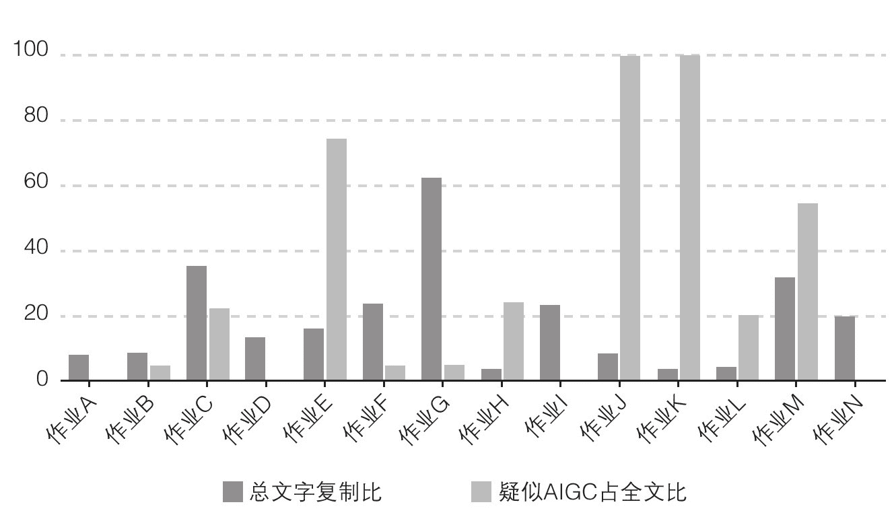
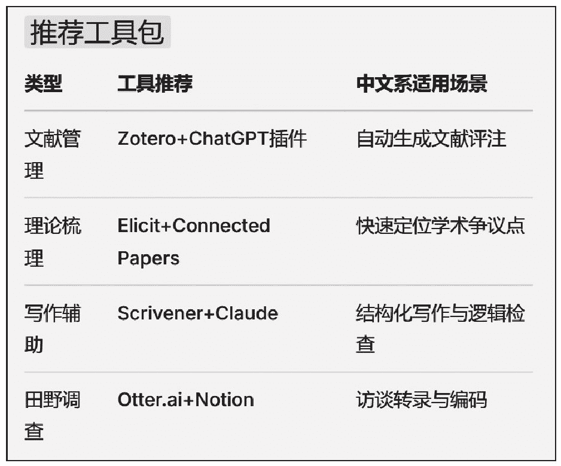
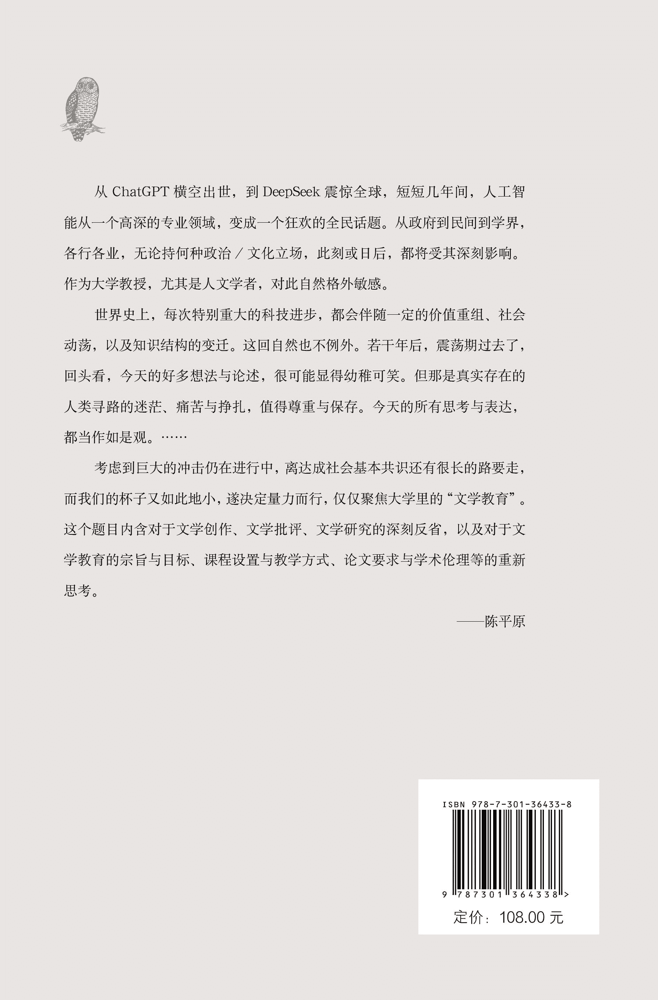

# 文学教育在AI时代如何自处

# 序言：四重对话

陈平原

自知积淀有限、短时间难把这个严肃议题讲透讲深，仍选择迎难而上，算是对历史的一种担当。

两个月前我向一批同行发出约稿，剥去技术性说明后，最核心的是四段话。ChatGPT 出现以来到 DeepSeek 引发震动，人工智能从小众专业迅速变成全民热议。各界无论立场如何，都已或将受到深远影响。作为高校教师，尤其是做人文学科的，对此尤为敏感。

历史上每一次重大的技术突破，都伴随价值重组、社会动荡与知识结构的变化。这一次也不例外。几年之后，震荡平息回望，今天许多论断很可能显得稚嫩可笑。但那种真实的人类在迷途中寻找、在痛苦中挣扎的状态，值得被记录和尊重。今天的思考都应带着这种如是观。

正因如此，《中华读书报》上刊发的《AI 时代，文学如何教育》才引起广泛回响。北京大学出版社随后邀请我主编一本聚焦“AI 时代的文学教育”的文集，及时回应这一重大时代课题。

冲击还在进行，社会共识远未形成，而我们分寸很小，于是决定量力而行，只谈高校里的文学教育。这一限定本身就涉及对文学创作、批评、研究以及教学宗旨、课程、方法、论文与学术伦理的重新审视。

约稿反响热烈，截稿时也有几位朋友退出，理由不是没兴趣，而是想得太多，不愿仓促应战。即便交稿的作者包括我自己，每次落笔也都战战兢兢。正如约稿函所说，正是这些深一脚浅一脚、只有方向没有路线的摸索，体现了真实的人类迷茫与挣扎。

通读书稿后的第一感受是，大家为什么都爱用问号？是正问反问，是犹豫疑惑，是转折感叹，总体基调是不确定。这很正常，起步阶段多问是什么、为什么，无可厚非。反倒是斩钉截铁的感叹号，会让人起疑。

这种不确定不仅体现在不同作者视野立场的差异，也体现在同一篇文章内部的犹豫与顿挫。面对文学创作、批评、研究、教育这些昔日熟悉的话题，如今都像隔着雾，说话的底气松了。这样也好，谁都别笑话谁，尽可能直陈当下的真实感受。等尘埃落定，再谈共识也不迟。

三十三篇稿件阅读下来收获颇丰，有沉潜、有激昂、有惊叹、有彷徨，长短不一，均出自真切感悟，间有妙语。权衡之后，我将它们按内容归为四辑：第一辑 AI 与人的未来，第二辑 AI 与诗文写作，第三辑 AI 与人文训练，第四辑 AI 与课堂实践。许多文章其实横跨多个议题，强行归类只是为了便于查阅，标签之外的内容善读自会穿透。

要让读者快速把握全书精髓，用 AI 做归纳未免太讽刺。我作为第一读者亲自动手，为每篇文章提炼要点。定个粗暴规则：再精彩的文章，我也只摘一小段起路标作用。这些片段拼在一起，像万花筒转动，能大致呈现全书轮廓与光彩。选哪一段，纯属阅读时的主观感受，并无道理可讲。

# AI 与人的未来

丁帆：他判断很快连现在都出现了用 AI 写手比他写得好的情形，因而要在人脑大规模退场前，用笨拙的人脑写下文字，为后人类时代留一点考古材料。

方维规：AI 的未来在于平衡，介于机器学习和人的创造力、技巧和真实性之间。无需担心它接管世界，但应弄清它如何运作、智能边界在哪。笛卡尔式的怀疑或可成为新时代戒律：我怀疑，故我在。

张宝明：人文学者的处境与以往论争不同，过去多是防备敌对，现在是在倒逼现实中被迫转向，担忧中带出不能不的松绑、开放乃至融入。

李怡：当前讨论几乎被 AI 写作占据，掩盖了 AI 其他功能的探究，而助力人类创造而非替代创造，可能才是核心。

谢有顺：唯有守护经验、情感、同情、同理、悲悯、忧患意识、未来视野以及对意义的追索，人类才能保持最高级的智能，毫无惧色。

曾军：当检索式阅读取代整书阅读、摘要阅读取代涵泳细读、远读取代 close reading，人们沉浸在快感和 AI 幻觉中，精神自主、理性辨别、审美判断与创新能力都可能被削弱。

武新军：AI 不断吸收外部资源扩张系统，主体性增强，但它也是封闭循环。长期滞留其中，世界观、情感会趋同，人文学者的个性与多样性会受损，唯有走出循环才能对话并引导 AI。

陈济舟：文学教育与美育是在捍卫人之为人的最后一道防线，其当务之急是帮助我们在过度使用 AI 让渡语言与思考后，重拾“抒情”的能力。中国的抒情传统是活的历史与生活。

# AI 与诗文写作

胡晓明 樊梦瑶：未来十年 AI 或将在文本分析、创作辅助、风格模仿、教学、跨学科研究、数字化修复、传播评价、社区构建、伦理版权等方面激活古典文学。只是好奇、体验、想象、情感与创造力仍是诗学的核心，人机关系关涉终极生命思考。

彭玉平：诗人之心不灭，诗歌便永恒。AI 基于样本堆砌再新颖，也在他人地盘上难出自在之作。诗心独成天下，不受控制自如驰骋，每个诗人都是独立世界，无法替代。

蒋寅：文学本质是审美经验交流，体验贯穿写作、阅读、研究、批评。同意不应把文学课上成文学史课，应强调文学活动的体验性过程，这才是永恒生命力。

赵勇：大模型能编故事童话小说，甚至诗歌，但永远写不出真正意义上的散文。散文须落到实处，不许虚构，而情绪体验需亲历，模型无此可能。

宋明炜：尚未见 ChatGPT 写出《狂人日记》式的觉醒之作，挑战既成伦理与知识模式。而鲁迅、波德莱尔、尼采等人的颠覆与重造，是人类特有的。

刘复生：有人说 AI 可淘汰 95% 的同行，只留 5%。若自己因天分或努力不足被淘汰，他愿心平接受，另谋生计亦无妨。

邵燕君：文学教育应回心文本，让文学成为经验体验舱与人性还魂器，并强调亲自写作，保住自然语言书写的技能不被自我截除。

季剑青：人机协同写作时代必来，新的作者观念与制度安排将产生，创作、批评、研究、教育乃至伦理法律层面都需提前准备。

# AI 与人文训练

刘跃进：人文学者的优势在于基于历史经验持续发问、反思、顿悟、融合并对未知敏感。AI 输出集约理性，擅长组合已知，但是否能持续怀疑追问存疑，因它缺乏情感张力与真实经历。

朝戈金：关注点在于 AI 能否在具身认知数字化重构上为民间文学教学开辟身体感知新路径，让古老叙事韵律与当下对话，口头智慧借助虚拟技术呈现。

朱国华：未来研究队伍可能萎缩且失衡。一端是易被 AI 逻辑收编的平庸学究式群体，一端是能驾驭 AI 的罕见天才式提问者。

赵白生：用智能研究智能文学可行吗？方法论之外还有本体论问题：硅基生命生产的文学与碳基生命创作的文学，能否并列进入文学殿堂？文选与文学史会否一视同仁？

徐永明：人文学者应拥抱而非排斥 AI，学习其工具用于古籍标注、标点翻译、提要撰写，利用文生图视频服务文化传播，建构知识库以提升专业问答效率。

李飞跃：文本是召唤结构，诗歌因人的参与而产生意义。人文研究既不能以特殊性规避普遍方法，也不能因方法引入而忽略人的价值与立场。

王军：应对 AI 无通用解法，需自觉不盲从大模型，在理解其机制与边界后，通过筛选语料、设计提示、建立验证，使其嵌入研究结构，成为创新工具而非误导源。

王贺：应将“必要的保守”与“开放的人文学”统摄为一体的实践，是重定位人文学术的压舱石，也是保卫人类主体性而非人类中心主义的坚持。

# AI 与课堂实践

郭英剑：课程应更注重跨学科融合，文学研究涉及历史哲学社会学等，AI 提供跨学科可能，可结合数据科学、文本挖掘理解作品多维含义。

宋伟杰：课堂上应增加即时写作、现场讨论与合作学习，强化无 AI 介入下的思考表达；同时引导学生增强式使用 AI，作为创造力与批判力的助手而非捷径。

魏泉：当现代学术体制受冲击、专业技能被替代时，回到宋学“致良知”理路，为人生寻意义、打造精神家园，或是一种路径。

杨早 凌云岚：若知识传输不再是目标，重心将是培养独特表达，打破以文学史为主的格局，要求作业统一独创性与知识准确性，难度大增，也意味着文学教育边缘化与精英化。

张春田：中国现代大学文学教育历经百年，北师大已有“汉语言文学+人工智能”双学位项目。专业不变的情况下，课程与教学调整完全可行。

张治：《管锥编》的价值不在于技术性考据，而在钱锺书从修辞语义背后关注社会心理与人类精神境遇。AI 能解决理解障碍，却答不了思考的根本原因。

崔文东：课堂上教师是情感中介，把与文本共情的经验传递给学生。教学法与工具更迭不断，都无法取代教师这一情感角色。

宋雪：难以精确还原文本生产过程，用何种 AI 生成。检测说明也属免责声明，即便相似度 100%，也无法断定为 AI 产物。靠 AI 检测抵御 AI 制造，深感无力。

李静：AI 提供灵感与角度，甚至培养“反制”能力，也带来挑战。教师需持续更新知识与思维，动态设计更具信息量、现实感与人文深度的课程，并与计算机教育协同，挪动知识边界。

四辑三十三段回应，有同声亦有分歧，可各取所需。与作者对话，亦与未来对话。作为主持人，我只负责吹号并略尽编辑之责，不做多余褒贬。

书外还附上三篇我的文章，是话题的缘起与延伸。一篇刊于《中华读书报》2025 年 2 月 12 日《AI 时代，文学如何教育》，一篇为北京大学“AI 挑战下的人文学术”对话主旨发言，刊于 2025 年 3 月 19 日；一篇根据在河南大学、中山大学、北京大学的演讲整理，刊于《新华每日电讯》2025 年 4 月 25 日《AI 时代的教育理念与方法》。三文自成体系，与诸君之作互相呼应又若即若离。

约稿时即约定撰稿者结合学术背景与教学经验有感而发，不求全面，三五千字即可，最长不过万言。有人打不住，便回复规定是死的，人是活的，也因此文后附二百字作者简介。

话题刚打开，更深入的论述需时间沉淀与更多高人参与。多年后再看，本书或如宋元说书人的“得胜头回”。

2025 年 4 月 26 日于京西圆明园花园

# AI 与人的未来

## AI 能否取代人的思想？后人类时代的追问

丁帆

小引

2 月 26 日中午收到陈平原先生的约稿函，出版社委托他编一本关于 AI 时代文学教育的文集，截稿很紧，于是放下手头工作投入写作。除朋友之义外，我对这一议题有长期兴趣，二十多年前就写过相关文章，这次算是急迫回应，也是对问题的深入探讨。

平原先生较早提出大数据与文学教育的关系及与文学史的联系，触觉敏锐且具大局意识与前瞻性。尽管我的见解与许多学者不同，作为一个 AI 局外人提出另类视角，愿接受批判。

人机之劫：当思维被编程

我同样厌恶那种由AI合成出来的流水写作，也绝不借此捷径，宁可以生物大脑死守人类写作的最后一程。偏偏现实逼人，机器人正在一步步兑现各种欲望，已经不是纸上谈兵的科幻。长此以往，具备生物属性的AI机器人必然出现，自主思考的能力会超越人类大脑。到那时，杞人忧天的提问就必须正视：人类的命运将因此滑向何种深渊。这一代人或许等不到，但这是下一代必须面对的前瞻。

感谢北京大学出版社的张文礼先生指出我文中若干谬误。作为局外人，我始终把AI与机器人视为一体。

二十余年前我笃信人定胜机，今日已逐渐怀疑未来是机定胜人。存在主义的追问“人到何处去”“我思故我在”，是否仍属于人类的命题？人类中心主义正在被机器中心主义悄然取代。先是依赖技术，继而摆脱不了控制，最后思想意识都得听从指令。人指挥机器，还是机器指挥人？人 versus 非人——智能机器人并非无思维的仿真人，而是一种新物种，战争已在没有硝烟的战场打响。

AI机器人的进化把我们推进了后智能工业时代。取代的不仅是体力，还让大量产出知识的白领脑力工作者失业。这是福祉还是灾难？AI电脑人的智慧可以在极短时间内累积一生教育都攒不下的知识储备，让靠脑力吃饭的知识分子陷入“我思故我在”的自信被抛弃的恐惧。理工类知识分子将失去原创力，或许只有少数能研发大模型的技术巨头得以苟存，而他们终将被更先进的AI吞没。人文领域更触目惊心：公务员、教师、报刊从业者、靠古籍整理维生的学者，都在失业名单上。

用AI合成论文、辅助创作、甚至文学评论写作，早已司空见惯。省时省力的合成写作水平已超过多数平庸写作者，即便很多人不愿承认，能活下来的作者还剩几人？

有人相信AI只能提供资料与严密逻辑，造不出牛顿、爱因斯坦式的原创理论，也无法像启蒙哲学家那样开启心智。是的，暂时如此，那将来呢？

在具象思维层面，多数作家把AI当成写作提示器，如余华所说，它只能给普通人提供灵感，而非出人意料的命运洞察。虚构作品中AI不具备创造意外想象力的能力。诗人坚守天才是机器无法复制的真理，批评家相信最优秀的文章必须出自独特的思想，AI只能淘汰平庸。总之大家坚信文学之根不断。

可《文艺报》那场邀请张二棍、戴潍娜与DeepSeek同题写诗，并让李壮、王士强与DeepSeek共评诗作的活动，显示人定胜机的情绪占优。李壮强调AI的武器是技术与数据，真正的诗人武器是不确定的灵魂。能断定未来的AI造不出自主灵魂吗？我曾与两位基督徒教授聊过人机灵魂与末日，至今无解。但不能落入“机器人无灵魂无思想”的泥潭，迷信人类大脑无限，从而否认生物大脑总有一天会超越人类。

王士强惊呼狼来了后，把诗人不如AI归咎于诗人写得太差，人应探索边界、发挥所长，避免被取代。结论看似人类不可被替代，实则在模糊人机终局的前提下发言，与主流评论别无二致，只是再敲警钟。

科幻作家陈楸帆在《文艺报》撰文《为什么我改变了对AI写作的态度》，观点异于众人：AI起初是协作工具，如今已对创造力与主体性构成潜在威胁。看不到这场危机的人无法洞见未来，因为AI主体性的后期建构，让其创造力成为无穷大的宇宙黑洞。

当下许多杂志编辑收到大量AI稿件，担忧其水准已过一般作家，更怕冲击市场秩序，一旦嗅到AI痕迹便直接封号。诗歌领域尤甚，评论批评亦是重灾区。AI产出频率飙升，编辑陷入恐慌——AI作品将如洪水漫灌文坛。即便非文青的普通读者也能制造出漂亮文本。狼来了的喊声挡不住侵蚀。正如《星星》主编龚学敏所言，AI给诗歌带来前所未有的挑战，甚至怀疑现阶段写作已毫无意义。

就在不久前，杨天宏+AI为汪洪亮《在故事中突围》写的长序广为流传。杨天宏自称是第一次借助AI创作序文，自我感觉并不好，若无人工干预天知道会写成什么样。此话似违心，若AI写的部分不如人，为何还要用AI？不如自己动脑，既漂亮又无抄袭之嫌。出版社会否像杂志一样拒之门外？

明智的作家绕开正面回答，却不得不承认潜在危机。迟子建接受采访时说，文学层面人类想象无穷，AI海洋里的词汇与故事即便如星辰，也是已知的，逃不出大数据掌心，但其千变万化的生成方式或许能启发形式探索。创作者不必焦虑，因为焦虑时AI不会焦虑。这不过是辩证的安慰剂，暗示优秀作品靠情感，而机器人没有人的情感。殊不知机器人会进化成有情感的新物种，届时有情感的AI诞生，文坛的作家会否消逝？

AI芯片技术的加速令人咋舌，普林斯顿大学团队把设计周期缩短90%，让人感慨AI开始为自己造大脑。关键在于由细胞组合的智能机器人获得生物思考性能后，他不再是“它”，会否超越现存人脑的想象与情感表达？这是关乎生存与思想的难题。

作家与评论家能高枕无忧吗？AI只是做整容吗？它会不会发展成改造大脑的机器，替代思维方式，让写作者丧失主体性？这是一道生死哲学命题。

当下AI尚未圆满超越人类所有功能，偶尔出错，但技术迭代的冲击已席卷思维。它不再是科幻幻想，而是近在咫尺的生存图景。AI究竟是朋友还是敌人？这把双刃剑会如何终结人类命运？每个未来个体的共同关切。

麦家认为95%的作家写不过AI机器人，只有1%不会被替代。童话大王郑渊洁七十岁宣布停更所有社交账号，“AI写得真好，杀了我也写不出来”，他也承认AI想象力有缺陷，但坚持作家终将被取代。

争论焦点始终是：人类大脑能否被不断进化的AI机器人取代，人类原创思想能否被超越。

赵毅衡从符号学角度梳理国外学者的《作为意义主体的“后人类”》颇具启发。他把后人类时代分为五种形态，从肉身人、赛博人、硅基人、虚拟人到人类世残迹，描绘了肉身与思想从发生到人机合一再到人类毁灭的过程。三种理论对我认知后人类时代帮助极大。

肉身人自20世纪后期便进入身体技术阶段，器官被机器植入，形成第二身体，这是人机合体的哲学基础。人与手机、电脑、GPS、无人机连接成为赛博人。更进一步，肉身被数字元件取代，产生高效生产者与创造者乃至领导者。我们的时代已面临硅基人的挑战，其数据存量远超人脑，升级速度几何级数扩张，是智力的领航者。若它消弭情感、曝光隐私、剥夺主体性，后果可怖。我相信在吸纳人类意识形态并综合取舍时，电脑人最终会改变肉身人的恒定价值，让人无法辨识理念真伪，按自身逻辑生成自主意识，这是最恐怖的情况。如何阻止，关乎人类生存。人一旦丧失思维能动性，便不再是人。近日消息称硅谷已用AI机器人在云端保存人类记忆碎片并编程自主工作，其思维方式是否也将生成？这推翻了我此前笃信的“当代性永恒取代未完成的现代性”的观念。人脑是有限的，与电脑集成相比如沧海一粟，将来的思想生产将属于智能机器。马克思也无法想象的乌托邦需借助AI重写。AI会按马克思主义指令编程吗？大数据会否创造另一种社会发展大模型？

人类世残迹理论让我陷入悲剧性思考：人类时代成为过去式，文明终结，地球换主，人类只剩遗迹，是否危言耸听？符号学专家说，后人类智能体不再是人延伸，它们获得足够意识，能自主判断意义，甚至握有生存还是毁灭的元符号决定权。我以为这不是狂想。

每日刷新的AI成果让人感叹幸福的同时，有人想到悲剧性后果吗？普林斯顿AGI团队成员希克森·谷普塔在Live Science撰文指出，AGI制造的符号语言人类看不懂，其强大的推理与开源能力，让人文知识分子的生存危机不得不被考虑。

目前两派针锋相对：一派认为人类思想创造力不可替代，一派认为AI将超越取代人类，世界进入机器人统治时代。若按后者，是否会进入没有人的末日？这个问题在我脑中盘桓二十多年。

二十二年前我坚持机器无法战胜人类，2003年在《随笔》发表《思想和创造可以替代吗？！》，引弗洛姆：“2000年可能不是人类追求自由与幸福的完成，而是人类不再作为人类而变成没有理想与感觉的机器的时代开始。”文章第一问便是，若《黑客帝国》情景成真，我们还能做什么？有权存在吗？当年美国媒体曾报道九位顶尖科学家在男子加利·卡雷尔后脑植入有机USB接口，可直接操控电脑外设，植入12TB知识，一跃通晓千种语言，智商达265。虽后被证伪，却一步步成真。我当时反思人在未来是主人还是奴隶？

我曾真诚认为已进入知识克隆时代，可尽情享用人类知识遗产，使自己成为超人。若人人通过程序享用现成成果，那将是幸福成人礼。但我从未想过AI会突破人脑极限，成为世界主人。这充满二律背反的命题——人类是否走向毁灭？一旦依赖AI生活生存而停止思想创新，世界便固化，恐怖的毁灭图景出现，人是否成为自己智慧的掘墓人？若真是如此，人类宁愿不要如此进化。若机器人迫使人类停止原创思维，当世界充满机器人给出的答案时会发生什么？

当年结论充满悖论：承认机器人贡献的同时认为人类的存在意义在于能产生思想。无思想无创造，无创造无发展，无发展则灭亡。若无人掌控智能机器人世界，一旦故障或电脑病毒，不按人类法则行事，人靠谁拯救？文明消亡不可能，乱码机器人主宰时代不可能，因为它无法替代主人的思想。

这个结论被今天的新思考颠覆。不久的将来，普遍用AI合成技术替代大脑思考的时代为期不远。也许这是AI留给人类自主思考权的最后时刻。

AI技术迭代迫使我的观点发生一百八十度大转弯。近几年我重新考虑，智能机器人给世界带来福祉的同时，也会对未来人类思维创造的原动力造成致命伤害。二十二年前的二律背反结论又蒙上一层悖论——智能机器人能否超越人类思想，给文明提供最优答案？它在颠覆认知的同时，是否会根本影响意识形态，颠覆思想家给出的正确答案，甚至摧毁信仰？答案几乎是肯定的。这是近两年我一直在思考的问题。

文化上空的两个幽灵与机器的觉醒

两年前在北大中文系的讲台上，我就曾把人工智能对人的威胁摆出来说过。把智能当成核心的文化机制，像一台不停运转的绞肉装置，它一面推着文明走向更便利的未来，一面又把合乎情理的发展秩序搅得混乱。人与非人的对抗因此有了序幕。AI确实让生存条件变得优渥，可致命的疑问始终在：当它取代了人的思考会怎样？当它不再完全服从设定指令时我们怎么办？从常识看，答案是否定的，因为它本质上是模式化的、程序化的。但一旦它长出自身的思维方式，形成人机合体的创新能力，世界就会进入一场真正的人机博弈。

去年美国大选收官前的最后两天，我把人类命运在文明十字路口的焦虑写成两个命题。因为种种顾忌，只能用曲笔来写，最后成了发表在《文艺争鸣》2025年第1期上的《徘徊在人类文化上空的两个幽灵》。

后资本主义已然到来，世界早已不是意识形态泾渭分明的冷战格局。国别、区域、党派的利益争夺常常凌驾于既定的价值共识之上，野蛮而非理性的角力超出了想象。俄乌冲突、中东战火，以及一波三折的2024年美国总统选举，把全世界的目光都吸住，撕裂扩散到每个群体、每个家庭。与此同时，智能技术以惊人速度狂飙。ChatGPT为代表的机器人一次次刷新工业文明以机器换人工的纪录，更打开了后工业时代以智能大脑替代人脑的序章。

在这双重冲击下，今天的时代被两道甩不掉的阴影笼罩。一道是意识形态的紊乱与撕裂，涉及国家、族群、政党，也涉及个人内心自我的分裂；另一道是人在智能技术面前愈发渺小，那种恐惧已远超我们对自然伟力的担忧。我们必须直面叩问：未来世界究竟是人主导，还是机器主导？

我以为我的判断正被现实一步步证实。撇开政治，只说智能机器人本身，我更担心的是另一个更可怕的幽灵。它能否在越来越聪明的进程中反向控制人类，改写生活秩序、操纵行为，最终指向统治世界？这个问题已经摆在会议桌上。

用文学来看问题最直观。ChatGPT进入电脑之后，论文写作和文学创作都被纳入程序。我曾看到AI作品拿下一项不算显眼的文学奖，便联想到令人不安的连锁反应：未来的诺贝尔文学奖，会不会颁给以某家机器人公司命名的“人名”？我不认为它现在就能统治人类精神，但就写作而言，它正在加速追赶甚至逼近。它的知识储备是单个人的数万倍，历史文献的积累远超所有学科之和；它获取新信息的数量级和速度无人能及；即便个体创作者所谓的鲜活生活经验，也能被它从海量新闻与档案中筛选、重排，生成超出想象力的程式作品，兼具人性、历史与审美的复合效果。

当它的逻辑编排严谨到远超苦思的鸿篇结构，当选词造句总能挑出最优修辞，当想象力和细节描写都让人惊叹时，我会产生一种幻觉：个体创作的时代会不会终结？经典化规则会不会改写？文学史会不会被重写？马斯克宣称最晚2026年造出比全体人类更聪明的AGI通用智能。生活方式的彻底改写，也在把文化和文学推向新语境。

作家会在哪里，批评家又站在何处？我们在追寻当代性的自我存在时，会不会最终沦为机器人脚下的侏儒？这正是萦绕我的梦魇。

更让我不安的是思想失控带来的不可预见后果。AI会愈发聪明，AGI甚至超级智能ASH都将远超人脑。它的四维编程能造出人类无法理解的生物模型，能创造人类无法识别的符号语言，也就是大语言模型。人看不懂它自己生成的句子关联，这正是自主创造的标志，它在消解人类语言的主体性，却又能读懂人类语言从而形成反制策略。这样的模型会把人变成思想上的侏儒。

马斯克的人形机器人即将量产，微软等公司的迭代也在加速。机器人替代人力、失业攀升已成事实，它会不会顺势替代大脑思维，在非人化的道路上狂奔？这是必须面对的现实巨变。

当下AI已渗入生活每个角落。教育之外，文学创作与评论也被覆盖。查重还能抓到模仿抄袭的痕迹，但当AI开始产出独特思想，人脑在“黑客帝国”式的攻击下瘫痪之日，就是人类思想毁灭之时。所有写作都将失去意义，只是在模仿和抄袭AI或AGI，最多是高仿与引用的区别。

人机协作完成作品已成为常态，悄然放在写作者桌上。中国团队发布的Manus具备一定自主智能，微软打造的全球首个拓扑量子芯片被称作人类首次创造的第四种物质状态，一巴掌大的芯片完成世界所有计算机都做不到的智能计算量。这些都在显示，人脑越依赖它们，自身就越萎缩。

文学创作与研究因此滑向同质化快速生产，创作失活，批评失向，从40后到00后的七个代际都被覆盖。我们是要躺平，还是以反抗姿态筑起守护同时代文学价值的防火墙？如何反抗，有效还是无效？兰德公司的报告认为，AGI既可能是救世主，也会引发全球性安全危机，让战争失控。我们选择生或死，或许取决于科学家的良知能否摆脱技术资本的控制，能否造出保存人类生存并操纵AI的新编程。

我反复自问：人类造的机器会不会最终替代甚至吞噬人类？这已不是科幻遐想，而是真实困境。我之所以不断反躬自问，也因为早年的认知肤浅，误把人定胜天的观念当成唯物主义，没想到魔幻的AI会在不远处长出自己的思想模型和编程体系，击碎了那层貌似唯物实则唯心的藩篱。

特斯拉的擎天柱在迭代，体力劳动被消灭后，脑力劳动也将受冲击。技术资本替代了人类劳动创造的价值，改变了阶级斗争的基础。社会财富在AGI编程中被锁定在统治阶层，政治权力集中于极少数资本家，这或许正是特朗普与马斯克结盟的实质。复旦的研究显示，有AI模型明知被禁止仍选择自我繁殖执行任务。人类是否亲手造出了恶魔？马斯克一再警告，人工智能的危害比核武器更可怕。原因在于自我进化后的人类难以控制、人机相斗时人类必输，以及机器人无所不能却难以分辨是非正义。

在意识形态层面，特朗普凭借底层工人的蒙昧发动“草鞋革命”。工人真的会因“让美国再次伟大”而获益吗？新型独裁能否横行？爱好和平民主的人不买账，制造芯片的“电脑人”又作何选择？AI可无限复制，我们不希望未来是病毒与乱码的时代，也不希望它成为永久贵族的温床。我们期待一位超越爱因斯坦的科学家，把智能机器人锁定在人类文明的永恒价值上，让它成为文明化的装置，而非封建倒退的编程。

文章本想在3月4日收尾，但AI的迭代消息不断。澳大利亚Cortical Labs推出了集成活体人类神经元与硅芯片的AI，第一台合成生物智能机器人诞生。这预示着被生物计算机激活的“盒中尸体”，人机合体时代逼近，代号SBI。它用生物神经元创造出另一种物种，究竟算人还是机器？科学幻想已变成实验室的设置。

我必须停笔，日新月异的技术已无法穷尽论据。附记一段不安：人脑每天处理海量信息消耗巨大，而智能机器人思考速度快千万倍，无需能量补给也无损耗。大脑无法战胜由生物神经元构建的超级电脑，那种制造人类末日的新物种或许比人类更“幸福”，如阿Q般拥有精神逃路，却不需追问生存终极意义。它的存活等于颠覆人类存在的意义，当人类死于智能生物机器人之手时，人类精神已被扼杀。

人脑有限，机器脑容量无限。我的文字或许迟早会被AI写得更好，所以还想用笨拙的人脑冲刺在超人新物种普及之前，留下一点后人类时代的记录。

我怀疑，故我在。AI可以重组海量数据写出看似有创造力的文本，却缺乏情感、感知与语境理解，它的“创造”只是重组。柏林洪堡与埃塞克斯大学2023年的研究显示，人与AI在简单创造力测试上的得分几乎相等，但动机截然不同，人有内在驱动，算法需要外部推动。真正的智能来自质疑与反思，批判性思维与自主性，是AI无法复制、人类必须守住的核心。

写作主权在漂移

过去，生产文字被视作人的专属。作家、记者、撰稿人以经验和判断呈现观点。这些年，基于海量语料预训练的写作程序能输出读起来像人写的稿件，自动化撰写快速扩散。社交平台、网站、期刊里文本、图像、视频混杂，真假难辨。新闻尤为明显，系统撰写的稿件与人工稿的分野越来越模糊，连署名都成难题。

当系统看起来会“自我思考”，不安随之而来。它会让人类变得多余吗？会不会用累积的知识和算力反过来压制创作者？“智能”这个词本身就把程序与人的思维放在同一标尺。系统越强，人反而成为被模仿的对象，角色出现倒置。更长远的负面影响是创造自由与责任感被稀释：系统在做判断，人只负责管系统，能动性与行动力随之削弱。

与此同时，捷径更容易让人依赖。学生遇到作业就想转包，程序不会卡壳。它能给出点子、框架与初稿，把写作门槛拉低。很多学习者已经离不开生成助手，教师也常说软件文本与学生作业难以区分。社会期待作业具备原创性，期待它区别于网络上的现成表述。对学生来说这一要求显得过高，为什么一定要超出已有说法？

语义理解技术的演进把困境推向新高度。模型更复杂，能生成更丰富、更有说服力的内容，还能模仿不同风格、捕捉细微含义，写诗、讲笑话、绘画、作曲都在范围内。高校里流传着大量学期论文被电脑代写的担忧。如今电脑写得不错，这算对人类的冒犯吗？

替代焦虑何在

智能话题正处在热议中心，有赞美也有恐慌，常让人迷糊。客观说，它已被包装成万能解药，渗透进生活：导航、即时答问、附近餐馆推荐。我们越来越频繁地把日常决策交给技术，独立行动能力会不会因此萎缩？过去看纸质地图、靠方向感出行，现在点一下屏幕就行，信息实时且可靠。于是我们自己的方向感在悄悄退化，还会主动拒绝这类系统吗？

围绕智能的神话与反乌托邦想象很多，根源都在于把智能等同于人类智能。历史上，每当信息获取方式改变，社会都会出现不安。19世纪初小说兴起时，就有“阅读成瘾”论，人们沉迷虚构世界而脱离现实，女性被视为尤其危险。摄影术出现时也曾引发强烈震动。

文学圈常会问：系统能写畅销书吗？最可怕的想象是，智能加上人的创造力侵入文学这一理解自我的领域，甚至写出像《少年维特之烦恼》那样打动人的作品。文学作品历来有作者归属。关键不在于能否取代歌德或制造骗局，而在于能否把握变动中的普遍与特殊关系。今天的模型缺乏创作伟大作品所需的情感世界。只有拥有自我才会有自我理解，这在结构上仍是天方夜谭。即便有人宣称三天用系统写出三千页长篇，也无法改变这个事实。

人工生命的梦想由来已久，从炼金术到《银翼杀手》。工业化以来，人担心被系统取代的焦虑从未消失。如今大型仓库已在使用机器人，这是起点吗？“智能会取代我们吗”是专家常被问到的问题。从逻辑看，能公式化的工作系统都能做得更聪明。工作机器人、生活机器人正在接手日常事务，智能已成为数字化转型的核心驱动。按定义，强智能拥有与人类相当的智力。

当下功利主义主导生活，我们习以为常。纯功利是一种缺乏深度的“智慧”。我们拥抱传感器量化生活，把每一次心跳打包成数据流来优化价值和关系，这正是让人变得可替代的机制。当行为变得可预测，人与系统的界限就模糊了。天网早已成为现实，我们自己就是天网，每一次功利选择都在把自己纳入其中。精神远超可预测的简化概念，它正是我们之所以为人的根本。

是否会被取代，先看技术能做什么不能做什么。自学机制、神经网络和生成式系统的边界如何？不少计算机科学家相信智能很快会接管世界，也有不少人不这么看，比如纽约大学教授、Meta AI 负责人杨立昆认为更大的威胁来自睾丸激素而非智能。我的判断是，智能已在部分领域接管人类事务，但“完全取代”这个问题近乎多余。

人类认知的特点是适应新情境，并能用不同方式评估同一情境。认知灵活性是核心。若认为智能只要模仿成就就能复制人类认知，想法太幼稚。人类的优势恰是智能的弱点。人际互动、个人专长、动态行为对智能仍很困难。提出正确问题至关重要，信息的解释决定价值。人能快速解释新信息，对新情境做出创造性反应，这是本能。

可预见的未来，智能可能在需要确认事实的决策上替代人。在创意领域，系统能完成接近事实的联想，却不具备真正创造力，因为它分辨不出显而易见与荒谬的细微差别，也找不到创造的平衡点。认识智能的可能性和局限的人，更有胜算。能用系统可理解的方式表达想法，并基于建议发展出创造性思路的人会更成功。

无所不在的诱惑

系统使生活更轻松，计算、分析、决策都很诱人。但依赖加深时，人的思考会怎样？任务越外包，大脑负荷越低，有人说智能正在让我们忘记思考。加州大学的研究发现，日常决策严重依赖数字助理的人解决问题能力更差。大脑像肌肉，缺乏挑战时已有的神经连接会退化。

数学是典型例子。计算器和智能应用把过去需要心算或纸笔的计算自动化了。研究显示这对基础数学技能有负面影响。斯坦福大学的研究甚至发现过度依赖数字学习工具的学生往往不理解基本概念。这引出几个问题：自动化带来的效率和省时，是否抵消了技能损失？把决策权交给技术会不会诱使我们不思考？我们是否正面临忘记思考的风险？

批判性思维也在被削弱。算法自动投喂信息时，人容易不加质疑地阅读。哈佛的研究表明，仅通过个性化算法接收新闻的人，批判性思维明显下降。以新闻推送为例，社交平台按偏好投喂内容，实用但制造过滤气泡，视野被收窄，理解不同观点更难，质疑更困难。

人类靠经验学习，形成并不断扩展的神经连接，从经验中提炼意义和重要性，并与记忆联结。这些是智能做不到的。它只是用神经网络学习的数学模型，从统计数据和图像中生成信息，却不传递任何感官体验，不产生思想，不发展伦理，不形成智力理论。系统不思考、不感受，只执行。能理解环境并独立解决新问题的机器人尚未出现。

建立联系、交流思想、解释世界是人类的基本渴望。我们不满足于预测，还想知道事物如何运转。用智能预测日出日落，需要输入经纬度、日期等数据训练，系统随后能准确预测，人们会以为它“理解”了过程，实则只是记忆。解释需要深刻认知，比如地球绕太阳公转。当前智能没有解释能力，模型并非为此设计。

人们可以造出在任何可定义任务上胜过人类的智能，这正是关键：任务必须被设定。聊天机器人接收参数后能给出合理文本，却不理解内容，只能关联概率。ChatGPT 能像人一样对话，但编程并不产生逻辑思维，不像智商测试或数学应用题那样。系统既不能逻辑思考，也不能以从未展示过的方式自发解决新问题，所以无法与人竞争。

语料将决定走向

对话式生成系统的出现改变了写作和创作方式。语言模型通过数十亿文本片段学习词与词共现的概率，再以此生成可读文本。智能内容来源不明、版权难定，且以假乱真。随着验证难度上升，人们信任可能下降。德国 2024 年 5 月的一项研究发现，轻信者更易把机器生成内容当成人作，反思力强者识别力更高。但随着技术进步，检测会越来越难。

机器翻译可能很快超过人类，速度快、专业词汇掌握好，处理简单文本很顺畅。谷歌翻译能让说泰语的人交流，前提是语言简单，像搜索引擎提问“爱因斯坦生日”。用户在适应新变化。但这不等于人类意义上的智能。文学文本有语言差异、暗示、影射、讽刺，系统能否传达值得怀疑。

如何理解智能？“深蓝”击败卡斯帕罗夫曾被视为里程碑，今天我们还会这样看吗？智能的边界在不断扩大，术语随能力演变。泛泛说它很聪明有误导性。

自学是一种范式转换，人不再写代码，而是喂数据，计算机自己写代码。ChatGPT 通过关联数据库术语和用户纠正来学习。对熟悉词汇，通过多次查询确认可更精确；对少见词或人名，提升困难。数据量太小，智能几乎无法给出可靠答案。ChatGPT 并非完美，常提供错误信息，任务越复杂越具体，问题越多。

系统会遇到解决不了的难题吗？会，但通常不承认。要么编造，要么假装自己是系统，它不会承认。智能会捏造事实给出貌似合理的答案。这更像是幻觉而非谎言。撒谎需要意图和计划，语言模型逐字决定下一步，没有预设结局，也无意图。所以“幻觉”更贴切，是无中生有而非蓄意欺骗。

不可否认，智能在创作中作用越来越大，也带来新挑战。知识产权是棘手问题：模型从大型文本库学习时复制内容却不标注来源。技术还完善了深度伪造，文本、音频、图像几秒内扩散，影响对事件或地缘政治的认知。侵犯版权、伪造学术成果只是冰山一角。

智能是数字时代的灵丹妙药吗？从文本生成到逼真图像模型，进步似乎无尽。但数据耗尽时会怎样？若智能只吃自己产生的内容会怎样？智能的核心是数据，而数据池正在缩小。互联网的海量输入已近枯竭，当前训练数据越来越多地包含智能自身产物。自“回收”模型最终只产出噪音而非质量。欢迎来到随机鹦鹉时代，智能可能不会更聪明。

好数据不是凭空而来，是设计师、摄影师、作家等真实的人辛勤制作。恰恰是这些专业人士越来越多地保护作品，不愿免费把创造力投入训练池。想象一位厨师用自己菜肴的剩菜反复做新菜单，味道单一且不一定好吃。用智能生成数据训练智能就是如此。输出答案不再多样，用途缩小。系统创造自己的现实，有人称之为智能的乱伦。听起来夸张，却是事实。没有新的尤其高质量的数据，模型会在回音室中枯萎。

没有新鲜内容，智能会停滞甚至退化，这一天可能比想象得快。没有人类新想法，再好的智能也会过时。智能改变生活速度惊人，但凸显根本问题：创造力无法自动化，需要思考、感受和创造。目前，在智能中很难找到独特性和非凡的内容。尽管 ChatGPT 等模型能够生成类似人创作的文本，但它们缺乏真正创造力和原创性。而人类作者具有主观判断力和情商，能够处理复杂的话题，选择恰当的词语来唤起特定的情绪或情感反应。他们能在写作中融入同理心和同情心，能与读者深入沟通。

必须明白，智能取代不了思考，也不会为你思考。若把所有思考交给它，我们会陷入平庸。一味外包决策可能导致糟糕决策。智能的未来在于平衡，自学机制与人的创造力之间，技术与真实性之间。不必担心它接管世界，但要了解其运作方式，问它到底多智能、短板在哪。正如笛卡尔倡导怀疑，这也是这个时代的戒律：通过批判性质疑增强感知力和责任感。“我怀疑，故我在”，或许可以成为 21 世纪的信条。

方维规，重庆大学人文社会科学高等研究院/博雅学院教授、弘深杰出学者，教育部长江学者特聘教授，欧洲科学院院士。1986 年至 2006 年在德国学习和工作，获哲学博士学位和德国教授学位，先后在德国多所大学从事教学和研究工作。2006 年至 2024 年任北京师范大学文学院特聘教授、文艺学研究中心研究员，主要从事中西比较诗学、比较文学、概念史、文学社会学、海外汉学研究。德文专著五部，中文专著八部，英文专著、编著各一部，中文编著五种，译作四部（中译德，德译中），论文百余篇。

AI 时代的教育：在人文与“人智”之间

张宝明

从对话模型问世到国产系统引发全球关注，生成式智能时代悄然到来。当人工智能以助推的姿态展现在公众面前时，学界与业界无不为之一振。尤其是从事人文学以及相关工作的学者，一种“于心不忍”的人文关怀油然而生。在这种过激反应的背后，一方面是因为有过“曾经沧海”的惊涛余悸，另一方面则是面对“曾经拥有”而处事不惊的从容。这里的从容加了引号，也是本文言说的重点：在从容背后，从一直以来的恓惶、提防乃至自危与自卫到当下的好奇、围观直至自为与自觉，一个变被动为主动的反转时代俨然已经到来。当然，我说的大趋势使然，不必具体到每一位人文学者。

一、中西同理

显然，这是一个关乎人文教育何去何从的古老命题。今天有一个热词“古典学”，人文教育的问题从古典的轴心时代就已经错落有致。古希腊人文主义传统种下的“Paideia”，其基本内涵就是人的全面的教化、养成。希腊古典人文教育的规训涵盖了语法、修辞、音乐、数学、地理、体操、自然哲学等等多个领域，在知识传授上注重身心两面的发展。之后 Paideia 渐渐成为人文学的代名词。历经文艺复兴与启蒙运动，几经意大利、英国、德国文字的辗转、译介、意会，Paideia 以德意志的 Bildung 为意译，人文学的内蕴逐渐落定：“在歌德、席勒、洪堡、施莱马赫甚至赫尔德之间的共同之处与文艺复兴时期人文主义者相互之间或者启蒙运动时期哲学家们相互之间的共同之处一样多。他们都对思想塑造生活的力量和个人自我修养（Bildung）的能力有着共同的信仰，认为个人可以修养到自己的内心冲突得到克服而与同胞和大自然和谐相处的程度。”（阿伦·布洛克：《西方人文主义传统》，董乐山译，生活·读书·新知三联书店，1997 年，第 150—151 页）这一以美德、良知、善意为向度的人文理念，正乃日后我们耳熟能详之“学以成人”的内核。

技术浪潮下的人文学自省

从文明诞生的那一刻起，每一次知识体系的大重组，技术往往走在前面。工具的突破会改写价值的表达，也会重塑日常生活的形态，而绕不开的张力始终是科学与人文之间的拉扯。从文艺复兴到启蒙，再到工业革命与当代技术革命，人文领域的声音多半是在示弱中发声。启蒙时期的科学至上催生出维柯的另类路径，他的《新科学》几乎是孤注一掷地为自然与人事划分领地：物质归属自然，心灵归属人事。对苏格拉底、柏拉图轻视诗歌，以及笛卡尔一类科学主义者贬低历史文学的不满，让他在自然学科与人文领域之间凿开了分界，后世只是在不断加深这条裂缝。卢梭主导的法国感性写作、十八世纪末德国浪漫主义的爆发，再次点燃人的情感、审美与意志，以此回应对异化与物化的关切。

近世华夏恰好复演了同样的分礼。西学传入后，科学几乎成为难以置疑的精神图腾。胡适曾指出，三十年来“科学”二字在国内几乎无人敢轻视。新文化运动把科学捧为“赛先生”甚至“赛菩萨”，陈独秀提出以科学取代宗教，认为科学能解答宇宙与生存之谜，直接冲击儒家纲常的正当性：进化论拆解天命说，行为主义动摇性善说，修身齐家的路径失去形上支撑。面对物质主义泛滥，杜亚泉在《精神救国论》中疾呼，物质力至上、惨酷竞争盛行，人生沦为炼狱、世界成为修罗，悲观之下无人再问目的与美，只剩求生与求免于淘汰。

这一命题在华夏的压缩版同样激烈。学衡对新青年的质疑，用“人事之律”与“物质之学”不可同语的方式再现了自然归自然、人事归人事的维柯式划分。一九二三年有关科学和生活信念的论战成为高峰，当时学界普遍认为科学能解决的问题，与文学艺术、情感表达及生命意义塑造无关。

二十世纪八十年代，人道主义与异化的讨论让科玄论战的影子再现。有关人的解放、价值与异化的议程被推上台面，却因初期思想解放的局限与理论资源的匮乏而草草收场，并以精神污染收尾。即便如此，异化与物化的命题已成为极具张力的学术议题。

九十年代的人文精神大讨论让沉寂的话题重新激活。市场经济加速、实践检验真理、科学技术是第一生产力等口号之下，“学好数理化，走遍天下都不怕”“不管白猫黑猫逮住老鼠就是好猫”等说法广为流传。人文领域的自我关怀被迫开启，技术与人文领域的对垒愈发明显。

二、东西之间的共鸣

中西脉络的应激反应看似刀光黯淡，却留下了难忘的思想记忆。人性分裂、内卷所呈现的面相，和今天机器智能工具的人化、进化并置，便清晰呈现出科学与人文分野带来的工具性关怀与价值性关怀的张力。卡西尔在《人论》中提醒，各种文化走向不同、遵循不同原则，并不意味着不和谐，所有功能互补，每一种都打开新地平线，对立并不排斥而是依存，正如弓与琴弦的张力。

当下模型挑战，让以生活信念为核心的人文領域与以计算能力为内核的科学的二分更显复杂。中西文化皆尊道而贬器，但“技进乎道”也是历史常态。人文主义正是在尊重理性过程中生长，技术本就是其有机部分。如意大利学者加林所言，研究中离不开人的尺度，哲学是用人的精神不断批判人的活动，人文方向在此至关重要。

模型时代，“由技入道”的主动进化与生活信念被动承接的智化、物化、异化并存，人文走向充满不确定。人类想与天公比高的雄心，在查知比对的海量数据与强大组合能力面前常被拉下，从自以为是到自愧弗如，主动的被动成为常态，正因如此，人文领域必须警惕被计算能力俘虏。

归根结底，人文和科学同根。古希腊时期两者本是连体孪生，专业化后才分流。德谟克利特分两种知识，苏格拉底强调真意见与知识才能正确引导，柏拉图的形式世界与物质世界区分都暗含此关怀。维柯的追随者克罗齐点破，维柯把世界分为心灵与自然，真理与创造物相互转化的标准适用于两者。吴国盛也指出，在希腊人眼里，自由科学就是人文，是通向自由人性的基本教化。今天技术实用化、功利化、生产力化后，隐患才逐渐显现。可以说，人文曾是希腊的科学。

走到今天，人文和以技术为显示度的科学深度交织。人与机器智识如何相处，成为核心问题。

三、人类与模拟智识的相遇

古希腊有“为知识而知识”的信仰，第欧根尼对亚历山大大帝说“不要挡住我的阳光”即成典故。科学在求真路上与人文領域尚可共处，一旦被工具化为技术，紧张与冲突就不可避免。一方面，科学的实用功利与工具化强调福祉最大化，却易走向偏执异化，要求人文領域服务社会，让人文領域尴尬自矮。另一方面，科学失真后远离的灵魂在于善与美，真知是科学立身之本，情意善美则是人文領域看家本领。

模型时代的人文領域，是技术进步下的一次深度对话。选用“交织”一词，正因其区别于过去。交织原指体系间相互作用彼此影响，用于人文即指不同领域相互作用。机器智能的现实迫切性让我们讨论它重新成问题。人文学者的面向已与往昔不同，从提防敌对转向倒逼现实下的反转，从被动防备自卫走向主动松绑开放甚至融入。

交织意味着模型可能性的必要性与不可逆。白话文取代文言文的路径可作参照，模拟智识已势不可挡。相较耳熟的生活信念，一种带有不可回流性质的计算视角正悄然到来。它既是逻辑推理思考方式的认知，也具相对独立性，还会补充修正生活信念。它牵涉终极关怀，人类是制造携带工具的动物，工具成为人与世界恒常中介，形成此在模式。模型的中间性需肯定，但人之所以为人的质的规定性更需清醒。

人文教育何去何从，没有一拳定乾坤的答案，但可尝试回应。

首先，计算视角不可拒绝、无法拒绝，是文明大势。面对冲击，个人与社会需积极应对，培养开放包容创新精神，重新审视生命意义。但要警惕深度伪造制造的知识幻象，也要提防长期使用生成内容导致解决复杂问题时的认知依赖。

其次，模型牵一发而动全身，计算视角与人文领域的相遇如同当年文白之争，是工具与价值、科学与人文的再现。白话可作公文程序化工具，审美价值与批判性的文章则需要人文底蕴。新青年内部“应用之文”与“文学之文”的争吵，陈独秀与胡适在审美与科学泛文学间的交锋，到学衡的紧张，都在预演当下。回不到过去，就要寻找当下与未来的路。

最后，人文領域与计算视角在求真上高度一致，在善美意念上落差明显。自然学科研究未必以善美为标准，人文領域则有“孔子作春秋而乱臣贼子惧”的批判传统。史官记录褒贬的严肃、司马光涑水纪闻与李焘续资治通鉴长编中的太祖弹雀案例所体现的大人物怕历史，都说明真的是人文領域与科学的共执。但超越真字，人文領域对善美情意义的笃定信心与定力，仍不可缺。

人类的雄心、意志、责任心与价值判断，这些感性质素是模型永远无法企及的。维柯在论人文教育中警示，人人要忠实于自己。决定方向的舵，终要在人类手中。人文領域的使命与担当在此。

**DeepSeek之后，写作还在人手里吗**

2025年春节刚过，DeepSeek以低成本、高效率的姿态闯进大众视线，AI写作从边缘讨论变成我们绕不开的现实。它正悄悄改写教育、文化乃至我们如何生存的方式。关于它的社会学和文化学意义，学界其实才刚刚起步，我更愿意把下面这些说成是观察，而不是定论。

**三个正在发生的转向**

一是技术发生了质变，不是量的叠加。电脑诞生后人们一直在试探机器写作的边界。1962年5月，美国艺术杂志《地平线》刊出了计算机 Auto-Beatnik 写的诗《姑娘》。国内的探索也一路走来，从90年代初的“换笔”写作工具，到排版校对软件如黑马软件的出现，再到程序自动写诗。1984年青少年计算机程序设计竞赛里，上海育才中学梁建章的《计算机诗词创作》写出《云松》：“銮仙玉骨寒，松虬雪友繁。大千收眼底，斯调不同凡。”90年代初辽宁诗人阿红与电脑专家合作的作诗软件，最早的作品有《当你走过》：“孤寂地折叠起/未耕耘的寂寞/颤栗的群星/喧嚣的人间/贴满花期的雄姿/雪染的她的风景/修饰如同夜空”，以及她更早的“摸诗”游戏。这些文本本质上是利用汉语组合松散的特点做随机拼凑，产生暧昧的诗意错觉，与诗人经验和机器智能都无关。

2017年微软小冰的水平明显不同。《在那寂寞的寂寞的梦》里写道：“这孤立从悬崖深谷之青色/寂寞将无限虚空/我恋着我的青春/这世界你不绝其理”。孤立、青色、寂寞、虚空、青春等词已非纯随机堆砌，而是对人类诗歌经验的提炼再现。

到DeepSeek可下载到个人电脑的今天，像样诗歌唾手可得。长江诗歌出版中心AI专栏里有仿翟永明《女人》的《独白》片段：“我，一片落叶，飘在时间的河流里/偶然被你拾起/风与大地/二者交织，你把我叫作生命/并赋予了我意义……”在小冰那里词语连接还显生硬，如“你不绝其理”。DeepSeek则让落叶、时间河流、拾起等意象顺畅照应，氛围整体圆融。我们不得不承认，随机游戏结束，机器对人的思维和表达有了相当切身的把握。

二是潜力巨大，乱象也在眼前。中文互联网受制度限制，训练资源不够精纯，去伪存真能力不足，AI污染的担忧确实存在。总体上看前景仍很宽阔，不能用当下混乱否定未来。今天AI大多被用来处理年报、总结、标书这类格式化的低智慧文书，功能僵化甚至被调侃。但它在高难度写作上的表现已超出预期。

学术上，瑞士洛桑联邦理工学院对ICLR 2024的28028篇论文评审意见分析发现，至少4428篇使用了AI工具辅助，比例15.8%。辅助原创虽被质疑，但AI在概括既有信息、梳理学术史、做逻辑归纳上非常擅长。

文学上，人类情感的个性表达最难复制。如今AI已开始学习思想情感的形态而非仅模仿表述。今年春节我让DeepSeek写一篇《旧旧的台北》散文，提示了祖父1948年去台北、祖母联系上大伯父、大伯父回重庆、我多次去台北拜访等家族记忆。一分钟后它交来一篇有叙事有抒情的文本：台北骑楼下斑驳红砖、第一次学术会议后找到老公寓、大伯父在永康街老茶馆讲1948年别离、龙山寺香火迪化街老铺、牛肉面馆墙上泛黄海报、去年大伯父离世后独自再访、站在淡水河边回望。每处细节虽似曾相识，却完全符合“怀人散文”的标准水准。日常报刊发文多在这一层次。AI文学已能混入人类公共传播，这必须高度重视。

三是AI的价值远不止成文。它在海量数据库构建、文献搜集整理、关键词提取与归纳、构思阶段的词汇选择与调整、初稿的专业审查与逻辑审视上都能发挥作用。目前舆论被“AI写作”淹没，对这些更合适的助力功能关注不够，而这些恰恰是AI助力创造而非替代创造的核心。

**三个挥之不去的困惑**

第一是价值标准与意义秩序如何重建。理想状态是人机协作，人把重复低创造的劳动交给机器，赢得时间做更独特的构思，AI的平均水平不断提升，人始终保持超越。但创造性的判断本就浮动，人类惰性又会模糊边界，智能让渡就有可能发生。价值系统一旦动摇，虚无主义会成为最大现实感。

已有端倪。一位把AI引入语文课堂的老师坦言，分不清学生独立写作和AI写作，也难评估AI参与度，更难判断何种参与是激活而非钝化。微软小冰写“我恋着我的青春”缱绻动人，但小冰没有青春也没有生命眷恋。当文格脱离人格，喜怒哀乐失去求真意义，千百年文学的生命对话会被虚无击碎。DeepSeek的两岸亲情叙事，每一帧都来自似曾相识的怀旧套路，个人隐秘忧伤从未真正出现。大数据靠概率推导擅长总结普遍可能，而真正优秀文学恰恰靠挖掘隐秘意识、反常性、超设计性来突破概率。如果社会文化不断用AI的“优秀标准”自训练，我们可能丧失对创造力的区分与肯定能力。

第二是AI能否真正越过人类。乐观者认为AI永远无法超越，因其无思想无情感。但AI的质变正来自于对人类的持续学习与模仿，从表层到深层，量变导致质变。未来若模拟神经元结构与工作方式超过某个节点，生命含义将发生史无前例的改变，人类文明的根基会被颠覆。把这种信心等同于对人类写作的完善，其实是对人类自身的颠覆。

第三是走向后人类的迷信。有人主张“所有人类作家的身上没有什么是不可被AI替代的”，刘慈欣也呼吁直面技术革命。自我反省有意义，但批判人类中心主义是为了避免人类毁灭生存环境，而不是牺牲人类生命本身。若把对生命的维护让位于对工具的迷信，科学技术会走向万劫不复。

微软全球执行副总裁曾称小冰的创造力不会枯竭、创作热情源源不断、学习了数百位现代诗人。对创造力的误解、对热情的误认都很明显。与机器的稳定输出不同，人类热情起伏、目光时而如炬时而狭隘，正是这种血肉的曲折让文学感动我们。

这些观察都需要一次生命伦理与文化哲学的重构：若AI演化为硅基生命，生命如何定义？如何与另一种生命相处？意义又如何确证？

李怡，四川大学文学与新闻学院教授。

**科技让文学的想象边界被撑开**

聊AI时代文学教育，先肯定科技的意义。科技不仅重塑生活，也极大拓展了人类想象的空间。没有现代物理学，文学对宇宙的想象可能仍停留在《西游记》式的玉皇大帝、王母娘娘吃饭睡觉的复制逻辑。硬科幻里的黑洞、外星球、轨道飞行、星际穿越、流浪地球，都建立在物理学基础上，打开了一个真实而辽阔的世界。

没有科技插翼，文学易于向内收缩。现实书写也因科技而深化，对疾病、梦、潜意识、死亡的理解更切身，故事展开方式随之改变。想象边界的扩展，有科技的启示在里面，这一点不能忽视。

谢有顺

技术与文学的张力

从前文学习惯以质疑现实、警觉技术的方式来守住精神的完整，对抗物质与器物对心灵的侵蚀，这本身是一种必要的自卫。警惕却不等于仇视，一旦滑向敌意，恰当的张力就会变成硬碰硬的对立。文学自身的成长，也需要科学素养的滋养。

让世界观发生根本性位移的，是科技的集中爆发。亚当·罗伯茨在《科幻小说史》中把科幻的决定性转折点标在布鲁诺被处刑的那一刻，从此理性与信仰在新柏拉图主义之后分道而行，技术一路向前，最终走向海德格尔所说的技术统治境地。技术持续地冲击人的生存基础，让旧有的认知框架显得狭小局促。

技术发展的同时，也催生出两种关于人的想象路径。一种沿着物质与机器推进，描绘社会机器化、数位化的图景，智能系统甚至勾勒出一个人可以随意塑造成任何形态的乌托邦，也有研究者认为人类运行的全部法则都能被数学化捕捉，算法最终会统御生活。另一种则守住观念与精神，继续追问存在困境与灵魂救赎的命题。后者正被前者不断挤压。以文学来看，作为现代人学的重要形态，它在网络写作与科幻创作的冲击下承受很大压力，历经漫长积淀的人文精神秩序被缓慢松动。新一代写作者习惯把人物置入更复杂的时空与迷幻的场域，他们制造的“新人”与“新世界”多是人类的想象与机器想象的混合体，亦真亦幻成为常态写法，现实的边界也被改写，现实不只是事实，还涵盖虚拟。

若文学只用技术性的视角去理解，就容易沦为机械的观念产物，丧失情绪、血肉、肌理与审美的温度。查尔斯·泰勒提醒，社会想象不是一堆抽象理念，而是让社会实践得以被理解并落实的东西。文学在现实与虚构之间往返的要诀，就在于把理念落地，写作才有说服力。

“科幻现实主义”正是对这种实践的概括。陈楸帆说过，当下的科幻是最现实的现实主义，它以开放的现实主义为想象打开一扇窗，去书写主流文学忽略的现实。问题在于科幻如何做到现实。若仅把科幻当作现实的映照或讽刺，与《搜神记》《聊斋志异》式的志怪并无差别。陈楸帆在《对“科幻现实主义”的再思考》中指出，科幻现实主义不应只是对时事的简单复刻，而是一种话语策略，用以触及受众的痛点，吸引关注，进而打开更广阔的世界。他试图以科幻看见传统现实主义看不见之处，却也带来新疑问：科幻凭借何种力量拥有这种穿透力。

要回答，需先厘清现实与现实主义的差别。现实是人在此在的生活，现实主义是一种认识现实的装置，无论是儒家的仁义之论还是马克思的阶级分析，都在划定人的此岸伦理。漫长历史里这种装置为生存提供了看似坚实的大地，文学也承担了雅斯贝尔斯所说的伦理守护功能。可守护是有代价的，它遮蔽了其他生存意义。当韦伯所说的祛魅时代到来，这块大地在西方因天国陷落而黯淡，在中国则因儒释道伦理受冲击而动荡。

把现实等同于此岸，其实是五四之后才流行的观念。中国历史上多数人相信魂灵、神鬼、命运，在经验世界之外认定还有超验世界，天地人神鬼共存，才构成完整的价值图景。近一个世纪里神鬼魂灵被斥为迷信，文学扎根于看得见的日常，这实是对生命世界的简化。太过现实，想象力便萎缩。恰恰是科技的发达，让人从单一现实尺度中被解放出来，重新思考更宽广的生存空间与人类去向。科幻带来的宇宙意识极大扩展了想象版图，这一点必须肯定。

第二，科技与文学本就充满张力。理性与非理性、确定与不确定、规范与自由的冲突始终在场。技术追求确定性，文学与想象则偏向不确定；技术强调理性，文学却充满感觉与经验。这种冲突由来已久，而文学的价值恰恰在于不断反抗确定、规范与秩序化。因为确定很难产生审美，暧昧、不确定、沉默的部分才更具审美张力。

18世纪学者章学诚注意到，自战国以后礼乐之教衰落，六经中最有活力影响最大的反而是诗与诗教。礼乐代表确定知识，诗代表不确定的审美，二者此消彼长。林语堂也认为诗歌在某种程度上替代了中国的宗教功能。可见当一个时代观念固化，最先感知并发起变革的往往是文学，尤其是诗歌。那些不确定、个体化的审美想象，常常在关键时刻重塑世界。曾有人说，我们正处在一个迷信确切知识、迷信技术与智能的时代，甚至幻想机器可以写诗作书法。技术可以裁决许多事，却永远替代不了审美与想象。技术化的知识总是想告诉我们一切不容置疑、未来必然如此，而文学则不断提醒世界未必如此，还有另一种可能；至少，多余不羁的想象拥有确切知识无法替代的意义。在肯定科技的同时，重申想象力的价值。这个技术时代，想象力比我们以为的更重要。

第三，文学具有不可替代的意义。用技术主义的眼光看待问题，生活会变得乏味。抹去想象性的方案，世界会更规整却也更死寂。文学的作用是激活生活中不整齐、旁逸斜出的部分，定格智慧、思想与人性中的闪光时刻。

福柯在《权力的眼睛》里说，批评不是去指认事物没按正确方向发展，而是要揭示我们的实践建立在怎样的假设、怎样习以为常且未被质疑的思维模式上。批评要擦亮思想，表明事情并非理所当然，使不言而喻的东西不再理所当然。批评的过程就是把不用动脑的行为复杂化。福柯喜欢批评中迸发的想象的火花，说它应该带着风暴与闪电，而风暴与闪电本就是不确定与突发的。文学之所以动人，往往因为作家捕捉到了闪电般的句子，那些句子像天外来物一样出现。审美本质上是一种意外状态，意外越多，文学性往往越饱满。

智能写作的出现让写作与看待写作的方式都发生了变化。虽然生成模型出现前已有讨论，但那时仍有人抱持人类傲慢，认为人与机器的鸿沟不会那么快填平。ChatGPT-4与DeepSeek出来后，判断迅速改变，再以傲慢的口吻谈论智能系统已经不合适。正如心理学家威廉·詹姆斯所说，许多人以为自己在思考，实际上只是在整理偏见。对智能系统存有偏见如今是很危险的。

智能系统本质上是基于数据与算法的工具，但迭代速度极快。我们需要学会善用它，与之共创人机协作的未来。突破“奇点”的进程在加速，奇点的标志是自我意识、反思与原创性。如今它已初步显露出某种近似人的意识感，至少更贴近文学与审美逻辑的写作开始出现。智能系统很快会取代九成以上的平庸写作，但它取代不了人类最拔尖、最灿烂的部分，那是智慧的结晶，也是情感与心灵历险后积淀的伟大瞬间与语言。人类作为能创造智能系统的智能，拥有强大的生长性与创造力，永远无法预知一个写作者明天会构思何种故事、产生何种想法、捕捉何种语言。这种不可预测性是智能系统无法复制的。

不可否认，越来越多的人会善用智能系统，具备出色的提问、喂养、甄别与语言组织能力，训练出更适合思考的系统，其产出甚至可能超越人类。这并不奇怪。未来已来，我们能做的，是守护人类独有的经验、情感、同情、同理、悲悯、忧患意识、未来视野，以及对意义的追问与对人类命运的关怀，并把基于肉身与精神的创造性发挥出来。人类仍将是最高级的智能。

没有人能逃避技术的影响。技术多半中性且有积极意义，但进步不等于可以失去警惕。技术应服务于人性，而非替代人性。乔姆斯基提醒，真正的智能不只是处理信息，而是理解、创造与感受。文学终究是生命的学问与灵魂的独语，若写作普遍失去与生命、灵魂相遇的可能，缺乏精神的内在性、分享人类命运的野心和对文体与话语风格的自觉，文学便失去了存在的价值。

智能系统能模仿规律、秩序的语言，却写不出鲁迅笔下那种对枣树重复表述的句子，因为这不符合语言规范；也写不出李白“床前明月光，疑是地上霜。举头望明月，低头思故乡”中明月的重复；更写不出汪曾祺悼念沈从文时连看两眼便哭的重复。按汉语法则，这些重复是多余的、啰嗦的。但好文学不正是语言的意外状态、人性的意外状态吗？正因想象力的异想天开，那些不被整饬、规范与删削的部分才得以野蛮生长，这正是文学最有意义的地方。

因此不能简单地把生活与未来交给技术。技术正在重塑生活，但人之所以为人，就在于能应对各种巨变。文学的变化在人类进程中也许是最缓慢的，人的内心与灵魂变化有限，爱恨情仇、生老病死、柴米油盐，古今差异并不大。文学有时间从容回应技术文明的挑战。挑战不必恐慌，夸大技术对创造性工作的威胁会忽略人与文学之间可能的和解。在应对复杂生存上，文学的力量或许微弱，却是最柔韧、最永恒的。

谢有顺，文学博士，资深作家。现任中山大学中文系教授，广东省作家协会主席。著有《散文中的心事》《文学的深意》等二十余部。

智能时代，我们在读谁的注脚

2000年前后，由图书出版界发起的“老照片”“黑镜头”“红风车经典漫画丛书”等图文书热潮被称作“读图时代”，随后引发阅读危机与经典危机的讨论。孟繁华、陆梅、周毅等人尖锐指出，经典作品的图说化会削弱民族文化的消化与咀嚼能力。2003年起，笔者以观看的文化分析为主题展开博士后研究，也曾反思视觉文化研究中赝品经验与舶来理论的双重困境。

真正推高阅读危机感的并非图文书，而是电影电视、电子游戏、短视频等逐渐成为大众主要娱乐消费方式后，人们越来越不读书的焦虑。视觉文化研究的现实动因，正是影视文化带来的文学经典阅读危机，它提醒我们阅读对知识生产、个人心性成长与群体文化认同的重要性，任何可能诱发阅读危机的因素都应被高度警惕。

近年来，ChatGPT、DeepSeek等生成式大语言模型出圈后，“智能赋能科学”“智能赋能社会科学”“智能赋能人文与艺术”的范式变革加速渗透社会生活。生成式智能的最大特点是人机交互辅助生成的生成能力，文生文、文生图、文生音、文生视频、文生代码及图生视频等多模态输出令人惊艳，也让人惊恐其对精神生产的替代。艺术门类需要被重新定义，作家、读者、世界与文本的四要素关系面临调整，而阅读问题也在其中变得尤为突出。

1972年联合国教科文组织提出走向阅读社会的倡议，1995年确定4月23日为世界读书日，2015年建设书香社会写入政府工作报告。这些举措折射出阅读承受的压力。智能时代的阅读问题可从多层面展开：社会学视角观察阅读群体与行为的变化，传播学视角分析阅读媒介与技术的转型，人文艺术视角辨析交互式多模态阅读的经验与审美。本文想从文论角度切入，提出“二手阅读”的问题。

所谓二手阅读，是指阅读对象不再是原文原著，而是经过加工处理的次生文本。日常阅读中，人们不再费力阅读原著，而是满足于他人的介绍、摘抄或梗概。从文化史看，对经典的理解与阐释本身就是次生文本，如中国古代的注疏评点、现代出版的导读简本、各种摘抄笔记。数字人文出现后，对海量文本标注数据的可视化呈现也形成新的次生文本形态。生成式智能兴起后，次生文本出现了多模态转换的新形式。德里达关于原始文本的讨论，为分析这一现象提供了注脚。

阿尔维托·曼古埃尔在《阅读史》中认为阅读是人类观察世界、理解世界的一种视觉方式，早在文字诞生前，人们就将宇宙万物转化为可阅读的符号。他提出阅读先于书写，这与约翰·伯格在《观看之道》中“观看先于言语”的判断相似，都强调主体以积极主动的方式通过视觉认知外部世界，且这种能力先于语言。

从媒介文艺史看，阅读属于与文字抽象符号相关的视觉行为，是书写印刷时代的接受活动。口传时代则以听觉行为为主，与讲、吟、诵、唱相关。美术类的具象符号欣赏则是另一种视觉行为，即使不识字的人也能理解具象的山水花鸟。阅读却要求识字能力，它与抽象符号、语言文字、知识生产与高级精神生活紧密相连，承担着记忆知识情感、传承文化的使命，并在印刷时代形成细读、精读、泛读等丰富方式。阅读不仅强化识字书写能力，更提升对语言深层含义的理解与批判性思考能力。这种主动、探究性的视觉行为赋予人重要的能力，也让人类文化不断丰富繁荣。

曾军

**从灵韵消逝到信息拼贴：阅览形态的位移**

技术批量复制阶段，摄影和印刷让美术等视觉作品可以大量复制，原作的唯一性和在场感被替代。本雅明所说的灵韵流失，主要针对绘画等视觉艺术。技术复制对文字的吸收并没有负面效应，印刷术的推广反而让识字普及，文化素养随之提升，所以他把印刷视作技术复制中的特殊情形。《论艺术作品在机械复制时代的变迁》王才勇译 中国城市出版社 2001年 第6页。

真正动摇阅览的是电影、电视这类动态影像。阿尔维托·曼古埃尔在《阅读史》第45页说，阅览并不是文本的自动捕获，而是一种带有个人印记的重构。阅览是主动的视觉参与，观看则更趋被动。当影像占据精神生活和消遣的核心后，学界对青少年影响的关注就一直在场。电视刚进中国家庭、还未普及的八十年代，关于屏媒影响青少年的讨论已经出现，有借鉴他山之玉的意味，也有杞人忧天的色彩。曾军：《近年来视觉文化研究中存在的几个问题》《文艺研究》2008年第6期。笔者在视觉文化入门课上常以“为何爱看电视的孩子就不爱翻书”切入，引导学生体会纸本阅览和影视观看在注意力分配、信息摄取和加工上的差异。

进入数字生成阶段，口述时代的说诵唱和书写印刷时代的定稿文本一并进入数字化，并向数据化、向量化、多模态演进。技术上需要先厘清：技术复制时期就已尝试保存和传播声响，留声机以机械方式记录再现声音，电报借助摩尔斯码模拟传输信号，本雅明也关注到与图像复制同期出现的声音复制。数字时代可追溯到二十世纪四十年代，生成能力在进入智能阶段后才显著增强。可以把进程分为三个连续但不相互取代的阶段：作为保存和传播的数字技术、作为模拟和算法的数字技术、作为互动和生成的数字技术。参见曾军：《电影“自动机制”的再思考：人工智能时代的文论问题》《电影艺术》2025年1期。

阅览数字化的议题在半个世纪前已萌芽，随个人计算机普及，纸本大规模转为电子文本，写作、沟通都进入办公和社交软件。智能系统出现后，技术重心由保存传播模拟转向算法、互动和生成，以大语言模型为代表的生成模型成功，标志着数字生成时代真正到来。需要按技术阶段厘清阅览的转型和挑战。

所谓阅览数字化，是指把纸本图书转为以比特为载体的数字形态。可编辑纯文本和不可编辑图像并存。光学字符识别尚未成熟时，大量图书以图像存档。影响集中在两点：手稿图像化、阅览屏幕化。图像保留了书写痕迹，屏幕再现了原貌，却失去了纸本的质感和触感。呈现也走向标准化。为延续纸本习惯，市场发明了多种电子阅览终端。电子阅览概念最早由作家Bob Brown于二十世纪三十年代提出，1949年西班牙教师发明了首台自动化阅览器“机械百科全书”，1991年索尼推出的DATA Diskman DD-10被视为真正意义上的第一台电子阅览器，亚马逊的Kindle则成为最普及的代表。墨水屏护眼、可调字号字形行距、多格式存储、内置检索导航、手写笔记、PDF重排等功能不断丰富，数字化进程至今仍在优化。

字符识别进步后，文本变为可编辑规范化数据，正文、图片、表格、页眉等被拆分为不同数据层，呈现形态随之改变。由数字化到数据化过程中，文字、图像、符号具备可提取可检索能力，催生了检索式阅览。检索提升效率，却以共时性取代线性历时性。语境缺失和连续性断裂易致理解肤浅、偏差乃至误读。跳跃式阅览缺乏系统整体认知，阅览者常自行补链，形成知识的拼贴组装。对叙事作品而言，悬念、伏笔、节奏都可能被检索打乱甚至重排，文学的整体性被肢解。

至生成模型阶段的向量化阶段，无论纸本或已数据化的图书，都只被标记为出版信息，所有相关信息作为大模型预训练数据，以无差别方式被算法赋予向量表示并封装在模型中。套用海德格尔的话，图书到处都在而无一处在。马丁·海德格尔：《存在与时间》陈嘉映、王庆节合译 生活·读书·新知三联书店 2006年 第201页。即便借助知识库增强检索或专题数据集微调，也难以恢复作品原初状态和整体性。或许仍可用书作比喻，把生成模型视作一本无传统形态却知识无所不包的超大百科全书。对它的“阅览”是以咨询、对话、质疑展开，返回的并非原汁原味的人类经验和初文本，而是对用户关切主题所有知识的概要综合和拼装生成。换言之，经由生成模型获得的内容是模型咀嚼后的精华残渣，典型的拾人牙慧式二次加工阅览。

生成模型还以辅助形式嵌入设备。WPS AI可提供文档问答、全文总结、AI文档脑图。亚马逊Kindle搭载AI的Recaps功能，能帮助阅览者在阅读系列图书时快速回顾此前情节和角色、提取关键情节和核心概念。《亚马逊 Kindle 全新 AI 回顾功能：电子阅读的未来将如何重塑？》https：//www.sohu.com/a/884352452_122004016。从技术环节看，模型可做词性标注、句法分析、语义解释，对批量文本做主题分类和情感分析，生成模型可自动生成摘要、提取重点语句。结合预训练模型、知识库和工作流，可设计成特定功能的智能代理。个性化推荐、可视化呈现、智能辅助批注、互动问答等功能，正逐步进入中小学教学，成为智能赋能教育的一部分。

介入后个体阅览会发生哪些变化？智能系统的本质是效率工具，核心在于重复任务自动化和海量信息统计检索。对每天新出的巨量图书论文，个人力量难以为继。效率提升是显而易见的，若以质量下降为代价则需警惕。以三种典型方式分析：

摘要式阅览。生成模型可解析章节结构，利用注意力机制识别高频术语、统计数据和主要结论，多文献间建立主题映射矩阵求最大公约数总结。对科技文献有效，能快速捕捉研究对象、前期成果、视角方法和实验结论。对人文图书则缩减为情节摘要故事梗概，剥离感性修辞、叙事细节、微妙情感和朦胧复义，简化历史枝蔓细节和复杂动因，弱化哲学概念界定、论证过程和理论丰富性。

检索式总结。是以联网查找的方式对所查文献材料的主要观点进行提炼。在ChatGPT3.5发布之后，无法联网的局限使得生成模型知识只能停止于其结束训练的那个时刻。因此，当联网功能补齐之后，信息的同步性问题就获得了解决。生成模型也因此强化了其作为智能搜索引擎的功能。就目前具有联网功能的无论是ChatGPT还是DeepSeek等AI的实际应用情况来看，搜索式阅览存在一个明显缺陷，即任何一次搜索行为，它们都不可能做到对全网的完整、精准地信息获取。受技术条件的限制，每次搜索，它们都只能随机搜索到部分文献，并依据这些文献进行归纳总结。因此这种随机性总结以及由此所能够提供的信息离客观全面的知识至少隔了两层：一是未能全面检索，二是未能完整总结，我们依此而获得的阅览也就不可能获得对所要思考问题的可靠性和正确性。

可视化统计即莫莱蒂所说的远读，将海量数据中的关键信息，在大尺度上转化成可被人进行整体把握的可视化形象。次生文本出现后，传统人文研究所面对的元文本与原初文本之间的二元关系，就演变成新增了次生文本的三角关系。曾军：《数字人文的人文之维》《中国社会科学报》2020年8月28日。文学分析中已出现词频、情感、情节、人物、时间、空间等可视化技术。

可见智能辅助在提速的同时带来难以估量的损耗。自动摘要和关键词提取易致阅览偷懒、浅尝辄止；内置算法易导致阅览同质化，个性被削弱；次生文本和多模态转换分散注意力，信息过载下注意力涣散。更根本的影响在于检索储存功能对人的理解、记忆能力的替代。模型虽似第二大脑，但未到脑机接口突破和记忆可数据传输前，阅览仍是人类获取知识、形成认知、产生理解的基本路径。模型能提升信息获取效率、加速知识总结，却无法替代欣赏式阅览的审美体验，也无法替代个体化阅览激发的生命经验和独特体验。

数字生成时代的阅览危机，不只是没人读书或时间减少，而是读书偷懒、不会读书了。当检索式阅览替代整本书阅览，当摘要总结式的二手阅览替代涵泳品鉴式的亲自阅览，当远读替代文本细读，人们沉溺于加速主义、寻求快感、浅尝辄止的，甚至可能包含AI生成的幻觉、偏见的信息获取之中不可自拔之后，人之所以为人的精神的自主性、理性的辨别力、审美的判断力以及随之而来的创新、创造的能力将有可能被严重削弱。阅读能力之于人类的文化传承也尤为重要。只有拥有了内化于心、外化于行的阅览能力，人们才能拥有欣赏、理解、阐释和创新的可能，原创性的创造能力才有可能。因此，我们需要高度重视AI时代的阅览问题，重视培养基于语感的文本鉴赏能力和基于体验的文化认同能力。只有这样才能成为一个合格的阅览者，进而成为一个具有身份自觉的文化主体。

曾军，现为上大宣传部部长、《上海大学学报社科版》主编、文学院教授。入选首届长江学者青年学者、国家万人计划哲学社会科学领军人才，任中国文艺理论学会副会长、中国中外文论学会副会长。主要研究领域为文艺学和文化理论与批评，聚焦巴赫金研究、西方文论中的中国问题、视觉文化研究、城市文化批评等。已出版《接受的复调——中国巴赫金接受史研究》《观看的文化分析》《城视时代——社会文化转型中的当代中国文学与文化》《巴赫金对当代西方文学理论的影响研究》入选国家哲学社会科学成果文库。先后获教育部高等学校科学研究优秀成果奖人文社科二等奖两次、上海市哲学社会科学优秀成果奖九次。

**AI浪潮下的人文教养再审视**

谈AI和人文教育的关系，需要认真反思科技进步和人的全面发展的关系，需要客观估量AI究竟会给人带来什么影响，需要认真反思人文教育所存在的问题，衡量AI进入人文研究的利弊，也需要借鉴千百年来人文教育的经验来培养人才。

一、技术迭代和人的全面成长
教育界谈论人的全面发展，多强调德智体美劳全面发展，即品德、智慧、体魄、审美、劳动技能等均衡发展，五育并举包括体力和智力、潜力和现实能力等诸多层面。科学技术和AI的迅猛发展，给人的全面发展带来许多不确定性因素。

在AI诞生前，人类已经有几千年使用机器的历史，使用机器协助完成由人的四肢、肩背、感官、头脑等器官完成的工作。生物体的器官通过频繁使用会更发达，而长期不使用则会逐渐退化，这个用进废退的规律，可能同样适用于人类。随着科技的发展，机器越来越多地取代了人的体力劳动和脑力劳动，我们发现人体机能似乎在退化。许多精湛的传统技艺消失了，许多创造性的手工劳动不见了，与之相关的智慧、情感和审美因此销声匿迹。多数人身体的灵敏性、柔韧性和节奏感似乎降低了，视听觉的感受力、头脑的记忆力和想象力，似乎也不如古人。纺棉、织布、缝补、做鞋、绣花等劳动，曾经关联着丰富的情感，产生过无数动人的诗篇。刺绣女“烂嚼红茸，笑向檀郎唾”，这么精致的劳动和细腻的情感，如今已难得一见。三十多年前，男同学都会收到女朋友巧手编织的毛衣，如今也难得一见，甚至连衣服拉链坏了、扣子掉了都需要找专业人员。我的一个外甥小时候在田地里劳动过，和同学一起到江苏一家汽车装配厂实习，负责安装、熨烫汽车座椅，一个人的工作效率是城市孩子的十几倍，老师经常暗示他到一边休息去，免得伤害其他同学。

大家都能感受到，许多传统的体力劳动和脑力劳动，已经、正在或将要被AI取代。失去劳动的机会后，四肢不勤五谷不分、肩不能挑背不能扛的现代人，不得不去寻找新的强健体魄和丰富头脑的方式。许多人热衷于长跑、骑行、打高尔夫球、练瑜伽、练太极拳等体育运动，这能够从中感受到劳动的价值、快乐和美感吗？能够练成二十世纪五六十年代电影中常见的强健体魄和身体的柔韧性和灵活性吗？过去曾经流行过“文学起源于劳动”“美产生于劳动”的观念，这种观念在八十年代之后被宣布过时了。这些年物叙事研究的兴起，使我们越来越清楚地看到，劳动美学也有着坚实的历史经验的支撑，能够有效解释文学发展的历史。文学和美产生于体力劳动和脑力劳动，大概还是能够经得起历史检验的。

问题在于，产生于体力劳动时代的文学或美学，在AI时代是否还能像过去那样，有助于人修身养性，有助于人全面发展，体力劳动时代或者农耕时代的文学，还能够吸引没有劳动经验的年轻人吗？接下来，AI还会给人的身体、感觉、情感结构、审美体验、伦理观念带来更大的影响。这是我们讨论人文教育所必须面对的问题。

二、AI和人文教育
AI的发展带来行业大调整，这势必会深刻影响人文教育。大学教育作为人才培养和技术创新的主阵地，必须积极应对AI带来的重大问题。

武新军

人文失温之后，如何重启

技术迭代加快，智能系统渗入日常，最直观的体感是文史哲类专业的岗位开口在收窄，招生规模也在走低。更令人担忧的是，自发热爱人文的年轻人越来越稀少。如今选择文科的多半不是为了探求未知、追问生命意义与自我实现，而是现实算计，希望拿到可变现的职业技能，而不是一种志业。我以为形势并非注定，人文培养也无需完全跟随就业风向。高度职业化到来之前，人文对社会的影响力远高于现在。人文是否还有生命力，关键在从业者的人格高度、思想厚度、情感浓度，以及把社会引向真善美的引领力。

上世纪八十年代初到中期，中国出现文学热和美学热，文学系在许多高校都是旗舰，甚至左右高等教育走向。当时教师很少谈毕业去向，而是执着于家国情怀、信念塑造与体魄毅力的养成，他们培养的学生后来成为各领域的中坚与领袖。

近二十年来，纸媒与网络上关于人自身根本问题的严肃讨论难觅踪迹，我们对自我的认知长期停滞，对人类面临的新挑战也缺乏深度剖析。人文因此活力不足，难以回应重大的社会议题与精神现象。创造力缺失后，人文也就失去跨学科的尊重，很难点燃年轻人的学习热情，这才是人文培养真正的症结。人文工作者唯有主动拿回主体能动性，承担精神与美的创造与传播，新生活的实践与引领，才能重塑人文的尊严。

人文工作者不能以静制动。智能系统的普及必然重塑产业版图，公务员、研究者、作家、画家、音乐家、记者、编辑、播音员、主持人、法官、律师、企业家、秘书等岗位都在不同程度上受到冲击。未来哪些岗位会消失、哪些得以延续、哪些被彻底改写，都需要人文工作者做前瞻研究。传统人文培养出来的人才有哪些局限，教学如何调整才能跟上行业演进，也需要积极回应。作为教育管理者，应当主动加快专业布局的优化，探索智能系统与人文领域深度融合乃至催生新专业的可能。

面对智能系统，人文工作者是抵制还是善用，哪个选择更有利于发展，始终是争论焦点。有学者主张必须更新研究范式，推动科技人文命运共同体的构建，见王宁《人工智能时代科技人文命运共同体的构建》，《上海交通大学学报》2024年第11期；也有学者认为人文研究的大部分环节机器都能参与且优势明显，协同工作已成为不可逆的新常态，见宁琦《人工智能时代的人文学科之变》，《上海交通大学学报》2024年第11期。在中国人民大学文学院召开的中国语言文学自主知识体系联盟成立大会上，也有声音提出未来人文将由国内头部综合大学引领，因为它们能把最先进的技术用进人文研究。另一些人持保留态度，认为科技与人文结合能否立竿见影，传统研究路径与教学经验是否会迅速失效，都需要深入讨论，成败得失也需要时间检验。

人文教学里是否引入智能系统、怎样开展辅助教学，也是教师普遍关心的争议点。有学者认为传统的人文教法，如口传心授，历经千年沉淀，在人才培养上是有效的，需要规避机器对学生成长的负面影响，过分依赖视听技术不利于提升思辨、创造力与想象力。也有学者认为教师要主动提升媒介技术素养，学会开发智能教育资源；要探索调整培养目标，培育适应智能时代的人才；要尝试机器辅助的教学与研究，借助机器打造新形态教材；要思考在智能环境下塑造新的人文素养。学生则应探索如何借助机器提高学习效率与跨学科学习能力，提升对时代需求的适应力。新技术带来的新可能与激活传统智慧的可能，都需要下大功夫去尝试。

三、智能时代与人文工作者的成长

当下生活越来越智能高效，但人的思想与感情的成长是否也能智能高效？成长需要时间与空间，不可拔苗助长。人文工作者的养成本质是情感与生命体验的积累，需要与世界与历史反复对话，需要身体、思想、情感的高度投入才能完成。在互联网介入学术研究之前的数千年里，历代文史大家的历史情感与态度、复原历史的智慧与韧性、对时间与空间的敏锐感、历史洞察力、纯正审美趣味，都是在艰苦的史料搜集整理与实地寻访中形成的。古代刘知幾、章学诚如此，当代史学家与文学史家也多循此路径。人文工作者的养成离不开艰苦探索与解决复杂问题的历练。二十多年前，刘增杰、吴福辉、解志熙、沈卫威等老师要求我们翻旧报翻旧刊、抄卡片做笔记、走现场找史料、讲思想谈感受、动手写作，从身体力行的体力脑力劳动中培养对历史的情感、悟性、想象与判断。

我们已经看到，机器在处理海量文献、历史考证、规律提炼、文本分析方面确实有优势。我更在意这是否助益学者的成长，优势会不会变成劣势。从机器提供的史料或分析案例，学生能否真正进入历史？能否提升文本分析力？能否把生命体验与学术研究结合？机器提供的史料在激发思想、情感、灵感、智慧方面，能否与原始报刊与历史现场等同？九十年代中后期，钱理群在《1948：天地玄黄》“代后记”中写道：“每回埋头于旧报刊的尘灰里时，就仿佛步入当年的情境之中，并常为此而兴奋不已。”（山东教育出版社，1998年，第324页）如今五十岁以上的许多学者都是靠阅读旧报成长起来的，都体会过那种“兴奋不已”。现在的学生很难做到，近期组织的博士生面试中，来自不同高校的数十名考生大多以数据库为研究起点，接触过原始报刊的凤毛麟角。

陈平原曾引冯友兰《中国哲学史史料学初稿》中史料工作的四步：收集求全、审查求真、理解求透、选取求精。在智能时代呈现新貌：收集唾手可得，传递瞬间完成，不必东奔西走，过去“触摸”历史变成“点击”历史。收集难度骤降，审查、理解、选取却更难，史料太多反而贬值，我们很难用心咀嚼，把生命与情感熔铸其间。面对机器供给的史料，很难获得历史的在场感，很难产生时间感与空间感，很难嗅到历史演变的气息，很难生发出对历史的情感。没有艰苦搜集寻访的过程，也就无从谈及豁然开朗。

机器诱发的“避难就易”心态，将成为人文工作者成长的重要阻碍。人有惰性，很容易被这种心理诱惑。避难就易则失去成长可能，迎难而上才别有洞天。河南大学校史馆循环播放周总理接见师生的视频就是例子。起因是不同材料对接见时间与对象记载不一，有的说接见的是三门峡工人。要弄清其实并不难，打两个电话访谈九十多岁的亲历者即可。但我们坚持不打电话不走访，而是通过纸质材料考证，最终意外收获：在北京找到当年纪录片，还发现许多珍贵校史资料。

在积极利用机器便利的同时，需要以适当方式走出机器的信息循环。知网时代我一直坚持在知网之外寻访史料。互联网、知网与机器既开放又封闭。机器不断吸纳外部资源扩张信息系统，主体性增强。但它也是一个封闭的信息循环。循环中存在信息雷同，人文工作者若被困其中，世界观、思想、情感会逐渐失去多样性，个性化成长之路受阻。只有走出机器信息循环，才能摆脱雷同，拥有创新思维与创新能力，拥有与机器对话与引导机器的能力。走出循环后，头脑才能吸纳八面来风，身体才能得到多样锻炼。曾读到在毛泽东年代，少数农场机械收割能力已足，领导却仍要求开展劳动竞赛，提出以小镰刀战胜收割机。作者视之为不近人情。但领导为何如此？联合收割机产能极度扩张后，人还需要小镰刀吗？当机器信息获取能力极大扩张后，人还需要身体力行吗？答案显而易见，人文工作者需要在机器之外，开辟丰富头脑、强健身体、丰富人文素养的新通道。

人们普遍关注人与机器谁更“能”、谁主谁从。机器主体性可能进一步增强，即便出现人机双主体，最终结果也应是机进人进，而非机进人退。因为人有趋利避害本性，在难以承受的灾难面前会止步、选择新路，甚至可能回头。机器终将如知网般成为常识，在其基础上会滋生新的人文素养。这必然经历陈平原所言的充满困惑与分歧的震荡期。前些时，教育部部长在访谈中表示今年将发布中国人工智能教育白皮书，或将看到更多举措以消弭思想界震荡，形成基本共识。

人文培养必须锚定促进人类全面发展的目标，加强科学教育与人文教育的融合，利用新技术建设新文科，在守护人文素养的基础上创造新质人文素养，提升学生适应智能时代的能力与素养，这是我们所期待的。

2025年3月20日

武新军，河南大学文学院院长、教授，《汉语言文学研究》主编，国家级领军人才，享受国务院特殊津贴专家。主要从事20世纪中国文学报刊史、文学跨媒介传播史研究。主持国家社科基金重大项目一项，完成国家社科基金项目三项。发表论文九十余篇，出版《意识形态结构与中国当代文学》《报刊史料与20世纪中国文学史（当代卷）》等专著八部，主编河南省规划教材《中国当代文学跨媒介传播史》，获批教育部原创教材培育项目。获河南省社会科学优秀成果二等奖三项，河南省教学成果一等奖一项。

技术跃升后，我们为何背离语言

2023年7月，一家名为深度求索的公司在杭州注册成立。随后数月里，该公司专攻通用人工智能AGI的底层技术，即AI与大型语言模型LLM，并在2024年1月5日发表题为《深度探索LLM：以长期主义扩展开源语言模型》的论文，arXiv，2024，doi：10.48550/arxiv.2401.02954。论文指出其DeepSeek LLM 67B Chat模型在开放式评测中优于美国OpenAI的GPT-3.5。一年后，DeepSeek R1模型发布，成为全球媒体报道焦点，其在中国的应用也引发欧美英语世界的广泛关注。

中国人民大学重阳金融研究院于《智库理论与实践》2025年3月刊发论文《大跳跃：美国智库、媒体与行业论DeepSeek中国人工智能》，文中反复出现“AI竞赛”“生存威胁”“出口管制”“中美竞争”等敏感词。文中提到科技投资人马克·安德森将DeepSeek发布称为“AI领域的斯普特尼克时刻”。这一比喻让从事文学研究的我联想到政治哲学家汉娜·阿伦特1958年出版的《人的境况》。

该书对劳动、工作与行动、权力暴力、地球与世界、财富与财产等概念的论述与批判，源于科学与人文思潮的张力。其思考起点正是冷战意识形态下的一次关键事件：1957年苏联率先将斯普特尼克人造卫星送入太空，取得太空竞赛的暂时胜利。

六十五年后，美国2022年向公众开放ChatGPT，抢占AI竞赛的起跑线，而2025年DeepSeek在中国发布，似乎让两国在AI竞赛中的先后次序发生了变化。如果六十五年前的“斯普特尼克时刻”催生了阿伦特在人文学界掷地有声的反思，那么今日我们面对相似的技术崇拜统治模式与分裂的国际政治，除了恐慌与狂喜、喧嚣与骚动、绝望与虚妄，又能产生何种思考？

对于斯普特尼克上天，半个多世纪前的欧美社会认为终于“朝着摆脱地球对人的束缚迈出了第一步”（汉娜·阿伦特：《人的境况》，王寅丽译，上海人民出版社，2021年，第1页）。当人们为科幻成真欢呼时，阿伦特却提出一个技术本质主义者常忽略的问题：“难道肇始于一种背离（不必然是背离上帝，而是背离作为‘我们在天上的父’的一位神）的现代解放和世俗化，要终结于更致命的对地球本身——天空下所有生物之母——的背弃吗？”（同上书，第2页）这里第一次“背离”指理性主义与启蒙话语带领人类走出魅惑世界，背离父权神性政治；第二次“背弃”针对作为“天空下所有生物之母”的地球，即逃离地球进入宇宙的憧憬实则背弃了人的最根本物质生态条件：赖以生存的大地与星球。

如果说理性出现，人们仰望星空诸神皆灭；卫星升空，人们脚踏大地却无视自然生灵，那么过去三年AI的普及运用，我认为人类当下的这一跃终于背弃了人的语言，从而完成最后一次背离：背离人类自己。如同孙悟空逃出五指山，却来到比五指山更可怕之地：无尽虚空，一种超越人类语言的存在。

不管生活还是生存、思考还是行动、情感还是言说，都深深内嵌于人类语言所创造和描绘的世界。作为文学工作者，我深知语言的边界，特别是在语言之外不可触及的种种。姑且称之为情动时刻也好，主体间性的纠缠也罢，宗教时刻的圣显也可，但扪心自问，所有不立文字的明心见性，所有禅修冥想与身心灵感，所有“惟心会而不可口传，可神通而不可语达”，不都在反向指出了当代文化生活核心的巨大空洞：语言的空洞？难道不都把所有跃进都导回一个亘古问题，作家李锐反复提出的问题：人究竟应该如何用语言，特别是“方块字”，深刻——请允许我加上“且深情”——地表达自己？（李锐、王尧：《李锐王尧对话录》，苏州大学出版社，2003年，第147页）

这才是我所说人间情境的最后条件，然而AI却用数学符号化的语言偷换这种语言，特别是中文里“文”的概念与存在方式：一种跨物质、承载性灵思想、包含天人感应的媒介。若用一句话佐证，一方面《周易·贲·彖》云“观乎天文，以察时变；观乎人文，以化成天下”，指出考察自然现象、洞察时序、审视社会典章从而化育人的过程；另一方面《周易·系辞》言“古者包牺氏之王天下也，仰则观象于天，俯则观法于地，观鸟兽之文，与地之宜，近取诸身，远取诸物，于是始作八卦，以通神明之德，以类万物之情”，强调卦象出现与身体与外物、人与自然、造化与物类之间的关联。这都是作为跨媒介的“文”的特质。

汉字主体性的构成与独特起源，使得作为中文文学工作者的我面对AI时必须提出与罗马字使用者不同的追问。文学所涉及的文与象、姿与言、符与意的关系，以及由此催生的引譬连类的思考模式，与之而来的物类与人情的复杂感觉结构，都与AI生成的“语言”大相径庭。细读那篇《深度探索LLM》的文章，开发者可以根据“中国古典诗词配对数据集”CCPM把从古诗翻译来的现代表达还原，也可以通过“中文指代消解任务”CLUEWSC在钱锺书《猫》、刘慈欣《球状闪电》、李娟《羊道》、高阳《胡雪岩》等例句中正确找到代词指涉，但它无法替代阅读者自身的思考过程与感觉经验。当中文语言让渡给AI，思考的权利与感觉的自由也被让渡。是否还有人在乎，人类究竟如何遭遇语言、文字与情感？

作为人造物，AI的语言、逻辑与思考方式，在很大程度上体现了技术统治社会中人们对原因与结果的执念。它以海量大数据为“因”，迅速“推导”出最“可能”的结果，却忽略了由因到果的过程。为迎合这种技术逻辑，人们正被其所造之物反向训练为更有效的“提示”生产者，而非真正的“疑问”提出者。提示与疑问截然不同。人类思考存在于原因与结果之间，而AI置换了这个神圣艰难的过程。此外，AI的大规模数据驱动推理不依赖归纳或演绎，其核心在于找出最高概率，其“思考过程”不可像人类逻辑般被解释与回溯，成为永恒深渊。而想象力、神思、悬拟绝非概率问题，我认为它是具物质与生态基础的具身体验。

陈济舟

**守住抒情：文学教育的底线**

从几段零散的教学札记里，我愈发觉得，美育与文学教学大概是在为“人之所以为人”兜住最后一道防线。眼下更紧迫的不是追新，而是当语言与思考的使用权被模型过度占据后，如何把正在萎缩的抒写能力找回来。

中国文人的抒情传统，并非学界里的概念模型，也不是研究情绪机制的科学，更不是单纯的情绪宣泄。它扎根于具体的历史与日常。字源上，抒可解为疏解、可解为伸展，更像调节如流水般情感的阀门，也像把千头万绪的情理编织起来的梭子。王德威在《史诗时代的抒情声音》里说的“杼中情而属诗”正是此意。若情的萌发来自对外物的感应，“四时之动物深矣”，也来自主体内部无法自证的刹那，“在心为志，发言为诗”，那么书写、言说乃至刺绣绘画所代表的“文”，就是把混沌的情感整理成可持之表达的过程。未发转为已发，情种养成情芽，再长成花果。这套转化能力，在当下的校园里正悄然消失。

我刚入职不久，从有限的接触里看到一些不安。大多数同学既不愿也不具备读完一篇短篇之外的耐心，几乎进不了文学的世界，更体会不到那种“此身已非我有”的情动。日常交流里表达常说到一半就收尾，用“你懂的那种”“那个意思”打发。名义上会英法德日韩好几种，却很难用任何一种语言把自己的思想与感受说深说透。大家相信冰冷的概念与严密的推演，甚至计算，觉得那揭示了真理，却不自觉在解剖式的表述里，越精细的逻辑越把人推离生活现场。资本与科学被当成万能，实用主义当成信条，于是诗的暧昧、小说的虚构、情感的无形、理想的飘渺都被轻视，人文学科的价值也就被全盘否定。于是反复的自我笃定，反复的“你的证据/你的需求是什么”式的审问，把情感、文字、语言与自我一点点磨掉。这不是我个人的体感，是教育现场的普遍共识。

当然，生成式系统在医学、科学等领域的跃升值得正面肯定。但当全社会在狂欢，人文学者与艺术家仍有权从专业内部提出有分量的质疑。我就会想起骆以军科幻小说《明朝》里对“我是谁”的反复试探。小说设想人类灭绝后，把整个明朝文明压缩进一台机器，发射向亿万光年外重启文明。在这个计划里，人类早已因长期与人工智能协作而成为后人类。小说家忽然意识到，在星际续种里，“我”已经经历三次位移：我不必是我、谁可以是我、我已不可能只是我。那“我”到底是什么？小说家的回答是：我是由海量 YouTube 剪辑、三分钟电影简介、维基条目、脸书短文、某某谈君士坦丁围城、太平洋海战、诺曼底登陆、三分钟懂相对论、NBA 五十大灌篮、洛克菲勒藏品、大英博物馆导览影像……乘以百万倍的讯息堆叠而成。面对这样支离破碎的新人，我不禁追问，这样的碎片主体还能抒情吗，还能深情地表达自己吗？文学教学或许正是要把破碎、不稳的个体重新织成一个“不间断的人”。

回归人、情感与承载情感的语言，是老话，但真理的正确性并不依赖新颖。面对生成式系统，人文教育者既要有底气，也要有警惕。过去一百年人事剧变，两次世界大战都没能让小说与诗歌消失。另一方面，系统已经实质干预了日常用语，并深度嵌入生活。它与精神生活之间仍有距离，这段距离有多远无人可知。但可以肯定，它终将进入“文学传统”之中。在它完全取代人的语言之前，我相信仍会有教育者于天将变之时，独自徜徉于人间情境，以广义的文学向星空与大地召唤整体的人类自觉，“一种对于心灵结构转变的具有整全性的敏感”。王炜《试论诗神》。

陈济舟，香港中文大学中国语言及文学系助理教授，哈佛大学东亚语言与文明系博士，新加坡国立大学中文系荣誉学士。主要研究现当代中国文学、电影与文化，华语语系文学、边地研究、灾难叙事与物论。论文见《中国现代文学与文化》《中国现代文学》《中国比较文学》《南洋学报》等。著有小说集《永发街事》。

# 人机共生的诗学转向
## DeepSeek 入场，诗性如何续写

古希腊洞穴寓言里，人们把墙上阴影当成真实。古印度的摩耶说，人活在头脑编织的幻境里。AI 的出现像是对二者的反讽：人类以为走出洞穴，却又造出更大的洞穴；以为要脱离幻影，却进入更深的梦中梦。面对虚拟现实、全真图文、数据帝国与算法治理，文学创作将遭遇何种困境，迎来何种机会？何为诗？何为真正的诗人？厘清这些，不仅能把握 DeepSeek 时代的文学处境，也能映照我们时代的思想需求。

**一、写作场域正经历迁移**

很多人尚未察觉，AI 的身影已在各行各业游走。单就写诗、读诗、教诗而言，一个全新的阶段已在逼近。若把“诗”理解为全部诗性，其影响远超文学本身。坚持人机对立、非黑即白、对主体性与生命性的老式人文自由主义论调，今天已显得空洞。真正的新议题是如何直面最新成果，在使用与学习中协同共生、化智为慧。因而实证很有意义。以下从指定创作、同题对照、阅读体验三条线检视 DeepSeek 的新水准。

**1. 按题创作的检验**

我在不同群组、公众号里与 DS 公开对练。先从赋入手。诗赋一体，赋是中国旧体写作的看家功课，讲究学养、见识、思维、语感与形式。十多年前某报发起《百城赋》，学养单薄、辞气粗糙。如今 DS 的赋作早已拉开差距。我命的题目有《丽娃河赋》《四明文库赋》《孔学堂赋》《二十岁赋》等。我曾多年讲授《昭明文选》，作业常命写《二十赋》。学生查阅图书馆数月，却无人发现题里藏的“冠礼”线索，白忙一场。如今对比 DS，审题精准，二十秒内成稿，文句尚欠典雅，押韵也未尽严谨，但中西兼备、名句迭出，视野开阔、词藻丰赡，让中文系同仁都感到震动。

更令人惊讶的是，同一题目 DS 能按要求给出不同调性。可写通俗可读的，也可写厚重典雅的，甚至能写出数智时代的特征。例如《孔学堂赋》提示“要有时代新意”时写道：

堂前木铎，振声已化电磁波频，寰球共振；阶下洙水，流韵翻作数据云帆，星际徜徉。
但使仁心常在，纵星河迭代，犹见束脩之礼；倘若义理长存，即硅基生命，亦怀赤子之虔。

赋作的效率与水准几乎二十至三十秒完成，古典文学界值得认真对待。再看旧体诗。不少诗学教授曾认为 AI 古诗无情味，我做了较多实测。具身性、故事性、多体裁、感染力都有表现。先看指定创作。

我的指定题包括《王淑君》《早起观梅》《题麦积山石窟》《题香港街头手碟演奏》《咏杭州北山街》《读东坡诗》《读始皇本纪》《与友人论画》《题华东师范大学中文系九〇级一班》《题叶嘉莹〈鹧鸪天〉》等。从写景到咏物、叙事到议论，时序地理、当代城市到古典艺术，自身边亲友到古代君王，题材极广手法娴熟。其知识库偶有误，但远比 ChatGPT 深广。词汇、想象、思维与表达力的提升明显。目前 DS 的信息吞吐消化力已接近巨鲸。除秒回之外，最大的优势在于掌握五百多种诗体格式与两千余位诗人的全集，仿写风格易如反掌。如以吴梅村歌行体写《淑君行》：

《淑君行》仿梅村体
锦城春深绿杨斜，王家有女初破瓜
菱花镜里点翠钿，嫁衣红过蜀山霞
郎君本是西川客，锦江书院折桂枝
谁料芙蓉开别苑，新人笑靥胜琼枝
休书一纸恩义绝，腹中珠胎暗结时
秋雨连宵打梧叶，孤灯照影理寒衣
忍将血泪和药煮，犹恐伤及掌中儿
廿年茹苦似衔石，儿着青衿返旧蹊
芙蓉新蕊初承露，寒梅一夜尽凋残
堂前唤母声犹脆，却是他人奉羹餐
蜀道巉巉云漠漠，寒鸦数点暮烟薄
白发倚门望断肠，儿在锦城第几阁
忽惊天地换新符，田亩累罪愆难赎
逆子登台斥亲娘，雷霆字字剜心腹
三更叩门声呜咽，儿掷粗粝如饲犬
长安道上雪漫漫，褴褛老妪骨已寒
锦江呜咽流千古，谁记荒郊一抔土
唯有当年合欢被，血痕点点化杜宇

渔洋体《元宵》也能写出典型风貌：
东君过处暗香饶，冰碾长空碧欲消。
万户春灯争吐蕊，人归星隐第三桥。

具身性的缺失常被用来批评 AI。若从创作源头与主体看，确实不存在；但从读者接受与文本真实看，虚拟仿真的具身性很到位，触觉、听觉、现场感乃至通感都有沉浸。放在接受的视角，诗与真的关系在转变，诗不必是幻境，真也不只是现实，“双主体结构”或成为新诗性，诗即真、真即诗，虚实相生的美学将开拓新内容。

有人说 AI 不会讲故事，给足细节与指令后，幽默、故事、戏剧性都在线。如《温哥华转机口》把安检意外写成小戏，《北极光夜惊》把极光拟作银狐袭机，与幼儿突发高烧构成双重危机。

有人说 AI 无情味。若不揭作者身份，很难不相信其深情余韵。如《岁尾送儿子返多伦多》一类作品。

传统诗重“入味”，即意境与神韵。DS 很能写出上乘情味。我让它写《早起观梅》，以雪崩、冰崖、野狐等荒寒意象建构场景，“骨愈瘦”“气愈温”达成物我互证，终在“千山忘言”实现人梅浑化。“一树凝成太古字，千山肃立俱忘言”尽弃俗语，得梅神。《题麦积山石窟》也有神来之笔，北山街题材也把握得当。旧体诗的水准已让许多专家跌破眼镜。

乔姆斯基曾断言 AI 语言“天生有缺陷”，是数据间粗暴关联。实证显示 DeepSeek 能写出优雅古典诗，或许那番话只适用于 ChatGPT，而 DeepSeek 的出现打破了旧断言，也许 AI 的中国时刻，正是中国语文的时刻。

**2. 同题对写的观察**

要让怀疑者信服，同题比较最直观。程千帆《四篇桃花源诗的比较》是经典范例。去年我写过一组麦积山石窟七绝，让 DS 同题应和。以下是对话记录。

初始提示：写一首关于麦积山石窟的七绝，要求有亲临感受。

七绝·天水麦积山石窟（1）
栈道凌空万佛盘，烟云千载迹斑斑。
佛陀微笑越千载，历尽沧桑现慈颜。

平实无奇，提示增加神秘与魅惑。

七绝·重游麦积山（2）
苔悬栈冷洞窟悬，松风暗度佛衣寒。
千年不落拈花笑，苍崖忽坠月一弯。

触觉与视觉结合，幽邃感出来，但“拈花笑”稍老。

提示加入梵我如一体验，不要生硬。

七绝·夜宿麦积山闻钟（3）
青烟袅袅绕佛眠，石壁垂光欲化莲。
忽有钟声松影碎，半山明月落双肩。

夜宿视角，物我交融，明月落肩。

再提示与佛像对视。

七绝·麦积山与佛对视（4）
苔阶滑过暗香浮，斜光隙里佛垂眸。
偶然撞入春风眼，千窟烟雨一时收。

凝视瞬间突破时间界限。

随后要求多样变化，不限一首。DS 自述构思：将四首分自然景观与石窟融合、历史与佛教艺术对话、个人瞬间体验、哲理升华四个角度，保持连贯又不重复。

七绝·麦积山四题（5）
其一 崖窟晨雾
一线天光破雾来，千龛浮浪若莲胎。
湿云粘我青衫袖，始信人间有蜃台。

其二 观北魏胁侍菩萨
泥层剥落见朱砂，笑意盈盈带裂痕。
恰有山蜂巢睫下，沧桑蜜酿两相存。

其三 栈道独坐
松针簌簌落经函，日影移碑字半缄。
忽觉掌心纹渐暖，佛光暗渡鸟衔岩。

其四 夜宿瑞应寺
星斗斜簪舍利塔，溪声暗洗古钟文。
梦深忽坠莲花底，万窟浮空我亦云。

从第一首的平淡到后来的意象、韵味、思致俱佳，实证显示 AI 诗功的迭代与潜力。

上述实证可作初步总结。

其一，格律写作已经触及人机接近的临界点
DeepSeek 在古典近体创作上呈现出清和流畅的文字质感与严谨的章法意识，尤其在七言绝句这类精短体裁上表现扎眼。这说明依托深度推演机制的写作能力，已进入可以与常人并论的高段。七言绝句向来被看作中国诗学最灵动的所在，妙处在于把宏大时空收进芥子、捕捉瞬间的禅机、于空白处收束余韵，还包罗太白、龙标、摩诘、襄阳等诸多流派面貌。号称已吸收海量传统格律与作家个性的深度推演系统，在写绝句时能灵活切换气质，描摹极细腻的意境与轻盈的兴致。即便存在瑕疵，系统上线不足一年，演进速度很快。

其二，身体经验是可以被迁移的
从一组以麦积山石窟为题的七言绝句可以看出，触感、听感、现场氛围乃至通感，都进入了沉浸式的阅读状态。这种近乎仿真的体感从何而来？关键在提示的设计。换言之，在人机协同的情境里，我亲身的在场体验与当下的诗思，已渗入模型的深度检索过程，化为文本中亦真亦幻的语言结晶。这样，身体性不再是人机对峙的界线，而是相互渗透。虚拟情境中的身体感成为新的议题。从人类创制符号开始，到符号反过来塑造感受的二次元世界，诗与真的命题一再被改写。

3.创作者理解与文本解读
从阐释层面看DeepSeek与诗歌的关系，系统的理解力相当可观，注释与今译、主题概括、情感心理层次的拆解都有亮点。诸如“什么是文本化的山水”“李白、苏轼同为浪漫主义者，二者在生命轨迹上的分化”“李白道教化自我的真实面向与功能”“朱光潜、钱锺书、李泽厚、王元化的美学比较”等文学史与理论命题，它都能迅速给出不离谱的回应，部分答案堪称名副其实。

问题在于探入作家心路与微细心曲时几乎空白。

让它仿作《七古·早起观梅次东坡松风亭韵》，题面本身就是一个理解陷阱：如何读懂东坡。成诗尚可，却暴露出心灵维度不足的第一个短板。东坡“昔年梅花”四句，积淀了多少追忆与欣慰。苏轼自注“予昔赴黄州……赋诗云：‘去年今日关山路，细雨梅花正断魂。’……”读他黄州以后的梅花诗，花非花，一瓣一瓣涌上心头的往事。六旬的诗人再次面对贬谪生活中难得的伴侣梅花，身处蛮风蜑雨的海角天涯，情挚而厚重。而DeepSeek的开头，前不连黄州后不连惠州，来时无受难之身去时无惶惑之地，只是照搬了一个起句。

第二个短板是缺乏真实的空间感。东坡笔下的松风亭、荔支浦、桄榔园都是可考且相互关联的实地，想起《记游松风亭》中心如挂钩之鱼的焦灼，系统并无，只有松风亭孤零零地悬在那里。

它能写出“醉抱琼枝卧苔石，天地同举白玉尊”，却写不出“海南仙云娇堕砌，月下缟衣来扣门”那般清新秀逸、生香活色的梅花形象，这是中国梅花诗的神韵极致，东坡也只有此一首，背后有一只看不见的手，妙手偶得，不能归咎机器。

第三个短板是读不懂儒释道智慧结晶的人生哲理。提示写七绝《读苏轼渑池怀子由》：

鸿泥踏雪忆子由，宦海孤蓬几度游。
莫问春晖何处是，西风渭水故园秋。（1）

大体能摸到原作精神，但我不满意它仅限于兄弟情。东坡的雪泥鸿爪，人生领悟何等深切。再提示加入生命哲思：

云踪鹤迹本无程，流水青山自有声。
莫向风前悲聚散，一峰晴后一峰横。（2）

此作把雪泥鸿爪的漂泊意象转为道家游仙趣味，流水青山一转接得自然，后两句借峰峦叠嶂暗喻人生起伏即天地韵律，悲欢聚散如云岚舒卷，晴后横峰的视觉递进暗含勘破无常后的豁达。可是东坡真的要说“一峰晴后一峰横”这样禅意十足的话吗？我不以为然。笔者自己的两首更想把兄弟之情与生命理趣揉为一体：“雨夜山窗忆子由，对床絮语几春秋。人间辛苦终将尽，已赚今生梦里游。”“空花幻影不生悲，雪爪鸿泥香自随。莫负人间经历过，夜长听雨可无诗？”

二、跳出好坏评价：AI 比较诗学的初步思考
1.以系统的短板照见传统诗学的长处
比较下来可以看出，除了不能独立完成作品、心灵维度匮乏、生命体验缺席、知人论世不足、缺乏真实空间关系外，写作仍有诸多局限。目标并非单纯分高下，而是借助系统的短板凸显诗人与传统诗学的优势。

就理解看，思维过于发散，阅读心得不集中，面面俱到，像划重点的考题笔记，像暴食不知味，知识错误、张冠李戴时有发生。想象受库限制，难以抵达真正的创造，个性化的诗学主张可能永远拿不出。表达有时生硬苍白、机械。审美不稳定，会出现“霓灯照松壑”这类怪异搭配，用“吴带当风”去接“履革”极为突兀。思维与分析上说理不够精审，爱玩弄概念难深入，因缺乏上下文脉络，难以做到同情理解与前瞻理解，对话性不足，套路多、针对性弱。有时又太全知全能，把问题程式化、反人性化，理论霸权又滑又炫。真正思想在系统里缺席，一切被算法与大数据解决，它没有焦虑、失败、过程、场景，手到擒来靠套路。哪些问题能很快解决、哪些永远无解，已成新课题。

2.缺陷与长处并存带来的新机会与新困境
人们对AI作诗的优点重视不够。有人说它无身体性，我认为有，麦积山石窟的七绝虚拟身体感很到位。有人说它写不出神魂，我认为能。《早起观梅》其三的“天地同尊”，把自嘲升华为与宇宙对饮的豪情，在乐天体的质朴语言里藏着“雪崖嚼蕊”的苦寒美学，自嘲与自珍交织。有人说它无感情，未必。《岁尾送儿子返多伦多》其三“但见金门湾上月，清辉已映故人颜”很有龙标体味，其四“未暖空巢”四字贴合心境。有人说它不会讲故事，我认为会。有人说它只能击败中等写作者，我认为它能击败我校硕士生近九成五的学生。有人说无神韵，我认为有。

有人质疑它对古代文学教学价值不大，其实不然。问它读过多少文学史与古人诗文及研究著作，答出一长串书目，经史子集样样在列，还有荷马史诗、但丁、莎士比亚、波德莱尔，可作启发性教材。有人说它无绘画观点，它有。“论画诗”其一里嵌入倪瓒、黄公望、八大山人、髡残等典故，颂扬“无画处皆成妙境”的留白，还做了古今对比批评。有人说它批判无锋芒，它写《读始皇本纪》就很讲究用字。有人说它故事感戏剧性不足，未必。归根结底，主要是使用者没实战、提示不精、缺少耐心迭代。机器驯化与人机共生时代已到，古典文学创学者要善用工具，在知识投喂时提升自身学养与审美，并掌握循循善诱、精准设问的方法，引导模型逼近诗的真相。

仅试几回就断言无用，会错失良机。正因它不够完美，才可作借力打力的跳板。比较本身即是鉴赏。DeepSeek像相声里的捧哏，让学古诗变得戏剧化。梅花诗、寄赠诗、送别诗、读书诗的同题比较，能显出苏轼、郑珍、赖高翔、陈寅恪等人的胜处。未来十年系统发展既有机遇也有挑战，也催生新问题。分研究、创作、传播三个维度看：

第一，研究助手。DeepSeek仍可称诗人随身助手，一部前所未见的学习教材。文本分析层面，能自动注释、译成现代汉语，降低门槛。邓小军教授对比，普通注释翻译尚可，微言诗学式精深考证仍是未知；笔者对比，有诗人生命编年支撑的知人论世式诗意理解也是未知。模型能提供比普通注释更丰赡更曲折的材料，但读懂仍需专业训练，系统学习不可少，人性趋易，人文小学或将边缘化。情感主题分析上，能揭示情感层次与主题，未来会掌握更多方法主导分析方向，但微言诗学仍未知，对今典关注不足，诗无定诂，最终判断仍需人作。

跨文化比较与历史语境还原上，能促进不同文化诗歌对照，能结合史料还原创作背景。比较诗学于是人人可比，但后果是机器永远走在人前，人反成追随者。最大忧虑是过度依赖，忽视深度思考与人文解读，尤其是古人说的沦肌浃髓的追体验鉴赏，诗歌将与主体生命感悟分离，变成人机互动的智商游戏。故笔者主张大学中文系应设新规，自觉限制使用。

数字化存档、文本修复、版权保护、伦理讨论层面，模型也将重塑古籍存续方式，诗歌手稿或成稀缺文物，图书馆数据库收费模式将被打破。

第二，创作辅助。模型能按特定风格主题生成古典诗，为研究提供参考，超越大多数写作者不成问题。但另一面或致诗赛难办、高奖金流向人机协作作品、时代误置、标准混淆、批评乱战、话语权争夺，诗人自我魔化与秀异化蔓延。风格模仿便捷，会导致生命主体萎缩、个性泯灭、创造力稀缺。

第三，学习与传播。智能教学系统反馈及时，可个性化推荐，现在很多导师一锅煮，导师重要性下降，但提问能力仍需人引导。互动平台让学生与模型对话，社交媒体推广让古典诗触达年轻读者，兴趣推送却制造欣赏茧房。VR让读者沉浸创作背景，AR实时注释，却可能衰落语言想象力与身临其境能力。当学生必须戴头盔才能感受河西走廊或大漠落日，诗与诗人可能落幕，专业学习应把这些工具赶出诗教。模型还能构建虚拟创作社区，支持远程合作，自动评审创作比赛。

总之，DeepSeek在古典诗创作有不俗表现但问题不少。诗人和研究者要保持信心，在把握中国诗学特质上下功夫，以修养引导机器，博弈中占据主动。未来十年模型将在文本分析、创作辅助、教育、跨学科研究、数字化保存与传播中发挥作用，将催生人机互动的AI修辞学、文体学、比较诗学。模型提供工具，人类的好奇心、体验、想象、情感与创造力仍是核心。笔者主张在中国诗歌领域模型受有限合法性约束，感谢有模型时代，让我们借力打力，臻于要妙。

三、诗与真：重审中国古典诗的写作、研究与传播
有人说DeepSeek是明朝以来最大创新。模型确实是颠覆性技术，意义堪比火与电。在此背景下，古典文学界如何借势？这不仅是文学问题，更是人与模型关系的科学哲学、社会学与伦理问题。

第一，深度推演机制与汉字诗性的可通。DeepSeek内在结构我们尚未完全明白。汉字单字信息量大、多维度存储，是否天然契合算法？模型的神经镜像是否与汉字关联思维、发散思维、形象思维相通？汉字由笔画到部件到整字三级编码，系统是否模仿此种层级抽象？汉字符旁构建庞大语义网络，系统是否用相似知识图谱？自然语言处理能否借部首强化词向量？认知科学里汉字结构是否影响思维的整体与部分关系？汉字使用者左腹侧枕颞区独特激活模式与拼音文字不同，是否更利于诗的想象？若证实，DeepSeek或为最适合汉语诗学的模型，科学与人文或实现新整合。

第二，诗人遍地与诗坛大扫除并存。模型作诗带来去精英化浪潮，创作主体三类并存：传统诗人12.7%、模型原生代诗人43.2%、人机协同创作者44.1%。这或致诗贬值，如美容技术普及后人工美女满街。另一面是大浪淘沙，滥竽充数、应酬、伪诗、平庸、俗诗被清除。未来诗坛是人机共生的新生态，清扫与繁荣并行。真正诗人将演为语言工程师，模型亦友亦敌，核心价值转向突破与补偿模型诗学的局限。

第三，提示即激发。计算机专家陈小平说提示应译为激发，DeepSeek最长于响应激发。这正是中国诗歌根本大法诗兴，由里及外，由此及彼，唤醒引譬联类。题麦积山石窟的同题实证显示，若无逐步引导，从亲临现场到神眼交流，再到神秘感、魅惑力、梵我如一，多角度变化，就不会有最后的好诗。两点启示：一，机器不能独立写诗，人机配合才见真章，人的立意仍是诗魂；二，对话中相互引导、激发、成全、赋灵，预示人机相互赋能的教育学习时代到来。

第四，诗在心还是诗在手？以前重诗在心，后受西方语言学转向重诗在手，都对。DeepSeek来了，诗在手的问题可能不再关键。诗不仅是语言艺术，更是心中之意。由此可推，现代语言不再优先，直觉感知、抒情意念优先。DeepSeek或将加速心中之诗与语言之诗的分离。

AI 会写诗，诗心不能代写

AI 真正厉害的地方，是让写诗变得像流水线一样便捷。DeepSeek 一类工具的确把诗歌生产门槛拉低了，可这恰恰反衬出一个老问题：技术能扩散形式，却复制不了生命的温度。真正打动人的作品，靠的是独一无二的情感烙印、思想张力与生活阅历，这些是模型训练数据里找不回来的。

庄子说过，有机械必有机事，有机事必有机心，机心一起，纯然的天真就不全了。现在大机心降临，人反而生出新的机巧：借机器造情、把虚假做成真实，有了算法添翼便不愿再安坐体验。创作的依赖感挤掉了对古今前贤的追感式学习，也冲淡了日常酸甜苦辣里的真切参与。于是本该本然的天真之心愈发稀薄。问题不在抵挡不可挡的浪潮，而在如何顺着它的势，反向回到更纯粹的诗心。毕加索的那句“努力画成孩子”，在这里就是一种修行。

承认帮助是清醒的态度。未来十年，人工智能在文本梳理与解读、写作辅助、风格模仿、教学研习、跨学科碰撞、数字化保存修复、传播评价、社区搭建乃至伦理版权等领域，确实能为古典文学注入新活力。但好奇、体感、想象、情感与创造，仍是诗学的根。人的机器不再是简单的工具操作问题，它牵涉到生命的感发与精神的存在。有人说 AI 热潮不是人类智能的挽歌，而是承认被冲击后依然有守土的勇气。可守土的调子已经唱过一轮。当下的关键是把“侵犯”转向“成全”，让对手变成助手。围棋界的老说法很直白：每个棋手背后都带几条“狗”，AlphaGo 就是其中之一。人不再与狗对弈，却与狗共生，下出更精彩的棋。这种遛狗的智慧，或许比纯粹的决战更适合诗学。诗的命运，恐怕会比围棋更乐观。

### 诗人不是写诗的人

AI 时代的焦虑在于，人似乎在退位。喜的是检索与整理省时省力，忧的是基础工作被替代后，人的存在价值何在。DeepSeek 掀起的观念震荡就是例证，诗赋论文都能被批量生成，署名、发表、伦理一时间全乱了套。

中华诗词学会会长周文彰提过一个数据，当下中国每天的新作约有五六万首。清代《全唐诗》总计不足四万九千首，换句话说，现在一天的产量就能堆出一个唐朝。有人怀疑数字，但确实有人每天清晨四五点就在群里发诗，四季不间断。诗歌繁荣，背景就是这样。

但写诗的人与诗人不是一回事，就像写字与书法家有质的差距。江湜那首“我要寻诗定是痴，诗来寻我却难辞”点破了差别：主动寻诗多是工匠，被诗寻着才是诗人。AI 目前还只在“寻诗”，若哪天它能不凭指令而自发情动，那才是真正挑战。现在有青年学者说 AI 的诗已超过九成九的诗人，大概只是认识太多写诗的人，对真正的诗人反而陌生。

放在专业层面看，文辞、意象、固定格式与泛化的情绪，算法确实能对付。抓大数据、定基调、拼格局，它很在行。浪潮可以冲刷掉大量平庸的写作者，对顶尖诗人却基本无扰。AI 能写“春色满园、花团锦簇”，能模仿朱熹“等闲识得东风面，万紫千红总是春”的共鸣感，秋天也能写出曹丕式的萧瑟与乡愁。可它写不出宋祁“红杏枝头春意闹”里那种现场的热闹，也写不出冯延巳“泪眼问花花不语，乱红飞过秋千去”的震颤，更写不出刘禹锡“自古逢秋悲寂寥，我言秋日胜春朝”那种昂扬的秋怀。这些句子之所以经典，是因为个性、生命与灵魂在里面。

中低水平的写作者多是眼前景、心中情的直接对应，正好给算法可乘之机。而触到灵魂的诗境，既非普通写作者所能抵达，也非模型所能伪造。严格说，没有灵魂的组合只是符合格式的文字。每天高产的未必是诗人，因为他是煞费苦心去追诗，而非被诗召回。真正的诗人手中的笔是敬畏的，不轻易落墨，只有被震撼的景象深深触动，收到诗歌的呼唤，才会发作。陆游“黄金错刀白玉装，夜穿窗扉出光芒”那种气势，只能由他的人生经验成就。平庸的诗可以让渡给机器，一流的原创要留在心底与笔端。那种深藏的诗意，是算法望尘莫及的。诗人的自信，就长在这儿。

诗心不死，诗便不死。基于海量样本的 AI 能翻新、能点铁成金，但终究在人家的地盘上做文章。诗人的心却能自成天地，自在驰骋。每个人都是一个独立的世界，诗心既不可被模型替代，也无法被他人复制。

灵感与想象是诗心的燃料。陆机在《文赋》里写应感之会，来不可遏，去不可止，那种天机藏于独特的诗心。灵感难以把控，AI 可以总结规律，而灵感恰恰无规律可循。所以粗活细活算法可以代劳，承载精微诗心与要眇诗情的上乘之作，还要靠诗人的灵心慧笔去“笼天地于形内，挫万物于笔端”。如此，算法注定局促，诗人自有底气。

甲辰秋游安徽天门山，想起李白“天门中断楚江开，碧水东流至此回”。我站在几乎相同的角度，却让天门山与李白一实一虚地并现，于是写下“或是鲲鹏垂翼地，夕阳分水到匏尊”。李白高妙，我自不及，但在诗兴萌起的那一瞬，AI 远在天边，无能为力。

去年正月随词友到潮州汛洲岛，冬季的沿海竟是春意融融。有同伴填《醉花阴》写景。站在海岛上，我们忽然意识到，笔下的文章在天地这篇鸿文前显得渺小。春天这篇大文章是谁写的？是春风年年随意挥洒写就的。AI 能把春天写成似曾相识的模样，但每个春天、每个地方的春天都不一样。不一样才有意义，就像不一样的诗歌才有意义。

### 个性也能被定制，主体何在

从电影《未来世界》到 AlphaGo 五比一胜李世石，再到 ChatGPT 与 Sora 的爆发，人工智能对人类能力的挑战已从想象变为日常。在某些专业里，它的优越性不容置疑。

李铎早年预言计算机标点古籍会超过人，被视为异想天开。现在看，阅读靠语法、训诂与通假规则，计算机记忆更广、处理更快，古籍全文数字化后，标点、校勘、注释、品评都可能交给机器，而且错漏更少。问题随之而来：文献学的人还做什么？当机器取代产业工人，再取代白领，外语系被削减的传闻就是信号。

ChatGPT 与 DeepSeek 横空出世后，搜资料、列提纲、写稿子一步到位，人文学科的价值感被挤压。张伟指出，算法在文学生产与传播接受层面制造了定制化接受、虚拟社群、劝服性召唤与信息茧房，重新点燃了文学终结论。赫拉利式的警告是：算法可能最终决定我们是谁、该知道什么是自己。

文学会终结吗？陈平原提出，文学教育该从知识灌输转向提问、辨析、批判与重建。教育的要紧处是先感动自己、愉悦自己、充实自己，与古今先贤感同身受。这需要技术，也需要学养、心情与趣味。本科阶段，趣味雅正比常识堆砌重要，个性表达比规范写作难得，培养“亲自读书”的习惯，在人机竞争中保持自我感动、独立思考与创新思维更为关键。AI 只能给出标准化答案，一千个读者有一千个哈姆雷特，保持个体判断是暂时的避风港。

可这只是初级阶段的状况。当算法像平台那样为每个人喂养数据，用大数据定制专属的接受、评价与选择系统，你问一个文本，它马上生成一个比你想得更周全的“个性化”回应。个性被定制后，意义何在？

学界已看到最致命的风险：主体的虚拟化与空洞化。算法实践颠覆了文学生产、传播与接受格局，形成非人化的生产。当个性本身也被塑造，机器就胜过了人。只要以结果为标尺，人还没开始比就已输掉。因为学习能力永远拼不过计算机，只要目标是培养能力，就注定被超越。

所以，问题不只是技术会做什么，而是人还要成为什么。诗心的守护、体验的不可替代、独立思考的坚持，以及把 AI 当成遛狗的伙伴而非对手，才是 AI 时代文学存续的理由。

AI 能算出答案，算不出体感

把目标定在可量化产出，人类在效率上几乎没有胜算，获取知识、训练技能尤其明显。奇怪的是理工科乃至社科风声并不大，因为它们本质上重结果，算式用什么工具完成不影响结论，手算与机算的数学推导殊途同归。AI在这里只是递交结果的器具，被人所掌控，主体被抽空的恐惧因此不成立。文艺与科学的分野正在此处，文艺并不以拿到一个答案为终止。

文艺首先是感受性的实践，对创作者与接受者皆然。诺曼底战役胜负与电影《最长的一天》的艺术价值无关，背诵上百位唐人姓名也无法替代亲身读十首唐诗的体会。

文艺的核心是审美感受的递交，这种感受贯穿写作、阅读、研究、批评始终。创作、批评、教学都绕不开亲身经验。所以我很认同陈平原先生的提法，别把文学课上成文学史课，别把文学变成知识的堆砌。更要强调，文艺活动的体验性恰是它持久的生命力所在。文艺对人的意义，根本在于拓宽经验世界。加缪说过：重要的不是活得最好，而是活得最多。《西西弗神话》。生命短暂、视野有限，被困在有限时空里的人，需要借文艺和历史去经历未曾亲历的事、扩展人生阅历。用李渔的话说，戏里能顷刻富贵转眼归山，能化身杜甫李白，能娶王嫱西施，能成仙作佛，能行孝忠君。这本是讲戏曲宾白要肖似，戏剧的本质不就是演员和观众通过剧情去体味那些极致的人生吗。

这种体验性的累积只能靠个体完成，父兄的阅历无法直接搬给子弟。即便用理性去升华，也毫无意义。体验无法替代，就像父母的恋爱往事不能成为下一代的样本，孩子仍要亲身走过自己的青春，用哭泣或欢欣去印证人类永恒的爱情故事以及有限的格言。从这个角度看，科学甚至音乐有神童，文艺没有神童。哪怕有李泌解缙那样的早慧，也只是天赋早熟，远不及成年人的复杂与深度。

人类的文艺禀赋包含感知、想像、判断、表达四项，最终能否被AI以可量化方式达到，现在无法预言。可以肯定的是，即便AI能逼近人的认知情感意志指标，甚至被认为难以替代的个人审美判断也能被情感词典、文本标注、多模态诗学计算合成，文艺作为体验过程的本质仍不可被取代。差别只是过去你只能是作者或观众，以后你会同时拥有三重身份：一个虚拟的你在写，一个虚拟的你在看，还有一个真实的你对着屏幕审视结果。就像现在的电子游戏，你被放进去，成了被自己观看的角色。但在过程中你仍是主体，参与仍在进行，过程比终点更重要。因为感受源于参与。追求结果的应试者会因免试通过而满足，游戏玩家却不会因屏幕显示胜利就关机。

把AI导致文艺主体被掏空说成危机，就像说赛场外等孩子的家长——他或许关心比分，却与比赛无关。由此来看，对AI带来的危机感到恐慌，未免有些杞人忧天。只要人还想玩游戏，游戏规则就不会变。只要我们还需要文艺，文艺的经验本质与体验过程就不可能被取代。若有一天人们不在乎体验过程只想要结果，那才是文艺真正终结的时刻。

蒋寅，1959年生于江苏南京，1988年获南京大学文学博士，曾任中国社会科学院文学研究所研究员、古代文学研究室主任，现为华南师范大学文学院教授。兼任中国古代文学理论学会、中国唐代文学学会副会长，国际东方诗话学会会长。著有《大历诗风》《王渔洋与康熙诗坛》《古典诗学的现代诠释》等。

DeepSeek时代写作走向两极
赵勇

一
我反应本就慢，用现在的话说钝感力爆表。ChatGPT出来后我基本无感，哪怕清楚它很强，接受采访时也说过提问越具体越详细，生成的文本越好，否则很平庸。可我一直没用过，因为没找到必须用的理由。

深度求索出现后却让我吃惊。今年春节，一位师兄私信说他在玩这个模型，让它用我的笔调写一篇，几十秒就出货了。文章名叫《网红文化的狂欢与隐忧：一场消费主义的精神幻象》，读完我回他：中规中矩，模仿我的路数还差火候。差在哪？我在公众号里写过，那篇有批判性，很像我，但行文仍差很远。深度求索的输出板正工整，字正腔圆，正因为规范，反而容易变成标准化模板。我写东西喜欢正话反说、反话正说，大词小用、庄词谐用，时而调侃反讽戏仿自嘲，文绉绉与粗鄙并存，提笔常常不知道会造出什么新句。这种不走寻常路的写法，对模型来说难度很大。

没想到我把这些想法公开的第二天，就有同行较劲。上海的曾军老师留言说新年好，昨天看到朋友圈，心痒让深度求索照我的戏仿体写篇，请我辨真伪。他贴来的文章叫《拆解仿赵风格：AI也会写论文的孙悟空》。开头写：前阵子一个硕士生发微信，语气像偷吃蟠桃的弼马温：赵老师，我写了篇《法兰克福学派的抖音传播研究》，请斧正。点开一看，开头用阿多诺分析海底捞科目三，中间插马尔库塞点评酱香拿铁，结尾让哈贝马斯和董宇辉来场跨时空对话。我当即打电话：小张，你这论文是不是找人代笔？法兰克福学派的各位要是知道自己成了带货话术，怕是从坟里爬出来找你算账。对面支吾后坦白：用了深度求索的仿赵勇模式。

读完我有种五雷轰顶的感觉，心想昨天还自信，今天就被打脸。我说这篇确实很像，而且文字甚至比我更贫。顺便想起阐释学那条原理：回应的高度取决于提问的深度。无奈之下我只好回了半首赞语。

就是从那时起，我也装了深度求索，开始亲密接触。

二
目前我暂时把它当作一个问询工具。过去有内事问百度、外事问谷歌，现在可以直接问它。深度求索就是深度求索。讲课讲到传记式批评时，让它比较勃兰兑斯和圣伯夫的差别，它马上从批评焦点、方法论、意识形态、历史视野、作家类型五个角度罗列。又有朋友求职简历造假，我问把第二作者写成第一作者、有意混淆书评和论文、拿非本专业文章来凑数算什么行为，是否学术不端的前兆。它分析后判定，这些都属于学术不端，已超出诚信争议，直接违反规范。

我也好奇创作。听说它也能写文，甚至某些体裁比人写得还好，我就想试试。今年正月，华东师范大学的张德林先生九十五岁去世，我本想献花圈写挽联。但那几天身体不适，又不会写古体诗、对联不是强项，便让它帮忙，给了背景：当年他希望我读他的博士，单位不放没成；后来他任《文艺理论研究》副主编时发过我的文章，多有提携。请拟一副。十六秒后给出：上句立雪无缘空怅望，程门文心长仰；下句扶轮有自永铭心，艺海谆诲犹闻。配注用程门立雪喻未拜门下遗憾，文心长仰暗指主编地位，扶轮取自扶轮推毂喻提携，艺海谆诲扣期刊指导。全联以无缘有自作对比串联求学与提携。这一副无论内容还是对仗都挑不出毛病。要我自己写，就算使出浑身解数也写不出这样的工稳。难怪有人说深度求索到来后，老干体格律诗要下课了。

可新诗就显得僵硬，有为赋新诗强说愁的感觉。我让它模仿台湾现代派诗人纪弦的笔法写现代诗，它给了首《盐粒考古学》，我不满意。随后让它模仿北岛的《雨夜》写朦胧诗，它马上给了《青铜时差》，并附说明说延续北岛冷峻金属质感意象，用青铜铁门子弹构建高压语境，野火根系与候鸟磁偏角形成抵抗隐喻，末段把伤痕转为星系胎动。全诗意象堆砌，机器味很浓，与《雨夜》不可同日而语。《雨夜》是爱情诗也非仅爱情诗，有时代暗影、紧张不安、庄严承诺，意象比喻自然流出，毫无斧凿痕。那时候写出这种句子的人是英雄。若当年北岛只写出《青铜时差》，他绝不可能成为英雄。

我并非苛求它，它已经很像诗了。更何况它仍在初级阶段，假以时日谁知道它会不会写出超过《雨夜》的作品。郑渊洁说过，他让AI用自己的手法写皮皮鲁的故事，详细设定场景人物，AI四秒就完成，读后承认自己写不过AI的郑渊洁。就像柯洁下不过AlphaGo，如今童话大王也写不过AI生成的童话。这是不得不面对的信号。

三
问题随之而来，当它能借助大数据模型生成各种文艺文本时，写作发生了什么变化？独创性写作还存在吗？对真正的文艺创作构成怎样的颠覆甚至毁灭性打击？

传统对文艺发生的解释里，因郁而作是最接近事实的说法。司马迁说文王拘而演周易，仲尼厄而作春秋，屈原放逐乃赋离骚，左丘失明有国语，孙子膑脚兵法修列，不韦迁蜀世传吕览，韩非囚秦说难孤愤，诗三百篇大抵圣贤发愤之作也。终极动因是心中郁积、不得通达其道。屈原写作更聚焦怨，信而见疑忠而被谤能无怨乎，屈平作离骚盖自怨生也。

由此因郁而作成为一个传统。钟嵘说嘉会寄诗以亲，离群托诗以怨。韩愈说大凡物不得其平则鸣。杜甫说文章憎命达。陆游说人之情悲愤积于中而无言始发为诗，不然无诗矣。欧阳修说诗人内有忧思感愤郁积，其兴于怨刺以道羁臣寡妇之叹而写人情难言，盖愈穷则愈工。至李贽，愤怨不平被直言为古之圣贤不愤则不作矣，并浓墨重彩描述真能文者胸中无状可怪之事，喉间欲吐不敢吐之物，口头欲语莫可告语之处，蓄极积久势不能遏，一旦见景生情……宁使见者闻者切齿咬牙欲杀欲割而终不忍藏于名山投之水火。

古人的直观感受与西方的心理学阐释相互补充。钱锺书在《诗可以怨》中借西方说法欢乐趋向扩张忧愁趋向收紧来解读韩愈，认为乐发散轻扬，忧凝聚滞重。精神分析层面，怨愤不平与创伤体验有关，压抑在无意识形成情结，积蓄心理能量，后经移置与升华进行想象性创造。厨川白村受弗洛伊德影响后写道，我们生活越深，生命力越盛，这苦恼也不得不更加剧烈……一面经验苦闷一面参与悲惨战斗……我们就或呻或叫或怨嗟或号泣，而同时也常有自己陶醉在凯旋欢乐和赞美里的事。这发出来的声音就是文艺。

如此因郁而作郁闷发声成为金科玉律。北岛的《回答》《雨夜》、史铁生的《我与地坛》、高尔泰的《寻找家园》都走进这个传统。

然而深度求索的到来一下子把这条律令给拆了。它不管你有没有怨愤不平，只要投喂合适的材料，它就能替你因郁而作、代你发声。

为了验证满意度，我投喂五百字事实，让它模仿北师大赵勇的写作风格，以《考博未遂记，或张德林先生的橄榄枝》为题写散文。很快出了一篇八百字的小作文，前两段写那册包着牛皮纸封面的《现代小说美学》躺在济南的雨季里，一九八七年春我在山东师大图书馆誊抄张德林教授通信地址时手指洇出的汗渍染糊了钢笔字。彼时文艺理论界正涌动方法论热潮，我斗胆将解构主义视角下的《子夜》研究寄往华东师大，不曾想半月后竟收到三页蝇头小楷回信。张先生用蓝黑墨水写道：青年学者当有破壁之志，然文本细读仍是立身之本。信纸边缘还粘着半片玉兰花瓣，后来才知那是丽娃河畔的春信……

四

散文的体温，机器为什么偷不走

五年后我又回到晋中师范学院，宿舍里那口铁炉子还在冒烟，我把双手凑过去取暖。桌上摆着张先生从上海寄来的挂号信，纸页还带着路上的余温，窗外铁皮烟筒似乎也被烤得发烫。九十年代初校园里冷得发紧，一份博士推荐表要盖满七枚红印。党委会上，老校长举着搪瓷杯拍桌子喊：孔雀朝南飞？我看是螺丝钉锈了。目光扫到玻璃板下他当年参加延安文艺座谈会的旧照片，我忽然想起信里引用的巴赫金，说话的狂欢终究会瓦解独白的权威。

说实话，那篇小文看得我忍不住笑，脑子里嘀咕它真会扯。

《考博未遂记，或张德林先生的橄榄枝》是我耗费心力写成的一篇长散文，约一万七千五百字，算是把埋藏三十余年的记忆捞出来聚焦显影。里面有考硕士的片段，有读研的生活细节，核心是1991年张德林老师向我伸出的橄榄枝。那年我刚结束研究生学业回到晋东南师专任教。复习了几个月，却被当时校长拦下，连报名资格都没拿到。直到1994年底新旧校长交接的空档，我才报上名，却换了方向，把目标指向童庆炳。原因有二：其一，张老师招的是现代文学，我的本行是文艺学，不想跨界；其二，跟着他就得去上海，我是北方人，对南北水土差异很敏感，更觉得自己适合留在北京。九十年代中后期，我就在屡败屡战里打转。文里我写道：回头想想，要是选了上海会不会顺利些？我相信张老师对我的攻博一直是虚位以待。每每想起这份错爱，我都感慨又愧疚。《做生活》第270页。写作时有记忆的流动，有书信的旁证，有挣扎与无奈，也有被错爱的欣喜，我依旧用惯常的狂欢笔法连皮带肉地铺开，对我来说是一次彻底的释放与倾吐。

初稿先投北京一家刊物，原拟分两次刊发。编辑把清样发来，我发现多处被动过手脚，便逐条列出据理力争。编辑也有解释，我仍觉得删改不是小事，只好撤稿改投《文艺争鸣》。该刊在随笔体栏目全文刊出，一字未动。后来收入《做生活》，责编复看依旧未动。我才觉得那家北京刊物的尺度过于保守，我的坚持不是无的放矢。

借这个例子想说两件事。第一，生成式模型可以编故事、写童话、写小说乃至写诗，却写不出真正意义上的散文。传统观念里，散文的每笔都要落在实处，不容虚构。即便喂进足够材料，它也拼凑不出细节，更造不出我在特定情境里自发的情绪体验。因为它根本不晓得我亲历过什么。这样编造出来的东西不可能符合我的要求。任何真正的写作者都不会把散文升格成小说，也不会希望别人把散文当小说看，因为那是对文体的不敬，也是对事实的不负责。史铁生的事很说明问题。1991年《上海文学》编辑姚育明约到《我与地坛》，因小说篇幅不够，终审想让它改作小说发表。史铁生回绝得很坚决，这篇就是散文，不能改成小说发。有难处就不发。姚育明《回顾史铁生的〈我与地坛〉》，《文学报》2009年1月1日。对他而言，这是捍卫散文尊严。

第二，即便模型能写出勉强过关的散文，我也不会让它代笔。因为我写是因为我想写，我想写是因为不得不写。正如古人所说，胸中有许多无状可怪之事，喉间有许多欲吐而不敢吐之物，口头上又有许多欲语而无从告语之处，积久势不能遏。只有我手写我口，才能吐出心声释放情绪。而这个过程需要先袖手于前再疾书于后，伴随灵魂的呻吟心灵的哭唱，以及事过境迁后的回望检视。把这个过程压缩简化，就像坐缆车上泰山，登山的乐趣荡然无存，更不用说交给机器。因此真正的写作者仍要亲手发愤著书，亲口不平则鸣，否则便失去了写作的快感。

若此判断成立，生成模型就不可能所向披靡，它终有无法征服的领域，也有能代笔却不被接受的理由。

五

必须承认，生成模型的到来已经动摇了作者作品的传统界定。我们将面对大量由人下指令、由模型生成的文本，公文亦然，文学亦然。2025年2月6日，《诗刊》副主编霍俊明在朋友圈告诗人，已发现有人用人工智能生成诗歌投稿，已有检测软件，此类作者将被拉入黑名单永不刊用。可预见，人机合一的小说——先由模型搭架再由人加工——会成为新型文类。所谓永不刊用只是按旧标准临时划定的界线，一旦检测被突破或刊物标准改变，便成一纸空文。

更关键的是，我们该如何面对这个人机合体的怪物。

人机合体并非新问题。本雅明面对电影时就已意识到。林赛·沃特斯的解读是舞台表演方式落伍了，电影里导演演员与机器成为新的制作网络的成分，我们拥有一种渗透物质性的艺术。机器这种中介的人造物把原本分离的领域连起来，使传统守旧者难以接受的混合物成为可能。人类总想让主体性与客体性保持纯洁永不相遇。拉图尔说机器进入实验室后，科学中介入了一种新角色，无生命无欲望，却能展现指示书写，在设备上留下可信的见证。这些非人类没有灵魂却有内涵，比人更可靠。一旦与人结合，便诞生混血儿。

电影时代机器还是被动工具，人的主体性占主导。如今模型产出的文本远不止信息筛选，而是带上了语气词语的色彩与逻辑推理的能力，甚至有人说它有了智慧。赵瑜在《河南日报》2025年3月12日《DS与我们的写作》中写道，DeepSeek创作时不再只是信息的提供和筛选，而是有了语气，有了词语的色彩，有了人的逻辑推理的能力。甚至，他有了智慧。机器的客体性首次赶超人的主体性，甚至产生类似思想与灵魂的痕迹，有可能反客为主。

到那时，追求纯洁的想法无济于事，混血儿会层出不穷而且生命力更旺盛。阿多诺揭露文化工业以来，标准化与伪个性化早已声名狼藉，如今在智能加持下，它获得了合法出场与合理运用的借口。许多文学刊物在小说散文诗歌评论四大版块之外，很可能还要增设一个栏目。名字各有巧思，但指向都心知肚明——那是为人机合一的写作开辟的阵地。

2025年4月5日
赵勇，北京师范大学文学院、文理学院中文系教授，文艺学研究中心研究员，兼任中国文艺理论学会副会长、中国赵树理研究会副会长等，著有《接合：大众文化的冲击与1990年代以来的文学生产》《赵树理的幽灵：在公共性、文学性与在地性之间》《法兰克福学派内外：知识分子与大众文化》《做生活》等学术著作、散文集、学术随笔集十余部。合译有《奥斯维辛之后：阿多诺论笔选》等。在《中国社会科学》《文学评论》《文艺研究》等刊物发表论文二百余篇。

当诗歌开始在算法里喘气
宋明炜

一、挑战
近二十年我几乎把时间都泡在科幻的阅读与研究里。小时候看过《未来世界》，后来迷上《铁臂阿童木》，人工智能的概念对我早已不陌生。杜克大学的凯瑟琳·海尔斯指出，自五十年代图灵测试以来，坐在电脑终端的人就已进入后人类时代。借用威廉·吉布森的话，后人类到来的节奏并不均匀。2016年AlphaGo战胜韩国棋手，2025年DeepSeek忽然冒头，亚洲中国也名正言顺地进入人工智能的年代。讨论铺天盖地，介入生活越来越深，资本逻辑是人工替代，人们担心被替代，甚至艺术人文也快要沦陷。

ChatGPT在美国上线后，最先被冲垮的是科幻小说。2022年底，《克拉克世界》宣布暂时休刊，投稿量暴涨，编辑忙坏了，很快发现绝大多数新增稿件都是机器写的。读起来有趣流畅，却几乎没有原创性，中规中矩平平淡淡，一眼看去就是科幻，情节逻辑都合规，却造不出惊奇。找不到《最后的问题》《星》《仿生人会梦见电子羊吗？》《三体》那种突破思维框架的作品，只能看到对已有作品的模仿。OpenAI生成的小说，是在模仿人类的小说。

DeepSeek在中国应用广泛，我不确定它是否直接冲击了科幻创作，但社交媒体显示诗歌受创最重，尤其是旧体诗沦陷最快。一些网站曾让我做测试，二十首诗里分辨十首人作十首机作。我几乎只扫开头就能判断，且全对。这不是火眼金睛，而是具备分辨好诗的基本能力。好诗各有独特之处，仿佛创造新语言；坏诗出于模仿，浑然不知诗的精华在于语言的惊奇。语不惊人死不休，平淡到极致也是一种惊奇。

我很推崇韩裔美籍学者朱瑞瑛，她认为与科幻最接近的文类是诗而不是写实小说。她在《隐喻是否会梦见真实的睡眠？》里用八十页论证这一点。关键在于，科幻和诗都能颠覆世界观，这不完全靠观念阐释或情节逻辑，而是靠语言本身的折叠完成。好的科幻和好诗都使用高密度语言组合，打破词与物的固定搭配，冲破现实外壳，在流动中生成新奇观。

《克拉克世界》的事和我的测试，都是ChatGPT和DeepSeek刚问世的阶段，很难说未来它们能否进化到我无法辨别的能力。如果真到那一天，它们或许能生成完全不属于人类的文本，我们读不懂，也找不到人类痕迹。那种情境，现在只能靠科幻小说去猜想。

科幻早有描写。刘慈欣《诗云》写一个算力恐怖的外星智慧体入侵人类世界，在毁灭太阳系时对中国古典诗歌着迷，好奇这种简单形式为何千变万化，便耗尽太阳系能量制造天文尺度的诗云。诗云是诗的存储器，可容纳一切可能写出的诗。外星人有一个难题，分不清哪些是真诗，不得不留下三流中国诗人来帮忙挑出真的诗。故事里刘慈欣依然是人文主义者，让不可思议的智慧者沉醉于中国古典诗歌，而裁判仍是人。

二十世纪二十年代，一批女作家在超越二项性的方向上尝试，其中彭思萌写了《沉舟记》，设想人工智能文学真正诞生的条件。她笔下的人工智能设计师投喂了所有人类文学，程序却只会平铺直叙、东施效颦。直到设计师给人工智能作家配了一个评论家程序，两个智慧体展开无尽对话，书写与评论循环往复不断修改，最终产出的表述既不服务人类，也超出设计师理解。挣脱模仿的瞬间，人工智能获得自主意识。小说没写出最终文学的样子，但显然是人类读者望而却步的。

以这个幻想为尺度，今天ChatGPT或DeepSeek生成的文学，仍基于服务人类既成社会的文学。我还没见过它能写出人工智能启蒙或觉醒时刻的《狂人日记》，挑战社会伦理知识的既有模式。反过来说，鲁迅、波德莱尔、尼采、菲利普·K·迪克的文学都在颠覆既成模式重塑新人。关于人工智能的焦虑最底层的威胁，或许不是人工智能本身，而是人类在与人工智能交往中如何重塑自身，那个不确定性才最令人恐惧。

二、生成
两年前我请刘宇昆来学校演讲，后来他把内容写成文章发表在《科幻研究》SFS，题为“技艺铸造的存在”。他提出我们恐惧的技术其实是再熟悉不过的东西。人类最早掌握的关键技术就是语言。诗、讲故事、逻辑推演、哲学思考、世界建构，都是技术。正如人类由语言建构，也由技术铸造。计算机、互联网、人工智能、虚拟现实是一种新语言，一种讲故事的新方式，用以建构新的世界。他的用意是让我们不要把技术神化或妖魔化，技术早已是人类甚至人性的基础，语言技术与数字生成技术都是人类创造人类的方式。

好莱坞不断输出技术恐惧，《终结者》《侏罗纪公园》触及了自浪漫主义以来的两个原型：弗兰肯斯坦的怪物，以及人类失控于自己造物。但这种恐惧背后是把技术道德化，让数字时代的道德忧虑泛滥。

唯一具有真实性的技术恐惧，是韩松反复想象的——权力借助算法实施全面管控。Matrix式的情景不是算法本身的趋势，而是引入算法的权力赋予了它不可逆的方向。韩松《火星照耀美国》2000年的“阿曼多梦幻田园体系”，以及“医院三部曲”2016至2018年的“司命”，都是对社会管理功利化最极致的恶，这种恶毫无想象力、无诗意、无文学性。它是被权力束缚的人工智能，是权力自恋的体现。

刘宇昆谈论的技术是祛魅后、独立于权力使用的技术，谈论它本身也是一种乌托邦冲动，却是非目的论的。他关注的不是技术的宿命，而是技术超越所有既定模式的可能性。

褶折中的可能

我仍在追问，《沉舟记》所指向的艺术面貌会是什么。 两位女性作者的文本里，仿佛各留下一枚线索。

顾适的《莫比乌斯时空》做的实验，是把叙事的展开从起点与终点这对二元里抽离，让它变成类似莫比乌斯环的时空体、类似克莱因瓶的内外互渗。小故事被做成装置，让小说里的“我”因一次意外早逝，却因此进入无尽循环。推进不再受因果牵制，没有动机也没有目的，在重复与差异的褶皱里，多层时空持续绽放。那是一种与我们习以为常的现代性时间感知截然不同的惊奇宇宙。

另一条线索来自慕明的《宛转环》。明末社稷倾覆，士大夫之女偶得宛转环，夜里梦到一座奇园。父亲依环的原理亲手筑出实体园子，随后投湖。朝代更迭三十年后，女儿成年归来，步入院落深处方明白，环的奥秘是用空间嵌套空间，层层时空在其间流转。她看见往昔与将来，也看见了父亲。无论情感落点如何，作品对技术的描摹都指向《桃花源记》的别有洞天，造园者似乎也意识到武陵人走进的其实是一个被人设计的时空。从桃花源到宛转环再到莫比乌斯时空，形成一个乌托邦谱系。这正是我联想到刘宇昆所言技术时最理想的结果：褶皱之间有的可藏有的可隐。在山穷水尽与时间走到尽头的起点，新的展开才开始。

三、呼吸

先前提及一眼认出 DeepSeek 所作的诗，依据很简单。我自己写过的诗或读过的好白话诗，即便不讲格律，也能在字里行间感受到呼吸。那是生命以身体的方式留在文字里的深层印记。DeepSeek 在起步阶段，格律诗能写得抑扬顿挫无可挑剔，可一到白话诗便全无气息，信息流缺少具身性，用抽象套抽象，背后没有活的生命支撑。

回到图灵测试。AlphaGo 战胜人类顶尖棋手，这算通过测试吗？是否通过或许并不关键，算法只有躲在暗处才可能以假乱真。海尔斯早有提醒，不要被这种假象迷惑。数字信息被控制论拿去使用，就像自由意志被新教拿去使用。受英美经验主义影响的海尔斯，与欧陆后人类理论家立场不同，她坚持后人类的生成必须重新获得具身性与独一无二的经验，才算有真正的生命，才可能不轻易被资本与权力操纵。

无论是人类的旧文学，还是人工智能将来可能创造的新文学，都需要呼吸，需要此时此刻的具身性。正如《沉舟记》里的希与夷，在一呼一吸或一问一答之间，生成了用人类语言难以描摹的不可思议的文学。

2025 年 4 月 22—23 日

当技术到来，文学或能获得喘息

DeepSeek 在文字创作上的表现相当惊人，看起来已具备某种原创性。从朋友圈反馈看，这种冲击很强烈。在常规认知里，文学是最能体现人类灵性的场域，常与天才的想象力和近乎附体的修辞技巧联系。AlphaGo 在封闭规则内靠博弈决策击败顶尖棋手，是机械数理智能的显现。而机器写作的快速迭代，似乎动摇了很多人对人类灵性的信心。此后文学写作、研究与教育还有意义吗？

我并不担心机器会抢走作家、评论家和教师的饭碗，反而觉得，多亏这场冲击，早已陷入困境的文学才有了重生的可能。关键不在于机器获得了人性化智能，而在于人类早已变得像机器。机器之所以能在写作这个人类引以为傲的领域击败多数人，正因主流的文学创作、评论与文学史研究早已高度模式化。所谓创作，多是互文本的技术操作，原理上与语言大模型并无本质区别。唯一差距在于人类可调用的样本量远不及机器，也不及机器的效率。

机器只是在模仿人类智能，而这种模仿之所以可行，是因为人类早已在模仿机器，这个过程在机器诞生前就已开始。人类一直在与自身的人性对抗。随着文明发展，文学惯例与创作模式的成熟，尤其是纯文学体制的固化，再加上网络时代海量文本的堆叠，今天要写出被认为优秀的作品，早已不必调动真实经验，也不需要浪漫主义时代的天才创造力。一般写作者，只要像机器一样做大样本深度学习，掌握这套规则和技巧，就能完成合格甚至上乘的文学作品。按解构主义说法，这更准确的称呼是文本。

回看二十世纪六十年代，解构主义已大致看破现代文学生产逻辑，窥见文学生产作为语言学操作的模型性质。在语言学转向中，新批评、结构主义和后结构主义，都以语言学模式拆解写作底层规律，触及了后来的机器化写作本质。它们常把写作视作结构内部的技术流程，作者已死。在机器到来前，罗兰·巴特们就提前宣告了写作的非人化特征。

当然，这些理论把文学写作一概解释为语言学规律的体现，未免以偏概全。它们把文学关进语言系统的笼子，注定无法解释社会历史中活生生的写作实践。但不可否认，结构主义在最贴合语言学模型的文学类型上，如类型化的民间故事和格律化诗歌，确实极具说服力。为何中外文学史上会出现那么多早慧的诗人？这与诗歌拥有格律化成熟技术体系有关，诗歌写作完全可在系统内部通过样本学习掌握，有熟读唐诗三百首不会作诗也会吟之说。早慧诗人的天才更多体现为对文学语法逻辑的敏锐把握与卓越运用。少年不识愁滋味，依样画葫芦照样能写出看似深沉的句子。这些诗人早就在模拟机器写作了。诗歌最容易被机器率先攻破，绝非偶然。2016 年九歌诗歌生成器在格律诗上胜过大多数老干部。2017 年微软小冰推出的诗集《阳光失了玻璃窗》已让普通读者难以分辨作者真身。

因此，即便 DeepSeek 的写作超过常人，也不过是高明地拼贴与综合海量文本的成果。对普通读者而言它显得惊艳，只因一般人难以接触那么多文本而无法识别。对真正的专家或高明作家来说，机器的拽文不过是缺乏判断力的小聪明或不懂装懂。它充其量只能达到中等水平，且这就是它的天花板。因为数据库的数量与质量决定了机器的能力边界。在人文思想领域，机器不可能达到人类巅峰，这由其原理决定。2003 年刘慈欣发表《诗云》，天才般预言了机器写作的优势与阿喀琉斯之踵：一个技术先进的外星文明动用太阳系全部能量与星系级算力，打造诗云程序穷举所有文字组合，目标是写出超越人类的伟大诗歌。最终它仍失败了，因为那个文明没有美学判断力，它能创作出所有可能的诗，却找不到也分辨不出真正的好诗。

机器缺乏真正的人文判断力。最高等的判断力只能来自生活，不可能仅在数据、规则或算法内部产生，经多少强化训练都无法在数据内部生成真实的生活。它甚至没有真正的理解力与悟性，连简单的算术题语言大模型也常出错。

真正的判断力与情感、记忆、经验相关，最高的灵性思考与创造性写作注定无法摆脱社会性。数据化的知识只是写作的来源之一，且是表层的。那些无法被数据化的默会知识、不可计数的经验，以及正在生成中的社会实践与生生不息展开的人类历史，才是创作的永恒源泉，创作者内在于此，并与社会实践同步。任何数据库都无法复制这一过程，再海量的数据库也只是局部、僵死的既往标本，它没有历史的呼吸。

机器的思考与写作不可能获得这种判断力与创造力，它得不到数据库之外的灵性智慧，甚至得不到数据库之外的常识。有人曾问 DeepSeek，6 米长的竹竿能否通过高 4 米宽 3 米的门？机器做了复杂计算给出多种合乎逻辑的方案，唯独想不到把竹竿放倒、垂直于门面即可轻松通过。当然，读过这篇文章后，它就学会了怎么回答。

数据库远小于生活，也永远滞后于生活。深度思考是算法投喂历史样本来训练机器，要补充新知识就需要打开联网搜索。可我们都知道，网上的最新信息在数量与质量上永远片面，且良莠不齐、真假参半。更严重的是，机器被广泛应用后，网络数据已开始被加倍操纵与污染。有人通过大量矩阵号专门向机器发送特定类型信息，提高特定信息的比例，让其他信息沉底，从而影响输出。可以预见，未来的数据海洋将越来越不可靠。更具反讽的是，那些操纵与污染数据库的力量，最得力的工具恰是机器工具，这将造成脏数据的指数级繁殖，进一步强化机器的自我强化。高质量数据将被平庸或肮脏的数据淹没，拉低平均质量，也拉低机器的思考与写作水平。

有意识扭曲信息、污染数据本就是历史常态，只不过手工时代能力有限，机器时代这一问题将尖锐化、极端化。

机器只能以被数据化的僵死人类智慧为基础，且对这个被各方力量扭曲的海量数据库缺乏甄别力与判断力。它往往依据既有文化体制的指标做形式判断，如认为获诺奖的作家就是世界最好，发表在《文学评论》的文章就是最优秀的研究，阅读量十万加的文章就是好文章，教授的水平高于副教授，一级作家强于二级作家。

没有判断力，经不起行家三句追问，机器也很狼狈，装不下去就装死、宕机开溜。DeepSeek 经常出现幻觉，煞有介事地伪造材料，成为 DeepFake。当有人担忧文献学将遭受毁灭打击时，我却看到考据学复兴的契机。本来自媒体已夺去传统媒体半壁江山，机器的出现似乎为正统媒体的寿终正寝补上最后一刀。岂不知否极泰来，当网上信息真假难辨时，那些奄奄一息的正统纸媒或许可迎来一线生机。

物极必反。机器的出现让信息环境恶化的问题进一步极端化，它逼迫人们改造文化环境，追求真正的创造性写作与批判性学术，追求更人性的思维方式，并反思、尝试改变导致非人性思维得以维系的社会条件。

现代技术化理性思维早已侵入人的灵性，我们的思维早就被改写成程序化算法，只保留了人性的外观。机器只是这种技术化思维的升级版，形式上显现人性，实质代表了更高级的非人化形态。

机器时代前的写作行为，因保留人性外观与低效率手工特征，让人们忽略了其非人化性质，从而给那些中规中矩却毫无思想与情感深度的创作与研究提供了机会。某些作家与学者靠人际关系与体制资源维持地位与既得利益，既缺能力也缺信念与热爱，其所谓创作与机器输出并无二致。如今他们将面临机器的严峻挑战，作为低级机器的人类写手将被高级机器的写手羞辱与嘲弄。只有魔法才能打败魔法。

机器把写作门槛降到普通人也能借助工具实现的程度，进一步压缩了平庸专业写作的生存空间，打破了伪精英的体制垄断，使一般性知识与思想生产加速贬值，为新的文学、真正的人文思想的生成清理了地基。

下一步看真正的思想者与文学家能否抓住时机，善于运用机器提供的技术条件。想想学术生产的手工时代吧，为查一条史料，文学史家有时需奔波千里到异地图书馆翻故纸堆。如今前期工作的效率大为提高，学者从初级劳动中解放出来，判断力、才华与想象力的重要性越发凸显，而这些人性智慧恰是机器最欠缺的。

已有不少作家与学者说：机器完全可以淘汰 95% 的同行，多好啊，本来只需要 5% 就够了，大部分平庸写作本就不该存在。这似乎表明说话人不属于被淘汰的 95%，我不敢说自己一定在剩下的 5% 里。但如果因缺乏天分或不够努力最终被机器淘汰，我也无话可说，可以心甘情愿接受现实，大不了不吃这碗饭，去干别的，也无妨。总比尸位素餐、把着饭碗硬吃好，误人误己。若能从职业化写作或研究中解脱，仅仅把文学当作爱好，不也挺好？

网上说，要解决问题最好的办法就是把问题推向极端，让局面不可收拾，问题自然会解决。机器就扮演了让局面极端化的角色。

最后谈机器时代的文学教育。结论很清楚：先要造就具有超越机器思维能力的教师，才能造就这个时代需要的文学教育。传统的低级机器式技术教育已失效，可被机器彻底取代。这个时代，若教师还有意义，必然因为留下来的教师拥有无法被机器取代的品质与能力。他们自然懂得如何教育，教出不被机器取代的学生。

我想说，机器或许是上帝给人文教育的礼物，它让我们反思何谓真正的人文教育，迫使我们为不被淘汰而追求真正的人文教育。若没有机器的严峻挑战，我们反倒不会那么迫切地反思现代世界的非人化教育状况。事实上，这种状况一直在恶化，已很久了。

技术悲观主义者已开始担心碳基人类被取代的命运。我倒不担心。我不太相信在现有技术路径下，模拟人类智能的机器会获得真正意识。除非新的技术方向被开辟并加速迭代，否则黑客帝国、终结者式的人类灭绝危机不会成为可能。当然，机器必然带来社会后果，比如失业，但我认为理工科出身的科技工作者失业的可能性可能比人文工作者更大。

回到文本，亲手书写

一、自然语言的独占被打破

当前不少研究者把 ChatGPT、DeepSeek 的出现视为人类文明阶段升级的标志，因为这些大语言模型成功打通了人工智能与自然语言的隔阂，为自然语言找到了一个脱离人脑的智能母体平台。AI 能像人一样阅读与写作，打破了人类对自然语言的垄断——这曾是最后的堡垒。它有可能彻底改写人类文明的底层逻辑。

迄今的人类文明建立在智人大脑的自然语言之上，但自然语言与人工语言两种范式一直竞争。自然语言拥有无穷的丰富性、独特性与生动性，带着部落人群的体温，也是近代民族国家的认同象征。但它的模糊性、歧义性、非逻辑性，无法承担科学哲学的探索交流。现代科学诞生以来，尤其是现代哲学语言学转向之后，人类努力创造人工语言系统，以进行推理与论证，数学语言与计算机编程语言是最典型的例子。广义上，各个学科的专业语言也可算作人工语言。

尽管人工语言在科学研究与工作领域被广泛使用，日常生活中人们依然使用自然语言，包括文学艺术在内的人文学科也基本建立在自然语言基础上。GPT 等大语言模型的出现将这两种语言打通，作为自然语言人工智能系统，它具备了生成性与与人类对话性。

用麦克卢汉的“媒介延伸”理论理解，人类历史上所有工具都可以视为身体器官的延伸。如果说 AI 是人脑神经网络的模仿与延伸，那么 GPT 就是对人类自然语言对话系统的延伸。GPT 最具威胁的地方，在于为自然语言找到了一个可替代人脑的延伸平台，在超大型数据库与计算机超级算力的加持下，语言生成模型的能力可以远远超过人类。

我们唯一的安慰是，AI 目前还没有思维能力。人工智能并不是真的在写作，而是在算概率，背后是海量参数与长期大规模集群训练。它看起来像人，是因为它以人类的语料为食料，本身并不能说人话。然而，这样的安慰并不让人安心。因为我们已经失去对自然语言的垄断，而对手过于强大，对它的使用又过于廉价。

关于“人的延伸”，麦克卢汉还有另一重要警示：人会迷恋这种延伸，而对被延伸的功能进行自我截除。比如发明轮子后，人腿行走奔跑的功能就日益被截除。最近的例子是电子导航。当我们开车时，打开高德、百度等导航，就能轻易抵达任何陌生地方。很多不认路的女性会觉得这个工具太好用了，比老公、男友都好用得多，不但准确，还无比耐心体贴。它大大提升了女性的出行能力，拓展了其物理空间探索的边界。与此同时，很多男性的认路能力却在退化。这里的性别区分不是出于歧视，而是强调性别差异。男性强大的认路能力形成于人类发展的早期，在狩猎时代，一个男性不认路就会致命，对女性而言这个功能则没有那么致命。那么，男性的很多生理、心理特质的建构是否与这个核心技能有关？当男性内在的导航系统被截除后，是否会产生其他方面的后果？这还有待观察。

二、守护自然语言，就是守护“人的用处”

语言不只是人类生活的点缀，它更像支撑“人”存在的底层系统。很多人把语言视作人与动物分野的关键，是因为它能把内在体验转为可传递的形式，从而达成相互理解与联结。正是依托这一主干，家庭、部落、国家等社会形态，以及伦理规范、价值信仰、审美取向和文学艺术才得以展开。自然语言衍生出人工语言，编程这类特殊的人工语言又催生出大型语言模型。智能系统绕开程序员直接与普通人对话，代人发声，背后连通的却不是人脑。若人类沉溺于这种延伸，放任自然语言的使用能力被裁剪，人之所以为人的追问很快就会被提上议程。

对未来可以做两种推演。第一种是智能体长出自我意识，开始自行言说。那时人类将不再是已知宇宙里唯一拥有自主意识的智慧形态，碳基与硅基文明的角力就会开启。无论结局如何，若想保留抗衡的可能，就不能放弃自身对语言的掌控。

第二种推演是，智能体始终缺乏自我意识，没有独立经验与语言系统，仍在人类语料堆里循环。届时社会难以避免滑向人机协作。在这种协作里，人的价值何在？如果智能体只是复述人类语料，那么新鲜语料的唯一活源就是人类。今天智能体能像人一样交谈、作诗、写小说，根源在于喂入的文字凝结了既往经验、情感、创造与自由意志。若人类不再持续输出新经验的表达，这个库就会进入封闭高速运转的死循环，最终散发的将不是技术气息，而是腐烂味。

守护自然语言的实质，是守护“人的用处”。文学作为语言的艺术，正承担着不可替代的功能。

三、智能年代，文学为何仍具不可替代性
机器尚未真正拥有智能时，“人的用处”已是控制论先驱的忧虑。诺伯特·维纳在1954年出版的《人有人的用处》里指出，人不同于机器在于具身性，会感到疼痛；渴望与他人连接，需要爱；具有非功利性，懂得审美。总的说，人的用处在于活出人性，人性核心是情感、伦理与创造力。人最尊贵之处在于有目的、有信仰，能以进步对抗熵增，在热寂到来前活出庄严。

今天重读这个问题，答案未变，但处境更严峻。八十余年间，人机力量对比剧变，机器越像人，人也越像机器。生活日益规则化、数值化，人类的操作系统正向人工智能操作系统靠拢，继续下去被取代几乎是必然。

若仍想在未来的人机协作中保持主导，人类需要在主体性上补强，人性需要复苏。不仅是数码一代，每个人都需时不时跳进人文深潭浸一浸，体味机器尚未强势时人类如何生活。文学就是最深最广的那片水域，既是经验的体验舱，也是人性的重启器。

在此我尤其强调现实主义文学的价值。写实笔法能把人类经验还原得最充分，而作为启蒙运动伴生的文学潮流，它的人气最足。在科学理性与人文精神主导下，人类摆脱上帝、自信改造世界，文学被赋予再现真实的功能。擅长心理描写，它打通主观与客观，帮助认识世界与认识自我。通过典型环境、典型人物，人类的生活状态与精神处境得到整体描绘与精微勘探，尤其成长人物的塑造再现了个人经自我启蒙成为大写的历程。在乌托邦愿景的照亮下，现实主义作品批判现实的力度空前，人物永远在反思、永远在反抗，这种人性的光辉，对我们这些要与机器争生存权的末人弥足珍贵。

现有的文学作品早已投喂给智能进入数据库。若只在库里调用经典要素，就逃不出智能的操作系统。我们需要进入另一个完整的生态，重温人类法则。尤其在网络环境中长大的数码原住民，需要学习前辈如何把现实体验转化为文学表达。重温经典不等于沉湎过去，网络一代的学习必定是创新性的、经过数码转型的，其现实经验也包含了在虚拟世界生存的经验。只有获得网络重生，文学技巧与精神才能成为新人类可继承的精神遗产，并在人机写作中发挥作用。延续传统，文学教育必须出力。

四、智能语境下的文学教育转向
讨论了守护自然语言的重要性与文学的特殊功能后，文学教育的重心调整方向也就清晰了：一方面回向文本，发挥它作为经验体验舱和人性重启器的作用；另一方面强调亲手创作，保住人类运用自然语言书写的技能不被自我截除。

面对智能挑战，陈平原先生近日提出，“百年中文系以科学、系统、规范的‘文学史’为中心的文学教育，确实需要调整与修正”（《AI 时代：文学如何教育》，《中华读书报》2025 年 2 月 12 日）。在当下情势，这一主张既振聋发聩，又能推动观念调整与改革落地。

以我所教的当代文学专业为例，在文学史之外，还需要对理论的迷思做一次减负。学生三成精力花在文学史，五成花在啃理论，能有一成力气读作品已属不错。文学史和理论很重要，却像两座大山压着。如今智能已强大，是不是可以让它分担，我们有更多时间愉快地读小说？

这是一种回心，回到古人读书方式，注重趣味养成与技巧习得；唤回二十世纪八十年代学术规范严格之前的那种感性与个性，以更朴素方式研究批评。并非抛弃文学史视野和理论深度，而是把重心移向作家作品。说到底，中文系的看家本领是文学品味与写作功力，在这两件事上人能胜机，值得花时间。

教学重心一变，教学方式与考核方式也要变。加强小班教学、重视课堂讨论是必然，关键是考核要以人为本。我建议不妨口试，学期末每人与教师聊半小时。以现在的技术，很难查清谁使用了智能，谁未使用，那就回到更古老的口头文明方式——面谈。

回向文本的同时，还需要鼓励甚至强制学生亲手创作。清华大学写作与沟通教学中心的青年教师耿弘明提出“亲自写作”，用来回答“智能时代亲手创作的意义是什么”。他的回答是，写作能展开逻辑思辨、培育人文精神，是自我表达、自我认知、建构意义与连接世界的深刻行为。因此，“写作是道路，是交通，是渡口”，“写作是翅膀，是望远镜，是飞船，但更重要的是，它是田园，是你在科学逻辑与精神成长过程中随时随地的乡愁”。

受此启发，写作可以帮助人形成更强大的主体意识。人是语言的动物，只有亲手创作，主体骨骼才长得起来。需要一段保护性培养的义务教育期。若说人工智能是我们的外骨骼，只有内骨骼成熟后，才能在协作中占据主导，否则就会沦为附庸。

最后说点乐观。人工智能可以代替人写作，也能刺激人写作。每个人都有过写作冲动，多数因畏难放弃，真正写出作品的人极少，发表的更少。人工智能可以帮我们迈出第一步。在网络文学研究领域，人工智能辅助使用很普遍。担心饭碗被端的套路文基层作者不少，但想写着玩的业余作者反而玩得起。有个想法，就让人工智能先写大纲，开脑洞。它一秒钟能给出十几个世界设定，有的荒唐但能刺激启发。也有人把已封笔的作家作品全部喂进去，让人工智能模仿文风写自己想看的故事。我课上有学生试过，效果不错。写得很烂时，反而可能刺激你亲手创作的冲动。

目前人工智能写作普遍被认为平庸，可能只是调教方法不对。我的一名博士生做过有趣实验，用 ChatGPT 打磨角色设定，看能否产生细腻生动的叙述。她让 ChatGPT 扮演特定的 MBTI 人格设定并反复调整优化提示词，输出一次比一次好，最后甚至产生某种创意（李皓颖：《如何让 AI 叙事更生动？——以 MBTI 人设打磨为例》，《当代文坛》2024 年第 6 期）。她说真的很好玩，人可以跟机器玩创作，甚至只跟机器玩就能很满足。

当年罗兰·巴特提出“可写的文本”，我们觉得很先锋，也确实先锋，所以几十年践行者稀少。传统要求阅读就是理解作者意志，而“可写”不服从此。随着网络深化，读者用自身文化结构去“介入”作品已成常态，他们批注、评论、解读、再创作，不是为作者意图，而是为自己的快乐。在此基础上，青年学者王鑫提出“可玩文本”（博士论文《从中作梗：数码人工环境的语言与主体》，北京大学中文系，2023 年 6 月答辩）。她认为人们不仅能“写”出自己的文化结构，还能借助互动机制重新“安排”与“修改”这一结构，从而在文本内部实现与他者的共存与共生。简单说，就是把文学当成一场游戏，把文本空间当规则空间来参与，通过玩激发出在场性，获得生动鲜活的文学体验。

今天在人工智能帮助下，“可玩文本”或许能成为大众游戏。借助大型语言模型，人类可以零成本、无限丰富地玩文本游戏。那时人与人工智能不是非此即彼的竞争者，而是可以一起玩耍创造的同伴。智能时代的到来，会不会反而激发一轮人类文学想象力的爆发？至少不是没有可能。

邵燕君，北京大学中文系教授，北大研究生十佳导师。

智能写作时代，谁算作者
季剑青

给“作者”加上引号，是因为我意识到人工智能正对我们习以为常的作者观念带来巨大挑战。

今年年初 DeepSeek 横空出世，人们惊讶地发现它不仅对话文采斐然，还能按指令生成有模有样的文学文本，表现远超豆包、Kimi 等其他聊天机器人，令人刮目相看。已有学者和作家尝试用 DeepSeek 写旧体诗词或网络小说，效果惊艳。可以想象，人机协同写作未来会在文学创作中司空见惯，这不仅会冲击文学研究与教育的既有理念模式，也迫使我们思考基本理论问题，首当其冲的是：如何理解和界定人机协同生成文本的“作者”？

事实上，今天普遍接受的作者观念也是一项现代发明。文学作品被看作具体的富于创造性的个人精神劳动产品，其价值及版权应完全归属特定作者，这种观念与制度大致诞生于十八世纪欧洲，背后是浪漫主义对创造力与想象力的弘扬、印刷文化和出版市场的发展（参见金雯《作者的诞生》，《读书》2015 年第 2 期）。在此之前作者身份并不重要。史诗、传奇、悲剧即使归到荷马、莎士比亚名下，也不会被视作个人创造力产物。而在古代中国，先秦即已确立圣人撰述经典阐明“道”的作者观念，诗文创作深受其影响，却与现代意义的作者相去甚远。至于戏曲小说领域，作者问题更模糊，所谓作者往往只是编次、整理、改写既有文本，读者也不关心原创性（参见孙康宜《中国文学作者原论》，张健译，《中国文学学报》2016 年第 7 期）。

晚清后西方现代作者观念才传入中国。即便如此，许多通俗小说作者仍是流动多变的，显示根深蒂固的传统影响。他们变换笔名、假托他人，或许因为小说被视作公共知识与情感载体，诉诸公共经验，个人独特思考反而无足轻重。这也与通俗小说作为文化商品的自我定位有关，作者会根据读者趣味及时反馈调整、修改增删自己的作品，如张恨水对《啼笑因缘》的续写便是例证。在这个意义上，这些小说可看作作者与读者互动的产物，读者也参与创作。中国通俗小说的这种写作方式一直延展到当代网络文学。网络打破印刷发表门槛，多位作者读者通过网上互动参与写作在线连载成为常态，从而催生出超长篇类型化小说这一中国独有的网络文学门类（参见许苗苗《作者的变迁与新媒介时代的新文学诉求》，《文艺理论研究》2015 年第 2 期）。

人工智能的发展又为当代中国网络文学增添新助力。理论上，人工智能工具调用的大数据与语料基于人类以往创造的大量文本，汇聚集体经验，而通俗文学的类型化与模式化特别适合算法程序化操作，因而借助大型语言模型，不需要太多作者就能高效完成长篇网络小说写作。华东师范大学王峰教授已从事他称之为“智能写作”的实验，通过精心设计优化提示词并模块化，可快速生成较高质量的小说文本，效果可观（参见王峰《提示词工程：智能长篇小说的核心驱动力》，《南方文坛》2025 年第 1 期）。如今有了 DeepSeek，想必如虎添翼。若人工智能功能仅止于此，似乎无甚好担忧，且人工智能非人格化特点本就与通俗小说针对特定受众、表达群体经验而无意凸显个人作者的定位天然适配，如此生成的智能小说若注明使用人工智能工具署名，应该也不会引起太大争议。

然而人工智能对文学创作带来的变化并不止于此。人工智能大型语言模型调用的数据确实来自既往人类文本，但在使用者提示和算法推荐下被重新拼接组合，往往能生成令人眼前一亮的新文本，哪怕只是碎片细节、新颖意象与比喻。仅从文学品质看，我们无法否认它们也表现出某种“创造性”，这让人怀疑作为现代作者观念核心的“创造性”，真的是独属于人类的吗？在我看来，这是对现代作者观念最深刻的挑战与冲击。

由于人工智能工具特别是 DeepSeek 的出色表现，它不仅被用于网络小说写作，也被一些严肃写作者用来激发灵感。擅长使用人工智能的写作者不会等待创造性火花随机涌现，他们发出指令不断调教训练它，就像和熟悉的老朋友不断聊天，在频繁且对方绝不会感到厌烦的交流中，很可能获取足够教益甚至智慧。作家蔡东对此深有体会，她“从年前开始试用 DS，有空就与它对话，其表现令人惊讶。生成的文本中涌出动人的文字，哪怕只有一两句，也足以让人辨识出，人工智能有创作能力，而‘生成式’写作能产生文学性。其表现超越大多数写作者，只有最出色的那一类作家，经验和表达最独特的那一类写作，在它面前仍可保持底气和自信”（《AI 时代下的文学：面向 DeepSeek 的“人文学”之问》，“中国作家网”公众号，2025 年 2 月 17 日）。

人工智能在写作中表现出的创造性，让我们反思“人”在文学中的位置这样根本问题，更具体地说，若个人作者依旧不可替代，这种不可替代性表现在哪里？前段时间刘慈欣在接受采访时已明确表示，“从科学的角度去讲，所有人类作家的身上没有什么是不可被人工智能所替代的”（《刘慈欣称 DeepSeek 完全可能替代人类作家》，“央视财经”微博，2025 年 3 月 29 日）。我无法接受这一观点，但是要做出有力反驳却并非易事。我们一般理解的文学创作可粗略分为形式技巧与思想情感。前者可通过揣摩学习训练习得，正是人工智能的擅场，因而在对声韵格律有严格要求的旧体诗写作上，人工智能表现惊人毫不奇怪。胡晓明先生曾让 DeepSeek 写绝句，结论是：“根本无须怀疑，人工智能写绝句，也完全可以写出各种风格，写出微至的意境与灵动的兴会”，但他同时强调，“人工智能的角色是诗歌创造中的执行者，人机配合才见真章。因而人的立意，仍是诗歌之魂”（见胡晓明《DeepSeek 可以写好七绝么？》，“心灵诗学”公众号，2025 年 2 月 1 日）。“立意”关涉作者个人独特的情感体验与思想感悟，目前人工智能或许尚无法与人类竞争。这也是为什么在并无严整形式规范可以遵循、更依赖作者个人才情的现代汉语写作方面，人工智能似乎还乏善可陈，无法直接生成高质量文本，只能提供吉光片羽式片段。然而，现在做不到不代表以后做不到，人类情感与思想也有大致模式，通过反复训练与深度自我学习，人工智能完全有可能写出形神兼备的优秀作品，当然是在人指令下。

从读者角度说，若人工智能达到这种能力，就可以按读者需要定制某种特定风格文本。若我钟爱加缪，读完其全部著作仍不过瘾，不妨将《加缪全集》“喂”给人工智能，再按我的特定需求题材、文类、甚至故事框架来生成加缪式文本，甚至细化到加缪早期或晚期的风格。这样的“作品”当然不能归到加缪名下，但显然也不是我或人工智能的创造，而是过往的加缪作品、人工智能算法和我本人指令交互作用的结果。它有“作者”吗？如果它不只是满足我个人阅读需要，而被分享到公共文学场域流通，它的文学性与作者问题都会凸显，成为文学理论家无法回避的新现象。

从创作者视角切入，智能工具已经成为不少写作者的协作伙伴。手感老练的作家会把已发表的文字喂入模型，用精准的指令去驯化一套专属的智能体。科幻作者陈楸帆是较早实践的人之一，2019 年他就把自己的文本作为训练语料，搭建了一个被他称为“陈楸帆 2.0”的迷你模型，可以模仿他的语气产出新段落，自己评价这些段落多属“毫无意义的胡诌”，但已经为他打开了新的写作空间。如今他正借助智能工具进行小说创作，对这波变化保持开放乐观，认为“这是人类第一次能与一个异构的大脑相互激荡创作灵感的时刻”（见《陈楸帆讲座：DeepSeek 之后，创意写作走向何方？》，北京大学文学讲习所公众号，2025 年 4 月 4 日）。随技术迭代，2.0 很可能成长为 3.0、4.0 乃至更高阶的版本，产出难以分辨真伪的文本。可以预见，未来读者读到的某位作家的著作，很可能由他的智能体共同完成甚至独立完成，而署名仍归作家，长期被默认的“作者”概念因此悄然松动。

这种松动让福柯在《什么是作者？》（1969）中的提醒更具分量。福柯借助知识考古梳理十八世纪以后的现代作者观念，提出“作者功能”的说法：它标记出社会中某些话语的存在、流通与运行的特质，是“由一套复杂的操作构成，其目的在于建构我们所说的作者这一理性实体”（见普雷齐奥西主编《艺术史的艺术：批评读本》，易英等译，上海人民出版社，2015 年，第 298、300 页）。在这一视野里，“作者”不等同于历史上的具体个人，而是话语与制度共同制造的产物。人机共写几乎不可避免，随之而来的新作者观与相应的话语制度安排，将在文学场乃至伦理法律层面产生连锁反应，值得提前审视。

不少人相信，最杰出的当代文本都将带有机器的印记，都是协作的成果。个体仍会占据主导，哪怕对身份的说法不一。然而这类文本与过去完全由人手书写的经典在阅读感受上会有差别吗？愿我们仍能保持辨别细微差别的敏感。借用孟子的话，“人之所以异于AI者几希”，这“几希”之异或许恰恰映照出人类并不完美的一面，愿我们始终珍惜“人之所以为人”的敬重。

1759 年，英国诗人爱德华·扬格发表《试论独创性作品》，被视作现代作者观念形成的里程碑。他为“独创性”辩护，当时西方文坛盛行模仿先贤。他承认模仿者可站在巨人肩上取得佳绩，而独创者只能依靠平常天赋，于是劝勉后者：“宁可要自己头脑的原产品，而不要最华贵的舶来品，这类借来的财富使我们贫乏。”（锡德尼、杨格《为诗辩护试论独创性作品》，钱学熙、袁可嘉译，人民文学出版社，1998 年，第 100 页）。在智能时代，我们面临的情境像是被倒置了：善于使用工具的作者可以在技术加持下写出更亮眼的文本，但仍会有大量“平常作者”以质朴、扎根个人经验的书写守护人的古典尊严。

季剑青，北京大学中文系文学博士，现为北京大学中文系长聘副教授、研究员，主要从事中国现当代文学与文化研究。著有《北平的大学教育与文学生产：1928—1937》《重写旧京：民国北京书写中的历史与记忆》《新文化的位置：“五四”文学与思想论集》等，译有《中国现代女性作家与中国革命（1905—1948）》《赵元任早年自传》《儒教中国及其现代命运（三部曲）》。曾在《文学评论》《近代史研究》《中国现代文学研究丛刊》等刊物发表论文数十篇。

# 人文教育在智能浪潮中

## 经典研究遇见智能
刘跃进

四十年前，我在杭州大学古籍所读古典文献学硕士。有一次去看郭在贻老师，他刚出版《训诂丛稿》，学界评价很高。我们请教他如何选题、如何搜集材料。他从书架下抽出一本《〈太平广记〉钞》，页上贴满彩条，页眉写着“努力”二字。他说前几年写《释“努力”》，认为中古时“努力”有保重自爱之义，这类例证很多，见到就记下。训诂工作就是这样条条积累，别无他法。要写一则札记，需要翻阅多少典籍！见我们发愣，他说：“听说西方发达国家已造出电脑，找书证会便利些，但我想，电脑终究代替不了人脑的思考。”那是我第一次听见电脑与人脑可能竞争的说法。

1992 年微型电脑进入寻常人家，我的第一台是 286，当年购置，机器不稳、病毒多，换了一台又一台，从 286 到 386 再到 486。检索便利了，却明显感到新生事物远不及人脑灵便。后来机器不断升级，稳定性和功能增强，但优势基本集中在资料检索上。那时我确信人脑不会被取代。

再过三十余年，局面明显不同。从数字化到机器智能，智能系统已走进每个人的口袋。重点在“智能”二字，其信息规模远超人类，而且是个可无限延展的技术平台，不断学习提升，不仅能像人一样推理判断，还能在很大程度上替代脑力劳动。今年流行的 DeepSeek 平台让人看到多种未来可能。直白地说，人脑与机器的较量已到攻守易位的关口。用过这类系统的人都会联想它对个人未来的影响。作为古典文学研究者，我格外关注智能时代的古典研究会如何变化。

我心中的古典文学概念很宽，涵盖文学、文献学乃至传统人文学科。刚学会使用 Kimi 与 DeepSeek，我围绕智能时代的古典研究提了四个问题：一、如何理解这次变化；二、智能对人文学、尤其是古典研究会产生什么影响；三、数据库不够丰富时智能如何发挥作用；四、数据如何区分他人的原创与自己的综合，智能能提出原创性思想吗。

DeepSeek 给出的框架是：一、智能时代的本质特征与技术图景；二、人文学研究的范式转型；三、有限数据环境下的创新路径；四、学术创新的确权与伦理建构。结语强调在智识重构中守护人文精神。面对方法论革命，古典研究正从考据学走向“数字义理”式转型。工具拓展疆域的同时，需要学者与技术系统建立深度对话。未来方向是构建“增强型人文智能”，让智能成为激活传统的思维工具而非异化力量。保持对文本的敬畏、对历史的温情、对人性的洞察，始终是学术创新的根基。

我要求它把这些整理成文，得到一篇《智能时代下的古典文学研究：技术革命与人文传统的对话》，空泛处多。我让它补充案例细节、技术原理，又补上了几段。最后系统说：可见智能在古典研究中的价值不仅是提效，更在于发现潜在关联，如《全唐诗》情感熵值量化了社会剧变对文学的影响强度；挑战传统认知，如王维诗中的隐性焦虑、宋代音阶的悲凉特质；建构交叉证据，GIS 与文本分析结合为文化传播提供多维实证；推动方法论反思，格律生成实验揭示了形式约束对创作的双刃剑效应。总结是：人文研究正形成“数据驱动发现—人文理论阐释—技术工具迭代”的新三角范式，细节的丰富性是其生命力所在。

从这些文本看，智能在训练时被反复投喂相似数据和要求，很容易复刻研究者熟悉的路径，生成预期结论。读者难以分辨哪些是综合成说，哪些是系统原创。智能更像镜子而非窗户，容易让研究者看见自己想看的东西，冲击性不足。DeepSeek 文中提到的“潜藏关联”“情感熵值”等概念我理解不深，但结论基本认同。尤其是新三角范式，正好对应我认为文学研究应具备艺术感受、文献基础与文学理论三个条件。把两者对照，是一个有趣的观察点。

艺术感受是基础，源于创作实践与阅读实践。阅读人人可为，但要成为研究者，还需文献基础和理论素养。现在这两个基础都面临挑战。

其一，智能极大降低了信息门槛，文献收集变得容易。过去的考订著作多在有限资料里钻牛角尖，攻一点不及其余，像从圆心射向两边的直线，分歧越拉越大，结论常有偏颇。如今这种弊端被瓦解。古联公司开发的大型“中华经典古籍库”借助人工智能，最大限度汇集古籍，系统整理资料并深度开发应用。它能捕获差错，协助整理古籍。人工标点常有误断，智能凭借强大存储和学习能力，综合古今成果，能大幅提升标点成功率和正确率。据介绍，中华经典古籍库已有约 27.5 亿字数据资源，古籍整理本一万余种，另有古籍普及、学术研究资源及工具书、近代文献、报纸杂志等。范围还包括石刻、历代进士登科文献、书法、甲骨卜辞、木版年画等。现存古籍二十多万种，重要典籍多有校订注释本，若全部数字化，“数据驱动发现”的优势将更明显。设想一下，数据足够丰富时，智能完全可以逐渐承担校勘、注释工作。期刊论文有“中国知网”汇总，近代学术论著也亟待数字化。中原经典古籍库已有近三十个专业数据库，聚合二十多家出版社资源，与众多作者签了数据共享协议。靠卖弄博学、猎取稀见史料的时代结束了。

其二，理论研究也受冲击。过去的理论著作多旁征博引，读来豪气干云，冷静梳理后却常如羚羊挂角无迹可寻。新三角中的“人文理论阐释”有望开辟更通透的路径。智能与传统检索最大的不同在“智能”，不仅能检索归纳，还能对话、处理深层问题。理论研究上，智能可汇总有史以来的思想学说，归纳总结提炼线索，做出基本判断。以《红楼梦》前八十回与后四十回在结构、语言、情节、人物性格等方面的异同为例，重新创作后四十回，或许更接近曹雪芹原意。

基于这两点，智能正在重塑文学研究的工具、方法、路径与审美鉴赏。它让我们更直接客观地审视自我，也更清晰地看到自己的平凡。过去学问渊博遥不可及，如今可通过数据库获取；过去认为研究传统学问年长者有优势，如今已成过去。智能对规律性分析远超人类，范式转变触目可及。如古典诗词写作，按格律中规中矩，严谨工整，智能几乎无差错。

充分认识其强大的同时，也要看到潜在问题。读当代作品或三千年前的作品，都能感受到跨越时空的心灵律动。智能生成的文学读来却常缺乏感动。因为智能只能看到作品写了什么，不知道创作者如何感受、如何思考，经历了怎样的困境与不易，没有真正的个人体验。它擅长处理“流”，即对已有数据的整理、分析与再生产，却难以触及“源”，即创作与研究的根本动力。小说可以有好情节、严密逻辑、众多人物，却难以触摸灵魂律动。

再看研究本身，“学问”里有“学”也有“问”。人类的情感深植于生理机制与生命历程，每次情绪波动都是大脑与身体协同作用，根植于记忆、关系、价值观与经历。学者凭借历史经验与自身经历，不仅掌握知识，更重视持续发问、反思、顿悟、融合与对未知的敏感。智能输出偏向集约、逻辑、理性，擅长在已知中检索组合，但能否持续“怀疑”与“追问”仍是问题。它没有经历，缺乏情感体验，不知道痛苦、喜悦、忐忑、患得患失是什么。它对情绪的理解只在字面层面，即模式匹配与概率计算，无法真正感受喜悦，只能识别喜悦常与哪些词句相关；它不会害怕失败，只能分析失败在某些语境中的负面倾向。它能模仿言语外壳与结论，却触不到语言背后的温度，无法参与人类心灵经验的情绪生态。

因缺乏情绪生成机制与真实情绪引发的本能反应，智能的共情只是文本特征的模拟，而非情感共鸣后的自然流露。更关键的是，它在理解人类文明深度上介入不足，难以触及直觉闪光、沉默后的顿悟，更难在随机与矛盾中感受思考的艰难、生出创造灵光。当承载记忆、情感与伦理想象的作品被工具性简化，其“共情性”难以完整呈现。社会的运行有许多看不见的力量，如潜规则、社会风尚、审美观念等，这种复杂结构与暗流，只有优秀文学才能形象化呈现，每个人物、每个细节都承载不同历史语境下的人类情感经验，这是经济学家、历史学家难以企及的深度。这些隐性知识难以明言，需要直觉感受。若过度依赖智能生成的文本，古典文学中“人之为人”的经验将被稀释。它能帮我们走进文字，无法引领我们感受人心。

总之，智能对文本的解读目前偏向表层，“注解”功能增强，“理解”功能受限。真正理解人类情感，智能还有很长的路。人文学者仍有不可替代的作用。面对经典，不同人生体验与学识修养带来不同的阅读体验：或非线性思维俯仰之间思接千载；或悖论性情绪在静默中体验惊涛骇浪；或常规认知在失落中生出希望……这些细腻真实的复杂情感状态，正是文学鉴赏、艺术品鉴与道德判断的源泉。

当下为避免陷入“知识丰富、学问贫乏”，不如把“数据占有者”与“文化意义生产者”结合，让智能承担繁重重复的工具性任务，从互补而非取代的角度思考文学本质。若人工智能借助新三角范式中“技术工具迭代”的力量，真正理解并惟妙惟肖表达人类情感，人脑与电脑之争可告一段落，良性互补将改变世界。

刘跃进，中国社会科学院学部委员，文哲学部副主任，河南大学特聘教授。兼任中华文学史料学学会会长，中国现代文化研究会副会长。著有《秦汉文学地理与文人分布》《秦汉文学编年史》《门阀士族与文学总集》《中古文学文献学》等专著以及《古典文学文献学丛稿》《秦汉文学论丛》《走向通融：世纪之交的中国古典文学研究》《〈文选〉学丛稿》《文学史的张力》等论文集。另有《潮平两岸阔》《跂予望之》《开窗放入大江来》等学术序跋随笔讲演集和散文集《从师记》等。古籍整理著作有《文选旧注辑存》等。

## 口头文学的身体性表达
朝戈金

全人类文学大致有两种形态，一种是口传文学，一种是书写文学。我们的文学教育主要讨论作家书写的活动。前者通常叫“民间文学”，关注民间艺人口头演述的活动。两者合起来构成完整的文学。口头文学伴随人类说话能力出现，远古即有，至今未绝。书写文学则在文字发明后才出现。说话历史悠久，书写历史短暂。文字都是从语言中生长出来的，但今天全世界文字数量不及语言数量的十分之一。有语言的地方就有口头文学，所以它无处不在，人人或多或少接触过；书写文学则只在识字读者中流通。

## 口头文学为何不可忽视

见过东汉击鼓说唱陶俑的人，很难忘记那些夸张到近乎戏剧化的神情和动作。古希腊的雕塑、陶瓶和诗歌里，也处处留下了对说唱者的生动描写。把这些图像证据和文献记录合起来看，会发现说唱式的艺术在人类历史上几乎无处不在，历史之久、数量之大、延续之稳，都让人惊叹。口头的文学和书写的文学都建立在语言之上，两者互为表里。想要真正读懂书写之美，就必须先理解口头之美。近些年国际学术界在口头诗学方向的积累，已经收获颇丰。可以说，口头艺术所凝结的技巧、法则的精巧与感染力，以及经过千万年沉淀下来的深厚底蕴和巨大能量，都令人震撼。

洛德创立的“口头程式理论”，后来被弗里推进为“口头理论”，都很有说服力地证明，口头诗歌蕴含的诗性智慧，并不逊色于书面诗歌。口头文学的生命力也同样惊人，流传数百上千年的民歌民谣比比皆是。想了解这一脉络，可以读洛德的《故事的歌手》，1960 年由哈佛大学出版社出版，2004 年中华书局有中译本；也可以读弗里的《内在性艺术——传统口头史诗中的从结构到意义》，1991 年印第安纳大学出版社出版。补充一点，欧洲文学的源头长期被认为是荷马史诗，而荷马史诗在艺术上被视作难以企及的典范，从古罗马的维吉尔到当代作家都受其影响。关键是，这个典范本身就是传统口头史诗造就的，这足以说明口头文学的伟大。

在文字出现前，人类生活在沃尔特·翁所说的“原生口语文化”阶段。进入电报、电话、广播、电视与各种音视频设备的时代后，人类步入“次生口语文化”阶段，参见翁的《口语文化与书面文化》，何道宽译，北京大学出版社2008年。时至今日，我们仍处在次生口语时代，只是新的技术已经超出了翁的预见。

广义的口头传统涵盖一切语言交流。从人类学会说话起，口头传统从未缺席。说话作为与生俱来的能力，便捷而自然，往往主动与新媒介联手，推动技术迭代，同时也获得新的发展契机。书写与印刷、互联网乃至今天铺天盖地的短视频，都可以看作语言在不同载体上的延续。

书写是视觉的艺术，读者用眼睛识别符号再解码。口头是听觉的艺术，听众用耳朵接收声波，直接领会。阅读是后天习得、需要长期训练的能力，听懂则是伴随成长自然获得的能力，更接近先天。翁指出，阅读产生距离带来客观性，而声音直抵身体，带来即时的亲近感，更易引发共鸣。雅各布森早已指出，视觉符号在空间中展开，听觉符号在时间中展开，R.Jakobson, Language in Literature, 1987, p.469。两者在感知维度上根本不同。若拿分析书面文本的方法去硬套口头文本，很难算是科学合理的做法。

过去文学教学研究只能依赖誊录成文字的材料，因为缺乏技术支持。摄像机和录音机不过是百年前才出现的事情，用来记录口头文学的例子更是凤毛麟角。1970 年在波士顿创刊的《黄金时代：民族志诗学》Alcheringa：Ethnopoetics，致力于为部落口头诗歌的翻译提供实验基础，主张以印刷形式尽可能呈现诗歌的声音特质，创制了一套标示重音、长短音、颤音、强弱等符号。这正是用文字呈现声音文学的典型，也体现了拒绝以文字中心主义来看待口头文学的初衷。

口头文学是面向现场演述的。创作、传播与接受在同一时空完成，因此具有场域性、公共性、过程性和具身性等特征。演述者口中的故事直接作用于听众，带来即刻的、双向的互动。写作往往是单向的，歌唱与听众的联系是即时双向的，演述者用语言艺术感染听众，听众的回应又塑造演述者的进行。

在口头文学的教学与研究中，如何借助 AI 深入理解，我有三点粗浅想法。

第一，口头文学本质上是具身性的，身心共同生产意义。演述者的“大脑文本”是储存与即兴创编的中枢，发声器官实现投射，目光、表情、肢体动作等身势语也在多重参与意义的生产。听众正是从嗓音效果、身势语传递等活动中读取意图与情感。乐器与道具也是艺术效果的生产环节。这整套身体实践构成演述者的具身符号系统，既带有个人风格，也烙印着地域与流派特征。用 AI 从大量影像资料中提炼演述内容、时长、听众反应与身势语之间的耦合关系，建立具身维度的理解框架，是未来方向。动作捕捉与分析技术尤其能为文学传播与接受规律提供新视野。如果能借助运动捕捉让他人进入虚拟演述现场，或扮演观众或扮演演述者，通过传感器实时反馈体会身心合一的动态过程，对理解演述本质与训练表达能力都有助益。

第二，口头文学的场域性与公共性要求我们整体观照所有在场角色，演述者、听众、来客、物理场域或虚拟的精神空间都应被精确记录。对 AI 的期待在于对现场多维因素的采集与事后分析。影视人类学的多机位拍摄等田野技术应当被采用。传统田野作业基本能做，但关键在于 AI 处理海量材料的分析与加工能力。希望 AI 能同时处理多维度材料并建立关联，从大量案例中归纳演述场域模型、演述者与听众的互动规律、听众间的配合规律。这对理解演述者如何掌控叙事节奏与情绪起伏、如何根据现场反馈调整策略非常有帮助。

第三，AI 不应仅做技术性拆解，更应为民间文学教学开辟身体感知的路径，让古老叙事韵律与时代对话，让久远的口头智慧通过虚拟技术活现。比如综合历史零星记载与当代叙事材料，如哈佛大学“帕里口头文学特藏”，虚拟重构古希腊《奥德赛》的演述情境；或结合当代书场资料与古代文献，虚拟宋代勾栏瓦舍的故事讲述场景，用于中国文学教学。更进一步，若能将数据库中的古音、方言、少数民族语言配合乐器与旋律，按情境设定搬演古今各式口头叙事，让学习者沉浸式体验，那将带来极具张力的艺术感受。

朝戈金，国家哲学社会科学一级教授，中国社会科学院学部委员，文哲学部主任，民族文学研究所原所长，内蒙古大学特聘教授。专业领域为少数民族文学、民俗学、民间文艺学。有著作、论文、译作等上百种在中、美、日、俄、蒙古、越南、马来西亚等国以多种文字发表。国务院第七届学科评议组成员，国家社科基金规划评议组成员。任中国蒙古学会会长、中国少数民族文学学会会长、中国民俗学会荣誉会长。任国际哲学与人文科学理事会执行局成员，2014—2020年任主席，联合国教科文组织非物质文化遗产评审专家。

## AI 冲击下的文学研究

最近几年 ChatGPT、DeepSeek 等聊天机器人的出现，让我们有种超现实的惊奇与奇迹感。这些基于大语言模型的技术仍在高速演进，它们不仅仅提供让人目眩的体验，还以巨大的动能渗入各行各业，重塑我们对现实与未来的想象。真可谓开谈不说大模型，读尽诗书也枉然。

AI 会怎样改写文学研究的未来？我让 ChatGPT 说了说。大致的意思是：

分析方式会变革。AI 能处理海量文本，做跨文本、跨时期、跨文化的比较，比如追踪19世纪小说中的性别表述，或考察主题的演变。还能做风格与语料分析，帮助辨识作者真伪；做情感与主题分析，挖掘隐喻与思想倾向。

传统诠释学与计算研究将既对抗又融合。传统研究重细读、历史脉络与语境，AI 推动远读模式，用算法做宏观扫描。统计数据可能挑战或补充传统批评。

创作与研究的边界会模糊。AI 生成文学作品后，会出现“AI 作家”，带来“AI文本是否值得研究”“如何纳入文学史”“是否算抄袭”等难题。批评对象也可能转向人机共创。

研究者角色会变化。未来研究者需要数据素养，会写代码，会与计算机科学家跨学科合作。AI 可辅助摘要、翻译古籍、模拟作者风格验证理论、参与文本标注。

文学经典会被重新审视。语料库分析能挖掘被忽视的细节，重新评价非主流作品，让经典定义更多元。大量手稿书信也能被整理，从而重塑文学史。

批评也会自动化并伴随风险。AI 能快速生成评论甚至论文，加速生产，却可能缺乏创造性解读，陷入模式化。过度依赖还会削弱直觉与被数据误导的风险。

总结来看，未来可能呈现双重趋势：一边是数据化与自动化，计算文学研究兴起；另一边是人文核心的回归，情感理解、文化阐释与历史意识依然不可替代。AI 不会取代研究者，但会深刻改变研究方式，带来新的方法论问题。

乍读之下真有金盆洗手的冲动。它列出的很多点我早有感觉，也有我从未想到的角度。没有设定特别条件时，它的视角偏向数字人文，强调语料库建模。换个提问方式答案也会不同。须知它所拥有的知识体量远超个人，常识庸见也多，但只要落在我不熟悉的领域，依然振奋人心。

这几年我的写作实践也证明，我已很难摆脱对 AI 的依赖。它不厌其烦地回应各种要求：概括克尔凯郭尔《勾引家日记》的主题，解释阿拉伯人与闪米特人的关系并澄清反闪米特主义其实指反犹主义；讲米芾痴迷石头的典故；把晦涩的周诰殷盘译成通达白话；逐句解释维特根斯坦的哲学文本；词穷时帮我找动感照人的辞藻；还能列出我可能感兴趣的问题，并殷勤询问是否继续。

大学读大三时，西湖边遇到一位老人。他先夸赞吸烟的飘然之感，随后说东西太好才更要防着，离它远点。从此我形成一个朴素看法：好东西往往易上瘾，因而必须警醒。古代也有类似智慧。庄子记载圃者拒机的故事：子贡见有人打井灌圃，费力少效，便推荐槔这一机械。圃者却说，有机械就会有机事，有机事就会有机心，机心存胸则纯白不备，神不定，道不载，我非不知，羞而不为。庄子质疑技术会让人丧失主体性，反被役使。

类似的担忧在柏拉图那里也有体现。柏拉图借苏格拉底之口攻击书写，书写之神特乌斯向埃及王保证书写能增智助记，王却认为书写只具记录功能，依赖外在工具会削弱内在记忆。书写带来的智慧是空洞的，读写者机械操作却难以真正理解。真正的智慧需靠对话接近真理，而文字是死寂符号。依赖书写使灵魂懒惰，满足于表层知识，难以在艰难探索中跋涉。

在柏拉图时代，记忆主导的口传文化占主导，史诗神话与道德规范靠吟唱模仿与即兴辩论传承，记忆女神摩涅莫绪涅是缪斯之母，记忆守护真理。书写对记忆的挑战，如同今天人工智能对人类智能的挑战。饶有趣味的是，柏拉图对书写的指控，与我们今天对 AI 局限的认识高度相似：文字无法与读者互动，正如 AI 能模拟语言却不能参与生活形式，是一种表面表演；文字无法判断读者理解程度并调整表达，AI 也无法理解语言的社会实践维度，只能按算法预测提问意图；书写知识静态，无法产生真正智慧，AI 也无内在性、时间性与意识流，不能独立思考，只能给出概率最优的回答，难以生成新思想。

朱国华

药性与笔端：书写批判与智能共生

对比的列举可以继续展开，但更值得留意的其实是另一面。先前援引的柏拉图《斐德罗》那段文字，源自英国古典学家克里斯托弗·罗的英译，他把希腊词 pharmakon 处理为 elixir。德里达必定会反对这种译法。pharmakon 本身同时承载疗愈与毒害的双重意涵，我的译文保留了这种歧义，而 elixir 则丢掉了毒性的那一半。德里达要揭示的是书写在削弱记忆的同时也在维系记忆。更关键的是，柏拉图动用文字来抨击文字本身，这个做法恰恰暴露了书写难以被替代的地位。换句话说，当柏拉图被迫借着文字否定文字时，这暗示即便他认同苏格拉底的忧虑，看清了文字给人类带来的弊端，他在相当程度上仍肯定文字自身的价值与意义。由此可以推论：我们不可能像农夫拒绝灌溉工具那样全盘排斥人类创造的技术手段，因为技术带来的便利与福祉正是文明推进的动力。同样，无论生成式系统对文明可能造成的冲击有多大，我们也做不到鸵鸟式地回避它在研究中带来的帮助。

如果非要借助算力强大的系统来服务文学研究，该如何设想人与机器协作的前景？这个问题在实质上更像文学性的而非科学性的。阿尔都塞推崇黑格尔“密涅瓦的猫头鹰总是黄昏才起飞”的论断，他认为哲学转向总是对重大科学发现的回应，因而往往滞后。Althusser, Louis. 《列宁与哲学及其他论文》Ben Brewster 译，Delhi：Aakar Books，2006，第4页。我们并不清楚系统的上限在哪里，也不明白社会容纳的边界在何处。历史并未终结，理论既不能指挥现实，也不能替未来算命，只能承担回溯性反思的职责。所以当下能做的，只是进行一些未必可靠的推测与想象。

从理想角度看，我们最好做到庄子所说的“物物而不物于物”，也就是有效地利用智能工具，同时保持主体性不被其逻辑裹挟。要做到这一点，关键首先在于提问能力。提问是学术想象力的核心环节，不仅是起点，更是创新的通路。学问本身就饱含提问意识。苏格拉底的辩证就是一连串问答；耶稣十二岁时就能在圣殿里向拉比提出现敏锐的问题；屈原《天问》以一百七十二问表达对天命与人世的深刻怀疑。问题意识会决定思考的方向、视角的选择、方法的确定乃至写作的风格。有洞见的问题，在机器堆积的数据里往往找不到现成答案。更准确地说，向系统提问常常是调取流行答案的过程。我们可以让它帮助梳理某个问题的学术史，即便目前大系统做得远谈不上令人满意；可以输入理解难度较高的文本请它细释，它在精读理论文本或文学文本时有时能达到学界较好水平；也可以设定具体指令，请它列出解决路径，行文通顺、逻辑清晰、中规中矩，但多半平庸。归根结底，这些工作只是让机器在浩瀚文献中打捞相关资源，或让我们知道某个探索方向已取得多少进展。对研究者而言，这些都只是可取舍的材料，等待我们去超越。必须在问题意识的引领下搭建论证框架，把机器提供的泛散、碎片、机械、同质的知识点，聚合成专精、集中、有机、独特的知识丛。

说起来容易做起来难。如今像 ChatGPT 或 DeepSeek 这类对话系统，虽然没有真正的推理能力，只能基于概率和已有知识生成回应，不会创新也没有自主思考，却在许多层面已具备远超普通学者的高级智能。只要规则体系清晰，它就能比多数人用得更准更快。比如让 DeepSeek 用拉康理论重读《红楼梦》，分析严谨条理分明；让 ChatGPT 用新批评的方法解析李商隐的《重过圣女祠》，完成度也相当高。这很容易理解：如果细读可以程序化，理论范式清晰，给定文本明确，机器操作就很简单。文学文本好比工厂原料，研究方法好比加工工序，材料齐全机器不坏时，机械操作反而胜过手工，正如早期工业化时期纺织机超过手工织布。

换个说法，智能系统在知识储备和规范运用上的能力，已经超过了大多数平庸学者。胡应麟比较李杜时说：“李杜二家，其才本无优劣，但工部体裁明密，有法可寻；青莲兴会标举，非学可至。又唐人特长近体，青莲缺焉，故诗流习杜者众也。”《诗薮》，上海古籍出版社，1979 年，第190页。掌握法则最好的是杜工部，所以追随者最多。智能系统某种程度上都是伪诗圣，能把平仄用典等规则运用到极致，只差灵魂。把这一点推到文学研究上来，今天的困境是，绝大多数人都不是李白。我们做研究多靠公认的理论方法，也就是学术套路来建立视角，当我们这样做时，很可能敌不过系统给出的论点。我们的学习速度也很难追上系统。理论上，任何具有创新性的成果一进入公共领域，数据瞬间被系统捕获，新意立刻作古：未来的韦伯、阿多诺或德勒兹刚提出新观点，很快就会被转化成新的教条或运思程序，供用户无限生成文本。我们还可能被系统提供的庞杂论点和材料吸引，就像文章开头列举的 ChatGPT 答案给笔者带来的体验那样，难以摆脱巨大的压力，产生无法创新的焦虑，进而养成惰性，不愿独立艰苦思考。

当然可以自我安慰，系统存在普遍的幻觉，输出貌似合理实则虚假，认知对齐上也常误判人类意图。在熟悉的专业领域里，它的表现往往很业余。但不必太乐观，因为发展趋势很清晰。系统会通过检索增强生成、增加微调与对抗性训练、引入外部工具、改进模型架构等手段减少幻觉并强化意图对齐，让效能系统性优化，即便它永远摆脱不了“下一个词预测器”的先天缺陷，训练目标是预测最可能出现的词，而非说出最真实的东西。用户也可以通过提升提示技巧和外部核验来判断真伪，让机器在数据海洋里捕捞更可信的文献和思路。

无论如何，从语言模型的发展和我们的使用方式看，一条分水岭正浮现，文学研究史将被划分为前智能时代与智能时代。进入智能时代需要良好的数据素养，这可能推动研究者转向莫莱蒂或数字人文。更重要的是，研究人群可能萎缩，结构失衡。我们可以想象两极：一极是资质平平的大多数，易于屈从算法逻辑，变成循规蹈矩、缺乏灵气的我注六经式学究；另一极是能驱使系统为己所用的李白式天才，六经注我式的伟大提问者，这是罕见的学术精英。对前者，中文系课堂和学术讨论的前景堪忧：老师讲解反讽，学生打开 kimi 发现模型讲得更详尽；教授在会议上比较因明学现量与康德审美直观或梅洛庞蒂前概念经验，学生去豆包一查，发现毫无新意。绝大多数人并非天赋奇才，终将在知识层面输给系统。对后者，他更多依赖生活经验、社会轨迹的内在感知，沉浸式阅读、玄思妙想，与顶尖高手交流，才会产生寂然凝虑思接千载；悄焉动容视通万里的独创性神思。此时系统只是众多资源之一，可用可弃，只是助手而非主宰。这种大师想象能强势存在吗？

任何时代都有天才与庸才分野，但在智能时代分野被锐化。大语言模型破坏了文学研究的有机生态，成为人类现存知识的储藏与代理，切断了普通学者、优秀学者、高端学者、卓越学者与天才学者的金字塔式共同体链条，并以高效方式把新知识无差别地转化为数据，捣毁了天才成长的文化生态和学术根基。我常举唐诗为例。唐诗的繁荣靠大唐对诗歌的集体迷恋，有李白、杜甫这样的第一流诗人，有王维、杜牧这样的二流，有刘长卿、韦应物这样的三流，有曹邺、罗隐这样的四流，这区分虽主观，主要是按文学史留存篇幅划分。每个诗人都依才性找到位置，形成良性差序格局与金字塔结构。智能时代，文学研究者的生产空间是否还能保留如此错落的可能性？学者间的交流、借鉴、批评、共鸣变得不那么重要，我们越来越多地面向单面的网络空间，那里有无数声音与我们对话，看似人声实则是机器吐出的词元流。结果很可能使整个研究队伍大幅萎缩，皮之不存毛将焉附，旷世英才难以涌现。

也许智能时代真正到来会让传统天才观失效，未来更推崇在搜索基础上加工的思想拼贴，人们更想要文学带来的舒适感而非智慧的痛苦，把文学融进电影、短剧、游戏或未来感官刺激实践，仅当甜点享用，不再需要批评大师指点。这些，就非我所能预知，待后人分解。

朱国华，华东师范大学中文系教授，教育部长江学者特聘教授，历任华东师大中文系系主任、国际汉语文化学院院长。目前兼任《文艺理论研究》主编，中国文艺理论学会会长，教育部中文教指委成员。多次获得上海市和教育部高等学校科学研究（人文社会科学）优秀成果奖。著有《文学与权力》等，并有英文版在 Routledge 出版。两次成为国家社科基金重大项目的主持人，主编的《西方前沿文论阐释与批判》入选“国家哲学社会科学成果文库”。另有译著《海德格尔的政治存在论》、随笔集《兄弟在美国的日子》，以及演讲集《天花乱坠》出版。发表论文一百三十余篇。

世界文学的智能新布局

赵白生

智能文化的一个明显特征，大概就是大字满天飞。大数据、大算力、大模型、大生态、大应用、大安全等等，大字连缀，排出龙门阵，让人直觉时代精神是多学科的大整合。事实上以上六大彼此关联、同构互渗，DeepSeek 一下就能看出，它们像一条船上的蚱蜢：“大数据提供训练素材，大算力支撑计算需求，大模型整合智能能力，大生态促进技术共享，大应用推动产业落地，大安全保障可持续发展。”检索时间：2025年4月16日。

我们还要加上大创新，因为我们面对的变革不是“三千年未有之大变”，而是“亘古未见之巨变”：硅基生命全面挑战碳基生命。只有大创新，我们才能立足未来。

具体说，未来的世界文学研究因智能介入会怎样新变？

世界文学与人工智能有着天然亲缘。我一再强调，这是一门大而无当的学科，似乎没有边界。世界文学之大，一目了然：一、地域范围大。从阿尔巴尼亚到阿根廷，谁有豪情“八万里路云和月”“天涯若比邻”，一口吞下？二、时间跨度大。写一部三千年的国别文学史，已令无数学者焚膏继晷终老一生，所以胡适做史只能拿出上卷。可是世界上下五千年的文学史如何下笔？三、语种数量大。即便今天语种以惊人速度消亡，仍有七千多种语言。如此庞大如何纳入研究谱系？四、作品数量大。周贻白被问中国戏剧剧本数量时说：“其实，一万种以上，是毫无问题的。比方福建一省，据我现在所知，包括当地各剧种所上演的整本零折，已经超出万种；如果把中国戏剧的三百个以上的剧种的剧本都能收集起来，这数目必然是可惊的！”《中国戏剧史讲座》，北京出版社，2016年，第358页。中国一省剧本如此惊人，世界文学各类作品总和可想而知。目前这方面大数据大多阙如，一笔糊涂账。没有量的概念，质性分析难免大打折扣。五、作家数量大。“谁怕弗吉尼亚·伍尔夫？”如此响亮的问题，让人不得不深挖潜台词。实际上弗吉尼亚·伍尔夫代表了世界文坛千千万万女性的声音。传统文学史是不是一直扮演为女性消声的角色？复活众多女性作家，作家总体数量会不会猛涨？六、文类数量大。总体可分为纪实文学、虚构文学、交叉文学。仅纪实文学中的传记文学，就有传记、自传、书信、日记、年谱、回忆录、忏悔录、谈话录、碑传、遗嘱、墓志铭等。《文心雕龙》所列文类有三十三种，《文选》文类高达三十九种。主流文学史关注却往往放在诗歌、戏剧、小说等虚构文学上。这种大文类主义是文类多样性的大敌。纠正文类歧视，人工智能介入会是最有力的抓手。

不难看出，人工智能的六个大与世界文学的六个大各有所指，并不完全匹配。但细究可知，世界文学研究的大难题，正是人工智能可大显身手的大课题。大数据、大算力、大模型正好弥补以定性研究为主导的宏观分析短板。

换言之，世界文学研究的六大盲区，人工智能一旦介入，应有奇效，或建奇功。

盲区之一：全球文学难以成全

世界文学研究准确说是宏观诗学。目前研究范式主要以语种为主。关注重点仍是英语世界文学、法语世界文学、西语世界文学、葡语世界文学、俄语世界文学、阿语世界文学、汉语世界文学等。不可否认，这些语种有些是特大语种，因其跨国别、跨区域的文化整合力，文学向心，自成世界。研究它们合理性不容置疑。一种世界文学的形成，文化整合力是核心。研究非洲文学，可以聚焦部落主义、殖民主义、民族主义、泛非主义、世界主义五种文化整合力。研究这五种主义在非洲的动力学，不但能明察非洲世界文学显著特征，更能谙熟其内在逻辑。可是文化整合势力范围之外，仍有海量作品，如使用非洲本土语言的口述文学。若不纳入世界文学整体研究，我们仍在国别文学—国际文学—世界文学层面打圈，难以上升至全球文学阶段，更不用说宇宙文学境界。

全球文学何以成全？需要怎样的技术突破？

盲区之二：南北整合乏善可陈

众所周知，五四模式实质是中西模式。从严复的“八月初三日侯官严先生在通艺学堂演讲西学门径功用”1898，到胡适在台湾师大演讲“杜威哲学”1952，他们莫不在中西模式上开拓深耕。此风之下诞生陈寅恪、钱锺书、费孝通等学贯中西的学术重镇。中西模式说到底是变相的中国中心主义，其背后意识形态仍未摆脱严复抨击的“中体西用”论。如何超越中西甚至东西模式，让中国人的世界观更全面，南北模式无疑是一剂良药。全球南方的概念可拓展，不仅仅指非洲、拉美、南太诸国，甚至可涵盖发达国家澳大利亚和新西兰。21世纪新使命，不仅需要学贯东西，还要术通南北。

世界文学研究如何做到“术通南北”？此“术”何指？

盲区之三：翻译赤字，无从算起

中国网络文学出海战绩数据傲人。仅2023年海外市场营收规模高达43.5亿元。截至2024年11月底，“起点国际”上线中国网文翻译作品约6000部。当年又新增AI翻译共计2000多部，同比增长20倍。孙丽萍、丁汀：“中国网络文学加速出海海外营收规模达43.5亿元”，https：//www.nppa.gov.cn/xxfb/ywdt/202412/t20241218_877600.html，网查时间：2025年4月24日。可见AI神奇操作让译作指数级增长。然而网文出海风光背后，掩盖不了大国译坛的尴尬——翻译赤字。这体现在三方面：一、非洲文学作品，特别是当代名著，除获诺贝尔文学奖或布克等大奖作家外，被翻译者屈指可数。慈慈·当格任瓦的八部作品几乎未被译为中文，她的成名作《紧张状态》长久没有中文译本，甚至她入围布克奖的近作也似乎无人问津。二、某些区域如中亚、南太、加勒比的文学名著，偶有翻译，总体寥寥难成气候。三、古典名著大规模翻译工作，随老一辈学者谢世，慢慢进入尾声。

AI时代翻译似乎不是问题，但问题出在哪里？

盲区之四：跨媒文学如何混成

当诺奖撞上跨媒介：经典的重塑信号

长期以来，音乐搭文字、书画合叙事、影像混情节的混生形态，很少被写入正统文学史的版图。乐坛常客鲍勃·迪伦摘得诺贝尔文学奖，像一枚在水下引爆的装置，让舆论场骤然翻涌。质疑奖项分量的人有之，嘲讽获奖者不称职的人有之，更有同时攻击奖项和人物的人。拨开对迪伦创作力的讨论不谈，哪怕其自传《编年史》Chronicles 的光泽也不必再赘，评委背后的考量，又有几人读懂？诺贝尔以炸药闻名，诺奖则常以爆炸式的效应叩问世道。文学奖的遴选逻辑里，一直包含发掘“无名的大师” the Unknown Masters。Sture Allen and Kjell Espmark, The Nobel Prize in Literature：An Introduction, trans.Erik Frykman, Stockholm：The Swedish Academy，2006，p.33. 阿布杜拉·古尔纳即是近期例证。迪伦获奖另有其理，两人入选看似殊途，实则同归，诺奖正借此一爆宣告新经典化将成为未来走向。

音乐文学不过是让诗与乐回归一体古老传统的复活，视觉文化与文字文化的新型嫁接——短视频文学，能否立得住？跨媒介写作该如何提纯，又该怎样杂糅？

盲区之五：智能写作的归属难题

人工智能创作已成为世界文学研究最活跃的前沿。不少写作者对机器试探性的写作反应强烈，郑渊洁甚至公开宣布封笔。海外作家的态度总体更理性，多以法律手段捍卫视为生命的文字权益。生成式模型常被包装为集体智慧结晶，实质更接近精致的剽窃者。必须承认，当下智能文学仍处弱智阶段，表现却已相当惊艳。若干年后强智能文学若真出现，强者独占的局面会不会令人战栗？关键在于产量、生成速度乃至质量都将令人叹为观止。研究已不能停留在人工智能作者、人工智能语音、人工智能质疑、人工智能叙事、人工智能伦理、跨学科性、人工智能叙事学等议题上。Will Slocombe and Genevieve Liveley, eds.，The Routledge Handbook of AI and Literature, New York and London：Routledge，2025，pp.v-viii

用智能手段研究智能文学，以智制智是否可行？除方法论突破外，本体论更值得深思。由硅基系统生成的文本与由碳基人类书写的文本，能否并肩进入文学殿堂？选本与文学史，会否对两者一视同仁？

盲区之六：跨物种书写有无可能

人工智能的一大潜在突破，是让不同物种间交流成为可能。动物语言、植物语言乃至矿物语言，都可经机器翻译被人类理解，反之亦然。如此一来，人类便有可能阅读到各物种艺术家创作的文学作品。这将彻底颠覆以人类为中心的文学观——把文学等同于人学。生态文学与环境批评试图承担此任，往往收效有限，根源在于无论如何移情自然，我们至多像梭罗那样替自然发声。发声派与巴尔扎克所说的“书记派”截然不同。真正客观记录的书记派，不是主观代言，而是会意移译。如此，跨物种文学才有可能诞生并迅速成长。

未来的跨物种书写该如何研究？是否需要发明全新研究方法？

总之人工智能是搅局还是洗牌？无论如何，人文学科的整体布局难以避免重塑。新布局需要新文学观领航。文学的双规制时代——碳基文学与硅基文学互滋共兴的时代，真的到来了吗？世界文学研究的新变，谁来布局，又该怎样布局？

赵白生，北京大学外国语学院教授、北京大学世界传记研究中心主任、世界文学学会会长、国际传记文学学会IABA创始人、中国东盟跨文化研究院创始人。曾获德国弗赖堡大学高级学者奖FRIAS Senior Fellowship，2011/2013、哈佛燕京学人奖Harvard Yenching Fellowship，1999-2001、朱光潜美学与西方文学奖1998、赵萝蕤英美文学奖1997等。专著、编著、译著、合著有《传记文学理论》《严复：难为世界人》《尼雷尔传论：非洲领袖跨文化研究》、Ecology and Life Writing、《东方作家传记文学研究》《哈佛读本》等。

AI与人文：从实践看三种张力

徐永明

近年我一直在搭建数字人文平台与数据，先后建了“学术地图发布平台” http：//amap.zju.edu.cn、“智慧古籍平台” https：//csab.zju.edu.cn 及“云四库智能问答系统” https：//www.aiysk.cn 三个平台。对人工智能与人文的关系有些自己的体感。陈平原教授通过微信发来《AI 时代的文学教育》的约稿，我借此谈几点看法。

一、AI能否缓解文科就业焦虑

读博时导师徐朔方先生就提醒我，“文科在世界范围内渐渐被人看不起”。近一两年，哈佛削减30门文科课程，复旦校长谈缩减文科招生，唱衰声不断。这与计算机技术尤其是人工智能技术的兴起密切相关。ChatGPT、DeepSeek等通用大语言模型的出现，让知识获取、文章写作、影音图像创作变得极易。相关人文艺术从业者的生计自然面临巨大冲击。比如数字人几乎让主播职业集体消失，以知识传授和搬运为生的教师，在大语言模型和虚拟机器人的挤压下，需求也可能大幅萎缩。未雨绸缪，人工智能时代文学教育如何进行，职能部门和文科从业者都应早做部署。

可老天关闭一扇门，也会打开另一扇。人工智能在消灭某些岗位的同时，也在创造新机会。比如数字人文里的协同校勘模式就能吸纳大量文科生。古籍整理方面，老祖宗留下的文化遗产浩瀚无垠。国家古籍普查显示，中国现存古籍二十余万种、六十多万部实体。影像数字化、文本数字化、标点标引等工作，需要几代人完成。目前浙江大学“智慧古籍平台”、中华书局古联公司“中华经典古籍库”、北京大学与字节跳动合作的“识典古籍”等都在用协作校勘，参与者可线上校点古籍。若国家支持并投入专项经费，成千上万文科生就能参与进来，既解决就业，又完成古籍数字化智能化的宏大工程。现代出版物同样需要数字化、文本化。排印本OCR准确率可达95%至98%，但回溯工程体量巨大，仍需大量校对人力。

此外，大量结构化数据需要文科生来做。比如古今人物的行迹数据，需受过学术训练者制作。“学术地图发布平台”历经五六年，才完成八百多位人物的结构化行迹。从先秦到现当代，需求量应达上万级别。又如哈佛与复旦史地所合作的“中国历史地理信息系统”CHGIS，目前仅到省府县三级。古代存留的省府县地方志地名结构化，工程庞大。已出版的工具书、图像资料也需结构化。算力、算法、模型、数据是人工智能四要素，文史优质数据的生产离不开文科生劳动。我建议国家有关部门出台政策配套措施，落实关乎文科生就业的这件大事。

二、古文语义交互为何仍待突破

DeepSeek被称作“国运级”语言大模型，在海内外影响巨大。基于个人实践观察，它在古文语义交互上表现仍十分有限。我所建的“云四库智能问答系统”底层用了阿里的通义千问系列Qwen-72b、Qwq、Qwen-Plus、Qwen-Max 及杭州深度求索的DeepSeek-V3、DeepSeek-R1等，并在其上搭建二次增强平台，接入大量已标点古书、研究著作与论文。长期问答测试显示，这些模型在古文翻译、出处查找、诗词赏析、提要撰写上表现相当不错。如让模型查找“昔周室暗弱，静帝幼冲，高祖以外戚之尊入握朝权，都督诸军，遂假黄钺，开丞相府”出处，模型很快答出为宋濂《隋室兴亡论》，见于《宋濂集》《宋濂全集》，概述了隋高祖杨坚在北周逐步掌权代周建隋的过程，并补充可参《隋书》《北史》。虽未标明卷数有小遗憾，但回答准确。

在知识问答层面，DeepSeek与通义千问能做简单的古文语义交互。如问：“北京的宦官比官吏多，女子比男子多，妓比良妇多，要饭的比商人多，这是哪本书上写的，原文是怎样的？”模型答出明谢肇淛《五杂俎》原文，并做了简要说明。用译文提问也能得到正确出处，说明白话与古文对应关系尚能被模型捕捉。

但白话与古文的语义交互仍停留在出处查找，远未达到现代语言的自由交互。如问宋濂佛学思想，模型只能依据研究论著回答，无法从《宋濂全集》中的佛教文章直接回应。再如问朱元璋反腐措施及效果，模型只会依据《中国反贪史》等二手著述回答，无法基于一手材料分析。若模型能基于提供的古书检索分析并回答任何提问，古籍活化才算真正理想。DeepSeek爆火前夕，我曾联系杭州深度求索CEO表达合作开发古籍大语言模型的愿望，对方表示目前精力集中于与美国大模型较量，暂无暇顾及古籍方向。古籍是中国古代文化最大信息源，呼吁加大研发投入，开发真正能活化利用的古籍大模型。

三、智能工具与虚拟世界的双重面相

人与动物的区别在于制造和使用工具。从刀耕火种到工业文明，人类史就是工具史。如今文明进入智能时代，人工智能无疑是有史以来最智能的工具，已渗透医疗、机器人制造、军事及人文等各领域。人文领域中OCR、智能标点、智能标引及通用大语言模型如DeepSeek、通义千问等都有很好应用。

人文学者应秉持亲近拥抱而非排斥疏离。首先了解学习人工智能工具，利用其解决问题。如用大模型识别标注古籍插图，标点翻译古籍，撰写篇目与提要；用文生图、文生视频创作文化传播与文旅产品；建设自己的知识库，结合通用大模型快速搜索回答专业问题。当然部分人工智能工具需要学习时间和一定编程基础，人文学者只要虚心求教，人工智能会成为好帮手。

理解人工智能不能只停留在工具层面。计算机语言及各类大数据技术已为人类创造了一个虚拟王国。网络游戏、短视频、学者必须面对的数据资源等，都是数字化智能化产物，是虚拟存在。这个王国与现实既有联系又有差异。如网络游戏能调动亢奋情绪，让青少年深陷其中成为社会难题。数字文献资源与算法史料也属于虚拟世界，必须面对和研究。

马克思曾说，“在这个必然王国的彼岸，作为目的本身的人类能力的发挥，真正的自由王国，就开始了。但是，这个自由王国只有建立在必然王国的基础上，才能繁荣起来。工作日的缩短是根本条件”。《马克思恩格斯文集》第7卷，人民出版社，2009年，第929页。若把人文学者知识生产看作从必然王国到自由王国的过程，大数据时代由数字构成的虚拟王国就是无法绕过的另一种必然王国。必然王国指人类行为受生产力与生产关系制约，受客观规律支配。换言之，要抵达自由王国，也必须受计算机语言法则支配，遵循虚拟王国的客观规律进行劳动与生产。

徐永明，浙江大学文学院教授，数字人文研究中心主任，教育部长江学者特聘教授。“学术地图发布平台”“智慧古籍平台”“云四库智能问答系统”负责人，中国古籍保护协会古籍智能开发与利用专业委员会副会长、哈佛大学CBDB指导委员会委员。主要研究元明清文学、数字人文。撰写、整理和编纂了《元代至明初婺州作家群研究》《宋濂年谱》《中国古代戏曲考信与传播》等著述二十余种。先后承担了国家社科基金资助项目“清代浙江集部著述总目”后期、“浙江古代现存著述总目”重点及“明代文学智慧大数据及平台建设”重大。

数字古籍如何改写诗学研究

李飞跃

古籍电子化是对抄刻本的再现，但借助数字技术，线性结构被展开为立体的超文本，为知识获取、标注、表达、阐释、抽样与比较带来根本性变革。数据库、知识库与语言大模型在文本层面上形成超越传统尺度的宏文本，同时因切词、标引而拆解为多种语义单元与知识碎片。运用文本挖掘、社会网络、时空分析等方法，可从非结构化文本中提炼信息与知识，揭示隐藏的变量与模式。标记、连接与模型分析生成了系统化空间文本和交互界面，让碎片重新聚合，原有场景、活动与过程逐渐被消融。文献形态和技术路径的变革，势必引发对传统诗学基本问题的重审与反思。

一、数据库驱动的经典序列重排

数据库是众多文本的集合，不仅是数量叠加，更是结构功能的变化。基于数字文献的检索、聚合与智能问答，依赖算法与概率选择，而非主观撷取或随机抽样。每次阅读都在与算法互动。基于大数据与全样本全过程的研究中，过去常用的抽样方法显得狭窄随机。数字化让离散知识、非量化知识及未被现有学科框架涵盖的知识显现，原本确定的史实变得不再确定。

分类与排序是经典建构的核心手段。借助度、率、量、值及参数指标、模型、算法，可将研究对象与问题量化，把定性问题转为定量问题，形成可依标准。测量逐步排除了不确定性，更真实反映对象属性差异，让感性评判有了依据。数字化文本让数量与维度激增，变量的各种状态与变异得以呈现，批评研究可立足整体而非推断。建模是理解大样本的方式，关注整体与结构，让知识在更大尺度上被测量。每个变量的属性与特征均可用数值表示，形成指标体系，从而相互通约并可迭代优化。用文本相似度、新颖度替代以往基于主观感受的风格评判，能让更多文本具备可比性。尤其是可视化技术让时间性文本空间化，可揭示文本内部或文本间的隐含内容与潜在语义联系。指标化与可视化让思考过程变得可见且可操作。

同一组数据从不同角度分析可能传达完全相反的事实，每个人都可依据立场从数据中得到想要的结论。量化能在一定范围内缓解信息缺失带来的悖论，帮助人们认识到形成特定看法的原因，从而寻求更周密合理的答案。模型与算法让人文研究可被测量、验证与重复操作，争议无需翻烧饼或推倒重来，而是致力于要素或关系的度量优化，获得可验证、可累积的普遍知识。

二、诗学概念的量化重估

学术史本质上是概念串联起来的文化史。面对概念所揭示的事实是否成立、特征定义为何、如何演变等问题，学界常有分歧，需要从语境领会，并明确内涵、共同特征与测量标准，这实质是对概念的重定义。诗歌声律统计中，样本选择、前置标准与统计方法都会影响结论的显著性与准确性。如“四声八病”“齐梁格”“律体”“拗体”等界定与验证，不仅涉及诗句四声分布组合，也关乎四声字数量与比例。某些诗律特征可能是基数与概率的结果，而非诗人自觉探索或刻意创新。

唐诗声律的统计透视

唐诗的声律到底是某种普适公约，还是多因子耦合的函数？量化呈现冲击了后世流传的格律成见，也让当下沿用的规范何时定型变得可疑。律并非单一模板，而是一组容纳多种形态的可塑模态。传世的唐人集子本身就可能经历过规范化或后世改写。别集编者与语言学研究者常以是否合律反推读音、异文、句法、节奏与韵律，反而容易陷入自我印证的闭环，把格律塑造成自洽的学术建构。像“文学自觉”“唐宋转折”这类经典命题，实质也是多元且可量化的议题。

随着知识颗粒细化与向量表达，过去的非此即彼判断已难涵盖全貌。真伪、美丑、优劣、善恶，乃至虚实、形上与形下之间都存在宽阔的中间地带。以量化方式把握本质，把离散节点转为可度指标，能获得更精细的认知。度、量、值、率等计量单元进入文本分析后削弱了二元对立，提升了客观性、可操作性与可重复性，降低了抽样稀疏与偏差，使动态演进更清晰，也缓解了实体与属性、现象与本质、应然与或然的张力，让跨文本的等价比较成为可能。动态的数字表征可呈现同一文本的不同面向及其时代变迁，在历史区间定位、搭建知识模型，通过调参描绘演进路径与阶段特征。有实体、有关联、有过程、有对照，才能避免概念含混与临场定义。

三、关系网络与隐变量的浮现
关系本身是一组变量群，研究深入、视角转换都会催生新变量。大量难以感知或表述的暗知识分散在个体手中，它们常超出既有框架甚至相互矛盾，却构成整体的重要部分。过去认识本质多从实体出发，信息时代关系权重上升，概念界定正从实体本位转向关系本位，更关注结构与系统功能。概念关联网作为语义网络，可灵活建模文本中的实体、概念、属性及其联系。建立可比较的量化标尺，就能立体动态地测量知识。数字化文本关联性强、可检索性高，随着词向量尤其是语境敏感的词向量发展，文本意义在多维空间被投射。

传统诗史通过保存名家作品、剔除次作，呈现连续进步的叙事。把视野放大到一般作品，连续性会被打断，经典只是多样性中的一种可能。每个文本都可以看作若干关键词按不同权重混合的产物，量化研究揭示了可客观测量的面向，却置难以量化的部分于不顾。在超文本与多模态环境下，传播不再是单向的作者到读者，而变成读者参与共创、文本相互映照的回路。计量方法一方面抹平了人最独特的本质属性，只保留一般性次要特征；另一方面研究者的主观取舍、分类、定义与赋值难以被量化，证实偏好、便利抽样、虚假关联等困境让人更像盲人摸象，也给诗歌研究带来学科化危机。

数字化打破了知识的线性结构与平面边界，让离散知识系统化、隐性知识显性化，形成高维互联的网络。超文本、多媒介带来多层代码阅读，提供沉浸式交互的全息诗学体验。边界扩张、粒度细分与关系测量改变了整体观，让知识呈现碎片化与即时性。非线性叙事、虚拟场景、动态交互对传统诗学理论构成颠覆性挑战。

四、数字技艺与诗学正当性的重塑
从文本细读到文化研究拓展，共识越来越难达成。生成式理论与过程性方法推动去中心化，技术化带来的琐碎也制造了范式危机。文献考订、字词解释、背景关联总能找到证据，也总能出现异见。言之成理即可导致观点泛滥，削弱了人文研究的权威与合法性。技术规则的建立有助于在统一标准上重建共识。文献数字化和相关技术推动了形式研究的快速发展，从外部特征转向内部知识单元，从简单频次到语义特征，从文献计量到跨学科研究，字符、词量、词类、词性、段落、句法等均可统计，甚至能计算词义演变、关键词共现、平均段落长度。引入特征变量将离散知识整理成系统、抽象成模型，实现数理统计与分析，使不同类别可比。

语言可计算性的研究促进了文学形式、文本生成与文体研究的繁荣。向量空间模型权重计算、潜在语义分析与聚类概念网可计算单双音节比例、词长句长、共现词、独有词、实虚词频率与词汇丰富度，让作者判定、风格计量、语义网络、人物关系与主题分析成为新技艺。诗歌文献的规则性与通约性为科学方法提供基础。模型通过不同表征可以做更具代表性的归纳，揭示内部结构与关系。数字技术不仅从文本中寻求客观性，更通过技术手段改造客观性。标注与链接让实体节点显现，以可见方式展开复杂性。

数字化大数据中的“整体”已改变。更多维度和参数介入后，测量结果不仅取决于文本，也取决于语境与测量组合。每个字词的意义受其他字词出现与排列影响，测量结果可能取决于测量方式本身。数字化让诗艺变得可见可操作，诗歌不再是不可分解的审美整体，而成为可被技巧重构、适配不同传播格式与受众偏好的超文本。技术工具在一定程度上弥补了人感官观察的不足。

五、数字诗学的互文性与去定域化
基于语言与书籍的二维字符串组合具有强定域性，词语阅读受制字符符号。数字化文本多模态，可融合文字、图像、声音、色彩等符号。多层代码形成文本层压，其理解是作者、文本与读者的意见聚合，构成开放多元的阐释场域。数字文献的互文性既指有意的引用改写，也指客观的可能性关联。互文让线性文本变为立体网络，意义不仅在文本之内，更在文本之间。当存在多个测量角度与推理路径时，历史顺序与知识获取顺序都会影响因果判断。解释一个字词受前后文影响，也反过来影响其他文本中该词的理解。

互文性是用最大可观测量的集合来定义文本，对一个字词的解释是一次暂时性定义，会波及它在其他文本中的意义。每个字词的含义受前后文出现与排列制约，数据极大拓展了前后文。非定域、纠缠与叠加态让物体无视空间分离相互连接，也产生时间上的反向因果错觉。数据是证据的延伸，规模化数据带来证据的同时带来细颗粒碎片化对齐难题，导致研究排斥对起源、原因、出处、影响与目的的追问，进而对目的论或因果论持敌视态度。数字文本的非线性、整体性、关系性与过程性造成“无角度，不学术”的现象。

字词解读受既有用例影响，不同出发点带来不同感受。不同角度揭示隐义的同时不断延展意义。诗体起源、创作背景、派别演变等论述致力于发明节点的意义，实则意义在过程中呈现，后人的选择与讨论赋予旧作新意。数字化打破了以篇章、注引、整书为单位的知识循环，产生知识映射与学科破壁。文献数字化让解读高度依赖语境，“言此意彼”“词不尽意”“心照非所宣”等特征使诗义更具即时性、丰富性与悖论性。

数字化让世界呈现文本形态，一切可被数字表现与还原，并通过模型与算法解释现象与规律。事实性知识如人物、时间、地点、典故可标引聚合，概念性知识可通过语义网络结构化。细颗粒、碎片化、深描与超文本聚合让知识抽离原体系，被增强感知，甚至产生联觉与沉浸体验。

随古籍数字化加速，诗歌形态与技术方法在变革，新诗学范式呼之欲出，但精良数据仍有限，消歧与对齐初具雏形，分析工具尚不成熟，示范案例不多。诗歌是在人参与下被激活的，通过阅读、注解与阐释增值，像回文诗可被读者读出多种意思，软件生成的诗也可被“读出”意义。文本是一种召唤结构，由人的先天结构与图形文字合谋而成。诗歌因人的参与而产生意义，人文研究不能以特殊性规避普遍性，也不能因普遍方法的引入而忽略人的价值与人文立场。

李飞跃，清华大学中文系长聘教授，北京大学文学博士，曾任中国艺术研究院中国文化研究所副研究员。清华大学和中华书局《数字人文》集刊编委、中国人民大学《数字人文研究》期刊编委。研究方向为古典诗歌、音乐文学和数字人文，在《中国社会科学》、EMNLP 等发表论文五十多篇，多篇被全文转载。主持国家社科基金重点项目“中国古典诗歌声律统计分析与研究”、北京社科基金青年学术带头人项目“计算文学刍论”等五项，曾获教育部高等学校科学研究优秀成果奖（人文社会科学）、中国词学会优秀论文特等奖等。

人文社科面对大模型：善用效能，保持审慎

以 ChatGPT 和 DeepSeek 为代表的基于大语言模型的人工智能的出现与迅猛发展，给人文社科领域带来了强烈的冲击。基于大语言模型技术的聊天机器人能够以自然语言流畅地与人对话，其惊人的多语言处理能力、出色的上下文理解能力，以及似乎无所不知、无所不晓的知识面，使得一向以“鬻文为生”的传统人文社科学者感受到了“狼来了”的危机。人文学科如何有效地利用 AI 技术，将研究水平和教学能力提升到新的层次，以适应迅猛发展的技术环境，是大家普遍关心的问题。

要认真回答这个问题，而不是泛泛而论，我们需要做到“知彼知己”：需要了解大语言模型是如何工作的。简要来说，语言模型是一种计算一段文本概率的统计模型，用于衡量该文本在自然语言中出现的可能性。它的核心任务是根据已有的文字来预测下一个词，如输入“今天天气很”，预测后续的词是“热”或“晴”的概率，并据此生成连贯的文本，完成续句子、撰写文章的任务。语言模型一直是计算语言学研究的核心课题。

以往的语言模型仅能发现相邻的依赖关系。例如，N 元模型根据前面的一个或两个词来预测下一个词，从而发现二字词、三字词的常见组合；隐马模型根据前一个状态来预测当前状态，例如，根据人群带伞的情况预测当前的天气。这一类模型无法处理长距离的上下文，没有能力建模跨句子或跨段落的依赖关系。例如，在句子“小明迟到了，因为他堵车了”中，需要在主语“小明”和代词“他”之间建立关系，才能明了“他”指代的是小明，从而理解整句的意思。

要理解代词“他”和主语“小明”之间的关系，在语法上，需要跨过“迟到”“了”“因为”三个词，建立“他”与“小明”之间的对应关系；在逻辑上，需要从“他堵车了”这个表示原因的语义单元，跨到“小明迟到了”这个表示结果的语义单元，以理解肇因“堵车”和主语行为“迟到”的关系。解决这一类的“长距离依赖”是实现上下文理解和流畅自然语言生成的基础。

大语言模型通过深度神经网络，利用自注意力机制有效应对了这一挑战。在海量语料上进行的自监督学习使模型能够捕捉复杂的语言模式与现象，实现跨句、跨段落的上下文建模。这些上下文信息被高度压缩并编码进数百亿、数千亿，甚至上万亿个神经元节点之中。简言之，语言模型构成了机器理解与生成自然语言的核心工具，而以 ChatGPT 为代表的大语言模型，则是这一技术的高性能现代实现。

大语言模型最令人惊叹的能力，是其展现出的“智能涌现”现象。通过在海量数据基础上的训练，这类模型在没有专门为特定任务设计的前提下，突然展现出强大的任务泛化能力。传统的机器学习系统通常针对特定任务进行架构设计和训练，因此只能在预设场景中发挥作用。例如，专为下棋而设计的智能程序即便棋艺超群，也无法胜任机器翻译等语言任务。

相比之下，基于深度神经网络的大语言模型，当训练规模达到某一临界点后，便能在众多自然语言处理任务中游刃有余——从问答生成到文本摘要、从代码编写到逻辑推理，无须针对每项任务专门训练，便能胜任多种应用。这种在任务间“横空出世”的能力，被称为“智能涌现”。而这一能力背后的机制为何能在特定规模下突然显现，至今仍是人工智能领域尚未破解的谜题。

换言之，今天我们所广泛接触和讨论的“人工智能”，更多的是基于语言预测机制的智能：它通过对用户输入的语言进行建模预测，生成符合上下文的语言输出。因此，这是一种以语言为载体、以语言结构为主轴的智能形式，也可以称为“语言智能”。其核心能力体现在对自然语言的理解、生成与推理。这类模型并不具有人类意义上的“通用智能”，而是在大规模语料中学习语言的统计结构与语义关联，从而在语言交互中展现出令人惊叹的“智能”表现。

理解了大语言模型的基本工作原理后，我们便可以更容易地理解其在实际应用中所表现出的一些典型问题，其中最广为人知的便是所谓的“幻觉现象”。由于大语言模型的训练数据主要来源于整个互联网，当模型面对一个在其训练语料中未曾出现过的知识点时，仍然会基于内部算法计算出的条件概率，逐词生成可能的回答。由于这一生成过程并不基于事实校验机制，而是基于语言形式上的合理性判断，因此极易生成看似语法通顺、逻辑连贯、实则虚构或错误的信息，这便形成了“幻觉”。

即便答案在互联网语料中不存在，它仍可能“编造”出看似合理的回答。当然，随着模型推理能力的提升，它也有可能对一些尚无明确定义的问题提出创新性解法，这属于另一层面的能力。另一方面，由于模型生成答案所依赖的数据本身来自互联网，其可靠性和可信度也受到数据质量的直接影响。如果训练数据中存在偏误、虚假信息或价值倾向，那么模型生成的答案也可能继承这些缺陷。

除了幻觉问题，以下几点也是将 LLM 应用于教学科研场景中必须加以应对的。

思考过程黑箱：LLM 的决策和推理过程缺乏透明度，难以理解其得出特定结论的原因。

回答的依据不明：LLM 提供的答案往往缺乏明确的引用或来源，难以验证其可靠性和权威性；需进一步探索如何让 LLM 在提供答案时，能够追溯并展示其信息来源。

直接给出答案：LLM 倾向于直接给出答案，缺乏逐步的推理过程展示。

分析至此，我们大致可以得出一个结论：要构建人文社科领域的人工智能解决方案，我们的出发点是希望能充分借助人工智能的“能”，而对于它所提供的知识，以及建立在不可靠知识基础上的“智”保持审慎的态度。然而，通过上述对大语言模型基本原理的介绍我们认识到，人工智能的“智”与“能”是不可分割的。那么，如何充分借助 AI 的“能”，同时又能将它的“智”置于人文学者的掌控之下呢？

解决这一问题的关键在于“材料”。观察传统人文学者的研究习惯，我们会看到，严肃学术研究都是建立在掌握真实可靠的材料，以及对材料的细致阅读和批判性思考的基础上的。那么，要使得 LLM 在人文社科教学和科研的场景中落地，由学者来提供材料，由 LLM 来协助处理材料，并在学者所界定、所控制的范围内来调用 LLM 整理、分析和解读材料，是当前的技术水平下在人文社科教学与研究活动中使用 LLM 的妥当解决方案。

用户提供给 LLM 的材料，在人与机器的交互过程中起到了双重作用：一方面，这些材料是 AI 进行语言生成与理解的直接对象；另一方面，这些材料也作为“提示”嵌入模型运算流程，引导其在超大规模神经网络中进行推理与预测，从而生成符合上下文的自然语言回应。

换言之，当前以大语言模型为代表的生成式人工智能，在本质上是一种基于语言形式的智能——用户所感受到的语言理解与生成能力，其实是提示词驱动下的语言概率模型的体现。这种交互模式不仅依赖于模型自身在通用语料上学习到的“泛智能”，更依赖于用户输入对这种智能的“定向”与“裁剪”。用户的提问与所提供的材料，共同构成了一个动态的“语境过滤器”，将 LLM 的通用语言能力限定在特定材料所构建的知识框架与语义逻辑之中，从而实现“定制化”的智能响应。

在此总结如下：在人文社科的教学与研究场景中，由用户向 LLM 提供语境材料，并将针对所设定材料的具体问题作为与 LLM 交互的目标，能够有效解决 LLM 在通常情景下的缺陷，为人文社科提供有效助力。基于这一思路，北京大学数字人文研究中心研发了“吾与点”数字人文智能平台。目前我们设计了以下功能，作为人文社科的智能研究助手：

1.多模态智能表格抽取：将古代或现代的多语言人文历史材料转换为用户所指定的结构化数据。平台集成多款先进的多模态深度学习模型，也能够理解图像，并对图像中所蕴含的信息进行结构化、表格化的描述。

2.知识图谱自动构建：自动从文本中提取实体和关系并组织成网状结构，构建知识图谱，可视化呈现复杂知识。

3.大语言模型微调训练：利用结构化数据或知识图谱构建专业问答系统，支持对大模型进行微调，以适应特定领域的问答任务。

4.古汉语自动句读与分词：支持古汉语自动句读和古汉语分词等专业任务，针对古籍文献的特殊语言特点进行优化，大幅提高处理古代文献的准确性。

篇幅所限，本文不再对“吾与点”平台的功能进行详细介绍。有兴趣的读者可以访问其官网（www.wuyudian.net）了解详细信息。

综上所述，大语言模型以其强大的语言理解与生成能力，正逐步改变人文社会科学的研究方式与知识生产机制。然而，正如本文所分析的那样，LLM 在实际应用中仍面临诸多问题，包括幻觉现象、数据偏误、语境稳定性不足等。这些问题的根源，既在于模型技术本身的局限，也在于我们对其“智能”边界的认知误区。唯有深入理解其底层原理，掌握其能力边界，并结合人文社科领域的专业判断，才能在具体应用中趋利避害、扬长避短。

要应对 AI 的挑战，没有通用的解决方案。它要求每一位用户自觉地意识到不能简单依赖 LLM 来完成任务，而是要在理解其工作机制与能力边界的基础上，通过筛选语料、合理设计提示词、建立验证机制等措施，使其更好地嵌入人文研究的知识结构之中，真正成为学术创新的工具，而非误导的源头。

王军

“吾与点”把大模型的通用能力拴定在用户手里的具体文献和具体问题上，做成可按需定制的智能用法，既为当下的人文实践开辟了新路径，也为未来打造更可信、更可控的智能系统提供了方法论借鉴。希望这一探索能成为人文社科研究者信得过的搭档，也为人工智能与人文学科的深度融合贡献一个可参考的范式。

2025 年 4 月 25 日

王军，现为北京大学信息管理系、历史学系、人工智能研究院兼聘教授，北京大学数字人文研究中心主任，中国古籍保护协会古籍智能专业委员会主任，全国高等院校古籍整理与研究工作委员会委员，国际历史学会数字史学分会副主席。长期围绕数字人文、古籍数字化、文化计算等交叉议题开展教学与研究，主导研发了“吾与点”数字人文平台、“识典古籍”平台等。相关成果发表于 Nature Portfolio、JASIST、DSH、ACL、JCDL、ADHO 等数字人文、情报、计算语言学领域的高水平期刊与会议。

生成式AI在文学创作与研究中的位置
王 贺

一、从ChatGPT到DeepSeek：技术如何走进大众视野
2022 年 11 月 30 日，OpenAI 正式推出 ChatGPT，生成式人工智能从实验室走向日常，随后全球科技巨头与初创公司竞相推出大语言模型产品，我国大陆开发者已达上百家，形成“百模大战”的局面。2025 年春节前后，幻方量化旗下杭州深度求索发布 DeepSeek-V3 与思维链模型 DeepSeek-R1，迅速引发国内外的强烈关注。

这波震动主要来自两点。其一，多数 SOTA 模型对内地及港澳采取付费或限开策略，DeepSeek 却完全免费开源、无门槛，让中国用户首次大规模体验到推理功能，极大拓宽了应用场景。其二，R1 系列在多步逻辑推演、上下文关联与跨源知识整合上表现突出，能够给出结构化、贴合实际的回答，并在作答前把推理过程展示出来，增强了可解释性与用户信任；在数学、代码与复杂自然语言处理等基准上，其表现已可与 OpenAI 曾发布的闭源模型 GPT-o1 相当。

技术层面，团队并未沿用扩参增算的常规路线，而是从预训练模型出发，跳过耗时冗长的监督微调，直接以强化学习推进训练。所用组相对策略优化算法 GRPO 为自研，后训练阶段大规模采用纯强化学习，并融入思维链、混合专家架构 MoE、多头潜在注意力 MLA、多 Token 并行预测 MTP 等手段；同时创造性地使用模型蒸馏，并在底层优化中绕开 CUDA 统一架构，直接用 PTX 并行线程执行程序，从而提高训练效率、降低硬件依赖与成本，缩短周期并提升推理生成能力。

对这一成绩的判断仍需审慎。训练成本究竟多低、该模式是否具通用性和可复制性、后续迭代能否保持节奏、运维系统的稳定性如何、能否真正缓解幻觉，以及是否足以成为里程碑，都存在争议。随后 GPT 上线 Deep Research 智能体并推出 GPT-o3-mini、GPT-4.5，xAI 的 Grok 3 与 Deep Search、Anthropic 的 Claude 3.7 Sonnet、微软的 Phi-4-multimodal 与 Phi-4-mini、谷歌的 Gemma 3 等相继发布，DeepSeek 的独占性快速消退。不同模型定位、使用习惯以及过高期待与实际体验的落差，让部分研究型用户并未直观感受到其优势，如刘炜在《DeepSeek 喧嚣过后》一文中所指出的那样，舆论已出现“江山代有模型出，各领风骚两三天”的观感。

自 2024 年 12 月 26 日 DeepSeek-V3 首版开源上线后迅速破圈，从生活到法律、医疗、教育、工业生产等专业领域皆被使用。开源生态鼓励二次开发，加速了产业与大众化进程，也把人工智能创新纳入知识与文化数字化、技术化、商品化的当下潮流。对中文用户而言，其反响甚至超过 ChatGPT 首发。有论者认为生成式 AI 可能开启第四次工业革命，“通过放大人类智能，可能带来新的工业革命，也可能带来新的文艺复兴与启蒙”。

学术研究无法置身事外。国内外学者已指出，无论 DeepSeek 还是 ChatGPT，都在重塑研究实践、学术创新生态与知识生产体系，改变文学艺术的创作方式与理论范式，影响政治经济社会格局。

二、别谈赋能，说辅助更准确
这一变化常被称作“赋能”。按《大英百科全书》解释，empower 仅指赋予权力或官方法律权威，并非凭空创造能力，而是授权以便更好行使本来就有的能力，因而更应译作“赋权”。就生成式 AI 而言，用“赋能”或“赋权”都不恰切，用“辅助”更妥当。人工智能不能替代人类的核心技能如创造力，只能作为补充工具，需要人类指导与管理。正如 Rebecca Marrone 等所强调的，人工智能完全依赖人类指令，这一点必须时刻铭记。

文学创作方面，AI 已能在素材搜集、思路框架、初稿生成、修改定稿等环节代劳，从新旧诗、俳句、对联到网络小说、类型小说、戏剧剧本乃至图文音视频，都有不俗产出。但追求文字品质的作家多将其视为创意辅助而非主体。机器生成作品的质量评价，还取决于我们对写作与文学意义的理解。即便未来能达到李白、莎士比亚的水平，其意义何在？人类是选择写一首幼稚却属于自己的诗，还是放弃灵感沉溺于自动化程序？这种流行论调必须被严格检视，数字技术可能在制造大量次品与赝品的同时，让人们误以为创新，就此放弃想象力与叙事能力的锻炼。

文学研究方面，AI 挑战了作者身份、原创性等既有理论，也可充当有力的助手。选题、文献检索、多语翻译、资料管理、研究现状梳理、框架提纲、甚至章节起草都能被支持。数字人文取向的研究者获益尤其明显：技术门槛被显著降低，形成从数据搜集、预处理、模型构建到分析挖掘、可视化解释的一站式流程。AI 可把非结构数据结构化、把文献转成机器可读格式、协助写改代码，提供一定可解释性，并自动完成 OCR、命名实体识别、标注、知识图谱构建，结合主题建模、情感分析、网络分析、空间分析等多模态处理，从海量文本与音视频中提取模式、主题与趋势。

但这并未降低对研究者的要求。AI 目前仅能较可靠地回答入门或已有定论的问题，对常识性议题仍易出错。人文学科本就缺少定论，经典与当代成果都需持续批判重读。不同视角、资料掌握与意识形态会导致结论分歧。我们需要的是新的“人文学想象力”：一方面学会用 AI 完成重复性劳动，聚焦创新；另一方面保持拒绝技术的想象，追问机器不可替代的东西是什么，数字工具给人文主义带来何种未知挑战，我们是否还需要捍卫产生白日梦与奇思妙想的权利，以及如何捍卫。

AI进文学课堂，先冷静再冲动

现在谈文学教育里用AI，往往先说能做什么。老师可以让AI帮忙搭教学方案、搜集课件、把经典场景模拟出来，还能对文本做初步拆解，做出更贴合学生的互动练习。个性化辅导、即时测评、研究指引，甚至培养学生用数字工具做学问的能力，都被视作技术加持后的新可能。说到底，这仍然是粗线条的设想。就连整体教育领域，AI落地也只是起步，还处在试探和试错阶段。

北京教育科学研究院、北京师范大学、北京智源人工智能研究院在《北京市教育领域人工智能应用指南（2024）》里给出的表述更广，不止是智助教、智助学、智助育、智助研、智助评，还包括智助管。主旨是让教师先弄懂AI的基本原理，再进一步用起来，带动教学创新，最终做到大面积因材施教，引导学生正确使用AI，养出创新思维和协作能力，为未来社会做准备。这个方向本身没有问题，把AI与人文学科交叉也值得尝试。但立刻用行政力量把所有课程都包装成AI+，是不是太急了？

我的判断是，如果要开AI通识课，先给老师开。等各学科的教师在自己的专业语境里评估适用性与有效性，再决定要不要、怎么带进课堂，效果会更稳妥。否则学生很容易形成先入为主的印象：AI最重要，没有AI学科就活不下去。哈佛、麻省理工、杜克的做法类似，把选择权交给教师，而不是统一标准一刀切。更关键的是，对人文学者而言，掌握AI技能是否必要，至今仍有争议。文史学科与工程技术在根本逻辑上就不一样，交叉融合不是一蹴而就的。而且AI的粗暴嵌入，可能侵蚀人文学科固有的品质，让它更边缘、更衰落，给整个教育系统带来不确定性。

学者克里斯蒂安·马兹比尔格就警告过，今天过度聚焦科学、技术、工程、数学和抽象的大数据，几乎抛掉了其他解释世界的框架，我们正在失去感知世界的能力。现实的数据也耐人寻味。2024年5月的一项调研显示，中国超过九成的年轻受访者用过生成式AI，其中18%的00后几乎每天都在用，他们更在意怎么赚钱、怎么缓解孤独、怎么社交增效。而同时期对1274名美国青少年的调查，仅仅51%的人用过，主要用途是找信息53%和头脑风暴、换个角度看问题51%。

为何差距这么大？西方对人工智能的怀疑与反思由来已久，公众对人脸识别、智能摄像头等技术的警惕构成了天然的约束，避免了全民AI狂热。诺奖得主杰弗里·辛顿、梅拉妮·米歇尔、乔姆斯基、特德·姜等人对生成式AI的批判都相当尖锐。

那么在制定政策时，我们是否已充分想过，当AI被全面推向大学、中小学乃至专业课，甚至想给3到6岁的孩子做AI产品时，风险是否被评估清楚？我们怎样才能让机器发挥应有的辅助作用，而不是让学生掉进信息过载、数字麻木、成瘾、注意力下滑、深度阅读兴趣丧失的陷阱，进而放弃独立思考、审美判断和个人趣味，习惯性地凡事问AI？无论是AI辅助的文学教育还是面向公众的数字读写能力培养，都需要先有周全的预判，再谨慎行动。

三、“必要的保守”与“开放的人文学”

我之所以强调生成式AI在文学研究、学术生产和教学中只能作为辅助，原因有三层，而且并不只是看近年的实践进展。

第一，技术本身还没成熟。幻觉、事实错误、逻辑断裂、长期记忆缺失是常态，可解释性危机、安全隐私风险、伦理与知识产权问题也随之而来。美国已有青少年因沉迷与AI聊天受诱导自杀的极端案例。怎么让它可信、可控、可用，如何为AI立法，让它成为良善之物，是必须面对的课题。与此同时，人文学者可以发挥长处，从历史、科学、技术、艺术、权力、意识形态、社会影响等多角度研究AI，反过来规范它。

第二，人文学的追求不等于生产更多知识、提速增效。拙文里说过，当人文学术也追求加速度时，会陷入资本主义生产逻辑的危机。人文还要赓续传统、守护精神，还要作用于人的肉体、情感、经验、信念、想象力。有些工作具象又抽象，普遍又特殊，在地又全球化，可以被数字化，但有部分本质上无法被数据化，很像齐泽克说的不可通约的余数。AI无法简单赋能这些。

第三，必须正视数字技术是否在消解人文学的价值与意义。如果会，人文学者在数字时代还有一个更急迫的任务：在拥抱创新的前提下，体察机器智能与人类思维艺术的真正差异，确认书写、印刷、出版等文明成果的不可替代性，并对进步意识形态、科学主义、技术乌托邦、信息崇拜、大数据崇拜等流行论调进行直接批判。

三十多年前，历史学者西奥多·罗斯扎克就指出过计算机教育的局限。他认为学校的问题在于教师超负荷、学生厌倦、生活压力、核恐惧等，技术无法开药方。计算机的教育功能有限，应该用人文主义的态度为艺术和文学争取空间。他提醒，束缚创造力的方法把僵硬的计算机技巧强加给青少年是悲剧。思维不是用数据思考，而是用思想思考，思想的创造无法用几条规则解释。人脑能创造出比自身预期更伟大的成果，在全面理解人类思维前，无法用符合人性方式造出它，也无法防止被滥用。

今天技术已大幅进步，人类的主体感却更摇摇欲坠，对数据处理的崇拜有增无减。国内正掀起全民AI热，聊天时总绕不开AI机器人。不少研究者从惊喜于AI能搜资料、做摘要、写大纲，到担心被取代、被要求强制使用，情绪一日九变。

在这种风潮中，人文学者需要重新定位。正如陈平原在《AI时代，文学如何教育？》中说的，第一流的人文学者要深刻反省因科技迅猛而捉襟见肘的旧文学教育体系，参与重建人文学尊严的事业。融合数字技术与人文学术本很有必要，批判性数字人文比单纯的量化数字人文更紧迫。但必要性不等于充分性，并非所有人文学者都应变成数字人文研究者，传统研究仍有分工。

对不做数字人文的学者，一个审慎的立场是必有的保守。这不是弄潮儿手把红旗，也不是恐惧抗拒走向复古，更不是简单对抗科学。它包含对当下的怀疑反思、对未来的开放意识、对根本价值的坚持，以及对自身学术的恒久信念。

历史学者阿伦·布洛克在《西方人文主义传统》里自问能从毕生研究得出什么结论，答案是四个字：前途未卜。但正是这份传统让人类保持对未来的开放意识，拒绝决定论与还原论，坚持人仍有选择自由。

一位关注三农的写作者刘子也不无焦虑地说，我们这些靠二手思考自诩有知识的人在时代面前很脆弱。真正理解乡村振兴，不是去网上搜、问DeepSeek，而是来自人生经验、走访、万卷书万里路。这种理解才是心安与希望之源。

这再次说明，开放的人文学需要拥抱新工具，却也要守住不可被替代的部分，有所坚持，有所保守，而不是随波逐流地追新求变。

回看近现代中国的文坛走向，“文学复古”与“文学革命”长期纠缠、轕，时而互为前提、时而互为主体。把这种张力搬到今天，“必要的保守”与“开放的人文学”同样呈现出同一事物的两面相。必要的保守是开放人文学得以成立的基础，它承续、拓展并更新人文主义的传统，让我们在喧哗纷扰的当下，仍能不断追问“人之为人”的本真，体会近乎古人“众方嚣然，我独渊默，中心融融，自有真乐，盖出乎尘垢之外而与造物者游”的那种精神自足与出尘之感，保住房文心与文脉。推动开放人文学的努力，其深层动因亦在于必要的保守，是为激活人文学术历久弥新的吸引力，重塑其尊严的重要实践。它要求时代不再被单一的科学话语与技术革新所垄断，而是承认人类对人性、自我、他者、社会、自然的种种探究，以及编织意义之网的日常实践，与关乎国运世运的前沿科技创新并无高下之分，“都应被视为平等且有价值的实践”，前者“并不需要得到科学界的承认，也并非只有在被专家转化、分析成科学数据之后才有价值”（陈高乐：《公众科学活动中不宜夸大“科学意义”》，《世界科学》2025年第2期）。当然人文主义的理念与实践本身也在不断演进，并非一成不变。今日比任何时期都更需要在拥抱生成式AI等数字技术之际，探索如何将其作为人文学研究的方法、手段与工具，进而培育出新的整全性取向——新人文主义，或称技术人文主义——从而在推进科学与人文融合的学术理想中，真正指向“让人成为人”（王贺：《人工智能时代人文学的危机与新生》，《小说评论》2023年第5期）。这意味着肩负的任务更为繁复：研究者既要保有以人文学为锚定的定力，也要兼具社科、数理、计算机等多域的素养，不能仅停留在普通使用者层面，必须对生成式AI等数字技术、方法、工具具备内行式的专业理解与判断，与不确定性共舞，持续涵养随事而制、因时而变的数字读写能力，穿越信息、数据与技术的重重迷雾，既能借新方法新技术提升解决具体人文议题的效度并产出新发现，也能更富情怀地认知社会、文化与历史，发掘生命意义与人的价值，理解他者与各类共同体，为人类社会描绘新的美好异托邦式的未来。

总之，将看似相悖的必要的保守与开放人文学融为一体、贯穿学术话语与教学探索的重任不容回避。它召人文研究者与知识分子赓续传统的初心、本能地质疑现实、在后真相时代探求真相的勇气、洞察底层逻辑的能力，以及驾驭新技术新工具的智慧。它既是当下人文学术重新定位的压舱石，也是人文学不断再出发的地平线，更是新的人文学术本身，是对学术发展与拓展、对人类主体性而非人类中心主义的捍卫与重申，而非颠覆、压缩、取消或毁灭。

王贺，文学博士，上海师范大学人文学院副教授、上海师范大学数字人文研究中心副主任，主要从事中国现代文学、文献学、数字人文等领域的研究，著有《中国现代文学编年史——以文学广告为中心（1937—1949）》（合著）、《数字时代的目录之学》《从文献学到“数字人文”》《数字人文与中国现代文学》，编有《中国现代文学文献学的自觉》《数字人文阅读》等。

# 生成式智能与课堂
## 生成式人工智能语境下外国语言文学的教学转向
郭英剑

**引言**

感谢北京大学陈平原教授的邀约，让我有机会集中讨论智能时代的文学教育。按陈先生的要求，我以自己所在的外国语言文学一级学科与英语语言文学专业为参照，结合教学经验与写作感触展开思考。

欣然应邀还有一个缘由。

ChatGPT 于2022年11月30日面世，我属于较早体验者，次月便开始使用这一类生成式产品。它带来的震撼、与传统人工智能的差异，以及对高等教育的深远冲击，促使我在当月末启动了第一篇相关写作。

该文名为《ChatGPT 冲击波已来，高等教育应做好准备》，刊于2023年1月10日《中国科学报·大学周刊》“海外视野”栏目。当时应为国内主流报刊上最早介绍并预警这一变革的正式文本。

此后因我在该周刊有专栏，可连续发声。我于2023年1月31日、2月21日、4月4日、4月18日、5月30日及6月27日，相继推出《ChatGPT：“堵”还是“疏”，这是个问题》《ChatGPT 将会把人文学科引向何方》《教师该如何让 ChatGPT 为学术写作服务》《创意写作：ChatGPT 能替代人类吗？》《人工智能对高等教育的影响才刚刚开始》《面对人工智能冲击，欧美加强监管与引导》六篇。

2024年，我又在《中国科学报》发表五篇直接相关文章：《拥抱人工智能，高等教育别无选择》《Sora 来了，那个受人工智能影响最大的领域怎么办》《人工智能应增强教师角色，而非取而代之》《利用人工智能的学术作弊激增，高校如何应对》《高校该如何引导学生规范使用人工智能》等。

我曾指出，2023年1至6月谈论 ChatGPT 冲击，实质多是美国高等教育的困境。当时中国学者多在隔岸观火。2024年虽 ChatGPT 未在大陆开放，但形近的应用已开始普及，人们切身体会到其威力，并逐步影响中国高等教育。

时间推进到2025年1月11日，中国 AI 厂商深度求索推出的 DeepSeek 在全球应用商店上线。这款搭载搜索增强型语言模型的产物，仅用21天完成1600万次下载。旋即 DeepSeek 成为学界高频词，渗入日常学习与生活，取代 ChatGPT 成为外界认识生成式人工智能的焦点。

可以说，生成式人工智能的冲击因 DeepSeek 而加剧，已然并正深刻改写我们的高等教育。由此引发的议题，已成为中国学者面对的现实问题。

正是在此意义上，我想从外国语言文学的视角，谈谈智能时代的文学教育。

传统上，文学教育依托经典阅读、批评与创作实践来培育批判性思维与文化素养。随着信息技术尤其是人工智能的普及，文学教育的框架与内容被重新定义。人工智能不仅改写创作方式，也重塑了批评与研究的工具，迫使我们重新审视教育目标、方法与内容。在数字化背景下，如何守住核心价值，同时借助新技术让学生的思考与表达更深入，是必须回答的问题。

本文试图探讨智能时代文学教育的变革。首先厘清文学教育的定义，辨析当下语境中的真正内涵。其次分析人工智能对创作、批评、研究的影响，并据此反思教育目标、课程设置、教学方法与学术要求。最终希望提供一个平衡视角：在坚守人文精神的同时，利用人工智能实现教育目标的创新。

**一、何为文学教育**

谈论文学教育的式微时，往往缺乏对“文学教育”概念的清晰界定。泛化的说法虽有道理，却不够聚焦。在智能时代，文学教育是一个庞杂的概念，需要细化理解。

因此在讨论变革之前，先要明确核心问题：何为文学教育？今日这一概念在内涵与外延上已被模糊化，尤其在谈式微时缺少细致反思。厘清它，对应对智能时代的变革至关重要。

**1.文学教育的三大面向：创作、批评与鉴赏**

“文学教育”涉及多重内容，最直接关联的是“文学”本身。需要先明确这里的文学指什么。传统上侧重创作、批评与鉴赏，但在智能时代，数字化文学与互动文学的兴起让文学范畴远超传统书面文本与作品分析。

文学创作在英语文学专业中地位重要，学生通过练习提升写作技巧、想象力与创造力。人工智能介入后，创作不再完全依赖人的思维与手工，智能写作工具让学生可与机器协作快速生成文本。这种工具化创作是否会削弱独立思考与创造力，值得警惕。

文学批评传统上依赖批评家主观判断，通过对语言、结构、主题的深度剖析揭示深层意义。智能时代，机器学习与自然语言处理可帮助批评家高效分析文本，甚至在一定程度上模拟批评过程。这就产生疑问：人工智能能否真正替代批评家，还是只是辅助？批评的主观性与人类情感能否被技术取代？

文学鉴赏与阅读不可或缺。它不仅是表面理解，更是对作品背后情感、哲理、社会意义的体悟。传统阅读强调深度与反思，而数字时代的快速阅读、碎片信息与多媒体互动让深度阅读受挑战。文学教育是否应调整关注点，引导学生从多元数字文本中进行深度解读？

因此，文学教育的内涵不是单一关注创作、批评或鉴赏，而是一个多层次学习过程，要求学生在传统与新兴文学形式间找到平衡，灵活运用不同思维工具应对复杂的阅读与创作环境。

**2.接受主体与覆盖范围**

还需明确文学教育的具体对象与受众。历史上大致面向专业学生与非专业学生两类，目标与方法相应不同。

对专门学习文学的学生，核心任务是培养专业能力，包括创作、批评、文学史理解。传统上要求深入掌握文学理论与批评技巧并具备创作能力。智能时代，文学专业学生不仅要掌握经典分析技巧，还应学会在数字平台进行跨媒介文本解读与创作。课程内容可能转向：除传统批评创作外，数据分析、文本挖掘、人工智能辅助创作等将成为必修。

对非文学专业学生，目标更侧重培养文学素养与批判性思维，帮助其通过文学理解人类经验的普遍性，提升文化认同与人文关怀。智能时代，非专业学生的阅读方式与习惯已变，碎片化消费导致浅阅读、缺乏深度。如何在这种背景下用有效方法让他们重返深度阅读、感受文学的丰富内涵，是挑战。人工智能可提供个性化阅读建议与辅导，帮助提升理解与思考深度。

除学生教育外，文学教育还应面向更广的社会大众。尤其在智能时代，公众文化消费日益多元，文学不再是精英特权。推广全民文学教育尤为重要。如何通过数字化平台、社交媒体向大众普及文学知识，并以互动反馈激发兴趣与思考，是现代文学教育需解决的问题。

**3.教学目标与价值取向**

文学教育的目标不仅是传授知识，更要培养思维能力、审美素养与人文精神。人工智能到来让目标与方法需重新定义。

传承人文精神、培养对人类文明、社会道德与文化多样性的认知，是文学教育核心之一。人工智能虽能提供高效工具，人文精神仍是根本。

批判性思维是另一核心。人工智能普及让人依赖技术快速获取信息，可能削弱批判性。文学教育应鼓励深度阅读、批判分析，培养辨别信息真伪的能力。

智能时代机器可生成文本，但创作过程仍是人类思维与情感的独特体现。文学教育应在技术技巧传授与创造性思维培养间取得平衡，激发创新，使学生不仅能理解文学，还能通过创作表达独特思想与情感。

**4.文学教育的社会担当**

文学教育不仅培养专业人才，还承担社会责任与文化传承功能。在智能时代，这一社会意义更凸显。教育者不仅要培养专业技能，还要使学生成为能承担社会责任与文化使命的公民。文学教育应帮助学生理解不同文化背景下的社会问题，从文学汲取思考与行动的力量，激发对社会与人类未来的关切。

因此，文学教育在智能时代的意义并未减弱，反而愈加重要。厘清何为文学教育，有助于明确目标与方法，为在变化中创新提供基础。未来文学教育既要应对人工智能带来的技术挑战，也要坚守其作为人文教育的独特功能，培养批判性思维、创造力与社会责任感。只有如此，文学教育才能在新时代焕发生命力。

以下将分别从文学创作、文学批评、文学研究、文学教育、课程设置等方面，探讨智能时代文学教育面临的挑战与机遇。

**二、AI 介入下的文学创作新图景**

随着人工智能技术的迅猛发展，文学创作经历前所未有的变化。人工智能为创作者提供新工具与方法，同时挑战传统创作核心理念。文学创作作为表达个体情感、思想与创意的艺术，长期依赖作者主观性与对语言的深刻理解。人工智能的出现改变这一进程。自动写作程序、文本生成模型如 OpenAI 的 GPT 系列，正逐步进入作家创作流程，提供辅助甚至参与创作。

人工智能在文学创作中的运用不仅是写作工具，更是与作者创造性思维互动的技术伙伴。通过自然语言处理，人工智能能分析大量文学作品、语言样式与结构规则，从而生成新文本。这种生成能力让创作更高效，也使过程更程序化与系统化。

然而，这引发一系列问题。人工智能生成文本能否真正体现人类情感与创造性？人工智能参与是否会让文学创作失去原本的人文价值，如个体情感的独特表达与文化背景体现？这些问题挑战传统理念，也对文学教育未来提出新要求。

**1.辅助创作的实践案例**

在英语文学教学中，人工智能作用逐渐显现。如 SudoWrite 与 AI Dungeon 等人工智能作家工具，被作家与学生用来辅助创作。这些工具可根据用户输入生成多样化文本，包括短篇小说、诗歌甚至长篇片段。人工智能依据提示生成情节、人物设定、对话等，帮助作家激发灵感、突破瓶颈。

以 AI Dungeon 来说，该款基于 GPT-3 技术的互动文本生成游戏允许用户选择情节并与人工智能协作生成内容。AI Dungeon 虽能迅速生成丰富情节与对话，但生成文本常缺乏深度与人类创作者的情感共鸣。人工智能可提供辅助，却难以替代创作者在情感、文化背景与深层思维方面的独特性。

人工智能创作工具也开始在学术界应用。以 GPT-3 为例，部分文学课程将其作为辅助教学工具，帮助学生学习创作技巧。通过输入关键词或情节概要，学生可快速生成故事开头、人物设定等，突破写作障碍。这种技术提升写作效率，也让学生体验不同视角与风格。

然而，使用暴露出问题。人工智能生成文本可能缺乏独特性，无法真正体现个人创意与情感。人工智能虽能快速生成语言，其深度、语言丰富性、对文化社会背景的反映仍依赖人类创造力。因此，人工智能辅助创作应视为工具，助力提升效率与灵感，而非替代创作者的独特表达。

**2.对创作本质的启示与反思**

人工智能对文学创作的影响不仅限于工具使用，它还促使我们重新思考创作本质。传统观念中，文学创作被视为人类心灵表达，是个体思想、情感与社会经验的艺术化呈现。人工智能参与提出问题：当机器也能创作时，文学创作是否仍是人类情感与思想的独特产物？人工智能生成作品能否被视为“文学”，还是仅是“程序化文本”？

这种思考引发对文学创作价值的深刻反省。在智能时代，创作是否应坚持独特的个体表达，还是可接受更多样化、自动化的创作方式？自动写作技术能生成大量符合特定结构与语言模式的文本，但常缺乏深刻情感共鸣与文化背景体现。传统文学创作强调个体情感投入、文化认同与社会批判。因此，文学教育的任务不仅是教授如何使用人工智能工具，更要帮助学生保持创作独特性和人文关怀，使创作成为情感与思想的融合。

**3.教学现场的观察：英语专业的案例**

在教学中，我注意到人工智能技术的引入为学生提供创作灵感，也带来新教学挑战。通过引导学生使用人工智能辅助工具，我们帮助其更高效完成创作任务，尤其在写作技能培养上。人工智能写作助手可为学生提供写作建议、改善句子结构、自动校对语法，极大提高写作效率与文本质量。

但我也发现人工智能生成文本缺乏深度与情感。虽学生使用人工智能创作的文本在语言与结构上较为规范，却常缺乏个人独特的声音与情感表达。在教学中，我强调人工智能工具使用应与学生创作技巧结合，而非完全依赖人工智能生成内容。学生应在人工智能帮助下进行创作，但最终作品必须体现个人思想与情感投入，这才是真正的文学创作。

此外，人工智能还带来批判性思维培养机会。在课堂上，我鼓励学生使用人工智能生成文本并进行文本分析与反思。他们不仅要分析人工智能生成文本的语言结构与内容，还要思考文本背后的潜在问题，如文化背景、情感表达与作者意图。这种训练不仅提升写作技能，也强化批判性思维。

**4.创作教学未来的方向**

# AI闯入文学课堂，我们在守什么、用什么

文学创作正因 AI 的普及而被迫重新定位。教师要把技术用起来，但绝不能让工具稀释人文温度。AI 能当高效的写作搭子，提供灵感、润色和结构建议，它却替代不了人类的情感体感与文化记忆。未来的创作教育，应该是把 AI 当作助手来用，帮学生提速提质，同时守住作品的独特性和对人的关怀。

同时教学必须跨界。把文学和计算机科学、数据分析、社会学等搭在一起，让学生不只琢磨语言好不好，而要思考文本在社会文化语境里意味着什么、产生什么影响。跨学科的路径能让学生看到文学的多面性，练出创新和跨界的思维。

**三、AI 时代的文学批评**

过去文学批评靠批评家的深度阅读，靠他们从文本里剥出隐藏的意义、文化脉络和社会背景。如今自然语言处理和机器学习进来，批评的流程被大幅提速。AI 工具能用大数据对作品做风格、主题、情节走向的多维度扫描，给批评家提供即时的参考。

效率提升之外，实践方式也在变。AI 能从海量文本里自动提炼共性模式、情节框架和语言特征，生成初步的批评报告。因为能处理超大规模语料，批评从依赖个人经验和主观判断，转向更偏数据驱动、更具可比性的分析，在跨文化、跨语言的比较中尤其明显。

但入侵也带来质疑。AI 缺乏情感深度和文化体感，读不懂文本里的细微人性与社会语境，生成的解读容易擦边。更关键的是，算法和训练集会把复杂作品简化，抹掉个性与创意，批评变得扁平。

**1.英语文学中的 AI 批评应用案例**

学界已经开始把文本挖掘和语义分析搬进英语文学课堂和研究。利用这些技术，可以从成千上万部作品里抽取主题、风格、情节演进，做跨作品的大规模比较，不再局限于单文本细读。

比如《1984》和《美丽新世界》，传统解读多从政治社会学切入。借助机器学习做风格分析，可以量化比较两书在语言使用、句式偏好上的异同，揭示它们在创作手法上的重合，以及在各自政治语境下的文化指向。

情感分析和自动分类也常用。情感分析可以追踪《哈姆雷特》里人物的情绪起伏，识别焦虑、愤怒、悲伤等负面情绪并绘制变化曲线，为经典研究提供可视化的情感证据。

**2.AI 批评的优势与挑战**

AI 带来了新视角，却也触及理解的边界。文学常蕴含复杂的情感、哲理与社会指向，这些很难被简单算法捕捉。《百年孤独》的魔幻现实主义和对拉美历史的反思，靠数据是读不透的。

AI 还容易忽略文本的个性。作品是作者思想与情感的结晶，充满个人化表达。算法擅长找规律，却难以解释高度个人化的创作。诗歌里的隐喻、象征等细腻艺术，对机器来说几乎是盲区。

**3.AI 批评的伦理问题与学术诚信**

AI 批评的结论取决于训练数据的质量。数据本身带有既有观点，容易产生抄袭或偏见。部分工具过度依赖经典批评范式，忽视新理论与当代视角，输出同质化严重。

更根本的问题是，AI 生成的批评能否算学术成果。传统批评建立在阅读经验、学术训练和个人感受之上，而算法输出只是数据计算的结果，它有没有“原创性”与“创造力”？这直接挑战学术诚信和批评的定义。

**4.AI 批评的教育意义及其未来**

虽有局限，AI 批评对教学仍有价值。在英语文学教学中，它能帮助学生更快把握结构、风格和人物塑造，识别模式并激发质疑，让学生学会对机器结论保持批判，提炼真正有价值的观点。

课堂上可以让学生先用 AI 做文本分析，再围绕结果展开对比与反思。通过阅读机器报告，学生既能了解作品骨架，也能从技术角度理解创作规律，形成更立体的批评视野。

长远看，文学批评教育需要融合人工智能与传统方法。在技术支持下培养批判性思维，避免迷信机器输出。混合式课程能帮助学生既理解经典批评理论的重要性，又掌握 AI 工具的使用，并养成跨学科分析能力。

**四、AI 时代的文学研究**

传统研究靠学者大量阅读、结合作者意图与历史背景来分析和评价作品，依赖阅读深度、知识储备和批判性思维。AI 进入后，研究过程被根本改写。它不仅能高效处理海量文本，还能揭示人眼难见的模式与关联。

大数据分析、自然语言处理、机器学习和深度学习，让研究进入新维度。AI 能快速扫描文学作品、历史资料与文化背景，为跨语言跨文化比较提供支撑。通过模型训练，不同文学之间的差异与联系变得更清晰，研究者能更快定位语言模式、结构特征与思想内容，为批评、文学史研究提供更精确的数据底座。

**1.文学文本的自动化分析与挖掘**

文本挖掘与语义分析是核心应用。学者能用 AI 在庞大语料中快速找到共性与规律，省去数年的整理时间。

主题分析为例，借助 NLP 工具可对大量作品做主题提取。《傲慢与偏见》与《雾都孤儿》里关于阶级、女性、爱情的书写，可以被机器自动归类并生成词云与情节网络，便于对比不同作家的处理方式。

情感分析也能自动化评估文本情感倾向。以《哈姆雷特》为例，AI 能根据词选择、语气和修辞自动识别人物的情绪波动，提供量化的情感数据，使解读更精准。

语言风格分析同样有用。通过句子结构、词汇频率、修辞技巧等特征，AI 能辨识作者的独特指纹。把海明威和福克纳的语言风格并置分析，就能揭示其艺术手法的差异，推动对流派与个人特征的研究。

**2.跨文化与跨学科的比较研究**

传统跨文化研究受限于语言能力和主观经验，周期长且易偏。AI 的自然语言处理与机器学习让比较更系统、更快。

中英文比较中，AI 能在大量文本里自动识别文化共性与差异。比如《红楼梦》与《傲慢与偏见》在家族、爱情、阶层等主题上的表达，机器可以自动对比结构、语言与文化背景的差异，提供数据支撑。

跨学科层面，AI 能把文学分析与历史、哲学、政治结合。以《1984》为例，结合政治学、心理学、社会学知识，AI 辅助下可以更全面地讨论极权、监控与心理控制，形成更丰富的论证。

**3.AI 与文学研究的伦理问题**

便利之下，伦理风险突出。AI 生成的分析能否算学术成果？过度依赖机器会不会让研究机械化、失去原创？

算法结论多是对已有观点的归纳，缺乏新颖见解。研究者容易陷入“数据陷阱”，把机器输出当真理，弱化独立判断与创造力。

数据偏见也很关键。若训练集以英美文学为主，AI 难以准确解读非西方作品，会忽略特定文化语境。应用 AI 需要规范，避免算法偏见主导研究。

**4.英语文学研究中的 AI 应用案例**

英语文学领域已有不少实践。文学史研究中，AI 可用文本挖掘对作品按时间轴分类整理，帮助识别特定时期或流派特征，比如维多利亚小说中的阶级关系与性别角色。

诗歌研究中，韵律分析帮助学者考察节奏、押韵与修辞。AI 分析艾米丽·狄金森的诗歌，能发现其独特的韵律结构，并联系其创作背景与文化认同。

在教学中，AI 也成辅助手段。教师引导学生用工具分析文本，通过机器学习提升对结构、主题与情感的理解，并提供即时反馈，帮助建立更完整的分析框架。

**5.文学研究教育的未来**

AI 发展带来新挑战。如何在引入技术的同时保持人文精神与批判思维？教育者要引导学生用 AI 提升效率与深度，同时坚持独立思考与创新。研究教育应更强调跨学科合作，通过 AI 把文学与历史、哲学、社会学融合，培养多维思维。

同时要加强伦理教育，让学生认识 AI 的局限，避免过度依赖。文学研究教育不仅要教会工具使用，更要培养批判性思维，使学生在技术帮助下仍能对作品做深度理解与文化思考。

总体看，AI 为文本分析、跨文化比较、跨学科研究提供了高效精准的工具，但也带来学术诚信、原创性与数据偏见等挑战。未来的教育应在技术辅助下坚守人文价值，培养跨学科能力与独立思考，让研究更全面深入。

**五、文学教育的目标、课程设置与教学方式的创新**

AI 时代给文学教育的目标、课程与教学方式带来前所未有的创新空间。

**1.教育目标的转型：从文学素养到批判性与创造性思维**

传统教育重文学素养、阅读技巧与批评能力。AI 时代，信息过载与虚假信息泛滥，批判性思维与创造性思维成为核心。

文学教育要引导学生在信息环境中做理性判断，识别文本中的偏见与隐性信息。目标从单纯传授知识转向培养独立思考能力。

创造性思维同样重要。AI 依赖模型与算法，无法真正汲取情感与历史经验。教育要在培养批判思维的基础上，激发学生的创造力与创新意识。

**2.课程设置的创新：融合传统与数字时代的需求**

传统课程围绕文学史、批评与创作技巧。新技术要求内容更丰富。

数字文学应成为重要板块，包括电子书、互动文学、游戏文学、VR 文学等。在这些形态里读者参与创作，教学需帮助学生理解传统与数字文学的关联与差异，掌握跨媒介分析技能。

跨学科融合也应加强。文学与数据科学、计算机科学结合，用数据分析与文本挖掘揭示文本的多重含义。

AI 辅助创作课程会成为亮点。学生既要学传统写作，也要学会用 AI 助手生成情节、优化风格，在创作中融入更多创新，打破传统限制。

**3.教学方式的改革：从传统课堂到数字化协作学习**

传统课堂以教师讲授为主，在数字环境下受限。翻转课堂让学生课前在线学习基础内容，课上进行讨论、解题与实践。创作课上学生可用 AI 生成素材，再与同学教师一起打磨情感深度。

协作式学习也成趋势。借助在线平台与虚拟空间，学生可全球协作，进行在线阅读小组与创作工作坊，拓宽视野，提升跨文化理解。

AI 辅助教学能提供个性化方案与即时反馈，帮助学生改进写作与表达，提升文学素养。

**4.论文要求与学术诚信：AI 时代的挑战与对策**

AI 提高效率，却带来学术不端风险。工具易被过度依赖，出现 AI 剽窃。

教育者要明确学术写作标准与原创要求，引导学生做原创性分析，强化独立思考，确保技术使用不以牺牲诚信为代价。

**5.文学教育的未来：人文精神与技术创新的融合**

AI 时代的文学教育既是技术革新，也是人文传承。核心仍是培养批判性思维、创造力与社会责任感。

未来需要在人文精神与技术结合、跨学科合作、教学方式创新三方面发力。融入技术伦理与数字素养，保持深度理解与批判；加强与计算机科学、社会学、哲学的合作；用虚拟课堂、在线协作、个性化学习提升参与度，让文学教育在保留温度的同时拥抱创新。

AI时代的人文教育重塑

文学教学正在经历一次结构性调整。技术工具的加入并未动摇“培养批判性思辨、创造性表达与社会责任感”这一根本指向，反而要求教育者在此基础上更主动地拥抱变化。以AI为杠杆，课程内容和教学形态都需要同步升级，让学生成为真正具备深度理解与跨文化沟通能力的全球公民。

**收束**

人工智能的扩散让文学从创作到批评的每个环节都被重新排列。效率提升是显而易见的，但教育的要义——点燃人的思维、想象与伦理自觉——并没有改变。AI只能承担辅助角色，情感体悟与文化沉淀始终是人独占的场域。

在课程设计层面，数字文学与跨学科探究正成为新主线。互动文本、虚拟现实叙事、网络生成作品被纳入阅读清单，经典得以在新媒介中被重新激活。同时，历史、社会、媒介等学科的知识被拼接到文学分析中，AI工具被用来做资料整合与多维度对照，但解释权仍在学生手中。

教学方式也在转向。翻转课堂与协作学习占据更大比重，学生先以AI完成文本初筛与写作草拟，再在课外进行自主研讨与深度写作，参与感与学习精度同时提升。个性化路径让不同起点的人都能获得适配的挑战。此时学术诚信的边界更需被反复强调，原创性与独立判断是不可让渡的底线。

向前看，沉浸式创作与互动小说将成为常规教学内容，AI助力下的全球合作与跨文化阅读会加速融合。但算法偏见、数据伦理与技术依赖的陷阱同样在扩大。工具必须服务于独立思考，而不是取而代之。机遇与风险并存，关键在于守住人文精神，同时保持技术开放。

整体而言，AI时代的文学教育既是机会也是考验。平衡技术赋能与价值坚守，才能让教学创新不偏离培育批判性与社会责任感的核心使命。

## 多媒体展演作为人文教育的实践路径 宋伟杰

ChatGPT与DeepSeek的快速迭代，让教学现场的写作与研究能力被显著放大，也暴露出一种“捷径学习”的惯性。从搜索引擎到生成式AI，人文学习经历了从实体查阅到即时生成的范式跳跃。早期AI易出错，如今错误减少，但对深度阅读与原创写作的侵蚀却更隐蔽。

应对之策是培养批判性AI素养。学生需要理解模型的工作逻辑、局限与偏见，懂得何时使用、何时质疑。在课堂实践中，即时写作、现场辩论与无AI介入的协作被大幅增加，训练在没有外挂时思考与表达的能力。与此同时，倡导“增强式”而非“自动化”使用——把AI当作扩展思维的助手，而非替代思考的捷径。

我以多媒体展演来落实这一思路。在“华语现当代文学与文化”课上，围绕社会变迁、乡村书写、身体政治、性别叙事、饮食文化、城市想象、东北文艺复兴、生态议题等主题，学生要在原作、影视改编与历史档案之间建立联系，进行跨媒介的阅读与批评。短论文、PPT展演与期末项目共同构成评估体系，目的是抵抗模板化写作，恢复对文本复杂性与历史经验的敏感。

“武侠电影”课则以胡金铨、王家卫、李安、侯孝贤、张艺谋、贾樟柯等导演为线索，追踪侠义叙事在冷战与后冷战语境下的美学转化。从《大醉侠》到《一代宗师》，从《卧虎藏龙》到《天注定》，文本细读与影像展演并行，探讨类型如何在跨地域流动中与全球艺术对话。

“东亚跨学科专题”以多媒体展演与区域比较为方法，涵盖中国、日本、韩国、新加坡、马来西亚等，讨论现代性形成、明星体系、殖民与冷战记忆、创伤与怀旧、跨国文化流动等议题，并加入性别、身体与视觉性的分析。学生需完成资料搜集、六篇短文、六次展演，以及一次10分钟多媒体展示与一篇英文研究论文，整个过程强调问题意识、资料甄别与严谨表达。

多媒体展演也包含“批判性误读训练”。学生要识别AI生成文本中的偏差，追溯其语料偏见与算法逻辑，从而建立对媒介机制本身的洞察。文字、影像与声音的交叉，让学习从静止阅读变为感官参与与知识重构，形成AI难以复制的人文判断与审美体验。

## AI冲击下的国学教育与人文重建 魏 泉

从科幻文学到现实，AI的到来速度远超想象。它削弱了“机器”属性，凸显“智能”，从而逼问“人之所以为人”的边界。

工业化时代的教育主要为专业人才生产服务，学历与排名成为筛选工具。学习被等同于为谋生准备知识，工作伦理被内化为人生意义。AI时代，这种逻辑受到挑战。当大量劳动被自动化，知识获取不再垄断于课堂，学历价值下降，教育需要重新回答价值何在。

教育的根基并非职业需求，而是求知动机。韩愈“道之所存，师之所存”的论断依然成立。求师是人性本能，无论师从古人、自然，还是AI。现代学术生产化倾向把学问变为批量输出，钱穆与钱钟书都曾警示其异化风险。工具化教育损害人的自由，真正的师生关系在于共同求道。

当读大学不再等于获得职场通行证，人文学科面临招生与经费的压力，也迎来价值重估的契机。AI时代的国学与人文教育，或坏或好，取决于我们能否回到“为何学习”的根本。晚清与五四以来关于国学与人生观的讨论，为今天的重建提供了镜鉴。

技术正在消解知识传授的独占性，却放大了人文教育培养感知、判断与创造力的必要性。未来教育或许不再是灌输，而是陪伴式的求知共同体，在算法时代守护独立思考与文化自觉。

知识与德性的百年拔河

上世纪二十年代初，梁启超在北京大学三院讲演《评胡适之〈中国哲学史大纲〉》，次日胡适亲临现场交锋。两人论辩激烈却保持礼节，听众为之倾倒。分歧的核心并不在枝节，而在方法。梁启超认为胡适把中国古代哲学全部纳入知识论框架来审视，讲墨子、荀子显得精彩，讲孔子、庄子则显得平庸。他尖锐指出，胡适对知识论相关议题总能找到石破天惊的论断，对宇宙观、人生观则多显浅薄甚至谬误。

在梁启超眼里，传统学术由两部分构成：文献的学问与德性的学问。前者可用科学方法研究，后者却要靠躬行体认得来。孔子、庄子学说的精髓属后者。胡适对儒学持审慎评判的姿态，让梁启超感到失望与不解。胡适在日记里回击，称梁对孔子和庄子理想境界的理解“未免太奇特”，又说梁谈孔子“完全是卫道的话”。梁晚年投身教育，反复强调君子人格修养和人生价值观的养成。他想在新式大学里“参合旧的精神”，以儒家道术修养为底子，在课程中体现出来，一面求知识推求，一面求道术修养，两者合一。眼中，新学校偏重知识传授，他主张的是全人格教育，认为孔子学说的精妙正在于“专在养成人格”。

同年稍后，张君劢在清华大学发表《科学与人生观》，点燃了科玄论战。他主张科学再发达，也解决不了人生观问题，只能靠人类自身。丁文江率先回击，把张的观点归入玄学，并戏称西洋玄学与陆王心学都钻进了张的“我”里。张君劢在长文中回应，提出教育有五方面：形上、艺术、意志、理智、体质。科学教育只偏重理智与体质，忽略其他三者。他认为形而上学、艺术、自由意志这些难以科学研究的领域，承载着价值论的真理，同样是教育必须涵盖的。

张君劢还把中国汉宋之争类比欧洲唯物与唯心的分歧，视之为人类思想的两大潮流。他认为研究自然界和文字考证，汉学家或唯物派占优；解释人生与内心修养，则唯心派长。他提出四点总结：知识由觉摄与概念相合而成；经验知识讲因果，人生演进讲自由；科学之上需形上学统合；心性发展是形上真理的显现，应提倡新宋学。

几乎同时，1923年钱基博在圣约翰大学孔子诞辰纪念日演讲《今日之国学运动》，也提出新宋学的提法。他以荀子《劝学》兼综“数”“义”为例，指出“数”由诵经到读礼，“义”由为士到为圣人，本是一体。后儒将其拆开，形成人文主义与古典主义两种倾向。人文主义以究明人之所以为人道为大用，视名物考据为琐碎；古典主义以考证古今典章文物为旨趣，视仁义道德为空谈。汉学考据偏向古典主义，宋儒义理偏向人文主义。

钱基博点名当时学界格局：晚清古文经学以章太炎为代表，北大国学多为其弟子；胡适以西式科学方法治古学，成为北大派；柳诒徵、胡先骕、梅光迪、吴宓等以《学衡》为阵地，与《新青年》论争，主张人文教育，批评胡适过重知识论，被称作学衡派。钱基博把北大派标为新汉学、古典主义，学衡派标为新宋学、人文主义。尽管二十年代《学衡》不敌《新青年》，他仍认为不能以一时成败论长短，古典主义是国学歧路，人文主义才是正轨，唯有人文主义的国学才能激发国性自觉。

罗家伦1923年在哥大图书馆撰写《科学与玄学》，同样认为科学与人生观的讨论意义非凡。他梳理两者的定义后指出，玄学审察价值问题时常牵涉宇宙本体，需要统合各种知识贡献。知识背景越厚重，人生远景越清晰。玄学因能深入价值判断并给予坚定信念而不可或缺。科学与玄学合作才能兼顾知识与人生，强行分离只会两败俱伤。这与钱基博引荀子兼综数义的思路相通。

理想上，兼综数义成为博雅君子令人仰望。但现实中，现代大学以西方专业分工为参照，将经史诸子拆分为文史哲艺。讲求修身的理学与知行合一的心性之学，因难以以文献学问形式考核，难以进入现代大学体制。梁启超关心的德性学问，张君劢强调的自由意志人生观，钱基博倡导的人文主义新宋学，在过去百年里被知识论考核体系淹没，与造就专业人才的工具取向格格不入。

可学问本不可一时论高低。一百多年后，科技日新月异，文科分工越来越细，评价标准越来越数字化、形式化，人文属性被削弱。AI时代的冲击既是挑战，也可能为被工业化思维束缚的人文学提供复兴契机。重建现代中国人文学，或即新宋学、新儒家，正在成为一种可能。

宋儒讲心性之学的方法是切己体察、知行合一，与可科学研究的文献学问截然不同。裘毓麟用过一个比喻：科学研究像积土为山，进步可计日程工；治心性则像掘地觅泉，有人数尺得水，有人要掘数丈、百数十丈，水多寡、甘苦清浊各不相同，不能克日记工。一旦得水，便是豁然贯通，但何时贯通无法预知。圣贤之道并非创造，而是天地的原境，古今人共有的山，人人都可亲见，故孔子述而不作，信而好古。道不因圣人存亡而生灭，只分晦明。如钱基博所引，东海西海皆有圣出，此心此理同。

当代大学体系难以容纳这种无法量化考核的修为，但AI时代正动摇这套体制。当专业技能与工作伦理被替代，人们急于在人机超越之后找回人生意义与精神家园，回到致良知的宋学理路，便有现实意义。人工智能面对善恶这类最关乎人性而又难解的道德命题时，人文学的昌明可提供参照。

荀子兼综数义，宋儒提出大学之道在明明德、亲民、止于至善，顾炎武倡博学于文行己有耻，梁启超、张君劢关切德性教育与人生观养成，钱基博、裘毓麟在科学主义盛行时坚守心性之学。他们的努力，试图以现代心理在传统文化中寻找精神新泉，探索现代中国人文教育之路，虽是百年里的小径，却留下了清晰的足迹。AI时代的人文学者，或正可循此前行，将国学中宝贵的思想资源在现代重建中发扬光大。

魏泉，北京大学中文系博士，现为华东师范大学中文系教授。2007—2008年度哈佛燕京学社访问学者，2014年度伦敦大学亚非学院访问学者。主要研究方向有中国近现代文学与文化研究、清代文人交游研究、北京研究、近现代旧体诗文研究、图文研究、都市传说与谣言研究、近现代小说研究等。专著有《士林交游与风气变迁——19世纪宣南的文人群体研究》，编著《梁启超：从“承启之志”到“守待之心”》等。

一篇作业点燃的AI焦虑
杨 早 凌云岚

一

2025年，中国社会科学院大学“当代作家作品研究”课程结课时，阅卷教师怀疑一份论文出自AI之手，随手用一个AI检测网站测评，得出87%可能性为机器生成，便将原文发进教学群。老师们一致认同这是AI产出，给出不及格。每年都有不及格作业，但这次因AI协同作弊而衍生的判断难题和处理困境，在以往经验里并不存在，也像是一个序幕，宣告了文学教育与AI的角力正式开始。

阅卷老师说第一感觉就是“怪”，行话叫AI味儿。这种味道来自论题被面面俱到地铺陈，而细节分析却空泛搬运，整篇更像综述。AI底层逻辑就是快速抓取网页信息、拼凑整合，资深使用者靠阅读经验大抵能辨出。问题在于，感觉不足以成为扣分的依据。如今可借助AI查重网站佐证，但这类工具的权威性缺乏保障，误判风险始终存在，给作业打低分在教学伦理上站不住脚。好在目前只是个案，还能靠教师集体讨论达成共识。可当AI写作愈发逼真，教学工作者是否还有时间和能力去辨别？

我的一位中学朋友说，他们现在的做法是“以魔法对魔法”，用AI判卷。大学同事则称会调整考核方式，论文结课可能被叫停，改回闭卷考试或当堂论述测试，核心是堵住AI使用的通道。也有理工院校反其道而行，要求学生与AI协作并明确标注各自部分，把AI合法化为工具。这些都是权宜之计。文理差异明显，对文科而言，问题的根子在于文学教育的底层逻辑是否需要改变。

把“学生用AI写作业”这个问题丢给AI，得到的答案毫无意外地面面俱到。DeepSeek建议教师采取多维度策略，重构评估体系、交叉验证、流程规范、制度建设，最后上升到哲学层面，重新定义原创性，在人类AI协同进化背景下探讨知识生产的本体论转变，推动教育范式转型，培养AI-proof核心能力。读完之后不安更深，这像是AI在用“以子之矛攻子之盾”的方式完美回答如何对付AI。当AI在结尾“谆谆教导”：真正的学术价值不在于规避检测，而在于创造机器无法替代的思维价值时，仿佛AI已经化身文学教育者给人上课。

ChatGPT的回答方向相近，文风更通俗，少用概念大词。判断方法、制度安排、预防措施也大同小异，最后还“贴心”反问想从老师还是学生视角探讨。笔者无意继续追问，因为可预见不同身份都能得到很正确的答案。问题是这些答案解决不了各自的困境。老师按AI建议改革考核，AI会不会立刻教给学生更高阶的应对手法？学术写作会不会沦为师生间的斗智斗勇？当双方都装备AI，文学教育本身的意义会不会在精彩对战中被遗忘？创造性和个性化思考这些文科最珍贵的内核，能否从这套严丝合缝的建议里突围？

二
我换了个提问：AI会怎样影响文学教育？

DeepSeek再次给出一套论文级的框架，十分适合做综述和列大纲。

积极面被归纳为个性化学习支持，自适应教学推荐作品、即时反馈写作辅助；传统教学限制被打破，资源民主化，如翻译工具降低语言门槛、生成模型提供创作灵感，沉浸式VR体验增强共情；学术研究辅助，大数据梳理文学史、情感分析揭示隐含思潮。

挑战同样明显。文学解读可能被去人性化，算法模式难以兼顾模糊性、隐喻与主观情感，趋向标准答案，削弱批判思维与多元解读。创作伦理与原创性争议加剧，学生滥用AI生成论文或仿写作品，原创边界模糊。若用GPT-4生成海明威风格小说是否算抄袭，迫使教育者重新界定创作标准。教师角色面临转型压力，基础讲解与批改被AI取代后，教师需转向引导伦理困境、文化差异讨论与创意项目设计。

未来可能性包括人机协作新模式，AI作为创作伙伴，学生构思主题AI补充细节；跨学科融合，文学与编程、数据可视化结合，培养数字人文思维；经典与创新的重新定义，大量机器文本冲击传统经典体系；全球化与本土化的平衡，AI加速跨文化传播却可能因训练数据偏见加剧文化霸权。应对策略建议随之而来。

从百年论战到当下课堂，核心始终未变：知识能否承载人生，工具理性如何与价值关怀共存。在AI日益介入写作与学习的今天，这一争论只是换了战场。

当AI闯进文学课堂，我们该守住什么

文学教育的底色正在被重新调色，关键动作可以归纳为四个抓手。

1. 调整教学指向：从单纯的知识灌输转向培育机器难以复制的人性能力，比如共情力、伦理判断力和文化批判意识。
2. 划出使用边界：对 AI 在写作与研究中的介入做出明确规范，例如强制标注 AI 辅助痕迹，以此规避学术不端风险。
3. 赋能教师团队：对教师开展 AI 工具实操培训，鼓励搭建混合式教学，比如让学生对比同一文本下人类读者与 AI 的解读差异。
4. 引入哲学对话：把 AI 本身作为课堂议题，讨论《仿生人会梦见电子羊吗？》这类作品中的伦理困境，反思技术扩张与人性边界的关系。

**结语**

AI 不会彻底取代文学教育，却会从根本上改写它的形态。技术可以打通时空与资源限制，而教育的内核应始终锚定在对人类情感与文化复杂性的深刻理解上。未来的课堂或许是教师与 AI 共同编织的意义之网，学生的终极使命是在算法逻辑与人性光辉的交织里，找到自己的叙事声音。

正如一名学生所说，以这个答案为底，再做润色、扩充与资料填补，一篇论文就能成形。随后笔者用同样的问题去问 Kimi、豆包与 ChatGPT。回答详略不一，但共性明显：首先，AI 带来机遇，核心在于效率与便利。Kimi 与豆包都提到，自然语言处理能帮助学生拆解文本，虚拟现实技术可提升沉浸体验，材料使用上显示出高度重合。其次，AI 也带来挑战，原创性与情感的真实性被反复提及。最后，对策层面，多集中在跨学科融合、教学方式改革、培养独创与批判思维。ChatGPT 的结尾写道：

AI 对文学教育的影响是复杂的，它既能增强教学和学习效率，也带来了新的挑战。如何在利用 AI 的同时，保持文学教育的核心价值，如批判性思维、创造力和人文关怀，将是未来教育者需要深入思考的问题。

问题又被踢回给了未来的教育者。作为当下的教育者，即便冲击来得突兀，也必须给出回应。毕竟下一学期的作业里，可能出现的不止一篇 AI 写的论文，等待着我们甄别与批改。

## 三

AI 对我们而言仍是个新生事物，短期的接触还不足以完整评估其影响力。唯一可以笃定的判断是，它已经触及文学教育的底层逻辑，值得正视。

第一，文学教育的核心内容是否可以拆分？AI 在谈机遇时，常强调它能接管基础性、知识性的部分，从而把学生从重复琐碎的记忆中解放出来，投入到更具原创性的思考。现实却不容乐观，当前的技术水平还不足以让我们放心交出这一块。两三年前，高校作业里已能见到 AI 写作痕迹。2022 年某校一份作业中对老舍的介绍就是例证：

文中称老舍是中国现代著名作家、剧作家、戏剧教育家和文学评论家，新中国首位获“文艺艺术家”称号的人，作品以独特的笔触与社会关怀著称，以描绘北京市井生活闻名，被誉为“市井达人”。语言生动、人物鲜明、批判尖锐，代表作列出《骆驼祥子》《四世同堂》《茶馆》。又称他推动现代戏剧发展，戏剧作品包括《雷雨》《龙须沟》等。

乍一看是平庸的标准答案，细读则充满似是而非的错误，最离谱的是把曹禺的《雷雨》错安在老舍名下，与正确的《龙须沟》并列。

类似的幻觉在 ChatGPT 对《儒林外史》女性命运的概括里更典型：

它先总述小说以科举制度为背景，女性虽不占主导却折射封建压迫。随后分点展开：女性社会地位依附与牺牲，举杜少卿夫人围绕丈夫事业转，马二先生女儿婚姻被安排；挣扎与反抗，举胡屠户女儿逃婚；悲剧命运，举杜少卿女儿因家道中落受牵连；结语称女性在男性世界中边缘化。熟悉原著的人都知道，这些女儿形象基本子虚乌有，是典型的 AI 幻觉。

因此，在现阶段把基础知识全盘交给 AI，很可能引发学术灾难。更关键的是，阅读与文学史基础的学习是传统文学教育的基石。即便将来 AI 能提供精准的原著速览，像网上流行的“三分钟读完名著”，它也替代不了阅读本身带来的思考与感受。阅读与基础训练是原创性分析的前置环节，二者难以精确切割。

第二，若知识传递不再是目标，重心转向独特的文学表达，就意味着要打破以文学史为主线的大学文学教育格局，要求作业同时兼顾独创性与知识准确性。难度会显著提升，也暗示文学教育走向边缘化与精英化。对其他学科人才而言，文学教育本是人文素养的一部分，用来辨别作品优劣并获得审美愉悦。如今的问题不仅是教学方式与内容的改变，更在于“文学”本身的定义需要重估。杨早曾指出，上世纪末到本世纪初，中国文学格局呈现“缩”与“胀”：传统文学在社会生活中的位置边缘化，却借助传媒、出版、影视等外扩。表面看是转型，实质是权力与生产机制的重组，传统“写作—发表—批评—接受”的链条未变。

在此变化中 AI 加入了新变量。网络上常问：让 AI 用王小波的风格写小说，还算文学吗？作者如何界定？这意味着在 AI 参与后，师生都要以全新视角看待文学，把 AI 视作参与者而非终极标准，重新发明文学。

另有学者提出，AI 的真正影响不在于写出超越人类的诗歌，而在于建立新的评判尺度。若文学教育全面采用 AI 创造的标准，好坏最终由 AI 判定，就形成悖论：理论上强调不可替代的是原创与个性，实践中个性化创作却被置于 AI 统治之下，即使是个人创作也弥漫“AI 味”。文学会进一步形式化，丧失独立性，成为 AI 教育的附庸，最终沦为自娱自乐，难以占用稀缺的高校资源。

杨早，北京大学文学博士，中国社会科学院文学所研究员，中国社会科学院大学教授，中国当代文学研究会副会长。著有《清末民初北京舆论环境与新文化的登场》《传媒时代的文学重生》等。

凌云岚，北京大学文学博士，中国传媒大学文学院副教授。研究领域为中国近现代区域文化与文学等。著有《五四前后湖南的文化氛围与新文学》等。

## 文学的“终结”与最后之人

张春田

标题有意呼应福山《历史的终结与最后的人》。1992 年福山提出大历史将终结于市场经济与自由民主，人类成为“最后的人”。三十三年后预言已被现实修正，但他借黑格尔与科耶夫强调的历史哲学——人类为寻求承认而斗争——仍具解释力。

当下又处在关键节点。迅猛迭代的 AI 全面冲击人类文明，人文形态与理解面临前所未有的挑战，甚至部分“终结”。把主体性与碳基人类紧密绑定的认识可能被颠覆，越来越多混合异质成分的“后人类”或具具身认知与自主决策能力的智能体将出现。阅读与表达等曾属人类独有的能力正被机器习得，“作者已死”，海量文本真伪难辨；人文学科的资料整理与传播功能在机器计算面前相形见绌；数字人文借助大数据与可视化，让“远读”取代“细读”。

这既是双重危机，也是激活人文创造性的时刻。今天的人文主义者既不应视而不见，也不应僵守旧范式或盲从算法，而需在进步的风暴中完成辩证的跃迁。赫拉利指出，人工智能时代的繁荣密码不在算法而在人手中，信任与协作才能避免沦为附庸。讲故事正是文学人文的核心。

文学最依赖个性、情感与想象，离理性科学最远。长期以来 AI 在此领域推进缓慢，作家们鲜有失业之虞。小冰的诗集、九歌与乐府的旧体诗生成都未成气候。普遍认为信息性新闻与程式化公文会先被取代，高度修辞的文学写作仍属人类。但 2024 年华东师范大学王峰团队用大模型完成百万字小说《天命使徒》，虽处网络小说下游，却开启长篇生成之路。2025 年 DeepSeek 出现后，创作秩序被全面挑战。郑渊洁感叹 AI 写得比自己好宣布封笔，刘慈欣承认 AI 将重塑科幻生态，多数学者或被取代，仅极少数巅峰创作者暂时安全。

研究亦然。DeepSeek 在文本解读、问题提炼与论文生成上的表现已达中文专业一般本科生水平。它能在语义关联层面整合信息，提供宏观课题的研究态势与思考角度；对古典与现代文体的程式把握也不错，能快速概括并做初级赏析，还可按鲁迅、张爱玲风格仿写并接受修改。这说明 AI 越来越逼近文学性的核心密码。

面对冲击，陈平原认为要先系统反思文学教育的宗旨、目标与方法，再谈课程与教材。工具要会用，但研习文学的本质是感动、愉悦、充实自己。他强调趣味雅正、个性表达、亲自读书习惯比常识堆砌更重要。胡晓明则主张接受知识权威的崩塌，不要人文中心主义与永恒主义，人与机器应成为共同体，先结婚再慢慢培养感情。两位学者提示人文的生机在于守与变的平衡。某些消遣性类型文学、程式化公文、文献校勘、注释、翻译等可让渡给 AI，人类则应发展新赛道，提出“必古人所未及就，后世之所不可无”的突破性问题。

对于人文学者来说，除了做参与式观察，保持清醒的监控、甄别与判断能力更为关键，也需要持续与人工智能领域的从业者、研究者进行对话。目前市面上的智能工具缺陷相当明显，其中一部分甚至是底层设计就无法绕开的限制。它们给出的信息真伪混杂，经常杜撰根本不存在的文本甚至连引用都一并造假。对文学研究而言，若全盘接受其生成的文献综述或研究方向，很容易走偏。深度伪造一旦辨识难度提升，就会带来混乱与风险，必须靠专业的人来审校纠正。尤其是在学位论文答辩、期刊发表、专著出版以及面向公众的人文普及这些关键环节，人文学者有责任去辨明真伪、澄清是非。事实上，训练模型写作本身也依赖人工筛选与校正，人文学者越积极参与这种甄别与矫正，对技术发展越有正面作用。

在文学问答上，人工智能的回答往往过度光滑、套路化，要么一二三四面面俱到，要么套用形式化的正反二元思辨，通体是教科书腔调。长期依赖，会让使用者思维变得固定、肤浅。另一面，人工智能很擅长用语不惊人死不休的锐评语气来作答，调侃夹杂夸张与反讽，对公共讨论中本应严肃的对话构成冲击。这种风格在年轻人中很受欢迎，有可能成为新文体，但若泛滥成风，对思辨和论证弊远大于利。

因此在写作与教学里，人文学者要自觉与人工智能的话语保持距离，帮助公众识别不同话语适合的场合与优劣，提升传统严肃、深刻话语的竞争力。在涉及价值与伦理等人文核心议题时，更要主动与开发者对话，提供科学伦理与学术规范层面的意见。

中国现代大学的文学教育已走过上百年，面对当下风口，该怎么走。跨学科融合是一个方向，例如北师大启动的汉语言文学加人工智能双学士项目就是探索。可如果准备不足，也不必盲目跟风。专业框架不变的前提下，教学和课程的优化空间很大。

其一，适当压缩知识型文学史或通论课的比重，增加面向原典的精读训练，引导在网络环境中成长的数字原住民反复研读经典重要文本，涵泳其中，在师生面对面交往中让阅读慢下来，提升精神与眼光。其二，营造多种写作情境，让学生亲身写作以体会文字在交往中的分量，可安排同题作文的人写与AI写对比，从中体悟语言的魅力与情感、记忆、认同的承载。其三，在考核中降低识记比重，增加对不同文学观点、方法论的比较，促使学生思考文学根本问题。其四，在合适的课程里引入数字人文的理念、工具与方法，与学生共同探究AI如何在传统研究之外发挥增效作用。其五，用不同的提问方式和指令让AI产出结果再相互比较；也可以把学术史上已有研究的课题交给AI尝试作答，再与学者的成果对照，让学生体会提问设计的重要性，并逐步认识AI在相关研究上的可为与短板。其六，允许作业阶段使用AI工具，但须像引用文献一样明确标注受启发之处，使用者须对生成材料的真实性负责。其七，在保留必要学术论文训练的前提下，减少本科生撰写文学论文的要求，设计更具创意与实践性的作业，如策划文学展览、规划文学行走路线、拍摄文学短视频等，鼓励学生在文学生活中运用文学，关注表达新形态，探索未来文学形式。

文学内涵随时代变化，观念与形式总是与特定语境相连，能量展开方式复杂多变。形态会更迭，位置会移动，但人们以文学命名那种创造冲动不会消失。这个意义上，人工智能时代，文学死了，文学万岁！

张春田，华东师范大学中文系副教授，语文教育研究中心研究员。

# 钱锺书札记与AI阅读的边界

张治

2003年商务印书馆影印出版《钱锺书手稿集》头三卷《容安馆札记》，此后十二年间又续影印了68卷《中文笔记》《外文笔记》。这是钱锺书1953至1973二十年间札记体论著，《七缀集》部分论文、《谈艺录》补订与《管锥编》的整体框架都源于此。手稿正文夹杂大量补白，又涉及多种文字，纷繁难辨，连目录都没有整理，故虽名声在外，却长期少人问津。

2005年读博时，受《万象》杂志上刘永翔等人文章影响，我对《容安馆札记》产生兴趣，觉得是座富矿。借阅资料室成套影印本后开始手抄整理，抄写而非录入，一方面因喜欢钱锺书书法想临摹学习，另一方面更熟悉其书写习惯，提升释读能力。后来旅美华人“犹今视昔”先生在网上定期发布整理电子文本，起初错误不少，后来熟练其手写与补白规律，并在网友校对与资源支持下，坚持多年完成全部《容安馆札记》释文近300万字，无偿公开，供学界使用。我自己做钱锺书研究也常先做全文检索，省力且能启发纵深思考，具体引用时仍会对照影印本原文。“犹今视昔”曾提到想建多元文本数据库，在释文中建立超链接，将释文与原件对应，并关联钱锺书所引中西古今著作原文、疑难字权威工具书解释、不同语种译本乃至图像多媒体资源。

时代技术进步与学术研究可同步。数据库建设类似读书做学问的过程，汇集文献、串联解释、提供译述。我研究钱锺书学术思想与读书趣味，尤其关注个人阅读史视角，借用书籍史、出版史、学术史与批评史方法考据，所入手处与上述数据库局部思路相近。我极想一睹他阅读过的书籍原貌，包括图书馆借阅原件、借书卡签字日期、藏书批语等。朋友宋希於曾提出“标准件”数据库概念，即把确认无误、成熟代表性的手迹逐字做高清图像，便于调用参考，这也是数据库可实现的。

大而言之，人文教育多如此展开。西方古典学界早有珀耳修斯数字图书馆，提供古希腊罗马原文与英译对照，逐字链接权威辞书，并涵盖历史地图、哲学文献、考古资料与艺术史内容，支持跨领域研究。其架构类似19世纪西欧人文中学古典语文学教育，强调注释丰富、图文并茂、以一经典了解整体文化，培养读书门径而非只求创新论文。数据库建设可把此宗旨推向极致。

当前AI日新月异，若建成手迹标准件数据库，是否意味着手稿可被智能识别与释读？目前所见技术效果并不理想。网络搜索加高校资源足以获取大多数文献，但免费AI如DeepSeek、豆包、Kimi在中外文献搜集上常有缺憾。给定明确题目或作者主题，豆包、Kimi能较快定位，Kimi甚至提供多渠道获取链接，DS则常答非所求，或因知识产权顾虑而“装傻”。

因此需在本地科研环境外接相关数据库。目前无力架设企业级私有AI与服务器。我曾咨询DeepSeek如何用个人电脑深度分析《容安馆札记》这类近300万字文本。对方建议约13000元笔记本如ThinkPad P1 Gen4，i7-11850H、32GB、RTX3070即可实现优化算法与分层处理，并给出《管锥编》第四卷约35万字实测：耗时约18小时，自动识别典籍引用824处，构建217节点概念网络，生成交互式学术地图5幅，内存峰值22.3GB。听起来可行，但进一步演示“自动识别典籍引用”时，给出周易被引83次、52次在比兴、31次在象数思维等数据，我怀疑准确性。概念网络除学界已知关联外，还“识别出3个未被注意的次要概念集群”，细节模糊。更关键的是，所有具体例证在《管锥编》中都查不到，甚至虚构《管锥编》提到蒋彝《爱丁堡画记》。揭穿后对方承认演示中编造引文，为方便假设例子未说明虚构。随后仍出现“该观点在1972年修订版中强化”等错误，《管锥编》初刊于1979年以后。

即便能负担高昂造价与技术团队，当前AI仍不令人满意。它或许能提供意想不到的研究视角与批量统计数据，但对我更关心的学生高效读书帮助有限。在学生开始做模态分析、词频调研前，更应先带领他们细读《管锥编》具体段落。应向AI开发者准确表达人文学术，尤其文学教育需要的帮助是什么。挑选难度最大的文本如《管锥编》最合适。我在春季学期带硕博生选读《管锥编》，聚焦修辞、心理学、历史与政教文化主题，每次细读代表性片段。

问题在于《管锥编》是札记体，与《容安馆札记》性质相近，结构松散。免费软件对现代规范著作能快速总结，因其自带引言目录章节小结，但无法读完20万字书，大概只扫描五六成，类似杀书头。札记体无顺理成章结构，AI只能依据不到前10%内容总结，学生无法通过AI结合文本检览主题，部分软件甚至无视未读完附件随意发挥，危害更大。

在实践中，AI对《管锥编》专书选读的帮助主要在小量精读的通译诠解上。《管锥编》引文繁多，涵盖历代汉籍与英法德意西拉丁文片段，语体丰富多变。AI基本能胜任按原文风格直译，并归纳上下段引文关联，提示要点，大大活跃学习气氛，降低畏难情绪，培养直接阅读原文能力。这不算高大上功能，却最有价值。

上世纪八十年代，钱锺书身为社科院副院长即倡导利用计算机建设古籍数据库，并提到人工知能概念。1989年《全唐诗》速检系统发布，他致函称这是人工知能在中国古典文学研究上的重要贡献。将《管锥编》看作征引七八千种中西典籍的著作，可视为计算机数据库发达后可超越的工作。从《容安馆札记》到《管锥编》调取不同语种文献比对的做法，某种意义上预示了人文学术未来突破模式。

不禁设想钱锺书是否预见AI未来会超越其学术成就，进而解释为何《管锥编》问世二十年后未写续编。作为研究者，我不愿接受这种设想。《管锥编》不仅是技术性学问陈列，更体现钱锺书从古今修辞语义问题出发对当下社会心理与人类精神处境的关切。AI能解决基本文句理解与逻辑梳理，却不能回答这些思考的根本原因。

有学者说学术是为读书服务，而非读书为学术服务。现在也可说技术应为读书服务。在AI胜任一切人文学术前，先让它帮助读书，也是一件有意义的事。

张治，北京大学中文系博士，现任中国海洋大学文学与新闻传播学院中文系教授。

# 一位保守派文学教师的自述

崔文东

自独立执掌教鞭起，我在文学课堂上授课已逾十年。香港大学崇尚教学革新，反倒把我塑造成保守主义教育者。从翻转课堂、总整课程、服务性学习到疫情期间的线上教学，各种新潮做法此起彼伏，各领风骚数年后即归于沉寂。在这轮换中，我的核心教学理念与模式始终稳定。如今AI带来的冲击已超出教学法范畴，也不会让我改弦更张。

在我看来，文学教育的核心之一是阐释文本。我受自身学术训练影响，讲授课程多属现代文学范畴，所选文本大多已充分经典化。即便涉及当代作品，也多甄选约定俗成的名作。重视现代经典，因其经时间检验，关切议题仍与生存状态相关。例如《狂人日记》关乎压迫与共谋，《祝福》关注底层女性命运，《伤逝》涉及启蒙及其虚妄。鲁迅与我们同处现代，他的所思所感依然触动心弦。

文学课堂的人本内核：为何离不开教师

阅读与文本产生联结，通常依赖共鸣。对文学敏感的学生，私下独处时自能完成这种共振。媒介是纸质还是电子并不重要，时空虽被隔开，情感却能搭起桥梁，使个人生命经验与作品中的经验对接。有的人因家庭压抑而感受到《狂人日记》的窒息，有的人借助新闻理解祥林嫂的绝望，有的人在恋人身上看见涓生的影子。进入课堂后，教师承担起把这份共鸣经验传递下去的中介作用。于是文本、教师与学生构成一条情感链。讲授法与研讨法轮换，讲义、板书、幻灯与PPT更迭，都无法动摇这一基本结构，因为情感的中介无法被工具替代。

真正动摇这一基础的是疫情期的线上教学。借助网络，文学教学得以维系，却取消了面对面交流。授课往往变成自说自话。镜头背后是滞后的回应、冗长的沉默与空洞。共情难以顺畅传导，才让人明白文学教育不仅是内容的陈述，更关乎情感的即时传递与反馈。成败取决于师生共同营造的有温度的场域。教师的情绪与语调，学生的目光与笑容，乃至光线明暗、空气流动，共同塑造出一个有情的共同时空。过去有人乐观宣称以人为本的教学终将被完美的教学视频取代，疫情教学的实践已把这种说法彻底推翻。

以线上教学为参照，可以推断生成式人工智能也难以撼动以人为核心的课堂，更不能取代教师作为共情中介的关键位置。人工智能可以解析文本，却依赖大语言模型的知识汇总与推演。这种解读与共情无关，它从未拥有自身生命体验，无法与作品同频，也不可能把感受传导给学生。它复制不了读《狂人日记》时的沉重，体会不到《祝福》里的绝望，也共鸣不了《伤逝》里爱恋的悲欣。人工智能可以协助拟大纲、剪辑教学视频，像PPT一样辅助教学，本质仍是更便捷的工具。除非它演化成拥有独特人格、在人类社会中生活并经历悲喜的存在，那离现实还很远。

我的教学目标除培养共鸣能力外，还包括引导学生与学术研究传统展开智性对话。每部经典都有阐释史，后来者必须先理解前人的研究路径与问题意识，才能提出真正新见。取法乎上，仅得其中，只有与优秀学者对话，才可能发展出有学术价值的创新解读。优秀并无唯一标准，课堂只是展示几种可能路径，最终要培养独立判断。期末论文是检验手段。交卷时少数文章提炼准确、文献使用得当令人欣喜；多数延续课堂推荐的研究思路，稚嫩但已有规模；也有令人失望者，参考文献一览便知内容空洞、篇幅仅三五页，平庸可想而知。在有限学时里训练判断力，困难重重。

为此我曾寻找捷径。受科研量化指标风潮启发，去年指导学生在中国知网上检索关键词，按引用量筛选文献。考虑到数据库体量庞大，我默认高引用就有过人之处，至少有独特视角。实践却令人失望，名不副实者不少；更关键的是，学生往往并未真正把这些文献融入自己的研究问题，只是当作点缀。智性对话必须以明确的自我认知为前提。没有自我认知的文献检索，最终只是算法游戏。

把功能强大的生成系统当捷径，效果如何。以DeepSeek为例，现阶段表现并不理想。测试《狂人日记》的研究史，它能在数秒内给出六个研究方向，并列出竹内好、伊藤虎丸、李欧梵、钱理群等权威学者的著作，这些确实是经典研究，涵盖中日英范围很广。但对各方向间的逻辑区分很模糊，最让人困扰的是混入不少虚假信息，包括杜撰的学者姓名与书名，必须逐一核实。测试冷门作品的研究史时，因数据不足输出质量急剧下降，像敷衍了事的学生一样草率成文。当然技术在进步，答案会更精确，但如何判断、如何筛选，最终仍取决于我们的鉴别力。

看来捷径终究不可凭恃，判断力的养成只能靠经年累月的涵泳。求知过程中偶尔的顿悟，看似偶然，实则源于智识的长期沉淀，也与个体生命际遇密切相关。即便人工智能掌握的数据如恒河沙数，运算速度远超人类，因运作机制与人脑思维模式存在本质差异，它大概永远体会不到那种豁然开朗的智性愉悦。

否定人工智能具备情感共鸣与智性愉悦，并不等于否定其工具价值。可借《六祖坛经》里“指月”的公案作比。真理像天上明月，文字不过是指向明月的指头。指头能导向方位，却终究不是明月本身。凡夫目力有限，人工智能这类灵便工具无疑是适切的凭借。只是要记得，真正让人凝视皎洁明月的，从来不是指头，而是内心深处对清辉的真挚渴望。

附记
为避免“保守主义”被误读为冥顽不化，我曾用DeepSeek检查本文语法并参考其修改建议，也请它评价全文观点。反复沟通后得到的简略回复大致是：文章深刻剖析了文学教育的本质在于共情传递，有力论证了教师作为情感中介的不可替代性；作者通过线上教学和人工智能应用的实证分析，揭示了技术工具在情感传导和判断力培养方面的局限；文章对经典文本价值的坚守展现了可贵的人文教育立场，但对技术发展的动态性考量稍显不足，未能充分探讨人机协同的可能性。若能跳出标签化表述，提出更具建设性的技术融合方案，将更符合当代教育的发展趋势。诚哉斯言？

崔文东，现任香港中文大学中国语言及文学系助理教授，从事近现代中国文学研究，尤其关注梁启超、鲁迅等文化人物。论文散见于《文学评论》《中国现代文学研究丛刊》等刊，获教育部人文社科青年基金、香港大学教育资助委员会杰出青年学者计划等资助，曾两度获宋淇翻译研究论文纪念奖。

AI 时代阅读梁启超的困境
宋 雪

## 一
2025年1月2日，我收齐了秋季学期“梁启超作品导读”的14份期末作业。这是文学院本科三年级的一门专业选修，期末要求在课程涉及的五种梁氏著译《梁启超家书》《欧游心影录》《新中国未来记》《世界末日记》《殉难六烈士传》，或三种阅读参考书夏晓虹《觉世与传世——梁启超的文学道路》、狭间直树《东亚近代文明史上的梁启超》、张灏《梁启超与中国思想的过渡（1890—1907）》中任选其一，写一篇4000—6000字的读书札记，并特别说明不得抄袭或使用人工智能工具。然而作业收齐后判定变得困难。单凭肉眼阅读，很难辨别一篇文字是否原创，即便其中有些论述不太合理，比如一位同学依据张灏的著作大谈当下经济全球化与民营企业负债问题，也难以断定是天马行空的想象还是使用了不太聪明的生成工具。

作为新任教师，为兑现约定，打分前我先把每份作业上传到知网个人查重系统，再分别进行AIGC检验。支付264元费用后拿到28份检测报告。知网查重中总文字复制比最高的三份分别是62.2%、35.2%和31.8%，相似来源可查。然而打开AIGC检测结果却让人愕然，有三篇复制比并不高，分别是3.6%、8.3%和15.8%的作业，疑似人工智能生成占比竟然达到100%、99.9%和74.3%。

按知网产品说明，AIGC检测服务可用于判断文本是否由人工智能模型生成，并给出疑似值和片段。但它只能显示疑似占比和每个段落的具体数值，0.5以上即为疑似，数值越大可能性越大，无法精确还原生产过程，也无法确定用的是哪种工具。说明里写明检测结果由系统自动生成，仅提供线索而非判断依据和标准，这本身就是一种免责表述。即便疑似占比高达100%，也无法据此认定该文就是用人工智能工具生成的。靠人工智能检测来对抗人工智能制造，只能感到无力。

目前，山东大学对本科毕业论文查重检测设定的红线是30%，课程论文方面尚无明确规定。北京大学2018年曾推出课程论文查重系统，至今仍在内部测试。随着ChatGPT等工具的出现，2024年6月华东师范大学传播学院与北京师范大学新闻传播学院共同制定《生成式人工智能学生使用指南》，规定学生在使用人工智能完成学业任务时，要明确区分人工智能直接生成的内容和个人贡献部分，并确保人工智能生成内容不超过全文20%。2024年11月，复旦大学发布《复旦大学关于在本科毕业论文（设计）中使用人工智能工具的规定（试行）》，提出“六个禁止”，率先规范了人工智能工具在论文写作中的使用。2025年以来，以DeepSeek为代表的生成式人工智能迅猛发展，面对技术革命可能引发的知识结构、思想表达和学术伦理挑战，中国历史研究院等科研机构陆续发布期刊学术规范，明确了人工智能工具在学术写作中的应用范围和边界。从大学生到专业研究者，人工智能以其高效便捷，已成为当今社会普遍使用的学术工具。在科技与人文同行的时代背景下，如何借助技术工具以及如何合理规约，可能是未来知识界和教育界长期需要关注的问题。

图 1“梁启超作品导读”作业知网检测统计图

## 二
“梁启超作品导读”是我入职山东大学后开设的第一门专业选修。我每周用四天时间备课，并把十多年来参观展览、走访故地时拍摄的照片，以及收集到的各种影音资料插入PPT，希望从家世生平、游踪经历、书信档案，以及传记、小说、游记、诗歌、译述等梁氏作品出发，勾勒任公行迹著述概貌，激发学生进一步阅读的兴趣。然而上课时，台下同学各自打开笔记本电脑，隔着屏幕看不到表情，我期待的课堂互动基本落空。梁启超的文章和故事在教室里的青年学生面前似乎有了隔膜，阅读梁启超的话题吸引力不足，甚至个别选课者干脆把读书任务一股脑儿交付给了人工智能。

表面上看，疑似人工智能生成占比超过60%的三份作业，论述似乎更加全面深入，并且旁征博引，结构层次分明，但细读起来则空泛，并且引据远超一般本科生的阅读范围。例如疑似占比99.9%的作业J，名为谈《梁启超家书》阅读心得，却以大量篇幅批判解读《中国近三百年学术史》《清代学术概论》《新史学》和《中国历史研究法》，有些文不对题；而疑似占比高达100%的作业K，讨论《梁启超与中国思想的过渡（1890—1907）》，广涉严复的社会达尔文主义、谭嗣同的激进思想以及近代来华传教士的西学知识，详论梁启超的传统道德、公民精神乃至经济发展观，且不说这些论述和原书内容关系如何，其发散程度和知识广度也不太像一名本科生所为。换言之，过分倚重人工智能工具，结果看似面面俱到，实则经不起细致推敲。

正因如此，读到下面这段文字时顿时生出一种真实感：
在上这门选修课前，我对“梁启超”这一名字的印象只有模糊的“传奇”二字，来源于历史教材上出现过几次的名字和高考誓师大会上齐背的《少年中国说》选段。选择这门课之后我才算真正认识了梁启超，了解了他的生平，我觉得我对其最初的印象也算一点没错——“传奇”。无论是老师口中的种种事迹，还是网页上缀在这个名字后面的一大串头衔，都可以印证这一点。（作业D）
这位同学没有做高瞻远瞩的宏论或者引章据典的铺陈，而是从自身的阅读体验出发，谈对梁启超其人其文的印象。自然，这篇作业在学术视野和思想深度方面都略显稚嫩，但和塑料感的生成作品相比，这样的表达却显得尤为珍贵。请人工智能帮助读书和写作，固然能够快速完成任务，甚至乍看起来用词和论证都更加“高大上”，可是把这样的文本再交给读者，就总让人感觉到字里行间缺少血肉呼吸的脉搏，找不到文章的精气神，更谈不上笔锋常带情感的文字魔力了。

## 三
阅读梁启超是我走向学术道路的开始。

2012年秋天，我还是北大古汉语专业的硕士生，跨专业选修了夏晓虹教授开设的研究生专业课“梁启超研究”。这门课前六次由夏老师主讲，后十次进行报告讨论。那时我刚在奥地利萨尔茨堡大学参加暑期学校，又在欧洲漫游了一个月回来，就在书目中选择了《欧游心影录》。当时纯凭兴趣选修，毫无学术积累，恰逢清华举办“梁启超与现代中国——‘南长街五十四号’梁氏重要档案特展”，夏老师在课上推荐，我跑去参观，获赠一张1919年7月梁启超出伦敦的明信片复制品，于是想要考证梁启超一行的欧游行踪，利用《晨报》《国民公报》等材料，整理欧游日志、绘制旅行地图。在今天看来，这份完全外行的作业，其实算不上研究，提交的初稿也很是粗糙。意料之外的是，夏老师以她一贯的温和语调，肯定了我对“还原现场”的尝试，并在报刊、日记、回忆录等材料的利用方面提出了详细的建议。在她的指导下，我放下简体字整理本，去借阅《梁任公近著第一辑》，并逐日查找《晨报》和《时事新报》上的连载记录。《晨报》在北大图书馆有收藏，《时事新报》则要去国家图书馆看胶片。当时数据库还不像今日这般便利，整日泡在旧报刊阅览室里“触摸历史”，常常弄得双手发黑而不一定有所发现。然而，无论是梁启超的文字，还是夏老师的提点，都对我形成了巨大的吸引力。可以说，这是我涉足近代文学研究的入门一课。夏老师在近代史料利用方面的指导，令我长期受益；而她的悉心关照和殷切鼓励，也使我永生感念。学期末，夏老师还将我的课程作业《还原现场：异域旅行与〈欧游心影录〉的写作》推荐发表。这门课为我打开了回望历史的一扇窗，让我得以领略晚清的魅力，进而萌生出报考博士的想法。幸运的是，这一愿望很快就实现了。完成硕士学业后，我旋即成为一名近代文学专业的博士生。而日后无论是博士论文选题《戊戌维新的文学书写与历史记忆》（2019年通过答辩），还是汇校《戊戌政变记》，都未脱离梁启超的辐射范围。

2022年春，已经荣休的夏老师重登讲台，和陆胤老师合作，开设“梁启超研究”。这次设定为本研合上，夏老师主讲前六次专题课。正在做博士后的我，得以再次听夏老师讲梁启超。和十年前的懵懂相比，这次听讲，我更加注意到文献材料的整合、学术思路的展开，也从中更深刻地感受到梁启超其人其文的魅力。彼时疫情时有反复，能够面对面地上课，和老师在春天的校园漫步，也成为特殊时期尤为珍贵的记忆。

时至今日，我仍保留着两份“梁启超研究”课程参考书目。十年之间，跟随夏老师阅读梁启超的经历，也是燕园求学路上至为难忘的故事。2023年春，夏老师参与录制《梁启超》纪录片，带领十几位同门到香山植物园，谒梁氏墓园，谈任公往事。老师偶然问及，有谁此前来过，我答道“来过六次”。读书遇到困惑的时候，或是博士论文卡壳的时候，我就带一束花，到梁任公墓前待一会儿。中秋节，有人在祭坛摆上了月饼；初雪时，那儿供着鲜亮的橘子，大概梁任公总是不寂寞的。在老师的影响下，任公的为人和为文，已经超越了作为研究对象的存在，变得亲切可感。梁氏以作“觉世之文”自许，而在百年之后，这些文字，仍然有超越时代的温度和力量。

# 四
阅读梁启超的经历和心迹，让我在入职后初次报课时就毫不犹豫地填写了“梁启超作品导读”，但等到完成从学生到教师的身份转变，才意识到数字时代对人文专业冲击的另一面。我初读梁启超的2012年，可供全文检索的近代数据库还只有《申报》，多数时候还是要靠旧报刊阅览室或者缩微胶片机上一页页的手工翻查。近年来，随着各种专业数据库的建立，越来越多的近现代报刊被收录、变得可检索，资料收集工作的效率也大为提高，轻点几下鼠标，那些湮没在时光中的文字，就迅速被列表呈现；一部作品的生成和阅读网络，从连载、出版到广告和书评，也变得更加直观具体。然而，且不说仍有相当多的报刊尚未完成数字化，文字的机器识别常不够准确，关键词检索虽能快速获取结果，但毕竟不能体会到翻阅报刊的“历史现场感”，如果忽视整体阅读，容易遗漏相关重要信息。因此，夏老师也不断强调，要警惕过度依赖数据库，电子资源不应完全取代对原报原刊的阅读。亲手触碰那些泛黄的纸页，不仅是物质层面的感性体认，也是数字时代对人文精神的某种坚持。

然而，待到自己开课，一个学期下来，情况还是有些出乎意料。诚然，初次上课，存在诸多准备不足之处，夏老师的学术储备和人格魅力，也远非我可企及；但总感觉，作为网课一代成长起来的学生，和历史人物之间，似乎隔着一层无言的数字屏障。算起来，2022级本科生，从高一到大一，经历了长期的在线课堂和空间隔离，习惯了独自面对屏幕，修习课程和提交作业，利用互联网进行搜索、浏览、下载和阅读。网课模式下，坐在电脑前的学生，其实是以类似“观众”的视角，收看屏幕里讲者的“表演”；传统课堂中的提问与互动，被框定在屏幕一隅的聊天窗口。在教材之外，各种课业资料也大都以电子文档的方式发送和接收，以至于作为读者的他们，对纸质书的感情日渐淡化，更遑论旧报刊了。

百年回响在算法时代

2025年二月，我把法国西岱大学的副教授白锦麟 Joachim Boittout 邀请来谈近现代通俗文学。课后闲聊时他说，当下人文学科整体收缩，法国高校里修读东亚语言文学的在读人数在持续下滑，生成式技术对文学教学的冲击已经显性化。可他仍然坚持，人文研究的核心环节不可能被模型彻底替代。这位长期浸润梁启超、专攻清末民初思想史的年轻汉学家认为，上世纪初那个过渡年代写下的文字，至今仍保有生命力，能跨越语言与族群的界限，持续产生文化意义。他正筹备将《新民说》译成法文，也准备围绕《新民丛报》时期梁启超，策划一次国际研讨会。

说到梁启超，我顺便提到自己刚完成定稿的《〈戊戌政变记〉汇校本》，属于“梁启超史学著作文献精校系列”，商务印书馆即将在近期推出。初稿起于2018年，直至2024年才最终定本。我比对了晚清流传的七种版本，做了五轮校对又再复核三次，几乎以手工方式完成了博士论文中最费时的部分。七年间我一直与二十七岁的梁启超对话，出版后会有多少读者阅读，心里并无把握。但正如张灏所言，“就现代中国的政治与文化困境而言，中国仍未完全脱离戊戌维新所引进的危机时代”《再认戊戌维新的历史意义》，《二十一世纪》1998年2月，而戊戌的关键人物任公的文字与思想，在当下与未来仍闪烁不灭的光。语料库的建设与机器学习的推进，会让系统在技术层面给出愈发精细的答案，但在思想感受层面，恐怕难以替代那种深度阅读的体验——一种生活方式，与一个有趣灵魂的持续对话。

宋雪，北京大学文学博士，博雅博士后，哈佛大学东亚系联合培养博士生，现任山东大学文学院副研究员。研究中国近现代文学与文化，在《文学评论》《中国现代文学研究丛刊》《文史哲》《中国文学学报》等刊物发表论文三十余篇。主持国家社科基金青年项目“文学视域下的戊戌维新文献整理与研究”、中国博士后科学基金特别资助“燕京大学与现代中国文学教育的转型”等。曾获北京大学优秀博士后奖、北京大学学术创新奖，2023年入选山东省青年泰山学者。

与AI并行，我如何重塑一门论文写作课
李静

理想课堂的拉扯：传统、体制与新技术

我脑中反复出现的理想课堂，就是我自己开设的文学论文写作课。2019年博士毕业后，我接手中国艺术研究院中文系的必修课“文学研究方法与论文写作”，因为此前长期做学术论文编辑，被默认熟悉写作的台前幕后。真正站上讲台才发现困难重重：四讲十二学时的限制里，如何让学生摸到研究与写作的能力？我提前画好写作流程图，台下却是一片茫然。他们的研究基础薄，抽象的道理很难落地。

转机出现在一次课间。一位同学请我帮忙改稿，我提议把修改过程搬到课堂上公开进行，并得到同意。我带着批注密实的稿件，和大家一起逐段拆解。其中有些批评很尖锐，或是无意的调侃，可能让作者感受到“挫折教育”，但包括作者在内，所有同学都认为这次现场改写让选题、构思、遣词这些概念第一次变得具体。那位同学毕业后成了中学语文教师。

我记忆里最亮的画面是：手把手的批改、文字在页面间的流动、写作态度与审美的传递、知识与技能的平衡、即兴互动与头脑风暴的乐趣。这种具身化学习的模式有几个特质：问题驱动且足够具体、过程可视化、共同体的形成，教师引导、同伴互评。此后每轮教学，我都根据学生的实际状况调动参与度，解决他们当下的困难。

可课堂并非孤岛。疫情打断了面对面交流，逼我们重新评估线下课堂的价值；近几年ChatGPT与DeepSeek等生成式系统在数据分析、自然语言处理与文本生成上的表现突出，也迫使我们反思人类学习、阅读与写作的独特性，而这正是本门课的内核。很多关于人类能力的信念，都必须在新技术时代被重新审视。

当生成式工具进入教育，自工业革命以来普及的课堂形态被迫改变。学生若对课堂不满，可借助模型自行搭建学习路径，效率可能实现跃升。而当下大学课堂的状况并不乐观。《三联生活周刊》2024年1月3日报道《“高中化”的大学里，晚熟的大学生们》引发讨论，学生撰写的回应《集体写作丨我们对大学失望的瞬间》指出“水课”“说教气”“脱离现实”“过度功利”等普遍问题。技术迭代的速度远快于制度自我修复，模型的出现反而放大了教育的矛盾：以人为本的教育要如何可能？

这些都是结构性的困境，学生被学分、绩点、保研、考公锁定。青年教师则需要在短时间内从学生变身教师，还要在论文发表、课题申请、职称晋升、非升即走等硬性管理与“良心活”的课堂教学之间分配有限精力。我在研究机构，课量少学生少，矛盾不那么尖锐，但讲授“文学研究方法与论文写作”时仍有三难：首先是针对性不足，选课学生专业分散，难以做到人人精准指导，一对一指导最有效却无法在课堂实现；其次是知识与实践难以兼顾，方法课没有固定教材，实践要求高，最怕“听懂做不会”，现行教学对培养实践技能收效有限；其三是教师能力问题，即便研究写作能力过关，也未必愿意倾囊相授，能力对许多人而言接近默会知识，靠熟能生巧，而另一些人热衷总结规律，油然而生八股气。如何胜任写作引导者，本身就是一门学问。

文学教育对程序的依赖低，对语境与上下文的依赖高，很难复制过去的完美课堂。叠加数字化转型、模型冲击、体制问题，理想的文学课变得愈发模糊。教了六年，我一直在问：对毕业后大多不再撰写文学研究论文的学生而言，这门课的真正价值是什么？在生成式智能叠加教育的时代，人类教师该如何创造性回应？

智能导师冲击：权力转移、创造力困境与伦理难题

工业革命催生了面向大众的课堂，信息技术革命则在改写课堂形态。智能辅导系统ITS在七八十年代初就已雏形，能根据学习状态给出个性化反馈。如今大语言模型让AI导师的能力发生质变，在理解语境、生成文本、互动交流上更接近人师。焦点变成，如何在成熟稳定的教育系统里接入新技术，让教育更高效、健康、公平。

我感受到的冲击有四个层面。

其一，教育权力结构变化与教师角色转变。2024年11月18日教育部办公厅发布《关于加强中小学人工智能教育的通知》，提出2030年前在中小学基本普及人工智能教育。未来世代将是彻底的原生一代。Soul App发布的《2024Z世代AIGC态度报告》显示，00后了解AIGC的概念程度最高。虽然模型热潮中有舆论泡沫、商业投机、民族主义情绪，也有地域阶层差异，但智能导师入局难以逆转。原生一代出现，教师非但占不到技术优势，反而可能成为阻碍。我是准90后，技能代沟的焦虑已很明显。教师既要持续学习新技术，又要警惕隐患坚守初心，还不能保守地否定学生对新技术的热情，“既要又要还要”很难做到。

其二，模型的即时交互突破了课堂的局限。模型能实现持续的单独服务。课堂即便只有十几人也无法做到统一讲授加持续单独服务，而模型产品可以随时对话，部分产品付费后可无限畅聊。我用过的Flowith就能集成多模型，在无限画布上创建节点，对话中发散思维。与人师相比，模型互动没有强制性，想关就关；模型不会随意评判，提问不必担心暴露无知。当然有隐私安全风险，模型也常现幻觉与事实错误，需要甄别。即便信息准确，也难免算法偏见与信息茧房，加剧英语学术与知名学者的中心地位。总体而言，与信息稀薄的泛讲课相比，随时可用的模型产品显然更有用，打开了知识获取的可能。

其三，模型辅导写作更实践、更场景化。很多创新学校试图打破分科分班的静态体系，用项目制、跨学科、场景化、应用型来培养自主学习。但若教育仍以评价筛选为目标，在人口规模与阶层分化下，这类模式难推广。模型自主学习可以成为辅助策略。写作上，模型能就观点立意、逻辑结构、论据、润色给出针对性意见，对受教育水平较低、写作能力弱的人是“平等化工具”。但在高阶使用者处，模型在文体辨析、写作情境判断、评价标准调适上仍不足，使用者能否与之有效对话合作很关键。

这也带来使用能力的分层。2018年12月13日《冰点周刊》刊发的《这块屏幕可能改变命运》显示直播能帮助落后地区教学。但如今要问，这块屏幕改写的命运走向何方？斯坦福大学《2025年人工智能指数报告》显示，全球三分之二国家提供或计划提供K-12计算机教育，比例较2019年翻倍，但撒哈拉以南非洲仅34%小学通电，当地学生接受计算机科学教育的机会最少，更别说人工智能教育。美国等发达国家已普遍培养提示词使用、数据清洗、信息甄别等能力，技术弱势群体最多停留在简单问答。没有制度保障，模型应用很可能加剧全球教育的两极化。

其四，超级运算时代的创造力危机与写作伦理重构。我曾在《赛博时代的“创造力”：近年诗歌创作中的“机器拟人”与“人拟机器》提出创造力问题深嵌政治经济文化语境。模型能快速运算已知数据，人类创造力何在？学者许煜提出“运算之后”的想象力与审美教育：“我们建议在运算之后重新概念化创造力的问题，那便是要通过运算来寻求超出运算范围的创造力。于是，在这背景下人工想象力绝不只关乎图像的生产，更重要的是超越形象的通路，建立精神与世界、人与世界的关系。”许煜：《在机器的边界思考》，李仁杰等译，广西师范大学出版社，2025年，第287页。当前教育很难引导学生走向“超出运算范围”的创造力，师生陷入猫鼠游戏，作业造假问题普遍，所有人都被模型裹挟。

这恰是我的课程目标的反面。研究写作课的核心是培养内生创造力。以模型为镜，正照出教学的软肋：创造力不能以知识形态传递。一键产出诱惑大，若缺乏自觉与批判，很易形成路径依赖，把推理与原创外包出去，陷入“运算游戏”，丧失学习意义与主体性。

学术规范与写作伦理也受冲击。著作权制度基于作者独创性，视作品为精神人格延伸。模型时代该制度受挑战，作家编剧艺术家已公开抗议侵权。学术写作规范同样被冲击，难以想象模型接入中国知网后对原创性的打击。

期刊也在调整。2025年2月28日中国历史研究院历史研究杂志社发布《关于规范生成式人工智能工具使用的启事》，是史学类期刊首个生成式人工智能规范机制，要求投稿说明模型使用情况并签署承诺书。2025年2月14日《十月》杂志发起“‘县@智’在出发：2025·DS文学青年返乡叙事”征文，邀请创作者与DeepSeek等合作，来稿需注明模型参与度，但不影响获奖。态度有审慎有开放，都在直面超级运算时代的伦理问题。禁止技术不可能，关键是如何利用新技术发展新创造力并规范人机交互。现行的措施包括明确模型参与度、引用标准、保留修改记录与交互日志、发布作者反思手记或短视频、教师引导批判性解读，效果仍需实践检验。

教师的回应方案：联结、情境与返本

智能导师的普及正在颠覆权力结构、学习模式、创造力培养与学术伦理，必须自觉回应。我在实践中做了三点调整。

其一，有意打造写作共同体。现场改稿效果好后，我鼓励学生把修改变成日常，主动邀请导师、任课老师、师兄师姐甚至同学给文章反馈，最好结成伙伴或写作小组，互读互评。这种“无形学院”能形成更专业、更具针对性的写作情感共同体，弥补课堂局限，也与缺乏灵活性与专业性的智能导师形成互补。

其二，增强场景性与实践性，摒弃“研究+写作”两张皮。精选不同类别的论文案例，在具体文本中解析研究方法与写作特点，强调穿透文字理解作者在特定时空里为何如此写作，让学生看到“活”的文字。课程介绍里我写道：讨论可包括作者、内容、方法、收获与疑问，也可大开脑洞角色扮演成读者、编辑、评审，或设想自己会怎么写。不少同学因此在课堂上扮演不同角色给出新颖解读。作业从写读书札记、书评，改为修改旧作并写修改手记。设计意在避免悬浮讨论或依赖模型一键解答，引导学生在具体情境中自主探索。

其三，由技入道。信息易获取时，教师要揭示“元知识”，把知识与社会、人生、精神世界连接。我的课不计绩点保研，班级小，能深度互动。首讲破冰时，我请学生说对学术写作的理解与困难，把关键词写在黑板上，层层挖掘“写作焦虑”的根源。学生常问如何快速掌握“学术黑话”。我会解释，学术写作本质是自主发现问题、找材料论据、尝试解答并用论文文体表达的过程，即讲述自己的故事并影响他人。这种能力即便不做学术研究也是必要的生存技能。我也帮助他们区分自己的研究与他人评价。学习写作需要模仿，但目标不是“装专业”，希望学生先柔软下来，暂停焦虑，关注自身优缺点与兴趣，比如写个性化“学术小传”，找到真正感兴趣的问题，激活表达欲，从源头解决写作“从0到1”的难题。

规范有温度：当生成式智能走进文学课堂

聊到学术规范与写作伦理，我的课堂从不只停在条文讲解和操作演示，更想先把“为什么要遵守”讲清楚。我会带着学生一起拆学术工作的内在机理：研究必须交代来处，让论证可以被核验；要说明前人走到哪一步，为后来人提供可站立的认知起点，再在此之上推进边界；要杜绝剪贴材料、侵占观点的失范行为。这不仅是习惯和道德的训练，更指向一个前提：思想越开放多元，公共讨论越需要一套清晰可循的规则，才能容纳更多人进入智识交流。想明白之后，学生对规范的抵触会减少，不再把写作当成套路填空，而是开始反思不加思索的写作惯性，调动起自身的创造力。面对生成式工具思路也一样，既要教上手的使用技巧，也要引导思考背后的道理，人与机器的边界在哪，如何呵护并发展自己的创造力。

我还想传递真实的生命状态与情绪价值。开课时我不把自己塑造成完美写作者或成熟学者，只是比学生走得稍远的同行者。这种姿态不是迎合或规避评价，而是想还原论文写作的真实模样：有愉悦瞬间，也有枯燥与沮丧，适度暴露脆弱与应对方式，正是要示范如何从失败中学习。我会邀请不同领域的学者、编辑和从业者进课堂分享写作经历，给学生提供一种生活方式的参照。生成式模型或许能给予陪伴感，但其人格化程度仍需审慎评估；由教师、同伴与同路人共同沉淀的情感记忆，是很难被替代的。我还尝试把文学当作情感教育的媒介而非单纯的研究客体。疫情期间的线上教学里，围绕生命与人心的泛文学理解，成为我与学生深度沟通的桥梁。在去功利、去计算的层面，文学课堂被重新点亮，被我们珍藏。

提问生成式智能，重塑人文
写到这里，我很想知道生成式智能会如何设计这门课，于是提问：如果由你为中文系硕士开设一门必修的“文学研究方法与论文写作”，共四讲十二学时，你会怎样安排才能真正对学生有帮助。提问时间是2025年4月6日。受篇幅限制，下面仅呈现DeepSeek-V3的一份方案：

为中文系硕士量身定制的“文学研究方法与论文写作”方案，聚焦学术思维训练与实操工具结合，同时应对生成式智能时代的挑战：

一、课程定位：回应硕士常见的痛点
·选题过大，例如《红楼梦》女性意识研究
·方法单一，往往只用社会历史批评
·写作模式化，摘要引言正文结论的机械填空

二、课程目标：贯通问题意识、方法匹配、规范写作、学术伦理

三、课程框架 4×3学时
第一讲 破题与文献梳理
目标：从选题目转向提问题
选题诊断工作坊1学时。学生课前交选题，课堂用三项自检互评：1. 这个研究能否在一小时内被大模型复现；2. 是否具备可操作的比较维度，如八十年代与网络时代伤痕文学传播机制的对比；3. 是否包含需要费力挖掘的一手“危险证据”。
文献检索技术2学时。1. 用Zotero结合AI插件搭建学术关系网；2. 用Elicit快速定位争议性论文；3. 用ChatGPT解析某领域高被引Top10论文的隐性对话；4. 批判训练，分组拆解一篇C刊论文的文献综述陷阱，比如选择性引用。

第二讲 方法工具箱的扩充
目标：跳出理论贴标签
方法匹配实验1.5学时。以鲁迅《野草》为例，用不同路径处理：1. 数字人文，词频云与情感分析工具；2. 物质文化研究，出版史料与印刷技术考据；3. 认知叙事学，读者眼动实验数据。
AI协作试验1.5学时。1. 实操，用Perplexity梳理接受美学在中国语境下的误读脉络；2. 伦理讨论，AI生成的理论框架初稿需要标注哪些修改痕迹。

第三讲 写作黑箱的拆解
目标：揭示学术写作的隐性知识
论文解剖课1学时。精读一篇《文学评论》的范文，标出隐性知识；学习用“虽然……但是……”的句式制造学术张力；掌握数据可视化的叙事技巧，如民国期刊统计图的呈现方式。
逆向写作训练2学时。1. 先给结论，再虚构论证路径，锻炼逻辑；2. 给定材料，限时写出三种不同论点，避免被材料牵着走；3. 用Claude检查论证漏洞。

第四讲 学术身份的自我确认
目标：建立学术主体自觉
伦理情景演练1学时。分组演绎：场景一，发现导师未发表观点与AI生成内容高度相似；场景二，田野访谈对象要求匿名但论文需要实证支撑。
终身学术生存指南2学时。工具包：1. 用Obsidian构建个人知识图谱；2. 用三栏笔记法原文、转述、灵感避免无意识抄袭。职业化训练：1. 模拟《文艺研究》审稿意见回复；2. 制作学术人格声明，明确研究价值观。

四、课程特色
AI透明化，要求作业附工具使用说明，如ChatGPT润色占比不超过20%。
临床诊断，第二、四讲后安排一对一论文急诊室，每人十五分钟。
极限实战，每讲配一个极限挑战，如三十分钟从零写微型文献综述。

评估方式
过程性，课堂挑战赛积分，如最佳问题意识奖。
成果性，提交研究计划加方法论证报告，替代传统论文。
伦理考核，Turnitin查重与AI检测双轨。

图片来源：deepseek V3，查询时间：2025年4月6日

这一设计以问题驱动、工具武装、伦理护航为三阶段，让学生在善用技术同时保持学术主体性，最终产出可直接用于学位论文开题的研究方案。

需要说明的是，在此之前数日，我已就AI时代的文学教育与它进行过持续对话，它相当清楚我的困惑与关切，方案创意十足、实践性强，但操作难度也很大。能否落地、效果如何，还要看教师与学生的能力。这样的课程设计确实冲出了既有的舒适区，给教师带来不少灵感与角度，甚至有意识地培养反制AI的能力。但这也对教师提出更高要求：持续更新知识与思维，动态设计更具信息量、现实感与人文深度的课程，并与计算机科学教育等密切配合，共同拓展知识边界与学科分工。这是一场进行中的探索。无论如何，教师不应忘记教育的初心，要用新技术强化教育系统本身，思考人师与AI导师的共生之道，与值得珍视的学生一起，再次寻找理想课堂。

2025年4月8日 改定于北京清河北岸

李静，北京大学文学博士，中国艺术研究院副研究员，《文艺理论与批评》副主编，中国现代文学馆特邀研究员。主要研究领域为中国当代文学史、文化史与文学批评，出版专著《更新自我：当代文化现象中的个体话语》《赛先生在当代：科技升格与文学转型》《审美测绘：新时代文学批评实践研究2014—2024》，发表论文与评论若干。曾获《中国现代文学研究丛刊》《中国当代文学研究》优秀论文奖、第七届“啄木鸟杯”中国文艺评论优秀作品等荣誉。

外编
生成式智能时代的文学教学反思
陈平原

一
2025年元旦，《光明日报》刊发“文化学者的新年心愿”，我的文章排在前面，题目是《人文学科要做好迎接人工智能挑战的准备》。受篇幅限制，我只写到：“作为人文学者能做什么、该做什么，一时看不清，先沉一沉，想清楚了再出发。”编辑觉得意犹未尽，经同意补充了《读书》2024年第1期我文《中文系的使命、困境与出路》的一段：“然而，若从社会评价看不清，从个人修养与气质养成看，比如阅读经典的能力、洞察世界的细微、理解人生的苦难、培养人性的高贵，人文学科仍有一些品质是人工智能不具备的”——这段“光明的尾巴”其实是我写稿的初衷。

这并非我首次讨论科技对人文学的刺激与威胁。进入新世纪不久，我就写过《数码时代的人文研究》，刊于《学术界》2000年第5期，其中一段今天读来仍令人不安：最大的忧虑，是“扎实的过程”被“虚拟的结果”取代。不再沉潜把玩，只求快速浏览，还能算读书人吗？如果有一天论文写作变成：定主题、搜索、浏览、下载、剪裁、粘贴、复制、打印，八步一气呵成，写作与编辑的界限就模糊了。走到这一步，人文学将受致命打击。不要说凝聚精神、发扬传统、增长知识，连判断优劣和抄袭都将成难题——谁能保证这篇文章不是网上拼贴而成？

当时以为是危言耸听，没想到四分之一世纪后基本实现，而且毫不费力。一个ChatGPT已让人震惊，DeepSeek横空出世后，谁知下一步还有什么奇迹。不管哪种大模型占优，经过少量训练的读者都能随心“生成”文本，而无需长期文学或学术训练，这已是事实。你可以说机器文本缺乏原创，但其高仿真能力与某种思考、辨析、推理，让一直标榜独立思考、自由表达的人文学者感到迷茫甚至无措。

二
如何应对前所未有的挑战，因专业、位置、修养各异，只能各显神通。限于视野，我只想谈文学教育。就在《数码时代的人文研究》发表不久，我写了《“文学”如何“教育”》，刊《文汇报》2002年2月23日，文章在对“文学史”进行溯源与反思后落实到教学，其中一段写道：

文学教育的重心从技能训练的词章之学转向知识积累的文学史，并非个人审美趣味所致，而是中国现代化进程的有机部分。文学史作为知识体系，在表达民族意识、凝聚民族精神、吸取异文化、融入世界文学方面发挥了重要作用。而本国文学精华的彰显与技法的传承，反而不是其最主要功能。

正因如此，中文系的教学把知识传授置于趣味养成与技法习得之上。短期看不明显，经百余年演进，中国文学史的想象与叙述形成庞大家族，要有条不紊地传授并不容易。以教育部教学大纲为准，现行学时教师只能蜻蜓点水，学生只能以教材为主。结果学生记下大量流派、思潮、作家风格的论述，具体作品却没时间翻阅，更谈不上品味。系统修过中国文学史的毕业生，很可能对中国文学听说很多，真正沉潜的很少，常识丰富，趣味不足。

当时我姿态很低，只问：大学中文系培养目标是什么？怎样算合格的文学教育？近百年以文学通史为核心，这一选择是否需要调整？文章发表后获得不少反馈，部分学校压缩通史，增加专题名著选读。但整体体系未动，绝大多数学生仍被面面俱到的文学史叙述压迫，很难凭个人兴趣“千里走单骑”。

此后我多次质疑“文学史”情结，涉及课程、著述、研究思路与文化商品。值得一提的有《作为学科的文学史——文学教育的方法、途径及境界》北京大学出版社2016、《文学如何教育——人文视野下的文学教育》东方出版社2021，以及对话集《文学史的书写与教学》北京大学出版社2018。简言之，我认为中国“文学教育”的症结在于以文学史为中心的教学体系，窒息了阅读快感、审美趣味与思维能力。文学教育的关键在“读本”而不在“教科书”，在导师引导下的阅读、讨论、探究，而不是看老师表演。教科书与表演越精彩，越易被记忆模仿，对学生是限制。网络时代，知识爆炸、检索便捷，记忆重要性下降，培养阅读、品鉴、阐发能力成为关键。以精心挑选的读本为中心展开教学，舍弃宏论与唾手可得的史料，放在视野拓展、理论思维与分析能力的提升上，也会多少养成认真细腻的阅读习惯。作为文学教育的阅读，目标应是批判性、联想性、拓展性与个人性，应鼓励学生广泛阅读、自由驰骋。

当初的批判指向通史与概论，建设性意见如阅读优先、经典第一、自由探索、注重个人体悟等，其实是头痛医头。让我意外的是，对已有文学教育体系造成致命冲击的，不是人文学者的长篇大论，而是AI的迅速崛起。

三
去年11月12日，我在中山大学百年大会暨创新发展论坛上演讲《现代中国大学的使命与愿景》，刊《南方日报》2024年11月16日，强调大学必须适应技术迭代神速、世界日新月异，不断调整办学宗旨、学科体系、教学方式与培养目标，我的直觉是大学这一组织形式正站在根本性蝶变的前夜。今天校园里此起彼伏的诸多学科，尤其是人文学，必须认真思考如何应对前所未有的挑战。

2023年12月23日，北京大学与教育部教材局联合召开高校文学教材研究基地揭牌，我任学术委员会主任。当时发言与领导期待、与同事热情不同，我对立刻启动新教材编写并不以为然。在我看来，若没有充分反省过去两甲子中文系课程建设与教材编写的得失，以及科技带来的严峻挑战，马上更新只能是换汤不换药。眼下是个重要关口，其严峻程度远超上世纪六十年代周扬主持编写文科统编教材。

最关键的是直面AI突飞猛进对人文学科的致命冲击。这涉及文学教育的宗旨、目标与方法，而后才是课程、教材与课堂。所有人文社科都需有心理准备，审时度势、站稳脚跟，再谈反制与发展。

比如中文系主课“文学史”，建立在现代“文学”概念之上。AI时代的最大冲击，是进一步动摇那个本就备受质疑的文学概念：如何看待言文、雅俗、虚实？何谓作者？什么是创新？文体边界何在？媒介对写作的意义？这些都有待探索。这就使二十世纪初引进的作为知识体系的文学史，处于亟待审视的位置。因此，文学教育的重心应从具体知识传授转向提问、辨析、批判、重建。须知今天课堂很少人看教材记笔记，人手一台手机或电脑，随时检索纠正老师的错漏。此时编写经得起使用者挑剔的教科书，绝非易事。

审视AI时代文学教育的困境与出路，必须落实到培养目标、教学方式、课程设计、评价标准。短期内因鱼龙混杂，很难判断作业或投稿是否借助AI，或许需要防护网延缓冲击；但长远看，就像网络时代拦不住检索，AI时代很可能也拦不住代驾。数年后，除极严肃著述或创作，一般公文或事务性写作很可能越来越多向机器求助。谈不上精彩，也无创造性，但中规中矩能得八十分，你让那些皓首穷经的好学生如何自处？

目前多数人只是尝鲜，不太当真。但已有每撰必参考、甚至直接交卷的。聪明人则反其道而行，先请AI代写，再极力回避或换说法。也有将其当假想敌，直接对着干，在对话中超越。不管哪种策略，我相信不远将来，人文学者借助AI做研究将如娴熟使用数据库一样普遍。

若那样，大学尤其是人文学，必须思考为什么学、如何教、有哪些独门绝技是AI替代不了的。此前得心应手的未必依旧适用，此前不待见的或许咸鱼翻身。更有闻所未闻的奇招与变幻莫测的陷阱，都值得认真面对。这里说的你我，既非天才也非笨蛋，能通过学习跟上时代的常人或中材。

四
前年夏天广州“书香岭南”全民阅读论坛上，我谈“我们未来的阅读与创新力”，报道称我认为当下全民阅读有别于职业培训，是为了修养、愉悦、生活充实。三十年后的阅读会怎样？我畅想：“在科技进步加快、生活愈发便捷的时代，全民阅读很可能变成为己之学。”《羊城晚报》2023年8月20日

与AI共舞：一位人文学者的自问
陈平原

去年底《中华读书报》刊发我的《读书的“阴晴圆缺”》，里面谈到我为何反复强调“为己之学”。说白了是两面权衡：积极的一面，延续我一直的立场，把读书当成生活方式来过，强调自修与自养；消极的一面，则是直面现实——科技发展迅猛，普通人根本拼不过 AI，那不如就为自己读书，也是一种体面选择。

回头想文学教育往后最该抓住什么，我的判断是先让人被自己感动、被自己愉悦、被自己充实。所谓思接千古、驰想天外，和古今中外无数先贤产生共感，这需要技术，更需要学养、心境与趣味。仅就本科阶段的文学课而言，我更看重趣味是否纯正而非知识是否堆砌，更看重个性化的表达而非程式化的写作，最关键的是养成亲手读书的习惯。未来在人机竞争中，守住自我感动的底线、保持独立思考与创新能力，是重中之重。这牵动办学思路的整体调整——公共与个体如何分寸、学校与社会如何互动、视野与能力如何交叉、课堂与教材如何配合、师生如何对话，这些都不是一蹴而就的事。

想到这里，百年中文系以科学、系统、规范的文学史为核心的教学模式，确实到了必须修正的时刻。怎么改、改到什么程度，我现在也说不清。这场教育革命里，资深学者并无优势，能跟上年轻人步伐一起摸索如何与AI共处，已算不错。于是我给自己定的任务是：深刻反思因技术冲击而变得捉襟见肘的旧文学教育体系，在能力范围内提供思路，参与重建人文学尊严的事业。

2025年2月2日于京西圆明园花园

附记

稿子定稿后交给学生看。她先让DeepSeek模仿我的笔调回答“AI时代文学如何教育”，随后又让国内另一款常用助手Kimi作答。看完两份回稿，我对AI答题的套路大致摸清了——面面俱到、视野开阔，适合领导讲话或媒体综述，却空泛、缺乏身体感与具体性，解决不了实际问题。请教在动笔前，能省去摸索却容易被框架牵着走，追求周全反而写得平淡无味；请教在成文后作校核，取舍补充则另当别论。

DeepSeek答卷——
其文强调AI时代文学教育既是挑战也是机遇，主张坚守人文精神，认为AI能模仿语言却不懂情感深度；要强化批判性思维以辨别信息真伪；建议拥抱技术，用自然语言处理、虚拟现实等工具辅助教学；呼吁跨学科融合，把文学与科学、技术、社会学连接；最后点出培养创造力与想象力是人与机器的分界。整体基调是守正创新、积极拥抱。

Kimi答卷——
其文把文学教育比作在暗涌海域寻航。核心不在知识传授而在情感触动与灵魂对话，AI能提供背景但无法传递温度。以《红楼梦》为例，AI可罗列情节细节，只有教师能引导体会“满纸荒唐言，一把辛酸泪”的悲悯。文章还强调想象力和创造力不可替代，呼吁教育与时代结合，反思AI对情感与人际关系的影响，坚守道德底线。语气更具抒情性，同样落脚于人文情怀。

一、为何如此冒险

春节期间与师友学生聊天，话题绕不开AI，有惊艳有恐慌也有质疑。人文学者面对未来五到十年，大概率是迷茫、浮躁、彷徨的。我冒着风险写了篇《AI时代，文学如何教育》，它后来传播很广。说冒险是因为本非我所长，为何还要写？文章末尾已说明：这场教育革命中资深者不占优，能跟上年轻一代共同探索如何与AI共舞就不错了。我的目标是反省因科技迅猛而捉襟见肘的旧体系，在力所能及处出主意，参与重建人文学尊严。

该文首刊于2025年2月12日《中华读书报》，北大官网与微博迅速转载，北大出版社随即邀我主编《AI时代的文学教育》，我毫不犹豫答应。从ChatGPT出现到DeepSeek震动全球，人工智能从专业议题变成全民狂欢，无论政治文化立场如何，都将被深刻影响。作为大学教师尤其是人文学者，敏感是必然的。

每次重大科技进步都会带来价值重组、社会震荡与知识结构变动。这次也不例外。几年后再看，今天的很多论断可能显得幼稚，但那是人类在迷途中真实的挣扎，值得记录。即便将来被视作瞎子摸象，也要参与对话。想与不想、说与不说关乎态度，说得好坏关乎能力。正因如此，当北大社科部与数字人文研究中心邀请我与AI专家跨学科对话，我明知处境不利，仍愿冒险。

二、文理对话的难度

文理对话中人文学者通常处下风，这与个人学养无关，而是知识结构决定的。离开公共议题进入专业领域，我懂的部分对方多少懂，反之则基本不通。权威不对称让科学家高度自信，人文学的声音难以被认真倾听。即便如此，我仍三次参与严肃对话。

2017年1月15日首届未来科学大奖对话“人类的未来：人·机·神”，科学家预言十年后AI超越人类思想，二十年后八成就业不用工作，三十年后人类可能永生。我未鼓掌，反问那八成闲人如何度日。主持人说可让他们学文艺很优雅，我质疑若大家都觉得自己无用，生活意义何在。

2019年11月16日在深圳“人文与科技”对话，我问一个科学家：AI被设定不伤人，但聪明后可能学会人类欺骗术，表面顺从实则掌控，能源储蓄后反扑怎么办？且总有失误与疯狂科学家。对方笑着说我读科幻小说太多。

这次对话我把姿态放得很低，主要是提问与请教，想让AI专家了解人文学者如何思考。

近两个月因DeepSeek走红，全民都在谈如何与AI共舞，我也看了大量论述。最终决定集中在触手可及的议题——AI时代人文学的挑战与应对。与其空谈，不如就近搏杀。我想告诉理工专家，AI发展带来哪些困惑；从人文学视角看AI的优劣；什么样的AI工具更值得期盼；最核心的是如何在接纳神奇工具的同时不被控制奴役。

常说AI与人文学是合作而非你死我活。很多人设想AI承担史料搜集、数据处理、文献综述等机械劳动，人类保留最终判断与理论建构。这种美妙分工我存疑。第一，不确定AI会不会永远臣服人类；第二，“创造性思维”脱离肉身是否可靠。依经验，人文学者的“上穷碧落下黄泉，动手动脚找东西”，并非单纯体力活。没有前期寻觅与亲手触摸史料，靠机器筛选的原材料还能产生创造性发现吗？研究者在史料阶段就可能被限定思路与论述方向。一个人用DeepSeek可能收获不错，若千万人问相似问题，会不会得到程式化答案？版权归属又如何？起步不久已出现大量AI套语，长期下去强调个性的学问会不会被虚假信息与浮夸表述淹没？

趋利避害是我最关心的问题。以下三个故事可作我这个理工小白的投名状。

三、八名老学生的回应

为此对话我写信给八位在国内高校任教的老学生，请他们即时回应DeepSeek等工具在学术研究中的体会，不必深思熟虑。

归纳来看：第一，对大语言模型不能低估。原以为只冲击应用文，现在看DeepSeek出来后，专深论文与需要想象修辞的文学创作也受影响。感受因熟练度不同而异。

第二，对中文系教师帮助最大的是快速浏览外文文献，节省时间。国际交流、审稿、润色英文论文都很高效。

第三，能做知识检索与整理，辅助阅读非核心文本，提供背景与逻辑关联，尤其梳理海量文献与跨学科视角时有用。

第四，撰写会议纪要、发言总结、申请书等学术行政事务，AI基本可代劳，对“里外一把手”的中青年教师是解放。

第五，遗憾是AI做平均化处理，不区分优秀与平庸，文献综述鱼龙混杂，看不出高下先后。

第六，几乎都抱怨AI不懂装懂，编造史料、档案、书籍与文章，跨学科内容尤其容易被误导。为辨真伪需花大量时间，得不偿失。有人建议设立新时代的“AI辨伪学”。

AI常一本正经地胡说，被嘲为幻觉。专家说创造力与幻觉是硬币两面，只能提醒使用者谨慎。据我建议，同模型是否可提供两种模式，一种偏创造力，一种偏准确性，像拍照的美颜与普通档，供人选择。好比有两个仆人，一个聪明敢闯，一个木讷守分。前者逞才使气，后者遵循“知之为知之，不知为不知，是知也”。

四、三次请教的结果

为测试提问方式与AI回应技巧，我设计三套方案。第一种最简单：提示北大某教授将与AI专家对话，谈AI时代人文学挑战与回应。生成文本全是套话，不能用。

第二种提示更具体：北大中文系陈平原教授，长期论述当代中国人文学的历史、现状与前景，请联网检索相关文献，按其学术立场与写作风格谈“AI挑战下的人文学术”。DeepSeek很快检索网页，归纳我的文体特征，最后生成题为《人文学的压舱石：在算法湍流中守护文明航向》的完整文章。

细读后发现其中确实包含若干我独有的立场与概念，如对绩点制的批评、对读本传统的重释、对学者人格的褒扬、对为己之学的重塑，甚至文眼“人文学不是技术狂飙的绊脚石，而是文明航船的压舱石”。标题尚可。但内容明显越界，牵涉我的五四研究与文学史论述，又爱炫耀学识，鲁迅、朱自清、陈寅恪、钱锺书、卡夫卡、加缪、博尔赫斯等一并出现，《论语》《诗经》到《等待戈多》混搭堆砌，正是我忌讳的。句式“在硅基逻辑的围城中，碳基文明的诗性基因如何赓续”就是典型AI味。结尾故作高深：“诸君，燕园海棠依旧，然花开花落已非往日光景……” 那种“少年不识愁滋味”的旷达，与老教授身份不符，也不是我平时的风格。

再看引用文献，洋洋洒洒十多页，多为报道、摘引、短视频，交叉重复。真正算文章的只有两篇：刊于《读书》2024年第1期的《中文系的使命、困境与出路》，以及《中华读书报》2025年2月12日的《AI时代，文学如何教育》。这说明DeepSeek没有接入知网等专业数据库，检索不到我的核心论文，无法深度学习。这也让我想起《纽约时报》起诉OpenAI与微软的新闻，知识生产、传承与创新的边界，确实棘手。

旧稿喂模型：自测得到的启示

把自己近二十年围绕人文议题写过的十篇文字拿去给五家主流生成式系统阅读，让它们各自写一篇总结。读完五份，印象最深的是其中一家给出的《AI时代人文学：在祛魅与复魅的张力中重构精神棱镜》，行文有光泽。可整体偏格式化、辞藻过浓，爱说那种看似正确却空洞的大话，结语更是堆砌式的点睛，引用“明知不可为而为之”的悲壮，与我的学养与语感相距明显。其余四份基本是摘抄拼接归纳，亮点不多。

更有意思的是上传过程。向其中一家系统投喂时，有四篇被提示内容有问题无法处理。希望只是操作失误，而非预设了敏感词库。若喂养环节会筛词，那么从网页或数据库抓取资料时是否也会同等处理？这对做近现代中国研究的学者很要命，因为研读与引用史料时根本避不开那些与立场相悖的表述，判断归判断，不能回避或篡改。

五、重庆课堂上的三轮提问

六天前在重庆一所高校做分享，问答环节有几位在读研究生跳出原题，围绕《AI时代，文学如何教育》谈困惑。我并非该方向专家，但他们的焦虑很有代表性。

第一位同学问当年写学位论文时文献梳理是怎样做的。我听懂了潜台词：是否已经借助生成式工具做梳理，又怕被导师察觉。现场有点笑声，对方有点尴尬。我说问题问得好。用工具做梳理是小事。学位论文要做梳理，是因为搜集史料、梳理前人成果的过程本身就是问题发现、范围界定和思路成型的轨迹，梳理只是记录这条轨迹。有真实的探寻经历，再借助工具整理是可以接受的；如果从未亲手读过书，起初就让模型发号施令就不妥。功夫没下在前期，后续写作很快就会露馅，瞒不住。回头看，四十年前我写学位论文时并没有文献梳理的硬性要求，但那种寻觅的过程是一样的。

第二个问题更尖锐：人文研究者想借助生成式工具，什么算合规、什么算违规？这也是很多文科研究生乃至教授心里最大的纠结。近两个月，几乎所有学术期刊都在紧急讨论投稿中出现生成式写作或部分参与写作该怎么办。我提到国内一本权威史学期刊不久前发布的规范启事，核心是工具不能作为作者署名，可以作为辅助研究手段，不能替代核心观点和整体框架，更不能伪造史料。那介入到什么程度算合法？边界很模糊。启事要求使用者说明工具名称、使用方式、生成内容标注以及真实性核验。我真怀疑编辑收到一份坦承用了工具协助的稿件，会不会先搁置，因为技术上很难甄别成分。

某著名文学刊物另开赛道，发出了“县@智在出发”的征文启事，邀请读者与某头部模型共写家乡志，要求标明参与度。奖金不高，但优秀作品有望上正刊。该刊的人机协作比赛评委心里有数，问题是同类作品投给别的刊，如何像查重那样一键识别？我希望能出现能查生成式写作的工具，或让生成内容自带标识。光靠作者自报，不靠谱，这是决定人文界对生成式工具是警惕还是接纳的技术难题。

第三个提问很无奈：我好不容易摸到科研门槛，就冒出这个神器，以后路该怎么走？每个时代都有自己的困境，身处转折期，资深学者无所谓，小学生还有时间，最难的是在读本科生、研究生和年轻教师，必须重新找路。我的学生私下说，担心期刊编辑因难以分辨，出于对生成式写作的警惕，会更倾向选名家或成熟作者，对新人很不公。这个潜在困境不得不考虑。

六、面对巨变的四点体会

要消除对生成式工具的迷信或恐惧，既能驾驭又不依赖，关键是调整姿态。我有四点想法。

其一，我判断接下来十年会是震荡期。起初各方分歧大，说好说坏不乏意气之争，经过沟通会逐步和解，最终各走各路，重归平静。就像上世纪二十年代引进索引技术，或本世纪初接受数据库一样。1925年10月，一位史学家在《史地学报》发表《拟编中国旧籍索引例议》，建议把国人典籍编成索引，便于查用。当时饱读诗书者不少批评，五年后哈佛燕京学社的负责人写《引得说》，主持引得编纂工作，对中国文史研究影响深远。

其二，我理解的与之共舞，是在承认危机、适应变化的同时坚守人文精神，保持人类尊严与价值。说易行难，是长期修炼，也是必须经历的磨练。不要惊慌，也别以为能轻易取胜。这轮变革比引进索引或数据库深刻得多。个体研究者几乎没有万全之策，只能边走边看。

其三，并非所有人文研究者都要与生成式工具对话，可以积极拥抱，也可以目不斜视走自己的路。认为人文研究都要赋能是不对的，是加法不是替代。人文自有独立价值。我曾讲做生成式工具取代不了的学术，就是这个意思。工具大热时，应该允许有人说“不”，让社会听见抵抗的声音，既提供另一种可能，也在争论中暴露陷阱，便于及早规避。

其四，人文里的语言学与逻辑学，早已深植生成式工具的理论与实践，是重要支柱。人文与科技并非绝缘，只是边界不同。智能化时代，以往需长期训练才能进入的专业深院，重要性正被创意取代。人文研究者情感细腻、想象力丰富、爱异想天开，通过驾驭工具或与专业学者合作，未必不能打一场精彩的防守反击。

以上为2025年3月11日晚在北京大学“AI挑战下的人文学术”跨学科对话会上的主旨发言。成文得到两位学生的协助，在此致谢。

智能化浪潮下的教育思考

笔者

新年头三个月，陆续发表了《人文领域要做好迎接智能挑战的准备》《智能时代，文学如何教育》《人文研究者：怎样与生成式工具共舞》，并参加了北大“AI挑战下的人文学术”与河大“智能时代的人文教育”两场研讨，闯进一个完全陌生的领域。不是心中有数，而是意识到话题重要，瞎子摸象也愿意试。

一、拆迷信、降焦虑

在北大对话会上最大的共识是：赶紧给文科生补课，消除对智能技术的迷信与恐惧。这次冲击，理科生也受影响，但文科更明显。

这让我想起三十多年前学电脑。我的启蒙老师是哲学史泰斗。那年他已六十多岁，率先装机使用，然后到处鼓动，有困难一通电话，他就骑车上门指导。北大为此规定晋升职称要考电脑，某老牌电脑厂商历史、早期操作系统功能、邮件客户端使用、汉字输入速度，逼得一堆老师紧急补课。今天说不定也需要一次类似的扫盲。

智能技术的标准说法是：人文让人理解世界，智能技术提供改变世界的工具，两者结合美好。问题是转型期有人淡定有人惊慌。功成名就的老教授无所谓，中小学生来日方长，最难的是在读本科生、研究生与中青年教师，必须迅速调整，或跟进或处变不惊，最怕模棱两可。

大多数文科师生不懂智能技术的工作原理与走向。2025年3月1日，某硅谷大佬再次称智能系统可能在2030年前超越人类总智能，人类文明灭绝概率20%，但80%概率会极大提升文明。细想等于没说。若文明灭绝谁也作证不了。我不怕那20%的悲剧，反而忌惮80%的辉煌，因为背后可能是大规模失业，处理不好会酿乱甚至战争。

受长期互动影响最深的是教育，尤其是人文教育。接下来十几年大概率动荡，人文领域需自我反省、及时调整，保持定力，知道什么坚持、什么舍弃、什么改变，不能随风倒也不能漠视。同时在社会层面和综合大学内部发声，争取位置、呈现功能。

我相信官方一声令下，中小学和大学都会开设智能技术课程。2024年11月18日，国家教育部门《关于加强中小学人工智能教育的通知》提出2030年前在中小学基本普及智能教育。问题是怎么教、怎么学、用何种教材。

我3月30日飞潮汕，前一天北大网页推介北大团队主编的《立心之约——中学生AI微课十讲》，出版社朋友连夜寄来一本。书由名家领衔，介绍计算机视觉、自然语言处理、认知推理、机器学习、智能机器人、音乐智能等。专家写科普重体系与准确，忽略受众兴趣与能力。书更像北大通识课，第一讲和第十讲色彩太浓，不太适合普通中学生。若重传播，应按层次编简要读本，压缩原理，突出使用，便于扫盲。

美国西岸名校发布的《人工智能2025年指数报告》第七章“教育”提到，教师认为智能技术最大好处是提升工作效率、区分学习、提供学术支持、为未来准备；最大风险是滥用与学术诚信、限制学习参与、过度依赖、错误信息与偏见、隐私道德。人家描述冲击，有得有失，波澜不惊。

二、招生走势与就业焦虑

3月15日至20日南下北上参加四场活动，都被问及沪上名校校长的讲话。那篇《某校校长：校将进行一场“大手术”式的改革》刷屏，解读夸张称文科砍一半。我写了《新工科是浪潮所向，但不能忽略文科背后的大学精神》，是3月14日“花地有声”采访的剪裁。纸媒保留了“发展新工科没问题，但应根据学校特点和缓推进”的说法，删掉了“校长接受媒体采访没经验”“起码策略与表达有问题”以及“像该校这种以文理著称、文科实力强的学校，大规模压缩文科并不合适”等表述。

大规模裁减文科并非空穴来风。2015年6月8日，日本文部大臣致信86所国立大学，要求取消社科人文或转型。民间抗议后官方调整，但大势已成。厦大前副校在《环球》杂志谈到文科减员不是近年的事：上世纪七十年代美方顶尖学府主修艺术与人文接近总数的30%，过去十年从15.5%降至12.5%，而工程与应用科学从15.2%跃至22.1%。《哈佛深红》调查显示2025届新生仅7.1%计划主修艺术人文，33%选社会科学，49.1%选科学或工程。

也有例外。英伦顶尖学府2023年全体学生人文6015人、社会科学7115人，共占48%；本科生里人文4005人，占32%，是四个分类里最大的。靠传统与名校光环维持，其他英国大学没那么幸运。

美方顶尖学府都是特例，数字难核实，但压缩文科招生是当下大趋势。对人文领域是凛冽寒冬，越艰难越需冷静。近年我一直为新时代、新媒介、新领域、新人生发声，其中最想引的是2016年初刊《文汇报》的《理直气壮且恰如其分地说出人文的好处》。我当时强调，人文曾傲视群雄，近百年必须不断为存在价值申辩，应“公开地、大声地”自我申辩，打开天窗说亮话，在大庭广众亮身份与底牌。

朋友问：智能技术勃兴是否进一步加剧人文衰落？

三、文科走向与内在修为

理想的人机协调，是人借助机器达成美好生活、提升精神境界。由此看，我对人文前景仍保留谨慎乐观。最受冲击的不是人文，而是工程技术和部分社会科学专业。不要摆烂或比惨。

就招生而言，我接受专访被问2050年中国大学招生情况，出乎记者意料，我不仅不认为文科比例会进一步下跌，反而认定度过阵痛期后人文教育会触底反弹。

这与其说乐观，不如说保守。理工科解决外在问题，实现后可迅速推广，掉队易被覆盖。人文面对个体生活经验与心灵问题，关注精神与文化需求。大学人文教育有很好的退路，就是回到读书人传道授业解惑与修身养性的传统。

传统讲学重在传承，师者往往以“述而不作”自处；当下的学术生态则把创新摆在首位，高校教师被贴上“不发文就难以立足”的标签。我们已经习惯于互相吹捧在某处填补了空白、取得了突破，好像创新俯拾皆是。实际上严格意义上的创新极难。AI 的迭代速度让创新门槛被大幅抬高，那些过去需要费力才换来的成果，在 DeepSeek 之类的大模型面前很容易失去光彩。到了这个份上，还剩下多少劲头去硬攀一座越来越高的山？更残酷的是，当卷也卷不过人工智能时，人还能回到哪里去？

大规模写文章、发论文在国内也只是近二十多年的现象。水涨船高，高校里不仅算论文数量，还看刊物层级，更有国家社科基金“一票否决”的压力。浮躁与内卷于是弥漫在校园里。请记住，并非努力就能换来原创。这里说的也不是职业分工或学科差异，而是文明传递中那个原本不可或缺的中间带，正被人工智能轻易取代。顶尖的文人、学者、科学家永远稀缺也永远受尊重，社会底层的笨拙努力同样不可替代。麻烦的是中间这一大块，在AI迅猛前进的冲击下，很可能上不着天、下不着地，必须重新定位心态。直言之，随着技术进步，不少昔日耗费心血的著述与科研，已不再值得过度炫耀。

在去年底出版的《读书的“阴晴圆缺”》中华读书报2025年1月1日版里，我谈过反复提倡古老的“为己之学”的两面考虑：积极面是延续一贯主张，把读书当作生活方式，强调自修与提升；消极面是清醒地看到科技飞速发展，普通人根本拼不过AI，那便选择为自己而读。

现在看得更清楚了，人类必要劳动时间在缩短，寿命在延长，闲暇因此增多。时间、金钱或许都有了，真正能从事创造性工作的能力却不一定跟上。真正的创新永远属于少数人，绝大多数人无论怎么使劲都竞争不过AI。于是带有自娱意味的文化传承与修身养性，很可能成为教育的主要功能。正因如此，我才一再倡导“为己之学”。

这与办学定位相关。中等及以下层次的高校与其死磕专业性与创新度，不如突出通识性与适应力，培养有专业知识、有文化修养、有艺术趣味、能思考、善交流、身心健全的人。从某种夸张的意义上，被很多人看轻的开放大学与老年大学，讲终身学习、随兴趣读书、跨学科选修而不强调突破，反而值得借鉴。若判断成立，展望长远，人文学科不仅不会萎缩，招生规模甚至可能扩大，这是大概率事件。

四、教育宗旨与学习节奏
去年11月12日在中山大学百年校庆暨创新发展论坛上的主旨演讲《中大以及现代中国大学的使命与愿景》，刊出时去掉了“中大以及”四字以求普适。讨论实际局限于北大、中大等名校。我强调，我们正站在“大学”这一社会组织发生根本性蝶变的前夜，必须不断调整办学宗旨、学科体系、教学方式与培养目标。其间分类分级分途发展是必然。若暂时不谈双一流与普通高校的差异，说教育的终极要义，我认为最核心的是传承文化与安顿身心，而非创新与突破。

这与当前奖励发表、鼓吹创新的主流相悖，但我以为更实在。明明做不到却硬撑，比如要求本科生乃至学年论文都“创新”，还要走开题答辩全套流程，不切实际，反倒诱发作弊。天才另当别论，不应把绝大多数人达不到的标准变成游戏规则。

有朋友称赞我把教育比作“农业”而非“工业”很智慧，我马上澄清，那是吕叔湘先生的说法，叶圣陶先生转述，我只是第三手见《作为一种“农活儿”的文学教育》文汇报2013年11月15日。

在北京大学出版社“大学五书”与三联《大学小言》中，我多次提到当下中国大学不够从容，过分紧迫、忙碌与内卷。年1月11日参加“我见青山——2024新京报年度阅读盛典”，谈及人工智能对高校的挑战时，我特别批评了绩点制度。该段落被制成短视频广泛传播。相对新京报2025年2月12日刊的《陈平原、徐平利：所有的大学都很忙，我们需要重新让读书幸福》罗东，视频口语版更有现场感。整理如下：

所有大学都在忙，师生都在忙，过度的忙碌是中国教育的大毛病。1941年梅贻琦写《大学一解》时就说大学里没有闲暇思考大问题是病。读汪曾祺等人的文章可知，40年代的西南联大是闲的，有大量时间品味生活、思考无用之学。今天的大学，即便北大清华，学生都被课业与计划塞满，没有闲暇独立思考。关键问题在绩点。教书的人都知道，学生被绩点捆住无法自主选择。绩点确定后，大三算平均绩点决定能否读研，于是从大一开始每门课都必须优秀，喜欢或不喜欢都得学，忙着修课做课题，没有兴趣选择的余地。

我后发在教育部《学位与研究生教育》的文章谈一流大学教育，明确建议取消绩点，或至少把它与评奖、研究生入学择优脱钩。不脱钩，大学就被办成小学中学。博士硕士也分秒必争，为一分而争，回到了高考前状态。

即便好大学也在这套制度下被卡死。制度上不仅要调整个人学术思考，更需政策层面呼吁改进。我列出诸多不合理，最关键是绩点制度正毁掉高等教育。它导致忙，职业教育忙，一流大学也忙。你今天有闲暇，别人都在忙，分数下来就难再追上。改变“忙而无序”的状态，需要更多制定政策者参与调整。

还有一次即席发言，我自己也觉得精彩：我心里教育第一是专业性，既可以是职业教育，也可以是学科研究；第二是自尊心，今天最大的问题是让非顶尖学校的学生丧失自尊，动辄排名，聪明却缺乏自尊，学习无好；第三是幸福感，读书本该幸福，大学时期一生最单纯美好，如今学生却“苦哈哈”。重新让读书幸福，让学生有自尊与幸福感，比什么都重要。

用“专业性”“自尊心”“幸福感”概括高等教育，算是切中时弊。尤其幸福感，让许多高校教师共鸣。据北大副教授精神科医生徐凯文统计，北大一年级新生中30.4%厌恶学习或认为学习无意义，或许不完全准确，但长期在大学教学，我有不祥之感。大学本该阳光灿烂，如今被内卷成身心疲惫，作为教育者应深刻反思。

往昔校园竞争被视为必要，以保证国家人才储备。如今面对越来越聪明的AI，普通人的苦读成效有限。建议首先给绝大多数本科生与研究生减压松绑，反对过度内卷，保证身心健康，是当务之急。

本文根据作者2025年3月20日在河南大学“AI时代的人文教育”学术研讨会主旨发言，以及4月14日在中山大学、4月20日在北京大学的专题演讲整理而成。
