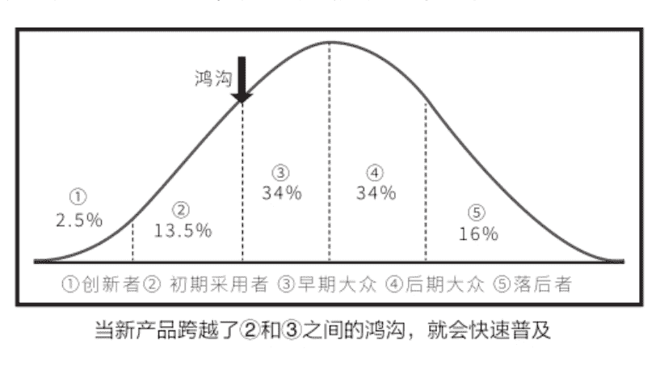
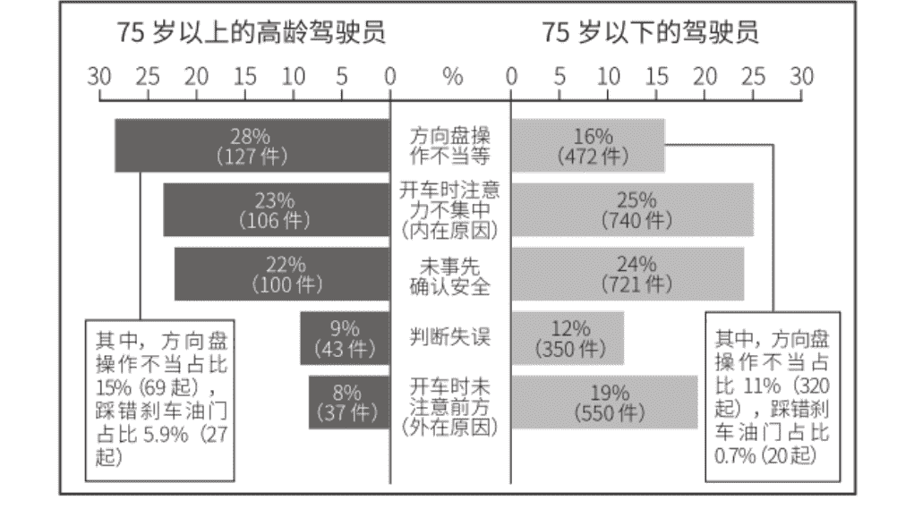
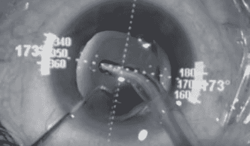
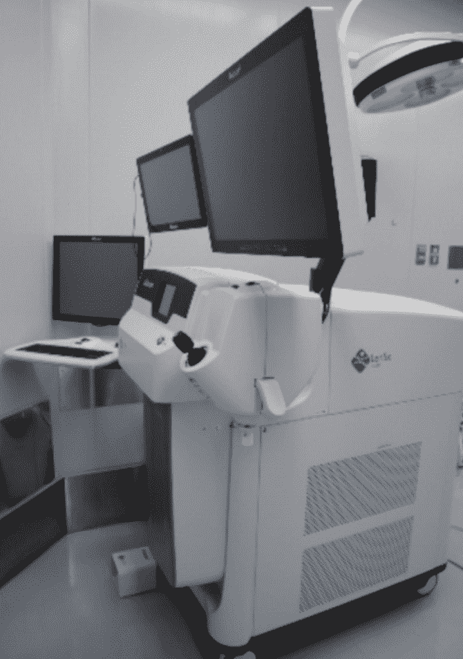
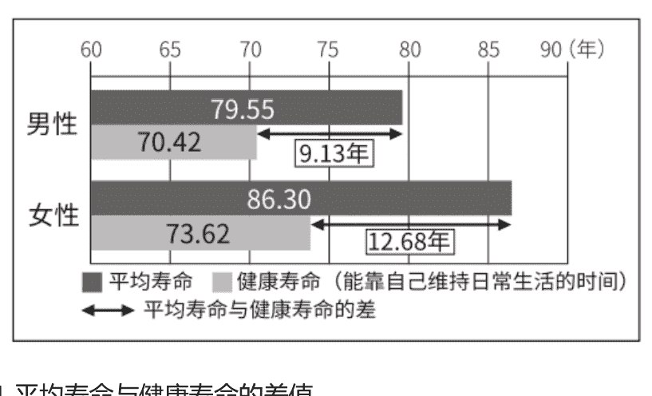

# AI时代，晚年还能更从容

# 前言

## 超级老人与普通老人

不用为变老而提前焦虑。

这么讲，可能有人会觉得反常，甚至觉得我在说空话。但比起反复提醒大家“多存钱，多注意身体”，与其空喊晚年无忧，不如先把焦虑说透。我是眼科医生，每天面对大量老年患者，很多人眼里都有对未来的不安。正是这些真实的痛苦，让我更想传递一个信号：未来并非没有希望，真的没必要为晚年过度担忧。

和不少老年患者聊下来，他们的担忧大同小异。万一老了没法自理，是不是就得被送进养老院？养老院隔音差，隔壁咳嗽都睡不着；尿布潮湿，房间里都是异味；床板硬，腰背酸痛；每天吃的是隔夜饭……

就算能在家，他们脑中盘旋的问题也不少：

- 护理：若生活无法自理了，谁来照顾？怎么照顾？
- 钱：养老金够不够用？
- 健康：上了年纪肯定会生病吧，病了怎么办？
- 孤独：一个人会不会太寂寞？会不会独死？

> 日本于1976年设立的为提高国民生活质量、保证国民生活安稳的公益性团体。——译者注（如无特别说明，以下均为译者注）

日本提倡预防医学的第一人，2005年获颁日本文化勋章，活到106岁。

但也有极少数老人对养老毫无顾忌，他们被叫做“超级老人”。日本生命保险文化中心的数据显示，有13.2%的老人表示“养老无忧”。我从业以来接诊的老年患者累计十万余人，也曾见到这样的超级老人，很希望自己也能成为那样。我交往的日野原重明老师1911-2017，年过百岁仍能开讲座、上社交平台。很多人想复制他的状态，但超级老人往往社交活跃、人缘好、经济自由、对未来有信心，并非人人可复制。现实里更多的是普通老人，孤独、易被骗、日复一日操心家人。即便如此，大多数普通老人对晚年仍有不安。

## AI的“寒武纪”时刻

人工智能、大数据、物联网等新技术正在改变我们的认知。它们让我们看到一个可能：普通人也能在家安度晚年，睡自己熟悉的软床、盖暖被，清晨吃热饭，丰衣足食，健康、有趣地生活。理论上技术能支撑这一切。

我只是眼科医生，对老人的身体比较熟，对新技术并不精通。一开始我也觉得，AI来了也不会有什么实质变化，毕竟社会上喜欢夸大新事物的情况不少。近几年AI逐渐进入医疗领域后，我开始相信，如果正确使用，养老生活会发生巨变。

谷歌旗下的前沿AI公司DeepMind。

听起来与眼科无关，其实十分相关。DeepMind很早就做眼科研究，用AI分析眼底照片做诊断。可以说AI已经“长眼睛”了，这被称作人工智能的“寒武纪生命大爆发”。

寒武纪生命大爆发是古生物学概念。五亿多年前寒武纪，生物长出了眼睛，地球上多种多样的生命形态骤然出现。如今AI也拥有了“眼睛”，正处在类似的爆发期。

DeepMind关注眼病是有原因的。眼球结构相对简单，拍照容易，不像CT或MRI需要大型设备。装个手机App拍张眼底照就能初步诊断。这种便捷推动了AI眼科诊断的发展，也便于把技术推向全球。

在这样的背景下，我有幸在日本深度学习协会进修，接触了一些AI基础知识。虽然都是皮毛，但足以让我更全面地看到AI在医疗里的应用。后来读了一些前沿书籍，内容晦涩，我更关注技术的演进。跟朋友聊AI时，他们总觉得离自己很远。

说到2045年AI将超越人类，确实让人反应不过来。自动驾驶的消息也曾沸沸扬扬，但跟研发人员聊过、对照政府规划后会发现，距离真正普及还有段路。

在那一天到来前，了解“如何与AI共处”“AI时代怎么活”很有必要。眼科现已有了AI辅助诊断，但我们清楚不能全盘托付，必须与AI协作。怎样协作才算好用，我想结合眼科医生与老年患者的经验，和大家一起学习。

## 从密集到疏松的生活方式

技术细节科研人员更懂，本书追求的是易懂，会跳过繁琐定义。

比如“什么是人工智能”，光定义就要几十页，不同专家说法也不同。这里我从医疗实践角度给它一个通俗定位。熟悉AI的人可能会觉得内容浅显，就当作复习也好。

自动驾驶、AI、VR、AR、金融科技、区块链、物联网、共享经济、大数据、技术奇点……你听说过多少？想了解未来生活、AI如何帮你安度晚年、该如何定位自己的生活方式，这本书或许能帮上忙。

原书写于全球疫情爆发期。

以AI为代表的新技术在倒逼生活方式改变。过去大家最怕“没存到2000万日元，老了没保障”。现在，相比“所有式”的密集生活，保持距离的疏松生活可能更合适。就是要和家人、群体、技术保持适度距离。新冠疫情要求避免“三密”，即密闭、密集、密切接触。疫情过去，生活也回不去了。随着技术介入，生活必然改变。

这并不是否定过去，密集生活和疏松生活都很重要，还需要新的思维方式。也许有人觉得等技术成熟再说也不迟，但技术已经就在身边了。

## 技术与老龄化的交汇点

当AI进入医学，有的医生敌视它，赌气“不能输给AI”；有的无视它，觉得“没什么用”；也有人想“一股脑全交给AI”。真正合理的方式是思考“如何与AI保持合适距离，共生共存”。

以前列腺癌诊断为例，人类准确率为0.721，AI为0.845，越接近1越好。若人机结合，准确率可提升到0.889。这是理化学研究所与日本医科大学联合研究，发表于《自然通讯》2019年12月18日。

基于此，本书第一章从相对容易理解的自动驾驶切入，探讨未来的出行方式。可以说自动驾驶正是“技术与衰老”的交汇点。我父母住在东京多摩市郊区，去医院必须开车，由我母亲驾驶。再过几年他们可能没法开。届时叫出租车还是自动驾驶？接下来一起思考自动驾驶时代的出行方式。

# 第1章 老年人与自动驾驶

## 自动驾驶分级与老年出行

说起自动驾驶，很少有人立刻联想到老年人的出行需求，也很少有人把老年出行当成真正的问题。虽然大家会说“确实很重要”。从技术快速发展的角度和老年驾驶事故率上升的角度看，自动驾驶确实是新技术与老龄化碰撞的焦点。

实现自动驾驶后，失能老人、认知障碍患者都能自主出行；看病更方便，不必每次打车；远距离通勤不再是负担，为了孩子成长搬到城市外也能省下房租。谷歌旗下的Waymo在美国运营无人出租车，日本丰田也在全力研发。

听到这些我曾兴奋地想，自动驾驶马上就来了，父母出行无忧。但也有人认为自动驾驶根本实现不了。我曾以为时代近在眼前，也曾嘲笑怀疑者目光短浅，其实是我连“自动驾驶”都没真正弄明白。

我最初以为自动驾驶就是双手离开方向盘，全部交给车载电脑。后来才知道，现在车上的自适应巡航、自动刹车就已属于自动驾驶范畴。我因研究视野与事故关联，有机会参观相关研发设备，才搞清了里面的门道。

目前自动驾驶大致分为六级：

- 0级 普通驾驶，无自动化
- 1级 辅助驾驶，驾驶员辅助
- 2级 部分自动驾驶，部分自动化
- 3级 限定区域自动驾驶，条件自动化
- 4级 基本自动驾驶，高度自动化
- 5级 完全自动驾驶，完全自动化

市面上常见的防碰撞自动刹车相当于1级。全球公认的主流是2到3级。丰田、本田、日产已准备投放3级车型，特斯拉、谷歌等也在推进。

1级能缓解紧急制动时的碰撞伤害，斯巴鲁的车型就以此为卖点。2级允许驾驶员偶尔放开方向盘，高速公路上的自适应巡航就是典型。3级才算进入自动化，比如东京到名古屋的高速段可自动驾驶，但遇到突发情况需切回手动，超出限定区域也得手动。4级可自动驾驶范围更广，包括一般道路。5级才是大众想象里的“专属司机”，上车就能打电话吃饭，车会把你送到目的地。

之前我对等级一无所知就讨论可行性，确实有些可笑。现在业界普遍认为3级以内的手自一体是可用的，关键是4到5级能否落地。这需要了解技术支撑、发展程度和时间表。

## 自动驾驶必备的5G、AI和大数据

发展自动驾驶需要三大系统：

1. 用摄像头等获取外部信息的系统；
2. 对信息进行识别判断并处理的系统，比如区分前方是垃圾袋还是危险物；
3. 执行启动的系统。

第三个不难，前两个是关键。

第一系统不仅靠车载摄像头，还要获取GPS路况、周边车辆信息、坠物风险等数据。于是需要大量摄像头和稳定网络。智能手机经常卡顿掉线可以等一下，汽车在拐弯时掉线就会酿成事故。时速60公里的车，信号延迟1秒就会多走16.7米。所以必须有更快更稳的网络，那就是5G。

5G里的G是Generation，即第五代移动通信技术，不是5Giga。Giga常用来表示GHz或GB。

日本NTT于1991年推出移动上网服务。

1G时代是泡沫经济期，手机体积大。2G体积缩小，可发短信。3G出现i-Mode，支持彩信。4G时代智能手机普及。

仅靠提升汽车性能无法实现自动驾驶，必须在全国布好5G基站，否则自动驾驶只能在有限区域开。开到山区因网络停在半路会很扫兴。

过去看网络重人口覆盖率，4G前手机只要城里能用就行。山里没信号说一声就行。但5G要考虑自动驾驶车辆进入山区，现在要看的是基础设施覆盖率。全日本范围内的5G信号覆盖率。

日本总务省目标是到2025年5G覆盖率达50%。这意味着即使AI、摄像头、法规都就绪，也只有一半地区能用自动驾驶。在信号覆盖全国前，没人敢放心全程自动驾驶。

第二系统是判断系统，需基于AI判断踩油门、打方向盘、变道等，并用大数据提升准确率。所谓大数据就是海量数据。现在能通过仪器和互联网获取过去无法想象的数据。

这里的大数据指海量驾驶数据。AI通过这些数据学习各种驾驶判断，比如何时打方向盘、何时踩油门。

这看似简单，实际极为复杂。人类能瞬间判断脚下障碍物是否安全，计算机必须在瞬间准确识别是塑料袋还是石头。因此系统需要大量塑料袋数据，包括白色、易被误认的灰色等，还要判断面对塑料袋是刹车还是转向更安全。

日常驾驶会遇到大雾、低能见度、积雪打滑、制动距离延长、孩子突然冲出、地震、前车掉落物、沙尘等少见但确实会发生的场景，不能当成小概率忽视。当8000万人使用自动驾驶时，即便事故率仅0.01%，每天也会有8000起。所以偶发事故的数据也必须大量收集。

为此谷歌等企业通过实际路测获取交通数据。一年时间远远不够收集0.01%概率的事件。

还有一个被忽略的因素：各国交通规则不同。美国最安全的车到了日本可能成了废铁。自动驾驶汽车与普通软件产品不同。

日本为建设世界最尖端ITS系统，自2014年起每年制定官民ITS构想路线图。

考虑到各种因素，关于谷歌自动驾驶何时投入使用的海外讨论并不完全适用于日本。日本内阁府《官民ITS构想路线图2019》显示，2025年后高速公路卡车可实现4级自动驾驶，普通汽车约在2025年左右实现。很多人持怀疑态度，认为2025年也只能实现高速路段部分自动驾驶。结合5G基础设施覆盖率2025年仅50%的规划，这一判断合理。我个人猜测，到2025年大概能做到一辆人驾卡车后面跟几辆自动驾驶卡车。

2018年5月29日，一辆处于自动驾驶模式的特斯拉轿车撞上路边警车，司机受伤。特斯拉因自动驾驶导致的致死事故已有发生。

自动驾驶的落地必须依托5G、人工智能以及足够规模的数据支撑。可没有任何一项技术是起步即完美的，数据不够“大”，事故率就会跟着上升。若我们要求等到地震、火灾、暴雪或冰雹这类不可控灾害造成的事故完全归零才放行，那么自动驾驶就永远不会到来。怎么为以AI为核心的高科技划出合理的安全范围，这是当下最关键的课题。

厂商在这件事上往往语焉不详，甚至打着“零风险”的招牌做宣传。2016年和2018年，美国佛罗里达州和加州就曾发生特斯拉自动驾驶车致人伤亡的事故。车主手册明写着行驶时脚要放在制动踏板上，可广告的呈现方式很容易让人误以为开着自动驾驶就能安心休息。

市场上在售车型的广告也常主推“自动刹车”，很多文案看上去像是不用踩刹车也能停下，只是用很小的字做了注解。这种做法和保健品广告让使用者现身说法、再用小字写“仅代表个人观点”一样，风险极高。彻底取缔不现实，更多还要靠消费者自己保持警惕。

### 人类为何对变化如此敏感

对人来说，变化本身就是一种威胁，连换洗发水都会担心用不惯，更别说关乎生死、从手动到自动这样的大幅度转变。风险总伴随变化而生。

自动驾驶最大的分水岭在于是否保留人类干预。只要最后责任仍在人身上，遇到紧急情况就必须人踩刹车，和现在区别不大。理论上看，自动化的等级越高越安全，AI参与越多，理论安全度越高，只是新事物刚上路需要磨合，短期内事故反而可能增多。

一旦进入完全自动驾驶，操作全程只有机器，人坐在后排打盹看书也来不及干预，等于是少了一个安全阀。对原本就怕变的人难以接受。对不驾车的人也并非无感，大街上跑着自动驾驶车，随时可能出事，自己在路上被波及的风险也会上升。

面对这种新事物，用户大致有三种态度：早期就相信安全性会提升直接上车；观望一段时间再说；等技术彻底成熟再用。第二种姿态最能降低事故发生率。社会进步需要有人走在前面，但也有人不想让自己或家人承担探路成本。第三种选择虽然规避了事故，却也放弃了生活的便利性。综合来看，第二种更稳妥。

这里要特别提醒创新接受度高的人和接受度低的人，在关乎性命的问题上务必三思。

日本于1949年成立的由妇产科医生加入的公益职能团体，宗旨是保障母子平安，增进女性健康，提高国民的保健水平。

除了实际安全，心理安全也是另一回事。分娩过去被视为冒着生命危险的行为。日本妇产科学会的《产妇死亡报告》显示，20世纪90年代40岁以上孕产妇的死亡率为0.1247%，进入21世纪后降到0.0118%，约为之前的十分之一。母子双亡现在已非常罕见。

过去人们对平安生产心怀感激，对悲剧也多少能接受。现在只要医疗到位，人们的反应却是“女人怎么会死于分娩”。这导致针对妇产科的诉讼比内科多出一倍，愿意接受分娩的妇产科机构从2006年的3098家降到2017年的2404家，减少了694家。可见实际安全与心理安全完全不是同一回事。

### 概率被忽视，事故被放大

人更爱盯着事故而非概率。医生再怎么强调“不控制饮食可能脑梗致命”，很多人也听不进去，直到朋友因脑梗半身不遂才立刻改变习惯。自动驾驶亦同。

日本内阁府数据显示，2017年发生交通事故472165起，造成死亡的事故3630起，死亡3694人。其中65岁以上老人2020人，约占55%。被新闻报道的只是极少数。我曾住在山形县米泽市，当地即使小事故也会上新闻，搬到东京后就几乎看不见，因为在东京事故多到播不完。换句话说，未来自动驾驶越安全，事故越容易成为新闻，就会形成“自动驾驶很危险”的错觉，恰恰是因为它在变好。

指日本在紧急情况下，国家或地区的政府为了广泛地提醒一般公众，对这种情况进行布告、宣言以发动特殊权限。此处的紧急事态宣言指的是对新冠疫情的紧急事态宣言。

一旦5级完全自动驾驶的车出事，必定成为热点。哪怕只是撞上护栏的轻微自损，媒体也会大做文章，更不用说“国内首例自动驾驶致死事故”。新冠疫情刚起时是重大新闻，但在日本政府发布首个紧急事态宣言①后到当年5月1日，累计死亡不足500人。相比之下，日本每年肾衰竭死亡超过2万人，却从未成新闻。能成新闻的永远是新奇的事，常规再严重也无人问津。

“死亡率下降”几乎没有新闻价值。自动驾驶致死减少300人，降幅10%，已是巨大进步，却成不了新闻。日本2019年交通事故死亡3215人，比2018年3532人减少317人，约10%，大家印象里根本没这则消息。然而只要出现一两起自动驾驶事故，电视就会放燃烧的车辆、救护车鸣笛、家属哭喊的画面，冲击力极强。

我参加过NHK、TBS、日本电视台、富士电视台、东京电视台的访谈，电视台的人都说视觉效果最重要。比起“1万人失明的眼疾”这类统计，一段流血眼球的画面更容易让人上心。专家一直提醒要看概率而非单起事故，可人们就是忍不住关注个案。

破解之道之一，是由专家面向社会说明自动驾驶能够预防事故的事实，再通过媒体和网络广泛传播。老年人尤其重安全信息，而且5级自动驾驶能让原本打算75岁就停开车的老人开到80岁，停留的时间更长，这本身就是利好。我们不仅要降低真实事故率，也要降低人们心里的“事故率”。

### 出事时算谁的账？

最让人揪心的，是父母用自动驾驶把别人卷进事故，以及责任归属问题。若父母驾驶不稳却靠自动驾驶多开了几年，不小心伤到他人，后果难以承受。即便概率只有十万分之一，对当事人就是百分之百，越是偶发事件越想找出责任人，因为只有责任落地，愤怒才有出口。

现行交通事故有明确的肇事受害划分。现在需要人介入的自动驾驶阶段，最终责任仍在人，和现在差别不大。即使安全性提升，年迈父母引发事故的风险依然存在。

如果说明书写“自动驾驶时可双手离开方向盘不必关注前方”，出事必然算制造商；如果写“紧急时必须手动接管”，责任就在驾驶员。目前几乎所有国家都把事故归责于驾驶员，这样心理上更容易接受。前文提到的两起特斯拉事故，以及2018年4月29日日本东名高速公路特斯拉2级自动驾驶打盹导致的事故，最后责任都在驾驶员。

让驾驶员承担责任也有利于技术开发。若企业对一次事故就要全责，就会过度保守。英国、德国强制车主投保，美国部分州也在讨论强制保险。

但存在“被要求为没做过的事负责”的困境。你买了一辆宣称高速可自动驾驶的车，行驶时脚轻放在刹车、手握方向盘、目视前方。自动驾驶突然变道导致与前车距离逼近，你紧急刹车仍追尾致伤。最终责任却落在你身上，还要承担刑事和民事赔偿，心理上也背负致人伤亡的悔恨。明明直接原因是机器，却因必须有人背锅而被认定有责。医院也一样，手术器械意外致损，执刀医生仍要负责。我也曾遇到术中器械故障险情，万一失败，医生要承受心理创伤和家属怨恨。随着自动驾驶普及，这类问题会更明显。

等到完全不需要人类介入的时代，社会共识会变成“绝非驾驶员责任”，追责指向制造商。受害者能获金钱补偿，却不知把愤怒投向何处。

### 别让自动驾驶重蹈医疗覆辙

人们对“安全”追求万无一失，医疗亦然。成功率99%的手术仍有1%风险，这在医学上合理，患者却想“手术应该没问题吧”。在潜意识里，99%成功=意外不是我。

医学上的“无意外”人可以理解却难以接受。听到99%成功率，很多人脑中是绝对安全。医生真正的意思是存在1%风险且病例不少。人们以为1%可预测，实际上可预测的风险患者不会选择手术。

完全自动化的AI手术理应能应对意外，正如医生在地震停电时仍要确保手术结束，但也不可能十全十美。开发出能应对所有意外的AI是不可能的，我们必须允许AI犯错。若AI只是把小鸡雌雄分错，无所谓；若自动驾驶车把对向来车误判为影子直接撞上，就是致命问题。

自动驾驶、医疗、护理等关乎生命的领域，理论上“不能有人干预”是方向，但伦理和心理障碍不容忽视，否则就会产生排斥。最急需AI快速发展的正是攸关人命的领域。

我不希望自动驾驶重蹈医疗覆辙。日本宫颈癌疫苗曾从推荐疫苗中删除，根据大阪大学研究，这将导致宫颈癌患者增加1.7万人，死亡增加4000人。疫苗被撤因不良反应被媒体放大，虽令人同情，但不当的信息处理反而制造更多不幸。对自动驾驶等新技术，不要因磨合期的阵痛就沮丧，未来会更好，只是费用问题令人头疼。

### 价格才是普及的生死线

再好再方便的东西，价格不明就推广不下去。人们以为健康上不吝钱，但在医院看到的并非如此。

糖尿病引发的视网膜病变会导致失明，需要及时治疗。我见过许多快要失明的患者却无动于衷，最后不得不手术。

> “不做手术会失明的。”

日本有国民健康保险和协会健康保险两种体系，报销比例均为70%，个人自付30%。为此设有高额疗养费制度，个人医疗费超过上限后超出部分全报销。

我常劝患者手术，费用虽需几十万日元，申请保障后只需10万日元左右，还是有人说“我没钱做不了”。分期、术后付款、政府咨询窗口都有，却仍有人因钱拒绝。极端或不极端，因经济放弃治疗的患者比过去多了。重症尚且如此，AI自动驾驶的价格能否解决，决定了它能否普及。

设想一辆车能一键从家到购物中心自动行驶很方便，但刚上市时大家不习惯，车价必然高昂。

鸿沟理论很好地解释了高新技术产品的普及规律，普及曲线呈S形。初期只有2.5%创新者会买，随后13.5%初期采用者跟进，34%早期大众购买时普及加速，34%后期大众加入后，剩下的16%落后者才慢慢使用。跨越初期采用者与早期大众之间的“鸿沟”，产品才真正畅销。

图1-1 鸿沟理论

空气净化器在日本普及率已达43.8%，智能马桶座2000年41%现已80.2%，空调1975年左右跨越鸿沟，17.2%，1980年39.2%，1985年52.3%，现在91.1%。彩色电视1970年26.3%，1975年飙升至90.3%。

智能手机的前身PDA在1993年苹果Newton推出后因未跨越鸿沟而消失。1999年日本i-Mode，2007年初代iPhone，智能手机成功跨越鸿沟，2010年普及9.7%，2011年29.3%，2012年49.5%。

要普及自动驾驶汽车，就必须让早期大众买得起。

目前德国奥迪A8作为3级自动驾驶量产车备受关注，共有3个型号，定价1172万日元到1686万日元不等，二手也要700万日元左右。什么样的价格才有购买意愿？1000万、500万、300万，还是100万日元？

据2019年1月日本汽车销售联合会统计，上一年奥迪新车销售342477辆，其中：

## 表1-1 2018年日本汽车销量统计

| 种类 | | 销售量（尾数值） |

| :--- | :--- | :--- |

| 新车 | 普通车 | 120037辆（15.2%） |

| | 小型车 | 97725辆（12.4%） |

| | 微型车 | 124715辆（15.8%） |

| 二手车 | 普通车 | 147833辆（18.7%） |

| | 小型车 | 115402辆（14.6%） |

| | 微型车 | 184523辆（23.4%） |

| 合计 | | 790235辆 |

*数据来源：日本汽车销售联合会（2019年1月发布）

二手普通车的成交数量为 147833 台，二手小型车为 115402 台，二手微型车为 184523 台，注：二手微型车的统计口径来自全国轻型车协会联合会。

从上述数据可以推断，普通车、小型车、微型车的市价会随时间慢慢下行，但早期购入者多为支付能力较强的人群。只有当二手普通车的价位接近新车普通车的水平时，约有 15% 的人会考虑入手；当价位进一步回落到与二手微型车相近的区间时，占比才会升到约 23%，接近四分之一。

会有人疑问，自动驾驶无需人手操作，成本会不会因此水涨船高？确实，一旦真正量产的完全自动驾驶车型出现，首要的比较对象就是出租。换句话说，自驾的自动驾驶出行费用至少要比叫车更具优势。可仅仅便宜就能引发大众抢购吗？并不会，初期仍是手头宽松、日常出行本来就依赖网约车的高收入群体在买单。大多数人依旧习惯自驾，除非是长途驾驶，否则很难把开车视作负担，也没有强烈想把路途时间利用起来的需求。再加上朋友邻居顺路搭载、公共交通等选择不少，市场扩散不会立刻发生。

把价格逻辑拆开看，普及大概率会按此节奏推进：技术研发完成 → 小众富裕阶层先行采纳 → 再缓慢渗透至普通用户。

先放下费用，看看技术本身走到哪一步。

## 自动驾驶技术现状与展望

不同机构对当前进展的描述并不一致。我曾在日本一家研究机构就全球动向做过一次分享。准备材料时查阅了大量文献，总体感受是研发仍有相当距离，不过时间终会解决。

目前全球尚未就自动驾驶在紧急情况下如何提醒驾驶者形成统一规范，是发声还是显示画面都没有定论。现有的标准也几乎忽略了人口老龄化的现实。比如声学提示，高频音对听力退化或听障的老年驾驶者难以感知；画面提示则对白内障、视力模糊、视野狭窄者效果有限。

换句话说，现阶段的研究默认驾驶者是身体健康的成年人。但日本警察厅 2014 年的驾照统计显示，65 岁以上持证者占比 20%，每五位司机中就有一位是 65 岁以上。

真正实现不限年龄的 5 级完全自动驾驶恐怕还要很久。如今只有谷歌等极少数企业在冲刺 4-5 级，大多数企业的目标是基于现有基础叠加辅助功能，争取达到 3-4 级。例如带侧向泊车的自动泊车、针对视听障碍提供的辅助系统、在复杂路口预警并自动制动避免碰撞的系统、自动监测闯红灯的系统等，这些功能有望逐步落地。

综合判断，五年内实现完全无人驾驶难度很大，3 级辅助驾驶车型会越来越多。因此当下更应把研发重点放在弱势群体，尤其是老年人和患病人群，帮助他们更安心地用车。什么样的自动驾驶才算对老年人友好？

## 老年司机与自动驾驶

近年来由老年驾驶员引发的交通事故频频被社会讨论。2020 年日本交通死亡事故中，老年肇事者占比高达 54.8%，且逐年刷新高。老人驾车撞入商铺等事件也常被媒体放大。

这很容易形成刻板印象：老人总会“把油门当成刹车”。

围绕此曾有“是否强制加装防误踩装置”的讨论。坊间流传“老人误踩油门刹车的概率是年轻人的 8 倍”。从死亡事故原因分析看，因误踩油门刹车肇事，75 岁以下为 20 起，占比 0.7%；75 岁以上为 27 起，占比 5.9%。绝对数仅相差 7 起。5.9% 不算低，但远不到一成。

图1-2 “老人经常误踩刹车和油门”是真的吗？

*数据来源：日本警察厅《机动车第一当事人死亡事故的人为原因比较》（2016年）

既然数据如此，为何仍普遍认为老人容易踩错？因为媒体每天都在报道类似案例，交警发布的统计也更侧重提及。很多人便固执地认为高龄等于认知下降，自然更容易出错。再加上车辆撞入便利店等造成严重后果的画面冲击力强，更是加深了印象。

但不能被刻板印象牵着走，必须看本质。按概率估算，若为老年车辆加装防误踩系统，可避免约 27 条生命；若为年轻车辆增加安全确认提醒，可避免约 721 条生命。无论老少都应被重视，弄清事实后再做判断才负责。

近期老年驾驶事故频发是事实，涉及老年人的事故总量确实在上升，绝对数也高于年轻人。但老年人的事故发生率其实在下降，只是这一点很少被报道，导致大家误以为老年事故在持续攀升且高于年轻人。

原因很简单，老年人口基数在扩大，基数大了事故总数自然随之增多。年轻人基数增大也同样会推高总数。

因此真实数据的分析至关重要，它关乎我们未来的生活。换句话说，正因进入人工智能时代，人类更应客观冷静地看待数据，否则容易被算法牵着走。

那么老年人的实际用车状况如何？我常在医院遇到为换驾照而治疗眼睛的患者。现行驾照条件之一是视力 0.7 以上。有些人上一期换证时视力仍达标，下一期就跌破 0.7，经治疗很快恢复。也常有患者咨询：“不小心蹭到别的车，是不是视野变窄了”“最近看不清红绿灯，闯红灯次数多了”。这些问题有的源于眼病，有的只是年龄增长所致。

法律上拿证即可驾驶，但部分人群的风险在逐年上升。比如因年纪大出现眼睑下垂的人，即便手术上提，也可能仍达不到 0.7 的视力要求。所以相关部门必须严格执行对一定程度眼睑下垂者禁止驾驶的规定。同时要对老年人的视野范围进行检测，建议视野过窄者做相应手术。不过相比这些措施，在自动驾驶装置中加入防闯红灯系统更有效也更现实。这既能防止老年人闯红灯，也能防止年轻人闯红灯，提升全年龄段的安全性。

## 医务工作者对老年友好的期待

前面从科普角度介绍了自动驾驶，接下来我从医学和老年人的视角谈谈希望研发人员怎样做，以及什么样的自动驾驶更容易被接受。

日本的 3 级自动驾驶已在部分本田车型上应用，但使用场景受限，被业内戏称为“奢侈的赠品”。它只能在高速公路上不换道、时速低于 60 公里时启动。实际使用限制很多，与大众想象的自动驾驶相去甚远。价格又高昂，发展缓慢在这个阶段还会持续。所以，自动驾驶至少要到 4 级才可能满足市场需求。为此，我希望研究人员多为驾驶弱势群体着想，把 3 级辅助驾驶中的实用功能真正落地。

这并不难。比如，为视力不佳者提供挡风玻璃 AR 增强现实显示，为听力受损者把警报声和喇叭声可视化。更希望能开发随年龄增长而自适应调整视听辅助功能的车辆。

现在市面上的汽车没有“年轻人专用”和“老年人专用”。这看似正常，其实不同年龄段的需求是不同的。能否像老人机那样生产适合老年人的车型？比如一种油门踩到底车速也不会过快的车型。功能可以适当精简，换来更符合老年人习惯的操控。

上了年纪后 99% 的人都会得白内障，对向车灯和早晚阳光的敏感度也高于年轻人。可以为车辆配备光线控制装置。人眼在刺眼时会收缩瞳孔，在光线不足处会感到昏暗。可以设置夜间或隧道行驶时自动调节车头灯亮度的系统。对老年人难以听见高频音的问题，可把警报音转为视觉提醒。

此外，启动引擎时不要用一键启动，用传统钥匙更好；刹车也不要用脚刹，改用老式的手拉刹车。老年人对“改变”并不总是欢迎，可理解、易上手比简便更重要。

考虑到认知障碍可能增加行车风险，可设置自动记录行车数据并以邮件形式发送给关联人员，如子女。这样子女更放心让父母使用自动驾驶汽车。

当然子女的想法可能是“本来就不希望老人开车”，但这很难完全实现。从这个角度看，搭载上述技术的汽车对老年人更安全也更便利。

我还希望新车不仅适合老年人，也适合新手司机、不常开车的人以及对驾驶没信心的人。对新手提供新手模式，对老人则是一款能让家人安心推荐的好车。

目前还没这样的车，但如果把开发理念定为“打造对老年人友好的汽车”，并非难事，这也有助于我们实现更从容的生活。

## 专栏：能否将生命托付给AI？

自动驾驶已涉及生命与技术，医疗领域关乎生命的问题更严肃。据日本厚生劳动省 2018 年统计，日本人死亡原因中交通事故等意外仅占 3.0%。第一位是恶性肿瘤占 27.4%，第二位是心脏病占 15.3%。除去衰老和自杀，几乎都死于疾病。若医生或 AI 诊断治疗出错，可能夺走数千万人的生命。

将来我们老了，该如何与 AI 和高科技共处？AI 进入自动驾驶、医疗和护理后，人类真的能把生命托付给 AI 吗？《终结者》式的担忧始终存在。把性命交给没有姓名的 AI，确实不安。

但从医疗角度看，人类终将慢慢习惯依赖 AI，原因有三。

### 1. 我们正在将生命托付给不知名者
出租车、电车、公交车都是陌生人驾驶，我们却自然乘坐。在医院，你可能记下主治医生名字，但不会记住打点滴的护士，也不会刻意确认治疗名称。护理工作也多由不认识但固定的人员提供，我们欣然接受。现在只是把承担治疗护理的工作从人换成机器，刚开始有抵触，渐渐就会习惯，并愿意把生命托付给 AI。

### 2. AI 比人类更可靠
特斯拉自动驾驶事故曾引发“自动驾驶很危险”的论调，我们因此更谨慎。但实际上人为交通事故更多。功能不如人类的 AI 不可能被引入社会。AI 事故率更低，更值得信赖。而且 AI 还能防止蓄意事故。即使 AI 出事，只要不是黑客入侵，责任最多是系统不完善；而人为事故可能是恶意撞人。AI 系统设计目的就是杜绝事故。

### 3. 不随大流就会心生焦虑
现在对 AI 还存疑，等 AI 普及癌细胞筛查时，再要求人类医生诊断会变得困难。因为患者会想“AI 会不会更准”“选择不一样的方式有点不安”。当大家都用 AI，自然就能随大流。

## AI 到底是什么？

到这里我们一直在谈 AI，AI 到底是什么？正如日本经济产业省报告所说，AI“至今尚无明确定义”。

通俗地讲，AI 就是人类的替代品。AI 出现前我们用的是机器，机器行为完全遵循预设。例如把玄关纸箱搬到厨房，需要预设拿起、搬运、移动、放置等动作。若纸箱大小、目的地变化，机器就无法完成。

AI 不同，只要指令“把纸箱搬到厨房”，AI 就能自主识别纸箱大小，摸索搬运方式，即便大小不一、目的地变换也能完成。

深度学习是 AI 的分支之一。对朋友说“把玄关纸箱搬到厨房”，朋友会知道怎么做，因为他理解纸箱、玄关、厨房的常识，并知道如何不损坏操作。AI 像个小孩，会问“纸箱是什么”“玄关在哪”。只有多次学习搬运动作后才能派上用场。

只是 AI 的学习方式不同，需要大量学习。指着一个实物说“这是纸箱”不够，AI 会以为只有这个是纸箱。若告诉它“褐色有四角的就是纸箱”，它会把木箱误判。必须输入海量纸箱数据它才能形成认知。

AI 的感知叫特征值，与人类不同。人认为纸箱特征是褐色、四角、不结实。AI 可能依据拿纸箱时肌肉使用、或红外紫外线判断。视角完全不同，所以它可能把人类不会认为是纸箱的红色坚硬木箱误判为纸箱，也可能准确识别出人类会看错的仿木纸箱。理解和感知方式迥异。

机器还有不会疲惫、不厌恶重复、不带感情等特征。单调搬运大量纸箱，AI 会更快更准，24 小时不间断工作，不会抱怨。

AI 有优点也有缺点，它是人类的替代品，但与人类有很多不同。

# 第2章 老年人与尖端医疗

## 为了接受更好的治疗

无论是超级老人还是普通老人，随着年龄增长去医院的次数只会增加。本章介绍老年人常接触的医疗与人工智能相关知识，属于我的专业领域。对某些案例我有赞成或反对的看法，大家权当是一名医务工作者的个人观点。

几乎所有行业都在讨论人工智能的应用，其中最受关注的是自动驾驶和医疗。为何这两个行业备受瞩目？因为都事关人命。

如果 AI 帮你决定今晚吃什么，出错也只是不吃。AI 帮你买股票出错，最多是钱的损失，还可能有保险弥补。钱可以再赚回来，不会致命。

但生命和健康一旦失去就无法挽回。即便有人身保险，也只是给家属发钱，不是大家想要的结果。即便开发者或医生承诺担责，也无法让人复活。

与生命有关的信息极其重要，关于生命健康的信息后文会叙述，这里先说自动驾驶。汽车产业体量庞大，据说日本有 8.8% 的从业人口从事汽车相关，市场规模巨大，且掌控车辆移动全过程的数据。若把这些数据全部收集，就是一个超大数据库。

“大数据”听起来很酷，但想想，因为大数据，你的朋友从早到晚去了哪儿、在哪家店买了什么、见了谁、待了多久、去过哪家医院，都被详细记录，会不会毛骨悚然？想要这些信息的正是 GAFA 等美国科技巨头。

医疗行业规模更大。日本劳动政策研究研修机构 2019 年调查显示，12.5% 的从业人口从事医疗保健相关，可见市场巨大，而且一些从业者掌握决定生死的核心技术。如果汽车价格 1000 万日元，买的人只是少数。但如果是心脏外科手术，精准度提高一倍，费用也是 1000 万日元，我想很多人也会考虑接受。

说到接受更好的治疗，人们先想到的是与先进医疗技术同步的高昂费用。实际上在日本，钱并非主导因素。更重要的是信息，比如坊间流传哪位医生手术好、哪位医术高。

遗憾的是，世界上仍有一定数量的庸医。只有善于收集利用信息的患者才能避开庸医，获得更好治疗。网络和报纸杂志上也有医生信息，但被宣传为“名医”的未必都名副其实，其中也有平庸者，而没有名医头衔的医生中也不乏高手。

超级老人懂得向医生打探消息，或通过人脉找到好医生接受治疗。他们善于沟通，能在医生面前条理清晰地陈述想法和希望接受的治疗。能做到这点的仅限于能冷静看待病情、具备一定知识经验且不被伪医学欺骗的老人。我觉得我的父母很难做到。如果普通老人也能利用最新技术，成为像超级老人一样的老人，大家都能接受更好的治疗了。

## 医疗领域必需的最新技术
——5G、IOT、VR、AR

说到医疗最新技术，人们常想到 AI 诊断和治疗，但这需要大量基础数据。例如诊断白内障一种病，就必须有大量白内障患者的病理数据。若诊断罕见病，则需要更多数据。只有输入海量数据才会产生新发现。而这些海量数据就是“大数据”，它确实在推动医疗进步。

# 医疗正在被新一代技术重写

与大数据同步，5G、物联网、虚拟现实、增强现实正在医疗里加速落地。下面逐个拆解。

远程手术离不开5G。第五代移动通信的时延比4G低一个数量级。很多人会觉得4G够用，实际上外科手术根本承受不了4G约50到100毫秒也就是0.05到0.1秒的延迟。眼科激光治疗的发射频率就在50毫秒或100毫秒量级，稍有滞后光斑就会偏离目标打到危险区。5G的时延大约在1毫秒左右0.001秒，临床上几乎感觉不到延迟，不止激光，任何远程操控的手术离开5G都谈不上安全。而且稳定性是底线，信号一旦中断手术就必须停止，后果极严重。

物联网能让患者状态实时可见。物联网就是把各类传感器接入互联网构成的大网，门可以联网确认是否上锁，电饭煲可以远程设定煮饭时间。医院里目前只有重症患者的动态心电图在联网，护士站能实时监护。若全部心电图都联网并配合AI做一定程度的自动判读，住院患者的病情恶化就能更早被捕捉到。不只是心电图，其他设备联网后氧气泄漏、药品见底这类情况会被提前预警。点滴快输完时患者也不用自己去叫护士，系统会自动提醒。

虚拟现实能用于术前确认和病情科普。虚拟现实让人戴上眼镜后产生身临其境的感知，哪怕人在日本也能360度观赏海外风景。讲视网膜脱落，不如让患者直接看视网膜神经上皮层与色素上皮层分离的3D影像来得直观。VR并非唯一方案，单纯3D医学说明现在已成熟，我所在的医院就在用。术前通过三维成像掌握个体细节，手术会更安全准确顺畅。每个人血管走向都不同，术中遇到不该出现的血管就易出血，意外常出现在差异上。经验丰富的医生才懂得应对，事先用VR模拟一遍基本可以做到万无一失。

增强现实是把虚拟信息叠加到真实世界的技术。手术中它能让医生直观看到病灶位置。你可能会觉得这本该是常识，但大出血或病情骤变时，多数医生都经历过分不清解剖层次的瞬间，这时AR的辅助会让人安心很多。

## 大数据是新技术的地基

这些技术的前提都是海量患者信息，也就是大数据。可在医疗领域收集大量数据异常困难。

电商平台会根据购买历史推荐商品，同时你的偏好也被记录，其中不乏成人用品这类不想公开的记录。医疗信息的获取难度高得多。医疗信息首先指患者信息：得了什么病、接受什么治疗、效果如何。

公开数据的好处很明显。假设有100家医院，就有100种手术方案，具体手法还取决于主刀医生。白内障手术开创口就有差异，有的医生开3个口2个1毫米小口加1个2到3毫米大口，有的开2个口1个1毫米小口加1个2到3毫米大口，各有道理，全世界没有统一标准。收集分析大量手术数据后才能得出相对合理的结论，比如白内障统一开两个口，或在某种情况下需要三个口，全国治疗效果都会提升。但在那之前需要先解决不良医院的问题，曝光达不到一定效果的机构。

现实中口碑不好的医院确实存在，可没有第三方全程监控，也不是每台手术都失败，难以发出警示。还有部分技术不过关却自以为是的医生也不少。准确的数据能把这些“江湖医院”暴露出来，患者避开后治疗效果会明显改善。

药物也一样。高血压药品很多，常规方案已经成熟，医生按惯例开药，但这样真的最优吗？全球数据积累后可以实现更精准分型，比如不爱运动的30岁以上男性更适合A药，经常运动的40岁以上女性更适合B药。

传染病方面，日本只要求法定传染病上报，其余病例无需上报，很难知道哪家医院病例集中。新闻说流感蔓延时，其实全国或大部分城市早已流行。若信息共享，就能定位到东京都江户川区或平井站附近的程度。结合自动驾驶的行车记录，甚至能推断出3月10日看某部电影的人群可能暴露。接诊医生可提前联想，患者不必在候诊室久等，也能减少院内交叉感染。日本在新冠期间推出Cocoa接触者追踪，后续计划扩展到所有传染病。

信息共享有助于找到更好药物、更优手术方案、更早预防传染病。即便没有人工智能时代，信息也该共享，只是至今没有实现，其背后有难以明说的阻力。

## 为什么数据共享困难：医生和病人都会隐瞒

阻力之一是人会说谎，尤其是医生。全球医院都有实习医生，他们操作难免出错，即便上级在旁监督也无法杜绝。采血通常由护士操作，新手就算有主管在场也常常需多次尝试，多数人都被扎过。

上级会把实习医师的失误控制在不伤患者的范围内，出现风险就叫停。比如采血多次不成功就换人，有神经损伤风险就立刻停止。严格说这些也是医疗事故，但若对失误零容忍，新手会不敢动手，最终所有工作只能由上级包办，实习机会被剥夺。

若这些信息全部公开，培养实习的医院会被贴上“事故多”的标签，不培养实习的医院反而显得“零事故”。医生承受巨大心理压力，勤恳的医者也担心一次小失误丢掉工作。于是有人选择篡改数据，真正的医疗信息被掩盖。过去数据由专人收集且不匿名，责任归个人而非系统。若用大数据新技术，收集与自动判断由计算机完成，使用目的变得单纯，是为了改善医疗而非追责，医生接受度会更高。

患者同样会隐瞒。若信息全社会公开，谁敢承认自己患性病？整形史也是敏感话题。我曾遇到患者主诉眼内异物，检查发现眼球有细线划伤的痕迹，追问后才承认做过双眼皮手术。

药物依从性也是谎言来源。皮肤科开脚癣药膏嘱咐早晚涂，初期患者会遵守，脚不痒就不愿麻烦，变成只晚上涂或干脆不涂。复诊时医生问“药膏涂了吗”，回答多是“偶尔忘了”，实际上是几乎没涂。把这种回答录入系统会误判药膏无效。真正要得到真实信息，必须严防个人信息泄露，建立计算机自动判断的闭环。

## 另一个障碍：医生各执一词标准不一

另一个易被忽略的问题是标准不统一，每个医生对数据的理解和录入方式不同。有些人固执己见，认为自己的方案最好。癌症病例登录制度已建立，其他疾病是否治疗、疗效评判却因人而异。

以白内障为例，晚期都会建议手术，极早期则不做，中间何时手术因医生而异。有医生认为视力一开始下降就该做，风险小安全；也有医生认为发展到一定程度再做，患者满意度更高。谁对谁错难以判定，录入系统时判断自然主观，统一标准很难。

录入本身也很费劲。虽然业内呼吁共享，但把所有患者信息输入电脑或传真纸质记录非常繁琐，缺乏医学背景的第三方无法准确提炼关键信息，人力成本巨大。若AI能自动把信息转为大数据，这些麻烦就能省掉。

AI提取必要信息后，医生和患者难以拒绝。即便有人撒谎，系统也能揪出异常，比如某个医生的治疗周期总比别人短就会被质疑。不同录入方式的数据也能被综合判断并自动抽取关键信息。趋势不可逆转，初期会遇到阻力，但医疗信息利用会变得更便利。

## 隐私泄露的风险到底有多大

信息共享若是国家明文规定，医疗部门只能执行。患者层面则不同，人权涉及，若患者不愿采集就诊信息，国家很难强制。即便是新冠也有人隐瞒，更别说全面自报病情。

谷歌、亚马逊、脸书都在收集个人信息，但你不主动输入系统就拿不到。医疗信息收集却不能自愿选择。设想把所有信息交给谷歌保管，仅限内部特定人员查询也不外泄，看似安心。

但绝症晚期的记录里会写“剩余生命××天”，家人之外素不相识的第三方也能得知，这本身就很刺痛。

2019年日本招聘门户“聘航”曾用AI算出注册用户的非官方辞职率并卖给第三方，引发轩然大波却不违法，因为用户签了自愿提供信息的条款。若医疗信息由AI管理，也会签署几十页晦涩的契约，像手机合同或保险合同一样难以读完。

医疗信息与招聘结合会带来歧视。公司提拔时AI会评估未来工作能力，带病者住院请假概率更高，AI只会机械挑选“健康”员工。个体经营中委托工作前先做效率测评也会产生同样问题。播音员不想让人知道咽喉息肉，漫画助手不想让人知道眼部问题，否则可能丢工作。

连对医生都不愿说的性病或整形史，往往就是关键信息。行政指导是国家行政机关以建议劝告等非强制方式要求当事人作为或不作为的活动。研究者正探索只提取特定信息的技术，但2017年英国某医疗财团把患者数据给谷歌旗下DeepMind，因违反隐私法收到行政指导。类似问题还会出现，但社会整体上收集处理大量个人信息也有造福大众的价值。

## AI诊断有望扫除庸医

引入高科技后首当其冲的是疾病诊断。血检、CT、MRI等图像数据都能直接做AI诊断，不需要医生参与。很多人认为AI更准，实证显示准确率与医生相当。AI的最大价值是能大概率杜绝庸医。相关研究成熟，每次学术会议都有进展，但几乎集中在诊断，治疗与预防的研究很少，原因在于伦理。

比如研发能缩短半小时手术时间、复发率降2%的AI胃癌手术机器人，试验阶段需要传统手术与AI手术对比，且患者不能知情，否则心理预期会干扰术后保养和复发率。知情会让数据失真。

我曾做回避治疗方案研究，至少需要30名受试者，仅在说明研究内容并获同意环节就耗费大量精力，很多人不愿参与医学实验，可理解。

AI诊断之所以进展快，是因为答案已存在。先让专家和普通医生诊断，再由多名专家会诊形成标准答案，正确率近100%。普通医生对照标准答案的正确率约80%。再让AI诊断，若超过普通医生则可行，达到专家水平则更让人放心，且AI不疲劳、不误诊、无需多人会诊。问题与答案对应，学习成本很低。对患者而言只是由多名医生加AI共同诊断，更安心。目前全球AI诊断研究正快速推进。

## 眼科iPS移植的里程碑

2017年日本理化学研究所宣布，将异体iPS细胞培养的视网膜细胞移植到一名60多岁男性右眼，这是全球首例iPS细胞异体移植手术。

眼科率先打开AI诊疗大门

眼睛是人体少见的半外露半透明器官，这让眼科成为AI研究进展最快的领域。最早的iPS细胞移植手术也诞生在眼科。

眼底照相只需要对着视网膜拍一张照片，无痛无创，是常规体检的常规项目。检查量大，病理样片也随之积累，眼底影像为多种疾病的判断提供了基础数据。

目前看，最有希望把眼科AI做成实际应用的是谷歌系团队。糖尿病视网膜病变是日本三大致盲原因之一，在成人中是常见致盲首因。如今用谷歌系统拍一张眼底照就能完成诊断，准确度可与眼科医生比肩。

该病会让眼内血管变脆甚至出血。早期出血几乎不影响视力，患者也几乎无感。若放任发展到晚期就必须手术，最坏情况是失明。为避免恶化，需要每三个月到半年复查一次。很多人提不起坚持复查的动力，导致年轻失明案例频现。那些明明没有症状却仍定期跑医院的人，其实也挺辛苦。

如果只是拍照，是不是可以不用专门跑眼科，在看内科等其他科室时顺便完成？基于这个想法，谷歌在推进AI眼底摄影，部分国家已经投入使用。若未来能在智能手机里塞入一个小插件，实现一定准确度的筛查，无需到正规医疗机构，对医疗资源匮乏的乡村或贫穷国家来说将是雪中送炭。

归根结底，决定“答案”的是人，也就是诊断标准本身。

## 诊断标准终究由人来划线

日本高血压的诊断切点不断下调：1987年是180mmHg，1997年降到160mmHg，2004年到140mmHg，2017年再到135mmHg。门槛越低，被判定为高血压的人就越多。

即便进入AI时代，疾病的判定边界仍由人来制定。有人质疑这不就是不断调低标准来扩大患者群吗？其实并不一样。因为AI很难自行厘清“病”与“非病”的界线。骨折这类情况AI判断很清晰，癌症就不然。有人会想癌症很容易判断，但如果体内只要出现癌细胞就算癌症就不成立了。

人体每天会产生约5000个癌细胞，健康的免疫系统会清除它们，所以并不轻易发病。现代医学把癌症定义为癌细胞增殖到一定数量才算确诊。有时检查能发现癌细胞也无需治疗，因为在没有达到影响生活和寿命的规模前，并不需要干预。也就是说，在不产生实际危害时，即使有癌细胞也不会被诊断为癌症。

那到底多少个算癌症？2个还是100个？必须给出明确界定。血压同样如此，超过140mmHg才诊断为高血压，统计上140以上与以下的人群发病率明显不同。但139和140之间真的有巨大差异吗？答案是否定的。让对数字极敏感的AI去抠这一毫米汞柱毫无意义，AI更适合给出建议，例如“以你现在的血压和体质，降下来会更好”。患者情况各异，有130mmHg需要吃药的，也有160mmHg不必干预的。

可以说，用数字表征的东西并没有绝对的硬边界。对某个现象下定义更多是为了让人更好理解，比如设立病名和确诊标准。到了AI时代，“病名”这个概念本身都可能被“概率”“数据集合”取代。

白内障的诊断也是如此。你今天问医生是否白内障，说是；明天换人问，又说不是，这并不代表有人庸医。白内障是晶状体发白，50岁以上人群一半以上都存在一定程度混浊，但对“混浊多少”的理解因人而异。就像白头发，有人一根就说有白头发，有人等到必须染发才承认。两种说法都合理。

人们习惯用非黑即白的方式描述问题，比如“你是白内障”“你是抑郁症”，只是为了便于理解。身体状态本就不是二元的，医生不可能对病人说“可以说是也可以说不是”。AI却能用百分比精确表达，比如“晶体20%区域混浊”。再问这是不是白内障，AI会回答不知道。因为要让AI下结论，必须先由人确定白内障的确诊标准。

最终AI表达仍像“你是白内障”这样明确，但背后划定数值的仍是人类。抛开非黑即白的固化思维，才能更好地接受诊断与治疗。

## AI落地日本的阻力与走向

日本最大的非官方医学团体成立于1916年，成员包括医生、护士和管理人员。

要把AI诊断引入日本，除了标准问题，还有哪些阻力？有人会提到医师协会反对。我个人认为协会并不会真正反对，原因微妙。协会里最有话语权的是内科医生，而AI诊断对内科是明显利好。他们表面上把好处让给眼科，摆出反对姿态，外人看上去像又在阻挠，其实多是做个样子。坦率说，AI诊断最终仍会被引入。

日本的国情与政策也改变不了医学大方向。国际趋势如此，AI诊断进入日本只是时间问题。

不仅糖尿病视网膜病变，其他眼科疾病也能用AI诊断。但罕见病仍是AI的盲区。

你可能看过IBM沃森医生诊断出罕见白血病的新闻，这意味着机器能基于现有数据做出普通医生难以企及的罕见病判断。沃森之所以能做到，关键在于“数字化的数据”。血象指标偏高时，机器容易推断出特殊疾病。但眼底照片、X光、内镜等检查结果大多是影像，未被数字化，所以AI对罕见病的影像描述多很模糊。例如人眼能立刻区分火焰状出血和点状出血，机器却必须先有人给出明确定义并把数据喂进去。因此罕见病的影像诊断，今后仍要靠人眼。

归纳起来，AI诊断的两大前提是准确的数字化数据和海量的影像数据。

X光、CT、MRI、心电图、眼底照等常规影像，未来大概率交给AI完成。眼科医生并不擅长读心电图报告，他们的做法是先由电脑自动分析，异常时再请内科会诊。未来AI诊断会比现在更精准。

那影像科医生和眼科医生会被取代吗？答案是否定的。

其一，AI无法诊断罕见病。原因有两点：(1)确诊标准不明确；(2)罕见病缺乏足够医疗数据，AI无法准确判断。

因此AI之外仍需要博学多闻的医生。经验不足的医生既诊断不了罕见病，一般病又不如AI，是否就没价值了？也不是。AI的结论需要有人负责，类似签字盖章的工作很可能由这些普通医生来承担。

从患者角度看，未来就诊可能是：低价接受多项AI检查→普通医生签字确认→治疗→效果不佳→希望进一步检查→去能熟练操控AI的名医处就诊。

名医有限，供不应求会推高费用。能走到最后一步的大多是有财有力的超级老人。普通老人能享受到的“普通医生+AI诊断”，其准确率已高于当下普通诊断，而两者差距远小于现在名医与普通医生的差距。所以进入AI时代，不必过度执迷于名医。

## 读懂AI给出的概率式诊断

AI会给出怎样的结果？

它不会直接下结论。对抑郁症的判断会以概率呈现，比如“99%可能是抑郁症”或“67%可能是抑郁症”。

这意味着AI能把人类难以把握的情况可视化。医生常会用肯定的语气说“这就是抑郁症”。实际上谁都知道不能百分百断言，医生心里可能是90%却仍以100%的口吻诊断。在被诊断为抑郁症的病例中也有误诊。从医生视角这是难以避免的，患者却会认为是失误。现实中确实存在模棱两可的情况。

治疗方案也会用概率表达。对肺炎常规使用抗生素，但医生无法保证100%治愈，通常先用一种无效再换。

AI的给药提示可能是：抗生素A治愈概率72%，副作用概率5%；抗生素B治愈概率65%，副作用概率1%；抗生素C治愈概率64%，副作用概率0.02%。你会选哪一个？如果不了解各自副作用的具体表现，很难抉择，必须先弄清楚副作用是什么。

目前临床多由医生基于副作用风险从专业角度选药。有了AI后，副作用会被重点呈现，选择权更需要患者自己承担。若副作用概率相同，选择相对简单；若差异较大，比如上述A、B、C，患者就很难决策。

信息越多越迷茫是常态。信息少时好判断，信息多时更难决定。比如买电脑，店员介绍存储CPU也听不懂；买洗衣机比较清洗能力用电量也得不出结论，最后靠品牌外观价格决定。你是不是也这样？

连选生活用品都这么难，更何况为自己或家人的生命做选择。能果断决断的人不多，纠结甚至会成心病。所以在AI时代已来临之际，有必要先确定自己的基本方向。

### 1. 放心托付
“都听医生的”是常见思路。好处是不用了解疾病和方案，也不用思考，缺点是患者想法可能与医生考量不匹配。以抗生素为例，激进型医生可能选A，保守型可能选C。

为避免分歧，首先要找到观点一致的医生。最好能长期联系，建立信任，再放心交托。

### 2. 自己决定治疗方案
接受治疗的患者大致分三型：

A型 Active，积极治疗
M型 Middle，选择康复率最高的方案
D型 Defensive，重视安全性

以阑尾炎为例，有手术切除和药物保守两种选择。A型多选手术，D型多选药物直到无法忍受，M型则在两者间游移，先服药观察，必要时再手术。

A型若手术顺利能得到最佳结果，若失败会后悔冒进。M型效率往往最高，但也可能越想越纠结。D型最安全，也容易延误治疗拖长病情。

图片由作者提供

## AI出错时，谁来担责

AI也会出错，有些是明显的机械故障，有些则在人类看来匪夷所思。

假如让AI决定癌变组织的切除范围，它会综合年龄、性别、用药、细胞等数据给出比人类更精准的判断，但偶尔也会出现“切除范围明显不够”这样让所有人大跌眼镜的错误。

我曾在手术中使用过“手术导航”系统。虽非真正AI辅助手术，但机器会基于影像数据提示“此处切开”“这样植入晶体”“对准此处纠正散光”。机器操作精度更高，但偶尔也会出错。这时人类会立刻发现并处理。

AI的失误是大数据生成结果时的偶发差错，人类的失误多因“当时情况复杂”。所以人类的失误更容易被接受。AI的认知方式与人类不同，会关注人类无法判别的细微之处，也就可能出现意料外的失误。

因此涉及生命时，“AI+人类”组合是必要的。这时医生不需要多么精湛的医术，做出常识性判断即可。将来也许连这个组合都不需要，但那是遥远的事了。

一旦出现医疗事故，责任问题必然浮现。比如内镜检查操作良好影像清晰，AI给出“癌症概率5%”而未做切除，之后该部位癌变转移，为时已晚。

这是谁的责任？现阶段这类情况由医生承担。即使使用AI，最终下诊断的仍是医生。责任清晰，但患者是否安心接受是问题。若患者不信任医生而选择AI诊断，结果糟糕，即便告知医生承担责任，患者也不会感激。诉讼时谁负责才有意义，而到了无力回天时再讨论责任也没意义。由使用AI的医生担责的模式，换不来患者的安心。

责任明确并不能完全解决问题。涉及生命健康时，之所以要明确责任，是因为相关人会负责到底。我们很难相信只是在AI诊断书上签字的人会主动核实AI诊断的正确性。对患者来说，关键仍是选择一个能设身处地着想的好医生。

## AI真的能省钱吗

人们常说引入AI后医疗费会降，因为机器自动操作更便宜。这只是不了解医疗费用的人的想法，完全错误。

如今能自动操作的便利机器有扫地机器人。它可在设定时间自动清扫。有了它，可支配时间真的增加了吗？一个人住几乎不打扫的人，一分钟也没省；房子很大每天花30分钟打扫的人，才能多出30分钟自由时间。自动化带来的便利因人而异。

也有人说电子病历能减少人力。病历用来记录病情，现多为纸质。日本医院就诊时，医院需先找到患者的病历本，患者在各检查室流动时随身携带，最后送到收费处，收费处按记录计算费用。

电子病历可自动完成这些流程，不用找病历、不用搬运、不用最后交计费，收费员都可省去。大家都这么想。但调查多家采用电子病历的医院后，发现绝大多数反而增加了额外人力。为什么？

电子病历省去找病历的麻烦，但因不用搬运，反而难确认患者是否到过诊疗室。此外除病历本外，挂号单等纸质材料仍需患者随身携带。

治疗结束数据本可自动传到收费处，但医生签名盖章的纸质处方必须交到收费处。于是患者先在自助缴费机缴费，再把处方交收费处。原本一站式结算变成两步。

还需人员指导患者使用自助挂号和自助缴费机。总体上虽可减少工作人员，却要增加系统维护人员。维护和故障处理需要专业知识，雇佣成本远高于普通文员，而医疗文员本就是工资最低的岗位之一。

技术人员本身稀缺，入职后工作不持续，离职率高。电子病历系统的维护和电脑升级成本高昂，医疗用电脑价格是普通电脑两倍多。因为医疗机构是封闭组织，供应商向医院收费更高，这是行业惯例，对公立医院更高。还要考虑高额电费和系统故障预案。虽有部分医院省了成本，但经验表明绝大多数医疗机构花费更高。

所以“引入AI后医疗费会降低”的想法太简单了。

## 日本医疗费用的真实构成

要了解AI对医疗费用的影响，先要清楚现状。

2017年日本国民医疗费为43.07万亿日元，比2016年增2.2%。国民医疗费逐年递增。

全部医疗费用中，牙科占6.7%，药房配药占18.1%，就医占71.6%。就医费用里，住院医疗费占37.6%，门诊医疗费占33.9%。

这些费用中，人工费约占46%左右，其中医生12.7%，护士23.2%，行政人员3.9%，其他6.5%。换句话说，人力成本占整体费用的32.9%。

# 日本医疗支出涨不停的底层原因

日本的国民医疗支出已连续多年以每年1%到3%的区间攀升，推动力基本只有两项：人口高龄化与诊疗技术升级。两者短期内都看不到刹车。哪怕把人力开销压缩到当前的一半，这个幅度已经相当激进，等同于薪资腰斩或人手减半，也需要五到十年才能兑现。

因此说智能系统能够压低开支，并非完全空谈，但实际效用很有限。高龄化不可逆，只能在技术升级这条线上找空间，因为国家可以通过政策进行调节。具体做法是扩大服务目录，但对新增部分不予负担，比如把牙科这类原本就不在医保范畴的服务再纳入目录。

业内判断，高龄化大约在2045年前后趋于平稳，也就是还要再坚持二十年。只要把技术升级带来的增量控制住，开支就不会继续上扬。换句话说，引入智能系统的初衷并不是让所有人都能免费享受最尖端的治疗。

## 开支结构像话费账单

很多人对这个逻辑存在误区。智能系统配合政策或许能在一定程度上遏制上涨，但绝非万能解药。

日本医保里，项目费用由国家与个人共同分担。需要厘清的是，政府口中的医疗支出指的是国家负担的那部分，并不是个人自费部分。假想从明天起所有保险医疗都取消，国家支出会归零，而个人的医疗负担则会爆发式增长。

智能系统到底能砍掉哪一块？能砍多少？要回答这个问题，先要弄清楚现在的构成，人力占多少、药品占多少。因为一旦医师的工作被机器替代，之前的算法就不再适用。

智能系统介入后，日常门诊的开销会明显下降。有了辅助，一般医者也能给出判断，且所需医者人数会减少，人力成本自然下来。但医师劳务支出只占整体约12.7%，即便腰斩也仅减少约6%。而整体开支仍以每年1%到3%的速度上涨，不考虑医保政策变动，这6%的降幅很难被感知。

前面提到上涨的两大主因，高龄化与技术升级。高龄化会扩大就诊人群。假设肺炎患者翻倍，抗生素需求也会翻倍。即便智能系统把医师劳务费降了，最终总体支出并不会有太大变化。

另一方面，技术升级必然推高药价。以前无法治愈的罕见病现在有了特效药。从供需看，罕见病用药价格必然高昂。抗生素这类广谱药价格会降，但全日本仅一例患者的治疗药，价格不可能与抗生素持平，否则谁还会投入研发？研发需要成本，药价自然走高。

从现状看，靠智能系统解决这些问题基本不现实。它确实能在一定程度上降低开支，但在总体上涨的背景下，其作用只能算微乎其微。这里指的开支就是国家承担的那部分。

要判断开支是否实质性减少，先要看国家的医疗支出花在哪儿、花了多少。日本厚生劳动省《2016年度国民医疗费用概况》显示，不同年龄段的人均医疗开支大致如下：65岁以下为18.4万日元，65岁以上为72.7万日元，75岁以上为91.0万日元。年龄越大，费用越高。2019年日本医疗开支总额约42万亿日元，预计到2030年会升到50万亿日元左右。

技术水平的提高也会推高开支。日本医师会综合政策研究机构的调查显示，全年龄段人均医疗费用的非高龄化增长率为2.4%，其中0到4岁为3.0%，30到40岁为1.1%到1.2%。可见剔除高龄化因素，人均费用也在增长。于是“老年人变多所以费用变多”的说法并不准确。

把视角转到个人，这个问题就更贴身了。

先说结论——如果要“享受与现在同等的医疗服务”，开支会增加；如果要“享受与现在同样的医疗服务”，开支会减少。这怎么理解呢？可以类比电话。

过去我们只有固定电话，费用很贵。问现在电话费有没有下降，答案是肯定的。以前打电话要跟电信公司签约，打电话时还特别在意话费。现在有了网络电话，可以免费通话。这能说通信费下降了吗？也不一定。

据总务省统计局数据，1988年日本人通信费约每月6198日元，现在是每月13404日元。现在比三十年前翻了一倍多。但如果只看固定电话通话费，只有1782日元，比过去少很多。这得益于通信技术的进步，我们用上了智能手机。我说的“与现在同样的医疗服务费用会减少”就相当于只用固定电话的人话费会减少。我说的“与现在同等的医疗服务费用会增加”就跟用智能手机后通信费上涨是同一个道理。

## 机器人手术的边界在哪里

临床上，可以让智能系统参与用药决策。医师录入X光影像或检查结果，智能系统就能据此判断用药。比如检查显示血压偏高，智能系统会建议服降压药。这种工作并不必须由人来做，智能系统完全可以替代。

真正困难的是手术。别说手术，就连输液打针都很难交给智能系统或机器人，因为不确定因素太多。比如打针时，智能系统靠推测找血管，患者因疼痛挪动身体，智能系统就得重新定位；针刺破血管导致皮下出血，就必须立刻拔针止血；进针力度也无法量化统一。未来或许能开发出能判断力度和处理紧急状况的机器人，但目前来看，有些事让人类来做更省心。

图2-2 半自动白内障手术机器

图片由作者提供

现在白内障手术已能由类似智能系统的机器自动计算获取数据并进行半自动操作。人眼的晶状体浑浊就是白内障，手术中机器切开囊袋，将白内障击碎成乳糜状后借助抽吸灌注系统吸出。

为何眼科能用机器人，其他科室不行？正如前文所说，因为眼睛是透明组织，便于机器操作。我所在的医院也在使用这种半自动白内障手术机器，它比手工更精准、更安全。缺点是耗时较长，且可能出现手术不彻底。

“手术不彻底”指什么？首先机器手术前必须收集一系列患者数据，这需要时间，且术中要求眼球绝对不动，对有认知障碍的患者几乎不可能。其次机器手术时间本身就比手工长。因此对于术前数据不足或术中可能乱动的患者，手工手术更安全。人可以随机应变，机器只能按输入数据操作。

机器设置和数据分析都需要时间。例如术中发现白内障比预期严重，或位置有微妙差异。人工手术会察觉这些特殊性并即时调整，而机器遇到意外只能重新做数据分析和设置。

理论上机器可以做到极致，但一旦失败后果严重，所以最好给机器设定安全范围。比如白内障手术中人工可以将浑浊晶体碎至0.1毫米，使用机器只能在设定的安全范围内进行，以免出错。因此有些病例会因机器未做到位而需要人工追加治疗。

## 数据新鲜度决定上限

智能系统研究者提出疑问：智能系统能不能做与白内障手术相似的其他手术，例如内窥镜手术？结论是能做，但成本太高。

首先手术操作方法本身“十年一变”，十年前的手法现在早已淘汰。智能系统治疗基于大数据深度学习，而数据收集期间时代也在变化。之前的数据会不断失效。于是只有两条路：要么不等数据收集完就仓促投入，要么等待数据收集，希望医疗不再进步。

以白内障手术为例。以前完全靠手工取出浑浊晶体，创口约1厘米。大约20年前开始普遍采用白内障超声乳化吸除，机器不断完善，创口接近6毫米。十年前创口缩小到3毫米左右，同时人工晶体植入技术发展，现在2毫米左右的创口就能完成手术。

因为需要做白内障手术的患者众多，数据充足，该领域技术才能良好发展。其他疾病的机器手术也在快速发展，于是出现“只有100人的临床数据”却采用机器手术、在术中确定切口位置的情况。数据收集过程中，手术方法也在变化。

不仅技术进步，新出现的问题也会困扰智能系统手术。以前只有症状严重的老年人接受白内障手术，现在手术安全性提高，年轻患者也开始接受。之前的老年人病例数据就不适用了。

药品供应商也是重要影响因素。白内障手术一般会用粘弹剂稳定眼球。若因供应商问题导致之前使用的粘弹剂无法再用，就需要替代品。医师感受到药品变化可以随机应变，但智能系统若遇到未输入系统的新药数据，就无法开展手术。

明明有这么多弊端，为何还要讨论把智能系统引入手术？一个理由是手术不确定因素太多。

遇到庸医，手术可能等于送命。服药有不良反应还能立刻停药，但庸医切错部位，患者可能当场丧命。那该信任什么样的医者？对此我无法给出答案。名医、大学教授中也有良莠不齐，名号不能完全代表实力。患者需要自己收集信息。

然而能收集大量信息找出真正高手的超级老人并不多。常听到患者说“去别的医院太麻烦”“这个医者不靠谱”“住在小地方没条件，只能接受这样的治疗”。在这种情况下，选择机器手术反而更安全。事实上市面上“机械操作”本身就给人安全、准确的感觉。

毫无疑问，智能系统手术及智能系统辅助手术会越来越多，这是大势所趋。对高龄化社会来说也是好事。但与此同时，对权威医者的需求也会增加，准确说，好医者的价值将进一步提高。

## 技术依赖带来手艺流失

白内障手术能在一定程度上借助智能系统，这无疑令人高兴。随着技术发展，手术部分环节交给机器操作将成为常识。未来普通手术不再需要人来做，只有智能系统无法应对的紧急情况或罕见疾病时才由人处理。

大家都开车吧，开自动挡还是手动挡？如今大部分人开自动挡，因为不用换挡，驾驶轻松。但如果你考的是手动挡驾照，却一直开自动挡，就会出现尴尬。比如有人突然让你开手动挡车，你不至于完全不会，但因习惯了自动挡，还是会担心半路熄火，胆战心惊。

手术也是如此。如果医者只有在机器无法处理时才上手，水平也无法保持。平时不规范地做手术，遇到必须规范进行人工手术时就会乱了阵脚。这样一来患者就会涌向一直勤勤恳恳做手术、治愈过许多疑难杂症的有经验医者。而另一边几乎全靠智能系统机器的医者会变得大同小异，患者也不会特别在意他们。

如果你是患者，你会选哪一边？既然智能系统未必能治好眼睛，一旦出意外可能无法处理，附近医者也不知道是否值得信任，大家一定会趋向于名医，这样名医的压力会很大。

长此以往，越有实力的医者越能得到历练，实力弱的医者越得不到成长机会。名医会越来越稀缺。

事实上现在已经出现苗头。以前几乎没有患者会去挑选医者，遇到谁就是谁，规培医者也能得到锻炼。现今上级医者在旁，稍微有点难度的病例就会由上级医者来做，而且有些患者还会要求不要由规培生操作。

为什么以前没有这种情况？原因有两个。首先那时社会伦理环境相对宽松。其二以前医疗技术没那么发达，手术成功率本身就低。假设上级医者成功率40%，下级39%，失败率分别是60%和61%，差别不大。再假设上级成功率99%，下级98%，失败率1%和2%，相差一倍，就很容易产生差别很大的主观印象。如今随着医疗水平提高，这种现象开始出现，年轻医者上手术台的机会越来越少。

以前普通医者也会接到大量挂号，患者分散，名医负担不重。现在名医信息到处都是，患者有了强烈自我主张，希望在经验丰富的老医者而不是新手那里看病。曾经分散的患者变得集中，规培生更难有操作机会。

不仅如此，随着医疗机构引入智能系统，疾病诊断、治疗模式不断细化，新手医者几乎没有培训机会。虽然可以用智能系统教学，但说实话，经历过多少次紧张时刻、有过多少实战经验也是医者实力的体现。

顶级医者与普通医者在常规治疗上差别不大，但在极其罕见的特殊病例和紧急情况下，差距明显。而针对罕见病的治疗方法，无法从智能系统、教科书或上级医者那里学到，必须靠自己在医院身体力行后总结。正因如此，医者之间的差距会越来越大。

把智能系统引入医疗的风险就在于此。智能系统会让医者治疗水平在一定程度上被平均化，导致技能下降。在智能系统协助下，普通医者会有所增加，同时能在生死瞬间抢救患者和操作高风险手术的顶级医者就成了百里挑一。

## 顶尖与一般医者的距离在拉开

上文提到智能系统时代医者差距会变大。这里说的是实力和收入上的差距。进入智能系统时代后，顶级医者凭借智能系统加实力，医术更高超。他们会把必要的病理检查和向患者说明病情的工作交给智能系统，自己只集中精力做关注的事。这样效率提高，能为更多患者提供诊疗。同时有智能系统辅助诊断，对疾病判断更省时，医者能潜心研究手术难点，手术时间得到充分保障，实力自然进一步提升。

如果顶级医者能接诊足够多的患者，疑难杂症就会集中到他们那里。相反普通医者那里就只是借助智能系统诊断，接诊一般疾病的患者。

以前这些普通医者也能接触大大小小的病症，引入智能系统后就只能接诊普通疾病。那么这些医者原本还想努力学习提高水平，面对这一情况就觉得没必要了。这样一来工作倒是轻松了，同时医术也如逆水行舟不进则退。

慢慢地，可能出现“离开了智能系统就不会看病”的医者。每当启用新诊疗器械就会产生这样的问题，现在就有医者说“没有MRI就下不了诊断”。

眼科有专门检测远视近视散光的自动验光仪。以前是非自动的，需要人工测定，操作不熟练的医者会测不准且费时。后来有了自动验光仪，任何人都能轻松操作，时间短，患者也轻松。现在的年轻医者绝大多数入行时就使用自动验光仪。

但是若患者是婴儿或爱动的孩子，就无法使用仪器了。但现在能做手动检查的医者，只剩极少数训练有素的医者或儿科专科医者。所以患有斜视或弱视等情况复杂的孩子不得不去专科门诊，等待时间相当长。

## 队伍正在向两端移动

由于智能系统引入，普通医者的工作会变得轻松许多，实力也会下降。很多人会说工作轻松不是好事吗？其实并不是，而且这一变化势必遭到医者强烈反对。为什么？首先是收入问题。引入智能系统可以控制医疗开支，同时也会降低普通医者的工资。因为他们将来的工作很可能只是“检查确认”和“承担责任”。这也是现在医者反对引入智能系统的原因之一。

于是有人指出医者反对引入智能系统就是为了钱。殊不知更让医者抗拒的是尊严，这比金钱更重要。将来有些医者的工作就是听从机器指令下诊断、做诊疗，这势必是大趋势。那么那些一直努力的医者就不愿承认自己只是听机器摆布的普通医者，会产生机器不靠谱的抵触感。

钱的问题倒还有妥协余地。人不能不劳而获，没有人做着轻松工作还指望高薪。而且这些普通医者或许今后还有其他工作，工资也不会减少。所以说到底还是尊严问题。谁也不愿被视作可有可无的人。智能系统研究人员在这个问题上显然欠考虑，一味强调智能系统作用，“智能系统诊断能力很高了不需要医者了”的论调令人反感。如果过于强调智能系统作用，结果会怎样？

那就是，智能系统引起的医疗事故会被医者放大。使用智能系统自然也会出错，但这些差错在媒体中出现得越多，即使实际失误比人为操作少，人们对智能系统的印象就会越差，反过来阻碍智能系统发展。所以我认为比起钱的问题，更应该关注医者的尊严问题，多强调智能系统只是医者诊断的辅助工具。

其实对没什么实力的医者来说，有智能系统是好事。这些医者之前糊弄着看病，现在有了智能系统帮忙，会安心不少，或许还能和大多数的“普通医者”做得一样好，薪水也能涨。这些医者或许也隐约意识到这一点，只是他们自己不愿承认罢了。

所以顶级医者与庸医都会对智能系统引入表示欢迎，中间的普通医者则会抗拒。实力较好的医者医术会越发变强，实力较差的医者医术也会有所长进，而实力中等的医者医术则会退步，这就会导致医者医术出现两极分化的现象。

其实医者人数最多的是处于中等水平的医者，因此医师协会可能会偏向中等水平医者的态度。但实际上对实力较好和实力较差的医者来说，引入智能系统是有利的，对患者来说也是好事，只不过确实存在某些方面的缺点。比如名医数量有限；优质医疗资源被争抢；医者的特殊技能消失，某些疾病的医治受限，等等。

医者们或许也会就此提出强烈反对。所以借此机会，我想向智能系统开发的技术人员提出请求，希望你们能针对这些意见提前做好准备并思考应对方案。很多人不在意细节，其实正是这些细节的地方才容易出现纰漏，我想大家都不希望看到日本的智能系统化落后于世界的结局吧。

## 智能医疗时代该怎么用

最后要说说现在最该被正视的伦理困境。不是去争论AI能不能懂得伦理，而是医疗里那些让人为难的选择。

现代医学极度强调延长生命，可现实里总有剪不断理还乱的局面。比方说，治病可能要请假，最后丢了工作；不治或许保住饭碗，却可能最终失明。还有98岁高龄要不要做一次损伤极大的手术，这类难题比比皆是。

过去遇到这类事，大家习惯让医生拍板。因为医生被视为知识分子，学识、教养、责任感都在线，甚至能带动一方发展，所以“听医生的准没错”成了共识。

即便谈到医疗伦理与AI的关系，人们本能还是认为医生的判断最可靠。但情况已经变了。今天很多人把行医当成一种纯技术活，医德医风的提升被忽视，专业指标被放在首位。若一味死守数据、固执己见，医生的表现和机器也差不了多少。换句话说，眼下的医生在伦理上的通情达理，未必就优于机器。

那么老年人该怎么用好AI医疗呢？

先说诊断。AI在诊断环节作用明显，预防则只能作参考。按AI结果治疗却不见效时，别一味认定AI不会错，应该考虑复诊。因为AI对罕见病基本无能为力，一旦怀疑这种可能，就要提高警惕，及时找名医做二次判断。

再说用药和手术。用药建议可以征询AI，但手术还是交给名医或能熟练驾驭AI的医生更稳妥，AI目前只能做辅助。很多人听到AI手术、手术机器人就觉得安心，这其实是错觉。

怎么选医生？AI普及后庸医会减少，身边的医生给出可信诊断的概率会提高，但不可盲目迷信AI。疗效不佳就换人再诊。AI时代名医的声量会更大，号源会更紧张，有这个心理准备。

## 第3章

## AI能否终结孤独死

## 避免孤独死的现实路径

谁都会怕晚年孤单，怕死后无人知晓。可在AI高度发展的社会里，孤独和孤独死很可能被抹平。为什么呢？

现在要避开孤独死，常见的办法是与家人同住、经营好邻里关系或入住养老院。跟家人住的前提是有家人，单身者无从谈起；跟亲友邻里保持联系，人际往来会很累；养老院则要付出不小的花费。

确信有人会送终的人不会担心孤独死。每天和邻居有来往、遇到事大家会帮忙的人也相对安心。但即便如此，也可能出现与家人吵架、家人外出旅行自己在家突发意外的空窗期。届时若邻里关系也不好，就无力回天。

害怕孤独死的根源，其实是觉得本可避免早逝。若有人在旁，心脏骤停时能及时发现并求救，哪怕最终抢救无效，也不至于沦为两周后才被发现的悲剧。

新技术让这种悲剧变得不可能。即使没有家人、邻里疏远，可穿戴设备、物联网、AI已经能形成安全网。

可穿戴设备内置高精度传感器。智能手表能感知心脏骤停并立刻呼救，第4代苹果手表的跌倒检测已救过不少人。未来还有更多形态，比如能察觉眩晕、判断是否无意识的眼镜。JINS推出的智能眼镜MEME可分析精神集中度和疲劳度，开车时出现疲劳会即时提醒。

物联网把设备连上网络，眼镜和手表的异常可直接触发救护。能感应体温的空调已上市，可自动判断是否发烧。智能音箱如Google Home、亚马逊Echo，若能识别呼吸声和心跳，就能发现“人在但已无呼吸心跳”的危机。音箱还能捕捉脑梗前兆，比如口齿不清时的语言变化，及时呼救。这些技术实现并不遥远，这正是孤独死难以发生的逻辑。

## 姑息疗法与尊严死如何抉择

孤独死被削弱后，新的难题是抢救的边界。急救常带半强制性，有人并不想插管、输营养延缓生命，但未事先声明，医院大概率会做最大限度抢救。

呼吸机、营养液、胃管等都能拖延死亡。若患者不愿接受姑息治疗，必须事前表达。戴上呼吸机后，患者无法发声，家属也很难替其决定拔管。

拔管在制度上可行，心理上却是巨大考验。富山县射水市民医院事件和北海道羽幌医院事件中，医生因拔除呼吸机被认定涉嫌杀人并被移送检察机关。为此医生一旦使用呼吸机，往往不敢再撤下。

所以个人明确不希望姑息治疗非常关键，这被称为尊严死。很多人误以为尊严死就是放弃治疗医院不管，其实并非如此。可以事先说明只接受输液或仅做心肺复苏等，医院会按意愿执行，具体包括选择性地进行输氧、输液、气管插管、呼吸机、电击或心肺复苏。

不少人能接受输氧输液，不愿做更侵入的抢救。若不提前划定可接受的限度，医院就会默认全力抢救。

要强调，尊严死不是消极等死，而是拒绝破坏性治疗。它与安乐死不同，安乐死是用药物结束生命。日本曾有电视节目把两者混淆，值得注意。

## AI真的能驱散孤独吗

AI时代，人们不必再扎堆大城市工作，疫情也加速了这一趋势。留在城市的理由变少，生活在小地方成本更低。面对面接触减少，自助收银等技术让便利店也不需店员，人际往来降到最低。但朋友间的联系反而会更紧密，极少数人还会像从前一样频繁环游世界。会更寂寞吗？不会，内心孤独感可能更少。

LINE是NHN Japan在2011年6月推出的即时通信软件，如微信QQ，全球注册用户超4亿，在日本和台湾很普及。AI终结孤独的意思是，以前必须凑在一起才能交流，现在技术改变了这一点。LINE可实现不间断通话，离开回来后可续聊，不占用彼此时间，交流更随意。

当下社会沟通能力强的人朋友更多，察言观色弱的人容易成为独行侠。AI若能感知对方情绪并提示“对方现在情绪不佳”，交往会更顺畅，社恐者也会更有自信。

AI对话已接近人与人交流。直接用AI聊天可能更孤单，但目的性使用就不一样，比如用AI练习英语口语就不会有负面感受。

人际不擅长的人还能养电子宠物。索尼的AIBO就是例子。有人嗤之以鼻，也有人视若珍宝，甚至为它办葬礼。智能音箱的人机对话也很有趣，试着和iPhone的Siri聊聊会发现意外好聊。

人们崇尚眼见为实，VR让不在眼前之物看起来就在眼前。未来VR能模拟触感、体温甚至气味，真实与虚拟难以分辨。用AI复现真实的人或宠物是消除孤独的一种方式，听起来像假货，但随着技术成熟，实体宠物饲养也会更方便。

老人或病弱者常因怕住院而不敢养宠物。互联网普及后可实现远程喂养，宠物寄养并远程投食、抚摸互动，顾虑就被消除了。

## 主动拥抱孤独的权利

前面说AI时代直接接触变少但联系增多，看似矛盾，其实增多的是非面对面的间接联系。

爱好收集牛奶瓶盖的人在同城难找到同好，网上却很容易。邮件和网络聊天让远程交流像在现实中说。

孤独与孤独死不同，可以选择。独处是可以享受的，老年人中不少人就很享受孤独。依赖他人追求满足感有风险。

技术让联系更频繁，但形式没变，于是出现发消息不回、LINE已读不回的尴尬。当孤独被消除，不自由也随之而来，这也是难题。

## 死亡概念的AI重塑

人老了总要面临生离死别，伴侣、家人、朋友都会离去。有了AI，哪怕伴侣去世，也能像在世时一样对话。

把配偶的说话模式录入设备，即使说从未有过的对话，AI也会按其习惯回应，声音也能换成配偶的声音。有人会觉得只是台机器而更孤寂，但对深爱的人来说，能和已逝爱人聊天仍是希望。

我养过一只叫普普的泰迪，两年前它13岁去世，至今仍想再见。AI若能再现它的叫声和动作，像它就在眼前，也挺好，至少能回应。

同样可以留下大量视频音频记录思考和回应方式，AI学会后就能随时聊天。有人说不需要，但我会想留下些什么。一想到死后仍能以某种形式与世界保持联系，既喜悦又恐惧。

过去死后只剩遗物、遗传给后代的基因、思想留给弟子。如今故人还能以另一种形式继续活着。

换句话说死亡概念在改变。肉体消亡，机器却能记录思想和说话方式再现原貌。

想象一下老了以后亲友都走了，一个能对话的AI会很有需要。与AI聊天难免空虚，但人类与AI的交流会越来越自然，最终像真实的人际关系。

亚马逊和谷歌的智能音箱能按指令下单、查天气、答疑解惑。日常点到即止的搭话像家里有个管家，不会别扭。未来人机交流将从有意识变成下意识的随聊，孤寂感会淡化。

## 为何预防医疗难纳入医保

前面谈了孤独与死亡概念的转变，现在结合医疗现状谈谈AI时代的死亡议题。

AI会提升诊断准确率和康复率，人类寿命会延长，但延长寿命不够，还要让人不生病。早期发现重要，更重要的是预防。可医疗界对预防并不上心，原因有三：一是预防对医生没成就感；二是医生群体里存在“假医生”；三是预防需要海量数据。

在日本，指导预防多数没有报酬。国民健康保险能低价治疗发病后的疾病，却不覆盖预防保健。比如肚子疼确诊食物中毒可报销，但咨询如何防腹痛的饮食方法就不在范围内。医生会不耐烦，只想开药赶人。

医生缺乏耐心还会影响疗效。滴眼药水后频繁眨眼转动眼球会让药液流失大半，正确做法是滴后闭眼按压眼角约一分钟。

我团队调查过，95%的人没按正确方法滴药。因为指导用药不在保险范围，医生不说才出现这种状况。老年人里极少数会问药剂师护士并严格执行，对普通老人很难做到。

日本部分牙病预防在保险范围内，如正确刷牙、去结石，医生会主动指导。总之全民医保下仍存在制度问题。

## 医生为何缺乏预防动力

除了制度，医生工作动力也很关键。

大众印象里的医生是开药做检查。日本电视剧《救命病栋24小时》《紧急救命》等主角多是外科，几乎不见眼科皮肤科。很多人因此立志行医，带着救死扶伤的志愿。

指导正确用药等预防也能救命，但显得不起眼。把人从死亡边缘拉回来意义更大。

眼科也一样。白内障术后患者重见光明，医生成就感爆棚。青光眼手术只是防失明，术后视力仍模糊，患者和医生都感受不到变化。所以许多眼科医生更愿做白内障和视网膜脱落手术，觉得更有价值。

医生满足感来自治病救人，在预防医学里难以获得。预防成功就是没生病，什么都没发生，自然难有成就感。甚至会被指责医院为了赚钱把健康人喊来就诊，预防医学吃力不讨好。

## 寿命延长带来的隐私困境

AI正逐步进入诊断治疗之外。智能手机显示步数，智能手表监测心率，苹果手表可在心脏病发作时紧急呼救。

未来为保障生命安全，生物识别数据会被AI更多监控。对健康维护有效，在亚健康阶段AI就会提醒预防，像量血压称体重一样日常。

AI监控更专业。比如提醒“长期吃辣食道癌概率高达80%”，人可能因此改变饮食。这与人说“少吃辣易得癌”效果不同，后者容易被忽略。

但健康感应也带来隐私问题。分析心率可发现说谎；家人说话时AI能判断你在认真听还是走神；亚马逊带传感器的吸尘器可在你注视时监测心率判断购买欲；医生劝运动时你的消极也暴露给AI。

健康信息里包含心理信息，极隐私数据随时可能外泄。

## “假医生”到底指什么

先前说过，疾病预防在医生眼里既不刺激收入也谈不上满足感，这一点是真实存在的。正因如此，这块冷门地带才被一些唯利是图的投机者盯上，鱼目混珠的现象愈演愈烈，坊间的“假医生”也就多了起来。保健品的宣传语你肯定见过——“想要更健康，就靠这一款！”除了这类说法，还有“电流从脚底往上走，全身劲头十足”“用上这台按摩仪，身体不适一扫而空”等各种夸张文案。并不能说这类产品全部没有价值，部分的确具备一定的预防作用，但也绝不乏对身体有负面影响的商品。

有一阵子，“血液净化”热得不行，卖点是“把血抽出来、净化后再输回去”。对于自认身体还算健康的人群，商家更把它包装成预防保健的利器。

说白了，这项疗法的操作就是抽取不含氧的静脉血，往里充氧之后再回输。肉眼看上去血液由暗沉变鲜红，似乎立竿见影，也有人在极少数文章里提到可能有保健效果。另一方面，血液一旦体外循环就伴随感染风险，分毫差池就会得不偿失，这也是后来受到多方质疑的原因。那些把此疗法当成主要手段、不以治病为核心的从业者，往往被视作不负责任的伪医。

我也走访过不少保健诊所，坦率讲，对那些大部分费用无法走医保的机构，我心里始终存疑。换句话说，预防医学的研究方向很有价值，只是把它真正做成事业非常艰难，因为该领域很难拿到足够坚实的实证。于是很容易有人拿一星半点、毫无说服力的数据就草率下结论，说“有效了”。

### AI公司为何盯上预防医学

如我们看到的，预防医学的AI化推进并不顺畅，根本制约是缺乏可参考的大量数据。比如问“怎样预防白内障”，我们会给出“少晒紫外线”的建议，因为数据很明确：生活在紫外线强烈的赤道附近的人，白内障发病明显高于紫外线较弱的地区。

因此，预防医学必须先对比“生病的人”与“没生病的人”在生活环境上的差异。要想弄清白内障是否与饮酒相关，就得收集患者与非患者的饮酒量数据。类似地，如果不把与疾病预防相关的生活要素全部厘清并量化，预防就无从谈起。

即便数据分析得出方法，执行仍是问题。告诉嗜酒者“别再喝了”，能听进去的有几个？就算告知“饮酒会使白内障风险升高10%，请停止”，大多数人恐怕照喝不误。

预防医学既需要海量数据支撑，又难以实现AI化。那么为什么仍有大量AI企业想进入呢？

其一，犯错成本低。若是治疗环节出错会怎样？AI在癌症诊疗数据里把抗癌药剂量填错，患者可能立刻丧命。这种错误在伦理和法律层面都极其严重，企业可能倒闭，医生也会被吊销执照或起诉。可在预防领域，数据判断失误并不会立刻酿成灾难。几年前还在宣称“这样做有益健康”，几年后被证明“纯属胡说”的例子比比皆是。

比如曾有人大力宣导“为防胆固醇升高，应尽量少摄入胆固醇，一天一个鸡蛋就够了”。后来又改口说“人体会自行合成胆固醇，均衡营养和运动才关键”。舆论来回反转，公众健康却没出现大问题。人们顶多回一句“原来如此，以后注意点”，也就过去了。正是这种低风险，让预防医学成了试错成本低的赛道。

其二，容易获取巨量数据。设想谷歌掌握了“吃金枪鱼罐头的人心肌梗死率较低”的信息，即使只是部分人群。先控制销售渠道，再向这部分人推送“金枪鱼罐头对你有益”，大批罐头就会被抢购。

在不被滥用的前提下，大数据确实能给出饮食、运动、起居的具体建议。假如数据显示使用谷歌产品的人平均寿命比不用者长五年，那些原本不用的人也会蜂拥而上。昔日笼统的“均衡饮食”会变成“你该吃什么”的精确清单。运动建议也不再是“适度锻炼”，而是“每周三次、每次30分钟，快走比慢跑更适合你”“建议再提升点强度”。居住建议也可能细化到“你有哮喘，建议搬到山形县”“现住环境易致阿尔茨海默”。届时，生命和居住的选择权会被数据牢牢把握。

其三，数据处理门槛低。影像领域的AI正在发展，用CT、MRI辅助诊断，但需要海量样本和极强的算力。血压、体温、脉搏这类指标就简单得多。“血压超过140mmHg”是外行也能理解的阈值。家里放个血压计就能自测高血压，Apple Watch之类的可穿戴设备也能测脉搏心率。当然癌症确诊仍需医院。

可见基础生理数据易于采集，所以先大量导入这类数据，再逐步加入影像数据是自然路径。

那么靠可穿戴设备进入预防医学的关键是什么？核心是微型化，让设备逐渐成为身体的一部分，实现全天候采集。若要求人们每天称重并手动上传，难免有遗忘天，数据就不准了。可在门口装重力传感器，穿鞋瞬间自动测重，就不会遗漏。血压脉搏若靠手持仪器每天三次测，很多人会偷懒。若把传感器嵌入手表或衣物，无感采集就能持续进行。

总之，高科技设备不能给用户添负担，还得便携。能测体重的鞋子若一只两斤重，谁会穿？时尚感也要迎合不同审美。重点不是鞋子本身，而是能轻易植入任何鞋履的芯片。

这类设备能及时提醒并干预诱发疾病的行为，目前受众有限，多是预防意识强的“超级老人”。未来几年随着普及，“普通老人”也会逐渐接受。若无感使用得以突破且预防效果明显，人们会更愿意使用。即便初期有心理负担，只要想到能多活十年，多数人都会接受生理数据被采集。那时，“孤独死”或将被消弭的社会。

# 第4章 老年健康焦虑与AI回应

## 衰老带来的不适正被技术抵消

谈到老后担忧，很多人首先提到阿尔茨海默病和护理难题。特别是照顾过老人的家庭，深知其艰辛。能无压力照料痴呆老人的，要么财力雄厚，要么有人能时刻陪伴。即便如此，老人也多只能勉强度日。好在如今新技术正为护理和认知衰退提供解法。

随着年龄增长，视力听力减弱、行动变慢、记忆力下滑很常见。眼睛不会全瞎，只是变成老花，看远清楚看近模糊；耳朵不会完全失聪，只是高频声音听不清。行动不便也只是步伐变慢，用辅助器具就能加快。数据显示借助行走助力器或臂托助行器，老人步行速度可提升18%。记忆衰退也不是全盘遗忘，带有情感的回忆反而可能更清晰。

衰老并不等于机能彻底丧失，只要残留10%到20%的功能，就能靠技术弥补。只要善用尚能运转的器官，就能维持接近从前的生活。

要理解技术与衰老的关系，老花镜就是最早的防老工具。四五十岁戴老花镜已成常态，没人会因为看不清就说自己“看不了书了”。随着技术涌现，人类正不再向衰老妥协。

以记忆为例，以前会的汉字、家人的电话号码现在常记不住，人名地名也常卡在嘴边。但这些不再成为困扰，因为手机电脑可查询，号码存在通讯录里。相当于外部设备代替了大脑存储。视力下降时戴眼镜是常识，如今部分眼镜可根据眼部状况自动调焦，内置传感器的智能隐形眼镜也在研发中，对视野不足者有望提供帮助。

助听器目前只能调音量，未来或能根据个人听力曲线自动调节音量与频段，实现真正的定制。行走辅助方面，全代步设备仍难，现阶段是腿部助力器，短期内即将在市面出现。

## 护理依赖期有望大幅缩短

无论是照护他人还是被照护，双方都有顾虑。照护者担心生活被打乱、负担过重；被照护者担心需求难开口、生活质量下降、尊严受损。双方都会被“这要持续多久”“会不会更严重”所困扰。

有人把照护老人比作育儿，育儿有尽头，孩子终将长大。而照护老人似乎看不到终点。老人需要照护的平均时长，可以用平均寿命减去健康寿命估算。健康寿命是无需健康问题困扰、能独立生活的年数。日本厚生劳动省数据显示，男性平均寿命与健康寿命相差9.13年，女性相差12.68年（见图4-1）。这并非精确的照护年限，但近十年左右的差距已属漫长，需求会随衰老加速。

不过利用技术手段，完全有望把独立生活期延长5至10年，推迟护理需求。如某人原计划80岁起需护理至91岁去世，有了技术支持后可在90岁前自理，只在最后一年接受护理，护理期缩短了整整十年。

并非只有阿尔茨海默病需要长期护理，常见五类为：

- 第一名：脑中风
- 第二名：阿尔茨海默病
- 第三名：身体机能衰退
- 第四名：跌倒后骨折
- 第五名：关节病

技术发展后，大多数情况都能推迟被护理的年龄。

图4-1 平均寿命与健康寿命的差值

·数据来源：平均寿命数值来源于日本厚生劳动省“平成22年完全生命表”；健康寿命数值来源于日本厚生劳动科学研究费补助金项目“关于健康寿命的未来预测、生活习惯病的治疗成本与治疗效果的研究”

## 如厕翻身等照护，AI能分担多少

除了痴呆，其他导致生活无法自理的重症也需护工。但AI出现后局面在变化。

大小便问题过去靠尿不湿解决，如今已有感应尿意便意的传感器，可及时带老人如厕。失禁后长时间不更换易引发尿路感染，传感器能做到即时感知、尽早更换。

护理者最大的痛苦之一是睡眠不足。老人昼夜颠倒、半夜需翻身都很常见。对不能自主翻身者，每三小时翻一次身可减轻臀背压迫，避免压疮。以前全靠经验判断方向和频率，现在可通过AI监测人体受压情况并数据化，找到合适体位，病床也能实现一定程度自动调节，需要时再由人协助，夜间翻身的负担会大幅下降。

还能开发感应精神状态的椅子，对白天睡觉的老人发射特定光线唤醒，类似技术也用于防疲劳驾驶。把技术嵌入床椅，护理者睡眠得到保障，负担自然减轻。

要完全替代护工很难，因涉及范围太广。但把部分劳动交给机器，人负责更需人性的环节，已是不小的进步。若AI能找到更合理的护理方式，不仅能节约开支，也能减轻双方压力。

## 退休金不够用的隐忧

上了年纪最怕钱不够。年轻时有收入流，储蓄问题感触不深；到了老年，存款只出不进，看着数字减少总会焦虑。哪怕有上亿日元存款，看到余额递减仍会不安。

真正能安心的只有极少数存款数亿的“超级老人”，或生活简朴靠养老金维生、或善于求助的人。2000万日元在日本被称可养老，但看着减少仍有压力。有一亿日元生活水平不会低，开支大，安全感反而不足。相反粮食自给的农民虽钱不多却心安，房子虽旧是自己的，生活不浪费。善于交往、能接受帮助的人也更从容，但成为“超级老人”并非易事。

## AI普及推低价格、催生免费

AI化对生活的影响是让人安心的人力工作减少。有人担忧没工作就没收入，实际上不必恐慌。

即便收入不足，也不会饿死，因为农业生产效率提升。日本总务省统计，1916年农业人口占总人口53.8%，现在只剩约5%。十分之一的劳动力保障了如今的粮食供应，其余人从事服务业。2015年人口普查显示零售业占15.3%，运输业5.2%，金融业2.4%。

未来AI普及，零售劳动力将大幅减少。AI体验商店流程为：身份认证进店、挑选商品放入篮子、收银台电子货币自动结算、离开。无人售货，顺手牵羊也难。运输业的自动驾驶会减少从业人员，金融业务数字化后工作人员也会减少。制造业占就业人口16.2%，若被3D打印等新技术取代，从业者也会缩减。

劳动力减少，商品价格会更便宜。农业人口降到十分之一都没让人吃不饱，服务制造缩减也一样能保障基础供给。

穿搭上优衣库、ZARA提供低价美衣；出行上网约车比传统出租便宜；住宿上Airbnb提供更便宜房源。Prime Video与Netflix让看电影从租碟变为低价订阅，视频音乐平台免费，游戏应用免费，娱乐成本持续下降。

## 基本保障金真能成为救命稻草吗？

根据日本总务省2017年的数据，一对无业老年夫妇（丈夫65岁以上，妻子60岁以上）的月平均支出如下：

# 养老账本对不上，日本在试什么新解法

一对夫妇的日常开支拆下来是这样的：

- 伙食开销 64,444日元
- 住宿支出 13,656日元
- 水电费用 19,267日元
- 家居与生活用品 9,405日元
- 服装费用 6,497日元
- 医疗保险 15,512日元
- 交通与通信 27,576日元
- 娱乐支出 25,092日元
- 其他 54,028日元
- 税金 28,240日元

合计 263,717日元。

拿养老金大约21万日元来抵，仍要缺口约5万日元。顺带一提，独居老年人的月均开销在16万日元左右。

钱的问题始终让人不安。那要怎样破局呢？现在日本政坛在研议的关键词是“basic income”，基本收入。直译就是给全体国民发一笔保底的生活补助，不是工资，而是无条件的最低生活保障。

现行做法是靠生活保障、医保等多种制度，对有需要的人进行精准补助。可这套做法也带来人工甄别、行政发放等额外成本。

像Airbnb、打车软件这类新型平台，能把日常开销压下来，但反噬也明显。网约车挤压出租车生意，民宿平台让不少个体房东失去收入，相关行业都喊生活难以为继。

一旦低价生活模式被反对声叫停，基本保障金的初衷就很难落地。它的设想是：人人都能靠这笔钱安稳度日，不必再因生计焦虑；想过得更好就去工作，钱可以用来做兴趣。

反对声音也不少。最强烈的说法是拿了钱就不会干活了。也有人认为表面公平的均分会制造更大不公。日本若推行基本保障金，领一样金额的人里，本就靠养老金过得不错的人反而可能倒退。甚至有人提议每月发7万日元给全体国民，一并废除生活保障金和养老金，争议更大。芬兰和加拿大部分省份做过试点，结果都不算成功。

## 老年人的工作机会增多

AI等尖端技术在推进，老年人能做的活反而在增加。

AI让劳动力分化成两极：一边是能驾驭AI的贏家，一边是做低价、没被AI替代的体力零工。

年轻人靠打零工维生很吃力。比如给AI自动分拣、组装、打包好的商品贴胶带；在多雪地区，专业队伍清完大面积积雪后，清理门前残雪的零散活；农场引入AI精细管理后丰收时临时招的手。收入不稳定，难以为生。

老人虽有开支缺口，但养老金提供了底线，问题是如何赚取额外收入，零工正好能补位。

企业不爱招老人，常以行动慢、记性差、身体差为由拒绝。但如果有AI辅助行动和记忆，低价雇佣老人也算划算，工作机会自然变多。

AI化意味着需要人手的工作会持续减少。有人担心人类会失业，服务业确实在消失，比如家庭餐厅已用机器人收盘子，服务员可能被替代。

但工作不会彻底消失。电脑刚出现时大家也怕失业，如今工作量不减反增。满足衣食住行等基本需求的岗位会机械化，人类对生活有更高追求，就会衍生新工作。

在AI时代，娱乐会变成工作。以前露营只是玩乐，写篇文章投稿也赚不了多少钱。现在有人靠上传露营视频赚广告费维生。能把热爱变现的人会越来越多。

尾濑横跨福岛、新潟、群马三县，与日本最大山岳湿地尾濑之原及周边山岳被指定为国立公园特别保护区。

有人说我的爱好很普通，就是钓鱼。但如果你掌握的是与一般信息不同的“尾濑钓鱼信息”，这就是稀缺内容，能吸引关注。当基本需求的工作被AI承接，人类就能把金钱和精力投向兴趣，甚至把它当职业。余力足够的话，培养一点独特的爱好很值得。

## 工作类型呈两极化

前文提到的劳动力两极化，工作形态也分两种：相对自由的办公类，和必须到现场的作业类。新冠疫情后远程办公成主流，不必再固定在公司办公。对职员是好事，但竞争对手也随之扩大。

以文书工作为例，以前必须由公司内部专人处理，即便分公司全国遍布，也不会把东京的文件交给福冈的人。现在远程状态下，福冈、北海道、冲绳，甚至泰国、印尼，工作环境都一样。限制越小，跨地域交流越通畅。

相对地，必须到现场的工作也被凸显出来，只好交给在场的人完成。工作两极化会慢慢缩小大城市和乡村的差距。

日本约30%人口住在首都圈，东京、神奈川、埼玉、千叶；约14%住在关西三府县大阪、京都、兵库。工作集中是大城市人口集中的原因之一。远程兴起后，不必非得住东京，越来越多的人向外县迁移。

人口不会一次性搬空，而是缓慢增减。同时日本总人口在减少，城市地产价格会下行，租金变便宜，生活成本也随之改变。

## 寻求帮助也是一种能力

不是所有事都能一个人扛，也没人能做到不求人。遇到困难时求助本身就是一种能力，在AI时代尤其重要。

“自己的事自己做”在日本根深蒂固，很多老人即便患上阿尔茨海默病也不愿被照顾，怕添麻烦。

过去并非如此。战前日本多为三世同堂，育儿是父母祖父母共同责任，祖父母身体不好时邻居也会帮忙喂奶，孩子该共同照顾的共识很普遍。

60年代经济高速成长，农村人口向城市迁移，共同体意识瓦解。“自己扛、不麻烦别人”成为主流，这种观念甚至传回农村。现在很多人已失去求助的能力。

现代社会里，会求助的人往往最优秀，公司社长就是例证。社长一个人管不了公司，必须雇人。以前辞典靠作者独自编纂，现在维基百科靠众人协作更准确。互助本是常态，却被“自力更生”的想法束缚。

AI时代求人也不难。心理上，人更愿意按按钮让机器帮忙，而不是开口求人。行动不便的老人按一下按钮就能得到协助，AI还会主动提问，用户只需跟随提示即可。

人老后体力和记忆力会下降，但不等于不再有用。看到生活舒适长寿的老年人，年轻人会想向他们看齐。可现在这样的榜样太少，年轻人便产生“早死早超生”的想法。为给年轻人示范，AI时代的老年人应努力活得自在长寿，这需要求助的能力。

为了更好使用AI，老人应放下固执，听取新建议，抛开顽固守旧的习惯灵活应对。生活中小事也需要求助能力。亲力亲为安心，却充满不确定；交给他人不确定，却更可行。日常试错、慢慢学会拜托，也能让晚年精彩。

求助不是低声下气，而是借力达成的智慧。新时代与新社会，正为培养这种能力提供土壤。

# 结语

每个人都有对晚年的焦虑。

曾经一对百岁双胞胎姐妹“金奶奶和银奶奶”拍广告走红，甚至受邀上NHK红白歌会。被问到广告费和出场费怎么花时，两位老人的回答是一致的：用来养老。可见即便百岁，也放不下对晚年的担忧。

愿这本书能缓解内心的焦虑。消除焦虑不等于不做准备，存钱、关注健康都是必须的准备。很多人因晚年忧虑而活得压抑，我希望能减轻这种不安。

书中对人工智能和新技术的介绍很粗略，有兴趣的读者请读该领域专家的著作。

面对新冠疫情等前所未有的危机，人们常会畏缩，但时代在进步，未来充满可能。我不鼓吹永远乐观，懊悔与踟蹰都是人之常情。但请别忘了保持希望。若你在这本书里找到一点希望，对我而言是莫大的喜悦。希望存在于朋友、家人、信仰、艺术的每个角落，愿你去发现它！

平松类