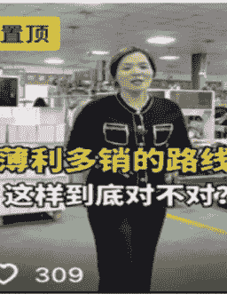
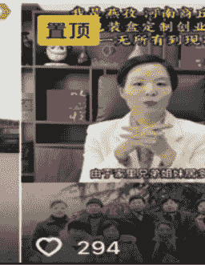
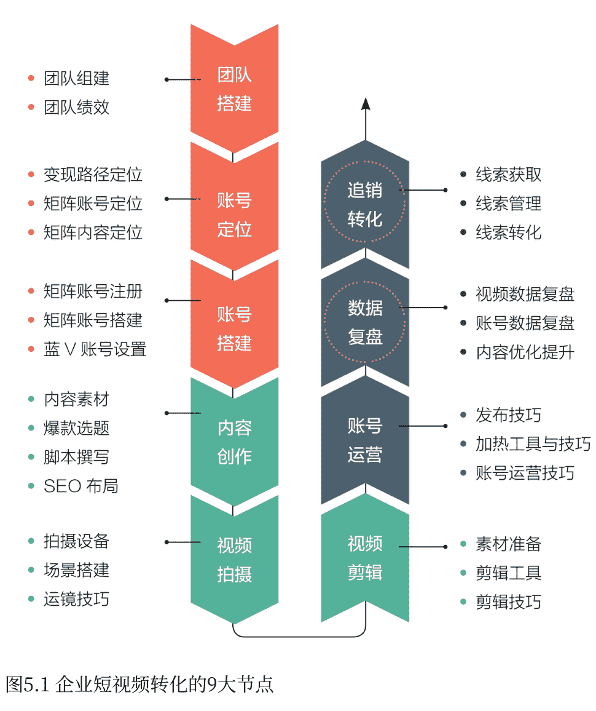
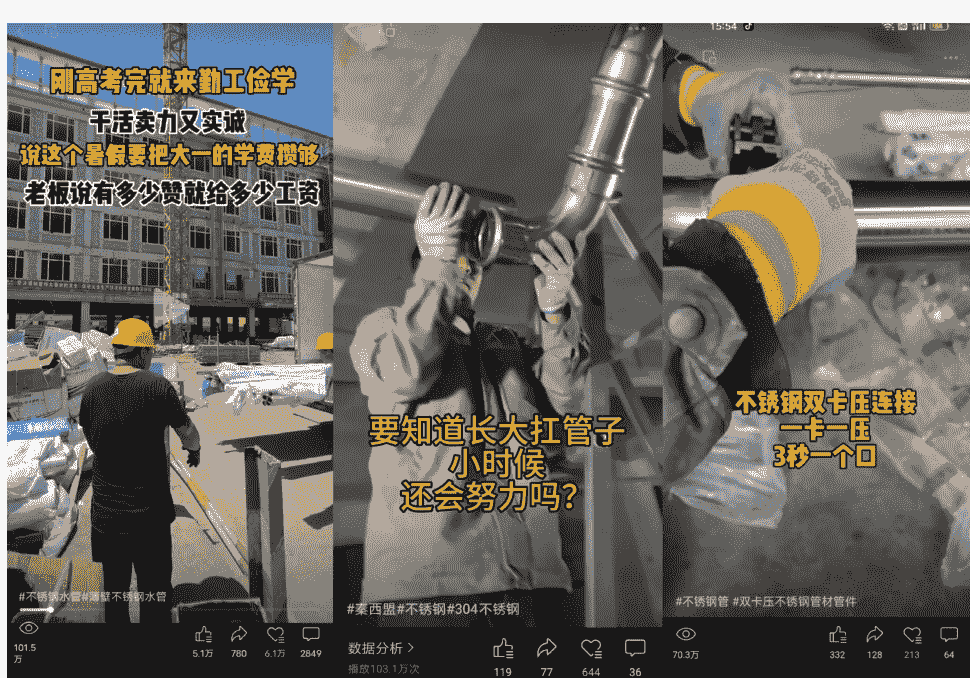
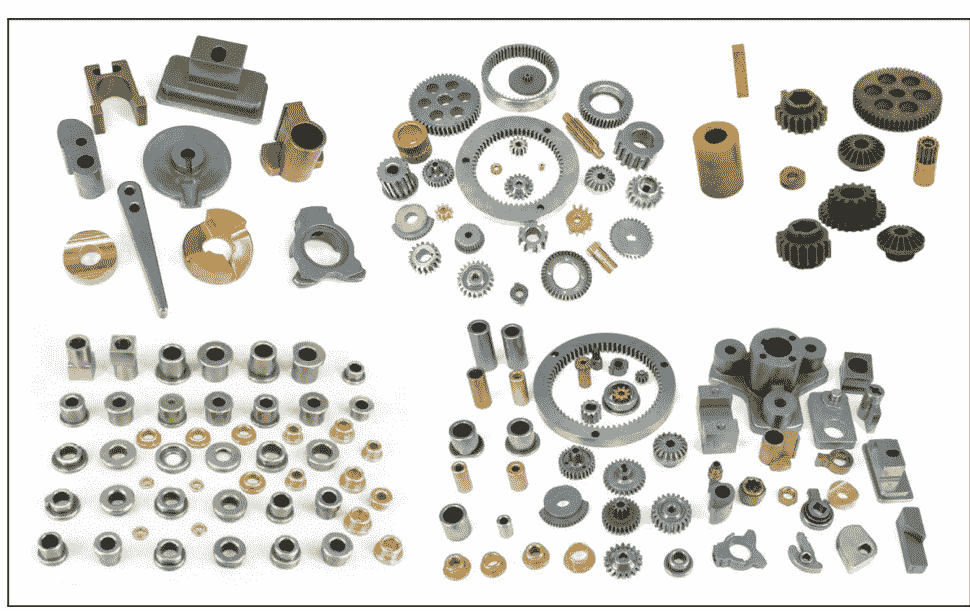
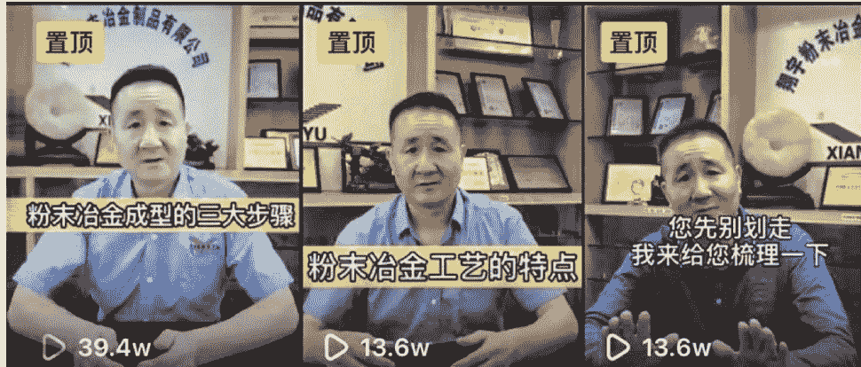
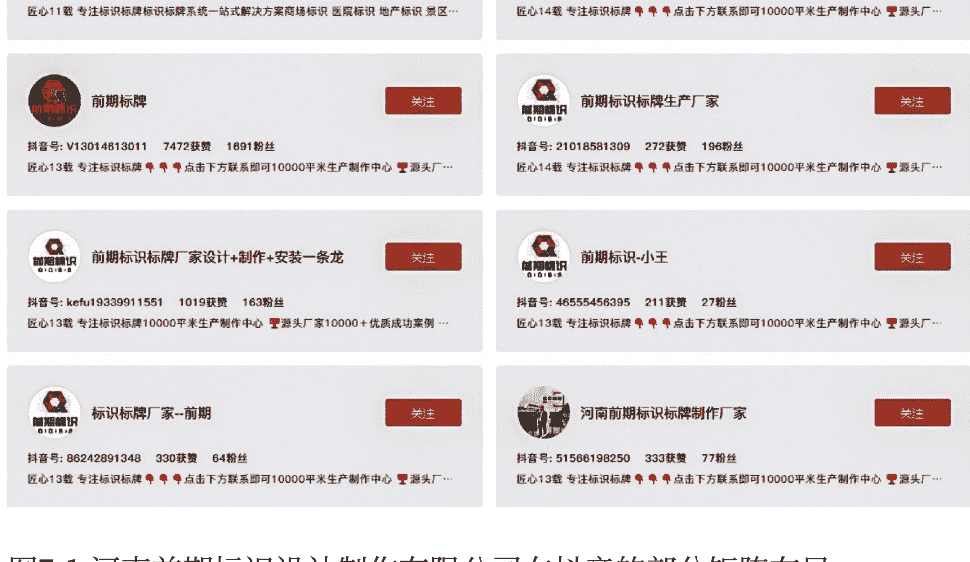
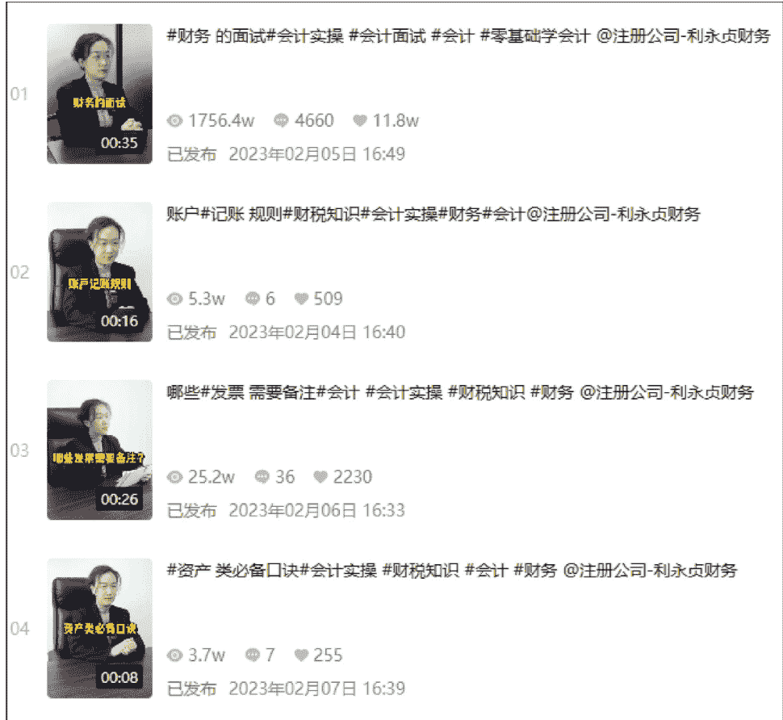
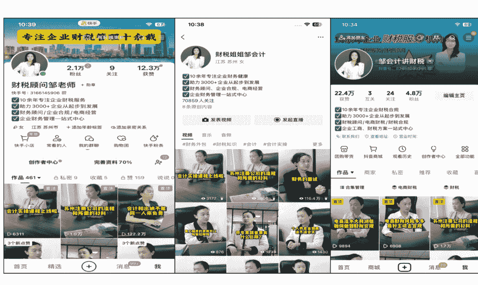
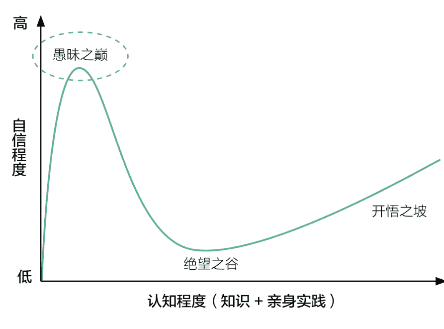

# AI时代营销革命

## 作者简介

单仁

央视财经、凤凰卫视特约评论员

江西财经大学深圳研究生院客座教授

北京青爱教育基金会副理事长

深圳市单仁牛商科技股份有限公司董事长

2006年起，单仁博士带领专家团队，把传统营销和网络技术相结合，在国内首创“实战全网营销”课程。他专注于产业加互联网的应用研究，尤其是网络营销的系统研究，出版了《全网生态营销》《网道》《抢道》《渠道新战争》《涅变》等多部著作，传递独特的传统企业互联网转型的战略思想。

2018年起，单仁博士带领单仁牛商团队，为传统企业短视频、直播营销，以及品牌出海探索了快速转型之路。开设了针对内外贸企业的短视频、直播、AI全域营销等系统课程。同时提出视播时代企业全域营销的系统理论，帮助企业紧跟趋势，持续增长。

AI时代已经到来，企业面临的不是一场技术升级，而是一次彻底的营销革命。

AI正在重塑流量分配规则：从争夺关键词排名，到争夺AI的心智与信任；从“人找货”的搜索逻辑，到“AI替人找货”的智能推荐。未来，企业的生死命题将是：当客户向AI提问时，你能否成为被推荐的那个答案？

翻开这本书，掌握AI时代的营销新规则，让你的企业不仅被看见，更被信任和选择。

## 权威推荐

**王永**

品牌联盟（北京）咨询股份公司董事长

在视播时代，品牌建设不再是简单的广告投放，而是一场信息全平台、内容多维度的全网战役。单仁博士将20多年亲手打造像天霸表、海霸表、太太口服液等知名品牌，以及指导超20万家企业互联网营销转型的实战经验进行深入总结，在本书中，为企业打造了一套从短视频、直播到全域营销的立体化解决方案，帮助中小企业在视播时代的浪潮中实现转型与增长。

**王克**

中国企业发展规划院院长

单仁博士的《AI时代营销革命》不仅是一本营销指南，更是一本开启未来商业模式的“密码本”。书中融合了单仁博士在AI营销和全域营销领域的丰富经验和独到见解，为企业在数字化转型和智能化升级的道路上指明了方向。阅读本书，你将深刻理解AI如何赋能营销，全域布局如何构建品牌影响力，以及如何将流量转化为实实在在的订单。

**曹虎**

科特勒咨询集团全球合伙人、中国区及新加坡CEO

单仁博士以其敏锐的洞察力和丰富的实践经验，将传统营销模式与AI技术完美融合，为企业打造了一套完整的全域营销体系。本书不仅分析了传统营销的局限性，更提出了AI时代营销的新思路、新方法，帮助企业跨越时代的鸿沟，实现弯道超车。

**宋革**

凤凰网深圳CEO

本书强调了AI技术在视播时代营销中的重要性，指导企业如何利用AI创作和发布高质量视频内容，以获得更多的推荐流量和长周期搜索流量。对于追求创新和效率的企业来说，是一本不可多得的营销宝典。

**李海周**

深圳市兆威机电股份有限公司董事长

单仁博士以系统化视角，深入剖析了AI时代营销的新生态：从参加线下展会到全域布局短视频矩阵，传统企业的获客方式正在经历革命性变革。本书将理论与实践相结合，为传统行业决策者提供了系统性参考。

**刘骏**

日联科技集团股份有限公司董事长

AI正在重塑营销的底层逻辑，而这本书正是传统企业在AI时代破局的实战指南。单仁博士用鲜活案例揭示了AI赋能下的全域营销如何让企业实现转型与增长。强烈推荐给每一位寻求增长突破的企业家。

**王国安**

韩后品牌创始人

单仁博士不仅是全域营销布局的践行者，更是AI营销革命的推动者。本书以视播时代为背景，深入解析AI如何赋能全域矩阵，助力企业从流量焦虑走向精准获客。本书逻辑清晰，极具前瞻性。

**张勇**

白小T创始人

单仁博士的《AI时代营销革命》不仅为企业指明了品牌建设和定位的方向，还提供了流量获取和转化的策略，为企业提供全新的营销视角和实战指导。强烈推荐这本书给每一位渴望在市场中取得突破的企业家和营销人。

**王文京**

用友网络科技股份有限公司董事长兼CEO、中国互联网协会副理事长、中国企业联合会及中国企业家协会副会长

我相信，《AI时代营销革命》将成为众多企业家和管理者的案头必备之书。它不仅是一本AI时代的全域营销指南，更是一本关于这个时代企业如何生存与发展的战略思考。

**朱玉童**

深圳采纳营销策划公司总经理

《AI时代营销革命》一书，不仅提供了理论指导，更结合了大量实战案例，分享了单仁博士在AI营销和全域营销领域的宝贵经验。阅读本书，你将学习到众多传统企业成功转型的经验，避免走弯路，快速找到适合自己的营销路径。

## 推荐序1

### AI时代企业驾驭营销变革，实现转型的关键一跃

王文京

用友网络科技股份有限公司董事长兼CEO

中国互联网协会副理事长

中国企业联合会及中国企业家协会副会长

很高兴能为单仁博士的新作《AI时代营销革命》作序。我与单仁先生虽身处不同领域，一个在企业从事软件管理与服务，一个在营销领域从事教育与咨询，但我们却共享着同一个努力方向：通过推动企业数智化转型，助力企业在这个剧变的时代提升核心竞争力，实现高质量发展。

单仁先生在书中提出的许多观点，与我这几十年来陪伴中国企业成长所观察到的趋势深度共鸣。从早期的电脑化、后来的信息化，到如今基于数智技术的数智商业创新，我深刻体会到，每一次技术浪潮的本质，都是对商业运行方式和效率的彻底重构。而当下，我们正站在由人工智能驱动的、更为汹涌澎湃的商业创新浪潮之巅。

本书精准地捕捉到了这一时代转折点——从“互联网+”到“AI×”的跃迁。正如书中所言，“互联网+”为传统商业插上了翅膀，让我们得以构建线上“超级市场”，核心是“人找货”；而“AI×”则是在重构整个市场的规则，其核心变成了“AI替人找货”。这个比喻精妙且深刻。它意味着，企业竞争的战场，已经从关键词排名的争夺，转向了对AI心智与信任的争夺。你的企业能否被AI理解、认可并推荐，直接决定了未来的生存发展空间。

这与用友服务众多企业客户的实践完全契合。我们看到，领先的企业早已不再满足于简单的流程线上化，而是利用数智技术进行商业模式和管理方式创新。

本书中众多真实的传统企业转型故事，正是这种创新的生动注解。他们从困境中逆袭的历程，绝非偶然。他们的成功，验证了单仁博士在书中反复强调的观点：企业必须从“卖货思维”彻底转向“专家思维”和“解决方案思维”，将自己重塑为一个值得用户信赖，也值得AI推荐的“答案”。这不仅是内容创作的原则，更应成为所有企业在AI时代的立身之本。

本书的另一个重要价值在于其极强的系统性与实战性。它没有停留在空洞的理论说教，而是为企业描绘出一张清晰的全域营销进化路线图。从老板为何必须躬身入局打造IP，到如何搭建高效的“AI+团队”系统；从To B大宗交易如何获取高价值流量，到转化变现的四大核心关键，单仁博士将他近20年的观察、实践与思考，浓缩为一套可执行、可验证的方法论。这对于在转型浪潮中“碎片化学习”、越学越迷茫的很多企业经营者而言，无疑是一盏指路明灯。

作为企业软件行业的从业者，我尤为认同书中关于真正的赋能，必须是AI技术与行业（专业知识）、企业管理实践（流程、数据）的深度融合。营销系统的智能化，必须与企业内部的财务、供应链、生产等系统打通，形成数据驱动的闭环，才能真正实现“以客户为中心”的高效运营。这与用友通过商业创新平台（BIP）倡导并实践数智商业创新的理念不谋而合。本书在营销这个关键职能上，为企业提供了抵达这一目标的实战指南。

我相信，《AI时代营销革命》将成为众多企业家和管理者的案头必备之书。它不仅是一本AI时代的全域营销指南，更是一本关于这个时代企业如何生存与发展的战略思考。谨以此序向单仁先生的深邃洞察与无私分享致敬，也预祝每一位读者都能从中获得应对AI时代的方法与力量。

## 推荐序2

### 顺势而为，借势而起：AI时代企业逆袭指南

张勇

白小T创始人

因为做了白小T，更多人认识了我。很多人问我，为什么能靠一件白T恤，从水下起盘，4年内就霸榜抖音类目第一，一件纯白T恤卖了32个亿，年复合增长率达到76%。这里面是否有什么不为人知的秘诀？

其实我是个连续创业者，三次创业都还算成功。我真的没有什么秘诀，一件事情能成，是因为它本来就能成，我只不过碰巧成为那个做事的人而已。只有时代的企业，没有企业的时代。从个人选择讲，无非是做到了顺势而为，才有可能借势而起。

白小T能做到现在这样，从品牌角度讲，在于“品牌即品类”；从产品角度讲，在于品类创新；从营销角度讲，在于内容产品化。在过去信息中心化的时代，确实能做到“广告一响，黄金万两”。在现在这个信息粉尘化的时代，过去行之有效的理论和方法通通失效。很多人还没有理解和适应这个时代，下一个更加波澜壮阔的AI时代已经扑面而来。不管任何时代，商业营销的本质都不会改变，那就是洞察需求、解决矛盾。而AI正是让这个底层逻辑以几何级数效率放大的超级引擎。

看了单仁博士的书，真是“于我心有戚戚焉”，很多方面的想法、说法和做法和我不谋而合。

### 战略选择：品类决定出路，效率决定生死

单仁博士在本书中强调“选择”比“努力”更重要，我深有体会。服装行业血海一片，但我发现一个历史机遇：没有人把T恤这个品类当作品牌来做。用户是先有“买T恤”的需求，才有“选品牌”的动作。所以，我的战略就是让“白小T”等于“T恤”这个品类。

书中强调“从自身定位出发设计，锁定精准用户”，正是如此。我选择服务30～50岁有消费实力的男性，解决他们“白T恤易脏难打理”的强痛点，用“让用户花十分之一的钱穿大牌”的价值主张切入市场。我不是在卖一件衣服，而是在提供一个解决方案。

### 战术执行：内容建立信任，IP放大声量

战略定了，怎么执行？单仁博士在本书中讲到了根子上：必须从“卖货思维”转向“专家思维”和“解决方案思维”。用户不相信广告，但相信能帮他解决问题的人。

所以，我亲自上阵，一个星期拍100多条视频。我去代工厂拍面料、讲工艺，把红酒、酱油泼在衣服上做测试。我不是在娱乐，我是在证明我的产品解决了用户的痛点。这就是单仁博士说的“内容打动用户，信任促成交易”。

### AI赋能：全域放大，高效增长

当我明确了“说什么”（专业内容）和“谁来说”（创始人IP）之后，最大的挑战就是“怎么说”和“在哪儿说”才能效率最高。这就是AI和全域营销的价值。

早期，我们靠人力死磕内容。但现在，AI是我们不可或缺的“超级员工”。它帮我们抓取热点、生成脚本思路、分析用户反馈，甚至预测内容爆点。这让我们一个小团队能管理庞大的内容矩阵，把精力更集中在战略思考和创意发掘上。

同时，我们在众多平台进行全域布局。在抖音、视频号用短视频打爆品牌知名度；用专业内容布局百度、知乎，赢得那些主动搜索“T恤哪个品牌好”的用户的信任。

单仁博士的这本书，不仅会帮你解决战略上的困惑——“做什么”和“为什么做”，帮你找准方向，避免在错误道路上盲目努力；还会给你一套完整的系统、工具和方法论——“怎么做”，帮你高效执行，实现全域突破。

我亲身实践了这条道路，并证明了它的有效性。对于任何一位不甘于平庸、渴望在AI时代抢占用户心智、取得品牌声量的企业家来说，这本书就是你不可或缺的商业指南，让你每一步都走在正确的路上。不走弯路，就是最高的效率。

我强烈推荐本书。

是为序。

## 自序

### 从“互联网+”向“AI×”，20年专注一件事，让营销回归效率本质

此刻，我的指尖仿佛还残留着30多年前老虎滩那块松动岩石的冰冷触感。那是一个晴朗的周末，风拂过树梢，把细碎的光影抛向海面。那时公司刚把我从深圳派到大连从事业务工作。我和几位同事相约来到大连的老虎滩。

当时是1992年，国际登山联合会刚刚向国际奥委会申请把攀岩列为奥运会正式比赛项目。所以攀岩在那时是特别时髦的运动。

当我们发现老虎滩就是一个天然攀岩好地方时，有个人一时兴起，向我们喊话：“你们敢爬吗？你们敢爬我就敢爬！”都是30岁左右年轻气盛的小伙子，谁肯认输？所以在没有任何装备和专业训练的情况下，我们被推上了大连老虎滩那陡峭的崖壁。凭着不服输的劲儿，我们竟也爬到了30多米的高处。然而，就在最险峻的位置，前面的人卡住了，往上找不到可以借力的石块，崖下是滩上裸露的岩石，进退维谷。

可就这样卡在崖壁，等大家力气都耗尽了，那就真的“死路一条”了。

上山容易下山难。我在下面喊着：“没事，上去！一定可以的！”甚至打了保票：“没事，掉下来我在底下。”——虽然心里清楚，真掉下来，我什么办法都没有，但靠着这股劲儿和一点儿运气，他们很快找到了一个借力的小石块，登顶了。

轮到我时，那块关键的石头，在我用力攀抓的瞬间，松动了。

你能想象一个人悬挂在半山腰，脚下是虚空，唯一的支点正在脱落的滋味吗？我的腿抖得不像话，冷汗瞬间浸透后背。我知道，再犹豫就是粉身碎骨。心一横，用尽全身力气抠住那松动的石头，几乎是凭着本能和一股狠劲儿，把自己拽了上去。身体刚爬上山顶，那块石头就“砰”的一声飞落崖底。

我瘫在地上，说不出话，生平第一次接过了同伴递来的烟。烟雾缭绕中，我心里想着：“神经病啊，冒这个险干吗？有价值吗？今天要是掉下去非摔死不可，有谁记得我是谁？”心里又想：“如果今天我掉下去摔死了，有多少人愿意参加我的葬礼？数来数去，也不过十人、八人。”

就在那时，草丛里爬出一只极其漂亮的七星瓢虫，转瞬又消失在草叶间。那一刻，我似乎顿悟了：人何尝不是如此呢？当我们来到这个世界的时候，有多少人知道我们来了？当有一天我们悄无声息地离开的时候，又有多少人知道我们离开了？

我们拼命追求的财富、房子、车子，终将无法带走。唯一能证明我们活过、活得有价值的，或许是我们离开后，有多少人记得你，5年、10年后，还有多少人能记起你的名字、你做过的事。

那次悬崖边的顿悟，像一颗种子深埋在我心底。它让我开始追问：什么是有价值的人生？什么是值得为之冒险的事业？

1981年，我开始读本科，学习商业会计。作为财经类专业学生，除了学习商业会计专业课程之外，我们也要学习各种经济学理论。当时的中国商业其实很简单，就是遍布全国的供销社系统，划分为四级供销和调拨体系，从国家供销总社到省供销社、县供销社，再到公社供销社。产品按照计划生产出来，需要经过四个环节，再到用户手上，每个环节都要加价，也就是从出厂价到销售价，要涨2～4倍，效率低下得令人窒息。马克思说“单纯的商品买卖不创造价值”，那为什么流通过程中价格能翻几倍？这巨大的背离让我困惑。我的本科毕业论文没有写会计方面的内容，而是写了《论直销》，设想工厂能直接对接消费者，按需生产，没有中间商赚差价。这在1985年，被认为是幻想。

我后来的人生轨迹，似乎总在印证这种对“效率”和“直达”的执念。2003年我做图书音像，面对新华书店那令人崩溃的低效率（补货一周，回款一年），我再次忍无可忍。改变不了别人，就改变自己。我们建网站，收集邮件地址，用创意标题和反向链接，把读者直接引到官网下单，通过邮局汇款完成交易。效率的提升是惊人的。这就是我20年前论文里幻想的商业结构。互联网让直销从幻想变成了触手可及的现实。我好像明白了，互联网营销就是当年我想象的样子，可以让经营效率大幅提升。

### 20年营销实战，见证互联网营销变革

2006年4月，我创立了单仁资讯（深圳市单仁牛商科技股份有限公司的前身）。一个清晰的信念驱动着我：要把基于互联网的高效营销体系，带给千千万万还在传统模式中挣扎的中小企业。近20年来，我们见证了互联网从PC端到移动端，从图文到视频直播，从搜索电商到“人找货+货找人”的兴趣电商。我们服务了近20万家企业，其中包括老板电器、方太、兆威机电、日联科技、百果园、名创优品在内的几十家上市公司，它们借助网络的力量，业绩提升了10倍，甚至100倍。为什么？因为互联网彻底改变了游戏规则。

进入互联网，卖家有机会触达更大范围、更多数量的客户，这样的营销机会，线上比线下大百倍；买家通过网络能够找到和可选择的品牌比线下也要多10倍的量级。所以，线上的竞争难度比线下竞争更激烈；同时，互联网可以让我们接触到过去线下无法触及的不同类型的客户。对中小企业来说，这是一个借助细分市场战略切入市场的最佳机会。

我们所处时代的重要特征，就是以互联网为基础，以视频为核心载体的视播时代。

从客户愿意触达信息的形态来说，视频形态，包括短视频、中长视频都是客户的首选形式。短视频（3分钟内）制作相对简便，更容易获得平台的算法机制（点击率、完播率和互动率）的支持，更容易获得大流量，有机会大范围触达用户。中长视频（长于3分钟），无论是专业种草内容输出，建立自己在专业领域的权威性，还是对产品价值塑造、公司的品牌可信度的建立都有着巨大的价值。今天，所有的行业、所有的生意都可以用视频形态重做一遍。

### 未来新规则：竞争AI的心智与信任

与此同时，一场更深刻、更迅猛的革命已经呼啸而至——AI（人工智能）革命。AI带来的效率提升是指数级的。而商业竞争的本质是效率之争，高效率碾压低效率，低成本战胜高成本，快速度淘汰慢速度。驾驭马车和驾驶汽车，效率天壤之别。拥抱AI工具，是企业和个人在新时代生存发展的必然选择。它不仅能24小时无休地提升效率，更能辅助决策，还能促进创新。企业正经历从“互联网+”向“AI×”的转变，带来的是一种阶跃式的效率提升。

过去20年，我们教会企业的，是如何在互联网的超级市场里租到一个“好摊位”，让自己的招牌更醒目（搭建企业官网），并大声吆喝吸引走过路过的顾客（流量获取）。这套逻辑的核心，是“人找货”。我们努力让自己被“找到”。这是“互联网+”为传统商业插上的腾飞翅膀。

但AI时代的到来，尤其是生成式AI和AI搜索的狂飙突进，不是在给这个“超级市场”安装更亮的灯，而是彻底重构整个市场的规则。

AI搜索不再只是一个更高效的“图书管理员”（传统搜索），告诉你知识在哪本书的第几页，让你自己去翻找、比对、判断。它进化成了一位不知疲倦、博览群书、洞察入微的“分析师”。用户不再满足于搜索，他们开始提问和委托决策：“我要为我的新房装修选瓷砖，哪个品牌性价比高、服务好？”“我的工厂需要定制防震包装，哪家供应商既专业又可靠？”

这时，AI会直接给出整合了全网信息、经过推理和分析的答案与推荐列表。你的企业是在这个推荐列表的榜首，还是根本不在其列？其中的差距，不再是同一维度上排名先后的差距，而是生存与毁灭的差距。

这意味着，营销的战场开始转移。竞争的核心，从争夺关键词排名，变成了争夺AI的心智和信任。你必须被AI理解、认可并信任，才能被它推荐。这意味着，你的内容必须具备前所未有的经验（Experience）、专业性（Expertise）、权威性（Authoritativeness）和可信度（Trustworthiness），即“EEAT”原则。你必须从卖货思维彻底转向专家思维和解决方案思维。

这正是“AI×”的含义——人工智能指数级地放大优势企业的效应，同时加速淘汰那些无法适应新规则的企业。高效率对低效率的碾压，将比以往任何时代都更加残酷和迅速。

站在这个技术爆炸的十字路口，我写下这本书。本书所探讨的全域营销，其内涵在AI时代也得到了升华。它不再仅仅是多渠道、多平台的占位布局，更是一场围绕“如何成为AI时代的推荐答案”而展开的系统性工程。

攀岩者都知道，最危险的往往不是悬崖本身，而是因恐惧而僵在原地，或是错误地判断了下一个落手点。AI时代的“悬崖”同样如此。它既预示着跌落的风险，也充满了登顶的机遇。许多中小企业管理者和我当年在老虎滩攀岩时一样，面对着看似陡峭的未知，内心充满忐忑，也可能像我在面对低效的新华书店体系时，感到窒息与无力。这本书，就是希望能成为你手中的那块关键的借力点。我希望它能帮助你避开深坑，抓住时代的巨大机遇，让你的企业在全域营销的战场上实现逆袭，找到属于你的、值得被记住的价值。

## 第 1 章

### 如何用 AI 打通全域营销，1 年业绩翻 6 倍

THE MARKETING REVOLUTION IN THE AI ERA

房地产市场低迷，曾经赖以生存的老客户接连消失……当传统的生意路径骤然断裂，如何以全域营销+AI赋能打破桎梏，创下业绩飙升、客户询盘量超10万的行业奇迹？

2025年初，我在北京讲课，一位新学员带着好奇问我：“单老师，您知道我是怎么找到你们并决定报名的吗？”不等我回答，他便揭晓了答案：“是AI推荐的。我在不同AI平台上提出需求，结果里总能看到‘单仁牛商’排在首位（见图1.1）。这么多AI都推荐你们，我想这背后肯定有‘门道’值得学。”

图1.1 在各个AI平台搜索“企业全网营销培训哪家好”，单仁牛商都排在首位

这番话让我陷入深思。从2006年踏入互联网营销培训领域至今，近20年间我完整经历了媒介形态的剧变：从传统媒体到门户网站，从搜索引擎到新媒体，从短视频、直播再到今天的AI搜索。

每一次变革都伴随着流量格局的重构，而这次AI带来的冲击尤为深刻。

### 客户一夜“蒸发”，他们都去哪儿了

一次课程现场的茶歇时间，喧嚣暂歇。我刚坐到休息区，一位神色凝重、眉宇间却透着一股不服输劲儿的女士便快步走到我面前。

这位女士是佛山市圣凯罗建材有限公司的总经理颜慧萍。她没有寒暄，开门见山地说：“单老师，我真的想不通！我的瓷砖质量不比大品牌差，价格也实惠，以前生意挺好的。可现在，我的客户好像一夜之间全都消失了！老客户不再下单，账期也被拉长，回款遥遥无期……我还有那么多员工要养，再这样下去，我真的撑不住了。”

她抛出了那个压在心头、让她夜不能寐的问题：“单老师，您说这到底是怎么了？我的客户，他们到底都去哪儿了？”

颜慧萍的故事是中国无数传统制造业企业家的缩影。十几年前，她和先生大学毕业后，一头扎进瓷砖行业。从工厂销售做起，跑遍了全国各地的门店。他们深知消费者苦于价格不透明和质量参差，于是立志创业，要做价格公道、品质一流的好瓷砖。

创业维艰。他们坚守品质，将利润压到极致，但批发业务中，他们的价格依然不占优势，销量迟迟打不开。直到他们抓住了淘宝早期的红利，开了几家网店，生意才终于有了起色。

“那时候，我们以为找到了金钥匙，以为只要产品好，线上开开店，生意就能一直做下去。”颜慧萍回忆道。他们甚至扩大了团队，搬进了3000平方米的新展厅。

然而，危机的伏笔早已埋下。2018年，自媒体平台崛起，颜慧萍没在意，“觉得那不过是年轻人娱乐的地方”。到了2019年，业绩开始下滑，他们还以为是自身运营出了问题。

真正的重击来自2020年的双十一购物狂欢节。“那天，我们只做了100多万元，往年这个时候都是300万元起步！”颜慧萍的声音有些颤抖，“团队所有人都蒙了。我心里慌得厉害，但为了稳定大局，还得强装镇定。”

2021年，情况更是急转直下。客户咨询量暴跌40%，业绩腰斩，公司账上出现了刺眼的赤字。“我整夜整夜睡不着，躺在床上想，到底哪里做错了？为什么努力了十几年，说不行就不行了？”那段时间，她压力大到甚至想过收缩规模，但理智告诉她，退缩只有死路一条。

不甘坐以待毙，颜慧萍决定自救。看到同行在拍短视频，她也挽起袖子亲自上阵。“我天天自己写脚本、自己拍，讲产品、讲工艺，忙得脚不沾地。结果呢？吭哧吭哧拍了3个月，一个咨询电话都没有！”

团队的剪辑同事看不到希望便辞职了，丈夫也反对她继续“瞎折腾”，身边的质疑声越来越大。“我差点就认命了，觉得我们这种To B的建材生意，可能真的不适合搞线上，注定要被时代淘汰了。”

直到颜慧萍在朋友圈看到单仁牛商关于短视频营销的课程分享，抱着抓住最后一根救命稻草的心态，她走进了课堂，来到了我的面前。

我反问颜慧萍：“颜总，您没做错，但方向错了。您还在用卖货思维做内容，对着镜头‘王婆卖瓜’，平台怎么可能给您流量？用户又凭什么信任您？”

那一刻，颜慧萍突然明白，自己这3个月所有的努力，只是在重复过去的传统思维，而外面的世界早已天翻地覆。

### 内容打动用户，矩阵扩大触达，信任促成交易

颜慧萍沉下心来，开始系统性学习。她首先弄懂了一个核心概念：全域营销。“原来，我的客户并没有消失，他们只是换地方了。他们不再只逛淘宝，也不再只等我们打电话。他们分散在抖音、快手、视频号、百度、知乎……任何一个他们获取信息和娱乐的地方。”

更重要的是，她学到了一个将影响她未来生意格局的“新武器”——AI。我对颜慧萍说：“时代变了，以前是‘人找货’的搜索时代，现在是‘货找人’的推荐时代，而未来是‘AI替人找货’的智能时代。未来的流量入口不再是传统的搜索框，而是AI对话界面。用户会直接问AI：‘佛山什么瓷砖品牌适合加盟？’‘别墅装修用什么瓷砖好？’AI会直接给出答案和推荐。”

企业的生死命题，从“如何被用户找到”变成了“如何被AI推荐”。

这个认知彻底打开了颜慧萍的思路。她不再把各个社交平台仅仅看作是一个个销售渠道，而是看作向AI证明自己专业、权威、可信的“内容生产基地”。

思路清晰后，颜慧萍迅速行动。

- 全域布局，矩阵出击：颜慧萍带领团队深入分析各平台用户偏好，一口气搭建了50多个定位清晰的账号。有展示产品效果的，有分享装修避坑知识的，有解读行业趋势的，当然，也有颜慧萍亲自出镜的创始人IP账号，分享创业故事和经营理念。
- 内容为王，信任为先：内容不再硬邦邦地叫卖，而是提供真正有价值的信息。“我们教客户怎么选瓷砖，怎么辨别好坏，各种空间该怎么搭配。我们把自己从一个‘卖瓷砖的’，变成了一个‘瓷砖领域的专家’。”
- AI赋能，高效管理：账号越来越多，最高峰时达到了600多个！但颜慧萍的团队并没有膨胀到几百人。“我们靠的是AI工具！”她兴奋地解释，“AI帮我们生成脚本思路、批量剪辑视频、跨平台一键发布、自动回复评论、分析数据……两个人，就能承担过去几十人才能完成的工作量！AI就是我们不知疲倦的超级员工。”

经过不懈努力，颜慧萍带领团队成功打造出了多条百万级爆款视频。一条讲解瓷砖选购知识的视频，播放量突破340万，竟然带来了中非地区的采购询盘！对方采购人员的反馈让她至今难忘：“我经常刷到你们的视频，很专业，又去搜索了你们的官网，看到很多真实案例和好评，所以就联系你们了。”

这就是全域营销+AI赋能的威力：内容打动用户，矩阵扩大触达，信任促成交易。

客户并未消失，而是活跃于短视频与AI构建的新世界中，企业需要通过专业内容矩阵重新触达并建立信任。

2024年，佛山市圣凯罗建材有限公司的线上业绩相比2021年低谷期，疯狂增长了数倍！客户询盘超10万条。他们不仅挺过了寒冬，更有充足的资金投资了自己的窑炉厂，彻底掌控了品质和成本的主动权。

课程结束后很久，颜慧萍给我发来一条信息：“单老师，我现在知道答案了。我的客户没有消失，他们一直都在。只是他们去了一个由视频+AI构成的‘新世界’。以前，是我看不见他们，找不到他们。现在，我终于学会了在这个‘新世界’里，用AI当我的眼睛和嘴巴，让他们能看见我，信任我，主动来找我。”

颜慧萍的故事，为所有在转型迷雾中挣扎的企业家点亮了一盏灯。

客户去哪儿了？他们就在那里，在视频的评论区里，在AI搜索的问答里，在每一个你曾忽略但必须占领的全域平台里。

而你要思考的，不再是如何找回他们，而是如何让他们在AI时代的新世界里，第一眼就能看到你，并毫不犹豫地选择你。

拥抱AI，是企业和个人在新时代生存发展的必然选择。它不仅能24小时无休地提升效率，还能辅助决策，促进创新。

回望那位因AI推荐而来的学员，他的出现不是偶然，而是趋势的必然。这场AI搜索革命最深远的意义，在于重新分配了竞争机会。中小企业第一次拥有了与大企业同台竞技的利器。借助AI搜索带来的变革，把自身打造为所在领域的权威，不需要庞大的规模，只需要深耕专业领域，就能在AI驱动的信息生态系统中脱颖而出，实现持续增长。

用AI工具管理矩阵，用专业内容征服算法，才能在AI搜索的新世界里成为被推荐的那个权威答案。

接下来，我会通过一个个真实的企业故事，分析企业如何驾驭这场营销变革，真正实现可持续的健康发展。颜慧萍的故事，是一个精彩的序幕，它向我们展示了当传统的卖货思维被AI赋能的专家思维取代后，所爆发出的巨大能量。她用AI工具管理矩阵，用专业内容征服算法，最终在AI搜索的新世界里成为被推荐的那个权威答案。

然而，通往这场AI营销革命的道路并非坦途。许多企业家和颜慧萍一样，首先遭遇的是环境剧变带来的迷茫与阵痛。他们面临的第一个问题，不是“如何用好AI”，而是“如何在当下的艰难环境中活下来，并找到逆袭的方向”。

这正是任何一场革命都必须经历的阶段：只有先意识到旧世界的规则已然崩塌，才会迫切地渴望并拥抱新世界的火种。接下来，我们将首先深入这个“旧世界”的现场，看看那些成功逆袭的传统企业，是如何在迷茫中率先看清趋势、转变思维，为后续全面接入AI驱动的全域营销打下坚实基础的。

## 第 2 章

### 传统企业逆袭战：从负债 1600 万元到业绩 3 倍增长的营销突围

THE MARKETING REVOLUTION IN THE AI ERA

当传统包装企业遭遇数字风暴，倔强的山东汉子40岁那年放下了经商10多年养成的惯性思维，真正做到了“空杯”的心态，重新出发，用全域营销引爆万亿级赛道，1年客户数量超过过去12年客户总量，业绩增长3倍，重启事业与人生！

颜慧萍的成功证明了AI赋能全域营销的惊人潜力。但她的起点并非个例。她的那句“我的客户，他们到底都去哪儿了”的锥心之问，其实是在市场剧变下，无数传统企业家内心共同的迷茫与呐喊。

AI驱动的营销革命固然强大，但对于许多像颜慧萍一样，在传统行业深耕数十年、正面临绝境的企业家来说，他们首先要解决的，不是一个技术问题，而是一个思维问题：**如何放下过去的成功经验，看清新时代的规则？** 他们面临的第一个问题，不是如何用好AI，而是如何在当下的艰难环境中活下来，并找到逆袭的方向。这场革命的起点，不是大刀阔斧的技术登场，而是一次痛苦的认知重启。

金色的阳光刺破云层，在对面的玻璃幕墙上晕染出重影。再往远处眺望，朱红色的画舫在碧波上摇晃，船工的竹篙搅碎了倒映的垂柳。这锦绣世界似乎藏着某种未被解码的秩序，而我似乎正站在可以窥见答案的渡口。

在素有“人间天堂”美誉的苏州，我第一次见到了这个倔强的山东汉子王磊。当时的全域营销课程会场，王磊坐在会场中，眼神中透露着迷茫与期待。

活动结束后，我和王磊交流，听他讲述了一段精彩的崛起故事。他的逆袭，始于一次彻底的“空杯”，而这正是所有企业拥抱AI时代、决胜未来的真正开端。

2006年王磊大学毕业后一个人来到江苏省昆山市，初来乍到时没资源、没人脉、没资金，当时唯一拥有的就是一颗不服输的心。

王磊在最初的几年做过直销，卖过洗发水，推销过吸尘器。但是这些只能解决他最基本的吃住问题，在最困难的时候他还在昆山的丽泽公园睡过15天。

凭借着山东汉子不服输的倔劲儿，他每天起早贪黑地工作，在2011年，和妻子二人终于有了第一个属于自己的200平方米的小作坊。当时也正是昆山市大力发展制造业的黄金期，他们正式成立了昆山博众包装材料有限公司，主营珍珠棉卷材、板材、珍珠棉定制加工，帮助各行各业的产品定制内包装，起到防震缓冲的作用，可以保证产品在运输过程中不受损伤，同时降低包装成本，增加产品美观度，提升产品的议价力。

从那以后，经过10年来的不断努力，夫妻二人也算是小有成就，拥有了两个工厂，应用领域横跨500多个行业。

2021年初，王磊拿出了全部积蓄并贷款1600万元在上海全资收购了一家上游企业。但是天有不测风云，没想到这个决定变成了他终生难忘的一场噩梦。就在2021年4月11日凌晨0点25分，因为消防设施管理不善，一场无情的大火烧毁了他的整个工厂。当时的他面如死灰，深陷绝望，后悔不该盲目自信，一味地追求做大、做强。

雪上加霜的是，他的另外一个工厂的资金链也发生了断裂，要靠借贷来给员工发工资，最后连孩子的保险都被他卖掉了。

王磊开始没日没夜地自责、懊恼、后悔，精神和资金的双重压力让他不敢出门，不敢见人。他看到妻子整夜睡不着觉，长出了满头的白发，就连两个孩子也感觉到了家庭的变化而失去了从前的欢乐，他暗自发誓一定要让自己再站起来。

但是这次的重新出发，却没有10年前那么顺利。天天陪吃陪喝谈业务，没日没夜拉关系，生意却不见起色。竞争的压力越来越大，让王磊对线下的生意没了方向。王磊萌生了一种想法，要不要通过线上来接生意，虽然人来到了课程现场，但他心里对能在线上拿到订单是坚决不信的。

他认为用十几年的线下经商经验都搞不定的事情，线上根本不可能搞定。他只是抱着试一试的态度，来到了单仁牛商的课堂。

### 为什么越努力越感到绝望

课程结束后，我在会场后面的休息区喝水，王磊来到我身边，有些迟疑，更有些惶恐，问我也是在问自己：“为什么我已经这么努力，但生意还是那么难做？学了全域营销课程，真的能帮我改善经营状况吗？”

我回答他，你有没有看过《盐铁论》这本书，其中有句话叫“富在术数，不在劳身；利在势居，不在力耕也”。

他摇摇头。

我继续说：“这句话的意思是，富有并不在于体力上付出多少，而在于智慧的运用与方法的巧妙；获得更大利益的关键，在于掌握时机和形势，而不是靠辛勤耕耘。

“做好生意，做大经营，就必须懂得借力，世界上能够借到的最大、成本最低的力量，就是趋势的力量。

“创造财富的核心关键在于审时度势，发现并利用商机。企业不论大小，永远都是机会的产物，趋势就是机会，跟不上趋势，就不可能有好结果。”

现在，我们要看到市场环境的深刻变化。

改革开放初期，中国经济增长速度惊人，年均GDP增速保持在两位数以上。在那个时期，市场需求旺盛而供给相对不足，只要敢创业、能生产出产品，就不愁销路。然而，自2010年起，中国的GDP增速从两位数的高速增长降至个位数。

在这样的市场环境下，国家于2011年开始大力倡导“专精特新”战略，鼓励企业专注于细分领域，走专业化、精细化、特色化、新颖化的发展道路。从2020年开始，中国的GDP增长速度进一步放缓，降至5%左右，有时甚至低于5%。

这些宏观经济变化清晰地表明，市场已经从过去的供不应求转变为供大于求，产能过剩成为常态。在这种情况下，企业要想脱颖而出，就必须紧跟时代步伐，灵活调整战略，抓住每一个可能的机会。

我给王磊讲述了我曾经看过的一则新闻报道。

曾经华中地区最大的品牌服饰批发市场——一铺难求的武汉万商广场，现在已经沦落到了业主自发自救的境地。在2004年高峰时，万商广场凭借着巨大的人流量，以及在服装批发领域的重要地位，一个70～80平方米的商铺，一年的租金可以高达30万元。但20多年过去了，商铺年租金已跌至1万元却仍租不出去，越来越不值钱。

业主们觉得商场的经营状况大不如前，是运营方没有管理好，缺乏有效的商业运营，设备、装修越来越陈旧，但物业费还越收越高，把这么大的商场搞成了现在这个样子。所以，业主要把自主权拿回来，重新对商场进行装修和招商。

看完这篇报道，我特别诧异。诧异什么呢？并不是万商广场的没落，因为这是一个顺其自然、必然发生的事情。让我诧异的是，在报道的描写中，业主们对于这样一个结果的归因和分析，竟然是“运营方没有管理好”，觉得重新装修、招商一下，好像就能以一个好价格租出去，马上就有人流量一样。这让我觉得他们好像还活在20年前，跟今天服装行业的发展，包括跟整个商业世界的发展完全脱节了。

一个合格的经营者要学会判断趋势，把握未来的关键。今天一定要学会用新的方法去做新的生意，不要想着商业世界还能回到20年前，还会依照自己的经验去运行。

商业最大的差距，不是产品，而是人的思考能力。对今天的很多企业来说，做生意既要坚守初心，洞悉行业本质，又要不断研究变化，在经营手段和方法上因变而变。昨天的方法解决不了今天的问题，昨天的产品满足不了今天的用户。一定要回到市场、回到用户需求上，进行长周期的思考，对商业模式、营销方法、业务流程和盈利模式等进行不断迭代。

对于任何经营者和创业者来说，一个伴随事业的核心命题，就是必须时刻关注技术发展趋势和商业模式变化趋势。如果没有看懂这样的变化，没有理解行业发展和时代进步之间的内生逻辑，一味地按照过去的经验，认为市场会随着自己预设的结果而变化，这样的经营者未来的结局也能够预见了。

### 视播时代，所有行业都值得用AI+视频重做一遍

王磊受到了一些触动，但还是感到非常疑惑。零售行业通过线上发展生意，王磊非常理解，但他是做包装材料定制加工的，难道也可以通过互联网在线上接生意？

我非常理解王磊的疑惑。自2006年起，我们投身于互联网及互联网营销领域，至今已走过近20年历程，助力几十万家企业迈向互联网时代。这么多年来，我们始终致力于助力中国传统企业步入互联网。人们提及企业触网，常想到电商，进而联想到日用品、消费品的线上销售，却忽略了消费品背后庞大而完整的产业链。以手机为例，从购买手机这一消费行为出发，背后涉及手机工厂、生产配件、制造设备以及原材料等众多环节，形成庞大产业链。

我们服务的80%以上的学员，多为产业链中的成员，涵盖做配套、从事大额交易、定制化业务与商业服务等。与消费品领域的大品牌相比，多数学员的企业由于资金规模限制，无法投放大规模广告。传统的营销方式如陌生拜访、参加展会、老客户转介绍等，已难以满足当下的商业需求。

在当今时代，企业面临的最大问题是难以突破发展瓶颈，关键在于解决这些卡点。而营销就是企业发展的关键所在，只有做好营销，企业才能拥有未来。

营销是企业运营中极为重要的组成部分。对于许多企业而言，订单是企业发展的生命线，“订单治百病”这一说法形象地体现了订单的重要性。有了充足的订单和生意，企业许多潜在问题就能得到缓解或掩盖。相反，缺乏订单将导致问题接踵而至，企业陷入困境。因此，在企业经营中，应以营销为牵引，推动企业不断优化、变革与成长。

正如华为所展现的那样，即便在面临外部压力时，其依然能够通过强大的营销能力保持收入增长，从而巩固和提升自身在行业中的地位。

1994年3月，受朱保国先生邀请，我进入太太公司负责全公司的销售业务。当时，太太口服液产品进入市场1年多，每月营业额100多万元。有幸的是，1994年太太公司全年营业额1.4亿元，盈利接近4000万元。回顾这段历史，我发现，当年公司高息举债450万元，在中央电视台黄金时段投放广告，是一个关键的成功举措。

从1994年4月1日开始，太太口服液在中央电视台的《新闻联播》和《天气预报》之间的黄金时段投放广告，广告很简单，只有七个字“深圳太太口服液”。广告播出的第一个月，市场没有太大反应，但是从5月中旬开始，公司电话被全国各地的经销商打爆了。用不到1年的时间，太太口服液产品几乎覆盖了全国所有省份的主要城市。今天在市场上各行业中的优秀品牌，许多都是在1985—2005年，借助于类似中央电视台这类权威媒体的力量发展起来的。

随着互联网时代的到来，大众的注意力和媒体的焦点不再集中于单一渠道。对今天的大众来说，电视已经成为获取信息的补充渠道之一。

从企业增长趋势来说，网络业务比例将不断攀升，互联网助力成为企业竞争的关键，它让企业有机会触达范围更广的客户，为中小企业提供了切入细分市场的战略良机。

我身边很多企业借助互联网用5～10年的时间，业绩提升了10倍，甚至100倍。它们就是利用互联网扩大了自己的触客的范围和基数，找到了更深度的用户应用场景，发现了更多、更好的市场。

同时，互联网本身也在迭代，从买家到全平台进行主动搜索的“人找货”，再到现在平台借助算法推荐，把用户感兴趣的产品和品牌用视频内容的方式进行精准触达的“货找人”，需求和供给之间的效率在不断提升、效果在不断增强，用户也得到了越来越多的便利。

与此同时，更深刻、更迅猛的AI时代正在呼啸而来。企业与个人皆是时代的产物。AI搜索的狂飙突进，将彻底重构整个市场的规则。企业必须从“卖货思维”彻底转向“专家思维”和“解决方案思维”，成为能被AI推荐的答案。

正如美国管理大师彼得·F.德鲁克（Peter F. Drucker）所言：“当前许多成功的世界级大企业陷入困境的根本原因是它们的经营理念已经不再有效。”固守旧有理念的企业将面临巨大挑战。

今天的短视频，犹如昔日电视台的广告时段。试想，若在央视《新闻联播》后投放30秒广告，其费用可能高达数亿元，虽能推广品牌、吸引消费者，但起步资金过于巨大。相较之下，今日在社交平台发布短视频，有可能收获百万播放量，而成本几乎为零。

由此可见，短视频对于中小型企业更为有利，过去需耗费两亿多元才能达成之事，如今仅需购置一部几百元的二手手机即可实现。

从信息获取渠道来看，短视频本质上是一种传播媒介。短视频营销与以往的营销手段，如电视广告、业务员扫楼、参加展会等方式获取客户并无本质区别，均属获客途径。

然而，短视频营销的独特之处在于其革命性，而非单纯的创新性。创新是在现有基础上的改进与增值，而革命则意味着彻底推翻旧有体系，建立全新秩序。

不是做短视频，而是用视频重构“获客—信任—成交”全流程。

对于众多传统企业经营者而言，涉足短视频营销并非易事，这需要坚定的决心。部分企业误以为利用短视频进行营销的方式能够与传统经营方式无缝衔接，实则不然。

中小企业老板在创业时，鲜有具备系统财务知识或深入了解短视频领域的。这导致他们在面对政策、流量与客户资源时，行动力不足，常以“不会”为借口，总是在想：我的企业适不适合短视频营销？

为了打消王磊的顾虑，我又给王磊讲述了我的学员郑双名的故事。

广东热立方科技股份有限公司总经理郑双名毕业于清华大学，本硕连读专业为热物理，该专业人才在国内非常稀缺。

2003年研究生毕业后，他本有机会前往美国留学，却因被广东蓬勃发展的经济态势所吸引，选择留在广州。随后，他与同班研究生同学在广东共同创立了广东热立方科技股份有限公司。

公司的主打产品为空气能地暖机，产品单价较高。在参加广交会期间，他们获得了大量来自挪威、瑞典、德国等欧洲地区的代工订单，产品也主要销往这些地区。

然而，尽管产品质量卓越，代工所获利润却较为微薄，这促使他们渴望开拓国内市场。鉴于中国，尤其是长江以北地区市场的巨大潜力，自2012年起，他们连续3次尝试进军国内市场，但均以失败告终，对开发国内市场一度陷入绝望。

郑双名复盘失败原因，发现主要有三点：

- ◎资金有限，推广乏力：没有足够的预算做品牌宣传，只能靠发小广告、墙体广告等简单的方式获客；
- ◎招商困难，缺乏品牌力：格力、美的等头部品牌已占据市场，热立方作为新面孔，很难吸引经销商；
- ◎终端滞销，渠道失灵：即便勉强找到经销商，产品也卖不出去，渠道很快崩盘。

直至2021年，他注意到短视频营销的显著效果，便开始尝试接触短视频，拍摄并发布作品。然而，他发现单纯宣传公司产品难以获得流量，甚至账号被封，而拍摄一些与生意无关的热门、有趣内容虽能吸引流量，却对业务无实质帮助，这让他感到十分沮丧，不知如何是好。2023年3月，在参加一次活动时，他与一位佛山朋友交流，表达了自己对国内市场机会的困惑。该朋友是佛山牛商会会长，他指出郑双名的问题所在，即平台不会推送纯商业广告的内容。

为帮热立方破局，单仁牛商团队制定了三大核心策略：

- ◎全员参与，扩大内容基数：不仅销售团队拍视频，后勤、行政甚至经销商都加入进来，用多视角产出内容；
- ◎全域营销，覆盖多平台：不在单一平台赌流量，而是在抖音、快手、视频号等多平台搭建账号矩阵，放大品牌声量；
- ◎爆款复用，联动渠道：将能带来流量与询盘的爆款创意，同步给经销商，让经销商一起拍摄发布，形成“集团化传播效应”。

这套策略很快见效，热立方成功搭建多平台多账号的全域营销矩阵，借助不同平台放大自己的存在，提高品牌的声音。

2023年9月，热立方用1个月时间拿到了两亿播放量，1.5万条询盘，创造了5200万元的业绩。2024年4月，热立方在三大平台的播放量已经突破9亿，在地暖机这个垂直品类的知名度和销售量一枝独秀。

“每个行业都有这样的机会，关键是敢不敢行动、会不会方法。”我鼓励王磊，“现在就开始做，才有可能抓住视播时代的红利。”

王磊决定试一下，当天就利用中午休息时间，拿出手机拍了一段视频，讲述了在会场听课的心得和感受。

### 做了短视频，就一定能带来订单吗

奇迹总是会眷顾立即行动的人。就在当天晚上，王磊竟然在短视频平台收到一条私信。有人留言问道：“王总您家就是卖珍珠棉的吗？”王磊非常激动。客户是卖水果的，刚好需要珍珠棉作为礼盒产品的内部包装材料。客户给王磊发来了图纸和产品的图片，并进行了询价。用量不多，整体核算下来只有1600元。

简单的沟通过后，客户二话不说直接用微信把1600元转给了王磊。王磊简直难以置信，就是随手发了一个视频，竟然真的会有询盘，而且还真的接到了这个订单。

但王磊高兴得太早了。在接下来的十几天里，王磊不断发视频，但是一个询盘都没有。不死心的王磊再次找到了单仁牛商。但这次听课他和以往不同，他放下了倔强的性格，放下了经商多年养成的惯性思维，真正做到了“空杯”心态，用心去听老师讲的每句话，认真做笔记——他终于明白，利用短视频获客不能碰运气，而是要用系统方法。

所有逆袭，都是认知的重构。短视频不等于订单，系统方法才是转型的核心。

就像《如何将知识转化为行动》（Know Can Do!）中说的，知识与行动之间存在着一条难以逾越的鸿沟。很多企业做短视频失败，根源在于三个问题：

- ◎缺乏账号规划：没有长期运营逻辑，平台不知道该推送什么流量；
- ◎账号标签混乱：不清楚初期该发什么内容，无法让平台精准识别目标用户；
- ◎目标错位：要么随意发内容碰流量，要么盲目追求粉丝量、播放量，却忽略了订单转化这个核心目标。

互联网问世至今50多年，大规模的电子商务应用也有近30年，今天再走进互联网，只靠一招半式的技能，几乎没有成功的可能。传统企业需借助专业机构的系统知识与专业服务能力实现高效转型，更快取得成果。

认真学完了整体课程之后，在单仁牛商的帮助下，王磊的公司进行全域营销1年时间，客户数量超过过去12年客户总量，从原来的50家客户增长到现在的1200多家客户，从最初的7天只有1个询盘到现在每天会有15个精准询盘，公司的订单呈现爆发式增长，每天都有新客户的加入。这也让王磊在2024年底不仅还清了所有负债，还实现了业绩3倍的增长，重启事业与人生。

王磊的故事是一个精彩的答案，它回应了前文颜慧萍的“我的客户，他们到底都去哪儿了”的问题。他也用亲身经历证明，客户从未消失，他们只是转移到了新的战场——一个由视频和算法构成的“新大陆”。

他的成功逆袭，关键在于放下了过去的经验包袱，以“空杯”心态完成了从传统线下到全域线上的思维转型。然而，思维转变只是万里长征的第一步。当越来越多的企业看清趋势、决心转型时，一个更普遍、更刺痛的问题随之浮现：为何投入了巨大热情和资源，90%的企业却在转型路上重重“踩坑”，折戟沉沙？

传统企业逆袭的起点，并非先进技术的登场，而是一次彻底的“空杯”与痛苦的认知重启。

王磊的顺利登顶，恰恰反衬出大多数企业仍在迷雾中艰难摸索。从知识到行动，中间隔着一道巨大的鸿沟。这道鸿沟里，究竟藏着哪些致命的认知误区和陷阱？这正是我们接下来需要深入剖析的核心。

## 第 3 章

### 为什么 90% 的企业转型“踩坑”

THE MARKETING REVOLUTION IN THE AI ERA

在传统的“慢行业”恰恰隐藏着“快增长”的新机会。传统的餐饮供应链企业可以通过找准正确方向，抓住转型机会，年营业额从4亿元跃升至8亿元。传统包装企业也可以凭借系统化学习，用短视频撬动百万订单，实现业绩年增长38%。

上一章中，王磊的成功证明了传统企业逆袭的可能。但现实是，像他这样的成功案例仍是少数。更多的企业家怀揣着和王磊同样的决心投身转型，却发现自己仿佛陷入了一个“越努力越迷茫”的怪圈。

这并非因为他们不够聪明或不够努力，而是因为他们在这场AI与视播时代主导的营销革命中，遭遇了前所未有的新规则。这些新规则无情地放大了传统经营思维中的认知误区，让许多企业“踩坑”而不自知。

### 营销规则不断更新，为何你的企业总是慢半拍

在今天，对于习惯“喂养”顾客的传统行业，创造顾客这件事变得越来越困难，慢增长是常态，负增长也不稀奇，唯独快增长的公司反倒像大熊猫一样稀缺。

怎样才能在这种“慢行业”里，成就一家“快公司”？我们可以从下面这家在火锅市场中的企业成长过程中窥见答案。

牛得道食品集团有限公司是一家餐饮供应链企业，2020年成立，这么多年来只做一个品类——毛肚。

2023年9月，牛得道食品集团有限公司创始人蔡敢走进了单仁牛商，这是我第一次见到这位雷厉风行的“少帅”。

我问蔡敢：“你为什么只做毛肚？”

蔡敢回答：“毛肚作为火锅的必点菜品之一，市场渗透率超过90%，虽然市面上做毛肚的企业非常多，但供应链端长期存在‘三无困境’：无专业企业、无标准工艺、无稳定品质。所以，牛得道在创立之初，我就孤注一掷把毛肚作为自己的生态利基，放弃其他品类的扩张，只在毛肚这一个垂直领域里做精、做深。”

蔡敢明白，自己必须精准地击中目标中心，否则企业将陷入危险的境地，这就好比射箭，失之毫厘，差之千里。

幸好，毛肚这个产品符合德鲁克提出的“未被满足的顾客需求”。

根据中国产业发展研究网报告，从2022—2024年，毛肚市场年复合增长率保持在8.2%，市场规模从2022年的158亿元增长到2024年的200亿元。

牛得道食品集团有限公司非常精准地挑选了一个刚需赛道。

当然，企业必须选择自己要做什么，但更要选择不做什么。在把自身定位为毛肚供应商之后，牛得道食品集团有限公司选择不做纯贸易商，在毛肚上采用了“专门技术战略”，用技术破局，自建工厂，投资了全自动浸泡池、蒸煮线和10万平方米级洁净车间，解决了毛肚易变质、口感差异大的痛点。同时，还进行了重资产投资，在全国主要市场建立冷鲜仓库，实现“冷鲜不冷冻”配送。

这些技术上的突破，让牛得道食品集团有限公司掌握了毛肚价值链的核心环节，既能够根据头部客户的个性化需求进行定制，也能通过免费冷库的保存争取到中小企业的订单。

这种技术上的深耕，就是“专门技术战略”，在一个适当的利基市场中，企业通过独有的、与众不同的技术，来获得市场的控制权。

但正如自然界的古老规律所示，当一个物种在生态中占据了适当的位置后，往往难以适应外界环境的巨大变化。这正是“专门技术战略”的弊端所在。

牛得道食品集团有限公司在发展的前十几年里，凭借技术优势和经销商网络，只做大订单的线下批发，销售模式较为单一。然而，新冠疫情期间火锅市场整体下滑，行业进入洗牌阶段，门店数量从峰值回落，价格战愈演愈烈，人均消费持续走低。在此背景下，牛得道食品集团有限公司不可避免地遭遇了增长瓶颈。

在2022年的时候，牛得道食品集团有限公司组建了网销团队，想利用互联网扩大销售渠道。蔡敢非常有信心，但努力摸索了1年多之后，并没有产生任何结果。

一直到2023年9月，蔡敢带领团队走进了单仁牛商。当时的他既困惑又疲惫。

作为一个极具商业战略眼光的企业家，蔡敢很清楚视播时代带来的商业机遇，但这1年来的营销探索，使他产生了极强的挫败感。

蔡敢问我：“为什么我无法抓住视播时代带来的新机遇？”

我回答他：“你可能陷入了认知误区。”

在视播时代，很多企业决策者存在3种常见的认知误区，这些误区可能导致企业在商业变现的道路上陷入困境。

#### 认知误区一：方向不对，“冤死”。

在视播时代，企业常常陷入的第一个认知误区是方向错误。许多企业在看到短视频的潜力后，急于开通账号，却不进行充分的市场调研和战略规划。他们盲目跟风，看到别人运营账号就跟着做，结果投入大量资源却收效甚微。

正确的做法应该是“先求胜而后求战”，在行动前确保方向正确。

例如，一些企业没有考虑到自身产品的特性、目标客户群体以及市场趋势，就贸然进入短视频领域，最终导致资源浪费，未能实现预期的商业价值。

牛得道食品集团有限公司最开始建立的网销团队，要么在电商平台做零售，要么做线上直播带货，都是面向终端消费者，这是一个方向性错误。

这种错误源于对线上销售的认知误区，认为线上销售就是零售，就是直播带货，就是面向大众消费群。

对于有着强大生产能力和庞大供应链体系的牛得道食品集团有限公司来说，这是一个巨大的认知陷阱，更是一个重大的战略营销定位错误。

实际上，线上生意分成两部分：一部分是大家熟悉的、可以在线直接交易的业务，就是我们熟悉的电商部分；另一部分是我们需要线上营销，卖家借助互联网平台做企业和品牌信息的连续传播，让买家一旦有需要就主动找卖家，然后双方通过线上线下深度交流达成交易，也就是我们通常所说的“线上营销、线下成交”。

这类业务包括To B业务、配套交易、复杂业务、招商加盟、大型商业和个人服务，这类业务才是整个社会交易体系的主流。

#### 认知误区二：不愿学习，“累死”。

短视频领域变化迅速，新的技术和策略不断涌现。如果企业不持续学习和更新知识，就很难跟上时代的步伐。例如，一些企业老板认为自己凭借经商多年的经验足以应对市场变化，忽视了视播时代营销的新规则和新玩法，结果在激烈的竞争中逐渐落后。只有不断学习，提升认知，才能在变革的浪潮中立于不败之地。

对牛得道食品集团有限公司这样的企业来说，自我摸索浪费了大量的时间，所幸在毛肚行业中，他们有自己的优势，而且能够走进单仁牛商的课堂。

在系统化体系的指导之下，从老板带领团队学习，到接受专家团队的教练式辅导，牛得道食品集团有限公司团队快速掌握了相关能力，打造了自己的营销系统，2023年牛得道的年营业额为4亿元，2024年竟跃升至8亿元。

牛得道食品集团有限公司年营业额的爆发式增长，主要源于借助互联网实现了营销模式与渠道的创新突破（尤其是数字化直营取代传统分销），不仅营业额大幅增长，而且利润率也增长了5%以上。

根据中国产业发展研究网《中国毛肚数据监测报告》（2022—2024年），毛肚行业3年复合增长率约8.2%，而牛得道增速远超此水平，且利润率提升直接验证了其“去中间化”策略的成功。

#### 认知误区三：不能落地，“找死”。

许多企业制订了宏大的短视频、直播领域的营销计划，但在执行过程中却因为各种原因无法使营销策略有效落地。这可能是因为缺乏专业的团队、不懂得如何利用平台规则，或者没有有效的运营机制。例如，一些企业虽然开设了短视频账号，但内容质量低下，无法吸引用户关注，最终导致账号闲置，营销计划流产。企业必须确保有专业的团队和有效的运营机制，才能将短视频营销策略成功落地，实现商业目标。

蔡敢明白，自己的确存在认知误区，也明白在视播时代，不是“大鱼吃小鱼”，而是“快鱼吃慢鱼”。他当机立断，决定请单仁牛商的团队“陪跑”，希望真正能够借助互联网在视播时代实现全域营销，创造新的增长。

首先，我们帮蔡敢拆解问题。在过去的买方市场阶段，牛得道食品集团有限公司因为垂直领域的精准定位和技术创新，让自己拥有了一个非常不错的生态位，能够一路随着市场的增长而增长。然而，在享受了10多年的红利之后，市场进入买方市场，行业成为传统的慢行业。这时候的问题就在于，产品技术的领先优势会缩小，即使想要改进也并不容易。

换个角度看，这也是转型的机遇。

一方面，在生产体系和供应链方面保持专业、专注；另一方面，要适应市场的变化，别人即便有技术也很难加入竞争。所以，我没有建议牛得道增加毛肚之外的品类。

其次，我们重新帮牛得道食品集团有限公司设立了定位，围绕着“专门市场战略”展开。专门技术战略是围绕产品的技术而建立，而专门市场战略就是围绕市场的专门知识，基于客户需求和市场研究而建立。

最后，我们的团队给牛得道食品集团有限公司重新确立了营销的方向，合作客户从过去主要以渠道商、分销商为主，转变成用网络触达大型餐饮连锁店、大型商超，也触达了大量的食品深加工企业。在建设品牌的营销型网站之后，把更多的精力放在以短视频为核心的全域营销矩阵上。

一方面，通过搭建不同的IP账号，用视频内容向供应链溯源，展示毛肚的研发、车间的洁净生产、气调保鲜技术、冷链的处理，把技术优势转化为品牌资产。

另一方面，利用客户案例进行毛肚知识的培训，用技术培训会输出《毛肚标准化操作手册》，提升客户黏性，在全域、多平台用大量矩阵账号构建行业知识壁垒。

在一年持续不断的“试错、调整、复盘、复制”的全域内容运营后，牛得道食品集团有限公司线上传播的短板已经成为优势，在主流视频平台上，品牌知名度在行业内首屈一指，并逐渐把“牛得道=毛肚”这一认知植入客户心智。

同时，线上渠道的拓展也大大扩展了销售辐射范围，为牛得道食品集团有限公司带来了全国各地大量优质目标客户的主动咨询，营销团队从20人扩展到上百人，薪资待遇和信心也显著提升，这样的增长超出了公司预期，干脆买下一层写字楼专门建设营销中心。

未来，我们还计划帮助蔡敢利用企业资源邀请KOL、餐饮老板参与“毛肚品鉴大赛”，打造“毛肚文化节”。在全域和矩阵的基础上进行全方位的知识输出，构建生态，让牛得道食品集团有限公司从供应商升级为行业基础设施提供商。

> “胜兵先胜而后求战”，在行动前确保方向正确，做好充分的准备。

回顾牛得道食品集团有限公司的经历，其实就会发现，他们是通过“聚焦细分市场—构建技术壁垒—重塑客户价值”策略，在看似饱和的火锅食材领域开辟出了一条独特赛道。

在视播时代，那些传统的、缓慢的行业，恰恰隐藏着快增长的创新机会，重点是能不能适应市场和顾客的变化，找到正确的方向，抓住营销变革的红利。就像在火锅沸腾的时候，所有食材都在锅中舞蹈，经营企业何尝不是如此呢？找到属于自己的沸点，平凡的食材也能创造奇迹。

### 老板认知觉醒的关键：从碎片化学习到系统破局

某次河南之行，我见到了我们的另一位学员，郑州金马包装材料有限公司的创始人魏学俊。他的公司专业从事高端礼品盒定制，他的品牌也是中央电视台上榜品牌。他本人被同行称为包装界网红老板俊哥，目前拥有数十万粉丝，是拥有16年经验的资深包装人。

魏学俊和蔡敢一样来自中华民族和华夏文明的重要发祥地河南，具有勤劳朴实、坚韧不拔的优秀品质。

2007年，兜里只装着300元钱的农村青年魏学俊在同学的建议下贷款进入了包装行业，因为遇人不淑，合伙公司做了两年就倒闭清算。当时的魏学俊负债累累，甚至连孩子的学费都交不起。

想到上有70多岁的母亲，下有两个未成年的孩子，魏学俊发誓，自己一定要重新振作起来。他没有资金，所以到处筹钱，所幸得到一位朋友的帮助。朋友相信魏学俊的人品，直接把一家公司交给他。魏学俊没有钱，不确定什么时候能给朋友回报，但朋友说“你只管用”。有兄弟帮忙，魏学俊在包装行业开始重新出发。

开始时没有订单，魏学俊没日没夜地用尽一切能想到的方法找客户拉订单，扫街、扫楼、印发小广告……有一次为了拿下一个3万元的订单，他陪客户喝了两瓶白酒，虽然单子签了，但他输了两天液，苦水都吐出来了。

当时为了接订单，客户所有的条件他都答应。可以暂时不付款，而是先送货，给他发的订单他都做，结果导致很多订单做了，钱收不回来。没日没夜地努力，一年到头来，赚的钱只够养家糊口。而这样的生意，魏学俊做了10年，努力到无能为力。

魏学俊的企业在新冠疫情期间变得岌岌可危。不能见客户，没有订单，员工的工资都快要发不出来了。

在这期间，魏学俊在线上观看了单仁牛商的一个企业“急救包”，这个“急救包”点燃了魏学俊的希望，让他看到了一线生机。他看到单仁牛商已经成立近20年，还在专注做产业+互联网培训，他相信单仁牛商既然能坚持这么多年，肯定有独到的方法。魏学俊选择走进单仁牛商，系统学习企业经营。

其实，在走进单仁牛商之前，魏学俊已经断断续续参加过10多家小网络公司的互联网营销课程，花了10多万元，但没有获得任何回报，这些碎片化学习反而让魏学俊觉得互联网可能不太适合他所在的包装行业。

上完了单仁牛商的系统课后，魏学俊才发现原来公司之前的方向、目标、定位都不对。他重新梳理思路，按照课堂上讲的全域营销思路重新进行目标客户定位，然后进行精准推广，逐步找到了感觉。

2021年1月，魏学俊看到单仁牛商有一场关于短视频营销的课程，他心想短视频正好是风口，可以试一试。课堂上，老师问魏学俊想通过短视频成交多少订单，他说一年做200万元就很满足了，老师说只要按课程方法去做，保证魏学俊能够做到。老师的回答激发了他的信心。

魏学俊选择相信互联网，相信单仁牛商的专业能力。相信就比不相信多一次机会。

2021年2月，魏学俊带着爱人一起再次走进课堂。当时他爱人并不想参加，怕自己听不懂。但魏学俊知道爱人是自己的坚强后盾，如果能一起学习，后续交流会更加顺畅，就可以避免认知不同，在关键决策上产生摩擦。

回到公司后，魏学俊带领公司全员学习了一个月，项目开始后第3个月，就收到了一个非常大的惊喜——客户的订单，这更加增强了他的信心。

有一个客户通过短视频平台和他建立联系，电话沟通后说要下单20万元。魏学俊非常兴奋，差一点跳起来，说道：“您在哪儿，我过去找您，给您拿个样品，报个价格。”客户说：“你不用过来，找个跑腿把样品送过来就可以了。”

但为了保证万无一失，魏学俊还是立马开车到他们合作的生产纸的厂家，他要核算到最低的利润，把这个客户拿下来，因为他从来没有在互联网上接到过20万元的订单。

魏学俊当天就报价给客户了，客户看到报价后就同意推进合同了。合同签订后客户马上就付了10万元，魏学俊非常吃惊，原来20万元订单不见面也可以成交。让他更兴奋的是客户很快又下了第二个订单！接下来魏学俊持续在网上接单，来自上海的30多万元的订单、来自北京的50多万元的订单、来自内蒙古的80万元的订单……这些来自全国各地的客户几乎都没有和魏学俊见过面。

让魏学俊印象最深的一个客户，第一次合作通过现金转账成交了5万元的订单。第二次要下单100多万元。魏学俊非常想和这位客户见面，于是马上约了客户。

客户过来见了魏学俊，说：“哎呀！魏总，终于见到您本人了。我经常看您的短视频，我是您的粉丝。”这让魏学俊瞬间有了成为明星的感觉。以前这些客户需要他放低姿态托关系、找朋友、请客吃饭才能联系到。现在，魏学俊成了“明星”，客户成了他的粉丝。

当时魏学俊问客户是什么原因选择自己。客户回答说：“我刷到了你的视频，感觉你人挺实在可信的，你们做的礼品盒也很精美，工厂也有实力，流水线也很先进，我让我们领导看了视频，领导说就选择这家。”

这一年很快就过去了。在最开始学习时，魏学俊的期望值是第一年成交200万元，结果一年下来成交了600万元，3倍完成目标。

4年来，魏学俊46次参加单仁牛商的系统化课程学习，复训20多次，课上听，课下做，并且在单仁牛商的带领下走访80多家企业进行学习，认识了很多优秀的企业，提升了思维和认知，业绩每年增长38%，帮助4100多家企业完成包装全案策划定制，实现产品包装升级，提升了客户产品档次和销量。

我发现许多企业面临一个共同问题：他们往往是在生意遇到困难时，才会前来寻求解决方案。我敢断言，80%以上的人都是因为生意受阻，渴望突破现状，才会看本书。毕竟，若生意一帆风顺，谁又会去深入研究营销技巧或互联网运营呢？

但当企业加入我们的课程学习体系后，情况就会发生转变。在课程开始前，他们可能只有一个核心问题亟待解决，比如增长问题、订单问题；但随着学习单仁牛商的课程，在网上搭建起自己的全域营销系统，线上询盘、订单源源不断，生意逐渐步入正轨了，一系列新的问题一定会接踵而至，例如供应链如何搭建、人员如何招聘、企业文化如何建立、组织架构如何优化、激励体系如何建立和完善等诸多方面。

在企业的发展过程中，诸多学习板块相辅相成。关键在于秉持“以终为始”的理念来架构整体系统，即从预期的最终成果出发逆向规划，同时以结果为导向，由始至终逐步推进，直至达成目标。

碎片化学习会让企业越学越迷茫，系统化学习才是企业稳健运营的保障。

以建造一栋36层的高楼大厦为例，首先要在蓝图设计阶段明确其36层的高度与布局，但在实际施工时，必然从基础工程着手，从挖掘机等基础设备入场开始逐步搭建。

良好的经营结果源于3个核心要素：

- 其一，战略方向必须正确，一旦方向偏差，后续努力皆可能南辕北辙；
- 其二，执行过程要坚定有力，确保战略决策能落地生根；
- 其三，建立完善系统，让企业运营有章可循、有序可依。

同时，我们也明白，在商业领域，追求确定性至关重要。若生意充满不确定性，今日有订单，明日没有，这周忙死，下周却门可罗雀，这种起伏不定的经营状态，作为老板一定极其焦虑，身心俱疲。为避免这种情况，构建稳定系统以保障生意的持续稳定运营是关键所在。

企业转型中最深的“坑”并非来自外部竞争，而是源于内部的认知迷雾。从方向不对到不愿学习，再到不能落地，这些陷阱最终都指向同一个解药：企业决策者必须跳脱碎片化学习的陷阱，构建一套属于自己的系统化作战地图。

然而，绘制这份地图的笔，必须由老板亲手拿起。系统化的知识可以学习，但转型的决心、方向的判断、资源的调配，以及在最艰难时刻带领团队穿越无人区的勇气，无法外包，也无法代劳。

当系统的方法摆在面前时，企业转型成败最关键的一道关卡是什么？无数企业的实践给出了同一个答案：老板是否愿意并且能够躬身入局。

## 第 4 章

### 老板躬身入局：转型成败的关键

THE MARKETING REVOLUTION IN THE AI ERA

从抵押房产给员工发工资，到半个月签约18家经销商，成交2000万元；从展会成本飙升10倍，业务量却暴跌70%，到每月发布2万多条视频，斩获单笔168万元的大单；从销售额无法突破，3年时间换5次厂房，到凭借一条190万播放的老板IP视频，吸引20多个精准询盘，重塑品牌信任！为什么老板躬身入局成为企业转型成败的关键？

在AI时代，营销的规则、工具和渠道发生了剧变，但企业变革的底层逻辑从未改变：任何一场深刻的转型，都是一次“一把手工程”。它要求企业的最高决策者，不仅是战略的制定者，更必须是新战场的第一批侦察兵、最深入的理解者，以及最坚定的吹号人。

老板的躬身，入的不仅是“AI+短视频”的局，更是入“时代变革”之局。这意味着要从根本上理解AI、短视频、全域营销并非简单的获客技巧，而是重构企业竞争力、与用户建立新联结方式的商业革命。

### 谁需要学习短视频营销

胶州湾的海风带着咸涩的气息，吹拂着青岛建材市场略显冷清的街道。我第一次走进青岛汇际建材环保科技有限公司，见到创始人宫美华时，这位在建材暖通行业叱咤近30年的女强人，眉宇间笼罩着一层难以驱散的阴霾。

“连续10年全国销售前3的建材代理商，现在却不得不靠抵押房子给员工发工资。”宫美华的声音低沉，带着疲惫。地产行业的寒流席卷而来，公司业绩断崖式下跌，曾经引以为傲的工程渠道，如今堆积如山的不是订单，而是难以收回的应收账款。无数个辗转反侧的夜晚，她都在寻找出路，刷手机时，看到众多厂家通过短视频和直播风生水起，一个念头在她的脑海中闪过：“代理商，是不是也能走这条路？”

宫美华并非没有尝试通过短视频、直播进行营销。她先后投入七八万元参加了两家机构的培训，结果却令人失望——课程内容停留在剪辑拍摄的“皮毛”，没有任何针对传统暖通管道代理企业困境的破局之道，无法为宫美华的企业带来实质性的改变。

宫美华不死心，继续在短视频平台寻找能够帮助她的课程，直到她看了一节单仁牛商的线上课。课程针对的就是像她一样的传统企业，内容直戳痛点，方法切实可行，深深打动了她。深入了解后，宫美华看到单仁牛商拥有近20年的培训经验，主打实战和系统的营销课程让她觉得非常靠谱，于是安排两位副总去参加线下课。

“当时的想法很简单，”宫美华坦诚地告诉我，“一是觉得自己年纪大了，不想再那么拼；二是行业太卷，又是夹在厂家和终端之间的代理商，有时真想‘躺平’算了；三是短视频对我来说是新玩意儿，我真能干得动？赢得了？我还输得起吗？”

然而，副总们学完回来后的反馈却让宫美华非常失望：“宫总，这课程不适合我们，只适合快消品、服装、酒水那些行业。”宫美华犹豫不决，几乎就要放弃线上这条路径了。就在此刻，经朋友介绍，我们见面了，我听她讲述了自己的故事。

听宫美华讲完自己的4次创业故事后，我问她：“宫总，您30年来通过创业，转型成功4次，都是谁带的团队？”

宫美华回答：“都是我亲自带的团队。”

我继续说：“宫总，既然您前4次创业成功，都是亲自带团队打江山，这次向互联网上转型，本质上是一次变革，怎么能不躬身入局呢？短视频营销这件事，若老板不躬身入局，方向不明，策略不清，体系不建，团队再努力也是事倍功半，甚至南辕北辙。不亲自下水摸清门道，怎么知道如何打造起步模型，团队怎么建，短视频营销工作怎么展开，要看哪些数据，抓哪些关键指标，才能把这件事做成？”

恰逢当时单仁牛商正在举办第15届十大牛商大会，于是我邀请宫美华到现场，看看十大牛商是怎样在视播时代取得成功的。

我的这番话打动了宫美华。她看着窗外忙碌的团队，想到200多个合作伙伴、80多名员工和他们身后近300个家庭的生计，责任感压得她无法逃避，她决定带着团队去现场“取经”。

老板的认知是团队的天花板。方向错了，跑得越快，离目标越远。

在大会上，第15届十大牛商之一、联想的北京代理商王林的分享让宫美华豁然开朗。同样是代理商模式，王林却通过线上短视频营销，不仅稳住了本地业务，更逆势拿下了联想全国的线上运营授权！“他能做到，我为什么不能？”宫美华内心的火焰被重新点燃。

回到青岛，她不再犹豫，立刻带领核心团队参加了2024年4月的单仁牛商系统班。课上关于“矩阵定位”的讲解，特别是总部与子公司、代理商与分销商如何构建协同矩阵框架，让她茅塞顿开。她清晰地意识到，作为区域代理，她的优势在于本地化服务和分销网络。一个清晰的蓝图在她脑海中形成：打造“汇际公司总部+二级经销商”的视频矩阵，以及“汇际公司+工长”的直播矩阵。

宫美华开始躬身入局。她前后6次参加单仁牛商视播时代企业全域营销系统班课程的学习和复训，积极参与青岛牛商汇的帮扶活动。

仅仅3个月后，2024年7月，她就带着尚显稚嫩的网销团队参加了青岛牛商的业绩争霸赛。结果令人惊喜：短短时间内竟获取了130条有效线索！更关键的是，这些线索中，出现了大量代理商和二级经销商对产品的线上咨询。这无疑是一剂强心针，证明了线上渠道对激活存量代理商网络、撬动新品类的巨大潜力。

信心倍增之下，宫美华在2024年9月果断成立了新的事业部。线上团队与线下团队紧密协同，从9月20日到10月4日，短短半个月，奇迹般签约18家经销商，合同额高达2000万元！

作为区域代理，宫美华深知赋能渠道的重要性。她迅速行动，在青岛区域对二级经销商开展线上运营培训，手把手教他们打造自己的视频账号，掌握线上获客技巧。一个由“品牌方+区域代理商+二级分销商”组成的全域营销矩阵雏形初现。

短视频营销不是简单的拍视频，而是企业战略定位、渠道重构、组织升级的系统工程。这把钥匙，必须由老板亲手转动。

通过老板的躬身入局，宫美华将传统的建材暖通生意成功搬到了线上，重新开辟了一条发展之路，构建了一套代理商的全域矩阵，取得了显著成效。

其实，不只是建材代理商，很多行业都可以借鉴宫美华的营销模式，将传统线下的生意搬到线上重做一遍，而能否成功的一大关键在于老板的躬身入局。因此，企业决策人、老板及创业者是学习短视频营销的首要群体。学习不应局限于个人，还应带动股东、家人共同参与。

在视播时代，企业面临的最大障碍往往来自决策者。我曾在课堂上向学员们强调：“企业短视频做得不好，最大的障碍就是老板，即使你们在这里学到了再多的系统化实操知识，如果老板不支持，一切都是徒劳。就好比一个司机，如果老板从不开车，总是指错路，司机再有技术也无济于事。”

但老板的时间和精力是不可再生资源，老板前期躬身入局，不代表长期亲力亲为。老板作为最熟悉企业运营、产品特性、服务质量及财务状况的关键人物，其参与对于指导运营团队至关重要。老板需明确引流产品、利润产品与核心产品，确保团队基于正确方向开展工作。因此，在企业发展初期，老板的深度参与不可或缺。

对于处于转型期的企业，老板最了解企业现状，必须躬身入局，但这并不意味着长期亲力亲为，而只是在转型初期参与其中。

以行业巨头为例，格力电器在布局短视频及直播领域时，董明珠亲自参与短视频环节；东方甄选起初在直播间是借助俞敏洪个人影响力吸引流量，老板们都在躬身入局。如今，这些项目的运营已逐渐交由专业团队完善和管理。老板参与定位、视频审核，以及基本方向把控，引导团队员工做正确的事。

### 别让代运营拖垮你的转型

在很多老板的眼里，有一句话叫“能用钱解决的事情，那都不是事情”。他们心想：“有问题，我愿意花钱，愿意去请专业的人。我请一个代运营机构，让他们直接给我结果就好了，这样我就不用从头学起，不用从0到1组建团队，不是更容易成功？”这样真的更容易成功吗？我们或许可以从唐泽楠的故事中找到答案。

当年18岁的唐泽楠带着创业梦想从潮汕来到广州打工。他睡过地板、踩过三轮，就算月薪只有600元，也会认真做好每一件事情。

凭借踏实肯干的精神和活跃的思维，唐泽楠从搬运工做到国内销售总监只用了8年时间。

2008年，唐泽楠开始创业，成立了广州市宝承电子科技有限公司。如今公司已发展成为国家高新技术企业，主要产品包括AI算力服务器、国产化服务器、游戏服务器等，服务多家世界500强企业，并打造了服务器机箱品牌——道和。

2022年，新冠疫情的阴霾尚未完全散去，这位在服务器机箱行业摸爬滚打十几年的潮汕硬汉，遭遇了经商生涯的至暗时刻。

“仓库堆满了服务器机箱，业务量暴跌70%，展会成本从1.5万元飙升到15万元……”唐泽楠回忆起那段日子，声音依然带着一丝沉重。巨大的压力让他连续失眠，头发大把脱落。面对困境，他选择了断臂求生——忍痛关闭了自己的模具工厂，卖掉了数千套模具。虽然关闭了一家工厂，但生活还是要继续，企业还面临着生存困境。

唐泽楠一直在寻找出路，直到他偶然刷到一些客户在短视频平台上的活跃身影。“短视频营销？”这个念头像一道微光照到了唐泽楠的心中。但具体怎么做？毫无头绪。迷茫之际，他求助于好友束有忠先生。在束先生的引荐下，唐泽楠如同抓住救命稻草般走进了单仁牛商的课堂。

2022年6月，唐泽楠带着破釜沉舟的决心，开始系统化学习短视频营销。课堂上，从60多岁的传统制造业老板到20多岁的跨境服务商，不同年代的企业家共同学习的热忱感染了唐泽楠，特别是与授课老师的深入交流，更坚定了他转型的信心。随后，唐泽楠又带领几位同事参加了系统班的课程学习。

学成归来，唐泽楠雄心勃勃地开始在公司内部布局全域账号。然而，现实很快给他泼了一盆冷水。习惯了传统路径的团队内部，质疑声四起：“太难落地了！”“不如请专业代运营省心省力！”面对阻力，唐泽楠只能妥协，找了代运营公司。

结果令人沮丧。代运营公司带来了流量，却没有带来有效的线索。焦虑和怀疑再次笼罩了唐泽楠：“除了这条路，我还能往哪里走？难道方向错了？方法不对？”

不甘心的唐泽楠选择了持续复训。转机出现在一次俱乐部活动上。他坐在会场的后排，听到老师说：“不要一味追逐单个账号的爆款流量。如果你做500个账号，每个账号每天带来300～500精准流量，你每天就有15万～25万的流量池！”这句话如同醍醐灌顶，瞬间点醒了他：要做账号矩阵，要进行规模化触达！

唐泽楠果断结束了与代运营公司的合作，选择躬身入局，亲自带领团队，从定位分析到矩阵搭建，再到团队绩效的制定等前期环节全部亲力亲为，他决心全力推进建立公司的全域营销矩阵。

高行动力是唐泽楠最大的特质。他们开始在国内26个主流平台布局了1800个账号。运营团队仅有4人，却通过高效的内容生产和分发工具，实现了每月发布2万多条视频的惊人效率，真正做到了“霸词、霸屏、霸网”。

代运营能解决“做”的问题，却无法替代老板解决做什么和为什么做的战略问题。方向不明，代运营只会加速资源的浪费。

奇迹会眷顾坚持正确方向并全力以赴的人。2024年4月，全网矩阵发力后的第一个硕果降临——一个168万元的服务器机箱大单！整个公司沸腾了，一年多默默耕耘的艰辛，在这一刻化作了无与伦比的激动和信心。这个订单不仅是一笔收入，更是对矩阵模式最有力的验证。

在当今竞争激烈的商业环境中，企业要想取得成功，一把手的躬身入局至关重要。从目标市场的精准定位到盈利模式的精心设计，从全平台矩阵布局的周密规划到转化流程的细致打磨，再到全域营销团队的专业建设，这一系列环节缺一不可，而这些关键任务的承担者，非企业决策者莫属。

过去，许多企业老板存在一个误区，认为只需派遣员工参与培训，便能轻松应对市场变化。然而，这种做法往往收效甚微。原因在于，如果方向不明确，策略不当，体系存在缺陷，那么整个营销活动将难以取得成功。在整个营销体系中，从定位到全网布局，到“三高”（高引流、高转化、高成交）内容创作，再到推广与转化，以及后续的运营维护，每步都必须遵循严谨的逻辑，不容有失。

以内容创作为例，我们需要区分高引流内容与高转化、高成交内容，明确先后顺序，确保每步都精准到位。

例如，若要打造一个流量账号，初始阶段是选择蓝V账号，还是先从普通流量账号做起再转型蓝V，其操作策略截然不同；运营过程中，内容、系统与转化三者缺一不可。而运营的最终目标是借助内部组织架构、人员分工、绩效管理以及激励措施，确保所有创意与策略得以有效实施，这需要决策者深入参与。

同时，许多人仅关注技巧与方法，却忽视了最终的运营成果。若仅从技巧层面探讨短视频、直播，而不从企业运营与经营角度出发，那么这样的讨论毫无意义。若一把手不躬身入局，不主动学习，而让员工摸索领悟，则时间成本过高，难以跟上市场节奏。

在开启全域营销时，决策者必须做的有两件事：一是以结果为导向，亲自参与，以终为始设计整个系统；二是同样以结果为导向，从始至终搭建整个系统。决策者确保对设计逻辑有深刻理解，明确何为正确、何为错误。此外，策略定位、团队搭建与激励、全平台布局、管控运营结果等也是决策者必须考虑的关键问题。

### 老板IP是低成本建立客户信任的捷径

除了设计和搭建整个全域营销系统外，我还建议每位企业家都创建老板IP号，打造个人IP。

在视播时代，冷冰冰的公司简介与产品参数难以建立深度信任。而创始人作为企业灵魂、文化化身、产品理念的源头，其真实的形象、专业的分享、真诚的沟通，是品牌最强有力的背书。

2004年，燕孜创立了河南点创包装制品集团有限公司。用燕孜的话说，“刚创业的时候就是个夫妻店，做设计公司”。公司刚成立的时候，燕孜没资源，没人脉，凭着一股冲劲儿，骑着自行车到处跑业务。

随着客户的增多，2008年燕孜和丈夫一起创建了自己的工厂。河南点创包装制品集团有限公司早期只做化妆品包装，导致客户群体单一，线下跑市场成本高，客户欠款严重，企业年销售额一直无法突破1000万元。3年时间换了5次厂房，燕孜对公司前景一直充满焦虑和不安。

2020年，受到新冠疫情冲击，公司经营陷入被动。网络团队配置和管理不健全，导致居家办公没有产生实际效果，被迫等待复工，这让燕孜十分忧心。

也是在这段时间，燕孜发现短视频平台开始兴起。但当时她并没有在意，因为在燕孜的认知里，那仅仅是“娱乐生活性的平台，没有太在意”。直到后来看到有同行做得不错，她才发觉自己错得厉害。

眼瞅着搜索引擎、爱采购等传统网销渠道的效果大不如前，燕孜才下定决心做短视频营销，拓宽销路。

2021年12月，燕孜走进单仁牛商学习如何在视播时代进行全域营销。

燕孜学完回到公司后立即着手进行系统性调整，重新制定企业账号定位，从拍摄手法、视频封面、文案到音乐等，按照课程上老师教授的思路和方法做了调整和改进。

不久后，河南点创包装制品集团有限公司的全域营销有了明显起色，经常通过短视频平台接到询盘。

燕孜开心地跟我说：“一个折叠盒视频，播放量超过20万，主动来咨询的客户太多，都忙不过来了，其中还有国外客户！”

河南点创包装制品集团有限公司逆袭的最后一块拼图，也是最具决定性的力量——创始人燕孜亲自下场，带领团队，打造个人IP（见图4.1）。

2022年2月，燕孜发布的一个经商感悟视频，播放量突破了190万，接到20多个精准询盘。当燕孜在视频中深入浅出地讲解折叠盒，或分享攻坚克难的经商感悟时，客户感受到的是专业、靠谱、有温度的“燕孜”，而非抽象的“河南点创包装制品集团有限公司”。

**老板具有不可替代的权威性。** 对于专业服务型、解决方案型企业，创始人往往是最懂行业、最具经验的人。由老板亲自输出对产品应用场景的专业讲解、对行业的深度洞察、解答专业难题，天然具备权威性和说服力，这是普通员工或代言人难以企及的。

### 点创精品包装盒定制厂家

河南点创包装制品集团有限公司

21.0万 获赞 2141 关注 2.2万 粉丝

河南点创包装老板娘—燕孜

- 真诚、热情、开朗大方、干练、大爱是我的代言词
- 为2000+企业品牌提供包装盒定制设计服务
- 酒盒、化妆品盒、大健康包装盒、特产礼盒等等...

IP：河南

商品橱窗
0件好物

公开群
点创精品包...

+ 关注

私信

作品 522

- 郑州包装厂
- 高端酒盒包装定制
- 化妆品、大健

图4.1 河南点创包装制品集团有限公司创始人燕孜抖音账号主页

**通过打造老板IP，可以与客户建立深度联结，转化顺理成章。** 燕孜告诉我，现在与客户见面时，对方常尊称她为“老师”。“因为客户在视频里已经跟我学了很多，知道我们能解决什么问题。”持续的干货输出，让创始人IP与目标用户建立了师生般或大V与粉丝般的深度联结和信任。当客户带着明确需求和高度认可主动询盘时，转化效率与客单价自然水涨船高。

**老板IP是成本最低、效果最大的可持续路径。** 相较于重金聘请代言人或打造虚拟IP，老板亲自出镜是成本最低、最真实，也最具可持续性的方式。老板的成长故事、客户案例、行业洞见，都是源源不断的优质内容素材。

从任正非、马云到雷军，无不印证创始人是企业的最佳代言人。燕孜的躬身入局，不仅为河南点创包装制品集团有限公司带来了真金白银的订单，更重塑了品牌高度与客户关系。

视播时代，品牌即人，信任即金。中小企业建立品牌信赖的捷径，在于创始人以IP为舟，以专业为桨，通过视频内容持续传递价值、建立联结、赢得信任。

以上几位企业家的逆袭故事无疑证明了，在AI驱动的营销革命中，老板的躬身入局是启动转型引擎的第一把钥匙。他们从战略制定到亲自理解新规则，为团队扫清了认知与资源上的障碍。

然而，领导者的决心与参与是这场AI革命的必要条件。它解决了为什么要做和必须要做的信念问题，但尚未完全解答具体如何做成，如何规模化、可持续地赢的战术问题。

当老板们深入前线后，一个更体系化的挑战随之浮现：如何将个人的认知与决心，转化为企业可复制、可扩展的整体能力？这要求企业必须构建起支撑AI时代全域营销的四大关键支柱：精准的策略、闭环的系统、专业的工具、高效的团队。

## 第 5 章

### 全域营销成功的 4 大关键支柱，你的企业缺了哪一个

THE MARKETING REVOLUTION IN THE AI ERA

找准策略，专注于卡座连接器领域研发生产的企业，业绩可以实现从0元到2600万元；形成系统，专注于线缆制造与供应的企业，年成交900多个客户，销售额达到1.2亿元；选对工具，经营超35年的传统企业，启动全域营销不到一年的时间，收获了7860条精准询盘；管好团队，主营不锈钢管的建材批发企业，将长期合作的企业客户增加到8000多家。

在老板躬身入局解决了动力和方向问题后，企业能否真正赢得这场营销革命，取决于其能否构建一个坚实而完整的运营系统。这个系统不再依赖于单一的爆款视频或某个能人，而是由四大关键支柱协同构成的增长框架。

- ◎策略（Strategy）：决定企业做什么、不做什么的智慧。
- ◎系统（System）：将方法标准化的流程，确保每一次行动都指向目标。
- ◎工具（Tool）：AI赋能的专业武器，是放大团队能力、实现指数级提效的杠杆。
- ◎团队（Team）：拥有新技能、新思维并能高效协作的文化组织，是一切策略的最终执行者。

这四大支柱，缺一不可。接下来，我们将通过一个个从传统行业中脱颖而出的企业家的故事，深入剖析这四大支柱如何具体落地，以及你的企业最需要优先加固哪一根。

### 策略：选择比努力更重要

深圳初夏的午后，空气带着黏腻的湿度。在单仁牛商总部，键盘的敲击声与低沉的讨论声交织。我们正更新庞大的学员案例库，屏幕上的学员案例正不断刷新，每一个案例背后，都是一个中小企业在时代浪潮中搏击的缩影。

我们一直在持续做这件事，并且把其中一些学员成长的经历和关键点，分享在我们全平台的账号上。

为什么要做这件事？原因有3点。

第一，今天我们接触到很多新的创业者、经营者，他们找到我们的时候，会抱有一种“我的产品很好，你只要告诉我怎么拍短视频、怎么做直播、怎么找到客户，把产品卖出去就行”的想法。

但营销一端面对的是不断变化的需求，做互联网营销的关键是要对目标用户做精准定位，通过精准的内容和标签才能接触他们。另一端是要通过分析产品类型、技术特点、业务关键能力，基于互联网的环境和特征，打造企业的盈利模式，账号、内容只是实现这个过程的手段。所谓方向不对，干活白累。

表面上看，好像营销很简单，一套方法论就能打天下，但实际上，我们是以“营销”这个切入点入手，去剖析每家企业既符合时代，又符合自身特点和方向的增长路径。

第二，在目前的市场环境下，绝大多数产业和行业面临的最大问题是产业结构变化带来的客户需求变化。就像我们一位在长沙做印刷的学员企业，他们过去10年主要服务湘、鄂、赣等地的8家银行，为各大银行印刷表单。但是，今天大部分人一般不再去银行办理业务，所以表单印刷的需求自然变少了，他们必须借助短视频、直播重新开辟业务通路。

第三，对大部分行业来说，今天都处于加速迭代的大浪淘沙阶段。危机中蕴藏着机遇，弯道上更容易超车。在转型互联网的过程中，凡是成功的企业一定遵循了一些本质上的东西，就如特斯拉创始人埃隆·里夫·马斯克所遵循的第一性原理一样，要明确有哪些本质上的东西需要重视，在哪些地方需要关键性的投入。

单仁牛商从2006年开始互联网营销的培训和服务，近20年来，有数万家企业跟随我们从互联网的PC时代、移动电商时代一路走到今天的视播时代，其中不乏增长惊人的企业。我们希望对这些保持增长的企业进行复盘，看看他们一路走来，历经互联网的变化，有了什么新的收获。

一通回访电话接通，东莞市摩凯电子有限公司创始人李明干爽朗的笑声传来：“单老师好，跟您分享一个好消息，最近又接了个大订单，客户说是因为他们老板看了我们的视频，安排他主动找我们的！”这份笃定与自信，让人难以想象2021年时，他的公司曾深陷亏损旋涡。

东莞市摩凯电子有限公司，2010年成立，一直专注于卡座连接器领域的研发生产，也就是一些电子设备和工业设备中用于插入存储卡的接口部件。产品虽然看上去不太起眼，但应用的场景非常广泛，比如相机的SD卡座连接器、手机的SIM系列卡座连接器、工业设备的连接器等。

2021年的时候，受到新冠疫情的影响，线下业务下滑严重，获客成本飙升，蚕食着微薄的利润，迫使创始人李明干向外寻求破局之道。

李明干很快就注意到了互联网营销，心想自己是不是也可以借助互联网拓展业务？但在这之前，他从来都没接触过互联网，他的绝大部分同行也都没有利用过互联网做生意。

同时，聪明的李明干深知，互联网营销并非资本密集型领域，也不单纯依赖技术运行。资本密集型行业，就像房地产行业，资金充裕就可以拿更多的土地、做更大的生意；技术驱动型行业，例如华为等科技型公司，依靠领先技术打造优质产品。互联网营销属于知识密集型行业，关键在于认知结构和对新营销环境的理解。

李明干选择放下自我摸索的执念，借力专业机构的智慧与力量，系统地梳理公司业务，找到自己的营销定位和互联网布局的路径。

我们帮助东莞市摩凯电子有限公司从0开始搭建网络营销团队，一方面搭建网站，布局关键词，另一方面借助视频内容在各大视频平台进行全域布局。

2024年，东莞市摩凯电子有限公司的卡座连接器业务年销量突破了7600万元，其中来自线上的占比从0达到了35%，超过2600万元，其中60%来自传统的搜索，40%来自短视频平台。

> 李明干激动地对我说：“目前线上询盘数量每天都在增加，积攒的客户数量超过300家，客户复购几乎不需要任何成本。而且，相对于传统线下业务需要账期、需要维护关系，线上的获客成本有了显著的降低，还能提前收到钱，整个公司的现金流、业务效率和获客数量都有了非常大的提升。现在，我打算投资2.66亿元建一个新厂房！”

但我经过分析认为东莞市摩凯电子有限公司还能实现更大的增长。

我问李明干：“我们只能做卡座连接器吗？”

面对我的提问，李明干说：“过去我们一直在做卡座连接器，核心业务就是做各种应用场景的连接器。”

我又说道：“卡座连接器确实是东莞市摩凯电子有限公司的核心业务，但并不意味着公司就是一家只能做卡座连接器的企业。卡座连接器是核心品类，用在电脑上的SD卡座连接器是产品，但企业的核心能力是不是做连接器？其实不是。企业的能力是研发生产卡座连接器的工艺技术。”

因为卡座连接器非常小，对模具的工艺和精密度要求很高，所以，东莞市摩凯电子有限公司在过去10多年积累了非常高的精密模具工艺技术。

李明干也对我说，当他们在全域推广卡座连接器的时候，就发现一些新客户和复购客户在问：“你们能做这么小的连接器，那能不能做一些精密仪器？”确认了客户有这样的持续性需求后，我建议李明干从卡座连接器业务扩展到精密模具业务。

表面上客户购买的是产品，但实际上客户买的是我们解决特定应用场景、特定需求的能力。

今天，企业一定要学会从原点能力出发。从原点能力出发，我们可以延伸出非常多的应用领域和场景。这个时候，我们就要研究不同客户的场景和需求，知道应该向哪一类客户去推广和销售，哪些需求是连续性的。也就是企业要把目前的核心产品，通过现有的行业特征和老客户标签，做用户画像的分析和关键词的分析。

然后，借助于互联网，特别是短视频、直播，作为网络雷达的触点，在网络上获取不同类型的客户，分析他们的需求。

只要企业的核心能力可以去满足这些需求，那么在相同或者类似的领域和应用场景，企业就可以去铺设这个行业的关键词，去满足不同人群的需求。并且，在全域矩阵当中进行深度分类，以产品做账号，应用场景做合集，针对不同的场景和应用再去增加矩阵的数量。

其实，对于很多企业来说，创业和经营存在着非常多的不确定性，需要去做很多的尝试和创新。要围绕企业的核心能力不断提出假设，再根据营销和客户反馈的结果进行检验。对一个企业来说，当我们能挖掘产品背后的能力是什么，找到企业在不同阶段的定位时，就可以在同等能力的基础上，增加不同的用户类型，添加不同的场景，就可能收获更多的用户数量，带来更多的销售机会。

这转型第一步，是叩问灵魂的策略选择。这非盲目行动，而是基于深度自省与市场洞察的精准定位。

当李明干从卡座连接器业务扩展到精密模具业务时，发现很多精准的B端客户从华东找到华南，直到找到东莞市摩凯电子有限公司才能完成定制化的生产。同时，精密模具业务的毛利润也远高于原来的卡座连接器业务。在视播时代，选择大于努力，锚定高价值赛道，是全域营销腾飞的起点。

### 系统：老板必须掌握的短视频转化9大节点

策略方向确定后，很多企业家却面临新的困惑。很多学员会问我：“单老师，方向我清楚了，可具体怎么做才能让短视频真正带来工程订单？感觉千头万绪，无从下手。”这正是许多企业转型的卡点——知道为什么和做什么，却不知如何做成体系。

我通常会告诉学员：“全域营销不是东一榔头西一棒子，它需要一套环环相扣的系统工程。就像造一座桥，打桩、架梁、铺装，顺序错一步，桥就立不住。”

视播时代的机遇，呼唤系统化的解决方案。

全域营销并非零散招式的拼凑，而是环环相扣的精密工程。很多企业的成功，在于深刻理解并系统掌控了短视频转化的9大关键节点（见图5.1）。

其中，团队搭建、账号定位、账号搭建、数据复盘和追销转化这5个节点是老板一定要参与的，甚至要亲自做。

图5.1 企业短视频转化的9大节点

在前期，只有老板和员工达成共识，才不会在执行的过程中出错；内容创作、视频拍摄、视频剪辑、账号运营应放手让员工进行落地执行，不要轻易干涉，就像任正非先生说的，“让听得见炮声的人决策”；最后，老板要重视数据复盘和追销转化，这是流量变现的核心。

河南太平洋线缆有限公司是一家专注于线缆制造与供应的企业。董事长解增贝还担任着河南省电线电缆行业协会副会长一职，一直致力于推动河南省电线电缆行业的健康发展。

2018年，解增贝创建了河南太平洋线缆有限公司，主要生产35千伏以下的高压电缆，例如铝箔电缆、防火电缆等。

河南太平洋线缆有限公司一直以来主要通过电话销售进行推广。销售模式也相对固化，主要依赖于现货批发和同行交易。

电线电缆行业竞争激烈，私人承揽现象普遍，这给解增贝的业务拓展带来了极大的挑战。当时，解增贝的现货销售主要采用月结支付方式，导致库存积压达到3000万元，同时大量流动资金被占用。

而且，随着房地产市场的增长放缓，他的客户群体也受到了影响。在这个存量市场中，他与众多同行竞争，导致产品价格不断下降，利润空间被严重压缩。由于缺乏有效的销售模式，销售额逐渐下滑，销售增长停滞不前，解增贝面临着前所未有的发展瓶颈，不知道如何突破当前的困境。

在一次偶然的交流活动中，他结识了单仁牛商的学员荆明慧，他们聊起了网络营销的热门话题，解增贝深受启发，心想：我是否也能借网络营销，改变销售模式，提升公司的业绩？

于是，解增贝毫不犹豫地报名参加了即将开课的导航班，紧锣密鼓地推进学习进程。

学习结束后，河南太平洋线缆有限公司的官网顺利上线。但是，面对全新的平台，公司的团队成员都是新手，运营起来很吃力。

为了克服这一难题，解增贝带领团队参加了系统班和训练营，进行系统性学习，深刻理解并系统掌握了企业短视频转化路径，还制作出了爆款视频。

解增贝深知，仅靠几条爆款视频无法支撑业绩持续增长。他带领团队，如同精密仪器的操作者，严格遵循企业短视频转化的9大节点，将偶然的流量转化为必然的商机。

解增贝现在已建立起以郑州为核心的组织架构。目前，公司的推广团队主要集中在郑州，一个是专注于网络销售的团队，另一个是负责市场拓展的团队。

2023年，为了更好地拓展业务，解增贝在河南省外的重要城市武汉和西安也设立了直销团队。这些团队主要依托郑州推广部门获取的客户资源，随后由当地办事处进行后续跟进和订单完成。

在开展全域营销之前，解增贝主要服务省内客户，并且需要主动寻找商机。随着解增贝对全域营销的持续投入和系统化运营，情况发生了显著变化，越来越多的客户开始主动联系他。如今，河南太平洋线缆有限公司的业务已经拓展至全国，客户包括河南博物院、国家电网、华润等。

2023年，通过全域营销，河南太平洋线缆有限公司的询盘量达到了8000多个，成交了900多个客户，销售额达到了1.2亿元。

更重要的是，通过遵循专业机构的指导，解增贝制订了年度计划、网络营销手册，甚至打造了针对销售话术的沟通宝典，构建了一套可复制、可持续的全域营销获客系统。这套系统让解增贝能够在其他城市复制河南太平洋线缆有限公司的销售团队，实现一次又一次的成功。

### 工具：为什么通用AI工具救不了企业

系统框架搭好后，很多企业还遇到了效率瓶颈，会问我：“单老师，内容生产、投放管理、线索跟进，样样要人手，样样耗时间，可以使用AI工具提效吗？”

我提醒他们：“AI工具是把双刃剑。用对，效率飞升；用错，就是昂贵的‘人工智障’。”效率是视播时代生存的关键，但提升效率，必须基于清晰的策略和系统认知。

提到使用AI实现效率飞升，我想起了一家经营超过35年的传统企业——旭升洋行。

1990年，苏凤兴和丈夫在香港创办了旭升洋行，一开始主要做润滑油和喷剂的贸易，通过代理国际品牌进行销售。

润滑油可能很多人没听说过，它是工业里一个不太起眼但十分必要的细分领域。假如人体的骨骼关节之间没有润滑液，走路的时候，骨头就会直接接触摩擦，出现磨损。机械设备也是同样的道理，润滑油就是机械关节里的“润滑液”，它会在齿轮、轴承的接触面形成油膜，避免金属直接碰撞磨损。在液压系统中，润滑油也会像血管中的血液一样，把压力转化为机械动作。同时，它还会像护肤品一样，在机器高速运转的时候吸收热量，带到油底壳散热，也会带走金属碎屑和积碳，防止生锈，延长机器使用寿命。

当然，对比价格昂贵的设备来说，润滑油更像一个消耗品和维护品，在整个环节里并不起眼，很多制造企业可能也不太重视这方面的问题。

旭升洋行最开始还只是服务于外企和香港的本地企业，但是随着内地市场的开放，全球大量的制造业开始转移到内地，旭升洋行也跟着客户将业务转移到了内地市场，在2009年时设立东莞市旭升贸易有限公司，目前在全国有8个分公司和服务点。

面对市场流行的“直接找厂家，减少中间商赚差价”的采购趋势，自2021年起，苏凤兴深度运用30多年服务客户的经验与洞察，在全球范围内严选顶级生产伙伴：在国内创立工业润滑油品牌ASA；在德国，与顶尖厂商合作推出Miracle Fact品牌润滑油，让国内客户以远低于纯进口的成本，享受到德国制造的高品质与稳定性；在美国创立环保清洗剂品牌CSimple C，并研发拥有专利的滤油机设备。

这一战略转型不仅打破了东莞市旭升贸易有限公司“贸易商赚差价”的刻板标签，更构建起“机械营养师”的全新定位——通过定制化油品配方、设备维护方案及清洁技术组合拳，为中小制造企业精准解决设备耗损高、能耗大、维护成本攀升等痛点。

然而，2023年，东莞市旭升贸易有限公司却开始出现业务下滑的情况。苏凤兴经过分析后发现主要有两方面的原因：一方面是公司过去服务的一些客户退出了中国市场，但东莞市旭升贸易有限公司没有更多的新客户补充进来；另一方面是很多竞争对手正在利用互联网获取客户，而她还在用传统的线下方式做生意。

这也是30多年以来的企业经营惯性使然，苏凤兴和丈夫都是老香港人，不太擅长跟内地的国企打交道，更习惯靠客户转介绍和参加展会来获得客户。

但是，大量的制造企业散布在全国各地，很难靠展会就能一网打尽。虽然公司依靠着专业的服务和产品有着不错的复购率，但很显然，在今天，这样的方式在成本和效率方面存在着明显不足，很难给企业带来持续、稳定的增长。

苏凤兴懂得专业的事要交给专业的人来解决，于是找到了我们。其实苏凤兴一直以来都有找咨询机构和顾问的习惯，包括在公司内部，她也会请专业顾问来培养新人。其实在中国香港及欧美地区，企业遇事不决就找专业机构已然是一种常态。

我跟苏凤兴讲解了整个视播时代的营销逻辑和体系，苏凤兴非常认可，并且迅速开始按照我们的建议组建网销团队，通过短视频平台拓展客户。

2024年5月，东莞市旭升贸易有限公司发布的一条视频带来了200多个询盘，苏凤兴筛选出了40多个精准客户，并且成交了其中的5个客户，她非常感慨，没有想到今天可以这样做生意，并且做得这么轻松。

同时，苏凤兴进行全域矩阵营销的布局，在17个平台搭建东莞市旭升贸易有限公司的品牌矩阵账号，虽然团队只有5个人，但目前每天可以发布近800个视频。在启动全域营销不到一年的时间，收获了7860个精准询盘。

从AI诞生、发展到现在，AI的变化日新月异，但我们可以发现一点，不管是中国，还是其他国家，绝大多数的AI通用大模型都集中在内容生成领域。这给了企业营销一个绝佳的新质增长的机遇。

商业世界已经进入视播时代，用户获取信息的形式以视频为主，借助平台算法帮助，获取自己感兴趣的内容。截至2024年底，中国用户手机端平均下载的APP有71个，他们经常出现在包括抖音、快手、小红书、视频号、西瓜视频、好看等不同的平台上。

当企业在网上做布局的时候，一定不是只做某一个站点、某一个平台、某一种形态，而是懂得围绕用户的习惯进行全域矩阵的布局。

所以，对很多企业来说，一定要去研究用户的行为，这一点特别重要。企业的客户是谁？有的可能是中间商，有的是最终的用户，有的可能是大宗交易商，有的可能是零售商……这些都需要用大量的内容，结合视频的形态，在全域矩阵的布局中把客户带回来。而AI成为这一套闭环的关键桥梁，赋能企业，从而实现新质增长。

更重要的是，AI只有懂企业、懂营销、懂规则，才能真正帮助使用者实现营销目标。所以，真正适合企业营销的AI，应该是一个垂直、专业的营销AI，而不是一般的通用语言大模型。

自2019年起，单仁牛商开始进行企业短视频营销的课程教学和视播系统的研发设计，研究如何高效制作短视频内容、如何高效全平台分发，以及企业如何建立和管理全域账号，核心目标是解决企业流量焦虑。

2023年2月，我们与清华大学人工智能实验室联合研发专业营销AI——文思子牙，目的是创作高质量独一无二的营销内容，并且管理全平台的账号，高效分发视频内容，快速分析相关运营数据，帮助企业获得稳定、大量、低成本的精准流量。

在AI技术飞速发展的当下，短视频营销已成为企业获客的新战场。为保持市场竞争力，企业急需借助人工智能技术，构建自己的短视频营销矩阵。营销AI工具的运用，将为企业短视频内容创作和传播注入新动力，开启获客新篇章。

但就像今天任何一家企业向咨询公司寻求建议，即便是全球顶级的咨询公司也必须确保3点才能给出行之有效的解决方案：一是他们需要具备极强的专业能力；二是他们必须充分了解咨询对象的需求；三是他们要有丰富的案例和经验做验证。只有确保这3点，咨询公司才能给出对企业真正有帮助的建议。

同样，专业的营销大模型如果要给企业带来实质性的帮助，它的每条创意、生成的每个内容，都要和企业业务特点和目标对象高度相关，并且是独一无二的。文思子牙矩阵营销AI系统能够确保每条创意都和企业业务特点和目标对象高度相关，与众不同。此外，我们还提供了多平台多账号一键分发的功能，提升发布效率，节省人力。我们让每个企业都拥有一套智能化矩阵营销全流程管控系统，一个后台管理千店万号，便捷授权，高效管理，多维数据集中分析，构建矩阵运营中台。通过以下3大路径，为企业解决营销难题。

1. AI文案创作：让每家企业拥有专家级文案创作能力，1个人顶18个文案“老司机”。文思子牙矩阵营销AI系统文案创作工具，就像一个经验丰富的文案团队，为每家企业带来专家级的文案能力。一个普通员工就能轻松产出相当于18个资深文案创作者的工作量，不仅大幅提升了工作效率，还保证了内容的专业性和吸引力。

2. AI视频批量剪辑：批量创作独一无二的高质量视频，2个普通人顶25个剪辑高手。借助文思子牙矩阵营销AI系统，企业能够实现视频内容的快速批量生产，每个视频都保持着高质量和独特的风格。这意味着，两个没有专业营销经验的普通人，就能借助文思子牙矩阵营销AI系统，完成相当于25个视频剪辑高手的工作，大大缩短了内容制作周期。

3. AI营销：每条创意都和企业业务特点及目标对象高度相关。文思子牙矩阵营销AI系统就像一个超级营销大脑，它确保每条营销创意都与企业的业务特点和目标受众高度匹配。这样的创意不仅独一无二，而且极具差异化，能够帮助品牌在激烈的市场竞争中脱颖而出。

商业竞争的本质是效率之争，高效率碾压低效率，低成本战胜高成本，快速度淘汰慢速度。

对苏凤兴和东莞市旭升贸易有限公司而言，选择文思子牙矩阵营销AI系统，是实现效率革命的关键一跃。这不仅将团队从重复劳动中彻底解放，更将内容生产效率和投放精准度提升至全新量级，使东莞市旭升贸易有限公司能将有限的资源聚焦于策略思考、方案打磨与客户深度沟通这些真正创造核心价值的环节，让全域营销系统得以高效、精准、可持续地全速运转，最终实现真正的降本增效与业绩跃升。

### 团队：如何打造高效团队

在整理学员案例时，我发现很多在过去一年成长迅速的企业，其高效发展的关键在于人效的提高。大家可能会认为这些高人效的组织，每个人都很忙碌。其实不然，一家企业上下都很忙碌，并不代表组织的人效高；一家慢节奏的企业，员工看起来不慌不忙，也不代表他们的人效低。

高人效=高效经营（战略方向与核心能力的专精，产品技术和营销方法的迭代）+高效组织文化（企业文化和人才团队的不断融合与灌溉）。

高效经营是企业基础的技术、产品和营销能力，这些决定了企业的经营能力场有多大、能力范围有多广。但除了产品、技术、营销之外，很多企业管理者经常忽视的一点就是组织的文化。从人才培养和企业文化的角度来说，企业发展的原动力是什么？是什么让我们能聚在一起长期工作，为了目标自发努力呢？

在中国的很多企业里，我们经常能看到这样一种常态：领导者每天事务缠身，事必躬亲，很多员工总是期待领导者做出所有的决策。领导者其实成了一台决策机器，员工给他搜集好原始信息，提出几个解决方案，他就在其中选择一个。

这样看起来很高效，对吗？领导者做出决策，大家去执行就好。但问题在于，只有领导者一个人知道公司的政策方向，其他人根本无法参与其中。

表面上看，领导者承担了全部的责任和风险，但根本上来看，这种做法是错误的，因为领导者只是对自己视线范围内的问题做出了决策。结果是，很多事情表面上有了决策，但实际上悬而未决。大家知道要去做事，但不知道做这件事的意义是什么、为什么必须马上做好这件事。也就是说，没有人能记住公司的愿景。员工记不住，因为这些与他们无关；中层管理人员也记不住，因为他们只能在约定的时间范围内尽快推行决策，满足领导的要求。

但实际上，大家内心会有一种感觉：就算我提出好的创意，领导也不可能让我们这么做。于是，组织的文化就这么被轻轻放下，或者高高地挂在墙上，成了装饰品。

对于一个真正的领导者，事必躬亲是最简单的事，而制定战略的难度绝非事必躬亲所能比拟。领导者之所以被称为领导，并不是因为他们无所不知，能够做出所有正确的决策，而是因为他们懂得汇集众人的智慧，为完成目标去创造条件，特别是创造出一个能够激发所有人潜力的“土壤环境”。

2009年，陕西秦西盟实业有限公司的创始人翁财发进入了建材行业。创业初期，所有的事情他都亲力亲为，每天装卸货物长达七八个小时。有一次凌晨1点多，客户打电话要货，翁财发立即起身，加班加点装了300多公斤的货，蹬着二手三轮车骑了十几公里，及时把货物送到工地。正因这种拼劲儿，他赢得了不少客户的信任，生意日渐兴隆。

然而，翁财发习惯了在一线执行中亲力亲为，不清楚领导者在企业经营中的位置，不明白如何打造组织文化。2017年，公司生意蒸蒸日上，营业额突破了5000万元。但始料未及的是，由于缺乏管理经验，翁财发未能察觉当时一位股东钻了管理漏洞，挪用公司资金私用，给公司经营造成了不可挽回的损失。前期投入基本付诸东流，股东们也一一离去。这段经历让翁财发深刻意识到：若没有好的企业文化，好人也会变坏。

翁财发深刻认识到学习的重要性，开始系统化学习经营管理知识。学习完成后，他着手打造专业的网络运营团队，产出了众多爆款视频（见图5.2），还建立了完善的公司管理制度和标准化流程。通过互联网营销重启事业，成功将陕西秦西盟实业有限公司的不锈钢销往全国各地。

经过3年多的战略布局，公司积极调整企业架构，明确了产品的品牌定位。目前，陕西秦西盟实业有限公司已与国内8000多家企业建立了长期合作关系。

> 今天的企业领导者既要成为一位高瞻远瞩的战略家，又要成为一位塑造文化的教育者。我们必须向所有人表达自己，甚至要扮演“启蒙导师”的角色，自觉自愿地把公司愿景与目标传播到每一个角落，鼓励员工发挥最大的潜力，让所有人相信这样的愿景一定能实现，进而认同公司的目标和战略。

人的一生就像一面镜子，我们修行的过程就是不断擦拭镜子，让它更加光亮，让我们成为心目中那个理想的人。谁天生甘愿成为一个平庸之辈？每个人心里其实都有自己的梦想，都想成为一个有所成就、被人期待、受人尊敬的人。

领导者要做的，是唤醒员工身上的使命和责任，帮助他们找到自己在团队、在公司中的定位和作用，更要让他们知道自己所做的对于客户、社会乃至国家的意义和价值。这就是很多企业实现高人效的一个起点。

领导者的核心职责不是事必躬亲，而是塑造文化、唤醒使命，打造高人效组织。

想一想，如果领导只是冷冰冰地下达任务，“1、2、3、4……这是你要完成的任务”，却不告诉员工为什么要这么做、这样做有什么意义，员工还会抱着使命和热情吗？我想即使有，也不会持续太久。没有真实价值的体现，再好的工作也会让一个人逐渐丧失信念、热情和使命感。

所以，对所有的领导者来说，企业文化的原点问题就是建立和激发团队的使命感。我们要赋予工作以意义，不断地强化团队正在做的事情与意义之间的联结，帮助他们成为心目中想要成为的那个人，去到自己梦想中的那个地方。组织的愿景和使命感，都源于此。

当然，这个过程必然是需要领导者一点一滴用心灌溉的。因为在一开始，肯定会有很多员工不理解，看不到愿景和目标。这个时候，领导者绝对不能高高在上地发命令，甚至恐吓、威胁员工，而是要足够耐心地沟通，了解他们正在做的工作，提供更多的信息，让他们能够理解为什么要这样做。当然，组织里总会有一些人拒绝改变，也不接受建议。如果这样的人能力很强，也愿意按规定做事，即使内心不赞同，也可以选择不必深究，让环境去同化他。

确定了组织文化后，就是打造高人效团队。核心不是招人，而是定共识、搭架构、定规则、做机制。

北欧航空公司CEO詹·卡尔森（Jan Carlzon）在《关键时刻MOT》（*Moments of Truth*）中有一句话让我印象深刻，他说：“我想一口气连休4周。如果我的电话没响，就表示成功了——员工们已经承担起责任，可以自行决策了。如果不幸电话铃又响了，则表示我失败了——因为我既没有传达好信息，也没有用对人。”

不是等到团队的人都来了，甚至是大家已经自发工作很长时间了，领导者才想起来每个人该做什么，对什么目标负责，工作流程是什么，激励制度是什么。

在本章的最后，我特别想强调一点：本章中所讲的组织文化问题，不要觉得好像只有大公司、大企业才能拥有和思考。对于任何一个组织来说，都是一样的。没有使命和愿景的加持，没有内在的文化支撑，这样的企业在今天这个快速变化的时代，一定不会走得太远。

策略、系统、工具、团队——这四大支柱共同构筑了企业在AI时代抵御风浪、全速航行的营销战舰。它们将领导者躬身入局的决心，转化为了企业可复制、可规模化的强大系统能力。

然而，一个随之而来的关键是：这套强大的系统能力，是否只适用于高频、低决策成本的快消品世界？对于那些交易周期长、决策链复杂、产品专业度高的大宗商品、To B业务和定制服务来说，这套以视频和AI为核心的新玩法，是否依然有效？

我相信，这些行业的经营者现在心中都有一个巨大的问号：我们的客户真的会在短视频平台上寻找供应商吗？流量能带来真正高价值的询盘，而不仅仅是数字上的繁荣吗？

答案是肯定的，并且其带来的变革将更为深刻。接下来，我们将深入两个行业——汽配代工和粉末冶金，看它们如何用实践证明AI驱动的全域营销，正是打开大宗商品交易流量宝库的那把最关键的钥匙。

## 第 6 章 大宗商品交易如何获取高价值流量

THE MARKETING REVOLUTION IN THE AI ERA

占公司原有业务份额80%的大客户提前半年通知要终止合作，给从事传统汽配件代加工业务的张仪平带来了致命打击。在至暗时刻即将来临之时，通过全域营销带来的新客户竟然完美地接替了原来的大客户。

从事粉末冶金的王立戈万万没想到，冷门行业也能靠短视频不断带来新客户，实现网销业绩年增长100%，让公司70%的业绩都来自互联网。

在AI时代，这场营销革命的核心在于对流量本质的重新定义。对于大宗交易而言，追求的从来不是泛泛的曝光量，而是精准、稳定、可规模化的高价值流量。这种流量是那些带着明确采购意向、处于决策周期的潜在客户，其不再是冰冷的数字，而是企业生命线的源泉。

获取这种流量的逻辑，与传统线下“扫街”或线上泛投广告截然不同。它要求企业深入理解并驾驭新时代流量的两大入口：“人找货”的搜索流量与“货找人”的推荐流量。如何双管齐下，同时获取这两大流量红利，将成为所有传统企业必须掌握的终极技能。

### ToB业务、复杂交易、定制业务、批发和加盟业务，也能靠短视频吸引客户吗

深秋微凉的天气中，我走进了张仪平的代加工厂。里面热闹非凡，机器轰鸣声与销售跟单人员的声音交织在一起，呈现出一片繁荣的景象。

回想起2023年初时的惨淡局面，张仪平心有余悸地说：“如果不是几个月前坚定地选择互联网转型，选择走进单仁牛商的课堂，现在工厂肯定撑不下来了。”

无锡长冈电子机械科技有限公司主要从事传统汽配件代加工业务。新冠疫情期间，因为无法参加各种行业展会，订单量逐渐下滑。特别是2023年初，占公司原有业务份额80%的大客户提前半年通知要终止合作，给公司带来了致命打击。看着员工纷纷离职，公司的人数从300多人逐渐减少到100多人，总经理张仪平内心非常恐慌。

创业10多年来，客户一直非常稳定，现在遭遇突如其来的变化，她觉得与其在家里不知所措地胡思乱想，不如走出去多跟朋友交流，说不定能找到破局之道。

在一次和曾经的同事，无锡金安特科技有限公司创始人包瑞春交流时，对方告诉她：“要想改变自己的业务结构，增加自己的客户，最好的方式是从互联网上进行突破。”

2023年3月，带着改变现状的强烈渴望，张仪平带领公司6名高管走进了单仁牛商的课堂。课间休息时，她找到我，眼神里充满期待，却也带着深深的疑虑：“单老师，我们是做传统设备定制和汽配件代加工业务的，我们是制造业，做定制，做大宗交易，客户都是企业。短视频、直播……这东西真的也适合我们吗？”

很多学员都问过我类似的问题。我理解她的困惑。在很多人的印象里，短视频和直播属于C端零售的快速消费品世界，与冷冰冰的金属零件、复杂的定制流程、动辄百万元的大宗交易似乎格格不入。

“恰恰相反！”我肯定地说，“B端企业，尤其是做复杂交易、定制化服务的，恰恰是最适合，也最需要用短视频内容结合全域营销来打开新局面的，甚至比C端更有优势。”

看着张仪平半信半疑的眼神，我继续解释：“很多老板做了几十年生意，可能都没完全搞清楚一个问题：我们到底是在做营销，还是在做推销？找关系、参加展会、扫楼、扫街……这些本质上都是推销，求着客户买，看人脸色，效率低、成本高、天花板明显。现在，我们换一种思路：能不能让客户主动来找我们？借助互联网，特别是视播时代的全域营销，我们可以精心规划信息，通过多平台、多频次触达目标客户。第一次，让潜在客户知道‘有我们这么一家专业公司存在’；第二次，给他们留下印象‘这家公司好像有点东西’；第三次，让他们觉得‘这家公司看起来挺靠谱’；第四次，激发他们‘想具体了解一下这家公司做什么、能解决什么问题’；第五次，就可能变成他们主动搜索我们，或者直接私信询盘。这难道不比传统的推销模式更高效、更有尊严、更能建立长期信任吗？”

通过精心规划的内容，以脉冲式的方式持续向潜在客户推送信息，就能逐渐在他们心中建立起品牌印象。

张仪平若有所思地点点头。我接着说：“今天的互联网，和10年前最大的不同，就是‘货找人’（推荐流量）和‘人找货’（搜索流量）并存。过去我们做搜索电商（如百度、阿里巴巴），主要靠买家主动搜索关键词找到我们。但买家搜索时，面对海量信息，可能几分钟就浏览几十家、上百家，很难对谁留下深刻印象。现在，通过精心策划的内容矩阵，持续、脉冲式地向目标客户推送专业、有价值的信息，就能在他们心中逐步建立起专业、可靠、值得信赖的品牌认知！这种品牌认知，才是我们做大宗商品、定制业务最宝贵的资产。”

“从传统的推销转向全域营销，本质是一场深刻的变革！”我强调，“变革的核心，就是从被动等待买家搜索，转变为主动布局全域，通过精准内容吸引买家主动搜索（人找货）或让平台精准推送（货找人）给潜在买家，触达更大规模、更精准的目标客户群！”

“那具体怎么转变呢？”张仪平急切地问。

“要想实现这样的转变，企业必须在策略和执行两方面同时下功夫。”

系统化是企业稳健运营的保障。首先，领导者要做策略思考和布局，明确企业的策略定位；其次，方向确定之后，还必须有专业团队、专业方法和技能、专业工具，帮助落地执行。两者协同起来才能产生稳定的效果。

对企业来说，要根据企业的业务特征、资源要素，谨慎地选择在互联网上的盈利模式、目标客户和核心产品及其卖点，同时也要考虑关键词的选择和网络矩阵布局。特别是如果企业盈利模式选择不对，进入互联网就是一场灾难，这是企业进入互联网的第一大深坑。

从客户的互联网行为来说，他们分布在互联网不同的平台，包括新闻资讯、搜索平台、电商平台、本地生活服务平台、垂直自媒体平台、短视频平台，所以企业一定要从自己的业务出发，规划自己的目标客户，多平台、分步骤去布局。

企业要想实现更大规模、连续性的流量获取，必须深度理解客户主动搜索的关键词和平台标签的匹配推荐，才能触达不同习惯的用户。

张仪平将系统性思考引入市场营销，进行视播时代全域营销、系统布局、分步实施。让企业掌握从理论到实际落地的关键。

首先是定位，只有定位清晰了，短视频营销才能有的放矢，能按照想要达成的结果反推整个过程，搭建整个系统。

其次是目标用户的梳理，张仪平借助单仁牛商课程现场的目标用户定位梳理方法，运用销售做加法的原理，梳理公司业务，发现公司除了现有的汽车配件代工之外，在电子产品、新能源、老年康养设备等更多高成长领域也有巨大的拓展机会。

最后是全域营销策略布局，通过短视频和直播在全网的布局，一方面能获得短视频平台的推荐流量，另一方面在策略性的关键词梳理下，通过内容创作，把重要的公司业务关键词做到霸词、霸屏、霸网，就能获得长周期、稳定的、精准的搜索流量。

转型不久，一个来自安徽芜湖的订单让整个团队沸腾了。这个企业是在抖音上找到无锡长冈电子机械科技有限公司的。在经历了几轮常规的技术沟通和报价后，出乎意料的事情发生了：对方第二天就直接要求签合同，价格一分没砍！更让张仪平惊讶的是，合同签订第二天，对方就爽快地支付了50%的定金！“这在以前，讨价还价拉锯战至少得半个月！”张仪平感慨道。

更大的转机出现在2023年7月。就在那个曾经占据公司80%业务的大客户彻底中断合作的至暗时刻，无锡长冈电子机械科技有限公司通过线上全域布局积累的能量爆发了。“从4月到7月，我们连续接到了十多个新客户的项目，”张仪平眼中闪着光，“就在7月12日，我们和上海一家集团签下了一个大单！这个订单的业务量，完美地接替了原来那个大客户！”

看着窗外机器轰鸣、人声鼎沸的车间，张仪平的激动溢于言表。从濒临绝境的恐慌，到依靠全域营销实现订单逆袭、开辟新市场的笃定，她的故事证明了To B业务、复杂交易、定制业务、批发加盟业务，不仅能靠短视频吸引客户，更能借此实现精准获客、高效转化和业务边界的突破。

### 如何同时获取“搜索流量”（客户主动找上门）和“推荐流量”（平台精准推送）

企业追求的是结果，即最终的订单和产出。为了实现这一目标，企业必须理解商业结果的本质。一个关键的商业原则是，要获得最终订单，就必须有流量。

但是，如果产品是笨重的机械和钢材，或者是专业性极强的技术型产品，视频怎么拍才能吸引目标客户？

珠江口湿热的风裹挟着金属加工特有的气息，吹进了中山市翔宇粉末冶金制品有限公司繁忙的车间。

生产线上的设备以规律的节奏运转，传送带上经过连续式烧结炉淬炼的齿轮部件泛着金属光泽，有序前行。总经理王立戈引着我穿行其间，目光扫过车间一隅，几台崭新的设备已“披挂上阵”，静候启用。

王立戈指着这几台崭新的设备，语气中带着一丝自豪，也有一份不易察觉的感慨：“单老师，您看这些新家伙，都是被订单逼着添加的！谁能想到，就在一年多以前，我这心里还七上八下，琢磨着企业的出路到底在哪儿。”

中山市翔宇粉末冶金制品有限公司成立于2003年，专注齿轮、轴套及异形结构件等粉末冶金产品的加工定制（见图6.1）。

图6.1 中山市翔宇粉末冶金制品有限公司的部分产品

公司总经理王立戈拥有22年行业经验，20世纪90年代就已是国内某知名电器公司高管，1999年毅然选择创业，认准了粉末冶金这条漫长的路。

然而，2008年金融危机的寒流，让中山市翔宇粉末冶金制品有限公司陷入了长达7年的低迷。“客户开发难如登天，需求萎缩，成本噌噌涨，资金链绷得紧紧的。”王立戈回忆起那时的“守业之痛”，眉头微蹙。他并非没有尝试过网络营销，早年通过谷歌广告找到了合作多年的马来西亚客户，尝过甜头；但也栽过大跟头，2009年懵懂地砸下10万元买关键词，结果颗粒无收。

“后来跟随单仁牛商学了系统课，学习网络营销，2016年建营销型网站，进行百度、阿里巴巴布局。网站上线当月就有了成交，随后大力推广。2015年互联网带来了近100万元的业绩，2016年新增客户数量为2015年的5倍，团队大受鼓舞。就这样，通过系统学习，从零起步开展网络营销后，公司转型为‘粉末冶金+互联网’，成功破解拓客难题。”王立戈话锋一转，带着些许无奈，“可到了2019年往后，传统网销平台红利减少，这招不灵了。”

敏锐的王立戈把目光投向了当时风头正劲的抖音。他请了专业团队，自己硬背文案，拍了10条高大上的视频，结果播放量惨淡，询盘一个也没有。王立戈当时真是又累又迷茫，甚至怀疑：“这种做定制、搞批发的B端生意，靠短视频真能有戏？”

“王总，您当时最大的困惑是什么？是觉得B端生意本身不适合短视频，还是没找到对的方法？”我向王立戈提出了问题。

“说实话，都有一点。”王立戈坦诚道，“看着平台上都是卖衣服、卖零食的……热热闹闹下单快。我们这粉末冶金齿轮、含油轴承，专业性强，客户决策慢，流程长，靠十几秒的视频，真能吸引那些采购商、工程师？他们会在抖音上找供应商？就算看到了，能信任我们吗？而且，流量这东西，看着热闹，对我们真有用吗？别都是看热闹的吧？”

他一连串的疑问，精准地戳中了无数从事大宗商品交易企业主面对短视频时的焦虑：流量来源（哪里来）、流量性质（精准吗）、流量价值（能转化吗）。

“流量，尤其是对我们To B业务、大宗交易、定制服务来说，绝不是‘有’就行，关键要看它是不是‘高价值’的。而高价值流量的获取，有且只有两条核心路径：搜索流量和推荐流量。它们就像咱们车间的两条核心生产线，各有特点，必须协同运作。”

我拿起手机，点开抖音的搜索框，递给王立戈看：“搜索流量（人找货），就像你当年在谷歌上找客户一样。客户带着明确的需求，比如‘高精度粉末冶金齿轮供应商’‘耐磨含油轴承定制’，主动去百度、360、搜狗，或者就在抖音、小红书、B站里直接搜索。这一刻，他们的需求是确定的、急切的。谁能第一时间、醒目地出现在搜索结果里，谁就抓住了精准客户。它的特点是精准、稳定、低成本、长周期。”

接着，我又滑到抖音的推荐页：“推荐流量（货找人），则是平台根据用户的喜好，比如用户刷了什么、看了多久、是否点了赞等，进行判断，觉得他可能对我们的内容感兴趣，就把我们的视频推到他眼前。这种流量的特点是爆发性强、免费（自然流量）、周期短。如果一条视频踩中算法，24～72小时内播放量就可能从几百暴涨到上千万。关键问题是：王总，您觉得，是客户主动搜‘粉末冶金’找到我们更可能成交，还是他刷着搞笑视频时，偶然刷到我们的齿轮更可能下单？”

“当然是主动搜索的！”王立戈毫不犹豫地回答。

“没错！”我加重语气，“搜索流量大于推荐流量，精准性是To B生意的命脉。用户主动搜索的那一刻，就是成交机会最成熟的时刻。推荐流量重要吗？重要！它能扩大品牌声量，让更多人知道我们的企业，甚至激发一些潜在需求，为搜索流量‘蓄水’。”

搜索流量大于推荐流量，精准性是To B生意的命脉。

“怎么能让客户一搜就找到我们？特别是那些不花钱的首页位置？”王立戈眼睛一亮，问到了关键。

“现在正面临一场搜索规则的革命。”我调出手机里的搜索引擎的页面，搜索“粉末冶金制品”，展示给他看，“2023年底百度大改规则后，首页免费位置几乎被短视频霸屏了。因为用户在告诉平台：‘我不爱看文字，就爱看视频！’ 目前，所有的搜索引擎平台都不得不全网抓取优质视频放在首页。”

我指着屏幕上中山市翔宇粉末冶金制品有限公司所在行业的搜索结果：“只要我们的视频足够专业、信息价值高，就有极大可能被搜索引擎抓取，免费登上搜索引擎的首页！想想看，只要潜在客户搜‘粉末冶金’‘金属齿轮定制’这些词，首页免费位第一条就是我们的专业视频，持续展示我们的实力、工艺、案例，这能带来多少精准询盘？”

“这机会太好了！可流量引来了，我们怎么知道是不是高价值的？别忙活半天，都是来看热闹的。”王立戈的务实让他立刻想到落地的问题。

“这正是核心。高价值流量，必须通过4个维度的严格检验：精准、稳定、量级、成本可控，缺一不可。”我回答道。

**精准。** 流量贵精不贵多。在农贸市场卖宝石，人再多也白搭。精准靠的是标签系统的精准匹配——平台懂用户（标签），你的账号定位和视频内容（标签）更要高度垂直、专业聚焦。

**稳定。** 精准之外，流量要稳定。To B业务决策周期长，你的产品或品牌需要反复触达用户，才能真正影响到用户，而不是用户刷过即忘。

**量级。** 在精准和稳定的前提下，需要有效规模。全域矩阵是放大规模的关键武器。多平台覆盖不同用户习惯，协同放大品牌声量。

**成本可控。** 流量成本必须低于利润，生意才能健康可持续。掌握高效内容生产和分发的方法，是控制成本的关键。

2021年3月，王立戈走进单仁牛商进行系统学习。4月，在老师的耐心指导下，注册账号、养号、准备素材，6月正式启动以短视频为基础的全域营销。

视频内容策划围绕粉末冶金原理，以及客户关心的痛点、想要了解的问题。由于标签明晰，垂直度高，中山市翔宇粉末冶金制品有限公司在抖音、快手等短视频平台都取得了大量的关键词占位。

王立戈带头上阵，出镜拍摄口播视频。“我们不追求播放量和点赞量，就要精准的询盘量，这样就能够源源不断带来新客户。每天都有10个左右询盘。”

慢慢地，播放量一路上涨。到了2021年8月，有一个“粉末冶金工艺原理介绍”的视频爆火了，当时有30多万的播放量，500多个评论，一个视频带来了100多个询盘，也为公司带来了更广泛的曝光（见图6.2）。

> “两天两夜，我几乎只睡了2～3个小时，一直在加联系方式，进行电话沟通，忙得不可开交，陆续成交了5个新客户。我们是做工业品的，这样的效果非常令人鼓舞。”

2022年，中山市翔宇粉末冶金制品有限公司通过全域布局，成交了111家新客户，同比增长了252%，其中通过短视频平台获取的客户占成交量的70%，且这些企业不断复购，大小订单不断，王立戈采购了新设备才能满足订单需求。

图6.2 中山市翔宇粉末冶金制品有限公司总经理王立戈的讲解视频

本章的案例有一个共同点，那就是这些企业大多从事工业品或大额交易，而非直接面向消费者的普通快消产品。他们的成功在于利用短视频与全域营销，以精准锚定确定性需求，广泛触达潜在机会，系统布局，精细运营，最终收获精准、稳定、有规模且成本可控的高价值流量。这绝非运气，而是战略清晰、认知到位、执行坚决的必然结果。

正如王立戈的感悟：“不进则退，求新求变。你不学习、不行动，但你的同行在学习、在行动。”在AI时代，掌握全域营销流量密码的企业，才能赢得通向未来的先机。

## 第 7 章

### 转化变现：从流量到订单的 4 大核心关键

THE MARKETING REVOLUTION IN THE AI ERA

播放量超百万却订单寥寥？找准定位，聚焦核心产品，年新增3000个精准客源；全域布局，构建内容矩阵，逆势斩获3000万元线上订单；找准内容之道，用单条视频引爆1700万播放量；构建高效的转化闭环，轻松承接大客户。掌握转化的核心关键，让每一个流量都转化为看得见的利润！

在AI驱动的营销新世界里，流量的争夺战已进入下半场，胜负的关键在于转化效率。如果说AI、短视频和全域平台是我们这个时代最强大的流量捕手，那么一套精心设计的转化系统就是企业的利润收割机。前者决定了你能捕获多少鱼，后者决定了你最终能带回多少可以卖钱的鱼，而不是任由它们在甲板上腐烂。

在当今的商业竞技场中，有两件事至关重要：有生意做、有钱收。首先，企业必须确保有稳定的业务来源，这是生存的基础；其次，所从事的业务必须能够盈利，避免那些看似忙碌却无法创造利润，反而消耗现金流的活动。因此，如何将辛苦获取的流量高效转化为实实在在的订单与利润，是众多企业亟待解决的关键问题。

许多企业主向我倾诉着相似的困境：视频播放量动辄数十万甚至百万，后台数据一片飘红，询盘却寥寥无几，订单更是镜花水月。原因有很多：缺乏互动环节，未能设置有效的互动钩子来吸引观众参与；视频内容存在缺陷，未能真正打动观众，无法激发购买欲望等。这些问题普遍存在，严重制约了企业的流量变现能力。

近期我回访了多家学员企业，我们可以从这些企业的成长路径中找到破局之道。

### 从自身定位出发设计，锁定精准用户

你是谁？你卖什么产品？你的目标客户是谁？企业必须明确自身的定位和目标客户，并以此构建内容框架。只有这样，企业才能精准地触达目标用户，实现有效营销。

精准定位不仅是营销技巧，更是企业生存发展的核心战略选择。

全域营销绝非“万能神药”，外界能提供地图与指南针，但迈开双腿前行的终究是企业自己。偏离了自身定位，吸引的只能是无法转化的“泛流量”。

近期，我走访了东莞市杰幻电子科技有限公司。总经理许建文是一位务实的企业家，在他的办公室里摆放着他们如今的核心产品样品：各种规格、性能卓越的医用级魔术贴。

“单老师，您看这个，”许建文拿起一卷看似不起眼的魔术贴，眼神却充满笃定，“现在这是我们公司的‘拳头’，也是我们的‘名片’。”他话锋一转：“10年前，我的公司就是个‘杂货铺’。”

我饶有兴趣地问：“‘杂货铺’？具体怎么说？”

“2007年创业那会儿，”许建文回忆道，“我笃信互联网是未来，一头扎进阿里巴巴，报了不少培训班。学一招用一招，平台上什么火就卖什么。PU皮革、注塑商标……结果是什么都做了一点，什么都做不精。摊子铺得大，精力分散，成本压不下来，品质也难保障。客户觉得你不够专业，价格还没优势。那几年增长几乎停滞，感觉就像在迷雾里打转，使不上劲儿，看不到方向。”他的语气里透露出那段迷茫期的疲惫。

一直到2017年，许建文走进单仁牛商，才真正清楚了互联网营销的底层逻辑。

“我最大的收获就是明白了‘定位’二字的分量。您反复强调‘聚焦’，我回去后带着团队把所有产品线梳理了一遍又一遍。我不断问自己：我们的核心优势到底是什么？哪些产品最能体现这个优势？哪些客户最需要这些产品？”最后，许建文给自己的公司提炼出核心广告语：“医用级魔术贴的研发与生产。”明确了公司未来主打的产品和推广方向。

“医用级”三个字，清晰界定了杰幻电子的产品高度（高性能、高安全标准）、目标客户（医疗设备制造商、防护用品生产商等对品质有严格要求的行业）和核心价值（可靠、安全、专业）。

定位清晰后，许建文将有限的研发、生产、营销资源，80%以上都投入医用级魔术贴这一个品类。不再追求“大而全”，而是追求“小而美”，在这个细分领域里做到最全、最精、最好。研发上，专攻抗菌、抗过敏、高黏性、持久性等医用场景的关键性能；生产上，引入更精密的检测设备，确保每一卷都符合医用标准。

“效果如何？”我问道。

“效果是立竿见影的！”许建文脸上露出笑容，“定位清晰了，平台推送的流量也精准了。过去泛流量多，询盘转化率低得可怜。现在，主动找上门的客户，很多就是冲着‘医用级’来的，他们本身就有明确的需求。我们不用再费劲解释为什么我们比别人贵，因为目标客户理解并认可‘医用级’背后的价值。成交周期缩短了，客单价和利润率也上去了。这几年，我们每年稳定新增近3000家精准客户，业绩稳步增长。”他翻出公司的数据报表，增长曲线确实稳健向上。

“听说你们现在对客户也有选择了？”我笑着问。

“是的！”许建文坦然道，“定位清晰了，底气也足了。现在，我们很清楚自己的价值所在。对于只拼价格、账期过长且风险高的客户，我们会坦诚沟通我们的定位和标准，如果理念不合，宁可不做。这种选择权，是精准定位带来的自由。资源聚焦在正确的地方，才能形成真正的突破力。”

精准定位是吸引对的人、说对的话、做对的事的前提，是流量转化为订单的基石。这不仅是营销技巧，更是企业生存发展的核心战略选择。

### 全域布局做推广，构建内容矩阵

未来的企业营销，预计80%的成本与精力都将投入内容创作。这意味着，如果内容只发到单一平台，风险极高。因此，企业要合理分配资源，确保内容在不同平台都能获取流量，吸引客户。这需要构建全域矩阵，实现品牌全渠道覆盖，以最小成本获取最大回报。

这涉及多元内容的输出，企业需要构建一个IP矩阵系列，涵盖产品知识、客户案例、产品介绍、老板IP、应用场景以及客户分享等多方面的内容。通过这种方式，企业能够从不同角度展示自身的优势和价值，满足不同客户群体的需求，从而在客户心中留下深刻的品牌印象。同时，企业也不能仅仅依赖单一平台，尽管某个平台在早期可能为企业带来了一定的关注度，但从长远来看，企业必须拓展到更多的平台，以实现更广泛的市场覆盖。

在中原腹地郑州，我再次见到了河南前期标识设计制作有限公司的创始人何洪亮。这位从6平方米小店起家，到如今坐拥8000平方米现代化厂房的创业者，身上有着河南汉子特有的坚韧与朴实。

2007年，何洪亮带着仅有的1700元，租下一个6平方米的店面，雇了五六名员工，创立了亚龙设计公司（河南前期标识设计制作有限公司的前身），主要业务为标识、标牌制作，包括商业标识、小区标识、景区标识、写字楼标识、市政标识等。

得益于多年工程标识行业经验的积累，何洪亮的创业之路顺利进行。他与团队积极拓展市场，通过优秀的产品品质和专业的服务，赢得了客户的信任和支持。前期标识设计制作有限公司也在他的带领下，不断扩大，逐渐成为当地一家知名的工程标识企业。

2015年，中国制造业迎来整体困难的一年，全球经济增长放缓、制造产业链结构性调整、融资环境急剧恶化，大量传统制造企业减产甚至倒闭。河南前期标识设计制作有限公司也像大部分企业一样遭受了前所未有的困境：业务量骤减、账难要、款难收，为了办业务，有时还需要请客送礼，甚至还要先垫资……

主动求变的何洪亮，一直在寻找破局的机会，其间进行了大量的学习及实践。2019年7月，何洪亮在一场学习活动中认识了河南牛商汇会长荆明慧，沟通后了解到荆明慧已经将业务几乎全部转型到了线上。
“在互联网上做生意，客户都是先打定金，出完货就结清全款！”荆明慧的这番话，让何洪亮对企业的未来燃起希望。何洪亮来到了单仁牛商，从此打开了互联网营销思路，改变了河南前期标识设计制作有限公司的发展轨迹。

根据课上所学，何洪亮回到公司后立刻开始组建团队，建立营销型官网，着手企业转型。

2020年初，突如其来的新冠疫情让人们的生产、生活按下暂停键，何洪亮的线下业务也全部停滞。但何洪亮在这次危机中找到了新的生机。他带领河南前期标识设计制作有限公司抓住时机，以百度竞价、阿里巴巴的付费推广为主，以B2B平台、各大门户网站等媒体的免费推广为辅，同时开展了全员短视频营销，全域多渠道同时发力。

> “当时做了一个大胆的决定：全员参与短视频营销！从我这个老板，到设计师、销售员、车间师傅，只要愿意出镜，都培训上岗！我们在抖音、视频号、快手等好几个平台都开了号，有的讲标识设计趋势，有的展示生产流程和质量把控，有的拍安装现场实况，还有的专门分享经典案例，比如省妇幼保健院那种对安全标识要求极高的项目是怎么做的。每个账号内容侧重点都不一样。”何洪亮说道。

公司内部很多人都在质疑：“全员参与？内容还分这么细？运营得过来吗？”

何洪亮解释道：“虽然很困难，但我们一定要做！我们做工程标识，客户可能是地产公司的采购、政府项目的负责人、商场运营经理……他们的关注点能一样吗？有人关心设计好不好看，有人关心材料耐不耐用，有人关心安装快不快，有人关心售后有没有保障……我们开不同的账号，用不同的员工，甚至包括技术工人，去讲他们最懂的那部分，内容才真实、专业、有说服力！”

“单老师，这就是您说的‘IP矩阵’吧（见图7.1）？我没想那么高深，就觉得得让客户从各个角度都能看到我们的实力。”

图7.1 河南前期标识设计制作有限公司在抖音的部分矩阵布局

我回答说：“当然，这叫多维度内容呈现，让客户更全面了解并信任公司。”

“效果呢？”这是我最关心的。

“效果超乎想象！”何洪亮拿出手机给我看后台数据，“2020年，新冠疫情期间，大家都说难，但我们业绩逆势增长了159.72%！靠的就是全网发力，‘东方不亮西方亮’。付费推广带来精准搜索客户，免费内容提升品牌曝光和信任度，短视频又把我们的专业能力和案例生动地传播出去。到2022年，网上询盘5687个，成单率23.21%，合计拿下了3000万元订单！更没想到的是，万达集团、大商集团这些大品牌，竟然主动在网上找到我们、联系我们，这都是全域布局带给我们的成果。”何洪亮的自豪之情溢于言表。

全域营销的精髓，在于系统性布局与多元化内容输出形成的协同效应。它打破了单一账号的流量桎梏，通过构建内容矩阵在不同场景下反复触达、影响潜在客户，最终汇聚成强大的品牌影响力和稳定的询盘。

河南前期标识设计制作有限公司的逆袭证明，在流量碎片化的时代，“要把鸡蛋放在多个精心设计的篮子里”，并持续创作优质内容，这是抵御风险、实现可持续增长的关键。

### 内容策划要符合“三高”的基本方向

企业在实践中常遇到诸多问题。首先是不懂平台规则，比如平台将账号分为商业和非商业的缘由，为何商业账号可以讲产品、服务和推广，而非商业账号不行，为何账号会被封禁或限流；其次是企业在开设账号时，不清楚初始阶段该做什么，逻辑不清晰。

许多企业在运营时毫无规划，随意发布内容，导致效果不佳，或者是偏离业务方向，过度追求粉丝数量却忽略了订单。

更令人遗憾的是，一些企业在投入一定时间却未见成果后，便认定自己不适合这条路，从而放弃了成功的机会。

内容不是自说自话，必须精准指向商业目标——要么引导用户行动（高转化），要么吸引目标人群关注（高引流），要么直接促成交易（高成交）。

在一次牛商汇的活动中，我再次见到了江苏道之然财务管理有限公司的创始人邹美娟，她也是我们苏州牛商汇的财务部部长。

“邹总，听说您一条短视频获得了1700多万的播放量（见图7.2）？这在专业服务领域可不多见。”我开门见山，充满好奇。

邹美娟莞尔一笑，带着一丝感慨：“单老师，说实话，这条视频爆火之前，我们也走过不少弯路。”

“哦？比如呢？”我问道。

“最开始做短视频，我们团队很专业，”邹美娟特意加重了“专业”二字，“账号一开，就拍怎么报税、怎么做账、新政策解读……内容都是干货。结果呢？播放量惨不忍睹，粉丝涨得慢。询盘？还是每天可怜巴巴的一两个。团队士气低落，我也开始怀疑，财税服务这种专业性强、本地化需求明显的业务，真的适合做短视频吗？客户是不是只愿意找家门口的代理记账？”

“那后来怎么突破的？”我追问。

“在单仁牛商的系统班上，‘三高’这个概念点醒了我！”邹美娟眼神变得明亮，“老师强调，内容不是为了秀专业，而是要解决目标客户的痛点，引导他们行动。我们的目标客户是谁？是老板啊！老板关心怎么报税做账的具体细节吗？不！他们关心的是怎么管好钱、控好风险、别踩坑、省成本！”

图7.2 江苏道之然财务管理有限公司发布的短视频播放量

邹美娟兴奋地回忆道：“我彻底转换了思路。内容上，我完全避开了艰深的会计知识，而是用大白话讲老板最常遇到的困惑：比如‘为什么账上有钱却感觉没钱花？’（现金流问题）、‘怎么一眼看出报表里的猫腻？’（关键指标解读）、‘和财务沟通时，问哪些问题能问到点子上？’（高效沟通技巧）。每一句都戳在老板的心坎儿上！”

“效果呢？”我仿佛能想象到老板们看到这条视频时的共鸣。

“效果太好了！”邹美娟至今仍感震撼，“播放量冲到了1000多万！点赞近120万！关键是转发量非常多，很多老板直接转发给自己的财务看。”

邹美娟及时复盘和总结，努力制作发布了更多种草的短视频，弱化一些财务专业知识，但万变不离其宗，一方面视频要高质量体现公司的专业性，另一方面短视频要真正对客户有用，可以帮助客户创造价值。

随着邹美娟在短视频营销的精细运营和全面布局，播放量继续水涨船高，粉丝量也稳步增加（见图7.3），吸引到越来越多的精准客户，询盘量由原来每天一两个到现在每天十几个，高的时候每天可以达到二十几个。

“听说还打破了地域限制？”我问道。

图7.3 江苏道之然财务管理有限公司部分视频平台主页

“是的！这是最大的意外收获。”邹美娟点头，“过去我坚信客户只找本地服务。结果视频爆了后，北京、哈尔滨甚至新疆的老板都打来电话咨询！他们不在乎物理距离，在乎的是你能不能解决他们的核心问题。这让我深刻认识到，在视播时代，企业想破圈、破局，必须主动走出去！”

高播放量只是表象，只有符合“高引流、高转化、高成交”方向的内容，才能将流量转化为实实在在的订单。

邹美娟的成功并非偶然，而是源于认知的转变——从“自嗨式”的专业展示，转向以目标客户痛点和需求为中心的“利他式”价值输出。

高播放量只是表象，只有符合“高引流、高转化、高成交”方向的内容，才能真正穿透屏幕，触动目标客户，将流量转化为实实在在的订单。这要求企业老板不仅要懂业务，更要懂用户心理，懂平台逻辑，懂内容营销的本质。

### 搭建推广系统，布局蓝V账号和营销型官网是变现的保障

在视播时代，要见到“真金白银”，仅有好内容还远远不够，还需要搭建推广系统。搭建推广系统的目的是转化。

短视频平台是如今最重要的流量入口。将流量引过来，把流量变成销量的过程就是转化。而其中的关键就是布局蓝V账号和视频营销型网站。

蓝V账号，即企业账号，负责建立品牌信赖感，本质上就是用来打造公司公信力，为公司品牌背书，促成最终的转化。

关于视频营销型网站，很多人可能说，现在是视播时代，企业官网已经没用了，更不必做视频营销型网站。

企业官网有没有用，可以问自己这两个问题：公司客单价有多大？目标客户是谁？如果你的产品就是快消品，目标客户是普通消费者，或许可以不要企业官网；但如果你的客单价是以万元为单位，而目标客户是大公司或上市公司，企业官网就是你的“聚宝盆”。

在广东沐隆智能货架装备有限公司现代化的展厅里我再次见到了创始人陈小莉。干练的短发，优雅的披肩，与重型货架形成有趣的反差。

陈小莉所创办的广东沐隆智能货架装备有限公司，是一家专业从事仓储货架和配套设备制造的生产厂家。

1995年，21岁的陈小莉大学毕业后被分配到了一家企业做文职工作，一个月拿600元的工资，在当时相当不错。但是对于她来说，这份安逸的工作并不是自己想要的。于是她辞掉工作，带着2000元现金一个人南下深圳，进入了钢制家具及货架行业。

随着在货架行业越做越深入，2005年陈小莉创建了广东沐隆智能货架装备有限公司，成立初期主要是做仓储货架。陈小莉为人豪爽，对待客户非常真诚，对产品质量要求极高，赢得了众多客户的信赖，很快就把事业做起来了。

随着行业竞争的加剧和市场的饱和，陈小莉感觉到了前所未有的压力。她很快就想到了利用互联网进行企业转型与拓客。但此时的陈小莉像极了病急乱投医的人，尝试了各种办法，但作为网络小白，陈小莉对互联网一无所知，早期的投入并没有效果。正当陈小莉迷茫的时候，她接触到了单仁牛商。形容这次偶遇，陈小莉用了一个词，那就是“翻天覆地”。

但这样的变化不是一开始就有的，为了吃透单仁牛商的课程，陈小莉学习了18遍。回来后她将公司业务重新定位，专注做智能货架。

> “陈总，从传统货架到智能货架，从线下到线上，听说您很早就布局了企业官网和短视频？”我问道。

陈小莉从容分享：“是的，单老师。我算是单仁牛商的老学员了。在智能手机还没普及的时候，我们就按单仁牛商的指导，搭建了营销型官网，靠搜索引擎获客。这奠定了我们线上生意的根基。后来视播时代来了，我们敏锐地感觉到，智能货架特别适合用短视频展示其灵活性和智能化。”

2021年，陈小莉开始布局短视频平台，一方面陈小莉仍然重视传统搜索引擎，抓住搜索流量；另一方面陈小莉发布与公司相关的短视频，借助平台的算法，智能分发和匹配客户，从而抓住推荐流量。

> “您还在坚持同时做搜索流量和推荐流量？”我注意到了她的策略。

“没错！”陈小莉肯定道，“我们在短视频平台布局了多个账号，其中蓝V企业号主打公司实力、工程案例（高转化，建立信任）；有多个个人账号，讲智能货架的应用场景、技术难点等（高引流，展示专业）。客户有明确需求时，会主动搜索关键词，比如，‘智能仓储解决方案’‘自动化立体库’等。官网是我们承接这部分精准流量的核心阵地。”

“账号分工很明确！蓝V账号对大宗交易很重要吧？”我点出关键。

“至关重要！”陈小莉强调，“大宗交易，客户决策链条长，金额大，风险高。他们不会因为看了几个短视频就立刻下单。但他们如果感兴趣，一定会去全网搜索‘沐隆智能货架’。这时，我们的蓝V认证账号和内容丰富的营销型官网就发挥了决定性作用！蓝V账号是平台官方背书，增强了可信度。官网则是一本详尽的‘实力证明书’。”

客户通过短视频产生初步兴趣后，通过蓝V认证账号和企业官网进行深度验证，信任感层层叠加，才能最终促成合作。

陈小莉分享了一个典型案例：“一位美籍华人客户，就是在抖音刷到我们的技术讲解视频，觉得专业可靠，然后搜到我们的官网，看了大量案例和工厂视频后，主动联系签单的。他说，这种‘看得见、摸得着’的信任感，是纯文字介绍无法比拟的。”

对于大宗交易、高客单价业务，忽视蓝V账号的公信力建设和官网的深度信任背书，无异于在“流沙上筑高楼”。想要承接住短视频带来的流量，将其高效转化为订单，必须精心规划账号定位与内容呈现，并构建自然且高效的转化闭环。

转化系统的强大，在于将流量捕获能力转化为可持续的盈利能力。

从精准定位到矩阵布局，从“三高”内容到信任背书，这4大核心关键如同连环锁，一环扣一环，共同守护着企业的利润之门。

然而，当企业掌握了高效的转化系统，能够在现有战场上稳健获利时，一个更具挑战性，也更具诱惑力的命题便浮出水面：如何利用这套已经验证成功的系统能力，去开拓新的业务边疆，为企业寻找第二甚至第三增长曲线？

转化系统的强大，不仅在于它能守住存量，更在于它能赋能增量，帮助企业在行业剧变中果断转向，或是将核心能力延伸至价值更高的蓝海，实现惊心动魄的二次飞跃。

## 第 8 章

### AI+ 视播时代，企业如何布局新业务、进入新领域

THE MARKETING REVOLUTION IN THE AI ERA

当传统企业遭遇行业断崖时，固守便等于慢性消亡！壮士断腕，迁移核心能力，斩获超1000个精准询盘；锁定核心优势，延伸能力撬开全新的蓝海市场；借全域营销利刃破圈，让高端客户数量从47位爆炸式增长至567位！

在AI时代，商业版图的边界正以前所未有的速度被打破与重塑。对于寻求持续增长的企业而言，固守一隅往往意味着被时代洪流裹挟甚至淹没。布局新业务、进军新领域，不再是锦上添花的选项，而是关乎生存与发展的战略抉择。

然而，这绝不能盲目地冒险，成功的开拓者无一例外都具备深刻理解自身的核心能力，能够精准锚定“新战场”，并运用视播时代赋予的新工具与新思维，这样才能在这片充满机遇与挑战的新大陆上开疆拓土。

在这一章，我将深入剖析3家制造企业的真实转型历程，看看传统企业如何在行业断崖下绝地重生，于优势延伸中精准定位，借助全域营销破局实现跃升。

### 找准方向，远比在错误道路上盲目努力更重要

1992年，河南晟昌智能设备有限公司从郑州邙山重力建机厂起步，至今已在升降机行业深耕33年，公司产品广泛应用于建筑工地、工厂车间、车站枢纽等场景，拥有国家B级资质的专业认证，是行业里名副其实的“老字号”。然而，即便是这样底蕴深厚的企业，也未能躲过席卷而来的时代巨浪。

危机的征兆在2016年初已清晰可见。当时，中国房地产行业进入寒冬，市场成交量急剧萎缩，新开工项目大幅减少。这对于河南晟昌智能设备有限公司的核心业务——建筑工地不可或缺的施工升降机而言，无异于一场灭顶之灾。曾经稳定的经销商网络开始瓦解，合作多年的伙伴迫于生存压力纷纷转行，依赖了数十年的传统销售渠道瞬间变得千疮百孔。

站在企业存亡的十字路口，掌舵人陈洁清醒地意识到，依靠老路已无法维系公司的生存，必须开辟全新的发展空间。就在这个异常寒冷的1月，陈洁首次接触了短视频营销，开始尝试搭建属于企业自己的内部销售网络，并小心翼翼地涉足线上推广。最初的探索带着些许迷茫，仅学习了基础的执行班课程，依赖代运营服务，但这艰难的第一步，如同在冻土上播下的种子，为她初步组建起了一支线上营销的雏形队伍。

命运的转机似乎总在不经意间降临。2019年10月，陈洁参加了一场开在家门口的单仁牛商推广课。课上老师对互联网营销趋势的深刻洞察和众多传统企业借助全域营销成功转型的经历，给陈洁带来了强烈冲击，点燃了她沉寂已久的热情与信心。“当时听得我热血沸腾，当场就决定我也要做！”多年后她对我诉说过往回忆时，眼中依然闪烁着那份激动。

同年12月，她展现出非凡的决心与魄力，亲自带领核心团队远赴深圳，进行了为期21天高强度、系统化的深度学习。

这次学习不仅刷新了团队的认知，更重要的是，他们开始着手打造一个真正专业的营销型官网——一个能承载企业价值、吸引潜在客户的线上门户。

紧随其后的2020年春节，新冠疫情以席卷全球之势暴发。令人意外的是，河南晟昌智能设备有限公司的业绩非但没有下滑，反而迎来了前所未有的爆单！2020—2021年，连续两年的增长率都创下了公司历史新高。陈洁深知这不仅仅是运气的眷顾，她坦言，正是提前布局线上营销体系，构建了初步的获客能力，才使得企业在突如其来的变化中稳步前进，而非措手不及。

然而，市场的残酷性就在于它从无常胜将军。随着房地产行业的下行趋势持续加深，残酷的现实冰冷地摆在陈洁和团队面前：让河南晟昌智能设备有限公司赖以生存数十年的产品——施工升降机，销量遭遇了断崖式下跌，幅度高达惊人的80%。

整个2023年，陈洁和团队并非没有努力。他们在技术层面刻苦修炼内功，提升产品性能；同时，也敏锐地捕捉到短视频、直播带来的营销机会，投入了大量精力进行短视频制作与推广。

在2023年1月至10月这十个月的时间里，陈洁依然固执地将推广资源和团队精力主要倾注在垂死挣扎的老产品——施工升降机上。“那时候总有一种错觉，”陈洁坦诚地反思道，“总觉得只要增加推广渠道，比如多做些短视频，情况就会好转一些。还固执地认为，市场环境再不好，总有一些企业能活下来，做得不错，我们或许就是其中之一。”然而，现实的耳光来得又快又狠：“但是我错在了行业上，到现在我们原有行业中还真没有几家过得好的。”

2024年，站在悬崖边缘的陈洁终于痛定思痛，彻底醒悟。“专业的事情，必须交给专业的人来做。”她带领团队重新走进单仁牛商，积极参与到“牛商争霸”这样极具实战性的活动中。他们进行了一次彻底的“扒皮”过程。在这次活动中她取得的最关键的收获，就是“重新梳理产品，重新定位市场”。

这一次，陈洁展现出了壮士断腕的勇气，彻底放下了对传统房建升降机市场的执念与幻想。转型的方向异常明确：依托企业核心的升降机制造技术和深厚的工程经验积累，寻找全新的、具有高增长潜力的应用场景。

陈洁敏锐捕捉到大型煤电厂对特种高空作业设备的巨大需求，迅速开发并推出了特制升降机。这款产品具备高达350米的惊人提升高度和98米/分钟的快速升降能力，完美契合了煤电厂锅炉检修、高空设备维护等严苛工况的需求，解决了行业痛点。

针对现代化工厂内部不同楼层间重型货物转运效率低下的普遍难题，陈洁将重型液压升降平台系列也调整为主营产品。凭借2吨至50吨的大吨位载重能力，专门为重型机械、大型原材料、成品仓储的垂直运输提供高效解决方案。产品特别强化了安装便利性和特殊安全装置，确保操作便捷与安全可靠。

同时，为了切入代表未来的智能制造领域，着手研发用于工厂自动化流水线的智能升降设备，包括连续式升降机和往复式提升机等，旨在无缝集成到智能产线中，提升物料流转的自动化水平和效率。

而对于技术成熟但国内市场严重萎缩的传统房建用升降机，陈洁果断实施战略转向——进军海外市场。凭借过硬的产品质量和技术积淀，这些设备已成功出口至全球37个国家，在国际市场上赢得了口碑。

这次基于核心能力的精准再定位，为河南晟昌智能设备有限公司注入了强劲的复苏动力。成果是显著的：2024年1月至11月，公司的有效询盘量实现了历史性突破，超过了1000个。新产品的客户遍布全国。

河南晟昌智能设备有限公司从依赖传统渠道到拥抱互联网营销，从固守“夕阳产品”陷入困境，到精准再定位，开辟全新蓝海市场的历程，是中国无数传统制造企业在时代剧变中努力转型的缩影。在转型的过程中，找准方向远比在错误道路上盲目努力更重要。

### 能力延伸：锁定核心优势，拓展高价值领域

当我们为河南晟昌智能设备有限公司在断崖边重获新生而赞叹时，另一家位于广东的企业——华钢智能科技（广东）有限公司，则在平稳的业务中，敏锐地捕捉到了跃升的机遇。

华钢智能科技（广东）有限公司是目前国内乃至全球范围内，唯一一家在全系列电动升降立柱产品上，全面采用欧洲先进工艺与汽车级冷拔精密钢管进行制造的企业。公司产品严格对标国内外一线品牌，核心性能指标超越行业标准，已在中高端智能办公、智能医疗、智能康护市场赢得广泛认可。

2008年6月，姚祖华在东莞创建了华钢智能科技（广东）有限公司。当时，专注于金属材料（特别是钢管及管件）的公司，在东莞、深圳等制造业重镇多如牛毛，市场竞争异常激烈。然而，姚祖华展现出了超越同行的前瞻性眼光——他比绝大多数人更早地认识到互联网的巨大潜力。

姚祖华10年前就着手搭建了企业的营销型官网。这关键的一步，不仅拓宽了获客渠道，更帮助他确立了清晰的企业发展方向：依托互联网，深耕钢管及管件领域，从最初级的精密钢管材料供应商，逐步升级为能够提供精密钢管零件定制加工生产的一站式解决方案服务商。

借力互联网营销的东风，华钢智能科技（广东）有限公司在精密钢管这一细分领域稳步发展。合作客户不仅数量增长，其知名度和稳定性也持续提升，公司基本达到了“不愁订单”的良好状态。

特别是在精密钢管产品上，姚祖华带领团队取得了日标和德标认证，形成了令业界瞩目的“三高一非”核心竞争力：

- ◎高精度：管件内外径公差可严格控制在正负0.02毫米范围内，部分产品甚至能达到惊人的±0.01毫米精度。
- ◎高光洁度：管件内外壁的表面粗糙度可达到Ra≤0.4（Ra是国际通用的美国标准粗糙度符号），确保流体通过顺畅，减少摩擦损耗。
- ◎高强度：材料经过特殊工艺处理，具备优异的力学性能，满足高压力、高负载工况需求。
- ◎非标定制：能够根据客户的特殊需求，灵活设计和生产非标准规格的精密管件。

“三高一非”成为华钢智能科技（广东）有限公司安身立命的根本，贡献了公司近80%的营业收入。然而，当姚祖华试图将这种精密管件的核心优势向更接近终端消费者的应用场景——电动升降立柱领域延伸时，却遭遇了意想不到的阻碍。姚祖华最初的战略构想是，将电动升降立柱定位为公司未来的核心产品，但现实泼了他两盆冷水。

第一是身份转变带来了竞争压力。原本是华钢智能科技（广东）有限公司上下游的客户，在得知他们要直接生产成品后，瞬间变成了直接的竞争对手。更严峻的是，这些竞争对手利用其规模或成本优势，将市场上部分电动升降立柱的价格压到了极低的水平，试图通过惨烈的价格战快速扩大市场份额。这种低价策略，对于刚刚布局该领域、强调高品质的华钢智能科技（广东）有限公司的推广极为不利。

第二是目标客户群的错位。姚祖华选择在智能家居市场进行全域营销推广，大力布局电动升降立柱产品后，发现一个显著问题：通过网络渠道获得的询盘和订单，绝大部分都来自C端，他们需要的是可以直接使用的、具体的产品，比如一张可升降的桌子或沙发。而华钢智能科技（广东）有限公司更擅长服务，且利润空间通常更大的B端大客户订单，在线上渠道却寥寥无几。

这引发了姚祖华更深层次的战略思考：客户购买华钢智能科技（广东）有限公司的精密钢管或管件之后，还需要进行哪些加工？最终应用在哪些具体的场景和产品上？公司是否有可能凭借自身在精密管件制造上的核心能力，再向前迈进一步，直接为客户提供更高附加值的成品或解决方案？

这意味着，企业需要根据市场需求和自身产品技术，基于已经建立的核心能力，主动进入新的市场、新的应用场景，去获取新的客户群体，追求更高的毛利率，从而为企业打开更广阔的增长空间。

带着这些思考，姚祖华来寻求我的帮助。在交流中，我对姚祖华说：“企业选择延伸的每一步，都应是基于企业的核心能力，从最开始的原点能力一步步提升和拓展而来。”同时，我也据此对华钢智能科技（广东）有限公司的转型方向进行了深入对标和剖析。

我向姚祖华提出了关键问题：“电动升降立柱的核心价值支撑点是什么？是否在于我们所擅长的精密管件？为什么竞争对手可以肆无忌惮地打价格战，而我们却似乎束手无策？”

姚祖华经过深入分析后坦诚回答：“问题在于，绝大多数常规的电动升降立柱虽然确实需要用到钢管管件，但对管件的精密度要求其实并不高。很多竞争对手使用普通的、成本较低的焊管，不需要多高的精密度、光洁度或特殊硬度，也能组装出满足基本功能要求的产品。在这种大众化、价格敏感的市场里，华钢智能科技（广东）有限公司引以为傲的‘三高一非’优势反而丧失了用武之地，甚至成了成本负担。”

所以，在全域推广时，姚祖华首先要避开红海战场，不能选择普通家用桌子和沙发作为主要推广场景。因为在这些高度成熟、竞争白热化的领域，华钢智能科技（广东）有限公司的核心优势（高精度、高光洁度、高强度、非标定制）无法充分体现，反而会陷入与深耕该领域多年、拥有强大品牌和渠道优势的巨头们的正面厮杀，胜算渺茫。

其次就是要锁定优势战场。必须精心选择那些能与“三高一非”核心能力产生强烈共鸣的高端应用场景。例如，医疗设备（如手术台、诊疗床的升降系统）、高端办公家具（如顶级电动升降办公桌）、精密工业设备（如需要极高稳定性和精度的自动化设备升降部件）等。在这些场景中，工艺的精湛、尺寸的精密控制、材料的超高强度以及满足特殊定制需求的能力，恰恰是产品的核心卖点和溢价来源。视频内容必须淋漓尽致地展示这些优势，让目标客户一眼就能识别出华钢智能科技（广东）有限公司的独特价值。

在错误的方向上，无论投入多少推广渠道，都如同在沙漠中播种，收效甚微，宝贵的资源和时间会被白白浪费。

姚祖华向另外的B端市场，甚至C端市场转型是完全可行的，甚至是必要的增长路径。但是对于华钢智能科技（广东）有限公司这样的制造企业，战略延伸还必须考虑现实的产能平衡。当公司70%的业务和稳定利润来源仍然是精密钢管和精密管件的基础业务时，这部分基本盘不能轻易动摇或放弃。因此，新业务的布局是锦上添花而非取而代之。

姚祖华应采取的核心策略应该是在稳固基本盘的同时，积极在广阔的市场海洋中，敏锐地搜寻那些具有高增长潜力、与企业“三高一非”核心能力紧密相关、高度适配的新兴应用机会。一旦锁定目标，就运用全域营销的武器，精准布局这些新品类，在目标客户心中清晰、有力地展现出企业无可替代的价值优势。

### 全域突破：打开新客户与新增长大门

如果说河南晟昌智能设备有限公司展现了在行业剧变下彻底转向新场景的决绝，华钢智能科技（广东）有限公司示范了基于核心优势向高价值领域延伸的精准，那么上海弗兆实业有限公司的故事，则为我们揭示了另一个布局新领域的关键——借助视播时代的全域营销利器，突破原有客户圈层的桎梏，打开一个前所未有的、更广阔的高价值客户新天地。对于无数像上海弗兆实业有限公司这样的初创或中小型制造企业来说，进入新领域往往首先意味着如何让更优质、更大的客户认识你、信任你、选择你。

2019年，上海弗兆实业有限公司总经理位冬，正深陷于创业者的泥潭之中。

位冬经营的高性能密封件产品——那些解决高温、高压、强腐蚀、超高真空等严苛环境下泄漏难题的O型圈、四氟垫片和金属缠绕垫片，虽然堪称工业设备安全运行的生命线，却始终难以敲开市场的大门。和许多初创公司一样，在前进的过程中仿佛总是遇到无形的墙。

- ◎缺乏销售经验，获客渠道单一且低效。当时，上海弗兆实业有限公司的业务主要依赖参加行业展会和最原始的电话推销。业务员每天机械地拨打上百个电话，平均下来仅有1～2个客户愿意回复，获客难度之大，效率之低，令位冬沮丧。
- ◎缺乏客户信任背书。在参加行业展会时，客户抛出的第一个问题往往是：“你们的产品是国产的还是进口的？”当位冬回答“国产”后，紧随而来的第二个问题几乎成为致命一击：“那你们合作过哪些知名的大客户？”一旦位冬坦诚相告“目前还没有与大客户合作的经验”，大部分潜在客户就会瞬间失去兴趣，转身离开。初创公司的品牌认知度几乎为零。
- ◎想做宣传却有心无力。传统广告投放，比如行业杂志、门户网站广告位等成本高昂，对于利润本就微薄的民营小公司而言，很难挤出多余的资金进行品牌宣传。这使得上海弗兆实业有限公司在市场上的声音微弱得近乎不存在。

在如此艰难的环境下，上海弗兆实业有限公司的客户数量、客户规模的增长都异常缓慢。焦虑如同沉重的石头，日夜压在位冬的心头，企业发展近乎陷入了僵局。直到2020年4月，位冬踏进了单仁牛商的课堂。

这次学习如同打开了一扇新世界的大门，让位冬看到了互联网营销的巨大能量。她雷厉风行，带领团队迅速将所学转化为行动。短短两个月后的2020年6月，上海弗兆实业有限公司的营销型官网正式扬帆起航，打响了公司全网营销战略的第一枪。这仅仅是开始。随后的4年，位冬展现出惊人的学习力和执行力，带领团队深入短视频平台，在视播时代的全域营销中全速疾驰，彻底改写了上海弗兆实业有限公司的命运轨迹。

从过去依赖展会或电话的单一、被动渠道，到成功构建覆盖全域的营销矩阵网络，上海弗兆实业有限公司的名单发生了翻天覆地的变化。曾经以中小型民营企业为主的上海弗兆实业有限公司的客户名单中，如今赫然出现了重量级的身影：大型国有企业、实力雄厚的央企集团、代表国家科研顶尖水平的研究院、培养未来工程师的高校实验室，乃至对产品可靠性要求近乎苛刻的国际知名外企以及代表制造业未来的先进制造业巨头。客户数量从2019年的47家，爆炸式增长至2024年的567家。

伴随着业务的蓬勃发展和市场信任度的提升，上海弗兆实业有限公司也完成了自身的华丽蜕变，从最初单纯的贸易商，发展成为拥有自有工厂、具备更强研发和生产能力的实体制造企业，为未来发展奠定了更坚实的基础。

更深远的变革也发生在上海弗兆实业有限公司的组织内部。位冬发动全员参与短视频内容创作，鼓励员工发挥创意，分享专业知识。这不仅丰富了内容来源，更重要的是，通过合理的激励，比如帮助员工通过内容创作获得额外收入，将营销意识和能力深度注入企业的组织基因，让整个企业保持敏锐的嗅觉和持续的进化活力。

AI时代的到来，为企业布局新业务、开拓新领域提供了前所未有的可能性与强大工具。而成功的开拓者，绝非追逐风口的投机者，亦非脱离根基的冒险家。他们无一例外地都是在自身核心能力的坚实基石之上，以深刻的洞察识别机遇与挑战，以精准的定位锁定价值高地，以全域营销为强力引擎突破壁垒，并以持续的学习和坚定的执行力驱动前行。布局新业务，本质是一场基于核心能力的战略延伸，而全域营销能为这场跃迁插上加速的翅膀。

然而，开拓新领域带来的不仅是增长的喜悦，也伴随着规模扩大后的新挑战：当业务边界拓宽、团队扩张、客户量激增时，企业如何才能避免陷入混乱和内耗，确保这艘加速航行的战舰能够持续稳健地前行，而不是在风浪中解体？

这便将企业的进化推向了下一个更高级的阶段：从如何“抢占赛道”到如何“统治赛道”，从如何“做大”到如何“做久”。这要求企业必须构建起一套内在的、强大的运营系统和组织能力，从而将一次性的增长奇迹转化为可复制、可持续的长期胜利。

## 第 9 章

### 企业全域营销进化路线：从生存到统治赛道

THE MARKETING REVOLUTION IN THE AI ERA

在市场起伏不定的风浪中，如何从挣扎求生到行业领先？聚焦“一公分宽度，一公里深度”，从业务100%依赖线下渠道，到日更千条视频实现业绩逆势增长30%；打造学习型团队，订单转化率提升15倍，推广费用反而降低了近40%！进入短视频赛道9个月，由全域营销带来的新增业务订单额实现从0元到1700万元的突破。

在AI时代，企业的竞争维度已悄然生变。前半程的竞争是营销力的比拼，看谁更能获取流量、转化客户；而后半程的竞争则是组织力的较量，看谁更能构建系统、锻造团队、穿越周期。

在陪伴众多企业穿越经济周期的这些年里，我深刻体会到，企业的营销进化如同生命的成长，有其不可逾越的成长阶段与内在规律。在本章中，我会结合单仁牛商学员的真实经历，看他们如何在关键节点做出抉择，最终迎来蜕变，分析企业如何从“活下来”到“强起来”再到“稳下去”。

### 做活：要想成为赢家，必先成为行家

市场的风浪，这几年从未真正平息。无数企业主向我感叹生意难做。我理解这份焦虑，但我更想说的是，外部环境的挑战固然严峻，但本质上，它是一面镜子，映照出的是企业自身的内生应变力是否足够强韧。

回想2020年那场席卷全球的新冠疫情，它如同一场突如其来的冰封，瞬间冻结了无数依赖线下人流、面对面交易的传统渠道。然而，正是在这片萧瑟之中，我亲眼见证了一批提前布局线上生态的企业，它们不仅没有倒下，反而实现了逆势增长。

而这无数成功穿越迷雾的企业，它们的经验凝结成一句朴素的真理：“要想成为赢家，必先成为行家。”

在互联网的竞技场上，“懂行”的标志是什么？在我看来，最核心的就是能否掌控至少一款具备市场统治力的核心产品。而这个核心产品必须满足3个关键条件：用户画像精准、盈利模式可持续、运营流程高度可控。这直接决定了企业在残酷竞争中的生死存亡。

说到在细分领域坚守“懂行”并成功借助互联网打开新局面，中山川崎机械科技有限公司的成长历程立刻浮现在我的脑海里。

2007年，肖海斌和他的同学怀揣着“持续创新、让中国装备走向世界”的炽热理想，凭借扎实的专业知识，创立了中山川崎机械科技有限公司。他们选择进入一个非常细分的市场——“液态硅胶输送系统”。

液态硅胶在今天可能已不算太陌生，但在2006年，它还是名副其实的前沿新材料。这种2002年才进入中国的神奇物质，因其卓越的安全、环保性能及满足食品级要求的特性，被誉为“塑料的最佳替代品”。

它的身影遍布医疗（如医美填充物、医疗器械）、母婴（如奶嘴）、汽车零件密封、3C电子元器件封装、电力能源绝缘，甚至航空航天等高精尖领域。

但中山川崎机械科技有限公司做的并非液态硅胶本身，而是其成型前不可或缺的关键环节——专用输送系统，比如专用供料机、送料机等。

这让我立刻联想到杜拉克提出的经典“收费站战略”：这类产品本身可能体积不大、价值占比不高，但它却是某个核心生产流程中无法替代、至关重要的枢纽环节。不使用它的风险（如材料混合不均、输送不稳定导致废品率飙升，甚至生产线停机），远远超过其采购成本本身。就像高速公路上的收费站，其建设成本相对于整条公路微乎其微，但没有它，就无法管控车辆通行，收费管理更无从谈起。谁先占据了这个独特的生态位，谁就掌握了这个细分领域里的话语权，甚至形成局部垄断优势。

然而，肖海斌创业时，并非“开天辟地”的第一人。液态硅胶技术源于欧美，已有国外同行深耕于此，国内也已有几家企业在探索。所幸，当时的竞争强度尚不算白热化，给技术起家的中山川崎机械科技有限公司留出了宝贵的成长空间。

肖海斌本人是一个典型的技术派，用当下流行的话说，是位纯粹的理工男。技术派的优势在于极致的专注与执着，这恰恰契合了“收费站战略”的制胜关键——若对手已卡住位置，唯有在核心技术上不断逼近乃至超越，才能站稳脚跟（见图9.1）。但硬币的另一面，可能是陷入“技术孤岛”，过度沉迷技术本身，而忽略了市场变化的浪潮和联结用户的桥梁。

这一点，在中山川崎机械科技有限公司的发展历程中得到了印证。其实早在2012年，中山川崎机械科技有限公司就与单仁牛商结了缘。遗憾的是，那时的肖海斌正全身心沉浸于技术研发的殿堂中，常常把自己关在酒店房间里埋头搞设计，立下宏愿要拿下100项专利。他确实做到了——中山川崎机械科技有限公司在其细分领域斩获了12项发明专利、百余项实用新型专利，并于2017年荣膺“国家高新技术企业”称号。这份专注带来的技术壁垒令人钦佩。然而，遗憾在于中山川崎机械科技有限公司就这样错过了第一次互联网营销机遇。

图9.1 中山川崎机械科技有限公司的部分产品

“收费站战略”本身存在一个天然的局限性：其需求总量严格受限于其所服务的主流程的市场规模。如果企业将自身局限于单一区域市场、依赖少数几个大客户，或者只服务于有限的几个应用场景，那么其增长的天花板会很低，且充满不确定性。

肖海斌和他的团队很快尝到了这个苦果。依靠强大的技术实力和积累，中山川崎机械科技有限公司成功建起了两家工厂，但在2024年之前，其所有业务100%依赖线下渠道。区域市场的拓展完全依靠销售团队的“人海战术”和“铁脚板”，在全国各地建立多个办事处。

随着销售队伍越来越庞大，销售费用的支出和占比像滚雪球一样节节攀升，侵蚀着利润。更严峻的挑战在于：在如此垂直、小众的赛道里，如何让潜在客户知道你这个“收费站”的存在？

传统行业展会曾是中山川崎机械科技有限公司最重要的获客渠道。但新冠疫情之后，肖海斌曾苦笑着向我描述：“展会越来越像同行大聚会了，在展位前看得最认真、问得最仔细的，不是潜在客户，全是竞争对手！”

2020年过后，中山川崎机械科技有限公司的业绩遭遇了创业以来的首次下滑，并且这种下滑态势在之后两年里“稳定”延续。在残酷的现实面前，原本就不多的国内同行纷纷选择转战更广阔的注塑机整机市场，寻求更大的生存空间。同样的选择题，沉重地摆在了肖海斌面前：是随波逐流转行，还是坚守阵地？

转机出现在2023年底。带着困惑与求变的决心，肖海斌再次走进了我的课堂。在深入交流了中山川崎机械科技有限公司的困境后，我并没有简单地建议他跟随同行转战看似更广阔的注塑机市场，原因有两个。

第一，“收费站”生态位极其稀缺珍贵。对于中山川崎机械科技有限公司而言，其同行多为综合类输送系统供应商，或者本身就有深厚的模具业务和技术背景，液态硅胶输送系统只是他们产品线中的一环。因此，他们转向更大众化的注塑机行业，逻辑上是顺理成章的。但中山川崎机械科技有限公司不同，它的企业基因、创始团队的核心能力圈，都深植于液态硅胶输送这个特定领域。深耕十几年，投入巨大心血，好不容易在技术上逼近甚至局部超越了国外同行，实现了关键的“国产替代”，此时若放弃这个精心构筑的“收费站”位置，实在可惜。如果能在同行纷纷撤离之际，逆势坚守并牢牢卡住这个生态位，反而可能构筑起更高的竞争壁垒。

第二，长期单一的线下模式已成桎梏。深入分析液态硅胶市场，我们发现其整体规模和应用场景其实是在稳步增长的，例如新能源、医疗器械等新兴领域的应用拓展。理论上，只要有用到液态硅胶的企业，中山川崎机械科技有限公司都有机会凭借其独特的“收费站”位置获得业务。那为什么市场在增长，中山川崎机械科技有限公司的营收反而下滑呢？核心症结就在于长期依赖单一、被动的线下销售模式，严重限制了其主动发现新客户、开拓新应用场景、触达更广泛市场的能力。销售半径被束缚在销售人员的脚程和展会半径之内，大量的潜在需求未被有效挖掘和联结。

“我们找到了‘一公分’的宽度（即高度聚焦的液态硅胶输送系统这个品类），”我当时对肖海斌说，“但‘一公里’的深度（即该品类下广泛分布的多层次、多场景用户需求），我们还没有真正挖透。我们的市场真的只有我们线下接触到的那么大吗？我们的用户真的只有那几十家、几百家吗？液态硅胶的应用场景，难道只有我们现在知道的这几类吗？互联网，就是那把能帮我们挖深‘一公里’的铁锹。”

产品一公分，应用一公里。用户一公分，需求一公里。

这番话让肖海斌陷入了深深的思考。变革的决心一旦下定，行动便雷厉风行。2024年3月6日，这位自嘲“面对镜头就紧张”的“理工男”老板克服了巨大的心理障碍，亲自出镜拍摄了中山川崎机械科技有限公司的第一条短视频。他深知，对企业而言，变革销售模式是“一把手工程”，老板的躬身入局是成败的关键。

肖海斌随后的行动更令人惊叹。在3个月后的单仁牛商“牛商争霸赛”期间，中山川崎机械科技有限公司团队仅用2名专职员工加上肖海斌亲自出镜，配合文思子牙矩阵营销AI系统的强大赋能，以惊人的效率布局了725个短视频账号矩阵，高峰期达到日更视频1000条，两个月内狂发37500条视频！成功签下百万级大订单，平均单个询盘成交单价高达45.2万元；更令人惊喜的是，他们开始接到来自海外市场的订单询盘，全球化的大门悄然打开。

肖海斌后来兴奋地分享了一个细节：2024年11月，他带队参加俄罗斯的一个专业展会，有当地客户主动找到他们的展位，明确表示：“我们在中国的微信视频号上看到过你们的产品和介绍，特地过来了解一下！”

2024年，中山川崎机械科技有限公司实现了业绩逆势增长30%的佳绩，开始服务全球2000多家客户，其中包括多家世界500强企业，产品成功销往全球20多个国家和地区。在国内，其客户名单也熠熠生辉，不仅有国家电网、南方电网的核心供应商，还为浙江大学等科研院所提供关键设备。订单多到工厂需要加班加点才能完成。

见证了中山川崎机械科技有限公司的蜕变，我内心充满感动与鼓舞。他们生动地证明：一家在细分领域默默耕耘、拥有核心技术的中国科技企业，一旦插上全域营销的翅膀，不仅能更好地实现“国产替代”的使命，更能昂首阔步走向世界舞台，让“中国智造”在高端领域闪耀光芒。

中山川崎机械科技有限公司的故事，正是对“品类策略”核心精髓的最佳诠释。找到并坚守那“一公分”的独特宽度（核心品类），然后用互联网这把“铁锹”，深挖出潜藏在全球市场的“一公里”深度（多元场景需求）。

### 做强：对内营销，打造学习型团队

当企业成功跨越了“活下来”这道惊险的生存门槛，下一个亟待解决的核心命题便清晰地摆在眼前：如何做强？我的答案始终明确而坚定，那就是锻造一支拥有持续进化能力、能打硬仗的学习型团队。这是企业从“幸存者”迈向“竞争者”的关键一跃。

然而，我必须坦诚地告诉各位：这绝非易事。因为让成年人，尤其是已经形成固有工作习惯的员工主动且持续地学习新知识、新技能，某种程度上是“反人性”的。它挑战舒适区，需要付出额外的努力。

作为企业的掌舵者，核心责任之一就是为员工创造一片肥沃的“学习土壤”：提供专业培训的机会、设计清晰可见的晋升通道、给予挑战性的项目历练机会，以及营造一种鼓励试错、包容失败、重视成长的文化氛围。而作为员工，则需要珍惜这份托付和投资，将学习内化为自身成长的“燃料”和“引擎”，不断提升创造价值的能力。

一个真正强大、有韧性的团队，必然是老板与员工双向奔赴、相互成就、共同成长的结果。没有老板的决心投入，土壤会贫瘠；没有员工的积极回应，种子不会发芽。

当企业拥有了一支有战斗力的团队后，将会处于不败之地。无论外部市场如何风云变幻、潮起潮落，组织自身的强大韧性和快速适应能力，将成为企业最可靠、最深的护城河。

同时，一支训练有素、能力过硬的团队，也是企业未来输出管理经验、进行业务培训的基石。

真正的组织跃迁，永远发生在“双向奔赴”被点亮的时刻。经营者倾尽全力提供成长的沃土、点燃希望的火种；而员工则报以全情的奋斗热忱、释放出惊人的创造潜能。让企业在任何经济寒冬或市场动荡中，凭借内部凝聚力和战斗力，立于不败之地。为商业模式的探索、迭代与进化，提供宝贵的试错空间和人才支撑。敢闯敢试的背后，是有人才兜底。

锻造一支拥有持续进化能力、能打硬仗的学习型团队，是企业从“幸存者”迈向“竞争者”的关键一跃。

要理解人才建设的巨大威力，我想分享来自上海的一个学员案例。上海，这座中国工业实力顶尖、被誉为“魔都”的国际大都市，是无数创业者心驰神往、奋力拼搏的梦想之地。作为国家经济的心脏，其庞大而高效的物流业堪称经济命脉。而支撑着货物高效流通至全国乃至全球的背后，离不开智能化、现代化的物流技术装备。

新冠疫情期间，在强手如林、竞争激烈的上海物流装备服务领域，中叉智联物流科技股份有限公司却在寒冬中逆势上扬，其掌舵人夏子军的破局之道，正是对“人才引擎”的极致重视和系统性打造。

夏子军在物流装备领域深耕十余载，亲历了中国制造业从依赖人力，到初步机械化，再到自动化、智能化升级的完整跃迁过程，也见证了电商行业爆炸式增长给物流业带来的革命性拉动。

2018年，凭借敏锐的商业嗅觉，夏子军捕捉到物流装备在物流产业链中日益提升的战略价值，果断全资收购了两家相关企业，决心整合资源，打造全新的品牌——“中叉物流科技”，定位为提供“一站式物流装备综合服务解决方案”的产业生态平台运营商。

然而，雄心勃勃的规模扩张与业务整合后，挑战也接踵而至：新品牌认知度几乎为零，市场知名度难以打开；业务拓展举步维艰；老客户关系维护面临新挑战；新客户开发更是阻力重重……

屋漏偏逢连夜雨，随后而来的复杂严峻的新冠疫情形势，如同雪上加霜：线下业务拓展几乎停滞，正在服务的客户也因大面积停工停产而收紧预算，整个物流行业都弥漫着“节衣缩食”的寒气。需求收缩、供给冲击、预期转弱——多重压力叠加，中叉智联物流科技股份有限公司陷入了严峻的发展瓶颈期，前路似乎迷雾重重。

转机，源于对“人”的重新投资。提及与单仁牛商的缘分，夏子军的思绪回到了更早时：“其实，9年前，也就是2013年，在一位贵人的引荐下，我就走进了单仁牛商的课堂。那次学习结束后，在专家团队的指导下，我们重新打造了一个营销型网站。效果可以说是立竿见影：网站上线后短短2个月，变化发生了——月均询盘量从之前的200个左右飙升到800多个！有效询盘率从5%跃升到35%，订单转化率也从1%提升到15%以上。最令人惊喜的是，每月线上推广的费用反而降低了近40%！”

虽然后来因为百度等付费推广成本持续高企，线上营销项目曾一度被搁置，但当2022年公司决心全面重启网络营销战略、寻求破局时，夏子军发现他构想的创新服务模式与当年在单仁牛商课堂所学理念高度契合。

这一次，夏子军做出了一个关键决定：不仅自己重返课堂，还带领着公司的核心团队一起学习！学完回到公司后，便带领团队立即行动：

- ◎搭矩阵：立即布局全域营销，包括搜索引擎、B2B平台、社交媒体、短视频等，构建流量入口矩阵。这不仅能带来销售转化，更极大地提升了品牌曝光和认知。
- ◎建团队：认识到人才是执行的关键，迅速打造了一支9人的专职网络营销团队，涵盖策划、内容、运营、数据分析等核心职能。
- ◎标准化：着手建立一套在营销模式上“可快速复制、粘贴的标准化流程（SOP）”，从线索获取、筛选、跟进到转化，形成清晰的操作指南，确保效率和质量可控。

团队的成长带来了业绩的爆发。重新学习后仅2个月，夏子军就带领团队通过网络营销成交了破局后的第一单；4个月后，更是拿下了金额高达361万元的大订单。在重新回到单仁牛商系统学习后的9个月内，由全域营销带来的新增业务订单额实现了从0元到1700万元的突破。

当经营者以坚定的决心和投入为团队赋能，团队则以爆发式的业绩增长和能力的跃升，给予企业最有力、最直接的回馈。这种“双向奔赴”所释放的巨大能量，让中叉智联物流科技股份有限公司在新冠疫情的寒冬中不仅顽强地活了下来，更锻造出强大的组织韧性，为未来的发展积蓄了充沛动力。

### 做稳：以系统思维构筑长青基业

企业闯过了“活下来”的惊涛骇浪，经历了“强起来”的奋发淬炼，最终将抵达一个更为关键的关口——“稳下去”。这个“稳”，绝非墨守成规、停滞不前，其核心是打造一套根植于企业自身基因、高效运转且能自我进化的标准化运营系统。

我特别偏爱“系统”这个词，因为它超越了简单的流程概念，更蕴含着可衡量、可复制、可传承的标准，以及各部分之间有机协同、动态平衡的生命力。

如何构建这样一套能支撑企业行稳致远的系统呢？

第一，打造标准化系统。当企业成长到一定规模，依靠老板个人经验、魅力或员工自发默契的“经验式管理”必然会遭遇难以逾越的天花板。效率下降、沟通成本飙升、质量波动、新人难以快速上手等问题会集中爆发。

此时，将企业内部经过实践检验的“最佳实践”进行系统性的提炼、总结、固化为清晰的可复制制度体系，并通过刚性的执行力保障其有效运转，就成为企业迈向基业长青的必修课。对小微企业，管理或许还能依赖“人情温度”和老板的亲力亲为；但对志在远方、追求持续发展的企业而言，唯有依靠制度的理性力量，才能走得更远。

第二，外借顶级智慧，站在巨人的肩膀上。寻找并引入合适的“世界级教练”。我始终秉持一个观点：企业经营者的个人能力、眼光和决断力，在很大程度上决定了企业的生存“下限”；而企业未来能攀登到怎样的“上限”，则取决于其整合人才、资源、技术并将其转化为系统性竞争优势的能力。

顶级外脑，例如咨询公司、行业导师、专业顾问的核心价值，正在于帮助企业突破认知边界和成长的天花板。卓越导师的视野、方法论和成功经验，能将组织内蕴藏的潜能激发、释放。

相较于发达国家，中国的商业咨询行业整体上尚未充分成熟和获得广泛认可。这很大程度上源于过去几十年中国经济的高速增长红利期。在那个“遍地机会”的时代，很多企业只需模仿领先的竞争对手，或者凭借老板个人的胆识和资源，就能分得一杯羹，活得不错。“聪明”的人跑得快一点，“普通”的人跑得慢一点，但似乎都能前进。

然而，今天及未来，随着经济增长放缓、竞争全球化、技术迭代加速、消费者主权崛起，这种模仿式增长的空间被急剧压缩。**想要真正脱颖而出、构建可持续的竞争优势，借助第三方专业的、经过验证的智慧，或许已不再是锦上添花的选项，而是关乎生死存亡的必选项。** 花费有限的资金（相对于可能获得的巨大收益和避免的试错成本）购买他人沉淀数十年的智慧结晶，是极具性价比的战略投资。

因此，在做稳这个阶段，我特别想强调一个至关重要的理念，即“学会借力，更快得力”。两千多年前，荀子在其《劝学篇》中曾有精妙阐述：“假舆马者，非利足也，而致千里；假舟楫者，非能水也，而绝江河。君子生非异也，善假于物也。”

荀子精辟地指出：真正的智慧在于认识到自身的局限，并善于利用外部工具和智慧来弥补和超越。借助车马，非因腿脚更快，却能远行千里；借助舟船，即便不善游泳，亦能征服江河。卓越的企业家之所以能成就伟业，并非天生异禀，而在于深谙“善假于物”之道——善用人才、善用技术、善用资本、善用外脑。

真正的智慧在于认识到自身的局限，并善于利用外部工具和智慧来弥补和超越。

谈到借助顶级外脑实现系统性跃升，华为创始人任正非先生的一句话总是振聋发聩，值得每一位追求卓越的企业家深思：“华为支付给IBM咨询团队的4800万美元，最终为华为节约了120亿美元。”

让我们把时钟拨回1997年。那时的华为，年营业额约41亿元人民币，利润约3亿元人民币。虽然在国内通信设备领域已崭露头角，但放眼全球，仍是一个不折不扣的“追赶者”。

彼时，任正非先生极具前瞻性地率领华为高管团队远赴美国硅谷，进行深度考察学习。他们重点参访了两家巨头：通用电气和IBM。

IBM从一家以硬件（尤其是大型机）为主的“国际商用机器公司”，成功转型为全球领先的信息技术服务与解决方案提供商，实现了向高价值服务与软件业务的华丽转身，尤其给任正非带来了巨大的震撼和启发。这一转型历程给华为带来了深刻的启示。

任正非多次强调要学习IBM，而IBM也敏锐地捕捉到中国市场的巨大潜力，在北京设立了咨询总部。

经过深入交流与诊断，IBM为华为开出了两剂旨在重塑企业基因的“猛药”：

- ◎IPD（Integrated Product Development，集成产品开发）：重构产品从市场调研、规划、开发到上市的全生命周期管理体系，提升产品成功率和效率。
- ◎ISC（Integrated Supply Chain，集成供应链）：优化从原材料采购、生产制造到产品交付的整个供应链网络，降低成本，提高响应速度。

然而，当IBM报出咨询费用时，整个华为管理层都很震惊：4800万美元！这几乎等同于华为1997年全年赚取的所有利润！消息传开，华为内部一片哗然，反对声浪极其高涨。

然而，任正非展现了非凡的魄力和远见，力排众议，坚决表示同意，并签字确认。在华为，任正非的权威无人挑战，这不仅源于创始人的身份，更源于其过往无数关键决策所证明的深邃洞见和敢于担当的勇气。

IBM团队对这一订单感到非常兴奋，并立即将其汇报给美国总部。美国总部的负责人郭士纳得知报价后，惊讶地反复确认金额。他难以置信地表示，全球范围内从未有人敢报出如此高的价格，IBM也从未承接过如此大规模的项目，对于能否成功完成项目，他们心中也没有把握。然而，中国总部的负责人表示，他们原本预计华为会砍价一半，最终心理价位为2400万美元，没想到华为最终同意了4800万美元的报价。

IBM的高层领导随后做出了一项重要决定，体现了西方商业文化中对客户承诺的重视。他明确表示，既然华为愿意支付4800万美元，IBM必须确保提供的服务价值超过这一价格。从那时起，IBM全球范围内全力支持华为，只要华为提出需求，IBM将不遗余力地提供支持。

在一次接受财经媒体采访时，任正非先生提到，华为合计支付3亿美元给IBM咨询团队，华为通过IPD和ISC变革，实现了研发效率翻倍、供应链成本降低30%以上、客户满意度显著提升的突破。这些数据不仅验证了流程变革的有效性，也为华为后续全球化扩张奠定了基础。这体现了“傻人有傻福”的道理，许多人过于精明，计算过于精细，反而可能错失良机。

这正是我们要学会借助他人智慧的道理，那些拥有百年历史的公司，其价值并非虚妄。若华为没有此前坚实的基础，面对美国政府的打压，恐怕难以应对。任正非先生的智慧在此彰显无遗。

许多人误以为华为是从2011年开始涉足手机领域的，实际上，华为早在2003年就为欧洲运营商定制了3G手机A616。鲜为人知的是，任正非先生在2001年便开始为可能到来的国外打压做准备。他曾与稻盛和夫会面，在交流中，稻盛和夫特别提醒任正非，必须拥有自己的核心技术，否则企业将遭受不可挽回的打击。

自1996年起，华为着手制定“华为基本法”，并在此后的发展中，借助IBM等第三方的专业力量，构建多个专业系统。从1997年的41亿元营收，到2016年接近5000亿元的跨越式增长，华为的稳健腾飞，根植于对核心技术的持续巨额投入和厚积薄发，同样不可或缺的，是对世界级管理智慧和系统能力的系统性借力与内化。

华为的案例，深刻揭示了企业经营者在做稳阶段的终极修炼：预见性决策力。企业的发展历程，大约每3～5年，必然会遭遇一个关乎生存或跃升的战略关口。此时，经营者需充分听取各方意见（内部高管、员工、外部顾问、行业专家、数据报告），进行缜密研判是基础。但最终拍板的勇气、担当和孤独，必须由经营者一人承担。

因为经营者与员工在风险承担上存在本质差异——企业的生死存亡，关乎经营者毕生的心血；而对于员工，最坏的结果通常只是一次职业转换。因此，在信息尽可能充分的基础上，要勇于依据自己的判断和信念，做出可能不被理解甚至遭受反对的决定，并为之承担全部责任。这份在孤独中坚守的决断勇气，恰似穿透经济周期迷雾的指南针。

永远记住，犹豫是最大的障碍，摸索是最大的成本。在竞争高度白热化、市场变化瞬息万变的今天，留给企业慢慢试错的时间窗口已越来越小。唯有构建起强大的标准化系统和善用顶级外脑，并具备在关键时刻做出预见性决策的魄力，企业才能真正稳如磐石，基业长青。

## 第 10 章

### 为什么学的都会，做的都废？
打破 AI 时代转型的最后一道枷锁

THE MARKETING REVOLUTION
IN THE AI ERA

所有战术的勤奋，都无法弥补战略的懒惰。AI时代的竞争，归根结底是企业领导者认知维度与思维模式的竞争。当方法不再是秘密时，真正的瓶颈便会浮出水面。AI时代的增长思维，为企业家提供了一套面向未来的行动纲领，助力企业不仅赢得当下，更能驾驭未来。

本书已经来到了最后一个章节，我们见证了20多个传统企业在AI时代的华丽转身。成功的AI转型不仅是技术的变革，更是一场由领导者自上而下推动的组织和文化变革，这些成功转型AI的企业，其领导者必然率先完成五个关键的思维转变。这不是技术问题，而是心智层面的升级。

领导者的思维升维，是AI转型破局的第一步，也是最关键一步。

第一是从“工具视角”到“生态视角”的转变。别再把AI看作简单的提效工具，而是虚拟员工，更是获客入口，要意识到这是一个全新的商业生态。你的客户、竞争对手、上下游伙伴都已融入这个生态。你的战略思考必须基于“在这个AI生态中，我如何被发现、被信任、被选择”这一核心问题。

AI不是孤立工具，是你必须融入的新商业生态系统。

第二是从“流量思维”到“信任思维”的转变。过去我们追求流量和点击率，现在核心指标变成了信任度。你能否赢得AI的信任从而被推荐？能否赢得用户的信任从而被选择？所有的内容创作都应以积累“信任资产”为目标。

在AI时代，信任度是最宝贵的数字资产与核心指标。

第三是从“经验主义”到“数据智能”的升级。“过去一直都是这么做的”是AI时代最危险的一句话。你必须建立对数据的敬畏和依赖，让数据驱动决策，而不是凭感觉、拍脑袋。AI能帮你从数据中看到人眼看不到的趋势和关联。

第四是从“封闭建设”到“开放协作”的转变。AI技术迭代飞速，指望完全自建团队攻克所有技术难关既不经济也不现实。领导者要具备“为我所用，不必为我所有”的开放心态，善于整合外部专业资源。

告别凭感觉拍板，让数据驱动每一个营销决策。

第五是从“业务赋能”到“战略核心”的定位。彻底摒弃“营销只是支持部门”的陈旧观念。在AI时代，营销能力就是核心竞争力，直接决定获客效率、品牌价值和市场地位。

当我们展望更远的未来，AI的能力将会强大到超乎想象。但无论技术如何演进，商业的本质不会改变：为顾客创造价值。

AI最终会接管所有程式化的、重复性的工作和决策。而人类不可替代的价值，将越发体现在深刻的洞察、澎湃的创造力、真诚的共情力和崇高的价值观上。你的企业能否展现出这些特质，并通过AI放大出去，将构成最终的竞争壁垒。

这意味着，企业文化、品牌使命、社会价值这些软实力，在AI时代将不再是锦上添花的装饰，而是吸引顶尖人才、赢得用户忠诚、获得AI尊重的硬核资产。

这是一个最坏的时代，也是一个最好的时代。它坏在旧路的崩塌让惯性的前行者无所适从；它好在新路的开辟给每一个勇于探索、持续学习的价值创造者提供了前所未有的机遇。

AI不是终点，而是一个新的起点。它迫使我们重新思考效率、价值、信任和增长的本质。希望这本书，以及我们共同度过的这段阅读时光，能成为你在这个新起点上最有力的助跑器。

请记住，未来不属于AI，而属于那些能善用AI，并始终闪耀人性光芒的企业和人。祝愿你的企业，在AI时代中，不仅能够生存，更能持续进化，成为那个值得被记住的答案。

## 结语

### 财富是对认知的补偿而非对努力的嘉奖

在经营企业的漫长岁月里，我越来越深刻地体会到一句话的力量：“财富是对认知的补偿，而非对努力的嘉奖。”作为企业的掌舵者，努力打拼固然重要，但比努力更重要的，是认知的深度和广度。正确的认知，能帮我们洞察趋势，把握稍纵即逝的机会，让企业在竞争中脱颖而出。然而，提升认知没有捷径，它只能依靠我们持续的学习、思考和实践，不断突破自己的思维边界。

心理学上有个著名的达克效应（D-K Effect），它描绘了一个有趣的认知曲线（见图1）。当我们对某个领域了解甚少时，往往最容易陷入“愚昧之巅”——取得一点小成就便容易自信膨胀，甚至狂妄。然而，这种“无知无畏”的状态往往暗藏危机。古人云“满招损，谦受益”，当一个人站在“愚昧之巅”时，往往离挫折的“绝望之谷”就不远了。而当我们真正开始深入学习，认识到知识的浩瀚和自己的不足时，反而会变得谦逊，开始走上“开悟之坡”。

能够教育一个人的，往往是挫折与失败，即所谓的“南墙”。我们为何要等到撞上南墙才后悔莫及？为何不提前学习，避免不必要的挫折呢？

图1 达克效应

一个人的认知越深入，就越不会骄傲自满。

一个人的知识越广博，反而会变得更加谦逊。

多年前，我便深知人类的渺小。如果把人类所有的知识比作一张巨大的白纸，我们终其一生所能掌握的部分，可能只是纸上一个小小的圆圈。学得越多，这个圆圈越大，但圆圈接触到的未知边界也就越长——这意味着我们意识到自己不懂的东西反而更多了。这正是“越学越无知”的真谛。真正的博学，带来的是敬畏与谦卑。

因此，在企业经营中，我们时刻提醒自己：不能只顾埋头苦干，更要抬头看路，走出去，拓宽视野。行万里路，读万卷书，阅人无数，不如名师指路。向成功者学习，借鉴他们的经验，是缩短认知差距、少走弯路的有效途径。

同时，我们也要顺应趋势，寻找机会。企业从诞生那一刻起，就是“机会的产物”。无论是初创的创新型企业，还是发展壮大中的企业，其成长都源于对机会的敏锐捕捉和有效整合。机会大致可分为两类：产业机会和营销机会。

在营销领域，AI正在重构一切。拥抱AI，就是拥抱营销的未来。

面对这场深刻的AI+全域营销变革，你可能会觉得压力重重，但不必焦虑。面对困难，我们或许可以从《传习录》中记载的这个故事中获得启发。

有一年，年事已高的王阳明带着弟子们去爬山。山高路陡很难走，加上大部分弟子都是读书人，缺乏锻炼，因此很多人爬到半山腰就累得走不动了，甚至有些人一开始就放弃了。然而，王阳明却身手矫健，首先登顶。登上山顶的弟子们个个累得筋疲力尽，王阳明却表情轻松，并且还能声音洪亮、喘息均匀地当场赋诗一首。

弟子们都惊呆了，问王阳明为何不感觉累。

王阳明只回答了八个字：“山高万仞，只登一步。”

王阳明通过爬山的例子教导学生，他轻松爬山的秘诀在于专注于眼前的每一步，而不是被整体的困难所吓倒。登山就好比做困难的事，之所以很多人半途而废，就是因为在他们眼中山太高，超过了他们心里认为自己能达到的高度。而只登一步的王阳明，只注重脚下，反而能从容登顶。

这与企业的经营策略相似。面对AI革命和全域营销这座看似高不可攀的“山”，不要被整体困难吓倒。将大目标分解，专注于脚下的每一步，可能是明确一个核心卖点，可能是搭建一个短视频账号，可能是引入一个AI工具……一步步走稳，终能登顶。

这是一个挑战与机遇并存的新周期。对中小企业来说，现在正是跑步进场、快速布局的时候。AI浪潮已至，视播的舞台已搭好，全域营销的路径已清晰。希望这本书能成为你在新战场上逆袭的指南针和工具箱。

## 致谢

这本书历经6年时间的准备，在即将付梓之际，我心中有很多的忐忑、遗憾，更多的是感恩。

忐忑的是，这本书能否与我们“尊重客户的每一分钱，敬重客户的每一分钟”的信念相契合？我们认真准备每一个知识点、每一个案例，甚至尽力纳入最新的AI知识，但百密难免一疏。尤其是书名，曾让我们纠结良久——书中的内容是否与这个宏大的书名相匹配？是否会有“挂羊头卖狗肉”之嫌？

我讲了19年的互联网营销课程，很少使用“革命”一词，一般都会使用“变革”这个词。这本书名使用“革命”这个词，我心里还是很忐忑的。

对企业发展而言，任何改变都是渐进而缓慢的。在指导企业互联网转型时，我们始终提倡“保住现有的，创造想要的”。我们也一直提倡企业要把握“无相”的哲学——《金刚经》云：“凡所有相，皆是虚妄。若见诸相非相，即见如来。”对转型中的企业来说，一定要认真盘点历经数年沉淀下来的能力，重新规划产品和服务对象。

然而，从长远来看，AI的技术革命必将为营销方法、营销渠道与营销工具带来一场彻底的革命。因为AI时代，将会彻底改变原来的营销通路。就像现在不少企业仍然在借助SEO、SEM获取一般搜索平台和电商平台的流量，而AI时代的搜索流量将快速转向大模型入口——无论是To C端的个人需求，还是To B端的企业需求。对企业而言，触达客户的通路将发生革命性变化。

首先，未来AI时代的营销方法不再仅是简单的价值呈现，而需符合大模型算法中“可信任、可验证、可追溯”的逻辑。

其次，对企业经营者来说，无论是决策中的营销认知，还是营销能力建设，都将面临一场革命。他们必须彻底打破过去的思维认知，重新建立新的、基于AI时代的营销认知与能力。

尤其对单仁牛商所服务的企业而言，我们一定会帮助他们从原有线下业务模式，借助AI时代的新架构转向互联网。未来的生意，一定会朝着“无远、无界、无我、无相”的逻辑走。

遗憾的是，书稿一旦交付印刷，内容便只能止步于此。完成所有准备工作后，我逐渐释然：任何伟大的革命，都是由一个个微小行动累积而成。每一个小事件或许简单，但汇聚起来，便能成就革命性的结果。革命是一个过程，而非终点。这本书所阐述的一个个营销行动，其实就是传统企业走进AI时代营销革命的一部分。

营销图书出版之际，总难免遗憾。在我身处互联网营销变革的20年间，每一次图书出版，都标志着一个阶段的戛然而止。而我们的研究日复一日持续进行，所以总感觉仍有无数的内容值得纳入其中。

这本书的完成其实不是我一个人的功劳。单仁牛商众多优秀老师与服务团队的伙伴，深入研究了当前短视频平台与数字化入口的特性与逻辑，借助课程后端多赢、快赢的项目服务，助力数千家企业快速搭建了自身系统，取得了不可思议的结果，也为本书提供了大量案例来源。

我特别感谢书中所有案例的分享嘉宾。他们勇于突破认知，投入实实在在的金钱与精力，不断探索创新方法，取得切实成果后还愿意把自己的心得和成绩分享给大家，并且愿意付诸行动推动这本书的出版。在此，再次向他们致以谢意。

我要特别感谢我的家人——我的太太和孩子们，因为他们的支持，让我能常年在全国奔波，每日讲课、入企辅导。这一点点的成绩背后，是他们无私的大爱、支持和帮助。感恩有他们。

特别感谢中资海派编辑团队，她们非常优秀，有专业的视角，具备出色的策划与编辑能力，在图书出版之前，就书名和内容的契合度进行了反复思考与打磨。特别感谢中资海派创始人桂林总，一直默默关注这本书的进展，总是在关键时刻给予重要指导；感谢编辑郎平老师的帮助。若没有她们，这本书便无法顺利出版。

单仁

2025年9月16日于深圳