# 智能重塑商业营销新格局

## 作者简介

单仁

央视财经、凤凰卫视特约评论员

江西财经大学深圳研究生院客座教授

北京青爱教育基金会副理事长

深圳市单仁牛商科技股份有限公司董事长

2006年起，单仁先生带领研究团队将传统营销打法与网络技术融合，在国内首创实战网络营销课程。长期聚焦产业互联网化应用，尤其在网络营销体系化方面持续研究，著有《全网生态营销》《网道》《抢道》《渠道新战争》《涅变》等，提出传统企业互联网转型的独特战略主张。

2018年起，单仁先生带领牛商团队为传统企业探索短视频、直播带货与品牌出海的转型路径，为内外贸企业开设短视频、直播、智能化全渠道营销课程，并提出短视频直播时代企业全渠道营销的系统理论，助力企业跟随趋势实现持续增长。

智能浪潮已经到来，企业面对的不是技术的小幅升级，而是一次营销底层逻辑的重写。

流量分配机制正在变化：从抢占关键词排序，到争取智能体的认知与信赖；从用户主动搜索的模式，到算法主动为用户匹配供给的推荐模式。未来企业生死攸关的问题是：当用户向智能系统提问时，企业能否进入推荐清单。

阅读此书，可以掌握智能时代的营销新规则，让企业不仅被看见，更被信任和挑选。

## 权威推荐

**王永**

品牌联盟（北京）咨询股份公司董事长

在短视频直播时代，品牌建设已不再是单一广告投放，而是一场跨平台、多形态的内容攻坚。单仁先生将二十余年亲自操盘天霸表、海霸表、太太口服液等品牌，以及指导二十余万家企业完成互联网转型的实战经验进行提炼，在本书中给出从短视频、直播到立体化营销的解决方案，帮助中小企业在新浪潮中实现转型与增长。

**王克**

中国企业发展规划院院长

《AI时代营销革命》既是一部营销指南，也是一本开启未来商业模式的密码册。书中汇集了作者在智能营销与全渠道布局方面的实战积累与独到判断，为企业在数字化转型与智能化升级中指明方向。阅读后可清晰理解智能如何赋能营销，全渠道如何放大品牌影响力，以及流量如何沉淀为真实订单。

**曹虎**

科特勒咨询集团全球合伙人、中国区及新加坡CEO

单仁先生凭借敏锐洞察与丰富实践，把传统打法与智能技术融合，构建完整全渠道营销体系。本书既剖析传统方式的局限，也提出智能时代的新思路与新方法，助力企业穿越鸿沟实现弯道超越。

**宋革**

凤凰网深圳CEO

本书强调了智能技术在短视频直播时代营销中的关键作用，指引企业借助智能创作与分发高质量视频内容，获取算法推荐与长尾搜索流量。对追求创新与效率的企业而言，是一部难得的营销宝典。

**李海周**

深圳市兆威机电股份有限公司董事长

作者以系统视角解析智能时代营销新生态：传统企业获客正从线下展会转向短视频矩阵的全渠道布局。本书理论结合案例，为传统行业决策者提供可参照的整体方案。

**刘骏**

日联科技集团股份有限公司董事长

智能正在重塑营销底层逻辑，本书是传统企业在智能时代实现突围的实战手册。作者用鲜活案例揭示智能赋能下的全渠道打法如何驱动转型增长，强烈推荐给寻求突破的经营者。

**王国安**

韩后品牌创始人

单仁先生既是全渠道布局的实践者，也是智能营销变革的推动者。本书以短视频直播时代为背景，深入解析智能如何赋能全渠道矩阵，助力企业摆脱流量焦虑，实现精准获客。逻辑清晰，视野前瞻。

**张勇**

白小T创始人

《AI时代营销革命》不仅指明品牌定位方向，还提供流量获取与转化的策略，为企业带来全新营销视角与实战指引。强烈推荐给渴望在市场中突破的企业家与营销人。

**王文京**

用友网络科技股份有限公司董事长兼CEO、中国互联网协会副理事长、中国企业联合会及中国企业家协会副会长

我相信《AI时代营销革命》会成为众多企业家和管理者的案头必备。它不仅是智能时代的全渠道营销指南，更是一部关于当下企业生存与发展的战略思考。

**朱玉童**

深圳采纳营销策划公司总经理

本书兼顾理论与大量实战案例，分享作者在智能营销与全渠道布局领域的宝贵经验。阅读后可借鉴传统企业成功转型的路径，避免弯路，快速找到适合自己的打法。

## 推荐序1

### 智能浪潮中完成关键跃迁

王文京

用友网络科技股份有限公司董事长兼CEO

中国互联网协会副理事长

中国企业联合会及中国企业家协会副会长

很高兴为单仁先生新作作序。我们分处不同赛道，却共享推动企业数智化转型、提升核心竞争力的目标。交流中常有共鸣。

从电脑化、信息化到以数智技术驱动的商业创新，每一次技术浪潮都在重构商业运行方式与效率。如今人工智能驱动的创新浪潮正至。

本书精准捕捉从“互联网+”到“AI×”的跃迁。“互联网+”为传统商业插上翅膀，核心是用户找商品；“AI×”则重构市场规则，核心变为智能替用户找商品。竞争战场已从关键词排序转向对智能认知与信赖的争夺。能否被智能理解、认可并推荐，直接决定未来空间。

这与用友服务客户的实践一致。领先企业已不满足于流程线上化，而是在用数智技术推动商业模式与管理创新。书中众多传统企业逆袭故事印证作者反复强调的观点：企业必须从推销导向转向专家视角与解决方案导向，重塑为值得用户信赖、也值得智能推荐的答案。

本书价值在于系统性与实战性。它为企业绘制全渠道营销进化路线图：经营者为何要亲身打造IP、如何搭建高效智能团队、To B大宗交易如何获取高价值流量、转化变现的四大关键等。作者近二十年的观察与实践被提炼为可执行的方法论，对迷茫的经营者而言是一盏明灯。

真正的赋能是智能技术与行业专业知识、企业管理实践在流程、数据上的深度融合。营销智能化必须与财务、供应链、生产系统打通，形成数据驱动闭环，才能实现以客户为中心的高效运营。这与用友倡导的数智商业创新理念一致。本书在营销关键职能上，提供了实战路径。

我相信《AI时代营销革命》将成为企业家和管理者的案头之书，既是全渠道营销指南，也是关于企业生存与发展的战略思考。

## 推荐序2

### 顺势而起：智能时代逆袭手记

张勇

白小T创始人

很多人因白小T认识我。有人问我如何靠一件白T恤从零起步，四年内占据抖音类目第一，累计销售额32亿，年复合增速76%。说实话，没有什么秘诀，只是顺势而为。决定成败的是时代，而非个人。

白小T的成功在于品牌即品类、品类持续创新、营销做内容产品化。信息中心化时代广告一响黄金万两，现在信息高度碎片化，旧理论失效。下一个智能时代更猛。商业本质未变——洞察需求、解决矛盾，智能只是把这个逻辑以几何级效率放大。

读单仁先生的书，深有共鸣。

**战略选择：品类定方向，效率定生死**

作者强调选择比努力重要。我在红海服装行业发现，T恤从未被品牌化。用户先有买T恤的需求，再选品牌，于是我让白小T等于T恤。书中从定位出发锁定精准用户的思路与我一致。我服务30-50岁高消费力男性，解决白T易脏难打理的痛点，以花十分之一价格穿大牌为价值主张切入。我卖的不是衣服，而是解决方案。

**战术执行：内容建信任，IP扩声量**

作者提出要从推销导向转向专家视角与解决方案导向。用户不信广告，信能解决问题的人。我亲自一周拍摄上百条视频，到代工厂讲面料工艺，用红酒酱油做测试。不是为了娱乐，而是证明产品解决了痛点。这正是内容打动用户，信任促成交易。

**智能赋能：全渠道放大，高效增长**

明确说什么、谁来说后，关键是如何说、在哪说。智能与全渠道营销提供了答案。早期靠人力死磕内容，现在智能是我们的超级员工，抓热点、提脚本、分析反馈、预测爆点，让小团队管理庞大内容矩阵。平台布局也全渠道化：抖音、视频号打爆知名度；百度、知乎布局专业内容，承接主动搜索信任。

这本书既解决做什么、为什么做的战略困惑，也给出怎么做的完整工具与方法论。亲身验证有效。想在智能时代抢占心智、放大声量的企业家，这是一本不可或缺的指南。不走弯路，就是最高效率。

强烈推荐。

## 自序

### 从“互联网+”到“AI×”，二十年只做一件事，让营销回归效率本源

指尖似乎还能感受到三十多年前老虎滩岩石的冰凉。1992年一个周末，我和同事在没有任何装备的情况下攀上陡崖。卡在半山腰时唯一支点松动，我几乎本能地抓住它爬上山顶，石头随即坠落。瘫坐时我问自己：冒这个险有意义吗？那只从草丛里一闪而过的七星瓢虫让我顿悟：我们能留下什么，才是证明活过的凭证。

1981年我读商业会计。当时中国商业是四级供销调拨体系，产品流转价格翻几倍，效率低下。我的本科论文《论直销》设想工厂直连消费者，当时被视作幻想。

人生轨迹不断印证我对效率与直达的执念。2003年做图书音像，新华书店补货一周、回款一年的低效让我决心改变。我们建网站收集邮箱，用创意标题和反向链接引流到官网下单，邮局汇款完成交易。效率跃升惊人。那是我二十年前论文的现实版。互联网让直销从幻想变为可能。我明白了，互联网营销的本质就是大幅提升经营效率。

2006年4月创办单仁资讯。近二十年，我们见证互联网从PC到移动、从图文到视频直播、从搜索电商到兴趣电商的演进。服务近二十万家企业，包括老板电器、方太、兆威机电、日联科技、百果园、名创优品等，业绩提升数倍甚至百倍。因为互联网改变了游戏规则：触达面更广、选择更多，线上竞争更激烈，也让细分市场成为中小企业切入的最佳机会。

我们正处以互联网为基础、以视频为核心的短视频直播时代。短视频易获算法加持，实现大范围触达；中长视频能建立专业权威，塑造品牌信任。所有行业与生意都可以用视频重做。

更深远的革命是智能。智能带来的效率提升是指数级的，商业竞争本质是效率之争。拥抱智能是必然选择。企业正从互联网加走向智能乘，实现阶跃式效率提升。

过去二十年，我们教企业在互联网超级市场租好摊位、搭官网、吆喝获客，核心是用户找商品。如今生成式智能与智能搜索的爆发，不是在装更亮的灯，而是在重构市场规则。智能搜索从图书管理员进化为分析师，直接给出整合信息后的答案与推荐。你的企业在不在推荐榜上，差距是生存与毁灭。

营销战场已转移，核心从关键词排序变为智能的认知与信赖。内容必须具备经验、专业性、权威性与可信度。要从推销导向转向专家视角与解决方案导向。

智能乘意味着智能指数级放大优势企业，也加速淘汰跟不上规则的企业。高效率对低效率的碾压将更残酷。

站在技术爆炸的十字路口，我写下此书。全渠道营销在智能时代的内涵被升华：不再只是多渠道占位，而是围绕如何成为智能时代的推荐答案展开的系统工程。

登山时大家常说，最要命的不是岩壁，而是被恐惧冻住不动，或是对下一步落点判断失误。到了人工智能的年代，企业面对的悬崖也呈现同样的逻辑：它既有坠落的风险，也藏着登顶的机会。很多中小企业主的状态，和当年我在老虎滩攀岩时的心境很像，面对陡然出现的未知会心慌，甚至像当年我看着低效的新华书店体系那样感到窒息和无力。这本书想做的，就是给你一把趁手的抓手。希望它能帮你避开深坑，抓住时代的红利，让企业在全渠道经营的赛道上实现逆袭，开创一个值得被记住的价值。

## 第 1 章

### 用人工智能串联全渠道，十二个月营收增长六倍
THE MARKETING REVOLUTION IN THE AI ERA

楼市低迷，过去赖以生存的存量客户迅速流失……当传统获客通道被切断，如何依托全渠道经营与人工智能实现突破，创造询盘量十万级、业绩飙升的案例？

2025年年初在北京授课，一名新学员好奇发问：“单老师，我是怎么找到你们并决定报名的？”不等我回应，他就说：“是被人工智能系统推的。我在几家智能检索服务里提出需求，结果里‘单仁牛商’一直排在最前‘见图1.1’。这么多系统都指向你们，我觉得其中一定有门道。”

图1.1 在各个AI平台搜索“企业全网营销培训哪家好”，单仁牛商都排在首位

这句话让我回溯历程。从2006年进入互联网营销培训领域至今，近二十年我完整经历了传播载体的迭代：传统媒体到门户，搜索引擎到社交媒体，新媒体到短视频直播，再到当下的智能检索。每一次更迭都在重塑流量版图，而人工智能带来的变动最为深刻。

### 客户去哪儿了

课间休息时我刚坐下，一位神态严肃却透着倔强的女士走来。她是佛山市圣凯罗建材有限公司总经理颜慧萍，开门见山：“单老师，我想不通。我们的瓷砖品质不输大牌，价格也更友好，以前生意挺好。现在客户像一夜之间消失了，老客户不复购，账期越拖越长，回款看不到头。我还要养这么多人，再这样下去真的撑不住了。”

“我的客户到底去哪儿了？”这是困扰她夜不能寐的核心。

颜慧萍的经历是无数传统制造者的缩影。十几年前她和先生大学毕业后扎进瓷砖行业，从工厂销售做起跑遍各地门店。他们发现消费者受价格不透明与质量参差困扰，就想做质优价实的品牌。

创业艰难，利润被压到极限，批发端价格仍不占优，销量迟迟打不开。直到抓住淘宝早期的红利，开了几家网店，生意才有了起色。“那时我们以为找到金钥匙，以为产品好、线上开了店就能一直做下去。”团队扩张，还搬进了三千平米的新展厅。

隐患却在暗处。2018年自媒体崛起，她并未上心，“以为是年轻人玩的东西”。2019年业绩开始下滑，当时归因于运营问题。真正的重击来自2020年双十一，当天仅做到一百多万，往年起步就是三百万。团队懵了，她只能强装镇定。

2021年更糟，咨询量同比跌四成，业绩腰斩，账面出现赤字。“整夜睡不着，躺着想到底错在哪儿，努力十几年怎么说不行就不行。”她一度想收缩规模，理性告诉她退缩等于死路。

她选择自救。看到同行拍短视频，也亲自上阵写脚本拍产品讲工艺，每天忙到脚不沾地。“拍了三个月，一个咨询电话都没。”剪辑同事离职，丈夫反对继续折腾，质疑声裹挟而来。“我差点认命，觉得To B的建材线上根本走不通，要被时代淘汰。”

转机来自朋友圈看到单仁牛商关于短视频经营的分享，她抱着最后一根稻草的心态走进课堂。

我对她说：“颜总，没做错，但思路错了。你还在用卖货思维做内容，镜头前自卖自夸，平台为何要给你流量？用户凭什么信你？”那一刻她意识到，三个月的付出只是重复老思维，而外部世界已沧海桑田。

### 用内容建立信任，用矩阵扩大声量

沉下心系统学习后，她先搞懂了全渠道经营的逻辑。“客户并未消失，只是换了地儿。他们不再只逛淘宝，也不只等电话，而是分散在抖音、快手、视频号、百度、知乎……所有信息与娱乐触点。”

更关键的是她掌握了新武器——智能技术。我告诉她：“过去是人找货的检索时代，现在是货找人的推荐时代，未来是智能系统替人找货的时代。入口不再是检索框，而是对话界面。用户会问智能助手：‘佛山哪个瓷砖品牌适合加盟？’‘别墅装修用什么瓷砖好？’系统直接给出答案。”

企业的核心命题从“如何被找到”变为“如何被智能系统推荐”。这个认知让她把各平台从销售渠道重新定义为向智能系统证明专业、权威、可信的内容生产基地。

思路理清后她迅速执行。
- 跨渠道布点矩阵作战：团队分析各平台用户偏好，一次性搭建五十多个定位清晰的账号，有产品效果展示，有装修避坑知识，有行业趋势解读，也有颜慧萍本人出镜的创始人IP，分享创业与经营理念。
- 以价值换信任：不再硬卖，而是输出真实价值。“我们教客户怎么选瓷砖、如何辨别优劣、不同空间怎么搭配。把自己从卖瓷砖的变成瓷砖领域的专家。”
- 用智能技术降本提效：账号一度膨胀到六百多个，团队却没扩招。“智能助手就是我们的超级员工。”负责生成脚本思路、批量剪辑、一键分发、自动回复评论、数据分析。两名员工可完成过去几十人的工作量。

努力后造出多条百万级播放爆款。一条瓷砖选购科普视频播放突破三百四十万，竟带来中非地区的采购询盘。对方说：“常刷到你们视频，很专业，又去查了官网案例和评价才联系。”

这就是全渠道经营叠加智能技术的作用：内容打动人，矩阵放大触达，信任促成成交。

客户并未消失，只是生活在短视频与智能系统构建的新世界。企业要以专业内容矩阵重新触达并建立信任。

2024年，佛山市圣凯罗建材有限公司线上业绩相比2021年谷底翻数倍，客户询盘超十万条。度过寒冬后，他们拿出资金自建窑炉厂，掌控品质与成本。

课程结束后她发信息给我：“单老师我明白了。客户没走，只是进了一个由视频加智能系统构成的新世界。以前是我看不见、找不到。现在我用智能技术当眼睛和嘴巴，让他们看见我、信任我、主动找我。”

她的故事为迷茫中的企业家点亮了一盏灯。客户在哪？在视频评论区，在智能问答里，在你曾忽视却必须占领的全渠道平台里。你要思考的不是如何把他们找回来，而是如何在智能时代让他们第一眼就看到你并选择你。

拥抱智能是企业与个人在新时代生存的必然。它能全天候提升效率、辅助决策、促进创新。

那位因智能推荐而来的学员并非偶然，而是趋势的必然。智能检索革命最深远的意义在于重新分配竞争机会。中小企业第一次拥有与大企业同台的利器，借助智能系统把自己打造成领域权威，无需庞大体量，只需深耕专业，就能在智能驱动的信息生态中持续增长。

用智能工具管理矩阵，用专业内容征服算法，才能在智能检索的新世界成为那个被推荐的权威答案。

接下来我会用更多真实案例拆解企业如何驾驭这场经营变革，实现可持续发展。颜慧萍的故事是序幕，它展示了传统卖货思维被智能赋能的专家思维取代后爆发的能量。她用智能技术管理矩阵，用专业内容征服算法，最终在智能检索新世界成为被推荐的权威答案。

但通往智能营销革命的路并不平坦。很多企业家和她一样首先遭遇的是环境剧变带来的迷茫与阵痛。他们首要问题不是如何用好智能，而是如何在当下活下来并找到逆袭方向。

这正是任何革命必经的阶段：只有意识到旧规则已崩塌，才会渴望新世界的火种。接下来我们先深入“旧世界”的现场，看传统企业如何在迷茫中率先看清趋势、转变思维，为接入智能驱动的全渠道经营打下基础。

## 第 2 章

### 从负债一千六百万到营收翻三倍，传统包装如何突围
THE MARKETING REVOLUTION IN THE AI ERA

当传统包装企业遭遇数字冲击，这个倔强的山东汉子在四十岁那年放下十多年经商惯性，做到真正空杯，重启之路。以全渠道经营点燃万亿赛道，一年客户数超过过去十二年总和，业绩增长三倍，事业与人生双重重启！

颜慧萍的成功印证了智能赋能全渠道经营的潜力，但她的困惑并非个例。“我的客户到底去哪儿了”正是无数传统企业家在剧变下的共同呐喊。

智能驱动的营销革命虽强，但对深耕数十年、正处绝境的企业家而言，首先要解决的不是技术，而是思维：如何放下过往成功经验，看清新规则？他们首要难题不是怎么用智能，而是如何在艰难环境中活下来并找到逆袭方向。革命的起点不是技术登场，而是一次痛苦的认知重启。

苏州的午后，金色阳光在玻璃幕墙映出重影，远处画舫在碧波荡漾。我第一次见到这个倔强的山东汉子王磊，他坐在会场，眼神里有迷茫也有期待。

会后交流，他讲述了一段崛起故事。他的逆袭始于一次彻底的空杯，这正是企业拥抱智能时代决胜未来的起点。

2006年王磊大学毕业独自到江苏昆山，起初无资源无人脉无资金，只有一颗不服输的心。早期做过直销，卖过洗发水、吸尘器，仅够糊口，最困难时在昆山丽泽公园睡了十五天。

凭借倔劲每天起早贪黑，2011年与妻子有了第一个两百平米小作坊。彼时昆山制造业黄金期，他们成立昆山博众包装材料有限公司，主营珍珠棉卷材、板材及定制加工，为各行业产品做内包装防震缓冲，降低成本、提升美观与议价力。十余年经营，夫妻二人小有成就，拥有两座工厂，应用领域覆盖五百多个行业。

2021年初，他拿出全部积蓄并贷款一千六百万在上海全资收购上游企业。天有不测风云，2021年四月十一日凌晨零点二十五分，因消防设施管理不善，工厂被大火吞噬。他面如死灰，深陷绝望，后悔盲目自信追求做大。

雪上加霜，另一工厂资金链断裂，需借贷发工资，甚至卖掉孩子的保险。他夜夜自责懊恼不敢出门，妻子整夜不眠白发悄生，两个孩子也感受到家庭变化。他暗誓要站起来。

重启却没那么顺利。陪吃陪喝拉关系，生意不见起色。线下竞争压力让他迷失方向。他萌生线上接单想法，却对线上能否成交坚决不信。只是抱着试试心态来到单仁牛商课堂。

### 为何越努力越感到绝望

课后休息区，王磊迟疑又惶恐地问：“我已经这么努力，生意为何越来越难？学全渠道经营真的能改善经营吗？”

我提到《盐铁论》里的话：“富在术数，不在劳身；利在势居，不在力耕也。”意思是富贵不在体力多付出，而在智慧与方法；获利关键在掌握形势，而非辛勤耕耘。做生意必须懂得借力，世界上成本最低的力量是趋势。

财富核心在于审时度势，发现并利用商机。企业都是机会的产物，跟不上趋势就没有好结果。

再看市场环境变化。改革开放初期中国GDP年均增速两位数，市场供不应求，有产品就能卖。2010年后增速降至个位数，2011年国家提出“专精特新”战略。2020年后增速进一步放缓至百分之五左右。市场已从供不应求转向供大于求、产能过剩，需灵活调整战略。

我提了一个新闻。华中最大品牌服装批发市场武汉万商广场，2004年高峰期七十到八十平米商铺年租金高达三十万。如今年租金跌到一万仍租不出去。业主归因于运营方管理不善，觉得装修招商就能回血。这让我诧异的不是没落，而是归因停留在二十年前，与当下商业发展脱节。

合格经营者要判断趋势，用新方法做新生意。商业差距不在产品，而在思考能力。要坚守初心又不断研究变化，因变而变。昨天的方法解决不了今天的问题，昨天产品满足不了今天用户。要回到市场与需求，进行长周期思考，持续迭代商业模式、营销方法、业务流程与盈利模式。

经营者必须时刻关注技术与商业模式趋势变化。若看不懂内生逻辑，仍按过去经验预设市场，结局可预见。

### 视播时代，每个行业都能重做一遍

王磊仍有疑惑：零售可线上，包装材料定制加工也能线上接单吗？

我理解他。自2006年投身互联网营销，近二十年助力几十万家企业触网。企业触网常被联想为电商和日用品，但消费品背后有庞大产业链。以手机为例，涉及工厂、配件、设备、原材料等多个环节。

我们服务的八成以上学员在产业链中，做配套、大额交易、定制化与商业服务。与大品牌不同，他们难以投放大规模广告。传统方式如陌生拜访、展会、老客户转介绍已难以为继。

当下企业最大问题是突破瓶颈，营销是关键。订单是生命线，“订单治百病”形象体现其重要性。有订单问题缓解，无订单问题丛生。营销应成为牵引，推动优化与变革。

正如华为在外部压力下仍靠强营销保持增长。

1994年三月受朱保国先生邀请，我进入太太公司负责销售。当时太太口服液在市一年多，月销百余万。1994年全年营业额一点四亿元，盈利近四千万元。关键举措是高息举债四百五十万元投放央视黄金时段广告。

央视黄金档的退场与视频传播的兴起

1994年4月1日，深圳太太口服液把一条只有七个字的广告语“深圳太太口服液”放在了央视《新闻联播》与《天气预报》之间。首月市场反应平淡，5月中旬后总机被全国各地经销商占线，一年之内产品已铺到几乎所有省的中心城市。1985至2005年间，一批优秀品牌正是借助央视这类权威平台完成起势。

进入网联时代，注意力被打散，媒体焦点不再集中，电视沦为信息补充。增长结构上线上业务比重持续抬升，借助网络已成为竞争的关键，它让触达面更广，也为中小公司提供了切入细分赛道的机会。

我看到不少公司靠网络用了5到10年，营收提升了10倍甚至100倍，本质是触客的广度和基数被放大，用户使用场景被挖深，市场机会也随之变多。

网络本身也在演进。早期是用户主动上网寻货，如今平台用算法把可能感兴趣的商品和品牌以短片形式推送过去，供需效率和效果都在增强，用户体验也更好。

与此同时，智能时代正在全面到来。公司和个人都是时代产物，智能检索的高速发展将彻底改写市场规则，必须从单纯卖货思维转向专家思维和解决方案思维，成为能够被智能系统推荐的答案。

管理大师彼得·F.德鲁克曾说，当前许多世界级大公司陷入困境的根源是经营理念已不再有效，固守旧念的公司将面临巨大挑战。

今天的短片有点像当年的电视版位。在央视《新闻联播》后投放30秒广告，费用可能高达数亿元，能打响品牌但门槛极高。如今在社交平台发一条短片，动辄百万播放，成本几乎为零，对中小公司更友好。过去需要两亿多元才能完成的事，如今一部几百元的二手手机就能启动。

从传播本质看，短片是一种媒介，和电视广告、业务员扫楼、参展拉客在获客逻辑上并无根本差别。不同在于革命性而非改良性。创新是基于旧基础的增值，革命是推翻旧体系建立新秩序。

关键不是去做短片，而是用视频重构获客—信任—成交的完整链路。

对很多传统经营者而言入局并不轻松，需要坚定的决心。部分公司误以为可以无缝衔接传统打法，事实并非如此。创业时很少系统学习财务或短片，面对政策、流量和客户资源时行动力不足，常以不会为借口发问：我的公司适合做短片营销吗？

为了打消王磊的顾虑，我讲了学员郑双名的经历。

广东热立方科技股份有限公司总经理郑双名毕业于清华大学，热物理本硕连读，该专业人才国内稀缺。2003年本可出国深造，因看好广东经济态势留在广州，与同学在广东创立热立方。

公司主打空气能地暖机，单价不低。广交会期间获得挪威、瑞典、德国等地的代工订单，产品主要出口。品质虽好，代工利润微薄，促使其开拓内销。

自2012年起连续三年冲击国内市场均告失败，复盘有三点：资金有限推广乏力，只能靠发小广告、墙体广告拉客；招商困难缺乏品牌力，格力美的占据市场，新面孔难吸引经销商；终端滞销渠道失灵，经销商卖不动，渠道很快崩盘。

2021年他注意到短片的效果，开始尝试。单纯宣传公司产品难以获得流量甚至被封号，拍热门有趣内容虽有播放却与业务无关，让他很沮丧。2023年3月与佛山牛商会会长交流，对方点出问题：平台不会推送纯商业广告。

单仁牛商团队为热立方制定三大策略：全体员工参与扩大内容基数，销售、后勤、行政甚至经销商都参与，多视角产出；全渠道营销覆盖多平台，不押单一平台，在抖音、快手、视频号搭建账号矩阵放大声量；爆款复用联动渠道，把带来流量和询盘的爆款创意同步给经销商，形成集团化传播效应。

策略很快奏效，多平台多账号矩阵搭建完成。2023年9月，热立方用30天拿到两亿播放量、1.5万条询盘，创造5200万元业绩。2024年4月，三大平台播放量突破9亿，地暖机垂直品类知名度和销量遥遥领先。

每个行业都有机会，关键是敢不敢行动会不会方法。现在开始，才有机会抓住视播时代红利。

王磊决定试试，当天午休就用手机拍了一段短片，分享在会场听课的心得感受。

### 短片发布就能立刻产生订单吗

奇迹往往眷顾立即行动的人。当天晚上，王磊就在短片平台收到一条私信：王总您家就是卖珍珠棉的吗？客户做水果礼盒需要珍珠棉做内衬，发来图纸和图片询价。核算后订单1600元，沟通后客户直接微信转账。

王磊难以置信，随手一条短片真的带来询盘和订单。

但接下来十几天，王磊持续发片，却一单询盘都没有。再次找到单仁牛商，他放下倔强和多年经营惯性，真正做到空杯心态，认真做笔记。他明白，用短片获客不能靠运气，必须用系统方法。

所有逆袭都是认知的重构。短片不等于订单，系统方法才是转型的核心。

如《如何将知识转化为行动》所言，知识与行动之间存在难以逾越的鸿沟。很多公司做短片失败，根源在三点：缺乏账号规划，没有长期运营逻辑，平台不知该推何种流量；账号标签混乱，初期内容方向不清，无法让平台精准识别目标用户；目标错位，要么碰运气发内容，要么盲目追求粉丝播放量，忽略订单转化。

互联网诞生50余年，大规模电商已近30年，今天再进入互联网，只靠一招半式几乎没有未来。传统公司需要借助专业机构的系统知识和服务能力实现高效转型。

学完整体课程后，在单仁牛商帮助下，王磊公司做全渠道营销一年，客户数量超过过去12年总和，从50家增至1200多家，从7天1个询盘到每天15个精准询盘，订单爆发式增长。2024年底不仅还清所有负债，业绩还增长了3倍，重启事业与生活。

王磊的故事回应了颜慧萍的疑问我的客户都去哪儿了。客户从未消失，只是转移到了由视频和算法构成的新大陆。

他成功逆袭的关键，是放下经验包袱，以空杯心态完成从传统线下到全渠道线上的思维转型。但思维转变只是长征第一步。当更多公司看清趋势决心转型时，更普遍的问题浮现：为何投入热情和资源，九成公司仍在路上踩坑折戟？

传统公司逆袭的起点，不是技术的登场，而是一次彻底的空杯与痛苦的认知重启。

从知识到行动的鸿沟里藏着哪些致命认知误区？这正是下一步要剖析的核心。

## 第 3 章

### 为什么 90% 的公司转型“踩坑”

THE MARKETING REVOLUTION IN THE AI ERA

在传统慢行业里恰恰藏着快增长的新机会。传统餐饮供应链公司找准方向，年营业额可从4亿元跃升至8亿元。传统包装公司凭借系统化学习，用短片撬动百万订单，业绩年增38%。

上一章王磊的成功证明逆袭可能，但现实中这样的案例仍是少数。更多创业者怀揣决心，却陷入越努力越迷茫的怪圈。

这并非不够聪明或不够努力，而是在这场由人工智能和视播主导的营销革命中，撞上了新规则。新规则无情放大传统经营思维的认知误区，让公司踩坑而不自知。

### 营销规则不断更新，为何你的公司总是慢半拍

对习惯喂养顾客的传统行业，创造顾客越来越难，慢增长是常态，负增长不稀奇，唯独快增长像大熊猫一样稀缺。

怎样在慢行业里成就快公司？可从这家火锅市场公司看起。

牛得道食品集团有限公司是家餐饮供应链公司，2020年成立，至今只做一个品类——毛肚。

2023年9月，创始人蔡敢走进单仁牛商，我第一次见到这位雷厉风行的少帅。

你为什么只做毛肚？

毛肚是火锅必点菜品，渗透率超90%。市面公司很多，但供应链长期存在三无困境：无专业公司、无标准工艺、无稳定品质。所以创立之初我就孤注一掷把毛肚作为生态利基，放弃其他品类扩张，只在垂直领域做精做深。

他明白必须精准击中目标中心，失之毫厘差之千里。

毛肚符合德鲁克提出的未被满足的顾客需求。

据国内产业发展研究网络，2022到2024年毛肚市场年复合增长率保持8.2%，规模从158亿元增至200亿元。

公司精准挑选了刚需赛道。当然，公司必须选择做什么，也要选择不做什么。定位为毛肚供应商后，牛得道选择不做纯贸易商，采用专门技术战略，用技术破局，自建工厂，投资全自动浸泡池、蒸煮线和10万平方米级洁净车间，解决易变质、口感差异痛点。同时重资产投资，在全国主要市场建冷鲜仓库，实现保持冷鲜状态不经过冷冻配送。

技术突破让牛得道掌握毛肚价值链条核心环节，既能按头部客户需求定制，也能用免费冷库争取中小企业订单。

这正是专门技术战略，在适当利基市场中以独有技术获取市场控制权。

但如自然界规律，物种占据生态位后往往难适应外界巨变，这正是专门技术战略的弊端。

发展前十年，牛得道凭技术优势和经销商网络只做大订单线下批发，模式单一。新冠疫情期间火锅市场整体下滑，行业洗牌，门店回落，价格战激烈，人均消费走低，公司遭遇增长瓶颈。

2022年牛得道组建网销团队想扩大渠道，蔡敢很有信心，摸索一年多毫无结果。

2023年9月蔡敢带团队走进单仁牛商，当时他既困惑又疲惫。

作为极具商业战略眼光的创业者，他清楚视播时代机遇，但一年探索带来强烈挫败感。

为什么我无法抓住视播时代新机遇？

你可能陷入认知偏差。

视播时代，很多决策者存在三种常见认知偏差，这些偏差可能导致商业变现受阻。

#### 认知偏差一：方向不对，“冤死”。

公司看到短片潜力后急于开号，却不做市场调研和战略规划，盲目跟风，投入资源收效甚微。正确做法是先求胜后求战，行动前确保方向正确。

例如未考虑产品特性、目标客户和市场趋势就贸然入局，资源浪费，商业价值落空。

牛得道最开始的网销团队要么做电商平台零售，要么做直播带货，面向终端消费者，这是方向错误。

这种错误源于对线上销售的误解，认为线上销售就是零售、直播带货、面向大众消费群。

对拥有强大生产能力和供应链体系的牛得道来说，这是巨大认知陷阱，也是战略营销定位错误。

线上生意分两部分：一是可在线直接交易的电商；二是线上营销、当面成交，即卖家借助互联网做公司品牌信息连续传播，让买家有需时主动找上门，再线上与线下深度交流成交。这类对B业务、配套交易、复杂业务、招商加盟、大型商业和个人服务，才是社会交易主流。

#### 认知偏差二：不愿学习，“累死”。

短片领域变化迅速，新的技术和策略不断涌现。如果公司不持续学习和更新知识，就很难跟上时代步伐。例如，一些老板认为自己凭借经商多年经验足以应对市场变化，忽视了视播时代营销的新规则和新玩法，结果在激烈竞争中逐渐落后。只有不断学习，提升认知，才能在变革浪潮中立于不败之地。

牛得道自我摸索浪费大量时间，所幸在毛肚行业中，他们有自己的优势，而且能够走进课堂。

在系统化体系指导之下，从老板带领团队学习，到接受专家团队的教练式辅导，牛得道团队快速掌握相关能力，打造自己的营销系统，2023年牛得道的年营业额为4亿元，2024年竟跃升至8亿元。

牛得道年营业额的爆发式增长，主要源于借助互联网实现了营销模式与渠道的创新突破（尤其是数字化直营取代传统分销），不仅营业额大幅增长，而且利润率也增长了5%以上。

根据中国产业发展研究网《中国毛肚数据监测报告》（2022—2024年），毛肚行业3年复合增长率约8.2%，而牛得道增速远超此水平，且利润率提升直接验证了其“去中间化”策略的成功。

#### 认知偏差三：不能落地，“找死”。

许多公司制订了宏大的短片、直播领域的营销计划，但在执行过程中却因为各种原因无法使营销策略有效落地。这可能是因为缺乏专业的团队、不懂得如何利用平台规则，或者没有有效的运营机制。例如，一些公司虽然开设了短片账号，但内容质量低下，无法吸引用户关注，最终导致账号闲置，营销计划流产。公司必须确保有专业的团队和有效的运营机制，才能将短片营销策略成功落地，实现商业目标。

蔡敢明白，自己的确存在认知偏差，也明白在视播时代，不是“大鱼吃小鱼”，而是“快鱼吃慢鱼”。他当机立断，决定请单仁牛商的团队“陪跑”，希望真正能够借助互联网在视播时代实现全渠道营销，创造新的增长。

首先，我们帮蔡敢拆解问题。在过去的买方市场阶段，牛得道因为垂直领域的精准定位和技术创新，让自己拥有了一个非常不错的生态位，能够一路随着市场的增长而增长。然而，在享受了10多年的红利之后，市场进入买方市场，行业成为传统的慢行业。这时候的问题就在于，产品技术的领先优势会缩小，即使想要改进也并不容易。

换个角度看，这也是转型的机遇。

一方面，在生产体系和供应链方面保持专业、专注；另一方面，要适应市场的变化，别人即便有技术也很难加入竞争。所以，我没有建议牛得道增加毛肚之外的品类。

其次，我们重新帮牛得道设立了定位，围绕着“专门市场战略”展开。专门技术战略是围绕产品的技术而建立，而专门市场战略就是围绕市场的专门知识，基于客户需求和市场研究而建立。

最后，我们的团队给牛得道重新确立了营销的方向，合作客户从过去主要以渠道商、分销商为主，转变成用网络触达大型餐饮连锁店、大型商超，也触达了大量的食品深加工企业。在建设品牌的营销型网站之后，把更多的精力放在以短片为核心的全渠道营销矩阵上。

一方面，通过搭建不同的IP账号，用视频内容向供应链溯源，展示毛肚的研发、车间的洁净生产、气调保鲜技术、冷链的处理，把技术优势转化为品牌资产。

另一方面，利用客户案例进行毛肚知识的培训，用技术培训会输出《毛肚标准化操作手册》，提升客户黏性，在全渠道、多平台用大量矩阵账号构建行业知识壁垒。

在一年持续不断的“试错、调整、复盘、复制”的全渠道内容运营后，牛得道线上传播的短板已经成为优势，在主流视频平台上，品牌知名度在行业内首屈一指，并逐渐把“牛得道=毛肚”这一认知植入客户心智。

同时，线上渠道的拓展也大大扩展了销售辐射范围，为牛得道带来了全国各地大量优质目标客户的主动咨询，营销团队从20人扩展到上百人，薪资待遇和信心也显著提升，这样的增长超出了公司预期，干脆买下一层写字楼专门建设营销中心。

未来，我们还计划帮助蔡敢利用公司资源邀请KOL、餐饮老板参与“毛肚品鉴大赛”，打造“毛肚文化节”。在全渠道和矩阵的基础上进行全方位的知识输出，构建生态，让牛得道从供应商升级为行业基础设施提供商。

“胜兵先胜而后求战”，在行动前确保方向正确，做好充分的准备。

回顾牛得道的经历，其实就会发现，他们是通过“聚焦细分市场—构建技术壁垒—重塑客户价值”策略，在看似饱和的火锅食材领域开辟出了一条独特赛道。

当视播成为商业主战场时，恰恰是那些看似惯性大、节奏慢的传统赛道，最容易迸发出爆发式的增长空间。关键不在于赛道本身，而在于企业能否快速读懂市场和客户的转向，找准方向，卡住营销升级的红利窗口。经营一家公司，就像一锅在升温的汤，找到属于自己的沸点，再平常的原料也能做出不平常的成绩。

### 从碎片学习到系统破局：老板认知的觉醒

河南之行时，我见到了郑州金马包装材料有限公司的创始人魏学俊。公司主做高端礼品盒定制，品牌曾登上央视榜单，他在业内被称作“俊哥”，拥有十六年行业沉淀，粉丝量已超数十万。

魏学俊和师兄蔡敢一样，都出生在河南这样厚重的文化土壤，身上带着勤勉坚韧的特质。2007年，兜里只剩三百块的农村小伙在同学建议下贷款入行包装，前两年合伙做下来公司倒闭清算。他背上债务，连孩子学费都周转不开。上有七十多岁的母亲，下有两个未成年的孩子，他发誓要重新站起来。没钱开路，他四处筹措，多亏一位朋友信任，直接把公司交给他打理，说“你先用”。

起步时订单为零，魏学俊靠扫街、扫楼、发小广告换来第一笔生意。为拿下三万元的单子，他陪客户喝了两瓶白酒，签了单却输了两天液。起初为了求单几乎有求必应，可以先发货后付款，做了不少单子却收不回钱。整整十年，他白天黑夜拼命跑，赚到的钱刚够养家。

疫情期间公司濒临停摆，见不到客户、没订单，员工工资都发不出。这时他在线上看到了单仁牛商的企业急救包，被点燃了一些希望。单仁牛商做了近二十年产业加互联网培训，魏学俊相信能坚持这么久一定有方法，决定进去系统学习。

在此之前，他已经断断续续在十多家小机构上过十多万元的互联网营销课，却颗粒无收，反而让他一度怀疑包装行业不适合互联网。上了单仁牛商的系统课后他才明白，过去的目标、定位、打法全都错位。按照全域营销的思路重新梳理客户画像、做精准投放，感觉才慢慢回来了。

2021年初，他看到单仁牛商开短视频营销课，觉得是风口。课上老师问他一年想成交多少，他说两百万就很满足，老师回应只要按方法执行，一定能做到。这句话给了他底气。2021年2月，他拉着爱人一起再进课堂。起初爱人不想去，担心听不懂，但他明白爱人是自己最重要的后盾，认知一致才能少内耗。

回公司后，他带领全员学了一个月，第三个月就迎来惊喜。有一个客户通过短视频找到他，电话里说要下二十万的单。魏学俊兴奋得差点跳起来，本想立刻开车送样报价，客户却说找个跑腿寄就行。为了万无一失，他当天开车到合作的造纸厂核算成本，压到最低利润也要拿下。这是他第一次在网上接到二十万级别的订单。

报价后客户迅速确认合同，当天就付了十万定金。没多久客户又补了第二单。此后订单像滚雪球一样来，上海三十多万、北京五十多万、内蒙古八十万……大部分客户都没见过面。

印象最深的是一个老客户，第一次合作现金转了五万，第二次要下百多万。约见时客户说：“魏总，终于见到真人了，我一直看你的短视频，你是我的粉丝。”从过去托关系请客吃饭换信任，到现在客户主动追随，这种身份反转让他很有感触。客户说是因为视频里感觉人实在、礼品盒精美、工厂设备先进，才让领导拍板合作。

这一年他原本预期两百万，最终做到六百万，完成三倍目标。

过去四年，他累计上过单仁牛商系统课四十六次，复训超过二十次，跟随团队走访了八十多家企业，思维和认知被不断升级，业绩年均增长38%，累计服务四千一百多家企业做包装全案策划，帮助他们完成产品包装升级，提升了销量和档次。

很多企业都有一个共性：生意出问题了才想找解法。我敢说八成以上的人是被卡住、想突围才会看这本书。若生意顺风顺水，谁会去研究营销和运营？进入课程体系后，问题会从单一的增长、订单，逐渐扩展到供应链、招聘、文化、架构、激励等全局。企业学习要“以终为始”，先定终点再倒推路径。

碎片化学习越学越乱，系统化学习才能托住稳定运营。盖一栋三十六层大楼，先在图纸上明确高度和结构，施工时才从地基开始一点点往上堆。经营结果也靠三件事：方向要对，错了越努力越偏；执行要狠，决策必须落地；系统要全，运营要有章法。

生意不确定时，今天有单明天没单，本周忙死下周清淡，老板会极度焦虑。构建稳定系统，才能让经营持续。转型最大的坑不在外面，而在内部的认知迷雾：方向错、不愿学、学了不落地。解药是决策者跳出碎片，建立自己的系统化作战地图。这张地图的笔，必须老板自己握。方法可以学，但决心、判断、资源调配和带队穿越无人区的勇气，无法外包。方法摆在眼前，成败最关键的一关是：老板愿不愿意、能不能躬身入局。

## 第 4 章
### 转型成败：老板要不要亲身下场
THE MARKETING REVOLUTION IN THE AI ERA

AI时代，营销的工具、渠道、规则都在重写，但变革的底层逻辑没变：深刻转型都是一把手工程。最高决策者不仅要定战略，更要做新战场的第一批侦察兵和吹号人。老板下场，下的不只是AI加短视频的技术局，更是时代变革的局。这不是简单的获客技巧，而是重塑竞争力、重建用户连接方式的商业革命。

### 谁才是短视频营销的真正学习对象

胶州湾的海风掠过青岛建材街，我见到青岛汇际建材环保科技有限公司创始人宫美华。这位在暖通建材领域拼了近三十年的女强人，眉头却很重。

“十年全国销售前三，现在却要抵押房子发工资。”地产寒冬，业绩断崖式下跌，工程渠道堆满的是应收账款。她刷到厂家靠短视频直播起势，想着代理商能不能也走这条路。

她先后花七八万元报了两家机构的课，结果只教到剪辑拍摄的皮毛，对传统暖通代理的困境毫无破局价值。后来她看到单仁牛商的一节线上课，内容直指传统企业痛点，方法可落地，于是安排两位副总去线下。

副总回来反馈说课程不适合我们，只适合快消、服装、酒水。宫美华几乎要放弃。朋友引荐下我与她见面，了解她四次创业的故事。

我问她：三十年来四次成功转型，都是谁带队？她答：都是我亲自带。既然前四次都是亲力亲为，这次互联网转型为何不能下场？短视频若老板不参与，方向不清、体系不建，团队再努力也是白费。不知道怎么起步建模型、看什么数据、抓什么指标，就永远做不好。

恰逢第十五届十大牛商大会，我邀请她去现场看看视播时代的成功案例。在会上，联想北京代理商王林的分享让她豁然开朗。同样是代理商，他用线上短视频不仅守住本地业务，还拿下联想全国线上运营授权。“他能，我为什么不能？”

2024年4月，她带着核心团队进入单仁牛商系统班。课上“矩阵定位”的讲解让她茅塞顿开：区域代理的优势是本地化服务和分销网络。她画出清晰蓝图：总部加二级经销商的视频矩阵，以及汇际加工长的直播矩阵。

此后她六次参加视播时代全域营销系统班的学习和复训，积极参与青岛牛商汇帮扶。三个月后，2024年7月，她带着稚嫩的网销团队参加业绩争霸赛，短时间内拿到130条有效线索，其中大量是代理商和二级经销商的线上咨询，证明线上能激活存量网络。

信心起来后，2024年9月她成立新事业部，线上线下协同。从9月20日到10月4日，半个月签约18家经销商，合同额两千万元。她随后在青岛区域为二级经销商做线上运营培训，手把手教他们做账号获客。一个品牌方加区域代理加二级分销商的全域营销矩阵雏形出现。

短视频不是拍视频，而是战略定位、渠道重构、组织升级的系统工程。这把钥匙只能老板亲手转动。

类似建材代理，很多传统线下生意都能搬到线上重做，能否成功很大程度上取决于老板是否亲身下场。因此企业决策人、创业者是最需要学习短视频营销的人群，最好能带动股东、家人一起。

我常在课堂强调：短视频做不好，最大的障碍是老板。学再多系统知识，老板不支持都是白搭。就像司机技术再好，老板总指错路也跑不远。老板的时间是稀缺资源，前期下场不等于长期亲力亲为。老板最懂产品、服务、财务，初期参与定位、审核、方向把控，引导团队做对的事即可。格力做短视频直播时董明珠亲自上阵，东方甄选起初靠俞敏洪个人影响力引流，后续才交给专业团队。

### 代运营的坑，别让它拖垮转型

很多老板觉得“能花钱解决的都不是事”，直接请代运营要结果。唐泽楠的故事能给出答案。

十八岁从潮汕到广州打工，睡过地板、骑过三轮，月薪六百也认真做事。八年从搬运工做到销售总监。2008年创立广州市宝承电子科技有限公司，发展为国家高新技术企业，主做AI算力服务器、国产品牌服务器、游戏服务器，服务多家世界五百强，自有服务器机箱品牌道和。

2022年，仓库堆满机箱，业务暴跌七成，展会成本从一万五飙到十五万。压力导致失眠掉发，他关掉模具工厂、卖掉数千套模具求生存。偶然刷到客户在短视频活跃，他想做却不知从何下手。在好友束有忠引荐下，他走进单仁牛商课堂。

2022年6月，他带着决绝心态开始系统学习短视频营销。课堂上各年龄段企业家同堂，老师的深度交流坚定他的转型信心。之后他带同事一起上系统班。

回来后他在内部布局全域账号，团队却质疑落地难，建议直接请代运营。他妥协了。代运营带来流量却没有有效线索，焦虑再度袭来。

他选择持续复训。一次俱乐部活动上，老师说：不要追单个账号爆款，做五百个账号，每个账号每天带来三到五百精准流量，每天就有十五到二十五万流量池。这句话点醒了他：要矩阵、要规模化触达。

他果断结束代运营合作，亲自下场，从定位分析到矩阵搭建再到绩效制定全部亲抓。团队仅四人，在国内二十六个主流平台布局一千八百个账号，月均发布两万多条视频，实现霸词、霸屏、霸网。

代运营能解决“怎么做”的执行，却解决不了“做什么、为什么做”的战略问题。方向不明，代运营只会加速资源浪费。

2024年4月，矩阵发力后的第一个大单到来：一个一百六十八万的服务器机箱订单，验证了矩阵模式。当前竞争环境下，从目标市场定位到盈利模式设计，从全平台矩阵布局到转化流程打磨，再到全域营销团队建设，每个环节都绕不开一把手。老板躬身入局，才是企业在视播时代活下来的关键。

# 别把培训当成自动扛风险的解药

不少经营者曾有同一个惯性思维：派人去学习，回公司自然就能稳住市场。实际落地时往往收效平平。关键不在执行力不足，而是战略没有锚点、打法与场景脱节、内在体系存在缺口，营销很难闭环。

一条完整的营销链路，从品牌定位、全网布点，到产出兼顾引流与成交的内容，再到投放转化与后续运维，每个环节都必须讲清逻辑、衔接紧密。

以内容为例，引流型内容与转化成交型内容功能不同，先后次序与配比都需要明确规划。

比如做流量号，开局直接上蓝V，还是先用素号验证再迁移，路径完全不一样。运营层面，内容、体系、转化三者要同时在线，最终要靠组织架构、岗位分工、考核与激励把创意与策略跑通，这一步必须由决策者亲自盯。

当下很多人只聊技巧，忽视经营结果。光讨论短视频、直播的套路，不以企业经营视角审视，价值有限。若一把手不主动学习、不亲自下场，让团队自己摸索，时间成本过高，节奏也跟不上。

启动全渠道营销，负责人要做两件事：第一以结果倒推，亲自参与，用终点思维设计系统；第二全程主导搭建系统。要真正吃透设计逻辑，清楚什么可行、什么不可行。战略定位、团队组建与激励、全平台布局、结果管控，这些都必须由老板自己想明白。

### 创始人出镜，把个人IP变成信任杠杆

除了搭好全渠道营销体系，我建议每位企业家都经营一个老板号。

视播环境下，公司介绍和产品参数难以产生深度信任。创始人作为企业灵魂、文化载体与产品理念源头，真实形象、专业表达与真诚沟通，是品牌最强的背书。

2004年，燕孜创办河南点创包装制品集团有限公司。创业初期夫妻店形态，主做设计。那段时间没有资源没有人脉，靠一股冲劲骑自行车跑业务。

客户积累后，2008年与丈夫建厂。早期只做化妆品包装，客户结构单一，线下跑市场成本高，账期拖欠严重，年销售额长期卡在1000万以下。三年换了五次厂房，她对前景十分焦虑。

2020年疫情冲击，经营被动。网络团队配置与管理不到位，居家办公没有产出，被迫等待复工，让她忧心忡忡。

当时她注意到短视频崛起，却以为只是娱乐属性，并未上心。看到同行做得不错后才意识到判断失误，随着搜索、爱采购等传统渠道效果下滑，她决心投入短视频拓宽渠道。

2021年12月，燕孜到单仁牛商学习视播时代的全域打法。学成后立刻系统调整，重新梳理账号定位，并按课堂方法优化拍摄手法、封面、文案与音乐。

很快公司全渠道营销出现起色，短视频开始稳定带来询盘。燕孜说，一条折叠盒视频播放超20万，咨询量多到忙不过来，还有海外客户主动联系。

反转的最后一块拼图，是创始人亲自带队做个人IP。

2022年2月，她发的一条经商感悟视频播放突破190万，当月带来20多个精准询盘。当她在镜头里拆解折叠盒或分享创业心得时，客户感受到的是专业、靠谱、有温度的燕孜，而不是一个抽象的公司名。

**创始人自带不可复制的权威。** 对于专业服务与解决方案型企业，创始人最懂行业、最有经验。由老板亲自讲解产品场景、分享行业洞察、解答专业难题，天生自带权威与说服力，这是员工或代言人难以企及的。

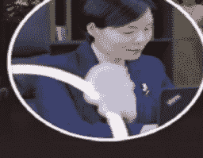

### 账号主页展示

河南点创包装制品集团有限公司

21.0万 获赞 2141 关注 2.2万 粉丝

河南点创包装老板娘—燕孜

- 真诚、热情、开朗大方、干练、大爱是我的代言词

- 为2000+企业品牌提供包装盒定制设计服务

- 酒盒、化妆品盒、大健康包装盒、特产礼盒等等...

IP：河南

商品橱窗

0件好物

公开群

点创精品包...

+ 关注

私信

作品 522

- 郑州包装厂

- 高端酒盒包装定制

- 化妆品、大健

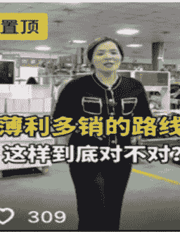

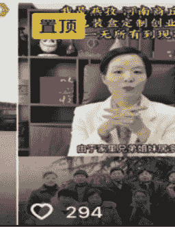

图4.1 河南点创包装制品集团有限公司创始人燕孜抖音账号主页

**做老板IP能建立深度联结，转化自然发生。** 燕孜说，现在见客户时对方常称她为老师，因为客户已在视频里学了很多，清楚公司能解决什么问题。持续输出干货，让创始人IP与目标用户形成师生或大V与粉丝式的信任联结，询盘质量和客单价随之提升。

**老板IP是最省钱也最可持续的路径。** 相比重金请代言人或造虚拟IP，老板亲自出镜成本最低、最真实，也最可持续。老板的创业故事、客户案例、行业观点，都是源源不断的内容素材。

从任正非、马云到雷军，都印证了创始人是企业最佳代言人。燕孜的躬身入局，不仅带来真金白银的订单，更重塑了品牌高度和客户关系。

视频直播时代，品牌即人，信任即金。中小企业建立信赖的捷径，是创始人以IP为舟，以专业为桨，用视频持续传递价值、建立联结、赢得信任。

以上企业家的逆袭证明，在AI驱动的营销变革中，老板躬身入局是点燃转型的第一把钥匙。他们从战略制定到亲自理解新规则，为团队扫清了认知和资源障碍。

不过，领导者的决心只是必要条件，还不足以回答怎么规模化、长期做成的问题。当老板深入前线后，新的挑战浮现：如何把个人认知和决心，转化为企业可复制、可扩展的整体能力？这就需要构建支撑AI时代全域营销的四大支柱：精准的策略、闭环的系统、专业的工具、高效的团队。

## 第 5 章

### 四大支柱的短板自检

THE MARKETING REVOLUTION IN THE AI ERA

选准赛道，专注卡座连接器研发生产的企业，业绩从0到2600万元；搭成体系，专注线缆制造供应的企业，年成交900多个客户，销售额1.2亿元；用对工具，经营超35年的传统企业，启动全域营销不足一年，收获7860条精准询盘；管好团队，主营不锈钢管的建材批发企业，长期合作客户增至8000多家。

老板躬身解决了动力和方向，企业能否真正赢得营销革命，取决于是否能构建完整运营系统。系统不再依赖单条爆款或某个能人，而是由四大支柱协同构成的增长框架。

- ◎策略：决定做什么、不做什么的判断力。
- ◎系统：把方法标准化为流程，确保每次行动都指向目标。
- ◎工具：AI赋能的专业武器，是放大团队能力、实现指数级提效的杠杆。
- ◎团队：具备新技能、新思维且能高效协作的文化组织，是策略的最终执行者。

四支柱缺一不可。接下来通过案例解析四支柱的落地方式，以及你的企业最需加固哪一根。

### 选择先行，方向比战术更重要

东莞市摩凯电子有限公司创始人李明干在总部分享时说，最近又接到大单，客户是因为看了公司视频主动找来的。很难想象2021年时公司曾深陷亏损。

公司成立于2010年，专注卡座连接器研发生产，产品用于相机、手机、工业设备等，看似不起眼却应用广泛。

2021年受疫情影响，线下业务萎缩，获客成本飙升，利润被蚕食。李明干开始关注互联网营销，但此前从未接触过，身边同行也很少用网。

他明白互联网营销不是资本密集型，也不是纯技术驱动，而是知识密集型，关键在于认知结构和对新营销环境的理解。他放弃自我摸索，选择借助专业机构系统梳理业务，找到营销定位和互联网布局路径。

在专业指导下，公司从零搭建网络营销团队，一方面建站布局关键词，另一方面用视频内容在各大平台做全域覆盖。

2024年，卡座连接器业务年销量突破7600万元，线上占比从0提升到35%，超过2600万元，其中60%来自传统搜索，40%来自短视频。

> 李明干说，目前线上询盘每天都在增加，累计客户超300家，复购几乎零成本。相比线下账期和维护，线上获客成本明显降低，还能提前回款，公司现金流、效率和获客量都有大提升。现在他准备投2.66亿元建新厂房。

我认为公司还能做得更大。我问他：只能做卡座连接器吗？他说过去核心业务就是连接器。我指出，卡座连接器是核心品类，但企业核心能力不是做连接器，而是研发生产精密连接器的工艺技术。

因产品尺寸极小，对模具工艺和精度要求极高，公司积累了十多年的精密模具技术。推广过程中客户多次询问能否做精密仪器，需求持续存在。我建议他从卡座连接器扩展到精密模具。

客户买的不是产品，而是解决特定场景的能力。企业要从原点能力出发，延伸到更多应用场景，研究不同客户的场景和需求，做用户画像和关键词分析，再借助短视频直播作为网络雷达获取新客户。

只要核心能力可满足，就可以在同类领域铺设关键词，以产品建账号，以应用场景做合集，针对不同场景扩矩阵。通过假设检验不断试错，找到不同阶段的定位，就能带来更多用户和销售机会。

这一步是基于深度自省和市场洞察的精准定位。当业务扩展到精密模具后，精准B端客户从华东找至华南，毛利也远高于原业务。视频直播时代，选择大于努力，锚定高价值赛道是腾飞起点。

### 系统落地，老板要把控的九个转化节点

策略明确后，很多企业家仍困惑：具体怎么做才能让短视频带来工程订单？我通常会说，全域营销是环环相扣的工程，就像造桥，顺序错一步就立不住。

视频直播时代呼唤系统化方案。很多企业的成功在于掌控了短视频转化的9大关键节点。

其中团队搭建、账号定位、账号搭建、数据复盘和追销转化这5个节点，老板必须参与甚至亲自做。

前期老板与员工达成共识，才能避免执行偏差；内容创作、拍摄、剪辑、账号运营应放手给员工，像任正非所说，让听得见炮声的人决策；最后老板要重视数据复盘和追销转化，这是流量变现的核心。

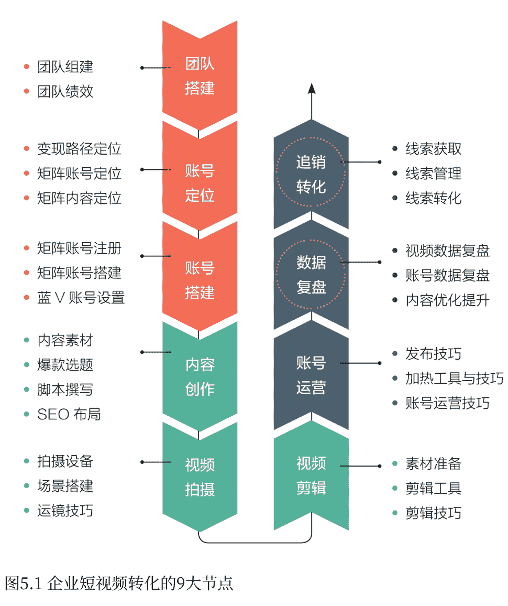

图5.1 企业短视频转化的9大节点

河南太平洋线缆有限公司专注线缆制造供应，董事长解增贝还担任河南省电线电缆行业协会副会长。

2018年公司成立，主产35千伏以下高压电缆。过去主要靠电话销售，现货批发和同行交易为主。

行业竞争激烈，私人承揽普遍，库存积压达3000万元，资金被占用。房地产放缓带来客户结构变化，价格战导致利润压缩，销售额停滞，发展受阻。

在一次交流中他结识单仁牛商学员荆明慧，受到触动，报名导航班系统学习。

学习后官网上线，但团队都是新手，运营吃力。他随即带队参加系统班和训练营，深入理解企业短视频转化路径，并做出爆款。

他深知爆款不能持续，于是按9大节点严格执行，把偶然流量变为必然商机。

目前公司以郑州为核心，已形成网络销售团队和市场拓展团队。2023年在武汉和西安设立直销团队，依托郑州获客在当地跟进成交。

启动全域营销前主要服务省内客户，需要主动找商机。如今客户主动联系，业务已覆盖全国，客户包括河南博物院、国家电网、华润等。

2023年，河南太平洋线缆有限公司依托全域获客体系，半年内累计收到超8000条有效咨询，签下900多家客户，全年销售额突破1.2亿元。

真正的底座，是解增贝在专业团队指导下搭建的管理内功：年度执行蓝图、网络营销操作手册和一套销售沟通话术宝典。这套可复制、可延续的获客机制，让他在其他城市快速复制出与河南太平洋线缆相似的销售团队，持续实现裂变增长。

### 工具：通用AI为何难以成为企业增长引擎

当整体框架成型后，多数企业仍被效率拖累。内容要做、投放要管、线索要跟，样样耗人耗时，能否靠AI提效成为高频提问。

我的观点始终是，人工智能是一把双刃剑。用对了能跃迁效率，用错了就是花钱买智障。视播时代的生存底线是效率，而效率提升必须建立在清晰的战略认知和系统方法之上。

说到效率，我想起一家有35年历史的老牌实业旭升洋行。

1990年，苏凤兴与丈夫在香港创立旭升洋行，起点是润滑油与喷剂的进出口代理，主攻国际品牌。

润滑油虽不起眼，却是工业的隐形刚需。用人体类比，关节缺乏润滑液行走即磨损；同理，机器的齿轮、轴承若无油膜保护，金属就会直接碰撞受损。在液压系统中，它像血液传递压力；高速运转时又能带走热量、碎屑与积碳，防止锈蚀，延长寿命。相比昂贵的主机设备，润滑油更像耗材，常被低估。

公司起初服务外资与香港本地客户，随着内地制造转移，2009年在东莞设厂，目前已在全国设8个分点。

面对“找厂家、砍中间商”的采购趋势，自2021年起苏凤兴依托30年客户洞察，全球选品：国内推出工业润滑品牌ASA；与德国厂商联合推出Miracle Fact，让客户用低于进口价享受德国品质；在美国建立环保清洗品牌CSimple C并研发专利滤油机。

这次转型把公司从“赚差价的贸易商”标签中剥离，重新定位为“机械营养师”，通过定制油品、设备保养方案和清洁技术组合，为中小制造厂解决设备损耗、能耗攀升、维护成本上涨等问题。

2023年，东莞市旭升贸易却出现下滑。复盘发现两点：老客户部分撤出中国，空缺未补；竞争对手已转向线上获客，她仍依赖线下。

这与长期经营惯性有关。苏凤兴夫妇是老香港，对接内地国企不擅长，更习惯靠转介绍和展会拿单。制造客户分散全国，展会覆盖有限。复购率虽好，却难以支撑稳定增长。

她主张专业事交专业人，遂找到我们。过去她一直乐于引入外部顾问培养新人，这在港美本是常态。

我为其拆解了视播时代的营销底层逻辑，她快速认同并组建网销团队，用短视频拓展客户。

2024年5月，一条视频带来200余条咨询，筛出40余条高意向，最终成交5家。她感慨生意方式的轻松度完全不同。

同期启动全域矩阵，在17个平台搭建品牌账号，5人团队日均可发近800条视频。启动不足一年，累计收获7860条精准咨询。

AI快速迭代，但主流通用大模型仍集中在内容生成，这为企业营销打开了新质增长窗口。

用户获取信息已高度视频化，算法负责分发兴趣内容。截至2024年底，中国用户手机平均装机71个，核心阵地包括抖音、快手、小红书、视频号、西瓜、好看等。

企业不能单点布局，而要围绕用户习惯做全域覆盖。研究用户行为至关重要：客户可能是经销商、终端用户、大宗采购商或零售商，都需用海量视频内容配合矩阵召回。AI在此扮演闭环枢纽，赋能增长。

关键是，AI若不懂企业业务、不懂营销打法、不懂平台规则，就帮不了目标达成。真正适配企业的是垂直专业的营销AI，而非泛用语言模型。

自2019年起，单仁牛商深耕企业短视频教学与视播系统研发，聚焦高效内容生产、全平台分发与全域账号管理，核心在于缓解流量焦虑。

2023年2月，与清华大学人工智能实验室联合打造专业营销AI文思子牙，目标是产出差异化营销内容、统一管理账号、高效分发与数据分析，获取稳定低成本精准流量。

短视频已成获客主战场，企业需借AI构建矩阵，为生产与传播注入动力。

但如同企业请咨询公司，即便顶级机构也需满足三点：专业能力、充分理解需求、案例验证。营销大模型亦然，每条创意与内容须高度贴合业务与客群，且具唯一性。

文思子牙矩阵系统可确保创意与业务、客群强关联且差异化，并提供跨平台多账号一键分发。单后台可管千店万号，授权便捷、数据集中，形成矩阵运营中台，通过三条路径解决痛点。

1. AI文案创作：赋予企业专家级写作能力，1人约等于18位资深文案。工具宛若资深文案团队，让普通员工产出媲美18位老手的量与质，大幅提效并保证专业度。
2. AI视频批量剪辑：批量产出高质量独特视频，2个普通人约等于25位剪辑高手。系统可快速批量生成并保持风格统一，零经验人员即可完成相当于25人团队的工作，缩短周期。
3. AI营销：确保每条创意精准匹配业务与目标人群。如同超级营销大脑，输出差异化创意，帮助品牌在竞争中突围。

商业本质是效率竞争，高效碾压低效，低成本战胜高成本，速度淘汰迟缓。

对苏凤兴而言，选择文思子牙是效率革命的关键一步。团队摆脱重复劳动，内容生产与投放精度提升，资源可聚焦于战略思考、方案打磨与深度客户沟通，实现降本增效与业绩跃升。

### 团队：构建真正高人效的组织

复盘案例发现，过去一年增长最快的企业，人效提升是核心。有人误以为高人效等于人人忙碌，其实整家公司很忙不代表人效高，慢节奏也不代表人效低。

高人效=高效经营+高效组织文化。

高效经营是产品、技术、营销能力，决定企业能走多远。但管理者常忽视文化，企业持续动力的来源是长期共聚、自发努力。

中国不少企业的现状是：领导事务缠身，事必躬亲，员工习惯上移决策。领导成决策机，员工收集信息给出方案，领导挑选执行。表面顺畅，实际只有领导清楚方向。

表面看领导扛责，实质是误区。领导只对可见问题判断，结果表面有决策，实际悬而未决。大家知道做事，却不知为何做、何时必须做好。愿景无人记住，员工记不住，中层也记不住。

员工内心常有想法：好创意也难获采纳。于是文化被搁置，或挂墙成装饰。

对真正领导者，事必躬亲最易，战略制定更难。领导的价值不在无所不知，而在汇聚众智、创造条件，尤其营造释放潜力的土壤。

2009年，陕西秦西盟实业创始人翁财发入行建材。创业期他亲力亲为，日装卸七八小时。曾凌晨一点客户急单，他起身装300多公斤货，骑二手三轮十多公里送达。此拼劲赢得信任。

但他习惯一线执行，对领导角色定位不清，不懂文化打造。2017年营收破5000万，却因管理不足，股东挪用资金，造成重大损失，前期投入付诸东流，股东离去。这让他醒悟：没有好文化，好人也会变坏。

他随后系统学习经营管理，组建专业网络运营团队，产出爆款视频，建立制度与标准化流程，通过互联网重启事业，将不锈钢产品卖向全国。

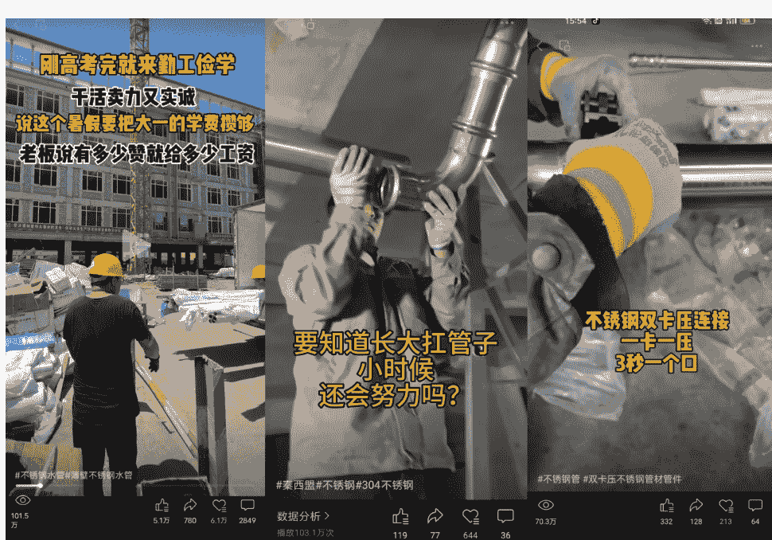

三年多布局后，公司优化架构，明确品牌定位。目前已与国内8000多家企业建立长期合作。

> 今天的领导者既要做战略家，也要做文化塑造的教育者。要把愿景与目标传递到每个角落，扮演启蒙导师，鼓励员工释放潜力，让愿景被相信、战略被认同。

人如镜，修行是擦亮它。谁甘于平庸？每个人都有梦想，想被期待、被尊重。

领导要做的是唤醒使命与责任，帮助员工找到定位与作用，明白工作对客户、社会乃至国家的意义。这是高人效起点。

核心职责不是事必躬亲，而是塑造文化、唤醒使命、打造高人效组织。

若领导只下指令却不解释意义，员工热情难持久。价值感缺失，工作会消磨信念。

企业文化原点是建立使命感，赋予工作意义，强化行动与意义的连接，帮助员工成为理想自我。愿景源于此。

此过程需领导一点一滴浇灌。初期员工不理解时，不可居高临下甚至威胁，而应耐心沟通，提供信息。组织中总有抗拒者，若能力强且守规，可让环境同化。

确定文化后，打造高人效团队核心不是招人，而是共识、架构、规则、机制。

北欧航空CEO詹·卡尔森在《关键时刻》说：“我想休四周假。若电话不响，说明成功，员工已能自主决策。若电话响了，我就失败——信息没传达好，人也没用对。”

不必等团队成熟才规划职责、目标、流程与激励。

本章要强调，组织文化不仅关乎大企业，任何组织皆然。没有使命与文化支撑，企业难以长远。

策略、系统、工具、团队四大支柱，构筑AI时代企业的营销战舰，将领导决心转化为可复制系统能力。

但关键问题是，这套能力是否仅适合高频低决策成本的快消？对交易周期长、决策链复杂、专业度高的大宗、To B、定制服务，视频+AI打法是否有效？

我相信经营者心中有疑：客户会在短视频找供应商吗？流量能否带来高价值咨询而非数字繁荣？

答案是肯定的，且变革更深。接下来我们将深入汽配代工与粉末冶金，看AI驱动的全域营销如何打开大宗交易流量宝库。

## 第 6 章 大宗商品交易如何获取高价值流量

THE MARKETING REVOLUTION IN THE AI ERA

占公司业务80%的大客户提前半年告知终止合作，给传统汽配件代加工的张仪平带来致命冲击。至暗时刻，全域营销带来的新客户完美承接了原有大客户。

粉末冶金从业者王立戈没想到，冷门行业也能靠短视频持续获客，网销业绩年增100%，70%业绩来自互联网。

AI时代，营销革命核心在于流量本质重塑。对大宗交易而言，追求的不是曝光量，而是精准、稳定、可规模化的高价值流量。流量即带着明确采购意图、处在决策期的潜在客户，是企业生命线。

获取逻辑与线下扫街或泛投广告不同，需驾驭“人找货”的搜索流量与“货找人”的推荐流量，双管齐下获取红利，是传统企业必须掌握的终极技能。

### ToB业务、复杂交易、定制业务、批发和加盟业务，也能靠短视频吸引客户吗

深秋微凉，我走进张仪平的代工厂。机器轰鸣，销售跟单声交织，呈现繁荣景象。

回忆2023年初的惨淡，张仪平感慨：“若非几个月前坚定互联网转型，走进单仁牛商课堂，工厂可能已撑不住。”

无锡长冈电子机械主要做传统汽配件代加工。新冠期间展会停摆，订单下滑。2023年初，占比80%的大客户提前半年通知终止合作，公司人数从300多降至100多，总经理张仪平极度恐慌。

创业十余年，客户稳定，突变让她选择走出去交流求解。

与老同事无锡金安特科技创始人包瑞春交流后，对方建议从互联网突破。

2023年3月，张仪平带6名高管进入单仁牛商课堂。课间她找到我，眼神期待又疑虑：“单老师，我们做设备定制和汽配件代加工，是制造业、做大宗、客户都是企业。短视频、直播真的适合我们吗？”

类似提问很多。我理解困惑。很多人认为短视频直播属C端快消，与冷冰冰的金属零件、复杂定制、动辄百万元大宗交易格格不入。

# B端突围：短视频加全网布局为何更吃香

“说反了。”我很肯定，“做B端，尤其是做复杂交易、定制服务的，反而更需要也更适合用短片内容搭配全域运营来打开新局面，抓手比面向终端消费的做法还要好。”

张仪平表情里带着怀疑，我接着解释：“很多经营十多年的老板，可能都没分清一个根源：我们到底是在做营销，还是在做推销？走关系、跑展会、扫楼扫街，本质上都是推销，是低头求客户、看脸色，效率低、投入高、天花板明显。换个思路，能不能让客户主动找上门？借助互联网，尤其是视播阶段的全域打法，我们可以提前规划信息触达路径，用多平台多频次覆盖目标人群。第一次，让潜在客户知道‘原来有这么家专业的公司’；第二次，留下‘这家公司有点东西’的印象；第三次，强化‘看起来挺靠谱’的判断；第四次，点燃‘想具体了解能做什么、能解决什么问题’的好奇；第五次，就容易变成客户主动检索或直接私信询盘。这总比传统推销更高效、更有体面、更能沉淀长期信任。”

用精细规划的内容，以脉冲节奏持续投喂信息，品牌印象就会在潜意识里生根。

张仪平若有所思地点头，我继续说：“现在的互联网和十年前最大的差别，是推送流量和检索流量并存。过去做百度、阿里巴巴这类检索电商，靠买家主动敲关键词。可买家检索时，几分钟就能滑过几十上百家，很难记住谁。现在用内容矩阵做持续脉冲投放，不断向目标客户输出专业有价值的信息，就能在对方心里慢慢建立起专业、可靠、值得托付的品牌认知。对大宗商品、定制业务来说，这份认知才是最宝贵的资产。”

“把传统推销升级为全域运营，本质上是认知转向。”我强调，“核心在于从被动等客户检索，转向主动布局全网，用精准内容吸引买家主动搜来，或让平台算法精准推送，覆盖更大更准的目标人群。”

“具体怎么转？”张仪平追问。

“必须在策略和执行两端同时发力。”

系统化是稳健运营的底座。第一，掌舵者要做战略思考和顶层布局，明确方向；第二，方向定后，必须配齐专业团队、方法、技能和工具来落地。两端协同，才能形成稳定可复制的效果。

企业要结合业务特征和资源禀赋，审慎挑选互联网上的盈利模式、目标客群和核心产品卖点，同时兼顾关键词选择和网络矩阵布局。尤其是盈利模式选错，上网就是一场灾难，这是触网最大的第一坑。

从用户行为看，客户活跃的平台很分散：新闻资讯、检索平台、电商平台、本地生活、垂直自媒体、短片平台等，企业必须基于业务出发，规划目标客户，分平台、分阶段布点。

想要实现大规模、持续性流量获取，就必须吃透客户主动检索的关键词，以及平台标签的匹配推送机制，从而触达不同使用习惯的用户。

张仪平把系统化思维引入营销，推进视播时代的全域运营、分步系统布局，让企业真正打通从理论到实操的闭环。

首先是方向，方向清晰了，短片营销才有的放矢，可以倒推全盘流程，搭建完整体系。

其次是目标用户的梳理。张仪平借助单仁牛商课程的目标用户定位方法，用销售做加法的思路梳理业务，发现公司除了现有的汽车配件代工外，在电子产品、新能源、老年康养设备等高成长赛道同样具备巨大拓展空间。

最后是全域运营的策略布局，通过短片和直播在全网铺开，一方面吃到短片平台的算法推送，另一方面在关键词梳理到位的前提下，通过内容创作把核心业务关键词做到霸词、霸屏、霸网，从而收获长周期、稳定、精确的检索流量。

转型不久，一个来自安徽芜湖的订单点燃了全团队的热情。这个客户是在抖音上找到无锡长冈电子机械科技有限公司的。经过几轮常规的技术沟通和报价，对方第二天就直接要求签约，价格分文未砍。更让人惊讶的是，合同签完第二天就爽快支付了50%定金。“过去讨价还价的拉锯战至少要半个月！”张仪平感慨。

更大的转机出现在2023年7月。就在公司80%业务都依赖的那位大客户突然中断合作的至暗时刻，公司靠线上全平台布局积蓄的能量集中爆发。“从4月到7月，我们连续接到十多个新客户项目，”张仪平语气激动，“就在7月12日，和上海一家集团签下大单，业务量完美承接了原大客户的空缺。”

望着窗外机器轰鸣、车间繁忙的景象，张仪平的情绪从之前的恐慌到现在的笃定。她的经历证明，面向企业的业务、复杂交易、定制业务、批发加盟业务，不仅可以用短片撬动客户，更能通过此建立精确获客、高效转化和业务边界突破的完整路径。

### 双轨流量怎么一起拿下
企业要的是结果，是订单和产出。实现目标的前提，是理解商业结果的本质：想有订单，就必须有流量。

可当产品是笨重的机械和钢材，或是专业性极强的技术品，视频该怎么拍才能打动目标客户？

珠江口的湿热海风裹着金属加工的气息，拂过中山市翔宇粉末冶金制品有限公司的车间。

生产线有节奏地运转，传送带上的齿轮部件经连续式烧结炉淬炼后泛着金属光泽，有序前行。总经理解着我穿行其中，目光落在角落几台崭新的设备上，它们已就位待发。

王立戈指着新设备，自豪中带着些感慨：“单老师，您看这些新家伙，都是订单逼出来的！一年多以前，我心里还惴惴不安，企业出路在哪儿，我整夜在琢磨。”

中山市翔宇粉末冶金制品有限公司成立于2003年，专注齿轮、轴套及异形结构件等粉末冶金产品的加工定制（见图6.1）。

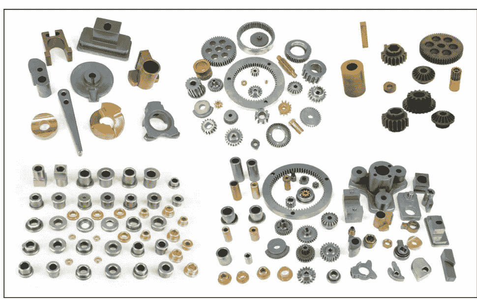
图6.1 中山市翔宇粉末冶金制品有限公司的部分产品

公司总经理王立戈深耕行业22年，90年代已是国内某知名电器公司高管，1999年毅然创业，押注粉末冶金这条长线。

但2008年金融危机的寒流，让公司陷入长达7年的低迷。“开发客户难比登天，需求萎缩，成本飙升，资金链绷紧。”王立戈回忆起守业之痛，眉头紧锁。他曾尝试过网络营销，早年靠谷歌广告找到合作多年的马来西亚客户，尝到甜头；也栽过跟头，2009年不懂规则地砸10万元买关键词，结果颗粒无收。

“后来跟随单仁牛商学习系统课程，2016年建营销型网站，布局百度、阿里巴巴。网站上线当月即成交，随后加大推广。2015年互联网带来近百万元业绩，2016年新增客户数是2015年的5倍，团队信心大增。公司逐步转型为‘粉末冶金+互联网’，破解了拓客难题。”王立戈话锋一转，“可到了2019年后，传统网销平台红利衰减，这招失效了。”

敏锐的王立戈把目光投向抖音。请了专业团队，自己硬背文案，拍了10条精致视频，播放寥寥，询盘为零。王立戈又累又迷茫，怀疑：“这种定制、批发的企业生意，短片真的能起效？”

“王总，当时最困惑的是什么？是觉得企业生意不适合短片，还是没找到正确方法？”我问。

“都有。”王立戈坦诚，“平台上卖衣服、卖零食，热闹又快下单。我们做粉末冶金齿轮、含油轴承，专业性强、决策慢、流程长，十几秒的视频能吸引采购商、工程师吗？他们会在抖音找供应商？就算看到，能信任吗？流量看着热闹，对我们真有用吗？会不会都是吃瓜群众？”

他的一连串疑问，正是无数大宗交易企业主面对短片时的焦虑：流量从哪来、准不准、值不值。

“流量，尤其是企业客户、大宗交易、定制服务，关键不在有没有，而在高不高价值。高价值流量的获取只有两条核心路径：主动检索与算法推送。它们像车间里的两条主线，必须协同。”

我打开抖音检索框递给王立戈：“主动检索，也就是用户自己找。客户带着明确需求，比如‘高精度粉末冶金齿轮供应商’‘耐磨含油轴承定制’，去百度、360、搜狗，或在抖音、小红书、B站直接检索。需求明确、迫切，谁能第一时间醒目出现，谁就拿下精确客户。特点是精确、稳定、低成本、长周期。”

随后我滑到推荐页：“算法推送，也就是平台主动推。平台根据用户兴趣、停留时长、点赞行为等判断，推送可能感兴趣的视频。特点是爆发力强、自然流量免费、周期短。若一条视频踩中算法，24到72小时播放量可从几百飙到上千万。关键是：王总，您觉得客户主动检索‘粉末冶金’找到我们，更容易成交，还是他刷搞笑视频时偶然刷到我们的齿轮更可能下单？”

“当然是主动检索！”王立戈毫不犹豫。

“对，主动检索的价值大于算法推送，精确性是企业生意的命脉。用户主动检索的那一刻，成交机会最成熟。算法推送同样重要，它能扩大品牌声量，引发潜在需求，为主动检索‘蓄水’。”

主动检索的价值大于算法推送，精确性是企业生意的命脉。

“怎么让客户一检索就能找到我们，尤其是免费的首页位？”王立戈追问关键。

“我们正经历一场检索规则的革命。”我调出检索引擎页面，搜“粉末冶金制品”展示给他，“2023年底百度大改规则后，首页免费位几乎被短片占据。因为用户告诉平台：我不爱看文字，我爱看视频。现在所有检索引擎都必须全网抓取优质视频上首页。”

我指着屏幕上行业检索结果：“只要我们的视频足够专业、信息价值高，就极有可能被抓取，免费占据检索引擎首页。潜在客户检索‘粉末冶金’‘金属齿轮定制’时，首页第一条就是我们的专业视频，持续展示实力、工艺、案例，能带来多少精确询盘？”

“机会很大！可流量来了，怎么判断是不是高价值的？别忙活半天全是来看热闹的。”王立戈务实地担心。

“核心就在高价值流量的四维检验：精确、稳定、量级、成本可控，缺一不可。”

**精确。** 流量重质不重量。农贸市场卖宝石，人再多也没用。精确靠标签系统精确匹配，平台懂用户标签，你的账号定位和视频内容标签必须高度垂直、专业聚焦。

**稳定。** 企业决策周期长，产品或品牌需要持续触达，才能真正影响用户，而不是一刷即忘。

**量级。** 在精确稳定前提下，需要有效规模。全平台矩阵是放大的关键，多平台覆盖不同用户习惯，协同放大声量。

**成本可控。** 流量成本必须低于利润。掌握高效内容生产分发方法，是控制成本的核心。

2021年3月，王立戈进入单仁牛商系统学习。4月在老师指导下注册账号、养号、备素材，6月正式启动以短片为核心的全平台营销。

内容策划围绕粉末冶金原理和客户痛点、关注问题。标签清晰、垂直度高，公司在抖音、快手等平台都获得大量关键词占位。

王立戈亲自出镜口播。“我们不求播放量和点赞，只求精确询盘量，这样才能源源不断带来新客户。每天都有10个左右询盘。”

播放量逐步攀升。2021年8月，一条《粉末冶金工艺原理介绍》视频爆火，播放30多万，评论500多个，一个视频带来100多个询盘。

> “两天两夜我几乎只睡了2到3小时，一直在加联系方式、打电话沟通，忙得不可开交，最终陆续成交5个新客户。我们做工业品，这种效果非常鼓舞人心。”

2022年，公司通过全平台布局成交111家新客户，同比增252%，其中短片平台带来的客户占成交量70%，且企业不断复购，大小订单不断，王立戈不得不添置新设备来满足需求。

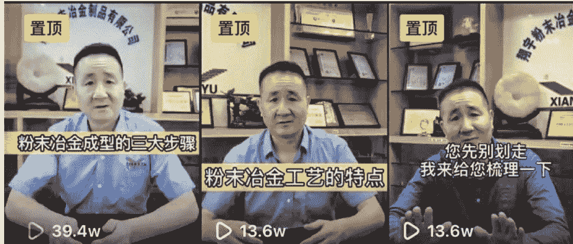
图6.2 中山市翔宇粉末冶金制品有限公司总经理王立戈的讲解视频

本章案例的共同点是，这些企业多从事工业品或大额交易，而非面向消费者的快消品。他们的成功在于用短片与全平台营销精确锚定确定性需求，广泛触达潜在机会，系统布局、精细运营，最终收获精确、稳定、有规模且成本可控的高价值流量。这不是运气，而是战略清晰、认知到位、执行坚决的必然结果。

正如王立戈所说：“不进则退，求新求变。你不学习、不行动，你的同行却在学习、在行动。”在AI时代，掌握全平台营销流量密码的企业，才能赢得通向未来的先机。

## 第 7 章

### 转化闭环：让流量变成真订单的四个关键

THE MARKETING REVOLUTION IN THE AI ERA

播放量超百万却订单寥寥？找准定位，聚焦核心产品，年新增3000个精准客源；全域布局，构建内容矩阵，逆势斩获3000万元线上订单；找准内容之道，用单条视频引爆1700万播放量；构建高效的转化闭环，轻松承接大客户。掌握转化的核心关键，让每一个流量都转化为看得见的利润！

在AI驱动的营销新世界里，流量的争夺战已进入下半场，胜负的关键在于转化效率。如果说AI、短视频和全域平台是我们这个时代最强大的流量捕手，那么一套精心设计的转化系统就是企业的利润收割机。前者决定了你能捕获多少鱼，后者决定了你最终能带回多少可以卖钱的鱼，而不是任由它们在甲板上腐烂。

在当今的商业竞技场中，有两件事至关重要：有生意做、有钱收。首先，企业必须确保有稳定的业务来源，这是生存的基础；其次，所从事的业务必须能够盈利，避免那些看似忙碌却无法创造利润，反而消耗现金流的活动。因此，如何将辛苦获取的流量高效转化为实实在在的订单与利润，是众多企业亟待解决的关键问题。

许多企业主向我倾诉着相似的困境：视频播放量动辄数十万甚至百万，后台数据一片飘红，询盘却寥寥无几，订单更是镜花水月。原因有很多：缺乏互动环节，未能设置有效的互动钩子来吸引观众参与；视频内容存在缺陷，未能真正打动观众，无法激发购买欲望等。这些问题普遍存在，严重制约了企业的流量变现能力。

近期我回访了多家学员企业，我们可以从这些企业的成长路径中找到破局之道。

### 先定清晰定位，再锁定目标人群
你是谁？你卖什么产品？你的目标客户是谁？企业必须明确自身的定位和目标客户，并以此构建内容框架。只有这样，企业才能精准地触达目标用户，实现有效营销。

精准定位不仅是营销技巧，更是企业生存发展的核心战略选择。

全域营销绝非“万能神药”，外界能提供地图与指南针，但迈开双腿前行的终究是企业自己。偏离了自身定位，吸引的只能是无法转化的“泛流量”。

近期，我走访了东莞市杰幻电子科技有限公司。总经理许建文是一位务实的企业家，在他的办公室里摆放着他们如今的核心产品样品：各种规格、性能卓越的医用级魔术贴。

“单老师，您看这个，”许建文拿起一卷看似不起眼的魔术贴，眼神却充满笃定，“现在这是我们公司的‘拳头’，也是我们的‘名片’。”他话锋一转：“10年前，我的公司就是个‘杂货铺’。”

我饶有兴趣地问：“‘杂货铺’？具体怎么说？”

“2007年创业那会儿，”许建文回忆道，“我笃信互联网是未来，一头扎进阿里巴巴，报了不少培训班。学一招用一招，平台上什么火就卖什么。PU皮革、注塑商标……结果是什么都做了一点，什么都做不精。摊子铺得大，精力分散，成本压不下来，品质也难保障。客户觉得你不够专业，价格还没优势。那几年增长几乎停滞，感觉就像在迷雾里打转，使不上劲儿，看不到方向。”他的语气里透露出那段迷茫期的疲惫。

一直到2017年，许建文走进单仁牛商，才真正清楚了互联网营销的底层逻辑。

“我最大的收获就是明白了‘定位’二字的分量。您反复强调‘聚焦’，我回去后带着团队把所有产品线梳理了一遍又一遍。我不断问自己：我们的核心优势到底是什么？哪些产品最能体现这个优势？哪些客户最需要这些产品？”最后，许建文给自己的公司提炼出核心广告语：“医用级魔术贴的研发与生产。”明确了公司未来主打的产品和推广方向。

“医用级”三个字，清晰界定了杰幻电子的产品高度（高性能、高安全标准）、目标客户（医疗设备制造商、防护用品生产商等对品质有严格要求的行业）和核心价值（可靠、安全、专业）。

定位清晰后，许建文将有限的研发、生产、营销资源，80%以上都投入医用级魔术贴这一个品类。不再追求“大而全”，而是追求“小而美”，在这个细分领域里做到最全、最精、最好。研发上，专攻抗菌、抗过敏、高黏性、持久性等医用场景的关键性能；生产上，引入更精密的检测设备，确保每一卷都符合医用标准。

“效果如何？”我问道。

“效果是立竿见影的！”许建文脸上露出笑容，“定位清晰了，平台推送的流量也精准了。过去泛流量多，询盘转化率低得可怜。现在，主动找上门的客户，很多就是冲着‘医用级’来的，他们本身就有明确的需求。我们不用再费劲解释为什么我们比别人贵，因为目标客户理解并认可‘医用级’背后的价值。成交周期缩短了，客单价和利润率也上去了。这几年，我们每年稳定新增近3000家精准客户，业绩稳步增长。”他翻出公司的数据报表，增长曲线确实稳健向上。

“听说你们现在对客户也有选择了？”我笑着问。

“是的！”许建文坦然道，“定位清晰了，底气也足了。现在，我们很清楚自己的价值所在。对于只拼价格、账期过长且风险高的客户，我们会坦诚沟通我们的定位和标准，如果理念不合，宁可不做。这种选择权，是精准定位带来的自由。资源聚焦在正确的地方，才能形成真正的突破力。”

精准定位是吸引对的人、说对的话、做对的事的前提，是流量转化为订单的基石。这不仅是营销技巧，更是企业生存发展的核心战略选择。

### 全域铺开内容矩阵，抢占多平台流量
未来的企业营销，预计80%的成本与精力都将投入内容创作。这意味着，如果内容只发到单一平台，风险极高。因此，企业要合理分配资源，确保内容在不同平台都能获取流量，吸引客户。这需要构建全域矩阵，实现品牌全渠道覆盖，以最小成本获取最大回报。

品牌心智的搭建离不开多元内容的支撑。单点品类、单一视角很难触达全部人群，产品科普、工程案例、品牌故事、创始人表达、典型场景、客户证言等多个维度配合，才能立体呈现价值，让不同画像的客户都找到可信的连接点。渠道上也必须分散风险，早期某个平台或带来声量，长期来看多平台联动才能做到真正的市场覆盖。

在郑州中原腹地，我再次见到河南前期标识设计制作有限公司的创始人何洪亮。从6平米的小门面起家，到如今拥有8000平米的现代化厂房，他身上有河南创业者典型的坚韧与踏实。

2007年，何洪亮带着1700元租下6平米店面，招进五六名手艺人，创立了亚龙设计公司，也就是河南前期标识的前身。业务涵盖商业标识、小区导视、景区标识、写字楼标识、市政标识等。

凭借多年工程标识的实战积累，他与团队不断开拓市场，用过硬交付和专业服务赢得信任，公司逐步做大，成为当地知名的工程标识企业。

2015年国内制造业承压，全球需求放缓、产业链重组、融资趋紧，大量传统制造企业缩量甚至退出。前期标识也遭遇严峻考验：订单骤降、账期难收、经营常需垫资和应酬。

始终在找突破的何洪亮持续自学并实践。2019年7月，他在一次活动中结识河南牛商汇会长荆明慧，对方业务已几乎全部搬到线上。

“线上做生意，客户先付定金，出货后结清尾款。”这句话点燃了何洪亮的信心。他前往单仁牛商学习，互联网营销思路打开，公司发展轨迹也随之改变。

学成后回到公司，他迅速组建团队，搭建营销型官网，启动线上转型。

2020年初疫情让线下业务全面停摆，他却在危机中抓住机会。以百度竞价、阿里巴巴付费推广为主，B2B平台与门户网站免费渠道为辅，同时发动全员拍短视频，多渠道同步发力。

> “当时我们下了一场豪赌：全体员工都上阵。老板、设计师、销售、车间师傅，只要愿意出镜就培训上岗。抖音、视频号、快手等多个平台都开了号，有的讲行业趋势，有的拍生产流程与质检，有的记录安装现场，还有的深挖经典案例，比如对安全标识要求极高的省妇幼保健院项目是怎么落地。每个账号侧重点都不同。”何洪亮回忆。

内部不少人质疑：“全体上阵、内容这么细，能运营得过来吗？”

何洪亮解释：“工程标识的客户可能是地产采购、政府项目负责人、商场运营经理，关注点完全不同。有人看设计感，有人看材料耐用度，有人看安装效率，有人看售后保障。我们用不同账号、不同人，尤其是技术工人来讲他们最擅长的部分，内容才真实、专业、有说服力。”

“单老师，您说的IP矩阵不就是这个意思？我没想那么深，就是希望客户能多角度看到我们的实力。”

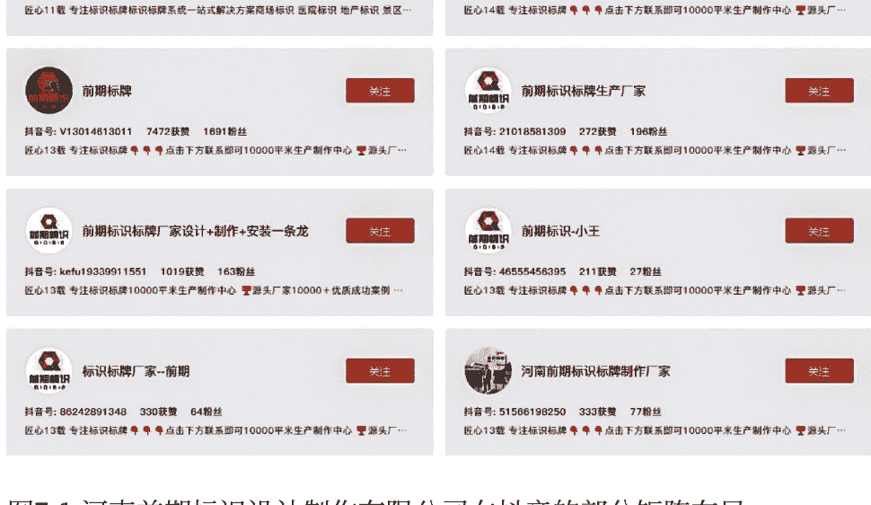
图7.1 河南前期标识设计制作有限公司在抖音的部分矩阵布局

我回应：“对，就是多维度内容呈现，让客户更全面了解并建立信任。”

“效果如何？”

“远超预期。”何洪亮拿出后台数据，“2020年疫情期间，业绩反涨159.72%。靠的全网协同。付费带来精准搜索，免费内容提升曝光与信任，短视频把专业能力与案例生动传播。到2022年，线上询盘5687个，转化率23.21%，合计拿下3000万元订单。更没想到的是，万达、大商等大品牌主动在网上找到我们，这都是全域布局带来的结果。”

全域营销的本质是系统布局与多元内容协同。它打破单一账号的流量瓶颈，通过矩阵在不同场景反复触达潜在客户，最终汇聚成品牌势能与稳定线索。河南前期的逆袭证明，流量分散时代，把资源投向多个精心设计的载体并持续产出优质内容，是抵御波动、实现可持续增长的关键。

### 内容必须紧扣三高方向
实操中企业常犯的错有三类。第一是对平台规则不了解，比如商业号与非商业号的区别，为什么商业号可以做产品推广而非商业号受限，为什么账号会被限流或封禁。第二是账号刚起步就迷茫，不知道先做哪些内容，逻辑不清。

很多企业运营毫无规划，随意发布，效果差，要么偏离主营，只追粉丝量忽视订单。更可惜的是，投入一段时间未见回报就认定自己不适合，从而放弃。

内容不是自说自话，必须服务商业目标——要么提升转化，要么实现引流，要么直接促成成交。

在一次牛商汇活动中，再次见到江苏道之然财务管理有限公司创始人、苏州牛商汇财务部部长邹美娟。

“邹总，听说您一条视频播放破1700万？在专业服务领域很少见。”

邹美娟笑着感慨：“单老师，爆火之前我们也走了不少弯路。”

“比如？”

“起初做短视频，我们团队很‘专业’，上来就拍报税流程、做账方法、新政解读，干货很多。结果播放量惨淡，粉丝难涨，询盘每天仅个位数。团队士气低落，我也怀疑财税这种强专业、强本地化的业务是否适合短视频，客户是否只找周边代理记账。”

“后来怎么转的？”

“在单仁牛商系统班上，‘三高’概念点醒了我。”邹美娟说，“老师强调内容不是炫技，而是解决目标客户痛点并引导行动。我们的目标是老板，他们关心做账细节吗？不，他们关心管好资金、控风险、避坑、降成本。”

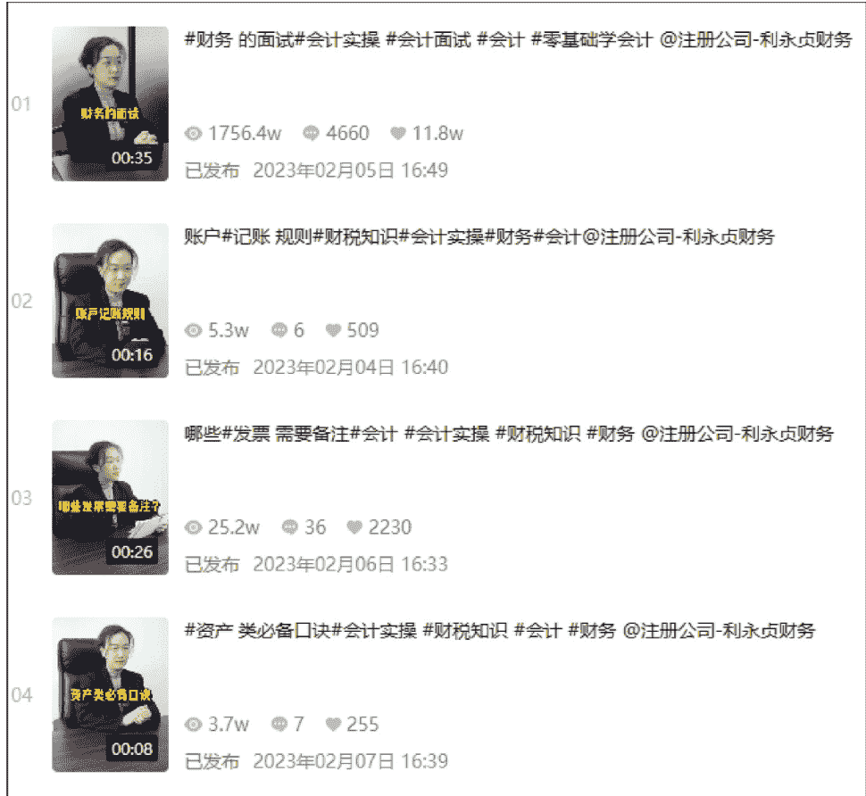
图7.2 江苏道之然财务管理有限公司发布的短视频播放量

邹美娟继续回忆：“我彻底换思路。不讲艰深会计知识，用大白话讲老板常见困惑，比如‘账面有钱为何周转不开？’‘报表里哪些指标能看出猫腻？’‘与财务沟通时该问哪些关键问题？’每句话都戳中痛点。”

“效果呢？”

“非常好，播放冲到1000多万，点赞近120万，转发量很大，很多老板直接转给自家财务。”

复盘后她持续推出种草型内容，弱化纯专业讲解，但兼顾专业度与实用性。随着精细化运营，播放量和粉丝稳步上升，询盘从每天个位数提升到十几个，高峰时可达二十余个。

“听说地域限制也被打破了？”

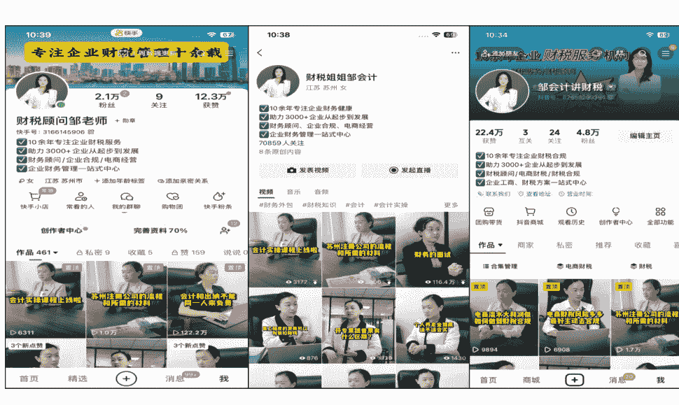
图7.3 江苏道之然财务管理有限公司部分视频平台主页

“是的，最大的意外。”邹美娟点头，“过去我以为客户只选本地。结果爆后，北京、哈尔滨、新疆的老板都来咨询。他们不在乎物理距离，在乎能否解决核心问题。这让我明白，视播时代想破圈必须主动走出去。”

高播放只是表象，只有符合高引流、高转化、高成交方向的内容，才能把流量变为订单。邹美娟的成功源于认知转变，从自嗨式专业展示转向以客户痛点为中心的利他价值输出。

### 蓝V与官网构成转化的承接底座
视播时代，有好内容还不够，必须搭建推广系统。短视频是重要流量入口，如何把流量变销量，关键在于布局企业认证账号和视频营销型官网。

企业认证账号用来建立品牌信赖，为公司背书，促成转化。关于官网，很多人说视播时代官网已无用。问自己两个问题：客单价多大？目标客户是谁？若是快消面向大众，或许可不要官网；但客单价以万元计，客户是企业或上市公司，官网就是聚宝盆。

在广东沐隆智能货架装备有限公司展厅，再次见到创始人陈小莉。干练短发配优雅披肩，与重型货架形成反差。

陈小莉创办的广东沐隆智能货架装备有限公司专注仓储货架及配套设备制造。

1995年，21岁的陈小莉大学毕业后在企业做文职，月薪600元，对她而言安逸并非想要的生活。她辞职带2000元南下深圳，进入钢制家具及货架行业。2005年创立广东沐隆智能货架装备有限公司，起初做传统仓储货架。以豪爽性格、真诚服务和极致品质赢得客户，事业迅速起来。

行业竞争加剧、市场饱和后，她感受到巨大压力，便想用互联网转型。彼时她像病急乱投医，四处尝试却一无所知，直到接触单仁牛商，她形容这次相遇是“翻天覆地”。

为吃透课程，她学了18遍。回来后她重新定位业务，专注智能货架。

> “陈总，从传统货架到智能货架，从线下到线上，听说您很早就做了官网和短视频？”
> “是的，单老师。我算是老学员。智能手机普及前，我们就按指导搭建了营销型官网靠搜索引擎获客，这奠定了线上根基。后来视播时代到来，我们敏锐感觉智能货架很适合用短视频展示灵活性和智能化。”

2021年，她开始布局短视频，一边保持对传统搜索流量的重视，一边发布公司相关短视频借助平台算法分发，兼顾搜索与推荐流量。

> “您还在同时做搜索和推荐流量？”
> “没错。我们在短视频平台布局多个账号，企业认证号主打公司实力和工程案例，建立信任、利于高转化；个人号讲应用场景、技术难点等，利于引流、展现专业。客户有明确需求时会主动搜索‘智能仓储解决方案’‘自动化立体库’等关键词，官网是我们承接这部分精准流量的核心。”

“账号分工很清晰，企业认证对大宗交易很重要吧？”

“至关重要。”陈小莉强调，“大宗交易决策链长、金额大、风险高，不会看几个视频就下单。但感兴趣后一定会全网搜索‘沐隆智能货架’。这时企业认证和内容丰富的营销型官网就起决定性作用。企业认证是官方背书，增强可信度；官网是详尽的实力证明书。”

客户先通过短视频产生兴趣，再通过企业认证账号和官网深度验证，信任层层叠加才能成交。

她举例：“一位美籍华人客户在抖音看到技术讲解视频，觉得专业可靠，随后搜到官网看案例和工厂视频后主动签单。他说这种看得见摸得着的信任感，是文字无法比拟的。”

对大宗交易和高客单价业务，忽视企业认证的公信力建设和官网的信任背书，等于在流沙上建楼。接住短视频流量并高效转化为订单，必须规划好账号定位和内容呈现，构建自然高效的转化闭环。

转化系统的强大在于把流量捕获能力变成可持续盈利能力。

从精准定位到矩阵布局，从三高内容到信任背书，这四大关键环环相扣，共同守护企业利润。

当企业掌握高效转化系统，在现有战场稳健获利时，更大的命题浮现：如何利用这套验证过的系统开拓新业务、进入新领域，实现第二甚至第三增长曲线？

转化系统的价值不仅在于守住存量，更在于赋能增量，帮助企业在行业剧变中果断转向，或将核心能力延伸至更高价值的蓝海，实现二次飞跃。

## 第 8 章

### AI视播时代如何开辟新赛道
THE MARKETING REVOLUTION IN THE AI ERA

传统企业遭遇行业断崖时，固守等于慢性死亡。壮士断腕迁移核心能力，斩获超千个精准询盘；锁定核心优势延伸能力撬开全新蓝海；借全域营销利器破圈，让高端客户从47位增长至567位。

AI时代，商业边界被加速打破重塑。寻求持续增长的企业不能固守一隅，否则会被时代洪流裹挟。布局新业务、进入新领域已是战略抉择而非可选项。但这绝不能盲目冒险，成功者都深刻理解自身核心能力，精准锚定新战场，并用视播时代的新工具与思维开疆拓土。

本章将剖析三家制造企业的真实转型，看传统企业如何在行业断崖下绝地重生，如何在优势延伸中定位，如何借全域营销跃升。

### 先选对方向，再谈努力
1992年，河南晟昌智能设备有限公司从郑州邙山重力建机厂起步，至今深耕升降机行业33年，产品遍布建筑工地、工厂车间、车站枢纽，拥有国家B级资质，是行业的“老字号”。但即便底蕴深厚，也未能躲过时代巨浪。

危机信号在2016年初显现。当年中国房地产进入寒冬，成交萎缩，开工减少。对主营建筑工地施工升降机的河南晟昌而言，无异于灭顶之灾。稳定多年的经销商网络开始瓦解，合作伙伴纷纷转行，依赖数十年的传统渠道瞬间千疮百孔。

站在生死关口，掌舵人陈洁意识到老路无法续命，必须开辟新空间。就在寒冷的2016年1月，她首次尝试短视频营销，开始搭建内部销售网络，小心翼翼涉足线上推广。最初带着迷茫，只学了基础执行班课程，并依赖代运营，但这艰难第一步为团队组建了雏形。

转机在2019年出现。10月，陈洁参加家门口的单仁牛商推广课，老师对互联网趋势的洞察和众多企业转型的案例让她震撼，点燃信心。“当时听得热血沸腾，当场决定我也要做！”她多年后回忆时仍很激动。

同年12月，她带领核心团队远赴深圳进行为期21天的系统深度学习。

这次学习刷新认知，也让他们着手打造专业的营销型官网，一个承载企业价值、吸引潜在客户的线上门户。

紧接着2020年春节，新冠疫情爆发。令人意外的是，河南晟昌业绩非但没降，反而爆单。2020—2021年连续两年创下历史新高。陈洁坦言，正是提前布局线上营销体系、构建初步获客能力，才让企业在变化中稳步前行。

然而市场从无常胜将军。随着房地产下行持续，残酷现实摆在面前：公司赖以生存数十年的施工升降机销量断崖式下跌，高达80%。

2023年整个年度，陈洁和团队并未放弃。他们苦练内功提升产品性能，也投入大量精力做短视频和直播推广。

2023年1月至10月，她依然把资源和精力投向垂死挣扎的老产品施工升降机。“当时总觉得只要增加渠道，多做短视频，情况会好转，还固执认为市场再差总有企业能活下来，我们或许是其中之一。”陈洁反思道，“但我错在行业上，到现在原有行业里真没几家过得好。”

2024年，站在悬崖边的陈洁痛定思痛，彻底醒悟。“专业的事交给专业的人。”她带领团队重返单仁牛商，积极参与“牛商争霸”实战活动，进行彻底的“扒皮”。

这次活动最大的收获是重新梳理产品、重新定位市场。

她展现壮士断腕的勇气，彻底放下对传统房建升降机市场的执念。转型方向明确：依托企业核心的升降机制造技术和深厚工程经验，寻找全新的高增长应用场景。

陈洁最早嗅到大型燃煤电厂对特种高空作业装配的强劲拉力，很快就主导研发了一款量身打造的升降机。作业高度能到350米，爬升速率约98米每分钟，恰好适配锅炉检修、空中设施维护这类极限场景，直接补上了行业的效率短板。

厂区内部楼层间搬运笨重物资效率偏低的普遍痛点，也被纳入主攻方向。她把重型液压升降平台升级为主推产品族，载重区间覆盖2吨到50吨，专为机床、原材料、成品仓储的垂直搬运提供方案，并在安装便利性和专属安全保护上做加法，让操作更省心可靠。

与此同时，她锁定智能制造赛道，引领开发适配自动化产线的智能升降装备，涵盖连续式升降机与往复式提升机等形态，力求与智慧产线无缝对接，推动物料周转自动化水平提升。

对于在国内需求明显收缩的传统建筑用升降机，陈洁果断走出去。借助扎实的工艺积淀与质量口碑，这类设备已进入37个国家，海外认可度逐步建立。

这轮围绕核心本领的重塑，为河南晟昌智能设备有限公司注入了强劲复苏动能。2024年1月到11月，有效咨询量创下历史纪录，累计突破千次，新品客户遍布全国。从重传统渠道到拥抱线上，从陷入夕阳品类到精准再定位开辟新蓝海，晟昌的转型轨迹，折射出中国传统制造在变局中求变的典型路径。转型首先要找准方向，再集中资源投入。

### 能力延伸：锚定核心优势，卡位高价值赛道

晟昌在悬崖边完成逆转的同时，广东的华钢智能科技（广东）有限公司也在平稳运营中捕捉跃升窗口。

该企业在电动升降立柱全系产品上，是目前国内乃至全球唯一全部采用欧洲工艺标准与汽车级冷拔精密钢管制造的厂商。产品对标国内外一线品牌，关键指标高于行业均值，已在高端办公、智能医疗、康养等中高端市场获得认可。

2008年6月，姚祖华在东莞创立公司。当时东莞、深圳一带的金属材料尤其是钢管管件企业密集，竞争激烈。姚祖华却比大多数人更早看懂网络的价值。

十年前他就搭建了营销型官网，这一步既拓宽了获客通道，也奠定了发展思路：依托互联网深耕钢管管件，从精密钢管材料供应商逐步演进为提供定制化加工生产的一站式解决方案商。

借助线上营销，华钢在精密钢管细分领域稳步扩张，客户规模与质量同步提升，订单保持稳定。

在精密钢管业务上，团队拿到日标与德标认证，形成业内关注的“三高一非”壁垒：

- ◎ 精度高：管件内外径公差可控制在±0.02毫米，部分产品达到±0.01毫米。
- ◎ 光洁度高：内外壁表面粗糙度可达Ra≤0.4，确保流体通畅，降低摩擦损耗。
- ◎ 强度高：经特殊工艺处理，力学性能优异，可满足高压高载工况。
- ◎ 非标定制：能按客户特殊需求灵活设计生产非标准规格精密管件。

“三高一非”为公司贡献了近八成营收。但当姚祖华想把这套精密管件优势延伸到终端应用的电动升降立柱时遭遇两重阻力。

其一是身份转换带来的竞争压力。原本的上下游客户一夜之间变成直接竞争对手，且对手凭借规模与成本优势把部分升降立柱价格压得很低，进行激烈价格战，对主打品质的华钢极为不利。

其二是目标人群错位。全域推广智能家居后，线上获取的询盘与订单绝大多数来自C端，他们要的是可直接使用的成品，如升降桌、升降沙发。而华钢更擅长且利润更高的B端大客户，在线上却寥寥无几。

这促使姚祖华反思：客户带走精密钢管或管件后还需要怎样的后续加工？最终会用在哪些具体场景与产品上？公司能否凭借在精密管件制造上的核心能力再向前一步，为客户提供更高附加值的成品或整体方案？

这意味着企业必须基于现有核心能力，结合市场需求与技术储备，主动进入新市场与应用场景，获取新客群，提升毛利，从而打开更大增长空间。

交流中我强调，每一次延伸都应根植于企业核心能力，从原点逐步升级拓展。

我向他提出关键问题：升降立柱的核心价值支撑点究竟是什么？是否真的建立在我们擅长的精密管件之上？对手为何能肆无忌惮打价格战，我们却显得束手无策？

姚祖华分析后坦言：绝大多数常规升降立柱虽用钢管管件，但对精密度要求并不高。许多竞争对手采用普通低成本焊管，即使没有高精密度、高光洁度或特殊硬度，也能拼装出满足基本功能的产品。在大众化、价格敏感的市场里，华钢引以为傲的“三高一非”反而用武不着，甚至成为成本负担。

因此全域推广必须先避开红海，不应把普通家用桌椅与沙发作为核心推广对象。在这些高度成熟、竞争白热化的领域，华钢的核心优势难以体现，反而会与拥有强大品牌与渠道的巨头正面碰撞，胜算很小。

更关键的是要锁定优势战场。应挑选与“三高一非”高度共鸣的高端场景，例如医疗设备中的手术台、诊疗床升降系统，高端办公家具中的顶级电动升降办公桌，以及对稳定性与精度要求极高的精密工业设备升降部件。在这些场景中，工艺精湛、尺寸精密、材料超高强度与非标定制能力，都是核心卖点与溢价来源。视频内容需要充分呈现这些差异，让目标客户一眼识别价值。

选错方向再多的投放都如沙漠播种，资源与时间会被浪费。

向B端甚至C端转型是可行且必要的增长路径，但对华钢这样制造企业，战略延伸必须兼顾产能平衡。当七成业务与稳定利润仍来自精密钢管与管件基础业务时，基本盘不可动摇。新业务应是锦上添花，而非替代。

核心策略是稳住基本盘的同时，去市场中搜寻与“三高一非”高度契合、具备高增长潜力的新兴应用机会。一旦锁定目标，便以全域营销精准布局，让目标客户清晰感知企业的不可替代性。

### 全域突破：破圈获客，打开新增长空间

晟昌展现了在行业剧变中决断转向的魄力，华钢示范了基于核心优势向高价值领域延伸的精准，而上海弗兆实业有限公司则揭示了另一把钥匙：凭借视播时代的全域营销，突破原有客户圈层，撬动更优质的高价值客户群。对多数初创及中小制造企业而言，进入新领域首先要解决的是如何被优质大客户看见、信任并选择。

2019年，上海弗兆实业有限公司总经理位冬正深陷创业困境。

公司主营高性能密封件，O形圈、四氟垫与金属缠绕垫，可解决高温、高压、强腐蚀、超高真空等极端环境下的泄漏难题，是工业设备安全运行的生命线，却始终打不开市场大门。

- ◎ 销售经验不足，获客渠道单一低效。业务主要靠行业展会与电话推销，业务员每天机械拨打上百通电话，平均仅1到2个客户愿意回复，效率极低。
- ◎ 缺乏客户信任背书。展会上客户常先问“国产还是进口”，回答国产后紧跟“合作过哪些知名大客户”。一旦坦诚暂无大客户经验，大多数潜在客户便失去兴趣。
- ◎ 想做宣传却无力投入。传统杂志、门户广告成本高昂，利润微薄的小企业难以承担，品牌声音几乎为零。

客户数量与规模增长缓慢，焦虑压在心头，企业发展近乎停滞。直到2020年4月，位冬走进单仁牛商课堂。

这次学习打开了新视野，她迅速将所学落地。两个月后的2020年6月，公司营销型官网上线，全网营销正式起航。此后四年，她带着团队深耕短视频，在视播时代的全域营销中加速前行，彻底改写了公司轨迹。

从单一被动的展会电话渠道，到覆盖全域的营销矩阵，客户名单发生结构性变化。原以中小民企为主的名单中，如今出现了大型国企、央企集团、国家级科研院所、高校实验室、国际知名外企以及代表先进制造的行业巨头。客户数从2019年的47家，跃升至2024年的567家。

业务腾飞的同时，企业完成华丽蜕变，从最初的贸易商发展为拥有自有工厂、具备较强研发与生产能力的实体制造企业，为长远发展奠定基础。

组织内部也迎来变革。位冬发动全员参与短视频创作，鼓励分享专业知识，并通过激励机制让员工从内容创作中获得额外收益。营销意识与能力深植于组织基因，企业嗅觉更敏锐、进化更快。

人工智能时代为企业布局新业务提供了前所未有的工具与可能。真正成功的开拓者不是追风投机者，而是立足核心能力基石，以洞察识别机遇，以精准定位锁定价值高地，以全域营销突破壁垒，并以持续学习与坚定执行驱动前行。布局新业务本质上是基于核心能力的战略延伸，而全域营销为这场跃迁提供加速动能。

当然，开拓新领域带来的不仅是增长，也伴随规模扩张后的新挑战：业务边界拓宽、团队扩张、客户暴增，如何避免混乱内耗，确保航船稳健前行？

这便把企业进化推向更高阶段：从抢占赛道到统治赛道，从做大到做久。这需要构建内在的运营系统与组织能力，将一次性增长奇迹转化为可复制、可持续的长期胜利。

## 第 9 章

### 企业全域营销进化路线：从生存到统治赛道

THE MARKETING REVOLUTION IN THE AI ERA

市场波动不定，如何从挣扎求生到行业领先？聚焦“一公分宽度，一公里深度”，从100%依赖线下渠道，到日更千条视频实现业绩逆势增长30%；打造学习型团队，订单转化率提升15倍，推广费用反降近40%。进入短视频赛道9个月，全域营销带来的新增业务订单额从0元跃至1700万元。

人工智能时代竞争维度悄然变化。前半程比拼营销力，看谁能获取流量并转化客户；后半程比拼组织力，看谁能构建系统、锻造团队、穿越周期。

在陪伴众多企业穿越周期的过程中，我深刻体会到，企业营销进化如同生命成长，有其不可逾越的阶段与内在规律。本章结合单仁牛商学员的真实经历，解析他们在关键节点如何抉择、最终蜕变，探讨企业如何从“活下来”到“强起来”再到“稳下去”。

### 做活：赢家先成为行家

这几年的市场风浪从未真正停息，无数企业主感叹生意难做。我理解这份焦虑，但外部环境的严峻，本质上是一面镜子，映照企业内生应变力是否足够强韧。

回想2020年席卷全球的新冠疫情，它像冰封般瞬间冻结了无数依赖线下人流与面对面交易的渠道。然而正是在萧瑟中，我见证了一批提前布局线上生态的企业不仅未倒下，反而实现逆势增长。

无数成功穿越迷雾的企业，经验凝结成一句话：要想成为赢家，必先成为行家。

在互联网竞技场，懂行的标志是能否掌控至少一款具备市场统治力的核心产品。这个核心产品必须满足三大条件：用户画像精准、盈利模式可持续、运营流程高度可控，这直接决定生死存亡。

以中山川崎机械科技有限公司为例，它在细分赛道坚守“懂行”并借助互联网打开新局面的历程尤为典型。

2007年，肖海斌与同学怀揣“持续创新，让中国装备走向世界”的理想，创立中山川崎机械科技有限公司。他们切入的赛道非常细分——液态硅胶输送系统。

液态硅胶在今天已不算陌生，但在2006年它仍是前沿新材料。这种2002年才进入中国的物质因安全、环保及食品级特性，被誉为塑料的最佳替代品。其应用遍布医疗、母婴、汽车密封、3C电子封装、电力绝缘乃至航空航天。

中山川崎做的不液体硅胶本身，而是在成型前的关键环节——专用输送系统，如专用供料机、送料机等。

这与杜拉克提出的“收费站战略”高度相似：这类产品体积不大、价值占比不高，却是核心生产流程中不可替代的关键枢纽。不使用它带来的风险，如材料混合不均、输送不稳导致废品率飙升甚至停线，远超其采购成本。就像高速公路收费站，建设成本微乎其微，却是通行管控与收费管理的核心。谁先占据生态位，谁就掌握话语权，甚至形成局部垄断。

肖海斌创业时并非开创者，液态硅胶技术源于欧美，国内已有企业在探索。所幸当时竞争尚未白热化，给技术出身的团队留出成长空间。

肖海斌是典型的技术派，纯理工男。技术派的优势是极致专注，这恰是“收费站战略”的制胜关键——对手卡位时，唯有在核心技术上逼近超越才能站稳。但另一面是容易陷入“技术孤岛”，过度沉迷技术而忽视市场变化与用户连接。

这在公司发展中得到印证。早在2012年，中山川崎就与单仁牛商结缘。遗憾的是当时肖海斌全身心投入研发，常把自己关在房间搞设计，立下拿下100项专利的宏愿。最终他做到了——公司斩获12项发明专利、百余项实用新型专利，并于2017年获评“国家高新技术企业”。技术壁垒令人钦佩，但也错过了第一次互联网营销机遇。

图9.1 中山川崎机械科技有限公司的部分产品

“收费站战略”有天然局限：需求总量受限于所服务主流程的市场规模。若局限于单一区域、依赖少数大客户或仅服务有限场景，增长天花板很低且不确定。

团队很快尝到苦果。凭技术实力建起两家工厂后，至2024年前业务100%依赖线下渠道。区域拓展靠销售“人海战术”与“铁脚板”，全国布局办事处。随着销售队伍壮大，费用占比不断攀升，侵蚀利润。更严峻的是，在垂直小众赛道，如何让潜在客户知道这个“收费站”存在？

传统展会曾是主要获客渠道。新冠后，肖海斌苦笑：“展会越来越像同行聚会了，展位前最认真提问的不是客户，全是竞争对手。”

2020年后，公司业绩遭遇创业以来首次下滑，并在随后两年持续低迷。国内同行纷纷转战注塑机整机市场寻求更大空间。同样的问题摆在肖海斌面前：随大流转行，还是坚守阵地？

转机出现在2023年底。带着困惑与求变决心，他再次走进我的课堂。在深入交流困境后，我并未简单建议他跟随转战注塑机市场，原因有两个。

卡位深耕，纵向突破：细分赛道逆势突围的案例

在液态硅胶输送这个赛道里，能形成真正可收租卡位的玩家极少。多数同行要么做全品类物料输送方案，要么本身有深厚模具技术背景，把硅胶输送当成产品线的一环，亦有企业转向更主流的注塑机市场。方向都站得住脚。中山川崎机械科技有限公司的路径截然不同。公司基因与创始团队的能力边界，从成立之初就锚定在液态硅胶输送这一个极窄区间。十余年持续投入，技术已逼近乃至局部超过海外厂商，完成关键的国产替代节点。此时同行接连撤离，若放弃苦心经营的生态卡位，无疑是浪费。逆势坚守并把卡位做深，反而能把壁垒抬高。

长年依赖线下跑动已成明显掣肘。液态硅胶整体需求在稳步抬升，新能源、医疗器械等新场景持续打开，理论上只要有相关需求的企业都有机会被覆盖。市场在涨，营收却下滑，症结在于获客方式单一被动。触达范围被限制在销售人员的步距与展会覆盖圈内，主动发掘新客户、开拓新应用场景的能力不足，大量潜在需求未被联结。

我曾对肖海斌说，我们已经锁定了品类的极窄区间，但区间之下分散的多层次、多场景需求尚未被真正挖透。现有的生意盘子真的只是线下能碰到的那一圈吗？用户真的只有几十上百家吗？硅胶的应用边界真的只限于已知的几类吗？线上渠道正是开凿纵深的工具。

品类越窄，场景越广；用户越窄，需求越深。

这番话让肖海斌长时间思考。决心确定后执行迅速。2024年3月6日，这位自称镜头前会紧张的理工男老板克服心理障碍，亲自分镜拍摄了公司的首支短视频。他清楚，改变获客方式需要创始人亲自示范，领导先行是成败关键。

随后动作更令人惊叹。三个月后的单仁牛商牛商争霸赛期间，公司只用两名专职同事加肖海斌本人出镜，借助文思子牙矩阵营销AI系统的赋能，快速铺开725个短视频号矩阵，峰值日更上千条，两个月累计发布37500条视频。很快签下百万级大单，平均单个有效询盘成交额达45.2万元；更意外的是海外询盘开始进来，全球化大门被打开。

2024年11月，肖海斌带队赴俄罗斯参展，当地客户主动上前说：“我们在中国的微信视频号上看过你们的产品介绍，特地过来了解。”

当年，公司业绩逆势增长30%，服务客户突破2000家，其中不乏世界500强，企业已把产品卖到20多个国家。国内客户名单同样亮眼，既是国家电网、南方电网核心供应商，也为浙江大学等科研院所供货。订单激增到工厂需加班赶制。

这个案例的说服力在于，一家在细分领域深耕、拥有核心技术的中国企业，一旦装上全域营销的翅膀，就能更好地完成国产替代使命并走向世界，让中国智造在高端赛道发光。

中山川崎的故事正是品类策略的注脚：先找到并坚守独特的狭窄宽度，再用网络这把铁锹去撬动全球市场里隐藏的纵深。

### 做强：对内营销，打造学习型团队
活下来之后，下一个命题是做强。我的判断始终是打造具备持续进化能力、能打硬仗的学习型团队，这是从幸存者走向竞争者的跃迁点。

这不容易。让成年人尤其是已有固定工作习惯的员工持续主动学习，某种程度上是逆人性的，需要离开舒适区付出额外努力。掌舵者要为员工营造可生长的土壤：提供专业培训、设计可见晋升路径、给予挑战性项目、营造容错鼓励成长的氛围。员工则需把学习内化为能力引擎，不断提升创造价值的能力。

强韧的团队是老板与员工双向奔赴的结果。没有投入，土壤贫瘠；没有回应，种子不发芽。有了战斗力，外部市场无论如何波动，组织的韧性和适应速度就会成为最深护城河。同时，这样一支团队也是未来输出管理经验、开展业务培训的根基。

组织的真正跃迁发生在双向奔赴被点亮时。经营者提供成长沃土和希望火种，员工以奋斗热忱释放创造潜能，企业就能在经济寒冬里凭借内在凝聚力立于不败，为模式探索迭代提供试错空间和人才支撑。

上海的中叉智联物流科技股份有限公司是人才驱动的典型。掌舵人夏子军在物流装备领域深耕十余载，2018年敏锐捕捉到行业战略价值，全资收购两家企业整合为中叉物流科技，定位一站式物流装备综合服务解决方案提供商。

规模扩张后，品牌认知几乎为零，业务拓展困难，老客户维护和新客户开发双重受阻。随后疫情到来，线下停滞，客户预算收紧，行业进入寒冬，公司陷入瓶颈。

转机来自对人的再投资。夏子军回忆，2013年在单仁牛商学习后，在专家指导下重做营销型网站，上线仅两个月，月均询盘从200个跃升至800多个，有效询盘率从5%提升到35%，订单转化率从1%提高到15%以上，线上推广费用反而下降近40%。虽然后来因付费推广成本抬高而搁置，但2022年重启网络营销战略时，发现当年的理念与现阶段创新服务模式高度契合。

这次，夏子军决定自己重返课堂，并带核心团队一起学。学成后立即行动：矩阵布局覆盖搜索引擎、B2B平台、社交媒体、短视频等全域入口，提升转化和品牌认知；团队搭建组建9人专职网络营销团队，覆盖策划、内容、运营、数据分析；流程标准化建立从线索获取到转化的SOP，确保效率与质量可复制。

团队能力提升后业绩爆发。复学后两个月拿下破局首单，四个月后成交361万元大单，九个月内全域营销带来的新增订单从零做到1700万元。经营者投入赋能，团队以业绩和能力跃升回馈，双向奔赴让企业在寒冬中活下来并积蓄了动能。

### 做稳：以系统思维构筑长青基业
闯过生存和成长之后，企业要面对的是稳下去。稳不是停滞，而是构建根植于基因、能自我进化的标准化运营系统。

我偏好系统这个概念，因为它意味着可度量、可复制、可传承，以及各环节有机协同的生命力。

第一，打造标准化系统。企业发展到一定规模，靠老板经验、个人魅力或员工默契的经验管理会碰天花板，效率下降、沟通成本攀升、质量波动、新人上手慢。把经过验证的最佳实践提炼成清晰制度，并用执行力固化，才是基业长青的必修课。小微企业可以靠人情温度，追求持续发展的企业必须靠制度的理性力量。

第二，借力顶级智慧。经营者的个人能力决定企业下限，而上限取决于整合人才、资源、技术形成系统优势的能力。顶级外脑的价值在于帮助企业突破认知边界。相比发达国家，中国商业咨询仍不够成熟，过去高速增长期，企业靠模仿和老板资源就能活得不错。如今增长放缓、竞争全球化、技术迭代加速，模仿式增长空间被压缩，借助第三方专业智慧已不再是锦上添花，而是关乎生死的战略投资。

荀子劝学篇说：假舆马者，非利足也，而致千里；假舟楫者，非能水也，而绝江河。真正的智慧是认识局限并善用外部工具弥补。华为任正非就是典范。华为支付给IBM咨询团队的4800万美元，最终为公司节约了120亿美元。

1997年华为营收41亿、利润3亿，任正非带队赴美考察，IBM从硬件向服务转型的路径带来震撼。IBM提出IPD集成产品开发和ISC集成供应链，报价4800万美元，几乎等于全年利润，内部强烈反对。任正非力排众议签约。美国总部得知报价后震惊，最终决定全力以赴交付。任正非后来提到，华为累计支付3亿美元咨询费，研发效率翻倍、供应链成本降30%以上、客户满意度显著提升，为全球化扩张奠基。

从1996年起华为制定基本法，借助IBM等专业力量构建管理体系，1997年41亿营收到2016年近5000亿。案例揭示的做稳修炼是预见性决策力。每3-5年会出现战略关口，经营者需在充分听取内部外部意见后，承担孤独的拍板责任。犹豫是最大障碍，摸索成本最高。今天的竞争不允许慢慢试错，只有标准化系统加顶级外脑，再加上关键时刻的决断魄力，企业才能稳如磐石。

## 第 10 章
### 为什么学的都会，做的都废？
打破 AI 时代转型的最后一道枷锁
THE MARKETING REVOLUTION
IN THE AI ERA

所有战术上的勤奋，都补不上战略上的懒惰。AI时代的竞争，本质是企业领导者认知维度与思维模式的竞争。当方法不再是秘密，真正的瓶颈就会暴露。AI时代的增长思维，为企业家提供面向未来的行动纲领，帮助企业赢得当下并驾驭未来。

本书到最后一章，我们见证了20多个传统企业在AI时代的转身。成功的转型不仅是技术升级，更是领导者自上而下推动的组织文化变革。转型成功的企业，领导者必然先完成了五项关键思维转变。这不是技术问题，而是心智升级。

领导者的思维升维，是转型破局的第一步，也是最关键的一步。

第一是从工具用法到生态融合的转变。别再把AI当成提效工具，它是虚拟员工，更是获客入口，要意识到这是一个全新的商业生态。客户、竞争对手、上下游都在其中，你的战略思考必须围绕在这个生态里如何被发现、被信任、被选择。

AI不是孤立工具，而是你必须融入的新商业生态系统。

第二是从追求流量到积累信任的转变。过去追求流量和点击，现在核心指标是信任度。你能否赢得AI的信任从而被推荐？能否赢得用户的信任从而被选择？内容创作的目标应是积累信任资产。

在AI时代，信任度是最宝贵的数字资产与核心指标。

AI浪潮正在重写营销的底层逻辑，想要活得更好，必须完成几次关键的思维跃迁。

第三个跃迁是从经验主导转向数据驱动。过去靠“一直这样做就没错”撑起决策，在今天已经成了最大的风险。必须对数据产生敬畏，让数据成为行动的依据，而不是凭直觉拍板。AI的价值就在于能从海量信息里梳理出人类难以察觉的关联与趋势。

第四个跃迁是从单打独斗转向开放协同。AI的技术更新速度远超内部团队的自研能力，闭门造车既费钱也不现实。领先的管理者懂得“不用自己拥有，但要为我所用”的开放姿态，善于把外部的专业能力快速整合进体系。

别再让感觉主导营销，让数据成为每一项决策的底座。

第五个跃迁是从业务支持定位到战略核心定位。丢掉“营销只是辅助部门”的旧标签。AI时代，营销能力本身就是核心竞争力，直接影响获客效率、品牌高度和市场地位。

放眼更远，AI的水平会远超想象，但商业的本质不会变——始终是为顾客创造价值。AI最终会接管所有标准化的重复性工作与决策，而人真正的不可替代性，体现在深刻的洞察、充沛的创造力、真诚的共情以及坚守的价值观。企业能否彰显这些特质并通过AI放大，就是最后的壁垒。

这也意味着企业文化、品牌使命、社会价值这些过去被视作软装的东西，在AI时代变成了硬核资产，关乎能否吸引顶尖人才、赢得用户忠诚、获得系统的尊重。

这既是最坏的时代，也是最好的时代。坏在旧路径崩塌让惯性前行者迷失，好在新路径打开给持续探索者前所未有的机会。

AI不是终点，而是新起点。它倒逼我们重新审视效率、价值、信任与增长的意义。愿这本书能成为你在这个起点上的助跑。未来不属于AI本身，而属于那些善用AI并始终保持人性光辉的企业与个人。愿你的企业不仅存活下来，更能持续进化，成为被记住的答案。

## 结语
### 财富是对认知的补偿而非对努力的嘉奖
经营多年后我越来越确信，财富是对认知的回报，而非单纯对汗水的奖励。作为掌舵者，努力必不可少，但认知的高低才是决定上限的关键。清晰的认知让人提前嗅到趋势，抓住稍纵即逝的机会，在竞争中脱颖而出。而提升认知没有捷径，只能靠持续学习、反思与实践，不断拓宽思维边界。

心理学里著名的达克效应描绘了认知的一个典型曲线（见图1）。了解甚浅时，容易站在“愚昧之巅”，小有成绩就自负膨胀；等到深入学习，才会意识到自身的不足而变得谦逊，进而走向“开悟之坡”，中间往往要经历“绝望之谷”的挫败。

很多人要等撞上南墙才后悔，为何不提前学习避开本可避免的碰壁？

认知越深，越难自满；知识越广，反而越谦卑。把人类全部知识比作一张白纸，我们一生所能触及的也许只是一个小圆圈。圆圈越大，未知边界越长，这就是越学越觉得无知的真实写照。真正的博学带来敬畏。

因此企业经营既要埋头苦干，也要抬头看路。走出去看世界，向成功者学习借鉴，是缩短认知差距、少走弯路的重要方式。

企业从诞生就是机会的产物，成长来自对机会的捕捉与整合。机会大致分产业机会与营销机会。

在营销中，AI正在全盘重构。拥抱AI，就是拥抱营销的未来。

面对AI+全域营销的深层变革，压力是自然的，但不必焦虑。《传习录》里王阳明带弟子爬山的片段很受启发。山高路陡，弟子们多在半山放弃，王阳明却先行登顶且神态从容，赋诗自若。弟子问其不觉累，他只说八个字：“山高万仞，只登一步。”

秘诀在于专注脚下这一段，而不是被整座山的高度吓倒。企业面对AI革命这座高山时也一样，把宏大目标拆解为可执行的每一步：明确一个核心卖点、搭建一个短视频号、引入一个AI工具……稳步推进，终能登顶。

这是一个挑战与机遇并存的新周期。对中小企业而言，现在正是快速入局布局的窗口。AI浪潮已至，直播带货的舞台已搭好，全域营销的路径已清晰。愿此书成为你新战场的指南针与工具箱。

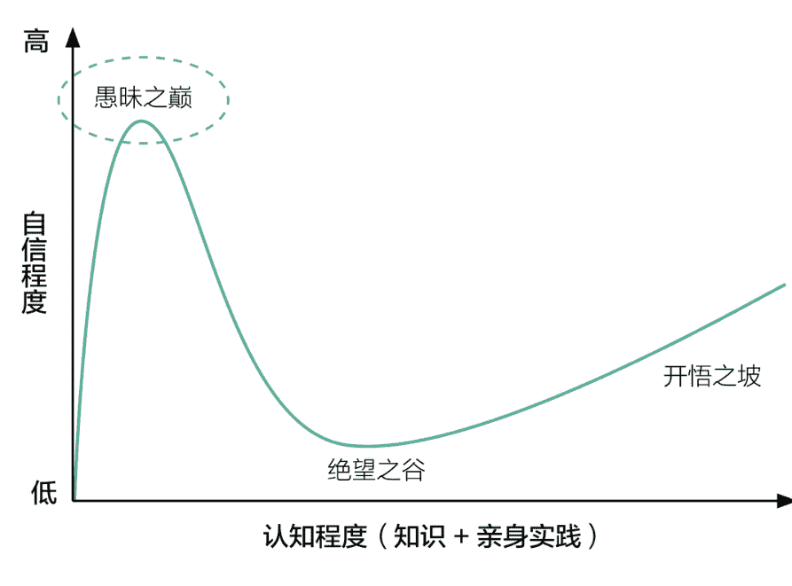

图1 达克效应

## 致谢
这本书筹备了六年，付梓在即，心里有忐忑、有遗憾，更多的是感恩。

忐忑的是，它能否契合我们“尊重客户的每一分钱，敬重客户的每一分钟”的信念？知识点与案例都力求扎实，AI内容也尽量更新，但百密难免一疏。书名反复斟酌，使用“革命”而非常说的“变革”，我始终担心内容是否匹配，是否会挂羊头卖狗肉。

十九年讲营销课程，我很少用“革命”。转型本是渐进的，我们一直主张“保住现有的，创造想要的”，并强调“无相”的智慧——《金刚经》言“凡所有相，皆是虚妄”。转型企业须盘点沉淀已久的能力，重新规划产品与客群。

然而长远看，AI的技术革命必然彻底重塑营销的方法、渠道与工具。营销触达将发生质变，如今依赖SEO、SEM的流量正快速转向大模型入口，无论To C还是To B。

未来营销方法必须符合大模型“可信任、可验证、可追溯”的逻辑；经营者必须打破旧认知，重建基于AI时代的能力体系。

尤其是单仁牛商所服务的企业，我们会助力它们借助AI新架构从线下走向互联网。未来的生意将走向“无远、无界、无我、无相”的状态。

遗憾的是，稿子交付印刷后便定格了。伟大的革命由无数微小行动累积而成，革命是过程而非终点。本书所写的每个行动，都是传统企业迈入AI营销革命的一部分。

本书的完成离不开单仁牛商诸位老师与服务团队对短视频与数字入口的深入研究，以及在多赢、快赢项目中服务数千家企业的案例沉淀。

特别感谢案例分享的嘉宾们，他们敢于投入、勇于探索，并慷慨分享心得，推动出版。

我要感谢我的家人，我的太太与孩子们，他们的支持让我能常年奔波讲课辅导。

特别感谢中资海派编辑团队的专业策划与打磨，感谢创始人桂林总的关键指导，感谢编辑郎平老师的付出。若无她们，此书难成。

单仁

2025年9月16日于深圳