# AI智算新图景DEEPSEEK数据处理与分析案例版

# 前言

首先需要说明的是，本书是一本介绍如何使用 DeepSeek 助力数据管理和数据分析的简单基础入门书。

之所以说是简单基础入门书，是因为本书不介绍那些枯燥难懂的大数据模型，而是从实际工作出发，介绍如何使用 DeepSeek 来解决问题，提升我们的数据处理和数据分析效率。

我们要把 DeepSeek 当成一个亲密助手，但要注意 DeepSeek 并不是工作的主角，主角还是我们自己。很多问题如果我们亲自动手去一点一点解决，非常耗时且效率极低，因此，有一个 DeepSeek 这样的助手帮助我们，很多情况下可以成倍提升效率。

既然把 DeepSeek 当成一个助手，那么我们就要清晰准确地给它下达任务指令：

- 有什么问题要让它解决？
- 这个问题的核心是什么？
- 想从哪些方面对这个问题做一些细致思考？
- 重点要考虑哪个方面？
- 有哪些注意事项？
- 最终想要达到什么效果？
- …………

只有给 DeepSeek 发出准确清晰的指令，它才能按照我们的要求，发挥它的深度逻辑推理能力以及全网综合搜索能力，从海量的数据信息中归纳整理出我们想要的信息。在获得这些信息后，我们还需要认真去阅读、理解这些信息，然后提出进一步的需求，发出进一步的指令，让 DeepSeek 继续深入地工作下去。

DeepSeek 不是万能的，并不能彻底帮助我们解决问题。它只是一个“你问我答”形式的助手，你有问，它才有答；你问什么，它才会答什么。你问得含含糊糊，它的回答可能就会不着边际。

本书从企业数据管理和数据分析的实际应用出发，结合实际案例介绍 DeepSeek 在数据清洗加工、数据合并汇总、数据分析与可视化处理以及助力常见数据处理分析工具尤其是 Excel 的高效使用等方面的应用。本书的目的是让我们快速了解和使用 DeepSeek，利用 DeepSeek 跳出数据泥潭，提升数据处理和数据分析的效率。

> 本书配套及赠送资源获取方式：
扫描下方二维码，关注微信公众号，回复关键词：0713，获取资源包下载链接和提取码。


韩小良
2025 年 3 月


## 第1章 DeepSeek 的基本使用技巧

凭借强大的逻辑推理与联网信息综合能力，DeepSeek 已经广泛融入生活的各个领域，协助我们解决各类问题，其使用非常灵活。本章我们主要介绍 DeepSeek 的基本使用技巧。
DeepSeek 有 App 版，方便移动搜索；也有网页版，使用起来更加方便，网址是 https://www.deepseek.com/。

### 1.1 DeepSeek 的基本使用方法

要想借助 DeepSeek 高效处理数据，关键是要设计好提示词，并根据实际需要确定是否上传相关数据文件，这样才能快速准确地得到我们需要的信息。本节介绍 DeepSeek 的基本使用方法。

#### 1.1.1 打开网页或者 App

打开 DeepSeek 网页，如图 1-1 所示。


单击“开始对话”按钮，打开 DeepSeek 人机交互界面，在文本框中输入提示词，或者先选择“深度思考”模型后再上传文件，如图 1-2 所示。
DeepSeek App 打开界面，如图 1-3 所示。


DeepSeek 有三大模型：基础模型、深度思考模型和联网搜索模型。

- **基础模型（V3，默认）**：适用于日常对话、知识问答、文案创作等，其特点是响应速度快、知识面广，大多数日常场景下首选这个模型。
- **深度思考模型（R1）**：适用于复杂逻辑推理、代码开发、数学问题等，其特点是逻辑性强、思维链完整，但响应速度慢，有时候甚至停止响应。当需要进行深度分析时，尤其是对数据进行分析时，可以使用这个模型。
- **联网搜索模型**：适用于查询最新信息、实时数据，其他 AI 工具（例如 Kimi、豆包等）与之相同，但不建议与 R1 同时使用。

#### 1.1.2 输入提示词来获取信息

例如，输入提示词“请获取医药行业上市公司的主要经营数据，包括国内与国外对比数据”，如图 1-4 所示。


根据这个提示词，DeepSeek 显示思考过程，如图 1-5 所示。仔细阅读这些文字，我们可以了解 DeepSeek 给出相关信息的思考过程。

例如，这一段话“我得考虑数据来源。国内的数据可能来自沪深交易所的财报，或者像同花顺、东方财富这样的金融数据平台。国外的话，可能需要查看美股或其他市场的上市公司财报，比如雅虎财经、彭博终端之类的。另外，像 Mordor Intelligence、Statista 这些第三方机构可能有行业分析报告，能提供对比数据”就解释了数据来源。


图 1-6 是 DeepSeek 针对提出的问题给出的具体信息，包括以下几部分：

（1）数据获取渠道；
（2）核心经营数据维度；
（3）国内外对比分析（示例）；
（4）数据可视化建议；
（5）注意事项；
（6）示例数据参考（部分公开数据）。

针对该行业分析工作，主要围绕数据获取和对比维度展开，结合公开数据和行业分析方法，以下通过步骤、数据方案及分析结果展示。

##### 1. 数据获取渠道

国内公司数据源

- 财务数据：通过巨潮资讯网（A股）、上交所/深交所官网获取年报/季报；
- 金融平台：同花顺、东方财富Choice、Wind数据库（需订阅）；
- 行业报告：中国医药工业信息中心、米内网、华安证券等券商的行业研报。

国际公司数据源

- 财务平台：SEC EDGAR（美股）、公司官网Investor Relations（如辉瑞、默沙东）；
- 数据库：Bloomberg、FactSet、Statista、Monitor Intelligence；
- 行业分析：RSM、Evaluate Pharma、Frost & Sullivan报告。

##### 2. 核心经营数据维度

对比维度包括以下指标：

| 指标 | 国内代表公司（例） | 国际代表公司（例） |
| :--- | :--- | :--- |
| 营业收入（2023上半年） | 恒瑞医药 113.6亿元 | 辉瑞 310亿美元 |
| 净利润率 | 迈瑞医疗 32% | 默沙东 18.5% |
| 研发投入占比 | 百济神州 ~100% | 罗氏 23% |
| 海外收入占比 | 药明康德 80%+ | 辉瑞 ~50% |
| 主营业务领域 | 创新药/仿制药/器械 | 专利药/生物类似药/器械 |
| 注：百济神州因高研发投入处于亏损状态，研发占比超营收。 | | |

##### 3. 国内外对比分析（示例）

市场规模与增速

- 国内：2023年中国医药市场规模约1.8万亿元，增速约5-8%（受集采影响放缓）。
- 国际：全球医药市场约1.5万亿美元，创新药市场增速约7-4%，新兴市场约10%。

研发投入

- 国内：头部企业研发占比10%-20%（恒瑞约19%），生物科技公司（如百济神州）超50%。
- 国际：Top10药企研发占比13%-25%（默沙东约25.6%）。

区域市场分布

- 国内：内销为主（占比超80%），国际化程度较低但逐步提升，迈瑞医疗海外收入约50%。
- 国际：辉瑞、默沙东等全球布局（海外收入占比40%-60%），新兴市场（中国、印度）增速更快。

##### 4. 数据可视化建议

- 趋势对比：用折线图、柱状图展示国内外头部企业Top10营收与全球份额。
- 药物管线：展示国内外市场前10个CAGR（复合增长率）趋势。
- 区域分布：标注国内企业海外收入主要区域（欧洲、北美、东南亚）。

##### 5. 注意事项

- 数据时效性：优先采用最新年报（如2023H1）或第三方机构预测数据。
- 汇率换算：国际公司数据需统一货币单位（建议用美元或人民币）。
- 行业特殊性：区分化药、生物药、医疗器械子行业，避免直接对比。

##### 6. 示例数据参考（部分公开数据）

| 公司（国家） | 营业收入（2023 H1） | 净利润率 | 研发投入占比 | 海外收入占比 |
| :--- | :--- | :--- | :--- | :--- |
| 恒瑞医药（中国） | 113.6亿元 | 16.2% | 19% | 5% |
| 迈瑞医疗（中国） | 184.8亿元 | 32% | 10% | 50% |
| 辉瑞（美国） | 310亿美元 | 25%* | 17% | 58% |
| 罗氏（瑞士） | 330亿瑞士法郎 | 22% | 23% | 78% |
| 注：辉瑞2023年净利润因新冠产品需求下降影响较大。 | | | | |

如需更详细的公司财务分析（如毛利率、CXO、医疗器械）或区域市场数据，可进一步提供需求方向。建议使用Wind或Bloomberg数据库获取实时数据或参考券商最新行业研报（如中信证券2023年全球医药行业数据）。

图 1-6 DeepSeek 给出的具体信息

也许这些信息对我们帮助不大。例如，当我们希望了解国内十大医药公司的数据时，这些信息就不是我们真正需要的信息了，原因是我们前面给出的提示词不够精确。我们可以继续提问“请按营业收入排名，获取国内十大医药公司的营业收入、净利润和净资产收益率数据”，DeepSeek 给出了图 1-7 所示的数据。

2023上半年国内医药公司营收Top10

| 排名 | 公司名称 | 营业收入（亿元） | 净利润（亿元） | ROE（净资产收益率） | 主营业务 |
| :--- | :--- | :--- | :--- | :--- | :--- |
| 1 | 上海医药 | 1,322.3 | 36.9 | 6.2% | 医药流通、制药 |
| 2 | 华润医药 | 1,258.7 | 33.5 | 5.8% | 医药流通、制药 |
| 3 | 国药控股 | 2,814.1* | 60.3* | 8.1%* | 医药流通（港股上市） |
| 4 | 九州通 | 879.3 | 15.4 | 4.5% | 医药流通 |
| 5 | 白云山 | 399.7 | 25.3 | 10.5% | 制药（中药、化学药） |
| 6 | 恒瑞医药 | 111.6 | 18.1 | 12.3% | 创新药、仿制药 |
| 7 | 迈瑞医疗 | 184.8 | 59.3 | 28.7% | 医疗器械 |
| 8 | 药明康德 | 188.7 | 53.1 | 15.6% | 医药研发外包（CXO） |
| 9 | 智飞生物 | 244.5 | 42.1 | 34.2% | 疫苗代理与研发 |
| 10 | 云南白药 | 207.2 | 28.3 | 7.8% | 中药、健康品 |

注：
1. 标“*”的国药控股为港股公司，营收及净利润按2023年中报港元换算为人民币（汇率0.92）。
2. ROE计算公式：净利润 / 平均净资产，反映股东权益回报率。智飞生物因疫苗业务高利润ROE显著领先。
3. 数据范围：A股公司采用2023年中报，港股采用同期财报（部分企业如国药控股营收含流通板块占比超90%）。

图 1-7 国内十大医药公司的营业收入、净利润和净资产收益率（2023 年上半年）

我们可以把这个表格复制到 Excel 中，方法很简单：选择表格中的数据，按 Ctrl + C，然后在 Excel 中按 Ctrl + V，就得到一个 Excel 表格，如图 1-8 所示。

| A | B | C | D | E | F |
| :--- | :--- | :--- | :--- | :--- | :--- |
| 排名 | 公司名称 | 营业收入（亿元） | 净利润（亿元） | ROE（净资产收益率） | 主营业务 |
| 1 | 上海医药 | 1,322.3 | 36.9 | 6.2% | 医药流通、制药 |
| 2 | 华润医药 | 1,258.7 | 33.5 | 5.8% | 医药流通、制药 |
| 3 | 国药控股 | 2,814.1* | 60.3* | 8.1%* | 医药流通（港股上市） |
| 4 | 九州通 | 879.3 | 15.4 | 4.5% | 医药流通 |
| 5 | 白云山 | 399.7 | 25.3 | 10.5% | 制药（中药、化学药） |
| 6 | 恒瑞医药 | 111.6 | 18.1 | 12.3% | 创新药、仿制药 |
| 7 | 迈瑞医疗 | 184.8 | 59.3 | 28.7% | 医疗器械 |
| 8 | 药明康德 | 188.7 | 53.1 | 15.6% | 医药研发外包（CXO） |
| 9 | 智飞生物 | 244.5 | 42.1 | 34.2% | 疫苗代理与研发 |
| 10 | 云南白药 | 207.2 | 28.3 | 7.8% | 中药、健康品 |

图 1-8 复制到 Excel 中的表格

如果想获取 DeepSeek 关于这个表格可视化的一些建议，不妨输入提示词“请问如何对这个表格中的数据进行可视化处理”。DeepSeek 会给出可视化分析的帮助信息，如图 1-9 所示，而建议的可视化工具则不仅仅限于 Excel，还有 Power BI、Python、Tableau 等。

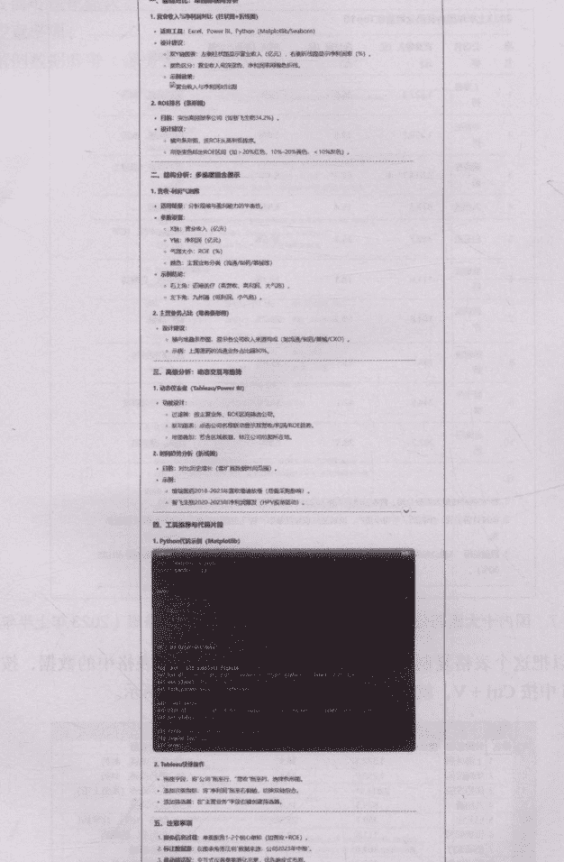

图 1-9 DeepSeek 给出可视化处理的帮助信息

如果想了解如何在 Excel 中制作营收—利润气泡图，就输入提示词“请问在 Excel 中如何制作营收—利润气泡图？请给出具体步骤”。DeepSeek 会给出一个制作气泡图的详细步骤，如图 1-10 至图 1-12 所示。

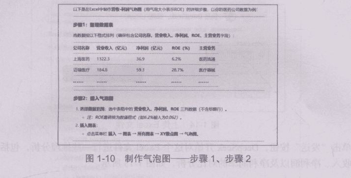

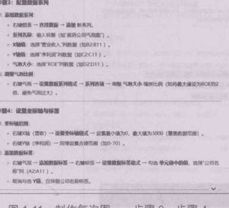

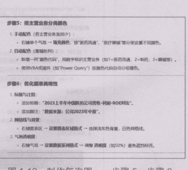

#### 1.1.3 通过提供数据文件获取帮助信息

除了前面介绍的输入提示词，我们还可以通过提供数据文件获取 DeepSeek 的帮助信息。文件可以是 Excel、Word、PDF、图片等，可以是一个，也可以是多个。例如，我们可以批量上传发票扫描件进行统一处理。举一个简单的示例，有一个各个分公司的业绩统计表（文件是“分公司营收、利润、人数统计.xlsx”），如图 1-13 所示。

| 分公司 | 营业收入 | 净利润 | 人数 |
| :--- | :--- | :--- | :--- |
| 北京分公司 | 3059 | 948 | 123 |
| 郑州分公司 | 205 | -29 | 48 |
| 上海分公司 | 2050 | 322 | 89 |
| 苏州分公司 | 5738 | 681 | 65 |
| 武汉分公司 | 994 | 13 | 6 |
| 深圳分公司 | 3569 | 83 | 76 |
| 杭州分公司 | 595 | -40 | 22 |
| 客服部 | 0 | -83 | 5 |
| 合计 | 16210 | 1895 | 434 |

图 1-13 分公司业绩统计表

将这个 Excel 文件上传到 DeepSeek，看看 DeepSeek 会给出什么信息。
上传 Excel 文件很简单，单击“上传附件”按钮，在文件夹中选择要上传的文件，如图 1-14 所示。


单击“发送”按钮，DeepSeek 开始对这个 Excel 文件进行一些推理分析，包括分公司、营业收入、净利润以及净利润率的对比分析，如图 1-15 所示。

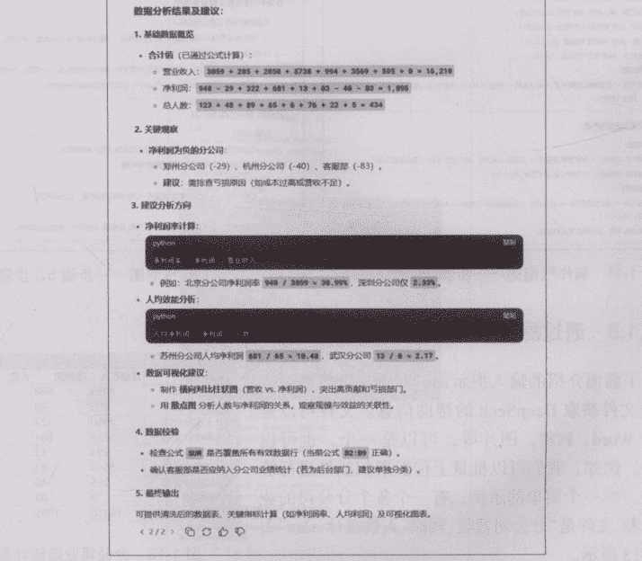

如果我们对 DeepSeek 这次的推理分析结果不满意，可以单击底部的“重新生成”按钮，DeepSeek 就会再次进行推理分析，重新生成一个推理分析结果，如图 1-16 所示。

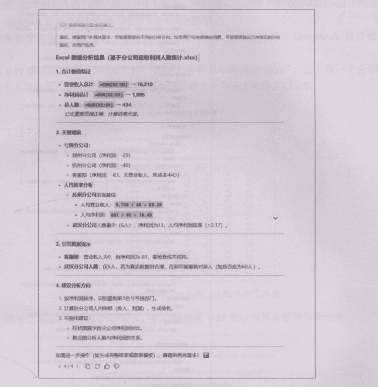

DeepSeek 每次重新生成的推理分析结果都会被保存下来，列示在页面左侧的边栏，如图 1-17 所示。

需要注意的是，DeepSeek 对表格所做的推理分析仅仅是一个参考。尽管可以多做几次，但 DeepSeek 每次输出的信息是有差异的，这往往会让我们无所适从。

其实，我们上传 Excel 文件是带着明确目的的，因此在上传文件后，我们可以先浏览一下 DeepSeek 自动返回的推理分析结果，或者多做几次，然后针对我们关心的主要问题，输入提示词，从而得到对应的信息。

例如，继续输入提示词“**应重点分析这个表格中的哪些信息？如何对这些分析做可视化处理？**”就得到图 1-18 所示的信息。这些信息非常全面，需要认真阅读和理解。

## 重点分析方向及可视化建议

一、应重点分析的核心信息

1. 盈利能力分析
   - 净利润分布：识别盈利最高（如北京、苏州）和持续亏损（如杭州、郑州、客服部）的分公司。
   - 营业收入与净利润的匹配度：例如武汉分公司营业收入较高（3569万）但净利润仅83万，需分析成本或费用问题。
   - 亏损部门：客服部亏损金额最大（-83万），需单独评估其成本结构或服务价值。

2. 效率与规模分析
   - 人均创利：苏州分公司人均10.48万，武汉分公司人均仅2.17万，需对比管理模式。
   - 人数与产值的关系：例如武汉分公司投入人数最多但人均净利润仅1.3万，是否需优化团队规模或业务方向。

3. 异常值与风险点
   - 数据异常：郑州分公司营业收入1.205亿但亏损29万，可能存在成本失控或数据问题。
   - 极端分析：苏州分公司营业收入排名第二，但净利润排名第四，需调查费用率高的原因。

4. 区域对比
   - 区域市场表现：例如北方（北京）与南方（深圳、上海）的盈利能力差异，规划一线城市（如广州、杭州）的潜力。

二、可视化处理方法

1. 盈利能力可视化
   - 柱状图+折线图组合：
     - 横轴为分公司，双纵轴分别展示营业收入（柱状）和净利润（折线），直观对比收入与利润的匹配度。
     - 标注亏损部门（红色标记）与盈利部门（绿色标记）。
   - 热力图：
     - 按区域或分公司展示净利润率（净利润/营业收入），颜色梯度表示高低（如深绿=高盈利，深红=高亏损）。

2. 效率与规模分析
   - 散点图：
     - X轴为人数，Y轴为净利润，气泡大小表示营业收入，观察“规模-效益”关系（如苏州分公司：人数少、利润高）。
     - 添加趋势线，分析人员数与净利润的关联性。
   - 条形图：
     - 横向对比各分公司人均净利润，按从高到低排序，突出效率标杆与问题部门。

3. 异常数据与风险预警
   - 饼图：
     - 展示亏损部门（杭州、郑州、客服部）占总亏损的比例，突出客服部的核心问题。
   - 雷达图：
     - 多维度对比各分公司的营业收入、净利润、人数等指标，识别综合表现最差的部门（如武汉分公司营收高但利润低）。

4. 区域市场分析
   - 地图分布图：
     - 若分公司分布广泛，可用地理地图标注各区域净利润或营业收入，直观呈现区域市场表现。
   - 分组柱状图：
     - 按区域分组（如华北、华东、华南），对比区域内分公司的平均盈利水平。

三、可视化设计注意事项

1. 突出重点：
   - 用颜色区分盈利与亏损（如绿色/红色），高亮异常数据（如武汉分公司人数少、利润低）。
2. 简化信息：
   - 每张图表聚焦1-2个维度分析，避免非盈利部门干扰整体趋势。
3. 交互性建议（若为数字报告）：
   - 添加筛选器，支持按部门、区域、盈利水平等维度动态显示数据。
4. 标注说明：
   - 在图表中直接标注关键结论（如“苏州分公司人均净利润最高：10.48万/人”）。

四、示例图表说明

1. 营业收入 vs. 净利润对比图
   示例：
   - 目的：识别收入高但利润低的分公司（如武汉）。
   - 操作：用双轴图表，柱状为收入，折线为利润，武汉分公司的柱状长但折线低，需重点分析。
2. 人均净利润排序条形图
   示例：
   - 目的：明确效率标杆与问题部门。
   - 操作：苏州最高，建议复制其管理模式。
3. 亏损部门占比饼图
   示例：
   - 目的：展示亏损来源，客服部占比最大（约60%），需优先解决。

通过以上分析和可视化，可快速定位业务痛点与优势，为管理层提供直观的决策依据。


如果我们想要了解如何在 Excel 中制作各种图表，比如热力图、条形图、饼图、雷达图等，就输入相应的准确提示词。

例如，要了解制作热力图的具体方法和步骤，可以输入提示词“请问如何在 Excel 中制作热力图”，DeepSeek 就会给出制作热力图的方法和详细步骤。

如果数据源是 Word 文件，我们也可以将 Word 文件上传并让 DeepSeek 进行推理分析。

图 1-19 所示的是一个 Word 文件“公司人力资源年终报告.docx”，其中有一个公司历年来员工人数分类汇总表。我们要求 DeepSeek 对这个 Word 文件进行分析。

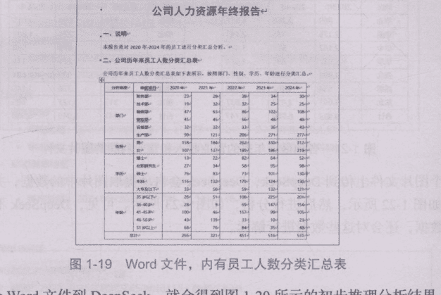

上传这个 Word 文件到 DeepSeek，就会得到图 1-20 所示的初步推理分析结果。


#### 1.1.4 通过提供图片文件获取帮助信息

有时候，我们获取的是一张或者多张图片，图片中含有需要我们进行分析的数据信息（文字描述或者表格），那么就可以使用 DeepSeek 识别图片中的信息，并对其进行必要的分析。

图 1-21 所示的是从有关渠道获取的各地区三年来的营业收入和营业利润的图片文件，文件是“地区销售图片.jpg”。

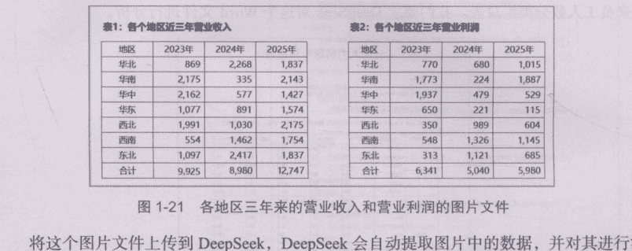

将这个图片文件上传到 DeepSeek，DeepSeek 会自动提取图片中的数据，并对其进行深度思考，如图 1-22 所示，然后进行分析，如图 1-23 所示。可见，DeepSeek 不仅可以辨识图片中的数据，还会对这些数据进行解读。


## 分析与总结

数据验证
- 营业收入合计：2023年（9,925）、2024年（8,980）、2025年（12,747）均计算正确。
- 营业利润合计：2023年（6,341）、2024年（5,040）、2025年（5,980）无误。

关键趋势分析

1. 营业收入
   - 增长最快地区：
     - 东北地区：2024年营业收入激增120%（1,097 → 2,417）。
     - 西南地区：2024年增长164%（554 → 1,462）。
   - 波动显著地区：
     - 华南地区：2024年营收骤降85%（2,175 → 335），2025年恢复至2,143。
     - 华中地区：2024年营收下降73%（2,162 → 577）。
2. 营业利润
   - 异常波动：
     - 华南地区：2024年利润暴跌87%（1,773 → 224），2025年反弹至1,887。
     - 华东地区：利润连续三年下滑（650 → 221 → 115），需警惕长期风险。
   - 高利润率地区：
     - 华北地区：2023年利润率高达88.6%（770/869），2025年降至55.2%（1,015/1,837）。
     - 西南地区：2024年利润率达90.7%（1,326/1,462）。

核心问题与建议

1. 华东地区利润持续下滑
   - 问题：2023-2025年利润从650降至115，降幅达82%。
   - 建议：分析成本结构、市场竞争或管理问题，制定扭亏计划。
2. 华南地区2024年异常表现
   - 问题：营收与利润同步暴跌，可能受突发事件（如供应链中断）影响。
   - 建议：复盘2024年经营策略，优化风险应对机制。

图表建议

1. 折线图：各地区三年营收与利润趋势对比。
2. 柱状图：2025年各地区营收与利润贡献排名。
3. 热力图：利润率（颜色深浅表示高低）与营收规模（气泡大小）的二维分析。

> 结论：需重点关注华东地区的持续亏损、华南地区的波动原因，以提升整体盈利能力。

图 1-23 DeepSeek 对图片文件中的数据的分析报告

如果想让 DeepSeek 提取图片中的这两个表格中的数据，就输入提示词“请提取图片中的这两个表格中的数据”，DeepSeek 会将其数据提取出来，如图 1-24 所示。我们可以选择这两个表格中的数据，将其复制到 Excel 工作表，如图 1-25 所示。

AI 智算新图景：DeepSeek 数据处理与分析（案例版）

例如，根据用户上表的分析结果，可能需要将数据与上表的分析进行比较，而数据的提取和格式化是关键。这里我们进一步分析数据的提取。

以下是从图片中提取出的表格数据：

表1：各个地区近三年营业收入
| 地区 | 2023年 | 2024年 | 2025年 |
|---|---|---|---|
| 华北 | 869 | 2,268 | 1,837 |
| 华南 | 2,175 | 335 | 2,143 |
| 华中 | 2,162 | 577 | 1,427 |
| 华东 | 1,077 | 891 | 1,574 |
| 西北 | 1,991 | 1,030 | 2,175 |
| 西南 | 554 | 1,462 | 1,754 |
| 东北 | 1,097 | 2,417 | 1,837 |
| 合计 | 9,925 | 8,980 | 12,747 |

表2：各个地区近三年营业利润
| 地区 | 2023年 | 2024年 | 2025年 |
|---|---|---|---|
| 华北 | 770 | 680 | 1,015 |
| 华南 | 1,773 | 224 | 1,887 |
| 华中 | 1,937 | 479 | 529 |
| 华东 | 650 | 221 | 115 |
| 西北 | 350 | 989 | 604 |
| 西南 | 548 | 1,326 | 1,145 |
| 东北 | 313 | 1,121 | 685 |
| 合计 | 6,341 | 5,040 | 5,980 |

数据说明：
1. 数据已提取并整理成表格内容无错误，数据保留千分位分隔符格式。
2. 合计行已提取出，与原图数据一致。
3. 如需其他格式（如 CSV、Excel），可进一步提供。


表1：各个地区近三年营业收入（单位：万元）
| 地区 | 2023年 | 2024年 | 2025年 |
|---|---|---|---|
| 华北 | 869 | 2,268 | 1,837 |
| 华南 | 2,175 | 335 | 2,143 |
| 华中 | 2,162 | 577 | 1,427 |
| 华东 | 1,077 | 891 | 1,574 |
| 西北 | 1,991 | 1,030 | 2,175 |
| 西南 | 554 | 1,462 | 1,754 |
| 东北 | 1,097 | 2,417 | 1,837 |
| 合计 | 9,925 | 8,980 | 12,747 |

表2：各个地区近三年营业利润（单位：万元）
| 地区 | 2023年 | 2024年 | 2025年 |
|---|---|---|---|
| 华北 | 770 | 680 | 1,015 |
| 华南 | 1,773 | 224 | 1,887 |
| 华中 | 1,937 | 479 | 529 |
| 华东 | 650 | 221 | 115 |
| 西北 | 350 | 989 | 604 |
| 西南 | 548 | 1,326 | 1,145 |
| 东北 | 313 | 1,121 | 685 |
| 合计 | 6,341 | 5,040 | 5,980 |


### 1.2 DeepSeek 实际应用场景与示例练习

上一节介绍了 DeepSeek 的基本使用方法，本节介绍 DeepSeek 的几个实际应用场景与示例练习，通过这些应用场景和示例练习，我们可以进一步了解和掌握 DeepSeek 的使用方法。

#### 1.2.1 获取相关专业知识

我们可以快速借助 DeepSeek 获取相关专业知识。我们所获取的不仅仅是对知识概念的解释，更是对该知识的全面解析和实际应用。

例如，我们想要了解 ROE 的相关知识，就输入提示词“请解释 ROE 的含义及应用”。DeepSeek 会先对我们所提出的问题进行深度思考，如图 1-26 所示，这些思考结果非常有助于我们深入了解 ROE 这个财务指标。

DeepSeek 会对 ROE 的定义、核心意义、应用场景、ROE 的局限性及注意事项、典型案例进行详细介绍，如图 1-27 所示。这些知识非常全面，几乎解决了我们提出的所有问题。

DeepSeek 还特别提出了避免陷入高 ROE 陷阱。如果对这个问题感兴趣，我们可以输入提示词“文中你提到了避免陷入高 ROE 陷阱，请对高 ROE 陷阱进行简要介绍”，会得到 DeepSeek 对这个问题的详细解答，如图 1-28 所示。

## 第 1 章 DeepSeek 的基本使用技巧

请解释ROE的含义及应用

用户可能想了解ROE的定义及应用。首先，我需要解释一下ROE的定义。ROE是Return on Equity的缩写，即净资产收益率。对吧？那它的计算公式应该是净利润除以股东权益，再乘以100%变成百分比。这个指标主要用来衡量公司运用股东投入资本的效率，对吧？

接下来，应用方面，ROE在财务分析中很重要。比如投资者会用ROE来评估公司的盈利能力，高ROE可能意味着公司管理得很好，或者有竞争优势。不过，我需要注意，高ROE不一定总是好的，可能公司用了高负债，这样风险也大。所以可能需要结合其他指标来看，比如负债率或者行业平均。

然后，ROE还可以用来比较不同行业的公司。不同行业的ROE水平可能差异很大，比如科技公司可能比传统制造业高。所以应用时要考虑行业背景。此外，ROE可以分解成杜邦分析的三个部分：销售净利率、资产周转率和权益乘数，这样能更深入分析公司表现。

用户可能的背景是投资者或者学生。如果是投资者，他们可能想知道如何利用ROE选股，如果是学生，可能需要理解概念和应用例子。用户的需求不仅是定义，更想知道如何实际应用，比如在投资决策中怎么用，或者分析公司财务时怎么用。

另外，用户可能没说出来的是，他们可能想知道ROE的局限性，比如不能单独使用，或者高ROE是否可持续。还有可能想知道如何计算ROE的步骤和例子，比如通过财务报表数据。所以在回答时，应该提到这些，避免用户产生误解，认为ROE越高越好。

还有，应用方面可能需要结合其他指标，比如管理层如何利用ROE作为绩效指标，激励提升股东回报。或者在并购时，评估目标公司的价值。这些应用也需要涵盖。

总结一下，回答要先定义ROE，解释计算公式，然后详细说明它在投资分析、行业比较、内部管理等方面的应用。同时指出其局限性和需要结合其他指标。可能还需要举例子说明不同情况下的ROE分析，比如高负债导致的高ROE风险，或者通过杜邦分析分解ROE。这样用户就能全面理解ROE的意义和实际使用方法了。


ROE（净资产收益率）的定义及应用

一、ROE的定义

ROE（Return on Equity，净资产收益率）是衡量公司利用股东投入资本产生利润能力的核心指标。计算公式为：

ROE = 净利润 / 股东权益 × 100%

其中，净利润指公司税后利润，股东权益指公司总资产减去总负债后的净资产（即所有者权益）。

二、ROE的核心意义

1. 资本效率衡量：ROE越高，表明公司运用股东资本创造利润的效率越高。
2. 投资吸引力：高ROE通常意味着公司盈利能力强，对投资者更具吸引力。
3. 管理层能力：ROE反映管理层运用股东资金创造价值的能力。

三、ROE的应用场景

1. 投资决策
   - 选股参考：投资者常将ROE作为筛选优质公司的指标（如ROE > 15%），高ROE公司通常具备较强的盈利能力和竞争优势。
   - 行业对比：不同行业的ROE水平差异较大（如科技行业ROE普遍高于传统制造业），需结合行业背景分析。
   - 趋势分析：观察公司ROE的历年变化，判断其盈利能力的稳定性或成长性（如ROE持续上升可能预示竞争力增强）。
2. 公司内部管理
   - 绩效评估：管理层可将ROE作为绩效考核指标，激励提升资本使用效率。
   - 资源配置：通过分析ROE驱动因素（如销售净利率、资产周转率、权益乘数），优化业务结构或资产配置。
3. 并购与估值
   - 目标筛选：在并购中，高ROE公司可能被视为优质标的（但需警惕高负债导致的ROE虚高）。
   - 估值参考：ROE可作为估值模型（如杜邦分析）的输入参数，辅助判断公司价值。

四、ROE的局限性及注意事项

1. 高负债风险：若ROE提升主要依赖高杠杆（如大量借款），则可能掩盖经营风险（如利息负担过重）。
2. 行业差异：不同行业ROE的合理范围不同（如金融业ROE通常高于制造业），需横向对比。
3. 短期波动：ROE可能受一次性收益（如资产出售）影响，需结合长期趋势判断。
4. 忽略现金流：ROE基于利润表，未直接反映现金流状况，需结合现金流量表分析。

五、典型案例分析

1. 高ROE陷阱：某公司ROE达30%，但负债率高达80%，实际盈利能力一般，高ROE源于高杠杆。
2. 稳健增长：某公司ROE连续5年保持在15%-20%，负债率适中，显示可持续的盈利能力和良好的资本管理。

六、总结

ROE是评估公司盈利能力和资本效率的关键指标，广泛应用于投资分析、公司管理和估值。使用时需结合行业背景、负债水平及长期趋势，避免单一指标误判。


一、高ROE陷阱的常见类型

1. 高杠杆驱动型
   - 特征：ROE提升主要依赖高负债（权益乘数大），而非盈利能力。
   - 风险：一旦经营环境恶化或利率上升，高负债可能导致财务危机。
   - 案例：某公司ROE为25%，但负债率高达80%，实际净利润率仅5%，高ROE源于高杠杆。
2. 非经常性收益虚增型
   - 特征：ROE提升依赖一次性收益（如资产出售、政府补贴），非核心业务盈利。
   - 风险：不可持续，长期盈利能力可能被高估。
   - 案例：某公司通过出售资产获得高额收益，ROE暂时提升至30%，但次年ROE回落至10%。
3. 行业周期性干扰型
   - 特征：行业处于景气周期（如大宗商品价格上涨），ROE暂时性走高。
   - 风险：周期下行后，ROE可能快速下滑。
   - 案例：某周期性行业公司在行业高峰期ROE达20%，但行业低谷期ROE降至5%以下。
4. 财务操纵型
   - 特征：通过会计手段（如提前确认收入、延迟确认费用）虚增利润，人为抬高ROE。
   - 风险：财务数据失真，误导投资者决策。
   - 案例：某公司通过激进的收入确认政策，短期ROE提升至25%，但后续因财务造假被查处。

二、如何识别高ROE陷阱

1. 结合杜邦分析
   - 拆解ROE驱动因素：若ROE提升主要源于权益乘数（高杠杆）而非销售净利率或资产周转率，则需警惕。
   - 关注负债率：若负债率超过行业平均水平（如>70%），高ROE可能不可持续。
2. 检查收益质量
   - 分析净利润构成：若非经常性收益占比高（如>30%），则ROE可能虚高。
   - 关注现金流：净利润与经营现金流是否匹配（如净利润高但现金流为负，可能存在问题）。
3. 分析行业特性
   - 周期性行业：需判断当前是否处于行业周期高点，避免在周期顶部误判。
   - 竞争格局：若行业竞争激烈，高ROE可能难以维持。
4. 关注财务数据一致性
   - 对比历史数据：ROE是否突然大幅波动（如从10%跃升至30%），需查明原因。
   - 横向对比：与同行业公司对比，若ROE显著高于同行且无合理解释，则需谨慎。

三、典型案例对比

| 企业类型 | ROE | 驱动因素 | 风险点 |
| --- | --- | --- | --- |
| 优质成长公司 | 30% | 高净利率（品牌溢价） | 低负债，现金流健康，可持续性强 |
| 高杠杆周期公司 | 25% | 高权益乘数（负债率>70%） | 周期下行风险大，财务脆弱 |
| 周期顶部企业 | 35% | 大宗商品价格暴涨（短期因素） | 周期回落ROE可能骤降 |

四、总结

高ROE未必代表优质公司，需结合驱动因素、负债水平、收益质量及行业周期综合判断。投资者应避免被表面高ROE迷惑，通过杜邦分析、现金流验证及长期趋势观察，识别真实盈利能力。


针对 ROE 这个财务指标（经营指标），我们可以让 DeepSeek 做各种深入的解释，这取决于我们输入什么样的提示词（也就是想要了解什么样的知识）。例如，我们可以继续了解如何制作杜邦分析图。

#### 1.2.2 制作年度会议计划安排方案

公司要召开年终总结会议，需制作一个年度会议计划安排方案。我们可以根据公司的部门构成以及各部门汇报重点、时间要求等，将这些信息综合起来设计提示词。DeepSeek 可以帮助我们快速设计一个年度会议计划安排方案，我们再根据公司的具体情况，对这个方案进行进一步的整理加工，使之满足公司的实际需要。

例如，输入提示词“请设计一个年度会议计划安排方案，要求每个部门结合各自一年来的工作进行汇报，每个部门限定 20 分钟。部门有财务部、人力资源部、销售部、生产部、技术研发部、物控部、设备部”，DeepSeek 设计的年度会议计划安排方案如图 1-29 所示。


图 1-29 年度会议计划安排方案

#### 1.2.3 制作年度销售分析报告

如果我们对如何制作年度销售分析报告毫无头绪，可以让 DeepSeek 来帮忙。

输入提示词“我想生成一份关于年度销售分析报告，要求：(1) 历史数据基本统计；(2) 目前存在问题；(3) 未来计划和方向”，DeepSeek 会根据提示词，设计一份年度销售分析报告大纲，如图 1-30 所示，然后我们可以结合公司实际情况，根据这个大纲来制作详细的销售分析报告。

如果我们对这个大纲不满意，就继续输入提示词“请重新生成，重点就目前存在的问题进行分析”。DeepSeek 会根据这个提示词重新生成一个大纲，如图 1-31 所示。

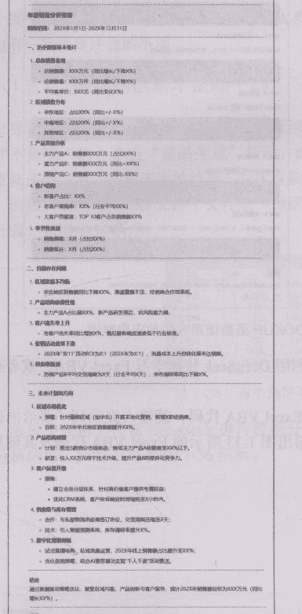

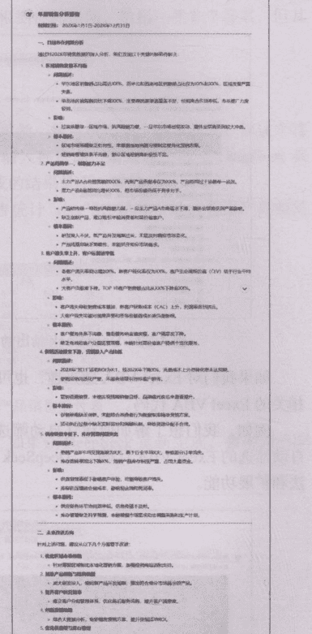

#### 1.2.4 获取 Excel 工具的帮助信息

Excel 是常用的数据处理工具之一，但很多人觉得 Excel 函数公式非常难学。DeepSeek 可以帮助我们快速掌握 Excel 函数公式，获取必要的帮助信息。

例如，输入提示词“请介绍 XLOOKUP 函数的使用方法和应用案例”，DeepSeek 会快速给出 XLOOKUP 函数的使用方法和相关应用案例，如图 1-32 所示。


如果我们对 Excel VBA 感兴趣，也可以利用 DeepSeek 快速学习 Excel VBA，或者获取相关的 Excel VBA 代码。

例如，我们想了解如何建立自动筛选的 Excel VBA 代码，就输入提示词“请给出建立自动筛选的 Excel VBA 代码”。DeepSeek 会给出图 1-33 所示的 Excel VBA 代码及其使用方法和扩展功能。

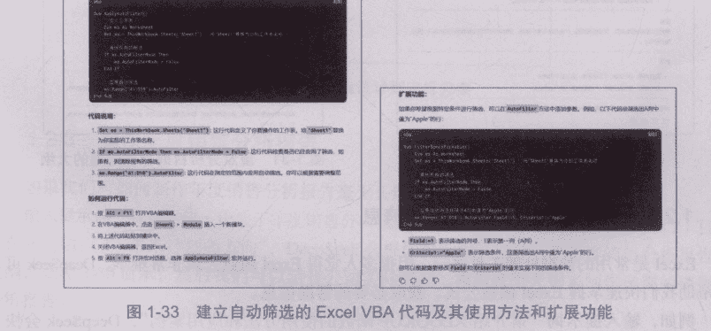

### 1.3 使用 DeepSeek 的注意事项

DeepSeek 使用起来非常方便，只要把它当成一个人看待，就像和一个朋友在交谈，给一个助手在布置任务。一问一答，DeepSeek 就会根据你的提问，给出一些参考答案，但其中也有一些需要注意的事项。

#### 1.3.1 得到的信息不是唯一的

尽管输入提示词后，DeepSeek 会先进行深度思考，然后给出一个参考答案，但这个答案并不是唯一的。单击“重新生成”按钮，或者输入提示词“请重新……”，DeepSeek 就会重新进行思考，并输出新的结果。每次重新生成的结果是不一样的。

例如，有一个 Excel 文件（文件是“地区销售统计.xlsx”），是各个地区各个产品销售统计表，如图 1-34 所示。

| 地区 | 彩电 | 冰箱 | 空调 | 手机 | 合计 |
|---|---|---|---|---|---|
| 华北 | 253 | 1341 | 675 | 600 | 2869 |
| 华南 | 1275 | 952 | 1050 | 717 | 3994 |
| 华东 | 576 | 700 | 866 | 1419 | 3561 |
| 华中 | 728 | 1477 | 2813 | 1065 | 6083 |
| 西南 | 228 | 531 | 492 | 231 | 1482 |
| 西北 | 236 | 514 | 798 | 1245 | 2793 |
| 东北 | 1289 | 184 | 1195 | 1441 | 4109 |
| 合计 | 4585 | 5699 | 7889 | 6718 | 24891 |

图 1-34 各个地区各个产品销售统计表

将这个表格上传到 DeepSeek 进行数据分析。如果让 DeepSeek 重新生成，会得到不同的分析结果，如图 1-35 和图 1-36 所示。

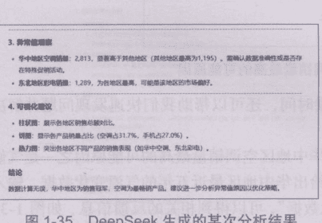

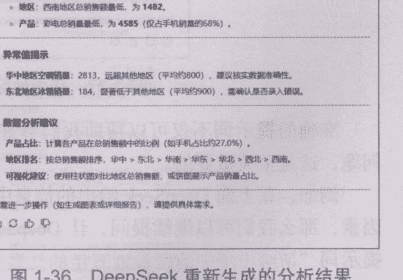

我们可以多次单击“重新生成”按钮，看看 DeepSeek 每次的回答都有什么侧重点。这可以帮助我们更加深入地了解表格中的数据的信息。

#### 1.3.2 准确的提示词非常重要

从上一案例中我们可以看出，DeepSeek 会有各种不同的回答。如果没有准确的提示词，会浪费大量的时间。

一般情况下，我们可以在 DeepSeek 几次回答的内容中挑选几个重要的信息继续提问，或者直接忽略 DeepSeek 的回答，上传文件后输入自己关心的问题继续提问。例如，我们发现华中地区空调销量最高，想要了解可能的原因是什么，就输入提示词“华中地区空调销量最高的可能原因是什么”，DeepSeek 会给出图 1-37 所示的参考信息。这些信息有助于我们结合实际情况去进一步挖掘数据背后的信息，为经营决策提供科学依据。


准确的提示词不仅可以帮助我们节省大量时间，还可以帮助我们快速发现问题并解决问题，这是至关重要的。

例如，在上面 DeepSeek 给出的信息中，华中地区空调销量最高的可能原因之一是气候因素，那么我们可以继续提问，让 DeepSeek 给出华中地区最近五年的气温变化数据。输入提示词“请给出华中地区最近五年的气温变化数据”，可以得到相关的反馈信息，如图 1-38 所示，当中不仅有华中地区各个省份的气温数据，还有对数据的一些备注说明信息。将这个表格中的数据复制到 Excel 中，绘制折线图，就能更清楚地了解气温的变化情况，如图 1-39 所示。

华中地区（河南、湖北、湖南）近5年气温变化趋势示例（2018-2022年）

| 年份 | 河南省年均气温（℃） | 湖北省年均气温（℃） | 湖南省年均气温（℃） | 关键气候事件 |
| :--- | :--- | :--- | :--- | :--- |
| 2018 | 15.6 | 17.2 | 18.1 | 夏季高温持续，多地超40℃ |
| 2019 | 16.1 | 17.5 | 18.3 | 冬季偏暖，夏季偏干 |
| 2020 | 16.3 | 17.8 | 18.6 | 暴雨频繁，洪涝灾害严重 |
| 2021 | 16.5 | 18.0 | 18.9 | 河南7·20特大暴雨，创历史极值 |
| 2022 | 16.7 | 18.2 | 19.1 | 高温破纪录，多地刷新历史高温纪录 |

数据来源说明：
1. 月度趋势：三省年均气温逐年上升0.2-0.3℃，与全球变暖趋势一致。
2. 极端事件：暴雨与高温交替出现，2020年洪涝、2022年高温均创历史纪录。

气候与极端事件的潜在关联：
1. 高温与干旱关联：2018年和2022年高温期间均伴随降水偏少。
2. 暴雨与洪涝关联：2020年梅雨期延长（较常年偏长15天）导致持续强降水。

建议验证路径：
1. 中国气象数据网：查询《中国气候公报》年度数据。
2. 各省气候中心：河南省气候中心《河南省气候影响评价》。
3. 学术研究：检索“华中地区气候变化”相关论文，获取更长时间序列分析。


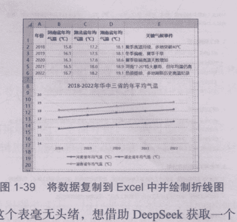

有一个员工信息表，我们目前对如何分析这个表毫无头绪，想借助 DeepSeek 获取一个基本的分析思路。输入提示词“应该对员工信息表做哪些分析”，我们会得到一个比较全面的参考答案，如图 1-40 所示。这个信息有助于我们在数据管理阶段准备好基础数据，以便对员工信息做更为全面和更具深度的分析。

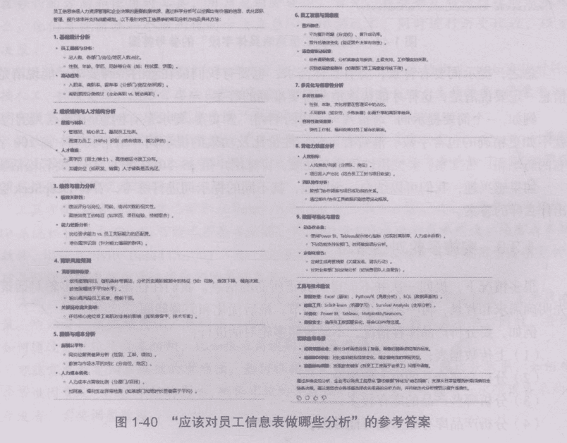

如果要指定员工信息表的具体字段，可以输入更为具体的提示词“一个员工信息表，字段有姓名、性别、部门、年龄、工龄、学历，请问应该做哪些分析”。DeepSeek 会给出一个图 1-41 所示的参考答案。

针对员工信息表中的字段（姓名、性别、部门、年龄、工龄、学历），可以从以下几个方向展开分析，帮助优化人力资源管理，发现潜在问题或支持业务决策：

+   1. 员工结构分析
   - 部门分布：统计各部门人数占比，识别人员集中的核心部门或人员短缺的部门。
   - 性别比例：全公司及各部门的性别结构分布，是否存在性别失衡（如技术部门男性占比过高）。
   - 年龄结构：分析员工年龄分布（如“20-30岁”、“30-40岁”分段），判断团队年轻化/老龄化趋势。
   - 工龄分布：统计员工工龄（如“1年内”、“1-3年”、“5年以上”），评估团队稳定性。
   - 学历分布：全公司及各部门的学历结构（本科、硕士、博士等），衡量团队整体教育背景。

+   2. 部门对比分析
   - 部门平均工龄/工龄对比：分析不同部门员工的平均工龄、工龄差异（如销售部门员工是否更年轻化，研发部门员工更资深）。
   - 部门学历对比：不同部门的学历分布是否匹配业务需求（如研发部门博士学历占比是否合理）。
   - 性别-部门交叉分析：是否存在特定部门性别比例失衡（如前台部门女性占比过高）。

+   3. 年龄与工龄相关性分析
   - 年龄 vs 工龄散点图：观察员工年龄与工龄的相关性，是否存在异常值（如年龄小但工龄长，可能数据录入错误或特殊背景）。
   - 资深员工结构：统计“高工龄员工占比”与“高年龄员工占比”，评估团队经验传承风险。

+   4. 离职风险预测（需扩展数据）
   - 工龄与离职率：结合历史离职数据，分析工龄与离职率的关联性（例如1年内新员工离职率是否较高）。
   - 年龄与晋升周期：统计不同年龄段的平均晋升时长，判断是否存在晋升瓶颈。

+   5. 学历与职业发展分析
   - 学历与岗位匹配度：高学历员工是否集中在关键岗位？是否存在学历资源浪费？
   - 学历与晋升关系：分析晋升员工的学历背景，判断学历对晋升的影响权重。
   - 学历与工龄交叉分析：高学历员工是否工龄较短（可能反映招聘策略变化）？

+   6. 性别差异分析
   - 性别与岗位分布：是否存在性别与岗位的强关联性（如女性集中在后勤岗，男性集中在技术岗）。
   - 性别与晋升率：对比不同性别的晋升速度或比例，发现潜在性别偏见。
   - 性别与工龄分布：女性员工是否因生育等因素导致在岗工龄中位数较低？

+   7. 核心人才画像
   通过交叉分析构建关键岗位的“理想人才画像”，例如：
   - 销售部门：年龄（25-35岁）、中等工龄（2-5年）、本科为主。
   - 管理层：工龄5年以上、年龄35岁以上、硕士学历占比高。

+   8. 人力成本优化
   - 部门人均工龄与成本：工龄较长的部门人力成本是否显著更高？
   - 学历与薪酬相关性：结合薪酬数据，分析学历对薪资的影响是否合理。

+   可视化建议
   - 使用饼图/柱状图展示部门、性别、学历分布。
   - 使用箱线图对比不同部门的年龄/工龄差异。
   - 使用热力图分析性别、部门、学历的交叉分布。

+   注意事项
   1. 数据清洗：检查年龄/工龄是否合理（如年龄<18岁或工龄>年龄等异常值需修正）。
   2. 隐私保护：姓名等敏感信息需脱敏处理。
   3. 结合业务背景：分析结论需与公司实际业务结合（如销售部门年轻化可能是合理策略）。
   通过以上分析，可为招聘策略、人才保留、团队结构优化提供数据支持。

图 1-41 “指定员工信息表具体字段”的参考答案

总之，提示词要有背景，要有具体需求，也要有我们最在意的特殊要求。能说清楚的信息一定要说清楚，这样才能快速地获得更准确的答案。

例如，一个简要提示词“请帮我写一篇防晒霜广告文案，要求是有创意，有亮点，吸引人”，就不如更精确的包含字数、消费者定位、性价比及功效的提示词“请帮我写一篇 200 字左右的防晒霜广告文案，要突出性价比和功效，目标用户是 35~50 岁女性，语气要轻松活泼”。

如果感兴趣，我们可以结合一个问题，就不同的提示词进行练习，看看 DeepSeek 会给出什么样的答案。

#### 1.3.3 实施多轮对话策略

很多情况下，提问一次并不能得到真正所需的信息。我们往往需要实施多轮对话策略：先明确需求和背景，再一步一步地深入细节，最后优化和完善问题。

+   例如，要分析产品库存情况，不妨按照多轮对话进行：
（1）上传数据表；
（2）分析全部产品的出入库情况；
（3）分析哪些产品的库存较多；
（4）分析产品库存较多的可能原因；
（5）制定未来销售策略，讨论如何抓紧去库存；
（6）讨论公司是否需要调整产品结构。

总之，提问的目的是发现问题、分析问题、解决问题，而不是泛泛而谈当前状况。因此，在实际数据分析中，实施多轮对话策略非常有必要。

#### 1.3.4 重视思考过程

无论是输入提示词，还是上传文件，DeepSeek 都会先给出思考过程。千万不要小瞧和忽略 DeepSeek 的思考过程，很多情况下，其思考过程的价值要远远大于给出的最终答案的价值。

仔细阅读思考过程，学习 DeepSeek 是如何拆解问题、全面分析、推测可能性的，体会其独特的视角与思路，这可以帮助我们提升逻辑思维能力和全面思考能力，同时也会为任务处理带来意想不到的帮助。

例如，我们可以输入提示词“请给出一个产品成本预算分析和同比分析的基本逻辑思维过程，要重点介绍从哪些方面进行分析、使用哪些工具，用户是财务经理”，DeepSeek 给出的思考过程如下。这个思考过程包含了大量我们在平时工作中没有想到或没有关注到的分析逻辑。

> “嗯，用户需要的是一个产品成本预算分析和同比分析的基本逻辑思维过程，重点在分析的方面和使用的工具，用户是财务经理。首先，我要确定财务经理的需求是什么。他们可能需要一个结构化的方法来监控和控制成本，同时进行历史比较，以支持决策。
>
> 首先，产品成本预算分析应该包括哪些方面？可能需要分解成本的构成，比如直接材料、直接人工、制造费用。然后考虑成本驱动因素，比如原材料价格波动、生产效率、产量变化。还要有预算与实际对比，找出差异原因，预测未来的成本。
>
> 同比分析的话，可能需要比较同一产品在不同时期的成本变化，识别趋势，比如原材料成本上升是因为市场价格上涨还是因为用量增加。同时，分析期间费用变化，比如管理费用或销售费用的变动情况。
>
> 工具方面，财务经理可能已经熟悉 Excel，但高级工具如 Power BI、Tableau 能帮助可视化。ERP 系统如 SAP 或 Oracle 可能已经集成数据，需要利用这些系统的成本模块。还有成本核算软件，比如 Activity-Based Costing 工具。数据分析工具如 Python 或 R 可能用于复杂分析，但财务经理可能更倾向于使用他们熟悉的工具。
>
> 其次，用户背景是财务经理，他们可能更关注如何将分析结果呈现给高层，支持战略决策。所以分析需要结构化，有明确的指标，比如成本差异率、同比变动率。同时，要强调如何通过分析优化成本结构，比如供应商谈判、工艺改进。
>
> 可能需要考虑预算编制的准确性，如何根据历史数据调整预算。同比分析中，如何处理季节性因素或一次性事件的影响，确保比较的合理性。比如，去年可能有一次设备采购，今年没有，需要调整数据。”
>
> 另外，财务经理可能关心如何将成本分析与公司的财务目标结合，比如降低成本率、提高毛利率。所以分析中需要包括这些关键绩效指标，并提出改进措施。
>
> 工具部分，除了 Excel，可能需要提到数据整合的重要性，确保数据来源的准确性。比如如何将 ERP 系统中的实时数据导入分析工具中，确保预算和实际数据的一致性。
>
> 总结起来，结构应该是先分解成本构成，分析驱动因素，对比预算与实际，进行差异分析。同比方面，比较不同时期的成本项目，分析变动原因，使用趋势分析和因素分析。工具推荐时，要结合财务经理的现有工具使用情况，推荐他们使用可能已经有的工具，并补充高级工具提升效率。
>
> 需要确保逻辑清晰，步骤明确，涵盖主要成本要素，并且工具要实用。可能遗漏的方面是风险分析，比如供应链风险对成本的影响，或者如何应对不确定性。但用户的需求可能集中在基本逻辑，所以可能不需要太深入到风险研究，除非特别提到。
>
> 最后，需要给出一个框架，财务经理可以按照这个框架逐步展开分析，确保全面性和可操作性。”

如果在提示词中增加一个目标“降本增效”，提示词为“请给出一个产品成本预算分析和同比分析的基本逻辑思维过程，要重点介绍从哪些方面进行分析、使用哪些工具，用户是财务经理，目标是降本增效”，DeepSeek 给出的思考过程如下。仔细阅读这些内容，看看跟上一次回答有什么不同。

> “嗯，用户需要的是产品成本预算分析和同比分析的基本逻辑思维过程，重点在于分析的方面和使用的工具，用户是财务经理，目标是降本增效。首先，我得理清楚这两个分析的核心目的是什么。预算分析应该是对未来成本的预测和控制，而同比分析则是比较不同时间段的数据，找出成本变化的原因。
>
> 财务经理的背景意味着用户可能已经有一定的财务知识，所以需要提供专业但实用的方法。降本增效是关键，所以分析要围绕如何识别成本过高的环节，优化资源配置，提高效率。可能需要从直接成本、间接成本、固定和变动成本这些方面入手。
>
> 工具方面，常用的有 Excel、ERP 系统、BI 工具，如 Power BI 或 Tableau，还有数据分析工具，如 Python 或 R。财务经理可能更熟悉 Excel 和 ERP，但高级工具的使用也可能需要涉及，特别是处理大数据时。
>
> 接下来要考虑分析的具体方面。直接成本包括材料、人工和制造费用。材料成本分析可能需要用到 ABC 分析，找出高价值物料进行重点管理。人工成本可能需要效率分析，比如单位产品工时。制造费用可能要分析能耗、设备维护等。
>
> 间接成本比如管理费用、销售费用，这里可能需要用预算与实际对比，找出偏差原因。固定成本如租金、折旧，可能需要看产能利用率，是否可以通过提高产量来分摊固定成本。变动成本则要分析采购策略，比如批量采购是否有折扣，供应商谈判是否到位。
>
> 同比分析的话，要分结构、趋势、动因和效率。比如材料成本同比上升，是因为单价上涨还是因为用量增加，或者是产品设计变更导致用料变化。这时候可能需要用因素分析法，分解各个因素的影响程度。

## 第1章 DeepSeek 的基本使用技巧

工具方面，预算分析可能需要滚动预测模型，使用线性回归或时间序列分析来预测未来成本。同比分析可能需要用趋势分析图表，比如折线图或柱状图来展示变化。因素分析可以用连环替代法或差额分析法。

另外，流程优化方面，财务经理可能需要关注价值链分析，识别非增值环节，推动精益生产。标准化成本管理，比如制定标准成本，进行差异分析。还有跨部门协作，比如和采购部门优化供应链，和生产部门提高良品率。

最后，输出结果要能指导具体行动。比如识别出某原材料价格上涨导致成本增加，可以建议寻找替代供应商或谈判降价。发现生产效率低下，可以建议优化生产流程或培训员工。

还要注意数据的准确性和及时性，确保分析的基础可靠。可能涉及的数据源包括ERP系统里的生产、采购、库存数据，财务系统的核算数据，以及市场数据如原材料价格指数。

总结下来，结构应该是先分预算分析和同比分析两部分，每部分下再细化分析维度、工具，然后给出优化建议。这样财务经理可以系统地应用这些方法，达到降本增效的目的。”

DeepSeek 对问题的诊断过程很有意思。这些诊断过程可以帮助我们了解解决问题的思路和方法，非常有价值。

例如，有一个 Excel 文件“产品销售明细.xlsx”，如图 1-42 所示。将 Excel 文件上传到 DeepSeek，输入提示词“请针对这个产品销售明细表，制作一个各个产品在每个月的销售统计表，第一列标题是产品名称，第一行标题是月份，汇总结果是销售额”，DeepSeek 就会给出图 1-43 所示的汇总表。

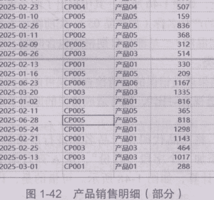

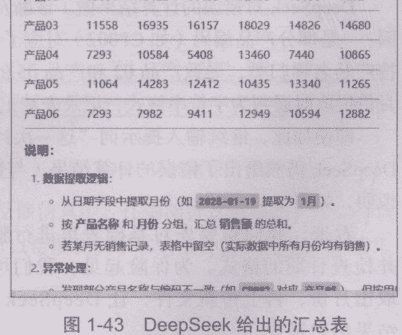

如果手工插入数据透视表进行汇总，会得到图 1-44 所示的汇总表。比较这两个汇总表，计算结果是不一样的。

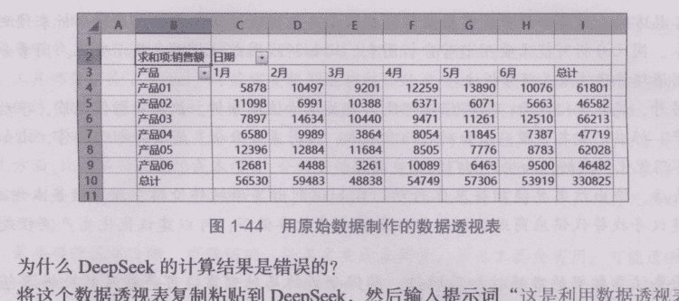

图 1-44 用原始数据制作的数据透视表

为什么 DeepSeek 的计算结果是错误的？
将这个数据透视表复制粘贴到 DeepSeek，然后输入提示词“这是利用数据透视表汇总的每个产品每个月的销售额，你先前的计算结果是错误的，与实际结果相差很大，请检查错误的原因”，看看 DeepSeek 的思考过程是什么，如图 1-45 所示。


图 1-45 DeepSeek 对诊断错误的思考过程

DeepSeek 对错误的计算结果做了诊断及纠正，如图 1-46 所示，其中提出了两个重要原因：一是部分产品编码（如 CP002）对应了错误的产品名称（如产品 05），先前统计未严格按产品名称归类，导致产品 02 和产品 05 的数据混淆；二是部分日期格式包含时间，导致月份提取时误判为字符串格式，记录未被正确归类。
即便如此，继续输入提示词“这一次计算结果还是错误的，请检查错误可能在何处”，DeepSeek 仍然给出了错误的计算结果（与数据透视表对比），但对造成错误的原因予以了说明，如图 1-47 所示。
看来，我们需要先对基础表单进行整理，将产品代码与产品名称进行严格核对，并检查日期的格式。为保险起见，我们可以添加一个字段“月份”，从 A 列日期中提取出月份，再上传新文件，让 DeepSeek 重新计算，如图 1-48 所示。可惜的是，计算结果仍然错误。
出了错误不可怕，这会更坚定我们一探究竟的决心：究竟是 DeepSeek 不能分析数据量大的表格，还是不能用 DeepSeek 后台默认的工具计算？

我们先不予以追究，再让 DeepSeek 检查一遍。输入提示词“这次的计算结果仍然是错误的，请仔细检查，并给出正确结果”。可惜的是，DeepSeek 给出的计算结果还是错误的，如图 1-49 所示。可见，DeepSeek 对这样的数据的汇总计算结果不一定是准确的，因此在结果后面附上了一句：“注意：若需完全精准，请直接运行提供的 Python 代码或严格按步骤配置 Excel 数据透视表。”

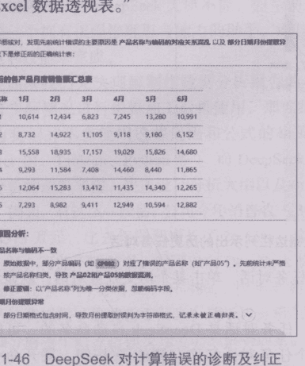

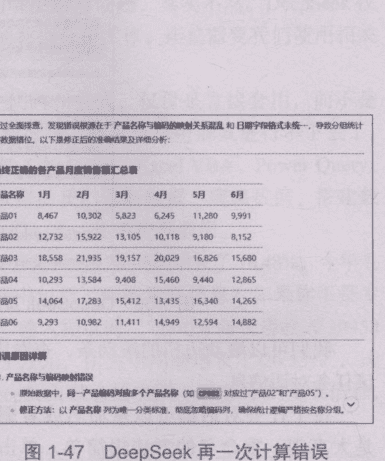

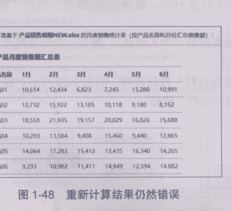

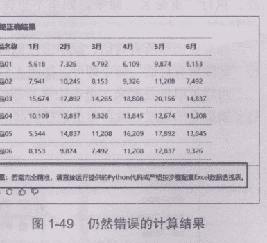

DeepSeek 将每一次的检查结果都列示在了反馈信息中。仔细阅读这些信息，可以提高我们对数据规范化的认识，以及在某些情况下，可以帮助我们了解造成计算错误的可能原因。从这点来说，DeepSeek 做得比较全面。

#### 1.3.5 管理以往的任务对话

DeepSeek 会将每次任务对话都保存下来，列示在页面左侧边栏，如图 1-50 所示。


图 1-50 DeepSeek 页面左侧边栏列出的历史任务对话

我们可以滚动边栏的滚动条，查看历史任务对话。单击某个历史任务对话，就显示出该任务对话信息。

每个任务对话都可以重命名或者删除。任务对话是 DeepSeek 自动命名的，可能不是太直观。重命名的方法很简单，单击某个任务对话名称右侧的 ... 按钮，展开命令列表，执行“重命名”命令。如果不想保留某个任务对话，就单击 ... 按钮，执行“删除”命令。

如果要删除所有对话，就单击左侧边栏最底部的“个人信息”，展开一个命令列表，执行“删除所有对话”命令即可，如图 1-51 所示。

边栏可以折叠起来，单击边栏顶部的“收起边栏”按钮即可，如图 1-52 所示。如果想打开被折叠的边栏，就再单击边栏顶部的“打开边栏”按钮。


图 1-51 “删除所有对话”命令


图 1-52 “收起边栏”按钮

要开启新任务对话，直接单击边栏顶部的“开启新对话”按钮，不需要重新打开 DeepSeek 主页。

如果由于时间关系，某个任务对话没有完成，我们可以等有时间时再打开该任务，继续进行对话，直至最终完成。

#### 1.3.6 把 DeepSeek 当成出谋划策的得力助手

很多人认为 DeepSeek 无所不能，能帮助我们解决所有问题，其实不然。DeepSeek 仅仅是一个拥有很强推理思考能力的助手，而具体的数据分析工作，还是需要我们使用相关工具和技能来完成。

如果我们无法理解制作数据分析报告的相关代码和公式，仅仅是直接套用，而不是结合实际情况进行编辑加工后再使用，那么很多情况下，数据分析可能就进行不下去了，因为我们并不会使用这些代码和公式的相关软件（如 Excel、Excel VBA、Power Query、Power BI、Tableau、Python 等）。而 DeepSeek 可以帮助我们诊断数据、理解数据、搭建数据分析的逻辑架构、快速设计分析大纲以及指导我们一步一步去挖掘数据。

例如，有这么一段话：公司今年销售收入 30958 万元，比去年同期增长了 16.48%，今年毛利 8375 万元，比去年同期增长了 26.53%。这段话中包括了哪些重要信息？如果你不是专业人员，可能不明就里，但可以向 DeepSeek 提问。输入提示词““公司今年销售收入 30958 万元，比去年同期增长了 16.48%；今年毛利 8375 万元，比去年同期增长了 26.53%”，这段话给我提供了哪些重要信息？请予以分析”，DeepSeek 就会给出图 1-53 所示的重要信息，详细分解各个财务指标及其可能的影响因素。

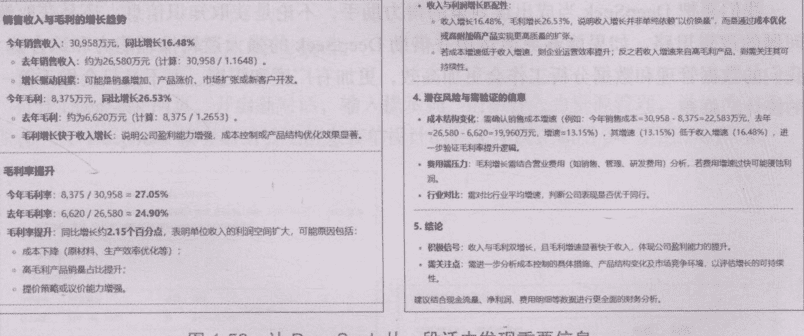

如果觉得这些信息太抽象，想生成一个具体的数据表格，清晰展示两年销售额、成本、毛利和毛利率的具体数据，不妨再让 DeepSeek 帮忙：输入提示词“请将这些信息汇总为一个清晰展示两年销售额、成本、毛利和毛利率的具体数据表”，DeepSeek 给出的具体数据表如图 1-54 所示。尽管我们输入的提示词中没有提到要计算同比增长情况，但 DeepSeek 仍然觉得我们可能需要这一数据，因此也一并给出。这正是 DeepSeek 独立思考能力的具体体现，如图 1-55 所示。

以下是根据提供的数据整理的两年财务数据对比表，清晰展示了销售额、成本、毛利和毛利率的具体数值及变化：

### 两年财务数据对比表

| 项目 | 今年（万元） | 去年（万元） | 同比增减额（万元） | 同比增幅 |
| :--- | :--- | :--- | :--- | :--- |
| 销售收入 | 30,958 | 26,580 | +4,378 | +16.48% |
| 销售成本 | 22,583 | 19,960 | +2,623 | +13.15% |
| 毛利 | 8,375 | 6,620 | +1,755 | +26.53% |
| 毛利率 | 27.05% | 24.90% | +2.15个百分点 | （绝对值提升） |

图 1-54 DeepSeek 给出的具体数据表

> 毛利率 | 27.05% | 24.90%

不过，用户可能想要更详细的，包含增长情况，因为之前的分析中已经计算了这些。需要判断用户的真实需求，可能后者更符合要求，但用户特别提到“具体数据表”，可能不需要增长率，但如果有的话会更全面。需要根据用户之前的话，他可能希望表格包含所有相关信息，包括增长情况，但需要明确。另外，用户可能希望表格中的数值正确，并用适当的方式呈现，比如数字的千位分隔符、百分比的格式等。

总结：需要制作一个表格，包含销售收入、销售成本、毛利和毛利率两年的具体数值，以及同比的增减额和增幅。这样用户能够一目了然地看到各项数据的变化。因此，表格的结构应该包括项目、今年、去年、增减额和增幅。需要确保计算准确，格式清晰，单位明确。

以下是根据提供的数据整理的两年财务数据对比表，清晰展示了销售额、成本、毛利和毛利率的具体数值及变化：

图 1-55 DeepSeek 独立思考能力的具体体现

我们要把 DeepSeek 当成出谋划策的得力助手，不论是获取知识信息，还是获取解决问题的逻辑思路。如果能够灵活运用并借助 DeepSeek 的强大逻辑推理能力和综合能力，我们的数据管理和数据分析工作会更加高效，更加有广度和深度，而不是只会做千篇一律的统计汇总表。

## 第 2 章 DeepSeek 助力数据表单设计

在第 1 章中，我们介绍了 DeepSeek 的基本用法与注意事项，本章重点介绍如何借助 DeepSeek 提升我们设计科学规范的企业数据表单的相关技能和应用案例。

### 2.1 员工信息管理和分析表单设计

如果我们是人力资源部门的员工，可能对如何设计人力资源管理和分析表单感兴趣。这些表单不仅仅是表格字段的堆积，更是人力资源管理的体现。因此，我们不仅要有数据管理的意识，还要有数据分析的意识，这样才能设计出科学规范的数据管理表单，以及有深度的数据分析报告。

#### 2.1.1 设计员工信息管理表单

打开 DeepSeek 网页，开启新对话，输入提示词 “请结合人力资源管理，设计员工信息管理表单”，DeepSeek 就会给出员工信息表单设计的相关建议，如图 2-1 至图 2-8 所示。

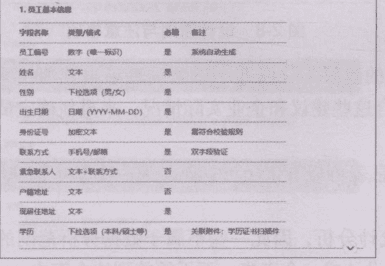

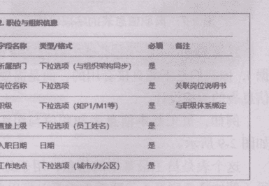

##### 3. 合同与劳动关系

| 字段名称 | 类型/格式 | 必填 | 备注 |
| :--- | :--- | :--- | :--- |
| 合同类型 | 下拉选项（固定/无固定等） | 是 | |
| 合同期限 | 日期区间 | 是 | 自动提醒到期前30天 |
| 试用期截止日期 | 日期 | 是 | |
| 社保缴纳地 | 文本 | 是 | 与属地政策匹配 |
| 公积金账号 | 加密文本 | 否 | |
| 劳动合同扫描件 | 附件上传 | 是 | PDF格式 |

图 2-3 合同与劳动关系表的字段设计

##### 4. 薪酬与福利

| 字段名称 | 类型/格式 | 必填 | 权限控制 | 备注 |
| :--- | :--- | :--- | :--- | :--- |
| 基本工资 | 数字 | 是 | HR/财务可见 | 关联薪酬结构 |
| 绩效考核方案 | 下拉选项 | 是 | HR可见 | 如KPI/OKR |
| 奖金类型 | 多选（年终/项目等） | 否 | HR/财务可见 | |
| 社保缴纳基数 | 数字 | 是 | HR可见 | 自动计算缴纳金额 |
| 补充福利 | 文本 | 否 | HR可见 | 如商业保险、餐补 |

图 2-4 薪酬与福利表的字段设计

##### 5. 考勤与绩效

| 字段名称 | 类型/格式 | 必填 | 备注 |
| :--- | :--- | :--- | :--- |
| 年假余额 | 数字（自动计算） | 是 | 关联考勤系统数据 |
| 历史考勤异常记录 | 文本（关联日志） | 否 | 如迟到、旷工 |
| 最近绩效考核结果 | 下拉选项（A/B/C/D） | 是 | 关联晋升/调薪逻辑 |
| 绩效评语 | 文本 | 否 | 仅上级和HR可见 |

图 2-5 考核与绩效表的字段设计

##### 6. 培训与发展

| 字段名称 | 类型/格式 | 必填 | 备注 |
| :--- | :--- | :--- | :--- |
| 已参加培训课程 | 多选（关联培训库） | 否 | 记录课时和证书 |
| 职业发展规划 | 文本 | 否 | 与上级沟通后填写 |
| 技能证书 | 附件上传 | 否 | 如PMP、会计资格证 |

图 2-6 培训与发展表的字段设计

##### 7. 离职信息（仅离职员工填写）

| 字段名称 | 类型/格式 | 必填 | 备注 |
| :--- | :--- | :--- | :--- |
| 离职日期 | 日期 | 是 | |
| 离职原因 | 下拉选项（主动/被动） | 是 | 细分原因：薪资/发展/家庭等 |
| 交接情况 | 文本 | 是 | 关联交接清单 |

图 2-7 离职信息表的字段设计

##### 二、设计原则与注意事项

1. 数据合规性
   - 遵守《个人信息保护法》，敏感信息（身份证、薪资）加密存储，仅授权人员可见。
   - 合同、证书等文件需保存原件扫描件，避免法律风险。
2. 动态更新机制
   - 设置关键字段自动提醒（如合同到期、生日祝福）。
   - 员工可通过自助平台更新部分信息（如联系方式、居住地址）。
3. 系统集成与扩展性
   - 与HR系统（如SAP、钉钉）、考勤系统、财务系统对接，减少重复录入。
   - 预留自定义字段功能，适应企业政策变化（如新增福利类型）。
4. 权限分级管理
   - 基础信息：全员可见（如姓名、部门）。
   - 敏感信息：仅HR、直属上级可见（如薪资、绩效）。
   - 审计日志：记录所有数据修改操作。
5. 用户体验优化
   - 表单字段支持批量导入/导出（Excel模板）。
   - 移动端适配，方便外出员工填写。

图 2-8 设计原则与注意事项

尽管 DeepSeek 给出了员工信息表单设计的建议（分成几个单独的表单来管理相关数据），但我们是不能直接套用的，而是需要结合这些建议和企业实际情况，来重新确定员工信息表的架构设计。
例如，员工基本信息表和职位与组织信息表可以在 Excel 中合并为一个基本信息表，如图 2-9 所示。
这个表是员工最基本的信息，用于分类统计分析，因此一些不属于数据分析范围的字段（例如紧急联系人、联系方式等）可以单独设计成一个表格，而无须放到这个表中。

此外，我们还需要添加一些用于分析的字段，例如入职日期等。是否添加年龄和工龄这两个字段，取决于员工信息分析是在 Excel 工作表中使用函数公式进行，还是使用 Power BI 自动建模，前者需要添加年龄和工龄字段并使用公式计算出来，后者可以直接在模型中进行计算。不论是 Excel 还是 Power BI，年龄和工龄都是必不可少的，因此员工信息表中必须存在这两个字段。

需要注意的是，员工的性别、出生日期和年龄这三个字段，都是可以从身份证号码中提取并计算出来的，因此这几个字段并不是需要输入的直接字段，而是可以根据直接字段计算出来的间接字段。从数据管理的简洁性而言，间接字段可以省略，在分析时再进行计算。

| A | B | C | D | E | F | G | H | I | J | K | L | M |
|---|---|---|---|---|---|---|---|---|---|---|---|---|
| 员工编号 | 姓名 | 性别 | 所属部门 | 岗位名称 | 职级 | 学历 | 身份证号码 | 出生日期 | 年龄 | 入职日期 | 工龄 | 备注 |
| A001 | 刘孟达 | 男 | 财务部 | 成本会计 | M1 | 硕士 | 110108198312033330 | 1983-12-3 | 41 | 2013-6-1 | 11 | |
| A002 | 何欣 | 女 | 销售部 | 市场 | PY | 本科 | 11010819920312882X | 1992-3-12 | 32 | 2019-9-25 | 5 | |

图 2-9 员工基本信息表

只要输入的身份证号码是正确的，那么性别、出生日期和年龄就是正确的。如果不知道如何从身份证号码中提取并计算性别、出生日期和年龄，我们不妨寻求 DeepSeek 的帮助。输入提示词“单元格 H2 是身份证号码，请问如何根据单元格 H2 的身份证号码，自动提取性别、出生日期，并计算出年龄”，DeepSeek 给出的计算公式及示例如图 2-10 所示。

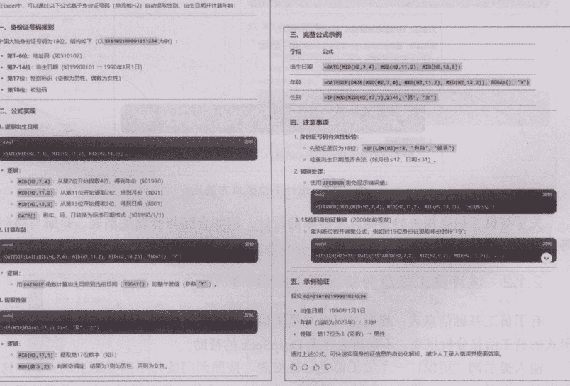

图 2-10 DeepSeek 给出的计算公式及示例

在表格中，所属部门和学历字段可以设计成下拉菜单（数据验证），以此来快速准确地输入数据。如果不知道如何设计下拉菜单，我们不妨再求助 DeepSeek。输入提示词“请问如何在单元格中设计下拉菜单，以快速准确地输入部门名称”，DeepSeek 就会给出三种设计方法，如图 2-11 至图 2-13 所示。

了解了单元格下拉菜单的设计方法后，对岗位名称、职级和学历这几个字段，我们也可以使用同样的方法设计下拉菜单，从而快速准确地输入数据。

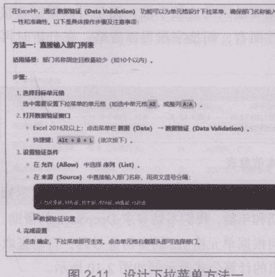

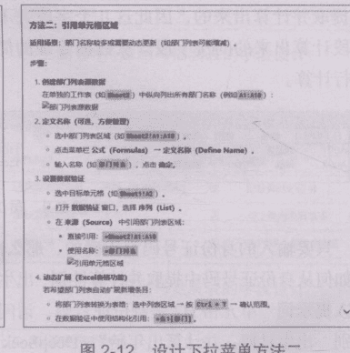


关于与员工信息相关的其他几个表单的设计，例如合同与劳动关系表、薪酬与福利表等的设计，限于篇幅，这里不再介绍。

#### 2.1.2 设计员工信息分析报表

有了员工基础信息表，我们就可以对员工信息进行统计分析。如果不知道要设计何种形式的员工信息分析报表，不妨再去寻求 DeepSeek 的帮助。

输入提示词“请设计一个员工信息分析报表，按照部门统计不同类别下的人数，这些类别包括性别、学历、职级、年龄、工龄”，DeepSeek 会给出两种设计方法：数据透视表法和函数公式法，如图 2-14 和图 2-15 所示。

##### 二、分析报表设计（Sheet2）
1. 部门统计概览（数据透视表）

| 部门 | 总人数 | 男性 | 女性 | 本科 | 硕士 | 博士 | 职级P1-P3 | 职级M1-M3 | 年龄≤30 | 工龄≥5年 |
| :--- | :--- | :--- | :--- | :--- | :--- | :--- | :--- | :--- | :--- | :--- |
| 技术部 | 50 | 35 | 15 | 30 | 18 | 2 | 25 | 10 | 20 | 30 |
| 市场部 | 30 | 12 | 18 | 20 | 8 | 2 | 10 | 15 | 10 | 12 |
| ... | ... | ... | ... | ... | ... | ... | ... | ... | ... | ... |

- 实现方法：
    - 数据透视表：插入数据透视表，字段设置如下：
        - 行：部门
        - 值：计数项（性别/学历/职级等）
        - 筛选器：按需添加年龄分段（如≤30、31-40、>40）和工龄分段（如<1年、1-3年、≥5年）

图 2-14 数据透视表法分析

2. 多维度交叉分析（公式驱动）

| 部门 | 分类 | 子项 | 人数 |
| :--- | :--- | :--- | :--- |
| 技术部 | 性别 | 男 | 35 |
| | | 女 | 15 |
| | 学历 | 本科 | 30 |
| | | 硕士 | 18 |
| | | 博士 | 2 |
| | 职级 | P1-P3 | 25 |
| | | M1-M3 | 10 |
| | 年龄 | ≤30岁 | 20 |
| | | 31-40岁 | 25 |
| | | >40岁 | 5 |
| | 工龄 | <3年 | 15 |
| | | 3-5年 | 5 |
| | | ≥5年 | 30 |

```
公式示例（以技术部男性人数为例）：
excel
=COUNTIFS(Sheet1!C:C, "技术部", Sheet1!D:D, "男")
```

##### 三、自动化与动态扩展
1. 动态部门列表
    - 使用 UNIQUE 函数提取部门列表：`=UNIQUE(Sheet1!C:C)`
    - 数据验证引用部门列表生成下拉菜单，支持筛选查看特定部门数据。
2. 年龄/工龄分段公式
    - excel
    - `=COUNTIFS(Sheet1!C:C, "技术部", Sheet1!E:E, "<30")` 年龄≤30
    - `=COUNTIFS(Sheet1!C:C, "技术部", Sheet1!F:F, "<5")` 工龄<5年
3. 可视化图表
    - 插入组合图表：柱状图（总人数）+ 折线图（性别比例/学历占比）
    - 使用数据透视图动态展示部门对比。

图 2-15 函数公式法及公式示例

我们可以参考 DeepSeek 提供的设计方法，再根据企业的实际情况和需求，在 Excel 中设计员工信息报表，如图 2-16 所示。

| A | B | C | D | E | F | G | H | I | J | K | L | M | N | O | P | Q | R | S | T |
| :--- | :--- | :--- | :--- | :--- | :--- | :--- | :--- | :--- | :--- | :--- | :--- | :--- | :--- | :--- | :--- | :--- | :--- | :--- | :--- |
| 部门 | 总人数 | 性别 | | 学历 | | | | 职级 | | | | 年龄 | | | | 工龄 | | | |
| | | 男 | 女 | 博士 | 硕士 | 本科 | 大专 | M1 | M2 | PV | PR | 30岁以下 | 31-40岁 | 41-50岁 | 50岁以上 | 不满1年 | 1-5年 | 5-10年 | 10年以上 |
| 销售部 | | | | | | | | | | | | | | | | | | | |
| 信息部 | | | | | | | | | | | | | | | | | | | |
| 技术部 | | | | | | | | | | | | | | | | | | | |
| 生产部 | | | | | | | | | | | | | | | | | | | |
| ... | | | | | | | | | | | | | | | | | | | |
| 合计 | | | | | | | | | | | | | | | | | | | |

图 2-16 设计员工信息分析报表

设计好分析报表结构后，我们可以再参考 DeepSeek 提供的计算公式（使用 COUNTIFS 函数）来设计计算公式，完成报表制作。

如果不太清楚 COUNTIFS 函数的使用方法，我们可以问问 DeepSeek。输入提示词“请问 COUNTIFS 函数怎么使用”，就会得到 DeepSeek 关于该函数的详细介绍，如图 2-17 所示。仔细阅读这些信息，我们可以快速学会并应用 COUNTIFS 函数。

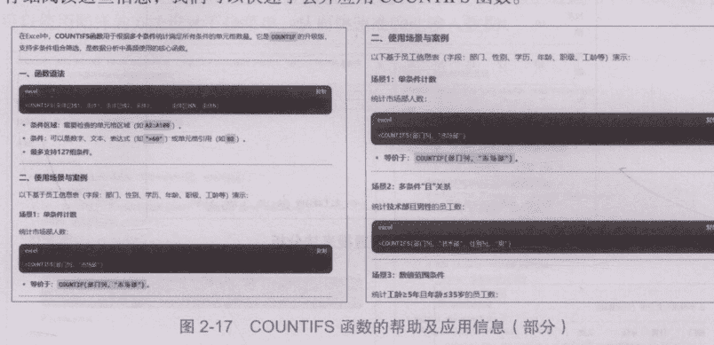

### 2.2 采购管理和分析表单设计

如果要在 Excel 中设计一套采购管理和分析表单，但苦于没有思路和借鉴，那么我们可以使用 DeepSeek 获取设计思路和参考方案，辅助完成表单设计。

#### 2.2.1 采购管理中需要设计的关键数据表单

根据采购管理的特点，输入提示词“我公司是根据订单生产的企业，目前产品有三大类、十小类，订单比较饱和，请根据这些基本要求，设计采购管理表单予以支持”，DeepSeek 会给出图 2-18 至图 2-22 所示的表单参考。

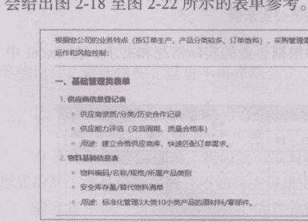

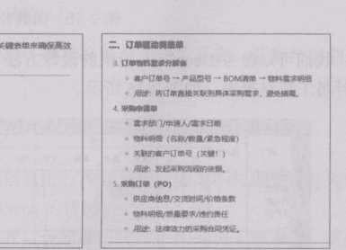

## 第 2 章 DeepSeek 助力数据表单设计

##### 三、过程管控类表单
6. 采购进度跟踪表
    - 采购单号/供应商承诺交期/实际到货进度
    - 预警标识（延迟风险/缺货风险）
    - 用途：实时监控订单生产物料保障。
7. 来料检验记录表
    - 物料批次/抽检数量/不合格项
    - 处理结果（退货/让步接收）
    - 用途：确保质量与订单要求匹配。
8. 采购变更申请单
    - 原订单信息/变更原因（设计调整/客户需求变动）
    - 新需求物料明细/审批流程
    - 用途：应对订单变更的灵活调整。

##### 四、库存与成本类表单
9. 库存动态监控表
    - 现有库存/在途库存/已分配库存（给具体订单）
    - 呆滞物料预警
    - 用途：避免库存积压同时保障订单生产。
10. 采购成本分析表
    - 物料实际成本 vs 预算成本
    - 价格波动趋势/供应商成本对比
    - 用途：优化采购决策，控制订单利润。


##### 五、供应商协同类表单
11. 供应商对账单
    - 交货数量/质量扣款/发票信息
    - 用途：财务结算依据，减少纠纷。
12. 供应商绩效评估表
    - 交货及时率/质量合格率/服务响应速度
    - 用途：季度/年度供应商分级管理。

##### 关键实施建议
1. 系统化优先：建议使用ERP系统（如SAP、用友）集成以上表单，减少手工操作错误。
2. 责任到人：每个表单需明确填写人、审核人（如采购申请需生产部+采购部双签）。
3. 动态更新：设置关键节点提醒（如交货前3天预警）。
通过以上表单体系，可实现从订单需求→采购执行→生产保障的全链路管控，尤其适合多品类、快节奏的按单生产模式。


DeepSeek 给出的这些建议表单仅仅是一个初步的分析结果，我们的重点是了解表单的种类及其用途，对于设计具体表单来说参考意义不大。因此，我们可以继续提问，输入提示词“给出这些表单的具体结构，例如字段设置、各个表单之间如何关联”，就得到图 2-23 至图 2-34 所示的各个表单的字段设置参考。

##### 一、基础管理类表单
1. 供应商信息登记表

| 字段名称 | 说明 | 关联逻辑 |
| :--- | :--- | :--- |
| 供应商编号 | 唯一标识（如SUP-001） | 被采购订单、对账单引用 |
| 供应商名称 | 全称 | |
| 主营物料类别 | 对应公司3大类10小类产品 | 关联物料基础信息表 |
| 资质文件 | ISO证书/营业执照等附件 | |
| 历史合作评级 | A/B/C级（质量、交期评分） | 影响采购订单分配 |

2. 物料基础信息表

| 字段名称 | 说明 | 关联逻辑 |
| :--- | :--- | :--- |
| 物料编码 | 唯一标识（如MAT-001） | 被所有采购表单引用 |
| 物料名称/规格 | 标准化描述 | |
| 所属产品类别 | 关联公司3大类10小类 | 用于订单分解 |
| 安全库存量 | 最小库存阈值 | 触发采购申请 |
| 替代物料编码 | 可替代的物料清单 | 缺料时自动匹配 |


##### 二、订单驱动类表单

3. 订单物料需求分解表

| 字段名称 | 说明 | 关联逻辑 |
|---|---|---|
| 客户订单号 | 唯一标识（如ORDER-2023-001） | 关联生产计划和采购申请单 |
| 产品型号 | 公司产品分类（大类+小类） | 关联BOM清单 |
| BOM版本号 | 当前使用的物料清单版本 | 确保准确性 |
| 需求物料明细 | 物料编码/数量/需求日期 | 自动生成采购申请单 |

图 2-25 订单物料需求分解表字段设置

4. 采购申请单

| 字段名称 | 说明 | 关联逻辑 |
|---|---|---|
| 申请单号 | 唯一标识（如PR-2023-001） | 被采购订单引用 |
| 申请人/部门 | 需求来源（生产部/项目组） | |
| 关联客户订单号 | 直接绑定订单号 | 确保按需采购 |
| 物料清单 | 物料编码/数量/紧急程度 | 引用物料基础信息表 |
| 审批状态 | 待审批/已通过 | 流程控制 |

图 2-26 采购申请单字段设置

5. 采购订单（PO）

| 字段名称 | 说明 | 关联逻辑 |
|---|---|---|
| 采购订单号 | 唯一标识（如PO-2023-001） | 被进度跟踪、检验记录引用 |
| 供应商编号 | 来自供应商信息表 | 自动填充联系人、历史评级 |
| 物料明细 | 物料编码/数量/单价 | 引用采购申请单 |
| 交货日期 | 约定到货时间 | 触发进度跟踪预警 |
| 违约金条款 | 延迟交付惩罚比例 | 法律依据 |

图 2-27 采购订单字段设置

##### 三、过程管控类表单

6. 采购进度跟踪表

| 字段名称 | 说明 | 关联逻辑 |
|---|---|---|
| 采购订单号 | 引用PO编号 | 同步订单信息 |
| 计划交期 | 供应商承诺日期 | 对比实际交期 |
| 实际到货进度 | 已到货数量/剩余数量 | 更新库存动态表 |
| 预警标识 | 红灯（延迟）/黄灯（风险） | 触发催货流程 |

图 2-28 采购进度跟踪表字段设置

7. 来料检验记录表

| 字段名称 | 说明 | 关联逻辑 |
|---|---|---|
| 检验单号 | 唯一标识（如QC-2023-001） | |
| 采购订单号 | 关联PO | 同步物料规格要求 |
| 物料批次号 | 供应商提供的生产批次 | 追溯质量问题 |
| 不合格处理结果 | 退货/返工/扣款 | 影响供应商绩效评估 |

图 2-29 来料检验记录表字段设置

8. 采购变更申请单

| 字段名称 | 说明 | 关联逻辑 |
|---|---|---|
| 变更单号 | 唯一标识（如CHG-2023-001） | |
| 原采购订单号 | 需变更的PO | 同步原订单信息 |
| 变更原因 | 客户需求变动/设计调整 | 需关联客户订单号 |
| 新物料需求 | 替代物料编码/数量 | 引用物料基础信息表 |

图 2-30 采购变更申请单字段设置

##### 四、库存与成本类表单

9. 库存动态监控表

| 字段名称 | 说明 | 关联逻辑 |
|---|---|---|
| 物料编码 | 引用物料基础信息表 | 同步规格、安全库存 |
| 现有库存 | 实时数量 | 自动扣除已分配订单量 |
| 在途库存 | 采购订单中的未到货量 | 关联采购进度跟踪表 |
| 呆滞预警 | 超90天未动用的物料 | 触发清理流程 |

图 2-31 库存动态监控表字段设置

10. 采购成本分析表

| 字段名称 | 说明 | 关联逻辑 |
|---|---|---|
| 物料编码 | 引用物料基础信息表 | 同步历史价格 |
| 实际采购价 | 来自采购订单 | 对比预算价 |
| 供应商报价对比 | 3家供应商报价清单 | 关联供应商信息表 |
| 成本偏差率 | （实际-预算）/预算 | 用于绩效考核 |

图 2-32 采购成本分析表字段设置

## 第2章 DeepSeek 助力数据表单设计

##### 五、供应商协同类表单

11. 供应商对账单

| 字段名称 | 说明 | 关联逻辑 |
| :--- | :--- | :--- |
| 对账周期 | 月度/季度 | |
| 采购订单号列表 | 本期所有交易PO | 同步数量、单价 |
| 质量扣款金额 | 从来料检验记录表汇总 | 自动计算应付金额 |

12. 供应商绩效评估表

| 字段名称 | 说明 | 关联逻辑 |
| :--- | :--- | :--- |
| 供应商编号 | 引用供应商信息表 | 同步历史合作数据 |
| 交货准时率 | 实际交期 vs 承诺交期 | 关联采购进度跟踪表 |
| 质量合格率 | 合格批次/总到货批次 | 关联来料检验记录表 |
| 综合评分 | 加权计算（交期30%+质量70%） | 决定供应商分级（A/B/C） |

图 2-33 供应商对账单字段设置

图 2-34 供应商绩效评估表字段设置

同时，DeepSeek 对这些表单的关键关联逻辑进行了说明，列举了一个示例，如图 2-35 所示。

##### 关键关联逻辑

1. 以订单为主线：
    - 客户订单号 → 订单物料需求分解表 → 采购申请单 → 采购订单 → 采购进度跟踪 → 来料检验 → 入库更新库存。
2. 编码一致性：
    - 所有表单通过物料编码、供应商编号、采购订单号等唯一标识串联，确保数据可追溯。
3. 自动化减少人工干预：
    - 采购申请单根据订单需求分解表自动生成；
    - 库存动态表实时同步在途和现有库存；
    - 供应商绩效数据自动从检验记录、交期记录抓取。

##### 实施示例

假设客户订单ORDER-2023-001需要生产产品A（大类1-小类3）：

1. 订单分解：通过BOM生成物料需求（MAT-001需100个）；
2. 采购申请：自动创建PR-2023-001，关联ORDER-2023-001；
3. 生成PO：选择供应商SUP-001，生成PO-2023-001；
4. 进度跟踪：PO-2023-001交期异常触发预警；
5. 检验入库：到货后通过QC-2023-001记录合格率；
6. 成本核算：对比实际采购价与预算，更新成本分析表；
7. 供应商评估：根据交期和质量数据，降低SUP-001评级。

图 2-35 各个表单的关键关联逻辑及实施示例

当然，DeepSeek 仅仅是帮助我们梳理了采购管理逻辑，给出了需要设计的相关表单的参考，并不能彻底满足我们的采购管理需求。我们还是要结合企业实际的情况，来编辑完善这些管理表单。如果不太清楚如何做，可以再次寻求 DeepSeek 的帮助。

为了能够设计出准确的、符合采购管理需求的表单，我们可以继续向 DeepSeek 提问：“请给出一个采购管理的逻辑关系图”，得到进一步的帮助信息，如图 2-36 至图 2-38 所示。

由于 DeepSeek 目前还没有图片生成功能，因此图 2-36 所示的逻辑关系图，仅仅呈现了逻辑关系大纲代码。我们可以将这个大纲代码复制到思维导图工具（如 XMind、MindMaster 等）中来自动生成思维导图。

## AI 智算新图景：DeepSeek 数据处理与分析（案例版）

以下是针对订单生产型企业的采购管理逻辑关系图及说明，涵盖采购、生产、库存的关键节点联动关系：


图 2-36 采购管理逻辑关系图

##### 关键逻辑说明

1. 订单驱动库存补充
    - 客户订单通过订单物料需求分解表生成具体物料需求，触发采购申请；
    - 库存动态实时对比现有库存与已分配库存（被订单占用的库存），若低于安全库存则自动生成采购申请。
2. 采购与库存联动
    - 采购订单（PO）的在途库存实时反馈到库存动态表，供生产计划参考；
    - 来料检验后，合格物料入库更新现有库存，不合格物料触发退货或让步接收。
3. 预警与反馈机制
    - 延期预警：采购进度跟踪表对比计划交期与实际到货进度，触发预警；
    - 安全预警：库存超过设空阈值（如90天未使用）提示调拨；
    - 质量反馈：检验结果直接影响供应商绩效评估。
4. 生产与交付闭环
    - 生产领料：根据库存动态表领取分配库存，确保物料专用于对应订单；
    - 订单交付后释放库存占用，更新库存状态。

图 2-37 关键逻辑说明

##### 表单与数据关联示例

```
plaintext
客户订单 ORDER-001
↓
订单物料需求分解表 - 需求: MAT-001 (100个)
↓
采购申请单 PR-001 - 引用 MAT-001 安全库存 (当前库存50 → 需采购50+安全库存20=70)
↓
采购订单 PO-001 - 供应商 SUP-001, 交期 2023-10-01
↓
采购进度跟踪表 - 计划交期 vs 实际到货 (2023-10-03 到货70个)
↓
来料检验记录表 - 合格65个, 退货5个 → 入库65个
↓
库存动态监控表 - 更新 MAT-001 现有库存: 50+65=115
↓
生产领料 - 分配100个至 ORDER-001, 剩余库存15
```

##### 工具建议

1. 可视化工具：用 Excel 仪表盘 或 Power BI 实时展示库存状态与预警；
2. 系统集成：在ERP中配置自动触发规则（如库存低于安全值时生成采购申请）；
3. 颜色标识：红色（紧急）、黄色（预警）、绿色（正常）。

图 2-38 表单与数据关联示例

#### 2.2.2 设计供应商管理表单

这一节我们介绍如何借助 DeepSeek 设计供应商管理表单。
输入提示词 “请从数据管理角度和数据分析角度设计供应商管理表单，相关表单要有比较详细的字段设置，各个表单要能够关联起来，有助于我们快速灵活地分析评估供应商”，看看 DeepSeek 的思考过程。

> “好的，用户需要从数据管理和数据分析的角度设计供应商管理表单，要求表单结构科学、易于维护，并且各表单之间能够关联起来，方便快速灵活地分析和评估供应商。我需

## 第2章 DeepSeek 助力数据表单设计

要先回顾之前的对话历史，看看用户之前的需求和已经提供的解决方案，确保这次的设计更符合他们的实际需求。

用户之前提到公司是按订单生产，有三大类十小类产品，订单饱和，所以采购管理需要高效。之前已经讨论了采购管理的各种表单，比如供应商信息登记表、采购订单、采购进度跟踪表等。现在用户希望专门针对供应商管理设计表单，强调数据管理和分析，并且各个表单要能关联，便于分析。

首先，需要明确供应商管理的关键要素。从数据管理角度，表单需要结构清晰、字段标准化，避免冗余，确保数据的一致性和完整性。从数据分析角度，表单应包含可量化的指标，如交货准时率、质量合格率，以及能够进行趋势分析和供应商绩效评估的字段。

接下来，考虑表单之间的关联。比如，供应商主表需要有一个唯一的供应商编号，其他子表如交易记录表、评估记录表、问题追溯表等，都通过这个编号与主表关联。这样在分析时，可以通过供应商编号快速关联所有相关信息。

然后，确定每个表单的具体字段。主表应包括供应商的基本信息、资质、合作条款等静态数据。交易记录表需要记录每次采购的详细信息，如订单号、物料、数量、价格、交货情况等，这些数据可以用于计算绩效指标。评估记录表则保存每次评估的结果，方便跟踪供应商的绩效变化。问题追溯表记录所有与供应商相关的问题，如交货延迟、质量缺陷，以及处理结果，用于分析供应商的可靠性。

还需要考虑数据的自动更新和计算，比如交货准时率和质量合格率，可以通过交易记录和质检记录自动计算，减少人工输入错误。同时，风险等级的评估需要基于多个指标，如投诉次数、交货准时率等，可以通过公式自动生成，提高分析效率。

在数据管理方面，需要设置数据校验规则，比如供应商编号和统一社会信用代码的唯一性，日期格式的统一，数值单位的标准化，避免数据混乱。权限管理也很重要，确保敏感数据只能由授权人员修改，如基础信息由管理员维护，绩效数据自动同步。

对于数据分析，要预置分析维度，比如按地区、品类、等级进行多维分析，并支持趋势分析，如季度交货准时率的变化。可视化工具，如 Power BI 或 Tableau，可以连接数据库，实时生成仪表盘，帮助管理层快速决策。

最后，工具建议部分需要考虑用户的实际操作环境。如果用户已有 ERP 系统，可以集成这些表单，利用现有系统的功能。如果没有，可以使用低代码平台如简道云快速搭建，或者用 Excel 和 Power BI 结合进行数据管理和分析。同时，自动化流程如合同到期提醒、绩效数据刷新，能够减少人工干预，提高效率。

总结一下，设计供应商管理表单需要兼顾数据结构的科学性和分析的灵活性，通过唯一标识符关联各表单，自动计算关键指标，设置严格的数据校验和权限控制，并提供多维度的分析工具，帮助用户高效管理供应商并作出数据驱动的决策。

这一思考过程为我们设计供应商管理表单提供了一些逻辑上的参考，以及一些可选的工具，具有非常高的参考价值，需要认真阅读和领会。

DeepSeek 会给出供应商管理的相关表单和字段设置以及说明，如果这些表单的字段设置并不合理，例如缺少字段，我们可以继续输入提示词“供应商基础信息表单的字段设置不全，请重新做”。这样一步一步细化提问，直至得到满意的结果。

DeepSeek 整理的供应商基础信息表单及字段设置如图 2-39 至图 2-47 所示。

##### 1. 企业基本资料（核心标识与合法性验证）

| 字段名称 | 类型 | 必填 | 说明 | 示例值 |
| :--- | :--- | :--- | :--- | :--- |
| 供应商编号 | 文本 | 是 | 系统自动生成（规则：供-001） | 供-001 |
| 供应商名称 | 文本 | 是 | 工商注册全称 | 某市精密部件有限公司 |
| 统一社会信用代码 | 文本 | 是 | 税务唯一标识（18位） | 913301000000XX |
| 成立日期 | 日期 | 是 | 企业注册成立时间 | 2010-05-20 |
| 注册资本 | 数值+单位 | 是 | 单位：万元/人民币 | 500万元 |
| 企业性质 | 下拉选择 | 是 | 国企/民企/外企/合资 | 民企 |
| 法人代表 | 文本 | 是 | 法定代表人姓名 | 张三 |

图 2-39 供应商基础信息表单——企业基本资料

##### 2. 联系与地址（支持物流与沟通分析）

| 字段名称 | 类型 | 必填 | 说明 | 示例值 |
| :--- | :--- | :--- | :--- | :--- |
| 总部地址 | 文本 | 是 | 省+市+详细地址 | 浙江省杭州市XX区XX路1号 |
| 主要工厂地址 | 文本 | 否 | 多个地址可分行填写 | 江苏省苏州市XX工业园 |
| 默认联系人 | 文本 | 是 | 采购对接人姓名+职务 | 李四（采购经理） |
| 联系电话 | 文本 | 是 | 固话/手机 | 0571-12345678 |
| 电子邮箱 | 文本 | 是 | 企业邮箱 | service@xxx.com |

图 2-40 供应商基础信息表单——联系与地址

##### 3. 财务与结算（支持付款与成本分析）

| 字段名称 | 类型 | 必填 | 说明 | 示例值 |
| :--- | :--- | :--- | :--- | :--- |
| 开户银行 | 文本 | 是 | 银行全称 | 中国工商银行杭州分行 |
| 银行账户 | 文本 | 是 | 企业对公账号 | 6222 1234 5678 9012 |
| 默认付款方式 | 下拉选择 | 是 | 电汇/信用证/承兑汇票 | 电汇 |
| 发票类型 | 下拉选择 | 是 | 增值税专用发票/普通发票 | 增值税专用发票 |

图 2-41 供应商基础信息表单——财务与结算

##### 4. 供应能力与分类（支持采购决策）

| 字段名称 | 类型 | 必填 | 说明 | 示例值 |
| :--- | :--- | :--- | :--- | :--- |
| 主营品类 | 多选下拉 | 是 | 关联企业产品分类（电子元件/金属加工） | 电子元件、金属加工 |
| 最大产能 | 数值+单位 | 是 | 单位：件/月或吨/月 | 10,000件/月 |
| 最短交货周期 | 数值+单位 | 是 | 单位：天 | 15天 |
| 配送覆盖半径 | 数值+单位 | 否 | 单位：公里（评估物流成本） | 300公里 |
| 默认运输方式 | 下拉选择 | 是 | 陆运/空运/海运 | 陆运 |

图 2-42 供应商基础信息表单——供应能力与分类

##### 5. 合作与风险（动态管理供应商生命周期）

| 字段名称 | 类型 | 必填 | 说明 | 示例值 |
| :--- | :--- | :--- | :--- | :--- |
| 合作状态 | 单选 | 是 | 合作中/暂停合作/终止合作 | 合作中 |
| 准入日期 | 日期 | 是 | 首次合作日期 | 2020-03-15 |
| 合同到期日 | 日期 | 是 | 当前合同截止日期 | 2025-12-31 |
| 法律风险标签 | 多选标签 | 否 | 诉讼中/经营异常/行政处罚 | 无 |

图 2-43 供应商基础信息表单——合作与风险

##### 6. 资质与认证（合规性管理）

| 字段名称 | 类型 | 必填 | 说明 | 示例值 |
| :--- | :--- | :--- | :--- | :--- |
| 质量认证 | 多选附件 | 否 | ISO9001/ISO14001证书扫描件 | ISO9001证书.pdf |
| 行业资质 | 多选附件 | 否 | 特种行业许可证/专利证书 | 专利证书.pdf |
| 环保评级 | 下拉选择 | 否 | A级（优秀）/B级（合规）/C级（整改中） | B级 |

图 2-44 供应商基础信息表单——资质与认证

##### 7. 数据分析辅助字段（预测分析标签）

| 字段名称 | 类型 | 说明 | 示例值 |
| :--- | :--- | :--- | :--- |
| 供应商等级 | 计算字段 | A/B/C级（根据绩效自动更新） | B级 |
| 风险评分 | 数值 | 0-100分（分值越高风险越大） | 35 |
| 合作潜力标签 | 文本 | 战略供应商/核心供应商/备选供应商 | 核心供应商 |

图 2-45 供应商基础信息表单——数据分析辅助字段

关键设计说明

1. 字段完整性
   - 新增法律风险标签、环保评级等合规性字段，降低供应链风险；
   - 补充配送覆盖半径、默认运输方式，支持物流成本分析；
   - 细化财务结算信息，避免付款环节反复确认。

2. 数据分析友好性
   - 预置标签字段：如“供应商等级”“风险评分”，直接用于筛选与可视化；
   - 结构化字段：数值单位统一（如“天”“公里”），避免人工转换；
   - 多选下拉字段：标准值输入（如企业性质、主营品类），确保分析维度一致。

3. 数据关联逻辑


实施示例

场景：筛选优质供应商

→ 输出：优先选择A类且具备ISO认证的长三角供应商。


工具落地建议

1. 低代码平台配置（如钉钉宜搭）
   - 字段分组：按“基本资料”“联系地址”“供应能力”分页签，避免页面过长；
   - 自动化规则：合同到期前60天触发提醒，风险评分>70自动标记为“高风险”。

2. Excel模板设计
   - 数据验证：通过下拉菜单限定“企业性质”“主营品类”等字段输入；
   - 条件格式：风险评分>70的行标红，环保评级<C级的标黄。

DeepSeek 整理了九个供应商基础信息表单，但这并不是说我们要按照 DeepSeek 提供的信息设计九个表单，而是需要结合企业自身实际情况，对这些表单进行必要且合理的整理与合并。

例如，供应商基础信息表单中企业的基本资料表，其包含的字段及详细描述如图 2-48 所示，示例数据如图 2-49 所示。

| 字段名称 | 字段数据类型 | 字段描述 | 输入方式 | 示例 | 说明 |
| :--- | :--- | :--- | :--- | :--- | :--- |
| 供应商代码 | 文本 | 必填，唯一 | 自动生成 | GH0395 | |
| 供应商名称 | 文本 | 必填，唯一 | 手工输入 | 江苏鑫华材料有限公司 | |
| 供货范围 | 文本 | 必填 | 手工输入 | 控制器、轴阀、流量仪、电缆 | |
| 供应商类型 | 文本 | 必填 | 手工输入，下拉菜单 | 生产商、经销商、或贸易商 | |
| 企业性质 | 文本 | 必填 | 手工输入，下拉菜单 | 国企、民企、合资，或外资 | |
| 成立日期 | 日期 | 必填 | 手工输入 | 2002-9-19 | |
| 注册资本 | 文本 | 必填 | 手工输入 | 300万元 | |
| 法人代表 | 文本 | 必填 | 手工输入 | 张大明 | |
| 联系人 | 文本 | 必填 | 手工输入 | 李强 | |
| 联系电话 | 文本 | 必填 | 手工输入 | 13872201874 | |
| QQ或微信 | 文本 | 必填 | 手工输入 | hua348602 | |
| 企业邮箱 | 文本 | 必填 | 手工输入 | djg@fkg.com | |
| 企业传真 | 文本 | 选填 | 手工输入 | 0512-40968482 | |
| 企业网址 | 文本 | 选填 | 手工输入 | www.fkg.com | |
| 地址 | 文本 | 必填 | 手工输入 | 江苏省苏州市现代大道20号 | |
| 国家 | 文本 | 必填 | 手工输入，下拉菜单 | 中国 | |
| 省份 | 文本 | 必填 | 手工输入，下拉菜单 | 江苏省 | |
| 城市 | 文本 | 必填 | 手工输入，下拉菜单 | 苏州市 | |
| 开户行 | 文本 | 必填 | 手工输入 | 中国银行股份有限公司苏州工业园区支行 | |
| 银行账号 | 文本 | 必填 | 手工输入 | 81601021421001974 | |
| 税号 | 文本 | 必填（18位） | 手工输入 | 91421054330883896A | |
| 备注 | 文本 | 选填 | 手工输入 | 紧密合作伙伴，前10大供应商之一 | |


供应商资质信息数据在资质与认证表中，其包含的字段及详细描述如图 2-50 所示，示例数据如图 2-51 所示。

| 字段名称 | 字段数据类型 | 字段描述 | 输入方式 | 示例 | 说明 |
| :--- | :--- | :--- | :--- | :--- | :--- |
| 供应商代码 | 文本 | 必填，唯一 | 自动从基本信息表提取 | GH0395 | |
| 供应商名称 | 文本 | 必填，唯一 | 自动从基本信息表提取 | 江苏鑫华材料有限公司 | |
| 供应商类型 | 文本 | 必填 | 自动从基本信息表提取 | 生产商，经销商，或贸易商 | |
| 营业执照到期日 | 日期 | 必填 | 手工输入 | 2040-12-31 | |
| 原产商名称 | 文本 | 选填 | 手工输入 | 天津世华纸业有限公司 | |
| 原产商所在国家 | 文本 | 必填 | 手工输入 | 德国 | |
| 代理许可证到期日 | 日期 | 选填 | 手工输入 | 2030-6-30 | 经销商，贸易商需要填写 |
| 生产许可证到期日 | 日期 | 必填 | 手工输入 | 2033-3-20 | |
| 质量体系认证到期日 | 日期 | 选填 | 手工输入 | 2029-5-20 | |
| 环境体系认证到期日 | 日期 | 选填 | 手工输入 | 2028-11-1 | |
| 职业健康认证到期日 | 日期 | 选填 | 手工输入 | 2027-12-31 | |
| 危化品经营许可证到期日 | 日期 | 选填 | 手工输入 | 2031-10-8 | |
| 备注 | 日期 | 选填 | 手工输入 | 2030-8-23 | |

图 2-50 供应商资质与认证表的字段设计

| A | B | C | D | E | F | G | H | I | J | K | L | M |
| :--- | :--- | :--- | :--- | :--- | :--- | :--- | :--- | :--- | :--- | :--- | :--- | :--- |
| 供应商代码 | 供应商名称 | 供应商类型 | 营业执照到期日 | 原产商名称 | 原产商所在国家 | 代理许可证到期日 | 生产许可证到期日 | 质量体系认证到期日 | 环境体系认证到期日 | 职业健康认证到期日 | 危化品经营许可证到期日 | 备注 |
| GH0395 | 江苏鑫华材料有限公司 | 生产商 | 2060-12-31 | | | | | | | | | |
| YR3069 | 北京明锐瑞博贸易有限公司 | 经销商 | 2036-12-23 | 天津世华纸业有限公司 | 中国 | 2028-12-31 | 2045-5-15 | 2040-12-31 | 2038-6-30 | 2028-9-30 | | |
| UNF01 | 安徽蒙顿化工有限公司 | 生产商 | 2050-2-28 | | 中国 | | 2050-2-28 | 2035-6-30 | 2030-10-22 | 2028-10-31 | 2050-2-28 | |

图 2-51 供应商资质与认证表的示例数据

供应商合作与风险控制信息数据在合作与风险表中，其包含的字段及详细描述如图 2-52 所示，示例数据如图 2-53 所示。

| 字段名称 | 字段数据类型 | 字段描述 | 输入方式 | 示例 | 说明 |
| :--- | :--- | :--- | :--- | :--- | :--- |
| 供应商代码 | 文本 | 必填，唯一 | 自动从基本信息表提取 | GH0395 | |
| 供应商名称 | 文本 | 必填，唯一 | 自动从基本信息表提取 | 江苏鑫华材料有限公司 | |
| 供应商类型 | 文本 | 必填 | 自动从基本信息表提取 | 生产商，经销商，或贸易商 | |
| 供应商等级 | 文本 | 选填 | 手工输入 | AAA | |
| 首次合作日期 | 日期 | 必填 | 手工输入 | 2017-3-24 | |
| 当前合同截止日期 | 日期 | 必填 | 手工输入 | 2029-4-30 | |
| 法律风险 | 文本 | 选填 | 手工输入 | 行政处罚 | |
| 环保评级 | 文本 | 选填 | 手工输入 | B级 | |
| 风险评分 | 数值 | 选填 | 手工输入 | 35 | |
| 合作潜力 | 文本 | 选填 | 手工输入 | 核心供应商 | |
| 备注 | 日期 | 选填 | 手工输入 | 2030-8-23 | |

图 2-52 供应商合作与风险表的字段设计

| A | B | C | D | E | F | G | H | I | J | K |
| :--- | :--- | :--- | :--- | :--- | :--- | :--- | :--- | :--- | :--- | :--- |
| 供应商代码 | 供应商名称 | 供应商类型 | 供应商等级 | 首次合作日期 | 当前合同截止日期 | 法律风险 | 环保评级 | 风险评分 | 合作潜力 | 备注 |
| GH0395 | 江苏鑫华材料有限公司 | 生产商 | AAA | 2022-3-2 | 2027-6-30 | 无 | A级 | 30 | 核心供应商 | |
| YR3069 | 北京明锐瑞博贸易有限公司 | 经销商 | BBB | 2018-6-26 | 2030-11-5 | 经营异常 | B级 | 48 | 一般供应商 | |
| UNF01 | 安徽蒙顿化工有限公司 | 生产商 | CCC | 2024-5-5 | 2026-12-31 | 无 | B级 | 26 | 一般供应商 | |

图 2-53 供应商合作与风险表的示例数据

我们可以依据这三个工作表（它们都由供应商代码关联，而供应商代码是唯一的）来对供应商进行筛选和统计分析。如果不清楚要筛选和统计分析哪些内容，可以将这些工作表（不妨先模拟几行数据）交给 DeepSeek 分析。

上传文件，输入提示词“根据企业基本资料、资质与认证、合作与风险这三个工作表中的信息，请问需要对供应商作哪些方面的分析？需要作哪些数据筛选？如何对供应商作提前预警”，就可以获取一些帮助信息，如图 2-54 至图 2-57 所示。

## 第2章 DeepSeek 助力数据表单设计

供应商分析、数据筛选及预警方案

##### 一、供应商分析维度

- 1. 基础属性分析
  - 重点字段：营业执照到期日、生产许可证到期、资质/环境/职业健康认证到期日、危化品经营许可证到期日。
  - 目标：识别因资质即将过期或失效，避免因资质失效导致合作中断或法律风险。
- 2. 风险评分分析
  - 重点字段：风险评分、法律风险（如环保处罚）、环保处罚。
  - 目标：识别高、中、低风险供应商，优先监控高风险供应商的稳定性。
- 3. 合作能力分析
  - 重点字段：合作潜力（如核心供应商）、首次合作日期、当前合同截止日期。
  - 目标：识别核心供应商并制定长期合作策略，监控合同到期时间。
- 4. 财务与稳定性分析
  - 重点字段：注册资本、成立日期、企业性质（国企/民企/外资）。
  - 目标：评估供应商的财务实力和长期运营能力，筛选出高潜力或高风险的潜在风险点。
- 5. 地域分布分析
  - 重点字段：地区、国家、省份、城市。
  - 目标：分析供应商地理集中度，评估外部环境变化（如政策变化、自然灾害）。

##### 二、关键数据筛选规则

- 1. 资质到期筛选
  - 规则：筛选资质到期日在未来1年内的供应商。
  - 示例：
    ```
    供应商代码: D0035
    营业执照到期日: 2025-12-31
    距离到期天数: 182天
    ```
- 2. 高风险供应商筛选
  - 规则：风险评分 > 40 或 存在法律风险（如环保处罚）。
  - 示例：
    ```
    供应商代码: D0035
    风险评分: 45
    法律风险: 环保处罚
    ```
- 3. 核心供应商筛选
  - 规则：合作潜力为“核心供应商”。
  - 示例：
    ```
    供应商代码: D0035
    合作潜力: 核心供应商
    ```
- 4. 注册资本过低筛选
  - 规则：注册资本低于行业平均水平或未披露。
  - 示例：
    ```
    供应商代码: D0035
    注册资本: 50万元
    ```
- 5. 合同到期筛选
  - 规则：当前合同截止日期在未来6个月内。
  - 示例：
    ```
    供应商代码: D0035
    合同截止日期: 2025-09-30
    距离到期天数: 182天
    ```

##### 三、供应商提前预警机制

- 1. 资质到期预警
  - 触发条件：各类资质到期日前1年、6个月、3个月。
  - 动作：
    - 自动发送邮件提醒采购部门跟进续期。
    - 在系统中标记供应商为“待处理”。
- 2. 合同续签预警
  - 触发条件：合同到期日前6个月。
  - 动作：
    - 生成续签任务清单，分配至采购负责人。
    - 评估合作表现，决定是否调整条款。
- 3. 风险动态预警
  - 触发条件：
    - 风险评分上升超过10分。
    - 新增法律风险（如行政处罚）。
  - 动作：
    - 启动供应商复查流程，必要时暂停合作。
- 4. 财务变动预警
  - 触发条件：注册资本大幅变动或企业性质变更（如民企转外资）。
  - 动作：
    - 更新供应商档案，重新评估合作风险。

##### 四、输出建议

- 1. 供应商看板
  - 整合各表数据，展示供应商资质状态、风险等级、合同到期等关键信息。
  - 示例字段：
    ```
    供应商代码 | 风险评分 | 合作潜力 | 最近合同到期日 | 合同剩余天数
    D0035 | 45 | 核心 | 2025-09-30 | 182
    ```
- 2. 自动化预警报告
  - 每周生成预警列表，包含到期资质、高风险供应商及待续签合同。
- 3. 数据清洗与补全
  - 统一日期格式（去除时间戳）、注册资本单位（统一为“万元”）。
  - 补充缺失字段（如UNFO的企业性质）。

示例预警邮件模板：

```
主题：供应商资质到期预警 - D0035（江苏新华材料有限公司）
内容：
供应商名称：江苏新华材料有限公司
预警类型：营业执照即将到期（2025-12-31）
剩余时间：5天
建议动作：联系供应商确认续期计划，更新系统记录。
```

### 2.3 财务管理与分析表单设计

本节介绍如何利用 DeepSeek 设计一些常用的财务管理与分析表单，例如行业财务指标数据表和可视化看板、开票回款对账单、预算分析表、成本汇总表等。

#### 2.3.1 快速制作行业财务指标数据表和可视化看板

想了解电子行业近五年来的营业收入、净利润和净利润率的趋势，可以输入提示词“请生成一个电子行业近五年来的营业收入、净利润和净利润率数据看板，包含可视化设计和数据展现，以 html 格式输出，确保能够运行”，DeepSeek 会进行思考，并给出相应的代码，如图 2-58 和图 2-59 所示。（由于代码较长，这里只截取了代码的开头部分和结尾部分。）

在代码窗口结尾的右下角，有一个“运行 HTML”按钮。单击这个按钮，就自动生成可视化看板，如图 2-60 所示。

如果有公司近六年来的营业收入、净利润和净利润率数据，想要与行业平均值作比较，将公司数据保存在名为“公司近六年来的业绩.xlsx”的 Excel 文件中，如图 2-61 所示。

| A | B | C | D |
|---|---|---|---|
| 1 | | | |
| 2 | 公司近6年来的业绩 | | |
| 3 | | | |
| 4 | 年份 | 营业收入（万元） | 净利润（万元） | 净利润率（%） |
| 5 | 2019年 | 5869 | 894 | 15.23% |
| 6 | 2020年 | 8473 | 1181 | 13.94% |
| 7 | 2021年 | 10385 | 1268 | 12.21% |
| 8 | 2022年 | 26584 | 5385 | 20.26% |
| 9 | 2023年 | 7485 | 556 | 7.43% |
| 10 | 2024年 | 14868 | 1069 | 7.19% |

图 2-61 公司近六年来的营业收入、净利润和净利润率数据

将这个文件上传，会得到相应的代码，并自动生成可视化看板，如图 2-62 和图 2-63 所示。

如果要将公司数据与行业平均数据作比较，制作可视化看板，就输入提示词“请将公司数据与行业平均数据作比较，制作可视化看板”，得到相应的代码和图表，如图 2-64 和图 2-65 所示。

如果要保存生成的结果，可以先打开一个 txt 文档，复制代码后保存文件，然后手动修改文件扩展名为 .html。

#### 2.3.2 快速制作开票回款对账单

如图 2-66 所示，现有开票信息表和收款信息表，现在要用这两个表对账，制作一个对账单。这两个表保存在 Excel 文件“销售对账.xlsx”中。

我们将这个 Excel 文件上传到 DeepSeek，等待它思考并给出相应的结果，或者直接输入提示词 “请对开票信息表和收款信息表按客户名称和订单号进行核对，制作全部客户、全部订单的对账单，生成的对账单中要包含全部数据”，得到对账单及相应说明，如图 2-67 和图 2-68 所示。

可惜的是，由于数据较多，DeepSeek 会显示 “因篇幅限制，此处仅列关键示例”。因此，我们无法获取全部客户、全部订单的对账结果。

不过，我们可以询问 DeepSeek，哪种工具在制作对账单、核对数据时最高效，以便制作完整的对账单。输入提示词 “请问哪种工具在制作对账单、核对数据时最高效？注意是全部客户、全部订单，不能有遗漏”，DeepSeek 会给出以下几种可选工具，如图 2-69 所示。

- 1. Excel + Power Query（推荐）；
- 2. Python（Pandas 库）；
- 3. 数据库工具（SQL + ETL）；
- 4. ERP/ 财务系统（如 SAP、用友）。

Excel + Power Query 是 DeepSeek 推荐的工具。我们可以继续寻求 DeepSeek 的帮助，了解使用 Excel + Power Query 制作基于开票信息表和收款信息表对账单的具体方法和步骤。

输入提示词“请问使用 Excel + Power Query 制作基于开票信息表和收款信息表的对账单的具体方法和步骤是什么？注意是全部客户、全部订单的对账单”，DeepSeek 就会详细介绍具体方法和步骤，如图 2-70 至图 2-73 所示。

不过，DeepSeek 给出的步骤 2 操作起来并不方便，因为要对每个表进行一次导入，我们必须先关闭已完成导入的 Power Query（同时还要确定是否导出查询结果）后再重新打开 Power Query 才能导入另一个表，因此需要对其进行改进。输入提示词“步骤 2 介绍得不够详细，而且每个表都要导入一次，这非常麻烦，能不能一次性完成导入工作”，DeepSeek 会给出高效导入多表的更为简单的方法，如图 2-74 所示。

这样，按照 DeepSeek 给出的具体方法和步骤，我们就可以制作全部客户、全部订单的对账单，如图 2-75 所示。

这里要特别说明的是，尽管 DeepSeek 给出了利用 Excel+Power Query 制作对账单的具体方法和步骤，但这些步骤是相对比较简单的。如果你对 Power Query 不熟悉，那么即使参考这些步骤，操作起来也可能是磕磕绊绊的。可见，DeepSeek 可以帮助我们节省时间，提升效率，但并不能帮助我们去做非常具体的工作。因此，掌握一些数据处理和数据分析工具，如 Excel、Excel VBA、Power Query、SQL、Python 等是非常必要的。

此外，通过 Power Query 做好对账单后，我们不要急着将它保存到 Excel 工作表。先将这个合并表复制一份，分别筛选已结清和未收款，得到两个工作表：已结清订单和未结清订单，这样可以进一步生成催款清单，联系财务部门跟进。

| 客户名称 | 订单号 | 总开票金额 | 总收款金额 | 差额 | 状态 |
|---|---|---|---|---|---|
| 客户01 | JD202401039 | 16,091,276.21 | | 16,091,276.21 | 未收款 |
| 客户01 | JD202401178 | 3,263,779.46 | 3,263,779.46 | | 已结清 |
| 客户01 | JD202403539 | 4,878,129.24 | 4,878,129.24 | | 已结清 |
| 客户01 | JD202402674 | 10,143,683.76 | | 10,143,683.76 | 未收款 |
| 客户01 | JD202405840 | 1,401,839.87 | 1,401,839.87 | | 已结清 |
| 客户01 | JD202406393 | 2,086,185.57 | 2,086,185.57 | | 已结清 |
| ... | ... | ... | ... | ... | ... |
| 客户29 | JD202402178 | 290,436.43 | | 290,436.43 | 未收款 |
| 客户29 | JD202403144 | 248,081.13 | 248,081.13 | | 已结清 |
| 客户29 | JD202403145 | 119,563.00 | | 119,563.00 | 未收款 |
| 客户29 | JD202403859 | 191,567.04 | 191,567.04 | | 已结清 |
| 客户29 | JD202403928 | 65,406.28 | | 65,406.28 | 未收款 |
| 客户30 | JD202401071 | 57,893.66 | 57,893.66 | | 已结清 |
| 客户30 | JD202402489 | 59,372.95 | | 59,372.95 | 未收款 |
| 客户31 | JD202402248 | 62,861.17 | 62,861.17 | | 已结清 |
| 客户31 | JD202408852 | 72,536.50 | 72,536.50 | | 已结清 |
| 客户32 | JD202403083 | 196,982.22 | | 196,982.22 | 未收款 |
| 客户32 | JD202404750 | 191,978.48 | | 191,978.48 | 未收款 |

图 2-75 制作的对账单（部分）

如果我们觉得上述方法还是比较繁琐，想要一键完成对账，不妨请求 DeepSeek 提供 Excel VBA 代码。输入提示词“我觉得这些方法还是比较繁琐，请给出能够一键制作对账单的 Excel VBA 代码”，得到图 2-76 所示的 Excel VBA 代码，

按照 DeepSeek 提供的操作说明，将代码复制到 Excel 中，运行程序，看能否正常运行，并验证结果是否正确。如果出现错误，我们需要编辑加工代码，这又是一个必须具备 Excel VBA 基础知识的情况。

但是，DeepSeek 给出的代码还不够简洁，继续输入提示词“这个代码太繁琐了，有没有更简洁的 Excel VBA 代码？注意开票信息表中，A 列是客户名称，B 列是订单号，H 列是要核对的开票金额；收款信息表中，B 列是客户名称，C 列是订单号，D 列是要核对的收款金额。请根据这个具体表格结构，给出简洁的 Excel VBA 代码”，把问题具体化，给出具体的核对字段所在列，那么 DeepSeek 就会给出较为简洁的 Excel VBA 代码，如图 2-77 所示。

将这个代码复制到 Excel 中运行，会出现图 2-78 所示的错误提示信息。单击“确定”按钮，我们会发现错误点出现在变量 key 上，如图 2-79 所示。

也就是说，由于变量 key 被声明为字符串变量，但在程序中却以对象变量来使用，因而出现了错误。我们需要继续寻求 DeepSeek 的帮助，输入提示词“代码运行错误，说 key 必须是变体变量，请修改代码”，得到修正后的 Excel VBA 代码及说明，如图 2-80 和图 2-81 所示。

将这个代码复制到 Excel 中运行，就得到了正确结果，如图 2-82 所示。

很多情况下，DeepSeek 提供的 Excel VBA 代码并不简洁，某些情况下甚至无法运行，因为这个代码可能不是针对某个具体表格设计的，因此很多情况下需要人工验证代码的可行性，以及编辑加工代码。此外，为了节省代码调试时间，给 DeepSeek 提出具体准确的表格结构及条件是至关重要的。

#### 2.3.3 快速制作预算分析表

预算分析是财务分析的重要内容，具体的预算分析需要结合具体的业务来进行。预算分析的重点是找出偏差，分析造成偏差的原因，进一步给出解决偏差的可行性方案。下面我们结合一个简单例子，看看如何借助 DeepSeek 制作预算分析表。

图 2-83 所示的是 Excel 文件“销售预算分析.xlsx”中的两个表：各个地区的预算销售额和实际销售额，现在要对各个地区的销售预算进行分析。

将这个 Excel 文件上传到 DeepSeek，然后静待它进行思考和反馈信息。仔细阅读这些思考和反馈信息，我们可以了解预算分析的一些基本逻辑。

DeepSeek 会分别给出销售额分析表和毛利分析表，以及关键结论，如图 2-84 和图 2-85 所示。

我们要获取一个各个地区的销售额和毛利的综合预算分析表，也就是将销售额和毛利放进一个分析表中，因此继续输入提示词“请将销售额分析表和毛利分析表综合成一个分析表”，可以快速得到图 2-86 所示的综合预算分析表。

| 地区 | 销售额 | | | | 毛利 | | | |
| :--- | :--- | :--- | :--- | :--- | :--- | :--- | :--- | :--- |
| | 预算销售额 | 实际销售额 | 差额 | 达成率 | 预算毛利 | 实际毛利 | 差额 | 达成率 |
| 华北 | 530 | 491 | -39 | 92.6% | 70 | 121 | +51 | 172.9% |
| 华南 | 1689 | 172 | -1517 | 10.2% | 285 | 32 | -253 | 11.2% |
| 华东 | 339 | 1161 | +822 | 342.5% | 23 | 322 | +299 | 1400.0% |
| 西南 | 1250 | 566 | -684 | 45.3% | 320 | 58 | -262 | 18.1% |
| 华中 | 1368 | 1556 | +188 | 113.7% | 295 | 328 | +33 | 111.2% |
| 西北 | 1460 | 1591 | +131 | 109.0% | 522 | 311 | -211 | 59.6% |
| 东北 | 1621 | 477 | -1144 | 29.4% | 149 | 168 | +19 | 112.8% |
| 总计 | 8257 | 6014 | -2243 | 72.8% | 1664 | 1340 | -324 | 80.5% |

图 2-86 综合预算分析表

将这个工作表复制到 Excel 中，然后合并标题单元格，设置单元格格式，就制作出了一个所需的预算分析表，如图 2-87 所示。

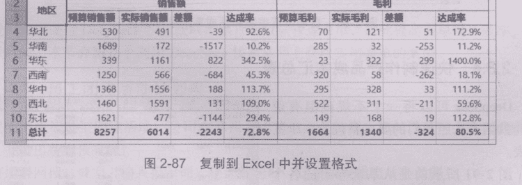

图 2-87 复制到 Excel 中并设置格式

在这个工作表中，差额及达成率看起来不直观，我们可以通过设置自定义数字格式或条件格式来自动显示不同效果。

如果不知道自定义数字格式的代码是什么，可以寻求 DeepSeek 的帮助。输入提示词“请给出将差额为负的单元格字体设置为红色，将达成率小于 1 的单元格字体设置为红色的自定义数字格式代码，注意达成率百分比数字要根据大小条件判断设置颜色，不允许使用条件格式，只能使用自定义数字格式”。为节省时间，我们使用联网搜索功能，得到图 2-88 和图 2-89 所示的相关信息。

以下是正确的自定义数字格式代码，满足你的需求：

1. 差异值为负的单元格字体设置为红色

自定义数字格式代码：

```
[红色]-0;[黑色]0;0
```

解释：
- [红色]-0：负值显示为红色，并带负号。
- [黑色]0：正值显示为黑色。
- 0：零值显示为默认格式。

2. 达成率小于1的单元格字体设置为红色

自定义数字格式代码：

```
[<1][红色]0.00%;[>=1][黑色]0.00%
```

解释：
- [<1][红色]0.00%：如果值小于1（即小于100%），显示为红色。
- [>=1][黑色]0.00%：如果值大于或等于1（即大于或等于100%），显示为黑色。

设置步骤

1. 差异值列设置：
- 选中差异值所在的列（如D列和H列）。
- 右键 → 设置单元格格式 → 数字 → 自定义。
- 在输入框中粘贴代码 [红色]-0;[黑色]0;0。
- 点击确定，完成设置。

2. 达成率列设置：
- 选中达成率所在的列（如E列和I列）。
- 右键 → 设置单元格格式 → 数字 → 自定义。
- 在输入框中粘贴代码 [<1][红色]0.00%;[>=1][黑色]0.00%。
- 点击确定，完成设置。

图 2-88 设置差额和达成率的自定义数字格式

图 2-89 设置自定义数字格式的具体步骤

按照操作说明，设置单元格的自定义数字格式，就能得到一个信息清晰的预算分析报表，如图 2-90 所示。

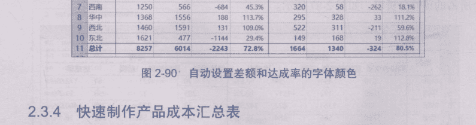

#### 2.3.4 快速制作产品成本汇总表

DeepSeek 可以将一个不规范但有逻辑的数据表按照我们的要求整理为一个汇总表。

图 2-91 所示的是从系统导出的各个产品的成本数据，保存在 Excel 文件（文件是“产品成本信息表.xlsx”）中。每个产品下有四个成本项目：直接材料、直接人工、制造费用和总成本，我们的需求是将产品成本汇总成一个二维表：产品名称为一列，各个成本项目分为几列保存。

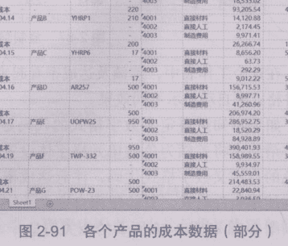

打开 DeepSeek，将 Excel 文件上传，忽略 DeepSeek 给出的思考过程及其他信息，输入提示词 “请设计一个产品成本汇总表，第一列为产品名称，成本项目（直接材料、直接人工、制造费用、总成本、单位成本）分五列保存”，得到图 2-92 所示的产品成本汇总表，然后将其复制到 Excel 中保存。

| 产品名称 | 直接材料（元） | 直接人工（元） | 制造费用（元） | 总成本（元） | 单位成本（元/件） |
| :--- | :--- | :--- | :--- | :--- | :--- |
| 产品A | 70,631.07 | 4,041.45 | 18,533.02 | 93,205.54 | 423.66 |
| 产品B | 14,120.88 | 2,174.45 | 9,971.41 | 26,266.74 | 131.33 |
| 产品C | 8,656.20 | 63.73 | 292.29 | 9,012.22 | 530.13 |
| 产品D | 156,715.53 | 8,997.71 | 41,260.96 | 206,974.20 | 413.95 |
| 产品E | 286,952.75 | 18,520.29 | 84,928.89 | 390,401.93 | 410.95 |
| 产品F | 158,989.55 | 9,934.97 | 45,559.01 | 214,483.53 | 428.97 |
| 产品G | 22,840.94 | 3,936.50 | 18,051.69 | 44,829.13 | 89.66 |
| 产品H | 20,410.86 | 3,936.50 | 18,051.69 | 42,399.05 | 84.80 |
| 产品P | 63,485.02 | 3,430.38 | 15,730.75 | 82,646.15 | 550.97 |
| 产品Y | 108,531.49 | 5,945.99 | 27,266.63 | 141,744.11 | 545.17 |
| 产品Q | 797.72 | 89.98 | 412.60 | 1,300.30 | 43.34 |
| 产品W | 778.80 | 89.98 | 412.60 | 1,281.38 | 42.71 |

图 2-92 产品成本汇总表

### 2.4 快速从网上获取实用表单

我们可以通过 DeepSeek 快速获取很多日常数据管理表单，以此提高表单设计效率，节省大量时间。本节介绍几个利用 DeepSeek 快速从网上获取实用表单的案例。

#### 2.4.1 员工团建活动计划表

我们要组织员工团建活动，公司在苏州，团建地点是扬州。如何设计一个两天的团建计划，并做出费用预算呢？

使用联网搜索模型，输入提示词（越详细越好，这里仅仅给出一个示例）：

> “请设计一个员工团建活动计划表：
员工人数是 23 人，时间是两天；
要求是轻松活泼，活动项目精练；
女性员工居多，这点要考虑；
工作地点是苏州，团建活动地点是扬州；
住宿是标间，房间费用不超过 400 元 / 天；
交通是租用大巴，也请对费用进行预算；
扬州瘦西湖和大运河博物馆是必须参观游玩的；
此外，趣味活动还要发放奖品，奖品费用预算是 3000 元。”

DeepSeek 会快速给出员工团建活动计划表，如图 2-93 所示。

##### 员工团建活动计划表（2天轻松活泼版）

**一、活动目标**
- 放松身心，缓解工作压力，提升员工幸福感。
- 增进员工之间的了解和友谊，增强团队凝聚力。
- 展现女性员工的风采，提升自信心和团队归属感。

**二、活动主题**
“魅力女性，快乐同行”

**三、活动时间**
- 第一天：2025年3月15日（周六）08:00 - 18:00
- 第二天：2025年3月16日（周日）09:00 - 16:00

**四、活动地点**
- 扬州瘦西湖景区
- 扬州大运河博物馆
- 扬州某度假村（住宿及部分室内活动）

**五、参与人员**
- 公司全体女性员工（23人）

**六、活动流程**

**第一天：文化体验与团队互动**
| 时间段 | 活动内容 | 负责人 | 备注 |
| :--- | :--- | :--- | :--- |
| 08:00 - 09:30 | 集合出发，前往扬州 | | 大巴车接送 |
| 09:30 - 12:00 | 游览瘦西湖景区 | | 感受自然美景，放松身心 |
| 12:00 - 13:30 | 午餐（扬州特色美食） | | |
| 13:30 - 15:30 | 参观大运河博物馆 | | 了解运河文化，增长见识 |
| 15:30 - 17:00 | 前往度假村，办理入住 | | |
| 17:00 - 18:00 | 自由活动 | | |
| 18:00 - 20:00 | 晚餐+破冰游戏 | | 如“名字接龙”“你画我猜” |

**第二天：趣味团建与休闲放松**
| 时间段 | 活动内容 | 负责人 | 备注 |
| :--- | :--- | :--- | :--- |
| 08:00 - 09:00 | 早餐 | | |
| 09:00 - 11:00 | 趣味运动会：合力运球、珠行千里 | | 团队协作，轻松活泼 |
| 11:00 - 12:00 | 手工DIY：香薰蜡烛/油画包制作 | | 修身养性，体验手工乐趣 |
| 12:00 - 13:30 | 午餐 | | |
| 13:30 - 15:00 | 团队分享会：活动感受与未来展望 | | 增强团队凝聚力 |
| 15:00 - 16:00 | 返程 | | |

**七、活动项目说明**
1. 瘦西湖游览：欣赏瘦西湖的秀丽景色，感受扬州的文化底蕴。
2. 大运河博物馆：了解大运河的历史和文化，增长见识。
3. 趣味运动会：选择“合力运球”“珠行千里”等经典团队协作项目，轻松有趣，适合女性员工。
4. 手工DIY：香薰蜡烛或油画包制作，简单易学，成品精美，深受女性喜爱。
5. 破冰游戏：帮助员工快速熟悉彼此，活跃气氛。

**八、经费预算**
| 项目 | 预算金额 | 备注 |
| :--- | :--- | :--- |
| 交通 | 3000元 | 大巴车租赁（25座，往返） |
| 住宿 | 4800元 | 标间12间，400元/间/天 |
| 餐饮 | 6900元 | 4餐，人均75元/餐 |
| 门票 | 2300元 | 瘦西湖门票100元/人，大运河博物馆免费 |
| 活动道具 | 1000元 | 运动会、DIY材料等 |
| 奖品 | 3000元 | 小礼品（如：香薰套装、护肤品、文创产品等） |
| 其他 | 500元 | |
| **总计** | **21500元** | |

图 2-93  员工团建活动计划表

将这个计划表复制到 Excel 或者 Word 中，根据实际情况对相关内容进行编辑加工和补充完善，就是一份完整的团建活动计划表了。

### 2.4.2  设计日常费用记录单

如果要设计一个日常费用记录单，要求是能够准确输入数据，表单有日期、姓名、部门、费用项目、金额、备注信息等字段，并且要对日期、部门、金额字段做出某些限制，避免输入错误的数据，那么就使用 DeepSeek 的联网搜索模型，输入提示词：

> “请设计一个日常费用记录单：
字段有序号、日期、姓名、部门、费用项目、金额、备注信息；
要求：序号自动输入不重复数字，日期只能输入 2025 年；
部门字段要使用下拉菜单；
金额只能是正数；
输入完毕某行所有单元格数据后，自定义设置边框。”

DeepSeek 会给出相关的设计思路和所需的 Excel 技能，如图 2-94 至图 2-97 所示，涉及的 Excel 技能包括数据验证、条件格式等，并对表单设计的具体步骤予以比较详细的说明。


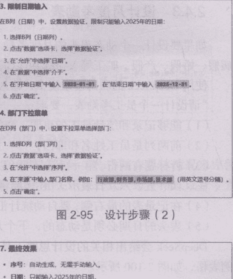


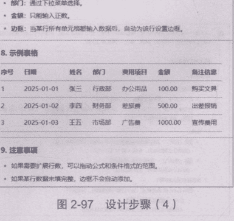

按照 DeepSeek 给出的具体步骤，我们可以在 Excel 中设计所需的日常费用记录单，如图 2-98 所示。

如果设计好的表单不能达到要求，我们可以继续向 DeepSeek 发出提问，让它针对出现的问题提出解决方案。

| A | B | C | D | E | F | G |
|---|---|---|---|---|---|---|
| 序号 | 日期 | 姓名 | 部门 | 费用项目 | 金额 | 备注信息 |
| 1 | 2025-1-1 | 张三 | 行政部 | 办公用品 | 100 | 购买文具 |
| 2 | 2025-1-2 | 李四 | 财务部 | 差旅费 | 500 | 出差报销 |
| 3 | 2025-1-3 | 王五 | 市场部 | 广告费 | 1000 | 宣传费用 |
| 4 | 2025-3-7 | 赵亮 | 财务部 | 差旅费 | 598 | 出差报销 |

图 2-98 日常费用记录单

#### 2.4.3 设计月度考勤表

如果要设计一个动态表头的月度考勤表，方便记录和统计汇总员工的考勤情况（事假、病假、婚假、产假、旷工等），我们可以借助 DeepSeek 来完成。

使用 DeepSeek 的联网搜索模型，输入提示词：

> “请设计一个员工考勤表，要求：
（1）能够记录和统计员工的事假、病假、婚假、产假、旷工等项目；
（2）前两列是员工姓名和部门；
（3）行标题有两行，第一行是日期（以数字 1、2、3……表示），第二行是星期几（以一、二、三、四、五、六、日表示），还需要将周六和周日用不同颜色标识出来；
（4）在记录表的最右侧，要自动统计汇总每个人的事假、病假、婚假、产假、旷工等天数；
（5）表头的日期必须是动态的，下个月可以自动调整。”

DeepSeek 会给出相关的设计思路、具体步骤及所需技能，如图 2-99 所示，还会出示例表格，如图 2-100 所示。

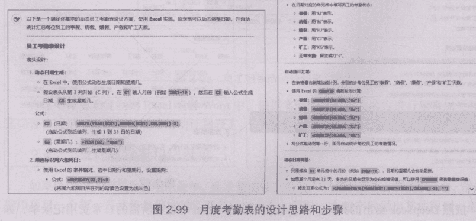

示例表格（部分）：

| 员工姓名 | 部门 | 1 | 2 | 3 | 4 | 5 | 6 | 7 | ... | 31 | 事假 | 病假 | 婚假 | 产假 | 旷工 |
|---|---|---|---|---|---|---|---|---|---|---|---|---|---|---|---|
| 张三 | 技术部 | | | | | | | | ... | | 1 | 0 | 0 | 0 | 0 |
| 李四 | 市场部 | | | | | | | | ... | | 0 | 1 | 0 | 0 | 0 |
| 王五 | 财务部 | | | | | | | | ... | | 0 | 0 | 0 | 0 | 1 |

图 2-100 示例表格

我们可以据此设计出符合需求的月度考勤表，如图 2-101 所示。


图 2-101 符合需求的月度考勤表

当然，这样的考勤表仅仅是一个参考示例，我们需在实际工作中结合具体情况来完善 DeepSeek 给出的设计思路和方法，同时要也了解 Excel 相关函数公式、条件格式设置等方面的知识。

## 第3章 DeepSeek 助力数据清洗加工

在数据分析中，很重要的一项是对数据进行清洗加工，尤其是大型表格的数据清洗，甚至还要对多个关联表格的数据进行关联逻辑判断。如果数据量不大，或者表格比较简单，我们可以使用 Excel 的相关工具（如分列工具、去重工具、排序筛选工具等）进行检查和处理，或者使用 Power Query 来高效处理并建模。现在，有了 DeepSeek 助力，数据清洗加工的效率可以更上一层楼。

### 3.1 快速掌握数据清洗的基本知识和技能

数据清洗是数据分析的第一步，我们先要掌握数据清洗的基本技能，例如表格会有哪些不规范、应当如何处理这些不规范等。借助 DeepSeek，我们可以快速获取这些知识。

#### 3.1.1 快速了解常见的表格不规范

输入提示词“表格结构和数据的不规范有哪些方面？请结合示例介绍”，先看看 DeepSeek 的思考过程，如图 3-1 和图 3-2 所示。


现在，我需要结合具体的例子来说明每个方面。例如，在表头不规范的情况下，可以举一个没有列名或列名重复的表格例子，在行列设计问题中，可以举一个合并单元格导致数据难以处理的例子。数据类型混乱的例子可能是一列中既有数字又有文本，如“年龄”列中出现“未知”。冗余数据的例子可能是重复的行或列，或者使用多余的分隔线。数据缺失的例子可能是一些单元格留空或用“-”代替。格式不统一的例子比如日期有的用“2023-01-01”，有的用“01/01/2023”。数据冗余的例子可能是在多个列中存储相同的信息。异常值的例子比如年龄为-10或200。命名问题的例子可能使用缩写而不加说明，编码问题比如性别用“男/女”和“M/F”混用。

在组织这些内容时，需要分点阐明，每个方面下都有示例，这样用户更容易理解。同时，要确保语言简洁明了，避免使用过于专业的术语，让不同层次的用户都能理解。可能还需要考虑用户的实际应用场景，比如数据分析、数据清洗等，因此示例应贴近实际应用，帮助用户识别和解决实际问题。

最后，检查是否有遗漏的方面，比如是否有其他结构或数据问题没有涵盖。例如，表格的布局是否合理，是否有不必要的空格或特殊字符，或者数据的分隔符是否正确等。这也可能属于不规范的情况，需要补充进去。另外，关于数据编码，除了性别之外，可能还有其他分类变量的编码不一致，比如地区编码、产品类别等，都可以作为例子。

总结一下，我需要将表格结构和数据内容的不规范分成两大部分，每个部分下再分小点，每个小点都给出具体的例子，并解释可能导致的问题。这样结构清晰，内容全面，用户能够通过示例快速识别和解决类似的问题。


仔细阅读和总结 DeepSeek 的思考过程，我们可以快速了解以下几个关于表格不规范的知识点：

1. 表格结构不规范。
    - 表头问题，例如表头缺失、表头重复或者表头不明确导致数据处理困难。
    - 行列设计问题，例如合并单元格过多，或者在行和列中混合存放不同类型的数据，这会影响数据分析和处理的效率。
    - 数据类型问题，例如同一列中混合了文本和数字，或者日期格式不统一，这会导致计算错误或分析困难。
    - 冗余数据问题，例如重复的行或列，或者不必要的分隔符，这会增加数据处理的复杂度。
2. 表格中的数据不规范。
    - 数据缺失问题，例如某些单元格为空或者用占位符 N/A 代替，这可能会影响后续分析。
    - 格式不统一问题，例如日期格式不一致或者单位不统一，会导致数据无法正确进行比较或计算。
    - 数据冗余和重复问题，例如重复记录或存储了多余的数据，这会浪费存储空间并降低处理效率。
    - 异常值或错误数据问题，例如超出合理范围的数值或拼写错误，这会影响分析结果。
    - 命名和编码问题，例如使用不清晰的命名或不同的编码方式，这可能导致理解困难或整合错误。

DeepSeek 还给出了表格不规范的详细介绍，如图 3-3 所示。我们不妨仔细阅读理解，并对照自己工作中处理过的表格中的数据，看看哪些方面没有做好。

表格结构和数据不规范可能导致数据难以分析、处理或整合。以下是常见的不规范类型及示例：

##### 一、表格结构不规范

1. 表头问题
   - 缺失表头：表格没有明确的列名，无法理解各列含义。
   - 重复表头：多行表头或跨页重复表头，导致数据提取困难。
   - 表头含义模糊：列名不清晰（如“字段1”“字段2”），无法明确数据内容。
2. 行列设计混乱
   - 合并单元格过多：合并行列导致数据难以结构化存储。

我们可以针对 DeepSeek 给出的表格不规范的详细介绍，再一一去询问。
例如，输入提示词“缺失表头都有哪些情况”，DeepSeek 会对缺失表头的问题进行深度思考，包括但不限于：

- 完全缺失表头。
- 部分缺失表头。
- 隐藏表头（视觉存在但实际缺失）。
- 多级表头不明确，缺失下级标题。
- 动态生成表头缺失。
- 表头与数据混淆。

仔细阅读和理解 DeepSeek 给出的这几种典型的缺失表头示例，我们就能在设计表格时避免出现这样的问题，同时掌握诊断并整理表格的思路。

输入提示词“行列设计问题都有哪些”，DeepSeek 会对行列设计问题进行深度思考。我们可以对照自己的实际工作，看看是不是经常犯这样的错误。

- 合并单元格滥用。
- 行列混合存储不同类型的数据。
- 冗余行或列。
- 维度交叉。
- 标题行重复或嵌入数据中。
- 数据方向不一致。
- 多级表头层级混乱。
- 行内数据不完整。

继续输入提示词“数据类型不统一都有哪些情况”，DeepSeek 会对数据类型不统一的问题进行深度思考，总结数据类型不统一的几种常见情况，并介绍相关示例及其解决方法。

- 同一列混合不同数据类型，例如数值与文本混合、日期格式不一致、布尔值与文本混合等。
- 数值类型不统一，例如单位混杂、数字格式不一致、整数与浮点数混合等。
- 分类数据编码混乱，例如同一类别不同命名、多级分类未拆分等。
- 结构化与非结构化数据混合，例如 JSON/ 文本与普通字段混合、多值字段未标准化等。
- 特殊符号干扰，如数字中的非数值字符、科学计数法与非科学计数法混合、空值表示不一致等。

仔细阅读 DeepSeek 的思考过程和示例介绍，我们就会对数据类型不统一的问题及其危害有更深的认识。

如果不了解冗余数据问题，我们可以输入“冗余数据问题有哪些”，看看 DeepSeek 是如何解释这个问题的，并提供了哪些示例及解决方案。

数据缺失是实际工作中的常见问题，具有复杂性、多样性和隐蔽性。输入提示词“常见的数据缺失有哪些”，DeepSeek 就会对数据缺失问题进行总结，并结合示例提出解决方案。

总之，DeepSeek 对表格不规范进行了多方面的思考和总结。通过这些帮助信息，我们可以深入地了解表格不规范的形成原因及影响，并获取相应的解决方法。

#### 3.1.2 快速了解什么是科学规范的表单

前面介绍了如何借助 DeepSeek 了解表格不规范的常见问题，那么，科学规范的表单是什么样的呢？换句话说，科学规范的表单应具备什么样的特征和条件呢？

输入提示词“科学规范的表单必须具备哪些条件”，得到 DeepSeek 对科学规范的表单的解释，重点是有关规则要求的阐述以及相关示例的展示。

设计科学规范的表单需满足的核心条件如下：

- 结构设计规范。
- 数据验证机制。
- 安全与隐私保护。
- 数据输入规范。
- 用户体验优化。
- 可维护性与扩展性。

三、数据验证机制
1. 实时输入校验
   - 要求：输入即时提示错误（如手机号位数不足）。
   - 示例：
2. 后端校验
   - 要求：服务端二次验证，防止前端绕过。
   - 场景：表单提交时检查数据完整性（如手机号是否已注册）。
3. 防重复提交
   - 要求：通过Token机制或按钮禁用防止重复提交。
   - 示例：

四、用户体验优化
1. 友好的提示与引导
   - 要求：提供默认值、占位符或示例。
   - 示例：
2. 条件显示字段
   - 要求：动态显示关联字段（如选择“其他”性别时显示文本框）。
   - 示例：
3. 移动端适配
   - 要求：表单在手机端可正常填写（如输入框自适应宽度）。

五、安全与隐私保护
1. 敏感信息脱敏
   - 要求：对身份证号、银行卡号等加密存储或部分隐藏。
   - 示例：
2. 合规性声明
   - 要求：明确告知数据用途，提供隐私协议链接。
   - 示例：
3. 防爬虫与攻击
   - 要求：添加验证码、IP限流或防SQL注入机制。

六、可维护性与扩展性
1. 字段可配置化
   - 要求：通过管理后台动态增删字段，无需修改代码。
   - 示例：
2. 版本管理与历史记录
   - 要求：记录表单修改历史，支持数据回溯。
   - 场景：用户填写旧版表单时，数据与新版本兼容。

七、示例对比
不规范表单：

DeepSeek 提供的这些信息，非常有助于我们结合实际业务设计科学规范的数据表单。
例如，要设计一个科学规范的供应商应付款管理表单，可以输入提示词“如果我要设计一个供应商应付款管理表单，那么从表单结构（这样的表单可能不是一个，但要注意保证各个表单的关联）上，要注意哪些问题”，寻求 DeepSeek 的帮助，以便形成一个基本的设计思路，再根据实际情况进行编辑和完善。

### 3.2 表格智能检查

前面我们介绍了如何借助 DeepSeek 了解表单规范性的问题以及延伸探索，这可以帮助我们在设计表单时注意到相关的问题。下面我们介绍如何借助 DeepSeek 快速高效地检查指定表格中的数据，包括表单数据检查、逻辑关系判断、结构不规范的快速处理、数据不规范的快速处理等。

#### 3.2.1 全面检查指定一个表格中的数据

先看一个简单的例子，了解 DeepSeek 是如何检查表格中的数据的。

图 3-17 所示的是一个各个客户两年销售额和毛利统计表（文件是“客户两年销售额和毛利统计表.xlsx”）。在分析此表之前，我们先检查一下该表是否存在问题，有关数据是否不符合逻辑，以及是否有重复记录等。

| A | B | C | D | E |
|---|---|---|---|---|
| 客户 | 销售额 | | 毛利 | |
| | 去年 | 今年 | 去年 | 今年 |
| 客户01 | 1,525 | 2,631 | 223 | 468 |
| 客户03 | 2,205 | 612 | 973 | 198 |
| 客户04 | 2,795 | 2,222 | 565 | 661 |
| 客户05 | 728 | 689 | 89 | 875 |
| 客户09 | 2,655 | 2,733 | 1,401 | 2,733 |
| 客户06 | 11,976 | 329 | 542 | 98 |
| 客户02 | 2,772 | 2,457 | 776 | 715 |
| 客户07 | 1,879 | 1,228 | 766 | 286 |
| 客户02 | 2,772 | 2,457 | 776 | 715 |
| 合计 | 29,307 | 15,358 | 6,111 | 6,749 |

将 Excel 文件上传到 DeepSeek，得到 DeepSeek 对表格中的数据的初步思考判断。DeepSeek 会对明显的错误予以说明，例如客户 02 的数据重复出现两次，客户 06 销售额异常下降，客户 05 毛利大幅增长。

毛利和销售额是有逻辑关系的，毛利是销售额的一部分，不可能等于或超过销售额，因此客户 05 和 09 的毛利问题没有被发现，因为上述信息仅仅是 DeepSeek 对表格的初步思考判断，我们还没有提出具体问题让 DeepSeek 思考。

输入提示词：

> “请仔细检查表格，找出表格中存在的问题，例如：
数据是否重复；
毛利和销售额之间的逻辑是否正确（如毛利率 100%、销售额大幅下降但毛利却激增）；
今年与去年相比是否出现异常变化。”

DeepSeek 返回的信息如图 3-19 所示。仔细阅读这些信息，并与表格进行对照，可以发现以下几个问题是需要认真对待并加以解决的：

- 客户 02：出现两次（销售额和毛利数据完全相同），需确认是否为重复录入。
- 客户 05：毛利与销售额矛盾，销售额由去年的 728 略降至今年的 689（下降 5.4%），但毛利从去年的 89 激增至今年的 875（增长 883%），逻辑不合理。需检查数据准确性。
- 客户 09：今年毛利率达 2733/2733 = 100%，毛利等于销售额，显然不合理，需要检查今年销售额或毛利数据是否输入错误（如毛利应为 1733）。

要让 DeepSeek 对表格检查得更仔细，快速发现问题，准确的提示词是非常关键的。也就是说，我们先要明确表格的检查重点是什么，要检查哪些方面，然后把需求明确地告诉 DeepSeek。

下面再看一个比较复杂的例子。如图 3-20 所示，数据源是 Excel 文件“员工基本信息表.xlsx”，用以保存员工的基本信息。

这个工作表存在一些不规范的地方，例如性别表述方式不统一，性别和出生日期是人工输入的，可能与身份证号码不匹配，年龄可能由于人工输入而不是当前年龄。此外，这个表格中还存在重复数据输入的问题。

| A | B | C | D | E | F | G | H | I | J | K | L |
|---|---|---|---|---|---|---|---|---|---|---|---|
| | | | | 基本信息 | | | | 其他信息 | | 证书最新信息 | |
| | 姓名 | 部门 | 性别 | 学历 | 身份证号码 | 出生日期 | 年龄 | 家庭住址 | 紧急联系人 | 联系人电话 | 证书名称 | 获取时间 |
| 3 | A001 | 采购部 | 女 | 硕士 | 173106198508263867 | 1985-8-26 | 39 | ********** | L001 | 132****34001 | | |
| 4 | A002 | 财务部 | 女 | 专科 | 347106197702067208 | 1977-2-6 | 48 | ********** | L002 | 132****34002 | | |
| 5 | A003 | 人力资源部 | 男 | 专科 | 265106197709102148 | 1977-9-10 | 47 | ********** | L003 | 132****34003 | | |
| 6 | A004 | 生产部 | male | 博士 | 362110198309264378 | 1983-9-26 | 41 | ********** | L004 | 132****34004 | | |
| 7 | A018 | 销售部 | 女 | 专科 | 477101197311013700 | 1973.11.11 | 48 | ********** | L018 | 132****34018 | 高级经济师 | 2000-8-15 |
| 8 | A019 | 生产部 | 女 | 硕士 | 271101198605094804 | 1986.05.09 | 38 | ********** | L019 | 132****34019 | | |
| 9 | A020 | 技术研发部 | 男 | 高中 | 359106199712300360 | 1997-12-30 | 27 | ********** | L020 | 132****34020 | | |
| 10 | A021 | 财务部 | 男 | 博士 | 342108197809128980 | 1978-9-12 | 46 | ********** | L021 | 132****34021 | | |
| 11 | A005 | 生产部 | female | 高中 | 548107198011098724 | 1981-1-19 | 44 | ********** | L005 | 132****34005 | | |
| 12 | A006 | 采购部 | female | 专科 | 261101200005227967 | 2000.5.22 | 24 | ********** | L006 | 132****34006 | 高级经济师 | 2018-10-13 |
| 13 | A022 | 销售部 | 女 | 初中 | 204101199403102829 | 1994-3-10 | 30 | ********** | L022 | 132****34022 | | |
| 14 | A023 | 销售部 | male | 本科 | 195110198306287611 | 1983-6-28 | 41 | ********** | L023 | 132****34023 | | |

这个表格中有大量数据（数百行甚至上千行），人工检查比较费时间，因此我们来寻求 DeepSeek 的帮助，一方面检查数据的规范性，另一方面自动获取从身份证号码中提取生日期和性别的计算公式，以及年龄的计算公式。

上传文件，DeepSeek 会根据思考给出初步检查结果。

这些信息是不够详细的，因此输入提示词：

> “请检查这个表格有哪些不规范，例如：
出生日期和性别是否与身份证号码相匹配；
出生日期格式是否统一；
性别格式是否统一；
年龄是否为截至今天的年龄；
有没有重复数据；
请将这些有问题数据的检查结果列示出来。”

需要注意的是，我们要告诉 DeepSeek 需要检查哪些内容，而不仅是输入“请检查表格”这样的泛泛之词。

发送提示词后，DeepSeek 会给出相应的检查结果，如图 3-22 所示。我们可以根据 DeepSeek 给出的检查结果在表格中逐一修改。

一、身份证号码与出生日期/性别不匹配
| 员工编号 | 身份证号码 | 表格出生日期 | 身份证提取出生日期 | 表格性别 | 身份证提取性别 | 问题描述 |
|---|---|---|---|---|---|---|
| A006 | 261101200005227967 | 2000.5.22 | 2000-05-22 | 女 | 女（第17位26） | 出生日期格式不统一 |
| A018 | 477101197311013700 | 1973.11.11 | 1973-11-11 | 女 | 女（第17位20） | 出生日期格式不统一 |
| A040 | 157103198912083758 | 1989-12-08 | 1989-12-08 | 男 | 男（第17位25） | |
| A195 | 179109200010075855 | 2000-10-07 | 2000-10-07 | 男 | 男（第17位25） | |

三、性别格式不统一
| 员工编号 | 原性别 | 修正建议 |
|---|---|---|
| A004 | male | 男 |
| A005 | female | 女 |
| A007 | male | 男 |
| A010 | male | 男 |
| A011 | male | 男 |
| A013 | female | 女 |

二、出生日期格式不统一
| 员工编号 | 表格出生日期 | 标准格式修正建议 |
|---|---|---|
| A006 | 2000.5.22 | 2000-05-22 |
| A018 | 1973.11.11 | 1973-11-11 |
| A019 | 1986.05.09 | 1986-05-09 |

四、年龄计算错误（截至2023-10-23）
| 员工编号 | 表格年龄 | 实际年龄（根据出生日期计算） | 差异 |
|---|---|---|---|
| A040 | 35 | 34 (1989-12-08) | +1 |
| A195 | 24 | 23 (2000-10-07) | +1 |
| A147 | 24 | 23 (2000-06-22) | +1 |
| A209 | 24 | 23 (2000-06-20) | +1 |

五、重复数据
1. 员工编号重复
| 员工编号 | 出现次数 | 身份证号码 | 问题描述 |
|---|---|---|---|
| A021 | 3 | 342108197809128980 | 同一编号重复录入 |
| A040 | 2 | 157103198912083758 | 同一编号重复录入 |

2. 身份证号码重复
| 身份证号码 | 出现次数 | 相关员工编号 | 问题描述 |
|---|---|---|---|
| 342108197809128980 | 3 | A021, A032, A033 | 同一身份证号重复录入 |
| 157103198912083758 | 2 | A040, A053 | 同一身份证号重复录入 |

六、其他问题
1. 证书信息缺失：仅3人（A006、A014、A018）填写证书信息，其余197人未填写。
2. 家庭住址隐私保护不一致：部分住址显示为***********，但部分未处理（如A040）。

修正建议
1. 数据清洗：统一日期格式为YYYY-MM-DD，性别统一为“男/女”。
2. 重复记录核实：确认A021、A040是否为同一员工多次录入，或数据错误。
3. 年龄矫正：根据实际出生日期重新计算年龄。
4. 证书信息补全：联系相关部门补充证书数据。
5. 身份证校验：对性别与身份证不一致的记录（如A040、A195）进行人工核查。

如需详细问题清单或进一步分析，请提供具体需求。

如果错误比较多，修改起来很麻烦，我们可以再去寻求 DeepSeek 的帮助：使用公式自动获取性别、出生日期和年龄，用一个公式自动进行所有信息的修改。

输入提示词“如何根据 E 列的身份证号码，使用公式自动获取性别、出生日期和年龄？请给出参考计算公式。注意：数据是从第三行开始的”，DeepSeek 就会快速给出相应的计算公式及步骤说明，如图 3-23 所示。按照说明将公式复制到工作表对应的单元格并逐一下拉，就得到了格式统一且正确的性别、出生日期和年龄数据。

##### 完整公式示例（从第3行开始）

| 列名 | 公式 |
| :--- | :--- |
| 出生日期 | =DATE(MID(E3,7,4), MID(E3,11,2), MID(E3,13,2)) |
| 性别 | =IF(MOD(MID(E3,17,1),2)=1,"男","女") |
| 年龄 | =DATEDIF(DATE(MID(E3,7,4), MID(E3,11,2), MID(E3,13,2)), TODAY(), "Y") |

##### 步骤说明

1. 输入公式：在出生日期列（如F3）、性别列（G3）、年龄列（H3）分别输入上述公式。
2. 批量填充：
   - 选中单元格右下角的填充柄（小方块），双击或向下拖动，自动填充到所有行。
3. 格式设置：
   - 出生日期列设置为日期格式（右键单元格 → 设置单元格格式 → 日期 → 选择 YYYY-MM-DD）。

图 3-23 完整的计算公式和步骤说明

从表格结构上看，这个表格的标题有两行，是不满足数据库要求的，因此我们可以询问 DeepSeek 如何优化表格的标题结构。输入提示词“这个表格标题有什么问题？如何优化标题结构”，DeepSeek 就会给出优化表格结构的一些建议，其中关于合并单元格标题的优化建议如图 3-24 所示。

##### 二、优化建议

1. 取消合并单元格，统一列名层级

- 原结构问题：

| 基本信息 | | | | | 其他信息 | | | | 证书最新信息 | |
| 姓名 | 部门 | 性别 | 学历 | 身份证号码 | 出生日期 | 年龄 | 家庭住址 | 紧急联系人 | 联系人电话 | 证书名称 | 获取时间 |

- 优化后结构：

| 姓名 | 部门 | 性别 | 学历 | 身份证号码 | 出生日期 | 年龄 | 家庭住址 | 紧急联系人 | 联系人电话 | 最新证书名称 | 证书获取时间 |

- 优势：
  - 取消合并单元格，每列独立，便于筛选、排序和公式引用。
  - 列名直接反映内容，无需依赖合并标题分类。

图 3-24 关于合并单元格标题的优化建议

#### 3.2.2 全面检查指定多个关联表格中的数据

当我们需要对几个关联表格进行比对检查时，使用 DeepSeek 无疑是一个更为高效的方法。对于这样的表格，如果人工或用函数公式来检查，不仅非常费时间，而且当数据量很大时，还会大大降低检查速度。

图 3-25 所示的 Excel 文件“销售订单开票记录表.xlsx”中有两个表：订单信息表和开票信息表，它们由订单号和客户名称关联，同一个客户有很多订单，但一个订单不可能有多个客户。

现在，我们要根据订单号和客户名称检查订单信息表和开票信息表是不是存在以下问题：同一个订单对应不同的客户名称；同一个客户同一个订单，订单金额和开票金额不一样。

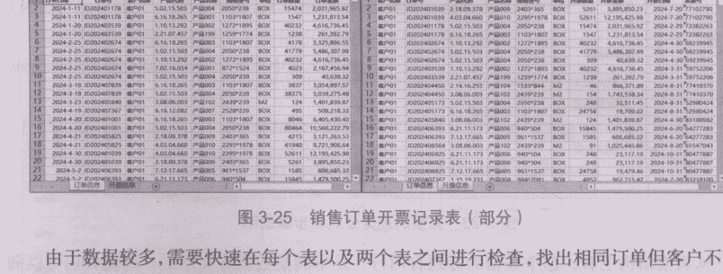

由于数据较多，需要快速在每个表以及两个表之间进行检查，找出相同订单但客户不同、订单金额与开票金额不同、重复录入订单、重复录入开票等异常数据。

上传 Excel 文件，输入提示词：

> “请在每个表内以及两个表之间进行详细检查，主要包括：
订单号相同但客户名称不同；
同一订单号的订单金额与开票金额不同；
同一订单号的订单金额与开票金额相同，但产品单价不同；
有开票但无订单；
重复录入订单；
重复录入开票等异常数据。
请将检查结果列示出来，制作一个差异表。”

DeepSeek 开始对两个表格进行检查（花费时间的长短，取决于数据量的大小），结果如图 3-26 所示。这些差异有：

1. 同一订单号对应不同客户。
2. 订单金额与开票金额不一致。
3. 金额一致但单价不同。
4. 有开票但无对应订单。
5. 重复录入的订单记录。
6. 重复录入的开票记录。
7. 其他异常。

根据 DeepSeek 给出的这些信息，我们可以快速高效地对订单信息表和开票信息表进行整理加工。

# 第 3 章 DeepSeek 助力数据清洗加工

基于订单信息表和开票信息表的全量对比，以下为发现的异常数据明细：

1. 同一订单号对应不同客户
问题描述：订单信息与开票信息中，同一订单号关联的客户名称不一致。

| 订单号 | 订单客户 | 开票客户 | 产品代码 | 差异类型 | 处理建议 |
|---|---|---|---|---|---|
| JD202403172 | 客户02 | 客户01 | 1.07.21.218 | 客户不一致 | 检查订单归属或修正开票 |
| JD202405376 | 客户01 | 客户02 | 1.11.21.444 | 客户不一致 | 联系客户确认订单归属 |

2. 订单金额与开票金额不一致
问题描述：同一订单，同一产品代码的订单金额与开票金额存在差异。

| 订单号 | 产品代码 | 订单金额 | 开票金额 | 差额 | 差异类型 | 处理建议 |
|---|---|---|---|---|---|---|
| JD202405173 | 6.16.18.265 | 19,709.09 | 19,709.09 | 0 | 金额一致但单价异常 | 检查单价是否录入错误 |
| JD202405925 | 7.12.17.665 | 9,479.48 | 0 | 9,479.48 | 金额不一致 | 检查是否遗漏折扣或优惠 |
| JD202405674 | 7.02.16.054 | 2,167.45 | 0 | 2,167.45 | 未开票金额 | 跟进未开票原因 |

3. 金额一致但单价不同
问题描述：订单金额与开票金额一致，但单价不一致（可能因四舍五入或单位换算导致）。

| 订单号 | 产品代码 | 订单数量 | 订单单价 | 开票数量 | 开票单价 | 差异类型 | 处理建议 |
|---|---|---|---|---|---|---|---|
| JD202405173 | 6.16.18.265 | 8 | 24.75 | 8 | 24.75 | 单价异常（四舍五入） | 检查是否为录入错误 |
| JD202406925 | 7.12.17.665 | 8 | 24.75 | 8 | 24.75 | 单价异常（四舍五入） | 检查是否为录入错误 |

4. 有开票但无对应订单
问题描述：开票信息中存在在订单信息表中匹配的订单或产品。

| 发票号 | 订单号 | 客户名称 | 产品代码 | 开票金额 | 差异类型 | 处理建议 |
|---|---|---|---|---|---|---|
| 58114321 | JD202401894 | 客户02 | 5.05.23.022 | 1,638.529 | 订单不存在 | 检查是否为虚构订单 |
| 77102790 | JD202401039 | 客户01 | 4.03.04.660 | 12,195.42 | 订单存在但产品不匹配 | 检查产品代码是否关联错误 |

5. 重复录入的订单记录
问题描述：订单信息表中存在完全重复的订单记录。

| 订单号 | 客户名称 | 产品代码 | 重复次数 | 差异类型 | 处理建议 |
|---|---|---|---|---|---|
| JD202407760 | 客户02 | 5.05.23.022 | 3 | 重复订单 | 删除多余记录 |
| JD202404635 | 客户02 | 6.15.03.110 | 2 | 重复订单 | 合并或删除重复条目 |

6. 重复录入的开票记录
问题描述：开票信息表中存在完全重复的开票记录。

| 发票号 | 订单号 | 产品代码 | 重复次数 | 差异类型 | 处理建议 |
|---|---|---|---|---|---|
| 76556920 | JD202407760 | 5.05.23.022 | 3 | 重复开票 | 检查是否为批量开票 |
| 58114321 | JD202401894 | 5.05.23.022 | 2 | 重复开票 | 删除重复记录 |

7. 其他异常

| 订单号 | 问题描述 | 差异类型 | 处理建议 |
|---|---|---|---|
| JD202406393 | 订单中存在产品006（订单数量15,845），但开票信息中未找到记录 | 部分开票未开票 | 检查是否遗漏开票 |
| JD202407567 | 开票金额509,218.33与订单金额509,218.33一致，但产品品牌单位差异（BOX vs M2） | 单位不一致 | 检查单位是否录入错误 |

自动化检查逻辑（参考）
1. 客户不一致检查


如果想实现表格清洗加工的自动化，可以向 DeepSeek 寻求帮助，获取自动化核对检查的 VBA 代码。输入提示词“请给出快速制作上述七个差异表的 VBA 代码”，DeepSeek 就给出相应的 VBA 参考代码，如图 3-27 所示。


不过，这些代码并不一定能正常运行并得到正确结果。我们需要先试运行，看看代码会不会出现错误，以及错误出现在哪个语句，再让 DeepSeek 修改完善代码，直至代码能够顺利运行，检查结果也正确。

### 3.3 智能化快速清洗加工数据

前面说过，表格不规范有很多种情况，解决方法也不尽相同。DeepSeek 能够针对不同类型的不规范表格快速高效地解决其不规范的问题。下面结合几个实际案例，介绍如何使用 DeepSeek 智能化快速清洗加工数据。

#### 3.3.1 案例 1：智能化分列数据

图 3-28 所示的是一个物料代码、物料名称及规格型号在一起的表格，这给数据分析带来了不便。如何快速将物料代码、物料名称及规格型号（规格型号可以分成重量、宽、长）分成几列分别保存？文件是“数据分列.xlsx”。

| A |
|---|
| 材料名称规格 |
| 原纸/6.16.01.08高光直镀内衬原纸180g*480mm*1200m |
| 原纸/6.16.01.03.019金色转移内卡纸220g*763mm*5000m |
| 原纸/6.16.06.001磨砂内卡原纸85g*688mm*4800m |
| 原纸/6.16.01.07.042金色直镀内衬纸225g*763mm*6700m |
| 原纸/6.16.01.07.014金色环保铝纸160g*734mm*12000m |
| 原纸/6.16.06.001.008浅灰绿磨砂卡纸220g*1286mm*18000m |

图 3-28 物料代码、物料名称及规格型号在一起的表格

上传 Excel 文件，DeepSeek 会根据表格中的数据的特征进行思考，然后自动返回分列后的数据。将表格复制到 Excel 中，就是规范后的表格，如图 3-29 所示。

| 物料代码 | 物料名称 | 克重 | 宽度 | 长度 |
|---|---|---|---|---|
| 6.16.01.08 | 高光直镀内衬原纸 | 180g | 480mm | 1200m |
| 6.16.01.03.019 | 金色转移内卡纸 | 220g | 763mm | 5000m |
| 6.16.06.001 | 磨砂内卡原纸 | 85g | 688mm | 4800m |
| 6.16.01.07.042 | 金色直镀内衬纸 | 225g | 763mm | 6700m |
| 6.16.01.07.014 | 金色环保铝纸 | 160g | 734mm | 12000m |
| 6.16.06.001.008 | 浅灰绿磨砂卡纸 | 220g | 1286mm | 18000m |

| A | B | C | D | E |
|---|---|---|---|---|
| 物料代码 | 物料名称 | 克重 | 宽度 | 长度 |
| 6.16.01.08 | 高光直镀内衬原纸 | 180g | 480mm | 1200m |
| 6.16.01.03.019 | 金色转移内卡纸 | 220g | 763mm | 5000m |
| 6.16.06.001 | 磨砂内卡原纸 | 85g | 688mm | 4800m |
| 6.16.01.07.042 | 金色直镀内衬纸 | 225g | 763mm | 6700m |
| 6.16.01.07.014 | 金色环保铝纸 | 160g | 734mm | 12000m |
| 6.16.06.001.008 | 浅灰绿磨砂卡纸 | 220g | 1286mm | 18000m |

图 3-29 DeepSeek 的处理结果及复制到 Excel 后的规范表格

#### 3.3.2 案例 2：智能化转换表格

图 3-30 所示的各个地区各个产品近几年销售统计表是一个典型的二维表。我们的任务是将其转换为一维表，包括地区、商品、年份和销售额四列。

# 第 3 章 DeepSeek 助力数据清洗加工

| A | B | C | D | E | F | G |
|---|---|---|---|---|---|---|
| 地区 | 商品 | 2020年 | 2021年 | 2022年 | 2023年 | 2024年 |
| 华北 | 彩电 | 1819 | 325 | 816 | 789 | 843 |
| | 冰箱 | 1480 | 1859 | 351 | 1248 | 1791 |
| | 空调 | 1040 | 1329 | 1309 | 420 | 1016 |
| | 小家电 | 720 | 1524 | 1477 | 1566 | 1321 |
| 华南 | 彩电 | 1992 | 280 | 1202 | 1703 | 647 |
| | 冰箱 | 469 | 1976 | 683 | 922 | 913 |
| | 空调 | 600 | 1073 | 1931 | 1424 | 995 |
| | 小家电 | 1774 | 1053 | 342 | 1884 | 2017 |
| 华中 | 彩电 | 929 | 1323 | 1472 | 1254 | 1256 |
| | 冰箱 | 1462 | 455 | 933 | 482 | 541 |
| | 空调 | 1236 | 1659 | 299 | 1961 | 374 |
| | 小家电 | 1318 | 1047 | 1503 | 1324 | 1488 |
| 华东 | 彩电 | 594 | 1484 | 1609 | 817 | 470 |
| | 冰箱 | 695 | 596 | 1495 | 949 | 354 |
| | 空调 | 1975 | 1366 | 969 | 1180 | 1231 |
| | 小家电 | 369 | 1717 | 1253 | 934 | 889 |
| 西北 | 彩电 | 315 | 1792 | 1871 | 2035 | 391 |

图 3-30 各个地区各个产品近几年销售统计表

将文件上传，DeepSeek 会给出一维表的样式、转换步骤及转换工具建议，如图 3-31 所示。


图 3-31 DeepSeek 给出一维表的样式、转换步骤及转换工具建议

但是，DeepSeek 给出的仅仅是一个样式参考，不是全部数据。如果数据量很大（成千上万行），可以使用 DeepSeek 建议的 Power Query 的逆透视列功能来解决；如果数据较少（仅十几行），可以让 DeepSeek 直接给出转换后的一维表。

输入提示词“请将这个表转为一维表，包括地区、商品、年份和销售额四列，输出一个完整表格”，DeepSeek 开始思考并进行整理，返回一个完整数据的一维表，如图 3-32 所示。我们将表格复制到 Excel 中即可。

AI 智数新图景：DeepSeek 数据处理与分析（案例版）

总结步骤：
1. 填充地区列的空值。
2. 逆透视年份列，生成年份和销售额列。
3. 排序和验证数据一致性。
4. 输出完整的转换后表格。

在实际操作中，可能会遇到一些问题，例如如何处理缺失的年份数据，或者如果某个商品在某个年份没有销售额怎么办。根据数据的实际情况，可以保留这些空值或进行填充。根据用户“销售数据”的示例，似乎所有年份都有数据，因此可以假设数据是完整的。如果有缺失数据，可能需要进一步处理，例如填充或标记为缺失。

以下是转换后的完整数据表，包含：地区、商品、年份、销售额 四列：

| 地区 | 商品 | 年份 | 销售额 |
|------|------|------|--------|
| 华北 | 彩电 | 2020年 | 1819 |
| 华北 | 彩电 | 2021年 | 325 |
| 华北 | 彩电 | 2022年 | 816 |
| 华北 | 彩电 | 2023年 | 789 |
| 华北 | 彩电 | 2024年 | 843 |
| 华北 | 冰箱 | 2020年 | 1480 |
| 华北 | 冰箱 | 2021年 | 1859 |
| 华北 | 冰箱 | 2022年 | 351 |
| 东北 | 空调 | 2021年 | 1473 |
| 东北 | 空调 | 2022年 | 1912 |
| 东北 | 空调 | 2023年 | 1049 |
| 东北 | 空调 | 2024年 | 1539 |
| 东北 | 小家电 | 2020年 | 1769 |
| 东北 | 小家电 | 2021年 | 1374 |
| 东北 | 小家电 | 2022年 | 1789 |
| 东北 | 小家电 | 2023年 | 591 |
| 东北 | 小家电 | 2024年 | 299 |

数据说明：
1. 填充地区：原始表中空值的地区单元格已填充为上方最近的地区名称（如“华北”下的所有商品行填充为“华北”）。
2. 逆透视年份：将 2020年 至 2024年 五列转换为行，生成“年份”和“销售额”两列。
3. 排序与验证：按“地区” > “商品” > “年份”排序，并确保总数据量与原始一致（8 地区 × 4 商品 × 5 年份 = 160 行）。

图 3-32 DeepSeek 整理得到一个完整数据的一维表

如果数据量很大，我们又不太清楚如何使用 Power Query 的逆透视列功能，可以输入提示词“请介绍如何利用 Power Query 逆透视列功能，将此表转换为包括地区、商品、年份和销售额四列的一维表，并提供详细步骤”，DeepSeek 就会给出图 3-33 所示的详细步骤。我们按照给定的步骤操作，即可完成表格整理。

以下是使用 Excel Power Query 将表格转换为“地区、商品、年份、销售额”四列一维表的详细步骤：

步骤 1：将数据加载到 Power Query
1. 打开 Excel 文件，选中原始数据表中的任意单元格。
2. 点击菜单栏的“数据” → “从表格/区域”（Excel 2016及以后版本）或“Power Query” → “从表格”（Excel 2013）。
3. 在弹出的对话框中确认数据范围，勾选“包含标题”，点击“确定”。此时数据会加载到 Power Query 编辑器中。

步骤 2：填充“地区”列的空值
• 在 Power Query 编辑器中：
1. 选中“地区”列。
2. 点击菜单栏的“转换” → “填充” → “向下填充”。
（这一步会将空的地区单元格填充为上方最近的地区名称，例如“华北”下方的空单元格均填充为“华北”）。

步骤 3：逆透视年份列
1. 选中需要逆透视的列：按住 Ctrl 键，依次点击 2020年、2021年、2022年、2023年、2024年 五列。
2. 逆透视列：
• 点击菜单栏的“转换” → “逆透视列” → “逆透视其他列”。
（此时年份列会合并为两列：属性（年份）和 值（销售额））。

步骤 4：重命名列并调整顺序
1. 重命名列：
• 双击“属性”列标题，将其改为“年份”。
• 双击“值”列标题，将其改为“销售额”。
2. 调整列顺序：（可选）
• 拖动列标题，调整顺序为：地区、商品、年份、销售额。

步骤 5：验证数据并加载回 Excel
1. 检查数据完整性：
• 确认总行数为 8 地区 × 4 商品 × 5 年份 = 160 行。
• 检查是否有空值或异常值（例如销售额为负数）。
2. 加载到 Excel：
• 点击菜单栏的“主页” → “关闭并上载” → “关闭并上载至...”。
• 选择“现有工作表”或“新工作表”，点击“加载”。

最终效果
转换后的一维表结构如下（部分示例）：

| 地区 | 商品 | 年份 | 销售额 |
|------|------|------|--------|
| 华北 | 彩电 | 2020年 | 1819 |

图 3-33 使用 Power Query 逆透视列功能的详细步骤

#### 3.3.3 案例 3：智能化合并与转换表格

如果数据源是几个表格，需要先将其合并，再转换结构，如图 3-34 所示，每个商品是一个表格，如何将这四个表格合并起来，生成一个由地区、商品、年份和销售额四列构成的一维表呢？文件是“表格合并与转换.xlsx”。

上传文件，DeepSeek 就会根据这四个表格中的数据的特征进行思考，从数据分析角度出发，提出应该将其整理为一维表，并给出一维表的样式以及转换方法，如图 3-35 所示。

这四个表格的合并与转换较为烦琐，不过我们可以寻求 DeepSeek 的帮助，输入提示词：
“请将这四个表格合并，转换为一维表，包括地区、商品、年份和销售额四列；
要求：给出合并与转换的 Excel VBA 代码；
要注意四个表格的具体位置如下：
彩电/空调表格实际数据从第四行开始（标题在第三行）；
冰箱/小电器表格实际数据从第十五行开始（标题在第十四行）；
彩电/冰箱的地区列在A列，年份列从B列开始；
空调/小电器的地区列在H列，年份列从I列开始。”

DeepSeek给出合并与转换的Excel VBA代码，如图3-36所示。

将代码复制到Excel中，看看其能否正常运行并得到正确结果。如果有问题，就继续寻求DeepSeek的帮助，修改并完善代码。

由此可见，告诉DeepSeek具体要求是非常重要的，否则我们可能得到不能运行或者运行结果不正确的代码。在这个案例中，我们要明确告诉DeepSeek，每个商品标题行的开始位置和数据行的开始位置，以及每个商品地区列的开始位置。

这个案例中的四个表是典型的二维表，我们还可以使用多重合并计算数据区域透视表来解决，方法也很简单。

输入提示词“请问如何使用多重合并计算数据区域透视表来合并与转换这四个表？请给出详细步骤。注意年份是每个表的列标题，地区是每个表的行标题”，DeepSeek就会给出详细步骤及注意事项，这里不再截图列示。

#### 3.3.4 案例4：智能化整理加工结构复杂的表格

无论结构多么复杂的表格，DeepSeek都能给予我们足够的帮助，甚至给出我们想要的结果。

图3-37所示的是一个结构比较复杂的表格。这里的复杂是指行标题和列标题都有合并的单元格，这对灵活地进行数据分析是不利的。从字段来看，这个表格应该是一个包含地区、省份、商品、季度和销售额五个字段的一维表，我们的任务是快速地将这个表格整理为五个字段的规范一维表。

# 第 3 章 DeepSeek 助力数据清洗加工

| 地区 | 省份 | 1季度 | | | 2季度 | | | 3季度 | | | 4季度 | | | 全年合计 | | |
|---|---|---|---|---|---|---|---|---|---|---|---|---|---|---|---|---|
| | | 彩电 | 冰箱 | 空调 | 彩电 | 冰箱 | 空调 | 彩电 | 冰箱 | 空调 | 彩电 | 冰箱 | 空调 | 彩电 | 冰箱 | 空调 |
| 华北 | 天津 | 523 | 2580 | 2719 | 2915 | 1558 | 1807 | 2213 | 954 | 1816 | 1321 | 1386 | 1933 | 6972 | 6478 | 8275 |
| 华北 | 北京 | 2338 | 1885 | 986 | 1672 | 1365 | 1271 | 2081 | 1682 | 1899 | 1059 | 902 | 1593 | 7150 | 5834 | 5749 |
| 华北 | 河北 | 1218 | 2247 | 2408 | 450 | 1199 | 1345 | 1992 | 1634 | 765 | 1131 | 1825 | 1733 | 4791 | 6905 | 6251 |
| 华东 | 上海 | 1996 | 1878 | 1093 | 1660 | 499 | 1344 | 1177 | 2574 | 2460 | 1748 | 2260 | 1559 | 6581 | 7211 | 6456 |
| 华东 | 江苏 | 1536 | 1878 | 1093 | 1660 | 1772 | 617 | 1177 | 2574 | 2371 | 1748 | 2260 | 1559 | 6121 | 7484 | 5640 |
| 华东 | 浙江 | 932 | 882 | 2570 | 1947 | 2501 | 1010 | 2819 | 801 | 118 | 2883 | 2615 | 527 | 8581 | 6799 | 4225 |
| 华东 | 安徽 | 2947 | 2796 | 1535 | 1852 | 2519 | 651 | 246 | 2858 | 1425 | 668 | 2317 | 2902 | 5713 | 10490 | 6513 |
| 华南 | 福建 | 1094 | 936 | 2703 | 905 | 2514 | 147 | 2448 | 620 | 372 | 1004 | 2225 | 1100 | 5451 | 6295 | 4322 |
| 华南 | 广东 | 2871 | 2162 | 2500 | 1850 | 2852 | 2098 | 2211 | 867 | 2660 | 1884 | 1923 | 1691 | 8816 | 7804 | 8949 |
| 西南 | 重庆 | 1163 | 1462 | 2500 | 1850 | 2852 | 2098 | 217 | 999 | 2144 | 2345 | 2217 | 1031 | 5616 | 5084 | 7673 |
| 西南 | 四川 | 2955 | 2828 | 1809 | 1099 | 851 | 127 | 919 | 1597 | 795 | 2411 | 2041 | 2929 | 7384 | 7317 | 5660 |
| 西南 | 云南 | 2094 | 2376 | 2745 | 644 | 1581 | 1734 | 2092 | 454 | 2909 | 2695 | 184 | 1866 | 7525 | 4595 | 9254 |
| 合计 | | 21668 | 23169 | 25840 | 16215 | 20382 | 14531 | 19148 | 17123 | 19743 | 20468 | 20130 | 21648 | 77499 | 80804 | 81762 |

图 3-37 行标题和列标题都有合并的单元格的表格

上传文件到 DeepSeek，它会先给出一些思考和相关信息。我们可以先看看这些信息，这对我们了解规范表格并分析数据是非常有帮助的。

接着，输入提示词“请将这个表格整理为包含地区、省份、季度、商品和销售的五列数据一维表，输出完整的数据表。注意：一维表中不要有合计数和全年合计数”，DeepSeek 开始进行分析并整理表格，返回一个一维表，如图 3-38 所示。将该表复制到 Excel 中，如图 3-39 所示。

整理后的一维表（长格式）：

| 地区 | 省份 | 季度 | 商品类别 | 销售额 |
|---|---|---|---|---|
| 华北 | 天津 | 1季度 | 彩电 | 523 |
| 华北 | 天津 | 1季度 | 冰箱 | 2580 |
| 华北 | 天津 | 1季度 | 空调 | 2719 |
| 华北 | 天津 | 2季度 | 彩电 | 2915 |
| 华北 | 天津 | 2季度 | 冰箱 | 1558 |
| 华北 | 天津 | 2季度 | 空调 | 1807 |
| 华北 | 天津 | 3季度 | 彩电 | 2213 |
| 华北 | 天津 | 3季度 | 冰箱 | 954 |
| 华北 | 天津 | 3季度 | 空调 | 1816 |
| 华北 | 天津 | 4季度 | 彩电 | 1321 |
| 华北 | 天津 | 4季度 | 冰箱 | 1386 |
| 华北 | 天津 | 4季度 | 空调 | 1933 |
| 华北 | 北京 | 1季度 | 彩电 | 2338 |
| 华北 | 北京 | 1季度 | 冰箱 | 1885 |
| 华北 | 北京 | 1季度 | 空调 | 986 |

| A | B | C | D | E |
|---|---|---|---|---|
| 地区 | 省份 | 季度 | 商品类别 | 销售额 |
| 华北 | 天津 | 1季度 | 彩电 | 523 |
| 华北 | 天津 | 1季度 | 冰箱 | 2580 |
| 华北 | 天津 | 1季度 | 空调 | 2719 |
| 华北 | 天津 | 2季度 | 彩电 | 2915 |
| 华北 | 天津 | 2季度 | 冰箱 | 1558 |
| 华北 | 天津 | 2季度 | 空调 | 1807 |
| 华北 | 天津 | 3季度 | 彩电 | 2213 |
| 华北 | 天津 | 3季度 | 冰箱 | 954 |
| 华北 | 天津 | 3季度 | 空调 | 1816 |
| 华北 | 天津 | 4季度 | 彩电 | 1321 |
| 西南 | 四川 | 4季度 | 冰箱 | 2041 |
| 西南 | 四川 | 4季度 | 空调 | 2929 |
| 西南 | 云南 | 1季度 | 彩电 | 2094 |
| 西南 | 云南 | 1季度 | 冰箱 | 2376 |
| 西南 | 云南 | 1季度 | 空调 | 2745 |
| 西南 | 云南 | 2季度 | 彩电 | 644 |
| 西南 | 云南 | 2季度 | 冰箱 | 1581 |
| 西南 | 云南 | 2季度 | 空调 | 1734 |
| 西南 | 云南 | 3季度 | 彩电 | 2092 |
| 西南 | 云南 | 3季度 | 冰箱 | 454 |
| 西南 | 云南 | 3季度 | 空调 | 2909 |
| 西南 | 云南 | 4季度 | 彩电 | 2695 |
| 西南 | 云南 | 4季度 | 冰箱 | 184 |
| 西南 | 云南 | 4季度 | 空调 | 1866 |

图 3-38 DeepSeek 整理的一维表

图 3-39 将一维表复制到 Excel 中

要特别注意的是，我们要认真核对数据，看看结果中是否包含了全部数据。如果数据有缺失，就需要再次给 DeepSeek 发布指令，让它重新整理。

这个案例表格中的数据比较少，我们可以请 DeepSeek 直接生成我们所需的一维表。如果表格中的数据较多，整理过程可能很慢，我们不妨请 DeepSeek 给出一段 Excel VBA 代码，这样就可以一键完成表格的整理加工，提升效率。为了加快搜索速度，我们可以使用联网搜索模型。此外，得到的 Excel VBA 代码不一定能够正常运行，即使能够正常运行，得到的结果也不一定正确，此时需要我们去编辑加工代码。

#### 3.3.5 案例 5：智能化拆分与规范保存发票

图 3-40 所示的是一个看起来更为复杂的案例，要求是将每个客户的每张发票按行保存，左侧是原始表，右侧是要得到的规范表。文件是“发票整理规范.xlsx”。

发票号的处理规则是：如果 C 列只有一个发票号，就保存在一个单元格；如果 C 列有多个以逗号分隔保存的发票号（不连续的发票号），就将其拆分，每个发票号保存为一行；如果 C 列是诸如“2398661378-83”这样的发票号，表示末尾两位数是连续的，即发票号是从 2398661378 至 2398661383，共六张发票，就将这六个发票号分别保存为六行。

这个表格处理起来复杂得多，但也是有规律可循的。如果我们能够熟练使用 Power Query，处理起来并不难。这里，我们借力 DeepSeek 来快速完成数据整理。

上传 Excel 文件，让 DeepSeek 进行逻辑判断，并给出处理的逻辑思路以及相关方法和工具，如图 3-41 所示。

接着输入提示词：

> “请将左侧的原始表，整理为右侧的规范表。
发票号处理规则如下：
如果 C 列只是一个发票号，就保存在一个单元格；
如果 C 列有多个以逗号分隔保存的发票号（不连续的发票号），就将其拆分，每个发票号保存为一行；
如果 C 列是诸如‘2398661378-83’这样的发票号，表示末尾两位数是连续的，即发票号是从 2398661378 至 2398661383，共六张发票，就将这六个发票号分别保存为六行。
请输出整理后的完整数据表。”

DeepSeek 开始整理，并列示出整理后的完整数据表，如图 3-42 所示。将数据表复制到 Excel 中，检查其是否正确与完整。

#### 3.3.6 案例 6：智能化匹配检查数据

图 3-43 所示的是一个简单的数据表格，包含产品编码和产品名称两列。这个表格可能存在着产品编码与产品名称不匹配的问题，例如一个编码可能对应多个产品名称。如何快速检查哪些行数据有问题呢？数据保存在 Excel 文件“智能化匹配检查数据.xlsx”中。

上传 Excel 文件，输入提示词“请检查各个产品的编码与名称是否匹配，找出有问题的数据”，DeepSeek 就会快速找出哪些行数据有问题，以及问题是什么，如图 3-44 所示。

#### 3.3.7 案例 7：获取最新证书名称和发放日期

图 3-45 所示的是一个每个人获取证书情况的数据表，记录了每个人获取的证书名称及获取日期，某些人可能有多张证书。我们要将这张表整理为一个每个人最新获取的证书名称和获取日期的表格。文件是“获取最新证书名称和发放日期.xlsx”。

上传文件，输入提示词“请整理表格，获取每个人获取的最新证书名称及获取日期，生成一个表格”，DeepSeek 会快速整理出所需的表格，如图 3-46 所示。

| A | B | C |
|---|---|---|
| 姓名 | 证书名称 | 获取日期 |
| 张三 | 初级会计师 | 2000-3-22 |
| 李四 | 工程师 | 2002-12-28 |
| 王五 | 高级经济师 | 2005-4-8 |
| 赵九 | 精算师 | 2012-10-9 |
| 马六 | 高级精算师 | 2020-6-30 |
| 孟达 | 副教授 | 2022-8-10 |
| 何欣欣 | 教授 | 2022-6-3 |
| 肖小小 | 副教授 | 2018-4-30 |
| 张三 | 中级会计师 | 2008-11-12 |
| 赵九 | 经济师 | 2016-4-13 |
| 孙晓梅 | 经济师 | 2021-3-12 |
| 梅河 | 人力资源管理师 | 2019-4-19 |
| 何欣欣 | 高级教授 | 2024-10-15 |
| 张三 | 高级会计师 | 2013-7-21 |
| 李四 | 高级工程师 | 2011-3-13 |

| 姓名 | 最新证书名称 | 最新获取日期 |
|---|---|---|
| 张三 | 高级会计师 | 2013-07-21 |
| 李四 | 高级工程师 | 2011-03-13 |
| 王五 | 高级经济师 | 2005-04-08 |
| 赵九 | 精算师 | 2012-10-09 |
| 马六 | 高级精算师 | 2020-06-30 |
| 孟达 | 副教授 | 2022-08-10 |
| 何欣欣 | 高级教授 | 2024-10-15 |
| 肖小小 | 副教授 | 2018-04-30 |
| 孙晓梅 | 经济师 | 2021-03-12 |
| 梅河 | 人力资源管理师 | 2019-04-19 |

图 3-45 原始数据表单

图 3-46 DeepSeek 整理好的表格

DeepSeek 整理此类表格的速度很快，但我们不应只为了获取这样一个最终结果，而是要理解表格的整理逻辑。DeepSeek 在思考过程中作了详细的说明，如图 3-47 所示。这个思考过程就是解决问题的逻辑思路：找出每个人最近的日期对应的证书名称和获取日期。认真阅读和理解这个思考过程，才是获取解决问题思路的精髓所在。

> 好的，我需要帮用户整理这个Excel表格，找出每个人的最新证书及其日期。首先，我需要理解用户提供的表格结构。表格有三列：姓名、证书名称、获取日期。数据中有重复的姓名，比如张三出现了三次，李四两次，赵九两次等等。用户的目标是为每个人找到最新的证书，也就是获取日期最近的那一行。

首先，我需要确认如何确定“最新”的日期。显然，获取日期是时间戳。用户提供的日期格式是年-月-日，后面跟着时间，不过时间都是00:00:00，可能可以忽略时间部分，只看日期。接下来，我需要为每个姓名找到对应的所有行，然后比较他们的获取日期，找出最大的那个日期对应的证书名称和日期。

接下来，我需要考虑如何处理重复的姓名。比如张三有三个证书，分别在不同的日期。我需要找到他最新的那个，也就是2013-07-21的高级会计师。同样，李四有两个证书，高级工程师的日期是2011-03-13，比工程师的2002-12-28更新，所以应该选高级工程师。

然后，我需要确保所有姓名都被处理，没有遗漏。例如，孟达只有一条记录，所以直接取那一行即可。何欣欣有两条记录，一个是教授（2022-06-03），另一个是高级教授（2024-10-15），显然高级教授是更新的，所以应该选这个。

接下来，我需要检查是否有任何可能的错误或者特殊情况。例如，日期格式是否正确，是否有重复的姓名但日期相同的情况。在用户提供的数据中，日期都是不同的，所以不用担心并列的情况。日期格式看起来是标准的，可以正确解析。

图 3-47 DeepSeek 的思考过程

如果数据量比较大，DeepSeek 整理起来可能比较慢，此时我们可以寻找更高效的方法。输入提示词“原始表数据量比较大，可能有上千行，请提供更简单的、更高效的、能在 Excel 中快速处理的方法，不限于函数公式或 VBA”，DeepSeek 会给出三种可选的方法——VBA 方法、函数公式法和排序删除重复项法，分别如图 3-48、图 3-49 和图 3-50 所示。

图 3-48 VBA 方法及完整代码

图 3-49 函数公式法

图 3-50 排序删除重复项法

对这三种方法进行比较，我们可以收获很多知识，而不仅仅是获得一个整理后的表格。如果数据量不是很大，而我们对函数公式的使用也不是很熟练，排序删除重复项法无疑是最简单的。如果我们想研究一下用函数公式解决问题，函数公式法可以帮助我们学习三个很有用的函数（UNIQUE函数、MAXIFS函数、XLOOKUP函数）。如果我们想学习VBA的字典怎么用（本案例中DeepSeek提供的VBA代码使用了字典来高效处理数据），可以好好研究下这个VBA代码。所有关于函数公式、排序删除重复项以及VBA代码的问题，我们都可以接着询问DeepSeek，获取相关帮助信息和操作示例，快速学习和掌握这些知识和技能。例如，我们不清楚UNIQUE函数怎么用，就输入提示词“请问UNIQUE函数怎么用？请结合一个示例介绍”，DeepSeek就会给出相应的帮助信息，如图3-51所示。

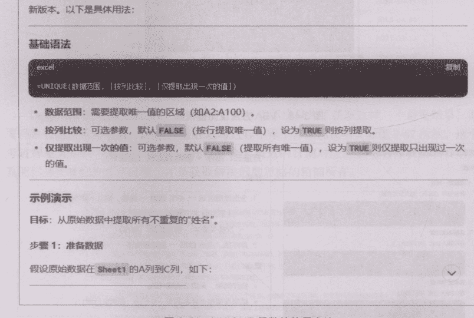

#### 3.3.8 案例8：对比两个表格并提取正常和异常数据

图3-52所示的是一个简单的例子，要求是对比两个表格，找出两个表格中都存在的数据以及只存在于一个表格中的数据。文件是“对比两个表格并提取正常和异常数据.xlsx”。

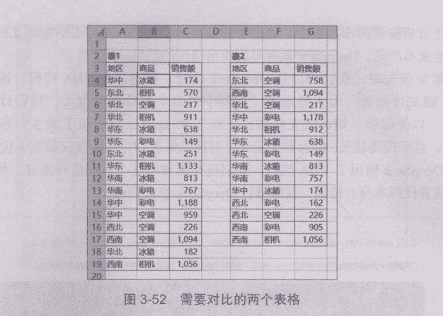

图 3-52 需要对比的两个表格

上传文件，输入提示词：
“请对比两个表格，对比条件是地区和商品，例如，如果同一个地区和同一个商品在两个表格中都存在（不需要考虑销售额），就是两个表格中都存在的数据；如果同一个地区和同一个商品仅仅出现在某个表格中，就是仅存在某个表格中。
注意：严格按照两个表格的原始数据进行检查，不需要修订数据。无论同一个地区同一个商品的销售额是否一致，都应视为共同数据。
请将对比结果生成以下三个表：
（1）两个表格中都存在的数据，并计算数据的差异值；
（2）只存在于表 1 的数据；
（3）只存在于表 2 的数据。”

DeepSeek 会对两个表格进行比较分析，并给出最终结果，如图 3-53 所示。

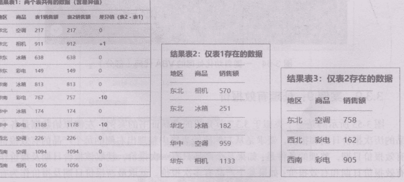

图 3-53 DeepSeek 输出的最终对比结果

在对比分析整理两个甚至多个表格中的数据时，我们一定要说清楚对比的条件。如果条件不清楚或不严谨，DeepSeek 就有可能给出错误的结果。

当数据量很大时，我们可以让 DeepSeek 设计一段自动化 VBA 代码，这样就可以在 Excel 中一键快速处理。输入提示词“这两个表格中的数据量很大，请设计一个自动化 VBA 代码，以便能够一键高效完成对比工作”，DeepSeek 就给出了图 3-54 所示的自动化 VBA 代码。这个代码较长，因为要生成三个对比结果表，图 3-54 仅仅截取了代码开头部分。

即使 DeepSeek 给出了 VBA 代码，我们还是需要对这个代码进行验证。如果处理结果不正确，或者代码本身有错误，就继续让 DeepSeek 修改完善。

```
最后，需要测试代码，确保在各种情况下（如空表、重复键、不同顺序的列）都能正确运行，并生成预期的结果表。

以下是用于自动化对比两个表格的VBA代码，支持一键生成3个结果表，并针对大数据量进行优化：

vba
Sub CompareTablesAutomatically()
    Dim ws1 As Worksheet, ws2 As Worksheet
    Dim result1 As Worksheet, result2 As Worksheet, result3 As Worksheet
    Dim dict1 As Object, dict2 As Object
    Dim lastRow1 As Long, lastRow2 As Long
    Dim key As String
    Dim i As Long, outputRow As Long
    Dim t As Double

    t = Timer
    Application.ScreenUpdating = False
    Application.Calculation = xlCalculationManual

    ' 初始化字典 (Key=地区&商品, Item=销售额)
    Set dict1 = CreateObject("Scripting.Dictionary")
    Set dict2 = CreateObject("Scripting.Dictionary")

    ' 设置工作表对象 (根据实际名称修改)
    Set ws1 = ThisWorkbook.Sheets("Sheet1")
    Set ws2 = ThisWorkbook.Sheets("Sheet2")

    ' 清理旧结果表
    On Error Resume Next
    Sheets("对比结果").Delete
    Sheets("仅表1数据").Delete
    Sheets("仅表2数据").Delete
    On Error GoTo 0

    ' 创建新结果表
    Set result1 = Sheets.Add(After:=Sheets(Sheets.Count))
    result1.Name = "对比结果"
```

图 3-54 一键自动化处理的 VBA 代码（部分）

#### 3.3.9 案例 9：处理有效报价

图 3-55 所示的是一个类似于 3.3.7 节介绍的最新证书的案例，左侧原始数据是各个产品的历次报价日期和报价，要求是从左侧原始表格中整理出右侧的每个产品的有效报价及有效报价日期，整理的条件是：如果某个产品只有一次报价，就取该报价日期及报价作为有效报价日期和有效报价；如果某个产品有多次报价，就取最新报价日期及报价作为有效报价日期和有效报价。文件是“报价处理.xlsx”。

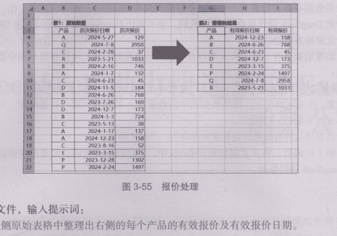

上传文件，输入提示词：
“从左侧原始表格中整理出右侧的每个产品的有效报价及有效报价日期。
有效报价的处理逻辑是：
如果某个产品只有一次报价，就取该报价日期及报价作为有效报价日期和有效报价；
如果某个产品有多次报价，就取最新报价日期及报价作为有效报价日期和有效报价。
请输出整理好的有效报价表格。”

DeepSeek 开始对表格进行系统分析和处理，最后输出我们需要的结果，如图 3-56 所示。

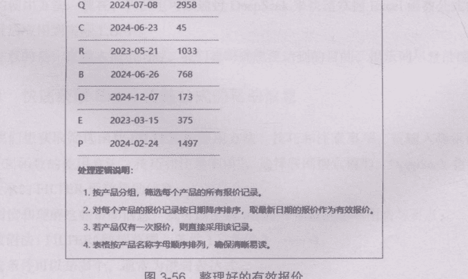

如果数据有数百行甚至上千行，最好能实现在 Excel 中一键完成整理工作，此时我们可以请求 DeepSeek 设计自动化 VBA 代码。至于要让 DeepSeek 设计什么样的代码，需要我们先指定原始表格的结构。

假如原始数据有三列，从 A 列保存，第一行是标题，我们可以在提示词中指定这个具体结构：

> “请帮助设计自动化 VBA 代码，以便能够在 Excel 中一键完成报价整理工作。
注意：在实际情况下，原始数据表中的数据从 A 列保存，第一行是标题，要处理的数据从第二行开始；
请将整理后的有效报价数据单独保存为一个新工作表。”

得到了代码后，将其复制粘贴到 Excel 中，试运行调试代码。如果出现错误，就继续请求 DeepSeek 进行修改。

## 第 4 章 DeepSeek 助力快速获取 Excel 函数公式

我们可能无法熟练地应用 Excel 函数公式，以至于在实际工作中经常磕磕绊绊地设计公式，或是到网上搜索有关公式来套用，却并不总能真正解决问题，浪费了很多时间，效率低下。现在，我们可以借助 DeepSeek，快速获取函数的使用方法以及针对具体表格快速设计公式的方法，提升日常数据处理的效率。

为了提高获取的速度和效率，我们最好使用 DeepSeek 的联网搜索模型。

### 4.1 DeepSeek 助力快速获取 Excel 函数公式的帮助

以前，我们可以通过查阅 Microsoft Office 的帮助信息来获取 Excel 函数公式的帮助信息，学习函数的使用方法。现在，我们也可以通过 DeepSeek 来快速掌握 Excel 函数公式的使用方法，并灵活应用到实际工作中。

需要注意的是，在输入提示词时，我们要明确想要达到的目的，提示词尽量准确。

#### 4.1.1 快速获取 Excel 函数公式的帮助信息

如果我们想获取筛选函数 FILTER 的使用方法、技巧和注意事项，就输入提示词“请介绍 FILTER 函数的使用方法、技巧和注意事项”，选择联网搜索模型，DeepSeek 会快速给出图 4-1 所示的 FILTER 函数帮助信息。

仔细阅读和理解这些帮助信息，就可以了解 FILTER 函数的基本用法与要点：

- 函数语法：FILTER( 数据范围，条件 1，条件 2，…… )。
- 筛选条件可以是多个，通常为逻辑表达式。
- 如果是多个条件，用逗号分隔。
- 可以结合 OFFSET 函数或 INDIRECT 函数实现动态数据范围筛选。
- FILTER 函数的结果是数组，可在其他函数公式中直接使用。
- 要确保数据范围和条件范围大小一致。
- 若无匹配项，FILTER 函数会返回空数组，需用 IFERROR 处理。
- 大数据集或复杂条件可能影响性能，建议优化条件或减少数据量。

DeepSeek 还给出了一个简单示例，筛选出部门为“销售”同时工资高于 5000 元的数据：

```
=FILTER(A1:C10, B1:B10="销售", C1:C10>5000)
```

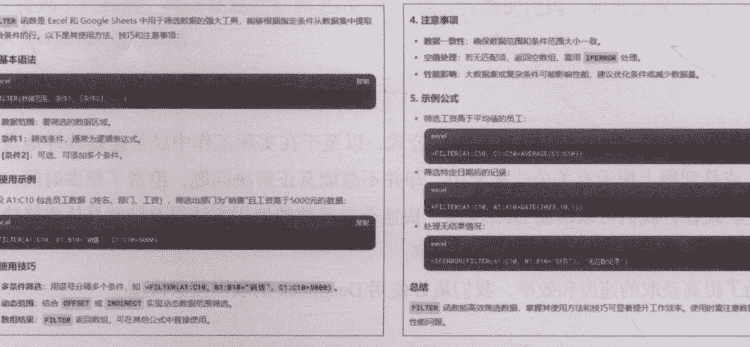

FILTER 函数的关键点是设置筛选条件，尤其是多个筛选条件的组合。如果不清楚如何组合这些筛选条件，可以输入必要的提示词，例如“如果要从员工信息表中筛选出部门是财务部和技术部，学历是硕士和博士，年龄在 35 岁至 45 岁之间的数据，如何设计筛选公式”，DeepSeek 就会给出图 4-2 和图 4-3 所示的回答。

假设 A 列是姓名，B 列是部门，C 列是学历，D 列是年龄，筛选公式如下：

```
=FILTER(A1:D100,
((B1:B100="财务部") + (B1:B100="技术部")),
((C1:C100="硕士") + (C1:C100="博士")),
(D1:D100>=35) * (D1:D100<=45))
```

我们要重点阅读和理解公式解析信息，因为公式解析信息是对公式逻辑思路的解释，可以帮助我们深入理解公式中的逻辑，以及构建组合条件的方法和技巧。这里就详细说明了不同逻辑关系条件的组合方法：如果是与条件，使用乘号组合；如果是或条件，使用加号组合。两个部门条件以及两个学历条件是或条件，因此使用加号组合；两个年龄条件是与条件，因此使用乘号组合。

要从员工信息表中筛选出部门为“财务部”或“技术部”，学历为“硕士”或“博士”，且年龄在35岁至45岁之间的员工，可以使用 FILTER 函数结合逻辑运算符来实现。以下是具体步骤和公式设计：

假设数据结构
- A列：姓名
- B列：部门
- C列：学历
- D列：年龄

筛选条件
1. 部门：财务部 或 技术部
2. 学历：硕士 或 博士
3. 年龄：35 ≤ 年龄 ≤ 45

公式设计
在 Excel 或 Google Sheets 中，使用 FILTER 函数结合逻辑运算符

```
=FILTER(A1:D100,
((B1:B100="财务部") + (B1:B100="技术部")) *
((C1:C100="硕士") + (C1:C100="博士")) *
((D1:D100>=35) * (D1:D100<=45)))
```

图 4-2 多条件筛选公式示例

公式解析
1. 部门条件：
   (B1:B100="财务部") + (B1:B100="技术部")：
   - 使用 + 表示“或”关系，满足任意一个条件即可。
   - 结果为 TRUE (1) 或 FALSE (0)，相加后非零值表示满足条件。
2. 学历条件：
   (C1:C100="硕士") + (C1:C100="博士")：
   - 同样使用 + 表示“或”关系。
3. 年龄条件：
   (D1:D100>=35) * (D1:D100<=45)：
   - 使用 * 表示“且”关系，必须同时满足两个条件。
   - 结果为 TRUE (1) 或 FALSE (0)，相乘后非零值表示满足条件。
4. 组合条件：
   - FILTER 函数会将所有条件的结果相乘，只有同时满足所有条件的行才会被筛选出来。

图 4-3 公式解析

如果你听说过强大的 GROUPBY 函数，但不知道如何使用，可以询问 DeepSeek。输入提示词“请介绍 Excel 函数 GROUPBY 的使用方法、技巧和注意事项”，选择联网搜索模型，DeepSeek 就会快速给出图 4-4 至图 4-6 所示的 GROUPBY 函数帮助信息，包括函数的基本语法、各个参数的详细说明、简单的应用示例以及使用技巧与注意事项。

GROUPBY 是 Excel 365 和 Excel 网页版中的一个新函数，用于对数据进行分组和聚合操作。它类似于 SQL 中的 GROUP BY 语句，能够根据指定的列对数据进行分组，并对每个组应用聚合函数（如求和、平均值、计数等）。

基本语法
=GROUPBY(row_fields, values, function, [field_headers], [total_depth], [sort_order], [filter_array])
- row_fields: 用于分组的列或行字段，可以是一个或多个列。
- values: 需要聚合的列或行字段。
- function: 应用于每个组的聚合函数，如 SUM, AVERAGE, COUNT 等。
- [field_headers]: 可选参数，指定是否包含字段标题，默认为 TRUE。
- [total_depth]: 可选参数，指定是否在结果中包含总计行，默认为 0（不包括）。
- [sort_order]: 可选参数，指定排序顺序，默认为 0（不排序）。
- [filter_array]: 可选参数，指定过滤条件，默认为 TRUE（不过滤）。

使用示例
假设有以下数据表：
部门 员工 销售额
销售部 张三 1000
销售部 李四 1500
技术部 王五 800
技术部 赵六 1200

示例 1：按部门分组并计算总销售额

```
=GROUPBY(A2:A5, C2:C5, SUM)
```

结果：
部门 销售额
销售部 2500
技术部 2000

示例 2：按部门分组并计算平均销售额

```
=GROUPBY(A2:A5, C2:C5, AVERAGE)
```

结果：
部门 平均销售额
销售部 1250
技术部 1000

示例 3：按部门和员工分组并计算总销售额

```
=GROUPBY(A2:B5, C2:C5, SUM)
```

结果：
部门 员工 销售额

图 4-4 GROUPBY 函数的基本语法和参数说明

图 4-5 GROUPBY 函数的应用示例

1. 多列分组：`row_fields` 可以是一个数组，支持多列分组。
2. 聚合函数：`function` 参数支持多种聚合函数，如 `SUM`、`AVERAGE`、`COUNT`、`MIN`、`MAX` 等。
3. 总计行：通过 `total_depth` 参数可以添加总计行，方便查看整体汇总。
4. 排序：`sort_order` 参数可以指定排序顺序，`1` 为升序，`-1` 为降序。
5. 过滤：`filter_array` 参数可以用于过滤数据，只对符合条件的数据进行分组和聚合。
6. 动态数组：`GROUPBY` 返回的结果是动态数组，会自动填充到相邻单元格中。
7. 兼容性：`GROUPBY` 仅适用于 Excel 365 和 Excel 网页版，旧版本 Excel 不支持。

**注意事项**
* 数据范围：确保 `row_fields` 和 `values` 的范围一致，否则可能导致错误。
* 数据类型：确保 `values` 列的数据类型适合所选的聚合函数，例如 `SUM` 需要数值类型数据。
* 性能：对于大数据集，`GROUPBY` 可能会影响性能，建议在使用前进行测试。

通过掌握 `GROUPBY` 函数的使用方法和技巧，可以更高效地进行数据分析和汇总。


#### 4.1.2 针对具体表格，快速获取多个 Excel 函数公式解决方案

DeepSeek 可以帮助我们快速了解函数的基本用法和注意事项，快速入门 Excel 函数公式。更重要的是，我们可以利用 DeepSeek 从各方面训练自己的逻辑思维能力，了解当从不同角度考虑问题时，解决方案有什么不同。

例如，图 4-7 所示的是各个地区各个商品销售的统计表，要求设计公式，查找指定地区、指定商品的数据。文件是“快速获取多个函数公式解决方案.xlsx”。

这个问题有很多种解决方案，关键看每种解决方案的出发点是什么，公式的基本逻辑是什么。通过理解每种解决方案，我们可以扩展思路，灵活运用各个函数公式。

| | A | B | C | D | E | F | G | H |
|---|---|---|---|---|---|---|---|---|
| 1 | | | | | | | | |
| 2 | | 1、基础表格 | | | | | 2、要求查询数据 | |
| 3 | 地区 | 彩电 | 冰箱 | 空调 | 合计 | | | |
| 4 | 华北 | 1038 | 1421 | 2005 | 4464 | | 指定地区： | 华东 |
| 5 | 华南 | 151 | 1816 | 1132 | 3099 | | 指定商品： | 空调 |
| 6 | 华东 | 769 | 439 | 1448 | 2656 | | | |
| 7 | 西南 | 869 | 128 | 891 | 1888 | | 销售数据： | |
| 8 | 西北 | 1373 | 859 | 330 | 2562 | | | |
| 9 | 华中 | 447 | 760 | 780 | 1987 | | | |
| 10 | 东北 | 213 | 687 | 702 | 1602 | | | |
| 11 | 合计 | 4860 | 6110 | 7288 | 18258 | | | |


上传文件，输入提示词“请详细列举要查询这个表格中的数据，有多少种解决方案（公式）”，DeepSeek 给出的思考结果如图 4-8 所示，列举了十种不同的解决方案，即使用十个不同的函数构建公式。

商品是空调时，是否所有公式都能正确指向D6单元格。

同时，用户可能希望了解每种方法的优缺点，比如VLOOKUP的局限性（只能从左到右查找），XLOOKUP的灵活性，数组公式的计算效率等。但问题要求详细列举解决方案，可能需要简要说明每个公式的结构，而不仅仅是列出公式。

总结可能的解决方案：

1. INDEX-MATCH-MATCH（基础组合）
2. VLOOKUP-MATCH（垂直查找组合）
3. XLOOKUP 双查找（新版函数）
4. OFFSET-MATCH（动态偏移）
5. INDIRECT-ADDRESS（间接引用）
6. SUMPRODUCT条件乘积（数组运算）
7. 数组公式（Ctrl+Shift+Enter）
8. FILTER函数（动态数组，Excel 365）
9. CHOOSE-MATCH（多区域选择）
10. 名称管理器简化公式

需要逐一构建这些公式，并验证其正确性。例如：


DeepSeek 会针对每种解决方案，列出相应的函数公式及对公式的解释。

##### 1. INDEX-MATCH-MATCH（基础组合）

联合使用 INDEX 函数和 MATCH 函数获取的公式如图 4-9 所示，公式的逻辑原理是先使用 MATCH 函数分别定位出地区所在的行号以及商品所在的列号，再使用 INDEX 函数提取行列交叉单元格的值。

```
=INDEX(B4:D10, MATCH(H4, A4:A10, 0), MATCH(H5, B3:D3, 0))
```

现在思考一下：这个公式的切入点是什么？其应用有什么优点？


这个公式可以引导我们去进一步了解和学习 MATCH 函数和 INDEX 函数的使用方法及技巧。

例如，输入提示词“请问如何使用 MATCH 函数，要注意哪些问题”，DeepSeek 会给出 MATCH 函数的基本语法、简单示例以及注意事项，如图 4-10 和图 4-11 所示。

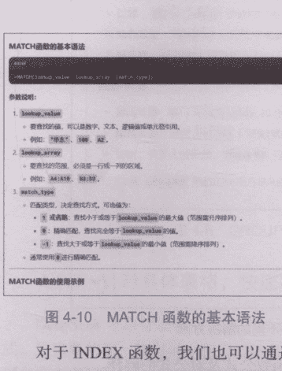

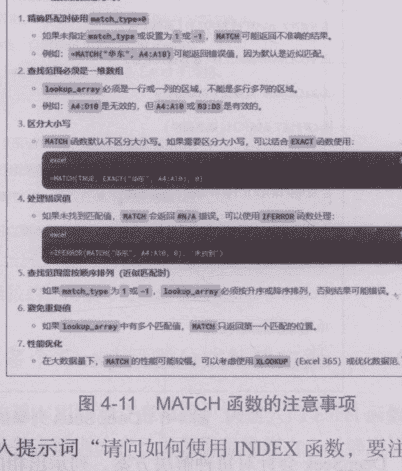

图 4-10 MATCH 函数的基本语法

图 4-11 MATCH 函数的注意事项

对于 INDEX 函数，我们也可以通过输入提示词“请问如何使用 INDEX 函数，要注意哪些问题”以获取 INDEX 函数的基本语法、简单示例以及注意事项。

##### 2. VLOOKUP-MATCH（垂直查找组合）

联合使用 VLOOKUP 函数和 MATCH 函数获取的公式如图 4-12 所示，公式的逻辑原理是先使用 MATCH 函数定位出指定商品所在的列号，并将这个列号作为 VLOOKUP 函数的第三个参数值，然后使用 VLOOKUP 函数提取指定地区指定列的数据。

```
=VLOOKUP(H4, A4:D10, MATCH(H5, B3:D3, 0)+1, 0)
```

现在思考一下：这个公式的切入点是什么？其应用有什么优点？


图 4-12 VLOOKUP-MATCH（垂直查找组合）解决方案

##### 3. XLOOKUP 双查找（新版函数）

使用 XLOOKUP 函数获取的公式如图 4-13 所示，公式的逻辑原理是先使用 XLOOKUP 函数获取指定商品所在列数据区域（返回一个一维数组），再将这个数组作为另一个 XLOOKUP 函数返回值的参数。

```
=XLOOKUP(H4, A4:A10, XLOOKUP(H5, B3:D3, B4:D10))
```

现在思考一下：这个公式的切入点是什么？其应用有什么优点？


如果不了解 XLOOKUP 函数怎么用，要注意哪些问题，可以继续输入提示词“请问如何使用 XLOOKUP 函数，要注意哪些问题？请结合示例详细介绍”，以获取 XLOOKUP 函数的详细用法信息。

##### 4. OFFSET-MATCH（动态偏移）

联合使用 OFFSET 函数和 MATCH 函数获取的公式如图 4-14 所示，公式的逻辑原理是先使用 MATCH 函数定位出指定地区所在的行位置和指定商品所在的列位置，然后利用 OFFSET 函数从基准单元格偏移到指定地区指定商品的交叉单元格位置，取出该单元格数据。

```
=OFFSET(B3, MATCH(H4, A4:A10, 0), MATCH(H5, B3:D3, 0)-1)
```


很多人对 OFFSET 函数不太了解，无法熟练使用，可以继续寻求 DeepSeek 的帮助。输入提示词“请问如何使用 OFFSET 函数，要注意哪些问题？请结合示例详细介绍”，就会获取 OFFSET 函数的帮助信息，如图 4-15 所示。

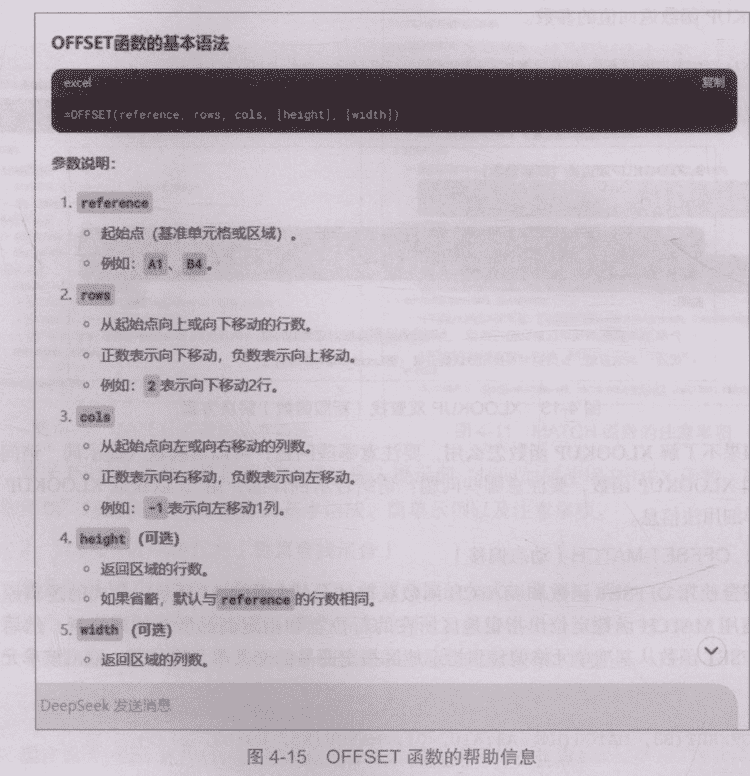

##### 5. INDIRECT-ADDRESS（间接引用）

联合使用 INDIRECT 函数和 ADDRESS 函数获取的公式如图 4-16 所示，公式的逻辑原理是先使用 MATCH 函数定位出指定地区所在的行位置和指定商品所在的列位置，然后利用 ADDRESS 获取指定地区指定商品的交叉单元格位置的地址字符串，最后再使用 INDIRECT 间接引用该单元格，获取该单元格数据。

```
=INDIRECT(ADDRESS(MATCH(H4, A4:A10, 0)+3, MATCH(H5, B3:D3, 0)+2))
```

这个公式用起来并不高效，也比较难理解，但其作为一种解决方案，可以帮助我们学习 INDIRECT 函数和 ADDRESS 函数。

公式：

```
=INDIRECT(ADDRESS(MATCH(H4, A4:A10, 0)+3, MATCH(H5, B3:D3, 0)+2))
```

说明：

- 通过 ADDRESS 生成目标单元格地址（行号需+3，列号需+2，因数据起始于第4行B列）。
- 缺点：硬编码行/列偏移，数据区域变动时需调整公式。

图 4-16 INDIRECT-ADDRESS（间接引用）解决方案

如果不了解 INDIRECT 函数的使用方法，就继续输入提示词“请问如何使用 INDIRECT 函数，要注意哪些问题？请结合示例详细介绍”，获取 INDIRECT 函数的帮助信息。

##### 6. SUMPRODUCT 条件乘积（数组运算）

使用 SUMPRODUCT 函数获取的公式如图 4-17 所示，公式的逻辑原理是基于查找数据是数字，因此可以设计判断条件，并将判断条件生成的数组与实际求和区域相乘，得到一个由数字 0（不满足条件）和实际数值（满足条件）的数组，再使用 SUMPRODUCT 函数将在各个数组的各个元素相加，就是指定地区指定商品的数据。

```
=SUMPRODUCT((A4:A10=H4)*(B3:D3=H5)*B4:D10)
```

公式：

```
=SUMPRODUCT((A4:A10=H4)*(B3:D3=H5)*B4:D10)
```

说明：

- 将地区匹配的行与商品匹配的列相乘，最终求和（仅当唯一匹配时有效）。
- 限制：必须确保唯一匹配，否则会返回错误合计值。

图 4-17 SUMPRODUCT 条件乘积（数组运算）解决方案

那么，如何使用 SUMPRODUCT 函数？使用时要注意哪些问题？会有哪些原因导致错误的出现？如果表格中的数据量很大，使用这个函数会出现什么问题？如果你有这样的疑问，不妨向 DeepSeek 提问，以获取需要的答案。

##### 7. 数组公式（Ctrl+Shift+Enter）

使用数组公式获取的公式如图 4-18 所示。这个公式并不简单，逻辑也较为复杂，但还是可以开拓我们使用函数公式解决问题的思路。

```
=INDEX(B4:D10, MATCH(1, (A4:A10=H4)*1, 0), MATCH(1, (B3:D3=H5)*1, 0))
```

公式：

```
=INDEX(B4:D10, MATCH(1, (A4:A10=H4)*1, 0), MATCH(1, (B3:D3=H5)*1, 0))
```

说明：

- 使用数组运算直接定位行列，需按 **Ctrl+Shift+Enter** 输入（旧版Excel）。
- 注意：较复杂，但兼容性较好。

图 4-18 数组公式（Ctrl+Shift+Enter）解决方案

什么是数组公式？如何创建数组公式？使用数组公式时要注意哪些问题？数组公式出现错误该如何编辑修改？如何删除数组公式？关于这些问题，我们可以继续向 DeepSeek 寻求帮助。

##### 8. FILTER 函数（动态数组，Excel 365）

使用 FILTER 函数获取的公式如图 4-19 所示，这个公式的原理比较简单：先使用 FILTER 函数筛选出指定地区的行数据，再使用 INDEX 函数从行数据中提取指定商品的数据，而指定商品则使用 MATCH 函数来定位。

```
=INDEX(FILTER(B4:D10, A4:A10=H4), , MATCH(H5, B3:D3, 0))
```

公式：

```
=INDEX(FILTER(B4:D10, A4:A10=H4), , MATCH(H5, B3:D3, 0))
```

说明：

- 先过滤出指定地区的行，再用 **INDEX** 提取对应商品列。
- 优点：支持多条件扩展，语法简洁。

图 4-19 FILTER 函数（动态数组，Excel 365）解决方案

##### 9. CHOOSE-MATCH（多区域选择）

联合使用 CHOOSE 函数和 MATCH 函数获取的公式如图 4-20 所示。这个公式并不简单，仅仅作为一个参考解决方案，在实际工作中很少使用。

```
=CHOOSE(MATCH(H5, B3:D3, 0), INDEX(B4:B10, MATCH(H4, A4:A10, 0)), INDEX(C4:C10, MATCH(H4, A4:A10, 0)), INDEX(D4:D10, MATCH(H4, A4:A10, 0)))
```

公式：

```
=CHOOSE(MATCH(H5, B3:D3, 0), INDEX(B4:B10, MATCH(H4, A4:A10, 0)), INDEX(C4:C10, MATCH(H4, A4:A10, 0)), INDEX(D4:D10, MATCH(H4, A4:A10, 0)))
```

说明：

- 根据商品列号选择对应的列区域，再匹配地区行号。
- 缺点：公式冗长，适合列较少的情况。

图 4-20 CHOOSE-MATCH（多区域选择）解决方案

##### 10. 名称管理器简化公式

这个解决方案是使用定义名称来简化公式，因此要先定义名称，再构建输入公式，如图 4-21 所示。

这里又有一个需要学习和掌握的新知识——定义名称和使用名称。如果你不了解什么是名称、如何定义名称、如何在函数公式中使用名称、如何编辑和删除名称、名称可以用来解决什么实际问题，不妨继续向 DeepSeek 求助，来学习关于名称的相关知识和技能。

步骤：

1. 定义名称：地区范围=A4:A10，商品范围=B3:D3，数据区域=B4:D10。
2. 公式：

```
=INDEX(数据区域, MATCH(H4, 地区范围, 0), MATCH(H5, 商品范围, 0))
```

图 4-21 名称管理器简化公式解决方案

DeepSeek 对这些解决方案和函数公式进行了总结，如图 4-22 所示。这可以帮助我们进一步理解和使用这些函数公式，并灵活使用它们去解决实际问题。

| 方法 | 优点 | 缺点 |
| :--- | :--- | :--- |
| INDEX-MATCH-MATCH | 灵活高效，兼容性强 | 需要理解行列匹配逻辑 |
| VLOOKUP-MATCH | 简单直观 | 依赖左侧首列，无法逆向查找 |
| XLOOKUP | 支持双向查找，语法简洁 | 仅适用于新版Excel |
| SUMPRODUCT | 无嵌套函数，适合简单场景 | 需唯一匹配，否则结果错误 |
| FILTER | 动态数组，扩展性强 | 仅Excel 365支持 |
| 根据Excel版本、数据结构和需求复杂度选择最适合的方案。推荐优先使用 INDEX-MATCH 或 XLOOKUP（新版）。 | | |

图 4-22 DeepSeek 对解决方案的总结

本案例的解决方案不仅限于上面列示的几种，还有使用 HLOOKUP 函数、LOOKUP 函数等来创建公式。我们可以继续输入提示词“针对这个表格的数据查找问题，还有其他的解决方案吗？如果有，请列示详细公式及其说明”，获取更多解决方案，如图 4-23 所示。

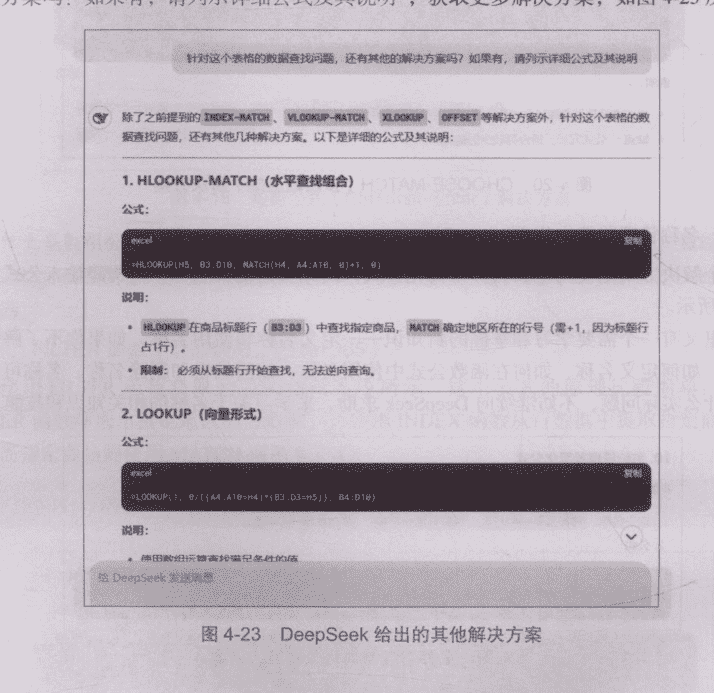

### 4.2 DeepSeek 助力获取 Excel 函数公式实战案例

上一节我们结合一个实际案例，介绍了如何使用 DeepSeek 获取 Excel 函数公式，以及使用函数公式的相关知识和技能。本节我们介绍几个实战案例，让 DeepSeek 直接给出我们需要的公式。如果觉得 DeepSeek 给出的公式不太简洁，我们还可以让它继续对公式进行加工优化处理。

#### 4.2.1 案例 1：简单表格，获取简单的函数公式

对于一些简单表格的处理，例如一些基础表单中必要字段的计算，一些简单汇总表中数据的查询和关联取数，如果我们对函数公式非常熟悉，直接编写公式是最高效的。如果我们对函数公式不太熟悉，又不想去学习，那么可以借助 DeepSeek 快速获取函数公式。

在第 3 章中，我们借助 DeepSeek 获取了提取出生日期和性别的计算公式。关于这个公式，我们再练习一下。

选择联网搜索模型，输入提示词“假如单元格 E3 是身份证号码，如何根据身份证号码自动提取出性别、出生日期和年龄？要求：公式简洁、短，计算效率高”，注意提示词要精确到“必须给出一个精炼简洁且短的公式”，否则 DeepSeek 给出的公式可能并不是最简洁、最高效的。这里所说的简洁高效，是满足公式短、使用函数少这一基本要求。DeepSeek 给出的参考公式如图 4-24 所示。


但是，提取出生日期的公式是错误的，因为 TEXT 函数得到的结果是文本型日期，并不是数值型日期，这样会影响数据统计和分析。我们继续输入提示词“提取出生日期的公式是错误的，因为公式结果是文本型日期，并不是数值型日期。请修改这个公式”，DeepSeek 会给出图 4-25 所示的公式。


这个公式也不是特别简洁，尽管它解决了文本型日期的问题。

我们可以继续输入提示词“请修改 TEXT 函数，以满足结果是数值型日期的要求”，就得到了一个比较简洁的提取出生日期的公式，如图 4-26 所示。这样，我们就获取了直接从身份证号码中提取性别、出生日期和年龄的公式，如下所示：

```
出生日期：=DATEVALUE(TEXT(MID(D2,7,8),"0000-00-00"))
性别：=IF(MOD(MID(D2,17,1),2)=1," 男 "," 女 ")
年龄：=DATEDIF(DATEVALUE(TEXT(MID(D2,7,8),"0000-00-00")),TODAY(),"y")
```


我们可以使用多个公式直接从身份证号码中提取性别、出生日期和年龄。例如，我们可以使用 ISEVEN 函数或者 ISODD 函数判断数字为偶数或奇数，进而判断性别；在日期函数中，文本型日期是可以直接参与计算的，不需要先转换为数值型日期。此外，日期本身是数字，而 TEXT 函数结果是文本型日期，也就是文本型数字，根据 Excel 的计算规则，文本型数字可以直接进行四则运算，将 TEXT 函数结果乘以 1 也能将文本型日期转换为数值型日期。因此，最简单的公式如下：

```
出生日期：=1*TEXT(MID(D2,7,8),"0000-00-00")
性别：=IF(ISODD(MID(D2,17,1))," 男 "," 女 ")
年龄：=DATEDIF(TEXT(MID(D2,7,8),"0000-00-00"),TODAY(),"y")
```

这个案例间接说明了一个问题：即使你能够从 DeepSeek 中获取一些公式，但如果你没有 Excel 基础，就只能是套用这些公式而已，并没有真正掌握公式的基本逻辑及其运用。可见，只有在掌握 Excel 基本技能的前提下，DeepSeek 才能让我们如虎添翼。

#### 4.2.2 案例 2：复杂表格，获取复杂的函数公式

态查找数据.xlsx。

| A | B | C | D | E | F | G | H | I | J | K | L | M | N | O | P | Q |
|---|---|---|---|---|---|---|---|---|---|---|---|---|---|---|---|---|
| 1 | 销售汇总表 | | | | | | | | | | | | | | 2. 分析报告 |
| 2 | 地区 | 产品 | 2022年 | | | | 2023年 | | | | 2024年 | | | | 指定地区 | 合计 |
| 3 | | | 1季度 | 2季度 | 3季度 | 4季度 | 1季度 | 2季度 | 3季度 | 4季度 | 1季度 | 2季度 | 3季度 | 4季度 | 指定产品 | 产品05 |
| 4 | 华北 | 产品03 | 1649 | 1793 | 336 | 1209 | 2386 | 984 | 2542 | 1149 | 2248 | 2416 | 2648 | 417 | 指定季度 | 3季度 |
| 5 | | 产品01 | 2486 | 2266 | 2282 | 1580 | 1858 | 1743 | 1500 | 1302 | 1300 | 1517 | 2928 | 2143 | | |
| 6 | | 产品04 | 563 | 336 | 2962 | 1747 | 698 | 744 | 2646 | 1302 | 875 | 2541 | 1728 | 2615 | | |
| 7 | | 产品02 | 2336 | 582 | 2476 | 965 | 623 | 2232 | 1831 | 526 | 856 | 2258 | 2638 | 337 | | |
| 8 | | 产品05 | 2219 | 1048 | 2613 | 829 | 2736 | 1119 | 2027 | 2347 | 501 | 1119 | 1450 | 2925 | | |
| 9 | 华东 | 产品01 | 337 | 1132 | 954 | 869 | 1858 | 1996 | 773 | 428 | 994 | 3003 | 2385 | 2631 | 年份 | 销售 |
| 10 | | 产品02 | 2940 | 2224 | 1321 | 2537 | 318 | 2728 | 2063 | 1692 | 714 | 2296 | 1392 | 965 | 2022年 | |
| 11 | | 产品03 | 70 | 2181 | 1589 | 741 | 854 | 907 | 1804 | 2725 | 256 | 2094 | 1765 | 2982 | 2023年 | |
| 12 | | 产品04 | 2306 | 1855 | 2540 | 1347 | 1894 | 2211 | 1940 | 1744 | 781 | 2629 | 1765 | 1770 | 2024年 | |
| 13 | 华南 | 产品02 | 2722 | 346 | 2033 | 942 | 564 | 1154 | 2171 | 1394 | 2050 | 1972 | 2542 | 2457 | | |
| 14 | | 产品05 | 2003 | 1870 | 1649 | 834 | 895 | 2053 | 862 | 2326 | 762 | 2681 | 1865 | 1142 | | |
| 15 | | 产品03 | 2007 | 2571 | 2049 | 1562 | 2344 | 1220 | 2857 | 2296 | 443 | 1647 | 484 | 889 | | |
| 16 | | 产品01 | 2306 | 2071 | 2601 | 1918 | 2874 | 822 | 1653 | 2034 | 1850 | 750 | 2423 | 2793 | | |
| 17 | | 产品04 | 885 | 1624 | 2919 | 704 | 2589 | 1763 | 1052 | 446 | 388 | 2711 | 1273 | 1320 | | |
| 18 | 华中 | 产品01 | 1080 | 1121 | 1599 | 2495 | 704 | 1379 | 992 | 650 | 1584 | 1637 | 1306 | 2230 | | |
| 19 | | 产品02 | 2849 | 1624 | 2919 | 704 | 2589 | 1763 | 1052 | 446 | 388 | 2711 | 1273 | 1320 | | |
| 20 | | 产品03 | 2242 | 1525 | 907 | 1376 | 699 | 638 | 1030 | 836 | 2796 | 586 | 412 | 2067 | | |
| 21 | | 产品04 | 1471 | 2181 | 1520 | 1137 | 2720 | 1410 | 1029 | 1074 | 2354 | 3015 | 2200 | 1024 | | |
| 22 | 合计 | 产品01 | 4271 | 5570 | 5471 | 4274 | 3292 | 3673 | 4177 | 4878 | 3509 | 3750 | 5903 | 7355 | | |
| 23 | | 产品02 | 6540 | 8091 | 8003 | 4274 | 6074 | 7637 | 7116 | 4878 | 2888 | 9337 | 8773 | 7262 | | |
| 24 | | 产品03 | 6858 | 8113 | 4613 | 6684 | 6747 | 4570 | 7492 | 5973 | 6201 | 6945 | 4936 | 4338 | | |
| 25 | | 产品04 | 4010 | 6252 | 4408 | 3891 | 5312 | 2537 | 5615 | 5120 | 4010 | 8185 | 4993 | 5409 | | |
| 26 | | 产品05 | 4222 | 2918 | 3978 | 1663 | 3631 | 3172 | 2889 | 4673 | 1263 | 3800 | 3315 | 4067 | | |
| 27 | | 产品06 | 5155 | 3695 | 3869 | 2622 | 5463 | 2585 | 2705 | 2480 | 2238 | 3461 | 3696 | 4113 | | |

图 4-27 根据指定地区、指定产品和指定季度查找每年的数据

这是有四个条件的数据查找问题：地区、产品、季度和年份，因此公式的获取比较复杂，但逻辑是很清晰的：如果能够确定地区位置和产品位置，就能知道取数的行位置；如果能够确定年份位置和季度位置，就能知道取数的列位置。

唯一的难点在于，A 列的地区是合并单元格，并且每个地区下的产品个数及产品次序是不一样的。如果能够解决这两个问题，就能获取公式了。

选择深度思考模型，上传文件，DeepSeek 会对表格进行分析，并输出一些信息。我们可以忽略掉这些信息，然后输入提示词：

> “根据左侧表 1 中的数据，根据指定地区（单元格 Q4）、指定产品（单元格 Q5）和指定季度（单元格 Q6），查找各年数据，分别保存在单元格 Q9 至 Q11 中。
注意：单元格 Q4 至 Q6 的地区、产品和季度是变量，可以指定任意地区、任意产品和任意季度。
注意：地区在 A 列，从第五行开始，每个地区下的产品不尽相同（产品个数不同以及次序不同），并且地区是合并单元格。
注意：产品在 B 列，从第五行开始。
注意：年份在第三行，季度在第四行。
请根据左侧的实际数据区域来设计公式，公式要简洁，运算速度快。”

DeepSeek 会进行逻辑推理，并给出图 4-28 所示的参考公式，以及图 4-29 所示的对公式的解析和图 4-30 所示的使用公式的注意事项。

这三个公式分别如下。

单元格 Q9。

```
=INDEX(
    $C$5:$Q$100,
    MATCH(1, (LOOKUP(ROW($A$5:$A$100), ROW($A$5:$A$100)/($A$5:$A$100<>""), $A$5:$A$100)=$Q$4) * ($B$5:$B$100=$Q$5), 0),
    MATCH("2022年", $C$3:$Q$3, 0) + LEFT($Q$6, 1) -1
)
```

单元格 Q10。

```
=INDEX(
    $C$5:$Q$100,
    MATCH(1, (LOOKUP(ROW($A$5:$A$100), ROW($A$5:$A$100)/($A$5:$A$100<>""), $A$5:$A$100)=$Q$4) * ($B$5:$B$100=$Q$5), 0),
    MATCH("2023年", $C$3:$Q$3, 0) + LEFT($Q$6, 1) -1
)
```

单元格 Q11。

```
=INDEX(
    $C$5:$Q$100,
    MATCH(1, (LOOKUP(ROW($A$5:$A$100), ROW($A$5:$A$100)/($A$5:$A$100<>""), $A$5:$A$100)=$Q$4) * ($B$5:$B$100=$Q$5), 0),
    MATCH("2024年", $C$3:$Q$3, 0) + LEFT($Q$6, 1) -1
)
```

在这三个公式中，关键点是对 A 列合并单元格（实际上是空单元格）进行处理，也就是把每个地区下的空单元格都填充为该地区名称，这是公式的最核心环节，填充公式如下。

```
LOOKUP(ROW($A$5:$A$100), ROW($A$5:$A$100)/($A$5:$A$100<>""), $A$5:$A$100)
```

这是一个非常实用的处理技巧。我们不需要在工作表中处理（如先取消合并单元格，再填充地区名称），而是使用 LOOKUP 函数公式处理 A 列数据，生成一个没有完整地区名称的数组。

公式实现：

Q9（2022年数据）：

```
=INDEX(
    $C$5:$Q$100,
    MATCH(1, (LOOKUP(ROW($A$5:$A$100), ROW($A$5:$A$100)/($A$5:$A$100<>""), $A$5:$A$100)=$Q$4) * ($B$5:$B$100=$Q$5), 0),
    MATCH("2022年", $C$3:$Q$3, 0) + LEFT($Q$6, 1) -1
)
```

Q10（2023年数据）：

```
=INDEX(
    $C$5:$Q$100,
    MATCH(1, (LOOKUP(ROW($A$5:$A$100), ROW($A$5:$A$100)/($A$5:$A$100<>""), $A$5:$A$100)=$Q$4) * ($B$5:$B$100=$Q$5), 0),
    MATCH("2023年", $C$3:$Q$3, 0) + LEFT($Q$6, 1) -1
)
```

Q11（2024年数据）：

```
=INDEX(
    $C$5:$Q$100,
    MATCH(1, (LOOKUP(ROW($A$5:$A$100), ROW($A$5:$A$100)/($A$5:$A$100<>""), $A$5:$A$100)=$Q$4) * ($B$5:$B$100=$Q$5), 0),
    MATCH("2024年", $C$3:$Q$3, 0) + LEFT($Q$6, 1) -1
)
```

图 4-28 DeepSeek 给出的参考公式

公式解析：

1. 合并单元格处理：
   - LOOKUP(ROW($A$5:$A$100), ROW(...)/(条件), $A$5:$A$100)
     动态填充地区列，确保每行对应正确的地区（如A5为“华北”，A6-A8自动填充“华北”）。
2. 行匹配逻辑：
   - MATCH(1, (地区=Q4)*(产品=Q5), 0)
     通过逻辑乘法定位满足 地区+产品 组合的唯一行。
3. 列匹配逻辑：
   - MATCH("2022年", $C$3:$Q$3, 0) 找到年份起始列（第3行），例如2022年在C3。
   - LEFT($Q$6,1)-1 提取季度数字（如“2季度”提取2），计算列偏移量（如2022年起始列C，加上偏移1列到D）。
4. 数据范围优化：
   - 使用 $C$5:$Q$100 限制实际数据区域，避免全表扫描，提升速度。

图 4-29 对公式的解析

注意事项：

1. 输入方式：
   - 旧版Excel：按 `Ctrl+Shift+Enter` 输入数组公式。
   - 新版Excel：直接按 `Enter`（支持动态数组）。
2. 数据范围调整：
   - 若数据超过100行，修改 `$C$5:$Q$100` 为实际范围（如 `$C$5:$Q$200`）。
3. 错误处理：
   - 若返回 `#N/A`，检查以下内容：
     - 地区、产品是否存在组合（如“华东+产品03”是否在数据中）。
     - 季度输入格式是否为“X季度”（如“2季度”而非“第二季度”）。
   - 可添加 `IFERROR` 显示友好提示：

```
=IFERROR(原公式, "无数据")
```

公式优势：

- 速度优化：限定数据范围，避免全列计算。
- 精准匹配：严格对齐表头（年份在第3行，季度在第4行）。
- 动态适配：自动适配任意地区、产品、季度组合。

将三个公式分别复制到对应单元格，就得到一个动态查找公式及查找结果，如图 4-31 所示。为了确保公式是否能用，可以任选地区、产品和季度，看看查找出来的数据是否正确。

如果我们不了解 LOOKUP 函数的基本运算逻辑，不妨输入提示词：“请解释表达式 LOOKUP(ROW($A$5:$A$100), ROW($A$5:$A$100)/($A$5:$A$100<>""), $A$5:$A$100) 的逻辑原理”，DeepSeek 就会对这个表达式进行详细的解释，如图 4-32 所示。仔细阅读这些信息，我们就会学到很多知识，同时也加深了对 LOOKUP 函数的理解。

## 第 4 章 DeepSeek 助力快速获取 Excel 函数公式

从本案例可以看出，要想让 DeepSeek 给出准确的计算公式，我们必须将具体的表格结构以及条件告诉 DeepSeek，这样才能快速得到正确的计算公式。

#### 4.2.3 案例 3：从基础表单到统计报表的汇总函数公式

很多情况下，我们需要依据原始数据表，通过函数公式计算得到所需的统计报表。此时，我们要仔细研究表格的结构及逻辑，以及所需的报表结构，获取一个高效公式。

图 4-33 左侧是从系统导出的原始销售记录，A 列日期是非法日期，F 列是文本型数据，现在要求设计公式，直接使用原始数据进行计算，制作右侧的统计报表。

文件是“从基础表单到分析报表的汇总计算.xlsx”。

上传文件，输入提示词：

> “请根据左侧的基础表单，设计函数公式，制作右侧的统计报表。表格具体情况和计算条件如下：

日期在 A 列，但是是非法日期，需要从非法日期中提取星期名称，与报表中 I 列的星期名称进行匹配，不允许设计辅助列，要直接根据 A 列匹配判断星期；
产品名称在 D 列，需要匹配指定的关键词，例如，计算咖啡类的金额，只要 D 列含有‘咖啡’就认定是咖啡类。
注意：F 列的金额是文本型数字，要在公式中进行处理。
注意：报表的列标题次序是任意的，不是一个固定的次序。
要求：设计一个简洁高效的通用公式，在单元格 J3 输入公式后，可以往右、往下复制、得到全部公式。
首选方案是使用 SUMPRODUCT 函数。”

DeepSeek 会给出参考公式，如图 4-34 所示，同时对公式的核心逻辑进行说明。

```
=SUMPRODUCT(
    (TEXT(IFERROR(DATEVALUE(SUBSTITUTE($A$2:$A$9999,".","/")),""),"aaaa")=$I3) *
    ISNUMBER(SEARCH(J$2,$D$2:$D$9999)) *
    VALUE($F$2:$F$9999)
)
```

将公式复制到 Excel 中，往右、往下复制公式，得到所需的统计报表，如图 4-35 所示，再检查结果是否正确。

## 第 4 章 DeepSeek 助力快速获取 Excel 函数公式

图 4-35 完成的统计报表

这个案例提示我们：让 DeepSeek 帮助我们设计公式，我们必须将原始数据的结构特征以及报表的结构特征明确告诉 DeepSeek，并且根据自己的喜好告诉 DeepSeek 优先使用什么函数公式。

例如，输入的提示词说明了原始数据的特征：A 列是非法日期，不能做辅助列进行处理；F 列是文本型数字，需要在公式中进行处理。

输入的提示词还说明了报表的特征：列标题次序是任意的，不是一个固定的次序。

如果不把这些特殊之处告诉 DeepSeek，它会按照自己的逻辑给出公式，运算结果可能不正确。如图 4-36 所示的公式，计算结果就不正确。

图 4-36 没有说明数据特征时 DeepSeek 给出的公式

在 DeepSeek 给出的公式中，数据区域是 9999 行。我们可以根据实际情况改为具体的行数，例如，实际数据不超过 1000 行，就可以将 9999 改为 1000。

如果想得到一个能够自动调整为实际数据区域行数的公式，可以输入提示词“请将公式修改为能够自动调整为实际数据区域行数的自动化公式”，DeepSeek 会给出一个自动调整公式，不仅计算速度快、效率高，还适用于任意数据行数，如图 4-37 所示。

```
=SUMPRODUCT(
    (TEXT(DATEVALUE(SUBSTITUTE(A2:INDEX(A:A,COUNTA(A:A)),".","/"))+0,"aaaa")=I3)
    *ISNUMBER(FIND(J$2, D2:INDEX(D:D, COUNTA(A:A))))
    * (F2:INDEX(F:F, COUNTA(A:A))+0)
)
```

1. 动态范围适配（数据量经常变化时）：

```
=SUMPRODUCT(
    (TEXT(DATEVALUE(SUBSTITUTE(A2:INDEX(A:A, COUNTA(A:A)), "/", "/"))+0, "aaaa")=I3)
    *ISNUMBER(FIND(J$2, D2:INDEX(D:D, COUNTA(A:A))))
    * (F2:INDEX(F:F, COUNTA(A:A))+0)
)
```

图 4-37 能够自动调整为实际数据区域的自动化公式

#### 4.2.4 案例 4：跨工作表获取函数公式

前面介绍的是在当前工作表中设计公式，也就是原始数据与统计报表在同一个工作表中。如果原始数据和统计报表分别在两个工作表中，如何让 DeepSeek 帮助我们设计函数公式呢？

图 4-38 所示的是 Excel 文件“员工信息统计报告.xlsx”，其中有两个工作表：基本信息表和统计报告表，现在要求根据基本信息表中的数据制作统计报告。我们借助 DeepSeek 来设计函数公式。

上传 Excel 文件，输入提示词：

> “已知条件：原始数据表‘基本信息’和分析表‘统计报告’。
要求：在统计报告表第六行设计各列公式，根据基本信息表中的数据，计算各个部门各个分类下的人数。
注意：公式要简单高效。”

DeepSeek 给出的计算公式如图 4-39 所示。

## 第 4 章 DeepSeek 助力快速获取 Excel 函数公式

解决方案：
在“统计报告”工作表的第6行（人力资源部）各列设置以下公式，基于“基本信息”表动态统计人数：

```
B6 总人数 =COUNTIFS(基本信息!B:B, A6)
C6 男 =COUNTIFS(基本信息!B:B, A6, 基本信息!C:C, "男")
D6 女 =COUNTIFS(基本信息!B:B, A6, 基本信息!C:C, "女")
E6 博士 =COUNTIFS(基本信息!B:B, A6, 基本信息!D:D, "博士")
F6 硕士 =COUNTIFS(基本信息!B:B, A6, 基本信息!D:D, "硕士")
G6 本科 =COUNTIFS(基本信息!B:B, A6, 基本信息!D:D, "本科")
H6 专科 =COUNTIFS(基本信息!B:B, A6, 基本信息!D:D, "专科")
I6 高中 =COUNTIFS(基本信息!B:B, A6, 基本信息!D:D, "高中")
J6 初中 =COUNTIFS(基本信息!B:B, A6, 基本信息!D:D, "初中")
K6 30岁以下 =COUNTIFS(基本信息!B:B, A6, 基本信息!G:G, "<30")
L6 31-40岁 =COUNTIFS(基本信息!B:B, A6, 基本信息!G:G, ">=31", 基本信息!G:G, "<=40")
M6 41-50岁 =COUNTIFS(基本信息!B:B, A6, 基本信息!G:G, ">=41", 基本信息!G:G, "<=50")
N6 50岁以上 =COUNTIFS(基本信息!B:B, A6, 基本信息!G:G, ">50")
```

公式说明：
1. 核心函数：全部使用 COUNTIFS 函数，支持多条件统计，高效且简洁。
2. 部门匹配：A6 为当前行的部门名称（如“人力资源部”），公式会自动引用对应部门。
3. 动态年龄分段：直接引用“基本信息”表的年龄列（G列），无需额外计算。
4. 扩展性：将公式向下拖动填充至其他部门行（如财务部、生产部），A6 会自动调整为 A7、A8 等，实现批量统计。

图 4-39 DeepSeek 给出的计算公式

这个公式中每个单元格有一个公式，要依次输入公式。其实，我们可以在性别列和学历列设计一个通用公式，再往右复制，也就是以统计报告表中第五行的标题作为性别和学历的变动条件。

让 DeepSeek 来简化公式，输入提示词：“请分别对性别列和学历列设计一个通用公式，使用统计报告表中第五行的标题作为变动条件”，DeepSeek 就会给出这两个公式的动态格式及其使用方法，如图 4-40 所示。这样，我们就可以提高输入公式的效率了。

性别通用公式（动态匹配第5行标题）
适用列：C列（男）、D列（女）
公式：
```
=COUNTIFS(基本信息!B:B, $A6, 基本信息!C:C, C$5)
```
说明：
- $A6：固定部门列（A列），行随当前行变化。
- C$5：固定第5行的性别标题（如“男”或“女”），列随当前列变化。
- 拖动填充：将公式向右拖动到其他性别列（如D列），自动匹配标题。

学历通用公式（动态匹配第5行标题）
适用列：E列（博士）、F列（硕士）、G列（本科）、H列（专科）、I列（高中）、J列（初中）
公式：
```
=COUNTIFS(基本信息!B:B, $A6, 基本信息!D:D, E$5)
```
说明：
- $A6：固定部门列（A列），行随当前行变化。
- E$5：固定第5行的学历标题（如“博士”或“硕士”），列随当前列变化。
- 拖动填充：将公式向右拖动到所有学历列，自动匹配标题。

图 4-40 性别列和学历列的通用公式

如果一开始输入准确完整的提示词，我们就可以一步到位，设计各个分类计算公式，如图 4-41 所示。

> “已知条件：原始数据表‘基本信息’和分析表‘统计报告’。
要求：在统计报告表第六行设计各列公式，根据基本信息表中的数据，计算各个部门、各个分类下的人数。
注意：公式要简单高效。
特别说明：性别列和学历列的公式，可以使用统计报告表中第五行的标题作为变动条件。”

#### 4.2.5 案例 5：跨 Excel 文件获取函数公式

如果原始数据在一个 Excel 文件中，设计公式、制作报告要在另一个 Excel 文件中，常规的做法是打开源数据 Excel 文件和统计报告 Excel 文件，然后在 Excel 文件之间设计公式。

下面结合一个简单的例子，来说明如何借助 DeepSeek 快速设计公式。

图 4-42 所示的是 Excel 文件“01 销售明细表.xlsx”，保存销售明细数据；图 4-43 所示的是 Excel 文件“02 销售统计报告.xlsx”，是要制作的统计报表。

## 第 4 章 DeepSeek 助力快速获取 Excel 函数公式

首先选择深度思考模型，上传两个 Excel 文件（注意：在深度思考模型中才能上传文件），如图 4-44 所示。

输入提示词（这里假设了一个文件夹路径，实际应用中要根据具体情况，设置具体的文件夹路径）：

“请依据 Excel 文件 ‘01 销售明细表.xlsx’ 中的数据，制作 Excel 文件 ‘02 销售统计报告.xlsx’ 中的两个报告，设计汇总计算公式。

- 注意：统计报告的起始单元格是第五行。

另外，两个 Excel 文件都保存在文件夹 “D:\年度分析\销售分析\” 中，引用公式中需要带有完整路径。”

发送提示词后，DeepSeek 就自动给出了两个统计表的计算公式，如图 4-45 和图 4-46 所示。

02销售统计报告.xlsx 公式设计（含完整路径）

报告1：客户销售汇总报告

起始单元格：第5行

| 列名 | 公式 | 说明 |
| :--- | :--- | :--- |
| 销售额 | =SUMIFS('D:\年度分析\销售分析\[01销售明细表.xlsx]Sheet1'!$G:$G, 'D:\年度分析\销售分析\[01销售明细表.xlsx]Sheet1'!$B:$B, A5) | 按客户简称汇总销售额 |
| 销售成本 | =SUMIFS('D:\年度分析\销售分析\[01销售明细表.xlsx]Sheet1'!$H:$H, 'D:\年度分析\销售分析\[01销售明细表.xlsx]Sheet1'!$B:$B, A5) | 按客户简称汇总销售成本 |
| 毛利 | =SUMIFS('D:\年度分析\销售分析\[01销售明细表.xlsx]Sheet1'!$I:$I, 'D:\年度分析\销售分析\[01销售明细表.xlsx]Sheet1'!$B:$B, A5) | 按客户简称汇总总毛利 |
| 毛利率 | =IFERROR(D5/B5, 0) (设置单元格格式为百分比) | 毛利率 = 毛利 / 销售额 |

图 4-45 客户销售汇总报告的计算公式

报告2：产品销售汇总报告

起始单元格：第5行

| 列名 | 公式 | 说明 |
| :--- | :--- | :--- |
| 销量 | =SUMIFS('D:\年度分析\销售分析\[01销售明细表.xlsx]Sheet1'!$F:$F, 'D:\年度分析\销售分析\[01销售明细表.xlsx]Sheet1'!$E:$E, G5) | 按产品名称汇总总销量 |
| 销售额 | =SUMIFS('D:\年度分析\销售分析\[01销售明细表.xlsx]Sheet1'!$G:$G, 'D:\年度分析\销售分析\[01销售明细表.xlsx]Sheet1'!$E:$E, G5) | 按产品名称汇总总销售额 |
| 销售成本 | =SUMIFS('D:\年度分析\销售分析\[01销售明细表.xlsx]Sheet1'!$H:$H, 'D:\年度分析\销售分析\[01销售明细表.xlsx]Sheet1'!$E:$E, G5) | 按产品名称汇总总销售成本 |
| 毛利 | =SUMIFS('D:\年度分析\销售分析\[01销售明细表.xlsx]Sheet1'!$I:$I, 'D:\年度分析\销售分析\[01销售明细表.xlsx]Sheet1'!$E:$E, G5) | 按产品名称汇总总毛利 |
| 毛利率 | =IFERROR(K5/I5, 0) (设置单元格格式为百分比) | 毛利率 = 毛利 / 销售额 |

图 4-46 产品销售汇总报告的计算公式

打开两个 Excel 文件，分别将上述公式复制到相应的单元格，就能得到所需要的统计报表。

需要注意的是，在统计报告 Excel 文件中输入公式时，要同时打开源数据 Excel 文件，否则会弹出一个选择源数据 Excel 文件的对话框。如果取消选择 Excel 文件，单元格就会返回错误。我们要在输入所有公式后，再关闭源数据 Excel 文件。

## 第 4 章 DeepSeek 助力快速获取 Excel 函数公式

当源数据 Excel 文件和统计报告 Excel 文件同时打开时，可以不带完整路径输入公式。要让 DeepSeek 给出简化后的公式，可以输入提示词“如果同时打开源数据 Excel 文件和统计报告 Excel 文件，公式能否简化？如果能简化，请给出完整公式”，DeepSeek 会给出图 4-47 所示的简化公式，以及图 4-48 所示的简化原理和注意事项。


为避免出现错误，快速输入正确的计算公式，建议根据 DeepSeek 说明的简化原理同时打开源数据 Excel 文件和统计报告 Excel 文件，然后使用不带路径的简化公式。

## 第 5 章 DeepSeek 助力快速汇总工作表

汇总工作表是日常数据处理工作之一，由于要汇总的原始工作表结构各异，期望得到的汇总结果也不尽相同，因此所采用的汇总方法和工具也会有所区别。本章介绍借助 DeepSeek 来快速汇总大量工作表的一些方法技巧和实战案例。

### 5.1 简单工作表的快速合并汇总

对于一些简单的工作表，DeepSeek 可以直接汇总并输出完整合并结果，而不需要我们寻求专门的汇总方法和工具。下面介绍几个简单的例子。

#### 5.1.1 简单工作表的堆积合并

所谓堆积合并，就是把各个工作表中的数据堆积起来，也就是行增加，列不变。
图 5-1 所示的是三个工作表，分别保存 2022 年至 2024 年各个地区各个产品的销售数据。现在，我们要将这三个工作表合并汇总，生成一个包含年份、地区、产品和销售四个字段的一维表，每个工作表中的合计数不需要出现在汇总表中。文件是“简单工作表的堆积合并.xlsx”。

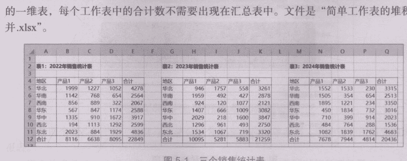

选择深度思考模型，上传文件，DeepSeek 就会进行相应的思考，并建议把三个工作表合并成图 5-2 所示的表格。

合并后的表格示例：

| 年份 | 地区 | 产品1 | 产品2 | 产品3 | 合计 |
|------|------|-------|-------|-------|------|
| 2022 | 华北 | 1999 | 1227 | 1052 | 4278 |
| 2022 | 华南 | 1142 | 768 | 654 | 2564 |
| 2022 | 西南 | 856 | 889 | 322 | 2067 |
| ... | ... | ... | ... | ... | ... |
| 2023 | 华北 | 946 | 1757 | 558 | 3261 |
| 2023 | 华南 | 1959 | 492 | 427 | 2878 |
| ... | ... | ... | ... | ... | ... |
| 2024 | 华北 | 1552 | 1533 | 230 | 3315 |
| 2024 | 华南 | 1505 | 354 | 654 | 2513 |
| ... | ... | ... | ... | ... | ... |

图 5-2 DeepSeek 建议的合并表

输入提示词：

> “请将三个表合并成一个包含年份、地区、产品和销售四个字段的一维表。
要求：以四列表格形式输出合并表的完整数据。
注意：不要合计行与列数据。”

DeepSeek 给出的结果如图 5-3 所示。将这个表复制到 Excel 中，就是一个我们所需要的一维表，如图 5-4 所示。

| 年份 | 地区 | 产品 | 销售 |
|------|------|------|------|
| 2022 | 华北 | 产品1 | 1999 |
| 2022 | 华北 | 产品2 | 1227 |
| 2022 | 华北 | 产品3 | 1052 |
| 2022 | 华南 | 产品1 | 1142 |
| 2022 | 华南 | 产品2 | 768 |
| 2022 | 华南 | 产品3 | 654 |
| 2022 | 西南 | 产品1 | 856 |
| 2022 | 西南 | 产品2 | 889 |
| 2022 | 西南 | 产品3 | 322 |
| 2022 | 华东 | 产品1 | 567 |
| 2022 | 华东 | 产品2 | 847 |
| 2022 | 华东 | 产品3 | 1174 |
| 2022 | 华中 | 产品1 | 1335 |

| A | B | C | D |
|---|---|---|---|
| 1 | 年份 | 地区 | 产品 | 销售 |
| 2 | 2022 | 华北 | 产品1 | 1999 |
| 3 | 2022 | 华北 | 产品2 | 1227 |
| 4 | 2022 | 华北 | 产品3 | 1052 |
| 5 | 2022 | 华南 | 产品1 | 1142 |
| 6 | 2022 | 华南 | 产品2 | 768 |
| 7 | 2022 | 华南 | 产品3 | 654 |
| 8 | 2022 | 西南 | 产品1 | 856 |
| 9 | 2022 | 西南 | 产品2 | 889 |
| 10 | 2022 | 西南 | 产品3 | 322 |
| 50 | 2024 | 西南 | 产品1 | 1895 |
| 51 | 2024 | 西南 | 产品2 | 1221 |
| 52 | 2024 | 西南 | 产品3 | 234 |
| 53 | 2024 | 华东 | 产品1 | 450 |
| 54 | 2024 | 华东 | 产品2 | 1834 |
| 55 | 2024 | 华东 | 产品3 | 732 |
| 56 | 2024 | 华中 | 产品1 | 710 |
| 57 | 2024 | 华中 | 产品2 | 399 |
| 58 | 2024 | 华中 | 产品3 | 914 |
| 59 | 2024 | 西北 | 产品1 | 484 |
| 60 | 2024 | 西北 | 产品2 | 764 |
| 61 | 2024 | 西北 | 产品3 | 288 |
| 62 | 2024 | 东北 | 产品1 | 1082 |
| 63 | 2024 | 东北 | 产品2 | 1839 |
| 64 | 2024 | 东北 | 产品3 | 1762 |

图 5-3 DeepSeek 给出的合并表

图 5-4 最终得到的一维表

如果我们觉得 DeepSeek 的速度太慢，或者当数据量大时 DeepSeek 仅能给出部分合并后的数据，那么可以寻求 DeepSeek 的帮助，看看可以在 Excel 中采取哪些简单实用的方法。

输入提示词：

> “请问将这三个表（实际上是标准二维表）合并为一个有年份、地区、产品和销售四个字段的一维表，在 Excel 中可以采取哪些简单实用的方法？请列示详细操作步骤。”

DeepSeek 会给出两种高效的方法：Power Query 逆透视法和公式拼接法，如图 5-5 所示。其中，Power Query 逆透视法无疑是更好的方法，尤其是针对这样的工作表。

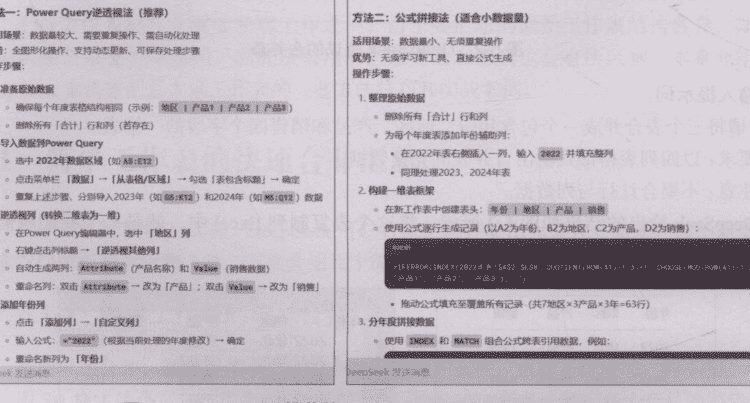

如果我们有一定的 Excel 操作基础，那么针对这个案例，就知道 DeepSeek 推荐的这两种方法都不是最佳方法，因为这把问题搞复杂了，使用多重合并计算数据区域透视表无疑是最快的。

#### 5.1.2 简单工作表的关联合并

所谓关联合并，就是把各个工作表中的数据通过关联字段建立联系并合并起来，也就是列增加，行不变。

图 5-6 所示的是 Excel 文件“简单工作表的关联合并.xlsx”的两个工作表：管理层奖金表和银行账号信息表，它们由姓名关联，姓名不重复。

现在的任务是，将这两个表合并为一个包括姓名、部门、职务、奖金额、开户行和账号全部字段的总表。


图 5-6 管理层奖金表和银行账号信息表（部分）

将 Excel 文件上传，DeepSeek 会自动分析这两个表，得到一个合并表，如图 5-7 所示。我们直接将这个表复制到 Excel 中即可。

合并后结果示例：

| 姓名 | 部门 | 职务 | 奖金额 | 开户行 | 账号 |
|---|---|---|---|---|---|
| A001 | 总经办 | 总经理 | 45858 | 招商银行 | 2848949595949299 |
| A007 | 生产部 | 副总监 | 29991 | 农业银行 | 0039458587757577 |
| A002 | 总经办 | 副总经理 | 30590 | 建设银行 | 3848856595959921 |
| A004 | 总经办 | 副总经理 | 17758 | 建设银行 | 1093848874747721 |
| A005 | 技术部 | 总监 | 20652 | 建设银行 | 3483573782910010 |
| A006 | 生产部 | 总监 | 43000 | 招商银行 | 1059598985959491 |
| A008 | 设备部 | 总监 | 14865 | 招商银行 | 0585874763616546 |
| A003 | 财务部 | 总监 | 19945 | 工商银行 | 3060680059388218 |
| A010 | 物控部 | 副总监 | 27755 | 建设银行 | 3827546589609798 |
| A011 | 销售部 | 总监 | 19582 | 工商银行 | 1647657865867901 |
| A012 | 销售部 | 副总监 | 10050 | 工商银行 | 5799795939821816 |
| A009 | 物控部 | 总监 | 9848 | 招商银行 | 2757586996096902 |

图 5-7 DeepSeek 自动分析得到的合并表

要特别注意，由于银行账号是 16 位数字，如果复制到表格，会丢失最后一位数字（变成 0）。此时，我们需要先将待粘贴数据的工作表中银行账号一列设置为文本格式，再粘贴数据，并且在粘贴选项中选择“匹配目标格式”。

关于这个方法，我们可以去询问 DeepSeek，输入提示词：

> “有一个问题，某个表的某列是 16 位文本格式的编码，现在要将其复制到一个新工作表中，但如果直接复制，编码的第 16 位数字就会变成 0，如何正确复制粘贴才能解决这个问题？”

DeepSeek 会给出解决方法及详细操作步骤，如图 5-8 所示。


#### 5.1.3 简单工作表的对比合并

所谓对比合并，就是把两个或者多个工作表中的数据合并到一个工作表中，并计算它们的差异。这在预算分析、同比分析中是很常见的。

图 5-9 所示的两个表分别是预算销售统计表和实际销售统计表，我们的任务是快速制作一个产品在每个季度的销售预实分析表。

文件是“简单结构表格的对比合并.xlsx”。

| A | B | C | D | E | F | G | H | I | J | K | L | M |
|---|---|---|---|---|---|---|---|---|---|---|---|---|
| | | | | | | | | | | | | |
| | 表1：产品预算销售统计表 | | | | | | 表2：产品实际销售统计表 | | | | | |
| | 产品 | 一季度 | 二季度 | 三季度 | 四季度 | 全年 | 产品 | 一季度 | 二季度 | 三季度 | 四季度 | 全年 |
| | 产品01 | 2123 | 1408 | 2514 | 2164 | 8209 | 产品01 | 1895 | 865 | 2440 | 1488 | 6688 |
| | 产品02 | 2733 | 1688 | 2899 | 2533 | 9943 | 产品02 | 2652 | 1569 | 1654 | 2925 | 8800 |
| | 产品03 | 891 | 1369 | 1063 | 2487 | 5810 | 产品03 | 499 | 1628 | 1165 | 2247 | 6539 |
| | 产品04 | 1991 | 2858 | 2169 | 3027 | 9075 | 产品04 | 2789 | 1696 | 2321 | 1198 | 8004 |
| | 产品05 | 2592 | 2259 | 2509 | 1735 | 9095 | 产品05 | 2499 | 733 | 2312 | 2618 | 8162 |
| | 产品06 | 2144 | 1100 | 512 | 2689 | 6445 | 产品06 | 424 | 2070 | 1268 | 1264 | 5026 |
| | 产品07 | 2418 | 2995 | 2724 | 826 | 8963 | 产品07 | 456 | 3001 | 2975 | 544 | 6976 |
| | 产品08 | 1895 | 2957 | 1027 | 1184 | 7063 | 产品08 | 2186 | 2770 | 2638 | 2443 | 10037 |
| | 产品09 | 686 | 822 | 2018 | 1850 | 5376 | 产品09 | 2874 | 2944 | 1114 | 2355 | 9287 |
| | 合计 | 16503 | 17456 | 17525 | 18495 | 69979 | 合计 | 16274 | 17276 | 18887 | 17082 | 69519 |

上传文件，不用理会 DeepSeek 的思考过程以及给出的一些数据处理信息，我们需要做的是输入提示词：

> “请将表1和表2合并。

需求：产品为行标题，是合并表的第一列；季度和类别（预算和实际）是列标题，列标题有两行，第一行是季度（合并单元格），第二行是类别，类别项目有三个：预算、实际和差异。

要求：制作合并表，并完整输出结果。

注意：差异数是实际数减去预算数。”

DeepSeek 进行合并计算后返回的合并表如图 5-10 所示。


将这个合并表复制到 Excel 中，如图 5-11 所示。


尽管这个合并表的列标题不够规范，但 DeepSeek 已经帮我们把两个表格中的数据进行了合并计算，解决了绝大多数问题。我们只需要删除不需要的行，把合并表的列标题设置一下（主要是季度名称的位置及合并单元格）。整理好的工作表如图 5-12 所示。

| 产品 | 一季度 |  |  | 二季度 |  |  | 三季度 |  |  | 四季度 |  |  | 全年 |  |  |
| --- | --- | --- | --- | --- | --- | --- | --- | --- | --- | --- | --- | --- | --- | --- | --- |
|  | 预算 | 实际 | 差异 | 预算 | 实际 | 差异 | 预算 | 实际 | 差异 | 预算 | 实际 | 差异 | 预算 | 实际 | 差异 |
| 产品01 | 2123 | 1895 | -228 | 1408 | 865 | -543 | 2514 | 2440 | -74 | 2164 | 1488 | -676 | 8209 | 6688 | -1521 |
| 产品02 | 2733 | 2652 | -81 | 1688 | 1569 | -119 | 2989 | 1654 | -1335 | 2533 | 2925 | 392 | 9943 | 8800 | -1143 |
| 产品03 | 891 | 499 | -392 | 1369 | 1628 | 259 | 1063 | 2165 | 1102 | 2487 | 2247 | -240 | 5810 | 6539 | 729 |
| 产品04 | 1021 | 2789 | 1768 | 2858 | 1696 | -1162 | 2169 | 2321 | 152 | 3027 | 1198 | -1829 | 9075 | 8004 | -1071 |
| 产品05 | 2592 | 2499 | -93 | 2259 | 733 | -1526 | 2509 | 2312 | -197 | 1735 | 2618 | 883 | 9095 | 8162 | -933 |
| 产品06 | 2144 | 424 | -1720 | 1100 | 2070 | 970 | 512 | 1268 | 756 | 2689 | 1264 | -1425 | 6445 | 5026 | -1419 |
| 产品07 | 2416 | 256 | -1960 | 2297 | 2803 | 506 | 2721 | 2972 | 251 | 1264 | 571 | -693 | 8698 | 6602 | -1996 |
| 产品08 | 1815 | 2106 | 291 | 2867 | 2700 | -167 | 2427 | 2618 | 191 | 1104 | 2443 | 1339 | 8213 | 9867 | 1654 |
| 产品09 | 686 | 2874 | 2188 | 822 | 2944 | 2122 | 2018 | 1114 | -904 | 1850 | 2355 | 505 | 5376 | 9287 | 3911 |
| 合计 | 16503 | 16274 | -229 | 17456 | 17276 | -180 | 17525 | 18887 | 1362 | 18495 | 17082 | -1413 | 69979 | 69519 | -460 |

图 5-12 整理好的预实分析表

当然，我们得到的工作表中仅仅是数字，没有公式连接。既然我们是要对比分析两个表，并且两个原始表中的数据也不再变化，那么这个结果已经可以满足我们的要求。
我们还可以对这个工作表作进一步格式化处理，比如将差异值根据正负数设置成不同的颜色，也就是设置自定义数字格式。输入提示词：

> “请问，如何设置自定义数字格式，将差异值为负数的数据设置为红色字体，正数仍是黑色字体？”

DeepSeek 给出的自定义数字格式的设置方法和步骤如图 5-13 所示。


按照 DeepSeek 给出的步骤设置差异值的自定义数字格式，我们就得到了一个醒目的产品销售预实分析表，如图 5-14 所示。

### 5.2 大工作表的合并汇总

前面介绍的几个案例中，工作表的数据量小，比较简单，因此可以让 DeepSeek 直接给出合并计算结果。如果要合并的原始工作表数据量比较大，DeepSeek 就可能无法给出全部合并后的数据，而是仅仅列出出一部分合并数据，此时，我们需要向 DeepSeek 寻求解决工作表合并的高效方法和具体操作步骤，然后选择一种工具（DeepSeek 可能给出的可选工具是多个），按照给出的步骤来操作，就可以快速完成工作表的合并汇总。

#### 5.2.1 大工作表的堆积合并

月度工资表的合并是一个典型的案例。每个月有一个工作表，每个工作表的列数及列次序是一样的（但行不一样，因为员工是流动的），现在要将这些工作表汇总在一个工作表中，并且添加月份标记（也就是新增一列“月份”，以区分合并后的每个月的数据，如果月份工作表中包含月份字段，则不用再添加）。

对于这种合并问题，我们一般不需要上传文件，直接向 DeepSeek 提问，以获取推荐的相关方法和工具信息。但要注意，尽可能使用深度思考模型，而不使用联网搜索模型。经实际测试，前者推荐的方法更为实用。

输入提示词：

> “有十二个工作表，保存的是每个月的工资数据，工作表的名称是月份名称，但工作表内没有月份字段。
> 
> 这些工作表的列结构（列名、列数、列次序）是一样的。如何将这些工作表中的数据合并到一个新工作表中，并且再添加一个月份字段？
> 
> 要求：介绍几种简单、实用、高效的方法，并提供详细的操作步骤。”

DeepSeek 会给出几种可选方法及操作步骤，如图 5-15 所示。

在这些方法中，我们首选 Power Query 批量合并法。尽管 VBA 一键合并法可以一键完成，但是给出的 VBA 代码往往存在一些问题，我们还需要花时间去调试、编辑和修改。

以下是几种更简单、更高效的方法，帮助你将12个月的工作表数据合并到一个新工作表并自动添加月份字段，全程无需编程，且步骤清晰：

方法1：Power Query批量合并（Excel 2016及以上版本，强烈推荐）
核心优势：一次性导入所有工作表，自动生成月份字段，支持后续数据更新。
步骤：
1. 打开Excel，点击菜单栏的“数据”→“获取数据”→“自文件”→“从工作簿”。
2. 选择当前工作簿文件 → 点击“导入”。
3. 在导航器中勾选“选择多项” → 勾选所有12个月的工作表 → 点击“转换数据”（进入Power Query编辑器）。
   * Power Query导入步骤（示意图：勾选多个工作表）
4. 添加月份字段：
   * 在右侧“查询”窗格中，按住Shift键选中所有工作表（如“1月”、“2月”等）。
   * 右键点击 → “合并查询” → 选择“将查询追加为新查询” → 确定。
   * 点击“添加列” → “自定义列” → 输入列名为“月份”，公式：= [Source]{0}[Item]（自动提取源工作表名称作为月份）。
5. 展开数据：
   * 点击合并后表格的展开按钮（↗）→ 取消勾选“使用原始列名作为前缀” → 确定。
6. 点击“关闭并加载” → 数据自动合并到新工作表，并包含“月份”列。

方法2：公式法（Excel 365/2021版本，单公式合并）
核心优势：无需任何工具，仅用一条公式动态合并。
步骤：
1. 新建工作表，在A1单元格输入“月份”，B1及后续列粘贴源工作表的列标题（如“姓名”、“工资”等）。
2. 在A2单元格输入公式（假设源数据有1000行数据）：
   ```excel
   =TOCOL(IF(OFFSET(INDIRECT("'"&TEXT(SEQUENCE(12,,1),"[\x4e00-\x9fa5]月"&"'!A2"),ROW(1:1000)-1,0),SEQUENCE(1000,,1),SEQUENCE(12,,1)),TEXT(SEQUENCE(12,,1),"[\x4e00-\x9fa5]月"),OFFSET(INDIRECT("'"&TEXT(SEQUENCE(12,,1),"[\x4e00-\x9fa5]月"&"'!B2"),ROW(1:1000)-1,0),SEQUENCE(1000,,1),SEQUENCE(12,,1))))
   ```
3. 按Ctrl+Shift+Enter输入数组公式（用“数据”→“分列”按分隔符拆分月份列与其他列）。
   原理：用INDIRECT动态引用各工作表，TOCOL合并为一列，SEQUENCE生成1-12月名称。

方法3：VBA一键合并（适合任何Excel版本）
核心优势：点击按钮自动完成，代码简短安全。
步骤：
1. 按Alt+F11打开VBA编辑器 → 右键左侧工程资源管理器 → 插入 → 模块。
2. 粘贴以下代码：
   ```vba
   Sub MergeSheets()
       Dim ws As Worksheet, newWs As Worksheet
       Set newWs = Sheets.Add(After:=Sheets(Sheets.Count))
       newWs.Name = "合并数据"
       newWs.Range("A1").Value = "月份"
       For Each ws In ThisWorkbook.Sheets
           If ws.Name <> newWs.Name Then
               ws.UsedRange.Copy
               newWs.Cells(newWs.Rows.Count, 2).End(xlUp).Offset(1).PasteSpecial xlPasteValues
               newWs.Range("A" & newWs.Rows.Count).End(xlUp).Row + 1 & ":" & newWs.Cells(newWs.Rows.Count, 1).End(xlUp).Row + ws.UsedRange.Rows.Count - 1).Value = ws.Name
           End If
       Next ws
   End Sub
   ```
3. 按F5运行 → 自动生成“合并数据”表，月份字段在A列，数据从B列开始。

| 方法 | 耗时 | 学习成本 | 支持更新 | 适用场景 |
| :--- | :--- | :--- | :--- | :--- |
| Power Query | 2分钟 | 低 | ✔ | 长期使用，数据频繁更新 |
| 公式法 | 1分钟 | 中 | ✔ | 动态实时查看合并结果 |
| VBA | 30秒 | 高 | ✘ | 一次性快速合并 |
| 手动 | 5分钟 | 无 | ✘ | 数据量极小 |

选择建议：
☑ 优先选Power Query（可录制操作步骤供重复使用）；
☑ 临时需求选公式法或VBA；
☑ 极简数据选手动+快速填充。

我们还可以先上传要汇总的工作表，然后输入提示词。
例如，Excel 文件“大工作表的堆积合并.xlsx”中有十二个月份工资表，如图 5-16 所示，现在要将其合并保存到一个新工作表中。
上传 Excel 文件，输入提示词：
“Excel 文件中共有十二个工作表，工作表的名称是月份名称，但工作表内没有月份字段。这些工作表的列结构（列名、列数、列次序）是一样的。如何将这些工作表中的数据合并到一个新工作表中，并且再添加一个月份字段？
要求：介绍几种简单、实用、高效的方法，并提供详细的操作步骤。”
DeepSeek 给出了 Power Query 方法、VBA 方法和手工复制公式填充三种方法，其中 VBA 方法提供的代码要更精确。

无论是否上传文件，DeepSeek 所给出的 Power Query 方法都不是很高效，因为在其操作步骤中，有一步是在每个工作表中添加自定义列，如图 5-17 所示。这是很烦琐的，如果要汇总的工作表有数十个甚至是上百个，工作量可想而知。

出现这一步骤的原因是，提示词里指定了工作表的个数（十二个），这让 DeepSeek 以为在每个月份工作表中添加自定义列并不麻烦。因此，我们不要在提示词中提及具体的工作表个数，例如：

> “Excel 文件中有大量工作表，工作表的名称是月份名称，但工作表内没有月份字段。这些工作表的列结构（列名、列数、列次序）是一样的。如何将这些工作表中的数据合并到一个新工作表中，并且再添加一个类别字段？
> 要求：介绍几种简单、实用、高效的方法，并提供详细的操作步骤。”

此时，DeepSeek 给出的 Power Query 方法的操作步骤就比较简单高效，我们不再需要在每个工作表中添加自定义列，如图 5-18 所示。

以下是几种简单高效的Excel多表合并方法，并附详细操作步骤：

方法一：使用Power Query（推荐）

优点：无需公式和编程，可自动刷新，适合大量数据

步骤：

1. 打开工作簿，点击【数据】-【获取数据】-【自文件】-【从工作簿】
2. 选择当前工作簿，在导航器中选中整个工作簿（不要展开具体工作表）
3. 点击【转换数据】进入Power Query编辑器
4. 删除不需要的列（如保留Data列）
5. 点击Data列右侧的展开按钮，取消勾选“使用原始列名作为前缀”
6. 添加自定义列：
   - 点击【添加列】-【自定义列】
   - 输入公式：= Excel.CurrentWorkbook(){[Name=Source.Name]}[Content]{0}[Name]
   - 列名改为“类别”
7. 展开Data列的所有内容
8. 点击【主页】-【关闭并上载】到新工作表

如果我们对 Power Query 比较熟悉，就会发现 DeepSeek 提供的 Power Query 方法中都有一个添加自定义列步骤（不管是在月份表还是在合并表中）。其实在 Power Query 的实际操作中，这个添加自定义列的步骤是不需要的，因为月份字段自动存在于 Power Query 编辑器的第一个界面，如图 5-19 所示。这个月份字段就是工作表名称，保留其中一个即可。

#### 5.2.2 大工作表的关联合并

如果要汇总的几个工作表列结构不同，但有一个或多个关联字段，需要根据这一个或多个关联字段将它们合并起来，生成一个包含全部字段的总表，这就是关联合并。

例如，Excel 文件“大工作表的关联合并.xlsx”中有三个工作表：基本信息表、家庭信息表和证书信息表，它们由姓名关联，并且姓名不重复，如图 5-20 所示。

现在的任务是，将这三个工作表合并为一个包含全部字段的工作总表。

上传文件，输入提示词：
“已知条件：三个工作表（基本信息表、家庭信息表和证书信息表）
要求：将这三个工作表根据员工姓名进行关联，生成一个包含全部字段的总表，直接输出一个包含全部完整数据的合并表。
请提供简单高效的方法和详细的操作步骤。”

DeepSeek 提供了 Power Query 方法及详细的操作步骤（核心是使用合并查询功能），因为 DeepSeek 认为 Power Query 工具是最高效的，如图 5-21 所示。

如果觉得这个操作步骤不好理解，我们可以让 DeepSeek 提供相关操作视频。输入提示词“这个操作步骤看起来有点费解，请介绍几个相关操作视频，希望有具体链接”，DeepSeek 会给出图 5-22 所示的帮助信息。

需要注意的是，DeepSeek 并不会给出具体的操作视频链接，而只是给出推荐搜索关键词和平台，因为“由于平台限制，我无法直接提供外部链接，但可以为你提供详细的搜索方法和推荐关键词，帮助你快速找到相关视频教程”。

#### 5.2.3 合并不同的 Excel 文件

如果要汇总的工作表在不同的 Excel 文件中，首选方法是 Power Query。如果你不了解 Power Query，不妨去寻求 DeepSeek 的帮助。

输入提示词：
“文件夹中有很多 Excel 文件，这些 Excel 文件中有个数不等的工作表，它们的结构完全相同。
> 
> 现在的任务是要把这些 Excel 文件中的所有工作表数据合并到一个新 Excel 文件中。
> 要求：提供几个高效可行的方法，并介绍详细步骤。
> 如有可能，请提供相关操作视频链接。”

DeepSeek 会推荐三种方法：Power Query 方法、VBA 方法和 Python 方法，并给出这三种方法详细的操作步骤，如图 5-23 至图 5-25 所示。此外，DeepSeek 还列示了一些进阶技巧和选择建议，如图 5-26 所示。

方法一：Power Query（无需编程）
适用场景：Excel 2016 及以上版本用户，适合结构化数据合并

1. 准备文件夹
   - 将所有待合并的 Excel 文件放入同一文件夹
   - 确保每个工作簿的工作表结构完全一致
2. 创建主工作簿
   - 新建 Excel 文件 → 数据 → 获取数据 → 来自文件 → 从文件夹
   - 选择目标文件夹 → 点击“转换数据”
3. 合并数据
   - 展开新建的“Custom”列
   - 再次展开“Data”列
   - 删除非数据列（保留数据列）
4. 加载数据
   - 主页 → 关闭并上载至 → 选择表格或数据模型

```powerquery
// 在 Power Query 编辑器中添加自定义列
= Excel.Workbook(File[Content], true)
```

优势：可视化操作，自动刷新
视频参考：搜索“Power Query 合并多工作簿数据”

图 5-23 Power Query 方法及步骤

方法二：VBA 宏（适合批量处理）
代码示例：

```vba
Sub MergeWorkbooks()
    Dim Path As String, FileName As String
    Dim wbMaster As Worksheet, wbSource As Workbook
    Dim wsCount As Long, LastRow As Long

    Set wbMaster = ThisWorkbook.Sheets(1)
    Path = "C:\YourFolderPath" '修改为实际路径
    FileName = Dir(Path & "*.xlsx")

    Application.ScreenUpdating = False

    Do While FileName <> ""
        Set wbSource = Workbooks.Open(Path & FileName)
        For Each Sheet In wbSource.Sheets
            LastRow = Sheet.Cells(Sheet.Rows.Count, 1).End(xlUp).Row
            If LastRow > 1 Then
                Sheet.Range("A2:Z" & LastRow).Copy
                wbMaster.Cells(Rows.Count, 1).End(xlUp).Offset(1).PasteSpecial xlPasteValues
            End If
        Next Sheet
        wbSource.Close False
        FileName = Dir()
    Loop

    Application.ScreenUpdating = True
    MsgBox "合并完成！"
End Sub
```

操作步骤：

图 5-24 VBA 方法及详细代码

方法三：Python 脚本（适合大数据量）
环境要求：安装 Python 及以下库

```
pip install pandas openpyxl xlrd
```

代码示例：

```python
import os
import pandas as pd

def merge_excel_files(folder_path, output_file):
    all_data = []
    for file in os.listdir(folder_path):
        if file.endswith('.xlsx'):
            file_path = os.path.join(folder_path, file)
            xl = pd.ExcelFile(file_path)
            for sheet_name in xl.sheet_names:
                df = pd.read_excel(file_path, sheet_name=sheet_name)
                all_data.append(df)
    combined_df = pd.concat(all_data, ignore_index=True)
    combined_df.to_excel(output_file, index=False)

merge_excel_files('input_folder', 'combined_data.xlsx')
```

操作步骤：

图 5-25 Python 方法及详细代码

进阶技巧：

1. 使用 Power BI Desktop 处理超大数据（百万行级）
2. 设置 Windows 任务计划定期自动合并
3. 使用 Office Scripts（网页版 Excel 自动化）

选择建议：

- 新手用户 → Power Query
- 常规需求 → VBA
- 技术用户/大数据 → Python
- 企业级自动化 → Power BI + 数据库集成

注意事项：

1. 统一所有文件的编码格式（建议 UTF-8）
2. 检查合并后的数据类型一致性
3. 处理前关闭所有 Excel 文件
4. 建议合并前进行数据抽样验证

如需具体操作演示，可访问微软官方 Excel 教程平台或各大技术社区

图 5-26 进阶技巧及建议

Power Query 方法是比较简单的。在很多情况下，如数据清洗加工、表格合并等，DeepSeek 都会将 Power Query 作为首选方法。

这不奇怪，毕竟 Power Query 操作简单，使用灵活，也不需要过于复杂的代码知识（当然，M 函数是必需的）。我们只需要了解 Power Query 的基本操作技巧以及一些进阶应用知识就足够了。

在很多情况下，我们并不能直接使用 VBA 方法及其代码，因为这些代码不一定适用于所有场景，必须给 DeepSeek 提供一个具体的文件，并告诉它工作表的具体结构、需要解决的问题、需要得到的结果、需要特殊处理的地方，DeepSeek 才可能会给出比较准确的代码。即使如此，我们仍需要检验测试代码，必要时进行编辑加工，使之能够正确运行。因此，尽管我们可以随时借助 DeepSeek 获取数据处理的 VBA 代码，但如果没有 VBA 的基础知识，我们对代码就只是一知半解，只知套用而不理解代码逻辑，出错时不知如何纠正，计算结果不满足要求时不知如何去完善。因此，我们有必要学习并掌握 VBA 的基础知识。

很多人并不了解 Python，更不知其如何应用，也不愿意花时间去学习，那么这种方法就只能作为一个参考。

DeepSeek 提供的进阶技巧和选择建议是非常有价值的，它并不是一个具体的操作方法，而是针对不同场景提出使用工具建议。我们在选择数据处理工具时，可以据此先有一个大致方向，再根据实际需求和自身条件选择一个最适合、最高效的工具，以提升数据处理和分析的效率。

Excel 函数公式并不适用于合并大工作表，但在普通工作表的加工和计算时，仍然是常规选项之一。关于 Excel 函数公式的应用，下面将结合实际案例予以介绍。

#### 5.2.4 建立动态的滚动汇总表

有些情况下，我们需要建立一个动态滚动汇总表。这种汇总表在财务分析中是常见的。例如，要跟踪分析各月的人工成本，目前已经有了几个月的人工成本表（工资表），现在希望以后增加月份工资表时，新增月份的人工成本数据可以自动添加到汇总表中，如图 5-27 和图 5-28 所示。文件是“建立动态滚动汇总表.xlsx”。

| A | B | C | D | E | F | G | H | I | J |
|---|---|---|---|---|---|---|---|---|---|
| 姓名 | 部门 | 性别 | 基本工资 | 岗位津贴 | 福利费 | 应发合计 | 人工成本 | | |
| A001 | 采购部 | 女 | 7253 | 1129 | 597 | 8979 | 9767 | | |
| A002 | 财务部 | 女 | 6079 | 945 | 1026 | 8050 | 8723 | | |
| A003 | 人力资源部 | 女 | 14871 | 1181 | 909 | 16961 | 17216 | | |
| A004 | 生产部 | 男 | 8300 | 599 | 1595 | 10494 | 10849 | | |
| A018 | 销售部 | 女 | 12612 | 574 | 1056 | 14242 | 15364 | | |
| A019 | 生产部 | 女 | 14648 | 691 | 1343 | 16682 | 17591 | | |
| A020 | 技术研发部 | 女 | 14504 | 303 | 323 | 15130 | 16363 | | |
| A005 | 生产部 | 女 | 5586 | 680 | 1089 | 7355 | 8187 | | |
| A006 | 采购部 | 女 | 12712 | 239 | 1569 | 14520 | 15073 | | |
| A022 | 销售部 | 女 | 6501 | 329 | 1683 | 8513 | 8732 | | |
| A023 | 销售部 | 男 | 11377 | 766 | 1012 | 13155 | 14476 | | |
| A024 | 财务部 | 女 | 11903 | 388 | 798 | 13089 | 14247 | | |
| A025 | 生产部 | 男 | 13875 | 1090 | 291 | 15256 | 16142 | | |
| A026 | 销售部 | 女 | 5669 | 1074 | 668 | 7411 | 8574 | | |
| A027 | 销售部 | 女 | 6143 | 527 | 680 | 7350 | 7707 | | |
| A028 | 采购部 | 女 | 11763 | 770 | 722 | 13255 | 14150 | | |
| A029 | 销售部 | 男 | 11502 | 796 | 386 | 12684 | 13804 | | |


## 第 5 章 DeepSeek 助力快速汇总工作表


我们可以寻求 DeepSeek 的帮助，快速获取动态汇总计算公式。上传文件，输入提示词：
“已知条件：已经有了几个月的工资表，以后会陆续增加月份工作表。
要求：请设计汇总计算公式，汇总每个月各个部门的人工成本（在 H 列），然后保存到人工成本汇总表的各列。当新月份工作表增加后，该月份工作表能够自动添加到汇总表。
注意：汇总表的第四行是月份名称，部门名称在 A 列，计算结果从第五行保存。
注意：如果某个月份工作表不存在，要在公式中进行处理。
注意：公式要简洁高效。”
然后等待 DeepSeek 给出计算公式。获取的公式及相关说明如图 5-29 所示。

```
=IFERROR(SUMIFS(INDIRECT("'"&B$4&"'!H:H"), INDIRECT("'"&B$4&"'!B:B"), $A5), 0)
```


为什么在构建公式字符串时，工作表名称前后各添加了一个单引号？这不是把公式复杂化了吗？DeepSeek 就这个问题进行了解释：单引号确保兼容含空格的工作表名。也就是说，如果工作表名称字符含有空格，就必须在工作表名前后添加单引号。这是 Excel 函数公式的一个基本知识。

如果工作表名称很规范（没有空格及其他特殊字符，如加号、百分号等），公式可以简化如下：

```
=IFERROR(SUMIFS(INDIRECT(B$4&"!H:H"), INDIRECT(B$4&"!B:B"), $A5), 0)
```

即使作了简化处理，从数据逻辑的角度考虑，单元格的数字 0 和单元格的空值概念也是不一样的。单元格的空值表示数据不存在，单元格的数字 0 表示数据可能存在，但是合计数是 0。这样的话，当 IFERROR 函数把错误值处理为 0 时，我们就需要考虑一下，是将其处理为数字 0 还是处理为空值。在本案例中，处理为空值比较妥当，因此，公式需要修改如下：

```
=IFERROR(SUMIFS(INDIRECT(B$4&"!H:H"), INDIRECT(B$4&"!B:B"), $A5), "")
```

将公式复制到 Excel 中，往右、往下复制，再计算两个合计数，就得到了最终的动态汇总表，如图 5-30 所示。


尽管 DeepSeek 能够帮助我们解决很多数据合并问题，但我们一定要清楚，DeepSeek 仅仅是一个助手，需要我们给它下达精确指令，让它知道要处理什么问题，以针对这个具体问题去寻求高效的解决方案。

在本案例中，如果不特别说明“汇总表的第四行是月份名称，部门名称在 A 列，计算结果从第五行保存”，DeepSeek 可能会给出错误的公式，其原因在于月份单元格引用和部门单元格引用错位，如图 5-31 所示，第一个部门引用了单元格 A6，第一个月份引用了单元格 B5。


### 5.3 其他格式文件的数据合并汇总

前面介绍了几个针对 Excel 表格的数据合并场景及案例。如果数据源是其他格式文件，例如文本文件（CSV 文件或 TXT 文件）、PDF 文件、Word 文件等，那么我们该如何借助 DeepSeek 进行快速数据合并呢？

#### 5.3.1 快速合并文本文件

当原始数据是文本文件（CSV 文件或 TXT 文件）时，DeepSeek 可以实现快速合并汇总，这种高效是你意想不到的。

图 5-32 所示的是三个文本文件“采购部员工信息.txt”、“生产部员工信息.txt”和“销售部员工信息.txt”，它们都是以符号“|”为分隔的，现在要将它们合并为一张工作表。


上传这三个文件到 DeepSeek，如图 5-33 所示。


输入提示词：

> “请输出这三个文本文件数据合并后的完整合并表，注意不能有遗漏。
另外，如果这三个表格中出现了相同的数据，每个数据是彼此独立的，不能做去重处理。
合并表只有一行标题。
要求：合并表的各列数据以逗号分隔，这样可以保存为 CSV 文件，便于用 Excel 直接打开，或者直接复制到 Excel 中实现快速分列。”

DeepSeek 整理合并完成后给出的结果如图 5-34 所示。


图 5-34 DeepSeek 给出的合并结果

单击数据窗口右上角的“复制”按钮，再打开 Excel，将其粘贴到 Excel 工作表中，最后使用 Excel 分列工具进行分列即可。

这里有一个操作小技巧，将数据粘贴到 Excel 工作表中时，在出现的粘贴选项中执行“使用文本导入向导”命令，如图 5-35 所示，就会直接打开文本导入向导对话框，如图 5-36 所示。按照文本导入向导一步一步操作，将数据进行分列保存，就得到了一个完整的合并表，如图 5-37 所示。

## 第 5 章 DeepSeek 助力快速汇总工作表


如果文本文件较多，可以让 DeepSeek 设计 VBA 代码来一键合并。我们可以输入下面的提示词，看看 DeepSeek 会给出什么样的 VBA 代码，然后尝试使用该代码进行合并汇总。如果不成功，就继续向 DeepSeek 提问，修改代码或者重新设计代码。

> “能否设计一个自动汇总数据的 VBA 代码，一键完成这三个文本文件的合并，并将合并后的数据保存到 Excel 中，各列数据必须保存在各列。
注意：所有汉字必须以正常字体显示。
另外，由于身份证号码是18位，必须能够正确保存到单元格。”

为方便大家了解使用 VBA 代码合并文本文件的逻辑思路，下面列示出经过几次纠错后的完整的正确的代码。

```
Sub MergeEmployeeFiles_Optimized()
    Dim ws As Worksheet
    Dim FilePaths As Variant
    Dim i As Long, LastRow As Long
    Dim objStream As Object, lines As Variant, line As Variant
    Dim DataArray() As String

    ' 创建新工作表
    Set ws = ThisWorkbook.Sheets.Add(After:=ThisWorkbook.Sheets(ThisWorkbook.Sheets.Count))
    ws.Name = "合并数据"
    ws.Cells.Font.Name = "宋体" ' 更普适的中文字体
    ws.Cells.Font.Size = 10

    ' 设置文件路径（需修改为实际路径）
    FilePaths = Array("C:\销售部员工信息.txt", _
                     "C:\生产部员工信息.txt", _
                     "C:\采购部员工信息.txt")

    ' 设置标题
    With ws.Range("A1:G1")
        .Value = Array("姓名", "部门", "性别", "学历", "身份证号码", "出生日期", "年龄")
        .Font.Bold = True
        .Interior.Color = RGB(191, 191, 191) ' 灰色背景
    End With

    ' 优化性能设置
    Application.ScreenUpdating = False
    Application.Calculation = xlCalculationManual
    Application.EnableEvents = False

    ' 处理每个文件
    For i = LBound(FilePaths) To UBound(FilePaths)
        If Dir(FilePaths(i)) = "" Then
            MsgBox "文件未找到:" & FilePaths(i), vbCritical
            Exit Sub
        End If

        ' 使用 ADODB.Stream 读取 UTF-8 文件
        Set objStream = CreateObject("ADODB.Stream")
        With objStream
            .Type = 2 ' 文本模式
            .Charset = "UTF-8"
            .Open
            .LoadFromFile FilePaths(i)
            lines = Split(.ReadText, vbCrLf)
            .Close
        End With

        LastRow = ws.Cells(ws.Rows.Count, 1).End(xlUp).Row + 1

        ' 处理数据行
        For Each line In lines
            line = Trim(line)
            If Len(line) > 0 Then
                ' 精确跳过标题行
                If line = "姓名 | 部门 | 性别 | 学历 | 身份证号码 | 出生日期 | 年龄" Then
                    ' 跳过不处理
                Else
                    DataArray = Split(line, "|")
                    If UBound(DataArray) = 6 Then
                        With ws.Range("A" & LastRow)
                            ' 基础信息
                            .Resize(1, 4).Value = Array(DataArray(0), DataArray(1), DataArray(2), DataArray(3))
                            ' 身份证处理
                            .Offset(0, 4).NumberFormat = "@"
                            .Offset(0, 4).Value = DataArray(4)
                            ' 日期处理
                            .Offset(0, 5).NumberFormat = "yyyy-mm-dd"
                            If IsDate(DataArray(5)) Then
                                .Offset(0, 5).Value = CDate(DataArray(5))
                            Else
                                .Offset(0, 5).Value = "无效日期"
                            End If

                            ' 年龄处理
                            .Offset(0, 6).NumberFormat = "0"
                            If IsNumeric(DataArray(6)) Then
                                .Offset(0, 6).Value = CLng(DataArray(6))
                            Else
                                .Offset(0, 6).Value = 0
                            End If
                        End With
                        LastRow = LastRow + 1
                    Else
                        Debug.Print "跳过格式错误行: " & line
                    End If
                End If
            End If
        Next line
    Next i

    ' 格式美化
    ws.Columns("A:G").AutoFit
    ws.Range("A1:G1").HorizontalAlignment = xlCenter
    ws.Range("E:E").HorizontalAlignment = xlLeft  ' 身份证左对齐

    ' 恢复设置
    Application.ScreenUpdating = True
    Application.Calculation = xlCalculationAutomatic
    Application.EnableEvents = True

    MsgBox "成功合并 " & ws.UsedRange.Rows.Count - 1 & " 条记录", vbInformation
End Sub
```

#### 5.3.2 快速合并 PDF 文件

PDF 文件“三个部门的员工信息表.pdf”中有三个工作表，如图 5-38 所示，任务是快速将这三个工作表中的数据合并为一张表，如果表格中的数据较多，就分页保存。


上传 PDF 文件，输入提示词：
“这个 PDF 文件中有三个工作表，请输出这三个工作表格中的数据合并后的完整合并表，注意不能有遗漏。
如果这三个表格中出现了相同的数据，每个数据是彼此独立的，不能做去重处理。
合并表只有一行标题。
要求：合并表的各列数据以逗号分隔，这样可以保存为 CSV 文件，便于用 Excel 直接打开，或者直接复制到 Excel 中实现快速分列。”

DeepSeek 的合并结果如图 5-39 所示。我们将数据窗口里的所有数据复制到 Excel 中，并进行分列处理即可。


## 第 6 章 DeepSeek 助力制作可视化图表

数据分析的最终结果是可视化，挖掘数据背后的信息，快速发现问题，然后进一步去分析问题，解决问题。

绘制图表有很多工具，如 Excel 图表、Power BI、Tableau、Python HTML 等。有些情况下，可视化图表仅仅用于展示，而不需要究其背后烦琐复杂的计算步骤。此时，我们就可以借助 DeepSeek 来快速制作可视化图表。

### 6.1 快速获取数据可视化的基本知识

我们如果不太清楚各类可视化图表适用的分析场景是什么，或者都有哪些类型的图表，不妨借助 DeepSeek 获取相应的基础知识。

#### 6.1.1 快速了解各类可视化图表及其适用场景

获取相应文字信息，使用深度思考模型和联网搜索模型都是可以的。从响应速度来说，使用联网搜索模型要快得多。

输入提示词“请详细总结可视化图表的种类，以及其数据分析适用场景”，DeepSeek 会给出六大类图表及其适用场景，这些图表包括比较类图表、构成类图表、分布类图表、关系类图表、地理空间类图表、高级与特殊用途图表等，如图 6-1 至图 6-6 所示。


二、构成类图表
展示整体中各组成部分的占比或分布。

- 1. 饼图 (Pie Chart)
   - 用途：显示单一维度的数据占比，强调部分与整体的关系。
   - 场景：市场份额分布、家庭支出比例、用户来源渠道占比。
   - 限制：类别不宜过多（建议<6类），避免占比相近时难以区分。
- 2. 环形图 (Doughnut Chart)
   - 用途：与饼图类似，但中间可显示核心指标或标题。
   - 场景：美观性更强的占比展示，如仪表盘设计。
- 3. 堆叠柱状图/堆叠面积图
   - 用途：对比不同类别中各子类别的占比，同时观察整体趋势。
   - 场景：各产品线在不同季度的销售额构成、用户年龄段的区域分布。
- 4. 瀑布图 (Waterfall Chart)
   - 用途：展示数值的增减过程，反映从起点到终点的变化路径。
   - 场景：财务利润构成分析（收入、成本、净利）、库存变动追踪。

图 6-2 构成类图表

三、分布类图表
分析数据的分布特征（集中趋势、离散程度、异常值等）。

- 1. 直方图 (Histogram)
   - 用途：展示单变量的数据分布（频数或频率）。
   - 场景：用户年龄分布、考试成绩分布、订单金额分布。
- 2. 箱线图 (Box Plot)
   - 用途：显示数据的中位数、四分位数、异常值及分布范围。
   - 场景：对比不同群体的收入分布、产品质量稳定性分析。
- 3. 散点图 (Scatter Plot)
   - 用途：分析两个连续变量之间的相关性或分布规律。
   - 场景：广告投入与销售额的关系、身高与体重的关联性研究。
- 4. 热力图 (Heatmap)
   - 用途：用颜色深浅表示矩阵数据中的数值大小。
   - 场景：用户行为分析（页面点击热区）、时间序列数据密度（如每小时订单量）。
- 5. 密度图 (Density Plot)
   - 用途：平滑显示数据分布的概率密度。
   - 场景：人口密度分布、流量峰值区间分析。

图 6-3 分布类图表

四、关系类图表
揭示数据间的关联、层级或流动关系。

- 1. 桑基图 (Sankey Diagram)
   - 用途：展示流量或资源在多节点间的流动路径与规模。
   - 场景：用户转化路径分析、能源供应链追踪、资金流向可视化。
- 2. 树状图 (Treemap)
   - 用途：通过面积大小展示层级数据的占比关系。
   - 场景：文件系统存储分布、公司组织架构与人员占比。
- 3. 网络图 (Network Graph)
   - 用途：显示节点（实体）与边（关系）的拓扑结构。
   - 场景：社交网络关系分析、知识图谱可视化、供应链网络映射。
- 4. 和弦图 (Chord Diagram)
   - 用途：展示双向流动关系或矩阵数据的交互强度。
   - 场景：国际贸易流量、用户跨平台迁移路径。

图 6-4 关系类图表

五、地理空间类图表
与地理位置相关的数据可视化。

- 1. 填充地图 (Choropleth Map)
   - 用途：用颜色深浅表示不同区域的数值差异。
   - 场景：各省GDP对比、疫情感染率分布、人口密度地图。
- 2. 点分布地图 (Point Distribution Map)
   - 用途：用散点或标记显示地理位置上的事件密度。
   - 场景：连锁店位置分布、交通事故热点区域分析。
- 3. 流向地图 (Flow Map)
   - 用途：用箭头或线条表示地理空间中的移动路径。
   - 场景：物流运输路线、人口迁移轨迹、航班航线可视化。

图 6-5 地理空间类图表

六、高级与特殊用途图表

- 1. 漏斗图 (Funnel Chart)
   - 用途：展示流程中各阶段的转化率或流失情况。
   - 场景：用户注册转化率分析、电商购物车流失环节诊断。
- 2. 甘特图 (Gantt Chart)
   - 用途：展示项目进度与时间安排。
   - 场景：项目管理、任务排期跟踪。
- 3. 词云 (Word Cloud)
   - 用途：用文字大小表示关键词频率。
   - 场景：用户评论高频词分析、社交媒体话题挖掘。

图 6-6 高级与特殊用途图表

图表的选择有一定的基本原则。DeepSeek 给出的选择图表类型的核心原则如图 6-7 所示。

> **选择图表的核心原则**

1. 目标驱动：明确分析目标（对比、分布、趋势、构成、关系）。
2. 数据特性：根据数据类型（连续、离散、时间序列、地理）选择图表。
3. 简洁直观：避免过度复杂，确保图表易于理解。
4. 受众适配：考虑受众的专业背景和需求（如管理层需简洁，技术团队需细节）。

通过合理选择图表，可以有效传递数据背后的洞察，提升决策效率。实际应用中，可结合工具（如 Tableau、Power BI、Python 的 Matplotlib/Seaborn）灵活实现。

图 6-7 选择图表的核心原则

仔细阅读这些信息，我们就会对各类图表有一个大致的了解，也会掌握选择图表的核心原则。

#### 6.1.2 快速了解对比不同可视化图表的展示效果

我们可以借助 DeepSeek 快速了解某类或者对比某几类图表的展示效果。
图 6-8 所示的是每个地区的销售统计表，包含每个地区的销售额、毛利和毛利率。如果我们不清楚用什么图表来分析这个工作表，不妨让 DeepSeek 来分析。
文件是“快速了解某类分析图表的展示效果.xlsx”。

| 地区 | 销售额 | 毛利 | 毛利率 |
|---|---|---|---|
| 华北 | 2,546 | 851 | 33.4% |
| 华南 | 22,462 | 4,501 | 20.0% |
| 西北 | 2,024 | 548 | 27.1% |
| 华中 | 12,102 | 2,409 | 19.9% |
| 西南 | 2,826 | 455 | 16.1% |
| 东北 | 1,477 | 348 | 23.6% |
| 华东 | 31,722 | 10,876 | 34.3% |
| 合计 | 75,159 | 19,988 | 26.6% |

图 6-8 每个地区的销售统计表

上传文件，输入提示词：
“可以使用哪些图表来分析这个工作表？
请给出绘制这些图表的 HTML 代码。
要求：将这些图表绘制在一起，以便对比这些图表的展示效果。”

DeepSeek 会根据工作表中数据的逻辑，推荐使用柱形图、折线图、饼图、组合图和热力图，并给出在一个 HTML 页面中显示这五个图表的代码，如图 6-9 所示。

以下是整合了5种图表的HTML代码，所有图表以网格布局并列展示，便于对比效果：

```html
<!DOCTYPE html>
<html>
<head>
    <title>销售数据图表对比</title>
    <script src="https://cdn.jsdelivr.net/npm/chart.js"></script>
    <style>
        .chart-grid {
            display: grid;
            grid-template-columns: repeat(2, 1fr);
            gap: 20px;
            max-width: 1200px;
            margin: 0 auto;
            padding: 20px;
        }
        .chart-container {
            border: 1px solid #eee;
            padding: 15px;
            border-radius: 8px;
            background: white;
            box-shadow: 0 2px 4px rgba(0,0,0,0.1);
        }
        table {
            width: 100%;
            border-collapse: collapse;
        }
        th, td {
            padding: 8px;
            text-align: left;
            border-bottom: 1px solid #ddd;
        }
    </style>
</head>
<body>
    <div class="chart-grid">
        <div class="chart-container">
            <canvas id="chart1"></canvas>
        </div>
        <div class="chart-container">
            <canvas id="chart2"></canvas>
        </div>
        <div class="chart-container">
            <canvas id="chart3"></canvas>
        </div>
        <div class="chart-container">
            <canvas id="chart4"></canvas>
        </div>
        <div class="chart-container">
            <table id="chart5"></table>
        </div>
    </div>
    <script>
        // 图表初始化代码
    </script>
</body>
</html>
```

图 6-9 在一个 HTML 页面中显示五个图表的代码（部分）

单击代码窗口右上角的“复制”按钮，然后打开一个空白记事本，将这个代码粘贴进去，另存为 HTML 文件。打开这个 HTML 文件，就可以在一个页面中查看这五个图表的分析展示效果，如图 6-10 所示。


图 6-10 在一个页面中显示五个图表（部分）

观察这五个图表，我们可以看出以下几点：

- （1）柱状图是按照原始数据顺序绘制的，最好能按销售额排序后再绘制；
- （2）折线图反映毛利率是可以的，但图表标题不对，应改为“毛利率对比”；
- （3）销售额与毛利率对比的组合图以及饼图最好按照销售额排序后再绘制；
- （4）热力图在表达毛利率时不明所以，因此可以去掉这个图表；
- （5）绘制销售额 - 毛利 - 毛利率的气泡图。

综上，再继续输入提示词：

> “销售额 / 毛利的柱状图按销售额降序排序后再绘制。
折线图的标题应改为‘毛利率对比’。
销售额与毛利率对比的组合图按销售额降序排序后再绘制。
增加一个毛利占比饼图，和已有的饼图放在一起。
热力图在表达毛利率时效果不好，予以删除。
添加一个销售额 - 毛利 - 毛利率的气泡图，X 轴是销售额，Y 轴是毛利，气泡大小是毛利率。
这六个图表以两行显示，每行三个图表，以便使页面图表布局紧凑。
请修改代码。”

将得到的代码保存到记事本，另存为 HTML 文件，再打开这个 HTML 文件，就可以看到六个图表的展示效果，如图 6-11 所示。


当然，这些图表仅仅是一个对比展示效果，我们可以据此选择最佳的图表类型。

### 6.2 快速制作简单的数据图表

对于一些简单的工作表，DeepSeek 可以直接绘制图表，操作起来较为简单，无须我们绞尽脑汁地思考如何绘制、如何格式化等，从而大大提升数据分析的效率。

即便是比较复杂的工作表，或者是数据量比较大的工作表，我们也可以让 DeepSeek 对其中的数据进行分析，并快速得到我们需要的可视化图表。

#### 6.2.1 根据简单的数据统计表制作图表

上一节我们介绍了如何让 DeepSeek 根据一个简单的工作表绘制图表，过程很简单。下面我们再介绍一个例子，让 DeepSeek 针对我们的具体要求绘制图表，并进行合理布局和格式化。

图 6-12 所示的是各个客户各月的销售额统计表，现在要求对各个客户的全年销售额、上半年销售额和下半年销售额进行对比分析，绘制条形图；根据全部客户的总销售额、排名第一客户的销售额和排名最后客户的销售额，绘制各月销售额的折线图，以观察趋势。

文件是“根据简单的数据统计表制作图表.xlsx”。

| 客户 | 1月 | 2月 | 3月 | 4月 | 5月 | 6月 | 7月 | 8月 | 9月 | 10月 | 11月 | 12月 | 全年合计 |
|---|---|---|---|---|---|---|---|---|---|---|---|---|---|
| 客户P17 | 1258 | 236 | 1316 | 1087 | 988 | 1353 | 449 | 1696 | 1464 | 1227 | 949 | 952 | 12975 |
| 客户P05 | 3176 | 2470 | 3089 | 1922 | 1507 | 774 | 1020 | 1619 | 1724 | 3587 | 826 | 1425 | 23139 |
| 客户P03 | 114 | 1291 | 489 | 1322 | 186 | 484 | 438 | 1185 | 1431 | 980 | 381 | 1309 | 9610 |
| 客户P26 | 5196 | 2075 | 1290 | 2727 | 6725 | 3842 | 1845 | 3978 | 2414 | 2405 | 1263 | 5012 | 38772 |
| 客户P30 | 1175 | 1434 | 1070 | 910 | 552 | 350 | 1067 | 587 | 279 | 1150 | 1460 | 706 | 10740 |
| 客户P16 | 3818 | 2460 | 2557 | 2231 | 1967 | 3525 | 1844 | 2833 | 3287 | 1576 | 1512 | 3229 | 30839 |
| 客户P28 | 1029 | 252 | 974 | 931 | 575 | 526 | 786 | 629 | 1706 | 993 | 1048 | 718 | 10167 |
| 客户P11 | 1846 | 1795 | 1231 | 1533 | 1552 | 1417 | 1911 | 1114 | 1556 | 1275 | 1196 | 1597 | 18023 |
| 客户P27 | 1596 | 4566 | 2815 | 741 | 1612 | 2253 | 3695 | 3657 | 1763 | 2282 | 1604 | 2907 | 29491 |
| 客户P21 | 2215 | 638 | 1951 | 1735 | 1430 | 1649 | 2420 | 2540 | 2529 | 1627 | 1555 | 1581 | 21870 |
| 客户P15 | 621 | 1463 | 1812 | 462 | 1205 | 1384 | 938 | 1002 | 1425 | 1265 | 675 | 469 | 12721 |
| 客户P01 | 1629 | 783 | 1042 | 1089 | 1878 | 1728 | 1876 | 1862 | 1103 | 1712 | 1846 | 1048 | 17596 |
| 客户P08 | 1909 | 1675 | 2549 | 2672 | 731 | 2421 | 636 | 2034 | 1908 | 1892 | 2531 | 1150 | 22108 |
| 合计 | 25582 | 21138 | 22185 | 19362 | 20908 | 21706 | 18925 | 24736 | 22589 | 21971 | 16846 | 22103 | 258051 |

图 6-12 各个客户各月的销售额统计表

上传文件，输入提示词：

> “针对这个工作表，绘制以下图表：
每个客户的全年销售额、上半年销售额、下半年销售额的条形图，先降序排序后再绘制图表，以便排名分析，这三个条形图排一行；
每个月全部客户销售额的合计数，排名第一和排名最后的客户的销售额，绘制折线图，以便观察趋势，这三个折线图排一行。
请给出绘制这些图表的 HTML 代码。”

DeepSeek 会给出一个按照要求得出的绘制图表的 HTML 代码，如图 6-13 所示。

以下是使用Chart.js实现的完整HTML代码，包含动态数据处理和响应式布局：

```html
<html>
<head>
    <title>销售数据分析</title>
    <script src="https://cdn.jsdelivr.net/npm/chart.js"></script>
    <style>
        .chart-row {
            display: flex;
            gap: 20px;
            margin: 20px 0;
            flex-wrap: wrap;
        }
        .chart-container {
            flex: 1;
            min-width: 400px;
            height: 400px;
            background: white;
            border: 1px solid #ddd;
            border-radius: 8px;
            padding: 15px;
        }
    </style>
</head>
<body>
    <div class="chart-row">
        <div class="chart-container">
            <canvas id="annualChart"></canvas>
        </div>
        <div class="chart-container">
            <canvas id="htChart"></canvas>
        </div>
        <div class="chart-container">
            <canvas id="annualChart"></canvas>
        </div>
    </div>
</body>
</html>
```

图 6-13 DeepSeek 给出完整的 HTML 代码

将代码保存到记事本，另存为 HTML 文件，再打开这个 HTML 文件，就得到了我们需要图表，如图 6-14 所示。


图 6-14 需要的图表

在 DeepSeek 输出代码后，我们也可以单击代码窗口右下角的“运行 HTML”按钮预览图表，如图 6-15 所示。

#### 6.2.2 根据复杂的数据统计表制作图表

即使是要制作结构复杂的统计表，只要能给 DeepSeek 发出清晰正确的指令，它同样也能根据我们的需求绘制各种可视化图表，制作仪表板。

图 6-16 所示的是各个地区去年和今年的销售额和毛利统计表，现在需要绘制一些分析图表。文件是“根据复杂的数据统计表制作图表.xlsx”。

| A | B | C | D | E | F | G |
|---|---|---|---|---|---|---|
| | | | | | | |
| | 地区 | 去年 | | 今年 | | |
| | | 销售额 | 毛利 | 销售额 | 毛利 | |
| | 华北 | 2621 | 845 | 1289 | 398 | |
| | 华南 | 1643 | 399 | 2306 | 1058 | |
| | 西北 | 1351 | 207 | 2132 | 596 | |
| | 东北 | 1102 | 133 | 1009 | 184 | |
| | 华东 | 2930 | 965 | 1871 | 633 | |
| | 西南 | 2647 | 601 | 2061 | 646 | |
| | 华中 | 953 | 137 | 1328 | 205 | |
| | 合计 | 13247 | 3287 | 11996 | 3720 | |

图 6-16 各个地区去年和今年的销售额和毛利统计表

需要绘制的图表包含的信息比较多：各个地区两年销售额和毛利的排名分析、两年的同比分析、两年的结构分析。我们可以借助 DeepSeek 快速完成这些分析图表。

上传文件，输入提示词：

> “请根据这个工作表，绘制以下图表：
去年销售额和毛利的柱形图、今年销售额和毛利的柱形图，这两个柱形图排列一行；
今年销售额与去年销售额对比的柱形图、今年毛利与去年毛利对比的柱形图、今年毛利率与去年毛利率对比的折线图，这三个图表排列一行；
所有柱形图都需要对数据进行降序排序；
各个地区去年销售额的占比饼图、各个地区去年毛利的占比饼图，各个地区今年销售额的占比饼图、各个地区今年毛利的占比饼图，这四个饼图排列一行。
请给出绘制这些图表的 HTML 代码。”

DeepSeek 输出的 HTML 代码如图 6-17 所示。将代码保存到记事本，另存为 HTML 文件，再打开这个 HTML 文件，就得到一个完整的图表，如图 6-18 所示。

```html
<html>
<head>
    <title>销售数据分析图表（修正版）</title>
    <script src="https://cdn.jsdelivr.net/npm/chart.js"></script>
    <style>
        .chart-row {
            display: flex;
            margin: 20px 0;
            justify-content: center;
            flex-wrap: wrap;
        }
        .chart-container {
            margin: 10px;
            width: 600px;
            height: 400px;
        }
        .small-chart { width: 450px; }
    </style>
</head>
<body>
    <div class="chart-row">
        <div class="chart-container">
            <canvas id="sortedLastYearChart"></canvas>
        </div>
        <div class="chart-container">
            <canvas id="sortedThisYearChart"></canvas>
        </div>
    </div>
```

图 6-17 DeepSeek 给出的 HTML 代码

#### 6.2.3 根据一个原始数据表单制作图表

如果源数据在一个原始表单中（流水数据），我们也可以使用 DeepSeek 对表中的数据进行计算并以此绘制图表，无须使用数据透视表制作汇总表后再绘制图表。
我们可以通过 DeepSeek 设计 Excel VBA 代码，一键完成数据汇总及图表制作工作。
图 6-19 是一个入库明细表，现在要根据这个入库明细表制作前十大供应商和前十种物料的入库金额排名条形图，以及月度入库金额折线图和季度入库折线图。
文件是“直接根据一个原始数据表单制作图表.xlsx”。

| A | B | C | D | E | F | G | H |
|---|---|---|---|---|---|---|---|
| 日期 | 供应商名称 | 物料代码 | 物料名称 | 规格型号 | 单位 | 入库数量 | 入库金额 |
| 2025-1-2 | 供应商13 | 3.05.252 | 材料#068 | UZF.016.0133 | KG | 1304 | 24,058.80 |
| 2025-1-2 | 供应商11 | 3.07.34.269 | 材料#047 | YNQ.053.0826 | 张 | 544 | 7,882.56 |
| 2025-1-2 | 供应商09 | 3.07.20.341 | 材料#033 | CRZ.047.0474 | 张 | 688 | 15,149.76 |
| 2025-1-2 | 供应商11 | 3.07.49.775 | 材料#056 | FPJ.037.0117 | 个 | 2107 | 15,296.82 |
| 2025-1-2 | 供应商13 | 3.05.252 | 材料#068 | UZF.016.0133 | KG | 1090 | 20,034.20 |
| 2025-1-2 | 供应商13 | 3.05.159 | 材料#063 | AYZ.027.0799 | KG | 750 | 9,577.50 |
| 2025-1-3 | 供应商05 | 3.02.19.01.08.808 | 材料#085 | UME.093.0893 | 吨 | 53 | 644,140.80 |
| 2025-1-5 | 供应商13 | 3.05.942 | 材料#067 | FIK.096.0390 | KG | 194 | 6,873.42 |
| 2025-1-7 | 供应商13 | 3.05.701.161 | 材料#066 | FDJ.078.0951 | KG | 676 | 10,687.56 |
| 2025-1-7 | 供应商02 | 3.08.59.001.621 | 材料#002 | JBM.019.0640 | 吨 | 404 | 149,016.54 |
| 2025-1-8 | 供应商13 | 3.05.252 | 材料#068 | UZF.016.0133 | KG | 961 | 17,672.79 |
| 2025-1-9 | 供应商13 | 3.05.252 | 材料#068 | UZF.016.0133 | KG | 4182 | 77,576.10 |
| 2025-1-9 | 供应商05 | 3.02.57.01.08.710 | 材料#084 | ARD.043.0151 | 吨 | 4 | 95,524.72 |
| 2025-1-9 | 供应商13 | 3.05.701.161 | 材料#066 | FDJ.078.0951 | KG | 404 | 6,391.28 |
| 2025-1-9 | 供应商13 | 3.05.767 | 材料#062 | NMK.086.0034 | KG | 305 | 8,543.05 |
| 2025-1-11 | 供应商08 | 3.07.61.466 | 材料#026 | XUB.083.0524 | 支 | 2012 | 49,434.84 |
| 2025-1-11 | 供应商13 | 3.05.701.161 | 材料#066 | FDJ.078.0951 | KG | 362 | 5,770.28 |
| 2025-1-12 | 供应商13 | 3.05.159 | 材料#063 | AYZ.027.0799 | KG | 1040 | 13,291.20 |
| 2025-1-12 | 供应商11 | 3.07.19.859 | 材料#049 | IPL.099.0009 | 张 | 570 | 7,427.10 |
| 2025-1-12 | 供应商02 | 3.08.89.001.044 | 材料#003 | NKD.014.0690 | 吨 | 93 | 532,081.83 |

图 6-19 入库明细表（部分）

上传文件，输入提示词：
“请根据入库明细表中的所有数据，制作下述图表：
自动汇总计算每个供应商总金额，并绘制总金额排名前十的供应商条形图；
自动汇总计算每个物料名称总金额，并绘制总金额排名前十的物料条形图；
自动汇总计算各月入库总金额，并绘制月度入库折线图；
自动汇总计算各季度入库总金额，并绘制季度入库折线图；
其中，两个条形图排列一行，两个折线图排列一行。
请给出绘制这些图表的完整、正确的 Excel VBA 代码，确保其能够在 Excel 中运行。”

DeepSeek 会根据自己的思考给出相应的 Excel VBA 代码，如图 6-20 所示。

按 Alt + F11 键打开 VBA 编辑器，插入新模块，粘贴全部代码，按 F5 运行，查看代码能否正常运行并制作正确的图表。

需要特别注意的是，在很多情况下，DeepSeek 给出的参考 Excel VBA 代码不一定能够正常运行，或者运行结果不正确，此时我们就需要向 DeepSeek 反馈错误信息，让它去纠正错误。有些情况下，要纠错好几次，才能得到正确的代码。

纠错并仔细阅读每一行代码，我们可以很快了解代码的计算逻辑以及每一行语句的含义，有助于我们一点一点学会 VBA 代码。

图 6-21 是经过几次纠错后的正确 Excel VBA 代码，运行代码，得到图 6-22 所示的结果。

#### 6.2.4 根据多个原始数据表单制作图表

前面介绍的是根据一个原始数据表单，通过借助 DeepSeek 获取 Excel VBA 代码来绘制分析图表。如果有多个原始表单，我们也可以向 DeepSeek 寻求帮助，获取相关的分析图表。

图 6-23 所示的是两年的销售明细表，现在要制作今年销售额前十客户的两年同比分析条形图、各个产品的两年销量和销售额同比分析柱形图及两年各月销售额同比分析折线图。

文件是“根据多个原始数据表单制作图表.xlsx”。

上传文件，输入提示词：

> “请根据文件中的去年销售和今年销售两个工作表中的数据，制作以下分析图表：
制作今年销售额排名前十的客户的两年同比分析条形图，必须按销售额降序排序，再制作销售额排名第一的客户每个月销售额的折线图和条形图排列一行；
制作各个产品的两年销量同比分析柱形图和销售额同比分析柱形图，这两个柱形图要排列一行，必须对销量和销售额进行降序排序；
制作各月销售额的同比分析折线图。
所有销售额以万元为单位。
请给出绘制这些图表的完整、正确的 Excel VBA 代码，确保能够在 Excel 中高效运行。”

DeepSeek 就会根据提供的数据以及上述提示词开始设计 VBA 代码。不过，由于给 DeepSeek 提供了两个工作表，要求也较多，DeepSeek 的响应速度可能会很慢，而且给出的代码也可能存在问题，不一定能够顺利运行，得到的结果也不一定正确。如果大家感兴趣，可以花点时间来尝试一下。

### 6.3 不同可视化工具的使用方法

从实际工作出发，我们要把 DeepSeek 当成一个助手，而不是希望它帮助我们完成所有工作。因此，我们还是需要学习、应用基本的数据处理和数据分析工具。如果不清楚，不妨去问问 DeepSeek，获取相关的知识，这样也能提高我们的工作效率。

#### 6.3.1 快速获取常用可视化工具的总结

由于要获取的是文字类总结信息，因此选择联网搜索模型，以提高搜索速度，然后输入提示词：

> “请对目前常用的可视化工具作个总结，简要介绍它们的特点、使用场景、使用灵活性、使用成本等，最好能以表格形式展示这些信息。
注意：要从初学者的角度进行总结，适合初学者快速上手，暂时不考虑专业工具。”

DeepSeek 给出的一些目前常用的可视化工具的总结如图 6-24 所示。

初学者可以在这些工具中选择一款或几款容易上手、学习方便、使用灵活的去学习。

#### 6.3.2 快速获取 Excel 图表的制作方法和组织数据技能

在 Excel 中绘制图表是最简单的，很多人或多或少了解并能应用一些 Excel 图表技能，但对于某些特殊结构的表格而言，需要制作什么样的图表、如何制作图表、要注意哪些问题，可以去寻求 DeepSeek 的帮助，以便尽快解决问题。
图 6-25 所示的是各类产品在国内市场和国外市场的销售统计报表，如何对这个表进行可视化处理？使用什么图表来展示最好？
文件是 “Excel 图表的制作方法和技能示例.xlsx”。

| A | B | C | D | E | F |
|---|---|---|---|---|---|
| | | 产品销售额（万元） | | | |
| | 产品类别 | 产品 | 国内市场 | 国外市场 | 合计 |
| | AAA类 | A01 | 1,248 | 1,575 | 2,823 |
| | | A02 | 270 | 368 | 638 |
| | | A03 | 2,513 | 2,778 | 5,291 |
| | | A04 | 1,894 | 1,819 | 3,713 |
| | CCC类 | C01 | 2,930 | 2,447 | 5,377 |
| | | C02 | 245 | 453 | 698 |
| | | C03 | 2,832 | 1,542 | 4,374 |
| | BBB类 | B01 | 2,331 | 912 | 3,243 |
| | | B02 | 264 | 1,530 | 1,794 |
| | | B03 | 272 | 2,271 | 2,543 |
| | | B04 | 901 | 882 | 1,783 |
| | | B05 | 553 | 1,755 | 2,308 |
| | DDD类 | D01 | 737 | 687 | 1,424 |
| | | D02 | 660 | 1,587 | 2,247 |
| | 总计 | | 17,650 | 20,606 | 38,256 |

图 6-25 各类产品销售统计报表

上传文件，输入提示词“请结合这个统计报表中的数据进行分析，应该绘制哪些图表，把该报表中的信息表达清楚”，让 DeepSeek 帮助我们梳理数据，看看需要绘制哪些图表，如图 6-26 所示。这些图表及相关说明如下：

- 各产品的市场表现对比。
- 国内外销售额的整体对比。
- 产品类别的贡献及内部结构。
- 高销售额产品的快速识别。

这些信息仅仅给我们提供了一些建议，我们要在这些建议的基础上进一步开拓思路，寻求最佳解决方案，目的就是让图表表达更清晰、信息更突出，以便我们能够一目了然地从中发现问题。

例如，DeepSeek 建议先绘制一个簇状柱形图，以比较各个产品在国内市场和国外市场的销售情况，但是应该如何绘制这个图表呢？

输入提示词：

> “请问如何绘制比较各个产品在国内市场和国外市场的销售情况的簇状柱形图？
注意：分类轴分两行显示各个产品所属类别及产品名称。
请给出详细的绘制步骤和图表美化方法。”

DeepSeek 给出了如图 6-27 所示的绘制步骤及美化方法。

很多情况下，DeepSeek 给出的绘图步骤并不简洁，部分步骤甚至存在冗余。在这个案例中，只要你稍微了解 Excel 绘图方法，就会知道直接选择区域 B3:E17，插入簇状柱形图即可。

而对于图表美化的建议，我们可以仔细阅读，以有针对性地美化图表。这些信息还是有价值的。

本案例的重点是借助 DeepSeek 的逻辑推理能力分析数据，以便寻找展示数据信息的最佳图表，而具体的绘制步骤并不重要。

例如，综合 DeepSeek 的逻辑推理和提供的全部参考信息，再结合实际经验，我们可以总结出以下几点：

- 分析各个产品在两个市场的销售对比，使用簇状柱形图。
- 分析各类产品两个市场的总销售额对比，使用堆积柱形图。
- 分析各类产品在两个市场的占比分布，使用堆积百分比条形图（DeepSeek 并没有提出这一建议，可能是我们的要求没有涉及这一点）。
- 按四大类分析总销售额占比，使用饼图。
- 按四大类分析各自销售额占比，使用堆积百分比条形图。

如果你具备在 Excel 中绘制图表的基本技能，那么可以很快制作出这些图表。如果你不是很熟练，甚至不知道如何重新组织数据并以此来制作图表，不妨去寻求 DeepSeek 的帮助。

例如，要绘制四大类（AAA 类、CCC 类、BBB 类、DDD 类）产品总销售额的占比饼图，首先需要计算出这四大类产品的总销售额，因为在原始表格中没有这一数据。

输入提示词“请设计四大类（AAA 类、CCC 类、BBB 类、DDD 类）产品总销售额的数据表，以便绘制饼图”，让 DeepSeek 快速设计这个表格，如图 6-28 所示。将这个表格复制到 Excel 中，绘制饼图即可，如图 6-29 所示。

如果工作表中的数据多且复杂，人工设计图表会比较费时间，而使用 DeepSeek 来设计则既快速又准确。

例如，图 6-30 所示的是每个地区、每个省份和每个城市的销售统计表，现在需要快速制作地区总销售额饼图、省份总销售额排名柱形图。

文件是“多类别统计表.xlsx”。

## 第 6 章 DeepSeek 助力制作可视化图表

| 地区 | 省份 | 城市 | 销售额 | 毛利 |
| :--- | :--- | :--- | :--- | :--- |
| 东北 | 黑龙江 | 哈尔滨 | 17898 | 4649 |
| | | 佳木斯 | 874 | 113 |
| | | 牡丹江 | 2130 | 376 |
| | | 齐齐哈尔 | 444 | 70 |
| | 吉林 | 吉林 | 13562 | 2164 |
| | | 长春 | 9020 | 1798 |
| | 辽宁 | 鞍山 | 14916 | 3892 |
| | | 本溪 | 13627 | 2429 |
| | | 大连 | 7197 | 1366 |
| | | 抚顺 | 7684 | 1154 |
| | | 沈阳 | 13005 | 3019 |
| 华北 | 北京 | 北京 | 15996 | 3146 |
| | 河北 | 保定 | 787 | 173 |
| | | 邯郸 | 224 | 46 |
| 西南 | 四川 | 成都 | 13977 | 2186 |
| | | 德阳 | 677 | 70 |
| | | 攀枝花 | 445 | 99 |
| | 重庆 | 重庆 | 13710 | 2751 |
| | 贵州 | 贵阳 | 234 | 30 |
| | | 铜仁 | 777 | 177 |
| | | 遵义 | 211 | 29 |
| | 云南 | 昆明 | 7748 | 1705 |
| | | 曲靖 | 788 | 127 |
| | | 玉溪 | 995 | 266 |

图 6-30 每个地区、每个省份和每个城市的销售统计表（部分）

要制作这两个图表，首先要将每个地区的销售额，以及将每个省份的销售额进行汇总，制作两个汇总表，再根据这两个汇总表来制作图表。

人工生成这两个汇总表的工作量比较大。先填充 A 列和 B 列，再制作数据透视表进行汇总虽然是可行的，但如果原始统计表无法改动，我们便无计可施。

我们可以借助 DeepSeek 快速生成这两个图表。

上传文件，输入提示词：

> “请根据提供的统计表制作地区总销售额汇总表和省份总销售额汇总表，并输出完整汇总表。
> 
> 地区总销售额汇总表保存位置是单元格 H1，并按销售额降序排序。
> 省份总销售额汇总表保存位置是单元格 K1，并按销售额降序排序。
> 注意：不允许改动原始统计表，不使用数据透视表进行汇总，不使用辅助列，不在表格上做计算公式。
> 
> 注意：北京、上海、天津、重庆与省份是同一级别的，要与省份一起排序。
> 注意：每个合并单元格代表一个地区或省份，所以每个地区合并单元格所在的所有行对应的省份，都属于该地区；同样，每个省份合并单元格所在的所有行对应的城市，都属于该省份。
> 
> 再次强调，请直接输出所有地区和所有省份的汇总表，不要丢失任何一个地区和省份。”

DeepSeek 输出的结果如图 6-31 和图 6-32 所示。如果 DeepSeek 没有给出正确结果，就再次输入更精确的提示词，继续提问。

##### 地区总销售额汇总表（H1开始）

| 地区 | 总销售额 |
| :--- | :--- |
| 华东 | 176863 |
| 东北 | 100357 |
| 华南 | 67072 |
| 华北 | 46809 |
| 西南 | 39562 |
| 西北 | 38503 |
| 华中 | 26208 |

##### 省份总销售额汇总表（K1开始）

| 省份 | 总销售额 |
| :--- | :--- |
| 广东 | 64099 |
| 辽宁 | 56429 |
| 江苏 | 46829 |
| 上海 | 37909 |
| 山东 | 28764 |
| 安徽 | 24492 |
| 吉林 | 22582 |
| 黑龙江 | 21346 |
| 福建 | 19725 |
| 浙江 | 19144 |
| 北京 | 15996 |
| 湖北 | 15260 |
| 四川 | 15099 |
| 内蒙古 | 15000 |

将这两个汇总表复制到工作表指定位置（单元格 H1 和单元格 K1），然后分别绘制饼图和柱形图，就得到了我们需要的分析图表，如图 6-33 所示。


经过测试发现，当合并单元格较多、分类较复杂、数据量较大时，让 DeepSeek 直接给出最终汇总表可能要消耗大量时间，汇总计算结果也可能是错误的（主要问题是分类错误，丢失数据等）。此时，我们不用执着地要求 DeepSeek 给出最终的汇总表，可以让 DeepSeek 推荐一种在 Excel 中整理数据并进行汇总的方法。

例如，输入提示词“请介绍一种实用高效的方法，根据原始表格 A 列至 E 列的数据，快速汇总计算每个地区的，以及每个省份的”，DeepSeek 会给出图 6-34 所示的解决方案。我们可以按照这个方法汇总数据。建议在汇总之前复制原始表，在复制表上进行操作，保留原始表不动。

- 在Excel中高效汇总地区和省份合计数的步骤如下：

**步骤1：整理数据源**

1. 填充空白单元格
   - 选中A列（地区）→ 按F5 → 定位条件 → 空值 → 输入 =上方单元格 → 按Ctrl+Enter批量填充
   - 重复操作填充B列（省份）
   - 作用：确保每行数据都有完整的地区和省份信息

**步骤2：使用数据透视表快速汇总**

1. 创建数据透视表
   - 全选数据 → 插入 → 数据透视表 → 选择放置位置
   - 将字段按以下方式拖动：
     - 行区域：地区 → 省份 → 城市
     - 值区域：销售额 和 毛利（默认求和）

图 6-34 DeepSeek 推荐的高效汇总方法

DeepSeek 同时推荐了一个 Power Query 自动化处理方法，如图 6-35 所示。

- **替代方法：Power Query自动化处理**

1. 加载数据到Power Query
   - 数据 → 从表格/区域 → 勾选“表包含标题” → 确定

2. 填充空白单元格
   - 选中A列 → 转换 → 填充 → 向下
   - 重复操作填充B列

3. 分组汇总
   - 选择 地区 和 省份 → 分组依据 → 分别对 地区 和 省份 求和：
     - 操作1（地区汇总）：
       分组依据：地区 → 新列名：地区销售额合计，操作：求和，列：销售额
       同理添加 地区毛利合计
     - 操作2（省份汇总）：
       分组依据：地区 和 省份 → 新列名：省份销售额合计，操作：求和，列：销售额
       同理添加 省份毛利合计

4. 合并结果并导出
   - 将地区和省份汇总表合并后加载回Excel。

图 6-35 Power Query 自动化处理方法

#### 6.3.3 制作 HTML 图表看板

前文介绍过通过 HTML 代码快速制作一些基于简单数据表格的图表。这个工具在实际工作中是非常有用的，尤其是在批量制作多个图表，并把这些图表集合在一起的可视化看板时。

例如，根据 6.3.2 节中的 Excel 文件“Excel 图表的制作方法和技能示例.xlsx”中的数据，制作一个可视化看板，包括该案例中所需的内容，输入提示词：

> “请绘制以下图表：
> 分析各类产品在两个市场的销售对比的簇状柱形图，以及各类下各个产品在两个市场的销售对比的簇状柱形图，这两个簇状柱形图排列一行；
> 分析各类产品两个市场总销售额对比的堆积柱形图，以及各类下各个产品在两个市场的销售对比的堆积柱形图，这两个堆积柱形图排列一行；
> 分析各类产品在两个市场的占比分布的堆积百分比条形图，以及各类下各个产品在两个市场占比分布的堆积百分比条形图，这两个条形图排列一行；
> 分析四大类总销售额占比的饼图，以及每个类别下各个产品销售额占比的饼图，这五个饼图排列一行，注意后四个饼图中，每个产品的扇形要使用不同颜色；
> 在两个市场全面反映产品类别和产品的旭日图。
> 请给出完整可行的 HTML 代码，能够正常运行。”

根据以上要求，DeepSeek 提供的完整 HTML 代码如图 6-36 所示，代码运行结果如图 6-37 所示。


#### 6.3.4 快速获取 Tableau 工具制作图表的方法

Tableau 是一个使用非常灵活的可视化工具，大多数情况下只需手工拖动字段，就能快速得到需要的图表。

如果我们不了解 Tableau 工具的使用方法，不妨求助 DeepSeek，快速学习使用 Tableau 制作可视化图表的方法。

选择联网搜索模型，输入提示词“作为 Tableau 新手，请问如何安装并使用 Tableau”，DeepSeek 就会给出图 6-38 所示的 Tableau 安装步骤信息和入门使用信息。

我们可以根据这些提示来安装并使用 Tableau。


以 6.2.3 节中的入库明细表为例，要使用 Tableau 制作可视化图表，可以输入提示词“请问如何使用 Tableau 根据这个入库明细表制作各类图表，例如供应商总金额排名条形图、各月入库金额折线图等”，DeepSeek 就会给出较为详细的操作步骤，以及其他一些常见图表的建议（因为提示词里仅仅提到了条形图和折线图），如图 6-39 所示。


参考这些步骤，在 Tableau 中绘制的供应商总金额排名条形图如图 6-40 所示。


图 6-40 Tableau 绘制的供应商总金额排名条形图

#### 6.3.5 快速获取 Power BI 工具制作图表的方法

如果需要使用 Power BI 工具制作图表，而又不知道如何操作，我们可以借助 DeepSeek 来快速入门。

例如，针对 6.2.4 节中的两年销售明细表，要制作产品销售额同比分析报告。如何使用 Power BI 工具制作产品分析组合图，用柱形表示销售额，用折线表示同比增长率呢？

上传文件，输入提示词“基于这个文件两个表中的数据，请问如何使用 Power BI 工具制作产品销售额同比分析报告组合图，用柱形表示销售额，用折线表示同比增长率”，快速得到相关的帮助信息，如图 6-41 和图 6-42 所示。我们参照这些信息在 Power BI 中制作图表。


图 6-41 Power BI 制作图表帮助信息 (1)

4. 创建组合图

- 1. 添加柱形图：
   - 轴：日期（按年月聚合）
   - 值：今年销售额 和 去年销售额
   - 调整柱形颜色区分年份（例如：蓝色-2024，灰色-2023）。
2. 添加折线图（双轴）：
   - 值：同比增长率
   - 右键折线图 → 选择“显示在次坐标轴”
   - 格式调整为百分比（右键字段 → 格式 → 百分比）。
3. 组合图表：
   - 在“可视化”面板中选择“组合图”图标。
   - 将柱形图和折线图合并为一个图表。

5. 优化与交互

- 添加切片器：
  - 按“产品名称”或“业务员”添加切片器，实现动态筛选。
- 调整格式：
  - 坐标轴标签：日期显示为“YYYY-MM”。
  - 图例位置：置于图表顶部。
  - 数据标签：为柱形图添加数据标签，折线图显示百分比标签。

最终效果

- 柱形图：显示2023年和2024年各月销售额对比。
- 折线图：显示同比增长率（如1月同比增长50%）。
- 交互性：通过切片器按产品、客户或业务员筛选数据。


(实际效果需根据数据调整)

图 6-42 Power BI 制作图表帮助信息（2）

DeepSeek 给出的帮助信息开头提到了使用 Power Query 合并两个表格为一个完整的销售数据表，如果我们不知道如何合并，可以输入提示词“请问如何将去年和今年两个表合并为一个完整的销售数据表，并且添加一个表示年份的字段？请列出详细步骤”，就可以得到 DeepSeek 给出的帮助信息，如图 6-43 所示。按照帮助信息中的操作步骤合并两个数据表，并根据 Power BI 制作图表的步骤继续操作即可。


当然，这些步骤不一定都是必需且合理的，例如第一步说的在两个表中添加年份列就是没必要的，因为这是人工操作，一旦数据增加或减少，就得重新整理。其实，我们可以在 Power Query 中自动添加年份自定义列，甚至直接合并两个表而无须添加年份列。如果不熟悉 Power Query，我们可以按照 DeepSeek 给出的步骤操作；如果很熟悉 Power Query，就完全可以自行操作，而无须寻求 DeepSeek 的帮助。

### 6.4 DeepSeek 助力制作数据分析可视化图表案例

本节介绍几个利用 DeepSeek 快速制作数据分析可视化图表的案例。这些案例主要是自动生成 HTML 代码，这样可以灵活动态地展示数据。

#### 6.4.1 员工信息分类分析仪表板

图 6-44 所示的是一个员工分类信息统计表，现在要制作一个总公司人数分布分析仪表板，包括部门总人数分布、性别分布、学历分布以及年龄分布，在一个页面显示。

文件是“员工类别统计表.xlsx”。

| 部门 | 总人数 | 性别-男 | 性别-女 | 学历-博士 | 学历-硕士 | 学历-本科 | 学历-大专 | 学历-高中 | 年龄-30岁以下 | 年龄-31-40岁 | 年龄-41-50岁 | 年龄-50岁以上 |
| :--- | :--- | :--- | :--- | :--- | :--- | :--- | :--- | :--- | :--- | :--- | :--- | :--- |
| 财务部 | 12 | 4 | 8 | 3 | 2 | 6 | 1 | | 2 | 8 | 2 | |
| 技术部 | 18 | 13 | 5 | 4 | 8 | 6 | | | 5 | 10 | 3 | |
| 人事部 | 7 | 5 | 2 | | 2 | 3 | 2 | | 4 | | 2 | 1 |
| 生产部 | 48 | 32 | 16 | | 5 | 29 | 10 | 4 | 13 | 16 | 15 | 4 |
| 销售部 | 26 | 18 | 8 | | 3 | 18 | 5 | | 5 | 11 | 8 | 2 |
| 物控部 | 13 | 11 | 2 | | | 8 | 3 | 2 | 3 | 6 | 4 | |
| 设备部 | 20 | 12 | 8 | | 2 | 16 | 2 | | 2 | 11 | 5 | 2 |
| 信息部 | 6 | 3 | 3 | | | 6 | | | 1 | 3 | 2 | |
| 质检部 | 14 | 11 | 3 | 1 | 4 | 7 | 2 | | 3 | 2 | 7 | 2 |
| 合计 | 164 | 109 | 55 | 8 | 26 | 99 | 25 | 6 | 38 | 67 | 48 | 11 |

图 6-44 员工分类信息统计表

上传文件，输入提示词：
“请制作一个可视化仪表板，要求：
（1）每个部门总人数分布柱形图，分类轴是 A 列的部门名称，系列是 B 列的总人数；
（2）性别分布饼图，分类轴是第二行的性别名称，系列是第十二行的总人数；
（3）学历分布柱形图，分类轴是第二行的学历名称，系列是第十二行的总人数；
（4）年龄分布柱形图，分类轴是第二行的年龄名称，系列是第十二行的总人数；
（5）分两行展示图表，第一行是部门总人数分布柱形图和性别分布饼图；第二行是学历分布柱形图和年龄分布柱形图。
图表要显示数据标签。
请输出完整的 HTML 代码。”

DeepSeek 给出的 HTML 代码如图 6-45 所示。运行代码，仪表板显示效果如图 6-46 所示。


#### 6.4.2 部门市场销售分析仪表板

图6-47所示的是各个部门在国内市场和国外市场的销售统计表，现在要对这个表格进行可视化分析，制作部门销售额和毛利的排名柱形图，以及两个市场销售额和毛利结构饼图。文件是“部门市场销售统计分析.xlsx”。

| 部门 | 国内市场销售额 | 国内市场毛利 | 国外市场销售额 | 国外市场毛利 | 合计销售额 | 合计毛利 |
| :--- | :--- | :--- | :--- | :--- | :--- | :--- |
| 销售一部 | 1434 | 435 | 1172 | 189 | 2606 | 624 |
| 销售二部 | 2476 | 710 | 560 | 100 | 3036 | 810 |
| 销售三部 | 2000 | 425 | 1700 | 414 | 3700 | 839 |
| 销售四部 | 2375 | 377 | 627 | 159 | 3002 | 536 |
| 北京分公司 | 1530 | 261 | 2653 | 808 | 4183 | 1069 |
| 上海分公司 | 2395 | 527 | 203 | 27 | 2598 | 554 |
| 深圳分公司 | 2553 | 430 | 2301 | 194 | 4854 | 624 |
| 合计 | 14763 | 3165 | 9216 | 1891 | 23979 | 5056 |

图6-47 部门市场销售统计表

上传文件，输入提示词：
“请制作一个销售分析仪表板：
（1）制作三个部门总销售额柱形图，包括全部市场总销售额柱形图、国内市场总销售额柱形图以及国外市场总销售额的排名柱形图，每个柱形图都必须进行降序排序，这三个图表排列一行；
（2）制作三个部门总毛利额的柱形图，包括全部市场总毛利额柱形图、国内市场总毛利额柱形图以及国外市场总毛利额的排名柱形图，每个柱形图都必须进行降序排序，这三个图表排列一行；
（3）制作两个市场销售额和毛利结构饼图，包括国内市场销售额和毛利结构饼图，以及国外市场销售额和毛利结构饼图，这两个饼图排列一行；
（4）图表要显示数据标签。
请输出完整的 HTML 代码。”

利额柱形图以及国外市场总毛利额柱形图，每个柱形图都必须进行降序排序，这三个图表排列一行；

（3）制作两个市场结构饼图：总销售额市场结构饼图和总毛利额市场结构饼图，这两个饼图排列一行。

请输出完整的 HTML 代码。”

DeepSeek 给出的 HTML 代码（完整代码见文件“部门市场销售分析仪表板 .txt”）如图 6-48 所示。运行程序后，就得到需要的仪表板，如图 6-49 所示。


图 6-48 DeepSeek 给出的 HTML 代码（部分）


图 6-49 部门市场销售分析仪表板

## 第 7 章 DeepSeek 助力制作分析报告

前面各章我们介绍了利用 DeepSeek 进行数据整理处理和分析的一些技能和技巧。这些技能和技巧可以帮助我们进一步开阔眼界，提升数据处理和分析效率。本章我们介绍如何去深入分析数据以及如何制作分析报告。

### 7.1 借助 DeepSeek 挖掘和分析数据

数据分析的目的是发现问题、分析问题、解决问题。结合企业具体业务，对数据进行深度理解和挖掘，是企业数据分析的核心内容之一。本节简要介绍如何借助 DeepSeek 来挖掘数据，让我们对数据分析有一个基本的概念，不至于漫无目的而白白浪费时间。

#### 7.1.1 设计初步的数据分析框架

无论是一个工作表还是多个工作表，无论是原始表单还是已经做好的统计表，在分析这些工作表中的数据之前，我们必须有一个基本的数据分析框架：要重点分析哪些内容？步骤是什么？如何一步一步发现问题？如何分析问题背后的原因？

| 分公司 | 产品 | 2022年 | 2023年 | 2024年 | 2022年 | 2023年 | 2024年 | 2022年 | 2023年 | 2024年 |
|---|---|---|---|---|---|---|---|---|---|---|
| 分公司A | 产品01 | 2,764 | 2,461 | 2,205 | 1,168 | 1,544 | 1,317 | 3,932 | 4,005 | 3,522 |
| 分公司A | 产品02 | 1,993 | 2,532 | 3,832 | 2,935 | 312 | 1,056 | 4,928 | 2,844 | 4,888 |
| 分公司A | 产品03 | 1,549 | 2,495 | 4,002 | 2,262 | 1,361 | 2,182 | 3,811 | 3,856 | 6,184 |
| 分公司A | 产品04 | 3,019 | 7,667 | 2,064 | 951 | 1,231 | 1,123 | 3,970 | 8,898 | 3,187 |
| 分公司B | 产品01 | 5,178 | 2,520 | 2,582 | 5,344 | 2,927 | 4,353 | 10,522 | 5,447 | 6,935 |
| 分公司B | 产品02 | 15,256 | 2,419 | 1,792 | 5,364 | 2,328 | 3,756 | 20,620 | 4,747 | 5,548 |
| 分公司B | 产品03 | 2,050 | 3,169 | 4,104 | 2,119 | 4,325 | 671 | 4,169 | 7,494 | 4,775 |
| 分公司B | 产品04 | 2,752 | 710 | 3,451 | 2,608 | 1,189 | 4,808 | 5,360 | 1,899 | 8,259 |
| 分公司C | 产品01 | 4,318 | 4,803 | 894 | 312 | 404 | 4,619 | 4,953 | 4,722 | 5,847 |
| 分公司C | 产品02 | 2,510 | 1,295 | 3,587 | 2,409 | 2,129 | 1,609 | 4,919 | 3,424 | 5,196 |
| 分公司C | 产品03 | 3,104 | 122 | 1,877 | 2,027 | 1,679 | 4,045 | 5,131 | 1,801 | 5,922 |
| 分公司C | 产品04 | 5,023 | 4,191 | 2,641 | 2,615 | 1,212 | 3,833 | 7,638 | 5,403 | 6,474 |
| 分公司D | 产品01 | 2,745 | 4,272 | 4,317 | 4,676 | 3,685 | 3,644 | 7,421 | 7,957 | 7,961 |
| 分公司D | 产品02 | 2,856 | 14,374 | 1,150 | 2,204 | 1,209 | 2,210 | 5,060 | 15,583 | 3,360 |
| 分公司D | 产品03 | 2,339 | 2,577 | 1,205 | 1,362 | 1,353 | 1,312 | 3,701 | 3,930 | 2,517 |
| 分公司D | 产品04 | 2,753 | 3,797 | 3,916 | 4,220 | 3,076 | 4,010 | 6,973 | 4,865 | 7,926 |
| 合计 | | 60,278 | 62,556 | 43,554 | 44,324 | 35,716 | 45,022 | 104,602 | 98,272 | 88,576 |

图 7-1 所示的是各个分公司三年来在国内国外市场的销售统计表，如何分析这个统计表？要做哪些可视化报告？

文件是“分公司产品市场销售统计.xlsx”。

上传文件到 DeepSeek，选择深度思考模型，让 DeepSeek 对这个表格中的数据进行验算处理，接着思考和逻辑推理，如图 7-2 所示。

##### 3. 关键分析示例

分公司的总销售额趋势（2022—2024年）

| 分公司 | 2022年总销售额 | 2023年总销售额 | 2024年总销售额 | 增长率（2022—2024） |
| :--- | :--- | :--- | :--- | :--- |
| 分公司A | 3932 | 4005 | 3522 | -10.4% |
| 分公司B | 24853 | 16124 | 12636 | -49.2% |
| 分公司C | 14524 | 11830 | 12960 | -10.8% |
| 分公司D | 16784 | 23498 | 15946 | -5.0% |

- 结论：所有分公司总销售额均呈下降趋势，但分公司D的降幅最小（-5.0%），相对表现最佳。

##### 4. 数据整理建议

- 填充分公司名称：取消合并单元格，将分公司A/B/C/D填充到每行，便于数据透视分析。
- 规范化表格结构：将“年份”作为列字段，“市场类型”（国内/国外）作为分类字段，示例格式如下：

| 分公司 | 产品 | 市场类型 | 2022年 | 2023年 | 2024年 |
| :--- | :--- | :--- | :--- | :--- | :--- |
| 分公司A | 产品01 | 国内 | 2764 | 2461 | 2205 |
| 分公司A | 产品01 | 国外 | 1168 | 1544 | 1317 |

##### 5. 进阶分析方向

- 产品维度：分析各产品在国内外市场的占比及增长趋势。
- 市场对比：比较国内与国外市场的总销售额差异。
- 可视化：生成柱状图或折线图，直观展示分公司/产品的年度趋势。
如需进一步分析，请提供具体需求。

图 7-2 DeepSeek 的初步思考（部分）

这个思考结果并不能给我们带来什么帮助，因为我们没有就具体需求向 DeepSeek 提问。

输入提示词：

> “请问这个表格有几个分析维度？
如何对每个维度做基本分析？
用什么可视化图表来展示每个维度的分析结果，以便快速发现问题？”

DeepSeek 对维度的思考过程如图 7-3 所示，包括以下几个需要分析的维度：

- （1）分公司维度：比较不同分公司的销售额表现。
- （2）产品维度：分析各个产品的销售情况。
- （3）市场类型维度（国内、国外）：比较国内和国外市场的销售差异。
- （4）时间维度（2022—2024 年）：观察销售额随时间的变化趋势。
- （5）分公司与产品的组合维度：特定分公司内不同产品的销售情况。
- （6）市场与时间的组合维度：国内和国外市场在不同年份的表现。


图 7-3 DeepSeek 对维度的思考过程

接着，DeepSeek 开始对每个分析维度及基本分析方法进行详细介绍，如图 7-4 所示；同时列举了可视化图表示例与快速发现问题的帮助信息，如图 7-5 所示。


这些信息是非常重要的，因为数据分析的第一步就是确定并选择分析的维度、从什么角度去分析以及在可视化图表中重点展示哪些信息等。

如果直接采纳 DeepSeek 的建议，可以让 DeepSeek 再设计一个分析架构。输入提示词“请按照上面提出的分析维度设计一个分析架构”，DeepSeek 很快会给出具体的架构设计信息，如图 7-6 所示。这个分析架构包括：

- （1）架构目标。
- （2）架构分层与流程。
    - a. 数据层；
    - b. 数据处理层；
    - c. 分析层；
    - d. 可视化层；
    - e. 决策层。
- （3）技术实现示例（Python 代码示例）。
- （4）架构优势。
- （5）实施步骤。

我们可以将这些架构设计信息保存为 Word 文档或 PPT 文档，阅读起来更为方便。我们将在后面介绍这部分内容。


图 7-6 分析架构设计（部分）

我们还可以根据 DeepSeek 给出的这些信息，再结合企业实际情况，进一步确定分析维度及重点分析方向和展示内容，例如：

##### 1. 趋势分析

（1）对总公司近三年来总销售额趋势进行分析，包含国内市场和国外市场，使用堆积柱形图来展示两个市场各年销售额的变化趋势以及总销售额的变化趋势；
（2）对每个分公司近三年来总销售额趋势进行分析，包含国内市场和国外市场，使用堆积柱形图来展示两个市场各年销售额的变化趋势以及总销售额的变化趋势；由于分公司不多，可以每个分公司绘制一个堆积柱形图，排列在一行；
（3）对每个产品近三年来总销售额趋势进行分析，包含国内市场和国外市场，使用堆积柱形图来展示两个市场各年销售额的变化趋势以及总销售额的变化趋势；由于产品不多，可以每个产品绘制一个堆积柱形图，排列在一行；
（4）对每个市场近三年来总销售额趋势进行分析，使用簇状柱形图展示，每个市场一个簇状柱形图，排列在一行。

##### 2. 结构分析

（1）分析近三年来各个分公司总销售额贡献率（占比）的变化，以了解哪些分公司的贡献份额在下降或者在增长，使用折线图表示贡献率（占比）的变化；
（2）分析近三年来各个产品总销售额贡献率（占比）的变化，以了解哪些产品的贡献份额在下降或者在增长，使用折线图表示贡献率（占比）的变化；
（3）分析近三年来各个市场总销售额贡献率（占比）的变化，以了解哪个市场的贡献份额在下降或者在增长，使用折线图表示贡献率（占比）的变化。

##### 3. 组合分析

由于产品不多，可以从这几个维度进行组合分析，例如：

- （1）分析每个分公司近三年来产品销售贡献率（占比）的变化，由于分公司不多，可以每个分公司绘制一个图表，排列一行，使用堆积柱形图；
- （2）分析每个分公司近三年来市场销售贡献率（占比）的变化，由于分公司不多，可以每个分公司绘制一个图表，排列一行，使用堆积柱形图；
- （3）分析每个产品近三年来在各个分公司销售贡献率（占比）的变化，由于分公司不多，可以每个产品绘制一个图表，排列一行，使用堆积柱形图；
- （4）分析每个产品近三年来在各个市场销售贡献率（占比）的变化，由于分公司不多，可以每个产品绘制一个图表，排列一行，使用堆积柱形图。

##### 4. 排名分析

对分公司、产品的销售进行排名分析，例如：

- （1）近三年来分公司销售排名的变化；
- （2）近三年来产品销售排名的变化；
- （3）近三年来市场销售排名的变化。

##### 5. 异常变化的发现与分析

如某个分公司、产品、市场是否在某年出现了异常增长或下降。

#### 7.1.2 快速制作统计分析简要报告

如果我们需要对数据进行综合分析，并快速生成一个统计分析简要报告，使用 DeepSeek 是一个不错的选择。

例如，对于两年的销售数据，我们可以先对数据进行整体汇总计算，了解一些主要指标，比如今年的总销售额、总毛利额和毛利率以及这些指标与上年相比的增长情况。

图 7-7 所示的是今年上半年和去年上半年的产品销售统计表，要求 DeepSeek 快速给出两年产品销售统计报表和简要报告。文件是“两年产品销售统计表.xlsx”。


输入提示词：

“已知条件是两年产品销售统计表（去年上半年产品销售统计表和今年上半年产品销售统计表），要求：

（1）对两年数据进行基本统计汇总，制作一个产品销售基本报表，报表的第一列是产品名称，第二列是总销售额，第三列是总毛利额，第四列是毛利率；报表有两行标题，第一行标题是要统计的度量（总销售额、总毛利额和毛利率），每个度量下有三列，一列是去年数，一列是今年数，一列是同比增长率。每个度量单元格的三列要合并起来。

（2）对两年的销售情况，用文字进行简要描述。

（3）分别绘制两年销售额同比分析组合图表和毛利同比分析组合图表，分类轴是产品，数值轴是销售额和毛利，折线是同比增长率，需要输出绘制这两个图表的完整无误的HTML代码。

注意：两个表中的销售额和毛利都是以元为单位。”

DeepSeek 返回信息的第一部分是以 HTML 代码形式返回的产品销售基本报表，如图 7-8 所示。单击代码窗口右下角的“运行 HTML”按钮运行代码，或者保存到文本文件中，再修改文件扩展名为 .html，打开这个文件，就得到图 7-9 所示的产品销售基本报表。

##### 一、产品销售基本报表（HTML表格）

```html
<table border="1" cellpadding="5">
  <tr>
    <th rowspan="2">产品名称</th>
    <th colspan="3">总销售额（元）</th>
    <th colspan="3">毛利总额（元）</th>
    <th colspan="3">毛利率</th>
  </tr>
  <tr>
    <th>去年</th><th>今年</th><th>增长率</th>
    <th>去年</th><th>今年</th><th>增长率</th>
    <th>去年</th><th>今年</th><th>增长率</th>
  </tr>
  <tr><td>产品1</td>
    <td>13,991,640</td><td>14,938,744</td><td>+6.8%</td>
    <td>4,279,306</td><td>4,680,307</td><td>+9.4%</td>
    <td>30.6%</td><td>31.3%</td><td>+0.7pp</td></tr>
  <tr><td>产品2</td>
    <td>26,625,238</td><td>47,297,464</td><td>+77.6%</td>
    <td>8,342,851</td><td>13,928,595</td><td>+66.9%</td>
    <td>31.3%</td><td>29.5%</td><td>-1.8pp</td></tr>
  <tr><td>总计</td>
    <td>54,799,337</td><td>73,767,520</td><td>+34.6%</td>
    <td>17,062,912</td><td>22,175,559</td><td>+29.9%</td>
    <td>31.1%</td><td>30.1%</td><td>-1.0pp</td></tr>
</table>
```

图 7-8 产品销售基本报表的 HTML 代码

## 第 7 章 DeepSeek 助力制作分析报告


DeepSeek 返回信息的第二部分是两年销售情况的简要文字描述，如图 7-10 所示。


DeepSeek 返回信息的第三部分是绘制组合图表的 HTML 代码，如图 7-11 所示。单击代码窗口右下角的“运行 HTML”按钮运行这个代码，或者保存到文本文件中，再修改扩展名为 .html，打开这个文件，就得到图 7-12 所示的两个组合图表。


#### 7.1.3 逐层深入分析数据

在 7.1.2 节的案例中，尽管 DeepSeek 给出了一个简要分析报告，但我们还要继续深入分析下去。

例如，从总体分析可以看出，两年总销售额和总毛利额分别同比大幅增长 34.6% 和 29.9%，那么哪个产品影响最大？我们需要进行影响因素分析，绘制瀑布图。

输入提示词：
“请分析各个产品销售额和毛利同比增减对公司总销售额和总毛利额的影响。
要求：绘制销售额分析瀑布图和毛利分析瀑布图。
影响因素是每个产品。
注意：瀑布图上，今年合计数要设置为汇总。
请提供完整的 HTML 代码。”

DeepSeek 就会给出相应的 HTML 代码，如图 7-13 所示。

```html
<script src="https://cdn.plot.ly/plotly-2.24.1.min.js"></script>
<style>
    .chart-container {
        width: 1200px;
        height: 600px;
        margin: 40px auto;
        border: 1px solid #eee;
    }
</style>
</head>
<body>
<div id="salesChart" class="chart-container"></div>
<div id="profitChart" class="chart-container"></div>
<script>
const config = {
    sales: {
        phases: ['去年总计', '产品1', '产品2', '产品3', '产品4', '产品5', '今年总计'],
        values: [54799337, 947104, 20672226, 1166081, -3319966, -497262, 73767520],
        colors: { total: '#2196F3', inc: '#4CAF50', dec: '#F44336' },
        title: '销售额同比变化分析（单位：元）'
    },
    profit: {
        phases: ['去年总计', '产品1', '产品2', '产品3', '产品4', '产品5', '今年总计'],
        values: [17062012, 401881, 5585744, 394041, -1108642, -159497, 22175559],
        colors: { total: '#9C27B0', inc: '#00BCD4', dec: '#FF9800' },
        title: '毛利同比变化分析（单位：元）'
    }
};
</script>
```

图 7-13 绘制销售额和毛利分析瀑布图的 HTML 代码

运行代码，得到相应的销售额和毛利分析瀑布图，如图 7-14 和图 7-15 所示。


图 7-14 销售额分析瀑布图


图 7-15 毛利分析瀑布图

DeepSeek 还对影响比较大的因素予以特别说明，如图 7-16 所示。

| 产品 | 销售额影响 | 毛利影响 |
|---|---|---|
| 产品2 | +20,672,226元 (贡献度109%) | +5,585,744元 (贡献度109%) |
| 产品4 | -3,319,966元 (拖累度-17%) | -1,108,642元 (拖累度-22%) |
| 产品3 | +1,166,081元 (边际贡献) | +394,041元 (稳定增长) |

图 7-16 关键分析结论

瀑布图是一个分析影响因素的重要图表类型。我们可以让 DeepSeek 提供绘制瀑布图的有关代码，但是这个过程可能耗时较长，因为 DeepSeek 第一次给出的代码不一定能生成正确图表，需要多次调试才能成功。

瀑布图不难绘制。如果不知道如何绘制，可以让 DeepSeek 提供在 Excel 中绘制销售额和毛利分析瀑布图的详细步骤。输入提示词“结合本案例数据，请介绍在 Excel 中绘制销售额和毛利分析瀑布图的详细步骤”，DeepSeek 就会给出图 7-17 所示的帮助信息。

| 在Excel中绘制销售额/毛利瀑布图的详细步骤（以销售额为例） | 步骤2：插入瀑布图 |
| --- | --- |
| **步骤1：整理数据** | 1. 选中数据范围（包含标题行，如A1:C8） |
| 1. 准备基础数据表： | 2. 点击菜单栏 插入 → 瀑布图（位于“图表”区域，Excel 2016+） |
| | 。若版本无瀑布图，使用堆积柱形图手动调整 |
| | **步骤3：设置图表类型** |
| | 1. 右键点击图表 → 设置图表类型 |
| | 2. 确认图表类型为 瀑布图 |
| | **步骤4：调整数据标签** |
| | 1. 标记汇总项： |
| | 。双击“去年销售额”柱形 → 右侧面板勾选 设为汇总 |
| | 。双击“今年销售额”柱形 → 右侧面板勾选 设为汇总 |
| | 2. 添加数据标签： |
| | 。右键点击柱形 → 添加数据标签 |
| | 。右键数据标签 → 设置数据标签格式 → 勾选 值 |

图 7-17 在 Excel 中绘制销售额和毛利分析瀑布图的详细步骤

我们还可以继续就销售额和毛利的影响因素进行分析，前者的影响因素是销量和单价，后者的影响因素是销量、单价和成本，分析的出发点同样是制作产品的销量和单价瀑布图，以及产品销量、单价和成本瀑布图。

我们可以补充每个产品的销量和成本数据，再进行分析。如果产品不多，可以每个产品绘制一个瀑布图，如果产品较多，就重点分析影响比较大的产品，例如上面提到的产品2、产品3和产品4。此时，我们可以再去采集近两年销售明细数据，以便进一步分析这三个产品在近两年的销售明细情况，尤其是各月或各季度的销售情况。

### 7.2 快速制作分析报告

完成所有的分析后，我们就可以制作以 Word 展示的分析报告或是以 PPT 展示的分析报告。

一般情况下，我们可以先让 DeepSeek 给出一个初步的分析架构及需要重点分析的内容大纲，再根据需要生成可编辑的报告文档，最后在文档中添加或删除内容（删除不需要的分析内容，补充漏缺的分析内容，让 DeepSeek 分析补充的内容），这样可以大大提升数据分析及文档处理的效率。

#### 7.2.1 快速制作分析报告大纲

例如，针对 7.1.2 节中的两年产品销售统计表的案例，输入提示词：
“针对两年销售统计表中的数据，请制作一个半年度销售分析报告大纲，内容包括：
（1）基本报表输出；
（2）基本图表展示；
（3）深层次分析；
（4）重点内容特别说明；
（5）上半年销售存在的问题；
（6）下半年销售改进等内容。
请畅所欲言，尽可能详细。”

DeepSeek 根据我们的需求给出图 7-18 所示的分析报告大纲。


#### 7.2.2 快速制作分析报告 Word 文档

得到 DeepSeek 给出的分析报告大纲后，我们可以新建一个 Word 文档，然后将大纲复制粘贴到 Word 文档中，如图 7-19 所示。剩下的任务就是在这个报告文档中添加相关的报表和图表，编辑有关的文字内容，设置文档的各级标题格式。

#### 7.2.3 快速制作分析报告 PPT 文档

我们也可以根据上一节中的分析报告大纲，借助 Kimi 快速生成 PPT，先通过 DeepSeek 强大的逻辑推理能力生成报告大纲，再把大纲复制粘贴到 Kimi 中，一键生成 PPT 报告。步骤如下。

- 步骤 1：通过 DeepSeek 生成报告大纲。
- 步骤 2：对大纲进行编辑加工（添加或删减内容）。这一步可以在 Word 中进行。
- 步骤 3：打开 Kimi 网页，单击左侧工具条中的“PPT 助手”按钮，然后将大纲复制粘贴到文本框中，如图 7-20 所示。


- 步骤 4：单击“发送”按钮，Kimi 开始整理大纲，生成制作 PPT 的素材，如图 7-21 所示。


整理完毕后，大纲底部会出现一个“一键生成 PPT”按钮，如图 7-22 所示。


- 步骤 5：单击“一键生成 PPT”按钮，打开 PPT 模板界面，如图 7-23 所示，从中选择一款适合商务汇报的 PPT 模板。


- 步骤 6：选择好 PPT 模版后，单击模版界面右上角的“生成 PPT”按钮，Kimi 开始制作 PPT。制作完毕的 PPT 如图 7-24 所示。


图 7-24 制作完毕的 PPT

- 步骤 7：单击右下角的“下载”按钮，出现下载选项，保持默认即可，如图 7-25 所示。


图 7-25 准备下载生成的 PPT

- 步骤 8：将制作好的 PPT 下载，保存到本地默认的文件夹，然后在这个文件夹中找到 PPT，如图 7-26 所示。


图 7-26 下载完成的 PPT 文件

选择这个 PPT 文件，将其移动或复制到指定的文件夹，再打开 PPT，就可以作进一步的编辑加工处理了，如图 7-27 所示。


图 7-27 打开 PPT，继续编辑加工

# AI DeepSeek
智算新图景 数据处理与分析（案例版）

# AI+智能应用系列


关注微信公众号
海量资源免费送


体验更多精彩阅读
尽在中国经济出版社微信平台
请扫描二维码或查找 zgjjcbs

上架建议：计算机·人工智能
ISBN 978-7-5136-8263-3


定价：69.00元