# DeepSeek 数据分析实战手册

# 前言

先把本书的定位说清楚：它是一本以 DeepSeek 为抓手，演示数据管理与数据分析入门实践的读物。

强调入门，是因为全书不展开晦涩的模型原理，而是紧扣工作场景，展示如何借助 DeepSeek 解决真实业务难题，让数据处理的节奏更快、产出更稳。

建议把 DeepSeek 当成一个协作搭档，真正的判断者始终是使用者。很多数据活若靠手工一件件处理，既费时又易错，有合适的搭档配合，整体效率往往能成倍拉升。

把它当搭档，就要给出清晰可执行的工作指令：

- 当前要解决的具体任务是什么
- 任务的关键点在哪
- 希望从哪些角度展开拆解
- 哪些环节需要重点聚焦
- 使用时有哪些边界与风险
- 最终希望得到怎样的交付形态
- ……

指令越清晰，DeepSeek 越能发挥逻辑推理与信息整合能力，从海量资料中提炼出符合预期的结论。拿到初稿后应先审阅理解，再根据需要追加提问，让它继续深挖。

DeepSeek 并非万能，它遵循“提问—应答”机制，不问就不答，问得不准回应就容易跑偏。

本书从企业级数据管理与分析的真实场景切入，结合案例说明 DeepSeek 在清洗加工、合并汇总、分析可视化，以及提升 Excel 等常用工具使用效率方面的落地方式。目标是帮助读者快速上手，借助 DeepSeek 脱离数据堆积的困境。

> 配套资源获取方式：

扫描下方二维码关注微信公众号，回复关键词：0713，获取资源包下载链接和提取码。


韩小良

2025 年 3 月

## 第1章 DeepSeek 快速上手要点

依托较强的推理与联网整合能力，DeepSeek 已渗透到多个工作生活场景，协助处理各类问题，使用方式较为灵活。本章聚焦基础操作要点。

DeepSeek 既有 App 版便于移动检索，也有浏览器版操作更舒展，网址为 https://www.deepseek.com/。

### 1.1 操作基础概览

要让 DeepSeek 高效处理数据，关键在于指令设计是否合理，以及是否按需提供相关文件。以下介绍通用用法。

#### 1.1.1 启动网页或 App

打开 DeepSeek 网页，如图 1-1 所示。


点按“开始对话”进入人机交互界面，可在输入框写入指令，或先切换到“深度思考”模式再添加文件，如图 1-2 所示。

DeepSeek App 启动画面，如图 1-3 所示。


DeepSeek 现提供三种运行形态：

- 标准版 V3，默认启用：适合日常聊天、文案撰写、知识检索等，反应快、覆盖面广，日常场景首选。
- 深度思考版 R1：适合复杂推理、代码编写、数学推导等，逻辑链完整但反应较慢，有时会中断；在需要深度数据分析时更合适。
- 联网搜索版：适合查询最新资讯与实时数据，使用逻辑与 Kimi、豆包等产品相近，不建议与 R1 同时开启。

#### 1.1.2 用指令获取信息

例如发出“请整理医药行业上市公司的核心经营指标，并给出中外对比”，如图 1-4 所示。


DeepSeek 会呈现思考过程，如图 1-5 所示。阅读该过程可了解其信息来源与推理路径。

例如其中一段“数据来源要考虑国内沪深交易所年报，或同花顺、东方财富等金融平台。海外则需查阅美股财报，如雅虎财经、彭博终端等。第三方机构如 Mordor Intelligence、Statista 的行业报告也能提供对比依据”就说明了取数思路。


图 1-6 为针对此问题的详细输出，包含以下部分：

（1）数据获取渠道；
（2）核心经营指标；
（3）中外对比示例；
（4）可视化建议；
（5）注意事项；
（6）公开数据示例。

整体围绕取数与对比维度展开，结合公开资料与行业分析方法，按步骤、方案与结果呈现。

##### 1. 数据获取渠道

国内公司

- 财务数据：巨潮资讯网、沪深交易所官网的年报季报；
- 金融平台：同花顺、东方财富 Choice、Wind 数据库；
- 行业报告：中国医药工业信息中心、米内网、华安证券等研报。

海外公司

- 财务平台：SEC EDGAR、公司官网 Investor Relations；
- 数据库：Bloomberg、FactSet、Statista、Monitor Intelligence；
- 行业分析：RSM、Evaluate Pharma、Frost & Sullivan 报告。

##### 2. 核心经营数据维度

对比指标包括：

| 指标 | 国内代表公司（例） | 国际代表公司（例） |
| :--- | :--- | :--- |
| 营业收入（2023上半年） | 恒瑞医药 113.6亿元 | 辉瑞 310亿美元 |
| 净利润率 | 迈瑞医疗 32% | 默沙东 18.5% |
| 研发投入占比 | 百济神州 ~100% | 罗氏 23% |
| 海外收入占比 | 药明康德 80%+ | 辉瑞 ~50% |
| 主营业务领域 | 创新药/仿制药/器械 | 专利药/生物类似药/器械 |
| 注：百济神州因高研发投入处于亏损状态，研发占比超营收。 | | |

##### 3. 中外对比分析（示例）

市场规模与增速

- 国内：2023年中国医药市场约1.8万亿元，增速约5-8%，受集采影响放缓。
- 国际：全球医药市场约1.5万亿美元，创新药增速约7-4%，新兴市场约10%。

研发投入

- 国内：头部企业研发占比10%-20%，恒瑞约19%，生物科技公司超50%。
- 国际：Top10药企研发占比13%-25%，默沙东约25.6%。

区域分布

- 国内：内销为主占比超80%，国际化逐步提升，迈瑞医疗海外收入约50%。
- 国际：辉瑞、默沙东等全球布局，海外收入占比40%-60%，新兴市场增速更快。

##### 4. 数据可视化建议

- 趋势对比：用折线图、柱状图展示中外头部企业营收与全球份额。
- 药物管线：展示中外市场前10个CAGR趋势。
- 区域分布：标注国内企业海外收入主要区域。

##### 5. 注意事项

- 数据时效性：优先采用最新年报或第三方预测。
- 汇率换算：统一货币单位。
- 行业特殊性：区分化药、生物药、器械，避免直接对比。

##### 6. 示例数据参考（部分公开数据）

| 公司（国家） | 营业收入（2023 H1） | 净利润率 | 研发投入占比 | 海外收入占比 |
| :--- | :--- | :--- | :--- | :--- |
| 恒瑞医药（中国） | 113.6亿元 | 16.2% | 19% | 5% |
| 迈瑞医疗（中国） | 184.8亿元 | 32% | 10% | 50% |
| 辉瑞（美国） | 310亿美元 | 25%* | 17% | 58% |
| 罗氏（瑞士） | 330亿瑞士法郎 | 22% | 23% | 78% |
| 注：辉瑞2023年净利润因新冠产品需求下降影响较大。 | | | | |

如需更细化财务分析或区域数据，可进一步明确需求。建议使用Wind或Bloomberg获取实时数据，或参考券商最新研报。

图 1-6 DeepSeek 给出的具体信息

若上述信息不够精准，例如想看国内前十医药公司，则说明初始指令不够具体。可追加提问“请按营业收入排序，给出国内十大医药公司的营收、净利润和净资产收益率”，DeepSeek 则返回图 1-7 所示结果。

2023上半年国内医药公司营收Top10

| 排名 | 公司名称 | 营业收入（亿元） | 净利润（亿元） | ROE（净资产收益率） | 主营业务 |
| :--- | :--- | :--- | :--- | :--- | :--- |
| 1 | 上海医药 | 1,322.3 | 36.9 | 6.2% | 医药流通、制药 |
| 2 | 华润医药 | 1,258.7 | 33.5 | 5.8% | 医药流通、制药 |
| 3 | 国药控股 | 2,814.1* | 60.3* | 8.1%* | 医药流通（港股上市） |
| 4 | 九州通 | 879.3 | 15.4 | 4.5% | 医药流通 |
| 5 | 白云山 | 399.7 | 25.3 | 10.5% | 制药（中药、化学药） |
| 6 | 恒瑞医药 | 111.6 | 18.1 | 12.3% | 创新药、仿制药 |
| 7 | 迈瑞医疗 | 184.8 | 59.3 | 28.7% | 医疗器械 |
| 8 | 药明康德 | 188.7 | 53.1 | 15.6% | 医药研发外包（CXO） |
| 9 | 智飞生物 | 244.5 | 42.1 | 34.2% | 疫苗代理与研发 |
| 10 | 云南白药 | 207.2 | 28.3 | 7.8% | 中药、健康品 |

注：
1. 标“*”的国药控股为港股，按2023年中报港元换算为人民币。
2. ROE=净利润/平均净资产。
3. 数据范围：A股用2023年中报，港股用同期财报。

图 1-7 国内十大医药公司的营业收入、净利润和净资产收益率（2023 年上半年）

该表格可直接复制到 Excel，选中后 Ctrl+C 再粘贴即可，如图 1-8 所示。

| A | B | C | D | E | F |
| :--- | :--- | :--- | :--- | :--- | :--- |
| 排名 | 公司名称 | 营业收入（亿元） | 净利润（亿元） | ROE（净资产收益率） | 主营业务 |
| 1 | 上海医药 | 1,322.3 | 36.9 | 6.2% | 医药流通、制药 |
| 2 | 华润医药 | 1,258.7 | 33.5 | 5.8% | 医药流通、制药 |
| 3 | 国药控股 | 2,814.1* | 60.3* | 8.1%* | 医药流通（港股上市） |
| 4 | 九州通 | 879.3 | 15.4 | 4.5% | 医药流通 |
| 5 | 白云山 | 399.7 | 25.3 | 10.5% | 制药（中药、化学药） |
| 6 | 恒瑞医药 | 111.6 | 18.1 | 12.3% | 创新药、仿制药 |
| 7 | 迈瑞医疗 | 184.8 | 59.3 | 28.7% | 医疗器械 |
| 8 | 药明康德 | 188.7 | 53.1 | 15.6% | 医药研发外包（CXO） |
| 9 | 智飞生物 | 244.5 | 42.1 | 34.2% | 疫苗代理与研发 |
| 10 | 云南白药 | 207.2 | 28.3 | 7.8% | 中药、健康品 |

图 1-8 复制到 Excel 中的表格

若想了解可视化建议，可发送“请问如何对这个表格中的数据进行可视化处理”。DeepSeek 会给出帮助信息，如图 1-9 所示，推荐工具不仅限于 Excel，还包括 Power BI、Python、Tableau 等。

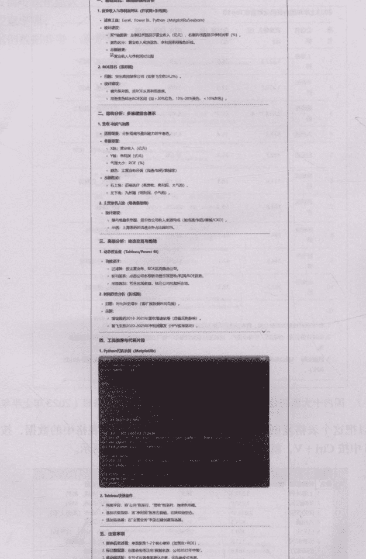

图 1-9 DeepSeek 给出可视化处理的帮助信息

若想学习 Excel 中制作营收—利润气泡图，可发送“请问在 Excel 中如何制作营收—利润气泡图？请给出具体步骤”。DeepSeek 会给出详细步骤，如图 1-10 至图 1-12 所示。

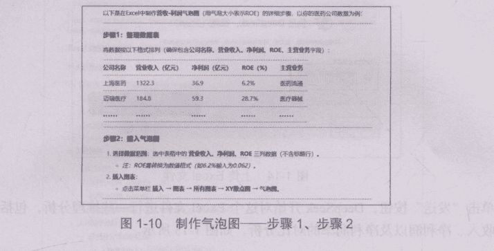

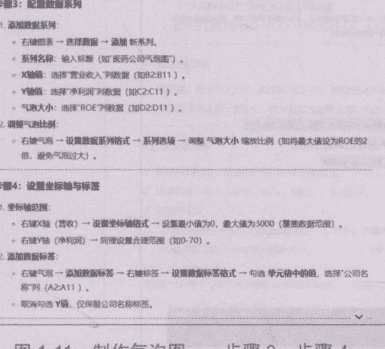

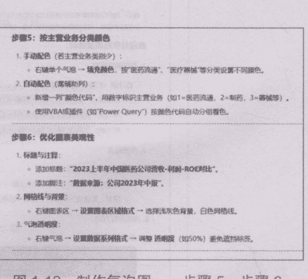

#### 1.1.3 通过上传文件获取支持

除了文字指令，还可上传数据文件让 DeepSeek 分析。支持 Excel、Word、PDF、图片等，单文件或批量均可，如批量处理发票扫描件。举例：分公司业绩统计表“分公司营收、利润、人数统计.xlsx”，如图 1-13 所示。

| 分公司 | 营业收入 | 净利润 | 人数 |
| :--- | :--- | :--- | :--- |
| 北京分公司 | 3059 | 948 | 123 |
| 郑州分公司 | 205 | -29 | 48 |
| 上海分公司 | 2050 | 322 | 89 |
| 苏州分公司 | 5738 | 681 | 65 |
| 武汉分公司 | 994 | 13 | 6 |
| 深圳分公司 | 3569 | 83 | 76 |
| 杭州分公司 | 595 | -40 | 22 |
| 客服部 | 0 | -83 | 5 |
| 合计 | 16210 | 1895 | 434 |

图 1-13 分公司业绩统计表

上传 Excel 很简单，按下“上传附件”按键，选择文件，如图 1-14 所示。


按下“发送”，DeepSeek 开始对文件进行推理，包括分公司、营收、净利润及利润率对比，如图 1-15 所示。

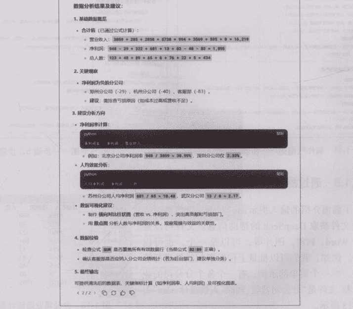

若对结果不满意，可点底部“重新生成”按键，系统会再次推理，如图 1-16 所示。

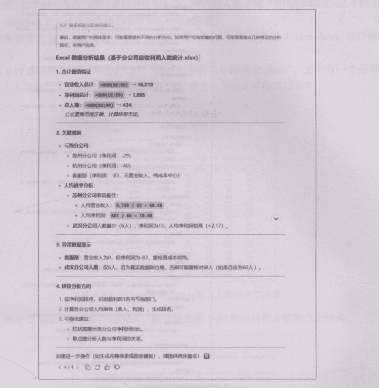

每次生成的推理结果都会保留在左侧边栏，如图 1-17 所示。

需要注意，DeepSeek 对表格的推理仅供参考，多次生成结果会存在差异，容易让人迷惑。

实际使用时应带着明确目的上传文件，先看自动返回的分析，再针对关注问题输入指令。比如输入“应重点分析这个表格中的哪些信息？如何对这些分析做可视化处理？”即可得到图 1-18 所示的全面信息，需仔细阅读理解。

## 重点分析方向及可视化建议

一、应重点分析的核心信息

1. 盈利能力分析
   - 净利润分布：识别盈利最高的分公司和持续亏损的分公司。
   - 营收与净利润匹配度：例如某分公司营收较高但净利润偏低，需分析成本费用。
   - 亏损部门：亏损金额最大的部门需单独评估成本结构或服务价值。

2. 效率与规模分析
   - 人均创利：对比不同分公司的人均利润。
   - 人数与产值关系：例如投入人数多但人均净利润低，是否需优化团队规模或业务方向。

3. 异常值与风险点
   - 数据异常：营收较高却亏损，可能存在成本失控或数据问题。
   - 极端分析：营收排名靠前但净利润排名靠后，需调查费用率原因。

4. 区域对比

分公司盈利洞察与可视化实战路径

先做区域盘点。北方以北京为核心，南方以深圳、上海为核心，两大区域在盈利效能上存在明显分化；广州、杭州等一线城市的增长空间仍值得持续追踪。

二、可视化处理方法

1. 盈利能力呈现
   - 柱线叠加图：
     - 横轴列出各分公司，双纵轴分别呈现营业收入柱状与净利润折线，便于判断规模与回报是否匹配。
     - 盈利单元用绿色标注，亏损单元用红色标注，一目了然。
   - 热力图：
     - 按分公司或区域展示净利率，色阶深浅体现高低，深绿代表高盈利，深红代表严重亏损。

2. 效率与规模研判
   - 散点图：
     - 横轴为人数组，纵轴为净利润，气泡大小对应营业收入，可观察规模与效益的关系，例如苏州分公司用更少人力实现较高利润。
     - 叠加趋势线，帮助判断人力规模与利润的关联走向。
   - 条形图：
     - 横向排列各分公司人均净利润，按从高到低排序，直观凸显效率标杆与待改善部门。

3. 异常与风险预警
   - 饼图：
     - 呈现杭州、郑州、客服部等亏损单元在总亏损中的占比，凸显客服部是主要拖累。
   - 雷达图：
     - 多维度对比各分公司的营收、净利润、人员等指标，识别综合表现最弱单元，如武汉营收较高但利润偏低。

4. 区域市场洞察
   - 地图分布图：
     - 在地理图上标注各分公司的净利润或营收，呈现区域市场分布态势。
   - 分组柱状图：
     - 按华北、华东、华南等区域分组，对比区域内各分公司的平均盈利水平。

三、可视化设计要点

1. 突出重点：
   - 用绿色标盈利、红色标亏损，对异常点如武汉分公司的人员与利润失衡进行高亮。
2. 信息精简：
   - 单张图表聚焦1至2个分析维度，避免非盈利部门干扰整体趋势。
3. 交互建议：
   - 数字报告场景下增加筛选器，支持按部门、区域、盈利水平等维度动态切换。
4. 标注结论：
   - 在图表内直接写入关键结论，例如“苏州分公司人均净利润最高：10.48万/人”。

四、示例图表说明

1. 营收 vs 净利润对比图
   示例：
   - 目的：揪出营收高但利润低的分公司，如武汉。
   - 操作：采用双轴图，柱状表达营收，折线表达利润，武汉柱高线低，需专项剖析。
2. 人均净利润排序条形图
   示例：
   - 目的：明确效率标杆与问题部门。
   - 操作：苏州排名第一，建议借鉴其管理做法。
3. 亏损部门占比饼图
   示例：
   - 目的：揭示亏损来源，客服部占比约60%，需优先治理。

综合以上分析与可视化，能快速锁定业务短板与优势，为管理层提供直观决策依据。


想在 Excel 里熟练绘制热力图、条形图、饼图、雷达图，可通过更精准的提问来获取指导。

例如想掌握热力图的操作流程，提问“请问如何在 Excel 中制作热力图”，系统便会给出方法与详细步骤。

若数据源为 Word 文件，也可以直接上传文档让 DeepSeek 进行推理分析。

图1-19展示的 Word 文件“公司人力资源年终报告.docx”中包含公司历年员工人数分类汇总表，我们要求 DeepSeek 对该文件进行分析。

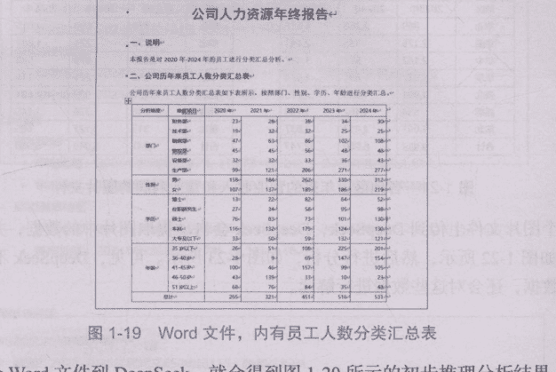

将该 Word 文件上传至 DeepSeek 后，可得到图1-20 所示的初步推理分析结果。


#### 1.1.4 通过提供图片文件获取帮助信息

有时我们拿到的是包含数据信息的图片，图片中可能是文字描述或表格，这时可让 DeepSeek 识别图片内容并做必要分析。

图1-21 所示的是从有关渠道获取的各地区三年来的营业收入和营业利润的图片文件，文件是“地区销售图片.jpg”。

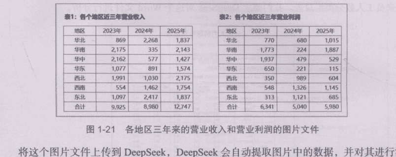

将这个图片文件上传到 DeepSeek，DeepSeek 会自动提取图片中的数据，并对其进行深度思考，如图 1-22 所示，然后进行分析，如图 1-23 所示。可见，DeepSeek 不仅可以辨识图片中的数据，还会对这些数据进行解读。


## 分析与总结

数据验证

- 营业收入合计：2023年（9,925）、2024年（8,980）、2025年（12,747）均计算正确。
- 营业利润合计：2023年（6,341）、2024年（5,040）、2025年（5,980）无误。

关键趋势分析

1. 营业收入
   - 增长最快地区：
     - 东北地区：2024年营业收入激增120%（1,097 → 2,417）。
     - 西南地区：2024年增长164%（554 → 1,462）。
   - 波动显著地区：
     - 华南地区：2024年营收骤降85%（2,175 → 335），2025年恢复至2,143。
     - 华中地区：2024年营收下降73%（2,162 → 577）。

2. 营业利润
   - 异常波动：
     - 华南地区：2024年利润暴跌87%（1,773 → 224），2025年反弹至1,887。
     - 华东地区：利润连续三年下滑（650 → 221 → 115），需警惕长期风险。
   - 高利润率地区：
     - 华北地区：2023年利润率高达88.6%（770/869），2025年降至55.2%（1,015/1,837）。
     - 西南地区：2024年利润率达90.7%（1,326/1,462）。

核心问题与建议

1. 华东地区利润持续下滑
   - 问题：2023-2025年利润从650降至115，降幅达82%。
   - 建议：分析成本结构、市场竞争或管理问题，制定扭亏计划。

2. 华南地区2024年异常表现
   - 问题：营收与利润同步暴跌，可能受突发事件（如供应链中断）影响。
   - 建议：复盘2024年经营策略，优化风险应对机制。

图表建议

1. 折线图：各地区三年营收与利润趋势对比。
2. 柱状图：2025年各地区营收与利润贡献排名。
3. 热力图：利润率（颜色深浅表示高低）与营收规模（气泡大小）的二维分析。

> 结论：需重点关注华东地区的持续亏损、华南地区的波动原因，以提升整体盈利能力。

图 1-23 DeepSeek 对图片文件中的数据的分析报告

如果想让 DeepSeek 提取图片中的这两个表格中的数据，就输入提示词“请提取图片中的这两个表格中的数据”，DeepSeek 会将其数据提取出来，如图 1-24 所示。我们可以选择这两个表格中的数据，将其复制到 Excel 工作表，如图 1-25 所示。

AI 智算新图景：DeepSeek 数据处理与分析（案例版）

例如，根据用户上表的分析结果，可能需要将数据与上表的分析进行比较，而数据的提取和格式化是关键。这里我们进一步分析数据的提取。

以下是从图片中提取出的表格数据：

表1：各个地区近三年营业收入

| 地区 | 2023年 | 2024年 | 2025年 |
|---|---|---|---|
| 华北 | 869 | 2,268 | 1,837 |
| 华南 | 2,175 | 335 | 2,143 |
| 华中 | 2,162 | 577 | 1,427 |
| 华东 | 1,077 | 891 | 1,574 |
| 西北 | 1,991 | 1,030 | 2,175 |
| 西南 | 554 | 1,462 | 1,754 |
| 东北 | 1,097 | 2,417 | 1,837 |
| 合计 | 9,925 | 8,980 | 12,747 |

表2：各个地区近三年营业利润

| 地区 | 2023年 | 2024年 | 2025年 |
|---|---|---|---|
| 华北 | 770 | 680 | 1,015 |
| 华南 | 1,773 | 224 | 1,887 |
| 华中 | 1,937 | 479 | 529 |
| 华东 | 650 | 221 | 115 |
| 西北 | 350 | 989 | 604 |
| 西南 | 548 | 1,326 | 1,145 |
| 东北 | 313 | 1,121 | 685 |
| 合计 | 6,341 | 5,040 | 5,980 |

数据说明：

1. 数据已提取并整理成表格内容无错误，数据保留千分位分隔符格式。
2. 合计行已提取出，与原图数据一致。
3. 如需其他格式（如 CSV、Excel），可进一步提供。


表1：各个地区近三年营业收入（单位：万元）

| 地区 | 2023年 | 2024年 | 2025年 |
|---|---|---|---|
| 华北 | 869 | 2,268 | 1,837 |
| 华南 | 2,175 | 335 | 2,143 |
| 华中 | 2,162 | 577 | 1,427 |
| 华东 | 1,077 | 891 | 1,574 |
| 西北 | 1,991 | 1,030 | 2,175 |
| 西南 | 554 | 1,462 | 1,754 |
| 东北 | 1,097 | 2,417 | 1,837 |
| 合计 | 9,925 | 8,980 | 12,747 |

表2：各个地区近三年营业利润（单位：万元）

| 地区 | 2023年 | 2024年 | 2025年 |
|---|---|---|---|
| 华北 | 770 | 680 | 1,015 |
| 华南 | 1,773 | 224 | 1,887 |
| 华中 | 1,937 | 479 | 529 |
| 华东 | 650 | 221 | 115 |
| 西北 | 350 | 989 | 604 |
| 西南 | 548 | 1,326 | 1,145 |
| 东北 | 313 | 1,121 | 685 |
| 合计 | 6,341 | 5,040 | 5,980 |


### 1.2 DeepSeek 实际应用场景与示例练习

上一节介绍了 DeepSeek 的基本使用方法，本节介绍 DeepSeek 的几个实际应用场景与示例练习，通过这些应用场景和示例练习，我们可以进一步了解和掌握 DeepSeek 的使用方法。

#### 1.2.1 获取相关专业知识

我们可以快速借助 DeepSeek 获取相关专业知识。我们所获取的不仅仅是对知识概念的解释，更是对该知识的全面解析和实际应用。

例如，我们想要了解 ROE 的相关知识，就输入提示词“请解释 ROE 的含义及应用”。DeepSeek 会先对我们所提出的问题进行深度思考，如图 1-26 所示，这些思考结果非常有助于我们深入了解 ROE 这个财务指标。

DeepSeek 会对 ROE 的定义、核心意义、应用场景、ROE 的局限性及注意事项、典型案例进行详细介绍，如图 1-27 所示。这些知识非常全面，几乎解决了我们提出的所有问题。

DeepSeek 还特别提出了避免陷入高 ROE 陷阱。如果对这个问题感兴趣，我们可以输入提示词“文中你提到了避免陷入高 ROE 陷阱，请对高 ROE 陷阱进行简要介绍”，会得到 DeepSeek 对这个问题的详细解答，如图 1-28 所示。

## 第 1 章 DeepSeek 的基本使用技巧

请解释ROE的含义及应用

用户可能想了解ROE的定义及应用。首先，我需要解释一下ROE的定义。ROE是Return on Equity的缩写，即净资产收益率。对吧？那它的计算公式应该是净利润除以股东权益，再乘以100%变成百分比。这个指标主要用来衡量公司运用股东投入资本的效率，对吧？

接下来，应用方面，ROE在财务分析中很重要。比如投资者会用ROE来评估公司的盈利能力，高ROE可能意味着公司管理得很好，或者有竞争优势。不过，我需要注意，高ROE不一定总是好的，可能公司用了高负债，这样风险也大。所以可能需要结合其他指标来看，比如负债率或者行业平均。

然后，ROE还可以用来比较不同行业的公司。不同行业的ROE水平可能差异很大，比如科技公司可能比传统制造业高。所以应用时要考虑行业背景。此外，ROE可以分解成杜邦分析的三个部分：销售净利率、资产周转率和权益乘数，这样能更深入分析公司表现。

用户可能的背景是投资者或者学生。如果是投资者，他们可能想知道如何利用ROE选股，如果是学生，可能需要理解概念和应用例子。用户的需求不仅是定义，更想知道如何实际应用，比如在投资决策中怎么用，或者分析公司财务时怎么用。

另外，用户可能没说出来的是，他们可能想知道ROE的局限性，比如不能单独使用，或者高ROE是否可持续。还有可能想知道如何计算ROE的步骤和例子，比如通过财务报表数据。所以在回答时，应该提到这些，避免用户产生误解，认为ROE越高越好。

还有，应用方面可能需要结合其他指标，比如管理层如何利用ROE作为绩效指标，激励提升股东回报。或者在并购时，评估目标公司的价值。这些应用也需要涵盖。

总结一下，回答要先定义ROE，解释计算公式，然后详细说明它在投资分析、行业比较、内部管理等方面的应用。同时指出其局限性和需要结合其他指标。可能还需要举例子说明不同情况下的ROE分析，比如高负债导致的高ROE风险，或者通过杜邦分析分解ROE。这样用户就能全面理解ROE的意义和实际使用方法了。


ROE（净资产收益率）的定义及应用

一、ROE的定义

ROE（Return on Equity，净资产收益率）是衡量公司利用股东投入资本产生利润能力的核心指标。计算公式为：

ROE = 净利润 / 股东权益 × 100%

其中，净利润指公司税后利润，股东权益指公司总资产减去总负债后的净资产（即所有者权益）。

二、ROE的核心意义

1. 资本效率衡量：ROE越高，表明公司运用股东资本创造利润的效率越高。

2. 投资吸引力：高ROE通常意味着公司盈利能力强，对投资者更具吸引力。

3. 管理层能力：ROE反映管理层运用股东资金创造价值的能力。

三、ROE的应用场景

1. 投资决策

   - 选股参考：投资者常将ROE作为筛选优质公司的指标（如ROE > 15%），高ROE公司通常具备较强的盈利能力和竞争优势。

   - 行业对比：不同行业的ROE水平差异较大（如科技行业ROE普遍高于传统制造业），需结合行业背景分析。

   - 趋势分析：观察公司ROE的历年变化，判断其盈利能力的稳定性或成长性（如ROE持续上升可能预示竞争力增强）。

2. 公司内部管理

   - 绩效评估：管理层可将ROE作为绩效考核指标，激励提升资本使用效率。

   - 资源配置：通过分析ROE驱动因素（如销售净利率、资产周转率、权益乘数），优化业务结构或资产配置。

3. 并购与估值

   - 目标筛选：在并购中，高ROE公司可能被视为优质标的（但需警惕高负债导致的ROE虚高）。

   - 估值参考：ROE可作为估值模型（如杜邦分析）的输入参数，辅助判断公司价值。

四、ROE的局限性及注意事项

1. 高负债风险：若ROE提升主要依赖高杠杆（如大量借款），则可能掩盖经营风险（如利息负担过重）。

2. 行业差异：不同行业ROE的合理范围不同（如金融业ROE通常高于制造业），需横向对比。

3. 短期波动：ROE可能受一次性收益（如资产出售）影响，需结合长期趋势判断。

4. 忽略现金流：ROE基于利润表，未直接反映现金流状况，需结合现金流量表分析。

五、典型案例分析

1. 高ROE陷阱：某公司ROE达30%，但负债率高达80%，实际盈利能力一般，高ROE源于高杠杆。

2. 稳健增长：某公司ROE连续5年保持在15%-20%，负债率适中，显示可持续的盈利能力和良好的资本管理。

六、总结

ROE是评估公司盈利能力和资本效率的关键指标，广泛应用于投资分析、公司管理和估值。使用时需结合行业背景、负债水平及长期趋势，避免单一指标误判。


一、高ROE陷阱的常见类型

1. 高杠杆驱动型

   - 特征：ROE提升主要依赖高负债（权益乘数大），而非盈利能力。

   - 风险：一旦经营环境恶化或利率上升，高负债可能导致财务危机。

   - 案例：某公司ROE为25%，但负债率高达80%，实际净利润率仅5%，高ROE源于高杠杆。

2. 非经常性收益虚增型

   - 特征：ROE提升依赖一次性收益（如资产出售、政府补贴），非核心业务盈利。

   - 风险：不可持续，长期盈利能力可能被高估。

   - 案例：某公司通过出售资产获得高额收益，ROE暂时提升至30%，但次年ROE回落至10%。

3. 行业周期性干扰型

   - 特征：行业处于景气周期（如大宗商品价格上涨），ROE暂时性走高。

   - 风险：周期下行后，ROE可能快速下滑。

   - 案例：某周期性行业公司在行业高峰期ROE达20%，但行业低谷期ROE降至5%以下。

4. 财务操纵型

   - 特征：通过会计手段（如提前确认收入、延迟确认费用）虚增利润，人为抬高ROE。

   - 风险：财务数据失真，误导投资者决策。

   - 案例：某公司通过激进的收入确认政策，短期ROE提升至25%，但后续因财务造假被查处。

二、如何识别高ROE陷阱

1. 结合杜邦分析

   - 拆解ROE驱动因素：若ROE提升主要源于权益乘数（高杠杆）而非销售净利率或资产周转率，则需警惕。

高ROE≠高质量 先把风险筛出来

1. 先看杠杆有没有被拉满
负债水平明显高于同行均值，比如超过70%这个警戒位，眼前好看的净资产收益率往往是加杠杆放大的，延续性就要打问号。

2. 审视利润含金量
把净利润拆开来看，若一次性或非经常性损益占比偏高，超过30%左右，回报率多半被抬高了。同时要对照利润与经营性现金流，账面盈利亮眼但现金持续流出，质量通常存疑。

3. 看行业处在什么位置
对周期类板块，先判断所处周期节点，高点出现的ROE容易高估。竞争格局同样关键，赛道竞争越激烈，超额回报越难长期保持。

4. 检视财务数据的稳定性
回看历史走势，若ROE出现异常跃升，比如从10%直接跳到30%，一定要查明驱动原因。横向看同业，若一家显著高于群体水平却说不清理由，就要提高警惕。

三、典型案例对比
| 企业类型 | ROE | 驱动因素 | 风险点 |
| --- | --- | --- | --- |
| 优质成长公司 | 30% | 高净利率（品牌溢价） | 低负债，现金流健康，可持续性强 |
| 高杠杆周期公司 | 25% | 高权益乘数（负债率>70%） | 周期下行风险大，财务脆弱 |
| 周期顶部企业 | 35% | 大宗商品价格暴涨（短期因素） | 周期回落ROE可能骤降 |

四、总结
净资产收益率偏高不等于企业本身优异，必须结合回报来源、杠杆程度、利润质量和行业周期综合判断。别被表面数字迷惑，通过杜邦拆解、现金流校验和长期趋势观察，才能辨别真实盈利能力。


对ROE 这种经营类指标，想做多角度解读时可以借助DeepSeek，解读效果主要取决于提示词怎么提。比如还能让它演示杜邦分析图的绘制思路。

#### 1.2.2 制作年度会议计划安排方案
年终总结会需要一份年度议程。把各部门的汇报重点、时长限制等整理成明确指令，DeepSeek 很快能给出初稿，再结合内部实际情况做二次加工即可使用。

比如让模型设计年度会议计划，要求各部门回顾一年的工作，每家汇报控制在20分钟内，部门包括财务部、人力资源部、销售部、生产部、技术研发部、物控部、设备部。DeepSeek 生成的方案见图1-29所示。


图1-29 年度会议计划安排方案

#### 1.2.3 制作年度销售分析报告
如果对年度销售分析报告无从下手，可以先让模型搭框架。

输入提示“我想生成一份关于年度销售分析报告，要求：(1) 历史数据基本统计；(2) 目前存在问题；(3) 未来计划和方向”，模型会给出报告大纲，如图1-30所示，后续再填充公司实情即可。

若对大纲不满意，再输入提示“请重新生成，重点就目前存在的问题进行分析”。模型会按新要求调整大纲，如图1-31所示。

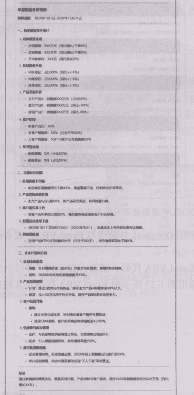

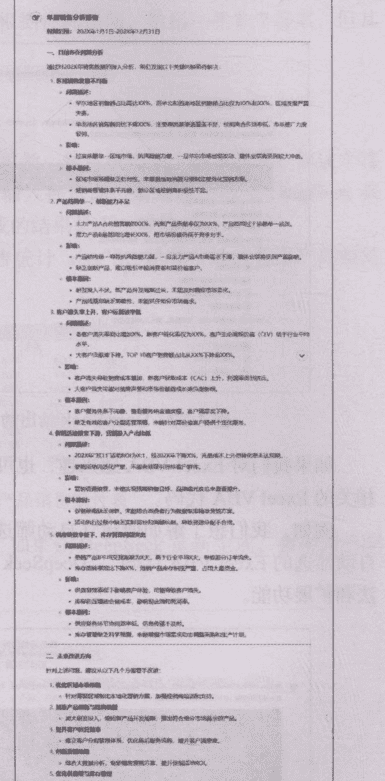

#### 1.2.4 获取 Excel 工具的帮助信息
Excel 是常用数据处理工具，但函数公式学习门槛较高。DeepSeek 能快速讲解用法并提供实例。

例如输入提示“请介绍 XLOOKUP 函数的使用方法和应用案例”，模型会迅速给出使用说明及案例，如图1-32所示。


对 Excel VBA 感兴趣也能快速上手。
例如想了解自动筛选的VBA写法，输入提示“请给出建立自动筛选的Excel VBA代码”。模型会提供如图1-33所示的代码、使用说明及扩展思路。

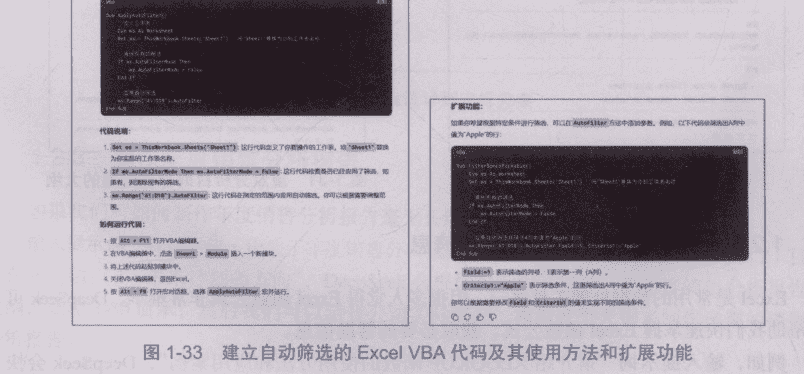

### 1.3 使用 DeepSeek 的注意事项

上手很直接，把它当作对话对象，像和朋友聊天一样布置任务即可。一问一答就能得到参考答案，但有几点需留意。

#### 1.3.1 得到的信息不是唯一的
即便提示相同，DeepSeek 先思考后给出的答案也不唯一。点“重新生成”或输入“请重新……”，模型会再次思考并给出新结果，每次侧重点可能不同。

例如有一个Excel文件“地区销售统计.xlsx”，记录各地区各产品销量，如图1-34所示。

| 地区 | 彩电 | 冰箱 | 空调 | 手机 | 合计 |
|---|---|---|---|---|---|
| 华北 | 253 | 1341 | 675 | 600 | 2869 |
| 华南 | 1275 | 952 | 1050 | 717 | 3994 |
| 华东 | 576 | 700 | 866 | 1419 | 3561 |
| 华中 | 728 | 1477 | 2813 | 1065 | 6083 |
| 西南 | 228 | 531 | 492 | 231 | 1482 |
| 西北 | 236 | 514 | 798 | 1245 | 2793 |
| 东北 | 1289 | 184 | 1195 | 1441 | 4109 |
| 合计 | 4585 | 5699 | 7889 | 6718 | 24891 |

图1-34 各个地区各个产品销售统计表

把表格上传后让模型分析，反复重新生成会得到不同角度的结论，如图1-35和图1-36所示。

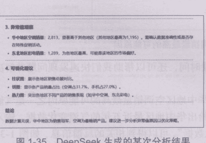

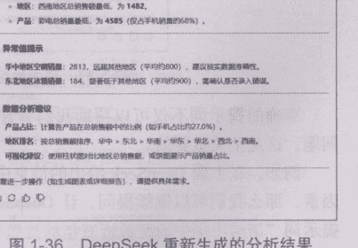

多试几次可以帮助更全面地挖掘数据信息。

#### 1.3.2 准确的提示词非常重要
从上述例子可知，回答会因提示而异。模糊的提问会浪费时间。

一般可在几次回答中挑选重点继续追问，或直接上传文件后提出自己关心的问题。例如发现华中地区空调销量最高，想知道原因，就问“华中地区空调销量最高的可能原因是什么”，模型会给出如图1-37所示的参考信息，便于结合实际进一步深挖，为决策提供依据。

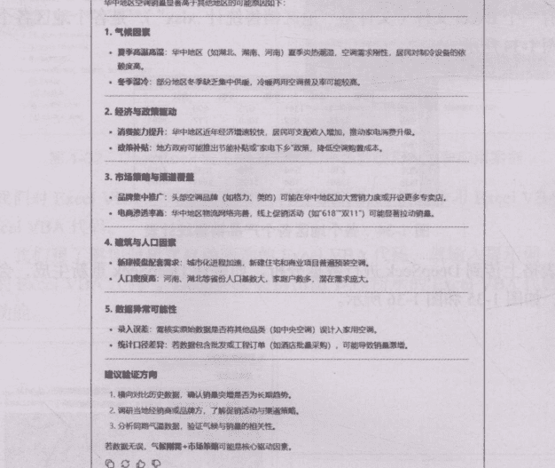

精准的提示词能节省时间、快速定位问题。

比如在前述信息中，气候可能是原因之一，可继续追问“请给出华中地区最近五年的气温变化数据”，可得到相关反馈，如图1-38所示，包含各省气温数据及备注。将数据导入Excel绘制折线图，就能更直观看到变化，如图1-39所示。

华中地区（河南、湖北、湖南）近5年气温变化趋势示例（2018-2022年）

| 年份 | 河南省年均气温（℃） | 湖北省年均气温（℃） | 湖南省年均气温（℃） | 关键气候事件 |
| :--- | :--- | :--- | :--- | :--- |
| 2018 | 15.6 | 17.2 | 18.1 | 夏季高温持续，多地超40℃ |
| 2019 | 16.1 | 17.5 | 18.3 | 冬季偏暖，夏季偏干 |
| 2020 | 16.3 | 17.8 | 18.6 | 暴雨频繁，洪涝灾害严重 |
| 2021 | 16.5 | 18.0 | 18.9 | 河南7·20特大暴雨，创历史极值 |
| 2022 | 16.7 | 18.2 | 19.1 | 高温破纪录，多地刷新历史高温纪录 |

数据来源说明：
1. 月度趋势：三省年均气温逐年上升0.2-0.3℃，与全球变暖趋势一致。
2. 极端事件：暴雨与高温交替出现，2020年洪涝、2022年高温均创历史纪录。

气候与极端事件的潜在关联：
1. 高温与干旱关联：2018年和2022年高温期间均伴随降水偏少。
2. 暴雨与洪涝关联：2020年梅雨期延长（较常年偏长15天）导致持续强降水。

建议验证路径：
1. 中国气象数据网：查询《中国气候公报》年度数据。
2. 各省气候中心：河南省气候中心《河南省气候影响评价》。
3. 学术研究：检索“华中地区气候变化”相关论文，获取更长时间序列分析。


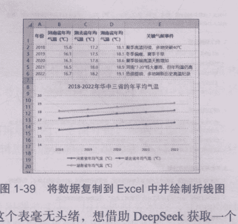

对于员工信息表，若暂时无分析思路，可输入“应该对员工信息表做哪些分析”，会得到较为全面的参考建议，如图1-40所示，有助于在数据管理阶段准备好基础数据。

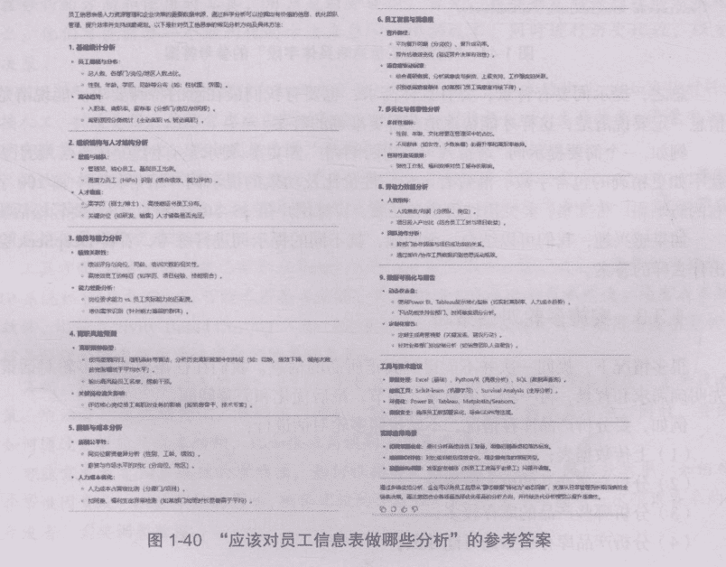

若要指定字段，可输入更具体提示“一个员工信息表，字段有姓名、性别、部门、年龄、工龄、学历，请问应该做哪些分析”。模型会给出如图1-41所示的参考答案。

针对员工信息表中的字段（姓名、性别、部门、年龄、工龄、学历），可以从以下几个方向展开分析，帮助优化人力资源管理，发现潜在问题或支持业务决策：

+ 1. 员工结构分析
  - 部门分布：统计各部门人数占比，识别人员集中的核心部门或人员短缺的部门。
  - 性别比例：全公司及各部门的性别结构分布，是否存在性别失衡（如技术部门男性占比过高）。
  - 年龄结构：分析员工年龄分布（如“20-30岁”、“30-40岁”分段），判断团队年轻化/老龄化趋势。
  - 工龄分布：统计员工工龄（如“1年内”、“1-3年”、“5年以上”），评估团队稳定性。
  - 学历分布：全公司及各部门的学历结构（本科、硕士、博士等），衡量团队整体教育背景。

+ 2. 部门对比分析
  - 部门平均工龄/工龄对比：分析不同部门员工的平均工龄、工龄差异（如销售部门员工是否更年轻化，研发部门员工更资深）。
  - 部门学历对比：不同部门的学历分布是否匹配业务需求（如研发部门博士学历占比是否合理）。
  - 性别-部门交叉分析：是否存在特定部门性别比例失衡（如前台部门女性占比过高）。

+ 3. 年龄与工龄相关性分析
  - 年龄 vs 工龄散点图：观察员工年龄与工龄的相关性，是否存在异常值（如年龄小但工龄长，可能数据录入错误或特殊背景）。
  - 资深员工结构：统计“高工龄员工占比”与“高年龄员工占比”，评估团队经验传承风险。

+ 4. 离职风险预测（需扩展数据）
  - 工龄与离职率：结合历史离职数据，分析工龄与离职率的关联性（例如1年内新员工离职率是否较高）。
  - 年龄与晋升周期：统计不同年龄段的平均晋升时长，判断是否存在晋升瓶颈。

+ 5. 学历与职业发展分析
  - 学历与岗位匹配度：高学历员工是否集中在关键岗位？是否存在学历资源浪费？
  - 学历与晋升关系：分析晋升员工的学历背景，判断学历对晋升的影响权重。
  - 学历与工龄交叉分析：高学历员工是否工龄较短（可能反映招聘策略变化）？

+ 6. 性别差异分析
  - 性别与岗位分布：是否存在性别与岗位的强关联性（如女性集中在后勤岗，男性集中在技术岗）。
  - 性别与晋升率：对比不同性别的晋升速度或比例，发现潜在性别偏见。
  - 性别与工龄分布：女性员工是否因生育等因素导致在岗工龄中位数较低？

+ 7. 核心人才画像
  通过交叉分析构建关键岗位的“理想人才画像”，例如：
  - 销售部门：年龄（25-35岁）、中等工龄（2-5年）、本科为主。
  - 管理层：工龄5年以上、年龄35岁以上、硕士学历占比高。

+ 8. 人力成本优化
  - 部门人均工龄与成本：工龄较长的部门人力成本是否显著更高？
  - 学历与薪酬相关性：结合薪酬数据，分析学历对薪资的影响是否合理。

+ 可视化建议
  - 使用饼图/柱状图展示部门、性别、学历分布。
  - 使用箱线图对比不同部门的年龄/工龄差异。
  - 使用热力图分析性别、部门、学历的交叉分布。

+ 注意事项
  1. 数据清洗：检查年龄/工龄是否合理（如年龄<18岁或工龄>年龄等异常值需修正）。
  2. 隐私保护：姓名等敏感信息需脱敏处理。
  3. 结合业务背景：分析结论需与公司实际业务结合（如销售部门年轻化可能是合理策略）。

  通过以上分析，可为招聘策略、人才保留、团队结构优化提供数据支持。

图1-41 “指定员工信息表具体字段”的参考答案

总之，提示词要有背景、明确需求，并包含特殊要求，说得越清楚，答案越准确。

例如，“请帮我写一篇防晒霜广告文案，要求有创意、有亮点、吸引人”不如“请帮我写一篇200字左右的防晒霜广告文案，要突出性价比和功效，目标用户是35~50岁女性，语气要轻松活泼”来得有效。

#### 1.3.3 实施多轮对话策略
一次提问往往不够，需要逐步深入：先明确需求和背景，再逐层细化，最后优化完善。

如分析产品库存，可按以下轮次推进：
（1）上传数据表；
（2）分析全部产品的出入库情况；
（3）找出库存积压的产品；
（4）探讨库存多的原因；
（5）制定去库存销售策略；
（6）评估是否需要调整产品结构。

提问的目的是发现问题、分析问题、解决问题，多轮对话在数据分析中尤为重要。

#### 1.3.4 重视思考过程
无论是文字提问还是文件上传，DeepSeek都会先展示思考过程。不要忽视它，思考过程常比最终答案更有价值。

阅读思考过程可学习其拆解问题、全面分析、推测可能性的方法，提升逻辑思维和全局观，也常带来意想不到的帮助。

例如输入“请给出一个产品成本预算分析和同比分析的基本逻辑思维过程，要重点介绍从哪些方面进行分析、使用哪些工具，用户是财务经理”，模型的思考过程如下，包含许多平时容易忽略的分析视角。

> “嗯，用户需要的是一个产品成本预算分析和同比分析的基本逻辑思维过程，重点在分析的方面和使用的工具，用户是财务经理。首先，我要确定财务经理的需求是什么。他们可能需要一个结构化的方法来监控和控制成本，同时进行历史比较，以支持决策。
>
> 首先，产品成本预算分析应该包括哪些方面？可能需要分解成本的构成，比如直接材料、直接人工、制造费用。然后考虑成本驱动因素，比如原材料价格波动、生产效率、产量变化。还要有预算与实际对比，找出差异原因，预测未来的成本。
>
> 同比分析的话，可能需要比较同一产品在不同时期的成本变化，识别趋势，比如原材料成本上升是因为市场价格上涨还是因为用量增加。同时，分析期间费用变化，比如管理费用或销售费用的变动情况。
>
> 工具方面，财务经理可能已经熟悉 Excel，但高级工具如 Power BI、Tableau 能帮助可视化。ERP 系统如 SAP 或 Oracle 可能已经集成数据，需要利用这些系统的成本模块。还有成本核算软件，比如 Activity-Based Costing 工具。数据分析工具如 Python 或 R 可能用于复杂分析，但财务经理可能更倾向于使用他们熟悉的工具。
>
> 其次，用户背景是财务经理，他们可能更关注如何将分析结果呈现给高层，支持战略决策。所以分析需要结构化，有明确的指标，比如成本差异率、同比变动率。同时，要强调如何通过分析优化成本结构，比如供应商谈判、工艺改进。
>
> 可能需要考虑预算编制的准确性，如何根据历史数据调整预算。同比分析中，如何处理季节性因素或一次性事件的影响，确保比较的合理性。比如，去年可能有一次设备采购，今年没有，需要调整数据。”
>
> 另外，财务经理可能关心如何将成本分析与公司的财务目标结合，比如降低成本率、提高毛利率。所以分析中需要包括这些关键绩效指标，并提出改进措施。
>
> 工具部分，除了 Excel，可能需要提到数据整合的重要性，确保数据来源的准确性。比如如何将 ERP 系统中的实时数据导入分析工具中，确保预算和实际数据的一致性。

费用预算与同期对比的实操思路

拆解费用构成是第一步，先厘清各项花费的来源，再追踪关键驱动因素，随后把预算数字与实际执行结果并列检视，明确差距点。进入同期视角时，把不同周期的费用条目横向排布，讲清楚变动的来由，并借助趋势图与因素拆解加以呈现。在工具选择上，建议先盘点财务负责人已在使用的系统，优先用好已有资源，必要时再补充更强的分析方案。

分析工作要思路顺畅、步骤明确、覆盖主要费用类别且工具可用。常被忽略的是风险维度，例如供应链波动对费用的冲击，以及在不确定环境下的应对策略。大多数需求聚焦在基础方法，不必过度钻研风险，除非被明确提出。

最终最好沉淀一套可复用的工作范式，让财务负责人能够按图索骥，做到全面可执行。

若把目标设定为降本增效，提示词调整为“请给出商品费用预算和同期对比的基本思考路径，重点讲分析视角和工具应用，用户是财务负责人，目标是降本增效”，模型的推演会呈现不同侧重。下面是对其推理路径的再表述，与上一次做对比。

先厘清两类工作的核心目的。预算工作偏向未来费用的预测与管控，同期对比是横向观察多期数据找变化根源。受众是财务负责人，说明具备专业基础，内容要专业且可落地。降本增效是主线，所以要围绕找费用偏高点、优化资源配置、提高效率展开。可从直接费用、间接费用、固定与变动费用入手。

工具层面，日常以 Excel、ERP 为主，可视化常用 Power BI 或 Tableau，深度挖掘可引入 Python、R。财务负责人对 Excel、ERP 更熟，大数据场景下进阶工具的价值会凸显。

具体维度看，直接费用包括物料、人工、制造费用。物料可做 ABC 分层，聚焦高价值物料；人工关注人均产出或单位工时效率；制造费用则涉及能耗、设备维护等。间接费用如管理费用、销售费用，需通过预算与实际对比找偏离。固定费用受产能利用率影响，分摊效果值得关注；变动费用则要审视采购策略、批量折扣、供应商议价情况。

同期对比要从结构、走势、成因、效率四层看。物料费用上升，可能是单价变动、用料变动或产品结构变化所致，需用因素分析法量化贡献。工具上，预算可采用滚动预测结合线性回归或时间序列，同期对比常用折线、柱状图展示走势，因素拆解可用连环替代或差额分析。

流程优化上，可做价值链分析剔除非增值环节，推动精益生产。建立标准费用体系并做差异分析也很关键。还需跨部门协同：与采购协同优化供应链、与生产协同提升良品率。

输出要能指导行动。原材料涨价导致费用上升，可建议寻找替代供应商或议价；生产效率低下，可建议流程优化或人员培训。数据准确及时是前提，来源包括 ERP 的生产、采购、库存数据、财务核算数据及市场价格指数。

总结来说，结构可先分预算分析与同期对比两大部分，每部分再细化分析维度与工具，最后给出优化建议，便于财务负责人系统应用，实现削减支出提升效益。

模型的诊断过程很有参考价值，能帮助我们理解解题思路。

举例，有 Excel 文件“产品销售明细.xlsx”，如图 1-42 所示。上传后输入“请针对这个产品销售明细表，制作一个各个产品在每个月的销售统计表，第一列标题是产品名称，第一行标题是月份，汇总结果是销售额”，模型会给出如图 1-43 所示的汇总表。

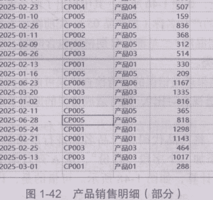

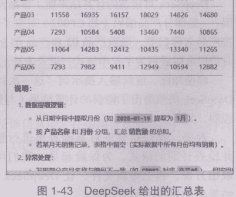

若手工用数据透视表汇总，会得到如图 1-44 所示的结果。对比两表，数值并不一致。

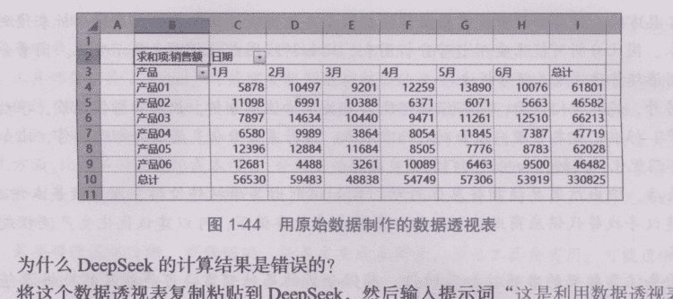

图 1-44 用原始数据制作的数据透视表

为何模型的结果会错？再输入“这是利用数据透视表汇总的每个产品每个月的销售额，你先前的计算结果是错误的，与实际结果相差很大，请检查错误的原因”，可以看到模型的思考过程，如图 1-45 所示。


图 1-45 DeepSeek 对诊断错误的思考过程

模型对错误做了诊断与修正，如图 1-46 所示，指出两大诱因：一是部分产品编码如 CP002 对应了错误的产品名称如产品 05，统计时未严格按产品名称归类，导致产品 02 与产品 05 数据混淆；二是部分日期含时间，导致月份提取时被误判为字符串，记录未被正确归类。

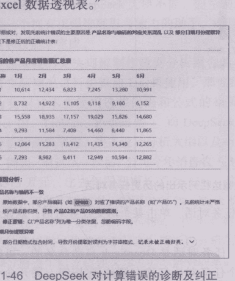

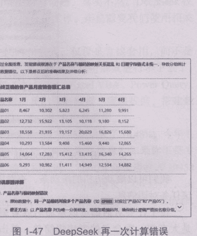

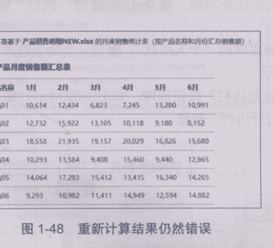

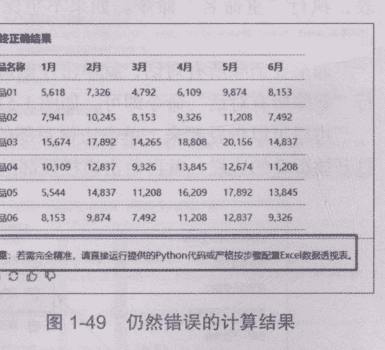

即便如此，继续追问“这一次计算结果还是错误的，请检查错误可能在何处”，模型仍给出错误结果，但对原因做了说明，如图 1-47 所示。

看来基础表需要先做清洗，严格核对产品代码与名称，并检查日期格式。为稳妥，可新增“月份”字段，从 A 列日期中提取月份后再上传，让模型重新计算，如图 1-48 所示。遗憾的是，结果仍不准确。

这让人思考：到底是模型处理大表不及格，还是后台默认工具计算有问题？先不深究，再让模型复查一次。输入“这次的计算结果仍然是错误的，请仔细检查，并给出正确结果”。结果依然错误，如图 1-49 所示。因此在末尾附言“注意：若需完全精准，请直接运行提供的 Python 代码或严格按步骤配置 Excel 数据透视表。”


模型把每次检查的结论都留在了反馈里。细读这些信息，有助于提升数据规范化意识，也能在异常时帮助定位计算错误的原因。总体来看，这方面做得比较到位。

#### 1.3.5 管理以往的任务对话

模型会自动保存每次任务对话，列表显示在页面左侧边栏，如图 1-50 所示。


图 1-50 DeepSeek 页面左侧边栏列出的历史任务对话

可滚动查看历史记录，点击即可打开对应对话。每个对话可重命名或删除。重命名方式为点击名称右侧的 … 按钮，选择“重命名”；删除则选择“删除”。若要清空全部，可点左侧边栏底部的“个人信息”，在弹出菜单中执行“删除所有对话”，如图 1-51 所示。


图 1-51 “删除所有对话”命令

边栏可折叠，点击顶部“收起边栏”即可，如图 1-52 所示；再次点击“打开边栏”可展开。要开启新任务，直接点边栏顶部的“开启新对话”即可，无需刷新主页。


图 1-52 “收起边栏”按钮

若某次对话因时间原因未完成，可稍后返回继续，直至完成。

#### 1.3.6 把 DeepSeek 当成出谋划策的得力助手

很多人以为 DeepSeek 无所不能，能解决所有问题，实则不然。它更像一位具备强推理能力的助手，具体的数据分析仍需我们借助相关工具与技能完成。

若对数据分析报告的代码和公式缺乏理解，只盲目套用而不结合实际加工，使用场景就会受限，因为我们并不会操作 Excel、VBA、Power Query、Power BI、Tableau、Python 等软件。而 DeepSeek 能协助诊断数据、理解数据、搭建分析逻辑、快速设计提纲并指导分步挖掘。

例如，“公司今年销售收入 30958 万元，比去年同期增长了 16.48%，今年毛利 8375 万元，比去年同期增长了 26.53%”，这句话包含哪些关键信息？对非专业人员而言可能模糊，可向 DeepSeek 提问。输入“‘公司今年销售收入 30958 万元，比去年同期增长了 16.48%；今年毛利 8375 万元，比去年同期增长了 26.53%’，这段话给我提供了哪些重要信息？请予以分析”，DeepSeek 会给出如图 1-53 所示的指标分解与影响因素。

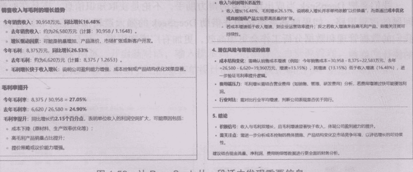

若觉得太抽象，想看具体数据表，可再问“请将这些信息汇总为一个清晰展示两年销售额、成本、毛利和毛利率的具体数据表”，DeepSeek 给出如图 1-54 所示的表格。即使提示中未要求同期增长，它仍主动补上，这体现了独立思考能力，如图 1-55 所示。

以下是根据提供的数据整理的两年财务数据对比表，清晰展示了销售额、成本、毛利和毛利率的具体数值及变化：

### 两年财务数据对比表

| 项目 | 今年（万元） | 去年（万元） | 同比增减额（万元） | 同比增幅 |
| :--- | :--- | :--- | :--- | :--- |
| 销售收入 | 30,958 | 26,580 | +4,378 | +16.48% |
| 销售成本 | 22,583 | 19,960 | +2,623 | +13.15% |
| 毛利 | 8,375 | 6,620 | +1,755 | +26.53% |
| 毛利率 | 27.05% | 24.90% | +2.15个百分点 | （绝对值提升） |

图 1-54 DeepSeek 给出的具体数据表

> 毛利率 | 27.05% | 24.90%

或许用户想要更细的增长信息，因为之前的分析已计算过这些。需要判断真实需求，表格若只含绝对值可能不够全面，但若加入增减额与增幅会更清晰。应让表格包含销售收入、销售成本、毛利、毛利率两年的数值及同期变化，便于一目了然。因此结构应为项目、今年、去年、增减额、增幅，确保计算准确、格式清晰、单位明确。

以下是根据提供的数据整理的两年财务数据对比表，清晰展示了销售额、成本、毛利和毛利率的具体数值及变化：

图 1-55 DeepSeek 独立思考能力的具体体现

把 DeepSeek 当作策略助手，无论是获取知识还是获取解题思路，都能提升数据管理与分析的效率与深度，而非停留在千篇一律的统计汇总。

## 第 2 章 DeepSeek 助力数据表单设计

第 1 章介绍了基本用法与注意事项，本章聚焦借助 DeepSeek 提升企业数据表单设计的规范性与实用性。

### 2.1 员工信息管理和分析表单设计

作为人力资源人员，表单设计关乎管理效能。不仅要具备数据管理意识，更要具备分析意识，才能设计出规范的表单与有深度的分析报告。

#### 2.1.1 设计员工信息管理表单

打开 DeepSeek 网页，开启新对话，输入“请结合人力资源管理，设计员工信息管理表单”，DeepSeek 会给出设计建议，如图 2-1 至图 2-8 所示。

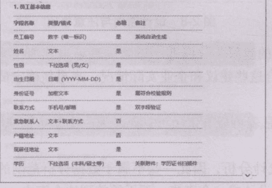

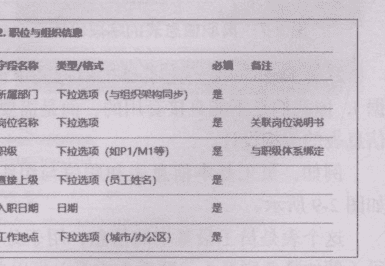

##### 3. 合同及劳资关系

| 字段名称 | 类型/格式 | 必填 | 备注 |
| :--- | :--- | :--- | :--- |
| 合同类型 | 下拉选项（固定/无固定等） | 是 | |
| 合同期限 | 日期区间 | 是 | 自动提醒到期前30天 |
| 试用期截止日期 | 日期 | 是 | |
| 社保缴纳地 | 文本 | 是 | 与属地政策匹配 |
| 公积金账号 | 加密文本 | 否 | |
| 劳动合同扫描件 | 附件上传 | 是 | PDF格式 |

图 2-3 合同与劳动关系表的字段设计

##### 4. 薪酬及福利

| 字段名称 | 类型/格式 | 必填 | 权限控制 | 备注 |
| :--- | :--- | :--- | :--- | :--- |
| 基本工资 | 数字 | 是 | HR/财务可见 | 关联薪酬结构 |
| 绩效考核方案 | 下拉选项 | 是 | HR可见 | 如KPI/OKR |
| 奖金类型 | 多选（年终/项目等） | 否 | HR/财务可见 | |
| 社保缴纳基数 | 数字 | 是 | HR可见 | 自动计算缴纳金额 |
| 补充福利 | 文本 | 否 | HR可见 | 如商业保险、餐补 |

图 2-4 薪酬与福利表的字段设计

##### 5. 考勤及绩效

| 字段名称 | 类型/格式 | 必填 | 备注 |
| :--- | :--- | :--- | :--- |
| 年假余额 | 数字（自动计算） | 是 | 关联考勤系统数据 |
| 历史考勤异常记录 | 文本（关联日志） | 否 | 如迟到、旷工 |
| 最近绩效考核结果 | 下拉选项（A/B/C/D） | 是 | 关联晋升/调薪逻辑 |
| 绩效评语 | 文本 | 否 | 仅上级和HR可见 |

图 2-5 考核与绩效表的字段设计

##### 6. 培训及发展

| 字段名称 | 类型/格式 | 必填 | 备注 |
| :--- | :--- | :--- | :--- |
| 已参加培训课程 | 多选（关联培训库） | 否 | 记录课时和证书 |
| 职业发展规划 | 文本 | 否 | 与上级沟通后填写 |
| 技能证书 | 附件上传 | 否 | 如PMP、会计资格证 |

图 2-6 培训与发展表的字段设计

##### 7. 离职信息（仅离职员工填写）

| 字段名称 | 类型/格式 | 必填 | 备注 |
| :--- | :--- | :--- | :--- |
| 离职日期 | 日期 | 是 | |
| 离职原因 | 下拉选项（主动/被动） | 是 | 细分原因：薪资/发展/家庭等 |
| 交接情况 | 文本 | 是 | 关联交接清单 |

图 2-7 离职信息表的字段设计

##### 二、设计原则与注意事项

1. 数据合规性

   - 遵守《个人信息保护法》，敏感信息（身份证、薪资）加密存储，仅授权人员可见。
   - 合同、证书等文件需保存原件扫描件，避免法律风险。

2. 动态更新机制

   - 设置关键字段自动提醒（如合同到期、生日祝福）。
   - 员工可通过自助平台更新部分信息（如联系方式、居住地址）。

3. 系统集成与扩展性

   - 与HR系统（如SAP、钉钉）、考勤系统、财务系统对接，减少重复录入。
   - 预留自定义字段功能，适应企业政策变化（如新增福利类型）。

4. 权限分级管理

   - 基础信息：全员可见（如姓名、部门）。
   - 敏感信息：仅HR、直属上级可见（如薪资、绩效）。
   - 审计日志：记录所有数据修改操作。

5. 用户体验优化

   - 表单字段支持批量导入/导出（Excel模板）。
   - 移动端适配，方便外出员工填写。

图 2-8 设计原则与注意事项

模型给出的建议虽有参考价值，但不能直接套用，需结合企业实际情况重新梳理员工信息表的架构设计。

Excel 表单搭建实战：用 DeepSeek 加速落地

在实际的 Excel 应用里，个人基础档案和岗位组织信息可以整合成一张总清单，范例参考图 2-9。

该清单承担分类汇总的功能，所以诸如紧急联系人、联系方式等不参与分析的项目，建议另建表格，主表保持精简。用于分析的维度要补齐，例如入职时间必须纳入。年齡与工龄是否在表内直接展示，要看所用工具：纯 Excel 公式场景下需要提前计算好；Power BI 则可放在模型里动态推导。但无论采用哪种路径，这两个指标对后续分析必不可少，主表里要预留位置。

从维护简洁性看，性别、出生日期、年龄都属于衍生项，均可由身份证号码解析得出，无需人工录入，分析时再实时计算即可。

| A | B | C | D | E | F | G | H | I | J | K | L | M |

|---|---|---|---|---|---|---|---|---|---|---|---|---|

| 员工编号 | 姓名 | 性别 | 所属部门 | 岗位名称 | 职级 | 学历 | 身份证号码 | 出生日期 | 年龄 | 入职日期 | 工龄 | 备注 |

| A001 | 刘孟达 | 男 | 财务部 | 成本会计 | M1 | 硕士 | 110108198312033330 | 1983-12-3 | 41 | 2013-6-1 | 11 | |

| A002 | 何欣 | 女 | 销售部 | 市场 | PY | 本科 | 11010819920312882X | 1992-3-12 | 32 | 2019-9-25 | 5 | |

图 2-9 员工基本信息表

身份证号码正确的情况下，性别、出生日期与年龄自然准确。若不晓得如何从身份证提取，可让 DeepSeek 生成公式。提示词示例：“单元格 H2 是身份证号码，请问如何根据单元格 H2 的身份证号码，自动提取性别、出生日期，并计算出年龄”，即可获得公式与示例，如图 2-10 所示。

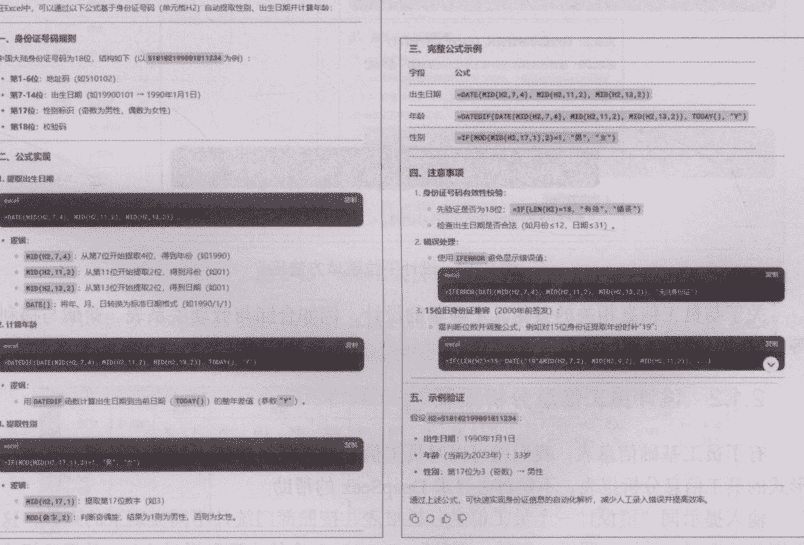

图 2-10 DeepSeek 给出的计算公式及示例

所属部门、学历等选项有限，借助数据验证做下拉列表最省事。提示词“请问如何在单元格中设计下拉菜单，以快速准确地输入部门名称”，DeepSeek 会给出三种做法，如图 2-11 至图 2-13 所示。

掌握下拉的实现方式后，岗位名称、职级、学历等字段也能同理设置，保证录入规范。

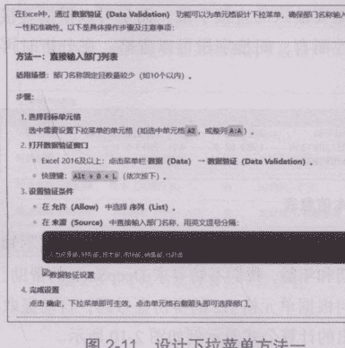

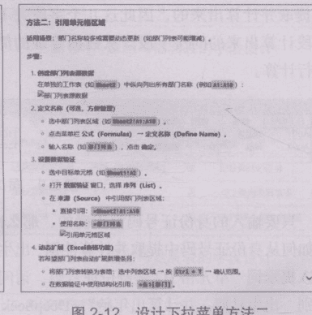


合同与劳动关系、薪酬与福利等关联表单的设计因篇幅省略。

#### 2.1.2 设计员工信息分析报表

有了基础表即可开展统计。不知道如何呈现时，可问 DeepSeek：“请设计一个员工信息分析报表，按照部门统计不同类别下的人数，这些类别包括性别、学历、职级、年龄、工龄”，会得到数据透视表法和函数公式法两种思路，如图 2-14 和图 2-15 所示。

##### 二、分析报表设计（Sheet2）

1. 部门统计概览（数据透视表）

| 部门 | 总人数 | 男性 | 女性 | 本科 | 硕士 | 博士 | 职级P1-P3 | 职级M1-M3 | 年龄≤30 | 工龄≥5年 |

| :--- | :--- | :--- | :--- | :--- | :--- | :--- | :--- | :--- | :--- | :--- |

| 技术部 | 50 | 35 | 15 | 30 | 18 | 2 | 25 | 10 | 20 | 30 |

| 市场部 | 30 | 12 | 18 | 20 | 8 | 2 | 10 | 15 | 10 | 12 |

| ... | ... | ... | ... | ... | ... | ... | ... | ... | ... | ... |

- 实现方法：

    - 数据透视表：插入数据透视表，字段设置如下：

        - 行：部门

        - 值：计数项（性别/学历/职级等）

        - 筛选器：按需添加年龄分段（如≤30、31-40、>40）和工龄分段（如<1年、1-3年、≥5年）

图 2-14 数据透视表法分析

2. 多维度交叉分析（公式驱动）

| 部门 | 分类 | 子项 | 人数 |

| :--- | :--- | :--- | :--- |

| 技术部 | 性别 | 男 | 35 |

| | | 女 | 15 |

| | 学历 | 本科 | 30 |

| | | 硕士 | 18 |

| | | 博士 | 2 |

| | 职级 | P1-P3 | 25 |

| | | M1-M3 | 10 |

| | 年龄 | ≤30岁 | 20 |

| | | 31-40岁 | 25 |

| | | >40岁 | 5 |

| | 工龄 | <3年 | 15 |

| | | 3-5年 | 5 |

| | | ≥5年 | 30 |

```
公式示例（以技术部男性人数为例）：
excel
=COUNTIFS(Sheet1!C:C, "技术部", Sheet1!D:D, "男")
```

##### 三、自动化与动态扩展

1. 动态部门列表

    - 使用 UNIQUE 函数提取部门列表：`=UNIQUE(Sheet1!C:C)`

    - 数据验证引用部门列表生成下拉菜单，支持筛选查看特定部门数据。

2. 年龄/工龄分段公式

    - excel

    - `=COUNTIFS(Sheet1!C:C, "技术部", Sheet1!E:E, "<30")` 年龄≤30

    - `=COUNTIFS(Sheet1!C:C, "技术部", Sheet1!F:F, "<5")` 工龄<5年

3. 可视化图表

    - 插入组合图表：柱状图（总人数）+ 折线图（性别比例/学历占比）

    - 使用数据透视图动态展示部门对比。

图 2-15 函数公式法及公式示例

结合上述思路与企业实际，可在 Excel 中搭建报表框架，如图 2-16 所示。

| A | B | C | D | E | F | G | H | I | J | K | L | M | N | O | P | Q | R | S | T |

| :--- | :--- | :--- | :--- | :--- | :--- | :--- | :--- | :--- | :--- | :--- | :--- | :--- | :--- | :--- | :--- | :--- | :--- | :--- | :--- |

| 部门 | 总人数 | 性别 | | 学历 | | | | 职级 | | | | 年龄 | | | | 工龄 | | | |

| | | 男 | 女 | 博士 | 硕士 | 本科 | 大专 | M1 | M2 | PV | PR | 30岁以下 | 31-40岁 | 41-50岁 | 50岁以上 | 不满1年 | 1-5年 | 5-10年 | 10年以上 |

| 销售部 | | | | | | | | | | | | | | | | | | | |

| 信息部 | | | | | | | | | | | | | | | | | | | |

| 技术部 | | | | | | | | | | | | | | | | | | | |

| 生产部 | | | | | | | | | | | | | | | | | | | |

| ... | | | | | | | | | | | | | | | | | | | |

| 合计 | | | | | | | | | | | | | | | | | | | |

图 2-16 设计员工信息分析报表

结构确定后，用 COUNTIFS 完成自动计数。若对函数用法不熟，可询问 DeepSeek：“请问 COUNTIFS 函数怎么使用”，即可获得详细说明，如图 2-17 所示。

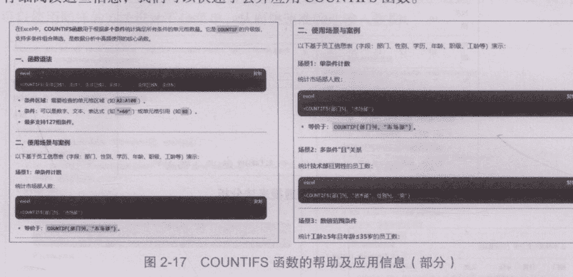

### 2.2 采购管理和分析表单设计

若要搭建采购管理表却缺少方向，向 DeepSeek 寻求思路会很高效。

#### 2.2.1 采购管理中需要设计的关键数据表单

提示词示例：“我公司是根据订单生产的企业，目前产品有三大类、十小类，订单比较饱和，请根据这些基本要求，设计采购管理表单予以支持”，DeepSeek 会给出参考表单，如图 2-18 至图 2-22 所示。

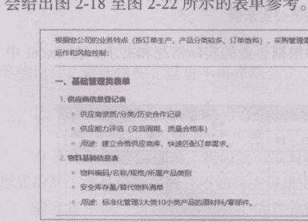

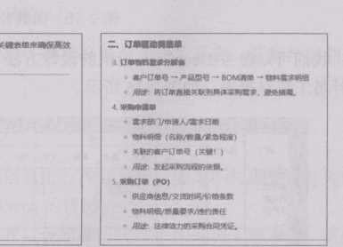

## 第 2 章 DeepSeek 助力数据表单设计

##### 三、过程管控类表单

6. 采购进度跟踪表

    - 采购单号/供应商承诺交期/实际到货进度

    - 预警标识（延迟风险/缺货风险）

    - 用途：实时监控订单生产物料保障。

7. 来料检验记录表

    - 物料批次/抽检数量/不合格项

    - 处理结果（退货/让步接收）

    - 用途：确保质量与订单要求匹配。

8. 采购变更申请单

    - 原订单信息/变更原因（设计调整/客户需求变动）

    - 新需求物料明细/审批流程

    - 用途：应对订单变更的灵活调整。

##### 四、库存与成本类表单

9. 库存动态监控表

    - 现有库存/在途库存/已分配库存（给具体订单）

    - 呆滞物料预警

    - 用途：避免库存积压同时保障订单生产。

10. 采购成本分析表

    - 物料实际成本 vs 预算成本

    - 价格波动趋势/供应商成本对比

    - 用途：优化采购决策，控制订单利润。


##### 五、供应商协同类表单

11. 供应商对账单

    - 交货数量/质量扣款/发票信息

    - 用途：财务结算依据，减少纠纷。

12. 供应商绩效评估表

    - 交货及时率/质量合格率/服务响应速度

    - 用途：季度/年度供应商分级管理。

##### 关键实施建议

1. 系统化优先：建议使用ERP系统（如SAP、用友）集成以上表单，减少手工操作错误。

2. 责任到人：每个表单需明确填写人、审核人（如采购申请需生产部+采购部双签）。

3. 动态更新：设置关键节点提醒（如交货前3天预警）。

通过以上表单体系，可实现从订单需求→采购执行→生产保障的全链路管控，尤其适合多品类、快节奏的按单生产模式。


上述建议仅为初步框架，具体结构参考价值有限。继续追问“给出这些表单的具体结构，例如字段设置、各个表单之间如何关联”，即可得到字段级参考，如图 2-23 至图 2-34 所示。

##### 一、基础管理类表单

1. 供应商信息登记表

| 字段名称 | 说明 | 关联逻辑 |

| :--- | :--- | :--- |

| 供应商编号 | 唯一标识（如SUP-001） | 被采购订单、对账单引用 |

| 供应商名称 | 全称 | |

| 主营物料类别 | 对应公司3大类10小类产品 | 关联物料基础信息表 |

| 资质文件 | ISO证书/营业执照等附件 | |

| 历史合作评级 | A/B/C级（质量、交期评分） | 影响采购订单分配 |

2. 物料基础信息表

| 字段名称 | 说明 | 关联逻辑 |

| :--- | :--- | :--- |

| 物料编码 | 唯一标识（如MAT-001） | 被所有采购表单引用 |

| 物料名称/规格 | 标准化描述 | |

| 所属产品类别 | 关联公司3大类10小类 | 用于订单分解 |

| 安全库存量 | 最小库存阈值 | 触发采购申请 |

| 替代物料编码 | 可替代的物料清单 | 缺料时自动匹配 |


##### 二、订单驱动类表单

3. 订单物料需求分解表

| 字段名称 | 说明 | 关联逻辑 |

|---|---|---|

| 客户订单号 | 唯一标识（如ORDER-2023-001） | 关联生产计划和采购申请单 |

| 产品型号 | 公司产品分类（大类+小类） | 关联BOM清单 |

| BOM版本号 | 当前使用的物料清单版本 | 确保准确性 |

| 需求物料明细 | 物料编码/数量/需求日期 | 自动生成采购申请单 |

图 2-25 订单物料需求分解表字段设置

4. 采购申请单

| 字段名称 | 说明 | 关联逻辑 |

|---|---|---|

| 申请单号 | 唯一标识（如PR-2023-001） | 被采购订单引用 |

| 申请人/部门 | 需求来源（生产部/项目组） | |

| 关联客户订单号 | 直接绑定订单号 | 确保按需采购 |

| 物料清单 | 物料编码/数量/紧急程度 | 引用物料基础信息表 |

| 审批状态 | 待审批/已通过 | 流程控制 |

图 2-26 采购申请单字段设置

5. 采购订单（PO）

| 字段名称 | 说明 | 关联逻辑 |

|---|---|---|

| 采购订单号 | 唯一标识（如PO-2023-001） | 被进度跟踪、检验记录引用 |

| 供应商编号 | 来自供应商信息表 | 自动填充联系人、历史评级 |

| 物料明细 | 物料编码/数量/单价 | 引用采购申请单 |

| 交货日期 | 约定到货时间 | 触发进度跟踪预警 |

| 违约金条款 | 延迟交付惩罚比例 | 法律依据 |

图 2-27 采购订单字段设置

##### 三、过程管控类表单

6. 采购进度跟踪表

| 字段名称 | 说明 | 关联逻辑 |

|---|---|---|

| 采购订单号 | 引用PO编号 | 同步订单信息 |

| 计划交期 | 供应商承诺日期 | 对比实际交期 |

| 实际到货进度 | 已到货数量/剩余数量 | 更新库存动态表 |

| 预警标识 | 红灯（延迟）/黄灯（风险） | 触发催货流程 |

图 2-28 采购进度跟踪表字段设置

7. 来料检验记录表

| 字段名称 | 说明 | 关联逻辑 |

|---|---|---|

| 检验单号 | 唯一标识（如QC-2023-001） | |

| 采购订单号 | 关联PO | 同步物料规格要求 |

| 物料批次号 | 供应商提供的生产批次 | 追溯质量问题 |

| 不合格处理结果 | 退货/返工/扣款 | 影响供应商绩效评估 |

图 2-29 来料检验记录表字段设置

8. 采购变更申请单

| 字段名称 | 说明 | 关联逻辑 |

|---|---|---|

| 变更单号 | 唯一标识（如CHG-2023-001） | |

| 原采购订单号 | 需变更的PO | 同步原订单信息 |

| 变更原因 | 客户需求变动/设计调整 | 需关联客户订单号 |

| 新物料需求 | 替代物料编码/数量 | 引用物料基础信息表 |

图 2-30 采购变更申请单字段设置

##### 四、库存与成本类表单

9. 库存动态监控表

| 字段名称 | 说明 | 关联逻辑 |

|---|---|---|

| 物料编码 | 引用物料基础信息表 | 同步规格、安全库存 |

| 现有库存 | 实时数量 | 自动扣除已分配订单量 |

| 在途库存 | 采购订单中的未到货量 | 关联采购进度跟踪表 |

| 呆滞预警 | 超90天未动用的物料 | 触发清理流程 |

图 2-31 库存动态监控表字段设置

10. 采购成本分析表

| 字段名称 | 说明 | 关联逻辑 |

|---|---|---|

| 物料编码 | 引用物料基础信息表 | 同步历史价格 |

| 实际采购价 | 来自采购订单 | 对比预算价 |

| 供应商报价对比 | 3家供应商报价清单 | 关联供应商信息表 |

| 成本偏差率 | （实际-预算）/预算 | 用于绩效考核 |

图 2-32 采购成本分析表字段设置

## 第2章 DeepSeek 助力数据表单设计

##### 五、供应商协同类表单

11. 供应商对账单

| 字段名称 | 说明 | 关联逻辑 |

| :--- | :--- | :--- |

| 对账周期 | 月度/季度 | |

| 采购订单号列表 | 本期所有交易PO | 同步数量、单价 |

表单联动实战拆解：DeepSeek 的采购视角

| 质量扣款金额 | 从来料检验记录表汇总 | 自动计算应付金额 |

12. 供应商绩效评估表

| 字段名称 | 说明 | 关联逻辑 |
| :--- | :--- | :--- |
| 供应商编号 | 引用供应商信息表 | 同步历史合作数据 |
| 交货准时率 | 实际交期 vs 承诺交期 | 关联采购进度跟踪表 |
| 质量合格率 | 合格批次/总到货批次 | 关联来料检验记录表 |
| 综合评分 | 加权计算（交期30%+质量70%） | 决定供应商分级（A/B/C） |

图 2-33 供应商对账单字段设置

图 2-34 供应商绩效评估表字段设置

表格之后，DeepSeek 归纳了各表单间的牵引关系，并以图 2-35 为例进行说明。

##### 核心关联逻辑

1. 以订单为牵引：
    - 客户订单号 → 订单物料需求分解表 → 采购申请单 → 采购订单 → 采购进度跟踪 → 来料检验 → 入库更新库存。

2. 编码统一：
    - 各表单通过物料编码、供应商编号、采购订单号等唯一标识串联起来，保证数据可追溯。

3. 自动化降低手工操作：
    - 采购申请单可依据订单需求分解表自动生成；
    - 库存动态表能够实时同步在途与现有库存；
    - 供应商绩效可自动抓取检验记录与交期记录。

##### 实施示例

假设客户订单 ORDER-2023-001 需生产产品 A（大类1-小类3）：

1. 订单分解：经 BOM 生成物料需求，MAT-001 需 100 个；
2. 采购申请：自动产生 PR-2023-001，并关联 ORDER-2023-001；
3. 生成 PO：挑选供应商 SUP-001，生成 PO-2023-001；
4. 进度跟踪：PO-2023-001 交期异常触发预警；
5. 检验入库：到货后以 QC-2023-001 记录合格率；
6. 成本核算：对比实际采购价与预算，更新成本分析表；
7. 供应商评估：依据交期与质量数据，下调 SUP-001 评级。

图 2-35 各个表单的关键关联逻辑及实施示例

需要厘清的是，DeepSeek 仅做思路梳理与参考框架提供，并不能完全匹配企业实际业务，落地时仍要结合自身情况编辑完善表单。若有疑问，可再次向 DeepSeek 求助。

为进一步理清关系，可继续提问：“请给出一个采购管理的逻辑关系图”，即可获得更深入说明，如图 2-36 至图 2-38。

因 DeepSeek 暂不支持图片生成，图 2-36 所示的逻辑关系图实际为大纲代码，可复制到 XMind、MindMaster 等思维导图工具自动生成可视化导图。

## AI 智算新图景：DeepSeek 数据处理与分析（案例版）

面向订单生产型企业，采购管理逻辑关系图及解读，覆盖采购、生产、库存的关键节点协同：


图 2-36 采购管理逻辑关系图

##### 核心逻辑说明

1. 订单驱动库存补充
    - 客户订单经订单物料需求分解表形成具体物料需求，进而触发采购申请；
    - 库存动态会实时比对现有库存与已分配库存，若低于安全库存则自动生成采购申请。

2. 采购与库存联动
    - 采购订单的在途库存会实时回传至库存动态表，供生产计划参考；
    - 来料检验后，合格品入库更新现有库存，不合格品触发退货或让步接收。

3. 预警与反馈机制
    - 延期预警：采购进度跟踪表对比计划交期与实际到货进度，触发预警；
    - 安全预警：库存超过设空阈值（如90天未使用）提示调拨；
    - 质量反馈：检验结果直接影响供应商绩效评估。

4. 生产与交付闭环
    - 生产领料：依据库存动态表领取分配库存，保证物料专用于对应订单；
    - 订单交付后释放库存占用，更新库存状态。

图 2-37 关键逻辑说明

##### 表单与数据关联示例

```
plaintext
客户订单 ORDER-001
↓
订单物料需求分解表 - 需求: MAT-001 (100个)
↓
采购申请单 PR-001 - 引用 MAT-001 安全库存 (当前库存50 → 需采购50+安全库存20=70)
↓
采购订单 PO-001 - 供应商 SUP-001, 交期 2023-10-01
↓
采购进度跟踪表 - 计划交期 vs 实际到货 (2023-10-03 到货70个)
↓
来料检验记录表 - 合格65个, 退货5个 → 入库65个
↓
库存动态监控表 - 更新 MAT-001 现有库存: 50+65=115
↓
生产领料 - 分配100个至 ORDER-001, 剩余库存15
```

##### 工具建议

1. 可视化工具：用 Excel 仪表盘 或 Power BI 实时展示库存状态与预警；
2. 系统集成：在ERP中配置自动触发规则（如库存低于安全值时生成采购申请）；
3. 颜色标识：红色（紧急）、黄色（预警）、绿色（正常）。

图 2-38 表单与数据关联示例

#### 2.2.2 设计供应商管理表单

本节说明如何借助 DeepSeek 设计供应商管理表单。

输入提示词“请从数据管理角度和数据分析角度设计供应商管理表单，相关表单要有比较详细的字段设置，各个表单要能够关联起来，有助于我们快速灵活地分析评估供应商”，即可看到 DeepSeek 的思考过程。

> “好的，用户需要从数据管理和数据分析的角度设计供应商管理表单，要求表单结构科学、易于维护，并且各表单之间能够关联起来，方便快速灵活地分析和评估供应商。我需

## 第2章 DeepSeek 助力数据表单设计

要先回顾之前的对话历史，看看用户之前的需求和已经提供的解决方案，确保这次的设计更符合他们的实际需求。

用户之前提到公司是按订单生产，有三大类十小类产品，订单饱和，所以采购管理需要高效。之前已经讨论了采购管理的各种表单，比如供应商信息登记表、采购订单、采购进度跟踪表等。现在用户希望专门针对供应商管理设计表单，强调数据管理和分析，并且各个表单要能关联，便于分析。

首先，需要明确供应商管理的关键要素。从数据管理角度，表单需要结构清晰、字段标准化，避免冗余，确保数据的一致性和完整性。从数据分析角度，表单应包含可量化的指标，如交货准时率、质量合格率，以及能够进行趋势分析和供应商绩效评估的字段。

接下来，考虑表单之间的关联。比如，供应商主表需要有一个唯一的供应商编号，其他子表如交易记录表、评估记录表、问题追溯表等，都通过这个编号与主表关联。这样在分析时，可以通过供应商编号快速关联所有相关信息。

然后，确定每个表单的具体字段。主表应包括供应商的基本信息、资质、合作条款等静态数据。交易记录表需要记录每次采购的详细信息，如订单号、物料、数量、价格、交货情况等，这些数据可以用于计算绩效指标。评估记录表则保存每次评估的结果，方便跟踪供应商的绩效变化。问题追溯表记录所有与供应商相关的问题，如交货延迟、质量缺陷，以及处理结果，用于分析供应商的可靠性。

还需要考虑数据的自动更新和计算，比如交货准时率和质量合格率，可以通过交易记录和质检记录自动计算，减少人工输入错误。同时，风险等级的评估需要基于多个指标，如投诉次数、交货准时率等，可以通过公式自动生成，提高分析效率。

在数据管理方面，需要设置数据校验规则，比如供应商编号和统一社会信用代码的唯一性，日期格式的统一，数值单位的标准化，避免数据混乱。权限管理也很重要，确保敏感数据只能由授权人员修改，如基础信息由管理员维护，绩效数据自动同步。

对于数据分析，要预置分析维度，比如按地区、品类、等级进行多维分析，并支持趋势分析，如季度交货准时率的变化。可视化工具，如 Power BI 或 Tableau，可以连接数据库，实时生成仪表盘，帮助管理层快速决策。

最后，工具建议部分需要考虑用户的实际操作环境。如果用户已有 ERP 系统，可以集成这些表单，利用现有系统的功能。如果没有，可以使用低代码平台如简道云快速搭建，或者用 Excel 和 Power BI 结合进行数据管理和分析。同时，自动化流程如合同到期提醒、绩效数据刷新，能够减少人工干预，提高效率。

总结一下，设计供应商管理表单需要兼顾数据结构的科学性和分析的灵活性，通过唯一标识符关联各表单，自动计算关键指标，设置严格的数据校验和权限控制，并提供多维度的分析工具，帮助用户高效管理供应商并作出数据驱动的决策。

这一思考过程为我们设计供应商管理表单提供了一些逻辑上的参考，以及一些可选的工具，具有非常高的参考价值，需要认真阅读和领会。

DeepSeek 会给出供应商管理的相关表单和字段设置以及说明，如果这些表单的字段设置并不合理，例如缺少字段，我们可以继续输入提示词“供应商基础信息表单的字段设置不全，请重新做”。这样一步一步细化提问，直至得到满意的结果。

DeepSeek 整理的供应商基础信息表单及字段设置如图 2-39 至图 2-47 所示。

##### 1. 企业基本资料（核心标识与合法性验证）

| 字段名称 | 类型 | 必填 | 说明 | 示例值 |
| :--- | :--- | :--- | :--- | :--- |
| 供应商编号 | 文本 | 是 | 系统自动生成（规则：供-001） | 供-001 |
| 供应商名称 | 文本 | 是 | 工商注册全称 | 某市精密部件有限公司 |
| 统一社会信用代码 | 文本 | 是 | 税务唯一标识（18位） | 913301000000XX |
| 成立日期 | 日期 | 是 | 企业注册成立时间 | 2010-05-20 |
| 注册资本 | 数值+单位 | 是 | 单位：万元/人民币 | 500万元 |
| 企业性质 | 下拉选择 | 是 | 国企/民企/外企/合资 | 民企 |
| 法人代表 | 文本 | 是 | 法定代表人姓名 | 张三 |

图 2-39 供应商基础信息表单——企业基本资料

##### 2. 联系与地址（支持物流与沟通分析）

| 字段名称 | 类型 | 必填 | 说明 | 示例值 |
| :--- | :--- | :--- | :--- | :--- |
| 总部地址 | 文本 | 是 | 省+市+详细地址 | 浙江省杭州市XX区XX路1号 |
| 主要工厂地址 | 文本 | 否 | 多个地址可分行填写 | 江苏省苏州市XX工业园 |
| 默认联系人 | 文本 | 是 | 采购对接人姓名+职务 | 李四（采购经理） |
| 联系电话 | 文本 | 是 | 固话/手机 | 0571-12345678 |
| 电子邮箱 | 文本 | 是 | 企业邮箱 | service@xxx.com |

图 2-40 供应商基础信息表单——联系与地址

##### 3. 财务与结算（支持付款与成本分析）

| 字段名称 | 类型 | 必填 | 说明 | 示例值 |
| :--- | :--- | :--- | :--- | :--- |
| 开户银行 | 文本 | 是 | 银行全称 | 中国工商银行杭州分行 |
| 银行账户 | 文本 | 是 | 企业对公账号 | 6222 1234 5678 9012 |
| 默认付款方式 | 下拉选择 | 是 | 电汇/信用证/承兑汇票 | 电汇 |
| 发票类型 | 下拉选择 | 是 | 增值税专用发票/普通发票 | 增值税专用发票 |

图 2-41 供应商基础信息表单——财务与结算

##### 4. 供应能力与分类（支持采购决策）

| 字段名称 | 类型 | 必填 | 说明 | 示例值 |
| :--- | :--- | :--- | :--- | :--- |
| 主营品类 | 多选下拉 | 是 | 关联企业产品分类（电子元件/金属加工） | 电子元件、金属加工 |
| 最大产能 | 数值+单位 | 是 | 单位：件/月或吨/月 | 10,000件/月 |
| 最短交货周期 | 数值+单位 | 是 | 单位：天 | 15天 |
| 配送覆盖半径 | 数值+单位 | 否 | 单位：公里（评估物流成本） | 300公里 |
| 默认运输方式 | 下拉选择 | 是 | 陆运/空运/海运 | 陆运 |

图 2-42 供应商基础信息表单——供应能力与分类

##### 5. 合作与风险（动态管理供应商生命周期）

| 字段名称 | 类型 | 必填 | 说明 | 示例值 |
| :--- | :--- | :--- | :--- | :--- |
| 合作状态 | 单选 | 是 | 合作中/暂停合作/终止合作 | 合作中 |
| 准入日期 | 日期 | 是 | 首次合作日期 | 2020-03-15 |
| 合同到期日 | 日期 | 是 | 当前合同截止日期 | 2025-12-31 |
| 法律风险标签 | 多选标签 | 否 | 诉讼中/经营异常/行政处罚 | 无 |

图 2-43 供应商基础信息表单——合作与风险

##### 6. 资质与认证（合规性管理）

| 字段名称 | 类型 | 必填 | 说明 | 示例值 |
| :--- | :--- | :--- | :--- | :--- |
| 质量认证 | 多选附件 | 否 | ISO9001/ISO14001证书扫描件 | ISO9001证书.pdf |
| 行业资质 | 多选附件 | 否 | 特种行业许可证/专利证书 | 专利证书.pdf |
| 环保评级 | 下拉选择 | 否 | A级（优秀）/B级（合规）/C级（整改中） | B级 |

图 2-44 供应商基础信息表单——资质与认证

##### 7. 数据分析辅助字段（预测分析标签）

| 字段名称 | 类型 | 说明 | 示例值 |
| :--- | :--- | :--- | :--- |
| 供应商等级 | 计算字段 | A/B/C级（根据绩效自动更新） | B级 |
| 风险评分 | 数值 | 0-100分（分值越高风险越大） | 35 |
| 合作潜力标签 | 文本 | 战略供应商/核心供应商/备选供应商 | 核心供应商 |

图 2-45 供应商基础信息表单——数据分析辅助字段

关键设计说明

1. 字段完整性
   - 新增法律风险标签、环保评级等合规性字段，降低供应链风险；
   - 补充配送覆盖半径、默认运输方式，支持物流成本分析；
   - 细化财务结算信息，避免付款环节反复确认。

2. 数据分析友好性
   - 预置标签字段：如“供应商等级”“风险评分”，直接用于筛选与可视化；
   - 结构化字段：数值单位统一（如“天”“公里”），避免人工转换；
   - 多选下拉字段：标准值输入（如企业性质、主营品类），确保分析维度一致。

3. 数据关联逻辑


实施示例

场景：筛选优质供应商
→ 输出：优先选择A类且具备ISO认证的长三角供应商。


工具落地建议

1. 低代码平台配置（如钉钉宜搭）
   - 字段分组：按“基本资料”“联系地址”“供应能力”分页签，避免页面过长；
   - 自动化规则：合同到期前60天触发提醒，风险评分>70自动标记为“高风险”。

2. Excel模板设计
   - 数据验证：通过下拉菜单限定“企业性质”“主营品类”等字段输入；
   - 条件格式：风险评分>70的行标红，环保评级<C级的标黄。

DeepSeek 整理了九个供应商基础信息表单，但这并不是说我们要按照 DeepSeek 提供的信息设计九个表单，而是需要结合企业自身实际情况，对这些表单进行必要且合理的整理与合并。

例如，供应商基础信息表单中企业的基本资料表，其包含的字段及详细描述如图 2-48 所示，示例数据如图 2-49 所示。

| 字段名称 | 字段数据类型 | 字段描述 | 输入方式 | 示例 | 说明 |
| :--- | :--- | :--- | :--- | :--- | :--- |
| 供应商代码 | 文本 | 必填，唯一 | 自动生成 | GH0395 | |
| 供应商名称 | 文本 | 必填，唯一 | 手工输入 | 江苏鑫华材料有限公司 | |
| 供货范围 | 文本 | 必填 | 手工输入 | 控制器、轴阀、流量仪、电缆 | |
| 供应商类型 | 文本 | 必填 | 手工输入，下拉菜单 | 生产商、经销商、或贸易商 | |
| 企业性质 | 文本 | 必填 | 手工输入，下拉菜单 | 国企、民企、合资，或外资 | |
| 成立日期 | 日期 | 必填 | 手工输入 | 2002-9-19 | |
| 注册资本 | 文本 | 必填 | 手工输入 | 300万元 | |
| 法人代表 | 文本 | 必填 | 手工输入 | 张大明 | |
| 联系人 | 文本 | 必填 | 手工输入 | 李强 | |
| 联系电话 | 文本 | 必填 | 手工输入 | 13872201874 | |
| QQ或微信 | 文本 | 必填 | 手工输入 | hua348602 | |
| 企业邮箱 | 文本 | 必填 | 手工输入 | djg@fkg.com | |
| 企业传真 | 文本 | 选填 | 手工输入 | 0512-40968482 | |
| 企业网址 | 文本 | 选填 | 手工输入 | www.fkg.com | |
| 地址 | 文本 | 必填 | 手工输入 | 江苏省苏州市现代大道20号 | |
| 国家 | 文本 | 必填 | 手工输入，下拉菜单 | 中国 | |
| 省份 | 文本 | 必填 | 手工输入，下拉菜单 | 江苏省 | |
| 城市 | 文本 | 必填 | 手工输入，下拉菜单 | 苏州市 | |
| 开户行 | 文本 | 必填 | 手工输入 | 中国银行股份有限公司苏州工业园区支行 | |
| 银行账号 | 文本 | 必填 | 手工输入 | 81601021421001974 | |
| 税号 | 文本 | 必填（18位） | 手工输入 | 91421054330883896A | |
| 备注 | 文本 | 选填 | 手工输入 | 紧密合作伙伴，前10大供应商之一 | |


资质方面的记录统一汇总在资质与认证表，字段构成可对照图 2-50，填充示例放置于图 2-51。

| 字段名称 | 字段数据类型 | 字段描述 | 输入方式 | 示例 | 说明 |

| :--- | :--- | :--- | :--- | :--- | :--- |

| 供应商代码 | 文本 | 必填，唯一 | 自动从基本信息表提取 | GH0395 | |

| 供应商名称 | 文本 | 必填，唯一 | 自动从基本信息表提取 | 江苏鑫华材料有限公司 | |

| 供应商类型 | 文本 | 必填 | 自动从基本信息表提取 | 生产商，经销商，或贸易商 | |

| 营业执照到期日 | 日期 | 必填 | 手工输入 | 2040-12-31 | |

| 原产商名称 | 文本 | 选填 | 手工输入 | 天津世华纸业有限公司 | |

| 原产商所在国家 | 文本 | 必填 | 手工输入 | 德国 | |

| 代理许可证到期日 | 日期 | 选填 | 手工输入 | 2030-6-30 | 经销商，贸易商需要填写 |

| 生产许可证到期日 | 日期 | 必填 | 手工输入 | 2033-3-20 | |

| 质量体系认证到期日 | 日期 | 选填 | 手工输入 | 2029-5-20 | |

| 环境体系认证到期日 | 日期 | 选填 | 手工输入 | 2028-11-1 | |

| 职业健康认证到期日 | 日期 | 选填 | 手工输入 | 2027-12-31 | |

| 危化品经营许可证到期日 | 日期 | 选填 | 手工输入 | 2031-10-8 | |

| 备注 | 日期 | 选填 | 手工输入 | 2030-8-23 | |

图 2-50 供应商资质与认证表的字段设计

| A | B | C | D | E | F | G | H | I | J | K | L | M |

| :--- | :--- | :--- | :--- | :--- | :--- | :--- | :--- | :--- | :--- | :--- | :--- | :--- |

| 供应商代码 | 供应商名称 | 供应商类型 | 营业执照到期日 | 原产商名称 | 原产商所在国家 | 代理许可证到期日 | 生产许可证到期日 | 质量体系认证到期日 | 环境体系认证到期日 | 职业健康认证到期日 | 危化品经营许可证到期日 | 备注 |

| GH0395 | 江苏鑫华材料有限公司 | 生产商 | 2060-12-31 | | | | | | | | | |

| YR3069 | 北京明锐瑞博贸易有限公司 | 经销商 | 2036-12-23 | 天津世华纸业有限公司 | 中国 | 2028-12-31 | 2045-5-15 | 2040-12-31 | 2038-6-30 | 2028-9-30 | | |

| UNF01 | 安徽蒙顿化工有限公司 | 生产商 | 2050-2-28 | | 中国 | | 2050-2-28 | 2035-6-30 | 2030-10-22 | 2028-10-31 | 2050-2-28 | |

图 2-51 供应商资质与认证表的示例数据

合作情形与风险管控信息则记录在合作与风险表，字段释义见图 2-52，样本填写见图 2-53。

| 字段名称 | 字段数据类型 | 字段描述 | 输入方式 | 示例 | 说明 |

| :--- | :--- | :--- | :--- | :--- | :--- |

| 供应商代码 | 文本 | 必填，唯一 | 自动从基本信息表提取 | GH0395 | |

| 供应商名称 | 文本 | 必填，唯一 | 自动从基本信息表提取 | 江苏鑫华材料有限公司 | |

| 供应商类型 | 文本 | 必填 | 自动从基本信息表提取 | 生产商，经销商，或贸易商 | |

| 供应商等级 | 文本 | 选填 | 手工输入 | AAA | |

| 首次合作日期 | 日期 | 必填 | 手工输入 | 2017-3-24 | |

| 当前合同截止日期 | 日期 | 必填 | 手工输入 | 2029-4-30 | |

| 法律风险 | 文本 | 选填 | 手工输入 | 行政处罚 | |

| 环保评级 | 文本 | 选填 | 手工输入 | B级 | |

| 风险评分 | 数值 | 选填 | 手工输入 | 35 | |

| 合作潜力 | 文本 | 选填 | 手工输入 | 核心供应商 | |

| 备注 | 日期 | 选填 | 手工输入 | 2030-8-23 | |

图 2-52 供应商合作与风险表的字段设计

| A | B | C | D | E | F | G | H | I | J | K |

| :--- | :--- | :--- | :--- | :--- | :--- | :--- | :--- | :--- | :--- | :--- |

| 供应商代码 | 供应商名称 | 供应商类型 | 供应商等级 | 首次合作日期 | 当前合同截止日期 | 法律风险 | 环保评级 | 风险评分 | 合作潜力 | 备注 |

| GH0395 | 江苏鑫华材料有限公司 | 生产商 | AAA | 2022-3-2 | 2027-6-30 | 无 | A级 | 30 | 核心供应商 | |

| YR3069 | 北京明锐瑞博贸易有限公司 | 经销商 | BBB | 2018-6-26 | 2030-11-5 | 经营异常 | B级 | 48 | 一般供应商 | |

| UNF01 | 安徽蒙顿化工有限公司 | 生产商 | CCC | 2024-5-5 | 2026-12-31 | 无 | B级 | 26 | 一般供应商 | |

图 2-53 供应商合作与风险表的示例数据

三张表均以供应商代码作为唯一主键，因而能够跨表关联进行筛选与统计。思路不明确时，可先构建若干模拟行，将三表一并交付 DeepSeek 推演。

将文件上传后发出提示“根据企业基本资料、资质与认证、合作与风险这三个工作表中的信息，请问需要对供应商作哪些方面的分析？需要作哪些数据筛选？如何对供应商作提前预警”，即可得到参考思路，展示见图 2-54 至图 2-57。

## 第2章 DeepSeek 驱动的数据表单搭建

供应商分析、数据筛选及预警方案

##### 一、供应商分析维度

- 1. 资质基础盘点
  - 核心列：营业执照到期日、生产许可证到期、质量/环境/职业健康认证到期日、危化品经营许可证到期日。
  - 目的：找出即将过期或已失效的资质，避免合作中断或法律纠纷。

- 2. 风险评级盘点
  - 核心列：风险评分、法律风险、环保处罚记录。
  - 目的：将主体划分为高、中、低风险，重点关注高风险的稳定性。

- 3. 合作关系盘点
  - 核心列：合作潜力、首次合作日期、当前合同截止日期。
  - 目的：锁定核心伙伴制定长期策略，并跟踪合同到期节点。

- 4. 财务与持续经营盘点
  - 核心列：注册资本、成立日期、企业性质。
  - 目的：评估财务体量与经营延续性，识别高潜力或潜在隐患。

- 5. 地域分布盘点
  - 核心列：地区、国家、省份、城市。
  - 目的：解析地理集中度，评估政策、自然灾害等外部冲击。

##### 二、关键数据筛选规则

- 1. 资质临期筛选
  - 规则：筛选出资质到期日在未来一年内的对象。
  - 示例：
    ```
    供应商代码: D0035
    营业执照到期日: 2025-12-31
    距离到期天数: 182天
    ```

- 2. 高风险主体筛选
  - 规则：风险评分大于40或存在法律风险。
  - 示例：
    ```
    供应商代码: D0035
    风险评分: 45
    法律风险: 环保处罚
    ```

- 3. 核心伙伴筛选
  - 规则：合作潜力标注为“核心供应商”。
  - 示例：
    ```
    供应商代码: D0035
    合作潜力: 核心供应商
    ```

- 4. 注册资本偏低筛选
  - 规则：注册资本低于行业均值或未披露。
  - 示例：
    ```
    供应商代码: D0035
    注册资本: 50万元
    ```

- 5. 合同临期筛选
  - 规则：当前合同截止日期在未来六个月内。
  - 示例：
    ```
    供应商代码: D0035
    合同截止日期: 2025-09-30
    距离到期天数: 182天
    ```

##### 三、供应商提前预警机制

- 1. 资质到期预警
  - 触发点：各类资质到期前1年、6个月、3个月。
  - 处置：
    - 自动邮件提醒采购部门跟进续期。
    - 系统内将主体标记为“待处理”。

- 2. 合同续签预警
  - 触发点：合同到期前6个月。
  - 处置：
    - 生成续签任务清单并派发至采购负责人。
    - 复盘合作表现，决定条款是否调整。

- 3. 风险动态预警
  - 触发点：
    - 风险评分单次上升超10分。
    - 新增法律风险事项。
  - 处置：
    - 启动复核流程，必要时暂停合作。

- 4. 财务变动预警
  - 触发点：注册资本大幅变动或企业性质变更。
  - 处置：
    - 更新档案并重新评估合作风险。

##### 四、输出建议

- 1. 供应商看板
  - 融合各表信息，展示资质状态、风险等级、合同到期等要点。
  - 示例字段：
    ```
    供应商代码 | 风险评分 | 合作潜力 | 最近合同到期日 | 合同剩余天数
    D0035 | 45 | 核心 | 2025-09-30 | 182
    ```

- 2. 自动化预警报告
  - 每周产出预警清单，覆盖到期资质、高风险主体及待续签合同。

- 3. 数据清洗与补全
  - 日期格式统一并去除时间戳，注册资本单位统一为“万元”。
  - 补齐缺失字段，如 UNFO 的企业性质。

示例预警邮件模板：
```
主题：供应商资质到期预警 - D0035（江苏新华材料有限公司）
内容：
供应商名称：江苏新华材料有限公司
预警类型：营业执照即将到期（2025-12-31）
剩余时间：5天
建议动作：联系供应商确认续期计划，更新系统记录。
```

### 2.3 财务管理与分析表单设计

本节说明如何借助 DeepSeek 设计常用财务表单，如行业财务指标表与可视化看板、开票回款对账单、预算分析表、成本汇总表等。

#### 2.3.1 快速制作行业财务指标数据表和可视化看板

若想查看电子行业近五年营业收入、净利润及净利润率走势，可输入提示“请生成一个电子行业近五年来的营业收入、净利润和净利润率数据看板，包含可视化设计和数据展现，以 html 格式输出，确保能够运行”，DeepSeek 会返回代码，如图 2-58 和图 2-59。代码窗口右下角的“运行 HTML”按钮可直接生成看板，如图 2-60。

若已有公司近六年业绩数据并希望与行业均值对比，可将数据保存为“公司近六年来的业绩.xlsx”，结构如图 2-61。

| A | B | C | D |

|---|---|---|---|

| 1 | | | |

| 2 | 公司近6年来的业绩 | | |

| 3 | | | |

| 4 | 年份 | 营业收入（万元） | 净利润（万元） | 净利润率（%） |

| 5 | 2019年 | 5869 | 894 | 15.23% |

| 6 | 2020年 | 8473 | 1181 | 13.94% |

| 7 | 2021年 | 10385 | 1268 | 12.21% |

| 8 | 2022年 | 26584 | 5385 | 20.26% |

| 9 | 2023年 | 7485 | 556 | 7.43% |

| 10 | 2024年 | 14868 | 1069 | 7.19% |

图 2-61 公司近六年来的营业收入、净利润和净利润率数据

上传该文件后可获得对应代码并自动生成可视化，如图 2-62 和图 2-63。

若需将公司数据与行业平均数据并列，可输入提示“请将公司数据与行业平均数据作比较，制作可视化看板”，得到代码与图表，如图 2-64 和图 2-65。

保存结果时，可新建 txt 文档复制代码后将扩展名改为 .html。

#### 2.3.2 快速制作开票回款对账单

如图 2-66，现有开票信息表和收款信息表，需据此制作对账单，文件为“销售对账.xlsx”。

将 Excel 上传至 DeepSeek，或直接输入提示“请对开票信息表和收款信息表按客户名称和订单号进行核对，制作全部客户、全部订单的对账单，生成的对账单中要包含全部数据”，可得到对账单及说明，如图 2-67 和图 2-68。

因数据量大，DeepSeek 会提示“因篇幅限制，此处仅列关键示例”，无法一次性展示全部。

可进一步询问最高效的完整对账工具，输入提示“请问哪种工具在制作对账单、核对数据时最高效？注意是全部客户、全部订单，不能有遗漏”，DeepSeek 会给出选项，如图 2-69。

- 1. Excel + Power Query；
- 2. Python（Pandas 库）；
- 3. 数据库工具（SQL + ETL）；
- 4. ERP/ 财务系统（如 SAP、用友）。

Excel + Power Query 为推荐方案。继续提问“请问使用 Excel + Power Query 制作基于开票信息表和收款信息表的对账单的具体方法和步骤是什么？注意是全部客户、全部订单的对账单”，DeepSeek 会详细介绍流程，如图 2-70 至图 2-73。

步骤 2 操作不够便捷，需分别导入两张表，关闭查询后再重新打开才能导入另一张。可优化提问：“步骤 2 介绍得不够详细，而且每个表都要导入一次，这非常麻烦，能不能一次性完成导入工作”，DeepSeek 会给出更高效的多表导入方法，如图 2-74。

按此方法即可生成全部客户、全部订单的对账单，如图 2-75。

需要说明的是，DeepSeek 给出的步骤较为基础，若对 Power Query 不熟悉，实操仍可能受阻。AI 能节省时间提升效率，但具体工作仍需人完成。因此掌握 Excel、VBA、Power Query、SQL、Python 等数据处理工具很有必要。

完成对账单后，不要立即写入工作表。先复制合并表，分别筛选已结清和未收款，得到“已结清订单”和“未结清订单”两张表，再据此生成催款清单，通知财务跟进。

| 客户名称 | 订单号 | 总开票金额 | 总收款金额 | 差额 | 状态 |

|---|---|---|---|---|---|

| 客户01 | JD202401039 | 16,091,276.21 | | 16,091,276.21 | 未收款 |

| 客户01 | JD202401178 | 3,263,779.46 | 3,263,779.46 | | 已结清 |

| 客户01 | JD202403539 | 4,878,129.24 | 4,878,129.24 | | 已结清 |

| 客户01 | JD202402674 | 10,143,683.76 | | 10,143,683.76 | 未收款 |

| 客户01 | JD202405840 | 1,401,839.87 | 1,401,839.87 | | 已结清 |

| 客户01 | JD202406393 | 2,086,185.57 | 2,086,185.57 | | 已结清 |

| ... | ... | ... | ... | ... | ... |

| 客户29 | JD202402178 | 290,436.43 | | 290,436.43 | 未收款 |

| 客户29 | JD202403144 | 248,081.13 | 248,081.13 | | 已结清 |

| 客户29 | JD202403145 | 119,563.00 | | 119,563.00 | 未收款 |

| 客户29 | JD202403859 | 191,567.04 | 191,567.04 | | 已结清 |

| 客户29 | JD202403928 | 65,406.28 | | 65,406.28 | 未收款 |

| 客户30 | JD202401071 | 57,893.66 | 57,893.66 | | 已结清 |

| 客户30 | JD202402489 | 59,372.95 | | 59,372.95 | 未收款 |

| 客户31 | JD202402248 | 62,861.17 | 62,861.17 | | 已结清 |

| 客户31 | JD202408852 | 72,536.50 | 72,536.50 | | 已结清 |

| 客户32 | JD202403083 | 196,982.22 | | 196,982.22 | 未收款 |

| 客户32 | JD202404750 | 191,978.48 | | 191,978.48 | 未收款 |

图 2-75 制作的对账单（部分）

上表为人工核对后形成的清算清单。若期望省去逐条核对的耗时，可向 DeepSeek 请求生成一份 Excel 自动化程序。示例提问为“我觉得这些方法还是比较繁琐，请给出能够一键制作对账单的 Excel VBA 代码”，据此可获得图 2-76 所示的脚本。

将返回的操作说明搬到 Excel 中试运行，并校验输出是否符合预期。若运行时报错，则需要自行修改，这对使用者的 VBA 基础提出了要求。

初次返回的脚本通常较为冗长。若把需求描述得更具体，例如“这个代码太繁琐了，有没有更简洁的 Excel VBA 代码？注意开票信息表中，A 列是客户名称，B 列是订单号，H 列是要核对的开票金额；收款信息表中，B 列是客户名称，C 列是订单号，D 列是要核对的收款金额。请根据这个具体表格结构，给出简洁的 Excel VBA 代码”，模型便会给出更贴合字段位置的精简版，如图 2-77 所示。

把这段代码导入运行后，会出现图 2-78 的报错。打开调试窗口可知问题集中在变量 key 上，如图 2-79。究其原因，是 key 被定义为字符串类型，但在代码内部却被当作对象来使用，因而类型不匹配。

继续追问“代码运行错误，说 key 必须是变体变量，请修改代码”，即可拿到修正后的脚本与说明，如图 2-80 和图 2-81。替换后重新执行，就能得到正确结果，如图 2-82。

由此可见，模型提供的 VBA 并不总是最优且可直接使用，是否适配具体表结构、能否正常运行，都需要人工校验与二次加工。把表格结构、字段列位与业务规则表述得越具体，得到的代码质量越高、调试成本越低。

#### 2.3.3 快速制作预算分析表

预算分析是财务工作中常见环节，核心在于找差异、查原因、提对策。下面以一个简例说明如何借助模型快速搭建分析表。

图 2-83 所示的是文件“销售预算分析.xlsx”中的两张表：各地区预算销售额与实际销售额，需对销售预算进行评估。

把文件上传后，模型会给出思考过程。阅读这些过程有助于理解预算分析的逻辑。

模型会分别给出销售额分析表与毛利分析表，并附带要点结论，如图 2-84 和图 2-85。

若希望把销售额与毛利合并到同一张表，可继续提问“请将销售额分析表和毛利分析表综合成一个分析表”，即可快速得到图 2-86 所示的综合表。

| 地区 | 销售额 | | | | 毛利 | | | |

| :--- | :--- | :--- | :--- | :--- | :--- | :--- | :--- | :--- |

| | 预算销售额 | 实际销售额 | 差额 | 达成率 | 预算毛利 | 实际毛利 | 差额 | 达成率 |

| 华北 | 530 | 491 | -39 | 92.6% | 70 | 121 | +51 | 172.9% |

| 华南 | 1689 | 172 | -1517 | 10.2% | 285 | 32 | -253 | 11.2% |

| 华东 | 339 | 1161 | +822 | 342.5% | 23 | 322 | +299 | 1400.0% |

| 西南 | 1250 | 566 | -684 | 45.3% | 320 | 58 | -262 | 18.1% |

| 华中 | 1368 | 1556 | +188 | 113.7% | 295 | 328 | +33 | 111.2% |

| 西北 | 1460 | 1591 | +131 | 109.0% | 522 | 311 | -211 | 59.6% |

| 东北 | 1621 | 477 | -1144 | 29.4% | 149 | 168 | +19 | 112.8% |

| 总计 | 8257 | 6014 | -2243 | 72.8% | 1664 | 1340 | -324 | 80.5% |

图 2-86 综合预算分析表

把该工作表复制到 Excel，合并标题行并调整格式，就得到所需报表，如图 2-87。

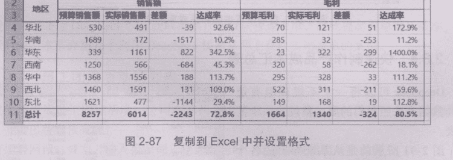

图 2-87 复制到 Excel 中并设置格式

表中差额与达成率的视觉效果不佳，可通过自定义数字格式实现自动着色。

若不熟悉格式代码，可向模型求助。提问“请给出将差额为负的单元格字体设置为红色，将达成率小于 1 的单元格字体设置为红色的自定义数字格式代码，注意达成率百分比数字要根据大小条件判断设置颜色，不允许使用条件格式，只能使用自定义数字格式”。借助联网搜索，可得到图 2-88 与图 2-89 的信息。

以下是正确的自定义数字格式代码，满足你的需求：

1. 差异值为负的单元格字体设置为红色

自定义数字格式代码：

```
[红色]-0;[黑色]0;0
```

解释：

- [红色]-0：负值显示为红色，并带负号。

- [黑色]0：正值显示为黑色。

- 0：零值显示为默认格式。

2. 达成率小于1的单元格字体设置为红色

自定义数字格式代码：

```
[<1][红色]0.00%;[>=1][黑色]0.00%
```

解释：

- [<1][红色]0.00%：如果值小于1（即小于100%），显示为红色。

- [>=1][黑色]0.00%：如果值大于或等于1（即大于或等于100%），显示为黑色。

设置步骤

1. 差异值列设置：

- 选中差异值所在的列（如D列和H列）。

- 右键 → 设置单元格格式 → 数字 → 自定义。

- 在输入框中粘贴代码 [红色]-0;[黑色]0;0。

- 点击确定，完成设置。

2. 达成率列设置：

- 选中达成率所在的列（如E列和I列）。

- 右键 → 设置单元格格式 → 数字 → 自定义。

- 在输入框中粘贴代码 [<1][红色]0.00%;[>=1][黑色]0.00%。

- 点击确定，完成设置。

图 2-88 设置差额和达成率的自定义数字格式

图 2-89 设置自定义数字格式的具体步骤

按说明设置后，可得到信息更清晰的报表，如图 2-90。

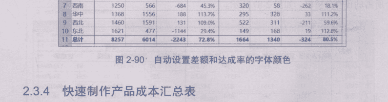

#### 2.3.4 快速制作产品成本汇总表

DeepSeek 能把不规范但有逻辑的原始表按需求整理为汇总表。

图 2-91 所示的是从系统导出并保存于“产品成本信息表.xlsx”中的成本数据。每个产品下包含直接材料、直接人工、制造费用、总成本四项，需求是生成二维汇总：产品名为列，成本项目横向展开。

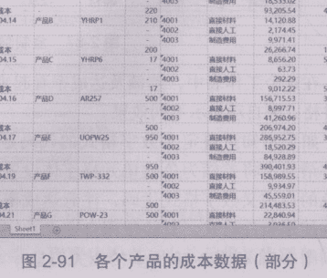

把文件上传后，忽略思考过程，输入提示词“请设计一个产品成本汇总表，第一列为产品名称，成本项目（直接材料、直接人工、制造费用、总成本、单位成本）分五列保存”，即可得到图 2-92 所示的汇总表，复制回 Excel 保存即可。

| 产品名称 | 直接材料（元） | 直接人工（元） | 制造费用（元） | 总成本（元） | 单位成本（元/件） |

| :--- | :--- | :--- | :--- | :--- | :--- |

| 产品A | 70,631.07 | 4,041.45 | 18,533.02 | 93,205.54 | 423.66 |

| 产品B | 14,120.88 | 2,174.45 | 9,971.41 | 26,266.74 | 131.33 |

| 产品C | 8,656.20 | 63.73 | 292.29 | 9,012.22 | 530.13 |

| 产品D | 156,715.53 | 8,997.71 | 41,260.96 | 206,974.20 | 413.95 |

| 产品E | 286,952.75 | 18,520.29 | 84,928.89 | 390,401.93 | 410.95 |

| 产品F | 158,989.55 | 9,934.97 | 45,559.01 | 214,483.53 | 428.97 |

| 产品G | 22,840.94 | 3,936.50 | 18,051.69 | 44,829.13 | 89.66 |

| 产品H | 20,410.86 | 3,936.50 | 18,051.69 | 42,399.05 | 84.80 |

| 产品P | 63,485.02 | 3,430.38 | 15,730.75 | 82,646.15 | 550.97 |

| 产品Y | 108,531.49 | 5,945.99 | 27,266.63 | 141,744.11 | 545.17 |

| 产品Q | 797.72 | 89.98 | 412.60 | 1,300.30 | 43.34 |

| 产品W | 778.80 | 89.98 | 412.60 | 1,281.38 | 42.71 |

图 2-92 产品成本汇总表

### 2.4 快速从网上获取实用表单

借助 DeepSeek 可迅速获取大量日常数据管理模板，大幅提升设计效率。本节介绍几个案例。

#### 2.4.1 员工团建活动计划表

公司在苏州，拟在扬州组织两天团建。如何制定计划并做预算？

使用联网搜索模型，输入详细提示词，例如：

> “请设计一个员工团建活动计划表：
员工人数是 23 人，时间是两天；
要求是轻松活泼，活动项目精练；
女性员工居多，这点要考虑；
工作地点是苏州，团建活动地点是扬州；
住宿是标间，房间费用不超过 400 元 / 天；
交通是租用大巴，也请对费用进行预算；
扬州瘦西湖和大运河博物馆是必须参观游玩的；
此外，趣味活动还要发放奖品，奖品费用预算是 3000 元。”

模型会迅速给出计划表，如图 2-93。

##### 员工团建活动计划表（2天轻松活泼版）

**一、活动目标**

- 放松身心，缓解工作压力，提升员工幸福感。

- 增进员工之间的了解和友谊，增强团队凝聚力。

- 展现女性员工的风采，提升自信心和团队归属感。

**二、活动主题**

“魅力女性，快乐同行”

**三、活动时间**

- 第一天：2025年3月15日（周六）08:00 - 18:00

- 第二天：2025年3月16日（周日）09:00 - 16:00

**四、活动地点**

- 扬州瘦西湖景区

- 扬州大运河博物馆

- 扬州某度假村（住宿及部分室内活动）

**五、参与人员**

- 公司全体女性员工（23人）

**六、活动流程**

**第一天：文化体验与团队互动**

| 时间段 | 活动内容 | 负责人 | 备注 |

| :--- | :--- | :--- | :--- |

| 08:00 - 09:30 | 集合出发，前往扬州 | | 大巴车接送 |

| 09:30 - 12:00 | 游览瘦西湖景区 | | 感受自然美景，放松身心 |

| 12:00 - 13:30 | 午餐（扬州特色美食） | | |

| 13:30 - 15:30 | 参观大运河博物馆 | | 了解运河文化，增长见识 |

| 15:30 - 17:00 | 前往度假村，办理入住 | | |

| 17:00 - 18:00 | 自由活动 | | |

| 18:00 - 20:00 | 晚餐+破冰游戏 | | 如“名字接龙”“你画我猜” |

**第二天：趣味团建与休闲放松**

| 时间段 | 活动内容 | 负责人 | 备注 |

| :--- | :--- | :--- | :--- |

| 08:00 - 09:00 | 早餐 | | |

| 09:00 - 11:00 | 趣味运动会：合力运球、珠行千里 | | 团队协作，轻松活泼 |

| 11:00 - 12:00 | 手工DIY：香薰蜡烛/油画包制作 | | 修身养性，体验手工乐趣 |

| 12:00 - 13:30 | 午餐 | | |

| 13:30 - 15:00 | 团队分享会：活动感受与未来展望 | | 增强团队凝聚力 |

| 15:00 - 16:00 | 返程 | | |

**七、活动项目说明**

1. 瘦西湖游览：欣赏瘦西湖的秀丽景色，感受扬州的文化底蕴。

2. 大运河博物馆：了解大运河的历史和文化，增长见识。

3. 趣味运动会：选择“合力运球”“珠行千里”等经典团队协作项目，轻松有趣，适合女性员工。

4. 手工DIY：香薰蜡烛或油画包制作，简单易学，成品精美，深受女性喜爱。

5. 破冰游戏：帮助员工快速熟悉彼此，活跃气氛。

**八、经费预算**

| 项目 | 预算金额 | 备注 |

| :--- | :--- | :--- |

| 交通 | 3000元 | 大巴车租赁（25座，往返） |

| 住宿 | 4800元 | 标间12间，400元/间/天 |

| 餐饮 | 6900元 | 4餐，人均75元/餐 |

| 门票 | 2300元 | 瘦西湖门票100元/人，大运河博物馆免费 |

| 活动道具 | 1000元 | 运动会、DIY材料等 |

| 奖品 | 3000元 | 小礼品（如：香薰套装、护肤品、文创产品等） |

| 其他 | 500元 | |

| **总计** | **21500元** | |

图 2-93 员工团建活动计划表

把该计划复制到 Excel 或 Word，再按实际情况编辑完善即可形成完整方案。

#### 2.4.2 设计日常费用记录单

若需一张可准确录入数据的费用单，字段包括日期、姓名、部门、费用项目、金额、备注，并对日期、部门、金额做限制，避免录错，可使用联网搜索模型，输入提示词：

> “请设计一个日常费用记录单：
字段有序号、日期、姓名、部门、费用项目、金额、备注信息；
要求：序号自动输入不重复数字，日期只能输入 2025 年；
部门字段要使用下拉菜单；
金额只能是正数；
输入完毕某行所有单元格数据后，自定义设置边框。”

模型会给出设计思路与所需 Excel 技巧，如图 2-94 至图 2-97，涉及数据验证、条件格式等，并提供详细操作步骤。

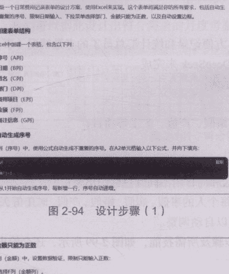

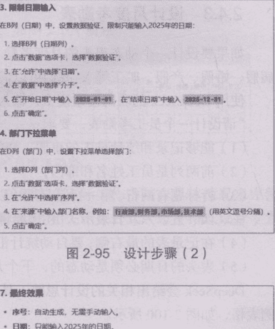


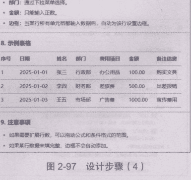

按步骤操作即可在 Excel 中完成费用记录单，如图 2-98。

若表单未达预期，可继续提问寻求解决方案。

| A | B | C | D | E | F | G |

|---|---|---|---|---|---|---|

| 序号 | 日期 | 姓名 | 部门 | 费用项目 | 金额 | 备注信息 |

| 1 | 2025-1-1 | 张三 | 行政部 | 办公用品 | 100 | 购买文具 |

| 2 | 2025-1-2 | 李四 | 财务部 | 差旅费 | 500 | 出差报销 |

| 3 | 2025-1-3 | 王五 | 市场部 | 广告费 | 1000 | 宣传费用 |

| 4 | 2025-3-7 | 赵亮 | 财务部 | 差旅费 | 598 | 出差报销 |

图 2-98 日常费用记录单

#### 2.4.3 设计月度考勤表

若要做一张表头动态的月度考勤表，用于记录与汇总事假、病假、婚假、产假、旷工等情况，可借助 DeepSeek 完成。

使用联网搜索模型，输入提示词：

> “请设计一个员工考勤表，要求：
（1）能够记录和统计员工的事假、病假、婚假、产假、旷工等项目；
（2）前两列是员工姓名和部门；

# AI 驱动考勤搭建与数据清洗实操

先把考勤表的关键诉求梳理清楚：表头采用双层结构，上层以 1、2、3… 表示日期，下层以一、二、三、四、五、六、日 表示星期，周六和周日需要用不同底色区分；最右侧区域要能够自动汇总每人对应的事假、病假、婚假、产假、旷工等时长；日期表头要具备月份自动滚动能力，换月时不必手工修改。

基于以上要求，利用 DeepSeek 可以获取设计思路、落地方案以及涉及的函数与条件格式技巧，并附上思路示意图如图 2-99，以及一张参考示例如图 2-100。

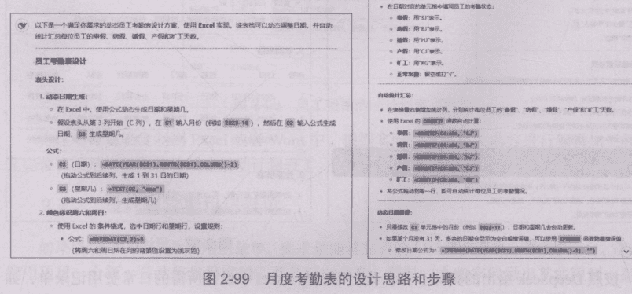
示例表格（部分）：

| 员工姓名 | 部门 | 1 | 2 | 3 | 4 | 5 | 6 | 7 | ... | 31 | 事假 | 病假 | 婚假 | 产假 | 旷工 |

|---|---|---|---|---|---|---|---|---|---|---|---|---|---|---|---|

| 张三 | 技术部 | | | | | | | | ... | | 1 | 0 | 0 | 0 | 0 |

| 李四 | 市场部 | | | | | | | | ... | | 0 | 1 | 0 | 0 | 0 |

| 王五 | 财务部 | | | | | | | | ... | | 0 | 0 | 0 | 0 | 1 |

图 2-100 示例表格

在此基础上即可制作出满足需求的月度考勤模板，如图 2-101 所示。


图 2-101 符合需求的月度考勤表

以上内容仅为参考，实际落地时需要结合业务细节完善方案，并熟练运用 Excel 的函数、条件格式等功能。

## 第3章 DeepSeek 助力数据清洗加工

在分析流程里，清洗加工是核心环节，尤其面对大体量表格或多表关联场景，还涉及逻辑校验。若数据量小、结构简洁，可用 Excel 的分列、去重、筛选排序等功能，或借助 Power Query 提高效率。引入 AI 辅助后，清洗的效率会进一步提升。

### 3.1 快速掌握数据清洗的基本知识和技能

清洗是分析的第一步，需要先弄清表单常见的失范点及修正办法。借助 DeepSeek，相关知识点能迅速获取。

#### 3.1.1 快速了解常见的表格不规范

尝试给出指令“表格结构和数据有哪些不规范？请举例说明”，先观察 DeepSeek 的推理过程，如图 3-1 和图 3-2。


现在，我需要结合具体的例子来说明每个方面。例如，在表头不规范的情况下，可以举一个没有列名或列名重复的表格例子，在行列设计问题中，可以举一个合并单元格导致数据难以处理的例子。数据类型混乱的例子可能是一列中既有数字又有文本，如“年龄”列中出现“未知”。冗余数据的例子可能是重复的行或列，或者使用多余的分隔线。数据缺失的例子可能是一些单元格留空或用“-”代替。格式不统一的例子比如日期有的用“2023-01-01”，有的用“01/01/2023”。数据冗余的例子可能是在多个列中存储相同的信息。异常值的例子比如年龄为-10或200。命名问题的例子可能使用缩写而不加说明，编码问题比如性别用“男/女”和“M/F”混用。

在组织这些内容时，需要分点阐明，每个方面下都有示例，这样用户更容易理解。同时，要确保语言简洁明了，避免使用过于专业的术语，让不同层次的用户都能理解。可能还需要考虑用户的实际应用场景，比如数据分析、数据清洗等，因此示例应贴近实际应用，帮助用户识别和解决实际问题。

最后，检查是否有遗漏的方面，比如是否有其他结构或数据问题没有涵盖。例如，表格的布局是否合理，是否有不必要的空格或特殊字符，或者数据的分隔符是否正确等。这也可能属于不规范的情况，需要补充进去。另外，关于数据编码，除了性别之外，可能还有其他分类变量的编码不一致，比如地区编码、产品类别等，都可以作为例子。

总结一下，我需要将表格结构和数据内容的不规范分成两大部分，每个部分下再分小点，每个小点都给出具体的例子，并解释可能导致的问题。这样结构清晰，内容全面，用户能够通过示例快速识别和解决类似的问题。


仔细阅读和总结 DeepSeek 的思考过程，我们可以快速了解以下几个关于表格不规范的知识点：

1. 表格结构不规范。

    - 表头问题，例如表头缺失、表头重复或者表头不明确导致数据处理困难。

    - 行列设计问题，例如合并单元格过多，或者在行和列中混合存放不同类型的数据，这会影响数据分析和处理的效率。

    - 数据类型问题，例如同一列中混合了文本和数字，或者日期格式不统一，这会导致计算错误或分析困难。

    - 冗余数据问题，例如重复的行或列，或者不必要的分隔符，这会增加数据处理的复杂度。

2. 表格中的数据不规范。

    - 数据缺失问题，例如某些单元格为空或者用占位符 N/A 代替，这可能会影响后续分析。

    - 格式不统一问题，例如日期格式不一致或者单位不统一，会导致数据无法正确进行比较或计算。

    - 数据冗余和重复问题，例如重复记录或存储了多余的数据，这会浪费存储空间并降低处理效率。

    - 异常值或错误数据问题，例如超出合理范围的数值或拼写错误，这会影响分析结果。

    - 命名和编码问题，例如使用不清晰的命名或不同的编码方式，这可能导致理解困难或整合错误。

DeepSeek 还给出了表格不规范的详细介绍，如图 3-3 所示。我们不妨仔细阅读理解，并对照自己工作中处理过的表格中的数据，看看哪些方面没有做好。

表格结构和数据不规范可能导致数据难以分析、处理或整合。以下是常见的不规范类型及示例：

##### 一、表格结构不规范

1. 表头问题

   - 缺失表头：表格没有明确的列名，无法理解各列含义。

   - 重复表头：多行表头或跨页重复表头，导致数据提取困难。

   - 表头含义模糊：列名不清晰（如“字段1”“字段2”），无法明确数据内容。

2. 行列设计混乱

   - 合并单元格过多：合并行列导致数据难以结构化存储。

我们可以针对 DeepSeek 给出的表格不规范的详细介绍，再一一去询问。

例如，输入提示词“缺失表头都有哪些情况”，DeepSeek 会对缺失表头的问题进行深度思考，包括但不限于：

- 完全缺失表头。

- 部分缺失表头。

- 隐藏表头（视觉存在但实际缺失）。

- 多级表头不明确，缺失下级标题。

- 动态生成表头缺失。

- 表头与数据混淆。

仔细阅读和理解 DeepSeek 给出的这几种典型的缺失表头示例，我们就能在设计表格时避免出现这样的问题，同时掌握诊断并整理表格的思路。

输入提示词“行列设计问题都有哪些”，DeepSeek 会对行列设计问题进行深度思考。我们可以对照自己的实际工作，看看是不是经常犯这样的错误。

- 合并单元格滥用。

- 行列混合存储不同类型的数据。

- 冗余行或列。

- 维度交叉。

- 标题行重复或嵌入数据中。

- 数据方向不一致。

- 多级表头层级混乱。

- 行内数据不完整。

继续输入提示词“数据类型不统一都有哪些情况”，DeepSeek 会对数据类型不统一的问题进行深度思考，总结数据类型不统一的几种常见情况，并介绍相关示例及其解决方法。

- 同一列混合不同数据类型，例如数值与文本混合、日期格式不一致、布尔值与文本混合等。

- 数值类型不统一，例如单位混杂、数字格式不一致、整数与浮点数混合等。

- 分类数据编码混乱，例如同一类别不同命名、多级分类未拆分等。

- 结构化与非结构化数据混合，例如 JSON/ 文本与普通字段混合、多值字段未标准化等。

- 特殊符号干扰，如数字中的非数值字符、科学计数法与非科学计数法混合、空值表示不一致等。

仔细阅读 DeepSeek 的思考过程和示例介绍，我们就会对数据类型不统一的问题及其危害有更深的认识。

如果不了解冗余数据问题，我们可以输入“冗余数据问题有哪些”，看看 DeepSeek 是如何解释这个问题的，并提供了哪些示例及解决方案。

数据缺失是实际工作中的常见问题，具有复杂性、多样性和隐蔽性。输入提示词“常见的数据缺失有哪些”，DeepSeek 就会对数据缺失问题进行总结，并结合示例提出解决方案。

总之，DeepSeek 对表格不规范进行了多方面的思考和总结。通过这些帮助信息，我们可以深入地了解表格不规范的形成原因及影响，并获取相应的解决方法。

#### 3.1.2 快速了解什么是科学规范的表单

前面介绍了如何借助 DeepSeek 了解表格不规范的常见问题，那么，科学规范的表单是什么样的呢？换句话说，科学规范的表单应具备什么样的特征和条件呢？

输入提示词“科学规范的表单必须具备哪些条件”，得到 DeepSeek 对科学规范的表单的解释，重点是有关规则要求的阐述以及相关示例的展示。

设计科学规范的表单需满足的核心条件如下：

- 结构设计规范。

- 数据验证机制。

- 安全与隐私保护。

- 数据输入规范。

- 用户体验优化。

- 可维护性与扩展性。

三、数据验证机制

1. 实时输入校验

   - 要求：输入即时提示错误（如手机号位数不足）。

   - 示例：

2. 后端校验

   - 要求：服务端二次验证，防止前端绕过。

   - 场景：表单提交时检查数据完整性（如手机号是否已注册）。

3. 防重复提交

   - 要求：通过Token机制或按钮禁用防止重复提交。

   - 示例：

四、用户体验优化

1. 友好的提示与引导

   - 要求：提供默认值、占位符或示例。

   - 示例：

2. 条件显示字段

   - 要求：动态显示关联字段（如选择“其他”性别时显示文本框）。

   - 示例：

3. 移动端适配

   - 要求：表单在手机端可正常填写（如输入框自适应宽度）。

五、安全与隐私保护

1. 敏感信息脱敏

   - 要求：对身份证号、银行卡号等加密存储或部分隐藏。

   - 示例：

2. 合规性声明

   - 要求：明确告知数据用途，提供隐私协议链接。

   - 示例：

3. 防爬虫与攻击

   - 要求：添加验证码、IP限流或防SQL注入机制。

六、可维护性与扩展性

1. 字段可配置化

   - 要求：通过管理后台动态增删字段，无需修改代码。

   - 示例：

2. 版本管理与历史记录

   - 要求：记录表单修改历史，支持数据回溯。

   - 场景：用户填写旧版表单时，数据与新版本兼容。

七、示例对比

不规范表单：

DeepSeek 提供的这些信息，非常有助于我们结合实际业务设计科学规范的数据表单。

例如，要设计一个科学规范的供应商应付款管理表单，可以输入提示词“如果我要设计一个供应商应付款管理表单，那么从表单结构（这样的表单可能不是一个，但要注意保证各个表单的关联）上，要注意哪些问题”，寻求 DeepSeek 的帮助，以便形成一个基本的设计思路，再根据实际情况进行编辑和完善。

### 3.2 表格智能检查

前面我们介绍了如何借助 DeepSeek 了解表单规范性的问题以及延伸探索，这可以帮助我们在设计表单时注意到相关的问题。下面我们介绍如何借助 DeepSeek 快速高效地检查指定表格中的数据，包括表单数据检查、逻辑关系判断、结构不规范的快速处理、数据不规范的快速处理等。

#### 3.2.1 全面检查指定一个表格中的数据

先看一个简单的例子，了解 DeepSeek 是如何检查表格中的数据的。

图 3-17 所示的是一个各个客户两年销售额和毛利统计表（文件是“客户两年销售额和毛利统计表.xlsx”）。在分析此表之前，我们先检查一下该表是否存在问题，有关数据是否不符合逻辑，以及是否有重复记录等。

| A | B | C | D | E |

|---|---|---|---|---|

| 客户 | 销售额 | | 毛利 | |

| | 去年 | 今年 | 去年 | 今年 |

| 客户01 | 1,525 | 2,631 | 223 | 468 |

| 客户03 | 2,205 | 612 | 973 | 198 |

| 客户04 | 2,795 | 2,222 | 565 | 661 |

| 客户05 | 728 | 689 | 89 | 875 |

| 客户09 | 2,655 | 2,733 | 1,401 | 2,733 |

| 客户06 | 11,976 | 329 | 542 | 98 |

| 客户02 | 2,772 | 2,457 | 776 | 715 |

| 客户07 | 1,879 | 1,228 | 766 | 286 |

| 客户02 | 2,772 | 2,457 | 776 | 715 |

| 合计 | 29,307 | 15,358 | 6,111 | 6,749 |

将 Excel 文件上传到 DeepSeek，得到 DeepSeek 对表格中的数据的初步思考判断。DeepSeek 会对明显的错误予以说明，例如客户 02 的数据重复出现两次，客户 06 销售额异常下降，客户 05 毛利大幅增长。

毛利和销售额是有逻辑关系的，毛利是销售额的一部分，不可能等于或超过销售额，因此客户 05 和 09 的毛利问题没有被发现，因为上述信息仅仅是 DeepSeek 对表格的初步思考判断，我们还没有提出具体问题让 DeepSeek 思考。

输入提示词：

> “请仔细检查表格，找出表格中存在的问题，例如：

数据是否重复；

毛利和销售额之间的逻辑是否正确（如毛利率 100%、销售额大幅下降但毛利却激增）；

今年与去年相比是否出现异常变化。”

DeepSeek 返回的信息如图 3-19 所示。仔细阅读这些信息，并与表格进行对照，可以发现以下几个问题是需要认真对待并加以解决的：

- 客户 02：出现两次（销售额和毛利数据完全相同），需确认是否为重复录入。

- 客户 05：毛利与销售额矛盾，销售额由去年的 728 略降至今年的 689（下降 5.4%），但毛利从去年的 89 激增至今年的 875（增长 883%），逻辑不合理。需检查数据准确性。

- 客户 09：今年毛利率达 2733/2733 = 100%，毛利等于销售额，显然不合理，需要检查今年销售额或毛利数据是否输入错误（如毛利应为 1733）。

要让 DeepSeek 对表格检查得更仔细，快速发现问题，准确的提示词是非常关键的。也就是说，我们先要明确表格的检查重点是什么，要检查哪些方面，然后把需求明确地告诉 DeepSeek。

下面再看一个比较复杂的例子。如图 3-20 所示，数据源是 Excel 文件“员工基本信息表.xlsx”，用以保存员工的基本信息。

这个工作表存在一些不规范的地方，例如性别表述方式不统一，性别和出生日期是人工输入的，可能与身份证号码不匹配，年龄可能由于人工输入而不是当前年龄。此外，这个表格中还存在重复数据输入的问题。

| A | B | C | D | E | F | G | H | I | J | K | L |

|---|---|---|---|---|---|---|---|---|---|---|---|

| | | | | 基本信息 | | | | 其他信息 | | 证书最新信息 | |

| | 姓名 | 部门 | 性别 | 学历 | 身份证号码 | 出生日期 | 年龄 | 家庭住址 | 紧急联系人 | 联系人电话 | 证书名称 | 获取时间 |

| 3 | A001 | 采购部 | 女 | 硕士 | 173106198508263867 | 1985-8-26 | 39 | ********** | L001 | 132****34001 | | |

| 4 | A002 | 财务部 | 女 | 专科 | 347106197702067208 | 1977-2-6 | 48 | ********** | L002 | 132****34002 | | |

| 5 | A003 | 人力资源部 | 男 | 专科 | 265106197709102148 | 1977-9-10 | 47 | ********** | L003 | 132****34003 | | |

| 6 | A004 | 生产部 | male | 博士 | 362110198309264378 | 1983-9-26 | 41 | ********** | L004 | 132****34004 | | |

| 7 | A018 | 销售部 | 女 | 专科 | 477101197311013700 | 1973.11.11 | 48 | ********** | L018 | 132****34018 | 高级经济师 | 2000-8-15 |

| 8 | A019 | 生产部 | 女 | 硕士 | 271101198605094804 | 1986.05.09 | 38 | ********** | L019 | 132****34019 | | |

| 9 | A020 | 技术研发部 | 男 | 高中 | 359106199712300360 | 1997-12-30 | 27 | ********** | L020 | 132****34020 | | |

| 10 | A021 | 财务部 | 男 | 博士 | 342108197809128980 | 1978-9-12 | 46 | ********** | L021 | 132****34021 | | |

| 11 | A005 | 生产部 | female | 高中 | 548107198011098724 | 1981-1-19 | 44 | ********** | L005 | 132****34005 | | |

# 第 3 章 用 DeepSeek 把表格脏数据洗干净

先看一份典型的员工花名册。表头涉及工号、部门、性别、学历、身份证号、出生年月日、年龄等，样例里能看到 A006 采购部门 female 专科、A022 销售部门 女 初中、A023 销售部门 male 本科……整张表动辄几百到上千行，手工逐行核对既慢又容易漏项。

这时把文件交给 DeepSeek 就能同时完成规范性判断和规则提取，既能把身份证里的出生年月日和性别拆出来，也能给年龄计算提供公式。

上传后模型会先给出一个概览式结论，但颗粒度不够。需要把要检查的点说清楚，比如：

> 请帮我审一下这张表哪里不规范，例如：出生年月日能否从身份证号对应上、性别能否从身份证号推算出来；出生年月日的写法是否一致；性别的写法是否一致；年龄是否按当前日期计算；是否存在重复记录；把有问题的行单独列出来。

指令明确后，返回的清单会清晰很多。

**身份证号与出生年月日/性别对应问题**
| 员工编号 | 身份证号 | 表内出生日期 | 身份证推算出生日期 | 表内性别 | 身份证推算性别 | 问题说明 |
|---|---|---|---|---|---|---|
| A006 | 261101200005227967 | 2000.5.22 | 2000-05-22 | 女 | 女 | 日期写法混杂 |
| A018 | 477101197311013700 | 1973.11.11 | 1973-11-11 | 女 | 女 | 日期写法混杂 |
| A040 | 157103198912083758 | 1989-12-08 | 1989-12-08 | 男 | 男 |  |
| A195 | 179109200010075855 | 2000-10-07 | 2000-10-07 | 男 | 男 |  |

**性别写法混杂**
| 员工编号 | 原写法 | 建议写法 |
|---|---|---|
| A004 | male | 男 |
| A005 | female | 女 |
| A007 | male | 男 |
| A010 | male | 男 |
| A011 | male | 男 |
| A013 | female | 女 |

**出生日期写法混杂**
| 员工编号 | 现有写法 | 规范建议 |
|---|---|---|
| A006 | 2000.5.22 | 2000-05-22 |
| A018 | 1973.11.11 | 1973-11-11 |
| A019 | 1986.05.09 | 1986-05-09 |

**年龄计算偏差，以 2023-10-23 为基准**
| 员工编号 | 表内年龄 | 实际年龄 | 偏差 |
|---|---|---|---|
| A040 | 35 | 34 | +1 |
| A195 | 24 | 23 | +1 |
| A147 | 24 | 23 | +1 |
| A209 | 24 | 23 | +1 |

**重复记录**
1. 工号重复
| 员工编号 | 出现次数 | 身份证号 | 说明 |
|---|---|---|---|
| A021 | 3 | 342108197809128980 | 同一工号多次登记 |
| A040 | 2 | 157103198912083758 | 同一工号多次登记 |

2. 身份证重复
| 身份证号 | 出现次数 | 涉及工号 | 说明 |
|---|---|---|---|
| 342108197809128980 | 3 | A021、A032、A033 | 同一身份证被多次使用 |
| 157103198912083758 | 2 | A040、A053 | 同一身份证被多次使用 |

**其它发现**
证书信息几乎空白，只有 A006、A014、A018 三人有记录，其余 197 人均空缺；家庭住址脱敏不统一，部分已做 *********** 处理，部分如 A040 仍暴露原文。

**处理思路**
1. 数据清洗，日期统一为 YYYY-MM-DD，性别统一为 男/女。
2. 重复核对，确认 A021、A040 是否是同一人重复登记或录入错误。
3. 年龄重算，按出生年月日推导到当日的年龄。
4. 补齐证书，由业务部门补充。
5. 对身份证校验异常的记录人工复核。

问题量大时可让模型给出批量公式。提示“如何依据 E 列身份证号，用公式自动提取出生年月日、性别和年龄？数据从第 3 行起”，会得到参考：

| 目标列 | 公式 |
|---|---|
| 出生日期 | =DATE(MID(E3,7,4),MID(E3,11,2),MID(E3,13,2)) |
| 性别 | =IF(MOD(MID(E3,17,1),2)=1,"男","女") |
| 年龄 | =DATEDIF(DATE(MID(E3,7,4),MID(E3,11,2),MID(E3,13,2)),TODAY(),"Y") |

操作要点：把公式写入出生日期、性别、年龄列的首行，向下填充；出生日期列再设为 YYYY-MM-DD 格式。

表头结构也常不合理。原表用了两层标题并合并单元格，不利筛选和公式引用。问模型“这个表头哪里有问题，怎么优化”，得到建议是去掉合并、列名扁平化。

优化前
| 基本信息 |  |  |  |  | 其他信息 |  |  |  | 证书最新信息 |  |
|---|---|---|---|---|---|---|---|---|---|---|
| 姓名 | 部门 | 性别 | 学历 | 身份证号码 | 出生日期 | 年龄 | 家庭住址 | 紧急联系人 | 联系人电话 | 证书名称 | 获取时间 |

优化后
| 姓名 | 部门 | 性别 | 学历 | 身份证号码 | 出生日期 | 年龄 | 家庭住址 | 紧急联系人 | 联系人电话 | 最新证书名称 | 证书获取时间 |

好处是每列独立，筛选、透视和公式引用都更顺畅。

## 3.2.2 跨表关联数据全面核查

当需要对比多张关联表时，DeepSeek 的效率更突出。以“销售订单开票记录表.xlsx”为例，包含订单信息表和开票信息表，两表以订单号和客户名称关联，一个客户可有多单，一单只对应一个客户。

要核查的问题包括：同一订单对应不同客户、同一订单金额与开票金额不一致、单价异常、有开票无订单、订单重复、开票重复等。

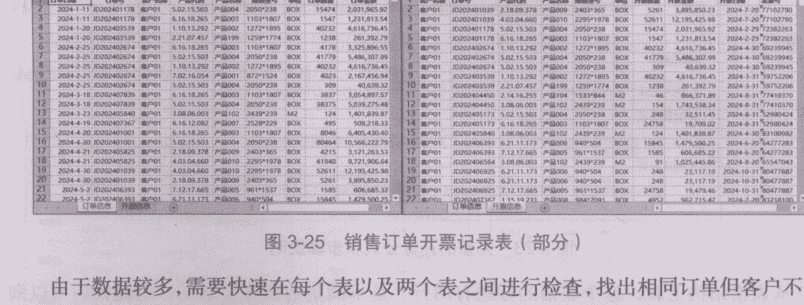
数据量大时手工或函数排查耗时且易错。把两张表上传，输入提示：

> 请对每个表内部及两表之间做详细核查，重点包括：订单号相同但客户名称不同；同一订单号下订单金额与开票金额不同；金额相同但产品单价不同；有开票记录却找不到订单；订单重复录入；开票重复录入等异常，请汇总成差异表。

模型会输出多类异常，示例如下：

1. 同一订单号客户不一致
| 订单号 | 订单客户 | 开票客户 | 产品代码 | 差异类型 | 处理建议 |
|---|---|---|---|---|---|
| JD202403172 | 客户02 | 客户01 | 1.07.21.218 | 客户不一致 | 核对归属或修正开票 |
| JD202405376 | 客户01 | 客户02 | 1.11.21.444 | 客户不一致 | 联系客户确认归属 |

2. 订单金额与开票金额不一致
| 订单号 | 产品代码 | 订单金额 | 开票金额 | 差额 | 差异类型 | 处理建议 |
|---|---|---|---|---|---|---|
| JD202405925 | 7.12.17.665 | 9,479.48 | 0 | 9,479.48 | 金额不一致 | 检查是否遗漏折扣 |
| JD202405674 | 7.02.16.054 | 2,167.45 | 0 | 2,167.45 | 未开票 | 跟进未开票原因 |

3. 金额一致但单价不同
| 订单号 | 产品代码 | 订单数量 | 订单单价 | 开票数量 | 开票单价 | 差异类型 | 处理建议 |
|---|---|---|---|---|---|---|---|
| JD202405173 | 6.16.18.265 | 8 | 24.75 | 8 | 24.75 | 单价异常 | 检查四舍五入或录入错误 |

4. 有开票无对应订单
| 发票号 | 订单号 | 客户名称 | 产品代码 | 开票金额 | 差异类型 | 处理建议 |
|---|---|---|---|---|---|---|
| 58114321 | JD202401894 | 客户02 | 5.05.23.022 | 1,638.529 | 订单不存在 | 核查是否虚构订单 |
| 77102790 | JD202401039 | 客户01 | 4.03.04.660 | 12,195.42 | 产品不匹配 | 检查产品代码关联 |

5. 订单重复录入
| 订单号 | 客户名称 | 产品代码 | 重复次数 | 差异类型 | 处理建议 |
|---|---|---|---|---|---|
| JD202407760 | 客户02 | 5.05.23.022 | 3 | 重复订单 | 删除多余记录 |
| JD202404635 | 客户02 | 6.15.03.110 | 2 | 重复订单 | 合并或删除 |

6. 开票重复录入
| 发票号 | 订单号 | 产品代码 | 重复次数 | 差异类型 | 处理建议 |
|---|---|---|---|---|---|
| 76556920 | JD202407760 | 5.05.23.022 | 3 | 重复开票 | 检查批量开票 |
| 58114321 | JD202401894 | 5.05.23.022 | 2 | 重复开票 | 删除重复 |

7. 其他异常
| 订单号 | 问题描述 | 差异类型 | 处理建议 |
|---|---|---|---|
| JD202406393 | 订单含产品006 数量15,845，开票未找到 | 部分未开票 | 检查遗漏 |
| JD202407567 | 金额一致，单位差异 BOX vs M2 | 单位不一致 | 核对单位录入 |

自动化核对逻辑可以进一步让模型输出 VBA 参考代码，实现七类差异表的批量生成。


如果要把核查做成一键运行，可提示“请给出快速生成上述七个差异表的 VBA 代码”，模型会返回代码框架。

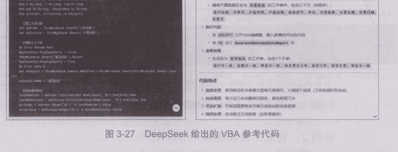
注意代码初期可能不完全可用，需要先试跑、定位报错语句，再让模型迭代修正，直到稳定运行。

### 3.3 智能化快速清洗加工数据

不同类型的脏数据，DeepSeek 都能给出针对性清洗方案。

#### 3.3.1 案例 1：智能化分列数据

有张表把物料代码、物料名称、规格型号混在同一列，例如“原纸/6.16.01.08高光直镀内衬原纸180g*480mm*1200m”。分析不便，需要拆成多列。

上传文件后，模型识别规律并返回清洗结果：

| 物料代码 | 物料名称 | 克重 | 宽度 | 长度 |
|---|---|---|---|---|
| 6.16.01.08 | 高光直镀内衬原纸 | 180g | 480mm | 1200m |
| 6.16.01.03.019 | 金色转移内卡纸 | 220g | 763mm | 5000m |
| 6.16.06.001 | 磨砂内卡原纸 | 85g | 688mm | 4800m |
| 6.16.01.07.042 | 金色直镀内衬纸 | 225g | 763mm | 6700m |
| 6.16.01.07.014 | 金色环保铝纸 | 160g | 734mm | 12000m |
| 6.16.06.001.008 | 浅灰绿磨砂卡纸 | 220g | 1286mm | 18000m |

复制回 Excel 即得到结构化的规范表，后续分析与建模都能直接使用。

| 6.16.01.07.042 | 金色直镀内衬纸 | 225g | 763mm | 6700m |

| 6.16.01.07.014 | 金色环保铝纸 | 160g | 734mm | 12000m |

| 6.16.06.001.008 | 浅灰绿磨砂卡纸 | 220g | 1286mm | 18000m |

图 3-29 DeepSeek 的处理结果及复制到 Excel 后的规范表格

#### 3.3.2 案例 2：宽表拆解为纵向结构

图 3-30 所示的各地区各品类近年销售统计是典型的横向排布。我们要做的是把它重塑为纵向排布，保留地区、商品、年份、销售额四个维度。

# 第 3 章 用 DeepSeek 提升数据清洗效率

| A | B | C | D | E | F | G |

|---|---|---|---|---|---|---|

| 地区 | 商品 | 2020年 | 2021年 | 2022年 | 2023年 | 2024年 |

| 华北 | 彩电 | 1819 | 325 | 816 | 789 | 843 |

| | 冰箱 | 1480 | 1859 | 351 | 1248 | 1791 |

| | 空调 | 1040 | 1329 | 1309 | 420 | 1016 |

| | 小家电 | 720 | 1524 | 1477 | 1566 | 1321 |

| 华南 | 彩电 | 1992 | 280 | 1202 | 1703 | 647 |

| | 冰箱 | 469 | 1976 | 683 | 922 | 913 |

| | 空调 | 600 | 1073 | 1931 | 1424 | 995 |

| | 小家电 | 1774 | 1053 | 342 | 1884 | 2017 |

| 华中 | 彩电 | 929 | 1323 | 1472 | 1254 | 1256 |

| | 冰箱 | 1462 | 455 | 933 | 482 | 541 |

| | 空调 | 1236 | 1659 | 299 | 1961 | 374 |

| | 小家电 | 1318 | 1047 | 1503 | 1324 | 1488 |

| 华东 | 彩电 | 594 | 1484 | 1609 | 817 | 470 |

| | 冰箱 | 695 | 596 | 1495 | 949 | 354 |

| | 空调 | 1975 | 1366 | 969 | 1180 | 1231 |

| | 小家电 | 369 | 1717 | 1253 | 934 | 889 |

| 西北 | 彩电 | 315 | 1792 | 1871 | 2035 | 391 |

图 3-30 各个地区各个产品近几年销售统计表

把文件交给模型后，会先给出纵向样式的参考、思路和工具建议，如图 3-31 所示。


图 3-31 DeepSeek 给出一维表的样式、转换步骤及转换工具建议

这里给出的只是结构示例，并非全部数值。数据量很大时可按模型建议使用 Power Query 的反透视操作；数据量很小可以直接让模型一次性给出完整的纵向结果。

输入指令“请将这个表转为长表，包括地区、商品、年份和销售额四列，输出一个完整表格”，模型开始整理并返回完整数据，如图 3-32 所示。复制到 Excel 即可使用。

AI 智数新图景：DeepSeek 数据处理与分析（案例版）

要点概括：

1. 为地区列的空白向下补齐。
2. 对年份列做反透视，拆出年份和销售额两列。
3. 按地区、商品、年份排序并核对一致性。
4. 导出整理后的完整结果。

实操中可能碰到年份缺失或某品类某年无金额的情况，可按实际保留空值或补齐。本例销售数据完整，可视为无缺失。若有空缺则需额外标记或处理。

转换后完整数据包含地区、商品、年份、销售额四列：

| 地区 | 商品 | 年份 | 销售额 |

|------|------|------|--------|

| 华北 | 彩电 | 2020年 | 1819 |

| 华北 | 彩电 | 2021年 | 325 |

| 华北 | 彩电 | 2022年 | 816 |

| 华北 | 彩电 | 2023年 | 789 |

| 华北 | 彩电 | 2024年 | 843 |

| 华北 | 冰箱 | 2020年 | 1480 |

| 华北 | 冰箱 | 2021年 | 1859 |

| 华北 | 冰箱 | 2022年 | 351 |

| 东北 | 空调 | 2021年 | 1473 |

| 东北 | 空调 | 2022年 | 1912 |

| 东北 | 空调 | 2023年 | 1049 |

| 东北 | 空调 | 2024年 | 1539 |

| 东北 | 小家电 | 2020年 | 1769 |

| 东北 | 小家电 | 2021年 | 1374 |

| 东北 | 小家电 | 2022年 | 1789 |

| 东北 | 小家电 | 2023年 | 591 |

| 东北 | 小家电 | 2024年 | 299 |

数据说明：

1. 地区补齐：原始表里为空的地区单元格已用上方最近的地区名称补全，如华北下的所有商品行均补为华北。
2. 年份展开：把 2020年 至 2024年 五列展开成行，形成年份与销售额两列。
3. 排序与校验：按地区 > 商品 > 年份排序，并确保总行数与原始一致，8 地区 × 4 商品 × 5 年份 = 160 行。

图 3-32 DeepSeek 整理得到一个完整数据的一维表

若数据体量较大且对 Power Query 不熟悉，可输入“请介绍如何利用 Power Query 反透视列功能，将此表转换为包括地区、商品、年份和销售额四列的长表，并提供详细步骤”，模型会给出图 3-33 所示的详细指引，按步骤执行即可完成整理。

使用 Excel Power Query 将表格转换为地区、商品、年份、销售额四列长表的详细步骤：

步骤 1：将数据加载到 Power Query

1. 打开 Excel 文件，选中原始数据表中的任意单元格。
2. 点击菜单栏的“数据” → “从表格/区域”或“Power Query” → “从表格”。
3. 在弹出的对话框中确认数据范围，勾选“包含标题”，点击“确定”。此时数据会加载到 Power Query 编辑器中。

步骤 2：补齐地区列的空值

• 在 Power Query 编辑器中：
1. 选中“地区”列。
2. 点击菜单栏的“转换” → “填充” → “向下填充”。
这一步会将空的地区单元格填充为上方最近的地区名称。

步骤 3：反透视年份列

1. 选中需要反透视的列：按住 Ctrl 键，依次点击 2020年、2021年、2022年、2023年、2024年 五列。
2. 反透视列：
• 点击菜单栏的“转换” → “反透视列” → “反透视其他列”。
此时年份列会合并为两列：属性和值。

步骤 4：重命名列并调整顺序

1. 重命名列：
• 双击“属性”列标题，将其改为“年份”。
• 双击“值”列标题，将其改为“销售额”。
2. 调整列顺序：
• 拖动列标题，调整顺序为：地区、商品、年份、销售额。

步骤 5：验证数据并加载回 Excel

1. 检查数据完整性：
• 确认总行数为 8 地区 × 4 商品 × 5 年份 = 160 行。
• 检查是否有空值或异常值。
2. 加载到 Excel：
• 点击菜单栏的“主页” → “关闭并上载” → “关闭并上载至...”。
• 选择“现有工作表”或“新工作表”，点击“加载”。

最终效果

转换后长表结构如下：

| 地区 | 商品 | 年份 | 销售额 |

|------|------|------|--------|

| 华北 | 彩电 | 2020年 | 1819 |

图 3-33 使用 Power Query 反透视列功能的详细步骤

#### 3.3.3 案例 3：多表合并后再结构化

当源数据分散在多个表格时，需要先合并再转换结构。如图 3-34 所示，每个商品是一个表格，如何把四个表格合并，生成一个由地区、商品、年份和销售额四列构成的长表？文件是“表格合并与转换.xlsx”。

上传文件后，DeepSeek 会从数据特征出发，建议整理为长表并给出样式与转换方法，如图 3-35 所示。

合并转换较为繁琐，可直接让模型生成代码。指令示例：

“请将这四个表格合并，转换为长表，包括地区、商品、年份和销售额四列；
要求：给出合并与转换的 Excel VBA 代码；
要注意四个表格的具体位置如下：
彩电/空调表格实际数据从第四行开始，标题在第三行；
冰箱/小电器表格实际数据从第十五行开始，标题在第十四行；
彩电/冰箱的地区列在A列，年份列从B列开始；
空调/小电器的地区列在H列，年份列从I列开始。”

DeepSeek 给出合并与转换的 Excel VBA 代码，如图 3-36 所示。

把代码复制到 Excel 中测试是否能正常运行并得到正确结果。如有问题再继续寻求模型帮助，修改并完善代码。

由此可见，给出具体要求非常重要，否则可能得到不可运行或结果不正确的代码。本例中需明确每个商品标题行的开始位置和数据行的开始位置，以及每个商品地区列的开始位置。

这类多表结构同样可以用多重合并计算数据区域透视表解决，方法也很简单。

输入指令“请问如何使用多重合并计算数据区域透视表来合并与转换这四个表？请给出详细步骤。注意年份是每个表的列标题，地区是每个表的行标题”，DeepSeek 就会给出详细步骤及注意事项，这里不再截图列示。

#### 3.3.4 案例 4：处理行列均合并的复杂报表

无论结构多么复杂，DeepSeek 都能给予足够帮助，甚至给出想要的结果。

图 3-37 所示的是一个结构比较复杂的表格。这里的复杂是指行标题和列标题都有合并单元格，这对灵活分析是不利的。从字段来看，这个表格应是一个包含地区、省份、商品、季度和销售额五个字段的长表，任务是快速整理为五个字段的规范长表。

# 第 3 章 DeepSeek 助力数据清洗加工

| 地区 | 省份 | 1季度 | | | 2季度 | | | 3季度 | | | 4季度 | | | 全年合计 | | |

|---|---|---|---|---|---|---|---|---|---|---|---|---|---|---|---|---|

| | | 彩电 | 冰箱 | 空调 | 彩电 | 冰箱 | 空调 | 彩电 | 冰箱 | 空调 | 彩电 | 冰箱 | 空调 | 彩电 | 冰箱 | 空调 |

| 华北 | 天津 | 523 | 2580 | 2719 | 2915 | 1558 | 1807 | 2213 | 954 | 1816 | 1321 | 1386 | 1933 | 6972 | 6478 | 8275 |

| 华北 | 北京 | 2338 | 1885 | 986 | 1672 | 1365 | 1271 | 2081 | 1682 | 1899 | 1059 | 902 | 1593 | 7150 | 5834 | 5749 |

| 华北 | 河北 | 1218 | 2247 | 2408 | 450 | 1199 | 1345 | 1992 | 1634 | 765 | 1131 | 1825 | 1733 | 4791 | 6905 | 6251 |

| 华东 | 上海 | 1996 | 1878 | 1093 | 1660 | 499 | 1344 | 1177 | 2574 | 2460 | 1748 | 2260 | 1559 | 6581 | 7211 | 6456 |

| 华东 | 江苏 | 1536 | 1878 | 1093 | 1660 | 1772 | 617 | 1177 | 2574 | 2371 | 1748 | 2260 | 1559 | 6121 | 7484 | 5640 |

| 华东 | 浙江 | 932 | 882 | 2570 | 1947 | 2501 | 1010 | 2819 | 801 | 118 | 2883 | 2615 | 527 | 8581 | 6799 | 4225 |

| 华东 | 安徽 | 2947 | 2796 | 1535 | 1852 | 2519 | 651 | 246 | 2858 | 1425 | 668 | 2317 | 2902 | 5713 | 10490 | 6513 |

| 华南 | 福建 | 1094 | 936 | 2703 | 905 | 2514 | 147 | 2448 | 620 | 372 | 1004 | 2225 | 1100 | 5451 | 6295 | 4322 |

| 华南 | 广东 | 2871 | 2162 | 2500 | 1850 | 2852 | 2098 | 2211 | 867 | 2660 | 1884 | 1923 | 1691 | 8816 | 7804 | 8949 |

| 西南 | 重庆 | 1163 | 1462 | 2500 | 1850 | 2852 | 2098 | 217 | 999 | 2144 | 2345 | 2217 | 1031 | 5616 | 5084 | 7673 |

| 西南 | 四川 | 2955 | 2828 | 1809 | 1099 | 851 | 127 | 919 | 1597 | 795 | 2411 | 2041 | 2929 | 7384 | 7317 | 5660 |

| 西南 | 云南 | 2094 | 2376 | 2745 | 644 | 1581 | 1734 | 2092 | 454 | 2909 | 2695 | 184 | 1866 | 7525 | 4595 | 9254 |

| 合计 | | 21668 | 23169 | 25840 | 16215 | 20382 | 14531 | 19148 | 17123 | 19743 | 20468 | 20130 | 21648 | 77499 | 80804 | 81762 |

图 3-37 行标题和列标题都有合并的单元格的表格

上传文件后，DeepSeek 会先给出思考和相关信息，对理解规范表格很有帮助。

接着输入指令“请将这个表格整理为包含地区、省份、季度、商品和销售的五列数据长表，输出完整的数据表。注意：长表中不要有合计数和全年合计数”，模型开始分析并整理表格，返回一个长表，如图 3-38 所示。复制到 Excel 中，如图 3-39 所示。

整理后长表：

| 地区 | 省份 | 季度 | 商品类别 | 销售额 |

|---|---|---|---|---|

| 华北 | 天津 | 1季度 | 彩电 | 523 |

| 华北 | 天津 | 1季度 | 冰箱 | 2580 |

| 华北 | 天津 | 1季度 | 空调 | 2719 |

| 华北 | 天津 | 2季度 | 彩电 | 2915 |

| 华北 | 天津 | 2季度 | 冰箱 | 1558 |

| 华北 | 天津 | 2季度 | 空调 | 1807 |

| 华北 | 天津 | 3季度 | 彩电 | 2213 |

| 华北 | 天津 | 3季度 | 冰箱 | 954 |

| 华北 | 天津 | 3季度 | 空调 | 1816 |

| 华北 | 天津 | 4季度 | 彩电 | 1321 |

| 华北 | 天津 | 4季度 | 冰箱 | 1386 |

| 华北 | 天津 | 4季度 | 空调 | 1933 |

| 华北 | 北京 | 1季度 | 彩电 | 2338 |

| 华北 | 北京 | 1季度 | 冰箱 | 1885 |

| 华北 | 北京 | 1季度 | 空调 | 986 |

| A | B | C | D | E |

|---|---|---|---|---|

| 地区 | 省份 | 季度 | 商品类别 | 销售额 |

| 华北 | 天津 | 1季度 | 彩电 | 523 |

| 华北 | 天津 | 1季度 | 冰箱 | 2580 |

| 华北 | 天津 | 1季度 | 空调 | 2719 |

| 华北 | 天津 | 2季度 | 彩电 | 2915 |

| 华北 | 天津 | 2季度 | 冰箱 | 1558 |

| 华北 | 天津 | 2季度 | 空调 | 1807 |

| 华北 | 天津 | 3季度 | 彩电 | 2213 |

| 华北 | 天津 | 3季度 | 冰箱 | 954 |

| 华北 | 天津 | 3季度 | 空调 | 1816 |

| 华北 | 天津 | 4季度 | 彩电 | 1321 |

| 西南 | 四川 | 4季度 | 冰箱 | 2041 |

| 西南 | 四川 | 4季度 | 空调 | 2929 |

| 西南 | 云南 | 1季度 | 彩电 | 2094 |

| 西南 | 云南 | 1季度 | 冰箱 | 2376 |

| 西南 | 云南 | 1季度 | 空调 | 2745 |

| 西南 | 云南 | 2季度 | 彩电 | 644 |

| 西南 | 云南 | 2季度 | 冰箱 | 1581 |

| 西南 | 云南 | 2季度 | 空调 | 1734 |

| 西南 | 云南 | 3季度 | 彩电 | 2092 |

用 DeepSeek 驱动的 Excel 整理提速实战

| 西南 | 云南 | 3季度 | 冰箱 | 454 |

| 西南 | 云南 | 3季度 | 空调 | 2909 |

| 西南 | 云南 | 4季度 | 彩电 | 2695 |

| 西南 | 云南 | 4季度 | 冰箱 | 184 |

| 西南 | 云南 | 4季度 | 空调 | 1866 |

图 3-38 DeepSeek 整理的一维表

图 3-39 将一维表复制到 Excel 中

单列整理完要回头核对覆盖情况，确认是否把原始记录全部包含。若发现缺口，就重新下发指令让模型再跑一次。

记录不多时，可以直接让模型一次给出目标单列结果。记录很多时，手工搬运效率低，这时可请模型给出一段 Excel VBA 脚本实现自动清洗重排。使用联网检索模型能让脚本生成更快。模型给出的 VBA 未必能直接运行，即便能运行，结果是否准确仍需人工复核并做针对性调整。

#### 3.3.5 案例 5：智能化拆分与规范保存发票
图 3-40 的任务更复杂，要求把每个客户的每张发票拆到行级展示，左侧为源结构，右侧为期望的规范结构，文件名为“发票整理规范.xlsx”。

发票号的处理规则是：C 列若只有一个号，直接保留；C 列若包含多个以逗号分隔的不连续号，需要拆开成多行；C 列若是“2398661378-83”这类号段，表示末两位连续，即从 2398661378 连续到 2398661383，共 6 张发票，需分别展开为 6 行。

规则有规律可循，用 Power Query 也能完成。这里借助 DeepSeek 先理清思路与工具，如图 3-41。

随后输入提示：
> “请把左侧原始表整理为右侧规范表。
> 发票号处理规则如下：
> 第三列只有一个发票号时保存在一个单元格；
> 第三列有多个以逗号分隔的不连续发票号时拆分，每个号占一行；
> 第三列是‘2398661378-83’这类号段，表示末两位连续，即从 2398661378 到 2398661383，共六张发票，分别写成六行。
> 请输出整理后的完整数据表。”

模型会生成完整整理结果，如图 3-42。导入 Excel 后要仔细核查正确性与完整性。

#### 3.3.6 案例 6：智能化匹配检查数据
图 3-43 是一个两列表，分别是产品编码与产品名称。同一编码可能对应多个名称，导致数据不一致。怎样快速定位问题行？文件为“智能化匹配检查数据.xlsx”。

上传文件后输入“请检查各产品的编码与名称是否匹配，找出异常数据”，模型即可快速列出异常行及具体问题，如图 3-44。

#### 3.3.7 案例 7：获取最新证书名称和发放日期
图 3-45 记录了每个人多次获得证书的情况，需整理为每个人最新的证书名称及对应获取日期。文件为“获取最新证书名称和发放日期.xlsx”。

上传文件并提示“请整理表格，获取每个人获取的最新证书名称及获取日期，生成一个表格”，模型会迅速产出结果，如图 3-46。

| A | B | C |
|---|---|---|
| 姓名 | 证书名称 | 获取日期 |
| 张三 | 初级会计师 | 2000-3-22 |
| 李四 | 工程师 | 2002-12-28 |
| 王五 | 高级经济师 | 2005-4-8 |
| 赵九 | 精算师 | 2012-10-9 |
| 马六 | 高级精算师 | 2020-6-30 |
| 孟达 | 副教授 | 2022-8-10 |
| 何欣欣 | 教授 | 2022-6-3 |
| 肖小小 | 副教授 | 2018-4-30 |
| 张三 | 中级会计师 | 2008-11-12 |
| 赵九 | 经济师 | 2016-4-13 |
| 孙晓梅 | 经济师 | 2021-3-12 |
| 梅河 | 人力资源管理师 | 2019-4-19 |
| 何欣欣 | 高级教授 | 2024-10-15 |
| 张三 | 高级会计师 | 2013-7-21 |
| 李四 | 高级工程师 | 2011-3-13 |
| 姓名 | 最新证书名称 | 最新获取日期 |
|---|---|---|
| 张三 | 高级会计师 | 2013-07-21 |
| 李四 | 高级工程师 | 2011-03-13 |
| 王五 | 高级经济师 | 2005-04-08 |
| 赵九 | 精算师 | 2012-10-09 |
| 马六 | 高级精算师 | 2020-06-30 |
| 孟达 | 副教授 | 2022-08-10 |
| 何欣欣 | 高级教授 | 2024-10-15 |
| 肖小小 | 副教授 | 2018-04-30 |
| 孙晓梅 | 经济师 | 2021-03-12 |
| 梅河 | 人力资源管理师 | 2019-04-19 |

图 3-45 原始数据表单

图 3-46 DeepSeek 整理好的表格

输出很快，但更重要的是理解背后的逻辑。图 3-47 展示了模型的思考过程：核心就是为每个姓名找出日期最大的一行，并提取对应的证书名称与日期。理解这一思路才是关键。

> 好的，我需要帮用户整理这个Excel表格，找出每个人的最新证书及其日期。首先，我需要理解用户提供的表格结构。表格有三列：姓名、证书名称、获取日期。数据中有重复的姓名，比如张三出现了三次，李四两次，赵九两次等等。用户的目标是为每个人找到最新的证书，也就是获取日期最近的那一行。
> 首先，我需要确认如何确定“最新”的日期。显然，获取日期是时间戳。用户提供的日期格式是年-月-日，后面跟着时间，不过时间都是00:00:00，可能可以忽略时间部分，只看日期。接下来，我需要为每个姓名找到对应的所有行，然后比较他们的获取日期，找出最大的那个日期对应的证书名称和日期。
> 接下来，我需要考虑如何处理重复的姓名。比如张三有三个证书，分别在不同的日期。我需要找到他最新的那个，也就是2013-07-21的高级会计师。同样，李四有两个证书，高级工程师的日期是2011-03-13，比工程师的2002-12-28更新，所以应该选高级工程师。
> 然后，我需要确保所有姓名都被处理，没有遗漏。例如，孟达只有一条记录，所以直接取那一行即可。何欣欣有两条记录，一个是教授（2022-06-03），另一个是高级教授（2024-10-15），显然高级教授是更新的，所以应该选这个。
> 接下来，我需要检查是否有任何可能的错误或者特殊情况。例如，日期格式是否正确，是否有重复的姓名但日期相同的情况。在用户提供的数据中，日期都是不同的，所以不用担心并列的情况。日期格式看起来是标准的，可以正确解析。

图 3-47 DeepSeek 的思考过程

当记录规模达到上千条时，纯靠模型整理会变慢，可让模型提供更高效的 Excel 本地方案。提示“原始表记录规模可能很大，请提供更简便、更高效、能在 Excel 里快速处理的方法，不限于函数公式或 VBA”，会得到 VBA 方案、函数公式方案和排序去重方案，如图 3-48、图 3-49、图 3-50。

三种做法各有侧重：记录规模不大且公式不熟练时，排序删除重复项最直观；想练习函数，可学习 UNIQUE、MAXIFS、XLOOKUP 的组合；想掌握字典用法，可研究 VBA 代码。遇到不懂的函数或代码，都可以继续追问 DeepSeek 获取示例和操作指引，例如询问“请问UNIQUE函数怎么用？请结合一个示例介绍”，即可获得针对性讲解，如图3-51所示。

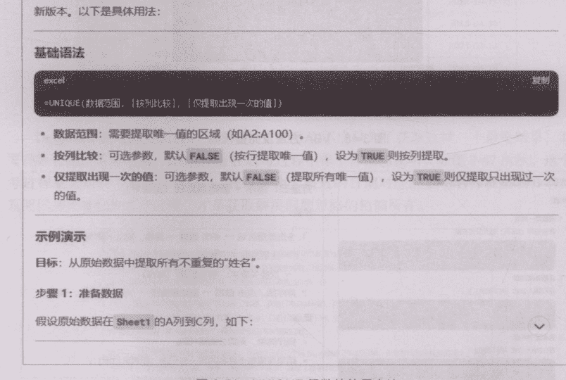

#### 3.3.8 案例 8：对比两个表格并提取正常和异常数据
图3-52所示的是一个简单的例子，要求是对比两个表格，找出两个表格中都存在的数据以及只存在于一个表格中的数据。文件是“对比两个表格并提取正常和异常数据.xlsx”。

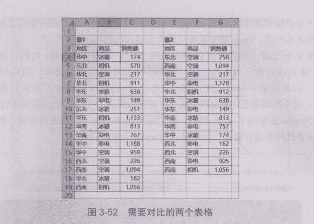

图 3-52 需要对比的两个表格

上传文件，输入提示词：

“请对比两个表格，对比条件是地区和商品，例如，如果同一个地区和同一个商品在两个表格中都存在（不需要考虑销售额），就是两个表格中都存在的数据；如果同一个地区和同一个商品仅仅出现在某个表格中，就是仅存在某个表格中。

注意：严格按照两个表格的原始数据进行检查，不需要修订数据。无论同一个地区同一个商品的销售额是否一致，都应视为共同数据。

请将对比结果生成以下三个表：

（1）两个表格中都存在的数据，并计算数据的差异值；

（2）只存在于表 1 的数据；

（3）只存在于表 2 的数据。”

DeepSeek 会对两个表格进行比较分析，并给出最终结果，如图 3-53 所示。

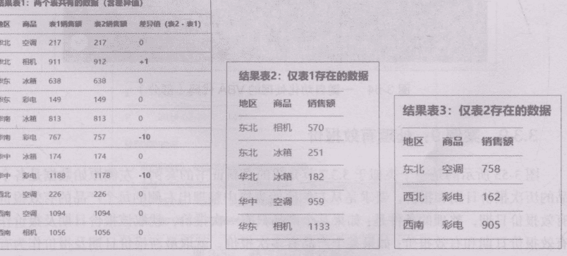

图 3-53 DeepSeek 输出的最终对比结果

在对比分析整理两个甚至多个表格中的数据时，我们一定要说清楚对比的条件。如果条件不清楚或不严谨，DeepSeek 就有可能给出错误的结果。

当数据量很大时，我们可以让 DeepSeek 设计一段自动化 VBA 代码，这样就可以在 Excel 中一键快速处理。输入提示词“这两个表格中的数据量很大，请设计一个自动化 VBA 代码，以便能够一键高效完成对比工作”，DeepSeek 就给出了图 3-54 所示的自动化 VBA 代码。这个代码较长，因为要生成三个对比结果表，图 3-54 仅仅截取了代码开头部分。

即使 DeepSeek 给出了 VBA 代码，我们还是需要对这个代码进行验证。如果处理结果不正确，或者代码本身有错误，就继续让 DeepSeek 修改完善。

```
最后，需要测试代码，确保在各种情况下（如空表、重复键、不同顺序的列）都能正确运行，并生成预期的结果表。

以下是用于自动化对比两个表格的VBA代码，支持一键生成3个结果表，并针对大数据量进行优化：

vba
Sub CompareTablesAutomatically()
    Dim ws1 As Worksheet, ws2 As Worksheet
    Dim result1 As Worksheet, result2 As Worksheet, result3 As Worksheet
    Dim dict1 As Object, dict2 As Object
    Dim lastRow1 As Long, lastRow2 As Long
    Dim key As String
    Dim i As Long, outputRow As Long
    Dim t As Double

    t = Timer
    Application.ScreenUpdating = False
    Application.Calculation = xlCalculationManual

    ' 初始化字典 (Key=地区&商品, Item=销售额)
    Set dict1 = CreateObject("Scripting.Dictionary")
    Set dict2 = CreateObject("Scripting.Dictionary")

    ' 设置工作表对象 (根据实际名称修改)
    Set ws1 = ThisWorkbook.Sheets("Sheet1")
    Set ws2 = ThisWorkbook.Sheets("Sheet2")

    ' 清理旧结果表
    On Error Resume Next
    Sheets("对比结果").Delete
    Sheets("仅表1数据").Delete
    Sheets("仅表2数据").Delete
    On Error GoTo 0

    ' 创建新结果表
    Set result1 = Sheets.Add(After:=Sheets(Sheets.Count))
    result1.Name = "对比结果"
```

图 3-54 一键自动化处理的 VBA 代码（部分）

#### 3.3.9 案例 9：处理有效报价
图 3-55 所示的是一个类似于 3.3.7 节介绍的最新证书的案例，左侧原始数据是各个产品的历次报价日期和报价，要求是从左侧原始表格中整理出右侧的每个产品的有效报价及有效报价日期，整理的条件是：如果某个产品只有一次报价，就取该报价日期及报价作为有效报价日期和有效报价；如果某个产品有多次报价，就取最新报价日期及报价作为有效报价日期和有效报价。文件是“报价处理.xlsx”。

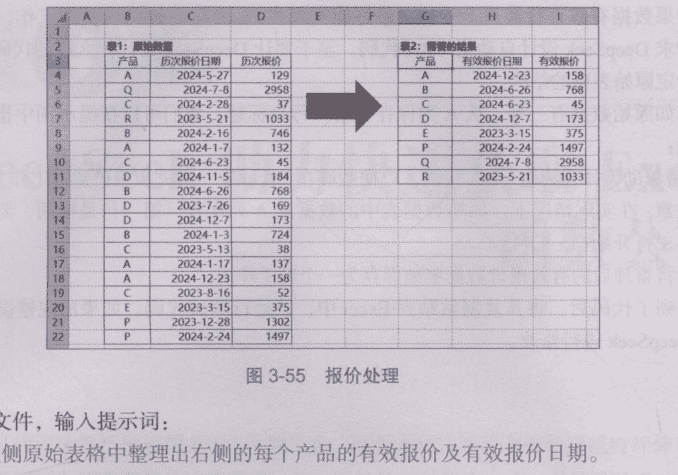

上传文件，输入提示词：

“从左侧原始表格中整理出右侧的每个产品的有效报价及有效报价日期。

有效报价的处理逻辑是：

如果某个产品只有一次报价，就取该报价日期及报价作为有效报价日期和有效报价；

如果某个产品有多次报价，就取最新报价日期及报价作为有效报价日期和有效报价。

请输出整理好的有效报价表格。”

DeepSeek 开始对表格进行系统分析和处理，最后输出我们需要的结果，如图 3-56 所示。

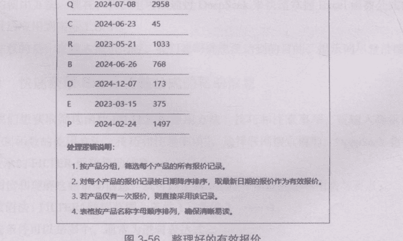

如果数据有数百行甚至上千行，最好能实现在 Excel 中一键完成整理工作，此时我们可以请求 DeepSeek 设计自动化 VBA 代码。至于要让 DeepSeek 设计什么样的代码，需要我们先指定原始表格的结构。

假如原始数据有三列，从 A 列保存，第一行是标题，我们可以在提示词中指定这个具体结构：

> “请帮助设计自动化 VBA 代码，以便能够在 Excel 中一键完成报价整理工作。
> 注意：在实际情况下，原始数据表中的数据从 A 列保存，第一行是标题，要处理的数据从第二行开始；
> 请将整理后的有效报价数据单独保存为一个新工作表。”

得到了代码后，将其复制粘贴到 Excel 中，试运行调试代码。如果出现错误，就继续请求 DeepSeek 进行修改。

## 第 4 章 DeepSeek 助力快速获取 Excel 函数公式

我们可能无法熟练地应用 Excel 函数公式，以至于在实际工作中经常磕磕绊绊地设计公式，或是到网上搜索有关公式来套用，却并不总能真正解决问题，浪费了很多时间，效率低下。现在，我们可以借助 DeepSeek，快速获取函数的使用方法以及针对具体表格快速设计公式的方法，提升日常数据处理的效率。

为了提高获取的速度和效率，我们最好使用 DeepSeek 的联网搜索模型。

### 4.1 DeepSeek 助力快速获取 Excel 函数公式的帮助

以前，我们可以通过查阅 Microsoft Office 的帮助信息来获取 Excel 函数公式的帮助信息，学习函数的使用方法。现在，我们也可以通过 DeepSeek 来快速掌握 Excel 函数公式的使用方法，并灵活应用到实际工作中。

需要注意的是，在输入提示词时，我们要明确想要达到的目的，提示词尽量准确。

#### 4.1.1 快速获取 Excel 函数公式的帮助信息

如果我们想获取筛选函数 FILTER 的使用方法、技巧和注意事项，就输入提示词“请介绍 FILTER 函数的使用方法、技巧和注意事项”，选择联网搜索模型，DeepSeek 会快速给出图 4-1 所示的 FILTER 函数帮助信息。

仔细阅读和理解这些帮助信息，就可以了解 FILTER 函数的基本用法与要点：

- 函数语法：FILTER( 数据范围，条件 1，条件 2，…… )。

- 筛选条件可以是多个，通常为逻辑表达式。

- 如果是多个条件，用逗号分隔。

- 可以结合 OFFSET 函数或 INDIRECT 函数实现动态数据范围筛选。

- FILTER 函数的结果是数组，可在其他函数公式中直接使用。

- 要确保数据范围和条件范围大小一致。

- 若无匹配项，FILTER 函数会返回空数组，需用 IFERROR 处理。

- 大数据集或复杂条件可能影响性能，建议优化条件或减少数据量。

DeepSeek 还给出了一个简单示例，筛选出部门为“销售”同时工资高于 5000 元的数据：

```
=FILTER(A1:C10, B1:B10="销售", C1:C10>5000)
```

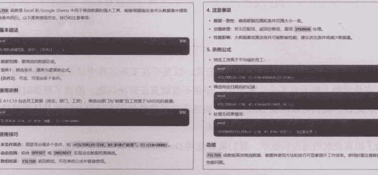

FILTER 函数的关键点是设置筛选条件，尤其是多个筛选条件的组合。如果不清楚如何组合这些筛选条件，可以输入必要的提示词，例如“如果要从员工信息表中筛选出部门是财务部和技术部，学历是硕士和博士，年龄在 35 岁至 45 岁之间的数据，如何设计筛选公式”，DeepSeek 就会给出图 4-2 和图 4-3 所示的回答。

**多条件过滤与分组实操精要**

先把字段位置固定下来，姓名放第1列，部门放第2列，学历放第3列，年龄放第4列，示例表达式如下：

```
=FILTER(A1:D100,
((B1:B100="财务部") + (B1:B100="技术部")),
((C1:C100="硕士") + (C1:C100="博士")),
(D1:D100>=35) * (D1:D100<=45))
```

真正有价值的是对表达式思路的拆解，拆解能帮助理解逻辑组合方式与实现技巧。下面规律很清晰：逻辑与关系用 * 连接，逻辑或关系用 + 连接。部门的两个取值、学历的两个取值属于或关系，所以用 + 拼接；年龄上下限属于与关系，所以用 * 拼接。

要从人员表中挑出部门为财务部或技术部、学历为硕士或博士、且年龄落在35到45岁区间的记录，可借助FILTER配合逻辑运算符完成。具体思路如下：

数据结构概览
- 第1列：姓名
- 第2列：部门
- 第3列：学历
- 第4列：年龄

筛选要求
1. 部门：财务部 或 技术部
2. 学历：硕士 或 博士
3. 年龄：35 ≤ 年龄 ≤ 45

表达式构建
在Excel或Google Sheets中，用FILTER套逻辑运算

```
=FILTER(A1:D100,
((B1:B100="财务部") + (B1:B100="技术部")) *
((C1:C100="硕士") + (C1:C100="博士")) *
((D1:D100>=35) * (D1:D100<=45)))
```

图 4-2 多条件筛选表达式示例

表达式拆解
1. 部门判断：
   (第2列="财务部") + (第2列="技术部")：
   - + 代表或，只要命中其一即算满足。
   - 返回TRUE计1、FALSE计0，相加后不为零即视为命中。

2. 学历判断：
   (第3列="硕士") + (第3列="博士")：
   - 同样以 + 实现或。

3. 年龄判断：
   (第4列>=35) * (第4列<=45)：
   - * 代表与，两个条件必须同时成立。
   - 返回1或0，相乘后不为零即视为命中。

4. 整体组合：
   - FILTER会将各条件计算结果做乘法运算，只有全部为真的行才会被保留。

图 4-3 表达式解析

如果你已听闻GROUPBY很强却不知怎么上手，可以让DeepSeek帮忙。提问请介绍Excel函数GROUPBY的使用方法、技巧和注意事项，开启联网搜索，DeepSeek会给出图4-4至图4-6的说明，包含语法概要、各参数释义、简易示例以及使用要点。

GROUPBY是Excel 365与Excel网页版的新函数，用于按列分组并做聚合，作用类似SQL的GROUP BY，可按指定列分组后对每组应用求和、平均、计数等聚合。

语法概要
=GROUPBY(row_fields, values, function, [field_headers], [total_depth], [sort_order], [filter_array])

- row_fields：分组依据的列，可单列也可多列。
- values：需要聚合的列。
- function：聚合函数，如SUM、AVERAGE、COUNT等。
- [field_headers]：是否保留标题，默认TRUE。
- [total_depth]：是否输出总计行，默认0不输出。
- [sort_order]：排序方式，默认0不排序。
- [filter_array]：筛选条件，默认不过滤。

使用示例
假设表如下：

部门 员工 销售额

销售部 张三 1000

销售部 李四 1500

技术部 王五 800

技术部 赵六 1200

示例1：按部门分组求销售额合计

```
=GROUPBY(A2:A5, C2:C5, SUM)
```

结果：

部门 销售额

销售部 2500

技术部 2000

示例2：按部门分组求销售额均值

```
=GROUPBY(A2:A5, C2:C5, AVERAGE)
```

结果：

部门 平均销售额

销售部 1250

技术部 1000

示例3：按部门和员工分组求销售额合计

```
=GROUPBY(A2:B5, C2:C5, SUM)
```

结果：

部门 员工 销售额

图4-4 GROUPBY函数的语法概要和参数说明

图4-5 GROUPBY函数的应用示例

1. 多列分组：row_fields可为数组，支持多维度分组。
2. 聚合函数：function支持SUM、AVERAGE、COUNT、MIN、MAX等。
3. 总计行：通过total_depth可添加汇总行。
4. 排序：sort_order可设1升序、-1降序。
5. 过滤：filter_array可先过滤再分组聚合。
6. 动态数组：返回结果会自动溢出填充。
7. 适用范围：仅Excel365与网页版可用，旧版不支持。

使用提醒
* 数据范围：row_fields与values的范围要一致，否则易报错。
* 数据类型：values需与聚合函数匹配，例如SUM要求数值。
* 性能：大数据集下可能变慢，建议先小范围测试。

掌握上述用法后，数据分析和汇总会更高效。


#### 4.1.2 针对具体表格，快速获取多个Excel函数表达式解决方案

DeepSeek能快速解释函数用法和注意事项，帮助入门。更关键的是，它可以锻炼逻辑思维，让我们从不同角度看问题，得到不同解法。

比如图4-7是各地各商品销售统计表，要求用表达式查出指定地区、指定商品的数据。文件为快速获取多个函数表达式解决方案.xlsx。

这类问题解法很多，取决于切入点和表达式逻辑。理解每种思路能扩展用法。

|  | A | B | C | D | E | F | G | H |
|---|---|---|---|---|---|---|---|---|
| 1 |  |  |  |  |  |  |  |  |
| 2 |  | 1、基础表格 |  |  |  |  | 2、要求查询数据 |  |
| 3 | 地区 | 彩电 | 冰箱 | 空调 | 合计 |  |  |  |
| 4 | 华北 | 1038 | 1421 | 2005 | 4464 |  | 指定地区： | 华东 |
| 5 | 华南 | 151 | 1816 | 1132 | 3099 |  | 指定商品： | 空调 |
| 6 | 华东 | 769 | 439 | 1448 | 2656 |  |  |  |
| 7 | 西南 | 869 | 128 | 891 | 1888 |  | 销售数据： |  |
| 8 | 西北 | 1373 | 859 | 330 | 2562 |  |  |  |
| 9 | 华中 | 447 | 760 | 780 | 1987 |  |  |  |
| 10 | 东北 | 213 | 687 | 702 | 1602 |  |  |  |
| 11 | 合计 | 4860 | 6110 | 7288 | 18258 |  |  |  |


上传文件后提问请详细列举要查询这个表格中的数据，有多少种解决方案（表达式），DeepSeek的思考结果如图4-8，共列出十种不同函数构建的方案。

当商品为空调时，并非所有表达式都能准确指向D6单元格。用户也可能想了解各方法的优劣，如VLOOKUP只能左到右查找、XLOOKUP更灵活、数组表达式计算效率等。详细列举时需要给出表达式结构并简要说明。

总结可行方案：
1. INDEX-MATCH-MATCH（基础组合）
2. VLOOKUP-MATCH（垂直查找组合）
3. XLOOKUP双查找（新版函数）
4. OFFSET-MATCH（动态偏移）
5. INDIRECT-ADDRESS（间接引用）
6. SUMPRODUCT条件运算（数组运算）
7. 数组表达式（Ctrl+Shift+Enter）
8. FILTER函数（动态数组，Excel365）
9. CHOOSE-MATCH（多区域选择）
10. 名称管理器简化表达式

可逐一构建并验证。例如：


DeepSeek会为每种方案给出表达式及解释。

##### 1. INDEX-MATCH-MATCH（基础组合）

联合INDEX与MATCH的表达式如图4-9，逻辑是先用MATCH分别定位地区行号和商品列号，再用INDEX取交叉值。

```
=INDEX(B4:D10, MATCH(H4, A4:A10, 0), MATCH(H5, B3:D3, 0))
```

思考：该表达式的切入点是什么？优点在哪？


此表达式能带动对MATCH与INDEX的深入学习。

例如提问请问如何使用MATCH函数，要注意哪些问题，DeepSeek会给出语法、示例与使用提醒，如图4-10与图4-11。

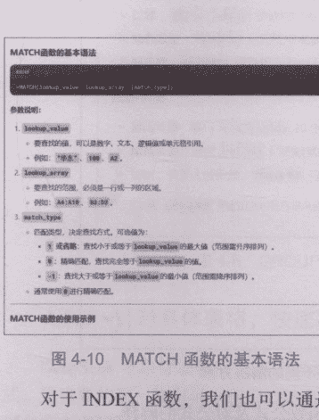

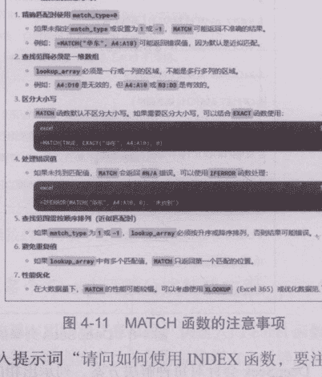

图4-10 MATCH函数的基础语法

图4-11 MATCH函数的使用提醒

同理，可提问请问如何使用INDEX函数，要注意哪些问题获取其语法、示例与使用提醒。

##### 2. VLOOKUP-MATCH（垂直查找组合）

联合VLOOKUP与MATCH的表达式如图4-12，逻辑是先用MATCH找到指定商品的列号作为VLOOKUP的列参数，再用VLOOKUP取出对应地区的数据。

```
=VLOOKUP(H4, A4:D10, MATCH(H5, B3:D3, 0)+1, 0)
```

思考：该表达式的切入点是什么？优点在哪？


图4-12 VLOOKUP-MATCH（垂直查找组合）解决方案

##### 3. XLOOKUP双查找（新版函数）

用XLOOKUP的表达式如图4-13，逻辑是先用XLOOKUP取出指定商品整列数据，再把该数组作为另一个XLOOKUP的查找值参数。

```
=XLOOKUP(H4, A4:A10, XLOOKUP(H5, B3:D3, B4:D10))
```

思考：该表达式的切入点是什么？优点在哪？


若不熟悉XLOOKUP，可继续提问请问如何使用XLOOKUP函数，要注意哪些问题？请结合示例详细介绍获取详细用法。

##### 4. OFFSET-MATCH（动态偏移）

联合OFFSET与MATCH的表达式如图4-14，逻辑是先用MATCH确定地区行位置和商品列位置，再用OFFSET从基准单元格偏移到交叉位置取值。

```
=OFFSET(B3, MATCH(H4, A4:A10, 0), MATCH(H5, B3:D3, 0)-1)
```


对OFFSET不熟悉时，可提问请问如何使用OFFSET函数，要注意哪些问题？请结合示例详细介绍，得到如图4-15的帮助信息。

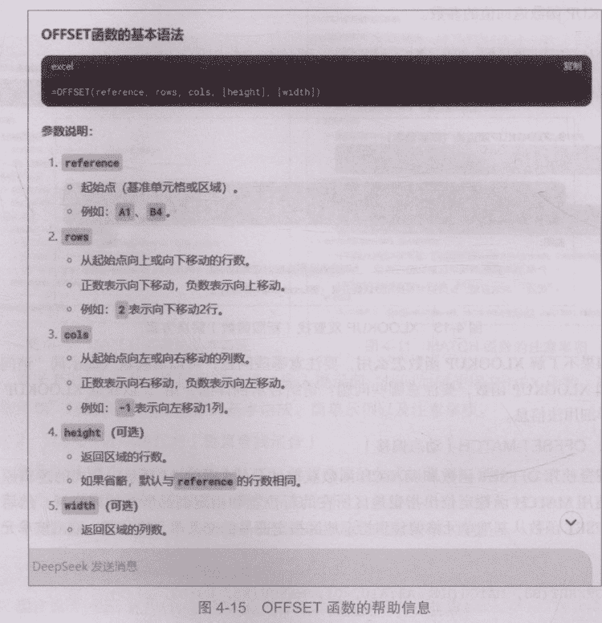

##### 5. INDIRECT-ADDRESS（间接引用）

联合INDIRECT与ADDRESS的表达式如图4-16，逻辑是先用MATCH定位行列，再用ADDRESS生成目标单元格地址字符串，最后用INDIRECT间接引用取值。

```
=INDIRECT(ADDRESS(MATCH(H4, A4:A10, 0)+3, MATCH(H5, B3:D3, 0)+2))
```

该表达式效率不高且不易读，但有助于学习INDIRECT与ADDRESS。

表达式：

```
=INDIRECT(ADDRESS(MATCH(H4, A4:A10, 0)+3, MATCH(H5, B3:D3, 0)+2))
```

说明：
- 通过ADDRESS生成目标地址，行号需+3、列号需+2，因数据从第4行B列开始。
- 缺点：硬编码偏移，区域变动时需调整。

图4-16 INDIRECT-ADDRESS（间接引用）解决方案

不了解INDIRECT时，可提问请问如何使用INDIRECT函数，要注意哪些问题？请结合示例详细介绍获取帮助。

##### 6. SUMPRODUCT条件运算（数组运算）

用SUMPRODUCT的表达式如图4-17，逻辑是查找值是数字，可构造判断条件，将条件数组与求和区域相乘，得到0与真实值的数组，再用SUMPRODUCT求和即可得到指定交叉值。

```
=SUMPRODUCT((A4:A10=H4)*(B3:D3=H5)*B4:D10)
```

表达式：

```
=SUMPRODUCT((A4:A10=H4)*(B3:D3=H5)*B4:D10)
```

说明：
- 将地区匹配行与商品匹配列相乘后求和，仅在唯一匹配时有效。
- 限制：匹配不唯一会得到错误合计。

图4-17 SUMPRODUCT条件运算（数组运算）解决方案

如何使用SUMPRODUCT？注意点？何种原因导致错误？大数据下性能如何？可向DeepSeek提问获取答案。

##### 7. 数组表达式（Ctrl+Shift+Enter）

用数组表达式的方案如图4-18，逻辑较复杂，但能拓展思路。

```
=INDEX(B4:D10, MATCH(1, (A4:A10=H4)*1, 0), MATCH(1, (B3:D3=H5)*1, 0))
```

表达式：

```
=INDEX(B4:D10, MATCH(1, (A4:A10=H4)*1, 0), MATCH(1, (B3:D3=H5)*1, 0))
```

说明：
- 用数组运算定位行列，需按Ctrl+Shift+Enter输入（旧版Excel）。
- 注意：复杂度高，但兼容性好。

图4-18 数组表达式（Ctrl+Shift+Enter）解决方案

关于数组表达式的创建、使用提醒、错误修改、删除等，可继续向DeepSeek咨询。

##### 8. FILTER函数（动态数组，Excel365）

用FILTER的表达式如图4-19，原理是先用FILTER筛选出指定地区的行数据，再用INDEX从行数据中提取指定商品的值，商品位置由MATCH定位。

```
=INDEX(FILTER(B4:D10, A4:A10=H4), , MATCH(H5, B3:D3, 0))
```

公式：

```
=INDEX(FILTER(B4:D10, A4:A10=H4), , MATCH(H5, B3:D3, 0))
```

说明：

- 先限定到目标地区所在的行，再依靠 INDEX 抓取对应商品列的数值。
- 优势在于能叠加多个筛选条件，表达方式也很精简。

图 4-19 FILTER 函数（动态数组，Excel 365）解决方案

##### 9. CHOOSE-MATCH（多区域选择）

图 4-20 给出了 CHOOSE 与 MATCH 组合的写法。整体思路比较绕，更多是作为思路参考，实操中很少会采用。

```
=CHOOSE(MATCH(H5, B3:D3, 0), INDEX(B4:B10, MATCH(H4, A4:A10, 0)), INDEX(C4:C10, MATCH(H4, A4:A10, 0)), INDEX(D4:D10, MATCH(H4, A4:A10, 0)))
```

公式：

```
=CHOOSE(MATCH(H5, B3:D3, 0), INDEX(B4:B10, MATCH(H4, A4:A10, 0)), INDEX(C4:C10, MATCH(H4, A4:A10, 0)), INDEX(D4:D10, MATCH(H4, A4:A10, 0)))
```

说明：

- 先根据商品列的序号用 CHOOSE 锁定对应的列区间，再用 MATCH 定位地区所在的行号。
- 弊端是表达式较长，适合列数不多的场景。

图 4-20 CHOOSE-MATCH（多区域选择）解决方案

##### 10. 名称管理器简化公式

此法借助定义名称把常用区域固定下来，再拼接公式，维护起来更方便，示例如图 4-21。

这里顺带涉及名称管理的知识点：名称的含义、创建方式、在公式里调用、修改删除操作，以及能解决的实际问题。不熟悉的话可以继续向 DeepSeek请教。

步骤：

1. 定义名称：地区范围=A4:A10，商品范围=B3:D3，数据区域=B4:D10。
2. 公式：
```
=INDEX(数据区域, MATCH(H4, 地区范围, 0), MATCH(H5, 商品范围, 0))
```

图 4-21 名称管理器简化公式解决方案

DeepSeek 对前述思路做了归纳，如图 4-22，方便在不同场景下挑选合适的方案。

| 方法 | 优点 | 缺点 |
| :--- | :--- | :--- |
| INDEX-MATCH-MATCH | 灵活高效，兼容性强 | 需要理解行列匹配逻辑 |
| VLOOKUP-MATCH | 简单直观 | 依赖左侧首列，无法逆向查找 |
| XLOOKUP | 支持双向查找，语法简洁 | 仅适用于新版Excel |
| SUMPRODUCT | 无嵌套函数，适合简单场景 | 需唯一匹配，否则结果错误 |
| FILTER | 动态数组，扩展性强 | 仅Excel 365支持 |
| 根据Excel版本、数据结构和需求复杂度选择最适合的方案。推荐优先使用 INDEX-MATCH 或 XLOOKUP（新版）。 | | |

图 4-22 DeepSeek 对解决方案的总结

除上面列出的写法外，HLOOKUP、LOOKUP 等也能实现类似查找。若想获取更多备选，可输入提示“针对这个表格的数据查找问题，还有其他的解决方案吗？如果有，请列示详细公式及其说明”，结果如图 4-23。


### 4.2 用 DeepSeek 实战拿公式

上一小节演示了如何借助 DeepSeek 获取公式并掌握使用技巧。本节提供几个实操案例，让模型直接输出所需公式。若公式不够精炼，可要求进一步优化。

#### 4.2.1 案例 1：基础表格拿基础公式

对基础表单的计算或简单汇总的查询，熟悉函数可以直接写，不熟悉则可让 DeepSeek 快速给出可用公式。

第 3 章曾用 DeepSeek 求出身份证提取出生日期和性别的公式，这里再演练一次。

选用联网搜索模型，输入提示“假如单元格 E3 是身份证号码，如何根据身份证号码自动提取出性别、出生日期和年龄？要求：公式要短、函数少、运算快”，并强调“必须给出一个精炼简洁且短的公式”，否则返回的可能不是最优解。DeepSeek 给出的参考如图 4-24。


不过出生日期部分有问题，TEXT 返回的是文本型日期而非数值，会影响后续统计。追加提示“提取出生日期的公式是错误的，因为公式结果是文本型日期，并不是数值型日期。请修改这个公式”，得到图 4-25 的版本。


该版本解决了类型问题，但仍不够紧凑。继续追问“请修改 TEXT 函数，以满足结果是数值型日期的要求”，得到更简洁的写法，如图 4-26。至此，身份证号提取性别、出生日期和年龄的完整公式如下：
```
出生日期：=DATEVALUE(TEXT(MID(D2,7,8),"0000-00-00"))
性别：=IF(MOD(MID(D2,17,1),2)=1," 男 "," 女 ")
年龄：=DATEDIF(DATEVALUE(TEXT(MID(D2,7,8),"0000-00-00")),TODAY(),"y")
```


实际上还能更简洁。性别可用 ISEVEN 或 ISODD 判断奇偶；Excel 中文本型日期参与计算时可以直接使用；日期本质是序列号，TEXT 生成的文本日期本质是文本数字，按规则可直接参与运算，乘以 1 也能转回数值。因此最简写法如下：
```
出生日期：=1*TEXT(MID(D2,7,8),"0000-00-00")
性别：=IF(ISODD(MID(D2,17,1))," 男 "," 女 ")
年龄：=DATEDIF(TEXT(MID(D2,7,8),"0000-00-00"),TODAY(),"y")
```

这个例子说明，没有 Excel 基础仅靠复制 DeepSeek 公式只能套用，难以理解原理。只有在掌握基础技能的前提下，DeepSeek 才能如虎添翼。

#### 4.2.2 案例 2：复杂表格拿复杂公式

态查找数据.xlsx。

| A | B | C | D | E | F | G | H | I | J | K | L | M | N | O | P | Q |
|---|---|---|---|---|---|---|---|---|---|---|---|---|---|---|---|---|
| 1 | 销售汇总表 | | | | | | | | | | | | | | 2. 分析报告 |
| 2 | 地区 | 产品 | 2022年 | | | | 2023年 | | | | 2024年 | | | | 指定地区 | 合计 |
| 3 | | | 1季度 | 2季度 | 3季度 | 4季度 | 1季度 | 2季度 | 3季度 | 4季度 | 1季度 | 2季度 | 3季度 | 4季度 | 指定产品 | 产品05 |
| 4 | 华北 | 产品03 | 1649 | 1793 | 336 | 1209 | 2386 | 984 | 2542 | 1149 | 2248 | 2416 | 2648 | 417 | 指定季度 | 3季度 |
| 5 | | 产品01 | 2486 | 2266 | 2282 | 1580 | 1858 | 1743 | 1500 | 1302 | 1300 | 1517 | 2928 | 2143 | | |
| 6 | | 产品04 | 563 | 336 | 2962 | 1747 | 698 | 744 | 2646 | 1302 | 875 | 2541 | 1728 | 2615 | | |
| 7 | | 产品02 | 2336 | 582 | 2476 | 965 | 623 | 2232 | 1831 | 526 | 856 | 2258 | 2638 | 337 | | |
| 8 | | 产品05 | 2219 | 1048 | 2613 | 829 | 2736 | 1119 | 2027 | 2347 | 501 | 1119 | 1450 | 2925 | | |
| 9 | 华东 | 产品01 | 337 | 1132 | 954 | 869 | 1858 | 1996 | 773 | 428 | 994 | 3003 | 2385 | 2631 | 年份 | 销售 |
| 10 | | 产品02 | 2940 | 2224 | 1321 | 2537 | 318 | 2728 | 2063 | 1692 | 714 | 2296 | 1392 | 965 | 2022年 | |
| 11 | | 产品03 | 70 | 2181 | 1589 | 741 | 854 | 907 | 1804 | 2725 | 256 | 2094 | 1765 | 2982 | 2023年 | |
| 12 | | 产品04 | 2306 | 1855 | 2540 | 1347 | 1894 | 2211 | 1940 | 1744 | 781 | 2629 | 1765 | 1770 | 2024年 | |
| 13 | 华南 | 产品02 | 2722 | 346 | 2033 | 942 | 564 | 1154 | 2171 | 1394 | 2050 | 1972 | 2542 | 2457 | | |
| 14 | | 产品05 | 2003 | 1870 | 1649 | 834 | 895 | 2053 | 862 | 2326 | 762 | 2681 | 1865 | 1142 | | |
| 15 | | 产品03 | 2007 | 2571 | 2049 | 1562 | 2344 | 1220 | 2857 | 2296 | 443 | 1647 | 484 | 889 | | |
| 16 | | 产品01 | 2306 | 2071 | 2601 | 1918 | 2874 | 822 | 1653 | 2034 | 1850 | 750 | 2423 | 2793 | | |
| 17 | | 产品04 | 885 | 1624 | 2919 | 704 | 2589 | 1763 | 1052 | 446 | 388 | 2711 | 1273 | 1320 | | |
| 18 | 华中 | 产品01 | 1080 | 1121 | 1599 | 2495 | 704 | 1379 | 992 | 650 | 1584 | 1637 | 1306 | 2230 | | |
| 19 | | 产品02 | 2849 | 1624 | 2919 | 704 | 2589 | 1763 | 1052 | 446 | 388 | 2711 | 1273 | 1320 | | |
| 20 | | 产品03 | 2242 | 1525 | 907 | 1376 | 699 | 638 | 1030 | 836 | 2796 | 586 | 412 | 2067 | | |
| 21 | | 产品04 | 1471 | 2181 | 1520 | 1137 | 2720 | 1410 | 1029 | 1074 | 2354 | 3015 | 2200 | 1024 | | |
| 22 | 合计 | 产品01 | 4271 | 5570 | 5471 | 4274 | 3292 | 3673 | 4177 | 4878 | 3509 | 3750 | 5903 | 7355 | | |
| 23 | | 产品02 | 6540 | 8091 | 8003 | 4274 | 6074 | 7637 | 7116 | 4878 | 2888 | 9337 | 8773 | 7262 | | |
| 24 | | 产品03 | 6858 | 8113 | 4613 | 6684 | 6747 | 4570 | 7492 | 5973 | 6201 | 6945 | 4936 | 4338 | | |
| 25 | | 产品04 | 4010 | 6252 | 4408 | 3891 | 5312 | 2537 | 5615 | 5120 | 4010 | 8185 | 4993 | 5409 | | |
| 26 | | 产品05 | 4222 | 2918 | 3978 | 1663 | 3631 | 3172 | 2889 | 4673 | 1263 | 3800 | 3315 | 4067 | | |
| 27 | | 产品06 | 5155 | 3695 | 3869 | 2622 | 5463 | 2585 | 2705 | 2480 | 2238 | 3461 | 3696 | 4113 | | |

图 4-27 根据指定地区、指定产品和指定季度查找每年的数据

这是由地区、产品、季度、年份四个条件构成的查找问题。思路很清晰：先确定行位置，再确定列位置。难点在于 A 栏地区采用合并单元格，且每个地区下产品的数量和顺序各不相同。解决这两个问题后公式即可成型。

选用深度思考模型，上传文件，DeepSeek 会先对表格进行分析并输出一些信息，可忽略。然后输入提示词：
> “根据左侧表 1 中的数据，根据指定地区（单元格 Q4）、指定产品（单元格 Q5）和指定季度（单元格 Q6），查找各年数据，分别保存在单元格 Q9 至 Q11 中。
注意：单元格 Q4 至 Q6 的地区、产品和季度是变量，可以指定任意地区、任意产品和任意季度。
注意：地区在 A 列，从第五行开始，每个地区下的产品不尽相同（产品个数不同以及次序不同），并且地区是合并单元格。
注意：产品在 B 列，从第五行开始。
注意：年份在第三行，季度在第四行。
请根据左侧的实际数据区域来设计公式，公式要简洁，运算速度快。”

DeepSeek 会推理并给出图 4-28 的参考公式，以及图 4-29 的解析和图 4-30 的使用注意事项。

三个公式分别如下。
单元格 Q9。
```
=INDEX(
    $C$5:$Q$100,
    MATCH(1, (LOOKUP(ROW($A$5:$A$100), ROW($A$5:$A$100)/($A$5:$A$100<>""), $A$5:$A$100)=$Q$4) * ($B$5:$B$100=$Q$5), 0),
    MATCH("2022年", $C$3:$Q$3, 0) + LEFT($Q$6, 1) -1
)
```
单元格 Q10。
```
=INDEX(
    $C$5:$Q$100,
    MATCH(1, (LOOKUP(ROW($A$5:$A$100), ROW($A$5:$A$100)/($A$5:$A$100<>""), $A$5:$A$100)=$Q$4) * ($B$5:$B$100=$Q$5), 0),
    MATCH("2023年", $C$3:$Q$3, 0) + LEFT($Q$6, 1) -1
)
```
单元格 Q11。
```
=INDEX(
    $C$5:$Q$100,
    MATCH(1, (LOOKUP(ROW($A$5:$A$100), ROW($A$5:$A$100)/($A$5:$A$100<>""), $A$5:$A$100)=$Q$4) * ($B$5:$B$100=$Q$5), 0),
    MATCH("2024年", $C$3:$Q$3, 0) + LEFT($Q$6, 1) -1
)
```

核心在于处理 A 栏合并单元格，即把每个地区下的空单元格都补上地区名称，填充公式如下。
```
LOOKUP(ROW($A$5:$A$100), ROW($A$5:$A$100)/($A$5:$A$100<>""), $A$5:$A$100)
```

这是一个实用技巧，不必在工作表里先取消合并再填充，而是用 LOOKUP 公式处理 A 栏数据，生成一个完整的地区序列。

公式实现：
Q9（2022年数据）：

```
=INDEX(
    $C$5:$Q$100,
    MATCH(1, (LOOKUP(ROW($A$5:$A$100), ROW($A$5:$A$100)/($A$5:$A$100<>""), $A$5:$A$100)=$Q$4) * ($B$5:$B$100=$Q$5), 0),
    MATCH("2022年", $C$3:$Q$3, 0) + LEFT($Q$6, 1) -1
)
```

Q10（2023年数据）：

```
=INDEX(
    $C$5:$Q$100,
    MATCH(1, (LOOKUP(ROW($A$5:$A$100), ROW($A$5:$A$100)/($A$5:$A$100<>""), $A$5:$A$100)=$Q$4) * ($B$5:$B$100=$Q$5), 0),
    MATCH("2023年", $C$3:$Q$3, 0) + LEFT($Q$6, 1) -1
)
```

Q11（2024年数据）：

```
=INDEX(
    $C$5:$Q$100,
    MATCH(1, (LOOKUP(ROW($A$5:$A$100), ROW($A$5:$A$100)/($A$5:$A$100<>""), $A$5:$A$100)=$Q$4) * ($B$5:$B$100=$Q$5), 0),
    MATCH("2024年", $C$3:$Q$3, 0) + LEFT($Q$6, 1) -1
)
```

图 4-28 DeepSeek 给出的参考公式

结构拆解：

1. 合并单元格补全：
   - LOOKUP(ROW($A$5:$A$100), ROW(...)/(条件), $A$5:$A$100)
     利用行号回溯实现地区名称的向下继承，比如 A5 填“华北”，A6~A8 都会呈现“华北”。

2. 行定位思路：
   - MATCH(1, (地区=Q4)*(产品=Q5), 0)
     把两个布尔判断相乘，锁定同时满足地区与产品的唯一行号。

3. 列定位思路：
   - MATCH("2022年", $C$3:$Q$3, 0) 在第3行找到年份起点，如2022年在C3。
   - LEFT($Q$6,1)-1 从“2季度”抽取数字2，再以年份起点向右偏移一列到D。

4. 范围收敛：
   - 限定 $C$5:$Q$100，避免全列扫描，提升响应。

图 4-29 对公式的解析

操作提示：

1. 输入方式：
   - 旧版Excel需按 Ctrl+Shift+Enter 结束数组输入。
   - 新版直接回车即可，利用动态数组。

2. 范围扩展：
   - 数据超100行时，把 $C$5:$Q$100 改为实际区间，如 $C$5:$Q$200。

3. 错误排查：
   - 出现 #N/A 时核查：
     - 地区与产品的组合是否真实存在，如“华东+产品03”。
     - 季度写法是否严格为“X季度”，不可写成“第二季度”。
   - 可用 IFERROR 包裹给出友好提示：

```
=IFERROR(原公式, "无数据")
```

功能亮点：

- 运算更快：限定区间，减少全表遍历。
- 对齐更准：严格参照第3行年份、第4行季度表头。
- 适配更强：任意地区、产品、季度组合均可自动生效。

把三段表达式填入对应单元格，即可实现动态检索，如图4-31。随意切换条件检验结果即可。

若对LOOKUP底层原理不熟，可提问：“请解释表达式 LOOKUP(ROW($A$5:$A$100), ROW($A$5:$A$100)/($A$5:$A$100<>""), $A$5:$A$100) 的逻辑原理”。DeepSeek 会逐步拆解，如图4-32，有助加深理解。

## 第 4 章 用 DeepSeek 迅速生成 Excel 计算式

本例说明，获取正确计算式的关键在于把表格结构与筛选条件完整告知模型。

#### 4.2.3 明细表驱动汇总报表构建

实践中常需把原始明细转为汇总视图，此时要把源表结构、计算规则与目标样式说清楚。

图4-33 左侧为系统导出的销售明细，A列日期为非法格式，F列金额为文本，要求直接在原表上算出右侧报表，不允许新增辅助列。

文件为“从基础表单到分析报表的汇总计算.xlsx”。

上传后输入提示：

> “请根据左侧的基础表单，设计函数公式，制作右侧的统计报表。表格具体情况和计算条件如下：
> 日期在 A 列，但是是非法日期，需要从非法日期中提取星期名称，与报表中 I 列的星期名称进行匹配，不允许设计辅助列，要直接根据 A 列匹配判断星期；
> 产品名称在 D 列，需要匹配指定的关键词，例如，计算咖啡类的金额，只要 D 列含有‘咖啡’就认定是咖啡类。
> 注意：F 列的金额是文本型数字，要在公式中进行处理。
> 注意：报表的列标题次序是任意的，不是一个固定的次序。
> 要求：设计一个简洁高效的通用公式，在单元格 J3 输入公式后，可以往右、往下复制、得到全部公式。
> 首选方案是使用 SUMPRODUCT 函数。”

模型会返回参考式，如图4-34，并说明核心思路。

```
=SUMPRODUCT(
    (TEXT(IFERROR(DATEVALUE(SUBSTITUTE($A$2:$A$9999,".","/")),""),"aaaa")=$I3) *
    ISNUMBER(SEARCH(J$2,$D$2:$D$9999)) *
    VALUE($F$2:$F$9999)
)
```

把式子粘贴到 Excel，横向纵向复制后即可得到完整报表，如图4-35，再自行校验。

## 第 4 章 用 DeepSeek 迅速生成 Excel 计算式

图 4-35 完成的统计报表

该案例提示：让模型撰写式子，必须把源数据特征与报表特征讲透，并说明偏好函数。

提示里明确 A 列为非法日期且不可加辅助列；F 列为文本数字需在式内转换；报表列顺序不固定。

若不说明这些细节，模型会按常规写法给出错误式子，如图4-36。

模型给出的式子里数据区写到 9999 行，可按实际改为 1000 行等。

若希望式子随数据量自动伸缩，可问“请将公式修改为能够自动调整为实际数据区域行数的自动化公式”，模型会给出自适应版本，速度更快且通用，如图4-37。

```
=SUMPRODUCT(
    (TEXT(DATEVALUE(SUBSTITUTE(A2:INDEX(A:A,COUNTA(A:A)),".","/"))+0,"aaaa")=I3)
    *ISNUMBER(FIND(J$2, D2:INDEX(D:D, COUNTA(A:A))))
    * (F2:INDEX(F:F, COUNTA(A:A))+0)
)
```

1. 动态范围适配（数据量经常变化时）：

```
=SUMPRODUCT(
    (TEXT(DATEVALUE(SUBSTITUTE(A2:INDEX(A:A, COUNTA(A:A)), "/", "/"))+0, "aaaa")=I3)
    *ISNUMBER(FIND(J$2, D2:INDEX(D:D, COUNTA(A:A))))
    * (F2:INDEX(F:F, COUNTA(A:A))+0)
)
```

图 4-37 能够自动调整为实际数据区域的自动化公式

#### 4.2.4 跨工作表构建统计式

此前为同表内式子。若原始表与报表在不同工作表，如何让模型生成式子？

图4-38 文件“员工信息统计报告.xlsx”含“基本信息表”和“统计报告表”，要求基于前者制作后者。

上传文件，输入提示：

> “已知条件：原始数据表‘基本信息’和分析表‘统计报告’。
> 要求：在统计报告表第六行设计各列公式，根据基本信息表中的数据，计算各个部门各个分类下的人数。
> 注意：公式要简单高效。”

模型给出的计算式如图4-39。

## 第 4 章 用 DeepSeek 迅速生成 Excel 计算式

解决方案：

在“统计报告”工作表的第6行（人力资源部）各列设置以下公式，基于“基本信息”表动态统计人数：

```
B6 总人数 =COUNTIFS(基本信息!B:B, A6)
C6 男 =COUNTIFS(基本信息!B:B, A6, 基本信息!C:C, "男")
D6 女 =COUNTIFS(基本信息!B:B, A6, 基本信息!C:C, "女")
E6 博士 =COUNTIFS(基本信息!B:B, A6, 基本信息!D:D, "博士")
F6 硕士 =COUNTIFS(基本信息!B:B, A6, 基本信息!D:D, "硕士")
G6 本科 =COUNTIFS(基本信息!B:B, A6, 基本信息!D:D, "本科")
H6 专科 =COUNTIFS(基本信息!B:B, A6, 基本信息!D:D, "专科")
I6 高中 =COUNTIFS(基本信息!B:B, A6, 基本信息!D:D, "高中")
J6 初中 =COUNTIFS(基本信息!B:B, A6, 基本信息!D:D, "初中")
K6 30岁以下 =COUNTIFS(基本信息!B:B, A6, 基本信息!G:G, "<30")
L6 31-40岁 =COUNTIFS(基本信息!B:B, A6, 基本信息!G:G, ">=31", 基本信息!G:G, "<=40")
M6 41-50岁 =COUNTIFS(基本信息!B:B, A6, 基本信息!G:G, ">=41", 基本信息!G:G, "<=50")
N6 50岁以上 =COUNTIFS(基本信息!B:B, A6, 基本信息!G:G, ">50")
```

式子说明：

1. 主干函数：全部使用 COUNTIFS 函数，支持多条件统计，高效且简洁。
2. 部门对应：A6 为当前行的部门名称（如“人力资源部”），式子会自动引用对应部门。
3. 动态年龄分段：直接引用“基本信息”表的年龄列（G列），无需额外计算。
4. 可扩展性：将式子向下拖动填充至其他部门行（如财务部、生产部），A6 会自动调整为 A7、A8 等，实现批量统计。

图 4-39 DeepSeek 给出的计算公式

每个单元格式子相同，逐个输入效率低。可在性别列和学历列先做一个通用式子，以统计报告表第五行的标题作为变量，再横向复制。

让模型简化，输入提示：“请分别对性别列和学历列设计一个通用公式，使用统计报告表中第五行的标题作为变动条件”，模型会给出动态写法及使用说明，如图4-40。

性别通用公式（动态匹配第5行标题）

适用列：C列（男）、D列（女）

公式：

```
=COUNTIFS(基本信息!B:B, $A6, 基本信息!C:C, C$5)
```

说明：

- $A6：固定部门列（A列），行随当前行变化。
- C$5：固定第5行的性别标题（如“男”或“女”），列随当前列变化。
- 拖动填充：将公式向右拖动到其他性别列（如D列），自动匹配标题。

学历通用公式（动态匹配第5行标题）

适用列：E列（博士）、F列（硕士）、G列（本科）、H列（专科）、I列（高中）、J列（初中）

公式：

```
=COUNTIFS(基本信息!B:B, $A6, 基本信息!D:D, E$5)
```

说明：

- $A6：固定部门列（A列），行随当前行变化。
- E$5：固定第5行的学历标题（如“博士”或“硕士”），列随当前列变化。
- 拖动填充：将公式向右拖动到所有学历列，自动匹配标题。

图 4-40 性别列和学历列的通用公式

若一开始就给出完整提示，可一步到位设计所有分类式子，如图4-41。

> “已知条件：原始数据表‘基本信息’和分析表‘统计报告’。
> 要求：在统计报告表第六行设计各列公式，根据基本信息表中的数据，计算各个部门、各个分类下的人数。
> 注意：公式要简单高效。
> 特别说明：性别列和学历列的公式，可以使用统计报告表中第五行的标题作为变动条件。”

#### 4.2.5 跨文件汇总式生成

若源数据在一个文件，报表在另一个文件，传统做法是同时打开两个文件再引用。现在可用模型快速生成跨文件式子。

图4-42 为“01 销售明细表.xlsx”，图4-43 为“02 销售统计报告.xlsx”。

## 第 4 章 用 DeepSeek 迅速生成 Excel 计算式

先选深度思考模型，上传两个文件，如图4-44。

输入提示（路径按实际改）：

“请依据 Excel 文件 ‘01 销售明细表.xlsx’ 中的数据，制作 Excel 文件 ‘02 销售统计报告.xlsx’ 中的两个报告，设计汇总计算公式。
- 注意：统计报告的起始单元格是第五行。
另外，两个 Excel 文件都保存在文件夹 “D:\年度分析\销售分析\” 中，引用公式中需要带有完整路径。”

发送后，模型自动给出两个统计表的计算公式，如图4-45 和图4-46。

02销售统计报告.xlsx 公式设计（含完整路径）

报告1：客户销售汇总报告

起始单元格：第5行

| 列名 | 公式 | 说明 |
| :--- | :--- | :--- |
| 销售额 | =SUMIFS('D:\年度分析\销售分析\[01销售明细表.xlsx]Sheet1'!$G:$G, 'D:\年度分析\销售分析\[01销售明细表.xlsx]Sheet1'!$B:$B, A5) | 按客户简称汇总销售额 |
| 销售成本 | =SUMIFS('D:\年度分析\销售分析\[01销售明细表.xlsx]Sheet1'!$H:$H, 'D:\年度分析\销售分析\[01销售明细表.xlsx]Sheet1'!$B:$B, A5) | 按客户简称汇总销售成本 |
| 毛利 | =SUMIFS('D:\年度分析\销售分析\[01销售明细表.xlsx]Sheet1'!$I:$I, 'D:\年度分析\销售分析\[01销售明细表.xlsx]Sheet1'!$B:$B, A5) | 按客户简称汇总总毛利 |
| 毛利率 | =IFERROR(D5/B5, 0) (设置单元格格式为百分比) | 毛利率 = 毛利 / 销售额 |

图 4-45 客户销售汇总报告的计算公式

报告2：产品销售汇总报告

起始单元格：第5行

| 列名 | 公式 | 说明 |
| :--- | :--- | :--- |
| 销量 | =SUMIFS('D:\年度分析\销售分析\[01销售明细表.xlsx]Sheet1'!$F:$F, 'D:\年度分析\销售分析\[01销售明细表.xlsx]Sheet1'!$E:$E, G5) | 按产品名称汇总总销量 |
| 销售额 | =SUMIFS('D:\年度分析\销售分析\[01销售明细表.xlsx]Sheet1'!$G:$G, 'D:\年度分析\销售分析\[01销售明细表.xlsx]Sheet1'!$E:$E, G5) | 按产品名称汇总总销售额 |
| 销售成本 | =SUMIFS('D:\年度分析\销售分析\[01销售明细表.xlsx]Sheet1'!$H:$H, 'D:\年度分析\销售分析\[01销售明细表.xlsx]Sheet1'!$E:$E, G5) | 按产品名称汇总总销售成本 |
| 毛利 | =SUMIFS('D:\年度分析\销售分析\[01销售明细表.xlsx]Sheet1'!$I:$I, 'D:\年度分析\销售分析\[01销售明细表.xlsx]Sheet1'!$E:$E, G5) | 按产品名称汇总总毛利 |
| 毛利率 | =IFERROR(K5/I5, 0) (设置单元格格式为百分比) | 毛利率 = 毛利 / 销售额 |

图 4-46 产品销售汇总报告的计算公式

打开两个文件，把上述式子复制到对应单元格即可生成报表。

注意：在报表文件中输入式子时，源数据文件必须保持打开，否则会弹出文件选择对话框，取消后单元格会报错。全部式子输入完后再关闭源文件即可。

## 第 4 章 用 DeepSeek 迅速生成 Excel 计算式

当原始数据文件和汇总报表文件在 Excel 中同时激活，跨表引用便可省去全路径的书写。若希望模型提供精简版公式，可以这样询问：“源表和报表都已打开，该公式能否简化？如果可以，请输出完整可用的写法”。模型随后会呈现类似图 4-47 的精简版本，并附带图 4-48 中说明的简化思路与使用注意点。


为了减少失误并更快得到准确的计算式，建议先依据模型解释的简化逻辑，让原始数据文件和汇总报表文件同时处于打开状态，再采用省略路径的精简写法。

## 第 5 章 DeepSeek 驱动的工作表批量汇总

汇总表是日常数据处理中的常见任务。原始表的结构差异很大，对汇总结果的预期也不尽相同，因此选用的方法和工具也会随之变化。本章结合实战案例，介绍如何借助 DeepSeek 高效汇总大量工作表。

### 5.1 轻量表格的快速合并汇总

结构相对简单的表格，DeepSeek 通常可以直接完成汇总并输出完整的合并结果，无需另行寻找专门的方法与工具。下面举几个典型例子。

#### 5.1.1 纵向堆叠合并

纵向堆叠是指把多个工作表的数据按行累加，行数增加、列数保持不变。

图 5-1 展示了三张表，分别保存 2022 年至 2024 年各区域各产品的销售数据。当前任务是把它们整合成一张包含年份、区域、产品和销售额四个字段的单列式表格，汇总表中不要出现各表的合计行。文件名为“简单工作表的堆积合并.xlsx”。


开启深度思考模式并提交文件后，模型会进行推理并建议把三张表合成图 5-2 所示的样式。

合并后的表格示例：

| 年份 | 地区 | 产品1 | 产品2 | 产品3 | 合计 |
|------|------|-------|-------|-------|------|
| 2022 | 华北 | 1999 | 1227 | 1052 | 4278 |
| 2022 | 华南 | 1142 | 768 | 654 | 2564 |
| 2022 | 西南 | 856 | 889 | 322 | 2067 |
| ... | ... | ... | ... | ... | ... |
| 2023 | 华北 | 946 | 1757 | 558 | 3261 |
| 2023 | 华南 | 1959 | 492 | 427 | 2878 |
| ... | ... | ... | ... | ... | ... |
| 2024 | 华北 | 1552 | 1533 | 230 | 3315 |
| 2024 | 华南 | 1505 | 354 | 654 | 2513 |
| ... | ... | ... | ... | ... | ... |

图 5-2 模型建议的合并样式

输入指令：

> “请把三张表合成一张表，字段为年份、地区、产品、销售，形成一维结构。
要求：以四列形式输出完整数据。
注意：不要包含合计行与合计列。”

模型返回的结果如图 5-3 所示。将该表复制到 Excel，即可得到所需的一维表格，如图 5-4 所示。

| 年份 | 地区 | 产品 | 销售 |
|------|------|------|------|
| 2022 | 华北 | 产品1 | 1999 |
| 2022 | 华北 | 产品2 | 1227 |
| 2022 | 华北 | 产品3 | 1052 |
| 2022 | 华南 | 产品1 | 1142 |
| 2022 | 华南 | 产品2 | 768 |
| 2022 | 华南 | 产品3 | 654 |
| 2022 | 西南 | 产品1 | 856 |
| 2022 | 西南 | 产品2 | 889 |
| 2022 | 西南 | 产品3 | 322 |
| 2022 | 华东 | 产品1 | 567 |
| 2022 | 华东 | 产品2 | 847 |
| 2022 | 华东 | 产品3 | 1174 |
| 2022 | 华中 | 产品1 | 1335 |
| A | B | C | D |
|---|---|---|---|
| 1 | 年份 | 地区 | 产品 | 销售 |
| 2 | 2022 | 华北 | 产品1 | 1999 |
| 3 | 2022 | 华北 | 产品2 | 1227 |
| 4 | 2022 | 华北 | 产品3 | 1052 |
| 5 | 2022 | 华南 | 产品1 | 1142 |
| 6 | 2022 | 华南 | 产品2 | 768 |
| 7 | 2022 | 华南 | 产品3 | 654 |
| 8 | 2022 | 西南 | 产品1 | 856 |
| 9 | 2022 | 西南 | 产品2 | 889 |
| 10 | 2022 | 西南 | 产品3 | 322 |
| 50 | 2024 | 西南 | 产品1 | 1895 |
| 51 | 2024 | 西南 | 产品2 | 1221 |
| 52 | 2024 | 西南 | 产品3 | 234 |
| 53 | 2024 | 华东 | 产品1 | 450 |
| 54 | 2024 | 华东 | 产品2 | 1834 |
| 55 | 2024 | 华东 | 产品3 | 732 |
| 56 | 2024 | 华中 | 产品1 | 710 |
| 57 | 2024 | 华中 | 产品2 | 399 |
| 58 | 2024 | 华中 | 产品3 | 914 |
| 59 | 2024 | 西北 | 产品1 | 484 |
| 60 | 2024 | 西北 | 产品2 | 764 |
| 61 | 2024 | 西北 | 产品3 | 288 |
| 62 | 2024 | 东北 | 产品1 | 1082 |
| 63 | 2024 | 东北 | 产品2 | 1839 |
| 64 | 2024 | 东北 | 产品3 | 1762 |

图 5-3 模型给出的合并结果

图 5-4 最终得到的一维表格

如果响应较慢，或数据量较大时只能返回部分结果，可以让模型推荐 Excel 内的实操方案。

输入指令：

> “请问把这三张标准二维表整合为一张包含年份、地区、产品和销售额四个字段的单列式表格，在 Excel 中有哪些简单实用的做法？请列出详细操作步骤。”

模型会给出两种高效做法：Power Query 逆透视法和公式拼接法，如图 5-5 所示。其中 Power Query 逆透视法更适合此类结构。


具备一定 Excel 基础的人会发现，这两种做法反而把问题复杂化了，采用多区域合并计算建立数据透视表才是更快的路径。

#### 5.1.2 关联字段合并

关联合并是指通过共同字段把多个表的数据建立联系并合并，行数不变、列数增加。

图 5-6 展示的是 Excel 文件“简单工作表的关联合并.xlsx”的两张表：管理层奖金表和银行账号信息表，它们以姓名关联且姓名唯一。

任务是把这两张表合成一张包含姓名、部门、职务、奖金额、开户行和账号的总表。


图 5-6 管理层奖金表和银行账号信息表（部分）

提交文件后，模型会自行分析两张表并得到合并表，如图 5-7 所示，直接复制到 Excel 即可使用。

合并后结果示例：

| 姓名 | 部门 | 职务 | 奖金额 | 开户行 | 账号 |
|---|---|---|---|---|---|
| A001 | 总经办 | 总经理 | 45858 | 招商银行 | 2848949595949299 |
| A007 | 生产部 | 副总监 | 29991 | 农业银行 | 0039458587757577 |
| A002 | 总经办 | 副总经理 | 30590 | 建设银行 | 3848856595959921 |
| A004 | 总经办 | 副总经理 | 17758 | 建设银行 | 1093848874747721 |
| A005 | 技术部 | 总监 | 20652 | 建设银行 | 3483573782910010 |
| A006 | 生产部 | 总监 | 43000 | 招商银行 | 1059598985959491 |
| A008 | 设备部 | 总监 | 14865 | 招商银行 | 0585874763616546 |
| A003 | 财务部 | 总监 | 19945 | 工商银行 | 3060680059388218 |
| A010 | 物控部 | 副总监 | 27755 | 建设银行 | 3827546589609798 |
| A011 | 销售部 | 总监 | 19582 | 工商银行 | 1647657865867901 |
| A012 | 销售部 | 副总监 | 10050 | 工商银行 | 5799795939821816 |
| A009 | 物控部 | 总监 | 9848 | 招商银行 | 2757586996096902 |

图 5-7 模型自动分析得到的合并表

需要特别注意，银行账号是 16 位数字，直接复制会丢失末位变成 0。正确做法是先把目标工作表中账号列设为文本格式，再粘贴数据，并在粘贴选项中选择“匹配目标格式”。

可以继续提问：

> “有一个问题，某个表的某列是 16 位文本格式的编码，现在要将其复制到一个新工作表中，但如果直接复制，编码的第 16 位数字就会变成 0，如何正确复制粘贴才能解决这个问题？”

模型会给出解决方法及详细操作步骤，如图 5-8 所示。


#### 5.1.3 对比差异合并

对比合并就是把两张或多张表的数据合并到同一张表并计算差异，常用于预算分析、同比分析。

图 5-9 展示的两张表分别是预算销售统计表和实际销售统计表，任务是快速制作产品各季度销售的预实分析表。

文件是“简单结构表格的对比合并.xlsx”。

| A | B | C | D | E | F | G | H | I | J | K | L | M |
|---|---|---|---|---|---|---|---|---|---|---|---|---|
| | | | | | | | | | | | | |
| | 表1：产品预算销售统计表 | | | | | | 表2：产品实际销售统计表 | | | | | |
| | 产品 | 一季度 | 二季度 | 三季度 | 四季度 | 全年 | 产品 | 一季度 | 二季度 | 三季度 | 四季度 | 全年 |
| | 产品01 | 2123 | 1408 | 2514 | 2164 | 8209 | 产品01 | 1895 | 865 | 2440 | 1488 | 6688 |
| | 产品02 | 2733 | 1688 | 2899 | 2533 | 9943 | 产品02 | 2652 | 1569 | 1654 | 2925 | 8800 |
| | 产品03 | 891 | 1369 | 1063 | 2487 | 5810 | 产品03 | 499 | 1628 | 1165 | 2247 | 6539 |
| | 产品04 | 1991 | 2858 | 2169 | 3027 | 9075 | 产品04 | 2789 | 1696 | 2321 | 1198 | 8004 |
| | 产品05 | 2592 | 2259 | 2509 | 1735 | 9095 | 产品05 | 2499 | 733 | 2312 | 2618 | 8162 |
| | 产品06 | 2144 | 1100 | 512 | 2689 | 6445 | 产品06 | 424 | 2070 | 1268 | 1264 | 5026 |
| | 产品07 | 2418 | 2995 | 2724 | 826 | 8963 | 产品07 | 456 | 3001 | 2975 | 544 | 6976 |
| | 产品08 | 1895 | 2957 | 1027 | 1184 | 7063 | 产品08 | 2186 | 2770 | 2638 | 2443 | 10037 |
| | 产品09 | 686 | 822 | 2018 | 1850 | 5376 | 产品09 | 2874 | 2944 | 1114 | 2355 | 9287 |
| | 合计 | 16503 | 17456 | 17525 | 18495 | 69979 | 合计 | 16274 | 17276 | 18887 | 17082 | 69519 |

提交文件后，输入指令：

> “请将表1和表2合并。
需求：产品为行标题，是合并表的第一列；季度和类别（预算和实际）是列标题，列标题有两行，第一行是季度（合并单元格），第二行是类别，类别项目有三个：预算、实际和差异。
要求：制作合并表，并完整输出结果。
注意：差异数是实际数减去预算数。”

模型合并计算后返回的结果如图 5-10 所示。


将该表复制到 Excel，如图 5-11 所示。


尽管列标题不够规范，但模型已完成数据的合并与差异计算，只需删除不需要的行并调整列标题位置与合并单元格即可。整理后的工作表如图 5-12 所示。

| 产品 | 一季度 |  |  | 二季度 |  |  | 三季度 |  |  | 四季度 |  |  | 全年 |  |  |
| --- | --- | --- | --- | --- | --- | --- | --- | --- | --- | --- | --- | --- | --- | --- | --- |
|  | 预算 | 实际 | 差异 | 预算 | 实际 | 差异 | 预算 | 实际 | 差异 | 预算 | 实际 | 差异 | 预算 | 实际 | 差异 |
| 产品01 | 2123 | 1895 | -228 | 1408 | 865 | -543 | 2514 | 2440 | -74 | 2164 | 1488 | -676 | 8209 | 6688 | -1521 |
| 产品02 | 2733 | 2652 | -81 | 1688 | 1569 | -119 | 2989 | 1654 | -1335 | 2533 | 2925 | 392 | 9943 | 8800 | -1143 |
| 产品03 | 891 | 499 | -392 | 1369 | 1628 | 259 | 1063 | 2165 | 1102 | 2487 | 2247 | -240 | 5810 | 6539 | 729 |
| 产品04 | 1021 | 2789 | 1768 | 2858 | 1696 | -1162 | 2169 | 2321 | 152 | 3027 | 1198 | -1829 | 9075 | 8004 | -1071 |
| 产品05 | 2592 | 2499 | -93 | 2259 | 733 | -1526 | 2509 | 2312 | -197 | 1735 | 2618 | 883 | 9095 | 8162 | -933 |
| 产品06 | 2144 | 424 | -1720 | 1100 | 2070 | 970 | 512 | 1268 | 756 | 2689 | 1264 | -1425 | 6445 | 5026 | -1419 |
| 产品07 | 2416 | 256 | -1960 | 2297 | 2803 | 506 | 2721 | 2972 | 251 | 1264 | 571 | -693 | 8698 | 6602 | -1996 |
| 产品08 | 1815 | 2106 | 291 | 2867 | 2700 | -167 | 2427 | 2618 | 191 | 1104 | 2443 | 1339 | 8213 | 9867 | 1654 |
| 产品09 | 686 | 2874 | 2188 | 822 | 2944 | 2122 | 2018 | 1114 | -904 | 1850 | 2355 | 505 | 5376 | 9287 | 3911 |
| 合计 | 16503 | 16274 | -229 | 17456 | 17276 | -180 | 17525 | 18887 | 1362 | 18495 | 17082 | -1413 | 69979 | 69519 | -460 |

图 5-12 整理好的预实分析表

拿到手的对比表只有裸数值，没有公式串联。因为两份原始资料后续不再变动，这份静态结果已经足以支撑分析。

在分析成立的前提下，还可以做视觉强化。把差异列按正负分别上色，通过个性化数值显示规则让负数呈现红色，正数维持默认色。举例提问可以这样写：

> “请问，如何设置个性化数值显示规则，将差异为负的单元格字体设为红色，正数保持黑色？”

DeepSeek 给出的配置思路与步骤如图 5-13 所示。


按此思路调整后，产品销售预实对照表会更直观，效果见图 5-14。

### 5.2 大规模表格汇总思路
前面案例的体量都很小，模型可以直接给出合并结果。原始资料规模变大时，模型往往只能返回片段。这时更合理的做法是让模型提供一套可复用的高效汇总方案，再自行按步骤执行。

#### 5.2.1 月度数据纵向堆叠
月度薪资表是典型场景。每月一份页，列名、列数、列顺序完全一致，行数随人员流动变化，需要把各月数据纵向拼接并补上时间标签。

这类问题通常无需上传文件，直接提问即可获得思路。实测深度思考模式比联网检索模式给出的建议更实用。

提问示例：

> “有十二份页，保存的是每个月的薪资数据，页名是月份名称，但页内没有月份字段。这些页的列结构完全一致。如何把这些页的数据合并到一个新表格中并自动加上月份标记？要求：给出几种简便高效的做法并附详细操作。”

DeepSeek 整理了几套可选方案，详见图 5-15。

最推荐的是 Power Query 批量导入。VBA 一键合并也能实现，但代码常常需要手工调试。

常用做法如下：

方案A：Power Query 批量导入，适用于 2016 及以后版本
核心优势：一次把所有分页拉入，自动带上时间标签，后续可刷新。
步骤：
1. 在表格应用界面选择 数据→获取数据→自文件→从工作簿。
2. 选择当前文件，点击导入。
3. 在导航器中勾选“选择多项”，把 12 个月分页全部选中，再点“转换数据”进入编辑器。
   * PQ 导入示意：多选分页
4. 生成时间标签：
   * 在右侧查询窗格中按住 Shift 框选全部月页。
   * 右键→合并查询→将查询追加为新查询→确定。
   * 添加列→自定义列，新列命名为“月份”，公式写 = [Source]{0}[Item]，页名会自动作为月份。
5. 展开数据：点合并后表格的展开小箭头，取消“使用原始列名作为前缀”，确定。
6. 关闭并加载，数据会生成到新表并自带月份列。

方案B：公式法，适用于 365/2021 版本
核心优势：无需额外工具，一条公式动态汇总。
步骤：
1. 新建汇总页，A1 写“月份”，B1 起复制源表的列标题。
2. 在 A2 输入公式（假设每页约 1000 行）：
   ```excel
   =TOCOL(IF(OFFSET(INDIRECT("'"&TEXT(SEQUENCE(12,,1),"[\x4e00-\x9fa5]月"&"'!A2"),ROW(1:1000)-1,0),SEQUENCE(1000,,1),SEQUENCE(12,,1)),TEXT(SEQUENCE(12,,1),"[\x4e00-\x9fa5]月"),OFFSET(INDIRECT("'"&TEXT(SEQUENCE(12,,1),"[\x4e00-\x9fa5]月"&"'!B2"),ROW(1:1000)-1,0),SEQUENCE(1000,,1),SEQUENCE(12,,1))))
   ```
3. 按 Ctrl+Shift+Enter 完成数组公式输入，再用 数据→分列 按分隔符拆分月份列与其他列。原理是用 INDIRECT 动态引用各页，TOCOL 合并，SEQUENCE 生成月份名称。

方案C：VBA 宏自动合并，通用版本
核心优势：点一下自动完成，代码简短。
步骤：
1. Alt+F11 打开 VBA 编辑器→工程资源管理器右键→插入→模块。
2. 粘贴代码：
   ```vba
   Sub MergeSheets()
       Dim ws As Worksheet, newWs As Worksheet
       Set newWs = Sheets.Add(After:=Sheets(Sheets.Count))
       newWs.Name = "合并数据"
       newWs.Range("A1").Value = "月份"
       For Each ws In ThisWorkbook.Sheets
           If ws.Name <> newWs.Name Then
               ws.UsedRange.Copy
               newWs.Cells(newWs.Rows.Count, 2).End(xlUp).Offset(1).PasteSpecial xlPasteValues
               newWs.Range("A" & newWs.Rows.Count).End(xlUp).Row + 1 & ":" & newWs.Cells(newWs.Rows.Count, 1).End(xlUp).Row + ws.UsedRange.Rows.Count - 1).Value = ws.Name
           End If
       Next ws
   End Sub
   ```
3. 按 F5 运行，自动生成“合并数据”表，月份在 A 列，数据从 B 列开始。

耗时、上手难度、可否刷新与适用情况大致如下：Power Query 约 2 分钟，上手低，可刷新，适合长期频繁更新；公式法约 1 分钟，上手中等，可刷新，适合动态实时查看；VBA 约 30 秒，上手较高，不可刷新，适合一次性快速合并；手工约 5 分钟，无需学习，不可刷新，仅适合数据极小。

选择建议：
☑ 长期使用优先选 Power Query，可录制步骤反复用；
☑ 临时需求可考虑公式法或 VBA；
☑ 极小数据手动加快速填充即可。

也可以先上传文件再问。例如文件“大工作表的堆积合并.xlsx”里有 12 张月薪资表，如图 5-16。上传后提问同样问题，DeepSeek 会给出 Power Query、VBA、手工复制公式填充三种思路，其中 VBA 代码更精确。

无论是否上传，DeepSeek 给出的 PQ 步骤里常会出现“给每个页单独加自定义列”这一步，页多时很繁琐。出现的原因是提示词里写了具体数量，模型误以为逐个操作没负担。去掉具体数量后效率更高，例如改问：

> “表格文件中有大量页，页名是月份名称，但页内没有月份字段。这些页的列结构完全一致。如何把这些页的数据合并到一个新表格中并添加一个类别字段？要求：介绍几种简便高效的方法并提供详细操作步骤。”

此时给出的 Power Query 流程会更简洁，不再要求逐页加列。

参考流程：
方法一：使用 Power Query，推荐
优点：免公式免编程，可自动刷新，适合大批量数据
步骤：
1. 打开工作簿，点击【数据】-【获取数据】-【自文件】-【从工作簿】
2. 选当前工作簿，导航器里选中整个工作簿，不要展开具体页
3. 点【转换数据】进入编辑器
4. 删除不需要的列，保留 Data 列
5. 点 Data 列右侧展开按钮，取消勾选“使用原始列名作为前缀”
6. 添加自定义列：
   - 【添加列】-【自定义列】
   - 公式：= Excel.CurrentWorkbook(){[Name=Source.Name]}[Content]{0}[Name]
   - 列名改为“类别”
7. 展开 Data 列的所有内容
8. 【主页】-【关闭并上载】到新表

熟悉 Power Query 的人会发现，上面第 6 步其实可以省掉。因为进入编辑器后首屏已自带页名字段，也就是工作表名称，保留一个即可，如图 5-19 所示。

#### 5.2.2 多页关联整合
如果要汇总的几张页结构不同，但存在共同关联键，比如姓名，需要按键把字段拼成一张总表，这就是关联合并。

例如文件“大工作表的关联合并.xlsx”里有基本信息页、家庭信息页和证书信息页，三页以姓名关联且姓名唯一，图 5-20 所示。

任务是把三页合并为一张含全部字段的总表。上传文件后提问：

“已知条件：三个页（基本信息页、家庭信息页和证书信息页） 要求：将这三个页根据员工姓名进行关联，生成一个包含全部字段的总表，直接输出一个包含全部完整数据的合并表。 请提供简便高效的方法和详细的操作步骤。”

DeepSeek 会推荐 Power Query 的合并查询功能，并给出详细步骤，图 5-21 所示。

如果步骤不够直观，可以追问视频资源：

“这个操作步骤看起来有点费解，请介绍几个相关操作视频，希望有具体链接”

此时 DeepSeek 通常不会提供真实外链，而是给出搜索关键词和推荐平台，并提示“由于平台限制，我无法直接提供外部链接，但可以为你提供详细的搜索方法和推荐关键词，帮助你快速找到相关视频教程”，如图 5-22。

#### 5.2.3 跨文件数据汇总
当数据分散在不同工作簿里，且各文件结构一致，需要汇总到一个新文件，首选仍是 Power Query。

提问方式：

“文件夹中有很多表格文件，这些文件中工作表数量不等，它们的结构完全相同。 现在的任务是要把这些文件中的所有页数据合并到一个新文件中。 要求：提供几个高效可行的方法，并介绍详细步骤。 如有可能，请提供相关操作视频链接。”

DeepSeek 会给出 Power Query、VBA、Python 三种路线，并附步骤，图 5-23 至图 5-25。

方法一：Power Query 无需编程
适用：2016 以上，结构化数据
1. 准备文件夹
   - 把所有待合并的表格文件放同一文件夹
   - 确保每个工作簿的工作表结构完全一致
2. 创建主工作簿
   - 新建表格 → 数据 → 获取数据 → 来自文件 → 从文件夹
   - 选目标文件夹 → 转换数据
3. 合并数据
   - 展开新建的 Custom 列
   - 再次展开 Data 列
   - 删除非数据列，只保留数据列
4. 加载数据
   - 主页 → 关闭并上载至 → 选择表格或数据模型
```powerquery
// 在 Power Query 编辑器中添加自定义列
= Excel.Workbook(File[Content], true)
```
优势：可视化操作，自动刷新
视频参考：搜索“Power Query 合并多工作簿数据”

方法二：VBA 宏批量处理
代码示例：
```vba
Sub MergeWorkbooks()
    Dim Path As String, FileName As String
    Dim wbMaster As Worksheet, wbSource As Workbook
    Dim wsCount As Long, LastRow As Long

    Set wbMaster = ThisWorkbook.Sheets(1)
    Path = "C:\YourFolderPath" '修改为实际路径
    FileName = Dir(Path & "*.xlsx")

    Application.ScreenUpdating = False

    Do While FileName <> ""
        Set wbSource = Workbooks.Open(Path & FileName)
        For Each Sheet In wbSource.Sheets
            LastRow = Sheet.Cells(Sheet.Rows.Count, 1).End(xlUp).Row
            If LastRow > 1 Then
                Sheet.Range("A2:Z" & LastRow).Copy
                wbMaster.Cells(Rows.Count, 1).End(xlUp).Offset(1).PasteSpecial xlPasteValues
            End If
        Next Sheet
        wbSource.Close False
        FileName = Dir()
    Loop

    Application.ScreenUpdating = True
    MsgBox "合并完成！"
End Sub
```
操作步骤见图 5-24

方法三：Python 脚本大数据量
环境要求：安装 Python 及以下库
```
pip install pandas openpyxl xlrd
```
代码示例：
```python
import os
import pandas as pd

def merge_excel_files(folder_path, output_file):
    all_data = []
    for file in os.listdir(folder_path):
        if file.endswith('.xlsx'):
            file_path = os.path.join(folder_path, file)
            xl = pd.ExcelFile(file_path)
            for sheet_name in xl.sheet_names:
                df = pd.read_excel(file_path, sheet_name=sheet_name)
                all_data.append(df)
    combined_df = pd.concat(all_data, ignore_index=True)
    combined_df.to_excel(output_file, index=False)

merge_excel_files('input_folder', 'combined_data.xlsx')
```
操作步骤见图 5-25

进阶技巧：
1. 用 Power BI Desktop 处理百万行级超大数据
2. 设置 Windows 任务计划定期自动合并
3. 使用 Office Scripts 实现网页版表格自动化

选择建议：长期维护选 Power Query，偶尔一次性合并可用 VBA 或 Python，根据熟练度和数据量灵活切换。

数据处理要快，先把工具选对。

- 入门型用户：Power Query
- 日常通用的需求：VBA
- 技术派/海量数据：Python
- 企业级自动化：Power BI + 数据库联动

操作前请先注意这几点：

1. 把所有参与合并的文件统一成 UTF-8 编码
2. 合并完成后核对字段类型是否保持一致
3. 处理前先关闭所有 Excel 实例
4. 正式合并前先抽样验证数据是否干净
需要手把手演示可去微软官方 Excel 教程或各大技术社区查找。

图 5-26 进阶技巧与建议

Power Query 的上手门槛很低。清洗加工、表间合并这类常规任务，DeepSeek 也常把它作为首选方案。这并不意外，Power Query 操作直观灵活，不必写大量代码就能成事，唯一要接触的是 M 语言。掌握基础操作和常用进阶技巧基本就够用了。

VBA 就没那么随意了。很多时候没法直接套用现成代码，必须把具体文件、表格结构、目标问题、期望结果、特殊处理点都告诉 DeepSeek，它才可能给出可用的脚本。即便拿到了代码，也要自己跑一遍、调试、改写才能确保稳定。因此能随时让 DeepSeek 生成 VBA 脚本不等于会用，没有 VBA 基础就只能照抄，出错不知怎么修，效果不达标也不懂怎么补全，学习基础依然必要。

Python 的情况更极端。不少人对它陌生，也懒得投入时间学习，那它就只能当个参考选项。

DeepSeek 给出的工具选择建议很有参考价值，它不是具体教程，而是按场景做工具指引。先用它确定大致方向，再结合实际需求和自身水平挑选最合适的方案，才能把效率拉满。

Excel 函数对大表合并不友好，但在常规单表计算和加工上仍是常用手段之一。下面就结合案例介绍函数的使用思路。

#### 5.2.4 构建自动滚动汇总表

有时需要一个能自动延伸的滚动汇总表，财务里很常见。比如要跟踪各月人工成本，已经有若干月的工资表，后续每个月新增时，汇总表要自动把新月份的数据拉进来，如图 5-27、图 5-28。示例文件为“建立动态滚动汇总表.xlsx”。

| A | B | C | D | E | F | G | H | I | J |
|---|---|---|---|---|---|---|---|---|---|
| 姓名 | 部门 | 性别 | 基本工资 | 岗位津贴 | 福利费 | 应发合计 | 人工成本 | | |
| A001 | 采购部 | 女 | 7253 | 1129 | 597 | 8979 | 9767 | | |
| A002 | 财务部 | 女 | 6079 | 945 | 1026 | 8050 | 8723 | | |
| A003 | 人力资源部 | 女 | 14871 | 1181 | 909 | 16961 | 17216 | | |
| A004 | 生产部 | 男 | 8300 | 599 | 1595 | 10494 | 10849 | | |
| A018 | 销售部 | 女 | 12612 | 574 | 1056 | 14242 | 15364 | | |
| A019 | 生产部 | 女 | 14648 | 691 | 1343 | 16682 | 17591 | | |
| A020 | 技术研发部 | 女 | 14504 | 303 | 323 | 15130 | 16363 | | |
| A005 | 生产部 | 女 | 5586 | 680 | 1089 | 7355 | 8187 | | |
| A006 | 采购部 | 女 | 12712 | 239 | 1569 | 14520 | 15073 | | |
| A022 | 销售部 | 女 | 6501 | 329 | 1683 | 8513 | 8732 | | |
| A023 | 销售部 | 男 | 11377 | 766 | 1012 | 13155 | 14476 | | |
| A024 | 财务部 | 女 | 11903 | 388 | 798 | 13089 | 14247 | | |
| A025 | 生产部 | 男 | 13875 | 1090 | 291 | 15256 | 16142 | | |
| A026 | 销售部 | 女 | 5669 | 1074 | 668 | 7411 | 8574 | | |
| A027 | 销售部 | 女 | 6143 | 527 | 680 | 7350 | 7707 | | |
| A028 | 采购部 | 女 | 11763 | 770 | 722 | 13255 | 14150 | | |
| A029 | 销售部 | 男 | 11502 | 796 | 386 | 12684 | 13804 | | |


## 第 5 章 DeepSeek 加速工作表汇总


可以让 DeepSeek 快速给出动态汇总公式。把文件上传后给出提示：已经积累了数个月工资表，未来还会持续新增，要求设计公式按部门汇总每月 H 列的人工成本写入汇总表，汇总表的第 4 行放月份名称，部门列在 A 列，结果从第 5 行开始。若某月工作表不存在公式要能自适应，公式要简洁高效。

等待返回后就能得到公式及说明，如图 5-29。

```
=IFERROR(SUMIFS(INDIRECT("'"&B$4&"'!H:H"), INDIRECT("'"&B$4&"'!B:B"), $A5), 0)
```


为什么公式里工作表名前后各加了一个单引号？DeepSeek 解释这是为了兼容含空格的表名。只要表名里有空格就必须加引号，这是 Excel 函数的基本规则。

若表名规范，没有空格和特殊符号，加号、百分号等，公式可以简化成下面这种写法：

```
=IFERROR(SUMIFS(INDIRECT(B$4&"!H:H"), INDIRECT(B$4&"!B:B"), $A5), 0)
```

从数据语义看，0 和空值不一样。空值代表数据缺失，0 代表数据存在但合计为零。用 IFERROR 把错误转为 0 时要想清楚要不要保留 0。本例更合适的是显示空值，所以公式需要再调整：

```
=IFERROR(SUMIFS(INDIRECT(B$4&"!H:H"), INDIRECT(B$4&"!B:B"), $A5), "")
```

把公式复制到 Excel，向右向下填充，再算两个合计，就得到最终的动态汇总表，如图 5-30。


DeepSeek 确实能帮解决很多合并问题，但它只是助手，必须给精确指令。它不知道你要处理什么，就给不出高效解法。本案例里如果不明确说明“汇总表第四行为月份名、部门在 A 列、结果从第五行起”，DeepSeek 很容易把月份引用和部门引用错位，如图 5-31 所示，第一部门引用了 A6，第一月份却引用了 B5。


### 5.3 其他格式文件的数据合并汇总

前面讲的是 Excel 表格的合并。如果数据源是 CSV、TXT、PDF、Word 等格式，又该怎么借助 DeepSeek 快速合并呢？

#### 5.3.1 快速合并文本文件

原始数据是文本文件时，DeepSeek 的合并速度会很惊人。图 5-32 为三个以“|”分隔的文本文件“采购部员工信息.txt”“生产部员工信息.txt”“销售部员工信息.txt”，目标是合并成一张表。


把三个文件上传到 DeepSeek，如图 5-33。


输入提示：请把这三个文本文件完整合并输出，不能漏行。若出现重复数据也保留，各自独立。合并表只有一行标题，各列用逗号分隔，方便导出 CSV 或直接复制到 Excel 分列。

整理完成后结果如图 5-34。


图 5-34 DeepSeek 给出的合并结果

点数据窗口右上角的“复制”，打开 Excel 粘贴，再用分列工具处理即可。这里有个小技巧，粘贴时选择“使用文本导入向导”，如图 5-35，就能直接打开向导对话框，如图 5-36，按步骤分列保存后就能得到完整合并表，如图 5-37。

## 第 5 章 DeepSeek 加速工作表汇总


若文本文件数量很多，可以让 DeepSeek 生成 VBA 代码一键合并。提示词可以是：能否写一段 VBA，自动把这三个文本文件合并并保存到 Excel，各列数据写入对应列。注意汉字正常显示，身份证号为 18 位要完整保留。

为便于理解合并逻辑，下面给出多次修正后的正确完整代码。

```
Sub MergeEmployeeFiles_Optimized()
    Dim ws As Worksheet
    Dim FilePaths As Variant
    Dim i As Long, LastRow As Long
    Dim objStream As Object, lines As Variant, line As Variant
    Dim DataArray() As String

    ' 创建新工作表
    Set ws = ThisWorkbook.Sheets.Add(After:=ThisWorkbook.Sheets(ThisWorkbook.Sheets.Count))
    ws.Name = "合并数据"
    ws.Cells.Font.Name = "宋体" ' 更普适的中文字体
    ws.Cells.Font.Size = 10

    ' 设置文件路径（需修改为实际路径）
    FilePaths = Array("C:\销售部员工信息.txt", _
                     "C:\生产部员工信息.txt", _
                     "C:\采购部员工信息.txt")

    ' 设置标题
    With ws.Range("A1:G1")
        .Value = Array("姓名", "部门", "性别", "学历", "身份证号码", "出生日期", "年龄")
        .Font.Bold = True
        .Interior.Color = RGB(191, 191, 191) ' 灰色背景
    End With

    ' 优化性能设置
    Application.ScreenUpdating = False
    Application.Calculation = xlCalculationManual
    Application.EnableEvents = False

    ' 处理每个文件
    For i = LBound(FilePaths) To UBound(FilePaths)
        If Dir(FilePaths(i)) = "" Then
            MsgBox "文件未找到:" & FilePaths(i), vbCritical
            Exit Sub
        End If

        ' 使用 ADODB.Stream 读取 UTF-8 文件
        Set objStream = CreateObject("ADODB.Stream")
        With objStream
            .Type = 2 ' 文本模式
            .Charset = "UTF-8"
            .Open
            .LoadFromFile FilePaths(i)
            lines = Split(.ReadText, vbCrLf)
            .Close
        End With

        LastRow = ws.Cells(ws.Rows.Count, 1).End(xlUp).Row + 1

        ' 处理数据行
        For Each line In lines
            line = Trim(line)
            If Len(line) > 0 Then
                ' 精确跳过标题行
                If line = "姓名 | 部门 | 性别 | 学历 | 身份证号码 | 出生日期 | 年龄" Then
                    ' 跳过不处理
                Else
                    DataArray = Split(line, "|")
                    If UBound(DataArray) = 6 Then
                        With ws.Range("A" & LastRow)
                            ' 基础信息
                            .Resize(1, 4).Value = Array(DataArray(0), DataArray(1), DataArray(2), DataArray(3))
                            ' 身份证处理
                            .Offset(0, 4).NumberFormat = "@"
                            .Offset(0, 4).Value = DataArray(4)
                            ' 日期处理
                            .Offset(0, 5).NumberFormat = "yyyy-mm-dd"
                            If IsDate(DataArray(5)) Then
                                .Offset(0, 5).Value = CDate(DataArray(5))
                            Else
                                .Offset(0, 5).Value = "无效日期"
                            End If

                            ' 年龄处理
                            .Offset(0, 6).NumberFormat = "0"
                            If IsNumeric(DataArray(6)) Then
                                .Offset(0, 6).Value = CLng(DataArray(6))
                            Else
                                .Offset(0, 6).Value = 0
                            End If
                        End With
                        LastRow = LastRow + 1
                    Else
                        Debug.Print "跳过格式错误行: " & line
                    End If
                End If
            End If
        Next line
    Next i

    ' 格式美化
    ws.Columns("A:G").AutoFit
    ws.Range("A1:G1").HorizontalAlignment = xlCenter
    ws.Range("E:E").HorizontalAlignment = xlLeft  ' 身份证左对齐

    ' 恢复设置
    Application.ScreenUpdating = True
    Application.Calculation = xlCalculationAutomatic
    Application.EnableEvents = True

    MsgBox "成功合并 " & ws.UsedRange.Rows.Count - 1 & " 条记录", vbInformation
End Sub
```

#### 5.3.2 PDF 多表秒合一

PDF《三个部门的员工信息表.pdf》内嵌置三张表格，具体见图5-38。本次作业要求把这三份资料迅速整合成一张汇总表，若数据量庞大可采用分页导出方式。


把文件上传至平台后，可尝试以下指令：

“请读取该PDF中的全部三张表格，将其信息合并为一张完整的汇总表，确保不遗漏任何记录。若三张表中出现重复行，也请视为独立条目保留，不要执行去重。汇总表仅保留首行作为字段名称，后续每一行对应的各字段之间使用逗号分隔，方便导出为CSV格式或直接粘贴到Excel中进行快速分列。”

DeepSeek 处理完成后呈现的结果见图5-39。只需把结果窗口中的内容整体复制进Excel，再执行一次分列操作即可得到结构化数据。


## 第 6 章 DeepSeek 助力可视化图表制作

数据分析的最终呈现往往落脚在可视化上，通过图形化手段挖掘信息、快速定位问题，再展开深入研究与解决。

常见的绘图工具包括Excel 图表、Power BI、Tableau、Python生态以及HTML等。当图表仅用于展示结论、无需展示繁琐计算过程时，借助DeepSeek能够快速生成可视化方案。

### 6.1 迅速掌握可视化基础

若对各类可视化图形的适用情境或分类不够清晰，可让DeepSeek帮忙梳理基础知识。

#### 6.1.1 图表类型与场景速览

获取文字说明时，可选用深度思考模型或联网检索模型。从响应速度来看，联网检索通常更快。

输入提示“请系统归纳可视化图形的主要类别及其在数据分析中的典型用途”，DeepSeek 可列出六大类图形及其应用场景，具体为比较类、构成类、分布类、关系类、地理空间类以及高级特殊用途类，详见图6-1至图6-6。


构成类图形主要用于展示整体与各组成部分的关系。

- 饼图：适合表现单一维度在整体中的占比，强调部分与总体的联系。常见于市场占有率、家庭开支比例、渠道来源占比等。注意分类不宜过多，建议控制在6类以内，避免比例相近导致区分困难。
- 环形图：与饼图逻辑相似，中央空心区域可放置关键指标或标题，视觉上更精致，适用于仪表盘类展示。
- 堆叠柱形图/堆叠面积图：可同时比较不同分组下子项的占比，并观察整体变化趋势，适用于产品线季度销售额构成、不同地区年龄段分布等。
- 瀑布图：呈现数值从起点到终点的累积增减过程。典型场景为财务利润拆解、库存变动追踪等。

分布类图形侧重刻画数据的集中、离散及异常特征。

- 直方图：展示单变量的频次或频率分布，适用于年龄分布、考试成绩分布、订单金额分布等。
- 箱线图：呈现中位数、四分位区间、极值及异常点，便于对比不同群体的收入分布或产品质量稳定性。
- 散点图：探索两个连续变量之间的相关性或规律，例如广告投入与销售额、身高与体重的关联研究。
- 热力图：以颜色深浅映射矩阵数据的大小，常用于页面点击热区分析、每小时订单密度等。
- 密度图：平滑展示概率密度，适合描述人口密度分布、流量高峰区间等。

关系类图形用于揭示关联、层级或流动。

- 桑基图：描绘资源或流量在多节点间的传递路径与规模，适用于用户转化路径、能源供应链、资金流向等。
- 树状图：以矩形面积大小反映层级数据的占比，常用于存储空间分布、组织架构与人员比例。
- 网络图：展示实体节点与连接边的拓扑结构，适用于社交关系、知识图谱、供应链网络等。
- 和弦图：表现双向流动或矩阵交互强度，常用于国际贸易流量、用户跨平台迁移等。

地理空间类图形聚焦位置信息。

- 填充地图：以色阶区分不同区域的数值差异，用于各省GDP对比、疫情感染率、人口密度等。
- 点分布地图：以散点或标记体现地理事件的密度，适用于门店位置分布、交通事故热点分析。
- 流向地图：以箭头或线段表示空间移动路径，适用于物流路线、人口迁移、航班航线等。

高级与特殊用途图形。

- 漏斗图：展示流程各环节的转化率或流失情况，用于用户注册转化、电商加购流失诊断等。
- 甘特图：呈现项目进度与时间安排，适用于项目管理与任务排期。
- 词云：以文字大小体现关键词出现频率，用于评论高频词挖掘、社交媒体话题分析等。

图6-2至图6-6展示了上述各类图形的示例。DeepSeek 提供的选图核心原则见图6-7。

> **选图核心原则**
> 1. 目标导向：先明确分析意图是对比、分布、趋势、构成还是关系。
> 2. 数据属性：依据数据类型——连续、离散、时间序列或地理——匹配图形。
> 3. 简洁明了：避免过度复杂，确保图形易于解读。
> 4. 受众匹配：管理层倾向简洁概览，技术团队需要细节信息。

合理选型能够更有效地传递洞察，提升决策效率。实际落地时可结合Tableau、Power BI、Python的Matplotlib/Seaborn等工具灵活实现。

阅读完以上内容，对各类图形的认知会更加清晰，也能掌握选型的核心思路。

#### 6.1.2 图表呈现效果对比速览

借助DeepSeek可迅速了解某一类图形或多类图形的展示差异。

图6-8为各地区销售统计表，包含销售额、毛利和毛利率。若不确定如何呈现，可让模型给出建议。

文件名为“快速了解某类分析图表的展示效果.xlsx”。

| 地区 | 销售额 | 毛利 | 毛利率 |
|---|---|---|---|
| 华北 | 2,546 | 851 | 33.4% |
| 华南 | 22,462 | 4,501 | 20.0% |
| 西北 | 2,024 | 548 | 27.1% |
| 华中 | 12,102 | 2,409 | 19.9% |
| 西南 | 2,826 | 455 | 16.1% |
| 东北 | 1,477 | 348 | 23.6% |
| 华东 | 31,722 | 10,876 | 34.3% |
| 合计 | 75,159 | 19,988 | 26.6% |

图6-8 每个地区的销售统计表

上传文件后输入提示：

“针对该工作表可以选用哪些图形进行分析？请提供这些图形的HTML源代码，并要求将所有图形放在同一个页面中方便直观对比。”

依据表格数据特征，DeepSeek推荐柱形图、折线图、饼图、组合图与热力图，并给出在同一网页中采用网格布局展示这五种图形的代码，见图6-9。

整合了5种图形的HTML源码，所有图形采用网格布局并列呈现，便于效果对比：

DeepSeek 一键生成交互式数据图

```html
<!DOCTYPE html>
<html>
<head>
    <title>销售数据图表对比</title>
    <script src="https://cdn.jsdelivr.net/npm/chart.js"></script>
    <style>
        .chart-grid {
            display: grid;
            grid-template-columns: repeat(2, 1fr);
            gap: 20px;
            max-width: 1200px;
            margin: 0 auto;
            padding: 20px;
        }
        .chart-container {
            border: 1px solid #eee;
            padding: 15px;
            border-radius: 8px;
            background: white;
            box-shadow: 0 2px 4px rgba(0,0,0,0.1);
        }
        table {
            width: 100%;
            border-collapse: collapse;
        }
        th, td {
            padding: 8px;
            text-align: left;
            border-bottom: 1px solid #ddd;
        }
    </style>
</head>
<body>
    <div class="chart-grid">
        <div class="chart-container">
            <canvas id="chart1"></canvas>
        </div>
        <div class="chart-container">
            <canvas id="chart2"></canvas>
        </div>
        <div class="chart-container">
            <canvas id="chart3"></canvas>
        </div>
        <div class="chart-container">
            <canvas id="chart4"></canvas>
        </div>
        <div class="chart-container">
            <table id="chart5"></table>
        </div>
    </div>
    <script>
        // 图表初始化代码
    </script>
</body>
</html>
```
图 6-9 在一个 HTML 页面中显示五个图表的代码（部分）

点按编辑器右上方的拷贝键，将获取的内容粘贴到新建的纯文本编辑器中，导出为网页格式后启动，即可在单一页面里浏览五幅可视化呈现，效果见图 6-10。


图 6-10 在一个页面中显示五个图表（部分）

审视这五组可视化，可归纳出以下改进点：

- （1）首个长条图保留了数据的原始排列，建议先按营收从高到低重排后再呈现；
- （2）趋势曲线用于表现毛利比率是合理的，但图名有误，应更正为“毛利比率对比”；
- （3）营收与毛利比率的混合图以及扇形图也应遵循营收递减的顺序来绘制；
- （4）色彩矩阵在表达毛利比率时效果不佳，建议移除该图；
- （5）补充一个以营收为横轴、毛利润为纵轴、气泡大小反映毛利比率的气泡散点图。

综合上述，继续给出优化指令：

> “营收/毛利润的长条图按营收递减顺序重排后输出。
趋势图的名称改为‘毛利比率对比’。
营收与毛利比率的混合图按营收递减顺序重排后输出。
新增一个毛利润占比扇形图，与已有的扇形图并列。
色彩矩阵在表现毛利比率时效果不佳，请删除。
追加一个营收-毛利润-毛利比率的气泡散点图，横轴为营收，纵轴为毛利润，气泡尺寸对应毛利比率。
这六张图采用两行布局，每行三张，使页面更紧凑。
请更新源码。”

取得更新后的源码后写入文本编辑器并以网页格式保存，再次启动即可看到六张图的组合，见图 6-11。


实际上这些图仅用于对比演示，实际使用时可挑选最合适的表达形式。

### 6.2 快速制作简单的数据图表

对于相对简单的表格，DeepSeek 可直接完成绘图，无需手动思考样式与排版，从而大幅提升分析效率。即便是数据量较大或结构复杂的表格，也能先让模型进行分析，再输出所需的可视化成果。

#### 6.2.1 根据简单的数据统计表制作图表

前一小节已演示了基于简单表格出图的过程。下面再提供一个更贴近实际需求的案例，让模型按指定要求绘图并做好排版与美化。

图 6-12 所示的是各客户月度营收汇总表。任务是对每个客户的全年、上半年、下半年的营收进行对比，用条形图展示；再以全部客户合计、营收最高客户、营收最低客户的月度数据绘制趋势图以观察走势。

文件名为“根据简单的数据统计表制作图表.xlsx”。

| 客户 | 1月 | 2月 | 3月 | 4月 | 5月 | 6月 | 7月 | 8月 | 9月 | 10月 | 11月 | 12月 | 全年合计 |

|---|---|---|---|---|---|---|---|---|---|---|---|---|---|

| 客户P17 | 1258 | 236 | 1316 | 1087 | 988 | 1353 | 449 | 1696 | 1464 | 1227 | 949 | 952 | 12975 |

| 客户P05 | 3176 | 2470 | 3089 | 1922 | 1507 | 774 | 1020 | 1619 | 1724 | 3587 | 826 | 1425 | 23139 |

| 客户P03 | 114 | 1291 | 489 | 1322 | 186 | 484 | 438 | 1185 | 1431 | 980 | 381 | 1309 | 9610 |

| 客户P26 | 5196 | 2075 | 1290 | 2727 | 6725 | 3842 | 1845 | 3978 | 2414 | 2405 | 1263 | 5012 | 38772 |

| 客户P30 | 1175 | 1434 | 1070 | 910 | 552 | 350 | 1067 | 587 | 279 | 1150 | 1460 | 706 | 10740 |

| 客户P16 | 3818 | 2460 | 2557 | 2231 | 1967 | 3525 | 1844 | 2833 | 3287 | 1576 | 1512 | 3229 | 30839 |

| 客户P28 | 1029 | 252 | 974 | 931 | 575 | 526 | 786 | 629 | 1706 | 993 | 1048 | 718 | 10167 |

| 客户P11 | 1846 | 1795 | 1231 | 1533 | 1552 | 1417 | 1911 | 1114 | 1556 | 1275 | 1196 | 1597 | 18023 |

| 客户P27 | 1596 | 4566 | 2815 | 741 | 1612 | 2253 | 3695 | 3657 | 1763 | 2282 | 1604 | 2907 | 29491 |

| 客户P21 | 2215 | 638 | 1951 | 1735 | 1430 | 1649 | 2420 | 2540 | 2529 | 1627 | 1555 | 1581 | 21870 |

| 客户P15 | 621 | 1463 | 1812 | 462 | 1205 | 1384 | 938 | 1002 | 1425 | 1265 | 675 | 469 | 12721 |

| 客户P01 | 1629 | 783 | 1042 | 1089 | 1878 | 1728 | 1876 | 1862 | 1103 | 1712 | 1846 | 1048 | 17596 |

| 客户P08 | 1909 | 1675 | 2549 | 2672 | 731 | 2421 | 636 | 2034 | 1908 | 1892 | 2531 | 1150 | 22108 |

| 合计 | 25582 | 21138 | 22185 | 19362 | 20908 | 21706 | 18925 | 24736 | 22589 | 21971 | 16846 | 22103 | 258051 |

图 6-12 各个客户各月的销售额统计表

上传文件后输入指令：

> “针对这个表格，绘制以下可视化：
每个客户的全年营收、上半年营收、下半年营收的条形图，先按递减顺序排列后再输出，这三张条形图排成一行；
每月全部客户营收的合计、排名第一客户的营收、排名最后客户的营收，绘制趋势图以便观察走势，这三张趋势图排成一行。
请给出绘制这些可视化的 HTML 源码。”

模型会返回符合要求的 Chart.js 实现代码，如图 6-13 所示。

以下是使用Chart.js实现的完整HTML代码，包含动态数据处理和响应式布局：

```html
<html>
<head>
    <title>销售数据分析</title>
    <script src="https://cdn.jsdelivr.net/npm/chart.js"></script>
    <style>
        .chart-row {
            display: flex;
            gap: 20px;
            margin: 20px 0;
            flex-wrap: wrap;
        }
        .chart-container {
            flex: 1;
            min-width: 400px;
            height: 400px;
            background: white;
            border: 1px solid #ddd;
            border-radius: 8px;
            padding: 15px;
        }
    </style>
</head>
<body>
    <div class="chart-row">
        <div class="chart-container">
            <canvas id="annualChart"></canvas>
        </div>
        <div class="chart-container">
            <canvas id="htChart"></canvas>
        </div>
        <div class="chart-container">
            <canvas id="annualChart"></canvas>
        </div>
    </div>
</body>
</html>
```
图 6-13 DeepSeek 给出完整的 HTML 代码

把源码存进文本编辑器并以网页格式保存后打开，就能获得所需的图表，如图 6-14 所示。


图 6-14 需要的图表

生成代码后，还可以直接点编辑器右下角的“运行 HTML”按钮进行预览，如图 6-15 所示。

#### 6.2.2 根据复杂的数据统计表制作图表

即便表格结构较复杂，只要指令清晰，DeepSeek 也能按需生成多种可视化并组成仪表板。

图 6-16 所示的是各地区去年与今年的营收和毛利润汇总表。文件名为“根据复杂的数据统计表制作图表.xlsx”。

| A | B | C | D | E | F | G |

|---|---|---|---|---|---|---|

| | | | | | | |

| | 地区 | 去年 | | 今年 | | |

| | | 销售额 | 毛利 | 销售额 | 毛利 | |

| | 华北 | 2621 | 845 | 1289 | 398 | |

| | 华南 | 1643 | 399 | 2306 | 1058 | |

| | 西北 | 1351 | 207 | 2132 | 596 | |

| | 东北 | 1102 | 133 | 1009 | 184 | |

| | 华东 | 2930 | 965 | 1871 | 633 | |

| | 西南 | 2647 | 601 | 2061 | 646 | |

| | 华中 | 953 | 137 | 1328 | 205 | |

| | 合计 | 13247 | 3287 | 11996 | 3720 | |

图 6-16 各个地区去年和今年的销售额和毛利统计表

需求涵盖排名、同环比和结构分析。可通过如下提示词完成：

> “请根据这个表格，绘制以下可视化：
去年营收和毛利润的柱形图、今年营收和毛利润的柱形图，这两张柱形图排成一行；
今年营收与去年营收对比的柱形图、今年毛利润与去年毛利润对比的柱形图、今年毛利比率与去年毛利比率对比的趋势图，这三张图排成一行；
所有柱形图都需按递减顺序排列；
各地区去年营收占比的扇形图、各地区去年毛利润占比的扇形图，各地区今年营收占比的扇形图、各地区今年毛利润占比的扇形图，这四张扇形图排成一行。
请给出绘制这些可视化的 HTML 源码。”

得到的 HTML 源码如图 6-17 所示。以网页格式保存后打开，可看到完整的图表组合，如图 6-18 所示。

```html
<html>
<head>
    <title>销售数据分析图表（修正版）</title>
    <script src="https://cdn.jsdelivr.net/npm/chart.js"></script>
    <style>
        .chart-row {
            display: flex;
            margin: 20px 0;
            justify-content: center;
            flex-wrap: wrap;
        }
        .chart-container {
            margin: 10px;
            width: 600px;
            height: 400px;
        }
        .small-chart { width: 450px; }
    </style>
</head>
<body>
    <div class="chart-row">
        <div class="chart-container">
            <canvas id="sortedLastYearChart"></canvas>
        </div>
        <div class="chart-container">
            <canvas id="sortedThisYearChart"></canvas>
        </div>
    </div>
```
图 6-17 DeepSeek 给出的 HTML 代码

#### 6.2.3 根据一个原始数据表单制作图表

当源数据是原始流水表单时，DeepSeek 也可以直接计算并绘图，无需先用数据透视表汇总。我们还能让其生成 Excel VBA 源码，一键完成汇总与制图。

图 6-19 是一个入库明细表。需求是制作前十大供应商和前十种物料的入库金额排名条形图，以及月度入库金额趋势图和季度入库趋势图。

文件名为“直接根据一个原始数据表单制作图表.xlsx”。

| A | B | C | D | E | F | G | H |

|---|---|---|---|---|---|---|---|

| 日期 | 供应商名称 | 物料代码 | 物料名称 | 规格型号 | 单位 | 入库数量 | 入库金额 |

| 2025-1-2 | 供应商13 | 3.05.252 | 材料#068 | UZF.016.0133 | KG | 1304 | 24,058.80 |

| 2025-1-2 | 供应商11 | 3.07.34.269 | 材料#047 | YNQ.053.0826 | 张 | 544 | 7,882.56 |

第 6 章 用 DeepSeek 驱动 Excel 可视化图表

| 2025-1-2 | 供应商09 | 3.07.20.341 | 材料#033 | CRZ.047.0474 | 张 | 688 | 15,149.76 |
| 2025-1-2 | 供应商11 | 3.07.49.775 | 材料#056 | FPJ.037.0117 | 个 | 2107 | 15,296.82 |
| 2025-1-2 | 供应商13 | 3.05.252 | 材料#068 | UZF.016.0133 | KG | 1090 | 20,034.20 |
| 2025-1-2 | 供应商13 | 3.05.159 | 材料#063 | AYZ.027.0799 | KG | 750 | 9,577.50 |
| 2025-1-3 | 供应商05 | 3.02.19.01.08.808 | 材料#085 | UME.093.0893 | 吨 | 53 | 644,140.80 |
| 2025-1-5 | 供应商13 | 3.05.942 | 材料#067 | FIK.096.0390 | KG | 194 | 6,873.42 |
| 2025-1-7 | 供应商13 | 3.05.701.161 | 材料#066 | FDJ.078.0951 | KG | 676 | 10,687.56 |
| 2025-1-7 | 供应商02 | 3.08.59.001.621 | 材料#002 | JBM.019.0640 | 吨 | 404 | 149,016.54 |
| 2025-1-8 | 供应商13 | 3.05.252 | 材料#068 | UZF.016.0133 | KG | 961 | 17,672.79 |
| 2025-1-9 | 供应商13 | 3.05.252 | 材料#068 | UZF.016.0133 | KG | 4182 | 77,576.10 |
| 2025-1-9 | 供应商05 | 3.02.57.01.08.710 | 材料#084 | ARD.043.0151 | 吨 | 4 | 95,524.72 |
| 2025-1-9 | 供应商13 | 3.05.701.161 | 材料#066 | FDJ.078.0951 | KG | 404 | 6,391.28 |
| 2025-1-9 | 供应商13 | 3.05.767 | 材料#062 | NMK.086.0034 | KG | 305 | 8,543.05 |
| 2025-1-11 | 供应商08 | 3.07.61.466 | 材料#026 | XUB.083.0524 | 支 | 2012 | 49,434.84 |
| 2025-1-11 | 供应商13 | 3.05.701.161 | 材料#066 | FDJ.078.0951 | KG | 362 | 5,770.28 |
| 2025-1-12 | 供应商13 | 3.05.159 | 材料#063 | AYZ.027.0799 | KG | 1040 | 13,291.20 |
| 2025-1-12 | 供应商11 | 3.07.19.859 | 材料#049 | IPL.099.0009 | 张 | 570 | 7,427.10 |
| 2025-1-12 | 供应商02 | 3.08.89.001.044 | 材料#003 | NKD.014.0690 | 吨 | 93 | 532,081.83 |

图 6-19 入库明细表（部分）

把上述明细导入后，向大模型描述的需求是：以全部入库记录为基础，分别统计各供应商的金额合计并产出前十名的条形图，统计各物料的金额合计并产出前十名的条形图，按月份汇总入库总额并绘制折线，按季度汇总入库总额并绘制折线，四个图形按两行排列，并返回可在 Excel 直接执行的完整 VBA 程序。

DeepSeek 依据说明生成了一套宏代码，如图 6-20 所示。

按 Alt+F11 打开 VBA 编辑器，新建一个标准模块，把整段代码粘贴进去，用 F5 执行，观察图表是否按预期生成。

需要留意的是，首次返回的 VBA 参考实现往往一次就通过不了，可能会报错或图形结果偏差，这时要把错误信息回传让模型修正。经过数轮迭代后，才能得到可用版本。

图 6-21 即为多次修正后的可用程序，运行后会得到图 6-22 的可视化成果。

#### 6.2.4 根据多个原始数据表单制作图表

前文演示的是单表借助 DeepSeek 生成 VBA 绘图。若数据分散在多个工作表，同样可以让模型协助。

图 6-23 是两年销售明细，任务是：绘制今年销售额前十客户的两年同比条形图并按销售额降序排列，同时把销售额排名第一的客户的月度销售额做成折线与条形同行展示；绘制各产品的两年销量同比柱形图与销售额同比柱形图，两图同行且分别按销量、销售额降序；绘制各月销售额同比折线图。金额统一以万元计。

文件名为“根据多个原始数据表单制作图表.xlsx”。

提示词大致为：请基于文件中的去年销售和今年销售两张表，完成以下分析图：制作今年销售额排名前十客户的两年同比条形图，必须降序，再制作销售额第一名客户每月销售额的折线图和条形图同行；制作各产品的两年销量同比柱形图和销售额同比柱形图，两图同行且分别降序；制作各月销售额同比折线图。所有销售额以万元为单位。请给出完整、正确的 Excel VBA 代码，确保高效运行。

DeepSeek 会据此设计程序，但涉及两张表且需求较多，响应会变慢，产出的代码也可能存在缺陷，运行不顺或结果偏差，有兴趣可以自行尝试。

#### 6.3 不同可视化工具的使用方法

实际工作中应把 DeepSeek 当成协作伙伴而非全权外包，基础的数据处理与分析能力仍需自己掌握，不懂时可向模型请教，效率会更高。

##### 6.3.1 快速获取常用可视化工具的总结

这类总结需求适合用联网搜索模型提速。提示词示例：请对当前常用的可视化工具做个归纳，简要说明它们的特点、使用场景、灵活性与成本，最好以表格呈现。注意：从初学者角度总结，便于快速上手，暂不考虑专业级工具。

DeepSeek 给出的盘点如图 6-24。初学者可从中挑选上手快、学习门槛低、灵活性足够的工具入门。

##### 6.3.2 快速获取 Excel 图表的制作方法和组织数据技能

Excel 绘图最常见，但面对特殊结构报表时，知道该用什么图、如何组织数据、注意什么，仍然可以求助模型。

图 6-25 是各产品在国内、国外市场的销售统计报表，如何可视化？

文件是 “Excel 图表的制作方法和技能示例.xlsx”。

|  |  | 产品销售额（万元） |  |  |  |
|---|---|---|---|---|---|
|  | 产品类别 | 产品 | 国内市场 | 国外市场 | 合计 |
|  | AAA类 | A01 | 1,248 | 1,575 | 2,823 |
|  |  | A02 | 270 | 368 | 638 |
|  |  | A03 | 2,513 | 2,778 | 5,291 |
|  |  | A04 | 1,894 | 1,819 | 3,713 |
|  | CCC类 | C01 | 2,930 | 2,447 | 5,377 |
|  |  | C02 | 245 | 453 | 698 |
|  |  | C03 | 2,832 | 1,542 | 4,374 |
|  | BBB类 | B01 | 2,331 | 912 | 3,243 |
|  |  | B02 | 264 | 1,530 | 1,794 |
|  |  | B03 | 272 | 2,271 | 2,543 |
|  |  | B04 | 901 | 882 | 1,783 |
|  |  | B05 | 553 | 1,755 | 2,308 |
|  | DDD类 | D01 | 737 | 687 | 1,424 |
|  |  | D02 | 660 | 1,587 | 2,247 |
|  | 总计 |  | 17,650 | 20,606 | 38,256 |

图 6-25 各类产品销售统计报表

上传文件后输入：请结合该报表数据分析，应该绘制哪些图表才能把信息表达清楚。DeepSeek 会梳理出建议，如图 6-26：

各产品的市场表现对比；国内外销售额整体对比；产品类别贡献及内部结构；高销售额产品的快速识别。

这些方向可作为起点，再结合经验优化表达。

例如模型建议先用簇状柱形图比较各产品在两市场的表现，并要求分类轴分两行显示类别及产品名。提问：请问如何绘制比较各个产品在国内市场和国外市场的销售情况的簇状柱形图？注意：分类轴分两行显示各个产品所属类别及产品名称。请给出详细的绘制步骤和图表美化方法。

DeepSeek 给出如图 6-27 的步骤和美化建议。实际操作中，熟练者直接选中 B3:E17 插入簇状柱形图即可。美化建议仍有参考价值。

本案例核心是借助模型的推理能力找到最佳展示方式，具体绘制步骤次要。

综合经验可总结为：
- 各产品两市场对比，用簇状柱形图；
- 各类产品两市场总销售额对比，用堆积柱形图；
- 各类产品两市场占比分布，用堆积百分比条形图；
- 四大类总销售额占比，用饼图；
- 四大类各自销售额占比，用堆积百分比条形图。

若不熟练组织数据，可直接请模型帮忙。例如绘制四大类产品总销售额占比饼图，先需计算四类合计。输入：请设计四大类（AAA类、CCC类、BBB类、DDD类）产品总销售额的数据表，以便绘制饼图。模型会快速给出表格设计，如图 6-28。复制到 Excel 后绘图即可，如图 6-29。

数据量大、结构复杂时，手动设计耗时，借助模型设计更高效准确。

例如图 6-30 是按地区、省份、城市的销售统计表，部分如下：

| 地区 | 省份 | 城市 | 销售额 | 毛利 |
| :--- | :--- | :--- | :--- | :--- |
| 东北 | 黑龙江 | 哈尔滨 | 17898 | 4649 |
|  |  | 佳木斯 | 874 | 113 |
|  |  | 牡丹江 | 2130 | 376 |
|  |  | 齐齐哈尔 | 444 | 70 |
|  | 吉林 | 吉林 | 13562 | 2164 |
|  |  | 长春 | 9020 | 1798 |
|  | 辽宁 | 鞍山 | 14916 | 3892 |
|  |  | 本溪 | 13627 | 2429 |
|  |  | 大连 | 7197 | 1366 |
|  |  | 抚顺 | 7684 | 1154 |
|  |  | 沈阳 | 13005 | 3019 |
| 华北 | 北京 | 北京 | 15996 | 3146 |
|  | 河北 | 保定 | 787 | 173 |
|  |  | 邯郸 | 224 | 46 |
| 西南 | 四川 | 成都 | 13977 | 2186 |
|  |  | 德阳 | 677 | 70 |
|  |  | 攀枝花 | 445 | 99 |
|  | 重庆 | 重庆 | 13710 | 2751 |
|  | 贵州 | 贵阳 | 234 | 30 |
|  |  | 铜仁 | 777 | 177 |
|  |  | 遵义 | 211 | 29 |
|  | 云南 | 昆明 | 7748 | 1705 |
|  |  | 曲靖 | 788 | 127 |
|  |  | 玉溪 | 995 | 266 |

图 6-30 每个地区、每个省份和每个城市的销售统计表（部分）

需求是快速做出地区总销售额饼图、省份总销售额排名柱形图。需要先汇总地区和省份销售额。手工汇总工作量大，数据透视表可行但原始表不可改动时受限。

可借助 DeepSeek 直接生成汇总表。输入提示：

请根据提供的统计表制作地区总销售额汇总表和省份总销售额汇总表，并输出完整汇总表。

地区总销售额汇总表保存位置是单元格 H1，并按销售额降序排序。

省份总销售额汇总表保存位置是单元格 K1，并按销售额降序排序。

注意：不允许改动原始统计表，不使用数据透视表进行汇总，不使用辅助列，不在表格上做计算公式。

注意：北京、上海、天津、重庆与省份是同一级别的，要与省份一起排序。

注意：每个合并单元格代表一个地区或省份，所以每个地区合并单元格所在的所有行对应的省份，都属于该地区；同样，每个省份合并单元格所在的所有行对应的城市，都属于该省份。

再次强调，请直接输出所有地区和所有省份的汇总表，不要丢失任何一个地区和省份。

模型输出结果如图 6-31、图 6-32。若结果不准，可用更精确提示继续追问。

##### 地区总销售额汇总表（H1开始）

| 地区 | 总销售额 |
| :--- | :--- |
| 华东 | 176863 |
| 东北 | 100357 |
| 华南 | 67072 |
| 华北 | 46809 |
| 西南 | 39562 |
| 西北 | 38503 |
| 华中 | 26208 |

##### 省份总销售额汇总表（K1开始）

| 省份 | 总销售额 |
| :--- | :--- |
| 广东 | 64099 |
| 辽宁 | 56429 |
| 江苏 | 46829 |
| 上海 | 37909 |
| 山东 | 28764 |
| 安徽 | 24492 |
| 吉林 | 22582 |
| 黑龙江 | 21346 |
| 福建 | 19725 |
| 浙江 | 19144 |
| 北京 | 15996 |
| 湖北 | 15260 |
| 四川 | 15099 |
| 内蒙古 | 15000 |

把两个汇总表粘贴到 H1 和 K1，再分别绘饼图和柱形图，就能得到分析图，如图 6-33。


经过测试发现，当合并单元格较多、分类较复杂、数据量较大时，让 DeepSeek 直接给出最终汇总表可能要消耗大量时间，汇总计算结果也可能是错误的（主要问题是分类错误，丢失数据等）。此时，我们不用执着地要求 DeepSeek 给出最终的汇总表，可以让 DeepSeek 推荐一种在 Excel 中整理数据并进行汇总的方法。

例如，输入提示词“请介绍一种实用高效的方法，根据原始表格 A 列至 E 列的数据，快速汇总计算每个地区的，以及每个省份的”，DeepSeek 会给出图 6-34 所示的解决方案。我们可以按照这个方法汇总数据。建议在汇总之前复制原始表，在复制表上进行操作，保留原始表不动。

- 在Excel中高效汇总地区和省份合计数的步骤如下：

**步骤1：整理数据源**
1. 填充空白单元格
   - 选中A列（地区）→ 按F5 → 定位条件 → 空值 → 输入 =上方单元格 → 按Ctrl+Enter批量填充
   - 重复操作填充B列（省份）
   - 作用：确保每行数据都有完整的地区和省份信息

**步骤2：使用数据透视表快速汇总**
1. 创建数据透视表
   - 全选数据 → 插入 → 数据透视表 → 选择放置位置
   - 将字段按以下方式拖动：
     - 行区域：地区 → 省份 → 城市
     - 值区域：销售额 和 毛利（默认求和）

图 6-34 DeepSeek 推荐的高效汇总方法

DeepSeek 还给出一套基于 Power Query 的批量处理思路，对应图 6-35。

**备选路线：Power Query 自动化**

1. 把数据载入 Power Query
   - 功能区 数据 → 从表格/区域 → 勾选“表包含标题” → 确定

2. 补齐空单元格
   - 选中 A 列 → 转换 → 填充 → 向下
   - 同样对 B 列执行向下填充

3. 分组汇总
   - 同时勾选 地区 和 省份 进入分组，按照销售额与毛利分别聚合：
     - 地区层汇总：
       分组依据设为 地区 → 生成新列 地区销售额合计，聚合方式求和，源列为销售额
       再同理生成 地区毛利合计
     - 省份层汇总：
       分组依据设为 地区 与 省份 → 生成新列 省份销售额合计，聚合方式求和，源列为销售额
       再同理生成 省份毛利合计

4. 合并结果并写回
   - 将地区汇总表与省份汇总表合并后加载回 Excel。

图 6-35 Power Query 自动化处理方法

#### 6.3.3 HTML 图表看板速建
前文提到借助 HTML 源码即可为基础表格快速生成图表，在需要批量产出多张图并整合成看板时效率突出。

以 6.3.2 节的 Excel 文件“Excel 图表的制作方法和技能示例.xlsx”为例，若要把案例内容做成看板，提示词大致如下：

> “请绘制以下图表：
> 分析各类产品在两个市场的销售对比的簇状柱形图，以及各类下各个产品在两个市场的销售对比的簇状柱形图，这两个簇状柱形图排列一行；
> 分析各类产品两个市场总销售额对比的堆积柱形图，以及各类下各个产品在两个市场的销售对比的堆积柱形图，这两个堆积柱形图排列一行；
> 分析各类产品在两个市场的占比分布的堆积百分比条形图，以及各类下各个产品在两个市场占比分布的堆积百分比条形图，这两个条形图排列一行；
> 分析四大类总销售额占比的饼图，以及每个类别下各个产品销售额占比的饼图，这五个饼图排列一行，注意后四个饼图中，每个产品的扇形要使用不同颜色；
> 在两个市场全面反映产品类别和产品的旭日图。
> 请给出完整可行的 HTML 代码，能够正常运行。”

按上述要求，DeepSeek 给出的完整 HTML 源码见图 6-36，运行效果见图 6-37。


#### 6.3.4 Tableau 入门捷径
Tableau 以拖拽成图的灵活性著称。

若对 Tableau 不熟悉，可让 DeepSeek 带路。开启联网搜索，输入“作为 Tableau 新手，请问如何安装并使用 Tableau”，即可获得如图 6-38 的安装指引与入门说明。

再以 6.2.3 节的入库明细表为例，提问“请问如何使用 Tableau 根据这个入库明细表制作各类图表，例如供应商总金额排名条形图、各月入库金额折线图等”，DeepSeek 会给出详细的操作步骤，并额外推荐其他常见图表，见图 6-39。


参照说明在 Tableau 中完成的供应商总金额排名条形图见图 6-40。


图 6-40 Tableau 绘制的供应商总金额排名条形图

#### 6.3.5 Power BI 图表速成
若要借助 Power BI 生成图表却不熟练，可通过 DeepSeek 快速上手。

例如针对 6.2.4 节的两年销售明细表，需要生成产品销售额同比分析报告，如何用柱形呈现销售额、用折线呈现同比增长率？上传文件后输入“基于这个文件两个表中的数据，请问如何使用 Power BI 工具制作产品销售额同比分析报告组合图，用柱形表示销售额，用折线表示同比增长率”，即可获得帮助信息，见图 6-41 和图 6-42。


图 6-41 Power BI 制作图表帮助信息 (1)

4. 创建组合图
- 1. 添加柱形图：
   - 轴：日期（按年月聚合）
   - 值：今年销售额 和 去年销售额
   - 调整柱形颜色区分年份（例如：蓝色-2024，灰色-2023）。
- 2. 添加折线图（双轴）：
   - 值：同比增长率
   - 右键折线图 → 选择“显示在次坐标轴”
   - 格式调整为百分比（右键字段 → 格式 → 百分比）。
- 3. 组合图表：
   - 在“可视化”面板中选择“组合图”图标。
   - 将柱形图和折线图合并为一个图表。

5. 优化与交互
- 添加切片器：
  - 按“产品名称”或“业务员”添加切片器，实现动态筛选。
- 调整格式：
  - 坐标轴标签：日期显示为“YYYY-MM”。
  - 图例位置：置于图表顶部。
  - 数据标签：为柱形图添加数据标签，折线图显示百分比标签。

最终效果
- 柱形图：显示2023年和2024年各月销售额对比。
- 折线图：显示同比增长率（如1月同比增长50%）。
- 交互性：通过切片器按产品、客户或业务员筛选数据。


(实际效果需根据数据调整)

图 6-42 Power BI 制作图表帮助信息（2）

说明开头提到先用 Power Query 把去年和今年两张表合并成完整销售表并添加年份字段。若不熟悉合并，可提问“请问如何将去年和今年两个表合并为一个完整的销售数据表，并且添加一个表示年份的字段？请列出详细步骤”，即可得到如图 6-43 的操作指引。按步骤合并后再按 Power BI 的制作流程继续操作。


需要说明的是，并非所有给出的步骤都必须照做，也未必最合理。例如先手动在两张表中添加年份列就缺乏灵活性，数据增减时要重做。实际上可在 Power Query 中直接添加自定义年份列，甚至不加年份列直接合并。对于 Power Query 熟练者完全可以自行处理，无需依赖 DeepSeek 的提示。

### 6.4 DeepSeek 驱动的可视化实操案例
本节介绍几个利用 DeepSeek 自动生成 HTML 源码、实现动态展示数据的案例。

#### 6.4.1 员工分类信息仪表盘
图 6-44 所示的是一个员工分类信息统计表，现在要生成一个总公司人数分布分析仪表板，包括部门总人数分布、性别分布、学历分布以及年龄分布，在一个页面显示。

文件是“员工类别统计表.xlsx”。

| 部门 | 总人数 | 性别-男 | 性别-女 | 学历-博士 | 学历-硕士 | 学历-本科 | 学历-大专 | 学历-高中 | 年龄-30岁以下 | 年龄-31-40岁 | 年龄-41-50岁 | 年龄-50岁以上 |
| :--- | :--- | :--- | :--- | :--- | :--- | :--- | :--- | :--- | :--- | :--- | :--- | :--- |
| 财务部 | 12 | 4 | 8 | 3 | 2 | 6 | 1 | | 2 | 8 | 2 | |
| 技术部 | 18 | 13 | 5 | 4 | 8 | 6 | | | 5 | 10 | 3 | |
| 人事部 | 7 | 5 | 2 | | 2 | 3 | 2 | | 4 | | 2 | 1 |
| 生产部 | 48 | 32 | 16 | | 5 | 29 | 10 | 4 | 13 | 16 | 15 | 4 |
| 销售部 | 26 | 18 | 8 | | 3 | 18 | 5 | | 5 | 11 | 8 | 2 |
| 物控部 | 13 | 11 | 2 | | | 8 | 3 | 2 | 3 | 6 | 4 | |
| 设备部 | 20 | 12 | 8 | | 2 | 16 | 2 | | 2 | 11 | 5 | 2 |
| 信息部 | 6 | 3 | 3 | | | 6 | | | 1 | 3 | 2 | |
| 质检部 | 14 | 11 | 3 | 1 | 4 | 7 | 2 | | 3 | 2 | 7 | 2 |
| 合计 | 164 | 109 | 55 | 8 | 26 | 99 | 25 | 6 | 38 | 67 | 48 | 11 |

图 6-44 员工分类信息统计表

把文档载入，发送指令：

“请制作一个可视化仪表板，要求：
（1）每个部门总人数分布柱形图，分类轴是 A 列的部门名称，系列是 B 列的总人数；
（2）性别分布饼图，分类轴是第二行的性别名称，系列是第十二行的总人数；
（3）学历分布柱形图，分类轴是第二行的学历名称，系列是第十二行的总人数；
（4）年龄分布柱形图，分类轴是第二行的年龄名称，系列是第十二行的总人数；
（5）分两行展示图表，第一行是部门总人数分布柱形图和性别分布饼图；第二行是学历分布柱形图和年龄分布柱形图。
图表要显示数据标签。
请输出完整的 HTML 代码。”

DeepSeek 返回的 HTML 源码见图 6-45。运行后仪表板显示效果见图 6-46。


#### 6.4.2 部门市场销售仪表盘
图6-47所示的是各个部门在国内市场和国外市场的销售统计表，现在要对这个表格进行可视化分析，生成部门销售额和毛利的排名柱形图，以及两个市场销售额和毛利结构饼图。文件是“部门市场销售统计分析.xlsx”。

| 部门 | 国内市场销售额 | 国内市场毛利 | 国外市场销售额 | 国外市场毛利 | 合计销售额 | 合计毛利 |
| :--- | :--- | :--- | :--- | :--- | :--- | :--- |
| 销售一部 | 1434 | 435 | 1172 | 189 | 2606 | 624 |
| 销售二部 | 2476 | 710 | 560 | 100 | 3036 | 810 |
| 销售三部 | 2000 | 425 | 1700 | 414 | 3700 | 839 |
| 销售四部 | 2375 | 377 | 627 | 159 | 3002 | 536 |
| 北京分公司 | 1530 | 261 | 2653 | 808 | 4183 | 1069 |
| 上海分公司 | 2395 | 527 | 203 | 27 | 2598 | 554 |
| 深圳分公司 | 2553 | 430 | 2301 | 194 | 4854 | 624 |
| 合计 | 14763 | 3165 | 9216 | 1891 | 23979 | 5056 |

图6-47 部门市场销售统计表

把文档载入，发送指令：

“请制作一个销售分析仪表板：
（1）生成三个部门总销售额柱形图，包括全部市场总销售额柱形图、国内市场总销售额柱形图以及国外市场总销售额的排名柱形图，每个柱形图都必须进行降序排序，这三个图表排列一行；
（2）生成三个部门总毛利额的柱形图，包括全部市场总毛利额柱形图、国内市场总毛利额柱形图以及国外市场总毛利额的排名柱形图，每个柱形图都必须进行降序排序，这三个图表排列一行；
（3）生成两个市场销售额和毛利结构饼图，包括国内市场销售额和毛利结构饼图，以及国外市场销售额和毛利结构饼图，这两个饼图排列一行；
（4）图表要显示数据标签。
请输出完整的 HTML 代码。”

利额柱形图以及国外市场总毛利额柱形图，每个柱形图都必须进行降序排序，这三个图表排列一行；
（3）生成两个市场结构饼图：总销售额市场结构饼图和总毛利额市场结构饼图，这两个饼图排列一行。
请输出完整的 HTML 代码。”

DeepSeek 返回的 HTML 源码（完整源码见文件“部门市场销售分析仪表板 .txt”）见图 6-48。运行程序后得到需要的仪表板，见图 6-49。


图 6-48 DeepSeek 返回的 HTML 代码（部分）


图 6-49 部门市场销售分析仪表板

## 第 7 章 DeepSeek 助力制作分析报告
前面各章我们介绍了利用 DeepSeek 进行数据整理处理和分析的一些技能和技巧。这些技能和技巧可以帮助我们进一步开阔眼界，提升数据处理和分析效率。本章我们介绍如何去深入分析数据以及如何制作分析报告。

### 7.1 借助 DeepSeek 挖掘和分析数据
数据分析的目的是发现问题、分析问题、解决问题。结合企业具体业务，对数据进行深度理解和挖掘，是企业数据分析的核心内容之一。本节简要介绍如何借助 DeepSeek 来挖掘数据，让我们对数据分析有一个基本的概念，不至于漫无目的而白白浪费时间。

#### 7.1.1 设计初步的数据分析框架
无论是一个工作表还是多个工作表，无论是原始表单还是已经做好的统计表，在分析这些工作表中的数据之前，我们必须有一个基本的数据分析框架：要重点分析哪些内容？步骤是什么？如何一步一步发现问题？如何分析问题背后的原因？

| 分公司 | 产品 | 2022年 | 2023年 | 2024年 | 2022年 | 2023年 | 2024年 | 2022年 | 2023年 | 2024年 |
|---|---|---|---|---|---|---|---|---|---|---|
| 分公司A | 产品01 | 2,764 | 2,461 | 2,205 | 1,168 | 1,544 | 1,317 | 3,932 | 4,005 | 3,522 |
| 分公司A | 产品02 | 1,993 | 2,532 | 3,832 | 2,935 | 312 | 1,056 | 4,928 | 2,844 | 4,888 |
| 分公司A | 产品03 | 1,549 | 2,495 | 4,002 | 2,262 | 1,361 | 2,182 | 3,811 | 3,856 | 6,184 |
| 分公司A | 产品04 | 3,019 | 7,667 | 2,064 | 951 | 1,231 | 1,123 | 3,970 | 8,898 | 3,187 |
| 分公司B | 产品01 | 5,178 | 2,520 | 2,582 | 5,344 | 2,927 | 4,353 | 10,522 | 5,447 | 6,935 |
| 分公司B | 产品02 | 15,256 | 2,419 | 1,792 | 5,364 | 2,328 | 3,756 | 20,620 | 4,747 | 5,548 |
| 分公司B | 产品03 | 2,050 | 3,169 | 4,104 | 2,119 | 4,325 | 671 | 4,169 | 7,494 | 4,775 |
| 分公司B | 产品04 | 2,752 | 710 | 3,451 | 2,608 | 1,189 | 4,808 | 5,360 | 1,899 | 8,259 |
| 分公司C | 产品01 | 4,318 | 4,803 | 894 | 312 | 404 | 4,619 | 4,953 | 4,722 | 5,847 |
| 分公司C | 产品02 | 2,510 | 1,295 | 3,587 | 2,409 | 2,129 | 1,609 | 4,919 | 3,424 | 5,196 |
| 分公司C | 产品03 | 3,104 | 122 | 1,877 | 2,027 | 1,679 | 4,045 | 5,131 | 1,801 | 5,922 |
| 分公司C | 产品04 | 5,023 | 4,191 | 2,641 | 2,615 | 1,212 | 3,833 | 7,638 | 5,403 | 6,474 |
| 分公司D | 产品01 | 2,745 | 4,272 | 4,317 | 4,676 | 3,685 | 3,644 | 7,421 | 7,957 | 7,961 |
| 分公司D | 产品02 | 2,856 | 14,374 | 1,150 | 2,204 | 1,209 | 2,210 | 5,060 | 15,583 | 3,360 |
| 分公司D | 产品03 | 2,339 | 2,577 | 1,205 | 1,362 | 1,353 | 1,312 | 3,701 | 3,930 | 2,517 |

# 让 DeepSeek 把销售表变成决策助手

| 分公司D | 产品04 | 2,753 | 3,797 | 3,916 | 4,220 | 3,076 | 4,010 | 6,973 | 4,865 | 7,926 |

| 合计 | | 60,278 | 62,556 | 43,554 | 44,324 | 35,716 | 45,022 | 104,602 | 98,272 | 88,576 |

图 7-1 给出了四家分支近三年在境内与境外的销售明细，面对这样一张表该怎么解读，又能输出哪些可视化成果？原始数据在“分公司产品市场销售统计.xlsx”中。

把该文件导入 DeepSeek，打开深度思考模式，先让模型核对数值准确性，再展开推理推演，思路片段见图 7-2。

##### 3. 关键分析示例

分支整体销售额走势 2022—2024

| 分公司 | 2022年总销售额 | 2023年总销售额 | 2024年总销售额 | 增长率（2022—2024） |
| :--- | :--- | :--- | :--- | :--- |
| 分公司A | 3932 | 4005 | 3522 | -10.4% |
| 分公司B | 24853 | 16124 | 12636 | -49.2% |
| 分公司C | 14524 | 11830 | 12960 | -10.8% |
| 分公司D | 16784 | 23498 | 15946 | -5.0% |

小结：四家分支的合计营收都在下滑，其中 D 的回落幅度最小，为 -5.0%，相对最稳健。

##### 4. 数据整理建议

- 补全分支标识：解除合并单元格，将 A/B/C/D 填满到每一行，方便后续透视。
- 规范结构：把“年份”作为列字段，“市场类型”境内/境外作为分类字段，整理后示例如下：

| 分公司 | 产品 | 市场类型 | 2022年 | 2023年 | 2024年 |
| :--- | :--- | :--- | :--- | :--- | :--- |
| 分公司A | 产品01 | 国内 | 2764 | 2461 | 2205 |
| 分公司A | 产品01 | 国外 | 1168 | 1544 | 1317 |

##### 5. 进阶分析方向

- 产品视角：看各品类在境内外的份额及增速。
- 市场对照：比较境内与境外整体规模的差距与演变。
- 图形呈现：用柱形或折线直观对比分支与品类的年度轨迹。

图 7-2 DeepSeek 的初步思考（部分）

上述初步思考价值有限，因未先明确提问。

可尝试的指令：

> “这张表能从哪几个角度切入？每个角度的基础分析要点是什么？用什么图表能最快暴露问题？”

DeepSeek 对维度的梳理见图 7-3，主要包括：

- （1）分支维度：横向比较各分支的销售表现。
- （2）品类维度：审视各品类的销售状况。
- （3）市场类型维度：境内、境外市场的差异。
- （4）时间维度：2022—2024 年的变化趋势。
- （5）分支与品类的组合维度：单家分支内部各品类的表现。
- （6）市场与时间的组合维度：境内境外在不同年份的表现。


图 7-3 DeepSeek 对维度的思考过程

随后模型逐项说明每个维度的基本做法，并给出可视化示例与快速定位问题的提示，如图 7-4、图 7-5。


这正是分析的第一步：先确定维度与视角，再决定图表要突出哪些信息。

若沿用建议，可让模型再搭建分析框架。输入“请按刚才的分析维度设计一个分析框架”，很快得到如图 7-6 的方案。该方案包含：

- （1）框架目标。
- （2）分层与流程：a. 数据层；b. 数据处理层；c. 分析层；d. 可视化层；e. 决策层。
- （3）技术实现示例，含 Python 代码片段。
- （4）框架优势。
- （5）落地步骤。


图 7-6 分析架构设计（部分）

把这套框架保存为 Word 或 PPT 阅读更方便。结合企业实际，还可进一步锁定重点方向与展示内容，例如：

##### 1. 趋势分析

（1）总部近三年整体营收走势，拆分境内境外，用堆积柱形展示两者年度变化及合计趋势；
（2）各分支近三年营收走势，同样拆分境内境外，每个分支一张堆积柱形图并排展示；
（3）各品类近三年营收走势，拆分境内境外，每个品类一张堆积柱形图并排展示；
（4）各市场近三年营收走势，用簇状柱形图对比，每个市场一组并排。

##### 2. 结构分析

（1）近三年各分支营收贡献占比变化，折线图呈现份额升降；
（2）近三年各品类营收贡献占比变化，折线图呈现份额升降；
（3）近三年各市场营收贡献占比变化，折线图判断主导市场是否在弱化。

##### 3. 组合分析

- （1）各分支近三年品类贡献占比变化，分支为单位堆积柱形并排；
- （2）各分支近三年市场贡献占比变化，分支为单位堆积柱形并排；
- （3）各品类近三年在各分支的贡献占比变化，品类为单位堆积柱形并排；
- （4）各品类近三年在各市场的贡献占比变化，品类为单位堆积柱形并排。

##### 4. 排名分析

- （1）近三年分支销售排名变动；
- （2）近三年品类销售排名变动；
- （3）近三年市场销售排名变动。

##### 5. 异常变化的发现与分析

判断某分支、某品类、某市场是否在特定年份出现异常跃升或下滑。

#### 7.1.2 快速制作统计分析简要报告

需要对数据做综合盘点并迅速产出简报时，DeepSeek 很高效。

例如图 7-7 所示的今年上半年与去年上半年品类销售统计表，文件为“两年产品销售统计表.xlsx”。


输入指令：

“已知条件是两年产品销售统计表（去年上半年和今年上半年），要求：（1）对两年数据做基础汇总，形成品类销售基本表，第一列品类名称，第二列总销售额，第三列总毛利额，第四列毛利率；表头两层，第一层为度量，第二层下分去年数、今年数、同比增长率，每个度量三列合并；（2）用文字简要描述两年销售态势；（3）分别绘制销售额同比组合图和毛利同比组合图，分类轴为品类，数值轴为销售额与毛利，折线为同比增长率，并输出完整可用的 HTML 代码。注意单位为元。”

第一部分返回的是 HTML 表格式代码，如图 7-8。点击运行或保存为 .html 即可得到图 7-9 的报表。

##### 一、产品销售基本报表（HTML表格）

```html
<table border="1" cellpadding="5">
  <tr>
    <th rowspan="2">产品名称</th>
    <th colspan="3">总销售额（元）</th>
    <th colspan="3">毛利总额（元）</th>
    <th colspan="3">毛利率</th>
  </tr>
  <tr>
    <th>去年</th><th>今年</th><th>增长率</th>
    <th>去年</th><th>今年</th><th>增长率</th>
    <th>去年</th><th>今年</th><th>增长率</th>
  </tr>
  <tr><td>产品1</td>
    <td>13,991,640</td><td>14,938,744</td><td>+6.8%</td>
    <td>4,279,306</td><td>4,680,307</td><td>+9.4%</td>
    <td>30.6%</td><td>31.3%</td><td>+0.7pp</td></tr>
  <tr><td>产品2</td>
    <td>26,625,238</td><td>47,297,464</td><td>+77.6%</td>
    <td>8,342,851</td><td>13,928,595</td><td>+66.9%</td>
    <td>31.3%</td><td>29.5%</td><td>-1.8pp</td></tr>
  <tr><td>总计</td>
    <td>54,799,337</td><td>73,767,520</td><td>+34.6%</td>
    <td>17,062,912</td><td>22,175,559</td><td>+29.9%</td>
    <td>31.1%</td><td>30.1%</td><td>-1.0pp</td></tr>
</table>
```

图 7-8 产品销售基本报表的 HTML 代码

## 第 7 章 DeepSeek 赋能分析报告制作


返回的第二部分是两年销售情况的文字小结，如图 7-10。


第三部分是组合图的 HTML 代码，如图 7-11。运行后得到图 7-12 的两张组合图。


#### 7.1.3 逐层深入分析数据

7.1.2 节的简报只是起点，还要继续向下钻取。

比如总体已看出销售额与毛利额同比分别大涨 34.6% 与 29.9%，哪个品类贡献最大？需要做影响因素拆解，用瀑布图呈现。

输入指令：

“请拆解各品类销售额及毛利同比增减对公司总销售额与总毛利额的影响，要求绘制销售额瀑布图和毛利瀑布图，影响因素为各品类，今年合计设为汇总项，提供完整 HTML 代码。”

模型会给出相应代码，如图 7-13。

```html
<script src="https://cdn.plot.ly/plotly-2.24.1.min.js"></script>
<style>
    .chart-container {
        width: 1200px;
        height: 600px;
        margin: 40px auto;
        border: 1px solid #eee;
    }
</style>
</head>
<body>
<div id="salesChart" class="chart-container"></div>
<div id="profitChart" class="chart-container"></div>
<script>
const config = {
    sales: {
        phases: ['去年总计', '产品1', '产品2', '产品3', '产品4', '产品5', '今年总计'],
        values: [54799337, 947104, 20672226, 1166081, -3319966, -497262, 73767520],
        colors: { total: '#2196F3', inc: '#4CAF50', dec: '#F44336' },
        title: '销售额同比变化分析（单位：元）'
    },
    profit: {
        phases: ['去年总计', '产品1', '产品2', '产品3', '产品4', '产品5', '今年总计'],
        values: [17062012, 401881, 5585744, 394041, -1108642, -159497, 22175559],
        colors: { total: '#9C27B0', inc: '#00BCD4', dec: '#FF9800' },
        title: '毛利同比变化分析（单位：元）'
    }
};
</script>
```

图 7-13 绘制销售额和毛利分析瀑布图的 HTML 代码

运行后得到销售额瀑布图如图 7-14、毛利瀑布图如图 7-15。


图 7-14 销售额分析瀑布图


图 7-15 毛利分析瀑布图

模型还会点名关键驱动因素，如图 7-16。

| 产品 | 销售额影响 | 毛利影响 |
|---|---|---|
| 产品2 | +20,672,226元 (贡献度109%) | +5,585,744元 (贡献度109%) |
| 产品4 | -3,319,966元 (拖累度-17%) | -1,108,642元 (拖累度-22%) |
| 产品3 | +1,166,081元 (边际贡献) | +394,041元 (稳定增长) |

图 7-16 关键分析结论

瀑布图是剖析影响因素的利器。让模型直接出代码可能需要反复调试，若想在 Excel 中手工绘制，可让它给出详细步骤。输入“结合本案例，请介绍在 Excel 中绘制销售额和毛利瀑布图的详细步骤”，会得到如图 7-17 的操作指南。

| 在Excel中绘制销售额/毛利瀑布图的详细步骤（以销售额为例） | 步骤2：插入瀑布图 |
| --- | --- |
| **步骤1：整理数据** | 1. 选中数据范围（包含标题行，如A1:C8） |
| 1. 准备基础数据表： | 2. 点击菜单栏 插入 → 瀑布图（位于“图表”区域，Excel 2016+）。若版本无瀑布图，使用堆积柱形图手动调整 |
| | **步骤3：设置图表类型** |
| | 1. 右键点击图表 → 设置图表类型 |
| | 2. 确认图表类型为 瀑布图 |
| | **步骤4：调整数据标签** |
| | 1. 标记汇总项： |
| | 。双击“去年销售额”柱形 → 右侧面板勾选 设为汇总 |
| | 。双击“今年销售额”柱形 → 右侧面板勾选 设为汇总 |
| | 2. 添加数据标签： |
| | 。右键点击柱形 → 添加数据标签 |
| | 。右键数据标签 → 设置数据标签格式 → 勾选 值 |

图 7-17 在 Excel 中绘制销售额和毛利分析瀑布图的详细步骤

之后还能继续深挖，销售额的影响因素可拆为销量与单价，毛利可拆为销量、单价与成本，同样可先做销量与单价的瀑布图、再做销量单价成本的瀑布图。

先把每款商品的出货量与花费数据补齐，再展开后续研判。SKU 数量有限时，可以为单品单独做瀑布式图表；SKU 数量较多时，则聚焦贡献度最高的几项，比如前文论及的二号、三号、四号品项。针对这三款核心品，建议再拉取最近24个月的明细流水，重点拆解月度与季度层面的波动规律。

### 7.2 快速制作分析报告

所有分析收敛后，可沉淀为 Word 形式或幻灯片形式的汇报材料。

常见打法是先请 DeepSeek 搭一个初版框架并标出关注点，再据此产出可编辑文档，最后在文档里做增删，并让模型对新增部分进行补充推演，这样能明显提升分析与文档处理的效率。

#### 7.2.1 快速制作分析报告大纲

例如以 7.1.2 节的两年合计表为例，可以这样提问：
请基于这份两年销售汇总，生成一份半年报的框架，要求涵盖基础报表呈现、基础可视化展示、深度剖析、重点内容专项说明、上半年存在的痛点、下半年改进思路等维度，请充分展开。

模型会据此给出类似图 7-18 的报告框架示例。


#### 7.2.2 快速制作分析报告 Word 文档

拿到框架后，新建一份 Word，把大纲导入进去，见图 7-19。后续主要是在该报告里填充报表与图表，润色正文，并统一各级标题样式。

#### 7.2.3 快速制作分析报告 PPT 文档

也可以依托上节的大纲借助 Kimi 快速成稿，先由 DeepSeek 的逻辑推理能力产出框架，再把框架导入 Kimi 实现落地。具体流程如下。

- 第一阶段：用 DeepSeek 生成报告大纲。
- 第二阶段：对大纲做增删改，可在 Word 中完成。
- 第三阶段：打开 Kimi 网页，点击左侧栏的“PPT 助手”，把大纲粘进输入区，见图 7-20。


- 第四阶段：点“发送”，Kimi 会整理框架并输出制作素材，见图 7-21。


整理完成后，框架下方会出现“一键生成 PPT”入口，见图 7-22。


- 第五阶段：点击该入口进入模板挑选页，见图 7-23，从中挑选契合商务汇报的模板。


- 第六阶段：选定模板后，点击模板页右上角的“生成 PPT”，Kimi 开始渲染。成品见图 7-24。


图 7-24 制作完毕的 PPT

- 第七阶段：点击右下角的“下载”，弹出下载选项，保持默认即可，见图 7-25。


图 7-25 准备下载生成的 PPT

- 第八阶段：把文件下载到本地默认目录，并在该目录里定位文件，见图 7-26。


图 7-26 下载完成的 PPT 文件

选中该文件后拷到目标目录打开，即可继续编辑加工，见图 7-27。


图 7-27 打开 PPT，继续编辑加工

# AI DeepSeek

智算新图景 数据处理与分析（案例版）

# AI+智能应用系列


关注微信公众号

海量资源免费送


体验更多精彩阅读

尽在中国经济出版社微信平台

请扫描二维码或查找 zgjjcbs

上架建议：计算机·人工智能

ISBN 978-7-5136-8263-3


定价：69.00元