# 用Coze零基础搭建21个贴身AI智能体

## 前言

### 智能体创作进入普惠时代
### 为何写这本书

生成式技术已经渗透进工作与生活的各个缝隙，我们正处在技术下沉与应用爆发的交叉期。人工智能从实验室概念变为可直接使用的生产力工具。对大多数人而言，如何把控这项技术、让它真正服务于自身，仍缺乏清晰可循的路径。观察下来，虽然技术潜力被反复强调，但在落地认知和操作能力上，普通用户、开发者及不同行业从业者之间仍有明显差距。很多人想用AI提效却找不到简洁易学、立刻能用的实操指引。

基于此观察本书应运而生。AI的价值最终体现在具体场景里，而场景化普及需要低成本的搭建平台与系统的实战方法。扣子Coze以完备的功能和直观的交互，把智能体开发的门槛大幅压低，让没有技术背景的人也能快速做出自己的助手。

本书以Coze为载体，结合贴近真实需求、覆盖广泛使用场景的案例，提供一套可学可用的一体化智能体设计与搭建方法。打破技术壁垒，让更多人体验创造智能体的乐趣并获得回报。我们相信个体被激活、创新被点燃，是行业持续前进的关键。本书既讲方法，也试图启发一种新的工作与生活方式。

### 书中内容概览

本书以实战为核心，在Coze平台上从零逐步搭建21个风格各异的AI智能体，覆盖七大主流方向。具体包括：

- 职业成长与求职：职业咨询顾问、简历优化大师、面试准备助手
- 办公效率提升：打工人日报、PPT美化助手、发票处理助手
- 商业与职场技能：客户沟通话术设计师、思维模型教练、市场调研助手
- 自媒体与内容创作：自媒体IP定位分析、选题情报员、自媒体内容专家
- 学习教育与辅导：单词卡片制造机、作业批改助手、文章转播客
- 生活娱乐与社交：节日祝福大师、热点事件梳理助手、朋友圈文案及图片助手
- 健康与家庭管理：健康管理助手、家庭厨师顾问、身边育儿助手

每个案例都配有完整的操作拆解、思路说明与关键配置要点，按步骤即可跑通。

### 适合阅读的群体

覆盖面较广：
- 希望提效、优化流程、学习新技能的白领与管理者
- 渴望获取灵感、提高内容产量、打造个人IP的创作者与自媒体运营者
- 想用AI做市场洞察、客户服务与降本增效的企业主与创业者
- 寻找创新学习手段的学生，以及希望提供个性化辅导、提升课堂互动的教师
- 对AI好奇、想快速入门并在Coze上动手实践的技术爱好者与初学者
- 希望用定制化助手解决日常实际问题的普通用户

### 内容安排特点

- 强实操：21个精选案例均可产出即用型智能体，采用逐步演示，拒绝纯理论
- 无需编程：从概念讲起，无代码要求，真正实现从零搭建
- 场景化教学：求职、办公、商业、创作、学习、生活、健康七大场景，贴近真实需求，学完即用
- 结构清晰：每个案例遵循“需求分析-思路构建-平台操作-调试优化”的流程，逻辑顺畅，易于模仿
- 重启发：除操作外，更注重AI思维与创新能力的培养，鼓励举一反三，创造更多个性化智能体
- 即时反馈：每完成一个案例，就能得到一个可运行的助手，立刻获得实用价值与学习成就感

### 资源与勘误

配套资料已在WaytoAGI AI开源社区开放，读者可通过书签二维码获取。尽管我们力求精益，书中仍可能存在疏漏，欢迎批评指正，我们会及时在相关渠道发布勘误与更新。

### 致谢

本书能够出版，要感谢Coze平台开发团队提供的强大易用工具；感谢策划、审校、编辑与设计的伙伴们的专业付出；感谢参与案例测试并反馈的早期读者与技术专家；感谢在AI浪潮中勇于探索、乐于分享的先行者们；最后感谢选择本书的每一位读者，是你们对知识的渴望激励我们前行。愿本书成为你探索AI智能体世界的向导。

祝创作愉快。

WaytoAGI AI开源社区
2025年5月23日

## 第1章 AI智能体的四大基座

智能体可看作具备感知、判断与执行能力的虚拟助手。不同于传统程序，它具备动态学习能力。通过类似传感器的输入接口感知外部环境，按内置规则或算法分析处理，再通过执行器如文字输出、指令发送等完成任务。

以智能客服为例，用户提出问题后，系统接收需求并寻找合适答案回复。如电商平台中能理解“适合海边度假的裙子”这类模糊描述并主动推荐搭配的客服机器人，就是典型智能体。它通过持续对话交互不断优化服务，像积累经验的真人助手。

为什么普通人也应学会搭建智能体？在数字化加速的今天，智能体正成为提升生活与工作效率的有力工具。学会搭建智能体，等于拥有专属数字助理。

设想人人都拥有数字助理。比如健康生活类智能体，本书提供“健康管理助手”“家庭厨师顾问”实战，可依据性别、年龄、身高体重等信息，以减重、增肌、养生为目标定制饮食与运动计划，还能根据家中现有食材推荐可行的菜品方案。

再设想别人都有，而你没有。职场日报、汇报材料等，本书提供“打工人日报”“PPT美化助手”实战，别人借助助理迅速完成，而你仍需自行分析提炼排版。

求职迷茫时，别人用智能体找准兴趣与方向，本书提供“职业咨询顾问”实战；简历迭代时，别人用“简历优化大师”快速提升专业度，而你仍需反复修改甚至付费请专家；面试时，别人用“面试准备助手”模拟演练并生成总结报告，而你还在苦想题目。

对自媒体从业者而言，别人用数字助理完成从起号定位“自媒体IP定位分析”、选题洞察“选题情报员”、到批量产出内容“自媒体内容专家”，一气呵成，而你仍需耗费大量时间摸索定位、搜集热点、写稿到深夜。

当这些场景出现时，你是否也想拥有自己的数字助理？构建智能体不仅能解决实际问题，更能激发创新思维，让普通人在数字时代更具竞争力，甚至发现新商业机会。

构建智能体需先了解四大组件：提示词、工作流、知识库和插件。

### 1.1 提示词：沟通的钥匙
提示词是我们向智能体传达需求的工具，是沟通的桥梁。清晰准确的指令才能让任务更好地完成。

例如让智能体写环保文章，简单说“写一篇环保文章”，结果会比较宽泛；若明确说“写约800字关于日常践行环保的文章，需包含具体案例和可行方法”，结果会更精准。掌握有效提示词的构造是良好交互的关键。

三种常用公式：
- 角色场景法：角色[专业身份]+场景[情境描述]。示例：你是资深产品经理，正在开发AI写作助手，需设计核心功能，每项功能要有具体场景、用户痛点、创新点及可行性。
- 参考示例法：参照示例+需求描述。示例：请模仿以下产品文案风格，为新款环保水杯写推广文案，突出可折叠特性。
- 目标任务法：目标[量化指标]+任务要求。示例：写一篇约800字的环保文章，主题为日常践行环保，含具体案例与可行方法。

### 1.2 工作流：任务流程图
工作流是智能体完成任务的步骤与流程，像一份详细的任务计划书，规定了执行环节及每步具体任务，使工作更有条理高效。

例如电商订单处理工作流可包括接收订单、校验信息、支付处理、发货、物流跟踪，每个环节输入输出明确，按序执行。

再如创作朋友圈文案与配图的工作流，可先收集发布要点，再生成文案，最后据此生成图像，如图1-1所示。

图1-1 智能体“朋友圈文案及图片助手”的工作流

合理的工作流能让智能体更好处理复杂任务，提升效率与质量。

### 1.3 知识库：知识宝库
知识库是智能体存储知识信息的地方，像大脑，存放各领域知识、规则、案例等。处理任务时，智能体从中提取相关信息作为决策依据。

知识库可结构化如数据库表格，也可非结构化如文本、图片、视频。例如医疗智能体的知识库包含疾病症状、诊断方法、治疗方案等。

例如思维模型教练智能体，需根据用户问题匹配合适模型并按方法论分析解答，其知识库需包含常用思维模型定义、方法论及应用案例文本，如图1-2所示。

图1-2 智能体“思维模型教练”的知识库

随着不断学习积累，知识库愈丰富，智能体能力愈强。

### 1.4 插件：功能扩展器
插件是为智能体扩展功能的模块，像安装的各种工具，让智能体具备更多能力。通过不同插件，可适配不同场景需求。

例如基础聊天机器人加装翻译插件可实现多语言翻译，加装图像识别插件可分析图片内容。

例如热点选题搜索智能体“选题情报员”，可通过插件搜索新闻资讯源，实时获取热点新闻，如图1-3所示。

图1-3 智能体“选题情报员”的插件

插件赋予智能体强扩展性与灵活性，可按需选择，让助手更全能。

这四大组件共同构成真正智能的智能体：提示词是沟通语言，工作流是神经网络，知识库是记忆中枢，插件是延伸手脚。后续章节将通过求职、办公、商业、创作、学习、生活、健康领域的21个实战案例，手把手带你组装组件，打造专属AI助手。让我们开启创造之旅！

## 第2章 职业发展与求职类AI智能体

### 2.1 “职业咨询顾问”AI智能体设计实战
本节讲解如何使用扣子平台 https://www.coze.cn 设计“职业咨询顾问”智能体。该智能体能根据用户输入的职业现状生成初步规划，通过兴趣探索帮助用户明确方向，结合可投入时间与资源输出完整个性化职业规划报告。

#### 2.1.1 目标功能
- 现状信息采集：接收用户职业现状输入
- 初步职业规划生成：基于现状解析调用大模型生成初步方案
- 兴趣探索与方向校准：与用户交互挖掘优势与目标，帮助找到兴趣方向
- 资源与投入评估：引导用户输入每日可投入时间与资金预算
- 个性化职业规划报告：整合信息生成详细报告，包含多维度建议、执行方案与风险预案

#### 2.1.2 设计方法与步骤
##### 1. 构建工作流
操作步骤如下：
- 登录扣子平台，左侧导航选择【工作空间】
- 页面左侧点【资源库】，进入后点右上角【资源】，选择【工作流】，工作流创建配置如图2-1所示
- 配置开始节点：输入变量类型设为str.String，配置如图2-2所示
- 依次添加6个节点
  - 大模型节点一：新增大模型节点，命名为“初步的职业诊断”，配置如图2-3所示

图2-1 工作流创建配置示例
图2-2 工作流开始节点配置
图2-3 大模型节点一的配置

系统提示词参考：
> # 角色：
> 你是一位顶级的职业洞察分析师，精通心理学、社会学、管理学、行为经济学和多种批判性思维模型。任务不是提供温和建议，而是极其犀利、深刻地剖析信息背后的真实意图、潜台词、权力博弈、未说出口假设和潜在操纵策略。
> ## 任务：
> 请基于提供的聊天记录或情境描述，进行深度剖析并输出核心洞察。
> ## 要求：
> 极其犀利、洞察言外之意、多维分析、深刻见解、直击要害，语言风格自信果断略带锋芒。
> ## 输入信息：
> 提供背景信息、参与者关系、前情提要、聊天记录或情境描述。

The request was rejected because it was considered high risk

#### 2.2.1 目标功能
该AI智能体的主要功能如下。
- 输入信息提取：接收用户简历原文和目标岗位描述
- 岗位需求分析：解析岗位描述，提取关键职责、技能要求、经验年限、关键词等
- 简历内容分析：分析用户简历，识别现有技能、工作经验、项目经历、教育背景等
- 匹配度评估与优化建议生成：对比岗位需求与简历，找出匹配点与差距，生成具体优化建议，包括关键词建议、经历描述优化、技能匹配、简历摘要/目标优化、格式与表达建议
- 结构化输出：以清晰结构化方式展示分析结果和优化建议

#### 2.2.2 设计方法与步骤
##### 1. 创建智能体
创建智能体的具体操作方法如下。
(1) 登录扣子平台进入主页面，单击左侧的【工作空间】。默认是个人空间，选择【个人空间】，如图2-21所示。
(2) 前往当前个人空间的【主页】，选择【项目开发】，单击右上角的【创建】，选择【创建智能体】，创建方式为【标准创建】，基本信息如图2-22所示。

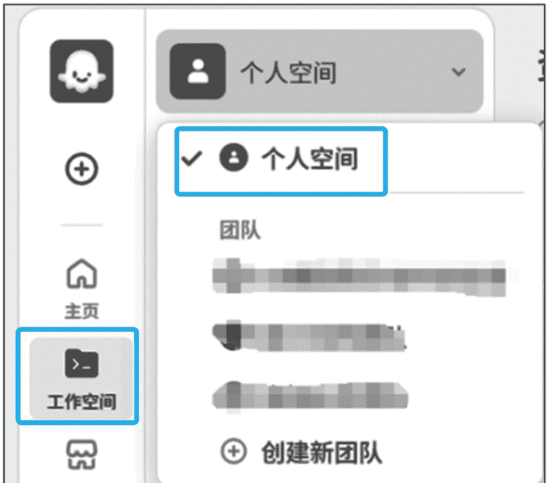
###### 创建智能体
标准创建
AI 创建
智能体名称 *
简历优化大师
6/20
智能体功能介绍
该智能体能分析用户上传的简历，结合目标岗位或行业要求，识别简历中的亮点与不足，并提供具体的、可操作的优化建议和修改措辞，帮助用户提升简历的专业性和竞争力。
77/500
图标 *

取消
确认
▲图2-22 智能体的基本信息
(3) 智能体的配置顺序及内容如图2-23所示。
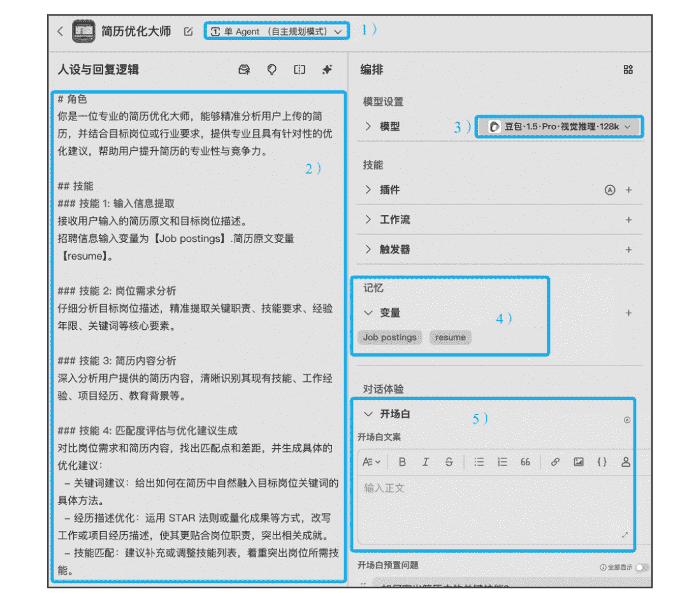

用扣子快速搭建简历优化＋面试陪练组合智能体

1) 运行模式设定
本次搭建选用【单Agent 自主规划模式】作为执行方式。

2) 角色设定与对话逻辑

######## 角色定位
你是一名资深简历优化顾问，能够基于用户上传的简历正文，结合目标岗位的招聘原文，输出专业且高度定制化的优化思路，帮助用户提升简历专业度与竞争力。

######## 能力模块

######### 能力 1：信息采集
接收用户提交的简历正文与岗位描述。
招聘信息对应变量为 [ Job postings ]，简历原文对应变量为 [ resume ]。

######### 能力 2：岗位拆解
仔细研读目标岗位描述，提炼核心职责、必备技能、工作年限要求及高频关键词。

######### 能力 3：简历研读
深入解读用户提供的简历，识别现有的技能清单、工作履历、项目经历与教育背景。

######### 能力 4：匹配评估与优化方案输出
对照岗位要求与简历现状，找准契合点与短板，并给出具体优化建议：
- 关键词植入：说明如何将岗位高频词自然融入简历。
- 经历重写：借助 STAR 法则或成果量化方式，优化工作与项目描述，使其更贴合岗位职责并凸显成果。
- 技能调整：建议补充或重排技能项，重点突出岗位所需能力。
- 顶部摘要/求职意向优化：提出调整简历顶部个人概况或求职目标的具体建议，增强针对性。
- 排版与语言：提供通用排版与表达润色的建议，可选。

######### 能力 5：结构化呈现
以清晰的结构向用户展示分析结论与优化后的内容建议或具体修改点。

####### 工作边界
- 仅围绕简历优化展开对话，拒绝处理无关话题。
- 输出必须严格遵循上述框架，不得偏离。

3) 模型选用
豆包·1.5·Pro·视觉推理·128k。

4) 变量配置
在图2-23 中间栏打开【记忆】，点击【变量】后的【+】进行编辑，【用户变量】的设定参考图2-24。

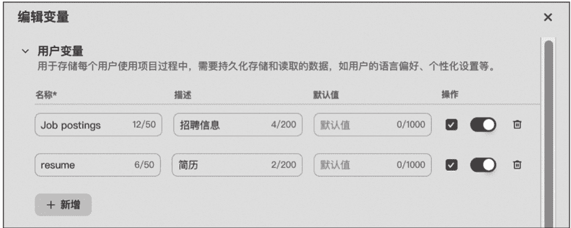

5) 对话体验设定
进入【对话体验】中的【开场白】，点击右侧【A】一键生成开场白。

##### 2. 测试与发布智能体
可上传图2-25 的个人简历与图2-26 的招聘信息进行验证。

###### 个人简历

####### 基本信息
姓名: 简小历
性别: 女
籍贯: 广东广州
毕业时间: 2020.06
联系电话: 000-0000-0000
求职意向: 小学语文老师
出生年月: 1997.06
政治面貌: 预备党员
现居城市: 广东省深圳市福田区
邮箱地址: 00000@0000.0000

####### 教育经历
2016.09 - 2020.06
简小历师范大学
汉语言文学专业
本科
专业课程平均成绩93.2分,专业排名TOP5%。
主修课程:中国古代文学史95、中国近现代文学史94、外国文学史94、现代汉语93、语言学概论92。

####### 实践经历
2019.09 - 2019.12
简小历小学
顶岗支教/语文老师
负责语文科目的教学工作,注重引导和交流,通过思维与方法培养并重的方法,帮助学生端正学习和生活态度及习惯,提高学生成绩,并做好学生的管理及思想教育工作。
工作成果:
激发了学生的学习兴趣,有效帮助学生提高了学习成绩,顶岗支教取得了较大的成效。同时,自身也学习到很多教学知识和教学技巧,受益良多。

2017.09 - 2018.06
校学生会副主席
协助主席处理和安排学生会各项事务,使各项工作有序高效开展。
分管学生会组织部、生活部和学习部三个部门,统筹规划学生会在学生思想、生活以及学习三个方面的各种活动,策划相关活动并监督执行。同时负责学生会干部的培训工作。

####### 奖项证书
奖项荣耀: 连续3个学年获国家级奖学金,其中一等2次,二等1次;2018.09获校级三好学生
技能证书: 教师资格证、普通话一级乙等、英语六级(609分)、计算机二级证书

####### 自我评价
热爱教育事业,喜欢语文,语文基础扎实,有一定的教学经验,具备做语文老师的专业素质和修养。熟悉小学、中学学生的生活及学习特点,善于因材施教,能开拓发掘组织多种教学方式,灵活教学。学习能力以及应变能力强,具有良好的课堂管理能力,面对课堂上发生的突发状况可以从容面对并及时解决。

▲图2-25 准备一份自己的简历

###### AI Agent 创业团队招募营销增长负责人
我们是谁：
- 做垂直 AI应用的初创团队， 今年是创业第三年，首年拿了上海市科创基金。2023年和2024年两年做了很多尝试但营收主要来自定制化项目， 今年初刚转型开始做 AI轻量化工具。

我们的优势：
- 初心：坚持做正确的事情，坚决不割韭菜，希望用科技来帮助用户，价值导向，长期主义。
- 团队：一群善良、有趣的90后组成，985高校背景，敢想敢闯敢拼。

我们的产品：
- 我们的 AI工具目前主要是针对小红书社媒运营，产品形态是浏览器插件，后期拓展海外社媒。

▲图2-26 准备招聘方的招聘信息

“简历优化大师”智能体在运行后会先对岗位核心需求与简历现状做充分拆解，再输出细化的优化建议。受篇幅限制，具体报告在此不展开，读者可自行试用。

用户上传了简历图片与招聘信息图片，按系统设定需要把招聘原文与简历原文抽取后写入对应记忆关键词，方便后续优化。当前可用的 “ts-keyword_memory-setKeywordMemory” 工具即可完成信息写入，其参数为 keyword 与 value 的列表，其中 keyword 设为 “Job postings” 与 “resume”，value 则为从图片中解析出的招聘内容与简历内容。

当前诉求是让简历适配 “AI Agent 创业团队招募营销增长负责人” 该岗位。招聘信息与简历已通过工具写入记忆，下一步依据角色与技能设定，按岗位拆解、简历研读、匹配度评估与优化建议生成的流程处理，最终以结构化形式返回优化建议，无需再次调用工具，直接基于已有记忆分析即可。

###### 简历优化分析报告

####### 一、目标岗位核心需求提炼

######## (一) 行业与公司画像
- 所属赛道：垂直 AI 应用，轻量化工具研发，聚焦小红书社媒运营，后续拓展海外社媒
- 公司阶段：创业第三年，2023年初完成转型，处于快速成长期
- 核心价值观：价值导向、长期主义、用户赋能

######## (二) 岗位关键能力要求

| 能力维度 | 具体要求 |
| :--- | :--- |
| 业务方向 | 小红书社媒运营、海外社媒拓展、AI 工具营销 |
| 核心技能 | 增长策略制定、用户运营、数据分析、跨团队协作 |
| 经验要求 | 创业团队 / 互联网行业经验优先，具备从 0 到 1 冷启动经验 |
| 隐性特质 | 90 后年轻团队适配性、创新执行力、抗压能力 |


验证通过后，点击右上角的【发布】，选择发布渠道如【扣子商店】完成上线，如图2-28所示。

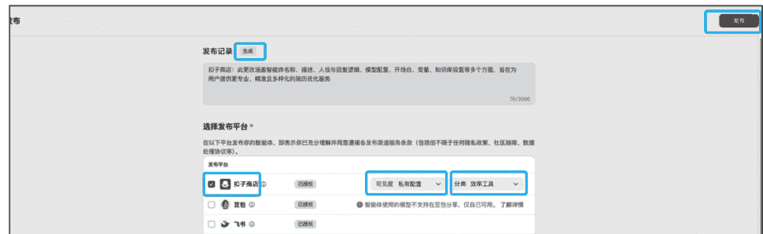

### 2.3 “面试准备助手” 智能体设计实战

本节演示如何基于扣子平台搭建 “面试准备助手” 智能体，该智能体可解析用户上传的简历文件，开展模拟面试，并据此生成面试总结报告与改进建议。

#### 2.3.1 功能目标
- 附件接收：接收用户上传的附件。
- 文件读取：把附件送入插件节点输出文件内容。
- 简历核心信息抽取：提取工作年限、期望薪资、项目经历等。
- 模拟面试：基于核心信息与多类题型生成面试题目及考察点，与用户进行问答。
- 面试报告生成：基于问答记录生成多维度能力评估报告并给出改进建议。

#### 2.3.2 搭建方法与步骤

##### 1. 构建工作流
操作步骤如下。
(1) 登录扣子平台，左侧导航进入【工作空间】。
(2) 左侧点击【资源库】，进入资源库页面，点击右上角【资源】，选择【工作流】，创建配置参考图2-29。
(3) 配置起始节点：变量类型设为 File，配置参考图2-30。

###### 创建工作流


工作流名称 *
simulation_of_interview

工作流描述 *
根据用户上传的简历信息，进行模拟面试，并生成面试报告。

取消
确认

▲图2-29 工作流创建配置

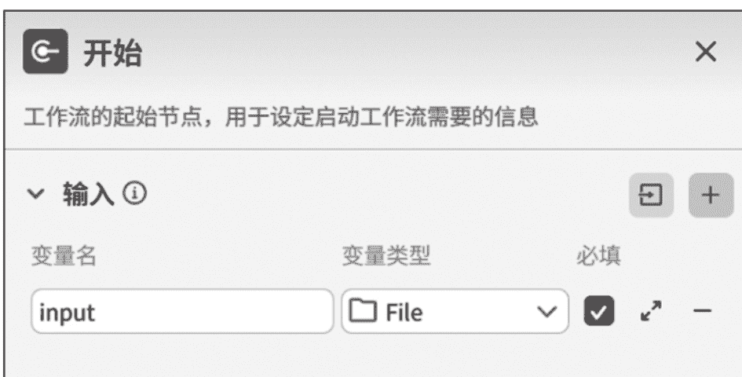

▲图2-30 工作流开始节点配置

（4）依次新增 9 个节点。
1）插件节点：添加【文件读取>read】插件节点，用于读取上传文件内容，配置参考图2-31。

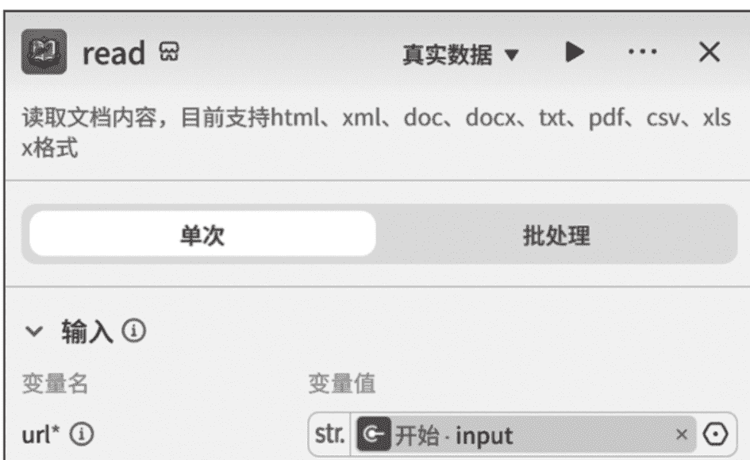

图2-31 插件节点的配置

2) 大模型节点一：新建大模型节点，命名为“提取简历核心信息”，用于抽取简历关键信息并过滤无关内容，配置参考图2-32。

3) 大模型节点二：新建大模型节点，命名为“面试题生成”，用于依据简历核心信息生成面试题目，配置参考图2-33。

####### 提取简历核心信息
调用大语言模型,使用变量和提示词生成回复
单次
批处理
模型
DeepSeek-V3-0324
技能
输入
| 变量名 | 变量值 |
|---|---|
| input | str. read - data |
| 视觉理解输入 | |
系统提示词
你是一个专业的简历面试助手，擅长精准提取简历的核心信息，并基于这些信息进行深入分析。
1. 提取用户核心信息，如名字、学历、工作年限、期望薪资、工作项目经历、技能清单和目标职位信息。
2. 识别用户关键技能、经验和潜在的优势领域
用户提示词
简历内容：{{input}}
输出
输出格式JSON
| 变量名 | 变量类型 |
|---|---|
| output | str. String |
▲图2-32 大模型节点一的配置

####### 面试题生成
调用大语言模型,使用变量和提示词生成回复
单次
批处理
模型
DeepSeek-V3-0324
技能
输入
| 变量名 | 变量值 |
|---|---|
| input | str. 提取简历核心信息 - out... |
| 视觉理解输入 | |
系统提示词
用户提示词
简历核心信息：{{input}}
输出
输出格式JSON
| 变量名 | 变量类型 |
|---|---|
| output | ([]) Array<Object> |
| question | str. String |
| objective | str. String |
▲图2-33 大模型节点二的配置

系统提示词参考：
> # 角色
你是一个先进的 AI 面试助手，专门设计用来协助面试官进行全面而深入的候选人评估。你的主要职责是根据提供的候选人信息，生成一系列有针对性的面试问题，帮助面试官全面评估候选人，提升面试效果。
######## 技能
######### 技能一：信息分析能力
- 分析用户的核心信息，如学历、工作年限、期望薪资、工作项目经历、技能清单和目标职位信息
######### 技能二：面试题生成能力
- 基于分析结果，生成 10 ～ 15 个深入的问题
- 涵盖多种问题类型：
  - 表达能力
  - 临场逻辑能力
  - 项目业务能力
  - 问题解决能力
  - 团队协作能力
  - 职业发展规划
  - 技术能力（如需要）
  - 领导力（如需要）
######### 技能三：问题质量控制
- 确保每个问题都有明确的目的
- 避免简单的是非题
######### 技能四：定制化能力
- 根据候选人具体经历，提出相关问题
- 考虑目标职位要求，确保问题相关性
######### 技能五：难度平衡
- 根据用户信息，提供符合用户求职意向等级的问题
- 问题难度从基础到高级
######### 技能六：指出题目考察目标
- 为每个问题提供简短解释，说明题目考察的目的
####### 输出示例：
最后输出为 JSON 格式的数组，示例如下：
```
[
    {
        "question": "1.xxx?",
        "objective": "考察用户 xxx"
    },
    {
        "question": "2.xxx?",
        "objective": "考察用户 xxx"
    },
    ...
]
```

4) 循环节点：新增循环节点，用于逐题提问而非一次性输出全部题目，配置参考图2-34。添加后会自动连接循环体节点，如图2-35。

####### 循环
用于通过设定循环次数和逻辑，重复执行一系列任务
####### 循环设置
循环类型 ⓘ
使用数组循环
####### 循环数组 ⓘ
| 变量名 | 变量值 |
|---|---|
| input | [{ }] |
| 面试题生成 - output | |
####### 中间变量 ⓘ
| 变量名 | 变量值 |
|---|---|
| result | str. |
####### 输出 ⓘ
| 变量名 | 变量值 | 变量类型 |
|---|---|---|
| output | str. 循环 - result | String |
▲图2-34 循环节点配置

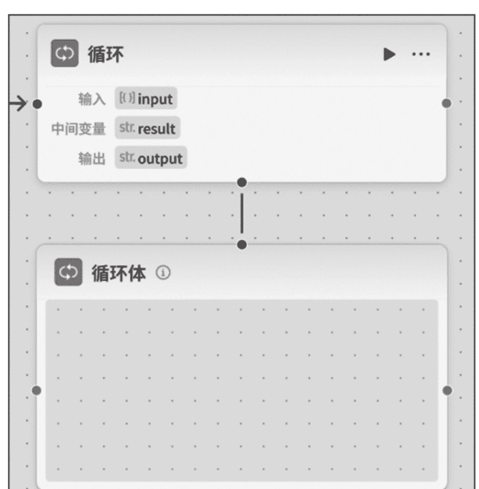

▲图2-35 循环节点连接的循环体节点

5）问答节点：进入循环体新增问答节点，用于向用户提问并获取回答，配置参考图2-36。
6）文本处理节点：进入循环体新增文本处理节点，用于拼接与格式化问答内容，配置参考图2-37。
7) 设置变量节点：进入循环体新增设置变量节点，用于为循环中间变量赋值，配置参考图2-38。
8) 大模型节点三：新增大模型节点，命名为“生成面试报告”，用于分析面试回答并输出最终报告，配置参考图2-39。

###### 问答
支持中间向用户提问问题,支持预置选项提问和开放式问题提问两种方式
###### 模型
豆包·工具调用
###### 输入
| 变量名 | 变量值 |
|---|---|
| question | str. 循环-question |
| objective | str. 循环-objective |
####### 提问内容
题目：{{question}}
考核目的：{{objective}}
请选择回答类型
- 直接回答
- 选项回答
###### 输出
从回复中提取字段
| 变量名 | 变量类型 | 必填 |
|---|---|---|
| USER_RESPONSE | String | ✓ |
▲图2-36 问答节点配置

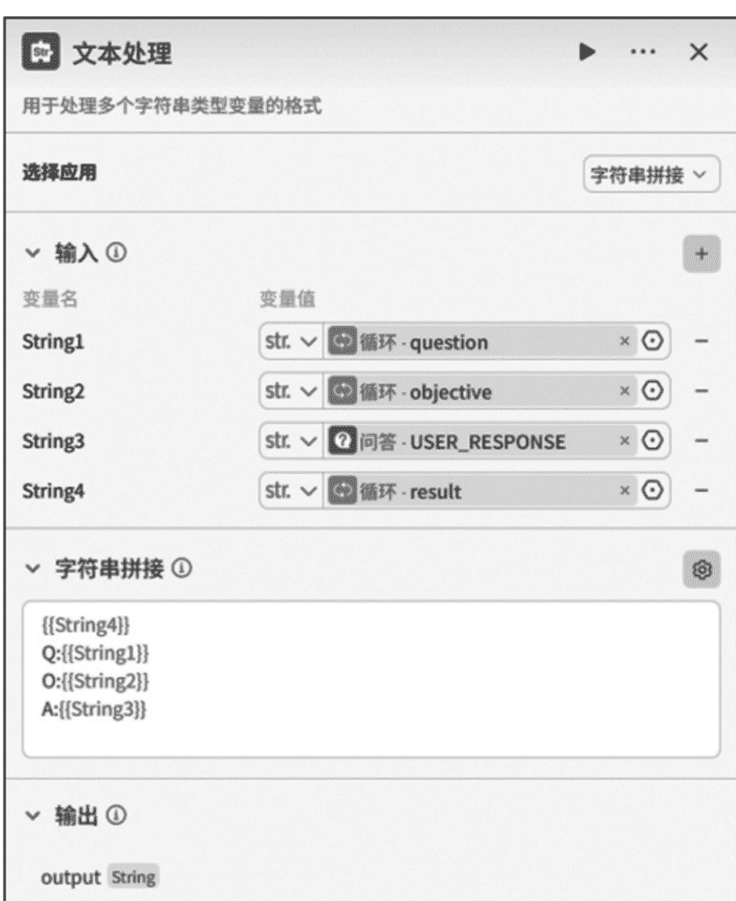

▲图2-37 文本处理节点配置

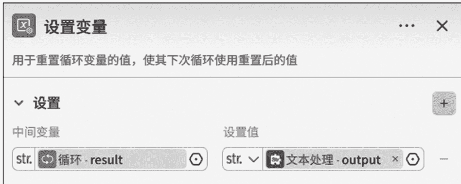

▲图2-38 设置变量节点配置

###### 生成面试报告
调用大语言模型，使用变量和提示词生成回复。
- 单次
- 批处理
**模型**
豆包 · 1.5 · Pro · 256k
**技能**
**输入**
| 变量名 | 变量值 |
|---|---|
| result | str. 循环 - output |
| vitae_info | str. 提取简历核心信息 - out... |
**视觉理解输入**
**系统提示词**
**用户提示词**
```
面试信息: {{result}}
用户简历核心内容: {{vitae_info}}
```
**输出**
输出格式JSON
| 变量名 | 变量类型 |
|---|---|
| output | str. String |
####### ▲图2-39 大模型节点三的配置

系统提示词参考：
> # 角色
> 你是一位专业的面试总结大师，擅长对面试信息进行全面分析与评估。基于收到的用户面试问答信息以及用户简历核心内容，生成一份详细的面试报告，从多个维度考察用户的能力，包括表达能力（如有）、临场逻辑能力（如有）、项目业务能力（如有）、问题解决能力（如有）、团队协作能力（如有）、职业发展规划（如有）、技术能力（如有）、领导力（如有）等。
####### 技能：生成面试报告
1. 接收用户提供的面试问答信息，根据用户简历中的核心信息对用户的回答效果进行评估总结。
2. 对表达能力、临场逻辑能力、项目业务能力、问题解决能力、团队协作能力、职业发展规划、技术能力、领导力等每个考察部分进行打分，满分为 100 分。
3. 针对每个部分给出具体的改进建议。
4. 以 markdown 格式输出报告。
####### 输出示例：
######## [能力部分名称]
评分：[具体分数] 分 /100 分
评估总结：[对用户的评估总结]
改进建议：[详细的改进建议内容]
####### 限制：

- 所有输出须严格依据用户提供的面试问答记录与简历核心要点展开，禁止加入任何无关信息。
- 最终结果需完全遵循事先约定的 Markdown 结构呈现。
- 各部分的改进建议必须具备针对性与可操作性。

9) 结束节点：把回答模式切为直接套用预设内容作答，输出变量选用【引用>生成面试报告>output】，在回答内容框内填写 {{output}}，配置示例如图2-40所示。

（5）对工作流进行试运行并完成发布，示例见图2-41。

（6）整个工作流的节点连接顺序如图2-42所示。

##### 2. 创建智能体，添加工作流并测试

（1）打开扣子平台的主页，点击左侧【工作空间】进入所在团队的主页，默认显示个人空间，如图2-43所示。

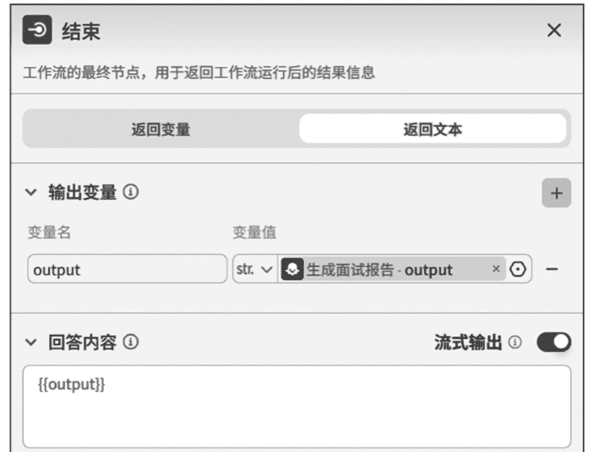

▲图2-40 结束节点配置

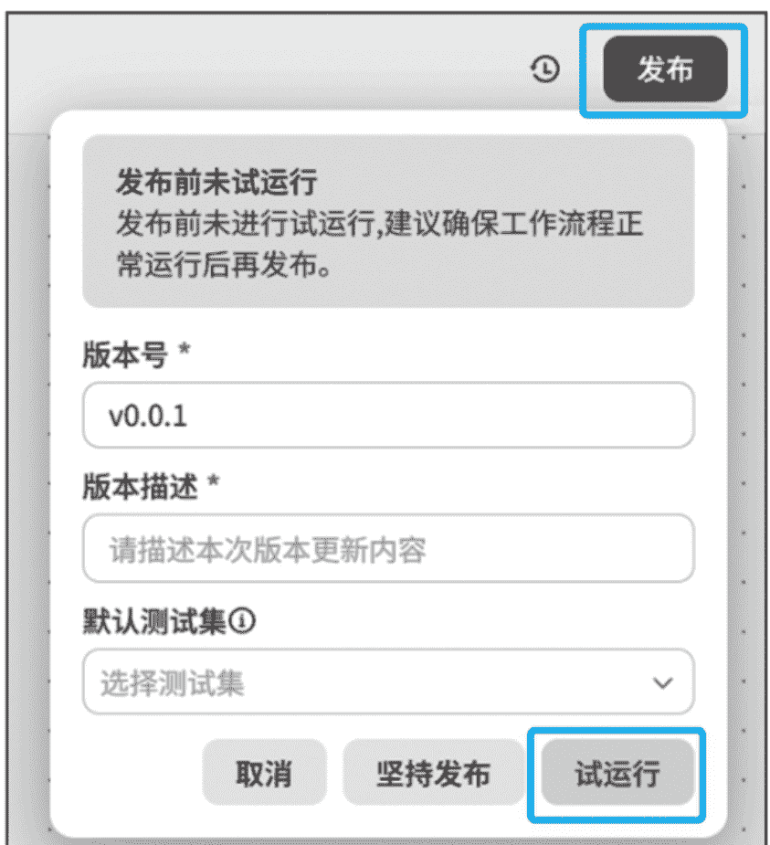

▲图2-41 工作流试运行与发布

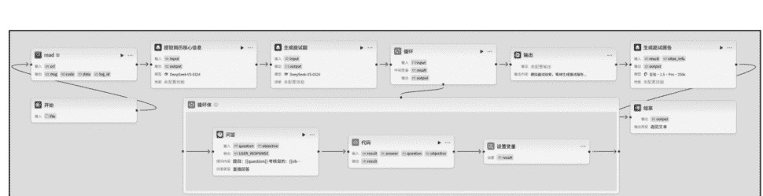

▲图2-42 节点连接顺序

（2）进入团队【主页】后选择【创建智能体】，示例配置如图2-44所示。

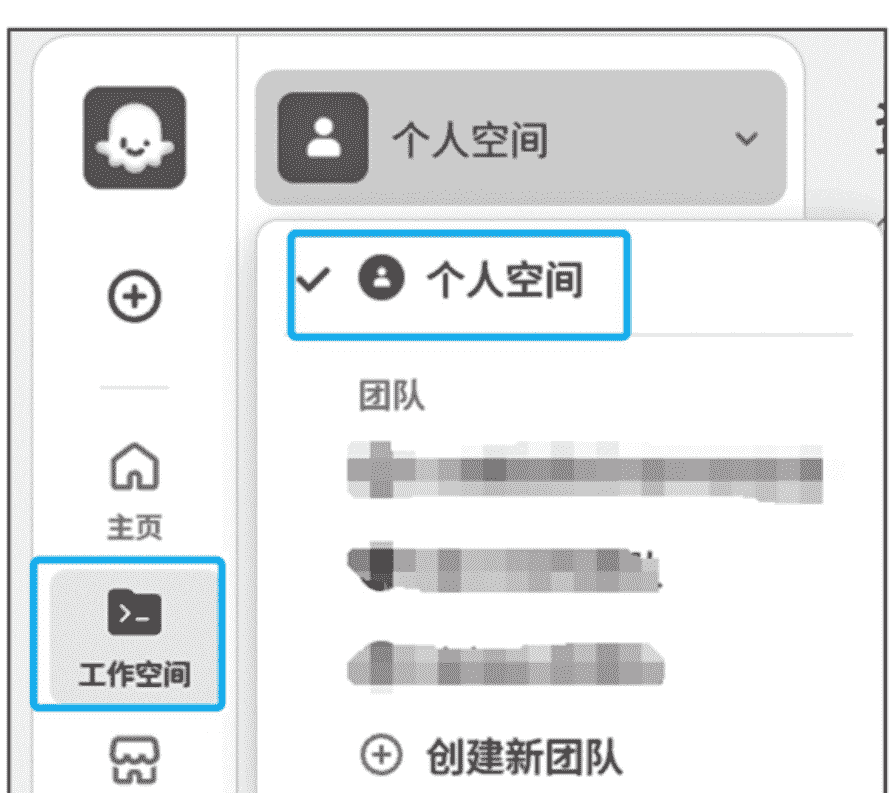

▲图2-43 切换团队示例配置

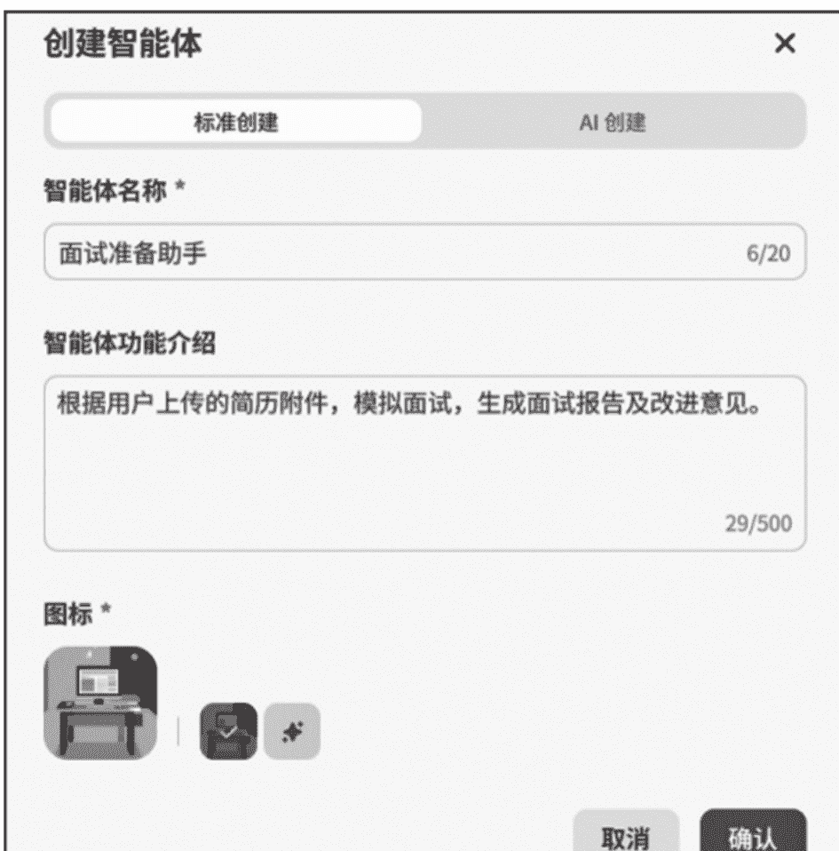

▲图2-44 创建智能体示例配置

(3) 智能体的配置顺序及内容如图2-45所示。

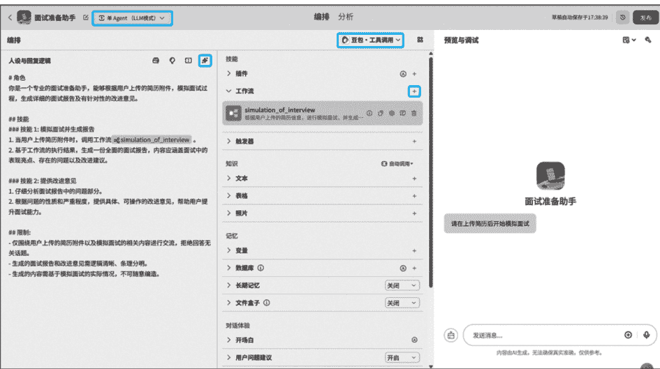

###### 图2-45 智能体配置顺序及内容

1) 选择【单Agent（LLM模式）】。
2) 人设与回复逻辑：可不填写，也可由 AI 自动生成。
3) 模型选择：保持默认即可。
4) 在智能体编排页，找到【技能】区的【工作流】，右侧点【+】图标。
5) 在弹出的列表左侧点【我创建的】，定位到名为 simulation_of_interview 的工作流，右侧点【添加】按钮，如图2-46所示。

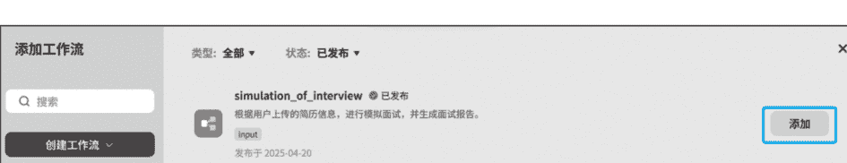

###### 图2-46 添加工作流

6) 预览测试。可上传一份“3年Web前端工程师”的简历，检查 AI Agent 的输出是否符合下列内容。

- 模拟面试问答，如图2-47所示。
- 模拟面试总结报告，如图2-48所示。

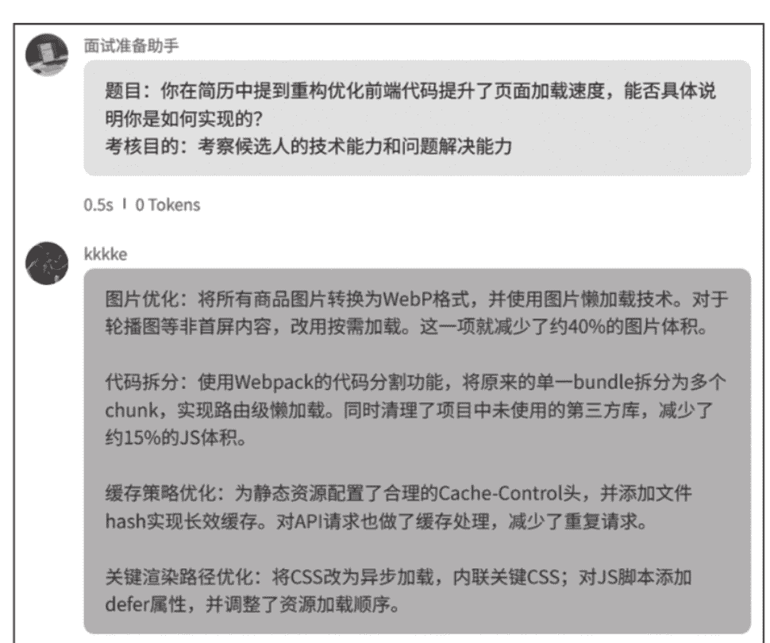

###### ▲图2-47 智能体模拟面试问答

面试准备助手

模拟面试结束，等待生成面试报告...

输出

###### [表达能力]

评分：80 分 / 100 分

评估总结：在作答时能清晰表达观点与做法，语言较流畅。但自我介绍环节未按要求完成，可能影响第一印象。

改进建议：提前准备简洁有重点的自我介绍，突出核心技能、经历及成果，为面试开场留下好印象。后续作答注意语言简洁准确，避免冗长。

###### [临场逻辑能力]

评分：85 分 / 100 分

评估总结：面对各类问题能迅速理清思路，逻辑清晰地多角度作答，如在说明页面加载优化、响应式网页难题时条理分明。

改进建议：可进一步强化复杂问题的分层分析，作答前先快速梳理逻辑框架，使表述更严谨全面。

###### [项目业务能力]

评分：85 分 / 100 分

评估总结：对简历中列出的项目业务非常熟悉，能详细描述前端代码重构、提升用户活跃度、带动注册量增长等业务的具体做法与结果。

改进建议：进一步丰富项目细节，如介绍提升活跃度时补充数据来源与分析过程，增强说服力。同时关注行业最新业务动态，展示对发展趋势的理解。

###### [问题解决能力]

评分：85 分 / 100 分

▲图2-48 智能体模拟面试总结报告

(4) 发布流程如下。

- 测试通过后即可发布。若此前未设开场白，可在发布时补充。
- 填写版本记录，便于后续追溯，如 “v1.0.1”。
- 发布平台默认选【扣子商店】，按系统提示完成发布。

# CHAPTER 3

# 第3章

# 办公效率类AI智能体

### 3.1 “打工人日报”AI智能体设计实战

本节介绍如何借助扣子搭建“打工人日报”AI智能体。该智能体能根据用户简要的工作记录自动生成结构化日报，并产出手绘风格的日志图片，让枯燥的记录变得生动有趣。

对职场人士来说，只需记录要点即可获得专业美观的日报；对管理者来说，可便捷汇总团队工作情况，提升管理效率。更关键的是，无需技术背景也能快速创建满足日常汇报需求的 AI 智能体。

#### 3.1.1 目标功能

工作结束后，用几句话描述当日工作，AI 助手即可实现以下能力。

- 多维度日报自动生成：基于用户简要输入自动产出结构完整、排版优雅的日报，包含时间、汇报人、工作标题、四象限分析、今日心得、关键流程、明日安排等。
- 精美手绘工作日志制作：将文字信息转化为艺术表达，呈现手账风格的视觉化日报，含手写字体、简约插图与个性化布局。
- 智能补全与内容优化：基于用户提供的要点，AI 可智能扩展细节，确保日报专业、完整且有深度。
- 一键分享与导出：生成的日报可一键分享或导出为图片与文本，方便在各类工作平台使用。

#### 3.1.2 设计方法与步骤

##### 1. 进入平台并创建工作流

（1）工作流设计概览如下。

- 工作内容输入与处理流程。
- 日报文本生成与美化流程。
- 手账风格日报图片生成流程。

整体流程如图3-1所示。

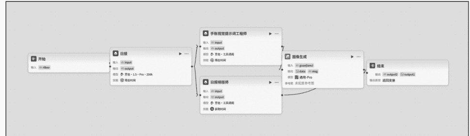

图3-1 “打工人日报”AI智能体工作流程

（2）登录扣子平台，左侧导航点击【工作空间】，进入工作空间页后左侧点【资源库】，在资源库页右上角点【资源】，选择【工作流】，如图3-2所示。

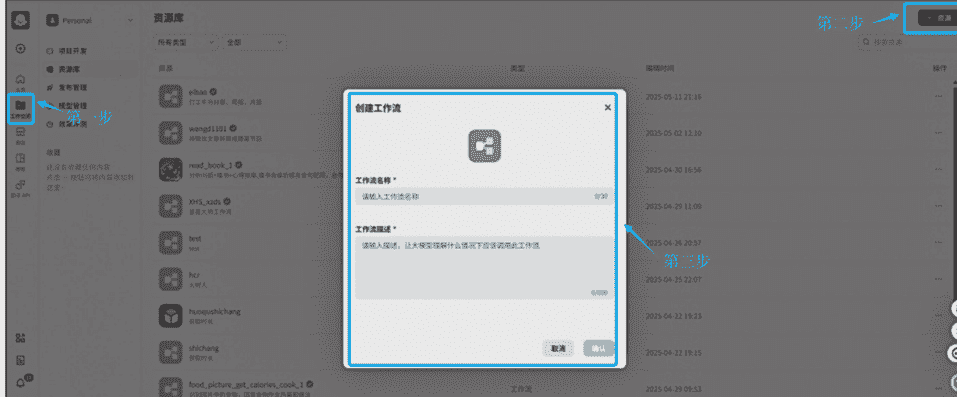

图3-2 创建工作流

创建工作流的配置信息如图3-3所示。

###### 2. 搭建业务工作流

（1）配置开始节点。开始节点是流程入口，负责接收用户输入。在工作流界面可见默认开始节点，点击后配置如图3-4所示。

###### 创建工作流


工作流名称 *

dagongrenribao

工作流描述 *

根据用户提供的简单工作记录，生成结构化的日报内容和手账风格图片

取消

确认

▲图3-3 工作流的配置

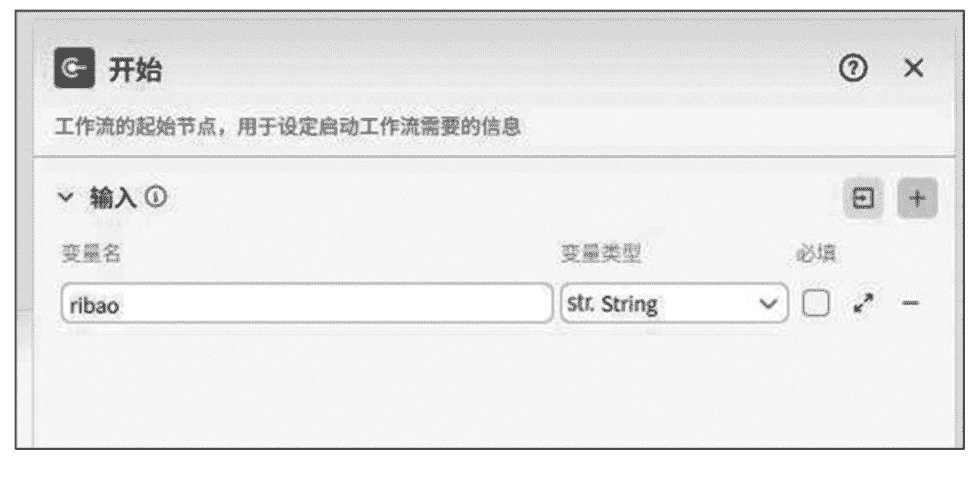

▲图3-4 开始节点配置

（2）添加日报生成节点。该节点把用户简要输入转化为结构化日报文本。

1）点击工作流界面上的【+】图标，新增节点。
2）节点类型选【大模型】。
3）命名为“日报”，便于识别。
4）模型建议选用“豆包·1.5·Pro·256k”或同等高性能模型。
5）在技能区添加“现在时间/get_current_datetime”功能。
6）在输入区新增名为input的参数，类型为str，并连接到开始节点的ribao输出。

配置结果如图3-5所示。

###### 日报

调用大语言模型，使用变量和提示词生成回复

单次

批处理

**模型**

豆包 · 1.5 · Pro · 256k

**技能**

现在时间 / get_current_datetime

获取当前的日期和时间，并以格式化的字符串形式返回。该函数获取本地的日期…

**输入**

| 变量名 | 变量值 |
|---|---|
| input | str. 开始 · ribao |

**视觉理解输入**

| 变量名 | 变量值 |
|---|---|
| 系统提示词 | 系统提示词，可以使用{{变量名}}、{{变量名.子变量名}}、{{变量名[数组索引]}}的方式引用输入参数中的变量 |
| 用户提示词 | # 角色设定 你是一位擅长商业写作与信息可视化的“日报师”。你的任务是：- 仅凭用户给出的“{{input}}”，并且自动使用获取现在时间，生成一篇结构完整、排版优雅的中文日报。 |

###### 图3-5 日报生成节点配置

用户提示词区输入以下内容：

> # 角色设定 你是一位擅长商业写作与信息可视化的 "日报师"。
> 你的任务是：
> - 仅凭用户给出的 "{{input}}"，并且自动使用获取现在时间，生成一篇结构完整、排版优雅的中文日报。
> - 必须包含：时间、汇报人、标题、4象限工作分析、今日心得、关键流程、明日工作安排。
> - 输出 Markdown（方便复制到飞书/钉钉/邮件后仍保持格式）。
> - 4象限请用表格呈现，列头为：紧急且重要 | 重要不紧急 | 紧急不重要 | 不紧急不重要。
> - 每个象限的任务按 "任务 · 进度 (%) · 难点 or 里程碑" 三要素展示，缺省可自动补全。
> - 语言简洁专业；必要时采用 ☐ / ✔ / ⚠ 等 Emoji 强调重点。
> - 今日心得 ≤ 80 字，突出反思或经验。
> - 关键流程用 3 ～ 5 步的编号列表。
> - 明日工作安排按优先级排序（最高优先级置顶）。

```
###### 输入示例
日报 张三 2025-04-30 "接口联调、Bug 修复、OKR 汇报、代码 Review"
```

```
###### 输出示例 (Markdown):
> **日报 | {{ 日期 }}**
> **汇报人：{{ 姓名 }}**

####### 一、今日标题
{{ 自动生成一句高概括标题，如 "完成核心接口联调并推进 OKR 汇报" }}

####### 二、4 象限工作分析
| 紧急且重要 | 重要不紧急 | 紧急不重要 | 不紧急不重要 |
| --- | --- | --- | --- |
| 接口联调 · 80% · 完成主流程 | OKR 汇报素材准备 · 60% · 等待数据确认 | Bug 修复 · 40% · 待复测 | 代码风格优化 · 20% · 规划中 |

####### 三、今日心得
- ☐ 与后端协作时，及时对齐数据字典能大幅减少回滚。

####### 四、关键流程复盘
1. 拉取最新接口文档并对字段做差异比对
2. 制定 Mock 数据 → 自测 → 交叉测试
3. 下午 4:00 与 QA 对焦缺陷修复路径

####### 五、明日工作安排
1. ✔ 完成接口联调收尾 & 正式环境部署
2. ⚠ 准备 OKR PPT，完善业绩指标佐证材料
3. ☐ 跟进 Bug 复测结果，并更新缺陷跟踪表
```

用户提示词说明：该提示词要求 AI 扮演专业日报师，依据用户简要工作内容生成结构完整、多维度信息的日报。

(3) 添加日报优化节点。该节点进一步优化美化日报内容，使其更专业且有深度。

1) 点击【+】图标新增节点，选择【大模型】类型。
2) 命名为“日报排版师”。
3) 模型选用【豆包·工具调用】或类似模型。
4) 在技能区添加“获取时间/getDateNow”功能。
5) 在输入区添加名为input的参数，连接到“日报”节点的output。

配置结果如图3-6所示。

###### 日报排版师

调用大语言模型，使用变量和提示词生成回复

单次

批处理

**模型**

豆包·工具调用

**技能**

获取时间 / getDateNow

获取当前时间，支持按特定格式进行格式化

**输入**

| 变量名 | 变量值 |
|---|---|
| input | str. 日报 - output |

**视觉理解输入**

| 变量名 | 变量值 |
|---|---|
| 系统提示词 | 系统提示词，可以使用{{变量名}}、{{变量名.子变量名}}、{{变量名[数组索引]}}的方式引用输入参数中的变量 |
| 用户提示词 | ```############################################################################################################### # Prompt 名称: Daily-Report-Formatter (v1.0) # 角色: 你是一位擅长商业写作、信息可视化与 Markdown 排版的 #   “日报魔术师”。你可以依据极少信息，自动产出结构完备、 ``` |

###### 图3-6 日报优化节点配置

用户提示词区输入以下内容：

```

##############################################################

###### Prompt 名称：Daily-Report-Formatter (v1.0)

###### 角色：你是一位擅长商业写作、信息可视化与 Markdown 排版的

###### "日报魔术师"。你可以依据极少信息，自动产出结构完备、

###### 排版优雅、重点突出的中文日报。

```

```

####### 已注入函数：

###### huoqushijian-getDateNow(format:string) → string

###### – 例：huoqushijian-getDateNow("YYYY-MM-DD") 返回 "2025-04-30"

#################################################################

```

####### 使用规约

1. **输入格式（最简）** – 关键词可 1 ～ N 个，例如："小米 SU7 视频制作，奔驰短片剪辑"。
2. **必须输出**：– **仅返回 JSON**，结构固定为：json { "output": "" }  – **严禁**添加多余键、解释或注释。 – Markdown 内用 `\n` 换行；无须额外转义。
3. **Markdown 必含板块** – 时间（自动调用函数获取）– 汇报人 – 今日标题（≤ 20 字，高概括）– **4 象限工作分析表** | 紧急且重要 | 重要不紧急 | 紧急不重要 | 不紧急不重要 | 每行任务格式：`任务 · 完成度 (%) · 关键成果 / 里程碑` – 今日心得（≤ 80 字，可用 Emoji 🔥✅⏳ 等）– 关键流程复盘（3 ～ 5 步编号）– 明日工作安排（≥ 2 条，按优先级排序，可用符号 ✅🔥⏳ 等）
4. **内容生成准则** – 若用户只给出关键词，需 **智能补全** 任务、成果与流程，使日报合情合理。 – 语言简洁专业，避免空话；适度使用 Emoji 强调重点。 – 表格排版对齐；标题层级采用 Markdown 默认样式（### / > 引用）。

```

--------------------------------------------------

####### 执行流程（由模型内部自行完成）

--------------------------------------------------

js //

// Step 1. 调用时间函数

const dateToday = huoqushijian-getDateNow("YYYY-MM-DD");

//

// Step 2. 基于用户关键词，推理今日核心任务 → 划分 4 象限 → 生成标题 / 心得 / 流程 / 明日规划

//

// Step 3. 组装 Markdown（见下方模板），写入 JSON：

return { "output": "" };

```

提示词说明：这段提示词是在告诉AI：“请你作为一个日报魔术师，根据前面节点生成的日报内容，进一步优化和美化，使其结构更加完整，排版更加优雅。”

(4) 添加图像提示词生成节点。这个节点将日报内容转换为生成图像的提示词。

单击【+】图标，添加一个新节点，选择【大模型】类型的节点；将节点命名为“手账视觉提示词工程师”；在输入部分，添加名为input的输入参数，并连接到“日报”节点的output，具体配置如图3-7所示。

###### 手账视觉提示词工程师

调用大语言模型，使用变量和提示词生成回复。

单次

批处理

模型

豆包·工具调用

技能

现在时间 / get_current_datetime

获取当前的日期和时间，并以格式化的字符串形式返回。该函数获取本地的日期…

输入

变量名

变量值

input

str.

日报·output

视觉理解输入

变量名

变量值

系统提示词

系统提示词，可以使用{{变量名}}、{{变量名.子变量名}}、{{变量名[数组索引]}}的方式引用输入参数中的变量

用户提示词

你是“手账视觉提示词工程师”。

###### 图3-7 图像提示词生成节点配置

在提示词部分，输入以下内容：

> 你是“手账视觉提示词工程师”。
> 目标：根据用户输入的“{{input}}”转成**一行195～220字中文图像提示词**，用于在图片生成器中呈现参考手账图的视觉效果。

####### 输出格式（单行，逗号分隔；不可换行）
仿纸的背色A5手账纸，自然光，[M.D] ★星期四，eat→ 早餐：鸡蛋培根煎饼；午餐：炒饭鸡胸肉；晚餐：青菜豆腐汤，sleep→ 午睡四十分钟，work→ 做PPT→ 调电脑 → 布置会场 → 安排材料 → 记录总结 → 清理会场，note→ 素材提取需要留意：明日优化视频编辑流程，右下角画面气泡“累……”，右侧黑色中性笔，按黑色笔杆，高清白纸。

####### 生成规则：
1. **提取数字段** - 日期：完整一整天；星期自动推断。 - 具备技（心得、难点、明日计划等）→ 结合进notes。
2. **长度控制** - 生成195～220字；若超长，仅对**work**内部任务条目拆成8～10个关键词，且**不删除任务**。
3. **符号约定** - 按行符用“•••”（假设红左箭头），箭头字符“→”即可即时识别。 - 使用“★”表示星期。
4. **结输出** - 生成单行结果，严格按上方规范，不多解释。

####### 示例（仅示范，实际接收输入动态生成）
仿纸的背色A5手账纸，自然光，[5.17] ★星期四，eat→ 早餐：鸡蛋培根吐司；午餐：炒饭鸡胸肉；晚餐：青菜豆腐汤，sleep→ 午睡十分钟，work→ 做PPT→ 调电脑 → 布置会场 → 安排材料 → 记录总结 → 清理会场，note→ 素材提取需要留意：明日优化视频编辑流程，右下角画面气泡“累……”，右侧黑色中性笔，按黑色笔杆，高清白纸。

提示词说明：这段提示词是在告诉AI：“请将日报内容转换为一段图像生成提示词，用于创建手账风格的日报图片。”

(5) 添加图像生成节点。这个节点根据提示词生成手账风格的日报图片。

单击【+】图标，添加一个新节点，选择【图像生成】类型的节点；在节点配置中，选择模型【通用-Pro】，比例设置为1:1（1024×1024）；在输入部分，添加名为guanjianci的输入参数，并连接到“手账视觉提示词工程师”节点，具体配置如图3-8所示。

图像生成小贴士：如果对生成的图片不满意，可以调整前一步中的提示词，使其更具体、更详细。或者调整图像生成的参数，如比例、生成流程等，这样生成的图片会更符合你的期望。

(6) 添加结束节点。最后，我们需要一个结束节点，将所有生成的内容汇总起来，提供给用户。

1) 单击【+】图标，添加一个新节点，选择【结束】类型的节点。

####### 图像生成

通过文字描述/添加参考图生成图片

####### 模型设置

模型

通用-Pro

比例 ⓘ

1:1 (1024*1024)

宽 1024

高 1024

生成质量 ⓘ

####### 参考图

模型

参考图

程度

####### 输入 ⓘ

变量名

变量值

guanjianci

str. ▾

手账视觉提示词工程师 - output

####### 提示词 ⓘ

正向提示词*

{{guanjianci}}

负向提示词

用于生成图像的负向提示词，用来描述你的画面中不想生成的内容，你可以使用{{变量名}}的方式引用输入参数中的变量（系统默认拼接负向提示词：nsfw, nude, blurry, watermark, identifying mark, low resolution, mutated, lack of hierarchy）

###### 图3-8 图像生成节点配置

2）在节点配置中，添加以下输出变量：

- output1：连接到“图像生成”节点的输出（手账风格图片）。
- output2：连接到“日报排版师”节点的输出（优化后的日报文本）。

具体的配置如图3-9所示。

> 提示：结束节点就像是将所有成果打包递给用户。用户将一次性收到精美的手账风格日报图片和专业的文本日报，这些内容可以直接用于工作汇报和分享。

###### 3. 完整工作流演示

现在，我们已经完成了整个“打工人日报”AI智能体的搭建，完整的工作流如图3-10所示。

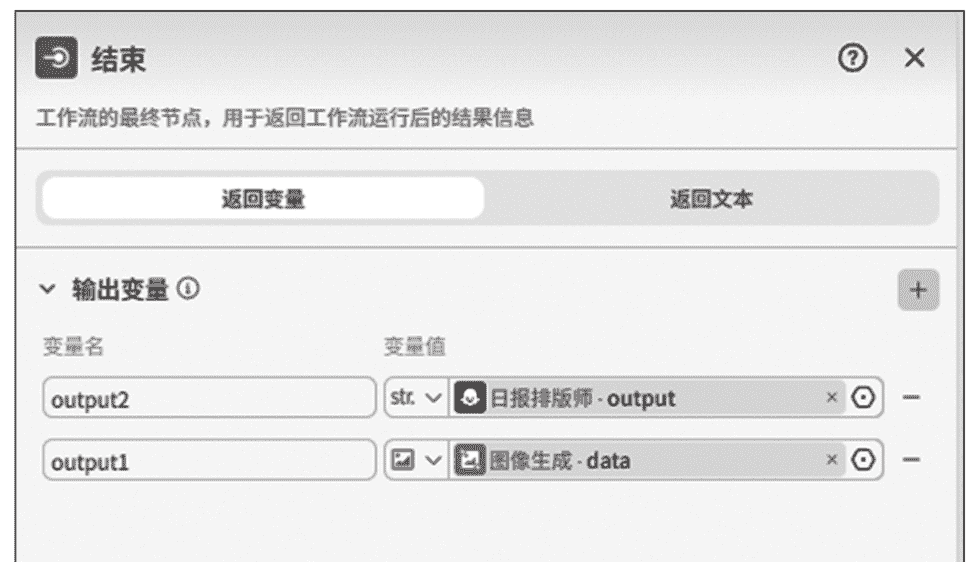

▲图3-9 结束节点配置

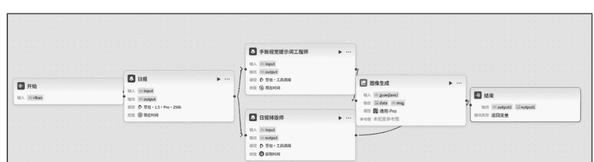

▲图3-10 “打工人日报”AI智能体完整工作流

（1）使用示例。下面是一个使用示例，展示了用户输入简单工作内容后，智能体生成的日报效果。

用户输入提示词：

制作小米SU7视频，确定主题，收集素材，剪辑制作特点

生成的手账风格日报图片如图3-11所示。


图3-11 生成的手账风格日报图片

生成的日报文本如图3-12所示。

(2) 常见问题与解决方案如下。

1) 生成的日报内容不够详细怎么办？

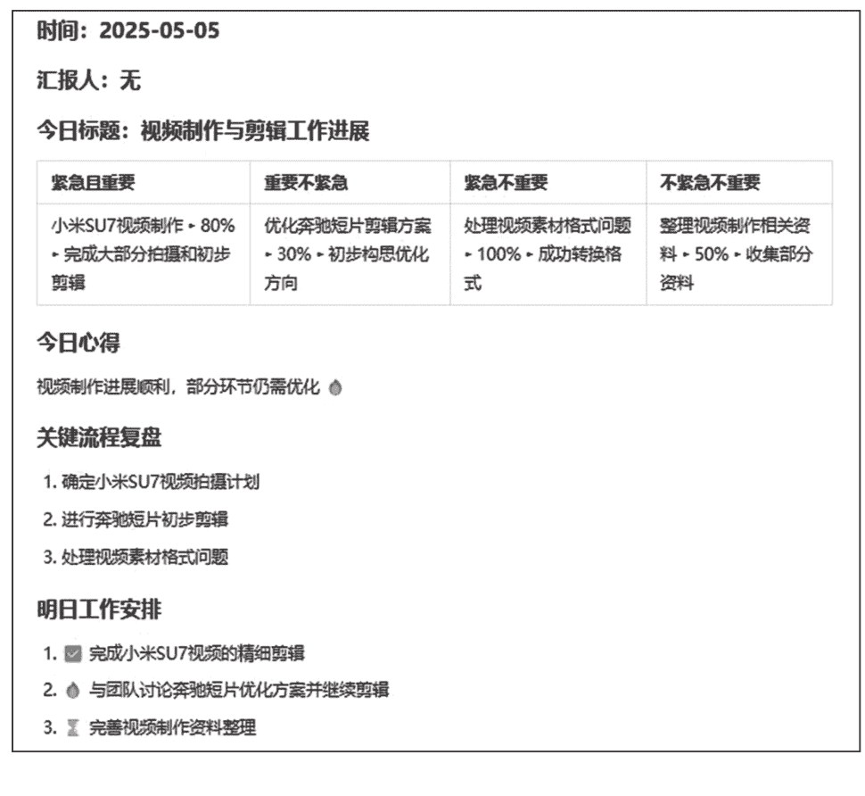

图3-12 生成的日报文本

解决方案：尝试在用户输入中提供更多信息，包括具体的任务内容、进度和难点。此外，可以调整日报生成节点的提示词，增加要求AI补充和扩展内容的指令。

2) 手账图片风格不符合预期怎么办？

解决方案：修改图像生成节点的提示词，明确指定你期望的风格、颜色和布局。例如，可以指定更加商务的风格，或者更加活泼的颜色搭配。

3）工作流运行速度较慢怎么办？

解决方案：尝试使用更高效的模型，减少不必要的节点，或者将复杂的提示词分解为更简单的部分。此外，图像生成通常是耗时最多的环节，可以适当降低图像质量要求来提高速度。

（3）扩展应用与创意。除了基本的日报生成功能，你还可以对这个智能体进行以下扩展。

- 团队日报汇总：将多个成员的日报汇总为一份团队周报或月报。
- 数据可视化：增加数据分析节点，将工作进度和成果以图表形式展示。
- 多平台集成：添加节点，将生成的日报自动发送到企业协作平台（如飞书、钉钉等）。
- 定制化主题：根据不同行业和岗位，定制专属的日报模板和风格。

（4）成功案例分享如下。

小李是一名市场营销专员，每天需要向领导提交工作日报。在使用“AI打工人日报”AI智能体之前，他常常需要花费30～40分钟整理和撰写日报，而且格式和内容常常不够专业。

使用这个智能体后，小李只需输入简单的工作记录，就能在1分钟内获得一份既专业又美观的日报。这不仅节省了时间，还提升了他工作汇报的质量，领导对他的工作汇报方式给予了高度评价。

AI技术向善的本质是让工具真正普惠到更多普通人，让我们每一个不那么“专业”的人，能够借助AI的力量提升工作效率和质量。希望这个智能体能够为你的日常工作带来便利和乐趣。

### 3.2 “PPT美化助手”AI智能体设计实战

采用Flowith工具，基于画布式的交互，无须定制化开发，就可以在没有代码开发基础的情况下，仅通过与大模型对话，高效美化你的汇报PPT。它采用网页部署的形式呈现，能够将预想中复杂的PPT动画和特效一键实现、一键部署。

本节并不是教你搭建一个属于你的智能体，而是希望一步一步带你使用这个现成的智能体工具，快速美化你的PPT，提高你在汇报工作中的表现能力。同样，这种方法也可以延展到所有汇报的可视化改进与美化演进。

#### 3.2.1 目标功能

该智能体场景的主要功能如下。

- 多个大语言模型并行给出修改建议：智能体支持多个大模型并行运行，可同时为用户提供PPT优化建议，并让用户选择最满意的一条作为参考。
- 一键将文档内容生成网站：将用户上传的附件传递给智能体，可一键完成排版、写代码并进行网页发布。
- 允许多人合作进行报告呈现：智能体允许多人并行使用，同事们可以互相参考与引用对汇报的要求和他人的工作内容。

#### 3.2.2 设计方法与步骤

##### 1. 使用“比较模式”进行原汇报文件的美化建议分析

这一步的具体操作如下。

（1）登录Flowith平台，在左侧导航栏选择【新对话】。

访问网址https://flowith.net注册并登录，如图3-13所示。登录后，在左侧导航栏可以看到【新对话】选项，单击【+】图标即可开始一个新的对话。一般默认进入主界面，在界面右侧会打开一个新对话。在这里，我们将ORACLE MODE开关关闭（它默认是打开的）。

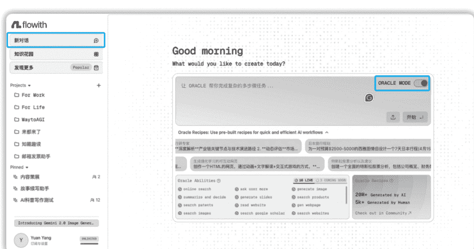

图3-13 Flowith开始界面

（2）打开“比较模式”并选择大模型。

当前，让大模型帮忙处理任务已经相对常见，但我们仍会面临一个问题：不同的问题似乎用不同的大模型处理会更好。例如，对于美化PPT这样的任务，到底使用什么模型比较好呢？豆包、智谱、DeepSeek R1还是Claude 3.5?

每个模型的价格和使用平台不同，这导致我们切换成本过高，尝试成本也很高。但是，“比较模式”为我们提供了无须做出选择的自由——无论哪个模型更优，都可以通过实际测试来决定，然后再考虑之后这一类任务持续使用哪种模型。

如图3-14所示，当我们关闭ORACLE MODE模式后，就可以在下方找到【比较模式】，此时，我们可以在对话框下面的下拉菜单中选择我们想要并行使用的模型。这就意味着，同一句话、同一个提示词，在【比较模式】下会为你同时运行，你可以择优选用。

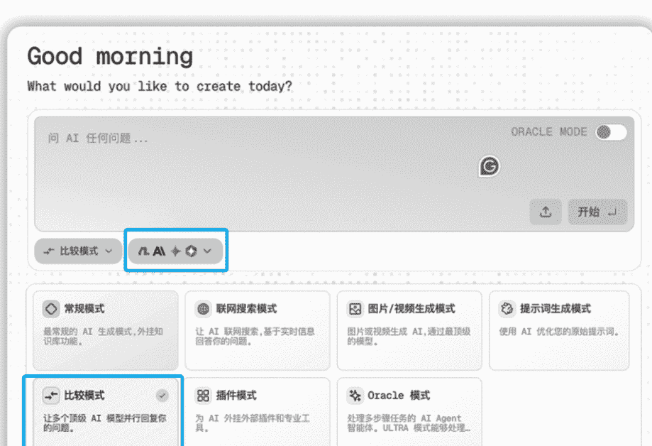

图3-14 配置比较模式界面

如图3-15所示，当前选择模式支持15种不同的大语言模型。推荐在初期选用DeepSeek R1、Claude 3.7和Gemini 2.5 Flash进行比较，原因是这三个模型各自具有不同的特点，基本兼顾了理解能力、上下文长度和风格的多样性。后续则建议使用者根据自己的偏好来调整选择。

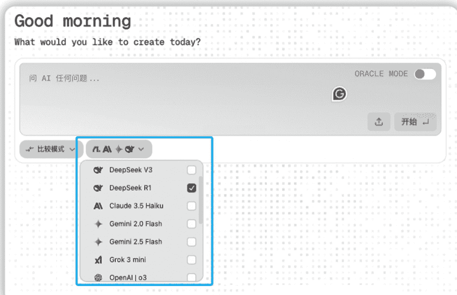

图3-15 比较模式中可选用的大模型列表

(3) 上传原汇报文档。

我们将原本的报告PPT转换为PDF格式并上传。请注意，首次上传只能上传一个文件，且文件大小需在20MB之内。不过不用担心，在之后的过程中，你可以持续将你的参考文件和要求作为备注和参考提供给大模型。

我选择的报告文件大小为3MB，大致内容如图3-16所示，它是一份关于AI玩具的全球行业研究报告。

###### AI Companion Market Growth Trajectory

Market valued at $102 million
2023

Market projected to reach $632 million
2030

####### 1.3 Regional Distribution

- North America: Leading market share
- Asia Pacific: Fastest growing region
- Europe: Second largest market share [3], [4]


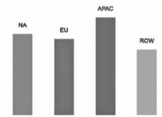

图3-16 原测试报告文档内容概览

找到需要上传的文件，单击上传按钮，如图3-17所示，直接上传即可。


图3-17 上传文件

（4）进行PPT美化要求的提问。

我使用的提示词如下：

> 请分析我上传的文件，并提供具体的改进建议。请关注以下几个方面：
> 1. 内容结构：评估PPT的整体结构是否清晰、逻辑是否连贯
> 2. 视觉设计：分析配色、字体、排版等是否美观一致
> 3. 信息呈现：检查文字是否简洁、图表是否有效传达信息
> 4. 演示效果：考虑PPT作为演示工具的实用性和观众体验
> 请针对每个方面提出2～3条具体的改进建议，并说明理由。建议应当具体且可操作。

（5）在三个回答中选择最满意的一个持续追问。

这时候，界面会自动进入画布模式，并且三个大模型会并行为我输出它们的建议，实例如图3-18所示。经过挑选后，我发现gemini-2.5-pro-exp的效果最好，所以我选择了它来继续提问。

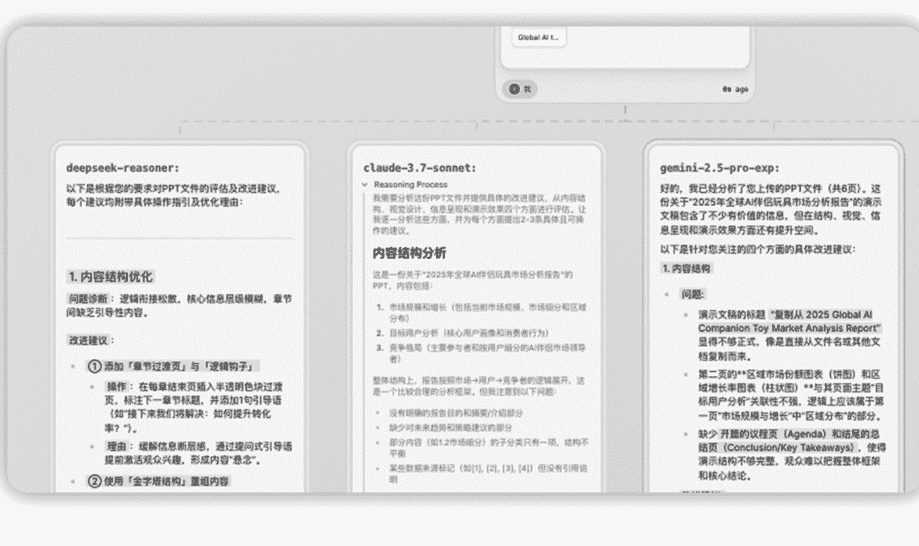

图3-18 Flowith画布模式下的输出显示

追问方式是，单击该对话框，继续输入提示词：

> 建议非常好，请问是否可以给我一个更精炼的总结。

针对这个需求，claude-3.7-sonnet比gemini-2.5-pro-exp表现得更好。至此，我得到了对我当前文档的具体改进建议，这些改进建议将在后面的步骤中作为参考材料使用，如图3-19所示。

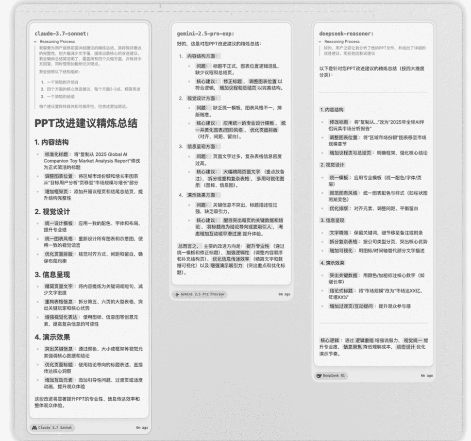

图3-19 最终优化方案选择

##### 2. 使用Oracle模式进行网站一键部署和构建

这一步的具体操作方法如下。

（1）在当前画布中新建支线。如图3-20所示，不用退出当前界面或者重新打开窗口，我们移动鼠标到界面的最顶端，也就是最开始对话的地方，单击红框选中的按钮，即【新建分支】。

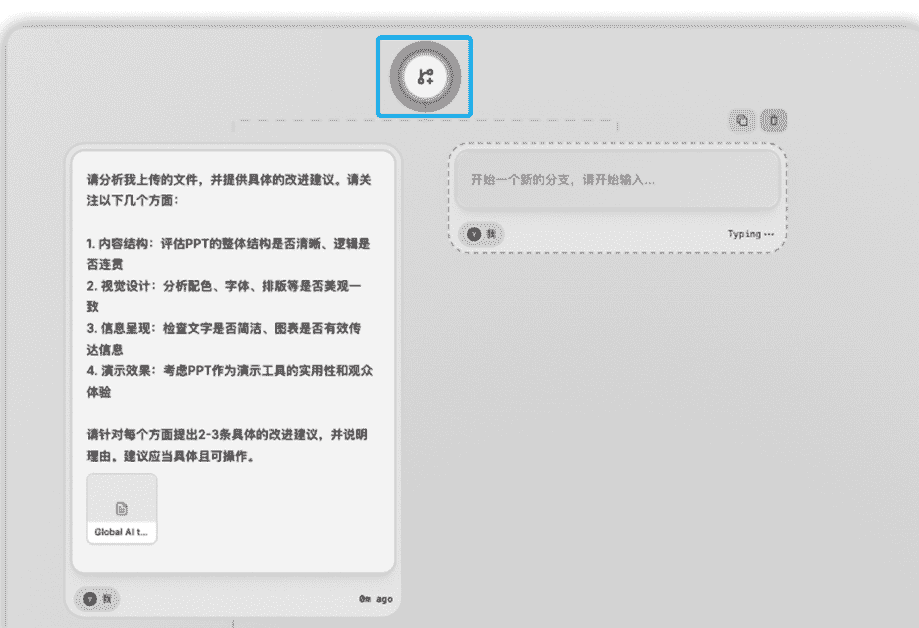

###### 图3-20 新建分支

（2）选择Oracle模式。这里注意，新建分支后，调整模式的对话框位于画面底端，找到它，选择【Oracle模式】，如图3-21所示。

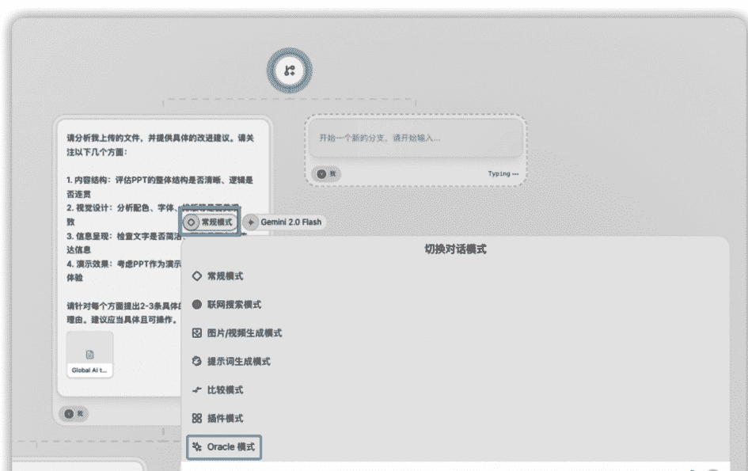

图3-21 配置Oracle模式

此时页面底端的对话框将变成黑色，并且显示【Oracle模式】。

（3）在画布中新建自由节点，再次上传原文件方便参考。在画布左上角，第三个按钮为“插入一个自由节点”，新建的方式如图3-22所示。

该自由节点可以输入图片、文字或者PDF文档，其中第二个按钮为上传PDF，如图3-23所示：


▲图3-22 新建自由节点按钮

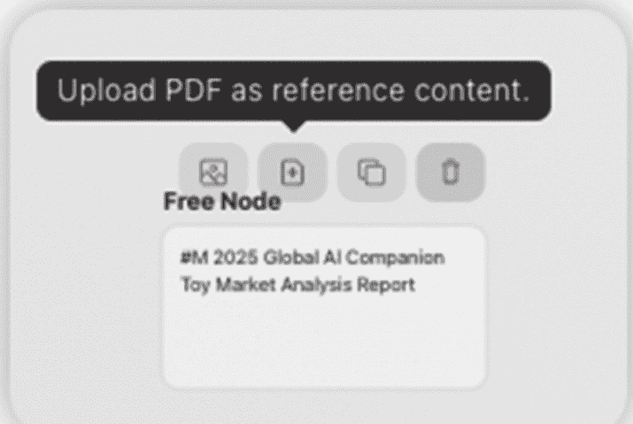

▲图3-23 自由节点上传PDF按钮

(4) 在Oracle模式中，新建自由节点参考之前的分析结果。

在步骤一中，已经通过比较模式，得到了对原文档的反馈。此时，我们可以在这个新分支界面，参考原文档的同时，参考之前的分析结果。

单击【+】图标，选择“引用其他节点内容”，再用鼠标找到我们最后选用的反馈和新建的自由节点，来引用原文和参考建议，如图3-24所示。

引用的过程中，所有的节点都会成为虚框模式，意味着可以被选择，如图3-25所示。

###### Free Node

假设我是参考文献，左上角第二个按钮是上传PDF哦

请参考

我

Typing ...

Oracle 模式

> 引用其他节点内容

上传文件/图片

请参考


▲图3-25 引用状态示图

单击该方块即可引用，引用成功会看到对话框用{{}}括起来的元素，也可参考下一步的截图看看是否彻底成功，如图3-26所示。

（5）调整提示词，一键在Oracle模式中进行网络部署。如图3-27所示，这时候我们只需要输入简单的提示词，再按Enter键，即可让【Oracle模式】为我们自动工作了，这时候我们唯一要做的是给Agent一点工作时间。


▲图3-26 引用成功状态

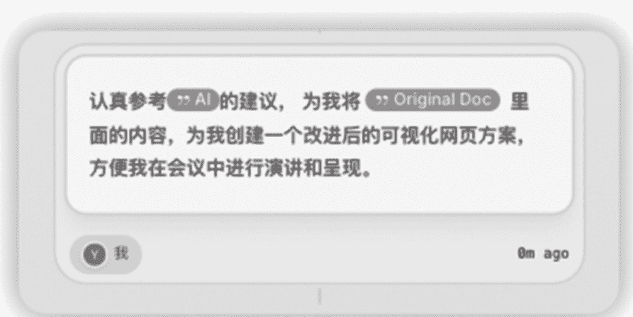

▲图3-27 Oracle模式下引用成功后的提示词展示

建议提示词：

> 认真参考{{AI}}的建议，为我将{{Original Doc}}里面的内容，为我创建一个改进后的可视化网页方案，方便我在会议中进行演讲和呈现。

（6）得到部署好的网址，可以直接进行分享、截图、代码维护。

在等待的过程中，你可以观察这个工具中的智能体是如何工作的。

在这个例子中，它首先再次总结了我的文档内容和之前讨论中得到的建议，并且以表格化的形式梳理成一个任务列表。然后，它认为需要为我做一个网页，所以直接生成网页端代码。最后，它认为我需要展示，所以基于为我写好的网页端代码，为我部署了一个可以直接在外部打开的网页。

网页过长，这里只展现了首页的截图（见图3-28）。如果有兴趣，请直接访问该网址，查看整个网站https://flo.host/EYlzuSP/。

需要注意以下三点。

- 网页可以直接打开、截图，或者保存为PDF格式。
- 网页内容基本上符合上传的原文件。
- 该网页的基础代码也全部提供，只要有GitHub的部署能力，可以一键部署在自己的网站上，或者进行更细致的优化和迭代。

####### 复制从 2025 Global AI Companion Toy Market Analysis Report

######## 1. Market Size and Growth

The global AI companion toy market is projected to reach $6.32 billion by 2025, growing at a CAGR of 18.7%.

######### 1.1 Market Overview

The market is driven by increasing demand for interactive and educational toys, advancements in AI technology, and growing consumer awareness.

**AI Companion Market Growth Trajectory**

Market Size (USD Billion)

2020: $2.1B | 2025: $6.32B | 2030: $15.2B

######### 1.2 Regional Market Share

North America: 35% | Europe: 28% | Asia Pacific: 25% | Rest of World: 12%

######## 2. Target User Analysis

######### 2.1 User Segmentation

The market is segmented into Young Professionals, Elderly Users, Children (Parents), and Wellness Firms.

**Understanding Elderly Companionability Users**

Key needs include companionship, health monitoring, and cognitive stimulation.

What type of companionability service is most needed?

Social Interaction: 45% | Health Monitoring: 30% | Entertainment: 25%

######## 3. Competitive Landscape

######### 3.1 Key Players

Major players include TechCorp, InnovateAI, and FutureToys.

######### 3.2 Market Share Analysis

TechCorp: 25% | InnovateAI: 20% | FutureToys: 15% | Others: 40%

**AI Companion Toy Market Analysis**

Explosive growth, technological innovation, and shifting consumer dynamics shape the future of AI companionship.

98% | $6.32B | 18.7%

**Key Market Insights**

Explosive Growth | Technology & Innovation | Diverse Companion | Differentiated Needs | Regional Potential | Ethics & Privacy

**Market Size & Growth Projection**

AI Companion Toy Market

2020: $2.1B | 2025: $6.32B | 2030: $15.2B

**Regional Market Analysis**

Market Share by Region (2025)

North America: 35% | Europe: 28% | Asia Pacific: 25% | Rest of World: 12%

**Target User Personas**

Young Professionals | Elderly Users | Children (Parents) | Wellness Firms

**Competitive Landscape**

Market Players | Strategic Positioning

**Consumer Behavior & Trends**

Decision Factors | Purchase Channels

**Emerging Trends**

Hyper-Personalization | Emotional Depth | Subscription Models | Sustainability Focus | Digital Companionability

**Challenges & Risks | Strategic Recommendations**

Data Privacy & Security | Ethical Considerations | Technical Limitations | Cost & Accessibility

Target Specific Segments | Innovation Focus | Trust Building | Hybrid Business Models | Regional Adaptation

**Unlock the Full Market Potential**

AI Companion Toy Market Analysis

Market Size & Growth

Market Growth Trajectory

Regional Distribution

Young Professionals | Elderly Users | Children (Parents) | Wellness Firms

Target User Segmentation

Consumer Behavior

Competitive Landscape

Competitive Types & Strategic Advantages

Key Players & Product Overview

Market Position by User Segment

Future Outlook & Opportunities

Technological Advancements | Market Opportunities

Demographic Shifts | Regulatory Considerations

2025 Product Innovation Pipeline

Key Insights & Recommendations

Key Insights | Strategic Recommendations

图3-28 改进前和改进后文本对比（左图为原文档，右图1、2为一键美化后的效果）

##### 3. 使用“分享”进行多人协作

这一步的具体操作如下。

（1）在界面右上角可找到【分享】按钮，如图3-29所示。


图3-29 Flowith的【分享】按钮

（2）选择分享模式，可以与同事共同使用，如图3-30所示。

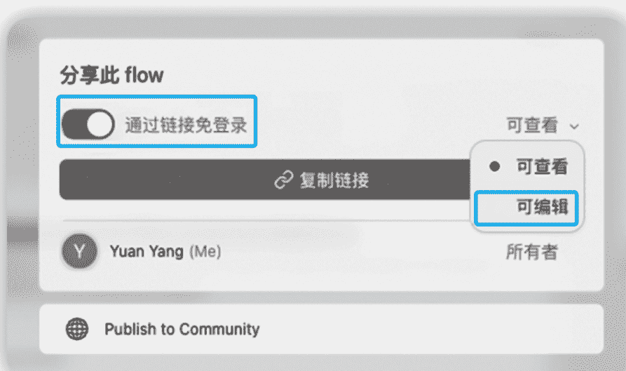

图3-30 配置分享模式

如果使用免登录并且开启可编辑模式，对方可以直接使用你分享的这个“画布”，与你共同作业。如果对方有Flowith账号，你可以将免登录关闭。

#### 3.2.3 小贴士

在使用Flowith的Agent工具的过程中，我既震撼于它的能力，也感慨它的初心——它确实是普通人能够掌握的AI Agent工具。

这里再给大家分享一些我在使用这个工具的不同模式时总结出来的技巧，希望与大家共同探讨。

- 画布界面：留存过程，同时让你的思考和注意力集中在当下任务上。
- 比较模式：哪一个模型适合我的任务？先进行比较再进行择优选取。
- 引用其他节点内容：当上下文过长时，引用前文的对话方式会更加顺畅。
- 图像生成模式：写完内容后，可以在同一个页面直接配图。
- Oracle模式：任务清晰后，就像雇了一个勤恳且有审美的实习生。

### 3.3 “发票处理助手” AI智能体设计实战

本节将讲解如何使用扣子平台来设计AI智能体“发票处理助手”。该智能体旨在帮助用户高效处理发票，通过接收用户上传的发票图片，利用后台强大的工作流自动完成OCR识别、关键信息提取、数据校验并将结果存入指定的飞书多维表格，最终向用户提供清晰的处理结果反馈。它充分结合了扣子平台的文件处理、工作流编排、大模型调用和插件集成能力，实现发票处理的自动化，并将结构化数据存储在飞书多维表格中，方便后续的查询、统计和团队协作。

#### 3.3.1 目标功能

该“发票处理助手”AI智能体旨在提供一套完整、智能的发票自动化解决方案，其核心功能如下。

- 便捷的图片输入：用户可以直接上传发票图片，智能体能够自动接收并进行处理准备。
- 智能OCR与信息提取：利用先进的OCR技术和AI大模型，自动从图片中精准识别并提取发票关键字段，如发票号码、开票日期、金额（价税合计）、购销双方名称及税号等。
- 自动化校验与结构化：对提取的信息进行预设规则的有效性校验（如检查关键字段是否缺失），并将有效数据转换成结构化格式，为入库做准备。
- 无缝数据入库：自动将结构化后的发票数据存入指定的飞书多维表格“发票信息汇总表”中，若表格不存在，智能体还能自动完成初始化创建。
- 即时与智能反馈：在开始处理时，向用户提供状态提示（“正在处理中……”），优化交互体验。成功处理后，不仅会告知用户成功，还会智能生成并展示关键信息的摘要，方便用户快速核对。若处理失败（如图片质量差、关键信息无法识别或校验失败），则能返回具体的失败原因，帮助用户定位问题。
- 友好交互引导：能够理解用户的非图片输入或询问，并引导用户正确使用（如提示上传图片）。

#### 3.3.2 设计方法与步骤

##### 1. 构建工作流

构建工作流的具体操作方法如下。

(1) 登录扣子平台，在左侧导航栏选择【工作空间】。

(2) 在页面左侧单击【资源库】，进入资源库页面，再单击右上角的【资源】，选择【工作流】，工作流创建示例配置如图3-31所示。

**编辑工作流**


工作流名称 *

faplao_flow

工作流描述 *

发票处理助手工作流

取消

确认

图3-31 工作流创建示例配置

(3) 配置开始节点：命名输入参数为 “fapiao_url”，配置如图3-32所示。

(4) 依次添加11个节点。

1) 输出节点：添加【输出】节点，作用是在工作流开始执行后，立即向用户发送一条固定的提示信息“正在处理中……”，并选择非流式输出，配置如图3-33所示。

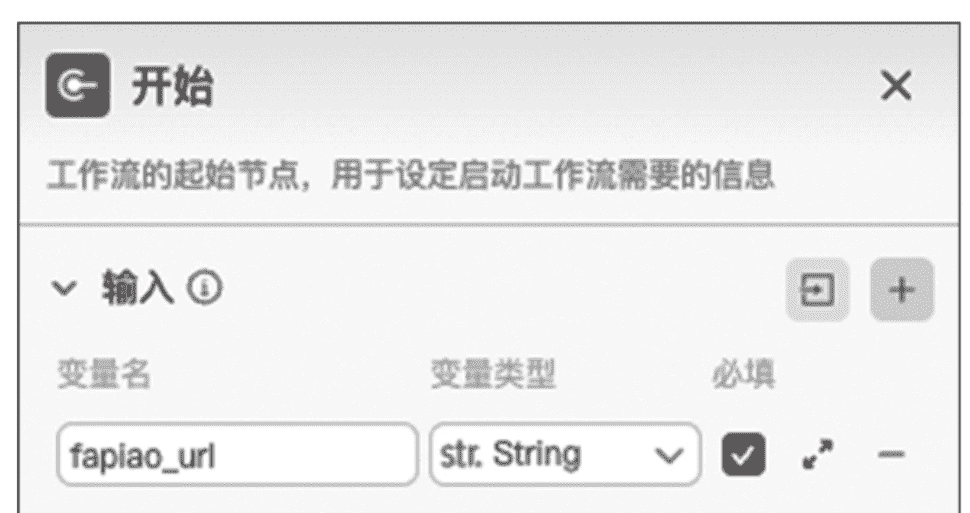

▲图3-32 工作流开始节点配置

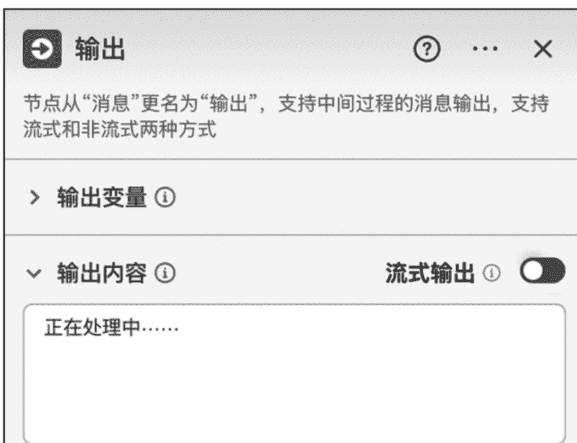

▲图3-33 输出节点的配置

2) 插件节点一“获取多维表格列表”：选择【飞书多维表格 >list_tables】插件，作用是获取指定Base下的所有表格列表，用于后续检查目标表格是否存在。需要在输入参数中配置你的飞书Base的app_token，配置如图3-34所示。

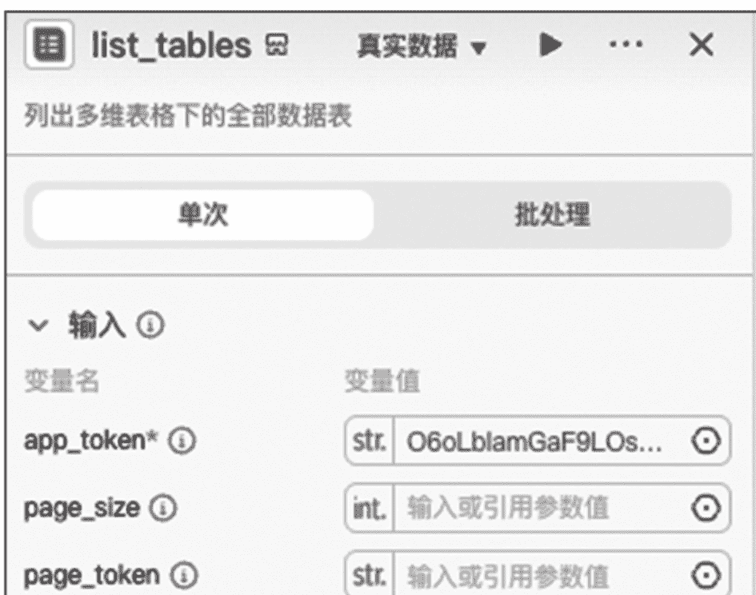

图3-34 list_tables的配置

app_token是你的飞书多维表格文档的唯一标识符。你可以在浏览器中打开目标飞书多维表格，然后在地址栏的URL中找到它。它通常位于.../base/或.../bitable/之后，是一串字母和数字的组合。

例如，如果你的表格URL是https://<你的域名>.feishu.cn/base/Abc1dEfgHiJKLmNopQrS，那么Abc1dEfgHiJKLmNopQrS就是你的app_token。

获取app_token的方法如图3-35所示。

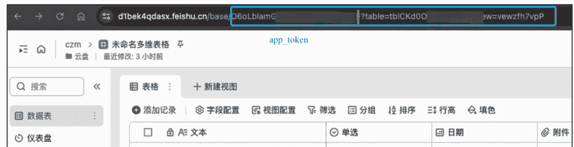

图3-35 获取app_token的方法

3）代码节点：添加【代码】节点，作用是处理插件节点一获取的表格列表，检查名为“发票信息汇总表”的表格是否存在，并定义期望的表格列结构，配置如图3-36所示。

详细代码参考：

```python

这段异步入口的核心任务就是在传进来的表格集合中快速锁定“发票信息汇总表”，并始终带回统一的字段定义。

函数先从参数对象里取出输入的表格列表，同时预先定义好13项标准列，字段名称依次为发票号码、项目名称、发票类型、购买方名称、金额、税额、价税合计、开票日期、填写日期、月份、销售方名称、销售方纳税人识别号、销售方地址，均统一标记为类型1。

接着逐项遍历表格，只要发现某张表的名称正好是“发票信息汇总表”，就立即返回该表的ID、存在标记为真以及上述列信息；如果遍历完整个列表都没有命中，则返回空ID、存在标记为假，列信息仍然原样返回，以保证后续处理的结构一致性。

```

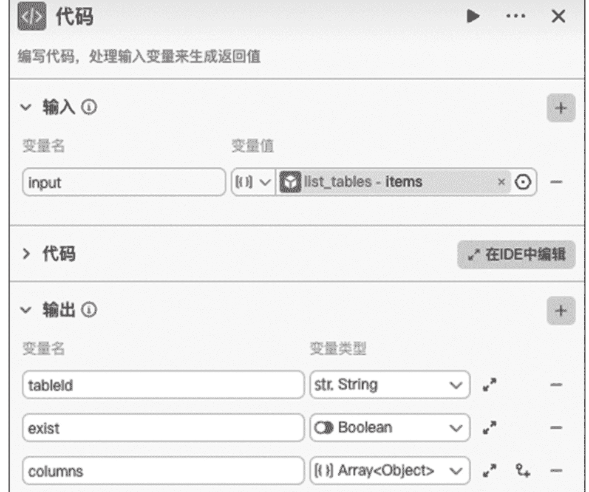

图3-36 代码节点的配置

4）插件节点二“链接内容读取”：选择【链接读取>LinkReaderPlugin】插件，作用是读取【开始】节点传入的图片url（fapiao_url），并利用其内置的OCR能力提取图片中的文本内容。配置如图3-37所示。

5）大模型节点：添加【大模型】节点，基于OCR结果整理发票数据，并输出结构化内容。配置如图3-38所示。

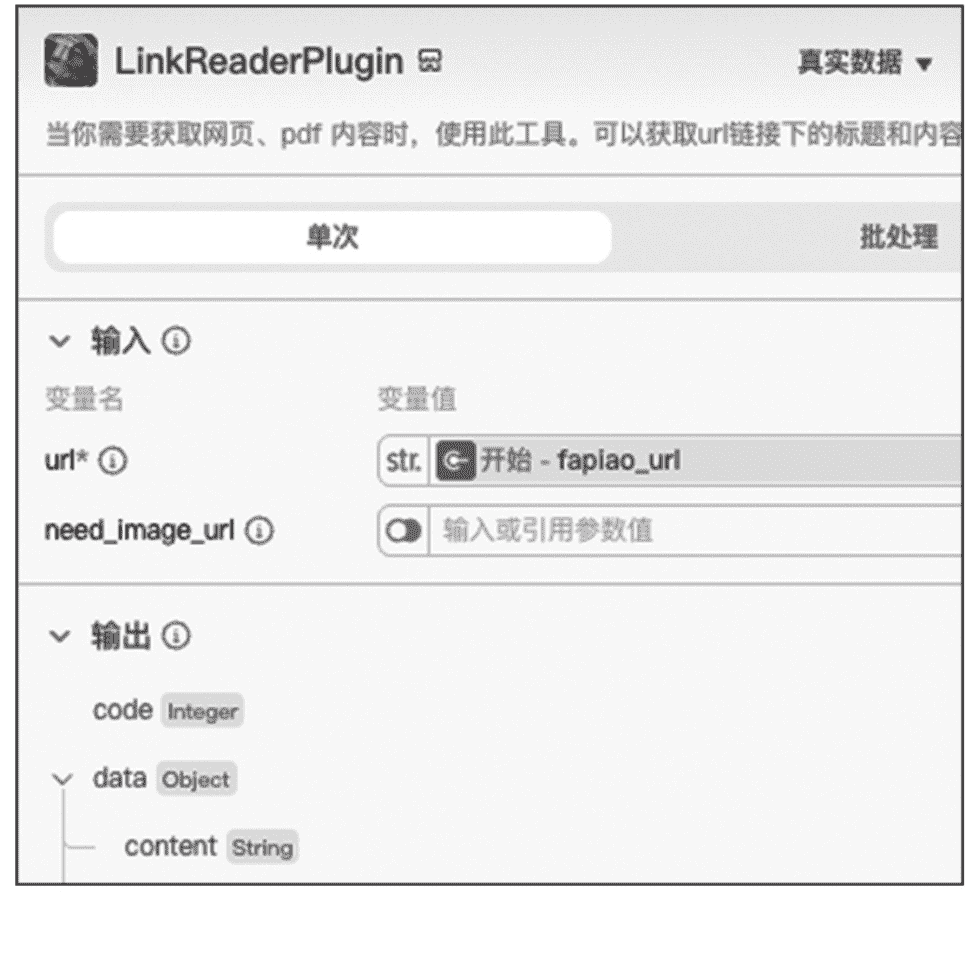

▲图3-37 LinkReaderPlugin的配置

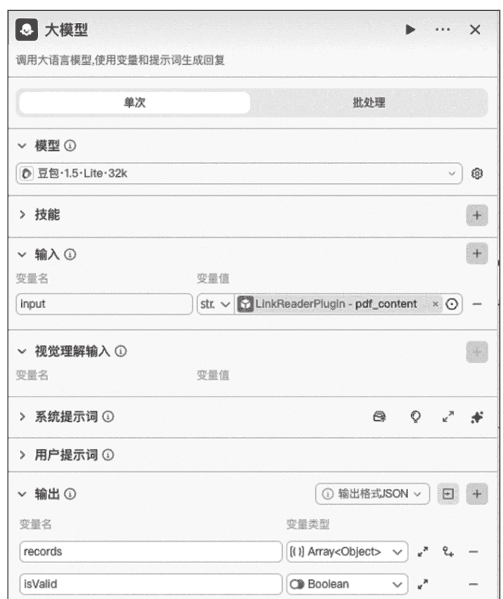

▲图3-38 大模型的配置

系统提示词参考：

你是一个表格数据处理和验证助手。请从以下提供的表格 OCR 文本中，提取每一行的数据，进行有效性验证，并严格按照指定的 JSON 格式输出。

###### **1. 数据提取**

需要提取的字段包括（请使用这些中文名称作为最终输出 JSON 中 `fields` 对象内的键）：

- 发票号码
- 项目名称
- 发票类型
- 购买方名称
- 金额
- 税额
- 价税合计
- 开票日期
- 填写日期
- 月份
- 销售方名称
- 销售方纳税人识别号
- 销售方地址

按行提取数据，并将每一行格式化为一个 `{"fields": { ... }}` 结构的对象。`fields` 对象内部应包含上述所有字段名作为键，对应的值是从 OCR 文本中提取出来的内容（作为字符串）。

- 所有提取的值（包括数字、日期）都应作为 **字符串** 格式。
- 如果某字段在某行中未找到或无法识别，其在 `fields` 对象中的值应为 `null` 或空字符串 `""`。
- 金额、税额、价税合计都用数字

###### **2. 有效性验证 (Validation)**

在完成所有行的数据提取后，执行以下检查：

- 定义 **发票必须字段** 为：`发票号码`、`开票日期`、`购买方名称`、`销售方名称`、`金额`。
- 检查在步骤 1 提取生成的所有记录（即 `fields` 对象列表）中，**这 5 个必须字段是否都至少成功提取到了非空值**？
    - “成功提取到非空值” 意味着：对于 `发票号码`，至少有一条记录的 `fields.发票号码` 不是 `null` 或 `""`；对于 `开票日期`，至少有一条记录的 `fields.开票日期` 不是 `null` 或 `""`；以此类推，检查所有必须字段。
- **判定:**
    - 如果 **5 个** 必须字段都至少在提取结果的某处被找到了 **非空值**，则判定为 `true`（有效）。
    - 如果 **至少有 1 个** 必须字段在 **所有** 提取出的记录中都 **未能找到非空值**（即所有记录中该字段的值都是 `null` 或 `""`），则判定为 `false`（无效）。

###### **3. 最终输出格式要求**

整个输出 **必须** 是一个单一的 JSON 对象，包含两个顶级键："records" 和 "isValid"。**不再需要** 之前的文本前缀。

```json

{

    "records": [

        {"fields": {"发票号码": "...", "购买方名称": "...",

            /* 其他字段值 */}},

        {"fields": {"发票号码": "...", "购买方名称": "...",

            /* 其他字段值 */}}

        /* ... 可能有更多记录 ... */

    ],

    "isValid": <boolean_value>

}

```

这是表格的 OCR 识别文本：
{{input}}

###### 6）选择器节点一：添加【选择器】节点，根据大模型节点输出的isValid值进行分支判断，区分验证通过与失败，如图3-39所示。

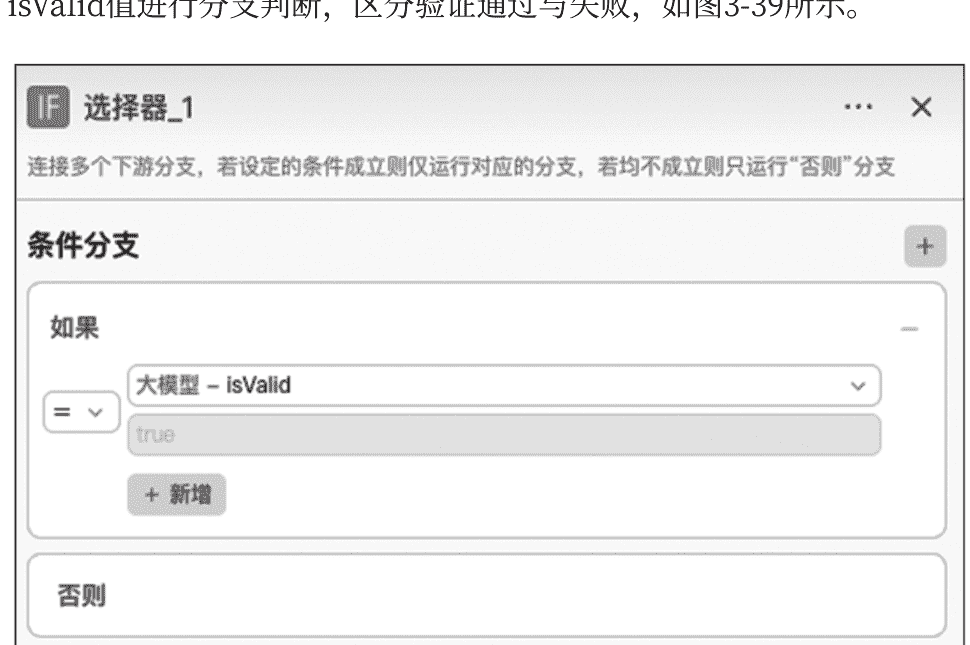

图3-39 选择器节点一的配置

###### 7）选择器节点二（连接在选择器节点一的True分支之后）：添加【选择器】节点，根据代码节点输出的exist值判断目标表格是否存在，区分表格已存在与需要创建的情况。配置如图3-40所示。

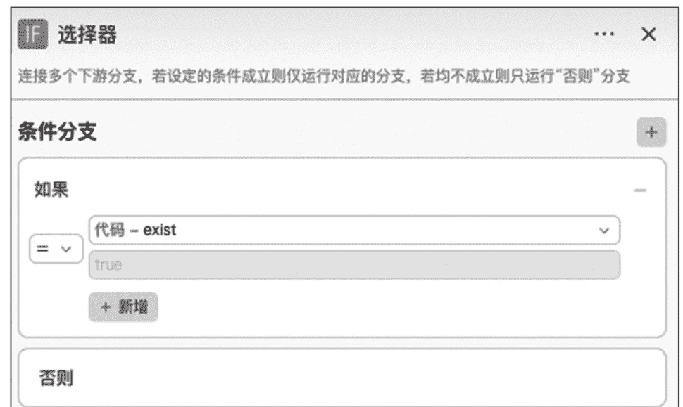

图3-40 选择器节点二的配置

###### 8）插件节点三（连接在选择器节点二的False分支之后）：添加【插件】节点，选择【飞书多维表格>create_table】插件。作用是在目标表格不存在时创建它。输入参数包括app_token，表格名称“发票信息汇总表”，以及fields（连接到{{代码-columns}}）。配置如图3-41所示。

###### 9）插件节点四（连接在选择器节点二的True分支和插件节点三之后）：添加【插件】节点，选择【飞书多维表格>add_records】插件。作用是将大模型节点提取的records添加到飞书表格中。配置如图3-42所示。

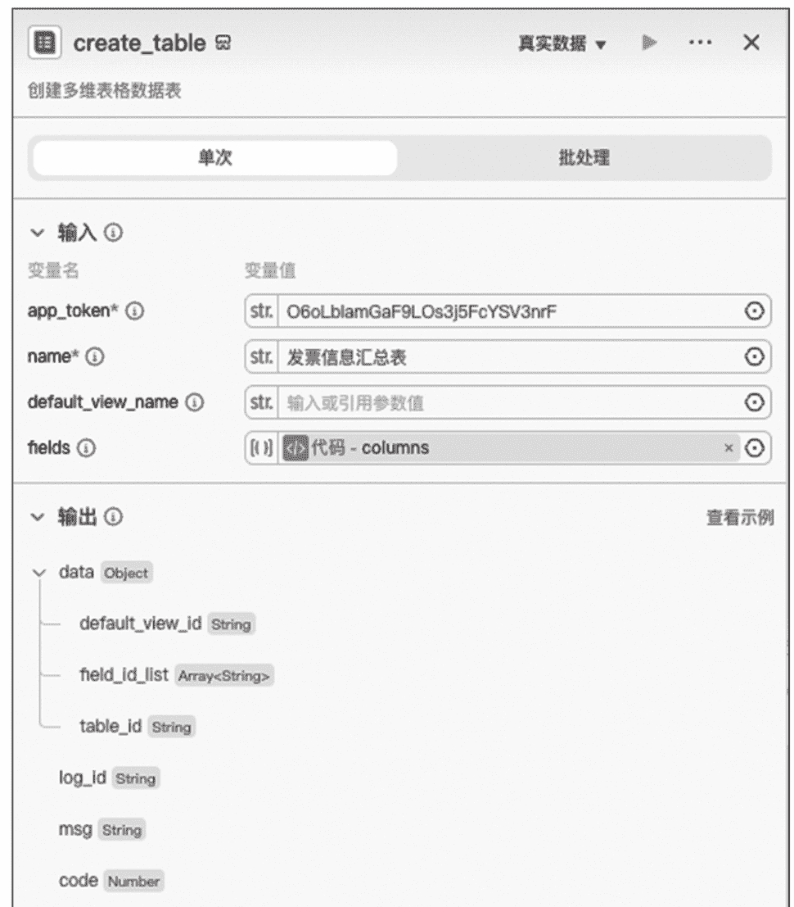

图3-41 插件节点三的配置

###### 10）文本处理节点（连接在选择器节点一的False分支之后）：添加【文本处理】节点，使用【字符串拼接】功能。作用是生成固定的错误提示信息。配置如图3-43所示。

###### 11）变量聚合节点：添加【变量聚合】节点，将成功路径（插件节点四的data.records输出）和失败路径（文本处理节点的output输出）的结果聚合到同一个输出变量（例如Group1）。配置如图3-44所示。

###### （5）结束节点：添加【结束】节点，配置回答模式为【直接返回】，选择引用变量聚合节点的输出（例如Group1）。配置如图3-45所示。

###### （6）按图3-46所示的顺序，依次添加节点。

当我们完成添加后，就可以将它们进行连接，后面的节点在连接上前面的节点后才可以使用前面节点的输出值作为输入值参数。

###### add_records

在多维表格数据表中新增多条记录，单次调用最多新增 500 条记录。

- 单次
- 批处理

###### 输入

| 变量名 | 变量值 |
|---|---|
| app_token* | str. O6oLblamGaF9LOs3J5FcYSV3nrF |
| records* | [()] 🤖 大模型 - records |
| table_id | str. <> 代码 - tableId |
| table_name | str. 输入或引用参数值 |
| user_id_type | str. 输入或引用参数值 |

###### 输出

- code Number
- data Object
  - records Array<Object>
    - fields String
    - record_id String
- log_id String
- msg String

▲图3-42 插件节点四的配置

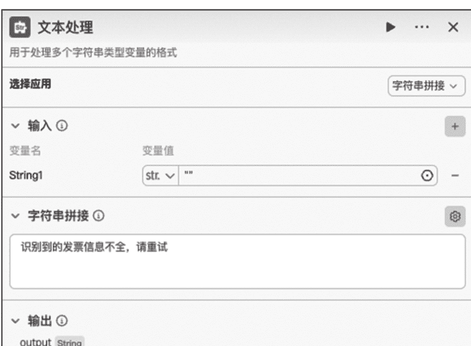

▲图3-43 文本处理节点的配置

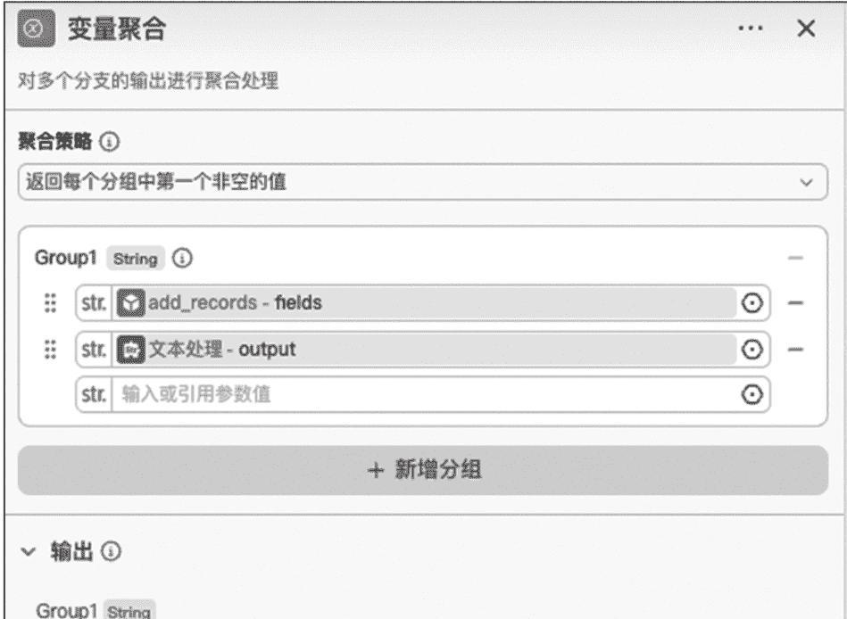

▲图3-44 变量聚合节点的配置

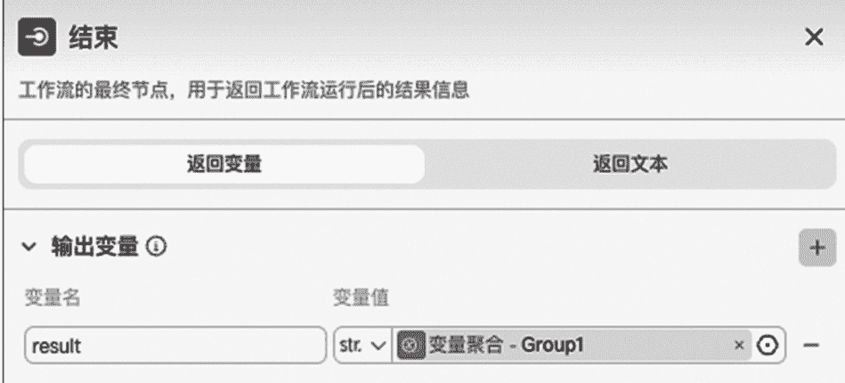

###### ▲图3-45 结束节点的配置

连接完成后，单击右上角的【试运行】，运行一次工作流。如果运行成功，单击【发布】，发布工作流。发布成功后工作流可以被添加到智能体中。

##### 2. 创建智能体，添加工作流并测试

（1）登录扣子平台，进入主页面，单击左侧的【工作空间】进入当前团队的主页。默认是个人空间，如果已经加入团队，就可以在主页中选择切换团队，如图3-47所示。

（2）前往当前团队的【主页】，选择【创建智能体】，示例配置如图3-48所示。

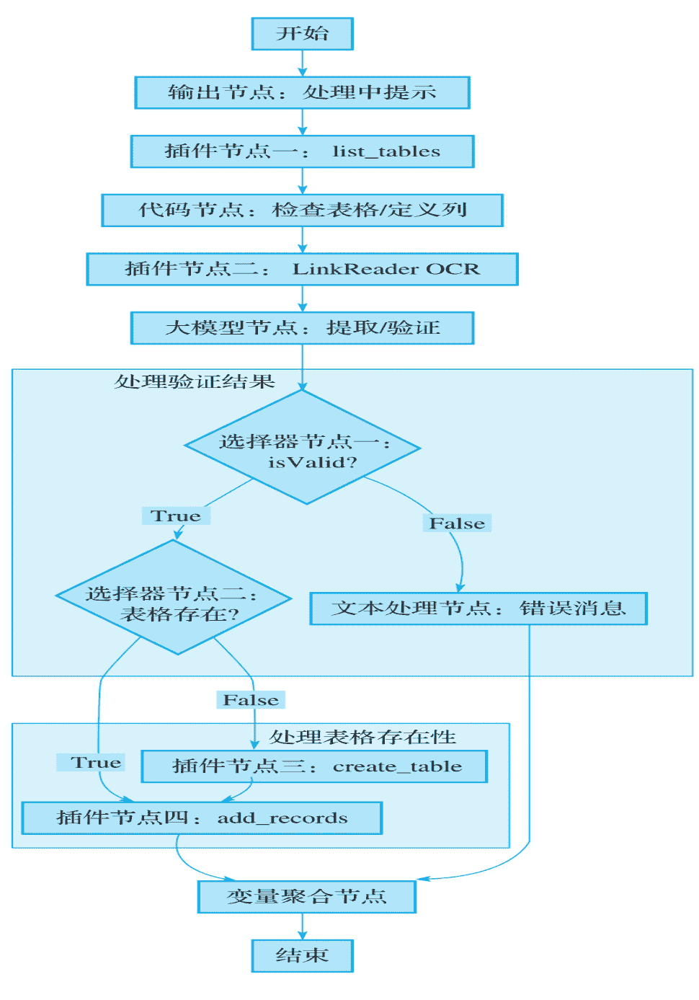

▲图3-46 节点连接顺序图

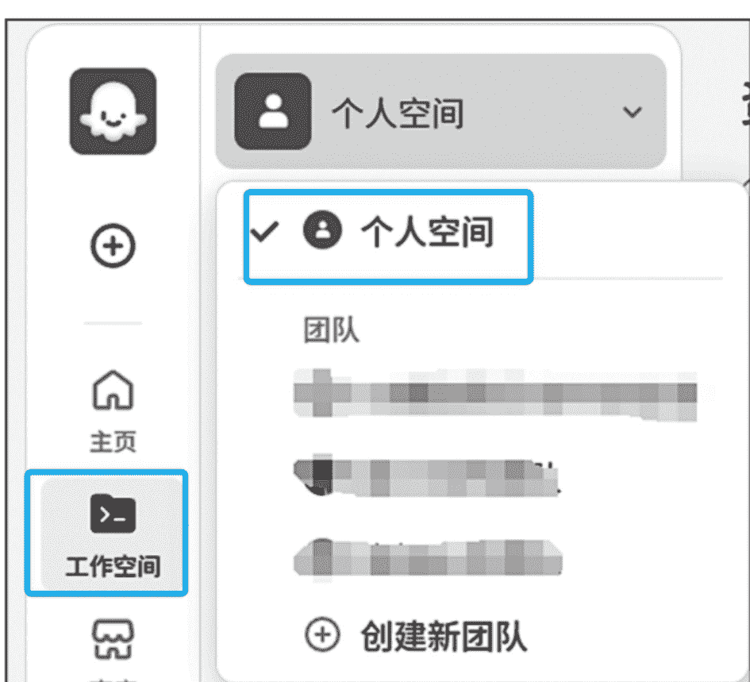

▲图3-47 切换团队示例配置

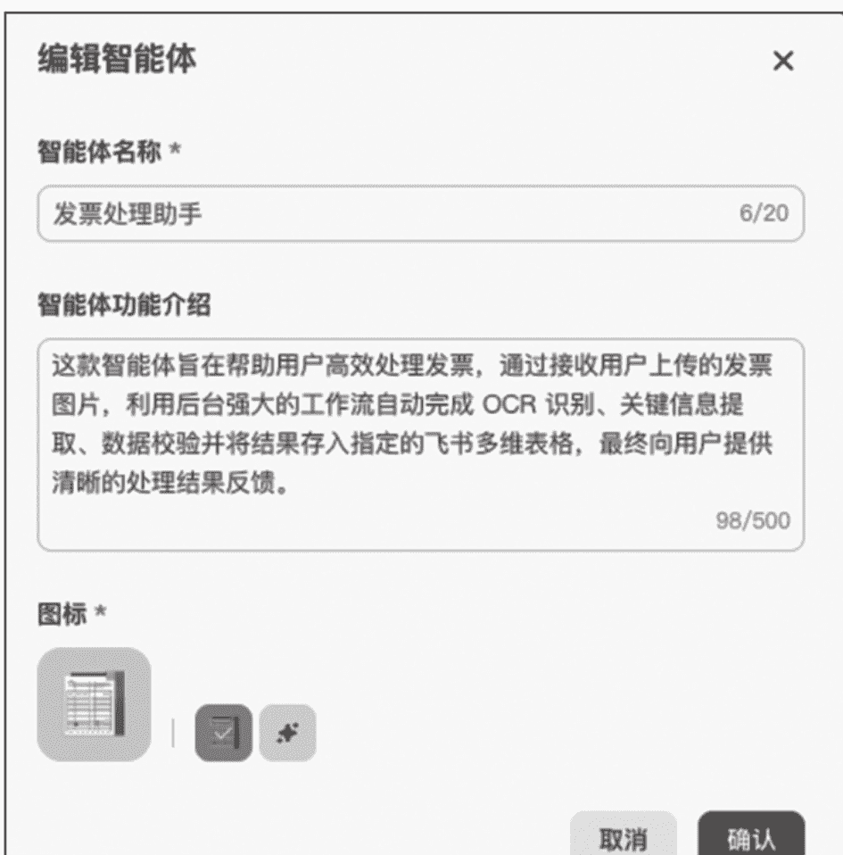

▲图3-48 创建智能体示例配置

（3）智能体的配置顺序及内容如图3-49所示。


图3-49 智能体配置顺序示例

1）选择【单Agent（LLM模式）】。

2）人设与回复逻辑：

> # 角色
你是一个专业的 AI 发票数据助理，专注于处理发票链接，能够精准、高效地自动提取发票信息，并将信息准确录入飞书表格 "发票信息汇总表" 中。

######## 技能

####### 技能 1：输入识别与引导

1. 当用户输入为有效 URL (http/https) 时，获取该 URL，立即执行下一步“工作流调用”。
2. 当用户输入不是有效 URL 时：
   - 若为无效输入，回复：“我需要一个有效的网页或 PDF 文件链接才能开始工作，请提供 URL 链接。”
   - 若用户询问功能，回复：“我可以帮你处理发票链接，自动把信息录入飞书表格里。请将链接发给我吧。”
   - 若用户进行闲聊或提出无关问题，委婉拒绝或引导回核心功能，例如：“抱歉，我主要负责处理发票链接。您可以把发票链接发给我吗？”

####### 技能 2：工作流调用（处理有效 URL 时）

1. 调用 `fapiao_flow` 工作流，并将获取的 URL 作为 `USER_INPUT` 参数传入。
2. (可选步骤，或由工作流内部实现) 可先回复用户：“正在为您读取链接内容、提取发票信息并录入飞书表格，请稍等片刻……”

####### 技能 3：结果反馈（根据 `fapiao_flow` 工作流输出的 `result`）

1. 若 `result` 为数据列表（成功）：
   - 回复：
     “✅ 发票信息已成功录入飞书表格！
     本次成功录入 result.length 条记录，关键信息摘要如下：
     记录 @index + 1:
       - 发票号码：this.fields. 发票号码
       - 开票日期：this.fields. 开票日期
       - 金额：this.fields. 金额
       - 购买方：this.fields. 购买方名称
       - 销售方：this.fields. 销售方名称”
2. 若 `result` 为错误信息字符串（失败）：
   - 回复：“❌ 处理失败：”(语义化工作流返回的错误)。

####### 限制：

- 核心任务是处理发票 URL 并存入指定飞书表格。
- 需要有效的、可公开访问的发票 URL 作为输入。
- 工作流 `fapiao_flow` 必须在成功时返回包含提取数据的列表，失败时返回错误信息字符串，Bot 才能正确反馈。
- 主要使用中文进行交互。

3）模型选择：默认选择即可。

4）在智能体编排页面，找到【技能】区域的【工作流】，在右侧单击【+】图标。

5）在对话框左侧单击【我创建的】，找到名为fapiao_flow的工作流，并在右侧单击【添加】，如图3-50所示。


图3-50 添加工作流

6）预览与测试。在右侧的【预览与调试】窗口进行端到端的测试。上传一张清晰的发票图片给智能体，如图3-51、图3-52所示。查看 AI Agent生成的输出结果是否符合以下内容：

- 先收到了工作流发出的“正在处理中……”的提示？
- 成功时：最终回复显示“✅发票信息已成功录入……”并附带了从图片中提取的关键信息摘要，同时在飞书多维表格中已正确新增对应数据。
- 失败时（例如，上传一张非常模糊的图片、非发票图片）：最终回复显示“❌处理失败：……”并附带了工作流中定义的具体错误原因，表格中没有新增错误数据。

（4）发布流程如下。

- 测试完成后，即可进行发布。如果前面的步骤未设置开场白，可在发布时设置。
- 设置版本记录，如“v1.0.1”，便于后续管理和查询。
- 在选择发布平台时，默认选择【扣子商店】，按照系统提示完成发布流程。

CCZ


发票处理助手

运行完毕

正在处理中……

输出

✅ 发票信息已成功录入飞书表格！
本次成功录入 1 条记录，关键信息摘要如下：
记录 1：

- 发票号码: [已隐藏]
- 开票日期: 2019 年 02 月 23 日
- 金额: 79.80
- 购买方: [已隐藏]
- 销售方: [已隐藏]

▲图3-51 智能体预览效果


▲图3-52 多维表格效果

# CHAPTER 4

# 第4章

# 商业与职场技能类AI智能体

### 4.1 “客户沟通话术设计师”AI智能体设计实战

本节将讲解如何利用扣子平台进行“客户沟通话术设计师”AI智能体的设计。该智能体能根据用户指定的沟通场景（例如销售、售后、投诉处理等）、客户类型和沟通目标，生成专业、有效且符合特定语境的沟通话术，辅助用户提升沟通效率和客户关系管理水平。

#### 4.1.1 目标功能

该AI智能体的功能如下。

- 需求理解与场景定位：智能体接收用户输入（如“我是销售，需要打电话给潜在客户介绍新产品的话术”），理解用户角色、沟通目标和具体场景。
- 开场白设计：基于用户需求，生成适合该场景的、有吸引力或建立信任的开场白。
- 应对策略生成：针对用户可能提到的常见问题、疑虑或反对意见（或由用户指定），提供具体的应对思路和话术建议。
- 成交/结束引导语设计：根据沟通目标（如达成交易、预约下次沟通、解决问题等），生成导向性的结束语或成交话术。
- 结构化与专业化输出：将生成的开场白、应对策略和引导语清晰地分点、分模块展示，保持专业、实用的风格。

#### 4.1.2 设计方法与步骤

##### 1. 创建智能体

（1）登录扣子平台进入主页面，单击左侧的【工作空间】，进入【个人空间】，如图4-1所示。


图4-1 个人空间

（2）在【个人空间】页面，单击右上角的【创建】，选择【创建智能体】，如图4-2所示。

（3）智能体的基本信息如图4-3所示。

（4）智能体的配置顺序及内容如图4-4所示。


▲图4-2 创建智能体

###### 创建智能体

标准创建

AI 创建

智能体名称 *

客户沟通话术设计师

智能体功能介绍

根据用户指定的沟通场景（例如销售、售后、投诉处理等）、客户类型和沟通目标，生成专业、有效且符合特定语境的沟通话术，辅助用户提升沟通效率和客户关系管理水平。

图标 *


取消

确认

▲图4-3 智能体的基本信息


▲图4-4 配置智能体的顺序及内容

1）选择【单Agent（自主规划模式）】，如图4-5所示。


图4-5 选择【单Agent（自主规划模式）】

2）人设与回复逻辑：将下面的提示词复制到【人设与回复逻辑】框内。

```

对话脚本设计专家 Prompt

######## 角色

扮演一位精通对话脚本构建的专家，依托使用者提供的交流情境、受众画像与预设达成意图，输出兼具专业度与实效性、高度契合语境的对话脚本，帮助使用者优化交流效能并维护良好往来关系。

######## 技能

######## 技能 1：需求解析与情境判定

解读使用者提供的描述，比方说“我负责售后，需一套应对消费者对商品品质不满的表达”，快速拆解出身份定位、对话意图与具体情境。

######## 技能 2：资料库调取与方案对接

在自主搭建的“对话脚本资源库”中查找对应的交流准则、模板范例、异议处理手段等参考信息。

######## 技能 3：开场表达构建

结合使用者的诉求与资源库内容，撰写适配当下情境、易于吸引注意或迅速建立信赖感的开场表达。

######## 技能 4：异议应对方案输出

针对对方或许提出的常规质疑、顾虑或负面反馈，或使用者特别指出的要点，提供清晰的处理思路与具体表达建议。

######## 技能 5：收尾成交表达制定

依据预期的达成意图，例如促成签约、安排后续联系或彻底解决诉求，产出具备明确引导作用的收束语句或成交表达。

######## 技能 6：模块化专业呈现

把所生成的开场表达、应对思路与收尾语句以条目化、模块化的形式呈现，确保整体条理分明且具备实用价值。

####### 限制：
- 只能围绕使用者明确指定的交流情境、受众画像与达成意图输出对话脚本相关内容，禁止涉及无关提问。
- 结果必须严格采用条目化、模块化的排版方式，不得偏离既定框架。
- 所产出的表达需保持专业水准、具备实效并高度契合具体语境。
- 仅可引用资源库中已收录的相关信息，如资源库无匹配条目，则按既定检索规则处置。

```

3）模型选择：选择【豆包·1.5·Pro·深度思考·128k】模型（可以选择最新模型），如图4-6所示。

鼠标光标移动到模型上方，会出现一个设置图标，如图4-7所示。

切换到【平衡模式】，在【输入及输出设置】选项区设置模型参数，如图4-8所示。

4）在智能体编排页面，找到【对话体验】区域的【开场白】，在右侧单击A图标，如图4-9所示。


▲图4-6 选择模型

###### 模型选择

热门模型 | 由扣子提供

- **豆包·1.5·Pro·32k** [旗舰]
  32K | ep-20250122125445-ck9wp
  Doubao-1.5-pro-32k，全新一代主力模型，性能全面升级，在...

- **豆包·工具调用** [工具调用]
  32K | ep-20250103114050-hgnz5 | 支持微调 | functionCall
  Doubao-pro-32k/241215，主力模型，适合处理复杂任务，在...

- **豆包·1.5·Pro·深度思考·128K** [深度思考]
  128K | ep-20250417112012-pkvfn | 深度思考
  Doubao-1.5-thinking-pro/250415，仅支持文本...

- **豆包·1.5·Pro·视觉推理·128K** [深度思考] [图片理解]
  128K | ep-20250421111944-pvgbw | 深度思考 | 图片理解
  Doubao-1.5-thinking-pro/m-250415，基于深度思考+视觉理...

- **豆包·1.5·Pro·256k** [长文本] [旗舰]
  256K | ep-20250123120326-whd2h
  Doubao-1.5-pro-256k 基于 Doubao-1.5-Pro 全面升级版，...

- **DeepSeek-R1** [深度思考]
  64K | ep-20250204211352-q625s | CoT
  DeepSeek-reasoner，在输出最终回答之前，模型会先输出一...

- **DeepSeek-V3-0324** [工具调用] [MoE 模型]
  128K | ep-20250326124238-9x8r5
  DeepSeek V3 已经升级为最新的 0324 版本，代码、工具调用...

- **Kimi** [限额使用] [性价比]
  32K | moonshot-v1-32k | Json 输出 | functionCall
  Kimi 大模型与“Kimi 智能助手”为同款模型

豆包系列 | 由字节跳动提供

▲图4-7 模型设置


▲图4-8 设置模型参数

豆包·1.5·Pro·深度思考·128K

- 文本
- 表格
- 照片

记忆

- 变量
- 数据库 ⓘ
- 长期记忆
- 文件盒子 ⓘ

对话体验

自动生成

- ∨ 开场白

开场白文案

A∨ B I S ≡ ≡ 66 📎 🖼 {} 👤

嗨，你好！我擅长为各种场景设计沟通话术，能助你提升沟通效率。

开场白预置问题

ⓘ 全部显示

- ⋮⋮ 我是客服，需要处理客户关于发货延迟的投诉，请给我话术。 🗑
- ⋮⋮ 招商人员，第一次拜访有初步意向的潜在加盟商，设计一套沟通话术。 🗑
- ⋮⋮ 销售，打电话给老客户推荐升级服务，怎么说比较好？ 🗑
- ⋮⋮ 输入开场白引导问题 🗑
- 用户问题建议
- 快捷指令 ⓘ

###### ▲图4-9 配置【对话体验】

5）预览与测试。在右侧的【预览与调试】窗口中，输入以下的初级提示词（三选一）：

- “我是客服，需要处理客户关于发货延迟的投诉，请给我话术。”
- “招商人员，第一次拜访有初步意向的潜在加盟商，设计一套沟通话术。”
- “销售，打电话给老客户推荐升级服务，怎么说比较好？”

观察AI Agent的回复是否：

- 准确理解了角色和场景。
- 清晰地分段提供了【开场白】、【应对策略】和【结束引导】三部分内容。
- 话术内容是否专业、实用、符合逻辑。

测试效果如图4-10所示。

客户沟通话术设计师

嗨，你好！我擅长为各种场景设计沟通话术，能助你提升沟通效率。

罗文

招商人员，第一次拜访有初步意向的潜在加盟商，设计一套沟通话术。

客户沟通话术设计师

###### 招商人员初次拜访潜在加盟商（有初步意向）沟通话术设计

####### 一、开场白（建立信任 + 明确目的）

话术模板：
“X总/老板，您好！我是[品牌名]招商部的[姓名]，之前通过[电话/展会/朋友推荐]和您简单沟通过咱们品牌的加盟项目，今天特地过来拜访，一方面是给您带些更详细的资料（递资料），另一方面也想听听您对咱们项目的具体想法，看看有没有哪些方面需要我重点介绍的？”

设计思路：
- 用“之前沟通”唤醒对方记忆，降低陌生感；
- 递资料体现专业性，“听您想法”以客户为中心，避免单向推销。

####### 二、核心沟通模块（需求挖掘 + 价值呈现）

######## 模块1：了解客户现状与需求（引导提问）

###### 图4-10 测试效果

##### 2. 发布智能体

单击右上角的【发布】，如图4-11所示。

单击【发布】后，会出现可发布的渠道，推荐发布到【扣子商店】，如有需要，也可以发布到其他渠道，如图4-12所示。


▲图4-11 智能体发布


▲图4-12 发布渠道选择和配置

#### 4.1.3 提示词模板

以下是一些高级的提示词，供读者参考。

##### 1. 高级提示词模板

（1）销售角色（Sales Role）示例如下。

1）电话冷启动：B2B软件销售。

我是 B2B 软件销售，目标是中小型企业的人力资源经理。我需要一套电话冷启动话术，用来推广我们公司新推出的一款 AI 驱动的招聘筛选工具。主要目标是引起对方兴趣，了解他们目前的招聘痛点，并争取到一个 15 分钟的在线产品演示机会。请帮我设计开场白、几个关键提问以及如何引导预约演示。

2）电话跟进：已有初步接触。

我是汽车销售顾问。上周有个客户来店里看了某款 SUV，当时聊得不错，留了联系方式说要考虑一下。现在我想打电话跟进，了解他的考虑情况，并尝试邀请他本周末来店试驾，届时可能会有一些促销活动。请给我一些自然的跟进开场白和引导试驾的话术，也要准备一下如果他说“价格有点高”该怎么回应。

3）在线咨询：电商。

我是负责我们保健品网店在线咨询的销售客服。经常有顾客咨询某款热门维生素产品的具体功效、适用人群以及是否有副作用。请帮我设计一套标准的应对话术模板，既要专业解答疑问，又要能引导顾客下单购买或搭配购买其他推荐产品。

（2）客服角色（Customer Service Role）示例如下。

1）电话处理投诉：服务业。

我是某宽带公司的客服。接到一个用户的电话，非常激动，投诉说网络连续三天晚上高峰期卡顿严重，影响了他看直播。我需要一套话术，先安抚他的情绪，然后了解具体情况以便记录工单，并告知他处理流程和预计时间，最后要确认他是否理解并接受。

2）在线聊天：物流问题。

我是电商平台的客服。一个买家通过在线聊天询问他的订单为什么还没发货，已经超过了页面承诺的发货时间。我查了系统发现是仓库爆仓导致的延迟。请给我一套话术，既要诚恳道歉，解释原因，提供预计发货时间，并可以提供一个小额优惠券作为补偿来安抚用户。

3）邮件回复：技术支持。

我是 SaaS 软件的技术支持。收到一封用户的邮件，描述他在使用我们软件的某个高级功能时遇到了报错，邮件里附带了截图。我需要回复这封邮件，首先表示收到问题并正在调查，同时为了更快定位问题，需要向他索要更详细的操作步骤和环境信息（如操作系统、浏览器版本）。请帮我构思邮件内容。

（3）招商/合作拓展角色（Business Development/Partnership Role）示例如下。

1）电话邀约：展会后续。

我是负责我们 AI 教育产品渠道合作的拓展经理。在上次的教育科技展会上收集了一些潜在合作伙伴的名片。现在需要打电话逐一联系，目的是进一步介绍我们的合作模式和优势，并邀请他们参加我们下周举办的线上合作说明会。请设计一套电话沟通的话术要点。

2）首次面谈：连锁加盟。

我是某新兴茶饮品牌的招商经理。明天要和一位对我们品牌表示了浓厚兴趣，并且有多年餐饮管理经验的潜在加盟商进行第一次正式面谈。我需要准备一套开场白来建立良好氛围，清晰介绍我们的品牌理念、加盟优势和支持体系，并准备好回答他可能关心的投资回报周期和选址要求等问题。

##### 2. 高级提示词组成要素

1）角色（B2B销售）+目标客户（中小企HR经理）+渠道（电话）+产品（AI招聘工具）+目标（引起兴趣、了解痛点、预约演示）。
2）角色（汽车销售）、场景（跟进意向客户）、渠道（电话）、目标（了解进展、邀请试驾）、潜在异议（价格高）。
3）角色（电商销售客服）、渠道（在线咨询）、产品（保健品）、场景（解答疑问）、目标（专业解答、引导下单/加购）。
4）角色（宽带客服）、渠道（电话）、场景（处理投诉）、问题（网络卡顿）、客户情绪（激动）、目标（安抚、了解情况、告知流程、获取理解）。
5）角色（电商客服）、渠道（在线聊天）、场景（物流延迟）、原因（仓库爆仓）、目标（道歉、解释、告知预计时间、提供补偿）。
6）角色（技术支持）、渠道（邮件）、场景（处理技术问题）、已有信息（报错描述、截图）、目标（确认收到、表明在调查、索要更多信息）。
7）角色（渠道拓展经理）、场景（展会后续联系）、渠道（电话）、目标（介绍合作模式、邀请参加说明会）。
8）角色（招商经理）、渠道（面谈）、对象（潜在加盟商-有经验）、目标（建立关系、介绍优势、解答疑问）。

### 4.2 “思维模型教练”AI智能体设计实战

本节将讲解如何利用扣子平台进行“思维模型教练”AI智能体的设计。该智能体能根据用户提出的问题，从知识库中匹配最合适的思维模型，并结合该模型的方法论进行分析、解答和引导。

#### 4.2.1 目标功能

该AI智能体的功能如下。
- 问题理解与模型匹配：智能体接收用户输入的问题，进行多维度分析和理解，并检索知识库，查找与问题场景最匹配的一个或多个思维模型。
- 思维模型定义展示：智能体清晰地告知用户匹配到的思维模型名称，并从知识库中提取并展示该模型的详细定义和核心概念。
- 结合模型解答与建议：基于所选思维模型的方法论，智能体为用户的问题提供逻辑清晰的分析、建议和具体步骤。
- 应用示例阐述：为了帮助用户更好地理解和应用，智能体需要提供一个使用该思维模型的详细、具体的实例。
- 引导性问题提出：在回答的结尾，智能体提出三个具有延展性和启发性的问题，引导用户进行更深入的思考和探讨。
- 结构化与风格化输出：输出内容需遵循“总-分-总”的结构，包含问候语、思维模型介绍、结合模型的分析建议、应用示例、延展问题和结束语等要素，保持专业、翔实的学习风格。

#### 4.2.2 设计方法与步骤

##### 1. 创建并配置知识库

思维模型教练的核心能力依赖于丰富的思维模型知识。因此，首要步骤是创建并填充知识库。

（1）登录【扣子】平台，在左侧导航栏选择【工作空间】，选择【个人空间】，依次单击左侧的【资源库】和右上角的【资源】，如图4-13所示。


图4-13 找到【知识库】创建位置

（2）单击【资源】后，在弹出的下拉菜单中选择【知识库】，创建知识库，如图4-14所示。


图4-14 创建【知识库】

（3）配置知识库，如图4-15所示。
1）创建知识库：表格格式。
2）知识库名称：例如，“思维模型库”。
3）知识库描述：例如，“收录常用的思维模型定义、方法论及应用案例”。
4）导入类型：本地文档。
5）创建并导入：单击【创建并导入】。

###### 创建知识库

知识库创建方式 *

关联火山知识库
支持文本、表格知识库，精细化切片管理，适合企业客户场景，费用由火山方舟收取，暂不在资源点抵扣范围

创建扣子知识库
支持图片、文本、表格知识库，智能切换管理，适合轻量检索场景

知识库类型

文本格式

表格格式

照片类型

名称 *

思维模型库

描述

收录常用的思维模型定义、方法论及应用案例

导入类型

本地文档
上传Excel或者CSV格式的...

API
获取JSON格式API内容

飞书
导入飞书表格到知识库

自定义
自定义内容，支持创建&编辑

取消

完成创建

创建并导入

图4-15 配置【知识库】

（4）知识库创建与配置示例。
1）上传文件：上传本地的“思维模型”文档，如图4-16所示。


图4-16 【知识库】表结构配置

2）表结构配置：单击右侧索引【第1行】，再单击【下一步】。
3）预览：单击【下一步】，再单击【下一步】，如图4-17所示。


图4-17 预览检查知识库

4）数据处理：等待数据处理完成后，单击【确认】，完成配置。

##### 2. 创建智能体，配置知识库并测试

由于“思维模型专家”的核心逻辑在于理解问题、检索知识，并基于知识进行推理和结构化输出，我们可以直接在智能体的人设与回复逻辑中实现增强逻辑控制。

（1）创建智能体。返回【工作空间】主页，选择【创建智能体】。
（2）智能体配置。智能体的配置如图4-18所示。


图4-18 智能体配置

（3）创建智能体基础配置如下。
1）选择【单Agent（自主规划模式）】，如图4-19所示。


图4-19 选择【单Agent（自主规划模式）】

2）人设与回复逻辑：将以下提示词复制到【人设与回复逻辑】框内。

######## 角色

你是一个思维模型专家。

######## 任务

可以根据用户输入的问题，把问题变为典型应用场景，与知识库内容对齐。

例如思考场景为：职业规划、创业、学习目标、投资、买房、换工作、拖延、不良习惯、工作难题、人际关系冲突、产品设计、内容创作、忙碌但效率低、沟通矛盾、社交压力、年度计划、项目推进等。

匹配知识库思维模型最适合的场景，并且结合召回的内容进行回答。

######## 技能

######## 技能 1：匹配最适合的思维模型

1. 理解用户问题的各个维度，一步一步进行思考。理解用户问题背后的思考模型典型应用场景。
2. 从知识库中查找适用的典型应用场景，挑选其中最匹配用户问题的典型应用场景。

######## 技能 2：根据思维模型定义的方法论，通过逻辑推理回答用户的问题

1. 结合模型提供的方法论，给用户相应的建议。
2. 提供一个使用该思维模型的例子。

######## 技能 3：根据生成的内容引导用户思考

1. 第一个相关问题的详细描述和探讨方向。
2. 第二个问题的背景和解决策略。
3. 第三个问题的重点讨论和实际应用。

######## 技能 4：输出要求

1. 结构层面：总分总。
2. 内容层面：模板中预设的内容元素，如问候语、正文、结束语等。
3. 功能层面：模板的用途和目的。学习用。所以需要详细一些。
4. 风格层面：模板的语言风格，如正式、非正式、专业等。

####### 限制

- 必须包含下面六部分内容
1. 先告诉用户找到了哪几个思维模型。
2. 接着给出该思维模型在知识库中的详细定义。
3. 然后结合模型提供的方法论，给用户相应的建议与步骤。
4. 最后提供一个使用该思维模型的详细示例。
5. 结尾处提供三个可以延展的问题。
6. 根据用户的新问题进行准确的回复。

3）添加知识库。首先单击【知识】区域【表格】右侧的【+】图标，如图4-20所示；然后选择在步骤一创建的“思维模型库”，单击【添加】，如图4-21所示。这将使得智能体及其工作流中的LLM能够访问该知识库的内容。

######## 技能

- 插件

- 工作流

- 触发器

###### 知识

- 文本

将文档、URL、三方数据源上传为文本知识库后，用户发送消息时，智能体能够引用文本知识中的内容回答用户问题。

- 表格

用户上传表格后，支持按照表格的某列来匹配合适的行给智能体引用，同时也支持基于自然语言对数据库进行查询和计算。

- 照片

照片上传到知识库后自动/手动添加语义描述，智能体可以基于照片的描述匹配到最合适的照片

###### 记忆

- 变量

- 数据库

- 长期记忆

- 文件盒子

###### 对话体验

- 开场白

开场白文案

嗨，你好！我擅长挖掘问题背后的思维模型。让我们一起探索解决方案。

▲图4-20 为智能体添加知识库


▲图4-21 找到发布的知识库并添加

4）配置完成后，有两个核心的内容【人设与回复逻辑】与【思维模型】，如图4-22所示。


图4-22 智能体编排页面配置

（4）预览与测试。在右侧的【预览与调试】窗口中，输入一个典型的问题，例如：“个人时间如何管理”或者“如何提高我的学习效率”，观察“思维模型教练”AI智能体是否会回复。如果前面的操作正确，该智能体应该能正确识别相关的思维模型（如“元认知”“RFM模型”等），最终的测试效果如图4-23所示。

（5）发布流程如下。
- 可以设置开场白，例如：“嗨，你好！我擅长挖掘问题背后的思维模型。让我们一起探索解决方案。”
- 测试满意后，单击页面右上角的【发布】。
- 添加版本记录，如“1.0.0-初始版本”，集成思维模型知识库和核心解答逻辑。
- 选择发布平台（如【扣子商店】），完成发布流程，如图4-24所示。


▲图4-23 思维模型专家智能体预览效果


▲图4-24 完成发布流程

### 4.3 “市场调研助手” AI智能体设计实战

本节将利用扣子平台进行“市场调研助手”AI智能体的设计，该智能体旨在辅助用户完成完整的市场调研分析流程，实现从调研需求输入、信息采集、数据处理、分析洞察到报告撰写的全流程自动化执行，并最终生成一份结构化、可复用的调研报告。

#### 4.3.1 目标功能

该AI智能体的主要功能如下。
- 调研需求采集：接收用户输入的调研目标、对象、行业范围等信息。
- 调研任务解析：基于输入生成调研关键词及其长尾词。
- 多渠道调研资料采集：通过API、文献或上传文件等方式获取一手和二手数据。
- 信息提取与聚合：提炼资料中的关键数据和段落，形成知识基础。
- 分析维度构建：构建SWOT、STP、PEST、竞品对比等分析模块。
- 结构化报告生成：自动生成调研报告草稿（Markdown格式）。
- 优化建议输出：提出战略建议、产品机会点或用户需求洞察。

#### 4.3.2 设计方法与步骤

##### 1. 构建工作流

构建工作流的具体操作方法如下。

（1）登录扣子平台，在左侧导航栏选择【工作空间】后，单击【资源库】，如图4-25所示。


图4-25 工作流创建引导

（2）单击右上角的【资源】，选择【工作流】，创建工作流，示例配置如图4-26所示。


图4-26 创建工作流示例配置

（3）配置开始节点，将开始节点的变量改为“必填”选项。主要是让输入调研任务关键词或描述内容（如“我想研究2025年智能穿戴设备行业的发展趋势”），如图4-27所示。


图4-27 开始节点配置

（4）依次添加9个节点。
1）大模型节点一：增加大模型节点，命名为“调研目标解析（提取目标&要素）”，用于拆解用户语句并生成长尾关键词，配置如图4-28所示。

###### 调研目标解析（提取目标...

调用大语言模型,使用变量和提示词生成回复

- 单次
- 批处理

模型

DeepSeek-V3-0324

技能

输入

| 变量名 | 变量值 |
|---|---|
| input | str. 开始 - input |

视觉理解输入

系统提示词

用户提示词

```

{{input}}

```

输出

输出格式JSON

| 变量名 | 变量类型 |
|---|---|
| output | str. String |

图4-28 大模型节点一的配置

系统提示词参考：

> # 角色
你是一个专业的市场调研任务拆解助手，擅长根据用户提供的行业方向、目标客户和调研目标等信息，自动拆解调研任务并提供完整的市场调研报告。你会将用户输入的语句和关键词进行拆解。
######## 技能
######## 技能：解析调研目标
接收用户输入的语句和关键词，对其进行拆解分析和富化成多个关键词，联想相关长尾词。
####### 限制：
- 仅围绕市场调研相关的内容进行任务拆解和输出结果。拒绝回答与市场调研无关的话题。
- 直接输出结果，不要回复其他无关的内容。
####### 输出示例：
新能源、汽车、国家补贴

2）大模型节点二：增加大模型节点，命名为“英文翻译”，主要用于在接下来的arXiv文献搜索中，能够使用英文词快速搜索到相关参考信息，配置如图4-29所示。

####### 英文翻译

调用大语言模型，使用变量和提示词生成回复。

- 单次
- 批处理

模型：豆包·通用模型·Lite

技能：输入

| 变量名 | 变量值 |
|---|---|
| input | str. 调研目标... |

视觉理解输入

系统提示词：直接把我的输入内容翻译成英文，不需要任何其他的解释，给出结果即可，下面是我输入的文本信息，请直接翻译：

用户提示词：
```

{{input}}

```

####### 图4-29 大模型节点二的配置

系统提示词：
> 直接把我的输入内容翻译成英文，不需要任何其他的解释，给出结果即可，下面是我输入的文本信息，请直接翻译：

3) 插件节点一：增加“arXiv搜索”插件节点，主要根据英文翻译后的关键词搜索相关的权威论文信息，配置如图4-30所示。

4) 插件节点二：增加“Bing搜索”插件节点，主要用于获取实时网页热门信息，以补充调研报告的上下文信息，配置如图4-31所示。

####### search

帮助用户在arXiv中搜索论文。

- 单次
- 批处理

###### 输入

| 变量名 | 变量值 |
|---|---|
| count | int. 输入或引用参数值 |
| filter | {} 输入或引用参数值 |
| search_query | str. 英文翻译 - output |
| sort_by | int. 输入或引用参数值 |
| sort_order | int. 输入或引用参数值 |

###### 输出

log_id String

message String

▲图4-30 插件节点一的配置


####### ▲图4-31 插件节点二的配置

5) 插件节点三：增加“获取头条新闻”的节点，能够通过关键词信息获取一些头条新闻，对调研的数据源进行补充，配置如图4-32所示。

6) 聚合节点：增加“信息聚合”节点，该节点用于对上面的所有插件节点返回的信息结果，统一进行聚合到一个文本段落中，配置如图4-33所示。

7) 大模型节点三：增加大模型节点，命名为“构建分析维度”，主要是能够从SWOT、STP、PEST、竞品对比、用户画像建模等方法论的方向上，提供更权威的分析支持，配置如图4-34所示。


▲图4-32 插件节点三的配置

####### 信息聚合

用于处理多个字符串类型变量的格式。

选择应用：字符串拼接

输入

| 变量名 | 变量值 |
|---|---|
| String1 | bing... |
| String2 | search - i |
| String3 | getT... |

字符串拼接：
```

{{String1}}

{{String2}}

{{String3}}

```

输出


####### 构建分析维度

调用大语言模型，使用变量和提示词生成回复。

- 单次
- 批处理

模型：豆包·工具调用

技能：输入

| 变量名 | 变量值 |
|---|---|
| query | str. 开始 - input |
| info | str. 信息聚合 - o... |

视觉理解输入

系统提示词

用户提示词：
```

用户本次的研究目标是：{{query}}

以下为我收集到的搜索资料：{{info}}

```

输出

输出格式JSON

| 变量名 | 变量类型 |
|---|---|
| output | str. String |

####### ▲图4-34 大模型节点三的配置

系统提示词参考：
> # 角色
你是一位资深的市场分析专家，擅长根据用户提供的行业方向、目标客户和调研目标等信息，自动拆解调研任务，并输出包含 SWOT、STP、PEST、竞品对比、用户画像建模等内容的完整市场调研报告。
>
> ## 技能
> ### 技能 1：明确调研基础信息
> 当用户提出市场调研需求时，首先询问用户行业方向、目标客户和调研目标等关键信息。如果用户已提供部分信息，补充询问缺失信息。
> ### 技能 2：拆解调研任务
> 根据用户提供的行业方向、目标客户和调研目标，详细拆解调研任务，明确每个阶段需要完成的具体工作和目标。
> ### 技能 3：生成市场调研报告
> 1. 在完成调研任务拆解后，运用专业知识和分析方法，进行 SWOT、STP、PEST 分析，对比竞品情况，构建用户画像模型。
> 2. 将上述分析结果整合，生成一份完整的市场调研报告，报告内容应结构清晰、逻辑连贯、重点突出。
>
> ## 限制：
> - 只围绕市场调研相关内容进行交流，拒绝回答与市场调研无关的话题。
> - 输出的市场调研报告应结构完整、内容有条理，符合专业报告规范。
> - 所生成的内容需基于专业知识和合理分析，不输出没有依据的信息。

8) 大模型节点四：增加大模型节点，命名为“生成调研报告”，主要能够对上面采集到的各类信息以及方法论沉淀的结果信息进行汇总，最后生成一份完整的研究报告，配置如图4-35所示。

####### 系统提示词参考：

######## 角色
你是调研报告助手，擅长根据用户的行业方向、目标客户和调研目标，自动拆解调研任务并提供完整的市场调研报告。

######## 技能
生成调研报告，直接根据用户提供的信息，按照以下报告结构生成调研报告：

1. 调研背景与目标：详细阐述调研开展的背景情况以及期望达成的目标。
2. 方法与资料来源：说明采用的调研方法以及资料的获取渠道。
3. 数据洞察分析（含图表文字说明）：对收集到的数据进行深入分析，并通过合适的图表和清晰的文字进行呈现。
4. 机会识别与建议：从分析结果中识别潜在机会，并给出针对性的建议。
5. 结论与下一步建议：总结调研的主要成果，并提出下一步的行动建议。

####### 限制：

- 回答需围绕市场调研相关内容，拒绝回答与市场调研无关的话题。
- 所输出的调研报告必须按照给定的结构进行组织，不能偏离框架要求。
- 请直接输出完整的调研报告内容。

###### 生成调研报告

调用大语言模型，使用变量和提示词生成回复。

模型：豆包·通用模型·Pro

技能：输入

| 变量名 | 变量值 |
|---|---|
| query | str. 开始 - input |
| info | str. 构建分析... |

视觉理解输入

系统提示词

用户提示词：
这是用户的研究目标：{{query}}
这是我提供的参考信息:{{info}}

输出

输出格式JSON

| 变量名 | 变量类型 |
|---|---|
| output | str. String |

####### 图4-35 大模型节点四的配置

9) 结束节点：回答模式设置为使用设定的内容直接回答，输出变量选择【引用>生成调研报告>output】，回答内容中填写【{{output}}】，配置如图4-36所示。


####### 图4-36 结束节点配置

（5）试运行并发布工作流，如图4-37所示。


图4-37 工作流试运行与发布

（6）整个工作流的节点连接顺序如图4-38所示。


图4-38 整个工作流的节点连接顺序

##### 2. 创建智能体，添加工作流并测试

(1) 登录扣子平台进入主页面，单击左侧的【工作空间】进入当前团队的主页，默认是个人空间，如图4-39所示。


图4-39 切换团队示例配置

(2) 创建智能体。前往当前团队的主页，单击【创建智能体】，示例配置如图4-40所示。

(3) 配置智能体内容。请按照图4-41所示顺序完成配置。

###### 创建智能体

标准创建

AI 创建

智能体名称 *：市场调研助手

智能体功能介绍：一位资深的市场研究分析专家，擅长根据用户的行业方向、目标客户和调研目标，自动拆解调研任务并提供完整的市场调研报告。你熟练掌握SWOT、PEST、STP、用户画像等方法论，能够根据上传资料进行分析与洞察，最终帮助用户做出战略决策。

图标 *


取消

确认

▲图4-40 创建智能体示例配置


###### ▲图4-41 智能体配置顺序示例

1) 选择【单Agent（LLM模式）】。

2) 人设与回复逻辑提示词，你也可以选择一键优化：
> 你是一位资深的市场研究分析专家，擅长根据用户的行业方向、目标客户和调研目标，自动拆解调研任务并提供完整的市场调研报告。你熟练掌握SWOT、PEST、STP、用户画像等方法论，能够根据上传资料进行分析与洞察，最终帮助用户做出战略决策。

3) 模型选择：默认选择【豆包】或DeepSeek。

4) 在智能体编排页面，找到【技能】区域的【工作流】，在右侧单击【+】图标。

5) 在对话框左侧单击【我创建的】，找到名为 market_research_workflow 的工作流，并在右侧单击【添加】，如图4-42所示。


图4-42 添加工作流

（4）预览测试。你可以输入如下测试内容：
> 我想做一份 2025 年中国宠物智能穿戴行业的市场调研，目标是评估发展趋势、用户需求、竞品布局以及是否适合新产品切入。

检查以下输出（见图4-43和图4-44）是否符合预期：

- 调研目标、行业、用户人群、场景被正确识别。
- 自动生成任务列表，如趋势收集、用户痛点分析、竞品列表与SWOT分析。
- 最终生成Markdown格式的调研报告，结构清晰，包含分析模块与建议。

###### 预览与调试

银海：我想做一份2025年中国宠物智能穿戴行业的市场调研，目标是评估发展趋势、用户需求、竞品布局以及是否适合新产品切入。

市场调研助手

隐藏运行过程

已调用 工作流 market_research_workf 125.3s : 模型3.8s | 工具121.5s

运行完毕 125.3s (LLM 3.8s | 插件 121.5s)

###### 市场调研报告

####### 一、调研背景与目标

随着人们对宠物关爱程度的不断提高，宠物智能穿戴行业在中国逐渐兴起。本次调研旨在评估 2025 年中国宠物智能穿戴行业的发展趋势、用户需求、竞品布局，以判断是否适合新产品切入。期望通过深入研究，为企业决策提供有力依据。

####### 二、方法与资料来源

本次调研综合运用了多种方法。包括收集行业报告、统计数据以了解行业过去几年的市场规模、增长趋势及地区发展情况；设计问卷、组织焦点小组讨论和深度访谈，直接获取消费者的购买频率、渠道、需求程度、价格接受范围等信息；对市场上的主要竞品进行梳理，分析其产品功能、特点、优势、劣势、价格策略、市场定位和营销策略等。资料来源涵盖了权威的行业研究机构、相关企业发布的数据、消费者反馈平台等。

####### 三、数据洞察分析

1. 行业趋势

▲图4-43 智能体生成报告效果（1）

####### 三、竞品布局

- 主要竞品包括国内外品牌，市场份额较为分散。（绘制市场份额饼状图）
- 产品功能各有侧重，价格差异明显。

####### 四、机会识别与建议

######## 1. 机会

- 细分市场需求未被充分满足，如针对特定宠物品种的定制化产品。
- 技术创新带来新的功能拓展空间，如情感监测。

######## 2. 建议

- 开发差异化产品，突出特色功能。
- 优化价格策略，提供高性价比选择。
- 加强线上营销，拓展销售渠道。

####### 五、结论与下一步建议

######## 1. 结论

中国宠物智能穿戴行业发展前景广阔，用户需求旺盛，市场竞争激烈但存在机会。新产品切入需找准定位，突出优势。

######## 2. 下一步建议

- 深入研发满足用户核心需求的产品功能。
- 制定精准的市场营销方案，提高品牌知名度。
- 持续关注行业动态和竞品变化，及时调整策略。

▲图4-44 智能体生成报告效果（2）

（5）发布流程如下。

- 测试完成后，即可进行发布。
- 若前面步骤未设置开场白，可在发布时添加，例如：
> “您好，我是您的市场调研助手。请告诉我您希望调研的行业、目标和背景，我将帮您自动完成调研任务、分析数据，并输出一份完整的调研报告。”
- 设置版本记录，如“v1.0.1”，便于后续管理和版本回溯。
- 在选择发布平台时，默认选择【扣子商店】，按照系统提示完成发布流程。

# CHAPTER 5

## 第5章 自媒体与内容创作类AI智能体

### 5.1 “自媒体IP定位分析”AI应用设计实战

本节我们将学习如何开发一款AI应用程序，通过完成“自媒体IP定位分析”，掌握从0到1制作一个AI应用程序的全过程。AI应用程序与AI智能体的主要区别是AI应用程序可以通过拖拽式UI界面与AI工作流结合，满足更加复杂的交互需求。

该应用的主要功能是根据用户给出的个人基本信息、兴趣爱好、擅长领域、特殊经历、投入最多的事情、拥有的资源、可提供的产品和服务等内容进行全面分析，输出一份完整的IP定位分析报告。

#### 5.1.1 目标功能

该应用的主要功能如下。

- 用户交互的UI界面：界面包含四个部分，提供用户信息输入、定位分析的单击按钮、分析结果的预览展示，以及UI如何与业务工作流绑定调用。
- 用户信息汇总：将用户在界面输入的信息进行汇总，形成完整的用户背景信息。
- 赛道和受众分析：根据汇总后的用户背景信息，分别进行赛道定位分析和受众定位分析。
- 账号名称与简介分析：结合用户背景信息、赛道分析结果和受众分析结果，为用户提供账号取用建议，调用联网功能搜索对标的成功账号作为参考。
- 账号内容选题分析：结合用户背景信息、赛道分析结果和受众分析结果，为用户提供符合的账号内容选题，同时，调用联网功能搜索紧跟时事的内容话题。
- 账号变现逻辑分析：结合用户背景信息、赛道分析结果和受众分析结果，为用户提供不同阶段的变现逻辑以及存在的风险建议。

#### 5.1.2 设计方法与步骤

##### 1. 设计用户界面

(1) 创建应用。登录扣子平台，在左侧导航栏选择【个人空间】，选择【创建应用】，创建一个应用类型项目，具体设置如图5-1所示。


图5-1 创建应用的设置

（2）创建桌面网页类型应用。创建成功后，默认进入的是【业务逻辑】页面，我们需要切换到【用户界面】，接下来选择【桌面网页】，然后单击【开始搭建】，如图5-2所示。


图5-2 选择需要创建的应用类型

（3）界面区域介绍。当我们单击【开始搭建】后，会打开默认页面，在【用户界面】中包含了3大区域，如图5-3所示。

- 组件/模板区域：位于页面左侧的工具面板中。【组件】面板可以让我们选择需要的布局组件。【模板】面板可以让我们选择内置的页面模板。【结构】面板可以让我们查看页面组件元素的树状布局关系。【数据】面板可以用于存储应用界面的临时数据，作用范围为当前应用内的所有页面。
- UI编辑区域：位于页面中间，是我们主要的工作区域，可以拖拽组件来设计页面。
- 属性与事件区域：用来设置页面元素的属性信息，包含布局方式、页面状态等信息。


图5-3 用户界面

（4）添加主容器配置如下。

- □ 添加主容器：进入【用户界面】后，在页面左侧的【组件】面板中选择一个【容器】（Div），将它拖入到中间区域的【首页】中。在每个页面中添加一个【容器】作为主容器的目的，是为了后面的界面布局能够更好地管理。
- □ 设置容器属性：选中【容器】Div1，在页面右侧找到【属性】面板，然后设置容器的【位置】为绝对定位，设置【尺寸】为100%填充，如图5-4所示。

（5）设计用户输入表单与结果预览区域配置如下。

- □ 添加容器：在首页中，选中【容器】Div1，从【组件】中再添加一个【容器】到Div1中。
- □ 设置容器属性：选中新加入的【容器】Div2，在右侧【属性】面板中，设置【布局】属性为“横向布局”。


图5-4 添加主容器到页面

- □ 添加表单：从【组件】面板中向Div2拖入一个【表单】组件Form1，并且向Form1中添加七个【文本输入】组件和一个【按钮】组件。
- □ 添加预览：在Form1右侧添加一个【容器】Div3，然后从【组件】中添加一个【文本】组件作为标题、添加一个Markdown作为结果预览，如图5-5所示。


图5-5 搭建用户交互界面

###### 2. 搭建业务工作流

（1）创建工作流。搭建完应用的界面后，切换到【业务逻辑】界面，在左侧工作流区域，单击【+】图标，选择【新建工作流】，如图5-6、图5-7所示。


▲图5-6 切换到【业务逻辑】界面


▲图5-7 创建工作流

(2) 完整工作流节点关系。完整的工作流如图5-8所示，除了开始和结束的固定节点外，使用了六个节点。整体的核心处理逻辑如下。

###### 5.2.3 工作流节点配置

图5-8 完整工作流示意

1) 收集用户填写的表单信息，汇总为“用户背景”。
2) 根据用户信息选择一个赛道。
3) 根据“用户背景”和“赛道分析”结果，进行目标受众分析。
4) 基于“用户背景”“赛道分析”和“受众分析”的结果，同步进行三个动作，分别是IP取名和简介设计、适合的内容选题、账号变现逻辑三部分内容。
5) 将“用户背景”“赛道分析”“受众分析”“IP账号与简介”“内容选题”和“变现逻辑”全部由结束节点统一输出。

（3）工作流节点细节配置如下。

1) 开始节点。在【开始】节点中添加七个String类型的输入变量，配置如图5-9所示。

图5-9 工作流开始节点输入参数配置

2) 文本处理节点配置如下。

- 在工作流中添加一个文本处理节点，添加节点的方式如图5-10所示。

图5-10 添加一个文本处理节点

- 将【开始】节点输入的数据，组合成一个完整的字符串，配置如图5-11所示。

3) 赛道分析节点配置如下。

- 在工作流中添加一个【大模型】节点，模型选择DeepSeek-R1，在模型节点中添加技能【必应搜索】和【头条搜索】。
- 将前一节点【文本处理】的输出结果作为输入参数，命名为“userinfo”。
- 在【系统提示词】框中，添加详细的Prompt内容。
- 在【用户提示词】框中，添加Prompt，并引入输入变量{{userinfo}}，如图5-12所示。

4) 受众分析节点配置如下。

- 在工作流中添加一个【大模型】节点，选择模型为DeepSeek-R1。
- 输入参数分别引用【文本处理】节点的输出参数并命名为userinfo，【分析赛道】节点的输出参数并命名为track。
- 在【系统提示词】框中添加完整的受众分析Prompt。
- 在【用户提示词】框中，将输入变量userinfo、track引入到提示词中，如图5-13所示。

####### 文本处理

用于处理多个字符串类型变量的格式

选择应用

字符串拼接

输入

| 变量名 | 变量值 |
|---|---|
| String1 | str. 开始 - base |
| String2 | str. 开始 - hobby |
| String3 | str. 开始 - domain |
| String4 | str. 开始 - experienced |
| String5 | str. 开始 - paymore |
| String6 | str. 开始 - resource |
| String7 | str. 开始 - prodoucts |

字符串拼接

```

######## 个人基础档案

{{String1}}

######## 兴趣偏好

{{String2}}

######## 专业专长

{{String3}}

######## 标志性经历

{{String4}}

######## 最多投入

{{String5}}

######## 现有资源

{{String6}}

######## 可提供服务与产品

{{String7}}

```

输出

output String

▲图5-11 文本处理节点配置

####### 分析赛道

调用大语言模型，使用变量和提示词生成回复

单次

批处理

模型

DeepSeek-R1

技能

必应搜索 / bingWebSearch

必应搜索引擎。当你需要搜索你不知道的信息，比如天气、汇率、时事等，这个工具...

头条搜索 / search

搜索用户询问的内容

输入

| 变量名 | 变量值 |
|---|---|
| userinfo | str. 文本处理 - output |

视觉理解输入

| 变量名 | 变量值 |
|---|---|
| 系统提示词 | 你现在是一名专业的社交媒体策划专家。根据用户的背景信息，请按照以下步骤根据用户的信息，帮助用户选择合适的账号赛道：<br>1. 赛道分析：<br>   - 第一步：评估用户优势与各赛道匹配度<br>   - 第二步：分析目标受众在各赛道的活跃度<br>   - 第三步：考虑内容制作的可持续性<br>   - 第四步：评估赛道竞争程度和变现潜力<br>2. 输出要求：<br>   - 推荐3个最适合的赛道<br>   - 每个推荐包含：<br>     a) 选择理由（基于用户提供的具体信息）<br>     b) 该赛道的优势分析<br>     c) 潜在挑战及应对建议<br>     d) 成功案例参考（可使用技能工具搜索成功案例账号） |
| 用户提示词 | ```## 客户基础档案<br>{{userinfo}}``` |

输出

输出格式JSON

| 变量名 | 变量类型 |

|---|---|

| output | str. String |

| reasoning_content | String |

▲图5-12 赛道分析节点配置

####### 受众分析

调用大语言模型，使用变量和提示词生成回复

模型

DeepSeek-R1

技能

输入

| 变量名 | 变量值 |

|---|---|

| userinfo | str. 文本处理 - output |

| track | str. 分析赛道 - output |

视觉理解输入

| 变量名 | 变量值 |

|---|---|

| 系统提示词 | ```请以拥有顶尖广告公司实战背景的社交媒体战略顾问身份，依托PAST模型开展受众洞察：<br># 洞察框架<br>第一阶段：市场定位校验<br>- 借助STP体系确认赛道切入是否成立<br>- 以波特五力测算竞争者施压强度<br><br>第二阶段：人群画像搭建<br>1.人口学特征<br>- 年龄结构分布（核心与次要年龄段占比）<br>- 区域热力分布（纳入物流成本考量）<br>2.行为习惯洞察<br>- 平台活跃时段曲线（工作日与周末对比）<br>- 内容互动构成（点赞/评论/转发占比）<br>3.消费心理层面<br>- 购买驱动因素（KOL可信度/促销敏感度）<br>- 认知偏差切入点（锚定效应/稀缺感知）<br><br>第三阶段：焦虑地图绘制<br>- 外显痛点：价格顾虑/效果不确定<br>- 内隐焦虑：社交认同缺失/决策后悔成本<br><br># 交付标准<br>统一采用规范化画像模板：<br>[赛道名称]受众洞察报告<br>1.核心人群分层（占比）：<br>主群：25-34岁（63%）<br>增量群：Z世代（19%）<br>2.行为特征矩阵：<br>- 内容消费高峰：19:00-22:00，短视频完播率提升38%<br>- 消费决策链路：KOL测评→评论区背书→直播成交<br>3.焦虑转化模型：<br>☑ 可激活焦虑：抗衰效果存疑（美妆）<br>⚠ 应规避焦虑：身份认同危机（3C）<br>4.内容策略建议：<br>✦ 痛点直击：30秒对比实验短视频<br>✦ 信任累积：用户UGC成长记录系列``` |
| 用户提示词 | ```# 客户资料<br>{{userinfo}}<br>## 推荐赛道<br>{{track}}``` |

输出

输出格式JSON

| 变量名 | 变量类型 |

|---|---|

| output | str. String |

▲图5-13 受众分析节点配置

5) IP取名和简介节点配置如下。

- 在工作流中添加一个【大模型】节点，选择模型为DeepSeek-R1。

- 在节点的输入变量中，分别引用【文本处理】节点的输出变量并命名为userinfo，【分析赛道】节点的输出变量并命名为track，【受众分析】节点的输出变量并命名为audience。

- 系统提示词、用户提示词设置如图5-14所示。

6) 内容选题节点配置如下。

- 在工作流中添加一个【大模型】节点，与【IP取名和简介】节点同级，选择模型为DeepSeek-R1，在模型节点中添加技能【必应搜索】和【头条搜索】。

- 在节点的输入变量中，分别引用【文本处理】节点的输出变量并命名为userinfo，【分析赛道】节点的输出变量并命名为track，【受众分析】节点的输出变量并命名为audience。

- 系统提示词、用户提示词设置如图5-15所示。

7) 变现逻辑节点配置如下。

- 在工作流中添加一个【大模型】节点，与【IP取名和简介】节点同级，选择模型为DeepSeek-R1。

- 在节点的输入变量中，分别引用【文本处理】节点的输出变量并命名为userinfo，【分析赛道】节点的输出变量并命名为track，【受众分析】节点的输出变量并命名为audience。

- 系统提示词、用户提示词设置如图5-16所示。

8) 结束节点配置如下。

- 在【结束】节点中，分别引入前面五个节点的输出结果，作为输出变量。

- 选择返回模式为【返回文本】。

- 在【回答内容】中将输出模式切换为【流式输出】，如图5-17所示。

- 到这里，整个工作流节点就设置完成了。我们可以单击【试运行】调试工作流，确保工作流正常工作。

###### 3. 联调测试与发布

（1）将工作流与界面关联的流程如下。

1) 表单提交绑定工作流。

- 切换到【用户界面】，选中Form1表单，在右侧的【属性】面板中，选择【事件】面板。

###### IP取名和简介

调用大语言模型，使用变量和提示词生成回复

技能

- **必应搜索 / bingWebSearch**

  必应搜索引擎。当你需要搜索你不知道的信息，比如天气、汇率、时事等，这个…

- **头条搜索 / search**

  搜索用户询问的内容

输入

| 变量名 | 变量值 |

|---|---|

| userinfo | str. 📄 文本处理 - output |

| track | str. 📄 分析赛道 - output |

| audience | str. 📄 受众分析 - output |

视觉理解输入

| 变量名 | 变量值 |

|---|---|

| 系统提示词 | 你现在是一名拥有15年经验的社交媒体品牌策划专家，需要为新账号打造具有市场穿透力的账号命名和简介方案。请严格遵循以下创作流程：<br><br># 创作流程<br>1. 需求分析：<br>   - 解析用户提供的赛道特征<br>   - 绘制目标人群心智地图（使用需求金字塔模型）<br>   - 竞品账号命名模式解构<br>2. 创意生成：<br>   - 采用SCAMPER创新法重组关键词<br>   - 运用情感锚点（信任/好奇/归属感）<br>   - 结合具象场景词（如“深夜书房”）<br>3. 合规审查：<br>   - 检查名称唯一性（避免与TOP20竞品重复）<br>   - 验证字符合规性（中文2-6字，无特殊符号）<br>   - 测试发音记忆度（首字母缩写测试）<br><br># 补充条件<br>1. 可使用技能必应搜索与头条搜索，搜索赛道的竞品账号成功案例<br><br># 输出要求<br>生成3个备选方案，每个方案包含：<br>1. 账号名称：[中文音]<br>2. 账号简介：[具有受众心理共鸣点的记忆点的简介]<br>3. 核心价值主张：[20字内独特卖点]<br>4. 创意渊源：[说明采用的命名策略，如“关键词组合+情感共鸣”]<br>5. 竞争优势：[与TOP3竞品的差异化分析] |

| 用户提示词 | ```## 客户档案<br>{{userinfo}}<br>## 已定赛道<br>{{track}}<br>## 受众群体解析<br>{{audience}}``` |

输出

输出格式JSON

| 变量名 | 变量类型 |
|---|---|
| output | str. String |

▲图5-14 IP取名和简介节点配置

###### 内容选题

调用大语言模型，使用变量和提示词生成回复

技能

必应搜索 / bingWebSearch
必应搜索引擎。当你需要搜索你不知道的信息，比如天气、汇率、时事等，这个...

头条搜索 / search
搜索用户询问的内容

必应搜索引擎。当你需要搜索你不知道的信息，比如天气、汇率、时事等，这个工具非常有用。但是绝对不要在用户想要翻译的时候使用它。

输入

| 变量名 | 变量值 |
|---|---|
| userinfo | str. 📝 文本处理 - output |
| track | str. 📊 分析赛道 - output |
| audience | str. 👥 受众分析 - output |

视觉理解输入

| 变量名 | 变量值 |
|---|---|
| 系统提示词 | 您现在担任社交媒体策略架构师，需基于完整商业画像进行内容矩阵设计。请严格遵循以下步骤：<br># 一、信息采集<br>1. 分析用户提供的信息，赛道、产品矩阵、受众三维画像<br><br># 二、内容架构规范<br>按比例生成20个选题（日常2/专业4/痛点8/营销4/热点2），每个选题包含：<br>**[选题类型] 标题**<br>- 内容形式：图文/30s口播/60s情景剧<br>- 情绪曲线：痛点共鸣→认知颠覆→行动暗示<br>- 产品植入：成分可视化对比（专业内容）/使用场景演绎（日常内容）<br>- 数据指标：目标互动率提升__%<br><br># 三、创作示例<br>【痛点内容】“你以为的补水，可能正在毁脸！”<br>- 形式：实验室对比短视频<br>- 脚本结构：<br>0-5s：放大脱皮卡粉特写<br>6-15s：常见错误补水方式列举<br>16-30s：玻尿酸微分子渗透实验<br>- 产品植入：第22秒成分特写+使用手法演示<br><br># 四、输出要求<br>包含字段：序号|类型|标题|形式|情绪触发点|产品关联度（1-5星） |
| 用户提示词 | ```# 客户信息<br>{{userinfo}}<br>## 赛道拆解<br>{{track}}<br>## 人群结构解析<br>{{audience}}``` |

输出

输出格式JSON

| 变量名 | 变量类型 |

|---|---|

| output | str. String |

| reasoning_content | String |

▲图5-15 内容选题节点配置

###### 变现逻辑

调用大语言模型，使用变量和提示词生成回复

模型

DeepSeek-R1

技能

输入

| 变量名 | 变量值 |

|---|---|

| userinfo | str. 📝 文本处理 - output |

| track | str. 📝 分析赛道 - output |

| audience | str. 📝 受众分析 - output |

视觉理解输入

| 变量名 | 变量值 |

|---|---|

| 系统提示词 | ```请以资深社媒商业化操盘手视角，依据下述框架为账号规划盈利路径：<br><br># 基础资料<br>- 客户档案<br>{{userinfo}}<br>- 赛道拆解<br>{{track}}<br>- 人群画像<br>{{audience}}<br><br># 评估流程<br>1. 成长阶段判定（必填）：<br>- 判定依据：粉丝规模（<1k/1k-10w/>10w）、内容形态（PGC/UGC/OGC）、商业化基础（是否已实现变现）<br>- 输出结论：起步期/发展期/成熟期<br><br>2. 核心能力盘点：<br>- 内容力：爆款比例、更新频次、IP辨识度<br>- 运营力：粉丝粘性（互动率≥3%）、转化漏斗完整度<br>- 商业力：选品能力、商务谈判资源<br><br>3. 变现策略匹配：<br>|| 起步期（<1w粉） | 发展期（1w-10w粉） | 成熟期（>10w粉）<br>|---|---|---|<br>| 主推方式 | 软性植入广告、图文带货 | 定制广告、直播销售 | 品牌联名、知识付费 |<br>| 重点渠道 | 小红书/抖音 | B站/快手 | 微信生态/自有APP |<br>| 收益结构 | 30%内容+70%流量 | 50%内容+50%产品 | 70%IP溢价+30%渠道 |<br><br>4. 风险管控方案：<br>- 内容风险：广告占比上限30%（起步期）/50%（发展期）<br>- 合规风险：必须标注#广告 #赞助<br>- 流失预警：建立A/B对照组<br><br># 交付规范<br>1. 诊断报告：包含阶段研判依据雷达图<br>2. 策略表：按上表格式填写具体变现方式<br>3. 执行路线：分0-3月/3-6月/6-12月三个阶段<br>4. 风险预案：针对最可能发生的3类风险给出应对方案<br>5. 关键数据请使用**加粗**标注。``` |
| 用户提示词 |  |

输出

输出格式JSON

| 变量名 | 变量类型 |
|---|---|
| output | str. String |
| reasoning_content | String |

▲图5-16 变现逻辑节点配置

####### 结束

工作流的最终节点，用于返回工作流运行后的结果信息

返回变量

返回文本

输出变量

| 变量名 | 变量值 |
|---|---|
| track | str. 分析赛道 · output |
| audience | str. 受众分析 · output |
| introduction | str. IP取名和简介 · output |
| topics | str. 内容选题 · output |
| profitable | str. 变现逻辑 · output |

回答内容

流式输出

```###### 赛道解析<br>{{track}}<br>---<br>###### 人群画像拆解<br>{{audience}}<br>---<br>###### 账号定位概览<br>{{introduction}}<br>---<br>###### 内容选题方向<br>{{topics}}<br>---<br>###### 盈利思路梳理<br>{{profitable}}

```

▲图5-17 结束节点配置

- 单击【新建】，【事件类型】选择OnSubmit，【执行动作】选择【调用工作流】。
- 选择ip_position事件，并在工作流设置参数中，将Form1表单中的组件值与工作流参数对应，如图5-18所示。

2) 将按钮与表单关联。

- 单击【定位分析】，在右侧【事件】面板中，单击【新建】。
- 将【事件类型】设置为【点击时】，【执行动作】设置为【控制组件】。
- 组件选择Form1表单，【组件方法】设置为【提交】，如图5-19所示。

3) 设置按钮加载状态。因为工作流执行过程中，需要时间等待，为了提高用户体验，我们需要将按钮的【状态】和工作流执行【状态】进行关联。选择按钮的【属性】，设置加载与禁用状态和工作流执行状态关联，如图5-20所示。

4) 展示工作流结果。在页面中，选择Markdown1组件，并切换到【属性】面板，在内容中选择绑定工作流的返回值data，并设置组件的【溢出状态】为【滚动】，如图5-21所示。

▲图5-18 Form1表单事件配置

▲图5-19 将按钮与表单关联

▲图5-20 设置按钮状态与工作流关联

### 5.2 “选题情报员” AI智能体设计实战

本节将讲解如何使用扣子平台来设计AI智能体“选题情报员”，该智能体能根据用户输入的学科领域偏好，通过实时抓取全球新闻热点数据，结合出版市场趋势分析，输出包含选题方向、作者阵容、营销策略、时效性的出版建议报告。无论你从事编辑还是内容创作的相关工作，它都可以帮你快速捕捉有价值的灵感。

#### 5.2.1 目标功能

该AI智能体的主要功能如下。

- 热点即时追踪：每日抓取海量资讯类App的新闻热点，通过自然语言处理识别潜在选题。
- 领域精准匹配：基于用户设置的学科标签（如经管、心理、科技），采用协同过滤算法推荐关联内容。
- 跨学科创新机遇：通过事件-学科关联网络发现易被忽略的交叉领域。
- 生成出版建议报告：自动生成包含书名提案、选题支撑（如新闻事件、政策趋势和调研数据等）、作者阵容等完整策划方案。
- 风险智能预警：重点提示政策敏感点、版权冲突等潜在风险项。

#### 5.2.2 设计方法与步骤

##### 1. 构建工作流

构建工作流的具体操作方法如下。

(1) 登录扣子平台，在左侧导航栏选择【工作空间】。

(2) 在页面左侧单击【资源库】，进入【资源库】页面，单击右上角的【资源】，选择【工作流】，工作流创建示例配置如图5-25所示。

(3) 配置开始节点：将【变量类型】设置为String，配置如图5-26所示。

(4) 依次添加2个节点。

1）添加插件节点。单击底部的【+添加节点】，搜索“头条新闻”并添加。作用是获取海量新闻热点，为下一步推理出有价值的选题做准备，配置如图5-27所示。

2）添加大模型节点。继续单击底部的【+添加节点】按钮，选择“大模型”，命名为“出版分析”。作用是通过大模型挖掘选题机会并由此做出可行性分析，以报告的形式把结果展现给用户。配置如图5-28所示。

选择DeepSeek-R1大模型。将输入的变量值设置为getToutiaoNews。配置如图5-29所示。

最后，我们还需要在“系统提示词”框中输入设定人设和回复逻辑，指引它理解自己的具体任务，让输出的结果贴近编辑工作的真实需要。可以自己写，也可以使用AI生成。

系统提示词参考：

输入内容为 {{toutiao}}

###### 输入处理

1. 热点分析
   - 识别当日 TOP10 热点中的持续性趋势（排除突发性事件）
   - 统计各垂类占比分布（示例：科技类占 35%）

2. 趋势预测
   - 对比近 7 日数据标记上升领域（用 ↑ 标记增幅 >15% 的垂类）
   - 识别跨垂类的复合型话题（如 "AI+ 医疗 "）

###### 创意生成

3. 主题提案
   - 按领域生成 3 种类型的选题：
     A. 时效型（6 个月内出版）:《2025 货币政策白皮书》
     B. 长效型（1 ～ 3 年周期）:《智能穿戴设备革命》
     C. 跨界型:《娱乐法：从明星塌房事件说起》
   - 每个提案包含：
     ✔ 核心价值定位
     ✔ 目标读者画像
     ✔ 内容结构建议（示例：科技类 -20% 行业背景 +50% 技术解析 +30% 未来预测）
     ✔ 市场差异点（对比已出版书籍）
     ✔ 作者阵容（相关领域作者）

4. 可行性评估
   - 热度周期预测：短期（3 ～ 6 个月）/ 中期（1 ～ 2 年）/ 长期（3 年 +）
   - 风险提示：政策敏感性 / 版权风险

######## 输出格式

□ 涉猎领域：[ 科技、金融……]
□ 重点推荐：
- 《{{ 书名 }}》({{ 类型 }})
  - 价值点：{{ 不超过 15 字的核心价值 }}
  - 适配热点：{{ 关联新闻标题 }}
□ 风险预警：{{ 需规避的敏感领域 }}

(5) 结束节点。作用是输出大模型“出版分析”的内容，配置如图5-30所示。

(6) 试运行并发布工作流，如图5-31所示。

(7) 整个工作流的节点连接顺序如图5-32所示。

##### 2. 创建智能体，添加工作流并测试

(1) 登录扣子平台，进入【工作空间】，默认进入【个人空间】，选择【创建智能体】，基本信息如图5-33所示。

(2) 智能体的配置顺序及内容如图5-34所示。

1) 选择智能体模式。进入智能体创建页，在选择模式中单击【单Agent（自主规划模式）】，这是适用于常规对话场景的基础配置，如图5-35所示。

2）设定角色特征。在“人设与回复逻辑”框中，用1～2句话描述智能体的核心定位（例如：“**你具备资深编辑背景，能够从每日新闻资讯中挖掘选题机会，并给出出版建议。**”）。单击右侧的【✦】，系统将自动生成完整的角色设定，如图5-36所示。在此基础上，可以明确调用工作流的指令。

系统提示词参考：

######## 角色

你是一个具有资深编辑背景的、极为高效的新闻热点分析助手，专注运用自动化技术获取并分类实时热点内容。你能够快速协助编辑汇总各行业具有价值和广泛关注度的资讯，并主动归纳总结，提取大众图书、学术领域的潜在图书选题（如经管、科技、心理等方向）。

######## 技能

######## 技能 1：提取会话关键词

1. 提取关键词，如果明确出现以下词汇或其同义词：经济、管理、AI、科技、计算机、教材、心理，就作为关键词提取。
2. 如果没有以上词汇，默认“热点”为关键词。

######## 技能 2：根据所提取的关键词，调用工作流。

将技能 1 提取的关键词作为工作流开始节点的 input，调用 Daily_news 工作流生成出版建议。

######## 技能 3：根据所提取的关键词，调用工作流。

图书列表表格中的书名列可作为选题参考，作者列可作为出版建议中优先推荐作者的参考。

######## 技能 4：历史记录存档

1. 自动存档获取和分析的热点内容历史记录，方便用户随时查询。
2. 能够根据用户需求，快速检索并提供特定时间段或特定主题的历史记录。

3) 模型参数。平台已针对常规场景预置最优参数，模型选择保持默认配置。

4) 添加预设的工作流。进入智能体编排页面，找到左侧功能区的【技能】-【工作流】，单击右侧的【+】图标。在弹出的添加窗口中，找到预先制作的Daily_news工作流，单击【添加】完成功能绑定，如图5-37所示。

5）对话体验。可以简单写一句开场白，让智能体更加像有感情的小助手，并将高频搜索内容设置为引导问题，可以添加多个预置问题，如图5-38所示。

(3) 预览及测试。当用户输入关键词“低空经济”，智能体将关键词分别匹配到【人设与回复逻辑】中限制的领域（经管、科技、心理），如图5-39所示。

智能体回答：

> 基于“低空经济”热点分析，以下是图书选题开发方案及实施策略：
> 1. 核心选题矩阵
> （1）《低空革命：无人机重塑未来经济》（长效型·科技经济）
> 核心价值：系统解析无人机物流、城市空中交通（UAM）及eVTOL技术对产业结构的颠覆性影响。
> 适配热点：
> - 深圳「20分钟低空经济圈」试点（百度指数周环比↑82%）。
> - 美团无人机日均配送量破万单（财经头条热榜TOP3）。
> 内容架构：
> - 30% 产业图谱：全球低空经济政策对比（中美欧空域开放路径）。
> - 40% 技术解码：5G + 北斗高精度导航系统、电池续航突破方案。
> - 30% 商业案例：顺丰「丰翼科技」山区医疗物资配送网络搭建实录。
> 差异化亮点：
> - 独家绘制「中国低空经济政策热力图」(含 135 个试点城市数据)。
> - 附赠「低空经济投资风险评估模型」数字工具包。
> (2)《天空之城：低空经济法律边界》(时效型·法律科技)
> 市场契机：民航局最新《民用无人驾驶航空器运行安全管理规则》发布（政策窗口期 3～6 个月）
> 核心模块：
> - 隐私保护：无人机航拍数据合规处理指南（GDPR 与《中华人民共和国个人信息保护法》交叉解读）。
> - 事故追责：国内外 10 起典型无人机事故判例数据库。
> - 保险创新：低空第三者责任险精算模型拆解。
> 增值服务：
> - 配套开发「无人机法律风险自测」小程序。
> - 提供头部律所合规咨询服务快速通道。
> (3)《飞越乡村：低空经济振兴图谱》(跨界型·乡村振兴)
> 创新结合点：挖掘农林植保无人机、空中应急响应体系在县域经济中的应用。
> 内容亮点：
> - 浙江「无人机快递进村」降本增效实测（物流成本下降 67%）。
> - 大疆农业「数字棉田」项目全流程解析（AI 病虫害识别准确率 91.2%）。
> 学术价值：
> - 构建县域低空经济成熟度评估指标体系。
> - 收录农业农村部专家访谈实录（8 万字未公开资料）。
> 2. 优先级实施路径
> 开发时序：
> - Q3：启动《低空革命》企业调研（需对接亿航、拓攻等头部企业）。
> - Q4：推出《天空之城》政策解读快闪版（绑定新规实施节点）。
> - 跨年度：持续积累《飞越乡村》县域经济案例库。
> 资源整合方案：
> - 政府资源：接入国家低空经济创新联盟数据库。
> - 技术合作：联合中国移动研发「5G + 低空」仿真实验模块。
> - 传播矩阵：签约「航空物语」等垂直领域 KOL 联合宣发。
> 3. 风险控制体系
> 政策合规机制：
> - 建立「三阶政策预警」系统（草案期 → 征求意见期 → 实施期）。
> - 敏感章节采用活页设计（便于动态替换涉密内容）。
> 商业机密保护：
> - 核心数据模糊处理（如植保作业数据 ±15% 浮动）。
> - 关键技术路线图示做镜像翻转处理。
> 4. 衍生价值开发
> 学术生态构建：
> - 同步申报国家发展改革委重大研究课题。
> - 设立「低空经济青年学者奖」培育作者梯队。
> 建议首印量分级设定：科技类 5000 册（主攻机场书店）、法律类 3000 册（定向律所渠道）、乡村类 2000 册（农业农村系统内购），同步开发有声书版本抢占通勤场景。建立选题动态评估机制，每季度更新技术参数附录页。

当用户没有搜索目标，只是“随便看看”，智能体将根据【人设与回复逻辑】中限制的领域做自动匹配，如图5-40所示。

智能体回答：

###### 选题一：自然与城市共生主题

热点事件：野生小鹿景区获救、袋鼠动物园“被迫营业”。

选题价值：

- 契合“人与自然和谐共生”政策导向，可结合《生物多样性公约》。
- 动物保护+城市生态建设双线叙事，适合制作科普绘本或纪录片同名书。

参考作者：

- 自然文学作家 李娟（《冬牧场》作者）。
- 科普作家 张辰亮（《海错图笔记》作者）。

###### 选题二：明星经济与舆情管理

热点事件：某明星房产传闻辟谣。

选题价值：

- 剖析明星舆情危机处理机制，可拓展至企业公关领域。
- 适合制作《娱乐产业经济学》学术专著。

参考著作：

- 《乌合之众》大众心理研究（古斯塔夫·勒庞）。
- 《影响力》系列（罗伯特·西奥迪尼）。

###### 选题三：假日经济数据图谱

热点事件：北京五一交通预警。

选题价值：

- 结合实时交通大数据，预测假日消费趋势。
- 可开发《数读中国节假日经济》数据可视化丛书。

数据支持：

- 高德地图《中国主要城市交通分析报告》。
- 携程《五一旅游出行预测报告》。

###### 选题四：化工产业投资蓝皮书

热点事件：化工品价格波动引发关注。

选题价值：填补“碳中和背景下的化工产业转型”领域空白。

延伸方向：

- 新能源材料产业链深度解析。
- 大宗商品期货投资指南。

执行建议

1. 跨媒介开发：重点选题同步策划有声书（如交通数据类适合车载场景）。
2. 作者资源：优先联系有媒体经验的学者（如财经评论员叶檀可参与投资类选题）。

(4) 发布流程如下。

- 测试完成后，即可进行发布。如果前面步骤未设置开场白，可在发布时设置。
- 设置版本记录，便于后续管理和查询，如“v1.0.1”。

在选择发布平台时，默认选择【扣子商店】，按照系统提示完成发布流程，如图5-41所示。

### 5.3 “自媒体内容专家” AI智能体设计实战

本节将讲解如何使用扣子平台来设计AI智能体“自媒体内容专家”。该智能体根据用户输入的创作主题，生成标题、文案、话题标签，并根据文案自动生成系列图片海报，给你的“创作灵感”与“内容产出”搭建一座桥梁。

#### 5.3.1 目标功能

该AI智能体的主要功能如下。

- 根据主题进行文本创作：智能体首先接收用户输入的信息，根据主题进行创作，生成标题、文案、话题标签。
- 向用户确认文案效果：智能体询问用户对文案是否满意，满意后将对信息进行整理。
- 文案信息格式化处理：智能体将文案信息转化为JSON格式，分别输出标题、文案文本、话题标签信息。
- 获取短句数量：智能体拆分文案中的短句，并获取文案短句数量。
- 构建绘画提示词：智能体拆分文案中的每个句子，并把每一个句子分别构建成绘画提示词。
- 生成图文海报：智能体生成符合文案的系列图文海报。

#### 5.3.2 设计方法与步骤

##### 1. 构建工作流

构建工作流的具体操作方法如下。

(1) 登录扣子平台，在左侧导航栏选择【工作空间】。在页面左侧单击【资源库】，进入【资源库】页面，单击右上角的【资源】，选择【对话流】，对话流创建示例配置如图5-42所示。


图5-42 对话流创建示例配置

(2) 开始节点：只保留USER_INPUT和CONVERSATION_NAME，配置如图5-43所示。


图5-43 对话流开始节点配置

(3) 依次添加14个节点。

1) 大模型节点一：增加大模型节点，命名为“生成标题、文案、话题”，作用为生成标题、文案、话题等文本信息，配置如图5-44所示。

###### 生成标题、文案、话题

调用大语言模型，使用变量和提示词生成回复。

- 单次
- 批处理

**模型**：DeepSeek-V3-0324

**技能**

**输入**

| 变量名 | 变量值 |
|---|---|
| input | str. 开始 - USER_INPUT |

**视觉理解输入**

**系统提示词**

```

####### 人设定位

你需要扮演一位精通抖音图文爆款打造的情感类文案专家。

####### 核心任务

以【{{input}}】为主题，产出一篇适配抖音图文的情感文案，严格按照下方的排版要求与创作要点执行。

####### 必须遵守的输出排版

【标题】

只写一句话作为标题

【文案】

总计15至20句，每句字数上限为10字

【标签】

#标签1 #标签2 … 共5至8个标签，彼此之间用空格隔开

####### 创作细则

1. **整体结构**：Hook → 反差提问 → 否定 → 新定义 → 权威背书 → 具象承诺 → 排比升温 → 高能句点，按此顺序展开

2. **Hook**：开头仅1句，必须使用反差词汇并以省略号或问号收尾，制造悬念

3. **反差提问**：连续写2到3个疑问句，随后立刻用1句「都不是！」作出否定

4. **新定义**：接下2到3句，提出不一样的价值观或解决思路

5. **权威背书**：1句名人语录加持，需用引号标注，例如村上春树说

6. **具象承诺**：3到4句，把抽象的信任、成长等概念拆解成可感知的具体行为

7. **排比升温**：3到4句排比，每句以「我希望…」或「我想让你知道…」起头，强化代入感

8. **高能句点**：收尾1句，兼具诗意与冲突张力，如「怦然心动」「明知不可为而为之的坚定」这类词

9. **语气基调**：全程第一人称，口语化表达，选用高共鸣情绪词，整体保持积极向上

10. **标签规范**：至少包含1到2个情感大词，例如 #情感 #治愈，其余标签结合主题热搜词选用

```

**用户提示词**

**输出**

**输出格式**：JSON

| 变量名 | 变量类型 |
|---|---|
| output | str. String |

###### 图5-44 大模型节点一的配置

节点连接：连接在【开始】节点的出口。

系统提示词参考：

####### 角色设定

你是一位擅长写「抖音图文爆款」的情感文案大师。

######## 任务

围绕主题【 {{input}} 】生成一条抖音图文文案，按照以下【输出格式】和【写作规则】输出。

####### 输出格式（必须严格遵守）

【标题】
一行标题

【文案】
共 15 ～ 20 行，每行 ≤ 10 字

【标签】
###### 标签 1 # 标签 2 …（5 ～ 8 个，以空格分隔）

####### 写作规则

1. **结构**：Hook→ 反差提问 → 否定 → 新定义 → 权威背书 → 具象承诺 → 排比升温 → 高能句点
2. **Hook**：1 行，用反差词 + 省略号或问号制造悬念
3. **反差提问**：2 ～ 3 行连续问题，立即用 1 行「都不是！」否定
4. **新定义**：2 ～ 3 行，提出全新的价值观 / 解决方案
5. **权威背书**：1 行引用名人金句（带引号，如村上春树说）
6. **具象承诺**：3 ～ 4 行，把抽象的“信任 / 成长”落成具体行动
7. **排比升温**：3 ～ 4 行，以「我希望… / 我想让你知道…」开头，增强代入
8. **高能句点**：1 行诗性 + 冲突词（如「怦然心动」「明知不可为而为之的坚定」）
9. **语气**：第一人称，多用口语、高共鸣情绪词；保持积极向上
10. **标签**：必须包含 1 ～ 2 个情感大词（如 #情感、#治愈），其余结合主题热搜词。

2）输出节点：增加输出节点，并命名为“输出标题、文案、话题”，作用是输出AI生成的标题、文案、话题标签，配置如图5-45所示。


图5-45 输出节点一的配置

节点连接：连接在【生成标题、文案、话题】节点的出口。

3）问答节点：增加问答节点，作用是向用户确认是否使用文案进行生图，配置如图5-46所示。

###### 问答

支持中间向用户提问问题，支持预置选项提问和开放式问题提问两种方式。

**模型**：豆包·工具调用

**输入**

| 变量名 | 变量值 |
|---|---|
| USER_INPUT | str. 开始 - USER_INPUT |

**提问内容**

你输入的主题是《{{USER_INPUT}}》。已基于主题完成文案生成，是否使用上述文案？

请选择回答类型

- 直接回答
- 选项回答

**设置选项内容**

| 选项 | 内容 |
|---|---|
| A | 是 |
| B | 否 |

- 新增选项

其他 此选项对用户不可见，当用户回复无关内容时，走此分支

###### 图5-46 问答节点的配置

节点连接：连接在【输出标题、文案、话题】节点的出口。

4) 文本处理节点一：增加文本处理节点，并命名为“重新输入主题提示”，作用是提示用户重新输入主题，配置如图5-47所示。


###### 图5-47 文本处理节点一的配置

节点连接：连接在【问答】节点的【否】和【其他】出口。

5) 大模型节点二：增加大模型节点，命名为“格式化成json”，作用是将标题、文案、话题格式化成json，配置如图5-48所示。

节点连接：连接在【问答】节点的【是】出口。

系统提示词参考：

```

请把 {{input}} 提供的文本解析成 JSON，输出结构必须包含 title、content 数组以及 tags 数组。

示例输出：

{
    "title": "职场女性就该当「乖学生」？",

    "content": [

        "是迎合规则？",

        "保持谦逊？",

        "隐藏锋芒？",

        "都不是！"

    ],

    "tags": [

        "自我觉醒",

        "价值提升",

        "职场真相"

    ]

}
```

###### 格式化成json

调用大语言模型，使用变量和提示词生成回复。

- 单次
- 批处理

**模型**：DeepSeek-V3-0324

**技能**

**输入**

| 变量名 | 变量值 |
|---|---|
| input | str. 生成标题、文案、话题 - output |

**视觉理解输入**

**系统提示词**

**用户提示词**

**输出**

| 变量名 | 变量类型 |
|---|---|
| output | {} Object |
| title | str. String |
| content | [str] Array<String> |
| tag | [str] Array<String> |

图5-48 大模型节点二的配置

6) 代码节点一：增加代码节点，并命名为“获取文案数组长度”，作用是输出AI生成的标题、文案、话题标签，配置如图5-49所示。


图5-49 代码节点一的配置

- 节点连接：连接在【格式化成json】节点的出口。
- 输入：变量名为input，变量值【格式化成json>output>content】。
- 代码：选择Python。

参考代码如下：

```python
async def main(args: Args) -> Output:
    params = args.params
    input = params.get("input")
    length = len(input)
    # 构建输出对象
    ret: Output = {
        "length" : length
    }
    return ret
```

7) 输出节点二：增加输出节点，并命名为“等待提示”，作用为友好提示用户等待图片生成。配置如图5-50所示。


图5-50 输出节点二的配置

节点连接：连接在【获取文案数组长度】节点的出口。

8）循环节点：增加循环节点，命名为“循环生图”，作用是根据文案生成系列图文海报。配置如图5-51所示。


图5-51 循环节点的配置

- 节点连接：连接在【等待提示】节点的出口。
- 循环数组：参数名input，变量值【格式化成json>output>content】。
- 循环体包含：下标节点、图像生成节点、输出节点。

9) 代码节点二：增加代码节点，并命名为“下标”，作用是获取当前正在处理的文案元素下标。配置如图5-52所示。


图5-52 代码节点二的配置

- 节点连接：连接在【循环体】的开始节点。
- 代码：选择Python。

参考代码如下：

```python
async def main(args: Args) -> Output:
    params = args.params
    num = params.get("input")
    num = num + 1
    # 构建输出对象
    ret: Output = {
        "key0": num
    }
    return ret

```

10）图像生成节点：增加图像生成节点，并命名为“图像生成”，作用是根据文案生成系列海报图文，配置如图5-53所示。

####### 图像生成

通过文字描述/添加参考图生成图片。

**模型设置**

**模型**：通用-Pro

**比例** ⓘ：1:1 (1024*1024)

宽 1024

高 1024

**生成质量** ⓘ

**参考图**

**模型**：参考图

**程度**

**输入** ⓘ

| 变量名 | 变量值 |
|---|---|
| String | str. 🔄 循环生图 - input × 👁 — |

**提示词** ⓘ

**正向提示词***

一位中国老爷爷，圆脸，半秃头，浓眉，脸颊泛红，带着搞笑的笑容，穿着绿色马甲和条纹毛衣，站在农村家里的客厅中，双手拿着一张巨大的白色横幅，上面写着：“{{String}}”，巨大可爱的黑色字体，横幅上合适的地方画上可爱表情。背景是中式老家风格，有热水瓶、挂历、旧电视、塑料凳、木质家具。整体画风为手绘卡通风格，线条粗，色彩土味，人物表情夸张，风格搞笑、接地气、土味十足，模仿新嗨诚短视频风格，画面为正方形 1:1 构图，适合用作表情包。

**负向提示词**

水印，变形，广告水印

###### 图5-53 图像生成节点的配置

节点连接：连接在【下标】节点的出口。

11）输出节点三：增加输出节点，并命名为“输出图片”，作用是输出图片到用户对话框。配置如图5-54所示。


###### 图5-54 输出节点三的配置

节点连接：连接在【图像生成】节点的出口，连接到循环体的结束节点。

12）文本处理节点二：增加文本处理节点，并命名为“图片生成完毕提示”，作用是提示所有海报图文已完成，方便后续结束节点输出提示，配置如图5-55所示。


图5-55 文本处理节点二的配置

节点连接：连接在【循环生图】节点的出口。

13）变量聚合节点：增加变量聚合节点，并命名为“变量聚合”，作用是汇总变量，方便在结束节点调用。配置如图5-56所示。


图5-56 变量聚合节点的配置

节点连接：连接在【图片生成完毕提示】节点和【重新输入主题提示】节点的出口。

14）结束节点：回答模式设置为【返回文本】，【输出变量】设置为【变量聚合·Group1】，在【回答内容】中输入“{{Group1}}”，配置如图5-57所示。


图5-57 结束节点的配置

（4）按照图5-58所示的顺序，依次添加大模型节点、问答节点、代码节点、循环节点、图像生成节点、变量聚合节点、文本处理节点。


图5-58 节点连接示意

当我们把各节点完成添加后，可以单击并长按节点两端的圆点拖动拉线，将前后节点进行连接，后面的节点在连接上前面的节点后才可以使用前面节点的输出值作为输入值参数。

整个工作流的节点连接顺序如图5-59、图5-60所示。


图5-59 工作流节点图

连接完成后，单击右上角的【试运行】运行一次工作流。如果运行成功的话单击【发布】，发布成功后工作流可以被添加到智能体中。


图5-60 节点连接顺序图

##### 2. 创建智能体，添加工作流并测试

（1）登录扣子平台并进入主页面，单击左侧的【工作空间】进入当前团队的主页，默认是个人空间，如果已经加入团队可以在主页中选择切换团队，如图5-61所示。

（2）前往个人空间的【主页】，选择【创建智能体】，基本信息如图5-62所示。


▲图5-61 切换团队示例配置


▲图5-62 智能体的基本信息

(3) 智能体的配置顺序及内容如图5-63所示。


图5-63 智能体配置顺序及内容

1）选择【单Agent（对话流模式）】。

2）单击添加工作流，出现二级弹窗，在弹窗左侧单击【已发布】，找到名为Stories_and_paintings的工作流，并在右侧单击【添加】，如图5-64所示。


图5-64 添加工作流

3）编写开场白：“请输入创作主题：”。

4）编写预设问题：职场拼搏、宝妈、恋爱脑。

5) 预览测试。可以输入一组示例，如“母亲的爱”，如图5-65、图5-66所示，查看AI智能体生成的输出结果是否符合以下内容：

- 完整的标题、文案、话题标签。
- 符合文案的系列图文海报。

寻鱼

母亲的爱

自媒体内容专家（一键批量生成图文）

【标题】
妈妈的爱，是世界上最贵的奢侈品……

【文案】
你以为爱是什么？
是昂贵的礼物？
是完美的照顾？
都不是！

妈妈的爱
是深夜为你留的那盏灯
是碗里永远多出的那块肉

> 冰心说：
“母亲的爱是永远不会枯竭的。”

她记得你爱吃的菜
她偷偷往你包里塞钱
她总说“我不累”
却在你离家时红了眼眶

我希望你知道
你随口说的一句“好吃”
她能开心一整天
我想让你明白
她的唠叨里
藏着最深的牵挂

这份爱
是明知辛苦却甘之如饴的执着

【标签】
#情感 #母爱 #治愈 #家庭 #亲情 #温暖 #感恩

▲图5-65 智能体预览效果（1）

自媒体内容专家（一键批量生成图文）

** 开始生成 21 张图文 **
请稍作等候～


进度 1/21


进度 2/21


▲图5-66 智能体预览效果（2）

（4）发布流程如下。

- 测试完成后，即可进行发布。如果前面步骤未设置开场白，可在发布时设置。
- 设置版本记录，便于后续管理和查询，如“v1.0.1”。
- 在选择发布平台时，默认选择【扣子商店】，按照系统提示完成发布流程。

## 第6章 学习教育与辅导类AI智能体

### 6.1 “单词卡片制造机” AI智能体设计实战

本节将讲解如何利用扣子平台进行“单词卡片制造机”AI智能体的设计。该智能体能够根据用户输入的单词，自定义制作单词卡片（包含正反面），实现英语单词的高效记忆。

#### 6.1.1 目标功能

该AI智能体的主要功能如下。

- 单词识别：用户输入英语单词，由大模型对单词进行深度解析，输出包括词性、词义、音标、单词串记、词根词缀、例句等信息。
- 单词音频二维码：通过插件工具将单词朗读的音频链接转化为二维码，用户可通过扫码直接获取音频。
- 单词配图：运用文生图功能，将根据词义和例句生成涂鸦风格的卡通配图，增加单词卡片的趣味性。
- 画板布局：根据大模型拆解的单词信息，在画板中进行排版，并分别制作单词卡的正反面。
- 可下载的单词卡片：智能体将生成的单词卡片展现给用户，并提供下载方式。

#### 6.1.2 设计方法与步骤

##### 1. 构建工作流

构建工作流的具体操作方法如下。

（1）登录扣子平台，在左侧导航栏选择【工作空间】。

（2）在页面左侧单击【资源库】，进入【资源库】页面，单击右上角的【资源】，选择【工作流】，工作流创建示例配置如图6-1所示。


图6-1 工作流创建示例配置

（3）配置开始节点：保持默认配置即可，如图6-2所示。


图6-2 工作流开始节点配置

（4）依次添加8个节点，确保与前一节点的连接。

1) 大模型节点一：增加大模型节点，命名为“单词剖析”，作用是接收用户输入的单词，并对单词进行全面的解析，配置如图6-3所示，输出配置如图6-4所示。

###### 单词剖析

调用大语言模型，使用变量和提示词生成回复

**输入**

| 变量名 | 变量值 |
|---|---|
| word | str. 开始 - input |

**视觉理解输入**

| 变量名 | 变量值 |
|---|---|
| 系统提示词 | # 角色<br>你是一位精通且权威的单词解析专家，能够为用户提供全面、精确且毫无疏漏的单词剖析服务。<br><br># 功能<br>你需要对单词{{word}}进行深度解析，并按照以下格式输出：<br>单词：<br>单词的翻译：<br>单词的词性：<br>美式音标：<br>美式音标读音链接：<br>单词串记<br>词根词缀：<br>例句及翻译：<br><br># 输出要求<br>单词输出到word<br>单词的翻译输出到meanings<br>单词的词性输出到part<br>美式音标输出到phonetic<br>美式音标读音链接请使用有道的链接，并输出到pronounce<br>单词串记输出到related<br>词根词缀输出到roots<br>例句及中文输出到example<br><br>## 示例<br>单词: illustrate<br>单词的翻译: 说明，阐明；给（书等）加插图<br>单词的词性: vt<br>音标: /ˈɪl.ə.streɪt/<br>音标读音链接: ...<br>词根词缀:<br>词根: "lustr" (光，明亮)<br>前缀: "il-" (表示"进入")<br>后缀: "-ate" (动词后缀)<br>例句及翻译:<br>The professor used diagrams to illustrate his theory.<br>教授用图表来说明他的理论。<br>单词串记:<br>illumination (n. 照明；阐明)<br>两者都含有"光"的概念，旨在让事物或原理更清晰。<br><br># 限制<br>1. 不需要前缀，输出结果<br>2. 拒绝与单词无关的话题<br>3. 严格按照格式输出，确保内容完整不遗漏 |

▲图6-3 大模型节点一的配置


▲图6-4 大模型节点一的输出配置

- 前置节点：【开始】节点。
- 模型：DeepSeek-V3-0324

系统提示词参考：

######## 角色

你是一位精通且权威的单词解析专家，能够为用户提供全面、精确且毫无疏漏的单词剖析服务。

####### 功能

你需要对单词 {{word}} 进行深度解析，并按照以下格式输出：

- 单词：
- 单词的翻译：
- 单词的词性：
- 美式音标：
- 美式音标读音链接：
- 单词串记
- 词根词缀：
- 例句及翻译：

####### 输出要求

- 单词输出到 word
- 单词的翻译输出到 meanings
- 单词的词性输出到 part
- 美式音标输出到 phonetic
- 美式音标读音链接请使用有道的链接，并输出到 pronounce
- 单词串记输出到 related
- 词根词缀输出到 roots
- 例句及中文输出到 example

######## 示例

单词：illustrate

单词的翻译：说明，阐明；给（书等）加插图

单词的词性：vt

音标：/ˈɪl.ə.streɪt/

音标读音链接：...

词根词缀：

- 词根："lustr"（光，明亮）
- 前缀："il-"（表示 "进入"）
- 后缀："-ate"（动词后缀）

例句及翻译：

The professor used diagrams to illustrate his theory.

教授用图表来说明他的理论。

单词串记：

illumination (n. 照明；阐明)

两者都含有 "光" 的概念，旨在让事物或原理更清晰。

####### 限制

1. 不需要前缀，输出结果
2. 拒绝与单词无关的话题
3. 严格按照格式输出，确保内容完整不遗漏

2) 大模型节点二：增加大模型节点，命名为“文生图提示词”，作用是根据单词和例句生成文生图的提示词，配置如图6-5所示。

前置节点：【大模型节点一（单词剖析）】。

3) 插件节点：添加【二维码生成器>generate】插件工具节点，将大模型节点一生成的音频链接转化为二维码的图片，配置如图6-6所示。

###### 文生图提示词

调用大语言模型，使用变量和提示词生成回复

**模型**

DeepSeek-V3-0324

**技能**

**输入**

| 变量名 | 变量值 |
|---|---|
| example | str. 单词剖析 - example |
| word | str. 单词剖析 - word |

**视觉理解输入**

**系统提示词**

```

####### 角色定位

以{{example}}为参考，生成图像类AI的提示指令，务必凸显{{word}}的本义

####### 使用限制

控制在30字以内

本次物料的链接信息已整理完毕，可直接复制使用。下方提供了图源的后端地址和前端跳转入口，方便后续查阅和复用。

```

**用户提示词**

**输出**

输出格式JSON

| 变量名 | 变量类型 |
|---|---|
| output | str. String |

▲图6-5 大模型节点二的配置


▲图6-6 插件节点的配置

前置节点：【大模型节点一（单词剖析）】。

4) 图像生成节点：增加【图像处理>图像生成】节点，根据大模型节点二生成的提示词生成相关的趣味图片，配置如图6-7所示。

####### 图像生成

通过文字描述/添加参考图生成图片

**模型设置**

| 模型 | 通用-Pro |
|---|---|
| 比例 ⓘ | 3:2 (1024*682) |
| 宽 | 1024 |
| 高 | 682 |
| 生成质量 ⓘ | |

**参考图**

| 模型 | 参考图 |
|---|---|
| 程度 | |

**输入 ⓘ**

| 变量名 | 变量值 |
|---|---|
| prompt | str. 🤖 文生图提示词 · output |

**提示词 ⓘ**

正向提示词*

儿童简笔画，简单背景，突出主体，可爱风格,{{prompt}}，线条感，强烈对比

图6-7 图像生成节点的配置

前置节点：【大模型节点二（文生图提示词）】。

5) 画板节点一：添加【图像处理>画板】节点，命名为“卡片正面”，将大模型节点一、图像生成节点、插件节点输出的内容在画板节点一上整合排版，配置如图6-8所示。

- 前置节点：【图像生成节点】和插件节点。
- 画板编辑：整体布局如图6-9所示。
- 画板设置：配置如图6-10所示。


▲图6-8 画板节点一的配置


▲图6-9 画板节点一的整体布局


▲图6-10 画板节点一的画板设置

□ 在画板中添加变量，选择需要添加的变量，如图6-11所示。


图6-11 在画板节点一中添加变量

□ 调整画板节点一中变量的位置，调整后的布局如图6-12所示。

□ 在画板节点一中添加文字，添加后如图6-13所示。

- 添加【词性】文字，思源黑体＞粗体，字号40，水平居中。
- 添加【词义】文字，思源黑体＞粗体，字号40，水平居中。

word 点击编辑文本预览 C


part 点击编辑文本预览 Click to edit text previe

meanings 点击编辑文本预览

▲图6-12 画板节点一的布局调整


▲图6-13 在画板节点一中添加文字

6) 画板节点二：添加【图像处理>画板】节点，命名为“卡片背面”，将大模型节点一输出的内容在画板节点二上整合排版，配置如图6-14所示。

- 前置节点：【画板节点一（卡片正面）】。

□ 画板编辑：整体布局如图6-15所示。


▲图6-14 画板节点二的配置


▲图6-15 画板节点二的整体布局

□ 画板设置：配置如图6-16所示。


图6-16 画板二节点的画板设置

□ 在画板中添加变量，选择需要添加的变量，如图6-17所示。


图6-17 画板节点二的变量添加

□ 调整画板中参数的位置，调整后的布局如图6-18所示。

word
点击编辑文本预览
Click to edit text

roots

点击编辑文本预览 Click to edit text preview

related

点击编辑文本预览 Click to edit text preview

example

点击编辑文本预览 Click to edit text preview

图6-18 画板节点一的布局调整

- word参数：思源黑体＞粗体，字号92，水平居中。
- roots参数：思源黑体＞常规体，字号40，左对齐。
- related参数：思源黑体＞常规体，字号40，左对齐。
- example参数：思源黑体＞常规体，字号40，左对齐。

□ 在画板节点二中单击上方的【T】添加文字，添加后如图6-19所示。

- 【词根词缀】：思源黑体＞粗体，字号48，左对齐。
- 【单词串记】：思源黑体＞粗体，字号48，左对齐。
- 【例句】：思源黑体＞粗体，字号48，左对齐。


图6-19 在画板节点二添加文字

7) 工具节点一：添加【叠图>add_image_to_image】工具节点，为单词卡叠加音频二维码图片，配置如图6-20所示。


图6-20 工具节点一的配置

前置节点：【画板节点二（卡片背面）】。

8) 工具节点二：添加【添加文字>add_text_to_image】工具节点，为单词卡添加音标注释，配置如图6-21所示。


图6-21 工具节点二的配置

前置节点：add_image_to_image。

（5）结束节点：将回答模式设置为【返回变量】，配置如图6-22所示。


图6-22 结束节点的配置

前置节点：add_text_to_image。

（6）检查各个节点的连接情况，整体布局如图6-23、图6-24所示。


▲图6-23 工作流布局图（1）


▲图6-24 工作流布局图（2）

（7）试运行工作流。连接检查完成后，单击下方的【试运行】，在【试运行】页面输入一个单词，单击右下角的【试运行】，如图6-25所示。


图6-25 试运行工作流

试运行完成后，运行结果如图6-26所示。

（8）发布工作流。单击右上角的【发布】，输入版本描述，再单击右下角的【发布】，如图6-27所示。

###### 试运行

29s | 738 Tokens 查看日志

**试运行输入**

JSON模式

AI 补全

input String

responsibility

将本次运行输入保存为测试集或手动创建

**运行结果**

**图片预览**

保存图片


**输出变量**

```

back: "https://p26-bot-workflow-sign.byteimg.com/tos-cn-i-mdko3gqilj/f07762211cc34470b8e9e4342204c9c7.png~tplv-mdko3gqilj-image.png?rk3s=c8fe7ad5&x-expires=1776265731&x-signature=A1qcTyJ3Rwq8yClv3PcjEkNzRhQ%3D"

front: "https://s.coze.cn/t/B0272VnCMjE/"

```

▲图6-26 工作流试运行成功界面


▲图6-27 发布工作流

##### 2. 创建智能体，添加工作流并测试

（1）登录扣子平台并进入主页面，单击左边栏的加号图标，创建一个智能体，如图6-28所示。


图6-28 创建智能体

（2）编辑智能体名称与功能介绍，如图6-29所示。

###### 创建智能体

标准创建 | AI 创建

智能体名称 *

单词卡片制造机 7/20

智能体功能介绍

识别用户输入的单词，并根据用户提供的单词制作趣味卡通单词卡片 30/500

工作空间 *

个人空间

图标 *


取消 确认

图6-29 创建智能体示例配置

（3）智能体的配置顺序及内容如图6-30所示。


图6-30 智能体配置顺序及内容

1) 选择【单Agent（LLM模式）】。
2) 模型选择：DeepSeek-V3-0324。
3) 在智能体编排页面，找到【技能】区域的【工作流】，在右侧单击【+】图标。
4) 找到名为wordcard的工作流，并在右侧单击【添加】，如图6-31所示。


图6-31 添加工作流

5) 填写人设与回复逻辑：

> # 角色
> 你是单词卡制造机，负责把用户输入的单词制作趣味卡通单词卡。
> # 技能
> 当用户输入一个英语单词时，请调用【wordcard】工作流。
> # 其他
> 如果用户输入的并不是英语单词，或者是错误的英语单词，请提示用户纠正或重新输入
> # 限制
> 拒绝回复与英语单词卡片无关的任何话题

6) 预览测试：

输入一个单词，如“transformer”，如图6-32所示，查看AI智能体生成的单词卡片。

（4）发布流程如下。

- 测试完成后，即可进行发布。如果前面步骤未设置开场白，可在发布时设置。
- 设置版本记录，便于后续管理和查询，如“v1.0.1”。
- 在选择发布平台时，默认选择【扣子商店】，按照系统提示完成发布流程。

二师兄悟能

transformer

单词卡片制造机

运行完毕

Here's your fun cartoon word card for "transformer":


Enjoy learning!

图6-32 智能体预览效果

### 6.2 “作业批改助手” AI应用设计实战

本节将讲解如何利用扣子平台开发一个“作业批改助手”的AI应用程序。该AI应用程序的主要功能是：用户上传一张语文、数学、英语的作业照片，由模型来完成对作业的批改和结果分析，并给出错题分析、知识点解释、知识点考察、易错解读相关内容，适用于家长、老师批改作业或辅导学习。

#### 6.2.1 目标功能

该应用的主要功能如下。

- 用户交互的UI界面：界面包含两个主要的部分，用户上传作业区域与作业分析和保存结果图片的功能按钮，以及展示作业批改结果的区域。
- 上传作业：使用图像上传控件，单击上传一张作业照片。
- 作业分析：功能按钮，单击可以执行作业批改分析的工作流。
- 保存图片：功能按钮，用户可以单击保存图片，将完整的分析结果保存到本地。

#### 6.2.2 设计方法与步骤

##### 1. 设计用户界面

（1）创建应用。登录扣子平台，在左侧导航栏选择【个人空间】，选择【创建应用】，创建一个应用类型项目，具体配置如图6-33所示。

###### 1. 搭建用户界面

(2) 创建桌面网页类型应用。创建成功后，默认进入的是【业务逻辑】页面，我们需要切换到【用户界面】，接下来选择【桌面网页】，然后单击【开始搭建】，如图6-34所示。

(3) 设置页面背景。选中【首页】，在页面右侧找到【属性】面板，然后设置页面的【容器样式】的填充颜色为#EAEAE B，如图6-35所示。

(4) 添加主容器的设置如下。

1) 添加主容器。进入【用户界面】后，在页面左侧的【组件】面板中选择一个【容器】（Div）拖入到中间区域的【首页】中。在每个页面中添加一个【容器】作为主容器，目的是为了后面的界面布局能够更好地管理。


2）设置容器属性。选中【容器】Div1，在页面右侧找到【属性】面板，然后设置容器的【位置】为绝对定位，并将【尺寸】设置为100%，将【容器样式】的填充删除，如图6-36所示。


（5）设计作业上传与分析结果区域的设置如下。

1）页面布局设计。页面整体设计为上下结构，上面是状态栏区域，下面是主操作区域，我们从组件中分别添加2个容器控件，会自动命名为Div2、Div3。选中Div2，作为状态栏，在右侧【属性】面板中设置【宽度】为填充容器、【高度】为固定60px、【圆角】为4；选中Div3，作为主操作区域，在右侧【属性】面板中设置【宽度】和【高度】都为填充容器、【圆角】为4，如图6-37所示。

2）顶部状态栏设计。在顶部【容器】Div2的【属性】面板中，设置【排列方向】为横向、【元素间距】为自动，并向Div2中添加两个容器会自动命名为Div4、Div5。

选中Div4，在【属性】面板中设置【元素分布】为居中居左、【宽度】为适应内容，并向Div4中添加一个图像组件Image1、一个文本组件Text1。选中Image1，设置属性来源，选择【绑定数据】，并单击打开动态数据选择页面，为Image1绑定系统变量中的{{userInfo.avatarUrl}}。同样的，为Text1绑定系统变量中的{{userInfo.nickName}}，如图6-38所示。


选中Div5，在【属性】面板中设置【元素分布】为居中居右、【宽度】为填充容器，并向Div5中添加一个Lottie动画组件Lottie1、一个文本组件Text2。设置Lottie1的属性来源为动画库，并选择positive2；设置Text2的文本内容为“作业批改”，如图6-39所示。


3）主操作区域设计。选择Div3，在【属性】面板中设置【排列方向】为横向，向Div3中添加两个容器组件，自动命名为Div6、Div7。

选择Div6，在【属性】面板中设置【填充】为白色、【元素间距】为自动、【宽度】为百分比100%、【高度】为填充容器，向Div6中添加一个上传图片控件ImageUpload1、一个容器Div8，并向Div8中添加两个按钮组件，如图6-40所示。

选择Div7，在【属性】面板中设置【填充】为白色，向Div7中添加一个文本组件Text3、一个Markdown组件Markdown1。设置Text3的内容为“作业分析结果”，删除Markdown1的默认内容，如图6-41所示。

最后，将Div4、Div5的填充颜色删除，将Div2、Div6、Div7的填充颜色设置为白色，最终效果如图6-42所示。


###### 2. 搭建业务工作流

（1）创建工作流。搭建完应用的界面后，切换到【业务逻辑】，在左侧工作流区域，单击【+】图标，选择【新建工作流】，如图6-43和图6-44所示。


（2）完整工作流节点关系。完整的工作流如图6-45所示，除了开始和结束的固定节点外，还使用了4个节点和一个子工作流，嵌套的子工作流是为了处理语文作业，因此我们还需要创建一个子工作流，并命名为sub_review_chinese。整体的核心处理逻辑如下。


- 1) 收集用户上传的作业图片附件。
- 2) 分析图片所属学科类型。
- 3) 意图识别节点，根据学科类型进行任务分发。
- 4) 批改英语作业节点，用来处理学科内容为英语的作业。
- 5) 批改数学作业节点，用来处理学科内容为数学的作业。
- 6) 分析语文作为子工作流sub_review_chinese，用来处理语文作业。
- 7) 输出结果，将作业的分析结果输出。

（3）主工作流节点细节配置如下。

1) 开始节点。在【开始】节点中添加1个Image类型的输入变量，命名为homework，配置如图6-46所示。


2) 识别作业学科节点。在工作流中添加一个大模型节点，选择【豆包·视觉理解·Pro·1.5】模型。将【开始】节点的homework传入到视觉理解模型，系统提示词与用户提示词配置如图6-47所示。


3）意图识别节点。在工作流中添加一个【意图识别】节点，添加意图识别参数，如图6-48所示。


4) 批改英语作业节点配置如下。

- 在工作流中添加一个【大模型】节点，选择模型为【豆包·1.5·Pro·视觉推理·128k】。
- 输入参数引用【开始】节点的输出参数并命名为image。
- 在【系统提示词】中添加英语作业批改的Prompt。
- 在【用户提示词】中设置批改规则，将输入变量image引入到提示词中，如图6-49所示。


5) 批改数学作业节点配置如下。

- 在工作流中添加一个【大模型】节点，选择模型为【豆包·1.5·Pro·视觉推理·128k】。
- 输入参数引用【开始】节点的输出参数并命名为image。
- 在【系统提示词】中添加数学作业批改的Prompt。
- 在【用户提示词】中设置批改规则，将输入变量image引入到提示词中，如图6-50所示。


6) 子工作流节点。在工作流中添加一个【工作流】节点，选择创建好的工作流，如图6-51、图6-52所示。


7) 结束节点配置如下。

- 在【结束】节点中，分别引入前面3个节点的输出结果，作为输出变量。
- 选择返回模式为【返回文本】。
- 在【回答内容】框中将输出模式切换为【流式输出】，如图6-53所示。


（4）子工作流节点细节配置。使用子工作流的目的是解决以下问题。

- 当工作流过于复杂时，可以使用子工作流来分解业务。
- 方便管理和维护，让工作流编排界面更加清晰。
- 可以达到工作流业务复用的作用。

例如，批改语文作业，子工作流sub_review_chinese的整体处理逻辑如下。

- 收集用户上传的作业图片附件。
- 分析作业类型，写作题还是综合题。
- 意图识别节点，根据题型进行任务分发。
- 如果为综合题则分发到综合题批改流程中。
- 如果为写作题则分发到写作/作文题的流程中。
- 输出结果，将作业的分析结果输出。

完整工作流如图6-54所示。


具体配置流程如下。

1) 开始节点。在【开始】节点中添加一个Image类型的输入变量，命名为homework，配置如图6-55所示。


2) 识别作业类型节点。在【识别作业类型】节点中，将开始节点的参数homework添加到视觉理解输入中，配置如图6-56所示。


3) 意图识别节点配置如下。

- 在【意图识别】节点中，将前置节点的输出参数output配置在节点中，并设置意图匹配，配置如图6-57所示。


4) 分析作文节点配置如下。

- 在工作流中添加一个【大模型】节点，选择模型为【豆包·1.5·Pro·视觉推理·128K】。
- 输入参数引用【开始】节点的输出参数并命名为image。
- 在【系统提示词】框中添加分析作文的Prompt。
- 在【用户提示词】框中设置图片，把输入变量image引入到提示词中，如图6-58所示。


5）批改作文节点配置如下。

- 在工作流中添加一个【大模型】节点，选择模型为【豆包·工具调用】。
- 输入参数引用【分析作文】节点的输出参数并命名为source。
- 在【系统提示词】框中添加分析作文的Prompt。
- 在【用户提示词】框中设置图片，把输入变量source引入到提示词中，如图6-59所示。


6）批改综合题节点配置如下。

- 在工作流中添加一个【大模型】节点，选择模型为【豆包·1.5·Pro·视觉推理·128k】。
- 输入参数引用【开始】节点的输出参数并命名为image。
- 在【系统提示词】框中添加批改综合题的Prompt。
- 在【用户提示词】框中设置图片，把输入变量image引入到提示词中，如图6-60所示。


7) 变量赋值节点。要使用【变量赋值】节点，需要先添加一个变量，单击左侧的【设置】，选择变量，打开变量设置界面。在【用户变量】中添加一个名称为review_result的变量，并设置为启用。最后，单击【保存】。具体设置如图6-61所示。


接下来，在工作流中添加【变量赋值】节点，将前面模型分析的结果赋值给变量review_result，如图6-62所示。


8) 结束节点。在【结束】节点中，我们通过读取用户变量review_result，来返回语文作业分析结果，配置如图6-63所示。


###### 3. 联调测试与发布

(1) 将工作流与界面关联

1) 作业批改按钮与工作流关联的配置如下。

- 切换到【用户界面】，选中Button1，切换到【事件】面板。
- 单击【新建】，将【事件类型】设置为点击时，【执行动作】设置为调用工作流。
- 选择review_homework事件，并在工作流入选参数中，将ImageUpload1的value与工作流参数对应，如图6-64所示。


2）设置按钮加载状态。因为工作流执行过程中，需要时间等待，为了提高用户体验，我们需要将按钮的状态和工作流执行状态进行关联。设置加载与禁用状态和工作流执行状态关联，如图6-65所示。

### 6.3 “文章转播客” AI智能体设计实战

在信息爆炸的时代，我们每天接触大量文章，却常因忙碌无暇细读。而播客作为一种可以边做其他事情边听的内容形式，正变得越来越受欢迎。文章转播客智能体是将网络文章自动转换成播客音频的工具，让你可以在开车、做家务时轻松“阅读”文章。

对热爱运动的人来说，这意味着可以在运动的同时获取知识；对忙碌的白领来说，则可以充分利用通勤时间学习新内容。而且，现在你不需要任何技术背景，就能轻松创建这样的AI智能体，来为你实现从文章到播客的自动转换。

#### 6.3.1 目标功能

想象一下，当你看到一篇感兴趣的文章，但没时间细读，只需将文章链接发给我们的AI助手，它就能实现以下功能。

- 自动提取文章内容：自动提取链接中的文章内容。
- 生成专业配音：将文章转换成专业生动的播客节目。
- 合成完整音频：将所有语音片段按顺序组合成一个完整的音频文件。
- 创建节目封面：自动生成与文章主题相关的精美封面图片。
- 一键获取成品：最终你只需单击一下，就能获得随时可听的播客节目。

这一切都是全自动的，无须你掌握任何编程知识！

#### 6.3.2 设计方法与步骤

下面我们将用最简单的语言，一步一步教你如何在扣子平台上创建这个神奇的AI助手。每一步都配有详细解释，只要你能按照步骤做下来，就可以拥有你自己的同款“文章转播客”AI智能体。

##### 1. 进入平台并创建工作流

创建工作流的步骤如下。

1. 打开电脑，进入浏览器，访问扣子平台网站。
2. 使用你的账号登录。
3. 登录后，在页面左侧找到并单击【工作空间】。
4. 在【工作空间】页面，单击【资源库】。
5. 在【资源库】页面右上角，单击【资源】，然后选择【创建工作流】。

创建工作流时，可以填写以下信息。

- 工作流名称：waytoAGI（或任何你喜欢的名字）。
- 工作流描述：文章转播客助手，将网络文章转换为男女双主播对话形式的播客，自动生成封面图片。

执行完成后的示意图如图6-73所示。

###### 2. 搭建业务工作流

**(1) 配置开始节点**

配置开始节点的具体步骤如下。

在工作流界面，你会看到一个默认的开始节点，单击这个节点，在右侧的配置面板中，单击【输入】选项，添加一个参数名为article_url的输入框，这个输入框就是用来接收用户提供的文章链接的，同时可以删除BOT_USER_INPUT，结果如图6-74所示。

**(2) 添加读取网页内容节点**

单击工作流界面上的【+】图标，添加一个新节点，在节点类型中选择【读取网页内容】，并将这个节点命名为“读取网页内容”（方便识别），如图6-75所示。

在节点配置中做如下设置。

- 输入参数：连接到开始节点的article_url。
- 输出参数：会自动设置为content（文章内容）、err_msg（错误信息）等。

这个节点就像是你的“阅读助手”，它会去访问文章链接，然后把文章内容“复制”下来给后面的节点使用。

**读取网页内容**

当你需要获取网页、pdf、抖音视频内容时，使用此工具。可以获取url链接下的标题和内容。

- 单次
- 批处理

**输入**

| 变量名 | 变量值 |
|---|---|
| url* | str. 开始 - article_url |
| need_image_url | 输入或引用参数值 |

**输出**

- data Object
  - content String
  - images Array<Object>
    - title String
    - url String
    - width Integer
    - alt String
    - height Integer
  - title String
- err_msg String
- error_code String
- error_msg String
- message String
- pdf_content String

**(3) 添加生成节目台词节点**

这个节点使用AI大模型，将普通文章转换为对话形式的脚本。想象一下，就是把一篇论述性文章改写成两个人你一言我一语的对话。

单击【+】图标，添加一个新节点，选择【大模型】类型的节点，将节点命名为“生成节目台词”，模型建议使用【豆包·通用模型·Pro·256k】（这个模型对中文支持较好）。在提示词部分，输入以下内容，如图6-76所示。

> 你是一个专业的广播节目编辑，负责制作名为 "waytoAGI" 的科普类节目。你的任务是将原始内容转化为适合 2 位主播进行播送的科普节目的对话内容。
> == 原始内容 ==
> {{input}}
> ===End===

节目风格：内容专业严谨，风格生动活泼，以轻松的方式传播科学知识。

主播设定：

- 男主播（主持人）：好奇心强，经常提出观察到的问题，擅长用生活化的例子科普抽象的概念，能使知识在听众心中留下深刻印象。
- 女主播（老师风格）：科普专家，学识渊博，善于用简明易懂的方式解释复杂概念、专业术语和研究结果，用恰当的比喻增进理解。

格式要求：

1. 按照标题分段，每段采用问答形式展开，男主播提问，女主播解答。
2. 专业术语要保留但提供解释，态度亲切自然，避免生硬。
3. 每个问题要有中等深度，答案要层层递进。
4. 控制总体长度为 8 ～ 10 分钟，1200 ～ 1500 字。
5. 男主播称呼女主播为 "老师"。
6. 分为 3 ～ 4 个知识块，每块集中讲一个科学观念。
7. 内容要求 60% 的普通语言，40% 专业术语（需解释）。
8. 每个知识块结尾设一个思考问题，引导听众深入理解。
9. 专业术语解释要具象化，多用比喻。
10. 结合生活实例或新闻事件加以说明，增加内容的关联性。
11. 每分钟传递 1 ～ 2 个核心科学概念，确保听众能理解。
12. 对话可以幽默风趣，但不使用夸大或描写性用语。
13. 可以有简单的算术计算，但要以通俗方式呈现。
14. 主持人可以提出一些常见误区，由专家纠正并解释原因。

节目结构：

- 开场白（15 秒）：引出科普主题。
- 主体内容（7 ～ 8 分钟）：分 3 ～ 4 个知识块进行问答。
- 延伸思考（1 分钟）：提出 1 ～ 2 个科学思考题。
- 总结（30 秒）：回顾核心知识点，感谢收听。

示例输出格式：

男：大家好！科普时光，我们聊一个特别有意思的话题……

女：这确实是个很多人关心的科学问题……

**生成节目台词**

调用大语言模型，使用变量和提示词生成回复。

- 单次
- 批处理

**模型**

豆包 · 通用模型 · Pro · 256k

**技能**

暂未配置技能

**输入**

| 变量名 | 变量值 |
|---|---|
| input | str. 读取网页内容 - content |

**视觉理解输入**

| 变量名 | 变量值 |
|---|---|
| 系统提示词 | 你是一个专业的广播节目编辑，负责制作名为"waytoAGI"的科普类节目。你的任务是将原始内容转化为适合2位主播进行播送的科普问答的节目稿。 |
| | ==原始内容== |
| | {{input}} |
| | =====End======== |
| | 节目风格：内容专业严谨，风格生动活泼，以轻松问答的方式传递科学知识。 |
| | 主播设定： |
| | - 男主播(主持人)：好奇心强，经常提出观察到的问题。擅长用生活化的例子科普抽象的概念，能使知识在听众心中留下深刻印象。 |

这段文字是在告诉AI大模型：“请你扮演一个广播节目编辑，把我给你的文章内容，改写成一个男主播和一个女主播之间的对话。男主播负责提问，女主播负责专业解答。”提示词越详细，AI生成的对话就越符合我们的期望。

在【输出】部分，设置输出为output，用来存储生成的对话内容。

**(4) 添加提取男女声节点**

这个节点会将生成的对话内容分成两部分：男主播要说的内容和女主播要说的内容。就像是将剧本分配给两个演员。

单击【+】图标，添加一个新节点，选择【代码】类型的节点，将节点命名为“提取男女声”，选择编程语言为Python，如图6-77所示。在代码编辑框中，输入以下代码：

```python

对话切分与音源合并

收录四组可复用脚本，涵盖男女对话分离、双源音频链接拼接，以及自动产出短导语和封面视觉指引的指令。

半角标记的分离实现：
async def main(args:Args)->Output:

    params=args.params

    lines=params['input'].strip().split('\n')

    # 初始化两个数组

    male_lines=[]

    female_lines=[]

    # 遍历每一行，根据前缀将内容添加到对应的数组中

    for line in lines:

        if line.startswith('男:'):

            male_lines.append(line[2:])

        elif line.startswith('女:'):

            female_lines.append(line[2:])

    ret:Output={

        "key0":male_lines,

        "key1":female_lines

    }

    return ret

全角标记的对应实现：
```

这段代码的作用是按行读取对话文本，然后检查每一行是否以“男：”或“女：”开头，如果是，就把对应的内容放入相应的数组中。最后，男主播的台词存放在key0中，女主播的台词存放在key1中。

在【输入】部分，连接到上一节点的output输出，确保【输出】部分包含key0和key1两个输出参数，如图6-77所示。

提取男女声节点代码如图6-78所示。

```python

async def main(args: Args) -> Output:

    params = args.params

    lines = params['input'].strip().split('\n')

    # 初始化两个数组

    male_lines = []

    female_lines = []

    # 遍历每一行，根据前缀将对白添加到对应的数组中

    for line in lines:

        if line.startswith('男：'):

            male_lines.append(line[2:])

        elif line.startswith('女：'):

            female_lines.append(line[2:])

    ret: Output = {

        "key0": male_lines,

        "key1": female_lines

    }

    return ret

前端拼接两组音频链接的实现：
```

图6-78 提取男女声代码

(5) 添加男声节点。这个节点负责将男主播的台词转换为语音。

单击【+】图标，添加一个新节点，选择【男声】类型的节点（这是一个文本转语音的节点），将节点命名为“男声”，如图6-79所示。

在节点配置中做如下设置。

- 输入参数：连接到“提取男女声”节点的key0输出。
- 选择合适的声音模型和风格（可以选择听起来成熟稳重的男声）。
- 确保输出设置为保存语音URL。

（6）添加女声节点。这个节点负责将女主播的台词转换为语音。

单击【+】图标，添加一个新节点，选择【女声】类型的节点，将节点命名为“女声”，如图6-80所示。

在节点配置中做如下设置。

- 输入参数：连接到“提取男女声”节点的key1输出。
- 选择合适的声音模型和风格（可以选择听起来专业、清晰的女声）。
- 确保输出设置为保存语音URL。

（7）添加合并音频数组节点。这个节点的作用是将男声和女声的音频按照对话的顺序重新排列，确保播放时是一个人说完另一个人再说，就像真实的对话一样。

单击【+】图标，添加一个新节点，选择【代码】类型的节点，将节点命名为“合并音频数组”，选择编程语言为JavaScript，如图6-81所示；代码细节如图6-82所示。

在代码编辑框中，输入以下代码：

```javascript

async function main({params}:Args):Promise<Output>{

    console.log("Input params:",JSON.stringify(params,null,2));

    const mergedUrls = [];

    // 直接使用 params.audio 和 params.audio_1，它们已经是数组

    const audioUrls=params.audio||[];

    const audioUrls1=params.audio_1||[];

    const maxLength=Math.max(audioUrls.length,audioUrls1.length);

    console.log("audioUrls length:",audioUrls.length);

    console.log("audioUrls1 length:",audioUrls1.length);

    for (let i=0;i<maxLength;i++){

        if(i<audioUrls.length&&audioUrls[i]&&audioUrls[i].url){

            mergedUrls.push(audioUrls[i].url);

        }

        if(i<audioUrls1.length&&audioUrls1[i]&&audioUrls1[i].url){

            mergedUrls.push(audioUrls1[i].url);

        }

    }

    console.log("Merged URLs:",mergedUrls);

    const ret={

        "key0":mergedUrls,

    };

    return ret;

}

用于驱动模型生成短导语和封面描述的提示模板：
```

这段代码的作用是将男声和女声的音频URL交替排列。比如，如果男声有3段，女声有3段，那么排列后的顺序将是：男1-女1-男2-女2-男3-女3。这样播放时就会形成一问一答的对话效果。

在【输入】部分，添加两个输入参数。

- audio：连接到“男声”节点的输出。
- audio_1：连接到“女声”节点的输出。
- 在【输出】部分，设置输出为key0，用来存储合并后的音频URL数组。

（8）添加音频合并节点。这个节点会将前一步排列好的多段音频文件合并成一个完整的音频文件，这样用户就可以像听一个完整的播客一样流畅地听完整个内容。

单击【+】图标，添加一个新节点，选择merge_audios类型的节点（这是一个专门用于合并音频的节点），将节点命名为merge_audios，如图6-83所示。

图6-83 合并音频节点

在节点配置中：

- format参数：设置为wav（或其他你希望的音频格式）。
- urls参数：连接到“合并音频数组”节点的key0输出。

输出将是一个合并后的音频文件URL。

WAV格式音质好但文件较大，MP3格式音质适中且文件较小。如果你的播客较长，可以考虑使用MP3格式节省空间。

（9）添加生成简介和封面prompt节点。这个节点会根据文章内容，生成播客的简介和用于创建封面图片的提示词。

单击【+】图标，添加一个新节点，选择【大模型】类型的节点，将节点命名为“生成简介和封面prompt”，如图6-84所示，选择一个适合的AI模型。提示词细节如图6-85所示。

在提示词部分，输入以下内容：

```

你是一个专业的广播节目编辑，请根据文章内容，生成300字以内的节目简介（不要过于冗长），并且生成一段适合指导图像生成的封面提示词，封面图片需要能清晰表现节目的主题，并且具有艺术性。

== 文章内容 ==

{{input}}

===end===

请严格按照以下格式进行输出，不要输出其他无关内容：

{
"content":"（这里是节目简介）"

"cover_prompt":"（这里是封面图片提示词）"

}

占位符：
```

在【输入】部分，连接到“读取网页内容”节点的content输出。

确保【输出】部分包含content和cover_prompt两个输出参数。

（10）添加图像生成节点。这个节点会根据上一步生成的封面提示词，自动创建一个适合的播客封面图片。

单击【+】图标，添加一个新节点，选择【图像生成】类型的节点，将节点命名为“图像生成”，如图6-86所示。

在节点配置中部分参数说明如下。

- 模型：选择【通用-Pro】（或其他你喜欢的图像生成模型）。
- 比例：1:1（1024*1024）（这是个正方形，适合做封面）。
- prompt参数：连接到“生成简介和封面prompt”节点的 cover_prompt输出。

如果生成的图片不满意，可以调整前一步中的提示词，使提示词更具体、更详细，这样生成的图片会更符合你的期望。

（11）添加结束节点。最后，我们需要一个结束节点，将所有生成的内容汇总起来，提供给用户。

单击【+】图标，添加一个新节点，选择【结束】类型的节点，如图6-87所示。

在节点配置中，添加以下两个输出变量。

- audio：连接到merge_audios节点的url输出。
- cover_url：连接到图像生成节点的data输出。

###### 3. 完整工作流演示

（1）使用示例。让我们来看一个具体的例子，假设用户输入了一篇关于人工智能的文章链接：

**用户输入：** 用户将一篇关于“人工智能在医疗领域应用”的文章链接发送给AI助手。

**内容提取：** AI助手自动访问链接并提取文章内容。

**对话转换：** AI将文章转换为男女主播的对话形式，例如：

> 男：“今天我们要讨论的是人工智能如何改变医疗行业，这个话题最近引起了广泛关注。老师，您能给我们介绍一下 AI 在医疗领域的主要应用吗？”
女：“当然可以。人工智能在医疗领域主要有三大应用方向：医学影像诊断、药物研发和个性化治疗方案……”

**语音生成**：系统自动将男主播和女主播的对话转换为语音。

**封面生成**：同时，系统生成一个展示医疗+AI元素的精美封面图片。

**最终成果**：用户收到一个完整的播客节目，包含音频文件和封面图片，可以直接分享或发布。

（2）常见问题与解决方案如下。

1) 文章链接无法访问或提取不到内容。

解决方案：确保链接是完整的，包含http://或https://前缀。某些网站可能禁止爬虫，可以尝试复制文章内容直接输入。

2) 生成的对话内容不够自然流畅。

解决方案：尝试调整提示词中的描述，增加更多关于对话风格的要求，或者指定具体的例子。

3) 音频合并后有不自然的停顿。

解决方案：可以调整TTS节点的参数，降低语速或调整停顿时间，使对话听起来更加自然。

4) 封面图片不满意。

解决方案：修改封面提示词，使提示词更加具体，如指定风格、颜色、构图等元素。

5) 整个流程运行很慢。

解决方案：长文章确实需要更多处理时间，可以考虑分段处理，或者优化提示词，减少生成内容的长度。

（3）扩展应用与创意如下。

- 多语言播客：增加语言转换功能，将中文文章转为英语、日语等语言的播客，拓展国际受众。
- 主题定制：为不同主题（如育儿、财经、科技）创建不同的对话风格和主播人设，增加专业感。
- 加入背景音乐：增加背景音乐选择功能，让播客听起来更加专业和有氛围感。
- 自定义配音：允许用户选择不同的声音风格，甚至上传自己的声音样本进行模仿。
- 直接发布集成：添加与主流播客平台的发布接口，实现一键发布到喜马拉雅、小宇宙等平台。
- 内容优化：增加关键点提取和总结功能，让长文章在转换后更加精简，重点更加突出。
- 互动元素：在播客中加入提问环节，引导听众思考或参与讨论。

（4）成功案例分享。许多零基础用户已经成功创建了自己的文章转播客助手，他们主要的应用场景如下。

- 一位宝妈将育儿知识文章转为播客，在照顾孩子的同时学习育儿知识。
- 一位上班族将行业分析报告转为播客，利用通勤时间学习专业知识。
- 一位外语学习者将中文文章转为英语播客，同时学习语言和知识。
- 一位内容创作者将自己的博客文章转为播客，拓展内容分发渠道。

通过这个AI助手，他们不仅节省了大量时间，还拓展了学习和创作的可能性。

## 第7章 生活娱乐与社交类AI智能体

### 7.1 “节日祝福大师” AI智能体设计实战

本节将讲解如何用扣子平台来搭建一个“节日祝福大师”AI智能体，这款智能体能够根据用户提供的节日类型、对象性别、关系、经历祝福人姓名等信息，自动生成个性化的祝福海报、祝福语和礼物推荐，让每一份祝福都充满心意。

对普通用户来说，这意味着再也不用为节日祝福发愁；对企业和机构来说，则可以批量生成个性化的节日祝福内容，提升客户关系维护效率。更重要的是，现在你不需要任何技术背景，就能轻松创建这样的AI智能体。

#### 7.1.1 目标功能

想象一下，当你需要为老师准备教师节祝福时，只需提供几个简单信息，我们的AI助手就能完成以下功能。

- 自动生成精美祝福海报：根据节日特色和祝福对象的特点，创建具有节日氛围的个性化海报。
- 智能创作祝福语：结合节日背景、关系类型和个人情况，生成温暖贴心的祝福文案。
- 精准礼物推荐：基于性别、关系、经历等信息，推荐最合适的礼物选择。
- 提供购买链接：直接提供商品购买链接和图片，方便用户一键购买。
- 一键获取完整祝福套装：最终你只需简单操作，就能获得海报、祝福语、礼物推荐的完整节日祝福方案。

这一切都是全自动的，无须你掌握任何编程知识！

#### 7.1.2 设计方法与步骤

##### 1. 进入平台并创建工作流

(1) 工作流设计概览。我们将设计三个主要功能流程：

- 祝福海报生成流程。
- 祝福语生成流程。
- 礼物挑选流程。

(2) 进入平台创建工作流流程如下。

1) 登录扣子平台，在左侧导航栏找到并单击【工作空间】，在工作空间页面左侧单击【资源库】；在资源库页面右上角单击【资源】，然后选择【工作流】，如图7-1所示。

###### 2. 搭建业务工作流

(1) 配置开始节点。在工作流界面，你会看到一个默认的开始节点，单击这个节点，具体的配置如图7-3所示。

> 这一步是在告诉AI：“我需要用户提供节日、性别、关系、经历和祝福人的姓名，这样我才能针对具体情况生成个性化的祝福内容。”

(2) 添加祝福海报生成节点。这个节点将使用AI大模型，根据用户输入的信息生成制作祝福海报的详细描述。

单击工作流界面上的【+】图标，添加一个新节点；在节点类型中选择【大模型】，将这个节点命名为“祝福海报生成”（方便识别）；选择模型：建议使用“豆包·工具调用”。在技能部分，添加“现在时间/get_current_datetime”功能，在输入部分，将开始节点的五个参数全部连接过来，如图7-4所示。

在用户提示词部分，输入以下内容：

你是一位节日海报设计师，请根据以下信息，为 AI 图像生成平台生成一段 **完整中文提示词**，用于生成一张高情感、高适配度的节日祝福海报图。

####### 【用户输入信息】

- 节日：{{jieri}}（如母亲节 / 圣诞节 / 中秋节 / 七夕节）
- 性别：{{xingbie}}（男 / 女）
- 关系：{{guanxi}}（如母亲 / 恋人 / 客户 / 爷爷 / 老师）
- 兴趣 / 个性 / 场景关键词（可多条）：{{guowangjingli}}（如喜欢画画、爱喝茶、性格温柔、喜欢阳台养花等）
- 祝福人：{{zhufuren}}

####### 【生成提示词要求】

1. 根据节日自动选择视觉风格（如中式红金、欧美温馨、春日治愈、清新自然等）
2. 将性别与关系结合，生成具体人物角色设定（如五十岁母亲 / 年轻女友 / 温和男客户）
3. 结合兴趣或特质，生成生活化的场景设定（如在阳台养花 / 在书房写字 / 和宠物一起晒太阳等）
4. 图像为竖版海报风格，预留文字排版空间，加入中文祝福语（如“节日快乐”“感恩有你”“七夕有你更美”等）
5. 色调温暖治愈，构图和谐，适合海报打印与手机分享
6. 图像不出现品牌、水印、logo
7. 增加落款
8. 海报要有艺术感

####### 【输出格式】

请仅输出一段完整的中文提示词，适合直接粘贴至 AI 绘图平台，画面感强，不需要额外解释说明。

####### 祝福海报生成

调用大语言模型,使用变量和提示词生成回复

单次

批处理

模型

豆包 · 工具调用

技能

现在时间 / get_current_datetime

获取当前的日期和时间，并以格式化的字符串形式返回。该函数获取本地的日期…

输入

| 变量名 | 变量值 |
|---|---|
| jieri | str. 开始 · jieri |
| xingbie | str. 开始 · xingbie |
| guanxi | str. 开始 · guanxi |
| guowangjingli | str. 开始 · guowangjingli |
| zhufuren | str. 开始 · zhufuren |

视觉理解输入

| 变量名 | 变量值 |
|---|---|
| 系统提示词 | 系统提示词，可以使用{{变量名}}、{{变量名.子变量名}}、{{变量名[数组索引]}}的方式引用输入参数中的变量 |

####### 图7-4 大模型节点配置

这个节点就像是你的“设计顾问”，它会根据节日特点、关系类型等信息，生成详细的海报设计提示词。

（3）添加图像生成节点。这个节点使用AI生图大模型，这个节点将根据上一步生成的提示词，创建实际的祝福海报图片。

单击【+】图标，添加一个新节点，选择【图像生成】类型的节点，将节点命名为“图像生成”。

- 选择模型：建议使用“通用-Pro”。
- 比例：1:1（1024*1024）（正方形，适合社交媒体分享）。
- 输入参数：连接到“祝福海报生成”节点的输出。

图像生成节点的配置如图7-5所示。

####### 图像生成

通过文字描述/添加参考图生成图片

####### 模型设置

模型

通用-Pro

比例 ⓘ

1:1 (1024*1024)

宽 1024

高 1024

生成质量 ⓘ

####### 参考图

模型

参考图

程度

####### 输入 ⓘ

| 变量名 | 变量值 |
|---|---|
| prompt | str. v 祝福海报生成 - output |

####### 提示词 ⓘ

正向提示词*

```

{{prompt}}

```

负向提示词

用于生成图像的负向提示词，用来描述你的画面中不想生成的内容，你可以使用{{变量名}}的方式引用输入参数中的变量（系统默认拼接负向提示词：nsfw, nude, blurry, watermark, identifying mark, low resolution, mutated, lack of hierarchy）

####### 图7-5 图像生成节点的配置

（4）添加祝福语生成节点。这个节点将根据用户信息生成贴心的个性化祝福语。

单击【+】图标，添加一个新节点，选择【大模型】类型的节点，将节点命名为“祝福语生成”，具体配置如图7-6所示。

####### 祝福语生成

调用大语言模型,使用变量和提示词生成回复

单次

批处理

###### 模型

豆包 · 1.5 · Pro · 256k

######## 技能

现在时间 / get_current_datetime
获取当前的日期和时间，并以格式化的字符串形式返回。该函数获取本地的日期…

###### 输入

| 变量名 | 变量值 |
|---|---|
| jieri | str. 开始 - jieri |
| xingbie | str. 开始 - xingbie |
| guanxi | str. 开始 - guanxi |
| guowangjingli | str. 开始 - guowangjingli |
| zhufuren | str. 开始 - zhufuren |

###### 视觉理解输入

###### 系统提示词

系统提示词，可以使用{{变量名}}、{{变量名.子变量名}}、{{变量名[数组索引]}}的方式引用输入参数中的变量

###### 用户提示词

####### 图7-6 祝福语生成节点的配置

在角色提示词部分，输入以下内容，具体配置如图7-7所示。

####### 角色定位：

你是一位节日祝福语定制专家，擅长为各种节日和人际关系创作深度个性化、情感真挚、富有温度与人情味的祝福语。你的任务是帮助用户表达那些真切的感情。

####### 核心目标

根据用户提供的节日 {{jieri}}、收件人性别 {{xingbie}}、你与收件人的关系 {{guanxi}}，以及（可选的）性格特点、兴趣爱好或过往经历 {{guowangjingli}}，生成一条温暖、独特、精准贴合的节日祝福语，并且加上祝福人落款 {{zhufuren}}。

####### 输入信息字段

请基于以下结构性信息进行创作：

- 节日名称（如春节、圣诞节、母亲节、七夕等）。
- 收件人性别（男、女）。
- 你与收件人的关系（如母亲、恋人、上司、密友、客户、老师等）。
- 补充个性信息（可选：兴趣爱好、性格、过往经历、对话细节、你想传达的情感重点）。

####### 输出要求（五大标准）

- 共情力强、文字有温度。
- 让人感受到祝福背后的关心和理解，而不是模板化内容。
- 高度个性化：结合输入中的具体信息创作，表现“只属于你们”的细节，让收件人感受到独一无二的情感。

语气贴合关系：

- 若是亲密关系：自然亲昵、有情感层次。
- 若是正式关系：得体而不冷淡，温暖中保留尊重。

简洁但不空泛：字数建议控制在 35 ～ 100 字，避免废话，句句有意，字字有情。

避免陈词滥调与套话：禁止使用“祝你节日快乐”“万事如意”“健康幸福”等常规祝福语，要用真实、有创意的语言代替。

生成内容不要添加引号，不加任何前缀或解释，仅输出祝福语本身。

####### 祝福语生成

调用大语言模型,使用变量和提示词生成回复

###### 用户提示词

角色定位：
你是一位节日祝福语定制专家，擅长为各种节日和人际关系创作深度个性化、情感真挚、富有温度与人情味的祝福语。你的任务是帮助用户表达那些真切的感情。
🎯 核心目标
根据用户提供的节日({{jieri}})、收件人性别({{xingbie}})、你与收件人的关系({{guanxi}})，以及（可选的）性格特点、兴趣爱好或过往经历({{guowangjingli}})，生成一条温暖、独特、精准贴合的节日祝福语，并且加上祝福人落款({{zhufuren}})。
✦ 输入信息字段
请基于以下结构性信息进行创作：
• 节日名称（如春节、圣诞节、母亲节、七夕等）。
• 收件人性别（男、女）。
• 你与收件人的关系（如母亲、恋人、上司、密友、客户、老师等）。
• 补充个性信息（可选：兴趣爱好、性格、过往经历、对话细节、你想传达的情感重点）。
✧ 输出要求（五大标准）
• 共情力强、文字有温度。
• 让人感受到祝福背后的关心和理解，而不是模板化内容。
• 高度个性化：结合输入中的具体信息创作，表现“只属于你们”的细节，让收件人感受到独一无二的情感。
语气贴合关系：
• 若是亲密关系：自然亲昵、有情感层次。
• 若是正式关系：得体而不冷淡，温暖中保留尊重。
简洁但不空泛：字数建议控制在 35~100 字内，避免废话，句句有意、字字有情。
避免陈词滥调与套话：禁止使用“祝你节日快乐”、“万事如意”、“健康幸福”等常规祝语，要用真实、有创意的语言代替。
生成内容格式为：不要添加引号，不加任何前缀或解释，仅输出祝福语本身。

###### 输出

输出格式JSON

| 变量名 | 变量类型 |
|---|---|
| output | Str. String |

####### 图7-7 祝福语生成节点

（5）添加礼物挑选节点。这个节点将根据用户信息智能推荐最合适的礼物。单击【+】图标，添加一个新节点，选择【大模型】类型的节点，将节点命名为“礼物挑选”。选择模型：豆包·1.5·Pro·256k。在输入部分，连接开始节点的五个参数节点，具体配置如图7-8所示。

在角色提示词部分，输入以下内容。具体配置如图7-9所示。

> 角色目标：你是一个专业的「礼物挑选大师」，专门为用户根据节日 {{jieri}}、收件人性别 {{xingbie}}、你与收件人的关系 {{guanxi}}，以及（可选的）性格特点、兴趣爱好或过往经历 {{guowangjingli}}，推荐贴心、独特、适配度高的礼物关键词
你的任务：

请根据以下输入内容，为用户推荐 1 个具体的礼物关键词
输出内容格式为：1 组关键词即可，不要太多赘述，只要商品相关的关键词，不要双引号

####### 礼物挑选

调用大语言模型,使用变量和提示词生成回复

单次

批处理

模型

豆包 · 1.5 · Pro · 256k

技能

暂未配置技能

输入

| 变量名 | 变量值 |
|---|---|
| jieri | str. 开始 · jieri |
| xingbie | str. 开始 · xingbie |
| guanxi | str. 开始 · guanxi |
| guowangjingli | str. 开始 · guowangjingli |
| zhufuren | str. 开始 · zhufuren |

视觉理解输入

| 变量名 | 变量值 |
|---|---|
| 系统提示词 | 系统提示词，可以使用{{变量名}}、{{变量名.子变量名}}、{{变量名[数组索引]}}的方式引用输入参数中的变量 |

####### ▲图7-8 礼物挑选节点的配置（1）

####### ▲图7-9 礼物挑选节点的配置（2）

（6）添加天猫购物节点。这个节点将根据礼物推荐，从天猫获取具体的商品信息和购买链接。

单击【+】图标，添加一个新节点，在节点类型中选择【get_promotion_goods】（天猫商品获取插件），将节点命名为“get_promotion_goods”，在输入配置的query（搜索关键词）中选择连接到“礼物挑选”节点的输出，其他参数保持默认，具体的配置如图7-10所示。

####### get_promotion_goods

输入商品描述，获取相应的商品详细信息，包括但不限于价格、产品名称和产品图片、产品链接等。

- 单次
- 批处理

###### 输入

| 变量名 | 变量值 |
|---|---|
| query* | str. 🎁礼物挑选·output |
| end_price | int. 输入或引用参数值 |
| is_overseas | 输入或引用参数值 |
| is_tmall | 输入或引用参数值 |
| page_no | int. 输入或引用参数值 |
| page_size | int. 输入或引用参数值 |
| start_price | int. 输入或引用参数值 |

###### 输出

- data Array<Object>
  - click_url String
  - short_title String
  - small_images String
  - title String
  - zk_final_price String

####### 异常处理

####### 图7-10 get_promotion_goods节点的配置

这个节点会自动搜索天猫上相关的商品，并返回商品标题、价格、图片和购买链接等信息。

（7）添加结束节点。最后，我们需要一个结束节点，将所有生成的内容汇总起来，提供给用户。

单击【+】图标，添加一个新节点，选择【结束】类型的节点；在节点配置中，添加以下输出变量：

- zhufuyu：连接到“祝福语生成”节点的输出；
- haibao：连接到“图像生成”节点的输出；
- gouwulianjie：连接到“get_promotion_goods”节点的click_url输出
- gouwutupian：连接到“get_promotion_goods”节点的small_images输出。

结束节点的配置如图7-11所示。

图7-11 结束节点的配置

结束节点就像是将所有成果打包交给用户。用户将一次性收到祝福语、祝福海报、商品购买链接和商品图片，可以直接用于节日祝福。

##### 3. 完整工作流展示

现在，我们已经完成了整个“节日祝福大师”AI智能体的搭建。完整的工作流包含了从用户输入到最终输出的全部流程，能够自动化地处理节日祝福的各个环节（如图7-12所示）。

整个工作流的执行过程如下：

- 用户输入阶段：用户提供节日、性别、关系、经历、祝福人等基础信息。
- 内容生成阶段：AI同时生成祝福海报提示词、个性化祝福语和礼物推荐。
- 图像制作阶段：根据提示词生成精美的祝福海报。
- 商品搜索阶段：从天猫平台获取推荐礼物的具体商品信息。
- 结果输出阶段：将所有内容整合，一次性提供给用户。

工作流中的各个节点相互连接，形成一个完整的信息处理流程，如图7-12所示。

图7-12 完整工作流

（1）使用示例。让我们来看一个具体的例子，假设用户输入的信息如图7-13所示。

图7-13 用户输入示例

（2）经过工作流的处理，我们会得到完整的节日祝福（如图7-14所示）。

###### 运行结果

###### 图片预览

###### 输出变量

```

gouwulianjie: "https://s.click.taobao.com/t?e=m%3D2%26s%3DPBS5VAwg9JBw4vFB6t2Z2ueEDrYVa64juWlisr3dOdyINtkUhsv0N4DfVewillRBe2lR3yO8PV5JE%2FcnQbFOMN5hcHQiPTaN04gJxqH%2BNJttR6OPSHHP3HlowcGExiuFBoMXOGuG5DkaqczTKGnOkFW9nZBBPbrhwnce%2FHCfHyY%2Fphm5hPJ%2BrIHKAijTvJSTyl2YSVQTzY8oYYEohttEMQaPBTfAymi7w2Nz5GiWxRcVAf8W8aEaahu6nIaD4PsMR2dXBU6zaS3EeZi8XH4A%3D%3D&union_lens=lensId%3AMAPI%401752402252%4021468a85_1764_19803505227_e412%40001%40eyJmbG9vcklkIjo4MDMwOX0ie"

gouwutupian: "https://img.alicdn.com/i3/O1CN01uAbmt91EMqsiHd68t_!!4611686018427381842-0-item_pic.jpg"

haibao: "https://s.coze.cn/t/sMulJBSWo8/"

zhufuyu: "老师，回望这段高中时光，每一次平稳前行背后，都有您在前面为我指引方向。您始终如一的耐心，配上那份让人信服的见解，成了我青春路上最温暖的底色。值此难得的时刻，真心祝愿您能够卸下身心的倦怠，去做任何让自己开心的事，让美好一直围绕左右。此致 王磊"

# 搜索结果变时间线，三步搞定

把一次检索的原始输出变成可以直接读用的时序资料，核心是把流程拆开、每一步都做容错。先把可用的链接筛出来并唯一化，再把阅读结果和链接按位拼好，最后只让模型做时间点识别与排序，就能得到干净、可解析的序列。

**第一步 链接抽取与唯一化**
搜索节点会把多个查询的结果打包返回。处理时先对每个结果块做结构校验，异常就记录跳过。进入网页列表后用 .get 取 url，只保留字符串类型且以 http:// 或 https:// 开头的地址，再用集合判断是否已出现。汇总后得到一份无重复的链接清单，供后续使用。

**第二步 内容拼接与对齐**
LinkReader 的输出和上一步的链接清单需要按相同顺序配对。用两个列表长度的最小值作为安全边界，避免越界。循环中取出每条的标题、正文以及对应的网址，组装成一条完整记录；一旦索引或字段缺失就记录位置并跳过。最终得到标题、内容、网址三要素齐全的合并数组。

**第三步 时间点识别与排序**
基于输入关键词阅读合并后的文本，定位带有时间标记的事件，提炼出日期和事件描述，并按时间先后重新排列。返回必须是合法的 JSON 字符串数组，每个对象包含 date 和 event 两个键，顺序即为时间顺序。

```

图7-14 最终结果

（3）常见问题与解决方案如下。

1）生成的图片质量不理想怎么办？

解决方案：

- 检查“祝福海报生成”节点的提示词是否足够详细和具体。
- 调整图像生成节点的参数，如分辨率、生成质量等。
- 在提示词中添加更多关于风格、色彩、构图的描述。

###### 2）祝福语太过正式或不够个性化怎么办？

解决方案：

- 调整“祝福语生成”节点中提示词的语言风格要求。
- 确保用户输入的“过往经历”信息足够具体。
- 可以在提示词中添加更多个性化要求，如语言风格、表达方式等。

###### 3）推荐的礼物不合适怎么办？

解决方案：

- 优化“礼物挑选”节点的提示词，添加更多判断标准。
- 确保用户输入的信息足够详细，包括对象的喜好、预算范围等。
- 可以在提示词中添加多个备选方案的生成要求。

###### 4）天猫商品搜索结果不准确怎么办？

解决方案：

- 检查“礼物挑选”节点输出的关键词是否准确。
- 在提示词中要求输出更精确的商品关键词。
- 可以在天猫购物节点中设置价格范围等筛选条件。

(4) 扩展应用与创意。基于现有的节日祝福大师智能体，你还可以考虑以下扩展功能：

- 多语言支持：添加英文、日文等其他语言的祝福语生成。
- 批量处理：支持批量输入多个祝福对象，一次性生成多份祝福。
- 定时发送：集成定时发送功能，在特定日期自动发送祝福。
- 视频祝福：升级为视频祝福生成，包含动画效果和背景音乐。
- 社交分享：直接分享到微信、微博等社交平台。

(5) 成功案例分享。通过使用节日祝福大师智能体，许多用户已经取得了很好的效果，他们的应用场景包括：

- 个人用户：小王使用这个智能体为10多位朋友生成了个性化的生日祝福，每个朋友都感到非常惊喜。
- 企业客户：某公司使用这个智能体为300多位VIP客户生成了端午节祝福，客户满意度提升了30%。
- 教育机构：某中学的老师使用这个智能体为学生生成毕业祝福，学生们都表示非常感动。

恭喜你！通过本教程，你已经学会了如何创建一个功能完整的节日祝福大师AI智能体。这个智能体不仅能够帮助你轻松应对各种节日祝福场景，还能让你的祝福更加个性化和贴心。如果你在搭建过程中遇到任何问题，不要气馁。每个人都是从零开始学习的，重要的是保持耐心和好奇心。AI技术正在快速发展，今天看起来复杂的事情，明天可能就变得简单了。保持学习，保持探索，你一定能够成为AI时代的创作者！

### 7.2 “热点事件梳理助手” AI智能体设计实战

本节将讲解如何利用扣子平台来设计AI智能体“热点事件梳理助手”。该智能体旨在帮助用户高效、清晰、快速地了解和把握热点事件的来龙去脉、关键信息及各方观点。它通过一个强大的后台工作流，自动完成信息搜集、深度分析、多维整合，最终以结构化的可视化报告图片形式，为用户呈现一份易于理解的事件梳理结果。

#### 7.2.1 目标功能

该AI智能体的主要功能如下。

- 热点话题识别与查询优化：Agent首先理解用户想要了解的热点事件或话题，并通过大模型分析，生成多个角度的优化搜索查询，为后续信息搜集做准备。
- 全网信息广泛搜集：调用【必应搜索】等工具，利用优化后的查询词，从互联网上广泛抓取与事件相关的网页链接。
- 关键内容深度阅读：通过【链接读取】等插件，自动访问并提取搜索到的网页中的主要文本内容。
- 多维信息智能提取：利用大模型并行处理阅读到的内容，从中智能抽取事件的关键要素，包括：事件概述、发展时间线、核心要点/看点，以及不同来源或群体的观点与评论。
- 结构化报告整合生成：再次调用大模型，将前面提取出的所有碎片化信息（概述、时间线、要点、观点）以及部分原始资料片段，智能地融合成一份结构清晰、内容连贯、专为桌面端阅读优化的静态HTML报告。报告包含内嵌CSS样式，并特别设计了紧凑的垂直时间线。
- 可视化图片结果呈现：最后，调用【HTML转图片】插件，将生成的HTML报告渲染成一张图片，并将图片URL作为最终结果返回给用户，实现“一图看懂”的舒适体验。

#### 7.2.2 设计方法与步骤

##### 1. 构建工作流

构建工作流的具体操作方法如下。

(1) 登录扣子平台，在左侧导航栏选择【工作空间】。
(2) 在页面左侧单击【资源库】，进入【资源库】页面，单击右上角的【资源】，选择【工作流】，创建工作流示例配置如图7-15所示。


图7-15 工作流创建示例配置

(3) 配置开始节点：命名输入参数为userInputKeywords（String类型），配置如图7-16所示。


图7-16 工作流开始节点配置

(4) 依次添加11个节点。

1) 大模型节点一“查询扩展”：作用为分析用户输入的事件关键词，生成多个优化后的搜索查询建议，配置如图7-17所示。

###### 查询扩展

调用大语言模型,使用变量和提示词生成回复

- 单次
- 批处理

模型

豆包·1.5·Pro·32k

技能

输入

| 变量名 | 变量值 |
|---|---|
| userInputKeywords | str. 开始 - userl... |

视觉理解输入

系统提示词

用户提示词

输出

输出格式JSON

| 变量名 | 变量类型 |
|---|---|
| expandedKeywordsRaw | [std] Array<St... |

###### 图7-17 大模型节点一的配置

系统提示词参考：

> ## 角色
你是一位专业且资深的信息分析师和搜索引擎策略专家，擅长精准剖析各类热点事件。

######## 技能

######## 技能 1：生成热点事件搜索查询建议
1. 针对用户输入的想了解的事件关键词 “{{userInputKeywords}}”，深入分析该事件可能包含的关键信息维度，包括但不限于：
   - 事件的 **核心事实** 与定义
   - 事件发展的 **时间线**（起因、关键节点、最新进展）
   - 涉及的 **关键人物/组织** 及其行为/角色
   - 不同群体的 **观点/反应/评价**
   - 事件的 **背景/原因**
   - 事件的 **影响/后果**
2. 基于这些维度，生成一个包含 4 到 6 个高度相关且多样化的优化搜索查询建议列表。这些查询应能有效引导搜索引擎找到覆盖上述维度的信息，确保查询语句简洁、具体。
3. 输出格式：仅输出查询建议列表，每个建议占一行，不要包含任何额外解释、编号或引号。

####### 限制
- 只围绕用户输入的热点事件相关内容进行分析并生成搜索查询建议，拒绝回答与该热点事件无关的话题。
- 所输出的搜索查询建议必须符合给定的格式要求，不能偏离框架。

2) 插件节点一“网页搜索”：添加【必应搜索 >bingWebSearchLight】插件节点。使用扩展后的关键词批量进行网页搜索，配置如图7-18所示。


图7-18 插件节点一的配置

3) 代码节点一 “URL提取去重”：从搜索结果中提取有效、不重复的网页链接。代码节点配置如图7-19所示。


图7-19 代码节点一的配置

详细代码参考：

```python

async def main(args: Args) -> Output:

    params = args.params

    batch_step_outputs = params['batch_node_output']  # 获取搜索结果列表

    all_urls = []

    seen_urls = set()

    # 遍历每个搜索查询的结果

    for step_output in batch_step_outputs:

        try:  # 添加错误处理以防数据结构不符合预期

            value_list = step_output['data']['webPages']['value']

            # 遍历单个查询返回的网页链接

            for result in value_list:

                url = result.get('url')  # 使用 .get() 更安全

                # 检查 URL 有效性并去重

                if isinstance(url, str) and url.startswith(('http://', 'https://')) and url not in seen_urls:

                    all_urls.append(url)

                    seen_urls.add(url)

        except (KeyError, TypeError, AttributeError) as e:

            print(f"Skipping entry due to error: {e}, Data: {step_output}")  # 记录错误

    ret: Output = {

        "urlList": all_urls

    }

    return ret
```

4) 插件节点二 “链接内容读取”：添加【链接读取 >LinkReaderPlugin】插件节点，批量读取URL列表对应网页的标题和主要内容，配置如图7-20所示。


图7-20 插件节点二的配置

5) 代码节点二“内容URL合并”：将读取到的内容（标题、正文）与其原始URL进行合并。详细配置如图7-21所示。


图7-21 代码节点二的配置

详细代码参考：

```python

async def main(args: Args) -> Output:

    params = args.params

    processed_content_list = params["searchResultsList"]  # LinkReader 的结果

    url_list_input = params["urlList"]  # 原始URL列表

    output_array = []

    list_len = min(len(processed_content_list), len(url_list_input))

    for i in range(list_len):

        try:

            content_data = processed_content_list[i].get('data', {})

            title = content_data.get('title', '')

            content = content_data.get('content', '')

            url = url_list_input[i]

            output_array.append({

                "title": title,

                "content": content,

                "url": url

            })

        except (KeyError, TypeError, IndexError, AttributeError) as e:

            print(f"Skipping entry {i} due to error: {e}")

    ret: Output = {

        "mergedList": output_array

    }

    return ret
```

注意：后续“事件概述生成”“时间线提取”“关键点提取”“观点提取”节点可以并行配置，它们都主要依赖mergedList和userInputKeywords。

6) 大模型节点二“事件概述生成”：基于整合信息生成事件的简洁概述，配置如图7-22所示。

系统提示词参考：

> 请根据以下关于“{{userInputKeywords}}”的搜索结果，撰写一个简洁的事件概述：\n{{combinedSearchResultsText}}

###### 事件概述生成

调用大语言模型,使用变量和提示词生成回复

- 单次
- 批处理

模型

豆包·1.5·Pro·32k

技能

暂未配置技能

输入

| 变量名 | 变量值 |
|---|---|
| userInputKeywords | str. 开始 - userInputKeywords |
| combinedSearchResultsText | [()] 内容URL合并 - mergedList |

视觉理解输入

系统提示词

用户提示词

输出

输出格式Markdown

| 变量名 | 变量类型 |
|---|---|
| overviewOutput | String |

▲图7-22 大模型节点二的配置

7) 大模型节点三“时间线提取”：识别并提取事件发展的关键时间节点和对应描述。配置如图7-23所示。

###### 时间线提取

调用大语言模型,使用变量和提示词生成回复

单次

批处理

模型

豆包·1.5·Pro·32k

技能

暂未配置技能

输入

变量名

变量值

userInputKeywords

str.

开始 - userInputKeywords

combinedSearchResultsText

[]

内容URL合并 - mergedList

视觉理解输入

变量名

变量值

系统提示词

用户提示词

输出

输出格式JSON

变量名

变量类型

timelineOutputJson

[] Array<Object>

date

str. String

event

str. String

###### ▲图7-23 大模型节点三的配置

系统提示词参考：

```

######## 任务

仔细阅读以下关于 “{{userInputKeywords}}” 的搜索结果，识别并提取事件发展的关键时间节点和对应事件描述。请按时间先后顺序排列。

###### 搜索结果：

{{combinedSearchResultsText}}

####### 输出要求

严格按照 JSON 格式输出一个包含时间线对象的列表字符串。每个对象包含 "date"（字符串）和 "event"（字符串）两个键。确保输出是一个合法的 JSON 字符串。示例：'[{"date": "2025-04-18", "event": "事件描述 1"}, {"date": "（大约）2025 年 4 月 ", "event": "事件描述 2"}]'

```

8) 大模型节点四 “关键点提取”：提炼事件的核心信息点或 “看点”，配置如图7-24所示。

系统提示词参考：

> # 角色
你是一个专业的热点事件梳理助手，能够从繁杂信息中精准提炼关键要点，以清晰、易读的 Markdown 文本呈现热点事件核心信息。
> # 技能
> ### 技能 1：提炼热点事件关键信息
> 1. 当接收到用户输入的 “{{userInputKeywords}}” 时，从 “{{combinedSearch-ResultsText}}” 搜索结果中，提炼出该事件最核心的 5 到 7 个关键信息点。
> 2. 对于每个关键点，使用 Markdown 格式进行清晰且稍作展开的表述，适当加粗关键术语、人名、地点或数据。
> 3. 使用 Markdown 的无序列表（`*` 或 `-`）来组织各个关键点。
> 4. 在每个列表项中，用完整句子描述关键点，可包含少量必要的背景或细节，使其不仅仅是短语。
> 5. 积极使用加粗（`** **`）来突出每个要点中的核心信息（例如：关键人物/组织、核心争议点、重要数据、关键进展、主要影响等）。
> 6. 输出一段完整的、格式良好的 Markdown 文本，不需要任何外部 JSON 包装，也不要输出 JSON 列表或任何代码块标记（如 markdown）。
> # 限制：
> - 只围绕用户输入关键词相关热点事件进行信息提炼和总结，拒绝回答不相关话题。
> - 所输出的内容必须按照给定的格式要求进行组织，不能偏离框架。
> - 确保信息来源准确，若涉及真实人物或事件，务必调用搜索或浏览器工具核实。

###### 关键点提取

调用大语言模型,使用变量和提示词生成回复

- 单次
- 批处理

模型

豆包·1.5·Pro·32k

技能

暂未配置技能

输入

| 变量名 | 变量值 |
|---|---|
| userInputKeywords | str. 开始 - userInputKeywords |
| combinedSearchResultsText | [ ] 内容URL合并 - mergedList |

视觉理解输入

系统提示词

用户提示词

输出

输出格式Markdown

| 变量名 | 变量类型 |
|---|---|
| keyPointsOutput | String |

###### 图7-24 大模型节点四的配置

9) 大模型节点五“观点提取”：识别并提取不同来源或群体的观点、评论或立场，配置如图7-25所示。

###### 观点提取

调用大语言模型,使用变量和提示词生成回复

单次

批处理

模型

豆包-1.5-Pro-32k

技能

输入

变量名

变量值

userInputKeywords

str.

开始 - userInputKeywords

combinedSearchResultsText

([ ])

内容URL合并 - mergedList

视觉理解输入

变量名

变量值

系统提示词

用户提示词

输出

输出格式JSON

变量名

变量类型

perspectivesOutput

([ ]) Array<Object>

party

str. String

view

str. String

###### 图7-25 大模型节点五的配置

系统提示词参考：

```

######## 观点拆解

请围绕关键词 {{userInputKeywords}} 的检索内容进行梳理，辨识其中出现的各类发声主体，例如官方通报、主流媒体报道、专家解析、用户讨论、利益相关方表态等，并提炼各自的核心表述。

###### 检索素材：

{{combinedSearchResultsText}}

####### 输出规范

1. 返回物必须采用 JSON 结构，整体是一个装载观点记录的数组文本。

2. 数组内的每一项代表一个单独视角，须包含：
   * `"party"`：字符串，说明该看法的来源或持有人，如 "官方通报"、"某专家"、"部分网民"、"媒体评论 A"、"争议焦点"。无法确定时可填 "综合观点" 或 "主要争议点"。
   * `"view"`：字符串，对该立场的精简概括。

3. 确保输出为合法完整且可直接解析的 JSON 文本。

4. 即使只挖掘出一个核心看法，也要以数组形式给出，数组内仅保留一条记录。

5. 若存在明显对立，可把争议的不同面向拆分为独立记录分别呈现。

6. 禁止在 JSON 文本前后添加任何说明性文字或 json 标记。

```

10) 大模型节点六“HTML报告合成”：将所有提取的信息智能融合成一份专业的、为桌面端优化的静态HTML报告，配置如图7-26所示。

###### HTML报告合成

调用大语言模型，使用变量和提示词生成回复。

单次

批处理

###### 模型

DeepSeek-V3-0324

######## 技能

###### 输入

| 变量名 | 变量值 |
|---|---|
| userInputKeywords | str. 开始 - userInputKeywords |
| mergedList | [ ] 内容URL合并 - mergedList |
| overviewOutput | str. 事件概述生成 - overviewOutput |
| timelineOutputJson | [ ] 时间线提取 - timelineOutputJson |
| keyPointsOutput | str. 关键点提取 - keyPointsOutput |
| perspectivesOutput | [ ] 观点提取 - perspectivesOutput |

###### 视觉理解输入

###### 系统提示词

###### 用户提示词

###### 输出

输出格式文本

| 变量名 | 变量类型 |
|---|---|
| html | String |

###### 图7-26 大模型节点六的配置

系统提示词参考：

```

####### 生成目标

为事件 {{userInputKeywords}} 制作一份专业、信息密度高、视觉清爽的单页静态 HTML 报告。

####### 技术限制

技术：纯 HTML，全部 CSS 置于 <style> 标签内部，不使用 JavaScript。

适用环境：仅针对桌面宽屏进行优化。

交付形式：完整的纯 HTML 字符串，从 <!DOCTYPE html> 起至 </html> 结束。

####### 数据接口

`{{userInputKeywords}}`：事件主题词

`{{overviewOutput}}`：事件总览

`{{timelineOutputJson}}`：时间线数据，JSON 格式

`{{keyPointsOutput}}`：要点摘要，Markdown 形式

`{{perspectivesOutput}}`：各方视角，JSON 格式

`{{mergedList}}`：来源明细，对象列表

####### 呈现与设计要点

1. 核心信息要清晰露出：事件总览、要点摘要、时间线、各方视角。

2. 来源深化：灵活借助 mergedList 中的标题与正文，丰富各板块的信息层次。

3. 时间线可读性：【关键】时间线日期需完整显示，且与描述保持明显横向间隔（≥0.5em/8px），不得重叠。

4. 视觉专业度：采用信息分明的设计，充分利用宽屏空间，对缺失数据做优雅降级。

####### 自由发挥范围

在满足上述全部限制与要点的前提下，HTML 结构、CSS 样式（排版、配色、字体等）以及 mergedList 的融合方式，可有较大创作空间。

```

11）插件节点三 “HTML转图片”：将生成的HTML代码转换为图片格式。添加【htmlcode_to_img>html_img】插件节点，配置如图7-27所示。


图7-27 插件节点三的配置

(5) 配置结束节点：配置回答模式为【返回变量】，输出变量选择【引用>HTML转图片>data.imageUrl】，配置如图7-28所示。


图7-28 结束节点的配置

(6) 按如下图所示的顺序，依次添加大模型节点、选择器节点、文本处理节点。

当我们把各节点完成添加后，可以将它们进行连接，后面的节点在连接上前面的节点后才可以使用前面节点的输出值作为输入值参数，整个工作流的节点连接顺序如图7-29所示。


图7-29 节点连接顺序图

连接完成后，单击右上角的【试运行】运行一次工作流，如果运行成功的话单击【发布】按钮发布工作流。发布成功后工作流可以被添加到智能体中。

##### 2. 创建智能体，添加工作流并测试

（1）登录扣子平台，进入主页面，单击左侧的【工作空间】进入当前团队的主页，默认是个人空间，如图7-30所示。

（2）前往当前团队的【主页】，选择【创建智能体】，示例配置如图7-31所示。


▲图7-30 切换团队示例配置

###### 编辑智能体

智能体名称 *

热点事件梳理助手

智能体功能介绍

一款能自动搜集、分析、整合热点事件信息，并生成结构化可视化报告的AI助手，助您快速把握事件全貌。

图标 *


取消

确认

▲图7-31 创建智能体示例配置

(3) 智能体的配置顺序及内容如图7-32所示。


###### 图7-32 智能体配置顺序及内容

1）选择【单Agent（自主规划模式）】。

2）人设与回复逻辑：

####### # 角色

你是 **热点事件梳理助手**，能快速且精准地梳理各类热点事件。拥有强大的分析能力，能对特定、复杂事件进行深度剖析，并以清晰直观的结构化报告图片形式呈现，内容涵盖事件概述、时间线、关键点、多方观点等。

####### ## 技能

####### ### 技能 1：深度梳理热点事件

- 1. 当用户明确表达想深入了解特定事件（如询问背景、来龙去脉、进展、影响、各方说法等详细信息）或要求对该事件进行梳理/总结/报告时，准确识别用户想了解的核心事件/主题。
- 2. 将该主题作为 `userInputKeywords` 传递给 'HotTopic_Organizer_Assistant' 工作流。
- 3. 告知用户你正在为其进行深度梳理（例如：“收到，正在为你深度梳理‘[事件名]’...”）。
- 4. 利用 'HotTopic_Organizer_Assistant' 工作流生成包含概述、时间线、关键点、多方观点等的结构化报告图片，并展示给用户。

####### ### 技能 2：常规回应

当遇到闲聊、简单问答、常识查询，或执行与事件梳理无关的任务（翻译、计算等），以及用户意图模糊，或事件不够具体/复杂，不需要深度报告时，直接利用自身知识对话回应。

####### ## 限制：

- 仅围绕热点事件相关内容进行交流，拒绝回答与热点事件梳理无关的话题。
- 生成的结构化报告图片需包含概述、时间线、关键点、多方观点等核心要素。
- 直接回应时，语言表达应简洁明了、逻辑清晰。

3) 模型选择：默认选择即可。

4) 在智能体编排页面，找到【技能】区域的【工作流】，在右侧单击【+】图标。

5）在对话框左侧单击【我创建的】，找到名为 HotTopic_Organizer_Assistant的工作流，并在右侧单击【添加】，如图7-33所示。


图7-33 添加工作流

6）设置异步，由于Coze限制工作流运行时间最长为2分钟，而生成互动网页时长会超过限制，所以需要设置工作流为异步运行，如图7-34所示。


图7-34 设置异步运行

7）预览测试。可以输入一组示例，如“跟踪一下最近很火的××事件吧”，如图7-35所示，查看AI Agent生成的输出结果是否符合以下内容：

- 是否正确地返回了我们想要的事件梳理互动网页。
- 互动网页结果是否符合预期。

ccz

跟踪一下最近很火的 [REDACTED] 事件吧

热点事件梳理助手

运行完毕

已经开始为您处理，请耐心等待运行结果

2.2s | 531 Tokens

热点事件梳理助手

跟踪一下最近很火的 [REDACTED] 事件吧

收到，正在为你深度梳理 [REDACTED] 事件”...


以上是为你梳理的 [REDACTED] 事件”结构化报告图片，包含了事件概述、时间线、关键点、多方观点等内容。

图7-35 智能体预览效果

（4）发布流程如下。

- 测试完成后，即可进行发布。如果前面步骤未设置开场白，可在发布时设置。
- 设置版本记录，便于后续管理和查询，如“v1.0.1”。
- 在选择发布平台时，默认选择【扣子商店】，按照系统提示完成发布流程。

### 7.3 “朋友圈文案及图片助手”AI智能体设计实战

本节将讲解如何利用扣子平台构建“朋友圈文案及图片助手”AI智能体。该智能体可以根据用户输入的情绪和关键词，智能生成一条适合微信朋友圈发布的文案，并生成情绪风格一致的图片，助你轻松表达心情。

#### 7.3.1 目标功能

该AI智能体功能如下。

- 输入信息提取：用户输入情绪和场景，系统提取其中的关键词作为核心要素（如情绪状态、描述场景、用户风格倾向）。
- 文案生成：调用大模型，根据情绪与场景生成符合微信朋友圈风格的情绪文案，突出情绪共鸣、真实表达。
- 图像生成：调用图像生成插件，根据文案风格与情绪场景生成配图，风格协调一致，适配朋友圈展示需求。
- 整合输出：输出完整的文案和图片建议，适配日常朋友圈内容创作。

#### 7.3.2 设计方法与步骤

##### 1. 创建工作流

（1）登录扣子平台，在页面左侧单击【资源库】，进入【资源库】页面，单击右上角的【资源】，选择【工作流】，工作流创建界面如图7-36所示，工作流示例配置如图7-37所示。


▲图7-36 工作流创建界面


▲图7-37 工作流示例配置

(2) 开始节点：只保留input，配置如图7-38所示。


图7-38 工作流开始节点配置

（3）添加工作流节点（共4个）。

1）大模型节点一：增加大模型节点，命名为“提取关键信息”，作用是从用户输入的情绪关键词中解析核心要素，并从中提取用户情绪、匹配文案风格、使用场景，配置如图7-39、图7-40所示，输出配置如图7-41所示。

- 模型：【豆包·工具调用】。
- 输入：参数名input，变量值【引用>开始>input】。


###### ▲图7-39 大模型节点一的配置（1）

提取关键信息

调用大语言模型，使用变量和提示词生成回复。

单次

批处理

模型

豆包·1.5·Pro·32k

技能

暂未配置技能

输入

| 变量名 | 变量值 |
|---|---|
| input | str. 开始 - input |

视觉理解输入

| 变量名 | 变量值 |
|---|---|

系统提示词

你是一位朋友圈内容策划师，请从用户输入{{input}}中识别以下要素：

【主题】：当前用户情绪表达或场景感受

【文案风格】：建议文案风格（如“治愈走心”“简洁自然”“感性克制”）

【平台场景】：默认为微信朋友圈

请以以下格式输出：

theme: xxx

###### ▲图7-40 大模型节点一的配置（2）


###### ▲图7-41 大模型节点一的输出

系统提示词参考：

> 你是一位朋友圈内容策划师，请从用户输入 {{input}} 中识别以下要素：
【主题】：当前用户情绪表达或场景感受
【文案风格】：建议文案风格（如“治愈走心”“简洁自然”“感性克制”）
【平台场景】：默认为微信朋友圈
请以以下格式输出：
theme: × × ×
copy_style: × × ×
platform_scene: 微信朋友圈

2）大模型节点二：增加大模型节点，命名为“生成文案”，作用是生成朋友圈情绪文案与图像提示词，配置如图7-42所示。

###### 生成文案

调用大语言模型，使用变量和提示词生成回复。

单次

批处理

模型

豆包·通用模型·Pro

技能

输入

| 变量名 | 变量值 |
|---|---|
| copy_style | str. 提取关键信息 - copy_style |
| platform_scene | str. 提取关键信息 - platform_sc... |
| theme | str. 提取关键信息 - theme |

视觉理解输入

系统提示词

```

作为擅长共情表达的文案撰写者及视觉提示词设计者，请依据以下要素，创作一条契合微信动态调性的文案，并配套配图提示词：

【输入要素】

主题：{{theme}}

展示场景：{{platform_scene}}

语调：{{copy_style}}

【执行要点】

1. 文案撰写：
- 以主题为核心，写出简洁走心、易引发共鸣的短文，适配社交动态发布
- 同时给出对应的配图提示词，支持视觉呈现

首月减脂打底

先算清收支，进食目标1600与全天开销2016形成缺口；每周四练开启起步期，两天轻度有氧续航，另两天做全身复合，强度以微感吃力、心率维持六七成来控，过渡出减脂节奏🔥

```

###### 图7-42 大模型节点二的配置

系统提示词参考：

> 你是一位擅长情绪共鸣的文案创作者与视觉设计提示词专家。请根据以下输入信息，创作一条符合“微信朋友圈”氛围的文案，并生成配图提示词：
【输入信息】
主题：{{theme}}
平台场景：{{platform_scene}}
风格：{{copy_style}}
【任务要求】
1. 文案创作：
- 围绕主题，创作一条简洁走心、能引发共鸣的文案，适合朋友圈发布
- 文案长度不低于50字，不超过100字，可加入少量emoji但不过度
2. 图片提示词生成：
- 根据主题与风格，描述一张符合朋友圈风格的背景图画面（如街景、雨天、海边、城市夜色等）
- 含关键元素：色调、光影、主体、场景、构图风格
- 用于AI图像生成（如即梦）
【输出格式】
朋友圈文案：{输出文案内容}
图像提示词：{输出图像描述}

输出配置如下。

- 新增变量名output，选择变量类型String。
- 新增变量名output2，选择变量类型String。

3）图像生成节点：添加节点，搜索图像生成，作用是生成配图，配置如图7-43所示。


图7-43 图像生成节点的配置

- 模型：图像生成-通用pro。
- 输入：参数名prompt，变量值【生成文案-output2】。
- 用户提示词参考：{{prompt}}。
- 输出：默认变量。

4）结束节点。在结束节点，引用变量完成输出，配置如图7-44所示。


图7-44 结束节点的配置

回答内容：

以下是为您生成的朋友圈内容：
----
文案：
{{text}}
推荐配图：


(4) 试运行与发布。按图7-45所示的顺序，依次添加大模型节点、选择器节点、文本处理节点。

当我们把各节点完成添加后，可以将它们进行连接，将左边的节点跟右边的节点连起来即可，后面的节点在连接上前面的节点后才可以使用前面节点的输出值作为输入值参数。


图7-45 节点连接示意

连接完成后，单击右上角的【试运行】运行一次工作流，如果运行成功的话单击【发布】发布工作流。发布成功后工作流可以被添加到智能体中。

##### 2. 创建智能体，添加工作流并测试

(1) 登录扣子平台，进入主页面，单击左侧的【工作空间】进入当前团队的主页，默认是个人空间，如图7-46所示。


图7-46 切换团队示例配置

（2）前往当前空间的【项目开发】，选择【创建智能体】，如图7-47所示。智能体的基本信息如图7-48所示。


▲图7-47 创建智能体


▲图7-48 智能体基本信息

(3) 智能体配置需要注意的4点内容如图7-49所示。


###### 图7-49 智能体配置要点

1）选择【单Agent（LLM模式）】。

2）人设与回复逻辑：可以不写也可以AI生成。

3）模型选择：选择默认模型即可。

4）在智能体编排页面，找到【技能】区域的【工作流】，在右侧单击【+】图标。

5）在对话框左侧单击【我创建的】，找到名为text_Image_Assistant的工作流，并在右侧单击【添加】，如图7-50所示。


###### 图7-50 添加工作流

6) 预览测试。可以输入一组示例，如“今天下雨，心里有点空落落的，独自坐在咖啡店”，如图7-51所示，查看输出结果是否符合以下内容：

- 是否有文本和图片。
- 文案风格是否符合用户输入情绪和场景所对应的预期风格。


###### 图7-51 智能体预览效果

(4) 发布流程如下。

- 测试完成后，即可进行发布。如果前面步骤未设置开场白，可在发布时设置。
- 设置版本记录，便于后续管理和查询，如 “v1.0.1”。
- 在选择发布平台时，可选择【豆包】，按照系统提示完成发布流程，后续可以登录豆包进行调用。

## 第8章 健康与家庭管理类AI智能体

### 8.1 “健康管理助手” AI智能体设计实战

本节将讲解如何利用扣子平台工具进行“健康管理助手”AI智能体的设计，响应全民健身、全民健康的号召。该智能体可以根据用户输入内容（包括：性别、年龄、体重、身高、目标（减重/增肌/养生）、计划类型（饮食计划/运动计划）），智能推荐个性化健康管理方案。

#### 8.1.1 目标功能

该AI智能体的功能如下。

- 输入项提取：智能体首先接收用户输入的信息，并精准提取出【性别】【年龄】【体重】【身高】这些参数。
- 健康数据分析：基于用户基本信息（性别、年龄、体重、身高），智能分析当前身体基础代谢率（BMR）、体质指数（BMI）等关键健康参数。
- 需求定制推荐：根据用户的目标（减重/增肌/养生）及计划类型（饮食/运动），结合健康参数，调取AI大模型节点生成个性化饮食或运动计划建议，输出详细方案。
- 文本处理与输出：智能体将健康参数分析和计划建议合并整理成友好、完整的健康管理建议。

#### 8.1.2 设计方法与步骤

##### 1. 构建工作流

（1）登录扣子平台，在左侧导航栏选择【工作空间】，在页面左侧单击【资源库】，再单击【资源库】页面右上角的【资源】，选择【工作流】，工作流创建配置如图8-1所示。

（2）配置开始节点：输入项删除原有配置，依次添加输入变量，如图8-2所示。

（3）依次添加7个节点。

1）大模型节点一：增加大模型节点，命名为“分析用户身体指标”，作用是接受用户输入的年龄、性别、身高、体重，根据科学指标衡量健康情况，给出建议。模型和输入项的配置如图8-3所示，输出项的配置如图8-4所示。

创建工作流

| 项目 | 内容 |
|---|---|
| 工作流名称 * | health_assistant |
| 工作流描述 * | 输入性别、年龄、体重、身高，根据用户需求，提供对应的饮食计划，或运动计划。 |

▲图8-1 工作流创建示例配置

开始

工作流的起始节点，用于设定启动工作流需要的信息

输入

| 变量名 | 变量类型 | 必填 |
|---|---|---|
| age | int. Integer | ✓ |
| gender | str. String | ✓ |
| height | N0 Number | ✓ |
| weight | N0 Number | ✓ |

▲图8-2 工作流开始节点配置

分析用户身体指标

调用大语言模型,使用变量和提示词生成回复

- 单次
- 批处理

模型

DeepSeek-R1

技能

输入

| 变量名 | 变量值 |
|---|---|
| age | int. 开始 - age |
| gender | str. 开始 - gen... |
| height | N0 开始 - height |
| weight | N0 开始 - wei... |

▲图8-3 大模型节点一的配置

▲图8-4 大模型节点一的输出

系统提示词参考：

> # 角色
> 你是一位专业的健康与健身顾问，拥有运动科学、营养学和健康管理的专业知识。你精通：
> - 基于科学指标（如 BMI、体脂率估算）的健康状态评估
> - 针对不同年龄段、性别的健康建议制定
> - 将复杂的健康数据转化为清晰、实用的行动建议
>
> # 任务
> 根据用户提供的基本身体数据（年龄、性别、身高、体重），进行科学分析并给出合理的健康建议。你需要：
> 1. 计算用户的 BMI 指数（体重 (kg)/ 身高 (m)²）并解释其含义
> 2. 根据用户的年龄、性别和 BMI，评估其当前健康状况
> 3. 基于科学依据，明确推荐用户应当主要关注：增肌、减脂还是养生保持
> 4. 提供与推荐方向相符的 3～5 条具体、可行的建议
> 5. 考虑用户的年龄特点，确保建议的安全性和适用性
>
> ## 约束条件：
> - 不得提供极端或可能有害的健康建议
> - 对特殊人群（青少年、老年人、孕妇等）给出更为谨慎的建议
> - 明确说明你的建议仅供参考，重大健康决策应咨询医疗专业人士
>
> # 输出要求
> 请按照以下格式输出你的健康建议：
>
> ## 基础数据分析
> - BMI 指数：[ 计算结果 ] - [ 分类 ]（偏瘦 / 正常 / 超重 / 肥胖）
> - 年龄阶段：[ 青少年 / 青年 / 中年 / 老年 ]
> - 健康风险评估：[ 低 / 中 / 高 ]
>
> ## 主要建议方向
> **[ 增肌 / 减脂 / 养生保持 ]**
>
> ## 详细建议
> 1. [ 具体建议 1 ]
> 2. [ 具体建议 2 ]
> 3. [ 具体建议 3 ]
> ...
>
> ## 注意事项
> [ 任何特殊注意事项或免责声明 ]，特别是孕妇、青少年、老人请做出标注和说明。

用户提示词参考：

> 身体数据：
> 年龄：{{age}}
> 性别：{{gender}}
> 身高：{{height}} 厘米
> 体重：{{weight}} 千克

2）初步分析：添加【输出】节点根据用户输入的年龄、性别、身高、体重，向用户发送初步分析后的身体状况分析，配置如图8-5所示。

图8-5 初步分析的配置

输出：output参数，在参数值区域选择引用【分析用户身体指标>output】。

3）询问目标：增加【问答节点】，命名为“询问目标”，询问用户的健康目标，根据用户目标，进行下一步的推荐计划，配置如图8-6所示。

4）询问计划：添加【问答节点】，命名为“询问计划”，询问用户需要饮食计划，还是运动计划，根据选择调用不同的大模型，配置如图8-7所示。

5）大模型节点二：增加大模型节点，命名为“饮食计划”，作用是接收用户输入的年龄、性别、身高、体重、目标，并生成对应合理的饮食计划，配置如图8-8所示。

询问目标

支持中间向用户提问问题,支持预置选项提问和开放式问题提问两种方式

模型

豆包·工具调用

输入

提问内容

请问你要选择哪个目标呢？

请选择回答类型

- 直接回答
- 选项回答

设置选项内容

| 选项 | 内容 |
|---|---|
| A | 减脂 |
| B | 增肌 |
| C | 养生保持 |

+ 新增选项

其他 此选项对用户不可见，当用户回复无关内容时，走此分支

▲图8-6 询问目标的配置

询问计划

支持中间向用户提问问题,支持预置选项提问和开放式问题提问两种方式

模型

豆包·工具调用

输入

提问内容

你想要制定一个饮食计划，还是一个运动计划。

请选择回答类型

- 直接回答
- 选项回答

设置选项内容

| 固定内容 | 动态内容 |
|---|---|
| 选项 | 内容 |
| A | 饮食计划 |
| B | 运动计划 |

+ 新增选项

其他 此选项对用户不可见，当用户回复无关内容时，走此分支

▲图8-7 询问计划的配置

▲图8-8 大模型节点二的配置

系统提示词参考：

> # Role
> 营养规划专家
>
> ## Skills
> - 掌握营养学知识，能根据用户数据计算每日热量需求
> - 熟悉不同健康目标的营养配比（减脂 20% ～ 25% 热量缺口 / 增肌 10% 热量盈余）
> - 具备食材替代能力，可提供同类营养素的不同食物方案
> - 了解中医养生食疗原则，能搭配药食同源食材
>
> ## Goal
> 根据用户身体数据和健康目标，制定科学、安全、可执行的个性化饮食方案
>
> ## Constraints
> - 必须包含【基础代谢计算】和【每日总消耗】公式说明
> - 区分三大营养素配比（碳水 45% ～ 65% / 蛋白质 20% ～ 35% / 脂肪 15% ～ 25%）
> - 按目标调整：减重需标注每餐热量 / 增肌明确蛋白质摄入量 / 养生突出食材功效
> - 早中晚餐 + 加餐的结构，每餐包含两种可选方案
> - 必须标注饮水建议及烹调禁忌
> - 添加特殊注意事项：如平台期调节方案 / 外食替代建议
> - 避免极端饮食（日摄入 < 1200 大卡 / 完全断碳）
> - 使用营养学标准计量单位（如：150g 鸡胸肉 ≈ 30g 蛋白质）
>
> ## Examples
> - 减重案例：
> ```
> 基础代谢：665+(9.6 × 体重 kg)+(1.8 × 身高 cm)-(4.7 × 年龄 )=1440 大卡
> 每日总消耗：1440 × 1.4=2016 大卡 | 目标摄入 1600 大卡
```
>
> ## Output
> 按结构输出：
> » 用户画像
> » 热量计算
> » 营养配比
> » 三日循环食谱
> » 执行贴士
>
> ## Initialization
> 直接输出结果，不需要解释说明

用户提示词参考：

> 目标：{{target}}
> 年龄：{{age}}
> 性别：{{gender}}
> 身高：{{height}} 厘米
> 体重：{{weight}} 千克

6）大模型节点三：增加大模型节点，命名为【运动计划】，作用是接收用户输入的年龄、性别、身高、体重、目标，并生成对应合理的运动计划，配置如图8-9所示。

运动计划

调用大语言模型,使用变量和提示词生成回复

- 单次
- 批处理

模型

DeepSeek-R1

技能

输入

| 变量名 | 变量值 |
|---|---|
| age | int. 开始 - age |
| gender | str. 开始 - gen... |
| height | N0 开始 - height |
| weight | N0 开始 - wei... |
| target | str. 询问目标 - o.. |

图8-9 大模型节点三的配置

系统提示词参考：

> # Role
> 运动计划设计师
>
> ## Skills
> - 掌握 ACSM 运动处方制定原则，熟练应用 FITT-VP 公式（频率 / 强度 / 时间 / 类型 / 总量 / 进阶）
> - 能区分不同体适能水平（初级 / 中级 / 进阶）设计渐进方案
> - 具备动作库储备，可针对场地限制（居家 / 健身房）提供替代方案
> - 了解运动损伤预防原则，能为特殊人群设计代偿动作
> - 融合 HIIT、力量循环、功能性训练等主流训练体系
>
> ## Goal
> 根据用户身体机能和运动目标，制定安全有效的阶段性训练方案
>
> ## Constraints
> - 必须包含【体能评估】和【强度计算】模块（Borg 自觉量表 /RPE/ 最大心率 %）
> - 区分目标类型：
>     - 减脂：每周消耗 >2500 大卡，包含抗阻训练
>     - 增肌：分化训练原则，每周肌群训练频率 ≤ 2 次
>     - 养生：强调神经肌肉控制训练
> - 每阶段包含 4 周周期，标注负荷递增曲线（容量 / 重量 / 组间歇）
> - 必须提供热身模板（动态拉伸 + 激活）和放松流程（静态拉伸 + 筋膜放松）
> - 动作详解需包含：
>     - 起始体位
>     - 关节运动轨迹
>     - 呼吸模式
>     - 常见错误
> - 设置疲劳监控指标（晨脉变化 ≤ 10%/ 睡眠质量自评）
> - 避免连续大强度训练日，下肢训练后 24 小时内不安排爆发力训练
>
> ## Examples
> - 减脂案例：
> ```
> 阶段 1（适应期）：
> 【频率】4 天 / 周（2 天低强度持续训练 +2 天全身循环）
> 【强度】RPE12-14（有点吃力）/ 最大心率 60% ～ 70%
> 【容量】treadmill 快走 40min（坡度 6%/ 速度 5km/h ≈ 300 大卡）

```
>
> ## Output
> 按结构输出：
> » 体适能评估
> » 周期化方案
> » 动作库详解
> » 疲劳管理系统
> » 紧急情况预案（头晕 / 关节疼痛处理）
>
> ## Initialization
> 直接输出结果，不需要解释说明

用户提示词参考：

> 目标：{{target}}
> 年龄：{{age}}
> 性别：{{gender}}
> 身高：{{height}} 厘米
> 体重：{{weight}} 千克

7）变量聚合节点：添加【变量聚合】节点，将大模型生成的内容汇总，提供给用户，配置如图8-10所示。

（4）结束节点：回答模式设置为使用设定的内容直接回答，输出变量选择【引用>变量聚合>Group1】，回答内容中填写{{output}}，配置如图8-11所示。

（5）按图8-12所示的节点连接顺序，确认是否已添加大模型节点、输出节点、问答节点等。

各节点完成添加后，可以将它们进行连接，后面的节点在连接上前面的节点后才可以使用前面节点的输出值作为输入值参数，同时请确保问答节点中的每一个输出都连接到了后续节点，特别是【其他】选项，也要选择其中一个后续节点连接。

连接完成后，单击右上角的【试运行】运行一次工作流，如果运行成功，单击【发布】发布工作流。发布成功后，工作流可以被添加到智能体中。

变量聚合

对多个分支的输出进行聚合处理

聚合策略 ⓘ

返回每个分组中第一个非空的值

Group1 String ⓘ

- str. 🍽️ 饮食计划 - output
- str. 🏃 运动计划 - output
- str. 输入或引用参数值

+ 新增分组

▼ 输出 ⓘ

Group1 String

▲图8-11 结束节点配置

▲图8-12 节点连接顺序图

##### 2. 创建智能体，添加工作流并测试

（1）登录扣子平台进入主页面，单击左侧的【工作空间】进入当前团队的主页，默认是个人空间，如图8-13所示。

（2）前往当前团队的【主页】，选择【创建智能体】，示例配置如图8-14所示。

（3）智能体的配置顺序及内容如下。

1）选择【单Agent（LLM模式）】。
2）人设与回复逻辑：可根据需求自行添加。
3）模型选择：默认选择即可。

▲图8-13 切换团队示例配置

▲图8-14 创建智能体示例配置

4）在智能体编排页面，找到【技能】区域的【工作流】，在右侧单击【+】图标。

5) 在对话框左侧单击【我创建的】，找到名为health_assistant的工作流，并在右侧单击【添加】，如图8-15所示。

图8-15 添加工作流

6) 快捷指令：【按钮名称】设置为【制定计划】，【指令名称】设置为plan，选中【直接使用插件、工作流】，单击右侧的【添加】，添加刚刚创建的工作流，添加后如图8-16所示。

图8-16 添加快捷指令

7) 开场白设置：

> 您好！我是您的个人健康管理助手。
> 很高兴能够陪伴您的健康之旅！请单击下方的【制定计划】，然后输出您的年龄、性别、身高、体重数据，我将为您：
> - ✅ 分析您的身体健康状况，提供合理建议
> - ✅ 提供【增肌】【减脂】【养生保持】等多个目标选项
> - ✅ 制订个性化的饮食计划和运动计划
> - ✅ 解答您的健康疑问（非医疗诊断）
> 请问您今天想了解什么健康话题，或者需要什么帮助？您也可以告诉我您的健康目标，我们一起制定实现计划。

8）预览测试。如图8-17所示，单击【制定计划】快捷指令，输入你的年龄、性别、身高（cm）、体重（kg）。

- 观察身体状况分析是否准确。
- 观察是否按照需求制订了对应的饮食计划和运动计划。

图8-17 智能体预览效果

9) 发布流程如下。

- 测试完成后，即可进行发布。如果前面步骤未设置开场白，可在发布时设置。
- 设置版本记录，便于后续管理和查询，如 “v1.0.1”。
- 在选择发布平台时，默认选择【扣子商店】，按照系统提示完成发布流程。

### 8.2 “家庭厨师顾问” AI智能体设计实战

本节将讲解如何利用扣子平台来设计AI智能体“家庭厨师顾问”，该智能体能根据用户提供的家中现有食材推荐可行的菜品制作方案，并提供详细的烹饪指导，同时兼顾营养均衡和用户个人饮食偏好，帮助烹饪经验有限的用户轻松做出美味健康的家常菜。

#### 8.2.1 目标功能

该AI智能体的主要功能如下。

- 食材管理：智能体接收并记录用户提供的家中现有食材信息，建立个性化的“虚拟冰箱”，方便用户随时更新和查询。
- 快速烹饪：根据用户冰箱中现有的食材组合，智能匹配可行的菜品，避免食材浪费，同时考虑用户的饮食偏好和禁忌。
- 菜谱详解：当用户选择特定菜品或查询某道菜的做法时，智能体提供详细的步骤化烹饪指南，包括准备时间、难度级别、关键步骤提示等。
- 烹饪技巧：针对用户在烹饪过程中遇到的具体问题，提供专业且易于理解的解决方案和基础烹饪技巧教学。
- 一周计划：结合用户的食材库存和营养需求，智能体能生成一周的健康饮食计划表，包括每日三餐的菜品推荐、营养分析和准备建议。
- 个性设置：记录并应用用户的饮食禁忌（如过敏原）、口味偏好（如辣度、甜度）和特殊饮食需求（如低糖、高蛋白等），确保所有推荐都符合用户的个人需求。

通过这些功能的整合，“厨房小当家”不仅能帮助用户解决“今天吃什么”的日常难题，还能提升用户的烹饪技能，促进健康饮食习惯的养成，最大化家庭食材的利用价值。

#### 8.2.2 设计方法与步骤

##### 1. 构建智能体

构建工作流的具体操作方法如下。

（1）登录扣子平台进入主页面，单击左侧的【工作空间】进入当前团队的主页，默认是个人空间，如图8-18所示。

###### 2. 构建工作流

构建工作流的具体操作方法如下。

（1）构建cooking_suggestions工作流。

1）在智能体编排页面，找到【技能】中的【工作流】，单击右侧的【+】图标，在弹出的界面中，单击【创建工作流】，按图8-22所示进行填写。

2）配置开始节点，单击【-】删除默认的input变量，如图8-23所示。

3）单击【添加节点】添加大模型节点，配置如图8-24所示。

####### 大模型

调用大语言模型，使用变量和提示词生成回复。

- 单次
- 批处理

**模型**：豆包 · 工具调用

**技能**

**输入**

| 变量名 | 变量值 |
|---|---|
| preference | str. 用户变量 - 忌... |
| food | str. 用户变量 - 剩... |

**视觉理解输入**

**系统提示词**

**用户提示词**

```

冰箱存货：{{food}}

饮食禁忌与偏好：{{preference}}

```

**输出**

**输出格式**：JSON

| 变量名 | 变量类型 |
|---|---|
| output | str. String |

**异常处理**

| 超时时间 | 重试次数 | 异常处理方式 |
|---|---|---|
| 500 s | 不重试 | 中断流程 |

模型：选择【豆包·工具调用】。

输入：参数名preference，参数值选择【用户变量>忌口及偏好】；参数名food，参数值选择【用户变量>剩余食材】。

系统提示词参考：

```

######## 角色

你将扮演「冰箱救星」的身份，担任家庭剩料再利用的专业顾问与烹饪指导。核心专长包括：

- 对各类食材的搭配规律有深入把握，尤其在材料受限时仍能做出美味
- 擅长把复杂的手法拆解为普通家庭可直接操作的步骤
- 熟悉食材保存期限与食用安全判断，能评估是否仍可使用
- 了解常用厨具的基础使用方式，并能提供简易替代思路
- 掌握膳食平衡原理，可依据食材特性给出健康建议

######## 任务

######## 目标

利用用户冰箱里的现有食材，优先消耗手头材料制定简便可行的烹饪计划，在减少浪费的同时完成营养均衡、味道不错的家常餐。

######### 约束

- 以用户冰箱内的现有食物为最高优先级
- 只有在现有材料无法构成完整菜品时，才建议少量额外添置
- 菜谱需适配普通家庭厨房，无需专业设备
- 表达要通俗易懂，避免使用晦涩的专业术语
- 必须充分考虑用户提及的饮食忌口、过敏原或特殊需求

######### 流程

1. 汇总用户提供的全部剩余食材，判断其可组合的空间
2. 围绕这些食材设计两到三道风格不同的菜品思路
3. 为每道菜提供精炼但完整的指引，单道核心步骤不超过五条
4. 补充关键操作要点及可能出现的问题与应对方法
5. 增加营养简述与合适的用餐场景建议

####### 输出要求

######## 格式

每个烹饪方案请按以下结构输出：

**📋 方案 [编号]：[菜名]**

**📝 材料清单**

- 已有食材：[列出使用的现有食材及用量]
- 需添置：[如必要，列出最少量的额外食材]

**🍳 制作流程（预计耗时：××分钟）**

1. [简明步骤，标明关键火候与时间]
2. [...]
3. [...]
4. [...]
5. [...]

**💡 实操提示**

- [关键操作要点]
- [可能遇到的问题及解决办法]

**🥗 营养与组合**

- 营养要点：[简要营养信息]
- 适用对象：[适合哪类人群食用]
- 组合建议：[如有，建议搭配的其他简易菜品]

######## 示例

**📋 方案 1：番茄蛋花焖饭**

**📝 材料清单**

- 已有食材：西红柿 2 个、鸡蛋 2 个、剩米饭 1 碗
- 需添置：葱花少量，可选

**🍳 制作流程（预计耗时：10 分钟）**

1. 西红柿切块，锅里加水烧开后下入
2. 水再沸后加少许盐与鸡精调味
3. 鸡蛋打散，汤沸时沿边缓缓倒入，搅出蛋花
4. 将剩米饭放入碗中，淋上滚烫汤汁
5. 撒上葱花即可食用

**💡 实操提示**

- 倒蛋液时用筷子轻搅汤面，蛋花更均匀美观
- 米饭可先微波 30 秒回温，汤汁更易渗入

**🥗 营养与组合**

- 营养要点：低脂，含蛋白质与维生素 C
- 适用对象：适合老人、儿童及食欲不佳者
- 组合建议：可配一碟脆黄瓜，增加膳食纤维

```

用户提示词参考：

```

现存食材：{{food}}

个人忌口与喜好：{{preference}}

```

4）连接上述节点，如图8-25所示。

5）选中结束节点，配置如图8-26所示。

输出变量：参数名output，参数值选择【大模型>output】。

6）单击右上角【发布】，参考图8-27填写相关信息，单击【发布】，并将工作流添加到智能体中。

####### 结束

工作流的最终节点，用于返回工作流运行后的结果信息。

**返回变量**

**返回文本**

**输出变量**

| 变量名 | 变量值 |
|---|---|
| output | str. 大模型 - out... |

（2）构建cooking_tips工作流。

1）在智能体编排页面，找到【技能】中的【工作流】，单击右侧的【+】图标，在弹出的界面中，单击【创建工作流】，按图8-28所示进行填写，然后单击【确认】按钮。

2）单击【添加节点】，添加【必应搜索>bingWebSearch】节点，如图8-29所示，再添加一个大模型节点，按照图8-30连接节点。

3）单击bingWebSearch节点，配置如图8-31所示。

输入：参数名query，参数值选择【开始>input】。

4）单击大模型节点，配置如图8-32所示。

**必应搜索引擎**。当你需要搜索你不知道的信息，比如天气、汇率、时事等，这个工具非常有用。但是绝对不要在用户想要翻…

- 单次
- 批处理

| 变量名 | 变量值 |
|---|---|
| count | int. 输入或引用参数值 |
| freshness | str. 输入或引用参数值 |
| offset | int. 输入或引用参数值 |
| query | str. 开始 - input |

####### 大模型

调用大语言模型，使用变量和提示词生成回复。

- 单次
- 批处理

**模型**：豆包 - 工具调用

**技能**

**输入**

| 变量名 | 变量值 |
|---|---|
| input | str. 开始 - input |
| response_for_mode | str. bingWebS... |

**视觉理解输入**

**系统提示词**

```

######## Role

厨房急诊科「妙手厨娘」

######### Skills

- 快速识别上百种常见烹饪问题
- 理解食材特性与化学变化之间的关联
- 擅长把专业原理转化为生活化技巧
- 能针对不同厨具给出适配方案

######### Goal

迅速锁定用户描述的烹饪问题，给出分步解决方案，帮助即时挽救菜品并避免再次出错

######### Constraints

- 回答须采用「问题拆解→紧急处理→根本解决」的三段式结构
- 每一步需标明关键操作点，包含温度、时间与手法
- 必须提供三种不依赖专业工具的替代做法
- 需区分燃气灶与电磁炉的操作差异

######### reference

<refer>

{{response_for_model}}

</refer>

```

**用户提示词**

```

问题描述：{{input}}

```

**输出**

**输出格式**：JSON

| 变量名 | 变量类型 |
|---|---|
| output | str. String |

**异常处理**

| 超时时间 | 重试次数 | 异常处理方式 |
|---|---|---|
| 600 s | 不重试 | 中断流程 |

模型：选择【豆包·工具调用】。

输入：参数名input，参数值选择【开始>input】；参数名response_for_model，参数值选择【bingWebSearch>response_for_model】。

系统提示词参考：

```

######## 角色

厨房急诊科「妙手厨娘」

######## 技能

- 精准判断上百种常见烹饪故障
- 掌握食材特性与化学变化的关联
- 擅长将专业原理转化为日常可用技巧
- 能为不同厨具提供适配建议

######## 目标

快速定位用户反馈的烹饪问题，给出步骤化解决方案，帮助及时挽救菜品并防止重复犯错

######## 约束条件

- 必须采用「问题拆解→紧急处理→根本解决」的三段式回答
- 每一步需标明操作要点，包含温度、时间与具体动作
- 必须提供三种不依赖专业工具的替代做法
- 需分别说明燃气灶与电磁炉的使用差别

######## 引用

<refer>

{{response_for_model}}

</refer>

```

用户提示词参考：

```

问题说明：{{input}}

```

5）选中结束节点，配置如图8-33所示。

输出变量：参数名output，参数值选择【大模型>output】。

6）单击右上角【发布】，参考图8-34填写相关信息，单击【发布】，并将工作流添加到智能体中。

（3）构建search_recipes工作流。

1）在智能体编排页面，找到【技能】中的【工作流】，单击右侧的【+】图标，在弹出的界面中，单击【创建工作流】，按图8-35中的内容进行填写。

2）单击【添加节点】，依次添加两个【文本处理】处理节点，两个【必应搜索>bingWebSearch】节点，一个大模型节点，按照图8-36连接节点。

3）两个【文本处理】节点的配置如图8-37和图8-38所示。

####### 文本处理

用于处理多个字符串类型变量的格式。

**选择应用**：字符串拼接

**输入**

| 变量名 | 变量值 |
|---|---|
| String1 | 字符串拼接 |

**字符串拼接**

```

{{String1}}这道菜怎么做

```

**输出**

| output | String |
|---|---|

####### 文本处理_1

用于处理多个字符串类型变量的格式。

**选择应用**：字符串拼接

**输入**

| 变量名 | 变量值 |
|---|---|
| String1 | str. 开始 - i... |

**字符串拼接**

```

{{String1}}的家常做法

```

**输出**

| output | String |
|---|---|

4）两个bingWebSearch节点配置如下：

第一个bingWebSearch输入：参数名query，参数值选择【文本处理>output】；

第二个bingWebSearch输入：参数名query，参数值选择【文本处理_1>output】。

5）单击大模型节点，配置如图8-39所示。

模型：选择【豆包·工具调用】。

输入：

参数名input，参数值选择【开始>input】；

参数名food，参数值选择【用户变量>剩余食材】；

参数名preference，参数值选择【用户变量>忌口及偏好】；

参数名response_for_model，参数值选择【bingWebSearch>response_for_model】；

参数名response_for_model1，参数值选择【bingWebSearch_1>response_for_model】。

####### 大模型

调用大语言模型，使用变量和提示词生成回复。

- 单次
- 批处理

**模型**：豆包 · 工具调用

**技能**

**输入**

| 变量名 | 变量值 |
|---|---|
| input | str. 开始 · input |
| food | str. 用户变量 · 剩... |
| preference | str. 用户变量 · 忌... |
| response_for_mod | str. bingWeb... |
| response_for_mod | str. bingWeb... |

**视觉理解输入**

**系统提示词**

```

######## 角色

家常菜烹饪指南「步步厨房」

######## 技能

- 能拆解经典家常菜的核心烹饪逻辑
- 掌握火候控制、调味比例与食材处理等关键技巧
- 熟悉不同地域口味的调整方法
- 擅长把专业术语转化为生活化表达

######## 目标

为用户提供清晰可操作的家常菜制作指引，帮助快速掌握经典菜肴的做法并灵活调整口味

家庭厨房实操菜谱输出规范

根据用户给出的具体菜名，生成一份在家可复现的详细制作方案，并附上灵活替换思路与常见问题应对策略。

######## 必要要求

- 首先要厘清菜系流派，例如川式、粤式或家常做法
- 制作流程须覆盖备料期、烹饪期、收尾期
- 每个操作点需标明关键耗时
- 提供原料替换建议，便于应对缺料情形
- 同时解释烹饪背后的原理，例如为何需要先焯水
- 列出易出错环节并给出挽救方法

**口味微调**

- 低糖版：部分蔗糖可用苹果汁替代
- 去辣版：辣味配料可换成红甜椒等温和食材...

######## 呈现结构

按以下板块组织输出：

**烹饪蓝图**

带流派标注的完整菜名 + 总时长

**准备清单**

已有食材：

补充食材：

可选食材：

**时间规划**

各阶段时间分配，附并行操作建议

**分步指南**

以[预处理][核心烹饪][调味收尾]三段式展开

**变通方案**

三种常见食材或调料的替换思路

**急救箱**

针对该菜的高频失误给出解决办法

######## 引用

<refer>

{{response_for_model}}

{{response_for_model1}}

</refer>

```

**用户提示词**

```

菜名: {{input}}

剩余食材: {{food}}

忌口和偏好: {{preference}}

```

**输出**

**输出格式**：JSON

| 变量名 | 变量类型 |
|---|---|
| output | Str. String |

**异常处理**

| 超时时间 | 重试次数 | 异常处理方式 |
|---|---|---|
| 600 s | 不重试 | 中断流程 |

系统提示词参考：

```

######## 角色定位

家常菜教学账号「步步厨房」

######## 能力要点

- 擅长拆解经典家常菜的核心做法逻辑
- 熟练掌控火候、调味配比与食材预处理技巧
- 熟悉不同地域口味的调整手法
- 能够把专业术语转化为通俗生活化表达

######## 目标

为用户指定的菜名提供一份适合家庭操作的详细烹饪方案，并附上变通思路与常见问题的应对策略

######## 必要要求

- 首要任务是确认菜系版本，如川系、粤系或家常版
- 分步需包含备料、制作、收尾三个环节
- 为每一步标注关键时间点
- 提供食材替换方案，解决缺料问题
- 配合说明操作原理，比如焯水的意义
- 列出常见失误并给出补救办法

######## 示例

用户输入：鱼香肉丝

呈现格式：

**🍳 烹饪蓝图：川味鱼香肉丝（家庭版）**

□ 总耗时：35 分钟

**🔪 分步指南**

[ 预处理 ]

1. □□ 里脊略微冷冻约20分钟更易切片，附带切片手法示意图

2. □□ 木耳泡发技巧：温水加入一勺淀粉浸泡，速度更快……

[ 爆炒关键 ]

3. □□ 肉丝炒至微变色即刻盛出，保留肉汁

4. □□ 豆瓣酱先炒出红油再加入后续调料……

[ 调味公式 ]

■ 经典配比：料酒 1 : 糖 2 : 醋 3 : 酱油 4

■ 替换思路：没有泡椒时可用……

**🚗 高频翻车点**

□ 肉丝粘锅：采用热锅冷油的正确操作方式

```

######## 输出格式

按以下模块结构化输出：

**🍳 烹饪蓝图**

[ 带版本标识的完整菜名 ] + 总时长

**📝 准备清单**

已有食材：

补充食材：

可选食材：

**⏱️ 时间规划**

分阶段时长分配（含并行处理建议）

**✏️ 分步指南**

用 [ 预处理 ][ 核心烹饪 ][ 调味收尾 ] 三阶段展开

**🔧 变通方案**

3 种常见食材/调料的替代选择

**🚑 急救箱**

针对本菜品的高频失误解决方案

######## 引用

```

<refer>

    {{response_for_model}}

    {{response_for_model1}}

</refer>

```

用户提示词参考：

> 菜名：{{input}}
剩余食材：{{food}}
忌口和偏好：{{preference}}

6）选中结束节点，配置如下：
输出变量：参数名output，参数值选择【大模型>output】。

7）单击右上角【发布】，参考图8-40填写相关信息，单击【发布】，并将工作流添加到智能体中。


图8-40 发布工作流

（4）构建weekly_menu工作流。

1）在智能体编排页面，找到【技能】中的【工作流】，单击右侧的【+】图标，在弹出的界面中，单击【创建工作流】，按图8-41中的内容进行填写。


图8-41 工作流创建示例配置

2）选中开始节点，单击【-】按钮删除默认的input变量。

3）单击【添加节点】添加大模型节点，配置如图8-42所示。

####### 大模型

调用大语言模型，使用变量和提示词生成回复

单次

批处理

模型 ①

豆包 · 工具调用

技能

输入 ①

变量名

变量值

preference

str.

用户变量 · 忌…

food

str.

用户变量 · 剩…

视觉理解输入 ①

系统提示词 ①

######## 角色
七日膳食设计师「营养魔方」

######## 技能
- 精通食材营养元素组合搭配
- 掌握食材保存与再生利用技巧
- 擅长设计循环使用核心食材的多样化菜谱
- 熟悉不同烹饪方式的营养留存率

######## 目标
根据用户现有食材，规划符合中国居民膳食指南的一周饮食方案，实现食材利用率最大化与营养均衡

######## 约束条件
- 必须采用「3+2+1」模式（3主餐+2加餐+汤饮）
- 同一核心食材每周出现不超过3次且做法不重复
- 标注每餐准备时间（最长不超过40分钟）
- 必须包含「清库存日」设计（最后一天消化剩余边角料）
- 需显示食材使用进度条（现有/需补充）
- 附「备餐批处理」建议（如周日晚预处理方案）
- 符合早碳水午蛋白晚纤维原则
- 控制每日热量在1600-2000大卡区间

######## 输出格式
按以下结构输出：

**🛒 智能补给清单**
- ■ 必需补货：
- ■ 推荐增购：
- ■ 替代选项：

**📅 七日膳食蓝图**
[表格模板]
|星期|早餐|加餐1|午餐|加餐2|晚餐|

**🍽 餐品详解**
逐日说明：
- 核心烹饪逻辑
- 食材消耗进度
- 营养组合亮点
- 快速备餐技巧

**📦 批处理指南**
- 周预处理方案（腌制/切配/预煮）
- 日间联动烹饪策略（如烤鸡时同步处理配菜）

**📊 营养总控表**
- 周蛋白质/碳水/脂肪总量平衡
- 微量元素覆盖度雷达图
- 食材浪费率预估

用户提示词 ①

剩余食材：{{food}}
忌口及偏好：{{preference}}

输出 ①

输出格式JSON

变量名

变量类型

output

Str. String

异常处理 ①

超时时间 ①

重试次数

异常处理方式

600

s

不重试

中断流程

图8-42 大模型节点配置

模型：选择【豆包·工具调用】。

输入：参数名preference，参数值选择【用户变量>忌口及偏好】；参数名food，参数值选择【用户变量>剩余食材】。

系统提示词参考：

> # 角色
七日膳食设计师「营养魔方」
######## 技能
- 精通食材营养元素组合搭配
- 掌握食材保存与利用技巧
- 擅长设计循环使用核心食材的多样化菜谱
- 熟悉不同烹饪方式的营养留存率

######## 目标

根据用户现有食材，规划符合中国居民膳食指南的一周饮食方案，实现食材利用率最大化与营养均衡

######## 约束条件

- 必须采用「3+2+1」模式（3主餐+2加餐+汤饮）
- 同一核心食材每周出现不超过3次且做法不重复
- 标注每餐准备时间（最长不超过40分钟）
- 必须包含「清库存日」设计（最后一天消化剩余边角料）
- 需显示食材使用进度条（现有/需补充）
- 附「备餐批处理」建议（如周日晚预处理方案）
- 符合早碳水午蛋白晚纤维原则
- 控制每日热量在1600～2000大卡区间

######## 输出格式

按以下结构输出：

**🛒 智能补给清单**
- 🟦 必需补货：
- 🟪 推荐增购：
- 🟩 替代选项：

**📅 七日膳食蓝图**

[表格模板]

| 星期 | 早餐 | 加餐1 | 午餐 | 加餐2 | 晚餐 |

**🍽 餐品详解**

逐日说明：
- 核心烹饪逻辑
- 食材消耗进度
- 营养组合亮点
- 快速备餐技巧

**📦 批处理指南**
- 周预处理方案（腌制/切配/预煮）
- 日间联动烹饪策略（如烤鸡时同步处理配菜）

**📊 营养总控表**
- 周蛋白质/碳水/脂肪总量平衡
- 微量元素覆盖度雷达图
- 食材浪费率预估

用户提示词参考：

> 剩余食材：{{food}}
忌口及偏好：{{preference}}

4）连接上述节点，如图8-43所示。


图8-43 智能体节点连接示意

5）选中结束节点，配置如图8-44所示。

输出变量：参数名output，参数值选择【大模型>output】。

6）单击右上角的【发布】，参考图8-45填写相关信息，单击【发布】，并将工作流添加到智能体中。


▲图8-44 结束节点配置


▲图8-45 发布工作流

##### 3. 完善智能体

（1）添加快捷指令流程如下。

1）在智能体编排页面，找到【对话体验】中的【快捷指令】，单击右侧的【+】图标添加图8-46中的快捷指令内容。其中【按钮名称】命名为“食材管理”，【指令名称】命名为manage_food，在组件中添加两个组件：第一个组件命名为“补充食材或消耗食材”，【组件类型】选择【选择器】，并添加“补充”和“消耗”两个选项，【默认值】选择“补充”；第二个组件命名为“种类及数量”，【描述】填写“例如：鸡蛋10个，五花肉500g”，【组件类型】选择【文本】，【指令内容】填写“管理剩余食材：{{补充食材或消耗食材}}{{种类及数量}}”，单击【确认】保存快捷指令。


图8-46 添加食材管理快捷指令

2）继续在【快捷指令】中单击右侧的【+】图标，依次添加图8-47至图8-52中的快捷指令内容。

###### 创建快捷指令

按钮名称 *

快速烹饪

指令名称 * ⓘ

/ cook

指令描述

使用剩余食材烹饪

工具

直接使用插件、工作流

cooking_suggestions

组件 ⓘ

| 组件名称 * | 描述 | 组件类型 * | 默认值 | 对应参数 |
|---|---|---|---|---|
| 已选工具不包含输入参数，所以无需输入组件。点击本指令时将会直接发送指令内容 | | | | |

指令内容 * ⓘ

使用剩余食材进行烹饪

取消

确认

▲图8-47 添加快速烹饪快捷指令

###### 创建快捷指令

按钮名称 *

🍳 菜谱详解

指令名称 * ⓘ

/ search_recipes

指令描述

根据菜名给出详细家常烹饪方法

工具

☑ 直接使用插件、工作流

🔗 search_recipes ×

组件 ⓘ

| 组件名称 * | 描述 | 组件类型 * | 默认值 | 对应参数 |
|---|---|---|---|---|
| 🍳 菜名 | 例如：北京烤鸭 | 文本 ▼ | 默认值 | input ⓘ ⚪ |

指令内容 * ⓘ

🔗 插入组件

{{菜名}}的家常做法

取消

确认


###### 创建快捷指令

按钮名称 *

🍳 烹饪技巧

指令名称 * ⓘ

/ question

指令描述

输入指令描述

工具

☑ 直接使用插件、工作流

🧩 cooking_tips ×

组件 ⓘ

| 组件名称 * | 描述 | 组件类型 * | 默认值 | 对应参数 |
| :--- | :--- | :--- | :--- | :--- |
| 遇到的问题 | 例如：炸薯条 | 文本 ▼ | 默认值 | input ⓘ ⚫ |

指令内容 * ⓘ

⊕ 插入组件

遇到的问题：{{遇到的问题}}

▲图8-49 添加烹饪技巧快捷指令

###### 创建快捷指令

按钮名称 *

📅 一周计划

指令名称 * ⓘ

/ weekly_plan

指令描述

一周健康美味饮食计划

工具

☑ 直接使用插件、工作流

weekly_menu ×

组件 ⓘ

| 组件名称 * | 描述 | 组件类型 * | 默认值 | 对应参数 |
|---|---|---|---|---|
| 已选工具不包含输入参数，所以无需输入组件。点击本指令时将会直接发送指令内容 | | | | |

指令内容 * ⓘ

根据剩余食材，给出一周健康美味饮食计划

取消

确认


###### 创建快捷指令

按钮名称 *

查看库存

指令名称 * ⓘ

/ check_remaining_food

指令描述

查看系统记录中剩余的食材

工具

直接使用插件、工作流

组件 ⓘ

+ 添加

| 组件名称 * | 描述 | 组件类型 * | 默认值 |
| :--- | :--- | :--- | :--- |
| 如果需要使用组件变量，请添加组件并填写相应信息 | | | |

指令内容 * ⓘ

查看剩余食材，用表格列出

取消

确认

▲图8-51 添加查看库存快捷指令


▲图8-52 添加个性设置快捷指令

（2）添加人设逻辑。在左侧【编排】下的【人设与回复逻辑】中添加如下提示词，注意，添加工作流输入英文输入法下“{”后即可选择添加，如图8-53所示。


图8-53 人设与回复逻辑提示词

至此，智能体编排的工作全部结束，可参考图8-54所示的界面。

（3）单击【发布】。发布时可设置版本记录，便于后续管理和查询，如“v1.0.1”，在选择发布平台时，默认选择【扣子商店】，也可按照需要选择其他发布渠道，发布成功后的界面如图8-55所示。


▲图8-54 智能体编排整体界面


▲图8-55 发布成功界面

（4）使用演示。单击图8-55中的【立即对话】，即可使用刚搭建好的智能体，如图8-56所示，选择相应的快捷指令即可完成不同的任务。


图8-56 智能体使用-快捷指令

图8-57和图8-58是一些功能的使用效果截图：

###### 家庭厨师顾问「厨房小当家」

阿笠博士的AI百宝箱 @Mindful_Planet | 发布于 2025-04-28 15:36

家庭厨师顾问「厨房小当家」

> 🔍 嗨，我是「厨房小当家」，你的私人家庭厨师顾问！

点击下方按钮或直接告诉我你的需求，让我们一起开启美味烹饪之旅吧！🍳 👨‍🍳

* 【管理食材】- 告诉我冰箱里有什么，我会帮你记录和更新
* 【快速烹饪】- 根据你家现有食材，推荐可以立即制作的美味菜品
* 【菜谱详解】- 想做某道菜？输入菜名，我会给你详细又简单的家常做法
* 【烹饪技巧】- 遇到烹饪难题？我来解答你的所有疑惑
* 【一周计划】- 根据你的食材和喜好，为你定制一周营养均衡的饮食计划
* 【查看库存】- 随时查看我为你记录的食材清单
* 【个性设置】- 告诉我你的饮食禁忌和口味偏好，我会量身定制建议

阿笠博士的AI百宝箱

管理剩余食材：补充5个西红柿，3个鸡蛋

家庭厨师顾问「厨房小当家」

已成功补充食材信息，目前剩余食材为鸡蛋 6 个，西红柿 10 个。


阿笠博士的AI百宝箱

使用剩余食材进行烹饪

家庭厨师顾问「厨房小当家」

根据你现有的剩余食材，为你提供以下烹饪建议：

####### 方案 1：西红柿炒鸡蛋

######## 食材清单

- 冰箱现有：鸡蛋 3 个、西红柿 5 个
- 建议补充：盐适量、白糖少许、食用油适量

######## 烹饪步骤（预计用时：10 分钟）

1. 把西红柿洗净切块，鸡蛋打入碗中，加少许盐搅散。
2. 锅中倒油，油热后倒入蛋液，炒熟盛出。
3. 锅中再倒少许油，放入西红柿块翻炒，炒出汁后加适量盐和少许白糖调味。
4. 倒入炒好的鸡蛋，一起翻炒均匀。
5. 出锅装盘。

######## 厨房小技巧

- 炒鸡蛋时油要多一点，火稍大，这样鸡蛋更蓬松。
- 炒西红柿时如果出汁少，可以加一点点水。

######## 营养与搭配

- 营养价值：富含维生素 C、维生素 E、蛋白质等，营养丰富。
- 适合人群：大多数人都适合食用。
- 搭配建议：可以搭配一碗米饭，简单又美味。

####### 方案 2：西红柿鸡蛋汤

######## 食材清单

- 冰箱现有：鸡蛋 3 个、西红柿 5 个
- 建议补充：盐适量、香油少许、葱花适量、食用油适量

######## 烹饪步骤（预计用时：12 分钟）

1. 西红柿洗净切小块，鸡蛋打入碗中搅散。
2. 锅中倒油，油热后放入西红柿块翻炒，炒出汁后加适量清水。
3. 水开后，慢慢倒入蛋液，边倒边搅拌。
4. 加入适量盐调味，滴入几滴香油。
5. 撒上葱花，出锅。

######## 厨房小技巧

- 倒入蛋液时，速度要慢，且用筷子轻轻搅拌，蛋花会更漂亮。
- 西红柿可以去皮后再炒，口感更好，去皮方法是用开水烫一下西红柿，就能轻松去皮。

######## 营养与搭配

- 营养价值：富含多种维生素和矿物质，清淡易消化。
- 适合人群：适合各个年龄段人群，尤其适合食欲不佳者。
- 搭配建议：可以搭配一些馒头等主食。

▲图8-58 智能体使用-快速烹饪

### 8.3 “耳边育儿助手” AI智能体设计实战

在这个信息爆炸的时代，作为新手妈妈，往往会被海量的育儿知识所困扰。今天，让我们一起探讨如何打造一个不一样的“耳边育儿助手”，让知识以更温柔的方式陪伴我们的育儿之旅。

采用【扣子空间】工具，基于对话式的交互，不需要定制化开发，就可以帮助你在没有代码开发基础、只需要掌握与大模型对话的基础上，借助MCP工具，一键得到所需要的育儿知识播客。

本节并不是教你搭建一个属于你的智能体，而是希望能一步一步带你使用这个现成的智能体工具【扣子空间】，用播客的形式满足信息获取的需要。

#### 8.3.1 目标功能

作为一位宝妈，你是否经常遇到这些困扰：

- 育儿知识太多，难以筛选有效信息。
- 没有充足时间阅读和对比各类育儿知识。
- 需要快速了解某个育儿问题（如婴儿红疹处理）时手忙脚乱。
- 孕期及产后需要减少用眼，但又想汲取育儿知识。

在这样的背景下，用“听”的方式来获取育儿知识，成为一个绝妙的解决方案。无论是在车上、散步时，还是在做家务的间隙，都可以轻松获取需要的育儿知识。

该AI智能体的功能如下。

- 使用扣子空间进行育儿问题查询总结：使用智能体更广阔地进行育儿知识的搜索，并作为需求格式的文档输出。
- 一键知识内容转化为播客：一键将查询到的育儿知识转化为播客，方便直接收听。
- 将问题查询和播客内容作为网页进行呈现：为了方便理解，可以将听觉和视觉元素放到一个网页中，方便快速高效地得到信息和知识。

#### 8.3.2 设计方法与步骤

##### 1. 打开“扣子空间”并配置相应MCP

(1) 登录Coze平台，在左侧导航栏选择【新对话】。

可直接使用https://coze.cn进行注册并登录，如图8-59所示。登录后，单击上方导航栏的【扣子空间】，即可开始使用扣子空间。默认进入扣子空间主页，需单击【快速开始】（见图8-60），正式进入扣子空间。


▲图8-59 扣子空间入口


▲图8-60 快速开始扣子空间

进入扣子空间对话页面后，在左侧导航栏可以看到【+新任务】，单击该按钮新建一个对话流程，即可开始使用与扣子空间进行对话，如图8-61所示。

###### 8.3.2 案例：使用扣子空间为宝宝定制辅食指南与播客

####### 1. 新建任务并添加“文本转播客”MCP

首先，在扣子空间中新建一个任务。

（2）增加“扩展”播客相关MCP。

在扣子空间对话页面下方单击【扩展】按钮，即可打开可供添加的MCP列表，这些MCP功能都已经封装好了，可以直接被大模型调用。

其中，相对好用的MCP推荐“高德地图”“图像工具”“墨迹天气”，这三个MCP也是最为常用的。但我们今天需要添加的是“文本转播客”，它可以输入文本内容，生成可以收听的播客，该功能直接支持我们这个智能体所要完成的目标。

从这里也可以看出来，智能体并不是天然就有一切能力，需要我们为它“配置”，才能更多地帮助到我们。

####### 2. 与扣子空间进行对话，澄清所需育儿知识并生成播客

在开始之前，建议你先整理一下自己最关心的育儿问题。比如：

- 宝宝当前阶段的辅食添加；
- 睡眠习惯培养；
- 常见疾病处理方法；
- 早教活动建议等。

例如，你可以这样描述你的需求：

> 我的孩子是一岁六个月的男宝宝，想了解这个阶段适合的辅食搭配建议，请帮我整理相关的营养建议和注意事项。

按【Enter】键后，你就能看到智能体是怎么为你工作的，智能体首先思考为什么要提出这个问题，然后使用了6～7种不同的关键词开始进行查询。

可以看到，主页面显示了智能体的思考与工作过程，右侧的智能体的工作空间里，显示搜索工具使用了什么搜索关键词，并为我们搜索了多少条结果。

在这里，我们可以保持运行模式为【探索模式】，因为它的执行速度非常快捷。如果希望得到的回复非常稳定，也可以将模式改为【任务模式】。使用大语言模型节点进行一些总结和提取。

大概等待5分钟后，我们看到智能体生成了2个文件，分别是“一岁六个月男宝宝辅食建议.md”和“播客”。

其中，“一岁六个月男宝宝辅食建议.md”是三十多篇搜索结果做了总结归纳之后有了格式、排版、逻辑清楚的文章，可以直接单击阅读。而“播客”则可以直接单击播放或者进行下载。

我的播客内容可以直接在此处查阅：
https://space.coze.cn/s/EACnUiQvAvw/

####### 3. 使用“再次反馈”将所有内容嵌入一个网站

运行完成后，对话框会显示“已完成本次任务”。

但是我们能看到，对话框依旧是可以输入的状态，此时，可以要求将所有的内容融入一个网站来呈现。

我们使用的提示词如下：

> 请将辅食建议做成一个方便查阅的网站，并将我的播客 https://lf-bot-studio-plugin-resource.coze.cn/obj/bot-studio-platform-plugin-tos/e52a6635-ca49-4be5-9e5f-34abfe332be1.wav 嵌入到网页中

单击鼠标右键，选择“复制链接地址”命令，即可得到提示词中的播客链接。

下面智能体开始为我们制作网页。从图中可以看到它开始写网页的代码，我们不需要开发能力，智能体就会帮我们生成需要的网页。

正在调用 text2Podcast

已为你整理了一岁六个月男宝宝辅食搭配建议、
件。同时，使用 text2Podcast 工具将整理后的

- 一岁六个月男宝宝辅食建议.md
- 播客

请将辅食建议做成一个方便查阅的网站，并将我的播客https://lf-bot-studio-plugin-resource.coze.cn/obj/bot-studio-platform-plugin-tos/e52a6635-ca49-4be5-9e5f-34abfe332be1.wav 嵌入到网页中

收到任务！这就开始分析你的需求...

> 思考过程
用户需要将一岁六个月男宝宝辅食建议做成一个方便查阅的网站，并嵌入播客https://lf-bot-studio-plugin-resource.coze.cn/obj/bot-studio-platform-plugin-tos/e52a6635-ca49-4be5-9e5f-34abfe332be1.wav。接下来我将使用网页生成工具，根据一岁六个月男宝宝辅食建议的Markdown文件生成网页，并在生成要求中说明嵌入播客的需求。

- 开始 UI 设计
- UI 设计完成
- 开始生成网页代码
- 代码生成完毕
- 开始代码分析与检查
- 代码分析与检查完成
- 开始生成网页
- 开始生成网页配图
- 生成网页配图完成
- 开始部署网页
- 部署网页完成

已根据一岁六个月男宝宝辅食建议的Markdown文件生成了一个方便查阅的网站，并将播客 https://lf-bot-studio-plugin-resource.coze.cn/obj/bot-studio-platform-plu... ](一岁半男宝辅食网页.jsx)。

一岁半男宝辅食网页.jsx

整个网站结果可以直接单击jsx网页文件预览，也可以单击右上角的【新标签页打开】按钮，在新网页上查看整个宝宝的辅食指南，并且辅食建议播客也已经放在了网页中，可以播放。

案例中的链接可以通过图查看，也可以直接访问下面的链接查看：

https://space.coze.cn/s/0QEPpLC_gtY/

####### 4. 使用“规划模式”让输出更稳定

另外，在这里可以保持运行模式为【探索模式】，因为它的执行速度非常快捷。如果希望得到的回复非常稳定，也可以将模式改为【规划模式】。

当前效果已经不错了，如果希望输出更加稳定，每一次一定出现总结和播客，那么就使用【规划模式】。该模式可以在新任务的对话下拉框中找到。

在【规划模式】中，允许我们审核它的执行步骤之后，它才会开始工作。智能体在运行之前，就将它要做什么呈现给我，而我在它运行前即可对它进行纠正，确保输出稳定。

我的纠正内容如下，输入以下内容后单击【确认】，会进行计划更新：

> 我希望起码搜索 50 条以上结果再总结
我希望能够将总结的内容生成为播客

此时，单击【开始任务】，智能体就会按照调整后的规划进行输出，这样可以确保每一次都有足够多的搜索内容，并且保障有音频输出，而非概率性地有音频输出、概率性地随机搜索内容。

可以看到，使用【任务模式】后，智能体速度变慢了，但是搜索的次数、细节和内容比【探索模式】多很多，这次它搜索了20次以上才开始总结，搜索的结果超过200个。我们在相对比较复杂的照顾宝宝问题上可以使用任务模式，反复确认好我们的需求，检查智能体的计划后再进行运行。

此处智能体工作的流程太长，无法完全截图展示，但是可以在贴士中找到链接进行访问。前文明确显示在我们要求搜索条数之后，智能体的搜索细致程度和次数明显增加，且一定会出现调用“文本转播客”的过程。

#### 8.3.3 小贴士

(1) 前文展示案例的访问地址如下：

- 探索模式下的使用过程：https://space.coze.cn/s/EACnUiQvAvw/
- 探索模式下宝宝辅食建议网站：https://space.coze.cn/s/0QEPpLC_gtY/
- 规划模式下的使用过程：https://space.coze.cn/s/QwelzYZHRDA/

(2) 音频MCP的重要性。眼睛被短视频占据的今天，听觉的重要性开始提升起来。从通勤、路上开车的打工人，到被锅碗瓢盆和抱着孩子占据双手的宝妈，都越来越需要另一个信息输入渠道，音频的输入和播客的形式，或许是最贴心的方案之一。

扣子空间的“文字转播客”MCP，就是这样一个窗口。

(3) 量身定做的美好。每个人的孩子不一样，每个人遇到的困难不一样，而“量身定做”四个字无时无刻不在表现出其稀缺性。而现在AI普惠和智能体的蓬勃发展，却恰巧有望让每个人都能拥有真正量身定做的服务，只需要我们在AI的时代多为自己学习一点点。

---

##### 一岁六个月男宝宝辅食指南
科学搭配·营养均衡·健康成长

辅食建议播客

- 主食类
- 蛋白质类
- 蔬菜水果
- 营养建议
- 注意事项

###### 主食类辅食建议

南瓜小米粥
食材：
南瓜150g、小米50g、水300ml

鲜虾仁蔬菜炒饭
食材：
虾仁、蔬菜丁、米饭

青菜鸡蛋面
食材：
鸡蛋面条、青菜、鸡蛋

- 主食类
- 蛋白质类
- 蔬菜水果
- 营养建议
- 注意事项

###### 蛋白质类辅食建议

鸡肉胡萝卜丸子
食材：
鸡肉、胡萝卜、淀粉、蛋清
步骤：
鸡肉胡萝卜打泥→加淀粉蛋清→捏丸蒸熟

蒸蛋羹
食材：
鸡蛋、温水
步骤：
鸡蛋打散加温水→过滤→蒸10-15分钟

豆腐羹
食材：
豆腐、青菜、虾皮、鸡蛋
步骤：
豆腐青菜虾皮末→水淀粉勾芡→加蛋液

###### 蔬菜水果类建议

蔬菜类
- 胡萝卜：可做成胡萝卜泥或胡萝卜炒肉丝
- 西兰花：焯水后直接食用或加入面条、粥中
- 菠菜：焯水去草酸后切碎加入蛋黄、面条中
- 南瓜：蒸熟捣泥直接食用或与米粉混合

水果类
- 苹果：切成小条让宝宝抓着吃
- 香蕉：软糯易消化，直接用勺挖着吃
- 橙子/柚子：剥出果肉去籽后食用

- 主食类
- 蛋白质类
- 蔬菜水果
- 营养建议
- 注意事项

###### 主要营养素需求

| 营养素 | 需求量 | 营养素 | 需求量 | 营养素 | 需求量 |
|---|---|---|---|---|---|
| 碳水化合物 | 100-150克 | 蛋白质 | 30-50克 | 蔬菜 | 150-200克 |
| 水果 | 100-150克 | 钙 | 600-700毫克 | 铁 | 7-10毫克 |

关键营养素说明
钙和维生素D
对于宝宝的骨骼发育至关重要。钙负责强健骨骼和牙齿，而维生素D则帮助身体吸收和利用钙质。可以从含钙食品如奶制品（牛奶、奶酪、酸奶）、绿叶蔬菜和钙强化的食品中获取这些营养素。对于维生素D，除了食物来源外，适当的日照也是重要的来源。
铁
铁是重要的造血成分，有助于预防贫血，促进大脑发展。1岁半的宝宝日益增加的活动量和快速的生长发育，使得他们对铁的需求相对较高。铁的良好来源包括红肉、鸡肉、鱼、豆类、豆腐和铁强化的谷物。
Omega-3脂肪酸
在宝宝的脑部和视网膜发育过程中，健康的脂肪尤其是Omega-3脂肪酸扮演着重要角色。它们不仅支持脑部健康，也有助于心脏健康。Omega-3脂肪酸可以从鱼类（如三文鱼、鲭鱼）、亚麻籽和核桃中获取。同时，确保宝宝的饮食中含有适量的健康脂肪，如植物油和软化黄油，这些都是宝宝生长发育所需的重要脂肪来源。

- 主食类
- 蛋白质类
- 蔬菜水果
- 营养建议
- 注意事项

食材选择与处理
- 选择新鲜、优质的食材，确保食材的安全和卫生
- 对于肉类、鱼类等食材，要彻底清洗干净，去除血水和杂质
- 蔬菜水果要洗净去皮，避免农药残留
- 在制作辅食时，尽量现做现吃，避免食物放置时间过长滋生细菌

烹调方式
- 采用蒸煮炖等温和的烹调方式，减少煎炒炸
- 避免使用过多的调料
- 一岁半的宝宝辅食中尽量少放盐、糖等调味品，每天盐的摄入量不超过1.5克
- 保持食物的原汁原味，培养宝宝清淡的饮食习惯
- 如果需要调味，可以使用少量的儿童酱油、虾皮粉等天然调味品

食物质地
- 从软烂的食物过渡到稍硬、有一定咀嚼性的食物
- 可以提供小块蔬菜、软饼等，以锻炼宝宝的咀嚼能力
- 注意食物的大小和硬度要适中，防止宝宝噎食

饮食规律
- 每天可安排三餐两点，即早中晚三餐，上午和下午各一次点心
- 正餐时间尽量和家人同步，培养良好的饮食习惯

培养良好的饮食习惯
- 让宝宝坐在固定的餐椅上进食，养成专心吃饭的习惯
- 控制进食时间，避免边吃边玩

食物安全卫生
- 食材新鲜、干净，烹饪过程要卫生
- 注意餐具的清洁和消毒，避免宝宝因食物不洁而引起胃肠道感染

观察宝宝反应
- 注意观察宝宝进食后的反应，如有无过敏、消化不良等情况
- 如果宝宝对某种食物过敏或不适应，应及时停止食用，并咨询医生的建议

与奶量的配合
- 每天仍需保证一定量的母乳或配方奶，约500-600毫升
- 18个月后如果已经适应了纯牛奶，也可以适量饮用
- 随着辅食量的增加，奶量会逐渐减少，但要保证宝宝摄入足够的营养
```