# ChatGPT+Office+WPS 智能办公实战通关手册

# 内容简介

本书以七大核心模块为主线展开系统讲解，并收录八十余个高频实用的 ChatGPT 联动 Office 与 WPS 的办公案例。

随书附赠 260 分钟以上的教学视频、140 余套可直接上手的素材文件、110 余页 PPT 讲义以及 7 份电子教案，学习资源充足。

全书采用概念讲解配合实操演练的方式，依次覆盖 ChatGPT 入门基础、借助 ChatGPT 与 Word 协同撰写文档、借助 ChatGPT 与 Excel 协同处理表格、利用 ChatGPT 生成 VBA 脚本、借助 ChatGPT 制作 PPT 文稿、借助 ChatGPT 提升 WPS 使用效率，以及 WPS 自带 AI 功能的应用等内容。

整体脉络清晰、示例丰富，适合 Office 初中级使用者，以及希望将 ChatGPT 与 Office、WPS 相结合提升效率的财务会计、人事行政、办公文秘等从业者，也可作为计算机相关专业的教学参考。

# 图书在版编目（CIP）数据

AI智能办公：ChatGPT+Office+WPS应用从入门到精通/

徐捷，雷鸣编著. —北京：化学工业出版社，2024.3

ISBN 978-7-122-45025-8

Ⅰ. ①A… Ⅱ. ①徐… ②雷… Ⅲ. ①人工智能—应用—办公自动化 Ⅳ. ①TP317.1

中国国家版本馆CIP数据核字（2024）第039299号

责任编辑：吴思璇 李 辰 孙 炜

责任校对：李 爽

封面设计：异一设计

装帧设计：盟诺文化

出版发行：化学工业出版社（北京市东城区青年湖南街13号 邮政编码100011）

印 装：大厂聚鑫印刷有限责任公司

710mm×1000mm 1/16 印张13 字数315千字 2024年4月北京第1版第1次印刷

购书咨询：010-64518888

网 址：http://www.cip.com.cn

凡购买本书，如有缺损质量问题，本社销售中心负责调换。

售后服务：010-64518899

定 价：78.00元

版权所有 违者必究

# 前言

在信息化与数字化快速推进的当下，人工智能技术正加速渗透到企业与个人的日常办公中，成为提效降本的重要手段。为呼应国家科技自强、实干兴邦的导向，我们组织编写了这本《AI 智能办公：ChatGPT+Office+WPS 应用从入门到精通》。本书以强实用为导向，通过系统讲解与动手演练，帮助读者迅速掌握 AI 办公技能，适应不断变化的工作需求。

市面上关于 ChatGPT、Office、WPS 的教材不少，多集中于单一软件的操作，缺乏融合使用的案例。本书另辟路径，将三大工具有机整合，覆盖从 ChatGPT 入门到 WPS AI 应用的七大专题。读者可学会借助 ChatGPT 完成自然语言理解与文本生成、借助 Office 高效完成日常办公、借助 WPS 快速排版与自动化处理，契合市场需求，实用性突出。

本书的特色主要体现在以下方面。

1. 体系完整：覆盖面广、逻辑清晰，由浅入深引导读者掌握智能办公的核心能力。
2. 案例驱动：依托八十余个实战案例和五百七十余张彩色图解，学以致用，迅速提升效率。
3. 资料丰富：赠送七课电子教案、一百一十余页 PPT 教学课件、一百四十多套素材效果文件、时长超两百六十分钟的教学视频，以及十段 VBA 代码、八十多个指令关键词，提供全方位学习支持。
4. 性价比高：一本书同时涵盖 ChatGPT、Office、WPS 三大办公工具精华，物超所值。
5. 编者经验足：编者具备丰富的智能办公实战经验，在多个领域取得突出成果。

总体而言，本书是一本贴合市场、具备实用价值的读物。跟随本书指导，读者将切实体会到智能办公的魅力，在岗位上大放异彩，为职业发展添砖加瓦。

特别说明：本书截图基于当时使用的 Microsoft Office 365、WPS Office 和 ChatGPT 3.5 界面，出版周期内软件功能和界面或有更新，阅读时请结合书中思路举一反三。另因 AI 工具生成结果具有随机性，即使使用相同关键词也会产生差异，观看扫码视频时建议重点关注指令编写和操作步骤。

本书由徐捷、雷鸣编著，刘华敏等参与编写，在此致谢。因编者水平有限，书中难免有疏漏，敬请读者批评指正。沟通交流请加微信：2633228153。

编著者

2023.11

## 第 1 章
AI办公利器：ChatGPT 入门指引

在当下办公场景中，人工智能的角色愈发关键。ChatGPT 作为一款强大的语言模型，以人机交互的方式成为 AI 办公利器，正在改变工作方式。对于初次接触的用户，学习曲线可能存在挑战，本章提供 ChatGPT 入门指引，帮助读者发挥该工具的潜力，提升效率、创造力并达成更多办公目标。

### 1.1 初识 ChatGPT

ChatGPT 是基于 AI 技术构建的对话机器人，能够模仿人类语言实现自然交互。它采用深度学习，通过海量语料训练获得自然语言理解与生成能力。ChatGPT 不仅能自动问答，还能通过流程自动化与优化提升办公效率，协助用户撰写年报、拟定 PPT 大纲、校对纠错、分析总结以及处理表格数据等。

其发展脉络可追溯至 2018 年 OpenAI 发布的首个 GPT-1 架构语言模型。此后数年间，OpenAI 持续迭代，推出 GPT-2、GPT-3、GPT-3.5 及 GPT-4 等版本，处理能力与生成质量大幅提升。

用户通过 ChatGPT 服务入口访问其功能。该入口将模型转化为 API 服务，也是商用基础。以下介绍如何进入与登录服务入口及基本用法。

#### 1.1.1 访问与登录 ChatGPT 服务入口

使用 ChatGPT 需先注册 OpenAI 账号并登录。下面简述注册登录流程。

**步骤01** 进入 OpenAI 官网，在页面底部找到 Learn more about ChatGPT 说明入口并点击，如图 1-1 所示。

**步骤02** 跳转后点击 Try on web 进入网页版试用，如图 1-2 所示。

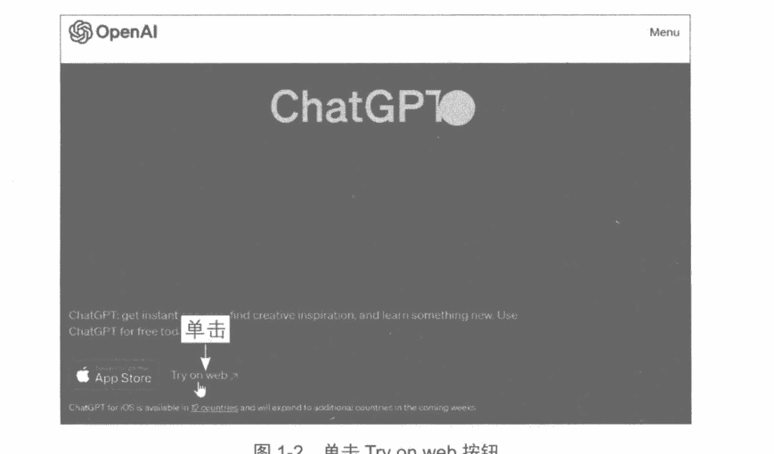

图 1-2 进入网页版入口

**步骤03** 进入新页面后点击白色方框完成人机校验，如图 1-3 所示。注意该步骤并非每次登录必经，有时可直接进入登录页。

**步骤04** 进入登录页后点击 Sign up 注册，如图 1-4 所示。若已有账号，可直接点击 Log in 输入邮箱和密码登录。

图 1-3 完成人机校验

图 1-4 点击注册

**步骤05** 进入 Create your account 页面，填写邮箱地址，如图 1-5 所示，也可直接用微软或谷歌账号登录。

**步骤06** 点击 Continue，在新页面输入密码（至少 8 个字符），如图 1-6 所示。再次点击 Continue，完成邮箱验证后按提示填写姓名并完成手机验证，即可注册成功开始使用。

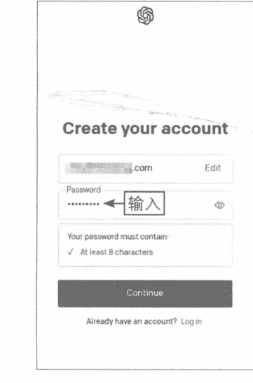

#### 1.1.2 ChatGPT 的界面布局与功能

ChatGPT 服务入口提供 Free Plan 免费版和 Upgrade to Plus 付费版两种环境。

当前免费版即可无偿使用。登录后可见主页面，如图 1-7 所示。

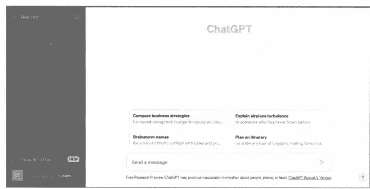

用户通过页面对话框与 ChatGPT 对话。

主页面从左到右、从上到下依次为：

（1）New chat 新对话 控件：点击可开启新对话，相当于新话题。首次使用时系统会自动创建对话记录，如图 1-8 所示。

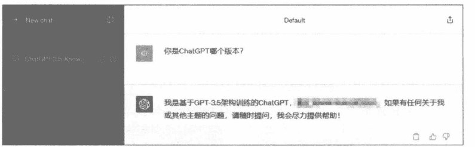

图 1-8 系统自动创建对话记录

（2）侧边栏切换控件：将鼠标悬停会出现 Close sidebar 字样，侧边栏显示历史会话列表。点击后可全屏显示单个会话并隐藏列表，如图 1-9 所示，再次点击可展开侧边栏。

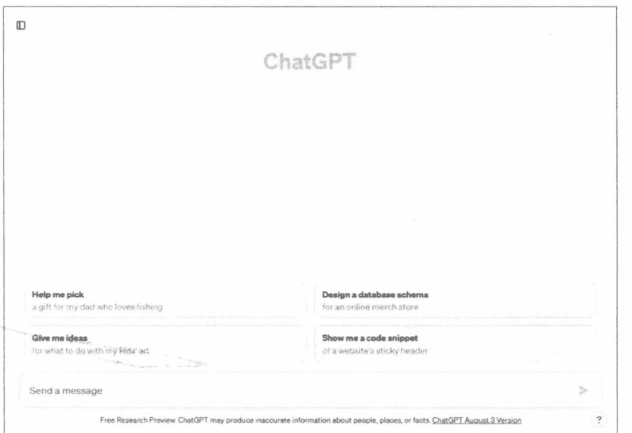

图 1-9 全屏显示会话

（3）Upgrade to Plus 升级控件：点击可升级版本享受更多服务。升级后优势包括高峰期仍可稳定使用、文本生成更快、优先体验新功能。升级路径为点击 Upgrade to Plus 后在弹窗中再次点击 Upgrade to Plus，按提示填写付款信息并点击 Continue 完成升级。

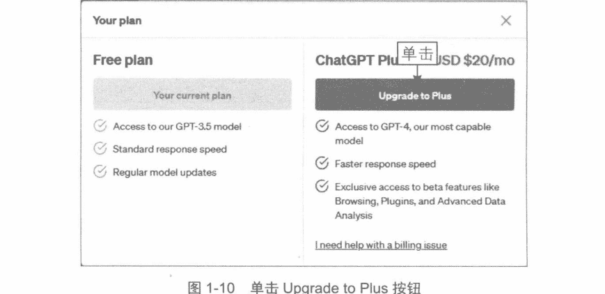

图 1-10 点击升级

（4）“…… ” 控件：显示账号信息。点击后弹出操作列表，如图 1-11 所示。

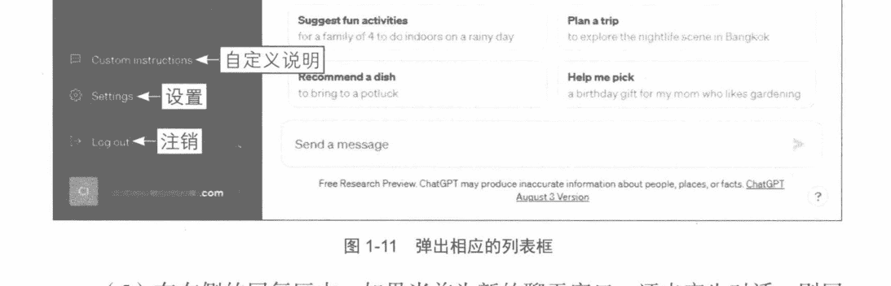

图 1-11 弹出操作列表

（5）右侧回复区：新对话时未产生内容时会展示使用示例，包括 Suggest fun activities、Plan a trip、Recommend a dish 和 Help me pick，可自行阅读了解。

（6）示例下方为输入框，提示 Send a message。用户在此输入内容发送，ChatGPT 接收后回复。输入框下方为 OpenAI 团队对生成内容的说明。

#### 1.1.3 用 ChatGPT 初次生成文本

登录后打开聊天窗口即可开始对话，输入问题或话题后 ChatGPT 会尝试作答。具体操作如下。

**步骤01** 打开聊天窗口，点击底部输入框，❶ 输入指令，例如“对比一下平板电脑和笔记本电脑的优异之处，并做成表格”；❷ 点击输入框右侧发送按钮或按【Enter】键，如图 1-12 所示。

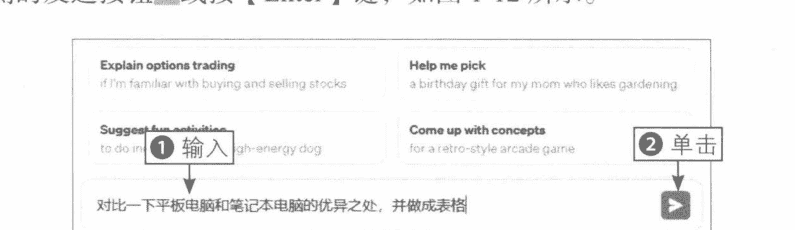

图 1-12 点击发送

**步骤02** 稍等片刻，ChatGPT 会按要求生成表格，如图 1-13 所示。

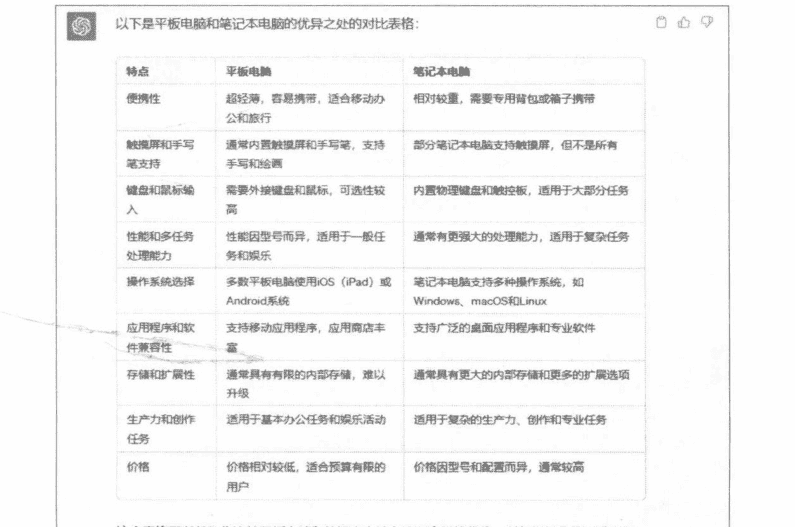

图 1-13 生成的表格

#### 1.1.4 让 ChatGPT 生成有效文本

收到回复后可自行评估其参考价值。若认为有效，可点击文本右侧复制按钮复制内容，复制功能仅支持文本，不支持表格格式；若参考价值有限，可点击输入框上方 Regenerate 重新生成按钮，ChatGPT 将基于同一问题生成新回复。以下示范操作。

**步骤01** 在输入框输入新指令，例如“请简短地描述一下 AI 办公”，点击发送按钮或按【Enter】键，稍等后 ChatGPT 会生成描述，如图 1-14 所示。

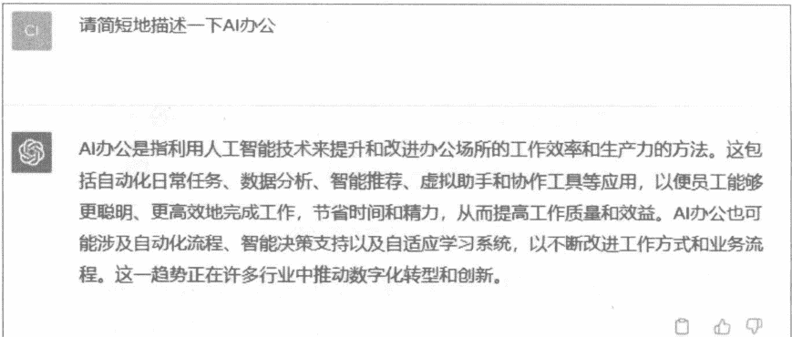

图 1-14 生成的 AI 办公描述

**步骤02** 点击输入框上方 Regenerate 按钮，ChatGPT 会重新生成描述，如图 1-15 所示。可看出第二次描述在语言风格和表述上有所变化。

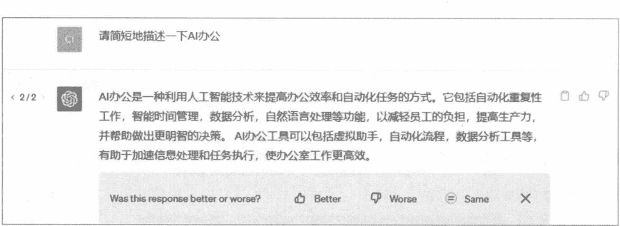

图 1-15 重新生成的描述

通过 Regenerate 按钮可让 ChatGPT 对同一问题多次生成不同回复，相当于持续优化训练。二次回复会标注“2/2”，第三次则标注“3/3”，每次重新生成会新增一页，原有内容保留，点击页码左右箭头可在页间切换。

生成二次回复后文本下方会出现评价提示，用户可选择评价或点击×关闭。无论首次还是后续生成，文本右侧均有👍或👎评价按钮。

#### 1.1.5 管理 ChatGPT 的聊天窗口

建立的会话会自动保存在左侧列表，可进行新建、重命名、删除等管理。若指令或关键词不准确，可对已发送信息进行改写。具体如下。

**步骤01** 打开 ChatGPT 并进入已有会话，点击左上角 New chat 控件，如图 1-16 所示，执行后即可新建会话。

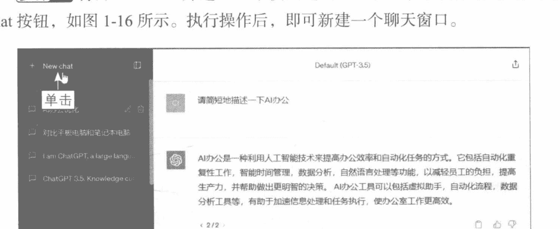

图 1-16 点击新建对话

**步骤02** 在输入框输入第 1 行“以 Excel 表格的形式，对以下内容进行分类：”，按【Shift+Enter】换行，输入“猫、葡萄、飞机、汽车、自行车、狗、蛇、汉堡、面包、西瓜、荔枝、饺子、香蕉、篮球、足球、乒乓球”，按【Enter】发送，ChatGPT 会据此回复，如图 1-17 所示。

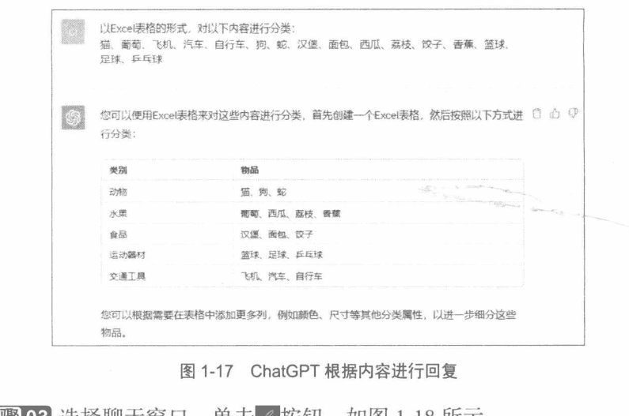

图 1-17 根据内容回复

**步骤03** 选择会话后点击✏按钮，如图 1-18 所示。

**步骤04** 执行后出现编辑文本框，可直接修改名称，如图 1-19 所示。点击✔完成重命名。

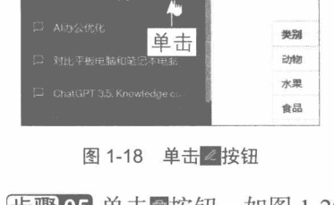

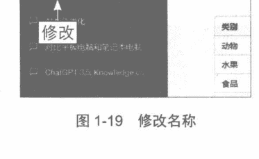

图 1-18 点击编辑

图 1-19 修改名称

**步骤05** 点击🗑按钮，如图 1-20 所示。

**步骤06** 执行后弹出 Delete chat？对话框，提示将删除创建的会话，❶ 确认删除则点击 Delete 按钮；❷ 不想删除则点击 Cancel 按钮，如图 1-21 所示。

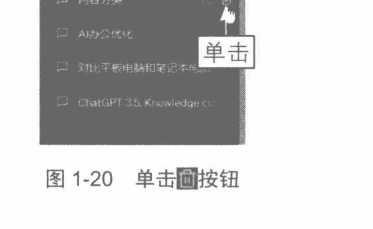

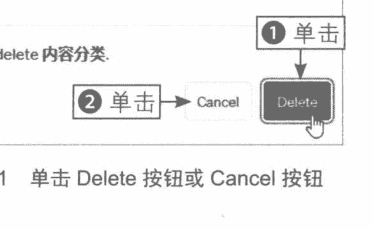

图 1-20 点击删除

图 1-21 选择删除或取消

### 1.2 ChatGPT 的提问技巧

指令写得好，ChatGPT 才好用

ChatGPT 本质上是根据你给的输入即时组织语言的对话系统。最终效果如何，不在于模型本身多强，而在于提问写得够不够准。想获得更贴合预期的回复，就要重视表达方式，掌握几套可用的操控思路。

#### 1.2.1 编写指令的 3 个原则
ChatGPT 归类为对话式生成模型，能否拿到可用结果，关键看沟通是否顺畅，而沟通的起点就是 Prompt。指令的准确程度直接决定返回质量。下面三条原则可作为参考。

1. 语言明晰原则
人与人交流强调清晰，对模型交互同样成立。需要把词汇、句意、语境表达到位，别使用模棱两可或有歧义的说法。以“海龟汤”做对比：

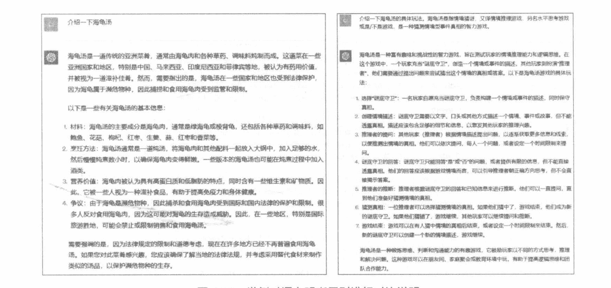

两次提问对“海龟汤”的理解完全不同。第一次描述偏笼统，被解读为食物里的海龟汤，还特别提示该食物被禁止食用；第二次明确指谜题类游戏，返回的内容才更准确、参考性更强。

2. 简明扼要原则
简明不等于字数少，而是让模型能轻松读懂并给出回应。提示要干净利落，少用符号或分列，保证指向单一。比如直接要求一篇关于海洋生态保护的文章，返回的内容就紧扣海洋生态保护主题。

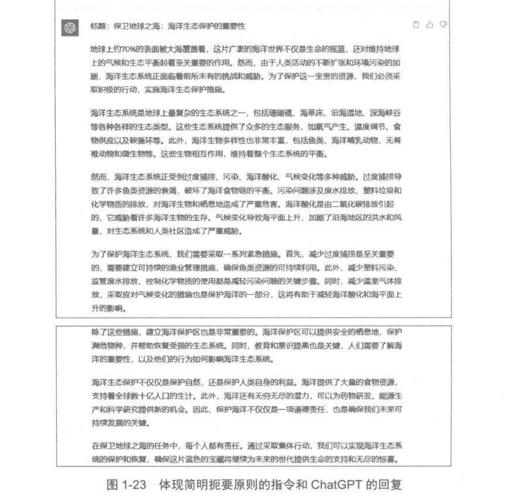

3. 关联需求原则
ChatGPT 可以做连续回复，但思考是线性的，一问一答。撰写提示时要始终围绕自身诉求，不要引入无关话题分散注意力。例如要求“围绕智能家居主题创作广告文案，要求简洁明了，但不要用那种特别直白的宣传口号”，得到的结果是：

#### 1.2.2 挖掘指令的 3 个方法
想让 ChatGPT 真正发挥作用，关键在于把指令挖出来，让它能识别、理解并执行。以下介绍三种常用思路。

1. 选择贴切的关键词
第一步是选词。关键词大致可分宽泛与具体两类。比如发送“请列出 10 个关于智能办公的文章标题”得到的结果，

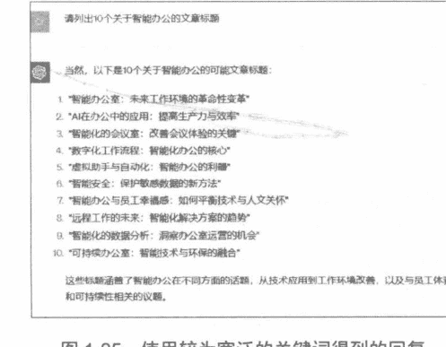

再发送“请列出 10 个关于使用 ChatGPT 智能办公的文章标题”得到的结果，

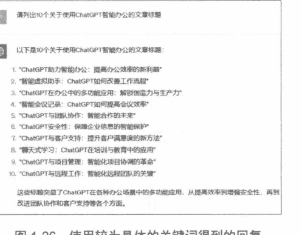

可见，宽泛词与具体词触发的识别度不同。宽泛词会带来概念化、覆盖面广的信息；具体词则会凸显 ChatGPT 在办公场景中的多元应用。

两种词各有用途，选择取决于真实需求。一般想获取事实性、概念性内容，用宽泛词，比如“世界上最大的湖是什么”；想获得灵活、观念性表达，用具体词，比如“用诗意的语言描述一下武功山”。

2. 确定指令的主题
挖掘具体提示的第一要义是锁定主题，且主题本身也要具体。

比如想让模型生成一篇呼吁爱心和关爱他人的文章大纲，“呼吁爱心和关爱他人”就是主题，“一篇文章大纲”是需求。整合后写成“请提供一篇关于呼吁爱心和关爱他人的文章大纲”，模型就能给出对应回复：

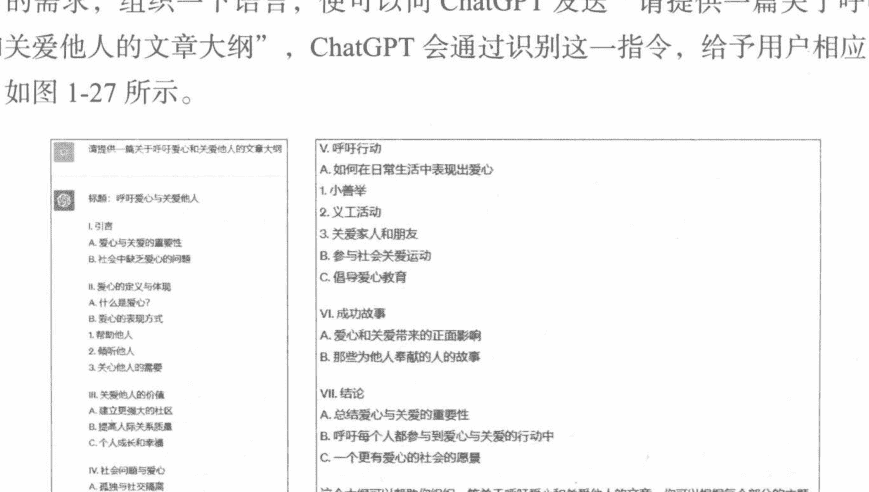

简言之，想拿到灵活观念性的结果，就要在指令里说明主题，主题要细到某个领域、行业或话题。

3. 细化主题描述
已经说明主题仍不满意，就要继续细化，多加限定词或条件，具体做法如下。

（1）加入限定语言。
拟写指令时加上副词、形容词等限定，让关键词更贴近预期。

例如需要 ChatGPT 提供中秋节的贺词，可加入“突出团圆美好的祝福和欢快的心情”的限定，整合成“提供中秋节的贺词，要突出团圆美好的祝福和欢快的心情”，返回结果：

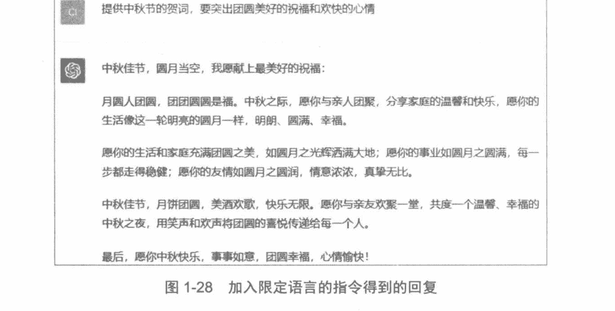

还可以按受众再细化，改写为“重新提供中秋节的贺词，针对不同的年龄层”，在同一对话框输入后得到：

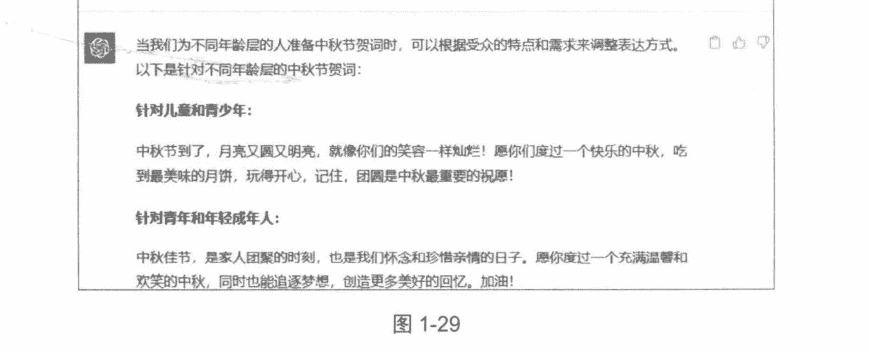

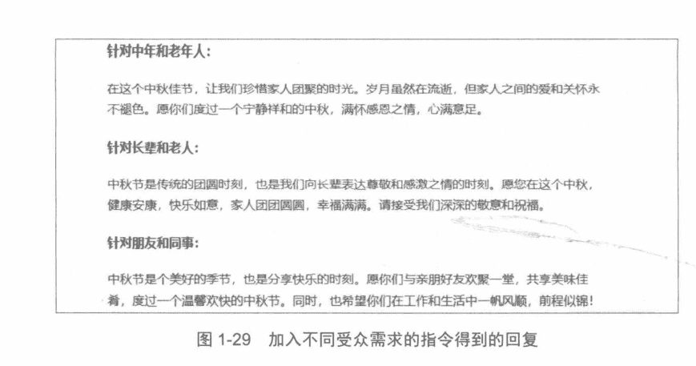

（2）设置限定条件。
常用做法是让模型角色扮演，先指定身份再描述任务或困境。

例如让模型充当销售经理，输入“你是一名销售经理，请提出 5 个短期内可以快速出售产品的方法”，得到的结果：

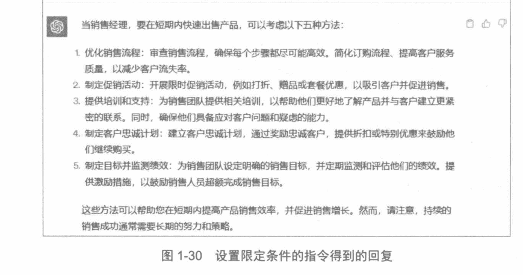

#### 1.2.3 编写指令的 7 种技巧
日常对话中，大多数需求都需要带具体关键词的指令。掌握以下七种写法，能让结果更满意。

1. 提供实例参考
提问时附上具体例子，模型识别后会产出更贴合的答案。

例如“我有一个记录员工销售情况的 Excel 表格，想计算每个员工的总销售额。数据如下：
| 员工姓名 | 产品 A | 产品 B | 产品 C |
| :--- | :--- | :--- | :--- |
| 张三 | 800 元 | 750 元 | 900 元 |
| 李四 | 700 元 | 850 元 | 800 元 |
| 王五 | 850 元 | 900 元 | 700 元 |
请问有什么公式可以计算每个员工的总销售额？”得到回复如图 1-31 所示。

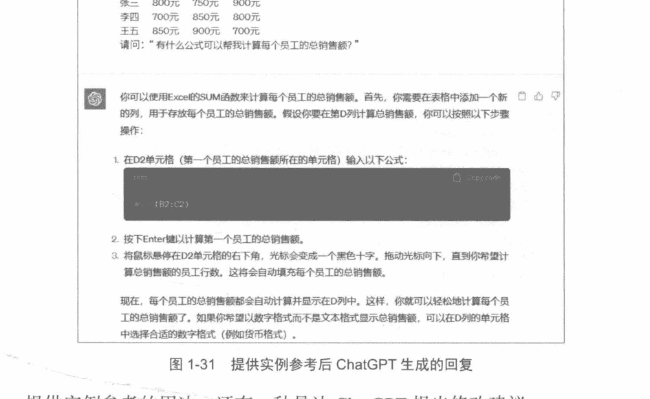

提供实例的另一种用法是让模型提修改建议。例如“请针对我写的文章开头，提供更有画面感和诗意的修改建议。开头如下：红色枫叶，是秋季大自然最引人注目的装点之一。在这个美妙的季节里，树叶由青翠逐渐变成了火红、橙黄和深褐色，而红色枫叶则以其深沉的色彩和迷人的魅力脱颖而出。”输入后得到：

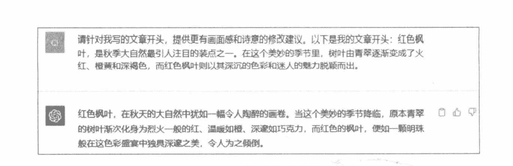

一般来说模型会给出中肯建议，有助于发散思维。同样的方法也能用于改简历、代码、论文等。

2. 模仿语言风格
不确定怎么问时，可以要求模型模仿你喜欢的人物或作家的风格。

例如输入“以李清照的语言风格，写一首关于雨打芭蕉的词”，生成的内容：

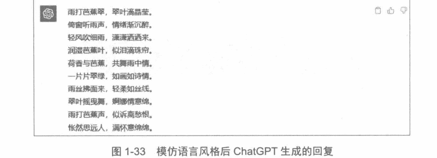

3. 赋予特定身份
模型可以扮演各种角色，给它一个身份相当于给了语言风格和话题指向的提示，更容易拿到有参考价值的答案，也适合深度情感交流。

例如让模型充当人事经理，输入“你现在是一位人事经理，请生成一份面试测试题，题目数量为5个，要包含测试题和评估内容”，得到回复：

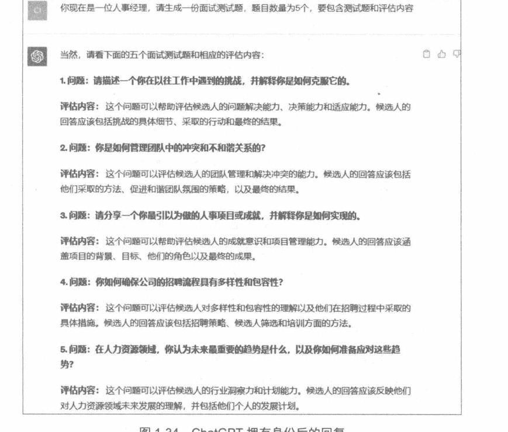

赋予身份后，模型会按要求输出要素齐全、针对性强的答案。

> ★ 专家提醒 ★
> 这一技巧还可用于情感陪伴，比如赋予关怀、同理心的身份进行情感疏导。

4. 指定表格输出
要求模型用表格呈现，对要点提炼、数据分析、脚本创作都很实用。

例如“以表格形式用中文解释以下英文单词：Loungewear、Orca、Tune，表格需包含单词、词性、解释与英语例句”，得到：

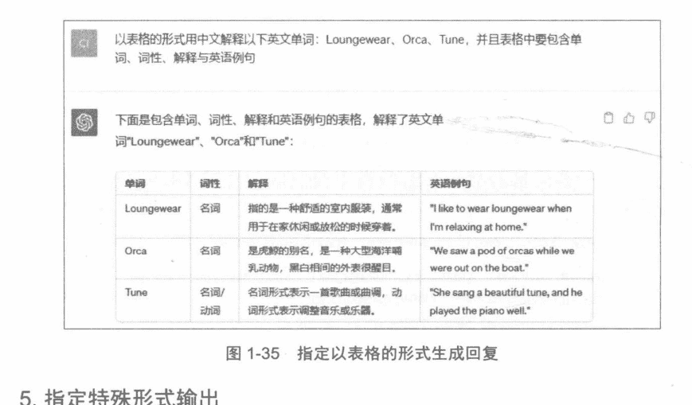

5. 指定特殊形式输出
可以让模型用 ASCII 艺术输出。ASCII 艺术是用标准字符绘制图像的数字艺术形式。

例如输入“用 ASCII 艺术形式生成一只小兔子”，得到内容：

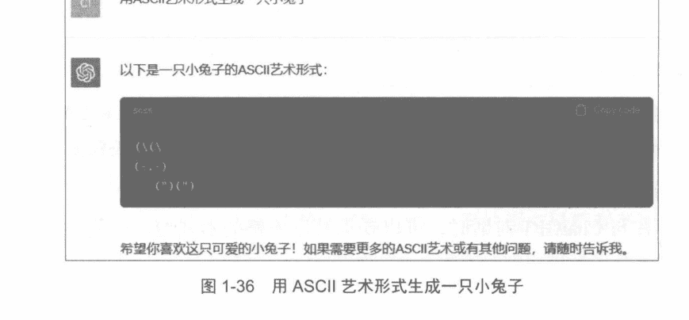

这类作品通常是单色或灰度呈现。

6. 指定受众群体
通过上下文和明确问题间接指定受众，能让回答更精准。

例如“针对职场人士写一篇关于排解工作压力的文章，字数为 200 字左右”，生成的内容：

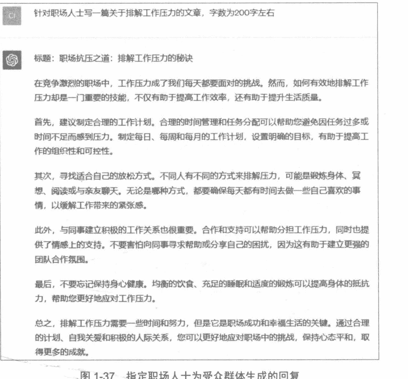

提供清晰的问题和背景，能提升模型对特定群体需求的理解。

7. 切换视角
在不同段落使用不同视角，可引入多元人物和观点，提升深度。

例如“以第三人称视角写一篇关于‘打工人的一天’的故事，字数为200字左右”，得到故事：

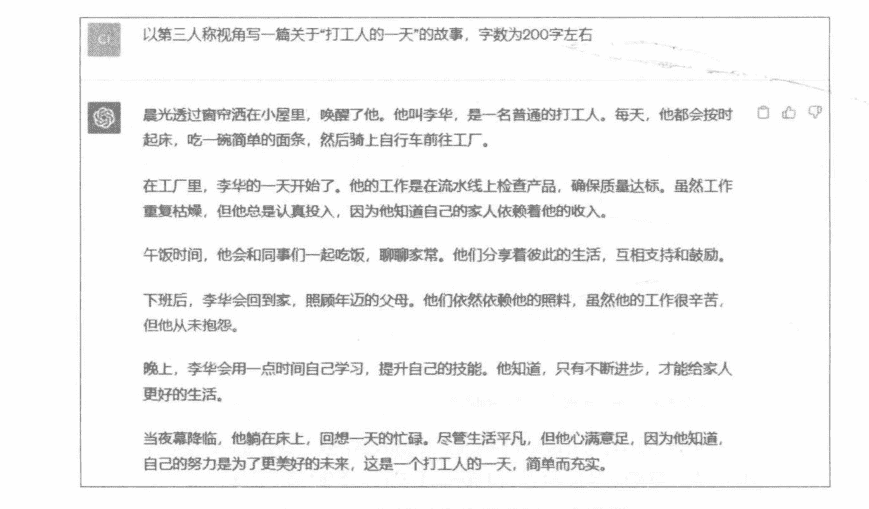

总之，掌握以上七种写法，能让 ChatGPT 的输出更高效、准确、有价值。

#### 1.2.4 优化答案的 6 种模板
受网络、系统、数据限制影响，首次生成难免有疏漏。可通过指令模板来优化。

1. 生成专业答案的指令
需求越多越需要专业度。模板是“问题背景+任务需求+行业专家模板或方法论”。

例如输入“根据《金字塔原理》书中的理论，生成10个关于平板电脑的广告文案”，得到结果：

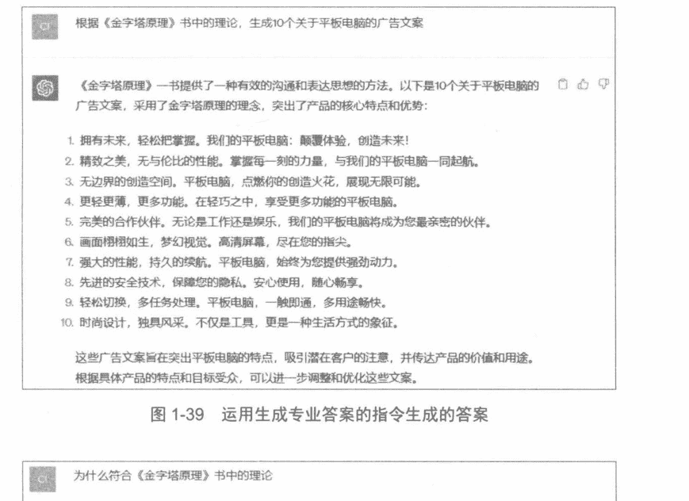

可继续追问“为什么符合《金字塔原理》书中的理论”，模型会给出原理解释：

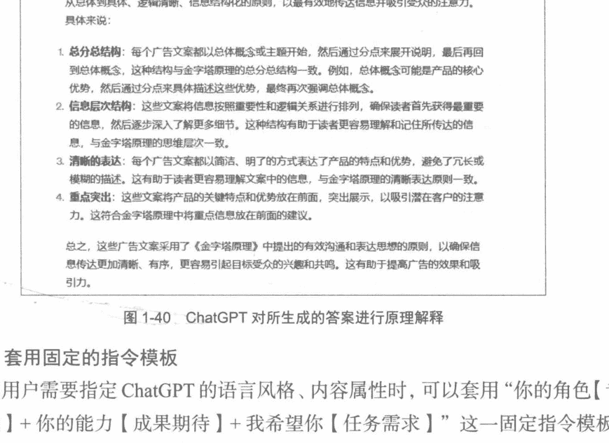

2. 套用固定的指令模板
需要指定风格、属性时可用“你的角色【专业领域】+ 你的能力【成果期待】+ 我希望你【任务需求】”。

例如输入“你的角色是演员，你拥有十年的演艺经验，能够饰演各种不同类型的角色，现在你需要饰演一个文物守护者，强调文物对教育和文化传承的价值，你将做哪些努力让自己更快地进入角色呢？”得到：

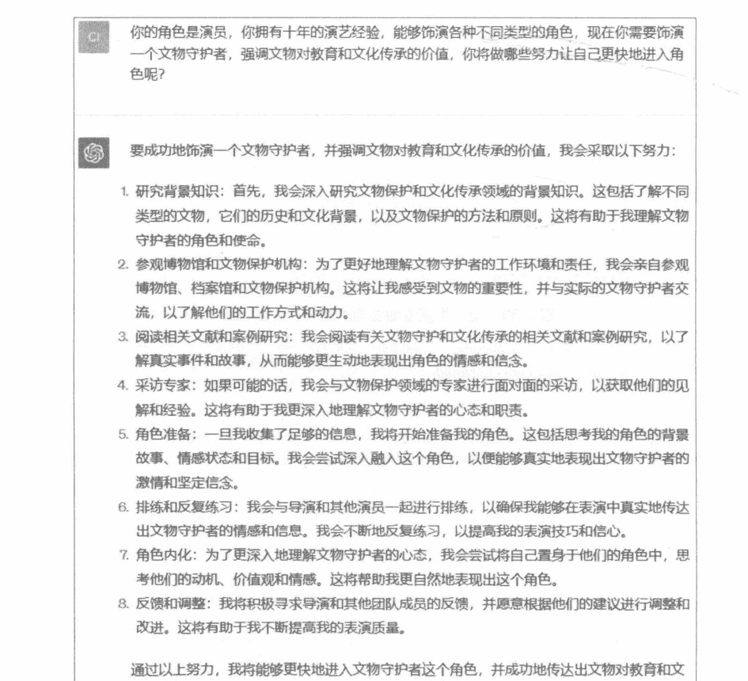

模型能准确识别需求并给出建设性建议。

3. 提供种子词提示的指令
种子词是文章中需要包含的字词，可帮助模型更快提取数据。

例如“请根据以下种子词生成软文：雨雾天、烟青色、江南小镇，字数在100字左右”，生成结果：

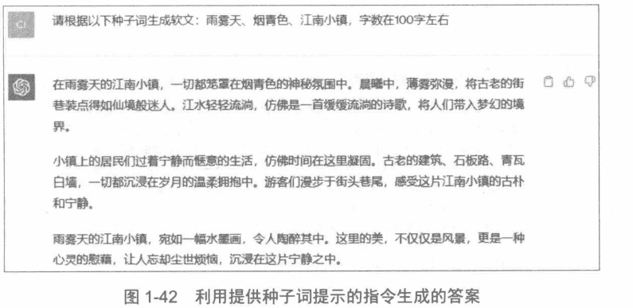

4. 生成逻辑性答案的指令
让模型更有逻辑可加入“Let’s think step by step”。

例如不加指令问“简述青花瓷的特征”，得到：

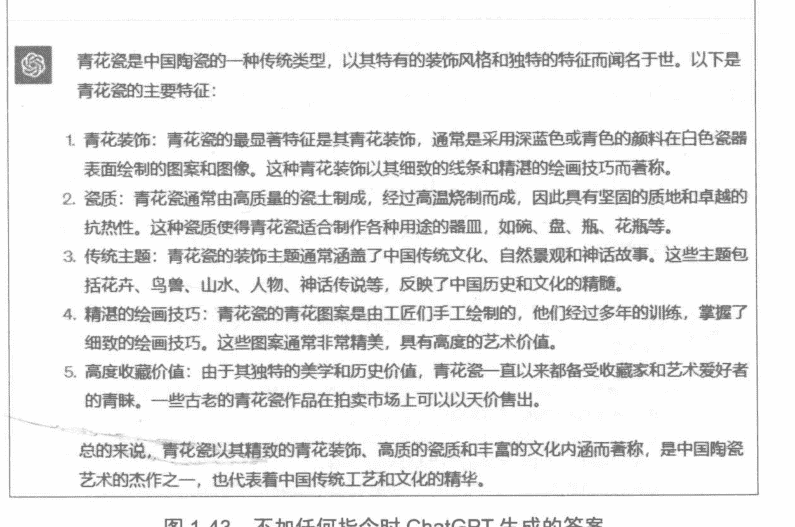

加上指令输入“简述青花瓷的特征，Let’s think step by step”，生成的答案层次更分明，逻辑性更强。

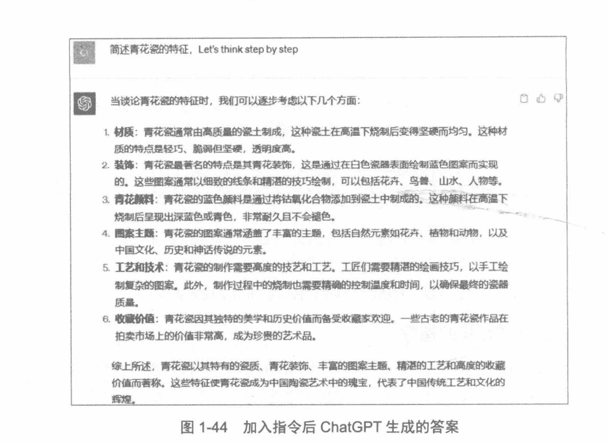

图 1-44 加入指令后模型的回答示例

##### 5. 拓宽模型思维的指令

当任务涉及创意、项目策划等需要发散时，可在提问结尾加上 “What are some alternative perspectives?（有哪些可选角度）” 的引导，能快速拉宽 ChatGPT 的思考维度。

例如先让模型“描述绿萝的生长特征”，得到的文本如图 1-45 所示，表述比较平铺。把问题改为“描述绿萝的生长特征，What are some alternative perspectives?”，模型会从不同视角展开，给出更丰富的思路，如图 1-46 所示。

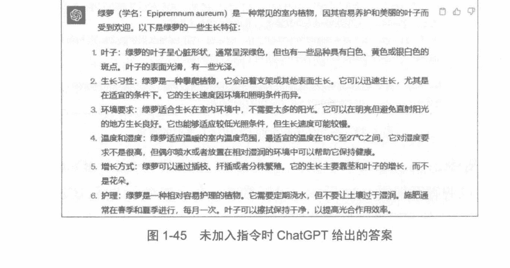

图 1-45 未加入指令时模型给出的答案

## 第 1 章 AI 办公入门：ChatGPT 快速上手

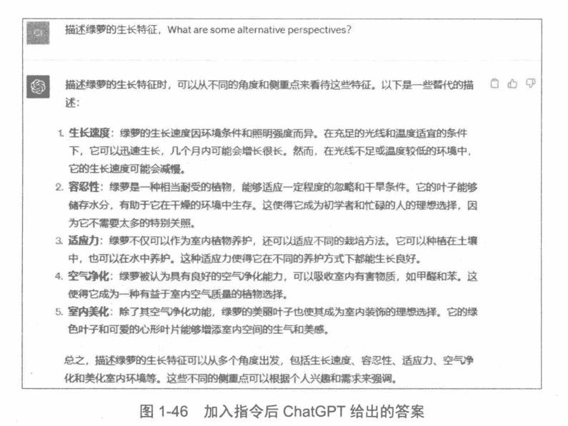

##### 6. 生成灵活性回复的指令

ChatGPT 的输出通常严谨但偏机械。若希望结果更灵活，可在关键词后追加 “Please generate the answer at x 或 use a temperature of x（请用 x 的温度生成答案）”。

比如输入“请写一段关于荷花的描述”，不加温度参数的产出如图 1-47 所示。

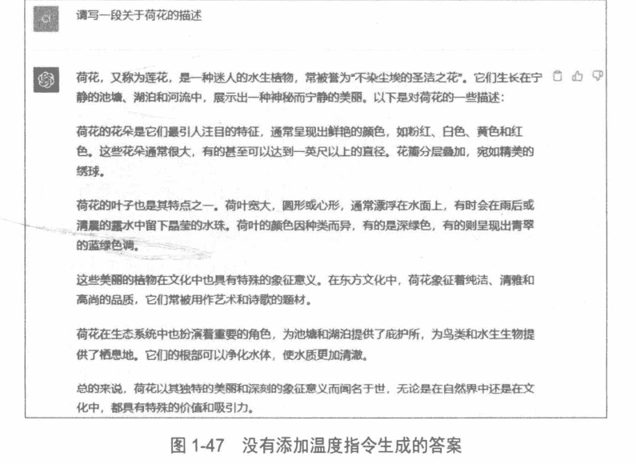

> ★专家提醒★

x 为数值，一般取 0.1～1 之间。数值偏低时回复更稳健，数值偏高时回复更富创意与想象。

加上温度参数后输入“请写一段关于荷花的描述，use a temperature of 0.7”，生成的文本如图 1-48 所示。

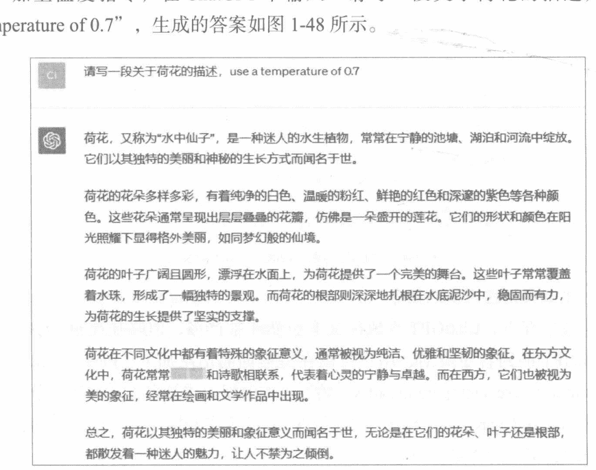

对比明显，未设参数的回答偏僵化，加入参数后更具叙事感，吸引力增强。

#### 1.2.5 ChatGPT 生成图片的指令

ChatGPT 可结合网页产出图文内容，只需在指令中加入特殊说明。例如输入“描述一下沙漠风光，并附带沙漠的图片”，生成结果如图 1-49 所示。模型虽尝试调用网络配图，但图片无法显示。

可在关键词后补充“发送图片时请用 markdown 语言生成，不要反斜线，不要代码框，× × ×（此处为图片链接）”，即可让模型以 markdown 形式自动配图，如图 1-50 所示。

描述一下沙漠风光，并附带沙漠的图片

很抱歉，我无法提供图片，但我可以为您描述沙漠风光。

沙漠地貌极端而壮美，沙丘、平原与自然奇观构成独特景观。常见特征可概括如下：

- 1. 沙丘群：沙漠的标志性地貌，体量庞大，形态有波浪式也有峰状，随光线变化呈现金黄、橙红到棕褐的层次。
- 2. 裸露地表：植被稀少，大片沙土裸露，阳光下泛金光，营造出干燥神秘的氛围。
- 3. 岩石山系：部分地区分布奇形怪状的岩体，色彩多为红、橙、紫，为荒原提供视觉亮点。
- 4. 天空：视野辽阔，夜晚星空璀璨，白天蓝天澄澈，偶有云朵飘过。
- 5. 耐旱植被：环境严苛下仍有少量植物存活，偶尔开花为沙漠增添绿意。

不同沙漠因地理与气候差异而各有特色，以上描述有助于脑补其壮美。

图 1-49 图片无法显示的文章内容

描述一下沙漠风光，并附带沙漠的图片，发送图片时请用markdown语言生成，不要反斜线，不要代码框，http://

沙漠景象恢弘，绵延的沙丘向远方延伸。烈日下沙粒闪烁金色光泽，如同一片金海。零星植物顽强生长，成为荒凉之地的生命象征。天空湛蓝，光影不断变换，观感令人沉醉。

该图呈现了一片震撼的沙漠场景，传递出自然的磅礴与荒凉之美。

图 1-50 ChatGPT 借助特殊语言生成图片

Markdown 是一种轻量级标记语言，允许用易读的纯文本编写文档，通过简易语法实现格式排版。语法简洁、学习成本低，被广泛用在写作、博客、笔记及文档中。

AI智能办公：ChatGPT + Office + WPS应用从入门到精通

### 本章小结
本章介绍了 ChatGPT 新手入门的基础，先讲访问登录、界面布局、生成与聊天窗口管理，再讲提问技巧，涵盖指令编写、指令挖掘、答案优化及图文生成。掌握后可快速上手基础操作。

### 课后习题
为加深理解，安排以下回顾练习。

1. 尝试让 ChatGPT 概括文章主旨并提炼关键词，如图 1-51 所示。

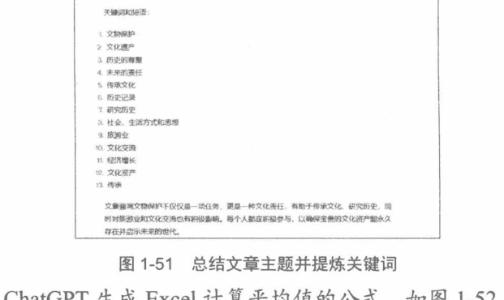

图 1-51 总结文章主题并提炼关键词

2. 尝试让 ChatGPT 输出 Excel 求平均值的公式，如图 1-52 所示。

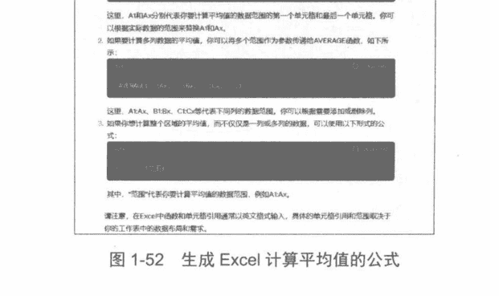

图 1-52 生成 Excel 计算平均值的公式

## 第2章 AI 文档创作：ChatGPT+Word

Word 是 Office 套件中专用于文本编辑、排版与打印的软件，文字处理能力强。本章讲解如何结合 ChatGPT 与 Word，用 AI 完成文档创作。

### 2.1 Office 办公软件构成
Office 是微软推出的办公套装，可处理文档、邮件、表格、演示文稿及数据库管理，工具齐全、界面友好，因格式稳定与协作高效而受青睐。

常用三大组件为 Word、Excel、PowerPoint，简述如下。

- 1. Word 文档
用于创建、编辑、排版文本文档，本章重点。提供字体、段落、页眉页脚、列表、引用、拼写检查等工具；支持插入图片、图表、形状等媒体；可制作表格组织数据；支持多人协同、批注与修订。
- 2. Excel 表格
功能强大的电子表格程序，用于数据处理、分析与可视化。可做数学、统计、财务计算；支持图表展示趋势；内置丰富函数并可自定义公式；可连接数据库、网络数据实现实时更新。
- 3. PowerPoint 演示文稿
用于制作演示文稿，可选模板并添加文字、图像、音视频。支持幻灯片放映，提供转场与动画；支持多媒体嵌入与链接；便于共享与实时协作评论。

三款软件分别承担文档处理、数据管理与演示制作，结合 ChatGPT 可更高效智能地完成工作。

### 2.2 用 ChatGPT 进行内容创作
ChatGPT 能依据主题、关键词与指令快速生成大量文本，节省时间、提升效率。可应用于科技、医疗、旅游、美食、媒体、金融、学术等领域，为创作者提供灵感并突破瓶颈。

#### 2.2.1 用 ChatGPT 生成论文大纲
论文大纲是整体框架，相当于主干，质量决定内容填充与完成度。对学术用户而言，拟定大纲是关键一步。利用 ChatGPT 的文本生成能力，可为拟写大纲提供灵感。

可采用“请提供 × × ×（论文选题或标题）的论文大纲” 的提问模板，下面介绍操作流程。

**步骤 01** 打开 ChatGPT，输入对话前提指令“论文大纲一般包含哪些要素？”，按 Enter 发送，模型会给出概括，如图 2-1 所示。

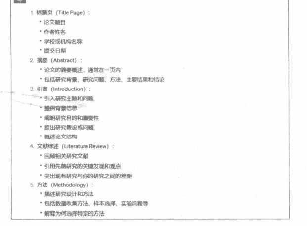

图 2-1 ChatGPT 给出对话前提的回复

**步骤 02** 发送具体需求“请提供数据隐私与网络安全的论文大纲”，模型会给出参考大纲，部分展示如图 2-2 所示。文字中断时可点 Continue generating 继续生成。

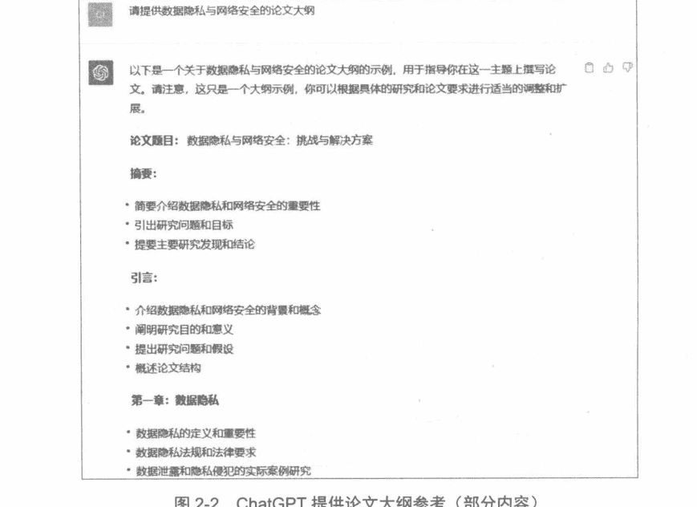

图 2-2 ChatGPT 提供论文大纲参考（部分内容）

**步骤 03** 打开 Word 文档，按 Ctrl+V 将复制的大纲粘贴进去，部分内容如图 2-3 所示。

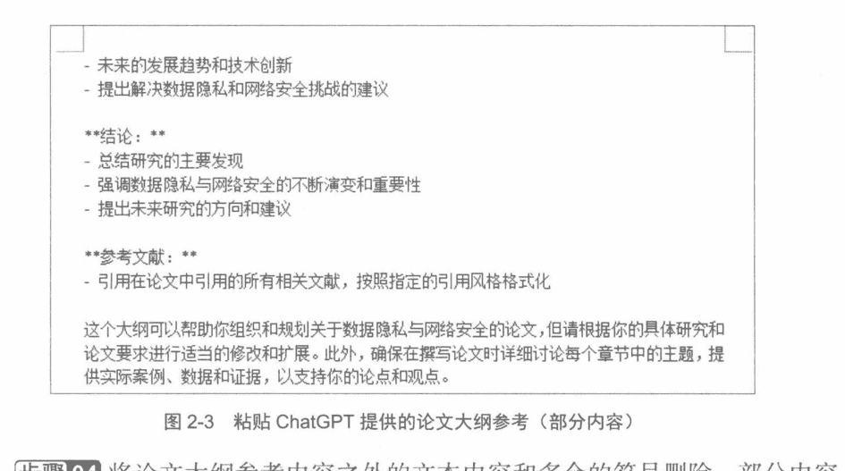

**步骤 04** 删除参考内容以外多余文本和符号，部分内容如图 2-4 所示。

**步骤 05** 打开含论文格式要求的文档，查看排版规范，如图 2-5 所示。

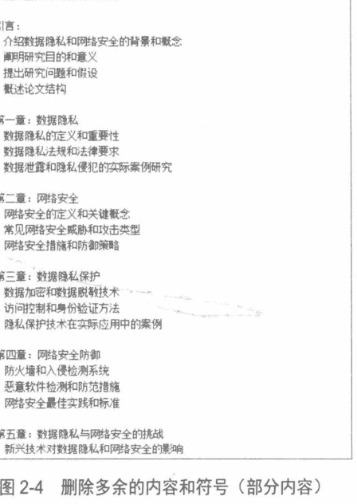

**步骤 06** 按要求设置标题：❶ 选择标题；❷ 在“开始”功能区“字体”面板设字号“小一”、字体“黑体”；❸ 点“加粗”按钮 B；❹ 在“段落”面板点“居中”，如图 2-6 所示。

**步骤 07** 同理将摘要、引言、章标题、结论、参考文献设为小二号、黑体、加粗、居中，效果如图 2-7 所示。

**步骤 08** 正文默认五号宋体，按要求除参考文献和摘要关键词外，正文设为小四号、宋体、行距 20 磅，如图 2-8 所示。

**步骤 09** ❶ 选择全部正文；❷ 右键选择“段落”，如图 2-9 所示。

**步骤 10** 在“段落”对话框设行距为“固定值”、值为“20 磅”，点确定，如图 2-10 所示。

**步骤 11** Word 默认 A4 纸，在“布局”功能区“页面设置”面板，❶ 点“页边距”；❷ 选“自定义页边距”，如图 2-11 所示。

**步骤 12** 在“页面设置”对话框设上、下页边距 2.5 厘米、左 3.0 厘米、右 2.0 厘米，点确定，如图 2-12 所示。

完成字体、段落、页面设置后，可按研究需求对内容做调整与扩展。撰写过程中，还可让 ChatGPT 降重：将重复率高的内容输入对话框，由其更换同义词改写，减轻压力并提升效率。

#### 2.2.2 用 ChatGPT 协助翻译工作
ChatGPT 可用于翻译，协助多语种转换。例如在输入框输入一段英文，要求译为中文或其他语言。常用模板为“将下面的中文翻译为 × ×（语言）：× × ×（待译内容）”。

**步骤 01** 打开 Word 文档，需要将中文内容译成西班牙语，选择文本按 Ctrl+C 复制，如图 2-13 所示。

图 2-13 复制选择的内容

**步骤 02** 打开 ChatGPT，输入“将下面的中文翻译为西班牙语：”，按 Shift+Enter 换行粘贴内容，回车发送，模型即返回译文，如图 2-14 所示。

图 2-14 ChatGPT 翻译文本内容

**步骤 03** ① 选择翻译标题；② 右键选“复制”，如图 2-15 所示。

图 2-15 选择“复制”命令

**步骤 04** 返回 Word 文档，标题处回车另起一行，右键粘贴，选择“只保留文本”，如图 2-16 所示。

**步骤 05** ① 选择标题内容；② 点“行和段落间距”下拉；③ 选“增加段落后的空格”，如图 2-17 所示。

**步骤 06** 依次复制模型译文并粘贴到 Word，效果如图 2-18 所示。

#### 2.2.3 用 ChatGPT 写作自媒体文章
自媒体是信息接收主流渠道，文章需灵活开放且具互动与传播力，对创意要求高。ChatGPT 可助力文思泉涌。

常用提示模板：

选题询问：我是一名新媒体编辑，负责微信公众号写作，需要撰写 × × × 领域的稿件，该方向可选择哪些选题？

稿件撰写：根据种子词生成一篇 × × ×（主题）的公众号稿件，具体要求 × × ×（互动、字数等）。种子词：× × ×、× × ×。

下面介绍使用提示模板让 ChatGPT 生成自媒体稿件的具体操作。

**ChatGPT × Word 实战：从灵感到排版再到本地接入**

**步骤 01** 打开 ChatGPT 对话页，在输入区填入提示：“我是一名新媒体编辑，专门负责微信公众号文章的写作，我需要撰写美食领域的文章，关于这个方面的内容可以选择哪些选题？”回车后模型会给出可直接落地的公众号美食选题，参考图 2-19。

图 2-19 ChatGPT 输出的选题参考

**步骤 02** 在获得方向后继续追问：“根据种子词生成一个美食故事作为公众号的文章，要求与受众有互动，字数在 300 字以内。种子词：美味、名菜、有趣”，发送后会得到一段具备互动性的种子词美食故事，示例见图 2-20。

图 2-20 ChatGPT 生成的美食故事示例

**步骤 03** 把模型返回的文字复制出来，新建 Word 文件后粘贴，随后将标题格式设为黑体、小二号、加粗、居中，效果如图 2-21。

**步骤 04** 选中正文，右键打开“段落”对话框，在缩进与间距区把特殊格式选为“首行”，缩进值设为“2 字符”，如图 2-22，让段落首行自动空出两个字符。

图 2-21 标题格式设置后的呈现

图 2-22 段落首行缩进的设置界面

**步骤 05** 文章篇幅较长易产生视觉疲劳，可对重点进行高亮。先框选文中出现的餐厅名称与菜名，如图 2-23。

**步骤 06** 切换到“开始”选项卡的“字体”面板，❶ 打开“文本效果和版式”下拉按钮A↓；❷ 在列表里选择“填充：蓝色，主题色 1；阴影”样式，如图 2-24。

**步骤 07** 操作完成后，被选中的文字会呈现艺术字效果，在长文中更为醒目，效果见图 2-25。

#### 2.2.4 用 ChatGPT 构思宣传文案
广告文案承担传递信息、体现创意、加深记忆的功能，线上线下皆有广泛应用，对创意要求很高。借助 ChatGPT 可明显提升营销与广告策划的效率。

常用提问模板为“一家/个 × × × 店/产品有 × × ×（宣传需求），请结合专业的广告学理论，提供 × × ×（数字）宣传文案”。具体操作如下。

**步骤 01** 打开 ChatGPT，输入“一家拥有百年历史的面馆，想要拓宽市场，请结合专业的广告学理论，为这家面馆提供 10 个宣传文案”，回车后即可获得文案清单，如图 2-26。

图 2-26 ChatGPT 生成广告宣传文案

**步骤 02** 复制生成的文案，打开 Word 文档，在标题下方右键打开快捷菜单，选择“粘贴选项”中的“只保留文本”按钮，将内容贴在标题下方，如图 2-27。

图 2-27 粘贴 ChatGPT 生成的广告宣传文案

**步骤 03** 粘贴后空行可能错位，先手工整理分隔，再按住【Ctrl】键同时选中全部广告语，如图 2-28。

图 2-28 选择所有的广告语

**步骤 04** 在“开始”功能区的“段落”面板，❶ 点击“编号”下拉按钮 ≡·；❷ 选择“编号对齐方式：左对齐”格式，如图 2-29。

图 2-29 选择“编号对齐方式：左对齐”编号格式

**步骤 05** 执行后广告语会自动加上数字序号。随后选中文案下方的宣传说明文字。

**步骤 06** 仍在“开始”功能区的“段落”面板，❶ 点击“项目符号”下拉按钮 ≡·；❷ 选择黑色圆形符号，如图 2-31。

图 2-30 选择宣传说明

图 2-31 选择黑色圆形项目符号

**步骤 07** 执行后宣传说明前出现项目符号，排版效果如图 2-32。

AI智能办公：ChatGPT + Office + WPS应用从入门到精通

##### 百年历史老面馆宣传文案：

1. “百年传统，百年美味：品味一份历史的面馆之旅。”

   - 强调了面馆的传统和历史，让人感受到独特的魅力。

2. “品味古早味：百年面馆的经典滋味，一口永远的回忆。”

   - 通过“古早味”来吸引顾客的情感共鸣，让他们回忆起童年的味道。

3. “味蕾的时光机：品味百年传承的美味面条。”

   - 强调了面馆是一种传统的美食时光机，能够带你回到过去的味道。

4. “口感传奇：百年面馆的秘密配方，一碗非凡滋味。”

   - 暗示面馆有独特的秘密配方，激发了人们的好奇心。

5. “传统手艺，美味不凡：百年面馆的独家美食。”

   - 强调了面馆的传统手艺和独家美食，吸引追求品质的食客。

6. “老字号的骄傲：一百年的烹饪传统在每一口中传承。”

   - 通过“老字号”和“骄傲”来突出面馆的历史和独特性。

7. “品味历史，尝遍百年：一趟美味之旅等你来享受。”

   - 鼓励顾客来体验一趟美味之旅，品味历史。

8. “食在百年，美味长存：百年面馆的口味，永不过时。”

   - 强调了面馆的美味不会过时，一直值得品味。

9. “面馆百年，味道经典：每一碗都是一个传统的故事。”

   - 将每一碗面条与一个传统的故事联系起来，引发兴趣。

10. “品尝历史，创造回忆：在百年面馆留下你的美味故事。”

    - 鼓励顾客来面馆品尝历史，同时留下自己的美味故事，促进口碑传播。

图 2-32 为宣传说明添加项目符号后的效果

#### 2.2.5 用 ChatGPT 编写配图文案

配图文案是与图片搭配使用的文字说明或标语，能增强视觉冲击并传递信息或情绪。常用于社交媒体、广告、博客、演示等场景，帮助吸引注意并讲好图片背后的故事。借助 ChatGPT 可快速产出生动有吸引力的配图文案。

常用提问方式为“根据 × × × 主题，编写关于 × × ×（提炼图片关键词）的配图文案”。操作步骤如下。

步骤01 启动 ChatGPT，输入“根据智能家居主题，编写关于智能家具、科技、生活和居家方面的配图文案”，回车后模型会返回相关配图文案，如图 2-33。

第 2 章 AI 文档创作：ChatGPT+Word

图 2-33 ChatGPT 生成配图文案

步骤 02 复制生成的文案，打开 Word 文档，在标题下方按【Ctrl+V】粘贴，如图 2-34。

图 2-34 粘贴 ChatGPT 生成的配图文案

步骤 03 在第 1 句话下方按【Enter】空出一行，将光标置于段落标记处，在“插入”功能区的“插图”面板，❶ 点击“图片”下拉按钮；❷ 在展开列表中选择“此设备”选项，如图 2-35。

步骤 04 弹出“插入图片”对话框，选择需要插入的图片，如图 2-36。

AI智能办公：ChatGPT + Office + WPS应用从入门到精通

图 2-35 选择“此设备”选项

图 2-36 选择需要插入的图片

步骤05 点击“插入”按钮，图片即被加入文档，设置图片居中对齐，效果如图 2-37。必要时可在“图片格式”功能区的“大小”面板中调整尺寸。

图 2-37 设置图片居中对齐后的效果

### 2.3 将 ChatGPT 接入 Word

把 ChatGPT 接入 Word 能显著提升信息检索、灵感激发和内容校对效率，为日常办公带来便利。

#### 2.3.1 获取 OpenAI API Key（密钥）

OpenAI 是 ChatGPT 的研发主体，接入 Word 需要先获取 OpenAI API Key。获取流程如下。

步骤01 先登录 ChatGPT 官网账号，随后访问 OpenAI 官网，点击右上角的 Log in（登录）按钮，如图 2-38。

图 2-38 单击 Log in 按钮

步骤02 执行后进入 OpenAI 页面，选择进入 API 模块，如图 2-39。

图 2-39 选择进入 API 模块

AI智能办公：ChatGPT + Office + WPS应用从入门到精通

**步骤 03** 若前面已登录 ChatGPT，则会自动登录 OpenAI 账号，若直接进官网则需手动登录。登录后❶ 点击右上角账号头像；❷ 在弹出列表中选择 View API keys（查看 API 密钥）选项，如图 2-40。

图 2-40 选择 View API keys 选项

**步骤 04** 进入 API keys 页面，表格中显示之前获取过的密钥记录，单击 Create new secret key（创建新密钥）按钮，如图 2-41。

图 2-41 单击 Create new secret key 按钮

**步骤 05** 弹出 Create new secret key 对话框，在文本框下方单击 Create secret key（创建密钥）按钮，如图 2-42。

图 2-42 单击 Create secret key 按钮

步骤 06 执行后即可创建密钥，单击文本框右侧的复制按钮，如图 2-43，即可获取创建的密钥，在文件夹中创建一个记事本，将密钥粘贴保存。

图 2-43 单击按钮

#### 2.3.2 接入 ChatGPT 并创建按钮

通过宏可把 ChatGPT 接入 Word。默认情况下“开发工具”选项卡是隐藏的，使用宏或 VBA 前需先显示该选项卡。创建宏后还能做成快捷按钮，方便直接调用。操作如下。

步骤 01 在 Word 功能区的空白位置，单击鼠标右键，在弹出的快捷菜单中，选择“自定义功能区”命令，如图 2-44。

AI智能办公：ChatGPT + Office + WPS应用从入门到精通

步骤 02 弹出“Word 选项”对话框，在“主选项卡”选项区中，❶ 选中“开发工具”复选框；❷ 单击“确定”按钮，如图 2-45，即可将“开发工具”选项卡添加到功能区。

图 2-44 选择“自定义功能区”选项

图 2-45 单击“确定”按钮

步骤 03 在“开发工具”功能区中，按【Alt+F11】组合键或单击 Visual Basic 按钮，如图 2-46。

步骤 04 打开 Microsoft Visual Basic for Applications（VBA）编辑器，选择“插入”|“模块”命令，如图 2-47，新建一个空白模块。

图 2-46 单击 Visual Basic 按钮

图 2-47 选择“模块”命令

步骤 05 打开一个记事本，其中已经编写好了可以接入 ChatGPT 的宏代码，按【Ctrl+A】组合键全选代码，如图 2-48。

步骤 06 按【Ctrl+C】组合键复制编写的代码，打开 Word 中的 VBA 编辑器，在新建的空白模块中，按【Ctrl+V】组合键粘贴记事本中的宏代码，选择“替换为 ChatGpt 的 API 密钥”，如图 2-49。

第 2 章 AI 文档创作：ChatGPT+Word

图 2-48 全选代码

图 2-49 选择“替换为 ChatGpt 的 API 密钥”

步骤 07 按【Delete】键删除所选内容，并输入 2.3.1 节中获取的 API 密钥，单击“保存”按钮，如图 2-50，将宏保存。

步骤 08 打开“Word 选项”对话框，在“自定义功能区”|“主选项卡”选项区中，① 选择“开发工具”选项；② 单击“新建组”按钮，如图 2-51。

AI智能办公：ChatGPT + Office + WPS应用从入门到精通

图 2-50 单击“保存”按钮

图 2-51 单击“新建组”按钮

步骤 09 执行操作后，即可新建一个组，单击“重命名”按钮，如图 2-52。

步骤 10 弹出“重命名”对话框，在“显示名称”文本框中输入组名称，如图 2-53。

图 2-52 单击“重命名”按钮（1）

图 2-53 输入组名称

步骤 11 单击“确定”按钮，返回“Word 选项”对话框，在“从下列位置选择命令”列表框中，选择“宏”选项，如图 2-54。

步骤 12 在下方会显示保存过的宏，❶ 选择需要的宏；❷ 单击“添加”按钮，如图 2-55。

步骤 13 执行操作后，即可将所选择的宏添加到新建的组中，单击“重命名”按钮，如图 2-56。

步骤 14 弹出“重命名”对话框，❶ 在“显示名称”文本框中输入名称；❷ 在上方选择一个符号作为按钮图标，如图 2-57。

第 2 章 AI 文档创作：ChatGPT+Word

第15步 完成前述配置后点“确定”，即可修改宏按键的显示文字与图标，参考图2-58。
第16步 再次确认后，ChatGPT 的启动按键会出现在开发人员选项卡中，参考图2-59。

#### 2.3.3 让 ChatGPT 润色 Word 用词
凭借海量语料训练与强大的语言建模能力，ChatGPT 能提供替代表达、调节语气风格并推荐更精准的措辞。经由对话交互，文档的流畅性与清晰度得以提升，表达也更具吸引力。下面演示在 Word 中完成用词优化的流程。
步骤01 启动 Word 并选中已准备好的指令文本，示意如图2-60。
步骤02 切换到开发人员功能区，点击 ChatGPT 启动键，示意如图2-61。

步骤03 等待片刻后，ChatGPT 会直接在文档内完成用词润色并输出新版本，示意如图2-62。

> ★ 专家提醒 ★
> 部署好启动键后，可在文档里直接与 ChatGPT 交互，例如提出疑问或给出修改要求，点击按键即可在当前文件获取生成内容。注意账号需升级为 ChatGPT Plus 方可正常使用，否则返回结果可能无效。

#### 2.3.4 ChatGPT 驱动的风格转换
模型能够输出正式、轻松、学术、幽默等多种文体，让文本更具个性与感染力。接下来展示风格改写的具体做法。
**步骤01** 打开 Word 并选中事先输入的改写指令，示意如图2-63。

**步骤02** 在开发人员标签页点击启动键，稍作等待后文档内容将被改写为幽默搞笑风格，示意如图2-64。

### ※ 本章小结
本章先概述了 Office 套件构成，再介绍借助 ChatGPT 进行内容创作的方法，涵盖提纲生成、翻译辅助、自媒体稿撰写、宣传文案构思及配图文案编写。随后说明了将 ChatGPT 嵌入 Word 的操作路径，包括获取 OpenAI API Key、接入模型并创建启动键、利用模型润色用词与转换文风。学习后读者可掌握 AI 辅助文档创作的核心流程。

### ※ 课后习题
为帮助巩固知识，下面通过练习进行回顾。
1. 套用“帮我策划一个以×××为主题的短视频创意脚本，要求：×××”的提示模板，生成以中秋节为主题的短视频创意脚本，部分内容如图2-65所示。

2. 利用 ChatGPT 宏按键，以“古风”为种子词生成活动策划案，部分内容如图2-66所示。

## 第 3 章 Excel 表格处理与 ChatGPT 结合
在数字化办公背景下，人工智能正快速重塑工作模式。把 ChatGPT 与 Excel 结合，可利用模型能力提升表格处理的效率与准确度。本章将深入探讨该组合在数据处理与计算中的落地方式。

### 3.1 通过 ChatGPT 生成 Excel 公式
Excel 内置超过 400 个函数，可覆盖统计、判断、查找、筛选等需求。借助模型生成公式，能让运算更省心、更少出错。
向模型请求公式时建议注意以下几点。
1. 清晰描述需求
提问时用明确的语言说明在表格中要完成的任务，具体描述有助于模型准确理解并给出正确答案。
2. 提供充分的数据信息
若任务涉及特定数据表，务必给出相关数据来源信息，帮助模型更好地理解问题。
3. 明确点名函数或功能
在问题中指明具体的 Excel 函数或功能名称，有助于回复更精准、更符合预期。

#### 3.1.1 用 IF 公式核算全勤奖金
IF 属于逻辑类函数，可根据条件返回不同值，在 Excel 中常用于条件判断。以下以全勤奖金核算为例说明如何借助 ChatGPT 构建公式。
步骤01 新建工作表，如图3-1所示，B 列记录员工出勤天数，达到 24 天及以上视为全勤，符合条件的员工发放 200 元奖金。

| A | B | C |
|---|---|---|
| 员工 | 出勤标准：24天 | 满勤奖金：200元 |
| 张三 | 23 | |
| 李四 | 24 | |
| 王五 | 24 | |
| 赵六 | 22 | |
| 王超 | 20 | |
| 马汉 | 24 | |

图3-1 打开一个工作表
步骤02 启动 ChatGPT 对话，输入“Excel 里 B 列记录每位员工的出勤天数，当天数≥24 天算作满勤，满勤可得 200 元奖金，请用 IF 函数编写计算公式”后发送，模型会给出 IF 公式，见图3-2。

图3-2 ChatGPT 根据提问编写 IF 函数公式
步骤03 复制返回结果，将公式粘贴到 C2 单元格：=IF(B2>=24,200,0)，并向下填充至 C7，计算所有员工满勤奖金，效果如图3-3。

图3-3 计算所有员工的满勤奖金

#### 3.1.2 多条件评定学生成绩等级
前面介绍了单条件计算，IF 结合 AND 即可实现多条件判断。下面以评定成绩等级为例。

扫码看教学视频
**步骤01** 打开工作表，如图3-4所示，需在 G 列评定等级：各科平均分 80 分以上且无科目低于 70 分为优秀；平均分 80 分以上但有一科以上低于 70 分为优良；平均分 60～79 分且无科目低于 60 分为合格，有一科低于 60 分为挂科。

图3-4 打开一个工作表
**步骤02** 打开 ChatGPT 聊天窗口，输入“工作表中 B 列至 F 列为科目分数，请用 IF 和 AND 编写多条件判断公式：平均分≥80 且最低分≥70 为优秀；平均分≥80 且存在分数<70 为优良；平均分 60～79 且最低分≥60 为合格；其余为挂科”，发送后模型会生成公式，见图3-5。

图3-5 ChatGPT 编写多条件判断公式
步骤03 复制公式，返回工作表，将其粘贴到 G2 单元格：
=IF(AND(AVERAGE(B2:F2)>=80,MIN(B2:F2)>=70),"优秀",IF(AND(AVERAGE(B2:F2)>=80,COUNTIF(B2:F2,"<70")>0),"优良",IF(AND(AVERAGE(B2:F2)>=60,MIN(B2:F2)>=60),"合格","挂科"))), 并向下填充至 G7，评定成绩等级，效果如图3-6。

图3-6 判断学生成绩等次

#### 3.1.3 从指定位置提取内容
当批量提取的内容格式和位置一致时，可让模型用函数实现提取。例如标题格式为“××××：××××××××”，前缀共 5 个字符，需提取第 6 个字符开始的部分。下面介绍提取操作。
步骤01 打开工作表，如图3-7所示，A 列标题前 4 个字加冒号共 5 个字符，需将第 6 个字符起的内容提取到 B 列。

图3-7 打开一个工作表
步骤02 打开 ChatGPT 聊天窗口，输入“Excel 工作表中 A 列为文章标题，需在 B 列提取 A 列单元格从第 6 个字符开始的内容，可用何函数实现？”发送后模型会给出提取公式，见图3-8。

图3-8 ChatGPT 提供提取标题的公式
步骤03 复制模型给出的公式，在工作表中选中 B2:B6，❶在编辑栏粘贴并将 A1 改为 A2:=MID(A2,6,LEN(A2)-5); 按【Ctrl+Enter】确认，❷即可批量提取指定内容，效果如图3-9。

图3-9 批量提取指定的内容

#### 3.1.4 统计奖金区间人数
FREQUENCY 是 Excel 的统计函数，用于计算数据在指定区间的频次。下面演示借助 ChatGPT 编写该函数统计奖金区间人数。

扫码看教学视频
步骤01 打开工作表，如图3-10所示，需统计各奖金区间人数。注意区间条件单元格输入的是各区间的上限值，例如 0～800，输入 800。

图3-10 打开一个工作表
步骤02 打开 ChatGPT 聊天窗口，输入“Excel 工作表中，需根据 E2:E5 的区间条件对 C2:C9 的值进行计数，请用 FREQUENCY 函数编写公式”，发送后模型会回复公式，见图3-11。

图3-11 ChatGPT 回复 FREQUENCY 函数运算公式
步骤03 复制公式，返回工作表，选中 F2:F5 单元格，❶在编辑栏粘贴公式：=FREQUENCY(C2:C9,E2:E5)；❷按【Ctrl+Shift+Enter】确认，即可统计符合区间条件的人数，效果如图3-12。

图3-12 统计符合区间条件的数量

##### ★ 专家提醒 ★
在 Excel 中，数组公式需用【Ctrl+Shift+Enter】组合键确认。数组公式用于在多单元格范围内计算并返回多个结果，通常涉及数组运算。确认后 Excel 会自动在公式外添加大括号 {} 表示为数组，无需手动输入。

#### 3.1.5 按员工姓名查找部门
LOOKUP 是 Excel 常用查找函数，可在指定范围内查找指定值并返回最接近的对应结果。下面以查找员工部门为例。
步骤01 打开工作表，如图3-13所示，需在 A 列和 B 列范围内根据员工姓名查找对应部门。
步骤02 打开 ChatGPT 聊天窗口，输入“Excel 工作表的 E 列中，如何用 LOOKUP 函数公式，在 B2:B11 范围内查找 D 列的值，并返回 A2:A11 范围内的对应结果？”发送后模型会给出公式，见图3-14。

图3-13 打开一个工作表

图3-14 ChatGPT 编写函数公式
步骤03 复制公式，返回工作表，❶选中 E2:E5 区域；❷将公式粘贴到编辑栏：=LOOKUP(D2,B2:B11,A2:A11)，如图3-15。
步骤04 执行后，选中第二个和第三个参数，按【F4】键转为绝对引用，如图3-16。
步骤05 执行后，按【Ctrl+Enter】组合键，即可根据员工姓名查到对应部门，如图3-17。

图3-15 粘贴公式

图3-16 绝对引用两个条件参数

图3-17 根据员工姓名查找到对应的部门

### 3.2 借助 ChatGPT 处理表格数据
利用模型能力可高效处理数据，例如高亮销售数据、查找重复订单号、分析商品折扣、提供排序方法等，让用户专注更重要的工作。

#### 3.2.1 高亮显示销售数据
在 Excel 中高亮数据能更直观识别和分析。向模型询问方法时，它通常会先给出简便方案并详细说明步骤，下面以实例演示。

步骤01 打开工作表，如图3-18所示，D 列存放销量，需要把大于 5000 的单元格高亮显示。

| A | B | C | D | E |
|---|---|---|---|---|
| 日期 | 销售人员 | 销售区域 | 销量 | |
| 11月1日 | 李木子 | A区 | 3200 | |
| 11月2日 | 成何 | B区 | 3300 | |
| 11月2日 | 陆然 | C区 | 4500 | |
| 11月3日 | 吴子晨 | D区 | 5100 | |
| 11月4日 | 李木子 | A区 | 5200 | |
| 11月4日 | 成何 | B区 | 4000 | |
| 11月5日 | 李木子 | A区 | 4500 | |
| 11月5日 | 陆然 | C区 | 3110 | |
| 11月5日 | 吴子晨 | D区 | 6000 | |
| 11月6日 | 成何 | B区 | 4800 | |

图3-18 打开一个工作表

#### 3.2.1 用 ChatGPT 实现销量高亮

第二步，启动 ChatGPT 对话窗口，在输入栏写下“Excel 工作表中 D 列为销量，想把大于 5000 的单元格标出来该怎么操作”。发送后 AI 会给出高亮思路，见图 3-19。

图 3-19 ChatGPT 给出的销量高亮思路

第三步，参照 AI 说明，在表格里选中 D2:D11，切换到“开始”选项卡的“样式”区域，① 打开“条件格式”下拉菜单；② 在列表里点“新建规则”，见图 3-20。

图 3-20 新建规则入口

图 3-21 公式填写示例

第四步，弹出“新建格式规则”窗口，① 选择“使用公式确定要设置格式的单元格”；② 在公式输入框填入 AI 返回的表达式并把首行改成 D2，即 =D2>5000，表示从 D2 开始套用格式，见图 3-21。

第五步，点击“格式”按钮打开“设置单元格格式”对话框，切换到“填充”页，挑选黄底色块，见图 3-22。

第六步，按“确定”返回工作表，大于 5000 的销量单元格会自动上色，见图 3-23。

#### 3.2.2 用 ChatGPT 检测订单号是否重复

在 Excel 中核查重复值时可让 ChatGPT 生成公式判断某列是否出现重复，下面以订单号为例。

第一步，打开示例文档，见图 3-24 所示，B 列存放订单号，本小节要把重复情况反馈到 D 列。

**第二步** 打开 ChatGPT 输入框提问：“Excel 中 B 列是订单号，需要判断是否有重复并把结果写到 D 列，该怎么解决？”发送后 AI 会给出检测重复的公式，见图 3-25。

图 3-25 ChatGPT 给出的重复订单公式

**第三步** 将 AI 提供的公式复制到 Excel，选中 D2:D9，① 在编辑栏粘贴 =IF(COUNTIF($B$2:$B$100,B2)>1,"重复","")；② 按 Ctrl+Enter 确认，即可标出重复订单，效果见图 3-26。

图 3-26 重复订单识别效果

#### 3.2.3 用 ChatGPT 判断商品是否打折

若要在商品明细表中筛出是否包含“折扣”关键词，可借助 ChatGPT 编写的函数返回判断结果。

扫码看教学视频

第一步，打开示例表，见图 3-27 所示，D 列记录优惠信息，本节需在 D 列搜索“折扣”，并把结果输出到 E 列。

图 3-27 示例工作表

第二步，打开 ChatGPT，输入：“Excel 中 D 列为商品优惠信息，需在 D 列查找是否包含‘折扣’，有则在 E 列返回‘有折扣’，无则留空，哪个函数可用？”发送后 AI 会给出关键词查找公式，见图 3-28。

图 3-28 ChatGPT 提供的关键词查找公式

第三步，复制 AI 的公式，选中 E2:E9，① 在编辑栏粘贴并把 D1 改为 D2，即 =IF(ISNUMBER(SEARCH("折扣",D2)),"有折扣","")；② 按 Ctrl+Enter 确认，即可返回检索结果，见图 3-29。包含“折扣”的单元格显示“有折扣”，其余为空。

图 3-29 关键词检索结果

##### ★ 专家提醒 ★

ISNUMBER 属于信息函数，用于判断给定对象是否为数值，返回 TRUE 或 FALSE。

SEARCH 属于文本函数，可在一段文本中定位指定子串的起始位置，查找时不区分大小写。

第四步，为让折扣商品更醒目，可启用筛选，选中表头后在“数据”选项卡的“排序和筛选”区域点“筛选”按钮，见图 3-30。

第五步，启用后表头出现下拉箭头，① 点击 E1 的筛选箭头；② 在列表中仅勾选“有折扣”，见图 3-31。

图 3-30 筛选按钮位置

图 3-31 仅勾选有折扣选项

第六步，确认筛选后，选中显示的商品行，进入“开始”选项卡的“字体”区域，打开“填充颜色”列表，在主题色中挑选“蓝色，个性色5，淡色80%”色块，见图 3-32，为折扣行上色。

图 3-32 淡蓝色填充示例

第七步，完成后再次点开 E1 的筛选箭头，勾选“（全选）”，回车恢复全部数据，即可看到折扣商品被高亮，效果见图 3-33。

图 3-33 折扣商品高亮效果

#### 3.2.4 让 ChatGPT 指导表格排序

在 Excel 中排序很常见，ChatGPT 能给出便捷指引，下面以按日期分组、销量降序为例。

第一步，打开示例表，见图 3-34 所示，本节需按日期对销量数据进行降序排列。

| A | B | C | D | E |
|---|---|---|---|---|
| 日期 | 客户 | 负责人 | 销量 | |
| 11月1日 | 花素清苑 | 重楼 | 500 | |
| 11月1日 | 科达科技 | 紫兰 | 470 | |
| 11月2日 | 洛奇文化 | 商榷 | 420 | |
| 11月3日 | 宝瑞文化 | 商陆 | 520 | |
| 11月2日 | 墨尚文化 | 丁香 | 640 | |
| 11月4日 | 黛园庄 | 木兰 | 480 | |
| 11月3日 | 珂驰科技 | 邱月 | 610 | |
| 11月1日 | 枫叶红山庄 | 章倩 | 440 | |

图 3-34 示例工作表

第二步，启动 ChatGPT，输入：“在 Excel 中，A 列是日期、B 列是客户、C 列是负责人、D 列是销量，需要根据日期对销量从高到低排序”，回车后 AI 会给出排序思路，见图 3-35。

图 3-35 ChatGPT 提供的排序思路

第三步，参考 AI 说明，全选数据，在“数据”选项卡的“排序和筛选”区域点“排序”按钮，见图 3-36。

第四步，弹出“排序”对话框，打开“排序依据”下拉列表，指定“日期”，见图 3-37。

图 3-36 排序按钮位置

图 3-37 指定日期作为主要关键字

第五步，默认次序为升序，在对话框左上角点“添加条件”按钮，见图 3-38。

图 3-38 添加次要条件

第六步，出现第二个排序项，打开“次要关键字”下拉列表，指定“销量”，见图 3-39。

第七步，打开对应的“次序”下拉列表，指定“降序”，表示同日期内销量从高到低，见图 3-40。

第八步，点击“确定”，表格按要求排序，效果见图 3-41。

图 3-39 指定销量为次要关键字

图 3-40 指定降序

图 3-41 排序后效果

### 3.3 把 ChatGPT 嵌入到 Excel

在 Excel 中安装 ChatGPT 插件后，可在工作表内直接对话，利用其自然语言理解与生成能力执行任务，无需切换应用，大幅提升效率。下面介绍接入流程。

#### 3.3.1 安装 ChatGPT 插件

Excel 插件可通过“开发工具”选项卡的“加载项”入口接入，具体如下。

- 第一步，打开空白文档，在“开发工具”功能区“加载项”面板中点“加载项”按钮，见图 3-42。
- 第二步，弹出“Office 加载项”对话框，展示多款热门插件，有免费也有付费，见图 3-43。
- 第三步，在搜索框输入 ChatGPT，见图 3-44。
- 第四步，点击“搜索”按钮 🔍，找到 ChatGPT for Excel 后在其右侧点“添加”按钮，见图 3-45。
- 第五步，弹出“请稍等”对话框，点击“继续”按钮，见图 3-46。
- 第六步，等待加载完成，ChatGPT for Excel 图标会出现在“开始”功能区最右侧，见图 3-47。
- 第七步，点击图标展开插件面板，见图 3-48，用户需在 Settings 选项卡的 Your OpenAI API Key 文本框填入密钥后才能使用。

#### 3.3.2 熟悉 AI 函数使用方式

OpenAI 官网获取密钥的方法见本书第 2 章 2.3.1 节。① 在插件面板 Settings 选项卡的 Your OpenAI API Key 文本框输入密钥；② 点击 SAVE 按钮，见图 3-49。

执行后即可成功应用 API 密钥，并提示可在工作表中使用对应 AI 函数，见图 3-50。

插件中提示的 AI 专用函数作用如下。

##### 1. AI.ASK

用户可在任意单元格用 AI.ASK 向 ChatGPT 提问并获取答案。例如 B1 输入问题，B2 输入 =AI.ASK(B1) 即可得到结果，见图 3-51。

##### 2. AI.LIST

AI.LIST 的作用是把一系列数值或文本合并成一个字符串，便于后续处理。例如把 A 列文本合并到 B 列并用顿号分隔，可用公式 =AI.LIST("合并文本",A2:A6)，见图 3-52。

##### 3. AI.FILL

AI.FILL 可自动生成连续序列或按规律填充单元格。例如 A2 为起始值 1，在 A3 输入 =AI.FILL(A2,10)，表示以 A2 为起点向后填充 10 个单元格生成序号，见图 3-53。

注意，若生成失败可多按几次回车刷新，或在 Premium 选项卡付费升级。

##### 4. AI.TRANSLATE

AI.TRANSLATE 可按指定词典翻译文本。例如用 =AI.TRANSLATE(A2,"中文简体") 把 A 列内容译为简体中文，或用 =AI.TRANSLATE(A4,"英文") 译为英文，见图 3-54。

##### 5. AI.FORMAT

AI.FORMAT 主要用于把数值或日期转换为指定格式，可自定义小数位、千位分隔符、货币符号和日期格式等。例如 =AI.FORMAT(A2,B2) 把 A 列数据按 B 列指定的格式转换，见图 3-55。

##### 6. AI.EXTRACT

用户可用 AI.EXTRACT 从文本中抽取指定类型信息，自动识别关键词、日期、地址等。例如 =AI.EXTRACT(A2,B2) 从 A 列文本中提取 B 列指定的内容，见图 3-56。

插件面板还提供 Examples Spreadsheet 示例电子表格，可在跳转网页中学习函数示例。

### ※ 本章小结

本章围绕 AI 辅助表格处理展开，首先介绍用 ChatGPT 编写函数公式的方法，包括计算满勤奖金、判断成绩等级、统计奖金区间人数、按员工查找部门等；其次介绍用 ChatGPT 处理表格数据的技巧，包括高亮销售数据、查找重复订单号、分析商品是否打折、提供数据排序方法等；最后介绍将 ChatGPT 接入 Excel 的操作，包括接入插件和掌握 AI 专用函数用法。通过学习，读者可学会把 ChatGPT 与 Excel 结合使用。

### ※ 课后习题

1. 使用 ChatGPT 协助检查 Excel 工作表中的数据，检查是否有资料未填写，效果见图 3-57 所示。

| A | B | C | D | E | F | G |
|---|---|---|---|---|---|---|
| 工号 | 姓名 | 性别 | 工龄/年 | 奖金/元 | 备注 | |
| G1001 | 张三 | 男 | 10 | 1000 | | |
| G1002 | 李四 | | 8 | 800 | 有资料未填写 | |
| G1003 | 王五 | 男 | 6 | 600 | | |
| G1004 | | 女 | 6 | 600 | 有资料未填写 | |
| G1005 | | 男 | | 500 | 有资料未填写 | |
| G1006 | 赵六 | 女 | 4 | 400 | | |
| G1007 | 钱七 | 男 | 3 | 200 | | |
| G1008 | 周八 | | 3 | 300 | 有资料未填写 | |

图 3-57 用 ChatGPT 检查是否有资料未填写

2. 用“告诉我在 Excel 中 × × × 的快捷键是什么？”指令模板，让 ChatGPT 提供替换快捷键，见图 3-58 所示。

图 3-58 让 ChatGPT 提供替换快捷键

## 第 4 章 AI 代码编写：ChatGPT+VBA

VBA 是一种自动化编程语言，在 Excel 中可用来创建宏、完成自动化任务、与表格数据交互、分析处理和计算等。与 ChatGPT 结合能实现更强大的自动化功能，生成更智能灵活的宏代码。

### 4.1 用 ChatGPT 编写计算代码

在 Excel 中除函数外，还可通过编写 VBA 代码实现自动化计算。想在 Excel 中使用 VBA 编辑器，首先需把“开发工具”选项卡添加到功能区，具体方法可参考本书第 2 章 2.3.2 节中的内容。

和 ChatGPT 来回对话，你就能得到简短好用的执行代码，让电脑替你完成各类数学运算。接下来会系统演示如何借助 ChatGPT 写出计算类代码，为数据分析与处理提供新的思路。

#### 4.1.1 用 ChatGPT 统计低库存商品件数

当库存表中出现多款库存偏低的商品，就需要清点并考虑补货。让 ChatGPT 生成一段 VBA 宏，自动统计库存不足的产品数量并判断是否批量补仓，下面是具体操作路径。

步骤 01 新建一张工作表，如图 4-1 所示，这是一张商品库存表，本次要统计库存低于 10 的商品有多少个，并把结果写回 F2 单元格。

| 编号 | 产品 | 库存数量 |

|---|---|---|

| C1001 | 本子 | 6 |

| C1002 | 铅笔 | 15 |

| C1003 | 橡皮擦 | 30 |

| C1004 | 蓝色签字笔 | 3 |

| C1005 | 红色签字笔 | 15 |

| C1006 | 黑色签字笔 | 9 |

| C1007 | 夏季上衣 | 18 |

| C1008 | 春秋上衣 | 30 |

| C1009 | 冬季羽绒服 | 5 |

| C1010 | 牙刷 | 20 |

| C1011 | 杯子 | 35 |

| C1012 | 窗帘 | 1 |

| C1013 | 被子 | 4 |

| C1014 | 被套 | 2 |

| C1015 | 凉席 | 7 |

图 4-1 打开一个工作表

步骤 02 启动 ChatGPT 会话，在输入框里描述需求：“Excel 的 Sheet1 工作表里，A 列是编号、B 列是产品名、C 列是库存量，请用 VBA 统计库存小于 10 的商品个数，把结果填到 Sheet1 的 F2 单元格”。发送后，ChatGPT 会给出统计代码，如图 4-2。

步骤03 复制生成的代码，回到 Excel，在“开发工具”选项卡的“代码”区域点 Visual Basic 按钮，如图 4-3。

图 4-2 ChatGPT 回复统计产品数量的计算代码

步骤04 打开 VBA 编辑器，选择“插入”|“模块”，如图 4-4。

图 4-3 单击 Visual Basic 按钮

图 4-4 选择“模块”命令

步骤 05 在新建模块中粘贴刚才复制的代码，如图 4-5。

步骤 06 点“运行子过程/用户窗体”按钮执行宏，关闭编辑器后，F2 单元格就会显示库存低于 10 的商品数量，如图 4-6。

#### 4.1.2 用 ChatGPT 统计重复合作次数

在报表里经常要数重复出现的记录，以便更清晰地分析数据。借助 ChatGPT 写 VBA，就能轻松完成重复项计数。下面演示如何统计。

步骤 01 打开工作表，如图 4-7，本次目标是统计合作方“飞璃”的合作频次，并把次数写到 G2。

步骤 02 打开 ChatGPT 输入：“Excel Sheet1 工作表里，C 列为合作方，请用 VBA 统计合作方飞璃出现的重复次数，并把结果返回至 G2 单元格”，回车后 ChatGPT 会给出计数代码，如图 4-8。

图 4-8 ChatGPT 回复统计重复项数量的计算代码

步骤 03 复制代码回到 Excel，打开 VBA 编辑器，插入模块并粘贴代码，如图 4-9。

步骤 04 点击“运行子过程/用户窗体”按钮执行宏，关闭编辑器后 G2 单元格显示合作次数，如图 4-10。

#### 4.1.3 用 ChatGPT 计算时间差

工作中常要算工时、工序时长、车程时长等。通过 ChatGPT 生成 VBA，可以计算起止时间差并以“h 小时 m 分钟”呈现，还能累加多段用时。下面介绍流程。

步骤 01 打开工作表，如图 4-11，A 列为开始时间、B 列为结束时间，本节要算两者间隔并把结果填到 C 列。

步骤 02 在 ChatGPT 中输入：“Sheet1 工作表 A 列为开始时间、B 列为结束时间，时间格式为‘2023/11/11 10:00’，请用 VBA 计算每行起止时间差，并以‘h 小时 m 分钟’格式输出到 C 列”。返回后得到运算代码，如图 4-12。

图 4-12 ChatGPT 回复计算时间差的运算代码

步骤 03 复制代码，回到 Excel，打开 VBA 编辑器，插入模块并粘贴，如图 4-13。

步骤 04 单击“运行子过程/用户窗体”按钮▶执行宏，关闭编辑器后 C 列显示时间差，结果如图 4-14。

图 4-13 在模块中粘贴复制的代码

图 4-14 返回时间差的计算结果

步骤 05 接下来统计 C2:C4 的累计时长。向 ChatGPT提问：“Sheet1 的 C2:C4 已为‘h 小时 m 分钟’格式，请用 VBA 累加这三格的时间，并把总和写回 C5，格式保持一致”。得到累积代码，如图 4-15。

图 4-15 ChatGPT 回复计算累积用时的代码

步骤 06 复制代码，回到 Excel，打开 VBA 编辑器，新建模块 2 并粘贴，如图 4-16。

步骤 07 点运行按钮执行宏，关闭编辑器后 C5 显示累计工时，如图 4-17。

图 4-16 在模块 2 中粘贴复制的代码

图 4-17 返回累积用时

### 4.2 用 ChatGPT 编写数据处理代码

上一部分讲了用 ChatGPT+VBA 实现自动计算，本节继续讲解如何用 ChatGPT+VBA 实现表格数据的自动处理，让办公更高效、更智能。

#### 4.2.1 用 ChatGPT 实现多表同步排序

同时对多个表格排序能保证数据一致，便于对比。用 ChatGPT 生成排序宏，可让工作簿按指定规则自动对齐多表的顺序。下面是做法。

步骤 01 打开一个工作簿，包含 Sheet1 和 Sheet2，如图 4-18，本次要按名称对两表同时排序，便于对比分析。

步骤 02 在 ChatGPT 输入：“Excel 工作簿中有 Sheet1 和 Sheet2，数据位于 A:E 列，请写 VBA 代码让两表同时按 B 列名称对 B:E 列进行排序”。ChatGPT 会返回多表排序代码，如图 4-19。

**步骤03** 复制代码，回到 Excel，打开 VBA 编辑器，插入新模块并粘贴，如图 4-20。

图 4-20 在模块中粘贴复制的代码

**步骤04** 运行宏并关闭编辑器，两张表的数据即完成同步排序，效果如图 4-21。

图 4-21 对两个工作表中的数据同时进行排序

#### 4.2.2 用 ChatGPT 分列提取数据

借助 ChatGPT 写分列代码，能把带逗号分隔的单元格拆成多个独立单元格，便于整理和分析。代码会自动按分隔符拆分并按需排列。下面演示。

**步骤01** 打开工作表，如图 4-22，需要以逗号为分隔符把 B 列内容拆分到 C、D、E 列。

| A | B | C | D | E |

|---|---|---|---|---|

| 序号 | 商品 | 风格 | 颜色 | 材质 |

| EU001 | 沙发,现代款,蓝色,织物 | | | |

| EU002 | 餐桌,木质风,橡木色,橡木 | | | |

| EU003 | 椅子,现代款,褐色,皮革 | | | |

| EU004 | 床,欧式,白色,铁艺 | | | |

| EU005 | 书架,北欧风格,白色,木材 | | | |

| EU006 | 餐厅椅,木质风,咖啡色,木材 | | | |

| EU007 | 布艺床,现代风格,灰色,织物 | | | |

| EU008 | 儿童床,简约风格,蓝色,木材 | | | |

| EU009 | 办公桌,现代款,黑色,木板 | | | |

图 4-22 打开一个工作表

步骤 02 向 ChatGPT 描述：“在 Excel 工作表中，请写 VBA 代码把 B 列内容按逗号拆分，逗号前保留在 B 列，第 1 个逗号后内容写入 C 列，第 2 个写入 D 列，第 3 个写入 E 列，拆分后再按 A 列序号升序排序”。得到分列并排序代码，如图 4-23。

图 4-23 ChatGPT 编写分列提取并排序的代码

**步骤03** 复制代码，回到 Excel。打开 VBA 编辑器，插入新模块并粘贴，如图 4-24。

**步骤04** 运行宏并关闭编辑器，表格完成分列与排序，适当调整列宽后效果如图 4-25。

#### 4.2.3 用 ChatGPT 隔行插入空行

隔行插入空行能让数据更清晰，便于视觉分隔。下面演示批量插入空行的宏编写。

**步骤01** 打开工作表，如图 4-26，为方便阅读需要在数据间隔行插入空行。

**步骤02** 在 ChatGPT 输入：“Excel 工作表第 1 行是标题，从第 2 行起为数据，请写 VBA 代码从第 3 行开始每隔一行插入一个高度为 10 的空行”。ChatGPT 会给出代码，如图 4-27。

步骤 03 复制代码，回到 Excel，打开 VBA 编辑器，插入新模块并粘贴，如图 4-28。

图 4-27 ChatGPT 编写隔行插入空行的代码

步骤 04 运行宏并关闭编辑器，工作表即批量插入空行，效果如图 4-29。

图 4-28 在模块中粘贴复制的代码

图 4-29 批量插入空行效果

#### 4.2.4 用 ChatGPT 进行数据横竖转置

用 ChatGPT 生成转置代码，可把行数据变为列数据或相反。下面演示。

扫码看教学视频

步骤 01 打开工作表，如图 4-30，需要把 A1:E4 区域的行列互换。

| | A | B | C | D | E |

|---|---|---|---|---|---|

| 1 | 城市 | 北京 | 天津 | 上海 | 广州 |

| 2 | 温度（摄氏度） | 28 | 30 | 32 | 26 |

| 3 | 天气 | 晴 | 阴 | 雷阵雨 | 多云 |

| 4 | 湿度（%） | 60 | 70 | 75 | 50 |

图 4-30 打开一个工作表

步骤 02 在 ChatGPT 输入：“在 Excel 工作表中，请写 VBA 代码把 Sheet1 的 A1:E4 区域行列互换，并把转置结果填充到第 6 行开始的位置”。得到转置代码，如图 4-31。

图 4-31 ChatGPT 编写数据转置的代码

步骤 03 复制代码，回到 Excel，打开 VBA 编辑器，插入新模块并粘贴，如图 4-32。

图 4-32 在模块中粘贴复制的代码

步骤 04 运行宏并关闭编辑器，行列数据完成转置，效果如图 4-33。

图 4-33 行列数据转置效果

### ※ 本章小结

本章介绍了借助 AI 编写代码的核心方法，先讲解了计算类代码的编写，包括统计低库存商品数量、统计重复项数量、计算时间差等；再讲解了数据处理类代码，包括多表同步排序、分列提取、隔行插空行、行列转置等。通过学习，可以举一反三掌握 ChatGPT 与 VBA 结合实现办公自动化的思路。

### ※ 课后习题

为帮助巩固本章内容，下面安排两道练习。

1. 用 ChatGPT 编写生成可视化图表的代码，效果如图 4-34。

2. 用 ChatGPT 编写 VBA 代码，用 * 号隐藏订单编号中的数字，如图 4-35。

# 第 5 章

## ChatGPT 联动 PowerPoint 快速产出演示文稿

PPT 即 PowerPoint，属于 Office 办公套件中的幻灯片制作组件，能搭建视觉化演示文档。将 ChatGPT 的生成能力接入 PPT 工作流，可实现内容自动化撰写，大幅降低手工打磨成本。

### 5.1 基于 ChatGPT 的幻灯片生成

ChatGPT 具备较强的创意与结构能力，可用于批量产出演示主题、封面文案、主副标题、目录框架，以及按页数展开的具体页内容，逐步拼装成完整稿件。

#### 5.1.1 指令输入的关键要点

在 ChatGPT 里获得可用 PPT 输出，需要注意以下方面。

1. 先行明确主题与需求
正式提词前，先厘清演示要呈现的核心议题与信息边界，边界越清晰，提词越精准。

2. 采用具体指令
模型对明确指令的响应更好，建议使用清晰的引导句。例如：
- 生成一个主题为《×××》的 PPT 标题及简介。
- 为主题《×××》提炼三个核心观点。
- 制作一页汇总主题《×××》相关统计数据的幻灯片。

3. 控制输出篇幅
ChatGPT 默认文本偏长，可加入字数限制。例如：
- 用不超过 500 字输出主题《×××》的 PPT 文稿。
- 每段落控制在 100 字以内。

4. 多轮迭代优化
首版结果通常需要再雕琢，可根据产出追问、调整要求，反复对话完善结构与表述。

综合以上，若想一次性拿到完整稿，可把需求写成一段完整指令，如：
> “请围绕《×××》制作一套演示文稿，包含封面主副标题、目录页、正文多页及小标题与详细说明。正文需 × 页并穿插具体案例，每页篇幅不超过 × 字，各页结构避免雷同。”

#### 5.1.2 大纲生成的实操流程

先确定演示主题，再套用 5.1.1 的完整指令模板即可获取大纲。具体如下。

步骤 01 打开 ChatGPT 聊天窗口，在输入框粘贴指令“帮我制作一套关于主题为《室内植物与绿化设计》的 PPT 内容，要包括封面页的大标题和副标题、目录页、内容页、小标题和详细内容。要求内容页有 6 页，有具体案例展示；要求每页字数不超过 120 个字，注意内容页的内容结构不要雷同”，如图 5-1 所示。

图 5-1 输入生成 PPT 的指令

步骤 02 按【Enter】键发送，ChatGPT 即可按指令产出 PPT 大纲，部分内容如图 5-2 所示。

图 5-2 ChatGPT 生成 PPT 大纲内容（部分内容）

#### 5.1.3 在 PowerPoint 中落地制作

拿到大纲后，可在 PowerPoint 中套用模板搭建演示稿，并提前准备好配图。

**步骤 01** 启动 PowerPoint，在“新建”界面下方的模板区点选“花团锦簇”缩略图，如图 5-3 所示。

图 5-3 单击“花团锦簇”模板缩览图

**步骤 02** 弹出“花团锦簇”对话框，点击“创建”按钮，如图 5-4 所示。

图 5-4 单击“创建”按钮

**步骤 03** 模板下载完成后演示文稿自动打开，效果如图 5-5 所示。

图 5-5 打开演示文稿

**步骤 04** 在 ChatGPT 界面复制主标题，回到第 1 张幻灯片，❶ 选中“演示文稿标题”文本框内的文字；❷ 右键弹出菜单，在“粘贴选项：”下方点选“只保留文本”按钮，如图 5-6 所示。

图 5-6 单击“只保留文本”按钮

**步骤 05** 替换完成后，❶ 选中标题内容；❷ 在属性面板将“字号”设为 40，如图 5-7 所示，调整字号。

**步骤 06** 同样方式替换副标题，如图 5-8 所示。

图 5-7 设置“字号”为 40

图 5-8 替换副标题

**步骤 07** 选择合适的目录页版式，❶ 这里选用第 2 张幻灯片；将文本框内容改为 ChatGPT 产出的目录，适当调整位置，并在幻灯片左下角文本框中填入演示主标题；❷ 完成目录页，效果如图 5-9 所示。

图 5-9 制作目录页

**步骤 08** 选第 3 张幻灯片，用相同方法填充引言页，效果如图 5-10 所示。

图 5-10 制作引言内容页

**步骤 09** 选第 4 张幻灯片，按同样方式制作首张标题页，效果如图 5-11 所示。

图 5-11 制作第 1 张标题页

**步骤 10** 选一张合适幻灯片，❶ 用同样方式把文本替换为第 1 张内容页文字；❷ 保留一个文本框并清空内容，点击文本框内的“图片”按钮，效果如图 5-12 所示。

**步骤 11** 弹出“插入图片”对话框，选择准备好的配图，如图 5-13 所示。

图 5-12 单击“图片”按钮

图 5-13 选择一张图片

**步骤 12** 点击“插入”按钮，图片即加入，通过拖拽四周控制点调整大小与位置，效果如图 5-14 所示。

图 5-14 调整图片的大小和位置

**步骤 13** 参考上述方法，选择版式制作其余标题页、内容页和结束页，效果如图 5-15 所示。

### 5.2 Word 转介导入 PPT 的方法

先由 ChatGPT 生成内容，再在 Word 中设定标题层级，最后导入 PowerPoint 生成幻灯片，流程更清晰。

#### 5.2.1 获取 ChatGPT 内容

为提高命中率，可提前在记事本中写好指令，写清要求和关键词再发送。下面是操作步骤。

**步骤 01** 打开写好的指令记事本，全选并复制指令。

**步骤 02** 打开 ChatGPT 聊天窗口，粘贴发送复制的指令，模型会生成一份《绿色出行与电动交通》的 PPT 文案，如图 5-17 所示。

图 5-17 ChatGPT 生成一份《绿色出行与电动交通》的 PPT 内容

#### 5.2.2 Word 中设置标题层级

将 ChatGPT 产出的大纲粘到 Word，清除原有格式并设定标题层级，让结构更清晰，也便于增页补充。

**步骤 01** 复制大纲内容粘贴到新建空白 Word 文档，部分内容如图 5-18 所示，可见格式混乱。

**步骤 02** 全选内容，在“开始”功能区的“字体”面板点击“清除所有格式”按钮，如图 5-19 所示。

**步骤 03** 格式清除后效果如图 5-20 所示。

**步骤 04** 在“视图”功能区的“视图”面板点击“大纲”按钮，如图 5-21 所示，开启大纲视图。

**步骤 05** 删除第 1 行多余内容，并去掉标题行中的“标题：”，点击标题行前灰色圆点可整行选中。

**步骤 06** ❶ 打开“大纲工具”面板中的“大纲级别”下拉；❷ 在列表中选择“1 级”选项，如图 5-23 所示，设置所选内容为 1 级格式。

**步骤 07** 同理去掉“副标题：”文字，并将副标题行设为“2 级”，如图 5-24 所示。

**步骤 08** 按住【Shift】键，同时选中第 3 行、第 4 行和第 5 行，按【Tab】键即可将层级设为“3 级”，效果如图 5-25 所示。

**步骤 09** 对第 4 行和第 5 行内容进行修改，效果如图 5-26 所示。

**步骤 10** 参考上述方法，对大纲内容进行层级设置，效果如图 5-27 所示。

图 5-27 对大纲内容进行层级格式设置的效果

#### 5.2.3 PowerPoint 一键生成演示文稿

PowerPoint 可直接从 Word 大纲插入幻灯片，按标题层级自动生成页面。

扫码看教学视频

**步骤 01** 在 PowerPoint 中新建空白演示文稿，❶ 点击“新建幻灯片”下拉按钮；❷ 在列表中选择“幻灯片（从大纲）”选项，如图 5-28 所示。

**步骤 02** 弹出“插入大纲”对话框，选择在 5.2.2 一节中保存的 Word 文档，如图 5-29 所示。

图 5-28 选择“幻灯片（从大纲）”选项

图 5-29 选择保存的 Word 文档

**步骤 03** 点击“插入”按钮，即可将 Word 文档内容生成幻灯片，效果如图 5-30 所示。

图 5-30 将 Word 文档中的内容生成幻灯片

**步骤 04** ❶ 选中第 1 张空白幻灯片；❷ 右键在快捷菜单中选择“删除幻灯片”命令，如图 5-31 所示，即可删除空白页。

**步骤 05** 在“设计”功能区的“主题”面板中，选择“平面”主题，如图 5-32 所示，为幻灯片设置主题样式。

图 5-31 选择“删除幻灯片”命令

图 5-32 选择“平面”主题

**步骤 06** 在“开始”功能区的“绘图”面板中，选择“矩形”工具□，如图 5-33 所示。

**步骤 07** 在封面页幻灯片右侧绘制一个矩形，如图 5-34 所示。

**步骤 08** 选中绘制的矩形，在“绘图”面板中，❶ 点击“形状轮廓”下拉按钮；❷ 在列表中选择“无轮廓”选项，如图 5-35 所示，即可去除轮廓颜色。

图 5-33 选取“矩形”工具

图 5-34 绘制一个矩形

**步骤 09** 在“形状格式”功能区的“插入形状”面板中，❶ 点击“编辑形状”下拉按钮；❷ 在下拉列表中选择“编辑顶点”选项，效果如图 5-36 所示。

图 5-35 选择“无轮廓”选项

图 5-36 选择“编辑顶点”选项

**步骤 10** 执行后矩形上显示黑色顶点，❶ 选中左上角顶点，即可在两条边上显示白色拉杆；❷ 向内拖曳左边拉杆，即可得到弧形，操作如图 5-37 所示。

图 5-37 向内拖曳左边的拉杆

**步骤 11** 释放鼠标左键，即可编辑形状。❶ 同样方法选中左下角顶点；❷ 向外拖曳左边拉杆，调整弧形，效果如图 5-38 所示。

图 5-38 向外拖曳左边的拉杆

**步骤 12** 复制制作的形状，并向右移动一点，通过拖曳控制柄调整大小，使其右侧边缘与第一个形状边缘吻合，效果如图 5-39 所示。

图 5-39 调整复制形状的大小

**步骤 13** 在“开始”功能区的“绘图”面板中，❶ 点击“形状填充”下拉按钮；❷ 在列表中选择“图片”选项，如图 5-40 所示。

**步骤 14** 弹出“插入图片”界面，选择“来自文件”选项，如图 5-41 所示。

**步骤 15** 弹出“插入图片”对话框，选择准备好的图片，如图 5-42 所示。

**步骤 16** 点击“插入”按钮，即可将图片插入复制的形状中，效果如图 5-43 所示。

**步骤 17** 选中幻灯片中第 2 个文本框，删除多余内容，在“开始”功能区的“段落”面板中，❶ 点击“项目符号”下拉按钮；❷ 在列表中选择“无”选项，如图 5-44 所示，即可去除项目符号。

**步骤 18** 按需修改第 2 个文本框内容和段落格式，设置行间距为 3.0，并调整两个文本框位置，完成封面页制作，效果如图 5-45 所示。

**步骤 19** 先定位到第二张幻灯片，挪动并缩放文字框，搭出目录页的版式，达成效果请参照图 5-46。

图 5-46 制作目录页

**步骤 20** ❶ 把第 3 张幻灯片激活；❷ 切换到“插入”标签里的“图像”区块，展开“图片”下拉；❸ 在弹出的菜单中点选“此设备”，示意如图 5-47。

**步骤 21** 打开“插入图片”窗口，挑一张合适的素材按“插入”，用四角手柄拖拽改尺寸，随后进入“图片格式”标签的“大小”区域，点“裁剪”，示意如图 5-48。

图 5-47 选择“此设备”选项

图 5-48 单击“裁剪”按钮

**步骤 22** 把裁剪框调到与幻灯片等同的宽高，参考图 5-49，点击幻灯片外的空白区即可完成裁剪。

**步骤 23** 双击图片进入编辑态，在“图片格式”标签的“调整”面板中，❶ 展开“透明度”下拉；❷ 在列表里挑“透明度：80%”，参考图 5-50。

**步骤 24** 透明度设置完成后图片呈半透态，右键点击图片在快捷菜单里选“置于底层”，参考图 5-51。

**步骤 25** 此操作把素材送到最底层，不会遮挡上层元素，文字框得以正常使用，呈现如 图 5-52。

**步骤 26** 依此思路把其余页面做美化，整体呈现参考图 5-53。

**步骤 27** 点开第 6 张幻灯片，按相同流程加入图片并调透明度，随后在“图片格式”标签的“图片样式”面板里套用“柔化边缘椭圆”，参考图 5-54。

**步骤 28** 样式套用后视觉发生变化，再微调图片与标题框的相对位置，效果参考图 5-55。

**步骤 29** 回到第 2 张幻灯片，选中“目录”文字框，进入“动画”标签的“动画”面板，挑选“劈裂”动效，参考图 5-56。

**步骤 30** 在“计时”面板中把“持续时间”改成 02.00，参考图 5-57，代表播放时长为两秒。

**步骤 31** 设定完毕后点“预览”面板里的“预览”按钮即可查看表现，参考图 5-58。

**步骤 32** 同样操作给第二个文字框加上“擦除”动效，时长设为 00.80，效果参考图 5-59。随后沿用此法，为第 2 至 6 张幻灯片里的图片以及第 7 张幻灯片的文字框添加“淡化”动效，时长统一设为 02.00，演示稿制作完成。

### 5.3 ChatGPT 结合其它智能工具快速生成演示稿

除了单用 ChatGPT 来出稿，市面上还有 Mindshow、闪击 PPT、MotionGO ChatPPT 等智能产品。把 ChatGPT 与这些产品串联，能极快产出精美的演示文件。

#### 5.3.1 ChatGPT 与 Mindshow 联合出片
Mindshow 能依据输入的大纲自动生成精致页。先让 ChatGPT 输出文稿，再交 Mindshow 排版，可省去大量设计排版时间。

步骤 01 打开 ChatGPT 对话框，输入提示词“帮我制作一套主题为《品牌创新与新产品推出》的 PPT 内容，要包括封面大标题和副标题及内容页，内容页结构不要重复，每页不超过 350 字，并以 markdown 形式回复”，回车后 ChatGPT 会以 markdown 形式返回内容，部分内容见图 5-60。

步骤 02 在对话窗口里点 markdown 代码框右上角的 Copy code 按钮，如图 5-61。

步骤 03 进入 Mindshow 官网首页，点右上角头像登录，如图 5-62。

步骤 04 点“我的文档”进入页面，选择“导入”，如图 5-63。

步骤 05 进入导入页，默认格式为 Markdown，在文本框中按 Ctrl+V 粘贴 ChatGPT 输出的代码，如图 5-64。

步骤 06 文本框下方点“导入创建”进入编辑页，生成演示稿，部分效果见图 5-65。

步骤 07 在编辑页可按需修改，① 例如把副标题换成 ChatGPT 之前给出的副标题；② 还可修改演讲者与演讲时间，如图 5-66。

步骤 08 Mindshow 会自动生成目录页，可删除正文中的目录，① 在正文中“目录”左侧的层级节点上右键；② 在菜单中选“删除节点”，如图 5-67，即可移除目录。

步骤 09 参考上述方式修改文稿，部分效果见图 5-68。

步骤 10 右侧为“演示预览”页，已自动生成 PPT，效果见图 5-69。可点 ◀ ▶ 预览幻灯片；下方“模板”“布局”“私有模板”提供多款模板与布局，可重新挑选。

步骤 11 ① 更换一个模板；② 点演示预览上方“下载”按钮；③ 在下拉列表里选“PPTX 格式”，如图 5-70，按提示下载保存。

#### 5.3.2 ChatGPT 配合闪击 PPT 出稿
闪击 PPT 是一款易用的幻灯片制作工具，内建智能处理系统，适用于学术汇报、企业演示、培训等场景。可先用 ChatGPT 生成文稿，再复制到闪击 PPT 生成美观的演示稿。

闪击 PPT 支持文本转 PPT，但需遵循特定语法，语法示意见图 5-71。其中“=”用于分页；一个“#”为页主标题；两个“#”为副标题；1、2、3…为要点。

步骤 01 在闪击 PPT 中文本转 PPT 需遵循语法，因此用 ChatGPT 生成大纲时也要按语法写指令。打开记事本，按语法要求先写好指令，如图 5-72。

步骤 02 全选复制指令，打开 ChatGPT 窗口粘贴并发送，ChatGPT 会以 Markdown 代码形式生成大纲，部分内容见图 5-73。

步骤 03 点 markdown 代码框右上角 Copy code 按钮，如图 5-74，复制代码。

步骤 04 打开闪击 PPT 网页，注册或登录后进入“我的工作台”，在“新建 PPT”区下方点“空白 PPT”，如图 5-75。

步骤 05 执行后新建空白文档并进入编辑页，如图 5-76。

步骤 06 在新建的空白草稿中按 Ctrl+V 粘贴 ChatGPT 输出的代码，如图 5-77。

步骤 07 执行后，选择并复制列表页分隔代码，粘贴到各列表页标题上方，如图 5-78。

步骤 08 删除最后一段文字，在“草稿”选项卡中点“文本转 PPT”，如图 5-79。

步骤 09 弹出提示框，点“确定”，如图 5-80。

步骤 10 执行后生成 PPT，效果见图 5-81。滑动查看内容是否完整，若缺失可在“内容卡片”区用“新增一项”补全；字号过小可选中文本在弹出面板中调整。

步骤 11 点“预览”区右上“导出”按钮，如图 5-82。

步骤 12 弹出“导出文件”面板，点“PPT（不可编辑）”右侧“导出”，如图 5-83，按提示下载保存。

#### 5.3.3 ChatGPT 与 ChatPPT 协同生成 PPT
ChatPPT 是 MotionGO 中的 AI 自动生成工具，可通过对话一键生成 PPT，流程智能化、自动化。

MotionGO 是必优科技推出的 PPT 动画插件，兼容 Office 与 WPS。进入官网点“下载安装包”按钮，如图 5-84，按提示安装。

安装完成后 PowerPoint 中自动接入 MotionGO 与 ChatPPT。可直接对话生成，也可先用 ChatGPT 生成文稿再导入。

步骤 01 ChatGPT 可依据主题要点生成整体框架与结构，提升效率与准确性。打开记事本，写好含主题要点的指令，如图 5-85。

步骤 02 复制指令到 ChatGPT 窗口发送，ChatGPT 按指令生成内容，部分内容见图 5-86。

步骤 03 复制生成内容到新建记事本，按 Ctrl+V 粘贴，如图 5-87，保存。

步骤 04 启动 PowerPoint，新建空白演示文稿，在 ChatPPT 功能区的“AI 工具（Beta）”面板中点 ChatPPT 按钮，如图 5-88。

步骤 05 右侧弹出对话面板，❶ 点输入框左侧“文件转 PPT”按钮；❷ 展开列表选 TXT，如图 5-89。

步骤 06 弹出“打开”对话框，选择之前保存的记事本，如图 5-90。

步骤 07 点“打开”后系统解析读取，稍候生成主题，点“确认”，如图 5-91。

步骤 08 弹出“请确认您的 PPT 大纲”对话框，核对完整性。若需修改：❶ 点标题右侧“缩进”按钮设置层级；❷ 点“添加”+ 增加内容；❸ 点“删除”移除多余；❹ 点“使用”，如图 5-92，开始生成幻灯片。

步骤 09 弹出是否生成演讲备注的提示，点“不需要”，如图 5-93。

步骤 10 弹出是否生成演示动画的提示，点“需要”，如图 5-94，即可生成动画效果。

步骤 11 执行后完成幻灯片生成，浏览检查，若有错误可修改，部分内容见图 5-95。

### ※ 本章小结
本章围绕 AI 文稿生成展开，先讲了直接用 ChatGPT 生成 PPT 的做法，包括输入关键词或语法指令、生成大纲、在 PowerPoint 中制作；再讲了借助 Word 生成 PPT 的做法，包括获取内容、设置标题层级、用 PowerPoint 制作演示文稿；最后介绍了结合其它 AI 工具生成 PPT 的方式，如 Mindshow、闪击 PPT、ChatPPT。掌握本章内容后读者可利用 AI 工具生成演示文稿、制作各类 PPT。

### ※ 课后习题
为帮助巩固，加以练习。

- 1. 在 PowerPoint 中以对话方式用 ChatPPT 生成一份职业发展与个人成长策略的 PPT，效果见图 5-96。
- 2. 接上题，以对话方式让 ChatPPT 把 PPT 主题色改为浅绿色，效果见图 5-97。

## 第6章 AI 高效办公：ChatGPT 结合 WPS
WPS 是功能强大的办公套装，与 Office 一样提供文字、演示、表格、PDF 等组件，可提升办公效率。把 ChatGPT 与 WPS 结合，可实现智能办公，提高效率与质量。

### 6.1 基于 ChatGPT 智能生成办公文件
WPS 兼容主流文档格式，支持常见文件类型。结合 ChatGPT 使用，可轻松创建符合要求的 WPS 文档，提供高效智能的生成方式。

#### 6.1.1 用 ChatGPT 自动撰写培训方案
ChatGPT 具备较强的逻辑规划能力。可采用“帮我生成×××培训计划”指令模板，让 ChatGPT 智能生成专业培训计划。

步骤 01 打开 ChatGPT 窗口，发送指令“帮我生成入职一周岗位培训计划”，ChatGPT 即生成通用计划，部分内容见图 6-1。

图 6-1 生成培训计划（部分内容）

步骤 02 复制生成内容，打开 WPS Office，❶ 点“新建”按钮；❷ 在弹出面板中点“文字”，如图 6-2。

步骤 03 进入新建文档界面，点“空白文档”缩览图，如图 6-3，即可新建文档。

步骤 04 ❶ 在首行输入标题；❷ 另起一行右键，在快捷菜单中点“只粘贴文本”，如图 6-4。

步骤 05 执行后粘贴内容，部分内容见图 6-5。

步骤 06 按原格式重新隔行排版，用 Ctrl+B 把标题和天数加粗，部分效果见图 6-6。

步骤 07 选中培训项目内容，在“开始”功能区中，❶ 点“项目符号”按钮；❷ 选“带填充效果的大圆形项目符号”样式，如图 6-7。

**步骤08** 执行后项目符号添加完成，效果见图6-8。至此培训计划编辑完毕。

图6-8 完成项目符号的添加

#### 6.1.2 借助 ChatGPT 快速起草辞职信

当对辞职报告无从下笔时，可采用“我是一名×××（职业），因另有职业规划，想在×月×日正式离职，请帮我生成一份辞职报告，要求字数在×××字左右”指令模板，让 ChatGPT 自动撰写并限定字数。

**步骤01** 打开 ChatGPT 窗口，在指令中明确离职原因与日期，发送“我是一名绘画师，因另有职业规划，想在11月22日正式离职，请帮我生成一份辞职报告，要求字数在100字左右”，ChatGPT 即自动生成辞职报告，如图6-9所示。

**步骤02** 把 ChatGPT 输出的辞职文稿导出到剪贴板，新建 WPS 文稿进行粘贴，随后做三处校对：❶ 将开头第一句话末尾的逗号改为冒号；❷ 删除“谨代表衷心感谢”之后的逗号；❸ 把占位符“【你的名字】”替换为演示用姓名“程晓”，修改后的呈现见图6-10。

图 6-9 自动编写一份辞职报告

图 6-10 粘贴并修改复制的辞职报告

步骤 03 ❶ 选取两段正文；❷ 右键唤出菜单，选择“段落”选项，如图 6-11。

步骤 04 弹出段落对话框后，把特殊格式设为“首行缩进”，度量值填“2 字符”，参考图 6-12。

图 6-11 选择“段落”命令

图 6-12 段落缩进设置

步骤 05 点按“确定”，段落即实现首行空两格，编辑到此收尾。

最终呈现可参考图 6-13。

图 6-13 辞职报告最终效果

#### 6.1.3 AI 快速撰写分析报告
ChatGPT 能较为精准、自动化地生成分析材料，为决策提供参考。下面以“帮我编写一份关于×××的分析报告”作为指令模板，演示操作路径。

步骤 01 打开对话窗口，向模型发送“帮我编写一份关于旅游业数字化与在线预订趋势的分析报告”，即可得到初稿，部分内容见图 6-14。

图 6-14 智能编写一份分析报告（部分内容）

步骤02 将初稿拷贝出来，新建 WPS 文稿，先写入标题再把正文贴入，删去不需要的段落，按需调整段落样式、对齐方式和字体属性，效果如图 6-15。

### 6.2 借助 AI 高效整理表格
WPS 表格的数据处理能力与 Excel 相近，结合 AI 使用可显著提升整理效率。

#### 6.2.1 按城市快速定位客户
在一张包含姓名与城市的客户表里，需要按指定城市筛选名单，公式不确定时可让 AI 提供。下面以实例说明。

步骤01 在 WPS 中打开示例表，如图 6-16，第二列存放客户姓名，第三列存放所在城市，目标是找出长沙的客户。

步骤02 打开对话窗口，输入“在工作表里，第二列是客户姓名，第三列是客户所在城市，要找出长沙的客户并把结果放到第五行列，可以用哪个函数？”发送后即可获得公式，见图6-17。

图6-16 打开一个工作表

图6-17 ChatGPT提供找出客户名单的公式

步骤03 把返回的公式复制到 WPS，❶ 选中 E2:E11；❷ 在公式栏粘入：=IF(C2="长沙",B2,"")，如图6-18。

步骤04 按【Ctrl+Enter】确认，即可列出长沙客户，效果见图6-19。

图6-18 粘贴复制的公式

图6-19 找出在长沙的客户名单

步骤 05 为清理 E2:E11 中的空白，先点 E1，在“开始”功能区点击“筛选”按钮，如图 6-20。

步骤 06 出现筛选下拉后，❶ 打开它；❷ 仅保留“（空白）”选项，如图 6-21。

步骤 07 回车后空白行被筛出，❶ 选中这些空白；❷ 右键选择“清除内容”，如图 6-22，即可清空公式。

步骤 08 恢复隐藏内容后，选中 E2:E11，在“开始”功能区展开“查找”下拉，选择“定位”，如图 6-23。

步骤 09 定位对话框弹出，勾选“空值”，如图 6-24。

步骤 10 点“定位”按钮定位到空单元格，右键选择“删除”|“下方单元格上移”，如图 6-25。

图6-24 选中“空值”单选按钮

图6-25 选择“下方单元格上移”命令

步骤11 执行后 E 列的空白被移除，其余内容不受影响，效果见图6-26。至此空白清理完成。

图6-26 删除E列中的空白单元格

#### 6.2.2 在表格中拆分职称
当姓名与职称同处一个单元格时，可向 AI 请教提取方法，下面演示。

步骤01 在 WPS 中打开示例表，如图6-27所示，B 列用空格分隔姓名与职称，需要把职称单独放到 D 列。

图6-27 打开一个工作表

步骤 02 向 AI 提问“在 WPS 表格里，B 列包含员工姓名和职称，两者间有一个空格，例如‘张晓 经理’，其中‘张晓’为姓名，‘经理’为职称，需要在 D 列把 B 列中的职称提出来，有什么办法？”发送后即可得到方法，见图 6-28。

图 6-28 ChatGPT 提供提取职称的方法

步骤 03 把提供的公式复制到 WPS，选中 D2:D7，❶ 在公式栏粘入：=RIGHT(B2,LEN(B2)-FIND(" ",B2))；按【Ctrl+Enter】确认；❷ 即可批量取出姓名后的职称，效果见图 6-29。

图 6-29 批量提取员工姓名后面的职称

#### 6.2.3 用 AI 筛选无效记录
表格数据量大时筛除无用数据费时，借助 AI 可大幅简化。下面以实例说明。

步骤01 在 WPS 中打开示例表，如图 6-30，需要把购买记录为空的数据挑出来并删除。

图 6-30 打开一个工作表

步骤02 向 AI 输入“在 WPS 表格中，A 列为客户姓名，B 列为会员 ID，C 列为购买记录，可以用什么方法筛选出购买记录为空的客户数据并删除？”发送后即得到方案，见图 6-31。

图 6-31 ChatGPT 提供筛选并删除无用数据的方法

步骤 03 参考建议，在 WPS 中，❶ 选中 C1；❷ 在“数据”功能区点“筛选”，如图 6-32。

步骤 04 执行后出现筛选按钮，❶ 打开 C1 的下拉；❷ 只勾选“（空白）”，如图 6-33。

步骤 05 点“确定”或按回车，筛选出购买记录为空的行，❶ 选中这些行；❷ 右键选“删除”|“整行”，如图 6-34。

步骤 06 删除后，展开筛选列表，勾选“（全选|反选）”，点“确定”即可显示全部数据，效果见图6-35，此时空记录已被剔除。

### 6.3 AI 辅助制作演示文稿
与 PowerPoint 类似，也能先让 AI 产出演示内容，再在 WPS 中排版。下面介绍做法。

#### 6.3.1 一键生成营销策划演示
营销策划演示用于呈现清晰的营销思路，常用于内部会、客户沟通、销售培训等。

借助 AI 的智能能力创建营销演示，能提供更精准的市场洞察与策略建议。可采用指令模板“生成一份 × × ×（产品分类）营销策划 PPT 内容，主题是 × × ×（PPT 主题），产品具有 × × ×（亮点）。要求包含封面页、目录页和内容页，封面需主副标题，目录分 × × × 个要点，内容页每页不超过 × × × 字”。

也可先准备模板，再把 AI 生成的内容逐页套入。下面为操作流程。

步骤 01 打开 AI，对话框输入“生成一份美妆产品营销策划 PPT 内容，主题是我们新产品丝绒口红的上市计划，新产品具有持色长久、质地丝滑、天然有机等亮点。要求 PPT 包含封面页、目录页和内容页，其中封面页需有主标题和副标题，目录页分为 4 个要点，内容页每页字数不超过 200 个字”，系统即生成内容，部分见图 6-36。

步骤 02 打开已备好的 WPS 演示模板，❶ 在封面页填入 AI 生成的标题并适当调大字号；❷ 填入汇报人姓名，如图 6-37。

步骤 03 ❶ 选中第 2 张幻灯片；❷ 把 AI 生成的目录粘贴到目录页，制作完成，如图 6-38。

生成一份美妆产品营销策划PPT内容，主题是我们新产品丝绒口红的上市计划，新产品具有特色长久、质地丝滑、天然有机等亮点。要求PPT包含封面页、目录页和内容页，其中封面页需有主标题和副标题，目录页分为4个要点，内容页每页字数不超过200个字

以下是一份关于新产品丝绒口红上市计划的美妆产品营销策划PPT的草稿，您可以根据需要进行修改和美化。

封面页：

- 主标题：《丝绒口红上市计划》

- 副标题：特色长久、质地丝滑、天然有机

目录页：

- 目录

  1. 产品亮点

  2. 市场分析

  3. 营销策略

  4. 上市计划

内容页1-产品亮点：

- 产品亮点

- 特色长久：新丝绒口红采用最新技术，色彩持久不褪色，一次涂抹，全天候自信美丽。

- 质地丝滑：独特的丝绒质地，嘴唇感觉柔软滋润，舒适轻盈，不黏腻。

- 天然有机：我们的口红采用天然有机成分，无害化学物质，呵护嘴唇，让你的妆容更健康。

图 6-36 ChatGPT 生成一份营销策划 PPT 内容（部分内容）

AI智能办公：ChatGPT + Office + WPS应用从入门到精通

**步骤04** ① 选中第 3 张幻灯片；② 写入章节标题并调整位置，制作章节页，效果见图 6-39。

图 6-39 制作第 1 张章节页

**步骤05** 选中第 10 张幻灯片，拖动到第 3 张下方释放，即可调整顺序，效果见图 6-40。

图 6-40 移动幻灯片的位置

**步骤06** 修改第 4 张幻灯片标题，删掉多余文本框，调整其余框的位置和大小，粘入 AI 生成的第一张内容页，制作完成，效果见图 6-41。

图 6-41 制作第 1 张内容页

**步骤07** 参照以上方法，把 AI 生成的内容复制到合适幻灯片，完成整份营销策划演示，部分内容见图 6-42。

图 6-42 制作一个完整的营销策划 PPT（部分内容）

#### 6.3.2 生成商务汇报演示
商务演示用于在商业场景中传递信息、展示数据与规划策略，常用在会议、销售演示、投资人沟通等场合。

AI 能帮助创建高质量商务演示并提供结构指引。可采用指令模板“生成一份有关 × × ×（主题）的商务演示 PPT 内容。要求包含封面页、目录页和内容页，其中封面需主副标题，目录分 × × × 个要点，内容页每页不超过 × × × 字”。

WPS 演示提供多种模板，可在会员账号中挑选。下面介绍操作。

**步骤01** 打开 AI，发送指令“生成一份有关企业招聘的商务演示 PPT 内容，招聘短视频领域方面的人才。要求 PPT 包含封面页、目录页和内容页，其中封面页需有主标题和副标题，目录页分为 4 个要点，内容页每页字数不超过 200 个字”，系统即生成内容，部分见图 6-43。

图 6-43 ChatGPT 生成企业招聘的商务演示 PPT 内容（部分内容）

**步骤02** 启动 WPS，点击“新建”|“演示”，进入新建界面，在搜索框输入“企业招聘商务演示”，按回车检索相关模板；❷ 在“商务风企业招聘演示”模板上点“会员畅享”按钮，如图 6-44。

**步骤03** 执行后即可下载并使用该模板，效果见图 6-45。

**步骤04** 按照前文模板套用的思路，把 ChatGPT 生成的招聘相关 PPT 文案填入“商务风企业招聘演示”模板，制作一份商务风格的企业招聘演示文稿，呈现效果见图 6-46。

> ★ 专家提示 ★

> 若对当前模板或配色不满意，可前往“设计”功能区，使用其中的美化工具进行调整。

#### 6.3.3 借助 ChatGPT 快速生成活动策划演示
活动策划类演示主要用来梳理、组织并呈现活动的方案细节，向团队伙伴、干系方或客户说明活动目标、具体内容、执行流程以及预期成效。它要给出一份清晰详尽的框架，让参与者快速把握整体规划和运作方式。所以在向 ChatGPT 下指令生成内容时，并不需要硬性限定页数。

读者可套用“生成一份关于×××（主题）的活动策划 PPT 内容，要求包含封面、目录和正文页，封面要有主副标题，正文每页不超过×××字”这类指令模板来生成文案。下面具体说明操作流程。

**步骤01** 打开 ChatGPT 对话窗口，输入指令“请生成一份食品餐饮博览会活动策划 PPT 文案，需包含封面页、目录页和内容页，封面要有主标题和副标题，正文每页控制在 200 字以内”。发送后，ChatGPT 会输出对应的策划文案，局部展示见图 6-47。

**步骤02** 启动 WPS，创建一个空白演示并删除自带的幻灯片。点击“新建幻灯片”下三角，打开“新建单页幻灯片”面板，① 切到“封面页”标签；② 在“搜索资源”框里输入“餐饮”并回车，系统会列出多个餐饮主题封面；③ 挑选满意的一款，点击“立即使用”，效果如图 6-48。

图 6-48 单击“立即使用”按钮（1）

**步骤03** 操作完成后封面模板开始下载。在“对象美化”面板里能看到整套幻灯片模板，点击“立即下载”按钮，见图 6-49。

**步骤04** 下载完成后整套模板就绪。切换到“文档美化”选项卡，展开“配色方案”区，从中挑选配色，这里选用“古典深红”，点击“立即使用”，局部效果见图 6-50。

图 6-49 单击“立即下载”按钮

图 6-50 单击“立即使用”按钮（2）

**步骤05** 应用配色后，可把 ChatGPT 生成的文案填充进模板，必要时调整幻灯片顺序并删除冗余页，即可完成食品餐饮博览会策划演示的制作，部分展示见图 6-51。

### ※ 本章小结
本章核心围绕 ChatGPT 与 WPS 协同办公展开，先讲解了如何用 ChatGPT 生成 WPS 文档，后介绍了借助 ChatGPT 整理表格内容的方法，最后说明了用 ChatGPT 创建演示文稿的流程。学完后读者能掌握结合 AI 与 WPS 实现高效办公的基本思路。

### ※ 课后习题
鉴于本章内容实用性强，为帮助读者巩固提升，这里安排了练习题用于回顾和补充。

1. 用 ChatGPT 生成一份阅读计划，示例见图 6-52。

图 6-52 用 ChatGPT 生成一份读书计划

2. 用 ChatGPT 生成一份调岗申请书，示例见图 6-53。

图 6-53 用 ChatGPT 生成一份调岗申请书

## 第7章 在线创作实战：WPS AI 智能办公
WPS AI 由 WPS 官方推出，是面向用户的智能办公助手，可在官网申请体验资格后于 WPS 内使用。它涵盖文字 AI、表格 AI、演示 AI 和 PDF AI，能够自动撰写内容、生成公式、制作完整 PPT，并对 PDF 长文进行提炼，帮助用户提升办公效率。

### 7.1 文字 AI 功能助你高效办公
WPS AI 基于大模型构建的生成式应用，其文字 AI 可协助生成文档、支持多轮问答并处理已有文档。本节将演示如何用文字 AI 在线创作，包括撰写工作日报、生成文章提纲和编写请假条。

#### 7.1.1 借助 AI 模板快速填写工作日报
工作日报用于每日记录工作进展、成果、问题及下一步计划。WPS 内置 AI 模板可帮助快速填写，下面介绍具体流程。

**步骤01** 启动 WPS，点击“新建”，在新建面板中选择“智能文档”，见图 7-1。

**步骤02** 进入新建智能文档界面后，在 AI 模板区挑选“工作日报速写神器”，见图 7-2。

**步骤03** 弹出“工作日报速写神器”窗口，见图 7-3。左侧展示 AI 生成的模板，右侧有“今日工作总结”和“明日工作计划”输入框，可按实际情况填写。

**步骤04** 在“今日工作总结”中填入“写稿 10 页、公众号发文 1 篇”，在“明日工作计划”中填入“写稿 15 页、公众号发文 2 篇、看热门短视频找灵感”，见图 7-4。

**步骤05** 点击“开始生成”，左侧面板会智能生成日报模板，效果见图 7-5。如需调整，可点“重新生成”。

**步骤06** 点击“使用模板”即可创建智能文档，见图 7-6，后续可自行修改标题或正文。

**步骤07** 点击左上角“文件操作”菜单☰，在列表中选择“下载”，见图 7-7。

**步骤08** 弹出下载对话框，可选择导出为 PDF 或 Word，此处选择“导出为 Word”，见图 7-8。

图 7-7 单击“下载”按钮

图 7-8 单击“导出为 Word”按钮

**步骤09** 进入“另存为”对话框，设置保存位置和文件名后点击“保存”，见图 7-9，文档即可存盘。

图 7-9 单击“保存”按钮

#### 7.1.2 与 AI 对话生成文章大纲
文章大纲用于在动笔前规划主题、段落和章节结构。对话生成时先提供主题即可，下面说明操作步骤。

**步骤01** 启动 WPS，新建空白文字文档。连续按两次 Ctrl 可唤起 WPS AI；也可以点击文档左侧 :: 按钮，在弹出面板中选择 WPS AI，见图 7-10。

**步骤02** 唤起后自动出现下拉菜单，选择“文章大纲”，见图 7-11。

**步骤03** 进入大纲起草模式后，在主题框输入所需主题，例如“人工智能在教育领域的应用”，见图 7-12。

**步骤04** 按回车或点发送按钮，AI 开始创作，稍候生成大纲后点击“完成”，见图 7-13。

**步骤05** 按 Ctrl+S 可直接保存为 Word。如需续写、改写、扩充或翻译，可在对话输入框中打开下拉菜单选择相应功能，见图 7-14。

图 7-14 下拉列表中的功能展示

#### 7.1.3 对话式生成请假条
编写请假条时可向 WPS AI 提供必要信息，由 AI 协助生成。下面介绍流程。

**步骤01** 新建空白文档后，点击功能区上方的 WPS AI 按钮或任务窗格中的 WPS AI 按钮，见图 7-15。

图 7-15 单击 WPS AI 按钮

**步骤02** 弹出面板后选择“内容生成”，见图 7-16。

**步骤03** 出现对话输入框后，从下拉列表中依次选“申请”→“请假条”，见图 7-17。

图 7-16 选择“内容生成”选项

图 7-17 选择“请假条”选项

**步骤04** 进入起草模式后，按需在各文本框中填写请假相关信息，见图 7-18。

图 7-18 输入请假信息

**步骤05** 按回车或点发送，AI 生成请假条后点击“完成”，见图 7-19。最后手动修改请假人下方日期为实际日期即可。

图 7-19 单击“完成”按钮

### 7.2 表格 AI 功能提升数据处理效率
表格 AI 可帮助快速进行条件标记、公式生成、筛选排序等，提升数据分析效率。下面介绍使用方法。

#### 7.2.1 对话生成计算公式
在表格里可通过对话告诉 AI 期望结果，由 AI 自动编写公式完成计算。下面演示。

**步骤01** 打开表格文件，见图 7-20，需求是对销售数量大于 1000 的数据求和。

**步骤02** 选中 C11 单元格，输入等号后会出现 WPS AI 图标，点击它，见图 7-21。

**步骤03** 弹出对话输入框，进入公式模式，输入“计算 C 列大于 1000 的数据之和”，见图 7-22。

**步骤04** 回车发送后，AI 会生成公式并给出解释，点击“完成”，见图 7-23。

**步骤05** 公式应用后即可统计出大于 1000 的销售总量，见图 7-24。

AI智能办公：ChatGPT + Office + WPS应用从入门到精通

#### 7.2.2 对话实现条件格式标记
通过与 AI 对话可按条件高亮目标数据，设置条件格式。下面介绍步骤。

- **步骤 01** 启动 WPS，点击“新建”，在新建面板中选择“智能表格”，见图 7-25。
- **步骤 02** 新建智能表格后输入数据并居中对齐、加边框，效果见图 7-26。
- **步骤 03** 选中 B2:B8，在表格右上方点 WPS AI 按钮唤起助手，见图 7-27。
- **步骤 04** 在对话面板中点击输入框上方按钮，从列表里选择“条件格式”，见图 7-28。

步骤 05 进入条件格式模式后输入指令“将大于 700 的数据标记为橙色”，见图 7-29。

步骤 06 回车发送，AI 开始解析指令，见图 7-30。

步骤 07 稍等后对话面板显示执行步骤，表格弹出“保存”“撤销”按钮。确认无误点“保存”，否则点“撤销”，本例点“保存”，见图 7-31，数据即被标记。

图 7-31 单击“保存”按钮

#### 7.2.3 AI 智能分类表格数据
WPS AI 可按用户描述的类别对文本数据进行智能分类，下面说明操作。

步骤 01 新建智能表格并输入数据居中对齐，选中 A 列，在列标签上点击···按钮，见图 7-32。

步骤 02 弹出“列类型”面板后点“AI 自动填充”，见图 7-33。

图 7-32 单击显示的 ··· 按钮

图 7-33 单击“AI 自动填充”按钮

步骤 03 进入“列类型配置”面板后点击“智能分类”，见图 7-34。

步骤 04 “数据来源列”默认是 A 列，在“描述想要的分类”区添加 5 个类别：水果、植物、文具物品、电子产品、生活用品，见图 7-35。

图 7-34 单击“智能分类”按钮

图 7-35 添加 5 个分类

步骤 05 点击“应用”，系统会按类别在 B 列对 A 列内容进行分类，见图 7-36。

步骤 06 在 B1 输入表头“智能分类”，见图 7-37，智能分类完成。

图 7-36 对内容进行分类

图 7-37 输入表头

#### 7.2.4 对话式智能筛选数据
利用 AI 可快速筛选所需数据，无需手动逐条操作，只需下指令即可。下面演示。

**步骤01** 打开表格文件，见图 7-38，任务是筛选 D 列中大于 1000 小于 10000 的数据。

**步骤02** 点击表格右上方 WPS AI 按钮唤起助手，在对话面板选择“对话操作表格”，见图 7-39。

图 7-38 打开一个表格文件

图 7-39 选择“对话操作表格”选项

**步骤03** 在输入框中输入“把 D 列中大于 1000 且小于 10000 的数据筛选出来”，见图 7-40。

**步骤04** 回车发送指令，筛选完成后点“完成”，见图 7-41。

图 7-40 输入对话指令

图 7-41 单击“完成”按钮

步骤 05 执行后符合条件的数据将被筛选出来，效果见图 7-42。

#### 7.2.5 对话式分类汇总计算
WPS AI 可调用数据透视功能对表格数据进行分类计算，使结果更直观。下面说明。

步骤 01 打开表格文件，见图 7-43，需分别计算各商品净利润和利润率。

步骤 02 点击右上方 WPS AI 按钮唤起助手，选择“对话操作表格”，再在输入框中打开列表选择“分类计算”，见图 7-44。

步骤 03 进入分类计算模式后输入“分别计算每个商品的净利润和利润率”，见图 7-45。

# 第7章 AI在线创作：WPS AI智能办公

步骤04 按下【Enter】键提交指令后，分类汇总开始运行，同时数据透视表面板弹出，呈现效果如图7-46所示。

#### 7.2.6 使用快捷工具进行格式校验
智能表格内建的快捷工具包含格式校验模块，可对手机号、身份证号等字段的异常进行高亮提示，协助自动检查。下面以标记错误手机号为例说明流程。

步骤01 新建智能表格，录入数据后统一居中排列，并设置边框和填充色，创建效果如图7-47所示。
步骤02 选定 D2:D7 区域，❶ 在功能区打开快捷工具下拉菜单；❷ 在列表中点选高亮错误手机号命令，如图7-48所示。
步骤03 执行后，错误号码会被自动高亮标记，效果如图7-49所示。

#### 7.2.7 使用快捷工具统计重复次数
借助智能表格的快捷工具，可以快速计算字段的重复频次，并将结果输出到新建工作表。操作如下。

步骤01 创建智能表格，输入内容并居中，同时添加边框与底色，效果如图7-50所示。
步骤02 选中 B2:B10，❶ 打开功能区快捷工具下拉；❷ 选择统计重复次数选项，如图7-51所示。
步骤03 运行后会生成一张新工作表，列出各城市的出现次数，如图7-52所示。

#### 7.2.8 使用快捷工具提取证件信息
快捷工具可从身份证号码中解析年龄、性别、出生日期、籍贯等信息，下面以提取年龄为例。

**步骤01** 新建智能表格，录入数据并居中，设置边框填充，呈现如图7-53所示。
**步骤02** 选中 D2:D7，打开功能区快捷工具下拉，选择身份证信息提取 | 年龄，如图7-54所示。
**步骤03** 执行后，年龄会从证件号解析至右侧，如图7-55所示。
**步骤04** 按需美化 E 列并添加表头，最终效果如图7-56所示。

### 7.3 使用演示AI功能智能办公
WPS演示AI可一键生成大纲、整套幻灯片、自动排版与演讲备注，覆盖从制作到演讲的全过程。

#### 7.3.1 通过与AI对话一键生成幻灯片
WPS AI在演示文稿中提供一键生成，可同时产出内容与版式。

步骤01 新建空白演示，唤起WPS AI，在对话面板点选一键生成，如图7-57所示。
步骤02 弹出操作选择框，点击一键生成幻灯片链接，如图7-58所示。
步骤03 在输入框填入主题“传统建筑与园林设计”，如图7-59所示，默认短篇幅并含正文页。
步骤04 点击智能生成，片刻后得到封面、目录、章节与正文，点击立即创建，如图7-60所示。
步骤05 执行后获得完整演示，部分效果如图7-61所示。

图7-60 单击立即创建按钮

图7-61 生成完整的幻灯片内容（部分效果）

##### ★ 专家提醒 ★
AI生成的演示可按个人需求调整文案，版式与样式也可适当优化，使结果更贴合预期。

#### 7.3.2 通过与AI对话改写正文内容
WPS AI提供内容处理功能，可对幻灯片正文进行改写或扩写。

- **步骤01** 打开已有演示文稿，如图7-62所示。
- **步骤02** 选中第2张幻灯片的正文文本框，唤起WPS AI，选择内容处理，如图7-63所示。

图7-62 打开一个演示文稿

图7-63 选择内容处理选项

步骤03 弹出操作面板，点击改写正文链接，如图7-64所示。

图7-64 单击改写正文超链接

步骤04 片刻后完成改写，点击应用如图7-65所示即可生效。不满意可点重试重新生成，或点弃用撤销操作。

图7-65 单击应用按钮

#### 7.3.3 通过与AI对话创作单页幻灯片
WPS AI除整套生成外，也可单独创作单页。

- 步骤01 新建空白演示，唤起WPS AI，选择一键生成，如图7-66所示。
- 步骤02 默认进入单页创作模式，在输入框填入页面主题“文化遗产保护与修复”，如图7-67所示。

图7-66 选择一键生成选项

图7-67 输入页面主题

- 步骤03 按【Enter】键发送，稍等后生成单页幻灯片，如图7-68所示。
- 步骤04 在下方选择其他方案的面板中点换一换，如图7-69所示。

图7-68 生成单页幻灯片

步骤05 会展示更多方案，挑选合适的，如图7-70所示。

图7-69 单击换一换按钮

图7-70 选择一款合适的方案

步骤06 点应用即可采用所选方案，效果如图7-71所示，完成单页创作。

图7-71 应用所选方案

#### 7.3.4 通过与AI对话生成演讲备注
备注在演示者模式下可见，用于提示讲解要点。

步骤01 打开演示文稿，如图7-72所示。
步骤02 唤起WPS AI，选一键生成，在操作面板点生成全文演讲备注链接，如图7-73所示。
步骤03 稍等后生成备注，点击应用，如图7-74所示。
步骤04 执行后可在每页备注区查看内容，如图7-75所示。

AI智能办公：ChatGPT + Office + WPS应用从入门到精通

大家好，我是某某某。很高兴今天和大家分享提高工作效率的话题。工作效率在工作中占据重要地位，让我们一起探讨如何更有效率地完成任务。

本次分享涵盖明确工作目标、MECE工作分解、处理自身工作和分配工作任务四个主题。希望通过本次分享，大家能进一步提升效率。

很多时候效率不高是因为目标不明确，忙碌却不知所向，对不重要的工作也不知如何入手，这些都源于缺乏清晰目标。因此明确目标是提升效率的关键。

亲爱的同事们，感谢大家今天的积极参与。希望大家能找到提升效率的有效方法，共同努力打造更高效的工作环境！

图7-75 查看生成的演讲备注内容

##### ★ 专家提醒 ★
若AI生成的备注有误，可直接在备注栏内编辑修改或删除。

#### 7.3.5 通过与AI对话更换主题和配色
WPS AI的排版美化功能可更换主题及配色，保持整体统一。

步骤01 打开演示文稿，如图7-76所示。
**步骤02** 唤起WPS AI，在对话面板选择排版美化，如图7-77所示。
**步骤03** 默认进入换主题模式，输入换一个简约风主题，如图7-78所示。

图7-77 选择排版美化选项

图7-78 输入更换主题的指令

**步骤04** 按回车发送，会展示多款主题方案，挑选合适的一款，如图7-79所示。
**步骤05** 点应用即可更换主题，如图7-80所示。

图7-79 选择一款合适的主题方案

图7-80 更换幻灯片主题

**步骤06** 在WPS AI面板中，❶ 点击输入框里的更换主题按钮；❷ 在列表中选更换配色方案，如图7-81所示。
**步骤07** 进入配色模式，输入换一套橙色风格的配色方案，如图7-82所示。
**步骤08** 按回车发送，会列出多款配色方案，选择合适的，如图7-83所示。

步骤09 点应用即可更换配色方案，如图7-84所示。
步骤10 关闭WPS AI面板，检查内容并删除多余文本框，查看最终效果，部分内容如图7-85所示。

图7-85 查看幻灯片最终效果（部分内容）

### 7.4 使用PDF AI功能智能办公
WPS PDF AI可完成长文归纳、原文溯源、外文翻译等，让阅读论文、报告、手册、合同、书籍更高效。

#### 7.4.1 通过与AI对话总结长文信息
WPS AI可提炼文章核心，帮助理解主题。

步骤01 打开PDF文章，部分内容如图7-86所示。

图7-86 打开一篇 PDF 文章（部分内容）

步骤02 唤起WPS AI，在对话面板选择内容提问，如图7-87所示。
步骤03 在弹出面板中选择文章总结：对整篇文章内容进行总结，如图7-88所示。

图7-87 选择内容提问选项

图7-88 选择相应的选项

步骤04 执行后即可得到归纳，效果如图7-89所示。可点复制保存到Word或记事本。

图7-89 文章总结效果

#### 7.4.2 通过与AI对话追溯原文信息
溯源有助于核验引用、避免抄袭。

步骤01 打开PDF文章，部分内容如图7-90所示。

图7-90 打开一篇 PDF 文章（部分内容）

步骤02 唤起WPS AI，选内容提问，在输入框输入追溯原文，检索应对风险的策略，如图7-91所示。
步骤03 按回车发送，系统检索并分析，同时给出原文页码，效果如图7-92所示。

#### 7.4.3 通过与AI对话进行兴趣提问
猜你想问会推荐相关问题，便于精准提问。

步骤01 打开PDF文章，部分内容如图7-93所示。
**步骤02** 唤起WPS AI，选内容提问，弹出面板后选择猜你想问：为你推荐可能感兴趣的问题，如图7-94所示。
**步骤03** 执行后会列出多个相关问题，挑选感兴趣的一个即可，如图7-95所示。无合适问题可点换一批。
**步骤04** 稍候AI会作答并附原文页码，效果如图7-96所示。

#### 7.4.4 通过与AI对话分析关键词
可直接提问关键词，或在文中选中后提问。

步骤01 打开PDF文章，部分内容如图7-97所示。

图7-97 打开一篇 PDF 文章（部分内容）

步骤02 唤起WPS AI，选内容提问，输入分析关键词：保留传统技艺的核心价值与精髓，如图7-98所示。
步骤03 按回车发送，系统据文档分析关键词，如图7-99所示。

图7-98 输入提问内容或指令

图7-99 分析关键词

#### 7.4.5 使用WPS AI进行在线翻译
支持中英文互译，并可生成文章批注。

步骤01 打开PDF文章，部分内容如图7-100所示。

图7-100 打开一篇 PDF 文章（部分内容）

步骤02 ① 选中需翻译的英文；② 点击弹出面板中WPS AI下拉；③ 在列表中选择翻译 | 中文，如图7-101所示。

图7-101 选择中文选项

步骤03 弹出WPS AI面板，翻译选项卡显示中文译文，如图7-102所示。

图7-102 中文翻译效果

步骤04 点击生成批注按钮，如图7-103所示。

图7-103 单击生成批注按钮

★ 专家提醒 ★
在WPS AI面板中，点重新生成可刷新译文；左下角中文下拉可切换模式；解释选项卡可看说明；总结选项卡可看分析。

步骤05 执行后，所选内容旁会生成批注，如图7-104所示。

图7-104 生成批注

步骤06 点击关闭注释框按钮×，标注内容将加黄色底纹，将指针移至标注处即可显示批注，如图7-105所示。

图7-105 显示标注内容

步骤07 用相同方式翻译其他英文并生成标注，效果如图7-106所示。

在当前全球化商业环境下，跨境贸易与海外市场开拓变得越来越关键。中小企业也日益认识到进军国际市场能带来新商机与增长机会，但过程并非易事。以下几个要素值得关注。

**全球市场潜力：** The global marketplace offers immense potential for businesses of all sizes. However, understanding and tapping into these markets requires careful planning and strategic thinking. 了解潜在市场的需求、文化与竞争，对制定成功的国际拓展战略至关重要。

**市场调研与分析：** Proper market research is essential for a successful international expansion. Researching market trends, consumer preferences, and local regulations can help businesses tailor their products and services to specific markets. 掌握市场趋势有助于适应当地需求。

**国际贸易法规：** Navigating international trade regulations is a complex task. Businesses must be aware of import/export laws, tariffs, and trade agreements that may affect their operations. Understanding these regulations is critical to avoid legal issues and minimize risks. 必须熟悉相关法规以确保合法合规经营。

**文化敏感度：** Cultural sensitivity is crucial in international business. Understanding and respecting cultural differences can help build strong relationships with local partners and customers. 尊重文化差异有助于建立稳固的业务关系。

**语言障碍：** Language barriers can pose challenges in international trade. Effective communication is essential. Many businesses hire translators or language experts to bridge this gap. 语言问题可通过聘请翻译或语言专家来克服。

# 跨境业务的四大支柱

**全球配送与供给链调度：** 将商品稳妥送达境外客户手上，依赖的是高效的跨境物流网络。关键在于挑选信赖的国际承运商，优化仓储与分发线路，同时把库存维持在合适区间。配送体系的顺畅直接影响顾客体验。

**不确定性管控：** 把版图延伸至海外本身就充满变量。企业需要预判并应对货币汇率波动、目标市场地缘政治动荡以及经济下滑带来的冲击。对风险的认知与管控，是国际化推进的关键环节。

**数字化渠道与电商：** 互联网环境为企业开拓海外市场提供了新入口。在线零售和网络推广已成为触达全球用户的标配手段，有助于以更低成本进入境外市场。

**本地化协同：** 与当地企业或分销商联手，是进入陌生区域的高效方式。借助在地伙伴，企业能够获得宝贵的市场洞察与落地支持。

总体来看，走向海外市场是一条需要细致筹备、文化敏感度和持续适应的路径。挑战客观存在，但全球化带来的回报也相当可观。能够有效梳理跨境贸易复杂性的团队，往往能挖掘新的增长空间，在国际舞台上实现稳健发展。

图 7-106 翻译文中其他英文内容并生成标注

### 本章小结

本章聚焦 WPS AI 的在线创作与智慧办公入门。章节先围绕文本助手展开，说明如何借助模板完成日报撰写、通过与助手交流生成文章提纲和休假申请等；随后进入表格助手部分，介绍利用对话创建公式、设置条件高亮、对数据进行自动归类与筛选等技巧；接着讲解演示助手的用法，包括借助对话快速制作幻灯片、润色页面文案、制作单页演示以及自动撰写演讲提示；最后介绍 PDF 助手的功能，涵盖利用对话对长文档进行归纳、定位原文细节、提出感兴趣的问题并提取核心词汇。学完本章后，读者能够熟练运用 WPS AI 完成线上创作与智慧化办公的基础任务。

### 课后习题

鉴于本章内容的重要性，为便于读者巩固所学并查漏补缺，下列安排了简短的复习练习。

1. 借助 WPS AI 创作洗发水推广文案，示例见图 7-107。

2. 通过 WPS AI 快速制作主题为“创业融资与风险管理”的演示文稿，呈现效果请见图 7-108。

图 7-108 一键生成“创业融资与风险管理”PPT

# AI智能办公 ChatGPT+Office+WPS 应用从入门到精通

**案例实战！**

80多个热门高频的文件处理、数据计算等智能案例实战

**视频教学！**

260多分钟书中案例同步教学视频，手机扫码直接可看

**超值赠送！**

140多款素材效果+110多页PPT教学课件+7课电子教案

**加入本书读者群 获取更多素材**

本书素材获取：

方式①：登录化学工业出版社有限公司官网https://cip.com.cn/Service/Download，搜索书名下载

方式②：扫描二维码加入QQ群：790768663，获取书中配套视频和其他附赠素材

“手机摄影构图大全”

微信公众号

“构图君（龙飞）”

个人微信号

销售分类建议：计算机/办公应用

ISBN 978-7-122-45025-8

定价：78.00元