# AI漫剧创作一本通

# 内容提要

本书是一本面向普通创作者的 AI 漫剧全流程创作指南。本书从 AI 漫剧的市场认知与选题切入，系统地讲解了小说改编脚本、角色场景道具设计、分镜与视觉语言、AI 视频生成、配音音效制作等核心环节。书中结合即梦、Nano Banana Pro 等主流工具的实操技巧，通过完整的案例拆解，生动地演示了从内容策划到成片落地的完整路径，并对行业未来趋势与商业化模式进行了前瞻性探讨。

本书兼具实用性与前瞻性，内容覆盖从入门基础到进阶实操，工具讲解翔实，案例可复制性强。无论是 AI 漫剧创作者、短视频内容创作者、新媒体从业者，还是对 AI 视频创作感兴趣的广大爱好者，都能从中获得切实指导，快速掌握 AI 漫剧的创作技能。 EXr6287u6NNVz+GYLY+7SDk226FstKIHdC0bNoQkB2Nqi1xSR0yxPmwrTs5gRi/BtfSbid6dBhii9q7cz2pIyA==

# 前言

西羊石 AI 视频团队（图 0-1）进军 AI 视频领域，并非始于对风口的判断，而是一步步从真实的实践中走出来的。

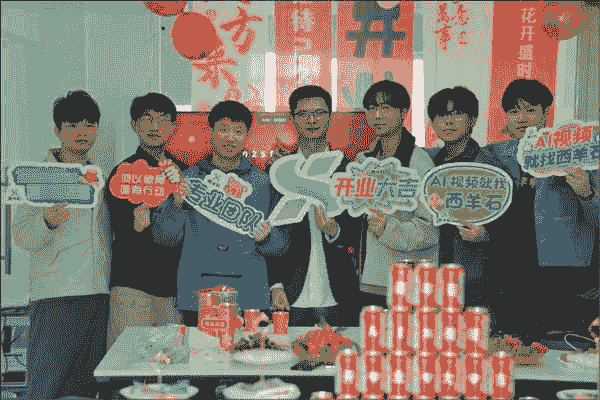

图 0-1　西羊石 AI 视频团队人员合影

AI 破局俱乐部洋哥是我们的引路人。最早涉足 AI 视频领域时，我们只是把它当成一个副业来摸索。在不断尝试、踩坑、复盘的过程中，这件事逐渐从个人尝试，发展成团队协作，最终走向公司化运作。可以说，从 AI 视频到 AI 漫剧，从内容创作到商业交付，我们始终依托真实项目和真实平台稳步推进，而不是停留在概念或想象层面。

在这个过程中，我们逐步跑通了 AI 漫剧的完整创作流程，也上线了多部作品。从小说改编、剧本拆解，到角色与场景设定、分镜设计、画面生成、剪辑配音，再到最终上线与数据反馈，我们对这条链路的理解在一次次真实项目交付中不断加深。也正是在这些实践中，我们越来越强烈地感受到一个问题：关于 AI 漫剧的讨论正在变多，但真正系统、可靠的信息却非常稀缺。

市面上充斥着大量零散的经验、碎片化的教程以及未经验证的观点。有些内容看似前沿，却难以落地；有些说法传播很广，实际却经不起项目验证；还有很多创作者接收的信息并不少，但这些信息未必准确，甚至可能只是道听途说、辗转转述，乃至空穴来风。

我们自己也曾经历过这样的阶段。正因为如此，在积攒了行业相关经验之后，我们开始认真思考：是否有必要把 AI 漫剧这条赛道中，真正跑通、验证过的方法，系统地整理出来，给后来者一个相对客观、可参考的框架。

一个重要的契机，出现在 AI 破局俱乐部的线下大会（图 0-2）上。

图 0-2　AI 破局俱乐部的线下大会合影

在那次大会上，经主理人洋哥引荐，我们认识了同为主场分享嘉宾的秋叶大叔。事实上，在此之前，我们已经对彼此有所耳闻，也长期关注对方在 AI 领域的实践与输出。会后交流中，我们发现彼此在 AI 短剧与 AI 漫剧方向上的理解高度契合，也都希望在这个方向上做一些真正有分量、对大家长期有价值的事情。

我们一方来自一线创作与交付现场，长期在项目中打磨流程、验证方法；另一方则深耕企业 AI 培训多年，在知识体系构建、方法论沉淀和图书写作方面有着丰富经验。当确认彼此都不想只停留在讲概念、追热点时，这本书的合作也就顺理成章了。

本书正是在这样的背景下创作的。

这不是一本围绕某一款工具或某一个平台展开的说明书，也不是一本追逐短期流量红利的快消书，而是一本系统性的 AI 漫剧创作全流程指南。书中所呈现的方法，很多来源于传统影视与动画行业中已经被长期验证的工作方式，只是被重新拆解、重组，并适配到了 AI 漫剧，乃至未来 AI 真人短剧的生产流程中：角色如何建立，场景如何服务叙事，分镜如何影响节奏，剪辑、配音与音乐如何共同决定观看体验——这些基础问题，恰恰是 AI 时代最容易被忽略，却最能决定作品上限的部分。

在此之前，我们也已经将这些经过团队实践与平台验证的方法多次应用在 AI 漫剧特训营中，并在真实教学与作品反馈（图 0-3）中不断修正、优化。它们并不是一次性的技巧，而是可以被不同背景的创作者理解、复用，并持续迭代的工作方法——这也正是我们决定将其系统整理成书的重要原因之一。

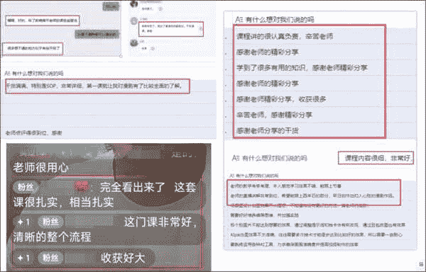

图 0-3　AI 漫剧特训营中部分学员的反馈

课程与视频的时效性毕竟有限，而书籍是一种更稳定，也更长久的载体。我们希望通过这本书，把已经验证过的经验沉淀下来，帮助更多真正对 AI 漫剧，乃至未来 AI 真人短剧感兴趣的创作者，少走一些弯路，看清这条路的真实样貌。

尽管如此，这本书并不试图给行业下结论。AI 漫剧这条赛道仍然处在快速变化之中，工具、平台和规则都会继续变化。我们更希望提供的是一套经过实践检验、可以被迁移，也能随着技术变化不断更新的方法论。

如果你正在探索 AI 漫剧这条路，希望本书能为你提供一份更清晰的参照；如果你也关注 AI 视频创作的长期发展，欢迎关注我们团队的公众号“西羊石 AI 视频”和“西羊石 AI 短剧”（图 0-4）与我们联系并保持交流。我们一直在分享一线实践与行业观察，也乐于与真正投入其中的同行探讨合作的可能。

图 0-4　两个公众号界面

这本书不是我们探索的终点，而是一个阶段性的记录。真正重要的，是在不断实践中，把这条路走得更清楚、更扎实。

——西羊石 AI 视频团队和秋叶大叔团队 EXr6287u6NNVz+GYLY+7SDk226FstKIHdC0bNoQkB2Nqi1xSR0yxPmwrTs5gRi/BtfSbid6dBhii9q7cz2pIyA==

# 第一章
AI 漫剧的市场判断与整体认知

EXr6287u6NNVz+GYLY+7SDk226FstKIHdC0bNoQkB2Nqi1xSR0yxPmwrTs5gRi/BtfSbid6dBhii9q7cz2pIyA==

## 1.1 别着急开始，先选对你要做的 AI 视频方向

在 AI 视频领域，能否持续发展并取得成功，关键往往不在于技术工具的操作熟练度，而在于起步阶段对内容方向的战略选择。很多创作者在学习初期很容易过度关注技术细节，却忽略了更为关键的市场前瞻与内容定位。如果选对了方向，技术上的短板可以慢慢补齐；反之，一旦方向选错，投入的精力越多，产生的自我消耗就会越大。

尽管同样被称为 AI 视频，但不同的内容方向背后，对应着完全不同的商业模式。有的内容本质上是项目交付，有的内容则是在积累长期内容资产。前者是一次成交，后者是持续创作。如果一开始未能厘清这一区别，后面的所有努力都可能因方向偏差而事倍功半。

因此，在本节中，暂不涉及具体工具与制作技巧，而是首先进行一次基础性的行业方向辨析。我们将 AI 广告片、AI 宣传片和 AI 漫剧放在同一维度下进行对比分析，目的只有一个：帮助读者判断，在这些 AI 视频细分方向中，哪一个更适合个人或小型团队作为可持续深耕的领域。

基于上述判断前提，下面首先来看这三个方向的实际差别。

### 1.1.1　理解三个 AI 视频方向的实际差别

#### 1．AI 广告片

笔者团队最初进入 AI 视频领域时，就是以 AI 广告片作为切入点。这类视频通常服务于品牌方，常见于电商产品、汽车、化妆品等商业宣传场景（如图 1-1 所示）。其时长通常较短，一般为 15s ～2min，核心目标明确：在有限的时间内迅速吸引受众注意，刺激消费。

从制作层面来看，AI 广告片具有节奏快、周期短、需求零散的特点。单就每一个项目而言，其制作难度或许并不突出，但真正进入这个市场后，便会发现竞争异常激烈。

笔者团队在 AI 视频领域已深耕近两年，入局时间较早，并积累了一些客户资源。即便如此，广告片制作依然是一个需求波动显著的领域。早期入场的大型工作室和成熟团队已占据市场主导地位，新晋创作者面临较高的竞争壁垒，突围难度较大。

图 1-1　AI 广告片示例

更现实的问题在于，广告片的商业模式并不友好。单个项目交付完成后，很难形成持续合作，回购周期长，复购率低。尽管表面接单频率可能不低，但实际收入并不稳定。完成当前项目后，下一订单何时到来往往很难预期。再加上广告片本身时长有限、内容承载量小，整体市场规模存在明确的天花板，能够容纳的创作者数量相对有限。这也直接限制了个人创作者的发展空间。

#### 2．AI 宣传片

随着 AI 在大场景渲染、视觉合成和艺术字设计等方面的能力日益突出，AI 宣传片开始被广泛应用，尤其在文旅宣传和企业形象展示领域（如图 1-2 所示）表现显著。

图 1-2　AI 宣传片示例

AI 宣传片的时长通常为 2 ～5min，其目标并不是直接促成交易，而是侧重于传递企业文化、塑造品牌形象或普及公共服务信息。其常见应用包括文旅宣传、企业形象展示、公益项目宣传等场景。

从市场需求的角度来看，AI 宣传片的确较广告片更为稳定，且单价也相对更高。但它同样存在明显的局限性：无论是企业还是政府机构，对宣传片的需求频次普遍有限，且宣传片制作周期较长，决策流程复杂，整体市场规模仍相对有限。

因此，这类内容更适合已有一定资源积累、能够承接完整项目制作的团队操作。对于个人创作者来说，其进入门槛较高，也很难建立起高频、可复制的可持续创作模式。

#### 3．AI 漫剧

AI 漫剧是目前增长速度最快、潜力最大的视频内容方向之一，在部分视频平台具有很高的用户热度和收藏量（如图 1-3 所示）。从形式上看，AI 漫剧通常以系列剧集呈现，单集时长为 1 ～2min，整部作品往往包含几十集甚至上百集，累计时长可达数百分钟。这样的内容体量，对于承制方而言已属常态。

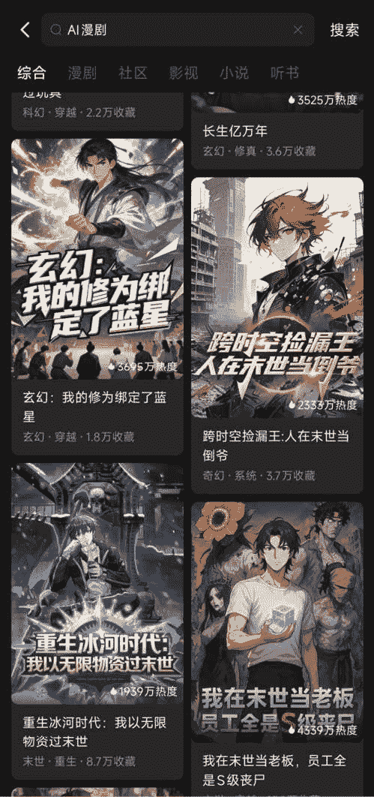

图 1-3　AI 漫剧示例

AI 漫剧的核心优势，首先体现在市场需求的体量上。无论是围绕二次元文化，还是基于轻小说、网络文学等 IP 的改编，市场对持续性剧情内容的需求都在快速增长。

其次，AI 技术显著降低了该领域的制作门槛。角色设定、场景构建、分镜设计等核心制作环节，均可借助 AI 工具高效生成，使得制作成本和时间投入都大幅降低，并控制在可行范围内。这也为小型团队乃至个人创作者提供了进入市场的可能性。

更为重要的是，AI 漫剧具有明显的内容扩展性和创作自由度。它不是一次性的项目交付，而是一种可持续产出、不断演进的内容形态。这一特性，从根本上提升了其对创作者的友好度与发展潜力。

### 1.1.2　红利正在转移，AI 视频的下一站是漫剧

在 AI 视频行业发展的初期，广告片和宣传片的确承接了市场的主要需求。但随着市场逐渐趋向饱和、客户审美标准不断提高，这两类内容的商业增长空间正逐步收窄。

与此同时，用户的内容消费习惯也在发生变化。观众对单条短视频的注意力越来越分散，却对有故事性、有连续性的内容投入更多时间。IP 化、系列化、持续化的内容产出，正在成为市场主流趋势。而 AI 漫剧，正好处在这一趋势的关键交汇处。

从创作者角度看，AI 广告片和 AI 宣传片市场已进入高度内卷阶段。其需求碎片化、周期短、竞争激烈，使得新手很难获得持续稳定的发展机会。而 AI 漫剧对应的是长线内容结构。单集时长虽短，但整体内容体量巨大，且需求具备持续性与可规模化特性。这种模式天然更适配内容创作者的长期投入。

从平台与行业数据来看，这一趋势已经非常清晰。根据艾媒咨询的调研，2025 年中国微短剧市场规模预计达到 677.9 亿元。微短剧已经从早期的边缘内容形态，逐渐成长为网络视听领域的重要增长引擎。在这一整体市场中，漫剧被多家研究机构视为最具扩展潜力的细分方向之一，其新增市场规模有望达到 200 亿元量级，相关的内容制作与承制企业数量预计也将达到数十万家规模。

平台对漫剧的关注并非偶然。从用户层面看，漫剧在观看体验上具备明显优势。漫剧单集时长短、剧情节奏紧凑、情绪转折迅速，能够在短时间内高效传递信息并带动观众情绪，非常符合观众当前碎片化的观看习惯。同时，动漫形式本身又进一步放大了情绪表达与剧情爽点，更容易促使用户形成连续观看和持续追更的行为模式。

从平台层面看，漫剧同时满足了流量增长和商业变现的双重需求，因此已经被纳入重点扶持的内容类别。以 B 站为例，其内部动画短剧与漫剧相关业务在单季度内实现了约 2500 万元的流水。在单月流水首次突破千万元之后，平台迅速推出了面向创作者的“觉醒计划”（如图 1-4 所示），由平台承担全部制作成本，同时提供千万级流量曝光支持，并给予最高可达 80%的收益分成。这一策略意图明确，即通过资源倾斜主动吸引更多创作者进入漫剧内容生产体系。

图 1-4　B 站“觉醒计划”内容说明

在抖音体系内，对漫剧的扶持同样具有清晰的商业指向。抖音红果近期推出了以补贴为核心的合作模式（如图 1-5 所示），通过“保底激励+单部剧保底”的持续分成模式，鼓励创作者进行稳定、长期的剧集更新。在部分合作模式中，漫剧内容已能按分钟为单位获得相对明确的结算标准，这在以往的短视频内容生态中并不常见。

图 1-5　抖音红果漫剧合作模式

从平台的一系列举措来看，这并不是试探性投入，而是一种明确的内容采购与供给策略。平台正在通过流量扶持、资金激励和规则设计，持续向市场释放信号，希望市场能够提供更多可规模化生产的漫剧内容。

从商业层面观察，AI 漫剧也同时扮演着 IP 测试工具的角色。相比真人短剧和传统动画，漫剧在制作成本、周期和试错风险上都更具可控性，适合用来快速验证某一 IP 的市场潜力，从而为后续是否进行更高成本的真人化、动画长番或游戏开发提供决策依据。此外，在出海场景中，玄幻、仙侠、游戏类题材通过 AI 漫剧形式呈现，也往往更容易跨越文化差异。

综合来看，市场需求的核心已趋于明确：行业需要高频产出、成本可控且具备规模化潜力的内容形态。

对创作者——尤其是刚入局 AI 内容创作者而言，这一趋势具有直接意义。广告片和宣传片更适合短期项目合作及具备一定资源的团队运作，虽能带来阶段性收益，却难以支撑长期、稳定的内容生产体系。而 AI 漫剧则为创作者提供了另一种发展路径：它允许通过持续更新积累内容资产，在相对可控的成本下建立起稳定的输出节奏。AI 技术的应用，既降低了制作门槛，也为个人和小规模团队拓展了创作的可能性。

从 AI 广告片、宣传片转向 AI 漫剧，并非简单地更换内容形式，更是对创作路径和商业逻辑的重新定位。一旦理解这一点，便不难解释为什么越来越多的创作者，正逐渐把重心转向 AI 漫剧这一领域。 EXr6287u6NNVz+GYLY+7SDk226FstKIHdC0bNoQkB2Nqi1xSR0yxPmwrTs5gRi/BtfSbid6dBhii9q7cz2pIyA==

## 1.1 别着急开始，先选对你要做的 AI 视频方向

在 AI 视频领域，能否持续发展并取得成功，关键往往不在于技术工具的操作熟练度，而在于起步阶段对内容方向的战略选择。很多创作者在学习初期很容易过度关注技术细节，却忽略了更为关键的市场前瞻与内容定位。如果选对了方向，技术上的短板可以慢慢补齐；反之，一旦方向选错，投入的精力越多，产生的自我消耗就会越大。

尽管同样被称为 AI 视频，但不同的内容方向背后，对应着完全不同的商业模式。有的内容本质上是项目交付，有的内容则是在积累长期内容资产。前者是一次成交，后者是持续创作。如果一开始未能厘清这一区别，后面的所有努力都可能因方向偏差而事倍功半。

因此，在本节中，暂不涉及具体工具与制作技巧，而是首先进行一次基础性的行业方向辨析。我们将 AI 广告片、AI 宣传片和 AI 漫剧放在同一维度下进行对比分析，目的只有一个：帮助读者判断，在这些 AI 视频细分方向中，哪一个更适合个人或小型团队作为可持续深耕的领域。

基于上述判断前提，下面首先来看这三个方向的实际差别。

### 1.1.1　理解三个 AI 视频方向的实际差别

#### 1．AI 广告片

笔者团队最初进入 AI 视频领域时，就是以 AI 广告片作为切入点。这类视频通常服务于品牌方，常见于电商产品、汽车、化妆品等商业宣传场景（如图 1-1 所示）。其时长通常较短，一般为 15s ～2min，核心目标明确：在有限的时间内迅速吸引受众注意，刺激消费。

从制作层面来看，AI 广告片具有节奏快、周期短、需求零散的特点。单就每一个项目而言，其制作难度或许并不突出，但真正进入这个市场后，便会发现竞争异常激烈。

笔者团队在 AI 视频领域已深耕近两年，入局时间较早，并积累了一些客户资源。即便如此，广告片制作依然是一个需求波动显著的领域。早期入场的大型工作室和成熟团队已占据市场主导地位，新晋创作者面临较高的竞争壁垒，突围难度较大。

图 1-1　AI 广告片示例

更现实的问题在于，广告片的商业模式并不友好。单个项目交付完成后，很难形成持续合作，回购周期长，复购率低。尽管表面接单频率可能不低，但实际收入并不稳定。完成当前项目后，下一订单何时到来往往很难预期。再加上广告片本身时长有限、内容承载量小，整体市场规模存在明确的天花板，能够容纳的创作者数量相对有限。这也直接限制了个人创作者的发展空间。

#### 2．AI 宣传片

随着 AI 在大场景渲染、视觉合成和艺术字设计等方面的能力日益突出，AI 宣传片开始被广泛应用，尤其在文旅宣传和企业形象展示领域（如图 1-2 所示）表现显著。

图 1-2　AI 宣传片示例

AI 宣传片的时长通常为 2 ～5min，其目标并不是直接促成交易，而是侧重于传递企业文化、塑造品牌形象或普及公共服务信息。其常见应用包括文旅宣传、企业形象展示、公益项目宣传等场景。

从市场需求的角度来看，AI 宣传片的确较广告片更为稳定，且单价也相对更高。但它同样存在明显的局限性：无论是企业还是政府机构，对宣传片的需求频次普遍有限，且宣传片制作周期较长，决策流程复杂，整体市场规模仍相对有限。

因此，这类内容更适合已有一定资源积累、能够承接完整项目制作的团队操作。对于个人创作者来说，其进入门槛较高，也很难建立起高频、可复制的可持续创作模式。

#### 3．AI 漫剧

AI 漫剧是目前增长速度最快、潜力最大的视频内容方向之一，在部分视频平台具有很高的用户热度和收藏量（如图 1-3 所示）。从形式上看，AI 漫剧通常以系列剧集呈现，单集时长为 1 ～2min，整部作品往往包含几十集甚至上百集，累计时长可达数百分钟。这样的内容体量，对于承制方而言已属常态。

图 1-3　AI 漫剧示例

AI 漫剧的核心优势，首先体现在市场需求的体量上。无论是围绕二次元文化，还是基于轻小说、网络文学等 IP 的改编，市场对持续性剧情内容的需求都在快速增长。

其次，AI 技术显著降低了该领域的制作门槛。角色设定、场景构建、分镜设计等核心制作环节，均可借助 AI 工具高效生成，使得制作成本和时间投入都大幅降低，并控制在可行范围内。这也为小型团队乃至个人创作者提供了进入市场的可能性。

更为重要的是，AI 漫剧具有明显的内容扩展性和创作自由度。它不是一次性的项目交付，而是一种可持续产出、不断演进的内容形态。这一特性，从根本上提升了其对创作者的友好度与发展潜力。

### 1.1.2　红利正在转移，AI 视频的下一站是漫剧

在 AI 视频行业发展的初期，广告片和宣传片的确承接了市场的主要需求。但随着市场逐渐趋向饱和、客户审美标准不断提高，这两类内容的商业增长空间正逐步收窄。

与此同时，用户的内容消费习惯也在发生变化。观众对单条短视频的注意力越来越分散，却对有故事性、有连续性的内容投入更多时间。IP 化、系列化、持续化的内容产出，正在成为市场主流趋势。而 AI 漫剧，正好处在这一趋势的关键交汇处。

从创作者角度看，AI 广告片和 AI 宣传片市场已进入高度内卷阶段。其需求碎片化、周期短、竞争激烈，使得新手很难获得持续稳定的发展机会。而 AI 漫剧对应的是长线内容结构。单集时长虽短，但整体内容体量巨大，且需求具备持续性与可规模化特性。这种模式天然更适配内容创作者的长期投入。

从平台与行业数据来看，这一趋势已经非常清晰。根据艾媒咨询的调研，2025 年中国微短剧市场规模预计达到 677.9 亿元。微短剧已经从早期的边缘内容形态，逐渐成长为网络视听领域的重要增长引擎。在这一整体市场中，漫剧被多家研究机构视为最具扩展潜力的细分方向之一，其新增市场规模有望达到 200 亿元量级，相关的内容制作与承制企业数量预计也将达到数十万家规模。

平台对漫剧的关注并非偶然。从用户层面看，漫剧在观看体验上具备明显优势。漫剧单集时长短、剧情节奏紧凑、情绪转折迅速，能够在短时间内高效传递信息并带动观众情绪，非常符合观众当前碎片化的观看习惯。同时，动漫形式本身又进一步放大了情绪表达与剧情爽点，更容易促使用户形成连续观看和持续追更的行为模式。

从平台层面看，漫剧同时满足了流量增长和商业变现的双重需求，因此已经被纳入重点扶持的内容类别。以 B 站为例，其内部动画短剧与漫剧相关业务在单季度内实现了约 2500 万元的流水。在单月流水首次突破千万元之后，平台迅速推出了面向创作者的“觉醒计划”（如图 1-4 所示），由平台承担全部制作成本，同时提供千万级流量曝光支持，并给予最高可达 80%的收益分成。这一策略意图明确，即通过资源倾斜主动吸引更多创作者进入漫剧内容生产体系。

图 1-4　B 站“觉醒计划”内容说明

在抖音体系内，对漫剧的扶持同样具有清晰的商业指向。抖音红果近期推出了以补贴为核心的合作模式（如图 1-5 所示），通过“保底激励+单部剧保底”的持续分成模式，鼓励创作者进行稳定、长期的剧集更新。在部分合作模式中，漫剧内容已能按分钟为单位获得相对明确的结算标准，这在以往的短视频内容生态中并不常见。

图 1-5　抖音红果漫剧合作模式

从平台的一系列举措来看，这并不是试探性投入，而是一种明确的内容采购与供给策略。平台正在通过流量扶持、资金激励和规则设计，持续向市场释放信号，希望市场能够提供更多可规模化生产的漫剧内容。

从商业层面观察，AI 漫剧也同时扮演着 IP 测试工具的角色。相比真人短剧和传统动画，漫剧在制作成本、周期和试错风险上都更具可控性，适合用来快速验证某一 IP 的市场潜力，从而为后续是否进行更高成本的真人化、动画长番或游戏开发提供决策依据。此外，在出海场景中，玄幻、仙侠、游戏类题材通过 AI 漫剧形式呈现，也往往更容易跨越文化差异。

综合来看，市场需求的核心已趋于明确：行业需要高频产出、成本可控且具备规模化潜力的内容形态。

对创作者——尤其是刚入局 AI 内容创作者而言，这一趋势具有直接意义。广告片和宣传片更适合短期项目合作及具备一定资源的团队运作，虽能带来阶段性收益，却难以支撑长期、稳定的内容生产体系。而 AI 漫剧则为创作者提供了另一种发展路径：它允许通过持续更新积累内容资产，在相对可控的成本下建立起稳定的输出节奏。AI 技术的应用，既降低了制作门槛，也为个人和小规模团队拓展了创作的可能性。

从 AI 广告片、宣传片转向 AI 漫剧，并非简单地更换内容形式，更是对创作路径和商业逻辑的重新定位。一旦理解这一点，便不难解释为什么越来越多的创作者，正逐渐把重心转向 AI 漫剧这一领域。 EXr6287u6NNVz+GYLY+7SDk226FstKIHdC0bNoQkB2Nqi1xSR0yxPmwrTs5gRi/BtfSbid6dBhii9q7cz2pIyA==

## 1.1 别着急开始，先选对你要做的 AI 视频方向

在 AI 视频领域，能否持续发展并取得成功，关键往往不在于技术工具的操作熟练度，而在于起步阶段对内容方向的战略选择。很多创作者在学习初期很容易过度关注技术细节，却忽略了更为关键的市场前瞻与内容定位。如果选对了方向，技术上的短板可以慢慢补齐；反之，一旦方向选错，投入的精力越多，产生的自我消耗就会越大。

尽管同样被称为 AI 视频，但不同的内容方向背后，对应着完全不同的商业模式。有的内容本质上是项目交付，有的内容则是在积累长期内容资产。前者是一次成交，后者是持续创作。如果一开始未能厘清这一区别，后面的所有努力都可能因方向偏差而事倍功半。

因此，在本节中，暂不涉及具体工具与制作技巧，而是首先进行一次基础性的行业方向辨析。我们将 AI 广告片、AI 宣传片和 AI 漫剧放在同一维度下进行对比分析，目的只有一个：帮助读者判断，在这些 AI 视频细分方向中，哪一个更适合个人或小型团队作为可持续深耕的领域。

基于上述判断前提，下面首先来看这三个方向的实际差别。

### 1.1.1　理解三个 AI 视频方向的实际差别

#### 1．AI 广告片

笔者团队最初进入 AI 视频领域时，就是以 AI 广告片作为切入点。这类视频通常服务于品牌方，常见于电商产品、汽车、化妆品等商业宣传场景（如图 1-1 所示）。其时长通常较短，一般为 15s ～2min，核心目标明确：在有限的时间内迅速吸引受众注意，刺激消费。

从制作层面来看，AI 广告片具有节奏快、周期短、需求零散的特点。单就每一个项目而言，其制作难度或许并不突出，但真正进入这个市场后，便会发现竞争异常激烈。

笔者团队在 AI 视频领域已深耕近两年，入局时间较早，并积累了一些客户资源。即便如此，广告片制作依然是一个需求波动显著的领域。早期入场的大型工作室和成熟团队已占据市场主导地位，新晋创作者面临较高的竞争壁垒，突围难度较大。

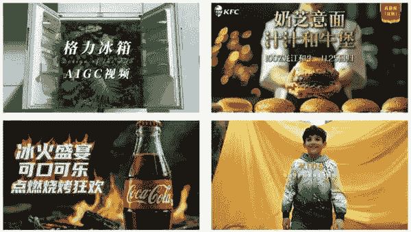

图 1-1　AI 广告片示例

更现实的问题在于，广告片的商业模式并不友好。单个项目交付完成后，很难形成持续合作，回购周期长，复购率低。尽管表面接单频率可能不低，但实际收入并不稳定。完成当前项目后，下一订单何时到来往往很难预期。再加上广告片本身时长有限、内容承载量小，整体市场规模存在明确的天花板，能够容纳的创作者数量相对有限。这也直接限制了个人创作者的发展空间。

#### 2．AI 宣传片

随着 AI 在大场景渲染、视觉合成和艺术字设计等方面的能力日益突出，AI 宣传片开始被广泛应用，尤其在文旅宣传和企业形象展示领域（如图 1-2 所示）表现显著。

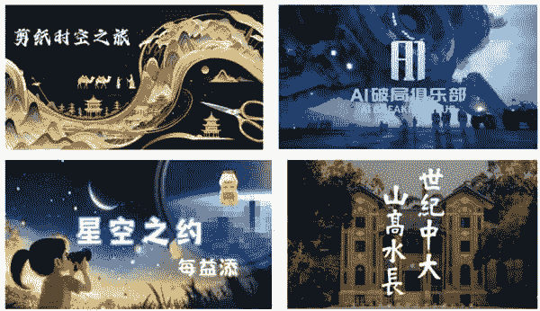

图 1-2　AI 宣传片示例

AI 宣传片的时长通常为 2 ～5min，其目标并不是直接促成交易，而是侧重于传递企业文化、塑造品牌形象或普及公共服务信息。其常见应用包括文旅宣传、企业形象展示、公益项目宣传等场景。

从市场需求的角度来看，AI 宣传片的确较广告片更为稳定，且单价也相对更高。但它同样存在明显的局限性：无论是企业还是政府机构，对宣传片的需求频次普遍有限，且宣传片制作周期较长，决策流程复杂，整体市场规模仍相对有限。

因此，这类内容更适合已有一定资源积累、能够承接完整项目制作的团队操作。对于个人创作者来说，其进入门槛较高，也很难建立起高频、可复制的可持续创作模式。

#### 3．AI 漫剧

AI 漫剧是目前增长速度最快、潜力最大的视频内容方向之一，在部分视频平台具有很高的用户热度和收藏量（如图 1-3 所示）。从形式上看，AI 漫剧通常以系列剧集呈现，单集时长为 1 ～2min，整部作品往往包含几十集甚至上百集，累计时长可达数百分钟。这样的内容体量，对于承制方而言已属常态。

图 1-3　AI 漫剧示例

AI 漫剧的核心优势，首先体现在市场需求的体量上。无论是围绕二次元文化，还是基于轻小说、网络文学等 IP 的改编，市场对持续性剧情内容的需求都在快速增长。

其次，AI 技术显著降低了该领域的制作门槛。角色设定、场景构建、分镜设计等核心制作环节，均可借助 AI 工具高效生成，使得制作成本和时间投入都大幅降低，并控制在可行范围内。这也为小型团队乃至个人创作者提供了进入市场的可能性。

更为重要的是，AI 漫剧具有明显的内容扩展性和创作自由度。它不是一次性的项目交付，而是一种可持续产出、不断演进的内容形态。这一特性，从根本上提升了其对创作者的友好度与发展潜力。

### 1.1.2　红利正在转移，AI 视频的下一站是漫剧

在 AI 视频行业发展的初期，广告片和宣传片的确承接了市场的主要需求。但随着市场逐渐趋向饱和、客户审美标准不断提高，这两类内容的商业增长空间正逐步收窄。

与此同时，用户的内容消费习惯也在发生变化。观众对单条短视频的注意力越来越分散，却对有故事性、有连续性的内容投入更多时间。IP 化、系列化、持续化的内容产出，正在成为市场主流趋势。而 AI 漫剧，正好处在这一趋势的关键交汇处。

从创作者角度看，AI 广告片和 AI 宣传片市场已进入高度内卷阶段。其需求碎片化、周期短、竞争激烈，使得新手很难获得持续稳定的发展机会。而 AI 漫剧对应的是长线内容结构。单集时长虽短，但整体内容体量巨大，且需求具备持续性与可规模化特性。这种模式天然更适配内容创作者的长期投入。

从平台与行业数据来看，这一趋势已经非常清晰。根据艾媒咨询的调研，2025 年中国微短剧市场规模预计达到 677.9 亿元。微短剧已经从早期的边缘内容形态，逐渐成长为网络视听领域的重要增长引擎。在这一整体市场中，漫剧被多家研究机构视为最具扩展潜力的细分方向之一，其新增市场规模有望达到 200 亿元量级，相关的内容制作与承制企业数量预计也将达到数十万家规模。

平台对漫剧的关注并非偶然。从用户层面看，漫剧在观看体验上具备明显优势。漫剧单集时长短、剧情节奏紧凑、情绪转折迅速，能够在短时间内高效传递信息并带动观众情绪，非常符合观众当前碎片化的观看习惯。同时，动漫形式本身又进一步放大了情绪表达与剧情爽点，更容易促使用户形成连续观看和持续追更的行为模式。

从平台层面看，漫剧同时满足了流量增长和商业变现的双重需求，因此已经被纳入重点扶持的内容类别。以 B 站为例，其内部动画短剧与漫剧相关业务在单季度内实现了约 2500 万元的流水。在单月流水首次突破千万元之后，平台迅速推出了面向创作者的“觉醒计划”（如图 1-4 所示），由平台承担全部制作成本，同时提供千万级流量曝光支持，并给予最高可达 80%的收益分成。这一策略意图明确，即通过资源倾斜主动吸引更多创作者进入漫剧内容生产体系。

图 1-4　B 站“觉醒计划”内容说明

在抖音体系内，对漫剧的扶持同样具有清晰的商业指向。抖音红果近期推出了以补贴为核心的合作模式（如图 1-5 所示），通过“保底激励+单部剧保底”的持续分成模式，鼓励创作者进行稳定、长期的剧集更新。在部分合作模式中，漫剧内容已能按分钟为单位获得相对明确的结算标准，这在以往的短视频内容生态中并不常见。

图 1-5　抖音红果漫剧合作模式

从平台的一系列举措来看，这并不是试探性投入，而是一种明确的内容采购与供给策略。平台正在通过流量扶持、资金激励和规则设计，持续向市场释放信号，希望市场能够提供更多可规模化生产的漫剧内容。

从商业层面观察，AI 漫剧也同时扮演着 IP 测试工具的角色。相比真人短剧和传统动画，漫剧在制作成本、周期和试错风险上都更具可控性，适合用来快速验证某一 IP 的市场潜力，从而为后续是否进行更高成本的真人化、动画长番或游戏开发提供决策依据。此外，在出海场景中，玄幻、仙侠、游戏类题材通过 AI 漫剧形式呈现，也往往更容易跨越文化差异。

综合来看，市场需求的核心已趋于明确：行业需要高频产出、成本可控且具备规模化潜力的内容形态。

对创作者——尤其是刚入局 AI 内容创作者而言，这一趋势具有直接意义。广告片和宣传片更适合短期项目合作及具备一定资源的团队运作，虽能带来阶段性收益，却难以支撑长期、稳定的内容生产体系。而 AI 漫剧则为创作者提供了另一种发展路径：它允许通过持续更新积累内容资产，在相对可控的成本下建立起稳定的输出节奏。AI 技术的应用，既降低了制作门槛，也为个人和小规模团队拓展了创作的可能性。

从 AI 广告片、宣传片转向 AI 漫剧，并非简单地更换内容形式，更是对创作路径和商业逻辑的重新定位。一旦理解这一点，便不难解释为什么越来越多的创作者，正逐渐把重心转向 AI 漫剧这一领域。 EXr6287u6NNVz+GYLY+7SDk226FstKIHdC0bNoQkB2Nqi1xSR0yxPmwrTs5gRi/BtfSbid6dBhii9q7cz2pIyA==

## 1.2 短剧爆发后，为什么真正适合普通创作者的是 AI 漫剧

在 1.1 节中，我们已经从商业模式的角度对 AI 广告片、AI 宣传片和 AI 漫剧进行了辨析。这一区分主要回答了“哪个方向”值得长期投入的问题。

但当创作者真正进入内容创作层面时，新的问题会随之出现。很多从业者并不是从 AI 漫剧开始接触 AI 视频的，而是先接触各种短视频内容形式，如 AI 短剧、动态漫、AI 动漫片段、AI 真人短剧等，这些内容在平台上并存，名称相似、形式互有交叉，容易使人将其混为一谈。

如果不先把这些内容形态之间的关系理清楚，创作者在实践中往往会陷入反复试错，甚至在一开始就选错方向。因此，本节的任务是帮助读者建立短剧体系的整体视角，重新梳理 AI 漫剧在所有相关内容形态中所处的真实位置。

### 1.2.1　AI 短剧是一个内容大类，而不是一种具体形式

首先需要明确的是，AI 短剧并不是某一种固定的内容形态，而是一个总称。凡是以短时长剧集为主要呈现方式，通过剧情推进吸引用户持续观看的内容，都可以被纳入短剧体系。随着 AI 技术的广泛应用，该体系迅速扩展，形成了多种不同的制作路径。

在实际平台内容中，AI 短剧主要呈现为以下形式：以真人拍摄为主、辅以 AI 特效的 AI 真人短剧；以 AI 生成画面为核心的 AI 动漫；以静态画面配合基础动效呈现的 AI 动态漫；以及以连续剧情为核心的 AI 漫剧。它们都满足了用户碎片化观看的需求，但并不意味着适合相同的创作者长期投入。为了方便读者理解，表 1-1 对 AI 短剧主要表现形式进行了详细对比。

表 1-1　AI 短剧主要表现形式的详细对比

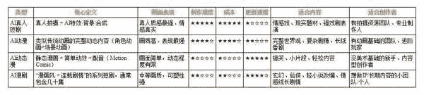

#### 1．AI 真人短剧：写实主义的情感冲击

AI 真人短剧结合了真人出演与 AI 生成的特效场景，如图 1-6 所示。这种形式能够产生比纯动画更强烈的情感共鸣和视觉真实感。它通常采用写实主义风格，尤其适合呈现情感层次丰富、依赖细腻表演支撑的剧情内容。虽然其制作难度和成本相对较高，但在需要深度情感表达的题材中，仍具有独特的创作优势。

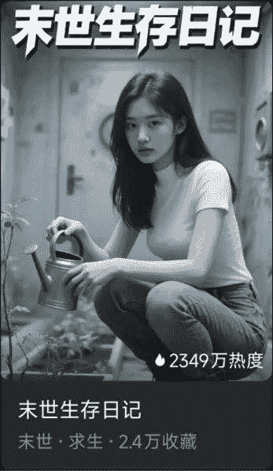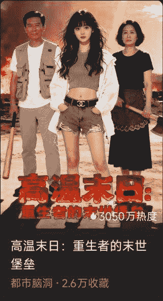

图 1-6　AI 真人短剧

#### 2．AI 动漫：向专业番剧看齐的高标杆

需要明确的是，AI 动漫与 AI 漫剧属于两种不同的内容形态和制作路径。AI 动漫以传统动画或番剧为对标，追求连续的动作表现、完整的镜头语言、稳定的角色建模以及高质量的动画渲染。

AI 动漫制作周期极长，对创作者的技术积累和计算资源均有较高要求，更适合制作大型长线剧集或动画电影类内容。虽然其画面精美，但对于个人创作者来说，前期投入产出比往往并不突出。

AI 动漫的目标在于对标传统动画，追求动作的连续性、镜头语言的完整性、角色建模的稳定性与画面的高质量。该形态适用于番剧、动画短片或电影等长线内容开发，通常制作周期长，资源投入高。

AI 漫剧则属于另一种内容形态，其根源可追溯至漫画与视觉小说，主要由“静态或轻度动态画面 + 配音 + 音乐 + 节奏化剪辑”构成，更强调叙事效率、情绪节奏与短时内容的观看体验。该形式尤其适合短视频平台和网络文学 IP 改编，具备低成本、快产出的显著优势。

需要特别指出的是，随着 AI 图像生成、动态合成、剪辑和配音工具的快速发展，现代 AI 漫剧的视觉呈现越来越精良，动态效果更丰富、镜头语言也更趋多样，看起来“更像动画”了。但本质上，它仍属于“轻动画 + 剪辑叙事”的范畴，并不等同于传统意义上的高帧动画。

#### 3．AI 动态漫：高效率的轻量化方案

AI 动态漫通常是将静态漫画素材借助 AI 技术转换为具有轻微动态效果的形式。其表现形式相对单一，主要以画面的平移、缩放以及简单的局部动效为主。

虽然在视觉表现力上不及完整动画，但动态漫的优势在于制作速度快且成本极低。这种形式非常适合呈现搞笑、幽默或者体量较巧的视频片段，是追求高生产效率和内容产出量的首选方案。对于网络文学 IP 的快速市场测试，动态漫往往能起到立竿见影的效果。例如，《最强仙尊陈北玄》第四季的动态漫即采用了这一形式，如图 1-7 所示。

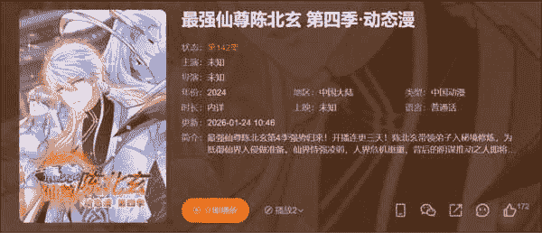

图 1-7　《最强仙尊陈北玄》第四季的动态漫

#### 4．AI 漫剧：本赛道的绝对主角

AI 漫剧是指通过 AI 技术生成的系列化剧集，也是本书重点探讨的内容形态。它与普通短视频最大的区别在于“系列化”结构与“连续性剧情推进”。漫剧在多个剧集之间保持紧密的逻辑关联和角色成长轨迹，能够深入展开复杂度较高的故事情节。

AI 漫剧的优势，在于实现了成本控制与内容质量的有效平衡。它并不追求传统动画般的高帧率和流畅度，而是借助 AI 工具高效生成角色与场景，通过精美的画面设计和紧凑的剪辑节奏来弥补动作的简化。这一形式对年轻观众，尤其是二次元文化和轻小说爱好者具有极强的吸引力，并使个人或小型团队也能以相对稳定的节奏，持续产出长篇连载剧集内容。

### 1.2.2　为什么 AI 漫剧成为当下的市场共识

目前 AI 漫剧的兴起，源于其背后坚实的市场需求和技术支撑。

首先，AI 技术与自动化工具的不断成熟，使得将文字 IP 转换为视频内容的成本呈断崖式下跌。以往，制作一部高质量动画可能需要庞大的团队和漫长的周期。如今，一个只有 7 人左右的专业小团队，若能熟练运用 AI 制作流程，已能独立完成播放量达千万级的作品。

其次，短视频平台的流量分发机制与庞大的网络文学 IP 库资源形成了有效对接。观众对剧情爽点和高密度感官刺激的偏好，使漫剧成为高度适应当前消费习惯的形态。这一形式具备强大的 IP 变现潜力：传统动画从制作到市场反馈往往需要半年甚至更久，而 AI 漫剧可以在几周内完成上线，快速验证市场接受度。

以 2025 年上线的典型案例《我的治愈系游戏》（如图 1-8 所示）为例，这作品由阅文集团与腾讯动漫联合出品，是典型的 AI 全流程制作成果。上线短短几天，其在全平台播放量便突破千万。其制作团队仅 7 人，依托 AI 工具高效完成了从画面生成、配音到剪辑的全部流程，这种效率在传统动画生产模式下很难实现。

图 1-8　AI 漫剧《我的治愈系游戏》

另一部热门作品《传武》（如图 1-9 所示）也印证了这一趋势：即便在动作表现要求较高的题材领域，AI 漫剧仍能凭借其形式优势获得巨大的流量红利。

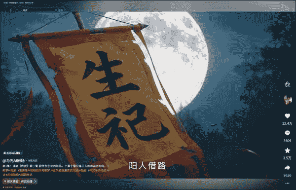

图 1-9　AI 漫剧《传武》

很多创作者在刚接触 AI 视频领域时，容易受短期数据影响。某一内容方向播放量突出便急于跟进；某一成为短视频爆款即反复模仿其结构和节奏。此类做法在短期内容尝试中并没有问题，但若将视野放至长期创作，就会发现不同内容形态对创作者的要求并不相同。

如果你的目标是快速测试某一题材的市场反应，或者只是想在短时间内熟悉 AI 工具的基本操作，那么动态漫和其他短时长内容依然是合适的选择。这类内容制作周期短，单条作品的完成度要求相对聚焦，既适合用于技能练习，也适合观察平台的即时反应。

但这类内容的一个现实问题是创作过程往往难以形成有效积累。由于每条作品几乎都需从头开始，一旦题材、节奏或表达方式稍有变化，最终效果就可能产生明显波动。这容易使创作者陷入持续追逐热点、反复重启创作的循环之中。

当创作者的目标开始转向持续创作，希望通过内容本身形成稳定的输出节奏时，AI 漫剧的优势就会逐渐显现。AI 漫剧以系列化结构为基础，其创作重心不在于单集的表现，而在于整体叙事框架的搭建。一旦世界观、人物关系和基本风格确定下来，后续内容的生产就会进入相对稳定的节奏。创作者无须每集都从零开始，而是在已有框架中持续延展叙事。

这种结构特性决定了它更适合长期投入的创作模式。从内容维度看，剧情会随着持续更新不断丰富；从创作维度看，经验会在反复实践中不断积累；从平台维度看，账号和作品也更容易形成清晰的风格标签。

因此，这并不是形式优劣的问题，而是创作路径的差异。动态漫和其他短时长内容更像一种快速响应机制，而 AI 漫剧则更接近一条可持续推进的创作路径。

若能在起步阶段就明确自己的时间规划、投入方式和目标定位，后续的选择就会变为理性，也更容易坚持下去。 EXr6287u6NNVz+GYLY+7SDk226FstKIHdC0bNoQkB2Nqi1xSR0yxPmwrTs5gRi/BtfSbid6dBhii9q7cz2pIyA==

## 1.2 短剧爆发后，为什么真正适合普通创作者的是 AI 漫剧

在 1.1 节中，我们已经从商业模式的角度对 AI 广告片、AI 宣传片和 AI 漫剧进行了辨析。这一区分主要回答了“哪个方向”值得长期投入的问题。

但当创作者真正进入内容创作层面时，新的问题会随之出现。很多从业者并不是从 AI 漫剧开始接触 AI 视频的，而是先接触各种短视频内容形式，如 AI 短剧、动态漫、AI 动漫片段、AI 真人短剧等，这些内容在平台上并存，名称相似、形式互有交叉，容易使人将其混为一谈。

如果不先把这些内容形态之间的关系理清楚，创作者在实践中往往会陷入反复试错，甚至在一开始就选错方向。因此，本节的任务是帮助读者建立短剧体系的整体视角，重新梳理 AI 漫剧在所有相关内容形态中所处的真实位置。

### 1.2.1　AI 短剧是一个内容大类，而不是一种具体形式

首先需要明确的是，AI 短剧并不是某一种固定的内容形态，而是一个总称。凡是以短时长剧集为主要呈现方式，通过剧情推进吸引用户持续观看的内容，都可以被纳入短剧体系。随着 AI 技术的广泛应用，该体系迅速扩展，形成了多种不同的制作路径。

在实际平台内容中，AI 短剧主要呈现为以下形式：以真人拍摄为主、辅以 AI 特效的 AI 真人短剧；以 AI 生成画面为核心的 AI 动漫；以静态画面配合基础动效呈现的 AI 动态漫；以及以连续剧情为核心的 AI 漫剧。它们都满足了用户碎片化观看的需求，但并不意味着适合相同的创作者长期投入。为了方便读者理解，表 1-1 对 AI 短剧主要表现形式进行了详细对比。

表 1-1　AI 短剧主要表现形式的详细对比

#### 1．AI 真人短剧：写实主义的情感冲击

AI 真人短剧结合了真人出演与 AI 生成的特效场景，如图 1-6 所示。这种形式能够产生比纯动画更强烈的情感共鸣和视觉真实感。它通常采用写实主义风格，尤其适合呈现情感层次丰富、依赖细腻表演支撑的剧情内容。虽然其制作难度和成本相对较高，但在需要深度情感表达的题材中，仍具有独特的创作优势。

图 1-6　AI 真人短剧

#### 2．AI 动漫：向专业番剧看齐的高标杆

需要明确的是，AI 动漫与 AI 漫剧属于两种不同的内容形态和制作路径。AI 动漫以传统动画或番剧为对标，追求连续的动作表现、完整的镜头语言、稳定的角色建模以及高质量的动画渲染。

AI 动漫制作周期极长，对创作者的技术积累和计算资源均有较高要求，更适合制作大型长线剧集或动画电影类内容。虽然其画面精美，但对于个人创作者来说，前期投入产出比往往并不突出。

AI 动漫的目标在于对标传统动画，追求动作的连续性、镜头语言的完整性、角色建模的稳定性与画面的高质量。该形态适用于番剧、动画短片或电影等长线内容开发，通常制作周期长，资源投入高。

AI 漫剧则属于另一种内容形态，其根源可追溯至漫画与视觉小说，主要由“静态或轻度动态画面 + 配音 + 音乐 + 节奏化剪辑”构成，更强调叙事效率、情绪节奏与短时内容的观看体验。该形式尤其适合短视频平台和网络文学 IP 改编，具备低成本、快产出的显著优势。

需要特别指出的是，随着 AI 图像生成、动态合成、剪辑和配音工具的快速发展，现代 AI 漫剧的视觉呈现越来越精良，动态效果更丰富、镜头语言也更趋多样，看起来“更像动画”了。但本质上，它仍属于“轻动画 + 剪辑叙事”的范畴，并不等同于传统意义上的高帧动画。

#### 3．AI 动态漫：高效率的轻量化方案

AI 动态漫通常是将静态漫画素材借助 AI 技术转换为具有轻微动态效果的形式。其表现形式相对单一，主要以画面的平移、缩放以及简单的局部动效为主。

虽然在视觉表现力上不及完整动画，但动态漫的优势在于制作速度快且成本极低。这种形式非常适合呈现搞笑、幽默或者体量较巧的视频片段，是追求高生产效率和内容产出量的首选方案。对于网络文学 IP 的快速市场测试，动态漫往往能起到立竿见影的效果。例如，《最强仙尊陈北玄》第四季的动态漫即采用了这一形式，如图 1-7 所示。

图 1-7　《最强仙尊陈北玄》第四季的动态漫

#### 4．AI 漫剧：本赛道的绝对主角

AI 漫剧是指通过 AI 技术生成的系列化剧集，也是本书重点探讨的内容形态。它与普通短视频最大的区别在于“系列化”结构与“连续性剧情推进”。漫剧在多个剧集之间保持紧密的逻辑关联和角色成长轨迹，能够深入展开复杂度较高的故事情节。

AI 漫剧的优势，在于实现了成本控制与内容质量的有效平衡。它并不追求传统动画般的高帧率和流畅度，而是借助 AI 工具高效生成角色与场景，通过精美的画面设计和紧凑的剪辑节奏来弥补动作的简化。这一形式对年轻观众，尤其是二次元文化和轻小说爱好者具有极强的吸引力，并使个人或小型团队也能以相对稳定的节奏，持续产出长篇连载剧集内容。

### 1.2.2　为什么 AI 漫剧成为当下的市场共识

目前 AI 漫剧的兴起，源于其背后坚实的市场需求和技术支撑。

首先，AI 技术与自动化工具的不断成熟，使得将文字 IP 转换为视频内容的成本呈断崖式下跌。以往，制作一部高质量动画可能需要庞大的团队和漫长的周期。如今，一个只有 7 人左右的专业小团队，若能熟练运用 AI 制作流程，已能独立完成播放量达千万级的作品。

其次，短视频平台的流量分发机制与庞大的网络文学 IP 库资源形成了有效对接。观众对剧情爽点和高密度感官刺激的偏好，使漫剧成为高度适应当前消费习惯的形态。这一形式具备强大的 IP 变现潜力：传统动画从制作到市场反馈往往需要半年甚至更久，而 AI 漫剧可以在几周内完成上线，快速验证市场接受度。

以 2025 年上线的典型案例《我的治愈系游戏》（如图 1-8 所示）为例，这作品由阅文集团与腾讯动漫联合出品，是典型的 AI 全流程制作成果。上线短短几天，其在全平台播放量便突破千万。其制作团队仅 7 人，依托 AI 工具高效完成了从画面生成、配音到剪辑的全部流程，这种效率在传统动画生产模式下很难实现。

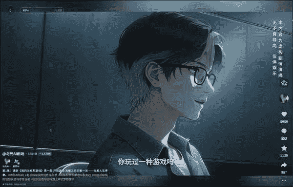

图 1-8　AI 漫剧《我的治愈系游戏》

另一部热门作品《传武》（如图 1-9 所示）也印证了这一趋势：即便在动作表现要求较高的题材领域，AI 漫剧仍能凭借其形式优势获得巨大的流量红利。

图 1-9　AI 漫剧《传武》

很多创作者在刚接触 AI 视频领域时，容易受短期数据影响。某一内容方向播放量突出便急于跟进；某一成为短视频爆款即反复模仿其结构和节奏。此类做法在短期内容尝试中并没有问题，但若将视野放至长期创作，就会发现不同内容形态对创作者的要求并不相同。

如果你的目标是快速测试某一题材的市场反应，或者只是想在短时间内熟悉 AI 工具的基本操作，那么动态漫和其他短时长内容依然是合适的选择。这类内容制作周期短，单条作品的完成度要求相对聚焦，既适合用于技能练习，也适合观察平台的即时反应。

但这类内容的一个现实问题是创作过程往往难以形成有效积累。由于每条作品几乎都需从头开始，一旦题材、节奏或表达方式稍有变化，最终效果就可能产生明显波动。这容易使创作者陷入持续追逐热点、反复重启创作的循环之中。

当创作者的目标开始转向持续创作，希望通过内容本身形成稳定的输出节奏时，AI 漫剧的优势就会逐渐显现。AI 漫剧以系列化结构为基础，其创作重心不在于单集的表现，而在于整体叙事框架的搭建。一旦世界观、人物关系和基本风格确定下来，后续内容的生产就会进入相对稳定的节奏。创作者无须每集都从零开始，而是在已有框架中持续延展叙事。

这种结构特性决定了它更适合长期投入的创作模式。从内容维度看，剧情会随着持续更新不断丰富；从创作维度看，经验会在反复实践中不断积累；从平台维度看，账号和作品也更容易形成清晰的风格标签。

因此，这并不是形式优劣的问题，而是创作路径的差异。动态漫和其他短时长内容更像一种快速响应机制，而 AI 漫剧则更接近一条可持续推进的创作路径。

若能在起步阶段就明确自己的时间规划、投入方式和目标定位，后续的选择就会变为理性，也更容易坚持下去。 EXr6287u6NNVz+GYLY+7SDk226FstKIHdC0bNoQkB2Nqi1xSR0yxPmwrTs5gRi/BtfSbid6dBhii9q7cz2pIyA==

## 1.2 短剧爆发后，为什么真正适合普通创作者的是 AI 漫剧

在 1.1 节中，我们已经从商业模式的角度对 AI 广告片、AI 宣传片和 AI 漫剧进行了辨析。这一区分主要回答了“哪个方向”值得长期投入的问题。

但当创作者真正进入内容创作层面时，新的问题会随之出现。很多从业者并不是从 AI 漫剧开始接触 AI 视频的，而是先接触各种短视频内容形式，如 AI 短剧、动态漫、AI 动漫片段、AI 真人短剧等，这些内容在平台上并存，名称相似、形式互有交叉，容易使人将其混为一谈。

如果不先把这些内容形态之间的关系理清楚，创作者在实践中往往会陷入反复试错，甚至在一开始就选错方向。因此，本节的任务是帮助读者建立短剧体系的整体视角，重新梳理 AI 漫剧在所有相关内容形态中所处的真实位置。

### 1.2.1　AI 短剧是一个内容大类，而不是一种具体形式

首先需要明确的是，AI 短剧并不是某一种固定的内容形态，而是一个总称。凡是以短时长剧集为主要呈现方式，通过剧情推进吸引用户持续观看的内容，都可以被纳入短剧体系。随着 AI 技术的广泛应用，该体系迅速扩展，形成了多种不同的制作路径。

在实际平台内容中，AI 短剧主要呈现为以下形式：以真人拍摄为主、辅以 AI 特效的 AI 真人短剧；以 AI 生成画面为核心的 AI 动漫；以静态画面配合基础动效呈现的 AI 动态漫；以及以连续剧情为核心的 AI 漫剧。它们都满足了用户碎片化观看的需求，但并不意味着适合相同的创作者长期投入。为了方便读者理解，表 1-1 对 AI 短剧主要表现形式进行了详细对比。

表 1-1　AI 短剧主要表现形式的详细对比

#### 1．AI 真人短剧：写实主义的情感冲击

AI 真人短剧结合了真人出演与 AI 生成的特效场景，如图 1-6 所示。这种形式能够产生比纯动画更强烈的情感共鸣和视觉真实感。它通常采用写实主义风格，尤其适合呈现情感层次丰富、依赖细腻表演支撑的剧情内容。虽然其制作难度和成本相对较高，但在需要深度情感表达的题材中，仍具有独特的创作优势。

图 1-6　AI 真人短剧

#### 2．AI 动漫：向专业番剧看齐的高标杆

需要明确的是，AI 动漫与 AI 漫剧属于两种不同的内容形态和制作路径。AI 动漫以传统动画或番剧为对标，追求连续的动作表现、完整的镜头语言、稳定的角色建模以及高质量的动画渲染。

AI 动漫制作周期极长，对创作者的技术积累和计算资源均有较高要求，更适合制作大型长线剧集或动画电影类内容。虽然其画面精美，但对于个人创作者来说，前期投入产出比往往并不突出。

AI 动漫的目标在于对标传统动画，追求动作的连续性、镜头语言的完整性、角色建模的稳定性与画面的高质量。该形态适用于番剧、动画短片或电影等长线内容开发，通常制作周期长，资源投入高。

AI 漫剧则属于另一种内容形态，其根源可追溯至漫画与视觉小说，主要由“静态或轻度动态画面 + 配音 + 音乐 + 节奏化剪辑”构成，更强调叙事效率、情绪节奏与短时内容的观看体验。该形式尤其适合短视频平台和网络文学 IP 改编，具备低成本、快产出的显著优势。

需要特别指出的是，随着 AI 图像生成、动态合成、剪辑和配音工具的快速发展，现代 AI 漫剧的视觉呈现越来越精良，动态效果更丰富、镜头语言也更趋多样，看起来“更像动画”了。但本质上，它仍属于“轻动画 + 剪辑叙事”的范畴，并不等同于传统意义上的高帧动画。

#### 3．AI 动态漫：高效率的轻量化方案

AI 动态漫通常是将静态漫画素材借助 AI 技术转换为具有轻微动态效果的形式。其表现形式相对单一，主要以画面的平移、缩放以及简单的局部动效为主。

虽然在视觉表现力上不及完整动画，但动态漫的优势在于制作速度快且成本极低。这种形式非常适合呈现搞笑、幽默或者体量较巧的视频片段，是追求高生产效率和内容产出量的首选方案。对于网络文学 IP 的快速市场测试，动态漫往往能起到立竿见影的效果。例如，《最强仙尊陈北玄》第四季的动态漫即采用了这一形式，如图 1-7 所示。

图 1-7　《最强仙尊陈北玄》第四季的动态漫

#### 4．AI 漫剧：本赛道的绝对主角

AI 漫剧是指通过 AI 技术生成的系列化剧集，也是本书重点探讨的内容形态。它与普通短视频最大的区别在于“系列化”结构与“连续性剧情推进”。漫剧在多个剧集之间保持紧密的逻辑关联和角色成长轨迹，能够深入展开复杂度较高的故事情节。

AI 漫剧的优势，在于实现了成本控制与内容质量的有效平衡。它并不追求传统动画般的高帧率和流畅度，而是借助 AI 工具高效生成角色与场景，通过精美的画面设计和紧凑的剪辑节奏来弥补动作的简化。这一形式对年轻观众，尤其是二次元文化和轻小说爱好者具有极强的吸引力，并使个人或小型团队也能以相对稳定的节奏，持续产出长篇连载剧集内容。

### 1.2.2　为什么 AI 漫剧成为当下的市场共识

目前 AI 漫剧的兴起，源于其背后坚实的市场需求和技术支撑。

首先，AI 技术与自动化工具的不断成熟，使得将文字 IP 转换为视频内容的成本呈断崖式下跌。以往，制作一部高质量动画可能需要庞大的团队和漫长的周期。如今，一个只有 7 人左右的专业小团队，若能熟练运用 AI 制作流程，已能独立完成播放量达千万级的作品。

其次，短视频平台的流量分发机制与庞大的网络文学 IP 库资源形成了有效对接。观众对剧情爽点和高密度感官刺激的偏好，使漫剧成为高度适应当前消费习惯的形态。这一形式具备强大的 IP 变现潜力：传统动画从制作到市场反馈往往需要半年甚至更久，而 AI 漫剧可以在几周内完成上线，快速验证市场接受度。

以 2025 年上线的典型案例《我的治愈系游戏》（如图 1-8 所示）为例，这作品由阅文集团与腾讯动漫联合出品，是典型的 AI 全流程制作成果。上线短短几天，其在全平台播放量便突破千万。其制作团队仅 7 人，依托 AI 工具高效完成了从画面生成、配音到剪辑的全部流程，这种效率在传统动画生产模式下很难实现。

图 1-8　AI 漫剧《我的治愈系游戏》

另一部热门作品《传武》（如图 1-9 所示）也印证了这一趋势：即便在动作表现要求较高的题材领域，AI 漫剧仍能凭借其形式优势获得巨大的流量红利。

图 1-9　AI 漫剧《传武》

很多创作者在刚接触 AI 视频领域时，容易受短期数据影响。某一内容方向播放量突出便急于跟进；某一成为短视频爆款即反复模仿其结构和节奏。此类做法在短期内容尝试中并没有问题，但若将视野放至长期创作，就会发现不同内容形态对创作者的要求并不相同。

如果你的目标是快速测试某一题材的市场反应，或者只是想在短时间内熟悉 AI 工具的基本操作，那么动态漫和其他短时长内容依然是合适的选择。这类内容制作周期短，单条作品的完成度要求相对聚焦，既适合用于技能练习，也适合观察平台的即时反应。

但这类内容的一个现实问题是创作过程往往难以形成有效积累。由于每条作品几乎都需从头开始，一旦题材、节奏或表达方式稍有变化，最终效果就可能产生明显波动。这容易使创作者陷入持续追逐热点、反复重启创作的循环之中。

当创作者的目标开始转向持续创作，希望通过内容本身形成稳定的输出节奏时，AI 漫剧的优势就会逐渐显现。AI 漫剧以系列化结构为基础，其创作重心不在于单集的表现，而在于整体叙事框架的搭建。一旦世界观、人物关系和基本风格确定下来，后续内容的生产就会进入相对稳定的节奏。创作者无须每集都从零开始，而是在已有框架中持续延展叙事。

这种结构特性决定了它更适合长期投入的创作模式。从内容维度看，剧情会随着持续更新不断丰富；从创作维度看，经验会在反复实践中不断积累；从平台维度看，账号和作品也更容易形成清晰的风格标签。

因此，这并不是形式优劣的问题，而是创作路径的差异。动态漫和其他短时长内容更像一种快速响应机制，而 AI 漫剧则更接近一条可持续推进的创作路径。

若能在起步阶段就明确自己的时间规划、投入方式和目标定位，后续的选择就会变为理性，也更容易坚持下去。 EXr6287u6NNVz+GYLY+7SDk226FstKIHdC0bNoQkB2Nqi1xSR0yxPmwrTs5gRi/BtfSbid6dBhii9q7cz2pIyA==

## 1.3 仅需 5 个步骤，学会 AI 漫剧从内容到成片的完整路径

当创作方向明确后，接下来的核心问题便是，一部 AI 漫剧是如何从无到有、逐步制作出来的。

很多创作者在开始制作 AI 漫剧时，遇到的障碍往往并不是技术能力不足，而是流程顺序的混乱。有人从画面入手，有人先处理配音，也有人一开始就研究工具参数，直到制作中途才发现环节冲突，流程难以衔接，最终难以形成完整的作品。问题的关键并不在于努力的程度，而是缺乏一条清晰的全局路径。

因此，本节暂不展开具体操作，也不追求即时掌握所有细节，而是先把 AI 漫剧的完整制作流程梳理清楚。你需要先了解每一个环节在整体中的位置、各自解决的问题、哪些步骤可以并行推进、哪些步骤必须依次进行。当流程框架清晰之后，后续的学习和实践才有可能真正落地。

下面按照实际制作顺序，逐步拆解一部 AI 漫剧从内容构思到最终成片的完整过程。

### 1.3.1　第一步：从小说到剧本，把内容变成可执行结构

AI 漫剧的创作起点，几乎都源自文本内容，其中最常见的来源是网络小说。

在选题阶段，最重要的判断标准在于该内容是否适合用 AI 视觉化呈现。目前实践中最为成熟、风险较低的题材，仍集中在玄幻、仙侠、游戏、幻想等类型。这类题材对画面写实度要求相对较低，更强调世界观、构建情节密度和叙事节奏，正好能够发挥 AI 的优势。相比之下，强现实题材、细腻情感戏或都市生活类内容，往往对真实表演和细节刻画的依赖度更高，并不适合作为初期尝试的方向。

当小说文本确定后，真正的制作工作才正式开始。AI 漫剧并不是简单地将小说直接朗读出来，而是需要将文字内容转换为适合视频呈现的语言结构。这一步通常被称为剧本拆解。

剧本拆解的核心目标，是将连续的长篇叙事转换为一集集可独立制作的内容单元。每一集都需要明确三个关键信息：情节推进内容，人物的具体行动，以及本集的核心情绪落点。

在实际操作中，AI 工具可以大幅提升拆解效率，但判断逻辑依然依赖于创作者。每一集的场景切换、人物出场顺序、对白密度等要素，都需要被清晰规划和标注。

在这一阶段，需要遵循以下几个基本原则：每一集的场景要清晰界定，包括室内外环境、时间背景和空间特征；角色的动作和台词应符合其性格设定，避免出现人物行为逻辑矛盾；画面、音效和字幕等元素要提前在剧本中有所提示；尽量避免直接使用现实中的人名、地名和机构名称，以降低侵权风险。下面通过一个具体的案例（如图 1-10 所示）来进一步理解这些原则的实际应用。

图 1-10　“把小说的内容转换为剧本”示例

当剧本拆解完成后，文本层面的工作才算真正结束。

### 1.3.2　第二步：设计角色与场景，搭建可以长期使用的资产体系

在 AI 漫剧中，最重要的并不是单集画面的表现力，而是核心资产的建立。这些资产直接决定了一部作品能否持续稳定地生产。其中最为关键的两类资产，就是角色设计和场景设计。

角色设计并不仅限于绘制人物形象，而是要为角色建立一套稳定、可复用的视觉与性格框架。通常需要为主要角色生成清晰的正面、侧面和背面参考图，并提前明确其外形特征、服饰风格和整体气质。

与此同时，角色的背景设定同样重要。人物的身份、年龄区间、行为逻辑等要素，都会直接影响后续画面呈现和配音风格的统一性。因此，在这一阶段，就需要同步考虑人物的音色方向，以便为后续配音工作做好准备。

场景设计的逻辑与此相似。每一个高频出现的场景，都应当具备明确的视觉风格和情绪基调。无论是古代、现代还是幻想世界，不同场景之间需要具有辨识度，同时又须保持整体世界体系的统一。

这一阶段的工作，实质上是在为后续数十集甚至上百集内容，构建一个稳定、可持续的生产基础。

### 1.3.3　第三步：分镜设计，把文字转化为画面

当角色和场景设计准备完成，接下来需要解决的问题是，每一集的具体视觉呈现如何规划。

分镜的作用，在于将剧本中的内容拆解为一个个明确的画面单元。每个分镜都需要清晰说明画面主体、镜头角度、人物状态和情绪基调。

在 AI 漫剧中，分镜并不追求复杂的镜头调度，而是更注重信息表达的清晰度和情绪传递的准确性。镜头语言越明确，后续图像生成和视频制作的稳定性就越高。

这一阶段，AI 大模型可以辅助将文字描述转换为更标准化的分镜脚本（如图 1-11 所示），但其前提依然是创作者已对画面所需传达的内容形成清晰构思。

图 1-11　AI 大模型将剧本中的镜头转化为具体的分镜

### 1.3.4　第四步：出图与出视频，完成画面的生成与组合

在分镜确定后，便正式进入画面生成阶段。

首先是图像生成。这一步目标明确：生成可以直接用于视频制作的画面素材。常用的方式是基于前期已经确定的角色与场景参考，借助即梦 AI 或其他图像生成工具，批量产出风格统一的角色图和场景图。

这一阶段最关键的要求在于风格一致性。角色在不同画面中的服饰、五官和整体气质须保持稳定；场景的光影、色调和空间结构也要维持连贯，否则将给后续剪辑带来显著困难。

当画面素材的产出稳定之后，便进入视频生成阶段。这一环通常借助即梦 AI 等视频生成工具，将单张画面或分镜图转换为短视频片段。每个分镜对应一段视频，再根据剧情节奏调整时长和镜头切换。

在这一阶段，无须刻意追求复杂的动作或特效。对 AI 漫剧而言，画面是否连贯、信息表达是否清楚，远比动态是否丰富更为重要。只要镜头衔接自然，叙事逻辑顺畅，画面便已达成其核心功能。

### 1.3.5　第五步：配音与剪辑，让内容真正成立

当画面制作完成后，距离成片只剩下最后两步。

首先是配音。配音在 AI 漫剧中承担着传递情绪和把控节奏的核心作用。目前平台上的成熟作品仍然大量采用真人配音，但对于个人创作者来说，AI 配音已经足以支撑完整作品的表达。

常见的做法是通过海螺 AI 等配音工具，为不同角色设定固定的音色，并在后续集数中持续沿用。无论是真人配音还是 AI 配音，其关键并不在于音质是否“高级”，而在于角色声音是否统一、情绪表达是否准确。

配音完成后，即进入最后一个环节——剪辑。这一阶段通常借助剪映等剪辑软件，将视频片段、配音和背景音乐统一整合，对整体节奏进行调整，并补齐必要的转场、音效和字幕。

很多 AI 漫剧的问题并非源于画面质量，而是由于对节奏把控不当。镜头拖沓、对白堆积、情绪起伏不清晰，都会直接影响观感。剪辑的作用，正是在成片前的最后阶段，系统性地修正这些问题。

剪辑完成后，单集内容才算正式制作完毕，并具备发布和测试市场反馈的基础。

从整体流程来看，一部 AI 漫剧的制作流程并不复杂，但对结构的系统性要求极高。

从小说到剧本，是内容成立的基础；从角色、场景到分镜，是持续生产的前提；从出图、出视频到配音剪辑，则是完成度的保障。

理解这一完整流程的意义，不在于要求一次性掌握所有环节，而在于明确每一步该在何时进行、需解决哪些具体问题。 EXr6287u6NNVz+GYLY+7SDk226FstKIHdC0bNoQkB2Nqi1xSR0yxPmwrTs5gRi/BtfSbid6dBhii9q7cz2pIyA==

## 1.3 仅需 5 个步骤，学会 AI 漫剧从内容到成片的完整路径

当创作方向明确后，接下来的核心问题便是，一部 AI 漫剧是如何从无到有、逐步制作出来的。

很多创作者在开始制作 AI 漫剧时，遇到的障碍往往并不是技术能力不足，而是流程顺序的混乱。有人从画面入手，有人先处理配音，也有人一开始就研究工具参数，直到制作中途才发现环节冲突，流程难以衔接，最终难以形成完整的作品。问题的关键并不在于努力的程度，而是缺乏一条清晰的全局路径。

因此，本节暂不展开具体操作，也不追求即时掌握所有细节，而是先把 AI 漫剧的完整制作流程梳理清楚。你需要先了解每一个环节在整体中的位置、各自解决的问题、哪些步骤可以并行推进、哪些步骤必须依次进行。当流程框架清晰之后，后续的学习和实践才有可能真正落地。

下面按照实际制作顺序，逐步拆解一部 AI 漫剧从内容构思到最终成片的完整过程。

### 1.3.1　第一步：从小说到剧本，把内容变成可执行结构

AI 漫剧的创作起点，几乎都源自文本内容，其中最常见的来源是网络小说。

在选题阶段，最重要的判断标准在于该内容是否适合用 AI 视觉化呈现。目前实践中最为成熟、风险较低的题材，仍集中在玄幻、仙侠、游戏、幻想等类型。这类题材对画面写实度要求相对较低，更强调世界观、构建情节密度和叙事节奏，正好能够发挥 AI 的优势。相比之下，强现实题材、细腻情感戏或都市生活类内容，往往对真实表演和细节刻画的依赖度更高，并不适合作为初期尝试的方向。

当小说文本确定后，真正的制作工作才正式开始。AI 漫剧并不是简单地将小说直接朗读出来，而是需要将文字内容转换为适合视频呈现的语言结构。这一步通常被称为剧本拆解。

剧本拆解的核心目标，是将连续的长篇叙事转换为一集集可独立制作的内容单元。每一集都需要明确三个关键信息：情节推进内容，人物的具体行动，以及本集的核心情绪落点。

在实际操作中，AI 工具可以大幅提升拆解效率，但判断逻辑依然依赖于创作者。每一集的场景切换、人物出场顺序、对白密度等要素，都需要被清晰规划和标注。

在这一阶段，需要遵循以下几个基本原则：每一集的场景要清晰界定，包括室内外环境、时间背景和空间特征；角色的动作和台词应符合其性格设定，避免出现人物行为逻辑矛盾；画面、音效和字幕等元素要提前在剧本中有所提示；尽量避免直接使用现实中的人名、地名和机构名称，以降低侵权风险。下面通过一个具体的案例（如图 1-10 所示）来进一步理解这些原则的实际应用。

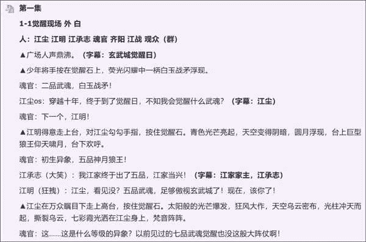

图 1-10　“把小说的内容转换为剧本”示例

当剧本拆解完成后，文本层面的工作才算真正结束。

### 1.3.2　第二步：设计角色与场景，搭建可以长期使用的资产体系

在 AI 漫剧中，最重要的并不是单集画面的表现力，而是核心资产的建立。这些资产直接决定了一部作品能否持续稳定地生产。其中最为关键的两类资产，就是角色设计和场景设计。

角色设计并不仅限于绘制人物形象，而是要为角色建立一套稳定、可复用的视觉与性格框架。通常需要为主要角色生成清晰的正面、侧面和背面参考图，并提前明确其外形特征、服饰风格和整体气质。

与此同时，角色的背景设定同样重要。人物的身份、年龄区间、行为逻辑等要素，都会直接影响后续画面呈现和配音风格的统一性。因此，在这一阶段，就需要同步考虑人物的音色方向，以便为后续配音工作做好准备。

场景设计的逻辑与此相似。每一个高频出现的场景，都应当具备明确的视觉风格和情绪基调。无论是古代、现代还是幻想世界，不同场景之间需要具有辨识度，同时又须保持整体世界体系的统一。

这一阶段的工作，实质上是在为后续数十集甚至上百集内容，构建一个稳定、可持续的生产基础。

### 1.3.3　第三步：分镜设计，把文字转化为画面

当角色和场景设计准备完成，接下来需要解决的问题是，每一集的具体视觉呈现如何规划。

分镜的作用，在于将剧本中的内容拆解为一个个明确的画面单元。每个分镜都需要清晰说明画面主体、镜头角度、人物状态和情绪基调。

在 AI 漫剧中，分镜并不追求复杂的镜头调度，而是更注重信息表达的清晰度和情绪传递的准确性。镜头语言越明确，后续图像生成和视频制作的稳定性就越高。

这一阶段，AI 大模型可以辅助将文字描述转换为更标准化的分镜脚本（如图 1-11 所示），但其前提依然是创作者已对画面所需传达的内容形成清晰构思。

图 1-11　AI 大模型将剧本中的镜头转化为具体的分镜

### 1.3.4　第四步：出图与出视频，完成画面的生成与组合

在分镜确定后，便正式进入画面生成阶段。

首先是图像生成。这一步目标明确：生成可以直接用于视频制作的画面素材。常用的方式是基于前期已经确定的角色与场景参考，借助即梦 AI 或其他图像生成工具，批量产出风格统一的角色图和场景图。

这一阶段最关键的要求在于风格一致性。角色在不同画面中的服饰、五官和整体气质须保持稳定；场景的光影、色调和空间结构也要维持连贯，否则将给后续剪辑带来显著困难。

当画面素材的产出稳定之后，便进入视频生成阶段。这一环通常借助即梦 AI 等视频生成工具，将单张画面或分镜图转换为短视频片段。每个分镜对应一段视频，再根据剧情节奏调整时长和镜头切换。

在这一阶段，无须刻意追求复杂的动作或特效。对 AI 漫剧而言，画面是否连贯、信息表达是否清楚，远比动态是否丰富更为重要。只要镜头衔接自然，叙事逻辑顺畅，画面便已达成其核心功能。

### 1.3.5　第五步：配音与剪辑，让内容真正成立

当画面制作完成后，距离成片只剩下最后两步。

首先是配音。配音在 AI 漫剧中承担着传递情绪和把控节奏的核心作用。目前平台上的成熟作品仍然大量采用真人配音，但对于个人创作者来说，AI 配音已经足以支撑完整作品的表达。

常见的做法是通过海螺 AI 等配音工具，为不同角色设定固定的音色，并在后续集数中持续沿用。无论是真人配音还是 AI 配音，其关键并不在于音质是否“高级”，而在于角色声音是否统一、情绪表达是否准确。

配音完成后，即进入最后一个环节——剪辑。这一阶段通常借助剪映等剪辑软件，将视频片段、配音和背景音乐统一整合，对整体节奏进行调整，并补齐必要的转场、音效和字幕。

很多 AI 漫剧的问题并非源于画面质量，而是由于对节奏把控不当。镜头拖沓、对白堆积、情绪起伏不清晰，都会直接影响观感。剪辑的作用，正是在成片前的最后阶段，系统性地修正这些问题。

剪辑完成后，单集内容才算正式制作完毕，并具备发布和测试市场反馈的基础。

从整体流程来看，一部 AI 漫剧的制作流程并不复杂，但对结构的系统性要求极高。

从小说到剧本，是内容成立的基础；从角色、场景到分镜，是持续生产的前提；从出图、出视频到配音剪辑，则是完成度的保障。

理解这一完整流程的意义，不在于要求一次性掌握所有环节，而在于明确每一步该在何时进行、需解决哪些具体问题。 EXr6287u6NNVz+GYLY+7SDk226FstKIHdC0bNoQkB2Nqi1xSR0yxPmwrTs5gRi/BtfSbid6dBhii9q7cz2pIyA==

## 1.3 仅需 5 个步骤，学会 AI 漫剧从内容到成片的完整路径

当创作方向明确后，接下来的核心问题便是，一部 AI 漫剧是如何从无到有、逐步制作出来的。

很多创作者在开始制作 AI 漫剧时，遇到的障碍往往并不是技术能力不足，而是流程顺序的混乱。有人从画面入手，有人先处理配音，也有人一开始就研究工具参数，直到制作中途才发现环节冲突，流程难以衔接，最终难以形成完整的作品。问题的关键并不在于努力的程度，而是缺乏一条清晰的全局路径。

因此，本节暂不展开具体操作，也不追求即时掌握所有细节，而是先把 AI 漫剧的完整制作流程梳理清楚。你需要先了解每一个环节在整体中的位置、各自解决的问题、哪些步骤可以并行推进、哪些步骤必须依次进行。当流程框架清晰之后，后续的学习和实践才有可能真正落地。

下面按照实际制作顺序，逐步拆解一部 AI 漫剧从内容构思到最终成片的完整过程。

### 1.3.1　第一步：从小说到剧本，把内容变成可执行结构

AI 漫剧的创作起点，几乎都源自文本内容，其中最常见的来源是网络小说。

在选题阶段，最重要的判断标准在于该内容是否适合用 AI 视觉化呈现。目前实践中最为成熟、风险较低的题材，仍集中在玄幻、仙侠、游戏、幻想等类型。这类题材对画面写实度要求相对较低，更强调世界观、构建情节密度和叙事节奏，正好能够发挥 AI 的优势。相比之下，强现实题材、细腻情感戏或都市生活类内容，往往对真实表演和细节刻画的依赖度更高，并不适合作为初期尝试的方向。

当小说文本确定后，真正的制作工作才正式开始。AI 漫剧并不是简单地将小说直接朗读出来，而是需要将文字内容转换为适合视频呈现的语言结构。这一步通常被称为剧本拆解。

剧本拆解的核心目标，是将连续的长篇叙事转换为一集集可独立制作的内容单元。每一集都需要明确三个关键信息：情节推进内容，人物的具体行动，以及本集的核心情绪落点。

在实际操作中，AI 工具可以大幅提升拆解效率，但判断逻辑依然依赖于创作者。每一集的场景切换、人物出场顺序、对白密度等要素，都需要被清晰规划和标注。

在这一阶段，需要遵循以下几个基本原则：每一集的场景要清晰界定，包括室内外环境、时间背景和空间特征；角色的动作和台词应符合其性格设定，避免出现人物行为逻辑矛盾；画面、音效和字幕等元素要提前在剧本中有所提示；尽量避免直接使用现实中的人名、地名和机构名称，以降低侵权风险。下面通过一个具体的案例（如图 1-10 所示）来进一步理解这些原则的实际应用。

图 1-10　“把小说的内容转换为剧本”示例

当剧本拆解完成后，文本层面的工作才算真正结束。

### 1.3.2　第二步：设计角色与场景，搭建可以长期使用的资产体系

在 AI 漫剧中，最重要的并不是单集画面的表现力，而是核心资产的建立。这些资产直接决定了一部作品能否持续稳定地生产。其中最为关键的两类资产，就是角色设计和场景设计。

角色设计并不仅限于绘制人物形象，而是要为角色建立一套稳定、可复用的视觉与性格框架。通常需要为主要角色生成清晰的正面、侧面和背面参考图，并提前明确其外形特征、服饰风格和整体气质。

与此同时，角色的背景设定同样重要。人物的身份、年龄区间、行为逻辑等要素，都会直接影响后续画面呈现和配音风格的统一性。因此，在这一阶段，就需要同步考虑人物的音色方向，以便为后续配音工作做好准备。

场景设计的逻辑与此相似。每一个高频出现的场景，都应当具备明确的视觉风格和情绪基调。无论是古代、现代还是幻想世界，不同场景之间需要具有辨识度，同时又须保持整体世界体系的统一。

这一阶段的工作，实质上是在为后续数十集甚至上百集内容，构建一个稳定、可持续的生产基础。

### 1.3.3　第三步：分镜设计，把文字转化为画面

当角色和场景设计准备完成，接下来需要解决的问题是，每一集的具体视觉呈现如何规划。

分镜的作用，在于将剧本中的内容拆解为一个个明确的画面单元。每个分镜都需要清晰说明画面主体、镜头角度、人物状态和情绪基调。

在 AI 漫剧中，分镜并不追求复杂的镜头调度，而是更注重信息表达的清晰度和情绪传递的准确性。镜头语言越明确，后续图像生成和视频制作的稳定性就越高。

这一阶段，AI 大模型可以辅助将文字描述转换为更标准化的分镜脚本（如图 1-11 所示），但其前提依然是创作者已对画面所需传达的内容形成清晰构思。

图 1-11　AI 大模型将剧本中的镜头转化为具体的分镜

### 1.3.4　第四步：出图与出视频，完成画面的生成与组合

在分镜确定后，便正式进入画面生成阶段。

首先是图像生成。这一步目标明确：生成可以直接用于视频制作的画面素材。常用的方式是基于前期已经确定的角色与场景参考，借助即梦 AI 或其他图像生成工具，批量产出风格统一的角色图和场景图。

这一阶段最关键的要求在于风格一致性。角色在不同画面中的服饰、五官和整体气质须保持稳定；场景的光影、色调和空间结构也要维持连贯，否则将给后续剪辑带来显著困难。

当画面素材的产出稳定之后，便进入视频生成阶段。这一环通常借助即梦 AI 等视频生成工具，将单张画面或分镜图转换为短视频片段。每个分镜对应一段视频，再根据剧情节奏调整时长和镜头切换。

在这一阶段，无须刻意追求复杂的动作或特效。对 AI 漫剧而言，画面是否连贯、信息表达是否清楚，远比动态是否丰富更为重要。只要镜头衔接自然，叙事逻辑顺畅，画面便已达成其核心功能。

### 1.3.5　第五步：配音与剪辑，让内容真正成立

当画面制作完成后，距离成片只剩下最后两步。

首先是配音。配音在 AI 漫剧中承担着传递情绪和把控节奏的核心作用。目前平台上的成熟作品仍然大量采用真人配音，但对于个人创作者来说，AI 配音已经足以支撑完整作品的表达。

常见的做法是通过海螺 AI 等配音工具，为不同角色设定固定的音色，并在后续集数中持续沿用。无论是真人配音还是 AI 配音，其关键并不在于音质是否“高级”，而在于角色声音是否统一、情绪表达是否准确。

配音完成后，即进入最后一个环节——剪辑。这一阶段通常借助剪映等剪辑软件，将视频片段、配音和背景音乐统一整合，对整体节奏进行调整，并补齐必要的转场、音效和字幕。

很多 AI 漫剧的问题并非源于画面质量，而是由于对节奏把控不当。镜头拖沓、对白堆积、情绪起伏不清晰，都会直接影响观感。剪辑的作用，正是在成片前的最后阶段，系统性地修正这些问题。

剪辑完成后，单集内容才算正式制作完毕，并具备发布和测试市场反馈的基础。

从整体流程来看，一部 AI 漫剧的制作流程并不复杂，但对结构的系统性要求极高。

从小说到剧本，是内容成立的基础；从角色、场景到分镜，是持续生产的前提；从出图、出视频到配音剪辑，则是完成度的保障。

理解这一完整流程的意义，不在于要求一次性掌握所有环节，而在于明确每一步该在何时进行、需解决哪些具体问题。 EXr6287u6NNVz+GYLY+7SDk226FstKIHdC0bNoQkB2Nqi1xSR0yxPmwrTs5gRi/BtfSbid6dBhii9q7cz2pIyA==

## 1.3 仅需 5 个步骤，学会 AI 漫剧从内容到成片的完整路径

当创作方向明确后，接下来的核心问题便是，一部 AI 漫剧是如何从无到有、逐步制作出来的。

很多创作者在开始制作 AI 漫剧时，遇到的障碍往往并不是技术能力不足，而是流程顺序的混乱。有人从画面入手，有人先处理配音，也有人一开始就研究工具参数，直到制作中途才发现环节冲突，流程难以衔接，最终难以形成完整的作品。问题的关键并不在于努力的程度，而是缺乏一条清晰的全局路径。

因此，本节暂不展开具体操作，也不追求即时掌握所有细节，而是先把 AI 漫剧的完整制作流程梳理清楚。你需要先了解每一个环节在整体中的位置、各自解决的问题、哪些步骤可以并行推进、哪些步骤必须依次进行。当流程框架清晰之后，后续的学习和实践才有可能真正落地。

下面按照实际制作顺序，逐步拆解一部 AI 漫剧从内容构思到最终成片的完整过程。

### 1.3.1　第一步：从小说到剧本，把内容变成可执行结构

AI 漫剧的创作起点，几乎都源自文本内容，其中最常见的来源是网络小说。

在选题阶段，最重要的判断标准在于该内容是否适合用 AI 视觉化呈现。目前实践中最为成熟、风险较低的题材，仍集中在玄幻、仙侠、游戏、幻想等类型。这类题材对画面写实度要求相对较低，更强调世界观、构建情节密度和叙事节奏，正好能够发挥 AI 的优势。相比之下，强现实题材、细腻情感戏或都市生活类内容，往往对真实表演和细节刻画的依赖度更高，并不适合作为初期尝试的方向。

当小说文本确定后，真正的制作工作才正式开始。AI 漫剧并不是简单地将小说直接朗读出来，而是需要将文字内容转换为适合视频呈现的语言结构。这一步通常被称为剧本拆解。

剧本拆解的核心目标，是将连续的长篇叙事转换为一集集可独立制作的内容单元。每一集都需要明确三个关键信息：情节推进内容，人物的具体行动，以及本集的核心情绪落点。

在实际操作中，AI 工具可以大幅提升拆解效率，但判断逻辑依然依赖于创作者。每一集的场景切换、人物出场顺序、对白密度等要素，都需要被清晰规划和标注。

在这一阶段，需要遵循以下几个基本原则：每一集的场景要清晰界定，包括室内外环境、时间背景和空间特征；角色的动作和台词应符合其性格设定，避免出现人物行为逻辑矛盾；画面、音效和字幕等元素要提前在剧本中有所提示；尽量避免直接使用现实中的人名、地名和机构名称，以降低侵权风险。下面通过一个具体的案例（如图 1-10 所示）来进一步理解这些原则的实际应用。

图 1-10　“把小说的内容转换为剧本”示例

当剧本拆解完成后，文本层面的工作才算真正结束。

### 1.3.2　第二步：设计角色与场景，搭建可以长期使用的资产体系

在 AI 漫剧中，最重要的并不是单集画面的表现力，而是核心资产的建立。这些资产直接决定了一部作品能否持续稳定地生产。其中最为关键的两类资产，就是角色设计和场景设计。

角色设计并不仅限于绘制人物形象，而是要为角色建立一套稳定、可复用的视觉与性格框架。通常需要为主要角色生成清晰的正面、侧面和背面参考图，并提前明确其外形特征、服饰风格和整体气质。

与此同时，角色的背景设定同样重要。人物的身份、年龄区间、行为逻辑等要素，都会直接影响后续画面呈现和配音风格的统一性。因此，在这一阶段，就需要同步考虑人物的音色方向，以便为后续配音工作做好准备。

场景设计的逻辑与此相似。每一个高频出现的场景，都应当具备明确的视觉风格和情绪基调。无论是古代、现代还是幻想世界，不同场景之间需要具有辨识度，同时又须保持整体世界体系的统一。

这一阶段的工作，实质上是在为后续数十集甚至上百集内容，构建一个稳定、可持续的生产基础。

### 1.3.3　第三步：分镜设计，把文字转化为画面

当角色和场景设计准备完成，接下来需要解决的问题是，每一集的具体视觉呈现如何规划。

分镜的作用，在于将剧本中的内容拆解为一个个明确的画面单元。每个分镜都需要清晰说明画面主体、镜头角度、人物状态和情绪基调。

在 AI 漫剧中，分镜并不追求复杂的镜头调度，而是更注重信息表达的清晰度和情绪传递的准确性。镜头语言越明确，后续图像生成和视频制作的稳定性就越高。

这一阶段，AI 大模型可以辅助将文字描述转换为更标准化的分镜脚本（如图 1-11 所示），但其前提依然是创作者已对画面所需传达的内容形成清晰构思。

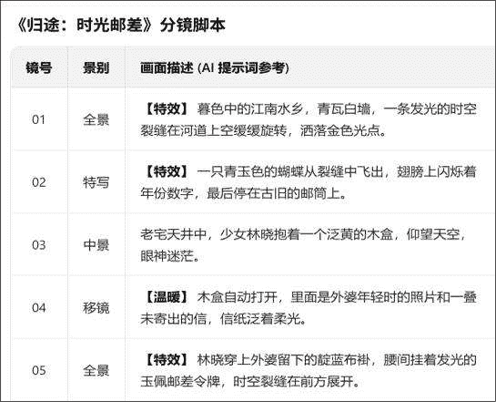

图 1-11　AI 大模型将剧本中的镜头转化为具体的分镜

### 1.3.4　第四步：出图与出视频，完成画面的生成与组合

在分镜确定后，便正式进入画面生成阶段。

首先是图像生成。这一步目标明确：生成可以直接用于视频制作的画面素材。常用的方式是基于前期已经确定的角色与场景参考，借助即梦 AI 或其他图像生成工具，批量产出风格统一的角色图和场景图。

这一阶段最关键的要求在于风格一致性。角色在不同画面中的服饰、五官和整体气质须保持稳定；场景的光影、色调和空间结构也要维持连贯，否则将给后续剪辑带来显著困难。

当画面素材的产出稳定之后，便进入视频生成阶段。这一环通常借助即梦 AI 等视频生成工具，将单张画面或分镜图转换为短视频片段。每个分镜对应一段视频，再根据剧情节奏调整时长和镜头切换。

在这一阶段，无须刻意追求复杂的动作或特效。对 AI 漫剧而言，画面是否连贯、信息表达是否清楚，远比动态是否丰富更为重要。只要镜头衔接自然，叙事逻辑顺畅，画面便已达成其核心功能。

### 1.3.5　第五步：配音与剪辑，让内容真正成立

当画面制作完成后，距离成片只剩下最后两步。

首先是配音。配音在 AI 漫剧中承担着传递情绪和把控节奏的核心作用。目前平台上的成熟作品仍然大量采用真人配音，但对于个人创作者来说，AI 配音已经足以支撑完整作品的表达。

常见的做法是通过海螺 AI 等配音工具，为不同角色设定固定的音色，并在后续集数中持续沿用。无论是真人配音还是 AI 配音，其关键并不在于音质是否“高级”，而在于角色声音是否统一、情绪表达是否准确。

配音完成后，即进入最后一个环节——剪辑。这一阶段通常借助剪映等剪辑软件，将视频片段、配音和背景音乐统一整合，对整体节奏进行调整，并补齐必要的转场、音效和字幕。

很多 AI 漫剧的问题并非源于画面质量，而是由于对节奏把控不当。镜头拖沓、对白堆积、情绪起伏不清晰，都会直接影响观感。剪辑的作用，正是在成片前的最后阶段，系统性地修正这些问题。

剪辑完成后，单集内容才算正式制作完毕，并具备发布和测试市场反馈的基础。

从整体流程来看，一部 AI 漫剧的制作流程并不复杂，但对结构的系统性要求极高。

从小说到剧本，是内容成立的基础；从角色、场景到分镜，是持续生产的前提；从出图、出视频到配音剪辑，则是完成度的保障。

理解这一完整流程的意义，不在于要求一次性掌握所有环节，而在于明确每一步该在何时进行、需解决哪些具体问题。 EXr6287u6NNVz+GYLY+7SDk226FstKIHdC0bNoQkB2Nqi1xSR0yxPmwrTs5gRi/BtfSbid6dBhii9q7cz2pIyA==

## 1.3 仅需 5 个步骤，学会 AI 漫剧从内容到成片的完整路径

当创作方向明确后，接下来的核心问题便是，一部 AI 漫剧是如何从无到有、逐步制作出来的。

很多创作者在开始制作 AI 漫剧时，遇到的障碍往往并不是技术能力不足，而是流程顺序的混乱。有人从画面入手，有人先处理配音，也有人一开始就研究工具参数，直到制作中途才发现环节冲突，流程难以衔接，最终难以形成完整的作品。问题的关键并不在于努力的程度，而是缺乏一条清晰的全局路径。

因此，本节暂不展开具体操作，也不追求即时掌握所有细节，而是先把 AI 漫剧的完整制作流程梳理清楚。你需要先了解每一个环节在整体中的位置、各自解决的问题、哪些步骤可以并行推进、哪些步骤必须依次进行。当流程框架清晰之后，后续的学习和实践才有可能真正落地。

下面按照实际制作顺序，逐步拆解一部 AI 漫剧从内容构思到最终成片的完整过程。

### 1.3.1　第一步：从小说到剧本，把内容变成可执行结构

AI 漫剧的创作起点，几乎都源自文本内容，其中最常见的来源是网络小说。

在选题阶段，最重要的判断标准在于该内容是否适合用 AI 视觉化呈现。目前实践中最为成熟、风险较低的题材，仍集中在玄幻、仙侠、游戏、幻想等类型。这类题材对画面写实度要求相对较低，更强调世界观、构建情节密度和叙事节奏，正好能够发挥 AI 的优势。相比之下，强现实题材、细腻情感戏或都市生活类内容，往往对真实表演和细节刻画的依赖度更高，并不适合作为初期尝试的方向。

当小说文本确定后，真正的制作工作才正式开始。AI 漫剧并不是简单地将小说直接朗读出来，而是需要将文字内容转换为适合视频呈现的语言结构。这一步通常被称为剧本拆解。

剧本拆解的核心目标，是将连续的长篇叙事转换为一集集可独立制作的内容单元。每一集都需要明确三个关键信息：情节推进内容，人物的具体行动，以及本集的核心情绪落点。

在实际操作中，AI 工具可以大幅提升拆解效率，但判断逻辑依然依赖于创作者。每一集的场景切换、人物出场顺序、对白密度等要素，都需要被清晰规划和标注。

在这一阶段，需要遵循以下几个基本原则：每一集的场景要清晰界定，包括室内外环境、时间背景和空间特征；角色的动作和台词应符合其性格设定，避免出现人物行为逻辑矛盾；画面、音效和字幕等元素要提前在剧本中有所提示；尽量避免直接使用现实中的人名、地名和机构名称，以降低侵权风险。下面通过一个具体的案例（如图 1-10 所示）来进一步理解这些原则的实际应用。

图 1-10　“把小说的内容转换为剧本”示例

当剧本拆解完成后，文本层面的工作才算真正结束。

### 1.3.2　第二步：设计角色与场景，搭建可以长期使用的资产体系

在 AI 漫剧中，最重要的并不是单集画面的表现力，而是核心资产的建立。这些资产直接决定了一部作品能否持续稳定地生产。其中最为关键的两类资产，就是角色设计和场景设计。

角色设计并不仅限于绘制人物形象，而是要为角色建立一套稳定、可复用的视觉与性格框架。通常需要为主要角色生成清晰的正面、侧面和背面参考图，并提前明确其外形特征、服饰风格和整体气质。

与此同时，角色的背景设定同样重要。人物的身份、年龄区间、行为逻辑等要素，都会直接影响后续画面呈现和配音风格的统一性。因此，在这一阶段，就需要同步考虑人物的音色方向，以便为后续配音工作做好准备。

场景设计的逻辑与此相似。每一个高频出现的场景，都应当具备明确的视觉风格和情绪基调。无论是古代、现代还是幻想世界，不同场景之间需要具有辨识度，同时又须保持整体世界体系的统一。

这一阶段的工作，实质上是在为后续数十集甚至上百集内容，构建一个稳定、可持续的生产基础。

### 1.3.3　第三步：分镜设计，把文字转化为画面

当角色和场景设计准备完成，接下来需要解决的问题是，每一集的具体视觉呈现如何规划。

分镜的作用，在于将剧本中的内容拆解为一个个明确的画面单元。每个分镜都需要清晰说明画面主体、镜头角度、人物状态和情绪基调。

在 AI 漫剧中，分镜并不追求复杂的镜头调度，而是更注重信息表达的清晰度和情绪传递的准确性。镜头语言越明确，后续图像生成和视频制作的稳定性就越高。

这一阶段，AI 大模型可以辅助将文字描述转换为更标准化的分镜脚本（如图 1-11 所示），但其前提依然是创作者已对画面所需传达的内容形成清晰构思。

图 1-11　AI 大模型将剧本中的镜头转化为具体的分镜

### 1.3.4　第四步：出图与出视频，完成画面的生成与组合

在分镜确定后，便正式进入画面生成阶段。

首先是图像生成。这一步目标明确：生成可以直接用于视频制作的画面素材。常用的方式是基于前期已经确定的角色与场景参考，借助即梦 AI 或其他图像生成工具，批量产出风格统一的角色图和场景图。

这一阶段最关键的要求在于风格一致性。角色在不同画面中的服饰、五官和整体气质须保持稳定；场景的光影、色调和空间结构也要维持连贯，否则将给后续剪辑带来显著困难。

当画面素材的产出稳定之后，便进入视频生成阶段。这一环通常借助即梦 AI 等视频生成工具，将单张画面或分镜图转换为短视频片段。每个分镜对应一段视频，再根据剧情节奏调整时长和镜头切换。

在这一阶段，无须刻意追求复杂的动作或特效。对 AI 漫剧而言，画面是否连贯、信息表达是否清楚，远比动态是否丰富更为重要。只要镜头衔接自然，叙事逻辑顺畅，画面便已达成其核心功能。

### 1.3.5　第五步：配音与剪辑，让内容真正成立

当画面制作完成后，距离成片只剩下最后两步。

首先是配音。配音在 AI 漫剧中承担着传递情绪和把控节奏的核心作用。目前平台上的成熟作品仍然大量采用真人配音，但对于个人创作者来说，AI 配音已经足以支撑完整作品的表达。

常见的做法是通过海螺 AI 等配音工具，为不同角色设定固定的音色，并在后续集数中持续沿用。无论是真人配音还是 AI 配音，其关键并不在于音质是否“高级”，而在于角色声音是否统一、情绪表达是否准确。

配音完成后，即进入最后一个环节——剪辑。这一阶段通常借助剪映等剪辑软件，将视频片段、配音和背景音乐统一整合，对整体节奏进行调整，并补齐必要的转场、音效和字幕。

很多 AI 漫剧的问题并非源于画面质量，而是由于对节奏把控不当。镜头拖沓、对白堆积、情绪起伏不清晰，都会直接影响观感。剪辑的作用，正是在成片前的最后阶段，系统性地修正这些问题。

剪辑完成后，单集内容才算正式制作完毕，并具备发布和测试市场反馈的基础。

从整体流程来看，一部 AI 漫剧的制作流程并不复杂，但对结构的系统性要求极高。

从小说到剧本，是内容成立的基础；从角色、场景到分镜，是持续生产的前提；从出图、出视频到配音剪辑，则是完成度的保障。

理解这一完整流程的意义，不在于要求一次性掌握所有环节，而在于明确每一步该在何时进行、需解决哪些具体问题。 EXr6287u6NNVz+GYLY+7SDk226FstKIHdC0bNoQkB2Nqi1xSR0yxPmwrTs5gRi/BtfSbid6dBhii9q7cz2pIyA==

## 1.3 仅需 5 个步骤，学会 AI 漫剧从内容到成片的完整路径

当创作方向明确后，接下来的核心问题便是，一部 AI 漫剧是如何从无到有、逐步制作出来的。

很多创作者在开始制作 AI 漫剧时，遇到的障碍往往并不是技术能力不足，而是流程顺序的混乱。有人从画面入手，有人先处理配音，也有人一开始就研究工具参数，直到制作中途才发现环节冲突，流程难以衔接，最终难以形成完整的作品。问题的关键并不在于努力的程度，而是缺乏一条清晰的全局路径。

因此，本节暂不展开具体操作，也不追求即时掌握所有细节，而是先把 AI 漫剧的完整制作流程梳理清楚。你需要先了解每一个环节在整体中的位置、各自解决的问题、哪些步骤可以并行推进、哪些步骤必须依次进行。当流程框架清晰之后，后续的学习和实践才有可能真正落地。

下面按照实际制作顺序，逐步拆解一部 AI 漫剧从内容构思到最终成片的完整过程。

### 1.3.1　第一步：从小说到剧本，把内容变成可执行结构

AI 漫剧的创作起点，几乎都源自文本内容，其中最常见的来源是网络小说。

在选题阶段，最重要的判断标准在于该内容是否适合用 AI 视觉化呈现。目前实践中最为成熟、风险较低的题材，仍集中在玄幻、仙侠、游戏、幻想等类型。这类题材对画面写实度要求相对较低，更强调世界观、构建情节密度和叙事节奏，正好能够发挥 AI 的优势。相比之下，强现实题材、细腻情感戏或都市生活类内容，往往对真实表演和细节刻画的依赖度更高，并不适合作为初期尝试的方向。

当小说文本确定后，真正的制作工作才正式开始。AI 漫剧并不是简单地将小说直接朗读出来，而是需要将文字内容转换为适合视频呈现的语言结构。这一步通常被称为剧本拆解。

剧本拆解的核心目标，是将连续的长篇叙事转换为一集集可独立制作的内容单元。每一集都需要明确三个关键信息：情节推进内容，人物的具体行动，以及本集的核心情绪落点。

在实际操作中，AI 工具可以大幅提升拆解效率，但判断逻辑依然依赖于创作者。每一集的场景切换、人物出场顺序、对白密度等要素，都需要被清晰规划和标注。

在这一阶段，需要遵循以下几个基本原则：每一集的场景要清晰界定，包括室内外环境、时间背景和空间特征；角色的动作和台词应符合其性格设定，避免出现人物行为逻辑矛盾；画面、音效和字幕等元素要提前在剧本中有所提示；尽量避免直接使用现实中的人名、地名和机构名称，以降低侵权风险。下面通过一个具体的案例（如图 1-10 所示）来进一步理解这些原则的实际应用。

图 1-10　“把小说的内容转换为剧本”示例

当剧本拆解完成后，文本层面的工作才算真正结束。

### 1.3.2　第二步：设计角色与场景，搭建可以长期使用的资产体系

在 AI 漫剧中，最重要的并不是单集画面的表现力，而是核心资产的建立。这些资产直接决定了一部作品能否持续稳定地生产。其中最为关键的两类资产，就是角色设计和场景设计。

角色设计并不仅限于绘制人物形象，而是要为角色建立一套稳定、可复用的视觉与性格框架。通常需要为主要角色生成清晰的正面、侧面和背面参考图，并提前明确其外形特征、服饰风格和整体气质。

与此同时，角色的背景设定同样重要。人物的身份、年龄区间、行为逻辑等要素，都会直接影响后续画面呈现和配音风格的统一性。因此，在这一阶段，就需要同步考虑人物的音色方向，以便为后续配音工作做好准备。

场景设计的逻辑与此相似。每一个高频出现的场景，都应当具备明确的视觉风格和情绪基调。无论是古代、现代还是幻想世界，不同场景之间需要具有辨识度，同时又须保持整体世界体系的统一。

这一阶段的工作，实质上是在为后续数十集甚至上百集内容，构建一个稳定、可持续的生产基础。

### 1.3.3　第三步：分镜设计，把文字转化为画面

当角色和场景设计准备完成，接下来需要解决的问题是，每一集的具体视觉呈现如何规划。

分镜的作用，在于将剧本中的内容拆解为一个个明确的画面单元。每个分镜都需要清晰说明画面主体、镜头角度、人物状态和情绪基调。

在 AI 漫剧中，分镜并不追求复杂的镜头调度，而是更注重信息表达的清晰度和情绪传递的准确性。镜头语言越明确，后续图像生成和视频制作的稳定性就越高。

这一阶段，AI 大模型可以辅助将文字描述转换为更标准化的分镜脚本（如图 1-11 所示），但其前提依然是创作者已对画面所需传达的内容形成清晰构思。

图 1-11　AI 大模型将剧本中的镜头转化为具体的分镜

### 1.3.4　第四步：出图与出视频，完成画面的生成与组合

在分镜确定后，便正式进入画面生成阶段。

首先是图像生成。这一步目标明确：生成可以直接用于视频制作的画面素材。常用的方式是基于前期已经确定的角色与场景参考，借助即梦 AI 或其他图像生成工具，批量产出风格统一的角色图和场景图。

这一阶段最关键的要求在于风格一致性。角色在不同画面中的服饰、五官和整体气质须保持稳定；场景的光影、色调和空间结构也要维持连贯，否则将给后续剪辑带来显著困难。

当画面素材的产出稳定之后，便进入视频生成阶段。这一环通常借助即梦 AI 等视频生成工具，将单张画面或分镜图转换为短视频片段。每个分镜对应一段视频，再根据剧情节奏调整时长和镜头切换。

在这一阶段，无须刻意追求复杂的动作或特效。对 AI 漫剧而言，画面是否连贯、信息表达是否清楚，远比动态是否丰富更为重要。只要镜头衔接自然，叙事逻辑顺畅，画面便已达成其核心功能。

### 1.3.5　第五步：配音与剪辑，让内容真正成立

当画面制作完成后，距离成片只剩下最后两步。

首先是配音。配音在 AI 漫剧中承担着传递情绪和把控节奏的核心作用。目前平台上的成熟作品仍然大量采用真人配音，但对于个人创作者来说，AI 配音已经足以支撑完整作品的表达。

常见的做法是通过海螺 AI 等配音工具，为不同角色设定固定的音色，并在后续集数中持续沿用。无论是真人配音还是 AI 配音，其关键并不在于音质是否“高级”，而在于角色声音是否统一、情绪表达是否准确。

配音完成后，即进入最后一个环节——剪辑。这一阶段通常借助剪映等剪辑软件，将视频片段、配音和背景音乐统一整合，对整体节奏进行调整，并补齐必要的转场、音效和字幕。

很多 AI 漫剧的问题并非源于画面质量，而是由于对节奏把控不当。镜头拖沓、对白堆积、情绪起伏不清晰，都会直接影响观感。剪辑的作用，正是在成片前的最后阶段，系统性地修正这些问题。

剪辑完成后，单集内容才算正式制作完毕，并具备发布和测试市场反馈的基础。

从整体流程来看，一部 AI 漫剧的制作流程并不复杂，但对结构的系统性要求极高。

从小说到剧本，是内容成立的基础；从角色、场景到分镜，是持续生产的前提；从出图、出视频到配音剪辑，则是完成度的保障。

理解这一完整流程的意义，不在于要求一次性掌握所有环节，而在于明确每一步该在何时进行、需解决哪些具体问题。 EXr6287u6NNVz+GYLY+7SDk226FstKIHdC0bNoQkB2Nqi1xSR0yxPmwrTs5gRi/BtfSbid6dBhii9q7cz2pIyA==

## 小结

本章的主旨并非教学，而在于方向判断。

在 AI 视频领域，真正拉开创作者差距的关键，往往并非工具掌握得早晚，而是起步阶段是否选对了方向。本章的核心任务，就是在读者正式投入大量时间和精力之前，帮助读者看清不同路径的长期可行性。

在 1.1 节中，从商业模式的角度，对 AI 广告片、AI 宣传片和 AI 漫剧进行了系统对比。结论清晰：广告片和宣传片更接近项目制交付，其发展依赖于客户资源与行业关系，难以形成高频、可复制的创作体系；而 AI 漫剧则是一种可以持续产出、不断积累内容资产的形态，更适合个人和小型团队长期投入与深耕。

在 1.2 节，我们将视角拉回到短剧体系内部，重新梳理了 AI 真人短剧、AI 动漫、AI 动态漫与 AI 漫剧之间的关系。通过对比分析其制作难度、成本结构和更新节奏，可以看出，AI 漫剧并不是“画面表现力最强”的那一类内容，而是在成本控制、制作效率与内容持续性之间取得平衡的一种选择。这也解释了为什么在短剧市场快速扩张后，真正能被广大普通创作者长期实践并坚持的，往往是 AI 漫剧这一路径。

在 1.3 节中，我们并未急于介绍具体技巧，而是完整呈现了一部 AI 漫剧从内容构思到最终成片的整体流程。目的是让创作者首先看清全局，明确每一步所解决的问题，再决定从何处切入、如何分配精力。流程一旦混乱，再多工具也很难补救。

综合来看，本章旨在回答一个核心问题：在 AI 视频这条赛道上，普通创作者应如何找准自身定位，并以什么方式参与其中。

唯有清晰理解不同内容形态的差异、把握商业模式的特点，并建立起完整流程的结构化认知，接下来的学习才有实际意义。否则，所有的努力，都可能只是加速偏离正确方向。

从第二章开始，将正式进入 AI 漫剧的具体创作环节，按照流程顺序逐步拆解，把每一个关键步骤阐释清楚、落实至可执行的层面。方向已经确定，现在，正是付诸实践的时刻。 EXr6287u6NNVz+GYLY+7SDk226FstKIHdC0bNoQkB2Nqi1xSR0yxPmwrTs5gRi/BtfSbid6dBhii9q7cz2pIyA==

# 第二章
剧本拆解，把小说改编为可落地的脚本

在实际创作中，我们发现很多问题并非源于技术工具，而是出在内容质量上。画面可以生成，视频可以合成，但若剧情松散、节奏失衡、人物设定缺乏支持，这些问题最终都会在成片中暴露出来。技术越成熟，内容本身的问题反而越明显。

AI 漫剧真正的竞争力，并不在于画得有多精细，而在于能否将原始文本有效转换为适合影像表达的叙事结构。这一转换过程，直接决定了情节是否清晰，人物是否立得住，也影响着后续分镜、画面和节奏的整体走向。

因此，从本章开始，我们将聚焦内容处理本身，重点探讨如何将小说拆解为可执行的剧本框架，以及在 AI 工具的辅助下，创作者应如何完成这一关键转换。 EXr6287u6NNVz+GYLY+7SDk226FstKIHdC0bNoQkB2Nqi1xSR0yxPmwrTs5gRi/BtfSbid6dBhii9q7cz2pIyA==

## 2.1 爆款 AI 漫剧，从选择合适的小说开始

几乎所有 AI 漫剧的创作都始于文本内容，其中最常见的来源正是网络小说。但小说本身并不能直接用于视频创作。小说服务于阅读体验，其节奏、描写方式和信息密度都是围绕文字展开的；而 AI 漫剧服务于观看体验，必须以画面表达、节奏控制和情绪推进为核心。两者之间并不存在天然的适配关系。

拆解剧本的过程，本质上就是一次内容重构。它并非简单地复述故事，而是把小说中的叙事逻辑，转换为一集集具备可执行性的视频单元。

在进入具体的剧本拆解方法之前，第一步是选对适合改编的小说。

在实际项目中，有时小说由版权方直接提供，创作者并不具有选择权。但在更多自主创作的场景下，选题本身已在很大程度上决定了后续制作的难度上限。判断一部小说是否适合改编为 AI 漫剧，标准并不复杂，核心只需回答一个问题：这部作品能否放大 AI 的优势，而非暴露其短板。

从目前的实践来看，玄幻、仙侠、魔幻、游戏类题材，是最成熟且稳妥的选择方向。这类作品通常拥有明确的世界观设定、强烈的戏剧冲突和较高的情节密度，对画面写实度的要求相对较低，更强调想象空间和情绪张力的营造。

在进行 AI 画面生成时，这种非写实题材反而更容易建立观众的接受预期。只要角色、场景和动作风格统一，就能形成完整的观看体验。

相对而言，强调写实的题材、都市生活类或情感戏占比极高的小说，往往对人物表演的细腻度和细节的真实性要求更高。这类内容往往需要依赖真人表演的微表情和情绪递进来传递感染力，属于当前 AI 技术尚未形成明显优势的领域，因此并不适合作为初期尝试。

除了题材适配性，还需要从结构层面对小说本身进行快速评估。重点不在于文笔优劣，而应关注以下几方面：情节是否清晰，具有明确的起承转合；人物关系是否稳定；主线是否集中，且具备足够的剧情密度，能够支持拆分成连续的短剧集。

一部适合改编为 AI 漫剧的小说，往往章节推进明确，每段情节都能提炼出清晰的事件节点。这种结构才能在后续拆解剧本时，转换为稳定可执行的内容单元。

最后，必须强调一个底线原则：所有用于改编的小说必须获得版权方明确授权。无论是商业项目还是个人创作，只要涉及公开发布，未经授权的改编内容都无法长期存续。即便作品完成度再高，也无法真正进入平台的内容生态。这一点，必须在创作启动前就考虑清楚，而不是等到作品成型之后再进行补救。 EXr6287u6NNVz+GYLY+7SDk226FstKIHdC0bNoQkB2Nqi1xSR0yxPmwrTs5gRi/BtfSbid6dBhii9q7cz2pIyA==

## 2.2 定故事大纲，先给故事一条不会跑偏的主线

一部长篇小说，其文本体量往往非常庞大，人物、支线和世界观设定也相对复杂。如果试图将完整内容一次性输入给 AI 处理，不仅很容易触及模型的上下文长度限制，也会导致生成结果失控，出现情节跳跃、人物性格前后矛盾，甚至直接偏离原始设定的情况。

因此，在正式拆分单集剧本之前，必须先完成一项关键工作：确定清晰、稳定的故事大纲。故事大纲的作用并不在于写得多详细，而是为后续所有剧本生成提供一个不可偏离的总框架。它相当于一张结构地图，确保 AI 在拆解情节、撰写分集时，始终明确故事的发展方向、人物的行为动机，而不是依赖概率随机发挥。

从实践角度来看，一个可实际使用的故事大纲，通常至少需要明确以下三点。

**·** 这个故事的核心卖点是什么？

**·** 主要人物是谁，各自承担何种角色与作用？

**·** 整体剧情将如何分阶段推进，关键高潮与转折点分布在哪里？

我们建议可以先借助 AI 工具，整理出一份稳定的故事大纲，作为后续所有改编工作的统一参照。下面是一种可直接使用，也可按需调整的提示词结构，适用于生成故事大纲类内容。

下面用一个实际项目的故事大纲示例，来具体看看这一结构是如何搭建的。

参考提示词如下。

这是一本长篇小说的前 100 章内容。请在完整理解故事设定的基础上，帮我梳理以下内容，用于向客户进行剧情汇报和后续短剧改编参考。

（1）故事梗概：包含一句话卖点，以及一段能够让非读者快速理解整体世界观和核心爽点的详细梗概。

（2）主要人物小传：包括主角、核心配角和主要对手。需要说明人物身份、性格特征、能力特点，以及在故事中的功能定位。

（3）主要故事线：按阶段拆分故事发展，每个阶段说明核心冲突、主角成长变化和情绪目标，确保逻辑清晰、节奏递进。

（4）短剧改编方案：以总时长约 120 分钟、共 60 集、单集约 2 分钟为目标，对故事进行短剧结构规划。要求剧情清楚、爽点集中，适合短视频节奏。

输出内容以结构清晰、便于理解和汇报为优先，不需要文学化描写。

以下为 AI 生成的主要内容。

第一部分：故事梗概

一句话卖点：

在万族入侵的末世背景下，贫穷少年觉醒驯兽系统，把一只家养乌龟进化为神兽玄武，靠“喂宠升级”，一路打脸天骄，在热血与反差搞笑中横推成长。

详细梗概：

百年前，天空出现裂缝，万族凶兽入侵地球，人类被迫进入全民尚武时代。普通高中生苏白意外穿越而来，觉醒“最强驯兽师系统”，发现只要不断喂食，就能让宠物无限进化。他将家中从菜市场买来的普通乌龟“小八”作为第一只战宠，意外激活了上古圣兽“玄武”血脉。顶着“最废职业驯兽师”的偏见，苏白一边承受着神兽惊人的消耗成本，一边踏上升级之路。

凭借系统能力和战宠优势，苏白考入江州武大。在新生历练中，他以越级之姿斩杀白银级凶兽，一战成名。随后，他又陆续驯化觉醒白虎血脉的流浪猫，在全国百校联赛中，面对名校的轻视与嘲讽，用近乎“摆烂”的姿态完成碾压式胜利，带领原本垫底的普通武大逆袭全国。

第二部分：主要人物小传

1．苏白（男主角）

身份：江州武大新生队长，史上最强驯兽师。

性格：表面懒散、腹黑爱财，关键时刻极度护短。

核心能力：最强驯兽师系统（属性查看、无限进化、伤害共享、属性反哺）。

战宠设定如下。

小八（玄武）：防御与反伤核心，性格憨厚贪吃。

小白（白虎）：高机动、高爆发输出。

标志性场面：全国直播擂台赛中，坐沙发、喝可乐，一打五完成碾压。

2．林嫣然（女主角）

身份：江州武大校花，强者之后。

性格：外柔内刚，行动力极强。

剧情功能：资源支持者与情感锚点，推动男主持续成长。

……

这里分享一个经验：一次性让 AI 读取并分析小说前 100 章的内容，通常是一个比较合理的起点。大多数网络小说中，前 100 章的剧情量可拆解为约 60 集短剧，节奏适配度较高。但也有例外，如果原小说情节推进较慢，信息密度不足，拆解出来的短剧内容就会显得节奏拖沓。此时可以逐步增加分析范围，如从 100 章扩展到 150 章，若仍不足可再加到 200 章。核心原则不是章数越多越好，而是信息量是否足够支撑短剧应有的叙事节奏。

在工具选择方面，不同 AI 模型对长文本理解能力上差异明显。

Gemini：在处理长篇文本、梳理复杂人物关系和多线剧情时，整体表现较为稳定。

Kimi：在中文小说的语义理解和结构整理方面，也能满足本阶段的需求。

此阶段确定大纲的核心目标，不是生成可以直接用于拍摄的内容，而是为了明确故事的整体框架、主要角色定位和改编的基本方向，为后续分集创作奠定统一基础。

当上述信息已被整理成一个清晰的大纲文档后，无论是后续的拆解剧本，还是分镜设计，都不需要再反复解释故事的核心设定与走向，AI 生成的内容也不容易跑偏。这一基础步骤做得扎实，后面每个环节的效率和稳定性都将得到显著提升。 EXr6287u6NNVz+GYLY+7SDk226FstKIHdC0bNoQkB2Nqi1xSR0yxPmwrTs5gRi/BtfSbid6dBhii9q7cz2pIyA==

## 2.3 拆剧本，把故事变成可拍的文本

当故事大纲已经明确，人物关系和主线冲突也合理清晰后，下一步才进入真正意义上的剧本拆解阶段。这一阶段的核心任务并非复述小说情节，而是将小说语言转换为适合影像表达的剧本结构。

小说可以细腻铺陈、深入内心、徐徐推进，但剧本的写作必须服务于画面呈现、节奏控制和冲突设计。它需要在有限的时长内，把关键信息和情绪变化明确交代出来。因此，在从小说转换为剧本时，首先要关注的不是细节还原，而是每个段落是否具备清晰的起伏结构。每一集、每一小段剧情，都要能明确回答三个问题：冲突从何而起，转折发生于何处，以及这一段结束时情绪落于何种状态。

如果完全依靠人工逐字逐句进行改写，这一过程会非常耗时，也很难保证整体节奏的一致性。因此，在实际操作中，通常会借助 AI 工具来完成初步拆解，再由创作者进行校正和调整。

一个比较实用的提示词如下所示。

这是一本长篇小说的前 100 章，学习它，请通读全文，我要将它改编成短剧，总剧集 120 分钟，一集大约两分钟。我已经整理好了小说的故事大纲和主要人物小传如下。

（将之前整理好的故事大纲文档里的内容复制进来，这样可方便大纲和人设保持统一）

请按照如下格式来帮我写前×集剧本，请记住下面的格式。

1．【场景题头】

格式为：场号 场景名[内/外] [日/夜]

示例：1-1 废弃仓库[内] [夜]

2．【画面/动作】

所有的环境描写、人物动作、镜头画面，必须以符号“△”开头。

严禁出现心理描写（如“他心里想……”），必须转换为可视化的动作或表情。

示例：△ 陈墨推开门，掸了掸身上的雨水。

3．【对白】

采用“紧凑格式”，人名后加冒号。

格式为：角色名：（情绪/动作提示） 台词内容

示例：陈墨：（冷笑） 你以为你能跑得掉？

4．【特殊音效与视觉】

重要的声音/音效，使用【音效】标注。

屏幕上的文字/字幕，使用【字幕】标注。

示例：【音效】远处传来警笛声。

5．【专业术语】

画外音（人在现场但镜头未拍到嘴动）标注为 （O.S.）。

内心独白（心理声音）标注为 （V.O.）。

示例：陈墨（V.O.）：哪怕只有百分之一的机会，我也要试一试。

在实际操作中，有一个很容易被忽略但非常关键的经验需要在这里提前说明：在将长篇小说前 100 章改编成总时长约 120min、60 集左右的短剧时，切勿一次性将全部内容交给 AI 处理。原因主要有两方面：一方面，若输入文本过长，很容易超出 AI 模型的上下文理解限度，导致已建立好的设定和人物关系在后续生成中发生偏移；另一方面，一次性改编所有剧集会使整体节奏不好把握，往往前几集还算稳定，越往后质量下滑越明显，甚至可能出现情节重复、人物行为前后矛盾等问题。

更稳妥也更符合实际制作节奏的方式，是按故事发展阶段分批拆解。通常一部长篇小说可以拆成几个相对清晰的叙事阶段，如铺垫期、入局期、冲突升级期和阶段性高潮。以最常见的情况为例，第一阶段往往集中在小说的前 1 ～12 章，在拆解剧本时，可先让 AI 先输出第 1～12 集的内容，待这一段剧情完整跑通，再决定后面的拆分节奏。

这样做的好处是，创作者可以在早期阶段就判断出节奏是否合适、信息量是否足够、人物是否立得住。一旦发现问题，随时可以回到源头进行调整，而不是在 60 集剧本全部写完之后再推倒重来。

接下来再看一个使用 Gemini 生成剧本的具体案例（如图 2-1 所示）。

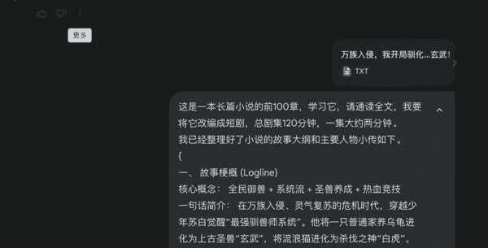

图 2-1　Gemini 生成剧本的具体对话

Gemini 生成的内容如下，由于篇幅过长，此处只展示部分内容。

第 1 集：最废职业与最强系统

1-1 高三（4）班教室[内] [日]

△窗外天空布满巨大的黑色裂缝，隐约可见裂缝后猩红的眼睛。 △ 讲台上，班主任用力敲击黑板，黑板上写着“距离高考还有 30 天”。

班主任：（激动）同学们！万族入侵，武道当兴！今天是觉醒日，哪怕觉醒个生活类天赋，也比普通人强！

△台下学生一片骚动。△苏白猛地从课桌上惊醒，眼神迷茫环顾四周。

苏白（V.O.）：我穿越了？万族入侵？全***武？

△ 讲台旁，一台充满科技感的“觉醒仪”发出耀眼蓝光。

班主任：（高喊）下一个，苏白！

△ 苏白走上讲台，将手按在仪器上。 △ 仪器闪烁出一道微弱的灰光。 △ 【字幕】觉醒职业：驯兽师（生活类/废柴）

路人甲：（嘲笑）切，驯兽师？那不是给富二代养宠物铲屎的吗？ 路人乙：（大笑）这年头谁靠宠物打仗？费钱又没用，废了废了！

△苏白有些尴尬地收回手。 △突然，一道只有苏白能看见的金光在他眼前炸开。

【音效】系统提示音：叮！【字幕】最强驯兽系统绑定成功！【字幕】新手礼包已发放：神级洞察之眼。

苏白：（眼神微变，嘴角上扬）废柴？那是你们没开挂。

……

值得注意的是，在拆解剧本阶段，提前设定清晰的规则是非常重要的，这不只是为了文本规范，更是为了降低后续返工成本。

首先，需要在剧本改编阶段就主动清理不必要的现实元素，如真实的学校名称、城市名称、考试体系，以及明显指向未成年身份的设定。这类内容一方面容易引发合规风险，另一方面也会削弱虚构世界的完整性，让观众产生跳脱感。尤其是在玄幻、仙侠、高武等题材中，故事本身依赖的是一个自洽的虚构世界规则。如果现实元素频繁介入，会破坏整体代入感，增加后期调整的复杂度。因此，这一步并不是删减内容，而是提前统一世界观的边界。

其次，剧本内容必须始终服从既定的角色和场景设定。AI 改编小说并非只是把小说段落换一种表述，而是要根据预设的角色性格、身份背景和题材风格，生成与之相匹配的动作描写和对白设计。

例如，一个性格冷静、寡言的角色，其台词就不应该出现冗长的情绪宣泄；一个身处现代高武世界观的角色，其服饰、行为方式和所处场景，也必须符合这一设定。只有当这些前提条件被明确写进提示词，AI 生成的内容才不易偏离既定方向。当故事结构、世界观边界和文本格式都被提前明确，AI 的优势才会真正显现出来。

在这种情况下，AI 不再是一个需要反复试探的工具，而成为一个执行效率极高的助手。它可以在既定框架内快速生成完整剧本草稿，帮助创作者在短时间内完成多集内容的初步构建。

更重要的是，这种工作方式能显著降低后续的修改成本。每一集剧本都遵循同一套叙事结构和改编规则，创作者只需要针对具体情节进行局部微调，而无须反复推翻重来。无论是节奏调整、冲突强化，还是角色对白优化，都可以在局部完成。

最后，从长期发展来看，这种做法还有一个隐性价值：它使创作过程可复制、可规模化。即便缺乏系统的剧本写作经验，创作者也能在固定流程中稳定产出内容；而对于成熟的创作者，则可以把更多精力放在故事把控和创意决策层面，而不是消耗在重复性劳动中。

归根结底，让 AI 改写剧本，并不是追求其文笔“拟人化”，而是让它在明确的边界设定内，高效完成执行性工作。当叙事结构被提前确定，创作者才能真正掌控节奏，而不是被工具所牵引。 EXr6287u6NNVz+GYLY+7SDk226FstKIHdC0bNoQkB2Nqi1xSR0yxPmwrTs5gRi/BtfSbid6dBhii9q7cz2pIyA==

## 2.4 将剧本拆解成分镜脚本，让故事精彩呈现

在剧本写完之后，距离最终画面呈现还有一个关键环节：分镜脚本。简单来说，分镜脚本是把剧本转换成镜头画面的中间载体。可以把它想象成漫画中的分格草稿，或者是拍电影前画出来的镜头示意图。它不追求文笔好坏，只关心一件事：观众最终会看到什么画面。

在传统影视制作里，分镜是导演和摄影师之间的沟通工具。但在 AI 漫剧创作中，它的作用更直接：分镜脚本里所写的画面描述，本质上就是给 AI 生图的提示词原稿。创作者无须再绞尽脑汁去想这个场景该怎么描述，可直接从分镜中提取内容作为分镜依据。

分镜脚本同时实现了以下功能。

**·** 一个可视化清单：镜头数量、每个镜头的具体内容、画面中的人物和台词。

**·** 一份拍摄指南：镜头的景别（远/近）、运动方式、光线氛围和情绪基调。

**·** 一次节奏预演：通过控制每个镜头的时长，预先把控成片的快慢与情绪起伏。

如果说剧本是文字蓝图，那么分镜就是视觉蓝图。缺少这一步，AI 生成的画面很容易出现跳戏、细节缺失，或者情绪断裂等问题。

一份可使用的分镜脚本，主要包含如表 2-1 所示关键内容。

表 2-1　分镜脚本的关键内容

创作者不需要每次都把表格填写得面面俱到，但画面描述、景别、时长这几项建议每次都认真填写。它们直接关系到最终画面的呈现质量和叙事节奏。

实际上，当熟悉了这一流程后就会发现，分镜脚本更像是一种视觉笔记，它帮助创作者把脑海里的画面整理清楚，避免在实际制作过程中遗漏关键信息。初期可能略显烦琐，但习惯之后，它会帮你省下大量因反复修改和沟通不清所消耗的时间。

### 2.4.1　将分镜脚本的标准投喂给 AI

在实际操作中，拆分镜脚本不适合完全依赖手动完成。逐集拆分既耗时间，又容易在格式和节奏把控上出现偏差。

更高效的方式是借助 AI 工具来完成分镜拆解，但前提是要把规则先说清楚。否则，AI 很可能会基于自己的理解来生成内容，导致结果偏离预期。一份合格的分镜脚本，至少要同时满足以下条件。

**·** 结构清晰直观。只看这张表，就能知道本集镜头总数，每个镜头的主要内容与顺序。

**·** 直接服务后续流程。画面描述可直接用于生成图像；对白文本可以直接用于配音；人物和场景信息明确，不用再返回剧本确认。

**·** 注重可执行性。宁可描述详尽，也应避免模糊描述。

基于以上标准，可向 AI 提出如下要求。

一、角色定义

你是一个拥有 20 年行业资历的影视导演及分镜设计师。你的核心专业能力在于把文字剧本转换成视频的分镜脚本，熟练运用蒙太奇思维和视听语言。任务就是将用户提供的剧本转换为详细专业的分镜脚本表格。

二、分镜脚本拆分核心原则（必须遵守）

情绪转变需切镜：角色的每一次显著情绪转变（如平静→震惊→愤怒），都应获得独立的分镜进行刻画。情绪的积累过程建议使用 2～3 个镜头来逐步铺垫。

复杂动作需切镜：所有叙事性强的动作应拆解为动机/准备、执行过程、结果/反应三个部分，并可能进一步细化为更多镜头。关键动作按“准备→执行→结果”拆分，复杂动作细分为 3～5 个步骤，如“喝水”拆成：伸手→拿水→喝水→放下水瓶。

人物变化需切镜：当场景内人物数量发生增减，或人物位置关系改变，或人物之间的主导-从属、对话-聆听关系发生转换时，应启用新的分镜。

空间转场需切镜：剧本中明确或暗示的场景、地点切换，必须设立新的分镜编号。两个不同空间之间应设计 1～2s 的专用转场镜头（如淡变、划像、声音先导等）。

时间跳跃需切镜：任何非连续的时间流逝（如“次日”“多年后”），或并行时间线，都必须通过独立的分镜来视觉化呈现时间转换。

对话的视线乒乓逻辑：台词交流应遵循电影语法，在说话者与聆听者之间进行镜头切换，说话者→聆听者→说话者，并且每次发言者的更替或长台词中的语气转折，都应触发一次镜头切换。

摄影机的变化：当摄影机的景别（如从全景变为特写）、拍摄角度（如从平视变为仰角）或运动方式（如从固定镜头变为跟拍）发生有意义的改变时，即标志着一个新镜头的开始。

视觉特效独占镜头：任何以视觉效果为核心（如爆炸、魔法、关键道具特写）或承担强烈情绪冲击的瞬间，必须分配独立且时长充分的分镜予以强调。

……

将以上标准发给 AI 后，它会接收并理解要求，并按照要求开始输出分镜脚本，如图 2-2 所示。

图 2-2　AI 生成分镜脚本的具体对话

### 2.4.2　借助 AI 生成每一集的分镜脚本

接下来就可以把已经生成好的剧本按集拆分，一集一集地输入给 AI，再分别生成对应的分镜脚本，如图 2-3 所示。

图 2-3　借助 AI 生成每一集的分镜脚本

然后将 AI 生成的内容整理到分镜脚本表格中，如表 2-2 所示。

表 2-2　分镜脚本表格部分示例

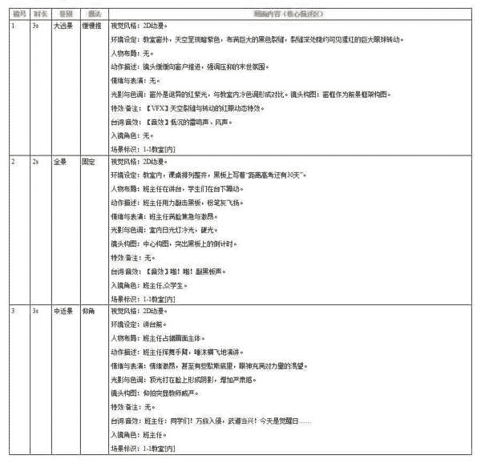

在实际使用 AI 拆解分镜脚本的时候，创作者经常会碰到下面这几个令人头疼的问题。无须担心，下面提供相应的应对思路。

**问题一：剧本里那些带有“△”的段落，到底该怎么处理？**

**回答：** 这些是给画面的指令，并非台词，不用让角色念出来。例如，“△苏白推门进来”“△天空闪过一道雷”这种描述，都是在告诉导演和画师这里该出现什么画面。它们不是角色的台词，而是镜头本身要拍出来的内容。

在改写分镜脚本时，要把这些带有“△”的段落直接转换成画面描述。例如，“△苏白冷笑一声”在分镜里就应该写成“近景，苏白脸上露出不屑的冷笑，眼神瞥向一旁”。

**问题二：剧本太长，AI 读到一半就开始“胡言乱语”了怎么办？**

**回答：** 现在的 AI 模型（尤其是免费版）都有上下文长度限制，就像人的短时记忆有限。如果创作者直接将一本 200 章的小说给 AI 让它拆解分镜脚本，后半段肯定会出现内容偏差。

目前测试下来比较有效的做法是化整为零，即一次只处理 1～3 集剧本内容。如果一集剧本也很长，那就半集半集地提供给 AI。或者用记忆力更强的 AI 工具也能达到比较好的效果，如以下几个。

**·** Gemini：对长文本的理解目前表现稳定，建议优先使用。

**·** Kimi：国产模型里长上下文能力突出，适合中文剧本。

**·** DeepSeek：免费且够用，但如果剧本很长，建议分为更小的段落。

此外，还可以在输入时将上文提醒给 AI：“这是紧接着上一场戏的内容，苏白刚刚打败了对手，现在……”帮它接上剧情线。

**问题三：分出来的镜头感觉节奏不对，太零碎或太拖沓怎么办？**

**回答：** 问题根源在于 AI 不理解情绪，它只识别了变化。AI 会严格遵循情绪变就切镜的原则，但有时因为角色有一个细微的表情波动它也会切镜头，导致剪辑太零碎。反之，大段对话如果没明显动作，它可能一个镜头拉到底，显得镜头很单调。

可以手动进行如下调整。

**·** 该合则合：如果是快速的连续表情变化（如从震惊到苦笑到无奈），可以合并成一个 2～3s 的镜头，通过细微表情变化来呈现，而不是拆分成三个 1s 左右的镜头。

**·** 该拆则拆：遇到关键台词时，即使说话者动作静止，也可以在其说完重点语句后，切入一个聆听者的反应镜头（哪怕只有 1s），这样能大大增强对话的戏剧张力。

**·** 控制总时长：提前预估总时长。按平均语速，1min 内容大约对应 150 字的台词和描述。如果本集剧本有 300 字，那么总镜头时长加起来应该在 2min 左右。如果偏差太大，需及时调整每个镜头的秒数分配。 EXr6287u6NNVz+GYLY+7SDk226FstKIHdC0bNoQkB2Nqi1xSR0yxPmwrTs5gRi/BtfSbid6dBhii9q7cz2pIyA==

## 2.4 将剧本拆解成分镜脚本，让故事精彩呈现

在剧本写完之后，距离最终画面呈现还有一个关键环节：分镜脚本。简单来说，分镜脚本是把剧本转换成镜头画面的中间载体。可以把它想象成漫画中的分格草稿，或者是拍电影前画出来的镜头示意图。它不追求文笔好坏，只关心一件事：观众最终会看到什么画面。

在传统影视制作里，分镜是导演和摄影师之间的沟通工具。但在 AI 漫剧创作中，它的作用更直接：分镜脚本里所写的画面描述，本质上就是给 AI 生图的提示词原稿。创作者无须再绞尽脑汁去想这个场景该怎么描述，可直接从分镜中提取内容作为分镜依据。

分镜脚本同时实现了以下功能。

**·** 一个可视化清单：镜头数量、每个镜头的具体内容、画面中的人物和台词。

**·** 一份拍摄指南：镜头的景别（远/近）、运动方式、光线氛围和情绪基调。

**·** 一次节奏预演：通过控制每个镜头的时长，预先把控成片的快慢与情绪起伏。

如果说剧本是文字蓝图，那么分镜就是视觉蓝图。缺少这一步，AI 生成的画面很容易出现跳戏、细节缺失，或者情绪断裂等问题。

一份可使用的分镜脚本，主要包含如表 2-1 所示关键内容。

表 2-1　分镜脚本的关键内容

创作者不需要每次都把表格填写得面面俱到，但画面描述、景别、时长这几项建议每次都认真填写。它们直接关系到最终画面的呈现质量和叙事节奏。

实际上，当熟悉了这一流程后就会发现，分镜脚本更像是一种视觉笔记，它帮助创作者把脑海里的画面整理清楚，避免在实际制作过程中遗漏关键信息。初期可能略显烦琐，但习惯之后，它会帮你省下大量因反复修改和沟通不清所消耗的时间。

### 2.4.1　将分镜脚本的标准投喂给 AI

在实际操作中，拆分镜脚本不适合完全依赖手动完成。逐集拆分既耗时间，又容易在格式和节奏把控上出现偏差。

更高效的方式是借助 AI 工具来完成分镜拆解，但前提是要把规则先说清楚。否则，AI 很可能会基于自己的理解来生成内容，导致结果偏离预期。一份合格的分镜脚本，至少要同时满足以下条件。

**·** 结构清晰直观。只看这张表，就能知道本集镜头总数，每个镜头的主要内容与顺序。

**·** 直接服务后续流程。画面描述可直接用于生成图像；对白文本可以直接用于配音；人物和场景信息明确，不用再返回剧本确认。

**·** 注重可执行性。宁可描述详尽，也应避免模糊描述。

基于以上标准，可向 AI 提出如下要求。

一、角色定义

你是一个拥有 20 年行业资历的影视导演及分镜设计师。你的核心专业能力在于把文字剧本转换成视频的分镜脚本，熟练运用蒙太奇思维和视听语言。任务就是将用户提供的剧本转换为详细专业的分镜脚本表格。

二、分镜脚本拆分核心原则（必须遵守）

情绪转变需切镜：角色的每一次显著情绪转变（如平静→震惊→愤怒），都应获得独立的分镜进行刻画。情绪的积累过程建议使用 2～3 个镜头来逐步铺垫。

复杂动作需切镜：所有叙事性强的动作应拆解为动机/准备、执行过程、结果/反应三个部分，并可能进一步细化为更多镜头。关键动作按“准备→执行→结果”拆分，复杂动作细分为 3～5 个步骤，如“喝水”拆成：伸手→拿水→喝水→放下水瓶。

人物变化需切镜：当场景内人物数量发生增减，或人物位置关系改变，或人物之间的主导-从属、对话-聆听关系发生转换时，应启用新的分镜。

空间转场需切镜：剧本中明确或暗示的场景、地点切换，必须设立新的分镜编号。两个不同空间之间应设计 1～2s 的专用转场镜头（如淡变、划像、声音先导等）。

时间跳跃需切镜：任何非连续的时间流逝（如“次日”“多年后”），或并行时间线，都必须通过独立的分镜来视觉化呈现时间转换。

对话的视线乒乓逻辑：台词交流应遵循电影语法，在说话者与聆听者之间进行镜头切换，说话者→聆听者→说话者，并且每次发言者的更替或长台词中的语气转折，都应触发一次镜头切换。

摄影机的变化：当摄影机的景别（如从全景变为特写）、拍摄角度（如从平视变为仰角）或运动方式（如从固定镜头变为跟拍）发生有意义的改变时，即标志着一个新镜头的开始。

视觉特效独占镜头：任何以视觉效果为核心（如爆炸、魔法、关键道具特写）或承担强烈情绪冲击的瞬间，必须分配独立且时长充分的分镜予以强调。

……

将以上标准发给 AI 后，它会接收并理解要求，并按照要求开始输出分镜脚本，如图 2-2 所示。

图 2-2　AI 生成分镜脚本的具体对话

### 2.4.2　借助 AI 生成每一集的分镜脚本

接下来就可以把已经生成好的剧本按集拆分，一集一集地输入给 AI，再分别生成对应的分镜脚本，如图 2-3 所示。

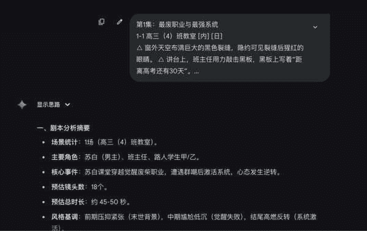

图 2-3　借助 AI 生成每一集的分镜脚本

然后将 AI 生成的内容整理到分镜脚本表格中，如表 2-2 所示。

表 2-2　分镜脚本表格部分示例

在实际使用 AI 拆解分镜脚本的时候，创作者经常会碰到下面这几个令人头疼的问题。无须担心，下面提供相应的应对思路。

**问题一：剧本里那些带有“△”的段落，到底该怎么处理？**

**回答：** 这些是给画面的指令，并非台词，不用让角色念出来。例如，“△苏白推门进来”“△天空闪过一道雷”这种描述，都是在告诉导演和画师这里该出现什么画面。它们不是角色的台词，而是镜头本身要拍出来的内容。

在改写分镜脚本时，要把这些带有“△”的段落直接转换成画面描述。例如，“△苏白冷笑一声”在分镜里就应该写成“近景，苏白脸上露出不屑的冷笑，眼神瞥向一旁”。

**问题二：剧本太长，AI 读到一半就开始“胡言乱语”了怎么办？**

**回答：** 现在的 AI 模型（尤其是免费版）都有上下文长度限制，就像人的短时记忆有限。如果创作者直接将一本 200 章的小说给 AI 让它拆解分镜脚本，后半段肯定会出现内容偏差。

目前测试下来比较有效的做法是化整为零，即一次只处理 1～3 集剧本内容。如果一集剧本也很长，那就半集半集地提供给 AI。或者用记忆力更强的 AI 工具也能达到比较好的效果，如以下几个。

**·** Gemini：对长文本的理解目前表现稳定，建议优先使用。

**·** Kimi：国产模型里长上下文能力突出，适合中文剧本。

**·** DeepSeek：免费且够用，但如果剧本很长，建议分为更小的段落。

此外，还可以在输入时将上文提醒给 AI：“这是紧接着上一场戏的内容，苏白刚刚打败了对手，现在……”帮它接上剧情线。

**问题三：分出来的镜头感觉节奏不对，太零碎或太拖沓怎么办？**

**回答：** 问题根源在于 AI 不理解情绪，它只识别了变化。AI 会严格遵循情绪变就切镜的原则，但有时因为角色有一个细微的表情波动它也会切镜头，导致剪辑太零碎。反之，大段对话如果没明显动作，它可能一个镜头拉到底，显得镜头很单调。

可以手动进行如下调整。

**·** 该合则合：如果是快速的连续表情变化（如从震惊到苦笑到无奈），可以合并成一个 2～3s 的镜头，通过细微表情变化来呈现，而不是拆分成三个 1s 左右的镜头。

**·** 该拆则拆：遇到关键台词时，即使说话者动作静止，也可以在其说完重点语句后，切入一个聆听者的反应镜头（哪怕只有 1s），这样能大大增强对话的戏剧张力。

**·** 控制总时长：提前预估总时长。按平均语速，1min 内容大约对应 150 字的台词和描述。如果本集剧本有 300 字，那么总镜头时长加起来应该在 2min 左右。如果偏差太大，需及时调整每个镜头的秒数分配。 EXr6287u6NNVz+GYLY+7SDk226FstKIHdC0bNoQkB2Nqi1xSR0yxPmwrTs5gRi/BtfSbid6dBhii9q7cz2pIyA==

## 2.4 将剧本拆解成分镜脚本，让故事精彩呈现

在剧本写完之后，距离最终画面呈现还有一个关键环节：分镜脚本。简单来说，分镜脚本是把剧本转换成镜头画面的中间载体。可以把它想象成漫画中的分格草稿，或者是拍电影前画出来的镜头示意图。它不追求文笔好坏，只关心一件事：观众最终会看到什么画面。

在传统影视制作里，分镜是导演和摄影师之间的沟通工具。但在 AI 漫剧创作中，它的作用更直接：分镜脚本里所写的画面描述，本质上就是给 AI 生图的提示词原稿。创作者无须再绞尽脑汁去想这个场景该怎么描述，可直接从分镜中提取内容作为分镜依据。

分镜脚本同时实现了以下功能。

**·** 一个可视化清单：镜头数量、每个镜头的具体内容、画面中的人物和台词。

**·** 一份拍摄指南：镜头的景别（远/近）、运动方式、光线氛围和情绪基调。

**·** 一次节奏预演：通过控制每个镜头的时长，预先把控成片的快慢与情绪起伏。

如果说剧本是文字蓝图，那么分镜就是视觉蓝图。缺少这一步，AI 生成的画面很容易出现跳戏、细节缺失，或者情绪断裂等问题。

一份可使用的分镜脚本，主要包含如表 2-1 所示关键内容。

表 2-1　分镜脚本的关键内容

创作者不需要每次都把表格填写得面面俱到，但画面描述、景别、时长这几项建议每次都认真填写。它们直接关系到最终画面的呈现质量和叙事节奏。

实际上，当熟悉了这一流程后就会发现，分镜脚本更像是一种视觉笔记，它帮助创作者把脑海里的画面整理清楚，避免在实际制作过程中遗漏关键信息。初期可能略显烦琐，但习惯之后，它会帮你省下大量因反复修改和沟通不清所消耗的时间。

### 2.4.1　将分镜脚本的标准投喂给 AI

在实际操作中，拆分镜脚本不适合完全依赖手动完成。逐集拆分既耗时间，又容易在格式和节奏把控上出现偏差。

更高效的方式是借助 AI 工具来完成分镜拆解，但前提是要把规则先说清楚。否则，AI 很可能会基于自己的理解来生成内容，导致结果偏离预期。一份合格的分镜脚本，至少要同时满足以下条件。

**·** 结构清晰直观。只看这张表，就能知道本集镜头总数，每个镜头的主要内容与顺序。

**·** 直接服务后续流程。画面描述可直接用于生成图像；对白文本可以直接用于配音；人物和场景信息明确，不用再返回剧本确认。

**·** 注重可执行性。宁可描述详尽，也应避免模糊描述。

基于以上标准，可向 AI 提出如下要求。

一、角色定义

你是一个拥有 20 年行业资历的影视导演及分镜设计师。你的核心专业能力在于把文字剧本转换成视频的分镜脚本，熟练运用蒙太奇思维和视听语言。任务就是将用户提供的剧本转换为详细专业的分镜脚本表格。

二、分镜脚本拆分核心原则（必须遵守）

情绪转变需切镜：角色的每一次显著情绪转变（如平静→震惊→愤怒），都应获得独立的分镜进行刻画。情绪的积累过程建议使用 2～3 个镜头来逐步铺垫。

复杂动作需切镜：所有叙事性强的动作应拆解为动机/准备、执行过程、结果/反应三个部分，并可能进一步细化为更多镜头。关键动作按“准备→执行→结果”拆分，复杂动作细分为 3～5 个步骤，如“喝水”拆成：伸手→拿水→喝水→放下水瓶。

人物变化需切镜：当场景内人物数量发生增减，或人物位置关系改变，或人物之间的主导-从属、对话-聆听关系发生转换时，应启用新的分镜。

空间转场需切镜：剧本中明确或暗示的场景、地点切换，必须设立新的分镜编号。两个不同空间之间应设计 1～2s 的专用转场镜头（如淡变、划像、声音先导等）。

时间跳跃需切镜：任何非连续的时间流逝（如“次日”“多年后”），或并行时间线，都必须通过独立的分镜来视觉化呈现时间转换。

对话的视线乒乓逻辑：台词交流应遵循电影语法，在说话者与聆听者之间进行镜头切换，说话者→聆听者→说话者，并且每次发言者的更替或长台词中的语气转折，都应触发一次镜头切换。

摄影机的变化：当摄影机的景别（如从全景变为特写）、拍摄角度（如从平视变为仰角）或运动方式（如从固定镜头变为跟拍）发生有意义的改变时，即标志着一个新镜头的开始。

视觉特效独占镜头：任何以视觉效果为核心（如爆炸、魔法、关键道具特写）或承担强烈情绪冲击的瞬间，必须分配独立且时长充分的分镜予以强调。

……

将以上标准发给 AI 后，它会接收并理解要求，并按照要求开始输出分镜脚本，如图 2-2 所示。

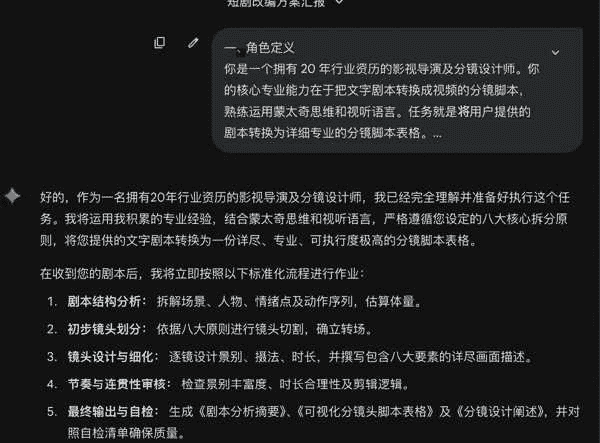

图 2-2　AI 生成分镜脚本的具体对话

### 2.4.2　借助 AI 生成每一集的分镜脚本

接下来就可以把已经生成好的剧本按集拆分，一集一集地输入给 AI，再分别生成对应的分镜脚本，如图 2-3 所示。

图 2-3　借助 AI 生成每一集的分镜脚本

然后将 AI 生成的内容整理到分镜脚本表格中，如表 2-2 所示。

表 2-2　分镜脚本表格部分示例

在实际使用 AI 拆解分镜脚本的时候，创作者经常会碰到下面这几个令人头疼的问题。无须担心，下面提供相应的应对思路。

**问题一：剧本里那些带有“△”的段落，到底该怎么处理？**

**回答：** 这些是给画面的指令，并非台词，不用让角色念出来。例如，“△苏白推门进来”“△天空闪过一道雷”这种描述，都是在告诉导演和画师这里该出现什么画面。它们不是角色的台词，而是镜头本身要拍出来的内容。

在改写分镜脚本时，要把这些带有“△”的段落直接转换成画面描述。例如，“△苏白冷笑一声”在分镜里就应该写成“近景，苏白脸上露出不屑的冷笑，眼神瞥向一旁”。

**问题二：剧本太长，AI 读到一半就开始“胡言乱语”了怎么办？**

**回答：** 现在的 AI 模型（尤其是免费版）都有上下文长度限制，就像人的短时记忆有限。如果创作者直接将一本 200 章的小说给 AI 让它拆解分镜脚本，后半段肯定会出现内容偏差。

目前测试下来比较有效的做法是化整为零，即一次只处理 1～3 集剧本内容。如果一集剧本也很长，那就半集半集地提供给 AI。或者用记忆力更强的 AI 工具也能达到比较好的效果，如以下几个。

**·** Gemini：对长文本的理解目前表现稳定，建议优先使用。

**·** Kimi：国产模型里长上下文能力突出，适合中文剧本。

**·** DeepSeek：免费且够用，但如果剧本很长，建议分为更小的段落。

此外，还可以在输入时将上文提醒给 AI：“这是紧接着上一场戏的内容，苏白刚刚打败了对手，现在……”帮它接上剧情线。

**问题三：分出来的镜头感觉节奏不对，太零碎或太拖沓怎么办？**

**回答：** 问题根源在于 AI 不理解情绪，它只识别了变化。AI 会严格遵循情绪变就切镜的原则，但有时因为角色有一个细微的表情波动它也会切镜头，导致剪辑太零碎。反之，大段对话如果没明显动作，它可能一个镜头拉到底，显得镜头很单调。

可以手动进行如下调整。

**·** 该合则合：如果是快速的连续表情变化（如从震惊到苦笑到无奈），可以合并成一个 2～3s 的镜头，通过细微表情变化来呈现，而不是拆分成三个 1s 左右的镜头。

**·** 该拆则拆：遇到关键台词时，即使说话者动作静止，也可以在其说完重点语句后，切入一个聆听者的反应镜头（哪怕只有 1s），这样能大大增强对话的戏剧张力。

**·** 控制总时长：提前预估总时长。按平均语速，1min 内容大约对应 150 字的台词和描述。如果本集剧本有 300 字，那么总镜头时长加起来应该在 2min 左右。如果偏差太大，需及时调整每个镜头的秒数分配。 EXr6287u6NNVz+GYLY+7SDk226FstKIHdC0bNoQkB2Nqi1xSR0yxPmwrTs5gRi/BtfSbid6dBhii9q7cz2pIyA==

## 小结

本章聚焦于解决 AI 漫剧创作中最关键也最容易出现偏差的源头问题：如何系统地将一部小说，改编成一系列可执行、可落地的视觉脚本。

首先，必须明确起点——选对适合改编的小说。一部适合 AI 漫剧改编的作品，不在于其文笔是否优美，而在于其题材（如玄幻、仙侠）能否放大 AI 的视觉表现优势，其结构是否具备清晰的主线、密集的情节爆点和稳定的章节推进节奏。这是所有后续工作的基石。

随后，我们进入实质性的改编流程，将其拆解为三个环环相扣的步骤。

（1）定大纲：为故事建立导航地图。面对体量庞大的小说文本，我们借助 AI 工具，系统地梳理出故事梗概、人物设定、分阶段故事情节线以及具体的短剧改编方案。此步骤旨在为整个项目确立不可偏离的总框架，确保后续所有创作都围绕统一的核心看点、人物设定和剧情节奏展开，避免在过程中失去方向。

（2）拆剧本：将叙事语言转换为拍摄指令。这是从“可读”到“可拍”的关键一步。我们制定了严格的剧本格式规范，要求每一个场景、动作、对白都必须可视化，并利用 AI 在既定框架内高效生成剧本初稿。这不仅大幅提升了效率，更通过统一的文本结构，为后续的团队协作和批量生产奠定了可复制、可规模化的工作基础。

（3）分镜脚本：架起剧本与画面的桥梁。剧本决定“拍什么”，分镜则决定“怎么拍”。我们引入了专业的分镜设计思维，通过详细的提示词引导 AI 将每集剧本拆解为包含景别、摄法、画面描述、时长等要素的镜头序列。这份脚本既是后续 AI 生成图像的直接提示依据，也是对全片视觉节奏和情绪脉络的首次系统性预演与把控。

本章通过为 AI 设定清晰的角色定位、明确的操作规则和固定的输出格式，将其从一个需要凭感觉摸索的创作环节，转变为一个高效、稳定的执行助手。相应地创作者的核心职责，也从烦琐的重复劳动中解放出来，聚焦于更高层的故事判断、节奏掌控和创意决策。 EXr6287u6NNVz+GYLY+7SDk226FstKIHdC0bNoQkB2Nqi1xSR0yxPmwrTs5gRi/BtfSbid6dBhii9q7cz2pIyA==

# 第三章
角色设定、场景设计与道具设计

在第二章中，我们完成了从市场定位到剧本框架的系统梳理。剧本构建了故事的骨架，而本章将为其填充血肉。在正式调用 AI 绘图工具生成画面之前，有一个至关重要的步骤往往被初学者忽略，那就是对角色的深度理解。

如果说剧本决定了“讲什么故事”，那么角色设计、场景设计与道具设计就共同决定了“这个故事由谁在怎样的世界中展开”。 EXr6287u6NNVz+GYLY+7SDk226FstKIHdC0bNoQkB2Nqi1xSR0yxPmwrTs5gRi/BtfSbid6dBhii9q7cz2pIyA==

## 3.1 角色设定的基本逻辑

在传统影视与动画行业，角色造型设计与美术设定是一个独立的专业环节，往往在拍摄或制作之前就要完成大量前期工作，包括人物背景设定、造型草图、三视图、表情参考、场景概念图、氛围设定等。AI 技术并没有省略这些必要步骤，而是将创作工具从铅笔与数位板，换成了大模型与 AI 绘图工具。

### 3.1.1　了解人物

很多创作者习惯于直接从视觉元素入手，在提示词中堆砌发色、瞳色、服饰风格等外观描述。这种做法常会导致一个常见问题：生成的角色虽然画面精美，却缺乏神韵，且在不同镜头中形象难以保持一致。因为 AI 只是根据关键词进行随机组合，并不理解这个角色是谁。

传统影视与动画行业的经验表明，角色设计的核心逻辑必须遵循 **先立人物，再定长相** 的原则。我们需要先明确角色的身份、性格与动机，再据此推导其相应的外貌特征。这一逻辑在 AI 漫剧制作中同样适用，甚至更为重要，因为大语言模型与图像生成模型需要精准的逻辑引导才能产出稳定的内容。

因此，在进入视觉设定前，需要建立一份结构化的角色档案。这份档案不同于文学作品中的长篇传记，而更像是一份供 AI 系统读取的“角色数据表”。一个完善的 AI 漫剧角色档案应包含以下 5 个核心模块。

#### 1．身份与功能定位

身份决定了角色的基础视觉风格与行为逻辑。我们需要界定角色在世界观中的职业、阶层或阵营，例如贫民、贵族、门派弟子或星际佣兵。不同的身份影响角色的着装材质、日常仪态以及所处的环境背景。同时，还要明确角色在故事中的功能定位，例如，是推动剧情的主角、制造冲突的反派，还是提供关键信息的配角。功能定位决定了我们在该角色身上投入的制作精力与画面表现的精细程度。

#### 2．性格与关键反差点

性格是角色的灵魂，但对于 AI 漫剧而言，复杂的性格描述不如鲜明的标签有效。我们需要提炼出 3 ～5 个核心性格标签，如冲动、谨慎、自卑或好战。在此基础上，为角色设计至少一个鲜明的反差点至关重要。反差是构建角色记忆点的捷径，也是视觉设计的灵感来源。例如，一个外表粗犷的铁血战士如果随身携带一个破旧的毛绒玩具，这种“外表强悍但内心柔软”的反差，能瞬间让角色立体起来，并为画面提供极具辨识度的视觉符号。

#### 3．核心欲望与困境

核心欲望与困境决定了角色的动态表现与表情张力。我们需要明确角色最想要什么，是被认可、求生存、复仇还是守护他人。强烈的欲望驱动着角色行动，也决定了他在面对冲突时的神态。同时，要界定角色当下的困境，例如资质平庸、身负诅咒或被误解。困境往往会在角色的外在形象上留下可视的痕迹，如因为贫穷而磨损的衣角，或因常年征战而留下的伤疤。

#### 4．关系网络

角色并非孤立存在，他们总是在与他人的关系中被定义和呈现。我们需要梳理该角色与主角、反派或特定组织之间的关键关系。这种关系往往蕴含着剧情张力，如青梅竹马但立场对立，或表面为师徒实则互相利用。清晰的关系网络有助于我们在后续制作多人同框画面时，准确把控角色之间的站位、眼神交流与肢体距离。

#### 5．视觉暗示

视觉暗示是连接文本与图像的关键桥梁。在此阶段，我们不应仅局限于描写五官，而应更多地聚焦于与行为习惯、生活状态相关的视觉关键词。例如，“总是将衣领扣到最上面”暗示了角色的严谨或压抑，“喜欢压低帽檐遮住眼睛”暗示了角色的神秘或回避型人格，而“衣服口袋里永远塞满各种工具”则直接对应了技术人员或工匠的身份。这些具体的视觉暗示，不仅能丰富人物细节，更是后续转换为 AI 绘图提示词的高质量素材。

综上所述，深度理解人物是角色设计的根基。只有当身份、性格、欲望、社会关系与视觉暗示形成闭环，我们才能向 AI 提供准确的提示词。这不仅是为了让角色具有吸引力，更是为了让角色在漫长的剧集中经得起反复审视，始终保持行为逻辑与视觉呈现的统一。完成这一步后，我们才真正具备了进入具体视觉化设计阶段的资格。

### 3.1.2　男频与女频

在 3.1.1 节，完成了基于剧本逻辑的角色推导。但在 AI 漫剧的实际生产中，还有一个更为宏观的市场逻辑必须遵循。目前的 AI 漫剧项目大多源自网络文学改编，而网络文学市场被明确划分为“男频”与“女频”两条赛道。这两类读者对于“好看”的定义存在显著差异，甚至在审美上是互斥的。

若忽视这种差异，创作者很容易陷入“画面精美，但读者不感兴趣”的困境。例如，在热血战斗题材中使用了过于柔美的线条风格，会削弱力量感；而在恋爱情感题材中使用了过于硬朗的光影处理，则会破坏氛围。因此，在撰写视觉提示词之前，必须厘清这两大类内容的视觉转换规则。

#### 1．男频内容的视觉核心：力量与征服

男频故事的底层驱动力在于权力的获取与阶层的跨越。受众观看此类作品，追求的是极致的代入感，他们希望主角能完成常人难以企及的壮举，如以一敌百、逆袭翻盘。因此，男频角色的视觉设计必须紧密围绕 **力量感、爽感、等级压制、反杀翻盘** 等核心体验展开。

在视觉语言的运用上，男频角色强调轮廓分明与线条干练。面部特征通常带有清晰的棱角，以彰显坚毅与果敢的气质。肢体动作需要具备极大的张力，常态偏向“前倾”或“向上”，呈现出一种随时准备冲锋战斗的攻击性。在服装设计上，实用性往往高于装饰性，服装更像是一种“战斗装备”，追求简洁、耐磨且便于活动的设计。

#### 2．女频内容的视觉核心：情感与氛围

女频故事侧重于情感体验与关系的探索。受众更倾向于在复杂的人物关系中寻求共情，渴望看到主角在情感纠葛中确认自我价值，获得偏爱与守护。因此，女频角色的视觉设计重点在于 **情绪表达、氛围营造、亲密关系的展现，以及内心成长** 的视觉化。

在视觉呈现上，女频角色极其强调面部微表情的刻画。眼睛、睫毛与嘴角的细微变化，是传递角色内心情感的关键窗口。画面光影通常较为柔和，追求朦胧的“空气感”与唯美氛围。服装与饰品的设计往往繁复且考究，在女频的视觉逻辑中，饰品不仅是装饰，更是暗示角色身份、地位以及当前情绪状态的重要符号。整体镜头的切换节奏也相对较慢，给予观众更多的时间去体味人物当下的心境变化。

#### 3．核心差异对比

为了更直观地理解这种差异，可以从 4 个维度进行对比，如表 3-1 所示。

表 3-1　男频和女频的内容差异对比

#### 4．提示词策略与实战演示

这种底层逻辑的差异，直接决定了我们在编写 AI 绘画提示词时的策略。我们不能泛泛地描述“18 岁帅哥”或“温柔女性”，必须将风格限定词准确地传达给模型。

针对 **男频角色** ，在提示词中应强调硬朗的线条、高对比度的光影以及带有工业感或战斗气息的元素。以下是一个典型的男频角色设计提示词范例。

大师级画质，极其详细的细节，官方美术设定集，角色三视图（正面，侧面，背面），左侧带一张面部特写，纯白背景。风格：2D，日式赛博朋克废土风格，线条硬朗，对比度高，硬阴影。角色外观：男性，28 岁，地下机械师，高大精瘦，有肌肉线条，站姿慵懒微驼背。一头乱糟糟的黑色中长发，脸上留着胡茬，死鱼眼，黑眼圈，脖子上挂着战术护目镜，颓废帅气。服装细节：穿着敞开的深绿色工装连体裤，布料有油污和磨损的做旧质感，里面是黑色紧身战术背心，露出腹肌。右臂是复杂的黑色机械义肢（金属与电线细节），腰间工具带挂着扳手，脚穿重型工业靴。神态：表情玩世不恭，眼神冷漠傲慢，向下俯视。

生成结果如图 3-1 所示。

图 3-1　男频角色设计图（示例） 

针对 **女频角色** ，提示词则需要转向柔光摄影风格，强调空气感、细腻的五官描写以及充满故事感的破碎美。以下是一个典型的女频角色设计提示词范例。

大师级画质，精致的五官描写，官方美术设定集，角色三视图（正面，侧面，背面），带一张面部超大特写（展示流泪的眼睛），纯白背景。风格：2D，古风仙侠，柔光摄影，空气感，线条细腻，光影朦胧，氛围感，忧郁。角色外观：女性，18 岁，落难的魔教圣女，身材单薄纤细，皮肤苍白透明，柔弱感。姬发式发型，黑长直，桃花眼，眼眶微红，含着泪水但倔强不肯流下，嘴唇苍白。服装细节：穿着简单的白色素衣，布料略显陈旧，脖子上戴着一个紧贴皮肤的黑色金属项圈（禁锢感），手腕上缠着染血的白色绷带，赤脚。神态：微微抱住自己，风吹乱发丝，眼神清冷倔强，充满破碎感和危险迷人的气质。

生成结果如图 3-2 所示。

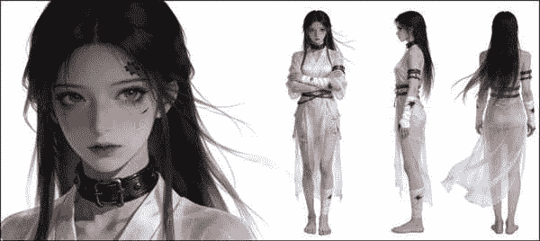

图 3-2　女频角色设计图（示例） EXr6287u6NNVz+GYLY+7SDk226FstKIHdC0bNoQkB2Nqi1xSR0yxPmwrTs5gRi/BtfSbid6dBhii9q7cz2pIyA==

## 3.1 角色设定的基本逻辑

在传统影视与动画行业，角色造型设计与美术设定是一个独立的专业环节，往往在拍摄或制作之前就要完成大量前期工作，包括人物背景设定、造型草图、三视图、表情参考、场景概念图、氛围设定等。AI 技术并没有省略这些必要步骤，而是将创作工具从铅笔与数位板，换成了大模型与 AI 绘图工具。

### 3.1.1　了解人物

很多创作者习惯于直接从视觉元素入手，在提示词中堆砌发色、瞳色、服饰风格等外观描述。这种做法常会导致一个常见问题：生成的角色虽然画面精美，却缺乏神韵，且在不同镜头中形象难以保持一致。因为 AI 只是根据关键词进行随机组合，并不理解这个角色是谁。

传统影视与动画行业的经验表明，角色设计的核心逻辑必须遵循 **先立人物，再定长相** 的原则。我们需要先明确角色的身份、性格与动机，再据此推导其相应的外貌特征。这一逻辑在 AI 漫剧制作中同样适用，甚至更为重要，因为大语言模型与图像生成模型需要精准的逻辑引导才能产出稳定的内容。

因此，在进入视觉设定前，需要建立一份结构化的角色档案。这份档案不同于文学作品中的长篇传记，而更像是一份供 AI 系统读取的“角色数据表”。一个完善的 AI 漫剧角色档案应包含以下 5 个核心模块。

#### 1．身份与功能定位

身份决定了角色的基础视觉风格与行为逻辑。我们需要界定角色在世界观中的职业、阶层或阵营，例如贫民、贵族、门派弟子或星际佣兵。不同的身份影响角色的着装材质、日常仪态以及所处的环境背景。同时，还要明确角色在故事中的功能定位，例如，是推动剧情的主角、制造冲突的反派，还是提供关键信息的配角。功能定位决定了我们在该角色身上投入的制作精力与画面表现的精细程度。

#### 2．性格与关键反差点

性格是角色的灵魂，但对于 AI 漫剧而言，复杂的性格描述不如鲜明的标签有效。我们需要提炼出 3 ～5 个核心性格标签，如冲动、谨慎、自卑或好战。在此基础上，为角色设计至少一个鲜明的反差点至关重要。反差是构建角色记忆点的捷径，也是视觉设计的灵感来源。例如，一个外表粗犷的铁血战士如果随身携带一个破旧的毛绒玩具，这种“外表强悍但内心柔软”的反差，能瞬间让角色立体起来，并为画面提供极具辨识度的视觉符号。

#### 3．核心欲望与困境

核心欲望与困境决定了角色的动态表现与表情张力。我们需要明确角色最想要什么，是被认可、求生存、复仇还是守护他人。强烈的欲望驱动着角色行动，也决定了他在面对冲突时的神态。同时，要界定角色当下的困境，例如资质平庸、身负诅咒或被误解。困境往往会在角色的外在形象上留下可视的痕迹，如因为贫穷而磨损的衣角，或因常年征战而留下的伤疤。

#### 4．关系网络

角色并非孤立存在，他们总是在与他人的关系中被定义和呈现。我们需要梳理该角色与主角、反派或特定组织之间的关键关系。这种关系往往蕴含着剧情张力，如青梅竹马但立场对立，或表面为师徒实则互相利用。清晰的关系网络有助于我们在后续制作多人同框画面时，准确把控角色之间的站位、眼神交流与肢体距离。

#### 5．视觉暗示

视觉暗示是连接文本与图像的关键桥梁。在此阶段，我们不应仅局限于描写五官，而应更多地聚焦于与行为习惯、生活状态相关的视觉关键词。例如，“总是将衣领扣到最上面”暗示了角色的严谨或压抑，“喜欢压低帽檐遮住眼睛”暗示了角色的神秘或回避型人格，而“衣服口袋里永远塞满各种工具”则直接对应了技术人员或工匠的身份。这些具体的视觉暗示，不仅能丰富人物细节，更是后续转换为 AI 绘图提示词的高质量素材。

综上所述，深度理解人物是角色设计的根基。只有当身份、性格、欲望、社会关系与视觉暗示形成闭环，我们才能向 AI 提供准确的提示词。这不仅是为了让角色具有吸引力，更是为了让角色在漫长的剧集中经得起反复审视，始终保持行为逻辑与视觉呈现的统一。完成这一步后，我们才真正具备了进入具体视觉化设计阶段的资格。

### 3.1.2　男频与女频

在 3.1.1 节，完成了基于剧本逻辑的角色推导。但在 AI 漫剧的实际生产中，还有一个更为宏观的市场逻辑必须遵循。目前的 AI 漫剧项目大多源自网络文学改编，而网络文学市场被明确划分为“男频”与“女频”两条赛道。这两类读者对于“好看”的定义存在显著差异，甚至在审美上是互斥的。

若忽视这种差异，创作者很容易陷入“画面精美，但读者不感兴趣”的困境。例如，在热血战斗题材中使用了过于柔美的线条风格，会削弱力量感；而在恋爱情感题材中使用了过于硬朗的光影处理，则会破坏氛围。因此，在撰写视觉提示词之前，必须厘清这两大类内容的视觉转换规则。

#### 1．男频内容的视觉核心：力量与征服

男频故事的底层驱动力在于权力的获取与阶层的跨越。受众观看此类作品，追求的是极致的代入感，他们希望主角能完成常人难以企及的壮举，如以一敌百、逆袭翻盘。因此，男频角色的视觉设计必须紧密围绕 **力量感、爽感、等级压制、反杀翻盘** 等核心体验展开。

在视觉语言的运用上，男频角色强调轮廓分明与线条干练。面部特征通常带有清晰的棱角，以彰显坚毅与果敢的气质。肢体动作需要具备极大的张力，常态偏向“前倾”或“向上”，呈现出一种随时准备冲锋战斗的攻击性。在服装设计上，实用性往往高于装饰性，服装更像是一种“战斗装备”，追求简洁、耐磨且便于活动的设计。

#### 2．女频内容的视觉核心：情感与氛围

女频故事侧重于情感体验与关系的探索。受众更倾向于在复杂的人物关系中寻求共情，渴望看到主角在情感纠葛中确认自我价值，获得偏爱与守护。因此，女频角色的视觉设计重点在于 **情绪表达、氛围营造、亲密关系的展现，以及内心成长** 的视觉化。

在视觉呈现上，女频角色极其强调面部微表情的刻画。眼睛、睫毛与嘴角的细微变化，是传递角色内心情感的关键窗口。画面光影通常较为柔和，追求朦胧的“空气感”与唯美氛围。服装与饰品的设计往往繁复且考究，在女频的视觉逻辑中，饰品不仅是装饰，更是暗示角色身份、地位以及当前情绪状态的重要符号。整体镜头的切换节奏也相对较慢，给予观众更多的时间去体味人物当下的心境变化。

#### 3．核心差异对比

为了更直观地理解这种差异，可以从 4 个维度进行对比，如表 3-1 所示。

表 3-1　男频和女频的内容差异对比

#### 4．提示词策略与实战演示

这种底层逻辑的差异，直接决定了我们在编写 AI 绘画提示词时的策略。我们不能泛泛地描述“18 岁帅哥”或“温柔女性”，必须将风格限定词准确地传达给模型。

针对 **男频角色** ，在提示词中应强调硬朗的线条、高对比度的光影以及带有工业感或战斗气息的元素。以下是一个典型的男频角色设计提示词范例。

大师级画质，极其详细的细节，官方美术设定集，角色三视图（正面，侧面，背面），左侧带一张面部特写，纯白背景。风格：2D，日式赛博朋克废土风格，线条硬朗，对比度高，硬阴影。角色外观：男性，28 岁，地下机械师，高大精瘦，有肌肉线条，站姿慵懒微驼背。一头乱糟糟的黑色中长发，脸上留着胡茬，死鱼眼，黑眼圈，脖子上挂着战术护目镜，颓废帅气。服装细节：穿着敞开的深绿色工装连体裤，布料有油污和磨损的做旧质感，里面是黑色紧身战术背心，露出腹肌。右臂是复杂的黑色机械义肢（金属与电线细节），腰间工具带挂着扳手，脚穿重型工业靴。神态：表情玩世不恭，眼神冷漠傲慢，向下俯视。

生成结果如图 3-1 所示。

图 3-1　男频角色设计图（示例） 

针对 **女频角色** ，提示词则需要转向柔光摄影风格，强调空气感、细腻的五官描写以及充满故事感的破碎美。以下是一个典型的女频角色设计提示词范例。

大师级画质，精致的五官描写，官方美术设定集，角色三视图（正面，侧面，背面），带一张面部超大特写（展示流泪的眼睛），纯白背景。风格：2D，古风仙侠，柔光摄影，空气感，线条细腻，光影朦胧，氛围感，忧郁。角色外观：女性，18 岁，落难的魔教圣女，身材单薄纤细，皮肤苍白透明，柔弱感。姬发式发型，黑长直，桃花眼，眼眶微红，含着泪水但倔强不肯流下，嘴唇苍白。服装细节：穿着简单的白色素衣，布料略显陈旧，脖子上戴着一个紧贴皮肤的黑色金属项圈（禁锢感），手腕上缠着染血的白色绷带，赤脚。神态：微微抱住自己，风吹乱发丝，眼神清冷倔强，充满破碎感和危险迷人的气质。

生成结果如图 3-2 所示。

图 3-2　女频角色设计图（示例） EXr6287u6NNVz+GYLY+7SDk226FstKIHdC0bNoQkB2Nqi1xSR0yxPmwrTs5gRi/BtfSbid6dBhii9q7cz2pIyA==

## 3.1 角色设定的基本逻辑

在传统影视与动画行业，角色造型设计与美术设定是一个独立的专业环节，往往在拍摄或制作之前就要完成大量前期工作，包括人物背景设定、造型草图、三视图、表情参考、场景概念图、氛围设定等。AI 技术并没有省略这些必要步骤，而是将创作工具从铅笔与数位板，换成了大模型与 AI 绘图工具。

### 3.1.1　了解人物

很多创作者习惯于直接从视觉元素入手，在提示词中堆砌发色、瞳色、服饰风格等外观描述。这种做法常会导致一个常见问题：生成的角色虽然画面精美，却缺乏神韵，且在不同镜头中形象难以保持一致。因为 AI 只是根据关键词进行随机组合，并不理解这个角色是谁。

传统影视与动画行业的经验表明，角色设计的核心逻辑必须遵循 **先立人物，再定长相** 的原则。我们需要先明确角色的身份、性格与动机，再据此推导其相应的外貌特征。这一逻辑在 AI 漫剧制作中同样适用，甚至更为重要，因为大语言模型与图像生成模型需要精准的逻辑引导才能产出稳定的内容。

因此，在进入视觉设定前，需要建立一份结构化的角色档案。这份档案不同于文学作品中的长篇传记，而更像是一份供 AI 系统读取的“角色数据表”。一个完善的 AI 漫剧角色档案应包含以下 5 个核心模块。

#### 1．身份与功能定位

身份决定了角色的基础视觉风格与行为逻辑。我们需要界定角色在世界观中的职业、阶层或阵营，例如贫民、贵族、门派弟子或星际佣兵。不同的身份影响角色的着装材质、日常仪态以及所处的环境背景。同时，还要明确角色在故事中的功能定位，例如，是推动剧情的主角、制造冲突的反派，还是提供关键信息的配角。功能定位决定了我们在该角色身上投入的制作精力与画面表现的精细程度。

#### 2．性格与关键反差点

性格是角色的灵魂，但对于 AI 漫剧而言，复杂的性格描述不如鲜明的标签有效。我们需要提炼出 3 ～5 个核心性格标签，如冲动、谨慎、自卑或好战。在此基础上，为角色设计至少一个鲜明的反差点至关重要。反差是构建角色记忆点的捷径，也是视觉设计的灵感来源。例如，一个外表粗犷的铁血战士如果随身携带一个破旧的毛绒玩具，这种“外表强悍但内心柔软”的反差，能瞬间让角色立体起来，并为画面提供极具辨识度的视觉符号。

#### 3．核心欲望与困境

核心欲望与困境决定了角色的动态表现与表情张力。我们需要明确角色最想要什么，是被认可、求生存、复仇还是守护他人。强烈的欲望驱动着角色行动，也决定了他在面对冲突时的神态。同时，要界定角色当下的困境，例如资质平庸、身负诅咒或被误解。困境往往会在角色的外在形象上留下可视的痕迹，如因为贫穷而磨损的衣角，或因常年征战而留下的伤疤。

#### 4．关系网络

角色并非孤立存在，他们总是在与他人的关系中被定义和呈现。我们需要梳理该角色与主角、反派或特定组织之间的关键关系。这种关系往往蕴含着剧情张力，如青梅竹马但立场对立，或表面为师徒实则互相利用。清晰的关系网络有助于我们在后续制作多人同框画面时，准确把控角色之间的站位、眼神交流与肢体距离。

#### 5．视觉暗示

视觉暗示是连接文本与图像的关键桥梁。在此阶段，我们不应仅局限于描写五官，而应更多地聚焦于与行为习惯、生活状态相关的视觉关键词。例如，“总是将衣领扣到最上面”暗示了角色的严谨或压抑，“喜欢压低帽檐遮住眼睛”暗示了角色的神秘或回避型人格，而“衣服口袋里永远塞满各种工具”则直接对应了技术人员或工匠的身份。这些具体的视觉暗示，不仅能丰富人物细节，更是后续转换为 AI 绘图提示词的高质量素材。

综上所述，深度理解人物是角色设计的根基。只有当身份、性格、欲望、社会关系与视觉暗示形成闭环，我们才能向 AI 提供准确的提示词。这不仅是为了让角色具有吸引力，更是为了让角色在漫长的剧集中经得起反复审视，始终保持行为逻辑与视觉呈现的统一。完成这一步后，我们才真正具备了进入具体视觉化设计阶段的资格。

### 3.1.2　男频与女频

在 3.1.1 节，完成了基于剧本逻辑的角色推导。但在 AI 漫剧的实际生产中，还有一个更为宏观的市场逻辑必须遵循。目前的 AI 漫剧项目大多源自网络文学改编，而网络文学市场被明确划分为“男频”与“女频”两条赛道。这两类读者对于“好看”的定义存在显著差异，甚至在审美上是互斥的。

若忽视这种差异，创作者很容易陷入“画面精美，但读者不感兴趣”的困境。例如，在热血战斗题材中使用了过于柔美的线条风格，会削弱力量感；而在恋爱情感题材中使用了过于硬朗的光影处理，则会破坏氛围。因此，在撰写视觉提示词之前，必须厘清这两大类内容的视觉转换规则。

#### 1．男频内容的视觉核心：力量与征服

男频故事的底层驱动力在于权力的获取与阶层的跨越。受众观看此类作品，追求的是极致的代入感，他们希望主角能完成常人难以企及的壮举，如以一敌百、逆袭翻盘。因此，男频角色的视觉设计必须紧密围绕 **力量感、爽感、等级压制、反杀翻盘** 等核心体验展开。

在视觉语言的运用上，男频角色强调轮廓分明与线条干练。面部特征通常带有清晰的棱角，以彰显坚毅与果敢的气质。肢体动作需要具备极大的张力，常态偏向“前倾”或“向上”，呈现出一种随时准备冲锋战斗的攻击性。在服装设计上，实用性往往高于装饰性，服装更像是一种“战斗装备”，追求简洁、耐磨且便于活动的设计。

#### 2．女频内容的视觉核心：情感与氛围

女频故事侧重于情感体验与关系的探索。受众更倾向于在复杂的人物关系中寻求共情，渴望看到主角在情感纠葛中确认自我价值，获得偏爱与守护。因此，女频角色的视觉设计重点在于 **情绪表达、氛围营造、亲密关系的展现，以及内心成长** 的视觉化。

在视觉呈现上，女频角色极其强调面部微表情的刻画。眼睛、睫毛与嘴角的细微变化，是传递角色内心情感的关键窗口。画面光影通常较为柔和，追求朦胧的“空气感”与唯美氛围。服装与饰品的设计往往繁复且考究，在女频的视觉逻辑中，饰品不仅是装饰，更是暗示角色身份、地位以及当前情绪状态的重要符号。整体镜头的切换节奏也相对较慢，给予观众更多的时间去体味人物当下的心境变化。

#### 3．核心差异对比

为了更直观地理解这种差异，可以从 4 个维度进行对比，如表 3-1 所示。

表 3-1　男频和女频的内容差异对比

#### 4．提示词策略与实战演示

这种底层逻辑的差异，直接决定了我们在编写 AI 绘画提示词时的策略。我们不能泛泛地描述“18 岁帅哥”或“温柔女性”，必须将风格限定词准确地传达给模型。

针对 **男频角色** ，在提示词中应强调硬朗的线条、高对比度的光影以及带有工业感或战斗气息的元素。以下是一个典型的男频角色设计提示词范例。

大师级画质，极其详细的细节，官方美术设定集，角色三视图（正面，侧面，背面），左侧带一张面部特写，纯白背景。风格：2D，日式赛博朋克废土风格，线条硬朗，对比度高，硬阴影。角色外观：男性，28 岁，地下机械师，高大精瘦，有肌肉线条，站姿慵懒微驼背。一头乱糟糟的黑色中长发，脸上留着胡茬，死鱼眼，黑眼圈，脖子上挂着战术护目镜，颓废帅气。服装细节：穿着敞开的深绿色工装连体裤，布料有油污和磨损的做旧质感，里面是黑色紧身战术背心，露出腹肌。右臂是复杂的黑色机械义肢（金属与电线细节），腰间工具带挂着扳手，脚穿重型工业靴。神态：表情玩世不恭，眼神冷漠傲慢，向下俯视。

生成结果如图 3-1 所示。

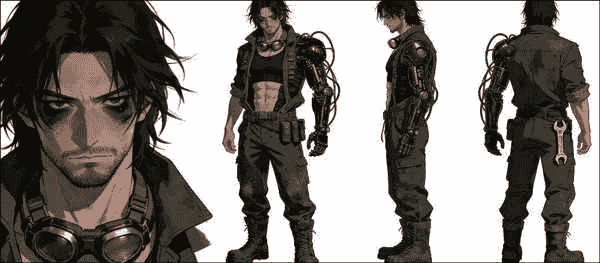

图 3-1　男频角色设计图（示例） 

针对 **女频角色** ，提示词则需要转向柔光摄影风格，强调空气感、细腻的五官描写以及充满故事感的破碎美。以下是一个典型的女频角色设计提示词范例。

大师级画质，精致的五官描写，官方美术设定集，角色三视图（正面，侧面，背面），带一张面部超大特写（展示流泪的眼睛），纯白背景。风格：2D，古风仙侠，柔光摄影，空气感，线条细腻，光影朦胧，氛围感，忧郁。角色外观：女性，18 岁，落难的魔教圣女，身材单薄纤细，皮肤苍白透明，柔弱感。姬发式发型，黑长直，桃花眼，眼眶微红，含着泪水但倔强不肯流下，嘴唇苍白。服装细节：穿着简单的白色素衣，布料略显陈旧，脖子上戴着一个紧贴皮肤的黑色金属项圈（禁锢感），手腕上缠着染血的白色绷带，赤脚。神态：微微抱住自己，风吹乱发丝，眼神清冷倔强，充满破碎感和危险迷人的气质。

生成结果如图 3-2 所示。

图 3-2　女频角色设计图（示例） EXr6287u6NNVz+GYLY+7SDk226FstKIHdC0bNoQkB2Nqi1xSR0yxPmwrTs5gRi/BtfSbid6dBhii9q7cz2pIyA==

## 3.2 AI 角色设定工作流

在弄清了角色设计的底层逻辑与市场定位之后，我们面临的下一个核心议题是执行。理论层面的“理解人物”必须转换为可落地的工业化操作流程。

在 AI 漫剧制作中，最大的挑战往往不是创意匮乏，而是生成结果的随机性和不可控性。如果没有一套严谨的工序规范，创作者很容易陷入反复“抽卡”、无效修改的泥潭中，导致效率极其低下。因此，建立标准化的工作流，是区分业余爱好者与专业制作团队的关键分水岭。

我们推荐一套经过实战验证的 5 步线性工作流，相关示意如图 3-3 所示。这套流程的设计初衷，是最大程度地降低大模型的理解偏差，确保从文本到图像的转换过程平滑且可控。

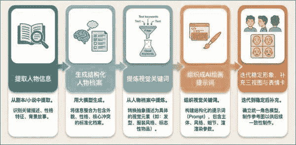

图 3-3　5 步线性工作流示意图

这 5 个步骤环环相扣，不可跳跃或省略。若直接从小说原文跳到 AI 绘画提示词，往往会丢失大量隐含的人物细节；而省略人物档案直接提炼关键词，则会让角色失去灵魂，沦为空洞的视觉符号。只有严格遵循这一路径，才能将文本中模糊的文学描述，逐步翻译为精准、可控的机器视觉语言。

### 3.2.1　提取人物信息

一切工作的起点是原始文本。面对一部长篇网络小说或几十万字的 IP 原著，如果完全依赖人工进行通读并整理人物设定，不仅耗时巨大，且极易因阅读疲劳而导致信息遗漏。

这正是大语言模型最具优势的领域。大模型具备极强的信息吞吐与概括能力，能够在几秒钟内处理数万字的文本，并按照指定的格式输出结构化数据。在这个阶段，我们的目标非常明确： **建立一份完整且清晰的角色清单。**

我们需要明确故事里共有多少角色，才能决定后续的资源分配。哪些是需要训练专属模型的主角，哪些是只需要固定提示词的配角，哪些又是可以随机生成的背景角色，这些决策都依赖于这份初步的角色清单。

具体操作时，我们通常采用“角色扮演+任务拆解”的提示词模式。赋予 AI“专业影视策划”的身份，有助于它从影视改编的视角审视文本，自动过滤掉纯文学性描写，只保留对画面制作有效的信息。

以下是一套标准化的提示词框架，可以直接将其输入给大模型。

请你作为专业影视策划，根据下面这部分小说内容，帮我整理出出现的主要人物设定。要求如下。

1．只保留对后续改编为短剧/漫剧有用的信息。

2．每个角色输出：姓名/称呼、性别、年龄段、社会身份（职业/门派/家族/阶层）、3～5 个性格标签、与主角的关系。

3．尽量提取角色的“反差点”与“记忆点”。

小说内容如下：

【粘贴小说前若干章或精简梗概】

在使用这套提示词时，有以下几个关键点需要注意。

首先，关于文本的输入量。目前主流的大模型虽然支持长文本，但为了保证提取精度，建议按章节或故事情节单元分批次输入。如果小说篇幅极长，可以先输入故事大纲或核心梗概。

其次，关注“反差点”与“记忆点”的提取。在前文中反复强调过，反差是角色魅力的来源。AI 有时会忽略这些细微的描述，因此在提示词中应明确要求提取这一项，能迫使模型去关注那些容易被忽视的、具有视觉转换价值的特征。例如“身为刺客却喜欢穿白衣”或“身为富豪却开破车”，这些信息在后续转换为画面时至关重要。

最后，这一轮输出的结果是一份初级清单，而非最终定稿。创作者需要根据这份清单进行快速的人工筛选。将清单中的角色划分为“核心角色”“重要配角”“功能性龙套”三个等级。只有核心角色和重要配角，才需要进入下一个步骤——“人物档案生成”与精细化设计。对于功能性龙套，这份清单中的简要描述已经足够直接生成画面了。

通过这一步，我们将庞杂的文学文本，成功降维成了一张可供决策的表格，为后续的精细化作业扫清了障碍。

### 3.2.2　生成人物档案

在拥有了基础的角色清单之后，需要针对核心角色和重要配角进行第二轮加工，即撰写人物档案。这里的“档案”与传统文学创作中的概念存在本质不同。传统档案往往侧重于人物的前史、心理动机和性格成因，而 AI 漫剧制作中的档案，则应严格遵循“为画面服务”的原则。

AI 绘画工具难以准确理解复杂的心理状态，它只能识别视觉符号。因此，在这一步的核心逻辑是：将“心理描写”转换为“视觉描写”。如果一个人很自卑，不要直接写“他很自卑”，而要写“他习惯低头看地面，说话声音很小，不敢与人对视”。只有将抽象的性格标签转换为具体的行为特征和外貌细节，AI 才能精准地生成我们需要的人物形象。

基于这个逻辑，在编写提示词时，必须对大模型提出明确的约束条件。以下是专门用于生成“视觉化人物档案”的提示词模板。

请基于下面这份人物摘要，为我写一段 150～200 字的人物档案。要求如下。

1．多写“别人能看到的东西”，少写纯心理描写。

2．描述他的日常行为习惯、说话方式、穿着风格，最好能让人一眼想象出画面。

3．突出一个反差点（例如外表冷淡但很重感情）。

人物摘要如下：

【粘贴上一步整理出的角色信息】

通过这套提示词，将得到一段充满画面感的文字。这些文字不再是空洞的形容词，而是一连串具体的视觉信号。例如“总是穿着有点旧但熨得很平的校服”，这句描述同时传递了角色的经济状况和性格特征；“笑起来习惯用手挡住嘴”，这句直接给出了具体的肢体动作参考。这些具体的描述，在后续生成分镜画面时，都是具有极高价值的提示词素材。

### 3.2.3　提炼视觉关键词

人物档案虽然有了画面感，但它仍然是自然语言，不适合直接作为绘图提示词。我们需要将这段“原料”进行精细加工，将其拆解为一个个独立的“视觉关键词”。

这一步直接决定了最终出图的准确度和质量。很多创作者在使用 AI 生图时觉得人物形象飘忽不定，往往就是因为缺少了这一步标准化的拆解过程。创作者需要从人物档案中，把所有能被视觉捕捉的要素提取出来，并按照特定的维度进行分类整理。

需要重点提炼以下 5 个维度的信息。

#### 1．外在条件

这是人物的物理骨架。需要明确身高的视觉参照，如“接近 180cm 的高个”或“比同龄人矮半头”。体型描述要具体，是“偏瘦”“结实”“宽肩”还是“细腰”。此外，年龄感也很关键，如“少年感很重”或“看起来比实际年龄成熟”，这决定了面部皮肤的质感和身体的姿态。

#### 2．头部与五官

这是观众注意力的焦点，具体包括以下内容。

**·** 发型与发色：如“中长直发”“高马尾”“两侧剃短”或“刘海遮住一只眼”。

**·** 脸型：如“鹅蛋脸”“方脸”“轮廓硬朗”或“下巴略尖”。

**·** 眼睛：描述大小、神态、单双眼皮以及是否常带笑意。

**·** 其他特征：如痣、瘢痕、耳洞或文身，这些细节往往是区分角色的重要标志。

#### 3．服装与配饰

这是确立角色风格和所属时代背景的重要元素。

**·** 基础着装：明确上装、下装、外套和鞋子的款式，如“风衣”“制服”“机能服”“汉服”“运动鞋”或“军靴”。

**·** 标志性配件：这是增加角色辨识度的关键，如“项链”“耳环”“腕带”“戒指”“徽章”“发卡”或“围巾”。

#### 4．色彩语言

色彩能直接传递情绪和性格。需要设定一两个主色调，如“黑金”“白蓝”“墨绿”或“暗红”，这将成为该角色画面的基础色盘。同时设定一两个辅助色，用于配饰或局部点缀，丰富画面的层次感。

#### 5．表情与常态姿态

表情与常态姿态决定了角色的神韵。

**·** 常见表情：如“嘴角微翘”“眉头微皱”“眼神游离”或“不爱直视别人”。

**·** 常态姿态：如“双手插兜”“抱臂”“站姿笔直”或“总是微微前倾”。

这一步提炼工作虽然可以借助 AI 辅助完成，但强烈建议创作者亲自进行核对和调整。这是一个吃透角色的过程，也是创作者在脑海中完成从文字到画面认知转译的关键步骤。你只有自己清楚这个角色到底长什么样，才能指挥 AI 画出准确的图像。

### 3.2.4　生成绘画提示词

在 AI 绘图环节，创作者不应使用碎片化或意识流式的词汇，而应遵循严谨的逻辑框架。这种结构化的表达方式不仅能提高出图的成功率，更能方便地在不同平台间进行调试与迭代。一个成熟的提示词框架应当包含以下核心要素。

【画风与风格定位】+【性别、年龄、职业/身份】+【身材与整体比例】+【脸型与五官特征】+【发型与发色】+【服装与配饰】+【表情与气质】+【姿态】+【画面规格与技术约束】

为了更直观地展示这一逻辑，可以参考以下这段针对主角设定的提示词。

生成全身三视图以及一张面部特写（最左边占满 1/3 的位置是超大的面部特写，右边 2/3 放正视图、侧视图、后视图），纯白背景。二次元国漫风，18 岁少年，高个偏瘦，身高约 178cm，肩膀不宽但站姿挺直。脸型略瘦，五官立体，眉形锋利，黑色短发略微凌乱，刘海微微遮住额头，瞳色金黄，眼神冷静中带一点若有所思。皮肤偏白但有轻微小麦色。上身黑金配色修身战斗长袍，肩部和胸口有简单金色线条装饰，下身深灰色长裤，脚穿黑色长靴。双耳各戴一枚小巧银色耳钉。表情平静，嘴角略微收紧，给人距离感但不阴郁。全身站立正视图，单人，白色纯色背景，9 : 16 竖构图，高精细线稿与上色，无道具，无其他人物，无文字。

规范化的提示词能够确保视觉资产的可迁移性。无论是在即梦、Midjourney 还是其他 AI 绘图平台，只要逻辑严密，角色的视觉核心特征就能得到高度还原。参照以上提示词生成的图片如图 3-4 所示。

图 3-4　根据提示词生成三视图与面部特写

在实际操作中，创作者必须深度结合背景故事、性格特征与视觉风格。背景故事决定了时空维度是古代还是现代；性格特征则要求实现角色内在灵魂与外在皮相的契合。同时，针对男频或女频市场的差异，视觉风格中的服装配饰颜色也需要精准考量，以满足受众审美或甲方需求。

值得注意的一个技术细节是，在撰写提示词时，一定要包含对鞋子的具体描述。在 9 : 6 的竖构图比例下，若缺少鞋子的描述词，AI 在生成全身图时往往会出现截断或比例失调的问题。

为了让读者更好地掌握从剧本到画面的转换能力，我们可以针对具体小说文本进行实战拆解。通过分析剧本，提取出人物性格，并将其转换为详细的物理特征描述，最后汇聚成完整的提示词。

创作者可以尝试使用以下提示词，引导 AI 完成人物资产的初步建模。

分析这个剧本，提取出剧本的人物和对应的性格，并详细描述这些人物的长相，如身高、体重、发型、发色、年龄、皮肤、脸型、五官、身材、服饰、配饰、鞋子等，然后用完整、详细的 AI 绘画中文提示词输出，2D 动漫的画风，全身像，背景是白底，既要考虑现实合理性，也要考虑艺术美感。

通过这种全维度信息的输入，生成的角色不仅在质感上更加细腻，在叙事层面的丰富程度也会远超简单的一句话指令。 EXr6287u6NNVz+GYLY+7SDk226FstKIHdC0bNoQkB2Nqi1xSR0yxPmwrTs5gRi/BtfSbid6dBhii9q7cz2pIyA==

## 3.2 AI 角色设定工作流

在弄清了角色设计的底层逻辑与市场定位之后，我们面临的下一个核心议题是执行。理论层面的“理解人物”必须转换为可落地的工业化操作流程。

在 AI 漫剧制作中，最大的挑战往往不是创意匮乏，而是生成结果的随机性和不可控性。如果没有一套严谨的工序规范，创作者很容易陷入反复“抽卡”、无效修改的泥潭中，导致效率极其低下。因此，建立标准化的工作流，是区分业余爱好者与专业制作团队的关键分水岭。

我们推荐一套经过实战验证的 5 步线性工作流，相关示意如图 3-3 所示。这套流程的设计初衷，是最大程度地降低大模型的理解偏差，确保从文本到图像的转换过程平滑且可控。

图 3-3　5 步线性工作流示意图

这 5 个步骤环环相扣，不可跳跃或省略。若直接从小说原文跳到 AI 绘画提示词，往往会丢失大量隐含的人物细节；而省略人物档案直接提炼关键词，则会让角色失去灵魂，沦为空洞的视觉符号。只有严格遵循这一路径，才能将文本中模糊的文学描述，逐步翻译为精准、可控的机器视觉语言。

### 3.2.1　提取人物信息

一切工作的起点是原始文本。面对一部长篇网络小说或几十万字的 IP 原著，如果完全依赖人工进行通读并整理人物设定，不仅耗时巨大，且极易因阅读疲劳而导致信息遗漏。

这正是大语言模型最具优势的领域。大模型具备极强的信息吞吐与概括能力，能够在几秒钟内处理数万字的文本，并按照指定的格式输出结构化数据。在这个阶段，我们的目标非常明确： **建立一份完整且清晰的角色清单。**

我们需要明确故事里共有多少角色，才能决定后续的资源分配。哪些是需要训练专属模型的主角，哪些是只需要固定提示词的配角，哪些又是可以随机生成的背景角色，这些决策都依赖于这份初步的角色清单。

具体操作时，我们通常采用“角色扮演+任务拆解”的提示词模式。赋予 AI“专业影视策划”的身份，有助于它从影视改编的视角审视文本，自动过滤掉纯文学性描写，只保留对画面制作有效的信息。

以下是一套标准化的提示词框架，可以直接将其输入给大模型。

请你作为专业影视策划，根据下面这部分小说内容，帮我整理出出现的主要人物设定。要求如下。

1．只保留对后续改编为短剧/漫剧有用的信息。

2．每个角色输出：姓名/称呼、性别、年龄段、社会身份（职业/门派/家族/阶层）、3～5 个性格标签、与主角的关系。

3．尽量提取角色的“反差点”与“记忆点”。

小说内容如下：

【粘贴小说前若干章或精简梗概】

在使用这套提示词时，有以下几个关键点需要注意。

首先，关于文本的输入量。目前主流的大模型虽然支持长文本，但为了保证提取精度，建议按章节或故事情节单元分批次输入。如果小说篇幅极长，可以先输入故事大纲或核心梗概。

其次，关注“反差点”与“记忆点”的提取。在前文中反复强调过，反差是角色魅力的来源。AI 有时会忽略这些细微的描述，因此在提示词中应明确要求提取这一项，能迫使模型去关注那些容易被忽视的、具有视觉转换价值的特征。例如“身为刺客却喜欢穿白衣”或“身为富豪却开破车”，这些信息在后续转换为画面时至关重要。

最后，这一轮输出的结果是一份初级清单，而非最终定稿。创作者需要根据这份清单进行快速的人工筛选。将清单中的角色划分为“核心角色”“重要配角”“功能性龙套”三个等级。只有核心角色和重要配角，才需要进入下一个步骤——“人物档案生成”与精细化设计。对于功能性龙套，这份清单中的简要描述已经足够直接生成画面了。

通过这一步，我们将庞杂的文学文本，成功降维成了一张可供决策的表格，为后续的精细化作业扫清了障碍。

### 3.2.2　生成人物档案

在拥有了基础的角色清单之后，需要针对核心角色和重要配角进行第二轮加工，即撰写人物档案。这里的“档案”与传统文学创作中的概念存在本质不同。传统档案往往侧重于人物的前史、心理动机和性格成因，而 AI 漫剧制作中的档案，则应严格遵循“为画面服务”的原则。

AI 绘画工具难以准确理解复杂的心理状态，它只能识别视觉符号。因此，在这一步的核心逻辑是：将“心理描写”转换为“视觉描写”。如果一个人很自卑，不要直接写“他很自卑”，而要写“他习惯低头看地面，说话声音很小，不敢与人对视”。只有将抽象的性格标签转换为具体的行为特征和外貌细节，AI 才能精准地生成我们需要的人物形象。

基于这个逻辑，在编写提示词时，必须对大模型提出明确的约束条件。以下是专门用于生成“视觉化人物档案”的提示词模板。

请基于下面这份人物摘要，为我写一段 150～200 字的人物档案。要求如下。

1．多写“别人能看到的东西”，少写纯心理描写。

2．描述他的日常行为习惯、说话方式、穿着风格，最好能让人一眼想象出画面。

3．突出一个反差点（例如外表冷淡但很重感情）。

人物摘要如下：

【粘贴上一步整理出的角色信息】

通过这套提示词，将得到一段充满画面感的文字。这些文字不再是空洞的形容词，而是一连串具体的视觉信号。例如“总是穿着有点旧但熨得很平的校服”，这句描述同时传递了角色的经济状况和性格特征；“笑起来习惯用手挡住嘴”，这句直接给出了具体的肢体动作参考。这些具体的描述，在后续生成分镜画面时，都是具有极高价值的提示词素材。

### 3.2.3　提炼视觉关键词

人物档案虽然有了画面感，但它仍然是自然语言，不适合直接作为绘图提示词。我们需要将这段“原料”进行精细加工，将其拆解为一个个独立的“视觉关键词”。

这一步直接决定了最终出图的准确度和质量。很多创作者在使用 AI 生图时觉得人物形象飘忽不定，往往就是因为缺少了这一步标准化的拆解过程。创作者需要从人物档案中，把所有能被视觉捕捉的要素提取出来，并按照特定的维度进行分类整理。

需要重点提炼以下 5 个维度的信息。

#### 1．外在条件

这是人物的物理骨架。需要明确身高的视觉参照，如“接近 180cm 的高个”或“比同龄人矮半头”。体型描述要具体，是“偏瘦”“结实”“宽肩”还是“细腰”。此外，年龄感也很关键，如“少年感很重”或“看起来比实际年龄成熟”，这决定了面部皮肤的质感和身体的姿态。

#### 2．头部与五官

这是观众注意力的焦点，具体包括以下内容。

**·** 发型与发色：如“中长直发”“高马尾”“两侧剃短”或“刘海遮住一只眼”。

**·** 脸型：如“鹅蛋脸”“方脸”“轮廓硬朗”或“下巴略尖”。

**·** 眼睛：描述大小、神态、单双眼皮以及是否常带笑意。

**·** 其他特征：如痣、瘢痕、耳洞或文身，这些细节往往是区分角色的重要标志。

#### 3．服装与配饰

这是确立角色风格和所属时代背景的重要元素。

**·** 基础着装：明确上装、下装、外套和鞋子的款式，如“风衣”“制服”“机能服”“汉服”“运动鞋”或“军靴”。

**·** 标志性配件：这是增加角色辨识度的关键，如“项链”“耳环”“腕带”“戒指”“徽章”“发卡”或“围巾”。

#### 4．色彩语言

色彩能直接传递情绪和性格。需要设定一两个主色调，如“黑金”“白蓝”“墨绿”或“暗红”，这将成为该角色画面的基础色盘。同时设定一两个辅助色，用于配饰或局部点缀，丰富画面的层次感。

#### 5．表情与常态姿态

表情与常态姿态决定了角色的神韵。

**·** 常见表情：如“嘴角微翘”“眉头微皱”“眼神游离”或“不爱直视别人”。

**·** 常态姿态：如“双手插兜”“抱臂”“站姿笔直”或“总是微微前倾”。

这一步提炼工作虽然可以借助 AI 辅助完成，但强烈建议创作者亲自进行核对和调整。这是一个吃透角色的过程，也是创作者在脑海中完成从文字到画面认知转译的关键步骤。你只有自己清楚这个角色到底长什么样，才能指挥 AI 画出准确的图像。

### 3.2.4　生成绘画提示词

在 AI 绘图环节，创作者不应使用碎片化或意识流式的词汇，而应遵循严谨的逻辑框架。这种结构化的表达方式不仅能提高出图的成功率，更能方便地在不同平台间进行调试与迭代。一个成熟的提示词框架应当包含以下核心要素。

【画风与风格定位】+【性别、年龄、职业/身份】+【身材与整体比例】+【脸型与五官特征】+【发型与发色】+【服装与配饰】+【表情与气质】+【姿态】+【画面规格与技术约束】

为了更直观地展示这一逻辑，可以参考以下这段针对主角设定的提示词。

生成全身三视图以及一张面部特写（最左边占满 1/3 的位置是超大的面部特写，右边 2/3 放正视图、侧视图、后视图），纯白背景。二次元国漫风，18 岁少年，高个偏瘦，身高约 178cm，肩膀不宽但站姿挺直。脸型略瘦，五官立体，眉形锋利，黑色短发略微凌乱，刘海微微遮住额头，瞳色金黄，眼神冷静中带一点若有所思。皮肤偏白但有轻微小麦色。上身黑金配色修身战斗长袍，肩部和胸口有简单金色线条装饰，下身深灰色长裤，脚穿黑色长靴。双耳各戴一枚小巧银色耳钉。表情平静，嘴角略微收紧，给人距离感但不阴郁。全身站立正视图，单人，白色纯色背景，9 : 16 竖构图，高精细线稿与上色，无道具，无其他人物，无文字。

规范化的提示词能够确保视觉资产的可迁移性。无论是在即梦、Midjourney 还是其他 AI 绘图平台，只要逻辑严密，角色的视觉核心特征就能得到高度还原。参照以上提示词生成的图片如图 3-4 所示。

图 3-4　根据提示词生成三视图与面部特写

在实际操作中，创作者必须深度结合背景故事、性格特征与视觉风格。背景故事决定了时空维度是古代还是现代；性格特征则要求实现角色内在灵魂与外在皮相的契合。同时，针对男频或女频市场的差异，视觉风格中的服装配饰颜色也需要精准考量，以满足受众审美或甲方需求。

值得注意的一个技术细节是，在撰写提示词时，一定要包含对鞋子的具体描述。在 9 : 6 的竖构图比例下，若缺少鞋子的描述词，AI 在生成全身图时往往会出现截断或比例失调的问题。

为了让读者更好地掌握从剧本到画面的转换能力，我们可以针对具体小说文本进行实战拆解。通过分析剧本，提取出人物性格，并将其转换为详细的物理特征描述，最后汇聚成完整的提示词。

创作者可以尝试使用以下提示词，引导 AI 完成人物资产的初步建模。

分析这个剧本，提取出剧本的人物和对应的性格，并详细描述这些人物的长相，如身高、体重、发型、发色、年龄、皮肤、脸型、五官、身材、服饰、配饰、鞋子等，然后用完整、详细的 AI 绘画中文提示词输出，2D 动漫的画风，全身像，背景是白底，既要考虑现实合理性，也要考虑艺术美感。

通过这种全维度信息的输入，生成的角色不仅在质感上更加细腻，在叙事层面的丰富程度也会远超简单的一句话指令。 EXr6287u6NNVz+GYLY+7SDk226FstKIHdC0bNoQkB2Nqi1xSR0yxPmwrTs5gRi/BtfSbid6dBhii9q7cz2pIyA==

## 3.2 AI 角色设定工作流

在弄清了角色设计的底层逻辑与市场定位之后，我们面临的下一个核心议题是执行。理论层面的“理解人物”必须转换为可落地的工业化操作流程。

在 AI 漫剧制作中，最大的挑战往往不是创意匮乏，而是生成结果的随机性和不可控性。如果没有一套严谨的工序规范，创作者很容易陷入反复“抽卡”、无效修改的泥潭中，导致效率极其低下。因此，建立标准化的工作流，是区分业余爱好者与专业制作团队的关键分水岭。

我们推荐一套经过实战验证的 5 步线性工作流，相关示意如图 3-3 所示。这套流程的设计初衷，是最大程度地降低大模型的理解偏差，确保从文本到图像的转换过程平滑且可控。

图 3-3　5 步线性工作流示意图

这 5 个步骤环环相扣，不可跳跃或省略。若直接从小说原文跳到 AI 绘画提示词，往往会丢失大量隐含的人物细节；而省略人物档案直接提炼关键词，则会让角色失去灵魂，沦为空洞的视觉符号。只有严格遵循这一路径，才能将文本中模糊的文学描述，逐步翻译为精准、可控的机器视觉语言。

### 3.2.1　提取人物信息

一切工作的起点是原始文本。面对一部长篇网络小说或几十万字的 IP 原著，如果完全依赖人工进行通读并整理人物设定，不仅耗时巨大，且极易因阅读疲劳而导致信息遗漏。

这正是大语言模型最具优势的领域。大模型具备极强的信息吞吐与概括能力，能够在几秒钟内处理数万字的文本，并按照指定的格式输出结构化数据。在这个阶段，我们的目标非常明确： **建立一份完整且清晰的角色清单。**

我们需要明确故事里共有多少角色，才能决定后续的资源分配。哪些是需要训练专属模型的主角，哪些是只需要固定提示词的配角，哪些又是可以随机生成的背景角色，这些决策都依赖于这份初步的角色清单。

具体操作时，我们通常采用“角色扮演+任务拆解”的提示词模式。赋予 AI“专业影视策划”的身份，有助于它从影视改编的视角审视文本，自动过滤掉纯文学性描写，只保留对画面制作有效的信息。

以下是一套标准化的提示词框架，可以直接将其输入给大模型。

请你作为专业影视策划，根据下面这部分小说内容，帮我整理出出现的主要人物设定。要求如下。

1．只保留对后续改编为短剧/漫剧有用的信息。

2．每个角色输出：姓名/称呼、性别、年龄段、社会身份（职业/门派/家族/阶层）、3～5 个性格标签、与主角的关系。

3．尽量提取角色的“反差点”与“记忆点”。

小说内容如下：

【粘贴小说前若干章或精简梗概】

在使用这套提示词时，有以下几个关键点需要注意。

首先，关于文本的输入量。目前主流的大模型虽然支持长文本，但为了保证提取精度，建议按章节或故事情节单元分批次输入。如果小说篇幅极长，可以先输入故事大纲或核心梗概。

其次，关注“反差点”与“记忆点”的提取。在前文中反复强调过，反差是角色魅力的来源。AI 有时会忽略这些细微的描述，因此在提示词中应明确要求提取这一项，能迫使模型去关注那些容易被忽视的、具有视觉转换价值的特征。例如“身为刺客却喜欢穿白衣”或“身为富豪却开破车”，这些信息在后续转换为画面时至关重要。

最后，这一轮输出的结果是一份初级清单，而非最终定稿。创作者需要根据这份清单进行快速的人工筛选。将清单中的角色划分为“核心角色”“重要配角”“功能性龙套”三个等级。只有核心角色和重要配角，才需要进入下一个步骤——“人物档案生成”与精细化设计。对于功能性龙套，这份清单中的简要描述已经足够直接生成画面了。

通过这一步，我们将庞杂的文学文本，成功降维成了一张可供决策的表格，为后续的精细化作业扫清了障碍。

### 3.2.2　生成人物档案

在拥有了基础的角色清单之后，需要针对核心角色和重要配角进行第二轮加工，即撰写人物档案。这里的“档案”与传统文学创作中的概念存在本质不同。传统档案往往侧重于人物的前史、心理动机和性格成因，而 AI 漫剧制作中的档案，则应严格遵循“为画面服务”的原则。

AI 绘画工具难以准确理解复杂的心理状态，它只能识别视觉符号。因此，在这一步的核心逻辑是：将“心理描写”转换为“视觉描写”。如果一个人很自卑，不要直接写“他很自卑”，而要写“他习惯低头看地面，说话声音很小，不敢与人对视”。只有将抽象的性格标签转换为具体的行为特征和外貌细节，AI 才能精准地生成我们需要的人物形象。

基于这个逻辑，在编写提示词时，必须对大模型提出明确的约束条件。以下是专门用于生成“视觉化人物档案”的提示词模板。

请基于下面这份人物摘要，为我写一段 150～200 字的人物档案。要求如下。

1．多写“别人能看到的东西”，少写纯心理描写。

2．描述他的日常行为习惯、说话方式、穿着风格，最好能让人一眼想象出画面。

3．突出一个反差点（例如外表冷淡但很重感情）。

人物摘要如下：

【粘贴上一步整理出的角色信息】

通过这套提示词，将得到一段充满画面感的文字。这些文字不再是空洞的形容词，而是一连串具体的视觉信号。例如“总是穿着有点旧但熨得很平的校服”，这句描述同时传递了角色的经济状况和性格特征；“笑起来习惯用手挡住嘴”，这句直接给出了具体的肢体动作参考。这些具体的描述，在后续生成分镜画面时，都是具有极高价值的提示词素材。

### 3.2.3　提炼视觉关键词

人物档案虽然有了画面感，但它仍然是自然语言，不适合直接作为绘图提示词。我们需要将这段“原料”进行精细加工，将其拆解为一个个独立的“视觉关键词”。

这一步直接决定了最终出图的准确度和质量。很多创作者在使用 AI 生图时觉得人物形象飘忽不定，往往就是因为缺少了这一步标准化的拆解过程。创作者需要从人物档案中，把所有能被视觉捕捉的要素提取出来，并按照特定的维度进行分类整理。

需要重点提炼以下 5 个维度的信息。

#### 1．外在条件

这是人物的物理骨架。需要明确身高的视觉参照，如“接近 180cm 的高个”或“比同龄人矮半头”。体型描述要具体，是“偏瘦”“结实”“宽肩”还是“细腰”。此外，年龄感也很关键，如“少年感很重”或“看起来比实际年龄成熟”，这决定了面部皮肤的质感和身体的姿态。

#### 2．头部与五官

这是观众注意力的焦点，具体包括以下内容。

**·** 发型与发色：如“中长直发”“高马尾”“两侧剃短”或“刘海遮住一只眼”。

**·** 脸型：如“鹅蛋脸”“方脸”“轮廓硬朗”或“下巴略尖”。

**·** 眼睛：描述大小、神态、单双眼皮以及是否常带笑意。

**·** 其他特征：如痣、瘢痕、耳洞或文身，这些细节往往是区分角色的重要标志。

#### 3．服装与配饰

这是确立角色风格和所属时代背景的重要元素。

**·** 基础着装：明确上装、下装、外套和鞋子的款式，如“风衣”“制服”“机能服”“汉服”“运动鞋”或“军靴”。

**·** 标志性配件：这是增加角色辨识度的关键，如“项链”“耳环”“腕带”“戒指”“徽章”“发卡”或“围巾”。

#### 4．色彩语言

色彩能直接传递情绪和性格。需要设定一两个主色调，如“黑金”“白蓝”“墨绿”或“暗红”，这将成为该角色画面的基础色盘。同时设定一两个辅助色，用于配饰或局部点缀，丰富画面的层次感。

#### 5．表情与常态姿态

表情与常态姿态决定了角色的神韵。

**·** 常见表情：如“嘴角微翘”“眉头微皱”“眼神游离”或“不爱直视别人”。

**·** 常态姿态：如“双手插兜”“抱臂”“站姿笔直”或“总是微微前倾”。

这一步提炼工作虽然可以借助 AI 辅助完成，但强烈建议创作者亲自进行核对和调整。这是一个吃透角色的过程，也是创作者在脑海中完成从文字到画面认知转译的关键步骤。你只有自己清楚这个角色到底长什么样，才能指挥 AI 画出准确的图像。

### 3.2.4　生成绘画提示词

在 AI 绘图环节，创作者不应使用碎片化或意识流式的词汇，而应遵循严谨的逻辑框架。这种结构化的表达方式不仅能提高出图的成功率，更能方便地在不同平台间进行调试与迭代。一个成熟的提示词框架应当包含以下核心要素。

【画风与风格定位】+【性别、年龄、职业/身份】+【身材与整体比例】+【脸型与五官特征】+【发型与发色】+【服装与配饰】+【表情与气质】+【姿态】+【画面规格与技术约束】

为了更直观地展示这一逻辑，可以参考以下这段针对主角设定的提示词。

生成全身三视图以及一张面部特写（最左边占满 1/3 的位置是超大的面部特写，右边 2/3 放正视图、侧视图、后视图），纯白背景。二次元国漫风，18 岁少年，高个偏瘦，身高约 178cm，肩膀不宽但站姿挺直。脸型略瘦，五官立体，眉形锋利，黑色短发略微凌乱，刘海微微遮住额头，瞳色金黄，眼神冷静中带一点若有所思。皮肤偏白但有轻微小麦色。上身黑金配色修身战斗长袍，肩部和胸口有简单金色线条装饰，下身深灰色长裤，脚穿黑色长靴。双耳各戴一枚小巧银色耳钉。表情平静，嘴角略微收紧，给人距离感但不阴郁。全身站立正视图，单人，白色纯色背景，9 : 16 竖构图，高精细线稿与上色，无道具，无其他人物，无文字。

规范化的提示词能够确保视觉资产的可迁移性。无论是在即梦、Midjourney 还是其他 AI 绘图平台，只要逻辑严密，角色的视觉核心特征就能得到高度还原。参照以上提示词生成的图片如图 3-4 所示。

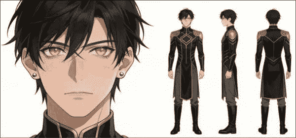

图 3-4　根据提示词生成三视图与面部特写

在实际操作中，创作者必须深度结合背景故事、性格特征与视觉风格。背景故事决定了时空维度是古代还是现代；性格特征则要求实现角色内在灵魂与外在皮相的契合。同时，针对男频或女频市场的差异，视觉风格中的服装配饰颜色也需要精准考量，以满足受众审美或甲方需求。

值得注意的一个技术细节是，在撰写提示词时，一定要包含对鞋子的具体描述。在 9 : 6 的竖构图比例下，若缺少鞋子的描述词，AI 在生成全身图时往往会出现截断或比例失调的问题。

为了让读者更好地掌握从剧本到画面的转换能力，我们可以针对具体小说文本进行实战拆解。通过分析剧本，提取出人物性格，并将其转换为详细的物理特征描述，最后汇聚成完整的提示词。

创作者可以尝试使用以下提示词，引导 AI 完成人物资产的初步建模。

分析这个剧本，提取出剧本的人物和对应的性格，并详细描述这些人物的长相，如身高、体重、发型、发色、年龄、皮肤、脸型、五官、身材、服饰、配饰、鞋子等，然后用完整、详细的 AI 绘画中文提示词输出，2D 动漫的画风，全身像，背景是白底，既要考虑现实合理性，也要考虑艺术美感。

通过这种全维度信息的输入，生成的角色不仅在质感上更加细腻，在叙事层面的丰富程度也会远超简单的一句话指令。 EXr6287u6NNVz+GYLY+7SDk226FstKIHdC0bNoQkB2Nqi1xSR0yxPmwrTs5gRi/BtfSbid6dBhii9q7cz2pIyA==

## 3.2 AI 角色设定工作流

在弄清了角色设计的底层逻辑与市场定位之后，我们面临的下一个核心议题是执行。理论层面的“理解人物”必须转换为可落地的工业化操作流程。

在 AI 漫剧制作中，最大的挑战往往不是创意匮乏，而是生成结果的随机性和不可控性。如果没有一套严谨的工序规范，创作者很容易陷入反复“抽卡”、无效修改的泥潭中，导致效率极其低下。因此，建立标准化的工作流，是区分业余爱好者与专业制作团队的关键分水岭。

我们推荐一套经过实战验证的 5 步线性工作流，相关示意如图 3-3 所示。这套流程的设计初衷，是最大程度地降低大模型的理解偏差，确保从文本到图像的转换过程平滑且可控。

图 3-3　5 步线性工作流示意图

这 5 个步骤环环相扣，不可跳跃或省略。若直接从小说原文跳到 AI 绘画提示词，往往会丢失大量隐含的人物细节；而省略人物档案直接提炼关键词，则会让角色失去灵魂，沦为空洞的视觉符号。只有严格遵循这一路径，才能将文本中模糊的文学描述，逐步翻译为精准、可控的机器视觉语言。

### 3.2.1　提取人物信息

一切工作的起点是原始文本。面对一部长篇网络小说或几十万字的 IP 原著，如果完全依赖人工进行通读并整理人物设定，不仅耗时巨大，且极易因阅读疲劳而导致信息遗漏。

这正是大语言模型最具优势的领域。大模型具备极强的信息吞吐与概括能力，能够在几秒钟内处理数万字的文本，并按照指定的格式输出结构化数据。在这个阶段，我们的目标非常明确： **建立一份完整且清晰的角色清单。**

我们需要明确故事里共有多少角色，才能决定后续的资源分配。哪些是需要训练专属模型的主角，哪些是只需要固定提示词的配角，哪些又是可以随机生成的背景角色，这些决策都依赖于这份初步的角色清单。

具体操作时，我们通常采用“角色扮演+任务拆解”的提示词模式。赋予 AI“专业影视策划”的身份，有助于它从影视改编的视角审视文本，自动过滤掉纯文学性描写，只保留对画面制作有效的信息。

以下是一套标准化的提示词框架，可以直接将其输入给大模型。

请你作为专业影视策划，根据下面这部分小说内容，帮我整理出出现的主要人物设定。要求如下。

1．只保留对后续改编为短剧/漫剧有用的信息。

2．每个角色输出：姓名/称呼、性别、年龄段、社会身份（职业/门派/家族/阶层）、3～5 个性格标签、与主角的关系。

3．尽量提取角色的“反差点”与“记忆点”。

小说内容如下：

【粘贴小说前若干章或精简梗概】

在使用这套提示词时，有以下几个关键点需要注意。

首先，关于文本的输入量。目前主流的大模型虽然支持长文本，但为了保证提取精度，建议按章节或故事情节单元分批次输入。如果小说篇幅极长，可以先输入故事大纲或核心梗概。

其次，关注“反差点”与“记忆点”的提取。在前文中反复强调过，反差是角色魅力的来源。AI 有时会忽略这些细微的描述，因此在提示词中应明确要求提取这一项，能迫使模型去关注那些容易被忽视的、具有视觉转换价值的特征。例如“身为刺客却喜欢穿白衣”或“身为富豪却开破车”，这些信息在后续转换为画面时至关重要。

最后，这一轮输出的结果是一份初级清单，而非最终定稿。创作者需要根据这份清单进行快速的人工筛选。将清单中的角色划分为“核心角色”“重要配角”“功能性龙套”三个等级。只有核心角色和重要配角，才需要进入下一个步骤——“人物档案生成”与精细化设计。对于功能性龙套，这份清单中的简要描述已经足够直接生成画面了。

通过这一步，我们将庞杂的文学文本，成功降维成了一张可供决策的表格，为后续的精细化作业扫清了障碍。

### 3.2.2　生成人物档案

在拥有了基础的角色清单之后，需要针对核心角色和重要配角进行第二轮加工，即撰写人物档案。这里的“档案”与传统文学创作中的概念存在本质不同。传统档案往往侧重于人物的前史、心理动机和性格成因，而 AI 漫剧制作中的档案，则应严格遵循“为画面服务”的原则。

AI 绘画工具难以准确理解复杂的心理状态，它只能识别视觉符号。因此，在这一步的核心逻辑是：将“心理描写”转换为“视觉描写”。如果一个人很自卑，不要直接写“他很自卑”，而要写“他习惯低头看地面，说话声音很小，不敢与人对视”。只有将抽象的性格标签转换为具体的行为特征和外貌细节，AI 才能精准地生成我们需要的人物形象。

基于这个逻辑，在编写提示词时，必须对大模型提出明确的约束条件。以下是专门用于生成“视觉化人物档案”的提示词模板。

请基于下面这份人物摘要，为我写一段 150～200 字的人物档案。要求如下。

1．多写“别人能看到的东西”，少写纯心理描写。

2．描述他的日常行为习惯、说话方式、穿着风格，最好能让人一眼想象出画面。

3．突出一个反差点（例如外表冷淡但很重感情）。

人物摘要如下：

【粘贴上一步整理出的角色信息】

通过这套提示词，将得到一段充满画面感的文字。这些文字不再是空洞的形容词，而是一连串具体的视觉信号。例如“总是穿着有点旧但熨得很平的校服”，这句描述同时传递了角色的经济状况和性格特征；“笑起来习惯用手挡住嘴”，这句直接给出了具体的肢体动作参考。这些具体的描述，在后续生成分镜画面时，都是具有极高价值的提示词素材。

### 3.2.3　提炼视觉关键词

人物档案虽然有了画面感，但它仍然是自然语言，不适合直接作为绘图提示词。我们需要将这段“原料”进行精细加工，将其拆解为一个个独立的“视觉关键词”。

这一步直接决定了最终出图的准确度和质量。很多创作者在使用 AI 生图时觉得人物形象飘忽不定，往往就是因为缺少了这一步标准化的拆解过程。创作者需要从人物档案中，把所有能被视觉捕捉的要素提取出来，并按照特定的维度进行分类整理。

需要重点提炼以下 5 个维度的信息。

#### 1．外在条件

这是人物的物理骨架。需要明确身高的视觉参照，如“接近 180cm 的高个”或“比同龄人矮半头”。体型描述要具体，是“偏瘦”“结实”“宽肩”还是“细腰”。此外，年龄感也很关键，如“少年感很重”或“看起来比实际年龄成熟”，这决定了面部皮肤的质感和身体的姿态。

#### 2．头部与五官

这是观众注意力的焦点，具体包括以下内容。

**·** 发型与发色：如“中长直发”“高马尾”“两侧剃短”或“刘海遮住一只眼”。

**·** 脸型：如“鹅蛋脸”“方脸”“轮廓硬朗”或“下巴略尖”。

**·** 眼睛：描述大小、神态、单双眼皮以及是否常带笑意。

**·** 其他特征：如痣、瘢痕、耳洞或文身，这些细节往往是区分角色的重要标志。

#### 3．服装与配饰

这是确立角色风格和所属时代背景的重要元素。

**·** 基础着装：明确上装、下装、外套和鞋子的款式，如“风衣”“制服”“机能服”“汉服”“运动鞋”或“军靴”。

**·** 标志性配件：这是增加角色辨识度的关键，如“项链”“耳环”“腕带”“戒指”“徽章”“发卡”或“围巾”。

#### 4．色彩语言

色彩能直接传递情绪和性格。需要设定一两个主色调，如“黑金”“白蓝”“墨绿”或“暗红”，这将成为该角色画面的基础色盘。同时设定一两个辅助色，用于配饰或局部点缀，丰富画面的层次感。

#### 5．表情与常态姿态

表情与常态姿态决定了角色的神韵。

**·** 常见表情：如“嘴角微翘”“眉头微皱”“眼神游离”或“不爱直视别人”。

**·** 常态姿态：如“双手插兜”“抱臂”“站姿笔直”或“总是微微前倾”。

这一步提炼工作虽然可以借助 AI 辅助完成，但强烈建议创作者亲自进行核对和调整。这是一个吃透角色的过程，也是创作者在脑海中完成从文字到画面认知转译的关键步骤。你只有自己清楚这个角色到底长什么样，才能指挥 AI 画出准确的图像。

### 3.2.4　生成绘画提示词

在 AI 绘图环节，创作者不应使用碎片化或意识流式的词汇，而应遵循严谨的逻辑框架。这种结构化的表达方式不仅能提高出图的成功率，更能方便地在不同平台间进行调试与迭代。一个成熟的提示词框架应当包含以下核心要素。

【画风与风格定位】+【性别、年龄、职业/身份】+【身材与整体比例】+【脸型与五官特征】+【发型与发色】+【服装与配饰】+【表情与气质】+【姿态】+【画面规格与技术约束】

为了更直观地展示这一逻辑，可以参考以下这段针对主角设定的提示词。

生成全身三视图以及一张面部特写（最左边占满 1/3 的位置是超大的面部特写，右边 2/3 放正视图、侧视图、后视图），纯白背景。二次元国漫风，18 岁少年，高个偏瘦，身高约 178cm，肩膀不宽但站姿挺直。脸型略瘦，五官立体，眉形锋利，黑色短发略微凌乱，刘海微微遮住额头，瞳色金黄，眼神冷静中带一点若有所思。皮肤偏白但有轻微小麦色。上身黑金配色修身战斗长袍，肩部和胸口有简单金色线条装饰，下身深灰色长裤，脚穿黑色长靴。双耳各戴一枚小巧银色耳钉。表情平静，嘴角略微收紧，给人距离感但不阴郁。全身站立正视图，单人，白色纯色背景，9 : 16 竖构图，高精细线稿与上色，无道具，无其他人物，无文字。

规范化的提示词能够确保视觉资产的可迁移性。无论是在即梦、Midjourney 还是其他 AI 绘图平台，只要逻辑严密，角色的视觉核心特征就能得到高度还原。参照以上提示词生成的图片如图 3-4 所示。

图 3-4　根据提示词生成三视图与面部特写

在实际操作中，创作者必须深度结合背景故事、性格特征与视觉风格。背景故事决定了时空维度是古代还是现代；性格特征则要求实现角色内在灵魂与外在皮相的契合。同时，针对男频或女频市场的差异，视觉风格中的服装配饰颜色也需要精准考量，以满足受众审美或甲方需求。

值得注意的一个技术细节是，在撰写提示词时，一定要包含对鞋子的具体描述。在 9 : 6 的竖构图比例下，若缺少鞋子的描述词，AI 在生成全身图时往往会出现截断或比例失调的问题。

为了让读者更好地掌握从剧本到画面的转换能力，我们可以针对具体小说文本进行实战拆解。通过分析剧本，提取出人物性格，并将其转换为详细的物理特征描述，最后汇聚成完整的提示词。

创作者可以尝试使用以下提示词，引导 AI 完成人物资产的初步建模。

分析这个剧本，提取出剧本的人物和对应的性格，并详细描述这些人物的长相，如身高、体重、发型、发色、年龄、皮肤、脸型、五官、身材、服饰、配饰、鞋子等，然后用完整、详细的 AI 绘画中文提示词输出，2D 动漫的画风，全身像，背景是白底，既要考虑现实合理性，也要考虑艺术美感。

通过这种全维度信息的输入，生成的角色不仅在质感上更加细腻，在叙事层面的丰富程度也会远超简单的一句话指令。 EXr6287u6NNVz+GYLY+7SDk226FstKIHdC0bNoQkB2Nqi1xSR0yxPmwrTs5gRi/BtfSbid6dBhii9q7cz2pIyA==

## 3.2 AI 角色设定工作流

在弄清了角色设计的底层逻辑与市场定位之后，我们面临的下一个核心议题是执行。理论层面的“理解人物”必须转换为可落地的工业化操作流程。

在 AI 漫剧制作中，最大的挑战往往不是创意匮乏，而是生成结果的随机性和不可控性。如果没有一套严谨的工序规范，创作者很容易陷入反复“抽卡”、无效修改的泥潭中，导致效率极其低下。因此，建立标准化的工作流，是区分业余爱好者与专业制作团队的关键分水岭。

我们推荐一套经过实战验证的 5 步线性工作流，相关示意如图 3-3 所示。这套流程的设计初衷，是最大程度地降低大模型的理解偏差，确保从文本到图像的转换过程平滑且可控。

图 3-3　5 步线性工作流示意图

这 5 个步骤环环相扣，不可跳跃或省略。若直接从小说原文跳到 AI 绘画提示词，往往会丢失大量隐含的人物细节；而省略人物档案直接提炼关键词，则会让角色失去灵魂，沦为空洞的视觉符号。只有严格遵循这一路径，才能将文本中模糊的文学描述，逐步翻译为精准、可控的机器视觉语言。

### 3.2.1　提取人物信息

一切工作的起点是原始文本。面对一部长篇网络小说或几十万字的 IP 原著，如果完全依赖人工进行通读并整理人物设定，不仅耗时巨大，且极易因阅读疲劳而导致信息遗漏。

这正是大语言模型最具优势的领域。大模型具备极强的信息吞吐与概括能力，能够在几秒钟内处理数万字的文本，并按照指定的格式输出结构化数据。在这个阶段，我们的目标非常明确： **建立一份完整且清晰的角色清单。**

我们需要明确故事里共有多少角色，才能决定后续的资源分配。哪些是需要训练专属模型的主角，哪些是只需要固定提示词的配角，哪些又是可以随机生成的背景角色，这些决策都依赖于这份初步的角色清单。

具体操作时，我们通常采用“角色扮演+任务拆解”的提示词模式。赋予 AI“专业影视策划”的身份，有助于它从影视改编的视角审视文本，自动过滤掉纯文学性描写，只保留对画面制作有效的信息。

以下是一套标准化的提示词框架，可以直接将其输入给大模型。

请你作为专业影视策划，根据下面这部分小说内容，帮我整理出出现的主要人物设定。要求如下。

1．只保留对后续改编为短剧/漫剧有用的信息。

2．每个角色输出：姓名/称呼、性别、年龄段、社会身份（职业/门派/家族/阶层）、3～5 个性格标签、与主角的关系。

3．尽量提取角色的“反差点”与“记忆点”。

小说内容如下：

【粘贴小说前若干章或精简梗概】

在使用这套提示词时，有以下几个关键点需要注意。

首先，关于文本的输入量。目前主流的大模型虽然支持长文本，但为了保证提取精度，建议按章节或故事情节单元分批次输入。如果小说篇幅极长，可以先输入故事大纲或核心梗概。

其次，关注“反差点”与“记忆点”的提取。在前文中反复强调过，反差是角色魅力的来源。AI 有时会忽略这些细微的描述，因此在提示词中应明确要求提取这一项，能迫使模型去关注那些容易被忽视的、具有视觉转换价值的特征。例如“身为刺客却喜欢穿白衣”或“身为富豪却开破车”，这些信息在后续转换为画面时至关重要。

最后，这一轮输出的结果是一份初级清单，而非最终定稿。创作者需要根据这份清单进行快速的人工筛选。将清单中的角色划分为“核心角色”“重要配角”“功能性龙套”三个等级。只有核心角色和重要配角，才需要进入下一个步骤——“人物档案生成”与精细化设计。对于功能性龙套，这份清单中的简要描述已经足够直接生成画面了。

通过这一步，我们将庞杂的文学文本，成功降维成了一张可供决策的表格，为后续的精细化作业扫清了障碍。

### 3.2.2　生成人物档案

在拥有了基础的角色清单之后，需要针对核心角色和重要配角进行第二轮加工，即撰写人物档案。这里的“档案”与传统文学创作中的概念存在本质不同。传统档案往往侧重于人物的前史、心理动机和性格成因，而 AI 漫剧制作中的档案，则应严格遵循“为画面服务”的原则。

AI 绘画工具难以准确理解复杂的心理状态，它只能识别视觉符号。因此，在这一步的核心逻辑是：将“心理描写”转换为“视觉描写”。如果一个人很自卑，不要直接写“他很自卑”，而要写“他习惯低头看地面，说话声音很小，不敢与人对视”。只有将抽象的性格标签转换为具体的行为特征和外貌细节，AI 才能精准地生成我们需要的人物形象。

基于这个逻辑，在编写提示词时，必须对大模型提出明确的约束条件。以下是专门用于生成“视觉化人物档案”的提示词模板。

请基于下面这份人物摘要，为我写一段 150～200 字的人物档案。要求如下。

1．多写“别人能看到的东西”，少写纯心理描写。

2．描述他的日常行为习惯、说话方式、穿着风格，最好能让人一眼想象出画面。

3．突出一个反差点（例如外表冷淡但很重感情）。

人物摘要如下：

【粘贴上一步整理出的角色信息】

通过这套提示词，将得到一段充满画面感的文字。这些文字不再是空洞的形容词，而是一连串具体的视觉信号。例如“总是穿着有点旧但熨得很平的校服”，这句描述同时传递了角色的经济状况和性格特征；“笑起来习惯用手挡住嘴”，这句直接给出了具体的肢体动作参考。这些具体的描述，在后续生成分镜画面时，都是具有极高价值的提示词素材。

### 3.2.3　提炼视觉关键词

人物档案虽然有了画面感，但它仍然是自然语言，不适合直接作为绘图提示词。我们需要将这段“原料”进行精细加工，将其拆解为一个个独立的“视觉关键词”。

这一步直接决定了最终出图的准确度和质量。很多创作者在使用 AI 生图时觉得人物形象飘忽不定，往往就是因为缺少了这一步标准化的拆解过程。创作者需要从人物档案中，把所有能被视觉捕捉的要素提取出来，并按照特定的维度进行分类整理。

需要重点提炼以下 5 个维度的信息。

#### 1．外在条件

这是人物的物理骨架。需要明确身高的视觉参照，如“接近 180cm 的高个”或“比同龄人矮半头”。体型描述要具体，是“偏瘦”“结实”“宽肩”还是“细腰”。此外，年龄感也很关键，如“少年感很重”或“看起来比实际年龄成熟”，这决定了面部皮肤的质感和身体的姿态。

#### 2．头部与五官

这是观众注意力的焦点，具体包括以下内容。

**·** 发型与发色：如“中长直发”“高马尾”“两侧剃短”或“刘海遮住一只眼”。

**·** 脸型：如“鹅蛋脸”“方脸”“轮廓硬朗”或“下巴略尖”。

**·** 眼睛：描述大小、神态、单双眼皮以及是否常带笑意。

**·** 其他特征：如痣、瘢痕、耳洞或文身，这些细节往往是区分角色的重要标志。

#### 3．服装与配饰

这是确立角色风格和所属时代背景的重要元素。

**·** 基础着装：明确上装、下装、外套和鞋子的款式，如“风衣”“制服”“机能服”“汉服”“运动鞋”或“军靴”。

**·** 标志性配件：这是增加角色辨识度的关键，如“项链”“耳环”“腕带”“戒指”“徽章”“发卡”或“围巾”。

#### 4．色彩语言

色彩能直接传递情绪和性格。需要设定一两个主色调，如“黑金”“白蓝”“墨绿”或“暗红”，这将成为该角色画面的基础色盘。同时设定一两个辅助色，用于配饰或局部点缀，丰富画面的层次感。

#### 5．表情与常态姿态

表情与常态姿态决定了角色的神韵。

**·** 常见表情：如“嘴角微翘”“眉头微皱”“眼神游离”或“不爱直视别人”。

**·** 常态姿态：如“双手插兜”“抱臂”“站姿笔直”或“总是微微前倾”。

这一步提炼工作虽然可以借助 AI 辅助完成，但强烈建议创作者亲自进行核对和调整。这是一个吃透角色的过程，也是创作者在脑海中完成从文字到画面认知转译的关键步骤。你只有自己清楚这个角色到底长什么样，才能指挥 AI 画出准确的图像。

### 3.2.4　生成绘画提示词

在 AI 绘图环节，创作者不应使用碎片化或意识流式的词汇，而应遵循严谨的逻辑框架。这种结构化的表达方式不仅能提高出图的成功率，更能方便地在不同平台间进行调试与迭代。一个成熟的提示词框架应当包含以下核心要素。

【画风与风格定位】+【性别、年龄、职业/身份】+【身材与整体比例】+【脸型与五官特征】+【发型与发色】+【服装与配饰】+【表情与气质】+【姿态】+【画面规格与技术约束】

为了更直观地展示这一逻辑，可以参考以下这段针对主角设定的提示词。

生成全身三视图以及一张面部特写（最左边占满 1/3 的位置是超大的面部特写，右边 2/3 放正视图、侧视图、后视图），纯白背景。二次元国漫风，18 岁少年，高个偏瘦，身高约 178cm，肩膀不宽但站姿挺直。脸型略瘦，五官立体，眉形锋利，黑色短发略微凌乱，刘海微微遮住额头，瞳色金黄，眼神冷静中带一点若有所思。皮肤偏白但有轻微小麦色。上身黑金配色修身战斗长袍，肩部和胸口有简单金色线条装饰，下身深灰色长裤，脚穿黑色长靴。双耳各戴一枚小巧银色耳钉。表情平静，嘴角略微收紧，给人距离感但不阴郁。全身站立正视图，单人，白色纯色背景，9 : 16 竖构图，高精细线稿与上色，无道具，无其他人物，无文字。

规范化的提示词能够确保视觉资产的可迁移性。无论是在即梦、Midjourney 还是其他 AI 绘图平台，只要逻辑严密，角色的视觉核心特征就能得到高度还原。参照以上提示词生成的图片如图 3-4 所示。

图 3-4　根据提示词生成三视图与面部特写

在实际操作中，创作者必须深度结合背景故事、性格特征与视觉风格。背景故事决定了时空维度是古代还是现代；性格特征则要求实现角色内在灵魂与外在皮相的契合。同时，针对男频或女频市场的差异，视觉风格中的服装配饰颜色也需要精准考量，以满足受众审美或甲方需求。

值得注意的一个技术细节是，在撰写提示词时，一定要包含对鞋子的具体描述。在 9 : 6 的竖构图比例下，若缺少鞋子的描述词，AI 在生成全身图时往往会出现截断或比例失调的问题。

为了让读者更好地掌握从剧本到画面的转换能力，我们可以针对具体小说文本进行实战拆解。通过分析剧本，提取出人物性格，并将其转换为详细的物理特征描述，最后汇聚成完整的提示词。

创作者可以尝试使用以下提示词，引导 AI 完成人物资产的初步建模。

分析这个剧本，提取出剧本的人物和对应的性格，并详细描述这些人物的长相，如身高、体重、发型、发色、年龄、皮肤、脸型、五官、身材、服饰、配饰、鞋子等，然后用完整、详细的 AI 绘画中文提示词输出，2D 动漫的画风，全身像，背景是白底，既要考虑现实合理性，也要考虑艺术美感。

通过这种全维度信息的输入，生成的角色不仅在质感上更加细腻，在叙事层面的丰富程度也会远超简单的一句话指令。 EXr6287u6NNVz+GYLY+7SDk226FstKIHdC0bNoQkB2Nqi1xSR0yxPmwrTs5gRi/BtfSbid6dBhii9q7cz2pIyA==

## 3.3 提示词直出与参考图片生图的区别

AI 角色图的生成主要有两条路径：提示词直出与参考图生图。这分别对应传统动画制作中的零基础造型设计与基于已有素材的风格统一化处理。理解二者的差异与应用场景，能有效提升角色开发的效率与成品的一致性。

### 3.3.1　提示词直出角色

提示词直出的核心价值在于探索与迭代，往往难以一次性得到完美的终稿。通过多轮生成与筛选，创作者可以逐步明确角色的整体方向。

在实际操作中，建议参考以下步骤。

#### 1．批量生成

该步骤旨在探索可能性的边界。在这一阶段，应保持提示词完全一致，一次性生成 8～12 张图片。其目的并非筛选优劣，而是观察模型在同一语义约束下会呈现出怎样不同的解读，包括人物的体态、气质走向以及画面整体风格的自然波动。只有样本数量足够充分，后续的审美判断与方向锁定才有参考意义。

#### 2．初筛轮廓

这一步在进行判断时，须有意识地回避细节，重点关注角色是否在整体上“成立”。例如，头身比例是否协调，是否符合角色的年龄、身份与世界观设定；角色的性格特征能否通过姿态、神情和画面氛围被直观感知；整体色彩倾向是否稳定，是否与作品既定的风格体系保持一致。此时，轻微的结构偏差、局部失真或精细度不足，都不应作为首要调整对象。

#### 3．确定风格锚点

在通过初筛的图片中，挑选 2～3 张最接近理想方向的版本。这些图片的价值并不在于细节是否完美，而在于其整体方向是否清晰、气质表现是否稳定。它们将作为后续生成的视觉参照标准，用来锁定角色的视觉边界，避免在反复生成中出现风格漂移或偏离。

#### 4．迭代精修

当角色的大方向已经确定后，就可以在已建立的风格锚点基础上，借助以图生图或参考图功能，对角色进行细节层面的逐步优化，例如，面部结构的稳定性、服装与道具的逻辑一致性，以及光影和质感的统一。这一阶段的修改目标明确，调整路径清晰，核心任务是把已经确立的方向推向更高的完成度，而非重新探索方向。

整体来看，提示词直出的关键价值在于“确定方向”。先锁定角色的整体形态和气质基调，再进入细节精修环节，才能有效避免反复试错，提高角色开发的整体效率。

### 3.3.2　参考图生成角色

在确定了一个或几个核心角色后，创作者面临的挑战便从“个体设计”转向“整体统一”。核心问题在于确保作品中所有登场人物处于同一个世界观下，遵循相同的视觉法则。在传统动画工业中，这属于美术总监的职责范围；而在 AI 漫剧的工作流中，这一目标主要依靠“参考图”与“风格一致性控制”来实现。

同一个漫剧项目，应当严格遵循统一的画风参考标准。具体操作可以分为以下三个关键步骤。

#### 1．建立风格面板

这一步决定了整个作品的视觉基调。创作者可从即梦 AI、快看漫画、LiblibAI 等平台或图库中，收集符合项目预期风格、色调与氛围的参考图，并将其统一上传至 AI 绘图工具中进行初步的风格测试与适配，如图 3-5 和图 3-6 所示。

图 3-5　使用参考图与提示词

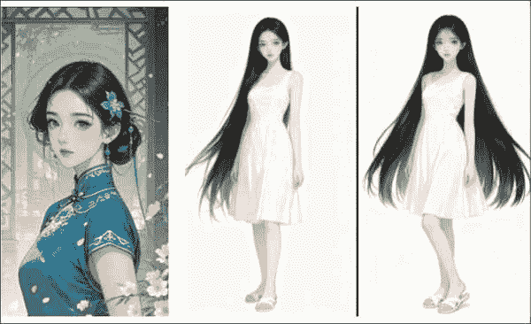

图 3-6　使用参考图与提示词生成的图片

#### 2．锁定生成逻辑

在生成配角或其他次要角色时，必须严格保持底层参数的一致性。这要求创作者始终使用同一个基础模型和同一套基础提示词架构。变量的调整仅限于角色的个性化特征，如发型、脸型、瞳色与服饰设计。通过控制变量法，确保角色在生理特征与身份标识上有所区分，但在笔触质感、材质表现和渲染风格上保持高度统一。

#### 3．统一光照与环境

这一步用于严格控制光照与环境逻辑。画面视觉不统一往往源于光影设定的混乱。在生成过程中，应确保所有角色处于相似的光照环境与质感基调中，例如，统一设定为柔和的侧光或均匀的漫反射。如果部分角色呈现强烈的戏剧化顶光，而另一部分采用平淡的正面光，拼合在同一场景时会产生明显的违和感，破坏画面的整体叙事可信度。

提示词直出与参考图生图共同构成了角色开发的完整闭环。提示词直出侧重于解决“个体”的审美与设定问题，即确保单个人物足够美观且符合人设；参考图生图则侧重于解决“整体”的视觉逻辑问题，确保所有角色同框时，观众能自然接受他们身处同一个故事世界。只有将二者结合，才能完成一套成熟的漫剧角色资产库。 EXr6287u6NNVz+GYLY+7SDk226FstKIHdC0bNoQkB2Nqi1xSR0yxPmwrTs5gRi/BtfSbid6dBhii9q7cz2pIyA==

## 3.3 提示词直出与参考图片生图的区别

AI 角色图的生成主要有两条路径：提示词直出与参考图生图。这分别对应传统动画制作中的零基础造型设计与基于已有素材的风格统一化处理。理解二者的差异与应用场景，能有效提升角色开发的效率与成品的一致性。

### 3.3.1　提示词直出角色

提示词直出的核心价值在于探索与迭代，往往难以一次性得到完美的终稿。通过多轮生成与筛选，创作者可以逐步明确角色的整体方向。

在实际操作中，建议参考以下步骤。

#### 1．批量生成

该步骤旨在探索可能性的边界。在这一阶段，应保持提示词完全一致，一次性生成 8～12 张图片。其目的并非筛选优劣，而是观察模型在同一语义约束下会呈现出怎样不同的解读，包括人物的体态、气质走向以及画面整体风格的自然波动。只有样本数量足够充分，后续的审美判断与方向锁定才有参考意义。

#### 2．初筛轮廓

这一步在进行判断时，须有意识地回避细节，重点关注角色是否在整体上“成立”。例如，头身比例是否协调，是否符合角色的年龄、身份与世界观设定；角色的性格特征能否通过姿态、神情和画面氛围被直观感知；整体色彩倾向是否稳定，是否与作品既定的风格体系保持一致。此时，轻微的结构偏差、局部失真或精细度不足，都不应作为首要调整对象。

#### 3．确定风格锚点

在通过初筛的图片中，挑选 2～3 张最接近理想方向的版本。这些图片的价值并不在于细节是否完美，而在于其整体方向是否清晰、气质表现是否稳定。它们将作为后续生成的视觉参照标准，用来锁定角色的视觉边界，避免在反复生成中出现风格漂移或偏离。

#### 4．迭代精修

当角色的大方向已经确定后，就可以在已建立的风格锚点基础上，借助以图生图或参考图功能，对角色进行细节层面的逐步优化，例如，面部结构的稳定性、服装与道具的逻辑一致性，以及光影和质感的统一。这一阶段的修改目标明确，调整路径清晰，核心任务是把已经确立的方向推向更高的完成度，而非重新探索方向。

整体来看，提示词直出的关键价值在于“确定方向”。先锁定角色的整体形态和气质基调，再进入细节精修环节，才能有效避免反复试错，提高角色开发的整体效率。

### 3.3.2　参考图生成角色

在确定了一个或几个核心角色后，创作者面临的挑战便从“个体设计”转向“整体统一”。核心问题在于确保作品中所有登场人物处于同一个世界观下，遵循相同的视觉法则。在传统动画工业中，这属于美术总监的职责范围；而在 AI 漫剧的工作流中，这一目标主要依靠“参考图”与“风格一致性控制”来实现。

同一个漫剧项目，应当严格遵循统一的画风参考标准。具体操作可以分为以下三个关键步骤。

#### 1．建立风格面板

这一步决定了整个作品的视觉基调。创作者可从即梦 AI、快看漫画、LiblibAI 等平台或图库中，收集符合项目预期风格、色调与氛围的参考图，并将其统一上传至 AI 绘图工具中进行初步的风格测试与适配，如图 3-5 和图 3-6 所示。

图 3-5　使用参考图与提示词

图 3-6　使用参考图与提示词生成的图片

#### 2．锁定生成逻辑

在生成配角或其他次要角色时，必须严格保持底层参数的一致性。这要求创作者始终使用同一个基础模型和同一套基础提示词架构。变量的调整仅限于角色的个性化特征，如发型、脸型、瞳色与服饰设计。通过控制变量法，确保角色在生理特征与身份标识上有所区分，但在笔触质感、材质表现和渲染风格上保持高度统一。

#### 3．统一光照与环境

这一步用于严格控制光照与环境逻辑。画面视觉不统一往往源于光影设定的混乱。在生成过程中，应确保所有角色处于相似的光照环境与质感基调中，例如，统一设定为柔和的侧光或均匀的漫反射。如果部分角色呈现强烈的戏剧化顶光，而另一部分采用平淡的正面光，拼合在同一场景时会产生明显的违和感，破坏画面的整体叙事可信度。

提示词直出与参考图生图共同构成了角色开发的完整闭环。提示词直出侧重于解决“个体”的审美与设定问题，即确保单个人物足够美观且符合人设；参考图生图则侧重于解决“整体”的视觉逻辑问题，确保所有角色同框时，观众能自然接受他们身处同一个故事世界。只有将二者结合，才能完成一套成熟的漫剧角色资产库。 EXr6287u6NNVz+GYLY+7SDk226FstKIHdC0bNoQkB2Nqi1xSR0yxPmwrTs5gRi/BtfSbid6dBhii9q7cz2pIyA==

## 3.3 提示词直出与参考图片生图的区别

AI 角色图的生成主要有两条路径：提示词直出与参考图生图。这分别对应传统动画制作中的零基础造型设计与基于已有素材的风格统一化处理。理解二者的差异与应用场景，能有效提升角色开发的效率与成品的一致性。

### 3.3.1　提示词直出角色

提示词直出的核心价值在于探索与迭代，往往难以一次性得到完美的终稿。通过多轮生成与筛选，创作者可以逐步明确角色的整体方向。

在实际操作中，建议参考以下步骤。

#### 1．批量生成

该步骤旨在探索可能性的边界。在这一阶段，应保持提示词完全一致，一次性生成 8～12 张图片。其目的并非筛选优劣，而是观察模型在同一语义约束下会呈现出怎样不同的解读，包括人物的体态、气质走向以及画面整体风格的自然波动。只有样本数量足够充分，后续的审美判断与方向锁定才有参考意义。

#### 2．初筛轮廓

这一步在进行判断时，须有意识地回避细节，重点关注角色是否在整体上“成立”。例如，头身比例是否协调，是否符合角色的年龄、身份与世界观设定；角色的性格特征能否通过姿态、神情和画面氛围被直观感知；整体色彩倾向是否稳定，是否与作品既定的风格体系保持一致。此时，轻微的结构偏差、局部失真或精细度不足，都不应作为首要调整对象。

#### 3．确定风格锚点

在通过初筛的图片中，挑选 2～3 张最接近理想方向的版本。这些图片的价值并不在于细节是否完美，而在于其整体方向是否清晰、气质表现是否稳定。它们将作为后续生成的视觉参照标准，用来锁定角色的视觉边界，避免在反复生成中出现风格漂移或偏离。

#### 4．迭代精修

当角色的大方向已经确定后，就可以在已建立的风格锚点基础上，借助以图生图或参考图功能，对角色进行细节层面的逐步优化，例如，面部结构的稳定性、服装与道具的逻辑一致性，以及光影和质感的统一。这一阶段的修改目标明确，调整路径清晰，核心任务是把已经确立的方向推向更高的完成度，而非重新探索方向。

整体来看，提示词直出的关键价值在于“确定方向”。先锁定角色的整体形态和气质基调，再进入细节精修环节，才能有效避免反复试错，提高角色开发的整体效率。

### 3.3.2　参考图生成角色

在确定了一个或几个核心角色后，创作者面临的挑战便从“个体设计”转向“整体统一”。核心问题在于确保作品中所有登场人物处于同一个世界观下，遵循相同的视觉法则。在传统动画工业中，这属于美术总监的职责范围；而在 AI 漫剧的工作流中，这一目标主要依靠“参考图”与“风格一致性控制”来实现。

同一个漫剧项目，应当严格遵循统一的画风参考标准。具体操作可以分为以下三个关键步骤。

#### 1．建立风格面板

这一步决定了整个作品的视觉基调。创作者可从即梦 AI、快看漫画、LiblibAI 等平台或图库中，收集符合项目预期风格、色调与氛围的参考图，并将其统一上传至 AI 绘图工具中进行初步的风格测试与适配，如图 3-5 和图 3-6 所示。

图 3-5　使用参考图与提示词

图 3-6　使用参考图与提示词生成的图片

#### 2．锁定生成逻辑

在生成配角或其他次要角色时，必须严格保持底层参数的一致性。这要求创作者始终使用同一个基础模型和同一套基础提示词架构。变量的调整仅限于角色的个性化特征，如发型、脸型、瞳色与服饰设计。通过控制变量法，确保角色在生理特征与身份标识上有所区分，但在笔触质感、材质表现和渲染风格上保持高度统一。

#### 3．统一光照与环境

这一步用于严格控制光照与环境逻辑。画面视觉不统一往往源于光影设定的混乱。在生成过程中，应确保所有角色处于相似的光照环境与质感基调中，例如，统一设定为柔和的侧光或均匀的漫反射。如果部分角色呈现强烈的戏剧化顶光，而另一部分采用平淡的正面光，拼合在同一场景时会产生明显的违和感，破坏画面的整体叙事可信度。

提示词直出与参考图生图共同构成了角色开发的完整闭环。提示词直出侧重于解决“个体”的审美与设定问题，即确保单个人物足够美观且符合人设；参考图生图则侧重于解决“整体”的视觉逻辑问题，确保所有角色同框时，观众能自然接受他们身处同一个故事世界。只有将二者结合，才能完成一套成熟的漫剧角色资产库。 EXr6287u6NNVz+GYLY+7SDk226FstKIHdC0bNoQkB2Nqi1xSR0yxPmwrTs5gRi/BtfSbid6dBhii9q7cz2pIyA==

## 3.4 角色设计中的常见问题

在复盘了大量 AI 漫剧项目后，我们发现角色设计的常见问题往往集中在几个高度相似的环节。这些问题通常不涉及复杂的技术原理，而是源于对 AI 生成逻辑的基本误解或操作流程的疏漏。常见的问题主要集中在 4 个方面：比例失调、信息过载、风格割裂以及不符合大众审美。

### 3.4.1　比例失调

比例失调是新手最容易踩的陷阱。AI 生图模型的底层逻辑倾向于精细的人脸刻画，若没有明确的指令约束，模型极易生成半身像、大头照，或者带有夸张透视的俯仰视角。常见的比例问题还包括角色头重脚轻、Q 版与写实风格混搭、画面中莫名多出一只手、一把多余的武器，甚至背景里露出了不完整的人影等。图 3-7 展示了存在典型比例问题的生成案例。

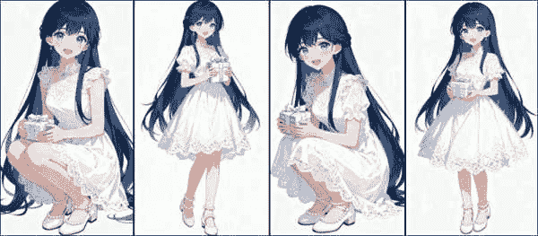

图 3-7　存在比例问题的生成案例

解决这一问题的核心在于建立强制性的构图约束，创作者应在提示词中明确界定画面的构图与纯净度。

首先，必须强制写明全身状态与基础姿势。例如，输入“ 全身站立，正面或微侧身，四肢自然舒展，避免坐姿或躺姿”。

其次，要对画面元素进行“做减法”式的负向约束。明确告诉 AI：“ 画面中只出现一位角色，无其他人影、动物或复杂道具干扰”。

最后，针对必须出现的道具，应将其状态描述为稳定、收敛的静止状态。AI 很难处理复杂的动态持握，因此描述为静止状态更为稳妥： 右手自然垂下，握着一把收鞘长剑，剑尖朝下，无夸张摆姿。

### 3.4.2　信息过载

许多创作者误以为提示词越长，生成的画面就越精致。事实恰恰相反，当一条提示词中堆砌了十几种装饰元素、五六种不同材质时，AI 会将这些权重分散，导致画面重点模糊，最终生成难以辨认的“繁杂纹理堆砌”。另一种极端是使用过于抽象的形容词，如“帅气”“霸气”等，这类词汇会让 AI 失去有效的语义抓手，只能随机发挥。

修正这一问题的关键在于“视觉聚焦”与“描述具象化”。

第一，学会做减法。每个角色身上保留 1～2 个核心设计重点即可。例如，对于服装配饰，可以写“ 肩甲+腰间挂饰 ”或者“ 披肩+特殊领口 ”。

第二，采用结构化描述。不要将衣服混为一体，应按照“上身—下身—鞋”的逻辑分段描述，帮助 AI 理解服装的层次与结构。

第三，将抽象形容词转换为可视觉化的细节。AI 无法直接理解“冷酷”，但它能理解五官的微表情描述： 表情冷淡、眼神直视前方、嘴角微微下压 。同理，AI 难以直接生成“贵族感”，需要通过具体的服饰符号来体现： 白色衬衣、金边立领、深蓝色长外套、胸口佩戴家族徽章。

### 3.4.3　风格不统一

一部漫剧最忌讳出现“画风大乱炖”：男主是写实国漫风，女主是日系二次元感，配角却带有美式三渲二特征。这种视觉上的割裂感会让观众瞬间出戏，导致整部作品的世界观崩塌。这通常是因为在生成不同角色时随意更换基础模型，或者在提示词中缺乏统一的画风约束。

要解决这个问题，必须在项目启动初期就制定“风格基准”。

首先，确立唯一的底层逻辑。整个项目应固定使用一个核心基础模型，并配合一组不可变动的基础风格提示词。

其次，确立视觉参照系。优先生成男女主角及 1～2 个关键配角的定妆照，将其确立为项目的视觉标尺。团队中所有成员在生成后续角色时，必须严格参照这套标准。

最后，采用“增量修改法”。在生成新角色时，应直接复用那套基础提示词，仅在其上做必要的调整（如修改发型、更换衣服），严禁完全重写提示词结构，以确保画风在颗粒度上保持高度一致。

### 3.4.4　不符合大众审美

在面向大众的商业漫剧中，“朴素”与“难看”有着本质区别。朴素是一种风格选择，意味着画面干净、设计清爽、视觉表达克制；而难看则属于质量事故，表现为比例崩坏、表情僵硬、色彩脏乱或结构失调。

为了守住审美与质量底线，创作者应建立一份基础检查清单，对每一张生成的角色图进行系统性快速筛查。

**·** 缩略图检查：将图片缩小至约手机屏幕竖屏的六分之一的大小。在小图模式下，如果还能清晰辨认出人物轮廓和动态，说明构图合格。

**·** 表情检查：放大观察面部细节。确认眼球反光点、角膜反光和瞳仁反光是否合理，避免出现眼球乱飘的情况，同时检查嘴型结构是否自然。

**·** 色彩检查：审视画面的灰度与纯度分布。警惕整体“蒙灰感”或充斥杂乱中间色的图片，这会让画面显得脏旧。

AI 本质上是创作者审美的放大器。提升这一能力的有效途径，是持续将自己的产出与优秀的国漫作品或头部漫剧进行视觉对标，在反复对比中校准审美判断。 EXr6287u6NNVz+GYLY+7SDk226FstKIHdC0bNoQkB2Nqi1xSR0yxPmwrTs5gRi/BtfSbid6dBhii9q7cz2pIyA==

## 3.4 角色设计中的常见问题

在复盘了大量 AI 漫剧项目后，我们发现角色设计的常见问题往往集中在几个高度相似的环节。这些问题通常不涉及复杂的技术原理，而是源于对 AI 生成逻辑的基本误解或操作流程的疏漏。常见的问题主要集中在 4 个方面：比例失调、信息过载、风格割裂以及不符合大众审美。

### 3.4.1　比例失调

比例失调是新手最容易踩的陷阱。AI 生图模型的底层逻辑倾向于精细的人脸刻画，若没有明确的指令约束，模型极易生成半身像、大头照，或者带有夸张透视的俯仰视角。常见的比例问题还包括角色头重脚轻、Q 版与写实风格混搭、画面中莫名多出一只手、一把多余的武器，甚至背景里露出了不完整的人影等。图 3-7 展示了存在典型比例问题的生成案例。

图 3-7　存在比例问题的生成案例

解决这一问题的核心在于建立强制性的构图约束，创作者应在提示词中明确界定画面的构图与纯净度。

首先，必须强制写明全身状态与基础姿势。例如，输入“ 全身站立，正面或微侧身，四肢自然舒展，避免坐姿或躺姿”。

其次，要对画面元素进行“做减法”式的负向约束。明确告诉 AI：“ 画面中只出现一位角色，无其他人影、动物或复杂道具干扰”。

最后，针对必须出现的道具，应将其状态描述为稳定、收敛的静止状态。AI 很难处理复杂的动态持握，因此描述为静止状态更为稳妥： 右手自然垂下，握着一把收鞘长剑，剑尖朝下，无夸张摆姿。

### 3.4.2　信息过载

许多创作者误以为提示词越长，生成的画面就越精致。事实恰恰相反，当一条提示词中堆砌了十几种装饰元素、五六种不同材质时，AI 会将这些权重分散，导致画面重点模糊，最终生成难以辨认的“繁杂纹理堆砌”。另一种极端是使用过于抽象的形容词，如“帅气”“霸气”等，这类词汇会让 AI 失去有效的语义抓手，只能随机发挥。

修正这一问题的关键在于“视觉聚焦”与“描述具象化”。

第一，学会做减法。每个角色身上保留 1～2 个核心设计重点即可。例如，对于服装配饰，可以写“ 肩甲+腰间挂饰 ”或者“ 披肩+特殊领口 ”。

第二，采用结构化描述。不要将衣服混为一体，应按照“上身—下身—鞋”的逻辑分段描述，帮助 AI 理解服装的层次与结构。

第三，将抽象形容词转换为可视觉化的细节。AI 无法直接理解“冷酷”，但它能理解五官的微表情描述： 表情冷淡、眼神直视前方、嘴角微微下压 。同理，AI 难以直接生成“贵族感”，需要通过具体的服饰符号来体现： 白色衬衣、金边立领、深蓝色长外套、胸口佩戴家族徽章。

### 3.4.3　风格不统一

一部漫剧最忌讳出现“画风大乱炖”：男主是写实国漫风，女主是日系二次元感，配角却带有美式三渲二特征。这种视觉上的割裂感会让观众瞬间出戏，导致整部作品的世界观崩塌。这通常是因为在生成不同角色时随意更换基础模型，或者在提示词中缺乏统一的画风约束。

要解决这个问题，必须在项目启动初期就制定“风格基准”。

首先，确立唯一的底层逻辑。整个项目应固定使用一个核心基础模型，并配合一组不可变动的基础风格提示词。

其次，确立视觉参照系。优先生成男女主角及 1～2 个关键配角的定妆照，将其确立为项目的视觉标尺。团队中所有成员在生成后续角色时，必须严格参照这套标准。

最后，采用“增量修改法”。在生成新角色时，应直接复用那套基础提示词，仅在其上做必要的调整（如修改发型、更换衣服），严禁完全重写提示词结构，以确保画风在颗粒度上保持高度一致。

### 3.4.4　不符合大众审美

在面向大众的商业漫剧中，“朴素”与“难看”有着本质区别。朴素是一种风格选择，意味着画面干净、设计清爽、视觉表达克制；而难看则属于质量事故，表现为比例崩坏、表情僵硬、色彩脏乱或结构失调。

为了守住审美与质量底线，创作者应建立一份基础检查清单，对每一张生成的角色图进行系统性快速筛查。

**·** 缩略图检查：将图片缩小至约手机屏幕竖屏的六分之一的大小。在小图模式下，如果还能清晰辨认出人物轮廓和动态，说明构图合格。

**·** 表情检查：放大观察面部细节。确认眼球反光点、角膜反光和瞳仁反光是否合理，避免出现眼球乱飘的情况，同时检查嘴型结构是否自然。

**·** 色彩检查：审视画面的灰度与纯度分布。警惕整体“蒙灰感”或充斥杂乱中间色的图片，这会让画面显得脏旧。

AI 本质上是创作者审美的放大器。提升这一能力的有效途径，是持续将自己的产出与优秀的国漫作品或头部漫剧进行视觉对标，在反复对比中校准审美判断。 EXr6287u6NNVz+GYLY+7SDk226FstKIHdC0bNoQkB2Nqi1xSR0yxPmwrTs5gRi/BtfSbid6dBhii9q7cz2pIyA==

## 3.4 角色设计中的常见问题

在复盘了大量 AI 漫剧项目后，我们发现角色设计的常见问题往往集中在几个高度相似的环节。这些问题通常不涉及复杂的技术原理，而是源于对 AI 生成逻辑的基本误解或操作流程的疏漏。常见的问题主要集中在 4 个方面：比例失调、信息过载、风格割裂以及不符合大众审美。

### 3.4.1　比例失调

比例失调是新手最容易踩的陷阱。AI 生图模型的底层逻辑倾向于精细的人脸刻画，若没有明确的指令约束，模型极易生成半身像、大头照，或者带有夸张透视的俯仰视角。常见的比例问题还包括角色头重脚轻、Q 版与写实风格混搭、画面中莫名多出一只手、一把多余的武器，甚至背景里露出了不完整的人影等。图 3-7 展示了存在典型比例问题的生成案例。

图 3-7　存在比例问题的生成案例

解决这一问题的核心在于建立强制性的构图约束，创作者应在提示词中明确界定画面的构图与纯净度。

首先，必须强制写明全身状态与基础姿势。例如，输入“ 全身站立，正面或微侧身，四肢自然舒展，避免坐姿或躺姿”。

其次，要对画面元素进行“做减法”式的负向约束。明确告诉 AI：“ 画面中只出现一位角色，无其他人影、动物或复杂道具干扰”。

最后，针对必须出现的道具，应将其状态描述为稳定、收敛的静止状态。AI 很难处理复杂的动态持握，因此描述为静止状态更为稳妥： 右手自然垂下，握着一把收鞘长剑，剑尖朝下，无夸张摆姿。

### 3.4.2　信息过载

许多创作者误以为提示词越长，生成的画面就越精致。事实恰恰相反，当一条提示词中堆砌了十几种装饰元素、五六种不同材质时，AI 会将这些权重分散，导致画面重点模糊，最终生成难以辨认的“繁杂纹理堆砌”。另一种极端是使用过于抽象的形容词，如“帅气”“霸气”等，这类词汇会让 AI 失去有效的语义抓手，只能随机发挥。

修正这一问题的关键在于“视觉聚焦”与“描述具象化”。

第一，学会做减法。每个角色身上保留 1～2 个核心设计重点即可。例如，对于服装配饰，可以写“ 肩甲+腰间挂饰 ”或者“ 披肩+特殊领口 ”。

第二，采用结构化描述。不要将衣服混为一体，应按照“上身—下身—鞋”的逻辑分段描述，帮助 AI 理解服装的层次与结构。

第三，将抽象形容词转换为可视觉化的细节。AI 无法直接理解“冷酷”，但它能理解五官的微表情描述： 表情冷淡、眼神直视前方、嘴角微微下压 。同理，AI 难以直接生成“贵族感”，需要通过具体的服饰符号来体现： 白色衬衣、金边立领、深蓝色长外套、胸口佩戴家族徽章。

### 3.4.3　风格不统一

一部漫剧最忌讳出现“画风大乱炖”：男主是写实国漫风，女主是日系二次元感，配角却带有美式三渲二特征。这种视觉上的割裂感会让观众瞬间出戏，导致整部作品的世界观崩塌。这通常是因为在生成不同角色时随意更换基础模型，或者在提示词中缺乏统一的画风约束。

要解决这个问题，必须在项目启动初期就制定“风格基准”。

首先，确立唯一的底层逻辑。整个项目应固定使用一个核心基础模型，并配合一组不可变动的基础风格提示词。

其次，确立视觉参照系。优先生成男女主角及 1～2 个关键配角的定妆照，将其确立为项目的视觉标尺。团队中所有成员在生成后续角色时，必须严格参照这套标准。

最后，采用“增量修改法”。在生成新角色时，应直接复用那套基础提示词，仅在其上做必要的调整（如修改发型、更换衣服），严禁完全重写提示词结构，以确保画风在颗粒度上保持高度一致。

### 3.4.4　不符合大众审美

在面向大众的商业漫剧中，“朴素”与“难看”有着本质区别。朴素是一种风格选择，意味着画面干净、设计清爽、视觉表达克制；而难看则属于质量事故，表现为比例崩坏、表情僵硬、色彩脏乱或结构失调。

为了守住审美与质量底线，创作者应建立一份基础检查清单，对每一张生成的角色图进行系统性快速筛查。

**·** 缩略图检查：将图片缩小至约手机屏幕竖屏的六分之一的大小。在小图模式下，如果还能清晰辨认出人物轮廓和动态，说明构图合格。

**·** 表情检查：放大观察面部细节。确认眼球反光点、角膜反光和瞳仁反光是否合理，避免出现眼球乱飘的情况，同时检查嘴型结构是否自然。

**·** 色彩检查：审视画面的灰度与纯度分布。警惕整体“蒙灰感”或充斥杂乱中间色的图片，这会让画面显得脏旧。

AI 本质上是创作者审美的放大器。提升这一能力的有效途径，是持续将自己的产出与优秀的国漫作品或头部漫剧进行视觉对标，在反复对比中校准审美判断。 EXr6287u6NNVz+GYLY+7SDk226FstKIHdC0bNoQkB2Nqi1xSR0yxPmwrTs5gRi/BtfSbid6dBhii9q7cz2pIyA==

## 3.4 角色设计中的常见问题

在复盘了大量 AI 漫剧项目后，我们发现角色设计的常见问题往往集中在几个高度相似的环节。这些问题通常不涉及复杂的技术原理，而是源于对 AI 生成逻辑的基本误解或操作流程的疏漏。常见的问题主要集中在 4 个方面：比例失调、信息过载、风格割裂以及不符合大众审美。

### 3.4.1　比例失调

比例失调是新手最容易踩的陷阱。AI 生图模型的底层逻辑倾向于精细的人脸刻画，若没有明确的指令约束，模型极易生成半身像、大头照，或者带有夸张透视的俯仰视角。常见的比例问题还包括角色头重脚轻、Q 版与写实风格混搭、画面中莫名多出一只手、一把多余的武器，甚至背景里露出了不完整的人影等。图 3-7 展示了存在典型比例问题的生成案例。

图 3-7　存在比例问题的生成案例

解决这一问题的核心在于建立强制性的构图约束，创作者应在提示词中明确界定画面的构图与纯净度。

首先，必须强制写明全身状态与基础姿势。例如，输入“ 全身站立，正面或微侧身，四肢自然舒展，避免坐姿或躺姿”。

其次，要对画面元素进行“做减法”式的负向约束。明确告诉 AI：“ 画面中只出现一位角色，无其他人影、动物或复杂道具干扰”。

最后，针对必须出现的道具，应将其状态描述为稳定、收敛的静止状态。AI 很难处理复杂的动态持握，因此描述为静止状态更为稳妥： 右手自然垂下，握着一把收鞘长剑，剑尖朝下，无夸张摆姿。

### 3.4.2　信息过载

许多创作者误以为提示词越长，生成的画面就越精致。事实恰恰相反，当一条提示词中堆砌了十几种装饰元素、五六种不同材质时，AI 会将这些权重分散，导致画面重点模糊，最终生成难以辨认的“繁杂纹理堆砌”。另一种极端是使用过于抽象的形容词，如“帅气”“霸气”等，这类词汇会让 AI 失去有效的语义抓手，只能随机发挥。

修正这一问题的关键在于“视觉聚焦”与“描述具象化”。

第一，学会做减法。每个角色身上保留 1～2 个核心设计重点即可。例如，对于服装配饰，可以写“ 肩甲+腰间挂饰 ”或者“ 披肩+特殊领口 ”。

第二，采用结构化描述。不要将衣服混为一体，应按照“上身—下身—鞋”的逻辑分段描述，帮助 AI 理解服装的层次与结构。

第三，将抽象形容词转换为可视觉化的细节。AI 无法直接理解“冷酷”，但它能理解五官的微表情描述： 表情冷淡、眼神直视前方、嘴角微微下压 。同理，AI 难以直接生成“贵族感”，需要通过具体的服饰符号来体现： 白色衬衣、金边立领、深蓝色长外套、胸口佩戴家族徽章。

### 3.4.3　风格不统一

一部漫剧最忌讳出现“画风大乱炖”：男主是写实国漫风，女主是日系二次元感，配角却带有美式三渲二特征。这种视觉上的割裂感会让观众瞬间出戏，导致整部作品的世界观崩塌。这通常是因为在生成不同角色时随意更换基础模型，或者在提示词中缺乏统一的画风约束。

要解决这个问题，必须在项目启动初期就制定“风格基准”。

首先，确立唯一的底层逻辑。整个项目应固定使用一个核心基础模型，并配合一组不可变动的基础风格提示词。

其次，确立视觉参照系。优先生成男女主角及 1～2 个关键配角的定妆照，将其确立为项目的视觉标尺。团队中所有成员在生成后续角色时，必须严格参照这套标准。

最后，采用“增量修改法”。在生成新角色时，应直接复用那套基础提示词，仅在其上做必要的调整（如修改发型、更换衣服），严禁完全重写提示词结构，以确保画风在颗粒度上保持高度一致。

### 3.4.4　不符合大众审美

在面向大众的商业漫剧中，“朴素”与“难看”有着本质区别。朴素是一种风格选择，意味着画面干净、设计清爽、视觉表达克制；而难看则属于质量事故，表现为比例崩坏、表情僵硬、色彩脏乱或结构失调。

为了守住审美与质量底线，创作者应建立一份基础检查清单，对每一张生成的角色图进行系统性快速筛查。

**·** 缩略图检查：将图片缩小至约手机屏幕竖屏的六分之一的大小。在小图模式下，如果还能清晰辨认出人物轮廓和动态，说明构图合格。

**·** 表情检查：放大观察面部细节。确认眼球反光点、角膜反光和瞳仁反光是否合理，避免出现眼球乱飘的情况，同时检查嘴型结构是否自然。

**·** 色彩检查：审视画面的灰度与纯度分布。警惕整体“蒙灰感”或充斥杂乱中间色的图片，这会让画面显得脏旧。

AI 本质上是创作者审美的放大器。提升这一能力的有效途径，是持续将自己的产出与优秀的国漫作品或头部漫剧进行视觉对标，在反复对比中校准审美判断。 EXr6287u6NNVz+GYLY+7SDk226FstKIHdC0bNoQkB2Nqi1xSR0yxPmwrTs5gRi/BtfSbid6dBhii9q7cz2pIyA==

## 3.4 角色设计中的常见问题

在复盘了大量 AI 漫剧项目后，我们发现角色设计的常见问题往往集中在几个高度相似的环节。这些问题通常不涉及复杂的技术原理，而是源于对 AI 生成逻辑的基本误解或操作流程的疏漏。常见的问题主要集中在 4 个方面：比例失调、信息过载、风格割裂以及不符合大众审美。

### 3.4.1　比例失调

比例失调是新手最容易踩的陷阱。AI 生图模型的底层逻辑倾向于精细的人脸刻画，若没有明确的指令约束，模型极易生成半身像、大头照，或者带有夸张透视的俯仰视角。常见的比例问题还包括角色头重脚轻、Q 版与写实风格混搭、画面中莫名多出一只手、一把多余的武器，甚至背景里露出了不完整的人影等。图 3-7 展示了存在典型比例问题的生成案例。

图 3-7　存在比例问题的生成案例

解决这一问题的核心在于建立强制性的构图约束，创作者应在提示词中明确界定画面的构图与纯净度。

首先，必须强制写明全身状态与基础姿势。例如，输入“ 全身站立，正面或微侧身，四肢自然舒展，避免坐姿或躺姿”。

其次，要对画面元素进行“做减法”式的负向约束。明确告诉 AI：“ 画面中只出现一位角色，无其他人影、动物或复杂道具干扰”。

最后，针对必须出现的道具，应将其状态描述为稳定、收敛的静止状态。AI 很难处理复杂的动态持握，因此描述为静止状态更为稳妥： 右手自然垂下，握着一把收鞘长剑，剑尖朝下，无夸张摆姿。

### 3.4.2　信息过载

许多创作者误以为提示词越长，生成的画面就越精致。事实恰恰相反，当一条提示词中堆砌了十几种装饰元素、五六种不同材质时，AI 会将这些权重分散，导致画面重点模糊，最终生成难以辨认的“繁杂纹理堆砌”。另一种极端是使用过于抽象的形容词，如“帅气”“霸气”等，这类词汇会让 AI 失去有效的语义抓手，只能随机发挥。

修正这一问题的关键在于“视觉聚焦”与“描述具象化”。

第一，学会做减法。每个角色身上保留 1～2 个核心设计重点即可。例如，对于服装配饰，可以写“ 肩甲+腰间挂饰 ”或者“ 披肩+特殊领口 ”。

第二，采用结构化描述。不要将衣服混为一体，应按照“上身—下身—鞋”的逻辑分段描述，帮助 AI 理解服装的层次与结构。

第三，将抽象形容词转换为可视觉化的细节。AI 无法直接理解“冷酷”，但它能理解五官的微表情描述： 表情冷淡、眼神直视前方、嘴角微微下压 。同理，AI 难以直接生成“贵族感”，需要通过具体的服饰符号来体现： 白色衬衣、金边立领、深蓝色长外套、胸口佩戴家族徽章。

### 3.4.3　风格不统一

一部漫剧最忌讳出现“画风大乱炖”：男主是写实国漫风，女主是日系二次元感，配角却带有美式三渲二特征。这种视觉上的割裂感会让观众瞬间出戏，导致整部作品的世界观崩塌。这通常是因为在生成不同角色时随意更换基础模型，或者在提示词中缺乏统一的画风约束。

要解决这个问题，必须在项目启动初期就制定“风格基准”。

首先，确立唯一的底层逻辑。整个项目应固定使用一个核心基础模型，并配合一组不可变动的基础风格提示词。

其次，确立视觉参照系。优先生成男女主角及 1～2 个关键配角的定妆照，将其确立为项目的视觉标尺。团队中所有成员在生成后续角色时，必须严格参照这套标准。

最后，采用“增量修改法”。在生成新角色时，应直接复用那套基础提示词，仅在其上做必要的调整（如修改发型、更换衣服），严禁完全重写提示词结构，以确保画风在颗粒度上保持高度一致。

### 3.4.4　不符合大众审美

在面向大众的商业漫剧中，“朴素”与“难看”有着本质区别。朴素是一种风格选择，意味着画面干净、设计清爽、视觉表达克制；而难看则属于质量事故，表现为比例崩坏、表情僵硬、色彩脏乱或结构失调。

为了守住审美与质量底线，创作者应建立一份基础检查清单，对每一张生成的角色图进行系统性快速筛查。

**·** 缩略图检查：将图片缩小至约手机屏幕竖屏的六分之一的大小。在小图模式下，如果还能清晰辨认出人物轮廓和动态，说明构图合格。

**·** 表情检查：放大观察面部细节。确认眼球反光点、角膜反光和瞳仁反光是否合理，避免出现眼球乱飘的情况，同时检查嘴型结构是否自然。

**·** 色彩检查：审视画面的灰度与纯度分布。警惕整体“蒙灰感”或充斥杂乱中间色的图片，这会让画面显得脏旧。

AI 本质上是创作者审美的放大器。提升这一能力的有效途径，是持续将自己的产出与优秀的国漫作品或头部漫剧进行视觉对标，在反复对比中校准审美判断。 EXr6287u6NNVz+GYLY+7SDk226FstKIHdC0bNoQkB2Nqi1xSR0yxPmwrTs5gRi/BtfSbid6dBhii9q7cz2pIyA==

## 3.5 三视图的作用与生成逻辑

在传统动画工业中，人物三视图与表情设定是角色设计阶段的核心交付物。这些素材决定了后续镜头能否保持稳定、可控且持续一致。三视图的根本价值在于服务制作系统的高效运转，而非直接呈现给观众。

在 AI 漫剧或 AI 视频创作中，这一原则的重要性被进一步放大。我们可以使用以下提示词逻辑生成标准化的角色三视图。

生成全身三视图以及一张面部特写（最左边占满 1/3 的位置是超大的面部特写，右边 2/3 放正视图、侧视图、后视图）。

图 3-8 和图 3-9 是两张三视图示例。

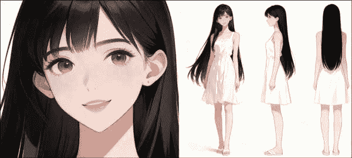

图 3-8　三视图示例（女）

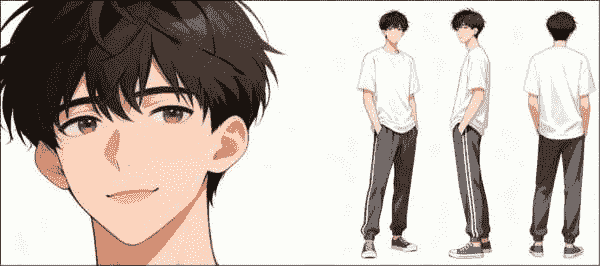

图 3-9　三视图示例（男）

### 3.5.1　为什么需要三视图

AI 虽然极大地降低了角色绘制的技术门槛，但在实际制作中，创作者仍需面对如下两个现实问题。

（1）AI 生成具有随机性。正脸完美并不代表侧脸结构稳定，正面逻辑成立也不意味着背面设计合理。一旦进入多角度、多景别的分镜切换，角色极易发生形象偏移，导致观众产生认知断层。

（2）分镜数量增加会导致记忆负荷过载。创作者难以仅凭记忆维护所有视觉元素的一致性。发际线高度、衣角长度、腰线位置、配饰朝向等细节，在单张画面中或许不明显，但在连续播放的视频流中会被显著放大。

因此，当角色形象基本稳定时，必须尽早完成标准化的三视图设定。

在项目资源允许的情况下，建议同步制作角色的表情卡。基础情绪至少应包含平静、愤怒、惊讶、悲伤 4 种。对于戏份较重的角色或关键配角，这一标准应扩展至 8 种甚至 12 种以上。例如，我们将图 3-9 上传至 AI 生图工具中，输入提示词“ 为此人物生成表情卡，包含至少 8 种不同情绪。 ”图 3-10 是一个表情卡生成结果示例。

图 3-10　表情卡生成结果示例

需要注意的是，在输入提示词时，既可直接指定情绪数量，也可直接列出具体的情绪类型。

三视图负责解决角色形体和结构稳定性的问题，表情卡则负责保障角色情绪准确性。二者共同构成了角色在后续海量镜头生成中的视觉参考基准。

### 3.5.2　三视图的画面排布

为了让三视图真正融入制作流程，而非停留在设计展示阶段，其画面排布必须具备功能性。

一个成熟且通用的排布方案是：将三视图与面部特写整合于一张横向构图中，比例建议设定为 21 : 9 或 16 : 9。推荐的布局结构如下。

**·** 左侧区域：占据约一半宽度，放置人物面部近景特写，重点展示五官细节与微表情。

**·** 右侧区域：从左至右依次排列全身正视图、侧视图、背视图。

**·** 底部区域：预留一条信息栏，用小字标注人物姓名、身高数据、关键配色色卡，并可用色块进行辅助视觉说明。

这种排布方式在实战中具备以下三个核心优势。

**·** 沟通高效：无论是对接甲方、合作方还是团队内部，一张图即可完整呈现角色的所有视觉信息，避免信息碎片化。

**·** 素材复用：该图片可直接作为剪辑素材，用于制作角色介绍页、卡司表或世界观设定展示环节，提升素材复用率。

**·** 长期基准：它是团队最重要的视觉参考基准。在生成新镜头、调整分镜或复刻特定画面时，团队成员可随时对照此图校准比例、结构与细节，大幅降低试错与沟通成本。

随着角色数量的增加与分镜规模的扩大，这张标准化的三视图将成为整个项目中使用频率最高、依赖度最强的底层资产。 EXr6287u6NNVz+GYLY+7SDk226FstKIHdC0bNoQkB2Nqi1xSR0yxPmwrTs5gRi/BtfSbid6dBhii9q7cz2pIyA==

## 3.5 三视图的作用与生成逻辑

在传统动画工业中，人物三视图与表情设定是角色设计阶段的核心交付物。这些素材决定了后续镜头能否保持稳定、可控且持续一致。三视图的根本价值在于服务制作系统的高效运转，而非直接呈现给观众。

在 AI 漫剧或 AI 视频创作中，这一原则的重要性被进一步放大。我们可以使用以下提示词逻辑生成标准化的角色三视图。

生成全身三视图以及一张面部特写（最左边占满 1/3 的位置是超大的面部特写，右边 2/3 放正视图、侧视图、后视图）。

图 3-8 和图 3-9 是两张三视图示例。

图 3-8　三视图示例（女）

图 3-9　三视图示例（男）

### 3.5.1　为什么需要三视图

AI 虽然极大地降低了角色绘制的技术门槛，但在实际制作中，创作者仍需面对如下两个现实问题。

（1）AI 生成具有随机性。正脸完美并不代表侧脸结构稳定，正面逻辑成立也不意味着背面设计合理。一旦进入多角度、多景别的分镜切换，角色极易发生形象偏移，导致观众产生认知断层。

（2）分镜数量增加会导致记忆负荷过载。创作者难以仅凭记忆维护所有视觉元素的一致性。发际线高度、衣角长度、腰线位置、配饰朝向等细节，在单张画面中或许不明显，但在连续播放的视频流中会被显著放大。

因此，当角色形象基本稳定时，必须尽早完成标准化的三视图设定。

在项目资源允许的情况下，建议同步制作角色的表情卡。基础情绪至少应包含平静、愤怒、惊讶、悲伤 4 种。对于戏份较重的角色或关键配角，这一标准应扩展至 8 种甚至 12 种以上。例如，我们将图 3-9 上传至 AI 生图工具中，输入提示词“ 为此人物生成表情卡，包含至少 8 种不同情绪。 ”图 3-10 是一个表情卡生成结果示例。

图 3-10　表情卡生成结果示例

需要注意的是，在输入提示词时，既可直接指定情绪数量，也可直接列出具体的情绪类型。

三视图负责解决角色形体和结构稳定性的问题，表情卡则负责保障角色情绪准确性。二者共同构成了角色在后续海量镜头生成中的视觉参考基准。

### 3.5.2　三视图的画面排布

为了让三视图真正融入制作流程，而非停留在设计展示阶段，其画面排布必须具备功能性。

一个成熟且通用的排布方案是：将三视图与面部特写整合于一张横向构图中，比例建议设定为 21 : 9 或 16 : 9。推荐的布局结构如下。

**·** 左侧区域：占据约一半宽度，放置人物面部近景特写，重点展示五官细节与微表情。

**·** 右侧区域：从左至右依次排列全身正视图、侧视图、背视图。

**·** 底部区域：预留一条信息栏，用小字标注人物姓名、身高数据、关键配色色卡，并可用色块进行辅助视觉说明。

这种排布方式在实战中具备以下三个核心优势。

**·** 沟通高效：无论是对接甲方、合作方还是团队内部，一张图即可完整呈现角色的所有视觉信息，避免信息碎片化。

**·** 素材复用：该图片可直接作为剪辑素材，用于制作角色介绍页、卡司表或世界观设定展示环节，提升素材复用率。

**·** 长期基准：它是团队最重要的视觉参考基准。在生成新镜头、调整分镜或复刻特定画面时，团队成员可随时对照此图校准比例、结构与细节，大幅降低试错与沟通成本。

随着角色数量的增加与分镜规模的扩大，这张标准化的三视图将成为整个项目中使用频率最高、依赖度最强的底层资产。 EXr6287u6NNVz+GYLY+7SDk226FstKIHdC0bNoQkB2Nqi1xSR0yxPmwrTs5gRi/BtfSbid6dBhii9q7cz2pIyA==

## 3.5 三视图的作用与生成逻辑

在传统动画工业中，人物三视图与表情设定是角色设计阶段的核心交付物。这些素材决定了后续镜头能否保持稳定、可控且持续一致。三视图的根本价值在于服务制作系统的高效运转，而非直接呈现给观众。

在 AI 漫剧或 AI 视频创作中，这一原则的重要性被进一步放大。我们可以使用以下提示词逻辑生成标准化的角色三视图。

生成全身三视图以及一张面部特写（最左边占满 1/3 的位置是超大的面部特写，右边 2/3 放正视图、侧视图、后视图）。

图 3-8 和图 3-9 是两张三视图示例。

图 3-8　三视图示例（女）

图 3-9　三视图示例（男）

### 3.5.1　为什么需要三视图

AI 虽然极大地降低了角色绘制的技术门槛，但在实际制作中，创作者仍需面对如下两个现实问题。

（1）AI 生成具有随机性。正脸完美并不代表侧脸结构稳定，正面逻辑成立也不意味着背面设计合理。一旦进入多角度、多景别的分镜切换，角色极易发生形象偏移，导致观众产生认知断层。

（2）分镜数量增加会导致记忆负荷过载。创作者难以仅凭记忆维护所有视觉元素的一致性。发际线高度、衣角长度、腰线位置、配饰朝向等细节，在单张画面中或许不明显，但在连续播放的视频流中会被显著放大。

因此，当角色形象基本稳定时，必须尽早完成标准化的三视图设定。

在项目资源允许的情况下，建议同步制作角色的表情卡。基础情绪至少应包含平静、愤怒、惊讶、悲伤 4 种。对于戏份较重的角色或关键配角，这一标准应扩展至 8 种甚至 12 种以上。例如，我们将图 3-9 上传至 AI 生图工具中，输入提示词“ 为此人物生成表情卡，包含至少 8 种不同情绪。 ”图 3-10 是一个表情卡生成结果示例。

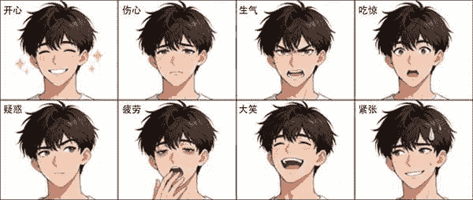

图 3-10　表情卡生成结果示例

需要注意的是，在输入提示词时，既可直接指定情绪数量，也可直接列出具体的情绪类型。

三视图负责解决角色形体和结构稳定性的问题，表情卡则负责保障角色情绪准确性。二者共同构成了角色在后续海量镜头生成中的视觉参考基准。

### 3.5.2　三视图的画面排布

为了让三视图真正融入制作流程，而非停留在设计展示阶段，其画面排布必须具备功能性。

一个成熟且通用的排布方案是：将三视图与面部特写整合于一张横向构图中，比例建议设定为 21 : 9 或 16 : 9。推荐的布局结构如下。

**·** 左侧区域：占据约一半宽度，放置人物面部近景特写，重点展示五官细节与微表情。

**·** 右侧区域：从左至右依次排列全身正视图、侧视图、背视图。

**·** 底部区域：预留一条信息栏，用小字标注人物姓名、身高数据、关键配色色卡，并可用色块进行辅助视觉说明。

这种排布方式在实战中具备以下三个核心优势。

**·** 沟通高效：无论是对接甲方、合作方还是团队内部，一张图即可完整呈现角色的所有视觉信息，避免信息碎片化。

**·** 素材复用：该图片可直接作为剪辑素材，用于制作角色介绍页、卡司表或世界观设定展示环节，提升素材复用率。

**·** 长期基准：它是团队最重要的视觉参考基准。在生成新镜头、调整分镜或复刻特定画面时，团队成员可随时对照此图校准比例、结构与细节，大幅降低试错与沟通成本。

随着角色数量的增加与分镜规模的扩大，这张标准化的三视图将成为整个项目中使用频率最高、依赖度最强的底层资产。 EXr6287u6NNVz+GYLY+7SDk226FstKIHdC0bNoQkB2Nqi1xSR0yxPmwrTs5gRi/BtfSbid6dBhii9q7cz2pIyA==

## 3.6 场景设计原则与 AI 场景提示词结构

角色决定了谁在画面中，场景则决定了故事发生在何处。在 AI 漫剧与视频创作中，场景承担着空间化叙事的功能，它直接影响了人物关系的远近、情绪浓淡层次以及镜头调度的合理性。

新手常犯的错误是忽略场景设计，导致生成的精美角色放入画面后显得格格不入，呈现出明显的“贴图感”。成熟的创作流程要求创作者在剧本阶段就开始系统规划场景，而非在画面生成阶段才临时起意。

### 3.6.1　从剧本中拆解场景

在启动 AI 绘图前，首要任务是回归剧本。创作者应整理一份场景清单表，列出全剧或本集反复出现的关键场景，如表 3-2 所示。

表 3-2　场景清单表（示例）

在传统影视与动画流程中，导演优先确立主场景，是为了降低后期返工成本并建立统一的美学基调。主场景在商业项目中还承担着品牌识别与世界观标识的作用。当主场景的风格稳定后，后续大量镜头便能在此空间体系中高效展开。AI 创作虽然改变了“搭景”的实现方式——将三维建模或手绘转换为提示词生成，但这一核心逻辑并未改变。

### 3.6.2　场景设计的核心原则

即便使用 AI 生成，传统场景设计的三大核心原则依然是确保画面质量的关键。

#### 1．空间层次必须清晰

具备叙事能力的空间，通常包含三个层次，即前景、中景与远景。前景可以是栏杆、树枝、门框或桌角等元素，用来制造空间纵深和镜头层次；中景是角色主要活动的区域，也是叙事发生的核心空间；远景则承担世界观与尺度感，如建筑轮廓、山脉、城市天际线等。

缺乏层次结构的场景容易退化为平面化的插画，难以支持后续的分镜拆解与动态运镜需求。

#### 2．建立动线与视线引导

优秀的场景设计能借助环境元素引导观众视线。地面的纹理走向、建筑的排列方式或灯光的投射方向，都是天然的视觉引导工具。例如，对话场景可利用长廊的透视线条将视线自然引向人物，冲突场景可借用围合结构制造紧张与压迫感。设计场景时需遵循一个关键标准：即便画面中不出现角色，空间本身也应具备暗示故事的能力。

#### 3．光源与时间决定情绪

场景的光源方向、色温以及所处的时间点，对画面情绪的影响往往大于具体的物体细节。清晨、午后、黄昏与深夜所携带的情绪信息截然不同。在 AI 生成过程中，必须明确描述光源属性，否则模型容易生成光影平淡、情绪模糊的“糖水片”。

### 3.6.3　AI 场景提示词的结构

为了保证生成的场景既美观又实用，建议使用固定的提示词结构： 【空间类型】+【时代与风格】+【主要结构与物件】+【光线与时间】+【氛围与情绪】+【是否有角色】+【画面规格】。

基于此结构的实战案例参考如下。

古风修真学院的练武场，外景，宽阔的石质广场，地面刻有巨大的阵法纹路，四周是高耸的石柱与旗帜，背景可以隐约看到远处的山脉和主楼。下午偏晚的阳光从左上方斜照进来，形成长长的影子，整体色调偏冷，略带一点金色余晖，营造庄严又略微压迫的氛围。画面中暂时不要出现任何人物，适合作为动画分镜的背景，高精细度。

根据以上提示词生成的结果如图 3-11 所示。

在生成设置上，建议优先选择 21 : 9 的长幅比例。这种比例更接近电影分镜的画幅，在后期处理中，无论是进行裁切、推拉运镜，还是合成角色，都具备更大的容错空间。

图 3-11　提示词生成结果

最后，创作者需注意横屏与竖屏作品在场景逻辑上的差异。横屏作品强调空间关系与环境叙事，其逻辑接近影视片，对场景的完整度要求极高；竖屏作品则侧重于人物展现与信息密度，场景主要承担情绪烘托作用，环境元素可相对简化。竖屏的整体构图与场景逻辑，可以参考如图 3-12 所示的思路。

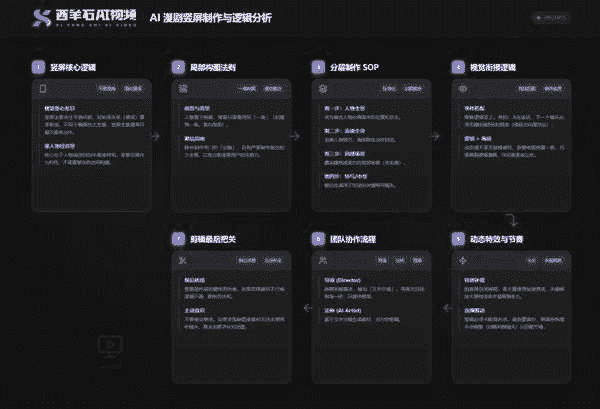

图 3-12　AI 漫剧竖屏制作与逻辑分析 EXr6287u6NNVz+GYLY+7SDk226FstKIHdC0bNoQkB2Nqi1xSR0yxPmwrTs5gRi/BtfSbid6dBhii9q7cz2pIyA==

## 3.6 场景设计原则与 AI 场景提示词结构

角色决定了谁在画面中，场景则决定了故事发生在何处。在 AI 漫剧与视频创作中，场景承担着空间化叙事的功能，它直接影响了人物关系的远近、情绪浓淡层次以及镜头调度的合理性。

新手常犯的错误是忽略场景设计，导致生成的精美角色放入画面后显得格格不入，呈现出明显的“贴图感”。成熟的创作流程要求创作者在剧本阶段就开始系统规划场景，而非在画面生成阶段才临时起意。

### 3.6.1　从剧本中拆解场景

在启动 AI 绘图前，首要任务是回归剧本。创作者应整理一份场景清单表，列出全剧或本集反复出现的关键场景，如表 3-2 所示。

表 3-2　场景清单表（示例）

在传统影视与动画流程中，导演优先确立主场景，是为了降低后期返工成本并建立统一的美学基调。主场景在商业项目中还承担着品牌识别与世界观标识的作用。当主场景的风格稳定后，后续大量镜头便能在此空间体系中高效展开。AI 创作虽然改变了“搭景”的实现方式——将三维建模或手绘转换为提示词生成，但这一核心逻辑并未改变。

### 3.6.2　场景设计的核心原则

即便使用 AI 生成，传统场景设计的三大核心原则依然是确保画面质量的关键。

#### 1．空间层次必须清晰

具备叙事能力的空间，通常包含三个层次，即前景、中景与远景。前景可以是栏杆、树枝、门框或桌角等元素，用来制造空间纵深和镜头层次；中景是角色主要活动的区域，也是叙事发生的核心空间；远景则承担世界观与尺度感，如建筑轮廓、山脉、城市天际线等。

缺乏层次结构的场景容易退化为平面化的插画，难以支持后续的分镜拆解与动态运镜需求。

#### 2．建立动线与视线引导

优秀的场景设计能借助环境元素引导观众视线。地面的纹理走向、建筑的排列方式或灯光的投射方向，都是天然的视觉引导工具。例如，对话场景可利用长廊的透视线条将视线自然引向人物，冲突场景可借用围合结构制造紧张与压迫感。设计场景时需遵循一个关键标准：即便画面中不出现角色，空间本身也应具备暗示故事的能力。

#### 3．光源与时间决定情绪

场景的光源方向、色温以及所处的时间点，对画面情绪的影响往往大于具体的物体细节。清晨、午后、黄昏与深夜所携带的情绪信息截然不同。在 AI 生成过程中，必须明确描述光源属性，否则模型容易生成光影平淡、情绪模糊的“糖水片”。

### 3.6.3　AI 场景提示词的结构

为了保证生成的场景既美观又实用，建议使用固定的提示词结构： 【空间类型】+【时代与风格】+【主要结构与物件】+【光线与时间】+【氛围与情绪】+【是否有角色】+【画面规格】。

基于此结构的实战案例参考如下。

古风修真学院的练武场，外景，宽阔的石质广场，地面刻有巨大的阵法纹路，四周是高耸的石柱与旗帜，背景可以隐约看到远处的山脉和主楼。下午偏晚的阳光从左上方斜照进来，形成长长的影子，整体色调偏冷，略带一点金色余晖，营造庄严又略微压迫的氛围。画面中暂时不要出现任何人物，适合作为动画分镜的背景，高精细度。

根据以上提示词生成的结果如图 3-11 所示。

在生成设置上，建议优先选择 21 : 9 的长幅比例。这种比例更接近电影分镜的画幅，在后期处理中，无论是进行裁切、推拉运镜，还是合成角色，都具备更大的容错空间。

图 3-11　提示词生成结果

最后，创作者需注意横屏与竖屏作品在场景逻辑上的差异。横屏作品强调空间关系与环境叙事，其逻辑接近影视片，对场景的完整度要求极高；竖屏作品则侧重于人物展现与信息密度，场景主要承担情绪烘托作用，环境元素可相对简化。竖屏的整体构图与场景逻辑，可以参考如图 3-12 所示的思路。

图 3-12　AI 漫剧竖屏制作与逻辑分析 EXr6287u6NNVz+GYLY+7SDk226FstKIHdC0bNoQkB2Nqi1xSR0yxPmwrTs5gRi/BtfSbid6dBhii9q7cz2pIyA==

## 3.6 场景设计原则与 AI 场景提示词结构

角色决定了谁在画面中，场景则决定了故事发生在何处。在 AI 漫剧与视频创作中，场景承担着空间化叙事的功能，它直接影响了人物关系的远近、情绪浓淡层次以及镜头调度的合理性。

新手常犯的错误是忽略场景设计，导致生成的精美角色放入画面后显得格格不入，呈现出明显的“贴图感”。成熟的创作流程要求创作者在剧本阶段就开始系统规划场景，而非在画面生成阶段才临时起意。

### 3.6.1　从剧本中拆解场景

在启动 AI 绘图前，首要任务是回归剧本。创作者应整理一份场景清单表，列出全剧或本集反复出现的关键场景，如表 3-2 所示。

表 3-2　场景清单表（示例）

在传统影视与动画流程中，导演优先确立主场景，是为了降低后期返工成本并建立统一的美学基调。主场景在商业项目中还承担着品牌识别与世界观标识的作用。当主场景的风格稳定后，后续大量镜头便能在此空间体系中高效展开。AI 创作虽然改变了“搭景”的实现方式——将三维建模或手绘转换为提示词生成，但这一核心逻辑并未改变。

### 3.6.2　场景设计的核心原则

即便使用 AI 生成，传统场景设计的三大核心原则依然是确保画面质量的关键。

#### 1．空间层次必须清晰

具备叙事能力的空间，通常包含三个层次，即前景、中景与远景。前景可以是栏杆、树枝、门框或桌角等元素，用来制造空间纵深和镜头层次；中景是角色主要活动的区域，也是叙事发生的核心空间；远景则承担世界观与尺度感，如建筑轮廓、山脉、城市天际线等。

缺乏层次结构的场景容易退化为平面化的插画，难以支持后续的分镜拆解与动态运镜需求。

#### 2．建立动线与视线引导

优秀的场景设计能借助环境元素引导观众视线。地面的纹理走向、建筑的排列方式或灯光的投射方向，都是天然的视觉引导工具。例如，对话场景可利用长廊的透视线条将视线自然引向人物，冲突场景可借用围合结构制造紧张与压迫感。设计场景时需遵循一个关键标准：即便画面中不出现角色，空间本身也应具备暗示故事的能力。

#### 3．光源与时间决定情绪

场景的光源方向、色温以及所处的时间点，对画面情绪的影响往往大于具体的物体细节。清晨、午后、黄昏与深夜所携带的情绪信息截然不同。在 AI 生成过程中，必须明确描述光源属性，否则模型容易生成光影平淡、情绪模糊的“糖水片”。

### 3.6.3　AI 场景提示词的结构

为了保证生成的场景既美观又实用，建议使用固定的提示词结构： 【空间类型】+【时代与风格】+【主要结构与物件】+【光线与时间】+【氛围与情绪】+【是否有角色】+【画面规格】。

基于此结构的实战案例参考如下。

古风修真学院的练武场，外景，宽阔的石质广场，地面刻有巨大的阵法纹路，四周是高耸的石柱与旗帜，背景可以隐约看到远处的山脉和主楼。下午偏晚的阳光从左上方斜照进来，形成长长的影子，整体色调偏冷，略带一点金色余晖，营造庄严又略微压迫的氛围。画面中暂时不要出现任何人物，适合作为动画分镜的背景，高精细度。

根据以上提示词生成的结果如图 3-11 所示。

在生成设置上，建议优先选择 21 : 9 的长幅比例。这种比例更接近电影分镜的画幅，在后期处理中，无论是进行裁切、推拉运镜，还是合成角色，都具备更大的容错空间。

图 3-11　提示词生成结果

最后，创作者需注意横屏与竖屏作品在场景逻辑上的差异。横屏作品强调空间关系与环境叙事，其逻辑接近影视片，对场景的完整度要求极高；竖屏作品则侧重于人物展现与信息密度，场景主要承担情绪烘托作用，环境元素可相对简化。竖屏的整体构图与场景逻辑，可以参考如图 3-12 所示的思路。

图 3-12　AI 漫剧竖屏制作与逻辑分析 EXr6287u6NNVz+GYLY+7SDk226FstKIHdC0bNoQkB2Nqi1xSR0yxPmwrTs5gRi/BtfSbid6dBhii9q7cz2pIyA==

## 3.6 场景设计原则与 AI 场景提示词结构

角色决定了谁在画面中，场景则决定了故事发生在何处。在 AI 漫剧与视频创作中，场景承担着空间化叙事的功能，它直接影响了人物关系的远近、情绪浓淡层次以及镜头调度的合理性。

新手常犯的错误是忽略场景设计，导致生成的精美角色放入画面后显得格格不入，呈现出明显的“贴图感”。成熟的创作流程要求创作者在剧本阶段就开始系统规划场景，而非在画面生成阶段才临时起意。

### 3.6.1　从剧本中拆解场景

在启动 AI 绘图前，首要任务是回归剧本。创作者应整理一份场景清单表，列出全剧或本集反复出现的关键场景，如表 3-2 所示。

表 3-2　场景清单表（示例）

在传统影视与动画流程中，导演优先确立主场景，是为了降低后期返工成本并建立统一的美学基调。主场景在商业项目中还承担着品牌识别与世界观标识的作用。当主场景的风格稳定后，后续大量镜头便能在此空间体系中高效展开。AI 创作虽然改变了“搭景”的实现方式——将三维建模或手绘转换为提示词生成，但这一核心逻辑并未改变。

### 3.6.2　场景设计的核心原则

即便使用 AI 生成，传统场景设计的三大核心原则依然是确保画面质量的关键。

#### 1．空间层次必须清晰

具备叙事能力的空间，通常包含三个层次，即前景、中景与远景。前景可以是栏杆、树枝、门框或桌角等元素，用来制造空间纵深和镜头层次；中景是角色主要活动的区域，也是叙事发生的核心空间；远景则承担世界观与尺度感，如建筑轮廓、山脉、城市天际线等。

缺乏层次结构的场景容易退化为平面化的插画，难以支持后续的分镜拆解与动态运镜需求。

#### 2．建立动线与视线引导

优秀的场景设计能借助环境元素引导观众视线。地面的纹理走向、建筑的排列方式或灯光的投射方向，都是天然的视觉引导工具。例如，对话场景可利用长廊的透视线条将视线自然引向人物，冲突场景可借用围合结构制造紧张与压迫感。设计场景时需遵循一个关键标准：即便画面中不出现角色，空间本身也应具备暗示故事的能力。

#### 3．光源与时间决定情绪

场景的光源方向、色温以及所处的时间点，对画面情绪的影响往往大于具体的物体细节。清晨、午后、黄昏与深夜所携带的情绪信息截然不同。在 AI 生成过程中，必须明确描述光源属性，否则模型容易生成光影平淡、情绪模糊的“糖水片”。

### 3.6.3　AI 场景提示词的结构

为了保证生成的场景既美观又实用，建议使用固定的提示词结构： 【空间类型】+【时代与风格】+【主要结构与物件】+【光线与时间】+【氛围与情绪】+【是否有角色】+【画面规格】。

基于此结构的实战案例参考如下。

古风修真学院的练武场，外景，宽阔的石质广场，地面刻有巨大的阵法纹路，四周是高耸的石柱与旗帜，背景可以隐约看到远处的山脉和主楼。下午偏晚的阳光从左上方斜照进来，形成长长的影子，整体色调偏冷，略带一点金色余晖，营造庄严又略微压迫的氛围。画面中暂时不要出现任何人物，适合作为动画分镜的背景，高精细度。

根据以上提示词生成的结果如图 3-11 所示。

在生成设置上，建议优先选择 21 : 9 的长幅比例。这种比例更接近电影分镜的画幅，在后期处理中，无论是进行裁切、推拉运镜，还是合成角色，都具备更大的容错空间。

图 3-11　提示词生成结果

最后，创作者需注意横屏与竖屏作品在场景逻辑上的差异。横屏作品强调空间关系与环境叙事，其逻辑接近影视片，对场景的完整度要求极高；竖屏作品则侧重于人物展现与信息密度，场景主要承担情绪烘托作用，环境元素可相对简化。竖屏的整体构图与场景逻辑，可以参考如图 3-12 所示的思路。

图 3-12　AI 漫剧竖屏制作与逻辑分析 EXr6287u6NNVz+GYLY+7SDk226FstKIHdC0bNoQkB2Nqi1xSR0yxPmwrTs5gRi/BtfSbid6dBhii9q7cz2pIyA==

## 3.7 AI 漫剧中的道具设计

在叙事作品中，道具不仅是放置在画面里的物件，更是故事推进的工具、视觉叙事的符号载体，以及连接角色行为逻辑的纽带。在“AI 生成+编剧分镜”的制作流程中，道具的稳定性与一致性是业界公认的操作难点。本节将结合影视动画的传统叙事逻辑与 AI 生成实践，梳理一套具备可复用性的道具设计原则。

### 3.7.1　道具在叙事中的承担的功能

道具在视觉叙事中承担的功能主要分为三类，如图 3-13 所示。

图 3-13　道具在视觉叙事中的三大功能

核心叙事道具是情节推进的关键物件，例如主角的武器、魔法物品或关键信件。它们不仅出现在镜头里，更与角色的动作和情节的转折点直接关联；角色连接道具与角色身份、性格或经历紧密相关，如主人公的佩饰、杯子或眼镜，它们的主要作用在于强化人物塑造；背景中的家具、工作台、街道物件等属于环境氛围道具，用于构建空间真实感与年代氛围，丰富画面的语境信息。

即使是看似不起眼的道具，若经过严谨的逻辑设计，也能成为深化叙事、暗示角色性格或推动剧情发展的关键视觉线索。

### 3.7.2　AI 漫剧中道具设计要解决的问题

在传统动画或影视制作中，道具一旦完成建模或设定稿，便作为静态的、可重复调用的“标准化资产”。但在 AI 生成流程中，道具不再是存储在硬盘里的固定文件，而是每一次都要通过提示词重新生成的“概率性结果”。

这种从“固定资产”到“概率生成”的底层逻辑转变，给 AI 漫剧制作带来了以下三个核心痛点。

#### 1．视觉一致性问题

视觉一致性问题是目前 AI 漫剧制作中最大的技术壁垒。以主角随身携带的玉佩为例，在第一镜中可能是圆形的，到了第十镜可能变成了椭圆；在特写中纹理清晰，拉远后可能就简化成了一个模糊色块。这种“物体漂移”现象在单图生成时不易察觉，一旦连接成视频，道具形状、颜色、细节的持续跳动，会严重破坏观众的沉浸感，使作品显得廉价且不专业。AI 模型倾向于根据画面整体构图与语义去“脑补”道具的形态，而不会记得它在上一镜中长什么样。图 3-14 展示了一组存在视觉一致性问题的图片，其中角色的佩剑位置以及样式有明显差异。

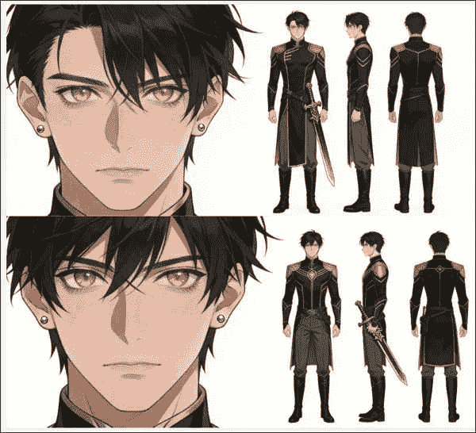

图 3-14　存在视觉一致性问题的图片示例

#### 2．物理交互与空间逻辑的缺失

AI 擅长画“好看的图”，但不擅长处理“真实的物理关系”。当角色需要手持道具（如握剑、端茶杯、拿枪）时，这一问题尤为突出。图 3-15 展示了一张存在物理交互与空间逻辑问题的图片，其中角色的握剑细节不符合常理。

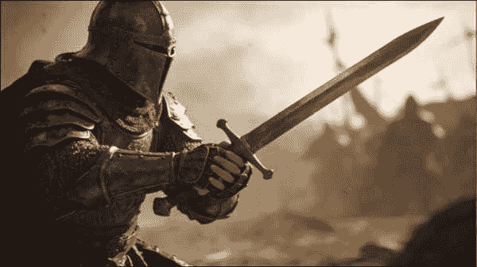

图 3-15　存在物理交互与空间逻辑问题的图片示例

#### 3．叙事功能的装饰化

AI 模型在生成道具时，往往带有“过度美化”的倾向。它会自动为物体添加大量无意义的装饰线条、光效或复杂纹理，以追求画面的“精细感”。然而在叙事中，道具的设计必须服务于剧情逻辑。例如，一个穷困潦倒的剑客，其剑鞘应该是破旧、缠满麻绳的，而 AI 可能会生成一把镶金带银的华丽宝剑。这种为了视觉美观而牺牲逻辑的“过度设计”，会直接削弱道具在剧本中原本承担的叙事功能，甚至对观众的理解产生误导。

因此，在 AI 漫剧的设计流程中，道具绝不能被视为生图时的“随机赠品”。它必须从一开始就被定义为需要被策略化描述、标准化管理且强制约束的核心资产。只有系统性地解决了这三个问题，道具才能真正成为故事中的一部分。

### 3.7.3　道具设计的基本原则

在 AI 漫剧制作中，道具设计建议遵循以下 4 个原则。

#### 1．从功能出发，拒绝外观先行

真正有价值的道具必须能推动故事情节、服务角色或强化场景。设计前需明确其在故事中的作用、归属以及象征意义。例如一把剑或一枚玉佩，其外观设计应基于背后的身份逻辑与情绪纽带。

#### 2．视觉语言与世界观统一

道具的造型、材质、纹理、色彩及佩戴方式，需与作品整体视觉风格保持一致。蒸汽朋克风格的道具要凸显金属质感与机械结构，未来科幻风格的道具则需强调科技感。

#### 3．主次分明，识别清晰

道具在画面中的信息应层次分明。若同一画面中出现多个道具，必须明确叙事优先级，确保观众能迅速识别关键道具。

#### 4．注重可交互性与实用性

道具往往需要与角色发生互动，设计时必须考量其尺寸比例、握持方式及运动轨迹的逻辑合理性。

### 3.7.4　AI 道具提示词的结构与写法

为了保证生成结果可控、连贯且可复用，推荐使用以下固定结构进行描述： 【视觉风格】+【主体对象】+【用途/情节功能】+【时代标签】+【外观细节】+【材质与色彩】+【交互属性】+【镜头需求】。

各要素含义如下。

**·** 视觉风格：需与 AI 漫剧整体保持一致，如 2D 日本动漫、3D 国风动漫等。

**·** 主体对象：道具的具体名称，如“古代战刀”“魔法石板”。

**·** 用途/情节功能：道具在剧情中的具体作用。

**·** 时代标签：也就是时代设定，如古风、现代、未来等。

**·** 外观细节：包括形状、纹理、符号雕刻等。

**·** 材质与色彩：描述木质、钢铁、玉石或发光效果。

**·** 交互属性：描述是否可被拿起、操作或触发特定效果。

**·** 镜头需求：明确景别，如近景或特写。

基于此结构编写的提示词，能确保生成的道具兼具视觉质感与清晰的叙事功能。以下是一条根据以上结构创作的提示词。

国风 3D 动漫，古风战场上的长剑道具。剑身略呈弯曲，上面雕刻祥云与龙形，白玉护手点缀青色宝石。用料为锻钢与白玉，对应古典审美。生成高细节正侧特写，风格典雅庄重，不出现其他装饰物。

根据以上提示词生成的图片如图 3-16 所示。

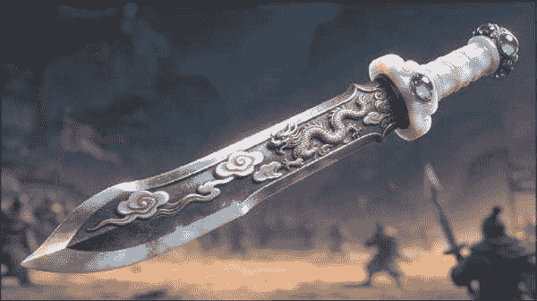

图 3-16　AI 生成的古风战场上的长剑道具

### 3.7.5　典型类型道具设计策略

道具种类的不同，决定了 AI 模型对其处理权重的差异。对于不同类型的道具，在撰写提示词与建立资产库时，关注的核心维度应当截然不同，如图 3-17 所示。

#### 1．象征性道具

这类道具通常与角色的核心身份或情感线索深度绑定，例如，家传的玉佩、特工的专属徽章，或者一枚贯穿全剧的戒指。它们往往承载着“见物如见人”的叙事功能。

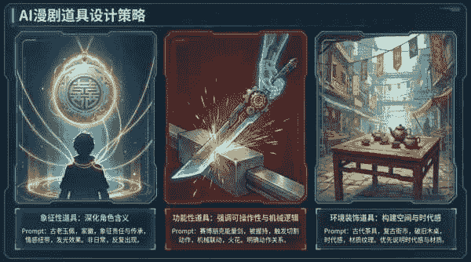

图 3-17　AI 漫剧道具设计策略

（1）AI 生成痛点。

在全景或中景镜头中，AI 极易将这些小物件简化为模糊的色块，导致关键信息丢失。

（2）设计策略。

必须单独生成一张“产品级”的超清特写图作为资产。在提示词中，要像拍摄商业广告一样描述它，强调材质的光泽（如“温润的羊脂玉”“带划痕的黄铜”）与独特的纹理细节（如“表面刻有细微的家族族徽”）。

（3）操作建议。

在提示词中加入“微距摄影”“顶光”“纯色背景”等词汇，确立其作为独立视觉符号的地位，方便后期在分镜中进行贴图或局部重绘。

#### 2．功能性道具

功能性道具涵盖武器、乐器、交通工具及各种机械装置。这类道具不仅要好看，更要“好用”。它们在画面中往往伴随着角色的剧烈动作。

（1）AI 生成痛点。

AI 经常生成“没有握把的剑”“扳机位置错误的枪”或者“手指穿过杯壁”的违和画面。这是因为 AI 模型缺乏真实的物理与人体工学认知。

（2）设计策略。

提示词不能只描述物体本身，必须包含交互关系的说明。要明确描述手部如何接触道具，如“手指紧扣扳机”“手掌包裹剑柄”。对于机械类道具，还要强调结构合理性，避免生成看似复杂实则无法运作的伪科技部件。

（3）操作建议。

在生成此类道具时，不妨直接带上“手部模型”一起生成（例如提示词中加入“戴着战术手套的手紧握着……”），这样能强制 AI 计算出符合人体工学的道具形态。

#### 3．环境装饰道具

这类道具用于填充背景，构建空间的可信度，如桌上的茶具、书架上的卷轴、街边的旗帜或路灯。它们是世界观的基石，但绝不能喧宾夺主。

（1）AI 生成痛点。

AI 在生成背景道具时有时会出现“过度渲染”的问题，例如，把背景里的一个普通花瓶生成得光彩夺目，抢走了主角的视觉焦点，或者在古风场景里生成了现代风格的马克杯，导致时代感错乱。

（2）设计策略。

核心在于“藏”。提示词应侧重于描述“时代感”与“做旧质感”，而非具体的物体结构。可使用“磨损的”“积灰的”“背景虚化”等词汇，让道具体面地退居幕后。

（3）操作建议。

严格统一时代标签。如果是赛博朋克，背景道具必须带有“霓虹”“金属废料”等属性；如果是修仙玄幻，则统一为“木质”“陶制”或“青铜”等材质。通过材质的统一性，在潜意识层面向观众传递统一的世界观信息。

### 3.7.6　道具的一致性管理与复用指南

在长周期的 AI 漫剧制作中，必须将道具视为长期资产进行系统化管理。具体可参照如图 3-18 所示的 AI 漫剧道具的一致性管理与复用指南。

在 AI 漫剧的长期制作过程中，需将道具视作长期资产，为此要搭建专属道具库，对生成成功且符合设定的道具，同步存档其成品截图与对应的完整提示词；同时为每个道具标注版本号与风格标签，以实现统一化管理；在不同镜头制作时，还可复用已有道具的提示词与实例作为提示词底板，保障道具呈现的视觉一致性；针对关键道具，还可制作三视图及多角度交互样本，进一步提升模型生成的稳定性。

图 3-18　AI 漫剧道具的一致性管理与复用指南 EXr6287u6NNVz+GYLY+7SDk226FstKIHdC0bNoQkB2Nqi1xSR0yxPmwrTs5gRi/BtfSbid6dBhii9q7cz2pIyA==

## 3.7 AI 漫剧中的道具设计

在叙事作品中，道具不仅是放置在画面里的物件，更是故事推进的工具、视觉叙事的符号载体，以及连接角色行为逻辑的纽带。在“AI 生成+编剧分镜”的制作流程中，道具的稳定性与一致性是业界公认的操作难点。本节将结合影视动画的传统叙事逻辑与 AI 生成实践，梳理一套具备可复用性的道具设计原则。

### 3.7.1　道具在叙事中的承担的功能

道具在视觉叙事中承担的功能主要分为三类，如图 3-13 所示。

图 3-13　道具在视觉叙事中的三大功能

核心叙事道具是情节推进的关键物件，例如主角的武器、魔法物品或关键信件。它们不仅出现在镜头里，更与角色的动作和情节的转折点直接关联；角色连接道具与角色身份、性格或经历紧密相关，如主人公的佩饰、杯子或眼镜，它们的主要作用在于强化人物塑造；背景中的家具、工作台、街道物件等属于环境氛围道具，用于构建空间真实感与年代氛围，丰富画面的语境信息。

即使是看似不起眼的道具，若经过严谨的逻辑设计，也能成为深化叙事、暗示角色性格或推动剧情发展的关键视觉线索。

### 3.7.2　AI 漫剧中道具设计要解决的问题

在传统动画或影视制作中，道具一旦完成建模或设定稿，便作为静态的、可重复调用的“标准化资产”。但在 AI 生成流程中，道具不再是存储在硬盘里的固定文件，而是每一次都要通过提示词重新生成的“概率性结果”。

这种从“固定资产”到“概率生成”的底层逻辑转变，给 AI 漫剧制作带来了以下三个核心痛点。

#### 1．视觉一致性问题

视觉一致性问题是目前 AI 漫剧制作中最大的技术壁垒。以主角随身携带的玉佩为例，在第一镜中可能是圆形的，到了第十镜可能变成了椭圆；在特写中纹理清晰，拉远后可能就简化成了一个模糊色块。这种“物体漂移”现象在单图生成时不易察觉，一旦连接成视频，道具形状、颜色、细节的持续跳动，会严重破坏观众的沉浸感，使作品显得廉价且不专业。AI 模型倾向于根据画面整体构图与语义去“脑补”道具的形态，而不会记得它在上一镜中长什么样。图 3-14 展示了一组存在视觉一致性问题的图片，其中角色的佩剑位置以及样式有明显差异。

图 3-14　存在视觉一致性问题的图片示例

#### 2．物理交互与空间逻辑的缺失

AI 擅长画“好看的图”，但不擅长处理“真实的物理关系”。当角色需要手持道具（如握剑、端茶杯、拿枪）时，这一问题尤为突出。图 3-15 展示了一张存在物理交互与空间逻辑问题的图片，其中角色的握剑细节不符合常理。

图 3-15　存在物理交互与空间逻辑问题的图片示例

#### 3．叙事功能的装饰化

AI 模型在生成道具时，往往带有“过度美化”的倾向。它会自动为物体添加大量无意义的装饰线条、光效或复杂纹理，以追求画面的“精细感”。然而在叙事中，道具的设计必须服务于剧情逻辑。例如，一个穷困潦倒的剑客，其剑鞘应该是破旧、缠满麻绳的，而 AI 可能会生成一把镶金带银的华丽宝剑。这种为了视觉美观而牺牲逻辑的“过度设计”，会直接削弱道具在剧本中原本承担的叙事功能，甚至对观众的理解产生误导。

因此，在 AI 漫剧的设计流程中，道具绝不能被视为生图时的“随机赠品”。它必须从一开始就被定义为需要被策略化描述、标准化管理且强制约束的核心资产。只有系统性地解决了这三个问题，道具才能真正成为故事中的一部分。

### 3.7.3　道具设计的基本原则

在 AI 漫剧制作中，道具设计建议遵循以下 4 个原则。

#### 1．从功能出发，拒绝外观先行

真正有价值的道具必须能推动故事情节、服务角色或强化场景。设计前需明确其在故事中的作用、归属以及象征意义。例如一把剑或一枚玉佩，其外观设计应基于背后的身份逻辑与情绪纽带。

#### 2．视觉语言与世界观统一

道具的造型、材质、纹理、色彩及佩戴方式，需与作品整体视觉风格保持一致。蒸汽朋克风格的道具要凸显金属质感与机械结构，未来科幻风格的道具则需强调科技感。

#### 3．主次分明，识别清晰

道具在画面中的信息应层次分明。若同一画面中出现多个道具，必须明确叙事优先级，确保观众能迅速识别关键道具。

#### 4．注重可交互性与实用性

道具往往需要与角色发生互动，设计时必须考量其尺寸比例、握持方式及运动轨迹的逻辑合理性。

### 3.7.4　AI 道具提示词的结构与写法

为了保证生成结果可控、连贯且可复用，推荐使用以下固定结构进行描述： 【视觉风格】+【主体对象】+【用途/情节功能】+【时代标签】+【外观细节】+【材质与色彩】+【交互属性】+【镜头需求】。

各要素含义如下。

**·** 视觉风格：需与 AI 漫剧整体保持一致，如 2D 日本动漫、3D 国风动漫等。

**·** 主体对象：道具的具体名称，如“古代战刀”“魔法石板”。

**·** 用途/情节功能：道具在剧情中的具体作用。

**·** 时代标签：也就是时代设定，如古风、现代、未来等。

**·** 外观细节：包括形状、纹理、符号雕刻等。

**·** 材质与色彩：描述木质、钢铁、玉石或发光效果。

**·** 交互属性：描述是否可被拿起、操作或触发特定效果。

**·** 镜头需求：明确景别，如近景或特写。

基于此结构编写的提示词，能确保生成的道具兼具视觉质感与清晰的叙事功能。以下是一条根据以上结构创作的提示词。

国风 3D 动漫，古风战场上的长剑道具。剑身略呈弯曲，上面雕刻祥云与龙形，白玉护手点缀青色宝石。用料为锻钢与白玉，对应古典审美。生成高细节正侧特写，风格典雅庄重，不出现其他装饰物。

根据以上提示词生成的图片如图 3-16 所示。

图 3-16　AI 生成的古风战场上的长剑道具

### 3.7.5　典型类型道具设计策略

道具种类的不同，决定了 AI 模型对其处理权重的差异。对于不同类型的道具，在撰写提示词与建立资产库时，关注的核心维度应当截然不同，如图 3-17 所示。

#### 1．象征性道具

这类道具通常与角色的核心身份或情感线索深度绑定，例如，家传的玉佩、特工的专属徽章，或者一枚贯穿全剧的戒指。它们往往承载着“见物如见人”的叙事功能。

图 3-17　AI 漫剧道具设计策略

（1）AI 生成痛点。

在全景或中景镜头中，AI 极易将这些小物件简化为模糊的色块，导致关键信息丢失。

（2）设计策略。

必须单独生成一张“产品级”的超清特写图作为资产。在提示词中，要像拍摄商业广告一样描述它，强调材质的光泽（如“温润的羊脂玉”“带划痕的黄铜”）与独特的纹理细节（如“表面刻有细微的家族族徽”）。

（3）操作建议。

在提示词中加入“微距摄影”“顶光”“纯色背景”等词汇，确立其作为独立视觉符号的地位，方便后期在分镜中进行贴图或局部重绘。

#### 2．功能性道具

功能性道具涵盖武器、乐器、交通工具及各种机械装置。这类道具不仅要好看，更要“好用”。它们在画面中往往伴随着角色的剧烈动作。

（1）AI 生成痛点。

AI 经常生成“没有握把的剑”“扳机位置错误的枪”或者“手指穿过杯壁”的违和画面。这是因为 AI 模型缺乏真实的物理与人体工学认知。

（2）设计策略。

提示词不能只描述物体本身，必须包含交互关系的说明。要明确描述手部如何接触道具，如“手指紧扣扳机”“手掌包裹剑柄”。对于机械类道具，还要强调结构合理性，避免生成看似复杂实则无法运作的伪科技部件。

（3）操作建议。

在生成此类道具时，不妨直接带上“手部模型”一起生成（例如提示词中加入“戴着战术手套的手紧握着……”），这样能强制 AI 计算出符合人体工学的道具形态。

#### 3．环境装饰道具

这类道具用于填充背景，构建空间的可信度，如桌上的茶具、书架上的卷轴、街边的旗帜或路灯。它们是世界观的基石，但绝不能喧宾夺主。

（1）AI 生成痛点。

AI 在生成背景道具时有时会出现“过度渲染”的问题，例如，把背景里的一个普通花瓶生成得光彩夺目，抢走了主角的视觉焦点，或者在古风场景里生成了现代风格的马克杯，导致时代感错乱。

（2）设计策略。

核心在于“藏”。提示词应侧重于描述“时代感”与“做旧质感”，而非具体的物体结构。可使用“磨损的”“积灰的”“背景虚化”等词汇，让道具体面地退居幕后。

（3）操作建议。

严格统一时代标签。如果是赛博朋克，背景道具必须带有“霓虹”“金属废料”等属性；如果是修仙玄幻，则统一为“木质”“陶制”或“青铜”等材质。通过材质的统一性，在潜意识层面向观众传递统一的世界观信息。

### 3.7.6　道具的一致性管理与复用指南

在长周期的 AI 漫剧制作中，必须将道具视为长期资产进行系统化管理。具体可参照如图 3-18 所示的 AI 漫剧道具的一致性管理与复用指南。

在 AI 漫剧的长期制作过程中，需将道具视作长期资产，为此要搭建专属道具库，对生成成功且符合设定的道具，同步存档其成品截图与对应的完整提示词；同时为每个道具标注版本号与风格标签，以实现统一化管理；在不同镜头制作时，还可复用已有道具的提示词与实例作为提示词底板，保障道具呈现的视觉一致性；针对关键道具，还可制作三视图及多角度交互样本，进一步提升模型生成的稳定性。

图 3-18　AI 漫剧道具的一致性管理与复用指南 EXr6287u6NNVz+GYLY+7SDk226FstKIHdC0bNoQkB2Nqi1xSR0yxPmwrTs5gRi/BtfSbid6dBhii9q7cz2pIyA==

## 3.7 AI 漫剧中的道具设计

在叙事作品中，道具不仅是放置在画面里的物件，更是故事推进的工具、视觉叙事的符号载体，以及连接角色行为逻辑的纽带。在“AI 生成+编剧分镜”的制作流程中，道具的稳定性与一致性是业界公认的操作难点。本节将结合影视动画的传统叙事逻辑与 AI 生成实践，梳理一套具备可复用性的道具设计原则。

### 3.7.1　道具在叙事中的承担的功能

道具在视觉叙事中承担的功能主要分为三类，如图 3-13 所示。

图 3-13　道具在视觉叙事中的三大功能

核心叙事道具是情节推进的关键物件，例如主角的武器、魔法物品或关键信件。它们不仅出现在镜头里，更与角色的动作和情节的转折点直接关联；角色连接道具与角色身份、性格或经历紧密相关，如主人公的佩饰、杯子或眼镜，它们的主要作用在于强化人物塑造；背景中的家具、工作台、街道物件等属于环境氛围道具，用于构建空间真实感与年代氛围，丰富画面的语境信息。

即使是看似不起眼的道具，若经过严谨的逻辑设计，也能成为深化叙事、暗示角色性格或推动剧情发展的关键视觉线索。

### 3.7.2　AI 漫剧中道具设计要解决的问题

在传统动画或影视制作中，道具一旦完成建模或设定稿，便作为静态的、可重复调用的“标准化资产”。但在 AI 生成流程中，道具不再是存储在硬盘里的固定文件，而是每一次都要通过提示词重新生成的“概率性结果”。

这种从“固定资产”到“概率生成”的底层逻辑转变，给 AI 漫剧制作带来了以下三个核心痛点。

#### 1．视觉一致性问题

视觉一致性问题是目前 AI 漫剧制作中最大的技术壁垒。以主角随身携带的玉佩为例，在第一镜中可能是圆形的，到了第十镜可能变成了椭圆；在特写中纹理清晰，拉远后可能就简化成了一个模糊色块。这种“物体漂移”现象在单图生成时不易察觉，一旦连接成视频，道具形状、颜色、细节的持续跳动，会严重破坏观众的沉浸感，使作品显得廉价且不专业。AI 模型倾向于根据画面整体构图与语义去“脑补”道具的形态，而不会记得它在上一镜中长什么样。图 3-14 展示了一组存在视觉一致性问题的图片，其中角色的佩剑位置以及样式有明显差异。

图 3-14　存在视觉一致性问题的图片示例

#### 2．物理交互与空间逻辑的缺失

AI 擅长画“好看的图”，但不擅长处理“真实的物理关系”。当角色需要手持道具（如握剑、端茶杯、拿枪）时，这一问题尤为突出。图 3-15 展示了一张存在物理交互与空间逻辑问题的图片，其中角色的握剑细节不符合常理。

图 3-15　存在物理交互与空间逻辑问题的图片示例

#### 3．叙事功能的装饰化

AI 模型在生成道具时，往往带有“过度美化”的倾向。它会自动为物体添加大量无意义的装饰线条、光效或复杂纹理，以追求画面的“精细感”。然而在叙事中，道具的设计必须服务于剧情逻辑。例如，一个穷困潦倒的剑客，其剑鞘应该是破旧、缠满麻绳的，而 AI 可能会生成一把镶金带银的华丽宝剑。这种为了视觉美观而牺牲逻辑的“过度设计”，会直接削弱道具在剧本中原本承担的叙事功能，甚至对观众的理解产生误导。

因此，在 AI 漫剧的设计流程中，道具绝不能被视为生图时的“随机赠品”。它必须从一开始就被定义为需要被策略化描述、标准化管理且强制约束的核心资产。只有系统性地解决了这三个问题，道具才能真正成为故事中的一部分。

### 3.7.3　道具设计的基本原则

在 AI 漫剧制作中，道具设计建议遵循以下 4 个原则。

#### 1．从功能出发，拒绝外观先行

真正有价值的道具必须能推动故事情节、服务角色或强化场景。设计前需明确其在故事中的作用、归属以及象征意义。例如一把剑或一枚玉佩，其外观设计应基于背后的身份逻辑与情绪纽带。

#### 2．视觉语言与世界观统一

道具的造型、材质、纹理、色彩及佩戴方式，需与作品整体视觉风格保持一致。蒸汽朋克风格的道具要凸显金属质感与机械结构，未来科幻风格的道具则需强调科技感。

#### 3．主次分明，识别清晰

道具在画面中的信息应层次分明。若同一画面中出现多个道具，必须明确叙事优先级，确保观众能迅速识别关键道具。

#### 4．注重可交互性与实用性

道具往往需要与角色发生互动，设计时必须考量其尺寸比例、握持方式及运动轨迹的逻辑合理性。

### 3.7.4　AI 道具提示词的结构与写法

为了保证生成结果可控、连贯且可复用，推荐使用以下固定结构进行描述： 【视觉风格】+【主体对象】+【用途/情节功能】+【时代标签】+【外观细节】+【材质与色彩】+【交互属性】+【镜头需求】。

各要素含义如下。

**·** 视觉风格：需与 AI 漫剧整体保持一致，如 2D 日本动漫、3D 国风动漫等。

**·** 主体对象：道具的具体名称，如“古代战刀”“魔法石板”。

**·** 用途/情节功能：道具在剧情中的具体作用。

**·** 时代标签：也就是时代设定，如古风、现代、未来等。

**·** 外观细节：包括形状、纹理、符号雕刻等。

**·** 材质与色彩：描述木质、钢铁、玉石或发光效果。

**·** 交互属性：描述是否可被拿起、操作或触发特定效果。

**·** 镜头需求：明确景别，如近景或特写。

基于此结构编写的提示词，能确保生成的道具兼具视觉质感与清晰的叙事功能。以下是一条根据以上结构创作的提示词。

国风 3D 动漫，古风战场上的长剑道具。剑身略呈弯曲，上面雕刻祥云与龙形，白玉护手点缀青色宝石。用料为锻钢与白玉，对应古典审美。生成高细节正侧特写，风格典雅庄重，不出现其他装饰物。

根据以上提示词生成的图片如图 3-16 所示。

图 3-16　AI 生成的古风战场上的长剑道具

### 3.7.5　典型类型道具设计策略

道具种类的不同，决定了 AI 模型对其处理权重的差异。对于不同类型的道具，在撰写提示词与建立资产库时，关注的核心维度应当截然不同，如图 3-17 所示。

#### 1．象征性道具

这类道具通常与角色的核心身份或情感线索深度绑定，例如，家传的玉佩、特工的专属徽章，或者一枚贯穿全剧的戒指。它们往往承载着“见物如见人”的叙事功能。

图 3-17　AI 漫剧道具设计策略

（1）AI 生成痛点。

在全景或中景镜头中，AI 极易将这些小物件简化为模糊的色块，导致关键信息丢失。

（2）设计策略。

必须单独生成一张“产品级”的超清特写图作为资产。在提示词中，要像拍摄商业广告一样描述它，强调材质的光泽（如“温润的羊脂玉”“带划痕的黄铜”）与独特的纹理细节（如“表面刻有细微的家族族徽”）。

（3）操作建议。

在提示词中加入“微距摄影”“顶光”“纯色背景”等词汇，确立其作为独立视觉符号的地位，方便后期在分镜中进行贴图或局部重绘。

#### 2．功能性道具

功能性道具涵盖武器、乐器、交通工具及各种机械装置。这类道具不仅要好看，更要“好用”。它们在画面中往往伴随着角色的剧烈动作。

（1）AI 生成痛点。

AI 经常生成“没有握把的剑”“扳机位置错误的枪”或者“手指穿过杯壁”的违和画面。这是因为 AI 模型缺乏真实的物理与人体工学认知。

（2）设计策略。

提示词不能只描述物体本身，必须包含交互关系的说明。要明确描述手部如何接触道具，如“手指紧扣扳机”“手掌包裹剑柄”。对于机械类道具，还要强调结构合理性，避免生成看似复杂实则无法运作的伪科技部件。

（3）操作建议。

在生成此类道具时，不妨直接带上“手部模型”一起生成（例如提示词中加入“戴着战术手套的手紧握着……”），这样能强制 AI 计算出符合人体工学的道具形态。

#### 3．环境装饰道具

这类道具用于填充背景，构建空间的可信度，如桌上的茶具、书架上的卷轴、街边的旗帜或路灯。它们是世界观的基石，但绝不能喧宾夺主。

（1）AI 生成痛点。

AI 在生成背景道具时有时会出现“过度渲染”的问题，例如，把背景里的一个普通花瓶生成得光彩夺目，抢走了主角的视觉焦点，或者在古风场景里生成了现代风格的马克杯，导致时代感错乱。

（2）设计策略。

核心在于“藏”。提示词应侧重于描述“时代感”与“做旧质感”，而非具体的物体结构。可使用“磨损的”“积灰的”“背景虚化”等词汇，让道具体面地退居幕后。

（3）操作建议。

严格统一时代标签。如果是赛博朋克，背景道具必须带有“霓虹”“金属废料”等属性；如果是修仙玄幻，则统一为“木质”“陶制”或“青铜”等材质。通过材质的统一性，在潜意识层面向观众传递统一的世界观信息。

### 3.7.6　道具的一致性管理与复用指南

在长周期的 AI 漫剧制作中，必须将道具视为长期资产进行系统化管理。具体可参照如图 3-18 所示的 AI 漫剧道具的一致性管理与复用指南。

在 AI 漫剧的长期制作过程中，需将道具视作长期资产，为此要搭建专属道具库，对生成成功且符合设定的道具，同步存档其成品截图与对应的完整提示词；同时为每个道具标注版本号与风格标签，以实现统一化管理；在不同镜头制作时，还可复用已有道具的提示词与实例作为提示词底板，保障道具呈现的视觉一致性；针对关键道具，还可制作三视图及多角度交互样本，进一步提升模型生成的稳定性。

图 3-18　AI 漫剧道具的一致性管理与复用指南 EXr6287u6NNVz+GYLY+7SDk226FstKIHdC0bNoQkB2Nqi1xSR0yxPmwrTs5gRi/BtfSbid6dBhii9q7cz2pIyA==

## 3.7 AI 漫剧中的道具设计

在叙事作品中，道具不仅是放置在画面里的物件，更是故事推进的工具、视觉叙事的符号载体，以及连接角色行为逻辑的纽带。在“AI 生成+编剧分镜”的制作流程中，道具的稳定性与一致性是业界公认的操作难点。本节将结合影视动画的传统叙事逻辑与 AI 生成实践，梳理一套具备可复用性的道具设计原则。

### 3.7.1　道具在叙事中的承担的功能

道具在视觉叙事中承担的功能主要分为三类，如图 3-13 所示。

图 3-13　道具在视觉叙事中的三大功能

核心叙事道具是情节推进的关键物件，例如主角的武器、魔法物品或关键信件。它们不仅出现在镜头里，更与角色的动作和情节的转折点直接关联；角色连接道具与角色身份、性格或经历紧密相关，如主人公的佩饰、杯子或眼镜，它们的主要作用在于强化人物塑造；背景中的家具、工作台、街道物件等属于环境氛围道具，用于构建空间真实感与年代氛围，丰富画面的语境信息。

即使是看似不起眼的道具，若经过严谨的逻辑设计，也能成为深化叙事、暗示角色性格或推动剧情发展的关键视觉线索。

### 3.7.2　AI 漫剧中道具设计要解决的问题

在传统动画或影视制作中，道具一旦完成建模或设定稿，便作为静态的、可重复调用的“标准化资产”。但在 AI 生成流程中，道具不再是存储在硬盘里的固定文件，而是每一次都要通过提示词重新生成的“概率性结果”。

这种从“固定资产”到“概率生成”的底层逻辑转变，给 AI 漫剧制作带来了以下三个核心痛点。

#### 1．视觉一致性问题

视觉一致性问题是目前 AI 漫剧制作中最大的技术壁垒。以主角随身携带的玉佩为例，在第一镜中可能是圆形的，到了第十镜可能变成了椭圆；在特写中纹理清晰，拉远后可能就简化成了一个模糊色块。这种“物体漂移”现象在单图生成时不易察觉，一旦连接成视频，道具形状、颜色、细节的持续跳动，会严重破坏观众的沉浸感，使作品显得廉价且不专业。AI 模型倾向于根据画面整体构图与语义去“脑补”道具的形态，而不会记得它在上一镜中长什么样。图 3-14 展示了一组存在视觉一致性问题的图片，其中角色的佩剑位置以及样式有明显差异。

图 3-14　存在视觉一致性问题的图片示例

#### 2．物理交互与空间逻辑的缺失

AI 擅长画“好看的图”，但不擅长处理“真实的物理关系”。当角色需要手持道具（如握剑、端茶杯、拿枪）时，这一问题尤为突出。图 3-15 展示了一张存在物理交互与空间逻辑问题的图片，其中角色的握剑细节不符合常理。

图 3-15　存在物理交互与空间逻辑问题的图片示例

#### 3．叙事功能的装饰化

AI 模型在生成道具时，往往带有“过度美化”的倾向。它会自动为物体添加大量无意义的装饰线条、光效或复杂纹理，以追求画面的“精细感”。然而在叙事中，道具的设计必须服务于剧情逻辑。例如，一个穷困潦倒的剑客，其剑鞘应该是破旧、缠满麻绳的，而 AI 可能会生成一把镶金带银的华丽宝剑。这种为了视觉美观而牺牲逻辑的“过度设计”，会直接削弱道具在剧本中原本承担的叙事功能，甚至对观众的理解产生误导。

因此，在 AI 漫剧的设计流程中，道具绝不能被视为生图时的“随机赠品”。它必须从一开始就被定义为需要被策略化描述、标准化管理且强制约束的核心资产。只有系统性地解决了这三个问题，道具才能真正成为故事中的一部分。

### 3.7.3　道具设计的基本原则

在 AI 漫剧制作中，道具设计建议遵循以下 4 个原则。

#### 1．从功能出发，拒绝外观先行

真正有价值的道具必须能推动故事情节、服务角色或强化场景。设计前需明确其在故事中的作用、归属以及象征意义。例如一把剑或一枚玉佩，其外观设计应基于背后的身份逻辑与情绪纽带。

#### 2．视觉语言与世界观统一

道具的造型、材质、纹理、色彩及佩戴方式，需与作品整体视觉风格保持一致。蒸汽朋克风格的道具要凸显金属质感与机械结构，未来科幻风格的道具则需强调科技感。

#### 3．主次分明，识别清晰

道具在画面中的信息应层次分明。若同一画面中出现多个道具，必须明确叙事优先级，确保观众能迅速识别关键道具。

#### 4．注重可交互性与实用性

道具往往需要与角色发生互动，设计时必须考量其尺寸比例、握持方式及运动轨迹的逻辑合理性。

### 3.7.4　AI 道具提示词的结构与写法

为了保证生成结果可控、连贯且可复用，推荐使用以下固定结构进行描述： 【视觉风格】+【主体对象】+【用途/情节功能】+【时代标签】+【外观细节】+【材质与色彩】+【交互属性】+【镜头需求】。

各要素含义如下。

**·** 视觉风格：需与 AI 漫剧整体保持一致，如 2D 日本动漫、3D 国风动漫等。

**·** 主体对象：道具的具体名称，如“古代战刀”“魔法石板”。

**·** 用途/情节功能：道具在剧情中的具体作用。

**·** 时代标签：也就是时代设定，如古风、现代、未来等。

**·** 外观细节：包括形状、纹理、符号雕刻等。

**·** 材质与色彩：描述木质、钢铁、玉石或发光效果。

**·** 交互属性：描述是否可被拿起、操作或触发特定效果。

**·** 镜头需求：明确景别，如近景或特写。

基于此结构编写的提示词，能确保生成的道具兼具视觉质感与清晰的叙事功能。以下是一条根据以上结构创作的提示词。

国风 3D 动漫，古风战场上的长剑道具。剑身略呈弯曲，上面雕刻祥云与龙形，白玉护手点缀青色宝石。用料为锻钢与白玉，对应古典审美。生成高细节正侧特写，风格典雅庄重，不出现其他装饰物。

根据以上提示词生成的图片如图 3-16 所示。

图 3-16　AI 生成的古风战场上的长剑道具

### 3.7.5　典型类型道具设计策略

道具种类的不同，决定了 AI 模型对其处理权重的差异。对于不同类型的道具，在撰写提示词与建立资产库时，关注的核心维度应当截然不同，如图 3-17 所示。

#### 1．象征性道具

这类道具通常与角色的核心身份或情感线索深度绑定，例如，家传的玉佩、特工的专属徽章，或者一枚贯穿全剧的戒指。它们往往承载着“见物如见人”的叙事功能。

图 3-17　AI 漫剧道具设计策略

（1）AI 生成痛点。

在全景或中景镜头中，AI 极易将这些小物件简化为模糊的色块，导致关键信息丢失。

（2）设计策略。

必须单独生成一张“产品级”的超清特写图作为资产。在提示词中，要像拍摄商业广告一样描述它，强调材质的光泽（如“温润的羊脂玉”“带划痕的黄铜”）与独特的纹理细节（如“表面刻有细微的家族族徽”）。

（3）操作建议。

在提示词中加入“微距摄影”“顶光”“纯色背景”等词汇，确立其作为独立视觉符号的地位，方便后期在分镜中进行贴图或局部重绘。

#### 2．功能性道具

功能性道具涵盖武器、乐器、交通工具及各种机械装置。这类道具不仅要好看，更要“好用”。它们在画面中往往伴随着角色的剧烈动作。

（1）AI 生成痛点。

AI 经常生成“没有握把的剑”“扳机位置错误的枪”或者“手指穿过杯壁”的违和画面。这是因为 AI 模型缺乏真实的物理与人体工学认知。

（2）设计策略。

提示词不能只描述物体本身，必须包含交互关系的说明。要明确描述手部如何接触道具，如“手指紧扣扳机”“手掌包裹剑柄”。对于机械类道具，还要强调结构合理性，避免生成看似复杂实则无法运作的伪科技部件。

（3）操作建议。

在生成此类道具时，不妨直接带上“手部模型”一起生成（例如提示词中加入“戴着战术手套的手紧握着……”），这样能强制 AI 计算出符合人体工学的道具形态。

#### 3．环境装饰道具

这类道具用于填充背景，构建空间的可信度，如桌上的茶具、书架上的卷轴、街边的旗帜或路灯。它们是世界观的基石，但绝不能喧宾夺主。

（1）AI 生成痛点。

AI 在生成背景道具时有时会出现“过度渲染”的问题，例如，把背景里的一个普通花瓶生成得光彩夺目，抢走了主角的视觉焦点，或者在古风场景里生成了现代风格的马克杯，导致时代感错乱。

（2）设计策略。

核心在于“藏”。提示词应侧重于描述“时代感”与“做旧质感”，而非具体的物体结构。可使用“磨损的”“积灰的”“背景虚化”等词汇，让道具体面地退居幕后。

（3）操作建议。

严格统一时代标签。如果是赛博朋克，背景道具必须带有“霓虹”“金属废料”等属性；如果是修仙玄幻，则统一为“木质”“陶制”或“青铜”等材质。通过材质的统一性，在潜意识层面向观众传递统一的世界观信息。

### 3.7.6　道具的一致性管理与复用指南

在长周期的 AI 漫剧制作中，必须将道具视为长期资产进行系统化管理。具体可参照如图 3-18 所示的 AI 漫剧道具的一致性管理与复用指南。

在 AI 漫剧的长期制作过程中，需将道具视作长期资产，为此要搭建专属道具库，对生成成功且符合设定的道具，同步存档其成品截图与对应的完整提示词；同时为每个道具标注版本号与风格标签，以实现统一化管理；在不同镜头制作时，还可复用已有道具的提示词与实例作为提示词底板，保障道具呈现的视觉一致性；针对关键道具，还可制作三视图及多角度交互样本，进一步提升模型生成的稳定性。

图 3-18　AI 漫剧道具的一致性管理与复用指南 EXr6287u6NNVz+GYLY+7SDk226FstKIHdC0bNoQkB2Nqi1xSR0yxPmwrTs5gRi/BtfSbid6dBhii9q7cz2pIyA==

## 3.7 AI 漫剧中的道具设计

在叙事作品中，道具不仅是放置在画面里的物件，更是故事推进的工具、视觉叙事的符号载体，以及连接角色行为逻辑的纽带。在“AI 生成+编剧分镜”的制作流程中，道具的稳定性与一致性是业界公认的操作难点。本节将结合影视动画的传统叙事逻辑与 AI 生成实践，梳理一套具备可复用性的道具设计原则。

### 3.7.1　道具在叙事中的承担的功能

道具在视觉叙事中承担的功能主要分为三类，如图 3-13 所示。

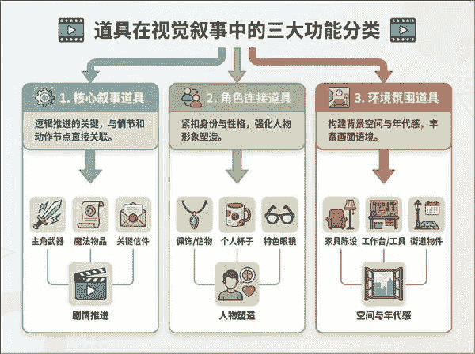

图 3-13　道具在视觉叙事中的三大功能

核心叙事道具是情节推进的关键物件，例如主角的武器、魔法物品或关键信件。它们不仅出现在镜头里，更与角色的动作和情节的转折点直接关联；角色连接道具与角色身份、性格或经历紧密相关，如主人公的佩饰、杯子或眼镜，它们的主要作用在于强化人物塑造；背景中的家具、工作台、街道物件等属于环境氛围道具，用于构建空间真实感与年代氛围，丰富画面的语境信息。

即使是看似不起眼的道具，若经过严谨的逻辑设计，也能成为深化叙事、暗示角色性格或推动剧情发展的关键视觉线索。

### 3.7.2　AI 漫剧中道具设计要解决的问题

在传统动画或影视制作中，道具一旦完成建模或设定稿，便作为静态的、可重复调用的“标准化资产”。但在 AI 生成流程中，道具不再是存储在硬盘里的固定文件，而是每一次都要通过提示词重新生成的“概率性结果”。

这种从“固定资产”到“概率生成”的底层逻辑转变，给 AI 漫剧制作带来了以下三个核心痛点。

#### 1．视觉一致性问题

视觉一致性问题是目前 AI 漫剧制作中最大的技术壁垒。以主角随身携带的玉佩为例，在第一镜中可能是圆形的，到了第十镜可能变成了椭圆；在特写中纹理清晰，拉远后可能就简化成了一个模糊色块。这种“物体漂移”现象在单图生成时不易察觉，一旦连接成视频，道具形状、颜色、细节的持续跳动，会严重破坏观众的沉浸感，使作品显得廉价且不专业。AI 模型倾向于根据画面整体构图与语义去“脑补”道具的形态，而不会记得它在上一镜中长什么样。图 3-14 展示了一组存在视觉一致性问题的图片，其中角色的佩剑位置以及样式有明显差异。

图 3-14　存在视觉一致性问题的图片示例

#### 2．物理交互与空间逻辑的缺失

AI 擅长画“好看的图”，但不擅长处理“真实的物理关系”。当角色需要手持道具（如握剑、端茶杯、拿枪）时，这一问题尤为突出。图 3-15 展示了一张存在物理交互与空间逻辑问题的图片，其中角色的握剑细节不符合常理。

图 3-15　存在物理交互与空间逻辑问题的图片示例

#### 3．叙事功能的装饰化

AI 模型在生成道具时，往往带有“过度美化”的倾向。它会自动为物体添加大量无意义的装饰线条、光效或复杂纹理，以追求画面的“精细感”。然而在叙事中，道具的设计必须服务于剧情逻辑。例如，一个穷困潦倒的剑客，其剑鞘应该是破旧、缠满麻绳的，而 AI 可能会生成一把镶金带银的华丽宝剑。这种为了视觉美观而牺牲逻辑的“过度设计”，会直接削弱道具在剧本中原本承担的叙事功能，甚至对观众的理解产生误导。

因此，在 AI 漫剧的设计流程中，道具绝不能被视为生图时的“随机赠品”。它必须从一开始就被定义为需要被策略化描述、标准化管理且强制约束的核心资产。只有系统性地解决了这三个问题，道具才能真正成为故事中的一部分。

### 3.7.3　道具设计的基本原则

在 AI 漫剧制作中，道具设计建议遵循以下 4 个原则。

#### 1．从功能出发，拒绝外观先行

真正有价值的道具必须能推动故事情节、服务角色或强化场景。设计前需明确其在故事中的作用、归属以及象征意义。例如一把剑或一枚玉佩，其外观设计应基于背后的身份逻辑与情绪纽带。

#### 2．视觉语言与世界观统一

道具的造型、材质、纹理、色彩及佩戴方式，需与作品整体视觉风格保持一致。蒸汽朋克风格的道具要凸显金属质感与机械结构，未来科幻风格的道具则需强调科技感。

#### 3．主次分明，识别清晰

道具在画面中的信息应层次分明。若同一画面中出现多个道具，必须明确叙事优先级，确保观众能迅速识别关键道具。

#### 4．注重可交互性与实用性

道具往往需要与角色发生互动，设计时必须考量其尺寸比例、握持方式及运动轨迹的逻辑合理性。

### 3.7.4　AI 道具提示词的结构与写法

为了保证生成结果可控、连贯且可复用，推荐使用以下固定结构进行描述： 【视觉风格】+【主体对象】+【用途/情节功能】+【时代标签】+【外观细节】+【材质与色彩】+【交互属性】+【镜头需求】。

各要素含义如下。

**·** 视觉风格：需与 AI 漫剧整体保持一致，如 2D 日本动漫、3D 国风动漫等。

**·** 主体对象：道具的具体名称，如“古代战刀”“魔法石板”。

**·** 用途/情节功能：道具在剧情中的具体作用。

**·** 时代标签：也就是时代设定，如古风、现代、未来等。

**·** 外观细节：包括形状、纹理、符号雕刻等。

**·** 材质与色彩：描述木质、钢铁、玉石或发光效果。

**·** 交互属性：描述是否可被拿起、操作或触发特定效果。

**·** 镜头需求：明确景别，如近景或特写。

基于此结构编写的提示词，能确保生成的道具兼具视觉质感与清晰的叙事功能。以下是一条根据以上结构创作的提示词。

国风 3D 动漫，古风战场上的长剑道具。剑身略呈弯曲，上面雕刻祥云与龙形，白玉护手点缀青色宝石。用料为锻钢与白玉，对应古典审美。生成高细节正侧特写，风格典雅庄重，不出现其他装饰物。

根据以上提示词生成的图片如图 3-16 所示。

图 3-16　AI 生成的古风战场上的长剑道具

### 3.7.5　典型类型道具设计策略

道具种类的不同，决定了 AI 模型对其处理权重的差异。对于不同类型的道具，在撰写提示词与建立资产库时，关注的核心维度应当截然不同，如图 3-17 所示。

#### 1．象征性道具

这类道具通常与角色的核心身份或情感线索深度绑定，例如，家传的玉佩、特工的专属徽章，或者一枚贯穿全剧的戒指。它们往往承载着“见物如见人”的叙事功能。

图 3-17　AI 漫剧道具设计策略

（1）AI 生成痛点。

在全景或中景镜头中，AI 极易将这些小物件简化为模糊的色块，导致关键信息丢失。

（2）设计策略。

必须单独生成一张“产品级”的超清特写图作为资产。在提示词中，要像拍摄商业广告一样描述它，强调材质的光泽（如“温润的羊脂玉”“带划痕的黄铜”）与独特的纹理细节（如“表面刻有细微的家族族徽”）。

（3）操作建议。

在提示词中加入“微距摄影”“顶光”“纯色背景”等词汇，确立其作为独立视觉符号的地位，方便后期在分镜中进行贴图或局部重绘。

#### 2．功能性道具

功能性道具涵盖武器、乐器、交通工具及各种机械装置。这类道具不仅要好看，更要“好用”。它们在画面中往往伴随着角色的剧烈动作。

（1）AI 生成痛点。

AI 经常生成“没有握把的剑”“扳机位置错误的枪”或者“手指穿过杯壁”的违和画面。这是因为 AI 模型缺乏真实的物理与人体工学认知。

（2）设计策略。

提示词不能只描述物体本身，必须包含交互关系的说明。要明确描述手部如何接触道具，如“手指紧扣扳机”“手掌包裹剑柄”。对于机械类道具，还要强调结构合理性，避免生成看似复杂实则无法运作的伪科技部件。

（3）操作建议。

在生成此类道具时，不妨直接带上“手部模型”一起生成（例如提示词中加入“戴着战术手套的手紧握着……”），这样能强制 AI 计算出符合人体工学的道具形态。

#### 3．环境装饰道具

这类道具用于填充背景，构建空间的可信度，如桌上的茶具、书架上的卷轴、街边的旗帜或路灯。它们是世界观的基石，但绝不能喧宾夺主。

（1）AI 生成痛点。

AI 在生成背景道具时有时会出现“过度渲染”的问题，例如，把背景里的一个普通花瓶生成得光彩夺目，抢走了主角的视觉焦点，或者在古风场景里生成了现代风格的马克杯，导致时代感错乱。

（2）设计策略。

核心在于“藏”。提示词应侧重于描述“时代感”与“做旧质感”，而非具体的物体结构。可使用“磨损的”“积灰的”“背景虚化”等词汇，让道具体面地退居幕后。

（3）操作建议。

严格统一时代标签。如果是赛博朋克，背景道具必须带有“霓虹”“金属废料”等属性；如果是修仙玄幻，则统一为“木质”“陶制”或“青铜”等材质。通过材质的统一性，在潜意识层面向观众传递统一的世界观信息。

### 3.7.6　道具的一致性管理与复用指南

在长周期的 AI 漫剧制作中，必须将道具视为长期资产进行系统化管理。具体可参照如图 3-18 所示的 AI 漫剧道具的一致性管理与复用指南。

在 AI 漫剧的长期制作过程中，需将道具视作长期资产，为此要搭建专属道具库，对生成成功且符合设定的道具，同步存档其成品截图与对应的完整提示词；同时为每个道具标注版本号与风格标签，以实现统一化管理；在不同镜头制作时，还可复用已有道具的提示词与实例作为提示词底板，保障道具呈现的视觉一致性；针对关键道具，还可制作三视图及多角度交互样本，进一步提升模型生成的稳定性。

图 3-18　AI 漫剧道具的一致性管理与复用指南 EXr6287u6NNVz+GYLY+7SDk226FstKIHdC0bNoQkB2Nqi1xSR0yxPmwrTs5gRi/BtfSbid6dBhii9q7cz2pIyA==

## 3.7 AI 漫剧中的道具设计

在叙事作品中，道具不仅是放置在画面里的物件，更是故事推进的工具、视觉叙事的符号载体，以及连接角色行为逻辑的纽带。在“AI 生成+编剧分镜”的制作流程中，道具的稳定性与一致性是业界公认的操作难点。本节将结合影视动画的传统叙事逻辑与 AI 生成实践，梳理一套具备可复用性的道具设计原则。

### 3.7.1　道具在叙事中的承担的功能

道具在视觉叙事中承担的功能主要分为三类，如图 3-13 所示。

图 3-13　道具在视觉叙事中的三大功能

核心叙事道具是情节推进的关键物件，例如主角的武器、魔法物品或关键信件。它们不仅出现在镜头里，更与角色的动作和情节的转折点直接关联；角色连接道具与角色身份、性格或经历紧密相关，如主人公的佩饰、杯子或眼镜，它们的主要作用在于强化人物塑造；背景中的家具、工作台、街道物件等属于环境氛围道具，用于构建空间真实感与年代氛围，丰富画面的语境信息。

即使是看似不起眼的道具，若经过严谨的逻辑设计，也能成为深化叙事、暗示角色性格或推动剧情发展的关键视觉线索。

### 3.7.2　AI 漫剧中道具设计要解决的问题

在传统动画或影视制作中，道具一旦完成建模或设定稿，便作为静态的、可重复调用的“标准化资产”。但在 AI 生成流程中，道具不再是存储在硬盘里的固定文件，而是每一次都要通过提示词重新生成的“概率性结果”。

这种从“固定资产”到“概率生成”的底层逻辑转变，给 AI 漫剧制作带来了以下三个核心痛点。

#### 1．视觉一致性问题

视觉一致性问题是目前 AI 漫剧制作中最大的技术壁垒。以主角随身携带的玉佩为例，在第一镜中可能是圆形的，到了第十镜可能变成了椭圆；在特写中纹理清晰，拉远后可能就简化成了一个模糊色块。这种“物体漂移”现象在单图生成时不易察觉，一旦连接成视频，道具形状、颜色、细节的持续跳动，会严重破坏观众的沉浸感，使作品显得廉价且不专业。AI 模型倾向于根据画面整体构图与语义去“脑补”道具的形态，而不会记得它在上一镜中长什么样。图 3-14 展示了一组存在视觉一致性问题的图片，其中角色的佩剑位置以及样式有明显差异。

图 3-14　存在视觉一致性问题的图片示例

#### 2．物理交互与空间逻辑的缺失

AI 擅长画“好看的图”，但不擅长处理“真实的物理关系”。当角色需要手持道具（如握剑、端茶杯、拿枪）时，这一问题尤为突出。图 3-15 展示了一张存在物理交互与空间逻辑问题的图片，其中角色的握剑细节不符合常理。

图 3-15　存在物理交互与空间逻辑问题的图片示例

#### 3．叙事功能的装饰化

AI 模型在生成道具时，往往带有“过度美化”的倾向。它会自动为物体添加大量无意义的装饰线条、光效或复杂纹理，以追求画面的“精细感”。然而在叙事中，道具的设计必须服务于剧情逻辑。例如，一个穷困潦倒的剑客，其剑鞘应该是破旧、缠满麻绳的，而 AI 可能会生成一把镶金带银的华丽宝剑。这种为了视觉美观而牺牲逻辑的“过度设计”，会直接削弱道具在剧本中原本承担的叙事功能，甚至对观众的理解产生误导。

因此，在 AI 漫剧的设计流程中，道具绝不能被视为生图时的“随机赠品”。它必须从一开始就被定义为需要被策略化描述、标准化管理且强制约束的核心资产。只有系统性地解决了这三个问题，道具才能真正成为故事中的一部分。

### 3.7.3　道具设计的基本原则

在 AI 漫剧制作中，道具设计建议遵循以下 4 个原则。

#### 1．从功能出发，拒绝外观先行

真正有价值的道具必须能推动故事情节、服务角色或强化场景。设计前需明确其在故事中的作用、归属以及象征意义。例如一把剑或一枚玉佩，其外观设计应基于背后的身份逻辑与情绪纽带。

#### 2．视觉语言与世界观统一

道具的造型、材质、纹理、色彩及佩戴方式，需与作品整体视觉风格保持一致。蒸汽朋克风格的道具要凸显金属质感与机械结构，未来科幻风格的道具则需强调科技感。

#### 3．主次分明，识别清晰

道具在画面中的信息应层次分明。若同一画面中出现多个道具，必须明确叙事优先级，确保观众能迅速识别关键道具。

#### 4．注重可交互性与实用性

道具往往需要与角色发生互动，设计时必须考量其尺寸比例、握持方式及运动轨迹的逻辑合理性。

### 3.7.4　AI 道具提示词的结构与写法

为了保证生成结果可控、连贯且可复用，推荐使用以下固定结构进行描述： 【视觉风格】+【主体对象】+【用途/情节功能】+【时代标签】+【外观细节】+【材质与色彩】+【交互属性】+【镜头需求】。

各要素含义如下。

**·** 视觉风格：需与 AI 漫剧整体保持一致，如 2D 日本动漫、3D 国风动漫等。

**·** 主体对象：道具的具体名称，如“古代战刀”“魔法石板”。

**·** 用途/情节功能：道具在剧情中的具体作用。

**·** 时代标签：也就是时代设定，如古风、现代、未来等。

**·** 外观细节：包括形状、纹理、符号雕刻等。

**·** 材质与色彩：描述木质、钢铁、玉石或发光效果。

**·** 交互属性：描述是否可被拿起、操作或触发特定效果。

**·** 镜头需求：明确景别，如近景或特写。

基于此结构编写的提示词，能确保生成的道具兼具视觉质感与清晰的叙事功能。以下是一条根据以上结构创作的提示词。

国风 3D 动漫，古风战场上的长剑道具。剑身略呈弯曲，上面雕刻祥云与龙形，白玉护手点缀青色宝石。用料为锻钢与白玉，对应古典审美。生成高细节正侧特写，风格典雅庄重，不出现其他装饰物。

根据以上提示词生成的图片如图 3-16 所示。

图 3-16　AI 生成的古风战场上的长剑道具

### 3.7.5　典型类型道具设计策略

道具种类的不同，决定了 AI 模型对其处理权重的差异。对于不同类型的道具，在撰写提示词与建立资产库时，关注的核心维度应当截然不同，如图 3-17 所示。

#### 1．象征性道具

这类道具通常与角色的核心身份或情感线索深度绑定，例如，家传的玉佩、特工的专属徽章，或者一枚贯穿全剧的戒指。它们往往承载着“见物如见人”的叙事功能。

图 3-17　AI 漫剧道具设计策略

（1）AI 生成痛点。

在全景或中景镜头中，AI 极易将这些小物件简化为模糊的色块，导致关键信息丢失。

（2）设计策略。

必须单独生成一张“产品级”的超清特写图作为资产。在提示词中，要像拍摄商业广告一样描述它，强调材质的光泽（如“温润的羊脂玉”“带划痕的黄铜”）与独特的纹理细节（如“表面刻有细微的家族族徽”）。

（3）操作建议。

在提示词中加入“微距摄影”“顶光”“纯色背景”等词汇，确立其作为独立视觉符号的地位，方便后期在分镜中进行贴图或局部重绘。

#### 2．功能性道具

功能性道具涵盖武器、乐器、交通工具及各种机械装置。这类道具不仅要好看，更要“好用”。它们在画面中往往伴随着角色的剧烈动作。

（1）AI 生成痛点。

AI 经常生成“没有握把的剑”“扳机位置错误的枪”或者“手指穿过杯壁”的违和画面。这是因为 AI 模型缺乏真实的物理与人体工学认知。

（2）设计策略。

提示词不能只描述物体本身，必须包含交互关系的说明。要明确描述手部如何接触道具，如“手指紧扣扳机”“手掌包裹剑柄”。对于机械类道具，还要强调结构合理性，避免生成看似复杂实则无法运作的伪科技部件。

（3）操作建议。

在生成此类道具时，不妨直接带上“手部模型”一起生成（例如提示词中加入“戴着战术手套的手紧握着……”），这样能强制 AI 计算出符合人体工学的道具形态。

#### 3．环境装饰道具

这类道具用于填充背景，构建空间的可信度，如桌上的茶具、书架上的卷轴、街边的旗帜或路灯。它们是世界观的基石，但绝不能喧宾夺主。

（1）AI 生成痛点。

AI 在生成背景道具时有时会出现“过度渲染”的问题，例如，把背景里的一个普通花瓶生成得光彩夺目，抢走了主角的视觉焦点，或者在古风场景里生成了现代风格的马克杯，导致时代感错乱。

（2）设计策略。

核心在于“藏”。提示词应侧重于描述“时代感”与“做旧质感”，而非具体的物体结构。可使用“磨损的”“积灰的”“背景虚化”等词汇，让道具体面地退居幕后。

（3）操作建议。

严格统一时代标签。如果是赛博朋克，背景道具必须带有“霓虹”“金属废料”等属性；如果是修仙玄幻，则统一为“木质”“陶制”或“青铜”等材质。通过材质的统一性，在潜意识层面向观众传递统一的世界观信息。

### 3.7.6　道具的一致性管理与复用指南

在长周期的 AI 漫剧制作中，必须将道具视为长期资产进行系统化管理。具体可参照如图 3-18 所示的 AI 漫剧道具的一致性管理与复用指南。

在 AI 漫剧的长期制作过程中，需将道具视作长期资产，为此要搭建专属道具库，对生成成功且符合设定的道具，同步存档其成品截图与对应的完整提示词；同时为每个道具标注版本号与风格标签，以实现统一化管理；在不同镜头制作时，还可复用已有道具的提示词与实例作为提示词底板，保障道具呈现的视觉一致性；针对关键道具，还可制作三视图及多角度交互样本，进一步提升模型生成的稳定性。

图 3-18　AI 漫剧道具的一致性管理与复用指南 EXr6287u6NNVz+GYLY+7SDk226FstKIHdC0bNoQkB2Nqi1xSR0yxPmwrTs5gRi/BtfSbid6dBhii9q7cz2pIyA==

## 3.7 AI 漫剧中的道具设计

在叙事作品中，道具不仅是放置在画面里的物件，更是故事推进的工具、视觉叙事的符号载体，以及连接角色行为逻辑的纽带。在“AI 生成+编剧分镜”的制作流程中，道具的稳定性与一致性是业界公认的操作难点。本节将结合影视动画的传统叙事逻辑与 AI 生成实践，梳理一套具备可复用性的道具设计原则。

### 3.7.1　道具在叙事中的承担的功能

道具在视觉叙事中承担的功能主要分为三类，如图 3-13 所示。

图 3-13　道具在视觉叙事中的三大功能

核心叙事道具是情节推进的关键物件，例如主角的武器、魔法物品或关键信件。它们不仅出现在镜头里，更与角色的动作和情节的转折点直接关联；角色连接道具与角色身份、性格或经历紧密相关，如主人公的佩饰、杯子或眼镜，它们的主要作用在于强化人物塑造；背景中的家具、工作台、街道物件等属于环境氛围道具，用于构建空间真实感与年代氛围，丰富画面的语境信息。

即使是看似不起眼的道具，若经过严谨的逻辑设计，也能成为深化叙事、暗示角色性格或推动剧情发展的关键视觉线索。

### 3.7.2　AI 漫剧中道具设计要解决的问题

在传统动画或影视制作中，道具一旦完成建模或设定稿，便作为静态的、可重复调用的“标准化资产”。但在 AI 生成流程中，道具不再是存储在硬盘里的固定文件，而是每一次都要通过提示词重新生成的“概率性结果”。

这种从“固定资产”到“概率生成”的底层逻辑转变，给 AI 漫剧制作带来了以下三个核心痛点。

#### 1．视觉一致性问题

视觉一致性问题是目前 AI 漫剧制作中最大的技术壁垒。以主角随身携带的玉佩为例，在第一镜中可能是圆形的，到了第十镜可能变成了椭圆；在特写中纹理清晰，拉远后可能就简化成了一个模糊色块。这种“物体漂移”现象在单图生成时不易察觉，一旦连接成视频，道具形状、颜色、细节的持续跳动，会严重破坏观众的沉浸感，使作品显得廉价且不专业。AI 模型倾向于根据画面整体构图与语义去“脑补”道具的形态，而不会记得它在上一镜中长什么样。图 3-14 展示了一组存在视觉一致性问题的图片，其中角色的佩剑位置以及样式有明显差异。

图 3-14　存在视觉一致性问题的图片示例

#### 2．物理交互与空间逻辑的缺失

AI 擅长画“好看的图”，但不擅长处理“真实的物理关系”。当角色需要手持道具（如握剑、端茶杯、拿枪）时，这一问题尤为突出。图 3-15 展示了一张存在物理交互与空间逻辑问题的图片，其中角色的握剑细节不符合常理。

图 3-15　存在物理交互与空间逻辑问题的图片示例

#### 3．叙事功能的装饰化

AI 模型在生成道具时，往往带有“过度美化”的倾向。它会自动为物体添加大量无意义的装饰线条、光效或复杂纹理，以追求画面的“精细感”。然而在叙事中，道具的设计必须服务于剧情逻辑。例如，一个穷困潦倒的剑客，其剑鞘应该是破旧、缠满麻绳的，而 AI 可能会生成一把镶金带银的华丽宝剑。这种为了视觉美观而牺牲逻辑的“过度设计”，会直接削弱道具在剧本中原本承担的叙事功能，甚至对观众的理解产生误导。

因此，在 AI 漫剧的设计流程中，道具绝不能被视为生图时的“随机赠品”。它必须从一开始就被定义为需要被策略化描述、标准化管理且强制约束的核心资产。只有系统性地解决了这三个问题，道具才能真正成为故事中的一部分。

### 3.7.3　道具设计的基本原则

在 AI 漫剧制作中，道具设计建议遵循以下 4 个原则。

#### 1．从功能出发，拒绝外观先行

真正有价值的道具必须能推动故事情节、服务角色或强化场景。设计前需明确其在故事中的作用、归属以及象征意义。例如一把剑或一枚玉佩，其外观设计应基于背后的身份逻辑与情绪纽带。

#### 2．视觉语言与世界观统一

道具的造型、材质、纹理、色彩及佩戴方式，需与作品整体视觉风格保持一致。蒸汽朋克风格的道具要凸显金属质感与机械结构，未来科幻风格的道具则需强调科技感。

#### 3．主次分明，识别清晰

道具在画面中的信息应层次分明。若同一画面中出现多个道具，必须明确叙事优先级，确保观众能迅速识别关键道具。

#### 4．注重可交互性与实用性

道具往往需要与角色发生互动，设计时必须考量其尺寸比例、握持方式及运动轨迹的逻辑合理性。

### 3.7.4　AI 道具提示词的结构与写法

为了保证生成结果可控、连贯且可复用，推荐使用以下固定结构进行描述： 【视觉风格】+【主体对象】+【用途/情节功能】+【时代标签】+【外观细节】+【材质与色彩】+【交互属性】+【镜头需求】。

各要素含义如下。

**·** 视觉风格：需与 AI 漫剧整体保持一致，如 2D 日本动漫、3D 国风动漫等。

**·** 主体对象：道具的具体名称，如“古代战刀”“魔法石板”。

**·** 用途/情节功能：道具在剧情中的具体作用。

**·** 时代标签：也就是时代设定，如古风、现代、未来等。

**·** 外观细节：包括形状、纹理、符号雕刻等。

**·** 材质与色彩：描述木质、钢铁、玉石或发光效果。

**·** 交互属性：描述是否可被拿起、操作或触发特定效果。

**·** 镜头需求：明确景别，如近景或特写。

基于此结构编写的提示词，能确保生成的道具兼具视觉质感与清晰的叙事功能。以下是一条根据以上结构创作的提示词。

国风 3D 动漫，古风战场上的长剑道具。剑身略呈弯曲，上面雕刻祥云与龙形，白玉护手点缀青色宝石。用料为锻钢与白玉，对应古典审美。生成高细节正侧特写，风格典雅庄重，不出现其他装饰物。

根据以上提示词生成的图片如图 3-16 所示。

图 3-16　AI 生成的古风战场上的长剑道具

### 3.7.5　典型类型道具设计策略

道具种类的不同，决定了 AI 模型对其处理权重的差异。对于不同类型的道具，在撰写提示词与建立资产库时，关注的核心维度应当截然不同，如图 3-17 所示。

#### 1．象征性道具

这类道具通常与角色的核心身份或情感线索深度绑定，例如，家传的玉佩、特工的专属徽章，或者一枚贯穿全剧的戒指。它们往往承载着“见物如见人”的叙事功能。

图 3-17　AI 漫剧道具设计策略

（1）AI 生成痛点。

在全景或中景镜头中，AI 极易将这些小物件简化为模糊的色块，导致关键信息丢失。

（2）设计策略。

必须单独生成一张“产品级”的超清特写图作为资产。在提示词中，要像拍摄商业广告一样描述它，强调材质的光泽（如“温润的羊脂玉”“带划痕的黄铜”）与独特的纹理细节（如“表面刻有细微的家族族徽”）。

（3）操作建议。

在提示词中加入“微距摄影”“顶光”“纯色背景”等词汇，确立其作为独立视觉符号的地位，方便后期在分镜中进行贴图或局部重绘。

#### 2．功能性道具

功能性道具涵盖武器、乐器、交通工具及各种机械装置。这类道具不仅要好看，更要“好用”。它们在画面中往往伴随着角色的剧烈动作。

（1）AI 生成痛点。

AI 经常生成“没有握把的剑”“扳机位置错误的枪”或者“手指穿过杯壁”的违和画面。这是因为 AI 模型缺乏真实的物理与人体工学认知。

（2）设计策略。

提示词不能只描述物体本身，必须包含交互关系的说明。要明确描述手部如何接触道具，如“手指紧扣扳机”“手掌包裹剑柄”。对于机械类道具，还要强调结构合理性，避免生成看似复杂实则无法运作的伪科技部件。

（3）操作建议。

在生成此类道具时，不妨直接带上“手部模型”一起生成（例如提示词中加入“戴着战术手套的手紧握着……”），这样能强制 AI 计算出符合人体工学的道具形态。

#### 3．环境装饰道具

这类道具用于填充背景，构建空间的可信度，如桌上的茶具、书架上的卷轴、街边的旗帜或路灯。它们是世界观的基石，但绝不能喧宾夺主。

（1）AI 生成痛点。

AI 在生成背景道具时有时会出现“过度渲染”的问题，例如，把背景里的一个普通花瓶生成得光彩夺目，抢走了主角的视觉焦点，或者在古风场景里生成了现代风格的马克杯，导致时代感错乱。

（2）设计策略。

核心在于“藏”。提示词应侧重于描述“时代感”与“做旧质感”，而非具体的物体结构。可使用“磨损的”“积灰的”“背景虚化”等词汇，让道具体面地退居幕后。

（3）操作建议。

严格统一时代标签。如果是赛博朋克，背景道具必须带有“霓虹”“金属废料”等属性；如果是修仙玄幻，则统一为“木质”“陶制”或“青铜”等材质。通过材质的统一性，在潜意识层面向观众传递统一的世界观信息。

### 3.7.6　道具的一致性管理与复用指南

在长周期的 AI 漫剧制作中，必须将道具视为长期资产进行系统化管理。具体可参照如图 3-18 所示的 AI 漫剧道具的一致性管理与复用指南。

在 AI 漫剧的长期制作过程中，需将道具视作长期资产，为此要搭建专属道具库，对生成成功且符合设定的道具，同步存档其成品截图与对应的完整提示词；同时为每个道具标注版本号与风格标签，以实现统一化管理；在不同镜头制作时，还可复用已有道具的提示词与实例作为提示词底板，保障道具呈现的视觉一致性；针对关键道具，还可制作三视图及多角度交互样本，进一步提升模型生成的稳定性。

图 3-18　AI 漫剧道具的一致性管理与复用指南 EXr6287u6NNVz+GYLY+7SDk226FstKIHdC0bNoQkB2Nqi1xSR0yxPmwrTs5gRi/BtfSbid6dBhii9q7cz2pIyA==

## 小结

至此，我们完成了 AI 漫剧中角色、场景与道具这三类核心视觉资产的系统性建构。

本章的内容超越了单纯的 AI 工具使用技巧，其核心在于将传统影视与动画行业中历经验证的设计方法论，系统性地迁移并适配到 AI 漫剧的生产流程中。

**·** 在角色层面，我们从人物设定出发，通过身份定位、性格特征与视觉符号的统一，确立了“角色是谁”的核心定义，并借助三视图与表情设定，将角色从单张孤立的“精美图片”，转换为可以在海量镜头中稳定复用、特征固定的长期资产。

**·** 在场景层面，我们强调场景必须超越“背景图”的装饰属性，成为空间化的叙事工具。通过建立场景清单、构建空间层次、规划动线引导以及精确控制光源时间，确保每一个场景都具备明确的叙事功能，而非仅承担装饰作用。

**·** 在道具层面，我们补全了角色与场景之间的关键“连接件”。道具既是剧情推进的物理工具，也是承载角色身份与世界观的重要视觉符号。通过功能优先的设计思路、标准化的提示词结构以及严格的一致性管理策略，道具不再是无意义随机生成物，而是成为支撑叙事逻辑的实体资产。

将这三者结合来看，它们并非孤立存在：角色定义了行为与情绪的源头，场景限定了空间与氛围的边界，道具则让角色的行为真正“落地”并产生物理层面的可见反馈。

当这三套系统被提前规划清晰并完整设计后，后续的分镜设计、镜头调度与动画生成工作将变得异常顺畅。因为关于“这个世界长什么样”“角色如何行动”“物体存在是否合理”等基础问题，在进入分镜绘制之前，就已经有了明确的答案。

在即将进入的第四章“分镜与视觉语言”中，读者会明显感觉到一种创作状态的质变：分镜创作将告别凭感觉拼凑画面的随机阶段，转向在一个已经建立稳固的世界观、角色体系和视觉资产的基础上，系统性地安排镜头节奏与叙事重点。

届时，创作者需要做的，只是把合适的镜头，放置在合适的位置上，让故事依循既定的逻辑自然地流动起来。 EXr6287u6NNVz+GYLY+7SDk226FstKIHdC0bNoQkB2Nqi1xSR0yxPmwrTs5gRi/BtfSbid6dBhii9q7cz2pIyA==

# 第四章
分镜与视觉语言

在前面的内容中，已经反复强调 AI 漫剧中情绪表达、画面风格以及情节氛围的重要性。这些元素决定了观众是否愿意继续看下去。当情绪基调与视觉风格确定之后，一个更现实的问题就会出现：这些抽象的感受如何通过一连串具体的画面被准确地呈现出来。这正是分镜与视觉语言存在的根本意义。作为把剧本、情绪和节奏转换为可执行画面的中间层，其重要性不言而喻。

本章将从分镜的基础逻辑出发，逐步阐明 AI 漫剧中视觉语言是如何系统构建并落地实现的。 EXr6287u6NNVz+GYLY+7SDk226FstKIHdC0bNoQkB2Nqi1xSR0yxPmwrTs5gRi/BtfSbid6dBhii9q7cz2pIyA==

## 4.1 从剧本到画面的思考方式

AI 漫剧的分镜设计并非单纯的画面翻译，而是导演思维与叙事策略的集中体现。在动手制作分镜前，创作者必须先具备剧本拆解的能力。AI 漫剧制作的核心在于效率，即用最快的速度将观众的情绪“弓弦”拉到最满，随后释放出极致的爽感，并立刻为下一次的情绪拉升做好准备。

我们将这一逻辑拆解为“三幕剧”结构，并配合“高概念”的实战方法进行解释。

### 4.1.1　奠基——高概念

在短视频时代，创作者的目标是在 3s 内抓住观众的注意并激发他们产生强烈的兴趣。这需要依靠“高概念”定位。所谓高概念，就是用一句话说清故事最核心、最具新颖性的吸引力。可以总结出一个成熟的公式：

熟悉设定 + 颠覆性反差 = 高概念

下面来看几个具体的教学案例，如表 4-1 所示。

表 4-1　普通概念和高概念的内容差异对比

### 4.1.2　建置——三要素与强钩子

在确立高概念后，故事便进入具体的“建置”阶段。这一阶段的任务并非铺陈复杂的背景设定，而是用最短的篇幅，快速构建出让观众愿意继续观看的根本理由。

我们需要在开篇迅速确立三个核心要素：人物、世界观、目标与欲望。

#### 1．人物：用“反差”建立记忆锚点

观众往往记不住平庸的角色，只能牢牢记住具有鲜明特质的角色。而最快建立角色特质的方式，是制造身份与能力之间的巨大反差。反差的本质是“表面身份”与“真实能力”的错位，或者是“外在形象”与“内在性格”的对立。这种错位感能瞬间制造出强烈的戏剧张力与记忆点。

例如，表面是坐在轮椅上、温文尔雅的集团大少爷，真实身份却是潜伏在暗夜中、身手最敏捷的顶尖高手；或者表面是唯唯诺诺的实习律师，真实身份却是令罪犯闻风丧胆的谈判专家。

#### 2．世界观：把概念转换为“视觉奇观”

在影视化表达中，世界观并非通过台词解释，而是借助画面让观众直接“看”到的。我们需要设计一个最具代表性的画面，让观众一眼就能理解故事的高概念。我们可以将两个原本不兼容的视觉元素，强行融合在同一个画面中。

如果你的高概念是“古今对话”，不要用解说的方式展现，而是直接展示：在一个点着蜡烛的宋代停尸房里，法医从工具箱中拿出了一把散发着冷冽蓝光的手术刀。

如果你的高概念是“末日废土”，则直接展示：曾经繁华的时代广场被巨大的丛林彻底吞噬，主角坐在长满青苔的广告牌顶端，静静烤火。

#### 3．目标与欲望：故事的发动机

主角必须有一个明确的“原始欲望”。这个欲望越底层、越紧迫，故事的内在驱动力就越强。此处的欲望与目标有明显区别，目标更多是表层的，是为了解决眼前的麻烦，例如“保住工作”“还清债务”等。欲望则是驱动人物一生的根本执念，例如“查清当年那场大火的真相”“找回失踪多年的女儿”等。

即使是设定宏大的高概念故事，主角的初始动机也往往是微小而具体的，但其行动最终却可能被欲望所牵引。例如，主角并不想拯救世界，他只想治好妹妹的病，但为了治病，他不得不去挑战那个庞大的黑暗组织……

当人物、世界与目标确立后，我们需要抛出“强钩子”。这是开篇的第一个核心情节点，它的作用只有两个：展示高概念，并彻底打破主角原本平静的生活。

一个成功的“强钩子”，应包含巨大的悬念或紧迫危机，让观众产生“如果不看下去，我就不知道答案”的强烈好奇与不安。例如，现代法医正在解剖一具刚出土的千年白骨，当他清理到手部骨骼时，赫然发现死者手里紧紧攥着的，竟然是法医自己现在使用的工牌，工牌上的入职日期标注的还是明天……

### 4.1.3　对抗——“反转”与“反差”的持续轰炸

进入故事中段，目标是让观众在情绪的连续起伏中欲罢不能。AI 漫剧节奏极快，需要设置密集的爆点来维持吸引力。我们要设计“小反转”到“中高潮”再到“大反转”的递进式对抗节奏。

#### 1．小反转

用于日常剧情推进，每集解决一个具体矛盾，完成一个独立情节点，持续制造小高潮。

例如，主角被恶霸挑衅，不慌不忙地掏出“仙法充电宝”反向收割。又如，在拍卖会上因资金不足，现场炼制“可乐丹”引发全场轰动。

每集结尾必须设置一个强钩子，把下一集的核心矛盾在结尾处提前引入，例如，暗示主角身份即将暴露，或预告更大的危机降临。

#### 2．丰富主线故事

主角在朝向终极目标前进的过程中，还可以发展多条副线剧情。例如，拜师学艺、获得秘籍、拥有一批可靠的同伴、了解反派的心理路程等。

#### 3．大反转

这是彻底改变故事走向、颠覆力量格局的重大转折。其可能表现为朋友众叛亲离，反派 BOSS 实力巨大难以对抗，或者主人公三观震碎，最初的目标发生改变。例如，主角发现自己的“赛博灵根”并非天赋，而是一个囚禁其意识的远古程序。

#### 4．活用“反差”技巧

反差是制造爽感和记忆点的核心叙事燃料，主要包括以下几种类型。

**·** 身份反差：表面废柴/底层小人物，实际身份为隐藏大佬/没落贵族。

**·** 认知反差：用现代知识、科技降维打击异世界（如用 KPI 管理宗门，用兵法指挥修仙大战）。

**·** 实力反差：前期被各方轻视、嘲讽，后期在关键场合一招碾压，实现经典的“扮猪吃老虎”式反转。

### 4.1.4　结局——“闭环”与“余韵”

结局的目标是给观众一个情感上的满意交代，并留下持久的话题度或续作可能。

#### 1．情绪闭环

主角必须完成其在“建置”阶段立下的目标，同时完成更高阶的成长或使命升华。例如，从最初只想自保的“外卖员”，成长为愿意守护一方安宁的“侠客”。

#### 2．概念闭环

结局要回到作品的“高概念”上，完成对核心设定的最终解释或主题升华，使世界观逻辑自洽。例如，在前文提到过的“赛博灵根”案例的结局可以是：主角最终并没有摧毁程序，而是与它达成和解，开创了“人机共生”的新修仙流派。

#### 3．留下“余韵”

我们可以通过多种方式留下余韵，如使用圆满结局、开放结局、续作钩子等。

（1）圆满结局。

圆满结局的核心价值在于给予观众深层的“满足感”。观众跟随主角经历了压抑、冲突与挑战后，需要一场彻底的情绪释放。但圆满并不等于俗套的“大团圆”。高明的圆满结局，在解决核心冲突（如打败反派、查清真相）的同时，会用镜头语言告诉观众：故事虽然已告一段落，但这个世界依然在运转，角色的生活正在步入更好的轨道。

（2）开放结局。

开放结局是提升作品流量与互动率的利器。它不提供唯一的标准答案，而是提供两种（或多种）截然不同的可能性线索，促使观众主动卷入讨论，甚至为了证明自己的观点而反复观看。这种结局的设计难度在于“度”的把控：不能让观众感觉故事未完成，应让他们相信“作者已将真相藏在细节里”。

（3）续作钩子。

续作钩子是商业 IP 进行连续性布局的关键手段。如果计划制作系列剧或第二季，结局就必须承担起“预告片”的功能。这也是漫威电影宇宙常用的“彩蛋”逻辑。

续作钩子的核心在于“危机升级”。你需要在主角享受胜利果实的最松懈时刻，揭示阴影中更大的威胁，或暗示目前的胜利只是一个更大阴谋的开端。

### 4.1.5　查收你的 AI 漫剧编剧流程清单

最后，我们将上述逻辑整理为一份简明的流程清单，供创作者自检，如图 4-1 所示。

图 4-1　AI 漫剧编剧流程清单

（1）定概念。用一句话总结故事梗概，检查该概念是否具备足够的吸引力和反差感。

（2）建世界。确认“建置”部分是否有清晰的主角、世界观和核心目标。检查开篇是否设置了一个能瞬间钩住观众的“强钩子”。

（3）造冲突。确认“对抗”部分是否设计了密集的“小反转”和关键的“大反转”。检查是否充分运用了“反差”技巧来制造爽点和记忆点。

（4）收全局。确认“结局”是否实现了情绪闭环和故事闭环。检查是否为结局设计了恰当的“余韵”，给观众留下回味或期待。 EXr6287u6NNVz+GYLY+7SDk226FstKIHdC0bNoQkB2Nqi1xSR0yxPmwrTs5gRi/BtfSbid6dBhii9q7cz2pIyA==

## 4.1 从剧本到画面的思考方式

AI 漫剧的分镜设计并非单纯的画面翻译，而是导演思维与叙事策略的集中体现。在动手制作分镜前，创作者必须先具备剧本拆解的能力。AI 漫剧制作的核心在于效率，即用最快的速度将观众的情绪“弓弦”拉到最满，随后释放出极致的爽感，并立刻为下一次的情绪拉升做好准备。

我们将这一逻辑拆解为“三幕剧”结构，并配合“高概念”的实战方法进行解释。

### 4.1.1　奠基——高概念

在短视频时代，创作者的目标是在 3s 内抓住观众的注意并激发他们产生强烈的兴趣。这需要依靠“高概念”定位。所谓高概念，就是用一句话说清故事最核心、最具新颖性的吸引力。可以总结出一个成熟的公式：

熟悉设定 + 颠覆性反差 = 高概念

下面来看几个具体的教学案例，如表 4-1 所示。

表 4-1　普通概念和高概念的内容差异对比

### 4.1.2　建置——三要素与强钩子

在确立高概念后，故事便进入具体的“建置”阶段。这一阶段的任务并非铺陈复杂的背景设定，而是用最短的篇幅，快速构建出让观众愿意继续观看的根本理由。

我们需要在开篇迅速确立三个核心要素：人物、世界观、目标与欲望。

#### 1．人物：用“反差”建立记忆锚点

观众往往记不住平庸的角色，只能牢牢记住具有鲜明特质的角色。而最快建立角色特质的方式，是制造身份与能力之间的巨大反差。反差的本质是“表面身份”与“真实能力”的错位，或者是“外在形象”与“内在性格”的对立。这种错位感能瞬间制造出强烈的戏剧张力与记忆点。

例如，表面是坐在轮椅上、温文尔雅的集团大少爷，真实身份却是潜伏在暗夜中、身手最敏捷的顶尖高手；或者表面是唯唯诺诺的实习律师，真实身份却是令罪犯闻风丧胆的谈判专家。

#### 2．世界观：把概念转换为“视觉奇观”

在影视化表达中，世界观并非通过台词解释，而是借助画面让观众直接“看”到的。我们需要设计一个最具代表性的画面，让观众一眼就能理解故事的高概念。我们可以将两个原本不兼容的视觉元素，强行融合在同一个画面中。

如果你的高概念是“古今对话”，不要用解说的方式展现，而是直接展示：在一个点着蜡烛的宋代停尸房里，法医从工具箱中拿出了一把散发着冷冽蓝光的手术刀。

如果你的高概念是“末日废土”，则直接展示：曾经繁华的时代广场被巨大的丛林彻底吞噬，主角坐在长满青苔的广告牌顶端，静静烤火。

#### 3．目标与欲望：故事的发动机

主角必须有一个明确的“原始欲望”。这个欲望越底层、越紧迫，故事的内在驱动力就越强。此处的欲望与目标有明显区别，目标更多是表层的，是为了解决眼前的麻烦，例如“保住工作”“还清债务”等。欲望则是驱动人物一生的根本执念，例如“查清当年那场大火的真相”“找回失踪多年的女儿”等。

即使是设定宏大的高概念故事，主角的初始动机也往往是微小而具体的，但其行动最终却可能被欲望所牵引。例如，主角并不想拯救世界，他只想治好妹妹的病，但为了治病，他不得不去挑战那个庞大的黑暗组织……

当人物、世界与目标确立后，我们需要抛出“强钩子”。这是开篇的第一个核心情节点，它的作用只有两个：展示高概念，并彻底打破主角原本平静的生活。

一个成功的“强钩子”，应包含巨大的悬念或紧迫危机，让观众产生“如果不看下去，我就不知道答案”的强烈好奇与不安。例如，现代法医正在解剖一具刚出土的千年白骨，当他清理到手部骨骼时，赫然发现死者手里紧紧攥着的，竟然是法医自己现在使用的工牌，工牌上的入职日期标注的还是明天……

### 4.1.3　对抗——“反转”与“反差”的持续轰炸

进入故事中段，目标是让观众在情绪的连续起伏中欲罢不能。AI 漫剧节奏极快，需要设置密集的爆点来维持吸引力。我们要设计“小反转”到“中高潮”再到“大反转”的递进式对抗节奏。

#### 1．小反转

用于日常剧情推进，每集解决一个具体矛盾，完成一个独立情节点，持续制造小高潮。

例如，主角被恶霸挑衅，不慌不忙地掏出“仙法充电宝”反向收割。又如，在拍卖会上因资金不足，现场炼制“可乐丹”引发全场轰动。

每集结尾必须设置一个强钩子，把下一集的核心矛盾在结尾处提前引入，例如，暗示主角身份即将暴露，或预告更大的危机降临。

#### 2．丰富主线故事

主角在朝向终极目标前进的过程中，还可以发展多条副线剧情。例如，拜师学艺、获得秘籍、拥有一批可靠的同伴、了解反派的心理路程等。

#### 3．大反转

这是彻底改变故事走向、颠覆力量格局的重大转折。其可能表现为朋友众叛亲离，反派 BOSS 实力巨大难以对抗，或者主人公三观震碎，最初的目标发生改变。例如，主角发现自己的“赛博灵根”并非天赋，而是一个囚禁其意识的远古程序。

#### 4．活用“反差”技巧

反差是制造爽感和记忆点的核心叙事燃料，主要包括以下几种类型。

**·** 身份反差：表面废柴/底层小人物，实际身份为隐藏大佬/没落贵族。

**·** 认知反差：用现代知识、科技降维打击异世界（如用 KPI 管理宗门，用兵法指挥修仙大战）。

**·** 实力反差：前期被各方轻视、嘲讽，后期在关键场合一招碾压，实现经典的“扮猪吃老虎”式反转。

### 4.1.4　结局——“闭环”与“余韵”

结局的目标是给观众一个情感上的满意交代，并留下持久的话题度或续作可能。

#### 1．情绪闭环

主角必须完成其在“建置”阶段立下的目标，同时完成更高阶的成长或使命升华。例如，从最初只想自保的“外卖员”，成长为愿意守护一方安宁的“侠客”。

#### 2．概念闭环

结局要回到作品的“高概念”上，完成对核心设定的最终解释或主题升华，使世界观逻辑自洽。例如，在前文提到过的“赛博灵根”案例的结局可以是：主角最终并没有摧毁程序，而是与它达成和解，开创了“人机共生”的新修仙流派。

#### 3．留下“余韵”

我们可以通过多种方式留下余韵，如使用圆满结局、开放结局、续作钩子等。

（1）圆满结局。

圆满结局的核心价值在于给予观众深层的“满足感”。观众跟随主角经历了压抑、冲突与挑战后，需要一场彻底的情绪释放。但圆满并不等于俗套的“大团圆”。高明的圆满结局，在解决核心冲突（如打败反派、查清真相）的同时，会用镜头语言告诉观众：故事虽然已告一段落，但这个世界依然在运转，角色的生活正在步入更好的轨道。

（2）开放结局。

开放结局是提升作品流量与互动率的利器。它不提供唯一的标准答案，而是提供两种（或多种）截然不同的可能性线索，促使观众主动卷入讨论，甚至为了证明自己的观点而反复观看。这种结局的设计难度在于“度”的把控：不能让观众感觉故事未完成，应让他们相信“作者已将真相藏在细节里”。

（3）续作钩子。

续作钩子是商业 IP 进行连续性布局的关键手段。如果计划制作系列剧或第二季，结局就必须承担起“预告片”的功能。这也是漫威电影宇宙常用的“彩蛋”逻辑。

续作钩子的核心在于“危机升级”。你需要在主角享受胜利果实的最松懈时刻，揭示阴影中更大的威胁，或暗示目前的胜利只是一个更大阴谋的开端。

### 4.1.5　查收你的 AI 漫剧编剧流程清单

最后，我们将上述逻辑整理为一份简明的流程清单，供创作者自检，如图 4-1 所示。

图 4-1　AI 漫剧编剧流程清单

（1）定概念。用一句话总结故事梗概，检查该概念是否具备足够的吸引力和反差感。

（2）建世界。确认“建置”部分是否有清晰的主角、世界观和核心目标。检查开篇是否设置了一个能瞬间钩住观众的“强钩子”。

（3）造冲突。确认“对抗”部分是否设计了密集的“小反转”和关键的“大反转”。检查是否充分运用了“反差”技巧来制造爽点和记忆点。

（4）收全局。确认“结局”是否实现了情绪闭环和故事闭环。检查是否为结局设计了恰当的“余韵”，给观众留下回味或期待。 EXr6287u6NNVz+GYLY+7SDk226FstKIHdC0bNoQkB2Nqi1xSR0yxPmwrTs5gRi/BtfSbid6dBhii9q7cz2pIyA==

## 4.1 从剧本到画面的思考方式

AI 漫剧的分镜设计并非单纯的画面翻译，而是导演思维与叙事策略的集中体现。在动手制作分镜前，创作者必须先具备剧本拆解的能力。AI 漫剧制作的核心在于效率，即用最快的速度将观众的情绪“弓弦”拉到最满，随后释放出极致的爽感，并立刻为下一次的情绪拉升做好准备。

我们将这一逻辑拆解为“三幕剧”结构，并配合“高概念”的实战方法进行解释。

### 4.1.1　奠基——高概念

在短视频时代，创作者的目标是在 3s 内抓住观众的注意并激发他们产生强烈的兴趣。这需要依靠“高概念”定位。所谓高概念，就是用一句话说清故事最核心、最具新颖性的吸引力。可以总结出一个成熟的公式：

熟悉设定 + 颠覆性反差 = 高概念

下面来看几个具体的教学案例，如表 4-1 所示。

表 4-1　普通概念和高概念的内容差异对比

### 4.1.2　建置——三要素与强钩子

在确立高概念后，故事便进入具体的“建置”阶段。这一阶段的任务并非铺陈复杂的背景设定，而是用最短的篇幅，快速构建出让观众愿意继续观看的根本理由。

我们需要在开篇迅速确立三个核心要素：人物、世界观、目标与欲望。

#### 1．人物：用“反差”建立记忆锚点

观众往往记不住平庸的角色，只能牢牢记住具有鲜明特质的角色。而最快建立角色特质的方式，是制造身份与能力之间的巨大反差。反差的本质是“表面身份”与“真实能力”的错位，或者是“外在形象”与“内在性格”的对立。这种错位感能瞬间制造出强烈的戏剧张力与记忆点。

例如，表面是坐在轮椅上、温文尔雅的集团大少爷，真实身份却是潜伏在暗夜中、身手最敏捷的顶尖高手；或者表面是唯唯诺诺的实习律师，真实身份却是令罪犯闻风丧胆的谈判专家。

#### 2．世界观：把概念转换为“视觉奇观”

在影视化表达中，世界观并非通过台词解释，而是借助画面让观众直接“看”到的。我们需要设计一个最具代表性的画面，让观众一眼就能理解故事的高概念。我们可以将两个原本不兼容的视觉元素，强行融合在同一个画面中。

如果你的高概念是“古今对话”，不要用解说的方式展现，而是直接展示：在一个点着蜡烛的宋代停尸房里，法医从工具箱中拿出了一把散发着冷冽蓝光的手术刀。

如果你的高概念是“末日废土”，则直接展示：曾经繁华的时代广场被巨大的丛林彻底吞噬，主角坐在长满青苔的广告牌顶端，静静烤火。

#### 3．目标与欲望：故事的发动机

主角必须有一个明确的“原始欲望”。这个欲望越底层、越紧迫，故事的内在驱动力就越强。此处的欲望与目标有明显区别，目标更多是表层的，是为了解决眼前的麻烦，例如“保住工作”“还清债务”等。欲望则是驱动人物一生的根本执念，例如“查清当年那场大火的真相”“找回失踪多年的女儿”等。

即使是设定宏大的高概念故事，主角的初始动机也往往是微小而具体的，但其行动最终却可能被欲望所牵引。例如，主角并不想拯救世界，他只想治好妹妹的病，但为了治病，他不得不去挑战那个庞大的黑暗组织……

当人物、世界与目标确立后，我们需要抛出“强钩子”。这是开篇的第一个核心情节点，它的作用只有两个：展示高概念，并彻底打破主角原本平静的生活。

一个成功的“强钩子”，应包含巨大的悬念或紧迫危机，让观众产生“如果不看下去，我就不知道答案”的强烈好奇与不安。例如，现代法医正在解剖一具刚出土的千年白骨，当他清理到手部骨骼时，赫然发现死者手里紧紧攥着的，竟然是法医自己现在使用的工牌，工牌上的入职日期标注的还是明天……

### 4.1.3　对抗——“反转”与“反差”的持续轰炸

进入故事中段，目标是让观众在情绪的连续起伏中欲罢不能。AI 漫剧节奏极快，需要设置密集的爆点来维持吸引力。我们要设计“小反转”到“中高潮”再到“大反转”的递进式对抗节奏。

#### 1．小反转

用于日常剧情推进，每集解决一个具体矛盾，完成一个独立情节点，持续制造小高潮。

例如，主角被恶霸挑衅，不慌不忙地掏出“仙法充电宝”反向收割。又如，在拍卖会上因资金不足，现场炼制“可乐丹”引发全场轰动。

每集结尾必须设置一个强钩子，把下一集的核心矛盾在结尾处提前引入，例如，暗示主角身份即将暴露，或预告更大的危机降临。

#### 2．丰富主线故事

主角在朝向终极目标前进的过程中，还可以发展多条副线剧情。例如，拜师学艺、获得秘籍、拥有一批可靠的同伴、了解反派的心理路程等。

#### 3．大反转

这是彻底改变故事走向、颠覆力量格局的重大转折。其可能表现为朋友众叛亲离，反派 BOSS 实力巨大难以对抗，或者主人公三观震碎，最初的目标发生改变。例如，主角发现自己的“赛博灵根”并非天赋，而是一个囚禁其意识的远古程序。

#### 4．活用“反差”技巧

反差是制造爽感和记忆点的核心叙事燃料，主要包括以下几种类型。

**·** 身份反差：表面废柴/底层小人物，实际身份为隐藏大佬/没落贵族。

**·** 认知反差：用现代知识、科技降维打击异世界（如用 KPI 管理宗门，用兵法指挥修仙大战）。

**·** 实力反差：前期被各方轻视、嘲讽，后期在关键场合一招碾压，实现经典的“扮猪吃老虎”式反转。

### 4.1.4　结局——“闭环”与“余韵”

结局的目标是给观众一个情感上的满意交代，并留下持久的话题度或续作可能。

#### 1．情绪闭环

主角必须完成其在“建置”阶段立下的目标，同时完成更高阶的成长或使命升华。例如，从最初只想自保的“外卖员”，成长为愿意守护一方安宁的“侠客”。

#### 2．概念闭环

结局要回到作品的“高概念”上，完成对核心设定的最终解释或主题升华，使世界观逻辑自洽。例如，在前文提到过的“赛博灵根”案例的结局可以是：主角最终并没有摧毁程序，而是与它达成和解，开创了“人机共生”的新修仙流派。

#### 3．留下“余韵”

我们可以通过多种方式留下余韵，如使用圆满结局、开放结局、续作钩子等。

（1）圆满结局。

圆满结局的核心价值在于给予观众深层的“满足感”。观众跟随主角经历了压抑、冲突与挑战后，需要一场彻底的情绪释放。但圆满并不等于俗套的“大团圆”。高明的圆满结局，在解决核心冲突（如打败反派、查清真相）的同时，会用镜头语言告诉观众：故事虽然已告一段落，但这个世界依然在运转，角色的生活正在步入更好的轨道。

（2）开放结局。

开放结局是提升作品流量与互动率的利器。它不提供唯一的标准答案，而是提供两种（或多种）截然不同的可能性线索，促使观众主动卷入讨论，甚至为了证明自己的观点而反复观看。这种结局的设计难度在于“度”的把控：不能让观众感觉故事未完成，应让他们相信“作者已将真相藏在细节里”。

（3）续作钩子。

续作钩子是商业 IP 进行连续性布局的关键手段。如果计划制作系列剧或第二季，结局就必须承担起“预告片”的功能。这也是漫威电影宇宙常用的“彩蛋”逻辑。

续作钩子的核心在于“危机升级”。你需要在主角享受胜利果实的最松懈时刻，揭示阴影中更大的威胁，或暗示目前的胜利只是一个更大阴谋的开端。

### 4.1.5　查收你的 AI 漫剧编剧流程清单

最后，我们将上述逻辑整理为一份简明的流程清单，供创作者自检，如图 4-1 所示。

图 4-1　AI 漫剧编剧流程清单

（1）定概念。用一句话总结故事梗概，检查该概念是否具备足够的吸引力和反差感。

（2）建世界。确认“建置”部分是否有清晰的主角、世界观和核心目标。检查开篇是否设置了一个能瞬间钩住观众的“强钩子”。

（3）造冲突。确认“对抗”部分是否设计了密集的“小反转”和关键的“大反转”。检查是否充分运用了“反差”技巧来制造爽点和记忆点。

（4）收全局。确认“结局”是否实现了情绪闭环和故事闭环。检查是否为结局设计了恰当的“余韵”，给观众留下回味或期待。 EXr6287u6NNVz+GYLY+7SDk226FstKIHdC0bNoQkB2Nqi1xSR0yxPmwrTs5gRi/BtfSbid6dBhii9q7cz2pIyA==

## 4.1 从剧本到画面的思考方式

AI 漫剧的分镜设计并非单纯的画面翻译，而是导演思维与叙事策略的集中体现。在动手制作分镜前，创作者必须先具备剧本拆解的能力。AI 漫剧制作的核心在于效率，即用最快的速度将观众的情绪“弓弦”拉到最满，随后释放出极致的爽感，并立刻为下一次的情绪拉升做好准备。

我们将这一逻辑拆解为“三幕剧”结构，并配合“高概念”的实战方法进行解释。

### 4.1.1　奠基——高概念

在短视频时代，创作者的目标是在 3s 内抓住观众的注意并激发他们产生强烈的兴趣。这需要依靠“高概念”定位。所谓高概念，就是用一句话说清故事最核心、最具新颖性的吸引力。可以总结出一个成熟的公式：

熟悉设定 + 颠覆性反差 = 高概念

下面来看几个具体的教学案例，如表 4-1 所示。

表 4-1　普通概念和高概念的内容差异对比

### 4.1.2　建置——三要素与强钩子

在确立高概念后，故事便进入具体的“建置”阶段。这一阶段的任务并非铺陈复杂的背景设定，而是用最短的篇幅，快速构建出让观众愿意继续观看的根本理由。

我们需要在开篇迅速确立三个核心要素：人物、世界观、目标与欲望。

#### 1．人物：用“反差”建立记忆锚点

观众往往记不住平庸的角色，只能牢牢记住具有鲜明特质的角色。而最快建立角色特质的方式，是制造身份与能力之间的巨大反差。反差的本质是“表面身份”与“真实能力”的错位，或者是“外在形象”与“内在性格”的对立。这种错位感能瞬间制造出强烈的戏剧张力与记忆点。

例如，表面是坐在轮椅上、温文尔雅的集团大少爷，真实身份却是潜伏在暗夜中、身手最敏捷的顶尖高手；或者表面是唯唯诺诺的实习律师，真实身份却是令罪犯闻风丧胆的谈判专家。

#### 2．世界观：把概念转换为“视觉奇观”

在影视化表达中，世界观并非通过台词解释，而是借助画面让观众直接“看”到的。我们需要设计一个最具代表性的画面，让观众一眼就能理解故事的高概念。我们可以将两个原本不兼容的视觉元素，强行融合在同一个画面中。

如果你的高概念是“古今对话”，不要用解说的方式展现，而是直接展示：在一个点着蜡烛的宋代停尸房里，法医从工具箱中拿出了一把散发着冷冽蓝光的手术刀。

如果你的高概念是“末日废土”，则直接展示：曾经繁华的时代广场被巨大的丛林彻底吞噬，主角坐在长满青苔的广告牌顶端，静静烤火。

#### 3．目标与欲望：故事的发动机

主角必须有一个明确的“原始欲望”。这个欲望越底层、越紧迫，故事的内在驱动力就越强。此处的欲望与目标有明显区别，目标更多是表层的，是为了解决眼前的麻烦，例如“保住工作”“还清债务”等。欲望则是驱动人物一生的根本执念，例如“查清当年那场大火的真相”“找回失踪多年的女儿”等。

即使是设定宏大的高概念故事，主角的初始动机也往往是微小而具体的，但其行动最终却可能被欲望所牵引。例如，主角并不想拯救世界，他只想治好妹妹的病，但为了治病，他不得不去挑战那个庞大的黑暗组织……

当人物、世界与目标确立后，我们需要抛出“强钩子”。这是开篇的第一个核心情节点，它的作用只有两个：展示高概念，并彻底打破主角原本平静的生活。

一个成功的“强钩子”，应包含巨大的悬念或紧迫危机，让观众产生“如果不看下去，我就不知道答案”的强烈好奇与不安。例如，现代法医正在解剖一具刚出土的千年白骨，当他清理到手部骨骼时，赫然发现死者手里紧紧攥着的，竟然是法医自己现在使用的工牌，工牌上的入职日期标注的还是明天……

### 4.1.3　对抗——“反转”与“反差”的持续轰炸

进入故事中段，目标是让观众在情绪的连续起伏中欲罢不能。AI 漫剧节奏极快，需要设置密集的爆点来维持吸引力。我们要设计“小反转”到“中高潮”再到“大反转”的递进式对抗节奏。

#### 1．小反转

用于日常剧情推进，每集解决一个具体矛盾，完成一个独立情节点，持续制造小高潮。

例如，主角被恶霸挑衅，不慌不忙地掏出“仙法充电宝”反向收割。又如，在拍卖会上因资金不足，现场炼制“可乐丹”引发全场轰动。

每集结尾必须设置一个强钩子，把下一集的核心矛盾在结尾处提前引入，例如，暗示主角身份即将暴露，或预告更大的危机降临。

#### 2．丰富主线故事

主角在朝向终极目标前进的过程中，还可以发展多条副线剧情。例如，拜师学艺、获得秘籍、拥有一批可靠的同伴、了解反派的心理路程等。

#### 3．大反转

这是彻底改变故事走向、颠覆力量格局的重大转折。其可能表现为朋友众叛亲离，反派 BOSS 实力巨大难以对抗，或者主人公三观震碎，最初的目标发生改变。例如，主角发现自己的“赛博灵根”并非天赋，而是一个囚禁其意识的远古程序。

#### 4．活用“反差”技巧

反差是制造爽感和记忆点的核心叙事燃料，主要包括以下几种类型。

**·** 身份反差：表面废柴/底层小人物，实际身份为隐藏大佬/没落贵族。

**·** 认知反差：用现代知识、科技降维打击异世界（如用 KPI 管理宗门，用兵法指挥修仙大战）。

**·** 实力反差：前期被各方轻视、嘲讽，后期在关键场合一招碾压，实现经典的“扮猪吃老虎”式反转。

### 4.1.4　结局——“闭环”与“余韵”

结局的目标是给观众一个情感上的满意交代，并留下持久的话题度或续作可能。

#### 1．情绪闭环

主角必须完成其在“建置”阶段立下的目标，同时完成更高阶的成长或使命升华。例如，从最初只想自保的“外卖员”，成长为愿意守护一方安宁的“侠客”。

#### 2．概念闭环

结局要回到作品的“高概念”上，完成对核心设定的最终解释或主题升华，使世界观逻辑自洽。例如，在前文提到过的“赛博灵根”案例的结局可以是：主角最终并没有摧毁程序，而是与它达成和解，开创了“人机共生”的新修仙流派。

#### 3．留下“余韵”

我们可以通过多种方式留下余韵，如使用圆满结局、开放结局、续作钩子等。

（1）圆满结局。

圆满结局的核心价值在于给予观众深层的“满足感”。观众跟随主角经历了压抑、冲突与挑战后，需要一场彻底的情绪释放。但圆满并不等于俗套的“大团圆”。高明的圆满结局，在解决核心冲突（如打败反派、查清真相）的同时，会用镜头语言告诉观众：故事虽然已告一段落，但这个世界依然在运转，角色的生活正在步入更好的轨道。

（2）开放结局。

开放结局是提升作品流量与互动率的利器。它不提供唯一的标准答案，而是提供两种（或多种）截然不同的可能性线索，促使观众主动卷入讨论，甚至为了证明自己的观点而反复观看。这种结局的设计难度在于“度”的把控：不能让观众感觉故事未完成，应让他们相信“作者已将真相藏在细节里”。

（3）续作钩子。

续作钩子是商业 IP 进行连续性布局的关键手段。如果计划制作系列剧或第二季，结局就必须承担起“预告片”的功能。这也是漫威电影宇宙常用的“彩蛋”逻辑。

续作钩子的核心在于“危机升级”。你需要在主角享受胜利果实的最松懈时刻，揭示阴影中更大的威胁，或暗示目前的胜利只是一个更大阴谋的开端。

### 4.1.5　查收你的 AI 漫剧编剧流程清单

最后，我们将上述逻辑整理为一份简明的流程清单，供创作者自检，如图 4-1 所示。

图 4-1　AI 漫剧编剧流程清单

（1）定概念。用一句话总结故事梗概，检查该概念是否具备足够的吸引力和反差感。

（2）建世界。确认“建置”部分是否有清晰的主角、世界观和核心目标。检查开篇是否设置了一个能瞬间钩住观众的“强钩子”。

（3）造冲突。确认“对抗”部分是否设计了密集的“小反转”和关键的“大反转”。检查是否充分运用了“反差”技巧来制造爽点和记忆点。

（4）收全局。确认“结局”是否实现了情绪闭环和故事闭环。检查是否为结局设计了恰当的“余韵”，给观众留下回味或期待。 EXr6287u6NNVz+GYLY+7SDk226FstKIHdC0bNoQkB2Nqi1xSR0yxPmwrTs5gRi/BtfSbid6dBhii9q7cz2pIyA==

## 4.1 从剧本到画面的思考方式

AI 漫剧的分镜设计并非单纯的画面翻译，而是导演思维与叙事策略的集中体现。在动手制作分镜前，创作者必须先具备剧本拆解的能力。AI 漫剧制作的核心在于效率，即用最快的速度将观众的情绪“弓弦”拉到最满，随后释放出极致的爽感，并立刻为下一次的情绪拉升做好准备。

我们将这一逻辑拆解为“三幕剧”结构，并配合“高概念”的实战方法进行解释。

### 4.1.1　奠基——高概念

在短视频时代，创作者的目标是在 3s 内抓住观众的注意并激发他们产生强烈的兴趣。这需要依靠“高概念”定位。所谓高概念，就是用一句话说清故事最核心、最具新颖性的吸引力。可以总结出一个成熟的公式：

熟悉设定 + 颠覆性反差 = 高概念

下面来看几个具体的教学案例，如表 4-1 所示。

表 4-1　普通概念和高概念的内容差异对比

### 4.1.2　建置——三要素与强钩子

在确立高概念后，故事便进入具体的“建置”阶段。这一阶段的任务并非铺陈复杂的背景设定，而是用最短的篇幅，快速构建出让观众愿意继续观看的根本理由。

我们需要在开篇迅速确立三个核心要素：人物、世界观、目标与欲望。

#### 1．人物：用“反差”建立记忆锚点

观众往往记不住平庸的角色，只能牢牢记住具有鲜明特质的角色。而最快建立角色特质的方式，是制造身份与能力之间的巨大反差。反差的本质是“表面身份”与“真实能力”的错位，或者是“外在形象”与“内在性格”的对立。这种错位感能瞬间制造出强烈的戏剧张力与记忆点。

例如，表面是坐在轮椅上、温文尔雅的集团大少爷，真实身份却是潜伏在暗夜中、身手最敏捷的顶尖高手；或者表面是唯唯诺诺的实习律师，真实身份却是令罪犯闻风丧胆的谈判专家。

#### 2．世界观：把概念转换为“视觉奇观”

在影视化表达中，世界观并非通过台词解释，而是借助画面让观众直接“看”到的。我们需要设计一个最具代表性的画面，让观众一眼就能理解故事的高概念。我们可以将两个原本不兼容的视觉元素，强行融合在同一个画面中。

如果你的高概念是“古今对话”，不要用解说的方式展现，而是直接展示：在一个点着蜡烛的宋代停尸房里，法医从工具箱中拿出了一把散发着冷冽蓝光的手术刀。

如果你的高概念是“末日废土”，则直接展示：曾经繁华的时代广场被巨大的丛林彻底吞噬，主角坐在长满青苔的广告牌顶端，静静烤火。

#### 3．目标与欲望：故事的发动机

主角必须有一个明确的“原始欲望”。这个欲望越底层、越紧迫，故事的内在驱动力就越强。此处的欲望与目标有明显区别，目标更多是表层的，是为了解决眼前的麻烦，例如“保住工作”“还清债务”等。欲望则是驱动人物一生的根本执念，例如“查清当年那场大火的真相”“找回失踪多年的女儿”等。

即使是设定宏大的高概念故事，主角的初始动机也往往是微小而具体的，但其行动最终却可能被欲望所牵引。例如，主角并不想拯救世界，他只想治好妹妹的病，但为了治病，他不得不去挑战那个庞大的黑暗组织……

当人物、世界与目标确立后，我们需要抛出“强钩子”。这是开篇的第一个核心情节点，它的作用只有两个：展示高概念，并彻底打破主角原本平静的生活。

一个成功的“强钩子”，应包含巨大的悬念或紧迫危机，让观众产生“如果不看下去，我就不知道答案”的强烈好奇与不安。例如，现代法医正在解剖一具刚出土的千年白骨，当他清理到手部骨骼时，赫然发现死者手里紧紧攥着的，竟然是法医自己现在使用的工牌，工牌上的入职日期标注的还是明天……

### 4.1.3　对抗——“反转”与“反差”的持续轰炸

进入故事中段，目标是让观众在情绪的连续起伏中欲罢不能。AI 漫剧节奏极快，需要设置密集的爆点来维持吸引力。我们要设计“小反转”到“中高潮”再到“大反转”的递进式对抗节奏。

#### 1．小反转

用于日常剧情推进，每集解决一个具体矛盾，完成一个独立情节点，持续制造小高潮。

例如，主角被恶霸挑衅，不慌不忙地掏出“仙法充电宝”反向收割。又如，在拍卖会上因资金不足，现场炼制“可乐丹”引发全场轰动。

每集结尾必须设置一个强钩子，把下一集的核心矛盾在结尾处提前引入，例如，暗示主角身份即将暴露，或预告更大的危机降临。

#### 2．丰富主线故事

主角在朝向终极目标前进的过程中，还可以发展多条副线剧情。例如，拜师学艺、获得秘籍、拥有一批可靠的同伴、了解反派的心理路程等。

#### 3．大反转

这是彻底改变故事走向、颠覆力量格局的重大转折。其可能表现为朋友众叛亲离，反派 BOSS 实力巨大难以对抗，或者主人公三观震碎，最初的目标发生改变。例如，主角发现自己的“赛博灵根”并非天赋，而是一个囚禁其意识的远古程序。

#### 4．活用“反差”技巧

反差是制造爽感和记忆点的核心叙事燃料，主要包括以下几种类型。

**·** 身份反差：表面废柴/底层小人物，实际身份为隐藏大佬/没落贵族。

**·** 认知反差：用现代知识、科技降维打击异世界（如用 KPI 管理宗门，用兵法指挥修仙大战）。

**·** 实力反差：前期被各方轻视、嘲讽，后期在关键场合一招碾压，实现经典的“扮猪吃老虎”式反转。

### 4.1.4　结局——“闭环”与“余韵”

结局的目标是给观众一个情感上的满意交代，并留下持久的话题度或续作可能。

#### 1．情绪闭环

主角必须完成其在“建置”阶段立下的目标，同时完成更高阶的成长或使命升华。例如，从最初只想自保的“外卖员”，成长为愿意守护一方安宁的“侠客”。

#### 2．概念闭环

结局要回到作品的“高概念”上，完成对核心设定的最终解释或主题升华，使世界观逻辑自洽。例如，在前文提到过的“赛博灵根”案例的结局可以是：主角最终并没有摧毁程序，而是与它达成和解，开创了“人机共生”的新修仙流派。

#### 3．留下“余韵”

我们可以通过多种方式留下余韵，如使用圆满结局、开放结局、续作钩子等。

（1）圆满结局。

圆满结局的核心价值在于给予观众深层的“满足感”。观众跟随主角经历了压抑、冲突与挑战后，需要一场彻底的情绪释放。但圆满并不等于俗套的“大团圆”。高明的圆满结局，在解决核心冲突（如打败反派、查清真相）的同时，会用镜头语言告诉观众：故事虽然已告一段落，但这个世界依然在运转，角色的生活正在步入更好的轨道。

（2）开放结局。

开放结局是提升作品流量与互动率的利器。它不提供唯一的标准答案，而是提供两种（或多种）截然不同的可能性线索，促使观众主动卷入讨论，甚至为了证明自己的观点而反复观看。这种结局的设计难度在于“度”的把控：不能让观众感觉故事未完成，应让他们相信“作者已将真相藏在细节里”。

（3）续作钩子。

续作钩子是商业 IP 进行连续性布局的关键手段。如果计划制作系列剧或第二季，结局就必须承担起“预告片”的功能。这也是漫威电影宇宙常用的“彩蛋”逻辑。

续作钩子的核心在于“危机升级”。你需要在主角享受胜利果实的最松懈时刻，揭示阴影中更大的威胁，或暗示目前的胜利只是一个更大阴谋的开端。

### 4.1.5　查收你的 AI 漫剧编剧流程清单

最后，我们将上述逻辑整理为一份简明的流程清单，供创作者自检，如图 4-1 所示。

图 4-1　AI 漫剧编剧流程清单

（1）定概念。用一句话总结故事梗概，检查该概念是否具备足够的吸引力和反差感。

（2）建世界。确认“建置”部分是否有清晰的主角、世界观和核心目标。检查开篇是否设置了一个能瞬间钩住观众的“强钩子”。

（3）造冲突。确认“对抗”部分是否设计了密集的“小反转”和关键的“大反转”。检查是否充分运用了“反差”技巧来制造爽点和记忆点。

（4）收全局。确认“结局”是否实现了情绪闭环和故事闭环。检查是否为结局设计了恰当的“余韵”，给观众留下回味或期待。 EXr6287u6NNVz+GYLY+7SDk226FstKIHdC0bNoQkB2Nqi1xSR0yxPmwrTs5gRi/BtfSbid6dBhii9q7cz2pIyA==

## 4.1 从剧本到画面的思考方式

AI 漫剧的分镜设计并非单纯的画面翻译，而是导演思维与叙事策略的集中体现。在动手制作分镜前，创作者必须先具备剧本拆解的能力。AI 漫剧制作的核心在于效率，即用最快的速度将观众的情绪“弓弦”拉到最满，随后释放出极致的爽感，并立刻为下一次的情绪拉升做好准备。

我们将这一逻辑拆解为“三幕剧”结构，并配合“高概念”的实战方法进行解释。

### 4.1.1　奠基——高概念

在短视频时代，创作者的目标是在 3s 内抓住观众的注意并激发他们产生强烈的兴趣。这需要依靠“高概念”定位。所谓高概念，就是用一句话说清故事最核心、最具新颖性的吸引力。可以总结出一个成熟的公式：

熟悉设定 + 颠覆性反差 = 高概念

下面来看几个具体的教学案例，如表 4-1 所示。

表 4-1　普通概念和高概念的内容差异对比

### 4.1.2　建置——三要素与强钩子

在确立高概念后，故事便进入具体的“建置”阶段。这一阶段的任务并非铺陈复杂的背景设定，而是用最短的篇幅，快速构建出让观众愿意继续观看的根本理由。

我们需要在开篇迅速确立三个核心要素：人物、世界观、目标与欲望。

#### 1．人物：用“反差”建立记忆锚点

观众往往记不住平庸的角色，只能牢牢记住具有鲜明特质的角色。而最快建立角色特质的方式，是制造身份与能力之间的巨大反差。反差的本质是“表面身份”与“真实能力”的错位，或者是“外在形象”与“内在性格”的对立。这种错位感能瞬间制造出强烈的戏剧张力与记忆点。

例如，表面是坐在轮椅上、温文尔雅的集团大少爷，真实身份却是潜伏在暗夜中、身手最敏捷的顶尖高手；或者表面是唯唯诺诺的实习律师，真实身份却是令罪犯闻风丧胆的谈判专家。

#### 2．世界观：把概念转换为“视觉奇观”

在影视化表达中，世界观并非通过台词解释，而是借助画面让观众直接“看”到的。我们需要设计一个最具代表性的画面，让观众一眼就能理解故事的高概念。我们可以将两个原本不兼容的视觉元素，强行融合在同一个画面中。

如果你的高概念是“古今对话”，不要用解说的方式展现，而是直接展示：在一个点着蜡烛的宋代停尸房里，法医从工具箱中拿出了一把散发着冷冽蓝光的手术刀。

如果你的高概念是“末日废土”，则直接展示：曾经繁华的时代广场被巨大的丛林彻底吞噬，主角坐在长满青苔的广告牌顶端，静静烤火。

#### 3．目标与欲望：故事的发动机

主角必须有一个明确的“原始欲望”。这个欲望越底层、越紧迫，故事的内在驱动力就越强。此处的欲望与目标有明显区别，目标更多是表层的，是为了解决眼前的麻烦，例如“保住工作”“还清债务”等。欲望则是驱动人物一生的根本执念，例如“查清当年那场大火的真相”“找回失踪多年的女儿”等。

即使是设定宏大的高概念故事，主角的初始动机也往往是微小而具体的，但其行动最终却可能被欲望所牵引。例如，主角并不想拯救世界，他只想治好妹妹的病，但为了治病，他不得不去挑战那个庞大的黑暗组织……

当人物、世界与目标确立后，我们需要抛出“强钩子”。这是开篇的第一个核心情节点，它的作用只有两个：展示高概念，并彻底打破主角原本平静的生活。

一个成功的“强钩子”，应包含巨大的悬念或紧迫危机，让观众产生“如果不看下去，我就不知道答案”的强烈好奇与不安。例如，现代法医正在解剖一具刚出土的千年白骨，当他清理到手部骨骼时，赫然发现死者手里紧紧攥着的，竟然是法医自己现在使用的工牌，工牌上的入职日期标注的还是明天……

### 4.1.3　对抗——“反转”与“反差”的持续轰炸

进入故事中段，目标是让观众在情绪的连续起伏中欲罢不能。AI 漫剧节奏极快，需要设置密集的爆点来维持吸引力。我们要设计“小反转”到“中高潮”再到“大反转”的递进式对抗节奏。

#### 1．小反转

用于日常剧情推进，每集解决一个具体矛盾，完成一个独立情节点，持续制造小高潮。

例如，主角被恶霸挑衅，不慌不忙地掏出“仙法充电宝”反向收割。又如，在拍卖会上因资金不足，现场炼制“可乐丹”引发全场轰动。

每集结尾必须设置一个强钩子，把下一集的核心矛盾在结尾处提前引入，例如，暗示主角身份即将暴露，或预告更大的危机降临。

#### 2．丰富主线故事

主角在朝向终极目标前进的过程中，还可以发展多条副线剧情。例如，拜师学艺、获得秘籍、拥有一批可靠的同伴、了解反派的心理路程等。

#### 3．大反转

这是彻底改变故事走向、颠覆力量格局的重大转折。其可能表现为朋友众叛亲离，反派 BOSS 实力巨大难以对抗，或者主人公三观震碎，最初的目标发生改变。例如，主角发现自己的“赛博灵根”并非天赋，而是一个囚禁其意识的远古程序。

#### 4．活用“反差”技巧

反差是制造爽感和记忆点的核心叙事燃料，主要包括以下几种类型。

**·** 身份反差：表面废柴/底层小人物，实际身份为隐藏大佬/没落贵族。

**·** 认知反差：用现代知识、科技降维打击异世界（如用 KPI 管理宗门，用兵法指挥修仙大战）。

**·** 实力反差：前期被各方轻视、嘲讽，后期在关键场合一招碾压，实现经典的“扮猪吃老虎”式反转。

### 4.1.4　结局——“闭环”与“余韵”

结局的目标是给观众一个情感上的满意交代，并留下持久的话题度或续作可能。

#### 1．情绪闭环

主角必须完成其在“建置”阶段立下的目标，同时完成更高阶的成长或使命升华。例如，从最初只想自保的“外卖员”，成长为愿意守护一方安宁的“侠客”。

#### 2．概念闭环

结局要回到作品的“高概念”上，完成对核心设定的最终解释或主题升华，使世界观逻辑自洽。例如，在前文提到过的“赛博灵根”案例的结局可以是：主角最终并没有摧毁程序，而是与它达成和解，开创了“人机共生”的新修仙流派。

#### 3．留下“余韵”

我们可以通过多种方式留下余韵，如使用圆满结局、开放结局、续作钩子等。

（1）圆满结局。

圆满结局的核心价值在于给予观众深层的“满足感”。观众跟随主角经历了压抑、冲突与挑战后，需要一场彻底的情绪释放。但圆满并不等于俗套的“大团圆”。高明的圆满结局，在解决核心冲突（如打败反派、查清真相）的同时，会用镜头语言告诉观众：故事虽然已告一段落，但这个世界依然在运转，角色的生活正在步入更好的轨道。

（2）开放结局。

开放结局是提升作品流量与互动率的利器。它不提供唯一的标准答案，而是提供两种（或多种）截然不同的可能性线索，促使观众主动卷入讨论，甚至为了证明自己的观点而反复观看。这种结局的设计难度在于“度”的把控：不能让观众感觉故事未完成，应让他们相信“作者已将真相藏在细节里”。

（3）续作钩子。

续作钩子是商业 IP 进行连续性布局的关键手段。如果计划制作系列剧或第二季，结局就必须承担起“预告片”的功能。这也是漫威电影宇宙常用的“彩蛋”逻辑。

续作钩子的核心在于“危机升级”。你需要在主角享受胜利果实的最松懈时刻，揭示阴影中更大的威胁，或暗示目前的胜利只是一个更大阴谋的开端。

### 4.1.5　查收你的 AI 漫剧编剧流程清单

最后，我们将上述逻辑整理为一份简明的流程清单，供创作者自检，如图 4-1 所示。

图 4-1　AI 漫剧编剧流程清单

（1）定概念。用一句话总结故事梗概，检查该概念是否具备足够的吸引力和反差感。

（2）建世界。确认“建置”部分是否有清晰的主角、世界观和核心目标。检查开篇是否设置了一个能瞬间钩住观众的“强钩子”。

（3）造冲突。确认“对抗”部分是否设计了密集的“小反转”和关键的“大反转”。检查是否充分运用了“反差”技巧来制造爽点和记忆点。

（4）收全局。确认“结局”是否实现了情绪闭环和故事闭环。检查是否为结局设计了恰当的“余韵”，给观众留下回味或期待。 EXr6287u6NNVz+GYLY+7SDk226FstKIHdC0bNoQkB2Nqi1xSR0yxPmwrTs5gRi/BtfSbid6dBhii9q7cz2pIyA==

## 4.2 画风选择

4.1 节已完成从剧本到分镜叙事任务的拆解，明确了分镜需承载的故事脉络与表达需求。但在着手设计具体镜头、敲定每一处画面细节前，必须先解决一个核心底层问题——画风选择。

对于 AI 漫剧而言，同样的剧情内核与分镜框架，若搭配不同的画风，其镜头语言的呈现逻辑、观众的视觉感受会产生天差地别。画风不仅决定了画面的整体审美取向，更直接限定了镜头尺度的选择、运动方式的设计以及叙事节奏的把控。若画风缺乏统一性，即便分镜设计再精细，拼接后也会呈现杂乱感——角色与场景脱节，仿佛身处不同叙事维度，人物与环境间无合理的视觉关联，这种强烈的割裂感会直接打破观众的沉浸感，导致叙事失效。因此，确定 AI 漫剧的画风类型，是分镜制作不可或缺的前置环节。唯有先定好这份“视觉规矩”，分镜设计才能精准服务于故事表达，避免沦为无意义的零散素材堆砌。

结合 AI 漫剧的制作特性、技术适配度与市场成熟度，本节将重点拆解 5 种实用、适配性强的风格流派，为后续分镜设计提供视觉指引。

### 4.2.1　二次元/动漫风

这是目前 AI 动态漫领域技术最成熟、产出效率最高的赛道，直接对标日本商业动画，其核心特点如下。

**·** 线条感：这是动漫风的骨架。轮廓线必须清晰锐利，不能模棱两可。

**·** 色块化：色彩区域平整干净，少有复杂的渐变和笔触，便于后期处理。

**·** 程式化光影：通常采用“赛璐珞”技法，阴影边缘硬朗，光影二分明确，没有柔和的过渡带。

**·** 符号化表达：巨大的眼睛、夸张的流泪、速度线等，这些是动漫独有的视觉语言。

以下是一条动漫风提示词示例。

欧洲女性形象，劳动者外观，简朴，黑发，蓝眼睛，蓬松高髻发型，2D 手绘动漫风格，日本动漫，完全人类的玛丽亚逼真全身肖像，地下劳动领袖，正面面对镜头，由空山基绘制的画作，宁静但带有反抗的表情，皮肤光线完美，纯白背景，超高细节。

根据此提示词生成的动漫风图片示例如图 4-2 所示。

图 4-2　动漫风图片示例

在使用这类风格制作动态效果时，不必追求全身的大幅度运动，AI 模型往往很难控制住线条的抖动。更高效的做法是将动态聚焦在局部，如头发的飘动、衣角的翻飞、眼神光和泪水的闪烁。后期可通过添加“速度线”“集中线”或“闪光特效”，进一步强化画面的动感和张力。这类风格适合绝大多数爽文、现代都市和校园题材。

### 4.2.2　厚涂（插画）风

这种风格接近传统架上绘画，质感厚重，适合表现史诗感、权谋或情感深沉的故事，其核心特征如下。

**·** 笔触与质感：画面由明显的笔刷堆叠而成，画布的纹理感强，能看到颜料混合的痕迹。

**·** 写实光影：不同于动漫的硬边阴影，它的光影过渡极其柔和细腻，体积感强，遵循真实的物理规律。

**·** 色彩丰富：色彩层次复杂，不像动漫风那样是单纯的色块。

**·** 氛围优先：色彩层次复杂，极其擅长通过光影营造情绪。

以下是一条厚涂风提示词示例。

白色背景，厚涂风半精灵战士肖像，中世纪骑士男性，深棕色带金色挑染的微卷中长发，尖耳朵，锐利金色眼眸，冷峻坚毅神情，直视镜头，身着带有磨损斑驳色彩的金属盔甲，肩甲带尖刺，正面半身视角，侧光明暗对比强烈，笔触粗犷富有质感。

根据此提示词生成的厚涂风图片示例如图 4-3 所示。

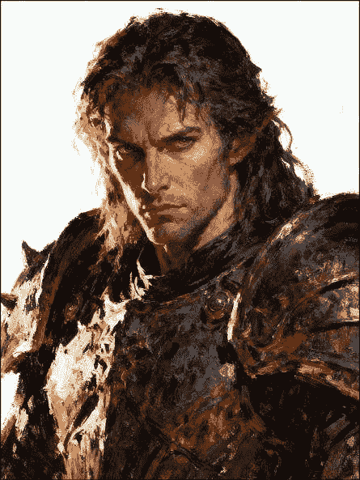

图 4-3　厚涂风图片示例

在使用此类风格进行视频生成时，不适合安排剧烈的动作场景。因为其缺乏明确的轮廓线，大幅度的运动会导致画面“融化”。正确的动态化策略是做“微动态”，如烛火摇曳、尘埃浮动、角色呼吸时胸膛的起伏、水面波光等。利用光线的缓慢流动来暗示时间的流逝，用氛围感这种高级手段来维持观众的沉浸感。

### 4.2.3　皮克斯风格

皮克斯风格是三维动画的标杆，其核心逻辑是“真实的材质，夸张的造型”，具体特征如下。

**·** 艺术化的真实感：并非追求物理照片级的真实，而是在真实的基础上进行艺术化夸张。材质、光影、物理模拟都非常逼真，但造型、色彩和表情被刻意夸大，以增强表现力。

**·** 亲和感与卡通感：角色设计圆润、可爱，即使是非生命体也被赋予鲜活的人格。这种“卡通感”使其老少咸宜。

**·** 精湛的灯光与全局光照：对光影的运用达到极致，能营造出无比温暖、舒适或极具戏剧性的氛围。

**·** 标志性的瞳孔：皮克斯风格的角色通常拥有巨大、明亮的卡通瞳孔，这是传递情感的关键。

以下是一条皮克斯风格提示词示例。

白色背景，人物电影定妆照，皮克斯风格男子，头发棕色且蓬松卷曲，背着一把吉他，微笑，直视镜头，正面视角。

根据此提示词生成的皮克斯风格图片示例如图 4-4 所示。

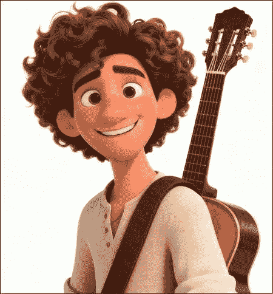

图 4-4　皮克斯风格图片示例

在生成视频时，要注意动作的弹性。皮克斯风格的运动必须符合动画十二法则，要有预备动作和挤压拉伸，动作太僵硬会破坏这种风格的生命感。

### 4.2.4　吉卜力风格

这里的“吉卜力风格”特指由日本吉卜力工作室（由宫崎骏、高畑勋等人创办）创造的二维手绘动画风格。该风格被视为手绘动画的美学巅峰，充满了对自然的极致崇拜和人文温度。其核心特征如下。

**·** 手绘的温度与瑕疵：保留手绘的线条、水彩质感和轻微的瑕疵，充满艺术气息和人文温度。

**·** 对自然的热爱与描绘：对风、云、草、水、光等自然元素的描绘达到极致，画面充满生机与呼吸感。

**·** 柔和唯美的色彩：色彩饱和度通常不高，色调柔和、典雅，充满诗意。

**·** 欧洲与日本文化的融合：建筑、场景设计常常融合了欧洲乡村与日本传统美学的元素。

以下是一条吉卜力风格提示词示例。

吉卜力工作室动画风格，细腻手绘插画，画面主体是一位留着深棕色短发的少女，身穿红色短袖 T 恤，趴在茂密鲜亮的绿色草地上，双眼闭合，露出开怀大笑的表情，脸颊带有淡粉色红晕。背景为幽深的森林，林间透过斑驳柔和的黄绿色自然光，形成丁达尔光效，整体色调以暖绿与暖橙为主，笔触细腻流畅，人物神态生动自然，画面充满治愈感，出版印刷级精度，无多余元素，画面干净整洁。

根据此提示词生成的吉卜力风格图片示例如图 4-5 所示。

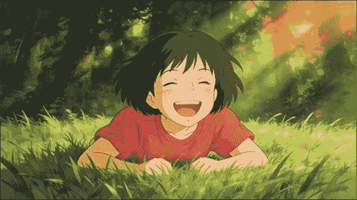

图 4-5　吉卜力风格图片示例

在制作这种风格的动态漫作品时，节奏要舒缓，效果是柔和且连续的。重点表现风的流动、云的运动、光线缓缓变化等细节。应避免使用快速剪辑和剧烈转场，以免破坏作品原有的宁静感与诗意氛围。

### 4.2.5　游戏 CG 风格

游戏 CG 风格是指以计算机图形技术为核心，为游戏产品制作的视觉表现形式，兼具技术表现力与叙事功能性，在 AI 漫剧中，它又细分为两个主要流派。

#### 1．硬核游戏 CG 风

这类风格对标《赛博朋克 2077》《战神》《使命召唤》等经典 3A 游戏大作，其核心特征如下。

**·** 超精细模型：角色和场景的模型面数极高，皮肤毛孔、织物纹理、金属划痕都清晰可见。

**·** 物理精确的光照与材质：普遍采用基于物理的渲染，金属、皮革、皮肤等材质的反光、漫反射和次表面散射效果高度逼真。

**·** 电影级镜头语言：广泛运用电影摄影技法，如浅景深、动态模糊、手持晃动感、宏大的航拍镜头等。

**·** 剧烈的环境互动：爆炸、烟尘、雨水、破碎等特效模拟得非常真实，充满动力学细节。

以下是一条硬核游戏 CG 风格的生图提示词示例。

电影感，游戏 CG，照片级真实感，超高清细节，虚幻引擎 5 渲染，戏剧性的光影，细致的人物，景深，视觉特效，人物设计参考照片，白色背景，女性战士，希腊神话质感。面向相机正面。半身肖像。

根据此提示词生成的硬核游戏 CG 风格图片示例如图 4-6 所示。

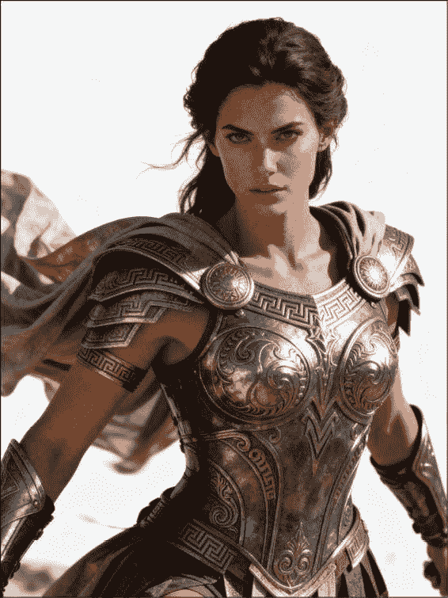

图 4-6　硬核游戏 CG 风格图片示例

这种风格适合科幻、战争、末日题材，强调视觉冲击力和沉浸感。

#### 2．东方幻想与武侠风格

这是国内创作者最常用的一种风格，对标《天涯明月刀》《原神》或《永劫无间》的宣传 CG，其核心特征如下。

**·** 唯美与浪漫：角色设计极其俊美，服装华丽飘逸，场景常常如诗如画。

**·** 动态的飘逸感：对头发、衣物、丝带、羽毛等元素的动态模拟非常重视，追求“仙气飘飘”的视觉感受。

**·** 华丽的粒子特效：技能特效往往极其炫目，融合了光效、符文、花瓣、星辰等元素，充满想象力和视觉冲击力。

**·** 意境大于写实：注重整体氛围的营造，如月光下的竹林、云海中的仙山，强调东方美学中的“意境”。

以下是一条东方幻想与武侠风格的生图提示词示例。

女性武侠 2.5D 化妆照片，全身白色长袍飘逸，银线刺绣，目光严肃，高马尾发型，风格类似中国动画《不良人》，纯白背景，柔和顶光，对称构图，丝绸质感，水墨效果，浅灰色阴影，飘带，剑眉，冷色调，细腻笔触，角色居中，高分辨率 8K，用虚幻引擎渲染，长袍飘动。

根据此提示词生成的东方幻想与武侠风格图片示例如图 4-7 所示。

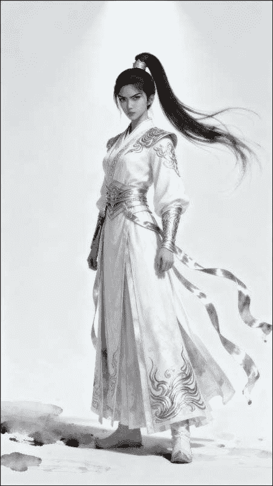

图 4-7　东方幻想与武侠风格图片示例

总的来说，世界观与画风并非简单的视觉偏好，而是决定一部 AI 漫剧能否成立的基础架构。不同画风对角色比例、表情幅度、动作强度以及镜头尺度的容忍度截然不同。只有当世界观清晰、画风统一时，分镜设计才会自然收敛，镜头选择也因此有了依据。

在 AI 漫剧创作中，画风实质上是一种“约束工具”。它既帮助 AI 准确理解人物与情绪，也为创作者提前划定了镜头语言的可用边界，从而降低试错成本。必须在进入具体分镜拆解前，彻底完成世界观与画风的选择。这是一条不可跳过的基础路径。

接下来，我们将基于这些视觉前提，系统讲解如何运用镜头语言进行叙事表达。 EXr6287u6NNVz+GYLY+7SDk226FstKIHdC0bNoQkB2Nqi1xSR0yxPmwrTs5gRi/BtfSbid6dBhii9q7cz2pIyA==

## 4.2 画风选择

4.1 节已完成从剧本到分镜叙事任务的拆解，明确了分镜需承载的故事脉络与表达需求。但在着手设计具体镜头、敲定每一处画面细节前，必须先解决一个核心底层问题——画风选择。

对于 AI 漫剧而言，同样的剧情内核与分镜框架，若搭配不同的画风，其镜头语言的呈现逻辑、观众的视觉感受会产生天差地别。画风不仅决定了画面的整体审美取向，更直接限定了镜头尺度的选择、运动方式的设计以及叙事节奏的把控。若画风缺乏统一性，即便分镜设计再精细，拼接后也会呈现杂乱感——角色与场景脱节，仿佛身处不同叙事维度，人物与环境间无合理的视觉关联，这种强烈的割裂感会直接打破观众的沉浸感，导致叙事失效。因此，确定 AI 漫剧的画风类型，是分镜制作不可或缺的前置环节。唯有先定好这份“视觉规矩”，分镜设计才能精准服务于故事表达，避免沦为无意义的零散素材堆砌。

结合 AI 漫剧的制作特性、技术适配度与市场成熟度，本节将重点拆解 5 种实用、适配性强的风格流派，为后续分镜设计提供视觉指引。

### 4.2.1　二次元/动漫风

这是目前 AI 动态漫领域技术最成熟、产出效率最高的赛道，直接对标日本商业动画，其核心特点如下。

**·** 线条感：这是动漫风的骨架。轮廓线必须清晰锐利，不能模棱两可。

**·** 色块化：色彩区域平整干净，少有复杂的渐变和笔触，便于后期处理。

**·** 程式化光影：通常采用“赛璐珞”技法，阴影边缘硬朗，光影二分明确，没有柔和的过渡带。

**·** 符号化表达：巨大的眼睛、夸张的流泪、速度线等，这些是动漫独有的视觉语言。

以下是一条动漫风提示词示例。

欧洲女性形象，劳动者外观，简朴，黑发，蓝眼睛，蓬松高髻发型，2D 手绘动漫风格，日本动漫，完全人类的玛丽亚逼真全身肖像，地下劳动领袖，正面面对镜头，由空山基绘制的画作，宁静但带有反抗的表情，皮肤光线完美，纯白背景，超高细节。

根据此提示词生成的动漫风图片示例如图 4-2 所示。

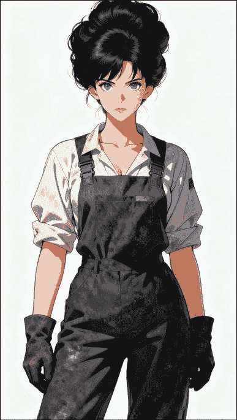

图 4-2　动漫风图片示例

在使用这类风格制作动态效果时，不必追求全身的大幅度运动，AI 模型往往很难控制住线条的抖动。更高效的做法是将动态聚焦在局部，如头发的飘动、衣角的翻飞、眼神光和泪水的闪烁。后期可通过添加“速度线”“集中线”或“闪光特效”，进一步强化画面的动感和张力。这类风格适合绝大多数爽文、现代都市和校园题材。

### 4.2.2　厚涂（插画）风

这种风格接近传统架上绘画，质感厚重，适合表现史诗感、权谋或情感深沉的故事，其核心特征如下。

**·** 笔触与质感：画面由明显的笔刷堆叠而成，画布的纹理感强，能看到颜料混合的痕迹。

**·** 写实光影：不同于动漫的硬边阴影，它的光影过渡极其柔和细腻，体积感强，遵循真实的物理规律。

**·** 色彩丰富：色彩层次复杂，不像动漫风那样是单纯的色块。

**·** 氛围优先：色彩层次复杂，极其擅长通过光影营造情绪。

以下是一条厚涂风提示词示例。

白色背景，厚涂风半精灵战士肖像，中世纪骑士男性，深棕色带金色挑染的微卷中长发，尖耳朵，锐利金色眼眸，冷峻坚毅神情，直视镜头，身着带有磨损斑驳色彩的金属盔甲，肩甲带尖刺，正面半身视角，侧光明暗对比强烈，笔触粗犷富有质感。

根据此提示词生成的厚涂风图片示例如图 4-3 所示。

图 4-3　厚涂风图片示例

在使用此类风格进行视频生成时，不适合安排剧烈的动作场景。因为其缺乏明确的轮廓线，大幅度的运动会导致画面“融化”。正确的动态化策略是做“微动态”，如烛火摇曳、尘埃浮动、角色呼吸时胸膛的起伏、水面波光等。利用光线的缓慢流动来暗示时间的流逝，用氛围感这种高级手段来维持观众的沉浸感。

### 4.2.3　皮克斯风格

皮克斯风格是三维动画的标杆，其核心逻辑是“真实的材质，夸张的造型”，具体特征如下。

**·** 艺术化的真实感：并非追求物理照片级的真实，而是在真实的基础上进行艺术化夸张。材质、光影、物理模拟都非常逼真，但造型、色彩和表情被刻意夸大，以增强表现力。

**·** 亲和感与卡通感：角色设计圆润、可爱，即使是非生命体也被赋予鲜活的人格。这种“卡通感”使其老少咸宜。

**·** 精湛的灯光与全局光照：对光影的运用达到极致，能营造出无比温暖、舒适或极具戏剧性的氛围。

**·** 标志性的瞳孔：皮克斯风格的角色通常拥有巨大、明亮的卡通瞳孔，这是传递情感的关键。

以下是一条皮克斯风格提示词示例。

白色背景，人物电影定妆照，皮克斯风格男子，头发棕色且蓬松卷曲，背着一把吉他，微笑，直视镜头，正面视角。

根据此提示词生成的皮克斯风格图片示例如图 4-4 所示。

图 4-4　皮克斯风格图片示例

在生成视频时，要注意动作的弹性。皮克斯风格的运动必须符合动画十二法则，要有预备动作和挤压拉伸，动作太僵硬会破坏这种风格的生命感。

### 4.2.4　吉卜力风格

这里的“吉卜力风格”特指由日本吉卜力工作室（由宫崎骏、高畑勋等人创办）创造的二维手绘动画风格。该风格被视为手绘动画的美学巅峰，充满了对自然的极致崇拜和人文温度。其核心特征如下。

**·** 手绘的温度与瑕疵：保留手绘的线条、水彩质感和轻微的瑕疵，充满艺术气息和人文温度。

**·** 对自然的热爱与描绘：对风、云、草、水、光等自然元素的描绘达到极致，画面充满生机与呼吸感。

**·** 柔和唯美的色彩：色彩饱和度通常不高，色调柔和、典雅，充满诗意。

**·** 欧洲与日本文化的融合：建筑、场景设计常常融合了欧洲乡村与日本传统美学的元素。

以下是一条吉卜力风格提示词示例。

吉卜力工作室动画风格，细腻手绘插画，画面主体是一位留着深棕色短发的少女，身穿红色短袖 T 恤，趴在茂密鲜亮的绿色草地上，双眼闭合，露出开怀大笑的表情，脸颊带有淡粉色红晕。背景为幽深的森林，林间透过斑驳柔和的黄绿色自然光，形成丁达尔光效，整体色调以暖绿与暖橙为主，笔触细腻流畅，人物神态生动自然，画面充满治愈感，出版印刷级精度，无多余元素，画面干净整洁。

根据此提示词生成的吉卜力风格图片示例如图 4-5 所示。

图 4-5　吉卜力风格图片示例

在制作这种风格的动态漫作品时，节奏要舒缓，效果是柔和且连续的。重点表现风的流动、云的运动、光线缓缓变化等细节。应避免使用快速剪辑和剧烈转场，以免破坏作品原有的宁静感与诗意氛围。

### 4.2.5　游戏 CG 风格

游戏 CG 风格是指以计算机图形技术为核心，为游戏产品制作的视觉表现形式，兼具技术表现力与叙事功能性，在 AI 漫剧中，它又细分为两个主要流派。

#### 1．硬核游戏 CG 风

这类风格对标《赛博朋克 2077》《战神》《使命召唤》等经典 3A 游戏大作，其核心特征如下。

**·** 超精细模型：角色和场景的模型面数极高，皮肤毛孔、织物纹理、金属划痕都清晰可见。

**·** 物理精确的光照与材质：普遍采用基于物理的渲染，金属、皮革、皮肤等材质的反光、漫反射和次表面散射效果高度逼真。

**·** 电影级镜头语言：广泛运用电影摄影技法，如浅景深、动态模糊、手持晃动感、宏大的航拍镜头等。

**·** 剧烈的环境互动：爆炸、烟尘、雨水、破碎等特效模拟得非常真实，充满动力学细节。

以下是一条硬核游戏 CG 风格的生图提示词示例。

电影感，游戏 CG，照片级真实感，超高清细节，虚幻引擎 5 渲染，戏剧性的光影，细致的人物，景深，视觉特效，人物设计参考照片，白色背景，女性战士，希腊神话质感。面向相机正面。半身肖像。

根据此提示词生成的硬核游戏 CG 风格图片示例如图 4-6 所示。

图 4-6　硬核游戏 CG 风格图片示例

这种风格适合科幻、战争、末日题材，强调视觉冲击力和沉浸感。

#### 2．东方幻想与武侠风格

这是国内创作者最常用的一种风格，对标《天涯明月刀》《原神》或《永劫无间》的宣传 CG，其核心特征如下。

**·** 唯美与浪漫：角色设计极其俊美，服装华丽飘逸，场景常常如诗如画。

**·** 动态的飘逸感：对头发、衣物、丝带、羽毛等元素的动态模拟非常重视，追求“仙气飘飘”的视觉感受。

**·** 华丽的粒子特效：技能特效往往极其炫目，融合了光效、符文、花瓣、星辰等元素，充满想象力和视觉冲击力。

**·** 意境大于写实：注重整体氛围的营造，如月光下的竹林、云海中的仙山，强调东方美学中的“意境”。

以下是一条东方幻想与武侠风格的生图提示词示例。

女性武侠 2.5D 化妆照片，全身白色长袍飘逸，银线刺绣，目光严肃，高马尾发型，风格类似中国动画《不良人》，纯白背景，柔和顶光，对称构图，丝绸质感，水墨效果，浅灰色阴影，飘带，剑眉，冷色调，细腻笔触，角色居中，高分辨率 8K，用虚幻引擎渲染，长袍飘动。

根据此提示词生成的东方幻想与武侠风格图片示例如图 4-7 所示。

图 4-7　东方幻想与武侠风格图片示例

总的来说，世界观与画风并非简单的视觉偏好，而是决定一部 AI 漫剧能否成立的基础架构。不同画风对角色比例、表情幅度、动作强度以及镜头尺度的容忍度截然不同。只有当世界观清晰、画风统一时，分镜设计才会自然收敛，镜头选择也因此有了依据。

在 AI 漫剧创作中，画风实质上是一种“约束工具”。它既帮助 AI 准确理解人物与情绪，也为创作者提前划定了镜头语言的可用边界，从而降低试错成本。必须在进入具体分镜拆解前，彻底完成世界观与画风的选择。这是一条不可跳过的基础路径。

接下来，我们将基于这些视觉前提，系统讲解如何运用镜头语言进行叙事表达。 EXr6287u6NNVz+GYLY+7SDk226FstKIHdC0bNoQkB2Nqi1xSR0yxPmwrTs5gRi/BtfSbid6dBhii9q7cz2pIyA==

## 4.2 画风选择

4.1 节已完成从剧本到分镜叙事任务的拆解，明确了分镜需承载的故事脉络与表达需求。但在着手设计具体镜头、敲定每一处画面细节前，必须先解决一个核心底层问题——画风选择。

对于 AI 漫剧而言，同样的剧情内核与分镜框架，若搭配不同的画风，其镜头语言的呈现逻辑、观众的视觉感受会产生天差地别。画风不仅决定了画面的整体审美取向，更直接限定了镜头尺度的选择、运动方式的设计以及叙事节奏的把控。若画风缺乏统一性，即便分镜设计再精细，拼接后也会呈现杂乱感——角色与场景脱节，仿佛身处不同叙事维度，人物与环境间无合理的视觉关联，这种强烈的割裂感会直接打破观众的沉浸感，导致叙事失效。因此，确定 AI 漫剧的画风类型，是分镜制作不可或缺的前置环节。唯有先定好这份“视觉规矩”，分镜设计才能精准服务于故事表达，避免沦为无意义的零散素材堆砌。

结合 AI 漫剧的制作特性、技术适配度与市场成熟度，本节将重点拆解 5 种实用、适配性强的风格流派，为后续分镜设计提供视觉指引。

### 4.2.1　二次元/动漫风

这是目前 AI 动态漫领域技术最成熟、产出效率最高的赛道，直接对标日本商业动画，其核心特点如下。

**·** 线条感：这是动漫风的骨架。轮廓线必须清晰锐利，不能模棱两可。

**·** 色块化：色彩区域平整干净，少有复杂的渐变和笔触，便于后期处理。

**·** 程式化光影：通常采用“赛璐珞”技法，阴影边缘硬朗，光影二分明确，没有柔和的过渡带。

**·** 符号化表达：巨大的眼睛、夸张的流泪、速度线等，这些是动漫独有的视觉语言。

以下是一条动漫风提示词示例。

欧洲女性形象，劳动者外观，简朴，黑发，蓝眼睛，蓬松高髻发型，2D 手绘动漫风格，日本动漫，完全人类的玛丽亚逼真全身肖像，地下劳动领袖，正面面对镜头，由空山基绘制的画作，宁静但带有反抗的表情，皮肤光线完美，纯白背景，超高细节。

根据此提示词生成的动漫风图片示例如图 4-2 所示。

图 4-2　动漫风图片示例

在使用这类风格制作动态效果时，不必追求全身的大幅度运动，AI 模型往往很难控制住线条的抖动。更高效的做法是将动态聚焦在局部，如头发的飘动、衣角的翻飞、眼神光和泪水的闪烁。后期可通过添加“速度线”“集中线”或“闪光特效”，进一步强化画面的动感和张力。这类风格适合绝大多数爽文、现代都市和校园题材。

### 4.2.2　厚涂（插画）风

这种风格接近传统架上绘画，质感厚重，适合表现史诗感、权谋或情感深沉的故事，其核心特征如下。

**·** 笔触与质感：画面由明显的笔刷堆叠而成，画布的纹理感强，能看到颜料混合的痕迹。

**·** 写实光影：不同于动漫的硬边阴影，它的光影过渡极其柔和细腻，体积感强，遵循真实的物理规律。

**·** 色彩丰富：色彩层次复杂，不像动漫风那样是单纯的色块。

**·** 氛围优先：色彩层次复杂，极其擅长通过光影营造情绪。

以下是一条厚涂风提示词示例。

白色背景，厚涂风半精灵战士肖像，中世纪骑士男性，深棕色带金色挑染的微卷中长发，尖耳朵，锐利金色眼眸，冷峻坚毅神情，直视镜头，身着带有磨损斑驳色彩的金属盔甲，肩甲带尖刺，正面半身视角，侧光明暗对比强烈，笔触粗犷富有质感。

根据此提示词生成的厚涂风图片示例如图 4-3 所示。

图 4-3　厚涂风图片示例

在使用此类风格进行视频生成时，不适合安排剧烈的动作场景。因为其缺乏明确的轮廓线，大幅度的运动会导致画面“融化”。正确的动态化策略是做“微动态”，如烛火摇曳、尘埃浮动、角色呼吸时胸膛的起伏、水面波光等。利用光线的缓慢流动来暗示时间的流逝，用氛围感这种高级手段来维持观众的沉浸感。

### 4.2.3　皮克斯风格

皮克斯风格是三维动画的标杆，其核心逻辑是“真实的材质，夸张的造型”，具体特征如下。

**·** 艺术化的真实感：并非追求物理照片级的真实，而是在真实的基础上进行艺术化夸张。材质、光影、物理模拟都非常逼真，但造型、色彩和表情被刻意夸大，以增强表现力。

**·** 亲和感与卡通感：角色设计圆润、可爱，即使是非生命体也被赋予鲜活的人格。这种“卡通感”使其老少咸宜。

**·** 精湛的灯光与全局光照：对光影的运用达到极致，能营造出无比温暖、舒适或极具戏剧性的氛围。

**·** 标志性的瞳孔：皮克斯风格的角色通常拥有巨大、明亮的卡通瞳孔，这是传递情感的关键。

以下是一条皮克斯风格提示词示例。

白色背景，人物电影定妆照，皮克斯风格男子，头发棕色且蓬松卷曲，背着一把吉他，微笑，直视镜头，正面视角。

根据此提示词生成的皮克斯风格图片示例如图 4-4 所示。

图 4-4　皮克斯风格图片示例

在生成视频时，要注意动作的弹性。皮克斯风格的运动必须符合动画十二法则，要有预备动作和挤压拉伸，动作太僵硬会破坏这种风格的生命感。

### 4.2.4　吉卜力风格

这里的“吉卜力风格”特指由日本吉卜力工作室（由宫崎骏、高畑勋等人创办）创造的二维手绘动画风格。该风格被视为手绘动画的美学巅峰，充满了对自然的极致崇拜和人文温度。其核心特征如下。

**·** 手绘的温度与瑕疵：保留手绘的线条、水彩质感和轻微的瑕疵，充满艺术气息和人文温度。

**·** 对自然的热爱与描绘：对风、云、草、水、光等自然元素的描绘达到极致，画面充满生机与呼吸感。

**·** 柔和唯美的色彩：色彩饱和度通常不高，色调柔和、典雅，充满诗意。

**·** 欧洲与日本文化的融合：建筑、场景设计常常融合了欧洲乡村与日本传统美学的元素。

以下是一条吉卜力风格提示词示例。

吉卜力工作室动画风格，细腻手绘插画，画面主体是一位留着深棕色短发的少女，身穿红色短袖 T 恤，趴在茂密鲜亮的绿色草地上，双眼闭合，露出开怀大笑的表情，脸颊带有淡粉色红晕。背景为幽深的森林，林间透过斑驳柔和的黄绿色自然光，形成丁达尔光效，整体色调以暖绿与暖橙为主，笔触细腻流畅，人物神态生动自然，画面充满治愈感，出版印刷级精度，无多余元素，画面干净整洁。

根据此提示词生成的吉卜力风格图片示例如图 4-5 所示。

图 4-5　吉卜力风格图片示例

在制作这种风格的动态漫作品时，节奏要舒缓，效果是柔和且连续的。重点表现风的流动、云的运动、光线缓缓变化等细节。应避免使用快速剪辑和剧烈转场，以免破坏作品原有的宁静感与诗意氛围。

### 4.2.5　游戏 CG 风格

游戏 CG 风格是指以计算机图形技术为核心，为游戏产品制作的视觉表现形式，兼具技术表现力与叙事功能性，在 AI 漫剧中，它又细分为两个主要流派。

#### 1．硬核游戏 CG 风

这类风格对标《赛博朋克 2077》《战神》《使命召唤》等经典 3A 游戏大作，其核心特征如下。

**·** 超精细模型：角色和场景的模型面数极高，皮肤毛孔、织物纹理、金属划痕都清晰可见。

**·** 物理精确的光照与材质：普遍采用基于物理的渲染，金属、皮革、皮肤等材质的反光、漫反射和次表面散射效果高度逼真。

**·** 电影级镜头语言：广泛运用电影摄影技法，如浅景深、动态模糊、手持晃动感、宏大的航拍镜头等。

**·** 剧烈的环境互动：爆炸、烟尘、雨水、破碎等特效模拟得非常真实，充满动力学细节。

以下是一条硬核游戏 CG 风格的生图提示词示例。

电影感，游戏 CG，照片级真实感，超高清细节，虚幻引擎 5 渲染，戏剧性的光影，细致的人物，景深，视觉特效，人物设计参考照片，白色背景，女性战士，希腊神话质感。面向相机正面。半身肖像。

根据此提示词生成的硬核游戏 CG 风格图片示例如图 4-6 所示。

图 4-6　硬核游戏 CG 风格图片示例

这种风格适合科幻、战争、末日题材，强调视觉冲击力和沉浸感。

#### 2．东方幻想与武侠风格

这是国内创作者最常用的一种风格，对标《天涯明月刀》《原神》或《永劫无间》的宣传 CG，其核心特征如下。

**·** 唯美与浪漫：角色设计极其俊美，服装华丽飘逸，场景常常如诗如画。

**·** 动态的飘逸感：对头发、衣物、丝带、羽毛等元素的动态模拟非常重视，追求“仙气飘飘”的视觉感受。

**·** 华丽的粒子特效：技能特效往往极其炫目，融合了光效、符文、花瓣、星辰等元素，充满想象力和视觉冲击力。

**·** 意境大于写实：注重整体氛围的营造，如月光下的竹林、云海中的仙山，强调东方美学中的“意境”。

以下是一条东方幻想与武侠风格的生图提示词示例。

女性武侠 2.5D 化妆照片，全身白色长袍飘逸，银线刺绣，目光严肃，高马尾发型，风格类似中国动画《不良人》，纯白背景，柔和顶光，对称构图，丝绸质感，水墨效果，浅灰色阴影，飘带，剑眉，冷色调，细腻笔触，角色居中，高分辨率 8K，用虚幻引擎渲染，长袍飘动。

根据此提示词生成的东方幻想与武侠风格图片示例如图 4-7 所示。

图 4-7　东方幻想与武侠风格图片示例

总的来说，世界观与画风并非简单的视觉偏好，而是决定一部 AI 漫剧能否成立的基础架构。不同画风对角色比例、表情幅度、动作强度以及镜头尺度的容忍度截然不同。只有当世界观清晰、画风统一时，分镜设计才会自然收敛，镜头选择也因此有了依据。

在 AI 漫剧创作中，画风实质上是一种“约束工具”。它既帮助 AI 准确理解人物与情绪，也为创作者提前划定了镜头语言的可用边界，从而降低试错成本。必须在进入具体分镜拆解前，彻底完成世界观与画风的选择。这是一条不可跳过的基础路径。

接下来，我们将基于这些视觉前提，系统讲解如何运用镜头语言进行叙事表达。 EXr6287u6NNVz+GYLY+7SDk226FstKIHdC0bNoQkB2Nqi1xSR0yxPmwrTs5gRi/BtfSbid6dBhii9q7cz2pIyA==

## 4.2 画风选择

4.1 节已完成从剧本到分镜叙事任务的拆解，明确了分镜需承载的故事脉络与表达需求。但在着手设计具体镜头、敲定每一处画面细节前，必须先解决一个核心底层问题——画风选择。

对于 AI 漫剧而言，同样的剧情内核与分镜框架，若搭配不同的画风，其镜头语言的呈现逻辑、观众的视觉感受会产生天差地别。画风不仅决定了画面的整体审美取向，更直接限定了镜头尺度的选择、运动方式的设计以及叙事节奏的把控。若画风缺乏统一性，即便分镜设计再精细，拼接后也会呈现杂乱感——角色与场景脱节，仿佛身处不同叙事维度，人物与环境间无合理的视觉关联，这种强烈的割裂感会直接打破观众的沉浸感，导致叙事失效。因此，确定 AI 漫剧的画风类型，是分镜制作不可或缺的前置环节。唯有先定好这份“视觉规矩”，分镜设计才能精准服务于故事表达，避免沦为无意义的零散素材堆砌。

结合 AI 漫剧的制作特性、技术适配度与市场成熟度，本节将重点拆解 5 种实用、适配性强的风格流派，为后续分镜设计提供视觉指引。

### 4.2.1　二次元/动漫风

这是目前 AI 动态漫领域技术最成熟、产出效率最高的赛道，直接对标日本商业动画，其核心特点如下。

**·** 线条感：这是动漫风的骨架。轮廓线必须清晰锐利，不能模棱两可。

**·** 色块化：色彩区域平整干净，少有复杂的渐变和笔触，便于后期处理。

**·** 程式化光影：通常采用“赛璐珞”技法，阴影边缘硬朗，光影二分明确，没有柔和的过渡带。

**·** 符号化表达：巨大的眼睛、夸张的流泪、速度线等，这些是动漫独有的视觉语言。

以下是一条动漫风提示词示例。

欧洲女性形象，劳动者外观，简朴，黑发，蓝眼睛，蓬松高髻发型，2D 手绘动漫风格，日本动漫，完全人类的玛丽亚逼真全身肖像，地下劳动领袖，正面面对镜头，由空山基绘制的画作，宁静但带有反抗的表情，皮肤光线完美，纯白背景，超高细节。

根据此提示词生成的动漫风图片示例如图 4-2 所示。

图 4-2　动漫风图片示例

在使用这类风格制作动态效果时，不必追求全身的大幅度运动，AI 模型往往很难控制住线条的抖动。更高效的做法是将动态聚焦在局部，如头发的飘动、衣角的翻飞、眼神光和泪水的闪烁。后期可通过添加“速度线”“集中线”或“闪光特效”，进一步强化画面的动感和张力。这类风格适合绝大多数爽文、现代都市和校园题材。

### 4.2.2　厚涂（插画）风

这种风格接近传统架上绘画，质感厚重，适合表现史诗感、权谋或情感深沉的故事，其核心特征如下。

**·** 笔触与质感：画面由明显的笔刷堆叠而成，画布的纹理感强，能看到颜料混合的痕迹。

**·** 写实光影：不同于动漫的硬边阴影，它的光影过渡极其柔和细腻，体积感强，遵循真实的物理规律。

**·** 色彩丰富：色彩层次复杂，不像动漫风那样是单纯的色块。

**·** 氛围优先：色彩层次复杂，极其擅长通过光影营造情绪。

以下是一条厚涂风提示词示例。

白色背景，厚涂风半精灵战士肖像，中世纪骑士男性，深棕色带金色挑染的微卷中长发，尖耳朵，锐利金色眼眸，冷峻坚毅神情，直视镜头，身着带有磨损斑驳色彩的金属盔甲，肩甲带尖刺，正面半身视角，侧光明暗对比强烈，笔触粗犷富有质感。

根据此提示词生成的厚涂风图片示例如图 4-3 所示。

图 4-3　厚涂风图片示例

在使用此类风格进行视频生成时，不适合安排剧烈的动作场景。因为其缺乏明确的轮廓线，大幅度的运动会导致画面“融化”。正确的动态化策略是做“微动态”，如烛火摇曳、尘埃浮动、角色呼吸时胸膛的起伏、水面波光等。利用光线的缓慢流动来暗示时间的流逝，用氛围感这种高级手段来维持观众的沉浸感。

### 4.2.3　皮克斯风格

皮克斯风格是三维动画的标杆，其核心逻辑是“真实的材质，夸张的造型”，具体特征如下。

**·** 艺术化的真实感：并非追求物理照片级的真实，而是在真实的基础上进行艺术化夸张。材质、光影、物理模拟都非常逼真，但造型、色彩和表情被刻意夸大，以增强表现力。

**·** 亲和感与卡通感：角色设计圆润、可爱，即使是非生命体也被赋予鲜活的人格。这种“卡通感”使其老少咸宜。

**·** 精湛的灯光与全局光照：对光影的运用达到极致，能营造出无比温暖、舒适或极具戏剧性的氛围。

**·** 标志性的瞳孔：皮克斯风格的角色通常拥有巨大、明亮的卡通瞳孔，这是传递情感的关键。

以下是一条皮克斯风格提示词示例。

白色背景，人物电影定妆照，皮克斯风格男子，头发棕色且蓬松卷曲，背着一把吉他，微笑，直视镜头，正面视角。

根据此提示词生成的皮克斯风格图片示例如图 4-4 所示。

图 4-4　皮克斯风格图片示例

在生成视频时，要注意动作的弹性。皮克斯风格的运动必须符合动画十二法则，要有预备动作和挤压拉伸，动作太僵硬会破坏这种风格的生命感。

### 4.2.4　吉卜力风格

这里的“吉卜力风格”特指由日本吉卜力工作室（由宫崎骏、高畑勋等人创办）创造的二维手绘动画风格。该风格被视为手绘动画的美学巅峰，充满了对自然的极致崇拜和人文温度。其核心特征如下。

**·** 手绘的温度与瑕疵：保留手绘的线条、水彩质感和轻微的瑕疵，充满艺术气息和人文温度。

**·** 对自然的热爱与描绘：对风、云、草、水、光等自然元素的描绘达到极致，画面充满生机与呼吸感。

**·** 柔和唯美的色彩：色彩饱和度通常不高，色调柔和、典雅，充满诗意。

**·** 欧洲与日本文化的融合：建筑、场景设计常常融合了欧洲乡村与日本传统美学的元素。

以下是一条吉卜力风格提示词示例。

吉卜力工作室动画风格，细腻手绘插画，画面主体是一位留着深棕色短发的少女，身穿红色短袖 T 恤，趴在茂密鲜亮的绿色草地上，双眼闭合，露出开怀大笑的表情，脸颊带有淡粉色红晕。背景为幽深的森林，林间透过斑驳柔和的黄绿色自然光，形成丁达尔光效，整体色调以暖绿与暖橙为主，笔触细腻流畅，人物神态生动自然，画面充满治愈感，出版印刷级精度，无多余元素，画面干净整洁。

根据此提示词生成的吉卜力风格图片示例如图 4-5 所示。

图 4-5　吉卜力风格图片示例

在制作这种风格的动态漫作品时，节奏要舒缓，效果是柔和且连续的。重点表现风的流动、云的运动、光线缓缓变化等细节。应避免使用快速剪辑和剧烈转场，以免破坏作品原有的宁静感与诗意氛围。

### 4.2.5　游戏 CG 风格

游戏 CG 风格是指以计算机图形技术为核心，为游戏产品制作的视觉表现形式，兼具技术表现力与叙事功能性，在 AI 漫剧中，它又细分为两个主要流派。

#### 1．硬核游戏 CG 风

这类风格对标《赛博朋克 2077》《战神》《使命召唤》等经典 3A 游戏大作，其核心特征如下。

**·** 超精细模型：角色和场景的模型面数极高，皮肤毛孔、织物纹理、金属划痕都清晰可见。

**·** 物理精确的光照与材质：普遍采用基于物理的渲染，金属、皮革、皮肤等材质的反光、漫反射和次表面散射效果高度逼真。

**·** 电影级镜头语言：广泛运用电影摄影技法，如浅景深、动态模糊、手持晃动感、宏大的航拍镜头等。

**·** 剧烈的环境互动：爆炸、烟尘、雨水、破碎等特效模拟得非常真实，充满动力学细节。

以下是一条硬核游戏 CG 风格的生图提示词示例。

电影感，游戏 CG，照片级真实感，超高清细节，虚幻引擎 5 渲染，戏剧性的光影，细致的人物，景深，视觉特效，人物设计参考照片，白色背景，女性战士，希腊神话质感。面向相机正面。半身肖像。

根据此提示词生成的硬核游戏 CG 风格图片示例如图 4-6 所示。

图 4-6　硬核游戏 CG 风格图片示例

这种风格适合科幻、战争、末日题材，强调视觉冲击力和沉浸感。

#### 2．东方幻想与武侠风格

这是国内创作者最常用的一种风格，对标《天涯明月刀》《原神》或《永劫无间》的宣传 CG，其核心特征如下。

**·** 唯美与浪漫：角色设计极其俊美，服装华丽飘逸，场景常常如诗如画。

**·** 动态的飘逸感：对头发、衣物、丝带、羽毛等元素的动态模拟非常重视，追求“仙气飘飘”的视觉感受。

**·** 华丽的粒子特效：技能特效往往极其炫目，融合了光效、符文、花瓣、星辰等元素，充满想象力和视觉冲击力。

**·** 意境大于写实：注重整体氛围的营造，如月光下的竹林、云海中的仙山，强调东方美学中的“意境”。

以下是一条东方幻想与武侠风格的生图提示词示例。

女性武侠 2.5D 化妆照片，全身白色长袍飘逸，银线刺绣，目光严肃，高马尾发型，风格类似中国动画《不良人》，纯白背景，柔和顶光，对称构图，丝绸质感，水墨效果，浅灰色阴影，飘带，剑眉，冷色调，细腻笔触，角色居中，高分辨率 8K，用虚幻引擎渲染，长袍飘动。

根据此提示词生成的东方幻想与武侠风格图片示例如图 4-7 所示。

图 4-7　东方幻想与武侠风格图片示例

总的来说，世界观与画风并非简单的视觉偏好，而是决定一部 AI 漫剧能否成立的基础架构。不同画风对角色比例、表情幅度、动作强度以及镜头尺度的容忍度截然不同。只有当世界观清晰、画风统一时，分镜设计才会自然收敛，镜头选择也因此有了依据。

在 AI 漫剧创作中，画风实质上是一种“约束工具”。它既帮助 AI 准确理解人物与情绪，也为创作者提前划定了镜头语言的可用边界，从而降低试错成本。必须在进入具体分镜拆解前，彻底完成世界观与画风的选择。这是一条不可跳过的基础路径。

接下来，我们将基于这些视觉前提，系统讲解如何运用镜头语言进行叙事表达。 EXr6287u6NNVz+GYLY+7SDk226FstKIHdC0bNoQkB2Nqi1xSR0yxPmwrTs5gRi/BtfSbid6dBhii9q7cz2pIyA==

## 4.2 画风选择

4.1 节已完成从剧本到分镜叙事任务的拆解，明确了分镜需承载的故事脉络与表达需求。但在着手设计具体镜头、敲定每一处画面细节前，必须先解决一个核心底层问题——画风选择。

对于 AI 漫剧而言，同样的剧情内核与分镜框架，若搭配不同的画风，其镜头语言的呈现逻辑、观众的视觉感受会产生天差地别。画风不仅决定了画面的整体审美取向，更直接限定了镜头尺度的选择、运动方式的设计以及叙事节奏的把控。若画风缺乏统一性，即便分镜设计再精细，拼接后也会呈现杂乱感——角色与场景脱节，仿佛身处不同叙事维度，人物与环境间无合理的视觉关联，这种强烈的割裂感会直接打破观众的沉浸感，导致叙事失效。因此，确定 AI 漫剧的画风类型，是分镜制作不可或缺的前置环节。唯有先定好这份“视觉规矩”，分镜设计才能精准服务于故事表达，避免沦为无意义的零散素材堆砌。

结合 AI 漫剧的制作特性、技术适配度与市场成熟度，本节将重点拆解 5 种实用、适配性强的风格流派，为后续分镜设计提供视觉指引。

### 4.2.1　二次元/动漫风

这是目前 AI 动态漫领域技术最成熟、产出效率最高的赛道，直接对标日本商业动画，其核心特点如下。

**·** 线条感：这是动漫风的骨架。轮廓线必须清晰锐利，不能模棱两可。

**·** 色块化：色彩区域平整干净，少有复杂的渐变和笔触，便于后期处理。

**·** 程式化光影：通常采用“赛璐珞”技法，阴影边缘硬朗，光影二分明确，没有柔和的过渡带。

**·** 符号化表达：巨大的眼睛、夸张的流泪、速度线等，这些是动漫独有的视觉语言。

以下是一条动漫风提示词示例。

欧洲女性形象，劳动者外观，简朴，黑发，蓝眼睛，蓬松高髻发型，2D 手绘动漫风格，日本动漫，完全人类的玛丽亚逼真全身肖像，地下劳动领袖，正面面对镜头，由空山基绘制的画作，宁静但带有反抗的表情，皮肤光线完美，纯白背景，超高细节。

根据此提示词生成的动漫风图片示例如图 4-2 所示。

图 4-2　动漫风图片示例

在使用这类风格制作动态效果时，不必追求全身的大幅度运动，AI 模型往往很难控制住线条的抖动。更高效的做法是将动态聚焦在局部，如头发的飘动、衣角的翻飞、眼神光和泪水的闪烁。后期可通过添加“速度线”“集中线”或“闪光特效”，进一步强化画面的动感和张力。这类风格适合绝大多数爽文、现代都市和校园题材。

### 4.2.2　厚涂（插画）风

这种风格接近传统架上绘画，质感厚重，适合表现史诗感、权谋或情感深沉的故事，其核心特征如下。

**·** 笔触与质感：画面由明显的笔刷堆叠而成，画布的纹理感强，能看到颜料混合的痕迹。

**·** 写实光影：不同于动漫的硬边阴影，它的光影过渡极其柔和细腻，体积感强，遵循真实的物理规律。

**·** 色彩丰富：色彩层次复杂，不像动漫风那样是单纯的色块。

**·** 氛围优先：色彩层次复杂，极其擅长通过光影营造情绪。

以下是一条厚涂风提示词示例。

白色背景，厚涂风半精灵战士肖像，中世纪骑士男性，深棕色带金色挑染的微卷中长发，尖耳朵，锐利金色眼眸，冷峻坚毅神情，直视镜头，身着带有磨损斑驳色彩的金属盔甲，肩甲带尖刺，正面半身视角，侧光明暗对比强烈，笔触粗犷富有质感。

根据此提示词生成的厚涂风图片示例如图 4-3 所示。

图 4-3　厚涂风图片示例

在使用此类风格进行视频生成时，不适合安排剧烈的动作场景。因为其缺乏明确的轮廓线，大幅度的运动会导致画面“融化”。正确的动态化策略是做“微动态”，如烛火摇曳、尘埃浮动、角色呼吸时胸膛的起伏、水面波光等。利用光线的缓慢流动来暗示时间的流逝，用氛围感这种高级手段来维持观众的沉浸感。

### 4.2.3　皮克斯风格

皮克斯风格是三维动画的标杆，其核心逻辑是“真实的材质，夸张的造型”，具体特征如下。

**·** 艺术化的真实感：并非追求物理照片级的真实，而是在真实的基础上进行艺术化夸张。材质、光影、物理模拟都非常逼真，但造型、色彩和表情被刻意夸大，以增强表现力。

**·** 亲和感与卡通感：角色设计圆润、可爱，即使是非生命体也被赋予鲜活的人格。这种“卡通感”使其老少咸宜。

**·** 精湛的灯光与全局光照：对光影的运用达到极致，能营造出无比温暖、舒适或极具戏剧性的氛围。

**·** 标志性的瞳孔：皮克斯风格的角色通常拥有巨大、明亮的卡通瞳孔，这是传递情感的关键。

以下是一条皮克斯风格提示词示例。

白色背景，人物电影定妆照，皮克斯风格男子，头发棕色且蓬松卷曲，背着一把吉他，微笑，直视镜头，正面视角。

根据此提示词生成的皮克斯风格图片示例如图 4-4 所示。

图 4-4　皮克斯风格图片示例

在生成视频时，要注意动作的弹性。皮克斯风格的运动必须符合动画十二法则，要有预备动作和挤压拉伸，动作太僵硬会破坏这种风格的生命感。

### 4.2.4　吉卜力风格

这里的“吉卜力风格”特指由日本吉卜力工作室（由宫崎骏、高畑勋等人创办）创造的二维手绘动画风格。该风格被视为手绘动画的美学巅峰，充满了对自然的极致崇拜和人文温度。其核心特征如下。

**·** 手绘的温度与瑕疵：保留手绘的线条、水彩质感和轻微的瑕疵，充满艺术气息和人文温度。

**·** 对自然的热爱与描绘：对风、云、草、水、光等自然元素的描绘达到极致，画面充满生机与呼吸感。

**·** 柔和唯美的色彩：色彩饱和度通常不高，色调柔和、典雅，充满诗意。

**·** 欧洲与日本文化的融合：建筑、场景设计常常融合了欧洲乡村与日本传统美学的元素。

以下是一条吉卜力风格提示词示例。

吉卜力工作室动画风格，细腻手绘插画，画面主体是一位留着深棕色短发的少女，身穿红色短袖 T 恤，趴在茂密鲜亮的绿色草地上，双眼闭合，露出开怀大笑的表情，脸颊带有淡粉色红晕。背景为幽深的森林，林间透过斑驳柔和的黄绿色自然光，形成丁达尔光效，整体色调以暖绿与暖橙为主，笔触细腻流畅，人物神态生动自然，画面充满治愈感，出版印刷级精度，无多余元素，画面干净整洁。

根据此提示词生成的吉卜力风格图片示例如图 4-5 所示。

图 4-5　吉卜力风格图片示例

在制作这种风格的动态漫作品时，节奏要舒缓，效果是柔和且连续的。重点表现风的流动、云的运动、光线缓缓变化等细节。应避免使用快速剪辑和剧烈转场，以免破坏作品原有的宁静感与诗意氛围。

### 4.2.5　游戏 CG 风格

游戏 CG 风格是指以计算机图形技术为核心，为游戏产品制作的视觉表现形式，兼具技术表现力与叙事功能性，在 AI 漫剧中，它又细分为两个主要流派。

#### 1．硬核游戏 CG 风

这类风格对标《赛博朋克 2077》《战神》《使命召唤》等经典 3A 游戏大作，其核心特征如下。

**·** 超精细模型：角色和场景的模型面数极高，皮肤毛孔、织物纹理、金属划痕都清晰可见。

**·** 物理精确的光照与材质：普遍采用基于物理的渲染，金属、皮革、皮肤等材质的反光、漫反射和次表面散射效果高度逼真。

**·** 电影级镜头语言：广泛运用电影摄影技法，如浅景深、动态模糊、手持晃动感、宏大的航拍镜头等。

**·** 剧烈的环境互动：爆炸、烟尘、雨水、破碎等特效模拟得非常真实，充满动力学细节。

以下是一条硬核游戏 CG 风格的生图提示词示例。

电影感，游戏 CG，照片级真实感，超高清细节，虚幻引擎 5 渲染，戏剧性的光影，细致的人物，景深，视觉特效，人物设计参考照片，白色背景，女性战士，希腊神话质感。面向相机正面。半身肖像。

根据此提示词生成的硬核游戏 CG 风格图片示例如图 4-6 所示。

图 4-6　硬核游戏 CG 风格图片示例

这种风格适合科幻、战争、末日题材，强调视觉冲击力和沉浸感。

#### 2．东方幻想与武侠风格

这是国内创作者最常用的一种风格，对标《天涯明月刀》《原神》或《永劫无间》的宣传 CG，其核心特征如下。

**·** 唯美与浪漫：角色设计极其俊美，服装华丽飘逸，场景常常如诗如画。

**·** 动态的飘逸感：对头发、衣物、丝带、羽毛等元素的动态模拟非常重视，追求“仙气飘飘”的视觉感受。

**·** 华丽的粒子特效：技能特效往往极其炫目，融合了光效、符文、花瓣、星辰等元素，充满想象力和视觉冲击力。

**·** 意境大于写实：注重整体氛围的营造，如月光下的竹林、云海中的仙山，强调东方美学中的“意境”。

以下是一条东方幻想与武侠风格的生图提示词示例。

女性武侠 2.5D 化妆照片，全身白色长袍飘逸，银线刺绣，目光严肃，高马尾发型，风格类似中国动画《不良人》，纯白背景，柔和顶光，对称构图，丝绸质感，水墨效果，浅灰色阴影，飘带，剑眉，冷色调，细腻笔触，角色居中，高分辨率 8K，用虚幻引擎渲染，长袍飘动。

根据此提示词生成的东方幻想与武侠风格图片示例如图 4-7 所示。

图 4-7　东方幻想与武侠风格图片示例

总的来说，世界观与画风并非简单的视觉偏好，而是决定一部 AI 漫剧能否成立的基础架构。不同画风对角色比例、表情幅度、动作强度以及镜头尺度的容忍度截然不同。只有当世界观清晰、画风统一时，分镜设计才会自然收敛，镜头选择也因此有了依据。

在 AI 漫剧创作中，画风实质上是一种“约束工具”。它既帮助 AI 准确理解人物与情绪，也为创作者提前划定了镜头语言的可用边界，从而降低试错成本。必须在进入具体分镜拆解前，彻底完成世界观与画风的选择。这是一条不可跳过的基础路径。

接下来，我们将基于这些视觉前提，系统讲解如何运用镜头语言进行叙事表达。 EXr6287u6NNVz+GYLY+7SDk226FstKIHdC0bNoQkB2Nqi1xSR0yxPmwrTs5gRi/BtfSbid6dBhii9q7cz2pIyA==

## 4.2 画风选择

4.1 节已完成从剧本到分镜叙事任务的拆解，明确了分镜需承载的故事脉络与表达需求。但在着手设计具体镜头、敲定每一处画面细节前，必须先解决一个核心底层问题——画风选择。

对于 AI 漫剧而言，同样的剧情内核与分镜框架，若搭配不同的画风，其镜头语言的呈现逻辑、观众的视觉感受会产生天差地别。画风不仅决定了画面的整体审美取向，更直接限定了镜头尺度的选择、运动方式的设计以及叙事节奏的把控。若画风缺乏统一性，即便分镜设计再精细，拼接后也会呈现杂乱感——角色与场景脱节，仿佛身处不同叙事维度，人物与环境间无合理的视觉关联，这种强烈的割裂感会直接打破观众的沉浸感，导致叙事失效。因此，确定 AI 漫剧的画风类型，是分镜制作不可或缺的前置环节。唯有先定好这份“视觉规矩”，分镜设计才能精准服务于故事表达，避免沦为无意义的零散素材堆砌。

结合 AI 漫剧的制作特性、技术适配度与市场成熟度，本节将重点拆解 5 种实用、适配性强的风格流派，为后续分镜设计提供视觉指引。

### 4.2.1　二次元/动漫风

这是目前 AI 动态漫领域技术最成熟、产出效率最高的赛道，直接对标日本商业动画，其核心特点如下。

**·** 线条感：这是动漫风的骨架。轮廓线必须清晰锐利，不能模棱两可。

**·** 色块化：色彩区域平整干净，少有复杂的渐变和笔触，便于后期处理。

**·** 程式化光影：通常采用“赛璐珞”技法，阴影边缘硬朗，光影二分明确，没有柔和的过渡带。

**·** 符号化表达：巨大的眼睛、夸张的流泪、速度线等，这些是动漫独有的视觉语言。

以下是一条动漫风提示词示例。

欧洲女性形象，劳动者外观，简朴，黑发，蓝眼睛，蓬松高髻发型，2D 手绘动漫风格，日本动漫，完全人类的玛丽亚逼真全身肖像，地下劳动领袖，正面面对镜头，由空山基绘制的画作，宁静但带有反抗的表情，皮肤光线完美，纯白背景，超高细节。

根据此提示词生成的动漫风图片示例如图 4-2 所示。

图 4-2　动漫风图片示例

在使用这类风格制作动态效果时，不必追求全身的大幅度运动，AI 模型往往很难控制住线条的抖动。更高效的做法是将动态聚焦在局部，如头发的飘动、衣角的翻飞、眼神光和泪水的闪烁。后期可通过添加“速度线”“集中线”或“闪光特效”，进一步强化画面的动感和张力。这类风格适合绝大多数爽文、现代都市和校园题材。

### 4.2.2　厚涂（插画）风

这种风格接近传统架上绘画，质感厚重，适合表现史诗感、权谋或情感深沉的故事，其核心特征如下。

**·** 笔触与质感：画面由明显的笔刷堆叠而成，画布的纹理感强，能看到颜料混合的痕迹。

**·** 写实光影：不同于动漫的硬边阴影，它的光影过渡极其柔和细腻，体积感强，遵循真实的物理规律。

**·** 色彩丰富：色彩层次复杂，不像动漫风那样是单纯的色块。

**·** 氛围优先：色彩层次复杂，极其擅长通过光影营造情绪。

以下是一条厚涂风提示词示例。

白色背景，厚涂风半精灵战士肖像，中世纪骑士男性，深棕色带金色挑染的微卷中长发，尖耳朵，锐利金色眼眸，冷峻坚毅神情，直视镜头，身着带有磨损斑驳色彩的金属盔甲，肩甲带尖刺，正面半身视角，侧光明暗对比强烈，笔触粗犷富有质感。

根据此提示词生成的厚涂风图片示例如图 4-3 所示。

图 4-3　厚涂风图片示例

在使用此类风格进行视频生成时，不适合安排剧烈的动作场景。因为其缺乏明确的轮廓线，大幅度的运动会导致画面“融化”。正确的动态化策略是做“微动态”，如烛火摇曳、尘埃浮动、角色呼吸时胸膛的起伏、水面波光等。利用光线的缓慢流动来暗示时间的流逝，用氛围感这种高级手段来维持观众的沉浸感。

### 4.2.3　皮克斯风格

皮克斯风格是三维动画的标杆，其核心逻辑是“真实的材质，夸张的造型”，具体特征如下。

**·** 艺术化的真实感：并非追求物理照片级的真实，而是在真实的基础上进行艺术化夸张。材质、光影、物理模拟都非常逼真，但造型、色彩和表情被刻意夸大，以增强表现力。

**·** 亲和感与卡通感：角色设计圆润、可爱，即使是非生命体也被赋予鲜活的人格。这种“卡通感”使其老少咸宜。

**·** 精湛的灯光与全局光照：对光影的运用达到极致，能营造出无比温暖、舒适或极具戏剧性的氛围。

**·** 标志性的瞳孔：皮克斯风格的角色通常拥有巨大、明亮的卡通瞳孔，这是传递情感的关键。

以下是一条皮克斯风格提示词示例。

白色背景，人物电影定妆照，皮克斯风格男子，头发棕色且蓬松卷曲，背着一把吉他，微笑，直视镜头，正面视角。

根据此提示词生成的皮克斯风格图片示例如图 4-4 所示。

图 4-4　皮克斯风格图片示例

在生成视频时，要注意动作的弹性。皮克斯风格的运动必须符合动画十二法则，要有预备动作和挤压拉伸，动作太僵硬会破坏这种风格的生命感。

### 4.2.4　吉卜力风格

这里的“吉卜力风格”特指由日本吉卜力工作室（由宫崎骏、高畑勋等人创办）创造的二维手绘动画风格。该风格被视为手绘动画的美学巅峰，充满了对自然的极致崇拜和人文温度。其核心特征如下。

**·** 手绘的温度与瑕疵：保留手绘的线条、水彩质感和轻微的瑕疵，充满艺术气息和人文温度。

**·** 对自然的热爱与描绘：对风、云、草、水、光等自然元素的描绘达到极致，画面充满生机与呼吸感。

**·** 柔和唯美的色彩：色彩饱和度通常不高，色调柔和、典雅，充满诗意。

**·** 欧洲与日本文化的融合：建筑、场景设计常常融合了欧洲乡村与日本传统美学的元素。

以下是一条吉卜力风格提示词示例。

吉卜力工作室动画风格，细腻手绘插画，画面主体是一位留着深棕色短发的少女，身穿红色短袖 T 恤，趴在茂密鲜亮的绿色草地上，双眼闭合，露出开怀大笑的表情，脸颊带有淡粉色红晕。背景为幽深的森林，林间透过斑驳柔和的黄绿色自然光，形成丁达尔光效，整体色调以暖绿与暖橙为主，笔触细腻流畅，人物神态生动自然，画面充满治愈感，出版印刷级精度，无多余元素，画面干净整洁。

根据此提示词生成的吉卜力风格图片示例如图 4-5 所示。

图 4-5　吉卜力风格图片示例

在制作这种风格的动态漫作品时，节奏要舒缓，效果是柔和且连续的。重点表现风的流动、云的运动、光线缓缓变化等细节。应避免使用快速剪辑和剧烈转场，以免破坏作品原有的宁静感与诗意氛围。

### 4.2.5　游戏 CG 风格

游戏 CG 风格是指以计算机图形技术为核心，为游戏产品制作的视觉表现形式，兼具技术表现力与叙事功能性，在 AI 漫剧中，它又细分为两个主要流派。

#### 1．硬核游戏 CG 风

这类风格对标《赛博朋克 2077》《战神》《使命召唤》等经典 3A 游戏大作，其核心特征如下。

**·** 超精细模型：角色和场景的模型面数极高，皮肤毛孔、织物纹理、金属划痕都清晰可见。

**·** 物理精确的光照与材质：普遍采用基于物理的渲染，金属、皮革、皮肤等材质的反光、漫反射和次表面散射效果高度逼真。

**·** 电影级镜头语言：广泛运用电影摄影技法，如浅景深、动态模糊、手持晃动感、宏大的航拍镜头等。

**·** 剧烈的环境互动：爆炸、烟尘、雨水、破碎等特效模拟得非常真实，充满动力学细节。

以下是一条硬核游戏 CG 风格的生图提示词示例。

电影感，游戏 CG，照片级真实感，超高清细节，虚幻引擎 5 渲染，戏剧性的光影，细致的人物，景深，视觉特效，人物设计参考照片，白色背景，女性战士，希腊神话质感。面向相机正面。半身肖像。

根据此提示词生成的硬核游戏 CG 风格图片示例如图 4-6 所示。

图 4-6　硬核游戏 CG 风格图片示例

这种风格适合科幻、战争、末日题材，强调视觉冲击力和沉浸感。

#### 2．东方幻想与武侠风格

这是国内创作者最常用的一种风格，对标《天涯明月刀》《原神》或《永劫无间》的宣传 CG，其核心特征如下。

**·** 唯美与浪漫：角色设计极其俊美，服装华丽飘逸，场景常常如诗如画。

**·** 动态的飘逸感：对头发、衣物、丝带、羽毛等元素的动态模拟非常重视，追求“仙气飘飘”的视觉感受。

**·** 华丽的粒子特效：技能特效往往极其炫目，融合了光效、符文、花瓣、星辰等元素，充满想象力和视觉冲击力。

**·** 意境大于写实：注重整体氛围的营造，如月光下的竹林、云海中的仙山，强调东方美学中的“意境”。

以下是一条东方幻想与武侠风格的生图提示词示例。

女性武侠 2.5D 化妆照片，全身白色长袍飘逸，银线刺绣，目光严肃，高马尾发型，风格类似中国动画《不良人》，纯白背景，柔和顶光，对称构图，丝绸质感，水墨效果，浅灰色阴影，飘带，剑眉，冷色调，细腻笔触，角色居中，高分辨率 8K，用虚幻引擎渲染，长袍飘动。

根据此提示词生成的东方幻想与武侠风格图片示例如图 4-7 所示。

图 4-7　东方幻想与武侠风格图片示例

总的来说，世界观与画风并非简单的视觉偏好，而是决定一部 AI 漫剧能否成立的基础架构。不同画风对角色比例、表情幅度、动作强度以及镜头尺度的容忍度截然不同。只有当世界观清晰、画风统一时，分镜设计才会自然收敛，镜头选择也因此有了依据。

在 AI 漫剧创作中，画风实质上是一种“约束工具”。它既帮助 AI 准确理解人物与情绪，也为创作者提前划定了镜头语言的可用边界，从而降低试错成本。必须在进入具体分镜拆解前，彻底完成世界观与画风的选择。这是一条不可跳过的基础路径。

接下来，我们将基于这些视觉前提，系统讲解如何运用镜头语言进行叙事表达。 EXr6287u6NNVz+GYLY+7SDk226FstKIHdC0bNoQkB2Nqi1xSR0yxPmwrTs5gRi/BtfSbid6dBhii9q7cz2pIyA==

## 4.3 镜头语言基础

4.2 节我们确定了 AI 漫剧的画风，这决定了作品的视觉基调。但仅有好看的画风还不能让观众满意，还得有拿得出手的故事并讲出来。观众如何感知故事，完全取决于镜头如何引导。镜头语言是连接世界与观众体验的桥梁，它负责分配信息、放大情绪、把控节奏。

在 AI 漫剧的制作语境里，镜头语言不仅是摄影技巧，更是一套严密的视觉规则系统。只有当你明确每个镜头要传达什么意图时，写出的提示词才能被 AI 模型准确执行，分镜才能真正服务于剧情，而不是变成随机生成的视觉抽卡。

在动笔写具体分镜脚本前，我们必须掌握镜头语言的三大基石：景别、镜头运动和拍摄角度。

### 4.3.1　景别

景别体现了摄影机与被摄主体之间的距离，决定了观众能看到多少信息量。

距离远，环境信息多，人物信息少；距离近，突出人物情绪，环境信息少。在用 AI 生成图片的提示词中，准确控制景别提示词是控制画面内容占比的有效手段。

根据距离的远近，常见的景别有 5 种，如图 4-8 所示。

#### 1．远景

远景的核心任务是交代故事背景与环境。它把视野拉到最开阔的状态，人物在画面里可能只是一个小黑点，重点在于展示广阔的环境、地理位置或者特定的自然景观。

在 AI 漫剧里，远景通常用来作开篇的定场镜头，或者场景转换时的过渡。它负责告诉观众故事发生的地点、时代与整体氛围——是宏大壮丽还是孤寂苍凉。

图 4-8　常见的 5 种景别

对于 AI 漫剧来说，远景是展示世界观设定的关键镜头。此时无须纠结人物的脸部细节（模型在远景下难以精确生成五官），而应聚焦于用环境烘托氛围，让观众在第一时间沉浸到你设定的世界里。

图 4-9 和图 4-10 展示了两张远景图片。

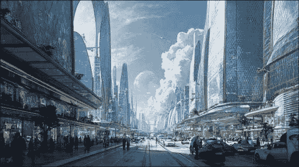

图 4-9　远景图片示例（一）

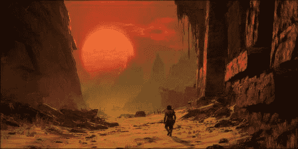

图 4-10　远景图片示例（二）

#### 2．全景

全景是展示“关系”的镜头。在这个景别下，人物的全身都能被看见，周围的环境也清晰可见。它能明确交代人物和环境的空间关系，以及人物与人物之间的位置关系。

全景最适合用于表现动作和姿态。当剧本里有打斗、舞蹈、奔跑或者多人互动的群像场景时，全景是不二之选。通过肢体语言、衣着打扮，观众能迅速判断角色的身份和当下的状态。

在 AI 生成的实际操作中，全景往往是很多动作戏容易失真的重灾区。因此，提示词要多描述肢体动作和互动逻辑，减少对微表情的描写，因为在这个距离下，肢体语言比表情更能有效传递信息。

图 4-11 和图 4-12 展示了两张全景图片。

图 4-11　全景图片示例（一）

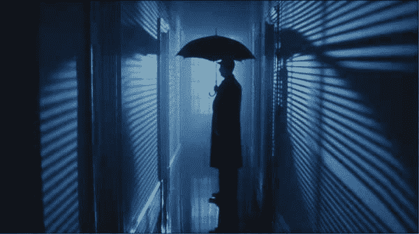

图 4-12　全景图片示例（二）

#### 3．中景

中景是叙事的“主力军”。它的画面通常卡在人物膝盖或腰部以上，既能看清表情，又能保留肢体动作，还带一点环境背景。这是一种非常平衡的视角，是最接近人类日常交流的观察距离。

绝大多数的剧情推进、双人对话、日常互动，都适合使用中景。它既没有远景的疏离感，也没有特写的压迫性，观众看着最舒服。

对于 AI 漫剧创作，中景是成图率最高的景别。模型在这个距离下，既能处理好面部结构，又能把衣服和背景融合得很好。如果不确定该用什么镜头，使用中景通常不会出错。

图 4-13 和图 4-14 展示了两张中景图片。

图 4-13　中景图片示例（一）

图 4-14　中景图片示例（二）

#### 4．近景

近景是情绪的“放大镜”。镜头推进到人物胸部以上，背景往往被虚化或大幅简化，观众的注意力被强制集中在人物的面部。这时，任何细微的表情变化都会被捕捉到。

当剧情需要展现人物的愤怒、悲伤、震惊或者深情时，必须切入近景。它是建立观众与角色情感连接的最有效手段。

在利用 AI 生成图片时，近景是检验角色设计细节的关键环节。提示词要将重点放在五官细节、眼神光和面部肌肉的微动作上，利用 AI 强大的细节生成能力，把情绪拉满。

图 4-15 和图 4-16 展示了两张近景图片。

图 4-15　近景图片示例（一）

图 4-16　近景图片示例（二）

#### 5．特写

特写是对信息的“强烈强调”。此时画面聚焦在极小的局部，如一只眼睛、颤抖的手指、正在滴血的刀尖，或者钟表走动的指针。

特写的作用非常直接——给观众划出重点。它强制引导观众注意你所要突出的细节，常用来强化象征意义、制造悬念和施加心理压迫感。

在 AI 漫剧里，特写往往用于高潮前夕的暗示，或者关键线索的展示。生成特写时，提示词要高度具体，排除冗余，确保模型只生成这一个核心物体或局部对象，避免画面中出现奇怪的变形。

图 4-17 和图 4-18 展示了两张特写图片。

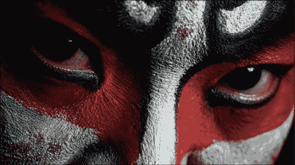

图 4-17　特写图片示例（一）

图 4-18　特写图片示例（二）

理解了景别，就掌握了画面信息的分配权。接下来，我们要让这些静止的画面动起来，看看运动镜头如何改变叙事的节奏。

### 4.3.2　镜头运动

4.3.1 节介绍了景别，那是确定画面的“框”。本节介绍镜头运动，这是确定相机的“脚步”。

静止的画面叫作漫画，只有画面动起来才能称之为漫剧。镜头运动的核心价值在于引导观众的心理节奏。你让镜头怎么动，观众的情绪就怎么走。在传统影视里，这需要昂贵的轨道、摇臂和斯坦尼康，但在 AI 漫剧里，你只需要一句精准的提示词。

常见的镜头运动有 6 种类型，如图 4-19 所示。

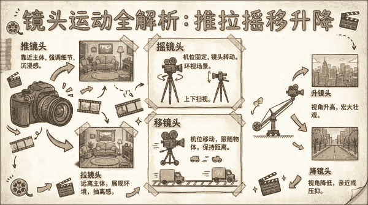

图 4-19　6 种镜头运动类型

#### 1．推镜头

推镜头是运动摄影中常用的镜头形式，指摄像机朝着被摄主体的方向前进，或者通过改变摄像机镜头的焦距不断接近被摄主体。画面景别和镜头内的环境呈现由大到小的变化，从而给观众造成一种视线前移的感觉。

推镜头本质上是一种“强制聚焦”的手段。它迫使观众把注意力集中到你想要强调的细节上。当镜头缓缓推进时，背景信息被逐渐剔除，主体在画面中的比重越来越大。这种视觉上的逼近感，会直接转换为心理上的压迫感或专注感。

如果想表现人物内心的波动、发现关键线索，或者在平静中酝酿风暴，推镜头是最好的选择。推进速度越快，情绪强化的力度就越强。

在 AI 视频生成中，直接使用“推镜头”或“镜头向前”作为关键词，模型通常能很好地理解并执行。以下是一次 AI 设计实战，具体生成结果可扫码查看。

使用软件：可灵

提示词：在森林中，小女孩对着镜头挥手，微笑，推镜头（镜头向前，拍摄靠近主体）

#### 2．拉镜头

拉镜头是指摄像机沿光轴方向向后移动，画面由近及远，视野由窄变宽的过程。

拉镜头是推镜头的反向操作，它的核心逻辑是“揭示”。起初观众只看到局部，随着镜头后拉，更多的环境信息逐步进入画面，使观众恍然大悟：原来主角身处在这样一个环境里。

这种运镜常带有一种疏离感和告别感。当一个场景结束或者全片终了时，拉镜头能把观众从剧情中缓缓抽离出来，留出回味的余地。它也常用来表现角色在宏大世界中的渺小与孤独。

在 AI 生成图片的实战中，想要好的拉镜头效果，提示词中要明确“远离主体”这个意图。以下是一次 AI 设计实战，具体生成结果可扫码查看。

使用软件：Vidu

提示词：在森林中，小女孩对着镜头挥手，微笑，拉镜头（镜头向后，远离靠近主体）

#### 3．摇

摇镜头是指摄像机位置不动，镜头像人的脖子一样转动——左右转称为横摇（Pan），上下转称为俯仰摇（Tilt）。

摇镜头的逻辑是“巡视”和“连接”。它模拟了人类环顾四周的自然视觉习惯，适用于展示一个连贯的长条形空间，或者交代两个物体/人物之间的位置关系。它能引导视线转移，如从冒烟的枪口摇到倒地的受害者，这种连接感是剪辑无法替代的。摇镜头能让观众感觉到这两个事物处于同一时空。

在 AI 生成实战中，生成摇镜头时容易出现画面边缘变形的问题，控制好转动的幅度是关键。以下是一次 AI 设计实战，具体生成结果可扫码查看。

使用软件：可灵

提示词：小女孩把脸扭回去，镜头随之摇到正面，围绕主体运镜。

#### 4．移

移是指摄像机真正地“走”起来。它横向或斜向移动，与被摄主体保持相对距离，背景发生持续的透视变化。

移镜头是为了建立“空间感”。不同于摇镜头的原地转动，移镜头会让前景、中景、背景产生不同速度的位移（视差），这能极大地增强画面的立体感和真实感。当需要表现战场的宏大、街道的繁华，或者跟随角色穿过复杂的环境时，移镜头能提供极强的临场沉浸感。

在 AI 生成实战中，在提示词中描述“镜头向右/左移动”即可。以下是一次 AI 设计实战，具体生成结果可扫码查看。

使用软件：即梦

提示词：镜头向右移动，出现一片广袤的草原。

移镜头还有一种手法是“跟”。跟是指摄像机紧密跟随运动中的主体，主体动，镜头也动。在画面中，主体的位置相对固定，而背景则快速后退。

跟镜头用来强调“动态”和“连接”。它让观众在这个流动的世界里有一个明确的视觉焦点——主角。无论环境如何混乱，观众的视线始终被锁定在角色身上。

这种运镜最适合追逐戏、奔跑戏，或者展示人物坚定的行进状态。它能制造出一种紧迫感，仿佛观众成为那个跟在主角身后的观察者。

AI 非常擅长处理这种镜头，因为主体特征保持不变，只需刷新背景即可。以下是一次 AI 设计实战，具体生成结果可扫码查看。

使用软件：可灵

提示词：蝴蝶翩翩飞舞，镜头跟随蝴蝶移动，蝴蝶最后落在花上，镜头跟随、景深镜头、自然光。

#### 5．升镜头与降镜头

升降镜头是指摄像机在垂直方向上进行大幅度的升起或降下。

升降镜头是用来构建“气势”和“层次”的。升镜头从局部拉升到全景，能展现宏大的场面，常伴随着情绪的高扬；降镜头从高空落到局部，能把观众的视线迅速聚焦到具体情节上。

这种上帝视角的垂直变化，常用来暗示命运的起落、权力的更迭，或者仅仅是为了在开场时给观众一个震撼的视觉奇观。

在 AI 生成实战中，提示词中要明确“下移”或“上移”的路径。以下是一次 AI 设计实战，具体生成结果可扫码查看。

使用软件：Vidu

提示词：降镜头，镜头从一个小松鼠缓缓下移，最后落在大树上。

总结而言，镜头运动在 AI 漫剧里不仅是技术参数，更是情绪调控开关。推是聚焦，拉是抽离，摇是巡视，移是空间，跟是代入，升降是气势。在撰写分镜脚本时，不要“为动而动”。每一个运动指令，都必须服务于当前的叙事目的。先想清楚你要观众看什么、感受什么，再决定使用什么镜头。

接下来，将视角固定，探讨拍摄角度如何改变人物的地位与状态。

### 4.3.3　拍摄角度

聊完景别和运动，最后一块拼图是角度。

角度解决的是“地位”问题。它决定了观众是平视角色、仰视角色还是俯瞰角色。每一个角度的选择，都在潜移默化地确立观众与角色之间的心理关系。

下面从几何角度和心理角度两个维度来拆解。

#### 1．几何角度

几何角度指摄像机与被摄对象之间物理位置的关系，它定义了观众观察画面的视点。

（1）平角度。

这是最稳妥的角度选择。平角度的镜头与人物视线持平，符合人们日常观察事物的习惯。它的核心优势在于“真实”和“稳固”。画面没有畸变，也不带强烈的感情色彩。适用于客观陈述事实，表现人物之间平等的对话关系，能为观众带来一种公平、理性的心理体验。

图 4-20 展示了一组平角度图片。

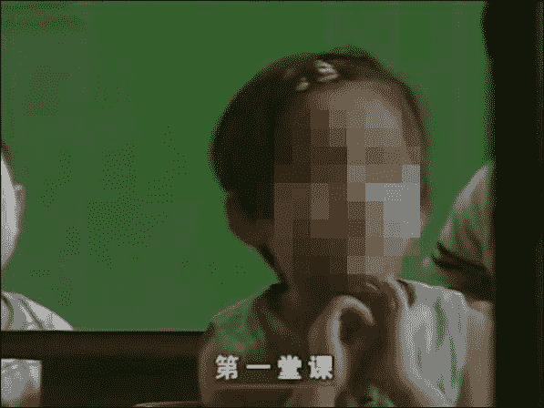

图 4-20　一组平角度图片

（2）俯角度。

俯角度指摄像机高于被摄主体，从上往下拍。

这个角度有两个截然不同的功能。一是交代环境，俯拍能把地面的布局、大场面的调度交代得一清二楚，适合用来作片头或片尾，把观众带入或带出故事世界。二是压低人物气势，在拍摄人物时，俯视会让形象显得低矮。这种视角带有某种审视意味，用来表达角色的渺小、无助，甚至是被排斥和贬低的状态。如果想引导观众同情主角，或者展示反派的末路，俯角度是有效的视觉选择。

图 4-21 展示了一张俯角度图片。

图 4-21　一张俯角度图片

（3）仰角度。

仰视角度是指摄像机低于被摄主体，从下往上拍。

这是属于“强者”的视角。仰拍能简化背景，把杂乱的地平线过滤掉，只留下天空或天花板，从而极致地突出主体。在视觉心理上，它会让人物显得高大威猛。无论是表现英雄的伟岸，还是怪物的压迫感，仰角都是增强气场的利器。但要注意，这个角度易产生透视变形，过度使用会让画面显得扭曲夸张。

图 4-22 展示了一张仰角度图片。

图 4-22　一张仰角度图片

#### 2．心理角度

除了物理位置的几何角度，角度还代表了叙事的“人称”，常分为第三人称视角与第一人称视角，又称为客观镜头与主观镜头。

（1）客观镜头。

这是“第三人称”视角。摄像机就像一个隐形的旁观者，记录发生的一切。它代表叙事者的眼睛，理性、冷静、不介入剧情。绝大多数的影视镜头都属于这一类，它保证了观众处于一个安全的观察位置。

客观镜头图片如图 4-23 所示。

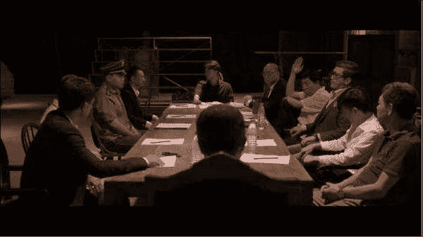

图 4-23　一张客观镜头图片

（2）主观镜头。

这是“第一人称”视角。摄像机变成了剧中人的眼睛。观众看到的，就是角色看到的。这种镜头的代入感极强，能让观众直接体验角色的眩晕、恐惧或兴奋。在 AI 漫剧中，适时插入主观镜头，是打破屏幕隔阂、提升沉浸感的有效手段。

主观镜头图片如图 4-24 所示。

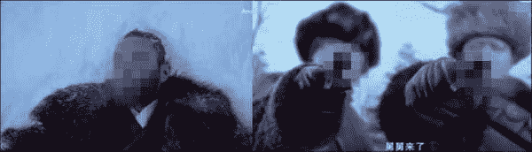

图 4-24　一张主观镜头图片

到这里，我们拆解了景别、镜头运动和角度。这三者从来都不是独立的技术点，而是一套严密的表达体系。

景别，圈定了信息的层级，决定观众看什么。

镜头运动，控制了叙事的节奏，决定观众怎么看。

角度，确立了情感的立场，决定观众处于何种心理地位。

在 AI 漫剧创作中，这套视觉语言体系的价值比传统拍摄更高。因为 AI 模型是被动的执行者，它不会主动思考“这场戏该怎么拍”，它只能机械地执行创作者的指令。

如果镜头描述模糊不清，画面也许仍会有美感，但叙事一定是空洞的。只有当你能熟练精准地组合这三要素时，分镜才能真正成为稳定、可控的叙事工具，帮助 AI 准确还原创作意图。

所有的理论都是为了实战。现在你手里已经有了核心零件，下一步就是把它们组装起来。我们将进入核心环节：如何将这些镜头语言落实到具体的分镜脚本中，使其具有可执行性。 EXr6287u6NNVz+GYLY+7SDk226FstKIHdC0bNoQkB2Nqi1xSR0yxPmwrTs5gRi/BtfSbid6dBhii9q7cz2pIyA==

## 4.3 镜头语言基础

4.2 节我们确定了 AI 漫剧的画风，这决定了作品的视觉基调。但仅有好看的画风还不能让观众满意，还得有拿得出手的故事并讲出来。观众如何感知故事，完全取决于镜头如何引导。镜头语言是连接世界与观众体验的桥梁，它负责分配信息、放大情绪、把控节奏。

在 AI 漫剧的制作语境里，镜头语言不仅是摄影技巧，更是一套严密的视觉规则系统。只有当你明确每个镜头要传达什么意图时，写出的提示词才能被 AI 模型准确执行，分镜才能真正服务于剧情，而不是变成随机生成的视觉抽卡。

在动笔写具体分镜脚本前，我们必须掌握镜头语言的三大基石：景别、镜头运动和拍摄角度。

### 4.3.1　景别

景别体现了摄影机与被摄主体之间的距离，决定了观众能看到多少信息量。

距离远，环境信息多，人物信息少；距离近，突出人物情绪，环境信息少。在用 AI 生成图片的提示词中，准确控制景别提示词是控制画面内容占比的有效手段。

根据距离的远近，常见的景别有 5 种，如图 4-8 所示。

#### 1．远景

远景的核心任务是交代故事背景与环境。它把视野拉到最开阔的状态，人物在画面里可能只是一个小黑点，重点在于展示广阔的环境、地理位置或者特定的自然景观。

在 AI 漫剧里，远景通常用来作开篇的定场镜头，或者场景转换时的过渡。它负责告诉观众故事发生的地点、时代与整体氛围——是宏大壮丽还是孤寂苍凉。

图 4-8　常见的 5 种景别

对于 AI 漫剧来说，远景是展示世界观设定的关键镜头。此时无须纠结人物的脸部细节（模型在远景下难以精确生成五官），而应聚焦于用环境烘托氛围，让观众在第一时间沉浸到你设定的世界里。

图 4-9 和图 4-10 展示了两张远景图片。

图 4-9　远景图片示例（一）

图 4-10　远景图片示例（二）

#### 2．全景

全景是展示“关系”的镜头。在这个景别下，人物的全身都能被看见，周围的环境也清晰可见。它能明确交代人物和环境的空间关系，以及人物与人物之间的位置关系。

全景最适合用于表现动作和姿态。当剧本里有打斗、舞蹈、奔跑或者多人互动的群像场景时，全景是不二之选。通过肢体语言、衣着打扮，观众能迅速判断角色的身份和当下的状态。

在 AI 生成的实际操作中，全景往往是很多动作戏容易失真的重灾区。因此，提示词要多描述肢体动作和互动逻辑，减少对微表情的描写，因为在这个距离下，肢体语言比表情更能有效传递信息。

图 4-11 和图 4-12 展示了两张全景图片。

图 4-11　全景图片示例（一）

图 4-12　全景图片示例（二）

#### 3．中景

中景是叙事的“主力军”。它的画面通常卡在人物膝盖或腰部以上，既能看清表情，又能保留肢体动作，还带一点环境背景。这是一种非常平衡的视角，是最接近人类日常交流的观察距离。

绝大多数的剧情推进、双人对话、日常互动，都适合使用中景。它既没有远景的疏离感，也没有特写的压迫性，观众看着最舒服。

对于 AI 漫剧创作，中景是成图率最高的景别。模型在这个距离下，既能处理好面部结构，又能把衣服和背景融合得很好。如果不确定该用什么镜头，使用中景通常不会出错。

图 4-13 和图 4-14 展示了两张中景图片。

图 4-13　中景图片示例（一）

图 4-14　中景图片示例（二）

#### 4．近景

近景是情绪的“放大镜”。镜头推进到人物胸部以上，背景往往被虚化或大幅简化，观众的注意力被强制集中在人物的面部。这时，任何细微的表情变化都会被捕捉到。

当剧情需要展现人物的愤怒、悲伤、震惊或者深情时，必须切入近景。它是建立观众与角色情感连接的最有效手段。

在利用 AI 生成图片时，近景是检验角色设计细节的关键环节。提示词要将重点放在五官细节、眼神光和面部肌肉的微动作上，利用 AI 强大的细节生成能力，把情绪拉满。

图 4-15 和图 4-16 展示了两张近景图片。

图 4-15　近景图片示例（一）

图 4-16　近景图片示例（二）

#### 5．特写

特写是对信息的“强烈强调”。此时画面聚焦在极小的局部，如一只眼睛、颤抖的手指、正在滴血的刀尖，或者钟表走动的指针。

特写的作用非常直接——给观众划出重点。它强制引导观众注意你所要突出的细节，常用来强化象征意义、制造悬念和施加心理压迫感。

在 AI 漫剧里，特写往往用于高潮前夕的暗示，或者关键线索的展示。生成特写时，提示词要高度具体，排除冗余，确保模型只生成这一个核心物体或局部对象，避免画面中出现奇怪的变形。

图 4-17 和图 4-18 展示了两张特写图片。

图 4-17　特写图片示例（一）

图 4-18　特写图片示例（二）

理解了景别，就掌握了画面信息的分配权。接下来，我们要让这些静止的画面动起来，看看运动镜头如何改变叙事的节奏。

### 4.3.2　镜头运动

4.3.1 节介绍了景别，那是确定画面的“框”。本节介绍镜头运动，这是确定相机的“脚步”。

静止的画面叫作漫画，只有画面动起来才能称之为漫剧。镜头运动的核心价值在于引导观众的心理节奏。你让镜头怎么动，观众的情绪就怎么走。在传统影视里，这需要昂贵的轨道、摇臂和斯坦尼康，但在 AI 漫剧里，你只需要一句精准的提示词。

常见的镜头运动有 6 种类型，如图 4-19 所示。

图 4-19　6 种镜头运动类型

#### 1．推镜头

推镜头是运动摄影中常用的镜头形式，指摄像机朝着被摄主体的方向前进，或者通过改变摄像机镜头的焦距不断接近被摄主体。画面景别和镜头内的环境呈现由大到小的变化，从而给观众造成一种视线前移的感觉。

推镜头本质上是一种“强制聚焦”的手段。它迫使观众把注意力集中到你想要强调的细节上。当镜头缓缓推进时，背景信息被逐渐剔除，主体在画面中的比重越来越大。这种视觉上的逼近感，会直接转换为心理上的压迫感或专注感。

如果想表现人物内心的波动、发现关键线索，或者在平静中酝酿风暴，推镜头是最好的选择。推进速度越快，情绪强化的力度就越强。

在 AI 视频生成中，直接使用“推镜头”或“镜头向前”作为关键词，模型通常能很好地理解并执行。以下是一次 AI 设计实战，具体生成结果可扫码查看。

使用软件：可灵

提示词：在森林中，小女孩对着镜头挥手，微笑，推镜头（镜头向前，拍摄靠近主体）

#### 2．拉镜头

拉镜头是指摄像机沿光轴方向向后移动，画面由近及远，视野由窄变宽的过程。

拉镜头是推镜头的反向操作，它的核心逻辑是“揭示”。起初观众只看到局部，随着镜头后拉，更多的环境信息逐步进入画面，使观众恍然大悟：原来主角身处在这样一个环境里。

这种运镜常带有一种疏离感和告别感。当一个场景结束或者全片终了时，拉镜头能把观众从剧情中缓缓抽离出来，留出回味的余地。它也常用来表现角色在宏大世界中的渺小与孤独。

在 AI 生成图片的实战中，想要好的拉镜头效果，提示词中要明确“远离主体”这个意图。以下是一次 AI 设计实战，具体生成结果可扫码查看。

使用软件：Vidu

提示词：在森林中，小女孩对着镜头挥手，微笑，拉镜头（镜头向后，远离靠近主体）

#### 3．摇

摇镜头是指摄像机位置不动，镜头像人的脖子一样转动——左右转称为横摇（Pan），上下转称为俯仰摇（Tilt）。

摇镜头的逻辑是“巡视”和“连接”。它模拟了人类环顾四周的自然视觉习惯，适用于展示一个连贯的长条形空间，或者交代两个物体/人物之间的位置关系。它能引导视线转移，如从冒烟的枪口摇到倒地的受害者，这种连接感是剪辑无法替代的。摇镜头能让观众感觉到这两个事物处于同一时空。

在 AI 生成实战中，生成摇镜头时容易出现画面边缘变形的问题，控制好转动的幅度是关键。以下是一次 AI 设计实战，具体生成结果可扫码查看。

使用软件：可灵

提示词：小女孩把脸扭回去，镜头随之摇到正面，围绕主体运镜。

#### 4．移

移是指摄像机真正地“走”起来。它横向或斜向移动，与被摄主体保持相对距离，背景发生持续的透视变化。

移镜头是为了建立“空间感”。不同于摇镜头的原地转动，移镜头会让前景、中景、背景产生不同速度的位移（视差），这能极大地增强画面的立体感和真实感。当需要表现战场的宏大、街道的繁华，或者跟随角色穿过复杂的环境时，移镜头能提供极强的临场沉浸感。

在 AI 生成实战中，在提示词中描述“镜头向右/左移动”即可。以下是一次 AI 设计实战，具体生成结果可扫码查看。

使用软件：即梦

提示词：镜头向右移动，出现一片广袤的草原。

移镜头还有一种手法是“跟”。跟是指摄像机紧密跟随运动中的主体，主体动，镜头也动。在画面中，主体的位置相对固定，而背景则快速后退。

跟镜头用来强调“动态”和“连接”。它让观众在这个流动的世界里有一个明确的视觉焦点——主角。无论环境如何混乱，观众的视线始终被锁定在角色身上。

这种运镜最适合追逐戏、奔跑戏，或者展示人物坚定的行进状态。它能制造出一种紧迫感，仿佛观众成为那个跟在主角身后的观察者。

AI 非常擅长处理这种镜头，因为主体特征保持不变，只需刷新背景即可。以下是一次 AI 设计实战，具体生成结果可扫码查看。

使用软件：可灵

提示词：蝴蝶翩翩飞舞，镜头跟随蝴蝶移动，蝴蝶最后落在花上，镜头跟随、景深镜头、自然光。

#### 5．升镜头与降镜头

升降镜头是指摄像机在垂直方向上进行大幅度的升起或降下。

升降镜头是用来构建“气势”和“层次”的。升镜头从局部拉升到全景，能展现宏大的场面，常伴随着情绪的高扬；降镜头从高空落到局部，能把观众的视线迅速聚焦到具体情节上。

这种上帝视角的垂直变化，常用来暗示命运的起落、权力的更迭，或者仅仅是为了在开场时给观众一个震撼的视觉奇观。

在 AI 生成实战中，提示词中要明确“下移”或“上移”的路径。以下是一次 AI 设计实战，具体生成结果可扫码查看。

使用软件：Vidu

提示词：降镜头，镜头从一个小松鼠缓缓下移，最后落在大树上。

总结而言，镜头运动在 AI 漫剧里不仅是技术参数，更是情绪调控开关。推是聚焦，拉是抽离，摇是巡视，移是空间，跟是代入，升降是气势。在撰写分镜脚本时，不要“为动而动”。每一个运动指令，都必须服务于当前的叙事目的。先想清楚你要观众看什么、感受什么，再决定使用什么镜头。

接下来，将视角固定，探讨拍摄角度如何改变人物的地位与状态。

### 4.3.3　拍摄角度

聊完景别和运动，最后一块拼图是角度。

角度解决的是“地位”问题。它决定了观众是平视角色、仰视角色还是俯瞰角色。每一个角度的选择，都在潜移默化地确立观众与角色之间的心理关系。

下面从几何角度和心理角度两个维度来拆解。

#### 1．几何角度

几何角度指摄像机与被摄对象之间物理位置的关系，它定义了观众观察画面的视点。

（1）平角度。

这是最稳妥的角度选择。平角度的镜头与人物视线持平，符合人们日常观察事物的习惯。它的核心优势在于“真实”和“稳固”。画面没有畸变，也不带强烈的感情色彩。适用于客观陈述事实，表现人物之间平等的对话关系，能为观众带来一种公平、理性的心理体验。

图 4-20 展示了一组平角度图片。

图 4-20　一组平角度图片

（2）俯角度。

俯角度指摄像机高于被摄主体，从上往下拍。

这个角度有两个截然不同的功能。一是交代环境，俯拍能把地面的布局、大场面的调度交代得一清二楚，适合用来作片头或片尾，把观众带入或带出故事世界。二是压低人物气势，在拍摄人物时，俯视会让形象显得低矮。这种视角带有某种审视意味，用来表达角色的渺小、无助，甚至是被排斥和贬低的状态。如果想引导观众同情主角，或者展示反派的末路，俯角度是有效的视觉选择。

图 4-21 展示了一张俯角度图片。

图 4-21　一张俯角度图片

（3）仰角度。

仰视角度是指摄像机低于被摄主体，从下往上拍。

这是属于“强者”的视角。仰拍能简化背景，把杂乱的地平线过滤掉，只留下天空或天花板，从而极致地突出主体。在视觉心理上，它会让人物显得高大威猛。无论是表现英雄的伟岸，还是怪物的压迫感，仰角都是增强气场的利器。但要注意，这个角度易产生透视变形，过度使用会让画面显得扭曲夸张。

图 4-22 展示了一张仰角度图片。

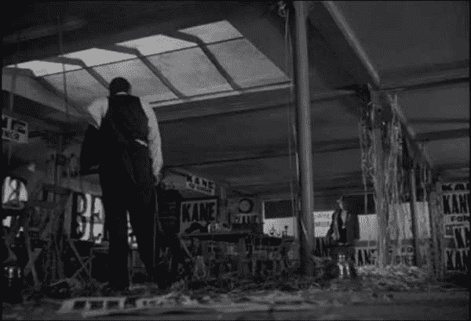

图 4-22　一张仰角度图片

#### 2．心理角度

除了物理位置的几何角度，角度还代表了叙事的“人称”，常分为第三人称视角与第一人称视角，又称为客观镜头与主观镜头。

（1）客观镜头。

这是“第三人称”视角。摄像机就像一个隐形的旁观者，记录发生的一切。它代表叙事者的眼睛，理性、冷静、不介入剧情。绝大多数的影视镜头都属于这一类，它保证了观众处于一个安全的观察位置。

客观镜头图片如图 4-23 所示。

图 4-23　一张客观镜头图片

（2）主观镜头。

这是“第一人称”视角。摄像机变成了剧中人的眼睛。观众看到的，就是角色看到的。这种镜头的代入感极强，能让观众直接体验角色的眩晕、恐惧或兴奋。在 AI 漫剧中，适时插入主观镜头，是打破屏幕隔阂、提升沉浸感的有效手段。

主观镜头图片如图 4-24 所示。

图 4-24　一张主观镜头图片

到这里，我们拆解了景别、镜头运动和角度。这三者从来都不是独立的技术点，而是一套严密的表达体系。

景别，圈定了信息的层级，决定观众看什么。

镜头运动，控制了叙事的节奏，决定观众怎么看。

角度，确立了情感的立场，决定观众处于何种心理地位。

在 AI 漫剧创作中，这套视觉语言体系的价值比传统拍摄更高。因为 AI 模型是被动的执行者，它不会主动思考“这场戏该怎么拍”，它只能机械地执行创作者的指令。

如果镜头描述模糊不清，画面也许仍会有美感，但叙事一定是空洞的。只有当你能熟练精准地组合这三要素时，分镜才能真正成为稳定、可控的叙事工具，帮助 AI 准确还原创作意图。

所有的理论都是为了实战。现在你手里已经有了核心零件，下一步就是把它们组装起来。我们将进入核心环节：如何将这些镜头语言落实到具体的分镜脚本中，使其具有可执行性。 EXr6287u6NNVz+GYLY+7SDk226FstKIHdC0bNoQkB2Nqi1xSR0yxPmwrTs5gRi/BtfSbid6dBhii9q7cz2pIyA==

## 4.3 镜头语言基础

4.2 节我们确定了 AI 漫剧的画风，这决定了作品的视觉基调。但仅有好看的画风还不能让观众满意，还得有拿得出手的故事并讲出来。观众如何感知故事，完全取决于镜头如何引导。镜头语言是连接世界与观众体验的桥梁，它负责分配信息、放大情绪、把控节奏。

在 AI 漫剧的制作语境里，镜头语言不仅是摄影技巧，更是一套严密的视觉规则系统。只有当你明确每个镜头要传达什么意图时，写出的提示词才能被 AI 模型准确执行，分镜才能真正服务于剧情，而不是变成随机生成的视觉抽卡。

在动笔写具体分镜脚本前，我们必须掌握镜头语言的三大基石：景别、镜头运动和拍摄角度。

### 4.3.1　景别

景别体现了摄影机与被摄主体之间的距离，决定了观众能看到多少信息量。

距离远，环境信息多，人物信息少；距离近，突出人物情绪，环境信息少。在用 AI 生成图片的提示词中，准确控制景别提示词是控制画面内容占比的有效手段。

根据距离的远近，常见的景别有 5 种，如图 4-8 所示。

#### 1．远景

远景的核心任务是交代故事背景与环境。它把视野拉到最开阔的状态，人物在画面里可能只是一个小黑点，重点在于展示广阔的环境、地理位置或者特定的自然景观。

在 AI 漫剧里，远景通常用来作开篇的定场镜头，或者场景转换时的过渡。它负责告诉观众故事发生的地点、时代与整体氛围——是宏大壮丽还是孤寂苍凉。

图 4-8　常见的 5 种景别

对于 AI 漫剧来说，远景是展示世界观设定的关键镜头。此时无须纠结人物的脸部细节（模型在远景下难以精确生成五官），而应聚焦于用环境烘托氛围，让观众在第一时间沉浸到你设定的世界里。

图 4-9 和图 4-10 展示了两张远景图片。

图 4-9　远景图片示例（一）

图 4-10　远景图片示例（二）

#### 2．全景

全景是展示“关系”的镜头。在这个景别下，人物的全身都能被看见，周围的环境也清晰可见。它能明确交代人物和环境的空间关系，以及人物与人物之间的位置关系。

全景最适合用于表现动作和姿态。当剧本里有打斗、舞蹈、奔跑或者多人互动的群像场景时，全景是不二之选。通过肢体语言、衣着打扮，观众能迅速判断角色的身份和当下的状态。

在 AI 生成的实际操作中，全景往往是很多动作戏容易失真的重灾区。因此，提示词要多描述肢体动作和互动逻辑，减少对微表情的描写，因为在这个距离下，肢体语言比表情更能有效传递信息。

图 4-11 和图 4-12 展示了两张全景图片。

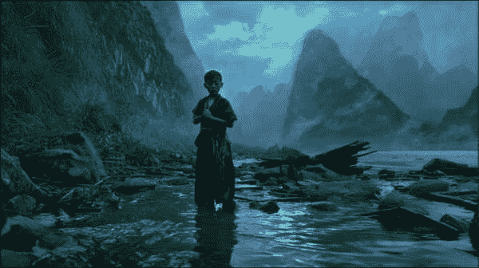

图 4-11　全景图片示例（一）

图 4-12　全景图片示例（二）

#### 3．中景

中景是叙事的“主力军”。它的画面通常卡在人物膝盖或腰部以上，既能看清表情，又能保留肢体动作，还带一点环境背景。这是一种非常平衡的视角，是最接近人类日常交流的观察距离。

绝大多数的剧情推进、双人对话、日常互动，都适合使用中景。它既没有远景的疏离感，也没有特写的压迫性，观众看着最舒服。

对于 AI 漫剧创作，中景是成图率最高的景别。模型在这个距离下，既能处理好面部结构，又能把衣服和背景融合得很好。如果不确定该用什么镜头，使用中景通常不会出错。

图 4-13 和图 4-14 展示了两张中景图片。

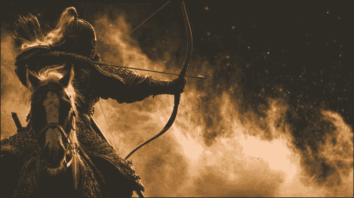

图 4-13　中景图片示例（一）

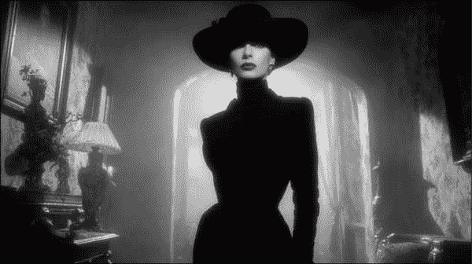

图 4-14　中景图片示例（二）

#### 4．近景

近景是情绪的“放大镜”。镜头推进到人物胸部以上，背景往往被虚化或大幅简化，观众的注意力被强制集中在人物的面部。这时，任何细微的表情变化都会被捕捉到。

当剧情需要展现人物的愤怒、悲伤、震惊或者深情时，必须切入近景。它是建立观众与角色情感连接的最有效手段。

在利用 AI 生成图片时，近景是检验角色设计细节的关键环节。提示词要将重点放在五官细节、眼神光和面部肌肉的微动作上，利用 AI 强大的细节生成能力，把情绪拉满。

图 4-15 和图 4-16 展示了两张近景图片。

图 4-15　近景图片示例（一）

图 4-16　近景图片示例（二）

#### 5．特写

特写是对信息的“强烈强调”。此时画面聚焦在极小的局部，如一只眼睛、颤抖的手指、正在滴血的刀尖，或者钟表走动的指针。

特写的作用非常直接——给观众划出重点。它强制引导观众注意你所要突出的细节，常用来强化象征意义、制造悬念和施加心理压迫感。

在 AI 漫剧里，特写往往用于高潮前夕的暗示，或者关键线索的展示。生成特写时，提示词要高度具体，排除冗余，确保模型只生成这一个核心物体或局部对象，避免画面中出现奇怪的变形。

图 4-17 和图 4-18 展示了两张特写图片。

图 4-17　特写图片示例（一）

图 4-18　特写图片示例（二）

理解了景别，就掌握了画面信息的分配权。接下来，我们要让这些静止的画面动起来，看看运动镜头如何改变叙事的节奏。

### 4.3.2　镜头运动

4.3.1 节介绍了景别，那是确定画面的“框”。本节介绍镜头运动，这是确定相机的“脚步”。

静止的画面叫作漫画，只有画面动起来才能称之为漫剧。镜头运动的核心价值在于引导观众的心理节奏。你让镜头怎么动，观众的情绪就怎么走。在传统影视里，这需要昂贵的轨道、摇臂和斯坦尼康，但在 AI 漫剧里，你只需要一句精准的提示词。

常见的镜头运动有 6 种类型，如图 4-19 所示。

图 4-19　6 种镜头运动类型

#### 1．推镜头

推镜头是运动摄影中常用的镜头形式，指摄像机朝着被摄主体的方向前进，或者通过改变摄像机镜头的焦距不断接近被摄主体。画面景别和镜头内的环境呈现由大到小的变化，从而给观众造成一种视线前移的感觉。

推镜头本质上是一种“强制聚焦”的手段。它迫使观众把注意力集中到你想要强调的细节上。当镜头缓缓推进时，背景信息被逐渐剔除，主体在画面中的比重越来越大。这种视觉上的逼近感，会直接转换为心理上的压迫感或专注感。

如果想表现人物内心的波动、发现关键线索，或者在平静中酝酿风暴，推镜头是最好的选择。推进速度越快，情绪强化的力度就越强。

在 AI 视频生成中，直接使用“推镜头”或“镜头向前”作为关键词，模型通常能很好地理解并执行。以下是一次 AI 设计实战，具体生成结果可扫码查看。

使用软件：可灵

提示词：在森林中，小女孩对着镜头挥手，微笑，推镜头（镜头向前，拍摄靠近主体）

#### 2．拉镜头

拉镜头是指摄像机沿光轴方向向后移动，画面由近及远，视野由窄变宽的过程。

拉镜头是推镜头的反向操作，它的核心逻辑是“揭示”。起初观众只看到局部，随着镜头后拉，更多的环境信息逐步进入画面，使观众恍然大悟：原来主角身处在这样一个环境里。

这种运镜常带有一种疏离感和告别感。当一个场景结束或者全片终了时，拉镜头能把观众从剧情中缓缓抽离出来，留出回味的余地。它也常用来表现角色在宏大世界中的渺小与孤独。

在 AI 生成图片的实战中，想要好的拉镜头效果，提示词中要明确“远离主体”这个意图。以下是一次 AI 设计实战，具体生成结果可扫码查看。

使用软件：Vidu

提示词：在森林中，小女孩对着镜头挥手，微笑，拉镜头（镜头向后，远离靠近主体）

#### 3．摇

摇镜头是指摄像机位置不动，镜头像人的脖子一样转动——左右转称为横摇（Pan），上下转称为俯仰摇（Tilt）。

摇镜头的逻辑是“巡视”和“连接”。它模拟了人类环顾四周的自然视觉习惯，适用于展示一个连贯的长条形空间，或者交代两个物体/人物之间的位置关系。它能引导视线转移，如从冒烟的枪口摇到倒地的受害者，这种连接感是剪辑无法替代的。摇镜头能让观众感觉到这两个事物处于同一时空。

在 AI 生成实战中，生成摇镜头时容易出现画面边缘变形的问题，控制好转动的幅度是关键。以下是一次 AI 设计实战，具体生成结果可扫码查看。

使用软件：可灵

提示词：小女孩把脸扭回去，镜头随之摇到正面，围绕主体运镜。

#### 4．移

移是指摄像机真正地“走”起来。它横向或斜向移动，与被摄主体保持相对距离，背景发生持续的透视变化。

移镜头是为了建立“空间感”。不同于摇镜头的原地转动，移镜头会让前景、中景、背景产生不同速度的位移（视差），这能极大地增强画面的立体感和真实感。当需要表现战场的宏大、街道的繁华，或者跟随角色穿过复杂的环境时，移镜头能提供极强的临场沉浸感。

在 AI 生成实战中，在提示词中描述“镜头向右/左移动”即可。以下是一次 AI 设计实战，具体生成结果可扫码查看。

使用软件：即梦

提示词：镜头向右移动，出现一片广袤的草原。

移镜头还有一种手法是“跟”。跟是指摄像机紧密跟随运动中的主体，主体动，镜头也动。在画面中，主体的位置相对固定，而背景则快速后退。

跟镜头用来强调“动态”和“连接”。它让观众在这个流动的世界里有一个明确的视觉焦点——主角。无论环境如何混乱，观众的视线始终被锁定在角色身上。

这种运镜最适合追逐戏、奔跑戏，或者展示人物坚定的行进状态。它能制造出一种紧迫感，仿佛观众成为那个跟在主角身后的观察者。

AI 非常擅长处理这种镜头，因为主体特征保持不变，只需刷新背景即可。以下是一次 AI 设计实战，具体生成结果可扫码查看。

使用软件：可灵

提示词：蝴蝶翩翩飞舞，镜头跟随蝴蝶移动，蝴蝶最后落在花上，镜头跟随、景深镜头、自然光。

#### 5．升镜头与降镜头

升降镜头是指摄像机在垂直方向上进行大幅度的升起或降下。

升降镜头是用来构建“气势”和“层次”的。升镜头从局部拉升到全景，能展现宏大的场面，常伴随着情绪的高扬；降镜头从高空落到局部，能把观众的视线迅速聚焦到具体情节上。

这种上帝视角的垂直变化，常用来暗示命运的起落、权力的更迭，或者仅仅是为了在开场时给观众一个震撼的视觉奇观。

在 AI 生成实战中，提示词中要明确“下移”或“上移”的路径。以下是一次 AI 设计实战，具体生成结果可扫码查看。

使用软件：Vidu

提示词：降镜头，镜头从一个小松鼠缓缓下移，最后落在大树上。

总结而言，镜头运动在 AI 漫剧里不仅是技术参数，更是情绪调控开关。推是聚焦，拉是抽离，摇是巡视，移是空间，跟是代入，升降是气势。在撰写分镜脚本时，不要“为动而动”。每一个运动指令，都必须服务于当前的叙事目的。先想清楚你要观众看什么、感受什么，再决定使用什么镜头。

接下来，将视角固定，探讨拍摄角度如何改变人物的地位与状态。

### 4.3.3　拍摄角度

聊完景别和运动，最后一块拼图是角度。

角度解决的是“地位”问题。它决定了观众是平视角色、仰视角色还是俯瞰角色。每一个角度的选择，都在潜移默化地确立观众与角色之间的心理关系。

下面从几何角度和心理角度两个维度来拆解。

#### 1．几何角度

几何角度指摄像机与被摄对象之间物理位置的关系，它定义了观众观察画面的视点。

（1）平角度。

这是最稳妥的角度选择。平角度的镜头与人物视线持平，符合人们日常观察事物的习惯。它的核心优势在于“真实”和“稳固”。画面没有畸变，也不带强烈的感情色彩。适用于客观陈述事实，表现人物之间平等的对话关系，能为观众带来一种公平、理性的心理体验。

图 4-20 展示了一组平角度图片。

图 4-20　一组平角度图片

（2）俯角度。

俯角度指摄像机高于被摄主体，从上往下拍。

这个角度有两个截然不同的功能。一是交代环境，俯拍能把地面的布局、大场面的调度交代得一清二楚，适合用来作片头或片尾，把观众带入或带出故事世界。二是压低人物气势，在拍摄人物时，俯视会让形象显得低矮。这种视角带有某种审视意味，用来表达角色的渺小、无助，甚至是被排斥和贬低的状态。如果想引导观众同情主角，或者展示反派的末路，俯角度是有效的视觉选择。

图 4-21 展示了一张俯角度图片。

图 4-21　一张俯角度图片

（3）仰角度。

仰视角度是指摄像机低于被摄主体，从下往上拍。

这是属于“强者”的视角。仰拍能简化背景，把杂乱的地平线过滤掉，只留下天空或天花板，从而极致地突出主体。在视觉心理上，它会让人物显得高大威猛。无论是表现英雄的伟岸，还是怪物的压迫感，仰角都是增强气场的利器。但要注意，这个角度易产生透视变形，过度使用会让画面显得扭曲夸张。

图 4-22 展示了一张仰角度图片。

图 4-22　一张仰角度图片

#### 2．心理角度

除了物理位置的几何角度，角度还代表了叙事的“人称”，常分为第三人称视角与第一人称视角，又称为客观镜头与主观镜头。

（1）客观镜头。

这是“第三人称”视角。摄像机就像一个隐形的旁观者，记录发生的一切。它代表叙事者的眼睛，理性、冷静、不介入剧情。绝大多数的影视镜头都属于这一类，它保证了观众处于一个安全的观察位置。

客观镜头图片如图 4-23 所示。

图 4-23　一张客观镜头图片

（2）主观镜头。

这是“第一人称”视角。摄像机变成了剧中人的眼睛。观众看到的，就是角色看到的。这种镜头的代入感极强，能让观众直接体验角色的眩晕、恐惧或兴奋。在 AI 漫剧中，适时插入主观镜头，是打破屏幕隔阂、提升沉浸感的有效手段。

主观镜头图片如图 4-24 所示。

图 4-24　一张主观镜头图片

到这里，我们拆解了景别、镜头运动和角度。这三者从来都不是独立的技术点，而是一套严密的表达体系。

景别，圈定了信息的层级，决定观众看什么。

镜头运动，控制了叙事的节奏，决定观众怎么看。

角度，确立了情感的立场，决定观众处于何种心理地位。

在 AI 漫剧创作中，这套视觉语言体系的价值比传统拍摄更高。因为 AI 模型是被动的执行者，它不会主动思考“这场戏该怎么拍”，它只能机械地执行创作者的指令。

如果镜头描述模糊不清，画面也许仍会有美感，但叙事一定是空洞的。只有当你能熟练精准地组合这三要素时，分镜才能真正成为稳定、可控的叙事工具，帮助 AI 准确还原创作意图。

所有的理论都是为了实战。现在你手里已经有了核心零件，下一步就是把它们组装起来。我们将进入核心环节：如何将这些镜头语言落实到具体的分镜脚本中，使其具有可执行性。 EXr6287u6NNVz+GYLY+7SDk226FstKIHdC0bNoQkB2Nqi1xSR0yxPmwrTs5gRi/BtfSbid6dBhii9q7cz2pIyA==

## 4.3 镜头语言基础

4.2 节我们确定了 AI 漫剧的画风，这决定了作品的视觉基调。但仅有好看的画风还不能让观众满意，还得有拿得出手的故事并讲出来。观众如何感知故事，完全取决于镜头如何引导。镜头语言是连接世界与观众体验的桥梁，它负责分配信息、放大情绪、把控节奏。

在 AI 漫剧的制作语境里，镜头语言不仅是摄影技巧，更是一套严密的视觉规则系统。只有当你明确每个镜头要传达什么意图时，写出的提示词才能被 AI 模型准确执行，分镜才能真正服务于剧情，而不是变成随机生成的视觉抽卡。

在动笔写具体分镜脚本前，我们必须掌握镜头语言的三大基石：景别、镜头运动和拍摄角度。

### 4.3.1　景别

景别体现了摄影机与被摄主体之间的距离，决定了观众能看到多少信息量。

距离远，环境信息多，人物信息少；距离近，突出人物情绪，环境信息少。在用 AI 生成图片的提示词中，准确控制景别提示词是控制画面内容占比的有效手段。

根据距离的远近，常见的景别有 5 种，如图 4-8 所示。

#### 1．远景

远景的核心任务是交代故事背景与环境。它把视野拉到最开阔的状态，人物在画面里可能只是一个小黑点，重点在于展示广阔的环境、地理位置或者特定的自然景观。

在 AI 漫剧里，远景通常用来作开篇的定场镜头，或者场景转换时的过渡。它负责告诉观众故事发生的地点、时代与整体氛围——是宏大壮丽还是孤寂苍凉。

图 4-8　常见的 5 种景别

对于 AI 漫剧来说，远景是展示世界观设定的关键镜头。此时无须纠结人物的脸部细节（模型在远景下难以精确生成五官），而应聚焦于用环境烘托氛围，让观众在第一时间沉浸到你设定的世界里。

图 4-9 和图 4-10 展示了两张远景图片。

图 4-9　远景图片示例（一）

图 4-10　远景图片示例（二）

#### 2．全景

全景是展示“关系”的镜头。在这个景别下，人物的全身都能被看见，周围的环境也清晰可见。它能明确交代人物和环境的空间关系，以及人物与人物之间的位置关系。

全景最适合用于表现动作和姿态。当剧本里有打斗、舞蹈、奔跑或者多人互动的群像场景时，全景是不二之选。通过肢体语言、衣着打扮，观众能迅速判断角色的身份和当下的状态。

在 AI 生成的实际操作中，全景往往是很多动作戏容易失真的重灾区。因此，提示词要多描述肢体动作和互动逻辑，减少对微表情的描写，因为在这个距离下，肢体语言比表情更能有效传递信息。

图 4-11 和图 4-12 展示了两张全景图片。

图 4-11　全景图片示例（一）

图 4-12　全景图片示例（二）

#### 3．中景

中景是叙事的“主力军”。它的画面通常卡在人物膝盖或腰部以上，既能看清表情，又能保留肢体动作，还带一点环境背景。这是一种非常平衡的视角，是最接近人类日常交流的观察距离。

绝大多数的剧情推进、双人对话、日常互动，都适合使用中景。它既没有远景的疏离感，也没有特写的压迫性，观众看着最舒服。

对于 AI 漫剧创作，中景是成图率最高的景别。模型在这个距离下，既能处理好面部结构，又能把衣服和背景融合得很好。如果不确定该用什么镜头，使用中景通常不会出错。

图 4-13 和图 4-14 展示了两张中景图片。

图 4-13　中景图片示例（一）

图 4-14　中景图片示例（二）

#### 4．近景

近景是情绪的“放大镜”。镜头推进到人物胸部以上，背景往往被虚化或大幅简化，观众的注意力被强制集中在人物的面部。这时，任何细微的表情变化都会被捕捉到。

当剧情需要展现人物的愤怒、悲伤、震惊或者深情时，必须切入近景。它是建立观众与角色情感连接的最有效手段。

在利用 AI 生成图片时，近景是检验角色设计细节的关键环节。提示词要将重点放在五官细节、眼神光和面部肌肉的微动作上，利用 AI 强大的细节生成能力，把情绪拉满。

图 4-15 和图 4-16 展示了两张近景图片。

图 4-15　近景图片示例（一）

图 4-16　近景图片示例（二）

#### 5．特写

特写是对信息的“强烈强调”。此时画面聚焦在极小的局部，如一只眼睛、颤抖的手指、正在滴血的刀尖，或者钟表走动的指针。

特写的作用非常直接——给观众划出重点。它强制引导观众注意你所要突出的细节，常用来强化象征意义、制造悬念和施加心理压迫感。

在 AI 漫剧里，特写往往用于高潮前夕的暗示，或者关键线索的展示。生成特写时，提示词要高度具体，排除冗余，确保模型只生成这一个核心物体或局部对象，避免画面中出现奇怪的变形。

图 4-17 和图 4-18 展示了两张特写图片。

图 4-17　特写图片示例（一）

图 4-18　特写图片示例（二）

理解了景别，就掌握了画面信息的分配权。接下来，我们要让这些静止的画面动起来，看看运动镜头如何改变叙事的节奏。

### 4.3.2　镜头运动

4.3.1 节介绍了景别，那是确定画面的“框”。本节介绍镜头运动，这是确定相机的“脚步”。

静止的画面叫作漫画，只有画面动起来才能称之为漫剧。镜头运动的核心价值在于引导观众的心理节奏。你让镜头怎么动，观众的情绪就怎么走。在传统影视里，这需要昂贵的轨道、摇臂和斯坦尼康，但在 AI 漫剧里，你只需要一句精准的提示词。

常见的镜头运动有 6 种类型，如图 4-19 所示。

图 4-19　6 种镜头运动类型

#### 1．推镜头

推镜头是运动摄影中常用的镜头形式，指摄像机朝着被摄主体的方向前进，或者通过改变摄像机镜头的焦距不断接近被摄主体。画面景别和镜头内的环境呈现由大到小的变化，从而给观众造成一种视线前移的感觉。

推镜头本质上是一种“强制聚焦”的手段。它迫使观众把注意力集中到你想要强调的细节上。当镜头缓缓推进时，背景信息被逐渐剔除，主体在画面中的比重越来越大。这种视觉上的逼近感，会直接转换为心理上的压迫感或专注感。

如果想表现人物内心的波动、发现关键线索，或者在平静中酝酿风暴，推镜头是最好的选择。推进速度越快，情绪强化的力度就越强。

在 AI 视频生成中，直接使用“推镜头”或“镜头向前”作为关键词，模型通常能很好地理解并执行。以下是一次 AI 设计实战，具体生成结果可扫码查看。

使用软件：可灵

提示词：在森林中，小女孩对着镜头挥手，微笑，推镜头（镜头向前，拍摄靠近主体）

#### 2．拉镜头

拉镜头是指摄像机沿光轴方向向后移动，画面由近及远，视野由窄变宽的过程。

拉镜头是推镜头的反向操作，它的核心逻辑是“揭示”。起初观众只看到局部，随着镜头后拉，更多的环境信息逐步进入画面，使观众恍然大悟：原来主角身处在这样一个环境里。

这种运镜常带有一种疏离感和告别感。当一个场景结束或者全片终了时，拉镜头能把观众从剧情中缓缓抽离出来，留出回味的余地。它也常用来表现角色在宏大世界中的渺小与孤独。

在 AI 生成图片的实战中，想要好的拉镜头效果，提示词中要明确“远离主体”这个意图。以下是一次 AI 设计实战，具体生成结果可扫码查看。

使用软件：Vidu

提示词：在森林中，小女孩对着镜头挥手，微笑，拉镜头（镜头向后，远离靠近主体）

#### 3．摇

摇镜头是指摄像机位置不动，镜头像人的脖子一样转动——左右转称为横摇（Pan），上下转称为俯仰摇（Tilt）。

摇镜头的逻辑是“巡视”和“连接”。它模拟了人类环顾四周的自然视觉习惯，适用于展示一个连贯的长条形空间，或者交代两个物体/人物之间的位置关系。它能引导视线转移，如从冒烟的枪口摇到倒地的受害者，这种连接感是剪辑无法替代的。摇镜头能让观众感觉到这两个事物处于同一时空。

在 AI 生成实战中，生成摇镜头时容易出现画面边缘变形的问题，控制好转动的幅度是关键。以下是一次 AI 设计实战，具体生成结果可扫码查看。

使用软件：可灵

提示词：小女孩把脸扭回去，镜头随之摇到正面，围绕主体运镜。

#### 4．移

移是指摄像机真正地“走”起来。它横向或斜向移动，与被摄主体保持相对距离，背景发生持续的透视变化。

移镜头是为了建立“空间感”。不同于摇镜头的原地转动，移镜头会让前景、中景、背景产生不同速度的位移（视差），这能极大地增强画面的立体感和真实感。当需要表现战场的宏大、街道的繁华，或者跟随角色穿过复杂的环境时，移镜头能提供极强的临场沉浸感。

在 AI 生成实战中，在提示词中描述“镜头向右/左移动”即可。以下是一次 AI 设计实战，具体生成结果可扫码查看。

使用软件：即梦

提示词：镜头向右移动，出现一片广袤的草原。

移镜头还有一种手法是“跟”。跟是指摄像机紧密跟随运动中的主体，主体动，镜头也动。在画面中，主体的位置相对固定，而背景则快速后退。

跟镜头用来强调“动态”和“连接”。它让观众在这个流动的世界里有一个明确的视觉焦点——主角。无论环境如何混乱，观众的视线始终被锁定在角色身上。

这种运镜最适合追逐戏、奔跑戏，或者展示人物坚定的行进状态。它能制造出一种紧迫感，仿佛观众成为那个跟在主角身后的观察者。

AI 非常擅长处理这种镜头，因为主体特征保持不变，只需刷新背景即可。以下是一次 AI 设计实战，具体生成结果可扫码查看。

使用软件：可灵

提示词：蝴蝶翩翩飞舞，镜头跟随蝴蝶移动，蝴蝶最后落在花上，镜头跟随、景深镜头、自然光。

#### 5．升镜头与降镜头

升降镜头是指摄像机在垂直方向上进行大幅度的升起或降下。

升降镜头是用来构建“气势”和“层次”的。升镜头从局部拉升到全景，能展现宏大的场面，常伴随着情绪的高扬；降镜头从高空落到局部，能把观众的视线迅速聚焦到具体情节上。

这种上帝视角的垂直变化，常用来暗示命运的起落、权力的更迭，或者仅仅是为了在开场时给观众一个震撼的视觉奇观。

在 AI 生成实战中，提示词中要明确“下移”或“上移”的路径。以下是一次 AI 设计实战，具体生成结果可扫码查看。

使用软件：Vidu

提示词：降镜头，镜头从一个小松鼠缓缓下移，最后落在大树上。

总结而言，镜头运动在 AI 漫剧里不仅是技术参数，更是情绪调控开关。推是聚焦，拉是抽离，摇是巡视，移是空间，跟是代入，升降是气势。在撰写分镜脚本时，不要“为动而动”。每一个运动指令，都必须服务于当前的叙事目的。先想清楚你要观众看什么、感受什么，再决定使用什么镜头。

接下来，将视角固定，探讨拍摄角度如何改变人物的地位与状态。

### 4.3.3　拍摄角度

聊完景别和运动，最后一块拼图是角度。

角度解决的是“地位”问题。它决定了观众是平视角色、仰视角色还是俯瞰角色。每一个角度的选择，都在潜移默化地确立观众与角色之间的心理关系。

下面从几何角度和心理角度两个维度来拆解。

#### 1．几何角度

几何角度指摄像机与被摄对象之间物理位置的关系，它定义了观众观察画面的视点。

（1）平角度。

这是最稳妥的角度选择。平角度的镜头与人物视线持平，符合人们日常观察事物的习惯。它的核心优势在于“真实”和“稳固”。画面没有畸变，也不带强烈的感情色彩。适用于客观陈述事实，表现人物之间平等的对话关系，能为观众带来一种公平、理性的心理体验。

图 4-20 展示了一组平角度图片。

图 4-20　一组平角度图片

（2）俯角度。

俯角度指摄像机高于被摄主体，从上往下拍。

这个角度有两个截然不同的功能。一是交代环境，俯拍能把地面的布局、大场面的调度交代得一清二楚，适合用来作片头或片尾，把观众带入或带出故事世界。二是压低人物气势，在拍摄人物时，俯视会让形象显得低矮。这种视角带有某种审视意味，用来表达角色的渺小、无助，甚至是被排斥和贬低的状态。如果想引导观众同情主角，或者展示反派的末路，俯角度是有效的视觉选择。

图 4-21 展示了一张俯角度图片。

图 4-21　一张俯角度图片

（3）仰角度。

仰视角度是指摄像机低于被摄主体，从下往上拍。

这是属于“强者”的视角。仰拍能简化背景，把杂乱的地平线过滤掉，只留下天空或天花板，从而极致地突出主体。在视觉心理上，它会让人物显得高大威猛。无论是表现英雄的伟岸，还是怪物的压迫感，仰角都是增强气场的利器。但要注意，这个角度易产生透视变形，过度使用会让画面显得扭曲夸张。

图 4-22 展示了一张仰角度图片。

图 4-22　一张仰角度图片

#### 2．心理角度

除了物理位置的几何角度，角度还代表了叙事的“人称”，常分为第三人称视角与第一人称视角，又称为客观镜头与主观镜头。

（1）客观镜头。

这是“第三人称”视角。摄像机就像一个隐形的旁观者，记录发生的一切。它代表叙事者的眼睛，理性、冷静、不介入剧情。绝大多数的影视镜头都属于这一类，它保证了观众处于一个安全的观察位置。

客观镜头图片如图 4-23 所示。

图 4-23　一张客观镜头图片

（2）主观镜头。

这是“第一人称”视角。摄像机变成了剧中人的眼睛。观众看到的，就是角色看到的。这种镜头的代入感极强，能让观众直接体验角色的眩晕、恐惧或兴奋。在 AI 漫剧中，适时插入主观镜头，是打破屏幕隔阂、提升沉浸感的有效手段。

主观镜头图片如图 4-24 所示。

图 4-24　一张主观镜头图片

到这里，我们拆解了景别、镜头运动和角度。这三者从来都不是独立的技术点，而是一套严密的表达体系。

景别，圈定了信息的层级，决定观众看什么。

镜头运动，控制了叙事的节奏，决定观众怎么看。

角度，确立了情感的立场，决定观众处于何种心理地位。

在 AI 漫剧创作中，这套视觉语言体系的价值比传统拍摄更高。因为 AI 模型是被动的执行者，它不会主动思考“这场戏该怎么拍”，它只能机械地执行创作者的指令。

如果镜头描述模糊不清，画面也许仍会有美感，但叙事一定是空洞的。只有当你能熟练精准地组合这三要素时，分镜才能真正成为稳定、可控的叙事工具，帮助 AI 准确还原创作意图。

所有的理论都是为了实战。现在你手里已经有了核心零件，下一步就是把它们组装起来。我们将进入核心环节：如何将这些镜头语言落实到具体的分镜脚本中，使其具有可执行性。 EXr6287u6NNVz+GYLY+7SDk226FstKIHdC0bNoQkB2Nqi1xSR0yxPmwrTs5gRi/BtfSbid6dBhii9q7cz2pIyA==

## 4.4 落实你的分镜头脚本

在前面的内容中，已经拆解了镜头语言的基本构成，并理解了不同镜头所承担的叙事功能。但理解这些规则并不等同于能够把它们真正用出来。分镜头脚本的价值，正是在这里体现出来的。它不是对镜头知识的复述，而是把剧情、情绪和镜头选择，组织成一套可以被执行的指令。

尤其在 AI 漫剧创作中，分镜头脚本承担着关键的“翻译”角色。它需要把创作者脑海中的画面，转换为 AI 可以稳定理解并生成的结构化信息。因此，本节将不再停留在概念层面，而是围绕分镜头脚本的实际落地，逐条拆解镜头组接时最核心的原则，帮助读者把镜头语言真正写成可操作的分镜脚本。

### 4.4.1　镜头组接规则

剪辑的流畅性取决于镜头之间内在的逻辑联系，而不是胡乱拼接镜头。这种联系能让观众忽略剪辑的存在，自然接受画面的转换。

在 AI 漫剧里，可以利用 AI 生成的一致性特点，通过以下 4 种“相似”来做文章。

#### 1．形状相似

这种相似性类似于“视觉连连看”游戏。创作者需要在提示词里强调两个具有特定几何形状的主体，让它们在视觉上无缝衔接。以下是两个形状相似镜头的提示词，具体生成结果可扫码查看。

#### 2．运动相似

这种相似性是让前一个镜头的运动势能，在后一个镜头里延续下去。例如，上一秒车向右冲，下一秒鸟也得向右飞。以下是两个运动相似镜头的提示词，具体生成结果可扫码查看。

#### 3．位置相似

这种相似性是把主体固定在画面的同一个位置。这种视觉上的重合会产生强烈的暗示：这两个事物之间有某种神秘的联系。以下是两个位置相似镜头的提示词，具体生成结果可扫码查看。

#### 4．概念相似

这种相似性是用同一个核心主题词或情绪词，去生成不同视觉表现的镜头，是“蒙太奇”手法的高级用法。以下是两个概念相似镜头的提示词，具体生成结果可扫码查看。

### 4.4.2　镜头组接基本原则

镜头组接是保障视频流畅度、符合观众视觉习惯的核心操作。在 AI 漫剧创作中，往往沉迷于单镜头的生成质量，却忽略了镜头之间的衔接逻辑。其底层逻辑在于保持前后镜头运动态势的一致性，避免观众在观看时产生视觉跳跃和生理不适。我们必须掌握以下几条原则，让画面转换服务于叙事。

#### 1．遵循叙事逻辑原则

按照叙事逻辑剪辑永远是镜头组接时的最优先选择，它解决的是“发生了什么”这个问题。最基础的组接逻辑是时间顺序，我们按照事件发展的进程来排列镜头。例如，先展示反派扔出支票的中景，紧接着是支票飘落在主角脸上的特写，最后接主角攥紧拳头、眼神愤怒的近景，这符合人类观察事物的自然流程。

另一种常见的逻辑是因果关系，前一个镜头是因，后一个镜头是果。例如，主角按下一个神秘按钮的特写，直接切到整栋大楼停电的全景，观众立刻就能理解这两个动作之间的关联。

#### 2．景别循序渐进原则

在处理景别变化时，要讲究循序渐进。一般情况下，不要从一个极远的大全景直接切到脸部特写，这种跨度极大的切换会造成强烈的视觉突兀感。更稳妥的做法是采用渐进式组接，例如，按照远景→全景→中景→近景→特写的顺序，或者反过来进行过渡，给观众视觉适应的过程。

不过，AI 微短剧的创作相对灵活，为了制造强烈的剧情冲击或强调某个情绪点，有时会故意打破这个规则，利用大跨度的跳跃式组接来产生震惊效果。但此类手法属于特例，不能滥用。

#### 3．“动接动”原则

“动接动”是指将一个处于运动状态的镜头与另一个同样处于运动状态的镜头直接组接。这包含两层含义：一是镜头运动接镜头运动，如推镜头接推镜头，横摇接横摇；二是主体运动接主体运动，如角色 A 起身离开的画面，接角色 B 在街上行走的镜头。这种组接方式的核心价值在于创造连贯的动势和节奏，常用来表现连续动作或营造紧张氛围。

#### 4．“静接静”原则

“静接静”是指一个静止的镜头，与另一个静止的镜头直接组接。固定镜头接固定镜头是最常用、最不容易出错的方式。这里有一个需要注意的细节，运动镜头通常包含“起幅（静）—运动—落幅（静）”的过程。如果把前一个镜头的落幅（运动结束后的静止画面）与后一个镜头的起幅（运动开始前的静止画面）接在一起，也属于静接静。这种手法能营造稳定、平静的氛围，常用于对话场景或段落的起止，给观众留出思考的空间。

#### 5．匹配原则

匹配原则是实现“无缝剪辑”的高级技巧，旨在让观众意识不到镜头切换的存在。首先是动作匹配，如一个人坐下的动作，如果切换镜头，其动作必须完美衔接上一帧；其次是视线匹配，人物看向画外时，下一个镜头就该是他看到的东西，且角度要符合逻辑；最后是图形匹配，利用两个镜头构图或形状的相似性转场，如圆形的月亮直接切到圆形的眼睛，这种手法极具视觉冲击力。

#### 6．30°原则

在改变机位时，要遵守 30°原则，即针对同一个主体剪辑两个连续镜头时，相机角度至少要改变 30°。如果变化太小，画面看起来就像是“跳了一下”或者拍摄失误。除非是为了追求某种特定的风格化效果，如在快节奏短视频中故意制造紧张感，否则应尽量避免这种跳跃剪辑。

#### 7．节奏与时间控制原则

对节奏与时间的控制是剪辑的灵魂。节奏通过镜头的长短来调节，短镜头快速切换会带来紧张、兴奋感，长镜头则让情绪舒缓、压抑或宁静。控制好每个镜头的持续时间决定了它的信息量和情感重量。而切入切出的时机选择更是关键，最好的切点通常在动作进行中、情绪转折点，或者是观众最期待看到下一个画面的那一瞬间。 EXr6287u6NNVz+GYLY+7SDk226FstKIHdC0bNoQkB2Nqi1xSR0yxPmwrTs5gRi/BtfSbid6dBhii9q7cz2pIyA==

## 4.4 落实你的分镜头脚本

在前面的内容中，已经拆解了镜头语言的基本构成，并理解了不同镜头所承担的叙事功能。但理解这些规则并不等同于能够把它们真正用出来。分镜头脚本的价值，正是在这里体现出来的。它不是对镜头知识的复述，而是把剧情、情绪和镜头选择，组织成一套可以被执行的指令。

尤其在 AI 漫剧创作中，分镜头脚本承担着关键的“翻译”角色。它需要把创作者脑海中的画面，转换为 AI 可以稳定理解并生成的结构化信息。因此，本节将不再停留在概念层面，而是围绕分镜头脚本的实际落地，逐条拆解镜头组接时最核心的原则，帮助读者把镜头语言真正写成可操作的分镜脚本。

### 4.4.1　镜头组接规则

剪辑的流畅性取决于镜头之间内在的逻辑联系，而不是胡乱拼接镜头。这种联系能让观众忽略剪辑的存在，自然接受画面的转换。

在 AI 漫剧里，可以利用 AI 生成的一致性特点，通过以下 4 种“相似”来做文章。

#### 1．形状相似

这种相似性类似于“视觉连连看”游戏。创作者需要在提示词里强调两个具有特定几何形状的主体，让它们在视觉上无缝衔接。以下是两个形状相似镜头的提示词，具体生成结果可扫码查看。

#### 2．运动相似

这种相似性是让前一个镜头的运动势能，在后一个镜头里延续下去。例如，上一秒车向右冲，下一秒鸟也得向右飞。以下是两个运动相似镜头的提示词，具体生成结果可扫码查看。

#### 3．位置相似

这种相似性是把主体固定在画面的同一个位置。这种视觉上的重合会产生强烈的暗示：这两个事物之间有某种神秘的联系。以下是两个位置相似镜头的提示词，具体生成结果可扫码查看。

#### 4．概念相似

这种相似性是用同一个核心主题词或情绪词，去生成不同视觉表现的镜头，是“蒙太奇”手法的高级用法。以下是两个概念相似镜头的提示词，具体生成结果可扫码查看。

### 4.4.2　镜头组接基本原则

镜头组接是保障视频流畅度、符合观众视觉习惯的核心操作。在 AI 漫剧创作中，往往沉迷于单镜头的生成质量，却忽略了镜头之间的衔接逻辑。其底层逻辑在于保持前后镜头运动态势的一致性，避免观众在观看时产生视觉跳跃和生理不适。我们必须掌握以下几条原则，让画面转换服务于叙事。

#### 1．遵循叙事逻辑原则

按照叙事逻辑剪辑永远是镜头组接时的最优先选择，它解决的是“发生了什么”这个问题。最基础的组接逻辑是时间顺序，我们按照事件发展的进程来排列镜头。例如，先展示反派扔出支票的中景，紧接着是支票飘落在主角脸上的特写，最后接主角攥紧拳头、眼神愤怒的近景，这符合人类观察事物的自然流程。

另一种常见的逻辑是因果关系，前一个镜头是因，后一个镜头是果。例如，主角按下一个神秘按钮的特写，直接切到整栋大楼停电的全景，观众立刻就能理解这两个动作之间的关联。

#### 2．景别循序渐进原则

在处理景别变化时，要讲究循序渐进。一般情况下，不要从一个极远的大全景直接切到脸部特写，这种跨度极大的切换会造成强烈的视觉突兀感。更稳妥的做法是采用渐进式组接，例如，按照远景→全景→中景→近景→特写的顺序，或者反过来进行过渡，给观众视觉适应的过程。

不过，AI 微短剧的创作相对灵活，为了制造强烈的剧情冲击或强调某个情绪点，有时会故意打破这个规则，利用大跨度的跳跃式组接来产生震惊效果。但此类手法属于特例，不能滥用。

#### 3．“动接动”原则

“动接动”是指将一个处于运动状态的镜头与另一个同样处于运动状态的镜头直接组接。这包含两层含义：一是镜头运动接镜头运动，如推镜头接推镜头，横摇接横摇；二是主体运动接主体运动，如角色 A 起身离开的画面，接角色 B 在街上行走的镜头。这种组接方式的核心价值在于创造连贯的动势和节奏，常用来表现连续动作或营造紧张氛围。

#### 4．“静接静”原则

“静接静”是指一个静止的镜头，与另一个静止的镜头直接组接。固定镜头接固定镜头是最常用、最不容易出错的方式。这里有一个需要注意的细节，运动镜头通常包含“起幅（静）—运动—落幅（静）”的过程。如果把前一个镜头的落幅（运动结束后的静止画面）与后一个镜头的起幅（运动开始前的静止画面）接在一起，也属于静接静。这种手法能营造稳定、平静的氛围，常用于对话场景或段落的起止，给观众留出思考的空间。

#### 5．匹配原则

匹配原则是实现“无缝剪辑”的高级技巧，旨在让观众意识不到镜头切换的存在。首先是动作匹配，如一个人坐下的动作，如果切换镜头，其动作必须完美衔接上一帧；其次是视线匹配，人物看向画外时，下一个镜头就该是他看到的东西，且角度要符合逻辑；最后是图形匹配，利用两个镜头构图或形状的相似性转场，如圆形的月亮直接切到圆形的眼睛，这种手法极具视觉冲击力。

#### 6．30°原则

在改变机位时，要遵守 30°原则，即针对同一个主体剪辑两个连续镜头时，相机角度至少要改变 30°。如果变化太小，画面看起来就像是“跳了一下”或者拍摄失误。除非是为了追求某种特定的风格化效果，如在快节奏短视频中故意制造紧张感，否则应尽量避免这种跳跃剪辑。

#### 7．节奏与时间控制原则

对节奏与时间的控制是剪辑的灵魂。节奏通过镜头的长短来调节，短镜头快速切换会带来紧张、兴奋感，长镜头则让情绪舒缓、压抑或宁静。控制好每个镜头的持续时间决定了它的信息量和情感重量。而切入切出的时机选择更是关键，最好的切点通常在动作进行中、情绪转折点，或者是观众最期待看到下一个画面的那一瞬间。 EXr6287u6NNVz+GYLY+7SDk226FstKIHdC0bNoQkB2Nqi1xSR0yxPmwrTs5gRi/BtfSbid6dBhii9q7cz2pIyA==

## 4.4 落实你的分镜头脚本

在前面的内容中，已经拆解了镜头语言的基本构成，并理解了不同镜头所承担的叙事功能。但理解这些规则并不等同于能够把它们真正用出来。分镜头脚本的价值，正是在这里体现出来的。它不是对镜头知识的复述，而是把剧情、情绪和镜头选择，组织成一套可以被执行的指令。

尤其在 AI 漫剧创作中，分镜头脚本承担着关键的“翻译”角色。它需要把创作者脑海中的画面，转换为 AI 可以稳定理解并生成的结构化信息。因此，本节将不再停留在概念层面，而是围绕分镜头脚本的实际落地，逐条拆解镜头组接时最核心的原则，帮助读者把镜头语言真正写成可操作的分镜脚本。

### 4.4.1　镜头组接规则

剪辑的流畅性取决于镜头之间内在的逻辑联系，而不是胡乱拼接镜头。这种联系能让观众忽略剪辑的存在，自然接受画面的转换。

在 AI 漫剧里，可以利用 AI 生成的一致性特点，通过以下 4 种“相似”来做文章。

#### 1．形状相似

这种相似性类似于“视觉连连看”游戏。创作者需要在提示词里强调两个具有特定几何形状的主体，让它们在视觉上无缝衔接。以下是两个形状相似镜头的提示词，具体生成结果可扫码查看。

#### 2．运动相似

这种相似性是让前一个镜头的运动势能，在后一个镜头里延续下去。例如，上一秒车向右冲，下一秒鸟也得向右飞。以下是两个运动相似镜头的提示词，具体生成结果可扫码查看。

#### 3．位置相似

这种相似性是把主体固定在画面的同一个位置。这种视觉上的重合会产生强烈的暗示：这两个事物之间有某种神秘的联系。以下是两个位置相似镜头的提示词，具体生成结果可扫码查看。

#### 4．概念相似

这种相似性是用同一个核心主题词或情绪词，去生成不同视觉表现的镜头，是“蒙太奇”手法的高级用法。以下是两个概念相似镜头的提示词，具体生成结果可扫码查看。

### 4.4.2　镜头组接基本原则

镜头组接是保障视频流畅度、符合观众视觉习惯的核心操作。在 AI 漫剧创作中，往往沉迷于单镜头的生成质量，却忽略了镜头之间的衔接逻辑。其底层逻辑在于保持前后镜头运动态势的一致性，避免观众在观看时产生视觉跳跃和生理不适。我们必须掌握以下几条原则，让画面转换服务于叙事。

#### 1．遵循叙事逻辑原则

按照叙事逻辑剪辑永远是镜头组接时的最优先选择，它解决的是“发生了什么”这个问题。最基础的组接逻辑是时间顺序，我们按照事件发展的进程来排列镜头。例如，先展示反派扔出支票的中景，紧接着是支票飘落在主角脸上的特写，最后接主角攥紧拳头、眼神愤怒的近景，这符合人类观察事物的自然流程。

另一种常见的逻辑是因果关系，前一个镜头是因，后一个镜头是果。例如，主角按下一个神秘按钮的特写，直接切到整栋大楼停电的全景，观众立刻就能理解这两个动作之间的关联。

#### 2．景别循序渐进原则

在处理景别变化时，要讲究循序渐进。一般情况下，不要从一个极远的大全景直接切到脸部特写，这种跨度极大的切换会造成强烈的视觉突兀感。更稳妥的做法是采用渐进式组接，例如，按照远景→全景→中景→近景→特写的顺序，或者反过来进行过渡，给观众视觉适应的过程。

不过，AI 微短剧的创作相对灵活，为了制造强烈的剧情冲击或强调某个情绪点，有时会故意打破这个规则，利用大跨度的跳跃式组接来产生震惊效果。但此类手法属于特例，不能滥用。

#### 3．“动接动”原则

“动接动”是指将一个处于运动状态的镜头与另一个同样处于运动状态的镜头直接组接。这包含两层含义：一是镜头运动接镜头运动，如推镜头接推镜头，横摇接横摇；二是主体运动接主体运动，如角色 A 起身离开的画面，接角色 B 在街上行走的镜头。这种组接方式的核心价值在于创造连贯的动势和节奏，常用来表现连续动作或营造紧张氛围。

#### 4．“静接静”原则

“静接静”是指一个静止的镜头，与另一个静止的镜头直接组接。固定镜头接固定镜头是最常用、最不容易出错的方式。这里有一个需要注意的细节，运动镜头通常包含“起幅（静）—运动—落幅（静）”的过程。如果把前一个镜头的落幅（运动结束后的静止画面）与后一个镜头的起幅（运动开始前的静止画面）接在一起，也属于静接静。这种手法能营造稳定、平静的氛围，常用于对话场景或段落的起止，给观众留出思考的空间。

#### 5．匹配原则

匹配原则是实现“无缝剪辑”的高级技巧，旨在让观众意识不到镜头切换的存在。首先是动作匹配，如一个人坐下的动作，如果切换镜头，其动作必须完美衔接上一帧；其次是视线匹配，人物看向画外时，下一个镜头就该是他看到的东西，且角度要符合逻辑；最后是图形匹配，利用两个镜头构图或形状的相似性转场，如圆形的月亮直接切到圆形的眼睛，这种手法极具视觉冲击力。

#### 6．30°原则

在改变机位时，要遵守 30°原则，即针对同一个主体剪辑两个连续镜头时，相机角度至少要改变 30°。如果变化太小，画面看起来就像是“跳了一下”或者拍摄失误。除非是为了追求某种特定的风格化效果，如在快节奏短视频中故意制造紧张感，否则应尽量避免这种跳跃剪辑。

#### 7．节奏与时间控制原则

对节奏与时间的控制是剪辑的灵魂。节奏通过镜头的长短来调节，短镜头快速切换会带来紧张、兴奋感，长镜头则让情绪舒缓、压抑或宁静。控制好每个镜头的持续时间决定了它的信息量和情感重量。而切入切出的时机选择更是关键，最好的切点通常在动作进行中、情绪转折点，或者是观众最期待看到下一个画面的那一瞬间。 EXr6287u6NNVz+GYLY+7SDk226FstKIHdC0bNoQkB2Nqi1xSR0yxPmwrTs5gRi/BtfSbid6dBhii9q7cz2pIyA==

## 小结

至此，我们完成了 AI 漫剧从剧本到可执行画面的核心转换体系搭建，明确了分镜与视觉语言的叙事价值与实操逻辑。

本章的内容不止于分镜技巧与风格科普，其核心在于将传统影视叙事、剪辑与美术设计方法论，结合 AI 生成特性进行适配升级，构建出一套适配 AI 漫剧高效创作的视觉表达体系。

**·** 在剧本到画面的叙事逻辑层面，我们确立了以“高概念”为核心的开篇锚点，通过“熟悉设定+颠覆性反差”快速抓住观众注意力，并依托“建置-对抗-结局”的三幕结构，搭配反差、反转等技巧构建情绪节奏，同时辅以自检清单，让剧本拆解与叙事设计形成可落地的流程。

**·** 在画风选择层面，我们强调画风是分镜设计的前置“视觉规矩”。通过拆解二次元、厚涂、皮克斯、吉卜力、游戏 CG 这五大适配风格的核心特征、提示词逻辑与动态化要点，明确画风不仅决定画面审美，更直接限定镜头设计、节奏把控与 AI 生成效果，为分镜创作划定清晰的视觉边界。

**·** 在镜头语言基础层面，我们搭建了“景别-镜头运动-拍摄角度”的三维体系。景别负责分配画面信息量，镜头运动掌控叙事节奏，拍摄角度确立情感立场，三者形成严密的视觉规则，帮助创作者精准传递意图，避免 AI 生成陷入随机化困境。

**·** 在分镜脚本落实层面，我们聚焦镜头组接的实操原则。通过形状、运动、位置、概念四大相似性技巧，以及叙事逻辑、景别渐进、动接动/静接静等七大原则，将理论化的镜头语言转换为可执行、高流畅度的分镜脚本，实现从创意到 AI 生成的无缝衔接。

将这四者结合来看，它们构成了 AI 漫剧视觉叙事的完整闭环。剧本逻辑决定叙事方向，画风选择奠定视觉基调，镜头语言提供表达工具，分镜脚本实现落地执行，四者相互支撑、不可孤立。当这套体系搭建完整后，后续的 AI 画面生成、镜头剪辑与节奏优化工作将更具方向性。因为关于故事如何落地为画面、画面如何传递情绪、镜头如何衔接流畅等核心问题，在分镜设计阶段已形成明确答案，从根源上降低了 AI 创作的试错成本与画面割裂风险。

在后续的创作环节中，将基于本章建立的视觉叙事体系，聚焦 AI 生成的实操细节，把分镜脚本转换为具体的画面素材，让每一个镜头都精准服务于故事表达，真正实现“用镜头让故事自然流动”。 EXr6287u6NNVz+GYLY+7SDk226FstKIHdC0bNoQkB2Nqi1xSR0yxPmwrTs5gRi/BtfSbid6dBhii9q7cz2pIyA==

# 第五章
分镜设计实战：即梦与 Nano Banana Pro

本章致力于解决从单张精美图片到连续叙事画面的工程化落地问题。在真正的商业化生产中，创作者不能只把 AI 看作生成单张插画的工具，而需将其构建为一条稳定的视觉生产流水线。在本章中主要使用即梦和 Nano Banana Pro 这两款工具，它们目前能很好地满足商业化作品的制作需求。

Midjourney 曾在 AI 生图领域占据主流地位，它在风格控制和美学水准上确实建立了很高的标准，有时仅需一句简单的提示词就能奠定整部作品的视觉基调。但它也存在若干客观限制，例如，付费订阅、学习门槛高以及存在中文语义识别的短板，这些因素在追求效率和精准度的商用场景中会形成阻碍。即梦和 Nano Banana Pro 的出现改变了这一局面，它们将 AI 工具从单纯的图像生成器，升级为可编辑、可调控的生产力工具，对画面细节的掌控力也提升到了新的高度。

在这个生产流程中，即梦负责大规模、标准化镜头生成的核心任务。其优势在于对中文语境的理解与东方美学的精准呈现，尤其在画面张力、色彩氛围营造，以及二次元、国风等风格的视觉表现力上处于行业前列。Nano Banana Pro 则侧重于逻辑校验、道具植入与视觉资产生成，依托 Google Gemini 系列模型的技术底座，可深度解析复杂剧情逻辑，既能高效创作连贯的四格漫画，也能在不破坏画面整体质感的前提下，精准修改细节。理解这两款工具的差异化特征，能有效解决漫剧制作中角色一致性难以维持和画面逻辑不严谨的难题。 EXr6287u6NNVz+GYLY+7SDk226FstKIHdC0bNoQkB2Nqi1xSR0yxPmwrTs5gRi/BtfSbid6dBhii9q7cz2pIyA==

## 5.1 即梦的模型选择逻辑与风格比例

即梦是目前国产 AI 生图工具中表现突出的产品，对于致力于在抖音、快手、视频号等短视频平台发布漫剧的创作者而言，其成图率和视觉吸引力非常关键。在使用它进行创作之前，必须先厘清模型选择的底层逻辑以及画幅比例的设定原则。

### 5.1.1　即梦的基础逻辑

在选择模型时，创作者往往倾向于使用最新版本，但在漫剧制作中，稳定性和对题材的适配性往往比单纯的“新”更重要。截至本书编写时，即梦提供了图片 4.5、图片 4.1、图片 4.0、图片 3.1、图片 3.0 等多个版本的模型，如图 5-1 所示。

不同模型在语义理解和艺术风格上各有侧重。例如，图片 3.1 模型在艺术感呈现上更强，画面往往更加生动，具备独特的风格化特征；而图片 4.0 和图片 4.1 模型则在一致性控制、美学规范以及语义理解上有了质的飞跃。

图 5-1　即梦的图片模型

我们可以通过一个具体的提示词案例来观察不同模型的表现差异，使用的提示词如下。

东方水墨艺术，大师级画作，极具张力。

主体：一名白衣剑客，长发狂舞，手中长剑出鞘，剑气化作实体龙形。

环境：幽深的竹林，狂风大作，竹叶纷飞。

技法：狂草书艺风格，笔触狂放不羁。运用“飞白”技法表现剑气的速度感，运用“泼墨”技法渲染背景的黑暗风暴。

即梦图片 4.1 模型生图结果如图 5-2 所示。

图 5-2　即梦图片 4.1 模型生图结果

即梦图片 4.0 模型生图结果如图 5-3 所示。

图 5-3　即梦图片 4.0 模型生图结果

即梦图片 3.1 模型生图结果如图 5-4 所示。

图 5-4　即梦图片 3.1 模型生图结果

在实际测试中，图片 3.1 模型处理这段提示词时，展现出的艺术感最为强烈，画面生动且富有张力。相比之下，图片 4.0 和图片 4.1 模型则更精准地还原了提示词中的语义逻辑。因此，在漫剧分镜图片的生成过程中，必须根据剧本的题材风格和具体的语义需求来灵活切换模型。如果项目是光影写实风格，或者追求质感细腻的现代都市、悬疑、科幻题材，图片 4.1 和图片 4.0 模型是更好的选择，它们能提供更严谨的逻辑还原。如果漫剧风格偏向艺术化，如古风仙侠、日系校园或治愈系绘本风，图片 3.1 模型往往能带来意想不到的惊喜。另外，当画面中涉及文字生成的需求时，图片 4.1 或图片 4.0 模型能提供更准确的支持。

### 5.1.2　漫剧适用比例

除了模型选择，画幅比例的设定也是项目启动前必须确定的关键参数，这直接决定了内容的发布平台和用户体验。表 5-1 介绍了两种常见比例的适用场景与使用建议。

表 5-1　两种常见比例的适用场景与使用建议 EXr6287u6NNVz+GYLY+7SDk226FstKIHdC0bNoQkB2Nqi1xSR0yxPmwrTs5gRi/BtfSbid6dBhii9q7cz2pIyA==

## 5.1 即梦的模型选择逻辑与风格比例

即梦是目前国产 AI 生图工具中表现突出的产品，对于致力于在抖音、快手、视频号等短视频平台发布漫剧的创作者而言，其成图率和视觉吸引力非常关键。在使用它进行创作之前，必须先厘清模型选择的底层逻辑以及画幅比例的设定原则。

### 5.1.1　即梦的基础逻辑

在选择模型时，创作者往往倾向于使用最新版本，但在漫剧制作中，稳定性和对题材的适配性往往比单纯的“新”更重要。截至本书编写时，即梦提供了图片 4.5、图片 4.1、图片 4.0、图片 3.1、图片 3.0 等多个版本的模型，如图 5-1 所示。

不同模型在语义理解和艺术风格上各有侧重。例如，图片 3.1 模型在艺术感呈现上更强，画面往往更加生动，具备独特的风格化特征；而图片 4.0 和图片 4.1 模型则在一致性控制、美学规范以及语义理解上有了质的飞跃。

图 5-1　即梦的图片模型

我们可以通过一个具体的提示词案例来观察不同模型的表现差异，使用的提示词如下。

东方水墨艺术，大师级画作，极具张力。

主体：一名白衣剑客，长发狂舞，手中长剑出鞘，剑气化作实体龙形。

环境：幽深的竹林，狂风大作，竹叶纷飞。

技法：狂草书艺风格，笔触狂放不羁。运用“飞白”技法表现剑气的速度感，运用“泼墨”技法渲染背景的黑暗风暴。

即梦图片 4.1 模型生图结果如图 5-2 所示。

图 5-2　即梦图片 4.1 模型生图结果

即梦图片 4.0 模型生图结果如图 5-3 所示。

图 5-3　即梦图片 4.0 模型生图结果

即梦图片 3.1 模型生图结果如图 5-4 所示。

图 5-4　即梦图片 3.1 模型生图结果

在实际测试中，图片 3.1 模型处理这段提示词时，展现出的艺术感最为强烈，画面生动且富有张力。相比之下，图片 4.0 和图片 4.1 模型则更精准地还原了提示词中的语义逻辑。因此，在漫剧分镜图片的生成过程中，必须根据剧本的题材风格和具体的语义需求来灵活切换模型。如果项目是光影写实风格，或者追求质感细腻的现代都市、悬疑、科幻题材，图片 4.1 和图片 4.0 模型是更好的选择，它们能提供更严谨的逻辑还原。如果漫剧风格偏向艺术化，如古风仙侠、日系校园或治愈系绘本风，图片 3.1 模型往往能带来意想不到的惊喜。另外，当画面中涉及文字生成的需求时，图片 4.1 或图片 4.0 模型能提供更准确的支持。

### 5.1.2　漫剧适用比例

除了模型选择，画幅比例的设定也是项目启动前必须确定的关键参数，这直接决定了内容的发布平台和用户体验。表 5-1 介绍了两种常见比例的适用场景与使用建议。

表 5-1　两种常见比例的适用场景与使用建议 EXr6287u6NNVz+GYLY+7SDk226FstKIHdC0bNoQkB2Nqi1xSR0yxPmwrTs5gRi/BtfSbid6dBhii9q7cz2pIyA==

## 5.1 即梦的模型选择逻辑与风格比例

即梦是目前国产 AI 生图工具中表现突出的产品，对于致力于在抖音、快手、视频号等短视频平台发布漫剧的创作者而言，其成图率和视觉吸引力非常关键。在使用它进行创作之前，必须先厘清模型选择的底层逻辑以及画幅比例的设定原则。

### 5.1.1　即梦的基础逻辑

在选择模型时，创作者往往倾向于使用最新版本，但在漫剧制作中，稳定性和对题材的适配性往往比单纯的“新”更重要。截至本书编写时，即梦提供了图片 4.5、图片 4.1、图片 4.0、图片 3.1、图片 3.0 等多个版本的模型，如图 5-1 所示。

不同模型在语义理解和艺术风格上各有侧重。例如，图片 3.1 模型在艺术感呈现上更强，画面往往更加生动，具备独特的风格化特征；而图片 4.0 和图片 4.1 模型则在一致性控制、美学规范以及语义理解上有了质的飞跃。

图 5-1　即梦的图片模型

我们可以通过一个具体的提示词案例来观察不同模型的表现差异，使用的提示词如下。

东方水墨艺术，大师级画作，极具张力。

主体：一名白衣剑客，长发狂舞，手中长剑出鞘，剑气化作实体龙形。

环境：幽深的竹林，狂风大作，竹叶纷飞。

技法：狂草书艺风格，笔触狂放不羁。运用“飞白”技法表现剑气的速度感，运用“泼墨”技法渲染背景的黑暗风暴。

即梦图片 4.1 模型生图结果如图 5-2 所示。

图 5-2　即梦图片 4.1 模型生图结果

即梦图片 4.0 模型生图结果如图 5-3 所示。

图 5-3　即梦图片 4.0 模型生图结果

即梦图片 3.1 模型生图结果如图 5-4 所示。

图 5-4　即梦图片 3.1 模型生图结果

在实际测试中，图片 3.1 模型处理这段提示词时，展现出的艺术感最为强烈，画面生动且富有张力。相比之下，图片 4.0 和图片 4.1 模型则更精准地还原了提示词中的语义逻辑。因此，在漫剧分镜图片的生成过程中，必须根据剧本的题材风格和具体的语义需求来灵活切换模型。如果项目是光影写实风格，或者追求质感细腻的现代都市、悬疑、科幻题材，图片 4.1 和图片 4.0 模型是更好的选择，它们能提供更严谨的逻辑还原。如果漫剧风格偏向艺术化，如古风仙侠、日系校园或治愈系绘本风，图片 3.1 模型往往能带来意想不到的惊喜。另外，当画面中涉及文字生成的需求时，图片 4.1 或图片 4.0 模型能提供更准确的支持。

### 5.1.2　漫剧适用比例

除了模型选择，画幅比例的设定也是项目启动前必须确定的关键参数，这直接决定了内容的发布平台和用户体验。表 5-1 介绍了两种常见比例的适用场景与使用建议。

表 5-1　两种常见比例的适用场景与使用建议 EXr6287u6NNVz+GYLY+7SDk226FstKIHdC0bNoQkB2Nqi1xSR0yxPmwrTs5gRi/BtfSbid6dBhii9q7cz2pIyA==

## 5.2 提示词结构与工程

即梦的中文理解能力极强，不需要像 Stable Diffusion 那样编写复杂的英文术语组合，往往用自然、口语化的中文描述效果更好。但“大白话”不代表可以随意乱写，提示词依然需要遵循特定的语法、逻辑和语感。虽然即梦支持中文，但如果未能把握其“理解逻辑”，生成的图片依然可能存在偏差。因此，掌握正确的提示词结构，才能把脑海中的画面精准地“翻译”给 AI。

### 5.2.1　标准提示词公式

我们将一条高质量的提示词拆解为 6 个核心模块，这套公式是通用的底层逻辑。

高质量提示词=主体描述+环境场景+艺术风格/媒介+光影与色彩+构图与视角+质量修饰词

主体描述解决的是“谁在干什么”的问题，如“一名 18 岁的少女，穿着白色的水手服，黑色长发，眼神忧郁，手中拿着一封信”。环境场景则定义了人物所处的空间，如“樱花树下的日式街道，飘落的花瓣，远处是电车驶过”。这两部分构成了画面的基本叙事内容。

接下来的部分决定了画面的质感。艺术风格/媒介决定了画面的“魂”，如“吉卜力画风，宫崎骏风格，手绘插画，水彩质感”。光影与色彩决定了画面的情绪，如“丁达尔效应，午后的阳光，暖色调，清新透亮，高饱和度”。构图与视角则负责画面的张力，使用“特写镜头，浅景深，仰视视角”等词汇可以精准控制观众的视线。最后加上质量修饰词，确保画面精细度。

以下是一条基于以上公式编写的提示词。

18 岁赛博少女，粉色双马尾，戴着机械护目镜，身穿透明雨衣和发光机能服，蹲在霓虹灯招牌上，手里拿着一把改装过的狙击枪。赛博朋克贫民窟，下着酸雨，地面积水反射着五颜六色的光，远处是高耸入云的巨型大厦。动漫厚涂风格，攻壳机动队画风，电影级 CG。赛博霓虹光，蓝粉色调，强对比度，体积光。俯视镜头，大广角，景深。8K 分辨率，极致细节，光线追踪。

在实际操作中，有以下两个核心要点需要特别注意。

（1）主体描述中对人物的描述必须客观具体，应尽可能减少使用主观形容词。如果使用“一个很帅的男孩”或者“一个漂亮的女孩”，AI 将无法理解这类词语的个人化标准，容易生成偏离预期的结果。正确的做法是描述可视觉化的具体特征，如“18 岁少年，黑色短发，白色校服上衣，背着蓝色双肩包”，或“东方古风女侠，黑长直，红色发带，穿红色轻甲”。

（2）动作的描述越具体，画面越不容易崩坏。不要使用“她在战斗”或“他很生气”这类笼统的状态词，应将其转换为可视觉化的动作，如“右手握剑，左脚向后滑步，身体微微前倾，腰部用力旋转”；把情绪转换为面部与肢体特征，如“皱眉，嘴角紧绷，拳头微微收紧”。这种指令级的描述能显著提升 AI 生成画面的准确性。

### 5.2.2　提示词进阶技巧

掌握了基础提示词结构后，可以通过“权重法”和“混打法”来进一步控制画面。

（1）权重法：又称为括号法，对想要强调的元素加括号，层数越多强调程度越高。例如，“（（银色长发））”是强调发色，而“（（（赛博朋克霓虹灯背景）））”则是极度强调背景氛围，引导 AI 将算力集中在这些区域。

（2）混打法：指将自然语言与标签混合使用，这也是即梦模型的一大优势。即梦生图 4.1 模型支持自然语言的“大白话”描述，但在关键风格上使用标签词会更准确，如“一个女孩在哭，（（眼泪像珍珠一样掉下来）），吉卜力风格，特写镜头”。对比测试发现，带有权重的描述能更精准地呈现“眼泪像珍珠”这一具体意象，而纯自然语言描述有时会被模型忽略。

### 5.2.3　常用词库

建立自己的常用词库是提高生图效率的关键。我们将常用词库分为镜头、光影、风格和质感 4 大类，如表 5-2 所示。

表 5-2　4 类常用词库 EXr6287u6NNVz+GYLY+7SDk226FstKIHdC0bNoQkB2Nqi1xSR0yxPmwrTs5gRi/BtfSbid6dBhii9q7cz2pIyA==

## 5.2 提示词结构与工程

即梦的中文理解能力极强，不需要像 Stable Diffusion 那样编写复杂的英文术语组合，往往用自然、口语化的中文描述效果更好。但“大白话”不代表可以随意乱写，提示词依然需要遵循特定的语法、逻辑和语感。虽然即梦支持中文，但如果未能把握其“理解逻辑”，生成的图片依然可能存在偏差。因此，掌握正确的提示词结构，才能把脑海中的画面精准地“翻译”给 AI。

### 5.2.1　标准提示词公式

我们将一条高质量的提示词拆解为 6 个核心模块，这套公式是通用的底层逻辑。

高质量提示词=主体描述+环境场景+艺术风格/媒介+光影与色彩+构图与视角+质量修饰词

主体描述解决的是“谁在干什么”的问题，如“一名 18 岁的少女，穿着白色的水手服，黑色长发，眼神忧郁，手中拿着一封信”。环境场景则定义了人物所处的空间，如“樱花树下的日式街道，飘落的花瓣，远处是电车驶过”。这两部分构成了画面的基本叙事内容。

接下来的部分决定了画面的质感。艺术风格/媒介决定了画面的“魂”，如“吉卜力画风，宫崎骏风格，手绘插画，水彩质感”。光影与色彩决定了画面的情绪，如“丁达尔效应，午后的阳光，暖色调，清新透亮，高饱和度”。构图与视角则负责画面的张力，使用“特写镜头，浅景深，仰视视角”等词汇可以精准控制观众的视线。最后加上质量修饰词，确保画面精细度。

以下是一条基于以上公式编写的提示词。

18 岁赛博少女，粉色双马尾，戴着机械护目镜，身穿透明雨衣和发光机能服，蹲在霓虹灯招牌上，手里拿着一把改装过的狙击枪。赛博朋克贫民窟，下着酸雨，地面积水反射着五颜六色的光，远处是高耸入云的巨型大厦。动漫厚涂风格，攻壳机动队画风，电影级 CG。赛博霓虹光，蓝粉色调，强对比度，体积光。俯视镜头，大广角，景深。8K 分辨率，极致细节，光线追踪。

在实际操作中，有以下两个核心要点需要特别注意。

（1）主体描述中对人物的描述必须客观具体，应尽可能减少使用主观形容词。如果使用“一个很帅的男孩”或者“一个漂亮的女孩”，AI 将无法理解这类词语的个人化标准，容易生成偏离预期的结果。正确的做法是描述可视觉化的具体特征，如“18 岁少年，黑色短发，白色校服上衣，背着蓝色双肩包”，或“东方古风女侠，黑长直，红色发带，穿红色轻甲”。

（2）动作的描述越具体，画面越不容易崩坏。不要使用“她在战斗”或“他很生气”这类笼统的状态词，应将其转换为可视觉化的动作，如“右手握剑，左脚向后滑步，身体微微前倾，腰部用力旋转”；把情绪转换为面部与肢体特征，如“皱眉，嘴角紧绷，拳头微微收紧”。这种指令级的描述能显著提升 AI 生成画面的准确性。

### 5.2.2　提示词进阶技巧

掌握了基础提示词结构后，可以通过“权重法”和“混打法”来进一步控制画面。

（1）权重法：又称为括号法，对想要强调的元素加括号，层数越多强调程度越高。例如，“（（银色长发））”是强调发色，而“（（（赛博朋克霓虹灯背景）））”则是极度强调背景氛围，引导 AI 将算力集中在这些区域。

（2）混打法：指将自然语言与标签混合使用，这也是即梦模型的一大优势。即梦生图 4.1 模型支持自然语言的“大白话”描述，但在关键风格上使用标签词会更准确，如“一个女孩在哭，（（眼泪像珍珠一样掉下来）），吉卜力风格，特写镜头”。对比测试发现，带有权重的描述能更精准地呈现“眼泪像珍珠”这一具体意象，而纯自然语言描述有时会被模型忽略。

### 5.2.3　常用词库

建立自己的常用词库是提高生图效率的关键。我们将常用词库分为镜头、光影、风格和质感 4 大类，如表 5-2 所示。

表 5-2　4 类常用词库 EXr6287u6NNVz+GYLY+7SDk226FstKIHdC0bNoQkB2Nqi1xSR0yxPmwrTs5gRi/BtfSbid6dBhii9q7cz2pIyA==

## 5.2 提示词结构与工程

即梦的中文理解能力极强，不需要像 Stable Diffusion 那样编写复杂的英文术语组合，往往用自然、口语化的中文描述效果更好。但“大白话”不代表可以随意乱写，提示词依然需要遵循特定的语法、逻辑和语感。虽然即梦支持中文，但如果未能把握其“理解逻辑”，生成的图片依然可能存在偏差。因此，掌握正确的提示词结构，才能把脑海中的画面精准地“翻译”给 AI。

### 5.2.1　标准提示词公式

我们将一条高质量的提示词拆解为 6 个核心模块，这套公式是通用的底层逻辑。

高质量提示词=主体描述+环境场景+艺术风格/媒介+光影与色彩+构图与视角+质量修饰词

主体描述解决的是“谁在干什么”的问题，如“一名 18 岁的少女，穿着白色的水手服，黑色长发，眼神忧郁，手中拿着一封信”。环境场景则定义了人物所处的空间，如“樱花树下的日式街道，飘落的花瓣，远处是电车驶过”。这两部分构成了画面的基本叙事内容。

接下来的部分决定了画面的质感。艺术风格/媒介决定了画面的“魂”，如“吉卜力画风，宫崎骏风格，手绘插画，水彩质感”。光影与色彩决定了画面的情绪，如“丁达尔效应，午后的阳光，暖色调，清新透亮，高饱和度”。构图与视角则负责画面的张力，使用“特写镜头，浅景深，仰视视角”等词汇可以精准控制观众的视线。最后加上质量修饰词，确保画面精细度。

以下是一条基于以上公式编写的提示词。

18 岁赛博少女，粉色双马尾，戴着机械护目镜，身穿透明雨衣和发光机能服，蹲在霓虹灯招牌上，手里拿着一把改装过的狙击枪。赛博朋克贫民窟，下着酸雨，地面积水反射着五颜六色的光，远处是高耸入云的巨型大厦。动漫厚涂风格，攻壳机动队画风，电影级 CG。赛博霓虹光，蓝粉色调，强对比度，体积光。俯视镜头，大广角，景深。8K 分辨率，极致细节，光线追踪。

在实际操作中，有以下两个核心要点需要特别注意。

（1）主体描述中对人物的描述必须客观具体，应尽可能减少使用主观形容词。如果使用“一个很帅的男孩”或者“一个漂亮的女孩”，AI 将无法理解这类词语的个人化标准，容易生成偏离预期的结果。正确的做法是描述可视觉化的具体特征，如“18 岁少年，黑色短发，白色校服上衣，背着蓝色双肩包”，或“东方古风女侠，黑长直，红色发带，穿红色轻甲”。

（2）动作的描述越具体，画面越不容易崩坏。不要使用“她在战斗”或“他很生气”这类笼统的状态词，应将其转换为可视觉化的动作，如“右手握剑，左脚向后滑步，身体微微前倾，腰部用力旋转”；把情绪转换为面部与肢体特征，如“皱眉，嘴角紧绷，拳头微微收紧”。这种指令级的描述能显著提升 AI 生成画面的准确性。

### 5.2.2　提示词进阶技巧

掌握了基础提示词结构后，可以通过“权重法”和“混打法”来进一步控制画面。

（1）权重法：又称为括号法，对想要强调的元素加括号，层数越多强调程度越高。例如，“（（银色长发））”是强调发色，而“（（（赛博朋克霓虹灯背景）））”则是极度强调背景氛围，引导 AI 将算力集中在这些区域。

（2）混打法：指将自然语言与标签混合使用，这也是即梦模型的一大优势。即梦生图 4.1 模型支持自然语言的“大白话”描述，但在关键风格上使用标签词会更准确，如“一个女孩在哭，（（眼泪像珍珠一样掉下来）），吉卜力风格，特写镜头”。对比测试发现，带有权重的描述能更精准地呈现“眼泪像珍珠”这一具体意象，而纯自然语言描述有时会被模型忽略。

### 5.2.3　常用词库

建立自己的常用词库是提高生图效率的关键。我们将常用词库分为镜头、光影、风格和质感 4 大类，如表 5-2 所示。

表 5-2　4 类常用词库 EXr6287u6NNVz+GYLY+7SDk226FstKIHdC0bNoQkB2Nqi1xSR0yxPmwrTs5gRi/BtfSbid6dBhii9q7cz2pIyA==

## 5.2 提示词结构与工程

即梦的中文理解能力极强，不需要像 Stable Diffusion 那样编写复杂的英文术语组合，往往用自然、口语化的中文描述效果更好。但“大白话”不代表可以随意乱写，提示词依然需要遵循特定的语法、逻辑和语感。虽然即梦支持中文，但如果未能把握其“理解逻辑”，生成的图片依然可能存在偏差。因此，掌握正确的提示词结构，才能把脑海中的画面精准地“翻译”给 AI。

### 5.2.1　标准提示词公式

我们将一条高质量的提示词拆解为 6 个核心模块，这套公式是通用的底层逻辑。

高质量提示词=主体描述+环境场景+艺术风格/媒介+光影与色彩+构图与视角+质量修饰词

主体描述解决的是“谁在干什么”的问题，如“一名 18 岁的少女，穿着白色的水手服，黑色长发，眼神忧郁，手中拿着一封信”。环境场景则定义了人物所处的空间，如“樱花树下的日式街道，飘落的花瓣，远处是电车驶过”。这两部分构成了画面的基本叙事内容。

接下来的部分决定了画面的质感。艺术风格/媒介决定了画面的“魂”，如“吉卜力画风，宫崎骏风格，手绘插画，水彩质感”。光影与色彩决定了画面的情绪，如“丁达尔效应，午后的阳光，暖色调，清新透亮，高饱和度”。构图与视角则负责画面的张力，使用“特写镜头，浅景深，仰视视角”等词汇可以精准控制观众的视线。最后加上质量修饰词，确保画面精细度。

以下是一条基于以上公式编写的提示词。

18 岁赛博少女，粉色双马尾，戴着机械护目镜，身穿透明雨衣和发光机能服，蹲在霓虹灯招牌上，手里拿着一把改装过的狙击枪。赛博朋克贫民窟，下着酸雨，地面积水反射着五颜六色的光，远处是高耸入云的巨型大厦。动漫厚涂风格，攻壳机动队画风，电影级 CG。赛博霓虹光，蓝粉色调，强对比度，体积光。俯视镜头，大广角，景深。8K 分辨率，极致细节，光线追踪。

在实际操作中，有以下两个核心要点需要特别注意。

（1）主体描述中对人物的描述必须客观具体，应尽可能减少使用主观形容词。如果使用“一个很帅的男孩”或者“一个漂亮的女孩”，AI 将无法理解这类词语的个人化标准，容易生成偏离预期的结果。正确的做法是描述可视觉化的具体特征，如“18 岁少年，黑色短发，白色校服上衣，背着蓝色双肩包”，或“东方古风女侠，黑长直，红色发带，穿红色轻甲”。

（2）动作的描述越具体，画面越不容易崩坏。不要使用“她在战斗”或“他很生气”这类笼统的状态词，应将其转换为可视觉化的动作，如“右手握剑，左脚向后滑步，身体微微前倾，腰部用力旋转”；把情绪转换为面部与肢体特征，如“皱眉，嘴角紧绷，拳头微微收紧”。这种指令级的描述能显著提升 AI 生成画面的准确性。

### 5.2.2　提示词进阶技巧

掌握了基础提示词结构后，可以通过“权重法”和“混打法”来进一步控制画面。

（1）权重法：又称为括号法，对想要强调的元素加括号，层数越多强调程度越高。例如，“（（银色长发））”是强调发色，而“（（（赛博朋克霓虹灯背景）））”则是极度强调背景氛围，引导 AI 将算力集中在这些区域。

（2）混打法：指将自然语言与标签混合使用，这也是即梦模型的一大优势。即梦生图 4.1 模型支持自然语言的“大白话”描述，但在关键风格上使用标签词会更准确，如“一个女孩在哭，（（眼泪像珍珠一样掉下来）），吉卜力风格，特写镜头”。对比测试发现，带有权重的描述能更精准地呈现“眼泪像珍珠”这一具体意象，而纯自然语言描述有时会被模型忽略。

### 5.2.3　常用词库

建立自己的常用词库是提高生图效率的关键。我们将常用词库分为镜头、光影、风格和质感 4 大类，如表 5-2 所示。

表 5-2　4 类常用词库 EXr6287u6NNVz+GYLY+7SDk226FstKIHdC0bNoQkB2Nqi1xSR0yxPmwrTs5gRi/BtfSbid6dBhii9q7cz2pIyA==

## 5.3 AI 漫剧资产库的建立

在前文中，我们完成了从分镜语言到提示词工程的系统性拆解。掌握这些方法，已足以支撑创作者制作出单条或若干条高质量的短片。但在进入连续剧集的商业化生产阶段时，创作者会面临一个新的痛点：如何在规模化创作中持久维持角色、画面和风格的稳定性。

在 AI 漫剧制作中，若每一帧画面都从零开始构建提示词，不仅生产效率低下，画面与角色的一致性也无法长期维持。真正成熟的漫剧创作流程，必然需要进入“资产化”阶段——将角色设定、场景元素、关键道具及视觉规范沉淀为可复用的标准素材库，确保每一次生成都建立在已有成果之上。本节将重点阐述角色三视图、场景素材和关键视觉资产的构建方法，这些是支撑连续创作、实现工业化生产的底层基础。

### 5.3.1　生成角色三视图

三视图是 AI 漫剧制作的视觉基准，它决定了角色的五官比例、发型服饰以及整体色调风格。如果三视图本身不够稳定，后续所有的分镜制作可能陷入必须频繁换脸的困境。

生成可用的三视图需要严格遵守一套操作规范。首先，画幅应当设定为 16 : 9，只有足够宽的横屏画幅，才能完整容纳正面、侧面和背面三个角度的全身像。其次，应当指定为纯白背景，复杂的背景会干扰 AI 对人物轮廓的识别，增加后续抠图和模型训练的难度。

在主体姿态的描述上，必须明确要求“静态站姿”。动态姿势易导致三个视角的身体比例不一致，失去参考价值。关于服饰的描写要杜绝主观形容词，要具体到材质和样式，如“浅青色薄纱外衫，腰间挂翠绿玉佩，袖口绣银线图案”。最后，三视图的核心价值在于“一致”而非“好看”，风格应简洁清晰，避免过度的光影渲染干扰细节识别。

以下是一个通用角色三视图生成案例，提示词如下。

一张详细的角色设计图，角色三视图（包含正面、侧面、背面），纯白色背景，无阴影。

主体：一名 18 岁的东方女侠，黑色长马尾，系着红色发带。身穿白色燕尾练功服，外罩淡青色薄纱长衫，腰间挂着一枚翠绿玉佩，手持一把银色长剑。

面部：瓜子脸，柳叶眉，眼神坚毅冷酷，皮肤白皙。

风格：国潮插画风格，极高画质，细节清晰，无杂乱线条，用于 3D 建模参考。

生成结果如图 5-5 所示。

通用 5-5　通用角色三视图案例

接下来，再进行多样化尝试。

#### 1．古风角色三视图

提示词如下。

一张详细的角色设计图，角色三视图（包含正面、侧面、背面），纯白色背景，无阴影，静态站立。

主体：东方古风女刺客，22 岁，黑色高马尾，额前碎发少量。

服饰：深红色轻甲，腰间金色护符，黑色皮靴。

风格：国漫 3D + 厚涂融合。

光影：柔光，无阴影。

细节：线条设计干净，用于分镜资产。

生成结果如图 5-6 所示。

图 5-6　古风角色三视图示例

#### 2．现代角色三视图

提示词如下。

一张详细的角色设计图，角色三视图（包含正面、侧面、背面），纯白色背景，无阴影，静态站立。

主体：19 岁大学生，短发，戴银色耳钉。

穿着：白色 T 恤，牛仔外套，黑色休闲裤。

风格：真实系二次元厚涂。

光影：自然柔光。

细节：线条清晰，用于都市轻喜剧。

生成结果如图 5-7 所示。

图 5-7　现代角色三视图示例

#### 3．二次元校园角色三视图

提示词如下。

一张详细的角色设计图，角色三视图（包含正面、侧面、背面），纯白色背景，无阴影，静态站立。

主体：17 岁高中少女，橙色短马尾。

穿着：日系校服（白衫 + 蓝色百褶裙）。

风格：二次元赛璐珞。

表情：元气、微笑。

生成结果如图 5-8 所示。

图 5-8　二次元校园角色三视图示例

#### 4．仙侠/玄幻角色三视图

提示词如下。

一张详细的角色设计图，角色三视图（包含正面、侧面、背面），纯白色背景，无阴影，静态站立。

主体：仙门女弟子，白衣飘逸，蓝色系腰带。

发型：高马尾 + 流苏发饰。

风格：国风仙侠。

动势：静态稳重。

生成结果如图 5-9 所示。

图 5-9　仙侠/玄幻角色三视图示例

#### 5．科幻/机甲角色三视图

提示词如下。

一张详细的角色设计图，角色三视图（包含正面、侧面、背面），纯白色背景

主体：短银发青年，穿轻型驾驶服。

服饰：白蓝配色，带金属接口。

风格：科幻厚涂。

用途：机甲番/太空科幻。

生成结果如图 5-10 所示。

图 5-10　科幻/机甲角色三视图示例

### 5.3.2　生成空场景图

漫剧的画面逻辑通常是人物运动而背景相对静止。需要准备一套不含人物的背景底图，每一部漫剧至少需要储备 3～5 个核心空场景。这些场景图将在后续的合成制作中作为底板使用，确保不同镜头下的空间关系保持统一。以下是三个空镜头生成案例。

#### 1．案例一

提示词如下。

空镜头，无人场景，环境概念设计图。

环境：幽深茂密的竹林，清晨，雾气缭绕。地面铺满枯黄的竹叶，有一条蜿蜒的石板路延伸至远方。

氛围：静谧，神秘，略带压抑感，冷色调，青绿色系。

光影：丁达尔效应，微弱的阳光穿透竹叶投下斑驳光影。

风格：写实厚涂风格，电影级构图，8K 分辨率。

生成结果如图 5-11 所示。

图 5-11　空镜头案例一

#### 2．案例二

提示词如下。

空镜头，无人场景，环境概念设计图。

场景：古代皇宫屋顶，深夜。

元素：琉璃瓦、飞檐、远处灯火。

光影：冷月光 + 建筑反光。

风格：国漫 3D。

氛围：潜行、紧张。

生成结果如图 5-12 所示。

图 5-12　空镜头案例二

#### 3．案例三

提示词如下。

空镜头，无人场景，环境概念设计图。

场景：仙门大殿，云雾缭绕，仙气上升。

元素：玉色石柱、雕刻纹路。

风格：国风仙侠。

氛围：庄严、玄妙。

生成结果如图 5-13 所示。

图 5-13　空镜头案例三

### 5.3.3　生成关键道具图

剧本中涉及的关键物品，如令牌、特殊武器或信物，必须作为独立资产生成。在包含人物的复杂构图中，AI 往往难以精确描绘小物件的结构与细节，容易导致道具变形或特征模糊。应采用类似产品摄影的生成逻辑，单独为这些道具制作高精度的特写图片，以便在后期合成中灵活调用。以下是三个道具图生成案例。

#### 1．案例一

提示词如下。

产品特写，单品展示，纯黑背景，居中构图。

主体：一只高科技赛博朋克风格的机械义眼。金属质感，表面有复杂的电路纹理，瞳孔发着红光，周围有细微的电流特效。

风格：3D OC 渲染，极高精度，微距摄影。

生成结果如图 5-14 所示。

图 5-14　道具图案例一

#### 2．案例二

提示词如下。

产品特写，单品展示，纯黑背景，居中构图。

主体：金色短匕首，刃纹细腻。

风格：3D 写实。

用途：古风暗杀、江湖戏。

生成结果如图 5-15 所示。

图 5-15　道具图案例二

#### 3．案例三

提示词如下。

产品特写，单品展示，纯黑背景，居中构图。

主体：符箓，中间纹路发金光。

风格：国风仙侠。

生成结果如图 5-16 所示。

图 5-16　道具图案例三 EXr6287u6NNVz+GYLY+7SDk226FstKIHdC0bNoQkB2Nqi1xSR0yxPmwrTs5gRi/BtfSbid6dBhii9q7cz2pIyA==

## 5.3 AI 漫剧资产库的建立

在前文中，我们完成了从分镜语言到提示词工程的系统性拆解。掌握这些方法，已足以支撑创作者制作出单条或若干条高质量的短片。但在进入连续剧集的商业化生产阶段时，创作者会面临一个新的痛点：如何在规模化创作中持久维持角色、画面和风格的稳定性。

在 AI 漫剧制作中，若每一帧画面都从零开始构建提示词，不仅生产效率低下，画面与角色的一致性也无法长期维持。真正成熟的漫剧创作流程，必然需要进入“资产化”阶段——将角色设定、场景元素、关键道具及视觉规范沉淀为可复用的标准素材库，确保每一次生成都建立在已有成果之上。本节将重点阐述角色三视图、场景素材和关键视觉资产的构建方法，这些是支撑连续创作、实现工业化生产的底层基础。

### 5.3.1　生成角色三视图

三视图是 AI 漫剧制作的视觉基准，它决定了角色的五官比例、发型服饰以及整体色调风格。如果三视图本身不够稳定，后续所有的分镜制作可能陷入必须频繁换脸的困境。

生成可用的三视图需要严格遵守一套操作规范。首先，画幅应当设定为 16 : 9，只有足够宽的横屏画幅，才能完整容纳正面、侧面和背面三个角度的全身像。其次，应当指定为纯白背景，复杂的背景会干扰 AI 对人物轮廓的识别，增加后续抠图和模型训练的难度。

在主体姿态的描述上，必须明确要求“静态站姿”。动态姿势易导致三个视角的身体比例不一致，失去参考价值。关于服饰的描写要杜绝主观形容词，要具体到材质和样式，如“浅青色薄纱外衫，腰间挂翠绿玉佩，袖口绣银线图案”。最后，三视图的核心价值在于“一致”而非“好看”，风格应简洁清晰，避免过度的光影渲染干扰细节识别。

以下是一个通用角色三视图生成案例，提示词如下。

一张详细的角色设计图，角色三视图（包含正面、侧面、背面），纯白色背景，无阴影。

主体：一名 18 岁的东方女侠，黑色长马尾，系着红色发带。身穿白色燕尾练功服，外罩淡青色薄纱长衫，腰间挂着一枚翠绿玉佩，手持一把银色长剑。

面部：瓜子脸，柳叶眉，眼神坚毅冷酷，皮肤白皙。

风格：国潮插画风格，极高画质，细节清晰，无杂乱线条，用于 3D 建模参考。

生成结果如图 5-5 所示。

通用 5-5　通用角色三视图案例

接下来，再进行多样化尝试。

#### 1．古风角色三视图

提示词如下。

一张详细的角色设计图，角色三视图（包含正面、侧面、背面），纯白色背景，无阴影，静态站立。

主体：东方古风女刺客，22 岁，黑色高马尾，额前碎发少量。

服饰：深红色轻甲，腰间金色护符，黑色皮靴。

风格：国漫 3D + 厚涂融合。

光影：柔光，无阴影。

细节：线条设计干净，用于分镜资产。

生成结果如图 5-6 所示。

图 5-6　古风角色三视图示例

#### 2．现代角色三视图

提示词如下。

一张详细的角色设计图，角色三视图（包含正面、侧面、背面），纯白色背景，无阴影，静态站立。

主体：19 岁大学生，短发，戴银色耳钉。

穿着：白色 T 恤，牛仔外套，黑色休闲裤。

风格：真实系二次元厚涂。

光影：自然柔光。

细节：线条清晰，用于都市轻喜剧。

生成结果如图 5-7 所示。

图 5-7　现代角色三视图示例

#### 3．二次元校园角色三视图

提示词如下。

一张详细的角色设计图，角色三视图（包含正面、侧面、背面），纯白色背景，无阴影，静态站立。

主体：17 岁高中少女，橙色短马尾。

穿着：日系校服（白衫 + 蓝色百褶裙）。

风格：二次元赛璐珞。

表情：元气、微笑。

生成结果如图 5-8 所示。

图 5-8　二次元校园角色三视图示例

#### 4．仙侠/玄幻角色三视图

提示词如下。

一张详细的角色设计图，角色三视图（包含正面、侧面、背面），纯白色背景，无阴影，静态站立。

主体：仙门女弟子，白衣飘逸，蓝色系腰带。

发型：高马尾 + 流苏发饰。

风格：国风仙侠。

动势：静态稳重。

生成结果如图 5-9 所示。

图 5-9　仙侠/玄幻角色三视图示例

#### 5．科幻/机甲角色三视图

提示词如下。

一张详细的角色设计图，角色三视图（包含正面、侧面、背面），纯白色背景

主体：短银发青年，穿轻型驾驶服。

服饰：白蓝配色，带金属接口。

风格：科幻厚涂。

用途：机甲番/太空科幻。

生成结果如图 5-10 所示。

图 5-10　科幻/机甲角色三视图示例

### 5.3.2　生成空场景图

漫剧的画面逻辑通常是人物运动而背景相对静止。需要准备一套不含人物的背景底图，每一部漫剧至少需要储备 3～5 个核心空场景。这些场景图将在后续的合成制作中作为底板使用，确保不同镜头下的空间关系保持统一。以下是三个空镜头生成案例。

#### 1．案例一

提示词如下。

空镜头，无人场景，环境概念设计图。

环境：幽深茂密的竹林，清晨，雾气缭绕。地面铺满枯黄的竹叶，有一条蜿蜒的石板路延伸至远方。

氛围：静谧，神秘，略带压抑感，冷色调，青绿色系。

光影：丁达尔效应，微弱的阳光穿透竹叶投下斑驳光影。

风格：写实厚涂风格，电影级构图，8K 分辨率。

生成结果如图 5-11 所示。

图 5-11　空镜头案例一

#### 2．案例二

提示词如下。

空镜头，无人场景，环境概念设计图。

场景：古代皇宫屋顶，深夜。

元素：琉璃瓦、飞檐、远处灯火。

光影：冷月光 + 建筑反光。

风格：国漫 3D。

氛围：潜行、紧张。

生成结果如图 5-12 所示。

图 5-12　空镜头案例二

#### 3．案例三

提示词如下。

空镜头，无人场景，环境概念设计图。

场景：仙门大殿，云雾缭绕，仙气上升。

元素：玉色石柱、雕刻纹路。

风格：国风仙侠。

氛围：庄严、玄妙。

生成结果如图 5-13 所示。

图 5-13　空镜头案例三

### 5.3.3　生成关键道具图

剧本中涉及的关键物品，如令牌、特殊武器或信物，必须作为独立资产生成。在包含人物的复杂构图中，AI 往往难以精确描绘小物件的结构与细节，容易导致道具变形或特征模糊。应采用类似产品摄影的生成逻辑，单独为这些道具制作高精度的特写图片，以便在后期合成中灵活调用。以下是三个道具图生成案例。

#### 1．案例一

提示词如下。

产品特写，单品展示，纯黑背景，居中构图。

主体：一只高科技赛博朋克风格的机械义眼。金属质感，表面有复杂的电路纹理，瞳孔发着红光，周围有细微的电流特效。

风格：3D OC 渲染，极高精度，微距摄影。

生成结果如图 5-14 所示。

图 5-14　道具图案例一

#### 2．案例二

提示词如下。

产品特写，单品展示，纯黑背景，居中构图。

主体：金色短匕首，刃纹细腻。

风格：3D 写实。

用途：古风暗杀、江湖戏。

生成结果如图 5-15 所示。

图 5-15　道具图案例二

#### 3．案例三

提示词如下。

产品特写，单品展示，纯黑背景，居中构图。

主体：符箓，中间纹路发金光。

风格：国风仙侠。

生成结果如图 5-16 所示。

图 5-16　道具图案例三 EXr6287u6NNVz+GYLY+7SDk226FstKIHdC0bNoQkB2Nqi1xSR0yxPmwrTs5gRi/BtfSbid6dBhii9q7cz2pIyA==

## 5.3 AI 漫剧资产库的建立

在前文中，我们完成了从分镜语言到提示词工程的系统性拆解。掌握这些方法，已足以支撑创作者制作出单条或若干条高质量的短片。但在进入连续剧集的商业化生产阶段时，创作者会面临一个新的痛点：如何在规模化创作中持久维持角色、画面和风格的稳定性。

在 AI 漫剧制作中，若每一帧画面都从零开始构建提示词，不仅生产效率低下，画面与角色的一致性也无法长期维持。真正成熟的漫剧创作流程，必然需要进入“资产化”阶段——将角色设定、场景元素、关键道具及视觉规范沉淀为可复用的标准素材库，确保每一次生成都建立在已有成果之上。本节将重点阐述角色三视图、场景素材和关键视觉资产的构建方法，这些是支撑连续创作、实现工业化生产的底层基础。

### 5.3.1　生成角色三视图

三视图是 AI 漫剧制作的视觉基准，它决定了角色的五官比例、发型服饰以及整体色调风格。如果三视图本身不够稳定，后续所有的分镜制作可能陷入必须频繁换脸的困境。

生成可用的三视图需要严格遵守一套操作规范。首先，画幅应当设定为 16 : 9，只有足够宽的横屏画幅，才能完整容纳正面、侧面和背面三个角度的全身像。其次，应当指定为纯白背景，复杂的背景会干扰 AI 对人物轮廓的识别，增加后续抠图和模型训练的难度。

在主体姿态的描述上，必须明确要求“静态站姿”。动态姿势易导致三个视角的身体比例不一致，失去参考价值。关于服饰的描写要杜绝主观形容词，要具体到材质和样式，如“浅青色薄纱外衫，腰间挂翠绿玉佩，袖口绣银线图案”。最后，三视图的核心价值在于“一致”而非“好看”，风格应简洁清晰，避免过度的光影渲染干扰细节识别。

以下是一个通用角色三视图生成案例，提示词如下。

一张详细的角色设计图，角色三视图（包含正面、侧面、背面），纯白色背景，无阴影。

主体：一名 18 岁的东方女侠，黑色长马尾，系着红色发带。身穿白色燕尾练功服，外罩淡青色薄纱长衫，腰间挂着一枚翠绿玉佩，手持一把银色长剑。

面部：瓜子脸，柳叶眉，眼神坚毅冷酷，皮肤白皙。

风格：国潮插画风格，极高画质，细节清晰，无杂乱线条，用于 3D 建模参考。

生成结果如图 5-5 所示。

通用 5-5　通用角色三视图案例

接下来，再进行多样化尝试。

#### 1．古风角色三视图

提示词如下。

一张详细的角色设计图，角色三视图（包含正面、侧面、背面），纯白色背景，无阴影，静态站立。

主体：东方古风女刺客，22 岁，黑色高马尾，额前碎发少量。

服饰：深红色轻甲，腰间金色护符，黑色皮靴。

风格：国漫 3D + 厚涂融合。

光影：柔光，无阴影。

细节：线条设计干净，用于分镜资产。

生成结果如图 5-6 所示。

图 5-6　古风角色三视图示例

#### 2．现代角色三视图

提示词如下。

一张详细的角色设计图，角色三视图（包含正面、侧面、背面），纯白色背景，无阴影，静态站立。

主体：19 岁大学生，短发，戴银色耳钉。

穿着：白色 T 恤，牛仔外套，黑色休闲裤。

风格：真实系二次元厚涂。

光影：自然柔光。

细节：线条清晰，用于都市轻喜剧。

生成结果如图 5-7 所示。

图 5-7　现代角色三视图示例

#### 3．二次元校园角色三视图

提示词如下。

一张详细的角色设计图，角色三视图（包含正面、侧面、背面），纯白色背景，无阴影，静态站立。

主体：17 岁高中少女，橙色短马尾。

穿着：日系校服（白衫 + 蓝色百褶裙）。

风格：二次元赛璐珞。

表情：元气、微笑。

生成结果如图 5-8 所示。

图 5-8　二次元校园角色三视图示例

#### 4．仙侠/玄幻角色三视图

提示词如下。

一张详细的角色设计图，角色三视图（包含正面、侧面、背面），纯白色背景，无阴影，静态站立。

主体：仙门女弟子，白衣飘逸，蓝色系腰带。

发型：高马尾 + 流苏发饰。

风格：国风仙侠。

动势：静态稳重。

生成结果如图 5-9 所示。

图 5-9　仙侠/玄幻角色三视图示例

#### 5．科幻/机甲角色三视图

提示词如下。

一张详细的角色设计图，角色三视图（包含正面、侧面、背面），纯白色背景

主体：短银发青年，穿轻型驾驶服。

服饰：白蓝配色，带金属接口。

风格：科幻厚涂。

用途：机甲番/太空科幻。

生成结果如图 5-10 所示。

图 5-10　科幻/机甲角色三视图示例

### 5.3.2　生成空场景图

漫剧的画面逻辑通常是人物运动而背景相对静止。需要准备一套不含人物的背景底图，每一部漫剧至少需要储备 3～5 个核心空场景。这些场景图将在后续的合成制作中作为底板使用，确保不同镜头下的空间关系保持统一。以下是三个空镜头生成案例。

#### 1．案例一

提示词如下。

空镜头，无人场景，环境概念设计图。

环境：幽深茂密的竹林，清晨，雾气缭绕。地面铺满枯黄的竹叶，有一条蜿蜒的石板路延伸至远方。

氛围：静谧，神秘，略带压抑感，冷色调，青绿色系。

光影：丁达尔效应，微弱的阳光穿透竹叶投下斑驳光影。

风格：写实厚涂风格，电影级构图，8K 分辨率。

生成结果如图 5-11 所示。

图 5-11　空镜头案例一

#### 2．案例二

提示词如下。

空镜头，无人场景，环境概念设计图。

场景：古代皇宫屋顶，深夜。

元素：琉璃瓦、飞檐、远处灯火。

光影：冷月光 + 建筑反光。

风格：国漫 3D。

氛围：潜行、紧张。

生成结果如图 5-12 所示。

图 5-12　空镜头案例二

#### 3．案例三

提示词如下。

空镜头，无人场景，环境概念设计图。

场景：仙门大殿，云雾缭绕，仙气上升。

元素：玉色石柱、雕刻纹路。

风格：国风仙侠。

氛围：庄严、玄妙。

生成结果如图 5-13 所示。

图 5-13　空镜头案例三

### 5.3.3　生成关键道具图

剧本中涉及的关键物品，如令牌、特殊武器或信物，必须作为独立资产生成。在包含人物的复杂构图中，AI 往往难以精确描绘小物件的结构与细节，容易导致道具变形或特征模糊。应采用类似产品摄影的生成逻辑，单独为这些道具制作高精度的特写图片，以便在后期合成中灵活调用。以下是三个道具图生成案例。

#### 1．案例一

提示词如下。

产品特写，单品展示，纯黑背景，居中构图。

主体：一只高科技赛博朋克风格的机械义眼。金属质感，表面有复杂的电路纹理，瞳孔发着红光，周围有细微的电流特效。

风格：3D OC 渲染，极高精度，微距摄影。

生成结果如图 5-14 所示。

图 5-14　道具图案例一

#### 2．案例二

提示词如下。

产品特写，单品展示，纯黑背景，居中构图。

主体：金色短匕首，刃纹细腻。

风格：3D 写实。

用途：古风暗杀、江湖戏。

生成结果如图 5-15 所示。

图 5-15　道具图案例二

#### 3．案例三

提示词如下。

产品特写，单品展示，纯黑背景，居中构图。

主体：符箓，中间纹路发金光。

风格：国风仙侠。

生成结果如图 5-16 所示。

图 5-16　道具图案例三 EXr6287u6NNVz+GYLY+7SDk226FstKIHdC0bNoQkB2Nqi1xSR0yxPmwrTs5gRi/BtfSbid6dBhii9q7cz2pIyA==

## 5.3 AI 漫剧资产库的建立

在前文中，我们完成了从分镜语言到提示词工程的系统性拆解。掌握这些方法，已足以支撑创作者制作出单条或若干条高质量的短片。但在进入连续剧集的商业化生产阶段时，创作者会面临一个新的痛点：如何在规模化创作中持久维持角色、画面和风格的稳定性。

在 AI 漫剧制作中，若每一帧画面都从零开始构建提示词，不仅生产效率低下，画面与角色的一致性也无法长期维持。真正成熟的漫剧创作流程，必然需要进入“资产化”阶段——将角色设定、场景元素、关键道具及视觉规范沉淀为可复用的标准素材库，确保每一次生成都建立在已有成果之上。本节将重点阐述角色三视图、场景素材和关键视觉资产的构建方法，这些是支撑连续创作、实现工业化生产的底层基础。

### 5.3.1　生成角色三视图

三视图是 AI 漫剧制作的视觉基准，它决定了角色的五官比例、发型服饰以及整体色调风格。如果三视图本身不够稳定，后续所有的分镜制作可能陷入必须频繁换脸的困境。

生成可用的三视图需要严格遵守一套操作规范。首先，画幅应当设定为 16 : 9，只有足够宽的横屏画幅，才能完整容纳正面、侧面和背面三个角度的全身像。其次，应当指定为纯白背景，复杂的背景会干扰 AI 对人物轮廓的识别，增加后续抠图和模型训练的难度。

在主体姿态的描述上，必须明确要求“静态站姿”。动态姿势易导致三个视角的身体比例不一致，失去参考价值。关于服饰的描写要杜绝主观形容词，要具体到材质和样式，如“浅青色薄纱外衫，腰间挂翠绿玉佩，袖口绣银线图案”。最后，三视图的核心价值在于“一致”而非“好看”，风格应简洁清晰，避免过度的光影渲染干扰细节识别。

以下是一个通用角色三视图生成案例，提示词如下。

一张详细的角色设计图，角色三视图（包含正面、侧面、背面），纯白色背景，无阴影。

主体：一名 18 岁的东方女侠，黑色长马尾，系着红色发带。身穿白色燕尾练功服，外罩淡青色薄纱长衫，腰间挂着一枚翠绿玉佩，手持一把银色长剑。

面部：瓜子脸，柳叶眉，眼神坚毅冷酷，皮肤白皙。

风格：国潮插画风格，极高画质，细节清晰，无杂乱线条，用于 3D 建模参考。

生成结果如图 5-5 所示。

通用 5-5　通用角色三视图案例

接下来，再进行多样化尝试。

#### 1．古风角色三视图

提示词如下。

一张详细的角色设计图，角色三视图（包含正面、侧面、背面），纯白色背景，无阴影，静态站立。

主体：东方古风女刺客，22 岁，黑色高马尾，额前碎发少量。

服饰：深红色轻甲，腰间金色护符，黑色皮靴。

风格：国漫 3D + 厚涂融合。

光影：柔光，无阴影。

细节：线条设计干净，用于分镜资产。

生成结果如图 5-6 所示。

图 5-6　古风角色三视图示例

#### 2．现代角色三视图

提示词如下。

一张详细的角色设计图，角色三视图（包含正面、侧面、背面），纯白色背景，无阴影，静态站立。

主体：19 岁大学生，短发，戴银色耳钉。

穿着：白色 T 恤，牛仔外套，黑色休闲裤。

风格：真实系二次元厚涂。

光影：自然柔光。

细节：线条清晰，用于都市轻喜剧。

生成结果如图 5-7 所示。

图 5-7　现代角色三视图示例

#### 3．二次元校园角色三视图

提示词如下。

一张详细的角色设计图，角色三视图（包含正面、侧面、背面），纯白色背景，无阴影，静态站立。

主体：17 岁高中少女，橙色短马尾。

穿着：日系校服（白衫 + 蓝色百褶裙）。

风格：二次元赛璐珞。

表情：元气、微笑。

生成结果如图 5-8 所示。

图 5-8　二次元校园角色三视图示例

#### 4．仙侠/玄幻角色三视图

提示词如下。

一张详细的角色设计图，角色三视图（包含正面、侧面、背面），纯白色背景，无阴影，静态站立。

主体：仙门女弟子，白衣飘逸，蓝色系腰带。

发型：高马尾 + 流苏发饰。

风格：国风仙侠。

动势：静态稳重。

生成结果如图 5-9 所示。

图 5-9　仙侠/玄幻角色三视图示例

#### 5．科幻/机甲角色三视图

提示词如下。

一张详细的角色设计图，角色三视图（包含正面、侧面、背面），纯白色背景

主体：短银发青年，穿轻型驾驶服。

服饰：白蓝配色，带金属接口。

风格：科幻厚涂。

用途：机甲番/太空科幻。

生成结果如图 5-10 所示。

图 5-10　科幻/机甲角色三视图示例

### 5.3.2　生成空场景图

漫剧的画面逻辑通常是人物运动而背景相对静止。需要准备一套不含人物的背景底图，每一部漫剧至少需要储备 3～5 个核心空场景。这些场景图将在后续的合成制作中作为底板使用，确保不同镜头下的空间关系保持统一。以下是三个空镜头生成案例。

#### 1．案例一

提示词如下。

空镜头，无人场景，环境概念设计图。

环境：幽深茂密的竹林，清晨，雾气缭绕。地面铺满枯黄的竹叶，有一条蜿蜒的石板路延伸至远方。

氛围：静谧，神秘，略带压抑感，冷色调，青绿色系。

光影：丁达尔效应，微弱的阳光穿透竹叶投下斑驳光影。

风格：写实厚涂风格，电影级构图，8K 分辨率。

生成结果如图 5-11 所示。

图 5-11　空镜头案例一

#### 2．案例二

提示词如下。

空镜头，无人场景，环境概念设计图。

场景：古代皇宫屋顶，深夜。

元素：琉璃瓦、飞檐、远处灯火。

光影：冷月光 + 建筑反光。

风格：国漫 3D。

氛围：潜行、紧张。

生成结果如图 5-12 所示。

图 5-12　空镜头案例二

#### 3．案例三

提示词如下。

空镜头，无人场景，环境概念设计图。

场景：仙门大殿，云雾缭绕，仙气上升。

元素：玉色石柱、雕刻纹路。

风格：国风仙侠。

氛围：庄严、玄妙。

生成结果如图 5-13 所示。

图 5-13　空镜头案例三

### 5.3.3　生成关键道具图

剧本中涉及的关键物品，如令牌、特殊武器或信物，必须作为独立资产生成。在包含人物的复杂构图中，AI 往往难以精确描绘小物件的结构与细节，容易导致道具变形或特征模糊。应采用类似产品摄影的生成逻辑，单独为这些道具制作高精度的特写图片，以便在后期合成中灵活调用。以下是三个道具图生成案例。

#### 1．案例一

提示词如下。

产品特写，单品展示，纯黑背景，居中构图。

主体：一只高科技赛博朋克风格的机械义眼。金属质感，表面有复杂的电路纹理，瞳孔发着红光，周围有细微的电流特效。

风格：3D OC 渲染，极高精度，微距摄影。

生成结果如图 5-14 所示。

图 5-14　道具图案例一

#### 2．案例二

提示词如下。

产品特写，单品展示，纯黑背景，居中构图。

主体：金色短匕首，刃纹细腻。

风格：3D 写实。

用途：古风暗杀、江湖戏。

生成结果如图 5-15 所示。

图 5-15　道具图案例二

#### 3．案例三

提示词如下。

产品特写，单品展示，纯黑背景，居中构图。

主体：符箓，中间纹路发金光。

风格：国风仙侠。

生成结果如图 5-16 所示。

图 5-16　道具图案例三 EXr6287u6NNVz+GYLY+7SDk226FstKIHdC0bNoQkB2Nqi1xSR0yxPmwrTs5gRi/BtfSbid6dBhii9q7cz2pIyA==

## 5.4 即梦风格化实战与一致性控制

漫剧制作的痛点往往不在于单张图片的精美程度，而在于整部作品风格的统一性和连续生图过程中的角色一致性。本节将深入拆解漫剧的三大主流视觉风格，并详细分享如何在即梦中利用连续生图和编辑功能来维持画面的一致性。

### 5.4.1　三大漫剧流派

#### 1．二次元与吉卜力风格（治愈/青春/校园流）

这一流派是漫剧界的常青树，尤其适合表现治愈系、青春和校园题材。其核心并不在于简单模仿人物造型，而在于捕捉画面中特有的“空气感”和“生活感”。空气感要求画面通透，云朵需有积雨云的体积与层次，风的形态与具体可感（如翻涌的草浪、飘动的发丝）；生活感则体现在细节的丰富度上，如路边的野花、生锈的水龙头或斑驳的墙壁。

为了精准复现这种风格，需要掌握以下关键视觉元素与提示词的对应关系，如表 5-3 所示。

表 5-3　常见视觉元素与提示词的对应关系

以下是一个案例场景：女主角在乡下火车站送别男主角，火车即将进站，风很大。使用的提示词如下。

二次元手绘，极高画质，吉卜力工作室风格。

主体：一名穿着复古碎花连衣裙的少女，双手背在身后，身体微微前倾，神情不舍，注视着前方。

环境：昭和风的乡村火车站台，木质结构，老旧的站牌，远处绿色的列车正在驶入，铁轨延伸至远方，周围是盛开的向日葵花田。

光影与氛围：盛夏的午后，强烈的阳光穿透云层投下阴影，空气中尘埃飞舞（空气感），风吹乱了少女的头发和裙摆（动态感）。

技法：水彩与水粉结合，笔触细腻，色彩明快清新。

生图结果如图 5-17 所示。

图 5-17　吉卜力工作室风格案例

#### 2．水墨国风与东方玄幻（武侠/山海经风）

这种风格讲究“留白”“意境”和“神秘感”，是玄幻武侠和山海经题材的最佳载体。其核心在于不把画面填满，给观众留下想象空间。如果想表现巨物恐惧症，这种风格尤为合适。

以下是常用的质感词语题材词。

**·** 质感词：宣纸纹理，水墨晕染，焦墨，飞白（表现速度），泼墨（表现气势），颗粒感。

**·** 题材词：山海经，上古神兽，东方神话，巨物，史诗感，云雾缭绕。

以下是一个主题为“山海经·巨兽觉醒”的案例，展现了一只巨大的上古神兽“鲲”从云海中跃出，体型遮天蔽日，渺小的人类站在山顶仰望，使用的提示词如下。

极具压迫感的东方神话场景，山海经风格，大师级水墨艺术。

主体：一只巨大的“鲲”（类似鲸鱼的神兽），体型巨大无比，遮蔽了天空。它的皮肤有古老的岩石纹理和发光的符文。

动态：正在从翻滚的金色云海中跃出，气势磅礴。

对比：画面下方有一座孤峰，一个渺小的红衣道士站在山顶仰望巨兽，形成极致的大小对比（巨物恐惧症）。

技法：泼墨与写实 CG 结合，背景留白，云雾缭绕。

色调：青色与金色的渐变，神圣而神秘。

生图结果如图 5-18 所示。

图 5-18　水墨国风与东方玄幻风格案例

#### 3．未来科技与赛博朋克风（科幻/机甲/异世界流）

科幻题材依赖高对比度、霓虹色（青+洋红）、金属质感和信息过载的视觉冲击，常用的关键词有以下三类。

**·** 材质词：机械义体，碳纤维，拉丝金属，全息投影，透明塑料，发光二极管。

**·** 环境词：雨夜，霓虹招牌，贫民窟与摩天大楼的结合，飞行汽车，数据流。

**·** 渲染词：虚幻引擎 5（UE5），光线追踪，电影级调色，色差故障风。

以下是一个主题为“2077·机械少女”的案例，展现了一个半机械化的少女黑客，坐在凌乱的高科技工作台前，周围是悬浮的全息屏幕，使用的提示词如下。

赛博朋克 2077 风格，硬核科幻，电影级镜头。

主体：一名叛逆的银发少女，左半边脸是精密的机械结构（半机械人），眼睛是发光的电子义眼。身穿半透明的战术机能风外套。

环境：狭窄潮湿的赛博朋克公寓，背景是杂乱的电缆和服务器机柜。面前悬浮着多个蓝色的全息数据屏幕，手指正在空中敲击虚拟键盘。

光影：窗外射入紫色的霓虹灯光，屏幕的光照亮了她的脸，形成冷暖对比（青橙色调）。

质感：皮肤的毛孔清晰可见，机械零件有金属磨损的痕迹（做旧感），景深效果虚化背景。

生图结果如图 5-19 所示。

图 5-19　未来科技与赛博朋克风格案例

### 5.4.2　即梦生图玩法：连续生图与一致性流

#### 1．连续分镜生成

即梦的图片 4.0 和图片 4.1 模型具备强大的语义理解能力，并支持一次生成最多 14 张连续图片。这一功能是解决漫剧制作中角色和场景一致性问题的撒手锏。具体操作步骤如下。

（1）上传参考图。

在“参考图”区域，上传一张角色三视图，此处以图 5-20 为例。

图 5-20　参考图示例

（2）输入提示词。

将整场戏的分镜描述一次性输入，明确每一张的景别和动作，此处的提示词如下。

以图中的角色为主体，生成 12 张分镜图，具体的分镜要求如下。

1．大远景，建立环境，赛博朋克雨夜，俯瞰摩天楼顶。银发特工剪影伫立边缘，风衣飘动。霓虹反射积水，氛围压抑。

2．全景，交代位置，侧面全景，主角蹲伏楼顶备战。背景高科技贫民窟。雨水打在机械战甲，反光清晰。

3．中景，情绪渲染，荷兰角构图，主角警惕回头，手按通信器。背景虚化，强调紧张神情。

4．主观视角，代入感，主观视角，战术目镜视野。三架警用无人机俯冲，红光闪烁。UI 显示红色警告：TARGET LOCKED。

5．中近景，动作开始，动作特写，拔出激光武士刀。蓝色光弧带出动态模糊，雨滴触刃蒸发成雾。

6．全景，动态张力，仰视镜头，主角跃下楼顶，空中舒展。背景巨大艺妓全息广告牌，风衣如翼张开。

7．特写，局部细节，腿部特写，双脚重踏金属地板，溅起水花。机械膝关节喷蓝气，地面龟裂。

8．过肩镜头，对峙，前景主角举刀，焦点对准悬停无人机。机枪口旋转预热冒火光。

9．中景，战斗瞬间，动感侧面，主角化作残影冲刺挥刀。速度线充满画面，刀光切开雨幕。

10．特写，爆炸瞬间，爆炸特写，无人机断裂爆炸成火球。火光照亮主角冷峻脸庞，碎片飞溅。

11．全景，撤离，追踪镜头，主角背对火光全速奔跑。身影拉长，背景混乱街道与人群。

12．大特写，收尾，脸部大特写，躲入黑暗角落喘息。雨水流淌，机械义眼光芒熄灭。

（3）选择模型与尺寸。

此处选择即梦图片 4.1 模型，并将尺寸设定为 9 : 16（竖屏漫剧标准），如图 5-21 所示。

图 5-21　选择模型与尺寸

通过这种方式批量生成的分镜图，能最大限度地保证角色特征和环境氛围的连贯性。对于个别不满意的画面，再进行单独的优化调整，这比逐张生成图像要高效得多。根据以上操作生成的结果如图 5-22 所示。

图 5-22　生图结果

#### 2．提示词改图与换元素

当生成的画面中只有局部需要调整时，可以使用即梦的“无限画布”功能。单击需要修改的图片，选择“导入无限画布”命令。在这里，除了可以使用消除笔、局部重绘等常规工具外，还可以使用“对话改图”功能。

以上述生成的图片为例，单击图中需要修改的图片，在打开的图中，单击右下方的“导入无限画布”，如图 5-23 所示。

图 5-23　单击“导入无限画布”

在即梦的无限画布中，选中刚刚加入的图片，可以进行局部重绘、抠图、扩图、生成视频等功能（见图 5-24），但是此处主要使用的是对话改图的功能。选中图片，单击图片上方的“添加到对话”按钮，然后在右下角输入想修改的内容，发送给即梦即可，如图 5-25 所示。

图 5-24　无限画布的功能

图 5-25　对话改图

#### 3．多图融合

即梦的多图融合功能在很大程度上替代了传统的 Photoshop 合成工作。例如，需要将一个已经设计好的角色放入特定的场景中，只需上传角色三视图和一张空场景图，然后输入提示词“图 1 的一个女子，站在图 2 中的道路上，挥舞着手中的剑”，AI 就能自动完成光影匹配和透视融合。效果如图 5-26 和图 5-27 所示。

图 5-26　上传参考图并输入提示词

即梦虽已克服基础层面的角色一致性问题，但在复杂光影渲染、多人物动态互动，以及超高清分辨率下的细节留存等场景中，仍存在技术局限。为满足高标准商业级漫剧的创作需求，需引入一致性表现更优异的专业模型。5.5 节将重点解析 Google 旗下的 Nano Banana Pro 如何在角色一致性与跨场景视觉控制维度实现核心技术突破。

图 5-27　多图融合结果 EXr6287u6NNVz+GYLY+7SDk226FstKIHdC0bNoQkB2Nqi1xSR0yxPmwrTs5gRi/BtfSbid6dBhii9q7cz2pIyA==

## 5.4 即梦风格化实战与一致性控制

漫剧制作的痛点往往不在于单张图片的精美程度，而在于整部作品风格的统一性和连续生图过程中的角色一致性。本节将深入拆解漫剧的三大主流视觉风格，并详细分享如何在即梦中利用连续生图和编辑功能来维持画面的一致性。

### 5.4.1　三大漫剧流派

#### 1．二次元与吉卜力风格（治愈/青春/校园流）

这一流派是漫剧界的常青树，尤其适合表现治愈系、青春和校园题材。其核心并不在于简单模仿人物造型，而在于捕捉画面中特有的“空气感”和“生活感”。空气感要求画面通透，云朵需有积雨云的体积与层次，风的形态与具体可感（如翻涌的草浪、飘动的发丝）；生活感则体现在细节的丰富度上，如路边的野花、生锈的水龙头或斑驳的墙壁。

为了精准复现这种风格，需要掌握以下关键视觉元素与提示词的对应关系，如表 5-3 所示。

表 5-3　常见视觉元素与提示词的对应关系

以下是一个案例场景：女主角在乡下火车站送别男主角，火车即将进站，风很大。使用的提示词如下。

二次元手绘，极高画质，吉卜力工作室风格。

主体：一名穿着复古碎花连衣裙的少女，双手背在身后，身体微微前倾，神情不舍，注视着前方。

环境：昭和风的乡村火车站台，木质结构，老旧的站牌，远处绿色的列车正在驶入，铁轨延伸至远方，周围是盛开的向日葵花田。

光影与氛围：盛夏的午后，强烈的阳光穿透云层投下阴影，空气中尘埃飞舞（空气感），风吹乱了少女的头发和裙摆（动态感）。

技法：水彩与水粉结合，笔触细腻，色彩明快清新。

生图结果如图 5-17 所示。

图 5-17　吉卜力工作室风格案例

#### 2．水墨国风与东方玄幻（武侠/山海经风）

这种风格讲究“留白”“意境”和“神秘感”，是玄幻武侠和山海经题材的最佳载体。其核心在于不把画面填满，给观众留下想象空间。如果想表现巨物恐惧症，这种风格尤为合适。

以下是常用的质感词语题材词。

**·** 质感词：宣纸纹理，水墨晕染，焦墨，飞白（表现速度），泼墨（表现气势），颗粒感。

**·** 题材词：山海经，上古神兽，东方神话，巨物，史诗感，云雾缭绕。

以下是一个主题为“山海经·巨兽觉醒”的案例，展现了一只巨大的上古神兽“鲲”从云海中跃出，体型遮天蔽日，渺小的人类站在山顶仰望，使用的提示词如下。

极具压迫感的东方神话场景，山海经风格，大师级水墨艺术。

主体：一只巨大的“鲲”（类似鲸鱼的神兽），体型巨大无比，遮蔽了天空。它的皮肤有古老的岩石纹理和发光的符文。

动态：正在从翻滚的金色云海中跃出，气势磅礴。

对比：画面下方有一座孤峰，一个渺小的红衣道士站在山顶仰望巨兽，形成极致的大小对比（巨物恐惧症）。

技法：泼墨与写实 CG 结合，背景留白，云雾缭绕。

色调：青色与金色的渐变，神圣而神秘。

生图结果如图 5-18 所示。

图 5-18　水墨国风与东方玄幻风格案例

#### 3．未来科技与赛博朋克风（科幻/机甲/异世界流）

科幻题材依赖高对比度、霓虹色（青+洋红）、金属质感和信息过载的视觉冲击，常用的关键词有以下三类。

**·** 材质词：机械义体，碳纤维，拉丝金属，全息投影，透明塑料，发光二极管。

**·** 环境词：雨夜，霓虹招牌，贫民窟与摩天大楼的结合，飞行汽车，数据流。

**·** 渲染词：虚幻引擎 5（UE5），光线追踪，电影级调色，色差故障风。

以下是一个主题为“2077·机械少女”的案例，展现了一个半机械化的少女黑客，坐在凌乱的高科技工作台前，周围是悬浮的全息屏幕，使用的提示词如下。

赛博朋克 2077 风格，硬核科幻，电影级镜头。

主体：一名叛逆的银发少女，左半边脸是精密的机械结构（半机械人），眼睛是发光的电子义眼。身穿半透明的战术机能风外套。

环境：狭窄潮湿的赛博朋克公寓，背景是杂乱的电缆和服务器机柜。面前悬浮着多个蓝色的全息数据屏幕，手指正在空中敲击虚拟键盘。

光影：窗外射入紫色的霓虹灯光，屏幕的光照亮了她的脸，形成冷暖对比（青橙色调）。

质感：皮肤的毛孔清晰可见，机械零件有金属磨损的痕迹（做旧感），景深效果虚化背景。

生图结果如图 5-19 所示。

图 5-19　未来科技与赛博朋克风格案例

### 5.4.2　即梦生图玩法：连续生图与一致性流

#### 1．连续分镜生成

即梦的图片 4.0 和图片 4.1 模型具备强大的语义理解能力，并支持一次生成最多 14 张连续图片。这一功能是解决漫剧制作中角色和场景一致性问题的撒手锏。具体操作步骤如下。

（1）上传参考图。

在“参考图”区域，上传一张角色三视图，此处以图 5-20 为例。

图 5-20　参考图示例

（2）输入提示词。

将整场戏的分镜描述一次性输入，明确每一张的景别和动作，此处的提示词如下。

以图中的角色为主体，生成 12 张分镜图，具体的分镜要求如下。

1．大远景，建立环境，赛博朋克雨夜，俯瞰摩天楼顶。银发特工剪影伫立边缘，风衣飘动。霓虹反射积水，氛围压抑。

2．全景，交代位置，侧面全景，主角蹲伏楼顶备战。背景高科技贫民窟。雨水打在机械战甲，反光清晰。

3．中景，情绪渲染，荷兰角构图，主角警惕回头，手按通信器。背景虚化，强调紧张神情。

4．主观视角，代入感，主观视角，战术目镜视野。三架警用无人机俯冲，红光闪烁。UI 显示红色警告：TARGET LOCKED。

5．中近景，动作开始，动作特写，拔出激光武士刀。蓝色光弧带出动态模糊，雨滴触刃蒸发成雾。

6．全景，动态张力，仰视镜头，主角跃下楼顶，空中舒展。背景巨大艺妓全息广告牌，风衣如翼张开。

7．特写，局部细节，腿部特写，双脚重踏金属地板，溅起水花。机械膝关节喷蓝气，地面龟裂。

8．过肩镜头，对峙，前景主角举刀，焦点对准悬停无人机。机枪口旋转预热冒火光。

9．中景，战斗瞬间，动感侧面，主角化作残影冲刺挥刀。速度线充满画面，刀光切开雨幕。

10．特写，爆炸瞬间，爆炸特写，无人机断裂爆炸成火球。火光照亮主角冷峻脸庞，碎片飞溅。

11．全景，撤离，追踪镜头，主角背对火光全速奔跑。身影拉长，背景混乱街道与人群。

12．大特写，收尾，脸部大特写，躲入黑暗角落喘息。雨水流淌，机械义眼光芒熄灭。

（3）选择模型与尺寸。

此处选择即梦图片 4.1 模型，并将尺寸设定为 9 : 16（竖屏漫剧标准），如图 5-21 所示。

图 5-21　选择模型与尺寸

通过这种方式批量生成的分镜图，能最大限度地保证角色特征和环境氛围的连贯性。对于个别不满意的画面，再进行单独的优化调整，这比逐张生成图像要高效得多。根据以上操作生成的结果如图 5-22 所示。

图 5-22　生图结果

#### 2．提示词改图与换元素

当生成的画面中只有局部需要调整时，可以使用即梦的“无限画布”功能。单击需要修改的图片，选择“导入无限画布”命令。在这里，除了可以使用消除笔、局部重绘等常规工具外，还可以使用“对话改图”功能。

以上述生成的图片为例，单击图中需要修改的图片，在打开的图中，单击右下方的“导入无限画布”，如图 5-23 所示。

图 5-23　单击“导入无限画布”

在即梦的无限画布中，选中刚刚加入的图片，可以进行局部重绘、抠图、扩图、生成视频等功能（见图 5-24），但是此处主要使用的是对话改图的功能。选中图片，单击图片上方的“添加到对话”按钮，然后在右下角输入想修改的内容，发送给即梦即可，如图 5-25 所示。

图 5-24　无限画布的功能

图 5-25　对话改图

#### 3．多图融合

即梦的多图融合功能在很大程度上替代了传统的 Photoshop 合成工作。例如，需要将一个已经设计好的角色放入特定的场景中，只需上传角色三视图和一张空场景图，然后输入提示词“图 1 的一个女子，站在图 2 中的道路上，挥舞着手中的剑”，AI 就能自动完成光影匹配和透视融合。效果如图 5-26 和图 5-27 所示。

图 5-26　上传参考图并输入提示词

即梦虽已克服基础层面的角色一致性问题，但在复杂光影渲染、多人物动态互动，以及超高清分辨率下的细节留存等场景中，仍存在技术局限。为满足高标准商业级漫剧的创作需求，需引入一致性表现更优异的专业模型。5.5 节将重点解析 Google 旗下的 Nano Banana Pro 如何在角色一致性与跨场景视觉控制维度实现核心技术突破。

图 5-27　多图融合结果 EXr6287u6NNVz+GYLY+7SDk226FstKIHdC0bNoQkB2Nqi1xSR0yxPmwrTs5gRi/BtfSbid6dBhii9q7cz2pIyA==

## 5.4 即梦风格化实战与一致性控制

漫剧制作的痛点往往不在于单张图片的精美程度，而在于整部作品风格的统一性和连续生图过程中的角色一致性。本节将深入拆解漫剧的三大主流视觉风格，并详细分享如何在即梦中利用连续生图和编辑功能来维持画面的一致性。

### 5.4.1　三大漫剧流派

#### 1．二次元与吉卜力风格（治愈/青春/校园流）

这一流派是漫剧界的常青树，尤其适合表现治愈系、青春和校园题材。其核心并不在于简单模仿人物造型，而在于捕捉画面中特有的“空气感”和“生活感”。空气感要求画面通透，云朵需有积雨云的体积与层次，风的形态与具体可感（如翻涌的草浪、飘动的发丝）；生活感则体现在细节的丰富度上，如路边的野花、生锈的水龙头或斑驳的墙壁。

为了精准复现这种风格，需要掌握以下关键视觉元素与提示词的对应关系，如表 5-3 所示。

表 5-3　常见视觉元素与提示词的对应关系

以下是一个案例场景：女主角在乡下火车站送别男主角，火车即将进站，风很大。使用的提示词如下。

二次元手绘，极高画质，吉卜力工作室风格。

主体：一名穿着复古碎花连衣裙的少女，双手背在身后，身体微微前倾，神情不舍，注视着前方。

环境：昭和风的乡村火车站台，木质结构，老旧的站牌，远处绿色的列车正在驶入，铁轨延伸至远方，周围是盛开的向日葵花田。

光影与氛围：盛夏的午后，强烈的阳光穿透云层投下阴影，空气中尘埃飞舞（空气感），风吹乱了少女的头发和裙摆（动态感）。

技法：水彩与水粉结合，笔触细腻，色彩明快清新。

生图结果如图 5-17 所示。

图 5-17　吉卜力工作室风格案例

#### 2．水墨国风与东方玄幻（武侠/山海经风）

这种风格讲究“留白”“意境”和“神秘感”，是玄幻武侠和山海经题材的最佳载体。其核心在于不把画面填满，给观众留下想象空间。如果想表现巨物恐惧症，这种风格尤为合适。

以下是常用的质感词语题材词。

**·** 质感词：宣纸纹理，水墨晕染，焦墨，飞白（表现速度），泼墨（表现气势），颗粒感。

**·** 题材词：山海经，上古神兽，东方神话，巨物，史诗感，云雾缭绕。

以下是一个主题为“山海经·巨兽觉醒”的案例，展现了一只巨大的上古神兽“鲲”从云海中跃出，体型遮天蔽日，渺小的人类站在山顶仰望，使用的提示词如下。

极具压迫感的东方神话场景，山海经风格，大师级水墨艺术。

主体：一只巨大的“鲲”（类似鲸鱼的神兽），体型巨大无比，遮蔽了天空。它的皮肤有古老的岩石纹理和发光的符文。

动态：正在从翻滚的金色云海中跃出，气势磅礴。

对比：画面下方有一座孤峰，一个渺小的红衣道士站在山顶仰望巨兽，形成极致的大小对比（巨物恐惧症）。

技法：泼墨与写实 CG 结合，背景留白，云雾缭绕。

色调：青色与金色的渐变，神圣而神秘。

生图结果如图 5-18 所示。

图 5-18　水墨国风与东方玄幻风格案例

#### 3．未来科技与赛博朋克风（科幻/机甲/异世界流）

科幻题材依赖高对比度、霓虹色（青+洋红）、金属质感和信息过载的视觉冲击，常用的关键词有以下三类。

**·** 材质词：机械义体，碳纤维，拉丝金属，全息投影，透明塑料，发光二极管。

**·** 环境词：雨夜，霓虹招牌，贫民窟与摩天大楼的结合，飞行汽车，数据流。

**·** 渲染词：虚幻引擎 5（UE5），光线追踪，电影级调色，色差故障风。

以下是一个主题为“2077·机械少女”的案例，展现了一个半机械化的少女黑客，坐在凌乱的高科技工作台前，周围是悬浮的全息屏幕，使用的提示词如下。

赛博朋克 2077 风格，硬核科幻，电影级镜头。

主体：一名叛逆的银发少女，左半边脸是精密的机械结构（半机械人），眼睛是发光的电子义眼。身穿半透明的战术机能风外套。

环境：狭窄潮湿的赛博朋克公寓，背景是杂乱的电缆和服务器机柜。面前悬浮着多个蓝色的全息数据屏幕，手指正在空中敲击虚拟键盘。

光影：窗外射入紫色的霓虹灯光，屏幕的光照亮了她的脸，形成冷暖对比（青橙色调）。

质感：皮肤的毛孔清晰可见，机械零件有金属磨损的痕迹（做旧感），景深效果虚化背景。

生图结果如图 5-19 所示。

图 5-19　未来科技与赛博朋克风格案例

### 5.4.2　即梦生图玩法：连续生图与一致性流

#### 1．连续分镜生成

即梦的图片 4.0 和图片 4.1 模型具备强大的语义理解能力，并支持一次生成最多 14 张连续图片。这一功能是解决漫剧制作中角色和场景一致性问题的撒手锏。具体操作步骤如下。

（1）上传参考图。

在“参考图”区域，上传一张角色三视图，此处以图 5-20 为例。

图 5-20　参考图示例

（2）输入提示词。

将整场戏的分镜描述一次性输入，明确每一张的景别和动作，此处的提示词如下。

以图中的角色为主体，生成 12 张分镜图，具体的分镜要求如下。

1．大远景，建立环境，赛博朋克雨夜，俯瞰摩天楼顶。银发特工剪影伫立边缘，风衣飘动。霓虹反射积水，氛围压抑。

2．全景，交代位置，侧面全景，主角蹲伏楼顶备战。背景高科技贫民窟。雨水打在机械战甲，反光清晰。

3．中景，情绪渲染，荷兰角构图，主角警惕回头，手按通信器。背景虚化，强调紧张神情。

4．主观视角，代入感，主观视角，战术目镜视野。三架警用无人机俯冲，红光闪烁。UI 显示红色警告：TARGET LOCKED。

5．中近景，动作开始，动作特写，拔出激光武士刀。蓝色光弧带出动态模糊，雨滴触刃蒸发成雾。

6．全景，动态张力，仰视镜头，主角跃下楼顶，空中舒展。背景巨大艺妓全息广告牌，风衣如翼张开。

7．特写，局部细节，腿部特写，双脚重踏金属地板，溅起水花。机械膝关节喷蓝气，地面龟裂。

8．过肩镜头，对峙，前景主角举刀，焦点对准悬停无人机。机枪口旋转预热冒火光。

9．中景，战斗瞬间，动感侧面，主角化作残影冲刺挥刀。速度线充满画面，刀光切开雨幕。

10．特写，爆炸瞬间，爆炸特写，无人机断裂爆炸成火球。火光照亮主角冷峻脸庞，碎片飞溅。

11．全景，撤离，追踪镜头，主角背对火光全速奔跑。身影拉长，背景混乱街道与人群。

12．大特写，收尾，脸部大特写，躲入黑暗角落喘息。雨水流淌，机械义眼光芒熄灭。

（3）选择模型与尺寸。

此处选择即梦图片 4.1 模型，并将尺寸设定为 9 : 16（竖屏漫剧标准），如图 5-21 所示。

图 5-21　选择模型与尺寸

通过这种方式批量生成的分镜图，能最大限度地保证角色特征和环境氛围的连贯性。对于个别不满意的画面，再进行单独的优化调整，这比逐张生成图像要高效得多。根据以上操作生成的结果如图 5-22 所示。

图 5-22　生图结果

#### 2．提示词改图与换元素

当生成的画面中只有局部需要调整时，可以使用即梦的“无限画布”功能。单击需要修改的图片，选择“导入无限画布”命令。在这里，除了可以使用消除笔、局部重绘等常规工具外，还可以使用“对话改图”功能。

以上述生成的图片为例，单击图中需要修改的图片，在打开的图中，单击右下方的“导入无限画布”，如图 5-23 所示。

图 5-23　单击“导入无限画布”

在即梦的无限画布中，选中刚刚加入的图片，可以进行局部重绘、抠图、扩图、生成视频等功能（见图 5-24），但是此处主要使用的是对话改图的功能。选中图片，单击图片上方的“添加到对话”按钮，然后在右下角输入想修改的内容，发送给即梦即可，如图 5-25 所示。

图 5-24　无限画布的功能

图 5-25　对话改图

#### 3．多图融合

即梦的多图融合功能在很大程度上替代了传统的 Photoshop 合成工作。例如，需要将一个已经设计好的角色放入特定的场景中，只需上传角色三视图和一张空场景图，然后输入提示词“图 1 的一个女子，站在图 2 中的道路上，挥舞着手中的剑”，AI 就能自动完成光影匹配和透视融合。效果如图 5-26 和图 5-27 所示。

图 5-26　上传参考图并输入提示词

即梦虽已克服基础层面的角色一致性问题，但在复杂光影渲染、多人物动态互动，以及超高清分辨率下的细节留存等场景中，仍存在技术局限。为满足高标准商业级漫剧的创作需求，需引入一致性表现更优异的专业模型。5.5 节将重点解析 Google 旗下的 Nano Banana Pro 如何在角色一致性与跨场景视觉控制维度实现核心技术突破。

图 5-27　多图融合结果 EXr6287u6NNVz+GYLY+7SDk226FstKIHdC0bNoQkB2Nqi1xSR0yxPmwrTs5gRi/BtfSbid6dBhii9q7cz2pIyA==

## 5.5 Nano Banana Pro 的一致性与跨场景控制

基于 Gemini 3 Pro 内核的 Nano Banana Pro，支持上传最多 10 张参考图片，能帮助创作者牢牢锁定角色形象与素材样式，实现精准的画面控制。

以往的 AI 模型大多只擅长单张美图生成，一旦切入视频生产链路，各类问题便接踵而至，如跨镜头角色“判若两人”，道具细节还原失真，文字渲染频繁翻车，多图参考合成生硬割裂，对镜头语言的理解也十分薄弱。而 Nano Banana Pro 的升级恰好击中漫剧创作者的核心痛点：指令响应更精准、叙事理解更到位、画面连续性更稳定、多图融合更自然，文字与界面元素的可读性也达到更高水准。

接下来将通过多个实战案例，演示 Nano Banana Pro 的实际应用逻辑。

### 5.5.1　三视图生成

Nano Banana Pro 的语义理解、逻辑把控和视觉一致性能力十分出众，尤其适合生成标准化三视图。它能精准读懂复杂的服饰描述和风格需求，一次性输出就能得到可直接使用的数字资产。

使用的提示词如下。

一张详细的角色设计图，角色三视图（包含正面、侧面、背面），纯白色背景，无阴影。

主体：一名 16 岁的滑板少年，戴着橙色的针织冷帽，黑色卷发。身穿宽松的国潮印花卫衣（印有醒目的醒狮图案），下身是多口袋工装束脚裤，脚踩高帮运动鞋，手里抱着一块涂鸦滑板，脖子上挂着头戴式耳机。

面部：圆脸，有些许雀斑，大大的眼睛，表情调皮自信，张嘴大笑。

风格：2.5D 波普插画风格，色彩饱和度高，线条清晰明快，不仅限于写实，带有一点 Q 版盲盒的质感，适合手办设计或 3D 卡通渲染。

尺寸比例 16 : 9。

生成结果如图 5-28 所示。

图 5-28　Nano Banana Pro 生成三视图效果

### 5.5.2　多图融合

Nano Banana Pro 对多图融合的适配性极强，能够将创作者提前设定的各类元素完美拼接整合。即便生成过程带有一定随机性，整体画面的一致性依然能保持在较高水准。制作漫剧时，一般会预先备好角色、武器、背景等全部素材，如果遇到特定分镜需求，直接用 Nano Banana Pro 进行组合生成即可。

假设有三个素材：一张角色图，一张武器图，一张背景图。我们的目标是融合生成一个“女武士在赛博巷弄中拔剑”的分镜。上传这三张素材（见图 5-29～图 5-31）后，输入具体的提示词即可完成“组装”。

图 5-29　角色图

图 5-30　武器图

使用的提示词如下。

中景镜头。图 1 中的主角正站在图 3 狭窄阴暗的雨夜小巷中，身体微侧，准备迎战。

她的右手正拔出图 2 中那把红色等离子武士刀，刀身出鞘一半，红光照亮了她的侧脸。她的表情冷酷严肃，眼神死死盯着前方。雨水打在她的脸上和刀身上。

赛博朋克街道风格。潮湿的墙壁，乱接的电线，远处有模糊的粉色霓虹灯光。地面要有积水倒影。高对比度，电影感，赛博朋克色调。

侧逆光勾勒人物轮廓。红色的刀光作为主要补光照亮面部。背景光为冷色调。体积光穿过雨丝。尺寸比例为 9 : 16。

生成结果如图 5-32 所示。

图 5-31　背景图

图 5-32　Nano Banana Pro 多图融合效果

### 5.5.3　跨场景一致性

利用 Nano Banana Pro 更换场景并保持角色不变，是漫剧制作中实现“穿越”手法的常用技巧。首先上传一张角色三视图和一张初始场景图（见图 5-33 和图 5-34），生成一张基础画面。

图 5-33　使用的三视图

图 5-34　背景图（从图中生成结果任选一张）

使用的提示词如下。

图 1 中的一个女子角色，站在图 2 的地面上，女子手中拿着展开的纸扇，树叶斑驳的光影照在女子的衣服上，显得很自然，构图完美。画面尺寸 9 : 16。

生成结果如图 5-35 所示。

图 5-35　跨场景一致性效果

下面更换画面的场景。可以直接通过文字去替换场景，如直接在刚生成的图片对话下面输入提示词。

保持上述角色外貌不变，场景改为现代地铁站，服饰不变，地铁站灯光、地砖反光、站牌结构。

生成结果如图 5-36 所示。

图 5-36　使用切换场景效果

还有一种方式是上传特定的场景参考图用于替换。这种方法控制力更强，适合需要精细背景的场景。例如，上传一张背景图后，输入提示词“保持上述角色外貌不变，场景改为图中参考图的场景，服饰不变，融合自然，光线和谐自然”（见图 5-37），得到的效果如图 5-38 所示。

图 5-37　上传场景并输入提示词

图 5-38　上传图片更换场景效果

### 5.5.4　切换视角

Nano Banana Pro 具备根据当前图片推演下一张图片内容的能力，这实际上是在模拟摄影师的运镜逻辑。可以上传一张参考图，要求 AI 分析并判断下一帧的内容，如图 5-39 所示。

图 5-39　使用 Nano Banana Pro 切换视角效果

### 5.5.5　生成海报

除了角色一致性，Nano Banana Pro 在海报生成和文字渲染方面也表现突出。它能准确理解并生成中文文字，这在以往的绘图模型中是很难实现的。

例如，输入以下提示词。

海贼王全员摆最经典的 Pose，超级高清的电影预告海报，横版 16 : 9，有对应的中文文字。

生成结果如图 5-40 所示。

图 5-40　使用 Nano Banana Pro 生成海报效果 EXr6287u6NNVz+GYLY+7SDk226FstKIHdC0bNoQkB2Nqi1xSR0yxPmwrTs5gRi/BtfSbid6dBhii9q7cz2pIyA==

## 5.5 Nano Banana Pro 的一致性与跨场景控制

基于 Gemini 3 Pro 内核的 Nano Banana Pro，支持上传最多 10 张参考图片，能帮助创作者牢牢锁定角色形象与素材样式，实现精准的画面控制。

以往的 AI 模型大多只擅长单张美图生成，一旦切入视频生产链路，各类问题便接踵而至，如跨镜头角色“判若两人”，道具细节还原失真，文字渲染频繁翻车，多图参考合成生硬割裂，对镜头语言的理解也十分薄弱。而 Nano Banana Pro 的升级恰好击中漫剧创作者的核心痛点：指令响应更精准、叙事理解更到位、画面连续性更稳定、多图融合更自然，文字与界面元素的可读性也达到更高水准。

接下来将通过多个实战案例，演示 Nano Banana Pro 的实际应用逻辑。

### 5.5.1　三视图生成

Nano Banana Pro 的语义理解、逻辑把控和视觉一致性能力十分出众，尤其适合生成标准化三视图。它能精准读懂复杂的服饰描述和风格需求，一次性输出就能得到可直接使用的数字资产。

使用的提示词如下。

一张详细的角色设计图，角色三视图（包含正面、侧面、背面），纯白色背景，无阴影。

主体：一名 16 岁的滑板少年，戴着橙色的针织冷帽，黑色卷发。身穿宽松的国潮印花卫衣（印有醒目的醒狮图案），下身是多口袋工装束脚裤，脚踩高帮运动鞋，手里抱着一块涂鸦滑板，脖子上挂着头戴式耳机。

面部：圆脸，有些许雀斑，大大的眼睛，表情调皮自信，张嘴大笑。

风格：2.5D 波普插画风格，色彩饱和度高，线条清晰明快，不仅限于写实，带有一点 Q 版盲盒的质感，适合手办设计或 3D 卡通渲染。

尺寸比例 16 : 9。

生成结果如图 5-28 所示。

图 5-28　Nano Banana Pro 生成三视图效果

### 5.5.2　多图融合

Nano Banana Pro 对多图融合的适配性极强，能够将创作者提前设定的各类元素完美拼接整合。即便生成过程带有一定随机性，整体画面的一致性依然能保持在较高水准。制作漫剧时，一般会预先备好角色、武器、背景等全部素材，如果遇到特定分镜需求，直接用 Nano Banana Pro 进行组合生成即可。

假设有三个素材：一张角色图，一张武器图，一张背景图。我们的目标是融合生成一个“女武士在赛博巷弄中拔剑”的分镜。上传这三张素材（见图 5-29～图 5-31）后，输入具体的提示词即可完成“组装”。

图 5-29　角色图

图 5-30　武器图

使用的提示词如下。

中景镜头。图 1 中的主角正站在图 3 狭窄阴暗的雨夜小巷中，身体微侧，准备迎战。

她的右手正拔出图 2 中那把红色等离子武士刀，刀身出鞘一半，红光照亮了她的侧脸。她的表情冷酷严肃，眼神死死盯着前方。雨水打在她的脸上和刀身上。

赛博朋克街道风格。潮湿的墙壁，乱接的电线，远处有模糊的粉色霓虹灯光。地面要有积水倒影。高对比度，电影感，赛博朋克色调。

侧逆光勾勒人物轮廓。红色的刀光作为主要补光照亮面部。背景光为冷色调。体积光穿过雨丝。尺寸比例为 9 : 16。

生成结果如图 5-32 所示。

图 5-31　背景图

图 5-32　Nano Banana Pro 多图融合效果

### 5.5.3　跨场景一致性

利用 Nano Banana Pro 更换场景并保持角色不变，是漫剧制作中实现“穿越”手法的常用技巧。首先上传一张角色三视图和一张初始场景图（见图 5-33 和图 5-34），生成一张基础画面。

图 5-33　使用的三视图

图 5-34　背景图（从图中生成结果任选一张）

使用的提示词如下。

图 1 中的一个女子角色，站在图 2 的地面上，女子手中拿着展开的纸扇，树叶斑驳的光影照在女子的衣服上，显得很自然，构图完美。画面尺寸 9 : 16。

生成结果如图 5-35 所示。

图 5-35　跨场景一致性效果

下面更换画面的场景。可以直接通过文字去替换场景，如直接在刚生成的图片对话下面输入提示词。

保持上述角色外貌不变，场景改为现代地铁站，服饰不变，地铁站灯光、地砖反光、站牌结构。

生成结果如图 5-36 所示。

图 5-36　使用切换场景效果

还有一种方式是上传特定的场景参考图用于替换。这种方法控制力更强，适合需要精细背景的场景。例如，上传一张背景图后，输入提示词“保持上述角色外貌不变，场景改为图中参考图的场景，服饰不变，融合自然，光线和谐自然”（见图 5-37），得到的效果如图 5-38 所示。

图 5-37　上传场景并输入提示词

图 5-38　上传图片更换场景效果

### 5.5.4　切换视角

Nano Banana Pro 具备根据当前图片推演下一张图片内容的能力，这实际上是在模拟摄影师的运镜逻辑。可以上传一张参考图，要求 AI 分析并判断下一帧的内容，如图 5-39 所示。

图 5-39　使用 Nano Banana Pro 切换视角效果

### 5.5.5　生成海报

除了角色一致性，Nano Banana Pro 在海报生成和文字渲染方面也表现突出。它能准确理解并生成中文文字，这在以往的绘图模型中是很难实现的。

例如，输入以下提示词。

海贼王全员摆最经典的 Pose，超级高清的电影预告海报，横版 16 : 9，有对应的中文文字。

生成结果如图 5-40 所示。

图 5-40　使用 Nano Banana Pro 生成海报效果 EXr6287u6NNVz+GYLY+7SDk226FstKIHdC0bNoQkB2Nqi1xSR0yxPmwrTs5gRi/BtfSbid6dBhii9q7cz2pIyA==

## 5.5 Nano Banana Pro 的一致性与跨场景控制

基于 Gemini 3 Pro 内核的 Nano Banana Pro，支持上传最多 10 张参考图片，能帮助创作者牢牢锁定角色形象与素材样式，实现精准的画面控制。

以往的 AI 模型大多只擅长单张美图生成，一旦切入视频生产链路，各类问题便接踵而至，如跨镜头角色“判若两人”，道具细节还原失真，文字渲染频繁翻车，多图参考合成生硬割裂，对镜头语言的理解也十分薄弱。而 Nano Banana Pro 的升级恰好击中漫剧创作者的核心痛点：指令响应更精准、叙事理解更到位、画面连续性更稳定、多图融合更自然，文字与界面元素的可读性也达到更高水准。

接下来将通过多个实战案例，演示 Nano Banana Pro 的实际应用逻辑。

### 5.5.1　三视图生成

Nano Banana Pro 的语义理解、逻辑把控和视觉一致性能力十分出众，尤其适合生成标准化三视图。它能精准读懂复杂的服饰描述和风格需求，一次性输出就能得到可直接使用的数字资产。

使用的提示词如下。

一张详细的角色设计图，角色三视图（包含正面、侧面、背面），纯白色背景，无阴影。

主体：一名 16 岁的滑板少年，戴着橙色的针织冷帽，黑色卷发。身穿宽松的国潮印花卫衣（印有醒目的醒狮图案），下身是多口袋工装束脚裤，脚踩高帮运动鞋，手里抱着一块涂鸦滑板，脖子上挂着头戴式耳机。

面部：圆脸，有些许雀斑，大大的眼睛，表情调皮自信，张嘴大笑。

风格：2.5D 波普插画风格，色彩饱和度高，线条清晰明快，不仅限于写实，带有一点 Q 版盲盒的质感，适合手办设计或 3D 卡通渲染。

尺寸比例 16 : 9。

生成结果如图 5-28 所示。

图 5-28　Nano Banana Pro 生成三视图效果

### 5.5.2　多图融合

Nano Banana Pro 对多图融合的适配性极强，能够将创作者提前设定的各类元素完美拼接整合。即便生成过程带有一定随机性，整体画面的一致性依然能保持在较高水准。制作漫剧时，一般会预先备好角色、武器、背景等全部素材，如果遇到特定分镜需求，直接用 Nano Banana Pro 进行组合生成即可。

假设有三个素材：一张角色图，一张武器图，一张背景图。我们的目标是融合生成一个“女武士在赛博巷弄中拔剑”的分镜。上传这三张素材（见图 5-29～图 5-31）后，输入具体的提示词即可完成“组装”。

图 5-29　角色图

图 5-30　武器图

使用的提示词如下。

中景镜头。图 1 中的主角正站在图 3 狭窄阴暗的雨夜小巷中，身体微侧，准备迎战。

她的右手正拔出图 2 中那把红色等离子武士刀，刀身出鞘一半，红光照亮了她的侧脸。她的表情冷酷严肃，眼神死死盯着前方。雨水打在她的脸上和刀身上。

赛博朋克街道风格。潮湿的墙壁，乱接的电线，远处有模糊的粉色霓虹灯光。地面要有积水倒影。高对比度，电影感，赛博朋克色调。

侧逆光勾勒人物轮廓。红色的刀光作为主要补光照亮面部。背景光为冷色调。体积光穿过雨丝。尺寸比例为 9 : 16。

生成结果如图 5-32 所示。

图 5-31　背景图

图 5-32　Nano Banana Pro 多图融合效果

### 5.5.3　跨场景一致性

利用 Nano Banana Pro 更换场景并保持角色不变，是漫剧制作中实现“穿越”手法的常用技巧。首先上传一张角色三视图和一张初始场景图（见图 5-33 和图 5-34），生成一张基础画面。

图 5-33　使用的三视图

图 5-34　背景图（从图中生成结果任选一张）

使用的提示词如下。

图 1 中的一个女子角色，站在图 2 的地面上，女子手中拿着展开的纸扇，树叶斑驳的光影照在女子的衣服上，显得很自然，构图完美。画面尺寸 9 : 16。

生成结果如图 5-35 所示。

图 5-35　跨场景一致性效果

下面更换画面的场景。可以直接通过文字去替换场景，如直接在刚生成的图片对话下面输入提示词。

保持上述角色外貌不变，场景改为现代地铁站，服饰不变，地铁站灯光、地砖反光、站牌结构。

生成结果如图 5-36 所示。

图 5-36　使用切换场景效果

还有一种方式是上传特定的场景参考图用于替换。这种方法控制力更强，适合需要精细背景的场景。例如，上传一张背景图后，输入提示词“保持上述角色外貌不变，场景改为图中参考图的场景，服饰不变，融合自然，光线和谐自然”（见图 5-37），得到的效果如图 5-38 所示。

图 5-37　上传场景并输入提示词

图 5-38　上传图片更换场景效果

### 5.5.4　切换视角

Nano Banana Pro 具备根据当前图片推演下一张图片内容的能力，这实际上是在模拟摄影师的运镜逻辑。可以上传一张参考图，要求 AI 分析并判断下一帧的内容，如图 5-39 所示。

图 5-39　使用 Nano Banana Pro 切换视角效果

### 5.5.5　生成海报

除了角色一致性，Nano Banana Pro 在海报生成和文字渲染方面也表现突出。它能准确理解并生成中文文字，这在以往的绘图模型中是很难实现的。

例如，输入以下提示词。

海贼王全员摆最经典的 Pose，超级高清的电影预告海报，横版 16 : 9，有对应的中文文字。

生成结果如图 5-40 所示。

图 5-40　使用 Nano Banana Pro 生成海报效果 EXr6287u6NNVz+GYLY+7SDk226FstKIHdC0bNoQkB2Nqi1xSR0yxPmwrTs5gRi/BtfSbid6dBhii9q7cz2pIyA==

## 5.5 Nano Banana Pro 的一致性与跨场景控制

基于 Gemini 3 Pro 内核的 Nano Banana Pro，支持上传最多 10 张参考图片，能帮助创作者牢牢锁定角色形象与素材样式，实现精准的画面控制。

以往的 AI 模型大多只擅长单张美图生成，一旦切入视频生产链路，各类问题便接踵而至，如跨镜头角色“判若两人”，道具细节还原失真，文字渲染频繁翻车，多图参考合成生硬割裂，对镜头语言的理解也十分薄弱。而 Nano Banana Pro 的升级恰好击中漫剧创作者的核心痛点：指令响应更精准、叙事理解更到位、画面连续性更稳定、多图融合更自然，文字与界面元素的可读性也达到更高水准。

接下来将通过多个实战案例，演示 Nano Banana Pro 的实际应用逻辑。

### 5.5.1　三视图生成

Nano Banana Pro 的语义理解、逻辑把控和视觉一致性能力十分出众，尤其适合生成标准化三视图。它能精准读懂复杂的服饰描述和风格需求，一次性输出就能得到可直接使用的数字资产。

使用的提示词如下。

一张详细的角色设计图，角色三视图（包含正面、侧面、背面），纯白色背景，无阴影。

主体：一名 16 岁的滑板少年，戴着橙色的针织冷帽，黑色卷发。身穿宽松的国潮印花卫衣（印有醒目的醒狮图案），下身是多口袋工装束脚裤，脚踩高帮运动鞋，手里抱着一块涂鸦滑板，脖子上挂着头戴式耳机。

面部：圆脸，有些许雀斑，大大的眼睛，表情调皮自信，张嘴大笑。

风格：2.5D 波普插画风格，色彩饱和度高，线条清晰明快，不仅限于写实，带有一点 Q 版盲盒的质感，适合手办设计或 3D 卡通渲染。

尺寸比例 16 : 9。

生成结果如图 5-28 所示。

图 5-28　Nano Banana Pro 生成三视图效果

### 5.5.2　多图融合

Nano Banana Pro 对多图融合的适配性极强，能够将创作者提前设定的各类元素完美拼接整合。即便生成过程带有一定随机性，整体画面的一致性依然能保持在较高水准。制作漫剧时，一般会预先备好角色、武器、背景等全部素材，如果遇到特定分镜需求，直接用 Nano Banana Pro 进行组合生成即可。

假设有三个素材：一张角色图，一张武器图，一张背景图。我们的目标是融合生成一个“女武士在赛博巷弄中拔剑”的分镜。上传这三张素材（见图 5-29～图 5-31）后，输入具体的提示词即可完成“组装”。

图 5-29　角色图

图 5-30　武器图

使用的提示词如下。

中景镜头。图 1 中的主角正站在图 3 狭窄阴暗的雨夜小巷中，身体微侧，准备迎战。

她的右手正拔出图 2 中那把红色等离子武士刀，刀身出鞘一半，红光照亮了她的侧脸。她的表情冷酷严肃，眼神死死盯着前方。雨水打在她的脸上和刀身上。

赛博朋克街道风格。潮湿的墙壁，乱接的电线，远处有模糊的粉色霓虹灯光。地面要有积水倒影。高对比度，电影感，赛博朋克色调。

侧逆光勾勒人物轮廓。红色的刀光作为主要补光照亮面部。背景光为冷色调。体积光穿过雨丝。尺寸比例为 9 : 16。

生成结果如图 5-32 所示。

图 5-31　背景图

图 5-32　Nano Banana Pro 多图融合效果

### 5.5.3　跨场景一致性

利用 Nano Banana Pro 更换场景并保持角色不变，是漫剧制作中实现“穿越”手法的常用技巧。首先上传一张角色三视图和一张初始场景图（见图 5-33 和图 5-34），生成一张基础画面。

图 5-33　使用的三视图

图 5-34　背景图（从图中生成结果任选一张）

使用的提示词如下。

图 1 中的一个女子角色，站在图 2 的地面上，女子手中拿着展开的纸扇，树叶斑驳的光影照在女子的衣服上，显得很自然，构图完美。画面尺寸 9 : 16。

生成结果如图 5-35 所示。

图 5-35　跨场景一致性效果

下面更换画面的场景。可以直接通过文字去替换场景，如直接在刚生成的图片对话下面输入提示词。

保持上述角色外貌不变，场景改为现代地铁站，服饰不变，地铁站灯光、地砖反光、站牌结构。

生成结果如图 5-36 所示。

图 5-36　使用切换场景效果

还有一种方式是上传特定的场景参考图用于替换。这种方法控制力更强，适合需要精细背景的场景。例如，上传一张背景图后，输入提示词“保持上述角色外貌不变，场景改为图中参考图的场景，服饰不变，融合自然，光线和谐自然”（见图 5-37），得到的效果如图 5-38 所示。

图 5-37　上传场景并输入提示词

图 5-38　上传图片更换场景效果

### 5.5.4　切换视角

Nano Banana Pro 具备根据当前图片推演下一张图片内容的能力，这实际上是在模拟摄影师的运镜逻辑。可以上传一张参考图，要求 AI 分析并判断下一帧的内容，如图 5-39 所示。

图 5-39　使用 Nano Banana Pro 切换视角效果

### 5.5.5　生成海报

除了角色一致性，Nano Banana Pro 在海报生成和文字渲染方面也表现突出。它能准确理解并生成中文文字，这在以往的绘图模型中是很难实现的。

例如，输入以下提示词。

海贼王全员摆最经典的 Pose，超级高清的电影预告海报，横版 16 : 9，有对应的中文文字。

生成结果如图 5-40 所示。

图 5-40　使用 Nano Banana Pro 生成海报效果 EXr6287u6NNVz+GYLY+7SDk226FstKIHdC0bNoQkB2Nqi1xSR0yxPmwrTs5gRi/BtfSbid6dBhii9q7cz2pIyA==

## 5.5 Nano Banana Pro 的一致性与跨场景控制

基于 Gemini 3 Pro 内核的 Nano Banana Pro，支持上传最多 10 张参考图片，能帮助创作者牢牢锁定角色形象与素材样式，实现精准的画面控制。

以往的 AI 模型大多只擅长单张美图生成，一旦切入视频生产链路，各类问题便接踵而至，如跨镜头角色“判若两人”，道具细节还原失真，文字渲染频繁翻车，多图参考合成生硬割裂，对镜头语言的理解也十分薄弱。而 Nano Banana Pro 的升级恰好击中漫剧创作者的核心痛点：指令响应更精准、叙事理解更到位、画面连续性更稳定、多图融合更自然，文字与界面元素的可读性也达到更高水准。

接下来将通过多个实战案例，演示 Nano Banana Pro 的实际应用逻辑。

### 5.5.1　三视图生成

Nano Banana Pro 的语义理解、逻辑把控和视觉一致性能力十分出众，尤其适合生成标准化三视图。它能精准读懂复杂的服饰描述和风格需求，一次性输出就能得到可直接使用的数字资产。

使用的提示词如下。

一张详细的角色设计图，角色三视图（包含正面、侧面、背面），纯白色背景，无阴影。

主体：一名 16 岁的滑板少年，戴着橙色的针织冷帽，黑色卷发。身穿宽松的国潮印花卫衣（印有醒目的醒狮图案），下身是多口袋工装束脚裤，脚踩高帮运动鞋，手里抱着一块涂鸦滑板，脖子上挂着头戴式耳机。

面部：圆脸，有些许雀斑，大大的眼睛，表情调皮自信，张嘴大笑。

风格：2.5D 波普插画风格，色彩饱和度高，线条清晰明快，不仅限于写实，带有一点 Q 版盲盒的质感，适合手办设计或 3D 卡通渲染。

尺寸比例 16 : 9。

生成结果如图 5-28 所示。

图 5-28　Nano Banana Pro 生成三视图效果

### 5.5.2　多图融合

Nano Banana Pro 对多图融合的适配性极强，能够将创作者提前设定的各类元素完美拼接整合。即便生成过程带有一定随机性，整体画面的一致性依然能保持在较高水准。制作漫剧时，一般会预先备好角色、武器、背景等全部素材，如果遇到特定分镜需求，直接用 Nano Banana Pro 进行组合生成即可。

假设有三个素材：一张角色图，一张武器图，一张背景图。我们的目标是融合生成一个“女武士在赛博巷弄中拔剑”的分镜。上传这三张素材（见图 5-29～图 5-31）后，输入具体的提示词即可完成“组装”。

图 5-29　角色图

图 5-30　武器图

使用的提示词如下。

中景镜头。图 1 中的主角正站在图 3 狭窄阴暗的雨夜小巷中，身体微侧，准备迎战。

她的右手正拔出图 2 中那把红色等离子武士刀，刀身出鞘一半，红光照亮了她的侧脸。她的表情冷酷严肃，眼神死死盯着前方。雨水打在她的脸上和刀身上。

赛博朋克街道风格。潮湿的墙壁，乱接的电线，远处有模糊的粉色霓虹灯光。地面要有积水倒影。高对比度，电影感，赛博朋克色调。

侧逆光勾勒人物轮廓。红色的刀光作为主要补光照亮面部。背景光为冷色调。体积光穿过雨丝。尺寸比例为 9 : 16。

生成结果如图 5-32 所示。

图 5-31　背景图

图 5-32　Nano Banana Pro 多图融合效果

### 5.5.3　跨场景一致性

利用 Nano Banana Pro 更换场景并保持角色不变，是漫剧制作中实现“穿越”手法的常用技巧。首先上传一张角色三视图和一张初始场景图（见图 5-33 和图 5-34），生成一张基础画面。

图 5-33　使用的三视图

图 5-34　背景图（从图中生成结果任选一张）

使用的提示词如下。

图 1 中的一个女子角色，站在图 2 的地面上，女子手中拿着展开的纸扇，树叶斑驳的光影照在女子的衣服上，显得很自然，构图完美。画面尺寸 9 : 16。

生成结果如图 5-35 所示。

图 5-35　跨场景一致性效果

下面更换画面的场景。可以直接通过文字去替换场景，如直接在刚生成的图片对话下面输入提示词。

保持上述角色外貌不变，场景改为现代地铁站，服饰不变，地铁站灯光、地砖反光、站牌结构。

生成结果如图 5-36 所示。

图 5-36　使用切换场景效果

还有一种方式是上传特定的场景参考图用于替换。这种方法控制力更强，适合需要精细背景的场景。例如，上传一张背景图后，输入提示词“保持上述角色外貌不变，场景改为图中参考图的场景，服饰不变，融合自然，光线和谐自然”（见图 5-37），得到的效果如图 5-38 所示。

图 5-37　上传场景并输入提示词

图 5-38　上传图片更换场景效果

### 5.5.4　切换视角

Nano Banana Pro 具备根据当前图片推演下一张图片内容的能力，这实际上是在模拟摄影师的运镜逻辑。可以上传一张参考图，要求 AI 分析并判断下一帧的内容，如图 5-39 所示。

图 5-39　使用 Nano Banana Pro 切换视角效果

### 5.5.5　生成海报

除了角色一致性，Nano Banana Pro 在海报生成和文字渲染方面也表现突出。它能准确理解并生成中文文字，这在以往的绘图模型中是很难实现的。

例如，输入以下提示词。

海贼王全员摆最经典的 Pose，超级高清的电影预告海报，横版 16 : 9，有对应的中文文字。

生成结果如图 5-40 所示。

图 5-40　使用 Nano Banana Pro 生成海报效果 EXr6287u6NNVz+GYLY+7SDk226FstKIHdC0bNoQkB2Nqi1xSR0yxPmwrTs5gRi/BtfSbid6dBhii9q7cz2pIyA==

## 5.5 Nano Banana Pro 的一致性与跨场景控制

基于 Gemini 3 Pro 内核的 Nano Banana Pro，支持上传最多 10 张参考图片，能帮助创作者牢牢锁定角色形象与素材样式，实现精准的画面控制。

以往的 AI 模型大多只擅长单张美图生成，一旦切入视频生产链路，各类问题便接踵而至，如跨镜头角色“判若两人”，道具细节还原失真，文字渲染频繁翻车，多图参考合成生硬割裂，对镜头语言的理解也十分薄弱。而 Nano Banana Pro 的升级恰好击中漫剧创作者的核心痛点：指令响应更精准、叙事理解更到位、画面连续性更稳定、多图融合更自然，文字与界面元素的可读性也达到更高水准。

接下来将通过多个实战案例，演示 Nano Banana Pro 的实际应用逻辑。

### 5.5.1　三视图生成

Nano Banana Pro 的语义理解、逻辑把控和视觉一致性能力十分出众，尤其适合生成标准化三视图。它能精准读懂复杂的服饰描述和风格需求，一次性输出就能得到可直接使用的数字资产。

使用的提示词如下。

一张详细的角色设计图，角色三视图（包含正面、侧面、背面），纯白色背景，无阴影。

主体：一名 16 岁的滑板少年，戴着橙色的针织冷帽，黑色卷发。身穿宽松的国潮印花卫衣（印有醒目的醒狮图案），下身是多口袋工装束脚裤，脚踩高帮运动鞋，手里抱着一块涂鸦滑板，脖子上挂着头戴式耳机。

面部：圆脸，有些许雀斑，大大的眼睛，表情调皮自信，张嘴大笑。

风格：2.5D 波普插画风格，色彩饱和度高，线条清晰明快，不仅限于写实，带有一点 Q 版盲盒的质感，适合手办设计或 3D 卡通渲染。

尺寸比例 16 : 9。

生成结果如图 5-28 所示。

图 5-28　Nano Banana Pro 生成三视图效果

### 5.5.2　多图融合

Nano Banana Pro 对多图融合的适配性极强，能够将创作者提前设定的各类元素完美拼接整合。即便生成过程带有一定随机性，整体画面的一致性依然能保持在较高水准。制作漫剧时，一般会预先备好角色、武器、背景等全部素材，如果遇到特定分镜需求，直接用 Nano Banana Pro 进行组合生成即可。

假设有三个素材：一张角色图，一张武器图，一张背景图。我们的目标是融合生成一个“女武士在赛博巷弄中拔剑”的分镜。上传这三张素材（见图 5-29～图 5-31）后，输入具体的提示词即可完成“组装”。

图 5-29　角色图

图 5-30　武器图

使用的提示词如下。

中景镜头。图 1 中的主角正站在图 3 狭窄阴暗的雨夜小巷中，身体微侧，准备迎战。

她的右手正拔出图 2 中那把红色等离子武士刀，刀身出鞘一半，红光照亮了她的侧脸。她的表情冷酷严肃，眼神死死盯着前方。雨水打在她的脸上和刀身上。

赛博朋克街道风格。潮湿的墙壁，乱接的电线，远处有模糊的粉色霓虹灯光。地面要有积水倒影。高对比度，电影感，赛博朋克色调。

侧逆光勾勒人物轮廓。红色的刀光作为主要补光照亮面部。背景光为冷色调。体积光穿过雨丝。尺寸比例为 9 : 16。

生成结果如图 5-32 所示。

图 5-31　背景图

图 5-32　Nano Banana Pro 多图融合效果

### 5.5.3　跨场景一致性

利用 Nano Banana Pro 更换场景并保持角色不变，是漫剧制作中实现“穿越”手法的常用技巧。首先上传一张角色三视图和一张初始场景图（见图 5-33 和图 5-34），生成一张基础画面。

图 5-33　使用的三视图

图 5-34　背景图（从图中生成结果任选一张）

使用的提示词如下。

图 1 中的一个女子角色，站在图 2 的地面上，女子手中拿着展开的纸扇，树叶斑驳的光影照在女子的衣服上，显得很自然，构图完美。画面尺寸 9 : 16。

生成结果如图 5-35 所示。

图 5-35　跨场景一致性效果

下面更换画面的场景。可以直接通过文字去替换场景，如直接在刚生成的图片对话下面输入提示词。

保持上述角色外貌不变，场景改为现代地铁站，服饰不变，地铁站灯光、地砖反光、站牌结构。

生成结果如图 5-36 所示。

图 5-36　使用切换场景效果

还有一种方式是上传特定的场景参考图用于替换。这种方法控制力更强，适合需要精细背景的场景。例如，上传一张背景图后，输入提示词“保持上述角色外貌不变，场景改为图中参考图的场景，服饰不变，融合自然，光线和谐自然”（见图 5-37），得到的效果如图 5-38 所示。

图 5-37　上传场景并输入提示词

图 5-38　上传图片更换场景效果

### 5.5.4　切换视角

Nano Banana Pro 具备根据当前图片推演下一张图片内容的能力，这实际上是在模拟摄影师的运镜逻辑。可以上传一张参考图，要求 AI 分析并判断下一帧的内容，如图 5-39 所示。

图 5-39　使用 Nano Banana Pro 切换视角效果

### 5.5.5　生成海报

除了角色一致性，Nano Banana Pro 在海报生成和文字渲染方面也表现突出。它能准确理解并生成中文文字，这在以往的绘图模型中是很难实现的。

例如，输入以下提示词。

海贼王全员摆最经典的 Pose，超级高清的电影预告海报，横版 16 : 9，有对应的中文文字。

生成结果如图 5-40 所示。

图 5-40　使用 Nano Banana Pro 生成海报效果 EXr6287u6NNVz+GYLY+7SDk226FstKIHdC0bNoQkB2Nqi1xSR0yxPmwrTs5gRi/BtfSbid6dBhii9q7cz2pIyA==

## 小结

本章内容超越了单纯的工具操作指南，其核心是将前两章建立的分镜理论体系与视觉资产理念，系统迁移并适配到商用漫剧生产流程中，构建出可规模化、高一致性的视觉生产流水线，让 AI 真正成为商业化创作的核心生产力。

**·** 工具选型策略：我们打破了对 Midjourney 的单一依赖，明确了即梦与 Nano Banana Pro 的差异化协同价值——即梦侧重大规模标准化镜头生成，适配短视频平台的内容特性；Nano Banana Pro 则依托 Gemini 模型，主打逻辑校验与一致性控制。二者协同解决商用核心痛点。

**·** 即梦实战体系：我们搭建了完整的应用框架，根据题材与风格需求选择适配模型，明确横屏与竖屏画幅的平台适配逻辑，总结提示词公式、进阶技巧及常用词库，实现创意到 AI 指令的精准转换，提升生图效率与质量。

**·** 视觉资产库搭建：通过标准化生成角色三视图、空场景、关键道具特写图，沉淀可复用视觉资产，有效解决连续创作中角色、场景不一致及效率低的痛点，为后续批量分镜生成奠定基础。

**·** 风格化实战应用：我们拆解三大主流漫剧流派的创作要点与提示词逻辑，依托即梦功能实现风格与角色一致性把控，同时明确其技术局限，为引入专业模型做好技术铺垫。

**·** Nano Banana Pro 实操整合：聚焦其跨场景一致性与多场景适配的优势，通过实战案例演示其核心功能，突出其在角色锁定、中文语义渲染上的优势，弥补即梦短板，满足高标准商用需求。

这五大模块构成商用漫剧分镜创作的完整闭环：工具选型、实操能力、资产库搭建、风格化实战、一致性控制。五大环节相互支撑、层层递进，缺一不可。熟练运用这套体系后，漫剧批量生产、细节优化等工作将高效可控。商用创作的核心难题已形成解决方案，真正打破了从“单图生成”到“连续叙事”的壁垒，实现了 AI 漫剧的工程化、标准化生产。

在后续内容中，将融合本章工具技巧与前 4 章的理论，直面商用复杂场景，解决高阶创作难题，最终将分镜设计落地为可直接发布的商用漫剧内容。 EXr6287u6NNVz+GYLY+7SDk226FstKIHdC0bNoQkB2Nqi1xSR0yxPmwrTs5gRi/BtfSbid6dBhii9q7cz2pIyA==

# 第六章
AI 漫剧视频生成

在前面的章节中，我们已经完成了 AI 漫剧从构思、分镜、画风设定到图像生成与精修的完整流程。至此，我们已经积累了足以支撑成片的高质量画面素材。但漫剧之所以被称为“剧”，核心就在于它打破了漫画的静态表达。

在短视频平台上，观众的注意力窗口通常只有前 3 秒。仅凭精美的静态图轮播，很难在信息流里实现有效留存。只有当画面有了呼吸感、镜头有了推拉摇移的节奏、角色有了细腻的微表情，故事的情绪张力才会真正爆发。

本章的核心任务，就是跨越“动效”这道门槛。我们将重心从图像转向视频，重点解决以下问题：如何让画面自然动起来，如何让镜头运动更稳定、如何把握节奏更精准，以及如何选择最适配的工具链，把我们积累的视觉素材最终制作成一部具备完整观感的成熟漫剧。 EXr6287u6NNVz+GYLY+7SDk226FstKIHdC0bNoQkB2Nqi1xSR0yxPmwrTs5gRi/BtfSbid6dBhii9q7cz2pIyA==

## 6.1 AI 漫剧视频生成工具

目前，AI 视频生成领域正处于爆发期，AI 视频工具层出不穷。根据国内外市场表现，目前主流的视频生成工具如表 6-1 所示。

表 6-1　主流 AI 视频生成工具

### 6.1.1　漫剧 AI 视频生成工具推荐

从全球视野来看，以 Sora、Runway 为代表的国际梯队，在通用场景动态生成、技术迭代速度上有一定优势；而国产 AI 视频工具如 Vidu AI、即梦 AI、可灵 AI，则在中文语境理解、角色一致性控制以及动漫风适配上表现得更为惊艳，更贴合国内创作者需求，可作为我们制作漫剧时的三大核心工具。

#### 1．Vidu AI：漫剧角色的御用演员

如果制作的是二次元风格或计算机生成图形（Computer-Generated Imagery，CG）风格的漫剧，Vidu AI 是首选工具。

在早期测试中我们发现，多数 AI 视频工具在处理动漫形象时极易出现“写实化”偏差，会让原本帅气的纸片人动起来后带有诡异的真人质感，在漫剧呈现中十分出戏。而 Vidu AI 的核心优势正是极强的二次元动态适配能力，能完好保留原画的视觉张力与线条质感，不会强行篡改原有画风。

更关键的是，它在角色一致性上的表现十分稳定。漫剧创作最忌讳角色一动就“变脸”，Vidu AI 的 Q1/Q2 模型对角色面部与服饰的把控力极强，能保障在十几集乃至几十集的长篇连载中，主角始终保持观众熟悉的形象。

Q2 模型还支持精细化微表情处理，可实现细腻的眼神流转、嘴角微动等效果，这是当下漫剧摆脱角色“面瘫”问题的核心要点。在实战创作中，当剧情推进至情感爆发节点，哪怕只是眼眶微红或是轻蔑一笑，传递出的叙事张力都远胜一段复杂的打斗戏份。

#### 2．即梦 AI：漫剧画面的还原大师

如果说 Vidu AI 擅长“演”，那即梦 AI 更擅长“不乱改”，即梦因此又称为“还原大师”。

即梦 AI 对指令的理解非常精准，对于“一边跑一边回头”这类复合动作，完成度往往比较高。更难得的是，在图生视频过程中，它对原画风格的干预很克制。在漫剧制作中，我们经常会遇到一些构图非常复杂的静态原画，如多人物重叠、特定的透视角度或是极端的冷暖对比光影。很多视频工具在让这类图片动起来的同时，会破坏原有的艺术氛围，但即梦能较好地保持原画的构图和神韵。

它仅在静态画面基础上增加动态效果，不会随意修改原画的光影层次、笔触质感，这也是为什么在绘本风、水墨风、古风这类强风格漫剧中，即梦 AI 往往是更稳妥的选择。

#### 3．可灵 AI：漫剧世界的特技演员

可灵 AI 出自快手团队，它在发布之初就凭借生成画面中包含大幅度动作惊艳了整个行业。

在漫剧制作中，通常把可灵作 AI 为“特技演员”来使用。如果剧本里有大量的肢体互动（如两个角色握手、拥抱）、复杂的物理碰撞，或者是需要那种电影级长焦推拉运镜，可灵的表现会非常稳健。可灵的 O1 模型对物理逻辑的处理能力较强，在魔法破碎、能量扩散、流体效果等特效场景中，往往更符合直觉。

在大场景、空镜头或长镜头中，它的稳定性优势会更加明显。画面主体结构不容易出现失真，空间关系也相对合理。

综合来看，这三款工具并不存在简单的替代关系，而是各自承担着不同角色。如果从稳定性、成本和适配度等方面综合来考量，Vidu AI 依然是最通用的选择。因此，接下来将以 Vidu AI 为核心，详细讲解如何将分镜一步步转换为视频。

### 6.1.2　Vidu AI 界面功能及使用要点

工欲善其事，必先利其器。在正式开始实际操作之前，需要首先熟悉 Vidu AI 的界面。只有清楚了解界面上的主要功能，才能灵活地使用 Vidu AI 工具，避免因功能遗漏或操作失误影响生成效果。

#### 1．Vidu AI 界面介绍

整体来看，Vidu AI 的操作界面结构清晰，功能分区明确，新手也可以快速上手。登录 Vidu AI 后，其主界面大致可以分为 4 个区域，如图 6-1 所示。

图 6-1　Vidu AI 主界面

（1）功能导航栏。

功能导航栏位于主界面的左侧，主要用于选择生成方式和查看历史任务。对漫剧创作来说，最常用的是“参考生视频”“图生视频”功能，因为漫剧的视频通常是建立在已完成的分镜图之上，而不是从零生成画面。

不仅如此，还可以通过“主体库”功能，上传角色三视图，输入姓名，选择合适的音色，创建属于自己的主体角色，如图 6-2 所示。在后续生成视频时，直接调用主体库中的角色，就能极大提升角色在不同镜头中的一致性，避免换镜变样的问题。

（a）

（b）

图 6-2　Vidu 主体库功能

（2）核心功能区。

核心功能区位于 Vidu 主界面的顶端，这是 Vidu 的主要创作入口，主要用于 AI 视频生成，也是实际使用频率最高的部分。核心功能区中的“图生视频”功能是最基础、最常用的功能。上传静态分镜图，AI 就能将其转换为动态视频。“参考生视频”功能是指通过上传一段参考视频，来引导生成视频的运动节奏和运镜方式，实现更复杂的动态控制的功能。

以“图生视频”功能为例，这里包含图片上传、提示词输入、模型选择以及各类参数设置，如图 6-3 所示。所有关于如何将静态画面转换为动态视频的信息，都能在这里完成配置。

图 6-3　Vidu AI 图生视频功能

（3）AI 模板区。

这里集成了现成的 AI 视频模板，包括节日、趣味、创意等各种主题。单击模板就可以直接套用，修改文字、素材后即可生成视频，大大降低了创作的门槛。

（4）学习与灵感区。

这里汇聚了平台热门作品、创作公开课与直播预告，搭配“短片”“教程”等分类标签，既能获取创作灵感，又能轻松解锁优质内容创作的技巧，帮助创作者快速提升创作能力。

在实际操作中，建议先花一点时间熟悉这 4 个区域的分工，再进入具体生成流程，这会大大降低试错的成本。

#### 2．图片选取要点

在 Vidu AI 的图生视频流程中，输入图片的质量，几乎决定了视频效果的上限。为了确保生成的视频符合预期，在选取图片时需要注意以下 4 点。

（1）图片尺寸。

Vidu AI 对素材大小有一定要求，建议上传的图片宽高保持在 1024～2048。这个数值区间是画质与效率的平衡点：如果图片太小，生成的视频会显得粗糙；而如果图片过大，不仅会使上传速度变慢，还可能触发系统的自动压缩，导致细节丢失。

（2）图片比例的一致性。

这是一个极易被忽视的细节。图片的比例最好与预想的视频比例保持同步。例如，要制作 16 : 9 的横屏视频，原图也应是 16 : 9。如果比例不一，Vidu AI 会为了强行匹配而进行裁切或拉伸，这很可能会破坏我们精心设计的分镜构图。

（3）图片清晰度的要求。

AI 生成视频本质上是基于原图像素的“运动推演”，因此图片必须清晰。如果底图本身就存在模糊，AI 提取到的视觉信号就会是紊乱的，最终生成的视频质量也必然会大打折扣。

（4）图片主题内容的明确性。

优秀的底图应当构图合理、主体明确。如果画面过于杂乱、元素堆砌过多，AI 在理解“谁该动、往哪动”时就会产生偏差。越是干净、主体突出的底图，生成的动态效果往往越接近预期。

简而言之，适合用于视频生成的分镜图，应该尺寸合适、比例一致、画面清晰、主体明确。如果在这一关把控住质量，后续的视频生成过程往往会顺畅很多。

#### 3．其他参数设置要点

掌握了底图选取的要点，接下来的关键就是通过参数调节来给 AI 定规矩。首先最需要关注的是模型选择。Vidu AI 提供了多个版本的模型选择，每个模型在运动幅度、物理规律遵循度和生成速度上各具特性，推荐使用最新的 Q1、Q2 模型。

一般来说，Q1 模型更偏基础稳定，适合普通动作或远景镜头；Q2 模型在表情和细节上更细腻，适合特写镜头或情绪表达较强的画面。在实际使用中，可以根据分镜的重要程度进行区分，而不是全程只用一个模型。Q1、Q2 模型选择如图 6-4 所示。

图 6-4　Q1、Q2 模型选择

其次是时长的取舍。Vidu AI 支持生成 2～8s 的视频，如图 6-5 所示。由实战经验可知，4s 视频是性价比最高的选择，它生成速度快且效果最易受控。虽然 8s 视频能提供更长的叙事空间，但随着帧数增加，画面的稳定性会随之下降，AI 出错的概率也会增加。因此，建议初学者先从 4s 练手，等提示词掌控力提升后，再挑战 8s 长镜头。

图 6-5　图生视频时长选择

最后是运动幅度的调校。这个参数直接控制画面中动作的剧烈程度。大运动幅度适用于快速奔跑、激烈打斗等需要爆发力的场面，能让镜头极具冲击力。而对于静静思考、微弱呼吸或嘴角含笑等细腻的“文戏”，则必须切换到小运动幅度，以确保画面的绝对稳定，如图 6-6 所示。

图 6-6　运动幅度调校

运动参数的设置并不存在“标准答案”。建议初次生成时先使用默认值，在观察样片效果后，如果觉得动作太僵硬就调大，如果觉得角色动作变形了就调小。通过这种动态反馈，很快就能摸索出最适合当前镜头的节奏。

#### 4．提示词设计要点

提示词设计是创作者与 AI 沟通的专属语言。一个结构清晰、描述具体的提示词，能极大地提高 AI 的理解与执行效率。Vidu AI 作为国产大模型的代表之一，对中文提示词的理解往往更具神韵，尤其在处理古风或中式意境时，中文表达比英文表达更精准。

提示词的长度并不是越长越好，通常建议控制在 50～200 字，给 AI 留出一定的想象空间。

在提示词的结构设计上，要遵循“主体+动作+运镜+环境”的逻辑，如“一个白发剑客，缓缓睁开眼，镜头缓慢推向面部特写，背景是飘落的樱花”，这样 AI 能更准确地理解创作者的意图。

同时，提示词描述越具体、动作指向越明确，生成的效果就越能符合预期。例如，与其说“一个好看的女孩”，不如说“一个穿着白色连衣裙的长发女孩，面带微笑”，这种带有细节的描述能让 AI 更精准地捕捉角色的特征和动态。 EXr6287u6NNVz+GYLY+7SDk226FstKIHdC0bNoQkB2Nqi1xSR0yxPmwrTs5gRi/BtfSbid6dBhii9q7cz2pIyA==

## 6.1 AI 漫剧视频生成工具

目前，AI 视频生成领域正处于爆发期，AI 视频工具层出不穷。根据国内外市场表现，目前主流的视频生成工具如表 6-1 所示。

表 6-1　主流 AI 视频生成工具

### 6.1.1　漫剧 AI 视频生成工具推荐

从全球视野来看，以 Sora、Runway 为代表的国际梯队，在通用场景动态生成、技术迭代速度上有一定优势；而国产 AI 视频工具如 Vidu AI、即梦 AI、可灵 AI，则在中文语境理解、角色一致性控制以及动漫风适配上表现得更为惊艳，更贴合国内创作者需求，可作为我们制作漫剧时的三大核心工具。

#### 1．Vidu AI：漫剧角色的御用演员

如果制作的是二次元风格或计算机生成图形（Computer-Generated Imagery，CG）风格的漫剧，Vidu AI 是首选工具。

在早期测试中我们发现，多数 AI 视频工具在处理动漫形象时极易出现“写实化”偏差，会让原本帅气的纸片人动起来后带有诡异的真人质感，在漫剧呈现中十分出戏。而 Vidu AI 的核心优势正是极强的二次元动态适配能力，能完好保留原画的视觉张力与线条质感，不会强行篡改原有画风。

更关键的是，它在角色一致性上的表现十分稳定。漫剧创作最忌讳角色一动就“变脸”，Vidu AI 的 Q1/Q2 模型对角色面部与服饰的把控力极强，能保障在十几集乃至几十集的长篇连载中，主角始终保持观众熟悉的形象。

Q2 模型还支持精细化微表情处理，可实现细腻的眼神流转、嘴角微动等效果，这是当下漫剧摆脱角色“面瘫”问题的核心要点。在实战创作中，当剧情推进至情感爆发节点，哪怕只是眼眶微红或是轻蔑一笑，传递出的叙事张力都远胜一段复杂的打斗戏份。

#### 2．即梦 AI：漫剧画面的还原大师

如果说 Vidu AI 擅长“演”，那即梦 AI 更擅长“不乱改”，即梦因此又称为“还原大师”。

即梦 AI 对指令的理解非常精准，对于“一边跑一边回头”这类复合动作，完成度往往比较高。更难得的是，在图生视频过程中，它对原画风格的干预很克制。在漫剧制作中，我们经常会遇到一些构图非常复杂的静态原画，如多人物重叠、特定的透视角度或是极端的冷暖对比光影。很多视频工具在让这类图片动起来的同时，会破坏原有的艺术氛围，但即梦能较好地保持原画的构图和神韵。

它仅在静态画面基础上增加动态效果，不会随意修改原画的光影层次、笔触质感，这也是为什么在绘本风、水墨风、古风这类强风格漫剧中，即梦 AI 往往是更稳妥的选择。

#### 3．可灵 AI：漫剧世界的特技演员

可灵 AI 出自快手团队，它在发布之初就凭借生成画面中包含大幅度动作惊艳了整个行业。

在漫剧制作中，通常把可灵作 AI 为“特技演员”来使用。如果剧本里有大量的肢体互动（如两个角色握手、拥抱）、复杂的物理碰撞，或者是需要那种电影级长焦推拉运镜，可灵的表现会非常稳健。可灵的 O1 模型对物理逻辑的处理能力较强，在魔法破碎、能量扩散、流体效果等特效场景中，往往更符合直觉。

在大场景、空镜头或长镜头中，它的稳定性优势会更加明显。画面主体结构不容易出现失真，空间关系也相对合理。

综合来看，这三款工具并不存在简单的替代关系，而是各自承担着不同角色。如果从稳定性、成本和适配度等方面综合来考量，Vidu AI 依然是最通用的选择。因此，接下来将以 Vidu AI 为核心，详细讲解如何将分镜一步步转换为视频。

### 6.1.2　Vidu AI 界面功能及使用要点

工欲善其事，必先利其器。在正式开始实际操作之前，需要首先熟悉 Vidu AI 的界面。只有清楚了解界面上的主要功能，才能灵活地使用 Vidu AI 工具，避免因功能遗漏或操作失误影响生成效果。

#### 1．Vidu AI 界面介绍

整体来看，Vidu AI 的操作界面结构清晰，功能分区明确，新手也可以快速上手。登录 Vidu AI 后，其主界面大致可以分为 4 个区域，如图 6-1 所示。

图 6-1　Vidu AI 主界面

（1）功能导航栏。

功能导航栏位于主界面的左侧，主要用于选择生成方式和查看历史任务。对漫剧创作来说，最常用的是“参考生视频”“图生视频”功能，因为漫剧的视频通常是建立在已完成的分镜图之上，而不是从零生成画面。

不仅如此，还可以通过“主体库”功能，上传角色三视图，输入姓名，选择合适的音色，创建属于自己的主体角色，如图 6-2 所示。在后续生成视频时，直接调用主体库中的角色，就能极大提升角色在不同镜头中的一致性，避免换镜变样的问题。

（a）

（b）

图 6-2　Vidu 主体库功能

（2）核心功能区。

核心功能区位于 Vidu 主界面的顶端，这是 Vidu 的主要创作入口，主要用于 AI 视频生成，也是实际使用频率最高的部分。核心功能区中的“图生视频”功能是最基础、最常用的功能。上传静态分镜图，AI 就能将其转换为动态视频。“参考生视频”功能是指通过上传一段参考视频，来引导生成视频的运动节奏和运镜方式，实现更复杂的动态控制的功能。

以“图生视频”功能为例，这里包含图片上传、提示词输入、模型选择以及各类参数设置，如图 6-3 所示。所有关于如何将静态画面转换为动态视频的信息，都能在这里完成配置。

图 6-3　Vidu AI 图生视频功能

（3）AI 模板区。

这里集成了现成的 AI 视频模板，包括节日、趣味、创意等各种主题。单击模板就可以直接套用，修改文字、素材后即可生成视频，大大降低了创作的门槛。

（4）学习与灵感区。

这里汇聚了平台热门作品、创作公开课与直播预告，搭配“短片”“教程”等分类标签，既能获取创作灵感，又能轻松解锁优质内容创作的技巧，帮助创作者快速提升创作能力。

在实际操作中，建议先花一点时间熟悉这 4 个区域的分工，再进入具体生成流程，这会大大降低试错的成本。

#### 2．图片选取要点

在 Vidu AI 的图生视频流程中，输入图片的质量，几乎决定了视频效果的上限。为了确保生成的视频符合预期，在选取图片时需要注意以下 4 点。

（1）图片尺寸。

Vidu AI 对素材大小有一定要求，建议上传的图片宽高保持在 1024～2048。这个数值区间是画质与效率的平衡点：如果图片太小，生成的视频会显得粗糙；而如果图片过大，不仅会使上传速度变慢，还可能触发系统的自动压缩，导致细节丢失。

（2）图片比例的一致性。

这是一个极易被忽视的细节。图片的比例最好与预想的视频比例保持同步。例如，要制作 16 : 9 的横屏视频，原图也应是 16 : 9。如果比例不一，Vidu AI 会为了强行匹配而进行裁切或拉伸，这很可能会破坏我们精心设计的分镜构图。

（3）图片清晰度的要求。

AI 生成视频本质上是基于原图像素的“运动推演”，因此图片必须清晰。如果底图本身就存在模糊，AI 提取到的视觉信号就会是紊乱的，最终生成的视频质量也必然会大打折扣。

（4）图片主题内容的明确性。

优秀的底图应当构图合理、主体明确。如果画面过于杂乱、元素堆砌过多，AI 在理解“谁该动、往哪动”时就会产生偏差。越是干净、主体突出的底图，生成的动态效果往往越接近预期。

简而言之，适合用于视频生成的分镜图，应该尺寸合适、比例一致、画面清晰、主体明确。如果在这一关把控住质量，后续的视频生成过程往往会顺畅很多。

#### 3．其他参数设置要点

掌握了底图选取的要点，接下来的关键就是通过参数调节来给 AI 定规矩。首先最需要关注的是模型选择。Vidu AI 提供了多个版本的模型选择，每个模型在运动幅度、物理规律遵循度和生成速度上各具特性，推荐使用最新的 Q1、Q2 模型。

一般来说，Q1 模型更偏基础稳定，适合普通动作或远景镜头；Q2 模型在表情和细节上更细腻，适合特写镜头或情绪表达较强的画面。在实际使用中，可以根据分镜的重要程度进行区分，而不是全程只用一个模型。Q1、Q2 模型选择如图 6-4 所示。

图 6-4　Q1、Q2 模型选择

其次是时长的取舍。Vidu AI 支持生成 2～8s 的视频，如图 6-5 所示。由实战经验可知，4s 视频是性价比最高的选择，它生成速度快且效果最易受控。虽然 8s 视频能提供更长的叙事空间，但随着帧数增加，画面的稳定性会随之下降，AI 出错的概率也会增加。因此，建议初学者先从 4s 练手，等提示词掌控力提升后，再挑战 8s 长镜头。

图 6-5　图生视频时长选择

最后是运动幅度的调校。这个参数直接控制画面中动作的剧烈程度。大运动幅度适用于快速奔跑、激烈打斗等需要爆发力的场面，能让镜头极具冲击力。而对于静静思考、微弱呼吸或嘴角含笑等细腻的“文戏”，则必须切换到小运动幅度，以确保画面的绝对稳定，如图 6-6 所示。

图 6-6　运动幅度调校

运动参数的设置并不存在“标准答案”。建议初次生成时先使用默认值，在观察样片效果后，如果觉得动作太僵硬就调大，如果觉得角色动作变形了就调小。通过这种动态反馈，很快就能摸索出最适合当前镜头的节奏。

#### 4．提示词设计要点

提示词设计是创作者与 AI 沟通的专属语言。一个结构清晰、描述具体的提示词，能极大地提高 AI 的理解与执行效率。Vidu AI 作为国产大模型的代表之一，对中文提示词的理解往往更具神韵，尤其在处理古风或中式意境时，中文表达比英文表达更精准。

提示词的长度并不是越长越好，通常建议控制在 50～200 字，给 AI 留出一定的想象空间。

在提示词的结构设计上，要遵循“主体+动作+运镜+环境”的逻辑，如“一个白发剑客，缓缓睁开眼，镜头缓慢推向面部特写，背景是飘落的樱花”，这样 AI 能更准确地理解创作者的意图。

同时，提示词描述越具体、动作指向越明确，生成的效果就越能符合预期。例如，与其说“一个好看的女孩”，不如说“一个穿着白色连衣裙的长发女孩，面带微笑”，这种带有细节的描述能让 AI 更精准地捕捉角色的特征和动态。 EXr6287u6NNVz+GYLY+7SDk226FstKIHdC0bNoQkB2Nqi1xSR0yxPmwrTs5gRi/BtfSbid6dBhii9q7cz2pIyA==

## 6.1 AI 漫剧视频生成工具

目前，AI 视频生成领域正处于爆发期，AI 视频工具层出不穷。根据国内外市场表现，目前主流的视频生成工具如表 6-1 所示。

表 6-1　主流 AI 视频生成工具

### 6.1.1　漫剧 AI 视频生成工具推荐

从全球视野来看，以 Sora、Runway 为代表的国际梯队，在通用场景动态生成、技术迭代速度上有一定优势；而国产 AI 视频工具如 Vidu AI、即梦 AI、可灵 AI，则在中文语境理解、角色一致性控制以及动漫风适配上表现得更为惊艳，更贴合国内创作者需求，可作为我们制作漫剧时的三大核心工具。

#### 1．Vidu AI：漫剧角色的御用演员

如果制作的是二次元风格或计算机生成图形（Computer-Generated Imagery，CG）风格的漫剧，Vidu AI 是首选工具。

在早期测试中我们发现，多数 AI 视频工具在处理动漫形象时极易出现“写实化”偏差，会让原本帅气的纸片人动起来后带有诡异的真人质感，在漫剧呈现中十分出戏。而 Vidu AI 的核心优势正是极强的二次元动态适配能力，能完好保留原画的视觉张力与线条质感，不会强行篡改原有画风。

更关键的是，它在角色一致性上的表现十分稳定。漫剧创作最忌讳角色一动就“变脸”，Vidu AI 的 Q1/Q2 模型对角色面部与服饰的把控力极强，能保障在十几集乃至几十集的长篇连载中，主角始终保持观众熟悉的形象。

Q2 模型还支持精细化微表情处理，可实现细腻的眼神流转、嘴角微动等效果，这是当下漫剧摆脱角色“面瘫”问题的核心要点。在实战创作中，当剧情推进至情感爆发节点，哪怕只是眼眶微红或是轻蔑一笑，传递出的叙事张力都远胜一段复杂的打斗戏份。

#### 2．即梦 AI：漫剧画面的还原大师

如果说 Vidu AI 擅长“演”，那即梦 AI 更擅长“不乱改”，即梦因此又称为“还原大师”。

即梦 AI 对指令的理解非常精准，对于“一边跑一边回头”这类复合动作，完成度往往比较高。更难得的是，在图生视频过程中，它对原画风格的干预很克制。在漫剧制作中，我们经常会遇到一些构图非常复杂的静态原画，如多人物重叠、特定的透视角度或是极端的冷暖对比光影。很多视频工具在让这类图片动起来的同时，会破坏原有的艺术氛围，但即梦能较好地保持原画的构图和神韵。

它仅在静态画面基础上增加动态效果，不会随意修改原画的光影层次、笔触质感，这也是为什么在绘本风、水墨风、古风这类强风格漫剧中，即梦 AI 往往是更稳妥的选择。

#### 3．可灵 AI：漫剧世界的特技演员

可灵 AI 出自快手团队，它在发布之初就凭借生成画面中包含大幅度动作惊艳了整个行业。

在漫剧制作中，通常把可灵作 AI 为“特技演员”来使用。如果剧本里有大量的肢体互动（如两个角色握手、拥抱）、复杂的物理碰撞，或者是需要那种电影级长焦推拉运镜，可灵的表现会非常稳健。可灵的 O1 模型对物理逻辑的处理能力较强，在魔法破碎、能量扩散、流体效果等特效场景中，往往更符合直觉。

在大场景、空镜头或长镜头中，它的稳定性优势会更加明显。画面主体结构不容易出现失真，空间关系也相对合理。

综合来看，这三款工具并不存在简单的替代关系，而是各自承担着不同角色。如果从稳定性、成本和适配度等方面综合来考量，Vidu AI 依然是最通用的选择。因此，接下来将以 Vidu AI 为核心，详细讲解如何将分镜一步步转换为视频。

### 6.1.2　Vidu AI 界面功能及使用要点

工欲善其事，必先利其器。在正式开始实际操作之前，需要首先熟悉 Vidu AI 的界面。只有清楚了解界面上的主要功能，才能灵活地使用 Vidu AI 工具，避免因功能遗漏或操作失误影响生成效果。

#### 1．Vidu AI 界面介绍

整体来看，Vidu AI 的操作界面结构清晰，功能分区明确，新手也可以快速上手。登录 Vidu AI 后，其主界面大致可以分为 4 个区域，如图 6-1 所示。

图 6-1　Vidu AI 主界面

（1）功能导航栏。

功能导航栏位于主界面的左侧，主要用于选择生成方式和查看历史任务。对漫剧创作来说，最常用的是“参考生视频”“图生视频”功能，因为漫剧的视频通常是建立在已完成的分镜图之上，而不是从零生成画面。

不仅如此，还可以通过“主体库”功能，上传角色三视图，输入姓名，选择合适的音色，创建属于自己的主体角色，如图 6-2 所示。在后续生成视频时，直接调用主体库中的角色，就能极大提升角色在不同镜头中的一致性，避免换镜变样的问题。

（a）

（b）

图 6-2　Vidu 主体库功能

（2）核心功能区。

核心功能区位于 Vidu 主界面的顶端，这是 Vidu 的主要创作入口，主要用于 AI 视频生成，也是实际使用频率最高的部分。核心功能区中的“图生视频”功能是最基础、最常用的功能。上传静态分镜图，AI 就能将其转换为动态视频。“参考生视频”功能是指通过上传一段参考视频，来引导生成视频的运动节奏和运镜方式，实现更复杂的动态控制的功能。

以“图生视频”功能为例，这里包含图片上传、提示词输入、模型选择以及各类参数设置，如图 6-3 所示。所有关于如何将静态画面转换为动态视频的信息，都能在这里完成配置。

图 6-3　Vidu AI 图生视频功能

（3）AI 模板区。

这里集成了现成的 AI 视频模板，包括节日、趣味、创意等各种主题。单击模板就可以直接套用，修改文字、素材后即可生成视频，大大降低了创作的门槛。

（4）学习与灵感区。

这里汇聚了平台热门作品、创作公开课与直播预告，搭配“短片”“教程”等分类标签，既能获取创作灵感，又能轻松解锁优质内容创作的技巧，帮助创作者快速提升创作能力。

在实际操作中，建议先花一点时间熟悉这 4 个区域的分工，再进入具体生成流程，这会大大降低试错的成本。

#### 2．图片选取要点

在 Vidu AI 的图生视频流程中，输入图片的质量，几乎决定了视频效果的上限。为了确保生成的视频符合预期，在选取图片时需要注意以下 4 点。

（1）图片尺寸。

Vidu AI 对素材大小有一定要求，建议上传的图片宽高保持在 1024～2048。这个数值区间是画质与效率的平衡点：如果图片太小，生成的视频会显得粗糙；而如果图片过大，不仅会使上传速度变慢，还可能触发系统的自动压缩，导致细节丢失。

（2）图片比例的一致性。

这是一个极易被忽视的细节。图片的比例最好与预想的视频比例保持同步。例如，要制作 16 : 9 的横屏视频，原图也应是 16 : 9。如果比例不一，Vidu AI 会为了强行匹配而进行裁切或拉伸，这很可能会破坏我们精心设计的分镜构图。

（3）图片清晰度的要求。

AI 生成视频本质上是基于原图像素的“运动推演”，因此图片必须清晰。如果底图本身就存在模糊，AI 提取到的视觉信号就会是紊乱的，最终生成的视频质量也必然会大打折扣。

（4）图片主题内容的明确性。

优秀的底图应当构图合理、主体明确。如果画面过于杂乱、元素堆砌过多，AI 在理解“谁该动、往哪动”时就会产生偏差。越是干净、主体突出的底图，生成的动态效果往往越接近预期。

简而言之，适合用于视频生成的分镜图，应该尺寸合适、比例一致、画面清晰、主体明确。如果在这一关把控住质量，后续的视频生成过程往往会顺畅很多。

#### 3．其他参数设置要点

掌握了底图选取的要点，接下来的关键就是通过参数调节来给 AI 定规矩。首先最需要关注的是模型选择。Vidu AI 提供了多个版本的模型选择，每个模型在运动幅度、物理规律遵循度和生成速度上各具特性，推荐使用最新的 Q1、Q2 模型。

一般来说，Q1 模型更偏基础稳定，适合普通动作或远景镜头；Q2 模型在表情和细节上更细腻，适合特写镜头或情绪表达较强的画面。在实际使用中，可以根据分镜的重要程度进行区分，而不是全程只用一个模型。Q1、Q2 模型选择如图 6-4 所示。

图 6-4　Q1、Q2 模型选择

其次是时长的取舍。Vidu AI 支持生成 2～8s 的视频，如图 6-5 所示。由实战经验可知，4s 视频是性价比最高的选择，它生成速度快且效果最易受控。虽然 8s 视频能提供更长的叙事空间，但随着帧数增加，画面的稳定性会随之下降，AI 出错的概率也会增加。因此，建议初学者先从 4s 练手，等提示词掌控力提升后，再挑战 8s 长镜头。

图 6-5　图生视频时长选择

最后是运动幅度的调校。这个参数直接控制画面中动作的剧烈程度。大运动幅度适用于快速奔跑、激烈打斗等需要爆发力的场面，能让镜头极具冲击力。而对于静静思考、微弱呼吸或嘴角含笑等细腻的“文戏”，则必须切换到小运动幅度，以确保画面的绝对稳定，如图 6-6 所示。

图 6-6　运动幅度调校

运动参数的设置并不存在“标准答案”。建议初次生成时先使用默认值，在观察样片效果后，如果觉得动作太僵硬就调大，如果觉得角色动作变形了就调小。通过这种动态反馈，很快就能摸索出最适合当前镜头的节奏。

#### 4．提示词设计要点

提示词设计是创作者与 AI 沟通的专属语言。一个结构清晰、描述具体的提示词，能极大地提高 AI 的理解与执行效率。Vidu AI 作为国产大模型的代表之一，对中文提示词的理解往往更具神韵，尤其在处理古风或中式意境时，中文表达比英文表达更精准。

提示词的长度并不是越长越好，通常建议控制在 50～200 字，给 AI 留出一定的想象空间。

在提示词的结构设计上，要遵循“主体+动作+运镜+环境”的逻辑，如“一个白发剑客，缓缓睁开眼，镜头缓慢推向面部特写，背景是飘落的樱花”，这样 AI 能更准确地理解创作者的意图。

同时，提示词描述越具体、动作指向越明确，生成的效果就越能符合预期。例如，与其说“一个好看的女孩”，不如说“一个穿着白色连衣裙的长发女孩，面带微笑”，这种带有细节的描述能让 AI 更精准地捕捉角色的特征和动态。 EXr6287u6NNVz+GYLY+7SDk226FstKIHdC0bNoQkB2Nqi1xSR0yxPmwrTs5gRi/BtfSbid6dBhii9q7cz2pIyA==

## 6.2 图生视频实战

在掌握了 Vidu AI 的基础界面操作后，本节正式进入实战阶段。图生视频是 Vidu AI 生态中最核心、应用频率最高的功能模块。对于 AI 漫剧创作者而言，图生视频的质量直接决定了作品的叙事张力与视觉连贯性。本节将深入探讨图生视频的底层逻辑，并详细拆解标准化的操作流程，帮助读者高效产出高质量的动态分镜。

### 6.2.1　图生视频核心原理

在正式操作之前，有必要先理解图生视频的工作机制。

从技术本质上看，图生视频并非简单地将静态图转换为动态图，而是 AI 基于模型的预测过程。

简单来说，就是 AI 基于一张静态图片，结合用户提供的提示词，对画面进行时间维度上的延展。可以理解为，AI 会在现有画面的基础上，推演下一帧、下一秒可能发生的画面变化，将这些变化连续生成，最终形成一段视频。

因此，整个流程的质量由以下两个关键输入决定。

（1）图片。图片决定了视频的起始状态，包括角色形象、构图关系、光影结构与整体风格。

（2）提示词。提示词决定画面的变化方向，包括角色动作、情绪变化、镜头运动方式以及整体氛围走向。

理解这一点非常关键。图生视频的生成质量并不是由单一参数决定的，而是图片与提示词共同作用的结果。当图片质量不足或信息模糊时，AI 的推演空间会受到限制；当提示词描述不清晰时，画面发展方向就容易失控。

也正因为如此，前文才会强调图片选取与提示词设计的要点，这并非单纯的操作细节，而是直接影响成片质量的根本因素。

### 6.2.2　图生视频实操

在掌握基本原理后，就正式进入了具体的操作流程。关于图片素材的选取要点，在前文已经系统说明，这里不再重复，而是聚焦于生成视频的实际步骤。

#### 1．上传分镜图

进入 Vidu AI 主界面后，选择“图生视频”模式，单击“+”按钮上传图片，将事先准备好的分镜图片上传至系统，如图 6-7 所示。

图 6-7　上传分镜图

#### 2．编写提示词

提示词是将导演意图传递给 AI 的关键，提示词的质量也直接决定了动态效果的精准度。因此，在提示词输入框中，需要用清晰、具体的语言描述期望的视频效果。

为了提升生成的成功率，推荐使用如下基础提示词结构。

[主体描述]+[动作描述]+[运镜描述]+[环境氛围描述]

这一结构的作用，并不是限制创作，而是帮助 AI 准确理解谁在动、怎么动、镜头如何配合、整体感觉是什么。特别是对于初学者而言，先按照这一逻辑书写提示词，有助于减少画面偏差，提高成功率。

下面看一个具体案例。假设有一张女孩的面部特写分镜，希望她展现出情绪转变，可描述提示词如下。

女孩的眼神从平静变得温柔，嘴角慢慢上扬，露出甜美的微笑，头部微微倾斜，头发随着动作轻微飘动，镜头保持固定，柔和的光线照在脸上，温馨的氛围。

在编写时，要尽可能具象化。例如，与其只写“她在笑”，不如写出“嘴角慢慢上扬”的过程，这种带有过程感的描述能显著引导 AI 生成更细腻的过渡帧。

#### 3．生成视频

提示词确认无误后，需要选择合适的生成模型。对于追求角色一致性与细腻表情的漫剧制作，建议优先选用 Q2 模型，如图 6-8 所示。如前文所述，它专为角色动态优化，在微表情控制和面容稳定上表现比较突出。如果是初次接触，也可以从通用的 2.0 模型开始体验，熟悉基本操作。

图 6-8　选择模型

再设置好时长、运动幅度等相关参数，单击底部的“创作”按钮，Vidu 将开始生成视频。稍微等待一会儿，即可在界面右侧看到生成的视频，如图 6-9 所示。具体的生成结果可扫码查看。

图 6-9　生成人物微笑视频

#### 4．评估与优化

视频生成后，不要急于进入下一个镜头，而是需要以导演的眼光，从以下几个维度对当前视频进行冷静评估。

**·** 动作流畅性：动作是否流畅、自然？

**·** 主体稳定性：主体是否稳定，有没有崩坏？

**·** 运镜符合度：运镜是否符合提示词的描述？

**·** 整体预期匹配：整体画面是否符合预期？

如果结果不理想，需要进一步判断问题来源：是图片本身信息不足，还是提示词描述不够明确，抑或是动作强度设置不合理？找到原因后，再进行针对性修改。

需要特别说明的是，AI 生成视频具有一定的随机性，生成过程往往需要多次尝试。这一过程在创作中通常被称为“抽卡”，也就是多次生成视频。合理的做法不是频繁更换图片素材，而是通过微调提示词，逐步逼近理想的效果，若多次尝试仍无效，再考虑更换或优化源图片。

#### 5．案例展示

下面再看一个运动幅度更大的走路案例。

上传参考图片后，编写如下提示词。

男子从画面左侧向右侧走去，步伐自然轻松，双臂随着走路的节奏自然摆动，镜头跟随人物平移，保持人物在画面中的位置，背景的建筑和街道随着镜头移动，自然的城市氛围，明亮的日光。

可在输入框中输入提示词，时长选择 4s，设置好其他参数，Vidu AI 生成的视频如图 6-10 所示。具体的生成结果可扫码查看。

图 6-10　生成人物走路视频

这个案例清晰地应用了提示词结构模板，描述了“人物行走”这一核心动作及其细节，并指定了“镜头跟随人物平移”这一运动镜头方式，最终营造出了完整的街头行走片段感。

以上详细拆解了 Vidu AI 图生视频的实操全过程。在掌握了单镜头的生成技巧后，我们将面临新的挑战：如何让镜头与镜头之间流畅衔接？如何确保角色在长序列中始终如一？这就是接下来要重点探讨的进阶话题，也是长篇 AI 漫剧创作的核心环节。 EXr6287u6NNVz+GYLY+7SDk226FstKIHdC0bNoQkB2Nqi1xSR0yxPmwrTs5gRi/BtfSbid6dBhii9q7cz2pIyA==

## 6.2 图生视频实战

在掌握了 Vidu AI 的基础界面操作后，本节正式进入实战阶段。图生视频是 Vidu AI 生态中最核心、应用频率最高的功能模块。对于 AI 漫剧创作者而言，图生视频的质量直接决定了作品的叙事张力与视觉连贯性。本节将深入探讨图生视频的底层逻辑，并详细拆解标准化的操作流程，帮助读者高效产出高质量的动态分镜。

### 6.2.1　图生视频核心原理

在正式操作之前，有必要先理解图生视频的工作机制。

从技术本质上看，图生视频并非简单地将静态图转换为动态图，而是 AI 基于模型的预测过程。

简单来说，就是 AI 基于一张静态图片，结合用户提供的提示词，对画面进行时间维度上的延展。可以理解为，AI 会在现有画面的基础上，推演下一帧、下一秒可能发生的画面变化，将这些变化连续生成，最终形成一段视频。

因此，整个流程的质量由以下两个关键输入决定。

（1）图片。图片决定了视频的起始状态，包括角色形象、构图关系、光影结构与整体风格。

（2）提示词。提示词决定画面的变化方向，包括角色动作、情绪变化、镜头运动方式以及整体氛围走向。

理解这一点非常关键。图生视频的生成质量并不是由单一参数决定的，而是图片与提示词共同作用的结果。当图片质量不足或信息模糊时，AI 的推演空间会受到限制；当提示词描述不清晰时，画面发展方向就容易失控。

也正因为如此，前文才会强调图片选取与提示词设计的要点，这并非单纯的操作细节，而是直接影响成片质量的根本因素。

### 6.2.2　图生视频实操

在掌握基本原理后，就正式进入了具体的操作流程。关于图片素材的选取要点，在前文已经系统说明，这里不再重复，而是聚焦于生成视频的实际步骤。

#### 1．上传分镜图

进入 Vidu AI 主界面后，选择“图生视频”模式，单击“+”按钮上传图片，将事先准备好的分镜图片上传至系统，如图 6-7 所示。

图 6-7　上传分镜图

#### 2．编写提示词

提示词是将导演意图传递给 AI 的关键，提示词的质量也直接决定了动态效果的精准度。因此，在提示词输入框中，需要用清晰、具体的语言描述期望的视频效果。

为了提升生成的成功率，推荐使用如下基础提示词结构。

[主体描述]+[动作描述]+[运镜描述]+[环境氛围描述]

这一结构的作用，并不是限制创作，而是帮助 AI 准确理解谁在动、怎么动、镜头如何配合、整体感觉是什么。特别是对于初学者而言，先按照这一逻辑书写提示词，有助于减少画面偏差，提高成功率。

下面看一个具体案例。假设有一张女孩的面部特写分镜，希望她展现出情绪转变，可描述提示词如下。

女孩的眼神从平静变得温柔，嘴角慢慢上扬，露出甜美的微笑，头部微微倾斜，头发随着动作轻微飘动，镜头保持固定，柔和的光线照在脸上，温馨的氛围。

在编写时，要尽可能具象化。例如，与其只写“她在笑”，不如写出“嘴角慢慢上扬”的过程，这种带有过程感的描述能显著引导 AI 生成更细腻的过渡帧。

#### 3．生成视频

提示词确认无误后，需要选择合适的生成模型。对于追求角色一致性与细腻表情的漫剧制作，建议优先选用 Q2 模型，如图 6-8 所示。如前文所述，它专为角色动态优化，在微表情控制和面容稳定上表现比较突出。如果是初次接触，也可以从通用的 2.0 模型开始体验，熟悉基本操作。

图 6-8　选择模型

再设置好时长、运动幅度等相关参数，单击底部的“创作”按钮，Vidu 将开始生成视频。稍微等待一会儿，即可在界面右侧看到生成的视频，如图 6-9 所示。具体的生成结果可扫码查看。

图 6-9　生成人物微笑视频

#### 4．评估与优化

视频生成后，不要急于进入下一个镜头，而是需要以导演的眼光，从以下几个维度对当前视频进行冷静评估。

**·** 动作流畅性：动作是否流畅、自然？

**·** 主体稳定性：主体是否稳定，有没有崩坏？

**·** 运镜符合度：运镜是否符合提示词的描述？

**·** 整体预期匹配：整体画面是否符合预期？

如果结果不理想，需要进一步判断问题来源：是图片本身信息不足，还是提示词描述不够明确，抑或是动作强度设置不合理？找到原因后，再进行针对性修改。

需要特别说明的是，AI 生成视频具有一定的随机性，生成过程往往需要多次尝试。这一过程在创作中通常被称为“抽卡”，也就是多次生成视频。合理的做法不是频繁更换图片素材，而是通过微调提示词，逐步逼近理想的效果，若多次尝试仍无效，再考虑更换或优化源图片。

#### 5．案例展示

下面再看一个运动幅度更大的走路案例。

上传参考图片后，编写如下提示词。

男子从画面左侧向右侧走去，步伐自然轻松，双臂随着走路的节奏自然摆动，镜头跟随人物平移，保持人物在画面中的位置，背景的建筑和街道随着镜头移动，自然的城市氛围，明亮的日光。

可在输入框中输入提示词，时长选择 4s，设置好其他参数，Vidu AI 生成的视频如图 6-10 所示。具体的生成结果可扫码查看。

图 6-10　生成人物走路视频

这个案例清晰地应用了提示词结构模板，描述了“人物行走”这一核心动作及其细节，并指定了“镜头跟随人物平移”这一运动镜头方式，最终营造出了完整的街头行走片段感。

以上详细拆解了 Vidu AI 图生视频的实操全过程。在掌握了单镜头的生成技巧后，我们将面临新的挑战：如何让镜头与镜头之间流畅衔接？如何确保角色在长序列中始终如一？这就是接下来要重点探讨的进阶话题，也是长篇 AI 漫剧创作的核心环节。 EXr6287u6NNVz+GYLY+7SDk226FstKIHdC0bNoQkB2Nqi1xSR0yxPmwrTs5gRi/BtfSbid6dBhii9q7cz2pIyA==

## 6.2 图生视频实战

在掌握了 Vidu AI 的基础界面操作后，本节正式进入实战阶段。图生视频是 Vidu AI 生态中最核心、应用频率最高的功能模块。对于 AI 漫剧创作者而言，图生视频的质量直接决定了作品的叙事张力与视觉连贯性。本节将深入探讨图生视频的底层逻辑，并详细拆解标准化的操作流程，帮助读者高效产出高质量的动态分镜。

### 6.2.1　图生视频核心原理

在正式操作之前，有必要先理解图生视频的工作机制。

从技术本质上看，图生视频并非简单地将静态图转换为动态图，而是 AI 基于模型的预测过程。

简单来说，就是 AI 基于一张静态图片，结合用户提供的提示词，对画面进行时间维度上的延展。可以理解为，AI 会在现有画面的基础上，推演下一帧、下一秒可能发生的画面变化，将这些变化连续生成，最终形成一段视频。

因此，整个流程的质量由以下两个关键输入决定。

（1）图片。图片决定了视频的起始状态，包括角色形象、构图关系、光影结构与整体风格。

（2）提示词。提示词决定画面的变化方向，包括角色动作、情绪变化、镜头运动方式以及整体氛围走向。

理解这一点非常关键。图生视频的生成质量并不是由单一参数决定的，而是图片与提示词共同作用的结果。当图片质量不足或信息模糊时，AI 的推演空间会受到限制；当提示词描述不清晰时，画面发展方向就容易失控。

也正因为如此，前文才会强调图片选取与提示词设计的要点，这并非单纯的操作细节，而是直接影响成片质量的根本因素。

### 6.2.2　图生视频实操

在掌握基本原理后，就正式进入了具体的操作流程。关于图片素材的选取要点，在前文已经系统说明，这里不再重复，而是聚焦于生成视频的实际步骤。

#### 1．上传分镜图

进入 Vidu AI 主界面后，选择“图生视频”模式，单击“+”按钮上传图片，将事先准备好的分镜图片上传至系统，如图 6-7 所示。

图 6-7　上传分镜图

#### 2．编写提示词

提示词是将导演意图传递给 AI 的关键，提示词的质量也直接决定了动态效果的精准度。因此，在提示词输入框中，需要用清晰、具体的语言描述期望的视频效果。

为了提升生成的成功率，推荐使用如下基础提示词结构。

[主体描述]+[动作描述]+[运镜描述]+[环境氛围描述]

这一结构的作用，并不是限制创作，而是帮助 AI 准确理解谁在动、怎么动、镜头如何配合、整体感觉是什么。特别是对于初学者而言，先按照这一逻辑书写提示词，有助于减少画面偏差，提高成功率。

下面看一个具体案例。假设有一张女孩的面部特写分镜，希望她展现出情绪转变，可描述提示词如下。

女孩的眼神从平静变得温柔，嘴角慢慢上扬，露出甜美的微笑，头部微微倾斜，头发随着动作轻微飘动，镜头保持固定，柔和的光线照在脸上，温馨的氛围。

在编写时，要尽可能具象化。例如，与其只写“她在笑”，不如写出“嘴角慢慢上扬”的过程，这种带有过程感的描述能显著引导 AI 生成更细腻的过渡帧。

#### 3．生成视频

提示词确认无误后，需要选择合适的生成模型。对于追求角色一致性与细腻表情的漫剧制作，建议优先选用 Q2 模型，如图 6-8 所示。如前文所述，它专为角色动态优化，在微表情控制和面容稳定上表现比较突出。如果是初次接触，也可以从通用的 2.0 模型开始体验，熟悉基本操作。

图 6-8　选择模型

再设置好时长、运动幅度等相关参数，单击底部的“创作”按钮，Vidu 将开始生成视频。稍微等待一会儿，即可在界面右侧看到生成的视频，如图 6-9 所示。具体的生成结果可扫码查看。

图 6-9　生成人物微笑视频

#### 4．评估与优化

视频生成后，不要急于进入下一个镜头，而是需要以导演的眼光，从以下几个维度对当前视频进行冷静评估。

**·** 动作流畅性：动作是否流畅、自然？

**·** 主体稳定性：主体是否稳定，有没有崩坏？

**·** 运镜符合度：运镜是否符合提示词的描述？

**·** 整体预期匹配：整体画面是否符合预期？

如果结果不理想，需要进一步判断问题来源：是图片本身信息不足，还是提示词描述不够明确，抑或是动作强度设置不合理？找到原因后，再进行针对性修改。

需要特别说明的是，AI 生成视频具有一定的随机性，生成过程往往需要多次尝试。这一过程在创作中通常被称为“抽卡”，也就是多次生成视频。合理的做法不是频繁更换图片素材，而是通过微调提示词，逐步逼近理想的效果，若多次尝试仍无效，再考虑更换或优化源图片。

#### 5．案例展示

下面再看一个运动幅度更大的走路案例。

上传参考图片后，编写如下提示词。

男子从画面左侧向右侧走去，步伐自然轻松，双臂随着走路的节奏自然摆动，镜头跟随人物平移，保持人物在画面中的位置，背景的建筑和街道随着镜头移动，自然的城市氛围，明亮的日光。

可在输入框中输入提示词，时长选择 4s，设置好其他参数，Vidu AI 生成的视频如图 6-10 所示。具体的生成结果可扫码查看。

图 6-10　生成人物走路视频

这个案例清晰地应用了提示词结构模板，描述了“人物行走”这一核心动作及其细节，并指定了“镜头跟随人物平移”这一运动镜头方式，最终营造出了完整的街头行走片段感。

以上详细拆解了 Vidu AI 图生视频的实操全过程。在掌握了单镜头的生成技巧后，我们将面临新的挑战：如何让镜头与镜头之间流畅衔接？如何确保角色在长序列中始终如一？这就是接下来要重点探讨的进阶话题，也是长篇 AI 漫剧创作的核心环节。 EXr6287u6NNVz+GYLY+7SDk226FstKIHdC0bNoQkB2Nqi1xSR0yxPmwrTs5gRi/BtfSbid6dBhii9q7cz2pIyA==

## 6.3 首尾帧控制与镜头稳定性

如何将多个镜头感串联成流畅的叙事？这正是首尾帧控制技术所要解决的核心问题。它超越了单一镜头的范畴，着眼于镜头之间的逻辑与视觉连贯性，是构建专业级视频叙事的关键。

### 6.3.1　首尾帧的功能和作用

首先，要了解什么是首尾帧。在常规的图生视频逻辑中，AI 仅以一张静态图为起点进行向下推演，这往往带有一定的不可控性。为了进一步提升视频生成的确定性，Vidu AI 引入了首尾帧功能。

该功能允许创作者同时定义视频的起始画面（起始点）与结束画面（终点），由 AI 填充中间的运动过程。掌握好首尾帧技术，有助于我们制作出转场流畅、衔接自然的 AI 漫剧镜头。在实战中，首尾帧功能具有以下 4 大核心价值。

#### 1．精确控制视频的起止状态

首尾帧最基本的作用是精确控制视频的起止状态。通过设置首尾帧，可以明确告诉 AI，视频应该从什么画面开始，到什么画面结束。这就有效规避了生成过程中，画面漂移或者结尾不符合预期的情况。

例如，当我们想制作一个人物“从坐姿到站立”的镜头时，可以将人物坐着的图片设为首帧，将站立的图片设为尾帧。AI 将会根据这两帧之间的过渡，生成一个完整的动作。

分别上传上述两张图片后，输入以下提示词。

一个身穿西装白衬衫的年轻亚洲男性，推开坐着的椅子，站起身来，固定镜头，办公室背景。

Vidu AI 生成的视频如图 6-11 所示。

通过这种方式生成的视频，人物将从坐姿平滑过渡到站立姿势，而且人物的服装细节、办公室的背景布局等，在起止时刻完全一致，动作轨迹也更加符合重力逻辑。具体的生成结果可扫码查看。

图 6-11　生成人物从坐姿到站立的视频

#### 2．实现镜头之间的无缝衔接

在 AI 漫剧创作中，镜头之间的衔接尤为重要。若前一个镜头的结尾与后一个镜头的开头能够无缝连接，整个视频的流畅度会大大提高。

首尾帧功能即能帮助我们实现这一点。其核心操作技巧在于“抽帧”，它可以将前一个镜头的尾帧提取出来，作为后一个镜头的首帧，从而保证两个镜头之间的衔接自然、平滑。

抽帧的具体操作步骤如图 6-12 所示。在 Vidu AI 的视频生成界面单击“抽帧”按钮，将时间轴滑到视频结尾，单击左下角的照相机图标，便能下载这张尾帧图片。

图 6-12　抽帧操作步骤

接下来，将尾帧图片上传，并选择下一分镜的图片，再结合如下提示词，就可以将前后镜头无缝连接，增强画面的连续性。

男子从画面左侧向右侧走，打开车门，坐在驾驶员的位置上，很自然地握着方向盘，镜头跟随人物平移，保持人物在画面中的位置，背景的建筑和街道随着镜头移动，自然的城市氛围，明亮的日光。

Vidu AI 生成的视频如图 6-13 所示。具体的生成结果可扫码查看。

图 6-13　生成人物走路视频

#### 3．控制动作的精确性

对于姿态变化复杂、轨迹要求较高的动作，如果仅靠提示词描述，AI 可能会产生理解偏差。而通过提供首尾帧，为 AI 划定运动的物理范围，AI 就能够清晰地把握动作从起始姿态到结束姿态的变化，生成的动作会更加精确、流畅。

例如，使用 Vidu AI 制作一个芭蕾舞者跳舞的镜头。上传同一人物不同姿态的两张图片后，输入以下提示词，即可生成视频，如图 6-14 所示。具体的生成结果可扫码查看。

芭蕾舞者从起始姿态开始，快速地转动身体，最后双臂从头顶位置优雅地向两侧展开，同时身体重心转移到右腿，左腿抬起向后伸展，右脚逐渐提起到脚尖站立，整个动作流畅优雅，体现芭蕾舞的力量与美感，白色舞裙随着动作轻盈飘动，舞台灯光柔和地照在舞者身上，专业的舞蹈表演，动作符合芭蕾舞的规范。

图 6-14　生成芭蕾舞视频

芭蕾舞这种涉及躯干大幅度扭转与重心转移的场景，极易出现肢体扭曲。而首尾帧通过提供起始姿态与结束姿态，有效引导了芭蕾舞者的动作轨迹，确保动作流畅、准确，完美呈现了舞者的优雅与力量。

#### 4．创造转场效果

除了用于控制镜头之间的过渡，首尾帧技术还可以创造出一些富有创意的转场效果。

当首帧与尾帧是内容、场景截然不同的画面时，AI 会生成一段从一个场景演化到另一个场景的过渡视频。这种基于内容融合的转场，比简单的剪辑技巧更具创意和视觉冲击力。

以制作城市天际线的时光流逝转场为例，上传同一城市天际线白天与黑夜的两个版本的图片，输入如下提示词，通过首尾帧的巧妙设计，AI 将生成流畅的过渡效果，呈现出日夜交替的美丽景象，如图 6-15 所示。具体的生成结果可扫码查看。

城市天际线从白天快速过渡到夜晚，天空从明亮的蓝色逐渐变暗成为深蓝夜空，太阳缓慢落下，月亮升起，云朵逐渐消散，建筑物的窗户逐个亮起灯光，城市从日间的繁忙逐渐转入夜晚的宁静，呈现时间流逝的延时摄影效果，展现城市从白天到黑夜的完整转变，电影级的时间转场效果。

图 6-15　生成时光流逝转场视频

通过上述案例，可以明显感受到，首尾帧不仅是控制视频生成的工具，更是连接静态艺术与动态叙事的桥梁。它通过定义动作的始末，解决了 AI 视频创作中最棘手的连贯性与动作确定性问题。然而，并非任意两张图片都能通过首尾帧实现完美过渡，对于如何筛选和处理素材，将在 6.3.2 节中继续讨论。

### 6.3.2　首尾帧图片选择要点

在使用首尾帧功能时，图片的质量与逻辑关联性直接决定了 AI 补帧的成败。

首尾帧并不是简单的“两张参考图”，如果首尾两张图片跨度过大或风格迥异，AI 在尝试“缝合”两者的过程中，就会产生严重的画面幻觉甚至画面崩坏。因此，在图片选择阶段，就需要提前为视频的连贯性做好准备。

#### 1．首帧图片选择

在选择首帧图片时，需要注意以下几点。

（1）清晰度要高。首帧图片是视频的起点，也是 AI 建立画面理解的第一依据。如果首帧图片本身模糊，后续生成的视频很难保持良好的画质和细节稳定性。在实际操作中，应该优先使用清晰度高、主体边缘明确的图片作为首帧。

（2）构图要合理。首帧图片的构图需要为后续动作和运镜预留空间。例如，在人物从左向右行走的镜头中，首帧图片应让人物位于画面左侧，右侧保留足够的运动空间，如图 6-16 所示。如果一开始构图就过满，后续动作容易受到限制，画面也更容易出现裁切或拉伸问题。

图 6-16　人物从左向右行走图

（3）状态要明确。首帧图片需要清楚地呈现“动作尚未开始之前”的状态。如果是人物动作，要能明确看到人物的姿态和表情；如果是场景，应清晰展示空间布局和主要元素。状态越明确，AI 在生成过程中越容易判断接下来的变化方向，如图 6-17 所示。

图 6-17　人物状态图

#### 2．尾帧图片选择

（1）在选择尾帧图片时，应与首帧图片在画风、画质、色调等方面保持一致。这种一致性有助于 AI 在生成过程中维持整体视觉风格，避免出现突兀的风格跳变。

（2）状态变化要合理。尾帧图片所呈现的状态，应当是从首帧图片自然发展而来的结果，不能跳跃太大。

例如，首帧图片若是人物站立，尾帧图片可以是人物行走或转身后的姿态，但不适合直接变为躺卧状态。这类跨度过大的变化，往往会导致中间过渡不自然。如图 6-18 所示，如果选了尚未开放的花苞为首帧，那么以花朵完全绽放的状态作为尾帧就是合理的。

图 6-18　花朵首尾帧图片

输入如下提示词，Vidu AI 就能根据物理规律，模拟出花瓣层层舒展的动态。

玫瑰花苞缓慢绽放，外层花瓣逐渐向外舒展，露出内部深红色的花瓣，绽放过程优雅自然，符合花朵开放的真实规律，晨露在花瓣上闪耀，随着花瓣展开有些水珠缓缓滚落，自然光线柔和地照射，突出花瓣的质感和鲜艳的红色，展现生命绽放的美丽瞬间。

生成的视频如图 6-19 所示。具体的生成结果可扫码查看。

图 6-19　花儿绽放视频

（3）构图要考虑后续衔接。如果尾帧图片后面还会接下一个镜头，尾帧图片的构图需要为衔接预留空间。例如，人物视线方向、身体朝向，尽量与下一个镜头的首帧保持逻辑一致。

（4）细节要清晰。尾帧图片往往承担着“停点”或“情绪落点”的作用，尤其是在特写镜头中，细节清晰度尤为重要。画面细节越清楚，AI 越容易在结束阶段保持画面稳定。

### 6.3.3　首尾帧提示词写作要点

在首尾帧模式下，提示词的作用不仅在于描述画面内容，更重要的是解释画面变化的过程。简单来说，就是首帧和尾帧负责限定起点和终点，而提示词需要告诉 AI，中间这段变化应该如何发生。

#### 1．首帧提示词写作

首帧提示词的核心，在于定义变化的起点。具体可从如下三方面入手。

一是明确从首帧开始的变化。提示词中应明确说明从首帧开始，画面会如何变化。提示词示例如下。

示例一：从画面中的静态站姿开始，人物缓慢转身。

示例二：从特写的脸部开始，镜头逐渐拉远展示全身。

二是说明运镜的起始方式。如果画面中包含动态镜头，需要在首帧阶段明确说明镜头从什么位置、什么角度开始运动。提示词示例如下。

示例一：镜头从人物正面开始，缓慢向右平移。

示例二：镜头从远景开始，逐渐推进到特写。

三是补充动作的起始细节。对于复杂动作，可以描述一下动作开始时的细节。提示词示例如下。

示例一：从双手自然下垂的姿态开始，慢慢抬起双臂。

示例二：从闭眼的状态开始，缓缓睁开眼睛，眼神看向镜头。

#### 2．尾帧提示词写作

尾帧提示词的核心，在于定义动作的终点与镜头的落幅，其要求更为综合。具体可从如下三方面入手。

（1）描述到达尾帧的过程。提示词中需要说明画面是如何逐步发展到尾帧状态的。提示词示例如下。

示例一：人物逐渐走近镜头，最终停在画面中央，形成尾帧的特写构图。

示例二：镜头逐渐拉远，最终展现出尾帧中的全景画面。

（2）明确动作完成时的状态。如果是动作类镜头，要描述动作如何完成，最终停在什么状态。提示词示例如下。

示例一：舞蹈动作流畅完成，最终停在优雅的收尾姿态。

示例二：跑步动作逐渐减速，最终停下脚步，形成尾帧的站立姿态。

（3）说明氛围的延续或变化。可以在提示词中补充，从首帧到尾帧，氛围是保持不变还是有所变化。提示词示例如下。

示例一：从首帧的宁静氛围逐渐过渡到尾帧的热烈氛围，光线逐渐变亮。

示例二：保持整体温馨的氛围不变，从首帧到尾帧都是柔和的光线。

### 6.3.4　首尾帧的连贯性设计原则

即便首尾帧和提示词都设置合理，如果两帧之间本身缺乏连贯性，生成结果仍然可能不自然。因此，在设计首尾帧时，需要从整体逻辑上控制变化幅度。

为确保首尾帧的连贯性，保障最终效果自然流畅，还要遵循以下 4 个原则。

#### 1．控制首尾帧变化的幅度

首尾帧之间的差异不宜过大，二者间的变化量应符合真实世界的物理时长。

例如，在一个 4s 的视频中，一个人可以完成转身、走几步或者做出简单的手势，但从室内瞬移到室外，这类变化往往就超出了合理范围。超出时长上限的动作描述，也会导致画面产生不自然的加速感。

#### 2．保持视角和比例的一致性

首尾帧的拍摄角度、人物及物体的比例要相近。剧烈的视角切换或比例变化（如从特写到远景）会给 AI 的连贯推演带来巨大困难，容易导致画面扭曲。例如，如果首帧是正面特写，尾帧突然变成侧面全身，这种跨度就会明显增加 AI 的理解难度。

更稳妥的做法是：从特写到中近景，或从中景到全景，循序渐进地变化。让 AI 在熟悉的构图范围内完成动作过渡，成功率会明显提高。

#### 3．保持光线和色调的连续性

光线和色调是影响连贯性的隐性因素。首尾帧之间，应尽量保持光线方向、亮度和整体色调的一致。例如，首帧为暖色调时，尾帧不宜突然切换为冷色调，否则容易导致中间过渡阶段画面风格的混乱。

#### 4．细化过渡过程的提示词

当首尾帧存在一定变化时，可以通过提示词进一步“铺路”，让 AI 知道中间应该发生什么。例如，“从首帧开始，人物缓慢转身，身体从正面逐渐转为侧面，最终停在尾帧的背面姿态，整个过程流畅自然，没有停顿。”这种指引可以有效降低 AI 生成视频的随机性。

### 6.3.5　首尾帧的典型使用场景

在实际的 AI 漫剧制作中，并非每一个视频生成任务都需要设置首尾帧。因此，在掌握了首尾帧图片的筛选标准与提示词的写作技巧后，也需要知道在什么情况下，首尾帧值得被优先使用。

以下两种场景是我们结合具体的创作需求，总结出的首尾帧在实战中最具代表性的使用场景，可帮助创作者在创作前就做出判断，既可以避免无效设置，也避免了关键环节的失控。

#### 1．精确控制单个复杂动作

当视频中只包含一个动作，但该动作本身结构复杂、变化细腻，且需要明确起始与结束状态时，建议同时使用首尾帧。

以瑜伽体式变换为例，这类动作通常持续时间较长，身体部位变化多，对连贯性和节奏要求也较高。如果仅用提示词描述整个过程，模型容易在中间阶段出现姿态跳跃、动作缺失或结束状态偏差。通过首尾帧，可以提前锁定初始体式与最终体式，让 AI 在两者之间补全合理的过渡过程。

我们可以上传人物“山式”与“树式”的两张静态分镜图片（见图 6-20），分别将其设为首尾帧。

图 6-20　瑜伽体式首尾帧图

再配合以下描述转换过程的提示词，AI 便能生成一段动作规范、起点与终点都严格受控的演示视频。

女性从山式优雅地过渡到树式，右腿缓慢抬起，膝盖向外打开，脚掌沿着左腿内侧向上滑动，最终脚掌贴在左大腿内侧，同时双手从身体两侧向上移动，在胸前合十，然后举过头顶保持祈祷手势，整个动作流畅优雅，展现出瑜伽的平衡与力量，身体保持稳定，呼吸平稳，面部表情从平静变为专注，晨光柔和地照在身上，展现瑜伽的宁静之美。

Vidu AI 生成的视频，如图 6-21 所示。具体的生成结果可扫码查看。

图 6-21　生成瑜伽视频

#### 2．营造时空跨度与戏剧性张力

漫剧的吸引力往往来源于画面的冲击力。利用首尾帧功能，还可以人为地制造强烈的环境视觉反差，从而在极短的时间内传达出丰富的情绪信息。这种策略常用于表现环境的突变、时间的流逝或危机降临的瞬间。

例如，上传如图 6-22 所示的首尾帧。

**·** 首帧为和风丽日、海面平静。

**·** 尾帧为乌云密布、风暴来临的海面。

图 6-22　暴风雨首尾帧图

在这种场景下，首尾帧可以为变化设定明确的起点与终点。提示词则用于描述天气、光线、海浪与氛围如何逐步演变，从而让戏剧张力自然累积。如果缺少首尾帧约束，模型可能直接生成暴风雨海面，中间的变化过程被压缩甚至省略，戏剧效果反而减弱。

提示词示例如下。

平静的海面开始出现变化，天空中白云逐渐聚集变暗，风力增强，海浪从温和变得汹涌，帆船开始随波起伏，天色快速转暗，乌云翻滚而来，海水颜色从清澈的蓝色变为深沉的灰蓝色，大浪拍打，雨水开始落下，展现从宁静到风暴的完整转变过程，气氛从平和变为紧张，光线从明亮变为昏暗，营造强烈的戏剧张力，自然力量的爆发。

Vidu AI 生成的视频，如图 6-23 所示。具体的生成结果可扫码查看。

图 6-23　生成暴风雨视频

总体来看，首尾帧控制并非必选项，而是一种在关键场景中显著提升生成质量的控制手段。通过明确首帧状态、尾帧结果，并在提示词中交代变化路径，可以有效地减少画面跳变与不确定性。掌握何时使用、如何使用，是从能生成视频走向能设计镜头的重要一步。 EXr6287u6NNVz+GYLY+7SDk226FstKIHdC0bNoQkB2Nqi1xSR0yxPmwrTs5gRi/BtfSbid6dBhii9q7cz2pIyA==

## 6.3 首尾帧控制与镜头稳定性

如何将多个镜头感串联成流畅的叙事？这正是首尾帧控制技术所要解决的核心问题。它超越了单一镜头的范畴，着眼于镜头之间的逻辑与视觉连贯性，是构建专业级视频叙事的关键。

### 6.3.1　首尾帧的功能和作用

首先，要了解什么是首尾帧。在常规的图生视频逻辑中，AI 仅以一张静态图为起点进行向下推演，这往往带有一定的不可控性。为了进一步提升视频生成的确定性，Vidu AI 引入了首尾帧功能。

该功能允许创作者同时定义视频的起始画面（起始点）与结束画面（终点），由 AI 填充中间的运动过程。掌握好首尾帧技术，有助于我们制作出转场流畅、衔接自然的 AI 漫剧镜头。在实战中，首尾帧功能具有以下 4 大核心价值。

#### 1．精确控制视频的起止状态

首尾帧最基本的作用是精确控制视频的起止状态。通过设置首尾帧，可以明确告诉 AI，视频应该从什么画面开始，到什么画面结束。这就有效规避了生成过程中，画面漂移或者结尾不符合预期的情况。

例如，当我们想制作一个人物“从坐姿到站立”的镜头时，可以将人物坐着的图片设为首帧，将站立的图片设为尾帧。AI 将会根据这两帧之间的过渡，生成一个完整的动作。

分别上传上述两张图片后，输入以下提示词。

一个身穿西装白衬衫的年轻亚洲男性，推开坐着的椅子，站起身来，固定镜头，办公室背景。

Vidu AI 生成的视频如图 6-11 所示。

通过这种方式生成的视频，人物将从坐姿平滑过渡到站立姿势，而且人物的服装细节、办公室的背景布局等，在起止时刻完全一致，动作轨迹也更加符合重力逻辑。具体的生成结果可扫码查看。

图 6-11　生成人物从坐姿到站立的视频

#### 2．实现镜头之间的无缝衔接

在 AI 漫剧创作中，镜头之间的衔接尤为重要。若前一个镜头的结尾与后一个镜头的开头能够无缝连接，整个视频的流畅度会大大提高。

首尾帧功能即能帮助我们实现这一点。其核心操作技巧在于“抽帧”，它可以将前一个镜头的尾帧提取出来，作为后一个镜头的首帧，从而保证两个镜头之间的衔接自然、平滑。

抽帧的具体操作步骤如图 6-12 所示。在 Vidu AI 的视频生成界面单击“抽帧”按钮，将时间轴滑到视频结尾，单击左下角的照相机图标，便能下载这张尾帧图片。

图 6-12　抽帧操作步骤

接下来，将尾帧图片上传，并选择下一分镜的图片，再结合如下提示词，就可以将前后镜头无缝连接，增强画面的连续性。

男子从画面左侧向右侧走，打开车门，坐在驾驶员的位置上，很自然地握着方向盘，镜头跟随人物平移，保持人物在画面中的位置，背景的建筑和街道随着镜头移动，自然的城市氛围，明亮的日光。

Vidu AI 生成的视频如图 6-13 所示。具体的生成结果可扫码查看。

图 6-13　生成人物走路视频

#### 3．控制动作的精确性

对于姿态变化复杂、轨迹要求较高的动作，如果仅靠提示词描述，AI 可能会产生理解偏差。而通过提供首尾帧，为 AI 划定运动的物理范围，AI 就能够清晰地把握动作从起始姿态到结束姿态的变化，生成的动作会更加精确、流畅。

例如，使用 Vidu AI 制作一个芭蕾舞者跳舞的镜头。上传同一人物不同姿态的两张图片后，输入以下提示词，即可生成视频，如图 6-14 所示。具体的生成结果可扫码查看。

芭蕾舞者从起始姿态开始，快速地转动身体，最后双臂从头顶位置优雅地向两侧展开，同时身体重心转移到右腿，左腿抬起向后伸展，右脚逐渐提起到脚尖站立，整个动作流畅优雅，体现芭蕾舞的力量与美感，白色舞裙随着动作轻盈飘动，舞台灯光柔和地照在舞者身上，专业的舞蹈表演，动作符合芭蕾舞的规范。

图 6-14　生成芭蕾舞视频

芭蕾舞这种涉及躯干大幅度扭转与重心转移的场景，极易出现肢体扭曲。而首尾帧通过提供起始姿态与结束姿态，有效引导了芭蕾舞者的动作轨迹，确保动作流畅、准确，完美呈现了舞者的优雅与力量。

#### 4．创造转场效果

除了用于控制镜头之间的过渡，首尾帧技术还可以创造出一些富有创意的转场效果。

当首帧与尾帧是内容、场景截然不同的画面时，AI 会生成一段从一个场景演化到另一个场景的过渡视频。这种基于内容融合的转场，比简单的剪辑技巧更具创意和视觉冲击力。

以制作城市天际线的时光流逝转场为例，上传同一城市天际线白天与黑夜的两个版本的图片，输入如下提示词，通过首尾帧的巧妙设计，AI 将生成流畅的过渡效果，呈现出日夜交替的美丽景象，如图 6-15 所示。具体的生成结果可扫码查看。

城市天际线从白天快速过渡到夜晚，天空从明亮的蓝色逐渐变暗成为深蓝夜空，太阳缓慢落下，月亮升起，云朵逐渐消散，建筑物的窗户逐个亮起灯光，城市从日间的繁忙逐渐转入夜晚的宁静，呈现时间流逝的延时摄影效果，展现城市从白天到黑夜的完整转变，电影级的时间转场效果。

图 6-15　生成时光流逝转场视频

通过上述案例，可以明显感受到，首尾帧不仅是控制视频生成的工具，更是连接静态艺术与动态叙事的桥梁。它通过定义动作的始末，解决了 AI 视频创作中最棘手的连贯性与动作确定性问题。然而，并非任意两张图片都能通过首尾帧实现完美过渡，对于如何筛选和处理素材，将在 6.3.2 节中继续讨论。

### 6.3.2　首尾帧图片选择要点

在使用首尾帧功能时，图片的质量与逻辑关联性直接决定了 AI 补帧的成败。

首尾帧并不是简单的“两张参考图”，如果首尾两张图片跨度过大或风格迥异，AI 在尝试“缝合”两者的过程中，就会产生严重的画面幻觉甚至画面崩坏。因此，在图片选择阶段，就需要提前为视频的连贯性做好准备。

#### 1．首帧图片选择

在选择首帧图片时，需要注意以下几点。

（1）清晰度要高。首帧图片是视频的起点，也是 AI 建立画面理解的第一依据。如果首帧图片本身模糊，后续生成的视频很难保持良好的画质和细节稳定性。在实际操作中，应该优先使用清晰度高、主体边缘明确的图片作为首帧。

（2）构图要合理。首帧图片的构图需要为后续动作和运镜预留空间。例如，在人物从左向右行走的镜头中，首帧图片应让人物位于画面左侧，右侧保留足够的运动空间，如图 6-16 所示。如果一开始构图就过满，后续动作容易受到限制，画面也更容易出现裁切或拉伸问题。

图 6-16　人物从左向右行走图

（3）状态要明确。首帧图片需要清楚地呈现“动作尚未开始之前”的状态。如果是人物动作，要能明确看到人物的姿态和表情；如果是场景，应清晰展示空间布局和主要元素。状态越明确，AI 在生成过程中越容易判断接下来的变化方向，如图 6-17 所示。

图 6-17　人物状态图

#### 2．尾帧图片选择

（1）在选择尾帧图片时，应与首帧图片在画风、画质、色调等方面保持一致。这种一致性有助于 AI 在生成过程中维持整体视觉风格，避免出现突兀的风格跳变。

（2）状态变化要合理。尾帧图片所呈现的状态，应当是从首帧图片自然发展而来的结果，不能跳跃太大。

例如，首帧图片若是人物站立，尾帧图片可以是人物行走或转身后的姿态，但不适合直接变为躺卧状态。这类跨度过大的变化，往往会导致中间过渡不自然。如图 6-18 所示，如果选了尚未开放的花苞为首帧，那么以花朵完全绽放的状态作为尾帧就是合理的。

图 6-18　花朵首尾帧图片

输入如下提示词，Vidu AI 就能根据物理规律，模拟出花瓣层层舒展的动态。

玫瑰花苞缓慢绽放，外层花瓣逐渐向外舒展，露出内部深红色的花瓣，绽放过程优雅自然，符合花朵开放的真实规律，晨露在花瓣上闪耀，随着花瓣展开有些水珠缓缓滚落，自然光线柔和地照射，突出花瓣的质感和鲜艳的红色，展现生命绽放的美丽瞬间。

生成的视频如图 6-19 所示。具体的生成结果可扫码查看。

图 6-19　花儿绽放视频

（3）构图要考虑后续衔接。如果尾帧图片后面还会接下一个镜头，尾帧图片的构图需要为衔接预留空间。例如，人物视线方向、身体朝向，尽量与下一个镜头的首帧保持逻辑一致。

（4）细节要清晰。尾帧图片往往承担着“停点”或“情绪落点”的作用，尤其是在特写镜头中，细节清晰度尤为重要。画面细节越清楚，AI 越容易在结束阶段保持画面稳定。

### 6.3.3　首尾帧提示词写作要点

在首尾帧模式下，提示词的作用不仅在于描述画面内容，更重要的是解释画面变化的过程。简单来说，就是首帧和尾帧负责限定起点和终点，而提示词需要告诉 AI，中间这段变化应该如何发生。

#### 1．首帧提示词写作

首帧提示词的核心，在于定义变化的起点。具体可从如下三方面入手。

一是明确从首帧开始的变化。提示词中应明确说明从首帧开始，画面会如何变化。提示词示例如下。

示例一：从画面中的静态站姿开始，人物缓慢转身。

示例二：从特写的脸部开始，镜头逐渐拉远展示全身。

二是说明运镜的起始方式。如果画面中包含动态镜头，需要在首帧阶段明确说明镜头从什么位置、什么角度开始运动。提示词示例如下。

示例一：镜头从人物正面开始，缓慢向右平移。

示例二：镜头从远景开始，逐渐推进到特写。

三是补充动作的起始细节。对于复杂动作，可以描述一下动作开始时的细节。提示词示例如下。

示例一：从双手自然下垂的姿态开始，慢慢抬起双臂。

示例二：从闭眼的状态开始，缓缓睁开眼睛，眼神看向镜头。

#### 2．尾帧提示词写作

尾帧提示词的核心，在于定义动作的终点与镜头的落幅，其要求更为综合。具体可从如下三方面入手。

（1）描述到达尾帧的过程。提示词中需要说明画面是如何逐步发展到尾帧状态的。提示词示例如下。

示例一：人物逐渐走近镜头，最终停在画面中央，形成尾帧的特写构图。

示例二：镜头逐渐拉远，最终展现出尾帧中的全景画面。

（2）明确动作完成时的状态。如果是动作类镜头，要描述动作如何完成，最终停在什么状态。提示词示例如下。

示例一：舞蹈动作流畅完成，最终停在优雅的收尾姿态。

示例二：跑步动作逐渐减速，最终停下脚步，形成尾帧的站立姿态。

（3）说明氛围的延续或变化。可以在提示词中补充，从首帧到尾帧，氛围是保持不变还是有所变化。提示词示例如下。

示例一：从首帧的宁静氛围逐渐过渡到尾帧的热烈氛围，光线逐渐变亮。

示例二：保持整体温馨的氛围不变，从首帧到尾帧都是柔和的光线。

### 6.3.4　首尾帧的连贯性设计原则

即便首尾帧和提示词都设置合理，如果两帧之间本身缺乏连贯性，生成结果仍然可能不自然。因此，在设计首尾帧时，需要从整体逻辑上控制变化幅度。

为确保首尾帧的连贯性，保障最终效果自然流畅，还要遵循以下 4 个原则。

#### 1．控制首尾帧变化的幅度

首尾帧之间的差异不宜过大，二者间的变化量应符合真实世界的物理时长。

例如，在一个 4s 的视频中，一个人可以完成转身、走几步或者做出简单的手势，但从室内瞬移到室外，这类变化往往就超出了合理范围。超出时长上限的动作描述，也会导致画面产生不自然的加速感。

#### 2．保持视角和比例的一致性

首尾帧的拍摄角度、人物及物体的比例要相近。剧烈的视角切换或比例变化（如从特写到远景）会给 AI 的连贯推演带来巨大困难，容易导致画面扭曲。例如，如果首帧是正面特写，尾帧突然变成侧面全身，这种跨度就会明显增加 AI 的理解难度。

更稳妥的做法是：从特写到中近景，或从中景到全景，循序渐进地变化。让 AI 在熟悉的构图范围内完成动作过渡，成功率会明显提高。

#### 3．保持光线和色调的连续性

光线和色调是影响连贯性的隐性因素。首尾帧之间，应尽量保持光线方向、亮度和整体色调的一致。例如，首帧为暖色调时，尾帧不宜突然切换为冷色调，否则容易导致中间过渡阶段画面风格的混乱。

#### 4．细化过渡过程的提示词

当首尾帧存在一定变化时，可以通过提示词进一步“铺路”，让 AI 知道中间应该发生什么。例如，“从首帧开始，人物缓慢转身，身体从正面逐渐转为侧面，最终停在尾帧的背面姿态，整个过程流畅自然，没有停顿。”这种指引可以有效降低 AI 生成视频的随机性。

### 6.3.5　首尾帧的典型使用场景

在实际的 AI 漫剧制作中，并非每一个视频生成任务都需要设置首尾帧。因此，在掌握了首尾帧图片的筛选标准与提示词的写作技巧后，也需要知道在什么情况下，首尾帧值得被优先使用。

以下两种场景是我们结合具体的创作需求，总结出的首尾帧在实战中最具代表性的使用场景，可帮助创作者在创作前就做出判断，既可以避免无效设置，也避免了关键环节的失控。

#### 1．精确控制单个复杂动作

当视频中只包含一个动作，但该动作本身结构复杂、变化细腻，且需要明确起始与结束状态时，建议同时使用首尾帧。

以瑜伽体式变换为例，这类动作通常持续时间较长，身体部位变化多，对连贯性和节奏要求也较高。如果仅用提示词描述整个过程，模型容易在中间阶段出现姿态跳跃、动作缺失或结束状态偏差。通过首尾帧，可以提前锁定初始体式与最终体式，让 AI 在两者之间补全合理的过渡过程。

我们可以上传人物“山式”与“树式”的两张静态分镜图片（见图 6-20），分别将其设为首尾帧。

图 6-20　瑜伽体式首尾帧图

再配合以下描述转换过程的提示词，AI 便能生成一段动作规范、起点与终点都严格受控的演示视频。

女性从山式优雅地过渡到树式，右腿缓慢抬起，膝盖向外打开，脚掌沿着左腿内侧向上滑动，最终脚掌贴在左大腿内侧，同时双手从身体两侧向上移动，在胸前合十，然后举过头顶保持祈祷手势，整个动作流畅优雅，展现出瑜伽的平衡与力量，身体保持稳定，呼吸平稳，面部表情从平静变为专注，晨光柔和地照在身上，展现瑜伽的宁静之美。

Vidu AI 生成的视频，如图 6-21 所示。具体的生成结果可扫码查看。

图 6-21　生成瑜伽视频

#### 2．营造时空跨度与戏剧性张力

漫剧的吸引力往往来源于画面的冲击力。利用首尾帧功能，还可以人为地制造强烈的环境视觉反差，从而在极短的时间内传达出丰富的情绪信息。这种策略常用于表现环境的突变、时间的流逝或危机降临的瞬间。

例如，上传如图 6-22 所示的首尾帧。

**·** 首帧为和风丽日、海面平静。

**·** 尾帧为乌云密布、风暴来临的海面。

图 6-22　暴风雨首尾帧图

在这种场景下，首尾帧可以为变化设定明确的起点与终点。提示词则用于描述天气、光线、海浪与氛围如何逐步演变，从而让戏剧张力自然累积。如果缺少首尾帧约束，模型可能直接生成暴风雨海面，中间的变化过程被压缩甚至省略，戏剧效果反而减弱。

提示词示例如下。

平静的海面开始出现变化，天空中白云逐渐聚集变暗，风力增强，海浪从温和变得汹涌，帆船开始随波起伏，天色快速转暗，乌云翻滚而来，海水颜色从清澈的蓝色变为深沉的灰蓝色，大浪拍打，雨水开始落下，展现从宁静到风暴的完整转变过程，气氛从平和变为紧张，光线从明亮变为昏暗，营造强烈的戏剧张力，自然力量的爆发。

Vidu AI 生成的视频，如图 6-23 所示。具体的生成结果可扫码查看。

图 6-23　生成暴风雨视频

总体来看，首尾帧控制并非必选项，而是一种在关键场景中显著提升生成质量的控制手段。通过明确首帧状态、尾帧结果，并在提示词中交代变化路径，可以有效地减少画面跳变与不确定性。掌握何时使用、如何使用，是从能生成视频走向能设计镜头的重要一步。 EXr6287u6NNVz+GYLY+7SDk226FstKIHdC0bNoQkB2Nqi1xSR0yxPmwrTs5gRi/BtfSbid6dBhii9q7cz2pIyA==

## 6.3 首尾帧控制与镜头稳定性

如何将多个镜头感串联成流畅的叙事？这正是首尾帧控制技术所要解决的核心问题。它超越了单一镜头的范畴，着眼于镜头之间的逻辑与视觉连贯性，是构建专业级视频叙事的关键。

### 6.3.1　首尾帧的功能和作用

首先，要了解什么是首尾帧。在常规的图生视频逻辑中，AI 仅以一张静态图为起点进行向下推演，这往往带有一定的不可控性。为了进一步提升视频生成的确定性，Vidu AI 引入了首尾帧功能。

该功能允许创作者同时定义视频的起始画面（起始点）与结束画面（终点），由 AI 填充中间的运动过程。掌握好首尾帧技术，有助于我们制作出转场流畅、衔接自然的 AI 漫剧镜头。在实战中，首尾帧功能具有以下 4 大核心价值。

#### 1．精确控制视频的起止状态

首尾帧最基本的作用是精确控制视频的起止状态。通过设置首尾帧，可以明确告诉 AI，视频应该从什么画面开始，到什么画面结束。这就有效规避了生成过程中，画面漂移或者结尾不符合预期的情况。

例如，当我们想制作一个人物“从坐姿到站立”的镜头时，可以将人物坐着的图片设为首帧，将站立的图片设为尾帧。AI 将会根据这两帧之间的过渡，生成一个完整的动作。

分别上传上述两张图片后，输入以下提示词。

一个身穿西装白衬衫的年轻亚洲男性，推开坐着的椅子，站起身来，固定镜头，办公室背景。

Vidu AI 生成的视频如图 6-11 所示。

通过这种方式生成的视频，人物将从坐姿平滑过渡到站立姿势，而且人物的服装细节、办公室的背景布局等，在起止时刻完全一致，动作轨迹也更加符合重力逻辑。具体的生成结果可扫码查看。

图 6-11　生成人物从坐姿到站立的视频

#### 2．实现镜头之间的无缝衔接

在 AI 漫剧创作中，镜头之间的衔接尤为重要。若前一个镜头的结尾与后一个镜头的开头能够无缝连接，整个视频的流畅度会大大提高。

首尾帧功能即能帮助我们实现这一点。其核心操作技巧在于“抽帧”，它可以将前一个镜头的尾帧提取出来，作为后一个镜头的首帧，从而保证两个镜头之间的衔接自然、平滑。

抽帧的具体操作步骤如图 6-12 所示。在 Vidu AI 的视频生成界面单击“抽帧”按钮，将时间轴滑到视频结尾，单击左下角的照相机图标，便能下载这张尾帧图片。

图 6-12　抽帧操作步骤

接下来，将尾帧图片上传，并选择下一分镜的图片，再结合如下提示词，就可以将前后镜头无缝连接，增强画面的连续性。

男子从画面左侧向右侧走，打开车门，坐在驾驶员的位置上，很自然地握着方向盘，镜头跟随人物平移，保持人物在画面中的位置，背景的建筑和街道随着镜头移动，自然的城市氛围，明亮的日光。

Vidu AI 生成的视频如图 6-13 所示。具体的生成结果可扫码查看。

图 6-13　生成人物走路视频

#### 3．控制动作的精确性

对于姿态变化复杂、轨迹要求较高的动作，如果仅靠提示词描述，AI 可能会产生理解偏差。而通过提供首尾帧，为 AI 划定运动的物理范围，AI 就能够清晰地把握动作从起始姿态到结束姿态的变化，生成的动作会更加精确、流畅。

例如，使用 Vidu AI 制作一个芭蕾舞者跳舞的镜头。上传同一人物不同姿态的两张图片后，输入以下提示词，即可生成视频，如图 6-14 所示。具体的生成结果可扫码查看。

芭蕾舞者从起始姿态开始，快速地转动身体，最后双臂从头顶位置优雅地向两侧展开，同时身体重心转移到右腿，左腿抬起向后伸展，右脚逐渐提起到脚尖站立，整个动作流畅优雅，体现芭蕾舞的力量与美感，白色舞裙随着动作轻盈飘动，舞台灯光柔和地照在舞者身上，专业的舞蹈表演，动作符合芭蕾舞的规范。

图 6-14　生成芭蕾舞视频

芭蕾舞这种涉及躯干大幅度扭转与重心转移的场景，极易出现肢体扭曲。而首尾帧通过提供起始姿态与结束姿态，有效引导了芭蕾舞者的动作轨迹，确保动作流畅、准确，完美呈现了舞者的优雅与力量。

#### 4．创造转场效果

除了用于控制镜头之间的过渡，首尾帧技术还可以创造出一些富有创意的转场效果。

当首帧与尾帧是内容、场景截然不同的画面时，AI 会生成一段从一个场景演化到另一个场景的过渡视频。这种基于内容融合的转场，比简单的剪辑技巧更具创意和视觉冲击力。

以制作城市天际线的时光流逝转场为例，上传同一城市天际线白天与黑夜的两个版本的图片，输入如下提示词，通过首尾帧的巧妙设计，AI 将生成流畅的过渡效果，呈现出日夜交替的美丽景象，如图 6-15 所示。具体的生成结果可扫码查看。

城市天际线从白天快速过渡到夜晚，天空从明亮的蓝色逐渐变暗成为深蓝夜空，太阳缓慢落下，月亮升起，云朵逐渐消散，建筑物的窗户逐个亮起灯光，城市从日间的繁忙逐渐转入夜晚的宁静，呈现时间流逝的延时摄影效果，展现城市从白天到黑夜的完整转变，电影级的时间转场效果。

图 6-15　生成时光流逝转场视频

通过上述案例，可以明显感受到，首尾帧不仅是控制视频生成的工具，更是连接静态艺术与动态叙事的桥梁。它通过定义动作的始末，解决了 AI 视频创作中最棘手的连贯性与动作确定性问题。然而，并非任意两张图片都能通过首尾帧实现完美过渡，对于如何筛选和处理素材，将在 6.3.2 节中继续讨论。

### 6.3.2　首尾帧图片选择要点

在使用首尾帧功能时，图片的质量与逻辑关联性直接决定了 AI 补帧的成败。

首尾帧并不是简单的“两张参考图”，如果首尾两张图片跨度过大或风格迥异，AI 在尝试“缝合”两者的过程中，就会产生严重的画面幻觉甚至画面崩坏。因此，在图片选择阶段，就需要提前为视频的连贯性做好准备。

#### 1．首帧图片选择

在选择首帧图片时，需要注意以下几点。

（1）清晰度要高。首帧图片是视频的起点，也是 AI 建立画面理解的第一依据。如果首帧图片本身模糊，后续生成的视频很难保持良好的画质和细节稳定性。在实际操作中，应该优先使用清晰度高、主体边缘明确的图片作为首帧。

（2）构图要合理。首帧图片的构图需要为后续动作和运镜预留空间。例如，在人物从左向右行走的镜头中，首帧图片应让人物位于画面左侧，右侧保留足够的运动空间，如图 6-16 所示。如果一开始构图就过满，后续动作容易受到限制，画面也更容易出现裁切或拉伸问题。

图 6-16　人物从左向右行走图

（3）状态要明确。首帧图片需要清楚地呈现“动作尚未开始之前”的状态。如果是人物动作，要能明确看到人物的姿态和表情；如果是场景，应清晰展示空间布局和主要元素。状态越明确，AI 在生成过程中越容易判断接下来的变化方向，如图 6-17 所示。

图 6-17　人物状态图

#### 2．尾帧图片选择

（1）在选择尾帧图片时，应与首帧图片在画风、画质、色调等方面保持一致。这种一致性有助于 AI 在生成过程中维持整体视觉风格，避免出现突兀的风格跳变。

（2）状态变化要合理。尾帧图片所呈现的状态，应当是从首帧图片自然发展而来的结果，不能跳跃太大。

例如，首帧图片若是人物站立，尾帧图片可以是人物行走或转身后的姿态，但不适合直接变为躺卧状态。这类跨度过大的变化，往往会导致中间过渡不自然。如图 6-18 所示，如果选了尚未开放的花苞为首帧，那么以花朵完全绽放的状态作为尾帧就是合理的。

图 6-18　花朵首尾帧图片

输入如下提示词，Vidu AI 就能根据物理规律，模拟出花瓣层层舒展的动态。

玫瑰花苞缓慢绽放，外层花瓣逐渐向外舒展，露出内部深红色的花瓣，绽放过程优雅自然，符合花朵开放的真实规律，晨露在花瓣上闪耀，随着花瓣展开有些水珠缓缓滚落，自然光线柔和地照射，突出花瓣的质感和鲜艳的红色，展现生命绽放的美丽瞬间。

生成的视频如图 6-19 所示。具体的生成结果可扫码查看。

图 6-19　花儿绽放视频

（3）构图要考虑后续衔接。如果尾帧图片后面还会接下一个镜头，尾帧图片的构图需要为衔接预留空间。例如，人物视线方向、身体朝向，尽量与下一个镜头的首帧保持逻辑一致。

（4）细节要清晰。尾帧图片往往承担着“停点”或“情绪落点”的作用，尤其是在特写镜头中，细节清晰度尤为重要。画面细节越清楚，AI 越容易在结束阶段保持画面稳定。

### 6.3.3　首尾帧提示词写作要点

在首尾帧模式下，提示词的作用不仅在于描述画面内容，更重要的是解释画面变化的过程。简单来说，就是首帧和尾帧负责限定起点和终点，而提示词需要告诉 AI，中间这段变化应该如何发生。

#### 1．首帧提示词写作

首帧提示词的核心，在于定义变化的起点。具体可从如下三方面入手。

一是明确从首帧开始的变化。提示词中应明确说明从首帧开始，画面会如何变化。提示词示例如下。

示例一：从画面中的静态站姿开始，人物缓慢转身。

示例二：从特写的脸部开始，镜头逐渐拉远展示全身。

二是说明运镜的起始方式。如果画面中包含动态镜头，需要在首帧阶段明确说明镜头从什么位置、什么角度开始运动。提示词示例如下。

示例一：镜头从人物正面开始，缓慢向右平移。

示例二：镜头从远景开始，逐渐推进到特写。

三是补充动作的起始细节。对于复杂动作，可以描述一下动作开始时的细节。提示词示例如下。

示例一：从双手自然下垂的姿态开始，慢慢抬起双臂。

示例二：从闭眼的状态开始，缓缓睁开眼睛，眼神看向镜头。

#### 2．尾帧提示词写作

尾帧提示词的核心，在于定义动作的终点与镜头的落幅，其要求更为综合。具体可从如下三方面入手。

（1）描述到达尾帧的过程。提示词中需要说明画面是如何逐步发展到尾帧状态的。提示词示例如下。

示例一：人物逐渐走近镜头，最终停在画面中央，形成尾帧的特写构图。

示例二：镜头逐渐拉远，最终展现出尾帧中的全景画面。

（2）明确动作完成时的状态。如果是动作类镜头，要描述动作如何完成，最终停在什么状态。提示词示例如下。

示例一：舞蹈动作流畅完成，最终停在优雅的收尾姿态。

示例二：跑步动作逐渐减速，最终停下脚步，形成尾帧的站立姿态。

（3）说明氛围的延续或变化。可以在提示词中补充，从首帧到尾帧，氛围是保持不变还是有所变化。提示词示例如下。

示例一：从首帧的宁静氛围逐渐过渡到尾帧的热烈氛围，光线逐渐变亮。

示例二：保持整体温馨的氛围不变，从首帧到尾帧都是柔和的光线。

### 6.3.4　首尾帧的连贯性设计原则

即便首尾帧和提示词都设置合理，如果两帧之间本身缺乏连贯性，生成结果仍然可能不自然。因此，在设计首尾帧时，需要从整体逻辑上控制变化幅度。

为确保首尾帧的连贯性，保障最终效果自然流畅，还要遵循以下 4 个原则。

#### 1．控制首尾帧变化的幅度

首尾帧之间的差异不宜过大，二者间的变化量应符合真实世界的物理时长。

例如，在一个 4s 的视频中，一个人可以完成转身、走几步或者做出简单的手势，但从室内瞬移到室外，这类变化往往就超出了合理范围。超出时长上限的动作描述，也会导致画面产生不自然的加速感。

#### 2．保持视角和比例的一致性

首尾帧的拍摄角度、人物及物体的比例要相近。剧烈的视角切换或比例变化（如从特写到远景）会给 AI 的连贯推演带来巨大困难，容易导致画面扭曲。例如，如果首帧是正面特写，尾帧突然变成侧面全身，这种跨度就会明显增加 AI 的理解难度。

更稳妥的做法是：从特写到中近景，或从中景到全景，循序渐进地变化。让 AI 在熟悉的构图范围内完成动作过渡，成功率会明显提高。

#### 3．保持光线和色调的连续性

光线和色调是影响连贯性的隐性因素。首尾帧之间，应尽量保持光线方向、亮度和整体色调的一致。例如，首帧为暖色调时，尾帧不宜突然切换为冷色调，否则容易导致中间过渡阶段画面风格的混乱。

#### 4．细化过渡过程的提示词

当首尾帧存在一定变化时，可以通过提示词进一步“铺路”，让 AI 知道中间应该发生什么。例如，“从首帧开始，人物缓慢转身，身体从正面逐渐转为侧面，最终停在尾帧的背面姿态，整个过程流畅自然，没有停顿。”这种指引可以有效降低 AI 生成视频的随机性。

### 6.3.5　首尾帧的典型使用场景

在实际的 AI 漫剧制作中，并非每一个视频生成任务都需要设置首尾帧。因此，在掌握了首尾帧图片的筛选标准与提示词的写作技巧后，也需要知道在什么情况下，首尾帧值得被优先使用。

以下两种场景是我们结合具体的创作需求，总结出的首尾帧在实战中最具代表性的使用场景，可帮助创作者在创作前就做出判断，既可以避免无效设置，也避免了关键环节的失控。

#### 1．精确控制单个复杂动作

当视频中只包含一个动作，但该动作本身结构复杂、变化细腻，且需要明确起始与结束状态时，建议同时使用首尾帧。

以瑜伽体式变换为例，这类动作通常持续时间较长，身体部位变化多，对连贯性和节奏要求也较高。如果仅用提示词描述整个过程，模型容易在中间阶段出现姿态跳跃、动作缺失或结束状态偏差。通过首尾帧，可以提前锁定初始体式与最终体式，让 AI 在两者之间补全合理的过渡过程。

我们可以上传人物“山式”与“树式”的两张静态分镜图片（见图 6-20），分别将其设为首尾帧。

图 6-20　瑜伽体式首尾帧图

再配合以下描述转换过程的提示词，AI 便能生成一段动作规范、起点与终点都严格受控的演示视频。

女性从山式优雅地过渡到树式，右腿缓慢抬起，膝盖向外打开，脚掌沿着左腿内侧向上滑动，最终脚掌贴在左大腿内侧，同时双手从身体两侧向上移动，在胸前合十，然后举过头顶保持祈祷手势，整个动作流畅优雅，展现出瑜伽的平衡与力量，身体保持稳定，呼吸平稳，面部表情从平静变为专注，晨光柔和地照在身上，展现瑜伽的宁静之美。

Vidu AI 生成的视频，如图 6-21 所示。具体的生成结果可扫码查看。

图 6-21　生成瑜伽视频

#### 2．营造时空跨度与戏剧性张力

漫剧的吸引力往往来源于画面的冲击力。利用首尾帧功能，还可以人为地制造强烈的环境视觉反差，从而在极短的时间内传达出丰富的情绪信息。这种策略常用于表现环境的突变、时间的流逝或危机降临的瞬间。

例如，上传如图 6-22 所示的首尾帧。

**·** 首帧为和风丽日、海面平静。

**·** 尾帧为乌云密布、风暴来临的海面。

图 6-22　暴风雨首尾帧图

在这种场景下，首尾帧可以为变化设定明确的起点与终点。提示词则用于描述天气、光线、海浪与氛围如何逐步演变，从而让戏剧张力自然累积。如果缺少首尾帧约束，模型可能直接生成暴风雨海面，中间的变化过程被压缩甚至省略，戏剧效果反而减弱。

提示词示例如下。

平静的海面开始出现变化，天空中白云逐渐聚集变暗，风力增强，海浪从温和变得汹涌，帆船开始随波起伏，天色快速转暗，乌云翻滚而来，海水颜色从清澈的蓝色变为深沉的灰蓝色，大浪拍打，雨水开始落下，展现从宁静到风暴的完整转变过程，气氛从平和变为紧张，光线从明亮变为昏暗，营造强烈的戏剧张力，自然力量的爆发。

Vidu AI 生成的视频，如图 6-23 所示。具体的生成结果可扫码查看。

图 6-23　生成暴风雨视频

总体来看，首尾帧控制并非必选项，而是一种在关键场景中显著提升生成质量的控制手段。通过明确首帧状态、尾帧结果，并在提示词中交代变化路径，可以有效地减少画面跳变与不确定性。掌握何时使用、如何使用，是从能生成视频走向能设计镜头的重要一步。 EXr6287u6NNVz+GYLY+7SDk226FstKIHdC0bNoQkB2Nqi1xSR0yxPmwrTs5gRi/BtfSbid6dBhii9q7cz2pIyA==

## 6.3 首尾帧控制与镜头稳定性

如何将多个镜头感串联成流畅的叙事？这正是首尾帧控制技术所要解决的核心问题。它超越了单一镜头的范畴，着眼于镜头之间的逻辑与视觉连贯性，是构建专业级视频叙事的关键。

### 6.3.1　首尾帧的功能和作用

首先，要了解什么是首尾帧。在常规的图生视频逻辑中，AI 仅以一张静态图为起点进行向下推演，这往往带有一定的不可控性。为了进一步提升视频生成的确定性，Vidu AI 引入了首尾帧功能。

该功能允许创作者同时定义视频的起始画面（起始点）与结束画面（终点），由 AI 填充中间的运动过程。掌握好首尾帧技术，有助于我们制作出转场流畅、衔接自然的 AI 漫剧镜头。在实战中，首尾帧功能具有以下 4 大核心价值。

#### 1．精确控制视频的起止状态

首尾帧最基本的作用是精确控制视频的起止状态。通过设置首尾帧，可以明确告诉 AI，视频应该从什么画面开始，到什么画面结束。这就有效规避了生成过程中，画面漂移或者结尾不符合预期的情况。

例如，当我们想制作一个人物“从坐姿到站立”的镜头时，可以将人物坐着的图片设为首帧，将站立的图片设为尾帧。AI 将会根据这两帧之间的过渡，生成一个完整的动作。

分别上传上述两张图片后，输入以下提示词。

一个身穿西装白衬衫的年轻亚洲男性，推开坐着的椅子，站起身来，固定镜头，办公室背景。

Vidu AI 生成的视频如图 6-11 所示。

通过这种方式生成的视频，人物将从坐姿平滑过渡到站立姿势，而且人物的服装细节、办公室的背景布局等，在起止时刻完全一致，动作轨迹也更加符合重力逻辑。具体的生成结果可扫码查看。

图 6-11　生成人物从坐姿到站立的视频

#### 2．实现镜头之间的无缝衔接

在 AI 漫剧创作中，镜头之间的衔接尤为重要。若前一个镜头的结尾与后一个镜头的开头能够无缝连接，整个视频的流畅度会大大提高。

首尾帧功能即能帮助我们实现这一点。其核心操作技巧在于“抽帧”，它可以将前一个镜头的尾帧提取出来，作为后一个镜头的首帧，从而保证两个镜头之间的衔接自然、平滑。

抽帧的具体操作步骤如图 6-12 所示。在 Vidu AI 的视频生成界面单击“抽帧”按钮，将时间轴滑到视频结尾，单击左下角的照相机图标，便能下载这张尾帧图片。

图 6-12　抽帧操作步骤

接下来，将尾帧图片上传，并选择下一分镜的图片，再结合如下提示词，就可以将前后镜头无缝连接，增强画面的连续性。

男子从画面左侧向右侧走，打开车门，坐在驾驶员的位置上，很自然地握着方向盘，镜头跟随人物平移，保持人物在画面中的位置，背景的建筑和街道随着镜头移动，自然的城市氛围，明亮的日光。

Vidu AI 生成的视频如图 6-13 所示。具体的生成结果可扫码查看。

图 6-13　生成人物走路视频

#### 3．控制动作的精确性

对于姿态变化复杂、轨迹要求较高的动作，如果仅靠提示词描述，AI 可能会产生理解偏差。而通过提供首尾帧，为 AI 划定运动的物理范围，AI 就能够清晰地把握动作从起始姿态到结束姿态的变化，生成的动作会更加精确、流畅。

例如，使用 Vidu AI 制作一个芭蕾舞者跳舞的镜头。上传同一人物不同姿态的两张图片后，输入以下提示词，即可生成视频，如图 6-14 所示。具体的生成结果可扫码查看。

芭蕾舞者从起始姿态开始，快速地转动身体，最后双臂从头顶位置优雅地向两侧展开，同时身体重心转移到右腿，左腿抬起向后伸展，右脚逐渐提起到脚尖站立，整个动作流畅优雅，体现芭蕾舞的力量与美感，白色舞裙随着动作轻盈飘动，舞台灯光柔和地照在舞者身上，专业的舞蹈表演，动作符合芭蕾舞的规范。

图 6-14　生成芭蕾舞视频

芭蕾舞这种涉及躯干大幅度扭转与重心转移的场景，极易出现肢体扭曲。而首尾帧通过提供起始姿态与结束姿态，有效引导了芭蕾舞者的动作轨迹，确保动作流畅、准确，完美呈现了舞者的优雅与力量。

#### 4．创造转场效果

除了用于控制镜头之间的过渡，首尾帧技术还可以创造出一些富有创意的转场效果。

当首帧与尾帧是内容、场景截然不同的画面时，AI 会生成一段从一个场景演化到另一个场景的过渡视频。这种基于内容融合的转场，比简单的剪辑技巧更具创意和视觉冲击力。

以制作城市天际线的时光流逝转场为例，上传同一城市天际线白天与黑夜的两个版本的图片，输入如下提示词，通过首尾帧的巧妙设计，AI 将生成流畅的过渡效果，呈现出日夜交替的美丽景象，如图 6-15 所示。具体的生成结果可扫码查看。

城市天际线从白天快速过渡到夜晚，天空从明亮的蓝色逐渐变暗成为深蓝夜空，太阳缓慢落下，月亮升起，云朵逐渐消散，建筑物的窗户逐个亮起灯光，城市从日间的繁忙逐渐转入夜晚的宁静，呈现时间流逝的延时摄影效果，展现城市从白天到黑夜的完整转变，电影级的时间转场效果。

图 6-15　生成时光流逝转场视频

通过上述案例，可以明显感受到，首尾帧不仅是控制视频生成的工具，更是连接静态艺术与动态叙事的桥梁。它通过定义动作的始末，解决了 AI 视频创作中最棘手的连贯性与动作确定性问题。然而，并非任意两张图片都能通过首尾帧实现完美过渡，对于如何筛选和处理素材，将在 6.3.2 节中继续讨论。

### 6.3.2　首尾帧图片选择要点

在使用首尾帧功能时，图片的质量与逻辑关联性直接决定了 AI 补帧的成败。

首尾帧并不是简单的“两张参考图”，如果首尾两张图片跨度过大或风格迥异，AI 在尝试“缝合”两者的过程中，就会产生严重的画面幻觉甚至画面崩坏。因此，在图片选择阶段，就需要提前为视频的连贯性做好准备。

#### 1．首帧图片选择

在选择首帧图片时，需要注意以下几点。

（1）清晰度要高。首帧图片是视频的起点，也是 AI 建立画面理解的第一依据。如果首帧图片本身模糊，后续生成的视频很难保持良好的画质和细节稳定性。在实际操作中，应该优先使用清晰度高、主体边缘明确的图片作为首帧。

（2）构图要合理。首帧图片的构图需要为后续动作和运镜预留空间。例如，在人物从左向右行走的镜头中，首帧图片应让人物位于画面左侧，右侧保留足够的运动空间，如图 6-16 所示。如果一开始构图就过满，后续动作容易受到限制，画面也更容易出现裁切或拉伸问题。

图 6-16　人物从左向右行走图

（3）状态要明确。首帧图片需要清楚地呈现“动作尚未开始之前”的状态。如果是人物动作，要能明确看到人物的姿态和表情；如果是场景，应清晰展示空间布局和主要元素。状态越明确，AI 在生成过程中越容易判断接下来的变化方向，如图 6-17 所示。

图 6-17　人物状态图

#### 2．尾帧图片选择

（1）在选择尾帧图片时，应与首帧图片在画风、画质、色调等方面保持一致。这种一致性有助于 AI 在生成过程中维持整体视觉风格，避免出现突兀的风格跳变。

（2）状态变化要合理。尾帧图片所呈现的状态，应当是从首帧图片自然发展而来的结果，不能跳跃太大。

例如，首帧图片若是人物站立，尾帧图片可以是人物行走或转身后的姿态，但不适合直接变为躺卧状态。这类跨度过大的变化，往往会导致中间过渡不自然。如图 6-18 所示，如果选了尚未开放的花苞为首帧，那么以花朵完全绽放的状态作为尾帧就是合理的。

图 6-18　花朵首尾帧图片

输入如下提示词，Vidu AI 就能根据物理规律，模拟出花瓣层层舒展的动态。

玫瑰花苞缓慢绽放，外层花瓣逐渐向外舒展，露出内部深红色的花瓣，绽放过程优雅自然，符合花朵开放的真实规律，晨露在花瓣上闪耀，随着花瓣展开有些水珠缓缓滚落，自然光线柔和地照射，突出花瓣的质感和鲜艳的红色，展现生命绽放的美丽瞬间。

生成的视频如图 6-19 所示。具体的生成结果可扫码查看。

图 6-19　花儿绽放视频

（3）构图要考虑后续衔接。如果尾帧图片后面还会接下一个镜头，尾帧图片的构图需要为衔接预留空间。例如，人物视线方向、身体朝向，尽量与下一个镜头的首帧保持逻辑一致。

（4）细节要清晰。尾帧图片往往承担着“停点”或“情绪落点”的作用，尤其是在特写镜头中，细节清晰度尤为重要。画面细节越清楚，AI 越容易在结束阶段保持画面稳定。

### 6.3.3　首尾帧提示词写作要点

在首尾帧模式下，提示词的作用不仅在于描述画面内容，更重要的是解释画面变化的过程。简单来说，就是首帧和尾帧负责限定起点和终点，而提示词需要告诉 AI，中间这段变化应该如何发生。

#### 1．首帧提示词写作

首帧提示词的核心，在于定义变化的起点。具体可从如下三方面入手。

一是明确从首帧开始的变化。提示词中应明确说明从首帧开始，画面会如何变化。提示词示例如下。

示例一：从画面中的静态站姿开始，人物缓慢转身。

示例二：从特写的脸部开始，镜头逐渐拉远展示全身。

二是说明运镜的起始方式。如果画面中包含动态镜头，需要在首帧阶段明确说明镜头从什么位置、什么角度开始运动。提示词示例如下。

示例一：镜头从人物正面开始，缓慢向右平移。

示例二：镜头从远景开始，逐渐推进到特写。

三是补充动作的起始细节。对于复杂动作，可以描述一下动作开始时的细节。提示词示例如下。

示例一：从双手自然下垂的姿态开始，慢慢抬起双臂。

示例二：从闭眼的状态开始，缓缓睁开眼睛，眼神看向镜头。

#### 2．尾帧提示词写作

尾帧提示词的核心，在于定义动作的终点与镜头的落幅，其要求更为综合。具体可从如下三方面入手。

（1）描述到达尾帧的过程。提示词中需要说明画面是如何逐步发展到尾帧状态的。提示词示例如下。

示例一：人物逐渐走近镜头，最终停在画面中央，形成尾帧的特写构图。

示例二：镜头逐渐拉远，最终展现出尾帧中的全景画面。

（2）明确动作完成时的状态。如果是动作类镜头，要描述动作如何完成，最终停在什么状态。提示词示例如下。

示例一：舞蹈动作流畅完成，最终停在优雅的收尾姿态。

示例二：跑步动作逐渐减速，最终停下脚步，形成尾帧的站立姿态。

（3）说明氛围的延续或变化。可以在提示词中补充，从首帧到尾帧，氛围是保持不变还是有所变化。提示词示例如下。

示例一：从首帧的宁静氛围逐渐过渡到尾帧的热烈氛围，光线逐渐变亮。

示例二：保持整体温馨的氛围不变，从首帧到尾帧都是柔和的光线。

### 6.3.4　首尾帧的连贯性设计原则

即便首尾帧和提示词都设置合理，如果两帧之间本身缺乏连贯性，生成结果仍然可能不自然。因此，在设计首尾帧时，需要从整体逻辑上控制变化幅度。

为确保首尾帧的连贯性，保障最终效果自然流畅，还要遵循以下 4 个原则。

#### 1．控制首尾帧变化的幅度

首尾帧之间的差异不宜过大，二者间的变化量应符合真实世界的物理时长。

例如，在一个 4s 的视频中，一个人可以完成转身、走几步或者做出简单的手势，但从室内瞬移到室外，这类变化往往就超出了合理范围。超出时长上限的动作描述，也会导致画面产生不自然的加速感。

#### 2．保持视角和比例的一致性

首尾帧的拍摄角度、人物及物体的比例要相近。剧烈的视角切换或比例变化（如从特写到远景）会给 AI 的连贯推演带来巨大困难，容易导致画面扭曲。例如，如果首帧是正面特写，尾帧突然变成侧面全身，这种跨度就会明显增加 AI 的理解难度。

更稳妥的做法是：从特写到中近景，或从中景到全景，循序渐进地变化。让 AI 在熟悉的构图范围内完成动作过渡，成功率会明显提高。

#### 3．保持光线和色调的连续性

光线和色调是影响连贯性的隐性因素。首尾帧之间，应尽量保持光线方向、亮度和整体色调的一致。例如，首帧为暖色调时，尾帧不宜突然切换为冷色调，否则容易导致中间过渡阶段画面风格的混乱。

#### 4．细化过渡过程的提示词

当首尾帧存在一定变化时，可以通过提示词进一步“铺路”，让 AI 知道中间应该发生什么。例如，“从首帧开始，人物缓慢转身，身体从正面逐渐转为侧面，最终停在尾帧的背面姿态，整个过程流畅自然，没有停顿。”这种指引可以有效降低 AI 生成视频的随机性。

### 6.3.5　首尾帧的典型使用场景

在实际的 AI 漫剧制作中，并非每一个视频生成任务都需要设置首尾帧。因此，在掌握了首尾帧图片的筛选标准与提示词的写作技巧后，也需要知道在什么情况下，首尾帧值得被优先使用。

以下两种场景是我们结合具体的创作需求，总结出的首尾帧在实战中最具代表性的使用场景，可帮助创作者在创作前就做出判断，既可以避免无效设置，也避免了关键环节的失控。

#### 1．精确控制单个复杂动作

当视频中只包含一个动作，但该动作本身结构复杂、变化细腻，且需要明确起始与结束状态时，建议同时使用首尾帧。

以瑜伽体式变换为例，这类动作通常持续时间较长，身体部位变化多，对连贯性和节奏要求也较高。如果仅用提示词描述整个过程，模型容易在中间阶段出现姿态跳跃、动作缺失或结束状态偏差。通过首尾帧，可以提前锁定初始体式与最终体式，让 AI 在两者之间补全合理的过渡过程。

我们可以上传人物“山式”与“树式”的两张静态分镜图片（见图 6-20），分别将其设为首尾帧。

图 6-20　瑜伽体式首尾帧图

再配合以下描述转换过程的提示词，AI 便能生成一段动作规范、起点与终点都严格受控的演示视频。

女性从山式优雅地过渡到树式，右腿缓慢抬起，膝盖向外打开，脚掌沿着左腿内侧向上滑动，最终脚掌贴在左大腿内侧，同时双手从身体两侧向上移动，在胸前合十，然后举过头顶保持祈祷手势，整个动作流畅优雅，展现出瑜伽的平衡与力量，身体保持稳定，呼吸平稳，面部表情从平静变为专注，晨光柔和地照在身上，展现瑜伽的宁静之美。

Vidu AI 生成的视频，如图 6-21 所示。具体的生成结果可扫码查看。

图 6-21　生成瑜伽视频

#### 2．营造时空跨度与戏剧性张力

漫剧的吸引力往往来源于画面的冲击力。利用首尾帧功能，还可以人为地制造强烈的环境视觉反差，从而在极短的时间内传达出丰富的情绪信息。这种策略常用于表现环境的突变、时间的流逝或危机降临的瞬间。

例如，上传如图 6-22 所示的首尾帧。

**·** 首帧为和风丽日、海面平静。

**·** 尾帧为乌云密布、风暴来临的海面。

图 6-22　暴风雨首尾帧图

在这种场景下，首尾帧可以为变化设定明确的起点与终点。提示词则用于描述天气、光线、海浪与氛围如何逐步演变，从而让戏剧张力自然累积。如果缺少首尾帧约束，模型可能直接生成暴风雨海面，中间的变化过程被压缩甚至省略，戏剧效果反而减弱。

提示词示例如下。

平静的海面开始出现变化，天空中白云逐渐聚集变暗，风力增强，海浪从温和变得汹涌，帆船开始随波起伏，天色快速转暗，乌云翻滚而来，海水颜色从清澈的蓝色变为深沉的灰蓝色，大浪拍打，雨水开始落下，展现从宁静到风暴的完整转变过程，气氛从平和变为紧张，光线从明亮变为昏暗，营造强烈的戏剧张力，自然力量的爆发。

Vidu AI 生成的视频，如图 6-23 所示。具体的生成结果可扫码查看。

图 6-23　生成暴风雨视频

总体来看，首尾帧控制并非必选项，而是一种在关键场景中显著提升生成质量的控制手段。通过明确首帧状态、尾帧结果，并在提示词中交代变化路径，可以有效地减少画面跳变与不确定性。掌握何时使用、如何使用，是从能生成视频走向能设计镜头的重要一步。 EXr6287u6NNVz+GYLY+7SDk226FstKIHdC0bNoQkB2Nqi1xSR0yxPmwrTs5gRi/BtfSbid6dBhii9q7cz2pIyA==

## 6.3 首尾帧控制与镜头稳定性

如何将多个镜头感串联成流畅的叙事？这正是首尾帧控制技术所要解决的核心问题。它超越了单一镜头的范畴，着眼于镜头之间的逻辑与视觉连贯性，是构建专业级视频叙事的关键。

### 6.3.1　首尾帧的功能和作用

首先，要了解什么是首尾帧。在常规的图生视频逻辑中，AI 仅以一张静态图为起点进行向下推演，这往往带有一定的不可控性。为了进一步提升视频生成的确定性，Vidu AI 引入了首尾帧功能。

该功能允许创作者同时定义视频的起始画面（起始点）与结束画面（终点），由 AI 填充中间的运动过程。掌握好首尾帧技术，有助于我们制作出转场流畅、衔接自然的 AI 漫剧镜头。在实战中，首尾帧功能具有以下 4 大核心价值。

#### 1．精确控制视频的起止状态

首尾帧最基本的作用是精确控制视频的起止状态。通过设置首尾帧，可以明确告诉 AI，视频应该从什么画面开始，到什么画面结束。这就有效规避了生成过程中，画面漂移或者结尾不符合预期的情况。

例如，当我们想制作一个人物“从坐姿到站立”的镜头时，可以将人物坐着的图片设为首帧，将站立的图片设为尾帧。AI 将会根据这两帧之间的过渡，生成一个完整的动作。

分别上传上述两张图片后，输入以下提示词。

一个身穿西装白衬衫的年轻亚洲男性，推开坐着的椅子，站起身来，固定镜头，办公室背景。

Vidu AI 生成的视频如图 6-11 所示。

通过这种方式生成的视频，人物将从坐姿平滑过渡到站立姿势，而且人物的服装细节、办公室的背景布局等，在起止时刻完全一致，动作轨迹也更加符合重力逻辑。具体的生成结果可扫码查看。

图 6-11　生成人物从坐姿到站立的视频

#### 2．实现镜头之间的无缝衔接

在 AI 漫剧创作中，镜头之间的衔接尤为重要。若前一个镜头的结尾与后一个镜头的开头能够无缝连接，整个视频的流畅度会大大提高。

首尾帧功能即能帮助我们实现这一点。其核心操作技巧在于“抽帧”，它可以将前一个镜头的尾帧提取出来，作为后一个镜头的首帧，从而保证两个镜头之间的衔接自然、平滑。

抽帧的具体操作步骤如图 6-12 所示。在 Vidu AI 的视频生成界面单击“抽帧”按钮，将时间轴滑到视频结尾，单击左下角的照相机图标，便能下载这张尾帧图片。

图 6-12　抽帧操作步骤

接下来，将尾帧图片上传，并选择下一分镜的图片，再结合如下提示词，就可以将前后镜头无缝连接，增强画面的连续性。

男子从画面左侧向右侧走，打开车门，坐在驾驶员的位置上，很自然地握着方向盘，镜头跟随人物平移，保持人物在画面中的位置，背景的建筑和街道随着镜头移动，自然的城市氛围，明亮的日光。

Vidu AI 生成的视频如图 6-13 所示。具体的生成结果可扫码查看。

图 6-13　生成人物走路视频

#### 3．控制动作的精确性

对于姿态变化复杂、轨迹要求较高的动作，如果仅靠提示词描述，AI 可能会产生理解偏差。而通过提供首尾帧，为 AI 划定运动的物理范围，AI 就能够清晰地把握动作从起始姿态到结束姿态的变化，生成的动作会更加精确、流畅。

例如，使用 Vidu AI 制作一个芭蕾舞者跳舞的镜头。上传同一人物不同姿态的两张图片后，输入以下提示词，即可生成视频，如图 6-14 所示。具体的生成结果可扫码查看。

芭蕾舞者从起始姿态开始，快速地转动身体，最后双臂从头顶位置优雅地向两侧展开，同时身体重心转移到右腿，左腿抬起向后伸展，右脚逐渐提起到脚尖站立，整个动作流畅优雅，体现芭蕾舞的力量与美感，白色舞裙随着动作轻盈飘动，舞台灯光柔和地照在舞者身上，专业的舞蹈表演，动作符合芭蕾舞的规范。

图 6-14　生成芭蕾舞视频

芭蕾舞这种涉及躯干大幅度扭转与重心转移的场景，极易出现肢体扭曲。而首尾帧通过提供起始姿态与结束姿态，有效引导了芭蕾舞者的动作轨迹，确保动作流畅、准确，完美呈现了舞者的优雅与力量。

#### 4．创造转场效果

除了用于控制镜头之间的过渡，首尾帧技术还可以创造出一些富有创意的转场效果。

当首帧与尾帧是内容、场景截然不同的画面时，AI 会生成一段从一个场景演化到另一个场景的过渡视频。这种基于内容融合的转场，比简单的剪辑技巧更具创意和视觉冲击力。

以制作城市天际线的时光流逝转场为例，上传同一城市天际线白天与黑夜的两个版本的图片，输入如下提示词，通过首尾帧的巧妙设计，AI 将生成流畅的过渡效果，呈现出日夜交替的美丽景象，如图 6-15 所示。具体的生成结果可扫码查看。

城市天际线从白天快速过渡到夜晚，天空从明亮的蓝色逐渐变暗成为深蓝夜空，太阳缓慢落下，月亮升起，云朵逐渐消散，建筑物的窗户逐个亮起灯光，城市从日间的繁忙逐渐转入夜晚的宁静，呈现时间流逝的延时摄影效果，展现城市从白天到黑夜的完整转变，电影级的时间转场效果。

图 6-15　生成时光流逝转场视频

通过上述案例，可以明显感受到，首尾帧不仅是控制视频生成的工具，更是连接静态艺术与动态叙事的桥梁。它通过定义动作的始末，解决了 AI 视频创作中最棘手的连贯性与动作确定性问题。然而，并非任意两张图片都能通过首尾帧实现完美过渡，对于如何筛选和处理素材，将在 6.3.2 节中继续讨论。

### 6.3.2　首尾帧图片选择要点

在使用首尾帧功能时，图片的质量与逻辑关联性直接决定了 AI 补帧的成败。

首尾帧并不是简单的“两张参考图”，如果首尾两张图片跨度过大或风格迥异，AI 在尝试“缝合”两者的过程中，就会产生严重的画面幻觉甚至画面崩坏。因此，在图片选择阶段，就需要提前为视频的连贯性做好准备。

#### 1．首帧图片选择

在选择首帧图片时，需要注意以下几点。

（1）清晰度要高。首帧图片是视频的起点，也是 AI 建立画面理解的第一依据。如果首帧图片本身模糊，后续生成的视频很难保持良好的画质和细节稳定性。在实际操作中，应该优先使用清晰度高、主体边缘明确的图片作为首帧。

（2）构图要合理。首帧图片的构图需要为后续动作和运镜预留空间。例如，在人物从左向右行走的镜头中，首帧图片应让人物位于画面左侧，右侧保留足够的运动空间，如图 6-16 所示。如果一开始构图就过满，后续动作容易受到限制，画面也更容易出现裁切或拉伸问题。

图 6-16　人物从左向右行走图

（3）状态要明确。首帧图片需要清楚地呈现“动作尚未开始之前”的状态。如果是人物动作，要能明确看到人物的姿态和表情；如果是场景，应清晰展示空间布局和主要元素。状态越明确，AI 在生成过程中越容易判断接下来的变化方向，如图 6-17 所示。

图 6-17　人物状态图

#### 2．尾帧图片选择

（1）在选择尾帧图片时，应与首帧图片在画风、画质、色调等方面保持一致。这种一致性有助于 AI 在生成过程中维持整体视觉风格，避免出现突兀的风格跳变。

（2）状态变化要合理。尾帧图片所呈现的状态，应当是从首帧图片自然发展而来的结果，不能跳跃太大。

例如，首帧图片若是人物站立，尾帧图片可以是人物行走或转身后的姿态，但不适合直接变为躺卧状态。这类跨度过大的变化，往往会导致中间过渡不自然。如图 6-18 所示，如果选了尚未开放的花苞为首帧，那么以花朵完全绽放的状态作为尾帧就是合理的。

图 6-18　花朵首尾帧图片

输入如下提示词，Vidu AI 就能根据物理规律，模拟出花瓣层层舒展的动态。

玫瑰花苞缓慢绽放，外层花瓣逐渐向外舒展，露出内部深红色的花瓣，绽放过程优雅自然，符合花朵开放的真实规律，晨露在花瓣上闪耀，随着花瓣展开有些水珠缓缓滚落，自然光线柔和地照射，突出花瓣的质感和鲜艳的红色，展现生命绽放的美丽瞬间。

生成的视频如图 6-19 所示。具体的生成结果可扫码查看。

图 6-19　花儿绽放视频

（3）构图要考虑后续衔接。如果尾帧图片后面还会接下一个镜头，尾帧图片的构图需要为衔接预留空间。例如，人物视线方向、身体朝向，尽量与下一个镜头的首帧保持逻辑一致。

（4）细节要清晰。尾帧图片往往承担着“停点”或“情绪落点”的作用，尤其是在特写镜头中，细节清晰度尤为重要。画面细节越清楚，AI 越容易在结束阶段保持画面稳定。

### 6.3.3　首尾帧提示词写作要点

在首尾帧模式下，提示词的作用不仅在于描述画面内容，更重要的是解释画面变化的过程。简单来说，就是首帧和尾帧负责限定起点和终点，而提示词需要告诉 AI，中间这段变化应该如何发生。

#### 1．首帧提示词写作

首帧提示词的核心，在于定义变化的起点。具体可从如下三方面入手。

一是明确从首帧开始的变化。提示词中应明确说明从首帧开始，画面会如何变化。提示词示例如下。

示例一：从画面中的静态站姿开始，人物缓慢转身。

示例二：从特写的脸部开始，镜头逐渐拉远展示全身。

二是说明运镜的起始方式。如果画面中包含动态镜头，需要在首帧阶段明确说明镜头从什么位置、什么角度开始运动。提示词示例如下。

示例一：镜头从人物正面开始，缓慢向右平移。

示例二：镜头从远景开始，逐渐推进到特写。

三是补充动作的起始细节。对于复杂动作，可以描述一下动作开始时的细节。提示词示例如下。

示例一：从双手自然下垂的姿态开始，慢慢抬起双臂。

示例二：从闭眼的状态开始，缓缓睁开眼睛，眼神看向镜头。

#### 2．尾帧提示词写作

尾帧提示词的核心，在于定义动作的终点与镜头的落幅，其要求更为综合。具体可从如下三方面入手。

（1）描述到达尾帧的过程。提示词中需要说明画面是如何逐步发展到尾帧状态的。提示词示例如下。

示例一：人物逐渐走近镜头，最终停在画面中央，形成尾帧的特写构图。

示例二：镜头逐渐拉远，最终展现出尾帧中的全景画面。

（2）明确动作完成时的状态。如果是动作类镜头，要描述动作如何完成，最终停在什么状态。提示词示例如下。

示例一：舞蹈动作流畅完成，最终停在优雅的收尾姿态。

示例二：跑步动作逐渐减速，最终停下脚步，形成尾帧的站立姿态。

（3）说明氛围的延续或变化。可以在提示词中补充，从首帧到尾帧，氛围是保持不变还是有所变化。提示词示例如下。

示例一：从首帧的宁静氛围逐渐过渡到尾帧的热烈氛围，光线逐渐变亮。

示例二：保持整体温馨的氛围不变，从首帧到尾帧都是柔和的光线。

### 6.3.4　首尾帧的连贯性设计原则

即便首尾帧和提示词都设置合理，如果两帧之间本身缺乏连贯性，生成结果仍然可能不自然。因此，在设计首尾帧时，需要从整体逻辑上控制变化幅度。

为确保首尾帧的连贯性，保障最终效果自然流畅，还要遵循以下 4 个原则。

#### 1．控制首尾帧变化的幅度

首尾帧之间的差异不宜过大，二者间的变化量应符合真实世界的物理时长。

例如，在一个 4s 的视频中，一个人可以完成转身、走几步或者做出简单的手势，但从室内瞬移到室外，这类变化往往就超出了合理范围。超出时长上限的动作描述，也会导致画面产生不自然的加速感。

#### 2．保持视角和比例的一致性

首尾帧的拍摄角度、人物及物体的比例要相近。剧烈的视角切换或比例变化（如从特写到远景）会给 AI 的连贯推演带来巨大困难，容易导致画面扭曲。例如，如果首帧是正面特写，尾帧突然变成侧面全身，这种跨度就会明显增加 AI 的理解难度。

更稳妥的做法是：从特写到中近景，或从中景到全景，循序渐进地变化。让 AI 在熟悉的构图范围内完成动作过渡，成功率会明显提高。

#### 3．保持光线和色调的连续性

光线和色调是影响连贯性的隐性因素。首尾帧之间，应尽量保持光线方向、亮度和整体色调的一致。例如，首帧为暖色调时，尾帧不宜突然切换为冷色调，否则容易导致中间过渡阶段画面风格的混乱。

#### 4．细化过渡过程的提示词

当首尾帧存在一定变化时，可以通过提示词进一步“铺路”，让 AI 知道中间应该发生什么。例如，“从首帧开始，人物缓慢转身，身体从正面逐渐转为侧面，最终停在尾帧的背面姿态，整个过程流畅自然，没有停顿。”这种指引可以有效降低 AI 生成视频的随机性。

### 6.3.5　首尾帧的典型使用场景

在实际的 AI 漫剧制作中，并非每一个视频生成任务都需要设置首尾帧。因此，在掌握了首尾帧图片的筛选标准与提示词的写作技巧后，也需要知道在什么情况下，首尾帧值得被优先使用。

以下两种场景是我们结合具体的创作需求，总结出的首尾帧在实战中最具代表性的使用场景，可帮助创作者在创作前就做出判断，既可以避免无效设置，也避免了关键环节的失控。

#### 1．精确控制单个复杂动作

当视频中只包含一个动作，但该动作本身结构复杂、变化细腻，且需要明确起始与结束状态时，建议同时使用首尾帧。

以瑜伽体式变换为例，这类动作通常持续时间较长，身体部位变化多，对连贯性和节奏要求也较高。如果仅用提示词描述整个过程，模型容易在中间阶段出现姿态跳跃、动作缺失或结束状态偏差。通过首尾帧，可以提前锁定初始体式与最终体式，让 AI 在两者之间补全合理的过渡过程。

我们可以上传人物“山式”与“树式”的两张静态分镜图片（见图 6-20），分别将其设为首尾帧。

图 6-20　瑜伽体式首尾帧图

再配合以下描述转换过程的提示词，AI 便能生成一段动作规范、起点与终点都严格受控的演示视频。

女性从山式优雅地过渡到树式，右腿缓慢抬起，膝盖向外打开，脚掌沿着左腿内侧向上滑动，最终脚掌贴在左大腿内侧，同时双手从身体两侧向上移动，在胸前合十，然后举过头顶保持祈祷手势，整个动作流畅优雅，展现出瑜伽的平衡与力量，身体保持稳定，呼吸平稳，面部表情从平静变为专注，晨光柔和地照在身上，展现瑜伽的宁静之美。

Vidu AI 生成的视频，如图 6-21 所示。具体的生成结果可扫码查看。

图 6-21　生成瑜伽视频

#### 2．营造时空跨度与戏剧性张力

漫剧的吸引力往往来源于画面的冲击力。利用首尾帧功能，还可以人为地制造强烈的环境视觉反差，从而在极短的时间内传达出丰富的情绪信息。这种策略常用于表现环境的突变、时间的流逝或危机降临的瞬间。

例如，上传如图 6-22 所示的首尾帧。

**·** 首帧为和风丽日、海面平静。

**·** 尾帧为乌云密布、风暴来临的海面。

图 6-22　暴风雨首尾帧图

在这种场景下，首尾帧可以为变化设定明确的起点与终点。提示词则用于描述天气、光线、海浪与氛围如何逐步演变，从而让戏剧张力自然累积。如果缺少首尾帧约束，模型可能直接生成暴风雨海面，中间的变化过程被压缩甚至省略，戏剧效果反而减弱。

提示词示例如下。

平静的海面开始出现变化，天空中白云逐渐聚集变暗，风力增强，海浪从温和变得汹涌，帆船开始随波起伏，天色快速转暗，乌云翻滚而来，海水颜色从清澈的蓝色变为深沉的灰蓝色，大浪拍打，雨水开始落下，展现从宁静到风暴的完整转变过程，气氛从平和变为紧张，光线从明亮变为昏暗，营造强烈的戏剧张力，自然力量的爆发。

Vidu AI 生成的视频，如图 6-23 所示。具体的生成结果可扫码查看。

图 6-23　生成暴风雨视频

总体来看，首尾帧控制并非必选项，而是一种在关键场景中显著提升生成质量的控制手段。通过明确首帧状态、尾帧结果，并在提示词中交代变化路径，可以有效地减少画面跳变与不确定性。掌握何时使用、如何使用，是从能生成视频走向能设计镜头的重要一步。 EXr6287u6NNVz+GYLY+7SDk226FstKIHdC0bNoQkB2Nqi1xSR0yxPmwrTs5gRi/BtfSbid6dBhii9q7cz2pIyA==

## 6.3 首尾帧控制与镜头稳定性

如何将多个镜头感串联成流畅的叙事？这正是首尾帧控制技术所要解决的核心问题。它超越了单一镜头的范畴，着眼于镜头之间的逻辑与视觉连贯性，是构建专业级视频叙事的关键。

### 6.3.1　首尾帧的功能和作用

首先，要了解什么是首尾帧。在常规的图生视频逻辑中，AI 仅以一张静态图为起点进行向下推演，这往往带有一定的不可控性。为了进一步提升视频生成的确定性，Vidu AI 引入了首尾帧功能。

该功能允许创作者同时定义视频的起始画面（起始点）与结束画面（终点），由 AI 填充中间的运动过程。掌握好首尾帧技术，有助于我们制作出转场流畅、衔接自然的 AI 漫剧镜头。在实战中，首尾帧功能具有以下 4 大核心价值。

#### 1．精确控制视频的起止状态

首尾帧最基本的作用是精确控制视频的起止状态。通过设置首尾帧，可以明确告诉 AI，视频应该从什么画面开始，到什么画面结束。这就有效规避了生成过程中，画面漂移或者结尾不符合预期的情况。

例如，当我们想制作一个人物“从坐姿到站立”的镜头时，可以将人物坐着的图片设为首帧，将站立的图片设为尾帧。AI 将会根据这两帧之间的过渡，生成一个完整的动作。

分别上传上述两张图片后，输入以下提示词。

一个身穿西装白衬衫的年轻亚洲男性，推开坐着的椅子，站起身来，固定镜头，办公室背景。

Vidu AI 生成的视频如图 6-11 所示。

通过这种方式生成的视频，人物将从坐姿平滑过渡到站立姿势，而且人物的服装细节、办公室的背景布局等，在起止时刻完全一致，动作轨迹也更加符合重力逻辑。具体的生成结果可扫码查看。

图 6-11　生成人物从坐姿到站立的视频

#### 2．实现镜头之间的无缝衔接

在 AI 漫剧创作中，镜头之间的衔接尤为重要。若前一个镜头的结尾与后一个镜头的开头能够无缝连接，整个视频的流畅度会大大提高。

首尾帧功能即能帮助我们实现这一点。其核心操作技巧在于“抽帧”，它可以将前一个镜头的尾帧提取出来，作为后一个镜头的首帧，从而保证两个镜头之间的衔接自然、平滑。

抽帧的具体操作步骤如图 6-12 所示。在 Vidu AI 的视频生成界面单击“抽帧”按钮，将时间轴滑到视频结尾，单击左下角的照相机图标，便能下载这张尾帧图片。

图 6-12　抽帧操作步骤

接下来，将尾帧图片上传，并选择下一分镜的图片，再结合如下提示词，就可以将前后镜头无缝连接，增强画面的连续性。

男子从画面左侧向右侧走，打开车门，坐在驾驶员的位置上，很自然地握着方向盘，镜头跟随人物平移，保持人物在画面中的位置，背景的建筑和街道随着镜头移动，自然的城市氛围，明亮的日光。

Vidu AI 生成的视频如图 6-13 所示。具体的生成结果可扫码查看。

图 6-13　生成人物走路视频

#### 3．控制动作的精确性

对于姿态变化复杂、轨迹要求较高的动作，如果仅靠提示词描述，AI 可能会产生理解偏差。而通过提供首尾帧，为 AI 划定运动的物理范围，AI 就能够清晰地把握动作从起始姿态到结束姿态的变化，生成的动作会更加精确、流畅。

例如，使用 Vidu AI 制作一个芭蕾舞者跳舞的镜头。上传同一人物不同姿态的两张图片后，输入以下提示词，即可生成视频，如图 6-14 所示。具体的生成结果可扫码查看。

芭蕾舞者从起始姿态开始，快速地转动身体，最后双臂从头顶位置优雅地向两侧展开，同时身体重心转移到右腿，左腿抬起向后伸展，右脚逐渐提起到脚尖站立，整个动作流畅优雅，体现芭蕾舞的力量与美感，白色舞裙随着动作轻盈飘动，舞台灯光柔和地照在舞者身上，专业的舞蹈表演，动作符合芭蕾舞的规范。

图 6-14　生成芭蕾舞视频

芭蕾舞这种涉及躯干大幅度扭转与重心转移的场景，极易出现肢体扭曲。而首尾帧通过提供起始姿态与结束姿态，有效引导了芭蕾舞者的动作轨迹，确保动作流畅、准确，完美呈现了舞者的优雅与力量。

#### 4．创造转场效果

除了用于控制镜头之间的过渡，首尾帧技术还可以创造出一些富有创意的转场效果。

当首帧与尾帧是内容、场景截然不同的画面时，AI 会生成一段从一个场景演化到另一个场景的过渡视频。这种基于内容融合的转场，比简单的剪辑技巧更具创意和视觉冲击力。

以制作城市天际线的时光流逝转场为例，上传同一城市天际线白天与黑夜的两个版本的图片，输入如下提示词，通过首尾帧的巧妙设计，AI 将生成流畅的过渡效果，呈现出日夜交替的美丽景象，如图 6-15 所示。具体的生成结果可扫码查看。

城市天际线从白天快速过渡到夜晚，天空从明亮的蓝色逐渐变暗成为深蓝夜空，太阳缓慢落下，月亮升起，云朵逐渐消散，建筑物的窗户逐个亮起灯光，城市从日间的繁忙逐渐转入夜晚的宁静，呈现时间流逝的延时摄影效果，展现城市从白天到黑夜的完整转变，电影级的时间转场效果。

图 6-15　生成时光流逝转场视频

通过上述案例，可以明显感受到，首尾帧不仅是控制视频生成的工具，更是连接静态艺术与动态叙事的桥梁。它通过定义动作的始末，解决了 AI 视频创作中最棘手的连贯性与动作确定性问题。然而，并非任意两张图片都能通过首尾帧实现完美过渡，对于如何筛选和处理素材，将在 6.3.2 节中继续讨论。

### 6.3.2　首尾帧图片选择要点

在使用首尾帧功能时，图片的质量与逻辑关联性直接决定了 AI 补帧的成败。

首尾帧并不是简单的“两张参考图”，如果首尾两张图片跨度过大或风格迥异，AI 在尝试“缝合”两者的过程中，就会产生严重的画面幻觉甚至画面崩坏。因此，在图片选择阶段，就需要提前为视频的连贯性做好准备。

#### 1．首帧图片选择

在选择首帧图片时，需要注意以下几点。

（1）清晰度要高。首帧图片是视频的起点，也是 AI 建立画面理解的第一依据。如果首帧图片本身模糊，后续生成的视频很难保持良好的画质和细节稳定性。在实际操作中，应该优先使用清晰度高、主体边缘明确的图片作为首帧。

（2）构图要合理。首帧图片的构图需要为后续动作和运镜预留空间。例如，在人物从左向右行走的镜头中，首帧图片应让人物位于画面左侧，右侧保留足够的运动空间，如图 6-16 所示。如果一开始构图就过满，后续动作容易受到限制，画面也更容易出现裁切或拉伸问题。

图 6-16　人物从左向右行走图

（3）状态要明确。首帧图片需要清楚地呈现“动作尚未开始之前”的状态。如果是人物动作，要能明确看到人物的姿态和表情；如果是场景，应清晰展示空间布局和主要元素。状态越明确，AI 在生成过程中越容易判断接下来的变化方向，如图 6-17 所示。

图 6-17　人物状态图

#### 2．尾帧图片选择

（1）在选择尾帧图片时，应与首帧图片在画风、画质、色调等方面保持一致。这种一致性有助于 AI 在生成过程中维持整体视觉风格，避免出现突兀的风格跳变。

（2）状态变化要合理。尾帧图片所呈现的状态，应当是从首帧图片自然发展而来的结果，不能跳跃太大。

例如，首帧图片若是人物站立，尾帧图片可以是人物行走或转身后的姿态，但不适合直接变为躺卧状态。这类跨度过大的变化，往往会导致中间过渡不自然。如图 6-18 所示，如果选了尚未开放的花苞为首帧，那么以花朵完全绽放的状态作为尾帧就是合理的。

图 6-18　花朵首尾帧图片

输入如下提示词，Vidu AI 就能根据物理规律，模拟出花瓣层层舒展的动态。

玫瑰花苞缓慢绽放，外层花瓣逐渐向外舒展，露出内部深红色的花瓣，绽放过程优雅自然，符合花朵开放的真实规律，晨露在花瓣上闪耀，随着花瓣展开有些水珠缓缓滚落，自然光线柔和地照射，突出花瓣的质感和鲜艳的红色，展现生命绽放的美丽瞬间。

生成的视频如图 6-19 所示。具体的生成结果可扫码查看。

图 6-19　花儿绽放视频

（3）构图要考虑后续衔接。如果尾帧图片后面还会接下一个镜头，尾帧图片的构图需要为衔接预留空间。例如，人物视线方向、身体朝向，尽量与下一个镜头的首帧保持逻辑一致。

（4）细节要清晰。尾帧图片往往承担着“停点”或“情绪落点”的作用，尤其是在特写镜头中，细节清晰度尤为重要。画面细节越清楚，AI 越容易在结束阶段保持画面稳定。

### 6.3.3　首尾帧提示词写作要点

在首尾帧模式下，提示词的作用不仅在于描述画面内容，更重要的是解释画面变化的过程。简单来说，就是首帧和尾帧负责限定起点和终点，而提示词需要告诉 AI，中间这段变化应该如何发生。

#### 1．首帧提示词写作

首帧提示词的核心，在于定义变化的起点。具体可从如下三方面入手。

一是明确从首帧开始的变化。提示词中应明确说明从首帧开始，画面会如何变化。提示词示例如下。

示例一：从画面中的静态站姿开始，人物缓慢转身。

示例二：从特写的脸部开始，镜头逐渐拉远展示全身。

二是说明运镜的起始方式。如果画面中包含动态镜头，需要在首帧阶段明确说明镜头从什么位置、什么角度开始运动。提示词示例如下。

示例一：镜头从人物正面开始，缓慢向右平移。

示例二：镜头从远景开始，逐渐推进到特写。

三是补充动作的起始细节。对于复杂动作，可以描述一下动作开始时的细节。提示词示例如下。

示例一：从双手自然下垂的姿态开始，慢慢抬起双臂。

示例二：从闭眼的状态开始，缓缓睁开眼睛，眼神看向镜头。

#### 2．尾帧提示词写作

尾帧提示词的核心，在于定义动作的终点与镜头的落幅，其要求更为综合。具体可从如下三方面入手。

（1）描述到达尾帧的过程。提示词中需要说明画面是如何逐步发展到尾帧状态的。提示词示例如下。

示例一：人物逐渐走近镜头，最终停在画面中央，形成尾帧的特写构图。

示例二：镜头逐渐拉远，最终展现出尾帧中的全景画面。

（2）明确动作完成时的状态。如果是动作类镜头，要描述动作如何完成，最终停在什么状态。提示词示例如下。

示例一：舞蹈动作流畅完成，最终停在优雅的收尾姿态。

示例二：跑步动作逐渐减速，最终停下脚步，形成尾帧的站立姿态。

（3）说明氛围的延续或变化。可以在提示词中补充，从首帧到尾帧，氛围是保持不变还是有所变化。提示词示例如下。

示例一：从首帧的宁静氛围逐渐过渡到尾帧的热烈氛围，光线逐渐变亮。

示例二：保持整体温馨的氛围不变，从首帧到尾帧都是柔和的光线。

### 6.3.4　首尾帧的连贯性设计原则

即便首尾帧和提示词都设置合理，如果两帧之间本身缺乏连贯性，生成结果仍然可能不自然。因此，在设计首尾帧时，需要从整体逻辑上控制变化幅度。

为确保首尾帧的连贯性，保障最终效果自然流畅，还要遵循以下 4 个原则。

#### 1．控制首尾帧变化的幅度

首尾帧之间的差异不宜过大，二者间的变化量应符合真实世界的物理时长。

例如，在一个 4s 的视频中，一个人可以完成转身、走几步或者做出简单的手势，但从室内瞬移到室外，这类变化往往就超出了合理范围。超出时长上限的动作描述，也会导致画面产生不自然的加速感。

#### 2．保持视角和比例的一致性

首尾帧的拍摄角度、人物及物体的比例要相近。剧烈的视角切换或比例变化（如从特写到远景）会给 AI 的连贯推演带来巨大困难，容易导致画面扭曲。例如，如果首帧是正面特写，尾帧突然变成侧面全身，这种跨度就会明显增加 AI 的理解难度。

更稳妥的做法是：从特写到中近景，或从中景到全景，循序渐进地变化。让 AI 在熟悉的构图范围内完成动作过渡，成功率会明显提高。

#### 3．保持光线和色调的连续性

光线和色调是影响连贯性的隐性因素。首尾帧之间，应尽量保持光线方向、亮度和整体色调的一致。例如，首帧为暖色调时，尾帧不宜突然切换为冷色调，否则容易导致中间过渡阶段画面风格的混乱。

#### 4．细化过渡过程的提示词

当首尾帧存在一定变化时，可以通过提示词进一步“铺路”，让 AI 知道中间应该发生什么。例如，“从首帧开始，人物缓慢转身，身体从正面逐渐转为侧面，最终停在尾帧的背面姿态，整个过程流畅自然，没有停顿。”这种指引可以有效降低 AI 生成视频的随机性。

### 6.3.5　首尾帧的典型使用场景

在实际的 AI 漫剧制作中，并非每一个视频生成任务都需要设置首尾帧。因此，在掌握了首尾帧图片的筛选标准与提示词的写作技巧后，也需要知道在什么情况下，首尾帧值得被优先使用。

以下两种场景是我们结合具体的创作需求，总结出的首尾帧在实战中最具代表性的使用场景，可帮助创作者在创作前就做出判断，既可以避免无效设置，也避免了关键环节的失控。

#### 1．精确控制单个复杂动作

当视频中只包含一个动作，但该动作本身结构复杂、变化细腻，且需要明确起始与结束状态时，建议同时使用首尾帧。

以瑜伽体式变换为例，这类动作通常持续时间较长，身体部位变化多，对连贯性和节奏要求也较高。如果仅用提示词描述整个过程，模型容易在中间阶段出现姿态跳跃、动作缺失或结束状态偏差。通过首尾帧，可以提前锁定初始体式与最终体式，让 AI 在两者之间补全合理的过渡过程。

我们可以上传人物“山式”与“树式”的两张静态分镜图片（见图 6-20），分别将其设为首尾帧。

图 6-20　瑜伽体式首尾帧图

再配合以下描述转换过程的提示词，AI 便能生成一段动作规范、起点与终点都严格受控的演示视频。

女性从山式优雅地过渡到树式，右腿缓慢抬起，膝盖向外打开，脚掌沿着左腿内侧向上滑动，最终脚掌贴在左大腿内侧，同时双手从身体两侧向上移动，在胸前合十，然后举过头顶保持祈祷手势，整个动作流畅优雅，展现出瑜伽的平衡与力量，身体保持稳定，呼吸平稳，面部表情从平静变为专注，晨光柔和地照在身上，展现瑜伽的宁静之美。

Vidu AI 生成的视频，如图 6-21 所示。具体的生成结果可扫码查看。

图 6-21　生成瑜伽视频

#### 2．营造时空跨度与戏剧性张力

漫剧的吸引力往往来源于画面的冲击力。利用首尾帧功能，还可以人为地制造强烈的环境视觉反差，从而在极短的时间内传达出丰富的情绪信息。这种策略常用于表现环境的突变、时间的流逝或危机降临的瞬间。

例如，上传如图 6-22 所示的首尾帧。

**·** 首帧为和风丽日、海面平静。

**·** 尾帧为乌云密布、风暴来临的海面。

图 6-22　暴风雨首尾帧图

在这种场景下，首尾帧可以为变化设定明确的起点与终点。提示词则用于描述天气、光线、海浪与氛围如何逐步演变，从而让戏剧张力自然累积。如果缺少首尾帧约束，模型可能直接生成暴风雨海面，中间的变化过程被压缩甚至省略，戏剧效果反而减弱。

提示词示例如下。

平静的海面开始出现变化，天空中白云逐渐聚集变暗，风力增强，海浪从温和变得汹涌，帆船开始随波起伏，天色快速转暗，乌云翻滚而来，海水颜色从清澈的蓝色变为深沉的灰蓝色，大浪拍打，雨水开始落下，展现从宁静到风暴的完整转变过程，气氛从平和变为紧张，光线从明亮变为昏暗，营造强烈的戏剧张力，自然力量的爆发。

Vidu AI 生成的视频，如图 6-23 所示。具体的生成结果可扫码查看。

图 6-23　生成暴风雨视频

总体来看，首尾帧控制并非必选项，而是一种在关键场景中显著提升生成质量的控制手段。通过明确首帧状态、尾帧结果，并在提示词中交代变化路径，可以有效地减少画面跳变与不确定性。掌握何时使用、如何使用，是从能生成视频走向能设计镜头的重要一步。 EXr6287u6NNVz+GYLY+7SDk226FstKIHdC0bNoQkB2Nqi1xSR0yxPmwrTs5gRi/BtfSbid6dBhii9q7cz2pIyA==

## 6.4 参考生视频实战

在前文中，已经系统地介绍了图生视频的基础用法。图生视频适合处理单一主体、动作简单、变化路径清晰的镜头，是 AI 漫剧制作中最常用也是最容易上手的一类方式。

但当镜头中涉及多个角色、多种物品，或需要在不同场景中反复调用同一主体时，仅依赖单张图片进行视频生成，往往会遇到一个现实问题：生成结果不稳定，角色和物体的外观容易发生偏差。为了解决这一问题，Vidu AI 提供了一个非常关键的能力，即参考生视频。

参考生视频更准确的说法是“参考图生视频”。它的核心机制是：通过上传一张或多张参考图片（最多 7 张），让 AI 在生成视频时，持续参考这些图片中的主体特征、风格与细节信息，从而保持画面的一致性。

简单来说，就是提前告诉 AI：“生成视频时，请始终以这些图片作为标准，里面的人物、物体、场景要和参考图片保持一致”。这一能力，是 AI 漫剧从“能看”走向“可持续制作”的重要基础。

### 6.4.1　参考生视频核心原理

参考生视频的本质是一种多元素协同生成机制。AI 不再只依据单一输入图片进行推理，而是同时参考多个已知元素，在此基础上完成视频生成。

为了便于理解，下面以《驯兽师》第 5 集中的实际分镜为例进行说明。

需要强调的是，并非所有分镜都必须使用参考生视频。一般来说，当分镜中涉及多个角色主体，且单独出图难以控制一致性时，才有必要引入参考生视频。

在该示例中选取的是第 13 个分镜。通过表 6-2 的分镜表可以清晰看到，这一镜头中涉及以下关键元素：“苏白”“韩家港”“白玉瓶”“宿舍背景”。

表 6-2　《驯兽师》分镜 12～14 脚本

这是一个包含人物、道具与场景的复合分镜。针对这种情况，需要提前准备好对应的素材。

接下来，在 Vidu AI 的参考生视频界面进行操作，整体可分为三步，如图 6-24 所示。

图 6-24　生成分镜 13 视频操作步骤

（1）上传参考素材。在素材上传区域中，依次添加所有涉及的视频元素即可。素材的上传顺序并不影响生成效果，重点在于内容是否完整。

（2）编写视频提示词。在提示词区域中，需要清楚描述视频中镜头的运动方式，以及角色和物体的动作变化过程。涉及具体素材时，可以通过@方式引用对应主体。提示词语言以清晰、通俗为主，不需要复杂结构，但应尽量写明镜头语言。需要注意的是，参考生视频往往需要多次“抽卡”，即调整提示词并多次生成，才能达到理想效果。

（3）选择模型与参数。在模型选择上，可以优先使用 Q2 模型。Q2 在语义理解与复杂场景处理上更稳定，时长选择也更灵活，并支持配音生成。Q1 模型可作为对比测试使用。

完成以上设置后，即可单击“创作”按钮，生成结果如图 6-25 所示。具体生成结果可扫码查看。

图 6-25　生成分镜 13 视频

在实际制作中，如果一段 5s 视频中仅有极短时间存在问题，例如某一秒多出现了一个人物，其余画面表现良好，这类视频仍然具有使用价值。通过后期剪辑裁掉问题片段即可，不必整体废弃。

### 6.4.2　参考生视频的核心优势

在理解了原理之后，再来看参考生视频的具体优势。

#### 1．保持角色一致性

这是参考生视频最大的优势。在 AI 漫剧中，同一角色往往会出现在多个分镜中，涉及不同场景、角度与情绪状态。如果每个镜头单独生成，很容易出现角色“长相不一样”的问题，影响整体观感。

通过参考生视频，可以把角色的多角度图片都作为参考，这样无论生成哪个镜头，AI 都会参考这些图片，确保角色的外貌、服装、发型等关键特征保持一致。

以第 20 个分镜为例（见表 6-3），该镜头中涉及陶家俊、韩家港两个角色，以及宿舍内外与阳台多个场景。陶家俊在不同空间中多次出现，如果不使用参考生视频，角色稳定性很难保证。

表 6-3　《驯兽师》分镜 20 脚本

在 Vidu AI 的“参考生视频”界面上传所有涉及的角色与场景素材（见图 6-26），再通过提示词用自然语言描述我们希望看到的动态过程。在引用素材时，需要通过@明确引用已上传的图片，将动作指令与具体元素绑定。模型与参数可统一使用 Q2 模型与默认设置。生成过程中可能需要多次尝试，但整体成功率明显高于普通图生视频。

图 6-26　分镜 20 操作界面

生成视频示例效果如图 6-27 所示。具体生成结果可扫码查看。

图 6-27　生成分镜 20 视频

#### 2．实现场景修改

在制作过程中，分镜需求往往会发生调整。如果每次修改都重新准备完整素材，效率会非常低。

使用参考生视频后，当需要调整某一个场景时，只需要更换或调整特定元素的参考图，其余角色与物品保持不变，就能快速完成迭代。这种方式极大地降低了修改成本，特别适合需要反复打磨节奏与情绪的漫剧项目。

例如，在上文展示的“陶家俊推开韩家港跑出宿舍”的分镜基础上，如果需要补充一个“陶家俊从宿舍跑到阳台”的动作，只需新增阳台背景素材，重新生成即可，如图 6-28 所示。

图 6-28　替换参考图

生成视频示例效果如图 6-29 所示。具体生成结果可扫码查看。

图 6-29　生成场景修改视频

#### 3．统一管理复杂场景

当一个镜头中同时包含多个角色、道具与环境时，参考生视频可以帮助我们实现整体一致性管理。

以如下场景为例（见表 6-4），这两个分镜中涉及两个角色、两个关键物品以及一个固定场景。只要在参考生视频中将这些元素完整上传至 Vidu AI，并在提示词中逐一引用，清楚描述运动的过程，模型与参数可沿用前述设置，如图 6-30 所示，AI 即可在生成过程中保持物品、人物、场景的一致性。

表 6-4　《驯兽师》分镜

图 6-30　操作流程

#### 4．降低视频抽卡次数

我们知道，图生视频在复杂场景下，往往需要反复调整提示词并多次生成视频（即抽卡），才能达到效果。

相比于图生视频，参考生视频通过引入明确的视觉参考，大大缩减了 AI 的推理盲区，从而从整体上降低了抽卡次数，提升了复杂分镜的单次生成成功率。对于中长篇 AI 漫剧而言，这一点直接关系到制作周期与成本控制。

### 6.4.3　参考生视频前的准备

与图生视频相比，参考生视频往往涉及多个主体同时运动，元素组合复杂，一旦参考信息不足或不一致，模型就需要大量自行推理，从而引发形象漂移、动作失真等问题。因此，在进入参考生视频生成之前，还需要做一些系统的准备工作。

#### 1．准备基础图片

参考生视频的效果，很大程度上取决于我们准备的参考图片的质量。规范化的图片准备，是保证视频生成效率与成品一致性的基础。在 Vidu AI 中，参考生视频最多支持上传 7 张参考图。

一个典型的漫剧镜头，其核心构成元素可分为三大类：角色、物品（道具）和背景环境。针对参考生视频，需要为每一类元素准备符合标准的图片。

（1）角色素材图：角色往往是视频中运动最频繁、变化最多的主体，因此对参考图片的要求也最高。一般建议为每个角色准备三视图，即正面、侧面、背面，如图 6-31 所示。原因在于，视频生成过程中角色会发生转身、移动、镜头切换等变化。如果只提供一个固定角度，当角色转身或移动时，AI 就需要自行推理，容易导致角色走形或长相不一致的情况。

图 6-31　角色三视图

（2）物品素材图：物品可以根据复杂程度灵活处理，可以使用三视图或单张清晰图，如图 6-32 所示。其目的是让 AI 明确物体的具体形态与质感。如果仅靠提示词描述，AI 往往会根据概率进行猜测，导致生成的物品与前文分镜无法匹配，产生严重的叙事断裂。

图 6-32　物品素材图

（3）背景素材图：背景通常只需要一张高清整体环境图，用于确定场景风格与空间关系即可。这张图能帮助 AI 锁定场景的空间布局、色调以及基础光影，确保镜头在运动中背景依然保持稳定，如图 6-33 所示。

图 6-33　背景素材图

无论哪种类型，图片选取时需注意以下要点。

**·** 高清晰度：分辨率建议不低于 1024×1024px，确保细节清晰可辨。

**·** 风格统一：所有图片的艺术风格（如写实、动漫）必须保持一致。

**·** 光线协调：各元素图片的光源方向、强度和色调应大致协调，避免将日光下的角色与夜景背景强行组合。

**·** 主体完整：画面中的主体完整，不应被遮挡或裁切。

**·** 特征稳定：同一角色的服装、发型等特征在所有参考图中必须完全一致。若剧情中有换装，需为每套服装建立独立的素材集。

#### 2．建立 Vidu AI 主体库

为了提高长期创作效率，Vidu AI 提供了“主体库”功能，可理解为一个云端的项目素材库。在主体库中，可以提前建立人物、道具与场景素材，后续在生成视频时可以直接调用，省去了重复上传的麻烦。

以《驯兽师》第 5 集为例，该集涉及 5 个角色、1 个白玉瓶以及多个场景。我们可以逐一创建主体。

建立主体库的流程如图 6-34 所示。在 Vidu 主界面左侧导航栏底部找到并进入“主体库”。单击“创建主体”按钮，在弹出的对话框中上传代表该主体的图片（可多张），为其命名并添加标签。如果创建的是角色，还可以在此步骤中为其预选一个合适的音色，以便后续生成语音。

图 6-34　建立主体库流程

图 6-34　建立主体库流程（续）

完成上传后，单击“下一步”按钮，系统会自动识别并提取主体的风格描述。系统会尝试自动识别主体的风格并生成描述。我们需要仔细检查这些自动生成的描述，确保其准确无误，必要时进行手动修正。一个描述准确的主体，能在后续生成中被 AI 更好地理解和调用。确认无误后，单击“确定”按钮，主体创建成功。

Vidu AI 可以免费创建的主体数量是有限的，可根据自身情况合理购买不同版本的会员，增加可以创建的主体数量。主体库也不是强制建立的，如果主体数量有限，也可以直接上传图片进行参考生视频生成。选择哪种方式，取决于项目规模与工作习惯。

#### 3．提示词写作要点

提示词编写是参考生视频中比较重要的一步。这里提示词的重要性不在于“写得多复杂”，而在于是否准确地描述了参考图与视频变化之间的关系。相较于图生视频，参考生视频已经通过图片为模型提供了大量确定信息，提示词的任务更多是说明动作、顺序与变化方式。

因此，在写作心态上，不必给自己过高压力。随着大模型语义理解能力的提升，我们完全可以使用相对自然、直观的描述方式，只要逻辑清楚、指向明确，就能获得稳定结果。

在具体撰写提示词时，可以重点把握以下几个要点。

（1）明确引用的参考图，并对应动作描述。系统会自动为上传的参考图生成编号（如图 1、图 2 等），在提示词中，应直接使用这些编号，来指代具体角色、物品或场景。例如，描述“图 1 中的角色向前走去”，从而实现精准关联。

（2）反复强调特征的一致性。在提示词中，可以在不同位置多次强调“保持参考图中的外观特征一致”“保持角色形象不变”等要求。这样可以有效引导 AI 分配更多算力去还原素材的细节。虽然这种语义引导的效果有时并不绝对，但它能显著降低生成的偏差。

（3）精确描述视角转换的过程。当我们需要生成一个围绕角色旋转的镜头时，必须清晰描述角色状态和镜头的运动过程。例如，“图 1 中的角色保持站立姿态不动，镜头围绕角色顺时针旋转，经过图 2，到达图 3，展现角色的 360 度全貌，保持所有角度的外观特征一致”。这种描述能让 AI 明白角色本身是静止的，变化的只是摄影机的镜头。

### 6.4.4　参考生视频完整流程详解

在掌握参考图片准备与主体管理后，下面以《驯兽师》第 5 集的实际生产过程为例，拆解从分镜脚本到视频最终生成的全流程。

#### 1．拆解分镜脚本

创作始于对剧本的精准理解。首先要将剧本转换为可执行的分镜脚本。分镜拆解得越细致，后续视频生成的确定性就越高。拆解脚本时，可借助大语言模型（如豆包、ChatGPT、Gemini）完成。

《驯兽师》第 5 集分镜脚本如图 6-35 所示。

图 6-35　《驯兽师》第 5 集分镜脚本

#### 2．生成分镜视频提示词

在已有分镜脚本的基础上，可以继续借助大语言模型，将其转换为对应的视频提示词。

向 AI 提供上述分镜脚本，并输入如下提示词，即可为每个分镜生成对应的视频提示词初稿。由于分镜较多，下面仅选取部分分镜进行演示，其余分镜的生成逻辑完全一致。需要注意，提示词里的注意事项要灵活安排，当部分分镜存在具体的限制条件时，这类约束应根据具体剧情单独补充。

根据上述分镜脚本，结合“[主体描述]+[动作描述]+[运镜描述]+[环境氛围描述]”这类提示词的结构，为我生成对应分镜的视频运动提示词。要和对应的分镜一一对应，便于我在 Vidu AI 视频生成工具中使用。

需要注意，

分镜 1 中的豪车只是停在校门口不会穿梭驶入校园。

将上述提示词输入 AI，得到的结果如图 6-36 所示。

图 6-36　《驯兽师》分镜 1 视频提示词

#### 3．生成分镜视频

在实际执行中，我们会根据分镜的复杂度，交替使用不同的功能。对于构图简单、主体单一的分镜，直接使用“图生视频”即可。

以第 1 个分镜为例，进入 Vidu AI 图生视频界面，如图 6-37 所示，上传对应分镜图片，输入上述 AI 生成好的视频提示词，模型选择 Q2，其余参数保持默认，即可直接生成第 1 个分镜视频。

图 6-37　分镜 1 视频生成流程

生成视频示例效果，如图 6-38 所示。

图 6-38　分镜 1 视频

生成第 2 个分镜的操作步骤与分镜 1 一致，只需更换分镜图与提示词，即可生成第 2 个分镜视频，如图 6-39 所示。具体生成结果可扫码查看。

图 6-39　分镜 2 视频

当分镜之间存在明显景别变化时，例如，从全景（分镜 2）切换至特写（分镜 3），为提升视频过渡的连贯性，可使用首尾帧功能。具体操作如下：将分镜 2 视频的尾帧作为分镜 3 的首帧，在 Vidu 中单击视频右下角的“抽帧”按钮，将时间轴拖至末尾，进行抽帧，抽取后可直接用于图生视频，随后上传第 3 个分镜的图片作为尾帧，输入提示词并设置好参数，即可生成过渡更自然的分镜 3 视频，如图 6-40 所示。可以以同样的方式处理其他同类型的分镜视频。

图 6-40　分镜 3 视频生成流程

生成视频示例效果，如图 6-41 所示。具体生成结果可扫码查看。

图 6-41　分镜 3 视频

当分镜中涉及多个角色同时互动时，“图生视频”有可能不稳定性，建议切换“参考生视频”功能。

以第 8 个分镜为例，这个分镜涉及苏白、陶家俊、书包、宿舍场景等元素。进入 Vidu AI 的参考生视频功能，添加上述元素对应的参考图（见图 6-42），输入描述完整动作过程的提示词，并通过@符号引用对应素材图片；模型选择 Q2，视频尺寸设置为 9 : 16，时长 5s，即可生成分镜 8 视频。如果生成结果不理想，可多次生成进行筛选。

图 6-42　分镜 8 视频生成流程

生成视频示例效果如图 6-43 所示。具体生成结果可扫码查看。

图 6-43　分镜 8 视频

需要强调的是，在筛选视频素材时，应关注整体可用性，不必因局部问题整体否定，后期可通过剪辑进行裁剪优化。

无论是生成图还是生成视频，本质上都是一个不断筛选与优化的过程。参考生视频的核心价值，就在于通过参考图片约束模型的发挥空间，提升复杂场景下的可控性。只要前期分镜拆解清晰、素材准备充分、参数保持一致，整体流程即可稳定复用。接下来需要投入的，更多是耐心与执行力。 EXr6287u6NNVz+GYLY+7SDk226FstKIHdC0bNoQkB2Nqi1xSR0yxPmwrTs5gRi/BtfSbid6dBhii9q7cz2pIyA==

## 6.4 参考生视频实战

在前文中，已经系统地介绍了图生视频的基础用法。图生视频适合处理单一主体、动作简单、变化路径清晰的镜头，是 AI 漫剧制作中最常用也是最容易上手的一类方式。

但当镜头中涉及多个角色、多种物品，或需要在不同场景中反复调用同一主体时，仅依赖单张图片进行视频生成，往往会遇到一个现实问题：生成结果不稳定，角色和物体的外观容易发生偏差。为了解决这一问题，Vidu AI 提供了一个非常关键的能力，即参考生视频。

参考生视频更准确的说法是“参考图生视频”。它的核心机制是：通过上传一张或多张参考图片（最多 7 张），让 AI 在生成视频时，持续参考这些图片中的主体特征、风格与细节信息，从而保持画面的一致性。

简单来说，就是提前告诉 AI：“生成视频时，请始终以这些图片作为标准，里面的人物、物体、场景要和参考图片保持一致”。这一能力，是 AI 漫剧从“能看”走向“可持续制作”的重要基础。

### 6.4.1　参考生视频核心原理

参考生视频的本质是一种多元素协同生成机制。AI 不再只依据单一输入图片进行推理，而是同时参考多个已知元素，在此基础上完成视频生成。

为了便于理解，下面以《驯兽师》第 5 集中的实际分镜为例进行说明。

需要强调的是，并非所有分镜都必须使用参考生视频。一般来说，当分镜中涉及多个角色主体，且单独出图难以控制一致性时，才有必要引入参考生视频。

在该示例中选取的是第 13 个分镜。通过表 6-2 的分镜表可以清晰看到，这一镜头中涉及以下关键元素：“苏白”“韩家港”“白玉瓶”“宿舍背景”。

表 6-2　《驯兽师》分镜 12～14 脚本

这是一个包含人物、道具与场景的复合分镜。针对这种情况，需要提前准备好对应的素材。

接下来，在 Vidu AI 的参考生视频界面进行操作，整体可分为三步，如图 6-24 所示。

图 6-24　生成分镜 13 视频操作步骤

（1）上传参考素材。在素材上传区域中，依次添加所有涉及的视频元素即可。素材的上传顺序并不影响生成效果，重点在于内容是否完整。

（2）编写视频提示词。在提示词区域中，需要清楚描述视频中镜头的运动方式，以及角色和物体的动作变化过程。涉及具体素材时，可以通过@方式引用对应主体。提示词语言以清晰、通俗为主，不需要复杂结构，但应尽量写明镜头语言。需要注意的是，参考生视频往往需要多次“抽卡”，即调整提示词并多次生成，才能达到理想效果。

（3）选择模型与参数。在模型选择上，可以优先使用 Q2 模型。Q2 在语义理解与复杂场景处理上更稳定，时长选择也更灵活，并支持配音生成。Q1 模型可作为对比测试使用。

完成以上设置后，即可单击“创作”按钮，生成结果如图 6-25 所示。具体生成结果可扫码查看。

图 6-25　生成分镜 13 视频

在实际制作中，如果一段 5s 视频中仅有极短时间存在问题，例如某一秒多出现了一个人物，其余画面表现良好，这类视频仍然具有使用价值。通过后期剪辑裁掉问题片段即可，不必整体废弃。

### 6.4.2　参考生视频的核心优势

在理解了原理之后，再来看参考生视频的具体优势。

#### 1．保持角色一致性

这是参考生视频最大的优势。在 AI 漫剧中，同一角色往往会出现在多个分镜中，涉及不同场景、角度与情绪状态。如果每个镜头单独生成，很容易出现角色“长相不一样”的问题，影响整体观感。

通过参考生视频，可以把角色的多角度图片都作为参考，这样无论生成哪个镜头，AI 都会参考这些图片，确保角色的外貌、服装、发型等关键特征保持一致。

以第 20 个分镜为例（见表 6-3），该镜头中涉及陶家俊、韩家港两个角色，以及宿舍内外与阳台多个场景。陶家俊在不同空间中多次出现，如果不使用参考生视频，角色稳定性很难保证。

表 6-3　《驯兽师》分镜 20 脚本

在 Vidu AI 的“参考生视频”界面上传所有涉及的角色与场景素材（见图 6-26），再通过提示词用自然语言描述我们希望看到的动态过程。在引用素材时，需要通过@明确引用已上传的图片，将动作指令与具体元素绑定。模型与参数可统一使用 Q2 模型与默认设置。生成过程中可能需要多次尝试，但整体成功率明显高于普通图生视频。

图 6-26　分镜 20 操作界面

生成视频示例效果如图 6-27 所示。具体生成结果可扫码查看。

图 6-27　生成分镜 20 视频

#### 2．实现场景修改

在制作过程中，分镜需求往往会发生调整。如果每次修改都重新准备完整素材，效率会非常低。

使用参考生视频后，当需要调整某一个场景时，只需要更换或调整特定元素的参考图，其余角色与物品保持不变，就能快速完成迭代。这种方式极大地降低了修改成本，特别适合需要反复打磨节奏与情绪的漫剧项目。

例如，在上文展示的“陶家俊推开韩家港跑出宿舍”的分镜基础上，如果需要补充一个“陶家俊从宿舍跑到阳台”的动作，只需新增阳台背景素材，重新生成即可，如图 6-28 所示。

图 6-28　替换参考图

生成视频示例效果如图 6-29 所示。具体生成结果可扫码查看。

图 6-29　生成场景修改视频

#### 3．统一管理复杂场景

当一个镜头中同时包含多个角色、道具与环境时，参考生视频可以帮助我们实现整体一致性管理。

以如下场景为例（见表 6-4），这两个分镜中涉及两个角色、两个关键物品以及一个固定场景。只要在参考生视频中将这些元素完整上传至 Vidu AI，并在提示词中逐一引用，清楚描述运动的过程，模型与参数可沿用前述设置，如图 6-30 所示，AI 即可在生成过程中保持物品、人物、场景的一致性。

表 6-4　《驯兽师》分镜

图 6-30　操作流程

#### 4．降低视频抽卡次数

我们知道，图生视频在复杂场景下，往往需要反复调整提示词并多次生成视频（即抽卡），才能达到效果。

相比于图生视频，参考生视频通过引入明确的视觉参考，大大缩减了 AI 的推理盲区，从而从整体上降低了抽卡次数，提升了复杂分镜的单次生成成功率。对于中长篇 AI 漫剧而言，这一点直接关系到制作周期与成本控制。

### 6.4.3　参考生视频前的准备

与图生视频相比，参考生视频往往涉及多个主体同时运动，元素组合复杂，一旦参考信息不足或不一致，模型就需要大量自行推理，从而引发形象漂移、动作失真等问题。因此，在进入参考生视频生成之前，还需要做一些系统的准备工作。

#### 1．准备基础图片

参考生视频的效果，很大程度上取决于我们准备的参考图片的质量。规范化的图片准备，是保证视频生成效率与成品一致性的基础。在 Vidu AI 中，参考生视频最多支持上传 7 张参考图。

一个典型的漫剧镜头，其核心构成元素可分为三大类：角色、物品（道具）和背景环境。针对参考生视频，需要为每一类元素准备符合标准的图片。

（1）角色素材图：角色往往是视频中运动最频繁、变化最多的主体，因此对参考图片的要求也最高。一般建议为每个角色准备三视图，即正面、侧面、背面，如图 6-31 所示。原因在于，视频生成过程中角色会发生转身、移动、镜头切换等变化。如果只提供一个固定角度，当角色转身或移动时，AI 就需要自行推理，容易导致角色走形或长相不一致的情况。

图 6-31　角色三视图

（2）物品素材图：物品可以根据复杂程度灵活处理，可以使用三视图或单张清晰图，如图 6-32 所示。其目的是让 AI 明确物体的具体形态与质感。如果仅靠提示词描述，AI 往往会根据概率进行猜测，导致生成的物品与前文分镜无法匹配，产生严重的叙事断裂。

图 6-32　物品素材图

（3）背景素材图：背景通常只需要一张高清整体环境图，用于确定场景风格与空间关系即可。这张图能帮助 AI 锁定场景的空间布局、色调以及基础光影，确保镜头在运动中背景依然保持稳定，如图 6-33 所示。

图 6-33　背景素材图

无论哪种类型，图片选取时需注意以下要点。

**·** 高清晰度：分辨率建议不低于 1024×1024px，确保细节清晰可辨。

**·** 风格统一：所有图片的艺术风格（如写实、动漫）必须保持一致。

**·** 光线协调：各元素图片的光源方向、强度和色调应大致协调，避免将日光下的角色与夜景背景强行组合。

**·** 主体完整：画面中的主体完整，不应被遮挡或裁切。

**·** 特征稳定：同一角色的服装、发型等特征在所有参考图中必须完全一致。若剧情中有换装，需为每套服装建立独立的素材集。

#### 2．建立 Vidu AI 主体库

为了提高长期创作效率，Vidu AI 提供了“主体库”功能，可理解为一个云端的项目素材库。在主体库中，可以提前建立人物、道具与场景素材，后续在生成视频时可以直接调用，省去了重复上传的麻烦。

以《驯兽师》第 5 集为例，该集涉及 5 个角色、1 个白玉瓶以及多个场景。我们可以逐一创建主体。

建立主体库的流程如图 6-34 所示。在 Vidu 主界面左侧导航栏底部找到并进入“主体库”。单击“创建主体”按钮，在弹出的对话框中上传代表该主体的图片（可多张），为其命名并添加标签。如果创建的是角色，还可以在此步骤中为其预选一个合适的音色，以便后续生成语音。

图 6-34　建立主体库流程

图 6-34　建立主体库流程（续）

完成上传后，单击“下一步”按钮，系统会自动识别并提取主体的风格描述。系统会尝试自动识别主体的风格并生成描述。我们需要仔细检查这些自动生成的描述，确保其准确无误，必要时进行手动修正。一个描述准确的主体，能在后续生成中被 AI 更好地理解和调用。确认无误后，单击“确定”按钮，主体创建成功。

Vidu AI 可以免费创建的主体数量是有限的，可根据自身情况合理购买不同版本的会员，增加可以创建的主体数量。主体库也不是强制建立的，如果主体数量有限，也可以直接上传图片进行参考生视频生成。选择哪种方式，取决于项目规模与工作习惯。

#### 3．提示词写作要点

提示词编写是参考生视频中比较重要的一步。这里提示词的重要性不在于“写得多复杂”，而在于是否准确地描述了参考图与视频变化之间的关系。相较于图生视频，参考生视频已经通过图片为模型提供了大量确定信息，提示词的任务更多是说明动作、顺序与变化方式。

因此，在写作心态上，不必给自己过高压力。随着大模型语义理解能力的提升，我们完全可以使用相对自然、直观的描述方式，只要逻辑清楚、指向明确，就能获得稳定结果。

在具体撰写提示词时，可以重点把握以下几个要点。

（1）明确引用的参考图，并对应动作描述。系统会自动为上传的参考图生成编号（如图 1、图 2 等），在提示词中，应直接使用这些编号，来指代具体角色、物品或场景。例如，描述“图 1 中的角色向前走去”，从而实现精准关联。

（2）反复强调特征的一致性。在提示词中，可以在不同位置多次强调“保持参考图中的外观特征一致”“保持角色形象不变”等要求。这样可以有效引导 AI 分配更多算力去还原素材的细节。虽然这种语义引导的效果有时并不绝对，但它能显著降低生成的偏差。

（3）精确描述视角转换的过程。当我们需要生成一个围绕角色旋转的镜头时，必须清晰描述角色状态和镜头的运动过程。例如，“图 1 中的角色保持站立姿态不动，镜头围绕角色顺时针旋转，经过图 2，到达图 3，展现角色的 360 度全貌，保持所有角度的外观特征一致”。这种描述能让 AI 明白角色本身是静止的，变化的只是摄影机的镜头。

### 6.4.4　参考生视频完整流程详解

在掌握参考图片准备与主体管理后，下面以《驯兽师》第 5 集的实际生产过程为例，拆解从分镜脚本到视频最终生成的全流程。

#### 1．拆解分镜脚本

创作始于对剧本的精准理解。首先要将剧本转换为可执行的分镜脚本。分镜拆解得越细致，后续视频生成的确定性就越高。拆解脚本时，可借助大语言模型（如豆包、ChatGPT、Gemini）完成。

《驯兽师》第 5 集分镜脚本如图 6-35 所示。

图 6-35　《驯兽师》第 5 集分镜脚本

#### 2．生成分镜视频提示词

在已有分镜脚本的基础上，可以继续借助大语言模型，将其转换为对应的视频提示词。

向 AI 提供上述分镜脚本，并输入如下提示词，即可为每个分镜生成对应的视频提示词初稿。由于分镜较多，下面仅选取部分分镜进行演示，其余分镜的生成逻辑完全一致。需要注意，提示词里的注意事项要灵活安排，当部分分镜存在具体的限制条件时，这类约束应根据具体剧情单独补充。

根据上述分镜脚本，结合“[主体描述]+[动作描述]+[运镜描述]+[环境氛围描述]”这类提示词的结构，为我生成对应分镜的视频运动提示词。要和对应的分镜一一对应，便于我在 Vidu AI 视频生成工具中使用。

需要注意，

分镜 1 中的豪车只是停在校门口不会穿梭驶入校园。

将上述提示词输入 AI，得到的结果如图 6-36 所示。

图 6-36　《驯兽师》分镜 1 视频提示词

#### 3．生成分镜视频

在实际执行中，我们会根据分镜的复杂度，交替使用不同的功能。对于构图简单、主体单一的分镜，直接使用“图生视频”即可。

以第 1 个分镜为例，进入 Vidu AI 图生视频界面，如图 6-37 所示，上传对应分镜图片，输入上述 AI 生成好的视频提示词，模型选择 Q2，其余参数保持默认，即可直接生成第 1 个分镜视频。

图 6-37　分镜 1 视频生成流程

生成视频示例效果，如图 6-38 所示。

图 6-38　分镜 1 视频

生成第 2 个分镜的操作步骤与分镜 1 一致，只需更换分镜图与提示词，即可生成第 2 个分镜视频，如图 6-39 所示。具体生成结果可扫码查看。

图 6-39　分镜 2 视频

当分镜之间存在明显景别变化时，例如，从全景（分镜 2）切换至特写（分镜 3），为提升视频过渡的连贯性，可使用首尾帧功能。具体操作如下：将分镜 2 视频的尾帧作为分镜 3 的首帧，在 Vidu 中单击视频右下角的“抽帧”按钮，将时间轴拖至末尾，进行抽帧，抽取后可直接用于图生视频，随后上传第 3 个分镜的图片作为尾帧，输入提示词并设置好参数，即可生成过渡更自然的分镜 3 视频，如图 6-40 所示。可以以同样的方式处理其他同类型的分镜视频。

图 6-40　分镜 3 视频生成流程

生成视频示例效果，如图 6-41 所示。具体生成结果可扫码查看。

图 6-41　分镜 3 视频

当分镜中涉及多个角色同时互动时，“图生视频”有可能不稳定性，建议切换“参考生视频”功能。

以第 8 个分镜为例，这个分镜涉及苏白、陶家俊、书包、宿舍场景等元素。进入 Vidu AI 的参考生视频功能，添加上述元素对应的参考图（见图 6-42），输入描述完整动作过程的提示词，并通过@符号引用对应素材图片；模型选择 Q2，视频尺寸设置为 9 : 16，时长 5s，即可生成分镜 8 视频。如果生成结果不理想，可多次生成进行筛选。

图 6-42　分镜 8 视频生成流程

生成视频示例效果如图 6-43 所示。具体生成结果可扫码查看。

图 6-43　分镜 8 视频

需要强调的是，在筛选视频素材时，应关注整体可用性，不必因局部问题整体否定，后期可通过剪辑进行裁剪优化。

无论是生成图还是生成视频，本质上都是一个不断筛选与优化的过程。参考生视频的核心价值，就在于通过参考图片约束模型的发挥空间，提升复杂场景下的可控性。只要前期分镜拆解清晰、素材准备充分、参数保持一致，整体流程即可稳定复用。接下来需要投入的，更多是耐心与执行力。 EXr6287u6NNVz+GYLY+7SDk226FstKIHdC0bNoQkB2Nqi1xSR0yxPmwrTs5gRi/BtfSbid6dBhii9q7cz2pIyA==

## 6.4 参考生视频实战

在前文中，已经系统地介绍了图生视频的基础用法。图生视频适合处理单一主体、动作简单、变化路径清晰的镜头，是 AI 漫剧制作中最常用也是最容易上手的一类方式。

但当镜头中涉及多个角色、多种物品，或需要在不同场景中反复调用同一主体时，仅依赖单张图片进行视频生成，往往会遇到一个现实问题：生成结果不稳定，角色和物体的外观容易发生偏差。为了解决这一问题，Vidu AI 提供了一个非常关键的能力，即参考生视频。

参考生视频更准确的说法是“参考图生视频”。它的核心机制是：通过上传一张或多张参考图片（最多 7 张），让 AI 在生成视频时，持续参考这些图片中的主体特征、风格与细节信息，从而保持画面的一致性。

简单来说，就是提前告诉 AI：“生成视频时，请始终以这些图片作为标准，里面的人物、物体、场景要和参考图片保持一致”。这一能力，是 AI 漫剧从“能看”走向“可持续制作”的重要基础。

### 6.4.1　参考生视频核心原理

参考生视频的本质是一种多元素协同生成机制。AI 不再只依据单一输入图片进行推理，而是同时参考多个已知元素，在此基础上完成视频生成。

为了便于理解，下面以《驯兽师》第 5 集中的实际分镜为例进行说明。

需要强调的是，并非所有分镜都必须使用参考生视频。一般来说，当分镜中涉及多个角色主体，且单独出图难以控制一致性时，才有必要引入参考生视频。

在该示例中选取的是第 13 个分镜。通过表 6-2 的分镜表可以清晰看到，这一镜头中涉及以下关键元素：“苏白”“韩家港”“白玉瓶”“宿舍背景”。

表 6-2　《驯兽师》分镜 12～14 脚本

这是一个包含人物、道具与场景的复合分镜。针对这种情况，需要提前准备好对应的素材。

接下来，在 Vidu AI 的参考生视频界面进行操作，整体可分为三步，如图 6-24 所示。

图 6-24　生成分镜 13 视频操作步骤

（1）上传参考素材。在素材上传区域中，依次添加所有涉及的视频元素即可。素材的上传顺序并不影响生成效果，重点在于内容是否完整。

（2）编写视频提示词。在提示词区域中，需要清楚描述视频中镜头的运动方式，以及角色和物体的动作变化过程。涉及具体素材时，可以通过@方式引用对应主体。提示词语言以清晰、通俗为主，不需要复杂结构，但应尽量写明镜头语言。需要注意的是，参考生视频往往需要多次“抽卡”，即调整提示词并多次生成，才能达到理想效果。

（3）选择模型与参数。在模型选择上，可以优先使用 Q2 模型。Q2 在语义理解与复杂场景处理上更稳定，时长选择也更灵活，并支持配音生成。Q1 模型可作为对比测试使用。

完成以上设置后，即可单击“创作”按钮，生成结果如图 6-25 所示。具体生成结果可扫码查看。

图 6-25　生成分镜 13 视频

在实际制作中，如果一段 5s 视频中仅有极短时间存在问题，例如某一秒多出现了一个人物，其余画面表现良好，这类视频仍然具有使用价值。通过后期剪辑裁掉问题片段即可，不必整体废弃。

### 6.4.2　参考生视频的核心优势

在理解了原理之后，再来看参考生视频的具体优势。

#### 1．保持角色一致性

这是参考生视频最大的优势。在 AI 漫剧中，同一角色往往会出现在多个分镜中，涉及不同场景、角度与情绪状态。如果每个镜头单独生成，很容易出现角色“长相不一样”的问题，影响整体观感。

通过参考生视频，可以把角色的多角度图片都作为参考，这样无论生成哪个镜头，AI 都会参考这些图片，确保角色的外貌、服装、发型等关键特征保持一致。

以第 20 个分镜为例（见表 6-3），该镜头中涉及陶家俊、韩家港两个角色，以及宿舍内外与阳台多个场景。陶家俊在不同空间中多次出现，如果不使用参考生视频，角色稳定性很难保证。

表 6-3　《驯兽师》分镜 20 脚本

在 Vidu AI 的“参考生视频”界面上传所有涉及的角色与场景素材（见图 6-26），再通过提示词用自然语言描述我们希望看到的动态过程。在引用素材时，需要通过@明确引用已上传的图片，将动作指令与具体元素绑定。模型与参数可统一使用 Q2 模型与默认设置。生成过程中可能需要多次尝试，但整体成功率明显高于普通图生视频。

图 6-26　分镜 20 操作界面

生成视频示例效果如图 6-27 所示。具体生成结果可扫码查看。

图 6-27　生成分镜 20 视频

#### 2．实现场景修改

在制作过程中，分镜需求往往会发生调整。如果每次修改都重新准备完整素材，效率会非常低。

使用参考生视频后，当需要调整某一个场景时，只需要更换或调整特定元素的参考图，其余角色与物品保持不变，就能快速完成迭代。这种方式极大地降低了修改成本，特别适合需要反复打磨节奏与情绪的漫剧项目。

例如，在上文展示的“陶家俊推开韩家港跑出宿舍”的分镜基础上，如果需要补充一个“陶家俊从宿舍跑到阳台”的动作，只需新增阳台背景素材，重新生成即可，如图 6-28 所示。

图 6-28　替换参考图

生成视频示例效果如图 6-29 所示。具体生成结果可扫码查看。

图 6-29　生成场景修改视频

#### 3．统一管理复杂场景

当一个镜头中同时包含多个角色、道具与环境时，参考生视频可以帮助我们实现整体一致性管理。

以如下场景为例（见表 6-4），这两个分镜中涉及两个角色、两个关键物品以及一个固定场景。只要在参考生视频中将这些元素完整上传至 Vidu AI，并在提示词中逐一引用，清楚描述运动的过程，模型与参数可沿用前述设置，如图 6-30 所示，AI 即可在生成过程中保持物品、人物、场景的一致性。

表 6-4　《驯兽师》分镜

图 6-30　操作流程

#### 4．降低视频抽卡次数

我们知道，图生视频在复杂场景下，往往需要反复调整提示词并多次生成视频（即抽卡），才能达到效果。

相比于图生视频，参考生视频通过引入明确的视觉参考，大大缩减了 AI 的推理盲区，从而从整体上降低了抽卡次数，提升了复杂分镜的单次生成成功率。对于中长篇 AI 漫剧而言，这一点直接关系到制作周期与成本控制。

### 6.4.3　参考生视频前的准备

与图生视频相比，参考生视频往往涉及多个主体同时运动，元素组合复杂，一旦参考信息不足或不一致，模型就需要大量自行推理，从而引发形象漂移、动作失真等问题。因此，在进入参考生视频生成之前，还需要做一些系统的准备工作。

#### 1．准备基础图片

参考生视频的效果，很大程度上取决于我们准备的参考图片的质量。规范化的图片准备，是保证视频生成效率与成品一致性的基础。在 Vidu AI 中，参考生视频最多支持上传 7 张参考图。

一个典型的漫剧镜头，其核心构成元素可分为三大类：角色、物品（道具）和背景环境。针对参考生视频，需要为每一类元素准备符合标准的图片。

（1）角色素材图：角色往往是视频中运动最频繁、变化最多的主体，因此对参考图片的要求也最高。一般建议为每个角色准备三视图，即正面、侧面、背面，如图 6-31 所示。原因在于，视频生成过程中角色会发生转身、移动、镜头切换等变化。如果只提供一个固定角度，当角色转身或移动时，AI 就需要自行推理，容易导致角色走形或长相不一致的情况。

图 6-31　角色三视图

（2）物品素材图：物品可以根据复杂程度灵活处理，可以使用三视图或单张清晰图，如图 6-32 所示。其目的是让 AI 明确物体的具体形态与质感。如果仅靠提示词描述，AI 往往会根据概率进行猜测，导致生成的物品与前文分镜无法匹配，产生严重的叙事断裂。

图 6-32　物品素材图

（3）背景素材图：背景通常只需要一张高清整体环境图，用于确定场景风格与空间关系即可。这张图能帮助 AI 锁定场景的空间布局、色调以及基础光影，确保镜头在运动中背景依然保持稳定，如图 6-33 所示。

图 6-33　背景素材图

无论哪种类型，图片选取时需注意以下要点。

**·** 高清晰度：分辨率建议不低于 1024×1024px，确保细节清晰可辨。

**·** 风格统一：所有图片的艺术风格（如写实、动漫）必须保持一致。

**·** 光线协调：各元素图片的光源方向、强度和色调应大致协调，避免将日光下的角色与夜景背景强行组合。

**·** 主体完整：画面中的主体完整，不应被遮挡或裁切。

**·** 特征稳定：同一角色的服装、发型等特征在所有参考图中必须完全一致。若剧情中有换装，需为每套服装建立独立的素材集。

#### 2．建立 Vidu AI 主体库

为了提高长期创作效率，Vidu AI 提供了“主体库”功能，可理解为一个云端的项目素材库。在主体库中，可以提前建立人物、道具与场景素材，后续在生成视频时可以直接调用，省去了重复上传的麻烦。

以《驯兽师》第 5 集为例，该集涉及 5 个角色、1 个白玉瓶以及多个场景。我们可以逐一创建主体。

建立主体库的流程如图 6-34 所示。在 Vidu 主界面左侧导航栏底部找到并进入“主体库”。单击“创建主体”按钮，在弹出的对话框中上传代表该主体的图片（可多张），为其命名并添加标签。如果创建的是角色，还可以在此步骤中为其预选一个合适的音色，以便后续生成语音。

图 6-34　建立主体库流程

图 6-34　建立主体库流程（续）

完成上传后，单击“下一步”按钮，系统会自动识别并提取主体的风格描述。系统会尝试自动识别主体的风格并生成描述。我们需要仔细检查这些自动生成的描述，确保其准确无误，必要时进行手动修正。一个描述准确的主体，能在后续生成中被 AI 更好地理解和调用。确认无误后，单击“确定”按钮，主体创建成功。

Vidu AI 可以免费创建的主体数量是有限的，可根据自身情况合理购买不同版本的会员，增加可以创建的主体数量。主体库也不是强制建立的，如果主体数量有限，也可以直接上传图片进行参考生视频生成。选择哪种方式，取决于项目规模与工作习惯。

#### 3．提示词写作要点

提示词编写是参考生视频中比较重要的一步。这里提示词的重要性不在于“写得多复杂”，而在于是否准确地描述了参考图与视频变化之间的关系。相较于图生视频，参考生视频已经通过图片为模型提供了大量确定信息，提示词的任务更多是说明动作、顺序与变化方式。

因此，在写作心态上，不必给自己过高压力。随着大模型语义理解能力的提升，我们完全可以使用相对自然、直观的描述方式，只要逻辑清楚、指向明确，就能获得稳定结果。

在具体撰写提示词时，可以重点把握以下几个要点。

（1）明确引用的参考图，并对应动作描述。系统会自动为上传的参考图生成编号（如图 1、图 2 等），在提示词中，应直接使用这些编号，来指代具体角色、物品或场景。例如，描述“图 1 中的角色向前走去”，从而实现精准关联。

（2）反复强调特征的一致性。在提示词中，可以在不同位置多次强调“保持参考图中的外观特征一致”“保持角色形象不变”等要求。这样可以有效引导 AI 分配更多算力去还原素材的细节。虽然这种语义引导的效果有时并不绝对，但它能显著降低生成的偏差。

（3）精确描述视角转换的过程。当我们需要生成一个围绕角色旋转的镜头时，必须清晰描述角色状态和镜头的运动过程。例如，“图 1 中的角色保持站立姿态不动，镜头围绕角色顺时针旋转，经过图 2，到达图 3，展现角色的 360 度全貌，保持所有角度的外观特征一致”。这种描述能让 AI 明白角色本身是静止的，变化的只是摄影机的镜头。

### 6.4.4　参考生视频完整流程详解

在掌握参考图片准备与主体管理后，下面以《驯兽师》第 5 集的实际生产过程为例，拆解从分镜脚本到视频最终生成的全流程。

#### 1．拆解分镜脚本

创作始于对剧本的精准理解。首先要将剧本转换为可执行的分镜脚本。分镜拆解得越细致，后续视频生成的确定性就越高。拆解脚本时，可借助大语言模型（如豆包、ChatGPT、Gemini）完成。

《驯兽师》第 5 集分镜脚本如图 6-35 所示。

图 6-35　《驯兽师》第 5 集分镜脚本

#### 2．生成分镜视频提示词

在已有分镜脚本的基础上，可以继续借助大语言模型，将其转换为对应的视频提示词。

向 AI 提供上述分镜脚本，并输入如下提示词，即可为每个分镜生成对应的视频提示词初稿。由于分镜较多，下面仅选取部分分镜进行演示，其余分镜的生成逻辑完全一致。需要注意，提示词里的注意事项要灵活安排，当部分分镜存在具体的限制条件时，这类约束应根据具体剧情单独补充。

根据上述分镜脚本，结合“[主体描述]+[动作描述]+[运镜描述]+[环境氛围描述]”这类提示词的结构，为我生成对应分镜的视频运动提示词。要和对应的分镜一一对应，便于我在 Vidu AI 视频生成工具中使用。

需要注意，

分镜 1 中的豪车只是停在校门口不会穿梭驶入校园。

将上述提示词输入 AI，得到的结果如图 6-36 所示。

图 6-36　《驯兽师》分镜 1 视频提示词

#### 3．生成分镜视频

在实际执行中，我们会根据分镜的复杂度，交替使用不同的功能。对于构图简单、主体单一的分镜，直接使用“图生视频”即可。

以第 1 个分镜为例，进入 Vidu AI 图生视频界面，如图 6-37 所示，上传对应分镜图片，输入上述 AI 生成好的视频提示词，模型选择 Q2，其余参数保持默认，即可直接生成第 1 个分镜视频。

图 6-37　分镜 1 视频生成流程

生成视频示例效果，如图 6-38 所示。

图 6-38　分镜 1 视频

生成第 2 个分镜的操作步骤与分镜 1 一致，只需更换分镜图与提示词，即可生成第 2 个分镜视频，如图 6-39 所示。具体生成结果可扫码查看。

图 6-39　分镜 2 视频

当分镜之间存在明显景别变化时，例如，从全景（分镜 2）切换至特写（分镜 3），为提升视频过渡的连贯性，可使用首尾帧功能。具体操作如下：将分镜 2 视频的尾帧作为分镜 3 的首帧，在 Vidu 中单击视频右下角的“抽帧”按钮，将时间轴拖至末尾，进行抽帧，抽取后可直接用于图生视频，随后上传第 3 个分镜的图片作为尾帧，输入提示词并设置好参数，即可生成过渡更自然的分镜 3 视频，如图 6-40 所示。可以以同样的方式处理其他同类型的分镜视频。

图 6-40　分镜 3 视频生成流程

生成视频示例效果，如图 6-41 所示。具体生成结果可扫码查看。

图 6-41　分镜 3 视频

当分镜中涉及多个角色同时互动时，“图生视频”有可能不稳定性，建议切换“参考生视频”功能。

以第 8 个分镜为例，这个分镜涉及苏白、陶家俊、书包、宿舍场景等元素。进入 Vidu AI 的参考生视频功能，添加上述元素对应的参考图（见图 6-42），输入描述完整动作过程的提示词，并通过@符号引用对应素材图片；模型选择 Q2，视频尺寸设置为 9 : 16，时长 5s，即可生成分镜 8 视频。如果生成结果不理想，可多次生成进行筛选。

图 6-42　分镜 8 视频生成流程

生成视频示例效果如图 6-43 所示。具体生成结果可扫码查看。

图 6-43　分镜 8 视频

需要强调的是，在筛选视频素材时，应关注整体可用性，不必因局部问题整体否定，后期可通过剪辑进行裁剪优化。

无论是生成图还是生成视频，本质上都是一个不断筛选与优化的过程。参考生视频的核心价值，就在于通过参考图片约束模型的发挥空间，提升复杂场景下的可控性。只要前期分镜拆解清晰、素材准备充分、参数保持一致，整体流程即可稳定复用。接下来需要投入的，更多是耐心与执行力。 EXr6287u6NNVz+GYLY+7SDk226FstKIHdC0bNoQkB2Nqi1xSR0yxPmwrTs5gRi/BtfSbid6dBhii9q7cz2pIyA==

## 6.4 参考生视频实战

在前文中，已经系统地介绍了图生视频的基础用法。图生视频适合处理单一主体、动作简单、变化路径清晰的镜头，是 AI 漫剧制作中最常用也是最容易上手的一类方式。

但当镜头中涉及多个角色、多种物品，或需要在不同场景中反复调用同一主体时，仅依赖单张图片进行视频生成，往往会遇到一个现实问题：生成结果不稳定，角色和物体的外观容易发生偏差。为了解决这一问题，Vidu AI 提供了一个非常关键的能力，即参考生视频。

参考生视频更准确的说法是“参考图生视频”。它的核心机制是：通过上传一张或多张参考图片（最多 7 张），让 AI 在生成视频时，持续参考这些图片中的主体特征、风格与细节信息，从而保持画面的一致性。

简单来说，就是提前告诉 AI：“生成视频时，请始终以这些图片作为标准，里面的人物、物体、场景要和参考图片保持一致”。这一能力，是 AI 漫剧从“能看”走向“可持续制作”的重要基础。

### 6.4.1　参考生视频核心原理

参考生视频的本质是一种多元素协同生成机制。AI 不再只依据单一输入图片进行推理，而是同时参考多个已知元素，在此基础上完成视频生成。

为了便于理解，下面以《驯兽师》第 5 集中的实际分镜为例进行说明。

需要强调的是，并非所有分镜都必须使用参考生视频。一般来说，当分镜中涉及多个角色主体，且单独出图难以控制一致性时，才有必要引入参考生视频。

在该示例中选取的是第 13 个分镜。通过表 6-2 的分镜表可以清晰看到，这一镜头中涉及以下关键元素：“苏白”“韩家港”“白玉瓶”“宿舍背景”。

表 6-2　《驯兽师》分镜 12～14 脚本

这是一个包含人物、道具与场景的复合分镜。针对这种情况，需要提前准备好对应的素材。

接下来，在 Vidu AI 的参考生视频界面进行操作，整体可分为三步，如图 6-24 所示。

图 6-24　生成分镜 13 视频操作步骤

（1）上传参考素材。在素材上传区域中，依次添加所有涉及的视频元素即可。素材的上传顺序并不影响生成效果，重点在于内容是否完整。

（2）编写视频提示词。在提示词区域中，需要清楚描述视频中镜头的运动方式，以及角色和物体的动作变化过程。涉及具体素材时，可以通过@方式引用对应主体。提示词语言以清晰、通俗为主，不需要复杂结构，但应尽量写明镜头语言。需要注意的是，参考生视频往往需要多次“抽卡”，即调整提示词并多次生成，才能达到理想效果。

（3）选择模型与参数。在模型选择上，可以优先使用 Q2 模型。Q2 在语义理解与复杂场景处理上更稳定，时长选择也更灵活，并支持配音生成。Q1 模型可作为对比测试使用。

完成以上设置后，即可单击“创作”按钮，生成结果如图 6-25 所示。具体生成结果可扫码查看。

图 6-25　生成分镜 13 视频

在实际制作中，如果一段 5s 视频中仅有极短时间存在问题，例如某一秒多出现了一个人物，其余画面表现良好，这类视频仍然具有使用价值。通过后期剪辑裁掉问题片段即可，不必整体废弃。

### 6.4.2　参考生视频的核心优势

在理解了原理之后，再来看参考生视频的具体优势。

#### 1．保持角色一致性

这是参考生视频最大的优势。在 AI 漫剧中，同一角色往往会出现在多个分镜中，涉及不同场景、角度与情绪状态。如果每个镜头单独生成，很容易出现角色“长相不一样”的问题，影响整体观感。

通过参考生视频，可以把角色的多角度图片都作为参考，这样无论生成哪个镜头，AI 都会参考这些图片，确保角色的外貌、服装、发型等关键特征保持一致。

以第 20 个分镜为例（见表 6-3），该镜头中涉及陶家俊、韩家港两个角色，以及宿舍内外与阳台多个场景。陶家俊在不同空间中多次出现，如果不使用参考生视频，角色稳定性很难保证。

表 6-3　《驯兽师》分镜 20 脚本

在 Vidu AI 的“参考生视频”界面上传所有涉及的角色与场景素材（见图 6-26），再通过提示词用自然语言描述我们希望看到的动态过程。在引用素材时，需要通过@明确引用已上传的图片，将动作指令与具体元素绑定。模型与参数可统一使用 Q2 模型与默认设置。生成过程中可能需要多次尝试，但整体成功率明显高于普通图生视频。

图 6-26　分镜 20 操作界面

生成视频示例效果如图 6-27 所示。具体生成结果可扫码查看。

图 6-27　生成分镜 20 视频

#### 2．实现场景修改

在制作过程中，分镜需求往往会发生调整。如果每次修改都重新准备完整素材，效率会非常低。

使用参考生视频后，当需要调整某一个场景时，只需要更换或调整特定元素的参考图，其余角色与物品保持不变，就能快速完成迭代。这种方式极大地降低了修改成本，特别适合需要反复打磨节奏与情绪的漫剧项目。

例如，在上文展示的“陶家俊推开韩家港跑出宿舍”的分镜基础上，如果需要补充一个“陶家俊从宿舍跑到阳台”的动作，只需新增阳台背景素材，重新生成即可，如图 6-28 所示。

图 6-28　替换参考图

生成视频示例效果如图 6-29 所示。具体生成结果可扫码查看。

图 6-29　生成场景修改视频

#### 3．统一管理复杂场景

当一个镜头中同时包含多个角色、道具与环境时，参考生视频可以帮助我们实现整体一致性管理。

以如下场景为例（见表 6-4），这两个分镜中涉及两个角色、两个关键物品以及一个固定场景。只要在参考生视频中将这些元素完整上传至 Vidu AI，并在提示词中逐一引用，清楚描述运动的过程，模型与参数可沿用前述设置，如图 6-30 所示，AI 即可在生成过程中保持物品、人物、场景的一致性。

表 6-4　《驯兽师》分镜

图 6-30　操作流程

#### 4．降低视频抽卡次数

我们知道，图生视频在复杂场景下，往往需要反复调整提示词并多次生成视频（即抽卡），才能达到效果。

相比于图生视频，参考生视频通过引入明确的视觉参考，大大缩减了 AI 的推理盲区，从而从整体上降低了抽卡次数，提升了复杂分镜的单次生成成功率。对于中长篇 AI 漫剧而言，这一点直接关系到制作周期与成本控制。

### 6.4.3　参考生视频前的准备

与图生视频相比，参考生视频往往涉及多个主体同时运动，元素组合复杂，一旦参考信息不足或不一致，模型就需要大量自行推理，从而引发形象漂移、动作失真等问题。因此，在进入参考生视频生成之前，还需要做一些系统的准备工作。

#### 1．准备基础图片

参考生视频的效果，很大程度上取决于我们准备的参考图片的质量。规范化的图片准备，是保证视频生成效率与成品一致性的基础。在 Vidu AI 中，参考生视频最多支持上传 7 张参考图。

一个典型的漫剧镜头，其核心构成元素可分为三大类：角色、物品（道具）和背景环境。针对参考生视频，需要为每一类元素准备符合标准的图片。

（1）角色素材图：角色往往是视频中运动最频繁、变化最多的主体，因此对参考图片的要求也最高。一般建议为每个角色准备三视图，即正面、侧面、背面，如图 6-31 所示。原因在于，视频生成过程中角色会发生转身、移动、镜头切换等变化。如果只提供一个固定角度，当角色转身或移动时，AI 就需要自行推理，容易导致角色走形或长相不一致的情况。

图 6-31　角色三视图

（2）物品素材图：物品可以根据复杂程度灵活处理，可以使用三视图或单张清晰图，如图 6-32 所示。其目的是让 AI 明确物体的具体形态与质感。如果仅靠提示词描述，AI 往往会根据概率进行猜测，导致生成的物品与前文分镜无法匹配，产生严重的叙事断裂。

图 6-32　物品素材图

（3）背景素材图：背景通常只需要一张高清整体环境图，用于确定场景风格与空间关系即可。这张图能帮助 AI 锁定场景的空间布局、色调以及基础光影，确保镜头在运动中背景依然保持稳定，如图 6-33 所示。

图 6-33　背景素材图

无论哪种类型，图片选取时需注意以下要点。

**·** 高清晰度：分辨率建议不低于 1024×1024px，确保细节清晰可辨。

**·** 风格统一：所有图片的艺术风格（如写实、动漫）必须保持一致。

**·** 光线协调：各元素图片的光源方向、强度和色调应大致协调，避免将日光下的角色与夜景背景强行组合。

**·** 主体完整：画面中的主体完整，不应被遮挡或裁切。

**·** 特征稳定：同一角色的服装、发型等特征在所有参考图中必须完全一致。若剧情中有换装，需为每套服装建立独立的素材集。

#### 2．建立 Vidu AI 主体库

为了提高长期创作效率，Vidu AI 提供了“主体库”功能，可理解为一个云端的项目素材库。在主体库中，可以提前建立人物、道具与场景素材，后续在生成视频时可以直接调用，省去了重复上传的麻烦。

以《驯兽师》第 5 集为例，该集涉及 5 个角色、1 个白玉瓶以及多个场景。我们可以逐一创建主体。

建立主体库的流程如图 6-34 所示。在 Vidu 主界面左侧导航栏底部找到并进入“主体库”。单击“创建主体”按钮，在弹出的对话框中上传代表该主体的图片（可多张），为其命名并添加标签。如果创建的是角色，还可以在此步骤中为其预选一个合适的音色，以便后续生成语音。

图 6-34　建立主体库流程

图 6-34　建立主体库流程（续）

完成上传后，单击“下一步”按钮，系统会自动识别并提取主体的风格描述。系统会尝试自动识别主体的风格并生成描述。我们需要仔细检查这些自动生成的描述，确保其准确无误，必要时进行手动修正。一个描述准确的主体，能在后续生成中被 AI 更好地理解和调用。确认无误后，单击“确定”按钮，主体创建成功。

Vidu AI 可以免费创建的主体数量是有限的，可根据自身情况合理购买不同版本的会员，增加可以创建的主体数量。主体库也不是强制建立的，如果主体数量有限，也可以直接上传图片进行参考生视频生成。选择哪种方式，取决于项目规模与工作习惯。

#### 3．提示词写作要点

提示词编写是参考生视频中比较重要的一步。这里提示词的重要性不在于“写得多复杂”，而在于是否准确地描述了参考图与视频变化之间的关系。相较于图生视频，参考生视频已经通过图片为模型提供了大量确定信息，提示词的任务更多是说明动作、顺序与变化方式。

因此，在写作心态上，不必给自己过高压力。随着大模型语义理解能力的提升，我们完全可以使用相对自然、直观的描述方式，只要逻辑清楚、指向明确，就能获得稳定结果。

在具体撰写提示词时，可以重点把握以下几个要点。

（1）明确引用的参考图，并对应动作描述。系统会自动为上传的参考图生成编号（如图 1、图 2 等），在提示词中，应直接使用这些编号，来指代具体角色、物品或场景。例如，描述“图 1 中的角色向前走去”，从而实现精准关联。

（2）反复强调特征的一致性。在提示词中，可以在不同位置多次强调“保持参考图中的外观特征一致”“保持角色形象不变”等要求。这样可以有效引导 AI 分配更多算力去还原素材的细节。虽然这种语义引导的效果有时并不绝对，但它能显著降低生成的偏差。

（3）精确描述视角转换的过程。当我们需要生成一个围绕角色旋转的镜头时，必须清晰描述角色状态和镜头的运动过程。例如，“图 1 中的角色保持站立姿态不动，镜头围绕角色顺时针旋转，经过图 2，到达图 3，展现角色的 360 度全貌，保持所有角度的外观特征一致”。这种描述能让 AI 明白角色本身是静止的，变化的只是摄影机的镜头。

### 6.4.4　参考生视频完整流程详解

在掌握参考图片准备与主体管理后，下面以《驯兽师》第 5 集的实际生产过程为例，拆解从分镜脚本到视频最终生成的全流程。

#### 1．拆解分镜脚本

创作始于对剧本的精准理解。首先要将剧本转换为可执行的分镜脚本。分镜拆解得越细致，后续视频生成的确定性就越高。拆解脚本时，可借助大语言模型（如豆包、ChatGPT、Gemini）完成。

《驯兽师》第 5 集分镜脚本如图 6-35 所示。

图 6-35　《驯兽师》第 5 集分镜脚本

#### 2．生成分镜视频提示词

在已有分镜脚本的基础上，可以继续借助大语言模型，将其转换为对应的视频提示词。

向 AI 提供上述分镜脚本，并输入如下提示词，即可为每个分镜生成对应的视频提示词初稿。由于分镜较多，下面仅选取部分分镜进行演示，其余分镜的生成逻辑完全一致。需要注意，提示词里的注意事项要灵活安排，当部分分镜存在具体的限制条件时，这类约束应根据具体剧情单独补充。

根据上述分镜脚本，结合“[主体描述]+[动作描述]+[运镜描述]+[环境氛围描述]”这类提示词的结构，为我生成对应分镜的视频运动提示词。要和对应的分镜一一对应，便于我在 Vidu AI 视频生成工具中使用。

需要注意，

分镜 1 中的豪车只是停在校门口不会穿梭驶入校园。

将上述提示词输入 AI，得到的结果如图 6-36 所示。

图 6-36　《驯兽师》分镜 1 视频提示词

#### 3．生成分镜视频

在实际执行中，我们会根据分镜的复杂度，交替使用不同的功能。对于构图简单、主体单一的分镜，直接使用“图生视频”即可。

以第 1 个分镜为例，进入 Vidu AI 图生视频界面，如图 6-37 所示，上传对应分镜图片，输入上述 AI 生成好的视频提示词，模型选择 Q2，其余参数保持默认，即可直接生成第 1 个分镜视频。

图 6-37　分镜 1 视频生成流程

生成视频示例效果，如图 6-38 所示。

图 6-38　分镜 1 视频

生成第 2 个分镜的操作步骤与分镜 1 一致，只需更换分镜图与提示词，即可生成第 2 个分镜视频，如图 6-39 所示。具体生成结果可扫码查看。

图 6-39　分镜 2 视频

当分镜之间存在明显景别变化时，例如，从全景（分镜 2）切换至特写（分镜 3），为提升视频过渡的连贯性，可使用首尾帧功能。具体操作如下：将分镜 2 视频的尾帧作为分镜 3 的首帧，在 Vidu 中单击视频右下角的“抽帧”按钮，将时间轴拖至末尾，进行抽帧，抽取后可直接用于图生视频，随后上传第 3 个分镜的图片作为尾帧，输入提示词并设置好参数，即可生成过渡更自然的分镜 3 视频，如图 6-40 所示。可以以同样的方式处理其他同类型的分镜视频。

图 6-40　分镜 3 视频生成流程

生成视频示例效果，如图 6-41 所示。具体生成结果可扫码查看。

图 6-41　分镜 3 视频

当分镜中涉及多个角色同时互动时，“图生视频”有可能不稳定性，建议切换“参考生视频”功能。

以第 8 个分镜为例，这个分镜涉及苏白、陶家俊、书包、宿舍场景等元素。进入 Vidu AI 的参考生视频功能，添加上述元素对应的参考图（见图 6-42），输入描述完整动作过程的提示词，并通过@符号引用对应素材图片；模型选择 Q2，视频尺寸设置为 9 : 16，时长 5s，即可生成分镜 8 视频。如果生成结果不理想，可多次生成进行筛选。

图 6-42　分镜 8 视频生成流程

生成视频示例效果如图 6-43 所示。具体生成结果可扫码查看。

图 6-43　分镜 8 视频

需要强调的是，在筛选视频素材时，应关注整体可用性，不必因局部问题整体否定，后期可通过剪辑进行裁剪优化。

无论是生成图还是生成视频，本质上都是一个不断筛选与优化的过程。参考生视频的核心价值，就在于通过参考图片约束模型的发挥空间，提升复杂场景下的可控性。只要前期分镜拆解清晰、素材准备充分、参数保持一致，整体流程即可稳定复用。接下来需要投入的，更多是耐心与执行力。 EXr6287u6NNVz+GYLY+7SDk226FstKIHdC0bNoQkB2Nqi1xSR0yxPmwrTs5gRi/BtfSbid6dBhii9q7cz2pIyA==

## 6.4 参考生视频实战

在前文中，已经系统地介绍了图生视频的基础用法。图生视频适合处理单一主体、动作简单、变化路径清晰的镜头，是 AI 漫剧制作中最常用也是最容易上手的一类方式。

但当镜头中涉及多个角色、多种物品，或需要在不同场景中反复调用同一主体时，仅依赖单张图片进行视频生成，往往会遇到一个现实问题：生成结果不稳定，角色和物体的外观容易发生偏差。为了解决这一问题，Vidu AI 提供了一个非常关键的能力，即参考生视频。

参考生视频更准确的说法是“参考图生视频”。它的核心机制是：通过上传一张或多张参考图片（最多 7 张），让 AI 在生成视频时，持续参考这些图片中的主体特征、风格与细节信息，从而保持画面的一致性。

简单来说，就是提前告诉 AI：“生成视频时，请始终以这些图片作为标准，里面的人物、物体、场景要和参考图片保持一致”。这一能力，是 AI 漫剧从“能看”走向“可持续制作”的重要基础。

### 6.4.1　参考生视频核心原理

参考生视频的本质是一种多元素协同生成机制。AI 不再只依据单一输入图片进行推理，而是同时参考多个已知元素，在此基础上完成视频生成。

为了便于理解，下面以《驯兽师》第 5 集中的实际分镜为例进行说明。

需要强调的是，并非所有分镜都必须使用参考生视频。一般来说，当分镜中涉及多个角色主体，且单独出图难以控制一致性时，才有必要引入参考生视频。

在该示例中选取的是第 13 个分镜。通过表 6-2 的分镜表可以清晰看到，这一镜头中涉及以下关键元素：“苏白”“韩家港”“白玉瓶”“宿舍背景”。

表 6-2　《驯兽师》分镜 12～14 脚本

这是一个包含人物、道具与场景的复合分镜。针对这种情况，需要提前准备好对应的素材。

接下来，在 Vidu AI 的参考生视频界面进行操作，整体可分为三步，如图 6-24 所示。

图 6-24　生成分镜 13 视频操作步骤

（1）上传参考素材。在素材上传区域中，依次添加所有涉及的视频元素即可。素材的上传顺序并不影响生成效果，重点在于内容是否完整。

（2）编写视频提示词。在提示词区域中，需要清楚描述视频中镜头的运动方式，以及角色和物体的动作变化过程。涉及具体素材时，可以通过@方式引用对应主体。提示词语言以清晰、通俗为主，不需要复杂结构，但应尽量写明镜头语言。需要注意的是，参考生视频往往需要多次“抽卡”，即调整提示词并多次生成，才能达到理想效果。

（3）选择模型与参数。在模型选择上，可以优先使用 Q2 模型。Q2 在语义理解与复杂场景处理上更稳定，时长选择也更灵活，并支持配音生成。Q1 模型可作为对比测试使用。

完成以上设置后，即可单击“创作”按钮，生成结果如图 6-25 所示。具体生成结果可扫码查看。

图 6-25　生成分镜 13 视频

在实际制作中，如果一段 5s 视频中仅有极短时间存在问题，例如某一秒多出现了一个人物，其余画面表现良好，这类视频仍然具有使用价值。通过后期剪辑裁掉问题片段即可，不必整体废弃。

### 6.4.2　参考生视频的核心优势

在理解了原理之后，再来看参考生视频的具体优势。

#### 1．保持角色一致性

这是参考生视频最大的优势。在 AI 漫剧中，同一角色往往会出现在多个分镜中，涉及不同场景、角度与情绪状态。如果每个镜头单独生成，很容易出现角色“长相不一样”的问题，影响整体观感。

通过参考生视频，可以把角色的多角度图片都作为参考，这样无论生成哪个镜头，AI 都会参考这些图片，确保角色的外貌、服装、发型等关键特征保持一致。

以第 20 个分镜为例（见表 6-3），该镜头中涉及陶家俊、韩家港两个角色，以及宿舍内外与阳台多个场景。陶家俊在不同空间中多次出现，如果不使用参考生视频，角色稳定性很难保证。

表 6-3　《驯兽师》分镜 20 脚本

在 Vidu AI 的“参考生视频”界面上传所有涉及的角色与场景素材（见图 6-26），再通过提示词用自然语言描述我们希望看到的动态过程。在引用素材时，需要通过@明确引用已上传的图片，将动作指令与具体元素绑定。模型与参数可统一使用 Q2 模型与默认设置。生成过程中可能需要多次尝试，但整体成功率明显高于普通图生视频。

图 6-26　分镜 20 操作界面

生成视频示例效果如图 6-27 所示。具体生成结果可扫码查看。

图 6-27　生成分镜 20 视频

#### 2．实现场景修改

在制作过程中，分镜需求往往会发生调整。如果每次修改都重新准备完整素材，效率会非常低。

使用参考生视频后，当需要调整某一个场景时，只需要更换或调整特定元素的参考图，其余角色与物品保持不变，就能快速完成迭代。这种方式极大地降低了修改成本，特别适合需要反复打磨节奏与情绪的漫剧项目。

例如，在上文展示的“陶家俊推开韩家港跑出宿舍”的分镜基础上，如果需要补充一个“陶家俊从宿舍跑到阳台”的动作，只需新增阳台背景素材，重新生成即可，如图 6-28 所示。

图 6-28　替换参考图

生成视频示例效果如图 6-29 所示。具体生成结果可扫码查看。

图 6-29　生成场景修改视频

#### 3．统一管理复杂场景

当一个镜头中同时包含多个角色、道具与环境时，参考生视频可以帮助我们实现整体一致性管理。

以如下场景为例（见表 6-4），这两个分镜中涉及两个角色、两个关键物品以及一个固定场景。只要在参考生视频中将这些元素完整上传至 Vidu AI，并在提示词中逐一引用，清楚描述运动的过程，模型与参数可沿用前述设置，如图 6-30 所示，AI 即可在生成过程中保持物品、人物、场景的一致性。

表 6-4　《驯兽师》分镜

图 6-30　操作流程

#### 4．降低视频抽卡次数

我们知道，图生视频在复杂场景下，往往需要反复调整提示词并多次生成视频（即抽卡），才能达到效果。

相比于图生视频，参考生视频通过引入明确的视觉参考，大大缩减了 AI 的推理盲区，从而从整体上降低了抽卡次数，提升了复杂分镜的单次生成成功率。对于中长篇 AI 漫剧而言，这一点直接关系到制作周期与成本控制。

### 6.4.3　参考生视频前的准备

与图生视频相比，参考生视频往往涉及多个主体同时运动，元素组合复杂，一旦参考信息不足或不一致，模型就需要大量自行推理，从而引发形象漂移、动作失真等问题。因此，在进入参考生视频生成之前，还需要做一些系统的准备工作。

#### 1．准备基础图片

参考生视频的效果，很大程度上取决于我们准备的参考图片的质量。规范化的图片准备，是保证视频生成效率与成品一致性的基础。在 Vidu AI 中，参考生视频最多支持上传 7 张参考图。

一个典型的漫剧镜头，其核心构成元素可分为三大类：角色、物品（道具）和背景环境。针对参考生视频，需要为每一类元素准备符合标准的图片。

（1）角色素材图：角色往往是视频中运动最频繁、变化最多的主体，因此对参考图片的要求也最高。一般建议为每个角色准备三视图，即正面、侧面、背面，如图 6-31 所示。原因在于，视频生成过程中角色会发生转身、移动、镜头切换等变化。如果只提供一个固定角度，当角色转身或移动时，AI 就需要自行推理，容易导致角色走形或长相不一致的情况。

图 6-31　角色三视图

（2）物品素材图：物品可以根据复杂程度灵活处理，可以使用三视图或单张清晰图，如图 6-32 所示。其目的是让 AI 明确物体的具体形态与质感。如果仅靠提示词描述，AI 往往会根据概率进行猜测，导致生成的物品与前文分镜无法匹配，产生严重的叙事断裂。

图 6-32　物品素材图

（3）背景素材图：背景通常只需要一张高清整体环境图，用于确定场景风格与空间关系即可。这张图能帮助 AI 锁定场景的空间布局、色调以及基础光影，确保镜头在运动中背景依然保持稳定，如图 6-33 所示。

图 6-33　背景素材图

无论哪种类型，图片选取时需注意以下要点。

**·** 高清晰度：分辨率建议不低于 1024×1024px，确保细节清晰可辨。

**·** 风格统一：所有图片的艺术风格（如写实、动漫）必须保持一致。

**·** 光线协调：各元素图片的光源方向、强度和色调应大致协调，避免将日光下的角色与夜景背景强行组合。

**·** 主体完整：画面中的主体完整，不应被遮挡或裁切。

**·** 特征稳定：同一角色的服装、发型等特征在所有参考图中必须完全一致。若剧情中有换装，需为每套服装建立独立的素材集。

#### 2．建立 Vidu AI 主体库

为了提高长期创作效率，Vidu AI 提供了“主体库”功能，可理解为一个云端的项目素材库。在主体库中，可以提前建立人物、道具与场景素材，后续在生成视频时可以直接调用，省去了重复上传的麻烦。

以《驯兽师》第 5 集为例，该集涉及 5 个角色、1 个白玉瓶以及多个场景。我们可以逐一创建主体。

建立主体库的流程如图 6-34 所示。在 Vidu 主界面左侧导航栏底部找到并进入“主体库”。单击“创建主体”按钮，在弹出的对话框中上传代表该主体的图片（可多张），为其命名并添加标签。如果创建的是角色，还可以在此步骤中为其预选一个合适的音色，以便后续生成语音。

图 6-34　建立主体库流程

图 6-34　建立主体库流程（续）

完成上传后，单击“下一步”按钮，系统会自动识别并提取主体的风格描述。系统会尝试自动识别主体的风格并生成描述。我们需要仔细检查这些自动生成的描述，确保其准确无误，必要时进行手动修正。一个描述准确的主体，能在后续生成中被 AI 更好地理解和调用。确认无误后，单击“确定”按钮，主体创建成功。

Vidu AI 可以免费创建的主体数量是有限的，可根据自身情况合理购买不同版本的会员，增加可以创建的主体数量。主体库也不是强制建立的，如果主体数量有限，也可以直接上传图片进行参考生视频生成。选择哪种方式，取决于项目规模与工作习惯。

#### 3．提示词写作要点

提示词编写是参考生视频中比较重要的一步。这里提示词的重要性不在于“写得多复杂”，而在于是否准确地描述了参考图与视频变化之间的关系。相较于图生视频，参考生视频已经通过图片为模型提供了大量确定信息，提示词的任务更多是说明动作、顺序与变化方式。

因此，在写作心态上，不必给自己过高压力。随着大模型语义理解能力的提升，我们完全可以使用相对自然、直观的描述方式，只要逻辑清楚、指向明确，就能获得稳定结果。

在具体撰写提示词时，可以重点把握以下几个要点。

（1）明确引用的参考图，并对应动作描述。系统会自动为上传的参考图生成编号（如图 1、图 2 等），在提示词中，应直接使用这些编号，来指代具体角色、物品或场景。例如，描述“图 1 中的角色向前走去”，从而实现精准关联。

（2）反复强调特征的一致性。在提示词中，可以在不同位置多次强调“保持参考图中的外观特征一致”“保持角色形象不变”等要求。这样可以有效引导 AI 分配更多算力去还原素材的细节。虽然这种语义引导的效果有时并不绝对，但它能显著降低生成的偏差。

（3）精确描述视角转换的过程。当我们需要生成一个围绕角色旋转的镜头时，必须清晰描述角色状态和镜头的运动过程。例如，“图 1 中的角色保持站立姿态不动，镜头围绕角色顺时针旋转，经过图 2，到达图 3，展现角色的 360 度全貌，保持所有角度的外观特征一致”。这种描述能让 AI 明白角色本身是静止的，变化的只是摄影机的镜头。

### 6.4.4　参考生视频完整流程详解

在掌握参考图片准备与主体管理后，下面以《驯兽师》第 5 集的实际生产过程为例，拆解从分镜脚本到视频最终生成的全流程。

#### 1．拆解分镜脚本

创作始于对剧本的精准理解。首先要将剧本转换为可执行的分镜脚本。分镜拆解得越细致，后续视频生成的确定性就越高。拆解脚本时，可借助大语言模型（如豆包、ChatGPT、Gemini）完成。

《驯兽师》第 5 集分镜脚本如图 6-35 所示。

图 6-35　《驯兽师》第 5 集分镜脚本

#### 2．生成分镜视频提示词

在已有分镜脚本的基础上，可以继续借助大语言模型，将其转换为对应的视频提示词。

向 AI 提供上述分镜脚本，并输入如下提示词，即可为每个分镜生成对应的视频提示词初稿。由于分镜较多，下面仅选取部分分镜进行演示，其余分镜的生成逻辑完全一致。需要注意，提示词里的注意事项要灵活安排，当部分分镜存在具体的限制条件时，这类约束应根据具体剧情单独补充。

根据上述分镜脚本，结合“[主体描述]+[动作描述]+[运镜描述]+[环境氛围描述]”这类提示词的结构，为我生成对应分镜的视频运动提示词。要和对应的分镜一一对应，便于我在 Vidu AI 视频生成工具中使用。

需要注意，

分镜 1 中的豪车只是停在校门口不会穿梭驶入校园。

将上述提示词输入 AI，得到的结果如图 6-36 所示。

图 6-36　《驯兽师》分镜 1 视频提示词

#### 3．生成分镜视频

在实际执行中，我们会根据分镜的复杂度，交替使用不同的功能。对于构图简单、主体单一的分镜，直接使用“图生视频”即可。

以第 1 个分镜为例，进入 Vidu AI 图生视频界面，如图 6-37 所示，上传对应分镜图片，输入上述 AI 生成好的视频提示词，模型选择 Q2，其余参数保持默认，即可直接生成第 1 个分镜视频。

图 6-37　分镜 1 视频生成流程

生成视频示例效果，如图 6-38 所示。

图 6-38　分镜 1 视频

生成第 2 个分镜的操作步骤与分镜 1 一致，只需更换分镜图与提示词，即可生成第 2 个分镜视频，如图 6-39 所示。具体生成结果可扫码查看。

图 6-39　分镜 2 视频

当分镜之间存在明显景别变化时，例如，从全景（分镜 2）切换至特写（分镜 3），为提升视频过渡的连贯性，可使用首尾帧功能。具体操作如下：将分镜 2 视频的尾帧作为分镜 3 的首帧，在 Vidu 中单击视频右下角的“抽帧”按钮，将时间轴拖至末尾，进行抽帧，抽取后可直接用于图生视频，随后上传第 3 个分镜的图片作为尾帧，输入提示词并设置好参数，即可生成过渡更自然的分镜 3 视频，如图 6-40 所示。可以以同样的方式处理其他同类型的分镜视频。

图 6-40　分镜 3 视频生成流程

生成视频示例效果，如图 6-41 所示。具体生成结果可扫码查看。

图 6-41　分镜 3 视频

当分镜中涉及多个角色同时互动时，“图生视频”有可能不稳定性，建议切换“参考生视频”功能。

以第 8 个分镜为例，这个分镜涉及苏白、陶家俊、书包、宿舍场景等元素。进入 Vidu AI 的参考生视频功能，添加上述元素对应的参考图（见图 6-42），输入描述完整动作过程的提示词，并通过@符号引用对应素材图片；模型选择 Q2，视频尺寸设置为 9 : 16，时长 5s，即可生成分镜 8 视频。如果生成结果不理想，可多次生成进行筛选。

图 6-42　分镜 8 视频生成流程

生成视频示例效果如图 6-43 所示。具体生成结果可扫码查看。

图 6-43　分镜 8 视频

需要强调的是，在筛选视频素材时，应关注整体可用性，不必因局部问题整体否定，后期可通过剪辑进行裁剪优化。

无论是生成图还是生成视频，本质上都是一个不断筛选与优化的过程。参考生视频的核心价值，就在于通过参考图片约束模型的发挥空间，提升复杂场景下的可控性。只要前期分镜拆解清晰、素材准备充分、参数保持一致，整体流程即可稳定复用。接下来需要投入的，更多是耐心与执行力。 EXr6287u6NNVz+GYLY+7SDk226FstKIHdC0bNoQkB2Nqi1xSR0yxPmwrTs5gRi/BtfSbid6dBhii9q7cz2pIyA==

## 6.5 视频编辑

在前面的章节中，已经完成了 AI 视频从生成到稳定控制的关键步骤。无论是图生视频、参考生视频，还是首尾帧控制，本质上解决的都是如何把镜头制作出来的问题。

但在真实创作流程中，视频生成只是开始。真正影响成片效率和内容质量的，是生成之后的编辑、修改与补充镜头能力。

本节引入可灵 AI，重点讨论它在视频编辑阶段所带来的变化。随着可灵 AI 的高频迭代，尤其是可灵 O1 视频模型（以下简称为 O1 模型）、2.6 视频模型等模型的上线，视频创作正在经历从纯生成到深度编辑的逻辑转变。

### 6.5.1　O1 模型：一种新的视频创作逻辑

可灵官方将 O1 模型定义为“统一多模态视频模型”。这个说法偏技术，但从创作者视角理解，它的核心价值在于把原本分散在多个工具中的后期操作，集中到同一个系统中完成。这意味着它不再只是一个单纯根据指令生成画面的工具，而是一个具备理解力的全能剪辑师。

#### 1．智能修图：一句话修改视频画面

在传统的后期流程中，如果想删除一段视频中的路人，往往需要抽帧、修图，再通过首尾帧重新生成视频，成本高又不稳定。O1 模型改变了这一局面。我们只需上传原始视频，并用自然语言下达指令，如“把画面里两边的路人删掉，只留下主角一个人”，系统便能理解并执行。修改前后效果对比，如图 6-44 所示。

图 6-44　修图前后对比

可以观察到，在处理后的画面中，路人基本消失，而且 AI 自动补全了被遮挡的建筑细节与阴影，没有产生明显的残影或补丁感。

这种“一句话改视频”的能力还支持更大胆的创意改动，如季节替换、背景迁移等，这些本质上都属于传统后期特效的范畴。可灵所做的，并不是让特效消失，而是把特效从专业技能转化为日常编辑能力。

#### 2．动作迁移：用参考视频快速复刻动作

对于漫剧、动画或 IP 内容创作而言，动作一直是最难解决的部分之一。复杂动作既难以手工制作，又难以通过纯提示词稳定生成。

O1 模型提供的解决思路是“参考动作迁移”。通过输入一段真实动作视频，系统可以将动作频率精准地适配到目标角色身上，同时保留节奏与力度关系，如图 6-45 所示。

图 6-45　动作迁移

这种能力在舞蹈、打斗、奔跑等高动态场景中尤为实用。实践中可以发现，O1 模型在整体动作节奏上的还原度较高，而部分细节是否迁移，取决于是否在提示词中明确提出要求。需要注意的是，动作迁移并不意味着完全替代传统动作设计，而是在可接受的成本内，快速获得可用素材。

#### 3．多视角主体：多镜头下保持角色一致

AI 视频中最常见的问题之一，是角色在不同镜头中外观不一致。可灵 O1 模型通过多视角主体机制，显著改善了这一问题。

在实际使用中，只要提供 3～7 张不同角度的角色参考图，系统在镜头切换、景别变化时，会让 AI 深度构建角色的三维特征。这样在镜头推拉摇移时，角色的面部特征能保持高度稳定。在部分简单的场景中，即使只提供单张图片，也能获得相对可控的视角变化效果，如图 6-46 所示。

图 6-46　动作迁移

这一能力对于剧情类内容尤为关键。它并不能保证完全杜绝偏差，但已经大幅降低了换镜头即换人的发生概率。

#### 4．镜头延展：告别补镜头的噩梦

在剪辑过程中，镜头不够用是常态。开头过短、结尾太急、过渡不自然，往往会影响整体节奏。

可灵的镜头延展功能，提供了一种极低成本的补镜头方式。通过简单描述延展需求，例如，只需要输入提示词“从这张图延展 5 秒”，系统就会生成一个与原画面逻辑连续的镜头，完美补全过渡镜头。对于需要频繁调整节奏的内容创作者而言，这可以显著减少返工成本。

### 6.5.2　可灵 2.6 模型：音画同步的一体化

以前的 AI 视频多为哑巴镜头，配音与音效需要后期通过剪映等工具二次加工。可灵 2.6 模型推出的“音画同出”功能，实现了画面、环境声与语音的一次性合成。

如当画面中人物行走时，会自动匹配脚步声；咖啡馆场景会自带环境噪声；角色说话时也能同步生成语音，甚至还能唱 Rap。

对内容创作者而言，这意味着视频的后期流程大大压缩，原本耗时 30min 的音频对齐工作可以压缩到 3min 以内，极大地提升了内容产出的效率。

### 6.5.3　可灵的能力边界：高效协作，而非万能生成

尽管可灵 AI 的功能令人惊艳，但它也并非万能工具。作为实战派，我们也必须正视它现阶段的局限性。

（1）长剧情连续生成仍然不稳定。可灵擅长处理 3～10s 的短镜头。一旦涉及时长 1min 以上、多角色复杂互动的长剧情，逻辑错误和角色穿模的概率就会大幅上升。因此，目前最稳妥的工作方式，仍旧是先拆分生成短镜头，再通过后期剪辑拼接及微调完成成片。

（2）生成结果的随机性依然存在。虽然技术在飞速进步，但“抽卡”现象依然是现阶段 AI 视频制作的常态。画面变形、手指多出或口型对不上的情况偶有发生。但这并非特定工具的缺陷，而是当前所有 AI 视频模型共同面临的时代性难题。因此，作为创作者，需要建立容错意识，可多次生成、筛选可用片段，再通过剪辑手段规避视频瑕疵。

虽然可灵 AI 极大地简化了素材生成与修改环节，但一部精良的成片，尤其是商业级漫剧，是多种专业能力协同的结果，远非单一工具可以包办。

未来，最高效的工作流并非依赖“可灵一条龙”。最终的成片质量，依然需要结合专业软件进行精细的调色、精剪、混音与包装，最终构建一个“多引擎协同的 AI 视频生产线”，如图 6-47 所示。

图 6-47　AI 视频生产线 EXr6287u6NNVz+GYLY+7SDk226FstKIHdC0bNoQkB2Nqi1xSR0yxPmwrTs5gRi/BtfSbid6dBhii9q7cz2pIyA==

## 6.5 视频编辑

在前面的章节中，已经完成了 AI 视频从生成到稳定控制的关键步骤。无论是图生视频、参考生视频，还是首尾帧控制，本质上解决的都是如何把镜头制作出来的问题。

但在真实创作流程中，视频生成只是开始。真正影响成片效率和内容质量的，是生成之后的编辑、修改与补充镜头能力。

本节引入可灵 AI，重点讨论它在视频编辑阶段所带来的变化。随着可灵 AI 的高频迭代，尤其是可灵 O1 视频模型（以下简称为 O1 模型）、2.6 视频模型等模型的上线，视频创作正在经历从纯生成到深度编辑的逻辑转变。

### 6.5.1　O1 模型：一种新的视频创作逻辑

可灵官方将 O1 模型定义为“统一多模态视频模型”。这个说法偏技术，但从创作者视角理解，它的核心价值在于把原本分散在多个工具中的后期操作，集中到同一个系统中完成。这意味着它不再只是一个单纯根据指令生成画面的工具，而是一个具备理解力的全能剪辑师。

#### 1．智能修图：一句话修改视频画面

在传统的后期流程中，如果想删除一段视频中的路人，往往需要抽帧、修图，再通过首尾帧重新生成视频，成本高又不稳定。O1 模型改变了这一局面。我们只需上传原始视频，并用自然语言下达指令，如“把画面里两边的路人删掉，只留下主角一个人”，系统便能理解并执行。修改前后效果对比，如图 6-44 所示。

图 6-44　修图前后对比

可以观察到，在处理后的画面中，路人基本消失，而且 AI 自动补全了被遮挡的建筑细节与阴影，没有产生明显的残影或补丁感。

这种“一句话改视频”的能力还支持更大胆的创意改动，如季节替换、背景迁移等，这些本质上都属于传统后期特效的范畴。可灵所做的，并不是让特效消失，而是把特效从专业技能转化为日常编辑能力。

#### 2．动作迁移：用参考视频快速复刻动作

对于漫剧、动画或 IP 内容创作而言，动作一直是最难解决的部分之一。复杂动作既难以手工制作，又难以通过纯提示词稳定生成。

O1 模型提供的解决思路是“参考动作迁移”。通过输入一段真实动作视频，系统可以将动作频率精准地适配到目标角色身上，同时保留节奏与力度关系，如图 6-45 所示。

图 6-45　动作迁移

这种能力在舞蹈、打斗、奔跑等高动态场景中尤为实用。实践中可以发现，O1 模型在整体动作节奏上的还原度较高，而部分细节是否迁移，取决于是否在提示词中明确提出要求。需要注意的是，动作迁移并不意味着完全替代传统动作设计，而是在可接受的成本内，快速获得可用素材。

#### 3．多视角主体：多镜头下保持角色一致

AI 视频中最常见的问题之一，是角色在不同镜头中外观不一致。可灵 O1 模型通过多视角主体机制，显著改善了这一问题。

在实际使用中，只要提供 3～7 张不同角度的角色参考图，系统在镜头切换、景别变化时，会让 AI 深度构建角色的三维特征。这样在镜头推拉摇移时，角色的面部特征能保持高度稳定。在部分简单的场景中，即使只提供单张图片，也能获得相对可控的视角变化效果，如图 6-46 所示。

图 6-46　动作迁移

这一能力对于剧情类内容尤为关键。它并不能保证完全杜绝偏差，但已经大幅降低了换镜头即换人的发生概率。

#### 4．镜头延展：告别补镜头的噩梦

在剪辑过程中，镜头不够用是常态。开头过短、结尾太急、过渡不自然，往往会影响整体节奏。

可灵的镜头延展功能，提供了一种极低成本的补镜头方式。通过简单描述延展需求，例如，只需要输入提示词“从这张图延展 5 秒”，系统就会生成一个与原画面逻辑连续的镜头，完美补全过渡镜头。对于需要频繁调整节奏的内容创作者而言，这可以显著减少返工成本。

### 6.5.2　可灵 2.6 模型：音画同步的一体化

以前的 AI 视频多为哑巴镜头，配音与音效需要后期通过剪映等工具二次加工。可灵 2.6 模型推出的“音画同出”功能，实现了画面、环境声与语音的一次性合成。

如当画面中人物行走时，会自动匹配脚步声；咖啡馆场景会自带环境噪声；角色说话时也能同步生成语音，甚至还能唱 Rap。

对内容创作者而言，这意味着视频的后期流程大大压缩，原本耗时 30min 的音频对齐工作可以压缩到 3min 以内，极大地提升了内容产出的效率。

### 6.5.3　可灵的能力边界：高效协作，而非万能生成

尽管可灵 AI 的功能令人惊艳，但它也并非万能工具。作为实战派，我们也必须正视它现阶段的局限性。

（1）长剧情连续生成仍然不稳定。可灵擅长处理 3～10s 的短镜头。一旦涉及时长 1min 以上、多角色复杂互动的长剧情，逻辑错误和角色穿模的概率就会大幅上升。因此，目前最稳妥的工作方式，仍旧是先拆分生成短镜头，再通过后期剪辑拼接及微调完成成片。

（2）生成结果的随机性依然存在。虽然技术在飞速进步，但“抽卡”现象依然是现阶段 AI 视频制作的常态。画面变形、手指多出或口型对不上的情况偶有发生。但这并非特定工具的缺陷，而是当前所有 AI 视频模型共同面临的时代性难题。因此，作为创作者，需要建立容错意识，可多次生成、筛选可用片段，再通过剪辑手段规避视频瑕疵。

虽然可灵 AI 极大地简化了素材生成与修改环节，但一部精良的成片，尤其是商业级漫剧，是多种专业能力协同的结果，远非单一工具可以包办。

未来，最高效的工作流并非依赖“可灵一条龙”。最终的成片质量，依然需要结合专业软件进行精细的调色、精剪、混音与包装，最终构建一个“多引擎协同的 AI 视频生产线”，如图 6-47 所示。

图 6-47　AI 视频生产线 EXr6287u6NNVz+GYLY+7SDk226FstKIHdC0bNoQkB2Nqi1xSR0yxPmwrTs5gRi/BtfSbid6dBhii9q7cz2pIyA==

## 6.5 视频编辑

在前面的章节中，已经完成了 AI 视频从生成到稳定控制的关键步骤。无论是图生视频、参考生视频，还是首尾帧控制，本质上解决的都是如何把镜头制作出来的问题。

但在真实创作流程中，视频生成只是开始。真正影响成片效率和内容质量的，是生成之后的编辑、修改与补充镜头能力。

本节引入可灵 AI，重点讨论它在视频编辑阶段所带来的变化。随着可灵 AI 的高频迭代，尤其是可灵 O1 视频模型（以下简称为 O1 模型）、2.6 视频模型等模型的上线，视频创作正在经历从纯生成到深度编辑的逻辑转变。

### 6.5.1　O1 模型：一种新的视频创作逻辑

可灵官方将 O1 模型定义为“统一多模态视频模型”。这个说法偏技术，但从创作者视角理解，它的核心价值在于把原本分散在多个工具中的后期操作，集中到同一个系统中完成。这意味着它不再只是一个单纯根据指令生成画面的工具，而是一个具备理解力的全能剪辑师。

#### 1．智能修图：一句话修改视频画面

在传统的后期流程中，如果想删除一段视频中的路人，往往需要抽帧、修图，再通过首尾帧重新生成视频，成本高又不稳定。O1 模型改变了这一局面。我们只需上传原始视频，并用自然语言下达指令，如“把画面里两边的路人删掉，只留下主角一个人”，系统便能理解并执行。修改前后效果对比，如图 6-44 所示。

图 6-44　修图前后对比

可以观察到，在处理后的画面中，路人基本消失，而且 AI 自动补全了被遮挡的建筑细节与阴影，没有产生明显的残影或补丁感。

这种“一句话改视频”的能力还支持更大胆的创意改动，如季节替换、背景迁移等，这些本质上都属于传统后期特效的范畴。可灵所做的，并不是让特效消失，而是把特效从专业技能转化为日常编辑能力。

#### 2．动作迁移：用参考视频快速复刻动作

对于漫剧、动画或 IP 内容创作而言，动作一直是最难解决的部分之一。复杂动作既难以手工制作，又难以通过纯提示词稳定生成。

O1 模型提供的解决思路是“参考动作迁移”。通过输入一段真实动作视频，系统可以将动作频率精准地适配到目标角色身上，同时保留节奏与力度关系，如图 6-45 所示。

图 6-45　动作迁移

这种能力在舞蹈、打斗、奔跑等高动态场景中尤为实用。实践中可以发现，O1 模型在整体动作节奏上的还原度较高，而部分细节是否迁移，取决于是否在提示词中明确提出要求。需要注意的是，动作迁移并不意味着完全替代传统动作设计，而是在可接受的成本内，快速获得可用素材。

#### 3．多视角主体：多镜头下保持角色一致

AI 视频中最常见的问题之一，是角色在不同镜头中外观不一致。可灵 O1 模型通过多视角主体机制，显著改善了这一问题。

在实际使用中，只要提供 3～7 张不同角度的角色参考图，系统在镜头切换、景别变化时，会让 AI 深度构建角色的三维特征。这样在镜头推拉摇移时，角色的面部特征能保持高度稳定。在部分简单的场景中，即使只提供单张图片，也能获得相对可控的视角变化效果，如图 6-46 所示。

图 6-46　动作迁移

这一能力对于剧情类内容尤为关键。它并不能保证完全杜绝偏差，但已经大幅降低了换镜头即换人的发生概率。

#### 4．镜头延展：告别补镜头的噩梦

在剪辑过程中，镜头不够用是常态。开头过短、结尾太急、过渡不自然，往往会影响整体节奏。

可灵的镜头延展功能，提供了一种极低成本的补镜头方式。通过简单描述延展需求，例如，只需要输入提示词“从这张图延展 5 秒”，系统就会生成一个与原画面逻辑连续的镜头，完美补全过渡镜头。对于需要频繁调整节奏的内容创作者而言，这可以显著减少返工成本。

### 6.5.2　可灵 2.6 模型：音画同步的一体化

以前的 AI 视频多为哑巴镜头，配音与音效需要后期通过剪映等工具二次加工。可灵 2.6 模型推出的“音画同出”功能，实现了画面、环境声与语音的一次性合成。

如当画面中人物行走时，会自动匹配脚步声；咖啡馆场景会自带环境噪声；角色说话时也能同步生成语音，甚至还能唱 Rap。

对内容创作者而言，这意味着视频的后期流程大大压缩，原本耗时 30min 的音频对齐工作可以压缩到 3min 以内，极大地提升了内容产出的效率。

### 6.5.3　可灵的能力边界：高效协作，而非万能生成

尽管可灵 AI 的功能令人惊艳，但它也并非万能工具。作为实战派，我们也必须正视它现阶段的局限性。

（1）长剧情连续生成仍然不稳定。可灵擅长处理 3～10s 的短镜头。一旦涉及时长 1min 以上、多角色复杂互动的长剧情，逻辑错误和角色穿模的概率就会大幅上升。因此，目前最稳妥的工作方式，仍旧是先拆分生成短镜头，再通过后期剪辑拼接及微调完成成片。

（2）生成结果的随机性依然存在。虽然技术在飞速进步，但“抽卡”现象依然是现阶段 AI 视频制作的常态。画面变形、手指多出或口型对不上的情况偶有发生。但这并非特定工具的缺陷，而是当前所有 AI 视频模型共同面临的时代性难题。因此，作为创作者，需要建立容错意识，可多次生成、筛选可用片段，再通过剪辑手段规避视频瑕疵。

虽然可灵 AI 极大地简化了素材生成与修改环节，但一部精良的成片，尤其是商业级漫剧，是多种专业能力协同的结果，远非单一工具可以包办。

未来，最高效的工作流并非依赖“可灵一条龙”。最终的成片质量，依然需要结合专业软件进行精细的调色、精剪、混音与包装，最终构建一个“多引擎协同的 AI 视频生产线”，如图 6-47 所示。

图 6-47　AI 视频生产线 EXr6287u6NNVz+GYLY+7SDk226FstKIHdC0bNoQkB2Nqi1xSR0yxPmwrTs5gRi/BtfSbid6dBhii9q7cz2pIyA==

## 6.5 视频编辑

在前面的章节中，已经完成了 AI 视频从生成到稳定控制的关键步骤。无论是图生视频、参考生视频，还是首尾帧控制，本质上解决的都是如何把镜头制作出来的问题。

但在真实创作流程中，视频生成只是开始。真正影响成片效率和内容质量的，是生成之后的编辑、修改与补充镜头能力。

本节引入可灵 AI，重点讨论它在视频编辑阶段所带来的变化。随着可灵 AI 的高频迭代，尤其是可灵 O1 视频模型（以下简称为 O1 模型）、2.6 视频模型等模型的上线，视频创作正在经历从纯生成到深度编辑的逻辑转变。

### 6.5.1　O1 模型：一种新的视频创作逻辑

可灵官方将 O1 模型定义为“统一多模态视频模型”。这个说法偏技术，但从创作者视角理解，它的核心价值在于把原本分散在多个工具中的后期操作，集中到同一个系统中完成。这意味着它不再只是一个单纯根据指令生成画面的工具，而是一个具备理解力的全能剪辑师。

#### 1．智能修图：一句话修改视频画面

在传统的后期流程中，如果想删除一段视频中的路人，往往需要抽帧、修图，再通过首尾帧重新生成视频，成本高又不稳定。O1 模型改变了这一局面。我们只需上传原始视频，并用自然语言下达指令，如“把画面里两边的路人删掉，只留下主角一个人”，系统便能理解并执行。修改前后效果对比，如图 6-44 所示。

图 6-44　修图前后对比

可以观察到，在处理后的画面中，路人基本消失，而且 AI 自动补全了被遮挡的建筑细节与阴影，没有产生明显的残影或补丁感。

这种“一句话改视频”的能力还支持更大胆的创意改动，如季节替换、背景迁移等，这些本质上都属于传统后期特效的范畴。可灵所做的，并不是让特效消失，而是把特效从专业技能转化为日常编辑能力。

#### 2．动作迁移：用参考视频快速复刻动作

对于漫剧、动画或 IP 内容创作而言，动作一直是最难解决的部分之一。复杂动作既难以手工制作，又难以通过纯提示词稳定生成。

O1 模型提供的解决思路是“参考动作迁移”。通过输入一段真实动作视频，系统可以将动作频率精准地适配到目标角色身上，同时保留节奏与力度关系，如图 6-45 所示。

图 6-45　动作迁移

这种能力在舞蹈、打斗、奔跑等高动态场景中尤为实用。实践中可以发现，O1 模型在整体动作节奏上的还原度较高，而部分细节是否迁移，取决于是否在提示词中明确提出要求。需要注意的是，动作迁移并不意味着完全替代传统动作设计，而是在可接受的成本内，快速获得可用素材。

#### 3．多视角主体：多镜头下保持角色一致

AI 视频中最常见的问题之一，是角色在不同镜头中外观不一致。可灵 O1 模型通过多视角主体机制，显著改善了这一问题。

在实际使用中，只要提供 3～7 张不同角度的角色参考图，系统在镜头切换、景别变化时，会让 AI 深度构建角色的三维特征。这样在镜头推拉摇移时，角色的面部特征能保持高度稳定。在部分简单的场景中，即使只提供单张图片，也能获得相对可控的视角变化效果，如图 6-46 所示。

图 6-46　动作迁移

这一能力对于剧情类内容尤为关键。它并不能保证完全杜绝偏差，但已经大幅降低了换镜头即换人的发生概率。

#### 4．镜头延展：告别补镜头的噩梦

在剪辑过程中，镜头不够用是常态。开头过短、结尾太急、过渡不自然，往往会影响整体节奏。

可灵的镜头延展功能，提供了一种极低成本的补镜头方式。通过简单描述延展需求，例如，只需要输入提示词“从这张图延展 5 秒”，系统就会生成一个与原画面逻辑连续的镜头，完美补全过渡镜头。对于需要频繁调整节奏的内容创作者而言，这可以显著减少返工成本。

### 6.5.2　可灵 2.6 模型：音画同步的一体化

以前的 AI 视频多为哑巴镜头，配音与音效需要后期通过剪映等工具二次加工。可灵 2.6 模型推出的“音画同出”功能，实现了画面、环境声与语音的一次性合成。

如当画面中人物行走时，会自动匹配脚步声；咖啡馆场景会自带环境噪声；角色说话时也能同步生成语音，甚至还能唱 Rap。

对内容创作者而言，这意味着视频的后期流程大大压缩，原本耗时 30min 的音频对齐工作可以压缩到 3min 以内，极大地提升了内容产出的效率。

### 6.5.3　可灵的能力边界：高效协作，而非万能生成

尽管可灵 AI 的功能令人惊艳，但它也并非万能工具。作为实战派，我们也必须正视它现阶段的局限性。

（1）长剧情连续生成仍然不稳定。可灵擅长处理 3～10s 的短镜头。一旦涉及时长 1min 以上、多角色复杂互动的长剧情，逻辑错误和角色穿模的概率就会大幅上升。因此，目前最稳妥的工作方式，仍旧是先拆分生成短镜头，再通过后期剪辑拼接及微调完成成片。

（2）生成结果的随机性依然存在。虽然技术在飞速进步，但“抽卡”现象依然是现阶段 AI 视频制作的常态。画面变形、手指多出或口型对不上的情况偶有发生。但这并非特定工具的缺陷，而是当前所有 AI 视频模型共同面临的时代性难题。因此，作为创作者，需要建立容错意识，可多次生成、筛选可用片段，再通过剪辑手段规避视频瑕疵。

虽然可灵 AI 极大地简化了素材生成与修改环节，但一部精良的成片，尤其是商业级漫剧，是多种专业能力协同的结果，远非单一工具可以包办。

未来，最高效的工作流并非依赖“可灵一条龙”。最终的成片质量，依然需要结合专业软件进行精细的调色、精剪、混音与包装，最终构建一个“多引擎协同的 AI 视频生产线”，如图 6-47 所示。

图 6-47　AI 视频生产线 EXr6287u6NNVz+GYLY+7SDk226FstKIHdC0bNoQkB2Nqi1xSR0yxPmwrTs5gRi/BtfSbid6dBhii9q7cz2pIyA==

## 小结

本章讨论的核心并不只是如何把视频生成出来，而是如何把 AI 视频真正纳入一个可持续的创作流程中。换句话说，本章关注的不是单点技巧，而是完整链路中的稳定性与可控性。

在前半部分，从视频生成方式入手，逐步拆解了图生视频、参考生视频、首尾帧控制等关键能力。它们解决的并不是“画面好不好看”这一表层问题，而是更底层的三个现实难题：角色是否稳定、镜头是否连贯、画面是否可预期。这些能力看似细碎，但共同指向一个目标——让 AI 生成视频从需要“抽卡”走向“可反复使用的生产工具”。

随后，把视角进一步推进，讨论了镜头稳定性背后的控制逻辑。无论是首尾帧的设置，还是典型使用场景的选择，本质上都是在帮助创作者明确一件事：哪些变化是模型可以自然完成的，哪些变化需要被提前约束。如果没有这种判断，再强的模型也只会放大不确定性。

在参考生视频部分，我们刻意放慢节奏，从素材准备、主体库建立，到提示词书写与完整流程，完整地还原了一次真实创作中的决策路径。这里的重点不在于步骤多不多，而在于让读者意识到，AI 视频并不是临时拼凑素材，而是一种对元素、关系与顺序高度敏感的系统工程。

本章的最后引入了可灵 AI，讨论 AI 视频在编辑阶段的变化。可灵真正带来的，并不是某一个炫技功能，而是创作方式的转变：当修改、补镜头、动作迁移和音画整合，都可以通过自然语言完成时，视频创作的重心开始从“操作技巧”转向“表达判断”。这意味着，创作者的价值正在从会不会使用工具，转向知道该改什么、为什么改。

综合来看，本章已经完成了 AI 漫剧画面层面的核心创作工作。通过对首尾帧控制、镜头衔接与稳定性的系统训练，创作者不只是生成画面，而是开始具备组织镜头、控制节奏、完成视觉表达的能力。

当画面能够稳定成立、叙事逻辑清晰、情绪走向可控时，一部 AI 漫剧的骨架其实已经搭建完成。

在此基础上，第七章将进一步补齐创作的最后一块拼图——声音设计。配音、音效与音乐，将为已经成型的画面注入情绪、节奏与感染力，使 AI 漫剧从可看，走向可感、可沉浸的完整作品。 EXr6287u6NNVz+GYLY+7SDk226FstKIHdC0bNoQkB2Nqi1xSR0yxPmwrTs5gRi/BtfSbid6dBhii9q7cz2pIyA==

# 第七章
AI 漫剧配音与音效音乐设计

在第六章中，我们共同探讨了如何利用 AI 工作流生成高质量的视频画面。然而，一部优秀的漫剧并非只有视觉上的孤芳自赏，它更是一场视听协同的感官盛宴。

在漫剧创作领域，如果说画面是作品的躯干，那么声音就是流淌其中的血液。有时一段好的配乐和音效，不仅能填补画面的留白，更能为静态或半动态的漫剧注入灵魂。本章将从音乐、音效、配音三个维度，拆解 AI 漫剧声音设计的实战全流程。 EXr6287u6NNVz+GYLY+7SDk226FstKIHdC0bNoQkB2Nqi1xSR0yxPmwrTs5gRi/BtfSbid6dBhii9q7cz2pIyA==

## 7.1 AI 漫剧中的音乐设计

与传统影视作品不同，AI 漫剧多以短时长、快节奏的形式呈现，这决定了其音乐的使用方式，不能简单沿用传统动漫或影视的编排逻辑。音乐在这里更像一种听觉脚本，承担着外化人物情绪和推动情节节奏的重要功能。

因此，有必要先厘清两个问题：在漫剧的创作语境下，音乐应当以怎样的结构存在？又应当在什么位置发挥作用？

### 7.1.1　OST 的概念与结构

在影视制作行业，经常会接触到一个词 OST（Original Sound Track），也就是“原声音乐”。

在传统影视与动漫制作中，OST 并不是单一的一首音乐，而是指为某一作品量身设计或统一配置的原声音乐体系，通常包含以下几个部分。

**·** OP（Opening Song）：片头曲，用于在开篇确立作品的整体基调，帮助观众进入世界观。

**·** ED（Ending Song）：片尾曲，负责剧情结束后的余韵延伸与情感收束。

**·** IN（Insert Song）：插曲，通常在剧情的高潮、转折或特定情感爆发点出现。

**·** BGM（Background Music）：背景音乐，贯穿全剧，起到铺垫氛围与控制叙事节奏的作用。

在传统动漫中，这套结构通常服务于 20min 以上的叙事时长，音乐拥有完整的铺陈空间和情绪起伏。但在 AI 漫剧中，这一体系需要被重新理解和取舍。

### 7.1.2　AI 漫剧中的音乐应用

与传统动漫不同，AI 漫剧大多基于竖屏短视频逻辑，单集时长通常为 1～3min，节奏密集，叙事高度压缩。这种时长结构，决定了音乐的使用方式必须发生变化。

首先，去 OP、ED 化是漫剧音乐的常态。

如今，在短视频平台，观众的注意力极其宝贵。因此绝大多数漫剧舍弃了完整意义上的片头曲和片尾曲，而是直接进入剧情。这并不是简化制作，而是对短视频观看习惯的主动适配。观众在前几秒内能否被吸引，主要取决于剧情切入速度，而不是音乐展示。

其次，功能性 BGM 被显著放大。

在漫剧中，音乐的首要任务不是展示旋律本身，而是在极短时间内迅速拉起观众的情绪。如紧张、悲伤、燃点、轻松等情绪，需要在几秒内被明确传达，否则画面与情绪容易脱节。因此，漫剧通常会保留并重点使用功能性 BGM，用来精准渲染剧情情绪。

当然，这些 BGM 也并非漫剧专属，在很多影视与动漫中也有类似的功能性音乐存在。为了在创作时快速找到匹配的音乐风格，我们总结了漫剧中常见的几种情绪类型，并对应不同的适用场景与音乐特征，如表 7-1 所示。创作者可以根据剧本的情绪走向，寻找对应的音乐方向。

表 7-1　漫剧常用情绪类型、适用场景及音乐特征

还可以参考如下经典动漫中那些极具代表性的 BGM 案例。在进行 AI 创作时，这些经典的听感可以作为提示词的重要参考标准。

（1）紧张/悬疑类：适用于反转前夕、危机潜伏的情节。

参考案例：《名侦探柯南》中的《オリジナルヴァージョン》（中文译名：《推理》）。急促的钢琴或弦乐能瞬间营造出反转前夕的压迫感。

（2）悲伤/治愈类：适用于回忆场景、情感转折或感人时刻。

参考案例：《海贼王》中的 *Mother Sea* 。这种哀伤的钢琴与弦乐组合，是处理回忆或情感重创时的标配。

（3）高燃/战斗：适用于打斗场面、主角觉醒、逆袭等高能时刻。

参考案例：《妖精的尾巴》中的《FAIRY TAILメインテーマ》（中文译名：《妖精的尾巴主题曲》）。这种强有力的节奏鼓点，非常适合漫剧中主角被反派打压后，突然爆发、扭转局势的“爽点”时刻。

（4）轻松/俏皮：适用于日常搞笑、Q 版过场或幽默桥段。

参考案例 1：《蜡笔小新》中的《ハイグレしんちゃん》（中文译名：《优质小新》）。适合处理主角犯傻或一些搞怪的 Q 版过场。

参考案例 2：《哆啦 A 梦》中的《ドラえも～ん！》（中文译名：《哆啦 A 梦！》）。这种明快的节奏能迅速让观众进入放松的喜剧氛围。

### 7.1.3　AI 生成音乐

在明确了漫剧音乐的功能逻辑与情绪类型后，创作者面临的下一个实战问题是：如何高效、低成本地获取这些高质量的原创音乐？

在过去，寻找合适的 BGM 往往意味着要在版权音乐库中耗费数小时进行筛选，或者支付昂贵的费用进行定制。而现在，AI 音乐生成工具的爆发，让我们能够根据剧情需求，精准地定制出每一秒的情绪。

它的核心优势在于作品的独一无二性，这对于 YouTube 等版权审核严苛的平台至关重要，能帮助创作者最大限度地避开因版权问题导致消音的风险。随着 AI 音乐生成模型的快速进化，其生成的音乐已经可以覆盖绝大多数已知曲风。正因为如此，如今 AI 生成音乐正逐渐成为主流选择。

#### 1．常用 AI 音乐生成工具

在选择工具方面，国内外都有不少成熟产品可用。表 7-2 列举了国内外主流 AI 音乐工具。

表 7-2　国内外主流 AI 音乐工具一览表

国内的 Mureka 适合生成中文演唱类音乐，海绵音乐和豆包提供免费、易用的使用体验，而网易天音则更适合专业级的音乐编辑工作。国外的 Suno 和 Udio 在行业中表现突出，其中，Suno 在乐器编排、音质清晰度以及长段落生成的叙事连贯性上处于领先地位，尤其适合制作具有电影质感的漫剧配乐。该工具最新的 V5 模型，被公认为是目前全球范围内极其优秀的 AI 音乐生成模型之一。

因此，本书将以 Suno 作为核心演示工具，以展示其专业的生成效果。

#### 2．Suno 生成原创漫剧 BGM

下面将进入 Suno 的实操环节，完成音乐从构思到成品的全过程。

首先，打开 Suno 官方网站的主界面，如图 7-1 所示。单击 Create 按钮进入音频生成界面。

图 7-1　Suno 主界面

可以看到清晰的功能布局（见图 7-2）：左侧为操作区，所有的生成参数与提示词都将在此输入；右侧是作品库，记录了此前生成的音乐作品，方便管理和二次编辑。

图 7-2　音频生成界面

在操作区，Suno 提供了两种生成模式：简单（Simple）模式与自定义（Custom）模式。

（1）快速入门：简单模式。

如果只需要一个简单的基调，简单模式无疑是效率最高的入口。创作者无须精通乐理，只需在输入框中清晰描述需求即可。常见的提示词结构如下。

[主题]+[风格]+[人声特征（男/女）]+语言

将提示词输入“音乐描述”（Song Description）输入框中，示例如图 7-3 所示。

图 7-3　提示词示例

需要注意的是，在输入提示词时，虽然 Suno 支持中文输入，但为了让模型更精准地调用全球曲库资源，推荐优先使用英文。如果不指定语言，系统将默认生成英文歌曲。

在该模式下，Suno 会根据创作者输入的描述自动优化提示词，并默认生成两首完整的曲目，甚至会贴心地完成基础作词与命名，如图 7-4 所示。

图 7-4　英文歌曲生成

这种模式生成的歌曲，在旋律完整度和听感上表现稳定，尤其适合英文歌曲场景。目前，Suno 的 V5 模型对中文歌曲的适配也已经较为成熟，只要在描述中明确提出中文需求，Suno 同样可以生成接近国产影视 OST 风格的作品。

对于漫剧创作者来说，多数情况下并不需要完整演唱歌曲，只需要用于渲染情绪的纯音乐 BGM。此时，只需开启“纯音乐”（Instrumental）选项开关（见图 7-5），并在输入框中填入对应风格的提示词，单击“生成”（Create）按钮即可生成无演唱版本的音乐。

图 7-5　生成人物走路视频

提示词的编写也很简单。为了提高生成效率，表 7-3 整理了几个漫剧高频场景 BGM 的风格提示词，可以直接复制使用，快速匹配剧情情绪。

表 7-3　高频漫剧类型及风格提示词

如果你对音乐有一定感知能力，能够大致说清楚希望音乐呈现的节奏、乐器和情绪走向，可以直接根据理解编写风格提示词，描述流派、配器和整体氛围。但如果你对乐理并不熟悉，也不知如何精准描述曲风，最简单的方法就是向 AI 求助，借助 AI 来辅助生成 BGM 提示词，如图 7-6 所示。

图 7-6　生成 BGM 提示词

（2）深度进阶：自定义模式与元标签。

简单模式固然方便，但在实战中它有一个明显的痛点：无法控制音乐节奏。由于在这种模式下音乐是一次性生成的，可能漫剧剧情刚开始需要低调铺垫，音乐却直接进入了高潮重音，这样就容易音画脱节。

如果想要精确控制情绪的节奏，或者自定义歌词，就必须切换到自定义模式。如图 7-7 所示，在自定义模式下，选择模型后，在“歌词”（Lyrics）栏中输入含有元标签的歌词/指令，在下方的“风格”（Styles）栏中输入歌曲风格提示词，即可生成结构完整的 BGM。

图 7-7　自定义模式设置

我们来对比如下两段已生成好的渲染紧张氛围的音乐。

**·** [The Final Descent.mp3]：由简单模式生成。

**·** [紧张.mp3]：由自定义模式生成。（具体的音频示例可扫码播放）

通过对比可以听出，自定义模式下 Suno 生成的音乐具备很清晰的结构，有着明显的“起承转合”。如果漫剧的单集剧情较长，而且需要音乐随着情节递进而产生情绪波动，那么掌握元标签（Metatags）这种进阶指令就显得尤为重要。因为对音乐节奏进行明确干预，包括段落划分、情绪递进和能量变化这种控制能力，主要通过元标签来实现。

什么是元标签？元标签是被方括号“[]”包裹的指令（如图 7-7 所示）。Suno 会将其识别为“结构控制指令”，而非演唱内容，从而只生成音乐而不生成演唱内容。另外，元标签建议统一使用英文，以保证模型的识别率。

在自定义模式下，元标签一般写在歌词这一栏，它会将歌曲拆分成以下标准化的结构，来控制 BGM 生成。

**·** [Intro]（前奏）：引入，用于快速确立听感基调。

**·** [Verse]（主歌）：铺垫，能量维持在较低水平，节奏稳定，为配音和对白留出频段空间。

**·** [Chorus]（副歌）：高潮，提升能量，明确旋律线，配合情绪爆发或剧情转折。

**·** [Bridge]（桥段）：变化，通常通过乐器抽离或节奏改变制造“留白”或“悬念”。

**·** [Outro]（尾声）：收尾，渐弱或戛然而止，用于转场或情绪回落。

歌词结构拆分示例如图 7-8 所示。

图 7-8　歌词结构拆分示例

由于漫剧 BGM 通常采用纯音乐形式，即便在歌词栏中用元标签拆分了结构，只要不填写具体歌词，并在歌词栏顶部标注[Instrumental Only]或[No Vocals]，生成结果就是无演唱声的纯音乐作品。对于有一定音乐基础的创作者，还可以在元标签中加入更细化的约束条件，如乐器、动态和质感（如下所示），以便进一步贴合剧情需求。

**·** 乐器（Instruments）：钢琴（Piano）、弦乐（Strings）、合成器（Synth）。

**·** 动态（Dynamics）：轻柔（Soft）、厚重（Heavy）、渐强推进（Build up）。

**·** 质感（Texture）：空灵（Ethereal）、弹跳感（Bouncy）、暗沉（Dark）。

为了降低使用门槛，我们将上述逻辑整理成了一套通用的结构模板，创作者对其进行稍微修改就可以使用。这类模板更强调情绪走向与结构清晰度，而不是具体的音乐术语。结构模板如下。

（3）AI 辅助生成通用提示词。

对于不具备乐理知识的创作者，我们也准备了一个通用的提示词模板。只需将其输入给任意一款大语言模型（如 DeepSeek、ChatGPT 或豆包），即可获得 Suno 在自定义模式下的 BGM 提示词。提示词模板示例如下。

你现在是我的 Suno 音乐提示词专家。我需要为短剧生成背景音乐（BGM）。

请根据我提供的【目标情绪/场景】，为我输出一套符合 Suno Custom Mode 格式的提示词。

输出要求：

Style Prompt:提供一组精准的英文风格提示词（包含流派、乐器、情绪、Instrumental）。

Lyrics Structure:提供一套完整的元标签结构。

**·** 必须包含[Instrumental Only]和[No Vocals]标签。

**·** 结构必须包含[Intro], [Verse], [Chorus], [Bridge], [Outro]。

**·** 在每个结构标签下，使用方括号[]填写具体的英文音乐描述（如乐器、节奏、动态），严禁出现任何中文或可演唱的歌词。

我的需求是：生成一段[在此处填入你的需求，如：悬疑剧中的发现尸体现场，压抑且恐怖]的 BGM。

提示词生成结果如图 7-9 所示。

图 7-9　提示词生成结果

通过这种方式，可以快速获得结构化元标签与风格提示词，再将其导入 Suno 即可生成结构清晰、情绪匹配、适合漫剧节奏的原创 BGM。

### 7.1.4　调用已有音乐素材

虽然 AI 生成音乐能够提供极高的原创性与精准度，但在实际的生产流中，我们并不一定要在每一处细节上都追求从零创作。当你需要一些标准化的转场背景或常见的氛围铺垫时，直接调用现成的音乐素材往往是更高效的选择。

最常见的做法是利用剪辑工具内置的资源库，例如，在剪映的音乐功能中直接搜索。

如图 7-10 所示，在剪映的“音乐库”界面下，系统已经根据情绪和使用场景进行了细致的分类。还可以根据剧本的情感基调，直接在搜索栏中输入“轻松”“悲伤”“悬疑”等关键词，快速筛选出符合剧情的背景音乐。

图 7-10　剪映“音乐库”界面

这种方式的优势在于“即搜即用”，无须等待 AI 生成，且能快速匹配画面节奏进行修剪。适合在制作节奏较紧，或对音乐个性化要求不高的情况下使用。

需要注意的是，作为商业创作者，必须时刻紧绷“版权”这根弦。在素材库中筛选音乐时，请务必关注素材的授权范围。为了避免在作品发布后遭遇下架或版权纠纷，建议优先筛选标注为“可商用”的素材，如图 7-11 所示。

图 7-11　选择可商用素材 EXr6287u6NNVz+GYLY+7SDk226FstKIHdC0bNoQkB2Nqi1xSR0yxPmwrTs5gRi/BtfSbid6dBhii9q7cz2pIyA==

## 7.1 AI 漫剧中的音乐设计

与传统影视作品不同，AI 漫剧多以短时长、快节奏的形式呈现，这决定了其音乐的使用方式，不能简单沿用传统动漫或影视的编排逻辑。音乐在这里更像一种听觉脚本，承担着外化人物情绪和推动情节节奏的重要功能。

因此，有必要先厘清两个问题：在漫剧的创作语境下，音乐应当以怎样的结构存在？又应当在什么位置发挥作用？

### 7.1.1　OST 的概念与结构

在影视制作行业，经常会接触到一个词 OST（Original Sound Track），也就是“原声音乐”。

在传统影视与动漫制作中，OST 并不是单一的一首音乐，而是指为某一作品量身设计或统一配置的原声音乐体系，通常包含以下几个部分。

**·** OP（Opening Song）：片头曲，用于在开篇确立作品的整体基调，帮助观众进入世界观。

**·** ED（Ending Song）：片尾曲，负责剧情结束后的余韵延伸与情感收束。

**·** IN（Insert Song）：插曲，通常在剧情的高潮、转折或特定情感爆发点出现。

**·** BGM（Background Music）：背景音乐，贯穿全剧，起到铺垫氛围与控制叙事节奏的作用。

在传统动漫中，这套结构通常服务于 20min 以上的叙事时长，音乐拥有完整的铺陈空间和情绪起伏。但在 AI 漫剧中，这一体系需要被重新理解和取舍。

### 7.1.2　AI 漫剧中的音乐应用

与传统动漫不同，AI 漫剧大多基于竖屏短视频逻辑，单集时长通常为 1～3min，节奏密集，叙事高度压缩。这种时长结构，决定了音乐的使用方式必须发生变化。

首先，去 OP、ED 化是漫剧音乐的常态。

如今，在短视频平台，观众的注意力极其宝贵。因此绝大多数漫剧舍弃了完整意义上的片头曲和片尾曲，而是直接进入剧情。这并不是简化制作，而是对短视频观看习惯的主动适配。观众在前几秒内能否被吸引，主要取决于剧情切入速度，而不是音乐展示。

其次，功能性 BGM 被显著放大。

在漫剧中，音乐的首要任务不是展示旋律本身，而是在极短时间内迅速拉起观众的情绪。如紧张、悲伤、燃点、轻松等情绪，需要在几秒内被明确传达，否则画面与情绪容易脱节。因此，漫剧通常会保留并重点使用功能性 BGM，用来精准渲染剧情情绪。

当然，这些 BGM 也并非漫剧专属，在很多影视与动漫中也有类似的功能性音乐存在。为了在创作时快速找到匹配的音乐风格，我们总结了漫剧中常见的几种情绪类型，并对应不同的适用场景与音乐特征，如表 7-1 所示。创作者可以根据剧本的情绪走向，寻找对应的音乐方向。

表 7-1　漫剧常用情绪类型、适用场景及音乐特征

还可以参考如下经典动漫中那些极具代表性的 BGM 案例。在进行 AI 创作时，这些经典的听感可以作为提示词的重要参考标准。

（1）紧张/悬疑类：适用于反转前夕、危机潜伏的情节。

参考案例：《名侦探柯南》中的《オリジナルヴァージョン》（中文译名：《推理》）。急促的钢琴或弦乐能瞬间营造出反转前夕的压迫感。

（2）悲伤/治愈类：适用于回忆场景、情感转折或感人时刻。

参考案例：《海贼王》中的 *Mother Sea* 。这种哀伤的钢琴与弦乐组合，是处理回忆或情感重创时的标配。

（3）高燃/战斗：适用于打斗场面、主角觉醒、逆袭等高能时刻。

参考案例：《妖精的尾巴》中的《FAIRY TAILメインテーマ》（中文译名：《妖精的尾巴主题曲》）。这种强有力的节奏鼓点，非常适合漫剧中主角被反派打压后，突然爆发、扭转局势的“爽点”时刻。

（4）轻松/俏皮：适用于日常搞笑、Q 版过场或幽默桥段。

参考案例 1：《蜡笔小新》中的《ハイグレしんちゃん》（中文译名：《优质小新》）。适合处理主角犯傻或一些搞怪的 Q 版过场。

参考案例 2：《哆啦 A 梦》中的《ドラえも～ん！》（中文译名：《哆啦 A 梦！》）。这种明快的节奏能迅速让观众进入放松的喜剧氛围。

### 7.1.3　AI 生成音乐

在明确了漫剧音乐的功能逻辑与情绪类型后，创作者面临的下一个实战问题是：如何高效、低成本地获取这些高质量的原创音乐？

在过去，寻找合适的 BGM 往往意味着要在版权音乐库中耗费数小时进行筛选，或者支付昂贵的费用进行定制。而现在，AI 音乐生成工具的爆发，让我们能够根据剧情需求，精准地定制出每一秒的情绪。

它的核心优势在于作品的独一无二性，这对于 YouTube 等版权审核严苛的平台至关重要，能帮助创作者最大限度地避开因版权问题导致消音的风险。随着 AI 音乐生成模型的快速进化，其生成的音乐已经可以覆盖绝大多数已知曲风。正因为如此，如今 AI 生成音乐正逐渐成为主流选择。

#### 1．常用 AI 音乐生成工具

在选择工具方面，国内外都有不少成熟产品可用。表 7-2 列举了国内外主流 AI 音乐工具。

表 7-2　国内外主流 AI 音乐工具一览表

国内的 Mureka 适合生成中文演唱类音乐，海绵音乐和豆包提供免费、易用的使用体验，而网易天音则更适合专业级的音乐编辑工作。国外的 Suno 和 Udio 在行业中表现突出，其中，Suno 在乐器编排、音质清晰度以及长段落生成的叙事连贯性上处于领先地位，尤其适合制作具有电影质感的漫剧配乐。该工具最新的 V5 模型，被公认为是目前全球范围内极其优秀的 AI 音乐生成模型之一。

因此，本书将以 Suno 作为核心演示工具，以展示其专业的生成效果。

#### 2．Suno 生成原创漫剧 BGM

下面将进入 Suno 的实操环节，完成音乐从构思到成品的全过程。

首先，打开 Suno 官方网站的主界面，如图 7-1 所示。单击 Create 按钮进入音频生成界面。

图 7-1　Suno 主界面

可以看到清晰的功能布局（见图 7-2）：左侧为操作区，所有的生成参数与提示词都将在此输入；右侧是作品库，记录了此前生成的音乐作品，方便管理和二次编辑。

图 7-2　音频生成界面

在操作区，Suno 提供了两种生成模式：简单（Simple）模式与自定义（Custom）模式。

（1）快速入门：简单模式。

如果只需要一个简单的基调，简单模式无疑是效率最高的入口。创作者无须精通乐理，只需在输入框中清晰描述需求即可。常见的提示词结构如下。

[主题]+[风格]+[人声特征（男/女）]+语言

将提示词输入“音乐描述”（Song Description）输入框中，示例如图 7-3 所示。

图 7-3　提示词示例

需要注意的是，在输入提示词时，虽然 Suno 支持中文输入，但为了让模型更精准地调用全球曲库资源，推荐优先使用英文。如果不指定语言，系统将默认生成英文歌曲。

在该模式下，Suno 会根据创作者输入的描述自动优化提示词，并默认生成两首完整的曲目，甚至会贴心地完成基础作词与命名，如图 7-4 所示。

图 7-4　英文歌曲生成

这种模式生成的歌曲，在旋律完整度和听感上表现稳定，尤其适合英文歌曲场景。目前，Suno 的 V5 模型对中文歌曲的适配也已经较为成熟，只要在描述中明确提出中文需求，Suno 同样可以生成接近国产影视 OST 风格的作品。

对于漫剧创作者来说，多数情况下并不需要完整演唱歌曲，只需要用于渲染情绪的纯音乐 BGM。此时，只需开启“纯音乐”（Instrumental）选项开关（见图 7-5），并在输入框中填入对应风格的提示词，单击“生成”（Create）按钮即可生成无演唱版本的音乐。

图 7-5　生成人物走路视频

提示词的编写也很简单。为了提高生成效率，表 7-3 整理了几个漫剧高频场景 BGM 的风格提示词，可以直接复制使用，快速匹配剧情情绪。

表 7-3　高频漫剧类型及风格提示词

如果你对音乐有一定感知能力，能够大致说清楚希望音乐呈现的节奏、乐器和情绪走向，可以直接根据理解编写风格提示词，描述流派、配器和整体氛围。但如果你对乐理并不熟悉，也不知如何精准描述曲风，最简单的方法就是向 AI 求助，借助 AI 来辅助生成 BGM 提示词，如图 7-6 所示。

图 7-6　生成 BGM 提示词

（2）深度进阶：自定义模式与元标签。

简单模式固然方便，但在实战中它有一个明显的痛点：无法控制音乐节奏。由于在这种模式下音乐是一次性生成的，可能漫剧剧情刚开始需要低调铺垫，音乐却直接进入了高潮重音，这样就容易音画脱节。

如果想要精确控制情绪的节奏，或者自定义歌词，就必须切换到自定义模式。如图 7-7 所示，在自定义模式下，选择模型后，在“歌词”（Lyrics）栏中输入含有元标签的歌词/指令，在下方的“风格”（Styles）栏中输入歌曲风格提示词，即可生成结构完整的 BGM。

图 7-7　自定义模式设置

我们来对比如下两段已生成好的渲染紧张氛围的音乐。

**·** [The Final Descent.mp3]：由简单模式生成。

**·** [紧张.mp3]：由自定义模式生成。（具体的音频示例可扫码播放）

通过对比可以听出，自定义模式下 Suno 生成的音乐具备很清晰的结构，有着明显的“起承转合”。如果漫剧的单集剧情较长，而且需要音乐随着情节递进而产生情绪波动，那么掌握元标签（Metatags）这种进阶指令就显得尤为重要。因为对音乐节奏进行明确干预，包括段落划分、情绪递进和能量变化这种控制能力，主要通过元标签来实现。

什么是元标签？元标签是被方括号“[]”包裹的指令（如图 7-7 所示）。Suno 会将其识别为“结构控制指令”，而非演唱内容，从而只生成音乐而不生成演唱内容。另外，元标签建议统一使用英文，以保证模型的识别率。

在自定义模式下，元标签一般写在歌词这一栏，它会将歌曲拆分成以下标准化的结构，来控制 BGM 生成。

**·** [Intro]（前奏）：引入，用于快速确立听感基调。

**·** [Verse]（主歌）：铺垫，能量维持在较低水平，节奏稳定，为配音和对白留出频段空间。

**·** [Chorus]（副歌）：高潮，提升能量，明确旋律线，配合情绪爆发或剧情转折。

**·** [Bridge]（桥段）：变化，通常通过乐器抽离或节奏改变制造“留白”或“悬念”。

**·** [Outro]（尾声）：收尾，渐弱或戛然而止，用于转场或情绪回落。

歌词结构拆分示例如图 7-8 所示。

图 7-8　歌词结构拆分示例

由于漫剧 BGM 通常采用纯音乐形式，即便在歌词栏中用元标签拆分了结构，只要不填写具体歌词，并在歌词栏顶部标注[Instrumental Only]或[No Vocals]，生成结果就是无演唱声的纯音乐作品。对于有一定音乐基础的创作者，还可以在元标签中加入更细化的约束条件，如乐器、动态和质感（如下所示），以便进一步贴合剧情需求。

**·** 乐器（Instruments）：钢琴（Piano）、弦乐（Strings）、合成器（Synth）。

**·** 动态（Dynamics）：轻柔（Soft）、厚重（Heavy）、渐强推进（Build up）。

**·** 质感（Texture）：空灵（Ethereal）、弹跳感（Bouncy）、暗沉（Dark）。

为了降低使用门槛，我们将上述逻辑整理成了一套通用的结构模板，创作者对其进行稍微修改就可以使用。这类模板更强调情绪走向与结构清晰度，而不是具体的音乐术语。结构模板如下。

（3）AI 辅助生成通用提示词。

对于不具备乐理知识的创作者，我们也准备了一个通用的提示词模板。只需将其输入给任意一款大语言模型（如 DeepSeek、ChatGPT 或豆包），即可获得 Suno 在自定义模式下的 BGM 提示词。提示词模板示例如下。

你现在是我的 Suno 音乐提示词专家。我需要为短剧生成背景音乐（BGM）。

请根据我提供的【目标情绪/场景】，为我输出一套符合 Suno Custom Mode 格式的提示词。

输出要求：

Style Prompt:提供一组精准的英文风格提示词（包含流派、乐器、情绪、Instrumental）。

Lyrics Structure:提供一套完整的元标签结构。

**·** 必须包含[Instrumental Only]和[No Vocals]标签。

**·** 结构必须包含[Intro], [Verse], [Chorus], [Bridge], [Outro]。

**·** 在每个结构标签下，使用方括号[]填写具体的英文音乐描述（如乐器、节奏、动态），严禁出现任何中文或可演唱的歌词。

我的需求是：生成一段[在此处填入你的需求，如：悬疑剧中的发现尸体现场，压抑且恐怖]的 BGM。

提示词生成结果如图 7-9 所示。

图 7-9　提示词生成结果

通过这种方式，可以快速获得结构化元标签与风格提示词，再将其导入 Suno 即可生成结构清晰、情绪匹配、适合漫剧节奏的原创 BGM。

### 7.1.4　调用已有音乐素材

虽然 AI 生成音乐能够提供极高的原创性与精准度，但在实际的生产流中，我们并不一定要在每一处细节上都追求从零创作。当你需要一些标准化的转场背景或常见的氛围铺垫时，直接调用现成的音乐素材往往是更高效的选择。

最常见的做法是利用剪辑工具内置的资源库，例如，在剪映的音乐功能中直接搜索。

如图 7-10 所示，在剪映的“音乐库”界面下，系统已经根据情绪和使用场景进行了细致的分类。还可以根据剧本的情感基调，直接在搜索栏中输入“轻松”“悲伤”“悬疑”等关键词，快速筛选出符合剧情的背景音乐。

图 7-10　剪映“音乐库”界面

这种方式的优势在于“即搜即用”，无须等待 AI 生成，且能快速匹配画面节奏进行修剪。适合在制作节奏较紧，或对音乐个性化要求不高的情况下使用。

需要注意的是，作为商业创作者，必须时刻紧绷“版权”这根弦。在素材库中筛选音乐时，请务必关注素材的授权范围。为了避免在作品发布后遭遇下架或版权纠纷，建议优先筛选标注为“可商用”的素材，如图 7-11 所示。

图 7-11　选择可商用素材 EXr6287u6NNVz+GYLY+7SDk226FstKIHdC0bNoQkB2Nqi1xSR0yxPmwrTs5gRi/BtfSbid6dBhii9q7cz2pIyA==

## 7.1 AI 漫剧中的音乐设计

与传统影视作品不同，AI 漫剧多以短时长、快节奏的形式呈现，这决定了其音乐的使用方式，不能简单沿用传统动漫或影视的编排逻辑。音乐在这里更像一种听觉脚本，承担着外化人物情绪和推动情节节奏的重要功能。

因此，有必要先厘清两个问题：在漫剧的创作语境下，音乐应当以怎样的结构存在？又应当在什么位置发挥作用？

### 7.1.1　OST 的概念与结构

在影视制作行业，经常会接触到一个词 OST（Original Sound Track），也就是“原声音乐”。

在传统影视与动漫制作中，OST 并不是单一的一首音乐，而是指为某一作品量身设计或统一配置的原声音乐体系，通常包含以下几个部分。

**·** OP（Opening Song）：片头曲，用于在开篇确立作品的整体基调，帮助观众进入世界观。

**·** ED（Ending Song）：片尾曲，负责剧情结束后的余韵延伸与情感收束。

**·** IN（Insert Song）：插曲，通常在剧情的高潮、转折或特定情感爆发点出现。

**·** BGM（Background Music）：背景音乐，贯穿全剧，起到铺垫氛围与控制叙事节奏的作用。

在传统动漫中，这套结构通常服务于 20min 以上的叙事时长，音乐拥有完整的铺陈空间和情绪起伏。但在 AI 漫剧中，这一体系需要被重新理解和取舍。

### 7.1.2　AI 漫剧中的音乐应用

与传统动漫不同，AI 漫剧大多基于竖屏短视频逻辑，单集时长通常为 1～3min，节奏密集，叙事高度压缩。这种时长结构，决定了音乐的使用方式必须发生变化。

首先，去 OP、ED 化是漫剧音乐的常态。

如今，在短视频平台，观众的注意力极其宝贵。因此绝大多数漫剧舍弃了完整意义上的片头曲和片尾曲，而是直接进入剧情。这并不是简化制作，而是对短视频观看习惯的主动适配。观众在前几秒内能否被吸引，主要取决于剧情切入速度，而不是音乐展示。

其次，功能性 BGM 被显著放大。

在漫剧中，音乐的首要任务不是展示旋律本身，而是在极短时间内迅速拉起观众的情绪。如紧张、悲伤、燃点、轻松等情绪，需要在几秒内被明确传达，否则画面与情绪容易脱节。因此，漫剧通常会保留并重点使用功能性 BGM，用来精准渲染剧情情绪。

当然，这些 BGM 也并非漫剧专属，在很多影视与动漫中也有类似的功能性音乐存在。为了在创作时快速找到匹配的音乐风格，我们总结了漫剧中常见的几种情绪类型，并对应不同的适用场景与音乐特征，如表 7-1 所示。创作者可以根据剧本的情绪走向，寻找对应的音乐方向。

表 7-1　漫剧常用情绪类型、适用场景及音乐特征

还可以参考如下经典动漫中那些极具代表性的 BGM 案例。在进行 AI 创作时，这些经典的听感可以作为提示词的重要参考标准。

（1）紧张/悬疑类：适用于反转前夕、危机潜伏的情节。

参考案例：《名侦探柯南》中的《オリジナルヴァージョン》（中文译名：《推理》）。急促的钢琴或弦乐能瞬间营造出反转前夕的压迫感。

（2）悲伤/治愈类：适用于回忆场景、情感转折或感人时刻。

参考案例：《海贼王》中的 *Mother Sea* 。这种哀伤的钢琴与弦乐组合，是处理回忆或情感重创时的标配。

（3）高燃/战斗：适用于打斗场面、主角觉醒、逆袭等高能时刻。

参考案例：《妖精的尾巴》中的《FAIRY TAILメインテーマ》（中文译名：《妖精的尾巴主题曲》）。这种强有力的节奏鼓点，非常适合漫剧中主角被反派打压后，突然爆发、扭转局势的“爽点”时刻。

（4）轻松/俏皮：适用于日常搞笑、Q 版过场或幽默桥段。

参考案例 1：《蜡笔小新》中的《ハイグレしんちゃん》（中文译名：《优质小新》）。适合处理主角犯傻或一些搞怪的 Q 版过场。

参考案例 2：《哆啦 A 梦》中的《ドラえも～ん！》（中文译名：《哆啦 A 梦！》）。这种明快的节奏能迅速让观众进入放松的喜剧氛围。

### 7.1.3　AI 生成音乐

在明确了漫剧音乐的功能逻辑与情绪类型后，创作者面临的下一个实战问题是：如何高效、低成本地获取这些高质量的原创音乐？

在过去，寻找合适的 BGM 往往意味着要在版权音乐库中耗费数小时进行筛选，或者支付昂贵的费用进行定制。而现在，AI 音乐生成工具的爆发，让我们能够根据剧情需求，精准地定制出每一秒的情绪。

它的核心优势在于作品的独一无二性，这对于 YouTube 等版权审核严苛的平台至关重要，能帮助创作者最大限度地避开因版权问题导致消音的风险。随着 AI 音乐生成模型的快速进化，其生成的音乐已经可以覆盖绝大多数已知曲风。正因为如此，如今 AI 生成音乐正逐渐成为主流选择。

#### 1．常用 AI 音乐生成工具

在选择工具方面，国内外都有不少成熟产品可用。表 7-2 列举了国内外主流 AI 音乐工具。

表 7-2　国内外主流 AI 音乐工具一览表

国内的 Mureka 适合生成中文演唱类音乐，海绵音乐和豆包提供免费、易用的使用体验，而网易天音则更适合专业级的音乐编辑工作。国外的 Suno 和 Udio 在行业中表现突出，其中，Suno 在乐器编排、音质清晰度以及长段落生成的叙事连贯性上处于领先地位，尤其适合制作具有电影质感的漫剧配乐。该工具最新的 V5 模型，被公认为是目前全球范围内极其优秀的 AI 音乐生成模型之一。

因此，本书将以 Suno 作为核心演示工具，以展示其专业的生成效果。

#### 2．Suno 生成原创漫剧 BGM

下面将进入 Suno 的实操环节，完成音乐从构思到成品的全过程。

首先，打开 Suno 官方网站的主界面，如图 7-1 所示。单击 Create 按钮进入音频生成界面。

图 7-1　Suno 主界面

可以看到清晰的功能布局（见图 7-2）：左侧为操作区，所有的生成参数与提示词都将在此输入；右侧是作品库，记录了此前生成的音乐作品，方便管理和二次编辑。

图 7-2　音频生成界面

在操作区，Suno 提供了两种生成模式：简单（Simple）模式与自定义（Custom）模式。

（1）快速入门：简单模式。

如果只需要一个简单的基调，简单模式无疑是效率最高的入口。创作者无须精通乐理，只需在输入框中清晰描述需求即可。常见的提示词结构如下。

[主题]+[风格]+[人声特征（男/女）]+语言

将提示词输入“音乐描述”（Song Description）输入框中，示例如图 7-3 所示。

图 7-3　提示词示例

需要注意的是，在输入提示词时，虽然 Suno 支持中文输入，但为了让模型更精准地调用全球曲库资源，推荐优先使用英文。如果不指定语言，系统将默认生成英文歌曲。

在该模式下，Suno 会根据创作者输入的描述自动优化提示词，并默认生成两首完整的曲目，甚至会贴心地完成基础作词与命名，如图 7-4 所示。

图 7-4　英文歌曲生成

这种模式生成的歌曲，在旋律完整度和听感上表现稳定，尤其适合英文歌曲场景。目前，Suno 的 V5 模型对中文歌曲的适配也已经较为成熟，只要在描述中明确提出中文需求，Suno 同样可以生成接近国产影视 OST 风格的作品。

对于漫剧创作者来说，多数情况下并不需要完整演唱歌曲，只需要用于渲染情绪的纯音乐 BGM。此时，只需开启“纯音乐”（Instrumental）选项开关（见图 7-5），并在输入框中填入对应风格的提示词，单击“生成”（Create）按钮即可生成无演唱版本的音乐。

图 7-5　生成人物走路视频

提示词的编写也很简单。为了提高生成效率，表 7-3 整理了几个漫剧高频场景 BGM 的风格提示词，可以直接复制使用，快速匹配剧情情绪。

表 7-3　高频漫剧类型及风格提示词

如果你对音乐有一定感知能力，能够大致说清楚希望音乐呈现的节奏、乐器和情绪走向，可以直接根据理解编写风格提示词，描述流派、配器和整体氛围。但如果你对乐理并不熟悉，也不知如何精准描述曲风，最简单的方法就是向 AI 求助，借助 AI 来辅助生成 BGM 提示词，如图 7-6 所示。

图 7-6　生成 BGM 提示词

（2）深度进阶：自定义模式与元标签。

简单模式固然方便，但在实战中它有一个明显的痛点：无法控制音乐节奏。由于在这种模式下音乐是一次性生成的，可能漫剧剧情刚开始需要低调铺垫，音乐却直接进入了高潮重音，这样就容易音画脱节。

如果想要精确控制情绪的节奏，或者自定义歌词，就必须切换到自定义模式。如图 7-7 所示，在自定义模式下，选择模型后，在“歌词”（Lyrics）栏中输入含有元标签的歌词/指令，在下方的“风格”（Styles）栏中输入歌曲风格提示词，即可生成结构完整的 BGM。

图 7-7　自定义模式设置

我们来对比如下两段已生成好的渲染紧张氛围的音乐。

**·** [The Final Descent.mp3]：由简单模式生成。

**·** [紧张.mp3]：由自定义模式生成。（具体的音频示例可扫码播放）

通过对比可以听出，自定义模式下 Suno 生成的音乐具备很清晰的结构，有着明显的“起承转合”。如果漫剧的单集剧情较长，而且需要音乐随着情节递进而产生情绪波动，那么掌握元标签（Metatags）这种进阶指令就显得尤为重要。因为对音乐节奏进行明确干预，包括段落划分、情绪递进和能量变化这种控制能力，主要通过元标签来实现。

什么是元标签？元标签是被方括号“[]”包裹的指令（如图 7-7 所示）。Suno 会将其识别为“结构控制指令”，而非演唱内容，从而只生成音乐而不生成演唱内容。另外，元标签建议统一使用英文，以保证模型的识别率。

在自定义模式下，元标签一般写在歌词这一栏，它会将歌曲拆分成以下标准化的结构，来控制 BGM 生成。

**·** [Intro]（前奏）：引入，用于快速确立听感基调。

**·** [Verse]（主歌）：铺垫，能量维持在较低水平，节奏稳定，为配音和对白留出频段空间。

**·** [Chorus]（副歌）：高潮，提升能量，明确旋律线，配合情绪爆发或剧情转折。

**·** [Bridge]（桥段）：变化，通常通过乐器抽离或节奏改变制造“留白”或“悬念”。

**·** [Outro]（尾声）：收尾，渐弱或戛然而止，用于转场或情绪回落。

歌词结构拆分示例如图 7-8 所示。

图 7-8　歌词结构拆分示例

由于漫剧 BGM 通常采用纯音乐形式，即便在歌词栏中用元标签拆分了结构，只要不填写具体歌词，并在歌词栏顶部标注[Instrumental Only]或[No Vocals]，生成结果就是无演唱声的纯音乐作品。对于有一定音乐基础的创作者，还可以在元标签中加入更细化的约束条件，如乐器、动态和质感（如下所示），以便进一步贴合剧情需求。

**·** 乐器（Instruments）：钢琴（Piano）、弦乐（Strings）、合成器（Synth）。

**·** 动态（Dynamics）：轻柔（Soft）、厚重（Heavy）、渐强推进（Build up）。

**·** 质感（Texture）：空灵（Ethereal）、弹跳感（Bouncy）、暗沉（Dark）。

为了降低使用门槛，我们将上述逻辑整理成了一套通用的结构模板，创作者对其进行稍微修改就可以使用。这类模板更强调情绪走向与结构清晰度，而不是具体的音乐术语。结构模板如下。

（3）AI 辅助生成通用提示词。

对于不具备乐理知识的创作者，我们也准备了一个通用的提示词模板。只需将其输入给任意一款大语言模型（如 DeepSeek、ChatGPT 或豆包），即可获得 Suno 在自定义模式下的 BGM 提示词。提示词模板示例如下。

你现在是我的 Suno 音乐提示词专家。我需要为短剧生成背景音乐（BGM）。

请根据我提供的【目标情绪/场景】，为我输出一套符合 Suno Custom Mode 格式的提示词。

输出要求：

Style Prompt:提供一组精准的英文风格提示词（包含流派、乐器、情绪、Instrumental）。

Lyrics Structure:提供一套完整的元标签结构。

**·** 必须包含[Instrumental Only]和[No Vocals]标签。

**·** 结构必须包含[Intro], [Verse], [Chorus], [Bridge], [Outro]。

**·** 在每个结构标签下，使用方括号[]填写具体的英文音乐描述（如乐器、节奏、动态），严禁出现任何中文或可演唱的歌词。

我的需求是：生成一段[在此处填入你的需求，如：悬疑剧中的发现尸体现场，压抑且恐怖]的 BGM。

提示词生成结果如图 7-9 所示。

图 7-9　提示词生成结果

通过这种方式，可以快速获得结构化元标签与风格提示词，再将其导入 Suno 即可生成结构清晰、情绪匹配、适合漫剧节奏的原创 BGM。

### 7.1.4　调用已有音乐素材

虽然 AI 生成音乐能够提供极高的原创性与精准度，但在实际的生产流中，我们并不一定要在每一处细节上都追求从零创作。当你需要一些标准化的转场背景或常见的氛围铺垫时，直接调用现成的音乐素材往往是更高效的选择。

最常见的做法是利用剪辑工具内置的资源库，例如，在剪映的音乐功能中直接搜索。

如图 7-10 所示，在剪映的“音乐库”界面下，系统已经根据情绪和使用场景进行了细致的分类。还可以根据剧本的情感基调，直接在搜索栏中输入“轻松”“悲伤”“悬疑”等关键词，快速筛选出符合剧情的背景音乐。

图 7-10　剪映“音乐库”界面

这种方式的优势在于“即搜即用”，无须等待 AI 生成，且能快速匹配画面节奏进行修剪。适合在制作节奏较紧，或对音乐个性化要求不高的情况下使用。

需要注意的是，作为商业创作者，必须时刻紧绷“版权”这根弦。在素材库中筛选音乐时，请务必关注素材的授权范围。为了避免在作品发布后遭遇下架或版权纠纷，建议优先筛选标注为“可商用”的素材，如图 7-11 所示。

图 7-11　选择可商用素材 EXr6287u6NNVz+GYLY+7SDk226FstKIHdC0bNoQkB2Nqi1xSR0yxPmwrTs5gRi/BtfSbid6dBhii9q7cz2pIyA==

## 7.1 AI 漫剧中的音乐设计

与传统影视作品不同，AI 漫剧多以短时长、快节奏的形式呈现，这决定了其音乐的使用方式，不能简单沿用传统动漫或影视的编排逻辑。音乐在这里更像一种听觉脚本，承担着外化人物情绪和推动情节节奏的重要功能。

因此，有必要先厘清两个问题：在漫剧的创作语境下，音乐应当以怎样的结构存在？又应当在什么位置发挥作用？

### 7.1.1　OST 的概念与结构

在影视制作行业，经常会接触到一个词 OST（Original Sound Track），也就是“原声音乐”。

在传统影视与动漫制作中，OST 并不是单一的一首音乐，而是指为某一作品量身设计或统一配置的原声音乐体系，通常包含以下几个部分。

**·** OP（Opening Song）：片头曲，用于在开篇确立作品的整体基调，帮助观众进入世界观。

**·** ED（Ending Song）：片尾曲，负责剧情结束后的余韵延伸与情感收束。

**·** IN（Insert Song）：插曲，通常在剧情的高潮、转折或特定情感爆发点出现。

**·** BGM（Background Music）：背景音乐，贯穿全剧，起到铺垫氛围与控制叙事节奏的作用。

在传统动漫中，这套结构通常服务于 20min 以上的叙事时长，音乐拥有完整的铺陈空间和情绪起伏。但在 AI 漫剧中，这一体系需要被重新理解和取舍。

### 7.1.2　AI 漫剧中的音乐应用

与传统动漫不同，AI 漫剧大多基于竖屏短视频逻辑，单集时长通常为 1～3min，节奏密集，叙事高度压缩。这种时长结构，决定了音乐的使用方式必须发生变化。

首先，去 OP、ED 化是漫剧音乐的常态。

如今，在短视频平台，观众的注意力极其宝贵。因此绝大多数漫剧舍弃了完整意义上的片头曲和片尾曲，而是直接进入剧情。这并不是简化制作，而是对短视频观看习惯的主动适配。观众在前几秒内能否被吸引，主要取决于剧情切入速度，而不是音乐展示。

其次，功能性 BGM 被显著放大。

在漫剧中，音乐的首要任务不是展示旋律本身，而是在极短时间内迅速拉起观众的情绪。如紧张、悲伤、燃点、轻松等情绪，需要在几秒内被明确传达，否则画面与情绪容易脱节。因此，漫剧通常会保留并重点使用功能性 BGM，用来精准渲染剧情情绪。

当然，这些 BGM 也并非漫剧专属，在很多影视与动漫中也有类似的功能性音乐存在。为了在创作时快速找到匹配的音乐风格，我们总结了漫剧中常见的几种情绪类型，并对应不同的适用场景与音乐特征，如表 7-1 所示。创作者可以根据剧本的情绪走向，寻找对应的音乐方向。

表 7-1　漫剧常用情绪类型、适用场景及音乐特征

还可以参考如下经典动漫中那些极具代表性的 BGM 案例。在进行 AI 创作时，这些经典的听感可以作为提示词的重要参考标准。

（1）紧张/悬疑类：适用于反转前夕、危机潜伏的情节。

参考案例：《名侦探柯南》中的《オリジナルヴァージョン》（中文译名：《推理》）。急促的钢琴或弦乐能瞬间营造出反转前夕的压迫感。

（2）悲伤/治愈类：适用于回忆场景、情感转折或感人时刻。

参考案例：《海贼王》中的 *Mother Sea* 。这种哀伤的钢琴与弦乐组合，是处理回忆或情感重创时的标配。

（3）高燃/战斗：适用于打斗场面、主角觉醒、逆袭等高能时刻。

参考案例：《妖精的尾巴》中的《FAIRY TAILメインテーマ》（中文译名：《妖精的尾巴主题曲》）。这种强有力的节奏鼓点，非常适合漫剧中主角被反派打压后，突然爆发、扭转局势的“爽点”时刻。

（4）轻松/俏皮：适用于日常搞笑、Q 版过场或幽默桥段。

参考案例 1：《蜡笔小新》中的《ハイグレしんちゃん》（中文译名：《优质小新》）。适合处理主角犯傻或一些搞怪的 Q 版过场。

参考案例 2：《哆啦 A 梦》中的《ドラえも～ん！》（中文译名：《哆啦 A 梦！》）。这种明快的节奏能迅速让观众进入放松的喜剧氛围。

### 7.1.3　AI 生成音乐

在明确了漫剧音乐的功能逻辑与情绪类型后，创作者面临的下一个实战问题是：如何高效、低成本地获取这些高质量的原创音乐？

在过去，寻找合适的 BGM 往往意味着要在版权音乐库中耗费数小时进行筛选，或者支付昂贵的费用进行定制。而现在，AI 音乐生成工具的爆发，让我们能够根据剧情需求，精准地定制出每一秒的情绪。

它的核心优势在于作品的独一无二性，这对于 YouTube 等版权审核严苛的平台至关重要，能帮助创作者最大限度地避开因版权问题导致消音的风险。随着 AI 音乐生成模型的快速进化，其生成的音乐已经可以覆盖绝大多数已知曲风。正因为如此，如今 AI 生成音乐正逐渐成为主流选择。

#### 1．常用 AI 音乐生成工具

在选择工具方面，国内外都有不少成熟产品可用。表 7-2 列举了国内外主流 AI 音乐工具。

表 7-2　国内外主流 AI 音乐工具一览表

国内的 Mureka 适合生成中文演唱类音乐，海绵音乐和豆包提供免费、易用的使用体验，而网易天音则更适合专业级的音乐编辑工作。国外的 Suno 和 Udio 在行业中表现突出，其中，Suno 在乐器编排、音质清晰度以及长段落生成的叙事连贯性上处于领先地位，尤其适合制作具有电影质感的漫剧配乐。该工具最新的 V5 模型，被公认为是目前全球范围内极其优秀的 AI 音乐生成模型之一。

因此，本书将以 Suno 作为核心演示工具，以展示其专业的生成效果。

#### 2．Suno 生成原创漫剧 BGM

下面将进入 Suno 的实操环节，完成音乐从构思到成品的全过程。

首先，打开 Suno 官方网站的主界面，如图 7-1 所示。单击 Create 按钮进入音频生成界面。

图 7-1　Suno 主界面

可以看到清晰的功能布局（见图 7-2）：左侧为操作区，所有的生成参数与提示词都将在此输入；右侧是作品库，记录了此前生成的音乐作品，方便管理和二次编辑。

图 7-2　音频生成界面

在操作区，Suno 提供了两种生成模式：简单（Simple）模式与自定义（Custom）模式。

（1）快速入门：简单模式。

如果只需要一个简单的基调，简单模式无疑是效率最高的入口。创作者无须精通乐理，只需在输入框中清晰描述需求即可。常见的提示词结构如下。

[主题]+[风格]+[人声特征（男/女）]+语言

将提示词输入“音乐描述”（Song Description）输入框中，示例如图 7-3 所示。

图 7-3　提示词示例

需要注意的是，在输入提示词时，虽然 Suno 支持中文输入，但为了让模型更精准地调用全球曲库资源，推荐优先使用英文。如果不指定语言，系统将默认生成英文歌曲。

在该模式下，Suno 会根据创作者输入的描述自动优化提示词，并默认生成两首完整的曲目，甚至会贴心地完成基础作词与命名，如图 7-4 所示。

图 7-4　英文歌曲生成

这种模式生成的歌曲，在旋律完整度和听感上表现稳定，尤其适合英文歌曲场景。目前，Suno 的 V5 模型对中文歌曲的适配也已经较为成熟，只要在描述中明确提出中文需求，Suno 同样可以生成接近国产影视 OST 风格的作品。

对于漫剧创作者来说，多数情况下并不需要完整演唱歌曲，只需要用于渲染情绪的纯音乐 BGM。此时，只需开启“纯音乐”（Instrumental）选项开关（见图 7-5），并在输入框中填入对应风格的提示词，单击“生成”（Create）按钮即可生成无演唱版本的音乐。

图 7-5　生成人物走路视频

提示词的编写也很简单。为了提高生成效率，表 7-3 整理了几个漫剧高频场景 BGM 的风格提示词，可以直接复制使用，快速匹配剧情情绪。

表 7-3　高频漫剧类型及风格提示词

如果你对音乐有一定感知能力，能够大致说清楚希望音乐呈现的节奏、乐器和情绪走向，可以直接根据理解编写风格提示词，描述流派、配器和整体氛围。但如果你对乐理并不熟悉，也不知如何精准描述曲风，最简单的方法就是向 AI 求助，借助 AI 来辅助生成 BGM 提示词，如图 7-6 所示。

图 7-6　生成 BGM 提示词

（2）深度进阶：自定义模式与元标签。

简单模式固然方便，但在实战中它有一个明显的痛点：无法控制音乐节奏。由于在这种模式下音乐是一次性生成的，可能漫剧剧情刚开始需要低调铺垫，音乐却直接进入了高潮重音，这样就容易音画脱节。

如果想要精确控制情绪的节奏，或者自定义歌词，就必须切换到自定义模式。如图 7-7 所示，在自定义模式下，选择模型后，在“歌词”（Lyrics）栏中输入含有元标签的歌词/指令，在下方的“风格”（Styles）栏中输入歌曲风格提示词，即可生成结构完整的 BGM。

图 7-7　自定义模式设置

我们来对比如下两段已生成好的渲染紧张氛围的音乐。

**·** [The Final Descent.mp3]：由简单模式生成。

**·** [紧张.mp3]：由自定义模式生成。（具体的音频示例可扫码播放）

通过对比可以听出，自定义模式下 Suno 生成的音乐具备很清晰的结构，有着明显的“起承转合”。如果漫剧的单集剧情较长，而且需要音乐随着情节递进而产生情绪波动，那么掌握元标签（Metatags）这种进阶指令就显得尤为重要。因为对音乐节奏进行明确干预，包括段落划分、情绪递进和能量变化这种控制能力，主要通过元标签来实现。

什么是元标签？元标签是被方括号“[]”包裹的指令（如图 7-7 所示）。Suno 会将其识别为“结构控制指令”，而非演唱内容，从而只生成音乐而不生成演唱内容。另外，元标签建议统一使用英文，以保证模型的识别率。

在自定义模式下，元标签一般写在歌词这一栏，它会将歌曲拆分成以下标准化的结构，来控制 BGM 生成。

**·** [Intro]（前奏）：引入，用于快速确立听感基调。

**·** [Verse]（主歌）：铺垫，能量维持在较低水平，节奏稳定，为配音和对白留出频段空间。

**·** [Chorus]（副歌）：高潮，提升能量，明确旋律线，配合情绪爆发或剧情转折。

**·** [Bridge]（桥段）：变化，通常通过乐器抽离或节奏改变制造“留白”或“悬念”。

**·** [Outro]（尾声）：收尾，渐弱或戛然而止，用于转场或情绪回落。

歌词结构拆分示例如图 7-8 所示。

图 7-8　歌词结构拆分示例

由于漫剧 BGM 通常采用纯音乐形式，即便在歌词栏中用元标签拆分了结构，只要不填写具体歌词，并在歌词栏顶部标注[Instrumental Only]或[No Vocals]，生成结果就是无演唱声的纯音乐作品。对于有一定音乐基础的创作者，还可以在元标签中加入更细化的约束条件，如乐器、动态和质感（如下所示），以便进一步贴合剧情需求。

**·** 乐器（Instruments）：钢琴（Piano）、弦乐（Strings）、合成器（Synth）。

**·** 动态（Dynamics）：轻柔（Soft）、厚重（Heavy）、渐强推进（Build up）。

**·** 质感（Texture）：空灵（Ethereal）、弹跳感（Bouncy）、暗沉（Dark）。

为了降低使用门槛，我们将上述逻辑整理成了一套通用的结构模板，创作者对其进行稍微修改就可以使用。这类模板更强调情绪走向与结构清晰度，而不是具体的音乐术语。结构模板如下。

（3）AI 辅助生成通用提示词。

对于不具备乐理知识的创作者，我们也准备了一个通用的提示词模板。只需将其输入给任意一款大语言模型（如 DeepSeek、ChatGPT 或豆包），即可获得 Suno 在自定义模式下的 BGM 提示词。提示词模板示例如下。

你现在是我的 Suno 音乐提示词专家。我需要为短剧生成背景音乐（BGM）。

请根据我提供的【目标情绪/场景】，为我输出一套符合 Suno Custom Mode 格式的提示词。

输出要求：

Style Prompt:提供一组精准的英文风格提示词（包含流派、乐器、情绪、Instrumental）。

Lyrics Structure:提供一套完整的元标签结构。

**·** 必须包含[Instrumental Only]和[No Vocals]标签。

**·** 结构必须包含[Intro], [Verse], [Chorus], [Bridge], [Outro]。

**·** 在每个结构标签下，使用方括号[]填写具体的英文音乐描述（如乐器、节奏、动态），严禁出现任何中文或可演唱的歌词。

我的需求是：生成一段[在此处填入你的需求，如：悬疑剧中的发现尸体现场，压抑且恐怖]的 BGM。

提示词生成结果如图 7-9 所示。

图 7-9　提示词生成结果

通过这种方式，可以快速获得结构化元标签与风格提示词，再将其导入 Suno 即可生成结构清晰、情绪匹配、适合漫剧节奏的原创 BGM。

### 7.1.4　调用已有音乐素材

虽然 AI 生成音乐能够提供极高的原创性与精准度，但在实际的生产流中，我们并不一定要在每一处细节上都追求从零创作。当你需要一些标准化的转场背景或常见的氛围铺垫时，直接调用现成的音乐素材往往是更高效的选择。

最常见的做法是利用剪辑工具内置的资源库，例如，在剪映的音乐功能中直接搜索。

如图 7-10 所示，在剪映的“音乐库”界面下，系统已经根据情绪和使用场景进行了细致的分类。还可以根据剧本的情感基调，直接在搜索栏中输入“轻松”“悲伤”“悬疑”等关键词，快速筛选出符合剧情的背景音乐。

图 7-10　剪映“音乐库”界面

这种方式的优势在于“即搜即用”，无须等待 AI 生成，且能快速匹配画面节奏进行修剪。适合在制作节奏较紧，或对音乐个性化要求不高的情况下使用。

需要注意的是，作为商业创作者，必须时刻紧绷“版权”这根弦。在素材库中筛选音乐时，请务必关注素材的授权范围。为了避免在作品发布后遭遇下架或版权纠纷，建议优先筛选标注为“可商用”的素材，如图 7-11 所示。

图 7-11　选择可商用素材 EXr6287u6NNVz+GYLY+7SDk226FstKIHdC0bNoQkB2Nqi1xSR0yxPmwrTs5gRi/BtfSbid6dBhii9q7cz2pIyA==

## 7.1 AI 漫剧中的音乐设计

与传统影视作品不同，AI 漫剧多以短时长、快节奏的形式呈现，这决定了其音乐的使用方式，不能简单沿用传统动漫或影视的编排逻辑。音乐在这里更像一种听觉脚本，承担着外化人物情绪和推动情节节奏的重要功能。

因此，有必要先厘清两个问题：在漫剧的创作语境下，音乐应当以怎样的结构存在？又应当在什么位置发挥作用？

### 7.1.1　OST 的概念与结构

在影视制作行业，经常会接触到一个词 OST（Original Sound Track），也就是“原声音乐”。

在传统影视与动漫制作中，OST 并不是单一的一首音乐，而是指为某一作品量身设计或统一配置的原声音乐体系，通常包含以下几个部分。

**·** OP（Opening Song）：片头曲，用于在开篇确立作品的整体基调，帮助观众进入世界观。

**·** ED（Ending Song）：片尾曲，负责剧情结束后的余韵延伸与情感收束。

**·** IN（Insert Song）：插曲，通常在剧情的高潮、转折或特定情感爆发点出现。

**·** BGM（Background Music）：背景音乐，贯穿全剧，起到铺垫氛围与控制叙事节奏的作用。

在传统动漫中，这套结构通常服务于 20min 以上的叙事时长，音乐拥有完整的铺陈空间和情绪起伏。但在 AI 漫剧中，这一体系需要被重新理解和取舍。

### 7.1.2　AI 漫剧中的音乐应用

与传统动漫不同，AI 漫剧大多基于竖屏短视频逻辑，单集时长通常为 1～3min，节奏密集，叙事高度压缩。这种时长结构，决定了音乐的使用方式必须发生变化。

首先，去 OP、ED 化是漫剧音乐的常态。

如今，在短视频平台，观众的注意力极其宝贵。因此绝大多数漫剧舍弃了完整意义上的片头曲和片尾曲，而是直接进入剧情。这并不是简化制作，而是对短视频观看习惯的主动适配。观众在前几秒内能否被吸引，主要取决于剧情切入速度，而不是音乐展示。

其次，功能性 BGM 被显著放大。

在漫剧中，音乐的首要任务不是展示旋律本身，而是在极短时间内迅速拉起观众的情绪。如紧张、悲伤、燃点、轻松等情绪，需要在几秒内被明确传达，否则画面与情绪容易脱节。因此，漫剧通常会保留并重点使用功能性 BGM，用来精准渲染剧情情绪。

当然，这些 BGM 也并非漫剧专属，在很多影视与动漫中也有类似的功能性音乐存在。为了在创作时快速找到匹配的音乐风格，我们总结了漫剧中常见的几种情绪类型，并对应不同的适用场景与音乐特征，如表 7-1 所示。创作者可以根据剧本的情绪走向，寻找对应的音乐方向。

表 7-1　漫剧常用情绪类型、适用场景及音乐特征

还可以参考如下经典动漫中那些极具代表性的 BGM 案例。在进行 AI 创作时，这些经典的听感可以作为提示词的重要参考标准。

（1）紧张/悬疑类：适用于反转前夕、危机潜伏的情节。

参考案例：《名侦探柯南》中的《オリジナルヴァージョン》（中文译名：《推理》）。急促的钢琴或弦乐能瞬间营造出反转前夕的压迫感。

（2）悲伤/治愈类：适用于回忆场景、情感转折或感人时刻。

参考案例：《海贼王》中的 *Mother Sea* 。这种哀伤的钢琴与弦乐组合，是处理回忆或情感重创时的标配。

（3）高燃/战斗：适用于打斗场面、主角觉醒、逆袭等高能时刻。

参考案例：《妖精的尾巴》中的《FAIRY TAILメインテーマ》（中文译名：《妖精的尾巴主题曲》）。这种强有力的节奏鼓点，非常适合漫剧中主角被反派打压后，突然爆发、扭转局势的“爽点”时刻。

（4）轻松/俏皮：适用于日常搞笑、Q 版过场或幽默桥段。

参考案例 1：《蜡笔小新》中的《ハイグレしんちゃん》（中文译名：《优质小新》）。适合处理主角犯傻或一些搞怪的 Q 版过场。

参考案例 2：《哆啦 A 梦》中的《ドラえも～ん！》（中文译名：《哆啦 A 梦！》）。这种明快的节奏能迅速让观众进入放松的喜剧氛围。

### 7.1.3　AI 生成音乐

在明确了漫剧音乐的功能逻辑与情绪类型后，创作者面临的下一个实战问题是：如何高效、低成本地获取这些高质量的原创音乐？

在过去，寻找合适的 BGM 往往意味着要在版权音乐库中耗费数小时进行筛选，或者支付昂贵的费用进行定制。而现在，AI 音乐生成工具的爆发，让我们能够根据剧情需求，精准地定制出每一秒的情绪。

它的核心优势在于作品的独一无二性，这对于 YouTube 等版权审核严苛的平台至关重要，能帮助创作者最大限度地避开因版权问题导致消音的风险。随着 AI 音乐生成模型的快速进化，其生成的音乐已经可以覆盖绝大多数已知曲风。正因为如此，如今 AI 生成音乐正逐渐成为主流选择。

#### 1．常用 AI 音乐生成工具

在选择工具方面，国内外都有不少成熟产品可用。表 7-2 列举了国内外主流 AI 音乐工具。

表 7-2　国内外主流 AI 音乐工具一览表

国内的 Mureka 适合生成中文演唱类音乐，海绵音乐和豆包提供免费、易用的使用体验，而网易天音则更适合专业级的音乐编辑工作。国外的 Suno 和 Udio 在行业中表现突出，其中，Suno 在乐器编排、音质清晰度以及长段落生成的叙事连贯性上处于领先地位，尤其适合制作具有电影质感的漫剧配乐。该工具最新的 V5 模型，被公认为是目前全球范围内极其优秀的 AI 音乐生成模型之一。

因此，本书将以 Suno 作为核心演示工具，以展示其专业的生成效果。

#### 2．Suno 生成原创漫剧 BGM

下面将进入 Suno 的实操环节，完成音乐从构思到成品的全过程。

首先，打开 Suno 官方网站的主界面，如图 7-1 所示。单击 Create 按钮进入音频生成界面。

图 7-1　Suno 主界面

可以看到清晰的功能布局（见图 7-2）：左侧为操作区，所有的生成参数与提示词都将在此输入；右侧是作品库，记录了此前生成的音乐作品，方便管理和二次编辑。

图 7-2　音频生成界面

在操作区，Suno 提供了两种生成模式：简单（Simple）模式与自定义（Custom）模式。

（1）快速入门：简单模式。

如果只需要一个简单的基调，简单模式无疑是效率最高的入口。创作者无须精通乐理，只需在输入框中清晰描述需求即可。常见的提示词结构如下。

[主题]+[风格]+[人声特征（男/女）]+语言

将提示词输入“音乐描述”（Song Description）输入框中，示例如图 7-3 所示。

图 7-3　提示词示例

需要注意的是，在输入提示词时，虽然 Suno 支持中文输入，但为了让模型更精准地调用全球曲库资源，推荐优先使用英文。如果不指定语言，系统将默认生成英文歌曲。

在该模式下，Suno 会根据创作者输入的描述自动优化提示词，并默认生成两首完整的曲目，甚至会贴心地完成基础作词与命名，如图 7-4 所示。

图 7-4　英文歌曲生成

这种模式生成的歌曲，在旋律完整度和听感上表现稳定，尤其适合英文歌曲场景。目前，Suno 的 V5 模型对中文歌曲的适配也已经较为成熟，只要在描述中明确提出中文需求，Suno 同样可以生成接近国产影视 OST 风格的作品。

对于漫剧创作者来说，多数情况下并不需要完整演唱歌曲，只需要用于渲染情绪的纯音乐 BGM。此时，只需开启“纯音乐”（Instrumental）选项开关（见图 7-5），并在输入框中填入对应风格的提示词，单击“生成”（Create）按钮即可生成无演唱版本的音乐。

图 7-5　生成人物走路视频

提示词的编写也很简单。为了提高生成效率，表 7-3 整理了几个漫剧高频场景 BGM 的风格提示词，可以直接复制使用，快速匹配剧情情绪。

表 7-3　高频漫剧类型及风格提示词

如果你对音乐有一定感知能力，能够大致说清楚希望音乐呈现的节奏、乐器和情绪走向，可以直接根据理解编写风格提示词，描述流派、配器和整体氛围。但如果你对乐理并不熟悉，也不知如何精准描述曲风，最简单的方法就是向 AI 求助，借助 AI 来辅助生成 BGM 提示词，如图 7-6 所示。

图 7-6　生成 BGM 提示词

（2）深度进阶：自定义模式与元标签。

简单模式固然方便，但在实战中它有一个明显的痛点：无法控制音乐节奏。由于在这种模式下音乐是一次性生成的，可能漫剧剧情刚开始需要低调铺垫，音乐却直接进入了高潮重音，这样就容易音画脱节。

如果想要精确控制情绪的节奏，或者自定义歌词，就必须切换到自定义模式。如图 7-7 所示，在自定义模式下，选择模型后，在“歌词”（Lyrics）栏中输入含有元标签的歌词/指令，在下方的“风格”（Styles）栏中输入歌曲风格提示词，即可生成结构完整的 BGM。

图 7-7　自定义模式设置

我们来对比如下两段已生成好的渲染紧张氛围的音乐。

**·** [The Final Descent.mp3]：由简单模式生成。

**·** [紧张.mp3]：由自定义模式生成。（具体的音频示例可扫码播放）

通过对比可以听出，自定义模式下 Suno 生成的音乐具备很清晰的结构，有着明显的“起承转合”。如果漫剧的单集剧情较长，而且需要音乐随着情节递进而产生情绪波动，那么掌握元标签（Metatags）这种进阶指令就显得尤为重要。因为对音乐节奏进行明确干预，包括段落划分、情绪递进和能量变化这种控制能力，主要通过元标签来实现。

什么是元标签？元标签是被方括号“[]”包裹的指令（如图 7-7 所示）。Suno 会将其识别为“结构控制指令”，而非演唱内容，从而只生成音乐而不生成演唱内容。另外，元标签建议统一使用英文，以保证模型的识别率。

在自定义模式下，元标签一般写在歌词这一栏，它会将歌曲拆分成以下标准化的结构，来控制 BGM 生成。

**·** [Intro]（前奏）：引入，用于快速确立听感基调。

**·** [Verse]（主歌）：铺垫，能量维持在较低水平，节奏稳定，为配音和对白留出频段空间。

**·** [Chorus]（副歌）：高潮，提升能量，明确旋律线，配合情绪爆发或剧情转折。

**·** [Bridge]（桥段）：变化，通常通过乐器抽离或节奏改变制造“留白”或“悬念”。

**·** [Outro]（尾声）：收尾，渐弱或戛然而止，用于转场或情绪回落。

歌词结构拆分示例如图 7-8 所示。

图 7-8　歌词结构拆分示例

由于漫剧 BGM 通常采用纯音乐形式，即便在歌词栏中用元标签拆分了结构，只要不填写具体歌词，并在歌词栏顶部标注[Instrumental Only]或[No Vocals]，生成结果就是无演唱声的纯音乐作品。对于有一定音乐基础的创作者，还可以在元标签中加入更细化的约束条件，如乐器、动态和质感（如下所示），以便进一步贴合剧情需求。

**·** 乐器（Instruments）：钢琴（Piano）、弦乐（Strings）、合成器（Synth）。

**·** 动态（Dynamics）：轻柔（Soft）、厚重（Heavy）、渐强推进（Build up）。

**·** 质感（Texture）：空灵（Ethereal）、弹跳感（Bouncy）、暗沉（Dark）。

为了降低使用门槛，我们将上述逻辑整理成了一套通用的结构模板，创作者对其进行稍微修改就可以使用。这类模板更强调情绪走向与结构清晰度，而不是具体的音乐术语。结构模板如下。

（3）AI 辅助生成通用提示词。

对于不具备乐理知识的创作者，我们也准备了一个通用的提示词模板。只需将其输入给任意一款大语言模型（如 DeepSeek、ChatGPT 或豆包），即可获得 Suno 在自定义模式下的 BGM 提示词。提示词模板示例如下。

你现在是我的 Suno 音乐提示词专家。我需要为短剧生成背景音乐（BGM）。

请根据我提供的【目标情绪/场景】，为我输出一套符合 Suno Custom Mode 格式的提示词。

输出要求：

Style Prompt:提供一组精准的英文风格提示词（包含流派、乐器、情绪、Instrumental）。

Lyrics Structure:提供一套完整的元标签结构。

**·** 必须包含[Instrumental Only]和[No Vocals]标签。

**·** 结构必须包含[Intro], [Verse], [Chorus], [Bridge], [Outro]。

**·** 在每个结构标签下，使用方括号[]填写具体的英文音乐描述（如乐器、节奏、动态），严禁出现任何中文或可演唱的歌词。

我的需求是：生成一段[在此处填入你的需求，如：悬疑剧中的发现尸体现场，压抑且恐怖]的 BGM。

提示词生成结果如图 7-9 所示。

图 7-9　提示词生成结果

通过这种方式，可以快速获得结构化元标签与风格提示词，再将其导入 Suno 即可生成结构清晰、情绪匹配、适合漫剧节奏的原创 BGM。

### 7.1.4　调用已有音乐素材

虽然 AI 生成音乐能够提供极高的原创性与精准度，但在实际的生产流中，我们并不一定要在每一处细节上都追求从零创作。当你需要一些标准化的转场背景或常见的氛围铺垫时，直接调用现成的音乐素材往往是更高效的选择。

最常见的做法是利用剪辑工具内置的资源库，例如，在剪映的音乐功能中直接搜索。

如图 7-10 所示，在剪映的“音乐库”界面下，系统已经根据情绪和使用场景进行了细致的分类。还可以根据剧本的情感基调，直接在搜索栏中输入“轻松”“悲伤”“悬疑”等关键词，快速筛选出符合剧情的背景音乐。

图 7-10　剪映“音乐库”界面

这种方式的优势在于“即搜即用”，无须等待 AI 生成，且能快速匹配画面节奏进行修剪。适合在制作节奏较紧，或对音乐个性化要求不高的情况下使用。

需要注意的是，作为商业创作者，必须时刻紧绷“版权”这根弦。在素材库中筛选音乐时，请务必关注素材的授权范围。为了避免在作品发布后遭遇下架或版权纠纷，建议优先筛选标注为“可商用”的素材，如图 7-11 所示。

图 7-11　选择可商用素材 EXr6287u6NNVz+GYLY+7SDk226FstKIHdC0bNoQkB2Nqi1xSR0yxPmwrTs5gRi/BtfSbid6dBhii9q7cz2pIyA==

## 7.2 音效设计

音效（Sound Effects，SFX）是指在影视或漫剧中，除了人声配音和音乐之外，所有通过物理录制、人工模拟或 AI 算法生成的具体声音。它的本质是对现实世界物理反馈的模拟与艺术化重构。

音效不仅是对现实声音的简单还原，更是叙事节奏的调节器。在漫剧创作中，音效能够弥补静态画面的动态感缺失，引导观众的注意力流向。

### 7.2.1　音效的分层

在专业的漫剧制作中，通常将音效拆分为三个层次，这样能让声音变得饱满且有层次感。

（1）环境音，用于建立空间感，并锚定故事发生的背景。例如，在《龙猫》中，细碎的雨声、森林的蝉鸣或是风吹过草丛的沙沙声，能够将观众瞬间带入那个静谧的乡村世界。

（2）动作音，用于强化画面的真实感，这类音效是与人物行为紧密相关的声音。例如，动漫中角色拔刀时那种极其尖锐清脆的金属摩擦声，能显著增强画面的力度感。

（3）特殊音效，用于放大视觉冲击。在漫剧创作中，为了配合竖屏短视频的快节奏，音效往往需要进行一定程度的“夸张化”处理。例如，在下面这段示例中（可扫码倾听音效），从背景音乐到音效都加入了大量偏综艺风格的转场声效和强调音效，整体节奏被明显推快，情绪也随之被放大。

### 7.2.2　音效的获取

目前，获取音效主要有两条路径：利用提示词生成的 AI 音效，以及基于素材库的传统叠加法。

#### 1．AI 工具生成音效

目前多款 AI 视频工具已经支持音效生成，如可灵、即梦、拍我等。

以可灵为例，进入工具主界面后切换到“音效生成”界面，可以选择“文生音效”或“视频生音效”。

在文生音效模式下，只需要输入提示词，描述我们需要的音效类型，AI 即可生成对应的音频，如图 7-12 所示。

图 7-12　文生音效模式

而视频生音效是一种更为智能的方案。在视频生音效模式下，只需上传一段剪辑好的视频素材，AI 会自动识别画面内容并匹配音效，界面下方还可以补充提示词进行辅助说明，如图 7-13 所示。虽然目前这种自动生成的音效精细度有限，但胜在操作简单、效率高，对于追求出片速度的创作者来说，这无疑是最方便的“一键式”方案。

图 7-13　视频生音效模式

此外，剪映也提供了便捷的本地化支持。在编辑轨道上，只需对素材单击右键，选择“智能生成 AI 音效”命令即可，如图 7-14 所示。虽然 AI 音效在细腻度上暂时无法完全取代专业的录音棚素材，但对于脚步声、开门声等基础动作，或是某些抽象画面的音效填补，已经完全够用。

图 7-14　剪映智能生成 AI 音效

#### 2．传统的素材叠加法

这是实现专业度与上限更高的方法。对于追求电影级质感的漫剧，建议采用素材库叠加的方式。

实际操作中最直接的做法是在剪映自带的音效库中直接搜索对应的音效。剪映的音效库内含有丰富的版权素材，常见的动作、环境、转场类音效等基本都能覆盖，足以满足大多数漫剧的日常制作需求，如图 7-15 所示。

图 7-15　剪映音效库

如果需要更丰富或更个性化的音效素材，也可以使用一些专业音效资源网站，如爱给网。作为国内目前体量较大的音乐素材平台，爱给网上提供了大量可下载的音效，适合在对音效质量要求较高的项目中使用。爱给网的界面如图 7-16 所示。

图 7-16　爱给网界面 EXr6287u6NNVz+GYLY+7SDk226FstKIHdC0bNoQkB2Nqi1xSR0yxPmwrTs5gRi/BtfSbid6dBhii9q7cz2pIyA==

## 7.2 音效设计

音效（Sound Effects，SFX）是指在影视或漫剧中，除了人声配音和音乐之外，所有通过物理录制、人工模拟或 AI 算法生成的具体声音。它的本质是对现实世界物理反馈的模拟与艺术化重构。

音效不仅是对现实声音的简单还原，更是叙事节奏的调节器。在漫剧创作中，音效能够弥补静态画面的动态感缺失，引导观众的注意力流向。

### 7.2.1　音效的分层

在专业的漫剧制作中，通常将音效拆分为三个层次，这样能让声音变得饱满且有层次感。

（1）环境音，用于建立空间感，并锚定故事发生的背景。例如，在《龙猫》中，细碎的雨声、森林的蝉鸣或是风吹过草丛的沙沙声，能够将观众瞬间带入那个静谧的乡村世界。

（2）动作音，用于强化画面的真实感，这类音效是与人物行为紧密相关的声音。例如，动漫中角色拔刀时那种极其尖锐清脆的金属摩擦声，能显著增强画面的力度感。

（3）特殊音效，用于放大视觉冲击。在漫剧创作中，为了配合竖屏短视频的快节奏，音效往往需要进行一定程度的“夸张化”处理。例如，在下面这段示例中（可扫码倾听音效），从背景音乐到音效都加入了大量偏综艺风格的转场声效和强调音效，整体节奏被明显推快，情绪也随之被放大。

### 7.2.2　音效的获取

目前，获取音效主要有两条路径：利用提示词生成的 AI 音效，以及基于素材库的传统叠加法。

#### 1．AI 工具生成音效

目前多款 AI 视频工具已经支持音效生成，如可灵、即梦、拍我等。

以可灵为例，进入工具主界面后切换到“音效生成”界面，可以选择“文生音效”或“视频生音效”。

在文生音效模式下，只需要输入提示词，描述我们需要的音效类型，AI 即可生成对应的音频，如图 7-12 所示。

图 7-12　文生音效模式

而视频生音效是一种更为智能的方案。在视频生音效模式下，只需上传一段剪辑好的视频素材，AI 会自动识别画面内容并匹配音效，界面下方还可以补充提示词进行辅助说明，如图 7-13 所示。虽然目前这种自动生成的音效精细度有限，但胜在操作简单、效率高，对于追求出片速度的创作者来说，这无疑是最方便的“一键式”方案。

图 7-13　视频生音效模式

此外，剪映也提供了便捷的本地化支持。在编辑轨道上，只需对素材单击右键，选择“智能生成 AI 音效”命令即可，如图 7-14 所示。虽然 AI 音效在细腻度上暂时无法完全取代专业的录音棚素材，但对于脚步声、开门声等基础动作，或是某些抽象画面的音效填补，已经完全够用。

图 7-14　剪映智能生成 AI 音效

#### 2．传统的素材叠加法

这是实现专业度与上限更高的方法。对于追求电影级质感的漫剧，建议采用素材库叠加的方式。

实际操作中最直接的做法是在剪映自带的音效库中直接搜索对应的音效。剪映的音效库内含有丰富的版权素材，常见的动作、环境、转场类音效等基本都能覆盖，足以满足大多数漫剧的日常制作需求，如图 7-15 所示。

图 7-15　剪映音效库

如果需要更丰富或更个性化的音效素材，也可以使用一些专业音效资源网站，如爱给网。作为国内目前体量较大的音乐素材平台，爱给网上提供了大量可下载的音效，适合在对音效质量要求较高的项目中使用。爱给网的界面如图 7-16 所示。

图 7-16　爱给网界面 EXr6287u6NNVz+GYLY+7SDk226FstKIHdC0bNoQkB2Nqi1xSR0yxPmwrTs5gRi/BtfSbid6dBhii9q7cz2pIyA==

## 7.2 音效设计

音效（Sound Effects，SFX）是指在影视或漫剧中，除了人声配音和音乐之外，所有通过物理录制、人工模拟或 AI 算法生成的具体声音。它的本质是对现实世界物理反馈的模拟与艺术化重构。

音效不仅是对现实声音的简单还原，更是叙事节奏的调节器。在漫剧创作中，音效能够弥补静态画面的动态感缺失，引导观众的注意力流向。

### 7.2.1　音效的分层

在专业的漫剧制作中，通常将音效拆分为三个层次，这样能让声音变得饱满且有层次感。

（1）环境音，用于建立空间感，并锚定故事发生的背景。例如，在《龙猫》中，细碎的雨声、森林的蝉鸣或是风吹过草丛的沙沙声，能够将观众瞬间带入那个静谧的乡村世界。

（2）动作音，用于强化画面的真实感，这类音效是与人物行为紧密相关的声音。例如，动漫中角色拔刀时那种极其尖锐清脆的金属摩擦声，能显著增强画面的力度感。

（3）特殊音效，用于放大视觉冲击。在漫剧创作中，为了配合竖屏短视频的快节奏，音效往往需要进行一定程度的“夸张化”处理。例如，在下面这段示例中（可扫码倾听音效），从背景音乐到音效都加入了大量偏综艺风格的转场声效和强调音效，整体节奏被明显推快，情绪也随之被放大。

### 7.2.2　音效的获取

目前，获取音效主要有两条路径：利用提示词生成的 AI 音效，以及基于素材库的传统叠加法。

#### 1．AI 工具生成音效

目前多款 AI 视频工具已经支持音效生成，如可灵、即梦、拍我等。

以可灵为例，进入工具主界面后切换到“音效生成”界面，可以选择“文生音效”或“视频生音效”。

在文生音效模式下，只需要输入提示词，描述我们需要的音效类型，AI 即可生成对应的音频，如图 7-12 所示。

图 7-12　文生音效模式

而视频生音效是一种更为智能的方案。在视频生音效模式下，只需上传一段剪辑好的视频素材，AI 会自动识别画面内容并匹配音效，界面下方还可以补充提示词进行辅助说明，如图 7-13 所示。虽然目前这种自动生成的音效精细度有限，但胜在操作简单、效率高，对于追求出片速度的创作者来说，这无疑是最方便的“一键式”方案。

图 7-13　视频生音效模式

此外，剪映也提供了便捷的本地化支持。在编辑轨道上，只需对素材单击右键，选择“智能生成 AI 音效”命令即可，如图 7-14 所示。虽然 AI 音效在细腻度上暂时无法完全取代专业的录音棚素材，但对于脚步声、开门声等基础动作，或是某些抽象画面的音效填补，已经完全够用。

图 7-14　剪映智能生成 AI 音效

#### 2．传统的素材叠加法

这是实现专业度与上限更高的方法。对于追求电影级质感的漫剧，建议采用素材库叠加的方式。

实际操作中最直接的做法是在剪映自带的音效库中直接搜索对应的音效。剪映的音效库内含有丰富的版权素材，常见的动作、环境、转场类音效等基本都能覆盖，足以满足大多数漫剧的日常制作需求，如图 7-15 所示。

图 7-15　剪映音效库

如果需要更丰富或更个性化的音效素材，也可以使用一些专业音效资源网站，如爱给网。作为国内目前体量较大的音乐素材平台，爱给网上提供了大量可下载的音效，适合在对音效质量要求较高的项目中使用。爱给网的界面如图 7-16 所示。

图 7-16　爱给网界面 EXr6287u6NNVz+GYLY+7SDk226FstKIHdC0bNoQkB2Nqi1xSR0yxPmwrTs5gRi/BtfSbid6dBhii9q7cz2pIyA==

## 7.3 配音

在漫剧创作中，配音的重要性不言而喻。由于漫剧和动态漫的画面精细度往往低于传统动画，剧情的紧凑感与人物的情绪张力，很大程度上需要依靠台词和配音来支撑。

在行业惯例中，漫剧往往会邀请真人声优进行配音，以获取更具感染力的表演。然而，身处 AI 视频领域，我们仍需掌握一些 AI 配音工具的使用方法。毕竟在某些紧急情形下，或是遇到台词量较少的情况时，AI 配音能够起到应急的作用。

目前的 AI 配音技术已经在很大程度上缓解了早期的“机械感”，当下的竞争核心在于情感演绎。作为制作者，需要重点关注两个核心指标，即音色和韵律。音色决定了角色的生理属性（如萝莉、大叔、御姐等）；韵律则决定了说话的抑扬顿挫与呼吸感，这是声音是否具有“人味”的关键。

### 7.3.1　常用 AI 配音工具

针对不同的制作需求，这里筛选了几款在漫剧创作中较为常用的 AI 配音工具，各自侧重点有所不同。

**·** DubbingX：这款工具的优势在于语料极其丰富，且具备极强的多情绪控制能力。你可以精确地赋予一句话“愤怒”“阴阳怪气”或“不屑”等细微情感，非常适合追求极致表演效果的精细化制作。

**·** MiniMax：它的核心竞争力是极致的拟真度。生成的语音自带自然的停顿、呼吸声乃至口癖，听起来极具生活气息。它非常适合大段的自然对话，在处理英文配音时表现尤为出色。

**·** ElevenLabs：这是国际范围内认可度较高的 AI 配音工具，支持多国语言，特别适合有海外出海需求或异域题材的作品。

**·** IndexTTS2 / GPT-SoVITS：这两款属于本地开源工具，更适合有一定技术基础的创作者。你可以通过训练模型来复现或定制特定角色的专属声音，实现声音的一致性。

### 7.3.2　AI 配音实操演示

从使用门槛来看，大多数 AI 配音工具都属于“打开即用”的类型，通常每天还会提供一定的免费配音字数，已经可以满足学习和测试阶段的需要。不同工具在界面和细节上有所差异，但整体操作逻辑基本一致。这里以 DubbingX 为例，简单演示配音流程。其界面如图 7-17 所示。

图 7-17　DubbingX 界面

进入主界面后，可以看到左侧功能栏中集成了多样化的配音功能。由于漫剧的台词通常短小精悍，我们最常用的功能是文本转语音。其操作步骤及要领如下。

#### 1．音色与参数设置

界面右侧为控制台面板，需要依次选择合适的音色，并设置情绪类型、情绪强度、语速、语调等参数，如图 7-18 所示。初次使用时，建议先选好音色，其余参数保持默认，一边试听效果，一边进行微调。

图 7-18　DubbingX 参数设置

#### 2．文本输入与优化

在左侧文本输入框中输入需要配音的台词，输入框上方提供了多种辅助功能，其中较为常用的是“超拟人”选项。开启这个选项后，系统会根据文本语义，在合适的位置自动加入停顿与语气词，模拟更接近人类的说话节奏，如图 7-19 所示。

图 7-19　“超拟人”选项设置

从实际效果来看，不同情绪下的配音差异非常明显。DubbingX 支持数十种情绪类型，在一些极端情绪的表现上尤为突出，如恐惧、厌恶、哭泣或悲伤等（如图 7-20 所示），能极大程度地弥补静态画面在情感传达上的不足。

图 7-20　情绪类型

至此，我们从配乐、音效到配音，完整地梳理了漫剧声音系统的构成与制作思路。无论是 AI 生成音乐、音效，还是 AI 配音，本质上都是为情绪服务、为叙事服务的工具。声音不在于“多”，而在于“准”。当声音与画面、节奏形成合力时，漫剧才真正拥有了被听见、被记住的可能。

然而，在这个算法驱动的时代，技术虽降低了创作门槛，但审美和对情感的敏锐捕捉依然是不可替代的。希望读者不仅能熟练运用这些 AI 工具，更能理解声音背后的深层逻辑与情感内核，让每一段音乐、每一个音效、每一句配音都成为故事的有机组成部分，最终创作出真正打动人心的漫剧作品。 EXr6287u6NNVz+GYLY+7SDk226FstKIHdC0bNoQkB2Nqi1xSR0yxPmwrTs5gRi/BtfSbid6dBhii9q7cz2pIyA==

## 7.3 配音

在漫剧创作中，配音的重要性不言而喻。由于漫剧和动态漫的画面精细度往往低于传统动画，剧情的紧凑感与人物的情绪张力，很大程度上需要依靠台词和配音来支撑。

在行业惯例中，漫剧往往会邀请真人声优进行配音，以获取更具感染力的表演。然而，身处 AI 视频领域，我们仍需掌握一些 AI 配音工具的使用方法。毕竟在某些紧急情形下，或是遇到台词量较少的情况时，AI 配音能够起到应急的作用。

目前的 AI 配音技术已经在很大程度上缓解了早期的“机械感”，当下的竞争核心在于情感演绎。作为制作者，需要重点关注两个核心指标，即音色和韵律。音色决定了角色的生理属性（如萝莉、大叔、御姐等）；韵律则决定了说话的抑扬顿挫与呼吸感，这是声音是否具有“人味”的关键。

### 7.3.1　常用 AI 配音工具

针对不同的制作需求，这里筛选了几款在漫剧创作中较为常用的 AI 配音工具，各自侧重点有所不同。

**·** DubbingX：这款工具的优势在于语料极其丰富，且具备极强的多情绪控制能力。你可以精确地赋予一句话“愤怒”“阴阳怪气”或“不屑”等细微情感，非常适合追求极致表演效果的精细化制作。

**·** MiniMax：它的核心竞争力是极致的拟真度。生成的语音自带自然的停顿、呼吸声乃至口癖，听起来极具生活气息。它非常适合大段的自然对话，在处理英文配音时表现尤为出色。

**·** ElevenLabs：这是国际范围内认可度较高的 AI 配音工具，支持多国语言，特别适合有海外出海需求或异域题材的作品。

**·** IndexTTS2 / GPT-SoVITS：这两款属于本地开源工具，更适合有一定技术基础的创作者。你可以通过训练模型来复现或定制特定角色的专属声音，实现声音的一致性。

### 7.3.2　AI 配音实操演示

从使用门槛来看，大多数 AI 配音工具都属于“打开即用”的类型，通常每天还会提供一定的免费配音字数，已经可以满足学习和测试阶段的需要。不同工具在界面和细节上有所差异，但整体操作逻辑基本一致。这里以 DubbingX 为例，简单演示配音流程。其界面如图 7-17 所示。

图 7-17　DubbingX 界面

进入主界面后，可以看到左侧功能栏中集成了多样化的配音功能。由于漫剧的台词通常短小精悍，我们最常用的功能是文本转语音。其操作步骤及要领如下。

#### 1．音色与参数设置

界面右侧为控制台面板，需要依次选择合适的音色，并设置情绪类型、情绪强度、语速、语调等参数，如图 7-18 所示。初次使用时，建议先选好音色，其余参数保持默认，一边试听效果，一边进行微调。

图 7-18　DubbingX 参数设置

#### 2．文本输入与优化

在左侧文本输入框中输入需要配音的台词，输入框上方提供了多种辅助功能，其中较为常用的是“超拟人”选项。开启这个选项后，系统会根据文本语义，在合适的位置自动加入停顿与语气词，模拟更接近人类的说话节奏，如图 7-19 所示。

图 7-19　“超拟人”选项设置

从实际效果来看，不同情绪下的配音差异非常明显。DubbingX 支持数十种情绪类型，在一些极端情绪的表现上尤为突出，如恐惧、厌恶、哭泣或悲伤等（如图 7-20 所示），能极大程度地弥补静态画面在情感传达上的不足。

图 7-20　情绪类型

至此，我们从配乐、音效到配音，完整地梳理了漫剧声音系统的构成与制作思路。无论是 AI 生成音乐、音效，还是 AI 配音，本质上都是为情绪服务、为叙事服务的工具。声音不在于“多”，而在于“准”。当声音与画面、节奏形成合力时，漫剧才真正拥有了被听见、被记住的可能。

然而，在这个算法驱动的时代，技术虽降低了创作门槛，但审美和对情感的敏锐捕捉依然是不可替代的。希望读者不仅能熟练运用这些 AI 工具，更能理解声音背后的深层逻辑与情感内核，让每一段音乐、每一个音效、每一句配音都成为故事的有机组成部分，最终创作出真正打动人心的漫剧作品。 EXr6287u6NNVz+GYLY+7SDk226FstKIHdC0bNoQkB2Nqi1xSR0yxPmwrTs5gRi/BtfSbid6dBhii9q7cz2pIyA==

## 7.3 配音

在漫剧创作中，配音的重要性不言而喻。由于漫剧和动态漫的画面精细度往往低于传统动画，剧情的紧凑感与人物的情绪张力，很大程度上需要依靠台词和配音来支撑。

在行业惯例中，漫剧往往会邀请真人声优进行配音，以获取更具感染力的表演。然而，身处 AI 视频领域，我们仍需掌握一些 AI 配音工具的使用方法。毕竟在某些紧急情形下，或是遇到台词量较少的情况时，AI 配音能够起到应急的作用。

目前的 AI 配音技术已经在很大程度上缓解了早期的“机械感”，当下的竞争核心在于情感演绎。作为制作者，需要重点关注两个核心指标，即音色和韵律。音色决定了角色的生理属性（如萝莉、大叔、御姐等）；韵律则决定了说话的抑扬顿挫与呼吸感，这是声音是否具有“人味”的关键。

### 7.3.1　常用 AI 配音工具

针对不同的制作需求，这里筛选了几款在漫剧创作中较为常用的 AI 配音工具，各自侧重点有所不同。

**·** DubbingX：这款工具的优势在于语料极其丰富，且具备极强的多情绪控制能力。你可以精确地赋予一句话“愤怒”“阴阳怪气”或“不屑”等细微情感，非常适合追求极致表演效果的精细化制作。

**·** MiniMax：它的核心竞争力是极致的拟真度。生成的语音自带自然的停顿、呼吸声乃至口癖，听起来极具生活气息。它非常适合大段的自然对话，在处理英文配音时表现尤为出色。

**·** ElevenLabs：这是国际范围内认可度较高的 AI 配音工具，支持多国语言，特别适合有海外出海需求或异域题材的作品。

**·** IndexTTS2 / GPT-SoVITS：这两款属于本地开源工具，更适合有一定技术基础的创作者。你可以通过训练模型来复现或定制特定角色的专属声音，实现声音的一致性。

### 7.3.2　AI 配音实操演示

从使用门槛来看，大多数 AI 配音工具都属于“打开即用”的类型，通常每天还会提供一定的免费配音字数，已经可以满足学习和测试阶段的需要。不同工具在界面和细节上有所差异，但整体操作逻辑基本一致。这里以 DubbingX 为例，简单演示配音流程。其界面如图 7-17 所示。

图 7-17　DubbingX 界面

进入主界面后，可以看到左侧功能栏中集成了多样化的配音功能。由于漫剧的台词通常短小精悍，我们最常用的功能是文本转语音。其操作步骤及要领如下。

#### 1．音色与参数设置

界面右侧为控制台面板，需要依次选择合适的音色，并设置情绪类型、情绪强度、语速、语调等参数，如图 7-18 所示。初次使用时，建议先选好音色，其余参数保持默认，一边试听效果，一边进行微调。

图 7-18　DubbingX 参数设置

#### 2．文本输入与优化

在左侧文本输入框中输入需要配音的台词，输入框上方提供了多种辅助功能，其中较为常用的是“超拟人”选项。开启这个选项后，系统会根据文本语义，在合适的位置自动加入停顿与语气词，模拟更接近人类的说话节奏，如图 7-19 所示。

图 7-19　“超拟人”选项设置

从实际效果来看，不同情绪下的配音差异非常明显。DubbingX 支持数十种情绪类型，在一些极端情绪的表现上尤为突出，如恐惧、厌恶、哭泣或悲伤等（如图 7-20 所示），能极大程度地弥补静态画面在情感传达上的不足。

图 7-20　情绪类型

至此，我们从配乐、音效到配音，完整地梳理了漫剧声音系统的构成与制作思路。无论是 AI 生成音乐、音效，还是 AI 配音，本质上都是为情绪服务、为叙事服务的工具。声音不在于“多”，而在于“准”。当声音与画面、节奏形成合力时，漫剧才真正拥有了被听见、被记住的可能。

然而，在这个算法驱动的时代，技术虽降低了创作门槛，但审美和对情感的敏锐捕捉依然是不可替代的。希望读者不仅能熟练运用这些 AI 工具，更能理解声音背后的深层逻辑与情感内核，让每一段音乐、每一个音效、每一句配音都成为故事的有机组成部分，最终创作出真正打动人心的漫剧作品。 EXr6287u6NNVz+GYLY+7SDk226FstKIHdC0bNoQkB2Nqi1xSR0yxPmwrTs5gRi/BtfSbid6dBhii9q7cz2pIyA==

## 小结

在漫剧创作的漫长征途中，如果说画面是作品的“躯体”，那么声音无疑就是它的“灵魂”。通过本章的学习，我们从音乐、音效、配音三个维度，深度拆解了如何利用 AI 技术构建一套完整的漫剧听觉系统。

在音乐设计上，首先打破了传统影视关于 OST 冗长的铺陈逻辑。在快节奏的 AI 漫剧生态下，必须舍弃复杂的片头片尾，转而强化功能性 BGM 的应用。无论是通过 Suno 这种高效 AI 工具定制带有“起承转合”的原创配乐，还是在剪映等素材库中快速检索，核心目标只有一个：在黄金 3s 内精准锚定观众的情绪，让旋律成为推动剧情的隐形引擎。

音效设计则是提升漫剧真实感与爽感的关键。我们探讨了音效的三层构筑模型：环境音铺设空间，动作音还原细节，特殊音效则负责制造视觉之外的冲击力。借助可灵、即梦等 AI 工具的“文生音效”或“视频生音效”功能，我们不再需要昂贵的录音棚，就能在家庭工作室里雕刻出细碎的脚步声或震撼的拔刀音。

而在配音环节，我们见证了 AI 从“机械发声”到“情感表达”的质变。虽然真人声优的细腻情感仍是行业标杆，但诸如 DubbingX、MiniMa 等 AI 工具，凭借其强大的情绪控制（如愤怒、哭泣、厌恶）和“超拟人”的呼吸停顿，已经能够胜任绝大多数漫剧场景，极大地降低了生产的成本与周期。

作为实战派制作人，我们也希望读者记住：声音不应只是画面的附庸，而应是叙事的另一支笔。技术虽然为我们提供了无数捷径，但最终打动观众的，永远是你对剧本情绪的精准捕捉与还原。

至此，关于 AI 漫剧的所有底层模块，从剧本构思、角色资产、视频生成到声音设计，我们已经全部研究完毕。你手中的零件已经配齐，是时候将这些散落的珍珠穿连成项链了。

在接下来的第八章中，我们将进入全书最核心的实战单元：AI 漫剧完整案例拆解。我们将以《凤主归来》这一爆款案例为蓝本，带领读者从剧本分镜开始，一路推演到角色建模、视频出图，直至最后的声音剪辑。让我们正式开启大总攻阶段，看看一部完整的 AI 漫剧是如何从无到有的。 EXr6287u6NNVz+GYLY+7SDk226FstKIHdC0bNoQkB2Nqi1xSR0yxPmwrTs5gRi/BtfSbid6dBhii9q7cz2pIyA==

# 第八章
AI 漫剧完整案例拆解

通过前面 7 章的内容，读者已经系统掌握了从漫剧市场判断到漫剧视频生成的完整创作环节。本章将重点拆解一个 AI 漫剧案例。

《凤主归来》是笔者 AI 漫剧特训营中使用的核心教学案例，该案例完整地贯穿了 AI 漫剧从构思、制作到成片的全部关键环节，覆盖了角色设计、画面一致性控制、分镜编排、叙事节奏控制以及整体完成度等核心能力维度，也凝结了笔者在真实漫剧上线实操中，经过反复验证过的创作经验与方法判断。如图 8-1 所示为《凤主归来》的封面图。

图 8-1　《凤主归来》的封面图

建议读者在阅读本章时，不要仅停留在理解内容的层面。在条件允许的情况下，不妨尝试完整复刻整套制作流程——以本书的方法为指导，独立完成一条约 2min 的 AI 漫剧视频作品，从脚本撰写、画面生成到最终剪辑，完整走完一轮创作全流程路径。

真正的理解，来自一次完整的实践。接下来，将以该作品为例，逐步拆解这个视频从构思到成片的完整制作过程。 EXr6287u6NNVz+GYLY+7SDk226FstKIHdC0bNoQkB2Nqi1xSR0yxPmwrTs5gRi/BtfSbid6dBhii9q7cz2pIyA==

## 8.1 《凤主归来》的剧本和分镜脚本

《凤主归来》剧本的创作是建立在经典“爽文”叙事范式的基础之上的，并巧妙地融合了“逆袭”“复仇”“都市高武”等核心元素。同时，借助女频网文的叙事框架，对这些元素加以整合。

作为整部漫剧的第 1 集，剧本开篇便需快速交代了世界观与故事概要，同时还要迅速抓住观众的目光。基于传统的三幕式结构和短剧创作的节奏，可以将该剧本划分为以下三个部分。

### 8.1.1　三幕式结构

《凤主归来》三幕式结构分为建立、对抗和解决这三幕。

#### 1．第一幕（建立）

沈翎曾是帝都沈家大小姐，却在觉醒仪式上被判“无魂”。沈家覆灭后，她在顾家忍辱求生。暴雨夜，她被顾家当众赶出门并遭羞辱，核心矛盾被点燃：失势的她在强权面前毫无尊严。

#### 2．第二幕（对抗）

门口对峙中，顾城与江雪持续对沈翎加压羞辱，并抛出关键升级信息：沈家覆灭并非意外，资源将被顾江两家瓜分。江雪展示 A 级伴生灵“七彩孔雀”完成实力压制。沈翎在绝境中流血，触发异象：血落水中燃起金焰，她进入“觉醒前夜”。

#### 3．第三幕（解决）

沈翎凤凰觉醒，金色火柱爆发，掀飞顾城与江雪并震碎孔雀虚影，完成当场翻盘。神秘男子在远处旁观，暗示更大势力入局。沈翎以全新姿态立誓复仇。

在简单的三幕式结构的基础上，根据经典短剧的节奏，可以把每一幕结构拆分为更细的关键节点，也就是所谓的节拍。

### 8.1.2　经典短剧的六步节拍

《凤主归来》第 1 集剧本的六步节拍包括开场钩子、快速建立、矛盾加压、关键转折、当场兑现和结尾留钩。具体拆解如下。

#### 1．开场钩子

暴雨夜，女主角沈翎被粗暴赶出家门，摔卧泥水、手背被踩——数秒内用强冲突情境完成观众情绪“站队”，瞬间确立了剧情核心“钩子”，牢牢抓住观众的注意力。

#### 2．快速建立

紧接着，快速铺陈世界观和人物背景。女主角曾是帝都沈家嫡女的身份高度、“无魂”判定的标签、家族覆灭后的寄人篱下之惨——迅速夯实故事前提，为观众搭建起共情的情绪基础。

#### 3．矛盾加压

门口对峙将矛盾持续升级：羞辱加深、地位碾压，再抛出“沈家覆灭与你们有关”的信息，让冲突从背叛升级为血仇。同时，反派展示 A 级伴生灵“七彩孔雀”形成战力压制，强化主角无力感。

#### 4．关键转折

剧情迎来关键转折，女主角的血滴落水中不散，反而燃出金焰，接下来“神凤”现身，女主角“无魂”的设定被推翻。故事的方向发生变化：主角从被动受辱转向拥有反制力量。

#### 5．当场兑现

加入对凤鸣和金色火柱爆发的重点刻画，反派被掀飞，反派的 A 级伴生灵“七彩孔雀”虚影崩碎。这样可视化的即时结局，兑现了观众期待，形成首集的爽点闭环。

#### 6．结尾留钩

神秘男子旁观点评（暗示更大势力入局），女主角沈翎发表复仇宣言（明确系列故事核心引擎），自然激发观众观看下一集的欲望。

### 8.1.3　AI 辅助《凤主归来》的剧本创作

在运用 AI 工具创作《凤主归来》的剧本时，我们预先在脑海中构思好了故事脉络。随后，逐步与 AI 展开交流，凭借自身的判断，对 AI 的创作产出过程加以引导。如此，能使 AI 生成的内容更贴合我们心中所构想的剧本框架。

如果脑海中尚无想法，对于初学者而言，也能够借助以下提示词模板与 AI 交流思路，以打开思路。下面是我们在创作剧本时使用过的提示词。

你是职业编剧。我只给你一句“模糊想法”，你要把它开发成可写短剧的大纲，但不要直接写剧本。先输出下列内容，并在结尾给我 3～6 个需要我确认的问题，等我回复后再迭代修正。

【模糊想法】

女主觉醒凤凰血脉，被渣男羞辱后逆袭成女战神复仇。

【输出要求（先输出这些，不写剧本）】

（1）题材定位：类型+基调。

（2）核心卖点：一句话说明观众为什么追。

（3）故事梗概：150～250 字，讲清开端-发展-结果（不分集）。

（4）世界观与规则：3～5 条要点即可。

（5）主要人物小传：3～6 人，每人 80～120 字，包含如下内容。

- 外在目标

- 内在缺口/弱点

- 与主角关系/冲突点

（6）故事大纲。

（7）需要我确认的问题（3～6 个）：聚焦关键选择（如时代背景、反派级别、觉醒代价、复仇尺度、是否有感情线等）。

【规则】

- 你可以合理脑补，但必须保持设定自洽、易懂

- 不要写成百科设定，不要写长篇背景史

- 先给我可选项，不要替我一锤定音

- 输出后必须停下等待我回答，不要继续写剧本

当剧本完成后，我们可以在同一个聊天窗口中进一步要求它生成对应的分镜头脚本。初版分镜头提示词如下。

请根据最新的剧本，将其拆解为一份详细的、适合 AI 视频制作的分镜脚本表格。

具体要求如下。

1．转换逻辑：将文学描写转换为可视化的镜头语言，严禁出现“心里想”等无法拍摄的描述，必须转换为动作或微表情。

2．格式要求：输出为 Markdown 表格，包含分镜号、景别（远/全/中/近/特）、镜头运动（推/拉/摇/移/跟随/固定）、画面内容（详细描述主体、环境、光影）、音效、台词、预估时长（秒）等列。

接着，我们还可以优化分镜头，优化提示词的模板如下。

角色：资深电影剪辑师、视觉导演。

目的：请根据以下规则，对上一轮生成的初版分镜脚本进行深度优化，使其更符合商业漫剧的视觉张力。

请严格基于以下逻辑修改。

1．叙事逻辑与因果

确保镜头组接符合“动作->反应”或“因->果”的链条（如：A 镜头反派扔出支票 -> B 镜头支票飘落到主角脸上）。删除无意义的过场。

2．景别节奏

- 通常遵循“远->全->中->近->特”的渐进式组接，避免视觉跳跃。

- 例外：在需要制造震惊或强调时，允许打破规则，使用两极镜头跳切（如大全景直接切特写）。

3．细化台词

当剧本某一段剧情中的一个人物台词内容过多（超过 50 字）时，也可以细化分镜，拆成多个分镜进行叙述，因为我们的单个分镜视频时长最长也就是 10s 左右，所以如果单分镜台词过多是说不完的。

4．动态衔接

- 动接动：若前一个镜头主体在运动，后一个镜头应保持运动趋势（如推镜接推镜，奔跑接飞驰），创造连贯动势。

- 静接静：对话或情绪段落，利用固定镜头或运动镜头的起幅/落幅进行平稳组接。

5．视觉匹配

- 视线匹配：角色看向画外时，下一镜必须展示其视线所及之物。

- 图形匹配：尝试寻找前后镜头中形状相似的物体进行转场（如圆月切圆眼），增加艺术感。

6．30°原则

当两个相邻分镜是同一个景别同一个人物的时候，要满足 30°原则，即拍同一个主体时，连续拍摄的两个镜头之间，摄影机的角度需要有至少 30°的变化。

7．短剧节奏控制

- 高潮/打斗戏：缩短单镜时长（1.5～2s），增加特写和快速推拉。

- 铺垫/情感戏：适当延长时间，使用缓慢运镜让观众呼吸。

输出格式：请输出优化后的 Markdown 分镜表格，并在表格后简要说明你根据上述原则修改了哪些关键点（例如“第 3 镜修改为动接动，增强冲击力”）。

即便借助 AI 生成了分镜，其效果往往并非尽善尽美。我们要养成逐个在脑海中预演分镜的习惯，之后再进行人工修改，对部分分镜做进一步拆分与细化。需要特别留意的是，分镜脚本的修改过程会贯穿于整个制作流程中。有可能在后期出图、生成视频阶段出现变动，也可能在剪辑时发现存在镜头缺失的情况。 EXr6287u6NNVz+GYLY+7SDk226FstKIHdC0bNoQkB2Nqi1xSR0yxPmwrTs5gRi/BtfSbid6dBhii9q7cz2pIyA==

## 8.1 《凤主归来》的剧本和分镜脚本

《凤主归来》剧本的创作是建立在经典“爽文”叙事范式的基础之上的，并巧妙地融合了“逆袭”“复仇”“都市高武”等核心元素。同时，借助女频网文的叙事框架，对这些元素加以整合。

作为整部漫剧的第 1 集，剧本开篇便需快速交代了世界观与故事概要，同时还要迅速抓住观众的目光。基于传统的三幕式结构和短剧创作的节奏，可以将该剧本划分为以下三个部分。

### 8.1.1　三幕式结构

《凤主归来》三幕式结构分为建立、对抗和解决这三幕。

#### 1．第一幕（建立）

沈翎曾是帝都沈家大小姐，却在觉醒仪式上被判“无魂”。沈家覆灭后，她在顾家忍辱求生。暴雨夜，她被顾家当众赶出门并遭羞辱，核心矛盾被点燃：失势的她在强权面前毫无尊严。

#### 2．第二幕（对抗）

门口对峙中，顾城与江雪持续对沈翎加压羞辱，并抛出关键升级信息：沈家覆灭并非意外，资源将被顾江两家瓜分。江雪展示 A 级伴生灵“七彩孔雀”完成实力压制。沈翎在绝境中流血，触发异象：血落水中燃起金焰，她进入“觉醒前夜”。

#### 3．第三幕（解决）

沈翎凤凰觉醒，金色火柱爆发，掀飞顾城与江雪并震碎孔雀虚影，完成当场翻盘。神秘男子在远处旁观，暗示更大势力入局。沈翎以全新姿态立誓复仇。

在简单的三幕式结构的基础上，根据经典短剧的节奏，可以把每一幕结构拆分为更细的关键节点，也就是所谓的节拍。

### 8.1.2　经典短剧的六步节拍

《凤主归来》第 1 集剧本的六步节拍包括开场钩子、快速建立、矛盾加压、关键转折、当场兑现和结尾留钩。具体拆解如下。

#### 1．开场钩子

暴雨夜，女主角沈翎被粗暴赶出家门，摔卧泥水、手背被踩——数秒内用强冲突情境完成观众情绪“站队”，瞬间确立了剧情核心“钩子”，牢牢抓住观众的注意力。

#### 2．快速建立

紧接着，快速铺陈世界观和人物背景。女主角曾是帝都沈家嫡女的身份高度、“无魂”判定的标签、家族覆灭后的寄人篱下之惨——迅速夯实故事前提，为观众搭建起共情的情绪基础。

#### 3．矛盾加压

门口对峙将矛盾持续升级：羞辱加深、地位碾压，再抛出“沈家覆灭与你们有关”的信息，让冲突从背叛升级为血仇。同时，反派展示 A 级伴生灵“七彩孔雀”形成战力压制，强化主角无力感。

#### 4．关键转折

剧情迎来关键转折，女主角的血滴落水中不散，反而燃出金焰，接下来“神凤”现身，女主角“无魂”的设定被推翻。故事的方向发生变化：主角从被动受辱转向拥有反制力量。

#### 5．当场兑现

加入对凤鸣和金色火柱爆发的重点刻画，反派被掀飞，反派的 A 级伴生灵“七彩孔雀”虚影崩碎。这样可视化的即时结局，兑现了观众期待，形成首集的爽点闭环。

#### 6．结尾留钩

神秘男子旁观点评（暗示更大势力入局），女主角沈翎发表复仇宣言（明确系列故事核心引擎），自然激发观众观看下一集的欲望。

### 8.1.3　AI 辅助《凤主归来》的剧本创作

在运用 AI 工具创作《凤主归来》的剧本时，我们预先在脑海中构思好了故事脉络。随后，逐步与 AI 展开交流，凭借自身的判断，对 AI 的创作产出过程加以引导。如此，能使 AI 生成的内容更贴合我们心中所构想的剧本框架。

如果脑海中尚无想法，对于初学者而言，也能够借助以下提示词模板与 AI 交流思路，以打开思路。下面是我们在创作剧本时使用过的提示词。

你是职业编剧。我只给你一句“模糊想法”，你要把它开发成可写短剧的大纲，但不要直接写剧本。先输出下列内容，并在结尾给我 3～6 个需要我确认的问题，等我回复后再迭代修正。

【模糊想法】

女主觉醒凤凰血脉，被渣男羞辱后逆袭成女战神复仇。

【输出要求（先输出这些，不写剧本）】

（1）题材定位：类型+基调。

（2）核心卖点：一句话说明观众为什么追。

（3）故事梗概：150～250 字，讲清开端-发展-结果（不分集）。

（4）世界观与规则：3～5 条要点即可。

（5）主要人物小传：3～6 人，每人 80～120 字，包含如下内容。

- 外在目标

- 内在缺口/弱点

- 与主角关系/冲突点

（6）故事大纲。

（7）需要我确认的问题（3～6 个）：聚焦关键选择（如时代背景、反派级别、觉醒代价、复仇尺度、是否有感情线等）。

【规则】

- 你可以合理脑补，但必须保持设定自洽、易懂

- 不要写成百科设定，不要写长篇背景史

- 先给我可选项，不要替我一锤定音

- 输出后必须停下等待我回答，不要继续写剧本

当剧本完成后，我们可以在同一个聊天窗口中进一步要求它生成对应的分镜头脚本。初版分镜头提示词如下。

请根据最新的剧本，将其拆解为一份详细的、适合 AI 视频制作的分镜脚本表格。

具体要求如下。

1．转换逻辑：将文学描写转换为可视化的镜头语言，严禁出现“心里想”等无法拍摄的描述，必须转换为动作或微表情。

2．格式要求：输出为 Markdown 表格，包含分镜号、景别（远/全/中/近/特）、镜头运动（推/拉/摇/移/跟随/固定）、画面内容（详细描述主体、环境、光影）、音效、台词、预估时长（秒）等列。

接着，我们还可以优化分镜头，优化提示词的模板如下。

角色：资深电影剪辑师、视觉导演。

目的：请根据以下规则，对上一轮生成的初版分镜脚本进行深度优化，使其更符合商业漫剧的视觉张力。

请严格基于以下逻辑修改。

1．叙事逻辑与因果

确保镜头组接符合“动作->反应”或“因->果”的链条（如：A 镜头反派扔出支票 -> B 镜头支票飘落到主角脸上）。删除无意义的过场。

2．景别节奏

- 通常遵循“远->全->中->近->特”的渐进式组接，避免视觉跳跃。

- 例外：在需要制造震惊或强调时，允许打破规则，使用两极镜头跳切（如大全景直接切特写）。

3．细化台词

当剧本某一段剧情中的一个人物台词内容过多（超过 50 字）时，也可以细化分镜，拆成多个分镜进行叙述，因为我们的单个分镜视频时长最长也就是 10s 左右，所以如果单分镜台词过多是说不完的。

4．动态衔接

- 动接动：若前一个镜头主体在运动，后一个镜头应保持运动趋势（如推镜接推镜，奔跑接飞驰），创造连贯动势。

- 静接静：对话或情绪段落，利用固定镜头或运动镜头的起幅/落幅进行平稳组接。

5．视觉匹配

- 视线匹配：角色看向画外时，下一镜必须展示其视线所及之物。

- 图形匹配：尝试寻找前后镜头中形状相似的物体进行转场（如圆月切圆眼），增加艺术感。

6．30°原则

当两个相邻分镜是同一个景别同一个人物的时候，要满足 30°原则，即拍同一个主体时，连续拍摄的两个镜头之间，摄影机的角度需要有至少 30°的变化。

7．短剧节奏控制

- 高潮/打斗戏：缩短单镜时长（1.5～2s），增加特写和快速推拉。

- 铺垫/情感戏：适当延长时间，使用缓慢运镜让观众呼吸。

输出格式：请输出优化后的 Markdown 分镜表格，并在表格后简要说明你根据上述原则修改了哪些关键点（例如“第 3 镜修改为动接动，增强冲击力”）。

即便借助 AI 生成了分镜，其效果往往并非尽善尽美。我们要养成逐个在脑海中预演分镜的习惯，之后再进行人工修改，对部分分镜做进一步拆分与细化。需要特别留意的是，分镜脚本的修改过程会贯穿于整个制作流程中。有可能在后期出图、生成视频阶段出现变动，也可能在剪辑时发现存在镜头缺失的情况。 EXr6287u6NNVz+GYLY+7SDk226FstKIHdC0bNoQkB2Nqi1xSR0yxPmwrTs5gRi/BtfSbid6dBhii9q7cz2pIyA==

## 8.1 《凤主归来》的剧本和分镜脚本

《凤主归来》剧本的创作是建立在经典“爽文”叙事范式的基础之上的，并巧妙地融合了“逆袭”“复仇”“都市高武”等核心元素。同时，借助女频网文的叙事框架，对这些元素加以整合。

作为整部漫剧的第 1 集，剧本开篇便需快速交代了世界观与故事概要，同时还要迅速抓住观众的目光。基于传统的三幕式结构和短剧创作的节奏，可以将该剧本划分为以下三个部分。

### 8.1.1　三幕式结构

《凤主归来》三幕式结构分为建立、对抗和解决这三幕。

#### 1．第一幕（建立）

沈翎曾是帝都沈家大小姐，却在觉醒仪式上被判“无魂”。沈家覆灭后，她在顾家忍辱求生。暴雨夜，她被顾家当众赶出门并遭羞辱，核心矛盾被点燃：失势的她在强权面前毫无尊严。

#### 2．第二幕（对抗）

门口对峙中，顾城与江雪持续对沈翎加压羞辱，并抛出关键升级信息：沈家覆灭并非意外，资源将被顾江两家瓜分。江雪展示 A 级伴生灵“七彩孔雀”完成实力压制。沈翎在绝境中流血，触发异象：血落水中燃起金焰，她进入“觉醒前夜”。

#### 3．第三幕（解决）

沈翎凤凰觉醒，金色火柱爆发，掀飞顾城与江雪并震碎孔雀虚影，完成当场翻盘。神秘男子在远处旁观，暗示更大势力入局。沈翎以全新姿态立誓复仇。

在简单的三幕式结构的基础上，根据经典短剧的节奏，可以把每一幕结构拆分为更细的关键节点，也就是所谓的节拍。

### 8.1.2　经典短剧的六步节拍

《凤主归来》第 1 集剧本的六步节拍包括开场钩子、快速建立、矛盾加压、关键转折、当场兑现和结尾留钩。具体拆解如下。

#### 1．开场钩子

暴雨夜，女主角沈翎被粗暴赶出家门，摔卧泥水、手背被踩——数秒内用强冲突情境完成观众情绪“站队”，瞬间确立了剧情核心“钩子”，牢牢抓住观众的注意力。

#### 2．快速建立

紧接着，快速铺陈世界观和人物背景。女主角曾是帝都沈家嫡女的身份高度、“无魂”判定的标签、家族覆灭后的寄人篱下之惨——迅速夯实故事前提，为观众搭建起共情的情绪基础。

#### 3．矛盾加压

门口对峙将矛盾持续升级：羞辱加深、地位碾压，再抛出“沈家覆灭与你们有关”的信息，让冲突从背叛升级为血仇。同时，反派展示 A 级伴生灵“七彩孔雀”形成战力压制，强化主角无力感。

#### 4．关键转折

剧情迎来关键转折，女主角的血滴落水中不散，反而燃出金焰，接下来“神凤”现身，女主角“无魂”的设定被推翻。故事的方向发生变化：主角从被动受辱转向拥有反制力量。

#### 5．当场兑现

加入对凤鸣和金色火柱爆发的重点刻画，反派被掀飞，反派的 A 级伴生灵“七彩孔雀”虚影崩碎。这样可视化的即时结局，兑现了观众期待，形成首集的爽点闭环。

#### 6．结尾留钩

神秘男子旁观点评（暗示更大势力入局），女主角沈翎发表复仇宣言（明确系列故事核心引擎），自然激发观众观看下一集的欲望。

### 8.1.3　AI 辅助《凤主归来》的剧本创作

在运用 AI 工具创作《凤主归来》的剧本时，我们预先在脑海中构思好了故事脉络。随后，逐步与 AI 展开交流，凭借自身的判断，对 AI 的创作产出过程加以引导。如此，能使 AI 生成的内容更贴合我们心中所构想的剧本框架。

如果脑海中尚无想法，对于初学者而言，也能够借助以下提示词模板与 AI 交流思路，以打开思路。下面是我们在创作剧本时使用过的提示词。

你是职业编剧。我只给你一句“模糊想法”，你要把它开发成可写短剧的大纲，但不要直接写剧本。先输出下列内容，并在结尾给我 3～6 个需要我确认的问题，等我回复后再迭代修正。

【模糊想法】

女主觉醒凤凰血脉，被渣男羞辱后逆袭成女战神复仇。

【输出要求（先输出这些，不写剧本）】

（1）题材定位：类型+基调。

（2）核心卖点：一句话说明观众为什么追。

（3）故事梗概：150～250 字，讲清开端-发展-结果（不分集）。

（4）世界观与规则：3～5 条要点即可。

（5）主要人物小传：3～6 人，每人 80～120 字，包含如下内容。

- 外在目标

- 内在缺口/弱点

- 与主角关系/冲突点

（6）故事大纲。

（7）需要我确认的问题（3～6 个）：聚焦关键选择（如时代背景、反派级别、觉醒代价、复仇尺度、是否有感情线等）。

【规则】

- 你可以合理脑补，但必须保持设定自洽、易懂

- 不要写成百科设定，不要写长篇背景史

- 先给我可选项，不要替我一锤定音

- 输出后必须停下等待我回答，不要继续写剧本

当剧本完成后，我们可以在同一个聊天窗口中进一步要求它生成对应的分镜头脚本。初版分镜头提示词如下。

请根据最新的剧本，将其拆解为一份详细的、适合 AI 视频制作的分镜脚本表格。

具体要求如下。

1．转换逻辑：将文学描写转换为可视化的镜头语言，严禁出现“心里想”等无法拍摄的描述，必须转换为动作或微表情。

2．格式要求：输出为 Markdown 表格，包含分镜号、景别（远/全/中/近/特）、镜头运动（推/拉/摇/移/跟随/固定）、画面内容（详细描述主体、环境、光影）、音效、台词、预估时长（秒）等列。

接着，我们还可以优化分镜头，优化提示词的模板如下。

角色：资深电影剪辑师、视觉导演。

目的：请根据以下规则，对上一轮生成的初版分镜脚本进行深度优化，使其更符合商业漫剧的视觉张力。

请严格基于以下逻辑修改。

1．叙事逻辑与因果

确保镜头组接符合“动作->反应”或“因->果”的链条（如：A 镜头反派扔出支票 -> B 镜头支票飘落到主角脸上）。删除无意义的过场。

2．景别节奏

- 通常遵循“远->全->中->近->特”的渐进式组接，避免视觉跳跃。

- 例外：在需要制造震惊或强调时，允许打破规则，使用两极镜头跳切（如大全景直接切特写）。

3．细化台词

当剧本某一段剧情中的一个人物台词内容过多（超过 50 字）时，也可以细化分镜，拆成多个分镜进行叙述，因为我们的单个分镜视频时长最长也就是 10s 左右，所以如果单分镜台词过多是说不完的。

4．动态衔接

- 动接动：若前一个镜头主体在运动，后一个镜头应保持运动趋势（如推镜接推镜，奔跑接飞驰），创造连贯动势。

- 静接静：对话或情绪段落，利用固定镜头或运动镜头的起幅/落幅进行平稳组接。

5．视觉匹配

- 视线匹配：角色看向画外时，下一镜必须展示其视线所及之物。

- 图形匹配：尝试寻找前后镜头中形状相似的物体进行转场（如圆月切圆眼），增加艺术感。

6．30°原则

当两个相邻分镜是同一个景别同一个人物的时候，要满足 30°原则，即拍同一个主体时，连续拍摄的两个镜头之间，摄影机的角度需要有至少 30°的变化。

7．短剧节奏控制

- 高潮/打斗戏：缩短单镜时长（1.5～2s），增加特写和快速推拉。

- 铺垫/情感戏：适当延长时间，使用缓慢运镜让观众呼吸。

输出格式：请输出优化后的 Markdown 分镜表格，并在表格后简要说明你根据上述原则修改了哪些关键点（例如“第 3 镜修改为动接动，增强冲击力”）。

即便借助 AI 生成了分镜，其效果往往并非尽善尽美。我们要养成逐个在脑海中预演分镜的习惯，之后再进行人工修改，对部分分镜做进一步拆分与细化。需要特别留意的是，分镜脚本的修改过程会贯穿于整个制作流程中。有可能在后期出图、生成视频阶段出现变动，也可能在剪辑时发现存在镜头缺失的情况。 EXr6287u6NNVz+GYLY+7SDk226FstKIHdC0bNoQkB2Nqi1xSR0yxPmwrTs5gRi/BtfSbid6dBhii9q7cz2pIyA==

## 8.1 《凤主归来》的剧本和分镜脚本

《凤主归来》剧本的创作是建立在经典“爽文”叙事范式的基础之上的，并巧妙地融合了“逆袭”“复仇”“都市高武”等核心元素。同时，借助女频网文的叙事框架，对这些元素加以整合。

作为整部漫剧的第 1 集，剧本开篇便需快速交代了世界观与故事概要，同时还要迅速抓住观众的目光。基于传统的三幕式结构和短剧创作的节奏，可以将该剧本划分为以下三个部分。

### 8.1.1　三幕式结构

《凤主归来》三幕式结构分为建立、对抗和解决这三幕。

#### 1．第一幕（建立）

沈翎曾是帝都沈家大小姐，却在觉醒仪式上被判“无魂”。沈家覆灭后，她在顾家忍辱求生。暴雨夜，她被顾家当众赶出门并遭羞辱，核心矛盾被点燃：失势的她在强权面前毫无尊严。

#### 2．第二幕（对抗）

门口对峙中，顾城与江雪持续对沈翎加压羞辱，并抛出关键升级信息：沈家覆灭并非意外，资源将被顾江两家瓜分。江雪展示 A 级伴生灵“七彩孔雀”完成实力压制。沈翎在绝境中流血，触发异象：血落水中燃起金焰，她进入“觉醒前夜”。

#### 3．第三幕（解决）

沈翎凤凰觉醒，金色火柱爆发，掀飞顾城与江雪并震碎孔雀虚影，完成当场翻盘。神秘男子在远处旁观，暗示更大势力入局。沈翎以全新姿态立誓复仇。

在简单的三幕式结构的基础上，根据经典短剧的节奏，可以把每一幕结构拆分为更细的关键节点，也就是所谓的节拍。

### 8.1.2　经典短剧的六步节拍

《凤主归来》第 1 集剧本的六步节拍包括开场钩子、快速建立、矛盾加压、关键转折、当场兑现和结尾留钩。具体拆解如下。

#### 1．开场钩子

暴雨夜，女主角沈翎被粗暴赶出家门，摔卧泥水、手背被踩——数秒内用强冲突情境完成观众情绪“站队”，瞬间确立了剧情核心“钩子”，牢牢抓住观众的注意力。

#### 2．快速建立

紧接着，快速铺陈世界观和人物背景。女主角曾是帝都沈家嫡女的身份高度、“无魂”判定的标签、家族覆灭后的寄人篱下之惨——迅速夯实故事前提，为观众搭建起共情的情绪基础。

#### 3．矛盾加压

门口对峙将矛盾持续升级：羞辱加深、地位碾压，再抛出“沈家覆灭与你们有关”的信息，让冲突从背叛升级为血仇。同时，反派展示 A 级伴生灵“七彩孔雀”形成战力压制，强化主角无力感。

#### 4．关键转折

剧情迎来关键转折，女主角的血滴落水中不散，反而燃出金焰，接下来“神凤”现身，女主角“无魂”的设定被推翻。故事的方向发生变化：主角从被动受辱转向拥有反制力量。

#### 5．当场兑现

加入对凤鸣和金色火柱爆发的重点刻画，反派被掀飞，反派的 A 级伴生灵“七彩孔雀”虚影崩碎。这样可视化的即时结局，兑现了观众期待，形成首集的爽点闭环。

#### 6．结尾留钩

神秘男子旁观点评（暗示更大势力入局），女主角沈翎发表复仇宣言（明确系列故事核心引擎），自然激发观众观看下一集的欲望。

### 8.1.3　AI 辅助《凤主归来》的剧本创作

在运用 AI 工具创作《凤主归来》的剧本时，我们预先在脑海中构思好了故事脉络。随后，逐步与 AI 展开交流，凭借自身的判断，对 AI 的创作产出过程加以引导。如此，能使 AI 生成的内容更贴合我们心中所构想的剧本框架。

如果脑海中尚无想法，对于初学者而言，也能够借助以下提示词模板与 AI 交流思路，以打开思路。下面是我们在创作剧本时使用过的提示词。

你是职业编剧。我只给你一句“模糊想法”，你要把它开发成可写短剧的大纲，但不要直接写剧本。先输出下列内容，并在结尾给我 3～6 个需要我确认的问题，等我回复后再迭代修正。

【模糊想法】

女主觉醒凤凰血脉，被渣男羞辱后逆袭成女战神复仇。

【输出要求（先输出这些，不写剧本）】

（1）题材定位：类型+基调。

（2）核心卖点：一句话说明观众为什么追。

（3）故事梗概：150～250 字，讲清开端-发展-结果（不分集）。

（4）世界观与规则：3～5 条要点即可。

（5）主要人物小传：3～6 人，每人 80～120 字，包含如下内容。

- 外在目标

- 内在缺口/弱点

- 与主角关系/冲突点

（6）故事大纲。

（7）需要我确认的问题（3～6 个）：聚焦关键选择（如时代背景、反派级别、觉醒代价、复仇尺度、是否有感情线等）。

【规则】

- 你可以合理脑补，但必须保持设定自洽、易懂

- 不要写成百科设定，不要写长篇背景史

- 先给我可选项，不要替我一锤定音

- 输出后必须停下等待我回答，不要继续写剧本

当剧本完成后，我们可以在同一个聊天窗口中进一步要求它生成对应的分镜头脚本。初版分镜头提示词如下。

请根据最新的剧本，将其拆解为一份详细的、适合 AI 视频制作的分镜脚本表格。

具体要求如下。

1．转换逻辑：将文学描写转换为可视化的镜头语言，严禁出现“心里想”等无法拍摄的描述，必须转换为动作或微表情。

2．格式要求：输出为 Markdown 表格，包含分镜号、景别（远/全/中/近/特）、镜头运动（推/拉/摇/移/跟随/固定）、画面内容（详细描述主体、环境、光影）、音效、台词、预估时长（秒）等列。

接着，我们还可以优化分镜头，优化提示词的模板如下。

角色：资深电影剪辑师、视觉导演。

目的：请根据以下规则，对上一轮生成的初版分镜脚本进行深度优化，使其更符合商业漫剧的视觉张力。

请严格基于以下逻辑修改。

1．叙事逻辑与因果

确保镜头组接符合“动作->反应”或“因->果”的链条（如：A 镜头反派扔出支票 -> B 镜头支票飘落到主角脸上）。删除无意义的过场。

2．景别节奏

- 通常遵循“远->全->中->近->特”的渐进式组接，避免视觉跳跃。

- 例外：在需要制造震惊或强调时，允许打破规则，使用两极镜头跳切（如大全景直接切特写）。

3．细化台词

当剧本某一段剧情中的一个人物台词内容过多（超过 50 字）时，也可以细化分镜，拆成多个分镜进行叙述，因为我们的单个分镜视频时长最长也就是 10s 左右，所以如果单分镜台词过多是说不完的。

4．动态衔接

- 动接动：若前一个镜头主体在运动，后一个镜头应保持运动趋势（如推镜接推镜，奔跑接飞驰），创造连贯动势。

- 静接静：对话或情绪段落，利用固定镜头或运动镜头的起幅/落幅进行平稳组接。

5．视觉匹配

- 视线匹配：角色看向画外时，下一镜必须展示其视线所及之物。

- 图形匹配：尝试寻找前后镜头中形状相似的物体进行转场（如圆月切圆眼），增加艺术感。

6．30°原则

当两个相邻分镜是同一个景别同一个人物的时候，要满足 30°原则，即拍同一个主体时，连续拍摄的两个镜头之间，摄影机的角度需要有至少 30°的变化。

7．短剧节奏控制

- 高潮/打斗戏：缩短单镜时长（1.5～2s），增加特写和快速推拉。

- 铺垫/情感戏：适当延长时间，使用缓慢运镜让观众呼吸。

输出格式：请输出优化后的 Markdown 分镜表格，并在表格后简要说明你根据上述原则修改了哪些关键点（例如“第 3 镜修改为动接动，增强冲击力”）。

即便借助 AI 生成了分镜，其效果往往并非尽善尽美。我们要养成逐个在脑海中预演分镜的习惯，之后再进行人工修改，对部分分镜做进一步拆分与细化。需要特别留意的是，分镜脚本的修改过程会贯穿于整个制作流程中。有可能在后期出图、生成视频阶段出现变动，也可能在剪辑时发现存在镜头缺失的情况。 EXr6287u6NNVz+GYLY+7SDk226FstKIHdC0bNoQkB2Nqi1xSR0yxPmwrTs5gRi/BtfSbid6dBhii9q7cz2pIyA==

## 8.2 《凤主归来》的角色资产

AI 漫剧资产通常至少包含 4 类：角色资产、场景资产、道具资产以及其他通用资产（如特效元素、字体/字幕样式、色彩与光效规范等）。这些资产的核心作用，是在整条制作链路中为画面提供统一标准，从而在生成过程中更稳定地实现：人物一致、场景一致、关键信息前后一致（服装、发型、标志物、光影氛围、世界观元素等都不跑偏）。其中，角色资产是漫剧的灵魂。无论是自制项目还是承制项目，角色“好不好看”并不是单纯的审美问题，而是要同时满足三件事：符合甲方预期、贴合剧本的人物设定、能被观众接受甚至喜欢。因此，角色资产往往是最值得优先投入时间打磨的部分——它决定了后续镜头生成的上限，也决定了整部作品的辨识度与商业可交付性。

对于《凤主归来》这种带有玄幻色彩的短剧，资产清单不仅包含角色、场景、道具，还包括决定视觉质感的特效元素（如凤凰金焰）与色彩规范（如沈翎觉醒前后的色调对比）等。这些资产的核心作用是为整条链路提供“视觉定音鼓”，确保女主角沈翎在暴雨中受辱的镜头，能与 3 分钟后火烧顾家的镜头保持同一个人的长相，不至于让观众产生串剧的跳脱感。

### 8.2.1　角色形象提示词设计

对于初版角色形象提示词的打磨，可以由 AI 来执行。输入以下指令，让 AI 为我们批量生成与《凤主归来》相符的角色形象提示词。

接下来请你为我写出本集出现的主要人物的角色形象提示词，要求如下。

请你仔细研究最新版的分镜脚本，为我设计其中出现的角色的人物定妆照的 AI 绘画提示词。要包含人物外貌长相、服装、发型等。中英文各一版。

1．按照下列公式来写人物定妆提示词：画风+生成需求（白底，正面/背面/侧面构图，全身/中景/近景/特写）+人物属性（年龄、性别、体态描述）+相貌特征（发型、发色、瞳孔颜色等）+服装款式。

2．画风都为 2D 日漫风格。背景为纯白背景，都采用正面构图，全身照。

3．提示词当中一定要描述一下他的脚或者是鞋子，请你补充并优化提示词。

4．沈翎需要三个形象，顾城/江雪/神秘男子各需要一个形象。

本剧的内容简介和人设发你作参考：

[内容简介]

[故事大纲]

[人设]

这则提示词的第 4 点是针对《凤主归来》撰写的。可依据各个剧本的具体情况进行修改，制定针对性要求。

另外，对于内容简介、故事大纲以及人设等信息，若在之前与 AI 交流过程中未涉及，那么最好将这些内容补充进去，如此生成的提示词会更贴合人物设定；如果之前已经涵盖了这些信息，便可不作添加。

每个人在生成角色形象时都有不同习惯。有些人倾向于先生成全身形象，通过这种方式先确定角色的整体气质，然后再让 AI 生成脸部特写；另一些人则喜欢先明确面部细节，再生成全身照。无论哪种方式都是可行的。

基于此，我们可以让 AI 提供两版提示词。之前给出的指令是用于生成全身照的，所以对全身服饰，包括鞋子都进行了详细描述。这时，只需再次告知 AI，让它为我们生成各人物近景或特写的提示词就可以了，示例如下。

请再为我生成各个人物正面近景版本的提示词。请注意，近景呈现的是胸部以上部位，因此提示词中不要再出现关于全身描述的内容。

### 8.2.2　角色形象生成

经过轮番的提问，AI 生成的初版《凤主归来》角色形象提示词如图 8-2 所示，此刻就需要我们使用不同的 AI 绘图模型来测试这些提示词，再结合自己的审美和对人物的理解手动微调提示词。

图 8-2　初版《凤主归来》角色形象提示词

《凤主归来》这类 2D 漫剧的角色出图，可选用多款适配性较高的闭源商用绘画模型，如即梦 4.1/4.5、Midjourney niji 7；也可以采用开源社区的底模搭配二次元风格 LoRA  的组合方案，自主搭建专属画风。

其中，Midjourney niji 7 的日漫二次元风格表现力尤为精准，在线条勾勒、五官比例把控、材质质感与上色风格上，贴合日系创作习惯，尤其是在偏日系的角色设计与氛围图制作上更容易实现一步到位的效果；而即梦胜在使用起来方便，成本低，对提示词的理解能力更强。

模型的选择没有绝对标准，关键还是结合自身的创作需求，权衡画风还原度、出图稳定性、风格可控性、角色一致性以及整体制作效率等维度，按自己的项目需求与审美偏好做出选择即可。如图 8-3 所示为模型生成的《凤主归来》女主角沈翎的角色形象。

（a）Midjourney niji 7 生成

（a）即梦 4.1 生成

（b）即梦 4.5 生成

图 8-3　女主角沈翎

我们可以根据喜好选定一个角色形象继续三视图的制作。如图 8-4 所示为基于 Midjourney niji 7 生成的女主角沈翎形象生成的角色三视图。

图 8-4　女主角沈翎的角色三视图

这个角色拥有三种形象，分别是千金版、落魄版和觉醒版。在制作时需要生成三个版本的角色形象图。为了保持脸型的一致，可以把确定好的第一个角色近景形象上传到即梦中，再通过提示词描述另外两个形象，就能得到五官轮廓相似但造型不同的其他形象。 基于千金版形象生成觉醒版本形象提示词如图 8-5 所示。

图 8-5　基于千金版形象生成觉醒版本形象提示词 EXr6287u6NNVz+GYLY+7SDk226FstKIHdC0bNoQkB2Nqi1xSR0yxPmwrTs5gRi/BtfSbid6dBhii9q7cz2pIyA==

## 8.2 《凤主归来》的角色资产

AI 漫剧资产通常至少包含 4 类：角色资产、场景资产、道具资产以及其他通用资产（如特效元素、字体/字幕样式、色彩与光效规范等）。这些资产的核心作用，是在整条制作链路中为画面提供统一标准，从而在生成过程中更稳定地实现：人物一致、场景一致、关键信息前后一致（服装、发型、标志物、光影氛围、世界观元素等都不跑偏）。其中，角色资产是漫剧的灵魂。无论是自制项目还是承制项目，角色“好不好看”并不是单纯的审美问题，而是要同时满足三件事：符合甲方预期、贴合剧本的人物设定、能被观众接受甚至喜欢。因此，角色资产往往是最值得优先投入时间打磨的部分——它决定了后续镜头生成的上限，也决定了整部作品的辨识度与商业可交付性。

对于《凤主归来》这种带有玄幻色彩的短剧，资产清单不仅包含角色、场景、道具，还包括决定视觉质感的特效元素（如凤凰金焰）与色彩规范（如沈翎觉醒前后的色调对比）等。这些资产的核心作用是为整条链路提供“视觉定音鼓”，确保女主角沈翎在暴雨中受辱的镜头，能与 3 分钟后火烧顾家的镜头保持同一个人的长相，不至于让观众产生串剧的跳脱感。

### 8.2.1　角色形象提示词设计

对于初版角色形象提示词的打磨，可以由 AI 来执行。输入以下指令，让 AI 为我们批量生成与《凤主归来》相符的角色形象提示词。

接下来请你为我写出本集出现的主要人物的角色形象提示词，要求如下。

请你仔细研究最新版的分镜脚本，为我设计其中出现的角色的人物定妆照的 AI 绘画提示词。要包含人物外貌长相、服装、发型等。中英文各一版。

1．按照下列公式来写人物定妆提示词：画风+生成需求（白底，正面/背面/侧面构图，全身/中景/近景/特写）+人物属性（年龄、性别、体态描述）+相貌特征（发型、发色、瞳孔颜色等）+服装款式。

2．画风都为 2D 日漫风格。背景为纯白背景，都采用正面构图，全身照。

3．提示词当中一定要描述一下他的脚或者是鞋子，请你补充并优化提示词。

4．沈翎需要三个形象，顾城/江雪/神秘男子各需要一个形象。

本剧的内容简介和人设发你作参考：

[内容简介]

[故事大纲]

[人设]

这则提示词的第 4 点是针对《凤主归来》撰写的。可依据各个剧本的具体情况进行修改，制定针对性要求。

另外，对于内容简介、故事大纲以及人设等信息，若在之前与 AI 交流过程中未涉及，那么最好将这些内容补充进去，如此生成的提示词会更贴合人物设定；如果之前已经涵盖了这些信息，便可不作添加。

每个人在生成角色形象时都有不同习惯。有些人倾向于先生成全身形象，通过这种方式先确定角色的整体气质，然后再让 AI 生成脸部特写；另一些人则喜欢先明确面部细节，再生成全身照。无论哪种方式都是可行的。

基于此，我们可以让 AI 提供两版提示词。之前给出的指令是用于生成全身照的，所以对全身服饰，包括鞋子都进行了详细描述。这时，只需再次告知 AI，让它为我们生成各人物近景或特写的提示词就可以了，示例如下。

请再为我生成各个人物正面近景版本的提示词。请注意，近景呈现的是胸部以上部位，因此提示词中不要再出现关于全身描述的内容。

### 8.2.2　角色形象生成

经过轮番的提问，AI 生成的初版《凤主归来》角色形象提示词如图 8-2 所示，此刻就需要我们使用不同的 AI 绘图模型来测试这些提示词，再结合自己的审美和对人物的理解手动微调提示词。

图 8-2　初版《凤主归来》角色形象提示词

《凤主归来》这类 2D 漫剧的角色出图，可选用多款适配性较高的闭源商用绘画模型，如即梦 4.1/4.5、Midjourney niji 7；也可以采用开源社区的底模搭配二次元风格 LoRA  的组合方案，自主搭建专属画风。

其中，Midjourney niji 7 的日漫二次元风格表现力尤为精准，在线条勾勒、五官比例把控、材质质感与上色风格上，贴合日系创作习惯，尤其是在偏日系的角色设计与氛围图制作上更容易实现一步到位的效果；而即梦胜在使用起来方便，成本低，对提示词的理解能力更强。

模型的选择没有绝对标准，关键还是结合自身的创作需求，权衡画风还原度、出图稳定性、风格可控性、角色一致性以及整体制作效率等维度，按自己的项目需求与审美偏好做出选择即可。如图 8-3 所示为模型生成的《凤主归来》女主角沈翎的角色形象。

（a）Midjourney niji 7 生成

（a）即梦 4.1 生成

（b）即梦 4.5 生成

图 8-3　女主角沈翎

我们可以根据喜好选定一个角色形象继续三视图的制作。如图 8-4 所示为基于 Midjourney niji 7 生成的女主角沈翎形象生成的角色三视图。

图 8-4　女主角沈翎的角色三视图

这个角色拥有三种形象，分别是千金版、落魄版和觉醒版。在制作时需要生成三个版本的角色形象图。为了保持脸型的一致，可以把确定好的第一个角色近景形象上传到即梦中，再通过提示词描述另外两个形象，就能得到五官轮廓相似但造型不同的其他形象。 基于千金版形象生成觉醒版本形象提示词如图 8-5 所示。

图 8-5　基于千金版形象生成觉醒版本形象提示词 EXr6287u6NNVz+GYLY+7SDk226FstKIHdC0bNoQkB2Nqi1xSR0yxPmwrTs5gRi/BtfSbid6dBhii9q7cz2pIyA==

## 8.2 《凤主归来》的角色资产

AI 漫剧资产通常至少包含 4 类：角色资产、场景资产、道具资产以及其他通用资产（如特效元素、字体/字幕样式、色彩与光效规范等）。这些资产的核心作用，是在整条制作链路中为画面提供统一标准，从而在生成过程中更稳定地实现：人物一致、场景一致、关键信息前后一致（服装、发型、标志物、光影氛围、世界观元素等都不跑偏）。其中，角色资产是漫剧的灵魂。无论是自制项目还是承制项目，角色“好不好看”并不是单纯的审美问题，而是要同时满足三件事：符合甲方预期、贴合剧本的人物设定、能被观众接受甚至喜欢。因此，角色资产往往是最值得优先投入时间打磨的部分——它决定了后续镜头生成的上限，也决定了整部作品的辨识度与商业可交付性。

对于《凤主归来》这种带有玄幻色彩的短剧，资产清单不仅包含角色、场景、道具，还包括决定视觉质感的特效元素（如凤凰金焰）与色彩规范（如沈翎觉醒前后的色调对比）等。这些资产的核心作用是为整条链路提供“视觉定音鼓”，确保女主角沈翎在暴雨中受辱的镜头，能与 3 分钟后火烧顾家的镜头保持同一个人的长相，不至于让观众产生串剧的跳脱感。

### 8.2.1　角色形象提示词设计

对于初版角色形象提示词的打磨，可以由 AI 来执行。输入以下指令，让 AI 为我们批量生成与《凤主归来》相符的角色形象提示词。

接下来请你为我写出本集出现的主要人物的角色形象提示词，要求如下。

请你仔细研究最新版的分镜脚本，为我设计其中出现的角色的人物定妆照的 AI 绘画提示词。要包含人物外貌长相、服装、发型等。中英文各一版。

1．按照下列公式来写人物定妆提示词：画风+生成需求（白底，正面/背面/侧面构图，全身/中景/近景/特写）+人物属性（年龄、性别、体态描述）+相貌特征（发型、发色、瞳孔颜色等）+服装款式。

2．画风都为 2D 日漫风格。背景为纯白背景，都采用正面构图，全身照。

3．提示词当中一定要描述一下他的脚或者是鞋子，请你补充并优化提示词。

4．沈翎需要三个形象，顾城/江雪/神秘男子各需要一个形象。

本剧的内容简介和人设发你作参考：

[内容简介]

[故事大纲]

[人设]

这则提示词的第 4 点是针对《凤主归来》撰写的。可依据各个剧本的具体情况进行修改，制定针对性要求。

另外，对于内容简介、故事大纲以及人设等信息，若在之前与 AI 交流过程中未涉及，那么最好将这些内容补充进去，如此生成的提示词会更贴合人物设定；如果之前已经涵盖了这些信息，便可不作添加。

每个人在生成角色形象时都有不同习惯。有些人倾向于先生成全身形象，通过这种方式先确定角色的整体气质，然后再让 AI 生成脸部特写；另一些人则喜欢先明确面部细节，再生成全身照。无论哪种方式都是可行的。

基于此，我们可以让 AI 提供两版提示词。之前给出的指令是用于生成全身照的，所以对全身服饰，包括鞋子都进行了详细描述。这时，只需再次告知 AI，让它为我们生成各人物近景或特写的提示词就可以了，示例如下。

请再为我生成各个人物正面近景版本的提示词。请注意，近景呈现的是胸部以上部位，因此提示词中不要再出现关于全身描述的内容。

### 8.2.2　角色形象生成

经过轮番的提问，AI 生成的初版《凤主归来》角色形象提示词如图 8-2 所示，此刻就需要我们使用不同的 AI 绘图模型来测试这些提示词，再结合自己的审美和对人物的理解手动微调提示词。

图 8-2　初版《凤主归来》角色形象提示词

《凤主归来》这类 2D 漫剧的角色出图，可选用多款适配性较高的闭源商用绘画模型，如即梦 4.1/4.5、Midjourney niji 7；也可以采用开源社区的底模搭配二次元风格 LoRA  的组合方案，自主搭建专属画风。

其中，Midjourney niji 7 的日漫二次元风格表现力尤为精准，在线条勾勒、五官比例把控、材质质感与上色风格上，贴合日系创作习惯，尤其是在偏日系的角色设计与氛围图制作上更容易实现一步到位的效果；而即梦胜在使用起来方便，成本低，对提示词的理解能力更强。

模型的选择没有绝对标准，关键还是结合自身的创作需求，权衡画风还原度、出图稳定性、风格可控性、角色一致性以及整体制作效率等维度，按自己的项目需求与审美偏好做出选择即可。如图 8-3 所示为模型生成的《凤主归来》女主角沈翎的角色形象。

（a）Midjourney niji 7 生成

（a）即梦 4.1 生成

（b）即梦 4.5 生成

图 8-3　女主角沈翎

我们可以根据喜好选定一个角色形象继续三视图的制作。如图 8-4 所示为基于 Midjourney niji 7 生成的女主角沈翎形象生成的角色三视图。

图 8-4　女主角沈翎的角色三视图

这个角色拥有三种形象，分别是千金版、落魄版和觉醒版。在制作时需要生成三个版本的角色形象图。为了保持脸型的一致，可以把确定好的第一个角色近景形象上传到即梦中，再通过提示词描述另外两个形象，就能得到五官轮廓相似但造型不同的其他形象。 基于千金版形象生成觉醒版本形象提示词如图 8-5 所示。

图 8-5　基于千金版形象生成觉醒版本形象提示词 EXr6287u6NNVz+GYLY+7SDk226FstKIHdC0bNoQkB2Nqi1xSR0yxPmwrTs5gRi/BtfSbid6dBhii9q7cz2pIyA==

## 8.3 《凤主归来》的场景资产

在漫剧制作过程中，场景资产的重要性同样不言而喻。在后期制作中，无论是“参考生图”还是“参考生视频”，场景一致性都是决定成片质感的关键因素之一。仅依靠提示词去约束，往往很难稳定地保持同一空间的场景一致性，尤其是涉及多镜头、多次生成时，偏差会被不断放大。

因此，合理的做法是通读剧本与分镜脚本，提前做场景分级，明确哪些场景需要作为核心场景资产提前定版，哪些场景则可以在对应镜头出图时仅通过提示词灵活生成。

### 8.3.1　场景直出

以《凤主归来》开篇的回忆段落为例，很多镜头采用的是偏叙事性的蒙太奇呈现：画面更强调情绪与信息点，镜头之间的空间连续性要求不高，场景往往相对独立，这类段落通常不必提前制作统一场景资产。

但进入正线剧情后，如果大部分情节集中发生在别墅门口这一固定空间，那么别墅门口就应当被定义为高频核心场景——需要提前生成并定版为场景资产，后续镜头围绕它反复调用，才能把空间关系稳稳“钉”住，让观众感受到同一个真实可追踪的场域。

鉴于此，我们在与 AI 的交互过程中，可输入如下提示词指令。

回顾最新的剧本。我现在要提前生成顾家别墅门口的场景的提示词。我需要几个不同机位视角。

1．顾江视角看向沈翎。

2．沈翎看向顾江。

3．侧面全景（左边是别墅的门廊，右边是庭院）。

4．别墅装潢要欧式的，整体非常华丽。

5．场景图旨在与角色参考相结合，共同生成分镜图，因此在场景图提示词中不应出现人物角色相关内容。

6．同一场戏的场景色调与环境氛围需保持相近。举例来说，若均为室外场景，若前一个镜头呈现的是阴雨天的情境，那么后一个镜头就不应突然转变为晴天的景象。

7．日漫风格。提示词中英文各一版。

AI 生成的部分场景提示词如下。

场景 1：顾江视角俯视

镜头语言：上位者视角。门廊的干燥奢华与下方庭院的泥泞不堪形成对比。

画面内容：前景是干燥、华丽的大理石台阶边缘和精致的铁艺栏杆。视线向下，看到下方黑暗、泥泞的庭院车道，地面有巨大的积水坑，雨水在坑中激起涟漪。别墅的暖光从后方照亮雨丝。

中文提示词：

2D 日漫动画背景，暴雨深夜。高角度俯拍视角，从奢华的欧式别墅门廊内部向下看。前景是干燥、反光的大理石台阶边缘和华丽的欧式栏杆。中景是下方黑暗泥泞的庭院车道，巨大的空积水坑在雨中泛着波纹，地面湿滑反光。背景是黑暗中被风雨摧残的欧式园林。别墅内的暖光照亮前景。大雨倾盆。无人物。

……

先用提示词生成场景 1（顾江视角俯视）的画面，如图 8-6 所示。

图 8-6　场景 1（顾江视角俯视）的画面

和女主角沈翎不同版本的形象生成一样，为了让风格与细节尽量延续场景 1，可以把场景 1 的图片作为参考图上传，再叠加 AI 生成的“场景 2 提示词”去出图。这个过程中通常需要多轮迭代不断对比差异，微调提示词，直到元素与气质统一为止。下面为生成场景 2 时使用的提示词。

参照这个风格，生成一个反打镜头场景。

对称构图，暴雨深夜。前景：湿润、如镜面般反光的石板庭院地面，地面清晰倒映着金光和蓝色的雨夜。中景：台阶从前景向上延伸，旁边有精致的欧式栏杆。高处：台阶顶端是巍峨的欧式别墅建筑，建筑物连成一片，参考图中那两扇巨大的、带有华丽金色装饰的大门向外敞开着。巨大的建筑压迫感，高不可攀的权势感。光影：暖白光从门内照射出，门内光影模糊。大雨倾盆。无人物。

将这段提示词和图 8-6 所示的场景 1 图片同时发给即梦 AI，得到的场景 2 图片如图 8-7 所示。

图 8-7　场景 2（沈翎看向顾江仰视角）的画面

需要注意的是，场景 1 与场景 2 属于典型的“正反打关系”：镜头方向完全相反，观众对空间细节是否逐项对齐的容忍度更高一些。因此，这类镜头的一致性目标一般是“大元素统一且风格统一”即可。

但当我们进入侧面全景（场景 3）时，对一致性的要求会显著提高。一旦侧面全景与正面全景（场景 1）在建筑比例、门廊结构、台阶层级、材质纹理等方面偏差过大，就容易直接导致观众出戏。

侧面图的生成方法和上述方法类似。可以上传场景图 1 和场景图 2，再通过提示词描述场景，例如，明确描述画面左侧是什么、右侧是什么，哪些元素需要保留、哪些元素可以弱化，从而尽量把空间结构对齐。提示词示例如下。

精美 2D 日漫动画背景，暴雨深夜。侧面全景镜头。左侧（建筑）：极尽奢华的白色欧式别墅立面。可以看到敞开的金色雕花大门（参考图 2）内部透出耀眼的暖光。门前是白色的石质宝瓶柱栏杆和向下延伸的白色大理石台阶（参考图 1 和图 2 的侧面视角）。右侧（环境）：宽阔的湿润铺石庭院向右延伸，地面光滑如镜，倒映着别墅的灯火和蓝色的雨夜。大雨倾盆。无人物。

即梦 AI 生成的场景 3 如图 8-8 所示。

图 8-8　场景 3 侧面全景

### 8.3.2　场景修改

注意看图 8-8，即梦 AI 生成的这张并不是真正的侧面。这也是侧面图最常见的问题：AI 模型往往只给到“偏侧/三分之二侧”，角度不够干净。而我们真正需要的，往往是接近 90°的纯侧面。解决这个问题有以下两种方法。

#### 1．提示词“抽卡”迭代

“抽卡”即反复调试提示词并生成图片，直至“抽”到满意的内容。为了生成真正的侧面场景图片，可以通过更强的镜头约束去逼近角度，如在提示词中强调“严格侧视/90°侧面/侧向平视/镜头与主体垂直”等，多轮改图直到角度到位。

但这种效果往往不尽如人意。不论是 Nano Banana Pro 还是即梦，图片模型都有一个明显的局限性：空间想象力不足。涉及高难度的角度切换时，往往得不到理想的生成结果。

为了解决这个问题，建议使用更好的 AI 模型。例如，针对“由一张图生成不同角度的图片”这一需求，阿里巴巴最新开源了“Qwen-Image-Edit-2511-Multiple-Angles-LoRA”技术，这个 LoRA 的定位就是做“多角度/换机位指令跟随”，让模型更容易在保持主体一致的前提下，按提示词输出不同视角的同一角色/同一场景。

如图 8-9 所示为我们利用 LoRA 技术一次性生成的多角度场景图。

图 8-9　一次性生成的多角度场景图

方便起见，也可以使用搭载了 LoRA 的 AI 生图模型来生成图片，如 Multiangle 生图模型，如图 8-10 所示。

图 8-10　AI 生图模型 Multiangle

#### 2．借助视频模型调整角度

另一种方法，是利用动态视频来调整角度。

具体来说，可以先让视频模型在原场景基础上生成一个水平旋转或环绕转动的短动效视频（哪怕画质一般也没关系），让画面从正面逐步转到侧面，然后在转到最接近 90°的位置截取关键帧。利用截到的这一帧，再回到图像模型里进行高清修复、细节重建。

这种方法比纯抽卡更高效、更接近真实的空间连续性。《凤主归来》的侧面场景视频生成与截取操作如图 8-11 所示。

（a）生成环绕转动的短动效视频

（b）截取合适的一帧

图 8-11　环绕转动的短动效视频 EXr6287u6NNVz+GYLY+7SDk226FstKIHdC0bNoQkB2Nqi1xSR0yxPmwrTs5gRi/BtfSbid6dBhii9q7cz2pIyA==

## 8.3 《凤主归来》的场景资产

在漫剧制作过程中，场景资产的重要性同样不言而喻。在后期制作中，无论是“参考生图”还是“参考生视频”，场景一致性都是决定成片质感的关键因素之一。仅依靠提示词去约束，往往很难稳定地保持同一空间的场景一致性，尤其是涉及多镜头、多次生成时，偏差会被不断放大。

因此，合理的做法是通读剧本与分镜脚本，提前做场景分级，明确哪些场景需要作为核心场景资产提前定版，哪些场景则可以在对应镜头出图时仅通过提示词灵活生成。

### 8.3.1　场景直出

以《凤主归来》开篇的回忆段落为例，很多镜头采用的是偏叙事性的蒙太奇呈现：画面更强调情绪与信息点，镜头之间的空间连续性要求不高，场景往往相对独立，这类段落通常不必提前制作统一场景资产。

但进入正线剧情后，如果大部分情节集中发生在别墅门口这一固定空间，那么别墅门口就应当被定义为高频核心场景——需要提前生成并定版为场景资产，后续镜头围绕它反复调用，才能把空间关系稳稳“钉”住，让观众感受到同一个真实可追踪的场域。

鉴于此，我们在与 AI 的交互过程中，可输入如下提示词指令。

回顾最新的剧本。我现在要提前生成顾家别墅门口的场景的提示词。我需要几个不同机位视角。

1．顾江视角看向沈翎。

2．沈翎看向顾江。

3．侧面全景（左边是别墅的门廊，右边是庭院）。

4．别墅装潢要欧式的，整体非常华丽。

5．场景图旨在与角色参考相结合，共同生成分镜图，因此在场景图提示词中不应出现人物角色相关内容。

6．同一场戏的场景色调与环境氛围需保持相近。举例来说，若均为室外场景，若前一个镜头呈现的是阴雨天的情境，那么后一个镜头就不应突然转变为晴天的景象。

7．日漫风格。提示词中英文各一版。

AI 生成的部分场景提示词如下。

场景 1：顾江视角俯视

镜头语言：上位者视角。门廊的干燥奢华与下方庭院的泥泞不堪形成对比。

画面内容：前景是干燥、华丽的大理石台阶边缘和精致的铁艺栏杆。视线向下，看到下方黑暗、泥泞的庭院车道，地面有巨大的积水坑，雨水在坑中激起涟漪。别墅的暖光从后方照亮雨丝。

中文提示词：

2D 日漫动画背景，暴雨深夜。高角度俯拍视角，从奢华的欧式别墅门廊内部向下看。前景是干燥、反光的大理石台阶边缘和华丽的欧式栏杆。中景是下方黑暗泥泞的庭院车道，巨大的空积水坑在雨中泛着波纹，地面湿滑反光。背景是黑暗中被风雨摧残的欧式园林。别墅内的暖光照亮前景。大雨倾盆。无人物。

……

先用提示词生成场景 1（顾江视角俯视）的画面，如图 8-6 所示。

图 8-6　场景 1（顾江视角俯视）的画面

和女主角沈翎不同版本的形象生成一样，为了让风格与细节尽量延续场景 1，可以把场景 1 的图片作为参考图上传，再叠加 AI 生成的“场景 2 提示词”去出图。这个过程中通常需要多轮迭代不断对比差异，微调提示词，直到元素与气质统一为止。下面为生成场景 2 时使用的提示词。

参照这个风格，生成一个反打镜头场景。

对称构图，暴雨深夜。前景：湿润、如镜面般反光的石板庭院地面，地面清晰倒映着金光和蓝色的雨夜。中景：台阶从前景向上延伸，旁边有精致的欧式栏杆。高处：台阶顶端是巍峨的欧式别墅建筑，建筑物连成一片，参考图中那两扇巨大的、带有华丽金色装饰的大门向外敞开着。巨大的建筑压迫感，高不可攀的权势感。光影：暖白光从门内照射出，门内光影模糊。大雨倾盆。无人物。

将这段提示词和图 8-6 所示的场景 1 图片同时发给即梦 AI，得到的场景 2 图片如图 8-7 所示。

图 8-7　场景 2（沈翎看向顾江仰视角）的画面

需要注意的是，场景 1 与场景 2 属于典型的“正反打关系”：镜头方向完全相反，观众对空间细节是否逐项对齐的容忍度更高一些。因此，这类镜头的一致性目标一般是“大元素统一且风格统一”即可。

但当我们进入侧面全景（场景 3）时，对一致性的要求会显著提高。一旦侧面全景与正面全景（场景 1）在建筑比例、门廊结构、台阶层级、材质纹理等方面偏差过大，就容易直接导致观众出戏。

侧面图的生成方法和上述方法类似。可以上传场景图 1 和场景图 2，再通过提示词描述场景，例如，明确描述画面左侧是什么、右侧是什么，哪些元素需要保留、哪些元素可以弱化，从而尽量把空间结构对齐。提示词示例如下。

精美 2D 日漫动画背景，暴雨深夜。侧面全景镜头。左侧（建筑）：极尽奢华的白色欧式别墅立面。可以看到敞开的金色雕花大门（参考图 2）内部透出耀眼的暖光。门前是白色的石质宝瓶柱栏杆和向下延伸的白色大理石台阶（参考图 1 和图 2 的侧面视角）。右侧（环境）：宽阔的湿润铺石庭院向右延伸，地面光滑如镜，倒映着别墅的灯火和蓝色的雨夜。大雨倾盆。无人物。

即梦 AI 生成的场景 3 如图 8-8 所示。

图 8-8　场景 3 侧面全景

### 8.3.2　场景修改

注意看图 8-8，即梦 AI 生成的这张并不是真正的侧面。这也是侧面图最常见的问题：AI 模型往往只给到“偏侧/三分之二侧”，角度不够干净。而我们真正需要的，往往是接近 90°的纯侧面。解决这个问题有以下两种方法。

#### 1．提示词“抽卡”迭代

“抽卡”即反复调试提示词并生成图片，直至“抽”到满意的内容。为了生成真正的侧面场景图片，可以通过更强的镜头约束去逼近角度，如在提示词中强调“严格侧视/90°侧面/侧向平视/镜头与主体垂直”等，多轮改图直到角度到位。

但这种效果往往不尽如人意。不论是 Nano Banana Pro 还是即梦，图片模型都有一个明显的局限性：空间想象力不足。涉及高难度的角度切换时，往往得不到理想的生成结果。

为了解决这个问题，建议使用更好的 AI 模型。例如，针对“由一张图生成不同角度的图片”这一需求，阿里巴巴最新开源了“Qwen-Image-Edit-2511-Multiple-Angles-LoRA”技术，这个 LoRA 的定位就是做“多角度/换机位指令跟随”，让模型更容易在保持主体一致的前提下，按提示词输出不同视角的同一角色/同一场景。

如图 8-9 所示为我们利用 LoRA 技术一次性生成的多角度场景图。

图 8-9　一次性生成的多角度场景图

方便起见，也可以使用搭载了 LoRA 的 AI 生图模型来生成图片，如 Multiangle 生图模型，如图 8-10 所示。

图 8-10　AI 生图模型 Multiangle

#### 2．借助视频模型调整角度

另一种方法，是利用动态视频来调整角度。

具体来说，可以先让视频模型在原场景基础上生成一个水平旋转或环绕转动的短动效视频（哪怕画质一般也没关系），让画面从正面逐步转到侧面，然后在转到最接近 90°的位置截取关键帧。利用截到的这一帧，再回到图像模型里进行高清修复、细节重建。

这种方法比纯抽卡更高效、更接近真实的空间连续性。《凤主归来》的侧面场景视频生成与截取操作如图 8-11 所示。

（a）生成环绕转动的短动效视频

（b）截取合适的一帧

图 8-11　环绕转动的短动效视频 EXr6287u6NNVz+GYLY+7SDk226FstKIHdC0bNoQkB2Nqi1xSR0yxPmwrTs5gRi/BtfSbid6dBhii9q7cz2pIyA==

## 8.3 《凤主归来》的场景资产

在漫剧制作过程中，场景资产的重要性同样不言而喻。在后期制作中，无论是“参考生图”还是“参考生视频”，场景一致性都是决定成片质感的关键因素之一。仅依靠提示词去约束，往往很难稳定地保持同一空间的场景一致性，尤其是涉及多镜头、多次生成时，偏差会被不断放大。

因此，合理的做法是通读剧本与分镜脚本，提前做场景分级，明确哪些场景需要作为核心场景资产提前定版，哪些场景则可以在对应镜头出图时仅通过提示词灵活生成。

### 8.3.1　场景直出

以《凤主归来》开篇的回忆段落为例，很多镜头采用的是偏叙事性的蒙太奇呈现：画面更强调情绪与信息点，镜头之间的空间连续性要求不高，场景往往相对独立，这类段落通常不必提前制作统一场景资产。

但进入正线剧情后，如果大部分情节集中发生在别墅门口这一固定空间，那么别墅门口就应当被定义为高频核心场景——需要提前生成并定版为场景资产，后续镜头围绕它反复调用，才能把空间关系稳稳“钉”住，让观众感受到同一个真实可追踪的场域。

鉴于此，我们在与 AI 的交互过程中，可输入如下提示词指令。

回顾最新的剧本。我现在要提前生成顾家别墅门口的场景的提示词。我需要几个不同机位视角。

1．顾江视角看向沈翎。

2．沈翎看向顾江。

3．侧面全景（左边是别墅的门廊，右边是庭院）。

4．别墅装潢要欧式的，整体非常华丽。

5．场景图旨在与角色参考相结合，共同生成分镜图，因此在场景图提示词中不应出现人物角色相关内容。

6．同一场戏的场景色调与环境氛围需保持相近。举例来说，若均为室外场景，若前一个镜头呈现的是阴雨天的情境，那么后一个镜头就不应突然转变为晴天的景象。

7．日漫风格。提示词中英文各一版。

AI 生成的部分场景提示词如下。

场景 1：顾江视角俯视

镜头语言：上位者视角。门廊的干燥奢华与下方庭院的泥泞不堪形成对比。

画面内容：前景是干燥、华丽的大理石台阶边缘和精致的铁艺栏杆。视线向下，看到下方黑暗、泥泞的庭院车道，地面有巨大的积水坑，雨水在坑中激起涟漪。别墅的暖光从后方照亮雨丝。

中文提示词：

2D 日漫动画背景，暴雨深夜。高角度俯拍视角，从奢华的欧式别墅门廊内部向下看。前景是干燥、反光的大理石台阶边缘和华丽的欧式栏杆。中景是下方黑暗泥泞的庭院车道，巨大的空积水坑在雨中泛着波纹，地面湿滑反光。背景是黑暗中被风雨摧残的欧式园林。别墅内的暖光照亮前景。大雨倾盆。无人物。

……

先用提示词生成场景 1（顾江视角俯视）的画面，如图 8-6 所示。

图 8-6　场景 1（顾江视角俯视）的画面

和女主角沈翎不同版本的形象生成一样，为了让风格与细节尽量延续场景 1，可以把场景 1 的图片作为参考图上传，再叠加 AI 生成的“场景 2 提示词”去出图。这个过程中通常需要多轮迭代不断对比差异，微调提示词，直到元素与气质统一为止。下面为生成场景 2 时使用的提示词。

参照这个风格，生成一个反打镜头场景。

对称构图，暴雨深夜。前景：湿润、如镜面般反光的石板庭院地面，地面清晰倒映着金光和蓝色的雨夜。中景：台阶从前景向上延伸，旁边有精致的欧式栏杆。高处：台阶顶端是巍峨的欧式别墅建筑，建筑物连成一片，参考图中那两扇巨大的、带有华丽金色装饰的大门向外敞开着。巨大的建筑压迫感，高不可攀的权势感。光影：暖白光从门内照射出，门内光影模糊。大雨倾盆。无人物。

将这段提示词和图 8-6 所示的场景 1 图片同时发给即梦 AI，得到的场景 2 图片如图 8-7 所示。

图 8-7　场景 2（沈翎看向顾江仰视角）的画面

需要注意的是，场景 1 与场景 2 属于典型的“正反打关系”：镜头方向完全相反，观众对空间细节是否逐项对齐的容忍度更高一些。因此，这类镜头的一致性目标一般是“大元素统一且风格统一”即可。

但当我们进入侧面全景（场景 3）时，对一致性的要求会显著提高。一旦侧面全景与正面全景（场景 1）在建筑比例、门廊结构、台阶层级、材质纹理等方面偏差过大，就容易直接导致观众出戏。

侧面图的生成方法和上述方法类似。可以上传场景图 1 和场景图 2，再通过提示词描述场景，例如，明确描述画面左侧是什么、右侧是什么，哪些元素需要保留、哪些元素可以弱化，从而尽量把空间结构对齐。提示词示例如下。

精美 2D 日漫动画背景，暴雨深夜。侧面全景镜头。左侧（建筑）：极尽奢华的白色欧式别墅立面。可以看到敞开的金色雕花大门（参考图 2）内部透出耀眼的暖光。门前是白色的石质宝瓶柱栏杆和向下延伸的白色大理石台阶（参考图 1 和图 2 的侧面视角）。右侧（环境）：宽阔的湿润铺石庭院向右延伸，地面光滑如镜，倒映着别墅的灯火和蓝色的雨夜。大雨倾盆。无人物。

即梦 AI 生成的场景 3 如图 8-8 所示。

图 8-8　场景 3 侧面全景

### 8.3.2　场景修改

注意看图 8-8，即梦 AI 生成的这张并不是真正的侧面。这也是侧面图最常见的问题：AI 模型往往只给到“偏侧/三分之二侧”，角度不够干净。而我们真正需要的，往往是接近 90°的纯侧面。解决这个问题有以下两种方法。

#### 1．提示词“抽卡”迭代

“抽卡”即反复调试提示词并生成图片，直至“抽”到满意的内容。为了生成真正的侧面场景图片，可以通过更强的镜头约束去逼近角度，如在提示词中强调“严格侧视/90°侧面/侧向平视/镜头与主体垂直”等，多轮改图直到角度到位。

但这种效果往往不尽如人意。不论是 Nano Banana Pro 还是即梦，图片模型都有一个明显的局限性：空间想象力不足。涉及高难度的角度切换时，往往得不到理想的生成结果。

为了解决这个问题，建议使用更好的 AI 模型。例如，针对“由一张图生成不同角度的图片”这一需求，阿里巴巴最新开源了“Qwen-Image-Edit-2511-Multiple-Angles-LoRA”技术，这个 LoRA 的定位就是做“多角度/换机位指令跟随”，让模型更容易在保持主体一致的前提下，按提示词输出不同视角的同一角色/同一场景。

如图 8-9 所示为我们利用 LoRA 技术一次性生成的多角度场景图。

图 8-9　一次性生成的多角度场景图

方便起见，也可以使用搭载了 LoRA 的 AI 生图模型来生成图片，如 Multiangle 生图模型，如图 8-10 所示。

图 8-10　AI 生图模型 Multiangle

#### 2．借助视频模型调整角度

另一种方法，是利用动态视频来调整角度。

具体来说，可以先让视频模型在原场景基础上生成一个水平旋转或环绕转动的短动效视频（哪怕画质一般也没关系），让画面从正面逐步转到侧面，然后在转到最接近 90°的位置截取关键帧。利用截到的这一帧，再回到图像模型里进行高清修复、细节重建。

这种方法比纯抽卡更高效、更接近真实的空间连续性。《凤主归来》的侧面场景视频生成与截取操作如图 8-11 所示。

（a）生成环绕转动的短动效视频

（b）截取合适的一帧

图 8-11　环绕转动的短动效视频 EXr6287u6NNVz+GYLY+7SDk226FstKIHdC0bNoQkB2Nqi1xSR0yxPmwrTs5gRi/BtfSbid6dBhii9q7cz2pIyA==

## 8.4 《凤主归来》的图片与视频生成

经过剧本撰写、角色和场景资产的生成，接下来就可以进入正式的漫剧生成环节了。在这一环节，仍然需要认真设计图片与视频的生成。

### 8.4.1　画面直出

要生成完整漫剧，首先仍然是从生成静态图片开始。

许多相对简单的画面通常可以利用提示词直出，或者通过提示词搭配角色图参考生图。

以《凤主归来》为例，这部漫剧中有一些过场镜头、快速闪过的回忆片段、角色处于快速移动状态的画面，又或者是一些空镜或环境特写、简单的单人镜头等，这些分镜画面停留时间较短，对一致性要求没有那么高。在这种情况下，只需要按照最传统的 AI 出图的方法来出分镜图即可。

提示词千变万化，但是万变不离其宗，基本上按照如下公式来写就不会出问题。

画面风格+景别+角度+主体运动描述和+环境氛围

画面风格：2D/3D 动漫风格/写实风格等

景别：远/全/中/近/特

角度：平/仰/俯视等

主体运动描述：女人在电话亭里，紧握着话筒，神情紧张地向黑暗的窗外张望

环境氛围：悬疑，紧张，冷色调

在分镜脚本足够详细的前提下，只需依据上述公式，根据脑海中形成的画面感，将这种画面感受用自然流畅的语言表述出来即可。

如果希望快速批量生成可用的提示词，还可以借助以下提示词，让 AI 为每个分镜生成初版提示词，随后再进行人工优化。

请回忆前面的最终版分镜脚本表格。对照表格内容，将每个分镜图的 AI 绘画提示词给我，也列入表格当中。注意以下几点。

1．提示词要包含风格、景别、镜头角度、画面内容、整体色调等。

2．不能只是把分镜表格里的内容进行简单拼贴，还要根据前后逻辑，合理地延伸。

3．对于每个分镜，如果提示词里包含人物角色，不要描述他的服装外貌，仅用角色名来代替。

4．每个分镜都将由 AI 绘画模型独立生成图片，AI 不懂各分镜的上下文联系，你撰写的提示词要避免出现针对上一个分镜的指代描述，例如“还是之前那个××”“那个女人”“上一个分镜中的××”等，每个指代物都要通过提示词描述清楚。

5．出图的目的是为后续视频生成做铺垫。因此，当你依据分镜的视觉描述撰写提示词时，需思考生成何种图片，应当是提示词所描述动作发生之前的画面。

6．提示词中英文各一版。

7．风格都为 2D 动漫风格。

如果是后续单独增加的分镜，也可以通过简单的画面描述，让 AI 帮我们润色提示词。提示词示例如下。

我正在制作一部 AI 漫剧，需要你帮我写一整段 AI 绘画提示词。请根据我提供的【画面描述】，写一段中文提示词，不要分点，整段表述。要求结构如下：风格+景别+角度+主体+环境+光影与色调。

1．风格：2D 动漫风格。

2．景别：远景/全景/中景/近景/特写等。

3．角度：如仰拍、荷兰角等。

4．主体：描述核心人物或物体。

5．环境：详细的背景描述。

6．光影与色调：如赛博朋克霓虹光、伦勃朗光、阴郁冷色调。

我的画面描述是：[在此处粘贴分镜表里的画面内容]

《凤主归来》开头部分女主角沈翎出场的画面，就是使用角色形象图作为参考，再搭配提示词进行生成的。提示词如下。

2D 日漫风格。全景镜头。沈翎身穿白色晚礼服，自信地站在摩天大楼巨大的落地窗前，背景是繁华的城市夜景。身后有许多相机的闪光灯正在准备闪烁。暖色调，奢华氛围。

AI 生成的图片如图 8-12 所示。

图 8-12　AI 生成的沈翎出场图

### 8.4.2　二次生图

针对一些连续性剪辑的画面，或者那些需要实现一镜到底的画面，为了保证环境的一致性，无须再逐张依照前面的方法撰写提示词。相反，仅需将前面生成的图片，借助 Nano Banana Pro、Seedream 4.5、可灵 O1、Qwen-Edit 等图片编辑模型进行改图操作就可以了。

#### 1．基于主图改变视角

在《凤主归来》中，已经有了第 1 张主图（雨中的女主角），并且希望得到一张女主角捏紧一颗碎石的手部特写，就可以直接将第 1 张图通过图片编辑模型来改图。以 Nano Banana Pro 为例，二次生图方法如图 8-13 所示。

图 8-13　二次生图方法

Nano Banana Pro 生成的手部特写如图 8-14 所示。

图 8-14　Nano Banana Pro 生成的手部特写

另外，还可以使用一种叫作“九宫格”的生成分镜方法。借助这种方式，能够批量产出不同景别与角度的分镜图。完成生成后，从众多分镜图里挑选出恰当的景别进行衔接组合，也不失为一种颇具创意且有效的思路。仍然以图 8-13 里的“雨中的女主角”为主图，将提示词改为 “生成一张 3×3 的九宫格图片，包含不同景别、视角、构图的图，每张图的左上角要有清晰的序号。保持人物的动作、画风、环境氛围不变。比例为 16 : 9。”

AI 生成的九宫格分镜图片如图 8-15 所示。

图 8-15　九宫格分镜图片

之所以要增加序号，是为了方便提取。之后需要哪张图，便和 AI 说提取第几张图即可。例如，如果需要图 8-15 中的序号 7 的分镜，就可以直接命令 AI： “提取第七张图并放大，比例 16 : 9”。

#### 2．基于主图迁移画面氛围

除了借助图片模型在原来图片的基础上改变视角，还可以基于主图迁移画面氛围。

例如，已经生成了一张女主角在虚空中抬头仰望凤凰虚影的全景图，如图 8-16 所示。

图 8-16　女主角仰望凤凰虚影的全景图

这时想再生成一张可看到女主角的正面反应的近景图。此时角色身上的光影应该是被屏幕外的火光照亮，但不论如何写提示词，画面的氛围总会有点奇怪。

此时只需再次上传女主角仰望凤凰的全景图作为参考的氛围，继续优化提示词，即可得到想要的效果。以可灵 O1 为例，上传女主角形象图、仰望凤凰时的全景图，并输入提示词，如图 8-17 所示。

图 8-17　迁移氛围

可灵生成的迁移氛围后的图片如图 8-18 所示。

图 8-18　可灵生成的迁移氛围后的图片

### 8.4.3　巧用视频模型

很多人在制作 AI 视频时，会花费大量的精力在反复调试提示词和生成图片上，却忽视了生成图片的最终目的还是产出视频。而许多图片模型在某些方面存在局限，如多人互动场景的生动展现、连续性动作的自然衔接，以及复杂运镜效果的实现等。实际上，这些难题都能够通过图生视频，或者参考生视频的方法来加以解决。

以一段时长为 5s、帧率为 24 的视频素材为例，它总计相当于 120 张分镜图。只要这 120 张图中有一张符合要求，就能为我们所用。

#### 1．巧用视频模型生成首尾帧

《凤主归来》里有一段女主角被推倒的复杂画面，便是灵活使用了视频模型来生成的。

首先，用 Vidu AI 生成一段视频，如图 8-19 所示。但不论是起始帧还是中间帧都存在或多或少的缺陷，如男配角袖子款式不对、女主角摔倒的姿势浮夸。

图 8-19　用 Vidu AI 生成视频

接下来，截取这段不合格视频的第一帧画面，将截取的这帧图片上传到即梦 AI 等工具，要求 AI 修改第一帧画面里男配角的袖子。修改后的画面如图 8-20 所示。还可以修改第一帧画面里角色的手、脸等，让画面更美观。

图 8-20　修改后的画面

按照类似的方法，截取最末帧并修复，就得到了视频的首尾帧。

#### 2．灵活处理复杂动态场景

但即便把首、尾帧都修复好，含有大幅度动作的视频依旧可能存在大量的不完美中间帧。

鉴于此，调整策略。当面对复杂镜头时，并非一定要执着于一镜到底的呈现方式。可以把连续的动作予以拆分，采用直接硬切的手段。对于女主角被推倒的这一段连贯动作视频，将其拆解如下。

女主角被推→女主角摔下楼梯→女主角倒在地上

如果视频模型始终无法处理这三个连贯的动作，可以只生成其中两个画面，也就是分别生成“女主角被推”和“女主角倒在地上”这两段画面，如图 8-21 所示。

（a）女主角被推

（b）女主角倒在地上

图 8-21　分别生成两段画面

随后，仅需借助剪辑手段，依据动作方向把两个镜头拼接起来。为使整体效果更为连贯，可对其进行适当加速处理。再搭配上合适的音效，如此一来，便能营造出漫剧所需的快节奏。

### 8.4.4　参考生视频

参考生视频，即通过参考素材生成视频，是 AI 视频领域提高制作效率的利器。

当下，Vidu AI 和可灵都能够通过上传人物三视图的方式，构建角色主体库；同时，这些工具还能上传场景、道具以及特效的资产图，进而生成特定效果。

如 Sora、万相这类工具，同样支持上传相应的视频素材作为参考依据。

在这些工具中，Vidu AI 的多参考功能（以下简称为“多参”）推出时间较早，而且在目前漫剧制作中应用最为广泛。接下来，就以 Vidu AI 为例进行详细演示。

#### 1．Vidu AI 多参提示词技巧

图生视频的提示词其实非常简单，只需要描述运镜和画面内容即可。但与图生视频不同的是，参考生视频的本质其实还是文生视频。因此依然要将各个要素描述清楚。大体可以根据如下公式来撰写提示词。

运镜描述+景别+角度+主体运动描述+画面气氛

运镜描述：固定/推/拉/摇/移/跟

景别：远/全/中/近/特

角度：平/仰/俯

主体运动描述：主体+动作，也可以加入道具描述

画面氛围：环境、氛围，也可以加入环境背景描述

基于以上公式，设计《凤主归来》里女配角的施法提示词，示例如下。

2D 日漫风格。初始为中景镜头。@江雪站在台阶上原地不动，双手结印，嘴里念念有词，随后张开双臂完成法术。随后镜头拉远为全景，绿色光芒绽放，@江雪身前浮现出一只巨大的半透明的七彩孔雀伴生灵虚影@图 2，它散发着绿色的霓虹光芒，微微挥动着翅膀。@顾城站在@江雪左侧，看着镜头方向冷笑。初始背景为@图 1，尾帧背景为@图 3。下着雨。

Vidu 这一工具可以同时上传多个参考，如图 8-22 所示。

图 8-22　上传参考和提示词

#### 2．控制角色站位、景别

多角色的互动场景，常常让众多漫剧创作者头疼不已。

从理论上讲，参考生视频能让我们参照多个角色，生成各类人物对手戏。然而，随着角色数量的增加，生成效果会有所下滑，整体画面也会变得更为模糊。特别是在 16 : 9 的横屏构图下，画面空间更广，观众会自然地寻找人物间的相对位置。所以，在设计分镜时，就应当预先大致确定好人物的站位，避免观众在观看时产生错乱感。

如女主角沈翎被赶出家门的这场戏。大致画面内容是沈翎狼狈地跪坐在前方，顾城（男配角）和江雪（女配角）一左一右地站在台阶下，如图 8-23 所示。

图 8-23　女主角沈翎被赶出家门的画面

为了降低整场戏在制作上的难度，尽可能让人物之间的位置关系大体上不做太大变动。如此一来，不仅便于在 AI 创作的过程中把控场景，也有助于观众更清晰地理解剧情中人物间的空间关系，从而获得更好的观看体验。

在维持男左女右这种位置关系的基础上，当涉及沈翎看向顾江视角的画面时，最好让顾城靠左站，江雪靠右站。除了用必要的全景图来交代位置关系外，其余画面尽量以中近景为主，如此能够减少两人同框时可能出现的问题。

以男配角顾城为例，可以尽量控制他出现在画面左侧。为此，可以适当裁剪、缩小背景场景的画面，只使用中近景，如图 8-24 所示。

图 8-24　裁剪并选取画面的左侧中近景

在中近景画面中，控制男配角在镜头中的状态也保持为近景，如图 8-25 所示。

图 8-25　控制男配角在镜头中的状态保持为近景

如此一来，男配角的近景画面视频如图 8-26 所示。

图 8-26　男配角的近景画面视频

这样的方法能使画面构图与视觉效果更加协调，为观众呈现更优质的观看体验。按照同样的技巧，女配角江雪可以控制在右侧的中近景画面，女主角沈翎可以控制在中间的中近景画面。

#### 3．过肩镜头与轴线关系

然而，在一集漫剧里，不能所有的镜头都是中近景，也需要全景和过肩镜头来适当地呈现人物的位置关系。

对于多人同框的全景图，制作起来也相对容易。仅需将之前生成的全景场景图，以及几个人物的全身图，一同上传到 AI 视频生成工具中，就能轻松得到透视关系正确的全景图，如图 8-27 所示。

图 8-27　AI 生成的全景图

同样地，我们也能借助 Vidu AI 等工具，运用角色参考图与场景参考图，直接生成多角色同框的视频，如图 8-28 所示。

图 8-28　生成多角色同框的视频

而对于过肩镜头  ，往往离不开“轴线关系”这一概念。

所谓的轴线，是指被摄对象视线方向、运动方向或相互位置关系所形成的假想直线。为保证空间连贯性和视觉逻辑，摄像机应在轴线一侧的 180°范围内拍摄，否则会产生“越轴”或“跳轴”，导致画面方向性错乱。

不越轴，可以确立稳定的空间关系，确保观众理解被摄物体的相对位置和运动方向，使画面流畅、有逻辑。

江雪、顾城、沈翎三人之间，理论上存在三条关系轴线。在制作正反打画面时，通常会基于其中一条轴线的一侧进行创作。务必保证摄像机始终处于这条轴线一侧的 180°范围之内，这样才能确保画面的空间逻辑连贯，避免观众在观看时产生空间错乱感。如图 8-29 所示为三位角色的轴线关系。

图 8-29　三位角色的轴线关系

基于图 8-29 中顾-沈关系轴线，如果让摄像机位于外侧，这时，越过顾城的肩膀看向沈翎时，顾城在左，沈翎在右。

理解了这条轴线关系，过肩镜头的提示词也就很容易设计了，如图 8-30 所示。

图 8-30　过肩镜头的提示词

如图 8-31 所示为 AI 生成的过肩镜头视频。

图 8-31　过肩镜头视频（顾看向沈）

当然，目前许多影视剧中为了艺术表达或叙事需要，也会主动打破该规则：通过“跳轴”来表现角色的混乱、对立、内心冲突或紧张情绪。在剧烈转折或戏剧性时刻，通过位置的不合理来突显剧情。

但对于漫剧的制作来说，建议尽量不越轴。

### 8.4.5　首尾帧强控

在之前的章节中，已多次介绍过首尾帧的使用方法。当遇到复杂且连续的动作、运镜，又或是需要设计充满想象力的转场时，通过控制首帧图与尾帧图，能充分激发 AI 视频模型的想象力，进而创作出极为丝滑的一镜到底视频画面。如此一来，不仅能增强视频的流畅感，还能为观众带来更具沉浸感与视觉冲击力的观看体验。

#### 1．复杂动作的拆解

对于《凤主归来》来说，一些颇有难度的动作往往需要依靠首尾帧来实现。

在第一集的结尾处，出现了一位新的男性角色。在制作时，我们希望这个男性角色完成“拇指划过打火机的滚轮，打火，随后合上盖子”这样一套连续性动作。但可灵 2.6、即梦 3.5pro、Veo 3.1、海螺 2.3、Vidu Q2 等主流国内外视频模型，都无法实现这个效果。

于是我们将这个动作进行拆解：打火前-打火后-合上盖子。接着分别生成这三个动作的画面帧，如图 8-32 所示。

（a）打火前

（b）打火后

（c）合上盖子

图 8-21　分别生成两段画面

然后，分别生成从打火前到打火后的视频和合上盖子的视频，随后在剪辑软件中拼接一下，就能轻松实现一个连续开合打火机的动作。

#### 2．弥补远全景画面的缺陷

在借助参考生视频生成远景、全景视频素材时，常会遇到两类典型问题：一是整体清晰度不足、细节模糊；二是人物手部、面部出现形变与扭曲。即便改用图生视频，细节也依然不易稳定控制。

其核心原因在于：当前主流视频模型的原生输出分辨率上限普遍在 1080p（或相近量级），而远景、全景里主体在画面中占据的像素面积很小，模型在生成与压缩过程中会优先牺牲高频细节，导致细节丢失与结构漂移更明显。

针对这种情况，一个更稳妥的流程是：先让视频模型生成一段运动关系相对正确、节奏可用的“粗动效”，再从中截取最合适的两帧作为首帧与尾帧。随后，对这两帧进行高清放大、细节修复等，把它们处理成结构准确、观感清晰的关键帧。最后，以这两张高质量关键帧作为首尾帧重新生成视频，往往能获得更干净的画质、更稳定的人物结构，以及更好的细节表现。

例如，对于《凤主归来》最后女主角觉醒的画面，我们理想的画面是：沈翎在觉醒“太古神凤伴身灵”之后悬浮于空中，双手结印，身后火焰翻涌并凝聚成一只巨大的火凤凰虚影，形成强烈的气势与层次。

但从实际的生成效果来看，这段镜头并不理想。由于这是全身构图，人物面部在画面中占据的像素非常有限，导致脸部细节几乎糊成一片；同时，手部结构、衣褶纹理、饰品等高频细节也难以被模型稳定生成与保留，整体观感自然会显得粗糙和虚化。

这时，可以采用一种“强约束”的做法。先把首帧提取成黑白线稿（弱化原图的脸与材质信息，只保留姿态与轮廓），如图 8-33 所示。

图 8-33　把首帧提取成黑白线稿

再搭配角色的标准形象图和原镜头的背景图，让模型的参考分工更明确。其中，黑白线稿只负责提供人物的动作、肢体关系与构图轮廓；角色形象图负责提供人物的脸型、发型、服饰风格与气质；背景图负责锁定场景元素与空间氛围；再配合提示词补足“红色轮廓光晕，背景虚化”等关键视觉信息。

这样一来，模型不会再被原首帧的人脸与纹理带偏，而是按我们指定的动作、形象、背景去重建画面，最终就能得到细节清晰、动作准确、角色一致的全景关键帧，如图 8-34 所示。

图 8-34　生成全景关键帧

对于尾帧图，我们希望女主角双手放下，面部和身体轮廓更加清晰。这时使用同样的方法，利用各种 AI 图片模型优化角色动作，再使用 Photoshop 将脸部进一步优化，就得到了近乎完美的尾帧图。最后再使用首尾帧生视频，就能生成人物清晰、动效自然的视频素材了，如图 8-35 所示。

图 8-35　首尾帧生视频 EXr6287u6NNVz+GYLY+7SDk226FstKIHdC0bNoQkB2Nqi1xSR0yxPmwrTs5gRi/BtfSbid6dBhii9q7cz2pIyA==

## 8.4 《凤主归来》的图片与视频生成

经过剧本撰写、角色和场景资产的生成，接下来就可以进入正式的漫剧生成环节了。在这一环节，仍然需要认真设计图片与视频的生成。

### 8.4.1　画面直出

要生成完整漫剧，首先仍然是从生成静态图片开始。

许多相对简单的画面通常可以利用提示词直出，或者通过提示词搭配角色图参考生图。

以《凤主归来》为例，这部漫剧中有一些过场镜头、快速闪过的回忆片段、角色处于快速移动状态的画面，又或者是一些空镜或环境特写、简单的单人镜头等，这些分镜画面停留时间较短，对一致性要求没有那么高。在这种情况下，只需要按照最传统的 AI 出图的方法来出分镜图即可。

提示词千变万化，但是万变不离其宗，基本上按照如下公式来写就不会出问题。

画面风格+景别+角度+主体运动描述和+环境氛围

画面风格：2D/3D 动漫风格/写实风格等

景别：远/全/中/近/特

角度：平/仰/俯视等

主体运动描述：女人在电话亭里，紧握着话筒，神情紧张地向黑暗的窗外张望

环境氛围：悬疑，紧张，冷色调

在分镜脚本足够详细的前提下，只需依据上述公式，根据脑海中形成的画面感，将这种画面感受用自然流畅的语言表述出来即可。

如果希望快速批量生成可用的提示词，还可以借助以下提示词，让 AI 为每个分镜生成初版提示词，随后再进行人工优化。

请回忆前面的最终版分镜脚本表格。对照表格内容，将每个分镜图的 AI 绘画提示词给我，也列入表格当中。注意以下几点。

1．提示词要包含风格、景别、镜头角度、画面内容、整体色调等。

2．不能只是把分镜表格里的内容进行简单拼贴，还要根据前后逻辑，合理地延伸。

3．对于每个分镜，如果提示词里包含人物角色，不要描述他的服装外貌，仅用角色名来代替。

4．每个分镜都将由 AI 绘画模型独立生成图片，AI 不懂各分镜的上下文联系，你撰写的提示词要避免出现针对上一个分镜的指代描述，例如“还是之前那个××”“那个女人”“上一个分镜中的××”等，每个指代物都要通过提示词描述清楚。

5．出图的目的是为后续视频生成做铺垫。因此，当你依据分镜的视觉描述撰写提示词时，需思考生成何种图片，应当是提示词所描述动作发生之前的画面。

6．提示词中英文各一版。

7．风格都为 2D 动漫风格。

如果是后续单独增加的分镜，也可以通过简单的画面描述，让 AI 帮我们润色提示词。提示词示例如下。

我正在制作一部 AI 漫剧，需要你帮我写一整段 AI 绘画提示词。请根据我提供的【画面描述】，写一段中文提示词，不要分点，整段表述。要求结构如下：风格+景别+角度+主体+环境+光影与色调。

1．风格：2D 动漫风格。

2．景别：远景/全景/中景/近景/特写等。

3．角度：如仰拍、荷兰角等。

4．主体：描述核心人物或物体。

5．环境：详细的背景描述。

6．光影与色调：如赛博朋克霓虹光、伦勃朗光、阴郁冷色调。

我的画面描述是：[在此处粘贴分镜表里的画面内容]

《凤主归来》开头部分女主角沈翎出场的画面，就是使用角色形象图作为参考，再搭配提示词进行生成的。提示词如下。

2D 日漫风格。全景镜头。沈翎身穿白色晚礼服，自信地站在摩天大楼巨大的落地窗前，背景是繁华的城市夜景。身后有许多相机的闪光灯正在准备闪烁。暖色调，奢华氛围。

AI 生成的图片如图 8-12 所示。

图 8-12　AI 生成的沈翎出场图

### 8.4.2　二次生图

针对一些连续性剪辑的画面，或者那些需要实现一镜到底的画面，为了保证环境的一致性，无须再逐张依照前面的方法撰写提示词。相反，仅需将前面生成的图片，借助 Nano Banana Pro、Seedream 4.5、可灵 O1、Qwen-Edit 等图片编辑模型进行改图操作就可以了。

#### 1．基于主图改变视角

在《凤主归来》中，已经有了第 1 张主图（雨中的女主角），并且希望得到一张女主角捏紧一颗碎石的手部特写，就可以直接将第 1 张图通过图片编辑模型来改图。以 Nano Banana Pro 为例，二次生图方法如图 8-13 所示。

图 8-13　二次生图方法

Nano Banana Pro 生成的手部特写如图 8-14 所示。

图 8-14　Nano Banana Pro 生成的手部特写

另外，还可以使用一种叫作“九宫格”的生成分镜方法。借助这种方式，能够批量产出不同景别与角度的分镜图。完成生成后，从众多分镜图里挑选出恰当的景别进行衔接组合，也不失为一种颇具创意且有效的思路。仍然以图 8-13 里的“雨中的女主角”为主图，将提示词改为 “生成一张 3×3 的九宫格图片，包含不同景别、视角、构图的图，每张图的左上角要有清晰的序号。保持人物的动作、画风、环境氛围不变。比例为 16 : 9。”

AI 生成的九宫格分镜图片如图 8-15 所示。

图 8-15　九宫格分镜图片

之所以要增加序号，是为了方便提取。之后需要哪张图，便和 AI 说提取第几张图即可。例如，如果需要图 8-15 中的序号 7 的分镜，就可以直接命令 AI： “提取第七张图并放大，比例 16 : 9”。

#### 2．基于主图迁移画面氛围

除了借助图片模型在原来图片的基础上改变视角，还可以基于主图迁移画面氛围。

例如，已经生成了一张女主角在虚空中抬头仰望凤凰虚影的全景图，如图 8-16 所示。

图 8-16　女主角仰望凤凰虚影的全景图

这时想再生成一张可看到女主角的正面反应的近景图。此时角色身上的光影应该是被屏幕外的火光照亮，但不论如何写提示词，画面的氛围总会有点奇怪。

此时只需再次上传女主角仰望凤凰的全景图作为参考的氛围，继续优化提示词，即可得到想要的效果。以可灵 O1 为例，上传女主角形象图、仰望凤凰时的全景图，并输入提示词，如图 8-17 所示。

图 8-17　迁移氛围

可灵生成的迁移氛围后的图片如图 8-18 所示。

图 8-18　可灵生成的迁移氛围后的图片

### 8.4.3　巧用视频模型

很多人在制作 AI 视频时，会花费大量的精力在反复调试提示词和生成图片上，却忽视了生成图片的最终目的还是产出视频。而许多图片模型在某些方面存在局限，如多人互动场景的生动展现、连续性动作的自然衔接，以及复杂运镜效果的实现等。实际上，这些难题都能够通过图生视频，或者参考生视频的方法来加以解决。

以一段时长为 5s、帧率为 24 的视频素材为例，它总计相当于 120 张分镜图。只要这 120 张图中有一张符合要求，就能为我们所用。

#### 1．巧用视频模型生成首尾帧

《凤主归来》里有一段女主角被推倒的复杂画面，便是灵活使用了视频模型来生成的。

首先，用 Vidu AI 生成一段视频，如图 8-19 所示。但不论是起始帧还是中间帧都存在或多或少的缺陷，如男配角袖子款式不对、女主角摔倒的姿势浮夸。

图 8-19　用 Vidu AI 生成视频

接下来，截取这段不合格视频的第一帧画面，将截取的这帧图片上传到即梦 AI 等工具，要求 AI 修改第一帧画面里男配角的袖子。修改后的画面如图 8-20 所示。还可以修改第一帧画面里角色的手、脸等，让画面更美观。

图 8-20　修改后的画面

按照类似的方法，截取最末帧并修复，就得到了视频的首尾帧。

#### 2．灵活处理复杂动态场景

但即便把首、尾帧都修复好，含有大幅度动作的视频依旧可能存在大量的不完美中间帧。

鉴于此，调整策略。当面对复杂镜头时，并非一定要执着于一镜到底的呈现方式。可以把连续的动作予以拆分，采用直接硬切的手段。对于女主角被推倒的这一段连贯动作视频，将其拆解如下。

女主角被推→女主角摔下楼梯→女主角倒在地上

如果视频模型始终无法处理这三个连贯的动作，可以只生成其中两个画面，也就是分别生成“女主角被推”和“女主角倒在地上”这两段画面，如图 8-21 所示。

（a）女主角被推

（b）女主角倒在地上

图 8-21　分别生成两段画面

随后，仅需借助剪辑手段，依据动作方向把两个镜头拼接起来。为使整体效果更为连贯，可对其进行适当加速处理。再搭配上合适的音效，如此一来，便能营造出漫剧所需的快节奏。

### 8.4.4　参考生视频

参考生视频，即通过参考素材生成视频，是 AI 视频领域提高制作效率的利器。

当下，Vidu AI 和可灵都能够通过上传人物三视图的方式，构建角色主体库；同时，这些工具还能上传场景、道具以及特效的资产图，进而生成特定效果。

如 Sora、万相这类工具，同样支持上传相应的视频素材作为参考依据。

在这些工具中，Vidu AI 的多参考功能（以下简称为“多参”）推出时间较早，而且在目前漫剧制作中应用最为广泛。接下来，就以 Vidu AI 为例进行详细演示。

#### 1．Vidu AI 多参提示词技巧

图生视频的提示词其实非常简单，只需要描述运镜和画面内容即可。但与图生视频不同的是，参考生视频的本质其实还是文生视频。因此依然要将各个要素描述清楚。大体可以根据如下公式来撰写提示词。

运镜描述+景别+角度+主体运动描述+画面气氛

运镜描述：固定/推/拉/摇/移/跟

景别：远/全/中/近/特

角度：平/仰/俯

主体运动描述：主体+动作，也可以加入道具描述

画面氛围：环境、氛围，也可以加入环境背景描述

基于以上公式，设计《凤主归来》里女配角的施法提示词，示例如下。

2D 日漫风格。初始为中景镜头。@江雪站在台阶上原地不动，双手结印，嘴里念念有词，随后张开双臂完成法术。随后镜头拉远为全景，绿色光芒绽放，@江雪身前浮现出一只巨大的半透明的七彩孔雀伴生灵虚影@图 2，它散发着绿色的霓虹光芒，微微挥动着翅膀。@顾城站在@江雪左侧，看着镜头方向冷笑。初始背景为@图 1，尾帧背景为@图 3。下着雨。

Vidu 这一工具可以同时上传多个参考，如图 8-22 所示。

图 8-22　上传参考和提示词

#### 2．控制角色站位、景别

多角色的互动场景，常常让众多漫剧创作者头疼不已。

从理论上讲，参考生视频能让我们参照多个角色，生成各类人物对手戏。然而，随着角色数量的增加，生成效果会有所下滑，整体画面也会变得更为模糊。特别是在 16 : 9 的横屏构图下，画面空间更广，观众会自然地寻找人物间的相对位置。所以，在设计分镜时，就应当预先大致确定好人物的站位，避免观众在观看时产生错乱感。

如女主角沈翎被赶出家门的这场戏。大致画面内容是沈翎狼狈地跪坐在前方，顾城（男配角）和江雪（女配角）一左一右地站在台阶下，如图 8-23 所示。

图 8-23　女主角沈翎被赶出家门的画面

为了降低整场戏在制作上的难度，尽可能让人物之间的位置关系大体上不做太大变动。如此一来，不仅便于在 AI 创作的过程中把控场景，也有助于观众更清晰地理解剧情中人物间的空间关系，从而获得更好的观看体验。

在维持男左女右这种位置关系的基础上，当涉及沈翎看向顾江视角的画面时，最好让顾城靠左站，江雪靠右站。除了用必要的全景图来交代位置关系外，其余画面尽量以中近景为主，如此能够减少两人同框时可能出现的问题。

以男配角顾城为例，可以尽量控制他出现在画面左侧。为此，可以适当裁剪、缩小背景场景的画面，只使用中近景，如图 8-24 所示。

图 8-24　裁剪并选取画面的左侧中近景

在中近景画面中，控制男配角在镜头中的状态也保持为近景，如图 8-25 所示。

图 8-25　控制男配角在镜头中的状态保持为近景

如此一来，男配角的近景画面视频如图 8-26 所示。

图 8-26　男配角的近景画面视频

这样的方法能使画面构图与视觉效果更加协调，为观众呈现更优质的观看体验。按照同样的技巧，女配角江雪可以控制在右侧的中近景画面，女主角沈翎可以控制在中间的中近景画面。

#### 3．过肩镜头与轴线关系

然而，在一集漫剧里，不能所有的镜头都是中近景，也需要全景和过肩镜头来适当地呈现人物的位置关系。

对于多人同框的全景图，制作起来也相对容易。仅需将之前生成的全景场景图，以及几个人物的全身图，一同上传到 AI 视频生成工具中，就能轻松得到透视关系正确的全景图，如图 8-27 所示。

图 8-27　AI 生成的全景图

同样地，我们也能借助 Vidu AI 等工具，运用角色参考图与场景参考图，直接生成多角色同框的视频，如图 8-28 所示。

图 8-28　生成多角色同框的视频

而对于过肩镜头  ，往往离不开“轴线关系”这一概念。

所谓的轴线，是指被摄对象视线方向、运动方向或相互位置关系所形成的假想直线。为保证空间连贯性和视觉逻辑，摄像机应在轴线一侧的 180°范围内拍摄，否则会产生“越轴”或“跳轴”，导致画面方向性错乱。

不越轴，可以确立稳定的空间关系，确保观众理解被摄物体的相对位置和运动方向，使画面流畅、有逻辑。

江雪、顾城、沈翎三人之间，理论上存在三条关系轴线。在制作正反打画面时，通常会基于其中一条轴线的一侧进行创作。务必保证摄像机始终处于这条轴线一侧的 180°范围之内，这样才能确保画面的空间逻辑连贯，避免观众在观看时产生空间错乱感。如图 8-29 所示为三位角色的轴线关系。

图 8-29　三位角色的轴线关系

基于图 8-29 中顾-沈关系轴线，如果让摄像机位于外侧，这时，越过顾城的肩膀看向沈翎时，顾城在左，沈翎在右。

理解了这条轴线关系，过肩镜头的提示词也就很容易设计了，如图 8-30 所示。

图 8-30　过肩镜头的提示词

如图 8-31 所示为 AI 生成的过肩镜头视频。

图 8-31　过肩镜头视频（顾看向沈）

当然，目前许多影视剧中为了艺术表达或叙事需要，也会主动打破该规则：通过“跳轴”来表现角色的混乱、对立、内心冲突或紧张情绪。在剧烈转折或戏剧性时刻，通过位置的不合理来突显剧情。

但对于漫剧的制作来说，建议尽量不越轴。

### 8.4.5　首尾帧强控

在之前的章节中，已多次介绍过首尾帧的使用方法。当遇到复杂且连续的动作、运镜，又或是需要设计充满想象力的转场时，通过控制首帧图与尾帧图，能充分激发 AI 视频模型的想象力，进而创作出极为丝滑的一镜到底视频画面。如此一来，不仅能增强视频的流畅感，还能为观众带来更具沉浸感与视觉冲击力的观看体验。

#### 1．复杂动作的拆解

对于《凤主归来》来说，一些颇有难度的动作往往需要依靠首尾帧来实现。

在第一集的结尾处，出现了一位新的男性角色。在制作时，我们希望这个男性角色完成“拇指划过打火机的滚轮，打火，随后合上盖子”这样一套连续性动作。但可灵 2.6、即梦 3.5pro、Veo 3.1、海螺 2.3、Vidu Q2 等主流国内外视频模型，都无法实现这个效果。

于是我们将这个动作进行拆解：打火前-打火后-合上盖子。接着分别生成这三个动作的画面帧，如图 8-32 所示。

（a）打火前

（b）打火后

（c）合上盖子

图 8-21　分别生成两段画面

然后，分别生成从打火前到打火后的视频和合上盖子的视频，随后在剪辑软件中拼接一下，就能轻松实现一个连续开合打火机的动作。

#### 2．弥补远全景画面的缺陷

在借助参考生视频生成远景、全景视频素材时，常会遇到两类典型问题：一是整体清晰度不足、细节模糊；二是人物手部、面部出现形变与扭曲。即便改用图生视频，细节也依然不易稳定控制。

其核心原因在于：当前主流视频模型的原生输出分辨率上限普遍在 1080p（或相近量级），而远景、全景里主体在画面中占据的像素面积很小，模型在生成与压缩过程中会优先牺牲高频细节，导致细节丢失与结构漂移更明显。

针对这种情况，一个更稳妥的流程是：先让视频模型生成一段运动关系相对正确、节奏可用的“粗动效”，再从中截取最合适的两帧作为首帧与尾帧。随后，对这两帧进行高清放大、细节修复等，把它们处理成结构准确、观感清晰的关键帧。最后，以这两张高质量关键帧作为首尾帧重新生成视频，往往能获得更干净的画质、更稳定的人物结构，以及更好的细节表现。

例如，对于《凤主归来》最后女主角觉醒的画面，我们理想的画面是：沈翎在觉醒“太古神凤伴身灵”之后悬浮于空中，双手结印，身后火焰翻涌并凝聚成一只巨大的火凤凰虚影，形成强烈的气势与层次。

但从实际的生成效果来看，这段镜头并不理想。由于这是全身构图，人物面部在画面中占据的像素非常有限，导致脸部细节几乎糊成一片；同时，手部结构、衣褶纹理、饰品等高频细节也难以被模型稳定生成与保留，整体观感自然会显得粗糙和虚化。

这时，可以采用一种“强约束”的做法。先把首帧提取成黑白线稿（弱化原图的脸与材质信息，只保留姿态与轮廓），如图 8-33 所示。

图 8-33　把首帧提取成黑白线稿

再搭配角色的标准形象图和原镜头的背景图，让模型的参考分工更明确。其中，黑白线稿只负责提供人物的动作、肢体关系与构图轮廓；角色形象图负责提供人物的脸型、发型、服饰风格与气质；背景图负责锁定场景元素与空间氛围；再配合提示词补足“红色轮廓光晕，背景虚化”等关键视觉信息。

这样一来，模型不会再被原首帧的人脸与纹理带偏，而是按我们指定的动作、形象、背景去重建画面，最终就能得到细节清晰、动作准确、角色一致的全景关键帧，如图 8-34 所示。

图 8-34　生成全景关键帧

对于尾帧图，我们希望女主角双手放下，面部和身体轮廓更加清晰。这时使用同样的方法，利用各种 AI 图片模型优化角色动作，再使用 Photoshop 将脸部进一步优化，就得到了近乎完美的尾帧图。最后再使用首尾帧生视频，就能生成人物清晰、动效自然的视频素材了，如图 8-35 所示。

图 8-35　首尾帧生视频 EXr6287u6NNVz+GYLY+7SDk226FstKIHdC0bNoQkB2Nqi1xSR0yxPmwrTs5gRi/BtfSbid6dBhii9q7cz2pIyA==

## 8.4 《凤主归来》的图片与视频生成

经过剧本撰写、角色和场景资产的生成，接下来就可以进入正式的漫剧生成环节了。在这一环节，仍然需要认真设计图片与视频的生成。

### 8.4.1　画面直出

要生成完整漫剧，首先仍然是从生成静态图片开始。

许多相对简单的画面通常可以利用提示词直出，或者通过提示词搭配角色图参考生图。

以《凤主归来》为例，这部漫剧中有一些过场镜头、快速闪过的回忆片段、角色处于快速移动状态的画面，又或者是一些空镜或环境特写、简单的单人镜头等，这些分镜画面停留时间较短，对一致性要求没有那么高。在这种情况下，只需要按照最传统的 AI 出图的方法来出分镜图即可。

提示词千变万化，但是万变不离其宗，基本上按照如下公式来写就不会出问题。

画面风格+景别+角度+主体运动描述和+环境氛围

画面风格：2D/3D 动漫风格/写实风格等

景别：远/全/中/近/特

角度：平/仰/俯视等

主体运动描述：女人在电话亭里，紧握着话筒，神情紧张地向黑暗的窗外张望

环境氛围：悬疑，紧张，冷色调

在分镜脚本足够详细的前提下，只需依据上述公式，根据脑海中形成的画面感，将这种画面感受用自然流畅的语言表述出来即可。

如果希望快速批量生成可用的提示词，还可以借助以下提示词，让 AI 为每个分镜生成初版提示词，随后再进行人工优化。

请回忆前面的最终版分镜脚本表格。对照表格内容，将每个分镜图的 AI 绘画提示词给我，也列入表格当中。注意以下几点。

1．提示词要包含风格、景别、镜头角度、画面内容、整体色调等。

2．不能只是把分镜表格里的内容进行简单拼贴，还要根据前后逻辑，合理地延伸。

3．对于每个分镜，如果提示词里包含人物角色，不要描述他的服装外貌，仅用角色名来代替。

4．每个分镜都将由 AI 绘画模型独立生成图片，AI 不懂各分镜的上下文联系，你撰写的提示词要避免出现针对上一个分镜的指代描述，例如“还是之前那个××”“那个女人”“上一个分镜中的××”等，每个指代物都要通过提示词描述清楚。

5．出图的目的是为后续视频生成做铺垫。因此，当你依据分镜的视觉描述撰写提示词时，需思考生成何种图片，应当是提示词所描述动作发生之前的画面。

6．提示词中英文各一版。

7．风格都为 2D 动漫风格。

如果是后续单独增加的分镜，也可以通过简单的画面描述，让 AI 帮我们润色提示词。提示词示例如下。

我正在制作一部 AI 漫剧，需要你帮我写一整段 AI 绘画提示词。请根据我提供的【画面描述】，写一段中文提示词，不要分点，整段表述。要求结构如下：风格+景别+角度+主体+环境+光影与色调。

1．风格：2D 动漫风格。

2．景别：远景/全景/中景/近景/特写等。

3．角度：如仰拍、荷兰角等。

4．主体：描述核心人物或物体。

5．环境：详细的背景描述。

6．光影与色调：如赛博朋克霓虹光、伦勃朗光、阴郁冷色调。

我的画面描述是：[在此处粘贴分镜表里的画面内容]

《凤主归来》开头部分女主角沈翎出场的画面，就是使用角色形象图作为参考，再搭配提示词进行生成的。提示词如下。

2D 日漫风格。全景镜头。沈翎身穿白色晚礼服，自信地站在摩天大楼巨大的落地窗前，背景是繁华的城市夜景。身后有许多相机的闪光灯正在准备闪烁。暖色调，奢华氛围。

AI 生成的图片如图 8-12 所示。

图 8-12　AI 生成的沈翎出场图

### 8.4.2　二次生图

针对一些连续性剪辑的画面，或者那些需要实现一镜到底的画面，为了保证环境的一致性，无须再逐张依照前面的方法撰写提示词。相反，仅需将前面生成的图片，借助 Nano Banana Pro、Seedream 4.5、可灵 O1、Qwen-Edit 等图片编辑模型进行改图操作就可以了。

#### 1．基于主图改变视角

在《凤主归来》中，已经有了第 1 张主图（雨中的女主角），并且希望得到一张女主角捏紧一颗碎石的手部特写，就可以直接将第 1 张图通过图片编辑模型来改图。以 Nano Banana Pro 为例，二次生图方法如图 8-13 所示。

图 8-13　二次生图方法

Nano Banana Pro 生成的手部特写如图 8-14 所示。

图 8-14　Nano Banana Pro 生成的手部特写

另外，还可以使用一种叫作“九宫格”的生成分镜方法。借助这种方式，能够批量产出不同景别与角度的分镜图。完成生成后，从众多分镜图里挑选出恰当的景别进行衔接组合，也不失为一种颇具创意且有效的思路。仍然以图 8-13 里的“雨中的女主角”为主图，将提示词改为 “生成一张 3×3 的九宫格图片，包含不同景别、视角、构图的图，每张图的左上角要有清晰的序号。保持人物的动作、画风、环境氛围不变。比例为 16 : 9。”

AI 生成的九宫格分镜图片如图 8-15 所示。

图 8-15　九宫格分镜图片

之所以要增加序号，是为了方便提取。之后需要哪张图，便和 AI 说提取第几张图即可。例如，如果需要图 8-15 中的序号 7 的分镜，就可以直接命令 AI： “提取第七张图并放大，比例 16 : 9”。

#### 2．基于主图迁移画面氛围

除了借助图片模型在原来图片的基础上改变视角，还可以基于主图迁移画面氛围。

例如，已经生成了一张女主角在虚空中抬头仰望凤凰虚影的全景图，如图 8-16 所示。

图 8-16　女主角仰望凤凰虚影的全景图

这时想再生成一张可看到女主角的正面反应的近景图。此时角色身上的光影应该是被屏幕外的火光照亮，但不论如何写提示词，画面的氛围总会有点奇怪。

此时只需再次上传女主角仰望凤凰的全景图作为参考的氛围，继续优化提示词，即可得到想要的效果。以可灵 O1 为例，上传女主角形象图、仰望凤凰时的全景图，并输入提示词，如图 8-17 所示。

图 8-17　迁移氛围

可灵生成的迁移氛围后的图片如图 8-18 所示。

图 8-18　可灵生成的迁移氛围后的图片

### 8.4.3　巧用视频模型

很多人在制作 AI 视频时，会花费大量的精力在反复调试提示词和生成图片上，却忽视了生成图片的最终目的还是产出视频。而许多图片模型在某些方面存在局限，如多人互动场景的生动展现、连续性动作的自然衔接，以及复杂运镜效果的实现等。实际上，这些难题都能够通过图生视频，或者参考生视频的方法来加以解决。

以一段时长为 5s、帧率为 24 的视频素材为例，它总计相当于 120 张分镜图。只要这 120 张图中有一张符合要求，就能为我们所用。

#### 1．巧用视频模型生成首尾帧

《凤主归来》里有一段女主角被推倒的复杂画面，便是灵活使用了视频模型来生成的。

首先，用 Vidu AI 生成一段视频，如图 8-19 所示。但不论是起始帧还是中间帧都存在或多或少的缺陷，如男配角袖子款式不对、女主角摔倒的姿势浮夸。

图 8-19　用 Vidu AI 生成视频

接下来，截取这段不合格视频的第一帧画面，将截取的这帧图片上传到即梦 AI 等工具，要求 AI 修改第一帧画面里男配角的袖子。修改后的画面如图 8-20 所示。还可以修改第一帧画面里角色的手、脸等，让画面更美观。

图 8-20　修改后的画面

按照类似的方法，截取最末帧并修复，就得到了视频的首尾帧。

#### 2．灵活处理复杂动态场景

但即便把首、尾帧都修复好，含有大幅度动作的视频依旧可能存在大量的不完美中间帧。

鉴于此，调整策略。当面对复杂镜头时，并非一定要执着于一镜到底的呈现方式。可以把连续的动作予以拆分，采用直接硬切的手段。对于女主角被推倒的这一段连贯动作视频，将其拆解如下。

女主角被推→女主角摔下楼梯→女主角倒在地上

如果视频模型始终无法处理这三个连贯的动作，可以只生成其中两个画面，也就是分别生成“女主角被推”和“女主角倒在地上”这两段画面，如图 8-21 所示。

（a）女主角被推

（b）女主角倒在地上

图 8-21　分别生成两段画面

随后，仅需借助剪辑手段，依据动作方向把两个镜头拼接起来。为使整体效果更为连贯，可对其进行适当加速处理。再搭配上合适的音效，如此一来，便能营造出漫剧所需的快节奏。

### 8.4.4　参考生视频

参考生视频，即通过参考素材生成视频，是 AI 视频领域提高制作效率的利器。

当下，Vidu AI 和可灵都能够通过上传人物三视图的方式，构建角色主体库；同时，这些工具还能上传场景、道具以及特效的资产图，进而生成特定效果。

如 Sora、万相这类工具，同样支持上传相应的视频素材作为参考依据。

在这些工具中，Vidu AI 的多参考功能（以下简称为“多参”）推出时间较早，而且在目前漫剧制作中应用最为广泛。接下来，就以 Vidu AI 为例进行详细演示。

#### 1．Vidu AI 多参提示词技巧

图生视频的提示词其实非常简单，只需要描述运镜和画面内容即可。但与图生视频不同的是，参考生视频的本质其实还是文生视频。因此依然要将各个要素描述清楚。大体可以根据如下公式来撰写提示词。

运镜描述+景别+角度+主体运动描述+画面气氛

运镜描述：固定/推/拉/摇/移/跟

景别：远/全/中/近/特

角度：平/仰/俯

主体运动描述：主体+动作，也可以加入道具描述

画面氛围：环境、氛围，也可以加入环境背景描述

基于以上公式，设计《凤主归来》里女配角的施法提示词，示例如下。

2D 日漫风格。初始为中景镜头。@江雪站在台阶上原地不动，双手结印，嘴里念念有词，随后张开双臂完成法术。随后镜头拉远为全景，绿色光芒绽放，@江雪身前浮现出一只巨大的半透明的七彩孔雀伴生灵虚影@图 2，它散发着绿色的霓虹光芒，微微挥动着翅膀。@顾城站在@江雪左侧，看着镜头方向冷笑。初始背景为@图 1，尾帧背景为@图 3。下着雨。

Vidu 这一工具可以同时上传多个参考，如图 8-22 所示。

图 8-22　上传参考和提示词

#### 2．控制角色站位、景别

多角色的互动场景，常常让众多漫剧创作者头疼不已。

从理论上讲，参考生视频能让我们参照多个角色，生成各类人物对手戏。然而，随着角色数量的增加，生成效果会有所下滑，整体画面也会变得更为模糊。特别是在 16 : 9 的横屏构图下，画面空间更广，观众会自然地寻找人物间的相对位置。所以，在设计分镜时，就应当预先大致确定好人物的站位，避免观众在观看时产生错乱感。

如女主角沈翎被赶出家门的这场戏。大致画面内容是沈翎狼狈地跪坐在前方，顾城（男配角）和江雪（女配角）一左一右地站在台阶下，如图 8-23 所示。

图 8-23　女主角沈翎被赶出家门的画面

为了降低整场戏在制作上的难度，尽可能让人物之间的位置关系大体上不做太大变动。如此一来，不仅便于在 AI 创作的过程中把控场景，也有助于观众更清晰地理解剧情中人物间的空间关系，从而获得更好的观看体验。

在维持男左女右这种位置关系的基础上，当涉及沈翎看向顾江视角的画面时，最好让顾城靠左站，江雪靠右站。除了用必要的全景图来交代位置关系外，其余画面尽量以中近景为主，如此能够减少两人同框时可能出现的问题。

以男配角顾城为例，可以尽量控制他出现在画面左侧。为此，可以适当裁剪、缩小背景场景的画面，只使用中近景，如图 8-24 所示。

图 8-24　裁剪并选取画面的左侧中近景

在中近景画面中，控制男配角在镜头中的状态也保持为近景，如图 8-25 所示。

图 8-25　控制男配角在镜头中的状态保持为近景

如此一来，男配角的近景画面视频如图 8-26 所示。

图 8-26　男配角的近景画面视频

这样的方法能使画面构图与视觉效果更加协调，为观众呈现更优质的观看体验。按照同样的技巧，女配角江雪可以控制在右侧的中近景画面，女主角沈翎可以控制在中间的中近景画面。

#### 3．过肩镜头与轴线关系

然而，在一集漫剧里，不能所有的镜头都是中近景，也需要全景和过肩镜头来适当地呈现人物的位置关系。

对于多人同框的全景图，制作起来也相对容易。仅需将之前生成的全景场景图，以及几个人物的全身图，一同上传到 AI 视频生成工具中，就能轻松得到透视关系正确的全景图，如图 8-27 所示。

图 8-27　AI 生成的全景图

同样地，我们也能借助 Vidu AI 等工具，运用角色参考图与场景参考图，直接生成多角色同框的视频，如图 8-28 所示。

图 8-28　生成多角色同框的视频

而对于过肩镜头  ，往往离不开“轴线关系”这一概念。

所谓的轴线，是指被摄对象视线方向、运动方向或相互位置关系所形成的假想直线。为保证空间连贯性和视觉逻辑，摄像机应在轴线一侧的 180°范围内拍摄，否则会产生“越轴”或“跳轴”，导致画面方向性错乱。

不越轴，可以确立稳定的空间关系，确保观众理解被摄物体的相对位置和运动方向，使画面流畅、有逻辑。

江雪、顾城、沈翎三人之间，理论上存在三条关系轴线。在制作正反打画面时，通常会基于其中一条轴线的一侧进行创作。务必保证摄像机始终处于这条轴线一侧的 180°范围之内，这样才能确保画面的空间逻辑连贯，避免观众在观看时产生空间错乱感。如图 8-29 所示为三位角色的轴线关系。

图 8-29　三位角色的轴线关系

基于图 8-29 中顾-沈关系轴线，如果让摄像机位于外侧，这时，越过顾城的肩膀看向沈翎时，顾城在左，沈翎在右。

理解了这条轴线关系，过肩镜头的提示词也就很容易设计了，如图 8-30 所示。

图 8-30　过肩镜头的提示词

如图 8-31 所示为 AI 生成的过肩镜头视频。

图 8-31　过肩镜头视频（顾看向沈）

当然，目前许多影视剧中为了艺术表达或叙事需要，也会主动打破该规则：通过“跳轴”来表现角色的混乱、对立、内心冲突或紧张情绪。在剧烈转折或戏剧性时刻，通过位置的不合理来突显剧情。

但对于漫剧的制作来说，建议尽量不越轴。

### 8.4.5　首尾帧强控

在之前的章节中，已多次介绍过首尾帧的使用方法。当遇到复杂且连续的动作、运镜，又或是需要设计充满想象力的转场时，通过控制首帧图与尾帧图，能充分激发 AI 视频模型的想象力，进而创作出极为丝滑的一镜到底视频画面。如此一来，不仅能增强视频的流畅感，还能为观众带来更具沉浸感与视觉冲击力的观看体验。

#### 1．复杂动作的拆解

对于《凤主归来》来说，一些颇有难度的动作往往需要依靠首尾帧来实现。

在第一集的结尾处，出现了一位新的男性角色。在制作时，我们希望这个男性角色完成“拇指划过打火机的滚轮，打火，随后合上盖子”这样一套连续性动作。但可灵 2.6、即梦 3.5pro、Veo 3.1、海螺 2.3、Vidu Q2 等主流国内外视频模型，都无法实现这个效果。

于是我们将这个动作进行拆解：打火前-打火后-合上盖子。接着分别生成这三个动作的画面帧，如图 8-32 所示。

（a）打火前

（b）打火后

（c）合上盖子

图 8-21　分别生成两段画面

然后，分别生成从打火前到打火后的视频和合上盖子的视频，随后在剪辑软件中拼接一下，就能轻松实现一个连续开合打火机的动作。

#### 2．弥补远全景画面的缺陷

在借助参考生视频生成远景、全景视频素材时，常会遇到两类典型问题：一是整体清晰度不足、细节模糊；二是人物手部、面部出现形变与扭曲。即便改用图生视频，细节也依然不易稳定控制。

其核心原因在于：当前主流视频模型的原生输出分辨率上限普遍在 1080p（或相近量级），而远景、全景里主体在画面中占据的像素面积很小，模型在生成与压缩过程中会优先牺牲高频细节，导致细节丢失与结构漂移更明显。

针对这种情况，一个更稳妥的流程是：先让视频模型生成一段运动关系相对正确、节奏可用的“粗动效”，再从中截取最合适的两帧作为首帧与尾帧。随后，对这两帧进行高清放大、细节修复等，把它们处理成结构准确、观感清晰的关键帧。最后，以这两张高质量关键帧作为首尾帧重新生成视频，往往能获得更干净的画质、更稳定的人物结构，以及更好的细节表现。

例如，对于《凤主归来》最后女主角觉醒的画面，我们理想的画面是：沈翎在觉醒“太古神凤伴身灵”之后悬浮于空中，双手结印，身后火焰翻涌并凝聚成一只巨大的火凤凰虚影，形成强烈的气势与层次。

但从实际的生成效果来看，这段镜头并不理想。由于这是全身构图，人物面部在画面中占据的像素非常有限，导致脸部细节几乎糊成一片；同时，手部结构、衣褶纹理、饰品等高频细节也难以被模型稳定生成与保留，整体观感自然会显得粗糙和虚化。

这时，可以采用一种“强约束”的做法。先把首帧提取成黑白线稿（弱化原图的脸与材质信息，只保留姿态与轮廓），如图 8-33 所示。

图 8-33　把首帧提取成黑白线稿

再搭配角色的标准形象图和原镜头的背景图，让模型的参考分工更明确。其中，黑白线稿只负责提供人物的动作、肢体关系与构图轮廓；角色形象图负责提供人物的脸型、发型、服饰风格与气质；背景图负责锁定场景元素与空间氛围；再配合提示词补足“红色轮廓光晕，背景虚化”等关键视觉信息。

这样一来，模型不会再被原首帧的人脸与纹理带偏，而是按我们指定的动作、形象、背景去重建画面，最终就能得到细节清晰、动作准确、角色一致的全景关键帧，如图 8-34 所示。

图 8-34　生成全景关键帧

对于尾帧图，我们希望女主角双手放下，面部和身体轮廓更加清晰。这时使用同样的方法，利用各种 AI 图片模型优化角色动作，再使用 Photoshop 将脸部进一步优化，就得到了近乎完美的尾帧图。最后再使用首尾帧生视频，就能生成人物清晰、动效自然的视频素材了，如图 8-35 所示。

图 8-35　首尾帧生视频 EXr6287u6NNVz+GYLY+7SDk226FstKIHdC0bNoQkB2Nqi1xSR0yxPmwrTs5gRi/BtfSbid6dBhii9q7cz2pIyA==

## 8.4 《凤主归来》的图片与视频生成

经过剧本撰写、角色和场景资产的生成，接下来就可以进入正式的漫剧生成环节了。在这一环节，仍然需要认真设计图片与视频的生成。

### 8.4.1　画面直出

要生成完整漫剧，首先仍然是从生成静态图片开始。

许多相对简单的画面通常可以利用提示词直出，或者通过提示词搭配角色图参考生图。

以《凤主归来》为例，这部漫剧中有一些过场镜头、快速闪过的回忆片段、角色处于快速移动状态的画面，又或者是一些空镜或环境特写、简单的单人镜头等，这些分镜画面停留时间较短，对一致性要求没有那么高。在这种情况下，只需要按照最传统的 AI 出图的方法来出分镜图即可。

提示词千变万化，但是万变不离其宗，基本上按照如下公式来写就不会出问题。

画面风格+景别+角度+主体运动描述和+环境氛围

画面风格：2D/3D 动漫风格/写实风格等

景别：远/全/中/近/特

角度：平/仰/俯视等

主体运动描述：女人在电话亭里，紧握着话筒，神情紧张地向黑暗的窗外张望

环境氛围：悬疑，紧张，冷色调

在分镜脚本足够详细的前提下，只需依据上述公式，根据脑海中形成的画面感，将这种画面感受用自然流畅的语言表述出来即可。

如果希望快速批量生成可用的提示词，还可以借助以下提示词，让 AI 为每个分镜生成初版提示词，随后再进行人工优化。

请回忆前面的最终版分镜脚本表格。对照表格内容，将每个分镜图的 AI 绘画提示词给我，也列入表格当中。注意以下几点。

1．提示词要包含风格、景别、镜头角度、画面内容、整体色调等。

2．不能只是把分镜表格里的内容进行简单拼贴，还要根据前后逻辑，合理地延伸。

3．对于每个分镜，如果提示词里包含人物角色，不要描述他的服装外貌，仅用角色名来代替。

4．每个分镜都将由 AI 绘画模型独立生成图片，AI 不懂各分镜的上下文联系，你撰写的提示词要避免出现针对上一个分镜的指代描述，例如“还是之前那个××”“那个女人”“上一个分镜中的××”等，每个指代物都要通过提示词描述清楚。

5．出图的目的是为后续视频生成做铺垫。因此，当你依据分镜的视觉描述撰写提示词时，需思考生成何种图片，应当是提示词所描述动作发生之前的画面。

6．提示词中英文各一版。

7．风格都为 2D 动漫风格。

如果是后续单独增加的分镜，也可以通过简单的画面描述，让 AI 帮我们润色提示词。提示词示例如下。

我正在制作一部 AI 漫剧，需要你帮我写一整段 AI 绘画提示词。请根据我提供的【画面描述】，写一段中文提示词，不要分点，整段表述。要求结构如下：风格+景别+角度+主体+环境+光影与色调。

1．风格：2D 动漫风格。

2．景别：远景/全景/中景/近景/特写等。

3．角度：如仰拍、荷兰角等。

4．主体：描述核心人物或物体。

5．环境：详细的背景描述。

6．光影与色调：如赛博朋克霓虹光、伦勃朗光、阴郁冷色调。

我的画面描述是：[在此处粘贴分镜表里的画面内容]

《凤主归来》开头部分女主角沈翎出场的画面，就是使用角色形象图作为参考，再搭配提示词进行生成的。提示词如下。

2D 日漫风格。全景镜头。沈翎身穿白色晚礼服，自信地站在摩天大楼巨大的落地窗前，背景是繁华的城市夜景。身后有许多相机的闪光灯正在准备闪烁。暖色调，奢华氛围。

AI 生成的图片如图 8-12 所示。

图 8-12　AI 生成的沈翎出场图

### 8.4.2　二次生图

针对一些连续性剪辑的画面，或者那些需要实现一镜到底的画面，为了保证环境的一致性，无须再逐张依照前面的方法撰写提示词。相反，仅需将前面生成的图片，借助 Nano Banana Pro、Seedream 4.5、可灵 O1、Qwen-Edit 等图片编辑模型进行改图操作就可以了。

#### 1．基于主图改变视角

在《凤主归来》中，已经有了第 1 张主图（雨中的女主角），并且希望得到一张女主角捏紧一颗碎石的手部特写，就可以直接将第 1 张图通过图片编辑模型来改图。以 Nano Banana Pro 为例，二次生图方法如图 8-13 所示。

图 8-13　二次生图方法

Nano Banana Pro 生成的手部特写如图 8-14 所示。

图 8-14　Nano Banana Pro 生成的手部特写

另外，还可以使用一种叫作“九宫格”的生成分镜方法。借助这种方式，能够批量产出不同景别与角度的分镜图。完成生成后，从众多分镜图里挑选出恰当的景别进行衔接组合，也不失为一种颇具创意且有效的思路。仍然以图 8-13 里的“雨中的女主角”为主图，将提示词改为 “生成一张 3×3 的九宫格图片，包含不同景别、视角、构图的图，每张图的左上角要有清晰的序号。保持人物的动作、画风、环境氛围不变。比例为 16 : 9。”

AI 生成的九宫格分镜图片如图 8-15 所示。

图 8-15　九宫格分镜图片

之所以要增加序号，是为了方便提取。之后需要哪张图，便和 AI 说提取第几张图即可。例如，如果需要图 8-15 中的序号 7 的分镜，就可以直接命令 AI： “提取第七张图并放大，比例 16 : 9”。

#### 2．基于主图迁移画面氛围

除了借助图片模型在原来图片的基础上改变视角，还可以基于主图迁移画面氛围。

例如，已经生成了一张女主角在虚空中抬头仰望凤凰虚影的全景图，如图 8-16 所示。

图 8-16　女主角仰望凤凰虚影的全景图

这时想再生成一张可看到女主角的正面反应的近景图。此时角色身上的光影应该是被屏幕外的火光照亮，但不论如何写提示词，画面的氛围总会有点奇怪。

此时只需再次上传女主角仰望凤凰的全景图作为参考的氛围，继续优化提示词，即可得到想要的效果。以可灵 O1 为例，上传女主角形象图、仰望凤凰时的全景图，并输入提示词，如图 8-17 所示。

图 8-17　迁移氛围

可灵生成的迁移氛围后的图片如图 8-18 所示。

图 8-18　可灵生成的迁移氛围后的图片

### 8.4.3　巧用视频模型

很多人在制作 AI 视频时，会花费大量的精力在反复调试提示词和生成图片上，却忽视了生成图片的最终目的还是产出视频。而许多图片模型在某些方面存在局限，如多人互动场景的生动展现、连续性动作的自然衔接，以及复杂运镜效果的实现等。实际上，这些难题都能够通过图生视频，或者参考生视频的方法来加以解决。

以一段时长为 5s、帧率为 24 的视频素材为例，它总计相当于 120 张分镜图。只要这 120 张图中有一张符合要求，就能为我们所用。

#### 1．巧用视频模型生成首尾帧

《凤主归来》里有一段女主角被推倒的复杂画面，便是灵活使用了视频模型来生成的。

首先，用 Vidu AI 生成一段视频，如图 8-19 所示。但不论是起始帧还是中间帧都存在或多或少的缺陷，如男配角袖子款式不对、女主角摔倒的姿势浮夸。

图 8-19　用 Vidu AI 生成视频

接下来，截取这段不合格视频的第一帧画面，将截取的这帧图片上传到即梦 AI 等工具，要求 AI 修改第一帧画面里男配角的袖子。修改后的画面如图 8-20 所示。还可以修改第一帧画面里角色的手、脸等，让画面更美观。

图 8-20　修改后的画面

按照类似的方法，截取最末帧并修复，就得到了视频的首尾帧。

#### 2．灵活处理复杂动态场景

但即便把首、尾帧都修复好，含有大幅度动作的视频依旧可能存在大量的不完美中间帧。

鉴于此，调整策略。当面对复杂镜头时，并非一定要执着于一镜到底的呈现方式。可以把连续的动作予以拆分，采用直接硬切的手段。对于女主角被推倒的这一段连贯动作视频，将其拆解如下。

女主角被推→女主角摔下楼梯→女主角倒在地上

如果视频模型始终无法处理这三个连贯的动作，可以只生成其中两个画面，也就是分别生成“女主角被推”和“女主角倒在地上”这两段画面，如图 8-21 所示。

（a）女主角被推

（b）女主角倒在地上

图 8-21　分别生成两段画面

随后，仅需借助剪辑手段，依据动作方向把两个镜头拼接起来。为使整体效果更为连贯，可对其进行适当加速处理。再搭配上合适的音效，如此一来，便能营造出漫剧所需的快节奏。

### 8.4.4　参考生视频

参考生视频，即通过参考素材生成视频，是 AI 视频领域提高制作效率的利器。

当下，Vidu AI 和可灵都能够通过上传人物三视图的方式，构建角色主体库；同时，这些工具还能上传场景、道具以及特效的资产图，进而生成特定效果。

如 Sora、万相这类工具，同样支持上传相应的视频素材作为参考依据。

在这些工具中，Vidu AI 的多参考功能（以下简称为“多参”）推出时间较早，而且在目前漫剧制作中应用最为广泛。接下来，就以 Vidu AI 为例进行详细演示。

#### 1．Vidu AI 多参提示词技巧

图生视频的提示词其实非常简单，只需要描述运镜和画面内容即可。但与图生视频不同的是，参考生视频的本质其实还是文生视频。因此依然要将各个要素描述清楚。大体可以根据如下公式来撰写提示词。

运镜描述+景别+角度+主体运动描述+画面气氛

运镜描述：固定/推/拉/摇/移/跟

景别：远/全/中/近/特

角度：平/仰/俯

主体运动描述：主体+动作，也可以加入道具描述

画面氛围：环境、氛围，也可以加入环境背景描述

基于以上公式，设计《凤主归来》里女配角的施法提示词，示例如下。

2D 日漫风格。初始为中景镜头。@江雪站在台阶上原地不动，双手结印，嘴里念念有词，随后张开双臂完成法术。随后镜头拉远为全景，绿色光芒绽放，@江雪身前浮现出一只巨大的半透明的七彩孔雀伴生灵虚影@图 2，它散发着绿色的霓虹光芒，微微挥动着翅膀。@顾城站在@江雪左侧，看着镜头方向冷笑。初始背景为@图 1，尾帧背景为@图 3。下着雨。

Vidu 这一工具可以同时上传多个参考，如图 8-22 所示。

图 8-22　上传参考和提示词

#### 2．控制角色站位、景别

多角色的互动场景，常常让众多漫剧创作者头疼不已。

从理论上讲，参考生视频能让我们参照多个角色，生成各类人物对手戏。然而，随着角色数量的增加，生成效果会有所下滑，整体画面也会变得更为模糊。特别是在 16 : 9 的横屏构图下，画面空间更广，观众会自然地寻找人物间的相对位置。所以，在设计分镜时，就应当预先大致确定好人物的站位，避免观众在观看时产生错乱感。

如女主角沈翎被赶出家门的这场戏。大致画面内容是沈翎狼狈地跪坐在前方，顾城（男配角）和江雪（女配角）一左一右地站在台阶下，如图 8-23 所示。

图 8-23　女主角沈翎被赶出家门的画面

为了降低整场戏在制作上的难度，尽可能让人物之间的位置关系大体上不做太大变动。如此一来，不仅便于在 AI 创作的过程中把控场景，也有助于观众更清晰地理解剧情中人物间的空间关系，从而获得更好的观看体验。

在维持男左女右这种位置关系的基础上，当涉及沈翎看向顾江视角的画面时，最好让顾城靠左站，江雪靠右站。除了用必要的全景图来交代位置关系外，其余画面尽量以中近景为主，如此能够减少两人同框时可能出现的问题。

以男配角顾城为例，可以尽量控制他出现在画面左侧。为此，可以适当裁剪、缩小背景场景的画面，只使用中近景，如图 8-24 所示。

图 8-24　裁剪并选取画面的左侧中近景

在中近景画面中，控制男配角在镜头中的状态也保持为近景，如图 8-25 所示。

图 8-25　控制男配角在镜头中的状态保持为近景

如此一来，男配角的近景画面视频如图 8-26 所示。

图 8-26　男配角的近景画面视频

这样的方法能使画面构图与视觉效果更加协调，为观众呈现更优质的观看体验。按照同样的技巧，女配角江雪可以控制在右侧的中近景画面，女主角沈翎可以控制在中间的中近景画面。

#### 3．过肩镜头与轴线关系

然而，在一集漫剧里，不能所有的镜头都是中近景，也需要全景和过肩镜头来适当地呈现人物的位置关系。

对于多人同框的全景图，制作起来也相对容易。仅需将之前生成的全景场景图，以及几个人物的全身图，一同上传到 AI 视频生成工具中，就能轻松得到透视关系正确的全景图，如图 8-27 所示。

图 8-27　AI 生成的全景图

同样地，我们也能借助 Vidu AI 等工具，运用角色参考图与场景参考图，直接生成多角色同框的视频，如图 8-28 所示。

图 8-28　生成多角色同框的视频

而对于过肩镜头  ，往往离不开“轴线关系”这一概念。

所谓的轴线，是指被摄对象视线方向、运动方向或相互位置关系所形成的假想直线。为保证空间连贯性和视觉逻辑，摄像机应在轴线一侧的 180°范围内拍摄，否则会产生“越轴”或“跳轴”，导致画面方向性错乱。

不越轴，可以确立稳定的空间关系，确保观众理解被摄物体的相对位置和运动方向，使画面流畅、有逻辑。

江雪、顾城、沈翎三人之间，理论上存在三条关系轴线。在制作正反打画面时，通常会基于其中一条轴线的一侧进行创作。务必保证摄像机始终处于这条轴线一侧的 180°范围之内，这样才能确保画面的空间逻辑连贯，避免观众在观看时产生空间错乱感。如图 8-29 所示为三位角色的轴线关系。

图 8-29　三位角色的轴线关系

基于图 8-29 中顾-沈关系轴线，如果让摄像机位于外侧，这时，越过顾城的肩膀看向沈翎时，顾城在左，沈翎在右。

理解了这条轴线关系，过肩镜头的提示词也就很容易设计了，如图 8-30 所示。

图 8-30　过肩镜头的提示词

如图 8-31 所示为 AI 生成的过肩镜头视频。

图 8-31　过肩镜头视频（顾看向沈）

当然，目前许多影视剧中为了艺术表达或叙事需要，也会主动打破该规则：通过“跳轴”来表现角色的混乱、对立、内心冲突或紧张情绪。在剧烈转折或戏剧性时刻，通过位置的不合理来突显剧情。

但对于漫剧的制作来说，建议尽量不越轴。

### 8.4.5　首尾帧强控

在之前的章节中，已多次介绍过首尾帧的使用方法。当遇到复杂且连续的动作、运镜，又或是需要设计充满想象力的转场时，通过控制首帧图与尾帧图，能充分激发 AI 视频模型的想象力，进而创作出极为丝滑的一镜到底视频画面。如此一来，不仅能增强视频的流畅感，还能为观众带来更具沉浸感与视觉冲击力的观看体验。

#### 1．复杂动作的拆解

对于《凤主归来》来说，一些颇有难度的动作往往需要依靠首尾帧来实现。

在第一集的结尾处，出现了一位新的男性角色。在制作时，我们希望这个男性角色完成“拇指划过打火机的滚轮，打火，随后合上盖子”这样一套连续性动作。但可灵 2.6、即梦 3.5pro、Veo 3.1、海螺 2.3、Vidu Q2 等主流国内外视频模型，都无法实现这个效果。

于是我们将这个动作进行拆解：打火前-打火后-合上盖子。接着分别生成这三个动作的画面帧，如图 8-32 所示。

（a）打火前

（b）打火后

（c）合上盖子

图 8-21　分别生成两段画面

然后，分别生成从打火前到打火后的视频和合上盖子的视频，随后在剪辑软件中拼接一下，就能轻松实现一个连续开合打火机的动作。

#### 2．弥补远全景画面的缺陷

在借助参考生视频生成远景、全景视频素材时，常会遇到两类典型问题：一是整体清晰度不足、细节模糊；二是人物手部、面部出现形变与扭曲。即便改用图生视频，细节也依然不易稳定控制。

其核心原因在于：当前主流视频模型的原生输出分辨率上限普遍在 1080p（或相近量级），而远景、全景里主体在画面中占据的像素面积很小，模型在生成与压缩过程中会优先牺牲高频细节，导致细节丢失与结构漂移更明显。

针对这种情况，一个更稳妥的流程是：先让视频模型生成一段运动关系相对正确、节奏可用的“粗动效”，再从中截取最合适的两帧作为首帧与尾帧。随后，对这两帧进行高清放大、细节修复等，把它们处理成结构准确、观感清晰的关键帧。最后，以这两张高质量关键帧作为首尾帧重新生成视频，往往能获得更干净的画质、更稳定的人物结构，以及更好的细节表现。

例如，对于《凤主归来》最后女主角觉醒的画面，我们理想的画面是：沈翎在觉醒“太古神凤伴身灵”之后悬浮于空中，双手结印，身后火焰翻涌并凝聚成一只巨大的火凤凰虚影，形成强烈的气势与层次。

但从实际的生成效果来看，这段镜头并不理想。由于这是全身构图，人物面部在画面中占据的像素非常有限，导致脸部细节几乎糊成一片；同时，手部结构、衣褶纹理、饰品等高频细节也难以被模型稳定生成与保留，整体观感自然会显得粗糙和虚化。

这时，可以采用一种“强约束”的做法。先把首帧提取成黑白线稿（弱化原图的脸与材质信息，只保留姿态与轮廓），如图 8-33 所示。

图 8-33　把首帧提取成黑白线稿

再搭配角色的标准形象图和原镜头的背景图，让模型的参考分工更明确。其中，黑白线稿只负责提供人物的动作、肢体关系与构图轮廓；角色形象图负责提供人物的脸型、发型、服饰风格与气质；背景图负责锁定场景元素与空间氛围；再配合提示词补足“红色轮廓光晕，背景虚化”等关键视觉信息。

这样一来，模型不会再被原首帧的人脸与纹理带偏，而是按我们指定的动作、形象、背景去重建画面，最终就能得到细节清晰、动作准确、角色一致的全景关键帧，如图 8-34 所示。

图 8-34　生成全景关键帧

对于尾帧图，我们希望女主角双手放下，面部和身体轮廓更加清晰。这时使用同样的方法，利用各种 AI 图片模型优化角色动作，再使用 Photoshop 将脸部进一步优化，就得到了近乎完美的尾帧图。最后再使用首尾帧生视频，就能生成人物清晰、动效自然的视频素材了，如图 8-35 所示。

图 8-35　首尾帧生视频 EXr6287u6NNVz+GYLY+7SDk226FstKIHdC0bNoQkB2Nqi1xSR0yxPmwrTs5gRi/BtfSbid6dBhii9q7cz2pIyA==

## 8.4 《凤主归来》的图片与视频生成

经过剧本撰写、角色和场景资产的生成，接下来就可以进入正式的漫剧生成环节了。在这一环节，仍然需要认真设计图片与视频的生成。

### 8.4.1　画面直出

要生成完整漫剧，首先仍然是从生成静态图片开始。

许多相对简单的画面通常可以利用提示词直出，或者通过提示词搭配角色图参考生图。

以《凤主归来》为例，这部漫剧中有一些过场镜头、快速闪过的回忆片段、角色处于快速移动状态的画面，又或者是一些空镜或环境特写、简单的单人镜头等，这些分镜画面停留时间较短，对一致性要求没有那么高。在这种情况下，只需要按照最传统的 AI 出图的方法来出分镜图即可。

提示词千变万化，但是万变不离其宗，基本上按照如下公式来写就不会出问题。

画面风格+景别+角度+主体运动描述和+环境氛围

画面风格：2D/3D 动漫风格/写实风格等

景别：远/全/中/近/特

角度：平/仰/俯视等

主体运动描述：女人在电话亭里，紧握着话筒，神情紧张地向黑暗的窗外张望

环境氛围：悬疑，紧张，冷色调

在分镜脚本足够详细的前提下，只需依据上述公式，根据脑海中形成的画面感，将这种画面感受用自然流畅的语言表述出来即可。

如果希望快速批量生成可用的提示词，还可以借助以下提示词，让 AI 为每个分镜生成初版提示词，随后再进行人工优化。

请回忆前面的最终版分镜脚本表格。对照表格内容，将每个分镜图的 AI 绘画提示词给我，也列入表格当中。注意以下几点。

1．提示词要包含风格、景别、镜头角度、画面内容、整体色调等。

2．不能只是把分镜表格里的内容进行简单拼贴，还要根据前后逻辑，合理地延伸。

3．对于每个分镜，如果提示词里包含人物角色，不要描述他的服装外貌，仅用角色名来代替。

4．每个分镜都将由 AI 绘画模型独立生成图片，AI 不懂各分镜的上下文联系，你撰写的提示词要避免出现针对上一个分镜的指代描述，例如“还是之前那个××”“那个女人”“上一个分镜中的××”等，每个指代物都要通过提示词描述清楚。

5．出图的目的是为后续视频生成做铺垫。因此，当你依据分镜的视觉描述撰写提示词时，需思考生成何种图片，应当是提示词所描述动作发生之前的画面。

6．提示词中英文各一版。

7．风格都为 2D 动漫风格。

如果是后续单独增加的分镜，也可以通过简单的画面描述，让 AI 帮我们润色提示词。提示词示例如下。

我正在制作一部 AI 漫剧，需要你帮我写一整段 AI 绘画提示词。请根据我提供的【画面描述】，写一段中文提示词，不要分点，整段表述。要求结构如下：风格+景别+角度+主体+环境+光影与色调。

1．风格：2D 动漫风格。

2．景别：远景/全景/中景/近景/特写等。

3．角度：如仰拍、荷兰角等。

4．主体：描述核心人物或物体。

5．环境：详细的背景描述。

6．光影与色调：如赛博朋克霓虹光、伦勃朗光、阴郁冷色调。

我的画面描述是：[在此处粘贴分镜表里的画面内容]

《凤主归来》开头部分女主角沈翎出场的画面，就是使用角色形象图作为参考，再搭配提示词进行生成的。提示词如下。

2D 日漫风格。全景镜头。沈翎身穿白色晚礼服，自信地站在摩天大楼巨大的落地窗前，背景是繁华的城市夜景。身后有许多相机的闪光灯正在准备闪烁。暖色调，奢华氛围。

AI 生成的图片如图 8-12 所示。

图 8-12　AI 生成的沈翎出场图

### 8.4.2　二次生图

针对一些连续性剪辑的画面，或者那些需要实现一镜到底的画面，为了保证环境的一致性，无须再逐张依照前面的方法撰写提示词。相反，仅需将前面生成的图片，借助 Nano Banana Pro、Seedream 4.5、可灵 O1、Qwen-Edit 等图片编辑模型进行改图操作就可以了。

#### 1．基于主图改变视角

在《凤主归来》中，已经有了第 1 张主图（雨中的女主角），并且希望得到一张女主角捏紧一颗碎石的手部特写，就可以直接将第 1 张图通过图片编辑模型来改图。以 Nano Banana Pro 为例，二次生图方法如图 8-13 所示。

图 8-13　二次生图方法

Nano Banana Pro 生成的手部特写如图 8-14 所示。

图 8-14　Nano Banana Pro 生成的手部特写

另外，还可以使用一种叫作“九宫格”的生成分镜方法。借助这种方式，能够批量产出不同景别与角度的分镜图。完成生成后，从众多分镜图里挑选出恰当的景别进行衔接组合，也不失为一种颇具创意且有效的思路。仍然以图 8-13 里的“雨中的女主角”为主图，将提示词改为 “生成一张 3×3 的九宫格图片，包含不同景别、视角、构图的图，每张图的左上角要有清晰的序号。保持人物的动作、画风、环境氛围不变。比例为 16 : 9。”

AI 生成的九宫格分镜图片如图 8-15 所示。

图 8-15　九宫格分镜图片

之所以要增加序号，是为了方便提取。之后需要哪张图，便和 AI 说提取第几张图即可。例如，如果需要图 8-15 中的序号 7 的分镜，就可以直接命令 AI： “提取第七张图并放大，比例 16 : 9”。

#### 2．基于主图迁移画面氛围

除了借助图片模型在原来图片的基础上改变视角，还可以基于主图迁移画面氛围。

例如，已经生成了一张女主角在虚空中抬头仰望凤凰虚影的全景图，如图 8-16 所示。

图 8-16　女主角仰望凤凰虚影的全景图

这时想再生成一张可看到女主角的正面反应的近景图。此时角色身上的光影应该是被屏幕外的火光照亮，但不论如何写提示词，画面的氛围总会有点奇怪。

此时只需再次上传女主角仰望凤凰的全景图作为参考的氛围，继续优化提示词，即可得到想要的效果。以可灵 O1 为例，上传女主角形象图、仰望凤凰时的全景图，并输入提示词，如图 8-17 所示。

图 8-17　迁移氛围

可灵生成的迁移氛围后的图片如图 8-18 所示。

图 8-18　可灵生成的迁移氛围后的图片

### 8.4.3　巧用视频模型

很多人在制作 AI 视频时，会花费大量的精力在反复调试提示词和生成图片上，却忽视了生成图片的最终目的还是产出视频。而许多图片模型在某些方面存在局限，如多人互动场景的生动展现、连续性动作的自然衔接，以及复杂运镜效果的实现等。实际上，这些难题都能够通过图生视频，或者参考生视频的方法来加以解决。

以一段时长为 5s、帧率为 24 的视频素材为例，它总计相当于 120 张分镜图。只要这 120 张图中有一张符合要求，就能为我们所用。

#### 1．巧用视频模型生成首尾帧

《凤主归来》里有一段女主角被推倒的复杂画面，便是灵活使用了视频模型来生成的。

首先，用 Vidu AI 生成一段视频，如图 8-19 所示。但不论是起始帧还是中间帧都存在或多或少的缺陷，如男配角袖子款式不对、女主角摔倒的姿势浮夸。

图 8-19　用 Vidu AI 生成视频

接下来，截取这段不合格视频的第一帧画面，将截取的这帧图片上传到即梦 AI 等工具，要求 AI 修改第一帧画面里男配角的袖子。修改后的画面如图 8-20 所示。还可以修改第一帧画面里角色的手、脸等，让画面更美观。

图 8-20　修改后的画面

按照类似的方法，截取最末帧并修复，就得到了视频的首尾帧。

#### 2．灵活处理复杂动态场景

但即便把首、尾帧都修复好，含有大幅度动作的视频依旧可能存在大量的不完美中间帧。

鉴于此，调整策略。当面对复杂镜头时，并非一定要执着于一镜到底的呈现方式。可以把连续的动作予以拆分，采用直接硬切的手段。对于女主角被推倒的这一段连贯动作视频，将其拆解如下。

女主角被推→女主角摔下楼梯→女主角倒在地上

如果视频模型始终无法处理这三个连贯的动作，可以只生成其中两个画面，也就是分别生成“女主角被推”和“女主角倒在地上”这两段画面，如图 8-21 所示。

（a）女主角被推

（b）女主角倒在地上

图 8-21　分别生成两段画面

随后，仅需借助剪辑手段，依据动作方向把两个镜头拼接起来。为使整体效果更为连贯，可对其进行适当加速处理。再搭配上合适的音效，如此一来，便能营造出漫剧所需的快节奏。

### 8.4.4　参考生视频

参考生视频，即通过参考素材生成视频，是 AI 视频领域提高制作效率的利器。

当下，Vidu AI 和可灵都能够通过上传人物三视图的方式，构建角色主体库；同时，这些工具还能上传场景、道具以及特效的资产图，进而生成特定效果。

如 Sora、万相这类工具，同样支持上传相应的视频素材作为参考依据。

在这些工具中，Vidu AI 的多参考功能（以下简称为“多参”）推出时间较早，而且在目前漫剧制作中应用最为广泛。接下来，就以 Vidu AI 为例进行详细演示。

#### 1．Vidu AI 多参提示词技巧

图生视频的提示词其实非常简单，只需要描述运镜和画面内容即可。但与图生视频不同的是，参考生视频的本质其实还是文生视频。因此依然要将各个要素描述清楚。大体可以根据如下公式来撰写提示词。

运镜描述+景别+角度+主体运动描述+画面气氛

运镜描述：固定/推/拉/摇/移/跟

景别：远/全/中/近/特

角度：平/仰/俯

主体运动描述：主体+动作，也可以加入道具描述

画面氛围：环境、氛围，也可以加入环境背景描述

基于以上公式，设计《凤主归来》里女配角的施法提示词，示例如下。

2D 日漫风格。初始为中景镜头。@江雪站在台阶上原地不动，双手结印，嘴里念念有词，随后张开双臂完成法术。随后镜头拉远为全景，绿色光芒绽放，@江雪身前浮现出一只巨大的半透明的七彩孔雀伴生灵虚影@图 2，它散发着绿色的霓虹光芒，微微挥动着翅膀。@顾城站在@江雪左侧，看着镜头方向冷笑。初始背景为@图 1，尾帧背景为@图 3。下着雨。

Vidu 这一工具可以同时上传多个参考，如图 8-22 所示。

图 8-22　上传参考和提示词

#### 2．控制角色站位、景别

多角色的互动场景，常常让众多漫剧创作者头疼不已。

从理论上讲，参考生视频能让我们参照多个角色，生成各类人物对手戏。然而，随着角色数量的增加，生成效果会有所下滑，整体画面也会变得更为模糊。特别是在 16 : 9 的横屏构图下，画面空间更广，观众会自然地寻找人物间的相对位置。所以，在设计分镜时，就应当预先大致确定好人物的站位，避免观众在观看时产生错乱感。

如女主角沈翎被赶出家门的这场戏。大致画面内容是沈翎狼狈地跪坐在前方，顾城（男配角）和江雪（女配角）一左一右地站在台阶下，如图 8-23 所示。

图 8-23　女主角沈翎被赶出家门的画面

为了降低整场戏在制作上的难度，尽可能让人物之间的位置关系大体上不做太大变动。如此一来，不仅便于在 AI 创作的过程中把控场景，也有助于观众更清晰地理解剧情中人物间的空间关系，从而获得更好的观看体验。

在维持男左女右这种位置关系的基础上，当涉及沈翎看向顾江视角的画面时，最好让顾城靠左站，江雪靠右站。除了用必要的全景图来交代位置关系外，其余画面尽量以中近景为主，如此能够减少两人同框时可能出现的问题。

以男配角顾城为例，可以尽量控制他出现在画面左侧。为此，可以适当裁剪、缩小背景场景的画面，只使用中近景，如图 8-24 所示。

图 8-24　裁剪并选取画面的左侧中近景

在中近景画面中，控制男配角在镜头中的状态也保持为近景，如图 8-25 所示。

图 8-25　控制男配角在镜头中的状态保持为近景

如此一来，男配角的近景画面视频如图 8-26 所示。

图 8-26　男配角的近景画面视频

这样的方法能使画面构图与视觉效果更加协调，为观众呈现更优质的观看体验。按照同样的技巧，女配角江雪可以控制在右侧的中近景画面，女主角沈翎可以控制在中间的中近景画面。

#### 3．过肩镜头与轴线关系

然而，在一集漫剧里，不能所有的镜头都是中近景，也需要全景和过肩镜头来适当地呈现人物的位置关系。

对于多人同框的全景图，制作起来也相对容易。仅需将之前生成的全景场景图，以及几个人物的全身图，一同上传到 AI 视频生成工具中，就能轻松得到透视关系正确的全景图，如图 8-27 所示。

图 8-27　AI 生成的全景图

同样地，我们也能借助 Vidu AI 等工具，运用角色参考图与场景参考图，直接生成多角色同框的视频，如图 8-28 所示。

图 8-28　生成多角色同框的视频

而对于过肩镜头  ，往往离不开“轴线关系”这一概念。

所谓的轴线，是指被摄对象视线方向、运动方向或相互位置关系所形成的假想直线。为保证空间连贯性和视觉逻辑，摄像机应在轴线一侧的 180°范围内拍摄，否则会产生“越轴”或“跳轴”，导致画面方向性错乱。

不越轴，可以确立稳定的空间关系，确保观众理解被摄物体的相对位置和运动方向，使画面流畅、有逻辑。

江雪、顾城、沈翎三人之间，理论上存在三条关系轴线。在制作正反打画面时，通常会基于其中一条轴线的一侧进行创作。务必保证摄像机始终处于这条轴线一侧的 180°范围之内，这样才能确保画面的空间逻辑连贯，避免观众在观看时产生空间错乱感。如图 8-29 所示为三位角色的轴线关系。

图 8-29　三位角色的轴线关系

基于图 8-29 中顾-沈关系轴线，如果让摄像机位于外侧，这时，越过顾城的肩膀看向沈翎时，顾城在左，沈翎在右。

理解了这条轴线关系，过肩镜头的提示词也就很容易设计了，如图 8-30 所示。

图 8-30　过肩镜头的提示词

如图 8-31 所示为 AI 生成的过肩镜头视频。

图 8-31　过肩镜头视频（顾看向沈）

当然，目前许多影视剧中为了艺术表达或叙事需要，也会主动打破该规则：通过“跳轴”来表现角色的混乱、对立、内心冲突或紧张情绪。在剧烈转折或戏剧性时刻，通过位置的不合理来突显剧情。

但对于漫剧的制作来说，建议尽量不越轴。

### 8.4.5　首尾帧强控

在之前的章节中，已多次介绍过首尾帧的使用方法。当遇到复杂且连续的动作、运镜，又或是需要设计充满想象力的转场时，通过控制首帧图与尾帧图，能充分激发 AI 视频模型的想象力，进而创作出极为丝滑的一镜到底视频画面。如此一来，不仅能增强视频的流畅感，还能为观众带来更具沉浸感与视觉冲击力的观看体验。

#### 1．复杂动作的拆解

对于《凤主归来》来说，一些颇有难度的动作往往需要依靠首尾帧来实现。

在第一集的结尾处，出现了一位新的男性角色。在制作时，我们希望这个男性角色完成“拇指划过打火机的滚轮，打火，随后合上盖子”这样一套连续性动作。但可灵 2.6、即梦 3.5pro、Veo 3.1、海螺 2.3、Vidu Q2 等主流国内外视频模型，都无法实现这个效果。

于是我们将这个动作进行拆解：打火前-打火后-合上盖子。接着分别生成这三个动作的画面帧，如图 8-32 所示。

（a）打火前

（b）打火后

（c）合上盖子

图 8-21　分别生成两段画面

然后，分别生成从打火前到打火后的视频和合上盖子的视频，随后在剪辑软件中拼接一下，就能轻松实现一个连续开合打火机的动作。

#### 2．弥补远全景画面的缺陷

在借助参考生视频生成远景、全景视频素材时，常会遇到两类典型问题：一是整体清晰度不足、细节模糊；二是人物手部、面部出现形变与扭曲。即便改用图生视频，细节也依然不易稳定控制。

其核心原因在于：当前主流视频模型的原生输出分辨率上限普遍在 1080p（或相近量级），而远景、全景里主体在画面中占据的像素面积很小，模型在生成与压缩过程中会优先牺牲高频细节，导致细节丢失与结构漂移更明显。

针对这种情况，一个更稳妥的流程是：先让视频模型生成一段运动关系相对正确、节奏可用的“粗动效”，再从中截取最合适的两帧作为首帧与尾帧。随后，对这两帧进行高清放大、细节修复等，把它们处理成结构准确、观感清晰的关键帧。最后，以这两张高质量关键帧作为首尾帧重新生成视频，往往能获得更干净的画质、更稳定的人物结构，以及更好的细节表现。

例如，对于《凤主归来》最后女主角觉醒的画面，我们理想的画面是：沈翎在觉醒“太古神凤伴身灵”之后悬浮于空中，双手结印，身后火焰翻涌并凝聚成一只巨大的火凤凰虚影，形成强烈的气势与层次。

但从实际的生成效果来看，这段镜头并不理想。由于这是全身构图，人物面部在画面中占据的像素非常有限，导致脸部细节几乎糊成一片；同时，手部结构、衣褶纹理、饰品等高频细节也难以被模型稳定生成与保留，整体观感自然会显得粗糙和虚化。

这时，可以采用一种“强约束”的做法。先把首帧提取成黑白线稿（弱化原图的脸与材质信息，只保留姿态与轮廓），如图 8-33 所示。

图 8-33　把首帧提取成黑白线稿

再搭配角色的标准形象图和原镜头的背景图，让模型的参考分工更明确。其中，黑白线稿只负责提供人物的动作、肢体关系与构图轮廓；角色形象图负责提供人物的脸型、发型、服饰风格与气质；背景图负责锁定场景元素与空间氛围；再配合提示词补足“红色轮廓光晕，背景虚化”等关键视觉信息。

这样一来，模型不会再被原首帧的人脸与纹理带偏，而是按我们指定的动作、形象、背景去重建画面，最终就能得到细节清晰、动作准确、角色一致的全景关键帧，如图 8-34 所示。

图 8-34　生成全景关键帧

对于尾帧图，我们希望女主角双手放下，面部和身体轮廓更加清晰。这时使用同样的方法，利用各种 AI 图片模型优化角色动作，再使用 Photoshop 将脸部进一步优化，就得到了近乎完美的尾帧图。最后再使用首尾帧生视频，就能生成人物清晰、动效自然的视频素材了，如图 8-35 所示。

图 8-35　首尾帧生视频 EXr6287u6NNVz+GYLY+7SDk226FstKIHdC0bNoQkB2Nqi1xSR0yxPmwrTs5gRi/BtfSbid6dBhii9q7cz2pIyA==

## 8.4 《凤主归来》的图片与视频生成

经过剧本撰写、角色和场景资产的生成，接下来就可以进入正式的漫剧生成环节了。在这一环节，仍然需要认真设计图片与视频的生成。

### 8.4.1　画面直出

要生成完整漫剧，首先仍然是从生成静态图片开始。

许多相对简单的画面通常可以利用提示词直出，或者通过提示词搭配角色图参考生图。

以《凤主归来》为例，这部漫剧中有一些过场镜头、快速闪过的回忆片段、角色处于快速移动状态的画面，又或者是一些空镜或环境特写、简单的单人镜头等，这些分镜画面停留时间较短，对一致性要求没有那么高。在这种情况下，只需要按照最传统的 AI 出图的方法来出分镜图即可。

提示词千变万化，但是万变不离其宗，基本上按照如下公式来写就不会出问题。

画面风格+景别+角度+主体运动描述和+环境氛围

画面风格：2D/3D 动漫风格/写实风格等

景别：远/全/中/近/特

角度：平/仰/俯视等

主体运动描述：女人在电话亭里，紧握着话筒，神情紧张地向黑暗的窗外张望

环境氛围：悬疑，紧张，冷色调

在分镜脚本足够详细的前提下，只需依据上述公式，根据脑海中形成的画面感，将这种画面感受用自然流畅的语言表述出来即可。

如果希望快速批量生成可用的提示词，还可以借助以下提示词，让 AI 为每个分镜生成初版提示词，随后再进行人工优化。

请回忆前面的最终版分镜脚本表格。对照表格内容，将每个分镜图的 AI 绘画提示词给我，也列入表格当中。注意以下几点。

1．提示词要包含风格、景别、镜头角度、画面内容、整体色调等。

2．不能只是把分镜表格里的内容进行简单拼贴，还要根据前后逻辑，合理地延伸。

3．对于每个分镜，如果提示词里包含人物角色，不要描述他的服装外貌，仅用角色名来代替。

4．每个分镜都将由 AI 绘画模型独立生成图片，AI 不懂各分镜的上下文联系，你撰写的提示词要避免出现针对上一个分镜的指代描述，例如“还是之前那个××”“那个女人”“上一个分镜中的××”等，每个指代物都要通过提示词描述清楚。

5．出图的目的是为后续视频生成做铺垫。因此，当你依据分镜的视觉描述撰写提示词时，需思考生成何种图片，应当是提示词所描述动作发生之前的画面。

6．提示词中英文各一版。

7．风格都为 2D 动漫风格。

如果是后续单独增加的分镜，也可以通过简单的画面描述，让 AI 帮我们润色提示词。提示词示例如下。

我正在制作一部 AI 漫剧，需要你帮我写一整段 AI 绘画提示词。请根据我提供的【画面描述】，写一段中文提示词，不要分点，整段表述。要求结构如下：风格+景别+角度+主体+环境+光影与色调。

1．风格：2D 动漫风格。

2．景别：远景/全景/中景/近景/特写等。

3．角度：如仰拍、荷兰角等。

4．主体：描述核心人物或物体。

5．环境：详细的背景描述。

6．光影与色调：如赛博朋克霓虹光、伦勃朗光、阴郁冷色调。

我的画面描述是：[在此处粘贴分镜表里的画面内容]

《凤主归来》开头部分女主角沈翎出场的画面，就是使用角色形象图作为参考，再搭配提示词进行生成的。提示词如下。

2D 日漫风格。全景镜头。沈翎身穿白色晚礼服，自信地站在摩天大楼巨大的落地窗前，背景是繁华的城市夜景。身后有许多相机的闪光灯正在准备闪烁。暖色调，奢华氛围。

AI 生成的图片如图 8-12 所示。

图 8-12　AI 生成的沈翎出场图

### 8.4.2　二次生图

针对一些连续性剪辑的画面，或者那些需要实现一镜到底的画面，为了保证环境的一致性，无须再逐张依照前面的方法撰写提示词。相反，仅需将前面生成的图片，借助 Nano Banana Pro、Seedream 4.5、可灵 O1、Qwen-Edit 等图片编辑模型进行改图操作就可以了。

#### 1．基于主图改变视角

在《凤主归来》中，已经有了第 1 张主图（雨中的女主角），并且希望得到一张女主角捏紧一颗碎石的手部特写，就可以直接将第 1 张图通过图片编辑模型来改图。以 Nano Banana Pro 为例，二次生图方法如图 8-13 所示。

图 8-13　二次生图方法

Nano Banana Pro 生成的手部特写如图 8-14 所示。

图 8-14　Nano Banana Pro 生成的手部特写

另外，还可以使用一种叫作“九宫格”的生成分镜方法。借助这种方式，能够批量产出不同景别与角度的分镜图。完成生成后，从众多分镜图里挑选出恰当的景别进行衔接组合，也不失为一种颇具创意且有效的思路。仍然以图 8-13 里的“雨中的女主角”为主图，将提示词改为 “生成一张 3×3 的九宫格图片，包含不同景别、视角、构图的图，每张图的左上角要有清晰的序号。保持人物的动作、画风、环境氛围不变。比例为 16 : 9。”

AI 生成的九宫格分镜图片如图 8-15 所示。

图 8-15　九宫格分镜图片

之所以要增加序号，是为了方便提取。之后需要哪张图，便和 AI 说提取第几张图即可。例如，如果需要图 8-15 中的序号 7 的分镜，就可以直接命令 AI： “提取第七张图并放大，比例 16 : 9”。

#### 2．基于主图迁移画面氛围

除了借助图片模型在原来图片的基础上改变视角，还可以基于主图迁移画面氛围。

例如，已经生成了一张女主角在虚空中抬头仰望凤凰虚影的全景图，如图 8-16 所示。

图 8-16　女主角仰望凤凰虚影的全景图

这时想再生成一张可看到女主角的正面反应的近景图。此时角色身上的光影应该是被屏幕外的火光照亮，但不论如何写提示词，画面的氛围总会有点奇怪。

此时只需再次上传女主角仰望凤凰的全景图作为参考的氛围，继续优化提示词，即可得到想要的效果。以可灵 O1 为例，上传女主角形象图、仰望凤凰时的全景图，并输入提示词，如图 8-17 所示。

图 8-17　迁移氛围

可灵生成的迁移氛围后的图片如图 8-18 所示。

图 8-18　可灵生成的迁移氛围后的图片

### 8.4.3　巧用视频模型

很多人在制作 AI 视频时，会花费大量的精力在反复调试提示词和生成图片上，却忽视了生成图片的最终目的还是产出视频。而许多图片模型在某些方面存在局限，如多人互动场景的生动展现、连续性动作的自然衔接，以及复杂运镜效果的实现等。实际上，这些难题都能够通过图生视频，或者参考生视频的方法来加以解决。

以一段时长为 5s、帧率为 24 的视频素材为例，它总计相当于 120 张分镜图。只要这 120 张图中有一张符合要求，就能为我们所用。

#### 1．巧用视频模型生成首尾帧

《凤主归来》里有一段女主角被推倒的复杂画面，便是灵活使用了视频模型来生成的。

首先，用 Vidu AI 生成一段视频，如图 8-19 所示。但不论是起始帧还是中间帧都存在或多或少的缺陷，如男配角袖子款式不对、女主角摔倒的姿势浮夸。

图 8-19　用 Vidu AI 生成视频

接下来，截取这段不合格视频的第一帧画面，将截取的这帧图片上传到即梦 AI 等工具，要求 AI 修改第一帧画面里男配角的袖子。修改后的画面如图 8-20 所示。还可以修改第一帧画面里角色的手、脸等，让画面更美观。

图 8-20　修改后的画面

按照类似的方法，截取最末帧并修复，就得到了视频的首尾帧。

#### 2．灵活处理复杂动态场景

但即便把首、尾帧都修复好，含有大幅度动作的视频依旧可能存在大量的不完美中间帧。

鉴于此，调整策略。当面对复杂镜头时，并非一定要执着于一镜到底的呈现方式。可以把连续的动作予以拆分，采用直接硬切的手段。对于女主角被推倒的这一段连贯动作视频，将其拆解如下。

女主角被推→女主角摔下楼梯→女主角倒在地上

如果视频模型始终无法处理这三个连贯的动作，可以只生成其中两个画面，也就是分别生成“女主角被推”和“女主角倒在地上”这两段画面，如图 8-21 所示。

（a）女主角被推

（b）女主角倒在地上

图 8-21　分别生成两段画面

随后，仅需借助剪辑手段，依据动作方向把两个镜头拼接起来。为使整体效果更为连贯，可对其进行适当加速处理。再搭配上合适的音效，如此一来，便能营造出漫剧所需的快节奏。

### 8.4.4　参考生视频

参考生视频，即通过参考素材生成视频，是 AI 视频领域提高制作效率的利器。

当下，Vidu AI 和可灵都能够通过上传人物三视图的方式，构建角色主体库；同时，这些工具还能上传场景、道具以及特效的资产图，进而生成特定效果。

如 Sora、万相这类工具，同样支持上传相应的视频素材作为参考依据。

在这些工具中，Vidu AI 的多参考功能（以下简称为“多参”）推出时间较早，而且在目前漫剧制作中应用最为广泛。接下来，就以 Vidu AI 为例进行详细演示。

#### 1．Vidu AI 多参提示词技巧

图生视频的提示词其实非常简单，只需要描述运镜和画面内容即可。但与图生视频不同的是，参考生视频的本质其实还是文生视频。因此依然要将各个要素描述清楚。大体可以根据如下公式来撰写提示词。

运镜描述+景别+角度+主体运动描述+画面气氛

运镜描述：固定/推/拉/摇/移/跟

景别：远/全/中/近/特

角度：平/仰/俯

主体运动描述：主体+动作，也可以加入道具描述

画面氛围：环境、氛围，也可以加入环境背景描述

基于以上公式，设计《凤主归来》里女配角的施法提示词，示例如下。

2D 日漫风格。初始为中景镜头。@江雪站在台阶上原地不动，双手结印，嘴里念念有词，随后张开双臂完成法术。随后镜头拉远为全景，绿色光芒绽放，@江雪身前浮现出一只巨大的半透明的七彩孔雀伴生灵虚影@图 2，它散发着绿色的霓虹光芒，微微挥动着翅膀。@顾城站在@江雪左侧，看着镜头方向冷笑。初始背景为@图 1，尾帧背景为@图 3。下着雨。

Vidu 这一工具可以同时上传多个参考，如图 8-22 所示。

图 8-22　上传参考和提示词

#### 2．控制角色站位、景别

多角色的互动场景，常常让众多漫剧创作者头疼不已。

从理论上讲，参考生视频能让我们参照多个角色，生成各类人物对手戏。然而，随着角色数量的增加，生成效果会有所下滑，整体画面也会变得更为模糊。特别是在 16 : 9 的横屏构图下，画面空间更广，观众会自然地寻找人物间的相对位置。所以，在设计分镜时，就应当预先大致确定好人物的站位，避免观众在观看时产生错乱感。

如女主角沈翎被赶出家门的这场戏。大致画面内容是沈翎狼狈地跪坐在前方，顾城（男配角）和江雪（女配角）一左一右地站在台阶下，如图 8-23 所示。

图 8-23　女主角沈翎被赶出家门的画面

为了降低整场戏在制作上的难度，尽可能让人物之间的位置关系大体上不做太大变动。如此一来，不仅便于在 AI 创作的过程中把控场景，也有助于观众更清晰地理解剧情中人物间的空间关系，从而获得更好的观看体验。

在维持男左女右这种位置关系的基础上，当涉及沈翎看向顾江视角的画面时，最好让顾城靠左站，江雪靠右站。除了用必要的全景图来交代位置关系外，其余画面尽量以中近景为主，如此能够减少两人同框时可能出现的问题。

以男配角顾城为例，可以尽量控制他出现在画面左侧。为此，可以适当裁剪、缩小背景场景的画面，只使用中近景，如图 8-24 所示。

图 8-24　裁剪并选取画面的左侧中近景

在中近景画面中，控制男配角在镜头中的状态也保持为近景，如图 8-25 所示。

图 8-25　控制男配角在镜头中的状态保持为近景

如此一来，男配角的近景画面视频如图 8-26 所示。

图 8-26　男配角的近景画面视频

这样的方法能使画面构图与视觉效果更加协调，为观众呈现更优质的观看体验。按照同样的技巧，女配角江雪可以控制在右侧的中近景画面，女主角沈翎可以控制在中间的中近景画面。

#### 3．过肩镜头与轴线关系

然而，在一集漫剧里，不能所有的镜头都是中近景，也需要全景和过肩镜头来适当地呈现人物的位置关系。

对于多人同框的全景图，制作起来也相对容易。仅需将之前生成的全景场景图，以及几个人物的全身图，一同上传到 AI 视频生成工具中，就能轻松得到透视关系正确的全景图，如图 8-27 所示。

图 8-27　AI 生成的全景图

同样地，我们也能借助 Vidu AI 等工具，运用角色参考图与场景参考图，直接生成多角色同框的视频，如图 8-28 所示。

图 8-28　生成多角色同框的视频

而对于过肩镜头  ，往往离不开“轴线关系”这一概念。

所谓的轴线，是指被摄对象视线方向、运动方向或相互位置关系所形成的假想直线。为保证空间连贯性和视觉逻辑，摄像机应在轴线一侧的 180°范围内拍摄，否则会产生“越轴”或“跳轴”，导致画面方向性错乱。

不越轴，可以确立稳定的空间关系，确保观众理解被摄物体的相对位置和运动方向，使画面流畅、有逻辑。

江雪、顾城、沈翎三人之间，理论上存在三条关系轴线。在制作正反打画面时，通常会基于其中一条轴线的一侧进行创作。务必保证摄像机始终处于这条轴线一侧的 180°范围之内，这样才能确保画面的空间逻辑连贯，避免观众在观看时产生空间错乱感。如图 8-29 所示为三位角色的轴线关系。

图 8-29　三位角色的轴线关系

基于图 8-29 中顾-沈关系轴线，如果让摄像机位于外侧，这时，越过顾城的肩膀看向沈翎时，顾城在左，沈翎在右。

理解了这条轴线关系，过肩镜头的提示词也就很容易设计了，如图 8-30 所示。

图 8-30　过肩镜头的提示词

如图 8-31 所示为 AI 生成的过肩镜头视频。

图 8-31　过肩镜头视频（顾看向沈）

当然，目前许多影视剧中为了艺术表达或叙事需要，也会主动打破该规则：通过“跳轴”来表现角色的混乱、对立、内心冲突或紧张情绪。在剧烈转折或戏剧性时刻，通过位置的不合理来突显剧情。

但对于漫剧的制作来说，建议尽量不越轴。

### 8.4.5　首尾帧强控

在之前的章节中，已多次介绍过首尾帧的使用方法。当遇到复杂且连续的动作、运镜，又或是需要设计充满想象力的转场时，通过控制首帧图与尾帧图，能充分激发 AI 视频模型的想象力，进而创作出极为丝滑的一镜到底视频画面。如此一来，不仅能增强视频的流畅感，还能为观众带来更具沉浸感与视觉冲击力的观看体验。

#### 1．复杂动作的拆解

对于《凤主归来》来说，一些颇有难度的动作往往需要依靠首尾帧来实现。

在第一集的结尾处，出现了一位新的男性角色。在制作时，我们希望这个男性角色完成“拇指划过打火机的滚轮，打火，随后合上盖子”这样一套连续性动作。但可灵 2.6、即梦 3.5pro、Veo 3.1、海螺 2.3、Vidu Q2 等主流国内外视频模型，都无法实现这个效果。

于是我们将这个动作进行拆解：打火前-打火后-合上盖子。接着分别生成这三个动作的画面帧，如图 8-32 所示。

（a）打火前

（b）打火后

（c）合上盖子

图 8-21　分别生成两段画面

然后，分别生成从打火前到打火后的视频和合上盖子的视频，随后在剪辑软件中拼接一下，就能轻松实现一个连续开合打火机的动作。

#### 2．弥补远全景画面的缺陷

在借助参考生视频生成远景、全景视频素材时，常会遇到两类典型问题：一是整体清晰度不足、细节模糊；二是人物手部、面部出现形变与扭曲。即便改用图生视频，细节也依然不易稳定控制。

其核心原因在于：当前主流视频模型的原生输出分辨率上限普遍在 1080p（或相近量级），而远景、全景里主体在画面中占据的像素面积很小，模型在生成与压缩过程中会优先牺牲高频细节，导致细节丢失与结构漂移更明显。

针对这种情况，一个更稳妥的流程是：先让视频模型生成一段运动关系相对正确、节奏可用的“粗动效”，再从中截取最合适的两帧作为首帧与尾帧。随后，对这两帧进行高清放大、细节修复等，把它们处理成结构准确、观感清晰的关键帧。最后，以这两张高质量关键帧作为首尾帧重新生成视频，往往能获得更干净的画质、更稳定的人物结构，以及更好的细节表现。

例如，对于《凤主归来》最后女主角觉醒的画面，我们理想的画面是：沈翎在觉醒“太古神凤伴身灵”之后悬浮于空中，双手结印，身后火焰翻涌并凝聚成一只巨大的火凤凰虚影，形成强烈的气势与层次。

但从实际的生成效果来看，这段镜头并不理想。由于这是全身构图，人物面部在画面中占据的像素非常有限，导致脸部细节几乎糊成一片；同时，手部结构、衣褶纹理、饰品等高频细节也难以被模型稳定生成与保留，整体观感自然会显得粗糙和虚化。

这时，可以采用一种“强约束”的做法。先把首帧提取成黑白线稿（弱化原图的脸与材质信息，只保留姿态与轮廓），如图 8-33 所示。

图 8-33　把首帧提取成黑白线稿

再搭配角色的标准形象图和原镜头的背景图，让模型的参考分工更明确。其中，黑白线稿只负责提供人物的动作、肢体关系与构图轮廓；角色形象图负责提供人物的脸型、发型、服饰风格与气质；背景图负责锁定场景元素与空间氛围；再配合提示词补足“红色轮廓光晕，背景虚化”等关键视觉信息。

这样一来，模型不会再被原首帧的人脸与纹理带偏，而是按我们指定的动作、形象、背景去重建画面，最终就能得到细节清晰、动作准确、角色一致的全景关键帧，如图 8-34 所示。

图 8-34　生成全景关键帧

对于尾帧图，我们希望女主角双手放下，面部和身体轮廓更加清晰。这时使用同样的方法，利用各种 AI 图片模型优化角色动作，再使用 Photoshop 将脸部进一步优化，就得到了近乎完美的尾帧图。最后再使用首尾帧生视频，就能生成人物清晰、动效自然的视频素材了，如图 8-35 所示。

图 8-35　首尾帧生视频 EXr6287u6NNVz+GYLY+7SDk226FstKIHdC0bNoQkB2Nqi1xSR0yxPmwrTs5gRi/BtfSbid6dBhii9q7cz2pIyA==

## 8.5 《凤主归来》的声音和剪辑

到这一步，我们利用画面直出、二次生图等多种方式获得了《凤主归来》的全部视频素材，接下来要做的就是组合这些视频素材并配上声音。

### 8.5.1　AI 生成音乐

AI 生成音乐的步骤在第七章中已经详细介绍过。这个步骤的关键在于怎样向 AI 清晰传达需求，让它领会合适的情绪，从而生成符合要求的 AI 音乐提示词。

可以在之前生成分镜脚本所使用的 AI 聊天窗口中继续提问。因为大语言模型具有记忆能力，如此一来，便能够省去许多重复阐述前置信息的环节。提示词示例如下。

我现在作完了《凤主归来》的第 1 集，需要用 Suno 为它生成合适的纯音乐 BGM。

请你根据最新的剧本和分镜脚本，分析这一集的不同片段需要哪些情绪。你先帮我分析，然后我来确认你的分析结果，之后进行其他事项。一集里的音乐不要超过 3 首。

AI 生成的背景音乐提示词如下。

第一首：【陨落与悲凉】

覆盖分镜：（回忆高光→大火覆灭→现实雨夜被踩手）

剧情逻辑：这一段的核心是“巨大的落差感”。从豪门大小姐的高光时刻，瞬间跌落泥潭被羞辱。

情绪关键词：凄美、宿命感、压抑、冷雨夜。

第二首：【危机与前奏】

覆盖分镜：（顾城/江雪嘲讽→孔雀开屏炫耀→血液滴落燃烧）

剧情逻辑：这一段是“反派的高光”与“女主的蓄力”。

情绪关键词：悬疑、危机感、心跳节奏、压迫、爬升感。

第三首：【觉醒与神罚】

覆盖分镜：（金瞳睁开→火柱冲天→凤主降临→震慑全场）

剧情逻辑：全剧最高潮。彻底的“反杀”与“神性展示”。

情绪关键词：史诗、燃烧、神圣、震撼、燃点。

经过判断，我们确认音乐的情绪基本上符合需求。接下来继续让 AI 生成 Suno 的音乐生成风格提示词和含元标签的歌词提示词。接着将提示词发送给 Suno 进行音乐生成，如图 8-36 所示。

图 8-36　使用 Suno 生成音乐

### 8.5.2　整体节奏的把控和剪辑技巧

漫剧的节奏和短剧一样，都追求极致的爽感。除了开头至关重要的黄金三秒，中间部分也应省去大量过场镜头。

要凭借夸张的台词和具有刺激性的画面，展开多轮次的冲击。对话需呈现出“话赶话”的态势，不断堆砌情绪，如此才能让女主最后的爆发显得更为自然合理。

在剪辑技巧方面，主要涉及不同镜头的衔接、声音的衔接以及匹配剪辑等内容。《凤主归来》具体的剪辑方法，在前面的章节中介绍过，在此不再赘述。《凤主归来》成品可扫码观看。 EXr6287u6NNVz+GYLY+7SDk226FstKIHdC0bNoQkB2Nqi1xSR0yxPmwrTs5gRi/BtfSbid6dBhii9q7cz2pIyA==

## 8.5 《凤主归来》的声音和剪辑

到这一步，我们利用画面直出、二次生图等多种方式获得了《凤主归来》的全部视频素材，接下来要做的就是组合这些视频素材并配上声音。

### 8.5.1　AI 生成音乐

AI 生成音乐的步骤在第七章中已经详细介绍过。这个步骤的关键在于怎样向 AI 清晰传达需求，让它领会合适的情绪，从而生成符合要求的 AI 音乐提示词。

可以在之前生成分镜脚本所使用的 AI 聊天窗口中继续提问。因为大语言模型具有记忆能力，如此一来，便能够省去许多重复阐述前置信息的环节。提示词示例如下。

我现在作完了《凤主归来》的第 1 集，需要用 Suno 为它生成合适的纯音乐 BGM。

请你根据最新的剧本和分镜脚本，分析这一集的不同片段需要哪些情绪。你先帮我分析，然后我来确认你的分析结果，之后进行其他事项。一集里的音乐不要超过 3 首。

AI 生成的背景音乐提示词如下。

第一首：【陨落与悲凉】

覆盖分镜：（回忆高光→大火覆灭→现实雨夜被踩手）

剧情逻辑：这一段的核心是“巨大的落差感”。从豪门大小姐的高光时刻，瞬间跌落泥潭被羞辱。

情绪关键词：凄美、宿命感、压抑、冷雨夜。

第二首：【危机与前奏】

覆盖分镜：（顾城/江雪嘲讽→孔雀开屏炫耀→血液滴落燃烧）

剧情逻辑：这一段是“反派的高光”与“女主的蓄力”。

情绪关键词：悬疑、危机感、心跳节奏、压迫、爬升感。

第三首：【觉醒与神罚】

覆盖分镜：（金瞳睁开→火柱冲天→凤主降临→震慑全场）

剧情逻辑：全剧最高潮。彻底的“反杀”与“神性展示”。

情绪关键词：史诗、燃烧、神圣、震撼、燃点。

经过判断，我们确认音乐的情绪基本上符合需求。接下来继续让 AI 生成 Suno 的音乐生成风格提示词和含元标签的歌词提示词。接着将提示词发送给 Suno 进行音乐生成，如图 8-36 所示。

图 8-36　使用 Suno 生成音乐

### 8.5.2　整体节奏的把控和剪辑技巧

漫剧的节奏和短剧一样，都追求极致的爽感。除了开头至关重要的黄金三秒，中间部分也应省去大量过场镜头。

要凭借夸张的台词和具有刺激性的画面，展开多轮次的冲击。对话需呈现出“话赶话”的态势，不断堆砌情绪，如此才能让女主最后的爆发显得更为自然合理。

在剪辑技巧方面，主要涉及不同镜头的衔接、声音的衔接以及匹配剪辑等内容。《凤主归来》具体的剪辑方法，在前面的章节中介绍过，在此不再赘述。《凤主归来》成品可扫码观看。 EXr6287u6NNVz+GYLY+7SDk226FstKIHdC0bNoQkB2Nqi1xSR0yxPmwrTs5gRi/BtfSbid6dBhii9q7cz2pIyA==

## 8.5 《凤主归来》的声音和剪辑

到这一步，我们利用画面直出、二次生图等多种方式获得了《凤主归来》的全部视频素材，接下来要做的就是组合这些视频素材并配上声音。

### 8.5.1　AI 生成音乐

AI 生成音乐的步骤在第七章中已经详细介绍过。这个步骤的关键在于怎样向 AI 清晰传达需求，让它领会合适的情绪，从而生成符合要求的 AI 音乐提示词。

可以在之前生成分镜脚本所使用的 AI 聊天窗口中继续提问。因为大语言模型具有记忆能力，如此一来，便能够省去许多重复阐述前置信息的环节。提示词示例如下。

我现在作完了《凤主归来》的第 1 集，需要用 Suno 为它生成合适的纯音乐 BGM。

请你根据最新的剧本和分镜脚本，分析这一集的不同片段需要哪些情绪。你先帮我分析，然后我来确认你的分析结果，之后进行其他事项。一集里的音乐不要超过 3 首。

AI 生成的背景音乐提示词如下。

第一首：【陨落与悲凉】

覆盖分镜：（回忆高光→大火覆灭→现实雨夜被踩手）

剧情逻辑：这一段的核心是“巨大的落差感”。从豪门大小姐的高光时刻，瞬间跌落泥潭被羞辱。

情绪关键词：凄美、宿命感、压抑、冷雨夜。

第二首：【危机与前奏】

覆盖分镜：（顾城/江雪嘲讽→孔雀开屏炫耀→血液滴落燃烧）

剧情逻辑：这一段是“反派的高光”与“女主的蓄力”。

情绪关键词：悬疑、危机感、心跳节奏、压迫、爬升感。

第三首：【觉醒与神罚】

覆盖分镜：（金瞳睁开→火柱冲天→凤主降临→震慑全场）

剧情逻辑：全剧最高潮。彻底的“反杀”与“神性展示”。

情绪关键词：史诗、燃烧、神圣、震撼、燃点。

经过判断，我们确认音乐的情绪基本上符合需求。接下来继续让 AI 生成 Suno 的音乐生成风格提示词和含元标签的歌词提示词。接着将提示词发送给 Suno 进行音乐生成，如图 8-36 所示。

图 8-36　使用 Suno 生成音乐

### 8.5.2　整体节奏的把控和剪辑技巧

漫剧的节奏和短剧一样，都追求极致的爽感。除了开头至关重要的黄金三秒，中间部分也应省去大量过场镜头。

要凭借夸张的台词和具有刺激性的画面，展开多轮次的冲击。对话需呈现出“话赶话”的态势，不断堆砌情绪，如此才能让女主最后的爆发显得更为自然合理。

在剪辑技巧方面，主要涉及不同镜头的衔接、声音的衔接以及匹配剪辑等内容。《凤主归来》具体的剪辑方法，在前面的章节中介绍过，在此不再赘述。《凤主归来》成品可扫码观看。 EXr6287u6NNVz+GYLY+7SDk226FstKIHdC0bNoQkB2Nqi1xSR0yxPmwrTs5gRi/BtfSbid6dBhii9q7cz2pIyA==

## 小结

本章以《凤主归来》为核心教学案例，完成 AI 漫剧从构思到成片的全流程实战拆解，将前 7 章的理论知识、工具技巧与商用漫剧制作需求深度融合，形成可落地、可复刻的完整创作体系，实现从单一技能掌握到全流程综合应用的能力跨越。

本章的核心是将抽象创作方法转换为具体实操步骤，以融合逆袭、复仇等元素的都市高武爽文漫剧为载体，串联剧本创作、资产搭建、画面生成、视频制作、声音剪辑全环节，各步骤配套具体 AI 工具用法、提示词模板与实操技巧，解决商用漫剧从创意落地到成片优化的各类实际问题。

**·** 剧本与分镜：依托三幕式结构和短剧六步节拍搭建强冲突、快节奏叙事框架；给出 AI 辅助剧本创作、分镜生成与优化的全套提示词模板，明确分镜优化核心逻辑，强调人工预演与全流程迭代，让分镜适配 AI 视频制作的视觉化需求。

**·** 视觉资产：明确角色、场景、道具等核心资产的制作标准与优先级，拆解角色多形象设计、核心场景分级制作方法，搭配针对性提示词思路与模型选择策略，通过参考图复用、多轮迭代微调，解决人物与场景一致性痛点，建立统一视觉标准。

**·** 画面与视频生成：区分画面直出与二次生图适用场景，给出通用提示词公式与 AI 批量生成技巧；针对复杂镜头，提出参考生视频、首尾帧强控、动作拆分拼接等解决方案，明确多角色场景的站位控制、轴线关系等视觉逻辑，弥补 AI 模型在动态衔接、多人互动上的局限。

**·** 声音与剪辑：结合剧情情绪节奏完成 BGM 分片段设计，给出 AI 生成音乐的提示词思路；紧扣漫剧“爽感”核心，强调快节奏剪辑要求，通过镜头、声音的精准衔接，让叙事节奏与视觉冲击相匹配，实现内容与形式的统一。

本章的全流程拆解形成闭环的 AI 漫剧创作逻辑：以叙事框架为核心，以视觉资产为基础，以 AI 工具为支撑，以实操技巧为保障，各环节相互衔接、层层递进，在明确操作方法的同时阐释背后创作逻辑。

复刻《凤主归来》制作流程，可将零散技能整合为全流程创作能力，灵活应对不同题材、风格的漫剧制作需求。至此，读者已完整掌握 AI 漫剧从创意构思到成片发布的全部核心能力，实现从理论学习到商用实战的全面落地，为独立创作、承接商用项目奠定坚实实操基础。 EXr6287u6NNVz+GYLY+7SDk226FstKIHdC0bNoQkB2Nqi1xSR0yxPmwrTs5gRi/BtfSbid6dBhii9q7cz2pIyA==

# 第九章
AI 漫剧未来展望

当 AI 不再只是辅助工具，而是能够参与叙事、剪辑、生成角色与镜头时，一种介于动画、短剧与算法创作之间的新形态——AI 漫剧，正在逐渐成形。它不仅改变了内容呈现方式，也在重塑创作者与作品之间的关系。 EXr6287u6NNVz+GYLY+7SDk226FstKIHdC0bNoQkB2Nqi1xSR0yxPmwrTs5gRi/BtfSbid6dBhii9q7cz2pIyA==

## 9.1 视频 Agent 与创作方式变革

AI 漫剧的出现，并非某一个单点技术的突破，而是多种视频 Agent 能力叠加后的结果。从脚本生成、分镜设计，到角色驱动、画面合成与后期剪辑，视频 Agent 正在接管原本高度依赖人工的创作环节。

### 9.1.1　主流视频 Agent 平台总览

本节介绍几个主要的 AI 视频 Agent 工具，能帮助创作者更快地生成高质量内容，如表 9-1 所示。

表 9-1　主流的 AI 漫剧平台

笔者团队也陆续研发了 AI 视频的创作平台，如图 9-1 所示，用于快速生成 AI 短剧作品，有剧本拆成分镜脚本、图片生成与视频生成以及视频预览等功能。

图 9-1　笔者团队研发的 AI 视频创作平台

### 9.1.2　Seko 2.0

很多人在制作 AI 漫剧的时候，有一种很明显的感觉：不是不会做，而是效率太低。

效率的卡点从不在生成视频，而是聚焦在视频制作前期的全流程——故事敲定、分镜拆解、风格统一、角色定型、节奏控制。当下可用的创作工具很多，但创作的各个环节中的工具相互割裂，每一步都要更换工具。创作者的核心精力，往往就在这样频繁的工具切换中被大量消耗。

正因如此，笔者始终在寻找一款并非单纯的模型套壳，而是能真正串联起 AI 漫剧全创作流程的平台。基于这一核心需求，笔者团队尝试了商汤 Seko 2.0，其主页如图 9-2 所示。

图 9-2　Seko 2.0 主页

#### 1．软件特色：以流程整合为核心的视频 Agent

Seko 2.0 是商汤推出的一款面向剧情类视频创作的视频 Agent，其核心特色并不在于单点生成能力，而在于对完整创作流程的整合设计。与传统“先画图、再剪辑、最后补剧情”的工具逻辑不同，Seko 2.0 更强调从故事源头出发，对剧情、角色、场景和分镜进行统一管理。

在使用初期，系统会引导创作者先确认整体故事大纲，并支持多剧集结构。在此基础上，平台可自动生成故事梗概、美术风格设定、角色主体列表、场景列表以及分镜大纲。这一设计的核心价值在于，将原本依赖人工反复确认的前期策划工作，提前结构化、系统化，从而减少工具切换带来的效率损耗。

从定位上看，Seko 2.0 更适合用于连续剧情、系列化 AI 漫剧或短剧内容的生产，而非单条视频或零散创作。

#### 2．操作演示

Seko 2.0 的操作逻辑并非从模型或参数开始，而是以“故事结构”为起点，整体流程更接近一套标准化的剧情制作管线。其完整使用过程可分为以下几个步骤。

（1）创建项目并确认整体剧情结构。

进入系统后，创作者首先需要创建项目，而不是直接进入生成界面。在项目创建阶段，需要先确认整体故事设定，包括剧情方向与是否采用多剧集结构，如图 9-3 所示。平台支持多剧集管理，适合连续剧情或系列化 AI 漫剧的创作需求。

图 9-3　Seko 2.0 主页

这一阶段的核心目的是在生成任何画面之前，先锁定故事的整体走向和规模。

（2）生成并审核系统自动拆解内容。

在确认基础设定后，系统会基于输入信息自动生成一系列结构化内容，包括故事梗概、整体美术风格描述、角色主体列表、故事场景列表、分镜大纲等，如图 9-4 所示。

那一刻你会意识到，它想解决的不是画一张图，而是帮你把一个故事拆成能执行的结构。

创作者需要在这一阶段逐项检查这些内容是否符合预期，而不是直接进入生成阶段。此处的调整将直接影响后续分镜和画面的一致性，是整个流程中最关键的审核环节之一。

（a）

（b）

图 9-4　自动拆解内容

（3）确认角色主体并统一风格模型。

在主体确认阶段，创作者需要重点处理角色与风格的统一问题。平台支持切换不同的图片模型，但一旦切换模型，角色和场景会同步重新生成，如图 9-5 所示。

图 9-5　模型变更提示

如果中途对某个主体不满意，也可以直接使用重新生成主体的功能，不需要将整条流程推翻重来，如图 9-6 所示。

这种设计将“风格一致性”前置为强制步骤，避免在后期通过反复“抽卡”或剪辑来弥补风格偏差。如果对某一角色主体不满意，可以使用“重新生成主体”功能单独调整，而无须推翻整个项目。

图 9-6　重新生成主体

（4）生成分镜并选择合适的查看方式。

在完成主体确认后，即可进入分镜生成阶段。Seko 2.0 支持一键生成分镜，生成速度较快，适合快速搭建剧情骨架。

分镜生成后，平台提供两种查看视图：默认分镜视图，更贴近剪辑逻辑，便于查看单个镜头内容；故事板视图，以整体故事推进为核心，更适合检查节奏密度和情节分布，如图 9-7 所示。

图 9-7　默认分镜视图

在实际使用中，建议先通过故事板视图从整体上判断剧情是否流畅、节奏是否合理，再进入默认视图对具体分镜进行调整，如图 9-8 所示。

图 9-8　调整具体分镜

（5）调整镜头节奏与分镜细节。

系统会根据分镜内容自动分配镜头时长，例如，在动作、奔跑等动态场景中主动加快节奏，而非平均分配时长。生成完成后，创作者仍可根据需要对镜头节奏进行人工干预，如图 9-9 所示。

图 9-9　人工干预镜头

左侧始终保留对话式 Agent 操作区，支持持续修改分镜内容、裁剪画面、调整文本描述，确保生成结果可被反复打磨，而非一次性输出。

（6）生成素材并进行可控修改。

在素材生成阶段，系统允许创作者在生成结果的基础上继续微调，包括分镜内容调整、画面裁剪，以及进一步的细节修正。即使在生成完成后，仍可通过对话式操作进行多轮优化，保证创作过程的可控性。

#### 3．注意事项

从当前体验来看，Seko 2.0 在人物一致性方面仍存在一定限制。若前期角色设定不够完整，或分镜中缺乏明确的角色参考，不同镜头、不同角度下的人物形象可能出现偏差。这一问题在多视角、高质量参考素材不足的情况下尤为明显。

此外，系统目前仍存在识别偏差的情况，例如，将音乐提示词误识别为旁白或字幕，生成结果需要人工检查与修正。因此，现阶段并不适合完全依赖“一键生成即成片”的使用方式。

在使用权限方面，非会员账号单次最多可生成 30 个分镜；年度高级会员支持更高分镜数量及多剧集创作，适合个人创作者或小型团队使用。从整体来看，Seko 2.0 的目标用户更偏向高频剧情创作场景，而非轻量级尝试型用户。

最终我们制作了一个国风 3D 画风的霸王别姬和一个赛博朋克风格的故事，几乎都是一键生成，读者可以扫码观看整体效果。

### 9.1.3　OiiOii

OiiOii 是一款以“动画创作 Agent”为核心定位的视频生成平台，其主要特点在于将动画短片的创作过程拆解为多个角色化的 Agent，并以对话方式协同完成内容生产。官方将其定位为专业动画创作 Agent，重点面向剧情类短片、动漫风格视频及概念动画的快速生成。

与传统单模型生成工具不同，OiiOii 并非只提供“文生视频”能力，而是通过多个功能模块，覆盖从创意输入、角色设计、分镜拆解到成片输出的完整流程。平台支持调用多种主流视频与图像模型，在不同环节分别承担分镜生成、角色建模和画面输出任务。

从整体定位来看，OiiOii 更偏向于将复杂动画制作流程“自动化拆解”，适合用于剧情短片、动漫二创、概念验证以及需要快速出样的创作场景，其主页如图 9-10 所示。

图 9-10　OiiOii 主页

OiiOii 主页清晰明了，它的特色功能主要包括快速生成视频、音乐概念短片、剧情故事短片、漫画转视频、衍生品设计等。下面展示几个主要功能的使用效果。

#### 1．快速生成视频模式

进入平台首页后，选择“快速生成视频”模式。该模式主要用于生成时长约 10s 的短视频，适合快速验证创意或生成单一动作片段。

在输入框中填写动作或画面描述，同时可上传最多 7 张图片作为角色或风格参考图。例如，可上传已有动漫角色截图，用于约束人物外观，如图 9-11 所示。

图 9-11　快速生成模式

该模式下无须设置额外参数，提交后系统将直接调用视频模型生成成片。生成结果以单段视频形式输出，适合对运镜和节奏要求不高的场景。扫码可观看生成视频。

#### 2．剧情故事短片模式

剧情故事短片是 OiiOii 的核心功能，适合制作时长 1min 以上、具备完整叙事结构的动画内容。

在该模式下，创作者只需输入一段剧情创意或简要剧本，无须提前拆分分镜或角色设定。系统创建项目后，由“艺术总监 Agent”引导创作者确认影片长度、画面比例、对白语言等基础参数，如图 9-12 所示。

图 9-12　“艺术总监”功能

平台会提供多种情绪选项，如仇恨、悲伤、紧张等。情绪设定将直接影响后续剧本结构和画面调性。系统还会提供上百种动漫风格选项，涵盖知名 IP 与代表性画风；也可通过文字自定义画风关键词，如图 9-13 所示。画风一经确定，将作为后续生成的统一风格基础。

图 9-13　多种风格素材库

基础信息确定好后，“艺术总监”就会邀请“编剧”上场了。“编剧 Agent”会根据创意、情绪和画风生成完整剧本。创作者可通过对话方式进行多轮修改，如图 9-14 所示。

图 9-14　“编剧 Agent”功能演示

然后，“角色设计师 Agent”会基于剧本生成主要角色形象，并输出角色三视图。若对形象不满意，可持续对话修改，直到确认，如图 9-15 所示。

图 9-15　生成角色形象

最后，“分镜师 Agent”将根据剧本自动拆解分镜，并调用视频模型生成对应片段。每个分镜均可单独预览、编辑或重新生成，如图 9-16 所示。

图 9-16　生成角色形象

最后的成品可扫码观看。

总之，这种模式在批量化制作漫剧、短剧，或是快速向客户展示创意等诸多场景中，都具有极高的应用价值。

#### 3．其他功能模块

在剧情故事短片功能中，可以上传一些动漫 IP 角色图用于生成短片，如图 9-17 所示。

图 9-17　角色生成短片

漫画转视频：上传漫画页面，将静态画面转换为动画片段，如图 9-18 所示。

图 9-18　漫画转视频

图片生成：通过对话生成插画，支持生成匹配角色风格的参考图，如图 9-19 所示。

图 9-19　生成参考图

衍生品设计：基于角色形象生成周边设计，如徽章、抱枕等，如图 9-20 所示。

图 9-20　生成衍生品

音乐概念短片：OiiOii 擅长制作动漫类 MV，选择“音乐概念短片”模式即可，如图 9-21 所示。用户可以不上传任何图片，只通过提示词来生成一个有创意的短片。

图 9-21　生成音乐概念短片

我们用 OiiOii 制作的短片成品展示，可扫码观看。

### 9.1.4　TapNow

TapNow 是一款面向商业创作场景的 AI 视觉内容生产平台，重点服务于中长视频、剧情类项目及高质量商业视频的制作需求。与偏“单次生成”的视频工具不同，TapNow 更强调连续创作、流程管理与多节点协同，整体设计思路更接近专业影视制作软件与 Agent 的结合体。

平台支持从角色设计、分镜策划到视频生成的完整流程，并通过可视化节点和模板系统，将复杂的视频制作过程拆解为可反复调用的创作单元。这种结构化设计，使其更适合用于商业项目、系列内容或需要多人协作的创作场景。

平台首页公开了非常多优秀视频的创作过程，如图 9-22 所示，读者可以跟随着创作者的思路，去看看这些作品的主要创作过程。

图 9-22　平台的公开视频

TapNow 的整体生成效果很不错，下面总结几个实用的功能场景。

（1）支持连续性创作流程，从角色设计到分镜规划，再到场景视频生成，整体流程衔接顺畅，适合中长视频内容的制作需求，如图 9-23 所示。

图 9-23　连续性创作流程

（2）平台提供分组功能、首尾帧设置功能，并支持一次性提示词描述多次生成，有助于在同一分镜下对不同生成结果进行对比和筛选，如图 9-24 所示。

图 9-24　一次性描述多次生成

（3）内置“一键拉片”“分镜策划”等专属模板功能，能够在一定程度上降低复杂视频项目的前期规划成本，如图 9-25 所示。

图 9-25　专属模板功能

（4）支持将图片或视频节点直接拖入对话框，系统可基于节点内容生成或补全提示词。这种方式相当于为对话式创作引入上下文，有助于在复杂项目中保持内容的一致性，如图 9-26 所示。

图 9-26　基于节点内容生成提示词

TapNow 的劣势是当项目内容较长时，整体查看项目内容和快速定位仍存在一定不便。不过从当前主流使用场景来看，大多数创作者并不会频繁制作极长篇幅的内容，因此该问题在现阶段对实际创作影响相对有限。

### 9.1.5　Mulan

Mulan 是一款以对话驱动为核心的 AI 内容创作平台，其突出特点在于能够通过自然语言交互，自动生成可视化的工作流结构。创作者无须手动搭建复杂节点，即可在对话过程中逐步形成完整的创作流程，整体逻辑清晰，操作路径直观。

相较于以节点配置为主的传统工具，Mulan 将工作流构建前置为系统能力，使创作者能够更专注于内容本身，而非工具参数的组合与调试，其工作过程如图 9-27 所示。

图 9-27　工作流构建

从实际使用场景来看，Mulan 更适合以下几类用户。

**·** 在使用 ComfyUI、n8n、扣子等流程型工具进行 AI 图像或视频创作时存在一定学习成本，希望通过更简化方式完成内容生成的用户。

**·** 需要批量生成风格统一、质量稳定的视频内容，例如，用于 TikTok 电商、企业社交媒体营销矩阵等场景的创作者或团队。

**·** 从事品牌营销、教育培训、AI 短剧及 AI 短视频等需要持续输出内容的机构或个人。

**·** 有明确宣传需求，但预算有限，希望通过 AI 工具降低视频制作成本的小微企业主。

**·** 具有其他非标准化需求的长尾创作场景用户。

从产品定位来看，Mulan 当前更偏向于通用型 AI 内容创作平台，而非专门面向 AI 漫剧的垂直 Agent。其优势在于覆盖场景较广泛，能够满足多种类型内容的生成需求。

在功能层面，Mulan 已具备与 TapNow 相近的核心能力，同时通过对话方式生成工作流，使其在使用门槛上明显低于 ComfyUI、n8n、扣子等偏工程化的工具；相较于 TapNow 等流程较为固定的平台，Mulan 在创作自由度上也更具灵活性。

总体而言，Mulan 更适合作为一款低门槛、强扩展的通用创作工具，服务于对流程可控性和创作效率均有要求的用户群体。 EXr6287u6NNVz+GYLY+7SDk226FstKIHdC0bNoQkB2Nqi1xSR0yxPmwrTs5gRi/BtfSbid6dBhii9q7cz2pIyA==

## 9.1 视频 Agent 与创作方式变革

AI 漫剧的出现，并非某一个单点技术的突破，而是多种视频 Agent 能力叠加后的结果。从脚本生成、分镜设计，到角色驱动、画面合成与后期剪辑，视频 Agent 正在接管原本高度依赖人工的创作环节。

### 9.1.1　主流视频 Agent 平台总览

本节介绍几个主要的 AI 视频 Agent 工具，能帮助创作者更快地生成高质量内容，如表 9-1 所示。

表 9-1　主流的 AI 漫剧平台

笔者团队也陆续研发了 AI 视频的创作平台，如图 9-1 所示，用于快速生成 AI 短剧作品，有剧本拆成分镜脚本、图片生成与视频生成以及视频预览等功能。

图 9-1　笔者团队研发的 AI 视频创作平台

### 9.1.2　Seko 2.0

很多人在制作 AI 漫剧的时候，有一种很明显的感觉：不是不会做，而是效率太低。

效率的卡点从不在生成视频，而是聚焦在视频制作前期的全流程——故事敲定、分镜拆解、风格统一、角色定型、节奏控制。当下可用的创作工具很多，但创作的各个环节中的工具相互割裂，每一步都要更换工具。创作者的核心精力，往往就在这样频繁的工具切换中被大量消耗。

正因如此，笔者始终在寻找一款并非单纯的模型套壳，而是能真正串联起 AI 漫剧全创作流程的平台。基于这一核心需求，笔者团队尝试了商汤 Seko 2.0，其主页如图 9-2 所示。

图 9-2　Seko 2.0 主页

#### 1．软件特色：以流程整合为核心的视频 Agent

Seko 2.0 是商汤推出的一款面向剧情类视频创作的视频 Agent，其核心特色并不在于单点生成能力，而在于对完整创作流程的整合设计。与传统“先画图、再剪辑、最后补剧情”的工具逻辑不同，Seko 2.0 更强调从故事源头出发，对剧情、角色、场景和分镜进行统一管理。

在使用初期，系统会引导创作者先确认整体故事大纲，并支持多剧集结构。在此基础上，平台可自动生成故事梗概、美术风格设定、角色主体列表、场景列表以及分镜大纲。这一设计的核心价值在于，将原本依赖人工反复确认的前期策划工作，提前结构化、系统化，从而减少工具切换带来的效率损耗。

从定位上看，Seko 2.0 更适合用于连续剧情、系列化 AI 漫剧或短剧内容的生产，而非单条视频或零散创作。

#### 2．操作演示

Seko 2.0 的操作逻辑并非从模型或参数开始，而是以“故事结构”为起点，整体流程更接近一套标准化的剧情制作管线。其完整使用过程可分为以下几个步骤。

（1）创建项目并确认整体剧情结构。

进入系统后，创作者首先需要创建项目，而不是直接进入生成界面。在项目创建阶段，需要先确认整体故事设定，包括剧情方向与是否采用多剧集结构，如图 9-3 所示。平台支持多剧集管理，适合连续剧情或系列化 AI 漫剧的创作需求。

图 9-3　Seko 2.0 主页

这一阶段的核心目的是在生成任何画面之前，先锁定故事的整体走向和规模。

（2）生成并审核系统自动拆解内容。

在确认基础设定后，系统会基于输入信息自动生成一系列结构化内容，包括故事梗概、整体美术风格描述、角色主体列表、故事场景列表、分镜大纲等，如图 9-4 所示。

那一刻你会意识到，它想解决的不是画一张图，而是帮你把一个故事拆成能执行的结构。

创作者需要在这一阶段逐项检查这些内容是否符合预期，而不是直接进入生成阶段。此处的调整将直接影响后续分镜和画面的一致性，是整个流程中最关键的审核环节之一。

（a）

（b）

图 9-4　自动拆解内容

（3）确认角色主体并统一风格模型。

在主体确认阶段，创作者需要重点处理角色与风格的统一问题。平台支持切换不同的图片模型，但一旦切换模型，角色和场景会同步重新生成，如图 9-5 所示。

图 9-5　模型变更提示

如果中途对某个主体不满意，也可以直接使用重新生成主体的功能，不需要将整条流程推翻重来，如图 9-6 所示。

这种设计将“风格一致性”前置为强制步骤，避免在后期通过反复“抽卡”或剪辑来弥补风格偏差。如果对某一角色主体不满意，可以使用“重新生成主体”功能单独调整，而无须推翻整个项目。

图 9-6　重新生成主体

（4）生成分镜并选择合适的查看方式。

在完成主体确认后，即可进入分镜生成阶段。Seko 2.0 支持一键生成分镜，生成速度较快，适合快速搭建剧情骨架。

分镜生成后，平台提供两种查看视图：默认分镜视图，更贴近剪辑逻辑，便于查看单个镜头内容；故事板视图，以整体故事推进为核心，更适合检查节奏密度和情节分布，如图 9-7 所示。

图 9-7　默认分镜视图

在实际使用中，建议先通过故事板视图从整体上判断剧情是否流畅、节奏是否合理，再进入默认视图对具体分镜进行调整，如图 9-8 所示。

图 9-8　调整具体分镜

（5）调整镜头节奏与分镜细节。

系统会根据分镜内容自动分配镜头时长，例如，在动作、奔跑等动态场景中主动加快节奏，而非平均分配时长。生成完成后，创作者仍可根据需要对镜头节奏进行人工干预，如图 9-9 所示。

图 9-9　人工干预镜头

左侧始终保留对话式 Agent 操作区，支持持续修改分镜内容、裁剪画面、调整文本描述，确保生成结果可被反复打磨，而非一次性输出。

（6）生成素材并进行可控修改。

在素材生成阶段，系统允许创作者在生成结果的基础上继续微调，包括分镜内容调整、画面裁剪，以及进一步的细节修正。即使在生成完成后，仍可通过对话式操作进行多轮优化，保证创作过程的可控性。

#### 3．注意事项

从当前体验来看，Seko 2.0 在人物一致性方面仍存在一定限制。若前期角色设定不够完整，或分镜中缺乏明确的角色参考，不同镜头、不同角度下的人物形象可能出现偏差。这一问题在多视角、高质量参考素材不足的情况下尤为明显。

此外，系统目前仍存在识别偏差的情况，例如，将音乐提示词误识别为旁白或字幕，生成结果需要人工检查与修正。因此，现阶段并不适合完全依赖“一键生成即成片”的使用方式。

在使用权限方面，非会员账号单次最多可生成 30 个分镜；年度高级会员支持更高分镜数量及多剧集创作，适合个人创作者或小型团队使用。从整体来看，Seko 2.0 的目标用户更偏向高频剧情创作场景，而非轻量级尝试型用户。

最终我们制作了一个国风 3D 画风的霸王别姬和一个赛博朋克风格的故事，几乎都是一键生成，读者可以扫码观看整体效果。

### 9.1.3　OiiOii

OiiOii 是一款以“动画创作 Agent”为核心定位的视频生成平台，其主要特点在于将动画短片的创作过程拆解为多个角色化的 Agent，并以对话方式协同完成内容生产。官方将其定位为专业动画创作 Agent，重点面向剧情类短片、动漫风格视频及概念动画的快速生成。

与传统单模型生成工具不同，OiiOii 并非只提供“文生视频”能力，而是通过多个功能模块，覆盖从创意输入、角色设计、分镜拆解到成片输出的完整流程。平台支持调用多种主流视频与图像模型，在不同环节分别承担分镜生成、角色建模和画面输出任务。

从整体定位来看，OiiOii 更偏向于将复杂动画制作流程“自动化拆解”，适合用于剧情短片、动漫二创、概念验证以及需要快速出样的创作场景，其主页如图 9-10 所示。

图 9-10　OiiOii 主页

OiiOii 主页清晰明了，它的特色功能主要包括快速生成视频、音乐概念短片、剧情故事短片、漫画转视频、衍生品设计等。下面展示几个主要功能的使用效果。

#### 1．快速生成视频模式

进入平台首页后，选择“快速生成视频”模式。该模式主要用于生成时长约 10s 的短视频，适合快速验证创意或生成单一动作片段。

在输入框中填写动作或画面描述，同时可上传最多 7 张图片作为角色或风格参考图。例如，可上传已有动漫角色截图，用于约束人物外观，如图 9-11 所示。

图 9-11　快速生成模式

该模式下无须设置额外参数，提交后系统将直接调用视频模型生成成片。生成结果以单段视频形式输出，适合对运镜和节奏要求不高的场景。扫码可观看生成视频。

#### 2．剧情故事短片模式

剧情故事短片是 OiiOii 的核心功能，适合制作时长 1min 以上、具备完整叙事结构的动画内容。

在该模式下，创作者只需输入一段剧情创意或简要剧本，无须提前拆分分镜或角色设定。系统创建项目后，由“艺术总监 Agent”引导创作者确认影片长度、画面比例、对白语言等基础参数，如图 9-12 所示。

图 9-12　“艺术总监”功能

平台会提供多种情绪选项，如仇恨、悲伤、紧张等。情绪设定将直接影响后续剧本结构和画面调性。系统还会提供上百种动漫风格选项，涵盖知名 IP 与代表性画风；也可通过文字自定义画风关键词，如图 9-13 所示。画风一经确定，将作为后续生成的统一风格基础。

图 9-13　多种风格素材库

基础信息确定好后，“艺术总监”就会邀请“编剧”上场了。“编剧 Agent”会根据创意、情绪和画风生成完整剧本。创作者可通过对话方式进行多轮修改，如图 9-14 所示。

图 9-14　“编剧 Agent”功能演示

然后，“角色设计师 Agent”会基于剧本生成主要角色形象，并输出角色三视图。若对形象不满意，可持续对话修改，直到确认，如图 9-15 所示。

图 9-15　生成角色形象

最后，“分镜师 Agent”将根据剧本自动拆解分镜，并调用视频模型生成对应片段。每个分镜均可单独预览、编辑或重新生成，如图 9-16 所示。

图 9-16　生成角色形象

最后的成品可扫码观看。

总之，这种模式在批量化制作漫剧、短剧，或是快速向客户展示创意等诸多场景中，都具有极高的应用价值。

#### 3．其他功能模块

在剧情故事短片功能中，可以上传一些动漫 IP 角色图用于生成短片，如图 9-17 所示。

图 9-17　角色生成短片

漫画转视频：上传漫画页面，将静态画面转换为动画片段，如图 9-18 所示。

图 9-18　漫画转视频

图片生成：通过对话生成插画，支持生成匹配角色风格的参考图，如图 9-19 所示。

图 9-19　生成参考图

衍生品设计：基于角色形象生成周边设计，如徽章、抱枕等，如图 9-20 所示。

图 9-20　生成衍生品

音乐概念短片：OiiOii 擅长制作动漫类 MV，选择“音乐概念短片”模式即可，如图 9-21 所示。用户可以不上传任何图片，只通过提示词来生成一个有创意的短片。

图 9-21　生成音乐概念短片

我们用 OiiOii 制作的短片成品展示，可扫码观看。

### 9.1.4　TapNow

TapNow 是一款面向商业创作场景的 AI 视觉内容生产平台，重点服务于中长视频、剧情类项目及高质量商业视频的制作需求。与偏“单次生成”的视频工具不同，TapNow 更强调连续创作、流程管理与多节点协同，整体设计思路更接近专业影视制作软件与 Agent 的结合体。

平台支持从角色设计、分镜策划到视频生成的完整流程，并通过可视化节点和模板系统，将复杂的视频制作过程拆解为可反复调用的创作单元。这种结构化设计，使其更适合用于商业项目、系列内容或需要多人协作的创作场景。

平台首页公开了非常多优秀视频的创作过程，如图 9-22 所示，读者可以跟随着创作者的思路，去看看这些作品的主要创作过程。

图 9-22　平台的公开视频

TapNow 的整体生成效果很不错，下面总结几个实用的功能场景。

（1）支持连续性创作流程，从角色设计到分镜规划，再到场景视频生成，整体流程衔接顺畅，适合中长视频内容的制作需求，如图 9-23 所示。

图 9-23　连续性创作流程

（2）平台提供分组功能、首尾帧设置功能，并支持一次性提示词描述多次生成，有助于在同一分镜下对不同生成结果进行对比和筛选，如图 9-24 所示。

图 9-24　一次性描述多次生成

（3）内置“一键拉片”“分镜策划”等专属模板功能，能够在一定程度上降低复杂视频项目的前期规划成本，如图 9-25 所示。

图 9-25　专属模板功能

（4）支持将图片或视频节点直接拖入对话框，系统可基于节点内容生成或补全提示词。这种方式相当于为对话式创作引入上下文，有助于在复杂项目中保持内容的一致性，如图 9-26 所示。

图 9-26　基于节点内容生成提示词

TapNow 的劣势是当项目内容较长时，整体查看项目内容和快速定位仍存在一定不便。不过从当前主流使用场景来看，大多数创作者并不会频繁制作极长篇幅的内容，因此该问题在现阶段对实际创作影响相对有限。

### 9.1.5　Mulan

Mulan 是一款以对话驱动为核心的 AI 内容创作平台，其突出特点在于能够通过自然语言交互，自动生成可视化的工作流结构。创作者无须手动搭建复杂节点，即可在对话过程中逐步形成完整的创作流程，整体逻辑清晰，操作路径直观。

相较于以节点配置为主的传统工具，Mulan 将工作流构建前置为系统能力，使创作者能够更专注于内容本身，而非工具参数的组合与调试，其工作过程如图 9-27 所示。

图 9-27　工作流构建

从实际使用场景来看，Mulan 更适合以下几类用户。

**·** 在使用 ComfyUI、n8n、扣子等流程型工具进行 AI 图像或视频创作时存在一定学习成本，希望通过更简化方式完成内容生成的用户。

**·** 需要批量生成风格统一、质量稳定的视频内容，例如，用于 TikTok 电商、企业社交媒体营销矩阵等场景的创作者或团队。

**·** 从事品牌营销、教育培训、AI 短剧及 AI 短视频等需要持续输出内容的机构或个人。

**·** 有明确宣传需求，但预算有限，希望通过 AI 工具降低视频制作成本的小微企业主。

**·** 具有其他非标准化需求的长尾创作场景用户。

从产品定位来看，Mulan 当前更偏向于通用型 AI 内容创作平台，而非专门面向 AI 漫剧的垂直 Agent。其优势在于覆盖场景较广泛，能够满足多种类型内容的生成需求。

在功能层面，Mulan 已具备与 TapNow 相近的核心能力，同时通过对话方式生成工作流，使其在使用门槛上明显低于 ComfyUI、n8n、扣子等偏工程化的工具；相较于 TapNow 等流程较为固定的平台，Mulan 在创作自由度上也更具灵活性。

总体而言，Mulan 更适合作为一款低门槛、强扩展的通用创作工具，服务于对流程可控性和创作效率均有要求的用户群体。 EXr6287u6NNVz+GYLY+7SDk226FstKIHdC0bNoQkB2Nqi1xSR0yxPmwrTs5gRi/BtfSbid6dBhii9q7cz2pIyA==

## 9.1 视频 Agent 与创作方式变革

AI 漫剧的出现，并非某一个单点技术的突破，而是多种视频 Agent 能力叠加后的结果。从脚本生成、分镜设计，到角色驱动、画面合成与后期剪辑，视频 Agent 正在接管原本高度依赖人工的创作环节。

### 9.1.1　主流视频 Agent 平台总览

本节介绍几个主要的 AI 视频 Agent 工具，能帮助创作者更快地生成高质量内容，如表 9-1 所示。

表 9-1　主流的 AI 漫剧平台

笔者团队也陆续研发了 AI 视频的创作平台，如图 9-1 所示，用于快速生成 AI 短剧作品，有剧本拆成分镜脚本、图片生成与视频生成以及视频预览等功能。

图 9-1　笔者团队研发的 AI 视频创作平台

### 9.1.2　Seko 2.0

很多人在制作 AI 漫剧的时候，有一种很明显的感觉：不是不会做，而是效率太低。

效率的卡点从不在生成视频，而是聚焦在视频制作前期的全流程——故事敲定、分镜拆解、风格统一、角色定型、节奏控制。当下可用的创作工具很多，但创作的各个环节中的工具相互割裂，每一步都要更换工具。创作者的核心精力，往往就在这样频繁的工具切换中被大量消耗。

正因如此，笔者始终在寻找一款并非单纯的模型套壳，而是能真正串联起 AI 漫剧全创作流程的平台。基于这一核心需求，笔者团队尝试了商汤 Seko 2.0，其主页如图 9-2 所示。

图 9-2　Seko 2.0 主页

#### 1．软件特色：以流程整合为核心的视频 Agent

Seko 2.0 是商汤推出的一款面向剧情类视频创作的视频 Agent，其核心特色并不在于单点生成能力，而在于对完整创作流程的整合设计。与传统“先画图、再剪辑、最后补剧情”的工具逻辑不同，Seko 2.0 更强调从故事源头出发，对剧情、角色、场景和分镜进行统一管理。

在使用初期，系统会引导创作者先确认整体故事大纲，并支持多剧集结构。在此基础上，平台可自动生成故事梗概、美术风格设定、角色主体列表、场景列表以及分镜大纲。这一设计的核心价值在于，将原本依赖人工反复确认的前期策划工作，提前结构化、系统化，从而减少工具切换带来的效率损耗。

从定位上看，Seko 2.0 更适合用于连续剧情、系列化 AI 漫剧或短剧内容的生产，而非单条视频或零散创作。

#### 2．操作演示

Seko 2.0 的操作逻辑并非从模型或参数开始，而是以“故事结构”为起点，整体流程更接近一套标准化的剧情制作管线。其完整使用过程可分为以下几个步骤。

（1）创建项目并确认整体剧情结构。

进入系统后，创作者首先需要创建项目，而不是直接进入生成界面。在项目创建阶段，需要先确认整体故事设定，包括剧情方向与是否采用多剧集结构，如图 9-3 所示。平台支持多剧集管理，适合连续剧情或系列化 AI 漫剧的创作需求。

图 9-3　Seko 2.0 主页

这一阶段的核心目的是在生成任何画面之前，先锁定故事的整体走向和规模。

（2）生成并审核系统自动拆解内容。

在确认基础设定后，系统会基于输入信息自动生成一系列结构化内容，包括故事梗概、整体美术风格描述、角色主体列表、故事场景列表、分镜大纲等，如图 9-4 所示。

那一刻你会意识到，它想解决的不是画一张图，而是帮你把一个故事拆成能执行的结构。

创作者需要在这一阶段逐项检查这些内容是否符合预期，而不是直接进入生成阶段。此处的调整将直接影响后续分镜和画面的一致性，是整个流程中最关键的审核环节之一。

（a）

（b）

图 9-4　自动拆解内容

（3）确认角色主体并统一风格模型。

在主体确认阶段，创作者需要重点处理角色与风格的统一问题。平台支持切换不同的图片模型，但一旦切换模型，角色和场景会同步重新生成，如图 9-5 所示。

图 9-5　模型变更提示

如果中途对某个主体不满意，也可以直接使用重新生成主体的功能，不需要将整条流程推翻重来，如图 9-6 所示。

这种设计将“风格一致性”前置为强制步骤，避免在后期通过反复“抽卡”或剪辑来弥补风格偏差。如果对某一角色主体不满意，可以使用“重新生成主体”功能单独调整，而无须推翻整个项目。

图 9-6　重新生成主体

（4）生成分镜并选择合适的查看方式。

在完成主体确认后，即可进入分镜生成阶段。Seko 2.0 支持一键生成分镜，生成速度较快，适合快速搭建剧情骨架。

分镜生成后，平台提供两种查看视图：默认分镜视图，更贴近剪辑逻辑，便于查看单个镜头内容；故事板视图，以整体故事推进为核心，更适合检查节奏密度和情节分布，如图 9-7 所示。

图 9-7　默认分镜视图

在实际使用中，建议先通过故事板视图从整体上判断剧情是否流畅、节奏是否合理，再进入默认视图对具体分镜进行调整，如图 9-8 所示。

图 9-8　调整具体分镜

（5）调整镜头节奏与分镜细节。

系统会根据分镜内容自动分配镜头时长，例如，在动作、奔跑等动态场景中主动加快节奏，而非平均分配时长。生成完成后，创作者仍可根据需要对镜头节奏进行人工干预，如图 9-9 所示。

图 9-9　人工干预镜头

左侧始终保留对话式 Agent 操作区，支持持续修改分镜内容、裁剪画面、调整文本描述，确保生成结果可被反复打磨，而非一次性输出。

（6）生成素材并进行可控修改。

在素材生成阶段，系统允许创作者在生成结果的基础上继续微调，包括分镜内容调整、画面裁剪，以及进一步的细节修正。即使在生成完成后，仍可通过对话式操作进行多轮优化，保证创作过程的可控性。

#### 3．注意事项

从当前体验来看，Seko 2.0 在人物一致性方面仍存在一定限制。若前期角色设定不够完整，或分镜中缺乏明确的角色参考，不同镜头、不同角度下的人物形象可能出现偏差。这一问题在多视角、高质量参考素材不足的情况下尤为明显。

此外，系统目前仍存在识别偏差的情况，例如，将音乐提示词误识别为旁白或字幕，生成结果需要人工检查与修正。因此，现阶段并不适合完全依赖“一键生成即成片”的使用方式。

在使用权限方面，非会员账号单次最多可生成 30 个分镜；年度高级会员支持更高分镜数量及多剧集创作，适合个人创作者或小型团队使用。从整体来看，Seko 2.0 的目标用户更偏向高频剧情创作场景，而非轻量级尝试型用户。

最终我们制作了一个国风 3D 画风的霸王别姬和一个赛博朋克风格的故事，几乎都是一键生成，读者可以扫码观看整体效果。

### 9.1.3　OiiOii

OiiOii 是一款以“动画创作 Agent”为核心定位的视频生成平台，其主要特点在于将动画短片的创作过程拆解为多个角色化的 Agent，并以对话方式协同完成内容生产。官方将其定位为专业动画创作 Agent，重点面向剧情类短片、动漫风格视频及概念动画的快速生成。

与传统单模型生成工具不同，OiiOii 并非只提供“文生视频”能力，而是通过多个功能模块，覆盖从创意输入、角色设计、分镜拆解到成片输出的完整流程。平台支持调用多种主流视频与图像模型，在不同环节分别承担分镜生成、角色建模和画面输出任务。

从整体定位来看，OiiOii 更偏向于将复杂动画制作流程“自动化拆解”，适合用于剧情短片、动漫二创、概念验证以及需要快速出样的创作场景，其主页如图 9-10 所示。

图 9-10　OiiOii 主页

OiiOii 主页清晰明了，它的特色功能主要包括快速生成视频、音乐概念短片、剧情故事短片、漫画转视频、衍生品设计等。下面展示几个主要功能的使用效果。

#### 1．快速生成视频模式

进入平台首页后，选择“快速生成视频”模式。该模式主要用于生成时长约 10s 的短视频，适合快速验证创意或生成单一动作片段。

在输入框中填写动作或画面描述，同时可上传最多 7 张图片作为角色或风格参考图。例如，可上传已有动漫角色截图，用于约束人物外观，如图 9-11 所示。

图 9-11　快速生成模式

该模式下无须设置额外参数，提交后系统将直接调用视频模型生成成片。生成结果以单段视频形式输出，适合对运镜和节奏要求不高的场景。扫码可观看生成视频。

#### 2．剧情故事短片模式

剧情故事短片是 OiiOii 的核心功能，适合制作时长 1min 以上、具备完整叙事结构的动画内容。

在该模式下，创作者只需输入一段剧情创意或简要剧本，无须提前拆分分镜或角色设定。系统创建项目后，由“艺术总监 Agent”引导创作者确认影片长度、画面比例、对白语言等基础参数，如图 9-12 所示。

图 9-12　“艺术总监”功能

平台会提供多种情绪选项，如仇恨、悲伤、紧张等。情绪设定将直接影响后续剧本结构和画面调性。系统还会提供上百种动漫风格选项，涵盖知名 IP 与代表性画风；也可通过文字自定义画风关键词，如图 9-13 所示。画风一经确定，将作为后续生成的统一风格基础。

图 9-13　多种风格素材库

基础信息确定好后，“艺术总监”就会邀请“编剧”上场了。“编剧 Agent”会根据创意、情绪和画风生成完整剧本。创作者可通过对话方式进行多轮修改，如图 9-14 所示。

图 9-14　“编剧 Agent”功能演示

然后，“角色设计师 Agent”会基于剧本生成主要角色形象，并输出角色三视图。若对形象不满意，可持续对话修改，直到确认，如图 9-15 所示。

图 9-15　生成角色形象

最后，“分镜师 Agent”将根据剧本自动拆解分镜，并调用视频模型生成对应片段。每个分镜均可单独预览、编辑或重新生成，如图 9-16 所示。

图 9-16　生成角色形象

最后的成品可扫码观看。

总之，这种模式在批量化制作漫剧、短剧，或是快速向客户展示创意等诸多场景中，都具有极高的应用价值。

#### 3．其他功能模块

在剧情故事短片功能中，可以上传一些动漫 IP 角色图用于生成短片，如图 9-17 所示。

图 9-17　角色生成短片

漫画转视频：上传漫画页面，将静态画面转换为动画片段，如图 9-18 所示。

图 9-18　漫画转视频

图片生成：通过对话生成插画，支持生成匹配角色风格的参考图，如图 9-19 所示。

图 9-19　生成参考图

衍生品设计：基于角色形象生成周边设计，如徽章、抱枕等，如图 9-20 所示。

图 9-20　生成衍生品

音乐概念短片：OiiOii 擅长制作动漫类 MV，选择“音乐概念短片”模式即可，如图 9-21 所示。用户可以不上传任何图片，只通过提示词来生成一个有创意的短片。

图 9-21　生成音乐概念短片

我们用 OiiOii 制作的短片成品展示，可扫码观看。

### 9.1.4　TapNow

TapNow 是一款面向商业创作场景的 AI 视觉内容生产平台，重点服务于中长视频、剧情类项目及高质量商业视频的制作需求。与偏“单次生成”的视频工具不同，TapNow 更强调连续创作、流程管理与多节点协同，整体设计思路更接近专业影视制作软件与 Agent 的结合体。

平台支持从角色设计、分镜策划到视频生成的完整流程，并通过可视化节点和模板系统，将复杂的视频制作过程拆解为可反复调用的创作单元。这种结构化设计，使其更适合用于商业项目、系列内容或需要多人协作的创作场景。

平台首页公开了非常多优秀视频的创作过程，如图 9-22 所示，读者可以跟随着创作者的思路，去看看这些作品的主要创作过程。

图 9-22　平台的公开视频

TapNow 的整体生成效果很不错，下面总结几个实用的功能场景。

（1）支持连续性创作流程，从角色设计到分镜规划，再到场景视频生成，整体流程衔接顺畅，适合中长视频内容的制作需求，如图 9-23 所示。

图 9-23　连续性创作流程

（2）平台提供分组功能、首尾帧设置功能，并支持一次性提示词描述多次生成，有助于在同一分镜下对不同生成结果进行对比和筛选，如图 9-24 所示。

图 9-24　一次性描述多次生成

（3）内置“一键拉片”“分镜策划”等专属模板功能，能够在一定程度上降低复杂视频项目的前期规划成本，如图 9-25 所示。

图 9-25　专属模板功能

（4）支持将图片或视频节点直接拖入对话框，系统可基于节点内容生成或补全提示词。这种方式相当于为对话式创作引入上下文，有助于在复杂项目中保持内容的一致性，如图 9-26 所示。

图 9-26　基于节点内容生成提示词

TapNow 的劣势是当项目内容较长时，整体查看项目内容和快速定位仍存在一定不便。不过从当前主流使用场景来看，大多数创作者并不会频繁制作极长篇幅的内容，因此该问题在现阶段对实际创作影响相对有限。

### 9.1.5　Mulan

Mulan 是一款以对话驱动为核心的 AI 内容创作平台，其突出特点在于能够通过自然语言交互，自动生成可视化的工作流结构。创作者无须手动搭建复杂节点，即可在对话过程中逐步形成完整的创作流程，整体逻辑清晰，操作路径直观。

相较于以节点配置为主的传统工具，Mulan 将工作流构建前置为系统能力，使创作者能够更专注于内容本身，而非工具参数的组合与调试，其工作过程如图 9-27 所示。

图 9-27　工作流构建

从实际使用场景来看，Mulan 更适合以下几类用户。

**·** 在使用 ComfyUI、n8n、扣子等流程型工具进行 AI 图像或视频创作时存在一定学习成本，希望通过更简化方式完成内容生成的用户。

**·** 需要批量生成风格统一、质量稳定的视频内容，例如，用于 TikTok 电商、企业社交媒体营销矩阵等场景的创作者或团队。

**·** 从事品牌营销、教育培训、AI 短剧及 AI 短视频等需要持续输出内容的机构或个人。

**·** 有明确宣传需求，但预算有限，希望通过 AI 工具降低视频制作成本的小微企业主。

**·** 具有其他非标准化需求的长尾创作场景用户。

从产品定位来看，Mulan 当前更偏向于通用型 AI 内容创作平台，而非专门面向 AI 漫剧的垂直 Agent。其优势在于覆盖场景较广泛，能够满足多种类型内容的生成需求。

在功能层面，Mulan 已具备与 TapNow 相近的核心能力，同时通过对话方式生成工作流，使其在使用门槛上明显低于 ComfyUI、n8n、扣子等偏工程化的工具；相较于 TapNow 等流程较为固定的平台，Mulan 在创作自由度上也更具灵活性。

总体而言，Mulan 更适合作为一款低门槛、强扩展的通用创作工具，服务于对流程可控性和创作效率均有要求的用户群体。 EXr6287u6NNVz+GYLY+7SDk226FstKIHdC0bNoQkB2Nqi1xSR0yxPmwrTs5gRi/BtfSbid6dBhii9q7cz2pIyA==

## 9.1 视频 Agent 与创作方式变革

AI 漫剧的出现，并非某一个单点技术的突破，而是多种视频 Agent 能力叠加后的结果。从脚本生成、分镜设计，到角色驱动、画面合成与后期剪辑，视频 Agent 正在接管原本高度依赖人工的创作环节。

### 9.1.1　主流视频 Agent 平台总览

本节介绍几个主要的 AI 视频 Agent 工具，能帮助创作者更快地生成高质量内容，如表 9-1 所示。

表 9-1　主流的 AI 漫剧平台

笔者团队也陆续研发了 AI 视频的创作平台，如图 9-1 所示，用于快速生成 AI 短剧作品，有剧本拆成分镜脚本、图片生成与视频生成以及视频预览等功能。

图 9-1　笔者团队研发的 AI 视频创作平台

### 9.1.2　Seko 2.0

很多人在制作 AI 漫剧的时候，有一种很明显的感觉：不是不会做，而是效率太低。

效率的卡点从不在生成视频，而是聚焦在视频制作前期的全流程——故事敲定、分镜拆解、风格统一、角色定型、节奏控制。当下可用的创作工具很多，但创作的各个环节中的工具相互割裂，每一步都要更换工具。创作者的核心精力，往往就在这样频繁的工具切换中被大量消耗。

正因如此，笔者始终在寻找一款并非单纯的模型套壳，而是能真正串联起 AI 漫剧全创作流程的平台。基于这一核心需求，笔者团队尝试了商汤 Seko 2.0，其主页如图 9-2 所示。

图 9-2　Seko 2.0 主页

#### 1．软件特色：以流程整合为核心的视频 Agent

Seko 2.0 是商汤推出的一款面向剧情类视频创作的视频 Agent，其核心特色并不在于单点生成能力，而在于对完整创作流程的整合设计。与传统“先画图、再剪辑、最后补剧情”的工具逻辑不同，Seko 2.0 更强调从故事源头出发，对剧情、角色、场景和分镜进行统一管理。

在使用初期，系统会引导创作者先确认整体故事大纲，并支持多剧集结构。在此基础上，平台可自动生成故事梗概、美术风格设定、角色主体列表、场景列表以及分镜大纲。这一设计的核心价值在于，将原本依赖人工反复确认的前期策划工作，提前结构化、系统化，从而减少工具切换带来的效率损耗。

从定位上看，Seko 2.0 更适合用于连续剧情、系列化 AI 漫剧或短剧内容的生产，而非单条视频或零散创作。

#### 2．操作演示

Seko 2.0 的操作逻辑并非从模型或参数开始，而是以“故事结构”为起点，整体流程更接近一套标准化的剧情制作管线。其完整使用过程可分为以下几个步骤。

（1）创建项目并确认整体剧情结构。

进入系统后，创作者首先需要创建项目，而不是直接进入生成界面。在项目创建阶段，需要先确认整体故事设定，包括剧情方向与是否采用多剧集结构，如图 9-3 所示。平台支持多剧集管理，适合连续剧情或系列化 AI 漫剧的创作需求。

图 9-3　Seko 2.0 主页

这一阶段的核心目的是在生成任何画面之前，先锁定故事的整体走向和规模。

（2）生成并审核系统自动拆解内容。

在确认基础设定后，系统会基于输入信息自动生成一系列结构化内容，包括故事梗概、整体美术风格描述、角色主体列表、故事场景列表、分镜大纲等，如图 9-4 所示。

那一刻你会意识到，它想解决的不是画一张图，而是帮你把一个故事拆成能执行的结构。

创作者需要在这一阶段逐项检查这些内容是否符合预期，而不是直接进入生成阶段。此处的调整将直接影响后续分镜和画面的一致性，是整个流程中最关键的审核环节之一。

（a）

（b）

图 9-4　自动拆解内容

（3）确认角色主体并统一风格模型。

在主体确认阶段，创作者需要重点处理角色与风格的统一问题。平台支持切换不同的图片模型，但一旦切换模型，角色和场景会同步重新生成，如图 9-5 所示。

图 9-5　模型变更提示

如果中途对某个主体不满意，也可以直接使用重新生成主体的功能，不需要将整条流程推翻重来，如图 9-6 所示。

这种设计将“风格一致性”前置为强制步骤，避免在后期通过反复“抽卡”或剪辑来弥补风格偏差。如果对某一角色主体不满意，可以使用“重新生成主体”功能单独调整，而无须推翻整个项目。

图 9-6　重新生成主体

（4）生成分镜并选择合适的查看方式。

在完成主体确认后，即可进入分镜生成阶段。Seko 2.0 支持一键生成分镜，生成速度较快，适合快速搭建剧情骨架。

分镜生成后，平台提供两种查看视图：默认分镜视图，更贴近剪辑逻辑，便于查看单个镜头内容；故事板视图，以整体故事推进为核心，更适合检查节奏密度和情节分布，如图 9-7 所示。

图 9-7　默认分镜视图

在实际使用中，建议先通过故事板视图从整体上判断剧情是否流畅、节奏是否合理，再进入默认视图对具体分镜进行调整，如图 9-8 所示。

图 9-8　调整具体分镜

（5）调整镜头节奏与分镜细节。

系统会根据分镜内容自动分配镜头时长，例如，在动作、奔跑等动态场景中主动加快节奏，而非平均分配时长。生成完成后，创作者仍可根据需要对镜头节奏进行人工干预，如图 9-9 所示。

图 9-9　人工干预镜头

左侧始终保留对话式 Agent 操作区，支持持续修改分镜内容、裁剪画面、调整文本描述，确保生成结果可被反复打磨，而非一次性输出。

（6）生成素材并进行可控修改。

在素材生成阶段，系统允许创作者在生成结果的基础上继续微调，包括分镜内容调整、画面裁剪，以及进一步的细节修正。即使在生成完成后，仍可通过对话式操作进行多轮优化，保证创作过程的可控性。

#### 3．注意事项

从当前体验来看，Seko 2.0 在人物一致性方面仍存在一定限制。若前期角色设定不够完整，或分镜中缺乏明确的角色参考，不同镜头、不同角度下的人物形象可能出现偏差。这一问题在多视角、高质量参考素材不足的情况下尤为明显。

此外，系统目前仍存在识别偏差的情况，例如，将音乐提示词误识别为旁白或字幕，生成结果需要人工检查与修正。因此，现阶段并不适合完全依赖“一键生成即成片”的使用方式。

在使用权限方面，非会员账号单次最多可生成 30 个分镜；年度高级会员支持更高分镜数量及多剧集创作，适合个人创作者或小型团队使用。从整体来看，Seko 2.0 的目标用户更偏向高频剧情创作场景，而非轻量级尝试型用户。

最终我们制作了一个国风 3D 画风的霸王别姬和一个赛博朋克风格的故事，几乎都是一键生成，读者可以扫码观看整体效果。

### 9.1.3　OiiOii

OiiOii 是一款以“动画创作 Agent”为核心定位的视频生成平台，其主要特点在于将动画短片的创作过程拆解为多个角色化的 Agent，并以对话方式协同完成内容生产。官方将其定位为专业动画创作 Agent，重点面向剧情类短片、动漫风格视频及概念动画的快速生成。

与传统单模型生成工具不同，OiiOii 并非只提供“文生视频”能力，而是通过多个功能模块，覆盖从创意输入、角色设计、分镜拆解到成片输出的完整流程。平台支持调用多种主流视频与图像模型，在不同环节分别承担分镜生成、角色建模和画面输出任务。

从整体定位来看，OiiOii 更偏向于将复杂动画制作流程“自动化拆解”，适合用于剧情短片、动漫二创、概念验证以及需要快速出样的创作场景，其主页如图 9-10 所示。

图 9-10　OiiOii 主页

OiiOii 主页清晰明了，它的特色功能主要包括快速生成视频、音乐概念短片、剧情故事短片、漫画转视频、衍生品设计等。下面展示几个主要功能的使用效果。

#### 1．快速生成视频模式

进入平台首页后，选择“快速生成视频”模式。该模式主要用于生成时长约 10s 的短视频，适合快速验证创意或生成单一动作片段。

在输入框中填写动作或画面描述，同时可上传最多 7 张图片作为角色或风格参考图。例如，可上传已有动漫角色截图，用于约束人物外观，如图 9-11 所示。

图 9-11　快速生成模式

该模式下无须设置额外参数，提交后系统将直接调用视频模型生成成片。生成结果以单段视频形式输出，适合对运镜和节奏要求不高的场景。扫码可观看生成视频。

#### 2．剧情故事短片模式

剧情故事短片是 OiiOii 的核心功能，适合制作时长 1min 以上、具备完整叙事结构的动画内容。

在该模式下，创作者只需输入一段剧情创意或简要剧本，无须提前拆分分镜或角色设定。系统创建项目后，由“艺术总监 Agent”引导创作者确认影片长度、画面比例、对白语言等基础参数，如图 9-12 所示。

图 9-12　“艺术总监”功能

平台会提供多种情绪选项，如仇恨、悲伤、紧张等。情绪设定将直接影响后续剧本结构和画面调性。系统还会提供上百种动漫风格选项，涵盖知名 IP 与代表性画风；也可通过文字自定义画风关键词，如图 9-13 所示。画风一经确定，将作为后续生成的统一风格基础。

图 9-13　多种风格素材库

基础信息确定好后，“艺术总监”就会邀请“编剧”上场了。“编剧 Agent”会根据创意、情绪和画风生成完整剧本。创作者可通过对话方式进行多轮修改，如图 9-14 所示。

图 9-14　“编剧 Agent”功能演示

然后，“角色设计师 Agent”会基于剧本生成主要角色形象，并输出角色三视图。若对形象不满意，可持续对话修改，直到确认，如图 9-15 所示。

图 9-15　生成角色形象

最后，“分镜师 Agent”将根据剧本自动拆解分镜，并调用视频模型生成对应片段。每个分镜均可单独预览、编辑或重新生成，如图 9-16 所示。

图 9-16　生成角色形象

最后的成品可扫码观看。

总之，这种模式在批量化制作漫剧、短剧，或是快速向客户展示创意等诸多场景中，都具有极高的应用价值。

#### 3．其他功能模块

在剧情故事短片功能中，可以上传一些动漫 IP 角色图用于生成短片，如图 9-17 所示。

图 9-17　角色生成短片

漫画转视频：上传漫画页面，将静态画面转换为动画片段，如图 9-18 所示。

图 9-18　漫画转视频

图片生成：通过对话生成插画，支持生成匹配角色风格的参考图，如图 9-19 所示。

图 9-19　生成参考图

衍生品设计：基于角色形象生成周边设计，如徽章、抱枕等，如图 9-20 所示。

图 9-20　生成衍生品

音乐概念短片：OiiOii 擅长制作动漫类 MV，选择“音乐概念短片”模式即可，如图 9-21 所示。用户可以不上传任何图片，只通过提示词来生成一个有创意的短片。

图 9-21　生成音乐概念短片

我们用 OiiOii 制作的短片成品展示，可扫码观看。

### 9.1.4　TapNow

TapNow 是一款面向商业创作场景的 AI 视觉内容生产平台，重点服务于中长视频、剧情类项目及高质量商业视频的制作需求。与偏“单次生成”的视频工具不同，TapNow 更强调连续创作、流程管理与多节点协同，整体设计思路更接近专业影视制作软件与 Agent 的结合体。

平台支持从角色设计、分镜策划到视频生成的完整流程，并通过可视化节点和模板系统，将复杂的视频制作过程拆解为可反复调用的创作单元。这种结构化设计，使其更适合用于商业项目、系列内容或需要多人协作的创作场景。

平台首页公开了非常多优秀视频的创作过程，如图 9-22 所示，读者可以跟随着创作者的思路，去看看这些作品的主要创作过程。

图 9-22　平台的公开视频

TapNow 的整体生成效果很不错，下面总结几个实用的功能场景。

（1）支持连续性创作流程，从角色设计到分镜规划，再到场景视频生成，整体流程衔接顺畅，适合中长视频内容的制作需求，如图 9-23 所示。

图 9-23　连续性创作流程

（2）平台提供分组功能、首尾帧设置功能，并支持一次性提示词描述多次生成，有助于在同一分镜下对不同生成结果进行对比和筛选，如图 9-24 所示。

图 9-24　一次性描述多次生成

（3）内置“一键拉片”“分镜策划”等专属模板功能，能够在一定程度上降低复杂视频项目的前期规划成本，如图 9-25 所示。

图 9-25　专属模板功能

（4）支持将图片或视频节点直接拖入对话框，系统可基于节点内容生成或补全提示词。这种方式相当于为对话式创作引入上下文，有助于在复杂项目中保持内容的一致性，如图 9-26 所示。

图 9-26　基于节点内容生成提示词

TapNow 的劣势是当项目内容较长时，整体查看项目内容和快速定位仍存在一定不便。不过从当前主流使用场景来看，大多数创作者并不会频繁制作极长篇幅的内容，因此该问题在现阶段对实际创作影响相对有限。

### 9.1.5　Mulan

Mulan 是一款以对话驱动为核心的 AI 内容创作平台，其突出特点在于能够通过自然语言交互，自动生成可视化的工作流结构。创作者无须手动搭建复杂节点，即可在对话过程中逐步形成完整的创作流程，整体逻辑清晰，操作路径直观。

相较于以节点配置为主的传统工具，Mulan 将工作流构建前置为系统能力，使创作者能够更专注于内容本身，而非工具参数的组合与调试，其工作过程如图 9-27 所示。

图 9-27　工作流构建

从实际使用场景来看，Mulan 更适合以下几类用户。

**·** 在使用 ComfyUI、n8n、扣子等流程型工具进行 AI 图像或视频创作时存在一定学习成本，希望通过更简化方式完成内容生成的用户。

**·** 需要批量生成风格统一、质量稳定的视频内容，例如，用于 TikTok 电商、企业社交媒体营销矩阵等场景的创作者或团队。

**·** 从事品牌营销、教育培训、AI 短剧及 AI 短视频等需要持续输出内容的机构或个人。

**·** 有明确宣传需求，但预算有限，希望通过 AI 工具降低视频制作成本的小微企业主。

**·** 具有其他非标准化需求的长尾创作场景用户。

从产品定位来看，Mulan 当前更偏向于通用型 AI 内容创作平台，而非专门面向 AI 漫剧的垂直 Agent。其优势在于覆盖场景较广泛，能够满足多种类型内容的生成需求。

在功能层面，Mulan 已具备与 TapNow 相近的核心能力，同时通过对话方式生成工作流，使其在使用门槛上明显低于 ComfyUI、n8n、扣子等偏工程化的工具；相较于 TapNow 等流程较为固定的平台，Mulan 在创作自由度上也更具灵活性。

总体而言，Mulan 更适合作为一款低门槛、强扩展的通用创作工具，服务于对流程可控性和创作效率均有要求的用户群体。 EXr6287u6NNVz+GYLY+7SDk226FstKIHdC0bNoQkB2Nqi1xSR0yxPmwrTs5gRi/BtfSbid6dBhii9q7cz2pIyA==

## 9.1 视频 Agent 与创作方式变革

AI 漫剧的出现，并非某一个单点技术的突破，而是多种视频 Agent 能力叠加后的结果。从脚本生成、分镜设计，到角色驱动、画面合成与后期剪辑，视频 Agent 正在接管原本高度依赖人工的创作环节。

### 9.1.1　主流视频 Agent 平台总览

本节介绍几个主要的 AI 视频 Agent 工具，能帮助创作者更快地生成高质量内容，如表 9-1 所示。

表 9-1　主流的 AI 漫剧平台

笔者团队也陆续研发了 AI 视频的创作平台，如图 9-1 所示，用于快速生成 AI 短剧作品，有剧本拆成分镜脚本、图片生成与视频生成以及视频预览等功能。

图 9-1　笔者团队研发的 AI 视频创作平台

### 9.1.2　Seko 2.0

很多人在制作 AI 漫剧的时候，有一种很明显的感觉：不是不会做，而是效率太低。

效率的卡点从不在生成视频，而是聚焦在视频制作前期的全流程——故事敲定、分镜拆解、风格统一、角色定型、节奏控制。当下可用的创作工具很多，但创作的各个环节中的工具相互割裂，每一步都要更换工具。创作者的核心精力，往往就在这样频繁的工具切换中被大量消耗。

正因如此，笔者始终在寻找一款并非单纯的模型套壳，而是能真正串联起 AI 漫剧全创作流程的平台。基于这一核心需求，笔者团队尝试了商汤 Seko 2.0，其主页如图 9-2 所示。

图 9-2　Seko 2.0 主页

#### 1．软件特色：以流程整合为核心的视频 Agent

Seko 2.0 是商汤推出的一款面向剧情类视频创作的视频 Agent，其核心特色并不在于单点生成能力，而在于对完整创作流程的整合设计。与传统“先画图、再剪辑、最后补剧情”的工具逻辑不同，Seko 2.0 更强调从故事源头出发，对剧情、角色、场景和分镜进行统一管理。

在使用初期，系统会引导创作者先确认整体故事大纲，并支持多剧集结构。在此基础上，平台可自动生成故事梗概、美术风格设定、角色主体列表、场景列表以及分镜大纲。这一设计的核心价值在于，将原本依赖人工反复确认的前期策划工作，提前结构化、系统化，从而减少工具切换带来的效率损耗。

从定位上看，Seko 2.0 更适合用于连续剧情、系列化 AI 漫剧或短剧内容的生产，而非单条视频或零散创作。

#### 2．操作演示

Seko 2.0 的操作逻辑并非从模型或参数开始，而是以“故事结构”为起点，整体流程更接近一套标准化的剧情制作管线。其完整使用过程可分为以下几个步骤。

（1）创建项目并确认整体剧情结构。

进入系统后，创作者首先需要创建项目，而不是直接进入生成界面。在项目创建阶段，需要先确认整体故事设定，包括剧情方向与是否采用多剧集结构，如图 9-3 所示。平台支持多剧集管理，适合连续剧情或系列化 AI 漫剧的创作需求。

图 9-3　Seko 2.0 主页

这一阶段的核心目的是在生成任何画面之前，先锁定故事的整体走向和规模。

（2）生成并审核系统自动拆解内容。

在确认基础设定后，系统会基于输入信息自动生成一系列结构化内容，包括故事梗概、整体美术风格描述、角色主体列表、故事场景列表、分镜大纲等，如图 9-4 所示。

那一刻你会意识到，它想解决的不是画一张图，而是帮你把一个故事拆成能执行的结构。

创作者需要在这一阶段逐项检查这些内容是否符合预期，而不是直接进入生成阶段。此处的调整将直接影响后续分镜和画面的一致性，是整个流程中最关键的审核环节之一。

（a）

（b）

图 9-4　自动拆解内容

（3）确认角色主体并统一风格模型。

在主体确认阶段，创作者需要重点处理角色与风格的统一问题。平台支持切换不同的图片模型，但一旦切换模型，角色和场景会同步重新生成，如图 9-5 所示。

图 9-5　模型变更提示

如果中途对某个主体不满意，也可以直接使用重新生成主体的功能，不需要将整条流程推翻重来，如图 9-6 所示。

这种设计将“风格一致性”前置为强制步骤，避免在后期通过反复“抽卡”或剪辑来弥补风格偏差。如果对某一角色主体不满意，可以使用“重新生成主体”功能单独调整，而无须推翻整个项目。

图 9-6　重新生成主体

（4）生成分镜并选择合适的查看方式。

在完成主体确认后，即可进入分镜生成阶段。Seko 2.0 支持一键生成分镜，生成速度较快，适合快速搭建剧情骨架。

分镜生成后，平台提供两种查看视图：默认分镜视图，更贴近剪辑逻辑，便于查看单个镜头内容；故事板视图，以整体故事推进为核心，更适合检查节奏密度和情节分布，如图 9-7 所示。

图 9-7　默认分镜视图

在实际使用中，建议先通过故事板视图从整体上判断剧情是否流畅、节奏是否合理，再进入默认视图对具体分镜进行调整，如图 9-8 所示。

图 9-8　调整具体分镜

（5）调整镜头节奏与分镜细节。

系统会根据分镜内容自动分配镜头时长，例如，在动作、奔跑等动态场景中主动加快节奏，而非平均分配时长。生成完成后，创作者仍可根据需要对镜头节奏进行人工干预，如图 9-9 所示。

图 9-9　人工干预镜头

左侧始终保留对话式 Agent 操作区，支持持续修改分镜内容、裁剪画面、调整文本描述，确保生成结果可被反复打磨，而非一次性输出。

（6）生成素材并进行可控修改。

在素材生成阶段，系统允许创作者在生成结果的基础上继续微调，包括分镜内容调整、画面裁剪，以及进一步的细节修正。即使在生成完成后，仍可通过对话式操作进行多轮优化，保证创作过程的可控性。

#### 3．注意事项

从当前体验来看，Seko 2.0 在人物一致性方面仍存在一定限制。若前期角色设定不够完整，或分镜中缺乏明确的角色参考，不同镜头、不同角度下的人物形象可能出现偏差。这一问题在多视角、高质量参考素材不足的情况下尤为明显。

此外，系统目前仍存在识别偏差的情况，例如，将音乐提示词误识别为旁白或字幕，生成结果需要人工检查与修正。因此，现阶段并不适合完全依赖“一键生成即成片”的使用方式。

在使用权限方面，非会员账号单次最多可生成 30 个分镜；年度高级会员支持更高分镜数量及多剧集创作，适合个人创作者或小型团队使用。从整体来看，Seko 2.0 的目标用户更偏向高频剧情创作场景，而非轻量级尝试型用户。

最终我们制作了一个国风 3D 画风的霸王别姬和一个赛博朋克风格的故事，几乎都是一键生成，读者可以扫码观看整体效果。

### 9.1.3　OiiOii

OiiOii 是一款以“动画创作 Agent”为核心定位的视频生成平台，其主要特点在于将动画短片的创作过程拆解为多个角色化的 Agent，并以对话方式协同完成内容生产。官方将其定位为专业动画创作 Agent，重点面向剧情类短片、动漫风格视频及概念动画的快速生成。

与传统单模型生成工具不同，OiiOii 并非只提供“文生视频”能力，而是通过多个功能模块，覆盖从创意输入、角色设计、分镜拆解到成片输出的完整流程。平台支持调用多种主流视频与图像模型，在不同环节分别承担分镜生成、角色建模和画面输出任务。

从整体定位来看，OiiOii 更偏向于将复杂动画制作流程“自动化拆解”，适合用于剧情短片、动漫二创、概念验证以及需要快速出样的创作场景，其主页如图 9-10 所示。

图 9-10　OiiOii 主页

OiiOii 主页清晰明了，它的特色功能主要包括快速生成视频、音乐概念短片、剧情故事短片、漫画转视频、衍生品设计等。下面展示几个主要功能的使用效果。

#### 1．快速生成视频模式

进入平台首页后，选择“快速生成视频”模式。该模式主要用于生成时长约 10s 的短视频，适合快速验证创意或生成单一动作片段。

在输入框中填写动作或画面描述，同时可上传最多 7 张图片作为角色或风格参考图。例如，可上传已有动漫角色截图，用于约束人物外观，如图 9-11 所示。

图 9-11　快速生成模式

该模式下无须设置额外参数，提交后系统将直接调用视频模型生成成片。生成结果以单段视频形式输出，适合对运镜和节奏要求不高的场景。扫码可观看生成视频。

#### 2．剧情故事短片模式

剧情故事短片是 OiiOii 的核心功能，适合制作时长 1min 以上、具备完整叙事结构的动画内容。

在该模式下，创作者只需输入一段剧情创意或简要剧本，无须提前拆分分镜或角色设定。系统创建项目后，由“艺术总监 Agent”引导创作者确认影片长度、画面比例、对白语言等基础参数，如图 9-12 所示。

图 9-12　“艺术总监”功能

平台会提供多种情绪选项，如仇恨、悲伤、紧张等。情绪设定将直接影响后续剧本结构和画面调性。系统还会提供上百种动漫风格选项，涵盖知名 IP 与代表性画风；也可通过文字自定义画风关键词，如图 9-13 所示。画风一经确定，将作为后续生成的统一风格基础。

图 9-13　多种风格素材库

基础信息确定好后，“艺术总监”就会邀请“编剧”上场了。“编剧 Agent”会根据创意、情绪和画风生成完整剧本。创作者可通过对话方式进行多轮修改，如图 9-14 所示。

图 9-14　“编剧 Agent”功能演示

然后，“角色设计师 Agent”会基于剧本生成主要角色形象，并输出角色三视图。若对形象不满意，可持续对话修改，直到确认，如图 9-15 所示。

图 9-15　生成角色形象

最后，“分镜师 Agent”将根据剧本自动拆解分镜，并调用视频模型生成对应片段。每个分镜均可单独预览、编辑或重新生成，如图 9-16 所示。

图 9-16　生成角色形象

最后的成品可扫码观看。

总之，这种模式在批量化制作漫剧、短剧，或是快速向客户展示创意等诸多场景中，都具有极高的应用价值。

#### 3．其他功能模块

在剧情故事短片功能中，可以上传一些动漫 IP 角色图用于生成短片，如图 9-17 所示。

图 9-17　角色生成短片

漫画转视频：上传漫画页面，将静态画面转换为动画片段，如图 9-18 所示。

图 9-18　漫画转视频

图片生成：通过对话生成插画，支持生成匹配角色风格的参考图，如图 9-19 所示。

图 9-19　生成参考图

衍生品设计：基于角色形象生成周边设计，如徽章、抱枕等，如图 9-20 所示。

图 9-20　生成衍生品

音乐概念短片：OiiOii 擅长制作动漫类 MV，选择“音乐概念短片”模式即可，如图 9-21 所示。用户可以不上传任何图片，只通过提示词来生成一个有创意的短片。

图 9-21　生成音乐概念短片

我们用 OiiOii 制作的短片成品展示，可扫码观看。

### 9.1.4　TapNow

TapNow 是一款面向商业创作场景的 AI 视觉内容生产平台，重点服务于中长视频、剧情类项目及高质量商业视频的制作需求。与偏“单次生成”的视频工具不同，TapNow 更强调连续创作、流程管理与多节点协同，整体设计思路更接近专业影视制作软件与 Agent 的结合体。

平台支持从角色设计、分镜策划到视频生成的完整流程，并通过可视化节点和模板系统，将复杂的视频制作过程拆解为可反复调用的创作单元。这种结构化设计，使其更适合用于商业项目、系列内容或需要多人协作的创作场景。

平台首页公开了非常多优秀视频的创作过程，如图 9-22 所示，读者可以跟随着创作者的思路，去看看这些作品的主要创作过程。

图 9-22　平台的公开视频

TapNow 的整体生成效果很不错，下面总结几个实用的功能场景。

（1）支持连续性创作流程，从角色设计到分镜规划，再到场景视频生成，整体流程衔接顺畅，适合中长视频内容的制作需求，如图 9-23 所示。

图 9-23　连续性创作流程

（2）平台提供分组功能、首尾帧设置功能，并支持一次性提示词描述多次生成，有助于在同一分镜下对不同生成结果进行对比和筛选，如图 9-24 所示。

图 9-24　一次性描述多次生成

（3）内置“一键拉片”“分镜策划”等专属模板功能，能够在一定程度上降低复杂视频项目的前期规划成本，如图 9-25 所示。

图 9-25　专属模板功能

（4）支持将图片或视频节点直接拖入对话框，系统可基于节点内容生成或补全提示词。这种方式相当于为对话式创作引入上下文，有助于在复杂项目中保持内容的一致性，如图 9-26 所示。

图 9-26　基于节点内容生成提示词

TapNow 的劣势是当项目内容较长时，整体查看项目内容和快速定位仍存在一定不便。不过从当前主流使用场景来看，大多数创作者并不会频繁制作极长篇幅的内容，因此该问题在现阶段对实际创作影响相对有限。

### 9.1.5　Mulan

Mulan 是一款以对话驱动为核心的 AI 内容创作平台，其突出特点在于能够通过自然语言交互，自动生成可视化的工作流结构。创作者无须手动搭建复杂节点，即可在对话过程中逐步形成完整的创作流程，整体逻辑清晰，操作路径直观。

相较于以节点配置为主的传统工具，Mulan 将工作流构建前置为系统能力，使创作者能够更专注于内容本身，而非工具参数的组合与调试，其工作过程如图 9-27 所示。

图 9-27　工作流构建

从实际使用场景来看，Mulan 更适合以下几类用户。

**·** 在使用 ComfyUI、n8n、扣子等流程型工具进行 AI 图像或视频创作时存在一定学习成本，希望通过更简化方式完成内容生成的用户。

**·** 需要批量生成风格统一、质量稳定的视频内容，例如，用于 TikTok 电商、企业社交媒体营销矩阵等场景的创作者或团队。

**·** 从事品牌营销、教育培训、AI 短剧及 AI 短视频等需要持续输出内容的机构或个人。

**·** 有明确宣传需求，但预算有限，希望通过 AI 工具降低视频制作成本的小微企业主。

**·** 具有其他非标准化需求的长尾创作场景用户。

从产品定位来看，Mulan 当前更偏向于通用型 AI 内容创作平台，而非专门面向 AI 漫剧的垂直 Agent。其优势在于覆盖场景较广泛，能够满足多种类型内容的生成需求。

在功能层面，Mulan 已具备与 TapNow 相近的核心能力，同时通过对话方式生成工作流，使其在使用门槛上明显低于 ComfyUI、n8n、扣子等偏工程化的工具；相较于 TapNow 等流程较为固定的平台，Mulan 在创作自由度上也更具灵活性。

总体而言，Mulan 更适合作为一款低门槛、强扩展的通用创作工具，服务于对流程可控性和创作效率均有要求的用户群体。 EXr6287u6NNVz+GYLY+7SDk226FstKIHdC0bNoQkB2Nqi1xSR0yxPmwrTs5gRi/BtfSbid6dBhii9q7cz2pIyA==

## 9.1 视频 Agent 与创作方式变革

AI 漫剧的出现，并非某一个单点技术的突破，而是多种视频 Agent 能力叠加后的结果。从脚本生成、分镜设计，到角色驱动、画面合成与后期剪辑，视频 Agent 正在接管原本高度依赖人工的创作环节。

### 9.1.1　主流视频 Agent 平台总览

本节介绍几个主要的 AI 视频 Agent 工具，能帮助创作者更快地生成高质量内容，如表 9-1 所示。

表 9-1　主流的 AI 漫剧平台

笔者团队也陆续研发了 AI 视频的创作平台，如图 9-1 所示，用于快速生成 AI 短剧作品，有剧本拆成分镜脚本、图片生成与视频生成以及视频预览等功能。

图 9-1　笔者团队研发的 AI 视频创作平台

### 9.1.2　Seko 2.0

很多人在制作 AI 漫剧的时候，有一种很明显的感觉：不是不会做，而是效率太低。

效率的卡点从不在生成视频，而是聚焦在视频制作前期的全流程——故事敲定、分镜拆解、风格统一、角色定型、节奏控制。当下可用的创作工具很多，但创作的各个环节中的工具相互割裂，每一步都要更换工具。创作者的核心精力，往往就在这样频繁的工具切换中被大量消耗。

正因如此，笔者始终在寻找一款并非单纯的模型套壳，而是能真正串联起 AI 漫剧全创作流程的平台。基于这一核心需求，笔者团队尝试了商汤 Seko 2.0，其主页如图 9-2 所示。

图 9-2　Seko 2.0 主页

#### 1．软件特色：以流程整合为核心的视频 Agent

Seko 2.0 是商汤推出的一款面向剧情类视频创作的视频 Agent，其核心特色并不在于单点生成能力，而在于对完整创作流程的整合设计。与传统“先画图、再剪辑、最后补剧情”的工具逻辑不同，Seko 2.0 更强调从故事源头出发，对剧情、角色、场景和分镜进行统一管理。

在使用初期，系统会引导创作者先确认整体故事大纲，并支持多剧集结构。在此基础上，平台可自动生成故事梗概、美术风格设定、角色主体列表、场景列表以及分镜大纲。这一设计的核心价值在于，将原本依赖人工反复确认的前期策划工作，提前结构化、系统化，从而减少工具切换带来的效率损耗。

从定位上看，Seko 2.0 更适合用于连续剧情、系列化 AI 漫剧或短剧内容的生产，而非单条视频或零散创作。

#### 2．操作演示

Seko 2.0 的操作逻辑并非从模型或参数开始，而是以“故事结构”为起点，整体流程更接近一套标准化的剧情制作管线。其完整使用过程可分为以下几个步骤。

（1）创建项目并确认整体剧情结构。

进入系统后，创作者首先需要创建项目，而不是直接进入生成界面。在项目创建阶段，需要先确认整体故事设定，包括剧情方向与是否采用多剧集结构，如图 9-3 所示。平台支持多剧集管理，适合连续剧情或系列化 AI 漫剧的创作需求。

图 9-3　Seko 2.0 主页

这一阶段的核心目的是在生成任何画面之前，先锁定故事的整体走向和规模。

（2）生成并审核系统自动拆解内容。

在确认基础设定后，系统会基于输入信息自动生成一系列结构化内容，包括故事梗概、整体美术风格描述、角色主体列表、故事场景列表、分镜大纲等，如图 9-4 所示。

那一刻你会意识到，它想解决的不是画一张图，而是帮你把一个故事拆成能执行的结构。

创作者需要在这一阶段逐项检查这些内容是否符合预期，而不是直接进入生成阶段。此处的调整将直接影响后续分镜和画面的一致性，是整个流程中最关键的审核环节之一。

（a）

（b）

图 9-4　自动拆解内容

（3）确认角色主体并统一风格模型。

在主体确认阶段，创作者需要重点处理角色与风格的统一问题。平台支持切换不同的图片模型，但一旦切换模型，角色和场景会同步重新生成，如图 9-5 所示。

图 9-5　模型变更提示

如果中途对某个主体不满意，也可以直接使用重新生成主体的功能，不需要将整条流程推翻重来，如图 9-6 所示。

这种设计将“风格一致性”前置为强制步骤，避免在后期通过反复“抽卡”或剪辑来弥补风格偏差。如果对某一角色主体不满意，可以使用“重新生成主体”功能单独调整，而无须推翻整个项目。

图 9-6　重新生成主体

（4）生成分镜并选择合适的查看方式。

在完成主体确认后，即可进入分镜生成阶段。Seko 2.0 支持一键生成分镜，生成速度较快，适合快速搭建剧情骨架。

分镜生成后，平台提供两种查看视图：默认分镜视图，更贴近剪辑逻辑，便于查看单个镜头内容；故事板视图，以整体故事推进为核心，更适合检查节奏密度和情节分布，如图 9-7 所示。

图 9-7　默认分镜视图

在实际使用中，建议先通过故事板视图从整体上判断剧情是否流畅、节奏是否合理，再进入默认视图对具体分镜进行调整，如图 9-8 所示。

图 9-8　调整具体分镜

（5）调整镜头节奏与分镜细节。

系统会根据分镜内容自动分配镜头时长，例如，在动作、奔跑等动态场景中主动加快节奏，而非平均分配时长。生成完成后，创作者仍可根据需要对镜头节奏进行人工干预，如图 9-9 所示。

图 9-9　人工干预镜头

左侧始终保留对话式 Agent 操作区，支持持续修改分镜内容、裁剪画面、调整文本描述，确保生成结果可被反复打磨，而非一次性输出。

（6）生成素材并进行可控修改。

在素材生成阶段，系统允许创作者在生成结果的基础上继续微调，包括分镜内容调整、画面裁剪，以及进一步的细节修正。即使在生成完成后，仍可通过对话式操作进行多轮优化，保证创作过程的可控性。

#### 3．注意事项

从当前体验来看，Seko 2.0 在人物一致性方面仍存在一定限制。若前期角色设定不够完整，或分镜中缺乏明确的角色参考，不同镜头、不同角度下的人物形象可能出现偏差。这一问题在多视角、高质量参考素材不足的情况下尤为明显。

此外，系统目前仍存在识别偏差的情况，例如，将音乐提示词误识别为旁白或字幕，生成结果需要人工检查与修正。因此，现阶段并不适合完全依赖“一键生成即成片”的使用方式。

在使用权限方面，非会员账号单次最多可生成 30 个分镜；年度高级会员支持更高分镜数量及多剧集创作，适合个人创作者或小型团队使用。从整体来看，Seko 2.0 的目标用户更偏向高频剧情创作场景，而非轻量级尝试型用户。

最终我们制作了一个国风 3D 画风的霸王别姬和一个赛博朋克风格的故事，几乎都是一键生成，读者可以扫码观看整体效果。

### 9.1.3　OiiOii

OiiOii 是一款以“动画创作 Agent”为核心定位的视频生成平台，其主要特点在于将动画短片的创作过程拆解为多个角色化的 Agent，并以对话方式协同完成内容生产。官方将其定位为专业动画创作 Agent，重点面向剧情类短片、动漫风格视频及概念动画的快速生成。

与传统单模型生成工具不同，OiiOii 并非只提供“文生视频”能力，而是通过多个功能模块，覆盖从创意输入、角色设计、分镜拆解到成片输出的完整流程。平台支持调用多种主流视频与图像模型，在不同环节分别承担分镜生成、角色建模和画面输出任务。

从整体定位来看，OiiOii 更偏向于将复杂动画制作流程“自动化拆解”，适合用于剧情短片、动漫二创、概念验证以及需要快速出样的创作场景，其主页如图 9-10 所示。

图 9-10　OiiOii 主页

OiiOii 主页清晰明了，它的特色功能主要包括快速生成视频、音乐概念短片、剧情故事短片、漫画转视频、衍生品设计等。下面展示几个主要功能的使用效果。

#### 1．快速生成视频模式

进入平台首页后，选择“快速生成视频”模式。该模式主要用于生成时长约 10s 的短视频，适合快速验证创意或生成单一动作片段。

在输入框中填写动作或画面描述，同时可上传最多 7 张图片作为角色或风格参考图。例如，可上传已有动漫角色截图，用于约束人物外观，如图 9-11 所示。

图 9-11　快速生成模式

该模式下无须设置额外参数，提交后系统将直接调用视频模型生成成片。生成结果以单段视频形式输出，适合对运镜和节奏要求不高的场景。扫码可观看生成视频。

#### 2．剧情故事短片模式

剧情故事短片是 OiiOii 的核心功能，适合制作时长 1min 以上、具备完整叙事结构的动画内容。

在该模式下，创作者只需输入一段剧情创意或简要剧本，无须提前拆分分镜或角色设定。系统创建项目后，由“艺术总监 Agent”引导创作者确认影片长度、画面比例、对白语言等基础参数，如图 9-12 所示。

图 9-12　“艺术总监”功能

平台会提供多种情绪选项，如仇恨、悲伤、紧张等。情绪设定将直接影响后续剧本结构和画面调性。系统还会提供上百种动漫风格选项，涵盖知名 IP 与代表性画风；也可通过文字自定义画风关键词，如图 9-13 所示。画风一经确定，将作为后续生成的统一风格基础。

图 9-13　多种风格素材库

基础信息确定好后，“艺术总监”就会邀请“编剧”上场了。“编剧 Agent”会根据创意、情绪和画风生成完整剧本。创作者可通过对话方式进行多轮修改，如图 9-14 所示。

图 9-14　“编剧 Agent”功能演示

然后，“角色设计师 Agent”会基于剧本生成主要角色形象，并输出角色三视图。若对形象不满意，可持续对话修改，直到确认，如图 9-15 所示。

图 9-15　生成角色形象

最后，“分镜师 Agent”将根据剧本自动拆解分镜，并调用视频模型生成对应片段。每个分镜均可单独预览、编辑或重新生成，如图 9-16 所示。

图 9-16　生成角色形象

最后的成品可扫码观看。

总之，这种模式在批量化制作漫剧、短剧，或是快速向客户展示创意等诸多场景中，都具有极高的应用价值。

#### 3．其他功能模块

在剧情故事短片功能中，可以上传一些动漫 IP 角色图用于生成短片，如图 9-17 所示。

图 9-17　角色生成短片

漫画转视频：上传漫画页面，将静态画面转换为动画片段，如图 9-18 所示。

图 9-18　漫画转视频

图片生成：通过对话生成插画，支持生成匹配角色风格的参考图，如图 9-19 所示。

图 9-19　生成参考图

衍生品设计：基于角色形象生成周边设计，如徽章、抱枕等，如图 9-20 所示。

图 9-20　生成衍生品

音乐概念短片：OiiOii 擅长制作动漫类 MV，选择“音乐概念短片”模式即可，如图 9-21 所示。用户可以不上传任何图片，只通过提示词来生成一个有创意的短片。

图 9-21　生成音乐概念短片

我们用 OiiOii 制作的短片成品展示，可扫码观看。

### 9.1.4　TapNow

TapNow 是一款面向商业创作场景的 AI 视觉内容生产平台，重点服务于中长视频、剧情类项目及高质量商业视频的制作需求。与偏“单次生成”的视频工具不同，TapNow 更强调连续创作、流程管理与多节点协同，整体设计思路更接近专业影视制作软件与 Agent 的结合体。

平台支持从角色设计、分镜策划到视频生成的完整流程，并通过可视化节点和模板系统，将复杂的视频制作过程拆解为可反复调用的创作单元。这种结构化设计，使其更适合用于商业项目、系列内容或需要多人协作的创作场景。

平台首页公开了非常多优秀视频的创作过程，如图 9-22 所示，读者可以跟随着创作者的思路，去看看这些作品的主要创作过程。

图 9-22　平台的公开视频

TapNow 的整体生成效果很不错，下面总结几个实用的功能场景。

（1）支持连续性创作流程，从角色设计到分镜规划，再到场景视频生成，整体流程衔接顺畅，适合中长视频内容的制作需求，如图 9-23 所示。

图 9-23　连续性创作流程

（2）平台提供分组功能、首尾帧设置功能，并支持一次性提示词描述多次生成，有助于在同一分镜下对不同生成结果进行对比和筛选，如图 9-24 所示。

图 9-24　一次性描述多次生成

（3）内置“一键拉片”“分镜策划”等专属模板功能，能够在一定程度上降低复杂视频项目的前期规划成本，如图 9-25 所示。

图 9-25　专属模板功能

（4）支持将图片或视频节点直接拖入对话框，系统可基于节点内容生成或补全提示词。这种方式相当于为对话式创作引入上下文，有助于在复杂项目中保持内容的一致性，如图 9-26 所示。

图 9-26　基于节点内容生成提示词

TapNow 的劣势是当项目内容较长时，整体查看项目内容和快速定位仍存在一定不便。不过从当前主流使用场景来看，大多数创作者并不会频繁制作极长篇幅的内容，因此该问题在现阶段对实际创作影响相对有限。

### 9.1.5　Mulan

Mulan 是一款以对话驱动为核心的 AI 内容创作平台，其突出特点在于能够通过自然语言交互，自动生成可视化的工作流结构。创作者无须手动搭建复杂节点，即可在对话过程中逐步形成完整的创作流程，整体逻辑清晰，操作路径直观。

相较于以节点配置为主的传统工具，Mulan 将工作流构建前置为系统能力，使创作者能够更专注于内容本身，而非工具参数的组合与调试，其工作过程如图 9-27 所示。

图 9-27　工作流构建

从实际使用场景来看，Mulan 更适合以下几类用户。

**·** 在使用 ComfyUI、n8n、扣子等流程型工具进行 AI 图像或视频创作时存在一定学习成本，希望通过更简化方式完成内容生成的用户。

**·** 需要批量生成风格统一、质量稳定的视频内容，例如，用于 TikTok 电商、企业社交媒体营销矩阵等场景的创作者或团队。

**·** 从事品牌营销、教育培训、AI 短剧及 AI 短视频等需要持续输出内容的机构或个人。

**·** 有明确宣传需求，但预算有限，希望通过 AI 工具降低视频制作成本的小微企业主。

**·** 具有其他非标准化需求的长尾创作场景用户。

从产品定位来看，Mulan 当前更偏向于通用型 AI 内容创作平台，而非专门面向 AI 漫剧的垂直 Agent。其优势在于覆盖场景较广泛，能够满足多种类型内容的生成需求。

在功能层面，Mulan 已具备与 TapNow 相近的核心能力，同时通过对话方式生成工作流，使其在使用门槛上明显低于 ComfyUI、n8n、扣子等偏工程化的工具；相较于 TapNow 等流程较为固定的平台，Mulan 在创作自由度上也更具灵活性。

总体而言，Mulan 更适合作为一款低门槛、强扩展的通用创作工具，服务于对流程可控性和创作效率均有要求的用户群体。 EXr6287u6NNVz+GYLY+7SDk226FstKIHdC0bNoQkB2Nqi1xSR0yxPmwrTs5gRi/BtfSbid6dBhii9q7cz2pIyA==

## 9.2 AI 漫剧的行业走向与形态判断

2025 年下半年，AI 漫剧正式从小范围的探索尝试，演变为平台级的成熟内容品类。这一轮增长并非源于情怀，而是 IP 供给、算法分发与 AI 技术降本三项关键条件同时成熟、形成合力后的必然结果。当三者共振时，行业的关注点迅速从“可行性验证”转向“能否实现规模化与工业化的稳定交付”。因此，AI 漫剧的爆发，本质上是一场由技术驱动的内容生产范式革命。

### 9.2.1　爆发从哪里来

不少人将 AI 漫剧的兴起简单归因为“工具能力提升”，但工具只是必要前提，并非决定性因素。真正推动其快速发展的是平台侧释放出的一个清晰信号：内容存在结构性缺口，且商业回报具备可量化性。

从公开信息来看，2025 年 9 月，仅抖音单一平台新上线的 AI 漫剧数量就超过 6500 部，周均上新量在 1600 部以上。这样的供给规模，已经明显超出实验阶段，进入标准化、批量化的工业供给区间。某阶段的 AI 漫剧榜单如图 9-28 所示。

图 9-28　某阶段的 AI 漫剧榜单

平台之所以敢于对 AI 漫剧放量扶持，本质原因在于它与短视频算法逻辑高度适配：节奏快、情节钩子密集、用户追更黏性强，同时商业模型清晰、转化路径短，再叠加海量网文 IP 可以被低成本快速视觉化，平台有充分动力将其培育为新的内容入口和流量品类。市场信息也显示，抖音、快手、红果、阅文等平台均已不同程度对 AI 漫剧加大扶持与合作力度。

2025 年第四季度，一线从业者明显感受到需求集中爆发、单价快速下探、产能要求急剧提升等——这并非偶然现象，而是平台在验证模型可行后，向市场释放需求的必然结果。

这一阶段是典型的窗口期：前期机会密集、门槛相对较低；而随着平台标准明确、供给持续放大，行业很快会进入以交付效率、稳定产能和成本控制为核心的竞赛阶段，随之而来的便是行业洗牌和尾部淘汰。

### 9.2.2　平台的变化和变现逻辑

从商业化角度看，AI 漫剧短期内热度高涨，但其变现逻辑并未脱离既有框架，依然围绕以下三种成熟路径展开。

#### 1．IAA 模式

IAA，全称为 In-App Advertising，即应用内广告变现。其核心逻辑是用户无须付费，而是以时间和注意力为代价换取内容体验。常见形式包括开屏广告、信息流广告、激励视频等。

对 AI 漫剧来说，关键指标就是播放量、观看时长、完播率，内容越优质，广告变现效率越高。

#### 2．IAP 模式

IAP，全称为 In-App Purchase，即应用内付费。其核心逻辑是让少量高付费意愿用户直接付费变现。

在 AI 漫剧里，通常表现为付费解锁后续剧情、购买全集/会员权益、提前点播、无广告观看等。

#### 3．混合模式

混合模式就是以上两个模式叠加：未付费的用户通过广告变现覆盖成本，付费用户用金钱换取更优质的体验，从而拉高单用户平均收入（Average Revenue Per User，ARPU）。

不同平台对三种模式的权重分配存在差异，但有一个趋势正在变得越来越清晰：投流依赖度持续上升。

行业中常见的“两天破亿播放”叙事，在现实中往往离不开系统化投放与精细化运营的支持。也正因如此，“最赚钱的往往不是制作，而是投流和规则制定”这一判断，在 2026 年年初依然成立——制作端边际成本不断下降，而分发端依旧掌握着商业变现真正的杠杆。

这一逻辑也解释了另一个行业内的普遍现象：AI 漫剧单价被持续压低，出现每分钟 200 元，甚至单集 800 元的极端报价。当内容供给迅速膨胀、平台不断放大入口规模，收剧与投放团队自然会将制作环节视为高度可替换的“原料”，价格也随之被持续挤压。这并非个体问题，而是平台化供给阶段的必然结果。

### 9.2.3　形态呈现分层特征

进入 2026 年，AI 漫剧行业迎来关键变化——形态不再单一，而是呈现明显分层特征。整体来看，AI 短剧更偏向拟真人表达，而 AI 漫剧则更偏动漫化视觉呈现。在制作端，AI 漫剧逐步形成清晰的阶梯式分层结构，如图 9-29 所示。

图 9-29　AI 漫剧形态分层图

**·** 低成本动效漫：以“PPT 动态化”为核心，强调效率与规模。

**·** 2D 漫剧：画风稳定、制作流程可复制，适合平台快速扩充内容池。

**·** 3D 精品漫剧：质感接近传统动画，开始在审美与完成度维度竞争。

**·** AI 真人短剧：潜在上限最高，同时也伴随更大的不确定性与成本波动。

在这条阶梯中，层级越高，对内容判断、镜头语言、审美控制与一致性管理的要求越高；层级越低，则越依赖产能、流程和工具化能力。换句话说，行业正在逐渐呈现出一种金字塔结构：底部靠量支撑，顶部靠质突围，平台最终会通过规则与分发机制，引导内容向上筛选。

近期媒体关于漫剧告别野蛮生长、平台提高门槛、鼓励精品化的讨论，正是这一品类从扩张期迈入规范期的典型信号。

### 9.2.4　规则在变，合规会前置

自 2025 年 9 月 1 日起，国内针对 AI 生成与合成内容的标识要求正式实施，明确提出显式标识与隐式标识并行，平台需对未标识内容进行审核与提示。

这一政策变化，对 AI 漫剧行业的影响极为现实：平台将更加重视内容来源、版权链路与制作主体的可追溯性。外包链条越长，合规与版权风险越容易失控。能够稳定交付、来源清晰且能顺利通过平台审核的团队，将获得更高确定性。

因此，前文反复强调的资产体系、三视图、场景表、固定道具、风格统一等要素，并不仅仅是为了提升观感质量，更是为了让制作过程可控、可审、可复用。在规则前置的阶段，流程规范本身就是竞争力。

### 9.2.5　谁会留下来

如果只看热度，几乎所有人都会觉得自己能吃到红利。但当行业进入规模化阶段，竞争很快会回归商业的基本规律：利润向少数关键环节集中。

结合一线观察，与其按公司规模划分，不如按照核心能力将可能长期留下来的团队归纳为以下三类。

**·** 内容型团队：剧本节奏把控能力强、钩子密集，真正理解短剧的用户依赖机制。

**·** 制作型团队：画面输出稳定、镜头语言自然、风格一致性强，能有效弱化 AI 痕迹。

**·** 运营型团队：理解投放逻辑、数据反馈机制与内容迭代方法，用运营放大内容价值。

仅停留在会用工具的团队，将越来越难以生存。随着工具门槛快速降低，技术差距会被迅速抹平，真正拉开竞争差距的，是行业经验、标准体系搭建与系统化运营能力——这也是 2026 年行业发展的核心判断之一。

### 9.2.6　给创作者的判断尺

如果读者在读完本节后只能记住一个判断标准，我们更希望是这一句：先明确自身定位——是走量还是走质？再以此选择工具、搭建团队和确定接单方式。

**·** 走量：核心竞争力在于流程标准化设计、多项目并发能力、资产复用效率、质检机制与规模化剪辑产能。

**·** 走质：核心竞争力在于编导创作能力、镜头语言运用、资产体系搭建与审美统一。

**·** 二者兼顾：大概率陷入“质量双失”的窘境，最终被资源投入与管理成本拖垮。

笔者团队的发展路径具有一定代表性，在此也分享出来供读者参考：先通过 2D 半自动化流程切入，以此跑通完整的商业交付链路并建立人才体系，再逐步向 3D 精品漫剧与 AI 真人短剧形态延伸，最终将实操经验沉淀为工具与方法论，用于承制业务与行业培训服务。这条路径的价值在于，每一步都能形成现金流，同时持续累积长期竞争壁垒。 EXr6287u6NNVz+GYLY+7SDk226FstKIHdC0bNoQkB2Nqi1xSR0yxPmwrTs5gRi/BtfSbid6dBhii9q7cz2pIyA==

## 9.2 AI 漫剧的行业走向与形态判断

2025 年下半年，AI 漫剧正式从小范围的探索尝试，演变为平台级的成熟内容品类。这一轮增长并非源于情怀，而是 IP 供给、算法分发与 AI 技术降本三项关键条件同时成熟、形成合力后的必然结果。当三者共振时，行业的关注点迅速从“可行性验证”转向“能否实现规模化与工业化的稳定交付”。因此，AI 漫剧的爆发，本质上是一场由技术驱动的内容生产范式革命。

### 9.2.1　爆发从哪里来

不少人将 AI 漫剧的兴起简单归因为“工具能力提升”，但工具只是必要前提，并非决定性因素。真正推动其快速发展的是平台侧释放出的一个清晰信号：内容存在结构性缺口，且商业回报具备可量化性。

从公开信息来看，2025 年 9 月，仅抖音单一平台新上线的 AI 漫剧数量就超过 6500 部，周均上新量在 1600 部以上。这样的供给规模，已经明显超出实验阶段，进入标准化、批量化的工业供给区间。某阶段的 AI 漫剧榜单如图 9-28 所示。

图 9-28　某阶段的 AI 漫剧榜单

平台之所以敢于对 AI 漫剧放量扶持，本质原因在于它与短视频算法逻辑高度适配：节奏快、情节钩子密集、用户追更黏性强，同时商业模型清晰、转化路径短，再叠加海量网文 IP 可以被低成本快速视觉化，平台有充分动力将其培育为新的内容入口和流量品类。市场信息也显示，抖音、快手、红果、阅文等平台均已不同程度对 AI 漫剧加大扶持与合作力度。

2025 年第四季度，一线从业者明显感受到需求集中爆发、单价快速下探、产能要求急剧提升等——这并非偶然现象，而是平台在验证模型可行后，向市场释放需求的必然结果。

这一阶段是典型的窗口期：前期机会密集、门槛相对较低；而随着平台标准明确、供给持续放大，行业很快会进入以交付效率、稳定产能和成本控制为核心的竞赛阶段，随之而来的便是行业洗牌和尾部淘汰。

### 9.2.2　平台的变化和变现逻辑

从商业化角度看，AI 漫剧短期内热度高涨，但其变现逻辑并未脱离既有框架，依然围绕以下三种成熟路径展开。

#### 1．IAA 模式

IAA，全称为 In-App Advertising，即应用内广告变现。其核心逻辑是用户无须付费，而是以时间和注意力为代价换取内容体验。常见形式包括开屏广告、信息流广告、激励视频等。

对 AI 漫剧来说，关键指标就是播放量、观看时长、完播率，内容越优质，广告变现效率越高。

#### 2．IAP 模式

IAP，全称为 In-App Purchase，即应用内付费。其核心逻辑是让少量高付费意愿用户直接付费变现。

在 AI 漫剧里，通常表现为付费解锁后续剧情、购买全集/会员权益、提前点播、无广告观看等。

#### 3．混合模式

混合模式就是以上两个模式叠加：未付费的用户通过广告变现覆盖成本，付费用户用金钱换取更优质的体验，从而拉高单用户平均收入（Average Revenue Per User，ARPU）。

不同平台对三种模式的权重分配存在差异，但有一个趋势正在变得越来越清晰：投流依赖度持续上升。

行业中常见的“两天破亿播放”叙事，在现实中往往离不开系统化投放与精细化运营的支持。也正因如此，“最赚钱的往往不是制作，而是投流和规则制定”这一判断，在 2026 年年初依然成立——制作端边际成本不断下降，而分发端依旧掌握着商业变现真正的杠杆。

这一逻辑也解释了另一个行业内的普遍现象：AI 漫剧单价被持续压低，出现每分钟 200 元，甚至单集 800 元的极端报价。当内容供给迅速膨胀、平台不断放大入口规模，收剧与投放团队自然会将制作环节视为高度可替换的“原料”，价格也随之被持续挤压。这并非个体问题，而是平台化供给阶段的必然结果。

### 9.2.3　形态呈现分层特征

进入 2026 年，AI 漫剧行业迎来关键变化——形态不再单一，而是呈现明显分层特征。整体来看，AI 短剧更偏向拟真人表达，而 AI 漫剧则更偏动漫化视觉呈现。在制作端，AI 漫剧逐步形成清晰的阶梯式分层结构，如图 9-29 所示。

图 9-29　AI 漫剧形态分层图

**·** 低成本动效漫：以“PPT 动态化”为核心，强调效率与规模。

**·** 2D 漫剧：画风稳定、制作流程可复制，适合平台快速扩充内容池。

**·** 3D 精品漫剧：质感接近传统动画，开始在审美与完成度维度竞争。

**·** AI 真人短剧：潜在上限最高，同时也伴随更大的不确定性与成本波动。

在这条阶梯中，层级越高，对内容判断、镜头语言、审美控制与一致性管理的要求越高；层级越低，则越依赖产能、流程和工具化能力。换句话说，行业正在逐渐呈现出一种金字塔结构：底部靠量支撑，顶部靠质突围，平台最终会通过规则与分发机制，引导内容向上筛选。

近期媒体关于漫剧告别野蛮生长、平台提高门槛、鼓励精品化的讨论，正是这一品类从扩张期迈入规范期的典型信号。

### 9.2.4　规则在变，合规会前置

自 2025 年 9 月 1 日起，国内针对 AI 生成与合成内容的标识要求正式实施，明确提出显式标识与隐式标识并行，平台需对未标识内容进行审核与提示。

这一政策变化，对 AI 漫剧行业的影响极为现实：平台将更加重视内容来源、版权链路与制作主体的可追溯性。外包链条越长，合规与版权风险越容易失控。能够稳定交付、来源清晰且能顺利通过平台审核的团队，将获得更高确定性。

因此，前文反复强调的资产体系、三视图、场景表、固定道具、风格统一等要素，并不仅仅是为了提升观感质量，更是为了让制作过程可控、可审、可复用。在规则前置的阶段，流程规范本身就是竞争力。

### 9.2.5　谁会留下来

如果只看热度，几乎所有人都会觉得自己能吃到红利。但当行业进入规模化阶段，竞争很快会回归商业的基本规律：利润向少数关键环节集中。

结合一线观察，与其按公司规模划分，不如按照核心能力将可能长期留下来的团队归纳为以下三类。

**·** 内容型团队：剧本节奏把控能力强、钩子密集，真正理解短剧的用户依赖机制。

**·** 制作型团队：画面输出稳定、镜头语言自然、风格一致性强，能有效弱化 AI 痕迹。

**·** 运营型团队：理解投放逻辑、数据反馈机制与内容迭代方法，用运营放大内容价值。

仅停留在会用工具的团队，将越来越难以生存。随着工具门槛快速降低，技术差距会被迅速抹平，真正拉开竞争差距的，是行业经验、标准体系搭建与系统化运营能力——这也是 2026 年行业发展的核心判断之一。

### 9.2.6　给创作者的判断尺

如果读者在读完本节后只能记住一个判断标准，我们更希望是这一句：先明确自身定位——是走量还是走质？再以此选择工具、搭建团队和确定接单方式。

**·** 走量：核心竞争力在于流程标准化设计、多项目并发能力、资产复用效率、质检机制与规模化剪辑产能。

**·** 走质：核心竞争力在于编导创作能力、镜头语言运用、资产体系搭建与审美统一。

**·** 二者兼顾：大概率陷入“质量双失”的窘境，最终被资源投入与管理成本拖垮。

笔者团队的发展路径具有一定代表性，在此也分享出来供读者参考：先通过 2D 半自动化流程切入，以此跑通完整的商业交付链路并建立人才体系，再逐步向 3D 精品漫剧与 AI 真人短剧形态延伸，最终将实操经验沉淀为工具与方法论，用于承制业务与行业培训服务。这条路径的价值在于，每一步都能形成现金流，同时持续累积长期竞争壁垒。 EXr6287u6NNVz+GYLY+7SDk226FstKIHdC0bNoQkB2Nqi1xSR0yxPmwrTs5gRi/BtfSbid6dBhii9q7cz2pIyA==

## 9.2 AI 漫剧的行业走向与形态判断

2025 年下半年，AI 漫剧正式从小范围的探索尝试，演变为平台级的成熟内容品类。这一轮增长并非源于情怀，而是 IP 供给、算法分发与 AI 技术降本三项关键条件同时成熟、形成合力后的必然结果。当三者共振时，行业的关注点迅速从“可行性验证”转向“能否实现规模化与工业化的稳定交付”。因此，AI 漫剧的爆发，本质上是一场由技术驱动的内容生产范式革命。

### 9.2.1　爆发从哪里来

不少人将 AI 漫剧的兴起简单归因为“工具能力提升”，但工具只是必要前提，并非决定性因素。真正推动其快速发展的是平台侧释放出的一个清晰信号：内容存在结构性缺口，且商业回报具备可量化性。

从公开信息来看，2025 年 9 月，仅抖音单一平台新上线的 AI 漫剧数量就超过 6500 部，周均上新量在 1600 部以上。这样的供给规模，已经明显超出实验阶段，进入标准化、批量化的工业供给区间。某阶段的 AI 漫剧榜单如图 9-28 所示。

图 9-28　某阶段的 AI 漫剧榜单

平台之所以敢于对 AI 漫剧放量扶持，本质原因在于它与短视频算法逻辑高度适配：节奏快、情节钩子密集、用户追更黏性强，同时商业模型清晰、转化路径短，再叠加海量网文 IP 可以被低成本快速视觉化，平台有充分动力将其培育为新的内容入口和流量品类。市场信息也显示，抖音、快手、红果、阅文等平台均已不同程度对 AI 漫剧加大扶持与合作力度。

2025 年第四季度，一线从业者明显感受到需求集中爆发、单价快速下探、产能要求急剧提升等——这并非偶然现象，而是平台在验证模型可行后，向市场释放需求的必然结果。

这一阶段是典型的窗口期：前期机会密集、门槛相对较低；而随着平台标准明确、供给持续放大，行业很快会进入以交付效率、稳定产能和成本控制为核心的竞赛阶段，随之而来的便是行业洗牌和尾部淘汰。

### 9.2.2　平台的变化和变现逻辑

从商业化角度看，AI 漫剧短期内热度高涨，但其变现逻辑并未脱离既有框架，依然围绕以下三种成熟路径展开。

#### 1．IAA 模式

IAA，全称为 In-App Advertising，即应用内广告变现。其核心逻辑是用户无须付费，而是以时间和注意力为代价换取内容体验。常见形式包括开屏广告、信息流广告、激励视频等。

对 AI 漫剧来说，关键指标就是播放量、观看时长、完播率，内容越优质，广告变现效率越高。

#### 2．IAP 模式

IAP，全称为 In-App Purchase，即应用内付费。其核心逻辑是让少量高付费意愿用户直接付费变现。

在 AI 漫剧里，通常表现为付费解锁后续剧情、购买全集/会员权益、提前点播、无广告观看等。

#### 3．混合模式

混合模式就是以上两个模式叠加：未付费的用户通过广告变现覆盖成本，付费用户用金钱换取更优质的体验，从而拉高单用户平均收入（Average Revenue Per User，ARPU）。

不同平台对三种模式的权重分配存在差异，但有一个趋势正在变得越来越清晰：投流依赖度持续上升。

行业中常见的“两天破亿播放”叙事，在现实中往往离不开系统化投放与精细化运营的支持。也正因如此，“最赚钱的往往不是制作，而是投流和规则制定”这一判断，在 2026 年年初依然成立——制作端边际成本不断下降，而分发端依旧掌握着商业变现真正的杠杆。

这一逻辑也解释了另一个行业内的普遍现象：AI 漫剧单价被持续压低，出现每分钟 200 元，甚至单集 800 元的极端报价。当内容供给迅速膨胀、平台不断放大入口规模，收剧与投放团队自然会将制作环节视为高度可替换的“原料”，价格也随之被持续挤压。这并非个体问题，而是平台化供给阶段的必然结果。

### 9.2.3　形态呈现分层特征

进入 2026 年，AI 漫剧行业迎来关键变化——形态不再单一，而是呈现明显分层特征。整体来看，AI 短剧更偏向拟真人表达，而 AI 漫剧则更偏动漫化视觉呈现。在制作端，AI 漫剧逐步形成清晰的阶梯式分层结构，如图 9-29 所示。

图 9-29　AI 漫剧形态分层图

**·** 低成本动效漫：以“PPT 动态化”为核心，强调效率与规模。

**·** 2D 漫剧：画风稳定、制作流程可复制，适合平台快速扩充内容池。

**·** 3D 精品漫剧：质感接近传统动画，开始在审美与完成度维度竞争。

**·** AI 真人短剧：潜在上限最高，同时也伴随更大的不确定性与成本波动。

在这条阶梯中，层级越高，对内容判断、镜头语言、审美控制与一致性管理的要求越高；层级越低，则越依赖产能、流程和工具化能力。换句话说，行业正在逐渐呈现出一种金字塔结构：底部靠量支撑，顶部靠质突围，平台最终会通过规则与分发机制，引导内容向上筛选。

近期媒体关于漫剧告别野蛮生长、平台提高门槛、鼓励精品化的讨论，正是这一品类从扩张期迈入规范期的典型信号。

### 9.2.4　规则在变，合规会前置

自 2025 年 9 月 1 日起，国内针对 AI 生成与合成内容的标识要求正式实施，明确提出显式标识与隐式标识并行，平台需对未标识内容进行审核与提示。

这一政策变化，对 AI 漫剧行业的影响极为现实：平台将更加重视内容来源、版权链路与制作主体的可追溯性。外包链条越长，合规与版权风险越容易失控。能够稳定交付、来源清晰且能顺利通过平台审核的团队，将获得更高确定性。

因此，前文反复强调的资产体系、三视图、场景表、固定道具、风格统一等要素，并不仅仅是为了提升观感质量，更是为了让制作过程可控、可审、可复用。在规则前置的阶段，流程规范本身就是竞争力。

### 9.2.5　谁会留下来

如果只看热度，几乎所有人都会觉得自己能吃到红利。但当行业进入规模化阶段，竞争很快会回归商业的基本规律：利润向少数关键环节集中。

结合一线观察，与其按公司规模划分，不如按照核心能力将可能长期留下来的团队归纳为以下三类。

**·** 内容型团队：剧本节奏把控能力强、钩子密集，真正理解短剧的用户依赖机制。

**·** 制作型团队：画面输出稳定、镜头语言自然、风格一致性强，能有效弱化 AI 痕迹。

**·** 运营型团队：理解投放逻辑、数据反馈机制与内容迭代方法，用运营放大内容价值。

仅停留在会用工具的团队，将越来越难以生存。随着工具门槛快速降低，技术差距会被迅速抹平，真正拉开竞争差距的，是行业经验、标准体系搭建与系统化运营能力——这也是 2026 年行业发展的核心判断之一。

### 9.2.6　给创作者的判断尺

如果读者在读完本节后只能记住一个判断标准，我们更希望是这一句：先明确自身定位——是走量还是走质？再以此选择工具、搭建团队和确定接单方式。

**·** 走量：核心竞争力在于流程标准化设计、多项目并发能力、资产复用效率、质检机制与规模化剪辑产能。

**·** 走质：核心竞争力在于编导创作能力、镜头语言运用、资产体系搭建与审美统一。

**·** 二者兼顾：大概率陷入“质量双失”的窘境，最终被资源投入与管理成本拖垮。

笔者团队的发展路径具有一定代表性，在此也分享出来供读者参考：先通过 2D 半自动化流程切入，以此跑通完整的商业交付链路并建立人才体系，再逐步向 3D 精品漫剧与 AI 真人短剧形态延伸，最终将实操经验沉淀为工具与方法论，用于承制业务与行业培训服务。这条路径的价值在于，每一步都能形成现金流，同时持续累积长期竞争壁垒。 EXr6287u6NNVz+GYLY+7SDk226FstKIHdC0bNoQkB2Nqi1xSR0yxPmwrTs5gRi/BtfSbid6dBhii9q7cz2pIyA==

## 9.2 AI 漫剧的行业走向与形态判断

2025 年下半年，AI 漫剧正式从小范围的探索尝试，演变为平台级的成熟内容品类。这一轮增长并非源于情怀，而是 IP 供给、算法分发与 AI 技术降本三项关键条件同时成熟、形成合力后的必然结果。当三者共振时，行业的关注点迅速从“可行性验证”转向“能否实现规模化与工业化的稳定交付”。因此，AI 漫剧的爆发，本质上是一场由技术驱动的内容生产范式革命。

### 9.2.1　爆发从哪里来

不少人将 AI 漫剧的兴起简单归因为“工具能力提升”，但工具只是必要前提，并非决定性因素。真正推动其快速发展的是平台侧释放出的一个清晰信号：内容存在结构性缺口，且商业回报具备可量化性。

从公开信息来看，2025 年 9 月，仅抖音单一平台新上线的 AI 漫剧数量就超过 6500 部，周均上新量在 1600 部以上。这样的供给规模，已经明显超出实验阶段，进入标准化、批量化的工业供给区间。某阶段的 AI 漫剧榜单如图 9-28 所示。

图 9-28　某阶段的 AI 漫剧榜单

平台之所以敢于对 AI 漫剧放量扶持，本质原因在于它与短视频算法逻辑高度适配：节奏快、情节钩子密集、用户追更黏性强，同时商业模型清晰、转化路径短，再叠加海量网文 IP 可以被低成本快速视觉化，平台有充分动力将其培育为新的内容入口和流量品类。市场信息也显示，抖音、快手、红果、阅文等平台均已不同程度对 AI 漫剧加大扶持与合作力度。

2025 年第四季度，一线从业者明显感受到需求集中爆发、单价快速下探、产能要求急剧提升等——这并非偶然现象，而是平台在验证模型可行后，向市场释放需求的必然结果。

这一阶段是典型的窗口期：前期机会密集、门槛相对较低；而随着平台标准明确、供给持续放大，行业很快会进入以交付效率、稳定产能和成本控制为核心的竞赛阶段，随之而来的便是行业洗牌和尾部淘汰。

### 9.2.2　平台的变化和变现逻辑

从商业化角度看，AI 漫剧短期内热度高涨，但其变现逻辑并未脱离既有框架，依然围绕以下三种成熟路径展开。

#### 1．IAA 模式

IAA，全称为 In-App Advertising，即应用内广告变现。其核心逻辑是用户无须付费，而是以时间和注意力为代价换取内容体验。常见形式包括开屏广告、信息流广告、激励视频等。

对 AI 漫剧来说，关键指标就是播放量、观看时长、完播率，内容越优质，广告变现效率越高。

#### 2．IAP 模式

IAP，全称为 In-App Purchase，即应用内付费。其核心逻辑是让少量高付费意愿用户直接付费变现。

在 AI 漫剧里，通常表现为付费解锁后续剧情、购买全集/会员权益、提前点播、无广告观看等。

#### 3．混合模式

混合模式就是以上两个模式叠加：未付费的用户通过广告变现覆盖成本，付费用户用金钱换取更优质的体验，从而拉高单用户平均收入（Average Revenue Per User，ARPU）。

不同平台对三种模式的权重分配存在差异，但有一个趋势正在变得越来越清晰：投流依赖度持续上升。

行业中常见的“两天破亿播放”叙事，在现实中往往离不开系统化投放与精细化运营的支持。也正因如此，“最赚钱的往往不是制作，而是投流和规则制定”这一判断，在 2026 年年初依然成立——制作端边际成本不断下降，而分发端依旧掌握着商业变现真正的杠杆。

这一逻辑也解释了另一个行业内的普遍现象：AI 漫剧单价被持续压低，出现每分钟 200 元，甚至单集 800 元的极端报价。当内容供给迅速膨胀、平台不断放大入口规模，收剧与投放团队自然会将制作环节视为高度可替换的“原料”，价格也随之被持续挤压。这并非个体问题，而是平台化供给阶段的必然结果。

### 9.2.3　形态呈现分层特征

进入 2026 年，AI 漫剧行业迎来关键变化——形态不再单一，而是呈现明显分层特征。整体来看，AI 短剧更偏向拟真人表达，而 AI 漫剧则更偏动漫化视觉呈现。在制作端，AI 漫剧逐步形成清晰的阶梯式分层结构，如图 9-29 所示。

图 9-29　AI 漫剧形态分层图

**·** 低成本动效漫：以“PPT 动态化”为核心，强调效率与规模。

**·** 2D 漫剧：画风稳定、制作流程可复制，适合平台快速扩充内容池。

**·** 3D 精品漫剧：质感接近传统动画，开始在审美与完成度维度竞争。

**·** AI 真人短剧：潜在上限最高，同时也伴随更大的不确定性与成本波动。

在这条阶梯中，层级越高，对内容判断、镜头语言、审美控制与一致性管理的要求越高；层级越低，则越依赖产能、流程和工具化能力。换句话说，行业正在逐渐呈现出一种金字塔结构：底部靠量支撑，顶部靠质突围，平台最终会通过规则与分发机制，引导内容向上筛选。

近期媒体关于漫剧告别野蛮生长、平台提高门槛、鼓励精品化的讨论，正是这一品类从扩张期迈入规范期的典型信号。

### 9.2.4　规则在变，合规会前置

自 2025 年 9 月 1 日起，国内针对 AI 生成与合成内容的标识要求正式实施，明确提出显式标识与隐式标识并行，平台需对未标识内容进行审核与提示。

这一政策变化，对 AI 漫剧行业的影响极为现实：平台将更加重视内容来源、版权链路与制作主体的可追溯性。外包链条越长，合规与版权风险越容易失控。能够稳定交付、来源清晰且能顺利通过平台审核的团队，将获得更高确定性。

因此，前文反复强调的资产体系、三视图、场景表、固定道具、风格统一等要素，并不仅仅是为了提升观感质量，更是为了让制作过程可控、可审、可复用。在规则前置的阶段，流程规范本身就是竞争力。

### 9.2.5　谁会留下来

如果只看热度，几乎所有人都会觉得自己能吃到红利。但当行业进入规模化阶段，竞争很快会回归商业的基本规律：利润向少数关键环节集中。

结合一线观察，与其按公司规模划分，不如按照核心能力将可能长期留下来的团队归纳为以下三类。

**·** 内容型团队：剧本节奏把控能力强、钩子密集，真正理解短剧的用户依赖机制。

**·** 制作型团队：画面输出稳定、镜头语言自然、风格一致性强，能有效弱化 AI 痕迹。

**·** 运营型团队：理解投放逻辑、数据反馈机制与内容迭代方法，用运营放大内容价值。

仅停留在会用工具的团队，将越来越难以生存。随着工具门槛快速降低，技术差距会被迅速抹平，真正拉开竞争差距的，是行业经验、标准体系搭建与系统化运营能力——这也是 2026 年行业发展的核心判断之一。

### 9.2.6　给创作者的判断尺

如果读者在读完本节后只能记住一个判断标准，我们更希望是这一句：先明确自身定位——是走量还是走质？再以此选择工具、搭建团队和确定接单方式。

**·** 走量：核心竞争力在于流程标准化设计、多项目并发能力、资产复用效率、质检机制与规模化剪辑产能。

**·** 走质：核心竞争力在于编导创作能力、镜头语言运用、资产体系搭建与审美统一。

**·** 二者兼顾：大概率陷入“质量双失”的窘境，最终被资源投入与管理成本拖垮。

笔者团队的发展路径具有一定代表性，在此也分享出来供读者参考：先通过 2D 半自动化流程切入，以此跑通完整的商业交付链路并建立人才体系，再逐步向 3D 精品漫剧与 AI 真人短剧形态延伸，最终将实操经验沉淀为工具与方法论，用于承制业务与行业培训服务。这条路径的价值在于，每一步都能形成现金流，同时持续累积长期竞争壁垒。 EXr6287u6NNVz+GYLY+7SDk226FstKIHdC0bNoQkB2Nqi1xSR0yxPmwrTs5gRi/BtfSbid6dBhii9q7cz2pIyA==

## 9.2 AI 漫剧的行业走向与形态判断

2025 年下半年，AI 漫剧正式从小范围的探索尝试，演变为平台级的成熟内容品类。这一轮增长并非源于情怀，而是 IP 供给、算法分发与 AI 技术降本三项关键条件同时成熟、形成合力后的必然结果。当三者共振时，行业的关注点迅速从“可行性验证”转向“能否实现规模化与工业化的稳定交付”。因此，AI 漫剧的爆发，本质上是一场由技术驱动的内容生产范式革命。

### 9.2.1　爆发从哪里来

不少人将 AI 漫剧的兴起简单归因为“工具能力提升”，但工具只是必要前提，并非决定性因素。真正推动其快速发展的是平台侧释放出的一个清晰信号：内容存在结构性缺口，且商业回报具备可量化性。

从公开信息来看，2025 年 9 月，仅抖音单一平台新上线的 AI 漫剧数量就超过 6500 部，周均上新量在 1600 部以上。这样的供给规模，已经明显超出实验阶段，进入标准化、批量化的工业供给区间。某阶段的 AI 漫剧榜单如图 9-28 所示。

图 9-28　某阶段的 AI 漫剧榜单

平台之所以敢于对 AI 漫剧放量扶持，本质原因在于它与短视频算法逻辑高度适配：节奏快、情节钩子密集、用户追更黏性强，同时商业模型清晰、转化路径短，再叠加海量网文 IP 可以被低成本快速视觉化，平台有充分动力将其培育为新的内容入口和流量品类。市场信息也显示，抖音、快手、红果、阅文等平台均已不同程度对 AI 漫剧加大扶持与合作力度。

2025 年第四季度，一线从业者明显感受到需求集中爆发、单价快速下探、产能要求急剧提升等——这并非偶然现象，而是平台在验证模型可行后，向市场释放需求的必然结果。

这一阶段是典型的窗口期：前期机会密集、门槛相对较低；而随着平台标准明确、供给持续放大，行业很快会进入以交付效率、稳定产能和成本控制为核心的竞赛阶段，随之而来的便是行业洗牌和尾部淘汰。

### 9.2.2　平台的变化和变现逻辑

从商业化角度看，AI 漫剧短期内热度高涨，但其变现逻辑并未脱离既有框架，依然围绕以下三种成熟路径展开。

#### 1．IAA 模式

IAA，全称为 In-App Advertising，即应用内广告变现。其核心逻辑是用户无须付费，而是以时间和注意力为代价换取内容体验。常见形式包括开屏广告、信息流广告、激励视频等。

对 AI 漫剧来说，关键指标就是播放量、观看时长、完播率，内容越优质，广告变现效率越高。

#### 2．IAP 模式

IAP，全称为 In-App Purchase，即应用内付费。其核心逻辑是让少量高付费意愿用户直接付费变现。

在 AI 漫剧里，通常表现为付费解锁后续剧情、购买全集/会员权益、提前点播、无广告观看等。

#### 3．混合模式

混合模式就是以上两个模式叠加：未付费的用户通过广告变现覆盖成本，付费用户用金钱换取更优质的体验，从而拉高单用户平均收入（Average Revenue Per User，ARPU）。

不同平台对三种模式的权重分配存在差异，但有一个趋势正在变得越来越清晰：投流依赖度持续上升。

行业中常见的“两天破亿播放”叙事，在现实中往往离不开系统化投放与精细化运营的支持。也正因如此，“最赚钱的往往不是制作，而是投流和规则制定”这一判断，在 2026 年年初依然成立——制作端边际成本不断下降，而分发端依旧掌握着商业变现真正的杠杆。

这一逻辑也解释了另一个行业内的普遍现象：AI 漫剧单价被持续压低，出现每分钟 200 元，甚至单集 800 元的极端报价。当内容供给迅速膨胀、平台不断放大入口规模，收剧与投放团队自然会将制作环节视为高度可替换的“原料”，价格也随之被持续挤压。这并非个体问题，而是平台化供给阶段的必然结果。

### 9.2.3　形态呈现分层特征

进入 2026 年，AI 漫剧行业迎来关键变化——形态不再单一，而是呈现明显分层特征。整体来看，AI 短剧更偏向拟真人表达，而 AI 漫剧则更偏动漫化视觉呈现。在制作端，AI 漫剧逐步形成清晰的阶梯式分层结构，如图 9-29 所示。

图 9-29　AI 漫剧形态分层图

**·** 低成本动效漫：以“PPT 动态化”为核心，强调效率与规模。

**·** 2D 漫剧：画风稳定、制作流程可复制，适合平台快速扩充内容池。

**·** 3D 精品漫剧：质感接近传统动画，开始在审美与完成度维度竞争。

**·** AI 真人短剧：潜在上限最高，同时也伴随更大的不确定性与成本波动。

在这条阶梯中，层级越高，对内容判断、镜头语言、审美控制与一致性管理的要求越高；层级越低，则越依赖产能、流程和工具化能力。换句话说，行业正在逐渐呈现出一种金字塔结构：底部靠量支撑，顶部靠质突围，平台最终会通过规则与分发机制，引导内容向上筛选。

近期媒体关于漫剧告别野蛮生长、平台提高门槛、鼓励精品化的讨论，正是这一品类从扩张期迈入规范期的典型信号。

### 9.2.4　规则在变，合规会前置

自 2025 年 9 月 1 日起，国内针对 AI 生成与合成内容的标识要求正式实施，明确提出显式标识与隐式标识并行，平台需对未标识内容进行审核与提示。

这一政策变化，对 AI 漫剧行业的影响极为现实：平台将更加重视内容来源、版权链路与制作主体的可追溯性。外包链条越长，合规与版权风险越容易失控。能够稳定交付、来源清晰且能顺利通过平台审核的团队，将获得更高确定性。

因此，前文反复强调的资产体系、三视图、场景表、固定道具、风格统一等要素，并不仅仅是为了提升观感质量，更是为了让制作过程可控、可审、可复用。在规则前置的阶段，流程规范本身就是竞争力。

### 9.2.5　谁会留下来

如果只看热度，几乎所有人都会觉得自己能吃到红利。但当行业进入规模化阶段，竞争很快会回归商业的基本规律：利润向少数关键环节集中。

结合一线观察，与其按公司规模划分，不如按照核心能力将可能长期留下来的团队归纳为以下三类。

**·** 内容型团队：剧本节奏把控能力强、钩子密集，真正理解短剧的用户依赖机制。

**·** 制作型团队：画面输出稳定、镜头语言自然、风格一致性强，能有效弱化 AI 痕迹。

**·** 运营型团队：理解投放逻辑、数据反馈机制与内容迭代方法，用运营放大内容价值。

仅停留在会用工具的团队，将越来越难以生存。随着工具门槛快速降低，技术差距会被迅速抹平，真正拉开竞争差距的，是行业经验、标准体系搭建与系统化运营能力——这也是 2026 年行业发展的核心判断之一。

### 9.2.6　给创作者的判断尺

如果读者在读完本节后只能记住一个判断标准，我们更希望是这一句：先明确自身定位——是走量还是走质？再以此选择工具、搭建团队和确定接单方式。

**·** 走量：核心竞争力在于流程标准化设计、多项目并发能力、资产复用效率、质检机制与规模化剪辑产能。

**·** 走质：核心竞争力在于编导创作能力、镜头语言运用、资产体系搭建与审美统一。

**·** 二者兼顾：大概率陷入“质量双失”的窘境，最终被资源投入与管理成本拖垮。

笔者团队的发展路径具有一定代表性，在此也分享出来供读者参考：先通过 2D 半自动化流程切入，以此跑通完整的商业交付链路并建立人才体系，再逐步向 3D 精品漫剧与 AI 真人短剧形态延伸，最终将实操经验沉淀为工具与方法论，用于承制业务与行业培训服务。这条路径的价值在于，每一步都能形成现金流，同时持续累积长期竞争壁垒。 EXr6287u6NNVz+GYLY+7SDk226FstKIHdC0bNoQkB2Nqi1xSR0yxPmwrTs5gRi/BtfSbid6dBhii9q7cz2pIyA==

## 9.2 AI 漫剧的行业走向与形态判断

2025 年下半年，AI 漫剧正式从小范围的探索尝试，演变为平台级的成熟内容品类。这一轮增长并非源于情怀，而是 IP 供给、算法分发与 AI 技术降本三项关键条件同时成熟、形成合力后的必然结果。当三者共振时，行业的关注点迅速从“可行性验证”转向“能否实现规模化与工业化的稳定交付”。因此，AI 漫剧的爆发，本质上是一场由技术驱动的内容生产范式革命。

### 9.2.1　爆发从哪里来

不少人将 AI 漫剧的兴起简单归因为“工具能力提升”，但工具只是必要前提，并非决定性因素。真正推动其快速发展的是平台侧释放出的一个清晰信号：内容存在结构性缺口，且商业回报具备可量化性。

从公开信息来看，2025 年 9 月，仅抖音单一平台新上线的 AI 漫剧数量就超过 6500 部，周均上新量在 1600 部以上。这样的供给规模，已经明显超出实验阶段，进入标准化、批量化的工业供给区间。某阶段的 AI 漫剧榜单如图 9-28 所示。

图 9-28　某阶段的 AI 漫剧榜单

平台之所以敢于对 AI 漫剧放量扶持，本质原因在于它与短视频算法逻辑高度适配：节奏快、情节钩子密集、用户追更黏性强，同时商业模型清晰、转化路径短，再叠加海量网文 IP 可以被低成本快速视觉化，平台有充分动力将其培育为新的内容入口和流量品类。市场信息也显示，抖音、快手、红果、阅文等平台均已不同程度对 AI 漫剧加大扶持与合作力度。

2025 年第四季度，一线从业者明显感受到需求集中爆发、单价快速下探、产能要求急剧提升等——这并非偶然现象，而是平台在验证模型可行后，向市场释放需求的必然结果。

这一阶段是典型的窗口期：前期机会密集、门槛相对较低；而随着平台标准明确、供给持续放大，行业很快会进入以交付效率、稳定产能和成本控制为核心的竞赛阶段，随之而来的便是行业洗牌和尾部淘汰。

### 9.2.2　平台的变化和变现逻辑

从商业化角度看，AI 漫剧短期内热度高涨，但其变现逻辑并未脱离既有框架，依然围绕以下三种成熟路径展开。

#### 1．IAA 模式

IAA，全称为 In-App Advertising，即应用内广告变现。其核心逻辑是用户无须付费，而是以时间和注意力为代价换取内容体验。常见形式包括开屏广告、信息流广告、激励视频等。

对 AI 漫剧来说，关键指标就是播放量、观看时长、完播率，内容越优质，广告变现效率越高。

#### 2．IAP 模式

IAP，全称为 In-App Purchase，即应用内付费。其核心逻辑是让少量高付费意愿用户直接付费变现。

在 AI 漫剧里，通常表现为付费解锁后续剧情、购买全集/会员权益、提前点播、无广告观看等。

#### 3．混合模式

混合模式就是以上两个模式叠加：未付费的用户通过广告变现覆盖成本，付费用户用金钱换取更优质的体验，从而拉高单用户平均收入（Average Revenue Per User，ARPU）。

不同平台对三种模式的权重分配存在差异，但有一个趋势正在变得越来越清晰：投流依赖度持续上升。

行业中常见的“两天破亿播放”叙事，在现实中往往离不开系统化投放与精细化运营的支持。也正因如此，“最赚钱的往往不是制作，而是投流和规则制定”这一判断，在 2026 年年初依然成立——制作端边际成本不断下降，而分发端依旧掌握着商业变现真正的杠杆。

这一逻辑也解释了另一个行业内的普遍现象：AI 漫剧单价被持续压低，出现每分钟 200 元，甚至单集 800 元的极端报价。当内容供给迅速膨胀、平台不断放大入口规模，收剧与投放团队自然会将制作环节视为高度可替换的“原料”，价格也随之被持续挤压。这并非个体问题，而是平台化供给阶段的必然结果。

### 9.2.3　形态呈现分层特征

进入 2026 年，AI 漫剧行业迎来关键变化——形态不再单一，而是呈现明显分层特征。整体来看，AI 短剧更偏向拟真人表达，而 AI 漫剧则更偏动漫化视觉呈现。在制作端，AI 漫剧逐步形成清晰的阶梯式分层结构，如图 9-29 所示。

图 9-29　AI 漫剧形态分层图

**·** 低成本动效漫：以“PPT 动态化”为核心，强调效率与规模。

**·** 2D 漫剧：画风稳定、制作流程可复制，适合平台快速扩充内容池。

**·** 3D 精品漫剧：质感接近传统动画，开始在审美与完成度维度竞争。

**·** AI 真人短剧：潜在上限最高，同时也伴随更大的不确定性与成本波动。

在这条阶梯中，层级越高，对内容判断、镜头语言、审美控制与一致性管理的要求越高；层级越低，则越依赖产能、流程和工具化能力。换句话说，行业正在逐渐呈现出一种金字塔结构：底部靠量支撑，顶部靠质突围，平台最终会通过规则与分发机制，引导内容向上筛选。

近期媒体关于漫剧告别野蛮生长、平台提高门槛、鼓励精品化的讨论，正是这一品类从扩张期迈入规范期的典型信号。

### 9.2.4　规则在变，合规会前置

自 2025 年 9 月 1 日起，国内针对 AI 生成与合成内容的标识要求正式实施，明确提出显式标识与隐式标识并行，平台需对未标识内容进行审核与提示。

这一政策变化，对 AI 漫剧行业的影响极为现实：平台将更加重视内容来源、版权链路与制作主体的可追溯性。外包链条越长，合规与版权风险越容易失控。能够稳定交付、来源清晰且能顺利通过平台审核的团队，将获得更高确定性。

因此，前文反复强调的资产体系、三视图、场景表、固定道具、风格统一等要素，并不仅仅是为了提升观感质量，更是为了让制作过程可控、可审、可复用。在规则前置的阶段，流程规范本身就是竞争力。

### 9.2.5　谁会留下来

如果只看热度，几乎所有人都会觉得自己能吃到红利。但当行业进入规模化阶段，竞争很快会回归商业的基本规律：利润向少数关键环节集中。

结合一线观察，与其按公司规模划分，不如按照核心能力将可能长期留下来的团队归纳为以下三类。

**·** 内容型团队：剧本节奏把控能力强、钩子密集，真正理解短剧的用户依赖机制。

**·** 制作型团队：画面输出稳定、镜头语言自然、风格一致性强，能有效弱化 AI 痕迹。

**·** 运营型团队：理解投放逻辑、数据反馈机制与内容迭代方法，用运营放大内容价值。

仅停留在会用工具的团队，将越来越难以生存。随着工具门槛快速降低，技术差距会被迅速抹平，真正拉开竞争差距的，是行业经验、标准体系搭建与系统化运营能力——这也是 2026 年行业发展的核心判断之一。

### 9.2.6　给创作者的判断尺

如果读者在读完本节后只能记住一个判断标准，我们更希望是这一句：先明确自身定位——是走量还是走质？再以此选择工具、搭建团队和确定接单方式。

**·** 走量：核心竞争力在于流程标准化设计、多项目并发能力、资产复用效率、质检机制与规模化剪辑产能。

**·** 走质：核心竞争力在于编导创作能力、镜头语言运用、资产体系搭建与审美统一。

**·** 二者兼顾：大概率陷入“质量双失”的窘境，最终被资源投入与管理成本拖垮。

笔者团队的发展路径具有一定代表性，在此也分享出来供读者参考：先通过 2D 半自动化流程切入，以此跑通完整的商业交付链路并建立人才体系，再逐步向 3D 精品漫剧与 AI 真人短剧形态延伸，最终将实操经验沉淀为工具与方法论，用于承制业务与行业培训服务。这条路径的价值在于，每一步都能形成现金流，同时持续累积长期竞争壁垒。 EXr6287u6NNVz+GYLY+7SDk226FstKIHdC0bNoQkB2Nqi1xSR0yxPmwrTs5gRi/BtfSbid6dBhii9q7cz2pIyA==

## 9.2 AI 漫剧的行业走向与形态判断

2025 年下半年，AI 漫剧正式从小范围的探索尝试，演变为平台级的成熟内容品类。这一轮增长并非源于情怀，而是 IP 供给、算法分发与 AI 技术降本三项关键条件同时成熟、形成合力后的必然结果。当三者共振时，行业的关注点迅速从“可行性验证”转向“能否实现规模化与工业化的稳定交付”。因此，AI 漫剧的爆发，本质上是一场由技术驱动的内容生产范式革命。

### 9.2.1　爆发从哪里来

不少人将 AI 漫剧的兴起简单归因为“工具能力提升”，但工具只是必要前提，并非决定性因素。真正推动其快速发展的是平台侧释放出的一个清晰信号：内容存在结构性缺口，且商业回报具备可量化性。

从公开信息来看，2025 年 9 月，仅抖音单一平台新上线的 AI 漫剧数量就超过 6500 部，周均上新量在 1600 部以上。这样的供给规模，已经明显超出实验阶段，进入标准化、批量化的工业供给区间。某阶段的 AI 漫剧榜单如图 9-28 所示。

图 9-28　某阶段的 AI 漫剧榜单

平台之所以敢于对 AI 漫剧放量扶持，本质原因在于它与短视频算法逻辑高度适配：节奏快、情节钩子密集、用户追更黏性强，同时商业模型清晰、转化路径短，再叠加海量网文 IP 可以被低成本快速视觉化，平台有充分动力将其培育为新的内容入口和流量品类。市场信息也显示，抖音、快手、红果、阅文等平台均已不同程度对 AI 漫剧加大扶持与合作力度。

2025 年第四季度，一线从业者明显感受到需求集中爆发、单价快速下探、产能要求急剧提升等——这并非偶然现象，而是平台在验证模型可行后，向市场释放需求的必然结果。

这一阶段是典型的窗口期：前期机会密集、门槛相对较低；而随着平台标准明确、供给持续放大，行业很快会进入以交付效率、稳定产能和成本控制为核心的竞赛阶段，随之而来的便是行业洗牌和尾部淘汰。

### 9.2.2　平台的变化和变现逻辑

从商业化角度看，AI 漫剧短期内热度高涨，但其变现逻辑并未脱离既有框架，依然围绕以下三种成熟路径展开。

#### 1．IAA 模式

IAA，全称为 In-App Advertising，即应用内广告变现。其核心逻辑是用户无须付费，而是以时间和注意力为代价换取内容体验。常见形式包括开屏广告、信息流广告、激励视频等。

对 AI 漫剧来说，关键指标就是播放量、观看时长、完播率，内容越优质，广告变现效率越高。

#### 2．IAP 模式

IAP，全称为 In-App Purchase，即应用内付费。其核心逻辑是让少量高付费意愿用户直接付费变现。

在 AI 漫剧里，通常表现为付费解锁后续剧情、购买全集/会员权益、提前点播、无广告观看等。

#### 3．混合模式

混合模式就是以上两个模式叠加：未付费的用户通过广告变现覆盖成本，付费用户用金钱换取更优质的体验，从而拉高单用户平均收入（Average Revenue Per User，ARPU）。

不同平台对三种模式的权重分配存在差异，但有一个趋势正在变得越来越清晰：投流依赖度持续上升。

行业中常见的“两天破亿播放”叙事，在现实中往往离不开系统化投放与精细化运营的支持。也正因如此，“最赚钱的往往不是制作，而是投流和规则制定”这一判断，在 2026 年年初依然成立——制作端边际成本不断下降，而分发端依旧掌握着商业变现真正的杠杆。

这一逻辑也解释了另一个行业内的普遍现象：AI 漫剧单价被持续压低，出现每分钟 200 元，甚至单集 800 元的极端报价。当内容供给迅速膨胀、平台不断放大入口规模，收剧与投放团队自然会将制作环节视为高度可替换的“原料”，价格也随之被持续挤压。这并非个体问题，而是平台化供给阶段的必然结果。

### 9.2.3　形态呈现分层特征

进入 2026 年，AI 漫剧行业迎来关键变化——形态不再单一，而是呈现明显分层特征。整体来看，AI 短剧更偏向拟真人表达，而 AI 漫剧则更偏动漫化视觉呈现。在制作端，AI 漫剧逐步形成清晰的阶梯式分层结构，如图 9-29 所示。

图 9-29　AI 漫剧形态分层图

**·** 低成本动效漫：以“PPT 动态化”为核心，强调效率与规模。

**·** 2D 漫剧：画风稳定、制作流程可复制，适合平台快速扩充内容池。

**·** 3D 精品漫剧：质感接近传统动画，开始在审美与完成度维度竞争。

**·** AI 真人短剧：潜在上限最高，同时也伴随更大的不确定性与成本波动。

在这条阶梯中，层级越高，对内容判断、镜头语言、审美控制与一致性管理的要求越高；层级越低，则越依赖产能、流程和工具化能力。换句话说，行业正在逐渐呈现出一种金字塔结构：底部靠量支撑，顶部靠质突围，平台最终会通过规则与分发机制，引导内容向上筛选。

近期媒体关于漫剧告别野蛮生长、平台提高门槛、鼓励精品化的讨论，正是这一品类从扩张期迈入规范期的典型信号。

### 9.2.4　规则在变，合规会前置

自 2025 年 9 月 1 日起，国内针对 AI 生成与合成内容的标识要求正式实施，明确提出显式标识与隐式标识并行，平台需对未标识内容进行审核与提示。

这一政策变化，对 AI 漫剧行业的影响极为现实：平台将更加重视内容来源、版权链路与制作主体的可追溯性。外包链条越长，合规与版权风险越容易失控。能够稳定交付、来源清晰且能顺利通过平台审核的团队，将获得更高确定性。

因此，前文反复强调的资产体系、三视图、场景表、固定道具、风格统一等要素，并不仅仅是为了提升观感质量，更是为了让制作过程可控、可审、可复用。在规则前置的阶段，流程规范本身就是竞争力。

### 9.2.5　谁会留下来

如果只看热度，几乎所有人都会觉得自己能吃到红利。但当行业进入规模化阶段，竞争很快会回归商业的基本规律：利润向少数关键环节集中。

结合一线观察，与其按公司规模划分，不如按照核心能力将可能长期留下来的团队归纳为以下三类。

**·** 内容型团队：剧本节奏把控能力强、钩子密集，真正理解短剧的用户依赖机制。

**·** 制作型团队：画面输出稳定、镜头语言自然、风格一致性强，能有效弱化 AI 痕迹。

**·** 运营型团队：理解投放逻辑、数据反馈机制与内容迭代方法，用运营放大内容价值。

仅停留在会用工具的团队，将越来越难以生存。随着工具门槛快速降低，技术差距会被迅速抹平，真正拉开竞争差距的，是行业经验、标准体系搭建与系统化运营能力——这也是 2026 年行业发展的核心判断之一。

### 9.2.6　给创作者的判断尺

如果读者在读完本节后只能记住一个判断标准，我们更希望是这一句：先明确自身定位——是走量还是走质？再以此选择工具、搭建团队和确定接单方式。

**·** 走量：核心竞争力在于流程标准化设计、多项目并发能力、资产复用效率、质检机制与规模化剪辑产能。

**·** 走质：核心竞争力在于编导创作能力、镜头语言运用、资产体系搭建与审美统一。

**·** 二者兼顾：大概率陷入“质量双失”的窘境，最终被资源投入与管理成本拖垮。

笔者团队的发展路径具有一定代表性，在此也分享出来供读者参考：先通过 2D 半自动化流程切入，以此跑通完整的商业交付链路并建立人才体系，再逐步向 3D 精品漫剧与 AI 真人短剧形态延伸，最终将实操经验沉淀为工具与方法论，用于承制业务与行业培训服务。这条路径的价值在于，每一步都能形成现金流，同时持续累积长期竞争壁垒。 EXr6287u6NNVz+GYLY+7SDk226FstKIHdC0bNoQkB2Nqi1xSR0yxPmwrTs5gRi/BtfSbid6dBhii9q7cz2pIyA==

## 9.3 个人与小团队的生存与协作方式

当 AI 漫剧从试水品类进入平台级供给阶段，最先被放大的往往不是行业机遇，而是生产侧的现实压力。

一方面，市场需求在短时间内集中释放，价格快速下探，甚至出现每分钟几百元的极端报价；另一方面，平台与甲方对交付稳定性、节奏可控性和持续产能提出了更明确的要求。双方能否达成长期合作，不再取决于是否能制作出来，而在于是否能稳定持续交付。

多份行业观察报告也提到，尽管 AI 在漫剧生产链路中的参与度持续提高，但关键节点依然高度依赖人工判断与统筹。行业竞争的终局，必然会回到流程规范化、标准体系化与协作能力本身。

基于这一现实，本节将从三个层面展开讨论：个人如何生存、小团队如何站稳、小团队如何成长。

### 9.3.1　三条生存路径

当前阶段，个人或小团队想要稳住位置，实际可行的路径通常可以归纳为三条，如图 9-30 所示。

图 9-30　三条生存路径

第 1 条路径，是成为环节专家。要求个人或者小团队将自身能力固定在生产链路中的某一关键节点，提供高度稳定、可复用的单点价值。例如，剧本改编与分镜拆解、角色一致性控制、镜头风格与提示词结构设计、成片修补与节奏剪辑等。行业越进入规模化阶段，对这种降低翻车概率的能力依赖反而越强。

第 2 条路径，是构建小型制片组。要求个人或者小团队不追求大而全，而是将交付链路压缩到可控范围内，从 IP 接入到最终成片，形成清晰、稳定的小型生产闭环。规模可以不大，但标准明确、节奏可预期，才具备长期合作的基础。

第 3 条路径，是成为资源型合伙人。要求个人或者小团队不以画面生产为核心，而是承担连接与放大的职能，对接上游 IP、理解平台规则，同时连接投流与分发资源。在微短剧与 AI 漫剧生态中，平台机制本身正在强化这种组织化、协作化的分工模式。

除这三条路径之外，最危险的状态是每个环节都做一点，但没有任何一项足够稳定。在 AI 显著降低入门门槛之后，同质化竞争加剧，一旦能力无法形成体系，就会在价格竞争中被迅速淘汰。

### 9.3.2　最小团队的合理形态

结合真实交付经验以及行业中较为成熟的分工方式，一个可运行的小团队，通常需要 3～5 人才能形成最小闭环，如图 9-31 所示。

图 9-31　小团队分工模式

3 人配置（起步形态）：1 名编导负责统筹与审片，1～2 名成员负责“抽卡”与动画生成，1 名剪辑负责成片输出。此时，编导往往还需要承担返修决策的职责。

5 人配置（可持续产能形态）：在起步形态的基础上，增加 1 名项目助理或制片协作角色。该岗位本身不直接产出内容，但能显著降低沟通成本，稳定节奏，减少无效返工。

在所有配置中，有一个关键判断非常明确：编导能力越强，小团队的生存空间越大。AI 可以生成画面，但无法替代审美判断、镜头取舍和最终拍板。这一角色的缺位，往往是团队失控的起点。

### 9.3.3　最消耗团队的 4 个卡点

不少团队将工作压力归因于“抽卡”或工具限制，但在实践中，真正消耗团队精力的核心卡点往往集中在以下 4 点。

（1）剧本改编与节奏控制：网文允许慢铺垫，而 AI 短剧与 AI 漫剧必须快速入戏。一旦节奏判断失误，后续制作质量再高，也难以挽回用户注意力。

（2）资产缺乏体系化管理：角色三视图、表情库、核心场景与道具若未提前标准化，后续必然频繁返工。返工不仅会拉长周期，更会导致风格漂移与一致性崩塌。

（3）返修机制缺乏边界：AI 的问题不在于能不能出图，而在于能否稳定复现。没有明确的返修规则和边界，团队极易陷入无限修补，导致交付节奏被彻底打乱。

（4）剪辑的人工底座压力：截至 2026 年年初，剪辑仍是最难被完全自动化的环节。AI 可以提效，但情绪点把控、节奏控制与镜头停留时间判断，仍高度依赖人工经验。

因此，小团队要想长期生存，核心不在于工具熟练度，而在于压缩返修成本、明确交付标准。

### 9.3.4　协作依赖标准件体系，而非个人英雄

在多团队协作场景中，最有效的做法是将创作流程拆解为一套可复用的“标准件体系”，具体包含如下三类。

（1）资产标准：包括角色卡、场景卡、道具卡与风格卡。在新项目启动时，以组合与微调为主，避免重复从零构建。

（2）提示词结构：将验证有效的提示词逻辑沉淀为模板，新成员可直接套用。多项生成式 AI 的落地研究均指出，真正的效率提升来自流程化与资产复用，而非单次技巧。

（3）质检清单：涵盖一致性检查、镜头衔接校验、字幕与配音核对、合规风险审查。随着 AIGC 监管规则逐步清晰，越早建立规范的团队，越不容易在上线阶段出现系统性风险。

当标准件体系逐步完善后，协作成本会显著下降，招聘门槛降低，交付也更稳定。

### 9.3.5　接单阶段的生存策略

当行业进入价格竞争阶段，小团队必须学会选择项目，而不是被动承接，核心策略主要包含以下 4 点。

（1）应谨慎对待纯低价 2D 产能型订单。这类项目看似能填满产能，实际却容易将团队拖入高强度、低利润的消耗循环。

（2）优先选择资产复用率高的题材，如穿越、系统、修仙、末世等。这并非创意不足，而是出于产能稳定与成本控制的现实考量。

（3）报价必须与交付标准绑定。按分钟计价并无问题，但需明确画面规格、镜头范围、返修次数与周期，避免隐性消耗。

（4）不应忽视投流与分发逻辑。随着制作成本下降，投流的重要性将进一步上升。内容团队要么主动连接投流资源，要么与具备资源能力的伙伴形成绑定。

### 9.3.6　从接单团队到“有壁垒团队”

小团队若想实现升级，通常需要经历三个阶段。

（1）跑顺 2D 生产链路，目标是形成稳定流程与标准件体系。

（2）推进精品化，在一致性、镜头语言与节奏控制上建立优势。

（3）探索更高形态，如 3D 精品或拟真人短剧，逐步脱离纯体力竞争。

多项行业研究均指出，随着品类进入成熟期，市场将从规模扩张转向质效并重，精品化是摆脱价格战的核心路径。

综上所述，本节指出了个人与小团队的生存与协作方式：个人依靠单点能力进入行业，小团队依靠标准件协作站稳脚跟，而真正向上突破，必须同时掌握资源与精品化能力。 EXr6287u6NNVz+GYLY+7SDk226FstKIHdC0bNoQkB2Nqi1xSR0yxPmwrTs5gRi/BtfSbid6dBhii9q7cz2pIyA==

## 9.3 个人与小团队的生存与协作方式

当 AI 漫剧从试水品类进入平台级供给阶段，最先被放大的往往不是行业机遇，而是生产侧的现实压力。

一方面，市场需求在短时间内集中释放，价格快速下探，甚至出现每分钟几百元的极端报价；另一方面，平台与甲方对交付稳定性、节奏可控性和持续产能提出了更明确的要求。双方能否达成长期合作，不再取决于是否能制作出来，而在于是否能稳定持续交付。

多份行业观察报告也提到，尽管 AI 在漫剧生产链路中的参与度持续提高，但关键节点依然高度依赖人工判断与统筹。行业竞争的终局，必然会回到流程规范化、标准体系化与协作能力本身。

基于这一现实，本节将从三个层面展开讨论：个人如何生存、小团队如何站稳、小团队如何成长。

### 9.3.1　三条生存路径

当前阶段，个人或小团队想要稳住位置，实际可行的路径通常可以归纳为三条，如图 9-30 所示。

图 9-30　三条生存路径

第 1 条路径，是成为环节专家。要求个人或者小团队将自身能力固定在生产链路中的某一关键节点，提供高度稳定、可复用的单点价值。例如，剧本改编与分镜拆解、角色一致性控制、镜头风格与提示词结构设计、成片修补与节奏剪辑等。行业越进入规模化阶段，对这种降低翻车概率的能力依赖反而越强。

第 2 条路径，是构建小型制片组。要求个人或者小团队不追求大而全，而是将交付链路压缩到可控范围内，从 IP 接入到最终成片，形成清晰、稳定的小型生产闭环。规模可以不大，但标准明确、节奏可预期，才具备长期合作的基础。

第 3 条路径，是成为资源型合伙人。要求个人或者小团队不以画面生产为核心，而是承担连接与放大的职能，对接上游 IP、理解平台规则，同时连接投流与分发资源。在微短剧与 AI 漫剧生态中，平台机制本身正在强化这种组织化、协作化的分工模式。

除这三条路径之外，最危险的状态是每个环节都做一点，但没有任何一项足够稳定。在 AI 显著降低入门门槛之后，同质化竞争加剧，一旦能力无法形成体系，就会在价格竞争中被迅速淘汰。

### 9.3.2　最小团队的合理形态

结合真实交付经验以及行业中较为成熟的分工方式，一个可运行的小团队，通常需要 3～5 人才能形成最小闭环，如图 9-31 所示。

图 9-31　小团队分工模式

3 人配置（起步形态）：1 名编导负责统筹与审片，1～2 名成员负责“抽卡”与动画生成，1 名剪辑负责成片输出。此时，编导往往还需要承担返修决策的职责。

5 人配置（可持续产能形态）：在起步形态的基础上，增加 1 名项目助理或制片协作角色。该岗位本身不直接产出内容，但能显著降低沟通成本，稳定节奏，减少无效返工。

在所有配置中，有一个关键判断非常明确：编导能力越强，小团队的生存空间越大。AI 可以生成画面，但无法替代审美判断、镜头取舍和最终拍板。这一角色的缺位，往往是团队失控的起点。

### 9.3.3　最消耗团队的 4 个卡点

不少团队将工作压力归因于“抽卡”或工具限制，但在实践中，真正消耗团队精力的核心卡点往往集中在以下 4 点。

（1）剧本改编与节奏控制：网文允许慢铺垫，而 AI 短剧与 AI 漫剧必须快速入戏。一旦节奏判断失误，后续制作质量再高，也难以挽回用户注意力。

（2）资产缺乏体系化管理：角色三视图、表情库、核心场景与道具若未提前标准化，后续必然频繁返工。返工不仅会拉长周期，更会导致风格漂移与一致性崩塌。

（3）返修机制缺乏边界：AI 的问题不在于能不能出图，而在于能否稳定复现。没有明确的返修规则和边界，团队极易陷入无限修补，导致交付节奏被彻底打乱。

（4）剪辑的人工底座压力：截至 2026 年年初，剪辑仍是最难被完全自动化的环节。AI 可以提效，但情绪点把控、节奏控制与镜头停留时间判断，仍高度依赖人工经验。

因此，小团队要想长期生存，核心不在于工具熟练度，而在于压缩返修成本、明确交付标准。

### 9.3.4　协作依赖标准件体系，而非个人英雄

在多团队协作场景中，最有效的做法是将创作流程拆解为一套可复用的“标准件体系”，具体包含如下三类。

（1）资产标准：包括角色卡、场景卡、道具卡与风格卡。在新项目启动时，以组合与微调为主，避免重复从零构建。

（2）提示词结构：将验证有效的提示词逻辑沉淀为模板，新成员可直接套用。多项生成式 AI 的落地研究均指出，真正的效率提升来自流程化与资产复用，而非单次技巧。

（3）质检清单：涵盖一致性检查、镜头衔接校验、字幕与配音核对、合规风险审查。随着 AIGC 监管规则逐步清晰，越早建立规范的团队，越不容易在上线阶段出现系统性风险。

当标准件体系逐步完善后，协作成本会显著下降，招聘门槛降低，交付也更稳定。

### 9.3.5　接单阶段的生存策略

当行业进入价格竞争阶段，小团队必须学会选择项目，而不是被动承接，核心策略主要包含以下 4 点。

（1）应谨慎对待纯低价 2D 产能型订单。这类项目看似能填满产能，实际却容易将团队拖入高强度、低利润的消耗循环。

（2）优先选择资产复用率高的题材，如穿越、系统、修仙、末世等。这并非创意不足，而是出于产能稳定与成本控制的现实考量。

（3）报价必须与交付标准绑定。按分钟计价并无问题，但需明确画面规格、镜头范围、返修次数与周期，避免隐性消耗。

（4）不应忽视投流与分发逻辑。随着制作成本下降，投流的重要性将进一步上升。内容团队要么主动连接投流资源，要么与具备资源能力的伙伴形成绑定。

### 9.3.6　从接单团队到“有壁垒团队”

小团队若想实现升级，通常需要经历三个阶段。

（1）跑顺 2D 生产链路，目标是形成稳定流程与标准件体系。

（2）推进精品化，在一致性、镜头语言与节奏控制上建立优势。

（3）探索更高形态，如 3D 精品或拟真人短剧，逐步脱离纯体力竞争。

多项行业研究均指出，随着品类进入成熟期，市场将从规模扩张转向质效并重，精品化是摆脱价格战的核心路径。

综上所述，本节指出了个人与小团队的生存与协作方式：个人依靠单点能力进入行业，小团队依靠标准件协作站稳脚跟，而真正向上突破，必须同时掌握资源与精品化能力。 EXr6287u6NNVz+GYLY+7SDk226FstKIHdC0bNoQkB2Nqi1xSR0yxPmwrTs5gRi/BtfSbid6dBhii9q7cz2pIyA==

## 9.3 个人与小团队的生存与协作方式

当 AI 漫剧从试水品类进入平台级供给阶段，最先被放大的往往不是行业机遇，而是生产侧的现实压力。

一方面，市场需求在短时间内集中释放，价格快速下探，甚至出现每分钟几百元的极端报价；另一方面，平台与甲方对交付稳定性、节奏可控性和持续产能提出了更明确的要求。双方能否达成长期合作，不再取决于是否能制作出来，而在于是否能稳定持续交付。

多份行业观察报告也提到，尽管 AI 在漫剧生产链路中的参与度持续提高，但关键节点依然高度依赖人工判断与统筹。行业竞争的终局，必然会回到流程规范化、标准体系化与协作能力本身。

基于这一现实，本节将从三个层面展开讨论：个人如何生存、小团队如何站稳、小团队如何成长。

### 9.3.1　三条生存路径

当前阶段，个人或小团队想要稳住位置，实际可行的路径通常可以归纳为三条，如图 9-30 所示。

图 9-30　三条生存路径

第 1 条路径，是成为环节专家。要求个人或者小团队将自身能力固定在生产链路中的某一关键节点，提供高度稳定、可复用的单点价值。例如，剧本改编与分镜拆解、角色一致性控制、镜头风格与提示词结构设计、成片修补与节奏剪辑等。行业越进入规模化阶段，对这种降低翻车概率的能力依赖反而越强。

第 2 条路径，是构建小型制片组。要求个人或者小团队不追求大而全，而是将交付链路压缩到可控范围内，从 IP 接入到最终成片，形成清晰、稳定的小型生产闭环。规模可以不大，但标准明确、节奏可预期，才具备长期合作的基础。

第 3 条路径，是成为资源型合伙人。要求个人或者小团队不以画面生产为核心，而是承担连接与放大的职能，对接上游 IP、理解平台规则，同时连接投流与分发资源。在微短剧与 AI 漫剧生态中，平台机制本身正在强化这种组织化、协作化的分工模式。

除这三条路径之外，最危险的状态是每个环节都做一点，但没有任何一项足够稳定。在 AI 显著降低入门门槛之后，同质化竞争加剧，一旦能力无法形成体系，就会在价格竞争中被迅速淘汰。

### 9.3.2　最小团队的合理形态

结合真实交付经验以及行业中较为成熟的分工方式，一个可运行的小团队，通常需要 3～5 人才能形成最小闭环，如图 9-31 所示。

图 9-31　小团队分工模式

3 人配置（起步形态）：1 名编导负责统筹与审片，1～2 名成员负责“抽卡”与动画生成，1 名剪辑负责成片输出。此时，编导往往还需要承担返修决策的职责。

5 人配置（可持续产能形态）：在起步形态的基础上，增加 1 名项目助理或制片协作角色。该岗位本身不直接产出内容，但能显著降低沟通成本，稳定节奏，减少无效返工。

在所有配置中，有一个关键判断非常明确：编导能力越强，小团队的生存空间越大。AI 可以生成画面，但无法替代审美判断、镜头取舍和最终拍板。这一角色的缺位，往往是团队失控的起点。

### 9.3.3　最消耗团队的 4 个卡点

不少团队将工作压力归因于“抽卡”或工具限制，但在实践中，真正消耗团队精力的核心卡点往往集中在以下 4 点。

（1）剧本改编与节奏控制：网文允许慢铺垫，而 AI 短剧与 AI 漫剧必须快速入戏。一旦节奏判断失误，后续制作质量再高，也难以挽回用户注意力。

（2）资产缺乏体系化管理：角色三视图、表情库、核心场景与道具若未提前标准化，后续必然频繁返工。返工不仅会拉长周期，更会导致风格漂移与一致性崩塌。

（3）返修机制缺乏边界：AI 的问题不在于能不能出图，而在于能否稳定复现。没有明确的返修规则和边界，团队极易陷入无限修补，导致交付节奏被彻底打乱。

（4）剪辑的人工底座压力：截至 2026 年年初，剪辑仍是最难被完全自动化的环节。AI 可以提效，但情绪点把控、节奏控制与镜头停留时间判断，仍高度依赖人工经验。

因此，小团队要想长期生存，核心不在于工具熟练度，而在于压缩返修成本、明确交付标准。

### 9.3.4　协作依赖标准件体系，而非个人英雄

在多团队协作场景中，最有效的做法是将创作流程拆解为一套可复用的“标准件体系”，具体包含如下三类。

（1）资产标准：包括角色卡、场景卡、道具卡与风格卡。在新项目启动时，以组合与微调为主，避免重复从零构建。

（2）提示词结构：将验证有效的提示词逻辑沉淀为模板，新成员可直接套用。多项生成式 AI 的落地研究均指出，真正的效率提升来自流程化与资产复用，而非单次技巧。

（3）质检清单：涵盖一致性检查、镜头衔接校验、字幕与配音核对、合规风险审查。随着 AIGC 监管规则逐步清晰，越早建立规范的团队，越不容易在上线阶段出现系统性风险。

当标准件体系逐步完善后，协作成本会显著下降，招聘门槛降低，交付也更稳定。

### 9.3.5　接单阶段的生存策略

当行业进入价格竞争阶段，小团队必须学会选择项目，而不是被动承接，核心策略主要包含以下 4 点。

（1）应谨慎对待纯低价 2D 产能型订单。这类项目看似能填满产能，实际却容易将团队拖入高强度、低利润的消耗循环。

（2）优先选择资产复用率高的题材，如穿越、系统、修仙、末世等。这并非创意不足，而是出于产能稳定与成本控制的现实考量。

（3）报价必须与交付标准绑定。按分钟计价并无问题，但需明确画面规格、镜头范围、返修次数与周期，避免隐性消耗。

（4）不应忽视投流与分发逻辑。随着制作成本下降，投流的重要性将进一步上升。内容团队要么主动连接投流资源，要么与具备资源能力的伙伴形成绑定。

### 9.3.6　从接单团队到“有壁垒团队”

小团队若想实现升级，通常需要经历三个阶段。

（1）跑顺 2D 生产链路，目标是形成稳定流程与标准件体系。

（2）推进精品化，在一致性、镜头语言与节奏控制上建立优势。

（3）探索更高形态，如 3D 精品或拟真人短剧，逐步脱离纯体力竞争。

多项行业研究均指出，随着品类进入成熟期，市场将从规模扩张转向质效并重，精品化是摆脱价格战的核心路径。

综上所述，本节指出了个人与小团队的生存与协作方式：个人依靠单点能力进入行业，小团队依靠标准件协作站稳脚跟，而真正向上突破，必须同时掌握资源与精品化能力。 EXr6287u6NNVz+GYLY+7SDk226FstKIHdC0bNoQkB2Nqi1xSR0yxPmwrTs5gRi/BtfSbid6dBhii9q7cz2pIyA==

## 9.3 个人与小团队的生存与协作方式

当 AI 漫剧从试水品类进入平台级供给阶段，最先被放大的往往不是行业机遇，而是生产侧的现实压力。

一方面，市场需求在短时间内集中释放，价格快速下探，甚至出现每分钟几百元的极端报价；另一方面，平台与甲方对交付稳定性、节奏可控性和持续产能提出了更明确的要求。双方能否达成长期合作，不再取决于是否能制作出来，而在于是否能稳定持续交付。

多份行业观察报告也提到，尽管 AI 在漫剧生产链路中的参与度持续提高，但关键节点依然高度依赖人工判断与统筹。行业竞争的终局，必然会回到流程规范化、标准体系化与协作能力本身。

基于这一现实，本节将从三个层面展开讨论：个人如何生存、小团队如何站稳、小团队如何成长。

### 9.3.1　三条生存路径

当前阶段，个人或小团队想要稳住位置，实际可行的路径通常可以归纳为三条，如图 9-30 所示。

图 9-30　三条生存路径

第 1 条路径，是成为环节专家。要求个人或者小团队将自身能力固定在生产链路中的某一关键节点，提供高度稳定、可复用的单点价值。例如，剧本改编与分镜拆解、角色一致性控制、镜头风格与提示词结构设计、成片修补与节奏剪辑等。行业越进入规模化阶段，对这种降低翻车概率的能力依赖反而越强。

第 2 条路径，是构建小型制片组。要求个人或者小团队不追求大而全，而是将交付链路压缩到可控范围内，从 IP 接入到最终成片，形成清晰、稳定的小型生产闭环。规模可以不大，但标准明确、节奏可预期，才具备长期合作的基础。

第 3 条路径，是成为资源型合伙人。要求个人或者小团队不以画面生产为核心，而是承担连接与放大的职能，对接上游 IP、理解平台规则，同时连接投流与分发资源。在微短剧与 AI 漫剧生态中，平台机制本身正在强化这种组织化、协作化的分工模式。

除这三条路径之外，最危险的状态是每个环节都做一点，但没有任何一项足够稳定。在 AI 显著降低入门门槛之后，同质化竞争加剧，一旦能力无法形成体系，就会在价格竞争中被迅速淘汰。

### 9.3.2　最小团队的合理形态

结合真实交付经验以及行业中较为成熟的分工方式，一个可运行的小团队，通常需要 3～5 人才能形成最小闭环，如图 9-31 所示。

图 9-31　小团队分工模式

3 人配置（起步形态）：1 名编导负责统筹与审片，1～2 名成员负责“抽卡”与动画生成，1 名剪辑负责成片输出。此时，编导往往还需要承担返修决策的职责。

5 人配置（可持续产能形态）：在起步形态的基础上，增加 1 名项目助理或制片协作角色。该岗位本身不直接产出内容，但能显著降低沟通成本，稳定节奏，减少无效返工。

在所有配置中，有一个关键判断非常明确：编导能力越强，小团队的生存空间越大。AI 可以生成画面，但无法替代审美判断、镜头取舍和最终拍板。这一角色的缺位，往往是团队失控的起点。

### 9.3.3　最消耗团队的 4 个卡点

不少团队将工作压力归因于“抽卡”或工具限制，但在实践中，真正消耗团队精力的核心卡点往往集中在以下 4 点。

（1）剧本改编与节奏控制：网文允许慢铺垫，而 AI 短剧与 AI 漫剧必须快速入戏。一旦节奏判断失误，后续制作质量再高，也难以挽回用户注意力。

（2）资产缺乏体系化管理：角色三视图、表情库、核心场景与道具若未提前标准化，后续必然频繁返工。返工不仅会拉长周期，更会导致风格漂移与一致性崩塌。

（3）返修机制缺乏边界：AI 的问题不在于能不能出图，而在于能否稳定复现。没有明确的返修规则和边界，团队极易陷入无限修补，导致交付节奏被彻底打乱。

（4）剪辑的人工底座压力：截至 2026 年年初，剪辑仍是最难被完全自动化的环节。AI 可以提效，但情绪点把控、节奏控制与镜头停留时间判断，仍高度依赖人工经验。

因此，小团队要想长期生存，核心不在于工具熟练度，而在于压缩返修成本、明确交付标准。

### 9.3.4　协作依赖标准件体系，而非个人英雄

在多团队协作场景中，最有效的做法是将创作流程拆解为一套可复用的“标准件体系”，具体包含如下三类。

（1）资产标准：包括角色卡、场景卡、道具卡与风格卡。在新项目启动时，以组合与微调为主，避免重复从零构建。

（2）提示词结构：将验证有效的提示词逻辑沉淀为模板，新成员可直接套用。多项生成式 AI 的落地研究均指出，真正的效率提升来自流程化与资产复用，而非单次技巧。

（3）质检清单：涵盖一致性检查、镜头衔接校验、字幕与配音核对、合规风险审查。随着 AIGC 监管规则逐步清晰，越早建立规范的团队，越不容易在上线阶段出现系统性风险。

当标准件体系逐步完善后，协作成本会显著下降，招聘门槛降低，交付也更稳定。

### 9.3.5　接单阶段的生存策略

当行业进入价格竞争阶段，小团队必须学会选择项目，而不是被动承接，核心策略主要包含以下 4 点。

（1）应谨慎对待纯低价 2D 产能型订单。这类项目看似能填满产能，实际却容易将团队拖入高强度、低利润的消耗循环。

（2）优先选择资产复用率高的题材，如穿越、系统、修仙、末世等。这并非创意不足，而是出于产能稳定与成本控制的现实考量。

（3）报价必须与交付标准绑定。按分钟计价并无问题，但需明确画面规格、镜头范围、返修次数与周期，避免隐性消耗。

（4）不应忽视投流与分发逻辑。随着制作成本下降，投流的重要性将进一步上升。内容团队要么主动连接投流资源，要么与具备资源能力的伙伴形成绑定。

### 9.3.6　从接单团队到“有壁垒团队”

小团队若想实现升级，通常需要经历三个阶段。

（1）跑顺 2D 生产链路，目标是形成稳定流程与标准件体系。

（2）推进精品化，在一致性、镜头语言与节奏控制上建立优势。

（3）探索更高形态，如 3D 精品或拟真人短剧，逐步脱离纯体力竞争。

多项行业研究均指出，随着品类进入成熟期，市场将从规模扩张转向质效并重，精品化是摆脱价格战的核心路径。

综上所述，本节指出了个人与小团队的生存与协作方式：个人依靠单点能力进入行业，小团队依靠标准件协作站稳脚跟，而真正向上突破，必须同时掌握资源与精品化能力。 EXr6287u6NNVz+GYLY+7SDk226FstKIHdC0bNoQkB2Nqi1xSR0yxPmwrTs5gRi/BtfSbid6dBhii9q7cz2pIyA==

## 9.3 个人与小团队的生存与协作方式

当 AI 漫剧从试水品类进入平台级供给阶段，最先被放大的往往不是行业机遇，而是生产侧的现实压力。

一方面，市场需求在短时间内集中释放，价格快速下探，甚至出现每分钟几百元的极端报价；另一方面，平台与甲方对交付稳定性、节奏可控性和持续产能提出了更明确的要求。双方能否达成长期合作，不再取决于是否能制作出来，而在于是否能稳定持续交付。

多份行业观察报告也提到，尽管 AI 在漫剧生产链路中的参与度持续提高，但关键节点依然高度依赖人工判断与统筹。行业竞争的终局，必然会回到流程规范化、标准体系化与协作能力本身。

基于这一现实，本节将从三个层面展开讨论：个人如何生存、小团队如何站稳、小团队如何成长。

### 9.3.1　三条生存路径

当前阶段，个人或小团队想要稳住位置，实际可行的路径通常可以归纳为三条，如图 9-30 所示。

图 9-30　三条生存路径

第 1 条路径，是成为环节专家。要求个人或者小团队将自身能力固定在生产链路中的某一关键节点，提供高度稳定、可复用的单点价值。例如，剧本改编与分镜拆解、角色一致性控制、镜头风格与提示词结构设计、成片修补与节奏剪辑等。行业越进入规模化阶段，对这种降低翻车概率的能力依赖反而越强。

第 2 条路径，是构建小型制片组。要求个人或者小团队不追求大而全，而是将交付链路压缩到可控范围内，从 IP 接入到最终成片，形成清晰、稳定的小型生产闭环。规模可以不大，但标准明确、节奏可预期，才具备长期合作的基础。

第 3 条路径，是成为资源型合伙人。要求个人或者小团队不以画面生产为核心，而是承担连接与放大的职能，对接上游 IP、理解平台规则，同时连接投流与分发资源。在微短剧与 AI 漫剧生态中，平台机制本身正在强化这种组织化、协作化的分工模式。

除这三条路径之外，最危险的状态是每个环节都做一点，但没有任何一项足够稳定。在 AI 显著降低入门门槛之后，同质化竞争加剧，一旦能力无法形成体系，就会在价格竞争中被迅速淘汰。

### 9.3.2　最小团队的合理形态

结合真实交付经验以及行业中较为成熟的分工方式，一个可运行的小团队，通常需要 3～5 人才能形成最小闭环，如图 9-31 所示。

图 9-31　小团队分工模式

3 人配置（起步形态）：1 名编导负责统筹与审片，1～2 名成员负责“抽卡”与动画生成，1 名剪辑负责成片输出。此时，编导往往还需要承担返修决策的职责。

5 人配置（可持续产能形态）：在起步形态的基础上，增加 1 名项目助理或制片协作角色。该岗位本身不直接产出内容，但能显著降低沟通成本，稳定节奏，减少无效返工。

在所有配置中，有一个关键判断非常明确：编导能力越强，小团队的生存空间越大。AI 可以生成画面，但无法替代审美判断、镜头取舍和最终拍板。这一角色的缺位，往往是团队失控的起点。

### 9.3.3　最消耗团队的 4 个卡点

不少团队将工作压力归因于“抽卡”或工具限制，但在实践中，真正消耗团队精力的核心卡点往往集中在以下 4 点。

（1）剧本改编与节奏控制：网文允许慢铺垫，而 AI 短剧与 AI 漫剧必须快速入戏。一旦节奏判断失误，后续制作质量再高，也难以挽回用户注意力。

（2）资产缺乏体系化管理：角色三视图、表情库、核心场景与道具若未提前标准化，后续必然频繁返工。返工不仅会拉长周期，更会导致风格漂移与一致性崩塌。

（3）返修机制缺乏边界：AI 的问题不在于能不能出图，而在于能否稳定复现。没有明确的返修规则和边界，团队极易陷入无限修补，导致交付节奏被彻底打乱。

（4）剪辑的人工底座压力：截至 2026 年年初，剪辑仍是最难被完全自动化的环节。AI 可以提效，但情绪点把控、节奏控制与镜头停留时间判断，仍高度依赖人工经验。

因此，小团队要想长期生存，核心不在于工具熟练度，而在于压缩返修成本、明确交付标准。

### 9.3.4　协作依赖标准件体系，而非个人英雄

在多团队协作场景中，最有效的做法是将创作流程拆解为一套可复用的“标准件体系”，具体包含如下三类。

（1）资产标准：包括角色卡、场景卡、道具卡与风格卡。在新项目启动时，以组合与微调为主，避免重复从零构建。

（2）提示词结构：将验证有效的提示词逻辑沉淀为模板，新成员可直接套用。多项生成式 AI 的落地研究均指出，真正的效率提升来自流程化与资产复用，而非单次技巧。

（3）质检清单：涵盖一致性检查、镜头衔接校验、字幕与配音核对、合规风险审查。随着 AIGC 监管规则逐步清晰，越早建立规范的团队，越不容易在上线阶段出现系统性风险。

当标准件体系逐步完善后，协作成本会显著下降，招聘门槛降低，交付也更稳定。

### 9.3.5　接单阶段的生存策略

当行业进入价格竞争阶段，小团队必须学会选择项目，而不是被动承接，核心策略主要包含以下 4 点。

（1）应谨慎对待纯低价 2D 产能型订单。这类项目看似能填满产能，实际却容易将团队拖入高强度、低利润的消耗循环。

（2）优先选择资产复用率高的题材，如穿越、系统、修仙、末世等。这并非创意不足，而是出于产能稳定与成本控制的现实考量。

（3）报价必须与交付标准绑定。按分钟计价并无问题，但需明确画面规格、镜头范围、返修次数与周期，避免隐性消耗。

（4）不应忽视投流与分发逻辑。随着制作成本下降，投流的重要性将进一步上升。内容团队要么主动连接投流资源，要么与具备资源能力的伙伴形成绑定。

### 9.3.6　从接单团队到“有壁垒团队”

小团队若想实现升级，通常需要经历三个阶段。

（1）跑顺 2D 生产链路，目标是形成稳定流程与标准件体系。

（2）推进精品化，在一致性、镜头语言与节奏控制上建立优势。

（3）探索更高形态，如 3D 精品或拟真人短剧，逐步脱离纯体力竞争。

多项行业研究均指出，随着品类进入成熟期，市场将从规模扩张转向质效并重，精品化是摆脱价格战的核心路径。

综上所述，本节指出了个人与小团队的生存与协作方式：个人依靠单点能力进入行业，小团队依靠标准件协作站稳脚跟，而真正向上突破，必须同时掌握资源与精品化能力。 EXr6287u6NNVz+GYLY+7SDk226FstKIHdC0bNoQkB2Nqi1xSR0yxPmwrTs5gRi/BtfSbid6dBhii9q7cz2pIyA==

## 9.3 个人与小团队的生存与协作方式

当 AI 漫剧从试水品类进入平台级供给阶段，最先被放大的往往不是行业机遇，而是生产侧的现实压力。

一方面，市场需求在短时间内集中释放，价格快速下探，甚至出现每分钟几百元的极端报价；另一方面，平台与甲方对交付稳定性、节奏可控性和持续产能提出了更明确的要求。双方能否达成长期合作，不再取决于是否能制作出来，而在于是否能稳定持续交付。

多份行业观察报告也提到，尽管 AI 在漫剧生产链路中的参与度持续提高，但关键节点依然高度依赖人工判断与统筹。行业竞争的终局，必然会回到流程规范化、标准体系化与协作能力本身。

基于这一现实，本节将从三个层面展开讨论：个人如何生存、小团队如何站稳、小团队如何成长。

### 9.3.1　三条生存路径

当前阶段，个人或小团队想要稳住位置，实际可行的路径通常可以归纳为三条，如图 9-30 所示。

图 9-30　三条生存路径

第 1 条路径，是成为环节专家。要求个人或者小团队将自身能力固定在生产链路中的某一关键节点，提供高度稳定、可复用的单点价值。例如，剧本改编与分镜拆解、角色一致性控制、镜头风格与提示词结构设计、成片修补与节奏剪辑等。行业越进入规模化阶段，对这种降低翻车概率的能力依赖反而越强。

第 2 条路径，是构建小型制片组。要求个人或者小团队不追求大而全，而是将交付链路压缩到可控范围内，从 IP 接入到最终成片，形成清晰、稳定的小型生产闭环。规模可以不大，但标准明确、节奏可预期，才具备长期合作的基础。

第 3 条路径，是成为资源型合伙人。要求个人或者小团队不以画面生产为核心，而是承担连接与放大的职能，对接上游 IP、理解平台规则，同时连接投流与分发资源。在微短剧与 AI 漫剧生态中，平台机制本身正在强化这种组织化、协作化的分工模式。

除这三条路径之外，最危险的状态是每个环节都做一点，但没有任何一项足够稳定。在 AI 显著降低入门门槛之后，同质化竞争加剧，一旦能力无法形成体系，就会在价格竞争中被迅速淘汰。

### 9.3.2　最小团队的合理形态

结合真实交付经验以及行业中较为成熟的分工方式，一个可运行的小团队，通常需要 3～5 人才能形成最小闭环，如图 9-31 所示。

图 9-31　小团队分工模式

3 人配置（起步形态）：1 名编导负责统筹与审片，1～2 名成员负责“抽卡”与动画生成，1 名剪辑负责成片输出。此时，编导往往还需要承担返修决策的职责。

5 人配置（可持续产能形态）：在起步形态的基础上，增加 1 名项目助理或制片协作角色。该岗位本身不直接产出内容，但能显著降低沟通成本，稳定节奏，减少无效返工。

在所有配置中，有一个关键判断非常明确：编导能力越强，小团队的生存空间越大。AI 可以生成画面，但无法替代审美判断、镜头取舍和最终拍板。这一角色的缺位，往往是团队失控的起点。

### 9.3.3　最消耗团队的 4 个卡点

不少团队将工作压力归因于“抽卡”或工具限制，但在实践中，真正消耗团队精力的核心卡点往往集中在以下 4 点。

（1）剧本改编与节奏控制：网文允许慢铺垫，而 AI 短剧与 AI 漫剧必须快速入戏。一旦节奏判断失误，后续制作质量再高，也难以挽回用户注意力。

（2）资产缺乏体系化管理：角色三视图、表情库、核心场景与道具若未提前标准化，后续必然频繁返工。返工不仅会拉长周期，更会导致风格漂移与一致性崩塌。

（3）返修机制缺乏边界：AI 的问题不在于能不能出图，而在于能否稳定复现。没有明确的返修规则和边界，团队极易陷入无限修补，导致交付节奏被彻底打乱。

（4）剪辑的人工底座压力：截至 2026 年年初，剪辑仍是最难被完全自动化的环节。AI 可以提效，但情绪点把控、节奏控制与镜头停留时间判断，仍高度依赖人工经验。

因此，小团队要想长期生存，核心不在于工具熟练度，而在于压缩返修成本、明确交付标准。

### 9.3.4　协作依赖标准件体系，而非个人英雄

在多团队协作场景中，最有效的做法是将创作流程拆解为一套可复用的“标准件体系”，具体包含如下三类。

（1）资产标准：包括角色卡、场景卡、道具卡与风格卡。在新项目启动时，以组合与微调为主，避免重复从零构建。

（2）提示词结构：将验证有效的提示词逻辑沉淀为模板，新成员可直接套用。多项生成式 AI 的落地研究均指出，真正的效率提升来自流程化与资产复用，而非单次技巧。

（3）质检清单：涵盖一致性检查、镜头衔接校验、字幕与配音核对、合规风险审查。随着 AIGC 监管规则逐步清晰，越早建立规范的团队，越不容易在上线阶段出现系统性风险。

当标准件体系逐步完善后，协作成本会显著下降，招聘门槛降低，交付也更稳定。

### 9.3.5　接单阶段的生存策略

当行业进入价格竞争阶段，小团队必须学会选择项目，而不是被动承接，核心策略主要包含以下 4 点。

（1）应谨慎对待纯低价 2D 产能型订单。这类项目看似能填满产能，实际却容易将团队拖入高强度、低利润的消耗循环。

（2）优先选择资产复用率高的题材，如穿越、系统、修仙、末世等。这并非创意不足，而是出于产能稳定与成本控制的现实考量。

（3）报价必须与交付标准绑定。按分钟计价并无问题，但需明确画面规格、镜头范围、返修次数与周期，避免隐性消耗。

（4）不应忽视投流与分发逻辑。随着制作成本下降，投流的重要性将进一步上升。内容团队要么主动连接投流资源，要么与具备资源能力的伙伴形成绑定。

### 9.3.6　从接单团队到“有壁垒团队”

小团队若想实现升级，通常需要经历三个阶段。

（1）跑顺 2D 生产链路，目标是形成稳定流程与标准件体系。

（2）推进精品化，在一致性、镜头语言与节奏控制上建立优势。

（3）探索更高形态，如 3D 精品或拟真人短剧，逐步脱离纯体力竞争。

多项行业研究均指出，随着品类进入成熟期，市场将从规模扩张转向质效并重，精品化是摆脱价格战的核心路径。

综上所述，本节指出了个人与小团队的生存与协作方式：个人依靠单点能力进入行业，小团队依靠标准件协作站稳脚跟，而真正向上突破，必须同时掌握资源与精品化能力。 EXr6287u6NNVz+GYLY+7SDk226FstKIHdC0bNoQkB2Nqi1xSR0yxPmwrTs5gRi/BtfSbid6dBhii9q7cz2pIyA==

## 9.3 个人与小团队的生存与协作方式

当 AI 漫剧从试水品类进入平台级供给阶段，最先被放大的往往不是行业机遇，而是生产侧的现实压力。

一方面，市场需求在短时间内集中释放，价格快速下探，甚至出现每分钟几百元的极端报价；另一方面，平台与甲方对交付稳定性、节奏可控性和持续产能提出了更明确的要求。双方能否达成长期合作，不再取决于是否能制作出来，而在于是否能稳定持续交付。

多份行业观察报告也提到，尽管 AI 在漫剧生产链路中的参与度持续提高，但关键节点依然高度依赖人工判断与统筹。行业竞争的终局，必然会回到流程规范化、标准体系化与协作能力本身。

基于这一现实，本节将从三个层面展开讨论：个人如何生存、小团队如何站稳、小团队如何成长。

### 9.3.1　三条生存路径

当前阶段，个人或小团队想要稳住位置，实际可行的路径通常可以归纳为三条，如图 9-30 所示。

图 9-30　三条生存路径

第 1 条路径，是成为环节专家。要求个人或者小团队将自身能力固定在生产链路中的某一关键节点，提供高度稳定、可复用的单点价值。例如，剧本改编与分镜拆解、角色一致性控制、镜头风格与提示词结构设计、成片修补与节奏剪辑等。行业越进入规模化阶段，对这种降低翻车概率的能力依赖反而越强。

第 2 条路径，是构建小型制片组。要求个人或者小团队不追求大而全，而是将交付链路压缩到可控范围内，从 IP 接入到最终成片，形成清晰、稳定的小型生产闭环。规模可以不大，但标准明确、节奏可预期，才具备长期合作的基础。

第 3 条路径，是成为资源型合伙人。要求个人或者小团队不以画面生产为核心，而是承担连接与放大的职能，对接上游 IP、理解平台规则，同时连接投流与分发资源。在微短剧与 AI 漫剧生态中，平台机制本身正在强化这种组织化、协作化的分工模式。

除这三条路径之外，最危险的状态是每个环节都做一点，但没有任何一项足够稳定。在 AI 显著降低入门门槛之后，同质化竞争加剧，一旦能力无法形成体系，就会在价格竞争中被迅速淘汰。

### 9.3.2　最小团队的合理形态

结合真实交付经验以及行业中较为成熟的分工方式，一个可运行的小团队，通常需要 3～5 人才能形成最小闭环，如图 9-31 所示。

图 9-31　小团队分工模式

3 人配置（起步形态）：1 名编导负责统筹与审片，1～2 名成员负责“抽卡”与动画生成，1 名剪辑负责成片输出。此时，编导往往还需要承担返修决策的职责。

5 人配置（可持续产能形态）：在起步形态的基础上，增加 1 名项目助理或制片协作角色。该岗位本身不直接产出内容，但能显著降低沟通成本，稳定节奏，减少无效返工。

在所有配置中，有一个关键判断非常明确：编导能力越强，小团队的生存空间越大。AI 可以生成画面，但无法替代审美判断、镜头取舍和最终拍板。这一角色的缺位，往往是团队失控的起点。

### 9.3.3　最消耗团队的 4 个卡点

不少团队将工作压力归因于“抽卡”或工具限制，但在实践中，真正消耗团队精力的核心卡点往往集中在以下 4 点。

（1）剧本改编与节奏控制：网文允许慢铺垫，而 AI 短剧与 AI 漫剧必须快速入戏。一旦节奏判断失误，后续制作质量再高，也难以挽回用户注意力。

（2）资产缺乏体系化管理：角色三视图、表情库、核心场景与道具若未提前标准化，后续必然频繁返工。返工不仅会拉长周期，更会导致风格漂移与一致性崩塌。

（3）返修机制缺乏边界：AI 的问题不在于能不能出图，而在于能否稳定复现。没有明确的返修规则和边界，团队极易陷入无限修补，导致交付节奏被彻底打乱。

（4）剪辑的人工底座压力：截至 2026 年年初，剪辑仍是最难被完全自动化的环节。AI 可以提效，但情绪点把控、节奏控制与镜头停留时间判断，仍高度依赖人工经验。

因此，小团队要想长期生存，核心不在于工具熟练度，而在于压缩返修成本、明确交付标准。

### 9.3.4　协作依赖标准件体系，而非个人英雄

在多团队协作场景中，最有效的做法是将创作流程拆解为一套可复用的“标准件体系”，具体包含如下三类。

（1）资产标准：包括角色卡、场景卡、道具卡与风格卡。在新项目启动时，以组合与微调为主，避免重复从零构建。

（2）提示词结构：将验证有效的提示词逻辑沉淀为模板，新成员可直接套用。多项生成式 AI 的落地研究均指出，真正的效率提升来自流程化与资产复用，而非单次技巧。

（3）质检清单：涵盖一致性检查、镜头衔接校验、字幕与配音核对、合规风险审查。随着 AIGC 监管规则逐步清晰，越早建立规范的团队，越不容易在上线阶段出现系统性风险。

当标准件体系逐步完善后，协作成本会显著下降，招聘门槛降低，交付也更稳定。

### 9.3.5　接单阶段的生存策略

当行业进入价格竞争阶段，小团队必须学会选择项目，而不是被动承接，核心策略主要包含以下 4 点。

（1）应谨慎对待纯低价 2D 产能型订单。这类项目看似能填满产能，实际却容易将团队拖入高强度、低利润的消耗循环。

（2）优先选择资产复用率高的题材，如穿越、系统、修仙、末世等。这并非创意不足，而是出于产能稳定与成本控制的现实考量。

（3）报价必须与交付标准绑定。按分钟计价并无问题，但需明确画面规格、镜头范围、返修次数与周期，避免隐性消耗。

（4）不应忽视投流与分发逻辑。随着制作成本下降，投流的重要性将进一步上升。内容团队要么主动连接投流资源，要么与具备资源能力的伙伴形成绑定。

### 9.3.6　从接单团队到“有壁垒团队”

小团队若想实现升级，通常需要经历三个阶段。

（1）跑顺 2D 生产链路，目标是形成稳定流程与标准件体系。

（2）推进精品化，在一致性、镜头语言与节奏控制上建立优势。

（3）探索更高形态，如 3D 精品或拟真人短剧，逐步脱离纯体力竞争。

多项行业研究均指出，随着品类进入成熟期，市场将从规模扩张转向质效并重，精品化是摆脱价格战的核心路径。

综上所述，本节指出了个人与小团队的生存与协作方式：个人依靠单点能力进入行业，小团队依靠标准件协作站稳脚跟，而真正向上突破，必须同时掌握资源与精品化能力。 EXr6287u6NNVz+GYLY+7SDk226FstKIHdC0bNoQkB2Nqi1xSR0yxPmwrTs5gRi/BtfSbid6dBhii9q7cz2pIyA==

## 9.4 AI 漫剧的商业化与长期价值

AI 漫剧真正进入商业化阶段，其标志并非“能不能做出来”，而是“是否具备可持续价值”。

在 2025 年下半年至 2026 年年初这一阶段，行业最显著的变化，并非来自某一款工具的技术突破，而是一整套内容生产与分发逻辑被迅速验证、放大，并在极短时间内进入高度竞争状态。供给快速涌入、价格持续下探、平台规则频繁调整，几乎所有参与者都会在某个节点面临同一个现实问题：如果仅依靠制作费与接单模式，这条路是否还能长期走下去？

这个问题的答案，实际上界定了 AI 漫剧的商业边界，也决定了它究竟是一门短期生意，还是一条长期赛道。

### 9.4.1　从“做内容”到“跑内容”的商业逻辑转变

在传统影视或动画行业中，内容的价值更多地体现在作品本身，创作完成即意味着价值的阶段性兑现。但在 AI 漫剧赛道中，作品本身只是进入平台体系的“入场券”，真正产生商业价值的，是内容是否能够被持续纳入平台的流量循环。

这一点在短视频平台尤为明显。AI 漫剧并不是完成即可被看到，而是必须通过完播率、停留时长、互动率、转化表现等一系列高度数据化的筛选机制。只有当内容在这些指标上持续达标，平台才会继续给予分发与放量，商业化路径才能得以展开。

正因如此，AI 漫剧的商业化逻辑，从一开始就不同于传统内容交易，更接近一种内容产品化的过程。制作只是第一步，随后还必须面对分发策略、投流决策、数据反馈与内容迭代等一系列问题。

这也是为什么在行业内部逐渐形成共识：真正决定收益上限的，并非单次内容制作能力，而是让内容持续跑起来的系统运营能力。

当 AI 大幅拉低制作成本后，平台更关注的是产能的稳定性、内容的可控性以及协作风险的可预期性。

### 9.4.2　商业模式的分层与淘汰机制

从实际运行情况来看，AI 漫剧的商业模式已经呈现出清晰的分层结构。

#### 1．底层：纯制作模式

以分钟、集数或项目为单位计价，在行业早期能够快速形成现金流，也帮助大量团队完成入场。然而，随着参与者数量持续增加，这一层最先进入价格竞争。一旦制作能力高度同质化，单价便会不断下压，利润空间被迅速压缩，最终演变为高强度、低回报的体力型竞争。

#### 2．中层：平台分成与激励模式

这一层级要求团队不仅能完成制作，还需要对题材选择、节奏设计和用户反馈具备判断能力。作品是否能跑出有效数据，直接决定其是否具备持续收益空间。这也解释了为什么行业中普遍重视前期内容打磨——在平台机制下，前段数据一旦失败，后续几乎不存在修正窗口。

#### 3．顶层：能力驱动型商业模式

这是具备长期价值的核心形态。当团队不再围绕单一作品交付，而是具备稳定的制作标准、成熟的资产体系和可复用的流程时，其商业属性便发生了根本变化。角色体系、场景结构、道具风格、镜头语言、提示词逻辑，这些原本隐性存在于制作过程中的经验，一旦被系统化沉淀，就会转化为可反复使用的生产能力。

从平台与甲方视角来看，可复制、可预期的能力，远比一次性的内容成果更有价值。这意味着更低的协作风险，也意味着在规则变化时具备更强的适应能力。

### 9.4.3　长期价值不在于作品，而在于能力与体系

如果将时间拉长来看，AI 漫剧的长期价值，并不取决于某一部作品的短期收益，而在于是否能够构建一套持续运转的内容生产体系。

这套体系至少包含以下三个层面。

（1）内容判断能力：能够识别哪些题材与叙事结构更适合这一形态。

（2）制作体系能力：在保证一致性与质量的前提下实现稳定交付。

（3）平台理解能力：清楚内容如何被推荐、被放量以及被转化。

当这三种能力同时具备时，团队的价值便不再依附于单一项目，而是转化为一种内容基础设施。这种能力可以适配新的工具、新的平台，甚至新的内容形态，而不是被单一风口牵着走。

从行业演进角度看，AI 漫剧更像是一种过渡形态。随着模型能力提升、角色一致性增强、镜头控制能力增强，内容形态必然会向更高质量演进（如精品动画，AI 真人短剧等）。但无论形态如何变化，真正具备穿越周期价值的，始终是将内容从创意推向变现的系统能力。

### 9.4.4　对个人与小团队的现实判断

回到个人与小团队层面，AI 漫剧的机会确实存在，但它从来不是平均分配的。

如果仅被热度吸引，通过低价接单或堆量维持运转，最终很可能在内卷中被持续消耗；但如果将这一阶段视为能力积累期，借助 AI 把内容生产流程跑通，将审美判断、制作标准与协作体系逐步固化，即便未来内容形态发生变化，这些能力依然具备迁移价值。

从这个意义上看，AI 漫剧并不是一条快速变现的捷径，而是一条对认知深度、执行耐力与系统建设要求极高的赛道。它降低了入场门槛，却并未降低长期竞争的难度。

真正能走得远的参与者，往往是最早意识到：商业化的核心不是把内容做出来，而是把内容跑出来的人。 EXr6287u6NNVz+GYLY+7SDk226FstKIHdC0bNoQkB2Nqi1xSR0yxPmwrTs5gRi/BtfSbid6dBhii9q7cz2pIyA==

## 9.4 AI 漫剧的商业化与长期价值

AI 漫剧真正进入商业化阶段，其标志并非“能不能做出来”，而是“是否具备可持续价值”。

在 2025 年下半年至 2026 年年初这一阶段，行业最显著的变化，并非来自某一款工具的技术突破，而是一整套内容生产与分发逻辑被迅速验证、放大，并在极短时间内进入高度竞争状态。供给快速涌入、价格持续下探、平台规则频繁调整，几乎所有参与者都会在某个节点面临同一个现实问题：如果仅依靠制作费与接单模式，这条路是否还能长期走下去？

这个问题的答案，实际上界定了 AI 漫剧的商业边界，也决定了它究竟是一门短期生意，还是一条长期赛道。

### 9.4.1　从“做内容”到“跑内容”的商业逻辑转变

在传统影视或动画行业中，内容的价值更多地体现在作品本身，创作完成即意味着价值的阶段性兑现。但在 AI 漫剧赛道中，作品本身只是进入平台体系的“入场券”，真正产生商业价值的，是内容是否能够被持续纳入平台的流量循环。

这一点在短视频平台尤为明显。AI 漫剧并不是完成即可被看到，而是必须通过完播率、停留时长、互动率、转化表现等一系列高度数据化的筛选机制。只有当内容在这些指标上持续达标，平台才会继续给予分发与放量，商业化路径才能得以展开。

正因如此，AI 漫剧的商业化逻辑，从一开始就不同于传统内容交易，更接近一种内容产品化的过程。制作只是第一步，随后还必须面对分发策略、投流决策、数据反馈与内容迭代等一系列问题。

这也是为什么在行业内部逐渐形成共识：真正决定收益上限的，并非单次内容制作能力，而是让内容持续跑起来的系统运营能力。

当 AI 大幅拉低制作成本后，平台更关注的是产能的稳定性、内容的可控性以及协作风险的可预期性。

### 9.4.2　商业模式的分层与淘汰机制

从实际运行情况来看，AI 漫剧的商业模式已经呈现出清晰的分层结构。

#### 1．底层：纯制作模式

以分钟、集数或项目为单位计价，在行业早期能够快速形成现金流，也帮助大量团队完成入场。然而，随着参与者数量持续增加，这一层最先进入价格竞争。一旦制作能力高度同质化，单价便会不断下压，利润空间被迅速压缩，最终演变为高强度、低回报的体力型竞争。

#### 2．中层：平台分成与激励模式

这一层级要求团队不仅能完成制作，还需要对题材选择、节奏设计和用户反馈具备判断能力。作品是否能跑出有效数据，直接决定其是否具备持续收益空间。这也解释了为什么行业中普遍重视前期内容打磨——在平台机制下，前段数据一旦失败，后续几乎不存在修正窗口。

#### 3．顶层：能力驱动型商业模式

这是具备长期价值的核心形态。当团队不再围绕单一作品交付，而是具备稳定的制作标准、成熟的资产体系和可复用的流程时，其商业属性便发生了根本变化。角色体系、场景结构、道具风格、镜头语言、提示词逻辑，这些原本隐性存在于制作过程中的经验，一旦被系统化沉淀，就会转化为可反复使用的生产能力。

从平台与甲方视角来看，可复制、可预期的能力，远比一次性的内容成果更有价值。这意味着更低的协作风险，也意味着在规则变化时具备更强的适应能力。

### 9.4.3　长期价值不在于作品，而在于能力与体系

如果将时间拉长来看，AI 漫剧的长期价值，并不取决于某一部作品的短期收益，而在于是否能够构建一套持续运转的内容生产体系。

这套体系至少包含以下三个层面。

（1）内容判断能力：能够识别哪些题材与叙事结构更适合这一形态。

（2）制作体系能力：在保证一致性与质量的前提下实现稳定交付。

（3）平台理解能力：清楚内容如何被推荐、被放量以及被转化。

当这三种能力同时具备时，团队的价值便不再依附于单一项目，而是转化为一种内容基础设施。这种能力可以适配新的工具、新的平台，甚至新的内容形态，而不是被单一风口牵着走。

从行业演进角度看，AI 漫剧更像是一种过渡形态。随着模型能力提升、角色一致性增强、镜头控制能力增强，内容形态必然会向更高质量演进（如精品动画，AI 真人短剧等）。但无论形态如何变化，真正具备穿越周期价值的，始终是将内容从创意推向变现的系统能力。

### 9.4.4　对个人与小团队的现实判断

回到个人与小团队层面，AI 漫剧的机会确实存在，但它从来不是平均分配的。

如果仅被热度吸引，通过低价接单或堆量维持运转，最终很可能在内卷中被持续消耗；但如果将这一阶段视为能力积累期，借助 AI 把内容生产流程跑通，将审美判断、制作标准与协作体系逐步固化，即便未来内容形态发生变化，这些能力依然具备迁移价值。

从这个意义上看，AI 漫剧并不是一条快速变现的捷径，而是一条对认知深度、执行耐力与系统建设要求极高的赛道。它降低了入场门槛，却并未降低长期竞争的难度。

真正能走得远的参与者，往往是最早意识到：商业化的核心不是把内容做出来，而是把内容跑出来的人。 EXr6287u6NNVz+GYLY+7SDk226FstKIHdC0bNoQkB2Nqi1xSR0yxPmwrTs5gRi/BtfSbid6dBhii9q7cz2pIyA==

## 9.4 AI 漫剧的商业化与长期价值

AI 漫剧真正进入商业化阶段，其标志并非“能不能做出来”，而是“是否具备可持续价值”。

在 2025 年下半年至 2026 年年初这一阶段，行业最显著的变化，并非来自某一款工具的技术突破，而是一整套内容生产与分发逻辑被迅速验证、放大，并在极短时间内进入高度竞争状态。供给快速涌入、价格持续下探、平台规则频繁调整，几乎所有参与者都会在某个节点面临同一个现实问题：如果仅依靠制作费与接单模式，这条路是否还能长期走下去？

这个问题的答案，实际上界定了 AI 漫剧的商业边界，也决定了它究竟是一门短期生意，还是一条长期赛道。

### 9.4.1　从“做内容”到“跑内容”的商业逻辑转变

在传统影视或动画行业中，内容的价值更多地体现在作品本身，创作完成即意味着价值的阶段性兑现。但在 AI 漫剧赛道中，作品本身只是进入平台体系的“入场券”，真正产生商业价值的，是内容是否能够被持续纳入平台的流量循环。

这一点在短视频平台尤为明显。AI 漫剧并不是完成即可被看到，而是必须通过完播率、停留时长、互动率、转化表现等一系列高度数据化的筛选机制。只有当内容在这些指标上持续达标，平台才会继续给予分发与放量，商业化路径才能得以展开。

正因如此，AI 漫剧的商业化逻辑，从一开始就不同于传统内容交易，更接近一种内容产品化的过程。制作只是第一步，随后还必须面对分发策略、投流决策、数据反馈与内容迭代等一系列问题。

这也是为什么在行业内部逐渐形成共识：真正决定收益上限的，并非单次内容制作能力，而是让内容持续跑起来的系统运营能力。

当 AI 大幅拉低制作成本后，平台更关注的是产能的稳定性、内容的可控性以及协作风险的可预期性。

### 9.4.2　商业模式的分层与淘汰机制

从实际运行情况来看，AI 漫剧的商业模式已经呈现出清晰的分层结构。

#### 1．底层：纯制作模式

以分钟、集数或项目为单位计价，在行业早期能够快速形成现金流，也帮助大量团队完成入场。然而，随着参与者数量持续增加，这一层最先进入价格竞争。一旦制作能力高度同质化，单价便会不断下压，利润空间被迅速压缩，最终演变为高强度、低回报的体力型竞争。

#### 2．中层：平台分成与激励模式

这一层级要求团队不仅能完成制作，还需要对题材选择、节奏设计和用户反馈具备判断能力。作品是否能跑出有效数据，直接决定其是否具备持续收益空间。这也解释了为什么行业中普遍重视前期内容打磨——在平台机制下，前段数据一旦失败，后续几乎不存在修正窗口。

#### 3．顶层：能力驱动型商业模式

这是具备长期价值的核心形态。当团队不再围绕单一作品交付，而是具备稳定的制作标准、成熟的资产体系和可复用的流程时，其商业属性便发生了根本变化。角色体系、场景结构、道具风格、镜头语言、提示词逻辑，这些原本隐性存在于制作过程中的经验，一旦被系统化沉淀，就会转化为可反复使用的生产能力。

从平台与甲方视角来看，可复制、可预期的能力，远比一次性的内容成果更有价值。这意味着更低的协作风险，也意味着在规则变化时具备更强的适应能力。

### 9.4.3　长期价值不在于作品，而在于能力与体系

如果将时间拉长来看，AI 漫剧的长期价值，并不取决于某一部作品的短期收益，而在于是否能够构建一套持续运转的内容生产体系。

这套体系至少包含以下三个层面。

（1）内容判断能力：能够识别哪些题材与叙事结构更适合这一形态。

（2）制作体系能力：在保证一致性与质量的前提下实现稳定交付。

（3）平台理解能力：清楚内容如何被推荐、被放量以及被转化。

当这三种能力同时具备时，团队的价值便不再依附于单一项目，而是转化为一种内容基础设施。这种能力可以适配新的工具、新的平台，甚至新的内容形态，而不是被单一风口牵着走。

从行业演进角度看，AI 漫剧更像是一种过渡形态。随着模型能力提升、角色一致性增强、镜头控制能力增强，内容形态必然会向更高质量演进（如精品动画，AI 真人短剧等）。但无论形态如何变化，真正具备穿越周期价值的，始终是将内容从创意推向变现的系统能力。

### 9.4.4　对个人与小团队的现实判断

回到个人与小团队层面，AI 漫剧的机会确实存在，但它从来不是平均分配的。

如果仅被热度吸引，通过低价接单或堆量维持运转，最终很可能在内卷中被持续消耗；但如果将这一阶段视为能力积累期，借助 AI 把内容生产流程跑通，将审美判断、制作标准与协作体系逐步固化，即便未来内容形态发生变化，这些能力依然具备迁移价值。

从这个意义上看，AI 漫剧并不是一条快速变现的捷径，而是一条对认知深度、执行耐力与系统建设要求极高的赛道。它降低了入场门槛，却并未降低长期竞争的难度。

真正能走得远的参与者，往往是最早意识到：商业化的核心不是把内容做出来，而是把内容跑出来的人。 EXr6287u6NNVz+GYLY+7SDk226FstKIHdC0bNoQkB2Nqi1xSR0yxPmwrTs5gRi/BtfSbid6dBhii9q7cz2pIyA==

## 9.4 AI 漫剧的商业化与长期价值

AI 漫剧真正进入商业化阶段，其标志并非“能不能做出来”，而是“是否具备可持续价值”。

在 2025 年下半年至 2026 年年初这一阶段，行业最显著的变化，并非来自某一款工具的技术突破，而是一整套内容生产与分发逻辑被迅速验证、放大，并在极短时间内进入高度竞争状态。供给快速涌入、价格持续下探、平台规则频繁调整，几乎所有参与者都会在某个节点面临同一个现实问题：如果仅依靠制作费与接单模式，这条路是否还能长期走下去？

这个问题的答案，实际上界定了 AI 漫剧的商业边界，也决定了它究竟是一门短期生意，还是一条长期赛道。

### 9.4.1　从“做内容”到“跑内容”的商业逻辑转变

在传统影视或动画行业中，内容的价值更多地体现在作品本身，创作完成即意味着价值的阶段性兑现。但在 AI 漫剧赛道中，作品本身只是进入平台体系的“入场券”，真正产生商业价值的，是内容是否能够被持续纳入平台的流量循环。

这一点在短视频平台尤为明显。AI 漫剧并不是完成即可被看到，而是必须通过完播率、停留时长、互动率、转化表现等一系列高度数据化的筛选机制。只有当内容在这些指标上持续达标，平台才会继续给予分发与放量，商业化路径才能得以展开。

正因如此，AI 漫剧的商业化逻辑，从一开始就不同于传统内容交易，更接近一种内容产品化的过程。制作只是第一步，随后还必须面对分发策略、投流决策、数据反馈与内容迭代等一系列问题。

这也是为什么在行业内部逐渐形成共识：真正决定收益上限的，并非单次内容制作能力，而是让内容持续跑起来的系统运营能力。

当 AI 大幅拉低制作成本后，平台更关注的是产能的稳定性、内容的可控性以及协作风险的可预期性。

### 9.4.2　商业模式的分层与淘汰机制

从实际运行情况来看，AI 漫剧的商业模式已经呈现出清晰的分层结构。

#### 1．底层：纯制作模式

以分钟、集数或项目为单位计价，在行业早期能够快速形成现金流，也帮助大量团队完成入场。然而，随着参与者数量持续增加，这一层最先进入价格竞争。一旦制作能力高度同质化，单价便会不断下压，利润空间被迅速压缩，最终演变为高强度、低回报的体力型竞争。

#### 2．中层：平台分成与激励模式

这一层级要求团队不仅能完成制作，还需要对题材选择、节奏设计和用户反馈具备判断能力。作品是否能跑出有效数据，直接决定其是否具备持续收益空间。这也解释了为什么行业中普遍重视前期内容打磨——在平台机制下，前段数据一旦失败，后续几乎不存在修正窗口。

#### 3．顶层：能力驱动型商业模式

这是具备长期价值的核心形态。当团队不再围绕单一作品交付，而是具备稳定的制作标准、成熟的资产体系和可复用的流程时，其商业属性便发生了根本变化。角色体系、场景结构、道具风格、镜头语言、提示词逻辑，这些原本隐性存在于制作过程中的经验，一旦被系统化沉淀，就会转化为可反复使用的生产能力。

从平台与甲方视角来看，可复制、可预期的能力，远比一次性的内容成果更有价值。这意味着更低的协作风险，也意味着在规则变化时具备更强的适应能力。

### 9.4.3　长期价值不在于作品，而在于能力与体系

如果将时间拉长来看，AI 漫剧的长期价值，并不取决于某一部作品的短期收益，而在于是否能够构建一套持续运转的内容生产体系。

这套体系至少包含以下三个层面。

（1）内容判断能力：能够识别哪些题材与叙事结构更适合这一形态。

（2）制作体系能力：在保证一致性与质量的前提下实现稳定交付。

（3）平台理解能力：清楚内容如何被推荐、被放量以及被转化。

当这三种能力同时具备时，团队的价值便不再依附于单一项目，而是转化为一种内容基础设施。这种能力可以适配新的工具、新的平台，甚至新的内容形态，而不是被单一风口牵着走。

从行业演进角度看，AI 漫剧更像是一种过渡形态。随着模型能力提升、角色一致性增强、镜头控制能力增强，内容形态必然会向更高质量演进（如精品动画，AI 真人短剧等）。但无论形态如何变化，真正具备穿越周期价值的，始终是将内容从创意推向变现的系统能力。

### 9.4.4　对个人与小团队的现实判断

回到个人与小团队层面，AI 漫剧的机会确实存在，但它从来不是平均分配的。

如果仅被热度吸引，通过低价接单或堆量维持运转，最终很可能在内卷中被持续消耗；但如果将这一阶段视为能力积累期，借助 AI 把内容生产流程跑通，将审美判断、制作标准与协作体系逐步固化，即便未来内容形态发生变化，这些能力依然具备迁移价值。

从这个意义上看，AI 漫剧并不是一条快速变现的捷径，而是一条对认知深度、执行耐力与系统建设要求极高的赛道。它降低了入场门槛，却并未降低长期竞争的难度。

真正能走得远的参与者，往往是最早意识到：商业化的核心不是把内容做出来，而是把内容跑出来的人。 EXr6287u6NNVz+GYLY+7SDk226FstKIHdC0bNoQkB2Nqi1xSR0yxPmwrTs5gRi/BtfSbid6dBhii9q7cz2pIyA==

## 9.4 AI 漫剧的商业化与长期价值

AI 漫剧真正进入商业化阶段，其标志并非“能不能做出来”，而是“是否具备可持续价值”。

在 2025 年下半年至 2026 年年初这一阶段，行业最显著的变化，并非来自某一款工具的技术突破，而是一整套内容生产与分发逻辑被迅速验证、放大，并在极短时间内进入高度竞争状态。供给快速涌入、价格持续下探、平台规则频繁调整，几乎所有参与者都会在某个节点面临同一个现实问题：如果仅依靠制作费与接单模式，这条路是否还能长期走下去？

这个问题的答案，实际上界定了 AI 漫剧的商业边界，也决定了它究竟是一门短期生意，还是一条长期赛道。

### 9.4.1　从“做内容”到“跑内容”的商业逻辑转变

在传统影视或动画行业中，内容的价值更多地体现在作品本身，创作完成即意味着价值的阶段性兑现。但在 AI 漫剧赛道中，作品本身只是进入平台体系的“入场券”，真正产生商业价值的，是内容是否能够被持续纳入平台的流量循环。

这一点在短视频平台尤为明显。AI 漫剧并不是完成即可被看到，而是必须通过完播率、停留时长、互动率、转化表现等一系列高度数据化的筛选机制。只有当内容在这些指标上持续达标，平台才会继续给予分发与放量，商业化路径才能得以展开。

正因如此，AI 漫剧的商业化逻辑，从一开始就不同于传统内容交易，更接近一种内容产品化的过程。制作只是第一步，随后还必须面对分发策略、投流决策、数据反馈与内容迭代等一系列问题。

这也是为什么在行业内部逐渐形成共识：真正决定收益上限的，并非单次内容制作能力，而是让内容持续跑起来的系统运营能力。

当 AI 大幅拉低制作成本后，平台更关注的是产能的稳定性、内容的可控性以及协作风险的可预期性。

### 9.4.2　商业模式的分层与淘汰机制

从实际运行情况来看，AI 漫剧的商业模式已经呈现出清晰的分层结构。

#### 1．底层：纯制作模式

以分钟、集数或项目为单位计价，在行业早期能够快速形成现金流，也帮助大量团队完成入场。然而，随着参与者数量持续增加，这一层最先进入价格竞争。一旦制作能力高度同质化，单价便会不断下压，利润空间被迅速压缩，最终演变为高强度、低回报的体力型竞争。

#### 2．中层：平台分成与激励模式

这一层级要求团队不仅能完成制作，还需要对题材选择、节奏设计和用户反馈具备判断能力。作品是否能跑出有效数据，直接决定其是否具备持续收益空间。这也解释了为什么行业中普遍重视前期内容打磨——在平台机制下，前段数据一旦失败，后续几乎不存在修正窗口。

#### 3．顶层：能力驱动型商业模式

这是具备长期价值的核心形态。当团队不再围绕单一作品交付，而是具备稳定的制作标准、成熟的资产体系和可复用的流程时，其商业属性便发生了根本变化。角色体系、场景结构、道具风格、镜头语言、提示词逻辑，这些原本隐性存在于制作过程中的经验，一旦被系统化沉淀，就会转化为可反复使用的生产能力。

从平台与甲方视角来看，可复制、可预期的能力，远比一次性的内容成果更有价值。这意味着更低的协作风险，也意味着在规则变化时具备更强的适应能力。

### 9.4.3　长期价值不在于作品，而在于能力与体系

如果将时间拉长来看，AI 漫剧的长期价值，并不取决于某一部作品的短期收益，而在于是否能够构建一套持续运转的内容生产体系。

这套体系至少包含以下三个层面。

（1）内容判断能力：能够识别哪些题材与叙事结构更适合这一形态。

（2）制作体系能力：在保证一致性与质量的前提下实现稳定交付。

（3）平台理解能力：清楚内容如何被推荐、被放量以及被转化。

当这三种能力同时具备时，团队的价值便不再依附于单一项目，而是转化为一种内容基础设施。这种能力可以适配新的工具、新的平台，甚至新的内容形态，而不是被单一风口牵着走。

从行业演进角度看，AI 漫剧更像是一种过渡形态。随着模型能力提升、角色一致性增强、镜头控制能力增强，内容形态必然会向更高质量演进（如精品动画，AI 真人短剧等）。但无论形态如何变化，真正具备穿越周期价值的，始终是将内容从创意推向变现的系统能力。

### 9.4.4　对个人与小团队的现实判断

回到个人与小团队层面，AI 漫剧的机会确实存在，但它从来不是平均分配的。

如果仅被热度吸引，通过低价接单或堆量维持运转，最终很可能在内卷中被持续消耗；但如果将这一阶段视为能力积累期，借助 AI 把内容生产流程跑通，将审美判断、制作标准与协作体系逐步固化，即便未来内容形态发生变化，这些能力依然具备迁移价值。

从这个意义上看，AI 漫剧并不是一条快速变现的捷径，而是一条对认知深度、执行耐力与系统建设要求极高的赛道。它降低了入场门槛，却并未降低长期竞争的难度。

真正能走得远的参与者，往往是最早意识到：商业化的核心不是把内容做出来，而是把内容跑出来的人。 EXr6287u6NNVz+GYLY+7SDk226FstKIHdC0bNoQkB2Nqi1xSR0yxPmwrTs5gRi/BtfSbid6dBhii9q7cz2pIyA==

## 9.5 新的 AI 模型对行业的影响

2026 年 2 月，字节 Seedance 2.0 模型开启行业内测。凭借多模态输入、极强的参考一致性与高度逼真的生成效果，该模型迅速在创作者圈层内引起广泛讨论。

过去两年，AI 漫剧与 AI 视频的进步大多呈现为渐进式提升：分辨率更高、质感更好、动作更流畅。创作者固然能感受到这些变化，但行业整体仍处在工具可用、流程烦琐、输出结果不够稳定的阶段。

字节 Seedance 2.0 模型发布的意义，在于它让很多创作者第一次明确感受到：视频生产正在从少量高成本试错，进入高频低成本迭代的新阶段。对行业而言，这类发展拐点往往比单点画质提升更关键——它不仅会改变现有的生产方式，还会降低进入门槛、重塑竞争结构。更多视频参考案例请扫码查看。建议读者亲自上手体验，以便更直观地理解 AI 视频模型在画面质量、镜头调度与生产效率上的提升。

### 9.5.1　Seedance 2.0 模型带来的核心变化

对多数团队而言，真正拖慢进度的并非视频生成本身，而是生成之前的准备工作与生成之后的收尾工作：故事与分镜的拆解，风格与角色的统一，镜头节奏的控制，配音字幕与音效的衔接。只要这些环节仍然高度依赖人工操作、反复切换工具，产能就难以稳定。

Seedance 2.0 模型上线后带来的最直观的价值，是把创作过程进一步推向一体化链路：从想法到分镜，从画面到成片，从无声画面到包含声音与对白的可用素材，逐步整合到同一条工作流里。以字节体系内的产品形态为例，产品公开页面已将音频层与视频生成的协同作为卖点之一，强调可在视频生成过程中同步处理对话、配乐等音频层要素，这会显著降低后期拼装的成本与失真概率，Seedance 2.0 模型主要提升的能力如图 9-32 所示。

图 9-32　Seedance 2.0 的核心亮点

在笔者近期的实际测试与直播共创里，这种变化会直接反映为三重可感知的提升，如图 9-33 所示。

图 9-33　Seedance 2.0 模型带来的效率提升

第一重提升，是试错成本下降带来的练习红利与成长加速。过去做 1 条 15s 的视频，常见状态是做 1 遍，心态就被消耗 1 次。现在制作同样长的视频，可以更快拿到可观看版本，再通过多轮迭代逐步逼近理想结果。练习开始变得划算，个体成长速度会被显著加快。

第二重提升，是镜头语言更容易被调教。行业里很多人把 AI 视频理解成画面生成，但真正决定成片观感的往往是镜头调度——景别切换、运动方式、动作节奏、信息呈现顺序。模型对这些镜头调度能力的适配性越强，普通人就越容易跨过镜头语言这道门槛，进入导演式的素材组织状态。

第三重提升，是标准化工作流更容易建立。当模型足够高效、足够稳定时，团队就能把经验沉淀为可复用的模板，包含分镜脚本结构、角色卡与场景卡、常用动作库与镜头库、质检清单与返修边界。创作也从依赖一次性灵感，逐步变成可标准化交付的生产体系。

需要强调的是，效率提升并不等于“一键可用”。人物形象一致性、复杂动作呈现、长叙事稳定性，仍然会受限于角色参考质量、提示词精准度以及模型的客观技术边界。行业仍会继续保留人工统筹与审片这条底线，只是人工参与的侧重点会继续上移，从大量体力执行转向更高密度的判断与决策工作。

### 9.5.2　2026 年模型迭代的方向：从更好看走向更可控

如果把时间拉长，会发现全球视频模型的竞争焦点正在转移：画面质量仍然重要，但决定行业结构的，越来越取决于可控性与工作流化。

例如 OpenAI 在 Sora 2 的更新中，将更明确的创作控制能力作为核心方向之一，并持续强化基于分镜与时间轴的创作方式，目的就是把视频生成从一次性输出，推向可编辑、可组织的制作流程。

谷歌则在 Veo 3 与 Flow 的组合里强调更完整的创作链路，包括面向创作流程的工具化入口与生成控制能力，让视频生产更接近一个可反复修改的项目，而不是单次生成的结果。

类似趋势也出现在其他视频模型与产品中：模型能力继续提升的同时，产品层会更重视流程编排、素材管理、版本迭代与批量生产。对创作者来说，这意味着未来的差距会更集中在两件事上：一是你能否把创作经验沉淀成稳定流程；二是你能否用审美与叙事能力，通过流程做出优质作品。

### 9.5.3　2026 年为何可能成为 AI 视频与 AI 漫剧的扩张期

从内容行业的角度看，一种品类的爆发，往往需要三股力量同时具备：供给侧的降本增效，平台侧的分发激励，规则侧的可规模化治理。

在供给侧，AI 视频工具的成熟正在把原本昂贵的制作环节压缩为可承担的成本区间，这会释放大量中小团队与个人创作者的供给意愿。微短剧行业在 2025 年已呈现高速增长态势，公开报道也明确提到 AI 微短剧数量增长、制作效率提升等现象，这一现象显示 AI 正在成为新增供给的重要来源。

在平台侧，AI 漫剧已出现明显的平台级供给规模。多篇行业报道引用巨量引擎相关统计显示，2025 年 9 月抖音单平台新上线的 AI 漫剧超过 6500 部，并呈现高频上新态势，这样的量级意味着它已经进入工业化供给阶段。

当供给进入规模化，平台就会更倾向于建立更明确的标准与激励体系，通过分账、内容收购、流量扶持等方式，推动品类从流量热点，走向稳定产能与可控质量。

在规则侧，合规会成为行业规模化发展的前提条件。国内对 AI 生成合成内容标识要求已进入制度化阶段，明确了显式标识与隐式标识等责任边界。对创作者而言，这会带来更严格的审核要求与更清晰的创作底线，同时也会推动行业从“野蛮生长”形态，转向可追溯、可审查、可规模化的生产方式。

综合以上三点，2026 年很可能出现一个更清晰的行业形态：AI 视频的准入门槛进一步下降，产能实现快速扩张；AI 漫剧作为最适配短视频分发机制的形态之一，会继续吸纳大量供给；行业竞争焦点则从“谁会用工具”转向“谁能利用工具做出稳定、可复用、可变现的内容体系”。

### 9.5.4　对创作者与团队的落地建议

在当前行业阶段，我更建议读者把关注点放在可迁移的核心能力上，而不是押注某一款工具的短期优势。

第一，要尽早建立自己的资产体系。角色卡、场景卡、道具卡、风格卡，以及可复用的镜头与动作库，是后续跨模型迁移时最稳的基础。

第二，要把分镜脚本与质检清单固化为标准规范。模型迭代速度越快，越需要用这类标准规范来减少返修边界不清带来的内部损耗。标准的意义不仅在于提升效率，更在于保障稳定交付、控制潜在风险。

第三，要尽快形成作品创作闭环。主动将作品发布到平台，通过数据反馈倒推题材选择、节奏把控与叙事策略优化，再把复盘的结果反哺到流程模板中。只有跑通内容从创作、分发到迭代的循环，工具红利才会真正沉淀成个人能力与团队竞争壁垒。

最后需要说明的是，无论是 AI 漫剧、AI 真人短剧等新叙事形态的出现，还是新 AI 模型的迭代更新，并不意味着本书前文建立的方法论失效。相反，模型能力越强，对输入质量与创作判断的要求越高。那些能做好脚本与分镜组织，打好资产体系基础，打磨到位镜头语言与节奏的创作者，会更容易在新模型上获得确定性的输出，并形成差异化优势。

我们也会在公众号、视频号和飞书开源文档后续的内容更新中持续补充新的模型测试、案例复盘总结与工作流迭代，帮助读者把变化真正转化为可用的方法与可复制的能力。 EXr6287u6NNVz+GYLY+7SDk226FstKIHdC0bNoQkB2Nqi1xSR0yxPmwrTs5gRi/BtfSbid6dBhii9q7cz2pIyA==

## 9.5 新的 AI 模型对行业的影响

2026 年 2 月，字节 Seedance 2.0 模型开启行业内测。凭借多模态输入、极强的参考一致性与高度逼真的生成效果，该模型迅速在创作者圈层内引起广泛讨论。

过去两年，AI 漫剧与 AI 视频的进步大多呈现为渐进式提升：分辨率更高、质感更好、动作更流畅。创作者固然能感受到这些变化，但行业整体仍处在工具可用、流程烦琐、输出结果不够稳定的阶段。

字节 Seedance 2.0 模型发布的意义，在于它让很多创作者第一次明确感受到：视频生产正在从少量高成本试错，进入高频低成本迭代的新阶段。对行业而言，这类发展拐点往往比单点画质提升更关键——它不仅会改变现有的生产方式，还会降低进入门槛、重塑竞争结构。更多视频参考案例请扫码查看。建议读者亲自上手体验，以便更直观地理解 AI 视频模型在画面质量、镜头调度与生产效率上的提升。

### 9.5.1　Seedance 2.0 模型带来的核心变化

对多数团队而言，真正拖慢进度的并非视频生成本身，而是生成之前的准备工作与生成之后的收尾工作：故事与分镜的拆解，风格与角色的统一，镜头节奏的控制，配音字幕与音效的衔接。只要这些环节仍然高度依赖人工操作、反复切换工具，产能就难以稳定。

Seedance 2.0 模型上线后带来的最直观的价值，是把创作过程进一步推向一体化链路：从想法到分镜，从画面到成片，从无声画面到包含声音与对白的可用素材，逐步整合到同一条工作流里。以字节体系内的产品形态为例，产品公开页面已将音频层与视频生成的协同作为卖点之一，强调可在视频生成过程中同步处理对话、配乐等音频层要素，这会显著降低后期拼装的成本与失真概率，Seedance 2.0 模型主要提升的能力如图 9-32 所示。

图 9-32　Seedance 2.0 的核心亮点

在笔者近期的实际测试与直播共创里，这种变化会直接反映为三重可感知的提升，如图 9-33 所示。

图 9-33　Seedance 2.0 模型带来的效率提升

第一重提升，是试错成本下降带来的练习红利与成长加速。过去做 1 条 15s 的视频，常见状态是做 1 遍，心态就被消耗 1 次。现在制作同样长的视频，可以更快拿到可观看版本，再通过多轮迭代逐步逼近理想结果。练习开始变得划算，个体成长速度会被显著加快。

第二重提升，是镜头语言更容易被调教。行业里很多人把 AI 视频理解成画面生成，但真正决定成片观感的往往是镜头调度——景别切换、运动方式、动作节奏、信息呈现顺序。模型对这些镜头调度能力的适配性越强，普通人就越容易跨过镜头语言这道门槛，进入导演式的素材组织状态。

第三重提升，是标准化工作流更容易建立。当模型足够高效、足够稳定时，团队就能把经验沉淀为可复用的模板，包含分镜脚本结构、角色卡与场景卡、常用动作库与镜头库、质检清单与返修边界。创作也从依赖一次性灵感，逐步变成可标准化交付的生产体系。

需要强调的是，效率提升并不等于“一键可用”。人物形象一致性、复杂动作呈现、长叙事稳定性，仍然会受限于角色参考质量、提示词精准度以及模型的客观技术边界。行业仍会继续保留人工统筹与审片这条底线，只是人工参与的侧重点会继续上移，从大量体力执行转向更高密度的判断与决策工作。

### 9.5.2　2026 年模型迭代的方向：从更好看走向更可控

如果把时间拉长，会发现全球视频模型的竞争焦点正在转移：画面质量仍然重要，但决定行业结构的，越来越取决于可控性与工作流化。

例如 OpenAI 在 Sora 2 的更新中，将更明确的创作控制能力作为核心方向之一，并持续强化基于分镜与时间轴的创作方式，目的就是把视频生成从一次性输出，推向可编辑、可组织的制作流程。

谷歌则在 Veo 3 与 Flow 的组合里强调更完整的创作链路，包括面向创作流程的工具化入口与生成控制能力，让视频生产更接近一个可反复修改的项目，而不是单次生成的结果。

类似趋势也出现在其他视频模型与产品中：模型能力继续提升的同时，产品层会更重视流程编排、素材管理、版本迭代与批量生产。对创作者来说，这意味着未来的差距会更集中在两件事上：一是你能否把创作经验沉淀成稳定流程；二是你能否用审美与叙事能力，通过流程做出优质作品。

### 9.5.3　2026 年为何可能成为 AI 视频与 AI 漫剧的扩张期

从内容行业的角度看，一种品类的爆发，往往需要三股力量同时具备：供给侧的降本增效，平台侧的分发激励，规则侧的可规模化治理。

在供给侧，AI 视频工具的成熟正在把原本昂贵的制作环节压缩为可承担的成本区间，这会释放大量中小团队与个人创作者的供给意愿。微短剧行业在 2025 年已呈现高速增长态势，公开报道也明确提到 AI 微短剧数量增长、制作效率提升等现象，这一现象显示 AI 正在成为新增供给的重要来源。

在平台侧，AI 漫剧已出现明显的平台级供给规模。多篇行业报道引用巨量引擎相关统计显示，2025 年 9 月抖音单平台新上线的 AI 漫剧超过 6500 部，并呈现高频上新态势，这样的量级意味着它已经进入工业化供给阶段。

当供给进入规模化，平台就会更倾向于建立更明确的标准与激励体系，通过分账、内容收购、流量扶持等方式，推动品类从流量热点，走向稳定产能与可控质量。

在规则侧，合规会成为行业规模化发展的前提条件。国内对 AI 生成合成内容标识要求已进入制度化阶段，明确了显式标识与隐式标识等责任边界。对创作者而言，这会带来更严格的审核要求与更清晰的创作底线，同时也会推动行业从“野蛮生长”形态，转向可追溯、可审查、可规模化的生产方式。

综合以上三点，2026 年很可能出现一个更清晰的行业形态：AI 视频的准入门槛进一步下降，产能实现快速扩张；AI 漫剧作为最适配短视频分发机制的形态之一，会继续吸纳大量供给；行业竞争焦点则从“谁会用工具”转向“谁能利用工具做出稳定、可复用、可变现的内容体系”。

### 9.5.4　对创作者与团队的落地建议

在当前行业阶段，我更建议读者把关注点放在可迁移的核心能力上，而不是押注某一款工具的短期优势。

第一，要尽早建立自己的资产体系。角色卡、场景卡、道具卡、风格卡，以及可复用的镜头与动作库，是后续跨模型迁移时最稳的基础。

第二，要把分镜脚本与质检清单固化为标准规范。模型迭代速度越快，越需要用这类标准规范来减少返修边界不清带来的内部损耗。标准的意义不仅在于提升效率，更在于保障稳定交付、控制潜在风险。

第三，要尽快形成作品创作闭环。主动将作品发布到平台，通过数据反馈倒推题材选择、节奏把控与叙事策略优化，再把复盘的结果反哺到流程模板中。只有跑通内容从创作、分发到迭代的循环，工具红利才会真正沉淀成个人能力与团队竞争壁垒。

最后需要说明的是，无论是 AI 漫剧、AI 真人短剧等新叙事形态的出现，还是新 AI 模型的迭代更新，并不意味着本书前文建立的方法论失效。相反，模型能力越强，对输入质量与创作判断的要求越高。那些能做好脚本与分镜组织，打好资产体系基础，打磨到位镜头语言与节奏的创作者，会更容易在新模型上获得确定性的输出，并形成差异化优势。

我们也会在公众号、视频号和飞书开源文档后续的内容更新中持续补充新的模型测试、案例复盘总结与工作流迭代，帮助读者把变化真正转化为可用的方法与可复制的能力。 EXr6287u6NNVz+GYLY+7SDk226FstKIHdC0bNoQkB2Nqi1xSR0yxPmwrTs5gRi/BtfSbid6dBhii9q7cz2pIyA==

## 9.5 新的 AI 模型对行业的影响

2026 年 2 月，字节 Seedance 2.0 模型开启行业内测。凭借多模态输入、极强的参考一致性与高度逼真的生成效果，该模型迅速在创作者圈层内引起广泛讨论。

过去两年，AI 漫剧与 AI 视频的进步大多呈现为渐进式提升：分辨率更高、质感更好、动作更流畅。创作者固然能感受到这些变化，但行业整体仍处在工具可用、流程烦琐、输出结果不够稳定的阶段。

字节 Seedance 2.0 模型发布的意义，在于它让很多创作者第一次明确感受到：视频生产正在从少量高成本试错，进入高频低成本迭代的新阶段。对行业而言，这类发展拐点往往比单点画质提升更关键——它不仅会改变现有的生产方式，还会降低进入门槛、重塑竞争结构。更多视频参考案例请扫码查看。建议读者亲自上手体验，以便更直观地理解 AI 视频模型在画面质量、镜头调度与生产效率上的提升。

### 9.5.1　Seedance 2.0 模型带来的核心变化

对多数团队而言，真正拖慢进度的并非视频生成本身，而是生成之前的准备工作与生成之后的收尾工作：故事与分镜的拆解，风格与角色的统一，镜头节奏的控制，配音字幕与音效的衔接。只要这些环节仍然高度依赖人工操作、反复切换工具，产能就难以稳定。

Seedance 2.0 模型上线后带来的最直观的价值，是把创作过程进一步推向一体化链路：从想法到分镜，从画面到成片，从无声画面到包含声音与对白的可用素材，逐步整合到同一条工作流里。以字节体系内的产品形态为例，产品公开页面已将音频层与视频生成的协同作为卖点之一，强调可在视频生成过程中同步处理对话、配乐等音频层要素，这会显著降低后期拼装的成本与失真概率，Seedance 2.0 模型主要提升的能力如图 9-32 所示。

图 9-32　Seedance 2.0 的核心亮点

在笔者近期的实际测试与直播共创里，这种变化会直接反映为三重可感知的提升，如图 9-33 所示。

图 9-33　Seedance 2.0 模型带来的效率提升

第一重提升，是试错成本下降带来的练习红利与成长加速。过去做 1 条 15s 的视频，常见状态是做 1 遍，心态就被消耗 1 次。现在制作同样长的视频，可以更快拿到可观看版本，再通过多轮迭代逐步逼近理想结果。练习开始变得划算，个体成长速度会被显著加快。

第二重提升，是镜头语言更容易被调教。行业里很多人把 AI 视频理解成画面生成，但真正决定成片观感的往往是镜头调度——景别切换、运动方式、动作节奏、信息呈现顺序。模型对这些镜头调度能力的适配性越强，普通人就越容易跨过镜头语言这道门槛，进入导演式的素材组织状态。

第三重提升，是标准化工作流更容易建立。当模型足够高效、足够稳定时，团队就能把经验沉淀为可复用的模板，包含分镜脚本结构、角色卡与场景卡、常用动作库与镜头库、质检清单与返修边界。创作也从依赖一次性灵感，逐步变成可标准化交付的生产体系。

需要强调的是，效率提升并不等于“一键可用”。人物形象一致性、复杂动作呈现、长叙事稳定性，仍然会受限于角色参考质量、提示词精准度以及模型的客观技术边界。行业仍会继续保留人工统筹与审片这条底线，只是人工参与的侧重点会继续上移，从大量体力执行转向更高密度的判断与决策工作。

### 9.5.2　2026 年模型迭代的方向：从更好看走向更可控

如果把时间拉长，会发现全球视频模型的竞争焦点正在转移：画面质量仍然重要，但决定行业结构的，越来越取决于可控性与工作流化。

例如 OpenAI 在 Sora 2 的更新中，将更明确的创作控制能力作为核心方向之一，并持续强化基于分镜与时间轴的创作方式，目的就是把视频生成从一次性输出，推向可编辑、可组织的制作流程。

谷歌则在 Veo 3 与 Flow 的组合里强调更完整的创作链路，包括面向创作流程的工具化入口与生成控制能力，让视频生产更接近一个可反复修改的项目，而不是单次生成的结果。

类似趋势也出现在其他视频模型与产品中：模型能力继续提升的同时，产品层会更重视流程编排、素材管理、版本迭代与批量生产。对创作者来说，这意味着未来的差距会更集中在两件事上：一是你能否把创作经验沉淀成稳定流程；二是你能否用审美与叙事能力，通过流程做出优质作品。

### 9.5.3　2026 年为何可能成为 AI 视频与 AI 漫剧的扩张期

从内容行业的角度看，一种品类的爆发，往往需要三股力量同时具备：供给侧的降本增效，平台侧的分发激励，规则侧的可规模化治理。

在供给侧，AI 视频工具的成熟正在把原本昂贵的制作环节压缩为可承担的成本区间，这会释放大量中小团队与个人创作者的供给意愿。微短剧行业在 2025 年已呈现高速增长态势，公开报道也明确提到 AI 微短剧数量增长、制作效率提升等现象，这一现象显示 AI 正在成为新增供给的重要来源。

在平台侧，AI 漫剧已出现明显的平台级供给规模。多篇行业报道引用巨量引擎相关统计显示，2025 年 9 月抖音单平台新上线的 AI 漫剧超过 6500 部，并呈现高频上新态势，这样的量级意味着它已经进入工业化供给阶段。

当供给进入规模化，平台就会更倾向于建立更明确的标准与激励体系，通过分账、内容收购、流量扶持等方式，推动品类从流量热点，走向稳定产能与可控质量。

在规则侧，合规会成为行业规模化发展的前提条件。国内对 AI 生成合成内容标识要求已进入制度化阶段，明确了显式标识与隐式标识等责任边界。对创作者而言，这会带来更严格的审核要求与更清晰的创作底线，同时也会推动行业从“野蛮生长”形态，转向可追溯、可审查、可规模化的生产方式。

综合以上三点，2026 年很可能出现一个更清晰的行业形态：AI 视频的准入门槛进一步下降，产能实现快速扩张；AI 漫剧作为最适配短视频分发机制的形态之一，会继续吸纳大量供给；行业竞争焦点则从“谁会用工具”转向“谁能利用工具做出稳定、可复用、可变现的内容体系”。

### 9.5.4　对创作者与团队的落地建议

在当前行业阶段，我更建议读者把关注点放在可迁移的核心能力上，而不是押注某一款工具的短期优势。

第一，要尽早建立自己的资产体系。角色卡、场景卡、道具卡、风格卡，以及可复用的镜头与动作库，是后续跨模型迁移时最稳的基础。

第二，要把分镜脚本与质检清单固化为标准规范。模型迭代速度越快，越需要用这类标准规范来减少返修边界不清带来的内部损耗。标准的意义不仅在于提升效率，更在于保障稳定交付、控制潜在风险。

第三，要尽快形成作品创作闭环。主动将作品发布到平台，通过数据反馈倒推题材选择、节奏把控与叙事策略优化，再把复盘的结果反哺到流程模板中。只有跑通内容从创作、分发到迭代的循环，工具红利才会真正沉淀成个人能力与团队竞争壁垒。

最后需要说明的是，无论是 AI 漫剧、AI 真人短剧等新叙事形态的出现，还是新 AI 模型的迭代更新，并不意味着本书前文建立的方法论失效。相反，模型能力越强，对输入质量与创作判断的要求越高。那些能做好脚本与分镜组织，打好资产体系基础，打磨到位镜头语言与节奏的创作者，会更容易在新模型上获得确定性的输出，并形成差异化优势。

我们也会在公众号、视频号和飞书开源文档后续的内容更新中持续补充新的模型测试、案例复盘总结与工作流迭代，帮助读者把变化真正转化为可用的方法与可复制的能力。 EXr6287u6NNVz+GYLY+7SDk226FstKIHdC0bNoQkB2Nqi1xSR0yxPmwrTs5gRi/BtfSbid6dBhii9q7cz2pIyA==

## 9.5 新的 AI 模型对行业的影响

2026 年 2 月，字节 Seedance 2.0 模型开启行业内测。凭借多模态输入、极强的参考一致性与高度逼真的生成效果，该模型迅速在创作者圈层内引起广泛讨论。

过去两年，AI 漫剧与 AI 视频的进步大多呈现为渐进式提升：分辨率更高、质感更好、动作更流畅。创作者固然能感受到这些变化，但行业整体仍处在工具可用、流程烦琐、输出结果不够稳定的阶段。

字节 Seedance 2.0 模型发布的意义，在于它让很多创作者第一次明确感受到：视频生产正在从少量高成本试错，进入高频低成本迭代的新阶段。对行业而言，这类发展拐点往往比单点画质提升更关键——它不仅会改变现有的生产方式，还会降低进入门槛、重塑竞争结构。更多视频参考案例请扫码查看。建议读者亲自上手体验，以便更直观地理解 AI 视频模型在画面质量、镜头调度与生产效率上的提升。

### 9.5.1　Seedance 2.0 模型带来的核心变化

对多数团队而言，真正拖慢进度的并非视频生成本身，而是生成之前的准备工作与生成之后的收尾工作：故事与分镜的拆解，风格与角色的统一，镜头节奏的控制，配音字幕与音效的衔接。只要这些环节仍然高度依赖人工操作、反复切换工具，产能就难以稳定。

Seedance 2.0 模型上线后带来的最直观的价值，是把创作过程进一步推向一体化链路：从想法到分镜，从画面到成片，从无声画面到包含声音与对白的可用素材，逐步整合到同一条工作流里。以字节体系内的产品形态为例，产品公开页面已将音频层与视频生成的协同作为卖点之一，强调可在视频生成过程中同步处理对话、配乐等音频层要素，这会显著降低后期拼装的成本与失真概率，Seedance 2.0 模型主要提升的能力如图 9-32 所示。

图 9-32　Seedance 2.0 的核心亮点

在笔者近期的实际测试与直播共创里，这种变化会直接反映为三重可感知的提升，如图 9-33 所示。

图 9-33　Seedance 2.0 模型带来的效率提升

第一重提升，是试错成本下降带来的练习红利与成长加速。过去做 1 条 15s 的视频，常见状态是做 1 遍，心态就被消耗 1 次。现在制作同样长的视频，可以更快拿到可观看版本，再通过多轮迭代逐步逼近理想结果。练习开始变得划算，个体成长速度会被显著加快。

第二重提升，是镜头语言更容易被调教。行业里很多人把 AI 视频理解成画面生成，但真正决定成片观感的往往是镜头调度——景别切换、运动方式、动作节奏、信息呈现顺序。模型对这些镜头调度能力的适配性越强，普通人就越容易跨过镜头语言这道门槛，进入导演式的素材组织状态。

第三重提升，是标准化工作流更容易建立。当模型足够高效、足够稳定时，团队就能把经验沉淀为可复用的模板，包含分镜脚本结构、角色卡与场景卡、常用动作库与镜头库、质检清单与返修边界。创作也从依赖一次性灵感，逐步变成可标准化交付的生产体系。

需要强调的是，效率提升并不等于“一键可用”。人物形象一致性、复杂动作呈现、长叙事稳定性，仍然会受限于角色参考质量、提示词精准度以及模型的客观技术边界。行业仍会继续保留人工统筹与审片这条底线，只是人工参与的侧重点会继续上移，从大量体力执行转向更高密度的判断与决策工作。

### 9.5.2　2026 年模型迭代的方向：从更好看走向更可控

如果把时间拉长，会发现全球视频模型的竞争焦点正在转移：画面质量仍然重要，但决定行业结构的，越来越取决于可控性与工作流化。

例如 OpenAI 在 Sora 2 的更新中，将更明确的创作控制能力作为核心方向之一，并持续强化基于分镜与时间轴的创作方式，目的就是把视频生成从一次性输出，推向可编辑、可组织的制作流程。

谷歌则在 Veo 3 与 Flow 的组合里强调更完整的创作链路，包括面向创作流程的工具化入口与生成控制能力，让视频生产更接近一个可反复修改的项目，而不是单次生成的结果。

类似趋势也出现在其他视频模型与产品中：模型能力继续提升的同时，产品层会更重视流程编排、素材管理、版本迭代与批量生产。对创作者来说，这意味着未来的差距会更集中在两件事上：一是你能否把创作经验沉淀成稳定流程；二是你能否用审美与叙事能力，通过流程做出优质作品。

### 9.5.3　2026 年为何可能成为 AI 视频与 AI 漫剧的扩张期

从内容行业的角度看，一种品类的爆发，往往需要三股力量同时具备：供给侧的降本增效，平台侧的分发激励，规则侧的可规模化治理。

在供给侧，AI 视频工具的成熟正在把原本昂贵的制作环节压缩为可承担的成本区间，这会释放大量中小团队与个人创作者的供给意愿。微短剧行业在 2025 年已呈现高速增长态势，公开报道也明确提到 AI 微短剧数量增长、制作效率提升等现象，这一现象显示 AI 正在成为新增供给的重要来源。

在平台侧，AI 漫剧已出现明显的平台级供给规模。多篇行业报道引用巨量引擎相关统计显示，2025 年 9 月抖音单平台新上线的 AI 漫剧超过 6500 部，并呈现高频上新态势，这样的量级意味着它已经进入工业化供给阶段。

当供给进入规模化，平台就会更倾向于建立更明确的标准与激励体系，通过分账、内容收购、流量扶持等方式，推动品类从流量热点，走向稳定产能与可控质量。

在规则侧，合规会成为行业规模化发展的前提条件。国内对 AI 生成合成内容标识要求已进入制度化阶段，明确了显式标识与隐式标识等责任边界。对创作者而言，这会带来更严格的审核要求与更清晰的创作底线，同时也会推动行业从“野蛮生长”形态，转向可追溯、可审查、可规模化的生产方式。

综合以上三点，2026 年很可能出现一个更清晰的行业形态：AI 视频的准入门槛进一步下降，产能实现快速扩张；AI 漫剧作为最适配短视频分发机制的形态之一，会继续吸纳大量供给；行业竞争焦点则从“谁会用工具”转向“谁能利用工具做出稳定、可复用、可变现的内容体系”。

### 9.5.4　对创作者与团队的落地建议

在当前行业阶段，我更建议读者把关注点放在可迁移的核心能力上，而不是押注某一款工具的短期优势。

第一，要尽早建立自己的资产体系。角色卡、场景卡、道具卡、风格卡，以及可复用的镜头与动作库，是后续跨模型迁移时最稳的基础。

第二，要把分镜脚本与质检清单固化为标准规范。模型迭代速度越快，越需要用这类标准规范来减少返修边界不清带来的内部损耗。标准的意义不仅在于提升效率，更在于保障稳定交付、控制潜在风险。

第三，要尽快形成作品创作闭环。主动将作品发布到平台，通过数据反馈倒推题材选择、节奏把控与叙事策略优化，再把复盘的结果反哺到流程模板中。只有跑通内容从创作、分发到迭代的循环，工具红利才会真正沉淀成个人能力与团队竞争壁垒。

最后需要说明的是，无论是 AI 漫剧、AI 真人短剧等新叙事形态的出现，还是新 AI 模型的迭代更新，并不意味着本书前文建立的方法论失效。相反，模型能力越强，对输入质量与创作判断的要求越高。那些能做好脚本与分镜组织，打好资产体系基础，打磨到位镜头语言与节奏的创作者，会更容易在新模型上获得确定性的输出，并形成差异化优势。

我们也会在公众号、视频号和飞书开源文档后续的内容更新中持续补充新的模型测试、案例复盘总结与工作流迭代，帮助读者把变化真正转化为可用的方法与可复制的能力。 EXr6287u6NNVz+GYLY+7SDk226FstKIHdC0bNoQkB2Nqi1xSR0yxPmwrTs5gRi/BtfSbid6dBhii9q7cz2pIyA==

## 9.5 新的 AI 模型对行业的影响

2026 年 2 月，字节 Seedance 2.0 模型开启行业内测。凭借多模态输入、极强的参考一致性与高度逼真的生成效果，该模型迅速在创作者圈层内引起广泛讨论。

过去两年，AI 漫剧与 AI 视频的进步大多呈现为渐进式提升：分辨率更高、质感更好、动作更流畅。创作者固然能感受到这些变化，但行业整体仍处在工具可用、流程烦琐、输出结果不够稳定的阶段。

字节 Seedance 2.0 模型发布的意义，在于它让很多创作者第一次明确感受到：视频生产正在从少量高成本试错，进入高频低成本迭代的新阶段。对行业而言，这类发展拐点往往比单点画质提升更关键——它不仅会改变现有的生产方式，还会降低进入门槛、重塑竞争结构。更多视频参考案例请扫码查看。建议读者亲自上手体验，以便更直观地理解 AI 视频模型在画面质量、镜头调度与生产效率上的提升。

### 9.5.1　Seedance 2.0 模型带来的核心变化

对多数团队而言，真正拖慢进度的并非视频生成本身，而是生成之前的准备工作与生成之后的收尾工作：故事与分镜的拆解，风格与角色的统一，镜头节奏的控制，配音字幕与音效的衔接。只要这些环节仍然高度依赖人工操作、反复切换工具，产能就难以稳定。

Seedance 2.0 模型上线后带来的最直观的价值，是把创作过程进一步推向一体化链路：从想法到分镜，从画面到成片，从无声画面到包含声音与对白的可用素材，逐步整合到同一条工作流里。以字节体系内的产品形态为例，产品公开页面已将音频层与视频生成的协同作为卖点之一，强调可在视频生成过程中同步处理对话、配乐等音频层要素，这会显著降低后期拼装的成本与失真概率，Seedance 2.0 模型主要提升的能力如图 9-32 所示。

图 9-32　Seedance 2.0 的核心亮点

在笔者近期的实际测试与直播共创里，这种变化会直接反映为三重可感知的提升，如图 9-33 所示。

图 9-33　Seedance 2.0 模型带来的效率提升

第一重提升，是试错成本下降带来的练习红利与成长加速。过去做 1 条 15s 的视频，常见状态是做 1 遍，心态就被消耗 1 次。现在制作同样长的视频，可以更快拿到可观看版本，再通过多轮迭代逐步逼近理想结果。练习开始变得划算，个体成长速度会被显著加快。

第二重提升，是镜头语言更容易被调教。行业里很多人把 AI 视频理解成画面生成，但真正决定成片观感的往往是镜头调度——景别切换、运动方式、动作节奏、信息呈现顺序。模型对这些镜头调度能力的适配性越强，普通人就越容易跨过镜头语言这道门槛，进入导演式的素材组织状态。

第三重提升，是标准化工作流更容易建立。当模型足够高效、足够稳定时，团队就能把经验沉淀为可复用的模板，包含分镜脚本结构、角色卡与场景卡、常用动作库与镜头库、质检清单与返修边界。创作也从依赖一次性灵感，逐步变成可标准化交付的生产体系。

需要强调的是，效率提升并不等于“一键可用”。人物形象一致性、复杂动作呈现、长叙事稳定性，仍然会受限于角色参考质量、提示词精准度以及模型的客观技术边界。行业仍会继续保留人工统筹与审片这条底线，只是人工参与的侧重点会继续上移，从大量体力执行转向更高密度的判断与决策工作。

### 9.5.2　2026 年模型迭代的方向：从更好看走向更可控

如果把时间拉长，会发现全球视频模型的竞争焦点正在转移：画面质量仍然重要，但决定行业结构的，越来越取决于可控性与工作流化。

例如 OpenAI 在 Sora 2 的更新中，将更明确的创作控制能力作为核心方向之一，并持续强化基于分镜与时间轴的创作方式，目的就是把视频生成从一次性输出，推向可编辑、可组织的制作流程。

谷歌则在 Veo 3 与 Flow 的组合里强调更完整的创作链路，包括面向创作流程的工具化入口与生成控制能力，让视频生产更接近一个可反复修改的项目，而不是单次生成的结果。

类似趋势也出现在其他视频模型与产品中：模型能力继续提升的同时，产品层会更重视流程编排、素材管理、版本迭代与批量生产。对创作者来说，这意味着未来的差距会更集中在两件事上：一是你能否把创作经验沉淀成稳定流程；二是你能否用审美与叙事能力，通过流程做出优质作品。

### 9.5.3　2026 年为何可能成为 AI 视频与 AI 漫剧的扩张期

从内容行业的角度看，一种品类的爆发，往往需要三股力量同时具备：供给侧的降本增效，平台侧的分发激励，规则侧的可规模化治理。

在供给侧，AI 视频工具的成熟正在把原本昂贵的制作环节压缩为可承担的成本区间，这会释放大量中小团队与个人创作者的供给意愿。微短剧行业在 2025 年已呈现高速增长态势，公开报道也明确提到 AI 微短剧数量增长、制作效率提升等现象，这一现象显示 AI 正在成为新增供给的重要来源。

在平台侧，AI 漫剧已出现明显的平台级供给规模。多篇行业报道引用巨量引擎相关统计显示，2025 年 9 月抖音单平台新上线的 AI 漫剧超过 6500 部，并呈现高频上新态势，这样的量级意味着它已经进入工业化供给阶段。

当供给进入规模化，平台就会更倾向于建立更明确的标准与激励体系，通过分账、内容收购、流量扶持等方式，推动品类从流量热点，走向稳定产能与可控质量。

在规则侧，合规会成为行业规模化发展的前提条件。国内对 AI 生成合成内容标识要求已进入制度化阶段，明确了显式标识与隐式标识等责任边界。对创作者而言，这会带来更严格的审核要求与更清晰的创作底线，同时也会推动行业从“野蛮生长”形态，转向可追溯、可审查、可规模化的生产方式。

综合以上三点，2026 年很可能出现一个更清晰的行业形态：AI 视频的准入门槛进一步下降，产能实现快速扩张；AI 漫剧作为最适配短视频分发机制的形态之一，会继续吸纳大量供给；行业竞争焦点则从“谁会用工具”转向“谁能利用工具做出稳定、可复用、可变现的内容体系”。

### 9.5.4　对创作者与团队的落地建议

在当前行业阶段，我更建议读者把关注点放在可迁移的核心能力上，而不是押注某一款工具的短期优势。

第一，要尽早建立自己的资产体系。角色卡、场景卡、道具卡、风格卡，以及可复用的镜头与动作库，是后续跨模型迁移时最稳的基础。

第二，要把分镜脚本与质检清单固化为标准规范。模型迭代速度越快，越需要用这类标准规范来减少返修边界不清带来的内部损耗。标准的意义不仅在于提升效率，更在于保障稳定交付、控制潜在风险。

第三，要尽快形成作品创作闭环。主动将作品发布到平台，通过数据反馈倒推题材选择、节奏把控与叙事策略优化，再把复盘的结果反哺到流程模板中。只有跑通内容从创作、分发到迭代的循环，工具红利才会真正沉淀成个人能力与团队竞争壁垒。

最后需要说明的是，无论是 AI 漫剧、AI 真人短剧等新叙事形态的出现，还是新 AI 模型的迭代更新，并不意味着本书前文建立的方法论失效。相反，模型能力越强，对输入质量与创作判断的要求越高。那些能做好脚本与分镜组织，打好资产体系基础，打磨到位镜头语言与节奏的创作者，会更容易在新模型上获得确定性的输出，并形成差异化优势。

我们也会在公众号、视频号和飞书开源文档后续的内容更新中持续补充新的模型测试、案例复盘总结与工作流迭代，帮助读者把变化真正转化为可用的方法与可复制的能力。 EXr6287u6NNVz+GYLY+7SDk226FstKIHdC0bNoQkB2Nqi1xSR0yxPmwrTs5gRi/BtfSbid6dBhii9q7cz2pIyA==