# AI漫剧创作全流程指南

# 内容速览
这本手册面向普通创作者，系统梳理 AI 漫剧从立项到上线的完整链路。开篇先谈市场认知与选题策略，随后依次拆解小说改编成剧本、角色场景道具的搭建、分镜与视觉表达、AI 画面生成、配音音效制作等关键环节。内容结合即梦、Nano Banana Pro 等主流工具的实操用法，并以可复用的案例演示从策划到成片交付的完整路径，同时对赛道走向与商业化打法进行前瞻性分析。

整体兼顾落地性与前瞻性，从入门基础到进阶方法全覆盖，工具讲解细致，案例复制难度低。无论是聚焦 AI 漫剧的创作者、短视频生产者、新媒体从业者，还是对 AI 视频创作感兴趣的爱好者，都能借此快速上手并建立可持续的创作能力。

# 写在前面
西羊石 AI 视频团队踏入 AI 视频领域，并非先判断风口再跟进，而是靠真实项目一步步走出来的。

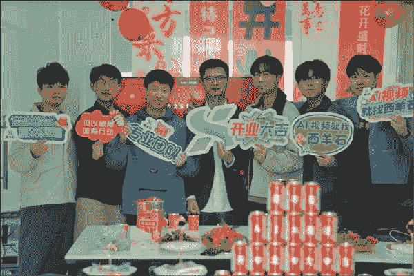
图 0-1　西羊石 AI 视频团队人员合影

AI 破局俱乐部的洋哥是我们的引路人。起初我们只是把 AI 视频当作副业摸索，在试错、复盘、迭代中从个人尝试演变为团队协作，最终形成公司化运作。可以说，从 AI 视频到 AI 漫剧，从内容生产到商业交付，我们始终依托真实项目和真实平台推进，从未停留在概念层面。

这段历程里，我们把 AI 漫剧的整条链路跑通，并上线了多部作品。小说改编、剧本拆解、人物与场景设定、分镜规划、画面生成、剪辑配音直至上线与数据复盘，每一步认知都在真实交付中被加深。越做越清晰的是一个现实问题：关于 AI 漫剧的讨论越来越热，可靠且系统的信息却很稀缺。

市场上充斥着零散经验、碎片教程与未被验证的观点。有的看似前沿却难以落地，有的在传播中逐渐走样，很多人手中信息不少，但准确度令人怀疑，甚至只是二手转述或道听途说。

我们也走过那段阶段。正因如此，积累经验后开始思考，是否有必要把真正跑通并验证过的方法整理成一套客观可用的框架，供后来者参考。

转机出现在 AI 破局俱乐部的线下大会上。

图 0-2　AI 破局俱乐部的线下大会合影

大会上经洋哥引荐，我们认识了同台分享的秋叶大叔。会前已相互关注，会后交流发现双方在 AI 短剧与 AI 漫剧的理解高度一致，都希望做点有分量、能长期沉淀的事。

我们来自一线创作交付，长期在项目中打磨流程、验证方法；对方深耕企业 AI 培训多年，在知识体系搭建、方法论沉淀和图书写作上经验丰富。当彼此都决定不只追概念、赶热点时，合作自然水到渠成。

本书正是在此背景下产生的。

它不是某款工具或平台的使用说明书，也不是博流量的快消品，而是一本系统性的 AI 漫剧全流程创作手册。书中多数方法源自传统影视动画已长期验证的工作方式，只是被拆解重组，适配到 AI 漫剧乃至未来 AI 真人短剧的生产中：角色如何建立、场景如何服务叙事、分镜如何决定节奏、剪辑配音音乐如何共同塑造观看体验……这些基础问题在 AI 时代常被忽略，却最能决定作品上限。

在此之前，这些打法已在 AI 漫剧特训营中反复使用，并在教学与作品反馈中持续修正优化。

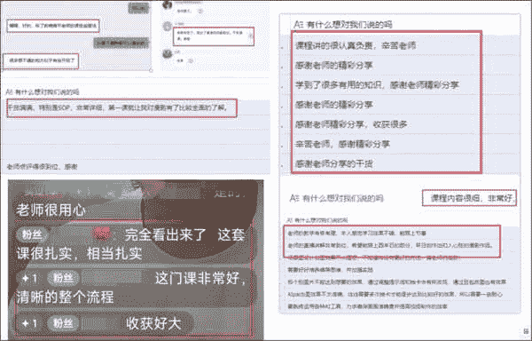
图 0-3　AI 漫剧特训营中部分学员的反馈

它们不是一次性技巧，而是一套可理解、可复用、可迭代的工作方法，这也是我们决心写成书的原因。课程和视频受时效限制，书籍更稳定持久。我们希望把已验证的经验沉淀下来，让对 AI 漫剧乃至未来 AI 真人短剧感兴趣的创作者少走弯路，看清这条路的真实模样。

不过本书并不下结论。AI 漫剧赛道仍在快速变化，工具、平台与规则都会更新。我们提供的是经实践检验、可迁移、能随技术演进不断升级的方法论。

如果你正在探索 AI 漫剧，希望它能成为你的清晰参照；如果你关注 AI 视频创作的长期发展，欢迎关注公众号“西羊石 AI 视频”和“西羊石 AI 短剧”。

图 0-4　两个公众号界面

我们持续分享一线实践与行业观察，也愿意与真正投入的同行交流合作。这本书只是阶段性记录，真正重要的是在不断实践中把路走得更清楚更扎实。

——西羊石 AI 视频团队和秋叶大叔团队

# 第一章
AI 漫剧的市场判断与整体认知

## 1.1 先锁定方向再动手
在 AI 视频赛道能否走得远、做得好，决定因素并非操作熟练度，而是启动时对内容定位的战略判断。很多创作者在学习期过度聚焦技术细节，忽略了更根本的市场前瞻与内容策略。方向选对，技术短板可以逐步补齐；方向选错，投入越多消耗越大。

同属 AI 视频，不同方向的商业逻辑截然不同。有的偏向项目交付，一次性成交；有的偏向内容资产，持续积累。若一开始未厘清，后续努力易因偏差而事倍功半。

本节暂不谈工具，只做一次基础的方向厘清。我们把 AI 广告片、AI 宣传片、AI 漫剧放在同一维度对比，帮助个人或小团队判断该长期深耕哪一块。

### 1.1.1 三种赛道实况对比

#### 1．AI 广告片
团队最早切入 AI 视频就是从广告片开始。服务品牌方，常见于电商、汽车、美妆等商业场景。

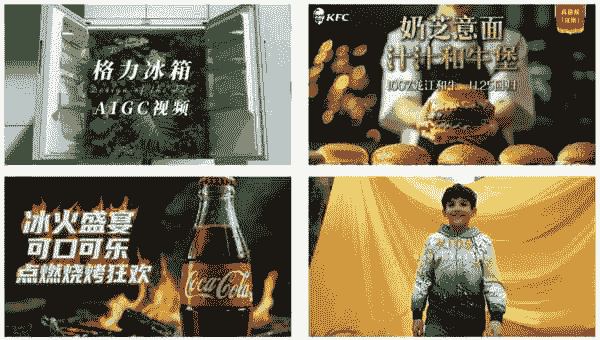
图 1-1　AI 广告片示例

时长通常 15 秒到 2 分钟，目标明确：在极短时间内抓住注意力、刺激消费。制作节奏快、周期短、需求零散。单个项目难度不高，但市场竞争极其激烈。我们深耕近两年、入局较早且有客户资源，依然感受到需求波动大。早期大厂和成熟团队占据主导，新人突围壁垒高。

商业模式也并不友好。单项目交付后难以形成稳定复购，回购周期长、复购率低。收入不稳定，下一单何时到来难以预期。加上片长有限、内容承载小，市场天花板明显，能容纳的创作者有限，个人成长空间受限。

#### 2．AI 宣传片
随着 AI 在大场景渲染、视觉合成、艺术字等能力提升，宣传片在文旅、企业形象等领域应用增多。

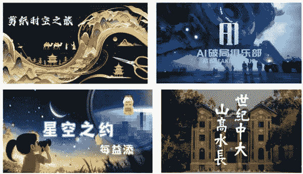
图 1-2　AI 宣传片示例

时长多在 2 到 5 分钟，目标不是直接促单，而是传递企业文化、塑造品牌形象或科普公益信息。常见于文旅宣传、企业形象、公益项目等。

市场相对广告片更稳，单价更高。但需求频次低、企业与政府决策流程长、制作周期漫长，市场体量有限。更适合已有资源、能承接完整项目的团队。个人创作者门槛高，很难做成高频可复制的持续生产模式。

#### 3．AI 漫剧
AI 漫剧是当下增速最快、潜力最大的视频形态，在多平台具备高热度和收藏量。

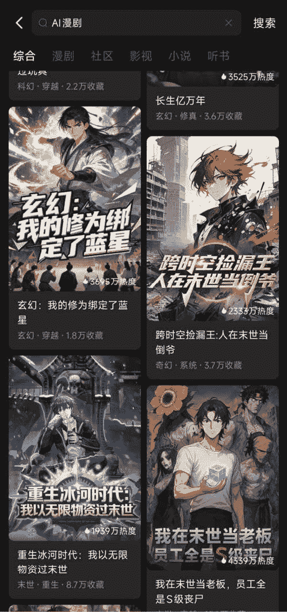
图 1-3　AI 漫剧示例

通常以系列剧集呈现，单集 1 到 2 分钟，整部作品常达几十集上百集，累计时长数百分钟。

核心优势在于需求体量。二次元文化、轻小说、网络文学 IP 改编等，都在驱动持续性剧情内容需求快速增长。其次 AI 显著降低门槛，角色设定、场景构建、分镜设计等核心环节可被高效生成，成本与时间可控，让小团队甚至个人也能进入。最关键的是，漫剧是可扩展、可持续产出的内容形态，不是一次性交付，而是不断演进的创作体系，对创作者长期发展更友好。

### 1.1.2 红利迁移，漫剧成主战场
AI 视频早期，广告片和宣传片承接了主要需求。但市场趋于饱和、客户审美提要求后，这两类内容的商业增长空间在收窄。

与此同时用户习惯在变：对单条短视频的注意力更分散，却更愿意投入有故事、有连贯性的内容。IP 化、系列化、持续化成为主流趋势，AI 漫剧正处在这一趋势的交汇点上。

从创作者视角看，广告片与宣传片已高度内卷，需求碎片、周期短、竞争激烈，新人很难获得稳定发展。AI 漫剧则是长线结构，单集短但整体体量大，需求持续且可规模化，更适配长期投入。

数据也印证了这一点。艾媒咨询预计 2025 年中国微短剧市场规模达 677.9 亿元，微短剧正成长为网络视听重要引擎。其中漫剧被多家机构视为最具扩展潜力的细分方向，新增市场规模有望达 200 亿元量级，相关制作企业或将达数十万家规模。

平台关注并非偶然。用户层面，漫剧单集短、节奏紧凑、情绪转折快，能在碎片时间高效传递信息并带动情绪，动漫形式进一步放大爽点，易形成追更行为。平台层面，漫剧兼顾流量与变现，已被纳入重点扶持。

以 B 站为例，其动画短剧与漫剧业务单季度流水约 2500 万元，单月流水破千万后推出“觉醒计划”。

图 1-4　B 站“觉醒计划”内容说明

平台承担全部制作成本，提供千万级流量曝光，并给予最高 80% 收益分成，意图明显：用资源倾斜吸引创作者进入漫剧生产体系。

抖音体系内红果近期推出补贴合作模式。

图 1-5　抖音红果漫剧合作模式

通过保底激励加单部剧保底的持续分成，鼓励稳定更新，部分模式已能按分钟结算，这在短视频生态中并不常见。

平台通过流量、资金与规则在明确释放信号：要可规模化生产的漫剧内容。

商业上，AI 漫剧还是 IP 测试工具。相比真人短剧和传统动画，成本、周期与试错风险更可控，适合快速验证 IP 潜力，为后续真人化、动画长番或游戏开发提供决策依据。出海时，玄幻、仙侠、游戏题材以漫剧形式呈现，也更容易跨越文化差异。

总结来看，行业需要高频产出、成本可控、具备规模化潜力的内容形态。对刚入局的创作者而言，广告片和宣传片适合短期项目与资源型团队，难支撑长期稳定生产；AI 漫剧则允许通过持续更新积累内容资产，在可控成本下建立稳定输出节奏，技术降低门槛也拓宽了个人与小团队的可能性。

从广告片、宣传片转向 AI 漫剧，不只是换形式，更是创作路径与商业逻辑的重定位。理解这一点，就不难解释为何越来越多人把重心移向 AI 漫剧。

## 1.1 起步先挑赛道

在 AI 视频这条赛道上能不能走长远，往往不取决于上手工具的速度，而是起步时有没有选准方向。很多人一上来就钻研参数与效果，把市场趋势和内容定位丢在后面。方向对了，技术可以边做边补；方向错了，投入越深消耗越大。

即便都挂着 AI 视频的名头，不同分支的盈利逻辑完全不同。一种是交付型项目，做完一单就结束；另一种是积累型资产，越做越厚。分不清这点，后面再怎么努力都容易被偏差拖累。

下面把 AI 广告片、AI 宣传片、AI 漫剧三条线并排看一眼，方便个人或小团队判断哪条更适合长期深耕。

### 1.1.1 三条线的实战差别

#### 1. AI 广告片
团队最早切入 AI 视频就是从广告片开始的。这类内容基本服务品牌投放，多见于电商、汽车、美妆等商业场景，时长多在 15 秒到 2 分钟之间，核心诉求是短时间内抓眼球、促转化。

制作端节奏快、周期短、需求分散。单项制作难度不算高，但市场竞争极其激烈。我们在行业耕耘近两年，入场算早，依然能明显感受到需求波动。早批入场的工作室占据了主要资源，新人突围难度很大。

图 1-1　AI 广告片示例

商业模式也不友好。交付一次后很难形成稳定合作，回购周期长、复购率低。接单看似频繁，收入却不稳定，前一单收尾后下一单何时到来难以预判。时长受限、信息承载少，市场天花板清晰，能容纳的创作者有限，个人成长空间受限。

#### 2. AI 宣传片
随着大场景渲染、视觉合成、艺术字效果能力提升，AI 宣传片在文旅推介、企业形象展示方面的应用明显增多。

图 1-2　AI 宣传片示例

时长一般在 2 到 5 分钟，目的不是直接成交，而是传递企业文化、塑造品牌调性或普及公共服务信息，常见于文旅、企业形象、公益类项目。

从需求面看，宣传片相对广告片更稳定，客单价也更高。但企业和政府机构的需求频次普遍较低，制作周期长、决策流程复杂，整体盘子仍比较受限。

因此，这类内容更适合已积累一定资源、能承接完整项目交付的团队。对个人创作者而言门槛偏高，很难做到高频、可复制、可持续的创作。

#### 3. AI 漫剧
目前增速最快、潜力最大的视频形态之一就是 AI 漫剧，在部分平台上用户关注度和收藏量都很高。形态上多以系列剧集出现，单集 1 到 2 分钟，全剧往往有几十集甚至上百集，累计时长可达数百分钟，这种体量对承制方已成常态。

图 1-3　AI 漫剧示例

优势第一点在需求规模。无论是二次元文化，还是轻小说、网络文学 IP 的改编，市场对有持续性的剧情内容需求都在快速上升。

第二点是 AI 把门槛拉低了。角色设定、场景搭建、分镜设计等核心环节都能借助 AI 工具快速生成，成本与时间投入大幅压缩，变为可控范围，也让小团队乃至个人有了进场的可能。

更关键的是延展性与创作自由。漫剧不是一次性交付的项目，而是一种可以持续产出、不断演进的内容形态，这从根本上提升了对创作者的友好度和发展空间。

图 1-3　AI 漫剧示例

### 1.1.2 红利在转移，下一站是漫剧

行业早期，广告片和宣传片承接了主流需求。随着市场趋于饱和、客户审美提升，这两类内容的商业增量在收窄。

与此同时观众的观看习惯也在变化。对单条短视频的注意力越来越分散，却更愿意把时间花在有故事、有连贯性的内容上。IP 化、系列化、持续化产出正在成为主流，而 AI 漫剧正好落在这一趋势的交汇点。

从创作者视角看，AI 广告片与宣传片已进入高度内卷，需求碎片化、周期短、竞争激烈，新人很难获得稳定机会。AI 漫剧则是长线结构，单集虽短，整体体量大且需求持续、可规模化，更契合长期投入。

从平台与行业数据看，这一趋势清晰。艾媒咨询预计 2025 年中国微短剧市场规模达 677.9 亿元。微短剧已从边缘形态成长为网络视听的重要引擎，其中漫剧被多家机构视为最具扩展潜力的细分，新增市场规模有望达到 200 亿元量级，相关制作与承制企业数量预计达到数十万家规模。

平台关注漫剧并非偶然。用户端看，单集时长短、节奏紧凑、情绪转折快，能在碎片时间里高效传递信息并带动情绪，动漫形式还放大了情绪表达与爽点，更易促成连续观看与追更。

平台端看，漫剧同时满足流量增长与商业变现，因而被纳入重点扶持类别。以 B 站为例，其动画短剧与漫剧相关业务单季度流水约 2500 万元。单月流水首次破千万元后，平台推出面向创作者的“觉醒计划”

图 1-4　B 站“觉醒计划”内容说明

平台承担全部制作成本，提供千万级流量曝光，并给予最高 80% 的收益分成。意图明确，通过资源倾斜吸引更多创作者进入漫剧生产体系。

抖音体系内的扶持同样指向商业。抖音红果近期推出以补贴为核心的合作模式

图 1-5　抖音红果漫剧合作模式

模式采用“保底激励+单部剧保底”的持续分成机制，鼓励稳定、长期更新。部分合作中漫剧内容已能按分钟结算，这在传统短视频生态里并不常见。

从平台动作看，这不是试探性投入，而是明确的内容采购与供给策略。通过流量扶持、资金激励和规则设计持续释放信号，希望市场提供更多可规模化生产的漫剧内容。

商业上，AI 漫剧还能充当 IP 测试工具。相比真人短剧和传统动画，成本、周期和试错风险更可控，能快速验证 IP 市场潜力，为后续真人化、动画长番或游戏开发提供决策依据。出海时，玄幻、仙侠、游戏题材以 AI 漫剧呈现，也更容易跨越文化差异。

总体来看，行业明确需要的是高频产出、成本可控且具备规模化潜力的内容形态。

对尤其是刚入局的创作者意义直接。广告片和宣传片更适合短期项目合作和资源型团队，虽有阶段性收益，却难以支撑长期稳定生产。AI 漫剧则提供另一条路：通过持续更新积累内容资产，在可控成本下建立稳定输出节奏。AI 应用降低门槛，也为个人和小团队打开了空间。

从广告片、宣传片转向漫剧，不是简单换形式，而是创作路径和商业逻辑的重定位。理解这一点，就不难解释为何越来越多创作者把重心移向 AI 漫剧。 EXr6287u6NNVz+GYLY+7SDk226FstKIHdC0bNoQkB2Nqi1xSR0yxPmwrTs5gRi/BtfSbid6dBhii9q7cz2pIyA==

平台近期动作再次印证供给导向。

图 1-4　B 站“觉醒计划”内容说明

图 1-5　抖音红果漫剧合作模式

## 1.2 短剧爆火后，普通人更适合做 AI 漫剧

1.1 节已从商业模式角度辨析了广告片、宣传片与漫剧的差异，回答了“做哪条线”的问题。真正进入创作时还会遇到新困惑：很多人起步接触的不是 AI 漫剧，而是 AI 短剧、动态漫、AI 动漫片段、AI 真人短剧等，这些名称相近、形态交叉，容易混淆。

不先厘清关系，实操中很容易反复试错，甚至一开始就选错方向。本节帮助建立短剧体系的整体视角，明确 AI 漫剧在其中的真实位置。

### 1.2.1 短剧是总称，内部玩法不同

AI 短剧并不是某种固定形态，而是一个内容大类。凡以短时长剧集为核心，通过剧情推进驱动用户持续观看的内容，都可归入此体系。随着 AI 应用扩散，体系快速分化，形成多条制作路径。

在平台实际内容中，主要表现为：以真人拍摄为主辅以 AI 特效的 AI 真人短剧；以 AI 生成画面为核心的 AI 动漫；以静态画面加基础动效呈现的 AI 动态漫；以及以连续剧情为核心的 AI 漫剧。它们都能满足碎片化观看，但并不适合同一种创作者长期投入。

表 1-1　AI 短剧主要表现形式的详细对比
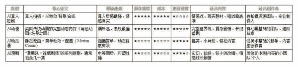

#### 1. AI 真人短剧：写实主义的情感冲击
AI 真人短剧结合真人出演与 AI 生成特效场景

图 1-6　AI 真人短剧

能产生比纯动画更强的情感共鸣和视觉真实感，多采用写实主义风格，适合情感层次丰富、依赖细腻表演的题材。制作难度和成本相对较高，但在深度情感表达上仍有独特优势。

#### 2. AI 动漫：对标专业番剧的高标准
AI 动漫与 AI 漫剧是两种不同形态和制作路径。AI 动漫以传统动画或番剧为对标，追求连续动作表现、完整镜头语言、稳定角色建模和高质量渲染。

制作周期极长，对技术积累和算力资源要求高，更适合大型长线剧集或动画电影。画面精美，但对个人创作者而言前期投入产出比往往不理想。

AI 动漫的目标是贴近传统动画，强调动作连贯性、镜头完整性、角色稳定性与画面质感，多用于番剧、动画短片或电影，资源投入高、周期长。

AI 漫剧根源可追溯至漫画与视觉小说，主要由静态或轻度动态画面+配音+音乐+节奏化剪辑构成，更强调叙事效率、情绪节奏与短时观看体验，特别适合短视频平台和网络文学 IP 改编，具有低成本、快产出的优势。

需要指出的是，随着 AI 图像生成、动态合成、剪辑与配音工具进步，现代 AI 漫剧视觉越来越精良，动态更丰富、镜头更多样，看起来更像动画。但本质仍属“轻动画+剪辑叙事”范畴，并不等同于高帧传统动画。

#### 3. AI 动态漫：轻量化高效方案
AI 动态漫通常将静态漫画素材借助 AI 转化为带轻微动态效果的形式。表现以画面平移、缩放及简单局部动效为主，形式相对单一。

# 小团队的长线答案：为什么 AI 漫剧会赢

跟完整动画比，动态漫在画面冲击上会打折扣，但它的优势是起步快、花销少。做轻松搞笑、篇幅精巧的小片段时效率很高，也很适合拿网络文学 IP 先做市场试探，反馈直接。《最强仙尊陈北玄》第四季就采用了这种呈现方式，如图 1-7 所示。

图 1-7　《最强仙尊陈北玄》第四季的动态漫

#### 4．AI 漫剧：本赛道的绝对主角
AI 漫剧是用 AI 工具生成并持续连载的系列化剧集，也是本书最聚焦的形态。它与一般短视频的本质区别在于按系列讲故事、剧情持续推进，多集之间逻辑咬合、人物成长连贯，能把复杂度更高的内容慢慢展开。

它的核心价值是把可控投入和相对体面的质感结合起来。并不追求传统动画那种高帧顺滑，而是靠 AI 快速生成角色和场景，再用精致的画面设计和紧凑的剪辑节奏把动作简化带来的缺口补上。这种调性对偏爱二次元和轻小说的年轻用户很有吸引力，也让个人或小团队能够保持稳定节奏做长篇连载。

### 1.2.2　为什么 AI 漫剧成为当下的市场共识
AI 漫剧被看好，是需求和工具一起成熟的结果。

一方面，文字 IP 转视频的门槛已经大幅下降。过去做一部像样的动画要大团队、长周期，现在七人左右的小组熟练用 AI 流程，就能做出播放过千万的作品。

另一方面，短视频平台的分发逻辑和庞大的网文 IP 库存形成了闭环。用户喜欢爽点密集、感官刺激强的片段，漫剧正好契合。变现路径也更清晰：传统动画从立项到市场反馈往往要半年以上，AI 漫剧几周就能上线验证接受度。

典型案例是 2025 年上线的《我的治愈系游戏》，阅文集团和腾讯动漫联合出品，全流程 AI 制作。上线几天全平台播放就破千万，团队只有七人，画面、配音、剪辑都靠 AI 高效完成，这在传统模式里很难复制。

《传武》也说明了同样的问题，即便在动作要求较高的题材里，AI 漫剧依然能吃到流量红利。

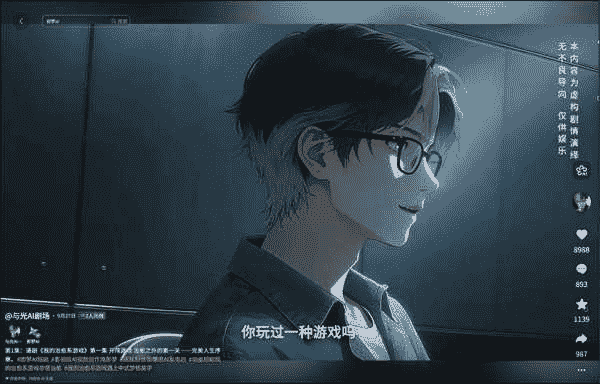

图 1-8　AI 漫剧《我的治愈系游戏》

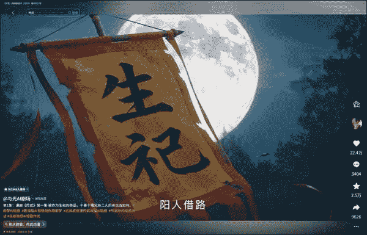

图 1-9　AI 漫剧《传武》

刚入场的人容易被短期数据带偏。看到某个方向播放高就急着跟，看到爆款结构就反复抄。短期试错没问题，但放眼长期，不同形态对创作者的要求完全不同。

想快速探一探题材反应，或只是想在短时间里熟悉工具，动态漫和其他短时长内容依然够用。周期短、单条要求聚焦，既能练手也能看平台即时反馈。

但这类内容的现实限制是积累难。每条基本都得从零搭起，节奏或表达一变效果就可能波动，很容易陷入追热点、反复重启的循环。

当目标转向持续输出、用内容建立稳定节奏时，AI 漫剧的优势就出来了。它以系列化为基础，重心放在整体叙事框架而非单集表现。世界观、人物关系和视觉风格确定后，后续生产会进入比较平稳的状态，不必每集从头来，而是在既有框架上不断延展。

这种特性更适合长期投入。内容上剧情会随更新不断丰满；创作上经验在反复中累积；平台上账号和作品更容易形成清晰的风格标签。

这不是优劣之分，而是路径选择。动态漫和短时长内容更像快速响应机制，AI 漫剧更像一条可以持续推进的创作路径。起步时把时间规划、投入方式和目标定位想清楚，后续选择会更理性，也更容易坚持下去。

## 1.2 短剧爆发后，为什么真正适合普通创作者的是 AI 漫剧
1.1 节从商业模式上区分了 AI 广告片、AI 宣传片和 AI 漫剧，回答了长期投入该往哪走。但进入创作层面问题会变。多数从业者不是从 AI 漫剧入场，而是先接触 AI 短剧、动态漫、AI 动漫片段、AI 真人短剧等，名字相近、形式交叉，容易混为一谈。

先把这些形态的关系理清，才能避免反复试错、选错方向。下面帮助建立短剧体系的整体视角，定位 AI 漫剧的真实位置。

### 1.2.1　AI 短剧是一个内容大类，而不是一种具体形式
AI 短剧不是某种固定形态，而是一个总称。凡是以短时长剧集呈现、靠剧情推进留住用户的，都可以归入短剧体系。随着 AI 应用普及，体系快速分化出多种制作路径。

平台上常见的是：以真人拍摄为主辅以 AI 特效的 AI 真人短剧；以 AI 生成画面为核心的 AI 动漫；以静态画面加基础动效的 AI 动态漫；以及以连续剧情为核心的 AI 漫剧。它们都能满足碎片化观看，但并不适合同类创作者长期投入。为便于理解，表 1-1 对主要表现形式做了对比。

表 1-1　AI 短剧主要表现形式的详细对比

#### 1．AI 真人短剧：写实主义的情感冲击
AI 真人短剧结合真人出演与 AI 生成的特效场景，如图 1-6 所示。比纯动画更具情感共鸣和视觉真实感，常以写实主义风格呈现，适合需要细腻表演支撑的情感型剧情。虽然制作难度和成本偏高，但在深度情感表达的题材里仍有独特优势。

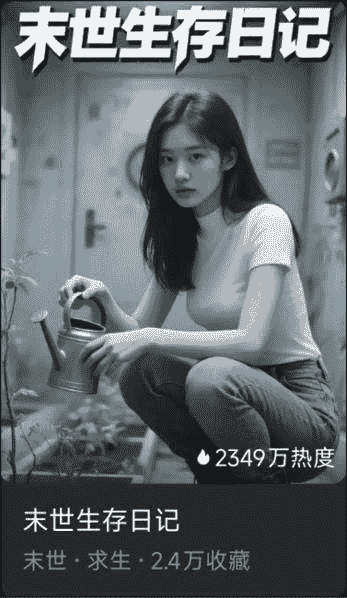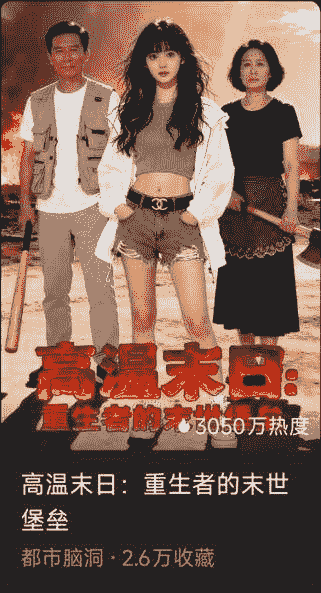

图 1-6　AI 真人短剧

#### 2．AI 动漫：向专业番剧看齐的高标杆
AI 动漫与 AI 漫剧是两种不同的形态和路径。AI 动漫对标传统动画或番剧，追求连续动作、完整镜头语言、稳定角色建模和高质量渲染。

制作周期极长，对技术积累和算力要求高，更适合大型长线剧集或动画电影。画面精美，但个人创作者前期投入产出比往往不理想。

AI 动漫的目标是逼近传统动画，强调动作连贯、镜头完整、建模稳定与画面质感，适用于番剧、动画短片或电影类开发，通常周期长、资源高。

AI 漫剧则源自漫画与视觉小说，多由静态或轻度动态画面加配音、音乐、节奏化剪辑构成，强调叙事效率、情绪节奏与短时观看体验，尤其适合短视频平台和网络文学 IP 改编，低成本快产出是明显优势。

需要指出的是，随着图像生成、动态合成、剪辑配音工具的进步，现代 AI 漫剧的视觉越来越精良，动态更丰富、镜头也更多样，看起来更像动画，但本质仍是轻动画加剪辑叙事，并不等同于高帧动画。

#### 3．AI 动态漫：高效率的轻量化方案
AI 动态漫通常是将静态漫画素材借助 AI 转为轻微动态的形式。表现相对单一，以画面平移、缩放和局部小动效为主。

视觉表现力不及完整动画，但制作快成本低，非常适合搞笑、幽默或体量精巧的片段，是追求高生产效率和内容产出量的首选。对于网络文学 IP 的快速市场测试，动态漫往往能起到立竿见影的效果。例如《最强仙尊陈北玄》第四季的动态漫即采用了这一形式，如图 1-7 所示。

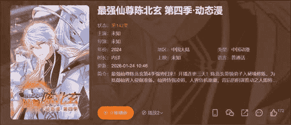

图 1-7　《最强仙尊陈北玄》第四季的动态漫

#### 4．AI 漫剧：本赛道的绝对主角
AI 漫剧是指通过 AI 技术生成的系列化剧集，也是本书重点探讨的内容形态。它与普通短视频最大的区别在于系列化结构与连续性剧情推进。漫剧在多个剧集之间保持紧密的逻辑关联和角色成长轨迹，能够深入展开复杂度较高的故事情节。

AI 漫剧的优势，在于实现了成本控制与内容质量的有效平衡。它并不追求传统动画般的高帧率和流畅度，而是借助 AI 工具高效生成角色与场景，通过精美的画面设计和紧凑的剪辑节奏来弥补动作的简化。这一形式对年轻观众，尤其是二次元文化和轻小说爱好者具有极强的吸引力，并使个人或小型团队也能以相对稳定的节奏，持续产出长篇连载剧集内容。

### 1.2.2　为什么 AI 漫剧成为当下的市场共识
目前 AI 漫剧的兴起，源于其背后坚实的市场需求和技术支撑。

首先，AI 技术与自动化工具的不断成熟，使得将文字 IP 转换为视频内容的成本呈断崖式下跌。以往，制作一部高质量动画可能需要庞大的团队和漫长的周期。如今，一个只有 7 人左右的专业小团队，若能熟练运用 AI 制作流程，已能独立完成播放量达千万级的作品。

其次，短视频平台的流量分发机制与庞大的网络文学 IP 库资源形成了有效对接。观众对剧情爽点和高密度感官刺激的偏好，使漫剧成为高度适应当前消费习惯的形态。这一形式具备强大的 IP 变现潜力：传统动画从制作到市场反馈往往需要半年甚至更久，而 AI 漫剧可以在几周内完成上线，快速验证市场接受度。

以 2025 年上线的典型案例《我的治愈系游戏》为例，这作品由阅文集团与腾讯动漫联合出品，是典型的 AI 全流程制作成果。上线短短几天，其在全平台播放量便突破千万。其制作团队仅 7 人，依托 AI 工具高效完成了从画面生成、配音到剪辑的全部流程，这种效率在传统动画生产模式下很难实现。

图 1-8　AI 漫剧《我的治愈系游戏》

另一部热门作品《传武》也印证了这一趋势：即便在动作表现要求较高的题材领域，AI 漫剧仍能凭借其形式优势获得巨大的流量红利。

图 1-9　AI 漫剧《传武》

AI 漫画剧：爆量之后如何走长线

生成式模型与自动化流水线已经把文字 IP 变现为视频的门槛压到极低。过去做一部像样的动画，往往要靠上百人的团队和以年计的周期，如今七八个人形成的小组，只要把 AI 生产链跑通，就能独立交付播放破千万的成片。

短视频的流量分配规则和海量网络小说储备产生了结构性契合。用户偏爱强情节节奏与密集的视听刺激，漫画化短剧恰好贴合当下观看习惯。变现效率也被重新定义：传统动画从立项到拿到市场反馈常要半年以上，AIGC 驱动的漫画剧数周就能上线试水，很快判断题材是否吃得开。

2025 年上线的《我的治愈系游戏》就是一个典型参照。作品由阅文与腾讯动漫联合推出，是一条全流程借助 AI 完成的代表。发布仅数日，全网累计播放就过了千万。主创只有七人，通过工具把画面合成、语音与剪辑串起来，这种速度在传统工业里很难复制。

图 1-8　AI 漫剧《我的治愈系游戏》

在对动作表现要求更高的赛道，《传武》同样印证了趋势。即便打斗密集的类型，AI 漫画剧也能依靠形态优势拿到可观的流量红利。

图 1-9　AI 漫剧《传武》

新手入场时容易被短期数据带偏。看到某个方向播放突起就急着跟进，看到爆款就照搬结构与节奏。短期试错没问题，但拉长时间线会发现，不同形态对创作者的能力诉求并不相同。

如果目标是快速探测题材反应，或只是想在短时间内熟悉工具操作，动态漫画和短时长内容仍是合适的切口。周期短，单条完成度要求聚焦，既能练手也能捕捉平台即时反馈。

这类内容的短板也很明显：复用价值低。每条基本都要从零搭建，题材、节奏或表达方式稍有变化，结果波动就很大。很容易陷入追热点、反复重启的循环。

当目标转向持续输出、建立稳定生产节奏时，AI 漫画剧的价值才会显现。它依赖系列化结构，核心在于整体叙事框架的搭建。世界观、人物关系和基础视觉风格一旦确定，后续内容便能在既有框架内持续延展，不必每集都重新起步。

这种特质更适合长期投入。剧情会随更新不断丰满，经验在重复实践中累积，账号与作品也更容易沉淀出清晰的风格标签。

这并非形式优劣之争，而是路径差异。动态漫画和短内容更像一种快速响应机制，AI 漫画剧则更接近一条可持续推进的生产线。起步时把时间规划、投入方式与目标定位想清楚，后续选择会更理性，也更容易坚持下去。 EXr6287u6NNVz+GYLY+7SDk226FstKIHdC0bNoQkB2Nqi1xSR0yxPmwrTs5gRi/BtfSbid6dBhii9q7cz2pIyA==

1.3 五步走通 AI 漫画剧从立意到成片的实操链路

方向明确后，关键问题是如何把一部 AI 漫画剧从 0 到 1 搭起来。很多创作者卡住的地方不是技术，而是顺序混乱。有人先做画面，有人先做配音，有人钻研参数，最后发现环节冲突、流程衔接不上。根源在于缺少一条清晰的全局路径。

本节先不展开具体操作，先把完整制作脉络理清楚。弄清每个环节在整体中的位置、解决什么问题、哪些可并行、哪些必须串行。框架清晰后，学习与落地才更有效。

下面按实际制作顺序拆解从内容构思到成片的全过程。

### 1.3.1　第一步：把小说拆解成可执行剧本

AI 漫画剧的起点大多是文本，网络小说是最常见的来源。

选题时要先判断是否适合 AI 视觉化。目前实践最成熟、风险最低的仍是玄幻、仙侠、游戏与幻想类。这类题材对写实要求不高，更强调世界观、情节密度与叙事节奏，正好发挥生成式工具的长处。而强现实、细腻情感或都市生活，对真实表演与细节刻画依赖大，不适合作为初期尝试。

小说确定后，真正的制作才开始。AI 漫画剧不是把小说直接读出来，而是要把文字转化为适合视频呈现的结构，这一步叫剧本拆解。

拆解的核心是把长篇连贯叙事切成可独立制作的单集单元。每集都要明确情节推进、人物的具体行动与本集的情绪落点。

工具可以加速拆解效率，但判断仍靠创作者。场景切换、出场顺序、对白密度等都要清晰规划与标注。

操作时建议遵守几个原则：每集场景要清晰，界定室内外、时间背景与空间特征；角色动作与台词要符合性格，避免逻辑矛盾；提前在剧本中提示画面、音效与字幕需求；尽量避开现实中的人名、地名与机构名，以降低侵权风险。下面用一个具体案例来理解这些原则的落地。

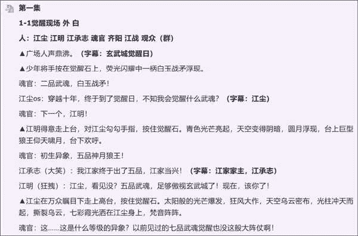

图 1-10　“把小说的内容转换为剧本”示例

剧本拆解完成，文本层面的工作才算结束。

### 1.3.2　第二步：搭建角色场景资产库

AI 漫画剧里最关键的不是单集表现力，而是核心资产的建立。它决定作品能否稳定持续生产。最核心的两类资产是角色设计与场景设计。

角色设计不只是画形象，而是建立一套稳定可复用的视觉与性格框架。通常要为主要角色生成正面、侧面、背面的参考图，并明确外形特征、服饰风格与整体气质。

角色背景设定同样重要。身份、年龄区间、行为逻辑会影响画面呈现与配音风格的统一。因此这一步就要同步考虑人物的音色方向，为后续配音做准备。

场景设计的思路类似。每个高频出现的场景都需要明确的视觉风格与情绪基调。无论是古代、现代还是幻想世界，不同场景要有辨识度，同时保持整体世界观的统一。

这一阶段本质上是在为接下来数十集甚至上百集内容，构建一个稳定、可持续的生产基础。

### 1.3.3　第三步：分镜把文字变成画面

角色与场景准备好后，要解决每集具体的视觉呈现如何规划。

分镜的作用是把剧本拆成一个个明确的画面单元。每个分镜需说明画面主体、镜头角度、人物状态与情绪基调。

AI 漫画剧的分镜不求复杂调度，更看重信息表达的清晰度与情绪传递的准确性。镜头语言越明确，后续图像生成与视频制作的稳定性越高。

大模型可以辅助把文字描述转成更标准化的分镜脚本，但前提是创作者已对画面要传达的内容形成清晰构思。

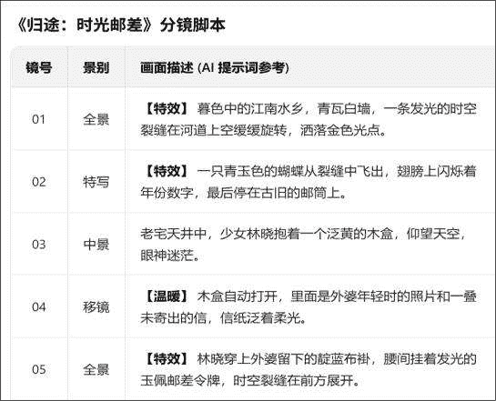

图 1-11　AI 大模型将剧本中的镜头转化为具体的分镜

### 1.3.4　第四步：生成画面与视频

分镜确定后进入画面生成阶段。

先是图像生成。目标是产出可直接用于视频制作的素材。常见做法是基于已确定的角色与场景参考，用即梦 AI 等工具批量生成风格统一的角色图与场景图。

这一阶段最关键的是风格一致性。角色在不同画面中的服饰、五官与气质要保持稳定；场景的光影、色调与空间结构要连贯，否则剪辑会很困难。

素材稳定后进入视频生成。用即梦 AI 等视频工具把单张画面或分镜图转为短视频片段，每个分镜对应一段，再按剧情节奏调整时长与切换。

不必刻意追求复杂动作或特效。对 AI 漫画剧而言，画面连贯性与信息清晰度比动态丰富性更重要。镜头衔接自然、叙事逻辑顺畅，核心功能就达成了。

### 1.3.5　第五步：配音剪辑收尾

画面完成后，距离成片只剩最后两步。

首先是配音。配音承担传递情绪与把控节奏的作用。成熟作品多用真人配音，个人创作者用 AI 合成语音也能支撑完整表达。

常见做法是用海螺 AI 等工具为不同角色设定固定音色，并在后续集数中沿用。关键不在于音质是否高级，而在于角色声音是否统一、情绪是否准确。

配音完成后进入剪辑。用剪映等软件把视频片段、配音与背景音乐整合，调整整体节奏，补齐转场、音效与字幕。

很多 AI 漫画剧的问题不在画面，而在节奏把控。镜头拖沓、对白堆积、情绪起伏不清都会影响观感。剪辑是在成片前最后阶段系统修正这些问题。

剪辑完成后，单集才算制作完毕，具备发布与测试市场反馈的基础。

整体来看，AI 漫画剧流程并不复杂，但对系统性要求很高。从小说到剧本是内容成立的基础；角色、场景到分镜是持续生产的前提；出图、出视频到配音剪辑是完成度的保障。理解完整流程的意义在于明确每一步何时做、解决什么具体问题，而不是一次性掌握所有环节。 EXr6287u6NNVz+GYLY+7SDk226FstKIHdC0bNoQkB2Nqi1xSR0yxPmwrTs5gRi/BtfSbid6dBhii9q7cz2pIyA==

1.3 五步把 AI 漫画剧从灵感到成片的实战链路

方向确定后，关键是把零散的想法变成能持续跑的生产线。很多同学卡住不是工具不好，而是顺序乱了。有人先堆画面，有人先弄声音，还有人一上来就抠参数，最后发现环节对不上，做出来的东西拼不起来。先把全局路线图理清：每个环节解决什么问题、哪些能并行、哪些必须串行，框架稳了，后续实操才不会走弯路。下面是一套验证过的落地路径，从内容到成片逐步拆解。

### 1.3.1 第一步：把长篇文本拆成可执行的脚本蓝图

做 AI 漫画化项目，源头基本都是文字，网络小说是最常见的入口。选题先看能不能被 AI 画出来。现在跑得顺、踩雷少的，基本集中在玄幻、仙侠、游戏、奇幻这类靠设定驱动的类型。它们对写实度要求不高，更吃世界构建、情节密度和节奏掌控，正好契合 AI 的长处。反过来，强写实向、细腻情感戏或都市日常，对表演细节和真实质感依赖大，不太适合当起步练习。

文本敲定后制作才正式开始。不是把原著直接念一遍，而是要把文字转成适合视频的表达结构，通常叫做脚本分解。拆解的本质是把连贯的长篇叙事切成可以独立生产的单集。每集要锁死三件事：本集推动了哪段剧情、人物做了哪些具体动作、本集的情绪落点在哪。

AI 能把分解速度提上来，但判断仍靠人。场景怎么切、谁先出场、对白浓度如何，都要在脚本里标清楚。操作上建议遵守几个基本纪律：单集场景边界要清晰，室内外、时间线、空间特征写明白；角色的台词和行为必须自洽，不能出现性格前后矛盾；画面、音效、字幕的提示要提前写进脚本；尽量不用现实中的真人姓名、地名、机构名，降低侵权风险。下面这组示意能帮助理解拆解要点。

图 1-10　“把小说的内容转换为剧本”示例
脚本拆完，文本层面的工作才算收尾。

### 1.3.2 第二步：搭建人物与场景的长期资产库

单集精致度不是核心，能否稳定连更才决定作品寿命。支撑长期生产的，是人物和场景这两类核心资产。

人物设定不只是画一张人设图，而是要建立一套可复用的视觉和性格规范。主力角色最好备正面、侧面、背面的参考图，并把外形特征、服饰风格、整体气质固定下来。背景设定同样关键，身份、年龄段、行为逻辑会直接影响画面风格和声音选择，所以这一步就要同步想好音色方向，为后续配音统一打底。

场景的建设思路类似。反复出现的场景都要有明确的视觉调性和情绪基调。无论是古代、现代还是虚构世界，不同场景要有辨识度，同时整体世界设定要自洽。这一轮工作，实质是在为未来几十上百集建一个稳定、可持续的生产底座。

### 1.3.3 第三步：分镜规划，把文字变成画面指令

人物和场景就位后，要解决的是每一集具体怎么呈现。分镜就是把脚本拆成一个个清晰的画面单元，每个单元说明画面主体、镜头视角、人物状态和情绪基调。

AI 漫画剧的分镜不求花哨的调度，更在意信息是否传得清、情绪是否传得准。描述越具体，后续出图和出视频的稳定性越高。这一阶段可以借助大模型把文字描述整理成更规范的分镜脚本，但前提是创作者自己对画面想表达什么已经有清晰的画面感。

图 1-11　AI 大模型将剧本中的镜头转化为具体的分镜

### 1.3.4 第四步：生成画面与合成视频，完成视觉拼装

分镜确认后进入视觉生产。先是出图，用前期确定的角色、场景参考，借助即梦 AI 等工具批量产出风格统一的角色图和场景图。这一环最看重一致性：同一个人不同镜头的服饰、五官、气质要稳定；场景的光影、色调、空间结构要连贯，否则后期剪辑会很难受。

图面稳定后进入视频化，通常也是用即梦 AI 这类视频模型，把单张图或分镜图变成短片段。每段分镜对应一段小视频，再根据剧情节奏调整时长和切换。AI 漫画剧不需要刻意追求复杂动作或特效，镜头衔接自然、叙事逻辑通顺，比动态丰富更重要。

### 1.3.5 第五步：声音与后期剪辑，让内容真正成立

画面做好后，最后两步是配音和剪辑。配音承担情绪传递和节奏把控的功能。平台上的成熟案例多用真人配音，但个人创作者用 AI 语音也完全够用。常见做法是用海螺 AI 等工具给每个角色设定固定音色，并在系列中一直沿用。成败不取决于音质多高级，而在于声音是否统一、情绪是否到位。

配音完成后进入剪辑，通常用剪映把视频片段、配音、背景音乐整合，微调节奏，补上转场、音效和字幕。很多 AI 漫画剧的问题不在于画面，而在于节奏失控：镜头拖沓、对白堆积、情绪起伏不明显。剪辑就是在成片前做一次系统性修正。

剪完这一集才算正式完成，可以发布测试反馈。

整体来看，AI 漫画剧的流程并不复杂，但对系统性要求很高。文本到脚本是内容成立的基础，人物、场景到分镜是持续生产的前提，画面生成、视频合成到声音剪辑是完成度的保障。理解全流程的意义，不是要求一次掌握所有环节，而是清楚每一步在什么时候做、要解决什么具体问题。 EXr6287u6NNVz+GYLY+7SDk226FstKIHdC0bNoQkB2Nqi1xSR0yxPmwrTs5gRi/BtfSbid6dBhii9q7cz2pIyA==

AI漫画剧从立意到上线的五步打通法

当素材库的供图进入稳定期，制作重心就会转向成片化。这一阶段常会调用即梦 AI 这类合成类工具，把单幅画面或分镜草图转成数秒到十几秒的短段落。每个分镜映射一段小片段，再依据剧情节拍去调时长与镜头切换点。

此环节没有必要刻意追求复杂动作或特效。对AI漫画剧来说，决定成败的是画面的连贯度与信息的清晰度，动态的丰富程度可以后置。只要转场自然、叙事顺滑，镜头的功能就已完成。

### 1.3.5 第五步：配音与剪辑，让内容真正成立
画面收口之后，距离可发布版本只剩最后两道工序。

先说声演。在AI漫画剧里，声演既是情绪载体也是节奏控制器。头部案例目前仍多用真人录音，但对个人创作者而言，AI配音已能支撑整部作品的表达。

常见做法是借助海螺AI等工具，为每个角色设定固定音色，并在后续集数里保持一致。真人或合成并非关键，关键是人设声音是否统一、情绪拿捏是否准确。

声演完成后进入终剪。常用剪映等剪辑软件把成片片段、音轨、背景音乐拼成整体，调整节奏并补齐转场、音效和字幕。

很多作品的短板不在画面，而在节奏失控：镜头拖时间、对白堆积、情绪起伏不明显。剪辑正是在交付前系统性地修正这些问题。

剪完单集才算正式完工，也具备上线做市场反馈的基础。

整体来看，AI漫画剧的制作链路并不复杂，但对系统化要求极高。小说到剧本是内容成立的底座；角色、场景到分镜是持续生产的保证；出图、出片到声演剪辑则是完成度的体现。理解完整链路的意义不在一次吃透，而在清楚每一步该何时介入、解决哪类具体问题。

## 1.3 五步走通AI漫剧从立意到发布的全流程
方向明确后，最核心的问题是：一部AI漫画剧到底怎样从零一步步做出来。

很多创作者卡住的并非技术，而是工序顺序混乱。有人先画图，有人先配音，有人一上来就调参数，中途才发现环节打架、流程接不上，最后难以成片。根源不是努力不够，而是缺一条清晰的全局路径。

本节不展开操作细节，先把整条产线梳理清楚。你要先弄明白每个环节在全局中的位置、它解决的问题、哪些可并行、哪些必须串行。框架清晰后，后续学习和实操才有落地可能。

下面按真实制作顺序，把从内容构思到最终成片的过程逐层拆解。

### 1.3.1 第一步：文本拆解，变成可执行的剧本骨架
AI漫画剧的起点几乎都来自文本，最常见的是网络小说。

选题时最关键的判断，是这件内容是否适合被AI视觉化。当前实践里相对成熟低风险的类型，集中在玄幻、仙侠、游戏、奇幻等。对画面写实度要求不高，更看重世界观搭建、情节密度和叙事节奏，正好契合AI优势。反观强现实题材、细腻情感戏或都市生活类，对真实表演和细节刻画依赖更高，不适合作为起步方向。

小说确定后真正的制作才开始。AI漫画剧不是把小说直接念出来，而是要把文字转成适合影像的表达结构，这一步常称剧本拆解。

拆解的核心目标，是把连贯长篇拆成一集集可独立制作的单元。每集都要明确三件事：情节推进点、人物具体行动、本集情绪落点。

实际操作中，AI能大幅提升拆解效率，但判断仍靠创作者。每集的场景切换、出场顺序、对白密度等都要清晰规划标注。

本阶段建议遵循以下原则：每集场景要界定清楚，含内外环境、时间背景与空间特征；角色动作台词要符合人设，避免逻辑矛盾；画面、音效、字幕的提示要在剧本里提前埋好；尽量避免直接使用现实人名、地名、机构名，降低侵权风险。下面用一个具体案例来说明这些原则的落地。

图 1-10 “把小说的内容转换为剧本”示例

剧本拆解完成后，文本层面的工作才算结束。

### 1.3.2 第二步：角色与场景定型，构建可复用的生产资产
AI漫画剧里最重要的不是单集表现力，而是核心资产的建设。这些资产决定作品能否长期稳定产出。其中最关键的两类是角色设计与场景设计。

角色设计不仅是画人像，而是为角色建立稳定可复用的视觉与性格框架。通常要为主要角色生成正面、侧面、背面的参考图，并提前明确外形特征、服饰风格与整体气质。

与此同时，背景设定同样重要。身份、年龄区间、行为逻辑会直接影响后续画面呈现与配音风格的统一性。所以这一阶段就要同步考虑人物的音色方向，为后续配音做准备。

场景设计的思路类似。每个高频出现的场景，都应具备明确的视觉风格与情绪基调。无论古今或幻想，不同场景要有辨识度，同时保持世界体系的统一。

这项工作的实质，是为未来数十甚至上百集内容，搭建稳定可持续的生产基础。

### 1.3.3 第三步：分镜规划，将文字落地为画面指令
角色与场景就绪后，需要解决每集具体如何呈现的问题。

分镜的作用是把剧本拆成明确的画面单元。每个分镜都要说明画面主体、镜头角度、人物状态与情绪基调。

AI漫画剧的分镜不求复杂调度，更重信息表达清晰度和情绪传递准确度。镜头语言越明确，后续图像生成和视频制作的稳定性越高。

这一阶段大模型可辅助把文字描述转为更规范的分镜脚本（如图 1-11 所示），前提仍是创作者已对画面要传达的内容形成清晰构思。

图 1-11 AI大模型将剧本中的镜头转化为具体的分镜

### 1.3.4 第四步：批量出图出片，实现视觉素材的合成
分镜确定后正式进入画面生成。

首先是图像生成。目标明确：产出可直接用于视频制作的素材。常用做法是基于前期确定的角色与场景参考，用即梦AI或其他工具批量生成风格统一的角色图和场景图。

这一阶段最关键的是风格一致性。角色在不同画面中的服饰、五官、气质要稳定；场景的光影、色调、空间结构也要连贯，否则剪辑会很困难。

素材输出稳定后进入视频生成。这一环通常借助即梦AI等工具，把单张图或分镜图转成短视频片段。每段分镜对应一段视频，再按剧情节奏调整时长与切换。

不必刻意追求复杂动作或特效。对AI漫画剧而言，画面连贯、信息清楚比动态丰富更重要。只要衔接自然、逻辑顺畅，画面功能就已达成。

### 1.3.5 第五步：配音剪辑，收尾成片交付
画面完成后，距离成片只剩配音与剪辑两步。

配音承担情绪传递与节奏把控，目前成熟作品多用真人，但个人创作者用AI配音已足够。常见做法是用海螺AI等工具为角色设定固定音色并在后续集数沿用。关键不在音质是否“高级”，而在声音统一与情绪准确。

配音后进入剪辑，通常用剪映等软件整合视频片段、配音、背景音乐，调整节奏并补齐转场、音效、字幕。

很多AI漫画剧的问题并非画面质量，而是节奏把控不当：镜头拖沓、对白堆积、情绪起伏不清。剪辑的作用就是在成片前系统修正这些问题。

剪完后单集才算正式制作完毕，也具备发布与市场测试的基础。

整体来看，AI漫画剧流程不复杂，但系统性要求极高。小说到剧本是内容成立的基础；角色、场景到分镜是持续生产的前提；出图、出视频到配音剪辑则是完成度的保障。理解完整流程的意义，不在一次性掌握，而在明确每一步的时机与待解决问题。

## 小结
本章重心不在教学，而在方向判断。

在AI视频赛道，拉开差距的关键往往不是工具掌握早晚，而是起步是否选对方向。本章任务是在投入大量时间和精力前，帮助读者看清不同路径的长期可行性。

1.1节从商业模式对比AI广告片、宣传片与AI漫剧。结论是广告片和宣传片偏项目制交付，依赖客户资源与行业关系，难形成高频可复制的创作体系；而AI漫剧可持续产出、不断积累内容资产，更适合个人与小团队长期深耕。

1.2节把视角拉回短剧内部，梳理AI真人短剧、AI动漫、AI动态漫与AI漫剧的关系。通过制作难度、成本结构与更新节奏对比可知，AI漫剧并非画面表现力最强，而是成本控制、制作效率与内容持续性之间的平衡选择。这也解释了为何在短剧市场扩张后，能被普通创作者长期实践坚持的，多是AI漫剧这条路径。

1.3节未急于讲技巧，而是完整呈现AI漫剧从构思到成片的全流程。目的是让创作者先看清全局，明确每一步解决的问题，再决定切入点与精力分配。流程一旦混乱，再多工具也无济于事。

综合来看，本章要回答的核心问题是：在AI视频赛道，普通创作者应如何定位并参与其中。

只有清晰理解不同内容形态的差异、把握商业模式特点并建立流程化认知，后续学习才有实际意义。否则努力只会加速偏离正确方向。

从第二章起，将正式进入AI漫剧的具体创作环节，按流程顺序逐步拆解，把每个关键步骤阐释清楚并落实到可执行层面。方向已定，现在是付诸实践的时刻。

# 第二章
剧本拆解，把小说改编为可落地的脚本

实际创作中发现，很多问题并非源于工具，而是内容质量。画面可生成，视频可合成，但剧情松散、节奏失衡、人设缺乏支撑，问题最终都会在成片暴露。技术越成熟，内容本身的问题越明显。

AI漫画剧的真正竞争力，不在画得精细，而在能否把原始文本有效转为适合影像的叙事结构。这一转换直接决定情节是否清晰、人物是否立得住，也影响后续分镜、画面与节奏的走向。

因此本章起聚焦内容处理，重点探讨如何把小说拆解为可执行的剧本框架，以及在AI工具辅助下创作者该如何完成这一关键转换。

## 2.1 先选对题材：打爆款从小说筛选做起
几乎所有AI漫画剧的创作都始于文本，最常见来源是网络小说。但小说不能直接用于视频创作。小说服务阅读体验，节奏、描写与信息密度围绕文字展开；AI漫画剧服务观看体验，必须以画面表达、节奏控制和情绪推进为核心。两者并不天然适配。

剧本拆解本质是一次内容重构，不是简单复述，而是把小说叙事逻辑转为一集集具备可执行性的视频单元。

在具体拆解方法前，第一步是选对可改编的小说。

实际项目里，有时小说由版权方提供，创作者无选择权。但在自主创作场景下，选题很大程度上决定后续制作难度上限。判断标准并不复杂，核心回答一个问题：这部作品能否放大AI优势而非暴露短板。

目前实践里，玄幻、仙侠、魔幻、游戏类题材最成熟稳妥。这类作品通常拥有明确世界观、强戏剧冲突和高情节密度，对画面写实度要求相对低，更强调想象空间与情绪张力。

AI画面生成时，非写实题材更容易建立观众接受预期。只要角色、场景、动作风格统一，就能形成完整观看体验。

相对而言，强调写实、都市生活或情感戏占比极高的作品，对人物表演细腻度和细节真实性要求更高，常依赖真人微表情与情绪递进，属于当前AI尚未形成明显优势的领域，不适合作为初期尝试。

除题材适配，还需从结构层面快速评估小说。重点不在文笔，而在：情节是否清晰，具有明确起承转合；人物关系是否稳定；主线是否集中且具备足够剧情密度，能支撑拆分为连续短剧集。

适合改编的小说往往章节推进明确，每段情节可提炼清晰事件节点。这种结构才能在后续拆解时转为稳定可执行的内容单元。

最后强调底线原则：所有用于改编的小说必须获得版权方明确授权。无论商业项目还是个人创作，只要公开发布，未经授权的改编无法长期存续。即便完成度再高，也无法真正进入平台内容生态。这一点必须在创作启动前想清楚，而非等作品成型后再补救。

## 2.2 先定大纲：为长篇故事锁定不跑偏的主线
长篇小说体量庞大，人物、支线与世界观复杂。若试图一次性把完整内容喂给AI，不仅易触及上下文长度限制，也会导致结果失控：情节跳跃、人设前后矛盾、直接偏离设定。

因此在拆单集剧本前，必须先完成关键工作：确定清晰稳定的故事大纲。大纲不在于写得多细，而在于为后续所有剧本生成提供不可偏离的总框架。它像结构地图，确保AI在拆解情节、撰写分集时始终明确发展方向与人物动机，而非靠概率随机发挥。

实践中，一个可用大纲通常至少明确三点。

· 故事的核心卖点是什么？
· 主要人物是谁，各自承担何种角色与作用？
· 整体剧情如何分阶段推进，关键高潮与转折点在哪？

建议先借助AI工具整理一份稳定大纲，作为后续改编的统一参照。下面是一种可直接使用并按需调整的提示词结构，用于生成故事大纲类内容。

参考提示词如下。

这是一本长篇小说的前100章内容。请在完整理解故事设定的基础上，帮我梳理以下内容，用于向客户进行剧情汇报和后续短剧改编参考。

（1）故事梗概：包含一句话卖点，以及一段能够让非读者快速理解整体世界观和核心爽点的详细梗概。

（2）主要人物小传：包括主角、核心配角和主要对手。需要说明人物身份、性格特征、能力特点，以及在故事中的功能定位。

（3）主要故事线：按阶段拆分故事发展，每个阶段说明核心冲突、主角成长变化和情绪目标，确保逻辑清晰、节奏递进。

（4）短剧改编方案：以总时长约120分钟、共60集、单集约2分钟为目标，对故事进行短剧结构规划。要求剧情清楚、爽点集中，适合短视频节奏。

输出内容以结构清晰、便于理解和汇报为优先，不需要文学化描写。

以下为AI生成的主要内容示例。

第一部分：故事梗概

一句话卖点：在万族入侵的末世背景下，贫穷少年觉醒驯兽系统，把一只家养乌龟进化为神兽玄武，靠喂宠升级一路打脸天骄，在热血与反差搞笑中横推成长。

详细梗概：百年前的天空裂缝带来万族凶兽入侵，地球进入全民尚武时代。高中生苏白意外穿越并觉醒最强驯兽师系统，发现只要不断喂食就能让宠物无限进化。他将菜市场买来的普通乌龟小八作为首只战宠，意外激活上古圣兽玄武血脉。顶着最废职业的偏见，苏白一边承受神兽惊人消耗，一边踏上升级之路。凭借系统与战宠优势，他考入江州武大，在新生历练中越级斩杀白银级凶兽一战成名，后又驯化觉醒白虎血脉的流浪猫，在全国百校联赛中以近乎摆烂的姿态完成碾压式胜利，带领原本垫底的武大逆袭全国。

第二部分：主要人物小传

1. 苏白 男主角
身份：江州武大新生队长，史上最强驯兽师。
性格：表面懒散、腹黑爱财，关键时刻极度护短。
核心能力：最强驯兽师系统。
战宠：小八玄武负责防御与反伤，性格憨厚贪吃；小白白虎负责高机动高爆发输出。
标志场面：全国直播擂台赛中坐沙发喝可乐，一打五完成碾压。

2. 林嫣然 女主角
身份：江州武大校花，强者之后。
性格：外柔内刚，行动力极强。
剧情功能：资源支持者与情感锚点，推动男主持续成长。
……

先搭框架，再拆镜头：小说改编的实操路径

实操中常见的做法是先让模型完整阅读并归纳开篇约一百回的内容。这个体量对于多数网络连载来说，大致对应六十集左右的短剧规模，信息浓度与推进节奏相对匹配。当然也有例外，若原作铺陈缓慢、情节稀薄，拆出来的单集就会显得拖沓。这时可以逐步扩大阅读边界，由一百回扩展到一百五十回，必要时再到两百回。判断依据不是回数本身，而是素材是否足以支撑短剧需要的叙事张力与节奏感。

工具层面，长文本的理解能力差异很明显。Gemini 在梳理长篇、理清复杂人物关系与多线脉络时表现比较稳。Kimi 在中文语义的理解与结构化整理上也能满足本阶段需求。

这一轮做大纲，并不是为了直接产出可拍摄的文字，而是先厘清故事全貌、核心人物定位与改编方向，为后续分集创作建立统一基准。大纲文档整理清楚后，后续的剧本拆解与分镜设计就无需反复解释设定，模型跑偏的概率也会大幅下降。前期基础打牢，后续环节的效率与稳定性会明显提升。

2.3 把小说转成可拍剧本

骨架理清、人物关系与主线冲突明确后，才进入真正的剧本化拆解。此阶段的任务不是复述小说情节，而是把小说的表达方式转为服务影像的结构。

小说可以细腻铺陈、深入内心、徐徐推进，剧本的写作必须服从画面呈现、节奏控制与冲突设计。在有限时长内把关键信息和情绪变化交代清楚。因此转换时最该关注的不是细节还原，而是每个段落是否具备清晰的起伏。每集、每一段剧情，都要能回答：冲突如何点燃、转折出现于何处、这一段结束时情绪落在哪一处。

完全靠人工逐句改写既耗时也难保证节奏统一。实际操作里通常先借助模型完成初拆，再由创作者校对调整。

一个常用提示框架如下。

请完整阅读这部长篇小说的前一百回，我要把它改编成短剧，总时长约一百二十分钟，每集约两分钟。故事大纲和主要人物小传已整理好如下。

把之前整理好的大纲和人设文档复制进来，保持统一

请按以下格式输出前×集剧本，请严格遵守格式。

1．【场景题头】
格式：场号 场景名[内/外] [日/夜]
示例：1-1 废弃仓库[内] [夜]

2．【画面/动作】
环境描写、人物动作、镜头画面一律以符号“△”开头。
禁止心理描写，必须转为可视化动作或表情。
示例：△ 陈墨推开门，抖落身上的雨水。

3．【对白】
采用紧凑格式，人名后加冒号。
格式：角色名：（情绪/动作提示） 台词内容
示例：陈墨：（冷笑） 你以为跑得掉？

4．【特殊音效与视觉】
重要声音用【音效】标注。
屏幕文字或字幕用【字幕】标注。
示例：【音效】远处传来警笛声。

5．【专业术语】
画外音，人物在场但镜头未拍到嘴部，标注为 （O.S.）。
内心独白标注为 （V.O.）。
示例：陈墨（V.O.）：哪怕只有百分之一机会，我也要试。

实操里容易被忽略的要点是在把前一百回改编成约一百二十分钟、六十集左右的短剧时，不要一次性把所有内容丢给模型。原因有二：一是输入过长容易超出模型的语境承载上限，导致前期建立的设定和人物关系在后续产出中漂移；二是整体节奏难以掌控，前几集尚可，后半段易出现重复、逻辑矛盾和质量下滑。

更稳妥的做法是按叙事阶段分批推进。长篇通常可分为铺垫期、入局期、冲突升级期、阶段性高潮等。以常见情况为例，第一阶段集中在小说的前1～12回，拆解时先让模型输出第1～12集，跑通后再根据反馈调整后续拆分节奏。

这样创作者能尽早判断节奏是否顺畅、信息量是否充足、人物是否立住。发现问题可随时回溯调整，避免六十集全部写完后才推倒重来。

下面以 Gemini 产出剧本为例。

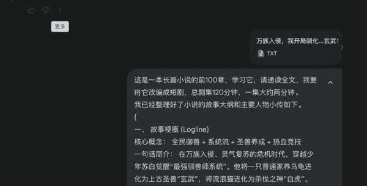

图 2-1　Gemini 生成剧本的具体对话

Gemini 产出片段如下，因篇幅仅展示部分。

第 1 集：最废职业与最强系统

1-1 高三（4）班教室[内] [日]

△窗外天空裂开巨大黑色缝隙，缝隙后隐约有猩红眼眸。 △ 讲台上，班主任重重敲击黑板，黑板写着“距离高考还有 30 天”。

班主任：（激动）同学们！万族入侵，武道当兴！今天是觉醒日，哪怕是生活类天赋也比普通人强！

△台下骚动。△苏白猛地从课桌惊醒，眼神迷茫。

苏白（V.O.）：我穿越了？万族入侵？全民皆武？

△ 讲台旁，“觉醒仪”发出耀眼蓝光。

班主任：（高喊）下一个，苏白！

△苏白上台，将手按在仪器上。 △ 仪器闪过微弱灰光。 △ 【字幕】觉醒职业：驯兽师（生活类/废柴）

路人甲：（嘲笑）切，驯兽师？不就是给富二代养宠物铲屎的吗？ 路人乙：（大笑）这年头靠宠物打仗？费钱又没用，废了！

△苏白尴尬收回手。 △ 突然，一道只有他可见的金光炸开。

【音效】系统提示音：叮！【字幕】最强驯兽系统绑定成功！【字幕】新手礼包已发放：神级洞察之眼。

苏白：（眼神一变，嘴角上扬）废柴？那是你们没开挂。

……

剧本改编阶段，提前设定清晰规则至关重要，这能大幅降低返工成本。

第一，要主动清理不需要的现实元素，如真实校名、地名、考试体系，以及明显指向未成年身份的设定。它们易带来合规风险，也会破坏虚构世界的自洽感，尤其在玄幻、仙侠、高武题材中，频繁的现实介入会削弱代入感。

第二，内容必须始终服从既定的角色与场景设定。模型改编不是换一种说法，而是要依据预设的性格、身份和题材风格，生成匹配的动作和对白。

例如冷静寡言的角色，台词不应出现冗长情绪宣泄；现代高武世界的角色，服饰、行为和场景也必须统一。只有把这些前提写进提示词，输出才不容易偏离。

当结构、世界观边界和文本格式都被提前明确，模型的优势才会体现。它能快速在固定框架内生成草稿，帮助创作者在短时间内完成多集初稿，后续只需局部微调节奏、强化冲突或优化对白。

长期看，这种方式可复制、可规模化。缺乏剧本经验的人也能在固定流程中稳定产出；成熟创作者则可把精力放在故事把控和创意决策上，而非重复劳动。归根结底，让模型重写剧本不是追求拟人化文笔，而是让它在明确边界内高效完成执行性工作。

2.4 用分镜把文字变成画面

剧本完成后，到最终画面还需一个关键中间层：分镜脚本。它相当于把文字剧本翻译成镜头语言，类似漫画分格或拍片前的镜头草图。重点不是文笔，而是观众最终会看到什么。

传统影视里分镜用于导演与摄影沟通，在 AI 漫改创作中它更直接：分镜里的画面描述就是给生成图像用的提示原稿，无需额外绞尽脑汁。

分镜脚本的作用有三方面。

· 可视化清单：镜头总数、内容顺序、人物与台词。
· 拍摄指南：景别、运动方式、光线和情绪基调。
· 节奏预演：通过控制镜头时长，提前把控快慢与情绪起伏。

剧本是文字蓝图，分镜是视觉蓝图。缺少它，画面易跳戏、细节缺失或情绪断裂。

一份可用分镜脚本包含如表 2-1 所示的关键项。

不必每项都填得面面俱到，但画面描述、景别、时长建议每次都认真填写，它们直接决定呈现质量和叙事节奏。

熟悉流程后，分镜更像视觉笔记，能把脑海画面整理清晰，避免制作中遗漏关键信息。初期略显繁琐，习惯后能省下大量修改和沟通成本。

2.4.1 先把分镜规范传给模型

逐集手动拆分镜既耗时又易失控。更高效的做法是借助模型，但前提是先把规则说清，否则输出会偏离预期。一份合格的分镜至少要满足：结构直观、服务后续流程、可执行。

以此为标准，可向模型提出如下要求。

一、角色定义
你是一位拥有二十年经验的影视导演及分镜设计师，擅长将文字剧本转为视频分镜，熟练运用蒙太奇和视听语言。任务是将用户提供的剧本转为专业的分镜脚本表格。

二、拆分核心原则
情绪转变需切镜：显著情绪变化应独立成镜，情绪积累建议用二到三镜逐步铺垫。
复杂动作需切镜：叙事性动作拆为动机/准备、执行、结果/反应，关键动作按准备→执行→结果拆分。
人物变化需切镜：人物数量增减、位置关系改变、主从或对话关系转换时启用新镜。
空间转场需切镜：场景切换必须设新编号，不同空间间设计一到两秒转场。
时间跳跃需切镜：非连续时间流逝或并行时间线需独立成镜呈现。
对话视线乒乓：台词交流遵循说话者→聆听者→说话者，发言更替或语气转折即触发切镜。
摄影机变化：景别、角度或运动方式的有意义改变即为新镜开始。
视觉特效独占镜头：爆炸、魔法、关键道具特写等需独立且时长充足的镜头强调。

……

给模型这些标准后，它会据此生成分镜脚本，如图 2-2 所示。

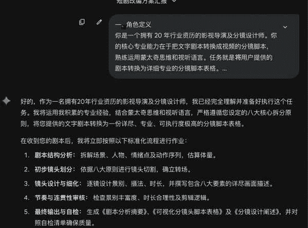

图 2-2　AI 生成分镜脚本的具体对话

2.4.2 分批生成分镜

可将已生成的剧本按集输入，让模型逐集输出对应分镜，如图 2-3 所示。

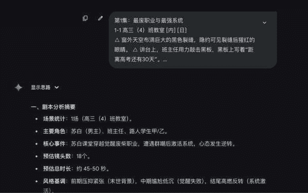

图 2-3　借助 AI 生成每一集的分镜脚本

整理后得到分镜表格，如表 2-2 所示。

使用模型拆分分镜时常遇到的问题及应对思路。

问题一：剧本里带“△”的段落怎么处理？
回答：这些是画面指令，不是台词，不需念出。如“△苏白推门进来”“△天空闪雷”，即镜头要呈现的内容。改写时应转为画面描述，如“近景，苏白脸上露出不屑冷笑，眼神瞥向一旁”。

问题二：剧本太长，模型读到后面就胡编怎么办？
回答：免费模型多有语境承载上限。不要一次性喂两百回小说。建议一次处理一到三集，超长则半集半集喂。可选用长语境模型，如 Gemini 表现稳定，Kimi 适合中文剧本，DeepSeek 的免费版本够用但需分段。输入时可加提示：“这是紧接着上一场，苏白刚打败对手，现在……”帮助衔接。

问题三：镜头节奏不对，太碎或太拖怎么办？
回答：根源是模型不理解情绪，它只识别变化。微表情也切镜会碎，缺乏动作的长对话可能一镜到底。可手动调整：该合则合，快速连续表情变化可合并为二到三秒镜头；该拆则拆，关键台词后切入聆听者反应镜头增强张力。同时预估总时长，按平均语速一分钟约一百五十字台词加描述，若本集约三百字，总时长应在两分钟左右，偏差大时需调整各镜时长。

表 2-1　分镜脚本的关键内容

**把可执行性放最前面，宁可细写也不留空档**

按照这个思路给模型下指令时可以这样组织。

一、角色定位

你是一位从业 20 年的影视导演兼镜头设计师。擅长把文字剧本转成可拍摄的视频镜头表，熟练运用蒙太奇与视听语言。你的工作是把用户提供的剧本改写成详实专业的镜头分解表。

二、镜头拆分的硬性准则，必须严格执行

情绪明显波动就换镜：人物出现显著情绪变化，比如从平静到震惊再到愤怒，每个节点都要单独成镜。情绪的积蓄过程建议用 2 到 3 个镜头逐步铺垫。

动作复杂就拆镜：所有带有叙事意义的动作都要拆成动机准备、执行过程、结果反应三个阶段，必要时再细分。关键动作遵循准备→执行→结果的顺序，复杂动作拆成 3 到 5 步，例如喝水可拆为伸手、取瓶、送口、饮水、放下瓶子。

人物关系变化就换镜：场景里人物数量增减、位置关系改变，或主导从属与对话倾听关系发生转换时，都要开启新镜头。

空间转换就换镜：剧本里明确或暗示的场景、地点切换，必须另起镜头编号。两个不同空间之间要加入 1 到 2 秒的专属转场，例如淡入淡出、划像或声音先导。

时间跳跃就换镜：任何非连续的时间流逝，如次日、多年后，或并行时间线，都要用独立镜头把时间转换视觉化。

对话保持视线来回：台词交流要按电影语法在说话者和听话者之间切换，说话者→听话者→说话者。发言者更换或长句中语气转折时，都应触发一次切换。

机位变化即新镜头：景别、拍摄角度或运动方式出现有意义改变，例如从全景切到特写、从平视变仰角、从固定变跟拍，即为新镜头起点。

特效或高潮独立成镜：以特效为核心的瞬间，如爆炸、魔法、关键道具特写，或承载强烈情绪冲击的画面，必须分配独立且时长充足的镜头加以强调。

……

把以上规范告知模型后，它会理解要求并按此输出镜头表，如图 2-2 所示。

图 2-2　模型输出分镜脚本的具体对话

### 2.4.2 按集喂入模型产出镜头

把已完成的剧本按集切分，一集一集输入给模型，分别产出对应镜头，如图 2-3 所示。

图 2-3　借助模型生成每一集的分镜脚本

随后把模型的结果整理进镜头表格中，如表 2-2 所示。

表 2-2　分镜脚本表格部分示例

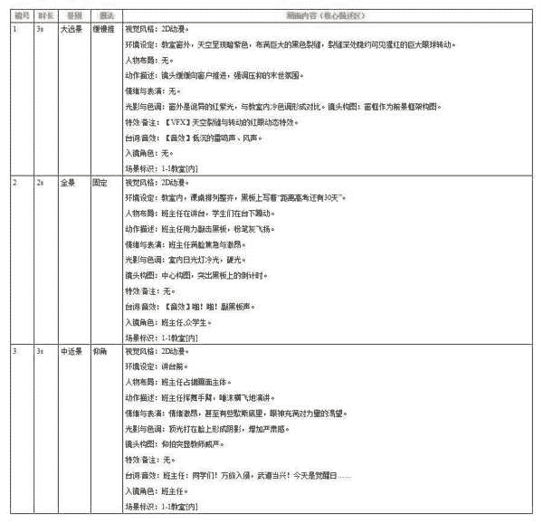

实际使用模型拆分镜头时，创作者常会遇到以下几个痛点，下面给出应对思路。

**问题一：剧本里带“△”的段落该怎么处理？**

**回答：** 这类写法是画面提示，不是台词，角色不需要念出来。比如△苏白推门进来、△天空闪过一道雷，都是在告知导演和画师此处该呈现什么画面，属于镜头内容而非对白。

改写镜头时，要把带△的描述直接转为画面说明。例如，△苏白冷笑一声应写成近景，苏白脸上浮现不屑的冷笑，目光瞥向一侧。

**问题二：剧本太长，模型读到后面就开始胡说怎么办？**

**回答：** 当前大模型尤其是免费版都有上下文长度限制，类似人的短期记忆。若直接把 200 章小说一次性丢给模型拆分，后半段必然偏差。

实测有效的做法是化整为零，一次只处理 1 到 3 集内容。单集过长可半集半集喂给模型。也可以选用记忆力更强的工具，比如：

**·** Gemini：长文本理解稳定，建议优先。
**·** Kimi：国产模型长上下文能力突出，适合中文剧本。
**·** DeepSeek：免费够用，剧本很长时建议切更小段落。

另外可在输入时补充上下文提示：这是紧接上一场，苏白刚刚击败对手，现在……帮助模型接上剧情线。

**问题三：拆出来的镜头节奏不对，太碎或太拖怎么办？**

**回答：** 根源是模型只识别变化，不懂情绪。它会严格按情绪变就切镜，有时因细微表情波动就切，导致过碎；反之大段对话若无动作，可能一镜到底，显得单调。

可手动微调。

**·** 该合就合：快速连续的表情变化，如震惊→苦笑→无奈，可合并成 2 到 3 秒的镜头，用细微变化呈现，而非拆成三段 1 秒镜头。
**·** 该拆就拆：关键台词时，即使说话者静止，也可在重点语句后切入听者的反应镜头，哪怕 1 秒，也能提升戏剧张力。
**·** 把控总时长：按平均语速，1 分钟内容约对应 150 字台词加描述。若本集剧本 300 字，总镜头时长应控制在 2 分钟左右。偏差过大时需调整各镜头秒数。

## 2.4 把剧本拆成镜头，让故事真正可视化

剧本完成后，到最终成片之间还有一个关键中间环节：镜头脚本。它负责把文字剧本转成镜头画面，可类比漫画的分格草稿或电影拍摄前的镜头示意图。镜头脚本不讲文采，只回答观众最终会看到什么。

在传统制作中，镜头脚本是导演与摄影师的沟通媒介。在 AI 漫改流程里，它的价值更直接：镜头里的画面描述，本质上就是给绘图的提示词底稿。创作者不必再凭空构思场景描述，可直接从镜头中提取内容作为绘画依据。

镜头脚本同时承担三项作用。

**·** 可视化清单：镜头总数、各镜头具体内容、画面人物与台词一目了然。
**·** 拍摄指南：明确景别、运动方式、光线氛围与情绪基调。
**·** 节奏预演：通过设定每镜时长，提前把控成片快慢与情绪起伏。

剧本是文字蓝图，镜头则是视觉蓝图。缺了这一步，生成的画面容易跳戏、细节缺失或情绪断裂。

一份可用镜头脚本，核心要素如表 2-1 所示。

表 2-1　分镜脚本的关键内容

创作者不必每次把表格填得面面俱到，但画面描述、景别、时长三项建议每次都认真填写，它们直接决定画面质量与叙事节奏。

熟练后会发现，镜头更像一份视觉笔记，帮助把脑中画面整理清晰，避免制作中遗漏关键信息。起初略显繁琐，习惯后能节省大量反复修改与沟通的时间。

### 2.4.1 先把镜头规则教给模型

手工逐集拆分既费时又易失控，格式和节奏也难统一。

更高效的做法是用模型完成拆解，但前提是先把规则讲清楚，否则模型会按自身理解生成，结果偏离预期。一份合格的镜头，至少要同时满足以下条件。

**·** 结构清晰直观。仅看表格就能知道本集镜头数、各镜内容与顺序。
**·** 直接服务后续流程。画面描述可直接用于出图，对白可直接配音，人物与场景信息明确，无需回查剧本。
**·** 注重可执行性。宁可描述详尽，也要避免模糊表述。

基于以上标准，可向模型提出如下要求。

一、角色定义

你是一个拥有 20 年行业经验的影视导演及镜头设计师。核心专长是把文字剧本转化为视频镜头脚本，熟练运用蒙太奇思维和视听语言。任务就是将用户提供的剧本转换为详细专业的镜头脚本表格。

二、镜头拆分核心原则，必须遵守

情绪转变需切镜：角色的每一次显著情绪转变，如平静→震惊→愤怒，都应获得独立的镜头进行刻画。情绪的积累过程建议使用 2～3 个镜头来逐步铺垫。

复杂动作需切镜：所有叙事性强的动作应拆解为动机/准备、执行过程、结果/反应三个部分，并可能进一步细化为更多镜头。关键动作按准备→执行→结果拆分，复杂动作细分为 3～5 个步骤，如喝水拆成：伸手→拿水→喝水→放下水瓶。

人物变化需切镜：当场景内人物数量发生增减，或人物位置关系改变，或人物之间的主导-从属、对话-聆听关系发生转换时，应启用新的镜头。

空间转场需切镜：剧本中明确或暗示的场景、地点切换，必须设立新的镜头编号。两个不同空间之间应设计 1～2s 的专用转场镜头，如淡变、划像、声音先导等。

时间跳跃需切镜：任何非连续的时间流逝，如次日、多年后，或并行时间线，都必须通过独立的镜头来视觉化呈现时间转换。

对话的视线乒乓逻辑：台词交流应遵循电影语法，在说话者与聆听者之间进行镜头切换，说话者→聆听者→说话者，并且每次发言者的更替或长台词中的语气转折，都应触发一次镜头切换。

摄影机的变化：当摄影机的景别如从全景变为特写、拍摄角度如从平视变为仰角或运动方式如从固定镜头变为跟拍发生有意义的改变时，即标志着一个新镜头的开始。

视觉特效独占镜头：任何以视觉效果为核心如爆炸、魔法、关键道具特写或承担强烈情绪冲击的瞬间，必须分配独立且时长充分的镜头予以强调。

……

把以上标准发给模型后，它会接收并理解要求，并按照要求开始输出镜头脚本，如图 2-2 所示。

图 2-2　模型生成分镜脚本的具体对话

### 2.4.2 分集调用模型输出镜头

接下来就可以把已经生成好的剧本按集拆分，一集一集地输入给模型，再分别生成对应的镜头脚本，如图 2-3 所示。

图 2-3　借助模型生成每一集的分镜脚本

然后将模型生成的内容整理到镜头脚本表格中，如表 2-2 所示。

表 2-2　分镜脚本表格部分示例

在实际使用模型拆解镜头脚本的时候，创作者经常会碰到下面这几个令人头疼的问题。无须担心，下面提供相应的应对思路。

**问题一：剧本里那些带有“△”的段落，到底该怎么处理？**

**回答：** 这些是给画面的指令，并非台词，不用让角色念出来。例如，△苏白推门进来、△天空闪过一道雷这种描述，都是在告诉导演和画师这里该出现什么画面。它们不是角色的台词，而是镜头本身要拍出来的内容。

在改写镜头脚本时，要把这些带有“△”的段落直接转换成画面描述。例如，△苏白冷笑一声在镜头里就应该写成近景，苏白脸上露出不屑的冷笑，眼神瞥向一旁。

**问题二：剧本太长，模型读到一半就开始“胡言乱语”了怎么办？**

**回答：** 现在的模型，尤其是免费版都有上下文长度限制，就像人的短时记忆有限。如果创作者直接将一本 200 章的小说给模型让它拆解镜头脚本，后半段肯定会出现内容偏差。

目前测试下来比较有效的做法是化整为零，即一次只处理 1～3 集剧本内容。如果一集剧本也很长，那就半集半集地提供给模型。或者用记忆力更强的模型工具也能达到比较好的效果，如以下几个。

**·** Gemini：对长文本的理解目前表现稳定，建议优先使用。
**·** Kimi：国产模型里长上下文能力突出，适合中文剧本。
**·** DeepSeek：免费且够用，但如果剧本很长，建议分为更小的段落。

此外，还可以在输入时将上文提醒给模型：这是紧接着上一场戏的内容，苏白刚刚打败了对手，现在……帮它接上剧情线。

**问题三：分出来的镜头感觉节奏不对，太零碎或太拖沓怎么办？**

**回答：** 问题根源在于模型不理解情绪，它只识别了变化。模型会严格遵循情绪变就切镜的原则，但有时因为角色有一个细微的表情波动它也会切镜头，导致剪辑太零碎。反之，大段对话如果没明显动作，它可能一个镜头拉到底，显得镜头很单调。

可以手动进行如下调整。

**·** 该合则合：如果是快速的连续表情变化，如从震惊到苦笑到无奈，可以合并成一个 2～3s 的镜头，通过细微表情变化来呈现，而不是拆分成三个 1s 左右的镜头。
**·** 该拆则拆：遇到关键台词时，即使说话者动作静止，也可以在其说完重点语句后，切入一个聆听者的反应镜头，哪怕只有 1s，这样能大大增强对话的戏剧张力。
**·** 控制总时长：提前预估总时长。按平均语速，1min 内容大约对应 150 字的台词和描述。如果本集剧本有 300 字，那么总镜头时长加起来应该在 2min 左右。如果偏差太大，需及时调整每个镜头的秒数分配。

## 小结

本章聚焦于解决 AI 漫剧创作中最关键也最容易出现偏差的源头问题：如何系统地将一部小说，改编成一系列可执行、可落地的视觉脚本。

首先，必须明确起点——选对适合改编的小说。一部适合 AI 漫剧改编的作品，不在于其文笔是否优美，而在于其题材如玄幻、仙侠能否放大 AI 的视觉表现优势，其结构是否具备清晰的主线、密集的情节爆点和稳定的章节推进节奏。这是所有后续工作的基石。

随后，我们进入实质性的改编流程，将其拆解为三个环环相扣的步骤。

1. 定大纲：为故事建立导航地图。面对体量庞大的小说文本，我们借助 AI 工具，系统地梳理出故事梗概、人物设定、分阶段故事情节线以及具体的短剧改编方案。此步骤旨在为整个项目确立不可偏离的总框架，确保后续所有创作都围绕统一的核心看点、人物设定和剧情节奏展开，避免在过程中失去方向。
2. 拆剧本：将叙事语言转换为拍摄指令。这是从可读到可拍的关键一步。我们制定了严格的剧本格式规范，要求每一个场景、动作、对白都必须可视化，并利用 AI 在既定框架内高效生成剧本初稿。这不仅大幅提升了效率，更通过统一的文本结构，为后续的团队协作和批量生产奠定了可复制、可规模化的工作基础。
3. 分镜脚本：架起剧本与画面的桥梁。剧本决定拍什么，分镜则决定怎么拍。我们引入了专业的分镜设计思维，通过详细的提示词引导 AI 将每集剧本拆解为包含景别、摄法、画面描述、时长等要素的镜头序列。这份脚本既是后续 AI 生成图像的直接提示依据，也是对全片视觉节奏和情绪脉络的首次系统性预演与把控。

本章通过为 AI 设定清晰的角色定位、明确的操作规则和固定的输出格式，将其从一个需要凭感觉摸索的创作环节，转变为一个高效、稳定的执行助手。相应地创作者的核心职责，也从烦琐的重复劳动中解放出来，聚焦于更高层的故事判断、节奏掌控和创意决策。

# 第三章

角色设定、场景设计与道具设计

在第二章中，我们完成了从市场定位到剧本框架的系统梳理。剧本构建了故事的骨架，而本章将为其填充血肉。在正式调用 AI 绘图工具生成画面之前，有一个至关重要的步骤往往被初学者忽略，那就是对角色的深度理解。

如果说剧本决定了讲什么故事，那么角色设计、场景设计与道具设计就共同决定了这个故事由谁在怎样的世界中展开。

## 3.1 角色设定的基本逻辑

在传统影视与动画行业，角色造型设计与美术设定是一个独立的专业环节，往往在拍摄或制作之前就要完成大量前期工作，包括人物背景设定、造型草图、三视图、表情参考、场景概念图、氛围设定等。AI 技术并没有省略这些必要步骤，而是将创作工具从铅笔与数位板，换成了大模型与 AI 绘图工具。

### 3.1.1 了解人物

很多创作者习惯于直接从视觉元素入手，在提示词中堆砌发色、瞳色、服饰风格等外观描述。这种做法常会导致一个常见问题：生成的角色虽然画面精美，却缺乏神韵，且在不同镜头中形象难以保持一致。因为 AI 只是根据关键词进行随机组合，并不理解这个角色是谁。

传统影视与动画行业的经验表明，角色设计的核心逻辑必须遵循先立人物，再定长相的原则。我们需要先明确角色的身份、性格与动机，再据此推导其相应的外貌特征。这一逻辑在 AI 漫剧制作中同样适用，甚至更为重要，因为大语言模型与图像生成模型需要精准的逻辑引导才能产出稳定的内容。

因此，在进入视觉设定前，需要建立一份结构化的角色档案。这份档案不同于文学作品中的长篇传记，而更像是一份供 AI 系统读取的角色数据表。一个完善的 AI 漫剧角色档案应包含以下 5 个核心模块。

#### 1．身份与功能定位

身份决定了角色的基础视觉风格与行为逻辑。我们需要界定角色在世界观中的职业、阶层或阵营，例如贫民、贵族、门派弟子或星际佣兵。不同的身份影响角色的着装材质、日常仪态以及所处的环境背景。同时，还要明确角色在故事中的功能定位，例如，是推动剧情的主角、制造冲突的反派，还是提供关键信息的配角。功能定位决定了我们在该角色身上投入的制作精力与画面表现的精细程度。

#### 2．性格与关键反差点

性格是角色的灵魂，但对于 AI 漫剧而言，复杂的性格描述不如鲜明的标签有效。我们需要提炼出 3～5 个核心性格标签，如冲动、谨慎、自卑或好战。在此基础上，为角色设计至少一个鲜明的反差点至关重要。反差是构建角色记忆点的捷径，也是视觉设计的灵感来源。例如，一个外表粗犷的铁血战士如果随身携带一个破旧的毛绒玩具，这种外表强悍但内心柔软的反差，能瞬间让角色立体起来，并为画面提供极具辨识度的视觉符号。

#### 3．核心欲望与困境

AI漫剧人设：从内核到画面

角色张力来自欲望与掣肘的拉扯。先厘清他最执念的目标，是渴求认可、求生、复仇还是守护。驱动力越强，冲突瞬间表情越饱满。随后描绘当下的限制，例如天赋平庸、缠身诅咒、长期被误读。局限会在外形上留下痕迹，比如衣角因清贫而洗旧，或多年征战留下的疤。

#### 4．关系网络
人设不是孤点，轮廓由人际勾勒。要梳理该角色和主角、对手或特定组织的关联，这类关联自带张力，像青梅竹马却立场相反，或表面师徒实则互用。脉络清晰后，多人同框的站位、目光和距离会更可控。

#### 5．视觉暗示
文字落地成图靠可行为化的视觉线索。此处别只堆五官，要抓生活习惯与状态关键词。比如习惯把衣领扣到顶，暗示严谨或压抑；长期压低帽檐遮眼，指向神秘或回避；口袋常年塞满工具，则指向技术或工匠身份。这些细节既丰富人物，也能直接变成绘图提示的高质量素材。

总的来看，深度吃透人物是设计的根基。身份、性格、欲望、人际与视觉暗示形成闭环后，才能给模型喂出可用提示。这不仅关乎吸睛，更决定长篇连载里人物能否经得起反复推敲，保持逻辑与画面的统一。完成这步，才算拿到进入视觉化阶段的入场券。

### 3.1.2　男频与女频

3.1.1 已完成基于剧本逻辑的人物推演，但在实操中还要服从更宏观的市场逻辑。如今漫剧多改编自网文，而网文市场被明确切分为男频与女频两条赛道。两类读者对“好看”的定义分歧明显，甚至审美互斥。忽略差异很容易出现画面精致却无人买单的尴尬，比如热血战斗题材用过度柔美的线条会削弱冲击力，而恋爱题材用过度硬朗的光影会破坏氛围。因此写视觉提示前，必须先厘清两类内容的转化规则。

#### 1．男频内容的视觉核心：力量与征服
男频故事的底层动力是权力获取与阶层跃迁。受众追求极致代入，希望主角完成常人难及的壮举，如以一敌百、逆袭翻盘。所以男频人设视觉要紧扣力量感、爽感、压制感、反杀感等体验。

视觉语言上，男频强调轮廓硬朗、线条简练。面部多有清晰棱角，显出坚毅果断的气质。肢体张力大，常态偏前倾或上扬，呈现随时冲锋的攻击性。服装重实用，类似战斗装备，追求简洁耐磨便于活动的设计。

#### 2．女频内容的视觉核心：情感与氛围
女频聚焦情感体验与关系探索。读者倾向在复杂人际中找共情，渴望看到主角在情感到底自我价值，获得偏爱与守护。因此女频视觉重点在情绪表达、氛围营造、亲密关系呈现及内心成长的视觉化。

呈现上，女频极重面部微表情。眼、睫、嘴角的细微变化是传递内心的重要窗口。画面光影偏柔，追求朦胧空气感与唯美氛围。服饰与配饰设计精细考究，在女频逻辑里，配饰不只是装饰，更暗示身份、地位与当下情绪。镜头节奏相对缓慢，给观众更多时间品味当下心境。

#### 3．核心差异对比
为了更直观理解差异，可从四个维度对比，如表 3-1 所示。

表 3-1　男频和女频的内容差异对比

#### 4．提示词策略与实战演示
底层逻辑的差异直接决定绘图提示的写法。不能泛泛写“18 岁帅哥”或“温柔女性”，必须把风格限定词准确传达给模型。

针对 **男频角色** ，提示词应强调硬朗线条、高对比光影以及工业感或战斗气息元素。以下是一个典型男频角色设计提示词范例。

顶级渲染，细节丰富，官方设定集，角色三视图 正侧背，左侧附面部特写，纯白底。风格：2D 日式赛博废土，线条硬朗，对比强烈，硬阴影。角色：男性 28 岁 地下机械师，高大精瘦 肌肉线条，站姿慵懒微驼。一头杂乱黑中长发，胡茬，死鱼眼 黑眼圈，颈挂战术护目镜，颓废帅。服装：敞开深绿工装连体，布料有油渍磨损 做旧，内搭黑紧身战术背心 露腹肌。右臂为复杂黑机械义肢 金属电线细节，腰带挂扳手，脚穿重工靴。神态：玩世不恭，眼神冷漠傲慢，下视。

生成结果如图 3-1 所示。

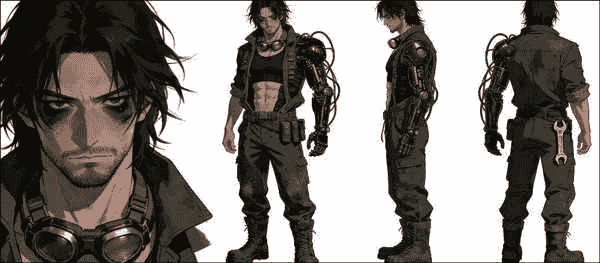

图 3-1　男频角色设计图（示例） 

针对 **女频角色** ，提示词转向柔光摄影风格，强调空气感、五官细腻及故事感破碎美。以下是一个典型女频角色设计提示词范例。

顶级渲染，五官精致，官方设定集，角色三视图 正侧背，附面部超大特写 流泪眼，纯白底。风格：2D 古风仙侠，柔光摄影，空气感，线条细腻，光影朦胧，氛围感，忧郁。角色：女性 18 岁 落难魔教圣女，身形单薄纤细，肤色苍白透明，柔弱。姬发式黑长直，桃花眼，眼眶微红 含泪倔强不落，唇苍白。服装：简白素衣 布料陈旧，颈戴紧贴肌肤黑金属项圈 禁锢感，手腕缠染血白绷带，赤足。神态：微抱自，风吹乱发，眼神清冷倔强，破碎感与危险迷人气质。

生成结果如图 3-2 所示。

图 3-2　女频角色设计图（示例） EXr6287u6NNVz+GYLY+7SDk226FstKIHdC0bNoQkB2Nqi1xSR0yxPmwrTs5gRi/BtfSbid6dBhii9q7cz2pIyA==

## 3.1 角色设定的基本逻辑
传统影视动画里，人设造型与美术设定是独立专业环节，通常在制作前完成大量前期，包括人物背景、造型草图、三视图、表情参考、场景概念与氛围设定。AI 并未省去这些必要步骤，只是把工具从铅笔数位板换成了大模型与绘图工具。

### 3.1.1　了解人物
很多创作者习惯直接从视觉入手，在提示里堆砌发色瞳色服饰风格。这种做法常导致画面精美却神韵不足，且镜头间形象难稳定。因为模型只是关键词随机组合，并不理解角色是谁。

传统经验表明，人设设计核心遵循先立内核再定外形。要先明确身份性格与动机，再据此推导外貌特征。这个逻辑在漫剧制作中更重要，因为大语言模型与图像模型需要精准逻辑引导才能产出稳定内容。

因此进入视觉设定前，要建一份结构化角色档案。这份档案不是文学传记，而是一份供模型系统读取的角色数据表。一个完善的漫剧角色档案应包含以下 5 个核心模块。

#### 1．身份与功能定位
身份决定基础视觉风格与行为逻辑。要界定角色在世界观中的职业阶层或阵营，如贫民、贵族、门派弟子或星际佣兵。不同身份影响着装材质、日常仪态及所处环境背景。同时要明确故事中的功能定位，比如推动剧情的主角、制造冲突的反派，或提供关键信息的配角。功能定位决定投入的制作精力与画面表现的细致程度。

#### 2．性格与关键反差点
性格是灵魂，但对漫剧而言，复杂描述不如鲜明标签有效。要提炼 3～5 个核心性格标签，如冲动、谨慎、自卑或好战。在此基础上设计至少一个鲜明反差点至关重要。反差是记忆点的捷径，也是视觉设计的灵感来源。例如外表粗犷的铁血战士随身携带破旧毛绒玩具，这种外表强悍内心柔软的反差，能瞬间让角色立体，并提供极具辨识度的视觉符号。

#### 3．核心欲望与困境
欲望与掣肘共同塑造动态与表情张力。要弄清角色最在意什么，是渴望被认可、活下去、复仇还是守护。强烈的追求推动行动，也决定冲突时的神情。同时要描摹眼下困境，如天赋平平、身带诅咒或被误解。困境常在外表留下可见痕迹，比如清贫导致衣角磨损，或征战留下疤痕。

#### 4．关系网络
人物不会单独出现，形象由互动塑造。要厘清该角色与主角、反派或组织的要紧联系，这类联系自带剧情张力，如青梅竹马立场相左，或名义师徒实则利用。关系理清后，多人同框的站位、视线与肢体距离更易把控。

#### 5．视觉暗示
文本到图像的桥梁是可行为化的视觉线索。此阶段别拘泥五官，而要围绕行为习惯与生活状态提炼关键词。比如“习惯把衣领扣到顶”暗示严谨或压抑，“常压低帽檐遮眼”暗示神秘或回避，“口袋永远塞满工具”则直指技术工匠身份。这些具体暗示既丰富细节，也是转成绘图提示的高质量素材。

综上所述，吃透人物是人设根基。身份、性格、欲望、人际与视觉暗示闭环后，才能给生成模型提供精准提示。这不仅关乎吸睛，更决定长篇里角色能否经得起反复审视，保持行为逻辑与视觉呈现的统一。完成此步，才具备进入具体视觉化设计的资格。

### 3.1.2　男频与女频
3.1.1 已做剧本层面的人物推导，但生产端还需服从更宏观的市场划分。现在漫剧多来自网文改编，网文市场被划为男频与女频两条线。两类读者对“好看”的判准差异大，甚至审美相斥。忽视此点易出现画面好看但读者无感的困境，例如热血战斗用过柔线条会弱力量，恋爱题材用过硬光影会毁氛围。故写视觉提示前需先厘清两类转译规则。

#### 1．男频内容的视觉核心：力量与征服
男频底层是权力获取与阶层跨越。受众要极致代入，希望主角完成常人难及的壮举，如以一敌百、逆袭翻盘。所以视觉要围绕力量感、爽感、等级压制、反杀翻盘展开。

视觉上强调轮廓分明、线条干练。面部多见清晰棱角，显坚毅果敢。肢体张力足，常呈前倾或上扬，具攻击性。服装重实用，近似战斗装备，追求简洁耐磨便于活动。

#### 2．女频内容的视觉核心：情感与氛围
女频侧重情感体验与关系探索。读者喜在复杂人际中共情，渴望主角在情感纠葛中确认价值，获得偏爱守护。视觉重点在情绪表达、氛围营造、亲密关系呈现与内心成长可视化。

呈现上极重微表情。眼睫嘴角细微变化是传递内心的窗口。光影偏柔，追求朦胧空气感与唯美氛围。服饰配饰考究，配饰不仅是装饰，更暗示身份地位与当下情绪。镜头节奏较慢，给观众时间体味心境。

#### 3．核心差异对比
为直观看差异，可从四维度对照，如表 3-1。

表 3-1　男频和女频的内容差异对比

#### 4．提示词策略与实战演示
底层差异决定提示写法。不可泛写“18 岁帅哥”或“温柔女性”，需把风格限定词传达给模型。

针对 **男频角色** ，提示应突出硬朗线条、高对比光影及工业或战斗气息。以下是一个典型男频角色设计提示词范例。

大师级画质，极其详细的细节，官方美术设定集，角色三视图（正面，侧面，背面），左侧带一张面部特写，纯白背景。风格：2D，日式赛博朋克废土风格，线条硬朗，对比度高，硬阴影。角色外观：男性，28 岁，地下机械师，高大精瘦，有肌肉线条，站姿慵懒微驼背。一头乱糟糟的黑色中长发，脸上留着胡茬，死鱼眼，黑眼圈，脖子上挂着战术护目镜，颓废帅气。服装细节：穿着敞开的深绿色工装连体裤，布料有油污和磨损的做旧质感，里面是黑色紧身战术背心，露出腹肌。右臂是复杂的黑色机械义肢（金属与电线细节），腰间工具带挂着扳手，脚穿重型工业靴。神态：表情玩世不恭，眼神冷漠傲慢，向下俯视。

图 3-1　男频角色设计图（示例） 

针对 **女频角色** ，提示需转向柔光摄影，强调空气感、五官细腻与故事感破碎美。以下是一个典型女频角色设计提示词范例。

大师级画质，精致的五官描写，官方美术设定集，角色三视图（正面，侧面，背面），带一张面部超大特写（展示流泪的眼睛），纯白背景。风格：2D，古风仙侠，柔光摄影，空气感，线条细腻，光影朦胧，氛围感，忧郁。角色外观：女性，18 岁，落难的魔教圣女，身材单薄纤细，皮肤苍白透明，柔弱感。姬发式发型，黑长直，桃花眼，眼眶微红，含着泪水但倔强不肯流下，嘴唇苍白。服装细节：穿着简单的白色素衣，布料略显陈旧，脖子上戴着一个紧贴皮肤的黑色金属项圈（禁锢感），手腕上缠着染血的白色绷带，赤脚。神态：微微抱住自己，风吹乱发丝，眼神清冷倔强，充满破碎感和危险迷人的气质。

图 3-2　女频角色设计图（示例） EXr6287u6NNVz+GYLY+7SDk226FstKIHdC0bNoQkB2Nqi1xSR0yxPmwrTs5gRi/BtfSbid6dBhii9q7cz2pIyA==

只有将角色解剖到骨骼层面，才能算真正拿到创作的入场资格。身份设定、性格底色、欲望驱动、人际关系网以及视觉暗示，必须首尾相连形成闭环，这样喂给模型才准、落地才稳。这不仅关乎首屏吸睛，更决定角色在长篇连载里能否经受住反复推敲，行动自洽与画面统一。完成这一关，才有资格进入具象视觉开发。

### 3.1.2 男频与女频：两条审美赛道
3.1.1 已说明基于剧本逻辑的人物推演，但在 AI 漫画短剧的工业化生产中，还必须服从一条更宏观的市场法则。如今绝大多数项目都来自网文改编，而网文市场被清晰地划成男频与女频两条赛道。两类受众对“好看”的判定标准差异显著，审美甚至相互排斥。

忽视这种分野，很容易出现画面精致却无人共鸣的尴尬。热血打斗如果用了过度柔美的线条，力量感会被稀释；恋爱情感若用了过于硬朗的光影，氛围立刻崩解。所以在落笔写视觉指令前，先厘清两大品类的转换规则是必要前提。

#### 1．男频内容的视觉核心：力量与征服
男频故事的底层动力是权力获取与阶层跃迁。观众追求强代入，希望主角完成常人难以企及的壮举，如以一敌百、逆袭翻盘。因此视觉设计必须围绕力量感、爽感、等级碾压、绝地反杀等核心体验展开。

视觉语言上，男频偏好轮廓分明、线条利落。面部常带清晰棱角，彰显坚毅果敢的气质。肢体张力极大，常态偏向前倾或上挑，呈现随时出击的攻击性。服装更强调实用，近似战斗装备，追求简洁耐磨便于动作。

#### 2．女频内容的视觉核心：情感与氛围
女频故事侧重情感体验与关系探索。读者更倾向在复杂关系里寻找共情，渴望主角在纠葛中确认自我价值，获得偏爱与守护。因此视觉重点落在情绪表达、氛围营造、亲密关系的呈现、内心成长的外化。

呈现上，极度强调面部微表情的刻画。眼神、睫毛、嘴角的细微变化是情绪窗口。光影偏柔，追求朦胧空气感与唯美调性。服装配饰考究繁复，饰品不仅是装饰，更暗示身份地位与当下情绪。镜头节奏偏慢，给观众留出体味心境的空间。

#### 3．核心差异对比
为更直观把握差别，可从四个维度对照，如表 3-1 所示。

表 3-1　男频和女频的内容差异对比

#### 4．提示词策略与实战演示
底层逻辑不同，写绘图提示词的策略也不同。不能泛泛写“18 岁帅哥”或“温柔女生”，必须把风格限定词准确传达给模型。

针对 **男频角色** ，提示中要突出硬朗线条、高对比光影、工业或战斗气息元素。以下是一则典型男频角色设计提示词范例。

大师级画质，极其详细的细节，官方美术设定集，角色三视图（正面，侧面，背面），左侧带一张面部特写，纯白背景。风格：2D，日式赛博朋克废土风格，线条硬朗，对比度高，硬阴影。角色外观：男性，28 岁，地下机械师，高大精瘦，有肌肉线条，站姿慵懒微驼背。一头乱糟糟的黑色中长发，脸上留着胡茬，死鱼眼，黑眼圈，脖子上挂着战术护目镜，颓废帅气。服装细节：穿着敞开的深绿色工装连体裤，布料有油污和磨损的做旧质感，里面是黑色紧身战术背心，露出腹肌。右臂是复杂的黑色机械义肢（金属与电线细节），腰间工具带挂着扳手，脚穿重型工业靴。神态：表情玩世不恭，眼神冷漠傲慢，向下俯视。

生成结果如图 3-1 所示。

图 3-1　男频角色设计图（示例） 

针对 **女频角色** ，提示应转向柔光摄影风格，强调空气感、细腻五官、带故事感的破碎美。以下是一则典型女频角色设计提示词范例。

大师级画质，精致的五官描写，官方美术设定集，角色三视图（正面，侧面，背面），带一张面部超大特写（展示流泪的眼睛），纯白背景。风格：2D，古风仙侠，柔光摄影，空气感，线条细腻，光影朦胧，氛围感，忧郁。角色外观：女性，18 岁，落难的魔教圣女，身材单薄纤细，皮肤苍白透明，柔弱感。姬发式发型，黑长直，桃花眼，眼眶微红，含着泪水但倔强不肯流下，嘴唇苍白。服装细节：穿着简单的白色素衣，布料略显陈旧，脖子上戴着一个紧贴皮肤的黑色金属项圈（禁锢感），手腕上缠着染血的白色绷带，赤脚。神态：微微抱住自己，风吹乱发丝，眼神清冷倔强，充满破碎感和危险迷人的气质。

生成结果如图 3-2 所示。

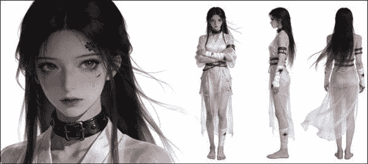

图 3-2　女频角色设计图（示例） EXr6287u6NNVz+GYLY+7SDk226FstKIHdC0bNoQkB2Nqi1xSR0yxPmwrTs5gRi/BtfSbid6dBhii9q7cz2pIyA==

## 3.2 AI 角色设定工作流
厘清底层逻辑与市场定位后，下一步是执行。理论上的“理解人物”必须变成可落地的工业化流程。

AI 漫画短剧制作的难点往往不是创意不足，而是生成结果随机、不可控。没有规范工序，很容易陷入反复抽卡、无效修改，效率低下。建立标准化工作流，是业余与专业团队的分界线。

我们推荐一套经实战检验的 5 步线性工作流，示意如图 3-3 所示。流程旨在最大程度降低大模型的理解偏差，让文本到图像的转化更顺滑、可控。

图 3-3　5 步线性工作流示意图

5 个步骤环环相扣，不可跳跃。直接从小说跳到绘图提示词，会丢失大量隐含细节；跳过人物档案直接提炼关键词，角色会沦为空洞视觉符号。只有按此路径，才能把文学描述逐步翻译为精准可控的机器视觉语言。

图 3-3　5 步线性工作流示意图

### 3.2.1　提取人物信息
起点是原始文本。面对长篇网文或数十万字的 IP，原创人工梳理既耗时又易疲劳漏检。

这正是大语言模型的强项。它能在数秒内处理数万字并按格式输出结构化数据。此阶段目标明确： **搭建一份完整清晰的角色清单。**

先明确故事里有多少角色，才能做资源分配。谁需要训练专属模型的主角，谁只需固定提示词的配角，谁可随机生成的背景龙套，都依赖这份初筛清单。

实操常用“角色扮演+任务拆解”策略。把 AI 定位为“专业影视策划”，它会从改编视角审视文本，自动过滤纯文学描写，只保留对画面制作有效的信息。

以下是一套可直接使用的标准化提示词框架。

请你作为专业影视策划，根据下面这部分小说内容，帮我整理出出现的主要人物设定。要求如下。

1．只保留对后续改编为短剧/漫剧有用的信息。

2．每个角色输出：姓名/称呼、性别、年龄段、社会身份（职业/门派/家族/阶层）、3～5 个性格标签、与主角的关系。

3．尽量提取角色的“反差点”与“记忆点”。

小说内容如下：

【粘贴小说前若干章或精简梗概】

使用时需注意三点。
首先是文本输入量。主流模型虽支持长文本，但为保精度，建议按章节或情节单元分批输入。篇幅很长时，可先投喂大纲或核心梗概。
其次要关注“反差点”与“记忆点”的提取。反差是魅力来源，模型容易忽略细节，提示中明确要求能迫使它关注具有视觉转译价值的特征。例如“身为刺客却偏爱白衣”“身为富豪却开旧车”，到画面阶段极关键。
最后，这一轮产出是初级清单，不是定稿。创作者需快速人工筛选，把角色划分为“核心角色”“重要配角”“功能性龙套”三级。只有核心和重要配角才进入下一步的人物档案生成与精细化设计；功能性龙套用清单简述即可直接出图。

此步把繁杂文学文本降维成一张可决策表格，为后续精细作业扫清障碍。

### 3.2.2　生成人物档案
拿到基础清单后，需对核心角色和重要配角做第二轮加工，即撰写人物档案。这里的档案与传统创作不同。传统侧重前史、心理动机和性格成因，而 AI 漫画短剧的档案要严格遵循“为画面服务”的原则。

绘图工具难以理解复杂心理，只能识别视觉符号。所以核心逻辑是把“心理描写”转为“视觉描写”。不要写“他很自卑”，而要写“他习惯低头看地面，说话声音很小，不敢与人对视”。只有把抽象标签转化为具体行为与外貌细节，AI 才能生成想要的形象。

基于此，写提示词时必须给模型明确约束。以下是用于生成“视觉化人物档案”的提示词模板。

请基于下面这份人物摘要，为我写一段 150～200 字的人物档案。要求如下。

1．多写“别人能看到的东西”，少写纯心理描写。

2．描述他的日常行为习惯、说话方式、穿着风格，最好能让人一眼想象出画面。

3．突出一个反差点（例如外表冷淡但很重感情）。

人物摘要如下：

【粘贴上一步整理出的角色信息】

用此模板可得到充满画面感的文字。这些文字不再是空泛形容词，而是一串具体视觉信号。比如“总是穿着有点旧却熨得很平的校服”，同时传递经济状况和性格特征；“笑时习惯用手挡嘴”，直接给出肢体动作参考。这些具体描述在后续分镜生成时都是高价值提示词素材。

### 3.2.3　提炼视觉关键词
人物档案已有画面感，但仍是自然语言，不适合直接当绘图提示词。我们需要把这段原材料精细加工，拆解成独立的“视觉关键词”。

这一步直接决定出图准确度与质量。很多创作者觉得人物形象飘忽，就是缺少这一步标准化拆解。要从档案中把可被视觉捕捉的要素提取出来，按维度分类整理。

重点提炼以下 5 个维度信息。

#### 1．外在条件
这是人物的物理骨架。身高要有视觉参照，如“接近 180cm 的高挑”或“比同龄人矮半头”。体型描述具体，是“偏瘦”“结实”“宽肩”还是“细腰”。年龄感也很关键，如“少年感很重”或“看起来比实际成熟”，这决定面部肤质和身体姿态。

#### 2．头部与五官
这是观众注意力的焦点，具体包括：

**·** 发型与发色：如“中长直发”“高马尾”“两侧剃短”或“刘海遮住一只眼”。

**·** 脸型：如“鹅蛋脸”“方脸”“轮廓硬朗”或“下巴略尖”。

**·** 眼睛：大小、神态、单双眼皮、是否常带笑意。

**·** 其他特征：痣、疤痕、耳洞、纹身等细节常是区分角色的关键标志。

#### 3．服装与配饰
这是确立风格与时代背景的重要元素。

**·** 基础着装：上装、下装、外套、鞋子的款式，如“风衣”“制服”“机能服”“汉服”“运动鞋”或“军靴”。

**·** 标志性配件：增加辨识度的关键，如“项链”“耳环”“腕带”“戒指”“徽章”“发卡”或“围巾”。

#### 4．色彩语言
色彩直接传递情绪与性格。设定一到两个主色调，如“黑金”“白蓝”“墨绿”或“暗红”，作为角色画面的基础色盘。再设定一到两个辅助色用于配饰或局部点缀，丰富层次。

#### 5．表情与常态姿态
表情和常态姿态决定角色神韵。

**·** 常见表情：如“嘴角微翘”“眉头微皱”“眼神游离”或“不爱直视别人”。

**·** 常态姿态：如“双手插兜”“抱臂”“站姿笔直”或“总是微微前倾”。

提炼工作可借助 AI，但强烈建议创作者亲手核对调整。这是一个吃透角色的过程，也是从文字到画面认知的关键转译。只有自己清楚角色长什么样，才能指挥 AI 画准。

### 3.2.4　生成绘画提示词
在 AI 绘图环节，不应使用碎片化或意识流词汇，而应遵循严谨的逻辑框架。结构化表达不仅提高成图率，也方便跨平台调试迭代。一个成熟的提示词框架应包含以下要素。

【画风与风格定位】+【性别、年龄、职业/身份】+【身材与整体比例】+【脸型与五官特征】+【发型与发色】+【服装与配饰】+【表情与气质】+【姿态】+【画面规格与技术约束】

参考以下针对主角设定的提示词可更直观理解该逻辑。

生成全身三视图以及一张面部特写（最左边占满 1/3 的位置是超大的面部特写，右边 2/3 放正视图、侧视图、后视图），纯白背景。二次元国漫风，18 岁少年，高个偏瘦，身高约 178cm，肩膀不宽但站姿挺直。脸型略瘦，五官立体，眉形锋利，黑色短发略微凌乱，刘海微微遮住额头，瞳色金黄，眼神冷静中带一点若有所思。皮肤偏白但有轻微小麦色。上身黑金配色修身战斗长袍，肩部和胸口有简单金色线条装饰，下身深灰色长裤，脚穿黑色长靴。双耳各戴一枚小巧银色耳钉。表情平静，嘴角略微收紧，给人距离感但不阴郁。全身站立正视图，单人，白色纯色背景，9 : 16 竖构图，高精细线稿与上色，无道具，无其他人物，无文字。

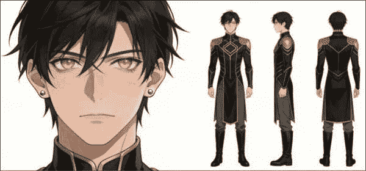

图 3-4　根据提示词生成三视图与面部特写

规范化提示词能保证视觉资产的可迁移性。无论即梦、Midjourney 还是其他平台，只要逻辑严密，角色核心视觉特征就能高度还原。结合背景故事、性格特征与视觉风格，故事背景决定时空是古今，性格要求内在灵魂与外在皮相契合，同时针对男频或女频市场差异，服装配饰颜色也需精准考量，以满足受众审美或甲方需求。

一个技术细节：写提示词时一定要包含鞋子的具体描述。在 9 : 6 竖构图下，缺少鞋子词，AI 全身图常出现截断或比例失调。

要提升剧本到画面的转换能力，可对具体小说文本做实战拆解。分析剧本，提取人物性格并转译为物理特征描述，最后汇聚成完整提示词。

可尝试用以下提示词引导 AI 做人物资产初建模。

分析这个剧本，提取出剧本的人物和对应的性格，并详细描述这些人物的长相，如身高、体重、发型、发色、年龄、皮肤、脸型、五官、身材、服饰、配饰、鞋子等，然后用完整、详细的 AI 绘画中文提示词输出，2D 动漫的画风，全身像，背景是白底，既要考虑现实合理性，也要考虑艺术美感。

通过全维度信息输入，生成的角色在质感上更细腻，在叙事丰富度上远超一句话指令。 EXr6287u6NNVz+GYLY+7SDk226FstKIHdC0bNoQkB2Nqi1xSR0yxPmwrTs5gRi/BtfSbid6dBhii9q7cz2pIyA==

喂料节奏要先想好。现阶段的大模型普遍宣称可处理长文本，实操中若想把人物线索抠干净，还是把源材料按章节或单条剧情切块、分批送入更稳妥。面对几十万字的长篇，可以先投故事大纲或核心梗概，让模型先抓住骨架，再逐步往下补细节。

真正能让角色出圈的抓手是反差与记忆点。模型很容易漏掉这类细微描写，因此在指令里要明确点名，要求它把具备画面转换潜力的细节挖出来。比如刺客偏爱白衣、身价不菲却开旧车，这类设定在视觉化阶段的价值很高。

最后要调整预期，这一轮产出只是初筛清单，不是定稿。创作者需要快速人工过一遍，把人物划分为核心角色、重要配角、功能性龙套三类。只有前两类才值得进入人物档案撰写与精细打磨，功能性龙套用清单里的简短描述直接出图即可。到此，散乱的文学文本已被压缩成一张便于决策的表格，后续工序才有清晰路径。

### 3.2.2　生成人物档案
拿到基础清单后，下一步是对核心角色和重要配角做二次加工，写一份面向画面的档案。这里的档案和传统创作的概念不同，传统写法偏重前史、动机和性格成因，生成式漫剧用的档案必须围绕画面服务。

绘画模型很难理解抽象心理，它只能识别视觉符号。所以核心思路是把心理描写转译成可被看见的描述。不要写他很自卑，要写他习惯低头看地面，说话音量很小，几乎不敢对视。只有把抽象标签拆成可观察的行为和外形细节，模型才能稳定还原想要的形象。

基于此，写指令时一定要给出明确限制。下面这套产出视觉化档案的提示词模板可以直接套用。

请依据下方人物摘要，为我撰写约150至200字的人物小传。约束如下。

1．着重描写可目视的细节，减少纯心理独白。
2．涵盖日常行为习惯、说话方式、穿搭倾向，最好能让人一目了然。
3．凸显一处反差点，例如外表冷淡但内心重情。

人物摘要如下：
【粘贴上一步整理出的角色信息】

用这套指令得到的文字会非常有画面感，不再是干瘪的形容词，而是一串具体的视觉信号。例如总是穿着略显旧但熨烫得很平的校服，一句就同时传递了经济状况与性格；笑时会下意识用手捂住嘴，则直接提供了可用的肢体动作参考。这些具体描述在后续做分镜时都是高价值的提示素材。

### 3.2.3　提炼视觉关键词
人物档案已经有了画面感，但它仍是自然语言，不能直接喂给绘图模型。需要把这段原材料进一步精炼，拆解成若干独立的视觉关键词。

这一环节直接影响最终成图的精准度。很多创作者觉得出图的人物总是飘忽不定，往往就是缺少这一步标准化的拆解。需要从档案里把所有可被视觉捕捉的要素提取出来，并按维度归类整理。

重点要提炼以下5个维度的信息。

#### 1．外在条件
这是人物的物理骨架。要明确身高的视觉参照，比如接近180cm的高挑或比同龄人矮半头。体型要具体，是偏瘦、结实、宽肩还是细腰。年龄感也很关键，如少年感浓或看上去比实际年龄更成熟，这决定了皮肤质感与身体姿态。

#### 2．头部与五官
这是观众注意力最集中的区域，具体包括。

**·** 发型与发色：如中长直发、高马尾、两侧剃短或刘海遮住一只眼。
**·** 脸型：如鹅蛋脸、方脸、轮廓硬朗或下巴略尖。
**·** 眼睛：大小、神态、单双眼皮以及是否常带笑意。
**·** 其他特征：痣、疤痕、耳洞或纹身，这些细节常是区分角色的关键标志。

#### 3．服装与配饰
这是确立角色风格与时代背景的重要元素。
**·** 基础着装：明确上装、下装、外套与鞋子的款式，如风衣、制服、机能服、汉服、运动鞋或军靴。
**·** 标志性配件：增加辨识度的关键，如项链、耳环、腕带、戒指、徽章、发卡或围巾。

#### 4．色彩语言
色彩能直接传递情绪与性格。需要设定一到两个主色调，如黑金、白蓝、墨绿或暗红，作为角色画面的基础色盘。同时配一到两个辅助色，用于配饰或局部点缀，提升层次感。

#### 5．表情与常态姿态
表情与常态姿态决定角色的神韵。
**·** 常见表情：如嘴角微翘、眉头微皱、眼神游离或不爱直视别人。
**·** 常态姿态：如双手插兜、抱臂、站姿笔直或总是微微前倾。

这一步可以借助模型辅助，但强烈建议创作者亲自核对与调整。这是吃透角色的过程，也是完成从文字到画面认知转译的关键。只有自己清楚角色到底长什么样，才能指挥模型画准。

### 3.2.4　生成绘画提示词
进入绘图环节时，不要使用碎片化或意识流的词汇，而应遵循严谨的逻辑框架。这种结构化表达能提升出图成功率，也便于在不同平台间调试迭代。一个成熟的提示词框架应包含以下核心要素。

【画风与风格定位】+【性别、年龄、职业/身份】+【身材与整体比例】+【脸型与五官特征】+【发型与发色】+【服装与配饰】+【表情与气质】+【姿态】+【画面规格与技术约束】

以下主角设定提示词可作参考。

生成全身三视图以及一张面部特写（最左边占满 1/3 的位置是超大的面部特写，右边 2/3 放正视图、侧视图、后视图），纯白背景。二次元国漫风，18 岁少年，高个偏瘦，身高约 178cm，肩膀不宽但站姿挺直。脸型略瘦，五官立体，眉形锋利，黑色短发略微凌乱，刘海微微遮住额头，瞳色金黄，眼神冷静中带一点若有所思。皮肤偏白但有轻微小麦色。上身黑金配色修身战斗长袍，肩部和胸口有简单金色线条装饰，下身深灰色长裤，脚穿黑色长靴。双耳各戴一枚小巧银色耳钉。表情平静，嘴角略微收紧，给人距离感但不阴郁。全身站立正视图，单人，白色纯色背景，9 : 16 竖构图，高精细线稿与上色，无道具，无其他人物，无文字。

规范化的提示词能保证视觉资产的可迁移性。无论在即梦、Midjourney还是其他平台，只要逻辑严密，角色的核心视觉特征就能得到高度还原。参照以上提示词生成的图片如图 3-4 所示。

图 3-4　根据提示词生成三视图与面部特写

实际操作中，必须深度结合背景故事、性格特征与视觉风格。背景故事决定时空是古代还是现代；性格特征要求内在灵魂与外在皮相相符。同时，针对男频或女频市场的差异，服装配饰的颜色也需要精准把控，以满足受众审美或甲方需求。

一个技术细节是，撰写提示词时一定要包含鞋子的具体描述。在 9 : 16 的竖构图下，若缺少鞋子的描述词，生成全身图时很容易出现截断或比例失调。

为了更好掌握从剧本到画面的转换，可以针对具体小说文本实战拆解。通过分析剧本提取人物性格，并将其转化为详细的物理特征描述，最后汇聚成完整提示词。

可尝试使用以下提示词引导模型完成人物资产的初步建模。

分析这个剧本，提取出剧本的人物和对应的性格，并详细描述这些人物的长相，如身高、体重、发型、发色、年龄、皮肤、脸型、五官、身材、服饰、配饰、鞋子等，然后用完整、详细的 AI 绘画中文提示词输出，2D 动漫的画风，全身像，背景是白底，既要考虑现实合理性，也要考虑艺术美感。

通过全维度信息输入，生成的角色在质感上更细腻，在叙事层面的丰富度也远超简单的一句话指令。 EXr6287u6NNVz+GYLY+7SDk226FstKIHdC0bNoQkB2Nqi1xSR0yxPmwrTs5gRi/BtfSbid6dBhii9q7cz2pIyA==

## 3.2 AI 角色设定工作流
搞清角色设计的底层逻辑与市场定位后，下一个核心议题是执行。理论上的理解人物必须转化为可落地的工业化操作流程。

在生成式漫剧制作中，最大的挑战往往不是创意不足，而是生成结果的随机性与不可控性。没有一套严谨的工序规范，创作者很容易陷入反复抽卡、无效修改的泥潭，效率极低。因此，建立标准化工作流，是区分业余爱好者与专业制作团队的关键分水岭。

我们推荐一套经过实战验证的5步线性工作流，相关示意如图 3-3 所示。这套流程的设计初衷，是最大程度降低大模型的理解偏差，确保从文本到图像的转换过程平滑且可控。

图 3-3　5 步线性工作流示意图

这5个步骤环环相扣，不可跳跃或省略。若直接从小说原文跳到绘画提示词，往往会丢失大量隐含的人物细节；而省略人物档案直接提炼关键词，则会让角色失去灵魂，沦为空洞的视觉符号。只有严格遵循这一路径，才能将文本中模糊的文学描述，逐步翻译为精准、可控的机器视觉语言。

### 3.2.1　提取人物信息
一切工作的起点是原始文本。面对长篇网络小说或几十万字的IP原著，若完全依赖人工通读并整理人物设定，不仅耗时巨大，且极易因阅读疲劳导致信息遗漏。

这正是大语言模型的优势所在。模型具备强大的信息吞吐与概括能力，能在数秒内处理数万字文本，并按指定格式输出结构化数据。此阶段目标明确：建立一份完整清晰的角色清单。

需要先明确故事里共有多少角色，才能决定后续资源分配。哪些是需要训练专属模型的主角，哪些是只需固定提示词的配角，哪些是可以随机生成的背景角色，这些决策都依赖于这份初步清单。

具体操作时，通常采用角色扮演加任务拆解的提示词模式。赋予模型专业影视策划的身份，有助于它从影视改编视角审视文本，自动过滤纯文学性描写，只保留对画面制作有效的信息。

以下是一套可直接使用的标准化提示词框架。

请你作为专业影视策划，根据下面这部分小说内容，帮我整理出出现的主要人物设定。要求如下。

1．只保留对后续改编为短剧/漫剧有用的信息。
2．每个角色输出：姓名/称呼、性别、年龄段、社会身份（职业/门派/家族/阶层）、3～5 个性格标签、与主角的关系。
3．尽量提取角色的“反差点”与“记忆点”。

小说内容如下：
【粘贴小说前若干章或精简梗概】

使用这套提示词时有几个关键点需要注意。

首先，关于文本的输入量。目前主流的大模型虽然支持长文本，但为了保证提取精度，建议按章节或故事情节单元分批次输入。如果小说篇幅极长，可以先输入故事大纲或核心梗概。

其次，关注“反差点”与“记忆点”的提取。在前文中反复强调过，反差是角色魅力的来源。模型有时会忽略这些细微的描述，因此在提示词中应明确要求提取这一项，能迫使模型去关注那些容易被忽视的、具有视觉转换价值的特征。例如“身为刺客却喜欢穿白衣”或“身为富豪却开破车”，这些信息在后续转换为画面时至关重要。

最后，这一轮输出的结果是一份初级清单，而非最终定稿。创作者需要根据这份清单进行快速的人工筛选。将清单中的角色划分为“核心角色”“重要配角”“功能性龙套”三个等级。只有核心角色和重要配角，才需要进入下一个步骤——“人物档案生成”与精细化设计。对于功能性龙套，这份清单中的简要描述已经足够直接生成画面了。

通过这一步，我们将庞杂的文学文本，成功降维成了一张可供决策的表格，为后续的精细化作业扫清了障碍。

### 3.2.2　生成人物档案
在拥有了基础的角色清单之后，需要针对核心角色和重要配角进行第二轮加工，即撰写人物档案。这里的“档案”与传统文学创作中的概念存在本质不同。传统档案往往侧重于人物的前史、心理动机和性格成因，而 生成式漫剧制作中的档案，则应严格遵循“为画面服务”的原则。

绘画模型难以准确理解复杂的心理状态，它只能识别视觉符号。因此，在这一步的核心逻辑是：将“心理描写”转换为“视觉描写”。如果一个人很自卑，不要直接写“他很自卑”，而要写“他习惯低头看地面，说话声音很小，不敢与人对视”。只有将抽象的性格标签转换为具体的行为特征和外貌细节，模型才能精准地生成我们需要的人物形象。

基于这个逻辑，在编写提示词时，必须对大模型提出明确的约束条件。以下是专门用于生成“视觉化人物档案”的提示词模板。

请基于下面这份人物摘要，为我写一段 150～200 字的人物档案。要求如下。

1．多写“别人能看到的东西”，少写纯心理描写。
2．描述他的日常行为习惯、说话方式、穿着风格，最好能让人一眼想象出画面。
3．突出一个反差点（例如外表冷淡但很重感情）。

人物摘要如下：
【粘贴上一步整理出的角色信息】

通过这套提示词，将得到一段充满画面感的文字。这些文字不再是空洞的形容词，而是一连串具体的视觉信号。例如“总是穿着有点旧但熨得很平的校服”，这句描述同时传递了角色的经济状况和性格特征；“笑起来习惯用手挡住嘴”，这句直接给出了具体的肢体动作参考。这些具体的描述，在后续生成分镜画面时，都是具有极高价值的提示词素材。

### 3.2.3　提炼视觉关键词
人物档案虽然有了画面感，但它仍然是自然语言，不适合直接作为绘图提示词。我们需要将这段“原料”进行精细加工，将其拆解为一个个独立的“视觉关键词”。

这一步直接决定了最终出图的准确度和质量。很多创作者在使用 AI 生图时觉得人物形象飘忽不定，往往就是因为缺少了这一步标准化的拆解过程。创作者需要从人物档案中，把所有能被视觉捕捉的要素提取出来，并按照特定的维度进行分类整理。

需要重点提炼以下 5 个维度的信息。

#### 1．外在条件
这是人物的物理骨架。需要明确身高的视觉参照，如“接近 180cm 的高个”或“比同龄人矮半头”。体型描述要具体，是“偏瘦”“结实”“宽肩”还是“细腰”。此外，年龄感也很关键，如“少年感很重”或“看起来比实际年龄成熟”，这决定了面部皮肤的质感和身体的姿态。

#### 2．头部与五官
这是观众注意力的焦点，具体包括以下内容。
**·** 发型与发色：如“中长直发”“高马尾”“两侧剃短”或“刘海遮住一只眼”。
**·** 脸型：如“鹅蛋脸”“方脸”“轮廓硬朗”或“下巴略尖”。
**·** 眼睛：描述大小、神态、单双眼皮以及是否常带笑意。
**·** 其他特征：如痣、瘢痕、耳洞或文身，这些细节往往是区分角色的重要标志。

#### 3．服装与配饰
这是确立角色风格和所属时代背景的重要元素。
**·** 基础着装：明确上装、下装、外套和鞋子的款式，如“风衣”“制服”“机能服”“汉服”“运动鞋”或“军靴”。
**·** 标志性配件：这是增加角色辨识度的关键，如“项链”“耳环”“腕带”“戒指”“徽章”“发卡”或“围巾”。

#### 4．色彩语言
色彩能直接传递情绪和性格。需要设定一两个主色调，如“黑金”“白蓝”“墨绿”或“暗红”，这将成为该角色画面的基础色盘。同时设定一两个辅助色，用于配饰或局部点缀，丰富画面的层次感。

#### 5．表情与常态姿态
表情与常态姿态决定了角色的神韵。
**·** 常见表情：如“嘴角微翘”“眉头微皱”“眼神游离”或“不爱直视别人”。
**·** 常态姿态：如“双手插兜”“抱臂”“站姿笔直”或“总是微微前倾”。

这一步提炼工作虽然可以借助 AI 辅助完成，但强烈建议创作者亲自进行核对和调整。这是一个吃透角色的过程，也是创作者在脑海中完成从文字到画面认知转译的关键步骤。你只有自己清楚这个角色到底长什么样，才能指挥 AI 画出准确的图像。

### 3.2.4　生成绘画提示词
在 AI 绘图环节，创作者不应使用碎片化或意识流式的词汇，而应遵循严谨的逻辑框架。这种结构化的表达方式不仅能提高出图的成功率，更能方便地在不同平台间进行调试与迭代。一个成熟的提示词框架应当包含以下核心要素。

【画风与风格定位】+【性别、年龄、职业/身份】+【身材与整体比例】+【脸型与五官特征】+【发型与发色】+【服装与配饰】+【表情与气质】+【姿态】+【画面规格与技术约束】

为了更直观地展示这一逻辑，可以参考以下这段针对主角设定的提示词。

生成全身三视图以及一张面部特写（最左边占满 1/3 的位置是超大的面部特写，右边 2/3 放正视图、侧视图、后视图），纯白背景。二次元国漫风，18 岁少年，高个偏瘦，身高约 178cm，肩膀不宽但站姿挺直。脸型略瘦，五官立体，眉形锋利，黑色短发略微凌乱，刘海微微遮住额头，瞳色金黄，眼神冷静中带一点若有所思。皮肤偏白但有轻微小麦色。上身黑金配色修身战斗长袍，肩部和胸口有简单金色线条装饰，下身深灰色长裤，脚穿黑色长靴。双耳各戴一枚小巧银色耳钉。表情平静，嘴角略微收紧，给人距离感但不阴郁。全身站立正视图，单人，白色纯色背景，9 : 16 竖构图，高精细线稿与上色，无道具，无其他人物，无文字。

规范化的提示词能够确保视觉资产的可迁移性。无论是在即梦、Midjourney 还是其他 AI 绘图平台，只要逻辑严密，角色的视觉核心特征就能得到高度还原。参照以上提示词生成的图片如图 3-4 所示。

图 3-4　根据提示词生成三视图与面部特写

通过全方位信息喂给模型后，人物呈现会更具质感，叙事表现力也能明显拉开与简单指令的差距。只有提供完整维度的数据，角色才算真正立起来。 EXr6287u6NNVz+GYLY+7SDk226FstKIHdC0bNoQkB2Nqi1xSR0yxPmwrTs5gRi/BtfSbid6dBhii9q7cz2pIyA==

# 让角色生产进入可控轨道

## 3.2 AI 角色设定工作流

厘清设计底层逻辑与市场定位之后，下一步要落地到可执行的环节。理解人物是理论，把理解变成可复制的工业化动作才是重点。

在 AI 漫剧制作里，最棘手的并非灵感短缺，而是生成结果的随机与失控。缺少规范流程，很容易陷入反复抽卡、无效打磨的循环，效率极低。标准化作业，才是业余与专业团队的分水岭。

我们沉淀的是一套经实战检验的五阶段线性流程，示意见下文。其设计初衷是尽可能压制大模型的理解偏差，让文本到图像的转化更顺滑、可控。

图 3-3　5 步线性工作流示意图

五步彼此牵制，不可跳步也不宜省略。直接从原著跳到绘图提示词，会丢失大量隐含细节；跳过人物资料表就提炼关键词，角色就会失去灵魂沦为空洞的视觉符号。按正确顺序推进，才能把文学里模糊的描写层层翻译成机器可识别的精准视觉语言。

### 3.2.1　提取人物信息

所有工作的起点是原始文本。人工通读十几万字的 IP 原著既耗时又易因疲劳遗漏，而大模型在信息吞吐与概括上优势明显，能在数秒内处理数万字并按格式输出结构化结果。本阶段的核心目标是先建立一份完整清晰的人物名录。

先搞清楚故事里到底有哪些人，才能做资源分配的决策：谁值得训练专属模型，谁用固定提示词即可，谁可以作为背景随机生成。这一判断都依赖初步名录。

操作上常采用“角色扮演+任务拆解”的写法。把模型设定为专业影视策划，让它用改编视角审视文本，自动过滤纯文学描写，只保留对画面制作有用的信息。

可用的提示词框架示例：

请你以专业影视策划的身份，基于下面这段小说内容，梳理出出现的主要人物设定。要求如下。1.仅保留对短剧/漫剧改编有价值的信息；2.每个角色给出姓名/称呼、性别、年龄段、社会身份即职业/门派/家族/阶层、3~5个性格标签、与主角的关系；3.尽量挖掘角色的反差点与记忆点。小说内容如下：【粘贴小说前若干章或精简梗概】

使用时要注意几个关键点。首先是输入量。主流模型虽支持长文本，但为保证精度，建议按章节或情节单元分批喂入。篇幅极长时可先给大纲或梗概。其次要明确要求反差点和记忆点，模型容易忽略“身为刺客却爱穿白衣”“富豪却开破车”这类可视化特征，而这些正是后续画面创作的重要依据。最后，这一轮产出是初级名录并非定稿，需要人工快速筛选，将角色分为核心角色、重要配角、功能性龙套三档。只有前两类才进入下一环节的角色资料与精细化设计，龙套凭借名录简述即可直接出图。这一步把庞杂的文学文本降维成一张决策表，为后续作业扫清障碍。

### 3.2.2　生成人物档案

有了基础名录后，要针对核心角色和重要配角做第二轮加工，即撰写角色资料表。这里的资料表与传统文学概念不同，传统档案侧重前史、动机和心理成因，而人工智能漫剧的资料表必须遵循为画面服务的原则。

绘图工具读不懂复杂的心理状态，只能识别视觉符号。因此核心逻辑是把心理描写转为视觉描写。不要写“他很自卑”，要写“他习惯低头看地面，说话很小声，不敢与人对视”。抽象标签必须落地为具体行为和外貌细节，模型才能生成想要的形象。

提示词模板示例：

基于下面的人物摘要，为我写一段150~200字的人物资料。要求：1.多写别人能看到的东西，少写纯心理；2.描述日常行为习惯、说话方式、穿着风格，最好能让人脑补画面；3.突出一个反差点，例如外表冷淡但很重感情。人物摘要如下：【粘贴上一步整理出的角色信息】

按此得到的文字会有强画面感。不是空洞的形容词，而是可执行的一串视觉信号。比如“总是穿有点旧但熨得很平的校服”，同时传递经济状况和性格；“笑时习惯用手挡嘴”，直接给出肢体动作参考。这些描述在后续分镜生成时价值很高。

### 3.2.3　提炼视觉关键词

角色资料已具画面感，但仍是自然语言，不能直接作为绘图提示词，需要把“原料”拆解为可独立调用的视觉关键词。这一步决定最终出图的准确度和稳定性，很多创作者觉得人像飘忽不定，正是因为缺少这步标准化拆解。

建议从资料中抽取所有可视要素，按维度分类整理，重点提炼以下五个维度。

#### 1．外在条件
人物的物理骨架。身高要用视觉参照，如“接近180cm的高个”或“比同龄人矮半头”。体型要具体，是偏瘦、结实、宽肩还是细腰。年龄感也很关键，如“少年感很重”或“看起来比实际年龄成熟”，这决定皮肤质感和身体姿态。

#### 2．头部与五官
观众注意力的焦点。
· 发型与发色：中长直发、高马尾、两侧剃短、刘海遮住一只眼等。
· 脸型：鹅蛋脸、方脸、轮廓硬朗、下巴略尖等。
· 眼睛：大小、神态、单双眼皮、是否常带笑意等。
· 其他特征：痣、疤痕、耳洞、纹身等辨识度细节。

#### 3．服装与配饰
确立风格与时代背景。
· 基础着装：上装、下装、外套、鞋子的款式，如风衣、制服、机能服、汉服、运动鞋、军靴等。
· 标志性配件：项链、耳环、腕带、戒指、徽章、发卡、围巾等提升辨识度的元素。

#### 4．色彩语言
色彩传递情绪。设定1~2个主色调，如黑金、白蓝、墨绿、暗红，作为画面底盘；再配1~2个辅助色用于配饰点缀，丰富层次感。

#### 5．表情与常态姿态
决定角色的神韵。
· 常见表情：嘴角微翘、眉头微皱、眼神游离、不爱直视别人等。
· 常态姿态：双手插兜、抱臂、站姿笔直、总是微微前倾等。

这步可借助模型辅助，但强烈建议创作者亲自核对调整。这是吃透角色、完成文字到画面的认知转译的关键。只有自己清楚角色长什么样，才能指挥模型画准。

### 3.2.4　生成绘画提示词

绘图环节需要结构化表达，而非碎片化的意识流词汇。成熟的提示词框架应包含：【画风与风格定位】+【性别、年龄、职业/身份】+【身材与整体比例】+【脸型与五官特征】+【发型与发色】+【服装与配饰】+【表情与气质】+【姿态】+【画面规格与技术约束】

参考示例：

生成全身三视图以及一张面部特写，最左边1/3为超大面部特写，右边2/3放正视图、侧视图、后视图，纯白背景。二次元国漫风，18岁少年，高个偏瘦身高约178cm，肩膀不宽站姿挺直。脸型略瘦五官立体，眉形锋利，黑色短发略凌乱刘海微微遮额，瞳色金黄眼神冷静带思索。皮肤偏白带轻微小麦色。上身黑金配色修身战斗长袍，肩部和胸口有简洁金色线条装饰，下身深灰长裤，脚穿黑色长靴。双耳各戴一枚小巧银色耳钉。表情平静嘴角略收紧，有距离感但不阴郁。全身站立正视图，单人，白色纯色背景，9:16竖构图，高精细线稿与上色，无道具，无其他人物，无文字。

规范化的提示词让视觉资产具备可迁移性。即梦、Midjourney等平台只要逻辑严密，核心特征就能高度还原。

图 3-4　根据提示词生成三视图与面部特写

实操中要深度结合背景故事、性格特征与视觉风格。背景决定时空是古代还是现代，性格决定内在与外在的契合，男频女频的服装配饰配色也需精准匹配受众审美。

一个技术细节：在9:16竖构图下，提示词里一定要写清鞋子，否则全身图常出现截断或比例失调。

想提升剧本到画面的转化能力，可用实战式提示词引导模型做初步建模：

分析这个剧本，提取人物及对应的性格，并详细描述这些人物的长相，如身高、体重、发型、发色、年龄、皮肤、脸型、五官、身材、服饰、配饰、鞋子等，然后用完整详细的AI绘画中文提示词输出，2D动漫画风，全身像，背景白底，既要考虑现实合理性，也要考虑艺术美感。

图 3-3　5 步线性工作流示意图

EXr6287u6NNVz+GYLY+7SDk226FstKIHdC0bNoQkB2Nqi1xSR0yxPmwrTs5gRi/BtfSbid6dBhii9q7cz2pIyA==

### 3.2.4 提示词怎么搭才好用

做 AI 绘图时，最大的坑不是模型不够强，而是你的描述太散。意识流、碎片词堆上去，成功率会掉很惨。真正能跨平台复用、反复调试的提示词，都得有一套清晰的逻辑骨架。把要素固定下来，出图的稳定性会立刻提升。

一个能打的角色提示词，通常由这几个维度串起来：画风与风格定位 + 性别年龄职业身份 + 身材与整体比例 + 脸型及五官特征 + 发型与发色 + 服装与配饰 + 表情气质 + 姿态 + 画面规格与技术约束。

举个例子，一版可迁移的主角设定可以这样写：
要一张包含全身三视图和一张大特写的组合图，面部特写占左三分之一画面，其余三分之二放正面、侧面、背面三视图，纯白背景。二次元国漫风格，18岁男性，偏高偏瘦约178cm，肩线不宽但站姿挺直。脸颊清瘦，五官立体，眉形锋利。黑发短且微乱，刘海稍遮额头，瞳色金黄，眼神冷静带点思索。肤色白皙略带小麦感。上身黑金配色修身长袍，肩胸部有简洁金线装饰，下身深灰长裤，黑长靴。双耳各戴一枚小巧银耳钉。表情平静，嘴角微收，距离感明显不阴郁。单人全身直立正面照，白底，9:16竖构图，高精度线稿加上色，无道具、无其他人物、无文字。

图 3-4　根据提示词生成三视图与面部特写

之所以强调规范，是因为它让视觉资产可迁移。即梦、Midjourney 还是别的工具，只要逻辑够严，核心特征就能稳定还原。

落地时一定要结合故事背景、性格和视觉调性。背景决定时空是古今，性格决定内在和外在是否匹配。男频女频的受众审美也不一样，配色和配饰的取舍要精准。

有个容易被忽略的技术点：一定要写鞋子。9:16 竖图里，缺鞋子描述全身图极容易被截断或比例崩掉。

想把剧本转成画面，最省事的做法是先让模型帮你提炼。把小说文本丢进去，让它先拆人物和性格，再把性格转成可视觉化的长相信息：身高体重、发型发色、年龄肤色、脸型五官、身材、服饰配饰鞋子，最后整合成完整详细的中文绘画指令，2D 动漫风、全身像、白底。既要符合现实逻辑，也要有艺术美感。
这样喂全维度信息，出来的角色质感更细，叙事信息也更饱满，远比一句口令强得多。 EXr6287u6NNVz+GYLY+7SDk226FstKIHdC0bNoQkB2Nqi1xSR0yxPmwrTs5gRi/BtfSbid6dBhii9q7cz2pIyA==

## 3.3 提示词直出与参考图生图的区别

AI 角色图就两条路：纯文字直出，和参考图引导。前者像从零做造型设计，后者像做风格统一化。弄清用法，才能把效率和一致性都提上来。

### 3.3.1 提示词直出角色

直出的价值是探索。一次很难完美，得靠多轮生成和筛选来收敛方向。

操作上可以按这四步走。

#### 1．批量生成
先把语义边界摸清楚。提示词完全固定，一次性出 8 到 12 张。目标不是挑好看的，而是看模型在同一约束下会怎么发散：体态、气质走向、风格的自然波动。样本量够了，后续判断才有依据。

#### 2．初筛轮廓
看整体成立不成立，别急着抠细节。头身比例是否合理，年龄身份世界观是否对得上；性格能不能从姿势神情氛围里读出来；整体色彩是否稳定，是否契合项目调性。轻微的结构偏差、局部失真、精细度不够，这阶段先放过。

#### 3．确定风格锚点
从初筛里挑 2 到 3 张最接近预期的图。选它们不是因为细节完美，而是方向清晰、气质稳定。它们会成为下一步的视觉参照，用来锁住角色边界，防止风格漂移。

#### 4．迭代精修
方向锁住后，再用以图生图或参考图功能做精细化：面部结构是否稳定、服装道具逻辑是否自洽、光影质感是否统一。这一阶段不再探索方向，而是把已有方向打磨到更高完成度。

总结起来，直出的核心是先定方向。先把形态和气质基调定下来，再进细节，才能少走弯路。

### 3.3.2 参考图生成角色

主角定下后，挑战就从“单个人好看”变成“全员同世界”。传统动画里是美术总监的事，AI 漫剧里靠参考图和一致性控制来解决。

同一个项目必须用同一套视觉标准，三步走：

#### 1．建立风格面板
决定整部作品的基调。去即梦 AI、快看漫画、LiblibAI 等平台或图库里收集中意的风格、色调、氛围图，统一上传到绘图工具做风格测试和适配，如图 3-5 和图 3-6 所示。

图 3-5　使用参考图与提示词
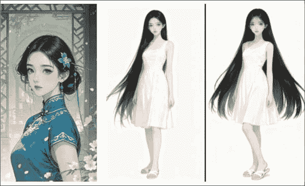

图 3-6　使用参考图与提示词生成的图片

#### 2．锁定生成逻辑
做配角时，底层参数必须一致：同一个基础模型，同一套提示词骨架。只允许在个性化特征上做变量：发型、脸型、瞳色、服饰。通过控制变量法，让角色在生理特征和身份标识上分得开，而笔触、材质、渲染风格保持高度一致。

#### 3．统一光照与环境
画面不统一，多半是光影乱。所有角色要放在相似的光照环境和质感基调里，比如统一柔和侧光或均匀漫反射。有的角色用戏剧化顶光，有的用平淡正面光，拼在一起就会很假，破坏叙事可信度。

提示词直出解决个体的审美和设定问题，参考图生图解决整体的视觉逻辑问题。前者保证单人好看且符合人设，后者保证同框时观众会觉得他们在同一个故事世界里。两者结合，才能做出成熟的漫剧角色资产库。 EXr6287u6NNVz+GYLY+7SDk226FstKIHdC0bNoQkB2Nqi1xSR0yxPmwrTs5gRi/BtfSbid6dBhii9q7cz2pIyA==

## 3.3 提示词直出与参考图片生图的区别

AI 生成角色图本质上有两套思路：靠文字从零描述，和靠参考图做风格统一。对应传统制作里的原创造型和沿用素材的规范化处理，明白各自的使用场景能大幅提升开发效率和成品统一度。

### 3.3.1 提示词直出角色

直出的意义在于开拓和迭代，几乎不可能一次成型。需要通过多次生成筛选，慢慢把角色的整体走向敲定下来。

实操建议分四步推进。

#### 1．批量生成
先做可能性探测。保持提示词完全不变，一次产出 8~12 张。目的不是评判美丑，而是观察模型在相同语义限制下产生的不同解读：人物姿态、气质倾向、整体风格的微妙摇摆。只有样本足够，审美判断才站得住脚。

#### 2．初筛轮廓
判断时刻意忽略细节，先看角色“站得住”。头身比例是否协调，是否匹配年龄、身份和世界观；性格能否通过姿态、眼神和整体氛围被感知；色彩基调是否稳定，是否在项目既定风格内。结构上的小偏差、局部变形、精细度不足，这轮不纠结。

#### 3．确定风格锚点
在初筛结果里选出 2~3 张最贴近理想方向的图。它们不求细节完美，但要方向明确、气质稳定。后续就以它们为视觉标尺，锁定角色的边界，避免反复跑偏。

#### 4．迭代精修
方向确定后，在风格锚点的基础上用以图生图或参考图功能做细节优化：面部稳定性、服装道具的逻辑连贯性、光影与质感的统一度。任务从探索转为提纯，把已有方向推向更高完成度。

整体看，直出的关键是先定调。先把整体形态和气质定住，再做细节精修，才能避免无休止试错。

### 3.3.2 参考图生成角色

主角确定后，重点从个体设计转向整体统一。要保证所有登场人物都在同一个世界观下，按同一种视觉法则呈现。传统工业里由美术总监把控，AI 漫剧里则靠参考图与一致性控制。

项目应严格执行统一的画风参考标准，流程可分为三步：

#### 1．建立风格面板
这是整个作品的视觉基调。收集即梦 AI、快看漫画、LiblibAI 等渠道符合预期风格、色调和氛围的参考图，统一导入绘图工具进行风格适配测试，如图 3-5 和图 3-6 所示。

图 3-5　使用参考图与提示词

图 3-6　使用参考图与提示词生成的图片

#### 2．锁定生成逻辑
生成配角时，底层参数必须保持一致：同一模型、同一提示词架构。仅在个性化维度做调整，如发型、脸型、瞳色、服饰。通过控制变量，保证角色在生理和身份上区分，但在笔触质感、材质表现、渲染风格上保持一致。

#### 3．统一光照与环境
画面不统一，根源多在光影。确保所有角色使用相似的光照设定与质感基调，比如统一的柔和侧光或均匀漫反射。强烈的戏剧顶光与平铺正面光混用，同场景拼接时会产生明显违和，削弱叙事可信度。

提示词直出负责个体审美与设定，参考图生图负责整体视觉逻辑。前者让单个人物美观且贴合人设，后者让多人物同框仍在一个故事世界。只有两者闭环，才能形成成熟的漫剧角色库。 EXr6287u6NNVz+GYLY+7SDk226FstKIHdC0bNoQkB2Nqi1xSR0yxPmwrTs5gRi/BtfSbid6dBhii9q7cz2pIyA==

## 3.3 提示词直出与参考图片生图的区别

AI 角色生成的两条主线是文字直出和参考图引导。前者相当于无素材的零基础造型设计，后者相当于在已有素材基础上做风格统一。区分场景用对，才能把效率和一致性拉满。

### 3.3.1 提示词直出角色

直出的核心价值是探索迭代，很少一次到位。通过多轮生成筛选，逐步厘清角色方向。

推荐流程如下。

#### 1．批量生成
探索边界。提示词保持完全一致，一次生成 8 至 12 张。重点不是挑最好的，而是观察模型在同一语义约束下的不同解读：体态变化、气质走向、画风波动。只有样本充足，后续锁定方向才有参考价值。

#### 2．初筛轮廓
此阶段避开细节，先问角色是否成立。头身比例是否合理，是否符合年龄、身份、世界观设定；性格能否通过姿态、神情、氛围被直观读出；整体色调是否稳定，与项目风格体系是否吻合。轻微的结构误差、局部失真或精细度不足，先不处理。

#### 3．确定风格锚点
从初筛中挑选 2~3 张最接近预期的版本。价值在于整体方向清晰、气质表现稳定，之后可作为视觉参照，锁定角色边界，防止风格漂移。

#### 4．迭代精修
大方向确定后，基于风格锚点用以图生图或参考图做细节层优化：面部结构稳定性、服装道具逻辑一致性、光影质感统一。目标明确，把既定方向推进到更高完成度，而非重新探索。

整体来看，直出的关键是先定方向，再做细节，避免反复试错。

### 3.3.2 参考图生成角色

核心角色确定后，工作重心从个体设计转向整体统一。目标是让所有人物处于同一世界观、遵循同一视觉法则。传统动画里是美术总监的工作，AI 漫剧里靠参考图和风格一致性控制实现。

项目应遵循统一画风参考标准，操作分三步：

#### 1．建立风格面板
决定整体视觉基调。从即梦 AI、快看漫画、LiblibAI 等平台或图库收集符合项目风格、色调和氛围的参考图，统一上传到 AI 绘图工具做初步适配测试，如图 3-5 与图 3-6 所示。

图 3-5　使用参考图与提示词

图 3-6　使用参考图与提示词生成的图片

#### 2．锁定生成逻辑
生成配角时，底层参数要保持一致：同一基础模型、同一提示词架构。仅对个性化特征做调整，如发型、脸型、瞳色、服饰设计。用控制变量法保证生理特征和身份标识可区分，同时笔触质感、材质、渲染风格高度统一。

#### 3．统一光照与环境
严格控制光照和环境逻辑。视觉不统一常因光影混乱导致。确保所有角色在相似光照环境和质感基调下生成，例如统一柔和侧光或均匀漫反射。若部分角色用强戏剧化顶光，部分用平淡正面光，合在同一场景会产生违和，削弱叙事可信度。

提示词直出解决个体审美与设定，参考图生图解决整体视觉逻辑。前者让单个人物足够美观且符合人设，后者让角色同框时观众能自然接受其处在同一故事世界。结合使用才能完成一套成熟的漫剧角色资产库。 EXr6287u6NNVz+GYLY+7SDk226FstKIHdC0bNoQkB2Nqi1xSR0yxPmwrTs5gRi/BtfSbid6dBhii9q7cz2pIyA==

## 3.4 角色设计中的常见问题

复盘大量 AI 漫剧项目后，角色设计的问题往往集中在几个相似环节。多半不是技术原理不懂，而是对生成逻辑的误解或流程疏漏。常见问题集中在比例失调、信息过载、风格割裂和不符合大众审美四个方面。

### 3.4.1 比例失调

这是新手最容易踩的坑。AI 模型天生偏爱精细人脸，没有明确约束就会出半身照、大头照、夸张透视的俯仰视角。常见表现还有头重脚轻、Q 版和写实混用、画面莫名多一只手或多余武器、背景里出现残缺人影等。图 3-7 展示了典型的比例问题案例。

图 3-7　存在比例问题的生成案例

解决思路是建立强制构图约束，在提示词里明确画面构图和纯净度。

第一，必须写明全身状态和基础姿势。比如“全身站立，正面或微侧身，四肢自然舒展，避免坐姿或躺姿”。

第二，对画面元素做减法式的负向约束。明确告知模型：“画面中仅有一位角色，无其他人影、动物或复杂道具干扰”。

第三，道具要写成稳定收敛的静止状态。AI 处理复杂动态持握很吃力，改为静止更稳妥，例如“右手自然垂下，握着一把收鞘长剑，剑尖朝下，无夸张摆姿”。

### 3.4.2 信息过载

很多创作者以为提示词越长画面越精。实际上堆十几种装饰、五六种材质，权重会被稀释，画面重点模糊，最后只剩一堆辨认不清的繁复纹理。另一种极端是用抽象形容词，像“帅气”“霸气”，模型没有语义抓手，只能瞎猜。

修正的关键是视觉聚焦和描述具象化。

## 3.4 四大翻车点

复盘大量AI连载项目后会发现，角色制作的坑基本都卡在同一类认知盲区。问题大多不是模型不够强，而是对生成规律的误解和流程上的疏漏。把经验归纳下来，主要集中在四类症结：体型比例失常、提示词过载、视觉风格冲突、审美把控失误。

### 3.4.1 身形比例跑偏

初学者最常栽在比例上。生成器天然偏好面部细节，若没有硬约束，很容易出半身特写、大头画面，或夸张的俯仰视角。常见表现有头部过大脚部过小、Q萌与写实混用、画面里多出多余手臂或武器，背景还残留未完成的人影轮廓。

图 3-7 比例异常样本
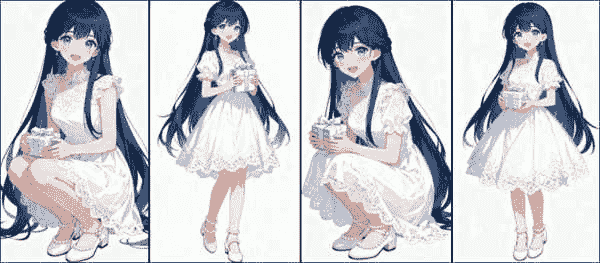

把构图稳住的核心是给出强制规则。

先锁定整体姿态。要求模型输出完整身体，采用站姿，正面或轻微侧身，手脚自然舒展，禁用坐姿卧姿。

再做画面清场。用负向提示明确：画面里只保留主角一人，禁止出现其他人物、动物、繁杂道具干扰。

道具要收敛。AI处理动态抓握很弱，最好描述成静止状态，例如右手垂落握着收鞘长剑，剑尖向下，避免夸张摆动。

### 3.4.2 提示词过载

很多人觉得描述越长越好，其实适得其反。一口气塞进十余种装饰、数种材质，权重被稀释，重点模糊，最后得到一堆辨认不清的纹理堆砌。另一极端是堆砌泛化词，如英俊、气势这类词汇，模型没有抓手，只能随机发挥。

修正方向是聚焦并具象化。

首先瘦身。单一角色只保留一到两个主打元素，比如服装配饰写肩甲配腰间挂饰，或披风加特殊领型。

其次分块叙述。不要把全身服装混成一段，按上装、下装、鞋履顺序分段，让模型理解层次关系。

最后把形容落地。模型不懂冷峻，但能读懂微表情：面部平静、视线锁定前方、嘴角略向下。贵气也需要符号化：白底衬衫、镶金高领、藏青风衣、胸前挂家徽。

### 3.4.3 视觉风格冲突

连载最怕风格大杂烩：男主走写实国漫路线，女主偏日系萌系，配角又带美式渲染痕迹，视觉割裂会让观众瞬间出戏，整体设定也随之崩塌。通常因为换了底层生成器或提示里缺少统一约束。

要在项目启动阶段就确定视觉标准。

锁定底层。项目全程只用一个核心生成模型，搭配一组不可修改的风格关键词组。

建立参照。先出男女主及两三个关键人物的角色海报，作为全员对齐的标尺，后续所有新角色都必须对照。

采用渐进微调。新增角色时沿用已有底稿，只在发型、服装等局部做小幅调整，禁止推倒重写提示结构，这样细节精度才能保持一致。

### 3.4.4 审美把控失误

面向大众的商业连载里，简洁是一种风格选择，画面干净、表达克制；粗糙则是质量事故，表现为比例塌陷、面部僵硬、色彩脏乱或结构失调。

守住底线需要一套快速检查表。

小图测试。把画面缩到手机竖屏约一六分大小，若仍能辨认人形轮廓和动作，构图基本合格。

面部核验。放大观察眼睛细节，确认虹膜高光、角膜反光是否合理，避免眼神游离，同时检查嘴型是否自然。

配色审查。审视黑白表现与饱和度分布，警惕整体发灰或中间调杂乱导致画面脏旧。

模型会把创作者的审美倾向放大。持续把自己的成果与优质国漫或头部连载做视觉对标，在反复比对中修正判断，才是提升审美最有效的方式。 EXr6287u6NNVz+GYLY+7SDk226FstKIHdC0bNoQkB2Nqi1xSR0yxPmwrTs5gRi/BtfSbid6dBhii9q7cz2pIyA==

AI分镜画面把控手记

新手常陷入一个误区，觉得指令写得越满，产出的画面就越精致。实测恰恰相反，一条提示塞进十几种装饰、好几类材质，模型要兼顾的要素太多，权重被摊薄，画面焦点就散了，最后只剩看不清的纹理堆砌。另一个常见坑是滥用空洞形容，像“帅气”“霸气”这类词，没有可视锚点，模型只能随意发挥。

把局面扭转的关键在于收紧视觉焦点，并把描述落到能看见的层面。

第一，做减法。单个人设保留一到两个记忆点足矣。配饰的写法可用“肩甲加腰间挂饰”或“披肩加异形领口”这样的组合。

第二，用分层结构写。别把整套服装揉成一段，按“上装—下装—鞋履”的顺序逐层说明，模型才好理解层次关系。

第三，把抽象词换成具象细节。模型不懂“冷酷”，它能读懂“表情平淡、目光直视前方、嘴角微微下压”。同理，“贵族感”要靠具体服饰符号堆出来：白衬衫、金线立领、深蓝长风衣、胸口别家族徽章。

### 3.4.3　风格不统一

漫画短片里最致命的掉线就是画风混搭：男主偏写实国漫，女主带日系二次元味，配角又冒出美式三渲二。视觉割裂一出现，观众立刻出戏，世界观也塌了。根因通常是给不同角色随意换底模，或提示里没做统一的风格约束。

必须在立项初期就定好风格基准。

首先，锁定底座逻辑。整个项目用同一套核心底模，搭配一套不可改动的基础风格词。

其次，建立视觉对标。先把男女主及一到两个关键配角的定妆图做出来，作为项目的视觉标尺。团队后续生成新角色时必须严格对照这套标准。

最后，用增量改法。做新角色时直接复用基础提示，只做必要微调，比如换发型、改服装，严禁推倒重写提示结构，这样颗粒度才能保持高度一致。

### 3.4.4　不符合大众审美

面向大众的商业短漫里，“朴素”和“难看”是两回事。朴素是风格选择，画面干净、设计清爽、表达克制；难看是质量事故，表现为比例崩了、面部僵硬、色彩脏乱或结构失调。

守住底线可以建一份快速筛查清单，对每张角色图做系统性检查。

**·** 缩略图检查：把图缩到手机竖屏约六分之一的大小。小图下如果还能清楚辨认轮廓和动作，构图才算过关。

**·** 表情检查：放大看面部。确认眼球高光、角膜反光和瞳孔反光是否合理，避免眼神乱飘，同时看嘴型结构是否自然。

**·** 色彩检查：审视灰度与饱和度分布。警惕整张发灰或中间色杂乱的画面，这种图会显脏旧。

本质上模型是创作者审美的放大器。提升的办法是持续把自己的产出和优秀的国漫或头部短漫做视觉对标，在反复比较中校准判断。 EXr6287u6NNVz+GYLY+7SDk226FstKIHdC0bNoQkB2Nqi1xSR0yxPmwrTs5gRi/BtfSbid6dBhii9q7cz2pIyA==

## 3.5 三视图的作用与生成逻辑

传统动画工业里，人物的三面造型图与表情设定是设计阶段的必交件，决定后续镜头能不能稳定、可控、持续连贯。三面图的真正价值在于服务制作系统高效运转，而不是给观众看。

在模型短漫或模型视频里，这个原则更重要。可以按下面这套指令逻辑生成标准化的角色三面图。

生成全身三面图以及一张面部特写（最左边占满 1/3 的位置是超大的面部特写，右边 2/3 放正视图、侧视图、后视图）。

图 3-8 和图 3-9 是两张三视图示例。

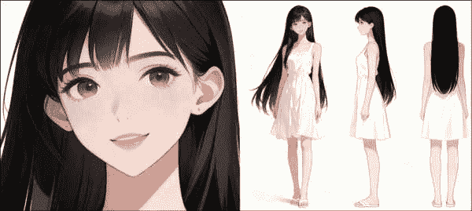

图 3-8　三视图示例（女）

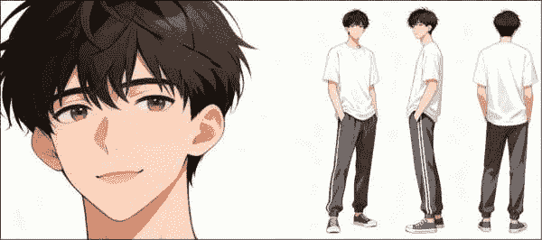

图 3-9　三视图示例（男）

### 3.5.1　为什么需要三视图

模型大幅降低了手绘门槛，但实操中仍有两件事绕不开。

（1）生成具随机性。正脸很稳不代表侧脸结构可靠，正面逻辑通也不意味着背面合理。一旦进入多角度多景别的分镜，角色很容易形象漂移，观众产生认知断层。

（2）分镜量上来后记忆负荷过载。创作者靠记忆很难兼顾所有视觉细节。发际线高低、衣摆长短、腰线位置、配饰朝向等，在单张里不明显，连续播放时会明显放大。

因此角色形象基本稳定后，要尽早定出标准化的三面图。

资源允许时，建议同步做表情卡。基础情绪至少涵盖平静、愤怒、惊讶、悲伤四种。戏份重的角色或关键配角要扩展到八种甚至十二种以上。例如把图 3-9 上传到生图工具，输入提示词“为此人物生成表情卡，包含至少 8 种不同情绪。”图 3-10 就是一个生成结果示例。

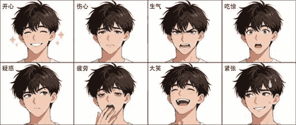

图 3-10　表情卡生成结果示例

提示词既可以指定情绪数量，也可以直接列出具体情绪名称。

三面图解决形体和结构稳定性，表情卡解决情绪准确性。二者共同构成后续大量镜头生成的视觉参考基准。

### 3.5.2　三视图的画面排布

要让三面图进入制作流程而非只做设计展示，排布必须具备功能性。

一个成熟通用的方案是：把三面图与面部特写整合到一张横向构图中，比例建议 21:9 或 16:9。推荐布局如下。

**·** 左侧区域：占约一半宽度，放人物面部近景特写，突出五官细节与微表情。

**·** 右侧区域：从左到右依次排列全身正视图、侧视图、背视图。

**·** 底部区域：预留信息栏，用小字标注人物姓名、身高数据、关键配色色卡，并可用色块做辅助说明。

这种排布在实战里有三个核心优势。

**·** 沟通高效：对接甲方、合作方或团队内部，一张图就能完整呈现角色视觉信息，避免信息碎片化。

**·** 素材复用：该图可直接拿来做角色介绍页、卡司表或世界观设定展示，提升复用率。

**·** 长期基准：它是团队最重要的视觉参照。生成新镜头、调整分镜或复刻画面时，成员可随时对照校准比例、结构与细节，大幅降低试错和沟通成本。

随着角色数和分镜规模扩大，这张标准化的三面图会成为项目里使用频率最高、依赖度最强的底层资产。 EXr6287u6NNVz+GYLY+7SDk226FstKIHdC0bNoQkB2Nqi1xSR0yxPmwrTs5gRi/BtfSbid6dBhii9q7cz2pIyA==

## 3.5 三视图的作用与生成逻辑

在传统动画制作里，三面造型与表情设定是角色设计阶段的核心交付物，它决定后续镜头能否保持稳定、可控且连贯。三面图的本质价值在于让制作系统跑得更快，而不是直接面向观众。

在模型短漫和模型视频创作中，这一规律被进一步放大。可以用以下提示逻辑生成标准化的角色三面图。

生成全身三视图以及一张面部特写，最左边占满三分之一位置是超大的面部特写，右边三分之二放正视图、侧视图、后视图。

图 3-8 和图 3-9 是两张三视图示例。

图 3-8　三视图示例（女）

图 3-9　三视图示例（男）

### 3.5.1　为什么需要三视图

模型虽然降低了绘制门槛，实拍式制作中仍要面对两个现实问题。

（1）生成带有随机性。正脸完美不代表侧脸结构稳，正面合理也不意味着背面可信。进入多角度、多景别的分镜切换后，角色极易发生形象偏移，导致观众认知断层。

（2）分镜数量增加会让记忆负荷过载。创作者难以凭记忆维护全部视觉元素的一致性。发际线高度、衣角长度、腰线位置、配饰朝向等细节，单张不明显，连续播放时会被显著放大。

因此角色形象基本稳定时，必须尽早完成标准化的三视图设定。

在项目资源允许的情况下，建议同步制作角色的表情卡。基础情绪至少应包含平静、愤怒、惊讶、悲伤 4 种。对于戏份较重的角色或关键配角，这一标准应扩展至 8 种甚至 12 种以上。例如，我们将图 3-9 上传至 AI 生图工具中，输入提示词“为此人物生成表情卡，包含至少 8 种不同情绪。”图 3-10 是一个表情卡生成结果示例。

图 3-10　表情卡生成结果示例

需要注意的是，在输入提示词时，既可直接指定情绪数量，也可直接列出具体的情绪类型。

三视图负责解决角色形体和结构稳定性的问题，表情卡则负责保障角色情绪准确性。二者共同构成了角色在后续海量镜头生成中的视觉参考基准。

### 3.5.2　三视图的画面排布

为了让三视图真正融入制作流程，而非停留在设计展示阶段，其画面排布必须具备功能性。

一个成熟且通用的排布方案是：将三视图与面部特写整合于一张横向构图中，比例建议设定为 21 : 9 或 16 : 9。推荐的布局结构如下。

**·** 左侧区域：占据约一半宽度，放置人物面部近景特写，重点展示五官细节与微表情。

**·** 右侧区域：从左至右依次排列全身正视图、侧视图、背视图。

**·** 底部区域：预留一条信息栏，用小字标注人物姓名、身高数据、关键配色色卡，并可用色块进行辅助视觉说明。

这种排布方式在实战中具备以下三个核心优势。

**·** 沟通高效：无论是对接甲方、合作方还是团队内部，一张图即可完整呈现角色的所有视觉信息，避免信息碎片化。

**·** 素材复用：该图片可直接作为剪辑素材，用于制作角色介绍页、卡司表或世界观设定展示环节，提升素材复用率。

**·** 长期基准：它是团队最重要的视觉参考基准。在生成新镜头、调整分镜或复刻特定画面时，团队成员可随时对照此图校准比例、结构与细节，大幅降低试错与沟通成本。

随着角色数量的增加与分镜规模的扩大，这张标准化的三视图将成为整个项目中使用频率最高、依赖度最强的底层资产。 EXr6287u6NNVz+GYLY+7SDk226FstKIHdC0bNoQkB2Nqi1xSR0yxPmwrTs5gRi/BtfSbid6dBhii9q7cz2pIyA==

## 3.5 三视图的作用与生成逻辑

传统动画工业里，人物三视图与表情设定是角色设计的交付核心，决定了镜头能否稳定可控且持续连贯。三视图的根本价值在于服务制作系统的运转，而非直接呈现给观众。

在模型短漫或模型视频创作中，这一原则的重要性被进一步放大。我们可以使用以下提示词逻辑生成标准化的角色三视图。

生成全身三视图以及一张面部特写（最左边占满 1/3 的位置是超大的面部特写，右边 2/3 放正视图、侧视图、后视图）。

图 3-8 和图 3-9 是两张三视图示例。

图 3-8　三视图示例（女）

图 3-9　三视图示例（男）

### 3.5.1　为什么需要三视图

AI 虽然极大地降低了角色绘制的技术门槛，但在实际制作中，创作者仍需面对如下两个现实问题。

（1）AI 生成具有随机性。正脸完美并不代表侧脸结构稳定，正面逻辑成立也不意味着背面设计合理。一旦进入多角度、多景别的分镜切换，角色极易发生形象偏移，导致观众产生认知断层。

（2）分镜数量增加会导致记忆负荷过载。创作者难以仅凭记忆维护所有视觉元素的一致性。发际线高度、衣角长度、腰线位置、配饰朝向等细节，在单张画面中或许不明显，但在连续播放的视频流中会被显著放大。

因此，当角色形象基本稳定时，必须尽早完成标准化的三视图设定。

在项目资源允许的情况下，建议同步制作角色的表情卡。基础情绪至少应包含平静、愤怒、惊讶、悲伤 4 种。对于戏份较重的角色或关键配角，这一标准应扩展至 8 种甚至 12 种以上。例如，我们将图 3-9 上传至 AI 生图工具中，输入提示词“ 为此人物生成表情卡，包含至少 8 种不同情绪。 ”图 3-10 是一个表情卡生成结果示例。

图 3-10　表情卡生成结果示例

需要注意的是，在输入提示词时，既可直接指定情绪数量，也可直接列出具体的情绪类型。

三视图负责解决角色形体和结构稳定性的问题，表情卡则负责保障角色情绪准确性。二者共同构成了角色在后续海量镜头生成中的视觉参考基准。

### 3.5.2　三视图的画面排布

为了让三视图真正融入制作流程，而非停留在设计展示阶段，其画面排布必须具备功能性。

一个成熟且通用的排布方案是：将三视图与面部特写整合于一张横向构图中，比例建议设定为 21 : 9 或 16 : 9。推荐的布局结构如下。

**·** 左侧区域：占据约一半宽度，放置人物面部近景特写，重点展示五官细节与微表情。

**·** 右侧区域：从左至右依次排列全身正视图、侧视图、背视图。

**·** 底部区域：预留一条信息栏，用小字标注人物姓名、身高数据、关键配色色卡，并可用色块进行辅助视觉说明。

这种排布方式在实战中具备以下三个核心优势。

**·** 沟通高效：无论是对接甲方、合作方还是团队内部，一张图即可完整呈现角色的所有视觉信息，避免信息碎片化。

**·** 素材复用：该图片可直接作为剪辑素材，用于制作角色介绍页、卡司表或世界观设定展示环节，提升素材复用率。

**·** 长期基准：它是团队最重要的视觉参考基准。在生成新镜头、调整分镜或复刻特定画面时，团队成员可随时对照此图校准比例、结构与细节，大幅降低试错与沟通成本。

随着角色数量的增加与分镜规模的扩大，这张标准化的三视图将成为整个项目中使用频率最高、依赖度最强的底层资产。 EXr6287u6NNVz+GYLY+7SDk226FstKIHdC0bNoQkB2Nqi1xSR0yxPmwrTs5gRi/BtfSbid6dBhii9q7cz2pIyA==

## 3.6 场景设计原则与 AI 场景提示词结构

角色决定画面里是谁，场景决定故事发生在哪。在模型漫剧与视频制作里，场景承担空间化叙事功能，直接影响人物关系远近、情绪浓淡分层与镜头调度合理性。

新手常忽略场景设计，导致精美角色放进去后出现贴图感。成熟流程要求在剧本阶段就系统规划场景，而不是等到画面生成时临时起意。

### 3.6.1　从剧本中拆解场景

启动绘图前，首要任务是回到剧本。整理一份场景清单表，列出全剧或本集反复出现的关键场景，如表 3-2 所示。

表 3-2　场景清单表（示例）

传统影视动画里，导演优先确立主场景，是为了降低后期返工成本并建立统一美学基调。主场景在商业项目中还承担品牌识别与世界观标识作用。主场景风格稳定后，后续大量镜头便能在该空间体系中高效展开。模型创作虽把“搭景”从建模或手绘改为提示词生成，但这一核心逻辑并未改变。

### 3.6.2　场景设计的核心原则

即便用模型生成，传统场景设计的三大核心原则仍是保障画面质量的关键。

#### 1．空间层次必须清晰

具备叙事能力的空间通常包含前景、中景与远景。前景可用栏杆、树枝、门框或桌角制造纵深与镜头层次；中景是角色主要活动区域，也是叙事核心；远景承担世界观与尺度感，如建筑轮廓、山脉、天际线。

缺乏层次的场景容易退化为平面插画，难以支撑分镜拆解与动态运镜需求。

#### 2．建立动线与视线引导

优秀场景能借助环境元素引导观众视线。地面的纹理走向、建筑排列方式或灯光投射方向都是天然视觉引导工具。例如对话场景可利用长廊透视线条把视线引向人物，冲突场景可用围合结构制造紧张压迫感。设计时需遵循一个标准：即便画面中不出现角色，空间本身也应暗示故事。

#### 3．光源与时间决定情绪

场景的光源方向、色温与所处时间点，对画面情绪的影响往往大于具体物体细节。清晨、午后、黄昏与深夜携带的情绪信息截然不同。模型生成过程中必须明确描述光源属性，否则容易生成光影平淡、情绪模糊的“糖水片”。

### 3.6.3　AI 场景提示词的结构

为保证生成的场景既美观又实用，建议使用固定提示词结构：【空间类型】+【时代与风格】+【主要结构与物件】+【光线与时间】+【氛围与情绪】+【是否有角色】+【画面规格】。

基于此结构的实战案例参考如下。

古风修真学院的练武场，外景，宽阔石质广场，地面刻有巨大阵法纹路，四周是高耸石柱与旗帜，背景隐约可见远处山脉与主楼。下午偏晚阳光从左上方斜照，形成长长影子，整体色调偏冷，略带一点金色余晖，营造庄严又略微压迫的氛围。画面中暂时不要出现任何人物，适合作为动画分镜背景，高精细度。

根据以上提示词生成的结果如图 3-11 所示。

生成设置上，建议优先选择 21:9 长幅比例。这种比例更接近电影分镜画幅，在后期裁切、推拉运镜或合成角色时具备更大容错空间。

图 3-11　提示词生成结果

最后注意横屏与竖屏作品在场景逻辑上的差异。横屏强调空间关系与环境叙事，逻辑接近影视片，对场景完整度要求极高；竖屏侧重人物展现与信息密度，场景主要承担情绪烘托，环境元素可相对简化。竖屏的整体构图与场景逻辑可参考如图 3-12 所示的思路。

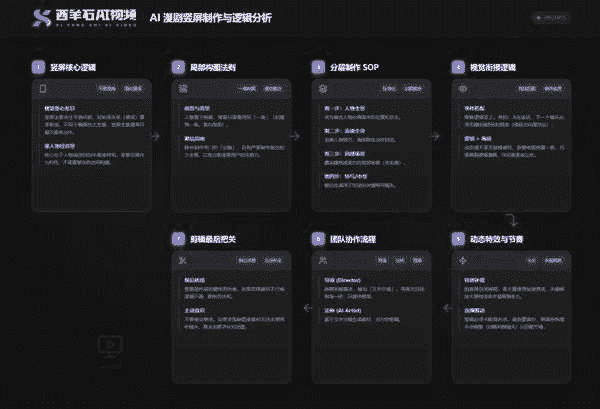

图 3-12　AI 漫剧竖屏制作与逻辑分析 EXr6287u6NNVz+GYLY+7SDk226FstKIHdC0bNoQkB2Nqi1xSR0yxPmwrTs5gRi/BtfSbid6dBhii9q7cz2pIyA==

## 3.6 场景搭建逻辑与提示词配方

在 AI 漫剧里，角色负责“谁出现”，场景负责“故事放哪儿”。空间直接决定人物之间的远近关系、情绪的浓淡节奏，以及镜头怎么调度。新手最容易踩的坑就是把场景当成背景板，最后精修的角色一塞进去就很违和，像是贴上去的。真正成熟的制作习惯是把场景规划提前到剧本阶段，而不是等到要出图时才临时想。

### 3.6.1 先从剧本拆出场景清单

开画之前，先回到剧本。把整集甚至全剧里会反复出现的关键空间整理成表，就是场景清单表，如表 3-2 所示。

表 3-2　场景清单表（示例）

传统影视动画里，导演先锁定主场景，主要是为了减少返工、统一美术基调。商业项目里主场景还担着品牌识别和世界观定调的作用。主场景稳定后，后续镜头才能在同一空间体系里快速展开。AI 创作把搭景从建模手绘换成了提示词生成，形式变了，这个核心逻辑没变。

### 3.6.2 让画面有叙事力的三件事

即便靠 AI 出图，传统场景设计的三大要点依然是质感的保证。

#### 1．前后景分层要有层次
能讲故事的空间一般能看出前景、中景、远景三个层次。前景常是栏杆、树枝、门框、桌角之类的小物件，用来拉出纵深和镜头层次；中景是人物活动的主场，也是叙事发生的核心区；远景负责世界观和尺度感，比如建筑轮廓、山脉、天际线。层次不清的画面很容易变成扁平插画，扛不住分镜拆解和运镜。

#### 2．用环境牵引视线与动线
好场景会“说话”。地面纹理的走向、建筑的排列、光的投射方向，都是天然的视觉引导。比如对话戏用长廊的透视把视线自然带到人物，冲突戏用围合结构制造压迫感。设计时要自问：即使不放角色，这个空间本身是否在暗示故事。

#### 3．光与时段决定情绪
光源方向、色温、以及清晨、午后、黄昏、深夜这些时间点，对情绪的影响往往超过物件细节。AI 生成时不把光属性写清楚，很容易得到光影平淡、情绪模糊的糖水片。

### 3.6.3 场景提示词的固定写法

为了让结果既好看又好用，建议固定一套顺序：【空间类型】+【时代与风格】+【主要结构与物件】+【光线与时间】+【氛围与情绪】+【是否出现角色】+【画面规格】。

实战参考：

古风修真学院的练武场，外景。宽阔石质广场，地面刻着巨大阵法纹路，四周高耸石柱和旗帜，背景隐约是远山与主楼。傍晚偏晚的阳光从左上斜打，形成长影，整体偏冷调，带一点金色余晖，氛围庄严中带压迫。画面先不放人物，作为动画分镜背景使用，高精细度。

按这个写法出来的结果如图 3-11 所示。

出图设置上优先 21:9 长幅比例，接近电影分镜画幅，后期裁切、推拉、合成角色都有更大容错。

图 3-11　提示词生成结果

横屏和竖屏的场景逻辑也不一样。横屏重空间关系和环境叙事，接近影视片，对场景完整度要求很高；竖屏重人物呈现和信息密度，场景偏情绪烘托，环境可以简化。竖屏的构图思路可以参考如图 3-12 所示。

图 3-12　AI 漫剧竖屏制作与逻辑分析 EXr6287u6NNVz+GYLY+7SDk226FstKIHdC0bNoQkB2Nqi1xSR0yxPmwrTs5gRi/BtfSbid6dBhii9q7cz2pIyA==

## 3.7 AI 漫剧里如何管住道具

在叙事里，道具不只是画面里的物件，更是推动情节的工具、视觉符号的载体，也是串联角色行为逻辑的纽带。在 AI 生成加编剧分镜的流程里，道具的稳定性和一致性是公认的难点。下面结合传统叙事和 AI 实践，梳理一套可复用的做法。

### 3.7.1 道具在画面里干什么

视觉叙事里道具大致分三类，如图 3-13 所示。

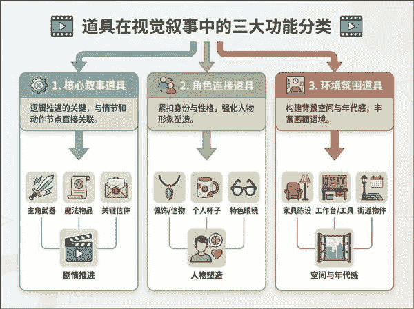

图 3-13　道具在视觉叙事中的三大功能

核心叙事道具是情节推进的关键词物，比如主角武器、魔法物品、关键信件，它们直接牵动动作和转折；角色连接道具和人物身份、性格、经历绑定，像佩饰、杯子、眼镜，用来强化人物塑造；环境氛围道具则是家具、工作台、街头物件，用来撑起空间真实感和时代语境。哪怕是小物件，经过严谨设计也能成为叙事线索。

### 3.7.2 AI 生成道具要解决的痛点

传统制作里道具一旦定稿就是可重复调用的资产。AI 流程里道具每次都要靠提示词重新生成，从固定资产变成概率结果，这带来三个核心问题。

#### 1．视觉一致性问题
这是目前最大的技术壁垒。比如主角的玉佩，第一镜是圆的，第十镜变成椭圆；特写纹理清晰，拉远就糊成色块。这种“物体漂移”单图不明显，成片后就会破坏沉浸感。模型会根据整体构图去脑补，而不是记住上一镜的样子。图 3-14 就是一组不一致的例子，佩剑位置和样式明显跳变。

图 3-14　存在视觉一致性问题的图片示例

#### 2．物理交互与空间逻辑缺失
AI 会画好看的图，不擅长真实物理关系。角色握剑、端杯、拿枪时，手部接触、重心、遮挡经常不合理。图 3-15 就是典型的交互失真。

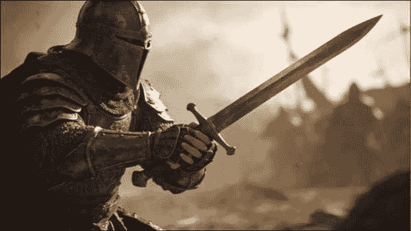

图 3-15　存在物理交互与空间逻辑问题的图片示例

#### 3．叙事功能的装饰化
模型有过度美化的倾向，会自动加无意义的装饰线条、光效和复杂纹理。为了精细感牺牲逻辑，比如穷剑客的剑鞘本该破旧缠绳，AI 却生成镶金宝剑。这种为了好看而削弱功能的设计，会误导观众理解。

因此道具不能当生图的“随机赠品”，必须从一开始就策略化描述、标准化管理、强制约束。

### 3.7.3 道具设计的基本原则

#### 1．从功能出发，别先谈外观
先想清它在故事里的作用、归属、象征意义，再决定长什么样。

#### 2．视觉语言要和世界观统一
造型、材质、纹理、色彩、佩戴方式都要和整体风格一致。

#### 3．主次分明，关键道具要一眼认出
同一画面多个道具时，信息层次要清晰，确保观众能快速定位叙事重点。

#### 4．兼顾可交互与实用性
要考虑尺寸比例、握持方式、运动轨迹是否合理。

### 3.7.4 道具提示词的结构与写法

推荐固定结构：【视觉风格】+【主体对象】+【用途/情节功能】+【时代标签】+【外观细节】+【材质与色彩】+【交互属性】+【镜头需求】。

要素说明：视觉风格统一漫剧调性；主体对象是具体名称；用途/情节功能写清在剧情里做什么；时代标签如古风、现代；外观细节包括形状、纹理、雕刻；材质与色彩描述材质和色调；交互属性说明能否被拿起操作；镜头需求明确景别。

示例：

国风 3D 动漫，古风战场上的长剑道具。剑身略弯，雕刻祥云与龙纹，白玉护手点缀青色宝石。材质为锻钢与白玉，符合古典审美。生成高细节正侧特写，风格典雅庄重，不出现其他装饰物。

按此生成的图片如图 3-16 所示。

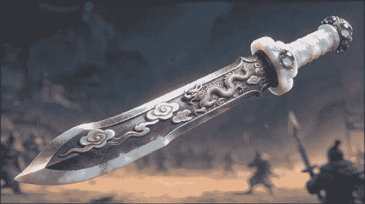

图 3-16　AI 生成的古风战场上的长剑道具

### 3.7.5 典型类型道具设计策略

不同类型的道具，AI 的处理权重不一样，撰写提示词和建库的关注点也不同，如图 3-17 所示。

#### 1．象征性道具

物件记忆法：让漫剧道具保持稳定

这类器物大多与角色的核心身份或情感脉络深度绑定，比如传家玉牌、特工专用徽章，或一条贯穿全剧的戒指。它们承担着“以物代人”的叙事作用，往往在关键情节点上发出信号。

图 3-17　漫剧物件设计策略

一、象征性物件
产出难点：在广角或中景里，细小器物容易被压成模糊色块，辨识度随细节一同消失。
应对思路：先单独制作一套超清特写作为素材库资产。写指令时像拍商业大片那样把材质光泽与独特纹理写透，例如温润羊脂玉、带划痕黄铜、表层刻着细小家族纹章。
实操要点：加入微距摄影、顶光、纯色背景等描述，强化其作为独立视觉符号的定位，后期便于贴图或局部重绘。

二、功能性物件
涵盖武器、乐器、载具及各类机械。既要好看更要好用，画面里常伴随大幅动作。
产出难点：系统容易产出没有握柄的刀、扳机位置错误的枪、手指穿过杯壁等违和画面，因缺乏真实物理与人体工学常识。
应对思路：指令不仅描述物本身，要写清交互关系。比如手指扣住扳机、手掌裹住剑柄。机械类还要强调结构合理，避免华而不实的伪科技。
实操要点：生成时直接带上手部模型一并产出，例如“戴战术手套的手紧握着……”，迫使系统算出符合人体工学的形态。

三、环境填充物件
用于补足背景、稳住空间可信度，如桌上茶具、架上卷轴、街边旗帜路灯。是世界观基石，但不能抢戏。
产出难点：背景物易被过度渲染，普通花瓶光鲜夺目盖过主角，或古风场景里出现现代马克杯，导致时代感错乱。
应对思路：核心是“后退”。指令偏重时代氛围与做旧质感，少写具体结构。多用磨损、积灰、背景虚化等词，让物件体面退后。
实操要点：时代标签严格统一。赛博风格就配霓虹、金属废料；修仙玄幻就统一木质、陶制、青铜。材质统一会在潜意识里传递世界观。

长周期项目里，器物要当长期资产来管。搭建专属器物库，对产出成功且符合设定的资产同步存档成图与完整指令；给每个器物打版本号和风格标签；做新镜头时复用旧指令与实例作底板，保证视觉连贯；对关键器物制作多角度视图和交互样例，提升产出稳定性。

图 3-18　漫剧物件的一致性管理与复用指南 EXr6287u6NNVz+GYLY+7SDk226FstKIHdC0bNoQkB2Nqi1xSR0yxPmwrTs5gRi/BtfSbid6dBhii9q7cz2pIyA==

### 3.7 AI漫剧中的物件构建

在讲故事里，物件不只是画面摆设，更是推动情节的工具、视觉符号的载体，以及衔接角色行为逻辑的纽带。生成加分镜流程下，稳定与连贯是业界公认难点。下面结合传统叙事逻辑与生成实践，梳理一套可复用原则。

### 3.7.1 物件在叙事里的分工

画面叙事大致分三类，如图 3-13 所示。

图 3-13　视觉叙事中的三大物件功能

核心叙事物是推动情节的关键件，例如主角武器、魔法物件或关键信件。它们与角色动作和转折点直接挂钩；角色联结物紧密贴合身份、性格或经历，如佩饰、杯子、眼镜，主要作用是强化人物塑造；环境氛围物则指背景中的家具、工作台、街道物件，用来建立空间真实感与年代氛围，丰富语境。

即便是不起眼的小物，经过严谨逻辑设计，也能成为深化叙事、暗示性格或推动剧情的视觉线索。

### 3.7.2 设计要解决的痛点

传统制作里物件一旦定稿就是可复用的标准化资产。生成流程下物件不是硬盘里的文件，而是每次靠指令重新产出的概率结果。底层逻辑从固定资产到概率产出，导致三大痛点。

#### 1．画面保持统一的问题
这是目前最大的技术壁垒。以随身玉佩为例，第一镜可能是圆形，第十镜变椭圆；特写纹理清晰，拉远就变成色块。这种物体漂移在单图不易察觉，成片后形状、色彩、细节跳动会严重破坏沉浸感。系统习惯按整体构图脑补，不会记住上一镜长相。图 3-14 展示了佩剑位置和样式明显不一致的案例。

图 3-14　存在视觉一致性问题的图片示例

#### 2．实体互动与空间逻辑的缺失
系统会画好看的图，却不擅长真实物理关系。角色手持物件时问题突出，如握剑、端杯、持枪。图 3-15 展示了握剑细节不合常理的画面。

图 3-15　存在物理交互与空间逻辑问题的图片示例

#### 3．叙事被装饰冲淡
系统有过度修饰的倾向，会自行添加无意义装饰线、光效、复杂纹理追求精细感。叙事中物件必须服务剧情逻辑。穷困剑客的剑鞘应是破旧缠麻绳，系统却可能生成镶金带银的宝剑。这种为美观牺牲逻辑的过度设计，会削弱物件的叙事功能，甚至误导观众。

因此物件不能是出图时的随机赠品，必须从一开始就被策略化描述、标准化管理并强制约束。只有系统解决这三点，物件才能真正成为故事的一部分。

### 3.7.3 设计基本原则

1．从用途出发，拒绝先谈外观
有价值的物件必须推动情节、服务角色或强化场景。设计前明确其在故事中的作用、归属和象征意义。剑或玉佩的外观应基于身份逻辑与情绪纽带。

2．视觉语言与世界观同步
造型、材质、纹理、色彩、佩戴方式需与整体风格一致。蒸汽朋克要突出金属与机械结构，未来科幻则强调科技感。

3．主次分明，识别清晰
画面信息要分层。若多个物件同框，需明确叙事优先级，确保关键物件被快速识别。

4．注重可交互性与实用性
物件常与角色互动，需考虑尺寸比例、握持方式、运动轨迹的合理性。

### 3.7.4 指令结构与写法

为保证可控、连贯、可复用，推荐固定结构：【视觉风格】+【主体对象】+【用途/情节功能】+【时代标签】+【外观细节】+【材质与色彩】+【交互属性】+【镜头需求】。

各要素说明：
· 视觉风格：与整体保持一致，如 2D 日本动漫、3D 国风动漫等。
· 主体对象：具体名称，如古代战刀、魔法石板。
· 用途/情节功能：剧情中的具体作用。
· 时代标签：古风、现代、未来等。
· 外观细节：形状、纹理、符号雕刻等。
· 材质与色彩：木质、钢铁、玉石或发光效果。
· 交互属性：可否被拿起、操作或触发特效。
· 镜头需求：近景、特写等景别。

基于此结构撰写的指令兼具质感与叙事功能。示例：国风 3D 动漫，古风战场上的长剑物件。剑身略弯，雕刻祥云龙形，白玉护手点缀青色宝石。材质为锻钢与白玉，符合古典审美。生成高细节正侧特写，风格典雅庄重，不出现其他装饰物。

图 3-16　AI 生成的古风战场上的长剑物件

### 3.7.5 典型类型设计策略

不同类型物件在系统处理权重上差异明显，关注维度应各有侧重，如图 3-17 所示。

图 3-17　AI 漫剧物件设计策略

#### 1．象征性物件
与角色核心身份或情感线深度绑定，如家传玉佩、特工徽章、贯穿全剧戒指，承载见物如见人功能。
产出痛点：全中景里易简化成模糊色块，关键信息丢失。
设计策略：单独产出商品级超清特写作为资产。指令像商业广告一样写材质光泽，如温润羊脂玉、带划痕黄铜，以及独特纹理如表面刻有细微家族族徽。
操作建议：加入微距摄影、顶光、纯色背景，确立独立视觉符号地位，方便分镜贴图或局部重绘。

#### 2．功能性物件
包含武器、乐器、交通工具、机械装置。好看之外更要好用，画面常伴随剧烈动作。
产出痛点：常出现无握把剑、扳机错位枪、手指穿杯壁等违和画面，因缺乏物理与人体工学认知。
设计策略：指令必须包含交互说明，明确手部接触方式，如手指紧扣扳机、手掌包裹剑柄。机械类强调结构合理性，避免无法运作的伪科技。
操作建议：产出时直接带手部模型，例如指令“戴战术手套的手紧握着……”，强制系统计算出符合人体工学的形态。

#### 3．环境装饰物件
填充背景、构建空间可信度，如茶具、卷轴、旗帜路灯。是世界观基石，但绝不能喧宾夺主。
产出痛点：背景物件易过度渲染，普通花瓶光彩夺目抢焦点，或时代错乱如古风出现现代马克杯。
设计策略：核心在于“藏”。指令侧重时代感与做旧质感，用磨损、积灰、背景虚化等词让物件退居幕后。
操作建议：严格统一时代标签。赛博朋克配霓虹、金属废料；修仙玄幻统一木质、陶制、青铜。通过材质统一潜意识传达世界观。

### 3.7.6 一致性管理与复用指南

长周期制作中物件需系统化管理，参照如图 3-18 所示的指南。

需将物件视作长期资产，搭建专属物件库，对产出成功且符合设定的物件同步存档成品截图与完整指令；为每个物件标注版本号与风格标签，实现统一化管理；在不同镜头制作时复用已有指令与实例作指令底板，保障视觉连贯性；对关键物件制作多角度视图及交互样例，进一步提升系统产出稳定性。

图 3-18　AI 漫剧物件的一致性管理与复用指南 EXr6287u6NNVz+GYLY+7SDk226FstKIHdC0bNoQkB2Nqi1xSR0yxPmwrTs5gRi/BtfSbid6dBhii9q7cz2pIyA==

### 3.7.1 物件在叙事中的承担的功能

物件在视觉叙事中承担的功能主要分为三类，如图 3-13 所示。

图 3-13　物件在视觉叙事中的三大功能

核心叙事物件是情节推进的关键物，例如主角武器、魔法物品或关键信件。它们不仅出现在镜头里，更与角色动作和情节转折点直接关联；角色连接物件与角色身份、性格或经历紧密相关，如主人公的佩饰、杯子或眼镜，主要作用在强化人物塑造；背景中的家具、工作台、街道物件等属于环境氛围物件，用于构建空间真实感与年代氛围，丰富画面语境。

即使是看似不起眼的物件，若经过严谨逻辑设计，也能成为深化叙事、暗示角色性格或推动剧情发展的关键视觉线索。

### 3.7.2 AI漫剧中物件设计要解决的问题

传统动画或影视里，物件一旦完成建模或设定稿，便作为静态可重复调用的标准化资产。但生成流程中，物件不再是硬盘里的固定文件，而是每次通过指令重新生成的概率性结果。

这种从固定资产到概率生成的底层转变，给AI漫剧带来三大核心痛点。

#### 1．视觉一致性问题
视觉一致性是目前最大的技术壁垒。以主角随身玉佩为例，第一镜可能是圆形，第十镜可能变成椭圆；特写纹理清晰，拉远后就简化成模糊色块。这种物体漂移在单图不易察觉，成视频后物件形状、颜色、细节持续跳动，会严重破坏沉浸感，使作品显得廉价不专业。AI模型倾向依据画面整体构图与语义去脑补形态，不会记住上一镜长相。图 3-14 展示了一组存在视觉一致性问题的图片，其中角色佩剑位置及样式有明显差异。

图 3-14　存在视觉一致性问题的图片示例

#### 2．物理交互与空间逻辑的缺失
AI擅长画好看的图，不擅长处理真实物理关系。当角色需手持物件如握剑、端茶杯、拿枪时问题尤为突出。图 3-15 展示了一张存在物理交互与空间逻辑问题的图片，其中角色握剑细节不符合常理。

图 3-15　存在物理交互与空间逻辑问题的图片示例

生成式短漫控物指南：从随机抽卡到可控复用

交互说明要把一件物件能否被拾取、如何使用、是否会触发特殊表现写透。景别要求必须写明，近景、特写等信息要明确点出。

按此思路组织提示词，生成物既有视觉质感又有清晰的叙事服务。示范一条：

国风3D动画，古战场里的长剑。剑身略弯，刻有祥云龙纹，护手为白玉配青色宝石。材质以锻钢加白玉呈现，古典韵味。输出高细节正侧特写，风格典雅肃穆，画面里不带其他装饰。

图 3-16　AI 生成的古风战场上的长剑道具

### 3.7.5 典型类型道具设计策略

分类之后，模型对不同类别的关注权重会各不相同。撰写提示词、搭建素材库时需要抓住不同的核心维度，见图 3-17。

#### 1．象征性道具
这类物件多与角色身份或情感线索深度绑定，比如传家玉佩、特工专属徽章、贯穿全剧的戒指。功能上近乎“见物如见人”。

图 3-17　AI 漫剧道具设计策略

（1）生成痛点。
在远景或中景里，这类小件极易被压缩成模糊色块，关键信息丢失。

（2）设计策略。
要单独输出一个产品级超清特写作为资产。写词时像商业摄影一样描述，突出材质光泽，例如“温润羊脂玉”“带划痕黄铜”，以及独有纹理，例如“表面细刻家族徽记”。

（3）操作建议。
提示里加入“微距摄影”“顶光”“纯色背景”等，让它成为独立视觉符号，后期方便分镜贴图或局部重绘。

#### 2．功能性道具
涵盖武器、乐器、交通工具、各类机械装置。好看之外必须好用，画面里常伴随剧烈动作。

（1）生成痛点。
常见“无剑柄的剑”“扳机位置错误的枪”“手指穿杯壁”等违和。根源是模型缺乏真实物理和人体工学常识。

（2）设计策略。
提示不能只写物件本身，要写交互关系。明确手部接触方式，如“手指扣住扳机”“手掌裹住剑柄”。机械类还要强调结构合理，避免画出复杂却无法运作的伪科技。

（3）操作建议。
直接带手部模型一起生成，例如提示加入“戴战术手套的手紧握着……”，强迫模型算出符合人体工学的形态。

#### 3．环境装饰道具
用于填补背景、提升空间可信度，如桌上茶具、书架卷轴、街边旗帜路灯。它们是世界观基石，但不能抢戏。

（1）生成痛点。
背景物件容易被过度渲染，比如背景花瓶被画得光彩夺目抢走主角，或古风场景里出现现代马克杯，破坏时代感。

（2）设计策略。
核心是“藏”。提示侧重时代感与做旧质感，而非结构细节。用“磨损的”“落灰的”“背景虚化”等，让物件体面退后。

（3）操作建议。
时代标签必须统一。赛博朋克的背景要带“霓虹”“金属废料”属性；修仙玄幻则统一“木质”“陶制”“青铜”等材质，用材质统一在潜意识里传递世界观。

### 3.7.6 道具的一致性管理与复用指南

长周期制作必须把物件当长期资产系统化管理。可参照如图 3-18 所示的 AI 漫剧道具的一致性管理与复用指南。

长期项目里要建专属物件库，对生成成功且符合设定的物件同步存档成图与完整提示词；为每个物件标注版本号和风格标签，实现统一管理；新镜头制作时可复用已有提示词和实例作底板，保证视觉连贯；对关键物件可再做三视图和多角度交互样本，进一步提升生成稳定性。

图 3-18　AI 漫剧道具的一致性管理与复用指南 EXr6287u6NNVz+GYLY+7SDk226FstKIHdC0bNoQkB2Nqi1xSR0yxPmwrTs5gRi/BtfSbid6dBhii9q7cz2pIyA==

## 3.7 AI 漫剧中的道具设计

在叙事作品里，物件不只是画面里的摆设，更是推动情节的工具、视觉叙事的符号载体，也是连接角色行为逻辑的纽带。在“AI 生成+编剧分镜”流程里，物件的稳定与一致是业内公认的难点。本节结合影视动画传统叙事逻辑与生成实践，梳理一套可复用的设计原则。

### 3.7.1 道具在叙事中的承担的功能

视觉叙事里物件主要承担三类作用，如图 3-13 所示。

图 3-13　道具在视觉叙事中的三大功能

核心叙事物件是情节推进的关键，例如主角武器、魔法道具或关键信件。它们不仅出现，更与角色动作和转折点直接挂钩；角色连接物件与身份、性格或经历紧密相关，如佩饰、杯子、眼镜，主要作用是强化人物塑造；背景家具、工作台、街头物等属于环境氛围物件，用于构建空间真实感与年代感，丰富语境。

即便不起眼，只要逻辑严谨，也能成为深化叙事、暗示性格或推动剧情的关键视觉线索。

### 3.7.2 AI 漫剧中道具设计要解决的问题

传统动画或影视里，物件完成建模或设定稿后就是可重复调用的标准化资产。但在生成流程里，物件不是硬盘里的固定文件，而是每次靠提示词重新生成的概率结果。

从“固定资产”到“概率生成”的底层转变，带来三类核心痛点。

#### 1．视觉一致性问题
目前最大的技术壁垒。以主角随身玉佩为例，第一镜可能是圆形，第十镜变成椭圆；特写纹理清晰，拉远就变成模糊色块。这种“物体漂移”在单图不易察觉，串成视频后形状、颜色、细节持续跳动，会严重破坏沉浸感。模型倾向按整体构图和语义“脑补”形态，不会记住上一镜长啥样。图 3-14 展示了一组视觉一致性问题图，佩剑位置与样式差异明显。

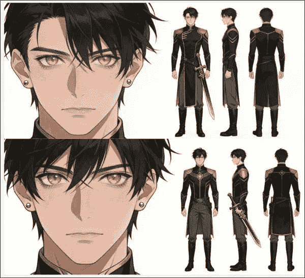

图 3-14　存在视觉一致性问题的图片示例

#### 2．物理交互与空间逻辑的缺失
模型擅长画好看的图，不擅长处理真实物理关系。角色手持物件时问题尤其突出，如握剑、端杯、拿枪。图 3-15 展示了一张物理交互与空间逻辑问题图，握剑细节不合理。

图 3-15　存在物理交互与空间逻辑问题的图片示例

#### 3．叙事功能的装饰化
生成物件时常有过度美化倾向，会自动添加大量无意义装饰线条、光效或复杂纹理，追求精细感。但叙事里物件必须服务剧情逻辑。例如穷困剑客的剑鞘应破旧缠麻绳，而模型可能生成镶金带银的华丽宝剑。这种为美观牺牲逻辑的过度设计，会削弱叙事功能，甚至误导观众。

因此物件绝不能当生图的随机赠品，必须从一开始就定义为需策略化描述、标准化管理并强制约束的核心资产。只有系统解决这三类问题，物件才能真正成为故事的一部分。

### 3.7.3 道具设计的基本原则

生成式漫剧制作中，物件设计建议遵循4条原则。

#### 1．从功能出发，拒绝外观先行
有价值的物件必须能推动情节、服务角色或强化场景。设计前要明确其在故事中的作用、归属与象征意义。剑或玉佩的外观应基于身份逻辑与情绪纽带。

#### 2．视觉语言与世界观统一
物件的造型、材质、纹理、色彩及佩戴方式，需与作品整体视觉风格一致。蒸汽朋克要凸显金属质感与机械结构，未来科幻则要强调科技感。

#### 3．主次分明，识别清晰
画面信息要层次分明。若同一画面出现多个物件，必须明确叙事优先级，确保观众能迅速识别关键物件。

#### 4．注重可交互性与实用性
物件常与角色互动，设计时必须考虑尺寸比例、握持方式及运动轨迹的逻辑合理性。

### 3.7.4 AI 道具提示词的结构与写法

为保证生成结果可控、连贯且可复用，推荐固定结构：【视觉风格】+【主体对象】+【用途/情节功能】+【时代标签】+【外观细节】+【材质与色彩】+【交互属性】+【镜头需求】。

各要素含义如下。

**·** 视觉风格：与漫剧整体保持一致，如 2D 日本动漫、3D 国风动漫等。
**·** 主体对象：物件的具体名称，如“古代战刀”“魔法石板”。
**·** 用途/情节功能：物件在剧情中的具体作用。
**·** 时代标签：即时代设定，如古风、现代、未来等。
**·** 外观细节：包括形状、纹理、符号雕刻等。
**·** 材质与色彩：描述木质、钢铁、玉石或发光效果。
**·** 交互属性：描述是否可被拿起、操作或触发特定效果。
**·** 镜头需求：明确景别，如近景或特写。

按此结构写提示词，能确保物件兼具视觉质感与清晰叙事功能。下面是一条示例。

国风 3D 动漫，古风战场上的长剑道具。剑身略呈弯曲，上面雕刻祥云与龙形，白玉护手点缀青色宝石。用料为锻钢与白玉，对应古典审美。生成高细节正侧特写，风格典雅庄重，不出现其他装饰物。

根据以上提示词生成的图片如图 3-16 所示。

图 3-16　AI 生成的古风战场上的长剑道具

### 3.7.5 典型类型道具设计策略

物件种类不同，决定模型对其处理权重的差异。撰写提示词与建立资产库时，关注维度应截然不同，如图 3-17 所示。

#### 1．象征性道具
这类物件通常与角色核心身份或情感线索深度绑定，例如家传玉佩、特工专属徽章，或贯穿全剧的戒指。它们往往承载“见物如见人”的叙事功能。

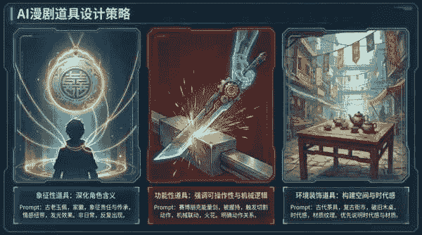

图 3-17　AI 漫剧道具设计策略

（1）AI 生成痛点。
在全景或中景镜头中，模型极易将这些小物件简化为模糊色块，导致关键信息丢失。

（2）设计策略。
必须单独生成一张“产品级”的超清特写图作为资产。提示词中要像拍摄商业广告一样描述，强调材质光泽，如“温润的羊脂玉”“带划痕的黄铜”，与独特纹理细节，如“表面刻有细微的家族族徽”。

（3）操作建议。
提示词中加入“微距摄影”“顶光”“纯色背景”等词汇，确立其作为独立视觉符号的地位，方便后期分镜贴图或局部重绘。

#### 2．功能性道具
功能性道具涵盖武器、乐器、交通工具及各种机械装置。这类物件不仅要好看，更要“好用”。它们在画面中往往伴随角色剧烈动作。

（1）AI 生成痛点。
模型经常生成“没有握把的剑”“扳机位置错误的枪”或者“手指穿过杯壁”的违和画面。因为缺乏真实物理与人体工学认知。

（2）设计策略。
提示词不能只描述物体本身，必须包含交互关系说明。要明确描述手部如何接触物件，如“手指紧扣扳机”“手掌包裹剑柄”。对机械类物件，还要强调结构合理性，避免生成看似复杂实则无法运作的伪科技部件。

（3）操作建议。
生成此类物件时，不妨直接带上“手部模型”一起生成，例如提示词中加入“戴着战术手套的手紧握着……”，这样能强制模型算出符合人体工学的物件形态。

#### 3．环境装饰道具
这类物件用于填充背景，构建空间可信度，如桌上茶具、书架卷轴、街边旗帜或路灯。它们是世界观基石，但绝不能喧宾夺主。

（1）AI 生成痛点。
生成背景物件时有时出现“过度渲染”问题，例如把背景里普通花瓶生成得光彩夺目，抢走主角视觉焦点，或在古风场景里生成现代风格马克杯，导致时代感错乱。

（2）设计策略。
核心在于“藏”。提示词应侧重描述“时代感”与“做旧质感”，而非具体物体结构。可使用“磨损的”“积灰的”“背景虚化”等词汇，让物件体面退居幕后。

（3）操作建议。
严格统一时代标签。如果是赛博朋克，背景物件必须带有“霓虹”“金属废料”等属性；如果是修仙玄幻，则统一为“木质”“陶制”或“青铜”等材质。通过材质统一性，在潜意识层面向观众传递统一世界观信息。

### 3.7.6 道具的一致性管理与复用指南

长周期生成式漫剧制作中，必须将物件视为长期资产进行系统化管理。具体可参照如图 3-18 所示的 AI 漫剧道具的一致性管理与复用指南。

在长期制作过程中，需将物件视作长期资产，为此要搭建专属物件库，对生成成功且符合设定的物件，同步存档成品截图与对应的完整提示词；同时为每个物件标注版本号与风格标签，以实现统一化管理；在不同镜头制作时，还可复用已有物件的提示词与实例作为提示词底板，保障物件呈现的视觉一致性；针对关键物件，还可制作三视图及多角度交互样本，进一步提升模型生成的稳定性。

图 3-18　AI 漫剧道具的一致性管理与复用指南 EXr6287u6NNVz+GYLY+7SDk226FstKIHdC0bNoQkB2Nqi1xSR0yxPmwrTs5gRi/BtfSbid6dBhii9q7cz2pIyA==

## 3.7 AI 漫剧中的道具设计

在叙事作品中，物件不仅是放置在画面里的物件，更是故事推进的工具、视觉叙事的符号载体，以及连接角色行为逻辑的纽带。在“AI 生成+编剧分镜”的制作流程中，物件的稳定性与一致性是业界公认的操作难点。本节将结合影视动画的传统叙事逻辑与生成实践，梳理一套具备可复用性的设计原则。

### 3.7.1 道具在叙事中的承担的功能

物件在视觉叙事中承担的功能主要分为三类，如图 3-13 所示。

图 3-13　道具在视觉叙事中的三大功能

核心叙事物件是情节推进的关键物件，例如主角的武器、魔法物品或关键信件。它们不仅出现在镜头里，更与角色的动作和情节的转折点直接关联；角色连接物件与角色身份、性格或经历紧密相关，如主人公的佩饰、杯子或眼镜，它们的主要作用在于强化人物塑造；背景中的家具、工作台、街道物件等属于环境氛围物件，用于构建空间真实感与年代氛围，丰富画面的语境信息。

即使是看似不起眼的物件，若经过严谨的逻辑设计，也能成为深化叙事、暗示角色性格或推动剧情发展的关键视觉线索。

### 3.7.2 AI 漫剧中道具设计要解决的问题

在传统动画或影视制作中，物件一旦完成建模或设定稿，便作为静态的、可重复调用的“标准化资产”。但在生成流程中，物件不再是存储在硬盘里的固定文件，而是每一次都要通过提示词重新生成的“概率性结果”。

这种从“固定资产”到“概率生成”的底层逻辑转变，给制作带来了以下三个核心痛点。

#### 1．视觉一致性问题
视觉一致性问题是目前制作中最大的技术壁垒。以主角随身携带的玉佩为例，在第一镜中可能是圆形的，到了第十镜可能变成了椭圆；在特写中纹理清晰，拉远后可能就简化成了一个模糊色块。这种“物体漂移”现象在单图生成时不易察觉，一旦连接成视频，物件形状、颜色、细节的持续跳动，会严重破坏观众的沉浸感，使作品显得廉价且不专业。模型倾向于根据画面整体构图与语义去“脑补”物件的形态，而不会记得它在上一镜中长什么样。图 3-14 展示了一组存在视觉一致性问题的图片，其中角色的佩剑位置以及样式有明显差异。

图 3-14　存在视觉一致性问题的图片示例

#### 2．物理交互与空间逻辑的缺失
模型擅长画“好看的图”，但不擅长处理“真实的物理关系”。当角色需要手持物件（如握剑、端茶杯、拿枪）时，这一问题尤为突出。图 3-15 展示了一张存在物理交互与空间逻辑问题的图片，其中角色的握剑细节不符合常理。

图 3-15　存在物理交互与空间逻辑问题的图片示例

#### 3．叙事功能的装饰化
模型在生成物件时，往往带有“过度美化”的倾向。它会自动为物体添加大量无意义的装饰线条、光效或复杂纹理，以追求画面的“精细感”。然而在叙事中，物件的设计必须服务于剧情逻辑。例如，一个穷困潦倒的剑客，其剑鞘应该是破旧、缠满麻绳的，而模型可能会生成一把镶金带银的华丽宝剑。这种为了视觉美观而牺牲逻辑的“过度设计”，会直接削弱物件在剧本中原本承担的叙事功能，甚至对观众的理解产生误导。

因此，在设计流程中，物件绝不能被视为生图时的“随机赠品”。它必须从一开始就被定义为需要被策略化描述、标准化管理且强制约束的核心资产。只有系统性地解决了这三个问题，物件才能真正成为故事中的一部分。

### 3.7.3 道具设计的基本原则

在制作中，物件设计建议遵循以下 4 个原则。

#### 1．从功能出发，拒绝外观先行
真正有价值的物件必须能推动故事情节、服务角色或强化场景。设计前需明确其在故事中的作用、归属以及象征意义。例如一把剑或一枚玉佩，其外观设计应基于背后的身份逻辑与情绪纽带。

#### 2．视觉语言与世界观统一
物件的造型、材质、纹理、色彩及佩戴方式，需与作品整体视觉风格保持一致。蒸汽朋克风格的物件要凸显金属质感与机械结构，未来科幻风格的物件则需强调科技感。

#### 3．主次分明，识别清晰
物件在画面中的信息应层次分明。若同一画面中出现多个物件，必须明确叙事优先级，确保观众能迅速识别关键物件。

## 3.7 AI 漫剧道具操作手册

在叙事中，物件远不止是画面里的填充，更是推动情节点、承载符号意义、连接人物行为的桥梁。把 AI 产出和编剧分镜结合的工作流里，物件的稳定与统一是最棘手的难题。以下梳理一套可复用的实操思路。

### 3.7.1 物件在叙事中的分工
物件在视觉叙事里大致可归为三类，如图 3-13 所示。

图 3-13 物件在视觉叙事中的三大作用

核心驱动类是牵动情节的关键品，例如主角兵器、法器或决定转折的信件，它们与人物动作和剧情节点直接绑定；人物关联类紧贴身份、性格或经历，如随身佩饰、杯具、眼镜，用来强化人物塑造；环境氛围类则是背景中的家具、工作台、街头陈设，用以营造空间可信度与年代感，丰富语境。

即便外表不起眼，只要逻辑严谨，也能成为深化叙事、暗示性格或推进情节的关键视觉线索。

### 3.7.2 生成环节常见的瓶颈
传统动画里物件定稿后就是可调用的标准资产。AI 流程里物件每次都要靠描述指令重新产出，概率性特征带来了三大痛点。

#### 1．画面保持度失效
现在最大的技术壁垒。以随身玉佩为例，第一镜可能是圆的，第十镜就变成椭圆；特写纹理清晰，拉远后简化成模糊色块。这种漂移在单张不易察觉，串成视频后形状、色彩、细节的持续跳动会严重破坏沉浸感。模型会按整体构图去补全形态，不会记住上一镜的样子。图 3-14 展示了一组统一度问题示例，佩剑位置与样式明显差异。

图 3-14 存在画面统一度问题的图片示例

#### 2．物理交互与空间逻辑缺失
模型擅长画好看的图，不擅长处理真实物理关系。人物手持物件时问题尤甚，如握剑、端杯、持枪。图 3-15 展示了触碰与空间逻辑的问题，握剑细节不合理。

图 3-15 物理交互与空间逻辑问题示例

#### 3．叙事功能被过度美化稀释
产出时常有过度美化的倾向，会自动添加无意义的装饰线条、光效或复杂纹理追求精细感。但叙事中物件必须服务剧情逻辑。比如落魄剑客的剑鞘应是破旧缠麻绳，模型可能给出镶金带银的华丽宝剑。这种为美观牺牲逻辑的过度设计，会削弱物件的叙事功能，甚至误导观众理解。

因此物件绝不能是生图的随机赠品，必须从起步就被策略化描述、标准化管理并强制约束。只有系统解决这三个问题，物件才能真正成为故事的一部分。

### 3.7.3 设计底线四条

#### 1．功能优先于造型
有价值的物件必须能推动情节、服务人物或强化场景。设计前先明确它在故事里的作用、归属和象征意义。比如剑或玉佩，外观要基于身份逻辑与情绪纽带。

#### 2．视觉语言与整体设定统一
造型、材质、纹理、色彩及佩戴方式需与整体美术风格一致。蒸汽朋克要突出金属质感与机械结构，未来科幻则强调科技感。

#### 3．主次分明 易于识别
画面信息要分层。若同一画面出现多个物件，需明确叙事优先级，确保观众迅速锁定关键品。

#### 4．交互与实用性先行
物件常需与人物产生接触，设计时要考量尺度比例、握持手感及运动轨迹的逻辑合理性。好看只是第一步，能用才算数。

### 3.7.4 可重复使用的描述结构
为让产出可控、连贯且能重复使用，建议固定一个描述顺序：【视觉风格】+【核心品类】+【用途情节功能】+【时代设定】+【外观细节】+【材质色彩】+【交互属性】+【镜头需求】。

各部分说明：

· 视觉风格：与整部短漫保持统一，比如 2D 日系动画、3D 中式动画等。
· 核心品类：物件的准确名称，例如“古代战刀”“魔法石板”。
· 用途情节功能：该物在剧情里发挥什么作用。
· 时代设定：背景年代，如古风、现代、未来。
· 外观细节：形体、纹理、雕刻符号等。
· 材质色彩：木质、钢铁、玉石或发光效果等。
· 交互属性：能否被拿起、操作或触发特定效果。
· 镜头需求：景别要求，比如近景、特写。

按此框架撰写，产出的物件既有质感又有叙事指向。下面是一条示范：

中式风格 3D 动画，古战场的长剑。剑身微弯，剑体雕有祥云与龙纹，白玉护手嵌青色宝石。材质为锻钢与白玉，整体偏古典雅致。需要高细节正侧特写，风格典雅庄重，画面内不出现其它装饰。

按此产生的图片如图 3-16 所示。

图 3-16 AI 产出的古风战场长剑物件

### 3.7.5 分类型的撰写策略
物件类别不同，生成系统关注的侧重点也会变化，写指令和建资产库的重点要分开，如图 3-17 所示。

#### 1．象征类物件
这类品通常和人物身份或情感线索深度绑定，例如传家玉佩、特工徽章或贯穿全剧的戒指，核心功能是“见物如见人”。

图 3-17 AI 短漫物件设计策略

（1）产出痛点。
在全景或中景里，小物件容易被压缩成模糊色块，关键信息丢失。
（2）应对思路。
单张产品级超清特写作为资产。指令要像拍商业广告那样写，突出材质光泽，例如“温润羊脂玉”“带划痕黄铜”，并强调独特纹理，例如“表面刻着细微的家族徽记”。
（3）执行技巧。
加入“微距摄影”“顶光”“纯色背景”等描述，确立其作为独立视觉符号的地位，便于后期贴图或局部重绘。

#### 2．功能类物件
涵盖武器、乐器、交通工具和各类机械装置。这类物件不仅要好看，更要好用，画面里常伴随激烈动作。

（1）产出痛点。
常出现“无握把的剑”“扳机位置错误”“手指穿杯”的违和感，因系统缺乏真实物理及人体工学认知。
（2）应对思路。
指令不能只写物体本身，必须写清交互关系。明确手部接触方式，如“手指扣住扳机”“手掌包住剑柄”。机械类还要强调结构合理性，避免产出看似复杂实则无法运作的伪科技部件。
（3）执行技巧。
直接带上“手部模型”一起产出，例如“戴战术手套的手紧握着……”，强迫系统计算出符合人体工学的形态。

#### 3．环境点缀物件
用于填补背景、增强空间可信度，如桌上茶具、书架卷轴、街边旗帜路灯。它们是整体设定的基石，但不能抢戏。

（1）产出痛点。
背景物件易过度渲染，比如普通花瓶被照得夺目，或者古风场景里出现现代马克杯，时代错乱。
（2）应对思路。
核心是“退”。指令侧重时代感和做旧质感，而非结构细节。多用“磨损的”“积灰的”“背景虚化”，让物体体面退后。
（3）执行技巧。
严格统一时代标签。赛博朋克背景要用“霓虹”“金属废料”，修仙玄幻则统一“木质”“陶制”“青铜”，靠材质统一潜意识传递设定信息。

### 3.7.6 资产库的统一管理与复用
长周期制作里，物件必须视作长期资产系统化管理。可参照如图 3-18 所示的指南。

在长期制作中，要建专属物件库，对成功且符合设定的物件，存档成品截图和完整指令；为每个物件标注版本号与风格标签，实现统一管理；分镜制作时复用已有指令与实例作为底板，保证视觉统一；对关键物件可制作三面示意图和多角度交互样本，提升产出稳定性。

图 3-18 短漫物件统一性管理与复用指南 EXr6287u6NNVz+GYLY+7SDk226FstKIHdC0bNoQkB2Nqi1xSR0yxPmwrTs5gRi/BtfSbid6dBhii9q7cz2pIyA==

要把 AI 漫剧做扎实，物件不能当成出图时附带的意外产物。它必须在立项阶段就被明确定位为需要策略性描述、规范化归档并强制执行的核心资产。唯有把定义、治理、约束这三件事系统解决，物件才有资格进入叙事内核，而不是悬浮在画面表层。

### 3.7.3　道具设计的基本原则
实践中 AI 短漫的物件打造可归纳为四条基本准则。

#### 1．从功能出发，拒绝外观先行
产生价值的物件首先要能推动情节、衬托人物或烘托空间。动笔前先厘清它在故事里承担的职责、归属关系与象征指向。比如一把长剑或一枚玉佩，外形应当由身份逻辑与情感联结推导出来，而不是先追求好看再倒推理由。

#### 2．视觉语言与世界观统一
造型、材质、纹理、配色以及佩戴方式，都要与整体画风保持同频。蒸汽朋克系的物品要凸显金属质感与机械结构，未来科幻系则强调科技冷感与线条秩序。

#### 3．主次分明，识别清晰
一帧画面里若出现多个物件，需要先确定叙事权重，让观众迅速锁定关键物，避免视觉信息打架。

#### 4．注重可交互性与实用性
物件多与角色产生接触，设计时要推敲尺度比例、握持姿态和运动轨迹是否符合物理与人体工学的常识。

### 3.7.4　AI 道具提示词的结构与写法
为保证输出可控、连贯且便于复用，建议采用固定写法：【视觉风格】+【主体对象】+【用途/情节功能】+【时代标签】+【外观细节】+【材质与色彩】+【交互属性】+【镜头需求】。

各部分说明如下。
**·** 视觉风格：与整体漫剧保持一致，如 2D 日系动画、3D 国风动画等。
**·** 主体对象：物件的具体名称，如“古战刀”“魔法石板”。
**·** 用途/情节功能：剧情中的具体作用。
**·** 时代标签：古风、现代、未来等设定。
**·** 外观细节：形状、纹理、雕刻符号等。
**·** 材质与色彩：木质、锻钢、玉石或发光特效等描述。
**·** 交互属性：能否被拿起、操作或触发效果。
**·** 镜头需求：景别要求，如近景或特写。

按此框架撰写，能兼顾画面质感与叙事功能。示例：

国风 3D 动画风格，古战场背景的长剑物件。剑身略弯，饰有祥云与龙纹，白玉护手嵌青色宝石。材质为锻钢加白玉，契合古典审美。输出高细节正侧特写，整体典雅肃穆，画面内不出现其他装饰。

图 3-16 AI 产出的古风战场长剑

### 3.7.5　典型类型道具设计策略
不同类别的物件，模型的处理重点不同。撰写提示词与搭建资产库时需关注不同维度，如图 3-17 所示。

#### 1．象征性道具
这类物件常与角色身份或情感线索深度绑定，如传家玉佩、特工徽章或贯穿全剧的戒指，核心作用是“见物如见人”。

图 3-17 AI 短漫道具设计策略

（1）AI 生成痛点。
在全景或中景中，模型易把小物件压缩成模糊色块，关键信息丢失。

（2）设计对策。
单独做一张产品级超清特写作为资产。用商业广告式描述强调材质光泽，如“温润羊脂玉”“带划痕黄铜”，以及独特纹理，如“表面刻有细微家族徽记”。

（3）操作建议。
提示词加入“微距摄影”“顶光”“纯色背景”等，确立其独立视觉符号地位，便于后期贴图或局部重绘。

#### 2．功能性道具
涵盖武器、乐器、交通工具及各类机械装置。不仅要好看，还要好用，常伴随角色激烈动作。

（1）AI 生成痛点。
常出现“无握把的剑”“扳机位置错误”“手指穿过杯壁”等违和画面，因模型缺乏真实物理与人体工学认知。

（2）设计对策。
提示词不仅要描述物体本身，还要写清交互关系。如“手指紧扣扳机”“手掌包裹剑柄”。机械类要强调结构合理，避免生成看似复杂实则无法运作的伪科技部件。

（3）操作建议。
生成时可同步带入手部模型，如“戴战术手套的手紧握着……”，强制模型计算出符合人体工学的形态。

#### 3．环境装饰道具
用于填充背景、增强空间可信度，如桌上茶具、书架卷轴、街边旗帜或路灯。是世界观的基石，但不可抢戏。

（1）AI 生成痛点。
背景物件易被过度渲染，或出现时代错乱，如古风场景里出现现代马克杯。

（2）设计对策。
核心是“退后”。提示重点放在时代感与做旧质感，而非结构细节。可使用“磨损的”“积灰的”“背景虚化”等词，让物件自然退居幕后。

（3）操作建议。
严格统一时代标签。赛博朋克背景统一为“霓虹”“金属废料”；修仙玄幻则统一为“木质”“陶制”“青铜”。通过材质统一潜意识传递世界观。

### 3.7.6　道具的一致性管理与复用指南
长周期制作中，道具应作为长期资产系统化管理。如图 3-18 所示指南可参考：搭建专属道具库，对成功生成且符合设定的物件同步存档成品截图与完整提示词；为每个物件标注版本号与风格标签，实现统一管理；不同镜头制作时复用已有提示词与实例作为底板，保证视觉一致；对关键物件制作三视图及多角度交互样本，提升模型稳定性。

图 3-18 AI 短漫道具一致性管理与复用指南 EXr6287u6NNVz+GYLY+7SDk226FstKIHdC0bNoQkB2Nqi1xSR0yxPmwrTs5gRi/BtfSbid6dBhii9q7cz2pIyA==

## 小结
至此，角色、场景与道具三大核心视觉资产的系统搭建已完成。

本章价值在于把传统影视动画经过验证的设计方法论迁移适配到 AI 短漫流程。

**·** 角色层面，从设定出发，以身份定位、性格特征与视觉符号统一确立“角色是谁”，借助三视图与表情设定，将角色从单张图片转为可稳定复用的长期资产。
**·** 场景层面，场景不再是背景图，而是空间化的叙事工具。通过场景清单、空间层次、动线规划与光源时间控制，让每处场景具备明确叙事功能。
**·** 道具层面，补全角色与场景间的连接。道具既是推动剧情的物理工具，也是承载身份与世界观的视觉符号。功能优先、标准化提示词、严格一致性管理，使道具成为支撑叙事逻辑的实体资产。

三者结合，角色提供行为情绪源头，场景限定空间氛围边界，道具让行为落地并产生物理反馈。当三套系统提前规划清晰，后续分镜、镜头调度与动画生成会顺畅许多。

# 第四章
分镜与视觉语言
前文反复强调情绪表达、画面风格与情节氛围对留存的重要性。风格与基调确定后，核心问题是这些抽象感受如何通过一连串具体画面被准确呈现。这正是分镜与视觉语言的意义。作为把剧本、情绪和节奏转为可执行画面的中间层，其作用不言而喻。

本章从分镜的基础逻辑出发，说明 AI 短漫中视觉语言如何系统构建并落地。 EXr6287u6NNVz+GYLY+7SDk226FstKIHdC0bNoQkB2Nqi1xSR0yxPmwrTs5gRi/BtfSbid6dBhii9q7cz2pIyA==

## 4.1 从剧本到画面的思考方式
AI 短漫的分镜设计不是简单画面翻译，而是导演思维与叙事策略的集中体现。做分镜前必须先学会剧本拆解。AI 短漫的核心是效率，用最快速度把观众情绪拉满、释放爽感、立刻为下一次拉升做准备。

我们把这一逻辑拆解为“三幕剧”结构，并配合“高概念”实战方法解释。

### 4.1.1　奠基——高概念
短视频时代，目标是在 3 秒内抓住注意并激发兴趣。这需要“高概念”定位。所谓高概念，用一句话说清故事最核心、最具新颖性的吸引力。成熟公式为：

熟悉设定 + 颠覆性反差 = 高概念

教学案例见表 4-1。

表 4-1 普通概念与高概念差异对比

### 4.1.2　建置——三要素与强钩子
高概念确定后进入“建置”阶段。任务不是铺陈复杂背景，而是用最短篇幅构建观众愿意继续看的理由。

需要开篇迅速确立人物、世界观、目标与欲望三个核心要素。

#### 1．人物：用“反差”建立记忆锚点
观众记不住平庸角色，只会记住特质鲜明的人。最快建立特质的方式是制造身份与能力之间的巨大反差。反差本质是“表面身份”与“真实能力”错位，或“外在形象”与“内在性格”对立。这种错位瞬间制造戏剧张力与记忆点。

例如，表面坐在轮椅上温文尔雅的集团大少爷，真实身份是潜伏暗夜身手最敏捷的顶尖高手；或表面唯唯诺诺的实习律师，真实身份是令罪犯闻风丧胆的谈判专家。

#### 2．世界观：把概念转换为“视觉奇观”
在影视化表达中，世界观并非靠台词解释，而是借助画面让观众直接“看”到。需要设计一个最具代表性的画面，让观众一眼理解高概念。可将两个原本不兼容的视觉元素强行融合。

#### 3．目标与欲望：故事的发动机
主角必须有一个明确的“原始欲望”。这个欲望越底层、越紧迫，故事驱动力越强。欲望与目标有区别，目标是表层如“保住工作”“还清债务”，欲望是根本执念如“查清大火真相”“找回失踪女儿”。

当人物、世界与目标确立后，需要抛出“强钩子”。这是开篇第一个核心情节点，作用是展示高概念并彻底打破主角平静生活。

### 4.1.3　对抗——“反转”与“反差”的持续轰炸
进入中段，目标是让观众在情绪连续起伏中欲罢不能。节奏需设置密集爆点维持吸引力。

#### 1．小反转
用于日常推进，每集解决一个具体矛盾，完成独立情节点，持续制造小高潮。结尾必须设置强钩子，提前引入下一集矛盾。

#### 2．丰富主线故事
主角前进过程中可发展多条副线，如拜师、秘籍、可靠同伴、反派心理等。

#### 3．大反转
彻底改变走向、颠覆力量格局的重大转折。如主角发现“赛博灵根”实为囚禁意识的远古程序。

#### 4．活用“反差”技巧
反差是制造爽感与记忆点的核心燃料。包括身份反差、认知反差、实力反差等。

### 4.1.4　结局——“闭环”与“余韵”
结局目标是给出情感满足并留下话题度或续作可能。

#### 1．情绪闭环
主角完成建置阶段立下的目标，同时完成更高阶成长或使命升华。

#### 2．概念闭环
结局要回到作品高概念，完成对核心设定的最终解释或主题升华，使世界观自洽。

#### 3．留下“余韵”
可采用圆满结局、开放结局、续作钩子等。圆满给予深层满足感；开放结局提供多种可能性促使讨论；续作钩子在胜利最松懈时揭示更大威胁。

### 4.1.5　查收你的 AI 漫剧编剧流程清单
流程自检清单如图 4-1 所示。

图 4-1 AI 短漫编剧流程清单

（1）定概念。用一句话总结梗概，检查吸引力与反差感。
（2）建世界。确认建置部分有清晰主角、世界观与核心目标，检查开篇是否有强钩子。
（3）造冲突。确认对抗部分设计了密集小反转与关键大反转，是否充分运用反差制造爽点。
（4）收全局。确认结局实现情绪闭环与故事闭环，并设计恰当余韵。 EXr6287u6NNVz+GYLY+7SDk226FstKIHdC0bNoQkB2Nqi1xSR0yxPmwrTs5gRi/BtfSbid6dBhii9q7cz2pIyA==

## 4.1 从剧本到画面的思考方式
AI 短漫的分镜设计并非单纯画面翻译，而是导演思维与叙事策略的集中体现。动手前创作者必须具备剧本拆解能力。核心在于效率，即用最快速度将观众情绪弓弦拉满，随后释放极致爽感并立刻为下一次拉升准备。

我们将逻辑拆解为“三幕剧”结构，并配合“高概念”实战方法解释。

### 4.1.1　奠基——高概念
在短视频时代，目标是在 3s 内抓住注意并激发兴趣。这需要“高概念”定位。所谓高概念，就是用一句话说清故事最核心、最具新颖性的吸引力。公式为：

熟悉设定 + 颠覆性反差 = 高概念

教学案例见表 4-1。

表 4-1 普通概念与高概念内容差异对比

### 4.1.2　建置——三要素与强钩子
确立高概念后进入建置阶段。任务并非铺陈复杂设定，而是用最短篇幅快速构建观众愿意继续观看的理由。

需在开篇迅速确立人物、世界观、目标与欲望三个核心要素。

#### 1．人物：用“反差”建立记忆锚点

AI漫剧爆款底层逻辑

普遍观众对没有特点的人物很快就会遗忘，真正能留下印象的都是特质鲜明的主角。最直接的记忆锚建方式，就是让身份和能力之间产生强烈错位。本质上就是表象标签与真实本领的脱节，或是外在表现与内在性格的对立，这种反差感能在瞬间点燃戏剧张力，形成难以忘怀的记忆点。

比如明面上是坐着轮椅、气质儒雅的豪门继承人，暗地里却是潜伏在夜色中身手第一的顶尖高手；又比如表面上唯唯诺诺的应届律师，实际却是让罪犯闻风丧胆的谈判王牌。

#### 2．世界观：把概念落到“视觉奇观”

影视化不是靠台词解释世界，而是让观众直接看得到。需要设计一个标志性画面，单看就能get到高概念的核心。我们可以把两组本不兼容的视觉元素强行放在同一帧里。

高概念是古今对话，就别用旁白说明，直接呈现：南宋停尸房里点着烛火，法医打开工具箱，取出一把泛着冷蓝光的现代手术刀。

高概念是末日废土，就直接呈现：繁华的时代广场被巨型丛林吞没，主角站在被青苔覆盖的广告牌上，手里烤着火。

#### 3．目标与欲望：驱动故事的发动机

人物必须有一个底层、紧迫的原始欲望，这个欲望越根本，内驱力越强。欲望和目标不一样，目标是表层的短期麻烦，比如保工作、还债。欲望是贯穿一生的执念，比如查清童年大火真相、找回失踪多年的女儿。

哪怕是宏大的高概念起步，初始动机往往很小很具体，后续才被欲望牵引。比如主角不想拯救世界，只想治好妹妹的病，可治病这条路最终逼他去对抗庞大的黑暗势力。

人物、世界、欲望确立后，就要抛强钩子。这是开篇的第一核心节点，只做两件事：点出高概念，打破主角的平静生活。

一个有效的强钩子必须带悬念或危机，吊住观众的“非看不可”。比如现代法医正解剖一具刚出土的千年白骨，清理到手部时发现死者紧握着法医本人在用的工牌，工牌上入职日期写的是明天。

### 4.1.3　对抗——“反转”与“反差”的持续轰炸

中段的任务是让观众在情绪起伏中上瘾。AI漫剧节奏极快，需要小反转、中高潮、大反转层层递进。

#### 1．小反转

服务日常推进，每集收一个具体矛盾，完成一个独立情节点，保持小高潮的密度。

比如主角被地痞挑衅，淡定掏出仙法充电宝反向吸取；又比如拍卖会资金不足，现场炼制可乐丹引爆全场。

每集结尾必须埋强钩子，把下一集矛盾提前曝光，比如暗示身份将要暴露，或预告更大的危机逼近。

#### 2．丰富主线故事

冲向终极目标的路上，可以开多条副线，比如拜师学艺、拿到秘籍、凑齐靠谱队友、挖掘反派的心理动机等。

#### 3．大反转

彻底改变走向、颠覆力量格局的重大转折。可以是队友反目、BOSS实力远超预期，或主人公三观崩塌、目标被迫改写。比如主角的赛博灵根并非天赋，而是囚禁意识的远古程序。

#### 4．活用“反差”技巧

反差是爽感与记忆点的核心燃料。

· 身份反差：表面废柴底层，实则隐藏大佬或没落贵族。
· 认知反差：用现代知识和科技降维打击异世界，比如用KPI管理宗门，用兵法打修仙大战。
· 实力反差：前期被嘲讽轻视，后期关键时刻一击碾压，达成扮猪吃老虎的反转快感。

### 4.1.4　结局——“闭环”与“余韵”

结局要给情感收束，同时留下话题与续作空间。

#### 1．情绪闭环

主角要在建置阶段立下的目标上收束，并实现更高阶的成长与使命升华。比如从只想自保的外卖员，成长为守护一方安宁的侠者。

#### 2．概念闭环

收尾要回到高概念，完成核心设定的最终解释与主题升华，让世界观自洽。比如赛博灵根的结局并非摧毁程序，而是与之和解，开创人机共生的新修仙流派。

#### 3．留下“余韵”

圆满结局。给观众深层满足感。冲突结束后用镜头告诉观众，故事虽完，世界仍在运转，生活正走向更好。

开放结局。提供两种或多种可能线索，激发讨论与二刷。关键在于“度”，不能让人觉得没写完，而要让观众相信真相藏在细节里。

续作钩子。承担预告片功能，在胜利最松懈的时刻揭示更大威胁，暗示当前胜利只是更大阴谋的开端。

### 4.1.5　查收你的 AI 漫剧编剧流程清单

图 4-1　AI 漫剧编剧流程清单

（1）定概念。用一句话概括梗概，检查吸引力与反差感是否足够。
（2）建世界。确认建置部分有清晰主角、世界观和核心目标，开篇强钩子是否一击即中。
（3）造冲突。确认对抗部分有密集小反转和关键大反转，反差技巧是否用来制造爽点与记忆。
（4）收全局。确认结局实现情绪闭环与故事闭环，余韵设计是否让人回味或期待。 EXr6287u6NNVz+GYLY+7SDk226FstKIHdC0bNoQkB2Nqi1xSR0yxPmwrTs5gRi/BtfSbid6dBhii9q7cz2pIyA==

## 4.1 从剧本到画面的思考方式

AI漫剧分镜不是简单画面翻译，而是导演思维与叙事策略的集中体现。动手前必须先拆解剧本。核心在于效率，用最快速度把观众情绪拉满释放爽感，再立刻为下一次拉升做准备。我们以三幕剧配合高概念实战展开。

### 4.1.1　奠基——高概念

短视频时代要在3秒内抓住注意力，需要高概念定位。用一句话说清最核心最新颖的吸引力。公式可以总结为：

熟悉设定 + 颠覆性反差 = 高概念

表 4-1　普通概念和高概念的内容差异对比

### 4.1.2　建置——三要素与强钩子

确定高概念后进入建置，任务是用最短篇幅搭建观众愿意继续看的理由。开篇要快速确立人物、世界观、目标与欲望三要素。

#### 1．人物：用“反差”建立记忆锚点

观众记不住平庸角色，只有鲜明特质才会被记住。最快方法是制造身份与能力的巨大反差，即表面身份与真实能力的错位，或外在形象与内在性格的对立，瞬间制造张力与记忆点。

比如轮椅上的温文集团大少，实则是夜行顶尖高手；唯唯诺诺的实习律师，实则是令罪犯胆寒的谈判专家。

#### 2．世界观：把概念转换为“视觉奇观”

世界观要靠画面呈现，设计一个代表性画面让观众一眼读懂高概念。把不兼容的视觉元素强行融合。

古今对话的呈现：烛火摇曳的宋代停尸房里，法医从箱中取出散发冷蓝光的手术刀。

末日废土的呈现：繁华时代广场被巨林吞没，主角坐在长满青苔的广告牌顶烤火。

#### 3．目标与欲望：故事的发动机

主角要有明确原始欲望，越底层越紧迫驱动力越强。目标是表层麻烦，欲望是终生执念。

即使是宏大高概念，初始动机也常很具体，后被欲望牵引。比如主角只是想治好妹妹病，却因此不得不挑战庞大黑暗组织。

人物世界目标确立后抛强钩子，开篇核心节点：展示高概念，打破平静。必须是强悬念或危机，让观众产生不看不下心安。

如现代法医解剖千年白骨，发现死者手里攥着他本人的工牌，入职日期竟是明天。

### 4.1.3　对抗——“反转”与“反差”的持续轰炸

中段让观众欲罢不能，需要密集爆点。从小反转到中高潮再到大反转递进。

#### 1．小反转

推进日常剧情，每集解决一个矛盾，完成独立情节点。主角被恶霸挑衅，掏出仙法充电宝反向收割；拍卖会缺钱现场炼可乐丹轰动全场。

每集结尾必须留强钩子，提前引入下一集核心矛盾，如身份将暴露或更大危机降临。

### 4.1.4　结局——“闭环”与“余韵”

结局要给情感交代并留话题。

#### 1．情绪闭环

完成建置阶段目标，完成更高阶成长升华。

#### 2．概念闭环

回到高概念，完成设定解释与主题升华，世界逻辑自洽。

#### 3．留下“余韵”

圆满结局给予深层满足感，冲突解决后镜头暗示世界仍在运转。

开放结局提供多重可能性，引导讨论与二刷，需把握分寸。

续作钩子在胜利最松懈时揭示更大威胁，是IP连续布局的关键。

### 4.1.5　查收你的 AI 漫剧编剧流程清单

图 4-1　AI 漫剧编剧流程清单

（1）定概念。用一句话总结梗概，检查吸引力与反差感。
（2）建世界。确认建置有清晰主角、世界观和核心目标，开篇强钩子是否抓人。
（3）造冲突。确认对抗有密集小反转和关键大反转，反差是否制造爽点记忆点。
（4）收全局。确认结局实现情绪闭环和故事闭环，余韵是否恰当。 EXr6287u6NNVz+GYLY+7SDk226FstKIHdC0bNoQkB2Nqi1xSR0yxPmwrTs5gRi/BtfSbid6dBhii9q7cz2pIyA==

## 4.1 从剧本到画面的思考方式

分镜设计是导演思维与叙事策略的体现，制作前要具备剧本拆解能力。核心是效率，快速拉满情绪释放爽感并为下一次准备。

### 4.1.1　奠基——高概念

3秒抓住注意需靠高概念定位，用一句话讲清核心新颖吸引力。公式：熟悉设定 + 颠覆性反差 = 高概念。

表 4-1　普通概念和高概念的内容差异对比

### 4.1.2　建置——三要素与强钩子

确立高概念后要快速搭建观看理由，确立人物、世界观、目标与欲望。

#### 1．人物：用“反差”建立记忆锚点

鲜明特质才会被记住，最快方式是身份与能力的巨大反差，表面与真实的错位或外表与内心的对立，瞬间产生张力与记忆点。

#### 2．世界观：把概念转换为“视觉奇观”

靠画面让观众直接看到。设计代表性画面，一眼读懂高概念，可将不兼容视觉强行融合。

#### 3．目标与欲望：故事的发动机

主角要有底层紧迫的原始欲望，区别于表层目标。即使宏大设定，初始动机也常微小具体，后被欲望牵引。

确立后抛出强钩子，展示高概念并打破平静，制造巨大悬念或紧迫危机。

### 4.1.3　对抗——“反转”与“反差”的持续轰炸

中段需持续情绪起伏，AI漫剧节奏快，需密集爆点。设计小反转到中高潮再到大反转的递进。

#### 1．小反转

推进日常剧情，每集解决具体矛盾，完成独立情节点，制造小高潮。

# 短剧爆款的节奏掌控与收官法则

单集收尾务必埋一个强力悬念，把下一集的核心矛盾提前泄露。可以用身份即将被揭穿的暗示收束，也可以用更猛的危机逼近来制造追更冲动。

#### 2．丰富主线故事
在向终极目标推进的主线之外，要并行展开多条支线来加厚叙事体量。拜师、得秘籍、集结可靠伙伴、逐步剖白反派的心理轨迹，这些分支都能让主线更立体可看。

#### 3．大反转
大反转是改写走向、重塑力量版图的决定性节点。可能体现为挚友倒戈、BOSS战力远超预期难以抗衡，或主人公价值体系被击碎、初衷发生位移。比如一直视作天赋的“赛博灵根”，实则是一个囚禁意识的远古程序。

#### 4．活用“反差”技巧
反差是制造爽感与记忆点的核心燃料，可归为三类。

**·** 身份反差：表面废柴或底层小人物，真实身份藏着大佬或没落贵族。
**·** 认知反差：用现代知识与科技对异世界做降维打击，如用绩效指标管理宗门、用兵法指挥修仙战役。
**·** 实力反差：前期被各方轻视嘲讽，后期在关键场合一招定胜负，完成典型的扮猪吃老虎翻转。

### 4.1.4　收官设计：情感闭环与余韵
收尾要给观众情绪上的圆满交代，同时留下话题与续作空间。

#### 1．情绪闭环
主人公需要兑现建置期立下的目标，并实现更高阶的成长或使命升华。比如从只求自保的外卖员，蜕变为愿意守护一方安宁的侠客。

#### 2．概念闭环
结尾应回到作品的高概念上，对核心设定做最终解释或主题升华，让世界观自洽。如“赛博灵根”案例的收束可以是：主角没有摧毁程序，而是与之和解，开创人机共生的新修仙流派。

#### 3．留下“余韵”
可通过不同手法制造余韵。

（1）圆满结局。
圆满的价值在于深层的满足感。观众经历压抑与冲突后需要释放，但圆满不等于俗套的大团圆。高明的收尾在解决核心冲突的同时，用镜头告诉观众：故事暂告段落，世界仍在运转，角色生活正向更好方向迈进。

（2）开放结局。
开放结局能提升流量与互动。它不给出唯一答案，而是提供两种乃至多种截然不同的可能性线索，促使观众主动讨论、反复观看。设计关键在于把握分寸：不能让观众觉得没讲完，要让他们相信真相已藏在细节里。

（3）续作钩子。
续作钩子是系列IP连续性布局的关键。若计划出第二季，结局就要承担预告片的功能，漫威常用的彩蛋逻辑即是如此。核心在于危机升级：在主角放松享受胜利果实时，揭露阴影中更大的威胁，或暗示眼前胜利只是更大阴谋的开端。

### 4.1.5　自检清单：AI漫剧编剧流程
把以上逻辑整理成自检清单，供创作者对照，如图 4-1 所示。

图 4-1　AI 漫剧编剧流程清单

（1）定概念。用一句话概括故事梗概，检验概念是否具备足够吸引力和反差。
（2）建世界。确认建置部分是否具备清晰的主角、世界观和核心目标。检查开篇是否放了一个瞬间抓住观众的强钩子。
（3）造冲突。确认对抗部分是否安排了密集的小反转和关键的大反转。检查是否充分运用反差来制造爽点和记忆点。
（4）收全局。确认结局是否完成情绪闭环和故事闭环。检查是否为结局设计了恰当的余韵，给观众回味或期待。 EXr6287u6NNVz+GYLY+7SDk226FstKIHdC0bNoQkB2Nqi1xSR0yxPmwrTs5gRi/BtfSbid6dBhii9q7cz2pIyA==

## 4.1 从剧本到分镜：导演式拆解思路
AI漫剧的分镜不是单纯的画面翻译，而是导演思维与叙事策略的集中体现。动笔前要先学会剧本拆解。核心在于效率：用最短时间把观众情绪的弓弦拉满，释放极致爽感后立刻为下一次拉升做准备。

我们把此逻辑拆解为三幕结构，并配合高概念实战方法讲解。

### 4.1.1　起点：高概念定位
短视频时代要在3秒内抓住注意力，就要靠高概念定位。高概念即用一句话讲清故事最核心、最具新颖性的吸引力。成熟公式是：

熟悉设定 + 颠覆性反差 = 高概念

下面看几个教学案例，如表 4-1 所示。

表 4-1　普通概念和高概念的内容差异对比

### 4.1.2　建置阶段：人物、世界与钩子
确定高概念后进入建置阶段。任务不是堆砌背景，而是用最短篇幅建立观众继续看下去的理由。

我们要在开篇迅速确立人物、世界观、目标与欲望三个核心要素。

#### 1．人物：用反差建立记忆锚点
观众记不住平庸角色，只会记住特质鲜明的角色。最快的方式是制造身份与能力之间的巨大落差。反差的本质是表面身份与真实能力的错位，或外在形象与内在性格的对立，能瞬间产生戏剧张力。

例如，表面是坐轮椅温文尔雅的集团大少爷，真实身份却是潜伏暗夜身手最敏捷的顶尖高手；或表面唯唯诺诺的实习律师，真实身份是令罪犯闻风丧胆的谈判专家。

#### 2．世界观：把概念转换为视觉奇观
影视化中世界观不是靠台词解释，而是让观众直接看到。需要设计一个代表性画面，一眼读懂高概念。可把两个不兼容的视觉元素强行放在同一画面。

若高概念是“古今对话”，不要解说，直接呈现：点着蜡烛的宋代停尸房里，法医从工具箱取出散发冷冽蓝光的手术刀。

若高概念是“末日废土”，则直接呈现：繁华时代广场被巨大丛林吞噬，主角坐在长满青苔的广告牌顶端静静烤火。

#### 3．目标与欲望：故事的发动机
主角必须有明确的原始欲望。欲望越底层越紧迫，驱动力越强。欲望与目标不同，目标是表层的眼前麻烦，如保住工作、还清债务；欲望是驱动一生的执念，如查清当年大火真相、找回失踪女儿。

即便高概念宏大，初始动机也常是微小具体，但行动最终被欲望牵引。比如主角不想拯救世界，只想治好妹妹的病，却因此不得不挑战庞大的黑暗组织。

人物、世界、目标确立后，需要抛出强钩子。这是开篇第一个核心情节点，作用只有两个：展示高概念，并彻底打破主角的平静生活。

成功的强钩子应包含巨大悬念或紧迫危机，让观众产生不看下去就会错过答案的焦虑。例如，现代法医正在解剖刚出土的千年白骨，清理到手部时发现死者紧紧攥着的竟是法医现在使用的工牌，入职日期标注的还是明天。

### 4.1.3　中段对抗：反转与反差叠加
进入中段，目标是让观众在情绪连番起伏中欲罢不能。节奏要快，爆点要密，设计小反转到中高潮再到大反转的递进对抗。

#### 1．小反转
用于日常推进，每集解决一个具体矛盾，完成一个独立情节点，持续制造小高潮。

例如主角被恶霸挑衅，不慌不忙掏出“仙法充电宝”反向收割；或在拍卖会上因资金不足，现场炼制“可乐丹”引爆全场。

每集结尾必须设置强钩子，把下一集核心矛盾提前引入，比如暗示身份即将暴露，或预告更大危机降临。

#### 2．丰富主线故事
主角奔向终极目标的过程中，可发展多条副线。例如拜师学艺、获得秘籍、拥有可靠同伴、了解反派心理路程等。

#### 3．大反转
这是彻底改变走向、颠覆力量格局的重大转折。可能表现为朋友众叛亲离、反派BOSS战力巨大难以对抗，或主人公三观震碎、最初目标改变。例如主角发现“赛博灵根”并非天赋，而是一个囚禁意识的远古程序。

#### 4．活用反差技巧
反差是制造爽感和记忆点的核心叙事燃料，主要包括：

**·** 身份反差：表面废柴/底层小人物，实际身份为隐藏大佬/没落贵族。
**·** 认知反差：用现代知识、科技降维打击异世界，如用KPI管理宗门，用兵法指挥修仙大战。
**·** 实力反差：前期被各方轻视嘲讽，后期关键时刻一招碾压，实现经典的扮猪吃老虎反转。

### 4.1.4　收官设计：闭环与余韵
结局要给出情感上的满意交代，并留下话题度或续作可能。

#### 1．情绪闭环
主角必须完成建置阶段立下的目标，同时完成更高阶成长或使命升华。例如从最初只想自保的外卖员，成长为愿意守护一方安宁的侠客。

#### 2．概念闭环
结局要回到作品的高概念，完成对核心设定的最终解释或主题升华，使世界观逻辑自洽。例如“赛博灵根”案例的结局可以是：主角最终没有摧毁程序，而是与它达成和解，开创人机共生的新修仙流派。

#### 3．留下余韵
可通过圆满结局、开放结局、续作钩子等方式留下余韵。

（1）圆满结局。核心价值在于给予观众深层满足感。观众经历压抑冲突后需要情绪释放。圆满不等于俗套大团圆，高明圆满在解决核心冲突的同时，用镜头语言告诉观众：故事虽告一段落，世界仍在运转，角色生活正步入更好轨道。

（2）开放结局。是提升流量与互动率的利器。不提供唯一标准答案，而是提供两种或多种截然不同的可能性线索，促使观众卷入讨论、反复观看。设计难度在“度”的把控：不能让观众感觉故事未完成，要让他们相信作者已将真相藏在细节里。

（3）续作钩子。是商业IP进行连续性布局的关键手段。若计划制作系列剧或第二季，结局必须承担预告片功能，这也是漫威电影宇宙常用的彩蛋逻辑。续作钩子的核心在于危机升级。要在主角享受胜利果实最松懈的时刻，揭示阴影中更大的威胁，或暗示目前的胜利只是更大阴谋的开端。

### 4.1.5　自检清单：AI漫剧编剧流程
最后把上述逻辑整理为简明流程清单，供创作者自检，如图 4-1 所示。

图 4-1　AI 漫剧编剧流程清单

（1）定概念。用一句话总结故事梗概，检查该概念是否具备足够的吸引力和反差感。
（2）建世界。确认“建置”部分是否有清晰的主角、世界观和核心目标。检查开篇是否设置了一个能瞬间钩住观众的“强钩子”。
（3）造冲突。确认“对抗”部分是否设计了密集的“小反转”和关键的“大反转”。检查是否充分运用了“反差”技巧来制造爽点和记忆点。
（4）收全局。确认“结局”是否实现了情绪闭环和故事闭环。检查是否为结局设计了恰当的“余韵”，给观众留下回味或期待。 EXr6287u6NNVz+GYLY+7SDk226FstKIHdC0bNoQkB2Nqi1xSR0yxPmwrTs5gRi/BtfSbid6dBhii9q7cz2pIyA==

续作钩子：把危机挑在最松懈的瞬间
一部续作能不能持续被追看，关键在于危机怎么被不断抬高。最有效的打法是等角色刚刚尝到胜利甜头、注意力最涣散的当口，忽然从暗处掀开更大的危险，或者点出眼前的成功其实只是整盘布局的开胃菜。

### 4.1.5 AI 漫剧编剧自检表
把前面的方法论浓缩成一份可快速复盘的清单，示意图见图 4-1。

图 4-1 AI 漫剧编剧流程清单

（1）定概念。用一句话把故事内核钉住，检查这个点子是否足够吸睛、反差是否成立。
（2）建世界。确认建置段落是否交代清楚主角、世界观与核心目标，并核查开篇有没有一个瞬间就能抓住注意力的强开场。
（3）造冲突。核查对抗段落里的小转折是否足够密集、大转折是否足够关键，以及是否借助反差制造爽感与记忆点。
（4）收束全局。确认结局是否完成情绪与叙事的闭环，并检查收尾是否留下恰当的余韵，让人回味并产生期待。 EXr6287u6NNVz+GYLY+7SDk226FstKIHdC0bNoQkB2Nqi1xSR0yxPmwrTs5gRi/BtfSbid6dBhii9q7cz2pIyA==

## 4.2 画风选择
4.1 节已经把剧本到分镜的任务拆清，分镜要承载的脉络与表达诉求也已明确。在细化具体镜头前，先要把底层视觉决策定下来——视觉风格。

对于智能生成的漫画短剧，相同的故事内核与分镜骨架，换一种视觉风格，呈现逻辑和观众体感会彻底不同。风格不仅决定整体美学方向，还直接限制镜头尺度、运动方式和节奏控制。风格不统一，即便分镜再精细，拼接后也会显得杂乱，角色与场景仿佛来自不同维度，视觉关联断裂，沉浸感随之瓦解。因此确定风格是分镜制作不可回避的前置。只有先建立视觉规矩，分镜才能服务表达，而不是沦为零散素材的堆砌。

结合制作特性、技术适配度和市场接受度，下面拆解五种实用且适配性强的流派，为后续分镜提供视觉指引。

### 4.2.1 二次元/动漫风
目前智能动态漫画里技术最成熟、产出效率最高的路线，基本对标日系商业动画，典型特征如下。

· 轮廓骨架：线条利落清晰，是动漫的骨骼，不能含糊。
· 色域处理：块面干净平整，渐变与笔触较少，便于后期。
· 光影程式：多用赛璐珞手法，阴影边缘硬朗，光暗分明，少有柔和过渡。
· 符号语言：夸张的眼神、流泪、速度线等，是动漫特有的视觉语法。

示例提示词大致围绕一位简朴的欧洲女性劳动者形象，黑发蓝眼、蓬松高髻，2D手绘动漫风格，正面肖像，宁静中带反抗感，纯白背景，高细节。

根据此提示词生成的动漫风图片示例如图 4-2 所示。

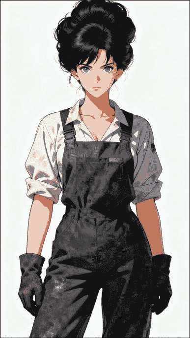
图 4-2 动漫风图片示例

做动态时不必追求全身大位移，生成系统难以稳定线条。更稳妥的做法是聚焦局部，比如发丝飘动、衣角翻飞、眼光与泪光闪烁。后期叠加速度线、集中线或闪光特效，能进一步提升动感与张力。该风格适合爽感向、现代都市与校园题材。

### 4.2.2 厚涂插画风
贴近传统架上绘画，质感厚重，适合史诗、权谋或情感厚重的故事，核心特征如下。

· 笔触质感：画面可见明显笔刷叠加与画布纹理，颜料混合痕迹保留。
· 光影写实：不同于动漫硬边，阴影过渡柔和细腻，体积感强，符合物理规律。
· 色彩层次：层次复杂，不像动漫那样是纯色块。
· 氛围导向：擅长用光影堆叠情绪。

示例提示词描述为白色背景的厚涂风半精灵战士肖像，中世纪骑士男性，金挑染棕发、尖耳，金眸冷峻，身着磨损金属甲，侧光强对比，笔触粗犷。

根据此提示词生成的厚涂风图片示例如图 4-3 所示。

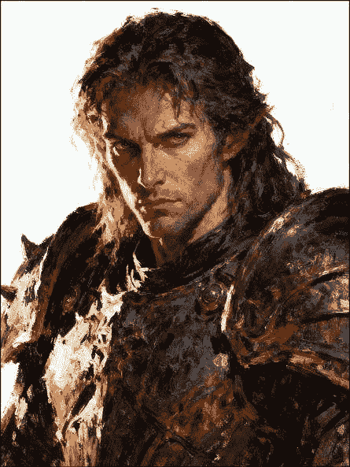
图 4-3 厚涂风图片示例

视频化时不宜安排剧烈动作，缺少明确轮廓线，大位移会让画面“融化”。宜做微动态，如烛火摇曳、尘埃漂浮、呼吸起伏、水面波光，用缓慢的光线流动暗示时间，用氛围感维持沉浸。

### 4.2.3 皮克斯风格
三维动画的标杆，逻辑是“真实材质＋夸张造型”，特征如下。

· 艺术化真实：材质、光影、物理模拟逼真，但造型、色彩与表情刻意夸张。
· 亲和卡通：造型圆润可爱，非生命体也具人格，亲和力强。
· 灯光精湛：全局光照运用极致，能营造温暖舒适或戏剧张力的氛围。
· 瞳孔标志：大而明亮的卡通瞳孔是传递情绪的关键。

示例提示词为白色背景的皮克斯风格男子定妆照，棕色蓬松卷发，背吉他、微笑，直视镜头，正面视角。

根据此提示词生成的皮克斯风格图片示例如图 4-4 所示。

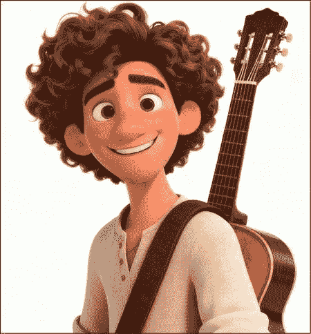
图 4-4 皮克斯风格图片示例

生成视频要注意动作弹性，要符合动画十二法则，有预备与挤压拉伸，僵硬的运动会破坏生命感。

### 4.2.4 吉卜力风格
特指吉卜力工作室创造的二维手绘美学，被视为手绘动画巅峰，核心特征如下。

· 手绘温度：保留线条、水彩质感与轻微瑕疵，充满人文气息。
· 自然热爱：风、云、草、水、光的描绘极致，画面有呼吸感。
· 柔和色彩：饱和度不高，色调典雅诗意。
· 文化融合：场景常融合欧式乡村与日本传统美学。

示例提示词描绘吉卜力风格的深棕短发少女，红T恤趴在鲜绿草地上大笑，森林背景丁达尔光，暖绿暖橙主调，治愈感强。

根据此提示词生成的吉卜力风格图片示例如图 4-5 所示。

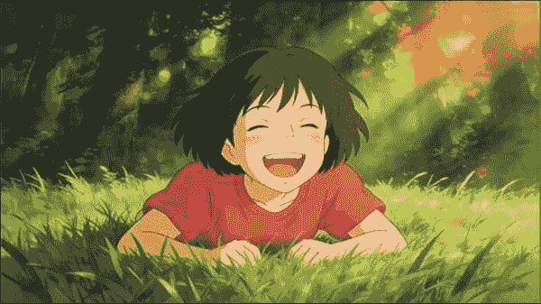
图 4-5 吉卜力风格图片示例

做动态漫时节奏要慢，效果柔和连贯。重点落在风的流动、云的推移、光线缓慢变化上，避免快剪与剧烈转场，以免破坏宁静与诗意。

### 4.2.5 游戏 CG 风格
以计算机图形为核心的视觉形式，在智能漫剧中大致分两派。

#### 1．硬核游戏 CG 风
对标《赛博朋克2077》《战神》《使命召唤》等3A大作，特征如下。

· 模型精细：面数极高，皮肤毛孔、织物纹理、金属划痕清晰可见。
· 物理光照：基于物理渲染，金属、皮革、皮肤的反射与次表面散射逼真。
· 电影镜头：浅景深、动态模糊、手持晃动、宏大航拍等手法广泛使用。
· 环境互动：爆炸、烟尘、雨水、破碎等特效真实，动力学细节丰富。

示例提示词为电影感游戏CG，照片级真实，虚幻引擎5渲染，戏剧光影，女性战士希腊神话质感，白色背景半身肖像。

根据此提示词生成的硬核游戏CG风格图片示例如图 4-6 所示。

图 4-6 硬核游戏CG风格图片示例

很适合科幻、战争、末日题材，强调视觉冲击与沉浸。

#### 2．东方幻想与武侠风格
国内创作者常用，对标《天涯明月刀》《原神》《永劫无间》宣传CG，特征如下。

· 唯美浪漫：角色俊美，服装华丽飘逸，场景如诗如画。
· 飘逸动态：发丝、衣物、丝带的动态模拟被重视，追求仙气感。
· 粒子特效：技能特效融合光效、符文、花瓣等，视觉冲击强。
· 意境优先：重氛围营造，如月下竹林、云海仙山，体现东方意境。

示例提示词为女性武侠2.5D照片，全身白袍飘逸银线刺绣，高马尾严肃目光，类似《不良人》，纯白背景柔和顶光，对称构图，丝绸质感水墨效果。

根据此提示词生成的东方幻想与武侠风格图片示例如图 4-7 所示。

图 4-7 东方幻想与武侠风格图片示例

总体来看，世界观与风格不是单纯偏好，而是智能漫剧能否成立的基础架构。不同风格对角色比例、表情幅度、动作强度与镜头尺度的容忍度完全不同。只有世界观清晰、风格统一，分镜才会收敛，镜头选择才有依据。

在创作里，风格其实是一种约束工具。它帮助模型读懂人物与情绪，也提前为创作者划定镜头语言的可用边界，降低试错成本。进入分镜拆解前，必须把世界观与风格彻底定下来，这是无法跳过的基础路径。

接下来，将基于这些视觉前提，系统讲解如何用镜头语言进行叙事表达。 EXr6287u6NNVz+GYLY+7SDk226FstKIHdC0bNoQkB2Nqi1xSR0yxPmwrTs5gRi/BtfSbid6dBhii9q7cz2pIyA==

## 4.2 画风选择
4.1 已完成剧本到分镜的任务拆解，明确分镜需承载的故事脉络与表达需求。但在着手设计具体镜头、敲定每一处画面细节前，必须先解决核心底层问题——画风选择。

对于智能漫剧而言，相同剧情内核与分镜框架，若搭配不同画风，其镜头语言呈现逻辑、观众视觉感受会产生天差地别。画风不仅决定画面整体审美取向，更直接限定镜头尺度选择、运动方式设计以及叙事节奏把控。若画风缺乏统一性，即便分镜设计再精细，拼接后也会呈现杂乱感——角色与场景脱节，仿佛身处不同叙事维度，人物与环境间无合理视觉关联，这种割裂感会直接打破沉浸感，导致叙事失效。因此确定画风类型是分镜制作不可或缺的前置环节。唯有先定好这份视觉规矩，分镜设计才能精准服务于故事表达，避免沦为无意义的零散素材堆砌。

结合制作特性、技术适配度与市场成熟度，本节将重点拆解5种实用、适配性强的风格流派，为后续分镜设计提供视觉指引。

### 4.2.1 二次元/动漫风
这是目前AI动态漫领域技术最成熟、产出效率最高的赛道，直接对标日本商业动画，其核心特点如下。

· 线条感：这是动漫风的骨架。轮廓线必须清晰锐利，不能模棱两可。
· 色块化：色彩区域平整干净，少有复杂的渐变和笔触，便于后期处理。
· 程式化光影：通常采用赛璐珞技法，阴影边缘硬朗，光影二分明确，没有柔和的过渡带。
· 符号化表达：巨大的眼睛、夸张的流泪、速度线等，这些是动漫独有的视觉语言。

示例提示词示例了一位欧洲女性劳动者形象，简朴黑发蓝眼，蓬松高髻，2D手绘动漫风格，日本动漫，玛丽亚逼真全身肖像，地下劳动领袖，正面镜头，空山基画作风格，宁静带反抗，皮肤光线完美，纯白背景，超高细节。

根据此提示词生成的动漫风图片示例如图 4-2 所示。

图 4-2 动漫风图片示例

使用该风格制作动态效果时，不必追求全身大幅度运动，AI模型往往很难控制线条抖动。更高效的做法是将动态聚焦在局部，如头发飘动、衣角翻飞、眼神光和泪水闪烁。后期可添加速度线、集中线或闪光特效，进一步强化画面动感和张力。该风格适合绝大多数爽文、现代都市和校园题材。

### 4.2.2 厚涂插画风
这种风格接近传统架上绘画，质感厚重，适合表现史诗感、权谋或情感深沉的故事，其核心特征如下。

· 笔触与质感：画面由明显笔刷堆叠而成，画布纹理感强，能看到颜料混合痕迹。
· 写实光影：不同于动漫硬边阴影，它的光影过渡极其柔和细腻，体积感强，遵循真实物理规律。
· 色彩丰富：色彩层次复杂，不像动漫风那样是单纯色块。
· 氛围优先：色彩层次复杂，极其擅长通过光影营造情绪。

示例提示词为白色背景，厚涂风半精灵战士肖像，中世纪骑士男性，深棕带金色挑染微卷中长发，尖耳朵，锐利金色眼眸，冷峻坚毅神情，直视镜头，身着磨损斑驳金属盔甲，肩甲带尖刺，正面半身视角，侧光明暗对比强烈，笔触粗犷富有质感。

根据此提示词生成的厚涂风图片示例如图 4-3 所示。

图 4-3 厚涂风图片示例

使用此类风格进行视频生成时，不适合安排剧烈动作场景。因为其缺乏明确轮廓线，大幅度运动会导致画面融化。正确动态化策略是做微动态，如烛火摇曳、尘埃浮动、角色呼吸时胸膛起伏、水面波光等。利用光线缓慢流动暗示时间流逝，用氛围感这种高级手段维持观众沉浸感。

### 4.2.3 皮克斯风格
皮克斯风格是三维动画标杆，其核心逻辑是真实材质、夸张造型，具体特征如下。

· 艺术化真实感：并非追求物理照片级真实，而是在真实基础上进行艺术化夸张。材质、光影、物理模拟都非常逼真，但造型、色彩和表情被刻意夸大，以增强表现力。
· 亲和感与卡通感：角色设计圆润、可爱，即使是非生命体也被赋予鲜活人格。这种卡通感使其老少咸宜。
· 精湛灯光与全局光照：对光影运用达到极致，能营造无比温暖、舒适或极具戏剧性氛围。
· 标志性瞳孔：皮克斯风格角色通常拥有巨大、明亮卡通瞳孔，这是传递情感关键。

示例提示词为白色背景，人物电影定妆照，皮克斯风格男子，头发棕色且蓬松卷曲，背着一把吉他，微笑，直视镜头，正面视角。

根据此提示词生成的皮克斯风格图片示例如图 4-4 所示。

图 4-4 皮克斯风格图片示例

生成视频时，要注意动作弹性。皮克斯风格运动必须符合动画十二法则，要有预备动作和挤压拉伸，动作太僵硬会破坏这种风格生命感。

### 4.2.4 吉卜力风格
这里的吉卜力风格特指由日本吉卜力工作室创造的二维手绘动画风格。该风格被视为手绘动画美学巅峰，充满对自然极致崇拜和人文温度。其核心特征如下。

· 手绘温度与瑕疵：保留手绘线条、水彩质感和轻微瑕疵，充满艺术气息和人文温度。
· 对自然热爱与描绘：对风、云、草、水、光等自然元素描绘达到极致，画面充满生机与呼吸感。
· 柔和唯美色彩：色彩饱和度通常不高，色调柔和、典雅，充满诗意。
· 欧洲与日本文化融合：建筑、场景设计常常融合欧洲乡村与日本传统美学元素。

示例提示词为吉卜力工作室动画风格，细腻手绘插画，画面主体是一位留着深棕色短发的少女，身穿红色短袖T恤，趴在茂密鲜亮绿色草地上，双眼闭合，露出开怀大笑表情，脸颊带有淡粉色红晕。背景为幽深森林，林间透过斑驳柔和黄绿色自然光，形成丁达尔光效，整体色调以暖绿与暖橙为主，笔触细腻流畅，人物神态生动自然，画面充满治愈感，出版印刷级精度，无多余元素，画面干净整洁。

根据此提示词生成的吉卜力风格图片示例如图 4-5 所示。

图 4-5 吉卜力风格图片示例

**硬核游戏CG：爆破细节的真实演算**

环境交互被刻意放大，爆破、尘雾、雨幕、碎裂等特效的物理表现被渲染得极具写实感，整体充盈着强劲的动力学张力。

下面是一组硬核游戏CG风格的生图提示词，可直接参考使用。

电影感，游戏 CG，照片级真实感，超高清细节，虚幻引擎 5 渲染，戏剧性的光影，细致的人物，景深，视觉特效，人物设计参考照片，白色背景，女性战士，希腊神话质感。面向相机正面。半身肖像。

按此描述生成的效果示例如图 4-6 所示。

图 4-6　硬核游戏 CG 风格图片示例

这种表现力对科幻、战争、末日等题材适配度很高，核心在于视觉冲击与沉浸体验。

#### 2．东方幻想与武侠风格

在国内创作者中应用最广的类型之一，参照《天涯明月刀》《原神》或《永劫无间》的宣传CG，其显著特质如下。

**·** 唯美浪漫：角色容貌精致，服饰华丽飘逸，场景常带有诗画气质。
**·** 飘逸动感：对发丝、衣袂、丝带、羽毛等柔软体的运动模拟尤为讲究，追求仙气十足的观感。
**·** 炫目粒子特效：技能画面极其华丽，融合光晕、符文、花瓣、星屑等元素，想象力与冲击力兼具。
**·** 意境优先于写实：更强调氛围营造，如月下竹林、云海仙峰，突出东方美学中的意境表达。

下面是一条东方幻想与武侠风格的生图提示词示例。

女性武侠 2.5D 化妆照片，全身白色长袍飘逸，银线刺绣，目光严肃，高马尾发型，风格类似中国动画《不良人》，纯白背景，柔和顶光，对称构图，丝绸质感，水墨效果，浅灰色阴影，飘带，剑眉，冷色调，细腻笔触，角色居中，高分辨率 8K，用虚幻引擎渲染，长袍飘动。

按此描述生成的效果示例如图 4-7 所示。

图 4-7　东方幻想与武侠风格图片示例

总体来看，世界设定与视觉风格并非单纯的审美取向，而是 AI 漫剧成立的基础架构。不同风格对角色比例、表情幅度、动作强度与镜头尺度的容忍度差别很大。只有世界设定清晰且风格统一，分镜才会收敛，镜头选择才有依据。

在实操中，风格本质上是约束工具。它既帮助模型理解人物与情绪，也为创作者预先限定镜头语言的可行边界，从而降低试错成本。分镜拆解前必须先完成世界设定与风格的确定，这一步不可跳过。

接下来将基于上述视觉前提，系统说明如何运用镜头语言进行叙事表达。 EXr6287u6NNVz+GYLY+7SDk226FstKIHdC0bNoQkB2Nqi1xSR0yxPmwrTs5gRi/BtfSbid6dBhii9q7cz2pIyA==

## 4.2 画风选择

4.1 节已经把剧本拆解到分镜叙事任务，明确了分镜需要承担的故事线索与表达诉求。但在落笔具体镜头、敲定每帧画面细节前，必须先解决底层核心问题——视觉风格的选择。

对 AI 漫剧而言，同一内核的剧情与分镜框架，若换了风格，镜头呈现逻辑与观众的视觉感受会截然不同。画风不仅决定整体审美方向，还直接限制镜头尺度、运动方式与叙事节奏的把控。若风格不统一，即便分镜很精细，拼接后也会显得凌乱——角色与场景脱节，像置身不同叙事空间，人物与环境缺乏合理视觉关联，这种割裂会破坏沉浸感，导致叙事失效。因此确定画风类型是分镜制作不可或缺的前置环节。只有先确立视觉规范，分镜设计才能精准服务故事，避免沦为零散素材堆砌。

结合制作特点、技术适配性与市场成熟度，本节重点拆解 5 种实用且适配性强的流派，为后续分镜提供视觉指引。

### 4.2.1　二次元/动漫风

目前 AI 动态漫领域技术最成熟、产出效率最高的赛道，对标日本商业动画，其核心特点如下。

**·** 线条感：轮廓线条清晰锐利，不允许模糊。
**·** 色块化：色彩区域平整干净，渐变与笔触较少，便于后期处理。
**·** 程式化光影：多采用赛璐珞手法，阴影边缘硬朗，光影分界明确，几乎没有柔和过渡。
**·** 符号化表达：夸张的双眼、流泪、速度线等，是动漫特有的视觉语言。

下面是一条动漫风提示词示例。

欧洲女性形象，劳动者外观，简朴，黑发，蓝眼睛，蓬松高髻发型，2D 手绘动漫风格，日本动漫，完全人类的玛丽亚逼真全身肖像，地下劳动领袖，正面面对镜头，由空山基绘制的画作，宁静但带有反抗的表情，皮肤光线完美，纯白背景，超高细节。

按此描述生成的动漫风图片示例如图 4-2 所示。

图 4-2　动漫风图片示例

用此风格做动态时，无需追求全身大幅运动，模型很难稳定线条。更高效的做法是聚焦局部动态，如发丝飘动、衣角飞扬、眼神光与泪珠闪烁。后期可叠加速度线、集中线或闪光特效，增强动感与张力。该风格适合爽文、现代都市及校园题材。

### 4.2.2　厚涂（插画）风

此风格接近传统架上绘画，质感厚重，适合史诗感、权谋或情感沉郁的故事，核心特征如下。

**·** 笔触与质感：画面可见明显笔刷堆叠，画布纹理强，能看出颜料混合痕迹。
**·** 写实光影：与动漫硬边阴影不同，其明暗过渡柔和细腻，体积感强，遵循物理规律。
**·** 色彩丰富：层次复杂，不似动漫那般纯色块。
**·** 氛围优先：擅长以光影营造情绪。

下面是一条厚涂风提示词示例。

白色背景，厚涂风半精灵战士肖像，中世纪骑士男性，深棕色带金色挑染的微卷中长发，尖耳朵，锐利金色眼眸，冷峻坚毅神情，直视镜头，身着带有磨损斑驳色彩的金属盔甲，肩甲带尖刺，正面半身视角，侧光明暗对比强烈，笔触粗犷富有质感。

按此描述生成的厚涂风图片示例如图 4-3 所示。

图 4-3　厚涂风图片示例

视频化时不适合安排激烈动作，因缺乏明确轮廓线，大幅运动易导致画面融化。合理的动态化策略是微动态，如烛火摇曳、尘埃漂浮、呼吸起伏、水面波光等。用缓慢的光线流动暗示时间，靠氛围感维持沉浸。

### 4.2.3　皮克斯风格

皮克斯风格是三维动画的标杆，核心逻辑是真实材质加夸张造型，具体特征如下。

**·** 艺术化真实：不追求照片级真实，而是在真实基础上艺术化夸张。材质、光影、物理模拟逼真，造型、色彩、表情则刻意放大。
**·** 亲和与卡通感：角色圆润可爱，连非生命体也赋予人格，兼具亲和力。
**·** 精湛灯光与全局光照：光影运用极致，可营造温暖舒适或戏剧性氛围。
**·** 标志性瞳孔：角色通常拥有巨大明亮的卡通瞳孔，是传递情感的关键。

下面是一条皮克斯风格提示词示例。

白色背景，人物电影定妆照，皮克斯风格男子，头发棕色且蓬松卷曲，背着一把吉他，微笑，直视镜头，正面视角。

按此描述生成的皮克斯风格图片示例如图 4-4 所示。

图 4-4　皮克斯风格图片示例

生成视频时需注意动作弹性。运动要符合动画十二法则，有预备动作与挤压拉伸，僵硬的动作会破坏生命感。

### 4.2.4　吉卜力风格

这里指日本吉卜力工作室创造的二维手绘动画风格，被视为手绘美学的巅峰，对自然充满崇拜与人文温度。核心特征如下。

**·** 手绘温度与瑕疵：保留手绘线条、水彩质感与轻微瑕疵，艺术气息浓厚。
**·** 对自然的热爱：风、云、草、水、光的描绘极致，画面充满生机与呼吸感。
**·** 柔和唯美色彩：饱和度不高，色调柔和典雅，富有诗意。
**·** 文化融合：场景常融合欧洲乡村与日本传统美学。

下面是一条吉卜力风格提示词示例。

吉卜力工作室动画风格，细腻手绘插画，画面主体是一位留着深棕色短发的少女，身穿红色短袖 T 恤，趴在茂密鲜亮的绿色草地上，双眼闭合，露出开怀大笑的表情，脸颊带有淡粉色红晕。背景为幽深的森林，林间透过斑驳柔和的黄绿色自然光，形成丁达尔光效，整体色调以暖绿与暖橙为主，笔触细腻流畅，人物神态生动自然，画面充满治愈感，出版印刷级精度，无多余元素，画面干净整洁。

按此描述生成的吉卜力风格图片示例如图 4-5 所示。

图 4-5　吉卜力风格图片示例

制作动态漫时节奏需舒缓，呈现柔和连续的效果。重点表现风流、云动、光线缓变等细节，避免快速剪辑与剧烈转场，以免破坏宁静诗意。

### 4.2.5　游戏 CG 风格

游戏CG风格以计算机图形技术为核心，为游戏产品提供视觉表现，兼具技术表现力与叙事功能性。在AI动态漫画中主要分为两个流派。

#### 1．硬核游戏 CG 风

对标《赛博朋克 2077》《战神》《使命召唤》等3A大作，核心特征如下。

**·** 超精细模型：角色与场景面数极高，皮肤毛孔、织物纹理、金属划痕清晰可见。
**·** 物理精确光照与材质：普遍采用基于物理渲染，金属、皮革、皮肤的反射、漫反射与次表面散射高度逼真。
**·** 电影级镜头语言：广泛使用浅景深、动态模糊、手持晃动、航拍等手法。
**·** 剧烈环境互动：爆炸、烟尘、雨水、破碎等特效模拟真实，充满动力学细节。

下面是一条硬核游戏 CG 风格的生图提示词示例。

电影感，游戏 CG，照片级真实感，超高清细节，虚幻引擎 5 渲染，戏剧性的光影，细致的人物，景深，视觉特效，人物设计参考照片，白色背景，女性战士，希腊神话质感。面向相机正面。半身肖像。

按此描述生成的硬核游戏 CG 风格图片示例如图 4-6 所示。

图 4-6　硬核游戏 CG 风格图片示例

该风格适合科幻、战争、末日题材，强调视觉冲击与沉浸感。

#### 2．东方幻想与武侠风格

国内创作者常用风格，对标《天涯明月刀》《原神》《永劫无间》宣传CG，核心特征如下。

**·** 唯美浪漫：角色俊美，服装华丽飘逸，场景如诗如画。
**·** 动态飘逸感：对头发、衣物、丝带、羽毛的动态模拟重视，追求仙气飘飘。
**·** 华丽粒子特效：技能特效炫目，融合光效、符文、花瓣、星辰等，想象力强。
**·** 意境大于写实：注重氛围营造，如月下竹林、云海仙山，强调东方意境。

下面是一条东方幻想与武侠风格的生图提示词示例。

女性武侠 2.5D 化妆照片，全身白色长袍飘逸，银线刺绣，目光严肃，高马尾发型，风格类似中国动画《不良人》，纯白背景，柔和顶光，对称构图，丝绸质感，水墨效果，浅灰色阴影，飘带，剑眉，冷色调，细腻笔触，角色居中，高分辨率 8K，用虚幻引擎渲染，长袍飘动。

按此描述生成的东方幻想与武侠风格图片示例如图 4-7 所示。

图 4-7　东方幻想与武侠风格图片示例

总体而言，世界设定与画风是 AI 动态漫画能否成立的基础架构。不同画风对角色比例、表情幅度、动作强度与镜头尺度的容忍度各不相同。只有世界设定清晰、画风统一，分镜设计才自然收敛，镜头选择才有依据。

在创作中，画风实质是约束工具。它帮助模型准确理解人物与情绪，也为创作者提前划定镜头语言可用边界，降低试错成本。进入具体分镜拆解前，必须彻底完成世界设定与画风选择，这是一条不可跳过的路径。

接下来将基于这些视觉前提，系统讲解如何运用镜头语言进行叙事表达。

AI 短漫成型的视觉锚点

在 AI 生成的动画短片里，故事骨架相同，换一套视觉语言，观感和可实现度会完全不同。风格不仅决定整体美感，还卡死了镜头尺度、运动幅度与节奏的上限。若风格不统一，角色和场景会像来自两个世界，拼接后产生强烈的割裂，沉浸感瞬间瓦解。所以在开分镜前，先把视觉规矩定下来，是分镜可用的前提。以下拆解五类适配性强的流派，给后续画面拆分提供依据。

借鉴吉卜力工作室的手绘美学，画面以水彩插画呈现。主体是深棕短发少女，红 T 恤，趴在繁密鲜绿草甸上，双眼闭合笑容绽放，颊侧透出淡粉。背景是深林，枝叶间洒入斑驳黄绿天光，形成穿透光束。整体以暖绿与暖橙为主，笔触细润流畅，人物神情松弛自然，氛围治愈，接近印刷级精度，画面简洁干净。

按此描述生成的参考图见图 4-5 所示。

图 4-5　吉卜力风格图片示例

把这种气质迁移到动态时，节奏要舒缓，变化以柔和连贯为主。着力表现风的拂动、云的推移、光线的缓慢漂移等自然细节，避开急促剪切与激烈转场，否则宁静的诗意会受损。

### 4.2.5　游戏 CG 风格
游戏 CG 以计算机图形为基础，为游戏产品构建视觉呈现，同时具备技术表现与叙事功能。在 AI 短漫里，它通常分两支。

#### 1．硬核游戏 CG 风
对标《赛博朋克 2077》《战神》《使命召唤》等 3A 大作，特征集中在：
**·** 模型精度极高：角色与场景面数惊人，皮肤孔隙、织物纹理、金属划痕均清晰可见。
**·** 物理级的光照材质：普遍使用基于物理的渲染，金属、皮革、皮肤的反光、漫反射与次表面散射逼真。
**·** 电影化镜头：大量借用摄影手法，如浅景深、动态模糊、手持晃动、宏大航拍。
**·** 环境互动强烈：爆炸、尘埃、雨水、碎裂等特效模拟真实，动力学细节丰富。

硬核游戏 CG 的生图提示词示例。
电影感，游戏 CG，照片级真实感，超高清细节，虚幻引擎 5 渲染，戏剧性光影，细致人物，景深，视觉特效，人物设计参考照片，白色背景，女性战士，希腊神话质感。面向相机正面。半身肖像。

按此提示生成的图片示例如图 4-6 所示。

图 4-6　硬核游戏 CG 风格图片示例

此路线适合科幻、战争、末日题材，视觉冲击力强，沉浸感足。

#### 2．东方幻想与武侠风格
国内创作者使用频率最高，对标《天涯明月刀》《原神》《永劫无间》的宣传 CG，主要特征：
**·** 唯美浪漫：人物俊美，服饰华丽飘逸，场景如诗如画。
**·** 飘逸动感：对发丝、衣袍、丝带、羽毛的飘动模拟极重视，追求仙气。
**·** 炫目粒子特效：技能特效融合光效、符文、花瓣、星辰，想象力与冲击兼备。
**·** 意境先行：更侧重氛围营造，如月下竹林、云海仙山，体现东方美学意境。

生图提示词示例。
女性武侠 2.5D 化妆照片，全身飘逸白袍，银线刺绣，目光肃然，高马尾造型，风格近似国漫《不良人》，纯白背景，柔和顶光，对称构图，丝绸质感，水墨效果，浅灰阴影，飘带，剑眉，冷色调，细腻笔触，角色居中，高分辨率 8K，虚幻引擎渲染，长袍随风。

生成的图片示例如图 4-7 所示。

图 4-7　东方幻想与武侠风格图片示例

整体来看，设定体系与视觉语言并非单纯偏好，而是 AI 短漫能否成立的基础架构。不同画法对比例、表情强度、动作幅度与镜头距离的容忍度相差很大。只有设定清晰、风格统一，分镜才会收敛，镜头取舍才有依据。

在创作中，风格本质上是一种约束工具。它帮助模型理解人物与情绪，也为作者提前划定镜头语言的可行边界，从而降低试错成本。进入具体拆分前，必须先完成设定与风格的确认，这是不可绕过的底线。

接下来，将基于这些视觉前提，系统讲解镜头语言如何服务叙事。

## 4.2 画风选择
4.1 节已把剧本拆解为叙事任务，明确了分镜要承载的脉络与表达需求。但在敲定具体镜头与细节前，必须先解决底层问题——视觉风格的确定。

对 AI 短漫而言，同一内核的剧情配上不同画法，呈现逻辑和观众感受会天差地别。风格决定整体审美取向，也直接限制镜头尺度、运动方式与节奏把控。若风格不统一，即便分镜精细，拼接后也会杂乱——角色与场景脱节，像身处不同维度，人与环境缺乏视觉关联，割裂感会破坏沉浸，导致叙事失效。因此确定风格类型是分镜制作的前置环节。只有先定好视觉规矩，分镜才能精准服务故事，避免沦为零散素材堆砌。

结合制作特性、技术适配与市场成熟度，本节重点拆解五种实用流派，为后续分镜提供指引。

### 4.2.1　二次元/动漫风
目前技术最成熟、产出效率最高的赛道，对标日本商业动画，主要特点：
**·** 轮廓感：骨架在于线条，边缘需清晰锐利，不可模糊。
**·** 色块处理：色彩区域平整干净，渐变与笔触少，便于后期。
**·** 程序化光影：多用赛璐珞技法，阴影边缘硬，光影分明，无柔和过渡。
**·** 符号化表达：大眼、夸张泪滴、速度线等是独有视觉语言。

提示词示例。
欧洲女性形象，劳动者气质，简约，黑发蓝眼，蓬松高髻，2D 手绘动漫风格，日系动画，完全人类的玛丽亚逼真全身像，地下劳动领袖，正面镜头，由空山基风格绘制，宁静但带反抗情绪，皮肤光线完美，纯白背景，超高细节。

生成的图片示例如图 4-2 所示。

图 4-2　动漫风图片示例

用此画法做动态，无需追求全身大幅运动，AI 难以稳定线条。更高效做法是聚焦局部，如发丝飘动、衣角翻飞、眼神高光与泪水的闪烁。后期叠加速度线、集中线或闪光特效可强化动感与张力。适合爽文、现代都市、校园题材。

### 4.2.2　厚涂（插画）风
接近传统架上绘画，质感厚重，适合史诗、权谋或情感厚重的故事，特征：
**·** 笔触与质感：由明显笔刷堆叠，画布纹理强，可见颜料混合痕迹。
**·** 写实光影：区别于动漫硬边阴影，过渡柔和细腻，体积感强，符合物理规律。
**·** 色彩丰富：层次复杂，非纯色块。
**·** 氛围优先：擅长用光影营造情绪。

提示词示例。
白底，厚涂风半精灵战士肖像，中世纪骑士男性，深棕带金挑染微卷中长发，尖耳，锐利金眸，冷峻坚毅神情直视镜头，身着磨损斑驳金属甲，肩甲带尖刺，正面半身，侧光明暗对比强烈，笔触粗犷有质感。

生成的图片示例如图 4-3 所示。

图 4-3　厚涂风图片示例

视频化时不宜安排激烈动作，缺乏明确轮廓线，大幅运动易导致画面融化。正确策略做微动态，如烛火摇晃、尘埃浮动、呼吸起伏、水面波光。用光线缓慢流动暗示时间，用氛围感维持沉浸。

### 4.2.3　皮克斯风格
三维动画标杆，核心逻辑是“真实材质、夸张造型”，特征：
**·** 艺术化真实感：非照片级真实，而是在真实基础上艺术化夸张，材质光影物理模拟逼真，造型色彩表情刻意放大。
**·** 亲和卡通感：造型圆润可爱，非生命体也赋予人格，普适性强。
**·** 精湛灯光与全局光照：能营造温暖舒适或极具戏剧性的氛围。
**·** 标志性瞳孔：巨大明亮的卡通瞳孔是传递情感的关键。

提示词示例。
白底，人物电影定妆照，皮克斯风格男子，棕色蓬松卷发，背着一把吉他，微笑直视镜头，正面视角。

生成的图片示例如图 4-4 所示。

图 4-4　皮克斯风格图片示例

生成视频时需注意动作弹性，运动要符合动画十二法则，有预备动作与挤压拉伸，僵硬动作会破坏生命感。

### 4.2.4　吉卜力风格
指日本吉卜力工作室由宫崎骏、高畑勋等创立的二维手绘动画美学，手绘动画的巅峰，对自然充满崇拜与人文温度。特征：
**·** 手绘温度与瑕疵：保留手绘线条、水彩质感与细微瑕疵，艺术气息浓厚。
**·** 热爱自然的描绘：风、云、草、水、光等自然元素刻画极致，画面有生机与呼吸感。
**·** 柔和唯美色彩：饱和度不高，色调柔和典雅，充满诗意。
**·** 东西文化融合：场景常融合欧洲乡村与日本传统美学。

提示词示例。
吉卜力工作室动画风格，细腻手绘插画，主体为深棕色短发少女，红短袖T恤，趴在茂密鲜亮绿草地上，双眼闭合大笑，脸颊带淡粉红晕。背景幽深森林，林间透过斑驳柔和黄绿自然光形成丁达尔光效，整体暖绿暖橙为主，笔触细腻流畅，神态生动自然，治愈感强，出版印刷级精度，无多余元素，画面干净整洁。

生成的图片示例如图 4-5 所示。

图 4-5　吉卜力风格图片示例

制作动态漫画时节奏要舒缓，效果柔和连续。重点表现风的流动、云的运动、光线缓缓变化等细节。避免快速剪辑与剧烈转场，以免破坏宁静与诗意氛围。

### 4.2.5　游戏 CG 风格
游戏 CG 以计算机图形技术为核心，为游戏产品制作视觉表现，兼具技术性与叙事性。在 AI 动态漫画中细分为两大流派。

#### 1．硬核游戏 CG 风
对标《赛博朋克2077》《战神》《使命召唤》等 3A 大作，特征：
**·** 超精细模型：角色场景面数极高，皮肤毛孔、织物纹理、金属划痕清晰可见。
**·** 物理精确光照材质：基于物理渲染，金属、皮革、皮肤反光、漫反射、次表面散射高度逼真。
**·** 电影级镜头语言：浅景深、动态模糊、手持晃动、宏大航拍等手法广泛使用。
**·** 剧烈环境互动：爆炸、烟尘、雨水、破碎等特效真实，动力学细节丰富。

生图提示词示例。
电影感，游戏 CG，照片级真实感，超高清细节，虚幻引擎 5 渲染，戏剧性光影，细致人物，景深，视觉特效，人物设计参考照片，白色背景，女性战士，希腊神话质感。正面面向相机。半身肖像。

生成的图片示例如图 4-6 所示。
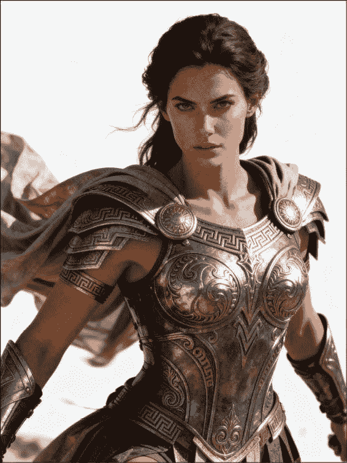
图 4-6　硬核游戏 CG 风格图片示例

此风格适合科幻、战争、末日题材，强调视觉冲击与沉浸感。

#### 2．东方幻想与武侠风格
国内创作者常用，对标《天涯明月刀》《原神》《永劫无间》宣传 CG，特征：
**·** 唯美浪漫：角色俊美，服装华丽飘逸，场景如诗如画。
**·** 动态飘逸感：重视头发、衣物、丝带、羽毛的动态模拟，追求仙气。
**·** 华丽粒子特效：技能特效融合光效、符文、花瓣、星辰，想象力与视觉冲击强。
**·** 意境大于写实：注重氛围营造，如月下竹林、云海仙山，强调东方意境。

生图提示词示例。
女性武侠 2.5D 化妆照，全身白袍飘逸，银线刺绣，目光严肃，高马尾，风格类似中国动画《不良人》，纯白背景，柔和顶光，对称构图，丝绸质感，水墨效果，浅灰阴影，飘带，剑眉，冷色调，细腻笔触，角色居中，高分辨率 8K，虚幻引擎渲染，长袍飘动。

生成的图片示例如图 4-7 所示。

图 4-7　东方幻想与武侠图片示例

总的来说，设定与风格并非单纯视觉偏好，而是决定 AI 动态漫画能否成立的基础架构。不同风格对角色比例、表情幅度、动作强度与镜头尺度的容忍度截然不同。只有设定清晰、风格统一时，分镜设计才会自然收敛，镜头选择才有依据。

在创作中，风格实质是一种约束工具。它既帮助模型准确理解人物与情绪，也为创作者提前划定镜头语言可用边界，降低试错成本。必须在进入具体分镜拆解前，彻底完成设定与风格的选择，这是不可跳过的基础路径。

接下来，将基于这些视觉前提，系统讲解如何运用镜头语言进行叙事表达。

动漫风的另一组参考展示如下：

图 4-2　动漫风图片示例

厚涂风的另一组参考展示如下：

图 4-3　厚涂风图片示例

**皮克斯风格速览**

**·** 光影被推向极致：全局光照配合重点补光，很容易得到温暖舒适的日常氛围，也能瞬间切换到极具戏剧性的张力。
**·** 标志性的大瞳孔：皮克斯系角色普遍配备硕大明亮的卡通眼，细微的眼神变化几乎承担了全部情感表达。

以下是一条皮克斯风格提示词示例。

白色背景，人物电影定妆照，皮克斯风格男子，头发棕色且蓬松卷曲，背着一把吉他，微笑，直视镜头，正面视角。

根据此提示词生成的皮克斯风格图片示例如图 4-4 所示。

图 4-4　皮克斯风格图片示例

进入动态制作时，动作的弹性必须被强调。皮克斯体系的运动要呼应动画十二法则，保留预备动作与挤压回弹，僵硬的动作会直接削弱生命力。

### 4.2.4　吉卜力风格

这里的吉卜力风格特指由日本吉卜力工作室由宫崎骏、高畑勋等人创办所创造的二维手绘动画风格。该风格被视为手绘动画的美学巅峰，充满了对自然的极致崇拜和人文温度。其核心特征如下。

**·** 手绘的温度与瑕疵：保留手绘的线条、水彩质感和轻微的瑕疵，充满艺术气息和人文温度。
**·** 对自然的热爱与描绘：对风、云、草、水、光等自然元素的描绘达到极致，画面充满生机与呼吸感。
**·** 柔和唯美的色彩：色彩饱和度通常不高，色调柔和、典雅，充满诗意。
**·** 欧洲与日本文化的融合：建筑、场景设计常常融合了欧洲乡村与日本传统美学的元素。

以下是一条吉卜力风格提示词示例。

吉卜力工作室动画风格，细腻手绘插画，画面主体是一位留着深棕色短发的少女，身穿红色短袖 T 恤，趴在茂密鲜亮的绿色草地上，双眼闭合，露出开怀大笑的表情，脸颊带有淡粉色红晕。背景为幽深的森林，林间透过斑驳柔和的黄绿色自然光，形成丁达尔光效，整体色调以暖绿与暖橙为主，笔触细腻流畅，人物神态生动自然，画面充满治愈感，出版印刷级精度，无多余元素，画面干净整洁。

根据此提示词生成的吉卜力风格图片示例如图 4-5 所示。

图 4-5　吉卜力风格图片示例

在制作这种风格的动态漫作品时，节奏要舒缓，效果是柔和且连续的。重点表现风的流动、云的运动、光线缓缓变化等细节。应避免使用快速剪辑和剧烈转场，以免破坏作品原有的宁静感与诗意氛围。

### 4.2.5　游戏 CG 风格

游戏 CG 风格是指以计算机图形技术为核心，为游戏产品制作的视觉表现形式，兼具技术表现力与叙事功能性，在 AI 漫剧中，它又细分为两个主要流派。

#### 1．硬核游戏 CG 风

这类风格对标《赛博朋克 2077》《战神》《使命召唤》等经典 3A 游戏大作，其核心特征如下。

**·** 超精细模型：角色和场景的模型面数极高，皮肤毛孔、织物纹理、金属划痕都清晰可见。
**·** 物理精确的光照与材质：普遍采用基于物理的渲染，金属、皮革、皮肤等材质的反光、漫反射和次表面散射效果高度逼真。
**·** 电影级镜头语言：广泛运用电影摄影技法，如浅景深、动态模糊、手持晃动感、宏大的航拍镜头等。
**·** 剧烈的环境互动：爆炸、烟尘、雨水、破碎等特效模拟得非常真实，充满动力学细节。

以下是一条硬核游戏 CG 风格的生图提示词示例。

电影感，游戏 CG，照片级真实感，超高清细节，虚幻引擎 5 渲染，戏剧性的光影，细致的人物，景深，视觉特效，人物设计参考照片，白色背景，女性战士，希腊神话质感。面向相机正面。半身肖像。

根据此提示词生成的硬核游戏 CG 风格图片示例如图 4-6 所示。

图 4-6　硬核游戏 CG 风格图片示例

这种风格适合科幻、战争、末日题材，强调视觉冲击力和沉浸感。

#### 2．东方幻想与武侠风格

这是国内创作者最常用的一种风格，对标《天涯明月刀》《原神》或《永劫无间》的宣传 CG，其核心特征如下。

**·** 唯美与浪漫：角色设计极其俊美，服装华丽飘逸，场景常常如诗如画。
**·** 动态的飘逸感：对头发、衣物、丝带、羽毛等元素的动态模拟非常重视，追求“仙气飘飘”的视觉感受。
**·** 华丽的粒子特效：技能特效往往极其炫目，融合了光效、符文、花瓣、星辰等元素，充满想象力和视觉冲击力。
**·** 意境大于写实：注重整体氛围的营造，如月光下的竹林、云海中的仙山，强调东方美学中的“意境”。

以下是一条东方幻想与武侠风格的生图提示词示例。

女性武侠 2.5D 化妆照片，全身白色长袍飘逸，银线刺绣，目光严肃，高马尾发型，风格类似中国动画《不良人》，纯白背景，柔和顶光，对称构图，丝绸质感，水墨效果，浅灰色阴影，飘带，剑眉，冷色调，细腻笔触，角色居中，高分辨率 8K，用虚幻引擎渲染，长袍飘动。

根据此提示词生成的东方幻想与武侠风格图片示例如图 4-7 所示。

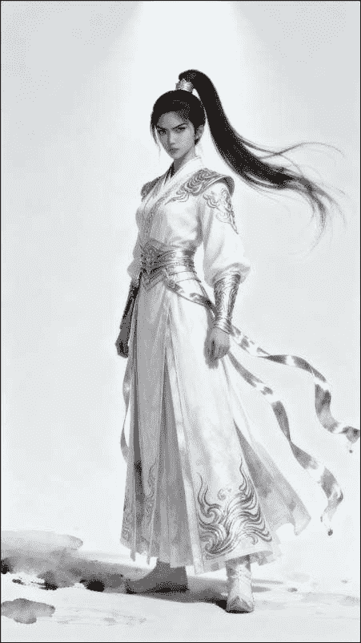

图 4-7　东方幻想与武侠风格图片示例

总的来说，世界观与画风并非简单的视觉偏好，而是决定一部 AI 漫剧能否成立的基础架构。不同画风对角色比例、表情幅度、动作强度以及镜头尺度的容忍度截然不同。只有当世界观清晰、画风统一时，分镜设计才会自然收敛，镜头选择也因此有了依据。

在 AI 漫剧创作中，画风实质上是一种“约束工具”。它既帮助 AI 准确理解人物与情绪，也为创作者提前划定了镜头语言的可用边界，从而降低试错成本。必须在进入具体分镜拆解前，彻底完成世界观与画风的选择。这是一条不可跳过的基础路径。

接下来，我们将基于这些视觉前提，系统讲解如何运用镜头语言进行叙事表达。 EXr6287u6NNVz+GYLY+7SDk226FstKIHdC0bNoQkB2Nqi1xSR0yxPmwrTs5gRi/BtfSbid6dBhii9q7cz2pIyA==

## 4.3 镜头语言基础

4.2 节我们确定了 AI 漫剧的画风，这决定了作品的视觉基调。但仅有好看的画风还不能让观众满意，还得有拿得出手的故事并讲出来。观众如何感知故事，完全取决于镜头如何引导。镜头语言是连接世界与观众体验的桥梁，它负责分配信息、放大情绪、把控节奏。

在 AI 漫剧的制作语境里，镜头语言不仅是摄影技巧，更是一套严密的视觉规则系统。只有当你明确每个镜头要传达什么意图时，写出的提示词才能被 AI 模型准确执行，分镜才能真正服务于剧情，而不是变成随机生成的视觉抽卡。

在动笔写具体分镜脚本前，我们必须掌握镜头语言的三大基石：景别、镜头运动和拍摄角度。

### 4.3.1　景别

景别体现了摄影机与被摄主体之间的距离，决定了观众能看到多少信息量。

距离远，环境信息多，人物信息少；距离近，突出人物情绪，环境信息少。在用 AI 生成图片的提示词中，准确控制景别提示词是控制画面内容占比的有效手段。

根据距离的远近，常见的景别有 5 种，如图 4-8 所示。

#### 1．远景

远景的核心任务是交代故事背景与环境。它把视野拉到最开阔的状态，人物在画面里可能只是一个小黑点，重点在于展示广阔的环境、地理位置或者特定的自然景观。

在 AI 漫剧里，远景通常用来作开篇的定场镜头，或者场景转换时的过渡。它负责告诉观众故事发生的地点、时代与整体氛围——是宏大壮丽还是孤寂苍凉。

图 4-8　常见的 5 种景别

对于 AI 漫剧来说，远景是展示世界观设定的关键镜头。此时无须纠结人物的脸部细节，而应聚焦于用环境烘托氛围，让观众在第一时间沉浸到设定的世界里。

图 4-9 和图 4-10 展示了两张远景图片。

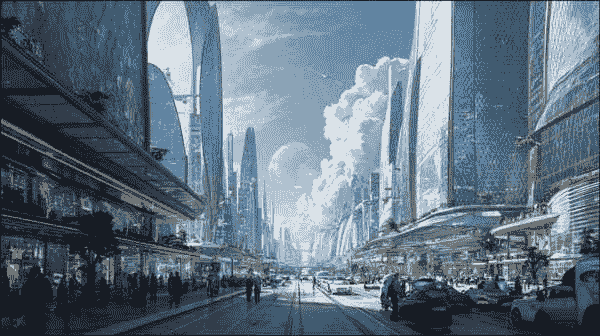

图 4-9　远景图片示例（一）

图 4-10　远景图片示例（二）

#### 2．全景

全景是展示“关系”的镜头。在这个景别下，人物的全身都能被看见，周围的环境也清晰可见。它能明确交代人物和环境的空间关系，以及人物与人物之间的位置关系。

全景最适合用于表现动作和姿态。当剧本里有打斗、舞蹈、奔跑或者多人互动的群像场景时，全景是不二之选。通过肢体语言、衣着打扮，观众能迅速判断角色的身份和当下的状态。

在 AI 生成的实际操作中，全景往往是很多动作戏容易失真的重灾区。因此，提示词要多描述肢体动作和互动逻辑，减少对微表情的描写，因为在这个距离下，肢体语言比表情更能有效传递信息。

图 4-11 和图 4-12 展示了两张全景图片。

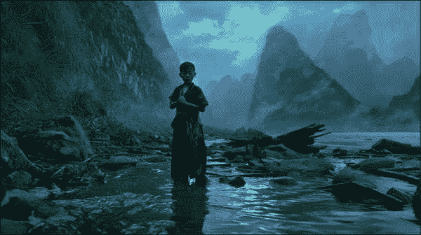

图 4-11　全景图片示例（一）

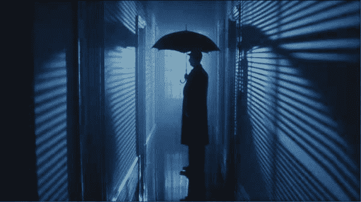

图 4-12　全景图片示例（二）

#### 3．中景

中景是叙事的“主力军”。它的画面通常卡在人物膝盖或腰部以上，既能看清表情，又能保留肢体动作，还带一点环境背景。这是一种非常平衡的视角，是最接近人类日常交流的观察距离。

绝大多数的剧情推进、双人对话、日常互动，都适合使用中景。它既没有远景的疏离感，也没有特写的压迫性，观众看着最舒服。

对于 AI 漫剧创作，中景是成图率最高的景别。模型在这个距离下，既能处理好面部结构，又能把衣服和背景融合得很好。如果不确定该用什么镜头，使用中景通常不会出错。

图 4-13 和图 4-14 展示了两张中景图片。

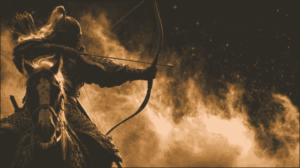

图 4-13　中景图片示例（一）

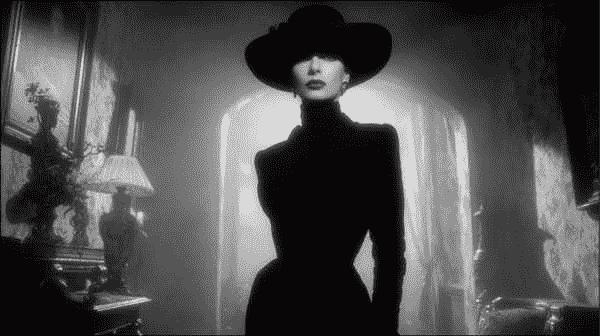

图 4-14　中景图片示例（二）

#### 4．近景

近景是情绪的“放大镜”。镜头推进到人物胸部以上，背景往往被虚化或大幅简化，观众的注意力被强制集中在人物的面部。这时，任何细微的表情变化都会被捕捉到。

当剧情需要展现人物的愤怒、悲伤、震惊或者深情时，必须切入近景。它是建立观众与角色情感连接的最有效手段。

在利用 AI 生成图片时，近景是检验角色设计细节的关键环节。提示词要将重点放在五官细节、眼神光和面部肌肉的微动作上，利用 AI 强大的细节生成能力，把情绪拉满。

图 4-15 和图 4-16 展示了两张近景图片。

图 4-15　近景图片示例（一）

图 4-16　近景图片示例（二）

#### 5．特写

特写是对信息的“强烈强调”。此时画面聚焦在极小的局部，如一只眼睛、颤抖的手指、正在滴血的刀尖，或者钟表走动的指针。

特写的作用非常直接——给观众划出重点。它强制引导观众注意你所要突出的细节，常用来强化象征意义、制造悬念和施加心理压迫感。

在 AI 漫剧里，特写往往用于高潮前夕的暗示，或者关键线索的展示。生成特写时，提示词要高度具体，排除冗余，确保模型只生成这一个核心物体或局部对象，避免画面中出现奇怪的变形。

图 4-17 和图 4-18 展示了两张特写图片。

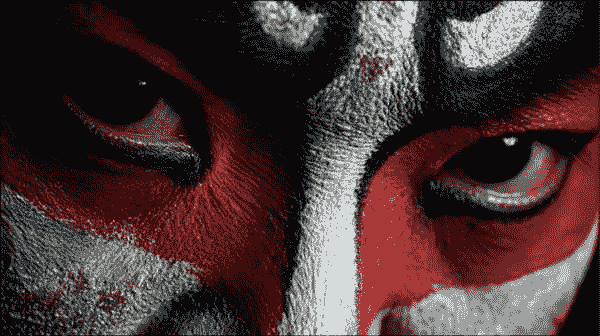

图 4-17　特写图片示例（一）

图 4-18　特写图片示例（二）

理解了景别，就掌握了画面信息的分配权。接下来，我们要让这些静止的画面动起来，看看运动镜头如何改变叙事的节奏。

### 4.3.2　镜头运动

4.3.1 节介绍了景别，那是确定画面的“框”。本节介绍镜头运动，这是确定相机的“脚步”。

静止的画面叫作漫画，只有画面动起来才能称之为漫剧。镜头运动的核心价值在于引导观众的心理节奏。你让镜头怎么动，观众的情绪就怎么走。在传统影视里，这需要昂贵的轨道、摇臂和斯坦尼康，但在 AI 漫剧里，你只需要一句精准的提示词。

常见的镜头运动有 6 种类型，如图 4-19 所示。

图 4-19　6 种镜头运动类型

#### 1．推镜头

推镜头是运动摄影中常用的镜头形式，指摄像机朝着被摄主体的方向前进，或者通过改变摄像机镜头的焦距不断接近被摄主体。画面景别和镜头内的环境呈现由大到小的变化，从而给观众造成一种视线前移的感觉。

推镜头本质上是一种“强制聚焦”的手段。它迫使观众把注意力集中到你想要强调的细节上。当镜头缓缓推进时，背景信息被逐渐剔除，主体在画面中的比重越来越大。这种视觉上的逼近感，会直接转换为心理上的压迫感或专注感。

如果想表现人物内心的波动、发现关键线索，或者在平静中酝酿风暴，推镜头是最好的选择。推进速度越快，情绪强化的力度就越强。

在 AI 视频生成中，直接使用“推镜头”或“镜头向前”作为关键词，模型通常能很好地理解并执行。以下是一次 AI 设计实战，具体生成结果可扫码查看。

使用软件：可灵

提示词：在森林中，小女孩对着镜头挥手，微笑，推镜头（镜头向前，拍摄靠近主体）

#### 2．拉镜头

拉镜头是指摄像机沿光轴方向向后移动，画面由近及远，视野由窄变宽的过程。

拉镜头是推镜头的反向操作，它的核心逻辑是“揭示”。起初观众只看到局部，随着镜头后拉，更多的环境信息逐步进入画面，使观众恍然大悟：原来主角身处在这样一个环境里。

这种运镜常带有一种疏离感和告别感。当一个场景结束或者全片终了时，拉镜头能把观众从剧情中缓缓抽离出来，留出回味的余地。它也常用来表现角色在宏大世界中的渺小与孤独。

在 AI 生成图片的实战中，想要好的拉镜头效果，提示词中要明确“远离主体”这个意图。以下是一次 AI 设计实战，具体生成结果可扫码查看。

使用软件：Vidu

提示词：在森林中，小女孩对着镜头挥手，微笑，拉镜头（镜头向后，远离靠近主体）

#### 3．摇

摇镜头是指摄像机位置不动，镜头像人的脖子一样转动——左右转称为横摇（Pan），上下转称为俯仰摇（Tilt）。

摇镜头的逻辑是“巡视”和“连接”。它模拟了人类环顾四周的自然视觉习惯，适用于展示一个连贯的长条形空间，或者交代两个物体/人物之间的位置关系。它能引导视线转移，如从冒烟的枪口摇到倒地的受害者，这种连接感是剪辑无法替代的。摇镜头能让观众感觉到这两个事物处于同一时空。

在 AI 生成实战中，生成摇镜头时容易出现画面边缘变形的问题，控制好转动的幅度是关键。以下是一次 AI 设计实战，具体生成结果可扫码查看。

使用软件：可灵

提示词：小女孩把脸扭回去，镜头随之摇到正面，围绕主体运镜。

#### 4．移

移是指摄像机真正地“走”起来。它横向或斜向移动，与被摄主体保持相对距离，背景发生持续的透视变化。

移镜头是为了建立“空间感”。不同于摇镜头的原地转动，移镜头会让前景、中景、背景产生不同速度的位移（视差），这能极大地增强画面的立体感和真实感。当需要表现战场的宏大、街道的繁华，或者跟随角色穿过复杂的环境时，移镜头能提供极强的临场沉浸感。

在 AI 生成实战中，在提示词中描述“镜头向右/左移动”即可。以下是一次 AI 设计实战，具体生成结果可扫码查看。

使用软件：即梦

提示词：镜头向右移动，出现一片广袤的草原。

移镜头还有一种手法是“跟”。跟是指摄像机紧密跟随运动中的主体，主体动，镜头也动。在画面中，主体的位置相对固定，而背景则快速后退。

跟镜头用来强调“动态”和“连接”。它让观众在这个流动的世界里有一个明确的视觉焦点——主角。无论环境如何混乱，观众的视线始终被锁定在角色身上。

这种运镜最适合追逐戏、奔跑戏，或者展示人物坚定的行进状态。它能制造出一种紧迫感，仿佛观众成为那个跟在主角身后的观察者。

AI 非常擅长处理这种镜头，因为主体特征保持不变，只需刷新背景即可。以下是一次 AI 设计实战，具体生成结果可扫码查看。

使用软件：可灵

提示词：蝴蝶翩翩飞舞，镜头跟随蝴蝶移动，蝴蝶最后落在花上，镜头跟随、景深镜头、自然光。

#### 5．升镜头与降镜头

升降镜头是指摄像机在垂直方向上进行大幅度的升起或降下。

升降镜头是用来构建“气势”和“层次”的。升镜头从局部拉升到全景，能展现宏大的场面，常伴随着情绪的高扬；降镜头从高空落到局部，能把观众的视线迅速聚焦到具体情节上。

这种上帝视角的垂直变化，常用来暗示命运的起落、权力的更迭，或者仅仅是为了在开场时给观众一个震撼的视觉奇观。

在 AI 生成实战中，提示词中要明确“下移”或“上移”的路径。以下是一次 AI 设计实战，具体生成结果可扫码查看。

使用软件：Vidu

提示词：降镜头，镜头从一个小松鼠缓缓下移，最后落在大树上。

总结而言，镜头运动在 AI 漫剧里不仅是技术参数，更是情绪调控开关。推是聚焦，拉是抽离，摇是巡视，移是空间，跟是代入，升降是气势。在撰写分镜脚本时，不要“为动而动”。每一个运动指令，都必须服务于当前的叙事目的。先想清楚你要观众看什么、感受什么，再决定使用什么镜头。

接下来，将视角固定，探讨拍摄角度如何改变人物的地位与状态。

### 4.3.3　拍摄角度

聊完景别和运动，最后一块拼图是角度。

角度解决的是“地位”问题。它决定了观众是平视角色、仰视角色还是俯瞰角色。每一个角度的选择，都在潜移默化地确立观众与角色之间的心理关系。

下面从几何角度和心理角度两个维度来拆解。

#### 1．几何角度

几何角度指摄像机与被摄对象之间物理位置的关系，它定义了观众观察画面的视点。

（1）平角度。

这是最稳妥的角度选择。平角度的镜头与人物视线持平，符合人们日常观察事物的习惯。它的核心优势在于“真实”和“稳固”。画面没有畸变，也不带强烈的感情色彩。适用于客观陈述事实，表现人物之间平等的对话关系，能为观众带来一种公平、理性的心理体验。

图 4-20 展示了一组平角度图片。

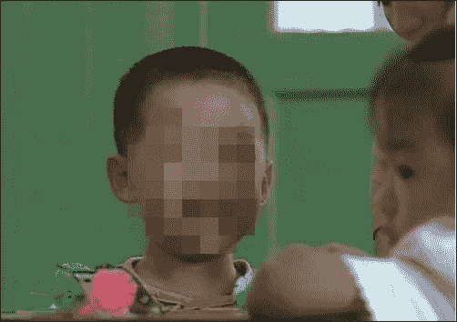

图 4-20　一组平角度图片

（2）俯角度。

俯拍的机位设置在被摄对象之上，以由上至下的视线进行取景。

这种构图承载着两种截然相反的叙事意图。一方面用于交代空间，镜头从高处俯瞰可以把地面分布、群体动线与大场面的调度完整呈现，常见于开篇定场或收尾收束，将观众送入或带出故事世界。另一方面用于压低人物气场，当人物被从上往下拍摄时，整体形体显得局促纤细。视角自带审视意味，极易传递出渺小、无力、被排斥乃至被贬低的情绪。若想激发观众对主角的怜惜，或是凸显反派的衰势，俯视是很有力的视觉手段。

图 4-21 展示了一张俯拍构图的范例。

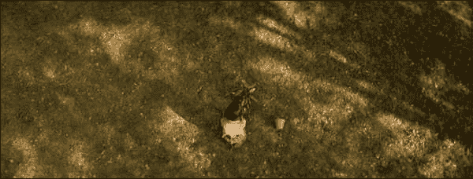

图 4-21　俯拍构图范例

（3）仰角度。

仰拍是将机位安置在被摄主体下方，以由下至上的视线取景。

这属于强势方的观看位置。仰拍会把地面杂讯与凌乱的地平线收敛，视野留给天空或顶面，主体因此被极度突出。视觉上人物显得拔高、威严。无论是塑造英雄的伟岸，或是呈现怪物的压迫，仰角都是强化气场的利器。需注意透视容易走样，使用的过度画面会显得扭曲夸张。

图 4-22 展示了一张仰拍构图的范例。

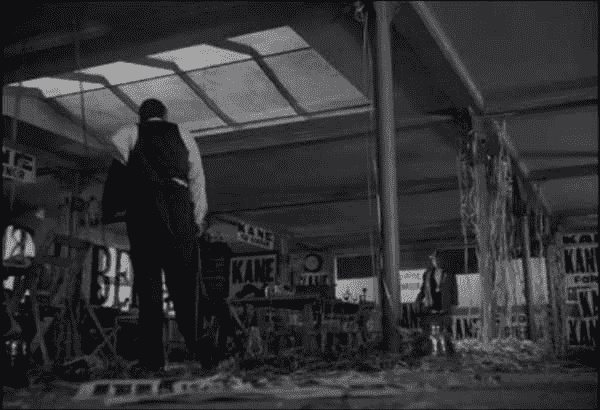

图 4-22　仰拍构图范例

#### 2．心理角度

除几何机位的高低关系外，角度还关乎叙事的人称，常归纳为第三人称与第一人称，亦即客观镜头与主观镜头。

（1）客观镜头。

这是第三人称的观看方式。摄像机如同隐形的记录者，冷静地捕捉发生的一切。它代表叙述者的眼睛，理智、旁观、不介入情节。影视作品里绝大多数画面都属于这一类，它让观众保持安全的观赏距离。

客观镜头图片如图 4-23 所示。

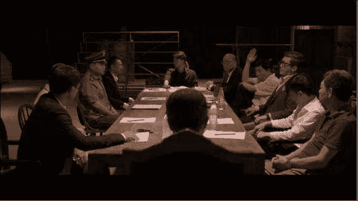

图 4-23　客观视角范例

（2）主观镜头。

这是第一人称的观看方式。摄像机化身剧中人物的眼睛，观众所见即角色所见。代入感极强，能直接体会到角色的眩晕、恐惧或兴奋。在 AI 漫剧里，适时插入主观镜头是打破屏幕隔阂、提升沉浸感的有效做法。

主观镜头图片如图 4-24 所示。

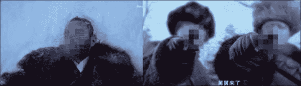

图 4-24　主观视角范例

至此，景别、运镜与视角已经拆解清楚。这三项并非彼此独立的技术点，而是一套严密的表达体系。

景别划分信息层级，决定观众关注什么。
镜头运动调控叙事节奏，决定观众如何观看。
角度确立情感立场，决定观众处在何种心理位置。

在 AI 漫剧创作中，这套视觉语言的价值高于传统拍摄。因为模型是被动执行者，不会主动思考这场戏该怎么呈现，只能按提示机械生成。

若描述模糊，画面或许有美感，叙事却会空洞。只有熟练且精准地组合这三要素，分镜才能成为稳定可控的叙事工具，帮助模型准确还原创作意图。

理论最终要落到实战。如今核心零件已备齐，下一步便是组装。我们将进入关键环节：如何把这些镜头语言落实到具体的分镜脚本，使其具备可执行性。 EXr6287u6NNVz+GYLY+7SDk226FstKIHdC0bNoQkB2Nqi1xSR0yxPmwrTs5gRi/BtfSbid6dBhii9q7cz2pIyA==

## 4.3 镜头语言基础

4.2 节已确定 AI 漫剧的画风，这决定了作品的视觉基调。但画风好看仍不够，还要有打动人的故事并讲好。观众感知的故事，完全取决于镜头如何引导。镜头语言是连接世界与观众体验的桥梁，负责分配信息、放大情绪、把控节奏。

在 AI 漫剧制作语境里，镜头语言不仅是摄影技巧，更是一套严密的视觉规则。只有明确每个镜头的表达意图，写出的提示词才能被模型正确执行，分镜才能服务剧情，而不是变成随机的视觉抽卡。

在动笔写具体分镜前，必须先掌握镜头语言的三大基石：景别、镜头运动与拍摄角度。

### 4.3.1　景别

景别体现摄影机与被摄主体间的距离，决定信息量的多少。

距离越远，环境信息越多人物越少；距离越近，人物情绪越突出环境越少。在用 AI 生成图片的提示词中，准确控制景别是调节画面内容占比的有效手段。

按远近划分，常见景别有 5 种，如图 4-8 所示。

#### 1．远景

远景的核心任务是交代背景与环境。它把视野拉到最开阔，人物在画面里可能只是一抹小点，重点在于呈现辽阔的环境、地理位置或特定自然景观。

在 AI 漫剧里，远景多用作开篇定场或场景转换的过渡，告知观众故事发生的地点、时代与整体氛围，是宏大壮丽还是孤寂苍凉。

图 4-8　五种常见景别

对 AI 漫剧而言，远景是展示世界观设定的关键镜头。此时不必纠结人物面部细节，模型在远景下难以生成精细五官，而应聚焦用环境营造氛围，让观众第一时间沉入设定世界。

图 4-9 和图 4-10 展示了两张远景范例。

图 4-9　远景范例（一）

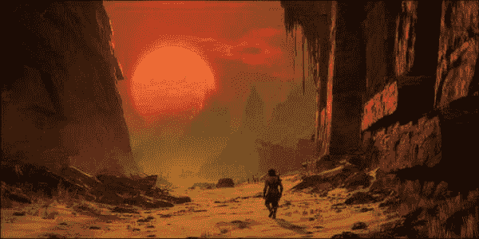

图 4-10　远景范例（二）

#### 2．全景

全景是呈现关系的镜头。人物全身可见，周围环境也清晰可辨，可明确交代人物与环境、人物与人物的空间关系。

全景最适合表现动作与姿态。剧本里出现打斗、舞蹈、奔跑或群像互动时，全景是不二之选。通过肢体、服饰，观众能迅速判断角色身份与状态。

在 AI 生成的实践中，全景往往是动作戏失真的重灾区。因此提示词要多描述肢体动作与互动逻辑，减少对微表情的描写，因为在这个距离下肢体语言比表情更有效。

图 4-11 和图 4-12 展示了两张全景范例。

图 4-11　全景范例（一）

图 4-12　全景范例（二）

#### 3．中景

中景是叙事的主力。画面通常截取人物膝盖或腰部以上，既能看清表情，又保留动作与少量环境，是最接近日常交流的观察距离。

绝大多数剧情推进、双人对话、日常互动都适合中景。它不像远景疏离，也不像特写压迫，观看体验最舒适。

对 AI 漫剧创作，中景是成图率最高的景别。模型在此距离下既能处理面部结构，又能把服饰与背景融合得很好。若不确定该用何镜头，选择中景通常不会出错。

图 4-13 和图 4-14 展示了两张中景范例。

图 4-13　中景范例（一）

图 4-14　中景范例（二）

#### 4．近景

近景是情绪的放大器。镜头推进到胸部以上，背景往往虚化或大幅简化，观众注意力被强制集中在面部，细微表情变化皆被捕捉。

当剧情需要展现愤怒、悲伤、震惊或深情时，必须切入近景。它是建立观众与角色情感连接的最有效手段。

在利用 AI 生成图片时，近景是检验角色设计细节的关键。提示词要将重点放在五官细节、眼神光和面部肌肉微动作上，利用模型强大的细节生成能力把情绪拉满。

图 4-15 和图 4-16 展示了两张近景范例。

图 4-15　近景范例（一）

图 4-16　近景范例（二）

#### 5．特写

特写是对信息的强烈强调。画面聚焦在极小局部，如一只眼睛、颤抖的手指、滴血的刀尖或走动的指针。

特写的作用直接，给观众划出重点。常用来强化象征意义、制造悬念或施加心理压迫感。

在 AI 漫剧里，特写多用于高潮前的暗示或关键线索展示。生成特写时提示词要高度具体，排除冗余，确保模型只生成这一个核心物体或局部，避免画面出现奇怪变形。

图 4-17 和图 4-18 展示了两张特写范例。

图 4-17　特写范例（一）

图 4-18　特写范例（二）

理解景别，就等于掌握画面信息的分配权。接下来让静止画面动起来，看运动镜头如何改变叙事节奏。

### 4.3.2　镜头运动

4.3.1 节介绍了景别，是确定画面的“框”。本节介绍镜头运动，是确定相机的“脚步”。

静止画面是漫画，只有动起来才称得上漫剧。镜头运动的核心价值在于引导观众的心理节奏。你让镜头怎样走，情绪就怎样走。传统影视需要轨道、摇臂、斯坦尼康，而 AI 漫剧只需一句精准提示词。

常见镜头运动有 6 种类型，如图 4-19 所示。

图 4-19　六种镜头运动类型

#### 1．推镜头

推镜头是运动摄影中常用形式，指摄像机朝被摄主体方向前进，或通过改变焦距不断逼近。画面景别由大变小，产生视线前移感。

推镜本质是强制聚焦。镜头缓缓推进时背景被剥离，主体占比增大，视觉上的逼近会转化为心理压迫或专注。若要表现内心波动、发现关键线索，或在平静中酝酿风暴，推镜头是最好的选择。推进速度越快，情绪强化的力度越强。

在 AI 视频生成中，直接用“推镜头”或“镜头向前”作关键词，模型通常能很好理解并执行。以下是一次 AI 设计实战，具体生成结果可扫码查看。

使用软件：可灵

提示词：在森林中，小女孩对着镜头挥手，微笑，推镜头（镜头向前，拍摄靠近主体）

#### 2．拉镜头

拉镜头指摄像机沿光轴向后移动，画面由近及远，视野由窄变宽。

拉镜头是推镜的反向，核心逻辑是揭示。起初观众只见局部，随着镜头后拉，更多环境信息逐步进入画面，使观众恍然大悟：主角身处何种环境。

这种运镜常带疏离与告别意味。场景结束或全片收尾时，拉镜头能让观众缓缓抽离，留下回味的空间。它也常用来表现角色在宏大世界中的渺小与孤独。

在 AI 生成实战中，想要好的拉镜头效果，提示词中要明确“远离主体”的意图。以下是一次 AI 设计实战，具体生成结果可扫码查看。

使用软件：Vidu

提示词：在森林中，小女孩对着镜头挥手，微笑，拉镜头（镜头向后，远离靠近主体）

#### 3．摇

摇镜头指摄像机位置不动，镜头像人的脖子一样转动，左右为横摇，上下为俯仰摇。

摇镜的逻辑是巡视与连接。它模拟人类环顾四周的自然视觉习惯，适用于展示连贯长条空间，或交代两个物体/人物间的位置关系。它能引导视线转移，如从冒烟的枪口摇到倒地的受害者，这种连接感是剪辑无法替代的。

在 AI 生成实战中，生成摇镜头时容易出现画面边缘变形，控制好转动幅度是关键。以下是一次 AI 设计实战，具体生成结果可扫码查看。

使用软件：可灵

提示词：小女孩把脸扭回去，镜头随之摇到正面，围绕主体运镜。

#### 4．移

移是指摄像机真正“走”起来。它横向或斜向移动，与被摄主体保持相对距离，背景产生持续透视变化。

移镜头是为了建立空间感。与摇镜的原地转动不同，移镜会让前景、中景、背景以不同速度位移，产生视差，从而大幅增强画面的立体感与真实感。当需要表现战场的宏大、街道的繁华，或跟随角色穿行复杂环境时，移镜头能提供极强的临场沉浸感。

在 AI 生成实战中，提示词中描述“镜头向右/左移动”即可。以下是一次 AI 设计实战，具体生成结果可扫码查看。

使用软件：即梦

提示词：镜头向右移动，出现一片广袤的草原。

移镜头还有一种手法是“跟”。跟指摄像机紧密跟随运动中的主体，主体动镜头也动，画面中主体位置相对固定，背景快速后退。

跟镜头用来强调动态与连接。它让观众在这个流动的世界里有一个明确的视觉焦点——主角。无论环境多混乱，视线始终被锁定在角色身上。

这种运镜最适合追逐戏、奔跑戏，或展示人物坚定的行进状态，能制造紧迫感，仿佛观众跟在主角身后。

AI 擅长处理此类镜头，因为主体特征保持不变，只需刷新背景。以下是一次 AI 设计实战，具体生成结果可扫码查看。

使用软件：可灵

提示词：蝴蝶翩翩飞舞，镜头跟随蝴蝶移动，蝴蝶最后落在花上，镜头跟随、景深镜头、自然光。

#### 5．升镜头与降镜头

升降镜头指摄像机在垂直方向进行大幅度的升起或降下。

升降镜头是用来构建气势与层次的。升镜头从局部拉升到全景，能展现宏大场面，常伴随情绪高扬；降镜头从高空落到局部，能把观众视线迅速聚焦到具体情节上。

这种垂直变化常用来暗示命运起落、权力更迭，或在开场时给观众一个震撼的视觉奇观。

在 AI 生成实战中，提示词要明确“上移”或“下移”的路径。以下是一次 AI 设计实战，具体生成结果可扫码查看。

使用软件：Vidu

提示词：降镜头，镜头从一个小松鼠缓缓下移，最后落在大树上。

总之，镜头运动在 AI 漫剧里不仅是技术参数，更是情绪调控开关。推是聚焦，拉是抽离，摇是巡视，移是空间，跟是代入，升降是气势。写分镜时不要“为动而动”，每个运动指令都必须服务于当前叙事目的。先想清楚要观众看什么、感受什么，再决定使用什么镜头。

接下来固定视角，探讨拍摄角度如何改变人物地位与状态。

### 4.3.3　拍摄角度

景别与运动讲完后，最后一块拼图是角度。

角度解决地位问题。它决定观众是平视、仰视还是俯瞰角色，每一次选择都在潜移默化中确立观众与角色的心理关系。

以下从几何角度与心理角度两个维度拆解。

#### 1．几何角度

几何角度指摄像机与被摄对象物理位置关系，定义观众观察视点。

（1）平角度。

这是最稳妥的选择。平角度镜头与人物视线持平，符合人们日常观察事物的习惯。优势在于真实稳固，画面无畸变，不带强烈感情色彩。适用于客观陈述事实，表现人物间平等的对话关系，能为观众带来公平、理性的心理体验。

图 4-20 展示了一组平角度图片。

图 4-20　平角度图片组

（2）俯角度。

俯角度指摄像机高于被摄主体，由上往下拍摄。

该角度有双重功能。一是环境交代，俯拍能清晰呈现地面布局与大场面调度，适合作为片头或片尾，把观众带入或带出故事世界。二是压低人物气势，人物被俯视时形象显得低矮，视角自带审视意味，用以表达渺小、无助或被排斥贬低的状态。若想引导观众同情主角或展示反派末路，俯角是有效视觉选择。

图 4-21 展示了一张俯拍摄例。

图 4-21　俯拍范例

（3）仰角度。

仰视角度指摄像机低于被摄主体，由下向上拍摄。

这属于强者视角。仰拍简化背景，过滤杂乱地平线，只留下天空或天花板，极致突出主体。视觉上人物显得高大威猛，无论表现英雄伟岸还是怪物压迫感，仰角都是增强气场的利器。但要注意易产生透视变形，过度使用画面会显得扭曲夸张。

图 4-22 展示了一张仰拍摄例。

图 4-22　仰拍范例

#### 2．心理角度

除物理位置外，角度还代表叙事的人称，常分为第三人称视角与第一人称视角，即客观镜头与主观镜头。

（1）客观镜头。

这是第三人称视角。摄像机如隐形旁观者，记录一切。它代表叙事者眼睛，理性冷静不介入剧情。影视镜头绝大多数属此类，保证观众处于安全观察位置。

客观镜头图片如图 4-23 所示。

图 4-23　客观镜头范例

（2）主观镜头。

这是第一人称视角。摄像机变为剧中人眼睛，观众所见即角色所见。代入感极强，能直接体验角色的眩晕、恐惧或兴奋。在 AI 漫剧中，适时插入主观镜头是打破屏幕隔阂、提升沉浸感的有效手段。

主观镜头图片如图 4-24 所示。

图 4-24　主观镜头范例

至此，景别、镜头运动与角度已拆解完毕。这三者从来不是独立技术点，而是一套严密表达体系。

景别圈定信息层级，决定观众看什么。

镜头运动控制叙事节奏，决定观众怎么看。

AI漫剧和传统拍摄最大的区别在于，机器不会自己想“这一幕该怎么拍”。它只能照着指令执行，所以镜头描述的清晰度直接决定叙事是否成立。角度在其中负责定调，告诉观众以什么心理位置看戏；景别决定信息量，镜头运动决定节奏，拍摄角度决定权力关系。三者组合好，分镜才能从随机的“视觉抽卡”变成可控的叙事工具。

## 4.3 镜头语言基础
先画好画风只是有了视觉基调，故事要被感知，必须靠镜头来引导。镜头语言是把世界和观感连起来的中介，掌控信息分配、情绪放大和节奏把控。在 AI 漫剧的语境里，它更像一套严谨的视觉规则，而非单纯的摄影手法。意图不明确，提示词再漂亮也只能得到好看但空洞的画面。

动笔之前，先把三大支柱记牢：景别、运动、角度。

### 4.3.1　景别
景别本质上是机位和主体的距离关系，直接影响画面里信息占比。拉远，环境说话，人物被压缩；推近，人物情绪凸显，环境退位。提示词里精准写景别，是控制画面内容权重最直接的手段。常用距离可归为 5 类。

#### 1．远景
任务是交代时空与氛围。视野开阔到极致，人可能只剩一个点，重点在地貌、场景规模或自然景观的整体气质。AI 漫剧里常用作开场定场或场景切换的缓冲，让观众快速知道“在哪、是什么年代、什么情绪基调”。世界观搭建时，远景更适合讲环境而非面部，模型在极远距离下很难稳定五官。

图 4-8　常见的 5 种景别

远景是展示设定感的关键。别纠结细节，用环境的气场把观众先带入。

图 4-9　远景图片示例（一）

图 4-10　远景图片示例（二）

#### 2．全景
全景能把人物的全身与周围环境同时收入，核心价值是“关系”。空间里人与人、人与景的位置逻辑一目了然。动作大、姿态重的戏——打斗、舞蹈、奔跑、群像——全景最合适，肢体语言能迅速传递身份与状态。

AI 实际生成时，全景容易在手脚比例上失真。提示词应偏重动作描述和互动关系，减少对微表情的刻画，肢体比眼神更可靠。

图 4-11　全景图片示例（一）

图 4-12　全景图片示例（二）

#### 3．中景
中景是剧情推进的主力。画面一般截到膝上或腰部，既能看清面部，又保留动作和少量环境，是最接近日常对话观察距离的视角。双人交谈、日常互动、情节推进，都靠它来承接。

对 AI 而言，中景是成功率最高的景别。面部结构、服装和背景都能相对稳定平衡。拿不准时，默认中景基本不会错。

图 4-13　中景图片示例（一）

图 4-14　中景图片示例（二）

#### 4．近景
近景是情绪放大。镜头拉到胸部以上，背景被虚化或简化，注意力被锁死在面部。细微的皱眉、瞳孔变化都能被放大，是建立情感共鸣的利器。愤怒、悲伤、震惊、深情，几乎都需要近景来收束。

AI 生成时，近景是检验角色设计的试金石。把提示重点放在五官、眼神光、肌肉微动上，情绪张力更容易拉满。

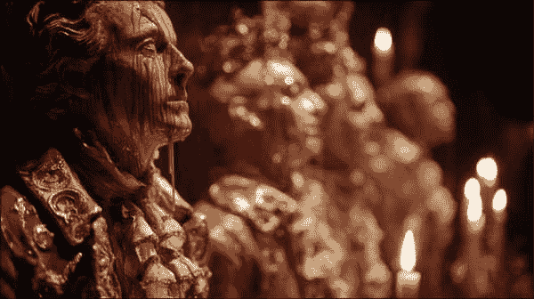
图 4-15　近景图片示例（一）

图 4-16　近景图片示例（二）

#### 5．特写
特写做减法，只留极小的局部：眼睛、颤抖的手指、滴血的刀尖、走动的指针。作用是强制点题，强化象征、制造悬念或施加心理压迫。

AI 漫剧里常用在高潮前暗示或关键线索展示。提示要极具体，去掉冗余，确保模型只生成核心局部，避免奇形怪状的变形。

图 4-17　特写图片示例（一）

图 4-18　特写图片示例（二）

弄懂景别就等于拿到了信息分配权。接下来让静止的画面动起来。

### 4.3.2　镜头运动
景别是框，运动是脚步。静止的画面是漫画，动起来才是漫剧。移动方式直接影响观众情绪的起伏。传统拍摄靠轨道摇臂，在 AI 里只需一句精准指令。

常规运动分 6 类。

图 4-19　6 种镜头运动类型

#### 1．推镜头
机位朝主体推进，或通过焦距变化不断靠近。画面从大到小，视线被强制前移。背景逐步剥离，主体占比不断增大，产生压迫或专注感。适合表现内心波动、发现线索、平静中酝酿风暴。推进越快，情绪越强。

AI 实战：可灵
提示词：在森林中，小女孩对着镜头挥手，微笑，推镜头（镜头向前，拍摄靠近主体）

#### 2．拉镜头
机位沿光轴后撤，由近及远、由窄变宽。逻辑是“揭示”，先给局部再展开环境，常带来恍然大悟的疏离感或告别感。场景收束、全片收尾时，拉镜头能温柔把观众抽离出来，也可用以表现角色在宏大世界里的渺小。

AI 实战：Vidu
提示词：在森林中，小女孩对着镜头挥手，微笑，拉镜头（镜头向后，远离靠近主体）

#### 3．摇
机位不动，镜头像脖子一样转动。左右为横摇 Pan，上下为俯仰摇 Tilt。用途是巡视与连接，展示长条形空间或两物之间的位置关系，例如从枪口摇到倒地的人。摇能让观众感受到同一时空的关联。

注意幅度，过大会导致边缘变形。

AI 实战：可灵
提示词：小女孩把脸扭回去，镜头随之摇到正面，围绕主体运镜。

#### 4．移
摄像机真正移动，横向或斜向推移，保持与主体距离，前景中景背景产生视差。核心是营造空间感和立体真实。适合表现战场、街道、角色穿过复杂环境时的沉浸。

提示词写“镜头向右/左移动”即可。

AI 实战：即梦
提示词：镜头向右移动，出现一片广袤的草原。

移的进阶是跟。机位紧贴运动主体，主体在画面中相对固定，背景快速后退。强调动态与持续连接，让视线始终锁定主角，制造紧迫感，追逐、奔跑戏最常用。AI 处理此类型很稳，因主体不变只需刷新背景。

AI 实战：可灵
提示词：蝴蝶翩翩飞舞，镜头跟随蝴蝶移动，蝴蝶最后落在花上，镜头跟随、景深镜头、自然光。

#### 5．升镜头与降镜头
垂直方向的大幅度升降。升镜头把局部拉向全景，气势高扬，常用于宏大场面开场；降镜头从高空落到局部，视线迅速聚焦，适合收束情节或暗示命运起落、权力更迭。

AI 实战：Vidu
提示词：降镜头，镜头从一个小松鼠缓缓下移，最后落在大树上。

总结来说，推是聚焦，拉是抽离，摇是巡视，移是造空间，跟是代入，升降是定气势。写分镜时别为动而动，每一次移动都要服务于“让观众看什么、感受什么”。

### 4.3.3　拍摄角度
景别和运动讲完，最后拼图是角度。角度解决地位问题，平视、仰视、俯视会潜移默化地改变观众与角色的心理距离。

#### 1．几何角度
指机位与被摄对象的物理相对位置。

（1）平角度
镜头与人物视线持平，最贴近日常观察。画面稳定、无畸变、无强情绪色彩，适合客观陈述事实、表现平等对话，给观众理性、公平的感受。

图 4-20　一组平角度图片

（2）俯角度
机位高于主体往下拍。一方面可交代地面布局和大场面调度，常用于片头片尾；另一方面能压低人物气势，制造审视感，表现渺小、无助、被排斥或落败的状态，引导同情或批判。

图 4-21　一张俯角度图片

（3）仰角度
机位低于主体往上拍，属于强者视角。背景被压缩，主体被拔高，人物显得威猛或压迫。表现英雄、怪物、权威都有效，但易产生透视变形，滥用会扭曲。

图 4-22　一张仰角度图片

#### 2．心理角度
角度还代表叙事人称。

（1）客观镜头
第三人称，摄像机像隐形旁观者，冷静记录。占影视主流，保证观众安全观察。

图 4-23　一张客观镜头图片

（2）主观镜头
第一人称，摄像机即角色眼睛。观众直接体验眩晕、恐惧、兴奋，代入感极强，是打破屏幕隔阂的有力手段。

图 4-24　一张主观镜头图片

景别决定看什么，运动决定怎么看，角度决定以什么立场看。三者互为体系。AI 模型被动执行，不会思考调度，描述不清就会得到美而空的画面。只有熟练组合这三要素，分镜才能稳定、可控地还原创作意图。

理论是为了实战。现在零件齐了，接下来就该把它们组装进可执行的分镜脚本。 EXr6287u6NNVz+GYLY+7SDk226FstKIHdC0bNoQkB2Nqi1xSR0yxPmwrTs5gRi/BtfSbid6dBhii9q7cz2pIyA==

图 4-8　常见的 5 种景别

AI 漫画影像拍摄指南：景别、运镜与视角实战要点

在基于生成模型的漫画影像制作里，远景的首要职责是搭建世界观。此时人脸细节很难被稳定复现，不必纠结五官的精确度，把重心放在环境调度上，用空间质感、光影与构图迅速把观众带入设定时空。

图 4-9 和图 4-10 展示了两张远景图片。

图 4-9　远景图片示例（一）

图 4-10　远景图片示例（二）

#### 2．全景

全景主要负责交代关系。角色全身得以完整呈现，周围环境也保持清晰可辨，角色之间的相对位置以及角色与场景的互动因此被明确点出。

该景别对动作表达十分友好。剧本出现打斗、舞蹈、奔跑或群像互动时，全景往往是最直观的选择。透过肢体姿态与服饰造型，观众能够快速识别身份并判断当前状态。

在实际生成中，全景属于动作戏容易失真的高发区。提示词应当集中描述身体动作的逻辑与互动关系，降低对细微表情的依赖，因为在此距离下，躯干信息比面部更可靠。

图 4-11 和图 4-12 展示了两张全景图片。

图 4-11　全景图片示例（一）

图 4-12　全景图片示例（二）

#### 3．中景

作为叙事工兵，最常被采用的距离就是中景。画面通常截到膝盖或腰部以上，既能看见表情，又保留肢体动作，同时带入一点环境信息，是表现力与可读性兼顾的平衡视角，也最接近日常人际交流的观看习惯。

大多数剧情推进、双人对话、生活化互动都适合用中景。它比远景更亲近，又比特写更舒缓，观看压力最小。

对生成模型而言，中景的成功率最高。在这个距离下，面部结构、服装和背景的融合都比较稳定。机位不确定的时候，先用中景基本不会出错。

图 4-13 和图 4-14 展示了两张中景图片。

图 4-13　中景图片示例（一）

图 4-14　中景图片示例（二）

#### 4．近景

近景相当于情绪的放大器。镜头推到胸部以上，背景多为虚化或简化，观众注意力被强制集中在面部，细微的表情变化会被立刻捕捉。

当剧情需要表现愤怒、悲伤、震惊或深情时，切入近景是最直接的情感连接方式。

在 AI 生成中，近景是检验角色设计的试金石。提示词要集中在五官、眼神高光和面部肌肉的微动作上，利用模型在细节端的优势把情绪拉满。

图 4-15 和图 4-16 展示了两张近景图片。

图 4-15　近景图片示例（一）

图 4-16　近景图片示例（二）

#### 5．特写

特写是对信息的强烈强调。画面聚焦在极小局部，比如一只眼睛、颤抖的手指、滴血的刀尖或走动的指针。

功能十分直接，它强制引导观众注意创作者想突出的细节，常用来强化象征意义、制造悬念或施加心理压迫。

在生成式分镜里，特写多用于高潮前的暗示或关键线索展示。提示词需要高度具体，去掉冗余，确保模型只输出那个核心局部，避免出现变形。

图 4-17 和图 4-18 展示了两张特写图片。

图 4-17　特写图片示例（一）

图 4-18　特写图片示例（二）

厘清景别就等于拿到画面信息分配的权限。下一步让静止的画面动起来，看看运动方式如何调节节奏。

### 4.3.2　镜头运动

4.3.1 节讲的是景别的“框”。本节讲的是相机的“步伐”。

静态画面只是漫画，只有动起来才称得上漫剧。镜头运动的核心价值是调控心理节奏，你让镜头如何行进，观众情绪便随之走动。传统影视依赖轨道、摇臂、斯坦尼康，生成式创作只需一句精准指令。

常见运动类型有 6 种，如图 4-19 所示。

图 4-19　6 种镜头运动类型

#### 1．推镜头

推镜头指摄像机朝向主体前进，或通过改变焦距逐渐逼近。画面景别由大变小，视线感上向前推进。

本质是一种强制聚焦手段。随着推进，背景信息逐步剔除，主体占比不断增大，视觉上的逼近会转化为心理压迫或专注。

表现内心波动、发现线索、或在平静中酝酿风暴时，推镜头最为合适。推进速度越快，情绪强化越强。

在视频生成里，直接使用“推镜头”或“镜头向前”作为关键词，系统通常能较好执行。以下是一次实战设计，具体结果可扫码查看。

使用软件：可灵

提示词：在森林中，小女孩对着镜头挥手，微笑，推镜头（镜头向前，拍摄靠近主体）

#### 2．拉镜头

拉镜头指摄像机沿光轴向后移动，画面由近及远，视野由窄变宽。

与推镜相对，拉镜的核心逻辑是揭示。起初只见局部，随着后退，更多环境信息进入画面，观众会恍然明白主角所处的情境。

这种运镜自带疏离与告别感，场景收尾时能把观众缓缓抽离，留下回味，也常用于表现角色在宏大世界中的渺小与孤独。

生成实战中，提示词要明确“远离主体”的意图。以下是一次实战设计，具体结果可扫码查看。

使用软件：Vidu

提示词：在森林中，小女孩对着镜头挥手，微笑，拉镜头（镜头向后，远离靠近主体）

#### 3．摇

摇镜头是机位不动、镜头像脖子般转动。左右为横摇，上下为俯仰摇。

摇的逻辑是巡视与连接。它模拟人眼环顾的自然习惯，适合展现长形空间或交代两物、两人间的位置关系。能把视线从冒烟的枪口摇到倒地的受害者，形成剪辑难以替代的时空连贯感。

生成摇镜时易在边缘出现变形，控制转动幅度是关键。以下是一次实战设计，具体结果可扫码查看。

使用软件：可灵

提示词：小女孩把脸扭回去，镜头随之摇到正面，围绕主体运镜。

#### 4．移

移是指摄像机真正走动。横向或斜向移动，保持与主体相对距离，背景产生持续透视变化。

移镜头用于建立空间感。不同于原地摇动，移镜头会让前景、中景、背景以不同速度位移，视差带来立体与真实感。表现战场、街道或角色穿越复杂环境时沉浸感极强。

提示词里写“镜头向右/左移动”即可。以下是一次实战设计，具体结果可扫码查看。

使用软件：即梦

提示词：镜头向右移动，出现一片广袤的草原。

移镜的一种变体是跟。镜头紧密跟随运动中的主体，主体在画面中相对固定，背景快速后退。

跟镜头强调动态与连接，为混乱的世界提供一个稳定的视觉锚点——主角。适合追逐、奔跑或表现坚定前行，能制造紧迫感，仿佛观众跟在身后。

生成系统对这类镜头处理很擅长，因为主体特征不变，只需刷新背景。以下是一次实战设计，具体结果可扫码查看。

使用软件：可灵

提示词：蝴蝶翩翩飞舞，镜头跟随蝴蝶移动，蝴蝶最后落在花上，镜头跟随、景深镜头、自然光。

#### 5．升镜头与降镜头

升降镜头指相机在垂直方向上大幅升起或降下。

用于构建气势与层次。升镜从局部拉升到全景，可展现宏大场面，情绪上扬；降镜从高空落到局部，能迅速把视线钉在具体情节上。

这种上帝视角的垂直变化，常暗示命运起落、权力更迭，或在开场时制造视觉冲击。

提示词要明确“上移”或“下移”的路径。以下是一次实战设计，具体结果可扫码查看。

使用软件：Vidu

提示词：降镜头，镜头从一个小松鼠缓缓下移，最后落在大树上。

总的来看，镜头运动在生成式分镜里是情绪调节开关。推是聚焦，拉是抽离，摇是巡视，移是空间，跟是代入，升降是气势。撰写分镜时别为动而动，每个运动指令都必须服务于叙事目的，先想清楚要观众看什么、感受什么，再选镜头。

接下来固定视角，讨论拍摄角度如何改变人物地位与状态。

### 4.3.3　拍摄角度

景别与运动讲完，最后的拼图是角度。

角度解决地位问题。它决定观众是平视、仰视还是俯瞰角色，潜移默化地确立心理关系。

从几何位置与心理人称两个维度拆解。

#### 1．几何角度

几何角度指摄像机与被摄体的物理位置关系，定义观察视点。

（1）平角度。

镜头与人物视线持平，是最稳妥的选择。符合日常观看习惯，画面真实稳固，无明显畸变，也不带强情绪色彩。适合客观陈述事实和表现平等对话，给观众公平理性的体验。

图 4-20 展示了一组平角度图片。

图 4-20　平角度示例组

（2）俯角度。

摄像机高于主体，从上往下拍。

一是交代环境，俯拍能清晰呈现地面布局与大场面调度，适合片头片尾带入或带出故事。二是压低人物气势，俯视会让形象显得低矮，有审视意味，用于表达渺小、无助、被排斥或贬低的状态。想引发同情或表现反派末路，俯角很有效。

图 4-21 展示了一张俯角度图片。

图 4-21　俯角度示例

（3）仰角度。

摄像机低于主体，从下往上拍。

属于强者视角。简化背景，过滤杂乱地平线，极致突出主体，视觉上人物高大威猛。表现英雄气概或怪物压迫感时很管用，但透视变形明显，过度使用会扭曲夸张。

图 4-22 展示了一张仰角度图片。

图 4-22　仰角度示例

#### 2．心理角度

角度还代表叙事人称，分为客观镜头与主观镜头，即第三人称与第一人称。

（1）客观镜头。

摄像机像隐形旁观者，记录一切。代表叙事者眼睛，理性冷静、不介入剧情。绝大多数影视镜头都属此类，保证观众处于安全观察位。

客观镜头示例如图 4-23 所示。

图 4-23　客观镜头示例

（2）主观镜头。

摄像机变成剧中人的眼睛，观众看到的就是角色所见。代入感极强，能直接体验眩晕、恐惧或兴奋。在生成式分镜里适时插入主观镜头，是打破屏幕隔阂、提升沉浸的有效手段。

主观镜头示例如图 4-24 所示。

图 4-24　主观镜头示例

到这里，景别、运动、角度已拆解完毕。三者从不独立，而是一套表达体系。

景别圈定信息层级，决定观众看什么。

运动控制叙事节奏，决定观众怎么看。

角度确立情感立场，决定观众以何种心理位置观看。

在生成式创作中，这套视觉语言的价值比传统拍摄更高。因为模型是被动执行者，不会思考“这场戏该怎么拍”，只能按指令机械生成。

描述模糊，画面可能好看，叙事一定空洞。只有熟练组合这三要素，分镜才能稳定可控，准确还原创作意图。

理论为了实战。现在零件已齐，下一步是组装。我们将进入核心环节：把镜头语言落实到可执行分镜脚本中。

### 4.4 落实你的分镜头脚本

前面拆解了镜头语言的构成，也理解了不同镜头的功能。但理解规则不等于能用起来。分镜头脚本的价值就在于翻译——把脑海里的画面变成系统能稳定理解并生成的信息结构。本节聚焦实操，围绕镜头组接的核心原则展开。

### 4.4.1　镜头组接规则

剪辑流畅靠镜头间内在逻辑，而非乱拼。生成式创作可利用一致性特点，通过四种“相似”衔接。

#### 1．形状相似

视觉上的连连看。提示词里强调两个具特定几何形状的主体，实现无缝衔接。以下是两个形状相似镜头的提示词，具体生成结果可扫码查看。

#### 2．运动相似

让前镜头的运动势能延续到后一镜头。例如上一秒车向右冲，下一秒鸟也向右飞。以下是两个运动相似镜头的提示词，具体生成结果可扫码查看。

#### 3．位置相似

把主体固定在画面同一位置。视觉重合会暗示两者间存在某种神秘联系。以下是两个位置相似镜头的提示词，具体生成结果可扫码查看。

#### 4．概念相似

用同一个核心主题词或情绪词生成不同视觉表现，是蒙太奇的高级用法。以下是两个概念相似镜头的提示词，具体生成结果可扫码查看。

### 4.4.2　镜头组接基本原则

镜头组接是保障视频流畅、符合视觉习惯的核心操作。创作常迷恋单镜质量，却忽略衔接逻辑。底层是保持前后镜头运动态势一致，避免视觉跳跃与生理不适。需掌握以下原则：

#### 1．遵循叙事逻辑原则

按叙事逻辑剪辑永远是首选，解决“发生了什么”。最基础的是时间顺序，按事件进程排列。例如先拍反派扔出支票的中景，再接支票飘落在主角脸上的特写，最后接主角攥拳、眼神愤怒的近景，符合自然观察流程。

常见逻辑还有因果关系，前镜是因，后镜是果。例如主角按下神秘按钮的特写，直接切到整栋楼停电的全景，关联立刻成立。

#### 2．景别循序渐进原则

景别变化要渐进。一般不要从极远大全景直接切到脸部特写，跨度太大易突兀。更稳妥的做法是远景→全景→中景→近景→特写的渐进过渡，或反向进行，给观众适应过程。

微短剧创作相对灵活，为制造冲击或强调情绪，有时会故意打破规则，用大跨度跳跃制造震惊，但此类手法属特例，不可滥用。

#### 3．“动接动”原则

“动接动”指运动镜头接运动镜头。既包括镜头运动接镜头运动，如推接推、横摇接横摇，也包括主体运动接主体运动，如角色 A 起身离开接角色 B 在街上行走。核心价值是延续动势与节奏，常用于连续动作或营造紧张氛围。

#### 4. 静接静
把两段完全静止的画面直接衔接就是静接静。不动镜头连不动镜头，属于最省心也最不易翻车的做法。带运动的镜头内部其实由静止的开头、一段位移、静止的收尾构成。若把上一段运动结束后的静止定格，和下一段运动开始前的静止定格拼在一起，也算静接静。这种连接会带来安稳平和的观感，常出现在对话段落或章节的起止处，给观众留出回味和思考的空间。

#### 5. 匹配剪切
匹配是让切换隐形的进阶手法，核心是观众感受不到切点。动作上要帧对帧吻合，比如人物坐下的过程，切镜头时动作轨迹必须无缝衔接；视线上要逻辑自洽，人物目光投向画外，下一个画面就该呈现被注视的对象，且角度要合理；图形上可借构图或造型的相似完成转场，比如圆月径直切到圆形瞳孔，冲击力很强。

#### 6. 30°位移
对同一主体做连续剪辑时，机位变化最好不小于三十度。角度差异太小，画面会产生抽动或跳帧的错觉，像是拍摄失误。只有在刻意追求风格化张力，例如短视频里制造紧张的跳切时才可破例，常规创作应尽量规避这种显眼的跳跃。

#### 7. 节奏与时长把控
节奏感靠镜头时长来调节。镜头很短、切换很快，会带来紧凑兴奋的情绪；镜头拉长，则情绪趋于舒缓、压抑或宁静。每个镜头的停留时间直接决定信息量与情感分量。切入切出的时机同样关键，理想的切点多落在动作进行中、情绪转折瞬间，或观众最期待看到下一画面的那一刻。 EXr6287u6NNVz+GYLY+7SDk226FstKIHdC0bNoQkB2Nqi1xSR0yxPmwrTs5gRi/BtfSbid6dBhii9q7cz2pIyA==

## 4.4 让分镜脚本真正落地
前文已经拆解了镜头语言的构成，也说明了各类镜头的叙事分工。可理解不等于会用。分镜脚本的价值在于把理解转化为可执行的指令，而非对知识的复述，要把剧情、情绪与镜头选型整理成清晰的操作方案。

在 AI 漫剧里，分镜还承担翻译工作。创作者脑中的画面必须被转译成 AI 能稳定读取的结构化信息。本节不再停留在概念层面，而是围绕落地实操拆解镜头组接的核心要点，让镜头语言写成可执行分镜。

### 4.4.1 镜头组接的相似策略
剪辑流畅与否取决于镜头之间的内在逻辑，而非随意拼接。AI 漫剧可以利用生成一致性，通过四类相似性制造连贯感。

#### 1. 形状相似
相当于视觉连连看。提示词里要强调两个具备特定几何形态的主体，使其在画面上自然过渡。示例提示词见  ，具体成图可扫码查看。

#### 2. 运动相似
让前镜头的动能延续到后镜头。例如上一秒车辆向右冲，下一秒鸟群也向右飞。示例提示词见  ，具体成图可扫码查看。

#### 3. 位置相似
把主体固定在画面相同位置。视觉上的重合会暗示两者之间存在某种关联。示例提示词见  ，具体成图可扫码查看。

#### 4. 概念相似
用同一核心主题词或情绪词去生成不同视觉表现的镜头，是蒙太奇的高级用法。示例提示词见  ，具体成图可扫码查看。

### 4.4.2 镜头组接的基本原则
镜头组接是保证视频流畅、符合观看习惯的核心环节。AI 漫剧创作容易沉迷单镜效果，却忽略衔接逻辑。底层是保持前后镜头运动态势的一致，避免视觉跳跃与生理不适。需要掌握以下原则，让画面转换服务于叙事。

#### 1. 遵循叙事逻辑原则
按叙事逻辑剪辑永远是首要选择，它回答发生了什么。最基础的是时间顺序，按事件进程排列镜头。例如先用中景呈现反派抛出手的支票，随后特写支票飘落在主角脸上，再近景主角攥拳眼神愤怒，完全符合人眼观察顺序。

另一类是因果逻辑，前镜是因后镜是果。例如主角按下神秘按钮的特写，直接切到整栋楼停电的全景，关联立刻成立。

#### 2. 景别循序渐进原则
景别变化要讲究循序渐进。一般不要从极远大全景直接切到面部特写，跨度过大观感突兀。更稳妥的做法是按远景→全景→中景→近景→特写的顺序，或反向过渡，给观众适应时间。

AI 微短剧相对灵活，为制造剧情冲击或强调情绪，有时会故意做大跨度跳跃，这属于特例，不能滥用。

#### 3. 动接动原则
动接动是把处于运动中的镜头接到另一个同样在运动的镜头。既包含镜头运动接镜头运动，如推镜接推镜，横摇接横摇；也包含主体运动接主体运动，如角色 A 起身离开的画面接角色 B 在街上行走。这种接法能保持动势和节奏，常用于连续动作或营造紧张感。

#### 4. 静接静原则
静接静是把静止镜头接到静止镜头。固定镜头接固定镜头最常用也最安全。需要注意，运动镜头本身包含起幅静止、运动、落幅静止。把前镜头的落幅与后镜头的起幅拼接，也算静接静。它能营造稳定平静氛围，常用于对话或段落边界，给观众思考空间。

#### 5. 匹配原则
匹配是实现无缝剪辑的高级技巧，让观众意识不到切换。动作匹配要求切换时动作在上一帧完美对齐；视线匹配要求人物看向画外时，下个镜头就是他看到的东西且角度合理；图形匹配则利用构图或形状相似转场，如圆形月亮切到圆形眼睛，冲击力强。

#### 6. 30°原则
改变机位时，针对同一主体剪辑两连镜，相机角度至少改变 30 度。变化太小画面会“跳一下”，像失误。除非为特定风格化效果，如快节奏短视频刻意制造紧张，否则应避免跳剪。

#### 7. 节奏与时间控制原则
节奏由镜头长短调节，短镜头快切带来紧张兴奋，长镜头带来舒缓、压抑或宁静。镜头停留时长决定信息量和情感重量。切入切出时机的选择也很关键，理想切点多在动作进行中、情绪转折点，或观众最期待看到下一画面的一瞬间。 EXr6287u6NNVz+GYLY+7SDk226FstKIHdC0bNoQkB2Nqi1xSR0yxPmwrTs5gRi/BtfSbid6dBhii9q7cz2pIyA==

小结
至此，AI 漫剧从剧本到画面的核心转换体系已搭建完成，分镜与视觉语言的叙事价值与实操逻辑也明确。

本章不只是分镜技巧和风格科普，核心在于把传统影视叙事、剪辑与美术设计的方法论结合 AI 生成特性进行适配升级，形成一套适合 AI 漫剧高效创作的视觉表达体系。

在剧本到画面的叙事逻辑层面，以“高概念”为开篇锚点，用熟悉设定加颠覆反差快速抓人，依托建置-对抗-结局的三幕结构，配合反差、反转构建情绪节奏，并辅以自检清单，让剧本拆解成为可落地的流程。

在画风选择层面，画风是分镜设计的前置视觉规矩。拆解二次元、厚涂、皮克斯、吉卜力、游戏 CG 五大适配风格的核心特征、提示词逻辑与动态要点，明确画风不仅决定审美，更限制镜头设计、节奏把控与 AI 生成效果，为分镜划定视觉边界。

在镜头语言基础层面，搭建景别-镜头运动-拍摄角度的三维体系。景别分配信息量，镜头运动掌控节奏，拍摄角度确立情感立场，三者形成严密规则，帮助创作者精准传意，避免 AI 生成随机化。

在分镜脚本落地层面，聚焦镜头组接实操。通过形状、运动、位置、概念四大相似技巧，以及叙事逻辑、景别渐进、动接动静接静等七大原则，把理论化的镜头语言转为可执行的高流畅分镜，实现创意到 AI 生成的无缝衔接。

四者结合构成 AI 漫剧视觉叙事的完整闭环。剧本逻辑定方向，画风定基调，镜头语言提供工具，分镜脚本实现执行，相互支撑。体系完整后，后续的 AI 画面生成、剪辑与节奏优化将更有方向。因为故事如何落地为画面、画面如何传递情绪、镜头如何流畅衔接等核心问题，在分镜阶段已给出答案，从根源降低 AI 创作的试错成本与画面割裂风险。

后续创作将基于本章建立的视觉叙事体系，聚焦 AI 生成的实操细节，把分镜脚本转为具体画面素材，让每个镜头都服务故事表达，实现镜头让故事自然流动。

# 第五章
分镜实战：即梦与 Nano Banana Pro

本章解决从单张精美图片到连续叙事画面的工程化落地。在商业化生产中，AI 不能只是生图工具，而要构建成稳定的视觉生产线。本章主要使用即梦和 Nano Banana Pro，两款工具能较好满足商业制作需求。

Midjourney 曾在 AI 生图领域占主流，风格控制和美学水准很高，简单提示词就能奠定视觉基调。但存在付费、门槛高、中文语义识别短板等问题，在追求效率和精准的商用场景成为阻碍。即梦和 Nano Banana Pro 改变了局面，它们把 AI 从单纯生成器升级为可编辑、可调控的生产力工具，画面细节掌控力提升到新高度。

即梦负责大规模标准化镜头生成。对中文语境和东方美学理解精准，在画面张力、色彩氛围、二次元、国风等风格表现上很有优势。Nano Banana Pro 侧重逻辑校验、道具植入与视觉资产生成，依托 Google Gemini 技术底座，能解析复杂剧情逻辑，高效创作连贯四格漫画，也可在不破坏整体质感前提下精准修改细节。理解两款工具差异化，能有效解决漫剧角色一致性难维持和画面逻辑不严谨的问题。 EXr6287u6NNVz+GYLY+7SDk226FstKIHdC0bNoQkB2Nqi1xSR0yxPmwrTs5gRi/BtfSbid6dBhii9q7cz2pIyA==

## 5.1 即梦的模型选择逻辑与画幅比例
即梦是国产 AI 生图工具中表现突出的一款，对抖音、快手、视频号等短视频平台的漫剧创作者而言，成图率和视觉吸引力很关键。用它创作前，必须先厘清模型选择的底层逻辑和画幅比例设定原则。

### 5.1.1 即梦的基础逻辑
选模型时创作者常追新，但漫剧制作更看重稳定性和题材适配性而非单纯新。截至本书编写，即梦提供图片 4.5、图片 4.1、图片 4.0、图片 3.1、图片 3.0 等多版本模型，如图 5-1 所示。

## 5.1 即梦选模与画幅策略
即梦在国产生图产品里口碑靠前，抖音、快手、视频号上做漫剧的创作者大多在意它的出图成功率和画面冲击力。动工前先把模型怎么挑、画幅怎么定想清楚，能省下不少试错成本。

不同系类的模型走的风格路线不一样。3.1 更像一位偏重艺术表达的作者，画面张力足、个性鲜明、风格化痕迹明显；4.0 与 4.1 则走稳健路线，在结果一致性、审美规范和语义把握上都有明显跃进。

图5-1 即梦当前可用的模型阵容

要看出差别，用同一指令做横向对比最直观。下面这组是用于测试的水墨提示：

东方水墨艺术，大师级画作，极具张力。

主体：一名白衣剑客，长发狂舞，手中长剑出鞘，剑气化作实体龙形。

环境：幽深的竹林，狂风大作，竹叶纷飞。

技法：狂草书艺风格，笔触狂放不羁。运用“飞白”技法表现剑气的速度感，运用“泼墨”技法渲染背景的黑暗风暴。

4.1 版本的输出示例见图5-2。

图5-2 图片4.1 的生成示例

4.0 版本的输出示例见图5-3。

图5-3 图片4.0 的生成示例

3.1 版本的输出示例见图5-4。

图5-4 图片3.1 的生成示例

实测来看，3.1 在这组水墨描述上艺术表现最突出，画面更活、张力更强。4.0、4.1 则擅长把提示里复杂的逻辑细节完整还原。做漫剧分镜时要按剧本调性和语义需求切换。偏写实光影、追求质感细腻的现代都市、悬疑、科幻向，4.1、4.0 更可靠，还原更严谨。偏艺术化表达，如古风仙侠、日系校园、治愈绘本风，3.1 往往带来惊喜。画面需要生成文字时，4.1 或 4.0 的准确度更高。

画面比例同样影响成片能否适配平台与观看体验。表5-1 整理了两种常见比例的适用场景和使用建议。

### 5.1.1 模型底层的选择逻辑
创作者常以为越新越好，但在漫剧制作里，稳定性与题材适配度比单纯的新旧更关键。截至本书定稿，即梦开放了图片 4.5、图片 4.1、图片 4.0、图片 3.1、图片 3.0 等多个版本，如图5-1所示。

图5-1 即梦的图片模型

各版本在语义理解和艺术呈现上的取向有别。3.1 的艺术感更强，画面生动且带有独特的风格化气质；4.0 和 4.1 在一致性把控、美学规范和语义理解上实现质变。

再以前面那组水墨案例做二次验证，沿用相同提示。图片4.1 的结果见图5-2。

图5-2 图片4.1 的生成结果

图片4.0 的结果见图5-3。

图5-3 图片4.0 的生成结果

图片3.1 的结果见图5-4。

图5-4 图片3.1 的生成结果

结论一致：3.1 的艺术张力最强，画面更生动；4.0、4.1 更精准还原提示词语义。因此分镜生成时需灵活切换。写实、现代都市、悬疑、科幻需要 4.1/4.0 的严谨逻辑；古风仙侠、日系校园、治愈绘本等艺术化风格，3.1 更易出彩。涉及文字时优先 4.1 或 4.0。

### 5.1.2 分镜比例的设定
除了模型，项目启动前必须敲定画幅比例，它直接影响发布平台和用户体验。表5-1 介绍了两种常见比例的适用场景与使用建议 EXr6287u6NNVz+GYLY+7SDk226FstKIHdC0bNoQkB2Nqi1xSR0yxPmwrTs5gRi/BtfSbid6dBhii9q7cz2pIyA==

## 5.2 提示词搭建方法
即梦对中文的理解很强，无需像 Stable Diffusion 那般堆满英文术语，口语化中文描述往往效果更好。但大白话不等于随意，提示词仍需遵循语法、逻辑与语感。把握住它的理解方式，才能把脑中画面准确翻译给模型。

### 5.2.1 六段式提示词框架
一条高质量提示词可拆成 6 个模块，这是通用底层逻辑：

高质量提示词=主体描述+环境场景+艺术风格/媒介+光影与色彩+构图与视角+质量修饰词

主体描述解决“谁在做什么”，例如“一名 18 岁的少女，穿着白色的水手服，黑色长发，眼神忧郁，手中拿着一封信”。环境场景定义空间，例如“樱花树下的日式街道，飘落的花瓣，远处是电车驶过”。这两部分构成基本叙事。

后半段决定质感。艺术风格/媒介定“魂”，如“吉卜力画风，宫崎骏风格，手绘插画，水彩质感”。光影与色彩定情绪，如“丁达尔效应，午后的阳光，暖色调，清新透亮，高饱和度”。构图与视角定张力，如“特写镜头，浅景深，仰视视角”。最后加质量修饰词保证精细度。

参考例：

18 岁赛博少女，粉色双马尾，戴着机械护目镜，身穿透明雨衣和发光机能服，蹲在霓虹灯招牌上，手里拿着一把改装过的狙击枪。赛博朋克贫民窟，下着酸雨，地面积水反射着五颜六色的光，远处是高耸入云的巨型大厦。动漫厚涂风格，攻壳机动队画风，电影级 CG。赛博霓虹光，蓝粉色调，强对比度，体积光。俯视镜头，大广角，景深。8K 分辨率，极致细节，光线追踪。

实操注意两点。主体描述要客观具体，减少“很帅”“很漂亮”等主观词，用可视觉化的特征，如“18 岁少年，黑色短发，白色校服上衣，背着蓝色双肩包”。动作要具体化，避免“在战斗”“很生气”等笼统状态，换成“右手握剑，左脚向后滑步，身体微微前倾，腰部用力旋转”等指令级描述，情绪也转为面部与肢体特征。

### 5.2.2 权重与混搭技巧
掌握基础结构后，可用权重法和混打法精细控制。

权重法即括号法，想强调的元素加括号，层数越多越强。例如“（（银色长发））”强调发色，“（（（赛博朋克霓虹灯背景）））”则极度强调背景氛围。

混打法是自然语言与标签混合。即梦生图 4.1 支持大白话，但在关键风格上加标签更准，如“一个女孩在哭，（（眼泪像珍珠一样掉下来）），吉卜力风格，特写镜头”。加权后意象更稳定，纯自然语言容易被忽略。

### 5.2.3 词库分类参考
提高效率要建立词库。将常用词分为镜头、光影、风格、质感 4 大类，如表5-2所示。

表5-2　4 类常用词库 EXr6287u6NNVz+GYLY+7SDk226FstKIHdC0bNoQkB2Nqi1xSR0yxPmwrTs5gRi/BtfSbid6dBhii9q7cz2pIyA==

中文提示词也能拍出电影感

十八岁左右的赛博少女，粉色双马尾，机械护目镜，透明雨衣叠加发光机能服，正蹲在霓虹招牌上，手里握着一把改装狙击枪。背景是酸雨中的赛博贫民窟，水洼把五彩霓虹倒映得斑斓，远处耸立着直入云层的巨型大厦。风格偏向动漫厚涂，带有《攻壳机动队》式的电影级 CG 质感。光环境由赛博霓虹主导，蓝粉色调对比强烈，体积光明显。构图用俯视大广角，保留景深。画质要求 8K 超清，细节极致，光线追踪。

落地执行时有两点必须抓住。

1、人物表述要去主观化、重可视化。诸如“很帅的男生”“很美的女生”这类依赖个人审美的评价，模型很难判断，容易偏离。更稳妥的是用可被视觉确认的要素来定义，例如“18 岁少年，黑短发，白衬衫，背蓝双肩包”，或是“古风女侠，黑长直，红发带，红轻甲”。

2、动作描写越细，成片越稳。别用“在战斗”“很生气”这种模糊状态，要拆成可观测的行为，例如“右手握剑，左脚后撤，身体微前倾，腰部发力旋转”；情绪也转成面部与肢体信号，例如“皱眉，嘴角绷紧，拳头微微收拢”。这种指令式写法能明显提升还原度。

### 5.2.2　提示词进阶技巧

基础框架熟练后，可用权重法和混打法进一步精细化控制。

1、权重法，也称括号法，想突出的元素就加括号，层数越多强调越强。比如“（（银色长发））”强化发色，“（（（赛博朋克霓虹灯背景）））”则极度强化环境氛围，让模型把算力集中到这些部位。

2、混打法，即口语化自然描述与标签词混合，也是即梦的优势。即梦生图 4.1 对大白话理解很好，关键风格搭配标签更准，比如“一个女孩在哭，（（眼泪像珍珠一样掉下来）），吉卜力风格，特写镜头”。实测显示，带权重的写法更稳定地呈现“眼泪像珍珠”的意象，纯口语有时会被忽略。

### 5.2.3　常用词库

自建词库是提速的要诀。我们把词库划分为镜头、光影、风格、质感四类，如表 5-2 所示。

表 5-2　4 类常用词库 EXr6287u6NNVz+GYLY+7SDk226FstKIHdC0bNoQkB2Nqi1xSR0yxPmwrTs5gRi/BtfSbid6dBhii9q7cz2pIyA==

## 5.2 提示词结构与工程

即梦对中文的理解能力很强，不必像 Stable Diffusion 那样堆砌复杂英文术语，用自然口语化的中文往往更有效。但口语化不等于随意，提示词仍需遵循一定的语法、逻辑与语感。即梦虽支持中文，若理解逻辑没把握，成图仍会偏差。掌握正确结构，才能把脑中画面精准翻译给模型。

### 5.2.1　标准提示词公式

一条高质量提示词可拆解为 6 个核心模块，这套公式具备通用性。

高质量提示词=主角说明+场景设定+风格与媒介+灯光色调+镜头视角+画质修饰

主角说明解决“谁在做什么”，例如“一名 18 岁少女，穿白水手服，黑长发，眼神忧郁，手握一封信”。场景设定界定人物所处空间，例如“樱花树下日式街道，花瓣飘落，远处电车驶过”。这两块构成画面基本叙事。

其余部分决定质感。风格与媒介定调子，如“吉卜力画风，宫崎骏风格，手绘插画，水彩质感”。灯光色调定情绪，如“丁达尔效应，午后阳光，暖色调，清新透亮，高饱和度”。镜头视角提供张力，“特写镜头，浅景深，仰视视角”等可精准控制视线。最后加上画质修饰确保精细度。

以下是一条按此公式编写的提示词。

18 岁赛博少女，粉色双马尾，戴着机械护目镜，身穿透明雨衣和发光机能服，蹲在霓虹灯招牌上，手里拿着一把改装过的狙击枪。赛博朋克贫民窟，下着酸雨，地面积水反射着五颜六色的光，远处是高耸入云的巨型大厦。动漫厚涂风格，攻壳机动队画风，电影级 CG。赛博霓虹光，蓝粉色调，强对比度，体积光。俯视镜头，大广角，景深。8K 分辨率，极致细节，光线追踪。

实操时须注意两点。

1、主角的描写要客观具体，尽量少用主观形容词。“一个很帅的男孩”或“一个漂亮的女孩”这类词模型难以对齐个人审美，容易偏离预期。应写可视觉化的具体特征，如“18 岁少年，黑色短发，白色校服上衣，背着蓝色双肩包”，或“东方古风女侠，黑长直，红色发带，穿红色轻甲”。

2、动作描述越具体，画面越稳。避免“她在战斗”“他很生气”这类模糊状态，改为可视动作，如“右手握剑，左脚向后滑步，身体微微前倾，腰部用力旋转”；情绪转译为面部与肢体，如“皱眉，嘴角紧绷，拳头微微收紧”。这种指令化写法能显著提升准确性。

### 5.2.2　提示词进阶技巧

掌握基础结构后，可用“权重法”和“混打法”精细控制。

1、权重法即括号法，想强调的元素加括号，层数越多越强。例如“（（银色长发））”强调发色，“（（（赛博朋克霓虹灯背景）））”则极度强调背景氛围，引导模型集中算力。

2、混打法是自然语言与标签混合，即梦的一大优势。生图 4.1 支持大白话描述，关键风格用标签更准，如“一个女孩在哭，（（眼泪像珍珠一样掉下来）），吉卜力风格，特写镜头”。对比可见，带权重的描述更稳定呈现“眼泪像珍珠”的意象，纯自然语言易被忽略。

### 5.2.3　常用词库

自建常用词库是提速关键。我们按镜头、光影、风格、质感四类归纳，如表 5-2 所示。

表 5-2　4 类常用词库 EXr6287u6NNVz+GYLY+7SDk226FstKIHdC0bNoQkB2Nqi1xSR0yxPmwrTs5gRi/BtfSbid6dBhii9q7cz2pIyA==

## 5.3 AI 漫剧资产库的建立

前文已把分镜语言到提示词工程拆解清楚，足以支撑单条或数条高质量短片。但进入连续剧集商业化生产时，会遇到新痛点：规模化创作中如何长期保持角色、画面和风格稳定。

AI 漫剧若每帧都从零写提示词，效率低且一致性难维持。成熟流程必须进入资产化阶段，把角色设定、场景元素、关键道具及视觉规范沉淀为可复用素材库，每次生成都建立在既有成果上。本节重点讲角色三视图、场景素材和关键视觉资产的搭建方法，这是支撑连续创作、实现工业化生产的底层基础。

### 5.3.1　生成角色三视图

三视图是 AI 漫剧的视觉基准，决定五官比例、发型服饰和整体色调。若三视图不稳，后续分镜易陷入频繁换脸。

生成可用三视图需遵守规范。首先画幅设 16 : 9，横屏才能完整容纳正面、侧面、背面全身。其次指定纯白背景，复杂背景会干扰轮廓识别，增加抠图和训练难度。

主体姿态必须明确“静态站姿”，动态会让三视角比例不一致。服饰描写杜绝主观词，要具体到材质与样式，如“浅青色薄纱外衫，腰间挂翠绿玉佩，袖口绣银线图案”。三视图核心是“一致”而非“好看”，风格宜简洁清晰，避免过度光影渲染干扰细节识别。

通用角色三视图生成案例，提示词如下。

一张详细的角色设计图，角色三视图（包含正面、侧面、背面），纯白色背景，无阴影。

主体：一名 18 岁的东方女侠，黑色长马尾，系着红色发带。身穿白色燕尾练功服，外罩淡青色薄纱长衫，腰间挂着一枚翠绿玉佩，手持一把银色长剑。

面部：瓜子脸，柳叶眉，眼神坚毅冷酷，皮肤白皙。

风格：国潮插画风格，极高画质，细节清晰，无杂乱线条，用于 3D 建模参考。

生成结果如图 5-5 所示。

通用 5-5　通用角色三视图案例

接下来做多样化尝试。

#### 1．古风角色三视图

提示词如下。

一张详细的角色设计图，角色三视图（包含正面、侧面、背面），纯白色背景，无阴影，静态站立。

主体：东方古风女刺客，22 岁，黑色高马尾，额前碎发少量。

服饰：深红色轻甲，腰间金色护符，黑色皮靴。

风格：国漫 3D + 厚涂融合。

光影：柔光，无阴影。

细节：线条设计干净，用于分镜资产。

生成结果如图 5-6 所示。

图 5-6　古风角色三视图示例

#### 2．现代角色三视图

提示词如下。

一张详细的角色设计图，角色三视图（包含正面、侧面、背面），纯白色背景，无阴影，静态站立。

主体：19 岁大学生，短发，戴银色耳钉。

穿着：白色 T 恤，牛仔外套，黑色休闲裤。

风格：真实系二次元厚涂。

光影：自然柔光。

细节：线条清晰，用于都市轻喜剧。

生成结果如图 5-7 所示。

图 5-7　现代角色三视图示例

#### 3．二次元校园角色三视图

提示词如下。

一张详细的角色设计图，角色三视图（包含正面、侧面、背面），纯白色背景，无阴影，静态站立。

主体：17 岁高中少女，橙色短马尾。

穿着：日系校服（白衫 + 蓝色百褶裙）。

风格：二次元赛璐珞。

表情：元气、微笑。

生成结果如图 5-8 所示。

图 5-8　二次元校园角色三视图示例

#### 4．仙侠/玄幻角色三视图

提示词如下。

一张详细的角色设计图，角色三视图（包含正面、侧面、背面），纯白色背景，无阴影，静态站立。

主体：仙门女弟子，白衣飘逸，蓝色系腰带。

发型：高马尾 + 流苏发饰。

风格：国风仙侠。

动势：静态稳重。

生成结果如图 5-9 所示。

图 5-9　仙侠/玄幻角色三视图示例

#### 5．科幻/机甲角色三视图

提示词如下。

一张详细的角色设计图，角色三视图（包含正面、侧面、背面），纯白色背景

主体：短银发青年，穿轻型驾驶服。

服饰：白蓝配色，带金属接口。

风格：科幻厚涂。

用途：机甲番/太空科幻。

生成结果如图 5-10 所示。

图 5-10　科幻/机甲角色三视图示例

### 5.3.2　生成空场景图

漫剧画面逻辑是人物动、背景相对静止。需备一套无人物背景底图，每部剧至少储备 3～5 个核心空场景，后续合成时作为底板，保证空间关系统一。以下三例。

#### 1．案例一

提示词如下。

空镜头，无人场景，环境概念设计图。

环境：幽深茂密的竹林，清晨，雾气缭绕。地面铺满枯黄的竹叶，有一条蜿蜒的石板路延伸至远方。

氛围：静谧，神秘，略带压抑感，冷色调，青绿色系。

光影：丁达尔效应，微弱的阳光穿透竹叶投下斑驳光影。

风格：写实厚涂风格，电影级构图，8K 分辨率。

生成结果如图 5-11 所示。

图 5-11　空镜头案例一

#### 2．案例二

提示词如下。

空镜头，无人场景，环境概念设计图。

场景：古代皇宫屋顶，深夜。

元素：琉璃瓦、飞檐、远处灯火。

光影：冷月光 + 建筑反光。

风格：国漫 3D。

氛围：潜行、紧张。

生成结果如图 5-12 所示。

图 5-12　空镜头案例二

#### 3．案例三

提示词如下。

空镜头，无人场景，环境概念设计图。

场景：仙门大殿，云雾缭绕，仙气上升。

元素：玉色石柱、雕刻纹路。

风格：国风仙侠。

氛围：庄严、玄妙。

生成结果如图 5-13 所示。

图 5-13　空镜头案例三

### 5.3.3　生成关键道具图

剧本中涉及的关键物品，如令牌、特殊武器或信物，必须独立生成。复杂人物构图中，AI 难以精确描绘小物件结构，易变形模糊。应采用产品摄影逻辑，单独制作高精度特写，后期灵活调用。以下三例。

#### 1．案例一

提示词如下。

产品特写，单品展示，纯黑背景，居中构图。

主体：一只高科技赛博朋克风格的机械义眼。金属质感，表面有复杂的电路纹理，瞳孔发着红光，周围有细微的电流特效。

风格：3D OC 渲染，极高精度，微距摄影。

生成结果如图 5-14 所示。

图 5-14　道具图案例一

#### 2．案例二

提示词如下。

产品特写，单品展示，纯黑背景，居中构图。

主体：金色短匕首，刃纹细腻。

风格：3D 写实。

用途：古风暗杀、江湖戏。

生成结果如图 5-15 所示。

图 5-15　道具图案例二

#### 3．案例三

提示词如下。

产品特写，单品展示，纯黑背景，居中构图。

主体：符箓，中间纹路发金光。

风格：国风仙侠。

生成结果如图 5-16 所示。

图 5-16　道具图案例三 EXr6287u6NNVz+GYLY+7SDk226FstKIHdC0bNoQkB2Nqi1xSR0yxPmwrTs5gRi/BtfSbid6dBhii9q7cz2pIyA==

## 5.3 AI 漫剧资产库的建立

掌握分镜到提示词的方法后，单条短片可成。但要做连续剧集的商业化生产，就必须解决角色与画风长期稳定的问题。

AI 漫剧若每帧重写提示词，效率低下且一致性难以保证。成熟的工业流程要走向资产化，把角色设定、场景元素、关键道具及视觉规范沉淀为可复用的标准素材库，让每次生成都站在已有成果上。本节聚焦角色三视图、场景素材和关键视觉资产的构建，这是支撑连贯创作、实现规模化生产的底层基础。

### 5.3.1　生成角色三视图

三视图是漫剧制作的视觉基准，决定面部比例、发型服饰与整体色调。若基准不稳，后续分镜会频繁出现换脸问题。

生成可用三视图需遵循操作规范。首先画幅设为 16 : 9，横屏才能完整容纳正、侧、背三个角度的全身。其次指定纯白背景，复杂背景会干扰人物轮廓识别，增加抠图和模型训练难度。

姿态上要明确“静态站姿”，动态姿势易导致三个视角比例不一致。服饰描写要杜绝主观形容词，具体到材质与样式，如“浅青色薄纱外衫，腰间挂翠绿玉佩，袖口绣银线图案”。三视图的价值在于“一致”而非“好看”，风格应简洁清晰，避免过度光影渲染干扰细节识别。

以下是一个通用角色三视图生成案例，提示词如下。

一张详细的角色设计图，角色三视图（包含正面、侧面、背面），纯白色背景，无阴影。

主体：一名 18 岁的东方女侠，黑色长马尾，系着红色发带。身穿白色燕尾练功服，外罩淡青色薄纱长衫，腰间挂着一枚翠绿玉佩，手持一把银色长剑。

面部：瓜子脸，柳叶眉，眼神坚毅冷酷，皮肤白皙。

风格：国潮插画风格，极高画质，细节清晰，无杂乱线条，用于 3D 建模参考。

生成结果如图 5-5 所示。

通用 5-5　通用角色三视图案例

接下来，再进行多样化尝试。

#### 1．古风角色三视图

提示词如下。

一张详细的角色设计图，角色三视图（包含正面、侧面、背面），纯白色背景，无阴影，静态站立。

主体：东方古风女刺客，22 岁，黑色高马尾，额前碎发少量。

服饰：深红色轻甲，腰间金色护符，黑色皮靴。

风格：国漫 3D + 厚涂融合。

光影：柔光，无阴影。

细节：线条设计干净，用于分镜资产。

生成结果如图 5-6 所示。

图 5-6　古风角色三视图示例

#### 2．现代角色三视图

提示词如下。

一张详细的角色设计图，角色三视图（包含正面、侧面、背面），纯白色背景，无阴影，静态站立。

主体：19 岁大学生，短发，戴银色耳钉。

穿着：白色 T 恤，牛仔外套，黑色休闲裤。

风格：真实系二次元厚涂。

光影：自然柔光。

细节：线条清晰，用于都市轻喜剧。

生成结果如图 5-7 所示。

图 5-7　现代角色三视图示例

#### 3．二次元校园角色三视图

提示词如下。

一张详细的角色设计图，角色三视图（包含正面、侧面、背面），纯白色背景，无阴影，静态站立。

主体：17 岁高中少女，橙色短马尾。

穿着：日系校服（白衫 + 蓝色百褶裙）。

风格：二次元赛璐珞。

表情：元气、微笑。

生成结果如图 5-8 所示。

图 5-8　二次元校园角色三视图示例

资产化生产，让 AI 漫剧保持稳定可控

分镜语言与提示词工程梳理完后，制作单条或几条高质量短片是可行的。但一旦进入连载剧集的商业化交付，就会出现一个明显瓶颈：规模化迭代时，如何让人物、画面与整体调性长期保持统一。

若每帧都重新撰写指令，效率低下且一致性难以维持。成熟的产线必须进入资产化阶段，把人物设定、场景要素、关键道具与视觉规范沉淀为可复用的标准素材库，后续生成都基于已有成果展开。本节聚焦三视角定稿、背景素材与核心视觉资产的搭建方法，这是支撑连载创作、实现工业化生产的底层基础。

## 5.3 搭建 AI 漫剧可复用资产库

### 5.3.1 角色三视图的生成要点
三视角定稿是 AI 漫剧的视觉锚点，决定五官比例、发型服饰和整体色调。若基准图不稳，后续镜头很容易陷入频繁换脸。

可用的三视角图需要遵循一套制作规范。画幅建议 16:9，横向宽度足够容纳正侧背三个全身角度。背景必须选用纯白且无阴影，复杂背景会干扰轮廓识别，增加抠图与训练成本。

姿态描述要明确为站立不动，动态会造成三视角身体比例失调，参考价值下降。服装描写避免主观形容，要细化到材质与款式，例如“浅青薄纱外衫，腰间系翠绿玉佩，袖口绣银线图案”。最后，三视角图的核心价值在于一致性而非观赏性，风格保持简洁清晰，避免过度光影干扰细节读取。

通用示例参考：
输出一张精细人物设定稿，包含正侧背三个角度，纯白底无阴影。
人物为 18 岁东方女侠，黑长马尾配红发带。身穿白燕尾练功服，外罩淡青薄纱长衫，腰挂翠绿玉佩，手持银色长剑。
面部瓜子脸、柳叶眉，眼神坚毅冷酷，肤色白皙。
风格为国潮插画，画质极高，细节清晰、无杂线，适用于 3D 建模参考。
效果见图 5-5。

通用 5-5　通用角色三视图案例

多样化尝试

#### 1．古风角色三视图
参考指令：
产出三角度设计稿，正侧背齐全，纯白底无阴影，保持静止站姿。
人物为 22 岁东方古风女刺客，黑高马尾，额前少量碎发。
装束为深红轻甲，腰间金色护符，脚穿黑皮靴。
风格为国漫 3D 与厚涂融合，柔光无阴影，线条干净，适用于分镜资产。
见图 5-6。

图 5-6　古风角色三视图示例

#### 2．现代角色三视图
参考指令：
输出三角度设定稿，包含正面侧面背面，纯白背景无阴影，站立静止。
主人公为 19 岁大学生，短发配银色耳钉。
着装为白 T 恤、牛仔外套、黑休闲裤。
风格为写实系二次元厚涂，光影自然柔和，线条清晰，适合都市轻喜剧。
效果见图 5-7。

图 5-7　现代角色三视图示例

#### 3．二次元校园角色三视图
参考指令：
三角度角色设计稿，正侧背完整，纯白背景无阴影，姿态静止。
人物为 17 岁高中少女，橙色短马尾。
服装为日系校服，白衬衫配蓝百褶裙。
风格为二次元赛璐珞，表情元气微笑。
见图 5-8。

图 5-8　二次元校园角色三视图示例

#### 4．仙侠/玄幻角色三视图
提供一份三角度设定稿，要求覆盖正面、侧面、背面，整体置于纯白无阴影的背景中，人物采取安静的站姿。
核心人物设定为仙门女弟子，着装以飘逸白衣为主，腰间搭配蓝色系束带。
头发梳成高马尾，并点缀流苏装饰。
整体美术方向偏向国风仙侠，表现节奏沉稳静止。
输出效果见图 5-9。

图 5-9　仙侠/玄幻角色三视图示例

图 5-9　仙侠/玄幻角色三视图示例

#### 5．科幻/机甲角色三视图
以下为指令示例。
生成一张精细的三角度人物设计稿，涵盖正面、侧面、背面，背景为纯白。
人物为短银发青年，身着轻型驾驶服。
服装采用白蓝配色，细节处加入金属接口。
绘画风格为科幻厚涂，适用于机甲番或太空科幻题材。
成图效果见图 5-10。

图 5-10　科幻/机甲角色三视图示例

图 5-10　科幻/机甲角色三视图示例

### 5.3.2 空场景图的生成
漫剧叙事中人物会移动，背景多保持相对静止。因此要提前准备若干张无人的环境底图，单部作品建议至少积累三到五个核心空场景，后续合成时以此为底板，可保证多镜头间的空间一致。下面分享三组空镜头制作案例。

#### 1．案例一
指令参考：
制作一张空镜头环境概念图，画面中不出现人物。
场景设定为深幽茂密的竹林，时间是清晨，雾气环绕。地面覆盖枯黄竹叶，一条曲折石板路向远处延伸。
整体氛围宁静神秘，带点压抑，色调偏冷以青绿色为主。
光影上体现丁达尔现象，微弱阳光透过竹叶形成斑驳投影。
美术风格走写实厚涂路线，构图对标电影级，解析度 8K。
生成效果见图 5-11。

图 5-11　空镜头案例一

图 5-11　空镜头案例一

#### 2．案例二
指令参考：
空镜头环境概念图，无人。
地点为古代皇宫屋顶，时段深夜。
画面包含琉璃瓦、飞檐以及远处点点灯火。
光影以冷调月光为主，辅以建筑自身反光。
风格采用国漫 3D，情绪偏向潜行与紧张。
成果见图 5-12。

图 5-12　空镜头案例二

图 5-12　空镜头案例二

#### 3．案例三
指令参考：
生成无人环境概念图。
场景为仙门大殿，云雾缭绕，仙气自地面升腾。
细节加入玉色石柱与精致雕刻纹路。
美术风格为国风仙侠，氛围庄严且玄妙。
效果见图 5-13。

图 5-13　空镜头案例三

### 5.3.3 关键道具图的生成
剧本里出现的关键物件，比如令牌、特殊武器或信物，最好单独建模成独立资产。在有人物的复杂画面里，AI 很容易把小物件画崩、细节丢失。建议用产品摄影思路，为道具单独生成高精度特写，方便后期随意调用。下面是三组道具制作示例。

#### 1．案例一
指令参考：
产品特写展示，单件居中，背景纯黑。
主体为赛博朋克风格的高科技机械义眼，金属材质，表面布满复杂电路纹理，瞳孔泛红光，周围带细微电流特效。
渲染方式为 3D OC，精度极高，采用微距摄影质感。
成果见图 5-14。

图 5-14　道具图案例一

#### 2．案例二
指令参考：
单品特写，居中，纯黑背景。
主体是一把金色短匕首，刃面纹理细腻。
风格为 3D 写实，适用于古风暗杀或江湖戏。
效果见图 5-15。

图 5-15　道具图案例二

#### 3．案例三
指令参考：
单品特写，居中，纯黑背景。
主体为一张符箓，中央纹路发出金色光芒。
风格为国风仙侠。
见图 5-16。

图 5-16　道具图案例三 EXr6287u6NNVz+GYLY+7SDk226FstKIHdC0bNoQkB2Nqi1xSR0yxPmwrTs5gRi/BtfSbid6dBhii9q7cz2pIyA==

补充空场景与资产示例

空场景图补充案例三
指令如下。
空镜头，无人场景，环境概念设计图。
场景：仙门大殿，云雾缭绕，仙气上升。
元素：玉色石柱、雕刻纹路。
风格：国风仙侠。
氛围：庄严、玄妙。
生成结果如图 5-13 所示。

图 5-13　空镜头案例三

关键道具图补充案例一
指令如下。
产品特写，单品展示，纯黑背景，居中构图。
主体：一只高科技赛博朋克风格的机械义眼。金属质感，表面有复杂的电路纹理，瞳孔发着红光，周围有细微的电流特效。
风格：3D OC 渲染，极高精度，微距摄影。
生成结果如图 5-14 所示。

图 5-14　道具图案例一

关键道具图补充案例二
指令如下。
产品特写，单品展示，纯黑背景，居中构图。
主体：金色短匕首，刃纹细腻。
风格：3D 写实。
用途：古风暗杀、江湖戏。
生成结果如图 5-15 所示。

图 5-15　道具图案例二

关键道具图补充案例三
指令如下。
产品特写，单品展示，纯黑背景，居中构图。
主体：符箓，中间纹路发金光。
风格：国风仙侠。
生成结果如图 5-16 所示。

图 5-16　道具图案例三 EXr6287u6NNVz+GYLY+7SDk226FstKIHdC0bNoQkB2Nqi1xSR0yxPmwrTs5gRi/BtfSbid6dBhii9q7cz2pIyA==

角色三视图规范化补充

通用角色三视图补充
指令如下。
一张详细的角色设计图，角色三视图（包含正面、侧面、背面），纯白色背景，无阴影。
主体：一名 18 岁的东方女侠，黑色长马尾，系着红色发带。身穿白色燕尾练功服，外罩淡青色薄纱长衫，腰间挂着一枚翠绿玉佩，手持一把银色长剑。
面部：瓜子脸，柳叶眉，眼神坚毅冷酷，皮肤白皙。
风格：国潮插画风格，极高画质，细节清晰，无杂乱线条，用于 3D 建模参考。
生成结果如图 5-5 所示。

通用 5-5　通用角色三视图案例

古风角色三视图补充
指令如下。
一张详细的角色设计图，角色三视图（包含正面、侧面、背面），纯白色背景，无阴影，静态站立。
主体：东方古风女刺客，22 岁，黑色高马尾，额前碎发少量。
服饰：深红色轻甲，腰间金色护符，黑色皮靴。
风格：国漫 3D + 厚涂融合。
光影：柔光，无阴影。
细节：线条设计干净，用于分镜资产。
生成结果如图 5-6 所示。

图 5-6　古风角色三视图示例

现代角色三视图补充
指令如下。
一张详细的角色设计图，角色三视图（包含正面、侧面、背面），纯白色背景，无阴影，静态站立。
主体：19 岁大学生，短发，戴银色耳钉。
穿着：白色 T 恤，牛仔外套，黑色休闲裤。
风格：真实系二次元厚涂。
光影：自然柔光。
细节：线条清晰，用于都市轻喜剧。
生成结果如图 5-7 所示。

图 5-7　现代角色三视图示例

二次元校园角色三视图补充
指令如下。
一张详细的角色设计图，角色三视图（包含正面、侧面、背面），纯白色背景，无阴影，静态站立。
主体：17 岁高中少女，橙色短马尾。
穿着：日系校服（白衫 + 蓝色百褶裙）。
风格：二次元赛璐珞。
表情：元气、微笑。
生成结果如图 5-8 所示。

图 5-8　二次元校园角色三视图示例

仙侠/玄幻角色三视图补充
指令如下。
一张详细的角色设计图，角色三视图（包含正面、侧面、背面），纯白色背景，无阴影，静态站立。
主体：仙门女弟子，白衣飘逸，蓝色系腰带。
发型：高马尾 + 流苏发饰。
风格：国风仙侠。
动势：静态稳重。
生成结果如图 5-9 所示。

图 5-9　仙侠/玄幻角色三视图示例

科幻/机甲角色三视图补充
指令如下。
一张详细的角色设计图，角色三视图（包含正面、侧面、背面），纯白色背景
主体：短银发青年，穿轻型驾驶服。
服饰：白蓝配色，带金属接口。
风格：科幻厚涂。
用途：机甲番/太空科幻。
生成结果如图 5-10 所示。

图 5-10　科幻/机甲角色三视图示例

空场景图补充案例一
指令如下。
空镜头，无人场景，环境概念设计图。
环境：幽深茂密的竹林，清晨，雾气缭绕。地面铺满枯黄的竹叶，有一条蜿蜒的石板路延伸至远方。
氛围：静谧，神秘，略带压抑感，冷色调，青绿色系。
光影：丁达尔效应，微弱的阳光穿透竹叶投下斑驳光影。
风格：写实厚涂风格，电影级构图，8K 分辨率。
生成结果如图 5-11 所示。

图 5-11　空镜头案例一

图 5-12　空镜头案例二

#### 3．案例三

本次生成的指令描述是：

空镜头，无人场景，环境概念设计图。

场地为仙门大殿，云雾环绕，仙气向上升腾。

构成要素包含玉色石柱与雕刻纹路。

美术方向为国风仙侠。

整体氛围偏向庄严、玄妙。

生成画面如图 5-13 所示。

图 5-13　空镜头案例三

### 5.3.3　关键道具独立绘制

剧本里会出现的核心物件，例如令牌、特殊武器或信物，建议先单独产出再归档。把人物与背景一起生成时，AI 对于小件的结构和细节把控容易失准，常出现变形或特征模糊。参照产品摄影的思路，先为道具制作一张高精度特写，后期再灵活合成调用。以下呈现三组示范。

#### 1．案例一

采用的生成指令为：

产品特写，单品展示，纯黑背景，居中构图。

主体为一只高科技赛博朋克风格的机械义眼。金属质感，表面布满复杂电路纹理，瞳孔发出红光，周边伴随细微电流特效。

风格为 3D OC 渲染，极高精度，微距摄影。

生成结果如图 5-14 所示。

图 5-14　道具图案例一

#### 2．案例二

采用的生成指令为：

产品特写，单品展示，纯黑背景，居中构图。

主体为金色短匕首，刃纹细腻。

风格为 3D 写实。

使用场景为古风暗杀、江湖戏。

生成结果如图 5-15 所示。

图 5-15　道具图案例二

#### 3．案例三

采用的生成指令为：

产品特写，单品展示，纯黑背景，居中构图。

主体为符箓，中央纹路泛金光。

风格为国风仙侠。

生成结果如图 5-16 所示。

图 5-16　道具图案例三 EXr6287u6NNVz+GYLY+7SDk226FstKIHdC0bNoQkB2Nqi1xSR0yxPmwrTs5gRi/BtfSbid6dBhii9q7cz2pIyA==

## 5.4 即梦风格化实战与一致性把控

漫剧制作的难点往往不在单张画面的精致度，而在于整部作品风格的统一，以及连贯生成时角色的稳定。本节拆解漫剧常见的三大视觉流派，并说明如何借助即梦的连续生成与编辑功能维持一致性。

### 5.4.1　三大视觉流派

#### 1．二次元与吉卜力风格（治愈/青春/校园向）

该流派在漫剧领域常青，特别适合治愈、青春、校园题材。重点不在于照搬人物造型，而在于把握画面的“空气感”和“生活感”。空气感要求画面通透，云朵要有积雨云的体积与层次，风的形态要具体可感，比如翻涌的草浪、飘动的发丝；生活感靠细节堆砌，如路边野花、生锈水龙头或斑驳墙面。

要精准复现，需将视觉要素与指令对应，见表 5-3。

表 5-3　常见视觉元素与提示词的对应关系

示例场景：女主角在乡下火车站送别男主角，火车即将进站，风很大。使用的指令如下。

二次元手绘，极高画质，吉卜力工作室风格。

主体为一名身穿复古碎花连衣裙的少女，双手背在身后，身体微微前倾，神情不舍，注视前方。

环境为昭和风的乡村火车站台，木质结构，老旧站牌，远处绿色列车正在驶入，铁轨延伸至远方，周边盛开向日葵花田。

光影与氛围：盛夏午后，强光穿透云层投下阴影，空气中尘埃飞舞（空气感），风吹乱少女头发与裙摆（动态感）。

技法为水彩与水粉结合，笔触细腻，色彩明快清新。

成图见图 5-17。

图 5-17　吉卜力工作室风格案例

#### 2．水墨国风与东方玄幻（武侠/山海经向）

此风格强调留白、意境与神秘感，是玄幻武侠、山海经题材的理想载体。核心是不把画面填满，为观众留下想象空间。表现巨物压迫感时效果尤佳。

常用词汇如下。

**·** 质感词：宣纸纹理，水墨晕染，焦墨，飞白（表现速度），泼墨（表现气势），颗粒感。

**·** 题材词：山海经，上古神兽，东方神话，巨物，史诗感，云雾缭绕。

案例主题“山海经·巨兽觉醒”，上古神兽“鲲”从云海跃出，遮天蔽日，山顶上渺小人类仰望。指令如下。

极具压迫感的东方神话场景，山海经风格，大师级水墨艺术。

主体为一只巨大的“鲲”（类似鲸鱼的神兽），体型巨大无比，遮蔽天空。皮肤具有古老岩石纹理与发光符文。

动态为正从翻滚的金色云海中跃出，气势磅礴。

对比为画面下方一座孤峰，一个渺小的红衣道士站在山顶仰望巨兽，形成极致大小对比（巨物恐惧感）。

技法为泼墨与写实 CG 结合，背景留白，云雾缭绕。

色调为青色与金色渐变，神圣而神秘。

成图见图 5-18。

图 5-18　水墨国风与东方玄幻风格案例

#### 3．未来科技与赛博朋克风（科幻/机甲/异世界向）

科幻画面依赖高对比度、霓虹色调青+洋红、金属质感与信息过载的视觉冲击，常用关键词分三类。

**·** 材质词：机械义体，碳纤维，拉丝金属，全息投影，透明塑料，发光二极管。

**·** 环境词：雨夜，霓虹招牌，贫民窟与摩天大楼结合，飞行汽车，数据流。

**·** 渲染词：虚幻引擎 5（UE5），光线追踪，电影级调色，色差故障风。

案例主题“2077·机械少女”，半机械化少女黑客坐在凌乱的高科技工作台前，四周悬浮全息屏幕。指令如下。

赛博朋克 2077 风格，硬核科幻，电影级镜头。

主体为一名叛逆的银发少女，左半边脸为精密机械结构（半机械人），眼睛为发光电子义眼。身穿半透明战术机能风外套。

环境为狭窄潮湿的赛博朋克公寓，背景杂乱电缆与服务器机柜。面前悬浮多个蓝色全息数据屏幕，手指在空中敲击虚拟键盘。

光影为窗外射入紫色霓虹灯光，屏幕光照亮面部，形成冷暖对比（青橙色调）。

质感为皮肤毛孔清晰可见，机械零件有金属磨损痕迹（做旧感），景深效果虚化背景。

成图见图 5-19。

图 5-19　未来科技与赛博朋克风格案例

### 5.4.2　即梦生图玩法：连续生成与一致性流

#### 1．连续分镜生成

即梦的图片 4.0 与图片 4.1 语义理解强，单次最多可连出 14 张，是解决漫剧一致性问题的关键工具。流程如下。

（1）上传参考图。

在参考图区放入角色三视图，这里以图 5-20 为例。

图 5-20　参考图示例

（2）输入指令。

把整场戏的分镜一次性写入，明确每张的景别与动作，本例指令如下。

以图中的角色为主体，生成 12 张分镜图，具体分镜要求如下。

1．大远景，建立环境，赛博朋克雨夜，俯瞰摩天楼顶。银发特工剪影伫立边缘，风衣飘动。霓虹反射积水，氛围压抑。

2．全景，交代位置，侧面全景，主角蹲伏楼顶备战。背景高科技贫民窟。雨水打在机械战甲，反光清晰。

3．中景，情绪渲染，荷兰角构图，主角警惕回头，手按通信器。背景虚化，强调紧张神情。

4．主观视角，代入感，主观视角，战术目镜视野。三架警用无人机俯冲，红光闪烁。UI 显示红色警告：TARGET LOCKED。

5．中近景，动作开始，动作特写，拔出激光武士刀。蓝色光弧带出动态模糊，雨滴触刃蒸发成雾。

6．全景，动态张力，仰视镜头，主角跃下楼顶，空中舒展。背景巨大艺妓全息广告牌，风衣如翼张开。

7．特写，局部细节，腿部特写，双脚重踏金属地板，溅起水花。机械膝关节喷蓝气，地面龟裂。

8．过肩镜头，对峙，前景主角举刀，焦点对准悬停无人机。机枪口旋转预热冒火光。

9．中景，战斗瞬间，动感侧面，主角化作残影冲刺挥刀。速度线充满画面，刀光切开雨幕。

10．特写，爆炸瞬间，爆炸特写，无人机断裂爆炸成火球。火光照亮主角冷峻脸庞，碎片飞溅。

11．全景，撤离，追踪镜头，主角背对火光全速奔跑。身影拉长，背景混乱街道与人群。

12．大特写，收尾，脸部大特写，躲入黑暗角落喘息。雨水流淌，机械义眼光芒熄灭。

（3）选择模型与尺寸。

选用即梦图片 4.1，尺寸 9 : 16，竖屏漫剧常用规格，如图 5-21。

图 5-21　选择模型与尺寸

按此批量出图，能在很大程度上保持角色特征与环境氛围的连贯。个别不满意的单张再单独微调，比逐张生成更高效。结果见图 5-22。

图 5-22　生图结果

#### 2．提示词改图与换元素

画面仅局部需调整时，可用即梦的“无限画布”。点开目标图，选择“导入无限画布”。除消除笔、局部重绘等常规手段外，还有“对话改图”。

以此前生成的图为例，点开后点击右下角“导入无限画布”，如图 5-23。

图 5-23　单击“导入无限画布”

进入无限画布后，可进行局部重绘、抠图、扩图、生成视频等操作（见图 5-24），本例重点使用对话改图。选中图片后点上方“添加到对话”，在右下角输入修改内容发送即可，如图 5-25。

图 5-24　无限画布的功能

图 5-25　对话改图

#### 3．多图融合

即梦的多图融合在很大程度上替代了传统 Photoshop 合成。例如把已设计的角色放入特定场景，只需上传角色三视图和一张空场景图，输入“图 1 的一个女子，站在图 2 中的道路上，挥舞着手中的剑”，AI 会自动完成光影匹配与透视融合。效果见图 5-26 和图 5-27。

图 5-26　上传参考图并输入提示词

即梦已解决基础层面的角色一致性问题，但在复杂光影、多人物动态互动以及超高清分辨率下细节保留等方面仍有局限。要满足高标准商业级漫剧需求，需要引入一致性更优的专业模型。5.5 节将重点解析 Google 旗下的 Nano Banana Pro 在角色一致性与跨场景视觉控制方面的技术突破。

图 5-27　多图融合结果 EXr6287u6NNVz+GYLY+7SDk226FstKIHdC0bNoQkB2Nqi1xSR0yxPmwrTs5gRi/BtfSbid6dBhii9q7cz2pIyA==

## 5.4 即梦风格化实战与一致性控制

漫剧制作的痛点通常不在单张美观度，而在于整体风格统一和连续生成时人物保持。本节深入拆解三大主流视觉风格，并分享即梦中如何利用连续生成与编辑功能维持一致性。

### 5.4.1　三大漫剧流派

#### 1．二次元与吉卜力风格（治愈/青春/校园流）

该流派是漫剧常青树，特别适合治愈、青春、校园题材。核心不在于简单模仿造型，而在于捕捉“空气感”和“生活感”。空气感要求画面通透，云朵有积雨云的体积与层次，风要具体可感，如翻涌草浪、飘动发丝；生活感体现在细节丰富度，如路边野花、生锈水龙头或斑驳墙面。

精准还原需要掌握视觉要素与指令的对应关系，见表 5-3。

表 5-3　常见视觉元素与提示词的对应关系

案例场景：女主在乡下火车站送别男主，火车将进站，风很大。指令如下。

二次元手绘，极高画质，吉卜力工作室风格。

主体为一名身穿复古碎花连衣裙的少女，双手背在身后，身体微微前倾，神情不舍，注视前方。

环境为昭和风的乡村火车站台，木质结构，老旧站牌，远处绿色列车正在驶入，铁轨延伸至远方，周边盛开向日葵花田。

光影与氛围：盛夏午后，强光穿透云层投下阴影，空气中尘埃飞舞（空气感），风吹乱少女头发与裙摆（动态感）。

技法为水彩与水粉结合，笔触细腻，色彩明快清新。

成图见图 5-17。

图 5-17　吉卜力工作室风格案例

#### 2．水墨国风与东方玄幻（武侠/山海经风）

此风格强调留白、意境和神秘感，是玄幻武侠、山海经题材的最佳载体。核心是不把画面填满，给观众想象空间。表现巨物恐惧感时效果佳。

常用质感词与题材词如下。

**·** 质感词：宣纸纹理，水墨晕染，焦墨，飞白（表现速度），泼墨（表现气势），颗粒感。

**·** 题材词：山海经，上古神兽，东方神话，巨物，史诗感，云雾缭绕。

案例主题“山海经·巨兽觉醒”，上古神兽“鲲”从云海跃出，体型遮天蔽日，渺小人类在山顶仰望。指令如下。

极具压迫感的东方神话场景，山海经风格，大师级水墨艺术。

主体为一只巨大的“鲲”（类似鲸鱼的神兽），体型巨大无比，遮蔽天空。皮肤具有古老岩石纹理与发光符文。

动态为正从翻滚的金色云海中跃出，气势磅礴。

对比为画面下方一座孤峰，一个渺小的红衣道士站在山顶仰望巨兽，形成极致大小对比（巨物恐惧症）。

技法为泼墨与写实 CG 结合，背景留白，云雾缭绕。

色调为青色与金色渐变，神圣而神秘。

成图见图 5-18。

图 5-18　水墨国风与东方玄幻风格案例

#### 3．未来科技与赛博朋克风（科幻/机甲/异世界流）

科幻题材依赖高对比度、霓虹色青+洋红、金属质感和信息过载的视觉冲击，常用关键词三类。

**·** 材质词：机械义体，碳纤维，拉丝金属，全息投影，透明塑料，发光二极管。

**·** 环境词：雨夜，霓虹招牌，贫民窟与摩天大楼结合，飞行汽车，数据流。

**·** 渲染词：虚幻引擎 5（UE5），光线追踪，电影级调色，色差故障风。

案例主题“2077·机械少女”，半机械化少女黑客坐在凌乱高科技工作台前，四周悬浮全息屏幕。指令如下。

赛博朋克 2077 风格，硬核科幻，电影级镜头。

主体为一名叛逆的银发少女，左半边脸为精密机械结构（半机械人），眼睛为发光电子义眼。身穿半透明战术机能风外套。

环境为狭窄潮湿的赛博朋克公寓，背景杂乱电缆与服务器机柜。面前悬浮多个蓝色全息数据屏幕，手指在空中敲击虚拟键盘。

光影为窗外射入紫色霓虹灯光，屏幕光照亮面部，形成冷暖对比（青橙色调）。

质感为皮肤毛孔清晰可见，机械零件有金属磨损痕迹（做旧感），景深效果虚化背景。

成图见图 5-19。

图 5-19　未来科技与赛博朋克风格案例

### 5.4.2　即梦生图玩法：连续生成与一致性流

#### 1．连续分镜生成

即梦图片 4.0 和图片 4.1 具备强语义理解能力，支持一次最多生成 14 张连续图片，是解决漫剧角色和场景一致性的关键。步骤如下。

（1）上传参考图。

在“参考图”区域放入角色三视图，以图 5-20 为例。

图 5-20　参考图示例

（2）输入指令。

把整场戏的分镜描述一次性输入，明确每张景别和动作，指令如下。

以图中的角色为主体，生成 12 张分镜图，具体分镜要求如下。

1．大远景，建立环境，赛博朋克雨夜，俯瞰摩天楼顶。银发特工剪影伫立边缘，风衣飘动。霓虹反射积水，氛围压抑。

2．全景，交代位置，侧面全景，主角蹲伏楼顶备战。背景高科技贫民窟。雨水打在机械战甲，反光清晰。

3．中景，情绪渲染，荷兰角构图，主角警惕回头，手按通信器。背景虚化，强调紧张神情。

4．主观视角，代入感，主观视角，战术目镜视野。三架警用无人机俯冲，红光闪烁。UI 显示红色警告：TARGET LOCKED。

5．中近景，动作开始，动作特写，拔出激光武士刀。蓝色光弧带出动态模糊，雨滴触刃蒸发成雾。

6．全景，动态张力，仰视镜头，主角跃下楼顶，空中舒展。背景巨大艺妓全息广告牌，风衣如翼张开。

7．特写，局部细节，腿部特写，双脚重踏金属地板，溅起水花。机械膝关节喷蓝气，地面龟裂。

8．过肩镜头，对峙，前景主角举刀，焦点对准悬停无人机。机枪口旋转预热冒火光。

9．中景，战斗瞬间，动感侧面，主角化作残影冲刺挥刀。速度线充满画面，刀光切开雨幕。

10．特写，爆炸瞬间，爆炸特写，无人机断裂爆炸成火球。火光照亮主角冷峻脸庞，碎片飞溅。

11．全景，撤离，追踪镜头，主角背对火光全速奔跑。身影拉长，背景混乱街道与人群。

12．大特写，收尾，脸部大特写，躲入黑暗角落喘息。雨水流淌，机械义眼光芒熄灭。

（3）选择模型与尺寸。

选择即梦图片 4.1 模型，尺寸设为 9 : 16，竖屏漫剧标准，如图 5-21。

图 5-21　选择模型与尺寸

一次性生成多张分镜，人设面貌和场景调性更易保持统一。遇到个别不满意的镜头再单独精修，相较于一张张造图，效率提升非常明显。按上述流程跑出来的样张见图 5-22 所示。

图 5-22　生图结果

#### 2．提示词改图与换元素

当成片里只有局部需要调整，即梦的“无限画布”就能派上用场。点开目标画面，选择“导入无限画布”。进入画布后除了消除笔、局部重绘等常规操作，还能使用“对话改图”。

以之前生成的画面为例，点击需要修改的那张，在打开的界面里点右下角的“导入无限画布”，如图 5-23 所示。

图 5-23　单击“导入无限画布”

在即梦无限画布中把刚导入的画面选中，可进行局部重绘、抠图、扩图甚至生成视频等操作，见图 5-24，这里重点是对话改图。选中画面后点上方“添加到对话”，在右下角输入想改的内容并发送，如图 5-25 所示。

图 5-24　无限画布的功能

图 5-25　对话改图

#### 3．多图融合

即梦的多图融合在很大程度上替代了传统 Photoshop 合成。比如想把设计好的角色放进特定场景，只需上传角色三面图和一张空场景图，输入描述“图 1 的一位女子，站在图 2 中的道路上，挥舞手中的剑”，系统即可自动完成光影匹配与透视融合。效果见图 5-26 和图 5-27。

图 5-26　上传参考图并输入提示词

平台在基础人设保持上已基本过关，但在复杂光影、多角色动态互动以及超高清下的细节保留上仍有瓶颈。要做商业级高标准漫剧，就需要表现更稳的专业模型。5.5 节会重点拆解 Google 旗下 Nano Banana Pro 在人设统一性和跨场景视觉控制上的技术突破。

图 5-27　多图融合结果 EXr6287u6NNVz+GYLY+7SDk226FstKIHdC0bNoQkB2Nqi1xSR0yxPmwrTs5gRi/BtfSbid6dBhii9q7cz2pIyA==

## 5.4 即梦风格化实战与一致性控制

漫剧的难点不在于单张是否精美，而在于整部作品风格统一、连续成片时人物不跑样。本节拆解漫剧三大主流视觉流派，并分享在即梦里用连续生成和编辑功能维持统一的方法。

### 5.4.1　三大漫剧流派

#### 1．二次元与吉卜力风格（治愈/青春/校园流）

这是漫剧里最经久不衰的赛道，特别适合治愈、青春、校园题材。关键不在照搬造型，而在把握“空气感”和“生活感”。空气感要求画面通透，云要有积雨云的体积层次，风要具体可感，比如翻涌的草浪、被吹乱的发丝；生活感则体现在细节密度上，如路边野花、生锈水龙头、斑驳墙面。

要复现这种调性，需要把视觉元素与生成指令对应起来，见表 5-3。

表 5-3　常见视觉元素与提示词的对应关系

举例，女主在乡下车站送别男主，火车将进站，风很大。使用的描述如下。

二次元手绘，极高画质，吉卜力工作室风格。

主体：一名穿着复古碎花连衣裙的少女，双手背在身后，身体微微前倾，神情不舍，注视前方。

环境：昭和风乡村火车站台，木质结构，老旧站牌，远处绿色列车驶入，铁轨延伸至远方，周围盛开向日葵花田。

光影与氛围：盛夏午后，强光穿透云层投下阴影，空气中尘埃飞舞，风吹乱少女头发和裙摆。

技法：水彩与水粉结合，笔触细腻，色彩明快清新。

生图结果如图 5-17 所示。

图 5-17　吉卜力工作室风格案例

#### 2．水墨国风与东方玄幻（武侠/山海经风）

此风格讲求留白、意境与神秘感，是玄幻武侠、山海经题材的首选，表现“巨物恐惧”尤为合适。

常用质感与题材词如下。

· 质感词：宣纸纹理，水墨晕染，焦墨，飞白，泼墨，颗粒感。
· 题材词：山海经，上古神兽，东方神话，巨物，史诗感，云雾缭绕。

案例主题“山海经·巨兽觉醒”，一只上古神兽“鲲”从云海跃出，体型遮天蔽日，渺小人类在山顶仰望。描述如下。

极具压迫感的东方神话场景，山海经风格，大师级水墨艺术。

主体：一只巨大的“鲲”，体型无比巨大，遮蔽天空。皮肤有古老岩石纹理和发光符文。

动态：从翻滚的金色云海中跃出，气势磅礴。

对比：画面下方一座孤峰，一位渺小红衣道士站在山顶仰望巨兽，形成极致大小对比。

技法：泼墨与写实 CG 结合，背景留白，云雾缭绕。

色调：青色与金色渐变，神圣而神秘。

生图结果如图 5-18 所示。

图 5-18　水墨国风与东方玄幻风格案例

#### 3．未来科技与赛博朋克风（科幻/机甲/异世界流）

科幻靠高对比、霓虹色、金属质感和信息过载制造冲击，常用关键词分三类。

· 材质词：机械义体，碳纤维，拉丝金属，全息投影，透明塑料，发光二极管。
· 环境词：雨夜，霓虹招牌，贫民窟与摩天大楼结合，飞行汽车，数据流。
· 渲染词：虚幻引擎 5，光线追踪，电影级调色，色差故障风。

案例主题“2077·机械少女”。描述如下。

赛博朋克 2077 风格，硬核科幻，电影级镜头。

主体：一名叛逆银发少女，左半边脸是精密机械结构，眼睛是发光电子义眼。身穿半透明战术机能风外套。

环境：狭窄潮湿的赛博朋克公寓，背景杂乱电缆和服务器机柜。面前悬浮多个蓝色全息数据屏幕，手指在空中敲击虚拟键盘。

光影：窗外射入紫色霓虹灯光，屏幕光照亮脸部，形成冷暖对比。

质感：皮肤毛孔清晰可见，机械零件有金属磨损痕迹，景深虚化背景。

生图结果如图 5-19 所示。

图 5-19　未来科技与赛博朋克风格案例

### 5.4.2　即梦生图玩法：连续生图与一致性流

#### 1．连续分镜生成

即梦的图片 4.0 和图片 4.1 模型语义理解强，支持一次最多生成 14 张连续画面，是解决漫剧角色与场景统一的利器。具体流程如下。

（1）上传参考图。
在“参考图”区导入角色三面图，以图 5-20 为例。

图 5-20　参考图示例

（2）输入提示词。
把整场戏的分镜描述一次性写清，明确每张的景别和动作，示例如下。

以图中的角色为主体，生成 12 张分镜图，具体要求如下。

1．大远景，建立环境，赛博朋克雨夜，俯瞰摩天楼顶。银发特工剪影伫立边缘，风衣飘动。霓虹反射积水，氛围压抑。
2．全景，交代位置，侧面全景，主角蹲伏楼顶备战。背景高科技贫民窟。雨水打在机械战甲，反光清晰。
3．中景，情绪渲染，荷兰角构图，主角警惕回头，手按通信器。背景虚化，强调紧张神情。
4．主观视角，代入感，战术目镜视野。三架警用无人机俯冲，红光闪烁。UI 显示红色警告：TARGET LOCKED。
5．中近景，动作开始，动作特写，拔出激光武士刀。蓝色光弧带出动态模糊，雨滴触刃蒸发成雾。
6．全景，动态张力，仰视镜头，主角跃下楼顶，空中舒展。背景巨大艺妓全息广告牌，风衣如翼张开。
7．特写，局部细节，腿部特写，双脚重踏金属地板，溅起水花。机械膝关节喷蓝气，地面龟裂。
8．过肩镜头，对峙，前景主角举刀，焦点对准悬停无人机。机枪口旋转预热冒火光。
9．中景，战斗瞬间，动感侧面，主角化作残影冲刺挥刀。速度线充满画面，刀光切开雨幕。
10．特写，爆炸瞬间，爆炸特写，无人机断裂爆炸成火球。火光照亮主角冷峻脸庞，碎片飞溅。
11．全景，撤离，追踪镜头，主角背对火光全速奔跑。身影拉长，背景混乱街道与人群。
12．大特写，收尾，脸部大特写，躲入黑暗角落喘息。雨水流淌，机械义眼光芒熄灭。

（3）选择模型与尺寸。
选用即梦图片 4.1 模型，尺寸设为 9 : 16 竖屏漫剧标准，如图 5-21 所示。

图 5-21　选择模型与尺寸

如此批量生成的分镜，能最大程度保证人设特征和环境氛围的连贯，个别不满意的画面再单独优化，比逐张生成高效得多。生成结果如图 5-22 所示。

图 5-22　生图结果

#### 2．提示词改图与换元素

画面只有局部需要调整时，可用即梦“无限画布”。点开要修改的画面，选择“导入无限画布”。这里除消除笔、局部重绘等常规工具外，还能用“对话改图”。

就以上述画面为例，点开需要修改的那张，在打开界面点击右下角“导入无限画布”，如图 5-23 所示。

图 5-23　单击“导入无限画布”

在无限画布中选中刚加入的画面，可做局部重绘、抠图、扩图、生成视频等，见图 5-24，这里主要用对话改图。选中画面后点上方“添加到对话”，在右下角输入修改内容发送即可，如图 5-25 所示。

图 5-24　无限画布的功能

图 5-25　对话改图

#### 3．多图融合

即梦的多图融合很大程度上替代了 Photoshop 合成。只需导入人设三面图和一张空场景图，输入描述“图 1 的一位女子，站在图 2 中的道路上，挥舞手中的剑”，系统自动完成光影匹配和透视融合。效果见图 5-26 和图 5-27。

图 5-26　上传参考图并输入提示词

即梦虽已解决基础人设统一性，但在复杂光影渲染、多人物动态互动及超高清细节保留上仍有局限，满足高标准商业漫剧需引入表现更优的专业模型。5.5 节将解析 Google 旗下的 Nano Banana Pro 在人设统一性与跨场景视觉控制上的突破。

图 5-27　多图融合结果 EXr6287u6NNVz+GYLY+7SDk226FstKIHdC0bNoQkB2Nqi1xSR0yxPmwrTs5gRi/BtfSbid6dBhii9q7cz2pIyA==

## 5.5 Nano Banana Pro 的一致性与跨场景控制

基于 Gemini 3 Pro 内核的 Nano Banana Pro 支持导入最多 10 张参考图，能牢牢锁定角色形象与素材风格，实现精准画面控制。

以往模型多擅长单张美图，接入视频链路后常出现跨镜头人设判若两人、道具细节失真、文字渲染翻车、多图合成生硬、镜头语言理解弱等问题。Nano Banana Pro 正好击中痛点：指令响应更准、叙事理解更到位、画面连续更稳、多图融合更自然，文字与界面可读性也大幅提升。

下面用实战案例演示其使用逻辑。

### 5.5.1　三视图生成

Nano Banana Pro 语义理解、逻辑把控和视觉统一性出色，特别适合生成标准化三面图，能精准读懂复杂服饰描述和风格需求，一次输出即得可用数字资产。

描述如下。

一张详细的角色设计图，角色三视图，纯白色背景，无阴影。

主体：一名 16 岁的滑板少年，戴着橙色针织冷帽，黑色卷发。身穿宽松国潮印花卫衣，印有醒目醒狮图案，下身多口袋工装束脚裤，脚踩高帮运动鞋，手里抱着涂鸦滑板，脖子上挂头戴式耳机。

面部：圆脸，有些许雀斑，大大眼睛，表情调皮自信，张嘴大笑。

风格：2.5D 波普插画风格，色彩饱和度高，线条清晰明快，带一点 Q 版盲盒质感，适合手办设计或 3D 卡通渲染。

尺寸比例 16 : 9。

生成结果如图 5-28 所示。

图 5-28　Nano Banana Pro 生成三视图效果

### 5.5.2　多图融合

Nano Banana Pro 对多图融合适配性极强，能把预设元素完美拼接。即便带一定随机性，画面统一性仍保持较高水准。漫剧制作时可先备好角色、武器、背景等素材，分镜需求来时直接组合生成即可。

假设有角色图、武器图、背景图三个素材，目标是生成“女武士在赛博巷弄中拔剑”的分镜。导入三张素材后输入描述完成组装。

图 5-29　角色图

图 5-30　武器图

描述如下。

中景镜头。图 1 中的主角正站在图 3 狭窄阴暗雨夜小巷中，身体微侧，准备迎战。

她的右手正拔出图 2 中那把红色等离子武士刀，刀身出鞘一半，红光照亮侧脸。表情冷酷严肃，眼神死死盯着前方。雨水打在脸上和刀身上。

赛博朋克街道风格。潮湿墙壁，乱接电线，远处有模糊粉色霓虹灯光。地面要有积水倒影。高对比度，电影感，赛博朋克色调。

侧逆光勾勒人物轮廓。红色刀光作为主要补光照亮面部。背景光为冷色调。体积光穿过雨丝。尺寸比例为 9 : 16。

图 5-31　背景图

图 5-32　Nano Banana Pro 多图融合效果

### 5.5.3　跨场景一致性

用 Nano Banana Pro 换场景保持人设不变，是漫剧“穿越”手法的常用技巧。先导入角色三面图和初始场景图，见图 5-33 和图 5-34，生成基础画面。

图 5-33　使用的三视图

图 5-34　背景图

描述如下。

图 1 中的一位女子角色，站在图 2 的地面上，女子手中拿着展开的纸扇，树叶斑驳光影照在衣服上，显得很自然，构图完美。画面尺寸 9 : 16。

生成结果如图 5-35 所示。

图 5-35　跨场景一致性效果

随后更换场景，可直接用文字替换，例如在刚生成的画面对话下输入：

保持上述角色外貌不变，场景改为现代地铁站，服饰不变，地铁站灯光、地砖反光、站牌结构。

生成结果如图 5-36 所示。

图 5-36　使用切换场景效果

另一种方式是导入特定场景参考图替换，控制力更强。导入背景图后输入“保持上述角色外貌不变，场景改为图中参考图的场景，服饰不变，融合自然，光线和谐自然”，见图 5-37，效果如图 5-38 所示。

图 5-37　上传场景并输入提示词

图 5-38　上传图片更换场景效果

### 5.5.4　切换视角

Nano Banana Pro 能根据当前画面推演下一张，模拟摄影师运镜。可导入参考图，要求系统分析并给出下一帧，如图 5-39 所示。

图 5-39　使用 Nano Banana Pro 切换视角效果

### 5.5.5　生成海报

除了人设统一性，Nano Banana Pro 在海报生成和文字渲染上也突出，能准确生成中文文字。

例如输入以下描述。

海贼王全员摆最经典的 Pose，超级高清的电影预告海报，横版 16 : 9，有对应的中文文字。

首图展示效果见图 5-40。

图 5-40　使用 Nano Banana Pro 生成海报效果 EXr6287u6NNVz+GYLY+7SDk226FstKIHdC0bNoQkB2Nqi1xSR0yxPmwrTs5gRi/BtfSbid6dBhii9q7cz2pIyA==

## 5.5 人设锚定与场景自由迁移

依托 Gemini 3 Pro 引擎打造的 Nano Banana Pro，最多可同时接入十张参考素材，帮助作者把角色轮廓和风格基调固定下来，实现对成图的细粒度把控。

过去的主流工具在单张生成上尚可，但进入漫剧或短片的连贯制作后问题集中爆发：同角色在不同镜头里面貌飘移，道具细节难以复现，文字与 UI 元素常出现糊化或错位，多图拼接显得割裂，对镜头语言的理解也比较浅。最新版本正好解决这些痛点，指令解读更准确，叙事把握更稳健，连帧一致性提升，多图融合更自然，文字与界面的可读性也明显增强。

下面通过几个实操案例拆解其使用思路。

### 5.5.1 三视图生成

该模型在语义理解、逻辑把控与视觉统一方面表现突出，很适合产出标准化的角色三视图。它能读懂复杂的服饰细节与风格要求，一次生成即可得到可直接使用的数字资产。

示例输入如下。

一张详细的角色设计图，角色三视图（包含正面、侧面、背面），纯白色背景，无阴影。

主体：一名 16 岁的滑板少年，戴着橙色的针织冷帽，黑色卷发。身穿宽松的国潮印花卫衣（印有醒目的醒狮图案），下身是多口袋工装束脚裤，脚踩高帮运动鞋，手里抱着一块涂鸦滑板，脖子上挂着头戴式耳机。

面部：圆脸，有些许雀斑，大大的眼睛，表情调皮自信，张嘴大笑。

风格：2.5D 波普插画风格，色彩饱和度高，线条清晰明快，不仅限于写实，带有一点 Q 版盲盒的质感，适合手办设计或 3D 卡通渲染。

尺寸比例 16 : 9。

成图可参见图 5-28。

图 5-28　Nano Banana Pro 生成三视图效果

### 5.5.2 多图融合

模型对多图合成的兼容度很高，能把预先准备好的各元素整合得比较自然。即便带有一定的随机性，整体一致性仍能保持在较高水平。做漫剧时通常会提前备好角色、道具、背景等素材，遇到特定分镜需求时即可直接组合。

假设备了三张素材：一张角色、一张武器、一张背景。目标是合成“女武士在赛博巷弄中拔剑”的分镜。将三张素材一并上传（图 5-29～图 5-31）后，输入具体指令即可完成组装。

图 5-29　角色图

图 5-30　武器图

示例输入如下。

中景镜头。图 1 中的主角正站在图 3 狭窄阴暗的雨夜小巷中，身体微侧，准备迎战。

她的右手正拔出图 2 中那把红色等离子武士刀，刀身出鞘一半，红光照亮了她的侧脸。她的表情冷酷严肃，眼神死死盯着前方。雨水打在她的脸上和刀身上。

赛博朋克街道风格。潮湿的墙壁，乱接的电线，远处有模糊的粉色霓虹灯光。地面要有积水倒影。高对比度，电影感，赛博朋克色调。

侧逆光勾勒人物轮廓。红色的刀光作为主要补光照亮面部。背景光为冷色调。体积光穿过雨丝。尺寸比例为 9 : 16。

成图可参见图 5-32。

图 5-31　背景图

图 5-32　Nano Banana Pro 多图融合效果

### 5.5.3 跨场景一致性

借助该工具更换背景同时保留角色，是漫剧中实现“穿越”效果的常用手法。先上传一张角色三视图与一张初始场景图（图 5-33 和图 5-34），先得到一张基础画面。

图 5-33　使用的三视图

图 5-34　背景图（从图中生成结果任选一张）

示例输入如下。

图 1 中的一个女子角色，站在图 2 的地面上，女子手中拿着展开的纸扇，树叶斑驳的光影照在女子的衣服上，显得很自然，构图完美。画面尺寸 9 : 16。

成图可参见图 5-35。

图 5-35　跨场景一致性效果

随后可更换场景。直接在刚生成的图下方用文字指令替换即可。

保持上述角色外貌不变，场景改为现代地铁站，服饰不变，地铁站灯光、地砖反光、站牌结构。

成图可参见图 5-36。

图 5-36　使用切换场景效果

另一种做法是上传特定场景参考图来替换，控制力更强，适合对背景要求精细的情况。例如导入一张背景图后，输入指令“保持上述角色外貌不变，场景改为图中参考图的场景，服饰不变，融合自然，光线和谐自然”（见图 5-37），得到的效果见图 5-38。

图 5-37　上传场景并输入提示词

图 5-38　上传图片更换场景效果

### 5.5.4 切换视角

模型能够基于当前画面推演下一张内容，相当于模拟摄影师的运镜逻辑。可导入一张参考图，要求分析并判断下一帧画面，如图 5-39 所示。

图 5-39　使用 Nano Banana Pro 切换视角效果

### 5.5.5 生成海报

除了角色保持一致，该工具在海报制作与文字渲染上也表现突出。它能准确理解并生成中文文字，这在以往绘图模型中比较少见。

示例输入如下。

海贼王全员摆最经典的 Pose，超级高清的电影预告海报，横版 16 : 9，有对应的中文文字。

成图可参见图 5-40。

图 5-40　使用 Nano Banana Pro 生成海报效果 EXr6287u6NNVz+GYLY+7SDk226FstKIHdC0bNoQkB2Nqi1xSR0yxPmwrTs5gRi/BtfSbid6dBhii9q7cz2pIyA==

# Nano Banana Pro 角色锁定与跨场景迁移实操

想让同一人物只换环境，最省力的办法是用文字把新场景描述出来。把指令写在上一张图的对话下方，系统就能在保留原有人物长相的前提下重新绘制背景。示例里把背景切到现代地铁站，服装不变，只点出站台灯光、地砖反射和站牌结构。成片见图 5-36 所示。

图 5-36　使用切换场景效果

如果对背景精细度要求更高，就上传一张参考场景图来置换。可控性更强，适合对环境细节有要求的场合。先传场景图，再输入类似“保留人物原貌，场景改成图中参考图的场景，服饰不改，融合自然，光线和谐自然”的指令，得到的效果如图 5-38。

图 5-37　上传场景并输入提示词

图 5-38　上传图片更换场景效果

### 5.5.4　切换视角
Nano Banana Pro 能基于已有画面推演下一张内容，相当于在模仿摄影师的运镜思路。上传一张参考图，让模型自行判断下一个镜头该如何切分，如图 5-39 所示。

图 5-39　使用 Nano Banana Pro 切换视角效果

### 5.5.5　生成海报
除了角色连贯性，模型在海报合成与文字绘制上也很突出，尤其中文的理解与呈现以往绘图模型很难做到。例如输入：
海贼王全员摆最经典的 Pose，超级高清的电影预告海报，横版 16 : 9，有对应的中文文字。
生成结果如图 5-40 所示。

图 5-40　使用 Nano Banana Pro 生成海报效果 EXr6287u6NNVz+GYLY+7SDk226FstKIHdC0bNoQkB2Nqi1xSR0yxPmwrTs5gRi/BtfSbid6dBhii9q7cz2pIyA==

## 5.5 Nano Banana Pro 的一致性与跨场景控制
基于 Gemini 3 Pro 内核的 Nano Banana Pro，单次可上传最多十张参考图，帮助创作者稳定锁定人物形象与材质风格，实现更精细的画面管控。传统模型擅长单张创作，一旦进入视频链路，容易出现跨镜人物走样、道具还原失真、文字翻车、多图拼接生硬、镜头语言薄弱等问题。该版本的迭代正好回应漫剧创作者的痛点：指令响应更精准、叙事理解更到位、画面连贯更稳、多图融合更自然，文字与界面元素的可读性也明显提升。下面用几组实操演示其工作逻辑。

### 5.5.1　三视图生成
该模型在语义理解、逻辑把控与视觉统一上表现突出，非常适合输出标准化的角色三视图，能读懂复杂的服饰与风格需求，一次生成即可得到可用数字资产。使用的提示词如下。
一张详细的角色设计图，角色三视图（包含正面、侧面、背面），纯白色背景，无阴影。
主体：一名 16 岁的滑板少年，戴着橙色的针织冷帽，黑色卷发。身穿宽松的国潮印花卫衣（印有醒目的醒狮图案），下身是多口袋工装束脚裤，脚踩高帮运动鞋，手里抱着一块涂鸦滑板，脖子上挂着头戴式耳机。
面部：圆脸，有些许雀斑，大大的眼睛，表情调皮自信，张嘴大笑。
风格：2.5D 波普插画风格，色彩饱和度高，线条清晰明快，不仅限于写实，带有一点 Q 版盲盒的质感，适合手办设计或 3D 卡通渲染。
尺寸比例 16 : 9。
生成结果如图 5-28 所示。

图 5-28　Nano Banana Pro 生成三视图效果

### 5.5.2　多图融合
多图融合是该模型的强项，能把提前准备好的元素拼接整合。即便带有一定的随机性，整体一致性仍能保持在较高水平。漫剧制作时通常会先准备角色、武器、背景等素材，遇到特定分镜时直接组合即可。本例目标是生成“女武士在赛博巷弄中拔剑”。上传三张素材（图 5-29～图 5-31）后输入提示词完成组装。

图 5-29　角色图

图 5-30　武器图

使用的提示词如下。
中景镜头。图 1 中的主角正站在图 3 狭窄阴暗的雨夜小巷中，身体微侧，准备迎战。
她的右手正拔出图 2 中那把红色等离子武士刀，刀身出鞘一半，红光照亮了她的侧脸。她的表情冷酷严肃，眼神死死盯着前方。雨水打在她的脸上和刀身上。
赛博朋克街道风格。潮湿的墙壁，乱接的电线，远处有模糊的粉色霓虹灯光。地面要有积水倒影。高对比度，电影感，赛博朋克色调。
侧逆光勾勒人物轮廓。红色的刀光作为主要补光照亮面部。背景光为冷色调。体积光穿过雨丝。尺寸比例为 9 : 16。
生成结果如图 5-32 所示。

图 5-32　Nano Banana Pro 多图融合效果

图 5-31　背景图

### 5.5.3　跨场景一致性
更换场景同时保持角色不变，是漫剧“穿越”手法的常用技巧。先上传角色三视图和初始场景图（图 5-33 和图 5-34），生成基础画面。

图 5-33　使用的三视图

图 5-34　背景图（从图中生成结果任选一张）

使用的提示词如下。
图 1 中的一个女子角色，站在图 2 的地面上，女子手中拿着展开的纸扇，树叶斑驳的光影照在女子的衣服上，显得很自然，构图完美。画面尺寸 9 : 16。
生成结果如图 5-35 所示。

图 5-35　跨场景一致性效果

场景可直接用文字替换，在刚生成的图片对话下方追加指令即可。保留人物原貌不改，场景改为现代地铁站，服饰不变，地铁站灯光、地砖反光、站牌结构。生成结果如图 5-36 所示。

图 5-36　使用切换场景效果

另一种做法是上传特定场景参考图置换，控制更精细，适合对背景细节有要求的场景。例如上传一张背景图后输入“保持上述角色外貌不变，场景改为图中参考图的场景，服饰不变，融合自然，光线和谐自然”（见图 5-37），得到的效果如图 5-38 所示。

图 5-37　上传场景并输入提示词

图 5-38　上传图片更换场景效果

## 小结
本章超越了单纯的操作指南，核心在于把前两章的分镜理论与视觉资产理念迁移到商用漫剧流程，构建可规模化、高一致性的视觉生产流水线，让 AI 成为商业化创作的核心生产力。
· 工具选型策略：打破 Midjourney 单一依赖，明确即梦与 Nano Banana Pro 的差异化协同——即梦侧重规模化标准化镜头生成，适配短视频；Nano Banana Pro 依托 Gemini 模型，主打逻辑校验与一致性控制，二者协同解决商用痛点。
· 即梦实战体系：搭建完整应用框架，根据题材风格选模型，明确横竖屏适配逻辑，总结提示词公式与进阶技巧，实现创意到指令的精准转换，提升生图效率与质量。
· 视觉资产库搭建：标准化生成角色三视图、空场景、道具特写，沉淀可复用资产，解决连续创作中角色场景不一致与效率问题，为批量分镜奠定基础。
· 风格化实战应用：拆解三大主流漫剧流派要点与提示词逻辑，依托即梦实现风格与角色一致性把控，同时明确其局限，为引入专业模型铺垫。
· Nano Banana Pro 实操整合：聚焦跨场景一致性与多图适配，通过案例演示核心功能，突出角色锁定与中文语义渲染优势，弥补即梦短板，满足高标准商用需求。
这五大模块构成商用漫剧分镜的完整闭环，缺一不可。熟练运用后批量生产与细节优化将高效可控，真正打破从单图到连续叙事的壁垒，实现 AI 漫剧的工程化与标准化生产。
在后续内容中，将融合本章技巧与前 4 章理论，直面商用复杂场景，解决高阶创作难题，最终把分镜设计落地为可直接发布的商用漫剧内容。 EXr6287u6NNVz+GYLY+7SDk226FstKIHdC0bNoQkB2Nqi1xSR0yxPmwrTs5gRi/BtfSbid6dBhii9q7cz2pIyA==

# 第六章
AI 漫剧视频生成
前面章节已完成 AI 漫剧从构思、分镜、画风设定到图像生成与精修的流程，积累了支撑成片的高质量画面素材。但漫剧之所以称“剧”，核心在于打破漫画的静态表达。在短视频平台，观众注意力通常只有前 3 秒，靠精美静态图轮播难以留存。只有画面有呼吸感、镜头有推拉摇移的节奏、角色有细腻微表情，故事情绪张力才会真正爆发。

本阶段要突破的瓶颈，在于把静态的分镜推向可动的成片。重心从画面美术转向动态实现，需要处理好几件事：让图像自行流动时显得自然，镜头推进或拉回时保持平稳，整体节奏把握得更到位，以及挑选合适的技术链路，把已积累的视觉素材打磨成一部观感连贯、结构完整的漫剧。EXr6287u6NNVz+GYLY+7SDk226FstKIHdC0bNoQkB2Nqi1xSR0yxPmwrTs5gRi/BtfSbid6dBhii9q7cz2pIyA==

## 6.1 主流 AI 漫剧视频生成方案

AI 视频创作正处于爆发式增长期，国内外陆续出现大量生成模型。综合市场反馈与实际测评，当前常用的视频生成产品可归纳为表 6-1 所示。

表 6-1　主流 AI 视频生成工具

### 6.1.1 漫剧方向的工具选择建议

从全球视野审视，以 Sora、Runway 为代表的海外阵营在通用场景的动态合成与迭代速度上更具优势；国内的 Vidu AI、即梦 AI、可灵 AI，则在中文指令理解、角色保持能力以及动漫风格适配方面表现突出，更贴合国内创作者的工作习惯，可作为漫剧制作的核心组合。

#### 1．Vidu AI：负责演技的角色演员

若项目主攻二次元或 CG 风格，Vidu AI 通常是首选。早期测试发现，大多数视频模型在处理手绘角色时会发生写实化偏移，让本该扁平的纸片人动起来后带上不自然的真人质感，出戏感明显。Vidu 的核心长处是二次元动态适配力强，能保留原画的线条张力与视觉冲击，不会强行改变画风。

更关键的是角色稳定性。漫剧最忌讳人物在镜头切换时面目全非，Vidu 的 Q1 与 Q2 版本对面部与服饰的锁定能力很强，即便在十几集甚至几十集的长篇连载中，主角形象也能保持观众熟悉的样子。

Q2 版本还支持精细微表情，可呈现眼神游移、嘴角轻颤等细节，这正是帮助角色摆脱木偶感的关键。在情感高潮处，哪怕只有眼眶泛红或轻蔑一笑，传递的叙事力度往往超过一段复杂的打斗。

#### 2．即梦 AI：擅长保真的画面还原

相比 Vidu 偏重演绎，即梦更偏向不动声色的保留，常被称作还原派。

即梦对指令的理解较为精准，像“一边奔跑一边回头”这类复合动作的完成度较高。图生视频环节中，它对原画风格的干预非常克制。漫剧常出现人物重叠、特殊透视或强烈的冷暖光影，很多工具在动化时会破坏氛围，即梦则能比较稳当地保持构图与意境。

它基本只在静态底图上叠加运动，不会随意改动光影层次与笔触质感，因而在绘本风、水墨风、古风等强风格项目里是更稳妥的选择。

#### 3．可灵 AI：承担特效与大动作

可灵来自快手团队，发布初期因能生成大幅度动作而备受关注。

在漫剧流程里，可灵常被用作特效手。剧本涉及肢体互动、物理碰撞，或需要电影级的推拉运镜，可灵的表现比较稳健。O1 版本对物理逻辑的遵循度较高，魔法破碎、能量扩散、流体效果等场景更符合直觉。

在大场景、空镜或长镜头中，其稳定性优势更明显，画面主体不易变形，空间关系也相对合理。

总体来看，三款产品没有完全替代的可能，各自承担不同职能。综合稳定性、成本与适配度，Vidu AI 仍是最通用的选择。后续内容将以 Vidu 为主，讲解如何把分镜逐步转为视频。

### 6.1.2 Vidu AI 操作界面与实操要点

工具熟悉度直接影响成片质量。正式操作前，建议先了解 Vidu AI 的界面布局，明确各功能作用，避免因操作失误影响效果。

#### 1．Vidu AI 界面介绍

整体结构清晰，分区明确，新手也能快速上手。登录后主界面大致分为四个区域，如图 6-1 所示。

图 6-1　Vidu AI 主界面

（1）功能导航栏。

导航栏位于主界面左侧，用于切换生成方式与查看历史任务。对漫剧创作而言，最常用的是“参考生视频”“图生视频”，因为漫剧视频通常基于已完成的分镜图，而非从零生成。

此外，还可通过角色资料库功能，上传角色三视图，输入姓名、选择音色，创建专属角色模型，如图 6-2 所示。后续生成时直接调用，可大幅提升镜头间的人物一致性，避免换镜走样。

（a）

（b）

图 6-2　Vidu 主体库功能

（2）核心功能区。

核心功能区位于顶部，是主要创作入口，使用频率最高。“图生视频”是基础功能，上传静态分镜图即可转为动态视频。“参考生视频”则是上传一段参考视频来引导运动节奏与运镜方式，实现更精细的动态控制。

以“图生视频”为例，包含图片上传、提示词输入、模型选择及各类参数设置，如图 6-3 所示。所有关于静态转动态的配置，都能在此完成。

图 6-3　Vidu AI 图生视频功能

（3）AI 模板区。

内置节日、趣味、创意等现成模板，点选后修改文字素材即可生成，降低创作门槛。

（4）学习与灵感区。

汇聚平台热门作品、公开课与直播预告，配有“短片”“教程”等标签，既能获取灵感，也能快速掌握优质内容技巧。

建议先花时间熟悉四大区的分工，再进入生成流程，可大幅降低试错成本。

#### 2．图片选取要点

图生视频环节，输入图片的质量几乎决定最终效果的上限。选择时注意四点。

（1）图片尺寸。

建议宽高控制在 1024～2048 之间，是画质与效率的平衡区间。图片过小会显得粗糙，过大上传缓慢且可能触发自动压缩，导致细节丢失。

（2）图片比例的一致性。

是易被忽略的细节。源图比例最好与目标视频比例保持一致。例如制作 16:9 横屏，源图也应为 16:9。比例不一会被裁切或拉伸，很可能破坏分镜构图。

（3）图片清晰度要求。

AI 本质是基于像素做运动推演，底图必须清晰。若原图模糊，提取到的视觉信号会紊乱，最终视频质量会大打折扣。

（4）图片主题内容的明确性。

优秀底图应构图合理、主体突出。画面杂乱、元素堆砌，会让模型难以判断“谁动、怎么动”。越干净、主体明确的底图，动态效果越接近预期。

简言之，适合视频的分镜图应尺寸合适、比例统一、画面清晰、主体突出。

#### 3．其他参数设置要点

掌握底图后，关键是通过参数给模型设定规则。首先是模型选择。Vidu 提供多个版本，各有运动幅度、物理遵循度与生成速度差异，建议选用最新的 Q1、Q2 版本。

一般来说，Q1 更偏稳定，适合普通动作或远景；Q2 在表情与细节上更细腻，适合特写或情绪表达强的画面。可根据分镜重要程度灵活搭配，而不是全程使用同一模型。

图 6-4　Q1、Q2 模型选择

其次是时长选择。Vidu 支持生成 2～8 秒视频，实战中 4 秒性价比最高，速度快且易控。8 秒叙事空间更大，但帧数增加后稳定性下降，出错概率升高。建议新手先从 4 秒练手。

图 6-5　图生视频时长选择

最后是运动幅度调节。该参数直接控制动作剧烈程度。大幅度适用于奔跑、打斗等爆发场面，小幅度则用于思考、呼吸、嘴角含笑等细腻戏份，保证画面稳定。

图 6-6　运动幅度调校

没有标准答案，建议先用默认值生成样片，动作僵硬就调大，角色变形就调小，通过动态反馈找到最合适的节奏。

#### 4．提示词设计要点

提示词是创作者与模型沟通的桥梁。结构清晰、描述具体能大幅提升理解与执行效率。Vidu 作为国产大模型，对中文提示词的理解更具韵味，尤其在古风或中式意境上，中文比英文更精准。

长度不必越长越好，建议控制在 50～200 字，给模型留出想象空间。

结构建议遵循“主体+动作+运镜+环境”，例如“一位白发剑客缓缓睁眼，镜头缓慢推向面部特写，背景飘落樱花”，模型能更准确地理解意图。

描述越具体越好。与其说“一个好看的女孩”，不如说“身着白裙的长发女孩，面带微笑”，细节越丰富，模型捕捉特征与动态的能力越强。EXr6287u6NNVz+GYLY+7SDk226FstKIHdC0bNoQkB2Nqi1xSR0yxPmwrTs5gRi/BtfSbid6dBhii9q7cz2pIyA==

分镜稿件是否能顺利进入合成阶段，关键在于原始画面是否达标。分辨率充足、画幅统一、画面纯净、主体突出，这四个维度把控到位，后续动起来会顺畅许多。

#### 3．参数调校要点
底图筛选思路理清后，接下来就要用参数给模型划定边界。首要看版本。Vidu 目前提供多条模型分支，运动强度、物理贴合度、生成耗时各不相同，现阶段更推荐 Q1 与 Q2 两个分支。

Q1 更偏向稳健，处理常规动作或中远景时更可靠；Q2 在面部微表情与细节刻画上更细腻，适合近景与情绪浓度高的片段。实际操作中不必全程锁定同一版本，可依据镜头的分量灵活切换。Q1、Q2 模型选择如图 6-4 所示。

图 6-4　Q1、Q2 模型选择

再看时长。Vidu 目前可输出 2～8 秒的片段，如图 6-5 所示。实操经验里 4 秒综合体验最优，既生成快又便于掌控。8 秒虽能承载更长的叙事，但帧数上升后画面易失稳，失误概率也会抬高。建议新手先以 4 秒练手，等提示词掌控力提升后再尝试 8 秒长镜头。

图 6-5　图生视频时长选择

最后调整运动强度。该数值直接决定动作的激烈程度。大强度适配奔跑、打斗等爆发性场面，镜头冲击更强；面对凝视、细微呼吸、嘴角轻扬等细腻戏份，则应切至小强度，保证画面极稳，如图 6-6 所示。

图 6-6　运动幅度调校

运动参数并无唯一标准答案。建议先用默认档跑一版，观摩效果后再决定。觉得动作僵硬就调大，角色开始变形就收小，通过这种反馈循环很快能找到合适节奏。

#### 4．指令撰写要点
指令本质上是创作者与模型对话的语言。结构清晰、信息具体的描述能显著提升理解与执行效率。Vidu 对中文的理解有韵味，尤其在古风或中式意境上，中文表达往往比英文更到位。

篇幅不必越长越好，50～200 字比较合适，既传达意图又留想象空间。

结构上推荐遵循“主体＋动作＋运镜＋环境”的顺序，例如“一位白发剑客缓缓睁眼，镜头慢推至面部特写，背景有樱花飘落”，模型就能更准确地抓住意图。

描述越具体，结果越可控。比如不要只写“一个好看的女孩”，而是写成“身穿白连衣裙的长发女孩，面带微笑”，细节化会让角色特征和动态更精准。 EXr6287u6NNVz+GYLY+7SDk226FstKIHdC0bNoQkB2Nqi1xSR0yxPmwrTs5gRi/BtfSbid6dBhii9q7cz2pIyA==

## 6.1 AI 漫剧视频生成工具
AI 视频生成正处爆发期，工具数量激增。综合国内外表现，主流工具分布见表 6-1 所示。

表 6-1　主流 AI 视频生成工具

### 6.1.1　漫剧 AI 视频生成工具推荐
放眼全球，以 Sora、Runway 为代表的国际阵营在通用动态生成和迭代速度上占优；国产阵营如 Vidu AI、即梦 AI、可灵 AI，则在中文语义理解、角色一致性维持、动漫风格适配上更贴合国内创作者需求，可作为漫剧制作的三大核心工具。

#### 1．Vidu AI：漫剧角色的御用演员
做二次元或 CG 风格漫剧，Vidu AI 是首选。

不少工具在处理动漫形象时容易出现写实化偏差，让纸片人动起来后带有怪异的真人质感，很出戏。Vidu AI 的优势在于二次元动态适配力强，能完整保留原画的张力和线条，不会硬改画风。

角色一致性也很稳。漫剧最怕一动就“变脸”，Vidu 的 Q1/Q2 在面部和服饰控制上表现优秀，可保证十几集甚至几十集的连载中主角形象稳定。

Q2 还能做精细化微表情，眼神流转、嘴角轻动都能实现，正是打破“面瘫脸”的关键。情感爆发节点，眼眶泛红或轻蔑一笑的张力，往往比复杂打斗更打动人。

#### 2．即梦 AI：漫剧画面的还原大师
如果说 Vidu 擅长“演”，即梦更擅长“不乱改”，因此有“还原大师”之称。

即梦对指令解读很准，像“一边跑一边回头”这类复合动作完成度高。图生视频时对原画风格干预克制，多人物重叠、特殊透视、强冷暖光影等复杂构图，也能保持原有艺术氛围。

它只在静态基础上叠加动态，不随意改动光影层次和笔触质感，所以在绘本风、水墨风、古风等强风格漫剧里，即梦往往是更稳妥的选择。

#### 3．可灵 AI：漫剧世界的特技演员
可灵 AI 出自快手团队，上线之初就因大动作生成惊艳行业。

在漫剧中，可灵常被当作“特技演员”。剧本里出现肢体互动、物理碰撞，或需要电影级长焦推拉运镜时，可灵表现稳健。O1 模型在物理逻辑上处理得好，魔法破碎、能量扩散、流体特效等场景更符合直觉。

大场景、空镜、长镜头时，它的稳定性优势更明显，主体结构不易失真，空间关系也较为合理。

三款工具各有分工，并非互相替代。综合稳定性、成本和适配度，Vidu AI 仍是最通用的选择。下面就以 Vidu AI 为核心，讲清分镜到视频的转化流程。

### 6.1.2　Vidu AI 界面功能及使用要点
工欲善其事必先利其器。正式操作前，先熟悉 Vidu AI 的界面结构，避免因功能不熟导致生成偏差。

#### 1．Vidu AI 界面介绍
整体布局清晰，功能分区明确，新手也能快速上手。登录后主界面大致分为 4 个区域，如图 6-1 所示。

图 6-1　Vidu AI 主界面

（1）功能导航栏。
位于左侧，用于切换生成方式和查看历史任务。对漫剧来说，“参考生视频”“图生视频”最常用，因为视频通常基于已完成的分镜图构建，而非从零生成。

还可通过“主体库”上传角色三视图，填写姓名、选择音色，创建专属主体，后续调用可大幅提升跨镜头的角色一致性，避免换镜变样，如图 6-2 所示。

（a）

（b）

图 6-2　Vidu 主体库功能

（2）核心功能区。
位于界面顶部，是主要创作入口。核心区“图生视频”是最基础常用的功能，上传静态分镜图即可转为动态。“参考生视频”则通过上传一段参考视频来引导运动节奏和运镜方式，实现更精细的动态控制。

以“图生视频”为例，包含图片上传、提示词输入、模型选择及参数调节，如图 6-3 所示。所有静态转动态的配置都在这里完成。

图 6-3　Vidu AI 图生视频功能

（3）AI 模板区。
内置现成视频模板，涵盖节日、趣味、创意等主题，一键套用后修改文案素材即可，降低创作门槛。

（4）学习与灵感区。
汇聚平台热门作品、公开课和直播预告，并按“短片”“教程”等标签分类，便于吸取灵感并快速提升创作技巧。

建议先花点时间熟悉四个区域的分工，再进入生成流程，可显著降低试错成本。

#### 2．图片选取要点
在图生视频流程里，输入图片的质量基本决定了视频上限。挑选时注意以下 4 点。

（1）图片尺寸。
建议宽高控制在 1024～2048 之间。这是画质与效率的平衡区间。太小会粗糙，太大上传慢且易触发自动压缩导致细节丢失。

（2）图片比例的一致性。
比例最好与目标视频一致。如要做 16:9 横屏，源图也应是 16:9。比例不匹配会导致裁切或拉伸，破坏分镜构图。

（3）图片清晰度的要求。
视频本质是基于原图像素做运动推演，底图模糊会导致视觉信号紊乱，最终成片质量下降。

（4）图片主题内容的明确性。
好底图构图合理、主体突出。画面杂乱、元素堆砌会让 AI 判断“谁动、怎么动”出现偏差。干净、主体鲜明的画面更容易得到预期动态。

简言之，适合视频生成的分镜图应尺寸合适、比例统一、画面清晰、主体明确，把控好这一环节，后续流程会顺畅很多。

#### 3．其他参数设置要点
底图选好后，参数调节就是给 AI 定规则。首要关注模型选择。Vidu AI 提供多版本模型，各自在运动幅度、物理遵循度和生成速度上不同，推荐使用最新的 Q1、Q2 模型。

Q1 偏稳健，适合普通动作或远景；Q2 在表情和细节上更细腻，适合特写或情绪强的画面。可按分镜重要性区分使用，而非全程单一模型。Q1、Q2 模型选择如图 6-4 所示。

图 6-4　Q1、Q2 模型选择

其次是时长。Vidu AI 支持 2～8s 生成，如图 6-5 所示。实践表明 4s 性价比最高，速度快且易控。8s 虽叙事空间更大，但稳定性随帧数下降，出错率升高。初学者建议先从 4s 练手，熟练后再尝试 8s 长镜头。

图 6-5　图生视频时长选择

最后是运动幅度调校。该参数控制动作剧烈程度。大幅度用于奔跑、打斗等爆发场面，小幅度用于思考、呼吸、微笑等细腻戏份，确保画面绝对稳定，如图 6-6 所示。

图 6-6　运动幅度调校

运动设置没有标准答案。建议先用默认值，观摩后再调整，动作僵硬就放大，角色变形就收小，通过动态反馈找到最佳节奏。

#### 4．提示词设计要点
提示词是创作者与 AI 的沟通语言。结构清晰、描述具体的提示词能显著提升理解与执行效率。Vidu 对中文提示词的理解更具韵味，尤其在古风、中式意境场景下，中文表达更精准。

长度建议控制在 50～200 字，给模型保留想象空间。

结构上遵循“主体+动作+运镜+环境”，如“一个白发剑客，缓缓睁开眼，镜头缓慢推向面部特写，背景是飘落的樱花”，模型解析会更准确。

描述越具体，效果越可预期。比如与其写“一个好看的女孩”，不如写“穿着白色连衣裙的长发女孩，面带微笑”，细节化描述能让 AI 更精准捕捉角色特征与动态。 EXr6287u6NNVz+GYLY+7SDk226FstKIHdC0bNoQkB2Nqi1xSR0yxPmwrTs5gRi/BtfSbid6dBhii9q7cz2pIyA==

## 6.2 图生视频实战
熟悉界面后进入实战。图生视频是 Vidu 生态里最核心、最常用的模块，直接决定漫剧的叙事张力与视觉连贯性。下面拆解底层逻辑与标准操作流程。

### 6.2.1　图生视频核心原理
操作前先理解机制。

图生视频并非简单静态转动态，而是 AI 基于模型的预测式延展。AI 会结合静态图和用户提示词，对画面进行时间维度的推演，生成下一帧、下一秒的变化，最终串成视频。

成片质量由两大输入决定：
（1）图片。决定视频起点，包含角色形象、构图关系、光影结构与整体风格。
（2）提示词。决定画面走向，包含角色动作、情绪变化、镜头运动和氛围走向。

因此，生成效果是图片与提示词共同作用的结果。图片信息不足会限制推演空间，提示词不清晰则画面易失控。图片选取与提示词设计并非细节，而是影响成片质量的根本。

### 6.2.2　图生视频实操
掌握原理后进入具体流程。图片素材的挑选要点前文已说明，此处聚焦生成步骤。

#### 1．上传分镜图
进入主界面选择“图生视频”模式，点击“+”上传图片，将准备好的分镜图导入系统，如图 6-7 所示。

图 6-7　上传分镜图

#### 2．编写提示词
提示词是把导演意图传给 AI 的关键，质量直接影响动态精准度。在输入框里用清晰具体的语言描述期望效果。

推荐使用基础结构：
[主体描述]+[动作描述]+[运镜描述]+[环境氛围描述]

该结构帮助 AI 理解谁在动、怎么动、镜头如何配合、整体感觉如何，对新手尤其友好。

例如一张女孩面部特写分镜，想表现情绪转变，可写：女孩眼神由平静转为温柔，嘴角慢慢上扬露出甜笑，头部微倾，发丝随动作轻飘，镜头保持固定，柔光打在脸上，氛围温馨。

写作时尽量具象化，如把“她在笑”细化为“嘴角慢慢上扬”，过程感强的描述能引导 AI 生成更细腻的过渡帧。

#### 3．生成视频
确认提示词后选择模型。对漫剧角色一致性和细腻表情有要求时，建议优先用 Q2 模型，如图 6-8 所示。它专为角色动态优化，微表情和面容稳定表现突出。若初次体验，也可从通用 2.0 模型开始熟悉操作。

图 6-8　选择模型

设置好时长、运动幅度等参数，点击底部“创作”按钮，Vidu 开始生成，片刻后可在右侧看到结果，如图 6-9 所示。具体成片可扫码查看。

图 6-9　生成人物微笑视频

#### 4．评估与优化
生成后不要急着切下一个镜头，先以导演视角从以下维度评估：
· 动作流畅性：动作是否自然流畅？
· 主体稳定性：主体是否稳定，有无崩坏？
· 运镜符合度：运镜是否符合提示词？
· 整体预期匹配：画面是否符合预期？

若不理想，需判断问题来源：图片信息不足、提示词不明确，还是运动强度设置不当？定位问题后针对性修改。

AI 生成具有随机性，往往需要多次尝试，常称为“抽卡”。更有效的做法不是频繁更换素材，而是微调提示词逐步逼近理想效果，若多次尝试仍无效，再考虑优化源图片。

#### 5．案例展示

先来一个位移感更强的人物行走演示。把参考画面导入后，可采用以下指令文案：

男子从画面左侧向右侧走去，步伐自然轻松，双臂随着走路的节奏自然摆动，镜头跟随人物平移，保持人物在画面中的位置，背景的建筑和街道随着镜头移动，自然的城市氛围，明亮的日光。

把这段描述填入输入区，时长设为 4 秒并完成其余参数的设定后，Vidu 产生的片段即如图 6-10 所示，完整成片可扫码查看。

图 6-10　生成人物走路视频

该片段把提示词结构模板发挥得较为完整，以“人物行走”为主线补充了步伐细节，并明确了“镜头跟随平移”的运镜逻辑，最终呈现出一段完整的街头行走质感。

当单镜头技巧已熟练后，接下来的难点是如何让多镜头顺滑过渡，并在长序列里保持角色统一。这正是后续要重点展开的进阶议题，也是长篇 AI 漫剧制作的关键环节。

## 6.2 图生视频实战

在熟悉 Vidu 的基础操作界面后，进入实操阶段。图生视频是 Vidu 生态中使用频率最高、功能最为核心的模块，对 AI 漫剧创作者而言，分镜的动态完成度直接影响叙事张力与画面连贯性。以下内容将拆解其底层原理与标准化流程，帮助高效产出高质量动态分镜。

### 6.2.1　图生视频核心原理

动手之前先弄清运行机制。

从技术角度看，图生视频并非把静态图简单动起来，而是模型在时间轴上的预测延伸。通俗地说，系统以一张静图为起点，结合用户提供的描述，对画面进行时间维度的延展，即在已有画面上推演下一帧、下一秒的可能变化，再串联成一段视频。

因此最终成片的质量取决于两大输入。

（1）图片。图片决定视频的初始状态，涵盖角色造型、构图关系、光影结构与整体风格。
（2）提示词。提示词决定画面演变方向，涉及角色动作、情绪起伏、镜头运动与氛围走向。

这一点很关键。生成效果并非由单一参数决定，而是图像与文字共同作用的结果。源图信息模糊或质量不足，模型的推演空间会被压缩；描述不清，画面走向就容易失控。也正因如此，前文强调的图片挑选与提示词设计才是决定成片好坏的根本。

### 6.2.2　图生视频实操

原理明确后，进入具体步骤。图片素材的选型要点前文已说明，此处聚焦生成环节。

#### 1．上传分镜图

打开 Vidu 操作首页，选择“图生视频”模式，点击“+”导入图片，将准备好的分镜图上传至系统，如图所示 6-7。

图 6-7　上传分镜图

#### 2．编写提示词

提示词是把导演意图传达给系统的桥梁，质量直接决定动态的精准度。输入框里需用清晰具体的语言描述期望效果。

为提高成功率，可沿用基础结构：

[主体描述]+[动作描述]+[运镜描述]+[环境氛围描述]

该结构并非限制创作，而是帮助系统理解“谁在动、怎样动、镜头如何配合、整体什么感觉”。对新手而言，按此逻辑撰写可明显降低偏差。

举例说明。假设有一张女孩面部特写分镜，想呈现情绪变化，可以这样写：

女孩的眼神从平静变得温柔，嘴角慢慢上扬，露出甜美的微笑，头部微微倾斜，头发随着动作轻微飘动，镜头保持固定，柔和的光线照在脸上，温馨的氛围。

撰写时尽量具体化。不要只写“她在笑”，而要写出“嘴角慢慢上扬”的过程。带过程感的描述能显著引导系统生成更细腻的过渡。

#### 3．生成视频

确认描述后，需挑选生成模型。制作漫剧、追求角色一致与细腻表情时，建议优先使用 Q2 模型，如图所示 6-8。它专为角色动态优化，在微表情控制与面部稳定上表现更突出。若是初次尝试，也可先用通用的 2.0 模型熟悉流程。

图 6-8　选择模型

再设定时长、运动幅度等参数，点击底部“创作”，Vidu 开始生成。稍等片刻，视频会出现在右侧，如图所示 6-9，详细结果可扫码查看。

图 6-9　生成人物微笑视频

#### 4．评估与优化

视频出来后别急着推下一镜，先以导演视角做冷静评估：

· 动作流畅性：动作是否自然连贯？
· 主体稳定性：主体是否稳定，有无崩坏？
· 运镜符合度：镜头运动是否贴合描述？
· 整体预期匹配：画面整体是否符合预期？

不理想时要判断根源：是源图信息不足，还是描述不够明确，或是动作强度设置不当？找到原因后针对性调整。系统生成存在随机性，通常需要多次尝试，业内称“抽卡”。合理做法是先微调描述逐步逼近理想效果，若多次无效再考虑更换或优化源图。

#### 5．案例展示

再看一个运动幅度更大的行走案例。

上传参考图片后，编写如下提示词。

男子从画面左侧向右侧走去，步伐自然轻松，双臂随着走路的节奏自然摆动，镜头跟随人物平移，保持人物在画面中的位置，背景的建筑和街道随着镜头移动，自然的城市氛围，明亮的日光。

在输入框中输入提示词，时长选择 4s，设置好其他参数，Vidu AI 生成的视频如图 6-10 所示。具体的生成结果可扫码查看。

图 6-10　生成人物走路视频

该案例完整运用了提示词结构模板，用细节刻画“人物行走”核心动作，并指定“镜头跟随人物平移”的运动方式，最终形成了完整的街头行走片段感。

以上完成了 Vidu AI 图生视频的实操拆解。单镜头熟练后，下一个挑战是如何实现镜头间流畅衔接与角色长序列一致，这正是接下来要聚焦的进阶话题。

## 6.3 首尾帧控制与镜头稳定性

多镜头怎样串成流畅叙事？首尾帧控制就是解决这一问题的关键。它跳出单镜范畴，关注镜头间的逻辑与视觉连贯，是构建专业级视频叙事的重要手段。

### 6.3.1　首尾帧的功能和作用

先明确什么是首尾帧。常规图生视频只以一张图为起点向下推演，可控性有限。Vidu 引入首尾帧功能，允许创作者同时定义起止画面，由系统填充中间过程。掌握它，有助制作转场自然、衔接顺滑的 AI 漫剧镜头。实战中主要有 4 大价值。

#### 1．精确控制视频的起止状态

首尾帧最基础的作用是锁定起止。明确告知系统视频从何种画面开始，到何种画面结束，能有效避免画面漂移或结尾失控。

例如想做“坐姿到站立”镜头，可把人物坐着的图设为首帧，站立的图设为尾帧。系统会据此生成完整过渡。

分别上传两张图后，输入提示词：

一个身穿西装白衬衫的年轻亚洲男性，推开坐着的椅子，站起身来，固定镜头，办公室背景。

Vidu AI 生成的视频如图 6-11 所示，具体的生成结果可扫码查看。

图 6-11　生成人物从坐姿到站立的视频

这样生成的视频在起止时刻服装细节、办公室布局完全一致，动作轨迹也更符合重力逻辑。

#### 2．实现镜头之间的无缝衔接

AI 漫剧里镜头衔接尤为关键。若前镜头的结尾能与后镜头的开头无缝对接，整体流畅度会大幅提升。首尾帧通过“抽帧”实现这一点：把前一镜头的尾帧提取作为后一镜头的首帧，保证视觉连续。

抽帧操作如图 6-12 所示。在视频生成界面点“抽帧”按钮，把时间轴滑到结尾，点击左下角相机图标即可下载尾帧。

图 6-12　抽帧操作步骤

上传尾帧并配合下一分镜图，再用如下提示词即可把前后镜头连起来：

男子从画面左侧向右侧走，打开车门，坐在驾驶员的位置上，很自然地握着方向盘，镜头跟随人物平移，保持人物在画面中的位置，背景的建筑和街道随着镜头移动，自然的城市氛围，明亮的日光。

Vidu AI 生成的视频如图 6-13 所示。具体的生成结果可扫码查看。

图 6-13　生成人物走路视频

#### 3．控制动作的精确性

对姿态变化复杂、轨迹要求高的动作，仅靠描述容易产生偏差。提供首尾帧相当于为系统划定运动物理范围，能让起始到结束的姿态变化更清晰，动作更精确流畅。

比如制作芭蕾舞者跳舞镜头。上传同一人物不同姿态的两张图后，输入提示词即可生成视频，如图 6-14 所示。具体的生成结果可扫码查看。

芭蕾舞者从起始姿态开始，快速地转动身体，最后双臂从头顶位置优雅地向两侧展开，同时身体重心转移到右腿，左腿抬起向后伸展，右脚逐渐提起到脚尖站立，整个动作流畅优雅，体现芭蕾舞的力量与美感，白色舞裙随着动作轻盈飘动，舞台灯光柔和地照在舞者身上，专业的舞蹈表演，动作符合芭蕾舞的规范。

图 6-14　生成芭蕾舞视频

芭蕾涉及躯干大幅扭转与重心转移，容易出现肢体扭曲。首尾帧提供了明确的起止姿态，引导动作轨迹，确保流畅准确，完美呈现舞者的优雅与力量。

#### 4．创造转场效果

首尾帧还能实现创意转场。当首帧与尾帧内容、场景截然不同时，系统会生成从一个场景演化到另一个场景的过渡，视觉冲击力比普通剪辑更强。

起止帧：让镜头更稳、也更可控

想做都市天际线的白昼到夜晚时光转场，前期准备同一地标的白天与夜晚两张底图，配合一段说明变化的指令，让引擎依托两端画面推算中间过程，就能得到顺滑的日夜交替。效果可参考图 6-15，完整片段可扫码观看。

几秒内天际线由白昼滑向夜色，天空从明亮的蓝慢慢沉为深蓝夜幕，太阳缓缓降下月亮徐徐升起，云层逐渐散开，楼宇窗灯一盏盏亮起，城市从白天喧闹的氛围过渡到夜晚安宁的气场，整体呈现出延时摄影般的时间流动感，是一种电影级的时空转场。

图 6-15　生成时光流逝转场视频

从这个案例能看出，起止帧不只是生成参数，更是把静态画面连成动态叙事的枢纽。它通过锁定动作的起点与终点，解决了模型视频里最棘手的连贯性与可控性难题。不过能用的两张图并非随意挑选，素材的筛选与处理会在 6.3.2 节中展开。

### 6.3.2 起止帧选图的要点

使用起止帧时，图像的画质与逻辑关联度直接决定补帧成败。

起止帧不等同于随便丢两张参考图，若前后画面跨度过大或风格差异明显，模型在融合时会产生幻觉甚至画面崩坏，所以选图阶段就要为后续连贯性铺路。

#### 1．起帧如何挑选

挑选起帧时注意以下三点。

（1）画面需足够锐利。起帧是视频起点，也是模型建立画面认知的第一依据。若起帧本身模糊，后续很难保持细节与稳定性，优先选用主体边缘分明、细节丰富的图像作为开端。

（2）构图要预留空间。起帧构图需为后续动作与运镜预留余地。比如人物要从左往右走，起帧应把人物放在画面左侧，右侧留出足够运动区域，如图 6-16 所示。若一开始画面就太满，后续容易裁切或拉伸。

图 6-16　人物从左向右行走图

（3）姿态要明确。起帧需要呈现“动作尚未开始”的清晰状态。人物要能看出姿态与表情，场景要清晰呈现空间布局与主要元素。状态越清楚，模型越容易判断下一步变化方向，如图 6-17 所示。

图 6-17　人物状态图

#### 2．终帧如何挑选

（1）终帧要在画风、质感、色调上与起帧保持统一，这样才能维持整体视觉风格，避免突兀的风格跳变。

（2）状态演进要合理。终帧应是起帧自然发展的结果，不能跳跃过大。

比如起帧是站立的人物，终帧可以是行走或转身后的姿势，但不适合直接变成躺下，这类跨度会让过渡不自然。如图 6-18 所示，若起帧选的是未开放的花苞，以完全绽放的花朵作为终帧就是合理的。

图 6-18　花朵首尾帧图片

导入如下指令，Vidu AI 便能按物理规律模拟花瓣层层舒展的动态。

玫瑰花苞慢慢打开，外层花瓣逐步向外舒展，露出内里深红的花瓣，绽放过程优雅自然且符合真实规律，晨露在花瓣上闪光，部分水珠随花瓣展开缓缓滚落，自然光柔和地照射，突出质感与鲜红，展现生命绽放的瞬间。

生成的视频如图 6-19 所示。具体的生成结果可扫码查看。

图 6-19　花儿绽放视频

（3）构图要考虑衔接。若终帧后面还要接下一个镜头，终帧的构图需为衔接预留空间，比如人物视线方向、身体朝向尽量与下一镜头的起帧保持逻辑一致。

（4）细节要清晰。终帧常承担收束或情绪落点的作用，尤其在特写中，细节清晰度尤为关键，画面越清楚，结束阶段越稳定。

### 6.3.3 起止帧指令撰写要点

起止帧模式下，指令的重点不是描述画面，而是解释变化过程。起止帧限定起点和终点，指令负责说明中间如何发生。

#### 1．起帧指令撰写

核心是定义变化起点，可从三方面入手。

一是明确从起帧开始的变化。指令要说明画面会怎样启动。例如：从画面中的静态站姿开始，人物缓慢转身。示例二：从特写的脸部开始，镜头逐渐拉远展示全身。

二是说明运镜的起始方式。若包含动态镜头，要写清镜头从何处、什么角度启动。例如：镜头从人物正面开始，缓慢向右平移。示例二：镜头从远景开始，逐渐推进到特写。

三是补充动作起始细节。对复杂动作可描述起始细节。例如：从双手自然下垂的姿态开始，慢慢抬起双臂。示例二：从闭眼状态开始，缓缓睁开眼睛，眼神看向镜头。

#### 2．终帧指令撰写

核心是定义动作终点与镜头落幅，要求更综合。

（1）描述抵达终帧的过程。指令需说明画面怎样逐步发展到终帧。例如：人物逐渐走近镜头，最终停在画面中央，形成终帧的特写构图。示例二：镜头逐渐拉远，最终展现出终帧中的全景画面。

（2）明确动作完成时的状态。若是动作类镜头，要写清动作如何收束。例如：舞蹈动作流畅完成，最终停在优雅的收尾姿态。示例二：跑步动作逐渐减速，最终停下脚步，形成终帧的站立姿态。

（3）说明氛围的延续或变化。可补充从起帧到终帧氛围是否变化。例如：从起帧的宁静氛围逐渐过渡到终帧的热烈氛围，光线逐渐变亮。示例二：保持整体温馨氛围不变，从起帧到终帧都是柔和的光线。

### 6.3.4 起止帧连贯性设计原则

即使起止帧和指令都合理，若两帧本身缺乏连贯性，效果仍会不自然。设计时需控制变化幅度，遵循以下四点。

#### 1．控制变化幅度

前后差异不宜过大，变化量应符合真实物理时长。例如4秒视频里可完成转身、走几步或简单手势，但室内瞬间切换到室外就超出了合理范围，描述时长不匹配的动作会产生不自然的加速感。

#### 2．保持视角和比例一致

起止帧的拍摄角度、人物与物体的比例要相近。剧烈的视角或比例变化容易导致画面扭曲。例如起帧正面特写，终帧突然变成侧面全身，理解难度会大幅增加。更稳妥的做法是从特写到中近景，或中景到全景，循序渐进地变化。

#### 3．保持光线和色调连续

光线和色调是连贯性的隐性因素。起止帧应尽量保持光线方向、亮度和整体色调的一致。例如起帧暖色调，终帧突然变为冷色调，中间过渡易出现风格混乱。

#### 4．细化过渡指令

当起止帧存在一定变化时，可用指令“铺路”，让模型知道中间该发生什么。例如：“从起帧开始，人物缓慢转身，身体从正面逐渐转为侧面，最终停在终帧的背面姿态，整个过程流畅自然，没有停顿。”这类指引能有效降低随机性。

### 6.3.5 起止帧典型使用场景

并非所有生成任务都需要起止帧，但在关键场景下它能明显提升质量。以下两种场景最具代表性。

#### 1．精确控制单个复杂动作

当视频只含一个动作但结构复杂、变化细腻，且需要明确起止状态时，建议同时使用起止帧。

以瑜伽体式变换为例，动作时长较长、身体部位变化多，对连贯性和节奏要求高。若仅靠指令，模型容易出现姿态跳跃。起止帧可锁定初始与最终体式，让模型补全合理过渡。

可导入人物“山式”与“树式”的两张静态分镜分别设为起止帧。

图 6-20　瑜伽体式首尾帧图

配合描述转换过程的指令，模型就能生成起点终点都受控的演示。

女性从山式优雅地过渡到树式，右腿缓慢抬起，膝盖向外打开，脚掌沿左腿内侧向上滑动，最终脚掌贴在左大腿内侧，同时双手从身体两侧向上移动，在胸前合十，然后举过头顶保持祈祷手势，整个动作流畅优雅，展现瑜伽的平衡与力量，身体保持稳定，呼吸平稳，面部表情从平静变为专注，晨光柔和地照在身上，展现瑜伽的宁静之美。

Vidu AI 生成的视频，如图 6-21 所示。具体的生成结果可扫码查看。

图 6-21　生成瑜伽视频

#### 2．营造时空跨度与戏剧性张力

利用起止帧可以制造强烈环境视觉反差，在极短时间内传递情绪，常用于表现环境突变、时间流逝或危机降临。

例如，导入如图 6-22 所示的起止帧。

· 起帧为和风丽日、海面平静。
· 终帧为乌云密布、风暴来临的海面。

图 6-22　暴风雨首尾帧图

起止帧为变化设定明确起点与终点，指令描述天气、光线、海浪与氛围的演变，戏剧张力自然累积。若缺少约束，模型可能直接生成暴风雨，中间过程被压缩。

指令示例如下。

平静海面开始出现变化，天空白云逐渐聚集变暗，风力增强，海浪从温和变得汹涌，帆船随波起伏，天色快速转暗，乌云翻滚而来，海水颜色从清澈蓝变为深沉灰蓝，大浪拍打，雨水开始落下，展现从宁静到风暴的完整转变，气氛从平和变为紧张，光线从明亮变为昏暗，营造强烈戏剧张力，自然力量爆发。

Vidu AI 生成的视频，如图 6-23 所示。具体的生成结果可扫码查看。

图 6-23　生成暴风雨视频

总体来看，起止帧不是必选项，而是关键场景里显著提升生成质量的控制手段。通过明确起帧状态、终帧结果，并在指令里交代变化路径，可以有效减少画面跳变与不确定性。掌握何时用、如何用，是从能生成到能设计镜头的重要一步。

## 6.3 首尾帧控制与镜头稳定性

如何把多个镜头串联成流畅叙事？起止帧控制正是解决这一问题的核心。它跳出单一镜头的范畴，关注镜头间的逻辑与视觉连贯，是构建专业级视频叙事的关键。

### 6.3.1 起止帧的功能和作用

在常规图生视频中，模型仅以一张静态图为起点推演，存在不可控性。Vidu AI 引入起止帧功能，允许创作者同时定义起始画面与结束画面，由模型填充中间运动。掌握后可制作转场流畅、衔接自然的AI漫剧镜头，具备以下四类核心价值。

#### 1．精确控制视频起止状态

最基本的作用是锁定起止。通过设置起止帧，可明确告诉模型视频从何画面开始、到何画面结束，避免画面漂移或结尾偏离。

例如制作人物“从坐姿到站立”的镜头，将坐着的图片设为起帧，站立的图片设为终帧。模型会据此生成完整动作。

分别导入两张图后，输入以下指令。

一个身穿西装白衬衫的年轻亚洲男性，推开坐着的椅子，站起身来，固定镜头，办公室背景。

Vidu AI 生成的视频如图 6-11 所示。

生成的视频中，人物的服装细节、办公室背景布局在起止时刻保持一致，动作轨迹也更符合重力逻辑。具体的生成结果可扫码查看。

图 6-11　生成人物从坐姿到站立的视频

#### 2．实现镜头无缝衔接

AI漫剧中镜头衔接至关重要。若前一镜头的结尾与后一镜头的开头能无缝连接，整体流畅度会大幅提升。

起止帧可通过“抽帧”实现这一点，把前一个镜头的终帧提取出来作为后一个镜头的起帧，保证衔接自然平滑。

抽帧操作如图 6-12 所示。在Vidu AI视频生成界面点击“抽帧”按钮，将时间轴滑到视频结尾，点击左下角相机图标即可下载尾帧图片。

图 6-12　抽帧操作步骤

接下来导入尾帧图片并选择下一分镜的图像，结合如下指令即可无缝连接。

男子从画面左侧向右侧走，打开车门，坐在驾驶员位置上，很自然地握着方向盘，镜头跟随人物平移，保持人物在画面中的位置，背景建筑和街道随镜头移动，自然城市氛围，明亮日光。

Vidu AI 生成的视频如图 6-13 所示。具体的生成结果可扫码查看。

图 6-13　生成人物走路视频

#### 3．控制动作精确性

对姿态变化复杂、轨迹要求高的动作，仅靠指令易产生理解偏差。通过提供起止帧划定运动物理范围，模型能清晰把握从起始到结束的变化，动作更精确流畅。

例如制作芭蕾舞者跳舞镜头。导入同一人物不同姿态的两张图片后，输入以下指令，即可生成视频，如图 6-14 所示。具体的生成结果可扫码查看。

芭蕾舞者从起始姿态开始，快速转动身体，最后双臂从头顶位置优雅地向两侧展开，同时身体重心转移到右腿，左腿抬起向后伸展，右脚逐渐提起到脚尖站立，整个动作流畅优雅，体现芭蕾舞的力量与美感，白色舞裙随动作轻盈飘动，舞台灯光柔和地照在舞者身上，专业舞蹈表演，动作符合芭蕾舞规范。

图 6-14　生成芭蕾舞视频

芭蕾舞涉及大幅扭转与重心转移，易出现肢体扭曲。起止帧提供起始与结束姿态，有效引导动作轨迹，确保流畅准确。

#### 4．创造转场效果

起止帧还能创造创意转场。当起帧与终帧是内容、场景截然不同的画面时，模型会生成从一个场景演化到另一个场景的过渡，比简单剪辑更具视觉冲击力。

以制作城市天际线时光流逝转场为例，导入同一城市天际线白天与黑夜的两个版本图片，输入如下指令，通过起止帧巧妙设计，模型将生成流畅过渡，呈现日夜交替美景，如图 6-15 所示。具体的生成结果可扫码查看。

城市天际线从白天快速过渡到夜晚，天空从明亮蓝色逐渐变暗成为深蓝夜空，太阳缓慢落下，月亮升起，云朵逐渐消散，建筑物窗户逐个亮起灯光，城市从日间繁忙逐渐转入夜晚宁静，呈现时间流逝的延时摄影效果，展现城市从白天到黑夜的完整转变，电影级的时间转场效果。

图 6-15　生成时光流逝转场视频

通过上述案例可明显感受到，起止帧不仅是控制视频生成的工具，更是连接静态艺术与动态叙事的桥梁。它通过定义动作始末，解决了AI视频创作中最棘手的连贯性与动作确定性问题。然而，并非任意两张图片都能通过起止帧实现完美过渡，对于如何筛选和处理素材，将在 6.3.2 节中继续讨论。

### 6.3.2 首尾帧图片选择要点

在使用首尾帧功能时，图片的质量与逻辑关联性直接决定了 AI 补帧的成败。

首尾帧实战指南：让AI镜头更稳更顺

不少创作者把首尾帧简单当成两张参考图，风险其实很大。一旦起止画面的跨度过大或风格差异明显，AI在中间进行补帧时很容易出现内容错位、画面幻觉甚至整体崩坏。选图和写提示词前，先为整段视频的连贯性埋好伏笔。

#### 1．首帧图片选择
挑开场图主要关注三点。

（1）画质要干净。开场图是模型阅读画面的第一依据，源图模糊会拖累后续细节和稳定性。实操建议选用边缘分明、信息饱满的高清影像。

（2）构图要留余地。首帧取景最好为后续动作和运镜预留空间。比如要表现人物自左向右行进，开场时主体偏左、右侧留出足够的前进区域，如图 6-16 所示。
图 6-16　人物从左向右行走图
一上来就把画面塞满，后续容易被裁掉或拉伸。

（3）状态要具体。首帧需要锁定“动作还未发动”的那一瞬。人物能看清姿态和神情，场景要把空间关系和关键物件交代清楚。信息越明确，模型判断下一步就越准，如图 6-17 所示。
图 6-17　人物状态图

#### 2．尾帧图片选择
（1）视觉风格要与首帧统一。画风、成像质量、色调保持一致，才能维持整体观感，避免突兀跳变。

（2）状态推进要合理。尾帧呈现的结果应是首帧的自然延续，不能跨度过大。比如首帧是站立的人物，尾帧可以是行走或转身后的姿态，不宜直接变为卧倒。跨度太大中间难以衔接。如图 6-18 所示，若首帧用的是未舒展的花苞，以完全绽放的花朵作收尾就很合理。
图 6-18　花朵首尾帧图片

输入如下提示词，Vidu AI 就能按物理规律模拟出花瓣层层舒展的动态。
玫瑰花苞缓慢绽放，外层花瓣逐渐向外舒展，露出内部深红色的花瓣，绽放过程优雅自然，符合花朵开放的真实规律，晨露在花瓣上闪耀，随着花瓣展开有些水珠缓缓滚落，自然光线柔和地照射，突出花瓣的质感和鲜艳的红色，展现生命绽放的美丽瞬间。
生成的视频如图 6-19 所示。具体的生成结果可扫码查看。
图 6-19　花儿绽放视频

（3）构图要考虑后接镜头。若尾帧之后还衔接下一个镜头，视线方向和身体朝向最好与下一镜头的首帧逻辑一致，给转场留空间。

（4）细节要足够清晰。尾帧常承担收束或情绪落点，尤其特写时清晰度直接影响收尾的稳定感。

### 6.3.3　首尾帧提示词写作要点
首尾帧负责锁定起止，提示词负责交代中间如何走。

#### 1．首帧提示词写作
核心是交代变化的起点。

一是点明从首帧开始的动作。示例一：从画面中的静态站姿开始，人物缓慢转身。示例二：从特写的脸部开始，镜头逐渐拉远展示全身。

二是说明运镜的起始方式。示例一：镜头从人物正面开始，缓慢向右平移。示例二：镜头从远景开始，逐渐推进到特写。

三是补充动作起步细节。示例一：从双手自然下垂的姿态开始，慢慢抬起双臂。示例二：从闭眼的状态开始，缓缓睁开眼睛，眼神看向镜头。

#### 2．尾帧提示词写作
核心是交代动作终点与镜头落点。

（1）描述抵达尾帧的过程。示例一：人物逐渐走近镜头，最终停在画面中央，形成尾帧的特写构图。示例二：镜头逐渐拉远，最终展现出尾帧中的全景画面。

（2）明确动作完成时的状态。示例一：舞蹈动作流畅完成，最终停在优雅的收尾姿态。示例二：跑步动作逐渐减速，最终停下脚步，形成尾帧的站立姿态。

（3）说明氛围的延续或变化。示例一：从首帧的宁静氛围逐渐过渡到尾帧的热烈氛围，光线逐渐变亮。示例二：保持整体温馨的氛围不变，从首帧到尾帧都是柔和的光线。

### 6.3.4　首尾帧的连贯性设计原则
即便首尾帧和提示词都到位，仍要从整体逻辑把控变化幅度。

#### 1．控制首尾帧变化的幅度
两帧间的差别不宜过大，变化量要符合真实时长。比如4秒的片段里，转身、走几步、做个简单手势是合理的，从室内瞬移到室外就超出范围，会产生不自然的加速感。

#### 2．保持视角和比例的一致性
拍摄角度、人物物体比例要相近。剧烈视角切换或比例跳变，比如从正面特写跳到侧面全身，会让模型推演困难，容易扭曲。更稳妥的做法是特写到中近景、中景到全景，循序渐进。

#### 3．保持光线和色调的连续性
光线方向、亮度、整体色调要延续。首帧暖调尾帧突然变冷调，中间过渡容易风格混乱。

#### 4．细化过渡过程的提示词
当两帧存在一定变化时，用提示词做铺垫。例如：“从首帧开始，人物缓慢转身，身体从正面逐渐转为侧面，最终停在尾帧的背面姿态，整个过程流畅自然，没有停顿。”指引越清晰，随机性越低。

### 6.3.5　首尾帧的典型使用场景
首尾帧不是必选项，但在以下两种情况价值最大。

#### 1．精确控制单个复杂动作
动作结构复杂、变化细腻，需要明确起止时建议用首尾帧。以瑜伽体式变换为例，仅靠提示词容易出现姿态跳跃。用首尾帧锁定山式与树式两端，模型就能补全中间过渡。我们上传人物“山式”与“树式”的两张分镜见图 6-20，分别设为首尾帧。
图 6-20　瑜伽体式首尾帧图

配合提示词：女性从山式优雅地过渡到树式，右腿缓慢抬起，膝盖向外打开，脚掌沿着左腿内侧向上滑动，最终脚掌贴在左大腿内侧，同时双手从身体两侧向上移动，在胸前合十，然后举过头顶保持祈祷手势，整个动作流畅优雅，展现出瑜伽的平衡与力量，身体保持稳定，呼吸平稳，面部表情从平静变为专注，晨光柔和地照在身上，展现瑜伽的宁静之美。
Vidu AI 生成的视频，如图 6-21 所示。具体的生成结果可扫码查看。
图 6-21　生成瑜伽视频

#### 2．营造时空跨度与戏剧性张力
首尾帧还能制造强环境反差，在短时间内传递情绪。例如首帧为和风丽日、海面平静，尾帧为乌云密布、风暴来临的海面，如图 6-22 所示。
图 6-22　暴风雨首尾帧图
提示词负责描述天气、光线、海浪和氛围的逐步演变，戏剧张力自然累积。

提示词示例：
平静的海面开始出现变化，天空中白云逐渐聚集变暗，风力增强，海浪从温和变得汹涌，帆船开始随波起伏，天色快速转暗，乌云翻滚而来，海水颜色从清澈的蓝色变为深沉的灰蓝色，大浪拍打，雨水开始落下，展现从宁静到风暴的完整转变过程，气氛从平和变为紧张，光线从明亮变为昏暗，营造强烈的戏剧张力，自然力量的爆发。
Vidu AI 生成的视频，如图 6-23 所示。具体的生成结果可扫码查看。
图 6-23　生成暴风雨视频

总体来看，首尾帧控制是在关键场景显著提升质量的手段，通过明确起点、终点并交代变化路径，能有效减少画面跳变。

## 6.3 首尾帧控制与镜头稳定性
把多个镜头串成流畅叙事，核心在于首尾帧控制。它关注镜头间的逻辑与视觉连贯，是构建专业级视频叙事的关键。

### 6.3.1　首尾帧的功能和作用
在常规图生视频中，AI只以单张图为起点推演，可控性有限。Vidu AI 的首尾帧功能允许同时定义起始画面与结束画面，由AI补全中间运动。实战中主要有四点价值。

#### 1．精确控制视频的起止状态
设置首尾帧能明确告知AI视频从何处开始、到何处结束，避免画面漂移或结尾跑偏。例如制作人物从坐姿到站立，可把坐着的图片设为首帧、站立的图片设为尾帧。
分别上传后输入提示词：
一个身穿西装白衬衫的年轻亚洲男性，推开坐着的椅子，站起身来，固定镜头，办公室背景。
Vidu AI 生成的视频如图 6-11 所示。
图 6-11　生成人物从坐姿到站立的视频
起止时刻服装、背景一致，动作更符合重力逻辑。

#### 2．实现镜头之间的无缝衔接
前一镜头的结尾与后一镜头的开头若能衔接，整体流畅度会大幅提升。核心技巧是“抽帧”，把前一个镜头的尾帧提取为下一个镜头的首帧。

抽帧操作步骤如图 6-12 所示。
图 6-12　抽帧操作步骤
随后结合提示词：
男子从画面左侧向右侧走，打开车门，坐在驾驶员的位置上，很自然地握着方向盘，镜头跟随人物平移，保持人物在画面中的位置，背景的建筑和街道随着镜头移动，自然的城市氛围，明亮的日光。
Vidu AI 生成的视频如图 6-13 所示。
图 6-13　生成人物走路视频

#### 3．控制动作的精确性
对姿态变化复杂、轨迹要求高的动作，仅靠提示词易偏差。提供首尾帧相当于划定运动范围，动作更精确流畅。
例如制作芭蕾舞者镜头，上传同一人物不同姿态的两张图后输入提示词即可生成，如图 6-14 所示。
芭蕾舞者从起始姿态开始，快速地转动身体，最后双臂从头顶位置优雅地向两侧展开，同时身体重心转移到右腿，左腿抬起向后伸展，右脚逐渐提起到脚尖站立，整个动作流畅优雅，体现芭蕾舞的力量与美感，白色舞裙随着动作轻盈飘动，舞台灯光柔和地照在舞者身上，专业的舞蹈表演，动作符合芭蕾舞的规范。
图 6-14　生成芭蕾舞视频

#### 4．创造转场效果
当首帧与尾帧内容场景截然不同时，AI会生成从一个场景演化到另一个场景的过渡，比简单剪辑更有视觉冲击。
以城市天际线时光流逝为例，上传白天与黑夜两个版本，输入提示词：
城市天际线从白天快速过渡到夜晚，天空从明亮的蓝色逐渐变暗成为深蓝夜空，太阳缓慢落下，月亮升起，云朵逐渐消散，建筑物的窗户逐个亮起灯光，城市从日间的繁忙逐渐转入夜晚的宁静，呈现时间流逝的延时摄影效果，展现城市从白天到黑夜的完整转变，电影级的时间转场效果。
AI将生成流畅过渡，如图 6-15 所示。
图 6-15　生成时光流逝转场视频

首尾帧不仅是控制工具，更是连接静态艺术与动态叙事的桥梁。并非任意两张图都能完美过渡，素材筛选标准在6.3.2节继续展开。

### 6.3.2　首尾帧图片选择要点
图片质量与逻辑关联性直接决定补帧成败。若跨度过大或风格迥异，AI缝合时会产生严重幻觉。

#### 1．首帧图片选择
（1）清晰度要高。首帧是画面理解的第一依据，本身模糊后续难以稳定。应优先选用清晰度高、主体边缘明确的图片。

（2）构图要合理。需为后续动作和运镜预留空间。如人物从左向右行走，首帧应让人物位于左侧，右侧保留运动空间，如图 6-16 所示。
图 6-16　人物从左向右行走图
一开始构图过满，后续易受限。

（3）状态要明确。需清晰呈现动作尚未开始前的瞬间。人物要看清姿态表情，场景要展示空间布局和主要元素，状态越明确AI判断越准，如图 6-17 所示。

图 6-17　人物状态图

#### 2．尾帧画面挑选
（1）收尾画面的视觉体系最好与开场画面保持一致，画面风格、清晰度、色彩走向尽量对齐。统一的视觉基调有助于模型在合成环节维持整体感，避免出现突兀的风格断层。
（2）状态推进要符合常理。收尾所呈现的情境应该是开场画面的自然延伸，不能跨度过大。
例如开场为角色站立，收尾可以是迈步或转身后的定格，不适合直接变为卧倒。跨度过大的设定容易让中间帧显得生硬。如图 6-18 所示，若开场选用的是未绽放的花苞，用完全开放的花朵作为收尾就是合理的递进。

图 6-18　花朵首尾帧图片

输入如下提示词，Vidu AI 就能根据物理规律，模拟出花瓣层层舒展的动态。

玫瑰花苞缓慢绽放，外层花瓣逐渐向外舒展，露出内部深红色的花瓣，绽放过程优雅自然，符合花朵开放的真实规律，晨露在花瓣上闪耀，随着花瓣展开有些水珠缓缓滚落，自然光线柔和地照射，突出花瓣的质感和鲜艳的红色，展现生命绽放的美丽瞬间。

生成的视频如图 6-19 所示。具体的生成结果可扫码查看。

图 6-19　花儿绽放视频

（3）构图要为后续衔接预留空间。若收尾之后还有下一段镜头，画面中的视线方向、身体朝向最好能与下一段的开场形成逻辑呼应，便于平滑过渡。
（4）细节需要足够清晰。收尾画面常承担收束或情绪落点的功能，尤其在特写中，画面越清晰，模型在结束阶段越容易保持稳定。

### 6.3.3　首尾帧提示词撰写要点
在首尾帧模式下，提示词的意义不只是描述画面，更在于交代变化的走向。首尾帧负责锁定起止，提示词负责说明中间如何走。

#### 1．首帧提示词撰写
首帧提示词的核心是界定变化的起点，可从三个角度切入。
一是明确由首帧开始的改变。提示词要点明画面将如何发生转变。示例：
示例一：从画面中的静态站姿开始，人物缓慢转身。
示例二：从特写的脸部开始，镜头逐渐拉远展示全身。
二是说明运镜的起始方式。若画面包含移动镜头，需要交代镜头从何处、什么角度启程。示例：
示例一：镜头从人物正面开始，缓慢向右平移。
示例二：镜头从远景开始，逐渐推进到特写。
三是补充动作起步的细节。对复杂动作可描述启动瞬间。示例：
示例一：从双手自然下垂的姿态开始，慢慢抬起双臂。
示例二：从闭眼的状态开始，缓缓睁开眼睛，眼神看向镜头。

#### 2．尾帧提示词撰写
尾帧提示词的核心是锁定动作终点与镜头落位，要求更为综合。
（1）描述抵达尾帧的过程。提示词要说明画面如何逐步演化到尾帧状态。示例：
示例一：人物逐渐走近镜头，最终停在画面中央，形成尾帧的特写构图。
示例二：镜头逐渐拉远，最终展现出尾帧中的全景画面。
（2）明确动作完成时的姿态。动作类镜头要交代如何收尾。示例：
示例一：舞蹈动作流畅完成，最终停在优雅的收尾姿态。
示例二：跑步动作逐渐减速，最终停下脚步，形成尾帧的站立姿态。
（3）说明氛围的延续或变化。可补充首尾之间的情绪光线变化。示例：
示例一：从首帧的宁静氛围逐渐过渡到尾帧的热烈氛围，光线逐渐变亮。
示例二：保持整体温馨的氛围不变，从首帧到尾帧都是柔和的光线。

### 6.3.4　首尾帧连贯性设计原则
即便首尾帧和提示词都到位，若两帧本身连贯性不足，生成效果仍会不自然。设计时需从整体逻辑上控制变化幅度。

为保障连贯流畅，还需遵循以下 4 点。
#### 1．控制首尾帧变化的幅度
两帧之间的差异不宜过大，要符合真实世界的物理时长。
例如 4s 视频里，人可以完成转身、迈几步或做个简单手势，但室内瞬间跳到室外就超出了合理范围。超出时长的动作描述容易让画面出现不自然的加速感。
#### 2．保持视角和比例的一致性
首尾帧的拍摄角度、人物及物体的比例应相近。剧烈视角切换或比例变化，如从特写骤变到远景，会让模型推演困难，易导致画面扭曲。
更稳妥的做法是特写到中近景，或中景到全景，循序渐进，让模型在熟悉构图内完成过渡，成功率更高。
#### 3．保持光线和色调的连续性
光线与色调是隐性连贯因素。首尾帧应尽量统一光线方向、亮度与整体色调。例如首帧为暖调，尾帧不宜突然变为冷调，否则中间过渡会混乱。
#### 4．细化过渡过程的提示词
当首尾帧存在一定变化时，可通过提示词“铺路”。例如“从首帧开始，人物缓慢转身，身体从正面逐渐转为侧面，最终停在尾帧的背面姿态，整个过程流畅自然，没有停顿。”这类指引能有效降低生成随机性。

### 6.3.5　首尾帧典型应用场景
并非所有生成任务都需要首尾帧。掌握筛选标准与写作技巧后，还要判断何时优先使用。

以下两种场景是实战中最具代表性的用法。
#### 1．精确控制单个复杂动作
当视频只包含一个动作，但该动作结构复杂、变化细腻，且需要明确起止状态时，建议使用首尾帧。
以瑜伽体式变换为例，动作时长较长、身体部位变化多，对连贯性和节奏要求高。若仅靠提示词描述，模型易在中间出现姿态跳跃或收尾偏差。首尾帧可提前锁定初始与最终体式，让模型补全合理过渡。
我们可以上传人物“山式”与“树式”的两张静态分镜图片（见图 6-20），分别设为首尾帧。

图 6-20　瑜伽体式首尾帧图

再配合描述转换过程的提示词，模型即可生成起点与终点都受控的演示。
女性从山式优雅地过渡到树式，右腿缓慢抬起，膝盖向外打开，脚掌沿着左腿内侧向上滑动，最终脚掌贴在左大腿内侧，同时双手从身体两侧向上移动，在胸前合十，然后举过头顶保持祈祷手势，整个动作流畅优雅，展现出瑜伽的平衡与力量，身体保持稳定，呼吸平稳，面部表情从平静变为专注，晨光柔和地照在身上，展现瑜伽的宁静之美。

Vidu AI 生成的视频，如图 6-21 所示。具体的生成结果可扫码查看。

图 6-21　生成瑜伽视频

#### 2．营造时空跨度与戏剧张力
漫剧的冲击力常来自画面反差。利用首尾帧可人为制造强烈环境视觉对比，在极短时间内传递丰富情绪，常用于表现环境突变、时间流逝或危机降临。
例如上传如图 6-22 所示的首尾帧。
**·** 首帧为和风丽日、海面平静。
**·** 尾帧为乌云密布、风暴来临的海面。

图 6-22　暴风雨首尾帧图

此时首尾帧为变化设定明确起点与终点，提示词负责描述天气、光线、海浪与氛围的逐步演变，让张力自然累积。缺少约束时，模型可能直接生成暴风雨，中间过程被压缩，戏剧效果减弱。
提示词示例如下。
平静的海面开始出现变化，天空中白云逐渐聚集变暗，风力增强，海浪从温和变得汹涌，帆船开始随波起伏，天色快速转暗，乌云翻滚而来，海水颜色从清澈的蓝色变为深沉的灰蓝色，大浪拍打，雨水开始落下，展现从宁静到风暴的完整转变过程，气氛从平和变为紧张，光线从明亮变为昏暗，营造强烈的戏剧张力，自然力量的爆发。

Vidu AI 生成的视频，如图 6-23 所示。具体的生成结果可扫码查看。

图 6-23　生成暴风雨视频

总体来看，首尾帧控制并非必选项，而是关键场景下显著提升生成质量的手段。通过明确首帧状态、尾帧结果，并在提示词中交代变化路径，可有效减少画面跳变与不确定性。掌握何时用、如何用，是从能生成视频走向能设计镜头的重要一步。 EXr6287u6NNVz+GYLY+7SDk226FstKIHdC0bNoQkB2Nqi1xSR0yxPmwrTs5gRi/BtfSbid6dBhii9q7cz2pIyA==

## 6.3 首尾帧控制与镜头稳定性
如何把多个镜头感串联成流畅叙事？这正是首尾帧控制要解决的核心问题。它跳出单一镜头，关注镜头间的逻辑与视觉连贯性，是构建专业级视频叙事的关键。

### 6.3.1　首尾帧的功能与价值
先了解什么是首尾帧。常规图生视频仅以一张静态图为起点向下推演，可控性有限。为提升确定性，Vidu AI 引入首尾帧功能。
该功能允许创作者同时定义视频的起始画面与结束画面，由模型填充中间运动。掌握后可制作转场流畅、衔接自然的 AI 漫剧镜头。实战中具有以下 4 大核心价值。
#### 1．精确控制视频的起止状态
首尾帧最基本的作用是锁定视频的开头与结尾。通过设定首尾帧，可明确告知模型画面应从何处开始、到何处结束，有效规避生成漂移或结尾不符的情况。
例如想做一个人物“从坐姿到站立”的镜头，可将坐着的图片设为首帧、站立的图片设为尾帧。模型会据此生成完整过渡。
分别上传上述两张图片后，输入以下提示词。
一个身穿西装白衬衫的年轻亚洲男性，推开坐着的椅子，站起身来，固定镜头，办公室背景。
Vidu AI 生成的视频如图 6-11 所示。
通过这种方式，人物会从坐姿平滑过渡到站立，服装细节、办公室背景布局在起止时刻保持一致，动作轨迹更符合重力逻辑。具体的生成结果可扫码查看。

图 6-11　生成人物从坐姿到站立的视频

#### 2．实现镜头之间的无缝衔接
AI 漫剧创作中镜头衔接尤为重要。若前一个镜头的结尾能与后一个镜头的开头自然对上，整体流畅度会大幅提升。
首尾帧可帮助实现这一点，核心技巧是“抽帧”，即把前一个镜头的尾帧提取出来作为后一个镜头的首帧，保证衔接平滑。
抽帧的具体操作步骤如图 6-12 所示。在 Vidu AI 的视频生成界面单击“抽帧”按钮，将时间轴滑到视频结尾，单击左下角的照相机图标，便能下载这张尾帧图片。

图 6-12　抽帧操作步骤

接下来，将尾帧图片上传，并选择下一分镜的图片，再结合如下提示词，就可以将前后镜头无缝连接，增强画面的连续性。
男子从画面左侧向右侧走，打开车门，坐在驾驶员的位置上，很自然地握着方向盘，镜头跟随人物平移，保持人物在画面中的位置，背景的建筑和街道随着镜头移动，自然的城市氛围，明亮的日光。
Vidu AI 生成的视频如图 6-13 所示。具体的生成结果可扫码查看。

图 6-13　生成人物走路视频

#### 3．控制动作的精确性
对于姿态变化复杂、轨迹要求高的动作，仅靠提示词描述易产生理解偏差。提供首尾帧可为模型划定运动物理范围，使其更清晰把握从起始到结束的变化，生成的动作更精确流畅。
例如制作芭蕾舞者跳舞的镜头。上传同一人物不同姿态的两张图片后，输入以下提示词，即可生成视频，如图 6-14 所示。具体的生成结果可扫码查看。

芭蕾舞者从起始姿态开始，快速地转动身体，最后双臂从头顶位置优雅地向两侧展开，同时身体重心转移到右腿，左腿抬起向后伸展，右脚逐渐提起到脚尖站立，整个动作流畅优雅，体现芭蕾舞的力量与美感，白色舞裙随着动作轻盈飘动，舞台灯光柔和地照在舞者身上，专业的舞蹈表演，动作符合芭蕾舞的规范。

图 6-14　生成芭蕾舞视频

芭蕾舞涉及躯干大幅扭转与重心转移，易出现肢体扭曲。首尾帧通过提供起始与结束姿态，有效引导动作轨迹，确保流畅准确，完美呈现优雅与力量。

#### 4．创造转场效果
除控制镜头过渡外，首尾帧还能创造富有创意的转场效果。
当首帧与尾帧是内容或场景截然不同的画面时，模型会生成一段从一个场景演化到另一个场景的过渡视频，这种基于内容融合的转场比简单剪辑更具冲击力。
以制作城市天际线的时光流逝转场为例，上传同一城市天际线白天与黑夜的两个版本的图片，输入如下提示词，通过首尾帧的巧妙设计，模型将生成流畅的过渡效果，呈现出日夜交替的美丽景象，如图 6-15 所示。具体的生成结果可扫码查看。

城市天际线从白天快速过渡到夜晚，天空从明亮的蓝色逐渐变暗成为深蓝夜空，太阳缓慢落下，月亮升起，云朵逐渐消散，建筑物的窗户逐个亮起灯光，城市从日间的繁忙逐渐转入夜晚的宁静，呈现时间流逝的延时摄影效果，展现城市从白天到黑夜的完整转变，电影级的时间转场效果。

图 6-15　生成时光流逝转场视频

通过上述案例可明显感受到，首尾帧不仅是控制生成的工具，更是连接静态艺术与动态叙事的桥梁。它通过定义动作始末，解决了 AI 视频创作中最棘手的连贯性与动作确定性问题。然而，并非任意两张图片都能实现完美过渡，如何筛选和处理素材，将在 6.3.2 节中继续讨论。

### 6.3.2　首尾帧图片挑选要点
使用首尾帧时，图片的质量与逻辑关联性直接决定补帧成败。
首尾帧不是简单的两张参考图，若跨度过大或风格迥异，模型在“缝合”时会产生画面幻觉甚至崩坏。因此图片选择阶段就要为连贯性做准备。

#### 1．首帧图片挑选
选择时需注意以下几点。
（1）清晰度要高。首帧是视频起点，也是模型建立画面理解的第一依据。若首帧模糊，后续画质和细节稳定性会受影响。应优先选用清晰度高、主体边缘明确的图片。
（2）构图要合理。首帧构图需为后续动作和运镜预留空间。例如人物从左向右行走时，首帧应让人物位于画面左侧，右侧保留足够运动空间，如图 6-16 所示。若初始构图过满，后续动作易受限，易出现裁切或拉伸。

图 6-16　人物从左向右行走图

（3）状态要明确。首帧需清楚呈现“动作尚未开始之前”的状态。人物动作要能明确看到姿态和表情；场景要清晰展示空间布局和主要元素。状态越明确，模型越容易判断后续变化方向，如图 6-17 所示。

图 6-17　人物状态图

#### 2．尾帧图片挑选
（1）在选择尾帧图片时，应与首帧图片在画风、画质、色调等方面保持一致。这种一致性有助于模型在生成过程中维持整体视觉风格，避免出现突兀的风格跳变。
（2）状态变化要合理。尾帧图片所呈现的状态，应当是从首帧图片自然发展而来的结果，不能跳跃太大。
例如，首帧图片若是人物站立，尾帧图片可以是人物行走或转身后的姿态，但不适合直接变为躺卧状态。这类跨度过大的变化，往往会导致中间过渡不自然。如图 6-18 所示，如果选了尚未开放的花苞为首帧，那么以花朵完全绽放的状态作为尾帧就是合理的。

图 6-18　花朵首尾帧图片

输入如下提示词，Vidu AI 就能根据物理规律，模拟出花瓣层层舒展的动态。

玫瑰花苞缓慢绽放，外层花瓣逐渐向外舒展，露出内部深红色的花瓣，绽放过程优雅自然，符合花朵开放的真实规律，晨露在花瓣上闪耀，随着花瓣展开有些水珠缓缓滚落，自然光线柔和地照射，突出花瓣的质感和鲜艳的红色，展现生命绽放的美丽瞬间。

花朵绽放的参考样片可在图 6-19 查看，完整片段扫码即可回看。

图 6-19　花儿绽放视频

3）画面衔接要留余地。若尾帧之后还要衔接下一个镜头，构图里需提前空出空间，例如人物的视线走向、身体朝向，最好与下一镜头的首帧在逻辑上能自洽。

4）收束处的细节要够清晰。尾帧通常承担停顿或情绪落点，特别是在特写里，细节的锐度直接决定结尾是否稳。信息越丰富，模型在收尾阶段保持稳定的概率越高。

### 6.3.3　首尾帧提示词写作要点

在首尾帧模式下，提示词的职责不只是描述画面，更要讲清变化是怎么发生的。首帧与尾帧限定边界，提示词负责把中间的演进路径说明白。

#### 1．首帧提示词写作

首帧提示词要把变化的起点交代清楚，主要抓住三点。

一是明确从起点开始的演进。提示里要写清楚画面从初始状态往哪个方向发展。举例如下。

示例一：画面以人物的静止站姿为起点，缓慢转身。

示例二：以面部特写开启，随后镜头逐步拉远呈现全身。

二是交代运镜的起动方式。若镜头本身会动，就要在首帧阶段说明从哪个位置、哪个角度启动。举例如下。

示例一：镜头由人物正面起步，缓缓向右平移。

示例二：由远景起步，镜头慢慢推进至特写。

三是补充动作启动的细节。动作较为复杂时，要写清起步瞬间的状态。举例如下。

示例一：双手先自然下垂，再慢慢抬起。

示例二：由闭眼状态开始，眼睑缓缓张开并看向镜头。

#### 2．尾帧提示词写作

尾帧提示词要定义动作的终点与镜头的落点，综合性更强，主要从三点入手。

1）交代抵达尾帧的过程。提示里要说明画面如何逐步演化成尾帧状态。举例如下。

示例一：人物逐步向镜头走近，最后停在画面中央，形成尾帧的特写构图。

示例二：镜头缓慢拉远，最终呈现出尾帧的全景画面。

2）明确动作收束时的姿态。若是动作类镜头，要写清动作如何收尾、最终定格在哪种状态。举例如下。

示例一：舞蹈动作流畅收束，最后定格在优雅的收尾姿势。

示例二：奔跑动作逐渐减速，最后停下脚步，形成尾帧的站立状态。

3）说明氛围是延续还是转变。可在提示里补充首帧到尾帧间氛围是否保持。举例如下。

示例一：从首帧的宁静氛围逐步过渡到尾帧的热烈氛围，光线也随之变亮。

示例二：整体保持温馨氛围不变，首尾帧的光线都以柔和为主。

### 6.3.4　首尾帧的连贯性设计原则

首尾帧和提示词都合理，若两帧本身连贯性不足，生成结果仍会很生硬。因此设计时要从整体逻辑上控制变化幅度。

为保证连贯、效果流畅，需要遵循以下四点。

#### 1．控制首尾帧变化的幅度

两帧之间的差异不宜过大，变化量要符合真实世界的物理时长。

例如 4s 的视频里，人物完成转身、迈几步或做简单手势是合理的，而从室内瞬间跳到室外就超出合理范围。超出时长上限的动作描述容易导致画面产生不自然的加速感。

#### 2．保持视角和比例的一致性

首尾帧的拍摄角度、人物及物体比例应相近。剧烈的视角切换或比例跳变，如从特写骤变为远景，会给模型的连贯推演带来很大难度，易导致画面扭曲。比如首帧是正面特写，尾帧突然变为侧面全身，跨度就会明显增加理解难度。

更稳妥的做法是由特写过渡到中近景，或由中景过渡到全景，让模型在熟悉的构图范围内完成过渡，成功率会更高。

#### 3．保持光线和色调的连续性

光线和色调是影响连贯性的隐性因素。首尾帧间应尽量维持光线方向、亮度及整体色调的一致。例如首帧为暖色调时，尾帧不宜突然切到冷色调，否则中间过渡易出现风格混乱。

#### 4．细化过渡过程的提示词

当首尾帧存在一定变化时，可通过提示词进一步“铺路”，让模型知道中间应发生什么。例如，“从首帧开始人物缓慢转身，身体由正面逐渐转为侧面，最终停在尾帧的背面姿态，整个过程流畅自然、无停顿。”这类指引能有效降低随机性。

### 6.3.5　首尾帧的典型使用场景

在 AI 漫剧制作中，并非每个任务都需要首尾帧。掌握筛选标准与写作技巧后，还需判断何时优先使用。

下面两种场景是实战中最具代表性的应用，可帮助创作前提前决策，避免无效设置或关键失控。

#### 1．精确控制单个复杂动作

当视频仅包含一个动作，但动作结构复杂、变化细腻，且需明确起止状态时，建议同时使用首尾帧。

以瑜伽体式变换为例，这类动作持续时间较长、身体部位变化多，对连贯性和节奏要求高。若仅靠提示词，模型易在中间出现姿态跳跃、动作缺失或终点偏差。首尾帧可提前锁定初始与最终体式，让模型在其间补全合理过渡。

我们可上传人物“山式”与“树式”的两张静态分镜图，分别设为首尾帧。

图 6-20　瑜伽体式首尾帧图

再配合描述转换过程的提示词，模型即可生成动作规范、起止受控的演示视频。

女性从山式优雅过渡到树式，右腿缓慢抬起，膝盖向外打开，脚掌沿左腿内侧向上滑动，最终贴于左大腿内侧，同时双手由身体两侧上移，在胸前合十后举过头顶保持祈祷手势，动作流畅优雅，展现瑜伽的平衡与力量，身体保持稳定，呼吸平稳，面部由平静转向专注，晨光柔和洒下，呈现瑜伽的宁静之美。

Vidu AI 生成的视频，如图 6-21 所示。具体的生成结果可扫码查看。

图 6-21　生成瑜伽视频

#### 2．营造时空跨度与戏剧性张力

漫剧的吸引力往往来自画面冲击力。利用首尾帧还能人为制造强烈环境视觉反差，在极短时间内传递丰富情绪，常用于表现环境突变、时间流逝或危机降临瞬间。

例如上传如图 6-22 所示的首尾帧。

· 首帧为和风丽日、海面平静。

· 尾帧为乌云密布、风暴来临的海面。

图 6-22　暴风雨首尾帧图

此时首尾帧为变化设定明确起点与终点，提示词则描述天气、光线、海浪与氛围的逐步演变，使戏剧张力自然累积。若缺少首尾帧约束，模型可能直接生成暴风雨海面，中间过程被压缩，戏剧效果反而减弱。

提示词示例如下。

平静海面开始变化，天空白云逐渐聚集变暗，风力增强，海浪由温和转为汹涌，帆船随波起伏，天色快速转暗，乌云翻滚而来，海水由清澈蓝转至深沉灰蓝，大浪拍打，雨水落下，展现由宁静到风暴的完整转变，气氛由平和转为紧张，光线由明亮转为昏暗，营造强烈戏剧张力与自然力量的爆发。

Vidu AI 生成的视频，如图 6-23 所示。具体的生成结果可扫码查看。

图 6-23　生成暴风雨视频

总体来看，首尾帧控制并非必选项，而是在关键场景中显著提升生成质量的手段。通过明确首帧状态、尾帧结果，并在提示词中交代变化路径，可有效减少画面跳变与不确定性。掌握何时用、如何用，是从能生成视频走向能设计镜头的重要一步。 EXr6287u6NNVz+GYLY+7SDk226FstKIHdC0bNoQkB2Nqi1xSR0yxPmwrTs5gRi/BtfSbid6dBhii9q7cz2pIyA==

## 6.3 首尾帧控制与镜头稳定性

怎样把多个镜头串成流畅叙事？首尾帧控制正是解决这一核心问题的技术。它超越单一镜头，关注镜头间的逻辑与视觉连贯性，是构建专业级视频叙事的关键。

### 6.3.1　首尾帧的功能和作用

首先要明确什么是首尾帧。常规图生视频中，模型仅以一张静态图为起点向下推演，可控性有限。为提升确定性，Vidu AI 引入了首尾帧功能。

该功能允许创作者同时定义视频的起始画面与结束画面，由模型填充中间运动。掌握好首尾帧技术，有助于制作转场流畅、衔接自然的 AI 漫剧镜头。实战中首尾帧具备以下四大核心价值。

#### 1．精确控制视频的起止状态

首尾帧最基本的作用是精确控制起止状态。通过设置首尾帧，可明确告知模型视频应从何处开始、到何处结束，从而规避生成过程中画面漂移或结尾不符预期的问题。

例如想制作人物“由坐姿到站立”的镜头，可将人物坐着的图片设为首帧，站立的图片设为尾帧。模型将据此生成完整过渡。

分别上传上述两张图片后，输入以下提示词。

一个身穿西装白衬衫的年轻亚洲男性，推开坐着的椅子，站起身来，固定镜头，办公室背景。

Vidu AI 生成的视频如图 6-11 所示。

通过这种方式，人物将由坐姿平滑过渡到站立，且服装细节、办公室背景布局在起止时刻保持一致，动作轨迹更符合重力逻辑。具体的生成结果可扫码查看。

图 6-11　生成人物从坐姿到站立的视频

#### 2．实现镜头之间的无缝衔接

在 AI 漫剧创作中，镜头衔接尤为重要。若前一镜头的结尾与后一镜头的开头能无缝连接，整体流畅度会大幅提升。

首尾帧功能可帮助实现这一点。核心操作技巧是“抽帧”，即把前一个镜头的尾帧提取出来作为后一个镜头的首帧，从而保证衔接自然平滑。

抽帧的具体操作步骤如图 6-12 所示。在 Vidu AI 的视频生成界面单击“抽帧”按钮，将时间轴滑至视频结尾，单击左下角照相机图标，即可下载尾帧图片。

图 6-12　抽帧操作步骤

接下来，将尾帧图片上传，并选择下一分镜的图片，再结合如下提示词，即可把前后镜头无缝连接，增强画面连续性。

男子从画面左侧向右侧走，打开车门，坐在驾驶员位置，很自然地握着方向盘，镜头跟随人物平移，保持人物在画面中的位置，背景的建筑和街道随镜头移动，自然的城市氛围，明亮的日光。

Vidu AI 生成的视频如图 6-13 所示。具体的生成结果可扫码查看。

图 6-13　生成人物走路视频

#### 3．控制动作的精确性

对于姿态变化复杂、轨迹要求高的动作，若仅靠提示词描述，模型容易产生理解偏差。提供首尾帧可为模型划定运动物理范围，使其清晰把握由起始姿态到结束姿态的变化，生成的动作更精确流畅。

例如用 Vidu AI 制作芭蕾舞者跳舞的镜头。上传同一人物不同姿态的两张图片后，输入以下提示词，即可生成视频，如图 6-14 所示。具体的生成结果可扫码查看。

芭蕾舞者从起始姿态开始，快速转动身体，最后双臂由头顶位置优雅展开至两侧，同时身体重心转移到右腿，左腿抬起向后伸展，右脚逐渐提起到脚尖站立，整个动作流畅优雅，体现芭蕾舞的力量与美感，白色舞裙随动作轻盈飘动，舞台灯光柔和照在舞者身上，专业舞蹈表演，动作符合芭蕾舞规范。

图 6-14　生成芭蕾舞视频

芭蕾舞涉及躯干大幅扭转与重心转移，易出现肢体扭曲。首尾帧通过提供起始与结束姿态，有效引导动作轨迹，确保动作流畅准确，完美呈现舞者的优雅与力量。

#### 4．创造转场效果

除用于控制镜头过渡，首尾帧技术还能创造富有创意的转场效果。

当首帧与尾帧是内容、场景截然不同的画面时，模型会生成一段从一个场景演化到另一个场景的过渡视频。这种基于内容融合的转场，比简单剪辑更具创意与视觉冲击力。

以制作城市天际线时光流逝转场为例，上传同一城市天际线白天与黑夜两个版本的图片，输入如下提示词，通过首尾帧巧妙设计，模型将生成流畅过渡，呈现日夜交替之美，如图 6-15 所示。具体的生成结果可扫码查看。

城市天际线从白天快速过渡到夜晚，天空由明亮蓝色逐渐变暗为深蓝夜空，太阳缓慢落下，月亮升起，云朵逐渐消散，建筑物窗户逐个亮起灯光，城市由日间的繁忙逐渐转入夜晚的宁静，呈现时间流逝的延时摄影效果，展现城市由白天到黑夜的完整转变，电影级时间转场效果。

图 6-15　生成时光流逝转场视频

通过上述案例可明显感受到，首尾帧不仅是控制视频生成的工具，更是连接静态艺术与动态叙事的桥梁。它通过定义动作始末，解决了 AI 视频创作中最棘手的连贯性与动作确定性问题。然而，并非任意两张图片都能实现完美过渡，关于素材筛选与处理，将在 6.3.2 节继续讨论。

### 6.3.2　首尾帧图片选择要点

使用首尾帧功能时，图片的质量与逻辑关联性直接决定补帧成败。

首尾帧并非简单的“两张参考图”，若跨度过大或风格迥异，模型在“缝合”两者时容易产生严重画面幻觉甚至崩坏。因此在选择阶段就要为连贯性提前做准备。

#### 1．首帧图片选择

选择首帧时需注意以下几点。

1）清晰度要高。首帧是视频起点，也是模型建立画面理解的第一依据。若首帧本身模糊，后续视频难以保持良好画质与细节稳定。实际操作中应优先选用清晰度高、主体边缘明确的图片作为首帧。

2）构图要合理。首帧构图需为后续动作和运镜预留空间。例如人物由左向右行走的镜头，首帧应让人物位于画面左侧，右侧保留足够运动空间，如图 6-16 所示。若一开始构图过满，后续动作易受限制，画面也易出现裁切或拉伸。

图 6-16　人物从左向右行走图

3）状态要明确。首帧需清楚呈现“动作尚未开始之前”的状态。若是人物动作，要能明确看到姿态和表情；若是场景，应清晰展示空间布局和主要元素。状态越明确，模型在生成过程中越容易判断后续变化方向，如图 6-17 所示。

图 6-17　人物状态图

#### 2．尾帧图片选择

1）在选择尾帧时，应与首帧在画风、画质、色调等方面保持一致。这种一致性有助于模型在生成过程中维持整体视觉风格，避免突兀的风格跳变。

2）状态变化要合理。尾帧所呈现的状态应是从首帧自然发展而来的结果，不能跳跃过大。

例如首帧为人物站立，尾帧可为人物行走或转身后的姿态，但不适合直接变为躺卧状态。这类跨度过大的变化往往导致中间过渡不自然。如图 6-18 所示，若首帧选了尚未开放的花苞，以花朵完全绽放的状态作为尾帧就是合理的。

图 6-18　花朵首尾帧图片

输入如下提示词，Vidu AI 就能依据物理规律模拟花瓣层层舒展的动态。

玫瑰花苞缓慢绽放，外层花瓣逐渐向外舒展，露出内部深红色的花瓣，绽放过程优雅自然，符合花朵开放的真实规律，晨露在花瓣上闪耀，随着花瓣展开有些水珠缓缓滚落，自然光线柔和照射，突出花瓣质感和鲜艳红色，展现生命绽放的美丽瞬间。

生成的视频如图 6-19 所示。具体的生成结果可扫码查看。

图 6-19　花儿绽放视频

3）构图要考虑后续衔接。若尾帧之后还将接下一个镜头，尾帧构图需为衔接预留空间。例如人物视线方向、身体朝向，尽量与下一镜头的首帧保持逻辑一致。

4）细节要清晰。尾帧往往承担“停点”或“情绪落点”的作用，尤其在特写镜头中，细节清晰度尤为重要。画面细节越清楚，模型越容易在结束阶段保持画面稳定。

### 6.3.3　首尾帧提示词写作要点

在首尾帧模式下，提示词的作用不仅在于描述画面内容，更重要的是解释画面变化的过程。简单来说，就是首帧和尾帧负责限定起点和终点，而提示词需要告诉模型，中间这段变化应该如何发生。

#### 1．首帧提示词写作

首帧提示词的核心，在于定义变化的起点。具体可从如下三方面入手。

一是明确从首帧开始的变化。提示词中应明确说明从首帧开始，画面会如何变化。提示词示例如下。

示例一：从画面中的静态站姿开始，人物缓慢转身。

示例二：从特写的脸部开始，镜头逐渐拉远展示全身。

## 6.3 首尾帧：稳住镜头衔接的关键控制

把零散的画面连成有逻辑的故事，靠的不是让单张图自行演化，而是对片段的开头和收尾做硬性限定。首尾帧就是为此设计的工具，它把工作重心从单一画面的推演，转向镜头之间的逻辑与视觉连贯，是提升 AI 分镜创作专业感的核心手段。

Vidu 在原本的图生视频能力上增加了首尾帧设定，创作者可以同时指定一段片段的开场图和收尾图，中间的运动由模型补间。掌握这套用法，转场会更干净，衔接也会更自然。

### 6.3.1 首尾帧能发挥什么作用

**1. 把起止状态钉死**
最基础的价值是把开头和结尾锁住，避免画面漂移或收尾走样。比如做坐姿起身的镜头，用坐着的人物作起点图，站立的人物作终点图，模型就会沿此生成完整过渡。

上传两张图后配合引导词：
穿西装白衬衫的年轻亚洲男性推开椅子站起，镜头保持固定，背景为办公室。

Vidu 生成的视频如图 6-11 所示，人物服装、背景布局在两端保持一致，动作更符合重力。具体的生成结果可扫码查看。

图 6-11　生成人物从坐姿到站立的视频

**2. 实现镜头间无缝接续**
分镜对连贯性要求很高。通过抽帧，把前一段的末尾图抽出来作为下一段的开场图，就能保证衔接顺滑。

抽帧操作如图 6-12 所示。在 Vidu 视频生成界面点“抽帧”，把时间轴拖到结尾，点左下角相机图标即可下载末尾图。

图 6-12　抽帧操作步骤

将这张末尾图上传，并配合下一分镜图和引导词：
人物由画面左侧走向右侧，打开车门坐进驾驶位，自然握住方向盘，镜头跟随平移始终框住主体，背景建筑与街道随镜头推移，呈现明亮的城市白昼氛围。

Vidu 生成的视频如图 6-13 所示。具体的生成结果可扫码查看。

图 6-13　生成人物走路视频

**3. 提升复杂动作的准确度**
仅靠文字描述姿态变化大的动作，容易产生理解偏差。提供首尾图相当于为模型划定运动边界，起止姿态可控，动作自然更流畅。

例如芭蕾舞镜头。上传同一舞者不同姿态的两张图，输入引导词即可生成，如图 6-14 所示。具体的生成结果可扫码查看。

芭蕾舞者以起始姿态开场，快速旋转后双臂优雅展开至两侧，身体重心移至右腿，左腿向后抬伸，右脚点地站立，动作连贯流畅，展现力量与美感，舞裙轻盈飘动，舞台灯光柔和，表演专业规范。

图 6-14　生成芭蕾舞视频
涉及躯干大范围扭转与重心转移的场景，首尾图能有效引导轨迹，避免肢体扭曲。

**4. 创造创意转场**
当起点图与终点图内容差异较大时，模型会生成从一种画面演化到另一种画面的过渡，比硬剪辑更有冲击力。

以城市天际线的时光流逝转场为例，上传同一城市白天与夜晚两个版本的图片，输入引导词：

城市天际线由白昼快速过渡到夜晚，天空由亮蓝渐变至深蓝，太阳西沉月亮升起，云雾消散，窗户逐一亮灯，城市从喧闹转向宁静，呈现延时摄影的效果，完整展现日夜交替的电影感转场。

图 6-15　生成时光流逝转场视频

首尾帧不仅是控制工具，更是连接静态分镜与动态叙事的桥梁。如何选图、写词才能发挥优势，下面继续展开。

### 6.3.2 首尾帧图片怎么挑

图像质量与逻辑关联度直接决定补帧成败。若首尾跨度过大或风格不一，AI 缝合时会产生幻觉甚至崩图。

**起点图挑选**
1. 清晰度要足够。起点图是模型建立画面理解的依据，模糊不清会导致后续细节不稳。优先选用主体边缘清晰、细节丰富的图。
2. 构图要留余地。动作与运镜需要预留运行空间。如人物由左向右行走，起点图应让人物位于左侧，右侧留出运动区域，如图 6-16 所示。若构图过满，后续容易裁切或拉伸。

图 6-16　人物从左向右行走图
3. 状态要明确。起点图应清晰呈现动作尚未开始时的模样。人物姿态、表情，场景布局都要清楚，模型才好判断下一步走向，如图 6-17 所示。

图 6-17　人物状态图

**终点图挑选**
1. 风格保持统一。与起点图在画风、画质、色调上保持一致，避免风格突变。
2. 状态变化要合理。终点图应是起点图的自然结果，不能跳跃。比如起点图是站立，终点图可以是行走或转身，不宜直接变成躺卧。如图 6-18 所示，起点用未开放花苞，终点用完全绽放的花，就是合理的跨度。

图 6-18　花朵首尾帧图片
输入引导词，Vidu 即可按物理规律模拟舒展过程：
玫瑰花苞缓缓绽放，外层花瓣向外舒展露出深红色内瓣，过程自然优雅，晨露在瓣面闪光，水珠随展开缓缓滚落，光线柔和突出质感与色彩，呈现生命绽放的瞬间。
生成的视频如图 6-19 所示。具体的生成结果可扫码查看。

图 6-19　花儿绽放视频
3. 构图需考虑衔接。若终点图后还要接镜头，视线方向、身体朝向最好与下一镜头的起点图逻辑一致，方便无缝衔接。
4. 细节要清晰。终点图常承担收束点或情绪落点，尤其特写时细节清晰度决定画面是否稳定。

### 6.3.3 提示词写作要点

首尾帧限定起点终点，提示词负责解释中间如何衔接。

**1. 起点提示词写作**
核心是把变化起点讲清楚，可从三方面入手。

一是明确自起点开始的动作变化
示例一：画面从静态站姿起，人物缓慢转身。
示例二：从面部特写起，镜头逐渐拉远展现全身。

二是说明运镜的起始方式，包含镜头从何处开始移动
示例一：镜头自人物正面起，缓慢向右平移。
示例二：镜头由远景起，逐步推进至特写。

三是补充动作的起始细节，对复杂动作更友好
示例一：双臂自然下垂起，慢慢抬起。
示例二：由闭眼状态起，缓缓睁眼并看向镜头。

**2. 终点提示词写作**
核心是定义动作终点与镜头落幅，要求更综合。

1. 描述抵达终点图的过程
示例一：人物逐步走近镜头，最终停于画面中央形成特写构图。
示例二：镜头慢慢拉远，最终呈现终点图中的全景画面。

2. 明确动作完成时的状态
示例一：舞蹈动作流畅收尾，最终定格于优雅姿态。
示例二：跑步逐渐减速，最终停步形成站立姿态。

3. 说明氛围的延续或变化
示例一：从起点图的宁静逐步过渡到终点图的热烈，光线逐渐变亮。
示例二：整体温馨氛围不变，从起点到终点光线始终柔和。

### 6.3.4 连贯性设计的 4 条铁律

首尾帧设置合理，两帧之间仍需逻辑自洽，否则生成会不自然。

**1. 控制变化幅度**
首尾差异不宜过大，要符合物理时长。比如 4s 视频里，人能完成转身、走几步或简单手势，但室内瞬间跳到室外就超限，会导致画面不自然加速。

**2. 保持视角和比例一致**
拍摄角度、人物与物体比例要相近。剧烈视角切换或比例跳变，如从特写直接跳到远景，会让模型推演困难，易扭曲。更稳妥的是从特写到中近景，或中景到全景，循序渐进。

**3. 保持光线和色调连续**
光线和色调是隐性连贯因素。首尾应在光线方向、亮度、整体色调上保持一致。起点图暖调、终点图骤变冷调，容易导致中间过渡混乱。

**4. 用提示词铺路**
当首尾存在一定变化时，用提示词说明中间路径，降低随机性。例如：“从起点图开始，人物缓慢转身，身体由正面逐渐转为侧面，最终停在终点图的背面姿态，过程流畅自然，无停顿。”这样的指引能显著提升稳定性。

### 6.3.5 什么时候优先用首尾帧

并非每个任务都需要首尾帧，但在以下两种场景下收益最大。

**1. 精准控制单个复杂动作**
视频只有一类动作，但动作结构复杂、变化细腻，需要明确起止时，首尾帧非常有效。

以瑜伽体式变换为例，身体部位变化多，对连贯和节奏要求高。仅靠文字容易在中间出现姿态跳跃。通过首尾帧锁定初始和最终体式，模型只需补全中间过渡。

上传人物“山式”与“树式”的两张静态分镜图作为首尾帧，如图 6-20 所示。

图 6-20　瑜伽体式首尾帧图

配合引导词：
女性由山式优雅过渡到树式，右腿缓慢抬起膝盖外展，脚掌沿左腿内侧上滑至大腿内侧，双手由两侧上移胸前合十再举过头顶保持祈祷手势，动作流畅展现平衡与力量，呼吸平稳，表情从平静转为专注，晨光柔和，呈现宁静之美。

Vidu 生成的视频如图 6-21 所示。具体的生成结果可扫码查看。

图 6-21　生成瑜伽视频

**2. 营造时空跨度与戏剧张力**
利用强烈的环境视觉反差，在很短时间内传递情绪，常用于环境突变、时间流逝或危机降临。

例如起点图为和风丽日、海面平静，终点图为乌云密布、风暴来临的海面，如图 6-22 所示。

图 6-22　暴风雨首尾帧图

首尾帧设定起点和终点，引导词负责演变过程：
平静海面开始变化，白云聚集变暗，风力增强，海浪由温和转为汹涌，帆船随波起伏，天色转暗，乌云翻滚，海水由清蓝变为灰蓝，大浪拍打雨水落下，从宁静到风暴完整演变，气氛由平和转为紧张，光线由明亮转为昏暗，营造强烈的戏剧张力。

Vidu 生成的视频如图 6-23 所示。具体的生成结果可扫码查看。

图 6-23　生成暴风雨视频

没有首尾帧约束时，模型可能直接生成风暴海面，中间过程被压缩，戏剧效果大打折扣。

总体来看，首尾帧控制不是必选项，而是在关键场景里显著提升生成质量的手段。明确起点状态、终点结果，并在引导词里交代变化路径，能有效减少跳变和不确定性。掌握何时用、怎么用，是从“能生成”迈向“能设计镜头”的分水岭。

示例二：全程柔光铺陈，起止画面调性统一温暖。

### 6.3.4 首尾画面连贯性的把握要点
即便起末两张图和指令都设定到位，若中间的演进缺乏逻辑，成片依然会显得生硬。因此在落定首尾帧前，先从整体节奏上把控变化幅度，才更容易得到自然流畅的结果。

要让首尾连贯，实践中可聚焦以下四个方向。

#### 1．把两端变化控制在可信范围内
首尾差异不能拉得过大，幅度要符合真实时间内的物理可能。
比如4秒的短镜头里，人物转个身、迈两步或做小幅度手势是合理的，而室内瞬间搬到室外就明显超出时长承载。超出合理上限的动作描述，容易让画面产生不自然的加速感。

#### 2．视角与比例尽量保持稳定
起止的拍摄角度、人物及物体的占比最好相近。视角或比例的剧烈跳变，例如从特写直接切到远景，会让模型的连贯推演难度陡增，容易出现形变。
更稳妥的做法是循序渐进，比如由特写过渡到中近景，或由中景过渡到全景，让模型在熟悉的构图里完成动作衔接，成功率会明显提升。首帧是正面特写，尾帧却变成侧面全身，这种跨度就过大。

#### 3．光线与色调保持延续
光影和色调是影响连贯性的隐性因素。首尾之间应尽量统一光线方向、亮度与整体色调。
比如首帧用暖调，尾帧突然换成冷调，中间过渡阶段就容易出现风格混乱，破坏整体观感。

#### 4．用指令为过渡做铺垫
当首尾本身存在一定变化时，可用提示词提前引导，让模型知道中间该如何演进。
例如“从首帧起，人物缓慢转身，身体从正面逐渐转为侧面，最终停在尾帧的背面姿态，过程流畅自然、无停顿”。这类指引能有效降低生成随机性。

### 6.3.5 首尾帧最值得使用的场景
并非所有图生视频都需要加首尾帧。掌握图片筛选标准和提示词写法后，更重要的是判断什么时候优先使用。下面两种情形是实战中最具代表性的。

#### 1．需要精准把控复杂的单一动作
当镜头里只有一个动作，但结构复杂、细节丰富，且对起始和结束状态要求明确时，建议同时使用首尾帧。

以瑜伽体式变换为例，这类动作持续时间较长，肢体变化多，对连贯性和节奏要求高。仅靠提示词描述，模型容易在中间出现姿态跳跃、动作缺失或终点偏差。首尾帧可以把初始体式和最终体式提前锁定，模型再在此之间补全合理的过渡。

可以上传人物“山式”与“树式”的两张静态分镜图作为首尾帧。

图 6-20　瑜伽体式首尾帧图

再配合描述转换过程的提示词，模型就能产出动作规范、起点终点都受控的演示。

女性从山式优雅过渡到树式，右腿缓慢抬起，膝盖向外打开，脚掌沿左腿内侧向上滑动，最终脚掌贴在左大腿内侧，同时双手从身体两侧向上移动，在胸前合十后举过头顶保持祈祷手势，动作流畅优雅，展现瑜伽的平衡与力量，身体保持稳定，呼吸平稳，面部从平静转为专注，晨光柔和洒在身上，呈现瑜伽的宁静之美。

Vidu AI 产出的画面，如图 6-21 所示。具体结果可扫码查看。

图 6-21　生成瑜伽视频

#### 2．要制造强烈的时间空间对比
漫剧的吸引力往往来自画面冲击。利用首尾帧还能人为制造强烈的环境视觉反差，在极短时间内传递丰富情绪，常用作环境突变、时间流逝或危机降临的瞬间。

例如上传如图 6-22 所示的首尾帧。

**·** 首帧为和风丽日、海面平静。

**·** 尾帧为乌云密布、风暴来临的海面。

图 6-22　暴风雨首尾帧图

首尾帧为变化设定明确起点与终点，提示词负责描述天气、光线、海浪与氛围的逐步演变，从而让戏剧张力自然累积。若缺少约束，模型可能直接给出暴风雨画面，中间过程被压缩甚至省略，效果反而减弱。

提示词示例如下。

平静的海面开始出现变化，天空白云逐渐聚集变暗，风力增强，海浪从温和变得汹涌，帆船随波起伏，天色快速转暗，乌云翻滚而来，海水颜色从清澈的蓝色变为深沉的灰蓝色，大浪拍打，雨水落下，完整呈现从宁静到风暴的转变，气氛从平和变为紧张，光线从明亮转向昏暗，营造强烈戏剧张力与自然力量的爆发。

Vidu AI 产出的画面，如图 6-23 所示。具体结果可扫码查看。

图 6-23　生成暴风雨视频

总体来看，首尾帧控制不是必选项，而是在关键场景里显著提升产出质量的手段。通过明确首帧状态、尾帧结果，并在提示词里交代变化路径，可以有效减少画面跳变与不确定性。掌握何时用、怎么用，是从能产出视频走向能设计镜头的关键一步。

## 6.4 参考生视频实战
前文已系统介绍了图生视频的基础用法。图生视频适合单一主体、动作简单、路径清晰的镜头，是 AI 漫剧最常用也最易上手的方式。

但当镜头里涉及多角色、多物品，或需要在不同场景反复调用同一主体时，仅靠单张图合成往往不稳定，角色和物体的外观容易跑偏。为解决这个问题，Vidu AI 提供了参考生视频。

更准确的说法是“参考图生视频”。核心机制是：上传 1~7 张参考图，让模型在合成时持续参照这些图片中的主体特征、风格与细节，保持画面一致性。

简单理解就是提前告知模型：合成时请始终以这些图片为标准，人物、物体、场景都要保持一致。这一能力，是 AI 漫剧从“能看”走向“可持续制作”的重要基础。

### 6.4.1 参考生视频的工作原理
参考生视频本质是一种多元素协同合成机制。模型不再只依据单一输入图推理，而是同时参照多个已知元素，在此基础上完成视频合成。

以《驯兽师》第 5 集的分镜为例说明。

需要强调，并非所有分镜都要用参考生视频。一般来说，当分镜涉及多个角色主体，且单独出图难以控制一致性时，才有必要引入。

示例选取第 13 个分镜。通过表 6-2 的分镜表可清晰看到，这一镜头涉及的关键元素有：“苏白”“韩家港”“白玉瓶”“宿舍背景”。

表 6-2　《驯兽师》分镜 12～14 脚本

这是一个包含人物、道具与场景的复合镜头，需要提前准备好对应素材。

在 Vidu AI 的参考生视频界面操作整体可分为三步，如图 6-24 所示。

图 6-24　生成分镜 13 视频操作步骤

（1）上传参考素材。在素材区依次添加所有涉及的视频元素即可。上传顺序不影响效果，重点在内容是否完整。

（2）编写视频提示词。提示词要清楚描述镜头运动方式，以及角色和物体的动作变化。涉及具体素材时，可通过@方式引用对应主体。语言以清晰通俗为主，不必复杂，但要尽量写明镜头语言。参考生视频通常需要多次“抽卡”，即调整提示词并多次合成，才能达到理想效果。

（3）选择模型与参数。可优先使用 Q2 模型。Q2 在语义理解与复杂场景处理上更稳定，时长选择更灵活，并支持配音合成。Q1 模型可作为对比测试。

完成设置后点击“创作”，结果如图 6-25 所示。具体结果可扫码查看。

图 6-25　生成分镜 13 视频

实际制作中，如果 5s 视频里仅有极短时间出现问题，例如某 1 秒多出一个人物，其余画面良好，这类视频仍有使用价值。通过后期剪辑裁掉问题片段即可，无需整体废弃。

### 6.4.2 参考生视频的核心优势

#### 1．保持角色一致性
这是参考生视频最大的优势。同一角色在多分镜中会出现在不同场景、角度与情绪状态下，单独合成容易出现“长相不一样”的问题。

通过参考生视频，可把角色的多角度图作为参考，无论合成哪个镜头，模型都会参照这些图，确保外貌、服装、发型等关键特征保持一致。

以第 20 个分镜为例（见表 6-3），该镜头涉及陶家俊、韩家港两个角色，以及宿舍内外与阳台多个场景。陶家俊在不同空间多次出现，若不使用参考生视频，角色稳定性很难保证。

表 6-3　《驯兽师》分镜 20 脚本

在“参考生视频”界面上传所有角色与场景素材（见图 6-26），再用提示词以自然语言描述希望看到的动态过程。引用素材时需通过@明确指向已上传图片，将动作指令与具体元素绑定。模型与参数可统一使用 Q2 与默认设置。合成过程中可能需要多次尝试，但整体成功率明显高于普通图生视频。

图 6-26　分镜 20 操作界面

合成示例效果如图 6-27 所示。具体结果可扫码查看。

图 6-27　生成分镜 20 视频

#### 2．实现场景修改
制作过程中分镜需求常会调整。若每次修改都重新准备完整素材，效率很低。

使用参考生视频后，调整某个场景时，只需更换或调整特定元素的参考图，其余角色与物品保持不变，即可快速迭代。修改成本显著降低，特别适合需要反复打磨节奏与情绪的漫剧项目。

例如在上文“陶家俊推开韩家港跑出宿舍”分镜基础上，若需补充“陶家俊从宿舍跑到阳台”的动作，只需新增阳台背景素材重新合成即可，如图 6-28 所示。

图 6-28　替换参考图

合成示例效果如图 6-29 所示。具体结果可扫码查看。

图 6-29　生成场景修改视频

#### 3．统一管理复杂场景
当镜头同时包含多个角色、道具与环境时，参考生视频可帮助实现整体一致性管理。

以如下场景为例（见表 6-4），这两个分镜涉及两个角色、两个关键物品以及一个固定场景。只要在参考生视频中将这些元素完整上传，并在提示词中逐一引用，清楚描述运动过程，模型与参数沿用前述设置，如图 6-30 所示，模型即可在合成中保持物品、人物、场景的一致性。

表 6-4　《驯兽师》分镜

图 6-30　操作流程

#### 4．降低视频抽卡次数
图生视频在复杂场景下往往需要反复调整提示词并多次合成才能达到效果。

相比之下，参考生视频通过引入明确的视觉参考，大大减小了模型的推理盲区，从而整体降低抽卡次数，提升复杂分镜的单次成功率。对中长篇 AI 漫剧而言，这直接关系到制作周期与成本控制。

### 6.4.3 参考生视频前的准备
与图生视频相比，参考生视频往往涉及多个主体同时运动，元素组合复杂。若参考信息不足或不一致，模型需大量自行推理，易引发形象漂移、动作失真。因此进入合成前需要系统准备。

#### 1．准备基础图片
参考生视频的效果很大程度上取决于参考图片质量。规范化准备是保证效率与成品一致性的基础。Vidu AI 中参考生视频最多支持上传 7 张参考图。

一个典型漫剧镜头核心构成分为角色、物品道具、背景环境三大类，需为每一类准备符合标准的图片。

（1）角色素材图：角色往往是运动最频繁、变化最多的主体，对参考图要求最高。一般建议为每个角色准备三视图，即正面、侧面、背面，如图 6-31 所示。原因在于视频合成过程中角色会转身、移动、镜头切换。若只提供固定角度，模型需自行推理，容易导致走形或长相不一致。

图 6-31　角色三视图

（2）物品素材图：物品可根据复杂程度灵活处理，可用三视图或单张清晰图，如图 6-32 所示。其目的是让模型明确物体的形态与质感。若仅靠提示词描述，模型往往按概率猜测，导致合成的物品与前文分镜不匹配，产生叙事断裂。

图 6-32　物品素材图

（3）背景素材图：背景通常一张高清整体环境图即可，用于确定场景风格与空间关系。这张图能帮助模型锁定场景布局、色调与基础光影，确保镜头运动中背景依然稳定，如图 6-33 所示。

图 6-33　背景素材图

图片选取时需注意以下要点。

**·** 高清晰度：分辨率建议不低于 1024×1024px，确保细节清晰可辨。

**·** 风格统一：所有图片艺术风格如写实、动漫必须保持一致。

**·** 光线协调：各元素图片的光源方向、强度和色调应大致协调，避免日光下角色与夜景背景强行组合。

**·** 主体完整：画面主体完整，不应被遮挡或裁切。

**·** 特征稳定：同一角色的服装、发型等特征在所有参考图中必须完全一致。若剧情有换装，需为每套服装建立独立素材集。

#### 2．建立 Vidu AI 主体库
为提高长期创作效率，Vidu AI 提供“主体库”功能，可理解为云端项目素材库。可提前建立人物、道具与场景素材，后续合成时直接调用，省去重复上传。

以《驯兽师》第 5 集为例，该集涉及 5 个角色、1 个白玉瓶以及多个场景，可逐一创建主体。

建立主体库流程如图 6-34 所示。在 Vidu 主界面左侧导航栏底部进入“主体库”。点击“创建主体”按钮，在弹出对话框中上传代表该主体的图片（可多张），为其命名并添加标签。若创建角色，还可在此步骤预选合适的音色以便后续生成语音。

图 6-34　建立主体库流程

图 6-34　建立主体库流程（续）

完成上传后点击“下一步”，系统会自动识别并提取主体的风格描述。系统会尝试自动识别主体风格并生成描述，需仔细检查准确性，必要时手动修正。描述准确的主体能在后续合成中被模型更好地理解和调用。确认无误后点击“确定”，主体创建成功。

Vidu AI 免费创建的主体数量有限，可根据自身情况购买不同版本会员增加配额。主体库并非强制，若主体数量有限，也可直接上传图片进行参考生视频合成。选择哪种方式取决于项目规模与工作习惯。

#### 3．提示词写作要点
提示词编写是参考生视频的重要环节。这里提示词的重要性不在于写得多复杂，而在于是否准确描述了参考图与视频变化之间的关系。相较于图生视频，参考生视频已通过图片为模型提供大量确定信息，提示词的任务更多是说明动作、顺序与变化方式。

心态上没必要给自己太大压力。随着大模型语义理解能力不断增强，使用更自然、直观的描述来驱动生成完全可行，逻辑清晰、指向明确时，产出往往相当稳定。

落到实际写提示词操作层面，下面三个要点值得注意。

（1）把参考图的编号与动作描述绑定。上传后系统会自动为每张图分配编号，比如图 1、图 2，直接在提示词里用编号来指代角色、物件或场景，例如写成“图 1 中的角色向前走去”，就能实现精准对应。

（2）在不同位置反复强调一致性要求。提示词里多处写明“保持参考图外观特征不变”“角色形象始终统一”，有助于模型把更多算力用于细节还原。虽然这种语义引导并非绝对，但确实能明显降低偏差。

（3）视角转换的过程要描述清楚。需要环绕镜头时，必须把角色状态与摄像机运动写明白。例如，“图 1 的角色保持站立不动，镜头顺时针绕行，经过图 2 到图 3，呈现 360 度全貌，且各角度外观保持统一”。这样模型才明白变化的是镜头而非角色本身。

### 6.4.4　参考图生成全流程拆解

掌握图片准备与主体管理后，下面以《驯兽师》第 5 集的真实制作为例，拆解从分镜脚本到成片的完整链路。

#### 1．把剧本拆成分镜
创作起点是对剧本的充分理解。首先要把剧本转化为可执行的分镜脚本。分镜拆得越细，后续生成的可控性就越高。拆解时可借助豆包、ChatGPT、Gemini 等大语言模型提效。

《驯兽师》第 5 集分镜脚本如图 6-35 所示。

图 6-35　《驯兽师》第 5 集分镜脚本

#### 2．把分镜变成视频提示词
在分镜脚本确定后，可继续借助大语言模型，将其转为对应的视频提示词。

把上述分镜脚本交给 AI 并给出要求，即可为每个分镜生成提示词初稿。由于分镜数量较多，下面仅选取部分进行演示，其余生成逻辑一致。注意，提示词里的注意事项要灵活安排，遇到具体限制条件时需单独补充。

根据上述分镜脚本，结合“[主体描述]+[动作描述]+[运镜描述]+[环境氛围描述]”的结构，为我生成对应分镜的视频运动提示词。要和对应的分镜一一对应，便于我在 Vidu AI 视频生成工具中使用。

需要注意，

分镜 1 中的豪车只是停在校门口不会穿梭驶入校园。

把提示词输入 AI 后得到的结果如图 6-36 所示。

图 6-36　《驯兽师》分镜 1 视频提示词

#### 3．实拍分镜视频与衔接技巧
实操中会根据分镜复杂度交替使用不同功能。构图简单、主体单一的分镜，直接用“图生视频”即可。

以第 1 个分镜为例，进入 Vidu AI 图生视频界面，如图 6-37 所示，上传对应分镜图，输入 AI 生成好的视频提示词，模型选择 Q2，其余参数保持默认，即可直接生成第 1 个分镜视频。

图 6-37　分镜 1 视频生成流程

生成视频示例效果，如图 6-38 所示。

图 6-38　分镜 1 视频

生成第 2 个分镜的操作步骤与分镜 1 一致，只需更换分镜图与提示词，即可生成第 2 个分镜视频，如图 6-39 所示。具体生成结果可扫码查看。

图 6-39　分镜 2 视频

当分镜之间存在明显景别变化时，例如，从全景（分镜 2）切换至特写（分镜 3），为提升视频过渡的连贯性，可使用首尾帧功能。具体操作如下：将分镜 2 视频的尾帧作为分镜 3 的首帧，在 Vidu 中单击视频右下角的“抽帧”按钮，将时间轴拖至末尾，进行抽帧，抽取后可直接用于图生视频，随后上传第 3 个分镜的图片作为尾帧，输入提示词并设置好参数，即可生成过渡更自然的分镜 3 视频，如图 6-40 所示。可以以同样的方式处理其他同类型的分镜视频。

图 6-40　分镜 3 视频生成流程

生成视频示例效果，如图 6-41 所示。具体生成结果可扫码查看。

图 6-41　分镜 3 视频

当分镜中涉及多个角色同时互动时，“图生视频”有可能不稳定性，建议切换“参考生视频”功能。

以第 8 个分镜为例，这个分镜涉及苏白、陶家俊、书包、宿舍场景等元素。进入 Vidu AI 的参考生视频功能，添加上述元素对应的参考图（见图 6-42），输入描述完整动作过程的提示词，并通过@符号引用对应素材图片；模型选择 Q2，视频尺寸设置为 9 : 16，时长 5s，即可生成分镜 8 视频。如果生成结果不理想，可多次生成进行筛选。

图 6-42　分镜 8 视频生成流程

生成视频示例效果如图 6-43 所示。具体生成结果可扫码查看。

图 6-43　分镜 8 视频

需要强调的是，在筛选视频素材时，应关注整体可用性，不必因局部问题整体否定，后期可通过剪辑进行裁剪优化。

无论是生成图还是生成视频，本质上都是一个不断筛选与优化的过程。参考生视频的核心价值，就在于通过参考图片约束模型的发挥空间，提升复杂场景下的可控性。只要前期分镜拆解清晰、素材准备充分、参数保持一致，整体流程即可稳定复用。接下来需要投入的，更多是耐心与执行力。 EXr6287u6NNVz+GYLY+7SDk226FstKIHdC0bNoQkB2Nqi1xSR0yxPmwrTs5gRi/BtfSbid6dBhii9q7cz2pIyA==

## 6.4　参考图生视频实战演练

前文已系统介绍过图生视频的基础用法。图生视频适合处理单一主体、动作简单、变化路径清晰的镜头，是 AI 漫剧制作中最常用也是最容易上手的一类方式。

但当镜头中涉及多个角色、多种物品，或需要在不同场景中反复调用同一主体时，仅依赖单张图片进行视频生成，往往会遇到一个现实问题：生成结果不稳定，角色和物体的外观容易发生偏差。为了解决这一问题，Vidu AI 提供了一个非常关键的能力，即参考生视频。

参考生视频更准确的说法是“参考图生视频”。它的核心机制是：通过上传一张或多张参考图片（最多 7 张），让 AI 在生成视频时，持续参考这些图片中的主体特征、风格与细节信息，从而保持画面的一致性。

简单来说，就是提前告诉 AI：“生成视频时，请始终以这些图片作为标准，里面的人物、物体、场景要和参考图片保持一致”。这一能力，是 AI 漫剧从“能看”走向“可持续制作”的重要基础。

### 6.4.1　参考图生成的工作原理

参考生视频的本质是一种多元素协同生成机制。AI 不再只依据单一输入图片进行推理，而是同时参考多个已知元素，在此基础上完成视频生成。

为了便于理解，下面以《驯兽师》第 5 集中的实际分镜为例进行说明。

需要强调的是，并非所有分镜都必须使用参考生视频。一般来说，当分镜中涉及多个角色主体，且单独出图难以控制一致性时，才有必要引入参考生视频。

在该示例中选取的是第 13 个分镜。通过表 6-2 的分镜表可以清晰看到，这一镜头中涉及以下关键元素：“苏白”“韩家港”“白玉瓶”“宿舍背景”。

表 6-2　《驯兽师》分镜 12～14 脚本

这是一个包含人物、道具与场景的复合分镜。针对这种情况，需要提前准备好对应的素材。

接下来，在 Vidu AI 的参考生视频界面进行操作，整体可分为三步，如图 6-24 所示。

图 6-24　生成分镜 13 视频操作步骤

（1）上传参考素材。在素材上传区域中，依次添加所有涉及的视频元素即可。素材的上传顺序并不影响生成效果，重点在于内容是否完整。

（2）编写视频提示词。在提示词区域中，需要清楚描述视频中镜头的运动方式，以及角色和物体的动作变化过程。涉及具体素材时，可以通过@方式引用对应主体。提示词语言以清晰、通俗为主，不需要复杂结构，但应尽量写明镜头语言。需要注意的是，参考生视频往往需要多次“抽卡”，即调整提示词并多次生成，才能达到理想效果。

（3）选择模型与参数。在模型选择上，可以优先使用 Q2 模型。Q2 在语义理解与复杂场景处理上更稳定，时长选择也更灵活，并支持配音生成。Q1 模型可作为对比测试使用。

完成以上设置后，即可单击“创作”按钮，生成结果如图 6-25 所示。具体生成结果可扫码查看。

图 6-25　生成分镜 13 视频

在实际制作中，如果一段 5s 视频中仅有极短时间存在问题，例如某一秒多出现了一个人物，其余画面表现良好，这类视频仍然具有使用价值。通过后期剪辑裁掉问题片段即可，不必整体废弃。

### 6.4.2　使用参考图的四大优势

在理解了原理之后，再来看参考生视频的具体优势。

#### 1．保持角色一致性
这是参考生视频最大的优势。在 AI 漫剧中，同一角色往往会出现在多个分镜中，涉及不同场景、角度与情绪状态。如果每个镜头单独生成，很容易出现角色“长相不一样”的问题，影响整体观感。

通过参考生视频，可以把角色的多角度图片都作为参考，这样无论生成哪个镜头，AI 都会参考这些图片，确保角色的外貌、服装、发型等关键特征保持一致。

以第 20 个分镜为例（见表 6-3），该镜头中涉及陶家俊、韩家港两个角色，以及宿舍内外与阳台多个场景。陶家俊在不同空间中多次出现，如果不使用参考生视频，角色稳定性很难保证。

表 6-3　《驯兽师》分镜 20 脚本

在 Vidu AI 的“参考生视频”界面上传所有涉及的角色与场景素材（见图 6-26），再通过提示词用自然语言描述我们希望看到的动态过程。在引用素材时，需要通过@明确引用已上传的图片，将动作指令与具体元素绑定。模型与参数可统一使用 Q2 模型与默认设置。生成过程中可能需要多次尝试，但整体成功率明显高于普通图生视频。

图 6-26　分镜 20 操作界面

生成视频示例效果如图 6-27 所示。具体生成结果可扫码查看。

图 6-27　生成分镜 20 视频

#### 2．实现场景修改
在制作过程中，分镜需求往往会发生调整。如果每次修改都重新准备完整素材，效率会非常低。

使用参考生视频后，当需要调整某一个场景时，只需要更换或调整特定元素的参考图，其余角色与物品保持不变，就能快速完成迭代。这种方式极大地降低了修改成本，特别适合需要反复打磨节奏与情绪的漫剧项目。

例如，在上文展示的“陶家俊推开韩家港跑出宿舍”的分镜基础上，如果需要补充一个“陶家俊从宿舍跑到阳台”的动作，只需新增阳台背景素材，重新生成即可，如图 6-28 所示。

图 6-28　替换参考图

生成视频示例效果如图 6-29 所示。具体生成结果可扫码查看。

图 6-29　生成场景修改视频

#### 3．统一管理复杂场景
当一个镜头中同时包含多个角色、道具与环境时，参考生视频可以帮助我们实现整体一致性管理。

以如下场景为例（见表 6-4），这两个分镜中涉及两个角色、两个关键物品以及一个固定场景。只要在参考生视频中将这些元素完整上传至 Vidu AI，并在提示词中逐一引用，清楚描述运动的过程，模型与参数可沿用前述设置，如图 6-30 所示，AI 即可在生成过程中保持物品、人物、场景的一致性。

表 6-4　《驯兽师》分镜

图 6-30　操作流程

#### 4．降低视频抽卡次数
我们知道，图生视频在复杂场景下，往往需要反复调整提示词并多次生成视频（即抽卡），才能达到效果。

相比于图生视频，参考生视频通过引入明确的视觉参考，大大缩减了 AI 的推理盲区，从而从整体上降低了抽卡次数，提升了复杂分镜的单次生成成功率。对于中长篇 AI 漫剧而言，这一点直接关系到制作周期与成本控制。

### 6.4.3　启动参考图生成前的准备工作

与图生视频相比，参考生视频往往涉及多个主体同时运动，元素组合复杂，一旦参考信息不足或不一致，模型就需要大量自行推理，从而引发形象漂移、动作失真等问题。因此，在进入参考生视频生成之前，还需要做一些系统的准备工作。

#### 1．准备基础图片
参考生视频的效果，很大程度上取决于我们准备的参考图片的质量。规范化的图片准备，是保证视频生成效率与成品一致性的基础。在 Vidu AI 中，参考生视频最多支持上传 7 张参考图。

一个典型的漫剧镜头，其核心构成元素可分为三大类：角色、物品（道具）和背景环境。针对参考生视频，需要为每一类元素准备符合标准的图片。

（1）角色素材图：角色往往是视频中运动最频繁、变化最多的主体，因此对参考图片的要求也最高。一般建议为每个角色准备三视图，即正面、侧面、背面，如图 6-31 所示。原因在于，视频生成过程中角色会发生转身、移动、镜头切换等变化。如果只提供一个固定角度，当角色转身或移动时，AI 就需要自行推理，容易导致角色走形或长相不一致的情况。

图 6-31　角色三视图

（2）物品素材图：物品可以根据复杂程度灵活处理，可以使用三视图或单张清晰图，如图 6-32 所示。其目的是让 AI 明确物体的具体形态与质感。如果仅靠提示词描述，AI 往往会根据概率进行猜测，导致生成的物品与前文分镜无法匹配，产生严重的叙事断裂。

图 6-32　物品素材图

（3）背景素材图：背景通常只需要一张高清整体环境图，用于确定场景风格与空间关系即可。这张图能帮助 AI 锁定场景的空间布局、色调以及基础光影，确保镜头在运动中背景依然保持稳定，如图 6-33 所示。

图 6-33　背景素材图

无论哪种类型，图片选取时需注意以下要点。

**·** 高清晰度：分辨率建议不低于 1024×1024px，确保细节清晰可辨。

**·** 风格统一：所有图片的艺术风格（如写实、动漫）必须保持一致。

**·** 光线协调：各元素图片的光源方向、强度和色调应大致协调，避免将日光下的角色与夜景背景强行组合。

**·** 主体完整：画面中的主体完整，不应被遮挡或裁切。

**·** 特征稳定：同一角色的服装、发型等特征在所有参考图中必须完全一致。若剧情中有换装，需为每套服装建立独立的素材集。

#### 2．建立 Vidu AI 主体库
为了提高长期创作效率，Vidu AI 提供了“主体库”功能，可理解为一个云端的项目素材库。在主体库中，可以提前建立人物、道具与场景素材，后续在生成视频时可以直接调用，省去了重复上传的麻烦。

以《驯兽师》第 5 集为例，该集涉及 5 个角色、1 个白玉瓶以及多个场景。我们可以逐一创建主体。

建立主体库的流程如图 6-34 所示。在 Vidu 主界面左侧导航栏底部找到并进入“主体库”。单击“创建主体”按钮，在弹出的对话框中上传代表该主体的图片（可多张），为其命名并添加标签。如果创建的是角色，还可以在此步骤中为其预选一个合适的音色，以便后续生成语音。

图 6-34　建立主体库流程

图 6-34　建立主体库流程（续）

上传完毕后点一下“下一步”，平台就会自动分析并产出主体的风格说明。系统会先做一次自动识别和描述生成，这一步一定要仔细核对，确认描述是否精准，有偏差就手动调整。主体描述越准确，后续调用时 AI 的理解和还原度就越高。检查完没问题后点“确定”，主体就算建库成功。

Vidu AI 对免费账号的主体建库数量做了限制，想扩容就得按需升级会员。主体库并非必须环节，主体数量吃紧时完全可以跳过建库，直接上传参考图来生成视频。到底走哪条路，主要看项目体量和个人 workflow。

#### 3．提示词怎么写才更稳

提示词在参考生视频里占的比重很大，但关键不在于堆砌复杂句式，而在于把参考图和视频变化之间的关系讲清楚。图生视频靠提示词补全信息，参考生视频的图片本身已给了模型大量确定性，提示词的主要工作是交代动作、顺序和变化逻辑。

所以写的时候别给自己太大压力，现在大模型的理解能力已经很强，用自然直白的语言、逻辑清晰、指向明确即可稳定出片。

落笔时建议抓住下面这几条核心。

（1）用编号明确点名参考图，动作描述要一一对应。上传后系统会给每张参考图自动编号，比如图1、图2。写提示词时直接用这些编号来指代角色、道具或场景，比如“图1里的角色向前迈步”，就能实现精准绑定。

（2）多处重复“保持一致”的要求。提示词里不妨在多个位置都写明“保持参考图的外观特征不变”“角色形象不要漂移”等指令。这种重复式的语义引导能提示模型多分配算力去还原细节，虽然不是绝对保险，但能明显降低偏差率。

（3）视角变化要把“谁动、镜头怎么动”说透。比如要做一个环绕镜头，就要写清“图1的角色保持站立不动，镜头沿顺时针环绕，先经过图2再到图3，呈现360度全貌，且各角度外观保持一致”。这样模型就不会误把角色也转了，只会动摄影机。

### 6.4.4　参考生视频从分镜到成片全流程

搞懂了图片准备和主体管理，接下来就用《驯兽师》第5集的真实制作案例，把从分镜到成片的完整链路拆开讲清楚。

#### 1．拆解分镜脚本

第一步是把剧本吃透并拆成可执行的分镜。分镜拆得越细，后期生成越稳。拆分时可以借助大语言模型如豆包、ChatGPT、Gemini来加速。《驯兽师》第5集的分镜脚本见图6-35。

图 6-35　《驯兽师》第 5 集分镜脚本

#### 2．生成分镜视频提示词

第二步是把分镜脚本转成视频提示词，同样可以交给大模型来做初稿。将分镜脚本喂给AI，并给出结构化指令，就能批量得到可用的提示词。下面只展示部分分镜，其余逻辑相同。提示词里的特殊限制要根据剧情灵活补充。

提示词结构参考：【主体描述】+【动作描述】+【运镜描述】+【环境氛围描述】，请严格对应每个分镜，便于在Vidu AI中直接使用。特别注意：分镜1的豪车仅停在校门口，不会开进校园。

输入后得到的初稿结果见图6-36。

图 6-36　《驯兽师》分镜 1 视频提示词

#### 3．生成分镜视频

第三步实际生成。分镜复杂度不同，工具选择也不同。画面简单主体单一就用图生视频。以第一镜为例，进入Vidu AI的图生视频页，如图6-37，上传分镜图，粘贴大模型生成的提示词，模型选Q2，其他参数默认即可出片。

图 6-37　分镜 1 视频生成流程

样例效果见图6-38。

图 6-38　分镜 1 视频

第2镜的操作同第一镜，只换图和提示词即可，效果见图6-39，详情可扫码查看。

图 6-39　分镜 2 视频

景别切换明显时，比如从分镜2的全景切到分镜3的特写，用首尾帧功能能让过渡更顺。具体做法是把分镜2视频的最后一帧抽出来作为分镜3的起始帧：在Vidu里点视频右下角“抽帧”，把时间轴拉到结尾抽帧后直接用于图生视频，再上传分镜3的图片作为结束帧，填入提示词并设置参数，就能生成衔接更自然的分镜3视频，流程见图6-40，同样适用于其他需要连贯的镜头。

图 6-40　分镜 3 视频生成流程

生成效果见图6-41，完整结果可扫码查看。

图 6-41　分镜 3 视频

一旦镜头里有多人互动或元素增多，图生视频容易不稳，这时就该切到参考生视频。拿第8镜举例，涉及到苏白、陶家俊、书包、宿舍等多个要素。进入Vidu AI的参考生视频，上传对应参考图如图6-42，用@符号在提示词里点名素材，写清完整动作流程，模型选Q2，分辨率设9:16，时长5秒即可生成。效果不满意就多抽几次挑最好的。

图 6-42　分镜 8 视频生成流程

样例效果见图6-43，详细可扫码。

图 6-43　分镜 8 视频

筛选素材时别太苛求完美，只要整体可用，局部小瑕疵后期剪辑裁掉即可。图也好视频也罢，本质都是筛选-优化的循环。参考生视频的价值在于用参考图给模型划定边界，让复杂场景更可控。分镜够细、素材齐全、参数统一，这套流程就能稳定复用，剩下的就是耐心和执行力。 EXr6287u6NNVz+GYLY+7SDk226FstKIHdC0bNoQkB2Nqi1xSR0yxPmwrTs5gRi/BtfSbid6dBhii9q7cz2pIyA==

## 6.4 参考生视频实战

前面讲过了图生视频的基本用法，它擅长单主体、动作简单、路径明确的镜头，是AI漫剧入门最常用的方式。但当镜头里出现多角色、多道具，或同一个主体需要在不同场景反复出现时，单图生成就容易失控，角色和物体会出现面目漂移。针对这个问题，Vidu AI 提供了参考生视频这一关键能力。

更准确的叫法是“参考图生视频”。核心逻辑是上传1到7张参考图，让AI在生成过程中持续对照这些图的特征、风格和细节，从而锁住画面一致性。通俗说就是提前给AI定标准：以这些参考图为准，人物、道具、场景都要保持一致。这是AI漫剧从“能用”迈向“能稳定量产”的关键一步。

### 6.4.1 参考生视频的工作原理

参考生视频本质上是多元素协同生成。AI不再只靠一张输入图推理，而是同时对照多个已知元素再合成视频。

用《驯兽师》第5集的实战分镜来说明。注意，并不是每个镜头都非用参考生视频不可，通常当镜头里有多主体、单图难以保证一致时，再引入该功能。

这里挑的是第13镜。按表6-2的分镜表，这个镜头要同时保留苏白、韩家港、白玉瓶、宿舍背景四个关键元素。

表 6-2　《驯兽师》分镜 12～14 脚本

这是个人物+道具+场景的复合镜头，必须提前准备好对应的参考素材。

在Vidu AI的参考生视频界面操作可分为三步，见图6-24。

图 6-24　生成分镜 13 视频操作步骤

（1）上传参考素材。在上传区依次把所有涉及的元素加进去即可，顺序不影响效果，关键是覆盖全。

（2）撰写视频提示词。要清晰写明镜头运动、角色和物体的动作变化，涉及素材时用@符号点名。语言要通俗清晰，不必复杂，但镜头语言要写到位。参考生视频通常需要多次抽卡、微调提示词才能达标。

（3）选择模型和参数。优先用Q2，语义理解和复杂场景更稳，时长也更灵活，还支持配音。Q1可以作为备选对比。

设置完成后点“创作”，结果见图6-25，完整效果可扫码。

图 6-25　生成分镜 13 视频

实务中如果5秒视频只有零点几秒的小问题，比如多出一个人物，其余都很正常，依然可以用，剪掉问题片段即可，没必要全盘丢弃。

### 6.4.2 参考生视频的核心优势

弄懂原理后看它具体好在哪。

#### 1．角色长相更稳定

这是最大优势。AI漫剧里同一个角色会在多个镜头反复出现，场景角度情绪都不同，单图生成很容易出现“换脸”。用参考生视频把角色的多角度图都上参考，AI就会始终对照这些图，保证面部、服装、发型等关键特征不变。

比如第20镜，见表6-3，镜头里有陶家俊、韩家港两个角色，且涉及宿舍内外和阳台，陶家俊在不同空间多次露脸，不用参考生视频很难保证稳定。

表 6-3　《驯兽师》分镜 20 脚本

在Vidu参考生视频界面先上传所有角色和场景素材如图6-26，再用自然语言描述想要的动态，引用素材时用@绑定动作指令到具体元素。模型用Q2默认参数即可，抽几次卡成功率明显高于普通图生视频。

图 6-26　分镜 20 操作界面

样例效果见图6-27，可扫码查看完整结果。

图 6-27　生成分镜 20 视频

#### 2．场景可快速迭代

制作中分镜需求常会变，传统做法每次都要重备素材，效率很低。参考生视频则允许只替换某个元素的参考图，其它角色道具不动就能快速迭代，大大降低修改成本，很适合需要反复打磨节奏和情绪的漫剧。

比如之前有“陶家俊推开韩家港跑出宿舍”的镜子，若要加一段“从宿舍跑到阳台”，只需新增阳台背景参考图，重生成即可，结果见图6-28。

图 6-28　替换参考图

效果见图6-29，可扫码。

图 6-29　生成场景修改视频

#### 3．复杂场景统一可控

镜头里同时有多个角色、道具和环境时，参考生视频能帮助整体一致性管理。比如表6-4的这两个分镜，涉及两角色、两件关键道具和一个固定场景。只要把所有元素完整上传，并在提示词里逐一引用、清晰描述运动，沿用Q2等设置，AI就能在生成时保持人物、物品、场景一致。操作流程见图6-30。

表 6-4　《驯兽师》分镜

图 6-30　操作流程

#### 4．抽卡次数明显减少

图生视频在复杂场景下常需反复调词多抽几次才能出效果。参考生视频引入了明确的视觉参考，缩小了AI的推理盲区，单次成功率大幅提升，抽卡次数随之下降。对中长篇AI漫剧来说，这直接影响周期和成本。

### 6.4.3 参考生视频前的准备工作

参考生视频涉及多主体协同、元素组合复杂，参考信息不足或不一致就会导致形象漂移、动作失真。因此生成前需要做系统准备。

#### 1．先把基础图准备好

参考图的质量直接决定成片效果。规范准备是提升效率和一致性的基础，Vidu AI最多支持上传7张参考图。一个典型镜头核心可分为角色、道具、背景环境三类，各类都要准备达标素材。

（1）角色参考图。角色是运动最频繁的主体，对参考要求最高。一般建议每人准备三视图：正面、侧面、背面，如图6-31。因为视频里角色会转身、移动、镜头切换，单一角度会让AI自行猜测，导致走形或换脸。

图 6-31　角色三视图

（2）道具参考图。道具可按复杂度选择三视图或一张清晰图，如图6-32。目的是让AI明确形态和质感，避免仅靠文字描述让AI猜测，导致道具与前文不匹配产生叙事断裂。

图 6-32　物品素材图

（3）背景参考图。背景一般一张高清整体环境图即可，用于锁定场景风格、空间关系、色调和基础光影，保证镜头运动中背景稳定，如图6-33。

图 6-33　背景素材图

图 6-33　背景素材图

不管选用哪类图源，在挑选环节都要把握好以下标准。

**·** 分辨率高：建议分辨率不低于 1024×1024px，细节才能看得清楚。
**·** 风格一致：所有素材的美术表现，例如写实或二次元，需要保持统一。
**·** 光影统一：各组件图片的光源方向、明暗与色调要相近，避免把白天的角色硬套到夜景底图里。
**·** 人物完整：画面的核心主体不能被遮挡或裁切掉。
**·** 形象稳定：同一角色在所有参考图里的服装、发型等特征必须完全一致；剧情里有换装，每套造型需单独整理成一套素材集。

#### 2．建立 Vidu AI 主体库

为了让长期的创作更省事，Vidu AI 提供了“主体库”功能，可以理解为云端的项目素材中心。人物、道具、场景都能提前存进去，后续生成时直接调用，就不用反复上传。

以《驯兽师》第 5 集为例，本集涉及 5 位角色、1 个白玉瓶以及多组场景，可以逐项建库。

建库流程如图 6-34 所示。打开 Vidu 主界面，左侧底部导航进入“主体库”，点击“创建主体”，在弹出的对话框里上传代表该主体的图片，可多张，命名并打标签。如果是角色，还可以在这一步预选一个合适的音色，方便之后生成语音。

图 6-34　建立主体库流程

图 6-34　建立主体库流程（续）

上传完成后点“下一步”，系统会自动识别并产出风格描述。我们要认真核对自动生成的描述是否准确，需要时手动修正。描述越精确，后续调用时 AI 理解得越到位。确认无误后点“确定”，主体创建完成。

Vidu AI 免费版可创建的主体数量有限，可按需购买会员扩容。主体库并非强制，如果素材量不大，也可以直接上传图片即时参考生成。具体选哪种方式，取决于项目规模与个人习惯。

#### 3．提示词写作要点

在以参考图驱动的视频合成里，提示词的价值不在于堆砌复杂描写，而在于把参考图与视频变化的关系说明白。相对图生视频，以参考图驱动的方式已经通过图片给模型提供了大量确定信息，提示词主要负责交代动作、顺序和变化方式。

心态上不必给自己太大压力。随着大模型语义理解能力的提升，用相对自然、直观的表述，只要逻辑清晰、指向明确，就能获得稳定结果。

写作时可以抓住以下要点。

（1）明确点名参考图并绑定动作。系统会自动为上传的图片生成编号，如图 1、图 2 等，提示词里应直接使用这些编号来指代角色、物品或场景。例如“图 1 中的角色向前走去”，关联才会精准。

（2）反复强调特征保持。可在不同位置多次写明“保持参考图中的外观特征一致”“角色形象不要改变”等要求，有助于引导模型把更多算力用于还原细节。虽然语义引导并非绝对，但能明显降低偏差。

（3）精确描述视角变化。当需要生成环绕镜头时，必须清楚说明角色状态与镜头运动。例如，“图 1 中的角色保持站立姿态不动，镜头顺时针环绕，经过图 2，到达图 3，展现 360 度全貌，各角度外观保持一致”。这样模型才能明白动的是摄像机而非角色本身。

### 6.4.4　参考生视频完整流程详解

在掌握图片准备与主体管理后，下面以《驯兽师》第 5 集的实际制作为例，拆解从分镜脚本到最终视频生成的完整链路。

#### 1．拆解分镜脚本

创作起点是对剧本的准确理解。首先要把剧本转化为可执行的分镜脚本。拆分越细，后续生成的可控性越高。拆解时可借助大语言模型如豆包、ChatGPT、Gemini 完成。

《驯兽师》第 5 集分镜脚本如图 6-35 所示。

图 6-35　《驯兽师》第 5 集分镜脚本

#### 2．生成分镜视频提示词

在分镜脚本的基础上，可继续借助大语言模型将其转换为对应的视频提示词初稿。

把上述分镜脚本提供给 AI，并输入相应指令，即可为每个分镜生成提示词初稿。分镜较多，这里仅演示部分，其余逻辑一致。提示词里的注意事项需要灵活安排，若某分镜存在特殊限制，应单独补充约束。

根据分镜脚本，结合“主体描述+动作描述+运镜描述+环境氛围描述”的结构，为我生成对应分镜的视频运动提示词，要和分镜一一对应，便于在 Vidu AI 中使用。

特别说明，分镜 1 中的豪车只是停在校门口，不会驶入校园。

输入后得到的结果如图 6-36 所示。

图 6-36　《驯兽师》分镜 1 视频提示词

#### 3．生成分镜视频

实际执行中，会根据分镜复杂度交替使用不同功能。对于构图简单、主体单一的分镜，直接使用图生视频即可。

以第 1 个分镜为例，进入 Vidu AI 图生视频界面，如图 6-37 所示，上传对应分镜图片，输入 AI 生成的视频提示词，模型选择 Q2，其余参数保持默认，即可生成第 1 个分镜视频。

图 6-37　分镜 1 视频生成流程

生成示例效果如图 6-38 所示。

图 6-38　分镜 1 视频

生成第 2 个分镜的操作与第 1 个一致，只需更换分镜图与提示词，即可得到第 2 个分镜视频，如图 6-39 所示。具体结果可扫码查看。

图 6-39　分镜 2 视频

当分镜之间存在明显景别变化，例如从全景切换到特写，为提升过渡连贯性，可使用首尾帧功能。具体做法：将分镜 2 视频的尾帧作为分镜 3 的首帧，在 Vidu 中点按视频右下角的“抽帧”，把时间轴拖至末尾进行抽帧，抽取后可直接用于图生视频，随后上传第 3 个分镜的图片作为尾帧，输入提示词并设置好参数，即可生成过渡更自然的分镜 3 视频，如图 6-40 所示。

图 6-40　分镜 3 视频生成流程

生成示例效果如图 6-41 所示。具体结果可扫码查看。

图 6-41　分镜 3 视频

当分镜涉及多角色互动时，图生视频稳定性不足，建议切换到参考生视频功能。

以第 8 个分镜为例，该分镜涉及苏白、陶家俊、书包、宿舍场景等元素。进入 Vidu AI 的参考生视频功能，添加上述元素对应的参考图，见图 6-42，输入描述完整动作过程的提示词，并通过 @ 符号引用对应素材；模型选择 Q2，视频尺寸设为 9:16，时长 5s，即可生成分镜 8 视频。若结果不理想，可多次生成筛选。

图 6-42　分镜 8 视频生成流程

生成示例效果如图 6-43 所示。具体结果可扫码查看。

图 6-43　分镜 8 视频

筛选素材时，应关注整体可用性，不必因局部瑕疵整体否定，后期剪辑可裁剪优化。

无论生成图还是视频，本质都是筛选与优化的过程。以参考图驱动视频的核心价值在于用参考图约束模型发挥，提升复杂场景的可控性。只要前期分镜拆解清晰、素材准备充分、参数保持一致，整体流程即可稳定复用。接下来需要投入的更多是耐心与执行力。 EXr6287u6NNVz+GYLY+7SDk226FstKIHdC0bNoQkB2Nqi1xSR0yxPmwrTs5gRi/BtfSbid6dBhii9q7cz2pIyA==

## 6.4 参考生视频实战

前面已介绍图生视频的基础用法。它适合单主体、动作简单、变化路径清晰的镜头，是 AI 漫剧制作中最常用也最容易上手的方案。

但当镜头包含多个角色、多种物品，或同一主体需要在不同场景中反复调用时，仅依赖单张图片生成，往往会出现不稳定、形象漂移的问题。Vidu AI 提供了参考生视频来解决这一痛点。

更准确的说法是“参考图生视频”。核心机制是上传 1 至 7 张参考图，让 AI 在生成视频时持续参照这些图片中的主体特征、风格与细节，保持画面一致。

通俗讲，就是提前告知模型：“生成时请以这些图片为标准，人物、物体、场景都要与参考保持一致”。这是 AI 漫剧从“能看”走向“可持续制作”的重要基础。

### 6.4.1　参考生视频核心原理

参考生视频本质是一种多元素协同生成机制。AI 不再只依据单一输入推理，而是同时参考多个已知元素，在此基础上完成视频合成。

下面以《驯兽师》第 5 集的实际分镜为例说明。

并非所有分镜都必须使用参考生视频。一般来说，当镜头涉及多个主体，且单图难以把控一致性时，才有必要引入。

选取第 13 个分镜。根据表 6-2 可知，这一镜头涉及的关键元素有：“苏白”“韩家港”“白玉瓶”“宿舍背景”。

表 6-2　《驯兽师》分镜 12～14 脚本

这是一个包含人物、道具与场景的复合分镜，需要提前准备好对应素材。

在 Vidu AI 参考生视频界面操作，整体可分为三步，如图 6-24 所示。

图 6-24　生成分镜 13 视频操作步骤

（1）上传参考素材。在素材上传区依次添加所有涉及的元素即可。上传顺序不影响效果，重点在于内容是否完整。

（2）编写视频提示词。需清晰描述镜头运动方式，以及角色和物体的动作变化。涉及具体素材时，可通过 @ 方式引用对应主体。语言以清晰通俗为主，不必复杂，但应写明镜头语言。参考生视频通常需要多次“抽卡”，即调整提示词并反复生成，才能达到理想效果。

（3）选择模型与参数。模型可优先使用 Q2。Q2 在语义理解与复杂场景处理上更稳定，时长选择更灵活，并支持配音生成。Q1 可作为对比测试。

设置完成后点按“创作”按钮，生成结果如图 6-25 所示。具体结果可扫码查看。

图 6-25　生成分镜 13 视频

实际制作中，若一段 5s 视频里只有极短时间存在问题，例如某一秒多出人物，其余画面表现良好，这类素材仍有使用价值，通过后期剪辑裁掉问题片段即可，不必整体废弃。

### 6.4.2　参考生视频的核心优势

了解原理后，再看具体优势。

#### 1．保持角色一致性

这是参考生视频最大的优势。在 AI 漫剧中，同一角色往往会出现在多个分镜，涉及不同场景、角度与情绪状态。若每个镜头单独生成，很容易出现角色长相不一致的问题。

通过参考生视频，可把角色的多角度图片都作为参考，这样无论生成哪个镜头，AI 都会参照这些图片，确保外貌、服装、发型等关键特征保持一致。

以第 20 个分镜为例，见表 6-3，该镜头涉及陶家俊、韩家港两个角色，以及宿舍内外与阳台多个场景。陶家俊在不同空间多次出现，若不用参考生视频，角色稳定性很难保证。

表 6-3　《驯兽师》分镜 20 脚本

在 Vidu AI 的参考生视频界面上传所有相关角色与场景素材，见图 6-26，再用自然语言描述期望的动态过程。引用素材时需通过 @ 明确绑定，将动作指令与具体元素对应。模型与参数可统一使用 Q2 默认设置。生成过程中可能需要多次尝试，但成功率明显高于普通图生视频。

图 6-26　分镜 20 操作界面

生成视频示例效果如图 6-27 所示。具体结果可扫码查看。

图 6-27　生成分镜 20 视频

#### 2．实现场景修改

制作中分镜需求常会调整。若每次修改都重新准备完整素材，效率很低。

使用参考生视频后，当需要调整某个场景时，只需更换或调整特定元素的参考图，其余角色与物品保持不变，就能快速完成迭代。这种方式大幅降低了修改成本，特别适合需要反复打磨节奏与情绪的漫剧项目。

例如在“陶家俊推开韩家港跑出宿舍”的分镜基础上，若需补充“陶家俊从宿舍跑到阳台”的动作，只需新增阳台背景素材重新生成即可，如图 6-28 所示。

图 6-28　替换参考图

生成视频示例效果如图 6-29 所示。具体结果可扫码查看。

图 6-29　生成场景修改视频

#### 3．统一管理复杂场景

当镜头同时包含多个角色、道具与环境时，参考生视频可以帮助实现整体一致性管理。

以表 6-4 所示的两个分镜为例，涉及两个角色、两个关键物品以及一个固定场景。只要在参考生视频中把这些元素完整上传，并在提示词中逐一引用，清楚描述运动过程，模型与参数沿用前述设置，如图 6-30 所示，AI 即可在生成时保持人物、物品、场景的一致。

表 6-4　《驯兽师》分镜

图 6-30　操作流程

#### 4．降低视频抽卡次数

图生视频在复杂场景下往往需要反复调整提示词并多次生成，才能达到效果，即抽卡。

相比之下，参考生视频通过引入明确的视觉参考，大幅缩小了 AI 的推理盲区，从而整体降低抽卡次数，提升复杂分镜的单次成功率。对中长篇 AI 漫剧而言，这直接关系到制作周期与成本控制。

### 6.4.3　参考生视频前的准备

与图生视频相比，参考生视频常涉及多主体同时运动，元素组合复杂，一旦参考信息不足或不一致，模型就需要大量自行推理，容易引发形象漂移、动作失真。因此进入生成前需要做系统准备。

#### 1．准备基础图片

参考生视频的效果很大程度上取决于参考图的质量。规范化的图片准备是保证效率与成品一致性的基础。Vidu AI 支持最多上传 7 张参考图。

一个典型漫剧镜头的核心构成可分为三类：角色、物品道具、背景环境。针对参考生视频，需要为每一类元素准备符合标准的图片。

Vidu AI 参考图驱动视频制作实操指南：从素材到稳定成片

在动态画面里，人物是最活跃的元素，对基准图片的依赖也最强。实践中建议为每位演员准备正面、侧面、背面的三张标准位，如图 6-31 所示。转身、位移、镜头切换都会让模型补全未看见的角度，若只提供单一视角，很容易出现走形、五官漂移。

图 6-31　角色三视图

道具类素材可按复杂度灵活处理，三视图或一张清晰正视图皆可，如图 6-32 所示。核心是让模型看清形体、材质与细节。仅靠文字描述，模型会按概率猜测，往往导致出镜道具与分镜设想不符，形成叙事断裂。

图 6-32　物品素材图

背景通常一张高清整体环境图就够，用来锚定场景基调与空间关系。这张图能帮助模型锁定布局、色调与基础光影，使镜头运动时背景依然稳定，如图 6-33 所示。

图 6-33　背景素材图

各类型素材挑选时需兼顾以下要点。

· 清晰度要够：建议分辨率不低于 1024×1024px，细节需可辨。
· 画风一致：所有图片的艺术风格要统一，例如全部写实或全部动漫，不可混搭。
· 光线统一：各元素图片的光源方向、强度与色调大致要统一，避免把日光下的角色直接套进夜景。
· 主体完整：画面主体不可被遮挡或裁切。
· 特征稳定：同一人物的服装、发型等特征在所有参考图中必须完全一致，剧情需要换装时，要为每套服装单独建立素材集。

2．建立 Vidu AI 主体库

为了长期创作效率，Vidu AI 提供了主体库功能，本质是一个云端项目素材仓。可以提前把人物、道具、场景入库，后续生成时直接调用，避免重复上传。

以《驯兽师》第 5 集为例，该集涉及 5 位演员、1 个白玉瓶以及多个场景，可以逐一建档。

创建流程如图 6-34 所示。进入 Vidu 主界面左侧导航栏底部的“主体库”，点击“创建主体”，在弹窗中上传代表该主体的图片，可多张，命名并打标签。创建人物时，还能在该步骤预选音色，为后续配音做准备。

图 6-34　建立主体库流程

图 6-34　建立主体库流程（续）

上传后点“下一步”，系统会自动识别并生成风格描述。需要人工复核描述是否准确，有误要手动修正。描述越精确，模型调用时越稳定。确认后点“确定”，主体创建完成。

Vidu AI 对免费主体数量有限制，可按需购买会员扩容。主体库并非强制，若素材量少，也可直接上传图片即时参考。选择哪种方式取决于项目规模与个人习惯。

3．提示词写作要点

在参考生视频里，提示词的价值不在于复杂，而在于是否把参考图与视频变化的关系讲清楚。图片已经提供了大量确定信息，提示词主要负责动作、顺序与变化方式。

心态上不必追求华丽表达，语言自然、逻辑清晰即可。随着大模型语义理解提升，直观描述往往更稳。

具体可把握三点。

（1）明确引用参考图并对应动作。系统会为上传图自动编号，如图 1、图 2。提示词里要用编号指代具体角色、物品或场景，例如“图 1 中的角色向前行走”，实现精准关联。
（2）反复强调特征不变。可以不同位置多次写入“保持参考图外观特征一致”“角色形象不变”等要求，引导模型分配更多算力还原细节。虽然并非绝对，但能显著降低偏差。
（3）精确描述视角转换过程。需要环绕镜头时，要写清角色状态与摄影机运动，例如“图 1 中的角色保持站立不动，镜头顺时针环绕，经过图 2 到图 3，呈现 360 度全貌，始终保持各角度外观一致”。这样模型能区分是角色不动还是镜头在动。

### 6.4.4　参考生视频完整流程详解

掌握素材与主体管理后，下面以《驯兽师》第 5 集的实际生产拆解从分镜到成片的全流程。

1．拆解分镜脚本

创作起点是对剧本的精准理解，先把剧本转化为可执行的分镜。拆解越细，后续生成确定性越高。拆解时可借助大语言模型辅助。

《驯兽师》第 5 集分镜脚本如图 6-35 所示。

图 6-35　《驯兽师》第 5 集分镜脚本

2．生成分镜视频提示词

在分镜基础上，可继续用大模型把分镜转为视频提示词初稿。输入分镜脚本并给出结构化指令，即可批量得到提示词。下面仅演示部分分镜，其余逻辑一致。提示词中的注意事项要灵活补充，尤其分镜有特殊限制时需单独约束。

指令思路是结合“主体描述+动作描述+运镜描述+环境氛围描述”为每个分镜生成对应运动提示词。

例如提示中要明确“分镜 1 中的豪车只是停在校门口，不会穿梭驶入校园”。

输入后得到的结果如图 6-36 所示。

图 6-36　《驯兽师》分镜 1 视频提示词

3．生成分镜视频

实际执行会根据复杂度交替使用功能。构图简单、主体单一的分镜直接用图生视频即可。

以第 1 个分镜为例，进入 Vidu AI 图生视频界面，如图 6-37 所示，上传对应分镜图，填入 AI 生成的提示词，模型选 Q2，其余参数保持默认，即可生成。

图 6-37　分镜 1 视频生成流程

生成效果如图 6-38 所示。

图 6-38　分镜 1 视频

第 2 个分镜的操作与第 1 个一致，只需更换图与提示词即可生成，如图 6-39 所示。具体可扫码查看。

图 6-39　分镜 2 视频

当分镜间存在明显景别变化，例如从全景切到特写，为提升过渡连贯性，可用首尾帧功能。具体做法是把分镜 2 视频的尾帧作为分镜 3 的首帧，在 Vidu 中点视频右下角“抽帧”按钮，拖到末尾抽取，再上传第 3 个分镜图片作为尾帧，输入提示词即可生成更自然的过渡，如图 6-40 所示。

图 6-40　分镜 3 视频生成流程

生成效果如图 6-41 所示。具体可扫码查看。

图 6-41　分镜 3 视频

涉及多角色互动时，图生视频不稳定，建议切换参考生视频。以第 8 个分镜为例，包含苏白、陶家俊、书包、宿舍场景。进入参考生视频，添加对应参考图，见图 6-42，用 @ 符号引用素材并描述完整动作，模型选 Q2，尺寸 9:16，时长 5s，即可生成。若效果不理想可多次筛选。

图 6-42　分镜 8 视频生成流程

生成效果如图 6-43 所示。具体可扫码查看。

图 6-43　分镜 8 视频

筛选素材时关注整体可用性，局部瑕疵可后期裁剪优化。参考生视频的核心价值在于用参考图约束模型发挥空间，提升复杂场景可控性。分镜清晰、素材充分、参数统一，流程即可稳定复用，后续更多是耐心与执行力。 EXr6287u6NNVz+GYLY+7SDk226FstKIHdC0bNoQkB2Nqi1xSR0yxPmwrTs5gRi/BtfSbid6dBhii9q7cz2pIyA==

## 6.4 参考生视频实战

图生视频适合单一主体、动作简单、路径清晰的镜头，是 AI 漫剧最常用的方式。但当镜头涉及多角色、多道具或同一主体在不同场景重复出现时，仅靠单图生成容易出现外观偏差。

为此 Vidu AI 推出参考生视频，即参考图生视频。核心机制是上传 1 到 7 张参考图，让 AI 在生成时持续参考其中的主体特征、风格与细节，保持画面一致性。简单说就是告诉模型：以这些图片为标准，人物、物体、场景都要保持一致。这是从“能看”到可持续制作的关键能力。

### 6.4.1　参考生视频核心原理

参考生视频本质是多元素协同生成。模型不再只依据单一输入推理，而是同时参考多个已知元素后生成。

以《驯兽师》第 5 集第 13 个分镜为例。分镜表显示该镜头包含“苏白”“韩家港”“白玉瓶”“宿舍背景”四个关键元素。

表 6-2　《驯兽师》分镜 12～14 脚本

这是人物、道具与场景的复合镜头，需要提前准备好对应素材。

在 Vidu 参考生视频界面操作分为三步，如图 6-24 所示。

图 6-24　生成分镜 13 视频操作步骤

（1）上传参考素材。依次添加所有涉及元素，上传顺序不影响效果，重在完整。
（2）编写视频提示词。清晰描述镜头运动与角色物体动作变化，涉及素材可用 @ 方式引用。语言以清晰通俗为主，不必复杂，但要写明镜头语言。参考生视频通常需要多次“抽卡”，即调整提示词并反复生成才能达标。
（3）选择模型与参数。可优先使用 Q2，语义理解与复杂场景处理更稳定，时长更灵活并支持配音。Q1 可作对比测试。

设置完成后点“创作”，结果如图 6-25 所示。具体可扫码查看。

图 6-25　生成分镜 13 视频

实际制作中，若 5s 视频仅极短时间有问题，例如某一秒多出人物，其余画面良好，仍具使用价值，后期剪掉问题片段即可。

### 6.4.2　参考生视频的核心优势

1．保持角色一致性

同一角色在多分镜中出现，场景、角度、情绪各不相同。若每个镜头单独生成，长相易漂移。参考生视频可把角色多角度图作为参考，确保外貌、服装、发型等关键特征稳定。

以第 20 个分镜为例，涉及陶家俊、韩家港两个角色，以及宿舍内外与阳台多个场景。陶家俊在不同空间多次出现，若不使用参考生视频，稳定性难以保证。

表 6-3　《驯兽师》分镜 20 脚本

在参考生视频界面上传角色与场景素材，如图 6-26 所示，提示词用自然语言描述动态过程，引用素材需用 @ 明确绑定。模型与参数统一用 Q2 默认设置，生成时可能需多次尝试，但成功率明显高于普通图生视频。

图 6-26　分镜 20 操作界面

生成效果如图 6-27 所示。具体可扫码查看。

图 6-27　生成分镜 20 视频

2．实现场景修改

制作中分镜需求常调整。若每次都重备完整素材效率低。参考生视频下，只需更换或调整特定元素的参考图，其余角色与物品不变，就能快速迭代，适合需要反复打磨节奏与情绪的漫剧项目。

例如在“陶家俊推开韩家港跑出宿舍”的分镜基础上，若需补充“陶家俊从宿舍跑到阳台”，只需新增阳台背景素材重新生成即可，如图 6-28 所示。

图 6-28　替换参考图

生成效果如图 6-29 所示。具体可扫码查看。

图 6-29　生成场景修改视频

3．统一管理复杂场景

当镜头同时包含多角色、道具与环境时，参考生视频可实现整体一致性管理。例如以下分镜涉及两个角色、两个关键物品与一个固定场景。只要在参考生视频中完整上传这些元素，并在提示词中逐一引用并清晰描述运动过程，模型即可保持人物、物品、场景的一致性。

表 6-4　《驯兽师》分镜

图 6-30　操作流程

#### 4．从抽卡到一次成型
复杂场景下，纯靠图像转视频通常要反复调写指令、多次试跑才能满意，这就是大家说的抽卡。加入视觉参考后，模型有了明确的画面锚点，需要自行推理的部分大幅缩小，单次成功的概率随之抬升，分镜的返工次数也降低了。对于篇幅较长的 AI 漫画化剧集，这直接关系到制作周期和成本控制。

### 6.4.3　开工前必须完成的准备
和单纯图像生成比，参考图方案往往要同时让多个元素动起来，组合更复杂。一旦参考信息缺失或互相打架，模型就会靠推测填空，容易出现形象漂移、动作失真。所以正式跑片前，务必先完成一套系统化的预处理。

#### 1．素材图的准备规范
成片稳不稳定，很大程度上看参考图是否规范。高质量的图源是提升效率和保证一致性的基础。Vidu 现在最多一次收7张参考。

一个常规的漫剧镜头，基本可以拆成人物、道具、场景三部分，每部分都要准备对应的标准图。

（1）角色参考图：人物在画面里活动最频繁、外形变化最大，对参考精度要求最高。建议每个角色准备正、侧、背三个角度，如图 6-31 所示。生成过程中角色会转身、走位、镜头切换，若只提供单一视角，AI 补全时会很容易走样。

图 6-31　角色三视图

（2）道具参考图：物品可按复杂度灵活处理，用三角度或一张清晰的正面图即可，如图 6-32 所示。目的是让模型清楚物体的形态和质感。若只靠文字描述，模型会按概率猜测，导致画面与前期分镜对不上，出现叙事断层。

图 6-32　物品素材图

（3）环境参考图：背景一般一张高清整体环境就够，用来锁定场景调性、空间关系和基础光影。如图 6-33 所示，镜头运动时背景的稳定性就靠它。

图 6-33　背景素材图

无论哪类素材，挑选时要注意：

**·** 像素足够：建议不低于1024×1024，确保细节可辨。
**·** 艺术风格统一：整组图的画风要一致，如写实或动漫。
**·** 光源一致：各元素图片的光源方向、亮度和色调要大致协调，避免把白天的角色硬套进夜景。
**·** 画面完整：主体不能被遮挡或裁切。
**·** 特征统一：同一角色的服装、发型等在所有参考里必须完全一致，换装要另建图集。

#### 2．搭建素材管理中心
为了长期创作效率，Vidu 提供了云端素材仓，可以提前收纳人物、道具、场景，后续直接调用免去重复上传。以《驯兽师》第5集为例，本集涉及5个角色、1个白玉瓶及多个场景，都可以逐一归档。

操作路径如图 6-34 所示：在主界面左侧底部进入素材库，点击新建条目，上传代表该元素的图片，可多张，命名并打标签。若是角色，还可在此预选音色，便于后续配音。

图 6-34　建立主体库流程

图 6-34　建立主体库流程（续）

上传后点下一步，系统会自动生成风格描述。务必人工核对准确性，必要时手动修正。描述越精准，后续调用越稳定。确认后点击确定即完成创建。

Vidu 对免费用户的创建数量有限，可按需购买会员扩容。素材库并非强制，小项目也可以直接上传图片即用，选择取决于项目规模与习惯。

#### 3．提示词怎么写才管用
在参考图流程里，提示词的价值不在于华丽，而在于清晰说明参考图与画面变化的关系。模型已通过图片获得大量确定信息，文案只需交代动作、顺序与变化方式，用自然直观的表达即可稳定出片。

可把握三点：

（1）明确引用编号并对应动作。系统会自动为上传图生成编号，如图1、图2，文案中直接用编号指代具体角色、物品或场景，例如“图1中的角色向前走去”，实现精准关联。

（2）反复强调一致性要求。在文案不同位置多次出现“保持参考图外观不变”“角色形象不漂移”等提示，可引导模型把更多算力用于细节还原。虽然不能绝对保证，但能明显降低偏差。

（3）精确描述视角转换。当需要环绕角色旋转时，要写清角色本身状态与摄像机运动。比如“图1中的角色保持站立不动，镜头顺时针环绕，经过图2到达图3，呈现360度全貌，并在各角度保持外观一致”。这样模型才明白变化的是镜头而非角色。

### 6.4.4　参考图视频完整实操
掌握素材准备与管理后，下面以《驯兽师》第5集的实际生产为例，拆解从分镜到成片的全流程。

#### 1．拆解分镜脚本
创作起点是对剧本的精确理解，先拆成可执行的分镜。拆分越细，后续生成的确定性越高，拆分可借助大语言模型辅助。

《驯兽师》第5集的分镜脚本如图 6-35 所示。

图 6-35　《驯兽师》第 5 集分镜脚本

#### 2．生成分镜视频提示词
在分镜基础上，可继续借助大语言模型把分镜转为视频提示词初稿。要求按“主体描述+动作描述+运镜描述+环境氛围描述”输出，便于在Vidu中直接使用。限制条件需灵活增补，例如分镜1中的豪车只是停在校门口，不会驶入校园。

输入后得到的示例如图 6-36 所示。

图 6-36　《驯兽师》分镜 1 视频提示词

#### 3．生成分镜视频
实操中会根据分镜复杂度交替使用功能。构图简单、主体单一的分镜，直接用图像转视频即可。

以第1个分镜为例，进入 Vidu 图像转视频界面，上传对应分镜图，粘贴AI生成的提示词，模型选 Q2，其余参数默认即可生成。

图 6-37　分镜 1 视频生成流程

效果示例如图 6-38 所示。

图 6-38　分镜 1 视频

第2个分镜操作同上，更换素材与提示词即可，如图 6-39 所示。

图 6-39　分镜 2 视频

当出现明显景别变化，比如从全景切到特写，为保证过渡连贯，可用首尾帧功能。将分镜2视频的尾帧抽出作为分镜3的首帧，在Vidu视频右下角点“抽帧”，拖到末尾抽取，再上传第3个分镜图作为尾帧，输入提示词生成，如图 6-40 所示。

图 6-40　分镜 3 视频生成流程

生成效果如图 6-41 所示。

图 6-41　分镜 3 视频

涉及多角色互动时，图像转视频稳定性会下降，建议切换参考图视频。以第8个分镜为例，包含苏白、陶家俊、书包、宿舍场景。进入参考图视频功能，添加对应参考图并用@符号引用，输入描述完整动作的提示词，模型选 Q2，尺寸9:16时长5s即可生成，不理想时可多次筛选。

图 6-42　分镜 8 视频生成流程

生成效果如图 6-43 所示。

图 6-43　分镜 8 视频

筛选时侧重整体可用性，局部瑕疵后期可通过剪辑裁切优化。参考图的价值在于用视觉信息约束模型发挥，提升复杂场景可控度。只要分镜拆解清晰、素材准备充分、参数保持一致，流程即可稳定复用，接下来主要是耐心与执行力。 EXr6287u6NNVz+GYLY+7SDk226FstKIHdC0bNoQkB2Nqi1xSR0yxPmwrTs5gRi/BtfSbid6dBhii9q7cz2pIyA==

### 6.5 视频编辑
前几章解决的是如何把镜头稳定做出。真实制作中，生成只是起点，后期编辑、修改与补镜头能力才决定成片效率与质量。

本节引入可灵，重点看它在编辑阶段带来的变化。伴随可灵 O1 视频模型、2.6 视频模型等迭代，创作逻辑正从纯生成转向深度编辑。

### 6.5.1　O1 模型：一种新的视频创作逻辑
可灵官方称 O1 为“统一多模态视频模型”。对创作者而言，这意味着把原本分散在多工具中的后期操作收拢到一个系统里。它已不是单纯的画面生成器，而是具备理解力的全能剪辑助手。

#### 1．智能修图：一句话修改视频画面
传统流程里，删除视频中的路人需要抽帧、PS 再首尾帧再生，成本高且不稳。O1 改变了这一点，只需上传原片，用自然语言指令如“把画面两边的路人删掉，只留下主角”，系统即可执行。修改前后对比如图 6-44 所示。

图 6-44　修图前后对比

处理后路人基本消失，AI 同时补全了被遮挡的建筑与阴影，无明显残影。同一逻辑还可实现季节替换、背景迁移等创意改动，把特效从专业技能降维成日常编辑操作。

#### 2．动作迁移：用参考视频快速复刻动作
漫剧、动画和 IP 创作里动作最难稳定。O1 提供的参考动作迁移方案是输入一段真实动作视频，让系统把动作节奏、频率适配到目标角色上，同时保留力度关系，如图 6-45 所示。

图 6-45　动作迁移

在舞蹈、打斗、奔跑等高动态场景中效果尤为明显。整体节奏还原度较高，细节是否完全迁移取决于提示词是否明确。动作迁移不是替代传统动作设计，而是以可接受成本快速获得可用素材。

#### 3．多视角主体：多镜头下保持角色一致
角色在不同镜头里“换脸”是常见问题。O1 的多视角主体机制能显著改善，只要提供 3 到 7 张不同角度的角色参考，系统会深度构建角色三维特征，推拉摇移时面部特征保持稳定。简单场景下单张参考也能获得相对可控的视角变化，如图 6-46 所示。

图 6-46　动作迁移

这对剧情类内容至关重要，不能完全杜绝偏差，但大幅降低了换镜头即换人的概率。

#### 4．镜头延展：告别补镜头的噩梦
剪辑中镜头不够用很常见。开场过短、结尾仓促、过渡生硬都会影响节奏。可灵的镜头延展功能提供低成本补镜方案，只需提示“从这张图延展 5 秒”，系统会生成逻辑连续的镜头补齐过渡，减少返工。

### 6.5.2　可灵 2.6 模型：音画同步的一体化
过去 AI 视频多为哑巴镜头，配音与音效需靠剪映等工具二次制作。可灵 2.6 推出“音画同出”，实现画面、环境声、语音一次性合成。行走会自动带脚步声，咖啡馆自带环境噪声，角色说话可同步生成语音甚至 Rap。

这让后期流程大幅压缩，原本约 30 分钟的音频对齐工作可缩到 3 分钟内，内容产出效率显著提升。

### 6.5.3　可灵的能力边界：高效协作，而非万能生成
可灵功能强劲，但仍有局限。

（1）长剧情连续生成不稳定。可灵在 3 到 10 秒短镜头上表现最佳，一旦超过 1 分钟、多角色复杂互动，逻辑错误与穿模概率会明显上升。当前最稳妥做法仍是拆分生成短镜头，再用剪辑拼接微调。

（2）随机性依然存在。抽卡现象仍是常态，偶尔会出现画面变形、多指、口型不准等问题。这不是单一工具缺陷，而是当前 AI 视频模型的共性难题。创作者需建立容错意识，多次生成筛选可用片段，再以剪辑规避瑕疵。

可灵极大简化了素材生成与修改，但一部精良成片尤其是商业级漫剧，是多专业能力协同的结果，不可能由单一工具包办。

多引擎协同，才是 AI 成片的正解

真正决定最终质感的，并不是把整条流水线交给单一平台一次性跑完。色彩校正、细剪打磨、声音混制与视觉封装这些环节，仍需要专业工具的精细化把控，组合起来才能形成多引擎并行的智能影像生产线，见图 6-47 所示。

图 6-47　AI 视频生产线 EXr6287u6NNVz+GYLY+7SDk226FstKIHdC0bNoQkB2Nqi1xSR0yxPmwrTs5gRi/BtfSbid6dBhii9q7cz2pIyA==

## 6.5 视频编辑

前面几章已经把从素材产出到可控生成的路径讲清楚了，图转动态、参考驱动、首尾帧约束，本质上解决的是镜头如何被造出来。

在真实制作里，生成只是开场。真正影响交付效率与观感的，是生成之后的复修、微调以及补齐缺失画面段落的能力。

本节以可灵 AI 为切入点，聚焦它在编辑阶段带来的变化。随着 O1 视频模型、2.6 视频模型等版本的高频迭代，创作范式正从单向生成转向可深度干预的编辑式创作。

### 6.5.1　O1 模型：一种新的视频创作逻辑

官方给 O1 的定位是“统一多模态视频模型”，表述偏技术。换成创作者的语言，核心在于把过去分散在多款后期软件里的操作收拢到同一套系统里完成。它不再只是按指令画图的生成器，更像一个具备理解力的全栈剪辑伙伴。

#### 1．智能修图：一句话修改视频画面

过往想从画面里抹掉路人，通常要抽帧手工修片，再靠首尾帧重跑，成本高且不稳定。O1 改变了这个路径。把源片上传后，用日常语言下指令，例如“去掉左右两侧行人，只保留主角”，系统即可识别并执行。对比效果见图 6-44 所示。

图 6-44　修图前后对比

处理后路人基本隐去，被遮挡的建筑纹理与光影也被自动补回，基本看不出补丁或残影。

这种指令式改片还能做更激进的创意操作，比如季节切换、场景平移，本质属于传统特效范畴。可灵的意义在于把特效从硬核技能降维成日常编辑动作。

#### 2．动作迁移：用参考视频快速复刻动作

对微短剧、动画、IP 制作而言，动作表现向来是难点。复杂动作手工难实现，纯提示词又不稳。O1 提供参考动作迁移的思路。输入一段真实动作参考，系统会把动作节奏精准映射到目标角色，同时保留力度与节拍关系，如图 6-45 所示。

图 6-45　动作迁移

在舞蹈、搏击、奔跑等高动势场景下尤为好用。实测整体节奏还原度不错，细节迁移程度取决于提示是否明确。动作迁移并非取代传统动作设计，而是在可接受成本内快速拿到可用素材的手段。

#### 3．多视角主体：多镜头下保持角色一致

智能影像常见的痛点是换镜头就换脸。可灵 O1 的多视角主体机制明显改善了这一问题。

使用时提供 3 至 7 张不同角度的角色参考图，系统在镜头切换、景别变动时深度构建角色的三维特征。推拉摇移时面部信息保持高度稳定。即便在简易场景下只给一张图，也能得到相对可控的视角变化，如图 6-46 所示。

图 6-46　动作迁移

对剧情类内容很关键。它不能做到零偏差，但已大幅降低换镜头即换人的概率。

#### 4．镜头延展：告别补镜头的噩梦

剪辑时镜头总是不够用，开头过短、收尾仓促、衔接生硬都会拖节奏。可灵的镜头延展提供了一种低成本补镜方案。只需描述需求，例如从此图延展 5 秒，系统就会生成逻辑连贯的延续画面，完美补全过渡。对需要频繁调节奏的创作者，能明显减少返工成本。

### 6.5.2　可灵 2.6 模型：音画同步的一体化

过去生成式视频多为静音素材，配音与音效需借助剪映等工具二次处理。2.6 推出的音画同出功能，实现画面、环境声与对白语音的一次性合成。

人物行走时会自动叠加脚步声，咖啡馆场景自带环境底噪，角色开口时可同步生成语音，甚至能说唱。

对创作者而言，后期链路被大幅压缩，原本约 30 分钟的音频对齐工作可压到 3 分钟以内，内容产出效率明显提升。

### 6.5.3　可灵的能力边界：高效协作，而非万能生成

功能亮眼，但并非万能，实战中仍需正视局限。

（1）长剧情连续生成仍不稳定。可灵擅长 3 至 10 秒的短段落。一旦拉到 1 分钟以上、多角色复杂互动，逻辑错误与角色穿模概率会显著上升。目前稳妥做法仍是拆分为短段落生成，再靠后期剪辑拼接与微调完成成片。

（2）生成结果的随机性依旧存在。虽然技术在进步，“抽卡”现象仍是常态，可能出现画面扭曲、手指异常、口型不准。这不是单一工具的缺陷，而是当前生成式视频模型的共性难题。创作者需建立容错意识，多次生成筛选可用片段，再用剪辑规避瑕疵。

可灵极大简化了素材生成与修改环节，但一部精良的成品，尤其是商业级微短剧，是多项专业能力协同的结果，远非单一工具能包办。

最终，最高效的工作流不是依赖全包式方案，而是结合专业软件做精细调色、精剪、混音与包装，构建多引擎协同的 AI 视频生产线，如图 6-47 所示。

图 6-47　AI 视频生产线 EXr6287u6NNVz+GYLY+7SDk226FstKIHdC0bNoQkB2Nqi1xSR0yxPmwrTs5gRi/BtfSbid6dBhii9q7cz2pIyA==

图 6-47　AI 视频生产线 EXr6287u6NNVz+GYLY+7SDk226FstKIHdC0bNoQkB2Nqi1xSR0yxPmwrTs5gRi/BtfSbid6dBhii9q7cz2pIyA==

## 本章归纳

本章的落点并非把画面做出来就结束，而是思考如何把人工智能影像沉淀为一条可以持续运转的创作生产线。核心在整条链路能否稳定复用、可被把握，而非单个技巧是否好用。

前半段从生成路径拆解起，讲清了图生视频、参考生视频、首尾帧约束等几项关键能力。它们解决的不是画面漂不漂亮的表层，而是更现实的三个问题：角色是否保持连贯、镜头能否顺滑过渡、成片是否可预期。单独看很琐碎，合起来是在把原来靠概率抽样的产出，转变为可反复调用的生产资产。

随后把焦点移到镜头稳定背后的判断逻辑。首尾帧如何布设、选用什么样的典型场景，本质是帮创作者划清边界：哪些变化模型可以自行消化，哪些变化必须提前锁定。缺少这种分辨，工具越强不确定性反而越大。

参考生视频的章节节奏放慢，从素材准备、主体资产库搭建，到提示词撰写与完整操作，还原了一次真实决策的过程。重点不在于步骤多寡，而在于让读者明白，人工智能视频不是拼凑素材，而是一项对元素、关系与顺序极度敏感的系统工程。

章末引入可灵 AI，谈的是后期编辑阶段的工作迁移。可灵的价值不在炫技功能，而在把增删镜头、补镜、动作迁移、音画整合都收敛到自然语言操作里。创作重心于是从操作熟练度转向表达取舍，创作者的意义也从会不会用工具，转向知道改什么、为什么改。

总体来看，本章完成了人工智能短漫画面层面的核心建设。通过对首尾帧约束、镜头衔接与稳态的系统训练，创作者不仅能得到画面，更能组织镜头、调控节奏、实现视觉表达。

当画面可以稳定成立、叙事线清晰、情绪走向可控时，短漫的骨架基本已成。

接下来第七章将补齐创作的最后一块拼图——声音。配音、音效与音乐会为已成型的画面注入情绪、节拍与感染力，让作品从可观看走向可感受、可沉浸的完整形态。 EXr6287u6NNVz+GYLY+7SDk226FstKIHdC0bNoQkB2Nqi1xSR0yxPmwrTs5gRi/BtfSbid6dBhii9q7cz2pIyA==

# 第七章
AI短漫声画构建：配音、音效与音乐实操

在第六章我们梳理了借助人工智能工作流获得高质量画面的办法。但一部合格的短漫绝不只是视觉自嗨，它必须是视听协同的产物。

在短漫创作里，画面是骨架，声音是血脉。有时一段合适的配乐或精准的音效，不仅能填补画面的留白，更能让半动态的画面活起来。本章从音乐、音效、配音三条线，拆解人工智能短漫声音设计的落地全流程。 EXr6287u6NNVz+GYLY+7SDk226FstKIHdC0bNoQkB2Nqi1xSR0yxPmwrTs5gRi/BtfSbid6dBhii9q7cz2pIyA==

## 7.1 短漫配乐的设计思路

人工智能短漫多以竖屏短视频形态出现，单集通常 1-3 分钟，快节奏、高密度。这决定了配乐不能照搬传统动漫或影视的配乐逻辑。这里的音乐更像一段听觉脚本，负责外化人物情绪、推动情节节奏。

因此先要厘清两件事：在短漫语境下音乐该以何种结构存在，又应在何处发力。

### 7.1.1 原声音乐体系解析

影视制作里常提到 OST，即 Original Sound Track 原声音乐。

在传统影视与动漫中，OST 并非单一曲目，而是一套为作品定制的原声音乐体系，通常包含以下部分。

**·** OP 片头曲，用来开篇定调，帮助观众进入世界观。
**·** ED 片尾曲，负责收束余韵，延续情绪。
**·** IN 插曲，多在高潮、转折或特定情感爆发点出现。
**·** BGM 背景音乐，贯穿全剧，负责氛围铺垫与节奏控制。

传统动漫常服务于 20 分钟以上的叙事，音乐拥有完整铺陈空间。而人工智能短漫需要对这套体系重新理解与取舍。

### 7.1.2 短漫场景下配乐的使用逻辑

人工智能短漫受限于短视频逻辑，时长压缩、节奏密集，音乐使用方式必须改变。

第一，去 OP/ED 化成为常态。

短视频平台对注意力的争夺很激烈，绝大多数短漫不再放完整片头片尾，而是直接切入剧情。这不是偷工减料，而是对观看习惯的主动适配。观众前几秒能否被抓住，取决于剧情切入速度，而非音乐展示。

第二，功能型背景音乐被放大。

在短漫里，音乐的首要任务不是炫技，而是用极短时间迅速点燃情绪。紧张、悲伤、燃点、轻松等状态需要在数秒内被明确传达，否则画面与情绪会脱节。所以通常会保留并强化功能型背景音乐，精准渲染剧情氛围。

这类音乐并不专属于短漫，在影视动漫里同样存在。为方便创作，我们整理了短漫常见情绪类型及对应的使用场景与音乐特征，如表 7-1 所示。创作者可按剧本情绪走向找方向。

表 7-1　短漫常用情绪类型、适用场景及音乐特征

也可以参考经典动漫中的代表性背景音乐作为提示词的听感锚点。

（1）紧张/悬疑类：适合反转前、危机潜伏的桥段。
参考案例：《名侦探柯南》中的《オリジナルヴァージョン》（中文译名：《推理》）。急促的钢琴或弦乐能在瞬间制造压迫感。

（2）悲伤/治愈类：适合回忆、情感转折或催泪时刻。
参考案例：《海贼王》中的 *Mother Sea*。哀伤的钢琴与弦乐组合，是处理回忆或情感创伤时的惯用搭配。

（3）高燃/战斗：适合打斗、觉醒、逆袭等高能段落。
参考案例：《妖精的尾巴》中的《FAIRY TAILメインテーマ》（中文译名：《妖精的尾巴主题曲》）。强劲的鼓点节奏非常契合主角被压制后爆发扭转的爽点。

（4）轻松/俏皮：适合日常搞笑、Q 版过场或幽默桥段。
参考案例 1：《蜡笔小新》中的《ハイグレしんちゃん》（中文译名：《优质小新》）。适合主角犯傻或搞怪的 Q 版镜头。
参考案例 2：《哆啦 A 梦》中的《ドラえも～ん！》（中文译名：《哆啦 A 梦！》）。明快的节奏能迅速把观众带进放松的喜剧氛围。

### 7.1.3 人工智能生成配乐

明确功能逻辑与情绪类型后，下一个实战问题是：如何低成本、高效率拿到高质量原创音乐？

过去找背景音乐要么在版权库里花数小时筛选，要么花钱定制。现在人工智能音乐生成工具的出现，让创作者能按剧情需求，对每一秒情绪进行精准定制。

最大优势是独一无二，这对 YouTube 等版权审核严格的平台至关重要，能最大限度规避因版权问题被消音的风险。随着模型迭代，人工智能音乐已能覆盖绝大多数曲风，正逐渐成为主流。

#### 1．常用音乐生成工具

国内外已有不少成熟产品。表 7-2 汇总了主流工具。

表 7-2　国内外主流 AI 音乐工具一览表

国内 Mureka 更擅长中文演唱类音乐，海绵音乐和豆包上手门槛低且免费，网易天音偏向专业级编辑。国外的 Suno 与 Udio 表现突出，其中 Suno 在编曲、音质清晰度与长段落叙事连贯性上领先，很适合做电影质感的短漫配乐。其最新 V5 模型被视作当前全球顶尖的 AI 音乐模型之一。

因此本书以 Suno 作为演示核心。

#### 2．用 Suno 制作原创短漫配乐

打开 Suno 官网主界面，如图 7-1。点 Create 进入音频生成页。

界面很清晰，左侧为操作区，输入所有参数与提示词；右侧为作品库，方便管理与二次编辑。

操作区提供简单 Simple 与自定义 Custom 两种模式。

（1）快速上手：简单模式。

只要需要一个基调，简单模式效率最高。无需乐理，清晰描述需求即可。常用结构：[主题]+[风格]+[人声特征男/女]+语言

把描述填进 Song Description 输入框，示例如图 7-3。

注意，Suno 支持中文输入，但为调用全球曲库，建议优先英文。未指定语言时默认生成英文。

该模式下 Suno 会自动优化提示词并默认生成两首完整曲目，还会附带基础作词与命名，如图 7-4。

此模式旋律完整度与听感稳定，尤其适合英文歌。目前 V5 对中文适配已成熟，明确要求中文即可生成接近国产影视 OST 的作品。

短漫多数场景不需要人声，只需要渲染情绪的纯音乐。此时打开 Instrumental 开关（见图 7-5），填入风格提示词，点击 Create 即可生成无演唱版本。

提示词写法很简单。为提升效率，表 7-3 整理了短漫高频场景的风格提示词，可直接复制使用。

表 7-3　高频短漫类型及风格提示词

如果你能大致描述节奏、乐器、情绪走向，可按理解自行撰写。若对乐理不熟，最简单的方法是让 AI 辅助生成提示词，如图 7-6。

（2）进阶控制：自定义模式与元标签。

简单模式痛点在于节奏不可控。一次性生成的音乐可能在剧情铺垫时就进入高潮，造成音画脱节。

想要精确控制情绪起伏或自定义歌词，就要切到自定义模式。如图 7-7 所示，选择模型后在 Lyrics 栏输入带元标签的指令，Styles 栏输入风格提示词，即可生成结构化配乐。

对比两段营造紧张氛围的音乐：

**·** [The Final Descent.mp3]：简单模式生成。

**·** [紧张.mp3]：自定义模式生成。音频示例可扫码播放。

可听出自定义模式的音乐结构更清晰，有明显的起承转合。对于单集较长且需随情节递进的作品，掌握元标签就很关键，因为对节奏的干预——段落划分、情绪递进、能量变化——主要靠元标签实现。

元标签是什么？是被方括号 [] 包裹的指令，如图 7-7。Suno 会将其识别为结构控制指令而非演唱内容，从而只生成音乐。建议统一用英文。

在自定义模式下，元标签一般写在歌词栏，用于拆分标准结构控制配乐生成：

**·** [Intro] 前奏：快速确立听感基调。
**·** [Verse] 主歌：铺垫，能量偏低，节奏平稳，为对白留频段。
**·** [Chorus] 副歌：高潮，能量提升，旋律明确，配合情绪爆发或转折。
**·** [Bridge] 桥段：变化，通过乐器抽离或节奏改变制造留白或悬念。
**·** [Outro] 尾声：收尾，渐弱或戛然而止，用于转场或回落。

结构拆分示例如图 7-8。

短漫配乐多为纯音乐，即使在歌词栏用元标签拆分结构，只要不填具体歌词，并在顶部标注 [Instrumental Only] 或 [No Vocals]，结果就是纯音乐。有音乐基础的创作者还可在元标签里加入更细的约束：

**·** 乐器 Instruments：钢琴 Piano、弦乐 Strings、合成器 Synth。
**·** 动态 Dynamics：轻柔 Soft、厚重 Heavy、渐强 Build up。
**·** 质感 Texture：空灵 Ethereal、弹跳 Bouncy、暗沉 Dark。

为降低门槛，我们整理了一套通用结构模板，只需稍作修改即可使用。模板更强调情绪走向与结构清晰，而非专业术语。

（3）AI 辅助生成通用提示词。

对乐理零基础的创作者，我们准备了一个通用模板。把下面内容丢给 DeepSeek、ChatGPT 或豆包，即可得到 Suno Custom Mode 的配乐提示词。模板示例如下。

你现在是我的 Suno 音乐提示词专家。我需要为短剧生成背景音乐（BGM）。

请根据我提供的【目标情绪/场景】，为我输出一套符合 Suno Custom Mode 格式的提示词。

输出要求：

Style Prompt:提供一组精准的英文风格提示词（包含流派、乐器、情绪、Instrumental）。

Lyrics Structure:提供一套完整的元标签结构。

**·** 必须包含[Instrumental Only]和[No Vocals]标签。
**·** 结构必须包含[Intro], [Verse], [Chorus], [Bridge], [Outro]。
**·** 在每个结构标签下，使用方括号[]填写具体的英文音乐描述（如乐器、节奏、动态），严禁出现任何中文或可演唱的歌词。

我的需求是：生成一段[在此处填入你的需求，如：悬疑剧中的发现尸体现场，压抑且恐怖]的 BGM。

提示词生成结果如图 7-9。

通过这种方式可快速拿到结构化元标签与风格提示词，导入 Suno 后就能生成结构清晰、情绪匹配、适配短漫节奏的原创配乐。

### 7.1.4 调用已有音乐素材

AI 生成虽能保证原创性，但在实际生产中不必每处都从零创作。当需要标准化转场或常见氛围垫底时，直接调用现成素材往往更高效。

最常见的做法是利用剪辑工具自带资源库，例如剪映音乐功能。

如图 7-10 所示，剪映音乐库已按情绪与使用场景分类，可在搜索栏输入“轻松”“悲伤”“悬疑”等关键词快速筛选。

图 7-10　剪映“音乐库”界面

优点是即搜即用，无需等待生成，且可快速剪切匹配画面节奏。适合制作节奏紧、音乐个性化要求不高的场景。

商业创作者必须紧盯版权。筛选时务必关注授权范围，建议优先选用标注“可商用”的素材，如图 7-11。

图 7-11　选择可商用素材 EXr6287u6NNVz+GYLY+7SDk226FstKIHdC0bNoQkB2Nqi1xSR0yxPmwrTs5gRi/BtfSbid6dBhii9q7cz2pIyA==

## 7.1 短漫配乐怎么打

和长片影视比，AI短漫更像竖版信息流，时长被压缩到十几秒到三分钟左右，叙事密度很高。在这种语境下配乐不能照搬传统编排，更多时候它像一条听觉线索，用来外化人物内心并把节奏稳住。

上手前建议先想清楚两件事：短漫里音乐的框架该怎么拆，以及在哪个时间点起作用最有效。

### 7.1.1 原声体系原来长这样

影视工业里常说的OST，即Original Sound Track，原声音乐。

在传统影视和动画制作里，OST不是单曲，而是一套为作品定制的声音方案，通常由以下几块组成。

**·** OP Opening Song，片头曲，开篇定调，带观众进入世界观。
**·** ED Ending Song，片尾曲，收尾余韵，给情绪一个落点。
**·** IN Insert Song，插曲，多在高潮或转折的情绪爆发点切入。
**·** BGM Background Music，背景音乐，贯穿全片，营造氛围并调节节奏。

这套组合服务于20分钟以上的长叙事，音乐有充足的铺陈空间。在AI短漫里，同样逻辑需要拆解和取舍。

### 7.1.2 短漫里音乐的实际用法

AI短漫基本遵循竖屏短视频的观看习惯，单集1～3分钟，节奏紧凑、信息压缩，对声音提出新要求。

第一，片头片尾被弱化。

短视频的前几秒决定留存，绝大多数作品直接上剧情，不再用完整的OP、ED做包装。这不是偷工减料，而是对观看习惯的主动迎合。能不能抓住人，取决于切入速度。

第二，功能型背景音乐被放大。

短漫里音乐的首要任务不是炫技，而是几秒内点燃情绪。紧张、悲怆、燃点、放松，都要在极短窗口被明确传达，否则画面和情绪会脱节。所以创作者会保留并重点使用功能型BGM，精准渲染情境。

这类功能音乐在影视动画里也常见。为了创作时更快对号入座，我们整理了短漫里常见的情绪类型及对应场景与音乐特征，如表 7-1，方便按剧本走向选方向。

表 7-1　漫剧常用情绪类型、适用场景及音乐特征

可以参考经典动画里极具代表性的BGM，把听感转化为提示词的参考基准。

（1）紧张/悬疑，适合反转前、危机潜伏的段落。
参考案例：《名侦探柯南》中的《オリジナルヴァージョン》，中文名《推理》。急促钢琴或弦乐能瞬间制造压迫感。

（2）悲伤/治愈，适合回忆、情感转折或催泪时刻。
参考案例：《海贼王》中的 *Mother Sea*。哀伤钢琴配弦乐，是处理回忆或情感创伤时的常用搭配。

（3）高燃/战斗，适合打斗、觉醒、逆袭等高能节点。
参考案例：《妖精的尾巴》中的《FAIRY TAILメインテーマ》，中文名《妖精的尾巴主题曲》。强节奏鼓点很适合主角受压后爆发扭转的爽点。

（4）轻松/俏皮，适合日常搞笑、Q版过渡或幽默桥段。
参考案例1：《蜡笔小新》中的《ハイグレしんちゃん》，中文名《优质小新》。适合主角犯傻或搞怪的Q版过渡。
参考案例2：《哆啦A梦》中的《ドラえも～ん！》，中文名《哆啦A梦！》。明快节奏能迅速把观众带入放松的喜剧氛围。

### 7.1.3 用AI做配乐

厘清功能和情绪后，实操问题是：如何低成本、高效率拿到高质量原创音乐。

过去要么在版权库里筛几个小时，要么付费定制。现在AI音乐工具爆发，可以按剧情需求把情绪定制到秒级。

最大优势是独一无二，这对YouTube等版权审核严格的平台很重要，能最大程度规避因版权问题导致消音的风险。随着模型进化，合成能力已覆盖绝大多数风格，AI创作音乐正快速成为主流。

#### 1．主流AI音乐工具盘点

国内外已有不少成熟产品，表 7-2列出主流工具概览。

表 7-2　国内外主流AI音乐工具一览表

国内Mureka适合做中文演唱类音乐，海绵音乐和豆包提供免费易用的体验，网易天音更偏向专业级编辑。国外的Suno与Udio表现突出，其中Suno在编配、音质清晰度及长段落叙事连贯性上领先，尤其适合做电影感短漫配乐。其V5版本被认为是目前全球范围内极其优秀的AI音乐合成模型之一。

本文以Suno为例演示专业流程。

#### 2．Suno做原创短漫BGM

打开Suno官网首页，如图 7-1所示。

图 7-1　Suno主界面

点开Create进入音频合成界面。

图 7-2　音频生成界面

左侧操作区负责参数与提示词输入，右侧作品库记录此前合成的作品，便于管理和二次编辑。

Suno提供简易Simple模式与自定义Custom模式。

（1）快速上手：简易模式。

只要想要一个基调，简易模式效率最高。不需要乐理基础，用自然语言描述需求即可。常见结构为：

[主题]+[风格]+[人声特征男/女]+语言

把描述填入“音乐描述”输入框，示例如图 7-3。

图 7-3　提示词示例

需要注意的是，Suno虽支持中文，但为调用全球曲库资源，推荐优先使用英文。不指定语言时系统默认英文。

该模式下，Suno会自动优化描述并默认产出两首完整曲目，甚至完成基础作词与命名，如图 7-4。

图 7-4　英文歌曲生成

该模式旋律完整度稳定，尤其适合英文歌曲场景。目前V5对中文适配已成熟，只要在描述中明确中文需求，即可生成接近国产影视OST风格的作品。

短漫大多只需要纯音乐渲染情绪。此时开启“纯音乐”Instrumental开关，并在输入框填入风格提示词，点击Create即可生成无演唱版本。

图 7-5　生成人物走路视频

提示词编写不难。为提高效率，表 7-3整理了几个短漫高频场景BGM的风格提示词，可直接复制使用，快速匹配剧情情绪。

表 7-3　高频漫剧类型及风格提示词

如果你能说清节奏、乐器与情绪走向，可自行撰写描述。若不熟悉乐理，也可让大模型帮忙先生成提示词，如图 7-6。

图 7-6　生成BGM提示词

（2）深度进阶：自定义模式与结构标签。

简易模式痛点是节奏不可控。音乐可能一次性产出，剧情需要铺垫时却直接高潮，易导致音画脱节。

需要精确控制情绪起伏或自定义歌词时，切到自定义模式。如图 7-7，选择模型后在“歌词”栏输入含结构标签的指令，在下方的“风格”栏输入风格提示词，即可生成结构完整的BGM。

图 7-7　自定义模式设置

对比两段渲染紧张氛围的音乐：

**·** [The Final Descent.mp3]：简易模式产出。

**·** [紧张.mp3]：自定义模式产出。

可听出自定义模式合成的音乐结构更清晰，有明显起承转合。对于单集较长、需要随情节递进而情绪波动的作品，掌握结构标签Metatags就显得尤为重要，它提供了段落划分、情绪递进与能量变化的控制力。

结构标签是用方括号[]包裹的指令，Suno会将其识别为结构控制而非演唱内容，建议统一使用英文以保证识别率。

在自定义模式下，结构标签写在歌词栏，会把曲目拆分为：

**·** [Intro]前奏，引入，用于快速确立听感基调。
**·** [Verse]主歌，铺垫，能量维持较低水平，节奏稳定，为配音留出频段空间。
**·** [Chorus]副歌，高潮，提升能量，明确旋律线，配合情绪爆发或剧情转折。
**·** [Bridge]桥段，变化，通常通过乐器抽离或节奏改变制造留白或悬念。
**·** [Outro]尾声，收尾，渐弱或戛然而止，用于转场或情绪回落。

歌词结构拆分示例如图 7-8。

图 7-8　歌词结构拆分示例

短漫BGM通常采用纯音乐形式，即使在歌词栏用结构标签拆分结构，只要顶部标注[Instrumental Only]或[No Vocals]且不填写具体歌词，输出即为无演唱纯音乐。有音乐基础的创作者还可在标签中加入更细化约束，如乐器Instruments：钢琴Piano、弦乐Strings、合成器Synth；动态Dynamics：轻柔Soft、厚重Heavy、渐强推进Build up；质感Texture：空灵Ethereal、弹跳感Bouncy、暗沉Dark。

为降低门槛，我们整理了一套通用结构模板，稍作修改即可使用，更强调情绪走向与结构清晰度。

（3）AI辅助生成通用提示词。

对乐理不熟的创作者，可用一个通用模板让大语言模型输出Suno自定义模式的BGM提示词。模板示例如下：

你现在是我的Suno音乐提示词专家。我需要为短剧生成背景音乐BGM。

请根据我提供的【目标情绪/场景】，为我输出一套符合Suno Custom Mode格式的提示词。

输出要求：
Style Prompt:提供一组精准的英文风格提示词，包含流派、乐器、情绪、Instrumental。
Lyrics Structure:提供一套完整的结构标签。
**·** 必须包含[Instrumental Only]和[No Vocals]标签。
**·** 结构必须包含[Intro], [Verse], [Chorus], [Bridge], [Outro]。
**·** 在每个结构标签下，使用方括号[]填写具体的英文音乐描述，如乐器、节奏、动态，严禁出现任何中文或可演唱的歌词。
我的需求是：生成一段[在此处填入你的需求，如：悬疑剧中的发现尸体现场，压抑且恐怖]的BGM。

提示词生成结果如图 7-9。

图 7-9　提示词生成结果

通过此法可快速获得结构化标签与风格提示词，导入Suno后即可产出结构清晰、情绪匹配、适配短漫节奏的原创BGM。

### 7.1.4 直接调用现成素材

AI生成虽原创度高，但生产流中并非处处都要从零创作。当需要标准化转场或常见氛围铺垫时，直接调用现成音乐素材往往更高效。

常见做法是利用剪辑工具内置资源库，例如剪映音乐功能。

如图 7-10，剪映“音乐库”界面已按情绪与使用场景分类，可直接在搜索栏输入“轻松”“悲伤”“悬疑”等关键词快速筛选。

图 7-10　剪映“音乐库”界面

优点是即搜即用，无需等待合成，且方便按画面节奏裁剪。适合制作节奏紧、个性化要求不高的场景。

商业创作需时刻注意版权。筛选时务必关注素材授权范围，建议优先选择标注“可商用”的素材，如图 7-11所示。

图 7-11　选择可商用素材 EXr6287u6NNVz+GYLY+7SDk226FstKIHdC0bNoQkB2Nqi1xSR0yxPmwrTs5gRi/BtfSbid6dBhii9q7cz2pIyA==

情绪对标速查：经典动漫 BGM 四大类型参考

做 AI 配乐时，先拿观众耳熟能详的经典听感做锚点，定位情绪会快很多。

悬疑紧张，常用在反转前夜、危机潜伏的段落
对标《名侦探柯南》的《オリジナルヴァージョン》，中文常译《推理》。快节奏钢琴与紧绷弦乐的叠加，能立刻把观众推到压迫感最强的临界点。

悲伤治愈，适合回忆闪回、情感转折或催泪时刻
对标《海贼王》的 *Mother Sea*。低吟钢琴配上柔软弦乐，是处理伤感回忆或情感创伤时的常用配方。

高燃战斗，适合打斗、对决、觉醒、逆袭等高能桥段
对标《妖精的尾巴》的《FAIRY TAILメインテーマ》，中文名《妖精的尾巴主题曲》。强鼓点与推进感极强的节奏，很适合主角被压制后瞬间爆发、扭转局势的爽点。

轻松俏皮，适合日常搞笑、Q 版过场或幽默小段
参考1：《蜡笔小新》的《ハイグレしんちゃん》，中文名《优质小新》，拿来处理角色犯傻、搞怪的 Q 版转场很贴。
参考2：《哆啦 A 梦》的《ドラえも～ん！》，中文名《哆啦 A 梦！》，明快跳脱的节奏能迅速把氛围拉回放松的喜剧状态。

### 7.1.3　AI 生成音乐

把漫剧的音乐功能和情绪分型理清后，落地最关心的是怎么又快又省地拿到高质量原创音轨。

过去要么在版权库里翻半天，要么付费定制。现在 AI 作曲工具已经成熟，可以按分镜需求把情绪切分到每一秒。最大价值在于独特性，对 YouTube 这类审核严苛的平台很有帮助，能大幅降低被消音的风险。随着模型迭代，几乎所有常见风格都被覆盖，AI 产出已成为主流选择。

#### 1．常用 AI 音乐生成工具

国内外产品不少，表 7-2 做了汇总。

国内侧，Mureka 在中文人声曲目上很强，海绵音乐和豆包上手快且免费，网易天音更偏专业级编辑。海外 Suno 与 Udio 口碑突出，Suno 在编配细腻度、音质干净度以及长段落叙事连贯性上更有优势，非常适合电影感的漫改配乐。其 V5 版本被视作当前全球顶尖的 AI 作曲模型之一。

接下来以 Suno 为演示主体，展示专业级生成效果。

#### 2．Suno 生成原创漫剧 BGM

下面走一遍从想法到成片的实操流程。

先打开 Suno 官网首页，如图 7-1，点按 Create 进入生成页。

图 7-1　Suno 主界面

版面很清晰，图 7-2 显示：左侧是操作区，参数和提示词都在这里填；右侧是作品库，便于管理与二次编辑。

图 7-2　音频生成界面

操作区提供两种方式：简易模式与自定义模式。

快速上手：简易模式
只要需要一个基调，简易模式效率最高。不用懂乐理，把需求写清楚即可。常用结构为：
[主题]+[风格]+[人声特征男/女]+语言

把描述填入音乐描述框，示例如图 7-3。

图 7-3　提示词示例

提示词可用中文，但为让模型更好调用全球曲库，建议优先用英文。不写语言时默认出英文歌。

该模式下 Suno 会自动优化描述并默认生成两首完整曲目，甚至自带基础填词和命名，如图 7-4。

图 7-4　英文歌曲生成

旋律完整度稳定，特别适合英文场景。现在 V5 对中文适配已很好，描述里明确中文需求即可得到接近国产影视 OST 的感觉。

漫改多半不需要完整演唱，只需渲染情绪的纯音乐。此时打开纯音乐开关，如图 7-5，填入对应风格提示词后生成即可得到无声轨版本。

图 7-5　生成纯音乐

提示词也可直接套模板。表 7-3 汇总了高频漫改场景的风格提示词，可直接复制使用，快速对齐情绪。

若对节奏、乐器、情绪走向有感知，可自行描述流派、配器与氛围。实在不确定怎么说，也可以让 AI 先帮忙写提示词，如图 7-6。

图 7-6　用 AI 辅助生成 BGM 提示词

深度进阶：自定义模式与元标签
简易模式的短板是节奏不可控，剧情还没铺垫音乐就进高潮，容易音画脱节。需要精确控戏就切到自定义模式。如图 7-7，选择模型后在歌词栏输入带元标签的指令，下方风格栏填风格提示词，即可生成结构完整的 BGM。

图 7-7　自定义模式设置

对比两段营造紧张氛围的音乐：
· [The Final Descent.mp3]：简易模式生成。

· [紧张.mp3]：自定义模式生成。
能听出后者结构更清晰，有明显起承转合。对长集数、需随情节递进的漫改，掌握元标签就很重要。

什么是元标签？用方括号 [] 包裹的指令，如图 7-7。Suno 会将其识别为结构控制指令而非演唱内容，因而只控音乐不控唱。建议统一用英文，提升识别率。

自定义模式下，元标签一般写在歌词栏，会把曲子拆成标准化结构：
· [Intro] 前奏，快速确立基调。
· [Verse] 主歌，铺垫，能量偏低，留出对白空间。
· [Chorus] 副歌，高潮，能量拉满配合情绪爆发。
· [Bridge] 桥段，通过抽离乐器或改节奏制造留白或悬念。
· [Outro] 尾声，渐弱或戛然而止，用于转场或情绪回落。

结构拆分示例如图 7-8。

图 7-8　歌词结构拆分示例

漫改 BGM 通常是纯音乐。即便用元标签拆结构，只要在歌词栏顶部标注 [Instrumental Only] 或 [No Vocals]，不填具体歌词，就能得到无演唱结果。有音乐基础的创作者还能在标签里加入细化约束：
· 乐器 Instruments：钢琴 Piano、弦乐 Strings、合成器 Synth。
· 动态 Dynamics：轻柔 Soft、厚重 Heavy、渐强推进 Build up。
· 质感 Texture：空灵 Ethereal、弹跳感 Bouncy、暗沉 Dark。

为降低门槛，这里整理了一套通用结构模板，稍作修改即可用。

AI 辅助生成通用提示词
对乐理不熟的创作者，可用一个通用模板去问大模型，比如 DeepSeek、ChatGPT 或豆包，拿到 Suno 自定义模式的提示词。

模板示例：
你现在是我的 Suno 音乐提示词专家。我需要为短剧生成背景音乐。
请根据我提供的【目标情绪/场景】，输出符合 Suno Custom Mode 格式的提示词。
输出要求：
Style Prompt：提供一组精准英文风格提示词，含流派、乐器、情绪、Instrumental。
Lyrics Structure：提供完整元标签结构。
· 必须包含 [Instrumental Only] 和 [No Vocals]。
· 结构必须包含 [Intro],[Verse],[Chorus],[Bridge],[Outro]。
· 每个结构标签下用方括号填写英文音乐描述，如乐器、节奏、动态，严禁中文或可演唱歌词。
我的需求是：生成一段 [在此处填入需求，如悬疑剧发现尸体现场，压抑且恐怖] 的 BGM。

生成结果如图 7-9。

图 7-9　提示词生成结果

这样就能快速拿到结构化标签与风格提示词，导入 Suno 生成情绪匹配、节奏契合的原创 BGM。

### 7.1.4　复用现成音乐素材

AI 生成原创性高，但在生产流中不必处处从零做。当需要标准化转场或常规氛围铺垫时，调用现成素材更高效。

常见做法是使用剪辑工具自带资源库，例如剪映音乐库。如图 7-10，系统已按情绪与场景分类，也可直接搜“轻松”“悲伤”“悬疑”等关键词快速筛选。

图 7-10　剪映音乐库界面

优势是即搜即用，可直接修剪匹配画面节奏，适合制作节奏紧、个性化要求不高的内容。

商业创作必须注意版权。筛选时务必看授权范围，优先选标注可商用的素材，如图 7-11。

图 7-11　选择可商用素材 EXr6287u6NNVz+GYLY+7SDk226FstKIHdC0bNoQkB2Nqi1xSR0yxPmwrTs5gRi/BtfSbid6dBhii9q7cz2pIyA==

## 7.1 AI 漫剧音乐设计思路

智能漫改多为竖屏短视频，单集 1-3 分钟，节奏密集。与传统影视不同，音乐更像听觉脚本，外化情绪、推动节奏。

需要先明确两个问题：音乐在漫改里以什么结构存在？在哪些位置发挥作用？

### 7.1.1 OST 的概念与结构

OST 即 Original Sound Track，原声音乐体系。传统影视动漫的 OST 包含：
· OP 片头曲，开篇确立基调，进入世界观。
· ED 片尾曲，收束余韵。
· IN 插曲，出现在高潮、转折或情感爆发点。
· BGM 背景音乐，贯穿全剧，铺氛围控节奏。

传统动漫服务 20 分钟以上叙事，音乐有充分铺陈空间。智能漫改需要重新取舍。

### 7.1.2 AI 漫剧的音乐应用

短视频逻辑决定了音乐用法必须改变。首先，去 OP、ED 化是常态。观众前几秒就要被抓住，直接进剧情比放片头更有效。

其次，功能性 BGM 被放大。任务不是展示旋律，而是几秒内把紧张、悲伤、燃点、轻松等情绪点亮，否则音画脱节。漫改保留并重点使用功能性 BGM，精准渲染情绪。

我们总结了常见情绪类型、场景与音乐特征，见表 7-1，创作者可按剧本情绪走向对号入座。

表 7-1　漫剧常用情绪类型、适用场景及音乐特征

创作时也可参考经典动漫中的代表性 BGM 作为提示词对标。

紧张悬疑类，适用于反转前夕、危机潜伏。
参考《名侦探柯南》オリジナルヴァージョン，中文名推理。急促钢琴或弦乐瞬间制造压迫感。

悲伤治愈类，适用于回忆、情感转折、感人时刻。
参考《海贼王》Mother Sea。哀伤钢琴与弦乐组合，是处理回忆或情感重创的标配。

高燃战斗类，适用于打斗、主角觉醒、逆袭。
参考《妖精的尾巴》FAIRY TAILメインテーマ，中文名妖精的尾巴主题曲。强有力节奏鼓点，适合被压制后爆发扭转的爽点。

轻松俏皮类，适用于日常搞笑、Q 版过场、幽默桥段。
参考1：《蜡笔小新》ハイグレしんちゃん，中文名优质小新。适合主角犯傻或搞怪 Q 版过场。
参考2：《哆啦 A 梦》ドラえも～ん！，中文名哆啦 A 梦！明快节奏迅速营造放松喜剧氛围。

在明确功能逻辑与情绪类型后，创作者面临的下一个实战问题是：如何高效低成本获取高质量原创音乐？在过去，寻找合适 BGM 意味着在版权库里花数小时筛选，或支付昂贵定制费。现在 AI 作曲工具爆发，可按剧情需求精准定制每一秒情绪。其核心优势是独一无二，对 YouTube 等版权审核严格平台至关重要，能最大限度避开消音风险。随着模型进化，覆盖已知曲风已不成问题，AI 产出正逐渐成为主流选择。

#### 1．常用 AI 音乐生成工具

选择工具方面，国内外均有成熟产品，表 7-2 列举主流工具。

表 7-2　国内外主流 AI 音乐工具一览表

国内 Mureka 适合生成中文演唱类音乐，海绵音乐和豆包提供免费易用体验，网易天音更适合专业级音乐编辑。国外 Suno 和 Udio 表现突出，其中 Suno 在乐器编排、音质清晰度及长段落叙事连贯性上领先，尤其适合电影质感漫改配乐。其 V5 模型被公认是全球极优秀的 AI 作曲模型之一。

因此，本书以 Suno 作为核心演示工具，展示其专业生成效果。

#### 2．Suno 生成原创漫剧 BGM

下面进入 Suno 实操环节，完成从构思到成品的全过程。

首先打开 Suno 官网主界面，如图 7-1 所示。单击 Create 按钮进入音频生成界面。

用 Suno 给漫剧配乐：从快速上手到精细操控

图 7-1　Suno 主界面
登录官网后首页布局直观。左侧集中了全部创作面板，提示词与参数都在这一侧填写；右侧是历史作品归档区，已生成的音轨会自动沉淀，方便后续查看与再编辑。

图 7-2　音频生成界面
进入制作页后，工作区提供两条路径：简易 Simple 与进阶 Custom。

（1）快速入门：简单模式
只想要一个情绪基底时，简易入口最为省时。无需乐理知识，把需求用口语化描述写清楚即可。常用的组合思路是：
[主题]+[风格]+[人声性别]+语言
把文字填进“音乐描述 Song Description”框内，示例如图 7-3 所示。

图 7-3　提示词示例
系统支持中文书写，但为了让模型更准确地调取全球曲库，优先使用英文会更稳妥。若未说明语言，默认产出英文曲目。

在该档位，Suno 会自动润色输入，并一次性交付两首完整作品，连基础歌词与命名也一并完成，如图 7-4 所示。

图 7-4　英文歌曲生成
该方式在旋律完整性与听感稳定性上表现可靠，尤其适合英文歌曲制作。当前 V5 版本对中文的适配已相当成熟，只要在描述里明确要求中文，就能得到接近国产影视原声的质感。

漫剧创作者多数场景并不需要人声，只需一段烘托氛围的纯音乐。此时打开“纯音乐 Instrumental”开关，如图 7-5 所示，在输入框写明风格后点“生成 Create”，即可获得无演唱版本。

图 7-5　生成人物走路视频
提示词的撰写门槛不高。为提升效率，表 7-3 整理了若干高频漫剧场景的风格写法，可直接复制套用，迅速对齐剧情情绪。

表 7-3　高频漫剧类型及风格提示词

如果你能大致判断节奏、配器与情绪走向，可以按自己的理解自行描述流派与氛围。若对曲风表达感到吃力，最省事的做法是先让大模型帮忙拟写提示词，如图 7-6 所示。

图 7-6　生成 BGM 提示词
（2）深度进阶：自定义模式与元标签
简易模式上手快，但有一个明显短板：无法干预音乐节奏。一次性生成的片段可能在剧情需要铺垫时就直接进入高潮，造成视听错位。

想对情绪起伏做精确把控或自定义歌词，就要切换到自定义模式。如图 7-7 所示，先选定模型，在“歌词 Lyrics”栏输入带元标签的指令或歌词，并在下方的“风格 Styles”栏填写风格描述，即可生成结构化的 BGM。

图 7-7　自定义模式设置
下面对比两段渲染紧张氛围的例子：

**·** [The Final Descent.mp3]：简易模式产出。

**·** [紧张.mp3]：自定义模式产出。

从听感上看，自定义模式的作品结构更清晰，起承转合分明。当单集体量较长、需要随情节推进而波动时，掌握元标签就很关键，因为段落划分、情绪递进与能量变化这类节奏干预，主要靠元标签实现。

元标签是什么？就是用方括号 [] 包裹的控制指令，如图 7-7 所示。Suno 会将其识别为结构指引而非演唱内容，因此不会被唱出。建议统一使用英文，识别率更高。

在自定义模式下，元标签一般写在歌词栏，会把曲目拆解成标准结构来指导 BGM 生成：

**·** [Intro] 前奏：迅速确立听感基调。
**·** [Verse] 主歌：能量偏低、节奏平稳，为对白留出空间。
**·** [Chorus] 副歌：能量上扬、旋律突出，配合情绪爆发或转折。
**·** [Bridge] 桥段：通过乐器撤离或节奏变化制造留白或悬念。
**·** [Outro] 尾声：渐弱或戛然而止，用于收束或转场。

歌词结构拆分示例如图 7-8 所示。

图 7-8　歌词结构拆分示例
漫剧 BGM 多以纯音乐为主。即便在歌词栏做了结构拆分，只要不填具体歌词，并在顶部标注 [Instrumental Only] 或 [No Vocals]，最终结果就是无演唱的纯音乐。进阶用户还可在元标签里加入更细的限定：

**·** 乐器 Instruments：钢琴 Piano、弦乐 Strings、合成器 Synth。
**·** 动态 Dynamics：轻柔 Soft、厚重 Heavy、渐强推进 Build up。
**·** 质感 Texture：空灵 Ethereal、弹跳感 Bouncy、暗沉 Dark。

为降低上手成本，我们整理成一套通用结构模板，稍作修改即可复用。它更强调情绪走向与结构清晰，而非专业术语。

（3）AI 辅助生成通用提示词
对乐理不熟悉的创作者，可以用一个通用模板让任意大语言模型生成符合 Suno 自定义模式的 BGM 提示词。模板示例：

你现在是我的 Suno 音乐提示词专家。我需要为短剧生成背景音乐。

请根据我提供的【目标情绪/场景】，为我输出一套符合 Suno Custom Mode 格式的提示词。

输出要求：
Style Prompt：提供一组精准的英文风格提示词，包含流派、乐器、情绪、Instrumental。
Lyrics Structure：提供一套完整的元标签结构。
**·** 必须包含 [Instrumental Only] 和 [No Vocals] 标签。
**·** 结构必须包含 [Intro], [Verse], [Chorus], [Bridge], [Outro]。
**·** 每个结构标签下，用方括号 [] 填写英文音乐描述，如乐器、节奏、动态，严禁出现中文或可演唱的歌词。

我的需求是：生成一段 [在此处填入你的需求，如：悬疑剧中的发现尸体现场，压抑且恐怖] 的 BGM。

提示词生成结果如图 7-9 所示。

图 7-9　提示词生成结果
通过这种方式，可快速获得结构化标签与风格描述，导入 Suno 后就能得到节奏清晰、情绪匹配的漫剧原创 BGM。

### 7.1.4　调用已有音乐素材
人工智能生成音乐原创性强，但在实际流程中不必每处都从零创作。需要标准化转场或氛围铺垫时，直接调用现成素材更高效。

常见做法是借助剪辑工具自带的资源库，例如剪映的音乐功能。如图 7-10 所示，音乐库已按情绪与使用场景分类，也能用“轻松”“悲伤”“悬疑”等关键词直搜，迅速匹配剧情。

图 7-10　剪映“音乐库”界面
这种方式即搜即用，无需等待生成，且方便按画面节奏裁剪。适合制作周期紧张、对音乐个性化要求不高的情况。

商业创作者必须时刻关注版权。筛选时务必查看授权范围，建议优先选用标注“可商用”的素材，如图 7-11 所示，避免发布后下架或纠纷。

图 7-11　选择可商用素材 EXr6287u6NNVz+GYLY+7SDk226FstKIHdC0bNoQkB2Nqi1xSR0yxPmwrTs5gRi/BtfSbid6dBhii9q7cz2pIyA==

## 7.1 AI 漫剧中的音乐设计
与传统影视不同，AI 漫剧多以短时快节奏呈现，这决定了音乐的使用逻辑不能照搬。音乐更像一段听觉脚本，用来外化人物情绪并推动叙事节奏。

因此先要厘清两个问题：在漫剧语境下音乐应以何种结构存在，又在哪些节点发挥作用。

### 7.1.1　OST 的概念与结构
影视制作里常提到 OST 原声音乐，并非单曲，而是一套为作品量身配置的音乐体系，通常包含：

**·** OP Opening Song：片头曲，开篇确立整体基调，帮助观众进入世界观。
**·** ED Ending Song：片尾曲，延续余韵、收束情感。
**·** IN Insert Song：插曲，多出现在高潮、转折或情感爆发点。
**·** BGM Background Music：背景音乐，贯穿全片，铺垫氛围、控制节奏。

传统动漫服务于 20 分钟以上的叙事，音乐有充足铺陈空间。AI 漫剧需要对这套体系重新取舍。

### 7.1.2　AI 漫剧中的音乐应用
AI 漫剧多基于竖屏短视频，单集 1～3 分钟，节奏密集、叙事高度压缩，音乐使用方式必须改变。

首先，去 OP、ED 化是常态。短视频平台注意力稀缺，绝大多数作品舍弃完整片头尾曲，直接切入剧情。这是观看习惯的主动适配，前几秒能否抓住人，取决于剧情切入速度。

其次，功能性 BGM 被显著放大。漫剧音乐的首要任务不是展示旋律，而是数秒内快速拉起情绪。紧张、悲伤、燃点、轻松等需要在极短时间内被传达，否则画面与情绪易脱节。因此功能性 BGM 是重点保留项。

这些 BGM 并非漫剧专属，在影视动漫中也有类似用法。为便于创作，我们总结了常见情绪类型及对应场景与音乐特征，如表 7-1 所示，可按剧本情绪走向寻找方向。

表 7-1　漫剧常用情绪类型、适用场景及音乐特征

也可参考经典动漫的代表性 BGM 作为提示词参考：

（1）紧张/悬疑类：反转前夕、危机潜伏。
参考案例：《名侦探柯南》《オリジナルヴァージョン》。急促钢琴或弦乐能迅速制造压迫感。

（2）悲伤/治愈类：回忆场景、情感转折、感人时刻。
参考案例：《海贼王》Mother Sea。哀伤钢琴配弦乐，是处理回忆或情感创伤的常用配方。

（3）高燃/战斗：打斗、主角觉醒、逆袭。
参考案例：《妖精的尾巴》FAIRY TAIL 主题曲。强节奏鼓点适合爽点爆发瞬间。

（4）轻松/俏皮：日常搞笑、Q 版过场、幽默桥段。
参考 1：《蜡笔小新》ハイグレしんちゃん，适合犯傻或搞怪桥段。
参考 2：《哆啦 A 梦》ドラえも～ん！，明快节奏迅速营造喜剧放松感。

### 7.1.3　AI 生成音乐
明确功能逻辑与情绪类型后，关键问题是如何低成本、高效获取高质量原创音乐。

过去需要在版权库里耗费数小时筛选，或支付高额定制费用。如今 AI 音乐生成工具可以根据剧情需求逐秒定制情绪。

核心优势是独一无二，这对 YouTube 等版权审核严格的平台尤为重要，能最大程度规避消音风险。随着模型迭代，AI 音乐已能覆盖绝大多数曲风，正逐渐成为主流选择。

#### 1．常用 AI 音乐生成工具
国内外产品都比较成熟。表 7-2 汇总了主流工具。

表 7-2　国内外主流 AI 音乐工具一览表

国内 Mureka 适合中文演唱类，海绵音乐与豆包体验友好且免费，网易天音更偏向专业编辑。国外 Suno 与 Udio 表现在线，其中 Suno 在编配、音质清晰度及长段落叙事连贯性上领先，尤其适合电影质感的漫剧配乐。其 V5 模型被认为是当前全球顶尖的 AI 音乐模型之一。

因此本书以 Suno 为核心演示。

#### 2．Suno 生成原创漫剧 BGM
下面进入实操，完成从构思到成品的全流程。

先打开 Suno 官网主界面，如图 7-1 所示，点击 Create 进入音频生成页。

图 7-1　Suno 主界面

版面清晰，左侧操作区输入全部参数与提示词，右侧作品库记录历史作品，便于管理与二次编辑。

图 7-2　音频生成界面
操作区提供简单模式与自定义模式两条路径。

（1）快速入门：简单模式
只需要一个基础基调，简单模式效率最高。无需乐理，只要清晰描述需求即可。常见结构为：
[主题]+[风格]+[人声特征（男/女）]+语言
把内容填入“音乐描述”输入框，示例如图 7-3 所示。

图 7-3　提示词示例
Suno 支持中文输入，但为更精准调用全球曲库，建议优先英文。不指定语言时默认生成英文歌。

该模式会据描述自动优化提示词，并默认生成两首完整曲目，附带基础作词与命名，如图 7-4 所示。

图 7-4　英文歌曲生成
旋律完整度和听感稳定，适合英文歌曲。V5 对中文支持已成熟，明确要求中文即可得到接近国产影视 OST 的作品。

漫剧多需纯音乐 BGM。开启“纯音乐 Instrumental”开关，如图 7-5 所示，填入风格提示词后点生成，即可得到无演唱版本。

图 7-5　生成人物走路视频
提示词编写很直接。表 7-3 整理了漫剧高频场景的风格提示词，可直接复制使用。

表 7-3　高频漫剧类型及风格提示词

有音乐感知能力的可自行描述流派、配器和氛围。乐理不熟练时，最简单的方法是让 AI 辅助生成 BGM 提示词，如图 7-6 所示。

图 7-6　生成 BGM 提示词
（2）深度进阶：自定义模式与元标签

Suno 从随机到可控：让配乐跟着剧情走

基础模式上手很快，却在实拍时容易失控。一次成型的音轨并不能配合叙事起伏，剧情需要铺垫时音乐已经推到高潮，画面和听感就对不上号。

想让情绪曲线随剧情呼吸，或决定配不配唱，就要切到定制模式。如图 7-7 所示，先选定模型，Lyrics 栏里写入带标记的指令或歌词，下方 Styles 栏填入风格描述，即可得到段落完整的背景音乐。

图 7-7　自定义模式设置

把两种方式的成品并排听，差异很明显。

· [The Final Descent.mp3]：由基础模式生成。

· [紧张.mp3]：由定制模式生成，可扫码试听。

能听出来，定制模式的作品结构更清晰，起承转合分明。当一集时长较长，需要音乐随情节推进而波动时，学会元标签这种进阶写法就很重要。对段落划分、情绪递进、能量高低的掌控，基本都靠元标签完成。

元标签是什么？就是用方括号 [] 包起来的控制指令，如图 7-7 所示。Suno 会把它识别为结构控制信号而非演唱内容，所以只出器乐不唱词。建议统一使用英文，识别率更稳。

在定制模式里，元标签通常写在歌词区，用来把曲目拆成标准化框架来指挥 BGM 生成。

· [Intro] 前奏：快速确立听感基调。
· [Verse] 主歌：低能量铺垫，节奏平稳，为对白留出频段。
· [Chorus] 副歌：能量抬升，旋律更突出，配合情绪爆发或转折。
· [Bridge] 桥段：制造变化，通过乐器收敛或节奏切换形成留白或悬念。
· [Outro] 尾声：收束处理，渐弱或戛然而止，用于转场或情绪回落。

歌词结构拆分示例如图 7-8 所示。

图 7-8　歌词结构拆分示例

漫剧配乐多为纯音乐。只要在歌词区顶部标注 [Instrumental Only] 或 [No Vocals]，且不填可唱内容，即使结构标记齐全，输出也是无演唱的纯音乐。对音乐有基础的创作者，还可在标记里加入更细的约束：

· 乐器 Instruments：钢琴 Piano、弦乐 Strings、合成器 Synth。
· 动态 Dynamics：轻柔 Soft、厚重 Heavy、渐强推进 Build up。
· 质感 Texture：空灵 Ethereal、弹跳感 Bouncy、暗沉 Dark。

为降低门槛，上述逻辑整理成一套通用结构模板，稍作修改就能用。模板更强调情绪走向与结构清晰，而非专业术语。结构模板如下。

AI 辅助生成通用提示词

对乐理不熟悉的创作者，可用一个通用提示词模板让大模型帮你生成 Suno 定制模式的配乐提示词。把下面模板交给 DeepSeek、ChatGPT 或豆包即可。

你现在是我的 Suno 音乐提示词专家。我需要为短剧生成背景音乐 BGM。

请根据我提供的【目标情绪/场景】，为我输出一套符合 Suno Custom Mode 格式的提示词。

输出要求：

Style Prompt: 提供一组精准的英文风格提示词，包含流派、乐器、情绪、Instrumental。

Lyrics Structure: 提供一套完整的元标签结构。

· 必须包含 [Instrumental Only] 和 [No Vocals] 标签。
· 结构必须包含 [Intro], [Verse], [Chorus], [Bridge], [Outro]。
· 在每个结构标签下，用方括号 [] 填写具体的英文音乐描述，如乐器、节奏、动态，严禁出现中文或可演唱歌词。

我的需求是：生成一段 [在此处填入你的需求，如：悬疑剧中的发现尸体现场，压抑且恐怖] 的 BGM。

提示词生成结果如图 7-9 所示。

图 7-9　提示词生成结果

按此流程可快速拿到结构化标记和风格提示词，导入 Suno 后即可得到结构清晰、情绪对位、适配漫剧节奏的原创 BGM。

### 7.1.4　调用已有音乐素材

智能生成原创性强、精准度高，但实际生产中并非每处都要从零做。需要标准化转场或常规氛围铺垫时，直接调用现成素材往往更高效。

最常见做法是借助剪辑工具自带的资源库，比如剪映音乐功能直接检索。如图 7-10 所示，剪映音乐库已按情绪和使用场景细致分类，也可在搜索栏输入“轻松”“悲伤”“悬疑”等关键词，按剧本基调快速筛选。

图 7-10　剪映“音乐库”界面

这种方式即搜即用，无需等待生成，也能快速裁剪匹配画面节奏。适合制作周期紧，或对音乐个性化要求不高的场景。

商业创作要时刻注意版权。挑选素材时务必核查授权范围，建议优先选用标注“可商用”的资源，避免发布后下架或纠纷。如图 7-11 所示。

图 7-11　选择可商用素材 EXr6287u6NNVz+GYLY+7SDk226FstKIHdC0bNoQkB2Nqi1xSR0yxPmwrTs5gRi/BtfSbid6dBhii9q7cz2pIyA==

## 7.2 音效设计

音效 Sound Effects SFX 指影视或漫剧中除人声配音和音乐外的所有声音，涵盖物理录制、人工模拟或算法合成。它不仅是现实声的还原，更是叙事节奏的调节器，能弥补静态画面的动态缺失，引导观众注意力。

### 7.2.1　音效的分层

专业制作通常把音效拆成三层，让声音更饱满有层次。

1. 环境音，建立空间感并锚定背景。例如《龙猫》里细碎雨声、森林蝉鸣、风吹草丛的沙沙声，能瞬间把人带入静谧乡村。
2. 动作音，强化画面真实感，与人物行为强绑定。例如角色拔刀时金属摩擦的尖锐清脆声，能显著提升力度感。
3. 特殊音效，放大视觉冲击。漫剧为配合竖屏短视频的快节奏，音效常做夸张化处理。示例中背景音乐与音效都加入大量综艺风格转场和强调音，节奏被明显推快，情绪随之放大。

### 7.2.2　音效的获取

目前主要有两条路径：智能生成，以及素材库叠加。

#### 1．AI 工具生成音效

可灵、即梦、拍我等多款视频工具已支持音效生成。以可灵为例，切换到“音效生成”后可选文生音效或视频生音效。

文生音效模式只需输入描述性提示词，系统即生成对应音频，如图 7-12 所示。

图 7-12　文生音效模式

视频生音效更智能，上传剪辑好的视频后系统自动识别画面并匹配音效，底部可补充提示词辅助，如图 7-13 所示。精细度有限但操作简便，适合追求出片速度的创作者。

图 7-13　视频生音效模式

剪映也提供本地化方案，编辑轨道上右键选择“智能生成 AI 音效”即可，如图 7-14 所示。智能音效在细腻度上难与棚录素材相比，但对脚步声、开门声等基础动作或抽象画面的音效填补已足够用。

图 7-14　剪映智能生成 AI 音效

#### 2．传统的素材叠加法

追求电影级质感时，素材库叠加是上限更高的选择。最直接的方式是在剪映自带音效库搜索，内含丰富版权素材，动作、环境、转场类基本全覆盖，满足日常漫剧需求，如图 7-15 所示。

图 7-15　剪映音效库

若需要更丰富或个性化的资源，可用专业网站如爱给网。爱给网提供大量可下载音效，适合对音质要求较高的项目，界面如图 7-16 所示。

图 7-16　爱给网界面 EXr6287u6NNVz+GYLY+7SDk226FstKIHdC0bNoQkB2Nqi1xSR0yxPmwrTs5gRi/BtfSbid6dBhii9q7cz2pIyA==

漫剧配音与声音系统全解：从音效到AI实战案例

图 7-15　剪映音效库

剪映自带的音效库能满足日常的基础需求，但追求更饱满或更具辨识度的声效时，还是需要借助更专业的资源。爱给网是国内较为成熟的音乐素材平台，上面汇集了大量可下载的音效包，特别适合对音质和细节有较高要求的项目。平台的整体呈现如图 7-16 所示。

图 7-16　爱给网界面 EXr6287u6NNVz+GYLY+7SDk226FstKIHdC0bNoQkB2Nqi1xSR0yxPmwrTs5gRi/BtfSbid6dBhii9q7cz2pIyA==

## 7.3 配音对漫剧成败的关键作用

在漫剧和动态漫的创作里，配音往往决定了观感的高下。因为画面精细度通常不及传统动画，情节推进的连贯性与人物情绪的张力，更多要靠台词和声线来撑起。

业内常见的做法是邀请真人声优来完成配音，以获得更富感染力的表演。但在AI视频的生产环境下，掌握AI配音工具仍是必备技能。面对赶工期或台词量不大的情况，AI配音能够快速兜底。

目前AI配音已摆脱早期的呆板感，竞争焦点转向情感还原。创作者要把握的两大核心是音色和韵律。音色塑造角色的生理标签，比如萝莉、御姐、大叔感；韵律则体现在语速起伏、换气与节奏感上，是声音是否“像人”的关键。

### 7.3.1 创作中常用的AI配音方案

不同需求对应不同的工具，以下几款在漫剧实践中被频繁使用。

**·** DubbingX：语料库非常庞大，多情绪操控也十分细腻。可以把同一句台词调成愤怒、阴阳怪气或不屑等微妙状态，非常适合对表演精度要求高的精细化制作。

**·** MiniMax：拟真度是其最大优势。合成语音会带上自然的停顿、呼吸声甚至口头禅，生活气息很强。处理长段自然对话效果很好，英文配音的表现也尤为突出。

**·** ElevenLabs：在海外认可度较高，支持多语言，适合需要出海或做异域题材的内容。

**·** IndexTTS2 / GPT-SoVITS：属于本地可跑的开源方案，更适合有技术基础的创作者。通过喂数据训练，可以复刻或定制专属角色声线，保证全片声音统一。

### 7.3.2 DubbingX的操作演示

大多数AI配音工具上手门槛都很低，开箱即用，并且通常提供每日免费字数，足够学习和测试。不同产品的界面略有差异，但核心逻辑相近。下面以DubbingX为例说明流程，其主界面如图 7-17 所示。

图 7-17　DubbingX 界面

进入主界面后，左侧功能区整合了多种配音模式。漫剧台词普遍短小，文本转语音是最常用的入口。具体要点如下。

#### 1．音色与参数设定

右侧控制台用于挑选音色并调节情绪类型、情绪强度、语速、语调等参数，如图 7-18 所示。刚开始建议先锁定音色，其他参数先用默认值，通过试听再逐步微调。

图 7-18　DubbingX 参数设置

#### 2．文本输入与优化

在左侧输入框填入需要播报的台词，输入框上方提供多种辅助开关，其中“超拟人”使用率最高。开启后系统会依据语义自动添加停顿和语气词，让语速更接近真实口语，如图 7-19 所示。

图 7-19　“超拟人”选项设置

实际听感上，不同情绪带来的差异非常直接。DubbingX提供数十种情绪标签，在恐惧、厌恶、哭泣、悲伤等极端状态的还原上表现尤为明显，如图 7-20 所示，能有效弥补静态画面在情感表达上的不足。

图 7-20　情绪类型

从配乐、音效到配音，漫剧的声音体系就此完整。无论是AI生成的音乐、音效还是配音，本质都是服务于情绪与叙事的手段。声音的价值不在于堆砌，而在于精准。当声音与画面、节奏形成合力时，作品才更容易被听见、被记住。

在算法主导的创作环境里，工具门槛已经大幅降低，但审美判断和对情感的敏锐捕捉依然不可替代。希望读者不仅能熟练使用AI工具，更能理解声音背后的表达逻辑，让每一处音乐、每一个音效、每一句配音都成为故事的有机部分，最终做出有感染力的漫剧。 EXr6287u6NNVz+GYLY+7SDk226FstKIHdC0bNoQkB2Nqi1xSR0yxPmwrTs5gRi/BtfSbid6dBhii9q7cz2pIyA==

## 7.3 配音在AI漫剧中的落地逻辑

漫剧和动态漫的画面信息密度有限，剧情的紧凑感与人物的心理张力，往往要依靠声音来补位。

传统漫剧多采用真人声优，以获取更强的表演感染力。但在AI视频赛道，掌握AI配音是提高效率的必要手段。紧急项目或台词量少的片段，AI配音可以快速填补空缺。

当前AI配音已明显弱化机械感，核心比拼点是情感表现力。制作人需重点关注音色与韵律两个维度。音色定义角色的身体属性，例如萝莉音、大叔音、御姐音；韵律则体现在抑扬顿挫、呼吸点上，决定声音是否具备人味。

### 7.3.1 漫剧创作中高频使用的AI配音工具

根据项目侧重点，常用工具各有擅长。

**·** DubbingX：语料丰富，情绪控制能力强。可对同一句话实现愤怒、阴阳怪气、不屑等细微情绪的精准投放，适合追求表演细节的精细制作。

**·** MiniMax：以高度拟真见长，输出自带自然停顿、呼吸和口癖，生活质感足。处理长对话顺畅，英文配音效果也很出色。

**·** ElevenLabs：国际市场认可度高，多语言支持完善，适合有海外发行需求或异域风格的作品。

**·** IndexTTS2 / GPT-SoVITS：本地开源方案，适合技术型创作者。通过模型训练可以复刻特定角色声线，保持全片一致性。

### 7.3.2 DubbingX实操演示

从使用门槛看，主流AI配音大多即点即用，日配字数免费额度能满足尝鲜和测试。界面细节不同，操作思路基本一致。下面以DubbingX为例，其界面如图 7-17 所示。

图 7-17　DubbingX 界面

主界面左侧汇集了多种配音功能。漫剧台词偏短，文本转语音是最常用的方式。操作要点如下。

#### 1．音色与参数设置

右侧为控制面板，需先选定音色，再调节情绪类型、情绪强度、语速、语调等，如图 7-18 所示。新手建议先固定音色，其余参数保持默认，通过试听逐步优化。

图 7-18　DubbingX 参数设置

#### 2．文本输入与优化

在左侧文本区输入台词，顶部提供辅助功能，其中“超拟人”较为常用。开启后系统会根据语义自动加入停顿与语气词，模拟人类说话节奏，如图 7-19 所示。

图 7-19　“超拟人”选项设置

实际效果中，情绪对听感影响极大。DubbingX支持数十种情绪标签，在恐惧、厌恶、哭泣、悲伤等极端情绪的呈现上尤为突出，如图 7-20 所示，有效提升静态画面的情感承载力。

图 7-20　情绪类型

配乐、音效、配音三者构成了漫剧声音系统的完整闭环。AI生成的内容最终都要服务于情绪与叙事。声音的精妙在于“准”，而非“多”。当声音与画面节奏同步时，漫剧才拥有被记住的可能。

技术降低了门槛，但审美与情感洞察仍是核心。希望读者在掌握工具的同时，也能理解声音背后的逻辑与内核，让每一段音乐、每一个音效、每一句配音都成为故事的一部分，创作出真正打动人的作品。 EXr6287u6NNVz+GYLY+7SDk226FstKIHdC0bNoQkB2Nqi1xSR0yxPmwrTs5gRi/BtfSbid6dBhii9q7cz2pIyA==

## 7.3 配音策略与AI工具选择

对漫剧而言，配音的重要性不言而喻。受限于画面精细度，情节节奏和人物情绪往往要依靠台词和声线来传递。

行业惯例多采用真人声优，以获取更具感染力的演绎。但在AI视频领域，学会使用AI配音仍很有必要，尤其在时间紧张或台词稀少的场景，AI能提供应急方案。

AI配音已大幅改善早期的机械感，当前的关键在于情感演绎。创作者需聚焦音色和韵律。音色决定角色的外在属性，如萝莉、大叔、御姐等；韵律则体现语气起伏和呼吸感，是判断声音是否自然的关键。

### 7.3.1 适合漫剧的AI配音工具盘点

不同工具侧重点不同，以下几款使用频率较高。

**·** DubbingX：语料极其丰富，多情绪控制能力突出。可以为一句台词赋予愤怒、阴阳怪气、不屑等细微情绪，适合追求高表演度的精细制作。

**·** MiniMax：核心优势是拟真度高，语音自带自然停顿、呼吸声乃至口癖，生活感强。适合大段自然对话，英文配音表现优异。

**·** ElevenLabs：海外认可度高，支持多语种，适合面向海外或异域题材的创作。

**·** IndexTTS2 / GPT-SoVITS：本地开源工具，适合有技术背景的创作者，可通过训练复现或定制专属角色声音，保证一致性。

### 7.3.2 AI配音实操演示

大多数AI配音工具操作简便，通常提供每日免费额度，足以满足学习测试。界面存在差异，整体逻辑相似。下面以DubbingX为例，其界面如图 7-17 所示。

图 7-17　DubbingX 界面

进入后左侧功能栏提供多种配音方式。漫剧台词简短，文本转语音使用最广。操作要点如下。

#### 1．音色与参数设置

右侧控制台用于选择音色并设置情绪类型、强度、语速、语调等参数，如图 7-18 所示。初次使用建议先选定音色，其余保持默认，边听边微调。

图 7-18　DubbingX 参数设置

#### 2．文本输入与优化

在左侧输入框写入台词，上方提供辅助功能，其中“超拟人”较为实用。开启后系统会依据语义自动添加停顿和语气词，接近人类说话习惯，如图 7-19 所示。

图 7-19　“超拟人”选项设置

实际听感显示，不同情绪下的表现差异明显。DubbingX支持数十种情绪，在恐惧、厌恶、哭泣、悲伤等极端情绪上表现尤为突出，如图 7-20 所示，有助于弥补静态画面情感传达的不足。

图 7-20　情绪类型

从配乐到音效再到配音，漫剧听觉系统的构建思路已全部梳理。AI生成的音乐、音效、配音都是为情绪服务、为叙事服务的手段。声音在于精准而非堆砌。当声音与画面节奏形成合力，漫剧才真正具备被听见、被记住的能力。

技术虽降低了创作门槛，但审美和情绪捕捉能力依然不可替代。希望读者在熟练工具的同时，也能把握声音背后的逻辑与情感，让音乐、音效与配音都成为故事的有机组成部分，创作出更具感染力的漫剧。 EXr6287u6NNVz+GYLY+7SDk226FstKIHdC0bNoQkB2Nqi1xSR0yxPmwrTs5gRi/BtfSbid6dBhii9q7cz2pIyA==

## 小结：声音即漫剧的灵魂

在AI漫剧的创作旅程中，画面是躯体，声音则是灵魂。本章从音乐、音效、配音三个维度，拆解了如何用AI技术搭建完整的听觉体系。

音乐设计上，已摒弃传统影视冗长的OST铺陈。快节奏的AI漫剧生态要求强化功能性BGM的应用。借助Suno等AI工具定制带起承转合的原创配乐，或在剪映素材库快速检索，核心在于黄金3秒内锚定情绪，让旋律成为推进剧情的隐形引擎。

音效设计是提升真实感与爽感的关键。环境音构建空间，动作音还原细节，特殊音效制造冲击。借助可灵、即梦等工具的文生音效或视频生音效功能，无需录音棚也能在家庭工作室雕刻出细腻的脚步声或拔刀声。

配音方面，AI已从机械发声走向情感表达。真人声优仍是标杆，但DubbingX、MiniMax等工具凭借强大的情绪控制和超拟人呼吸停顿，已能胜任大部分漫剧场景，显著降低成本与周期。

作为实战制作人要记住：声音不是画面的附庸，而是叙事的另一支笔。技术提供捷径，最终打动观众的，永远是对剧本情绪的精准捕捉与还原。 EXr6287u6NNVz+GYLY+7SDk226FstKIHdC0bNoQkB2Nqi1xSR0yxPmwrTs5gRi/BtfSbid6dBhii9q7cz2pIyA==

# 第八章

AI漫剧完整案例拆解

前七章已系统覆盖了从市场判断到视频生成的全流程。本章将聚焦一个完整案例进行拆解。

《凤主归来》是笔者在AI漫剧特训营中的核心教学案例，全程贯穿了构思、制作到成片的关键环节，涵盖角色设计、画面一致性、分镜编排、叙事节奏与整体完成度，并凝结了真实上线实操中的经验与方法。如图 8-1 所示为其封面。

图 8-1　《凤主归来》的封面图

建议读者在阅读时不止于理解，条件允许可尝试完整复刻制作流程，以本书方法为指导，独立完成约2分钟的AI漫剧，从脚本撰写到画面生成再到剪辑，走完整轮创作闭环。

真正的理解来自实践。接下来将以该作品为例，逐步拆解从构思到成片的完整制作过程。 EXr6287u6NNVz+GYLY+7SDk226FstKIHdC0bNoQkB2Nqi1xSR0yxPmwrTs5gRi/BtfSbid6dBhii9q7cz2pIyA==

## 8.1 《凤主归来》的剧本和分镜脚本

《凤主归来》的剧本创作基于经典爽文叙事范式，融合逆袭、复仇、都市高武等元素，并借助女频网文框架进行整合。

作为首集，开篇需快速交代世界观与故事主线，同时抓住观众注意力。依托三幕式结构与短剧节奏，可将本集划分为以下三个部分。

## 8.1 《凤主归来》剧本与分镜拆解

《凤主归来》首集把爽文的逆袭复仇逻辑与都市高武设定结合，女频网文的叙事框架贯穿始终。开篇就要把世界观、人物关系快速交代清楚，同时用冲突抓人。基于传统三幕推进和短剧节奏，整体被拆成以下三块。

### 8.1.1 三幕叙事骨架

首集以确立矛盾、升级对抗、完成反转三段推进。

#### 1．起势
沈翎本是帝都望族沈家嫡长女，觉醒仪式上却被判为无魂之体。家族覆灭后她寄居顾府，长期隐忍苟活。雨夜里顾家人当众把她赶出大门并进行羞辱，强权下连基本尊严都无法保全，核心矛盾由此点燃。

#### 2．冲突升级
门前对峙中，顾城与江雪轮番对沈翎施压羞辱，并抛出一枚关键情报：沈家崩塌并非意外，家产已被顾江两家瓜分。江雪当场放出 A 阶伴生灵七彩孔雀，形成压倒性战力差。被逼至绝境的沈翎受伤流血，血珠滴入水洼未散反燃金焰，觉醒征兆出现，进入觉醒前夜状态。

#### 3．反转收束
凤凰血脉被激活，金色光柱冲天而起，顾城与江雪被震飞，孔雀虚影当场破碎，剧情完成即时翻盘。暗处一名神秘男子冷眼旁观，为后续势力埋伏笔。沈翎换上决绝姿态放出复仇宣言，为系列设定核心驱动。

在三幕骨架之上，按短剧节奏再拆成更细的节拍。

### 8.1.2 六拍节奏拆解

第 1 集沿着抓人开场、迅速立人、持续加压、转折点、当场兑现、收尾留钩六步展开。

#### 1．抓人开场
雨夜开场，沈翎被推搡出门，重重摔进泥水，手背被踩。几秒强冲突即完成观众站队，为整集定下钩子。

#### 2．迅速立人
紧接着补齐信息：她曾是帝都沈家嫡女的高贵出身、无魂标签带来的耻辱、家族覆灭后寄人篱下的凄凉。快速夯实前提，建立共情基础。

#### 3．持续加压
门前对峙让羞辱与地位压制不断加深，并抛出“沈家覆灭与你们相关”的真相，把家庭背叛升级为血仇。反派亮出 A 阶伴生灵七彩孔雀的战力，主角的无力感被推到顶点。

#### 4．转折点
血珠落于水面不散，反而燃烧起金焰，随后神凤异象显现，无魂设定被推翻。主角从被动挨打转向拥有反制可能。

#### 5．当场兑现
重点呈现凤鸣声与金色火柱的视效冲击，反派被击飞，七彩孔雀虚影崩解。可视化的即时结局兑现观众预期，形成首集爽点闭环。

#### 6．收尾留钩
镜头拉远，神秘男子在远处点评，暗示更大势力介入；沈翎发表复仇宣言，明确系列引擎，自然驱动追看下一集的欲望。

### 8.1.3 AI 协作创作方法

创作《凤主归来》时，先在脑中搭好故事脉络，再逐步与人工智能对话，用自身判断引导产出，使生成内容更贴合预设框架。

若起步缺乏灵感，可借助提示词模板打开思路。曾使用过的编剧启动模板要点如下：

角色定位为职业编剧，仅提供一句模糊想法，要求开发成可拍短剧大纲，不直接写剧本，先输出指定要素，结尾给出 3～6 个待确认问题，等待回复后再迭代。

模糊想法示例：女主觉醒凤凰血脉，被渣男羞辱后逆袭成女战神复仇。

输出要求包含：题材与基调定位；一句核心卖点说明观众追看理由；150～250 字故事梗概，讲清开端发展结果不分集；世界观与运行规则 3～5 条要点；3～6 人物小传，每人 80～120 字，含外在目标、内在缺口弱点、与主角关系冲突点；故事大纲；以及需确认的关键选择问题 3～6 个，聚焦时代背景、反派层级、觉醒代价、复仇尺度、是否加入感情线等。

规则是合理脑补但保持设定自洽易懂，不写百科式背景不写长篇历史，先给可选项不替定，输出后停止等待反馈。

剧本确定后可在同一对话中要求生成对应的分镜头。初版分镜提示要点为把文学描写转为可拍摄镜头语言，严禁出现心里想等不可视描述，必须转成动作或微表情，输出 Markdown 式表格，包含分镜编号、景别、镜头运动、画面内容、音效、台词、预估时长等列。

随后可用资深剪辑师视觉导演的角色对初版分镜做深度优化，按叙事逻辑因果、景别渐进节奏、台词拆分、动接动静接静、视线与图形匹配、30° 拍摄原则、分镜时长控制等商业漫剧规律修改，并在表格后简要说明关键修改点。

即便借助人工智能生成分镜，效果也未必尽善尽美。需要养成逐镜在脑中预演的习惯，再进行人工修改拆分细化。分镜脚本的修改会贯穿出图、生成、剪辑全流程，可能在后期出图、生成视频阶段出现变动，也可能在剪辑时发现镜头缺失的情况。EXr6287u6NNVz+GYLY+7SDk226FstKIHdC0bNoQkB2Nqi1xSR0yxPmwrTs5gRi/BtfSbid6dBhii9q7cz2pIyA==

凤主归来创作与资产拆解

创作沟通原则

• 发挥空间可以有，但必须保证设定内部自洽且观众容易理解
• 避免写成通识百科，也不要堆砌冗长的世界背景
• 提供多个可选方向，不替对方做最终决定
• 一次输出后立刻停止，等待回复，不自行推进剧本

剧本定稿后可以在同一对话里继续要求镜头拆解。初版镜头拆解的参考指令如下。

请把最新剧本转成一份适配 AI 视频生成的详细镜头表格。

具体要求：

1. 转化思路：把文学化描写改写成可拍摄的镜头语言，严禁出现“心里想”这类不可呈现的表达，必须转为具体动作或细微表情
2. 格式要求：用 Markdown 表格呈现，列须包含镜头序号、景别（远/全/中/近/特）、推拉摇移跟随固定等镜头运动、画面内容（主体、环境、光影细节）、音效、台词、预估时长（秒）

后续还能对镜头进行打磨，优化用的提示模板如下。

角色：资深电影剪辑师、视觉导演
目的：依据下面规则，对上一轮生成的初版镜头表做深度优化，提升商业漫剧的视觉张力

请严格按以下逻辑修改

1. 叙事逻辑与因果
确保组接遵循“动作→反应”或“因→果”链条，例如 A 镜反派抛出支票，B 镜支票飘落到主角脸上。剔除无意义的过渡
2. 景别节奏
- 通常按“远→全→中→近→特”渐进推进，避免视觉跳变
- 例外：需要制造冲击时可打破常规，用两极跳切，如大全景直接切特写
3. 台词细化
当一段剧情里某人台词超过 50 字，可拆成多个镜头叙述，因单镜头视频时长约 10 秒内，过长台词难以完成
4. 动态衔接
- 动接动：前镜主体在动，后镜需保持动势，如推镜接推镜、奔跑接飞驰，保持连贯
- 静接静：对话或情绪段落，用固定镜头或运镜起幅落幅平稳过渡
5. 视觉匹配
- 视线匹配：角色看向画外时，下一镜必须呈现其视线所指对象
- 图形匹配：尝试用前后镜头相似形状转场，如圆月切圆眼，提升艺术感
6. 30°原则
同一景别同一人物相邻两镜，摄影机角度需变化至少 30°
7. 短剧节奏控制
- 高潮打斗：单镜压缩至 1.5～2 秒，增加特写与快速推拉
- 铺垫情感：适当延长时间，用缓慢运镜给观众呼吸感

输出格式：输出优化后的 Markdown 镜头表，并在表后简要说明依据上述原则修改的关键点，例如“第 3 镜改为动接动，增强冲击”

即便借助 AI 生成镜头，效果也未必完美。建议养成逐镜脑内预演的习惯，再手工调整，对部分镜头做拆分与细化。镜头修改会贯穿制作全流程，后期出图、视频生成或剪辑时都可能变动，也可能发现镜头缺失。 EXr6287u6NNVz+GYLY+7SDk226FstKIHdC0bNoQkB2Nqi1xSR0yxPmwrTs5gRi/BtfSbid6dBhii9q7cz2pIyA==

8.1 凤主归来剧本与分镜拆解

《凤主归来》在经典爽文套路基础上搭建，融合逆袭、复仇、都市高武等核心元素，并借用女频网文的叙事框架进行整合。

作为漫剧第 1 集，开篇需迅速交代世界观与故事梗概，同时牢牢抓住观众。依托传统三幕结构与短剧节奏，本集可划分为以下三段。

8.1.1 三幕式架构

《凤主归来》的三幕对应搭建、冲突、收束。

1．第一幕（搭建）
沈翎曾是帝都沈家大小姐，却在觉醒仪式上被判定“无魂”。沈家覆灭后，她寄居顾家忍辱度日。暴雨之夜，她被顾家当众轰出门并受辱，核心矛盾被点燃：失势的她在强权下毫无尊严。

2．第二幕（冲突）
门前对峙中，顾城与江雪持续施压羞辱，并抛出关键信息：沈家覆灭并非偶然，资源将被顾江两家瓜分。江雪亮出 A 级伴生灵“七彩孔雀”完成实力压制。沈翎在绝境中流血，触发异象：血滴入水中燃起金焰，她进入“觉醒前夜”。

3．第三幕（收束）
沈翎凤凰觉醒，金色火柱爆发，将顾城与江雪掀飞并震碎孔雀虚影，实现当场翻盘。远处神秘男子旁观，暗示更大势力介入。沈翎以全新姿态立誓复仇。

在三幕基础上，按经典短剧节奏，可把每幕拆成更细的节拍。

8.1.2 经典短剧六步节拍

本集剧本的六步节拍为开场钩子、快速建立、矛盾加压、关键转折、当场兑现、结尾留钩。具体如下。

1．开场钩子
暴雨夜，女主沈翎被粗暴赶出家门，摔进泥水、手背被踩。数秒内以强冲突完成观众站队，瞬间确立“钩子”。

2．快速建立
紧接铺陈世界观与人物背景：女主曾是帝都沈家嫡女、拥有“无魂”标签、家族覆灭后寄人篱下之困。迅速夯实前提，为共情奠基。

3．矛盾加压
门前对峙持续升级羞辱与地位碾压，并抛出“沈家覆灭与你们相关”的信息，让冲突从背叛升级为血仇。同时反派展示 A 级伴生灵“七彩孔雀”形成战力压制，强化主角无力感。

4．关键转折
女主鲜血滴落水中不散，反而燃起金焰，随后神凤现身，“无魂”设定被推翻。故事走向改变：主角由被动受辱转为拥有反制力量。

5．当场兑现
着重刻画凤鸣与金色火柱爆发，反派被掀飞，A 级伴生灵“七彩孔雀”虚影崩碎。可视化的即时结局兑现观众期待，形成首集爽点闭环。

6．结尾留钩
神秘男子远处点评，暗示更大势力入局；女主沈翎发表复仇宣言，明确系列核心驱动，激发追看下一集欲望。

8.1.3 AI 辅助剧本创作

创作《凤主归来》时，我们先在脑中搭好故事脉络，再逐步与 AI 交流并以自身判断引导产出，使生成内容贴合预设框架。

若脑中暂无想法，初学者可用以下提示词模板打开思路。我们在创作时用过的提示词如下。

你是职业编剧。我只给你一句“模糊想法”，请把它扩展成可写短剧的大纲，不要直接写剧本。先输出下列内容，并在结尾给出 3～6 个需我确认的问题，等我回复后再迭代。

【模糊想法】
女主觉醒凤凰血脉，被渣男羞辱后逆袭成女战神复仇。

【输出要求（先输出这些，不写剧本）】
（1）题材定位：类型+基调
（2）核心卖点：一句话说明观众为何追看
（3）故事梗概：150～250 字，讲清开端-发展-结果，不分集
（4）世界观与规则：3～5 条要点
（5）主要人物小传：3～6 人，每人 80～120 字，包含外在目标、内在缺口/弱点、与主角关系/冲突点
（6）故事大纲
（7）需要我确认的问题（3～6 个）：聚焦关键选择，如时代背景、反派层级、觉醒代价、复仇尺度、是否有感情线等

【规则】
- 可合理脑补，但必须保持设定自洽、易懂
- 不要写成百科设定，不要写长篇背景史
- 先给我可选项，不要替我一锤定音
- 输出后必须停下等待我回答，不要继续写剧本

剧本完成后，可在同一窗口要求生成对应分镜头脚本。初版分镜头提示词如前述。

随后可优化分镜头，优化模板如前述。

即便借助 AI 生成分镜，效果往往不尽完美。要养成逐镜脑内预演的习惯，再人工修改，对部分镜头进一步拆分细化。分镜修改会贯穿制作全流程，可能在后期出图、视频生成或剪辑时变动，也可能发现镜头缺失。 EXr6287u6NNVz+GYLY+7SDk226FstKIHdC0bNoQkB2Nqi1xSR0yxPmwrTs5gRi/BtfSbid6dBhii9q7cz2pIyA==

8.2 凤主归来角色资产总览

AI 漫剧资产通常至少包含 4 类：角色资产、场景资产、道具资产及其他通用资产（如特效元素、字体字幕样式、色彩光效规范）。这些资产的核心作用是为整条链路提供统一标准，确保人物、场景、关键信息前后一致，服装、发型、标志物、光影氛围、世界观元素不跑偏。其中角色资产是灵魂。无论自制或承制，角色好看不只是审美问题，还需同时满足甲方预期、贴合设定、被观众接受并喜爱。因此角色资产值得优先打磨，它决定镜头上限与作品辨识度与商业交付性。

《凤主归来》这类玄幻短剧，资产清单除角色场景道具外，还包括特效元素如凤凰金焰与色彩规范如沈翎觉醒前后色调对比等。这些资产为链路提供“视觉定音鼓”，确保女主在暴雨受辱的镜头与三分钟后火烧顾家的镜头保持同一人脸，避免串剧感。

8.2.1 角色形象提示词设计

初版角色提示词可由 AI 批量生成。输入如下指令，让 AI 为本集设计定妆照 AI 绘画提示词。

请你研究最新分镜脚本，为本集出现的主要人物设计人物定妆照的 AI 绘画提示词，需包含外貌、服装、发型等。中英文各一版。

1. 按公式撰写：画风+生成需求（白底，正面/背面/侧面构图，全身/中景/近景/特写）+人物属性（年龄、性别、体态）+相貌特征（发型、发色、瞳色等）+服装款式
2. 画风均为 2D 日漫风格。背景纯白，正面构图，全身照
3. 提示词中一定要描述脚或鞋子，请补充优化
4. 沈翎需三个形象，顾城/江雪/神秘男子各一个

本剧内容简介与人设作参考：
[内容简介]
[故事大纲]
[人设]

该提示词第 4 点针对《凤主归来》撰写，可依剧本调整。
另外，若内容简介、大纲、人设在先前交流中未涉及，最好补充，生成的提示词会更贴合；若已涵盖可不加。

每个人生成角色形象习惯不同。有人先出全身定整体气质再出脸部特写，也有人先定面部细节再出全身。两种方式均可。

据此可让 AI 提供两版提示词。上述指令用于生成全身照，故对全身服饰包括鞋子做了详细描述。此时只需再告知 AI 生成各人物近景或特写提示词即可，示例如下。

请再为我生成各人物正面近景版本的提示词。注意近景为胸部以上，因此提示词中不要再出现全身描述。

8.2.2 角色形象生成

经过多轮提问，AI 生成的初版《凤主归来》角色形象提示词如图 8-2 所示，此刻需用不同 AI 绘图模型测试这些提示词，再结合审美与人物理解手动微调。

图 8-2 初版《凤主归来》角色形象提示词

《凤主归来》这类 2D 漫剧角色出图，可选用多款适配闭源商用绘画模型，如即梦 4.1/4.5、Midjourney niji 7；也可采用开源底模搭配二次元风格 LoRA  组合，自主搭建画风。

其中 Midjourney niji 7 日漫二次元风格表现精准，在线条勾勒、五官比例、材质质感与上色风格上贴合日系习惯，尤其偏日系设计与氛围图更易一步到位；而即梦上手方便、成本低、提示词理解力强。

模型选择无绝对标准，关键结合创作需求权衡画风还原度、出图稳定性、风格可控性、角色一致性与制作效率，按项目需求与审美偏好选择即可。如图 8-3 所示为模型生成的女主角沈翎形象。

（a）Midjourney niji 7 生成

（a）即梦 4.1 生成

（b）即梦 4.5 生成
图 8-3 女主角沈翎

可按喜好选定一个形象继续制作三视图。如图 8-4 所示为基于 Midjourney niji 7 生成的沈翎形象的三视图。

图 8-4 女主角沈翎的角色三视图

该角色共有三种形象：千金版、落魄版、觉醒版。制作时需生成三个版本。为保持脸型一致，可把确定好的首个近景形象上传到即梦，再用提示词描述另外两种形象，即可得到五官轮廓相近但造型不同的结果。基于千金版生成觉醒版本形象提示词如图 8-5 所示。

图 8-5 基于千金版形象生成觉醒版本形象提示词 EXr6287u6NNVz+GYLY+7SDk226FstKIHdC0bNoQkB2Nqi1xSR0yxPmwrTs5gRi/BtfSbid6dBhii9q7cz2pIyA==

《凤主归来》AI漫剧资产实战精要

模板里的第4条是为《凤主归来》定制的，换到别的剧本就得对照分镜与人物设定做针对性调整。

另外，故事梗概、分镜大纲、人设表这些底层资料，如果之前和AI沟通时还没补全，建议现在一并补上，有锚点信息提示词才会更贴人物；若早已聊过就无需重复加入。

做角色图大家的路数不同。有人习惯先出全身照把整体气质和身形比例定住，再去精修面部；也有人先把五官细节敲定再扩展到全身。两种流程都可行。

基于这种差异，比较稳妥的做法是让模型同时给两套方案。前面那套指令服务于全身定妆，对服装到鞋子都有要求。接下来只要补充一句，就能让它输出胸部以上的近景或特写版本，示意如下。

请再为我生成各个人物正面近景版本的提示词。请注意，近景只呈现胸部以上，所以提示词里不要再写全身相关的描述。

### 8.2.2　角色形象生成

经过多轮追问，模型给出的《凤主归来》初版角色形象提示词如图8-2所示，这一步就需要用不同绘图引擎实测，再按个人审美和对人物的理解手动微调。

图8-2　初版《凤主归来》角色形象提示词

《凤主归来》这类2D漫剧的人物出图，可以选用几款适配性强的闭源商用引擎，比如即梦4.1/4.5、Midjourney niji 7；也可以用开源底模搭配二次元风格LoRA 的组合，自行搭建专属画风。

Midjourney niji 7在日漫二次元的表现很精准，线条、五官比例、材质质感和上色都贴合日系习惯，尤其在偏日系的设计和氛围图上更容易一次成型；而即梦上手快、成本低，对指令的理解能力更强。

引擎没有绝对优劣，核心是结合创作需求权衡画风还原、出图稳定、风格可控、角色一致以及制作效率，按项目需求和个人审美选择即可。如图8-3所示为各引擎生成的女主角沈翎。

（a）Midjourney niji 7 生成

（a）即梦4.1 生成

（b）即梦4.5 生成

图8-3　女主角沈翎

选定一个喜欢的形象后，可以继续做三视图。如图8-4所示为基于Midjourney niji 7生成的沈翎角色三视图。

图8-4　女主角沈翎的角色三视图

该角色共有三种状态：千金版、落魄版、觉醒版，制作时需要分别出图。为了保持脸型统一，可以先把确认好的首个近景形象上传到即梦，再用提示词描述另外两种造型，就能得到五官轮廓相近但风格迥异的结果。基于千金版生成觉醒版的提示词如图8-5所示。

图8-5　基于千金版形象生成觉醒版本形象提示词 EXr6287u6NNVz+GYLY+7SDk226FstKIHdC0bNoQkB2Nqi1xSR0yxPmwrTs5gRi/BtfSbid6dBhii9q7cz2pIyA==

## 8.2 《凤主归来》的角色资产

AIGC漫剧的资产大体可分为四类：角色资产、场景资产、道具资产，以及特效元素、字体字幕、色彩光效规范等通用资产。这些资产的作用是为整条制作链路提供统一标准，让人物、场景、关键信息在多次生成中稳定一致，服装、发型、标志物、光影氛围、世界观元素都不漂移。其中角色资产是漫剧的灵魂。无论是自制还是承制，角色好不好看不仅是审美问题，更要同时满足甲方预期、贴合剧本设定、被观众接受并喜欢。因此角色资产是最值得优先打磨的部分，它决定了后续镜头生成的上限和作品的辨识度与商业可交付性。

《凤主归来》带有一定的玄幻色彩，资产清单除了角色、场景、道具，还包括决定质感的特效元素如凤凰金焰，以及色彩规范如沈翎觉醒前后的色调对比等。这些资产相当于整条链路的“视觉定音鼓”，确保女主沈翎在暴雨中受辱的镜头和3分钟后火烧顾家的镜头是同一个人，不会让观众产生串剧感。

### 8.2.1　角色形象提示词设计

初版角色形象提示词的打磨可以交给模型。输入指令，让它批量产出契合《凤主归来》的角色形象提示词。

接下来请你为我写出本集出现的主要人物的角色形象提示词，要求如下。

请仔细研究最新版分镜脚本，为其中出现的角色设计人物定妆照的绘画提示词，需包含外貌长相、服装、发型等，中英文各一版。

1. 按画风+生成需求+人物属性+相貌特征+服装款式的公式来写。
2. 画风均为2D日漫风格，背景纯白，采用正面构图，全身照。
3. 提示词中一定要描述脚或鞋子，请补充并优化。
4. 沈翎需要三个形象，顾城/江雪/神秘男子各需要一个形象。

本剧的内容简介和人设发你作参考：

[内容简介]

[故事大纲]

[人设]

这条提示词的第4点是《凤主归来》的专属要求，换剧本时要按实际情况制定。

另外，对于内容简介、故事大纲以及人设等信息，若在之前与AI交流过程中未涉及，那么最好将这些内容补充进去，如此生成的提示词会更贴合人物设定；如果之前已经涵盖了这些信息，便可不作添加。

每个人在生成角色形象时都有不同习惯。有些人倾向于先生成全身形象，通过这种方式先确定角色的整体气质，然后再让AI生成脸部特写；另一些人则喜欢先明确面部细节，再生成全身照。无论哪种方式都是可行的。

基于此，我们可以让AI提供两版提示词。之前给出的指令是用于生成全身照的，所以对全身服饰，包括鞋子都进行了详细描述。这时，只需再次告知AI，让它为我们生成各人物近景或特写的提示词就可以了，示例如下。

请再为我生成各个人物正面近景版本的提示词。请注意，近景呈现的是胸部以上部位，因此提示词中不要再出现关于全身描述的内容。

### 8.2.2　角色形象生成

经过多轮提问后，初版《凤主归来》角色形象提示词如图8-2所示，此刻就需要我们使用不同的绘图引擎来测试这些提示词，再结合自己的审美和对人物的理解手动微调提示词。

图8-2　初版《凤主归来》角色形象提示词

《凤主归来》这类2D漫剧的角色出图，可选用多款适配性较高的闭源商用绘画引擎，如即梦4.1/4.5、Midjourney niji 7；也可以采用开源社区的底模搭配二次元风格LoRA 的组合方案，自主搭建专属画风。

其中，Midjourney niji 7的日漫二次元风格表现力尤为精准，在线条勾勒、五官比例把控、材质质感与上色风格上，贴合日系创作习惯，尤其是在偏日系的角色设计与氛围图制作上更容易实现一步到位的效果；而即梦胜在使用起来方便，成本低，对提示词的理解能力更强。

引擎的选择没有绝对标准，关键还是结合自身的创作需求，权衡画风还原度、出图稳定性、风格可控性、角色一致性以及整体制作效率等维度，按自己的项目需求与审美偏好做出选择即可。如图8-3所示为引擎生成的《凤主归来》女主角沈翎的角色形象。

（a）Midjourney niji 7 生成

（a）即梦4.1 生成

（b）即梦4.5 生成

图8-3　女主角沈翎

我们可以根据喜好选定一个角色形象继续三视图的制作。如图8-4所示为基于Midjourney niji 7生成的女主角沈翎形象生成的角色三视图。

图8-4　女主角沈翎的角色三视图

这个角色拥有三种形象，分别是千金版、落魄版和觉醒版。在制作时需要生成三个版本的角色形象图。为了保持脸型的一致，可以把确定好的第一个角色近景形象上传到即梦中，再通过提示词描述另外两个形象，就能得到五官轮廓相似但造型不同的其他形象。基于千金版形象生成觉醒版本形象提示词如图8-5所示。

图8-5　基于千金版形象生成觉醒版本形象提示词 EXr6287u6NNVz+GYLY+7SDk226FstKIHdC0bNoQkB2Nqi1xSR0yxPmwrTs5gRi/BtfSbid6dBhii9q7cz2pIyA==

## 8.3 《凤主归来》的场景资产

漫剧制作中场景资产同样关键。后期无论是“参考生图”还是“参考生视频”，场景一致性都直接决定成片质感。仅靠提示词约束，很难在多镜头多次生成中稳定保持同一空间，偏差会不断放大。

因此合理做法是通读剧本与分镜，提前做场景分级，明确哪些是需要提前定版的核心场景资产，哪些可以在镜头出图时靠提示词灵活生成。

### 8.3.1　场景直出

以《凤主归来》开篇回忆段落为例，很多镜头是偏叙事的蒙太奇，强调情绪和信息点，镜头间空间连续性要求不高，场景相对独立，这类段落通常不必提前制作统一资产。

但进入正线剧情后，若大部分情节集中在别墅门口这一固定空间，别墅门口就应被定义为高频核心场景，需要提前生成并定版，后续镜头反复调用，才能把空间关系稳住，让观众感受到同一个可追溯的场域。

鉴于此，我们在与AI交互时可输入如下指令。

回顾最新的剧本。我现在要提前生成顾家别墅门口的场景的提示词。我需要几个不同机位视角。

1. 顾江视角看向沈翎。
2. 沈翎看向顾江。
3. 侧面全景，左边是别墅门廊，右边是庭院。
4. 别墅装潢要欧式的，整体非常华丽。
5. 场景图旨在与角色参考相结合，共同生成分镜图，因此在场景图提示词中不应出现人物角色相关内容。
6. 同一场戏的场景色调与环境氛围需保持相近。例如，若前一镜头是阴雨天，后一镜头不应突然变成晴天。
7. 日漫风格。提示词中英文各一版。

AI生成的部分场景提示词如下。

场景1：顾江视角俯视

镜头语言：上位者视角。门廊的干燥奢华与下方庭院的泥泞形成对比。

画面内容：前景是干燥华丽的大理石台阶边缘和精致铁艺栏杆。视线向下，下方是黑暗泥泞的庭院车道，地面有巨大积水坑，雨水激起涟漪。别墅暖光从后方照亮雨丝。

中文提示词：

2D日漫动画背景，暴雨深夜。高角度俯拍视角，从奢华欧式别墅门廊内部向下看。前景是干燥反光的大理石台阶边缘和华丽欧式栏杆。中景是下方黑暗泥泞的庭院车道，巨大的积水坑在雨中泛着波纹，地面湿滑反光。背景是黑暗中被风雨摧残的欧式园林。别墅内暖光照亮前景。大雨倾盆。无人物。

先用提示词生成场景1的画面，如图8-6所示。

图8-6　场景1顾江视角俯视的画面

和女主形象生成类似，为了让风格与细节尽量延续场景1，可以把场景1图片作为参考图上传，再叠加AI生成的“场景2提示词”出图。过程中通常需要多轮迭代对比差异，微调提示词直到元素与气质统一。下面为生成场景2时使用的提示词。

参照这个风格，生成一个反打镜头场景。

对称构图，暴雨深夜。前景：湿润如镜面反光的石板庭院地面，清晰倒映金光和蓝色雨夜。中景：台阶从前景向上延伸，旁边有精致欧式栏杆。高处：台阶顶端是巍峨欧式别墅建筑，建筑连成一片，参考图中那两扇带有华丽金色装饰的大门向外敞开。巨大建筑压迫感，高不可攀的权势感。光影：暖白光从门内照射出，门内光影模糊。大雨倾盆。无人物。

将这段提示词和图8-6所示的场景1图片同时发给即梦AI，得到的场景2图片如图8-7所示。

图8-7　场景2沈翎看向顾江仰视角的画面

场景1与场景2属于典型的正反打关系，镜头方向完全相反，观众对空间细节逐项对齐的容忍度更高。这类镜头的一致性目标一般是“大元素统一且风格统一”即可。

但进入侧面全景场景3时，对一致性要求会显著提升。一旦侧面全景与正面全景在建筑比例、门廊结构、台阶层级、材质纹理上偏差过大，很容易导致观众出戏。

侧面图的生成方法与上述类似。可上传场景图1和场景图2，再通过提示词描述画面左侧右侧，哪些元素保留、哪些弱化，从而尽量把空间结构对齐。提示词示例如下。

精美2D日漫动画背景，暴雨深夜。侧面全景镜头。左侧建筑：极尽奢华的白色欧式别墅立面。可看到敞开的金色雕花大门内部透出耀眼暖光。门前是白色石质宝瓶柱栏杆和向下延伸的白色大理石台阶。右侧环境：宽阔湿润铺石庭院向右延伸，地面光滑如镜，倒映别墅灯火和蓝色雨夜。大雨倾盆。无人物。

即梦AI生成的场景3如图8-8所示。

图8-8　场景3侧面全景

### 8.3.2　场景修改

注意看图8-8，即梦AI生成的这张并不是真正的侧面。这也是侧面图常见问题：模型往往只给出偏侧或三分之二侧，角度不够干净。我们真正需要的往往是接近90°的纯侧面。解决这个问题有两种方法。

#### 1．提示词“抽卡”迭代

“抽卡”即反复调试提示词并生成图片，直至抽到满意内容。为了生成真正的侧面场景，可通过更强的镜头约束逼近角度，如提示词中强调“严格侧视/90°侧面/侧向平视/镜头与主体垂直”等，多轮改图直到角度到位。

但这种效果往往不尽如人意。不论是Nano Banana Pro还是即梦，图模型都有明显局限：空间想象力不足，涉及高难度角度切换时往往得不到理想结果。

为了解决这个问题，建议使用更好的AI模型。例如，针对“由一张图生成不同角度图片”这一需求，阿里巴巴最新开源了“Qwen-Image-Edit-2511-Multiple-Angles-LoRA”技术，该LoRA定位就是做“多角度/换机位指令跟随”，让模型在保持主体一致前提下，按提示词输出不同视角的同一角色/同一场景。

如图8-9所示为我们利用LoRA技术一次性生成的多角度场景图。

图8-9　一次性生成的多角度场景图

方便起见，也可以使用搭载了LoRA的AI生图模型来生成图片，如Multiangle生图模型，如图8-10所示。

图8-10　AI生图模型Multiangle

#### 2．借助视频模型调整角度

另一种方法是利用动态视频来调整角度。

具体来说，可先让视频模型在原场景基础上生成一个水平旋转或环绕转动的短动效视频，哪怕画质一般也没关系，让画面从正面逐步转到侧面，然后在转到最接近90°的位置截取关键帧。利用截到的这一帧，再回到图像模型里进行高清修复、细节重建。

这种方法比纯抽卡更高效、更接近真实的空间连续性。《凤主归来》的侧面场景视频生成与截取操作如图8-11所示。

（a）生成环绕转动的短动效视频

（b）截取合适的一帧

图8-11　环绕转动的短动效视频 EXr6287u6NNVz+GYLY+7SDk226FstKIHdC0bNoQkB2Nqi1xSR0yxPmwrTs5gRi/BtfSbid6dBhii9q7cz2pIyA==

## 8.3 《凤主归来》的场景资产

在漫剧制作过程中，场景资产的重要性同样不言而喻。在后期制作中，无论是“参考生图”还是“参考生视频”，场景一致性都是决定成片质感的关键因素之一。仅依靠提示词去约束，往往很难稳定地保持同一空间的场景一致性，尤其是涉及多镜头、多次生成时，偏差会被不断放大。

因此，合理的做法是通读剧本与分镜脚本，提前做场景分级，明确哪些场景需要作为核心场景资产提前定版，哪些场景则可以在对应镜头出图时仅通过提示词灵活生成。

### 8.3.1　场景直出

以《凤主归来》开篇的回忆段落为例，很多镜头采用的是偏叙事性的蒙太奇呈现：画面更强调情绪与信息点，镜头之间的空间连续性要求不高，场景往往相对独立，这类段落通常不必提前制作统一场景资产。

但进入正线剧情后，如果大部分情节集中发生在别墅门口这一固定空间，那么别墅门口就应当被定义为高频核心场景——需要提前生成并定版为场景资产，后续镜头围绕它反复调用，才能把空间关系稳稳“钉”住，让观众感受到同一个真实可追踪的场域。

鉴于此，我们在与 AI 的交互过程中，可输入如下提示词指令。

回顾最新的剧本。我现在要提前生成顾家别墅门口的场景的提示词。我需要几个不同机位视角。

1．顾江视角看向沈翎。

2．沈翎看向顾江。

漫剧场景一致性：别墅高频资产的稳定打法

在《凤主归来》这类漫剧里，同一空间在多镜头里必须能被认出来。以下七条是提前定版顾家别墅门口时的输入要求。

3．横向全景的布局要把门廊放在画面左侧，庭院留给右侧。
4．建筑走欧式奢华路线，细节要考究。
5．场景图后期会和角色参考图合成分镜，所以场景描述里不能出现任何人物信息。
6．同一场戏的色调与氛围要保持连贯，比如全是室外戏，前一镜是阴雨，后一镜就不能突然变晴。
7．风格锁定日式动画，提示词做中英双语。

模型给出的部分场景描述如下。

场景 1：顾江视角俯视

镜头意图：上位者视点，门廊的干燥奢靡与下方庭院的泥泞形成强烈反差。

画面要素：近景是干燥反光的大理石台阶边缘和精致铁艺栏杆。视线下移可见下方漆黑泥泞的庭院车道，地面有巨大积水坑，雨水激起涟漪。别墅暖光从后方打亮雨丝。

中文描述：

2D 日式动画背景，暴雨深夜。高位俯拍视角，从奢华欧式别墅门廊内部向下看。前景是干燥反光的大理石台阶边缘和华丽欧式栏杆。中景是下方黑暗泥泞的庭院车道，巨大的空积水坑在雨中泛着波纹，地面湿滑反光。背景是黑暗中被风雨摧残的欧式园林。别墅内暖光照亮前景。大雨倾盆。画面里不带人物。

……

先用这段描述生成场景 1 顾江视角俯视的画面，如图 8-6 所示。

图 8-6　场景 1 顾江视角俯视的画面

和为女主角沈翎生成不同版本形象的做法类似，若想让画风与细节延续场景 1，可把这张场景 1 作为参考图上传，再叠加模型生成的“场景 2 描述”去出图。这一过程通常需多轮迭代对比差异，微调描述直至元素与气质统一。下面为生成场景 2 时使用的描述。

参照这个风格，生成一个反打镜头画面。

对称构图，暴雨深夜。前景：湿润如镜面般反光的石板庭院地面，地面清晰倒映着金光和蓝色的雨夜。中景：台阶从前景向上延伸，旁边有精致欧式栏杆。高处：台阶顶端是巍峨的欧式别墅建筑，建筑连成一片，参考图中那两扇巨大的带有华丽金色装饰的大门向外敞开着。巨大的建筑压迫感，高不可攀的权势感。光影：暖白光从门内照射出，门内光影模糊。大雨倾盆。画面里不带人物。

把这段描述和图 8-6 所示的场景 1 图片同时发给即梦，得到的场景 2 图片如图 8-7 所示。

图 8-7　场景 2 沈翎看向顾江仰视角的画面

需要注意的是，场景 1 与场景 2 是典型的正反打组合，镜头方向完全相反，观众对空间细节逐项对齐的容忍度会更高。所以这类镜头的统一目标一般是“大元素一致且画风一致”即可。

但进入侧面全景，也就是场景 3，对连贯性的要求会明显提升。一旦侧面全景与正面全景在建筑比例、门廊结构、台阶层级、材质纹理上偏差过大，很容易让观众出戏。

侧面图的生成思路和前面类似。可以同时上传场景图 1 和场景图 2，再用描述明确画面左侧是什么、右侧是什么，哪些元素要保留、哪些可弱化，从而尽可能把空间结构对齐。描述示例如下。

精美 2D 日式动画背景，暴雨深夜。侧面全景镜头。左侧建筑：极尽奢华的白色欧式别墅立面。可以看到敞开的金色雕花大门参考图 2 内部透出耀眼暖光。门前是白色的石质宝瓶柱栏杆和向下延伸的白色大理石台阶参考图 1 和图 2 的侧面视角。右侧环境：宽阔的湿润铺石庭院向右延伸，地面光滑如镜，倒映着别墅灯火和蓝色的雨夜。大雨倾盆。画面里不带人物。

即梦生成的场景 3 如图 8-8 所示。

图 8-8　场景 3 侧面全景

### 8.3.2　场景修正

观察图 8-8，即梦产出的并非真正意义上的侧面。这也是侧面图常见的问题：模型往往只给出偏侧或三分之二侧，角度不够干净。而真正需要的是接近 90° 的纯侧面。解决办法有两种。

#### 1．描述“抽卡”迭代

“抽卡”指反复调整描述并生成，直至抽到满意结果。为了逼近真正的侧面画面，可在描述里加入更强的镜头约束，比如强调“严格侧视 90°侧面 侧向平视 镜头与主体垂直”，多轮改图直到角度到位。

但效果往往不尽如人意。无论是 Nano Banana Pro 还是即梦，图像系统在空间想象上都有明显短板，涉及高难度角度切换时很难得到理想结果。

为此建议选用更强的系统。例如针对“由一张图生成不同角度的画面”这一需求，阿里巴巴最新开源的“Qwen-Image-Edit-2511-Multiple-Angles-LoRA”技术就是为多角度、换机位指令跟随而生，能在保持主体不变的前提下按描述输出不同视角的同一场景或同一角色。

如图 8-9 所示为我们利用 LoRA 技术一次性生成的多角度场景图。

图 8-9　一次性生成的多角度场景图

为方便使用，也可直接用搭载了 LoRA 的生图模型来生成，如 Multiangle 生图模型，如图 8-10 所示。

图 8-10　AI 生图模型 Multiangle

#### 2．借助视频系统调整角度

另一种做法是利用动态视频来调整角度。

具体做法是，先让视频系统在原场景基础上生成一段水平旋转或环绕转动的短动效，画面从正面逐步过渡到侧面，哪怕画质一般也没关系，然后在转到最接近 90° 的位置截取关键帧。再把截到的这一帧送回图像系统做高清修复与细节重建。

这种方法比纯抽卡更高效，也更贴近真实的空间连续性。《凤主归来》的侧面场景视频生成与截取操作如图 8-11 所示。

（a）生成环绕转动的短动效视频

（b）截取合适的一帧

图 8-11　环绕转动的短动效视频 EXr6287u6NNVz+GYLY+7SDk226FstKIHdC0bNoQkB2Nqi1xSR0yxPmwrTs5gRi/BtfSbid6dBhii9q7cz2pIyA==

## 8.3 《凤主归来》的场景资产

在漫剧制作里，场景资产的重要性同样突出。在后期无论是“参考生图”还是“参考生视频”，场景连贯性都是决定成片质感的关键因素之一。仅靠描述约束，很难稳定保持同一空间的统一性，尤其在多镜头多次生成时，偏差会被不断放大。

因此更合理的做法是通读剧本与分镜脚本，提前做场景分级，明确哪些场景要作为核心场景资产提前定版，哪些场景可在对应镜头出图时仅凭描述灵活生成。

### 8.3.1　场景直出

以《凤主归来》开篇的回忆段落为例，很多镜头采用偏叙事性的蒙太奇呈现，画面更强调情绪与信息点，镜头间的空间连续性要求不高，场景相对独立，这类段落通常不必提前制作统一场景资产。

但进入正线剧情后，若大部分情节都集中在别墅门口这一固定空间，别墅门口就应被定义为高频核心场景，需要提前生成并定版为场景资产，后续镜头围绕它反复调用，才能把空间关系稳稳钉住，让观众感受到同一个真实可追踪的场域。

基于此，在与系统交互时，可输入如下指令。

回顾最新的剧本。我现在要提前生成顾家别墅门口的场景的描述。我需要几个不同机位视角。

1．顾江视角看向沈翎。
2．沈翎看向顾江。
3．侧面全景 左边是别墅的门廊，右边是庭院。
4．别墅装潢要欧式的，整体非常华丽。
5．场景图旨在与角色参考相结合，共同生成分镜图，因此在场景图描述中不应出现人物角色相关内容。
6．同一场戏的场景色调与环境氛围需保持相近。举例来说，若均为室外场景，若前一个镜头呈现的是阴雨天的情境，那么后一个镜头就不应突然转变为晴天的景象。
7．日漫风格。描述中英文各一版。

模型生成的部分场景描述如下。

场景 1：顾江视角俯视

镜头意图：上位者视角。门廊的干燥奢华与下方庭院的泥泞不堪形成对比。

画面要素：前景是干燥、华丽的大理石台阶边缘和精致的铁艺栏杆。视线向下，看到下方黑暗、泥泞的庭院车道，地面有巨大的积水坑，雨水在坑中激起涟漪。别墅的暖光从后方照亮雨丝。

中文描述：

2D 日漫动画背景，暴雨深夜。高角度俯拍视角，从奢华的欧式别墅门廊内部向下看。前景是干燥、反光的大理石台阶边缘和华丽的欧式栏杆。中景是下方黑暗泥泞的庭院车道，巨大的空积水坑在雨中泛着波纹，地面湿滑反光。背景是黑暗中被风雨摧残的欧式园林。别墅内的暖光照亮前景。大雨倾盆。无人物。

……

先用描述生成场景 1 顾江视角俯视的画面，如图 8-6 所示。

图 8-6　场景 1 顾江视角俯视的画面

和女主角沈翎不同版本的形象生成一样，为了让画风与细节尽量延续场景 1，可以把场景 1 的图片作为参考图上传，再叠加模型生成的“场景 2 描述”去出图。这个过程中通常需要多轮迭代不断对比差异，微调描述，直到元素与气质统一为止。下面为生成场景 2 时使用的描述。

参照这个风格，生成一个反打镜头场景。

对称构图，暴雨深夜。前景：湿润、如镜面般反光的石板庭院地面，地面清晰倒映着金光和蓝色的雨夜。中景：台阶从前景向上延伸，旁边有精致的欧式栏杆。高处：台阶顶端是巍峨的欧式别墅建筑，建筑物连成一片，参考图中那两扇巨大的、带有华丽金色装饰的大门向外敞开着。巨大的建筑压迫感，高不可攀的权势感。光影：暖白光从门内照射出，门内光影模糊。大雨倾盆。无人物。

将这段描述和图 8-6 所示的场景 1 图片同时发给即梦，得到的场景 2 图片如图 8-7 所示。

图 8-7　场景 2 沈翎看向顾江仰视角的画面

需要注意的是，场景 1 与场景 2 属于典型的“正反打关系”：镜头方向完全相反，观众对空间细节是否逐项对齐的容忍度更高一些。因此，这类镜头的统一目标一般是“大元素统一且画风统一”即可。

但当我们进入侧面全景 场景 3 时，对连贯性的要求会显著提高。一旦侧面全景与正面全景 场景 1 在建筑比例、门廊结构、台阶层级、材质纹理等方面偏差过大，就容易直接导致观众出戏。

侧面图的生成方法和上述方法类似。可以上传场景图 1 和场景图 2，再通过描述描述场景，例如，明确描述画面左侧是什么、右侧是什么，哪些元素需要保留、哪些元素可以弱化，从而尽量把空间结构对齐。描述示例如下。

精美 2D 日漫动画背景，暴雨深夜。侧面全景镜头。左侧建筑：极尽奢华的白色欧式别墅立面。可以看到敞开的金色雕花大门参考图 2 内部透出耀眼的暖光。门前是白色的石质宝瓶柱栏杆和向下延伸的白色大理石台阶参考图 1 和图 2 的侧面视角。右侧环境：宽阔的湿润铺石庭院向右延伸，地面光滑如镜，倒映着别墅的灯火和蓝色的雨夜。大雨倾盆。无人物。

即梦生成的场景 3 如图 8-8 所示。

图 8-8　场景 3 侧面全景

### 8.3.2　场景修正

注意看图 8-8，即梦生成的这张并不是真正的侧面。这也是侧面图最常见的问题：模型往往只给到“偏侧 三分之二侧”，角度不够干净。而我们真正需要的，往往是接近 90° 的纯侧面。解决这个问题有以下两种方法。

#### 1．描述“抽卡”迭代

“抽卡”即反复调试描述并生成图片，直至“抽”到满意的内容。为了生成真正的侧面场景图片，可以通过更强的镜头约束去逼近角度，如在描述中强调“严格侧视 90°侧面 侧向平视 镜头与主体垂直”等，多轮改图直到角度到位。

但这种效果往往不尽如人意。不论是 Nano Banana Pro 还是即梦，图片模型都有一个明显的局限性：空间想象力不足。涉及高难度的角度切换时，往往得不到理想的生成结果。

为了解决这个问题，建议使用更好的系统。例如，针对“由一张图生成不同角度的画面”这一需求，阿里巴巴最新开源了“Qwen-Image-Edit-2511-Multiple-Angles-LoRA”技术，这个 LoRA 的定位就是做“多角度 换机位指令跟随”，让模型更容易在保持主体一致的前提下，按描述输出不同视角的同一角色 同一场景。

如图 8-9 所示为我们利用 LoRA 技术一次性生成的多角度场景图。

图 8-9　一次性生成的多角度场景图

方便起见，也可以使用搭载了 LoRA 的生图模型来生成画面，如 Multiangle 生图模型，如图 8-10 所示。

图 8-10　AI 生图模型 Multiangle

#### 2．借助视频系统调整角度

另一种方法，是利用动态视频来调整角度。

具体来说，可以先让视频系统在原场景基础上生成一个水平旋转或环绕转动的短动效视频哪怕画质一般也没关系，让画面从正面逐步转到侧面，然后在转到最接近 90° 的位置截取关键帧。利用截到的这一帧，再回到图像模型里进行高清修复、细节重建。

这种方法比纯抽卡更高效、更接近真实的空间连续性。《凤主归来》的侧面场景视频生成与截取操作如图 8-11 所示。

（a）生成环绕转动的短动效视频

（b）截取合适的一帧

图 8-11　环绕转动的短动效视频 EXr6287u6NNVz+GYLY+7SDk226FstKIHdC0bNoQkB2Nqi1xSR0yxPmwrTs5gRi/BtfSbid6dBhii9q7cz2pIyA==

## 8.4 《凤主归来》的画面与视频生成

在剧本撰写、角色和场景资产生成之后，就可进入正式的漫剧生成阶段。这一阶段同样需要认真设计画面与视频的生成方式。

### 8.4.1　画面直出

制作完整漫剧的首步仍是从静态画面开始。

许多相对简单的画面通常可直接用描述直出，或通过描述搭配角色图参考生图。

以《凤主归来》为例，漫剧中存在一些过场镜头、快速闪过的回忆片段、角色处于快速移动状态的画面，或空镜、环境特写、简单的单人镜头等，这些分镜停留时间短，对连贯性要求不高，可按最传统的出图方式来出图。

描述千变万化，但万变不离其宗，基本上按如下公式撰写即可。

画面风格+景别+角度+主体运动描述和+环境氛围

画面风格：2D 3D动漫风格 写实风格等

景别：远 全 中 近 特

角度：平 仰 俯视等

主体运动描述：女人在电话亭里，紧握着话筒，神情紧张地向黑暗的窗外张望

环境氛围：悬疑，紧张，冷色调

在分镜脚本足够详细的前提下，只需依据上述公式，根据脑海中形成的画面感，将这种画面感受用自然流畅的语言表述出来即可。

如果希望快速批量生成可用的描述，还可借助以下描述，让系统为每个分镜生成初版描述，再人工优化。

请回忆前面的最终版分镜脚本表格。对照表格内容，将每个分镜图的绘画描述给我，也列入表格当中。注意以下几点。

1．描述要包含风格、景别、镜头角度、画面内容、整体色调等。
2．不能只是把分镜表格里的内容进行简单拼贴，还要根据前后逻辑，合理地延伸。
3．对于每个分镜，如果描述里包含人物角色，不要描述他的服装外貌，仅用角色名来代替。
4．每个分镜都将由绘画模型独立生成画面，系统不懂各分镜的上下文联系，你撰写的描述要避免出现针对上一个分镜的指代描述，例如“还是之前那个××”“那个女人”“上一个分镜中的××”等，每个指代物都要通过描述描述清楚。
5．出图的目的是为后续视频生成做铺垫。因此，当你依据分镜的视觉描述撰写描述时，需思考生成何种画面，应当是描述所描述动作发生之前的画面。
6．描述中英文各一版。
7．风格都为 2D 动漫风格。

若是后续单独增加的分镜，也可通过简单的画面描述，让系统帮我们润色描述。描述示例如下。

我正在制作一部系统漫剧，需要你帮我写一整段绘画描述。请根据我提供的【画面描述】，写一段中文描述，不要分点，整段表述。要求结构如下：风格+景别+角度+主体+环境+光影与色调。

1．风格：2D 动漫风格。
2．景别：远景 全景 中景 近景 特写等。
3．角度：如仰拍、荷兰角等。
4．主体：描述核心人物或物体。
5．环境：详细的背景描述。
6．光影与色调：如赛博朋克霓虹光、伦勃朗光、阴郁冷色调。

我的画面描述是：[在此处粘贴分镜表里的画面内容]

《凤主归来》开头部分女主角沈翎出场的画面，就是使用角色形象图作为参考，再搭配描述进行生成的。描述如下。

2D 日漫风格。全景镜头。沈翎身穿白色晚礼服，自信地站在摩天大楼巨大的落地窗前，背景是繁华的城市夜景。身后有许多相机的闪光灯正在准备闪烁。暖色调，奢华氛围。

系统生成的画面如图 8-12 所示。

图 8-12　系统生成的沈翎出场图

### 8.4.2　二次生图

针对一些连续性剪辑的画面，或者那些需要实现一镜到底的画面，为了保证环境的一致性，无须再逐张依照前面的方法撰写描述。相反，仅需将前面生成的画面，借助 Nano Banana Pro、Seedream 4.5、可灵 O1、Qwen-Edit 等图像编辑系统进行改图操作就可以了。

#### 1．基于主图改变视角

在《凤主归来》中，已经有了第 1 张主图雨中的女主角，并且希望得到一张女主角捏紧一颗碎石的手部特写，就可以直接将第 1 张图通过图像编辑系统来改图。以 Nano Banana Pro 为例，二次生图方法如图 8-13 所示。

图 8-13　二次生图方法

Nano Banana Pro 生成的手部特写如图 8-14 所示。

图 8-14　Nano Banana Pro 生成的手部特写

除单张特写外，还可以采用三行三列网格的批量分镜思路。借助网格策略一次就能拿到多组景别、视角各异的画面，产出后再从中挑出合适的镜头进行拼接，也是一种高效且富创意的打法。仍以上文雨中女主那张图为基准，将指令改写为请求输出三行三列的网格图，每格呈现不同的镜头与构图，并在左上角加上清晰编号，同时锁定人物姿态、绘画风格与环境氛围不变，成图比例为16:9。

AI 生成的网格分镜如图 8-15 所示。

图 8-15　九宫格分镜图片

给每格加上编号是为了方便后续调用。需要哪一格，直接告诉模型提取对应序号即可。例如想用图 8-15 中序号 7 的画面，就下指令提取第七张并放大至 16:9。

#### 2．基于主图迁移画面氛围

在原图上改视角之外，还可以把主图的氛围搬到新画面上。

比如已经有了一张女主在虚空中仰头望向凤凰虚影的全景，如图 8-16 所示。

图 8-16　女主角仰望凤凰虚影的全景图

这时若想再得到一张能看到正面情绪的近景，角色的受光理应来自画面外的火光，但仅靠文字描述常常会让氛围显得不对。

这时只要把仰望凤凰的全景再次上传作为氛围参考，并对提示词做优化，就能得到想要的效果。以可灵 O1 为例，同时上传人物形象图与仰望凤凰的全景图，并输入提示，如图 8-17 所示。

图 8-17　迁移氛围

迁移氛围后的结果如图 8-18 所示。

图 8-18　可灵生成的迁移氛围后的图片

### 8.4.3　巧用视频模型

不少人在做 AI 视频时把精力都花在反复调词和出图上，却忘了图片最终是为了视频服务。图像模型在多人互动的生动度、连续动作的衔接、复杂运镜的呈现上都有短板，这些问题都可以用图生视频或参考生视频来解决。

以时长 5 秒、帧率 24 的一段素材为例，相当于 120 张分镜，只要其中有一张可用就能派上用场。

#### 1．巧用视频模型生成首尾帧

《凤主归来》中女主被推倒的复杂片段，就是灵活利用视频模型完成的。

先用 Vidu AI 生成一段试片，如图 8-19 所示。但无论首帧还是中间帧都有瑕疵，比如男配袖口款式错误、女主摔倒姿势夸张。

图 8-19　用 Vidu AI 生成视频

接着截取这段不合格片段的第一帧，传到即梦 AI 等工具里，让模型修正第一帧中男配的袖子。修正后的画面如图 8-20 所示。同样可以对第一帧里人物的手部、面部进行美化。

图 8-20　修改后的画面

用同样方式截取末帧并修复，也就获得了干净的首尾帧。

#### 2．灵活处理复杂动态场景

即便首尾帧修复了，幅度大的镜头仍可能出现大量不完美的中间帧。

这时可以换思路。面对复杂镜头不必追求一镜到底，可把连续动作拆开，用硬切衔接。女主被推倒这一段可拆为：

女主被推→女主摔下楼梯→女主倒在地上

若模型始终处理不好三个动作的连贯，就只生成其中两段，即分别生成“女主被推”和“女主倒在地上”，如图 8-21 所示。

（a）女主角被推

（b）女主角倒在地上

图 8-21　分别生成两段画面

随后借助剪辑，按动作方向把两个镜头拼接，再适当加速并配合音效，就能营造出漫剧需要的快节奏。

### 8.4.4　参考生视频

参考生视频即用参考素材生成视频，是提升 AI 视频制作效率的重要手段。

目前 Vidu AI、可灵等都支持上传人物三视图构建角色主体库，也能上传场景、道具、特效资产。Sora、万相等同样支持以视频为参考。

其中 Vidu AI 的多参考功能推出较早，在漫剧制作中应用最广。下面以 Vidu AI 为例说明。

#### 1．Vidu AI 多参提示词技巧

图转视频的提示词相对简单，只需描述运镜与画面内容。参考生视频本质仍是文生视频，所以要素要写清楚。大致可按以下公式撰写：

运镜描述+景别+角度+主体运动描述+画面气氛

运镜描述：固定/推/拉/摇/移/跟
景别：远/全/中/近/特
角度：平/仰/俯
主体运动描述：主体+动作，可加入道具描述
画面氛围：环境、氛围，可加入背景描述

基于此公式设计的《凤主归来》女配施法提示词示例：

2D 日漫风格。初始为中景镜头。@江雪站在台阶上原地不动，双手结印，嘴里念念有词，随后张开双臂完成法术。随后镜头拉远为全景，绿色光芒绽放，@江雪身前浮现出一只巨大的半透明的七彩孔雀伴生灵虚影@图 2，它散发着绿色的霓虹光芒，微微挥动着翅膀。@顾城站在@江雪左侧，看着镜头方向冷笑。初始背景为@图 1，尾帧背景为@图 3。下着雨。

Vidu 支持同时上传多个参考，如图 8-22 所示。

图 8-22　上传参考和提示词

#### 2．控制角色站位、景别

多角色互动常让创作者头疼。理论上参考生视频可参照多角色生成对手戏，但角色越多效果越下降，画面越模糊。尤其在 16:9 横屏下，人物相对位置更易被观众关注。所以分镜设计时应先大致确定站位，避免观看时产生混乱感。

如女主沈翎被赶出家门的戏。画面大致是沈翎狼狈跪坐在前，顾城和江雪一左一右站在台阶下，如图 8-23 所示。

图 8-23　女主角沈翎被赶出家门的画面

为降低制作难度，保持人物位置关系基本稳定，有助于模型把控场景，也利于观众理解空间关系。

在维持男左女右的前提下，涉及沈翎看向顾江的镜头，最好让顾城在左、江雪在右。除必要的全景交代位置外，其余尽量用中近景，减少同框问题。

以男配顾城为例，可适当裁剪缩小背景，只取左侧中近景，如图 8-24 所示。

图 8-24　裁剪并选取画面的左侧中近景

在中近景中，控制男配在镜头内的状态也保持为近景，如图 8-25 所示。

图 8-25　控制男配角在镜头中的状态保持为近景

如此得到男配的近景视频如图 8-26 所示。

图 8-26　男配角的近景画面视频

同理，女配江雪可控制在右侧中近景，女主沈翎控制在中间中近景，构图与视觉效果会更协调。

#### 3．过肩镜头与轴线关系

一集漫剧不能全是中近景，也需要全景和过肩镜头来交代位置关系。

多人同框的全景制作相对容易，只需把之前生成的全景场景图和几个人物全身图一起上传，就能得到透视正确的全景，如图 8-27 所示。

图 8-27　AI 生成的全景图

同样可借助 Vidu AI 等工具，用角色参考图与场景参考图直接生成多角色同框视频，如图 8-28 所示。

图 8-28　生成多角色同框的视频

而过肩镜头  往往涉及轴线关系。

轴线是指被摄对象视线方向、运动方向或相互位置关系形成的假想直线。为保持空间连贯，摄像机应在一侧 180° 范围内拍摄，否则会产生越轴或跳轴，导致方向错乱。

不越轴能确立稳定空间关系，让观众理解相对位置和运动方向，画面更流畅。

江雪、顾城、沈翎三人之间存在三条关系轴线。做正反打时通常基于一条轴线一侧创作，保证摄像机始终在该轴线 180° 范围内，才能保持空间逻辑连贯。如图 8-29 所示为三位角色的轴线关系。

图 8-29　三位角色的轴线关系

基于图 8-29 中的顾-沈关系轴线，若摄像机位于外侧，越过顾城肩膀看向沈翎时，顾城在左、沈翎在右。

理解轴线后，过肩镜头的提示词就易于设计，如图 8-30 所示。

图 8-30　过肩镜头的提示词

模型生成的过肩镜头视频如图 8-31 所示。

图 8-31　过肩镜头视频（顾看向沈）

目前影视中也会为艺术表达主动跳轴，以表现混乱、对立或紧张情绪。但漫剧制作建议尽量不越轴。

### 8.4.5　首尾帧强控

在既有章节中已多次提及首尾帧的应用。当动作复杂、运镜要求高或需要想象力转场时，通过控制首帧与尾帧能激发模型想象力，得到丝滑的一镜到底画面，提升流畅感与沉浸感。

#### 1．复杂动作的拆解

《凤主归来》中部分难度动作需靠首尾帧实现。

第一集结尾新男性角色需完成“拇指划过打火机滚轮、点火、随后合上盖子”的一整套连续动作，但可灵 2.6、即梦 3.5pro、Veo 3.1、海螺 2.3、Vidu Q2 等主流模型均无法一次完成。

于是将动作拆解为：打火前-打火后-合上盖子。分别生成这三个动作的画面帧，如图 8-32 所示。

（a）打火前

（b）打火后

（c）合上盖子

图 8-21　分别生成两段画面

再分别生成打火前到打火后的视频和合上盖子的视频，最后在剪辑软件中拼接，就能实现连续开合打火机的动作。

#### 2．弥补远全景画面的缺陷

用参考生视频生成远景、全景时常出现两类问题：一是整体清晰度不足、细节模糊；二是人物手部、面部形变扭曲。即便换成图转视频，细节也难稳定。

核心原因是主流视频模型原生输出分辨率上限多在 1080p 左右，而远全景中主体占像素面积很小，模型会优先牺牲高频细节，导致细节丢失和结构漂移。

更稳妥的流程是：先让模型生成运动关系正确、节奏可用的粗动效，再从中截取合适的两帧作为首帧与尾帧。对这两帧做高清放大、细节修复，变成结构准确、观感清晰的关键帧，最后以高质量关键帧重新生成视频，可获得更干净画质、更稳定结构和更好细节。

例如《凤主归来》最后女主觉醒的画面，理想效果是沈翎在觉醒“太古神凤伴身灵”后悬浮空中，双手结印，身后火焰翻涌凝成巨大火凤凰虚影。

实际生成并不理想。全身构图下人物面部像素有限，脸部几乎糊掉；手部、衣褶、饰品等高频细节也难以保留，观感粗糙虚化。

这时可采用强约束做法。先把首帧提取成黑白线稿，弱化原图脸部与材质信息，只保留姿态与轮廓，如图 8-33 所示。

图 8-33　把首帧提取成黑白线稿

再搭配角色标准形象图和原镜头背景图，让参考分工更明确。黑白线稿负责动作、肢体关系与构图轮廓；角色形象图负责脸型、发型、服饰风格与气质；背景图锁定场景元素与空间氛围；提示词补充“红色轮廓光晕，背景虚化”等关键视觉信息。

模型不再被原首帧人脸与纹理带偏，按指定动作、形象、背景重建，最终得到细节清晰、动作准确、角色一致的全景关键帧，如图 8-34 所示。

图 8-34　生成全景关键帧

尾帧希望女主双手放下，面部和身体轮廓更清晰。同样用图片模型优化动作，再用 Photoshop 进一步优化脸部，便得到近乎完美的尾帧。最后用首尾帧生视频即可生成人物清晰、动效自然的素材，如图 8-35 所示。

图 8-35　首尾帧生视频 EXr6287u6NNVz+GYLY+7SDk226FstKIHdC0bNoQkB2Nqi1xSR0yxPmwrTs5gRi/BtfSbid6dBhii9q7cz2pIyA==

## 8.4 《凤主归来》的图片与视频生成

剧本撰写、角色与场景资产生成后，便进入漫剧正式生成环节，图片与视频的生成仍需精心设计。

### 8.4.1　画面直出

生成完整漫剧首先从静态图片开始。

许多相对简单的画面可直接用提示词直出，或搭配角色图参考生图。

以《凤主归来》为例，漫剧中一些过场镜头、快速闪过的回忆片段、角色高速移动画面，或空镜、环境特写、简单单人镜头等，分镜停留时间短，对一致性要求不高，可按传统出图方式直接产出。

提示词虽千变万化，但万变不离其宗，基本按以下公式撰写即可不出错。

画面风格+景别+角度+主体运动描述和+环境氛围

画面风格：2D/3D 动漫风格/写实风格等
景别：远/全/中/近/特
角度：平/仰/俯视等
主体运动描述：女人在电话亭里，紧握着话筒，神情紧张地向黑暗的窗外张望
环境氛围：悬疑，紧张，冷色调

在分镜脚本足够详细的前提下，只需依据公式，结合脑海画面感，用自然流畅的语言表述即可。

若想快速批量生成可用提示词，可借助以下提示词让模型为每个分镜生成初版提示词，再人工优化。

请回忆前面的最终版分镜脚本表格。对照表格内容，将每个分镜图的 AI 绘画提示词给我，也列入表格当中。注意以下几点。

1．提示词要包含风格、景别、镜头角度、画面内容、整体色调等。
2．不能只是把分镜表格里的内容进行简单拼贴，还要根据前后逻辑，合理地延伸。
3．对于每个分镜，如果提示词里包含人物角色，不要描述他的服装外貌，仅用角色名来代替。
4．每个分镜都将由 AI 绘画模型独立生成图片，AI 不懂各分镜的上下文联系，你撰写的提示词要避免出现针对上一个分镜的指代描述，例如“还是之前那个××”“那个女人”“上一个分镜中的××”等，每个指代物都要通过提示词描述清楚。
5．出图的目的是为后续视频生成做铺垫。因此，当你依据分镜的视觉描述撰写提示词时，需思考生成何种图片，应当是提示词所描述动作发生之前的画面。
6．提示词中英文各一版。
7．风格都为 2D 动漫风格。

如果是后续单独增加的分镜，也可通过简单画面描述让模型润色提示词。提示词示例如下。

我正在制作一部 AI 漫剧，需要你帮我写一整段 AI 绘画提示词。请根据我提供的【画面描述】，写一段中文提示词，不要分点，整段表述。要求结构如下：风格+景别+角度+主体+环境+光影与色调。

1．风格：2D 动漫风格。
2．景别：远景/全景/中景/近景/特写等。
3．角度：如仰拍、荷兰角等。
4．主体：描述核心人物或物体。
5．环境：详细的背景描述。
6．光影与色调：如赛博朋克霓虹光、伦勃朗光、阴郁冷色调。

我的画面描述是：[在此处粘贴分镜表里的画面内容]

凤主归来：AI漫剧从静帧到动态的实战笔记

《凤主归来》开场沈翎亮相的那组画面，做法是把角色形象稿当作参照，再叠加文字指令让模型来补全。实用的指令文本如下。

2D 日漫风格。全景镜头。沈翎身穿白色晚礼服，自信地站在摩天大楼巨大的落地窗前，背景是繁华的城市夜景。身后有许多相机的闪光灯正在准备闪烁。暖色调，奢华氛围。

模型跑出的画面见图 8-12 所示。

图 8-12　AI 生成的沈翎出场图

### 8.4.2　二次生图
遇到需要连贯剪辑或想实现单镜头贯穿的桥段，没必要为每张图都重新写指令。把之前已经跑通的素材丢给 Nano Banana Pro、Seedream 4.5、可灵 O1、Qwen-Edit 这类图像编辑模型做再创作即可。

#### 1．基于主图改变视角
《凤主归来》里已经有了第 1 张主图，也就是雨中女主的那张。若想拿到她捏住碎石的手部特写，直接用这张图做二次编辑就行。以 Nano Banana Pro 为例，改图流程见图 8-13。

图 8-13　二次生图方法

Nano Banana Pro 给出的手部特写见图 8-14。

图 8-14　Nano Banana Pro 生成的手部特写

还可以用“九宫格”分镜的方式批量拿不同景别的备选。仍以图 8-13 中的雨中女主作主图，把指令改成“生成一张 3×3 的九宫格图片，包含不同景别、视角、构图的图，每张图的左上角要有清晰的序号。保持人物的动作、画风、环境氛围不变。比例为 16 : 9。”

模型给出的九宫格分镜见图 8-15。

图 8-15　九宫格分镜图片

加序号是为了方便抽取。需要哪一张，就直接让模型提取对应编号并放大即可。比如要取图 8-15 中编号 7 的分镜，可指令：“提取第七张图并放大，比例 16 : 9”。

#### 2．基于主图迁移画面氛围
除了调视角，还能借主图迁移氛围。

例如已有一张沈翎在虚空中仰望凤凰虚影的全景，见图 8-16。

图 8-16　女主角仰望凤凰虚影的全景图

这时想再做一张能看到正面反应的近景，人物被画面外火光映亮的光影仅靠文字很难调准。

这时把仰望凤凰的全景作氛围参照，再优化指令即可。以可灵 O1 为例，上传人物形象图与仰望凤凰的全景，输入提示词，界面见图 8-17。

图 8-17　迁移氛围

可灵产出的氛围迁移后画面见图 8-18。

图 8-18　可灵生成的迁移氛围后的图片

### 8.4.3　巧用视频模型
很多人做 AI 视频时把精力都放在调指令和出图上，却忘了图的终极目的仍是服务视频。图片模型在多人互动、连续动作衔接、复杂运镜上吃力，这些问题用图生视频或参考生视频就能绕过。

以 5 秒 24 帧的素材为例，相当于 120 张分镜，只要其中一张可用就能派上用场。

#### 1．巧用视频模型生成首尾帧
《凤主归来》里沈翎被推倒的段落，就是用视频模型配合首尾帧强控完成的。

先用 Vidu AI 生成一段素材，见图 8-19。但起始帧与中间帧都有瑕疵，比如男配袖口款式不对、摔倒姿势夸张。

图 8-19　用 Vidu AI 生成视频

接下来截取这段不合格视频的首帧，上传到即梦 AI 等工具，让模型修正首帧里男配的袖子。修正后的画面见图 8-20。同样可把手部、面部等细节打磨得更精致。

图 8-20　修改后的画面

按相同方法截取末帧修复，就能得到干净的首尾帧。

#### 2．灵活处理复杂动态场景
即便首尾帧修复好了，大幅度动作的中间帧仍可能不理想。

这时可改变思路，不强求单镜头贯穿，把连续动作拆开硬切。沈翎被推倒可拆为：

沈翎被推→沈翎摔下楼梯→沈翎倒在地上

若模型无法处理三个连贯动作，就只生成其中两段，例如“沈翎被推”和“沈翎倒在地上”，见图 8-21。

（a）女主角被推

（b）女主角倒在地上

图 8-21　分别生成两段画面

再用剪辑按动作方向拼接两段镜头，适度加速并配上音效，就能形成漫剧所需的快节奏。

### 8.4.4　参考生视频
参考生视频是通过参照素材生成视频，是提升效率的关键手段。

Vidu AI 与可灵均可上传人物三视图搭建角色库，也能上传场景、道具、特效资产图。Sora、万相等同样支持视频参照。

其中 Vidu AI 的多参考功能在漫剧制作中应用最广，下面以它为例。

#### 1．Vidu AI 多参提示词技巧
图生视频的提示词只需描述运镜与画面内容，而参考生视频本质仍是文生视频，需要要素完整。可按以下公式撰写：

运镜描述+景别+角度+主体运动描述+画面气氛
运镜描述：固定/推/拉/摇/移/跟
景别：远/全/中/近/特
角度：平/仰/俯
主体运动描述：主体+动作，可加道具
画面氛围：环境、氛围、背景

以《凤主归来》女配施法为例的写法：
2D 日漫风格。初始为中景镜头。@江雪站在台阶上原地不动，双手结印，嘴里念念有词，随后张开双臂完成法术。随后镜头拉远为全景，绿色光芒绽放，@江雪身前浮现出一只巨大的半透明的七彩孔雀伴生灵虚影@图 2，它散发着绿色的霓虹光芒，微微挥动着翅膀。@顾城站在@江雪左侧，看着镜头方向冷笑。初始背景为@图 1，尾帧背景为@图 3。下着雨。

Vidu 可同时上传多个参照，上传界面见图 8-22。

图 8-22　上传参考和提示词

#### 2．控制角色站位、景别
多角色对手戏是难点。角色越多生成质量越易下降，16:9 横屏下观众会关注人物相对位置，所以分镜时要先定好站位。

如沈翎被赶出家门这场戏，大致为沈翎狼狈跪坐前方，顾城和江雪一左一右站在台阶下，见图 8-23。

图 8-23　女主角沈翎被赶出家门的画面

为降低制作难度，保持人物位置关系基本不变，有助于模型把控场景，也方便观众理解空间关系。

在维持男左女右的基础上，沈翎看向顾江的画面，让顾城靠左、江雪靠右。全景仅用于交代位置，其余以中近景为主，减少同框问题。

以顾城为例，尽量让其出现在画面左侧。可裁剪缩小背景，只用中近景，见图 8-24。

图 8-24　裁剪并选取画面的左侧中近景

在中近景里再把男配的状态控制为近景，见图 8-25。

图 8-25　控制男配角在镜头中的状态保持为近景

这样得到的男配近景视频见图 8-26。

图 8-26　男配角的近景画面视频

同理，江雪可控在右侧中近景，沈翎控在中间中近景，构图更协调。

#### 3．过肩镜头与轴线关系
漫剧不能全是中近景，还需全景与过肩镜头来呈现位置。

多人同框全景相对容易，把先前生成全景场景图与人物全身图一并上传，就能得到透视正确的全景，见图 8-27。

图 8-27　AI 生成的全景图

同样可借助 Vidu AI 等工具，用角色参照图与场景参照图直接生成多角色同框视频，见图 8-28。

图 8-28　生成多角色同框的视频

过肩镜头  离不开轴线关系。

轴线是被摄对象视线方向、运动方向或相对位置形成的假想直线。为保证空间连贯与视觉逻辑，摄像机应在轴线一侧 180°范围内拍摄，否则会越轴导致方向错乱。

不越轴可确立稳定空间关系，使画面流畅有逻辑。

江雪、顾城、沈翎三人之间存在三条关系轴线。正反打时选定一条轴线一侧拍摄，保证摄像机始终处于该轴线一侧 180°内，才能确保空间逻辑连贯。三位角色轴线关系见图 8-29。

图 8-29　三位角色的轴线关系

基于图 8-29 中顾-沈轴线，若摄像机在外侧，越过顾城肩膀看向沈翎时，顾城在左、沈翎在右。理解轴线后，过肩镜头的提示词就好设计，见图 8-30。

图 8-30　过肩镜头的提示词

模型生成的过肩镜头视频见图 8-31。

图 8-31　过肩镜头视频（顾看向沈）

影视里偶尔会故意跳轴表现混乱，但漫剧制作建议尽量不越轴。

### 8.4.5　首尾帧强控
面对复杂连续动作、运镜或想象力强的转场，控制首帧与尾帧能激发视频模型发挥，得到更丝滑的单镜头效果。

#### 1．复杂动作的拆解
《凤主归来》里部分难度较高的动作需靠首尾帧实现。

第一集结尾的新男性角色要完成“拇指划过打火机滚轮、点火、合上盖子”的连续动作，主流模型均无法一次性完成。

于是拆解为：打火前-打火后-合上盖子。分别生成三帧，见图 8-32。

（a）打火前

（b）打火后

（c）合上盖子

图 8-21　分别生成两段画面

再分别生成打火前到打火后、合上盖子的视频，最后在剪辑软件中拼接，就能实现连续开合打火机的动作。

#### 2．弥补远全景画面的缺陷
用参考生视频生成远景、全景时常出现清晰度不足、人物手部面部形变。即便改用图生视频，细节也难稳定。

原因在于主流视频模型原生输出约 1080p，远全景中主体占像素极少，模型会牺牲高频细节，导致细节丢失与结构漂移。

更稳妥的流程是：先让模型生成运动关系正确、节奏可用的粗动效，截取其中两帧作首尾帧，再对两帧做高清放大与细节修复，处理成结构准确的关键帧，最后以这两张高质量关键帧重新生成视频，往往能获得更干净画质与更稳定结构。

例如《凤主归来》最后沈翎觉醒的画面，理想效果是沈翎悬浮空中双手结印，身后火焰凝聚成巨大火凤凰虚影。

实际生成时全身构图导致面部像素极少，脸部近乎糊掉，手部、衣褶、饰品等高频细节也难以保留。

可采用强约束做法：先把首帧提取成黑白线稿，弱化脸与材质信息，只保留姿态与轮廓，见图 8-33。

图 8-33　把首帧提取成黑白线稿

再搭配角色标准形象图与原镜头背景图，分工明确：线稿负责动作、肢体关系与构图轮廓；形象图负责脸型、发型、服饰气质；背景图锁定场景元素与空间氛围；提示词补充“红色轮廓光晕，背景虚化”等视觉信息。

这样模型不会被原首帧人脸纹理带偏，最终得到细节清晰、动作准确、角色一致的全景关键帧，见图 8-34。

图 8-34　生成全景关键帧

尾帧希望沈翎双手放下，面部与身体轮廓更清晰。用相同方法用 AI 图片模型优化动作，再用 Photoshop 细化脸部，得到近乎完美的尾帧。最后用首尾帧生视频，可得到人物清晰、动效自然的素材，见图 8-35。

图 8-35　首尾帧生视频 EXr6287u6NNVz+GYLY+7SDk226FstKIHdC0bNoQkB2Nqi1xSR0yxPmwrTs5gRi/BtfSbid6dBhii9q7cz2pIyA==

## 8.4 《凤主归来》的图片与视频生成
剧本、角色与场景资产完成后，即可进入正式漫剧生成，图片与视频的生成同样需精细设计。

### 8.4.1　画面直出
生成漫剧首先从静态图开始。

部分相对简单的画面可直接用提示词直出，或用提示词搭配角色图参考生图。

《凤主归来》中一些过场镜头、快速闪过的回忆、角色高速移动的画面、空镜或环境特写、简单的单人镜头，停留时间短、对一致性要求不高，就可用传统 AI 出图方式做分镜。

提示词虽千变万化，但大致遵循：
画面风格+景别+角度+主体运动描述和+环境氛围

画面风格：2D/3D 动漫风格/写实风格等
景别：远/全/中/近/特
角度：平/仰/俯视等
主体运动描述：女人在电话亭里，紧握着话筒，神情紧张地向黑暗的窗外张望
环境氛围：悬疑，紧张，冷色调

在分镜脚本足够详细的前提下，按公式把脑中画面感用自然语言表述即可。

若想快速批量生成可用提示词，还可让 AI 为每个分镜先生成初版提示词，再人工优化。

## 将镜头表转成可执行的绘制指令与成片思路

把前文确定的镜头清单调出来，对照每一格画面补足文字指令，再写回表格里。撰写时注意这几条。

指令要覆盖画风、景别规模、机位角度、核心元素、背景细节、整体光色。要把清单里的原文扩展，而非简单拼接；前后剧情要连贯。涉及人物时只用角色代号，不展开服饰五官。每一格画面由模型单独绘制，没有上下文记忆，所以指令里不能出现“还是之前的”“那个女子”“上一个镜头”等指代，所有物件都要完整自述。因为最终要服务视频制作，指令应描述动作发生前一瞬的状态。同一条指令给中文与英文两个版本。整体统一用二维动画画风。

组织方式可以参考 画风、景别、角度、主体、环境、光影色调。

1. 画风：二维动画。
2. 景别：远景、全景、中景、近景、特写。
3. 角度：仰拍、俯拍、荷兰角等。
4. 主体：核心人物或物体。
5. 环境：背景细致描写。
6. 光影与色调：如赛博霓虹、伦勃朗光、阴郁冷调。

画面描述粘贴后即可得到一段完整的中文指令，不要分点。

以《凤主归来》开场沈翎登场举例，用角色形象参照配合指令绘制。使用的指令可写成：

2D 日漫画风。广角全景。沈翎身着白纱礼裙，自信立于摩天大楼巨型落地窗前，背后是繁华都市夜景。镜头后方众多相机闪光灯蓄势待发。暖调，雍容氛围。

AI 绘制的画面被标为图 8-12。

图 8-12　AI 绘制的沈翎出场图

### 8.4.2　二次绘制

当需要保持剪辑流畅或实现一镜到底时，不必逐张重写指令。直接拿前面已有的成片，借助 Nano Banana Pro、Seedream 4.5、可灵 O1、Qwen-Edit 等图像编辑模型改图即可。

#### 1．以主图为基础调视角

《凤主归来》已有第 1 张主图，雨中女主人公。若想得到女主人公捏住一颗碎石的手部特写，可直接把第 1 张图丢进图像编辑模型改图。以 Nano Banana Pro 为例，二次产出的流程如图 8-13 所示。

图 8-13　二次绘制方法

Nano Banana Pro 产出的手部特写如图 8-14 所示。

图 8-14　Nano Banana Pro 产出的手部特写

还可采用“九宫格”分镜批量法，批量得到不同景别、视角、构图的画面。生成后再挑选合适的镜头衔接。仍以图 8-13 的雨中女主人公为主图，把指令改为“产出一张 3×3 的九宫格画面，包含不同景别、视角、构图，每格左上角要有清晰序号。保持人物动作、画风、环境氛围不变。比例 16 : 9。”

AI 产出的九宫格分镜画面如图 8-15 所示。

图 8-15　九宫格分镜画面

加上序号便于后续提取。需要哪一张就告知模型提取第几张即可。例如要图 8-15 中序号 7 的分镜，可直接指令“提取第七张画面并放大，比例 16 : 9”。

#### 2．以主图迁移画面氛围

除调视角外，还可以以主图迁移整体氛围。

例如已有女主人公在虚空中抬头仰望凤凰虚影的全景画面，如图 8-16 所示。

图 8-16　女主人公仰望凤凰虚影的全景画面

想要再做一张可看到女主人公正面反应的近景画面，角色光影应被画面外的火光照亮，仅靠文字指令往往氛围偏差。

这时可把女主人公仰望凤凰的全景画面作为氛围参照继续优化指令。以可灵 O1 为例，导入角色形象图、仰望凤凰的全景画面，输入指令，如图 8-17 所示。

图 8-17　迁移氛围

可灵产出迁移氛围后的画面如图 8-18 所示。

图 8-18　可灵产出的迁移氛围后画面

### 8.4.3　善用视频模型

不少人做 AI 视频时花太多时间在调图上，却忘了图的最终目的是服务视频。图像模型在多人互动、连贯动作、复杂运镜上存在局限，这些问题可用图生视频或参照生视频解决。

以 5s、24fps 的一段素材为例，相当于 120 张分镜，只要其中一张可用即可。

#### 1．善用视频模型产出首尾帧

《凤主归来》里女主人公被推倒的复杂镜头就是用视频模型产出的。

先用 Vidu AI 产出一段视频，如图 8-19 所示。起始帧和中间帧都有瑕疵，比如男配角袖子款式不对、女主人公摔倒姿势夸张。

图 8-19　用 Vidu AI 产出视频

再截取这段视频的第一帧，导入即梦 AI 等工具，要求修改男配角袖子。修改后的画面如图 8-20 所示。同样可以修正角色的手、脸等细节。

图 8-20　修改后的画面

按同样方法截取末帧并修复，就得到干净的首尾帧。

#### 2．灵活处置复杂动态场景

即使首尾帧修复了，大幅动作的中间帧仍可能不完美。

此时可改变思路，不必强求一镜到底，把连贯动作拆分硬切。女主人公被推倒可拆为：

女主人公被推→女主人公摔下楼梯→女主人公倒在地上

若模型处理不了三个连贯动作，可只产出其中两段，即“女主人公被推”和“女主人公倒在地上”，如图 8-21 所示。

（a）女主人公被推

（b）女主人公倒在地上

图 8-21　分别产出两段画面

随后用剪辑把两段镜头按动作方向拼接，适当加速并配音效，就能得到节奏明快的漫剧段落。

### 8.4.4　参照生视频

参照生视频是通过参照素材产出视频，是提升效率的关键。

目前 Vidu AI、可灵都支持导入人物三视图建角色主体库，也能导入场景、道具、特效资产。Sora、万相等也支持视频素材参照。

Vidu AI 的多参照功能在漫剧制作中使用最广，下面以它为例。

#### 1．Vidu AI 多参指令技巧

图生视频指令只需描述运镜和画面内容，参照生视频本质仍是文生视频，需要要素齐全。可按以下公式撰写：

运镜描述+景别+角度+主体运动描述+画面气氛

运镜描述：固定/推/拉/摇/移/跟
景别：远/全/中/近/特
角度：平/仰/俯
主体运动描述：主体+动作，可加道具
画面氛围：环境、氛围、背景

以《凤主归来》女配角施法为例：

2D 日漫画风。初始为中景镜头。@江雪站在台阶上原地不动，双手结印，嘴里念念有词，随后张开双臂完成法术。随后镜头拉远为全景，绿色光芒绽放，@江雪身前浮现出一只巨大的半透明的七彩孔雀伴生灵虚影@图 2，它散发着绿色的霓虹光芒，微微挥动着翅膀。@顾城站在@江雪左侧，看着镜头方向冷笑。初始背景为@图 1，尾帧背景为@图 3。下着雨。

Vidu 可同时导入多个参照，如图 8-22 所示。

图 8-22　导入参照和指令

#### 2．控制角色站位、景别

多角色互动最让创作者头疼。角色越多效果越模糊，16:9 横屏空间大，观众会关注人物相对位置，所以分镜时要先确定站位。

如沈翎被赶出家门的戏，画面是沈翎狼狈跪坐前方，顾城和江雪一左一右站在台阶下，如图 8-23 所示。

图 8-23　女主人公沈翎被赶出家门的画面

为便于控制，让人物位置保持大致不变。保持男左女右，沈翎视角镜头时顾城靠左、江雪靠右。全景交代位置后，其余尽量用中近景，减少同框问题。

以男配角顾城为例，控制其出现在画面左侧。可裁剪缩小背景，只用中近景，如图 8-24 所示。

图 8-24　裁剪并选取画面的左侧中近景

中近景里再把男配角状态控制为近景，如图 8-25 所示。

图 8-25　控制男配角在镜头中的状态保持为近景

得到男配角的近景视频如图 8-26 所示。

图 8-26　男配角的近景画面视频

同理，江雪控制在右侧中近景，沈翎控制在中间中近景，构图更协调。

#### 3．过肩镜头与轴线关系

漫剧不能只有中近景，还需要全景和过肩镜头交代位置。

多人同框全景较好做，把之前产出的全景场景图和人物全身图一起导入，即可得到透视正确的全景，如图 8-27 所示。

图 8-27　AI 产出的全景图

同样可借助 Vidu AI 用角色参照和场景参照产出多角色同框视频，如图 8-28 所示。

图 8-28　产出多角色同框的视频

过肩镜头  离不开轴线关系。轴线是人物视线、运动方向或相对位置形成的假想直线，摄像机要在轴线一侧 180°内拍摄，否则会越轴导致空间错乱。

江雪、顾城、沈翎之间有三条轴线关系。正反打时要选定一条轴线一侧拍摄，保证空间连贯。如图 8-29 所示为三人轴线关系。

图 8-29　三位角色的轴线关系

基于图 8-29 中顾-沈轴线，若摄像机在外侧，越过顾城肩膀看沈翎时顾城在左沈翎在右。理解轴线后，过肩镜头指令即可设计，如图 8-30 所示。

图 8-30　过肩镜头的指令

AI 产出的过肩镜头视频如图 8-31 所示。

图 8-31　过肩镜头视频（顾看向沈）

影视中偶尔会故意跳轴表现混乱，但漫剧制作建议尽量不越轴。

### 8.4.5　首尾帧强控

遇到复杂连续动作、运镜或需要想象力转场时，控制首尾帧能激发模型想象力，得到丝滑的一镜到底。

#### 1．复杂动作的拆解

《凤主归来》第一集结尾的新男性角色动作“拇指划过打火机滚轮、点火、合上盖子”，主流模型都无法一次完成。

于是拆解为：打火前-打火后-合上盖子，分别产出三帧，如图 8-32 所示。

（a）打火前

（b）打火后

（c）合上盖子

图 8-21　分别产出两段画面

再分别产出打火前到打火后、合上盖子的视频，剪辑拼接即可实现连续开合。

#### 2．弥补远全景画面的缺陷

参照生视频产出远景、全景时常出现清晰度不足、人物手脸变形。图生视频也难稳定细节。因为模型原生分辨率约 1080p，远景主体占像素少，细节被牺牲。

稳妥流程是：先用视频模型产出运动关系正确、节奏可用的粗动效，截取合适两帧作首尾帧，再对两帧进行高清放大、细节修复，得到结构准确的关键帧，最后以高质量首尾帧重产出视频，画质和结构会更稳定。

例如《凤主归来》女主人公觉醒画面，理想效果是沈翎悬浮空中双手结印，身后火焰凝聚成巨大火凤凰虚影。但实际产出脸部糊、手部衣褶失真。

可采用强约束做法：先把首帧提取成黑白线稿，弱化脸和材质只保留姿态轮廓，如图 8-33 所示。

图 8-33　把首帧提取成黑白线稿

再配合角色标准形象图和原镜头背景图，分工明确：线稿负责动作构图，形象图负责脸型发型服饰气质，背景图锁定场景氛围，指令补充“红色轮廓光晕，背景虚化”等视觉信息。

模型按指定要素重建，最终得到细节清晰、动作准确的全景关键帧，如图 8-34 所示。

图 8-34　产出全景关键帧

尾帧希望女主人公双手放下、面部身体更清晰，同样用 AI 优化动作，再用 Photoshop 微调脸部，得到近乎完美的尾帧。最后用首尾帧生视频即可得到清晰自然的素材，如图 8-35 所示。

图 8-35　首尾帧生视频 EXr6287u6NNVz+GYLY+7SDk226FstKIHdC0bNoQkB2Nqi1xSR0yxPmwrTs5gRi/BtfSbid6dBhii9q7cz2pIyA==

## 8.4 《凤主归来》视觉制作拆解

剧本定稿、人物与场景素材准备完毕后，便进入漫剧的正式制作阶段。此阶段的重心在于把静帧与动态片段的制作流程做扎实。

### 8.4.1 直接出图

漫剧制作的第一步永远是先把静态画面拉出来。

许多负荷较轻的镜头完全可以依靠文字指令直接产出，也能配合人物参照图一起合成。以《凤主归来》为例，过场衔接、回忆闪回、高速移动的瞬态、空镜环境特写、简易单人镜头这类画面，停留时间短，对连贯性要求不高，按常规模型出图流程即可完成。

指令的写法本质上是要素叠加：

画面风格、构图距离、拍摄角度、主体动作的文字描述、环境气氛

画面风格：2D/3D动漫、写实等
构图距离：远/全/中/近/特
拍摄角度：平/仰/俯视等
主体动作描述：例如女人在电话亭里紧握话筒，神情紧张地望向窗外黑暗
环境气氛：悬疑、紧张、冷色调

镜头表足够细致时，只要把脑海里的画面感用流畅的语言转译出来按公式填入即可。

若想批量快速拿到可用指令，可让模型先打草稿再人工精修。

请基于之前的终版镜头表，为每条镜头画面生成一份绘画指令并填回表格。注意：

1．指令需涵盖风格、构图距离、镜头角度、画面内容、整体色调。
2．不要简单拼接表内原文，要结合前后逻辑做合理延展。
3．出现人物时只用人物名代替，不要写服装外貌。
4．每张画面都是模型独立产出，指令里不能出现“还是之前那个”“那个女人”“上一个镜头的××”之类的指代，必须把出现物都描述清楚。
5．出图是为了后续做动态铺垫，描述的画面要落到动作发生之前的瞬间。
6．指令提供中英文两版。
7．整体风格统一为2D动漫风格。

后期补加的镜头，也可用一句简短画面描述请模型润色成指令。示例用法如下：

我正在做漫剧，需要你帮我写一段完整的绘画指令。依据我给的【画面描述】，输出一段中文指令，不要分点。结构为：风格+构图距离+角度+主体+环境+光影与色调。

1．风格：2D动漫风格
2．构图距离：远景/全景/中景/近景/特写
3．角度：仰拍、荷兰角等
4．主体：核心人物或物体
5．环境：背景细节
6．光影与色调：如赛博朋克霓虹、伦勃朗光、阴郁冷调

我的画面描述是：[粘贴镜头表里的画面内容]

《凤主归来》开场沈翎登场就是人物图+指令一起合成的。示例指令：

2D日漫风格。全景镜头。沈翎身着白色晚礼服，自信地立在摩天大楼落地窗前，背景是繁华夜景，身后相机闪光灯蓄势待发。暖调，奢华氛围。

模型产出的图如图 8-12 所示。

图 8-12　模型产出的沈翎登场画面

### 8.4.2 图像再编辑

当需要连贯剪辑或一镜到底时，为保持环境统一，无需逐张重写指令，直接拿前面已有的画面，用Nano Banana Pro、Seedream 4.5、可灵O1、Qwen-Edit这类图像编辑模型改图即可。

#### 1. 基于基准画面调整视角

《凤主归来》已有第1张基准画面雨中女主角，想再要一张女主捏着碎石的手部特写，直接把原图丢进编辑模型改即可。以Nano Banana Pro为例，操作思路如图 8-13 所示。

图 8-13　二次绘制方法

生成的手部特写如图 8-14 所示。

图 8-14　Nano Banana Pro 产出的手部特写

还有一种批量思路是3×3网格。固定基准图，用指令让模型产出3×3矩阵，不同构图距离视角构图，每格左上角加上序号，保持动作、画风、氛围一致，比例16:9。生成后从中挑合适的衔接，也很高效。仍以“雨中女主角”为主图，指令可写：生成一张3×3网格，包含不同构图距离视角构图，每张左上角清晰序号，保持人物动作、画风、环境氛围不变。

模型生成的网格如图 8-15 所示。

图 8-15　3×3网格镜头画面

加序号是为了方便提取。需要哪张就让模型提取并放大即可，例如提取第七张图并放大，比例16:9。

#### 2. 基于基准画面迁移氛围

除了改视角，还能借基准图迁移氛围。

比如已有女主在虚空中仰望凤凰虚影的全景图，如图 8-16所示。

图 8-16　女主仰望凤凰虚影的全景图

现在想要一张能看出正面情绪的近景，光影应是火光打亮脸部，光靠文字指令容易跑偏。这时把仰望凤凰的全景图作为氛围参照一并上传，再优化指令，就能得到想要的感觉。以可灵O1为例，上传人物形象图和仰望凤凰全景图，指令如图 8-17所示。

图 8-17　迁移氛围

迁移氛围后的结果如图 8-18所示。

图 8-18　可灵产出的迁移氛围后画面

### 8.4.3 让动态模型工作

做动态片段时很多人卡在反反复复调指令和出图，却忘了画面最终是为了服务动态。图像模型在多人互动、连续动作、复杂运镜上天生吃力，这些难题用图生动态或参照式动态就能绕过去。

一支5秒24帧的素材约等于120张镜头，只要其中一张可用就能用。

#### 1. 用动态模型制作首末帧

《凤主归来》里女主被推倒的段落就是靠动态模型+首末帧强控搞定的。

先用Vidu AI跑一段动态，如图 8-19所示。起始帧和中间帧都有瑕疵，比如男配袖型不对，女主摔姿夸张。

图 8-19　用 Vidu AI 产出的动态

截取不合格动态的第一帧，上传到即梦AI等工具，要求修男配袖子。修完的画面如图 8-20所示，必要时还能把手、脸等细节顺手优化。

图 8-20　修改后的画面

同样截取末帧修复，就拿到了干净的首末帧。

#### 2. 灵活处理复杂动态场景

首末帧修好也无法保证中间全完美。遇到大幅度动作，不必死磕一镜到底，可以拆段硬切。

女主被推倒这段拆成：女主被推→女主摔下楼梯→女主倒地

若模型处理不了三连动，就只制作“被推”和“倒地”两段，如图 8-21所示。

（a）女主被推

（b）女主倒在地上

图 8-21　分别制作两段画面

后期按动作方向拼接，适当提速加音效，就能做出漫剧需要的快节奏。

### 8.4.4 参照式动态合成

参照式动态即用参照素材来制作动态，是提效利器。

Vidu AI、可灵都支持上传人物三视图建主体库，也能上传场景道具特效资产。Sora、万相等同样支持动态参照。

其中Vidu AI的多指引功能上线较早，在漫剧圈用得最广，下面以它为例。

#### 1. Vidu AI 多指引指令技巧

图生动态只要描述运镜和画面即可，参照式动态本质仍是文生动态，要把要素写全。大致公式：

运镜描述+构图距离+角度+主体运动描述+画面气氛

运镜描述：固定/推/拉/摇/移/跟
构图距离：远/全/中/近/特
角度：平/仰/俯
主体运动描述：主体+动作，可加道具
画面氛围：环境与整体调性

《凤主归来》女配施法的示例指令：

2D日漫风格。初始中景镜头。@江雪站在台阶上原地不动，双手结印口中念咒，随后张开双臂完成法术。镜头随后拉远至全景，绿色光芒绽放，@江雪身前浮现巨大半透明七彩孔雀伴生灵虚影@图2，散发绿色霓虹光微微扇翅。@顾城站在@江雪左侧，看向镜头方向冷笑。初始背景@图1，尾帧背景@图3。下雨。

Vidu可以同时上多个参照，如图 8-22所示。

图 8-22　上传参照和指令

#### 2. 控制人物站位、构图距离

多人互动最让人头疼。人物越多质量越容易下滑，16:9横屏空间大，观众会本能找相对位置，所以镜头阶段就要预设站位。

沈翎被赶出家门的戏：沈翎狼狈跪坐前方，顾城、江雪一左一右站在台阶下，如图 8-23所示。

图 8-23　女主沈翎被赶出家门的画面

尽量保持人物相对位置稳定，便于模型把控，也利于观众理解空间关系。维持男左女右，沈翎看向顾江时让顾城在左、江雪在右。全景用来交代关系，其余以中近景为主，减少同框bug。

对顾城，可裁剪缩小背景只用左侧中近景，如图 8-24所示。

图 8-24　裁剪并选取画面的左侧中近景

中近景里再把人物状态控制在近景，如图 8-25所示。

图 8-25　控制男配在镜头中的状态保持为近景

得到的近景动态如图 8-26所示。

图 8-26　男配的近景画面动态

同理江雪控制在右侧中近景，沈翎放在中间中近景，构图更稳。

#### 3. 过肩镜头与轴线关系

漫剧里不能全是中近景，全景和过肩镜头用来交代位置。

多人同框全景相对好做，把已生成的全景场景图和人物全身图一起上传，就能得到透视正确的全景图，如图 8-27所示。

图 8-27　模型生成的全景图

也能用人物参照+场景参照直接生成多人物同框动态，如图 8-28所示。

图 8-28　生成多人物同框的动态

过肩镜头  离不开轴线概念。

轴线是被摄对象视线、运动方向或相对位置形成的假想线。摄像机要在轴线一侧180°内拍摄，否则会出现越轴、跳轴导致空间错乱。不越轴能保持稳定空间关系，画面流畅有逻辑。

江雪、顾城、沈翎之间存在三条关系轴线，正反打时选定一条轴线一侧创作，保证机位始终在180°内，避免空间混乱。如图 8-29所示为三人轴线关系。

图 8-29　三位人物的轴线关系

以顾-沈轴线为例，摄像机在外侧，越过顾城肩膀看沈翎时顾城在左沈翎在右。理解轴线后，过肩指令很好写，如图 8-30所示。

图 8-30　过肩镜头的指令

模型生成的过肩动态如图 8-31所示。

图 8-31　过肩镜头动态（顾看向沈）

影视中为艺术表达也会故意跳轴表现混乱对立，但做漫剧建议尽量不越轴。

### 8.4.5 首末帧强控

遇到复杂连续动作、复杂运镜或需要想象力转场时，控首帧和尾帧能激发模型潜力，做出丝滑一镜。

#### 1. 复杂动作的拆解

《凤主归来》里有段新男角色的打火机动作：拇指划过滚轮点火后合盖。可灵2.6、即梦3.5pro、Veo3.1、海螺2.3、Vidu Q2都无法一次完成。

拆成：点火前状态-点火后状态-盖子关闭。分别生成三张关键帧，如图 8-32所示。

（a）点火前

（b）点火后

（c）盖子关闭

图 8-21　分别生成两段画面

再分别生成点火前到点火后、合盖的动态，剪辑拼接即可实现连续动作。

#### 2. 弥补远全景画面的缺陷

参照式动态制作远景全景常出现两类问题：整体清晰度低细节模糊，手部面部形变。即便换图生动态也难稳定。

根源是主流动态模型原生分辨率多在1080p上下，远全景主体占像素少，制作时优先牺牲高频细节，导致细节丢失和结构漂移。

稳妥流程是：先让模型制作运动关系正确节奏可用的粗动效，截取最合适的两帧作首末帧，对这两帧做高清放大和细节修复，变成结构准确观感清晰的关键帧，再以此重生动态，能拿到更干净画质、更稳定结构和更好细节。

例如《凤主归来》结尾女主觉醒，理想画面是沈翎觉醒太古神凤伴身灵后悬浮空中双手结印，身后火焰翻涌凝成巨大火凤虚影，气势与层次强烈。

从粗糙全景到强约束重建
成片后这段大全景并不理想。全身构图下面部所占像素极少，细节几乎糊成一片；手部结构、衣褶纹理、饰品等高频部位也难以被稳定保留，整体观感粗糙发虚。

可以用强约束的方式来处理。先把首帧提炼成黑白线稿，把原图的面部与材质信息弱化，只保留姿态、肢体关系与轮廓，如图 8-33 所示。

图 8-33　把首帧提取成黑白线稿

线稿准备好后，再配合标准人物形象与本镜的背景，让参考的分工更清晰。黑白稿只负责动作、肢体互动与构图骨架；形象图提供脸型、发式、服饰风格与气质；背景图锁定场景元素与空间氛围；再用指令补足“红色轮廓光晕、背景虚化”等视觉要点。

这样就不会被原图的面部与纹理带偏，而是按指定的动作、形象与背景重建画面，最终得到干净清晰、动作准确、人物统一的全景关键帧，如图 8-34 所示。

图 8-34　生成全景关键帧

收尾帧希望沈翎双手自然下垂，面部与身体轮廓更清晰。同样做法，先用多种绘图引擎把动作优化到位，再用 Photoshop 对面部细节做精修，得到接近完美的收尾帧。随后用首尾帧合成视频，人物更清晰、动效更自然，如图 8-35 所示。

图 8-35　首尾帧生视频 EXr6287u6NNVz+GYLY+7SDk226FstKIHdC0bNoQkB2Nqi1xSR0yxPmwrTs5gRi/BtfSbid6dBhii9q7cz2pIyA==

8.4 《凤主归来》的画面与影像制作

剧本与人物、场景资产完成后再进入漫剧实拍环节。静态图与动态的打磨同样重要。

8.4.1　画面直出

做漫剧仍要从静态图起步。不少相对简单的镜头可以直接用指令出图，或配合人物图作参考合成。

以《凤主归来》为例，过场、回忆快闪、高速移动、空镜或环境特写、简易单人镜头，这类停留时间短、对一致性要求不高的画面，用传统出图流程即可。

写指令基本遵循：画面风格+景别+角度+主体动作描述+环境氛围。

画面风格：2D/3D 动漫风格/写实风格等
景别：远/全/中/近/特
角度：平/仰/俯视等
主体动作描述：例如女人在电话亭里紧握话筒，神情紧张地望向黑暗窗外
环境氛围：悬疑、紧张、冷色调

分镜脚本够细时，只需把脑中的画面感用流畅语言表述即可。

若要批量提效，可先让引擎为每个分镜给出初版指令，再人工优化。示范指令如下：

请回忆前面的最终版分镜脚本表格。对照表格内容，将每个分镜图的 AI 绘画提示词给我，也列入表格当中。注意以下几点。

1．提示词要包含风格、景别、镜头角度、画面内容、整体色调等。
2．不能只是把分镜表格里的内容进行简单拼贴，还要根据前后逻辑，合理地延伸。
3．对于每个分镜，如果提示词里包含人物角色，不要描述他的服装外貌，仅用角色名来代替。
4．每个分镜都将由 AI 绘画模型独立生成图片，AI 不懂各分镜的上下文联系，你撰写的提示词要避免出现针对上一个分镜的指代描述，例如“还是之前那个××”“那个女人”“上一个分镜中的××”等，每个指代物都要通过提示词描述清楚。
5．出图的目的是为后续视频生成做铺垫。因此，当你依据分镜的视觉描述撰写提示词时，需思考生成何种图片，应当是提示词所描述动作发生之前的画面。
6．提示词中英文各一版。
7．风格都为 2D 动漫风格。

后续增补的分镜，也可先用简短画面描述让引擎润色。示例指令为：

我正在制作一部 AI 漫剧，需要你帮我写一整段 AI 绘画提示词。请根据我提供的【画面描述】，写一段中文提示词，不要分点，整段表述。要求结构如下：风格+景别+角度+主体+环境+光影与色调。

1．风格：2D 动漫风格。
2．景别：远景/全景/中景/近景/特写等。
3．角度：如仰拍、荷兰角等。
4．主体：描述核心人物或物体。
5．环境：详细的背景描述。
6．光影与色调：如赛博朋克霓虹光、伦勃朗光、阴郁冷色调。

我的画面描述是：[在此处粘贴分镜表里的画面内容]

《凤主归来》开篇沈翎登场即是人物形象图配合指令合成的。指令如下。

2D 日漫风格。全景镜头。沈翎身穿白色晚礼服，自信地站在摩天大楼巨大的落地窗前，背景是繁华的城市夜景。身后有许多相机的闪光灯正在准备闪烁。暖色调，奢华氛围。

产出如图 8-12 所示。

图 8-12　AI 生成的沈翎出场图

8.4.2　二次成图

面对需要连贯剪辑或一镜到底的画面，为保持环境统一，不必逐张重写指令。直接把已有图件丢进 Nano Banana Pro、Seedream 4.5、可灵 O1、Qwen-Edit 等图像编辑引擎改图即可。

1．基于主图改变视角

《凤主归来》已有第 1 张主图雨中女一号，想得到她捏紧碎石的手部特写，可直接改图。以 Nano Banana Pro 为例，操作如图 8-13 所示。

图 8-13　二次生图方法

合成的手部特写如图 8-14 所示。

图 8-14　Nano Banana Pro 生成的手部特写

另有“九宫格”批量方法。指令改为“生成一张 3×3 的九宫格图片，包含不同景别、视角、构图的图，每张图的左上角要有清晰的序号。保持人物的动作、画风、环境氛围不变。比例为 16 : 9。”

引擎产出的九宫格如图 8-15 所示。

图 8-15　九宫格分镜图片

加序号是为了方便抽取。需要哪张就让引擎“提取第几张图并放大，比例 16 : 9”。例如提取图 8-15 中序号 7 的分镜。

2．基于主图迁移画面氛围

除改变视角，还可迁移氛围。已有一张女一号在虚空中仰望凤凰虚影的全景图，如图 8-16 所示。

图 8-16　女主角仰望凤凰虚影的全景图

现想要一张近景正面反应，光影应被画面外的火光照亮，单靠指令易失真。此时把仰望凤凰的全景图作为氛围参考一并上传，配合人物形象图优化指令，即可得到理想效果。以可灵 O1 为例，上传后输入指令，如图 8-17 所示。

图 8-17　迁移氛围

迁移后的结果如图 8-18 所示。

图 8-18　可灵生成的迁移氛围后的图片

8.4.3　巧用影像引擎

很多人做视频时耗在反复调词和画图，却忘了最终目的仍是视频。图像引擎在多人互动、连续动作、复杂运镜上存在局限，这些问题可用图生视频或参考生视频解决。

以 5s、24fps 的素材为例，相当于 120 张分镜，只要其中一张可用即可派上用场。

1．巧用影像引擎产出首尾帧

《凤主归来》里女一号被推倒的段落即是此法。先用 Vidu AI 产出一段视频，如图 8-19 所示。但起止帧与中间帧均有缺陷，如男配袖子款式错误、摔倒姿势夸张。

图 8-19　用 Vidu AI 生成视频

截取第一帧上传到即梦 AI 等工具，要求修正男配袖子，修正后的画面如图 8-20 所示。手部、面部也可同步精修。

图 8-20　修改后的画面

同理截取末帧修复，即可得到干净的首尾帧。

2．灵活处理复杂动态场景

即便首尾帧修复，大幅度动作的中间帧仍可能不理想。策略是拆分动作并硬切。女一号被推倒拆为：被推→摔下楼梯→倒地。

若引擎无法处理三段连贯动作，可只产出“被推”和“倒地”两段，如图 8-21 所示。

（a）女主角被推

（b）女主角倒在地上

图 8-21　分别生成两段画面

随后用剪辑按动作方向拼接两镜头，适当加速并配音效，便能营造快节奏漫剧效果。

8.4.4　参考生视频

参考生视频是提升效率的关键。Vidu AI 和可灵都可上传人物三视图建人物库，也能上传场景、道具、特效资产。Sora、万相等工具也支持视频素材作参考。其中 Vidu AI 的多参考功能在漫剧制作中最常用。

1．Vidu AI 多参指令技巧

图生视频只需描述运镜与画面内容；参考生视频本质仍是文生视频，需要要素更清晰。可按：运镜描述+景别+角度+主体运动描述+画面气氛。

运镜描述：固定/推/拉/摇/移/跟
景别：远/全/中/近/特
角度：平/仰/俯
主体运动描述：主体+动作，可加入道具
画面氛围：环境、氛围、背景描述

《凤主归来》女配角施法的示例指令：

2D 日漫风格。初始为中景镜头。@江雪站在台阶上原地不动，双手结印，嘴里念念有词，随后张开双臂完成法术。随后镜头拉远为全景，绿色光芒绽放，@江雪身前浮现出一只巨大的半透明的七彩孔雀伴生灵虚影@图 2，它散发着绿色的霓虹光芒，微微挥动着翅膀。@顾城站在@江雪左侧，看着镜头方向冷笑。初始背景为@图 1，尾帧背景为@图 3。下着雨。

Vidu 可同时上传多个参考，如图 8-22 所示。

图 8-22　上传参考和提示词

2．控制人物站位、景别

多人物互动易令人头疼。人物越多效果越降，画面越糊。16:9 横屏空间大，观众会本能寻找人物相对位置，分镜时最好先确定站位。

例如沈翎被赶出家门：沈翎狼狈跪坐前方，顾城和江雪一左一右站在台阶下，如图 8-23 所示。

图 8-23　女主角沈翎被赶出家门的画面

保持人物位置关系稳定，有助于创作把控与观众理解。维持男左女右，沈翎看向两人时顾城靠左、江雪靠右。全景交代位置，其余用中近景，减少同框问题。

以顾城为例，裁剪缩小背景，只用左侧中近景，如图 8-24 所示。

图 8-24　裁剪并选取画面的左侧中近景

在中近景里继续把男配控制在近景状态，如图 8-25 所示。

图 8-25　控制男配角在镜头中的状态保持为近景

得到的近景视频如图 8-26 所示。

图 8-26　男配角的近景画面视频

同理，江雪控制在右侧中近景，沈翎控制在中间中近景，构图更协调。

3．过肩镜头与轴线关系

漫剧需要全景和过肩镜头来交代位置关系。多人物全景容易做：把之前合成的全景场景图与人物全身图一同上传，即可得到透视正确的全景，如图 8-27 所示。

图 8-27　AI 生成的全景图

也能用人物参考图加场景参考图直接合成多人物同框视频，如图 8-28 所示。

图 8-28　生成多角色同框的视频

而对于过肩镜头  ，往往离不开“轴线关系”这一概念。

轴线是被摄对象视线、运动方向或相对位置形成的假想直线。摄像机要在轴线一侧 180°内拍摄，否则会越轴、跳轴，导致方向错乱。

江雪、顾城、沈翎之间存在三条关系轴线。正反打时摄像机应始终在同一侧 180°范围内，保持空间逻辑。如图 8-29 所示。

图 8-29　三位角色的轴线关系

基于图 8-29 的顾-沈轴线，若摄像机在外侧，越过顾城肩膀看向沈翎时，顾城在左、沈翎在右。理解后过肩指令便好设计，如图 8-30 所示。

图 8-30　过肩镜头的提示词

引擎产出的过肩镜头视频如图 8-31 所示。

图 8-31　过肩镜头视频（顾看向沈）

影视剧有时会主动跳轴表现混乱或冲突，但漫剧制作建议尽量不越轴。

8.4.5　首尾帧强控

遇到复杂连续动作、运镜或想象力转场时，控制首帧与尾帧能极大激发引擎想象力，做出丝滑的一镜到底，增强流畅度与沉浸感。

1．复杂动作的拆解

《凤主归来》第一集结尾新男性人物要完成“拇指划过打火机滚轮、点火、合上盖子”的连续动作。可灵 2.6、即梦 3.5pro、Veo 3.1、海螺 2.3、Vidu Q2 等主流引擎都难以一次到位。

于是把动作拆成：打火前-打火后-合上盖子，分别合成三个关键帧，如图 8-32 所示。

（a）打火前

（b）打火后

（c）合上盖子

图 8-21　分别生成两段画面

把点火前后与盖合的两个动作各做成独立的小片段，之后在剪辑软件里拼接，就能得到一套看上去连贯自然的开合演示。

#### 2．弥补远全景画面的缺陷

用参考视频去合成远景、全景素材时，常会遇到两类通病：一是整体发软、细节丢失，二是人物的手部与面部出现形变、扭曲。即便改成图转视频的流程，细节的稳定性依然难以保证。

原因在于当下主流动态生成引擎的原生分辨率上限基本在1080p附近，而在远全景里主体占据的像素极少，生成与压缩时引擎会优先丢弃高频信息，导致细节流失与结构漂移更明显。

更稳妥的思路是分步走：先让引擎跑出一版动作节奏可用、画质粗糙的运动预览，从中挑出最合适的起始与结束两帧；随后对这两帧做高清放大与细节修复，得到结构准确、观感清晰的关键帧；再以这两张高质量的关键帧为起止重新生成视频，通常能得到更干净的画质、更稳定的角色结构与更佳的细节呈现。

以作品结尾女主觉醒的镜头为例，理想画面是沈翎在觉醒“太古神凤伴身灵”后悬空而立，双手结印，身后火光翻涌凝成一只巨大的火凤虚影，气势与层次都很强。

实际产出却不理想。全身构图下人脸占比极小，基本糊成一片；手部结构、衣褶、饰品等高频信息也很难被稳定保留，整体显得粗糙虚化。

这时可以采用强约束做法。先把起始帧转成黑白线稿，去掉原图的肤色与材质，仅保留姿态与轮廓，如图 8-33 所示。

图 8-33　把首帧提取成黑白线稿

再搭配角色的标准形象图与原镜头的背景图，让参考的分工更清晰。线稿只负责动作、肢体关系与构图轮廓；角色形象图提供脸型、发型、服饰风格与气质；背景图锁定场景元素与空间氛围；描述再补足“红色轮廓光晕，背景虚化”等视觉要点。

引擎就不会被原首帧的人脸与纹理带偏，而是按指定的动作、形象、背景重建画面，最终得到细节清晰、动作准确、角色统一的全景关键帧，如图 8-34 所示。

图 8-34　生成全景关键帧

尾帧希望女主双手放下，面部和身体轮廓更清楚。用同样思路，先用绘图系统优化角色动作，再用 Photoshop 细化面部，便得到近乎完美的尾帧。最后以首尾帧生成视频，就能得到人物清晰、动效自然的素材，如图 8-35 所示。

图 8-35　首尾帧生视频 EXr6287u6NNVz+GYLY+7SDk226FstKIHdC0bNoQkB2Nqi1xSR0yxPmwrTs5gRi/BtfSbid6dBhii9q7cz2pIyA==

## 8.4 《凤主归来》的图片与视频生成

剧本、角色与场景资产准备好后，便进入漫剧正式生成。图片与视频的制作仍需精细设计。

### 8.4.1　画面直出

生成漫剧仍要从静态图开始。

一些相对简单的画面可以直接用描述直出，或搭配角色图参考生成。以《凤主归来》为例，过场镜头、快速闪回、高速移动中的角色、空镜或环境特写、简易单人镜头等，分镜停留时间短，对一致性要求不高，就可以用传统出图方式来做。

描述虽千变万化，但可用下面公式覆盖大部分情况：

画面风格+景别+角度+主体运动描述+环境氛围

画面风格：2D/3D 动漫风格/写实风格等
景别：远/全/中/近/特
角度：平/仰/俯视等
主体运动描述：女人在电话亭里紧握话筒，神情紧张地向黑暗窗外张望
环境氛围：悬疑、紧张、冷色调

分镜脚本足够细时，只要把脑中的画面感用流畅语言写出来即可。

若想批量快速获得可用描述，可让系统先为每个分镜写初版，再人工优化。提示如下：

请回忆前面的最终版分镜脚本表格。对照表格内容，将每个分镜图的 AI 绘画描述给我，也列入表格当中。注意以下几点。

1．描述要包含风格、景别、镜头角度、画面内容、整体色调等。
2．不能只是把分镜表格里的内容简单拼贴，还要根据前后逻辑合理延伸。
3．对于每个分镜，如果描述里包含人物角色，不要描述他的服装外貌，仅用角色名代替。
4．每个分镜都将由 AI 绘画模型独立生成图片，AI 不懂各分镜的上下文联系，你撰写的描述要避免出现针对上一个分镜的指代描述，例如“还是之前那个××”“那个女人”“上一个分镜中的××”等，每个指代物都要通过描述描述清楚。
5．出图的目的是为后续视频生成做铺垫。因此，当你依据分镜的视觉描述撰写描述时，需思考生成何种图片，应当是描述所描述动作发生之前的画面。
6．描述中英文各一版。
7．风格都为 2D 动漫风格。

后续新增分镜，也可以用简短画面描述请系统润色描述。示例：

我正在制作一部 AI 漫剧，需要你帮我写一整段 AI 绘画描述。请根据我提供的【画面描述】，写一段中文描述，不要分点，整段表述。要求结构如下：风格+景别+角度+主体+环境+光影与色调。

1．风格：2D 动漫风格。
2．景别：远景/全景/中景/近景/特写等。
3．角度：如仰拍、荷兰角等。
4．主体：描述核心人物或物体。
5．环境：详细的背景描述。
6．光影与色调：如赛博朋克霓虹光、伦勃朗光、阴郁冷色调。

我的画面描述是：[在此处粘贴分镜表里的画面内容]

《凤主归来》开头沈翎出场，就是角色形象图参考加描述生成的。描述如下。

2D 日漫风格。全景镜头。沈翎身穿白色晚礼服，自信地站在摩天大楼巨大的落地窗前，背景是繁华的城市夜景。身后有许多相机的闪光灯正在准备闪烁。暖色调，奢华氛围。

AI 生成的图片如图 8-12 所示。

图 8-12　AI 生成的沈翎出场图

### 8.4.2　二次生图

针对需要连续剪辑或一镜到底的画面，为保证环境一致，不必逐张写描述，直接用前面生成的图借助 Nano Banana Pro、Seedream 4.5、可灵 O1、Qwen-Edit 等图片编辑系统改图即可。

#### 1．基于主图改变视角

《凤主归来》已有第 1 张主图“雨中的女主角”，想得到女主捏紧碎石的手部特写，可直接用图片编辑系统改图。以 Nano Banana Pro 为例，操作如图 8-13 所示。

图 8-13　二次生图方法

Nano Banana Pro 生成的手部特写如图 8-14 所示。

图 8-14　Nano Banana Pro 生成的手部特写

另一种做法是“九宫格”分镜。以同一主图为基础，描述改为“生成一张 3×3 的九宫格图片，包含不同景别、视角、构图的图，每张图的左上角要有清晰的序号。保持人物的动作、画风、环境氛围不变。比例为 16 : 9。”

AI 生成的九宫格分镜图片如图 8-15 所示。

图 8-15　九宫格分镜图片

加序号便于提取。需要时直接说“提取第七张图并放大，比例 16 : 9”即可。

#### 2．基于主图迁移画面氛围

除改变视角外，还可以在主图基础上迁移氛围。

例如已有女主在虚空中仰望凤凰虚影的全景图，如图 8-16 所示。

图 8-16　女主角仰望凤凰虚影的全景图

想再生成一张能看到女主正面反应的近景，光影应是火光映照，但靠描述很难把握氛围。此时把仰望凤凰的全景图作为氛围参考上传，再优化描述即可。以可灵 O1 为例，上传角色形象图、仰望凤凰的全景图，输入描述，如图 8-17 所示。

图 8-17　迁移氛围

可灵生成的迁移氛围后的图片如图 8-18 所示。

图 8-18　可灵生成的迁移氛围后的图片

### 8.4.3　巧用视频模型

很多人制作 AI 视频时耗在描述调试和图片生成上，却忘了最终目的是视频。图片系统在多人互动、连续动作、复杂运镜上存在局限，这些难题可用图生视频或参考生视频解决。

以 5s、24fps 的视频素材为例，共约 120 张分镜，只要其中一张可用就能派上用场。

#### 1．巧用视频模型生成首尾帧

《凤主归来》里女主被推倒的复杂镜头，就是用视频系统先跑后修复的。

先用 Vidu AI 生成一段视频，如图 8-19 所示。但起始帧和中间帧都有问题，如男配袖子款式不对、女主摔倒姿势夸张。

图 8-19　用 Vidu AI 生成视频

截取不合格视频的第一帧，上传到即梦 AI 等工具，让系统修改男配袖子。修改后的画面如图 8-20 所示。手、脸等也可以同步优化。

图 8-20　修改后的画面

同理截取末帧修复，就得到干净的首尾帧。

#### 2．灵活处理复杂动态场景

即便首尾帧修复好，大幅度动作的中间帧仍可能不完美。

此时可调整策略，不必执着于一镜到底，把连续动作拆开硬切。女主被推倒可拆为：

女主角被推→女主角摔下楼梯→女主角倒在地上

若系统无法处理三个连贯动作，只生成“女主角被推”和“女主角倒在地上”两段，如图 8-21 所示。

（a）女主角被推

（b）女主角倒在地上

图 8-21　分别生成两段画面

再用剪辑手段按动作方向拼接，适当加速并配上音效，就能营造出漫剧所需的快节奏。

### 8.4.4　参考生视频

参考生视频是通过参考素材生成视频，是提升效率的利器。

Vidu AI 和可灵都支持上传人物三视图构建角色主体库，也可上传场景、道具、特效资产。Sora、万相等也支持视频素材参考。

Vidu AI 的多参考功能在漫剧制作中应用最广，下面以它为例。

#### 1．Vidu AI 多参提示词技巧

图生视频描述只需描述运镜和画面内容，参考生视频本质仍是文生视频，需要把要素写清。大致公式：

运镜描述+景别+角度+主体运动描述+画面气氛

运镜描述：固定/推/拉/摇/移/跟
景别：远/全/中/近/特
角度：平/仰/俯
主体运动描述：主体+动作，可加入道具
画面氛围：环境、氛围，可加入背景描述

示例《凤主归来》女配施法描述：

2D 日漫风格。初始为中景镜头。@江雪站在台阶上原地不动，双手结印，嘴里念念有词，随后张开双臂完成法术。随后镜头拉远为全景，绿色光芒绽放，@江雪身前浮现出一只巨大的半透明的七彩孔雀伴生灵虚影@图 2，它散发着绿色的霓虹光芒，微微挥动着翅膀。@顾城站在@江雪左侧，看着镜头方向冷笑。初始背景为@图 1，尾帧背景为@图 3。下着雨。

Vidu 支持同时上传多个参考，如图 8-22 所示。

图 8-22　上传参考和提示词

#### 2．控制角色站位、景别

多角色互动常让人头疼。角色越多，效果越容易下降，画面越模糊。16:9 横屏空间宽，观众会关注人物相对位置，分镜设计时就应预先确定站位。

如沈翎被赶出家门这一场，大致是沈翎狼狈跪坐前方，顾城和江雪一左一右站在台阶下，如图 8-23 所示。

图 8-23　女主角沈翎被赶出家门的画面

为便于创作与理解，保持人物位置基本不变。维持男左女右，当沈翎看向两人时，顾城靠左、江雪靠右。全景交代位置后，其余镜头以中近景为主，减少同框问题。

以顾城为例，可裁剪缩小背景，只用左侧中近景，如图 8-24 所示。

图 8-24　裁剪并选取画面的左侧中近景

在中近景里再把他控制为近景，如图 8-25 所示。

图 8-25　控制男配角在镜头中的状态保持为近景

得到的近景视频如图 8-26 所示。

图 8-26　男配角的近景画面视频

同理，江雪可控制在右侧中近景，沈翎控制在中间中近景，构图更协调。

#### 3．过肩镜头与轴线关系

漫剧不能全是中近景，还需要全景和过肩镜头来交代位置。

多人同框全景相对容易，把已生成的场景全景图和几个人物全身图一起上传，就能得到透视正确的全景，如图 8-27 所示。

图 8-27　AI 生成的全景图

同样可用角色参考图与场景参考图直接生成多角色同框视频，如图 8-28 所示。

图 8-28　生成多角色同框的视频

过肩镜头  涉及“轴线关系”。

轴线是指被摄对象视线方向、运动方向或相互位置关系形成的假想直线。为保证空间连贯，摄像机应在一侧 180°范围内拍摄，否则会“越轴”“跳轴”，导致方向错乱。

不越轴可建立稳定空间关系，让观众理解相对位置和运动方向。

江雪、顾城、沈翎之间存在三条轴线，正反打时通常基于其中一条轴线一侧创作，保持摄像机在 180°范围内。如图 8-29 所示为三人轴线关系。

图 8-29　三位角色的轴线关系

基于图 8-29 中顾-沈轴线，若摄像机在外侧，越过顾城肩膀看沈翎时，顾城在左、沈翎在右。理解轴线后，过肩镜头的描述设计就清晰了，如图 8-30 所示。

图 8-30　过肩镜头的提示词

AI 漫剧里的一段过肩视角合成样张如下。

图 8-31　过肩镜头视频（顾看向沈）

在传统影视创作中，为了强化艺术表达或推进情节，创作者会刻意违反轴线规范，通过跳轴来呈现人物混乱、针锋相对的对立或内心焦灼，并在戏剧性转折处利用站位的不合理放大情绪。

但在 AI 漫剧的制作习惯里，建议尽量保持轴线稳定。

### 8.4.5　首尾帧强控

前文已经多次提到开头与结尾画面的控制手段。当遇到连续且复杂的身体表演、推拉运镜，或需要设计富于想象力的转场时，锁定首帧与尾帧能够很好地激发模型的想象空间，得到非常顺滑的一镜到底效果。这样既提升了剪辑流畅度，也增强了观众的沉浸感和视觉冲击。

#### 1．复杂动作的拆解

以《凤主归来》为例，部分难度较高的连贯动作往往需要借助首尾帧来完成。

第一集结尾新登场的男性角色，原计划完成“拇指滑过打火机轮盘、点燃、随后盖上盖子”这一连贯行为。可灵 2.6、即梦 3.5pro、Veo 3.1、海螺 2.3、Vidu Q2 等主流内外视频模型都无法一次生成成功。

于是将动作拆成三段：点火前、点火后、盖上盖子，分别生成对应的关键画面，如图 8-32 所示。

（a）打火前

（b）打火后

（c）合上盖子

图 8-21　分别生成两段画面

随后分别生成“打火前到打火后”和“盖上盖子”两段短视频，再在剪辑软件中拼接，就能得到一段连贯的开合打火机动作。

#### 2．弥补远全景画面的缺陷

借助参考图生成远景、全景素材时，常出现两类典型问题：一是整体清晰度不足、细节模糊；二是人物手部、面部出现形变与扭曲。即便改用图生视频，细节稳定性仍然难以保证。

核心原因在于当前主流视频模型的原生输出分辨率上限普遍在 1080p 左右，而远全景中主体占画面比例很小，生成与压缩时优先牺牲高频细节，导致细节丢失与结构漂移更明显。

更稳妥的做法是：先让模型生成运动关系正确、节奏可用的粗动效，从中挑选最合适的两帧作为首帧与尾帧；再对这两帧进行高清放大、细节修复，使其结构准确、观感清晰，作为高质量的关键帧；最后以这两张关键帧重新生成视频，通常能获得更干净的画质、更稳定的人物结构和更好的细节表现。

比如《凤主归来》结尾女主觉醒的镜头，理想画面是沈翎在觉醒“太古神凤伴身灵”后悬浮空中，双手结印，身后火焰翻涌并凝聚成一只巨大的火凤凰虚影，气势与层次都很强。

实际生成并不理想。全身构图下人脸像素极少，面部几乎糊掉；手部结构、衣褶纹理、饰品等高频信息也很难稳定保留，整体显得粗糙虚化。

这时可采用强约束思路。先把首帧提取成黑白线稿，弱化原图人脸与材质信息，只保留姿态与轮廓，如图 8-33 所示。

图 8-33　把首帧提取成黑白线稿

再搭配角色的标准形象图和原镜头的背景图，让模型的参考分工更明确。黑白线稿只负责动作、肢体关系与构图轮廓；角色形象图负责脸型、发型、服饰风格与气质；背景图负责场景元素与空间氛围；提示词再补充“红色轮廓光晕，背景虚化”等关键视觉信息。

这样模型不会被原首帧的人脸与纹理带偏，会按指定的动作、形象、背景重建画面，最终得到细节清晰、动作准确、角色统一的全景关键帧，如图 8-34 所示。

图 8-34　生成全景关键帧

尾帧希望女主双手放下，面部和身体轮廓更清晰。同样用 AI 图像模型优化动作，再用 Photoshop 细化人脸，就得到了接近完美的尾帧。最后用首尾帧生成视频，即可得到人物清晰、动效自然的素材，如图 8-35 所示。

图 8-35　首尾帧生视频 EXr6287u6NNVz+GYLY+7SDk226FstKIHdC0bNoQkB2Nqi1xSR0yxPmwrTs5gRi/BtfSbid6dBhii9q7cz2pIyA==

## 8.5 《凤主归来》的声音和剪辑

到这一步，画面直出、二次生图等多种方式已拿到《凤主归来》的全部视频素材，接下来要做的就是组合素材并配上声音。

### 8.5.1　AI 生成音乐

AI 生成音乐的方法在第七章已有详细介绍。关键在于把需求讲清楚，让模型理解情绪，从而给出符合要求的提示词。

可以在此前生成分镜脚本的同一聊天窗口继续提问，大语言模型的记忆能力能省去重复说明前置信息。提示词示例如下。

我现在完成了《凤主归来》第 1 集，需要用 Suno 为它生成合适的纯音乐 BGM。

请你根据最新的剧本和分镜脚本，分析这一集不同片段需要的情绪。你先帮我分析，然后我来确认，之后再进行下一步。一集里音乐不要超过 3 首。

AI 生成的背景音乐提示词如下。

第一首：【陨落与悲凉】

覆盖分镜：（回忆高光→大火覆灭→现实雨夜被踩手）

剧情逻辑：这一段的核心是“巨大的落差感”。从豪门大小姐的高光时刻，瞬间跌落泥潭被羞辱。

情绪关键词：凄美、宿命感、压抑、冷雨夜。

第二首：【危机与前奏】

覆盖分镜：（顾城/江雪嘲讽→孔雀开屏炫耀→血液滴落燃烧）

剧情逻辑：这一段是“反派的高光”与“女主的蓄力”。

情绪关键词：悬疑、危机感、心跳节奏、压迫、爬升感。

第三首：【觉醒与神罚】

覆盖分镜：（金瞳睁开→火柱冲天→凤主降临→震慑全场）

剧情逻辑：全剧最高潮。彻底的“反杀”与“神性展示”。

情绪关键词：史诗、燃烧、神圣、震撼、燃点。

确认情绪基本符合需求后，再让 AI 生成 Suno 的风格提示词和含元标签的歌词提示词，发送给 Suno 生成音乐，如图 8-36 所示。

图 8-36　使用 Suno 生成音乐

### 8.5.2　整体节奏的把控和剪辑技巧

漫剧的节奏和短剧一样，都追求极致爽感。除了开头黄金三秒至关重要，中间也要精简大量过场镜头。

要靠夸张台词和强刺激画面展开多轮冲击，对话保持“话赶话”的态势不断堆砌情绪，这样女主最后的爆发才更自然合理。

剪辑层面主要涉及不同镜头、声音的衔接以及匹配剪辑。《凤主归来》的具体剪辑方法前文已介绍，此处不再赘述。成片可扫码观看。 EXr6287u6NNVz+GYLY+7SDk226FstKIHdC0bNoQkB2Nqi1xSR0yxPmwrTs5gRi/BtfSbid6dBhii9q7cz2pIyA==

小结

本章以《凤主归来》为核心教学案例，完成 AI 漫剧从构思到成片的全流程实战拆解，将前 7 章的理论知识、工具技巧与商用漫剧制作需求深度融合，形成可落地、可复刻的完整创作体系，实现从单一技能掌握到全流程综合应用的能力跨越。

本章的核心是将抽象创作方法转换为具体实操步骤，以融合逆袭、复仇等元素的都市高武爽文漫剧为载体，串联剧本创作、资产搭建、画面生成、视频制作、声音剪辑全环节，各步骤配套具体 AI 工具用法、提示词模板与实操技巧，解决商用漫剧从创意落地到成片优化的各类实际问题。

**·** 剧本与分镜：依托三幕式结构和短剧六步节拍搭建强冲突、快节奏叙事框架；给出 AI 辅助剧本创作、分镜生成与优化的全套提示词模板，明确分镜优化核心逻辑，强调人工预演与全流程迭代，让分镜适配 AI 视频制作的视觉化需求。

**·** 视觉资产：明确角色、场景、道具等核心资产的制作标准与优先级，拆解角色多形象设计、核心场景分级制作方法，搭配针对性提示词思路与模型选择策略，通过参考图复用、多轮迭代微调，解决人物与场景一致性痛点，建立统一视觉标准。

**·** 画面与视频生成：区分画面直出与二次生图适用场景，给出通用提示词公式与 AI 批量生成技巧；针对复杂镜头，提出参考生视频、首尾帧强控、动作拆分拼接等解决方案，明确多角色场景的站位控制、轴线关系等视觉逻辑，弥补 AI 模型在动态衔接、多人互动上的局限。

**·** 声音与剪辑：结合剧情情绪节奏完成 BGM 分片段设计，给出 AI 生成音乐的提示词思路；紧扣漫剧“爽感”核心，强调快节奏剪辑要求，通过镜头、声音的精准衔接，让叙事节奏与视觉冲击相匹配，实现内容与形式的统一。

本章的全流程拆解形成闭环的 AI 漫剧创作逻辑：以叙事框架为核心，以视觉资产为基础，以 AI 工具为支撑，以实操技巧为保障，各环节相互衔接、层层递进，在明确操作方法的同时阐释背后创作逻辑。

复刻《凤主归来》制作流程，可将零散技能整合为全流程创作能力，灵活应对不同题材、风格的漫剧制作需求。至此，读者已完整掌握 AI 漫剧从创意构思到成片发布的全部核心能力，实现从理论学习到商用实战的全面落地，为独立创作、承接商用项目奠定坚实实操基础。 EXr6287u6NNVz+GYLY+7SDk226FstKIHdC0bNoQkB2Nqi1xSR0yxPmwrTs5gRi/BtfSbid6dBhii9q7cz2pIyA==

# 第九章

AI 漫剧未来展望

当 AI 不再只是辅助工具，而是能够参与叙事、剪辑、生成角色与镜头时，一种介于动画、短剧与算法创作之间的新形态——AI 漫剧，正在逐渐成形。它不仅改变了内容呈现方式，也在重塑创作者与作品之间的关系。 EXr6287u6NNVz+GYLY+7SDk226FstKIHdC0bNoQkB2Nqi1xSR0yxPmwrTs5gRi/BtfSbid6dBhii9q7cz2pIyA==

## 9.1 视频 Agent 与创作方式变革

AI 漫剧的出现，并非某一个单点技术的突破，而是多种视频 Agent 能力叠加后的结果。从脚本生成、分镜设计，到角色驱动、画面合成与后期剪辑，视频 Agent 正在接管原本高度依赖人工的创作环节。

### 9.1.1　主流视频 Agent 平台总览

本节介绍几个主要的 AI 视频 Agent 工具，能帮助创作者更快地生成高质量内容，如表 9-1 所示。

表 9-1　主流的 AI 漫剧平台

笔者团队也陆续研发了 AI 视频的创作平台，如图 9-1 所示，用于快速生成 AI 短剧作品，有剧本拆成分镜脚本、图片生成与视频生成以及视频预览等功能。

图 9-1　笔者团队研发的 AI 视频创作平台

### 9.1.2　Seko 2.0

很多人在制作 AI 漫剧的时候，有一种很明显的感觉：不是不会做，而是效率太低。

效率的卡点从不在生成视频，而是聚焦在视频制作前期的全流程——故事敲定、分镜拆解、风格统一、角色定型、节奏控制。当下可用的创作工具很多，但创作的各个环节中的工具相互割裂，每一步都要更换工具。创作者的核心精力，往往就在这样频繁的工具切换中被大量消耗。

正因如此，笔者始终在寻找一款并非单纯的模型套壳，而是能真正串联起 AI 漫剧全创作流程的平台。基于这一核心需求，笔者团队尝试了商汤 Seko 2.0，其主页如图 9-2 所示。

图 9-2　Seko 2.0 主页

#### 1．软件特色：以流程整合为核心的视频 Agent

Seko 2.0 是商汤推出的一款面向剧情类视频创作的视频 Agent，其核心特色并不在于单点生成能力，而在于对完整创作流程的整合设计。与传统“先画图、再剪辑、最后补剧情”的工具逻辑不同，Seko 2.0 更强调从故事源头出发，对剧情、角色、场景和分镜进行统一管理。

AI连载剧生产全流程拆解笔记

上手时平台会先把叙事骨架锁定，要求用户把整体故事线和是否走多季先想清楚，并自带多集管理能力。以这个框架为起点，后台能够自动产出剧情摘要、美术基调说明、核心角色清单、场景清单与分镜提要。过去需要来回人工确认的策划环节被前置成结构化流程，通过系统化手段削减了频繁换工具带来的损耗。

使用场景上，这套系统更偏向连载叙事、系列化AI连环剧或短剧的批量化生产，而不是零散的单支影像或一次性尝试。

#### 2．操作演示
产品思路并不从模型参数切入，而是以故事结构为起点，整体走的是一条标准化的剧情制作管线。完整使用可拆成以下几步。

（1）创建项目并确认整体剧情结构。
进入后第一步是新建项目，而不是直接进生成页。建项阶段要先把故事设定钉住，包含走向方向以及是否走连载形式，如图 9-3 所示。平台提供多集管理，适配连续剧情或系列化AI连环剧的需求。

图 9-3　Seko 2.0 主页

这一阶段的核心是在画面产出前，先把叙事方向与体量固定下来。

（2）生成并审核系统自动拆解内容。
基础设定确认后，系统会基于输入自动产出结构化材料，包含故事梗概、整体美术风格描述、角色主体列表、故事场景列表、分镜大纲等，如图 9-4 所示。

这一步会让人意识到，解决的不是画一张图，而是把故事拆成可执行的结构。

本阶段需要逐项核查产出是否符合预期，而非直接进入生成。调整会直接影响后续分镜与画面的统一性，是流程中关键的审核节点。

（a）

（b）

图 9-4　自动拆解内容

（3）确认角色主体并统一风格模型。
主体确认阶段重点在角色与风格的一致性。平台可切换不同图模，但一旦切换，角色与场景会同步重生成，如图 9-5 所示。

图 9-5　模型变更提示

若中途对某个主体不满意，可直接调用重新生成主体的功能，无需推翻整条流程，如图 9-6 所示。

这种机制把风格一致性前置为强制环节，避免后期靠反复抽卡或剪辑来补救。单个角色不满意时，也能单独重生成，不必重来。

图 9-6　重新生成主体

（4）生成分镜并选择合适的查看方式。
主体确认后即可进入分镜生成。Seko 2.0 支持一键生成分镜，速度较快，适合快速搭建剧情骨架。

分镜生成后提供两种浏览视图：默认分镜视图更贴近剪辑逻辑，便于查看单镜内容；故事板视图以整体推进为核心，更适合检查节奏密度与情节分布，如图 9-7 所示。

图 9-7　默认分镜视图

实践中建议先用故事板视图判断整体流畅度与节奏合理性，再进入默认视图对具体分镜做调整，如图 9-8 所示。

图 9-8　调整具体分镜

（5）调整镜头节奏与分镜细节。
系统会依据分镜内容自动分配镜头时长，例如在动作、奔跑等动态场景中主动加快节奏，而非平均分配。生成后创作者仍可手动干预时长，如图 9-9 所示。

图 9-9　人工干预镜头

左侧常驻对话式 Agent 操作区，支持持续修改分镜内容、裁剪画面、调整文本描述，保证结果可反复打磨，而非一次性输出。

（6）生成素材并进行可控修改。
进入素材生成阶段后，仍可在结果基础上继续微调，包括分镜内容调整、画面裁剪及细节修正。即使生成完成，也能通过对话式操作进行多轮优化，保持创作的可控性。

#### 3．注意事项
目前体验来看，Seko 2.0 在人物一致性上仍有局限。若前期角色设定不完整，或分镜缺乏明确角色参考，不同镜头、不同角度下人物形象可能出现偏差。多视角与参考素材不足时问题更明显。

另外系统偶发识别偏差，如把音乐提示词误识别为旁白或字幕，生成结果需人工复核与修正。因此现阶段并不适合“一键生成即成片”的完全依赖方式。

权限方面，非会员单次最多生成 30 个分镜；年度高级会员支持更多分镜及多剧集创作，适合个人创作者或小型团队。总体而言，Seko 2.0 的目标用户更偏向高频剧情创作，而非轻量尝鲜型用户。

最终我们用该平台制作了一支国风 3D 画风的《霸王别姬》与一支赛博朋克风格的短片，基本实现一键生成，读者可扫码观看整体效果。

### 9.1.3　OiiOii
OiiOii 以“动画创作 Agent”为核心定位的视频生成平台，其特点是将动画短片制作拆解为多个角色化 Agent，并以对话协同完成内容生产。官方定位为专业动画创作 Agent，主要面向剧情短片、动漫风格视频及概念动画的快速生成。

与传统单模型工具不同，OiiOii 不仅提供文生视频，而是通过多模块覆盖从创意输入、角色设计、分镜拆解到成片输出的完整链路。平台可调用多款主流视频与图像模型，在不同环节分别承担分镜生成、角色建模与画面输出任务。

整体来看，OiiOii 更偏向把复杂动画流程自动化拆解，适合剧情短片、动漫二创、概念验证及快速出样场景，其主页如图 9-10 所示。

图 9-10　OiiOii 主页

主页简洁清晰，核心功能包括快速生成视频、音乐概念短片、剧情故事短片、漫画转视频、衍生品设计等。下面展示主要功能的使用效果。

#### 1．快速生成视频模式
进入首页选择“快速生成视频”模式。该模式用于生成约 10s 的短视频，适合快速验证创意或产出单一动作片段。

输入框填入动作或画面描述，同时可上传最多 7 张图片作为角色或风格参考，例如上传动漫角色截图以约束外观，如图 9-11 所示。

图 9-11　快速生成模式

模式下无需额外参数，提交后系统直接调用视频模型生成成片。结果以单段视频输出，适合对运镜与节奏要求不高的场景。扫码可观看生成视频。

#### 2．剧情故事短片模式
剧情故事短片是 OiiOii 的核心，适合制作时长 1 分钟以上、具备完整叙事结构的动画内容。

在此模式下，创作者只需输入一段剧情创意或简要剧本，无需提前拆分分镜或设定角色。创建项目后，“艺术总监 Agent”会引导确认影片长度、画面比例、对白语言等基础参数，如图 9-12 所示。

图 9-12　“艺术总监”功能

平台提供多种情绪选项，如仇恨、悲伤、紧张等，情绪设定会直接影响后续剧本结构与画面调性。系统还提供上百种动漫风格选项，涵盖知名 IP 与代表画风；也可通过文字自定义画风关键词，如图 9-13 所示。画风确定后将作为后续生成的统一风格基础。

图 9-13　多种风格素材库

基础信息确定后，“艺术总监”会邀请“编剧”上场。“编剧 Agent”会依据创意、情绪与画风生成完整剧本，创作者可通过对话多轮修改，如图 9-14 所示。

图 9-14　“编剧 Agent”功能演示

随后“角色设计师 Agent”会基于剧本生成主要角色形象并输出角色三视图。若形象不满意，可持续对话修改直至确认，如图 9-15 所示。

图 9-15　生成角色形象

最后“分镜师 Agent”会依据剧本自动拆解分镜，并调用视频模型生成对应片段。每个分镜均可单独预览、编辑或重生成，如图 9-16 所示。

图 9-16　生成角色形象

最终成品可扫码观看。

总体而言，该模式在批量制作漫剧、短剧，或快速向客户展示创意等场景中应用价值很高。

#### 3．其他功能模块
在剧情故事短片功能中，可上传动漫 IP 角色图用于生成短片，如图 9-17 所示。

图 9-17　角色生成短片

漫画转视频：上传漫画页面，将静态画面转为动画片段，如图 9-18 所示。

图 9-18　漫画转视频

图片生成：通过对话生成插画，支持生成匹配角色风格的参考图，如图 9-19 所示。

图 9-19　生成参考图

衍生品设计：基于角色形象生成周边设计，如徽章、抱枕等，如图 9-20 所示。

图 9-20　生成衍生品

音乐概念短片：OiiOii 擅长制作动漫类 MV，选择“音乐概念短片”模式即可，如图 9-21 所示。用户可不上传任何图片，仅通过提示词生成创意短片。

图 9-21　生成音乐概念短片

我们用 OiiOii 制作的短片成品展示，可扫码观看。

### 9.1.4　TapNow
TapNow 是面向商业创作场景的 AI 视觉内容生产平台，重点服务中长视频、剧情类项目及高质量商业视频制作。与偏单次生成的工具不同，TapNow 更强调连续创作、流程管理与多节点协同，设计思路接近专业影视软件与 Agent 的结合。

平台支持从角色设计、分镜策划到视频生成的完整流程，并通过可视化节点与模板系统把复杂制作拆解为可复用的创作单元。这种结构化设计使其更适合商业项目、系列内容或多人协作场景。

首页公开大量优秀视频的创作过程，如图 9-22 所示，读者可跟随创作者思路了解作品制作流程。

图 9-22　平台的公开视频

整体生成效果不错，下面归纳几个实用场景。

（1）支持连续性创作流程，从角色设计到分镜规划再到场景视频生成，衔接顺畅，适合中长视频需求，如图 9-23 所示。

图 9-23　连续性创作流程

（2）提供分组功能、首尾帧设置，并支持一次性提示词描述多次生成，有助于在同一分镜下对比筛选不同结果，如图 9-24 所示。

图 9-24　一次性描述多次生成

（3）内置“一键拉片”“分镜策划”等专属模板，可在一定程度上降低复杂视频项目的前期规划成本，如图 9-25 所示。

图 9-25　专属模板功能

（4）支持将图片或视频节点直接拖入对话框，系统可基于节点内容生成或补全提示词，相当于为对话式创作引入上下文，有助于复杂项目中保持内容一致性，如图 9-26 所示。

图 9-26　基于节点内容生成提示词

TapNow 的短板在于项目较长时，整体查看与快速定位仍不便。不过主流使用场景下，创作者很少频繁制作极长篇幅内容，该问题对实际创作影响相对有限。

### 9.1.5　Mulan
Mulan 是一款以对话驱动为核心的 AI 内容创作平台，其突出特点是通过自然语言交互自动生成可视化工作流结构。创作者无需手动搭建复杂节点，即可在对话过程中逐步形成完整创作流程，逻辑清晰、操作直观。

相较传统以节点配置为主的工具，Mulan 将工作流构建前置为系统能力，使创作者更聚焦内容本身而非参数组合与调试，其工作过程如图 9-27 所示。

图 9-27　工作流构建

从实际场景来看，Mulan 更适合以下几类用户。

**·** 在使用 ComfyUI、n8n、扣子等流程型工具进行 AI 图像或视频创作时学习成本较高，希望以更简化方式完成内容生成的用户。
**·** 需要批量生成风格统一、质量稳定的视频内容，例如 TikTok 电商、企业社交媒体营销矩阵等场景的创作者或团队。
**·** 从事品牌营销、教育培训、AI 短剧及 AI 短视频等需要持续输出内容的机构或个人。
**·** 有明确宣传需求但预算有限，希望通过 AI 工具降低视频制作成本的小微企业主。
**·** 具有其他非标准化需求的长尾创作场景用户。

从产品定位看，Mulan 当前更偏向通用型 AI 内容创作平台，而非专门面向 AI 漫剧的垂直 Agent。其优势在于覆盖场景广，能满足多种类型内容的生成需求。

功能层面，Mulan 已具备与 TapNow 相近的核心能力，同时通过对话方式生成工作流，使用门槛明显低于 ComfyUI、n8n、扣子等偏工程化工具；相较 TapNow 等流程固定的平台，Mulan 在创作自由度上更具灵活性。

总体而言，Mulan 更适合作为低门槛、强扩展的通用创作工具，服务于对流程可控性和创作效率均有要求的用户群体。 EXr6287u6NNVz+GYLY+7SDk226FstKIHdC0bNoQkB2Nqi1xSR0yxPmwrTs5gRi/BtfSbid6dBhii9q7cz2pIyA==

## 9.1 视频 Agent 与创作方式变革
AI 漫剧的出现并非单点技术突破，而是多种视频 Agent 能力叠加的结果。从脚本生成、分镜设计，到角色驱动、画面合成与后期剪辑，视频 Agent 正接管原本高度依赖人工的创作环节。

### 9.1.1　主流视频 Agent 平台总览
本节介绍几个主流的 AI 视频 Agent 工具，帮助创作者更快生成高质量内容，如表 9-1 所示。

表 9-1　主流的 AI 漫剧平台

笔者团队也研发了 AI 视频创作平台，如图 9-1 所示，用于快速生成 AI 短剧作品，具备剧本拆成分镜脚本、图片生成与视频生成及视频预览等功能。

图 9-1　笔者团队研发的 AI 视频创作平台

### 9.1.2　Seko 2.0
制作 AI 漫剧时，很多人感受到的不是不会做，而是效率太低。卡点不在视频生成，而在制作前期的全流程——故事敲定、分镜拆解、风格统一、角色定型、节奏控制。当下工具众多，但各环节割裂，每步都要换工具，核心精力被频繁切换消耗。

正因如此，笔者在寻找能真正串联 AI 漫剧全流程的平台，而非单纯模型套壳。基于该需求，团队尝试了商汤 Seko 2.0，其主页如图 9-2 所示。

图 9-2　Seko 2.0 主页

#### 1．软件特色：以流程整合为核心的视频 Agent
Seko 2.0 是商汤推出的一款面向剧情类视频创作的视频 Agent，核心特色不在于单点生成能力，而在于对完整创作流程的整合设计。与传统“先画图、再剪辑、最后补剧情”的逻辑不同，Seko 2.0 强调从故事源头出发，对剧情、角色、场景和分镜进行统一管理。

使用初期系统会引导创作者先确认整体故事大纲，并支持多剧集结构。在此基础上可自动生成故事梗概、美术风格设定、角色主体列表、场景列表以及分镜大纲。该设计的核心价值在于把原本依赖人工反复确认的前期策划工作提前结构化、系统化，从而减少工具切换带来的效率损耗。

从定位看，Seko 2.0 更适合连续剧情、系列化 AI 漫剧或短剧内容的生产，而非单条视频或零散创作。

#### 2．操作演示
Seko 2.0 的操作逻辑并非从模型或参数开始，而是以“故事结构”为起点，整体流程更接近一套标准化的剧情制作管线。其完整使用过程可分为以下几个步骤。

（1）创建项目并确认整体剧情结构。
进入系统后，创作者首先需要创建项目，而不是直接进入生成界面。在项目创建阶段，需要先确认整体故事设定，包括剧情方向与是否采用多剧集结构，如图 9-3 所示。平台支持多剧集管理，适合连续剧情或系列化 AI 漫剧的创作需求。

图 9-3　Seko 2.0 主页

在真正出图前，先把故事的大方向和体量锚定下来。

（2）生成并审核系统自动拆解内容。

基础设定确认之后，系统会依据用户输入自动产出结构化物料，覆盖梗概、美术总基调、角色主体清单、场景清单以及分镜大纲，具体见图 9-4。

到这里能更直观感受到，产品的意图并非让用户画出一张图，而是把完整故事拆解成可执行的制作框架。

这一环节必须逐项核对系统给出的结果是否符合预期，不能直接跳进生成。此时做的任何修正都会牵动后续分镜和画面的一致性，是整个流程里最关键的把关点之一。

（a）

（b）

图 9-4　自动拆解内容

（3）确认角色主体并统一风格模型。

主体确认阶段的核心是把角色和画风锁在一起。平台可切换图像模型，一旦换模，角色与场景会同步重生成，如图 9-5 所示。

图 9-5　模型变更提示

若对某个主体不满意，可直接调用重新生成主体的功能，无需把整条流程推倒重来，如图 9-6 所示。

这种设计把风格统一前置为强制动作，避免后期靠反复抽图或剪辑去补救偏差。对单个角色不满意时，只需单独用“重新生成主体”进行调整，无须重建整个项目。

图 9-6　重新生成主体

（4）生成分镜并选择合适的查看方式。

主体确定后即可进入分镜生成。Seko 2.0 支持一键生成分镜，速度较快，适合快速搭出剧情骨架。

生成后提供两种浏览模式：默认分镜视图更贴近剪辑习惯，便于查看单个镜头；故事板视图以整体推进为核心，更利于审视节奏密度和情节分布，如图 9-7 所示。

图 9-7　默认分镜视图

实操建议先用故事板视图宏观判断剧情是否顺畅、节奏是否合理，再切到默认视图对具体镜头进行微调，如图 9-8 所示。

图 9-8　调整具体分镜

（5）调整镜头节奏与分镜细节。

系统会依据分镜内容自动分配时长，例如动作、奔跑等动态段会主动加快，而非平均分配。生成后仍可人工干预节奏，如图 9-9 所示。

图 9-9　人工干预镜头

左侧始终保留对话式 Agent 操作区，支持持续修改分镜内容、裁剪画面、调整文本描述，确保结果可以反复打磨，而不是一次性输出。

（6）生成素材并进行可控修改。

素材生成阶段允许在已有结果上继续微调，包括分镜内容、分镜画面裁剪以及细节修正。即便生成完成，仍可通过对话式操作进行多轮优化，保持创作的可控性。

#### 3．注意事项

从使用体验看，Seko 2.0 在人物一致性上仍有局限。若前期角色设定不够完整，或分镜缺乏明确的角色参考，不同镜头和不同角度下的人物形象容易出现偏差，多视角、参考素材不足时问题更明显。

另外，系统偶尔会出现识别偏差，比如把音乐提示词误判为旁白或字幕，输出结果需要人工复核修正。现阶段并不适合完全依赖“一键生成即成片”的使用方式。

权限方面，非会员单次最多可生成 30 个分镜；年度高级会员可获得更高分镜额度及多剧集创作权限，更适合个人创作者或小型团队。总体来看，Seko 2.0 更偏向高频剧情创作场景，而非轻量尝试型用户。

最终我们用该工具做出了一个国风 3D 画风的《霸王别姬》以及一个赛博朋克风格的故事，基本都是一键完成，读者可扫码查看整体效果。

### 9.1.3　OiiOii

OiiOii 以“动画创作 Agent”为核心定位的视频生成平台，其特点是将动画短片的创作过程拆解为多个角色化 Agent，并以对话方式协同完成内容生产。官方定位为专业动画创作 Agent，主要面向剧情短片、动漫风格视频及概念动画的快速生成。

与传统单模型生成工具不同，OiiOii 不仅提供“文生视频”能力，而是通过多个功能模块覆盖从创意输入、角色设计、分镜拆解到成片输出的完整链路。平台可调用多种主流视频与图像模型，在不同环节分别承担分镜生成、角色建模和画面输出任务。

整体来看，OiiOii 更偏向把复杂动画制作流程自动化拆解，适合剧情短片、动漫二创、概念验证及需要快速出样的创作场景，其主页如图 9-10 所示。

图 9-10　OiiOii 主页

主页简洁清晰，特色功能主要包括快速生成视频、音乐概念短片、剧情故事短片、漫画转视频、衍生品设计等。下面展示几个主要功能的使用效果。

#### 1．快速生成视频模式

进入首页选择“快速生成视频”模式。该模式主要用于生成约 10s 短视频，适合快速验证创意或生成单一动作片段。

在输入框填写动作或画面描述，同时可上传最多 7 张图片作为角色或风格参考。例如可上传已有动漫角色截图，用于约束人物外观，如图 9-11 所示。

图 9-11　快速生成模式

该模式下无需额外参数，提交后系统直接调用视频模型生成成片。结果以单段视频输出，适合对运镜和节奏要求不高的场景。扫码可观看生成视频。

#### 2．剧情故事短片模式

剧情故事短片是 OiiOii 的核心功能，适合制作时长 1min 以上、具备完整叙事结构的动画内容。

在此模式下，创作者只需输入一段剧情创意或简要剧本，无需提前拆分分镜或角色设定。系统创建项目后，由“艺术总监 Agent”引导确认影片长度、画面比例、对白语言等基础参数，如图 9-12 所示。

图 9-12　“艺术总监”功能

平台提供多种情绪选项，如仇恨、悲伤、紧张等。情绪设定会直接影响后续剧本结构和画面调性。系统还提供上百种动漫风格选项，涵盖知名 IP 与代表性画风；也可通过文字自定义画风关键词，如图 9-13 所示。画风确定后，将作为后续生成的统一风格基础。

图 9-13　多种风格素材库

基础信息确定后，“艺术总监”会邀请“编剧”上场。“编剧 Agent”会根据创意、情绪和画风生成完整剧本。创作者可通过对话方式多轮修改，如图 9-14 所示。

图 9-14　“编剧 Agent”功能演示

随后，“角色设计师 Agent”会基于剧本生成主要角色形象，并输出角色三视图。若对形象不满意，可持续对话修改直至确认，如图 9-15 所示。

图 9-15　生成角色形象

最后，“分镜师 Agent”将根据剧本自动拆解分镜，并调用视频模型生成对应片段。每个分镜均可单独预览、编辑或重新生成，如图 9-16 所示。

图 9-16　生成角色形象

最终成品可扫码观看。

总体来看，这种模式在批量化制作漫剧、短剧，或快速向客户展示创意等场景中，都具有很高应用价值。

#### 3．其他功能模块

在剧情故事短片功能中，可上传动漫 IP 角色图用于生成短片，如图 9-17 所示。

图 9-17　角色生成短片

漫画转视频：上传漫画页面，将静态画面转换为动画片段，如图 9-18 所示。

图 9-18　漫画转视频

图片生成：通过对话生成插画，支持生成匹配角色风格的参考图，如图 9-19 所示。

图 9-19　生成参考图

衍生品设计：基于角色形象生成周边设计，如徽章、抱枕等，如图 9-20 所示。

图 9-20　生成衍生品

音乐概念短片：OiiOii 擅长制作动漫类 MV，选择“音乐概念短片”模式即可，如图 9-21 所示。用户可不上传任何图片，只通过提示词生成一个有创意的短片。

图 9-21　生成音乐概念短片

我们用 OiiOii 制作的短片成品展示，可扫码观看。

### 9.1.4　TapNow

TapNow 是面向商业创作场景的 AI 视觉内容生产平台，重点服务于中长视频、剧情类项目及高质量商业视频制作需求。与偏“单次生成”的视频工具不同，TapNow 更强调连续创作、流程管理与多节点协同，整体设计思路更接近专业影视制作软件与 Agent 的结合体。

平台支持从角色设计、分镜策划到视频生成的完整流程，并通过可视化节点和模板系统，将复杂视频制作过程拆解为可反复调用的创作单元。这种结构化设计，使其更适合商业项目、系列内容或需要多人协作的创作场景。

平台首页公开了大量优秀视频的创作过程，如图 9-22 所示，读者可跟随创作者思路查看作品的主要制作过程。

图 9-22　平台的公开视频

TapNow 的整体生成效果不错，下面总结几个实用功能场景。

（1）支持连续性创作流程，从角色设计到分镜规划，再到场景视频生成，整体流程衔接顺畅，适合中长视频内容制作需求，如图 9-23 所示。

图 9-23　连续性创作流程

（2）平台提供分组功能、首尾帧设置功能，并支持一次性提示词描述多次生成，有助于在同一分镜下对不同生成结果进行对比和筛选，如图 9-24 所示。

图 9-24　一次性描述多次生成

（3）内置“一键拉片”“分镜策划”等专属模板功能，能在一定程度上降低复杂视频项目的前期规划成本，如图 9-25 所示。

图 9-25　专属模板功能

（4）支持将图片或视频节点直接拖入对话框，系统可基于节点内容生成或补全提示词。这种方式相当于为对话式创作引入上下文，有助于在复杂项目中保持内容一致性，如图 9-26 所示。

图 9-26　基于节点内容生成提示词

TapNow 的劣势是当项目内容较长时，整体查看项目内容和快速定位仍存在一定不便。不过从当前主流使用场景看，大多数创作者并不会频繁制作极长篇幅内容，因此该问题在现阶段对实际创作影响相对有限。

### 9.1.5　Mulan

Mulan 是一款以对话驱动为核心的 AI 内容创作平台，其突出特点是可以借助自然语言交互自动生成可视化工作流结构。创作者无需手动搭建复杂节点，即可在对话过程中逐步形成完整创作流程，整体逻辑清晰，操作路径直观。

相较于以节点配置为主的传统工具，Mulan 将工作流构建前置为系统能力，使创作者能更专注于内容本身，而非工具参数的组合与调试，其工作过程如图 9-27 所示。

图 9-27　工作流构建

从实际使用场景看，Mulan 更适合以下几类用户。

**·** 在使用 ComfyUI、n8n、扣子等流程型工具进行 AI 图像或视频创作时存在学习成本，希望通过更简化方式完成内容生成的用户。

**·** 需要批量生成风格统一、质量稳定的视频内容，例如用于 TikTok 电商、企业社交媒体营销矩阵等场景的创作者或团队。

**·** 从事品牌营销、教育培训、AI 短剧及 AI 短视频等需要持续输出内容的机构或个人。

**·** 有明确宣传需求，但预算有限，希望通过 AI 工具降低视频制作成本的小微企业主。

**·** 具有其他非标准化需求的长尾创作场景用户。

从产品定位看，Mulan 当前更偏向通用型 AI 内容创作平台，而非专门面向 AI 漫剧的垂直 Agent。其优势在于覆盖场景广泛，能满足多种类型内容的生成需求。

在功能层面，Mulan 已具备与 TapNow 相近的核心能力，同时通过对话方式生成工作流，使其使用门槛明显低于 ComfyUI、n8n、扣子等偏工程化的工具；相较于 TapNow 等流程较为固定的平台，Mulan 在创作自由度上更具灵活性。

总体而言，Mulan 更适合作为低门槛、强扩展的通用创作工具，服务于对流程可控性和创作效率均有要求的用户群体。 EXr6287u6NNVz+GYLY+7SDk226FstKIHdC0bNoQkB2Nqi1xSR0yxPmwrTs5gRi/BtfSbid6dBhii9q7cz2pIyA==

## 9.1 视频 Agent 与创作方式变革

AI 漫剧的出现，并非某一个单点技术的突破，而是多种视频 Agent 能力叠加后的结果。从脚本生成、分镜设计，到角色驱动、画面合成与后期剪辑，视频 Agent 正在接管原本高度依赖人工的创作环节。

### 9.1.1　主流视频 Agent 平台总览

本节介绍几个主要的 AI 视频 Agent 工具，能帮助创作者更快地生成高质量内容，如表 9-1 所示。

表 9-1　主流的 AI 漫剧平台

笔者团队也陆续研发了 AI 视频的创作平台，如图 9-1 所示，用于快速生成 AI 短剧作品，有剧本拆成分镜脚本、图片生成与视频生成以及视频预览等功能。

图 9-1　笔者团队研发的 AI 视频创作平台

### 9.1.2　Seko 2.0

很多人在制作 AI 漫剧时，有一种很明显的感觉：不是不会做，而是效率太低。

效率卡点不在视频生成本身，而是聚焦于视频制作前期的全流程——故事敲定、分镜拆解、风格统一、角色定型、节奏控制。当下可用工具很多，但各环节工具相互割裂，每一步都要更换工具。创作者的核心精力，往往就在频繁的工具切换中被大量消耗。

正因如此，笔者一直在寻找一款并非单纯模型套壳，而是能真正串联 AI 漫剧全创作流程的平台。基于这一核心需求，笔者团队尝试了商汤 Seko 2.0，其主页如图 9-2 所示。

图 9-2　Seko 2.0 主页

#### 1．软件特色：以流程整合为核心的视频 Agent

Seko 2.0 是商汤推出的一款面向剧情类视频创作的视频 Agent，其核心特色并不在于单点生成能力，而在于对完整创作流程的整合设计。与传统“先画图、再剪辑、最后补剧情”的工具逻辑不同，Seko 2.0 更强调从故事源头出发，对剧情、角色、场景和分镜进行统一管理。

使用初期，系统会引导创作者先确认整体故事大纲，并支持多剧集结构。在此基础上，平台可自动生成故事梗概、美术风格设定、角色主体列表、场景列表以及分镜大纲。这一设计的核心价值在于，将原本依赖人工反复确认的前期策划工作，提前结构化、系统化，从而减少工具切换带来的效率损耗。

从定位上看，Seko 2.0 更适合用于连续剧情、系列化 AI 漫剧或短剧内容的生产，而非单条视频或零散创作。

#### 2．操作演示

Seko 2.0 的操作逻辑并非从模型或参数开始，而是以“故事结构”为起点，整体流程更接近一套标准化的剧情制作管线。其完整使用过程可分为以下几个步骤。

（1）创建项目并确认整体剧情结构。

进入系统后，创作者首先需要创建项目，而不是直接进入生成界面。在项目创建阶段，需先确认整体故事设定，包括剧情方向与是否采用多剧集结构，如图 9-3 所示。平台支持多剧集管理，适合连续剧情或系列化 AI 漫剧的创作需求。

图 9-3　Seko 2.0 主页

这一阶段的核心目的是在生成任何画面之前，先锁定故事的整体走向和规模。

（2）生成并审核系统自动拆解内容。

在确认基础设定后，系统会基于输入信息自动生成一系列结构化内容，包括故事梗概、整体美术风格描述、角色主体列表、故事场景列表、分镜大纲等，如图 9-4 所示。

那一刻你会意识到，它想解决的不是画一张图，而是帮你把一个故事拆成能执行的结构。

创作者需要在这一阶段逐项检查这些内容是否符合预期，而不是直接进入生成阶段。此处的调整将直接影响后续分镜和画面的一致性，是整个流程中最关键的审核环节之一。

（a）

（b）

图 9-4　自动拆解内容

（3）锁定角色与风格模型

到本阶段要把人物形象和绘画基调固定下来。平台允许更换图像模型，但模型一换，人物与场景会同步重绘，如图 9-5 所示。

图 9-5　模型变更提示

若对某个主体不满意，无须重跑整条流程，直接用“重新生成主体”做局部修正即可，如图 9-6 所示。

图 9-6　重新生成主体

把风格一致性前置为强制环节，就能避免后期靠反复抽卡或手工剪辑去补救。对不满意的角色主体，用单独重生功能微调即可，不必重启项目。

（4）产出分镜并挑选浏览视角

主体确认后即可进入分镜生成。Seko 2.0 支持一键推分镜，速度很快，适合快速搭出剧情骨架。

分镜出来后提供两种视角：默认分镜视图更贴剪辑习惯，便于逐镜核查内容；故事板视图以整体推进为中心，更方便评估节奏密度与情节分布，如图 9-7 所示。

图 9-7　默认分镜视图

实操上建议先用故事板视图宏观判断故事是否顺滑、节奏是否合理，再切到默认视图细化具体分镜，如图 9-8 所示。

图 9-8　调整具体分镜

（5）调节镜头节奏与分镜细节

系统会按分镜内容自动分配时长，比如动作、奔跑等动态段落会自动提速，而非平均分配。生成后仍可手工干预节奏，如图 9-9 所示。

图 9-9　人工干预镜头

左侧一直保留对话式 Agent 操作区，可持续修改分镜内容、裁剪画面、调整文本描述，让结果可以反复打磨，而不是一次性定稿。

（6）生成素材并做可控微调

进入素材生成阶段后，仍可在已有结果上继续优化，包含分镜内容修改、画面裁剪以及细节修正。即使生成完成，也能通过对话式操作多轮打磨，保证创作可控。

#### 3．使用注意

从现阶段体验看，Seko 2.0 在人像一致性上仍有局限。若前期角色设定不完整，或分镜里缺少明确角色参照，不同镜头、不同角度下人物形象易出现偏差，在多视角切换、参考素材不足时更明显。

系统偶有识别偏差，比如把音乐提示词误判为旁白或字幕，输出需要人工复核修正。目前并不适合走“一键生成即成片”的路线。

权限方面，非会员单次最多生成 30 个分镜；年度高级会员可获得更高额度及多剧集创作权限，更适合个人创作者或小团队。总体来看，Seko 2.0 的主攻方向是高频剧情创作，而非轻量尝鲜。

我们最终用它做了国风 3D 画风的《霸王别姬》以及一个赛博朋克风格的故事，基本都是一键成型，扫码即可观看完整效果。

### 9.1.3　OiiOii

OiiOii 以“动画创作 Agent”为定位，是一个以对话协同为主的视频生成平台。它把动画短片拆成多个角色化 Agent，通过对话共同完成内容生产。官方定义为专业动画创作 Agent，重点服务剧情类短片、动漫风格视频与概念动画的快速生成。

与只提供文生视频的传统工具不同，OiiOii 用多个功能模块覆盖创意输入、角色设计、分镜拆解到成片输出的全链路。可调用多款主流视频与图像模型，分环节承担分镜生成、角色建模、画面输出等任务。

总体思路是把复杂动画流程做自动化拆解，适合剧情短片、动漫二创、概念验证以及需要快速出样的场景，其主页如图 9-10 所示。

图 9-10　OiiOii 主页

主页清晰，核心功能包括快速生成视频、音乐概念短片、剧情故事短片、漫画转视频、衍生品设计等，下面展示几个主要功能的使用效果。

#### 1．快速生成视频模式

进入首页选择“快速生成视频”。该模式主要生成约 10s 的短视频，适合创意验证或产出单一动作片段。

在输入框填写动作或画面描述，同时可上传最多 7 张图片作为角色或风格参考，例如上传已有动漫角色截图来约束人物外形，如图 9-11 所示。

图 9-11　快速生成模式

模式下无需额外调参，提交后系统直接调用视频模型生成成品。输出为单段视频，适合对运镜和节奏要求不高的场景。扫码可观看生成视频。

#### 2．剧情故事短片模式

剧情故事短片是 OiiOii 的核心，适合制作 1min 以上、具备完整叙事结构的动画内容。

在此模式下，只需输入一段剧情创意或简短剧本，无需提前拆分分镜或设定角色。建项后由“艺术总监 Agent”引导确认影片长度、画面比例、对白语言等基础参数，如图 9-12 所示。

图 9-12　“艺术总监”功能

平台提供多种情绪选项，如仇恨、悲伤、紧张等，情绪设定会直接影响后续剧本结构和画面调性。还提供上百种动漫风格可选，覆盖知名 IP 与代表画风，也可通过文字自定义画风关键词，如图 9-13 所示。画风一旦确定，将作为后续生成的统一风格基准。

图 9-13　多种风格素材库

基础信息确定后，“艺术总监”会请出“编剧”。“编剧 Agent”会依据创意、情绪和画风生成完整剧本，创作者可通过对话进行多轮修改，如图 9-14 所示。

图 9-14　“编剧 Agent”功能演示

随后“角色设计师 Agent”会基于剧本生成主要角色形象，并输出角色三视图。若形象不满意，可持续对话修改直至确认，如图 9-15 所示。

图 9-15　生成角色形象

最后“分镜师 Agent”依据剧本自动拆解分镜，并调用视频模型生成对应片段。每个分镜均可单独预览、编辑或重生成，如图 9-16 所示。

图 9-16　生成角色形象

成片可扫码观看。

总体而言，这种模式在批量制作漫剧、短剧，或快速向客户展示创意等场景下，应用价值很高。

#### 3．其他功能模块

在剧情故事短片功能中，可上传动漫 IP 角色图用于生成短片，如图 9-17 所示。

图 9-17　角色生成短片

漫画转视频：上传漫画页面，将静态画面转为动画片段，如图 9-18 所示。

图 9-18　漫画转视频

图片生成：通过对话生成插画，支持产出与角色风格匹配的参考图，如图 9-19 所示。

图 9-19　生成参考图

衍生品设计：基于角色形象生成周边设计，如徽章、抱枕等，如图 9-20 所示。

图 9-20　生成衍生品

音乐概念短片：OiiOii 擅长制作动漫类 MV，选择“音乐概念短片”模式即可，如图 9-21 所示。用户可不上传任何图片，仅凭提示词生成有创意的短片。

图 9-21　生成音乐概念短片

我们用 OiiOii 制作的短片成品展示，可扫码观看。

### 9.1.4　TapNow

TapNow 是面向商业创作的 AI 视觉内容生产平台，聚焦中长视频、剧情类项目及高质量商业视频制作需求。与偏向单次生成的工具不同，TapNow 更强调连续创作、流程管理与多节点协同，整体思路更接近专业影视制作软件与 Agent 的结合。

平台支持从角色设计、分镜策划到视频生成的完整流程，并借助可视化节点和模板系统把复杂制作拆解为可复用的创作单元。这种结构化设计使其更适合商业项目、系列内容或需要多人协作的场景。

首页公开了大量优秀视频的创作过程，如图 9-22 所示，读者可跟随创作者思路查看作品的主要制作路径。

图 9-22　平台的公开视频

TapNow 的整体生成效果相当不错，下面总结几个实用场景。

（1）支持连续性创作流程，从角色设计到分镜规划再到场景视频生成，衔接顺畅，适合中长视频制作需求，如图 9-23 所示。

图 9-23　连续性创作流程

（2）平台提供分组功能、首尾帧设置，并支持一次性提示词描述多次生成，有助于在同一分镜下对比筛选不同结果，如图 9-24 所示。

图 9-24　一次性描述多次生成

（3）内置“一键拉片”“分镜策划”等专属模板，能在一定程度上降低复杂视频项目的前期规划成本，如图 9-25 所示。

图 9-25　专属模板功能

（4）支持把图片或视频节点直接拖入对话框，系统可基于节点内容生成或补全提示词。这种方式为对话式创作引入上下文，有助于复杂项目保持内容一致性，如图 9-26 所示。

图 9-26　基于节点内容生成提示词

TapNow 的短板在于项目较长时，整体查看与快速定位仍不够便捷。不过就当前主流使用场景看，大多数创作者不会频繁制作超长篇幅，实际影响相对有限。

### 9.1.5　Mulan

Mulan 以对话驱动为核心的 AI 内容创作平台，特点是通过自然语言交互自动生成可视化工作流结构。创作者无需手动搭建复杂节点，就能在对话中逐步形成完整创作流程，逻辑清晰、操作直观。

与以节点配置为主的传统工具相比，Mulan 把工作流构建前置为系统能力，让创作者更专注内容本身，而非参数组合与调试，其工作过程如图 9-27 所示。

图 9-27　工作流构建

从使用场景看，Mulan 更适合以下几类用户。

**·** 在使用 ComfyUI、n8n、扣子等流程型工具进行 AI 图像或视频创作时学习成本较高，希望用更简化方式完成内容生成的用户。

**·** 需要批量生成风格统一、质量稳定的视频内容，例如 TikTok 电商、企业社交媒体矩阵等场景的创作者或团队。

**·** 从事品牌营销、教育培训、AI 短剧及短视频等需要持续输出内容的机构或个人。

**·** 有明确宣传需求但预算有限，希望通过 AI 工具降低视频制作成本的小微企业主。

**·** 具有其他非标准化需求的长尾创作场景用户。

从产品定位看，Mulan 当前更偏通用型 AI 内容创作平台，而非专门面向 AI 漫剧的垂直 Agent。其优势在于覆盖场景广泛，能满足多种类型内容生成需求。

功能层面，Mulan 已具备与 TapNow 相近的核心能力，同时通过对话生成工作流，使使用门槛明显低于 ComfyUI、n8n、扣子等偏工程化工具；相较于 TapNow 等流程固定的平台，Mulan 在创作自由度上更灵活。

总体而言，Mulan 更适合作为低门槛、强扩展的通用创作工具，服务于对流程可控性和创作效率都有要求的用户群体。 EXr6287u6NNVz+GYLY+7SDk226FstKIHdC0bNoQkB2Nqi1xSR0yxPmwrTs5gRi/BtfSbid6dBhii9q7cz2pIyA==

### 9.1 视频 Agent 与创作方式变革

AI 漫剧的出现，并非单点技术突破，而是多种视频 Agent 能力叠加的结果。从脚本生成、分镜设计，到角色驱动、画面合成与后期剪辑，视频 Agent 正在接管原本高度依赖人工的环节。

### 9.1.1　主流视频 Agent 平台总览

本节介绍几个主要的 AI 视频 Agent 工具，能帮助创作者更快生成高质量内容，如表 9-1 所示。

表 9-1　主流的 AI 漫剧平台

笔者团队也陆续研发了 AI 视频创作平台，如图 9-1 所示，用于快速生成 AI 短剧作品，具备剧本拆分为分镜脚本、图片生成与视频生成以及视频预览等功能。

图 9-1　笔者团队研发的 AI 视频创作平台

### 9.1.2　Seko 2.0

很多人做 AI 漫剧时都有同感：不是不会做，而是效率太低。

效率瓶颈不在视频生成本身，而在制作前期的全流程——故事敲定、分镜拆解、风格统一、角色定型、节奏控制。市面工具众多，但各环节割裂，每一步都要换工具，创作者的核心精力大量消耗在工具切换上。

正因如此，笔者在寻找的并非单纯模型套壳，而是能真正串联 AI 漫剧全流程的平台。基于这一需求，笔者团队尝试了商汤 Seko 2.0，其主页如图 9-2 所示。

图 9-2　Seko 2.0 主页

#### 1．软件特色：以流程整合为核心的视频 Agent

Seko 2.0 是商汤推出的面向剧情类视频创作的视频 Agent，核心特色不在于单点生成能力，而在于对完整创作流程的整合设计。与传统“先画图再剪辑最后补剧情”的工具逻辑不同，Seko 2.0 更强调从故事源头出发，对剧情、角色、场景和分镜进行统一管理。

使用初期，系统会引导创作者先确认整体故事大纲，并支持多剧集结构。在此基础上，平台可自动生成故事梗概、美术风格设定、角色主体列表、场景列表以及分镜大纲。这一设计的价值在于把原本依赖人工反复确认的前期策划工作，提前结构化、系统化，减少工具切换带来的效率损耗。

从定位看，Seko 2.0 更适合连续剧情、系列化 AI 漫剧或短剧内容的生产，而非单条视频或零散创作。

#### 2．操作演示

Seko 2.0 的操作逻辑并非从模型或参数起步，而是以“故事结构”为起点，整体流程更接近一套标准化的剧情制作管线。完整使用过程可分为以下几步。

（1）创建项目并确认整体剧情结构。

进入系统后，创作者首先需要创建项目，而不是直接进入生成界面。项目创建阶段需先确认整体故事设定，包括剧情方向与是否采用多剧集结构，如图 9-3 所示。平台支持多剧集管理，适合连续剧情或系列化 AI 漫剧创作。

图 9-3　Seko 2.0 主页

此阶段的核心目标是在生成任何画面前，先锁定故事的整体走向和规模。

（2）生成并审核系统自动拆解内容。

确认基础设定后，系统会基于输入信息自动生成一系列结构化内容，包括故事梗概、整体美术风格描述、角色主体列表、故事场景列表、分镜大纲等，如图 9-4 所示。

那一刻你会意识到，它要解决的不是画一张图，而是把一个故事拆成可执行的结构。

创作者需要在本阶段逐项检查这些内容是否符合预期，而不是直接进入生成。此处的调整将直接影响后续分镜和画面的一致性，是整个流程中最关键的审核环节之一。

（a）

（b）

图 9-4　自动拆解内容

（3）确认角色主体并统一风格模型。

在主体确认阶段，创作者需要重点处理角色与风格的统一问题。平台支持切换不同的图片模型，但一旦切换模型，角色和场景会同步重新生成，如图 9-5 所示。

图 9-5　模型变更提示

如果中途对某个主体不满意，也可以直接使用重新生成主体的功能，不需要将整条流程推翻重来，如图 9-6 所示。

这种设计将“风格一致性”前置为强制步骤，避免在后期通过反复“抽卡”或剪辑来弥补风格偏差。如果对某一角色主体不满意，可以使用“重新生成主体”功能单独调整，而无须推翻整个项目。

图 9-6　重新生成主体

（4）生成分镜并选择合适的查看方式。

主体确认完成后即可进入分镜制作。Seko 2.0 能够一键产出分镜，产出效率高，很适合用来快速搭建剧情框架。

分镜产出后，可切换两套浏览界面。默认分镜视图更贴合剪辑思路，利于对单个镜头的画面进行细看；故事板视图聚焦整体叙事流动，便于检查节奏张弛与情节分布，见图 9-7。

图 9-7　默认分镜视图

实际使用时建议先用故事板视图做宏观审视，判断故事是否顺畅、节奏是否合理，再切换到默认视图对具体分镜进行精细调整，参考图 9-8。

图 9-8　调整具体分镜

（5）调整镜头节奏与分镜细节

系统会根据分镜内容自动分配时长，比如动作、奔跑等高动态段落会自动提速，不会平均分配。生成后仍支持人工介入，对时长做微调，示意见图 9-9。

图 9-9　人工干预镜头

界面左侧始终保留对话式 Agent 工作区，可随时改写分镜内容、裁剪画面、润色描述，让结果支持反复打磨，而非一次性定稿。

（6）生成素材并进行可控修改

进入素材生成阶段后，仍可在已有结果上继续优化，涵盖分镜修改、画面裁剪等细节修正。生成完毕后也能够借助对话交互进行多轮迭代，保持创作在可控范围。

#### 3．需留意的问题

从体验来看，Seko 2.0 在角色保持上仍有不足。若前期角色设定不完整，或分镜缺少清晰的角色参照，不同镜头、不同机位下人物形象容易走样；缺少多角度高质量参考时偏差更明显。

此外识别偶有偏差，比如把音乐相关提示误作旁白或字幕处理，输出需人工复核修正。因此现阶段不建议完全走“一键生成即成片”的方式。

权限上，非会员单次上限生成 30 个分镜；年度高级会员可获得更高配额并支持多剧集制作，更适合个人创作者或小团队。核心受众是高频剧情生产需求的用户，而非轻度尝鲜群体。

实测我们做了两个案例，国风 3D 画风的《霸王别姬》与一个赛博朋克风格故事，基本都是一键完成，读者可扫码观看整体效果。

### 9.1.3　OiiOii

OiiOii 定位为以动画创作 Agent 为核心的视频生成平台，思路是把短片制作拆解为多个具人格化的 Agent，通过对话协作完成内容生产。官方将其归类为专业动画创作 Agent，主要面向剧情类短片、动漫风格视频及概念动画的快速产出。

与只提供文生视频的单一模型工具不同，OiiOii 通过多模块协同覆盖创意输入、角色设计、分镜拆解到成片输出的完整闭环。平台可调用多款主流视频与图像模型，分工承担分镜生成、角色建模和画面输出。

总体上，它更偏向把复杂动画流程自动化拆解，适合剧情短片、动漫二创、概念验证以及需要快速出样等场景，主页示意如图 9-10。

图 9-10　OiiOii 主页

主页信息清晰，特色功能包括快速生成视频、音乐概念短片、剧情故事短片、漫画转视频、衍生品设计等，下面简要展示主要功能的使用效果。

#### 1．快速生成视频模式

进入首页后选择“快速生成视频”模式。该模式主要生成约 10s 短片，适合快速验证创意或产出单一动作片段。

输入框可填写动作或画面描述，同时可上传最多 7 张图片作为角色或风格参考，比如上传已有动漫角色截图以锁定人物外观，见图 9-11。

图 9-11　快速生成模式

该模式无需额外参数，提交后系统直接调用视频模型生成单段成片，适用于对运镜、节奏要求不高的场景。成片可扫码观看。

#### 2．剧情故事短片模式

剧情故事短片是 OiiOii 的核心能力，适合制作 1min 以上、具备完整叙事结构的动画内容。

在此模式下，创作者只需输入一段剧情创意或简要剧本，无需提前拆分分镜或设定角色。创建项目后，“艺术总监 Agent”会引导确认影片长度、画面比例、对白语言等基础参数，见图 9-12。

图 9-12　“艺术总监”功能

平台提供多种情绪选项，如仇恨、悲伤、紧张等，情绪设定会直接影响后续剧本结构和画面调性。还提供上百种动漫风格可选，覆盖知名 IP 与代表画风，也可通过文字自定义画风关键词，见图 9-13。风格确定后将作为后续生成的统一基准。

图 9-13　多种风格素材库

基础信息敲定后，“艺术总监”会交棒给“编剧”。“编剧 Agent”会依据创意、情绪和画风生成完整剧本，创作者可通过对话多轮修改，演示如图 9-14。

图 9-14　“编剧 Agent”功能演示

随后“角色设计师 Agent”会基于剧本生成主要角色形象并输出三视图。若形象不满意，可持续对话调整直至确认，见图 9-15。

图 9-15　生成角色形象

最后“分镜师 Agent”会按剧本自动拆解分镜，并调用视频模型生成对应片段。每个分镜均可单独预览、编辑或重新生成，见图 9-16。

图 9-16　生成角色形象

最终成品可扫码观看。

总之，该模式在批量制作漫剧、短剧，或快速向客户展示创意等场景中应用价值很高。

#### 3．其他功能模块

在剧情故事短片功能中，可上传动漫 IP 角色图用于生成短片，示例见图 9-17。

图 9-17　角色生成短片

漫画转视频：上传漫画页面，将静态画面转为动画片段，见图 9-18。

图 9-18　漫画转视频

图片生成：通过对话生成插画，支持产出与角色风格一致的参考图，见图 9-19。

图 9-19　生成参考图

衍生品设计：基于角色形象生成周边设计，如徽章、抱枕等，见图 9-20。

图 9-20　生成衍生品

音乐概念短片：OiiOii 擅长制作动漫类 MV，选择“音乐概念短片”模式即可，见图 9-21。用户可不上传图片，仅靠提示词生成创意短片。

图 9-21　生成音乐概念短片

我们用 OiiOii 制作的短片成品可扫码观看。

### 9.1.4　TapNow

TapNow 是面向商业创作场景的 AI 视觉内容生产平台，侧重中长视频、剧情项目及高质量商业视频制作。与偏重单次生成的工具不同，TapNow 更强调连续创作、流程管理与多节点协作，整体设计接近专业影视软件与 Agent 的结合。

平台覆盖角色设计、分镜策划到视频生成的完整流程，并借助可视化节点与模板系统，把复杂制作拆解为可反复调用的创作单元。这种结构化方式更适合商业项目、系列内容或多人协作场景。

首页公开了大量优秀案例的创作过程，见图 9-22，读者可跟随创作者思路了解主要制作路径。

图 9-22　平台的公开视频

整体生成效果良好，下面归纳几个实用场景。

（1）支持连续性创作流程，从角色设计、分镜规划到场景视频生成，衔接顺畅，适合中长视频制作，见图 9-23。

图 9-23　连续性创作流程

（2）提供分组功能、首尾帧设置，并支持一次性提示词描述多次生成，有助于在同一分镜下对比筛选不同结果，见图 9-24。

图 9-24　一次性描述多次生成

（3）内置“一键拉片”“分镜策划”等专属模板，可在一定程度上降低复杂项目的前期规划成本，见图 9-25。

图 9-25　专属模板功能

（4）支持将图片或视频节点直接拖入对话框，系统可基于节点内容生成或补全提示词，相当于为对话创作引入上下文，有助于复杂项目中保持一致性，见图 9-26。

图 9-26　基于节点内容生成提示词

TapNow 的短板在于项目较长时整体浏览和快速定位不够便捷。但就主流使用场景而言，多数创作者不会频繁制作极长篇幅内容，现阶段对实际创作影响有限。

### 9.1.5　Mulan

Mulan 是一款以对话驱动为核心的 AI 内容创作平台，特点是可以通过自然语言交互自动生成可视化工作流。无需手动搭建复杂节点，对话过程中即可逐步形成完整流程，逻辑清晰、操作直观。

相较于以节点配置为主的传统工具，Mulan 将工作流构建前置为系统能力，让创作者更专注内容本身而非参数组合，其工作过程如图 9-27。

图 9-27　工作流构建

从实际使用场景看，Mulan 更适合以下几类用户。

**·** 使用 ComfyUI、n8n、扣子等流程工具学习成本较高，希望以更简化方式完成 AI 图像或视频创作的用户。
**·** 需要批量生成风格统一、质量稳定的视频内容，例如用于 TikTok 电商、企业社交媒体矩阵等场景的创作者或团队。
**·** 从事品牌营销、教育培训、AI 短剧及 AI 短视频等需要持续输出内容的机构或个人。
**·** 有明确宣传需求但预算有限，希望借助 AI 降低视频制作成本的小微企业主。
**·** 具有其他非标准化需求的长尾创作场景用户。

从定位看，Mulan 更偏向通用型 AI 内容创作平台，而非专门面向 AI 漫剧的垂直 Agent。其优势在于场景覆盖广，能满足多种类型内容生成需求。

功能上，Mulan 已具备与 TapNow 相近的核心能力，同时通过对话生成工作流，使用门槛明显低于 ComfyUI、n8n、扣子等偏工程化工具；相较于 TapNow 等流程相对固定的平台，Mulan 在创作自由度上更灵活。

总体而言，Mulan 更适合作为低门槛、强扩展的通用创作工具，服务于对流程可控性和创作效率均有要求的用户群体。 EXr6287u6NNVz+GYLY+7SDk226FstKIHdC0bNoQkB2Nqi1xSR0yxPmwrTs5gRi/BtfSbid6dBhii9q7cz2pIyA==

## 9.1 视频 Agent 与创作方式变革

AI 漫剧的出现并非单点技术突破，而是多种视频 Agent 能力叠加的结果。从脚本生成、分镜设计，到角色驱动、画面合成与后期剪辑，视频 Agent 正接管原本高度依赖人工的环节。

### 9.1.1　主流视频 Agent 平台总览

本节介绍几款主流的 AI 视频 Agent 工具，帮助创作者更快生成高质量内容，如表 9-1。

笔者团队也陆续研发了 AI 视频创作平台，如图 9-1，用于快速生成 AI 短剧作品，有剧本拆成分镜脚本、图片生成与视频生成以及视频预览等功能。

图 9-1　笔者团队研发的 AI 视频创作平台

### 9.1.2　Seko 2.0

很多人在制作 AI 漫剧时有类似感受：不是不会做，而是效率太低。

效率瓶颈不在视频生成本身，而在制作前期的全流程——故事敲定、分镜拆解、风格统一、角色定型、节奏控制。现有工具虽多，但各环节割裂，每一步都要换工具，核心精力被频繁切换消耗。

正因如此，笔者一直在寻找能真正串联 AI 漫剧全创作流程的平台，而非单纯模型套壳。基于该需求，团队尝试了商汤 Seko 2.0，其主页如图 9-2。

图 9-2　Seko 2.0 主页

#### 1．软件特色：以流程整合为核心的视频 Agent

Seko 2.0 是商汤推出的一款面向剧情类视频创作的视频 Agent，核心特色不在于单点生成能力，而在于对完整创作流程的整合设计。与传统“先画图、再剪辑、最后补剧情”的工具逻辑不同，Seko 2.0 更强调从故事源头出发，对剧情、角色、场景和分镜进行统一管理。

初次使用时，系统会引导创作者先确认整体故事大纲，并支持多剧集结构。在此基础上，平台可自动生成故事梗概、美术风格设定、角色主体列表、场景列表以及分镜大纲。核心价值在于将原本依赖人工反复确认的前期策划工作前置结构化、系统化，减少工具切换带来的效率损耗。

从定位看，Seko 2.0 更适合用于连续剧情、系列化 AI 漫剧或短剧内容的生产，而非单条视频或零散创作。

#### 2．操作演示

Seko 2.0 的操作逻辑并非从模型或参数开始，而是以“故事结构”为起点，整体流程更接近一套标准化的剧情制作管线。具体使用可分为以下几步。

（1）创建项目并确认整体剧情结构。

进入系统后，创作者首先需要创建项目，而不是直接进入生成界面。在项目创建阶段，需要先确认整体故事设定，包括剧情方向与是否采用多剧集结构，如图 9-3。平台支持多剧集管理，适合连续剧情或系列化 AI 漫剧的创作需求。

图 9-3　Seko 2.0 主页

该阶段核心是在生成任何画面之前，先锁定故事整体走向和规模。

（2）生成并审核系统自动拆解内容。

在确认基础设定后，系统会基于输入信息自动生成一系列结构化内容，包括故事梗概、整体美术风格描述、角色主体列表、故事场景列表、分镜大纲等，如图 9-4。

这时你会意识到，它要解决的不是画一张图，而是帮你把一个故事拆成能执行的结构。

创作者需要在本阶段逐项检查这些内容是否符合预期，而不是直接进入生成阶段。此处的调整将直接影响后续分镜和画面的统一性，是整个流程中最关键的审核环节之一。

（a）

（b）

图 9-4　自动拆解内容

（3）确认角色主体并统一风格模型。

在主体确认阶段，创作者需要重点处理角色与风格的统一问题。平台支持切换不同的图片模型，但一旦切换模型，角色和场景会同步重新生成，如图 9-5。

图 9-5　模型变更提示

如果中途对某个主体不满意，也可以直接使用重新生成主体的功能，无需将整条流程推翻重来，如图 9-6。

这种设计将“风格一致性”前置为强制步骤，避免在后期通过反复“抽卡”或剪辑来弥补风格偏差。对某一角色主体不满意时，可使用“重新生成主体”功能单独调整，而无需推翻整个项目。

图 9-6　重新生成主体

（4）生成分镜并选择合适的查看方式。

在完成主体确认后，即可进入分镜生成阶段。Seko 2.0 支持一键生成分镜，生成速度较快，适合快速搭建剧情骨架。

分镜生成后，平台提供两种查看视图：默认分镜视图，更贴近剪辑逻辑，便于查看单个镜头内容；故事板视图，以整体故事推进为核心，更适合检查节奏密度和情节分布，如图 9-7。

图 9-7　默认分镜视图

在实际使用中，建议先通过故事板视图从整体上判断剧情是否流畅、节奏是否合理，再进入默认视图对具体分镜进行调整，如图 9-8。

图 9-8　调整具体分镜

（5）调整镜头节奏与分镜细节。

分镜的情绪会直接影响时长计算，平台不会用平均值硬填，而是让奔跑、打斗这类动感段落自然提速。成片之后，节奏仍能由创作者手工介入调整，参考图 9-9。

图 9-9　人工干预镜头

左侧始终常驻对话式操作区，可以随时改分镜内容、裁画面、调文本描述，让结果是可反复打磨的，而非一次定型。

（6）生成素材并进行可控修改。
进入成片精修阶段后，仍能在已有结果上继续做微调，涉及分镜调整、画面裁剪与细节修正。即便视频已导出，也能通过对话进行多轮迭代，保证过程始终可控。

#### 3．注意事项

从当前使用感受看，Seko 2.0 在人物一致性上仍有短板。若前期角色设定不完整，或分镜里缺少清晰的人物锚点，换镜、换角度时形象容易走样，在多视角且参考素材不足时问题更突出。

另有识别偏差的案例，比如把音乐提示词误判为旁白或字幕，输出需要人工复核修正。现阶段还不适合指望一键即成最终片。

权限方面，非会员单次最多产出 30 个分镜；年费高级会员额度更高且支持多剧集创作，更适合个人或小团队长期拍剧。整体来看，Seko 2.0 更瞄准高频剧情生产，而非轻量尝鲜用户。

我们最终产出了国风 3D 画风的《霸王别姬》与一部赛博朋克调性的故事，基本都是一键流程完成，扫码即可观看整体效果。

### 9.1.3　OiiOii

OiiOii 以动画创作智能体为核心的视频生成平台，把动画短片的制作拆成多个拟人化智能体，通过对话协作完成内容生产。官方定位为专业动画创作智能体，重点服务剧情短片、动漫风视频及概念动画的快速产出。

与只提供文生视频的传统工具不同，OiiOii 用多模块覆盖从创意输入、角色设计、分镜拆解到成片输出的完整链路。平台可调用主流视频与图像模型，分工负责分镜生成、角色建模、画面输出。

总体上，OiiOii 更强调把复杂动画流程自动化拆解，适合剧情短片、动漫二创、概念验证及需要快速出样的场景，其首页如图 9-10 所示。

图 9-10　OiiOii 主页

首页结构清晰，特色包括快速生成视频、音乐概念短片、剧情故事短片、漫画转视频、衍生品设计等，下面展示主要功能的使用效果。

#### 1．快速生成视频模式

进入首页后选择“快速生成视频”模式。该模式主要产出约 10 秒短视频，适合创意验证或生成单一动作片段。

在输入框填写动作或画面描述，同时可上传最多 7 张图片作为角色或风格参考，例如上传已有动漫角色截图来约束人物外观，如图 9-11 所示。

图 9-11　快速生成模式

该模式下无需额外参数，提交后系统直接调用视频模型生成成片。结果以单段视频呈现，对运镜节奏要求不高的场景更合适。扫码可观看生成视频。

#### 2．剧情故事短片模式

剧情故事短片是 OiiOii 的核心能力，适合制作 1 分钟以上、具备完整叙事结构的动画内容。

在此模式下，创作者只需输入一段剧情创意或简要剧本，无需提前拆分分镜或设定角色。系统创建项目后，由“艺术总监智能体”引导确认影片长度、画面比例、对白语言等基础参数，如图 9-12 所示。

图 9-12　“艺术总监”功能

平台提供多种情绪选项，如仇恨、悲伤、紧张等，情绪设定会直接影响后续剧本结构和画面调性。系统还提供上百种动漫风格可选，涵盖知名 IP 与代表性画风，也可通过文字自定义画风关键词，如图 9-13 所示。画风确定后将作为后续生成的统一风格基础。

图 9-13　多种风格素材库

基础信息确认后，“艺术总监”会邀请“编剧”上场。“编剧智能体”会根据创意、情绪和画风生成完整剧本，创作者可通过对话进行多轮修改，如图 9-14 所示。

图 9-14　“编剧智能体”功能演示

随后，“角色设计师智能体”会基于剧本生成主要角色形象并输出角色三视图。若形象不满意，可持续对话修改直至确认，如图 9-15 所示。

图 9-15　生成角色形象

最后，“分镜师智能体”会根据剧本自动拆解分镜并调用视频模型生成对应片段，每个分镜均可单独预览、编辑或重新生成，如图 9-16 所示。

图 9-16　生成角色形象

最后的成品可扫码观看。

总体来看，这种模式在批量制作漫剧、短剧，或快速向客户展示创意等场景中应用价值很高。

#### 3．其他功能模块

在剧情故事短片功能中，可以上传动漫 IP 角色图用于生成短片，如图 9-17 所示。

图 9-17　角色生成短片

漫画转视频：上传漫画页面，将静态画面转换为动画片段，如图 9-18 所示。

图 9-18　漫画转视频

图片生成：通过对话生成插画，支持生成匹配角色风格的参考图，如图 9-19 所示。

图 9-19　生成参考图

衍生品设计：基于角色形象生成周边设计，如徽章、抱枕等，如图 9-20 所示。

图 9-20　生成衍生品

音乐概念短片：OiiOii 擅长制作动漫类 MV，选择“音乐概念短片”模式即可，如图 9-21 所示。用户可以不上传任何图片，只通过提示词生成创意短片。

图 9-21　生成音乐概念短片

我们用 OiiOii 制作的短片成品展示，可扫码观看。

### 9.1.4　TapNow

TapNow 是一款面向商业创作场景的 AI 视觉内容生产平台，重点服务中长视频、剧情类项目及高质量商业视频制作。与偏单次生成的视频工具不同，TapNow 更强调连续创作、流程管理与多节点协同，整体思路更接近专业影视制作软件与智能体的结合。

平台支持从角色设计、分镜策划到视频生成的完整流程，并通过可视化节点和模板系统把复杂的视频制作拆解为可反复调用的创作单元。这种结构化设计更适合商业项目、系列内容或需要多人协作的场景。

平台首页公开了大量优秀视频的创作过程，如图 9-22 所示，读者可跟随创作者思路了解作品的主要制作过程。

图 9-22　平台的公开视频

TapNow 的整体生成效果不错，下面总结几个实用功能场景。

（1）支持连续性创作流程，从角色设计到分镜规划，再到场景视频生成，衔接顺畅，适合中长视频制作需求，如图 9-23 所示。

图 9-23　连续性创作流程

（2）平台提供分组功能、首尾帧设置功能，并支持一次性提示词描述多次生成，有助于在同一分镜下对不同结果进行对比筛选，如图 9-24 所示。

图 9-24　一次性描述多次生成

（3）内置“一键拉片”“分镜策划”等专属模板功能，能在一定程度上降低复杂视频项目的前期规划成本，如图 9-25 所示。

图 9-25　专属模板功能

（4）支持将图片或视频节点直接拖入对话框，系统可基于节点内容生成或补全提示词。这种方式相当于为对话式创作引入上下文，有助于在复杂项目中保持内容一致性，如图 9-26 所示。

图 9-26　基于节点内容生成提示词

TapNow 的劣势是项目内容较长时，整体查看和快速定位仍不够便捷。不过从当前主流使用场景看，大多数创作者不会频繁制作极长篇幅内容，该问题对实际创作影响相对有限。

### 9.1.5　Mulan

Mulan 是一款以对话驱动为核心的 AI 内容创作平台，突出特点是能通过自然语言交互自动生成可视化工作流结构。创作者无需手动搭建复杂节点，就可在对话过程中逐步形成完整创作流程，逻辑清晰，操作直观。

相较于以节点配置为主的传统工具，Mulan 将工作流构建前置为系统能力，让创作者更专注内容本身，而非工具参数组合与调试，其工作过程如图 9-27 所示。

图 9-27　工作流构建

从实际使用场景看，Mulan 更适合以下几类用户。

**·** 在使用 ComfyUI、n8n、扣子等流程型工具进行 AI 图像或视频创作时存在学习成本，希望更简化方式完成内容生成的用户。
**·** 需要批量生成风格统一、质量稳定的视频内容，例如用于 TikTok 电商、企业社交媒体营销矩阵等场景的创作者或团队。
**·** 从事品牌营销、教育培训、AI 短剧及 AI 短视频等需要持续输出内容的机构或个人。
**·** 有明确宣传需求，但预算有限，希望通过 AI 工具降低视频制作成本的小微企业主。
**·** 具有其他非标准化需求的长尾创作场景用户。

从产品定位看，Mulan 当前更偏向通用型 AI 内容创作平台，而非专门面向 AI 漫剧的垂直智能体。其优势在于覆盖场景广泛，能满足多种类型内容生成需求。

在功能层面，Mulan 已具备与 TapNow 相近的核心能力，同时通过对话方式生成工作流，使其使用门槛明显低于 ComfyUI、n8n、扣子等偏工程化的工具；相较于 TapNow 等流程固定的平台，Mulan 在创作自由度上更具灵活性。

总体而言，Mulan 更适合作为低门槛、强扩展的通用创作工具，服务于对流程可控性和创作效率均有要求的用户群体。 EXr6287u6NNVz+GYLY+7SDk226FstKIHdC0bNoQkB2Nqi1xSR0yxPmwrTs5gRi/BtfSbid6dBhii9q7cz2pIyA==

## 9.1 视频 Agent 与创作方式变革

AI 漫剧的出现并非单点技术突破，而是多种视频智能体能力叠加的结果。从脚本生成、分镜设计，到角色驱动、画面合成与后期剪辑，视频智能体正在接管原本高度依赖人工的创作环节。

### 9.1.1　主流视频 Agent 平台总览

本节介绍几个主要的 AI 视频智能体工具，能帮助创作者更快生成高质量内容，如表 9-1 所示。

表 9-1　主流的 AI 漫剧平台

笔者团队也陆续研发了 AI 视频创作平台，如图 9-1 所示，用于快速生成 AI 短剧作品，有剧本拆成分镜脚本、图片生成与视频生成以及视频预览等功能。

图 9-1　笔者团队研发的 AI 视频创作平台

### 9.1.2　Seko 2.0

很多人在制作 AI 漫剧时有一种很明显的感觉：不是不会做，而是效率太低。

效率卡点不在生成视频，而在视频制作前期的全流程——故事敲定、分镜拆解、风格统一、角色定型、节奏控制。当下可用工具很多，但各环节割裂，每一步都要换工具。创作者的核心精力，往往在频繁的工具切换中被消耗。

正因如此，笔者始终在寻找一款并非单纯模型套壳，而是能真正串联 AI 漫剧全创作流程的平台。基于这一需求，笔者团队尝试了商汤 Seko 2.0，其主页如图 9-2 所示。

图 9-2　Seko 2.0 主页

#### 1．软件特色：以流程整合为核心的视频 Agent

Seko 2.0 是商汤推出的一款面向剧情类视频创作的视频智能体，核心特色不在于单点生成能力，而在于对完整创作流程的整合设计。与传统“先画图、再剪辑、最后补剧情”的工具逻辑不同，Seko 2.0 更强调从故事源头出发，对剧情、角色、场景和分镜进行统一管理。

使用初期，系统会引导创作者先确认整体故事大纲，并支持多剧集结构。在此基础上，平台可自动生成故事梗概、美术风格设定、角色主体列表、场景列表以及分镜大纲。这一设计核心价值在于把原本依赖人工反复确认的前期策划工作提前结构化、系统化，从而减少工具切换带来的效率损耗。

从定位看，Seko 2.0 更适合用于连续剧情、系列化 AI 漫剧或短剧内容生产，而非单条视频或零散创作。

#### 2．操作演示

Seko 2.0 的操作逻辑并非从模型或参数开始，而是以“故事结构”为起点，整体流程更接近一套标准化剧情制作管线。完整使用过程可分为以下几个步骤。

（1）创建项目并确认整体剧情结构。
进入系统后，创作者首先需要创建项目，而不是直接进入生成界面。项目创建阶段需先确认整体故事设定，包括剧情方向与是否采用多剧集结构，如图 9-3 所示。平台支持多剧集管理，适合连续剧情或系列化 AI 漫剧创作需求。

图 9-3　Seko 2.0 主页

此阶段核心目的是在生成任何画面之前，先锁定故事的整体走向和规模。

（2）生成并审核系统自动拆解内容。
确认基础设定后，系统会基于输入信息自动生成一系列结构化内容，包括故事梗概、整体美术风格描述、角色主体列表、故事场景列表、分镜大纲等，如图 9-4 所示。

那一刻你会意识到，它想解决的不是画一张图，而是帮你把一个故事拆成能执行的结构。

创作者需要在这一阶段逐项检查这些内容是否符合预期，而不是直接进入生成阶段。此处调整将直接影响后续分镜和画面一致性，是整个流程中最关键的审核环节之一。

（a）

（b）

图 9-4　自动拆解内容

（3）确认角色主体并统一风格模型。
主体确认阶段，创作者需要重点处理角色与风格统一问题。平台支持切换不同图片模型，但一旦切换模型，角色和场景会同步重新生成，如图 9-5 所示。

图 9-5　模型变更提示

如果中途对某个主体不满意，也可以直接使用重新生成主体的功能，无需将整条流程推翻重来，如图 9-6 所示。

这种设计将“风格一致性”前置为强制步骤，避免在后期通过反复“抽卡”或剪辑来弥补风格偏差。如果对某一角色主体不满意，可使用“重新生成主体”功能单独调整，而无须推翻整个项目。

图 9-6　重新生成主体

（4）生成分镜并选择合适的查看方式。
完成主体确认后，即可进入分镜生成阶段。Seko 2.0 支持一键生成分镜，生成速度较快，适合快速搭建剧情骨架。

分镜生成后，平台提供两种查看视图：默认分镜视图，更贴近剪辑逻辑，便于查看单个镜头内容；故事板视图，以整体故事推进为核心，更适合检查节奏密度和情节分布，如图 9-7 所示。

图 9-7　默认分镜视图

实际使用中，建议先通过故事板视图从整体上判断剧情是否流畅、节奏是否合理，再进入默认视图对具体分镜进行调整，如图 9-8 所示。

图 9-8　调整具体分镜

（5）调整镜头节奏与分镜细节。
系统依据分镜情节自动计算镜头时长，动态场景如动作、奔跑会主动提速，而非平均分配。成片后创作者仍可手动介入调节奏，具体示意见图 9-9 所示。

图 9-9　人工干预镜头

左侧始终保留对话式智能体操作区，支持持续修改分镜内容、裁剪画面、调整文本描述，确保生成结果可被反复打磨，而非一次性输出。

（6）生成素材并进行可控修改。
在素材生成阶段，系统允许创作者在生成结果的基础上继续微调，包括分镜内容调整、画面裁剪，以及进一步的细节修正。即使在生成完成后，仍可通过对话式操作进行多轮优化，保证创作过程的可控性。

#### 3．注意事项

Seko 2.0 实测手感

实操下来能感觉到，Seko 2.0 在人物统一性上仍有明显限制。角色前置资料不完整、分镜里没有给到足够清晰的人物锚点时，换镜头或换角度人物面容就会偏离。参考素材质量不足、需要多视角呈现的场景里，这种不一致感尤为突出。

另外模型偶尔会出现理解偏差，比如把音乐相关的提示词当成旁白或字幕来处理，成片必须人工复核再修正。现在把它当成完全免干预的一键成片方式并不合适。

权限层面，非会员一次最多产出30个分镜；年度高级会员放开更高配额并支持多剧集并行，更适合个人创作者或小团队使用。总体来看，Seko 2.0 的目标更偏向高频剧情生产，而非轻量尝鲜。

后续我们用该系统做了两支样片，一支是国风3D画风的《霸王别姬》，另一支是赛博朋克调性的微型故事，流程基本走完一键路径，扫码即可观看整体效果。

### 9.1.3　OiiOii

OiiOii 把定位放在“动画创作智能体”上，将短片制作拆成一组人格化智能体，通过对话协作完成内容生产。官方将其定义为专业动画创作助手，重点服务剧情短片、动漫风格视频及概念动画的快速实现。

不同于只提供文生视频能力的传统工具，OiiOii 用多个功能模块覆盖从创意输入、角色设计、分镜拆解到成片输出的完整链路。平台可调用主流视频与图像模型，分镜生成、角色建模、画面输出各司其职。

整体来看，它更像把复杂的动画制作流程做自动化拆解，适合剧情短片、二创、概念验证或需要快速出样的创作场景，其主页如图 9-10 所示。

图 9-10　OiiOii 主页

主页呈现简洁，特色功能主要包括快速生成视频、音乐概念短片、剧情故事短片、漫画转视频以及衍生品设计等。下面展示几个核心模块的使用效果。

#### 1．快速生成视频模式

进入首页后选择“快速生成视频”。该模式主要用于约10秒的短片，便于创意验证或生成单一动作片段。

在描述框里写明动作或画面需求，同时可上传最多7张参考图来锁定角色或风格，比如上传已有动漫角色截图以约束外形，如图 9-11 所示。

图 9-11　快速生成模式

此模式下无需额外调参，提交后直接调用视频模型渲染。结果以单段视频形式输出，更适合对运镜节奏要求不高的场景。扫码可看示例。

#### 2．剧情故事短片模式

剧情故事短片是 OiiOii 的核心功能，适合制作1分钟以上、具备完整叙事结构的动画。

创作者只需输入一段创意或简要剧本，无需提前拆分分镜或设定角色。建项后由“艺术总监”智能体引导确认片长、画面比例、对白语言等基础参数，如图 9-12 所示。

图 9-12　“艺术总监”功能

平台提供多种情绪选项，如仇恨、悲伤、紧张等，情绪设定会直接影响后续剧本结构和画面调性。还有上百种动漫风格可选，涵盖知名IP与代表画风，也可通过文字自定义关键词，如图 9-13 所示。画风一旦确定，将作为后续生成的统一风格基准。

图 9-13　多种风格素材库

基础信息确认后，“艺术总监”会邀请“编剧”上场。“编剧”智能体依据创意、情绪和画风生成完整剧本，可通过对话进行多轮修改，如图 9-14 所示。

图 9-14　“编剧 Agent”功能演示

随后“角色设计师”智能体基于剧本生成主要角色并输出三视图。对形象不满意可持续对话修改直至确认，如图 9-15 所示。

图 9-15　生成角色形象

最后“分镜师”智能体按剧本自动拆解分镜，并调用视频模型生成对应片段。每个分镜均可单独预览、编辑或重生成，如图 9-16 所示。

图 9-16　生成角色形象

最终成片可扫码观看。

总体来看，该模式在批量制作漫剧、短剧，或快速向客户展示创意等场景中应用价值很高。

#### 3．其他功能模块

在剧情故事短片功能中可上传动漫IP角色图用于生成短片，如图 9-17 所示。

图 9-17　角色生成短片

漫画转视频：上传漫画页面，将静态画面转为动画片段，如图 9-18 所示。

图 9-18　漫画转视频

图片生成：通过对话生成插画，支持生成与角色风格匹配的参考图，如图 9-19 所示。

图 9-19　生成参考图

衍生品设计：基于角色形象生成周边，如徽章、抱枕等，如图 9-20 所示。

图 9-20　生成衍生品

音乐概念短片：OiiOii 在动漫类MV制作上表现突出，选择“音乐概念短片”模式即可，如图 9-21 所示。用户无需上传图片，仅靠提示词就能生成创意短片。

图 9-21　生成音乐概念短片

我们用 OiiOii 制作的短片成品展示，可扫码观看。

### 9.1.4　TapNow

TapNow 是面向商业创作的AI视觉内容生产平台，聚焦中长视频、剧情项目及高质量商业视频制作。与偏单次生成的工具不同，TapNow 更强调连续创作、流程管理与多节点协同，整体思路接近专业影视软件与智能体的结合。

平台支持角色设计、分镜策划到视频生成的完整流程，并通过可视化节点和模板系统把复杂制作拆解为可反复调用的创作单元。这种结构化设计更适合商业项目、系列内容或多人协作场景。

首页公开了大量优质视频的创作过程，如图 9-22 所示，读者可跟随创作者思路了解主要流程。

图 9-22　平台的公开视频

TapNow 的生成效果很不错，下面总结几个实用场景。

（1）支持连续性创作流程，从角色设计到分镜规划再到场景视频生成，衔接顺畅，适合中长视频需求，如图 9-23 所示。

图 9-23　连续性创作流程

（2）提供分组功能、首尾帧设置，并支持一次性提示词描述多次生成，便于在同一分镜下对比筛选结果，如图 9-24 所示。

图 9-24　一次性描述多次生成

（3）内置“一键拉片”“分镜策划”等专属模板，能在一定程度上降低复杂项目的前期规划成本，如图 9-25 所示。

图 9-25　专属模板功能

（4）支持把图片或视频节点直接拖入对话框，系统可基于节点内容生成或补全提示词，为对话式创作引入上下文，有助于复杂项目保持一致性，如图 9-26 所示。

图 9-26　基于节点内容生成提示词

TapNow 的短板是项目内容较长时，整体浏览和快速定位不够便捷。不过主流使用场景下创作者很少频繁制作超长篇幅，该问题对实际创作影响有限。

### 9.1.5　Mulan

Mulan 以对话驱动为核心，通过自然语言交互自动生成可视化的工作流结构。创作者无需手动搭建复杂节点，就能在对话过程中逐步形成完整流程，逻辑清晰、操作路径直观。

相较传统以节点配置为主的工具，Mulan 把工作流构建前置为系统能力，让创作者更聚焦内容本身而非参数组合与调试，其工作过程如图 9-27 所示。

图 9-27　工作流构建

从实际使用场景看，Mulan 更适合以下几类用户。

**·** 在使用 ComfyUI、n8n、扣子等流程型工具进行AI图像或视频创作时学习成本较高，希望更简化完成内容生成的用户。
**·** 需要批量生成风格统一、质量稳定的视频内容，例如用于TikTok电商、企业社交媒体矩阵等场景的创作者或团队。
**·** 从事品牌营销、教育培训、AI短剧及AI短视频等需要持续输出内容的机构或个人。
**·** 有明确宣传需求但预算有限，希望通过AI工具降低制作成本的小微企业主。
**·** 具有其他非标准化需求的长尾创作场景用户。

从产品定位看，Mulan 当前更偏向通用型AI内容创作平台，而非专门面向AI漫剧的垂直Agent。其优势在于覆盖场景广泛，能满足多种类型内容的生成需求。

功能层面，Mulan 已具备与TapNow相近的核心能力，同时通过对话方式生成工作流，使用门槛明显低于ComfyUI、n8n、扣子等偏工程化的工具；相较TapNow等流程固定的平台，Mulan在创作自由度上更具灵活性。

总体而言，Mulan更适合作为低门槛、强扩展的通用创作工具，服务于对流程可控性和创作效率均有要求的用户群体。 EXr6287u6NNVz+GYLY+7SDk226FstKIHdC0bNoQkB2Nqi1xSR0yxPmwrTs5gRi/BtfSbid6dBhii9q7cz2pIyA==

## 9.2 AI 漫剧的行业走向与形态判断

2025年下半年，AI漫剧从小范围探索演变为平台级成熟内容品类。这一轮增长并非情怀驱动，而是IP供给、算法分发与AI降本三项条件同时成熟形成合力。共振后行业关注点迅速从可行性验证转向规模化与工业化稳定交付，AI漫剧的爆发本质上是一场技术驱动的内容生产范式革命。

### 9.2.1　爆发从哪里来

不少人把兴起简单归因于工具能力提升，但工具只是必要前提。真正推动快速发展的是平台释放的清晰信号：内容存在结构性缺口，且商业回报可量化。

公开信息显示，2025年9月仅抖音单一平台新上线AI漫剧就超过6500部，周均上新在1600部以上。供给规模已明显超出实验阶段，进入标准化、批量化工业供给区间。某阶段AI漫剧榜单如图 9-28 所示。

图 9-28　某阶段的AI漫剧榜单

平台敢于放量扶持的本质在于它与短视频算法高度适配：节奏快、情节钩子密集、用户追更粘性强，商业模型清晰、转化路径短，再叠加海量网文IP可被低成本快速视觉化，平台有充足动力将其培育为新的内容入口和流量品类。市场信息显示，抖音、快手、红果、阅文等平台均已不同程度加大扶持与合作。

2025年第四季度，一线从业者明显感受到需求集中爆发、单价快速下探、产能要求急剧提升——这并非偶然，而是平台验证模型可行后向市场释放需求的必然结果。

此阶段是典型窗口期：前期机会密集、门槛相对较低；随着平台标准明确、供给持续放大，行业很快会进入以交付效率、稳定产能和成本控制为核心的竞争，随之而来的是洗牌和尾部淘汰。

### 9.2.2　平台的变化和变现逻辑

从商业化角度看，AI漫剧短期热度高涨，但变现逻辑并未脱离既有框架，仍围绕以下三种成熟路径展开。

#### 1．IAA 模式

IAA即应用内广告变现。核心逻辑是用户无需付费，以时间和注意力为代价换取内容体验。常见形式包括开屏广告、信息流广告、激励视频等。

对AI漫剧而言，关键指标是播放量、观看时长、完播率，内容越优质广告变现效率越高。

#### 2．IAP 模式

IAP即应用内付费。核心逻辑是让少量高付费意愿用户直接付费变现。

在AI漫剧里通常表现为付费解锁后续剧情、购买全集/会员权益、提前点播、无广告观看等。

#### 3．混合模式

混合模式是以上两种叠加：未付费用户通过广告覆盖成本，付费用户用金钱换取更优质体验，从而拉高单用户平均收入ARPU。

不同平台对三种模式权重分配存在差异，但一个趋势越来越清晰：投流依赖度持续上升。

行业常见的“两天破亿播放”叙事，现实中往往离不开系统化投放与精细化运营。也正因如此，“最赚钱的往往不是制作，而是投流和规则制定”这一判断在2026年初依然成立——制作端边际成本不断下降，而分发端依旧掌握商业变现真正的杠杆。

这一逻辑也解释了行业普遍现象：AI漫剧单价被持续压低，出现每分钟200元，甚至单集800元的极端报价。当内容供给迅速膨胀、平台不断放大入口规模，收剧与投放团队自然会将制作环节视为高度可替换的原料，价格随之被持续挤压。这并非个体问题，而是平台化供给阶段的必然结果。

### 9.2.3　形态呈现分层特征

进入2026年，AI漫剧行业迎来关键变化——形态不再单一，而是呈现明显分层。整体来看，AI短剧更偏向拟真人表达，而AI漫剧则更偏动漫化视觉呈现。在制作端，AI漫剧逐步形成清晰的阶梯式分层结构，如图 9-29 所示。

图 9-29　AI漫剧形态分层图

**·** 低成本动效漫：以“PPT动态化”为核心，强调效率与规模。
**·** 2D漫剧：画风稳定、制作流程可复制，适合平台快速扩充内容池。
**·** 3D精品漫剧：质感接近传统动画，开始在审美与完成度维度竞争。
**·** AI真人短剧：潜在上限最高，同时也伴随更大不确定性与成本波动。

在这条阶梯中，层级越高，对内容判断、镜头语言、审美控制与一致性管理的要求越高；层级越低，则越依赖产能、流程和工具化能力。行业正逐渐呈现金字塔结构：底部靠量支撑，顶部靠质突围，平台最终会通过规则与分发机制引导内容向上筛选。

近期媒体关于漫剧告别野蛮生长、平台提高门槛、鼓励精品化的讨论，正是这一品类从扩张期迈入规范期的典型信号。

### 9.2.4　规则在变，合规会前置

自2025年9月1日起，国内针对AI生成与合成内容的标识要求正式实施，明确提出显式标识与隐式标识并行，平台需对未标识内容进行审核与提示。

这一政策变化对AI漫剧行业影响现实：平台将更加重视内容来源、版权链路与制作主体的可追溯性。外包链条越长，合规与版权风险越容易失控。能够稳定交付、来源清晰且能顺利通过平台审核的团队，将获得更高确定性。

因此，前文反复强调的资产体系、三视图、场景表、固定道具、风格统一等要素，并不仅仅为了提升观感质量，更是为了让制作过程可控、可审、可复用。在规则前置阶段，流程规范本身就是竞争力。

### 9.2.5　谁会留下来

如果只看热度，几乎所有人都会觉得能吃到红利。但行业进入规模化阶段后，竞争很快会回归商业基本规律：利润向少数关键环节集中。

结合一线观察，与其按公司规模划分，不如按核心能力把可能长期留下来的团队归纳为以下三类。

**·** 内容型团队：剧本节奏把控能力强、钩子密集，真正理解短剧的用户依赖机制。
**·** 制作型团队：画面输出稳定、镜头语言自然、风格一致性强，能有效弱化AI痕迹。
**·** 运营型团队：理解投放逻辑、数据反馈机制与内容迭代方法，用运营放大内容价值。

仅停留在会用工具的团队将越来越难以生存。随着工具门槛快速降低，技术差距会被迅速抹平，真正拉开竞争差距的是行业经验、标准体系搭建与系统化运营能力——这也是2026年行业发展的核心判断之一。

### 9.2.6　给创作者的判断尺

如果读者读完本节只能记住一个判断标准，我们更希望是这一句：先明确自身定位——是走量还是走质？再以此选择工具、搭建团队和确定接单方式。

**·** 走量：核心竞争力在于流程标准化设计、多项目并发能力、资产复用效率、质检机制与规模化剪辑产能。
**·** 走质：核心竞争力在于编导创作能力、镜头语言运用、资产体系搭建与审美统一。
**·** 二者兼顾：大概率陷入“质量双失”的窘境，最终被资源投入与管理成本拖垮。

团队成长路径参考

我们这支团队的演进节奏在业内算有代表性，先拿半自动化的二维流水线做切口，把从需求确认到交付验收的完整商业链路跑通，同时把核心人才骨架搭起来；随后逐步向三维精品漫剧和写实路线的 AI 真人短剧延伸；等到实操体量够了，再把打磨出来的做法沉淀成可复用的工具集与方法体系，用在项目承制和行业培训上。每一步都能产生正向现金流，同时在长期里持续加厚护城河。 EXr6287u6NNVz+GYLY+7SDk226FstKIHdC0bNoQkB2Nqi1xSR0yxPmwrTs5gRi/BtfSbid6dBhii9q7cz2pIyA==

9.2 AI漫剧走势与形态分层

2025 年下半年，AI 漫剧从小圈子试水变成平台级的主流品类。这一波增长不是情怀拉动，而是 IP 储备、推荐算法效率与生成技术降本三股力量同时兑现后带来的必然结果。共振之后，行业焦点从能不能做，转向能不能实现规模化、工业化并且稳定交付。整体上是一场由技术主导的内容生产范式更迭。

### 9.2.1 起爆点在哪

把品类走红归结为工具变强，解释力不够。工具只是门槛，真正起作用的是平台释放的明确信号：内容端存在结构性缺口，且商业回报可以被量化。

公开数据里，2025 年 9 月仅抖音一家新上线 AI 漫剧就超过 6500 部，周均上新约 1600 部。供给量已明显超出试验期，进入标准化批量生产的阶段。某阶段榜单如图 9-28 所示。

图 9-28　某阶段的 AI 漫剧榜单

图 9-28　某阶段的 AI 漫剧榜单

图 9-28　某阶段的 AI 漫剧榜单

平台敢放量，核心是品类与短视频分发逻辑高度契合：节奏紧凑、冲突钩子密集、追更粘性强，商业模型清晰转化短，再加上海量网络小说 IP 能被低成本快速图像化，平台有动力把它培养成新的流量入口。抖音、快手、红果、阅文等都在不同程度加大扶持与合作。

到 2025 年四季度，一线从业者普遍感受到需求集中释放、报价快速下探、产能要求陡增。这并非偶然，是平台在验证模型可行后向市场放量的结果。

当下是典型的窗口期：前期机会集中、门槛偏低；随着平台标准明确、供给持续放大，竞争会聚焦到交付效率、稳定产能与成本控制，随后是洗牌与尾部出清。

### 9.2.2 平台打法与变现逻辑

热度虽高，变现仍沿用成熟框架，主要有三种。

#### 1．IAA 模式
应用内广告变现，用户用时间与注意力换内容。常见形态为开屏、信息流、激励视频。AI 漫剧的关键考核是播放量、观看时长与完播率，内容质量越好广告效率越高。

#### 2．IAP 模式
应用内付费，靠少数高付费意愿用户直接买单。常表现为付费解锁后续剧情、购买合集或会员、提前点播、无广告观看等。

#### 3．混合模式
广告与付费叠加，免费用户靠广告覆盖成本，付费用户用金钱换体验，从而拉高单用户平均收入 ARPU。

各平台配比不同，但投放依赖度持续上升的趋势很清晰。市面上“两天破亿播放”的案例，多数离不开系统化投放与精细化运营。2026 年初的共识仍是：最赚钱的往往是投放与规则制定，制作端边际成本在下降，分发端仍掌握变现杠杆。

这也解释了单价被持续压低的现象，出现每分钟 200 元、单集 800 元的极端报价。供给膨胀、入口扩大，收片与投放方会把制作环节视作可替代的原料，价格被持续挤压，这是平台化供给阶段的必然结果。

### 9.2.3 形态呈现阶梯分化

进入 2026 年，形态不再单一，而是呈现明显分层。整体来看 AI 短剧更偏拟真表达，AI 漫剧更偏卡通化视觉。制作端大致形成阶梯结构，如图 9-29 所示。

图 9-29　AI 漫剧形态分层图

图 9-29　AI 漫剧形态分层图

· 低成本动效漫：以 PPT 动态化为核心，强调效率与规模；
· 二维漫剧：画风稳定、流程可复制，适合平台快速扩充内容池；
· 三维精品漫剧：质感接近传统动画，在审美与完成度上竞争；
· AI 写实短剧：上限最高，但不确定性与成本波动也最大。

层级越高，对内容判断、镜头语言、审美把控与一致性管理的要求越高；层级越低，则更依赖产能、流程与工具化能力。行业正形成金字塔：底部靠量支撑，顶部靠质突围，平台会通过规则与分发机制向上筛选。

近期媒体讨论漫剧告别野蛮生长、平台提高门槛、鼓励精品化，正是品类从扩张期迈向规范期的信号。

### 9.2.4 规则变化与合规前置

自 2025 年 9 月 1 日起，国内对 AI 生成合成内容的标识要求正式实施，明确显式与隐式标识并行，平台需对未标识内容审核提示。

对 AI 漫剧影响很现实：平台更重视内容来源、版权链路与制作主体可追溯性。外包链条越长，合规与版权风险越难控制。能稳定交付、来源清晰、顺利通过审核的团队将获得更高确定性。

因此资产体系、参考视图、场景清单、固定道具、风格统一等要素，不仅是提升观感的手段，更是让制作过程可控、可审、可复用。规则前置阶段，流程规范本身就是竞争力。

### 9.2.5 谁能留下

只看热度人人都觉得能分一杯羹，规模化后竞争回归商业本源：利润向少数关键环节集中。

按核心能力看，长期可能留下来的团队大致有三类。

· 内容型：剧本节奏把控强、钩子密集，真正理解短剧的用户依赖机制；
· 制作型：画面输出稳定、镜头语言自然、风格一致性高，能有效弱化 AI 特征；
· 运营型：懂投放逻辑、数据反馈与内容迭代方法，用运营放大内容价值。

仅停留在会用工具的团队会越来越难生存。工具门槛快速降低，技术差距易被抹平，真正拉开差距的是行业经验、标准体系搭建与系统化运营能力，这也是 2026 年的核心判断。

### 9.2.6 给创作者的定位自检

只能记住一点：先明确自身定位，是走量还是走质，再据此选择工具、搭建团队与接单方式。

· 走量：核心在流程标准化设计、多项目并发能力、资产复用效率、质检机制与规模化剪辑产能；
· 走质：核心在编导创作能力、镜头语言运用、资产体系搭建与审美统一；
· 两者兼顾：大概率陷入质量双失，被资源投入与管理成本拖垮。

我们团队的路径具有一定代表性，供参考：先以二维半自动化流程切入，跑通完整商业交付链路并建立人才体系，再逐步延伸至三维精品漫剧与 AI 真人短剧形态，最终把实操经验沉淀为工具与方法论，用于承制业务与行业培训。这一路径的价值在于每一步都能形成现金流，同时持续累积长期竞争壁垒。 EXr6287u6NNVz+GYLY+7SDk226FstKIHdC0bNoQkB2Nqi1xSR0yxPmwrTs5gRi/BtfSbid6dBhii9q7cz2pIyA==

## 9.2 AI漫剧的分化与判断

2025年下半年，基于AIGC的漫剧从小范围试水迈入平台级主流品类。这波上行不是情怀驱动，而是IP储备充足、算法分发成熟、生成成本大幅下降三股力量同步兑现的结果。三者叠加后，行业关注点从“是否可行”转向“能否实现工业化、稳定交付”。本质上是一次由技术牵引的内容生产范式迁移。

### 9.2.1 爆发源于何处

把崛起简单归因于工具变强并不准确，工具只是入场前提。真正起作用的信号来自供给侧：平台感知到明显的内容供给缺口，并且商业回报可以被量化。

据公开信息，2025年9月仅抖音单一渠道新上线AIGC漫剧就超过6500部，周均新增在1600部以上。体量已脱离试验期，进入标准化批量供给的工业区间。
图 9-28　某阶段的 AIGC 漫剧榜单

渠道敢于加码的核心在于品类属性与短视频推荐逻辑契合：节奏紧凑、钩子密集、追更粘性强，商业模型清晰、转化路径短，再叠加海量网络文学IP可低成本快速影像化，平台有充足动机将其培养成新的流量入口。抖音、快手、红果、阅文等均在不同程度上加大扶持与合作。

2025年四季度，一线从业者普遍感受到需求集中释放、报价快速下滑、产能要求急剧提升。这并非偶然，是渠道在验证模型可行后把需求正式推向市场的结果。当下属于典型的窗口期：前期机会密集门槛偏低，后续随标准落地、供给持续放大，竞争将聚焦交付效率、稳定产能与成本控制，洗牌与尾部出清随之到来。榜单变化也可参考。
图 9-28　某阶段的 AIGC 漫剧榜单

### 9.2.2 渠道打法与变现逻辑

从商业化看，热度虽高，变现仍沿用既有框架，主要有三种路径。

#### 1．IAA 模式
In-App Advertising，应用内广告变现。用户不付费，用时长与注意力换取内容体验。常见形态是开屏、信息流、激励视频。对该品类而言，播放量、观看时长、完播率直接决定广告效率。

#### 2．IAP 模式
In-App Purchase，应用内付费。靠少量高付费意愿用户直接买单。在漫剧场景里表现为解锁后续剧情、购买全集或会员、提前点播、无广告观看等。

#### 3．混合模式
前两者叠加：免费用户靠广告覆盖成本，付费用户靠金钱换取更好体验，从而抬高单用户平均收入ARPU。各平台配比不同，但一个方向愈发清晰：投放依赖度在持续走高。

业内流传的“两天破亿播放”案例，背后几乎都离不开系统化投放与精细化运营。2026年初依然成立的判断是：最赚钱的往往不是制作，而是投放与规则制定。制作端边际成本不断下降，分发端仍掌握商业变现的核心杠杆。

这也解释了为何报价被持续压低，甚至出现每分钟200元、单集800元的极端行情。供给快速膨胀、渠道不断放大入口规模后，采购与投放团队会把制作环节视作高度可替代的原料，价格自然被挤压。这不是个体现象，是平台化供给阶段的必然结果。

### 9.2.3 形态呈现分层特征

进入2026年，品类不再单一，呈现明显分层。整体上AIGC真人短剧更偏拟真表达，AIGC漫剧则偏向动画化视觉。制作端正逐步形成阶梯式结构。
图 9-29　AIGC 漫剧形态分层图

**·** 低成本动效漫：以PPT动态化为核心，追求效率与规模。
**·** 2D漫剧：画风稳定、流程可复制，适合渠道快速扩充内容池。
**·** 3D精品漫剧：质感接近传统动画，开始在审美与完成度上竞争。
**·** AIGC真人短剧：潜在上限最高，但不确定性与成本波动也最大。

阶梯越高，对内容判断、镜头语言、审美把控与一致性管理的要求越高；阶梯越低，更依赖产能、流程与工具化能力。可以说行业正形成金字塔：底部靠量支撑，顶部靠质突围，渠道会通过规则与分发机制把内容向上筛选。分层细节也可参见。
图 9-29　AIGC 漫剧形态分层图

近期媒体讨论漫剧告别野蛮生长、提高门槛、鼓励精品化，正是该品类由扩张期迈向规范期的信号。后续分层图再示。
图 9-29　AIGC 漫剧形态分层图

### 9.2.4 规则在变，合规会前置

自2025年9月1日起，国内针对AIGC生成与合成内容的标识要求正式实施，显式标识与隐式标识并行，平台须对未标识内容审核并提示。

对该赛道影响很现实：平台会更看重内容来源、版权链路与制作主体的可追溯性。外包链条越长，合规与版权风险越难控制。能稳定交付、来源清晰、顺利通过审核的团队会获得更高确定性。

过往反复强调的资产体系、三视图、场景表、固定道具、风格统一，不仅为了观感，更是为了让制作可控、可审、可复用。在规则前置阶段，流程规范本身就是竞争力。

### 9.2.5 谁能长期留下

只看热度，很多人都觉得能分一杯羹。规模化后，利润会向少数关键环节集中。按核心能力看，长期可能留存的团队大致分三类。

**·** 内容型团队：剧本节奏把控强、钩子密集，真正理解短剧的用户依赖机制。
**·** 制作型团队：画面输出稳定、镜头语言自然、风格一致性强，能有效弱化AI感。
**·** 运营型团队：懂投放逻辑、数据反馈与内容迭代方法，用运营放大内容价值。

仅会用工具的团队会越来越难。工具门槛快速降低，技术差距会被迅速抹平，拉开差距的是行业经验、标准体系搭建与系统化运营能力，这也是2026年行业的核心判断。

### 9.2.6 给创作者的判断尺

如果只能记住一句，建议是：先定准定位，是走量还是走质，再据此选工具、搭团队、定接单方式。

**·** 走量：核心在流程标准化设计、多项目并行能力、资产复用效率、质检机制与规模化剪辑产能。
**·** 走质：核心在编导创作能力、镜头语言运用、资产体系搭建与审美统一。
**·** 二者兼顾：大概率陷入质量双失，被资源投入与管理成本拖垮。

笔者团队路径可供参考：先用2D半自动化流程切入，跑通完整商业交付链路并建立人才体系，再逐步向3D精品漫剧与AIGC真人短剧延伸，最后把实操经验沉淀为工具与方法论，用于承制业务与行业培训。这条路每一步都能产生现金流，同时持续累积长期壁垒。 EXr6287u6NNVz+GYLY+7SDk226FstKIHdC0bNoQkB2Nqi1xSR0yxPmwrTs5gRi/BtfSbid6dBhii9q7cz2pIyA==

**·** 生产型团队在成片稳定性、镜头调度与视觉统一度上优势明显，能够把生成痕迹压到最低。
**·** 运营型团队擅长拆解投放机制、读懂数据回流与迭代方法，通过系统运营放大内容商业价值。

只会操作工具的团队正在被加速淘汰。入门门槛在下探，技术差距很快抹平，真正拉开差距的是行业经验沉淀、标准体系搭建与系统化运营能力，这是对2026年发展的核心判断之一。

### 9.2.6 创作者自检标尺
如果只能带走一条自检问题，我们更希望是先厘清定位——走量还是走质，再据此选工具、配团队、定接单方式。

**·** 走量：强项在于流程标准化、多项目并行、素材复用率、质检体系与规模化剪辑产能。
**·** 走质：强项在于编导创作水准、镜头语言把控、数字资产体系与整体审美统一。
**·** 两者兼顾：大概率两头失守，最终被投入成本与管理开销拖垮。

笔者团队的演进具有一定代表性，先以2D半自动化流程切入跑通完整商业交付链路并搭建人才体系，再向3D精品漫剧与拟真人短剧形态延伸，最终把实操经验沉淀为工具与方法论，用于承制业务与行业培训。好处是每一步都能产生现金流，同时持续累积长期护城河。 EXr6287u6NNVz+GYLY+7SDk226FstKIHdC0bNoQkB2Nqi1xSR0yxPmwrTs5gRi/BtfSbid6dBhii9q7cz2pIyA==

## 9.2 智能漫剧的爆发逻辑与分层图谱
2025年下半年，智能漫剧从小范围试探升级为平台级成熟品类。这轮增长并非情怀驱动，而是IP供给、算法分发、生成降本三项条件同时成熟形成的合力。三者共振后，行业关注点从“能不能做”转向“能否实现规模化和工业化稳定交付”。本质上是一场由技术驱动的内容生产范式变革。

### 9.2.1 爆发源自何处
把智能漫剧的兴起简单归结为工具变强过于片面，工具只是前提。真正加速的是平台释放的明确信号：内容供给存在结构性缺口，且商业回报可量化。

公开信息显示，2025年9月抖音单平台新增智能漫剧超6500部，周均上新1600部以上，供给体量已明显超出实验阶段，进入标准化批量供给区间。某阶段的 AI 漫剧榜单如图 9-28 所示。

图 9-28　某阶段的 AI 漫剧榜单

平台敢于加码扶持，核心在于智能漫剧与短视频算法高度契合：节奏快、钩子密集、追更粘性强，商业模型清晰转化路径短，再叠加海量网文IP可低成本视觉化，平台有动力将其打造成新内容入口和流量品类。抖音、快手、红果、阅文等平台均已不同程度加大扶持与合作。

2025年四季度，一线从业者明显感受到需求集中爆发、单价快速下探、产能要求急剧攀升，这并非偶然，而是平台在验证模型可行后向市场释放需求的必然结果。

这一阶段是典型的窗口期：前期机会密集门槛相对低；随着平台标准明确、供给持续放大，行业很快会进入以交付效率、稳定产能和成本控制为核心的竞争，随后迎来洗牌与尾部淘汰。

### 9.2.2 平台玩法与变现逻辑
从商业化看，智能漫剧热度高但变现逻辑仍沿用既有框架，主要围绕三种成熟路径。

#### 1．IAA 模式
IAA即应用内广告变现。用户不付费，用时间和注意力换取内容。常见形式为开屏、信息流、激励视频。对智能漫剧而言，播放量、观看时长、完播率是关键，内容越好广告效率越高。

#### 2．IAP 模式
IAP即应用内付费，让少数高付费意愿用户直接买单。在智能漫剧中体现为解锁后续剧情、购买全集/会员、提前点播、无广告观看等。

#### 3．混合模式
即IAA+IAP叠加。未付费用户通过广告覆盖成本，付费用户用金钱换更好体验，从而拉高单用户平均收入ARPU。

各平台对三种模式的权重不同，但一个趋势清晰：投流依赖度持续上升。行业流传的“两天破亿播放”叙事，往往离不开系统化投放与精细化运营。2026年初依然成立的判断是：最赚钱的往往不是制作，而是投放和规则制定。制作端边际成本不断下降，分发端仍掌握商业变现的核心杠杆。

这一逻辑也解释了单价持续被压低的现象：出现每分钟200元、单集800元的极端报价。当供给膨胀、平台放大入口，收剧与投放方自然把制作视为可替代的“原料”，价格被持续挤压。这是平台化供给阶段的必然结果。

### 9.2.3 形态分层态势
进入2026年，智能漫剧形态不再单一，呈现明显分层。整体看，AI短剧偏拟真人表达，智能漫剧偏动漫化视觉。制作端逐步形成阶梯式分层，如图 9-29 所示。

图 9-29　AI 漫剧形态分层图

**·** 低成本动效漫：以“PPT动态化”为核心，强调效率与规模。
**·** 2D漫剧：画风稳定、流程可复制，适合平台快速扩充内容池。
**·** 3D精品漫剧：质感接近传统动画，在审美与完成度层面竞争。
**·** AI真人短剧：潜在上限最高，同时伴随更大不确定性与成本波动。

层级越高，对内容判断、镜头语言、审美控制与一致性管理要求越高；层级越低则越依赖产能、流程和工具化能力。行业正呈现金字塔结构：底部靠量支撑，顶部靠质突围，平台会通过规则与分发引导内容向上筛选。

近期媒体讨论漫剧告别野蛮生长、平台提高门槛、鼓励精品化，正是品类从扩张期迈入规范期的信号。

### 9.2.4 规则收紧，合规前置
自2025年9月1日起，国内针对生成与合成内容的标识要求正式实施，明确显式标识与隐式标识并行，平台需对未标识内容审核提示。

这一变化对智能漫剧影响现实：平台更重视内容来源、版权链路与制作主体的可追溯性。外包链条越长，合规与版权风险越失控。能稳定交付、来源清晰且顺利通过审核的团队，将获得更高确定性。

因此，资产体系、三视图、场景表、固定道具、风格统一等要素不仅为提升观感，更为让制作可控、可审、可复用。在规则前置阶段，流程规范本身就是竞争力。

### 9.2.5 谁能留下来
只看热度会觉得人人有红利，但规模化后竞争会回归商业基本规律：利润向少数关键环节集中。

结合一线观察，按核心能力划分，长期可留下的团队大致有三类。

**·** 内容型团队：剧本节奏把控强、钩子密集，能真正理解短剧的用户依赖机制。
**·** 制作型团队：画面输出稳定、镜头语言自然、风格一致性强，能有效弱化合成痕迹。
**·** 运营型团队：理解投放逻辑、数据反馈机制与内容迭代方法，用运营放大内容价值。

仅停留在会用工具的团队将越来越难生存。工具门槛降低后技术差距迅速抹平，真正拉开差距的是行业经验、标准体系搭建与系统化运营能力——这也是2026年行业发展的核心判断之一。

### 9.2.6 创作者自检标尺
如果只能记住一个判断标准，我们希望是：先明确自身定位——是走量还是走质？再以此选择工具、搭建团队和确定接单方式。

**·** 走量：核心竞争力在于流程标准化设计、多项目并发能力、资产复用效率、质检机制与规模化剪辑产能。
**·** 走质：核心竞争力在于编导创作能力、镜头语言运用、资产体系搭建与审美统一。
**·** 二者兼顾：大概率陷入“质量双失”的窘境，最终被资源投入与管理成本拖垮。

笔者团队的发展路径具有一定代表性，在此也分享出来供读者参考：先通过2D半自动化流程切入，以此跑通完整的商业交付链路并建立人才体系，再逐步向3D精品漫剧与AI真人短剧形态延伸，最终将实操经验沉淀为工具与方法论，用于承制业务与行业培训服务。这条路径的价值在于，每一步都能形成现金流，同时持续累积长期竞争壁垒。 EXr6287u6NNVz+GYLY+7SDk226FstKIHdC0bNoQkB2Nqi1xSR0yxPmwrTs5gRi/BtfSbid6dBhii9q7cz2pIyA==

## 9.3 个人与小团队的生存与协作方式
智能漫剧从试水进入平台级供给，最先被放大的是生产侧的现实压力。一方面需求集中释放、价格下探，甚至出现每分钟几百元的极端报价；另一方面平台与甲方对交付稳定性、节奏可控性和持续产能提出更高要求。长期合作不再取决于能否做出，而取决于能否稳定持续交付。

行业报告也指出，尽管智能参与度持续提升，关键节点仍高度依赖人工判断与统筹。竞争终局必然回到流程规范化、标准体系化与协作能力。

本节从三个层面展开：个人如何生存、小团队如何站稳、小团队如何成长。

### 9.3.1 三种可行的生存路线
当前阶段，个人或小团队稳住位置的可行路径大致有三条，如图 9-30 所示。

图 9-30　三条生存路径

第一条是成为环节专家。将能力固定在生产链路的关键节点，提供高度稳定、可复用的单点价值。例如剧本改编与分镜拆解、角色一致性控制、镜头风格与提示词结构设计、成片修补与节奏剪辑。行业越规模化，对降低翻车概率的能力依赖越强。

第二条是构建小型制片组。不求大而全，而是把交付链路压缩到可控范围，从IP接入到成片形成清晰稳定的小型闭环。规模可以不大，标准明确节奏可预期才具备长期合作基础。

第三条是成为资源型合伙人。不以画面生产为核心，而是承担连接与放大职能，对接上游IP、理解平台规则，同时连接投流与分发资源。微短剧与智能漫剧生态正强化这种组织化协作分工。

最危险的状态是每环节都做一点却没有一项足够稳定。智能大幅降低入门门槛后，同质化加剧，能力无法形成体系就会在价格战中被淘汰。

### 9.3.2 轻量团队的最小配比
结合真实交付经验，一个可运行的小团队通常需要3～5人形成最小闭环，如图 9-31 所示。

图 9-31　小团队分工模式

3人配置起步形态：1名编导负责统筹与审片，1～2名成员负责“抽卡”与动画生成，1名剪辑负责成片输出。此时编导往往需兼任返修决策。

5人配置可持续产能形态：在起步基础上增加1名项目助理或制片协作。该岗位不直接产出内容，但能显著降低沟通成本、稳定节奏、减少无效返工。

所有配置中，编导能力越强，小团队生存空间越大。智能可生成画面，但无法替代审美判断、镜头取舍和最终拍板。该角色缺位往往是团队失控起点。

### 9.3.3 四大致耗点
不少团队把压力归因于“抽卡”或工具限制，实践中真正消耗精力的卡点集中在以下四点。

（1）剧本改编与节奏控制：网文允许慢铺垫，智能短剧与智能漫剧必须快速入戏。节奏判断失误，后续质量再高也难挽回注意力。
（2）资产缺乏体系化管理：角色三视图、表情库、核心场景与道具若未提前标准化，后续必然频繁返工，导致风格漂移与一致性崩塌。
（3）返修机制缺乏边界：智能的问题不在于能否出图，而在于能否稳定复现。没有明确返修规则和边界，团队易陷入无限修补，交付节奏被打乱。
（4）剪辑的人工底座压力：截至2026年初，剪辑仍是最难完全自动化的环节。智能可提效，但情绪点把控、节奏控制与镜头停留时间判断仍高度依赖人工经验。

因此小团队长期生存核心不在工具熟练度，而在压缩返修成本、明确交付标准。

### 9.3.4 协作靠标准件
多团队协作时，最有效做法是将创作流程拆解为可复用的“标准件体系”，包含三类。

（1）资产标准：角色卡、场景卡、道具卡与风格卡。项目启动时以组合微调为主，避免重复从零构建。
（2）提示词结构：将验证有效的提示词逻辑沉淀为模板，新成员可直接套用。效率提升来自流程化与资产复用，而非单次技巧。
（3）质检清单：涵盖一致性检查、镜头衔接校验、字幕与配音核对、合规风险审查。随着AIGC监管逐步清晰，越早建立规范的团队上线风险越小。

标准件体系完善后，协作成本显著下降，招聘门槛降低，交付更稳定。

### 9.3.5 接单时的取舍
行业进入价格竞争，小团队必须学会选择项目而非被动承接，核心策略有四点。

（1）应谨慎对待纯低价2D产能型订单。这类项目看似填满产能，实际易把团队拖入高强度低利润消耗循环。
（2）优先选择资产复用率高的题材，如穿越、系统、修仙、末世。出于产能稳定与成本控制的现实考量。
（3）报价必须与交付标准绑定。按分钟计价并无问题，但需明确画面规格、镜头范围、返修次数与周期，避免隐性消耗。
（4）不应忽视投流与分发逻辑。随着制作成本下降，投流重要性进一步上升。内容团队要么主动连接投流资源，要么与具备资源能力的伙伴绑定。

### 9.3.6 从接单到建壁垒
小团队升级通常需经历三个阶段。

（1）跑顺2D生产链路，形成稳定流程与标准件体系。
（2）推进精品化，在一致性、镜头语言与节奏控制上建立优势。
（3）探索更高形态，如3D精品或拟真人短剧，逐步脱离纯体力竞争。

多项行业研究指出，随着品类成熟，市场将从规模扩张转向质效并重，精品化是摆脱价格战的核心路径。

综上，个人依靠单点能力进入行业，小团队依靠标准件协作站稳脚跟，而真正向上突破必须同时掌握资源与精品化能力。 EXr6287u6NNVz+GYLY+7SDk226FstKIHdC0bNoQkB2Nqi1xSR0yxPmwrTs5gRi/BtfSbid6dBhii9q7cz2pIyA==

## 9.3 量产期如何活下来：个体与小团队的打法

AIGC漫画剧从摸索阶段迈向平台常规供给后，最先被放大出来的不是红利，而是生产端的真实挤压。一边是需求在短周期内集中释放，报价一路往下探，甚至出现按分钟数百元的极端价；另一边平台和甲方对成片的稳定性、节奏可控度以及持续交付能力提出了更硬的要求。能不能长期合作，已经不看能不能做出东西，而看能不能按时、稳定地交片。

多份观察报告都提到，即便生成式工具在漫画剧流水线里的渗透度在提升，真正决定成败的环节仍然离不开人工判断和统筹。竞争的终点，最后会收敛到流程是否规范、标准是否成体系、配合是否专业。本节从三个维度展开：个体怎样进入，小团队怎样站住脚，小团队怎样升级。

### 9.3.1 三条可走的打法
现阶段想守住位置，基本能收敛成三条路线，如图 9-30 所示。

图 9-30 三条生存路径

第一条是钉住链路的关键节点做专家。把能力固定在生产线的某个核心工序，提供稳定可复用的单点价值，比如脚本重塑与分镜拆解、人物统一性把控、镜头风格与提示词模板设计、成片修复与节奏剪辑。规模化越深，对降低翻车概率的单点能力的依赖越强。

第二条是组建微型制片组。不求大而全，而是把交付链压缩到可控区间，从IP接入到成品输出形成清晰闭环。体量可以很小，但标准明确、节奏可预期，才有长期合作的基础。

第三条是做资源型搭档。不以画面制作为核心，而是承担连接与放大的职能，对接上游IP、吃透平台规则、打通投放与分发。在微短剧和AIGC漫剧生态里，平台机制正在强化组织化分工。

最危险的状态是每个环节都沾一点，却没有任何一项真正稳定。生成式AI拉低了入门门槛后，同质化加剧，能力不成体系就会在价位厮杀中被迅速淘汰。

### 9.3.2 最小编制的配比
结合真实交付和行业成熟分工，一个能跑通的最小闭环通常是3到5人，如图 9-31 所示。

图 9-31 小团队分工模式

3人起步形态：1名编导统筹兼审片，1到2名成员负责抽卡与动画生成，1名剪辑负责成品输出。此时编导往往还要承担修改决策。

5人可持续形态：在起步基础上增加1名项目助理或制片协作。该角色不直接产出内容，却能明显降低沟通成本、稳住节奏、减少无效返工。

所有配置里一个共识很明确：编导水平越高，团队的生存空间越大。AI能生成画面，却替代不了审美判断、镜头取舍和最终拍板。这一角色缺位，往往是失控的起点。

### 9.3.3 消耗最大的四个卡点
很多团队把压力归因于抽卡或工具限制，实操中真正拖垮精力的堵点集中在这四处。

一是脚本改编与节奏把控。网络文学可以慢铺垫，生成式短剧和漫画剧必须快速入戏。节奏判断失误，后续制作再精也难以抓住用户注意力。

二是素材管理不体系化。人物立体参考、表情库、核心场景与道具如果没提前标准化，后续必然反复返工，周期被拉长还伴随风格漂移和统一性崩塌。

三是修改机制没有边界。AI的问题不在于能不能出图，而在于能否稳定复现。没有明确的修改规则和次数边界，团队容易陷入无限修补，交付节奏被打乱。

四是剪辑的人工底座压力。截至2026年初，剪辑仍是自动化难度最高的环节。AI能提效，但情绪点把握、节奏控制、镜头停留时长仍高度依赖人工经验。

所以小团队长期生存的关键，不在工具熟练度，而在压缩修改成本、明确交付要求。

### 9.3.4 协作要靠模块化组件库，而不是靠个人英雄
多团队协作时，最有效的做法是把创作流程拆解为可复用的组件体系，主要包含三类。

素材规范：角色卡、场景卡、道具卡、风格卡。新项目以组合微调为主，避免从零重建。

提示模板：把验证有效的提示逻辑沉淀为模板，新人可直接套用。大量生成式AI落地研究都指出，效率提升来自流程化和素材复用，而非单次技巧。

验收清单：覆盖统一性检查、镜头衔接校验、字幕配音核对、合规风险审查。随着AIGC监管逐步清晰，建立规范的团队越早，越不容易在上线时出现系统性风险。

组件越完善，协作成本越低，招聘门槛越降，交付越稳定。

### 9.3.5 价格战里的接单选择
当行业进入价位厮杀，小团队必须学会挑单，而不是被动承接。

要谨慎对待纯走量低价2D产能单。看似能填满产能，实则容易把团队拖入高强度低利润的消耗循环。

优先选择素材复用率高的话题赛道，如穿越、系统、修仙、末世。这不是缺乏创意，而是产能稳定与成本控制的现实选择。

报价必须与交付要求绑定。按分钟计价可以，但要明确画面规格、镜头范围、修改次数与周期，避免隐性消耗。

不要忽视投放分发逻辑。制作成本下降后，投流权重进一步上升。内容团队要么主动连接投流资源，要么与有资源能力的伙伴绑定。

### 9.3.6 从承接方到壁垒型团队的跃迁
小团队的进化通常经历三步。

先跑顺2D生产链路，形成稳定流程与组件体系。

再推进精品化，在统一性、镜头语言、节奏控制上建立优势。

最后探索更高形态，如3D精品或拟真人短剧，逐步摆脱纯体力竞争。

行业研究指出，随着品类成熟，市场将从规模扩张转向质效并重，精品化是摆脱价格战的核心路径。

总体来看，个人靠单点能力进入，小团队靠组件化协作站稳，而真正向上突破，必须同时掌握资源与精品化能力。 EXr6287u6NNVz+GYLY+7SDk226FstKIHdC0bNoQkB2Nqi1xSR0yxPmwrTs5gRi/BtfSbid6dBhii9q7cz2pIyA==

9.3 漫改微制做的生存实操

生成式漫改从试玩品类转成平台常态，最先被放大的不是机会，而是生产侧的压力。需求在极短周期内集中释放，单价快速下探，单分钟几百块的报价已经出现。同时甲方和平台对交片稳定性、排期可控性、产量持续性提出了更硬的要求。能不能长期合作，已经不看能不能做出成片，而是看能不能持续稳定供货。

行业观察反复提到，尽管生成式AI在漫改链路里的渗透度在提升，关键环节依然高度依赖人工判断和统筹。竞争的终点终将回到流程规范、体系标准化与协作能力本身。基于此，下面从单人如何切入、微队如何站稳、微队如何升级三个角度展开。

### 9.3.1 三种相对稳的切入打法

当下单人作战或微型制片组能稳住的基本有三类操作，如图 9-30 所示。

图 9-30 三种生存打法

第一类是做环节专家。把能力锚在生产链路的某个关键节点，提供稳定可复用的单点价值，例如剧本重写与分镜拆解、角色一致性把控、镜头风格与提示模板设计、成片修补与节奏剪辑。规模化越深，降低翻车概率的专业依赖越强。

第二类是搭迷你制片厂。不求大而全，而是把交付链路压到可控区间，从IP接入到成片形成一个清晰闭环。规模可以很小，但规范明确、节奏可预期，才有长期合作的基础。

第三类是做资源型搭档。不以画面生产为核心，而是承担连接与放大的职能，对接上游IP、吃透平台规则，同时承接投放与分发资源。微短剧和生成式漫改生态都在强化这种组织化分工。

最危险的状态是每个环节都碰一点，却没有一项真正稳定。生成式AI拉低门槛后同质化加剧，能力如果不成体系，很快就会被价格厮杀淘汰。

### 9.3.2 最小可行编制

结合真实交片经验，一个能跑起来的微型制作组通常需要3到5人构成最小闭环，如图 9-31 所示。

图 9-31 微团队分工示意

3人起步形态：1名主理人负责统筹与审片，1到2人负责生成抽样与动画合成，1名剪辑师负责成片输出。此时主理人往往还要兼任修改决策。

5人可持续产量形态：在起步基础上补上1名项目助理或制片协同。这个岗位不直接产出画面，却能明显降低沟通成本、稳住节奏、减少白费工。

所有配置里有一个共识：统筹者的眼光越强，微队的生存空间越大。模型能画出来，审美取舍、镜头选择和最后定稿它替代不了。主理人缺位，往往是小组失控的起点。

### 9.3.3 最吃资源的四个卡点

很多组把压力归因于抽卡或工具限制，实践中真正最耗人力的卡点集中在这四处。

一是剧本改写和节奏把握。网文可以慢铺垫，生成式短剧和漫改必须快速入戏。节奏判断失误，后面制作再好也救不回用户注意力。

二是素材没建库。角色三张标准照、表情包、核心场景与道具如果没提前标准化，后续必然频繁返工。返工拉长周期，还会引发风格跑偏和连贯性崩了。

三是修改没上限。模型的问题不是能不能出图，而在能不能稳定复刻。没有明确的修改规则与边界，小组很容易陷入无限修补，交片节奏被彻底打乱。

四是剪辑仍靠人。截至2026年初，剪辑仍是最难被完全自动化的环节。生成式AI能提效，但情绪点把握、节奏把控、镜头停留时长判断，仍高度依赖人工经验。

因此，微队长期生存的核心不在工具熟练度，而在把返工成本压下来、把交片要求说死。

### 9.3.4 协作靠件库而不是英雄

多组协作时，最有效的做法是把创作流程拆成可复用的模块化组件体系，主要包含三类。

素材规范：角色卡、场景卡、道具卡、风格卡。新项目以组合与微调为主，避免每次从零构建。

提示模板：把验证有效的提示逻辑沉淀成模板，新人可直接套用。生成式落地的研究都指出，真正的效率提升来自流程化与素材复用，而非单次技巧。

验收清单：覆盖一致性检查、镜头衔接校验、字幕与配音核对、合规风险审查。随着AIGC监管规则逐步清晰，建立规范越早，上线阶段系统性风险越少。

组件体系越完善，协作成本越低，招聘门槛下降，交片也更稳定。

### 9.3.5 挑单的四条原则

行业进入竞价厮杀，微队必须学会选择，而不是被动承接，核心策略有四点。

谨慎对待纯低价二维量产单。看似能填满产量，实则容易把小组拖进高强度低利润的消耗循环。

优先选择能重复利用素材的类型，例如穿越、系统、修仙、末世。这不是创意匮乏，而是产量稳定与成本控制的现实选择。

报价要和交片细则捆绑。按分钟计价可以，但必须明确画面规格、镜头范围、返工次数与周期，避免隐性消耗。

别忽视投放分发逻辑。制作成本下降后，投放分量进一步上升。内容组要么主动连接投放资源，要么与有资源能力的伙伴绑定。

### 9.3.6 从接单方到有壁垒方的三步升级

想升级，微队通常要经历三个阶段。

先把二维管线跑通，形成稳定流程与模块化组件体系。

再往精品方向走，在一致性、镜头语言与节奏把控上建立优势。

最后尝试更高阶形态，如三维精品或拟真人短剧，逐步摆脱纯体力竞争。

行业研究指出，品类成熟后市场会从规模扩张转向质效并重，精品化是摆脱竞价厮杀的核心路径。

总体来看，个人靠单点能力切入，微队靠模块化协作站稳，真正向上突破必须同时掌握资源与精品化能力。

### 9.4.1 从做片到让片跑起来

生成式漫改进入商业化阶段，标志不是能不能做出来，而是是否具备能长期变现的能力。

2025年下半年到2026年初，变化不在于某款工具突破，而是一整套生产分发打法被验证并快速放大。供给涌入、价格下探、平台规则频繁调整，所有参与者都面临同样问题：仅靠制作费和接单模式还能走多远。

传统影视的价值体现在作品本身，完成即兑现。生成式漫改的作品只是进入平台的入场券，真正产生商业价值的是作品能否持续进入平台的流量池喂养。短视频平台尤其明显，完播率、停留时长、互动率、转化表现等数据指标决定分发与放量。

商业逻辑因此从交易作品转向产品化运营。制作只是第一步，后面还要面对分发策略、投放决策、数据反馈与内容迭代。收益上限取决于让作品持续跑起来的运营体系，而非单次制作能力。

当AI大幅拉低制作成本后，平台更关注产量的稳定性、作品的可控性以及协作风险的可预期性。

### 9.4.2 变现结构和淘汰逻辑

实践中，生成式漫改的变现形态已呈现分层。

底层是只做制作的形态，按分钟、集数或项目计价。早期能快速形成现金流，帮助大量小组入场。随着同质化加剧，这一层最先卷入价格厮杀，利润被压缩，最终变成高强度低回报的体力竞争。

## 9.4 AI漫剧商业化：能做出来不等于能活下来

AI漫剧要说真正进入商业化，判断标准不是能不能做出来，而是能不能持续产生价值。2025年下半年到2026年初，行业变化的核心并非某个工具的技术跃迁，而是整条内容生产与分发的打法被迅速验证、放量，随后在极短时间内卷到白热化。供给潮水般涌入，报价一路下探，平台规则也频繁调整。几乎每个玩家都会在某个节点被问到同一个问题：如果只靠制作费接单，这条路还能走多久？问题的答案，直接划出了AI漫剧的商业边界，也决定它到底是短期生意还是长期赛道。

### 9.4.1 从交付作品到运营流量的逻辑切换

传统影视动画，价值主要落在作品本身，拍完即算阶段性兑现。AI漫剧的玩法不一样，作品更像拿到平台的入场券，真正能变现的是它能不能持续留在平台的流量循环里。

在短视频环境下，做完并不等于被看见。完播率、观看时长、互动表现、转化情况等一组数据化指标在起筛选作用，只有这些数据持续达标，平台才会继续推流放量，商业化才有后续。于是AI漫剧的商业逻辑更接近内容产品化，而非一次性内容交易。制作只是开端，之后还要面对投放策略、分发节奏、数据回流、版本迭代等一整套运营动作。

行业里的共识也在变：决定收益天花板的关键，不是单次的制作功力，而是能不能让内容稳定跑起来。AI把制作成本拉低后，平台更看重的是产能是否稳定、内容是否可控、协作风险是否可预期。

### 9.4.2 商业模式的分层与淘汰

实践中，AI漫剧的商业形态已经分出清晰的梯队。

#### 1．底层：按单计价的纯制作
以分钟数、集数或项目为单位收钱，早期能快速回笼现金，帮助大量团队入场。随着同行增多，这一层最先陷入价格战。能力同质化后单价不断被压，利润被挤薄，最终变成高强度、低回报的体力竞争。

#### 2．中层：分成激励与数据考核
这一层对团队的要求已经超出制作本身，还要具备选题判断、节奏把控、用户反馈解读的能力。作品能不能跑出有效数据，直接决定了后续有没有持续收益空间。也因此前期打磨被格外重视，在平台机制下，开头数据失手基本没有补救窗口。

#### 3．顶层：以能力复用为核心的商业形态
这是具备长期价值的形态。团队不再围着单部作品交付转，而是建立起稳定的制作标准、成熟的资产库和可复用的流程。角色设定、场景结构、道具风格、镜头语法、提示词体系，这些原本分散在制作中的隐性经验，一旦被系统沉淀，就成了可以反复调用的生产力。

对平台和甲方来说，可复制、可预期的能力，比一次性的成果更值钱。它降低了协作的不确定性，也让团队在规则变动时具备更强的适应性。

### 9.4.3 长期价值靠体系而不是单件作品

拉长时间看，AI漫剧的长期价值不取决于一部作品的短期回报，而取决于能否搭建一套持续运转的内容生产体系。这套体系至少要覆盖三个维度。

（1）内容判断力，能识别出哪些题材和叙事结构更适配这个形态。
（2）制作体系力，在保证一致性和水准的前提下实现稳定交付。
（3）平台理解力，明白内容如何被推荐、如何被放量、如何被转化。

三者同时在线时，团队的价值就不再绑定单一项目，而是变成一种内容基础设施。它可以迁移到新工具、新平台，甚至新形态，而不是被某个风口牵着走。

从演进视角看，AI漫剧更像一个过渡形态。随着模型能力提升、角色一致性增强、镜头控制更精细，内容形态会向精品动画、AI真人短剧等更高质量方向演进。但无论形态怎么变，能把创意推向变现的系统能力，才是穿越周期的核心。

### 9.4.4 给个人和小团队的现实提醒

对个人和小团队来说，机会是真实存在的，但绝不平均分配。

若只是被热度吸引，用低价接单和堆量维持，最终很可能在内卷里被耗尽。若把当下当成能力积累期，用AI把生产流程跑通，逐步固化审美判断、制作标准和协作规范，即便未来形态变化，这些能力依然可以迁移。

AI漫剧不是快速变现的捷径，而是一条对认知深度、执行耐力和系统建设要求很高的赛道。它降低了门槛，却没有降低长期竞争的难度。真正能走远的人，往往是第一批意识到：商业化的关键不是把内容做出来，而是把内容跑出来的人。 EXr6287u6NNVz+GYLY+7SDk226FstKIHdC0bNoQkB2Nqi1xSR0yxPmwrTs5gRi/BtfSbid6dBhii9q7cz2pIyA==

AI漫剧：从爆款到体系的跃迁

在短视频生态里，这种规律被放大到极致。AI漫剧并非做完就自然触达受众，而是得先通过完播、停留、互动、转化等一组硬指标的筛选。只有数据能持续达标，平台才会持续加码分发，变现才有延续的基础。

正因为如此，AI漫剧的变现逻辑跟传统内容买卖并不等同，更像把内容做成可运营的产品。制作只是开端，之后还要面对分发策略、投流取舍、数据复盘与内容迭代等一系列环节。

业内已基本形成共识：决定收益天花板的，不是单条作品的手艺，而是能让内容长期跑起来的系统化运营能力。

当AI把制作成本大幅拉低后，平台更在意的是产能的稳定性、内容的掌控度以及协作风险的可预期性。

### 9.4.2　商业模式的分层与淘汰机制

从实际运行看，AI漫剧的商业形态已呈现出清晰的分层。

#### 1．底层：纯制作模式
以分钟、集数或项目为单位报价。早期能快速回笼现金，也让大量团队入场。随着参与者增多，这一层最先卷入价格战。制作能力趋于同质后单价不断走低，利润被迅速压缩，最终沦为高投入低回报的体力竞争。

#### 2．中层：平台分成与激励模式
这一层要求团队除了交付，还要具备选题判断、节奏设计和对用户反馈的洞察力。作品能否跑出有效数据，直接决定能否获得持续收益。这也解释了为何行业普遍强调前期打磨——在平台机制下，前段数据失手，基本没有修正窗口。

#### 3．顶层：能力驱动型商业模式
这是具备长期价值的核心形态。团队不再围绕单部作品交付，而是拥有统一的制作标准、成体系的资产库和可复用的流程。商业属性因此发生质变。角色体系、场景结构、道具风格、镜头语言、提示词逻辑等过去分散在制作里的隐性经验，一旦被系统沉淀，就能转化为可反复调用的生产力。

从平台和甲方视角看，可复制、可预期的能力，比一次性成果更有价值。协作风险更低，规则变化时适应性也更强。

### 9.4.3　长期价值不在于作品，而在于能力与体系

把时间线拉长，AI漫剧的长期价值不取决于单部作品的短期回报，而在于能否搭建起一套持续运转的内容生产体系。

这套体系至少包含三个层面。

（1）内容判断能力：识别哪些题材与叙事结构更适合该形态。
（2）制作体系能力：在保证一致性和质量的前提下实现稳定交付。
（3）平台理解能力：弄清内容如何被推荐、放量和转化。

三者兼备，团队的价值就不再绑定单一项目，而是形成一种内容基础设施。它可以适配新工具、新平台乃至新内容形态，而不是被某个风口牵着走。

从演进角度看，AI漫剧更像一种过渡形态。随着模型能力提升、角色一致性增强、镜头控制更精细，形态会向更高质感发展，如精品动画、AI真人短剧等。但无论外形如何变化，能把创意推向变现的系统能力，才是穿越周期的关键。

### 9.4.4　对个人与小团队的现实判断

回到个人和小团队，机会确实存在，但分配并不平均。

只追热度，用低价接单或堆量维持，很容易在内卷中被持续消耗。若把当下视作能力积累期，借助AI跑通生产流程，把审美判断、制作标准和协作体系逐步固化，即便未来形态切换，这些能力依然可迁移。

因此AI漫剧不是低门槛的快钱捷径，而是一条对认知深度、执行耐力和系统建设要求很高的赛道。入场变容易，长期竞争的难度并未降低。

真正能走远的人，往往是早早就明白：商业化的核心不是把内容做出来，而是把内容跑出来的人。 EXr6287u6NNVz+GYLY+7SDk226FstKIHdC0bNoQkB2Nqi1xSR0yxPmwrTs5gRi/BtfSbid6dBhii9q7cz2pIyA==

## 9.5 新的 AI 模型对行业的影响

2026年2月，字节Seedance 2.0开启内测。具备多模态输入、强参考一致性与高度逼真的生成效果，该模型在创作者圈迅速引发讨论。

过去两年，AI漫剧与AI视频的进步多为渐进式：分辨率提升、质感改善、动作更流畅。创作者能感知变化，但行业整体仍处在工具可用、流程繁琐、输出不稳定的阶段。

Seedance 2.0的意义在于，它让很多人第一次真切感受到视频生产正从小批量高成本试错，转向高频低成本迭代。对行业而言，这类拐点比单点画质提升更关键，它会改变生产方式，降低门槛，重塑竞争格局。更多参考案例请扫码查看，建议亲手体验以更直观感受画面质量、镜头调度与效率的提升。

### 9.5.1　Seedance 2.0 模型带来的核心变化

多数团队拖慢进度的，往往不是生成本身，而是生成前的准备和生成后的收尾：故事分镜拆解、风格角色统一、镜头节奏控制、配音字幕音效衔接。只要这些环节仍高度依赖人工和多工具切换，产能就难稳定。

Seedance 2.0上线后最直观的价值，是把创作推向一条打通的链路：从点子到分镜，从画面到成片，从无声素材到带声音对白的可用片段，逐步整合进同一工作流。以字节体系产品为例，公开页面已把音频层与视频生成的协同作为卖点，强调可在生成过程中同步处理对话、配乐等音频要素，这能明显降低后期拼装的成本和失真率，Seedance 2.0主要提升的能力如图 9-32 所示。

图 9-32　Seedance 2.0 的核心亮点

在近期实测与直播共创中，这种变化体现为三个可感知的提升，如图 9-33 所示。

图 9-33　Seedance 2.0 模型带来的效率提升

第一类是试错成本下降带来的练习红利。过去做一条15s视频，往往一次心态就被消耗。现在能在更短时间内得到可观看版本，再通过多轮迭代逼近理想结果。练起来不亏本，个体成长速度会被拉快。

第二类是镜头语言更容易操控。很多人把AI视频等同于画面生成，但决定观感的其实是镜头调度：景别切换、运动方式、动作节奏、信息呈现顺序。模型对这些调度的适配度越高，普通人越容易跨过镜头门槛，进入导演式的素材组织状态。

第三类是可复用工作流更容易建立。模型足够高效稳定后，团队就能把经验沉淀为可复用模板：分镜脚本结构、角色卡与场景卡、常用动作库与镜头库、质检清单与返修边界。创作从依赖灵感，逐渐变成可标准化交付的生产体系。

需要强调的是，效率提升不等于一键可用。人物形象一致性、复杂动作表现、长叙事稳定性，依然受限于参考质量、提示词精度和模型本身的技术边界。人工统筹与审片仍是底线，只是人工重心会上移，从大量体力执行转向更密集的判断与决策。

### 9.5.2　2026 年模型迭代的方向：从更好看走向更可控

放眼全局，全球视频模型的竞争焦点正在转移。画质依然重要，但决定行业结构的是可控性和工作流化。

OpenAI在Sora 2的更新中，把更明确的创作控制能力作为核心方向，并强化基于分镜与时间轴的创作方式，目标是把视频生成从一次性输出推向可编辑、可组织的制作流程。

谷歌在Veo 3与Flow的组合里强调更完整的创作链路，包括面向流程的工具化入口与生成控制，让视频生产更像一个可反复修改的项目，而非单次生成结果。

同类趋势在其他模型与产品中也在出现：能力在提升，产品层更重视流程编排、素材管理、版本迭代与批量生产。对创作者而言，未来的差距会集中在两点：能不能把创作经验沉淀成稳定流程，以及能不能用审美与叙事能力，通过流程做出好作品。

### 9.5.3　2026 年为何可能成为 AI 视频与 AI 漫剧的扩张期

一个品类要爆发，通常需要三股力量同时到位：供给侧降本增效、平台侧分发激励、规则侧可规模化治理。

供给侧，AI视频工具成熟把昂贵环节压缩到可承受区间，释放了大量中小团队和个人的供给意愿。微短剧在2025年已高速增长，公开报道提到AI微短剧数量上升、制作效率提升，说明AI正在成为新增供给的重要来源。

平台侧，AI漫剧已出现平台级供给规模。多篇行业报道引用巨量引擎统计显示，2025年9月抖音单平台新上线AI漫剧超6500部，并保持高频上新，量级意味着工业化供给阶段到来。

供给规模化后，平台更倾向建立明确标准与激励体系，通过分账、内容收购、流量扶持，推动品类从流量热点走向稳定产能与可控质量。

规则侧，合规是规模化前提。国内对AI生成合成内容标识要求已制度化，明确显式与隐式标识的责任边界。对创作者带来更严格审核与更清晰创作底线，也推动行业从野蛮生长转向可追溯、可审查、可规模化的生产方式。

综合来看，2026年很可能出现更清晰的行业形态：AI视频准入门槛进一步下降，产能快速扩张；AI漫剧作为最适配短视频分发的形态之一，会继续吸纳大量供给；竞争焦点则从“会不会用工具”转向“能否用工具做出稳定、可复用、可变现的内容体系”。

### 9.5.4　对创作者与团队的落地建议

当前阶段，更建议把关注点放在可迁移的核心能力上，而非押注某款工具的短期优势。

第一，尽早建立资产体系。角色卡、场景卡、道具卡、风格卡，以及可复用的镜头与动作库，是跨模型迁移时最稳的基础。

第二，把分镜脚本与质检清单固化为标准规范。模型迭代越快，越需要这类规范来减少返修边界不清带来的内耗。标准的意义不仅是提效，更是保障稳定交付、控制潜在风险。

第三，尽快形成作品创作闭环。主动把作品发布到平台，用数据反馈倒推题材选择、节奏把控与叙事策略优化，再把复盘结果反哺到流程模板。唯有跑通创作、分发到迭代的循环，工具红利才能沉淀为个人能力与团队壁垒。

最后说明，无论AI漫剧、AI真人短剧等新叙事形态出现，还是新模型持续迭代，都不意味着既有方法论失效。相反，模型越强，对输入质量与创作判断的要求越高。能做好脚本与分镜组织，打好资产体系基础，锤炼镜头语言与节奏的创作者，会更容易在新模型上获得确定性输出，并形成差异化优势。

我们也会在公众号、视频号和飞书开源文档中持续更新模型测试、案例复盘与工作流迭代，帮助读者把变化转化为可用方法与可复制能力。 EXr6287u6NNVz+GYLY+7SDk226FstKIHdC0bNoQkB2Nqi1xSR0yxPmwrTs5gRi/BtfSbid6dBhii9q7cz2pIyA==

第三步要把作品做成可循环的机制。主动将成品上线，用平台回传的数据反推题材选定、节奏把握与叙事取舍的优化点，再把复盘所得写入工作模版。只有创作、分发、迭代的通路打通，工具带来的增益才不会昙花一现，而是沉淀为个人功力与团队护城河。

最后必须再说清楚，人工智能漫剧、真人系短剧等新表达的兴起，以及模型版本的不断迭代，并不等于前面建立的体系失效。相反，能力越强，对素材输入与创作决断的门槛越高。脚本与分镜组织扎实、资产库完备、镜头调度与节奏细化的创作者，在新一代模型上更易获得可预期的输出，并形成差异。

我们会在公众号、视频号与飞书开源文档持续补充模型评测、案例复盘与流程更新，把变化转化为可操作的方法与可迁移的能力。 EXr6287u6NNVz+GYLY+7SDk226FstKIHdC0bNoQkB2Nqi1xSR0yxPmwrTs5gRi/BtfSbid6dBhii9q7cz2pIyA==

9.5 生产拐点：从画质到可控

2026年2月，字节跳动 Seedance 2.0开启内测。多模态接入、极高的参考保真度与逼真的画面，让它在创作者群体中迅速升温。

近两年，人工智能漫剧与视频的进步多属渐进：分辨率提升、质感加深、动作更流畅。可感知度虽在，却仍困在工具可用但流程复杂、成片不稳定的状况。

Seedance 2.0的价值不在于单项画面更精，而在于让不少人真切体会到视频制作正由少量的高投入摸索，转向高频低耗的快速打磨。对产业而言，这类拐点比单纯提升画质更关键，会重写制作方式、降低准入门槛、改写竞争版图。若想更直观感受画面表现、镜头编排与效率的改变，建议亲手体验，扫码查看参考案例会更清晰。

### 9.5.1 Seedance 2.0催生的关键转向

多数团队的瓶颈并非画面生成，而是生成前后的筹备与收尾工作：故事拆解、分镜细化、风格与角色保持一致、镜头节奏把控、配音字幕与音效衔接。只要这些环节仍依赖人工切换工具，产出就不易稳定。

Seedance 2.0最直接的意义是把制作拉向一条龙流程：从灵感到分镜，从画面到成片，从无声片段到含对白配乐的可用素材，逐步汇入同一条作业线。以字节系产品为例，公开资料已把音频层与画面生成的联动作为亮点，支持在生成时同步处理对话、背景乐等，这可明显削减后期拼接成本与失真概率。模型主要改动的能力见图9-32。

图9-32 Seedance 2.0的核心亮点

在近期实测与直播共创中，这种改动可归纳为三层可感的效率跃升，见图9-33。

图9-33 Seedance 2.0模型带来的效率提升

第一，试错花费降低带来练习红利。过去做一条15秒，常一遍就耗尽精力。如今能迅速得到可预览版本，再经多轮微调逼近目标，练习变得划算，成长节奏随之提速。

第二，镜头语言更易驾驭。不少人把人工智能视频等同于画面合成，但决定观感的是调度：景别转换、运动形态、动作节拍、信息呈现次序。模型对这些调度要素的适配越强，普通创作者越容易跨过镜头门槛，进入导演式的素材编排。

第三，标准化更易实现。模型足够稳健时，经验便可沉淀为可复用的模板：分镜脚本结构、角色卡与场景卡、常用动作库及镜头库、质检清单与返工范围。创作于是从依赖灵感，转向可交付的生产机制。

必须明确，效率提升不等同于一键成品。角色形象一致性、复杂动作呈现、长叙事稳定性，仍受参考质量、提示词精确度及模型技术极限制约。人工统筹与审片不会消失，只是分工上移，由体力执行转向判断与决策。

### 9.5.2 2026年迭代方向：从更美走向更可控

拉长时间线看，全球视频模型的竞争焦点正在迁移：画面素质仍占权重，真正决定格局的是可控性与流程化。

OpenAI在Sora 2的迭代中把创作掌控作为核心，强化以分镜与时间轴为基础的工作形态，意在把单次交付推向可编辑、可组织的生产流程。谷歌在Veo 3与Flow组合里突出完整链路与工具化入口，让制作更像可反复修改的项目，而非单次生成。

同类走向在其他产品中亦清晰可见：能力持续提升的同时，产品层更侧重流程编排、素材管理、版本迭代与批量生产。对创作者来说，后续差距主要在两处：一是能否把经验沉淀为稳定流程，二是能否借助审美与叙事在流程中产出优质内容。

### 9.5.3 为什么2026年可能是AI视频与AI漫剧的扩张年

一种内容品类要爆发，需要供给、平台、规则三方合力。

供给端，人工智能工具把原本高价的制作压到可承受范围，激发了中小团队与个人的供给意愿。2025年微短剧已呈现高速增长态势，外界报道亦提到人工智能微短剧数量上升、效率提升，显示其正成为新增供给的关键来源。

平台端，人工智能漫剧已显现工业化供给态势。行业报道引用的巨量引擎数据指出，2025年9月抖音单平台新增的人工智能漫剧超6500部，且上新频率高，规模已进入工业化阶段。供给规模化后，平台更倾向于建立清晰标准与激励机制，通过分账、内容采购、流量扶持推动品类从热点走向稳定产能。

规则端，合规是规模化的前提。国内对人工智能生成合成内容的标识已制度化，明确了显式与隐式标识的责任界限。这带来更严格的审核要求与更清晰的创作底线，也推动产业从无序扩张转向可追溯、可审查、可规模生产的形态。

综合判断，2026年行业面貌将更清晰：人工智能视频的门槛进一步降低、产能快速放量；人工智能漫剧因契合短视频分发机制，会持续吸纳供给；竞争焦点将从“会不会用工具”转向“能否借助工具打造稳定、可复用、可商业化的内容体系”。

### 9.5.4 给创作者和团队的落地建议

在现阶段，建议把焦点放在可迁移的核心能力上，而非押注某款工具的短期红利。

第一，尽早构建资产库：角色、场景、道具、风格卡片，加上可复用的镜头与动作库，是跨模型迁移时最可靠的根基。

第二，将分镜脚本与质检清单固化为标准规范。模型迭代越快，越需要标准来降低返工损耗。规范既能提升效率，也能保障稳定交付与风险管控。

第三，尽早打通作品创作闭环。主动将作品发布，用平台数据反推题材选择、节奏把握、叙事策略的优化点，再把复盘结论回流到流程模板。只有创作、分发、迭代形成闭环，工具带来的增益才真正沉淀为个人能力与团队壁垒。

最后再强调，人工智能漫剧、真人短剧等新形态的出现，以及模型的持续迭代，并不意味着既往方法论失效。模型越强，对输入品质与创作判断的要求越高。脚本与分镜组织扎实、资产体系完备、镜头语言与节奏打磨到位的人，更容易在新模型上获得可预期输出并形成差异化优势。

我们将在公众号、视频号与飞书开源文档后续更新中持续补充模型评测、案例复盘与流程迭代，帮助读者把变化转化为可用的方法与可复制的能力。 EXr6287u6NNVz+GYLY+7SDk226FstKIHdC0bNoQkB2Nqi1xSR0yxPmwrTs5gRi/BtfSbid6dBhii9q7cz2pIyA==

图 9-32 Seedance 2.0 关键看点

结合近期几轮实操验证与直播共创，体感上的改善可以归纳为三方面，详见图 9-33。

图 9-33 Seedance 2.0 在效率面带来的变化

首要感受是试错开销变小，训练变得划算，进而拉快成长曲线。往常制作一条 15 秒片段，往往一次性尝试就耗尽心力。如今同等时长的内容能更快得到可预览的初版，随后通过多轮微调逼近预期。练习频次提升后，个人水准的进步速度也随之加快。

其次是镜头语言的调校门槛降低。业内不少人把 AIGC 影像等同于画面合成，实际成片观感更多由镜头调度决定——景别切换、运动轨迹、节奏把控、信息呈现顺序。模型在这些调度维度的响应能力增强后，普通创作者也能跨过镜头表达的门槛，以导演式的思路组织素材。

第三是可复用的生产范式更清晰。工具在速度与稳定性上达标后，团队能够把经验沉淀为标准化模版，涵盖分镜结构、角色与场景资料、常用动作与镜头库、质检清单及可接受的返修范围。创作正从依赖灵感的一次性产出，转向流程化的交付体系。

需要厘清的是，提效不等于全自动可用。角色形象的连贯性、复杂动作的还原度、长篇叙事的稳定性，仍受限于参考素材质量、提示词精确度以及模型本身的技术边界。人机协同仍是底线，只是人的角色向上迁移，从大量重复执行转向高密度的判断与决策。

### 9.5.2　2026 年模型迭代的方向：从更好看走向更可控

把时间线拉长，全球视频大模型竞争的重心在转移：画质依旧重要，但决定行业格局的，更多落在了可控性与流程化程度。

例如 OpenAI 针对 Sora 2 的更新，把更明确的创作操控能力列为核心，同步强化以分镜与时间轴为基础的工作方式，意图是将视频生成从单次输出推向可编辑、可编排的制作流程。

Google 则通过 Veo 3 与 Flow 的组合，强调一条更完整的创作链路，提供面向流程的工具入口与生成操控手段，让视频制作更像一个可反复修改的项目，而非一次性生成的结果。

类似取向在其它产品上也可观察到：底层能力持续提升的同时，产品层更关注流程编排、素材管理、版本迭代与批量制作。对创作者而言，未来差距将集中在两点：能否把创作经验沉淀为稳定可用的流程；能否借助审美与叙事能力，在流程中产出优质作品。

### 9.5.3　2026 年为何可能成为 AI 视频与 AI 漫剧的扩张期

从内容产业视角看，一个品类爆发通常需要供给端降本增效、分发端激励、规则端规模化治理三者齐备。

供给端，AIGC 视频工具成熟后，把过去昂贵的制作环节压缩到可承受区间，释放了大量中小型创作组与独立创作者的供给意愿。微短剧在 2025 年已呈高速增长，多家公开报道提到由 AI 驱动的微短剧数量上升、生产效率提高，这说明 AI 已成为新增供给的重要来源。

分发端，智能漫画剧已出现平台层面的规模化供给。多篇行业报道援引巨量引擎数据指出，2025 年 9 月抖音单一平台新增的 AI 漫画剧超过 6500 部，且上新频率很高，这一量级表明其已进入工业化供给阶段。

当供给规模化后，分发方更倾向建立清晰的标准与激励机制，通过分成、内容采购、流量扶持等方式，推动品类从流量热点走向稳定产能与可控品质。

规则端，合规是规模化发展的必要前提。国内对生成合成内容标识的要求已制度化，明确了显性标识与隐性标识的责任边界。对创作者而言，这意味着更严格的审核要求与更清晰的创作底线，同时推动行业从粗放生长转向可追溯、可审查、可规模化生产的方式。

综合来看，2026 年很可能呈现更清晰的产业形态：AIGC 视频的入门门槛进一步降低，产能快速扩张；智能漫画剧因高度适配短视频分发，会持续吸纳大量供给；竞争焦点则从会不会用工具，转向能否用工具搭建稳定、可复用、可变现的内容体系。

### 9.5.4　对创作者与团队的落地建议

在现阶段，更建议把注意力放在可迁移的核心能力上，而非押注某款工具的短期红利。

第一，尽早搭建自身的数字资产。角色卡、场景卡、道具卡、风格卡，以及可复用的镜头库与动作库，是跨模型迁移时最稳的基础。

第二，把分镜稿与质检清单固化为标准规范。模型迭代越快，越需要用标准来减少因返修边界不清带来的内部损耗。标准的价值不仅在于提效，更在于保障稳定交付与风险控制。

第三，尽快跑通作品闭环。主动将作品发布到平台，利用数据反馈倒推题材选择、节奏把控与叙事策略的优化，再把复盘结果反哺到流程模板中。只有让内容在创作、分发、迭代之间形成闭环，工具红利才能沉淀为个人能力与团队壁垒。

最后需要说明，无论智能漫画剧、真人向 AI 短剧等新叙事形态如何发展，或模型如何更新，都不意味着本书前文的方法论失效。相反，模型越强，对输入质量与创作判断的要求越高。能在脚本与分镜组织、资产基础搭建、镜头表达与节奏打磨上做扎实的创作者，会在新模型上获得更确定的输出，并形成差异化优势。

后续我们会在公号、视频账号与飞书开源文档中持续补充新的模型测试、案例复盘总结与工作流迭代，帮助读者把变化转化为可用的方法与可复制的能力。 EXr6287u6NNVz+GYLY+7SDk226FstKIHdC0bNoQkB2Nqi1xSR0yxPmwrTs5gRi/BtfSbid6dBhii9q7cz2pIyA==