# 爆款内容新规则：用AI拿下流量

# **前言**
PREFACE
**把人工智能当成创作伙伴，别被节奏甩下**

创作的底层逻辑正在被重写，每个生产内容的人都得警惕这件事。人工智能已经在改写写作的游戏规则。

以前的产出逻辑正在被颠覆。
过去，写稿、写文案、做内容是专业人士的饭碗，靠灵感、靠经验、靠技巧，普通人很难写出让人喜欢的東西。
现在，撰写被工具化了，人工智能把这项能力从少数人手里解放出来，不再是文案从业者的专利，谁学会用谁就能用。

往后，商业的本质会变成会用人工智能的内容人。
流量成本水涨船高，品牌、创作者都在抢注意力，真正能带来免费曝光的只有优质内容。好內容不再是作家的专属，人工智能可以快速生产，关键在于你会不会引导、会不会提炼，让它产出价值。

不借助人工智能的内容创作者，很快会被市场淘汰。这不是危言耸听，已经在发生。

**人工智能已经渗入每个创作者的日常**

你是否卡在下面这些情境：
想发条朋友圈却词不达意，发出去无人问津。
写产品介绍总是平平无奇，没人产生兴趣。
公众号文章写到一半就中断，迟迟无法完成。

有类似困扰的你并不孤单，好消息是人工智能正好能补这些短板。

**撰写不再是少数人的特权**

过去，能打动人的往往是专业的文案、作家、记者。
今天，人工智能让撰写变得人人可用。你不必科班出身，不必有文案功底，不必绞尽脑汁求创意，只要把需求说清楚，系统就能给出初稿。

它能帮你完成：
微信朋友圈的文案，让熟人愿意点赞评论。
短视频脚本，提升完播与播放。
电商商品描述，让买家秒懂价值促进下单。
广告标题，提升点击。
微博、小红书、公众号等社交平台的文案，增加关注。
工作邮件、PPT材料，让日常更高效。

**人工智能撰写真的有这么强吗**

真的，而且超出预期。
郑渊洁近期宣布“退网”，其中一个原因是人工智能写得太好了。他给系统输入详细指令，要求用自己的笔触写一篇以皮皮鲁为主角的故事，读完后他感叹写不过人工智能版的自己。
一个写了四十多年童话、作品过千万册的作家都给出这种评价，你还不来感受一下人工智能的力量吗？

**人工智能文案到底是什么**

把它看作智能文案助手，它不取代思考，而是把重复、吃力、卡壳的部分接过去。
像个优秀搭档，它可以：
提供灵感，比如一次性给出十个吸睛标题供挑选。
润色提升，把平淡的表达改成更有吸引力的版本。
提速，一篇你写两小时的稿子，人工智能两分钟就能给初稿。

**这本书能带你做到什么**

目标很单纯：学会用人工智能写出让人想看、想赞、想买的文案。
不需要懂技术，我会用最直白的方式讲用法。
不需要有文案基础，我会一步步带你生成专业稿。
不需要盲目试错，我会给出可直接用的模板和案例。

你将学会：
用人工智能写短视频文案，提升播放和完播。
用人工智能优化电商文案，让商品更好卖。
用人工智能写朋友圈文案，拉动点赞互动。
用人工智能写高转化广告标题，提升点击。
用人工智能打造个人品牌，让人记住你。

**人工智能文案，人人都能上手**

会不会有人问：
这些技巧是不是只给专业人士？
我不是做自媒体，能用上吗？
答案是人工智能文案适合所有人。

你是职场人，人工智能能写邮件、汇报、PPT，工作更顺。
你是创业者，人工智能能写推广文案，吸客促单。
你是短视频创作者，人工智能能出脚本，让内容更抓人。
你只是想提升表达，人工智能能给灵感、润色，让文案更有劲。

准备好了吗？
人工智能不会抢走你的工作，但你不用它，你的内容可能没人看。
人工智能不会取代人，但被人工智能赋能的人，会轻松碾压不会用的人。

写《年轻人会用的AI写作》时，我觉得人工智能只是辅助。当时只有ChatGPT 3.5，能力还在优化阶段。现在进化速度明显，人工智能正在改变创作本质。
未来核心竞争力不是会不会写，而是会不会用人工智能高效写。
不会用的人会被市场筛掉，会驾驭的人会成为新一代内容王者。
这本书是你开启人工智能写作的第一步。
让人工智能成为你的文案搭档，内容更有吸引力，生意更赚钱，个人品牌更有分量。现在就进入爆款文案的世界，让写作更轻松、高效、有趣。

# **第一章**
# **人工智能到底能帮我们写什么**

## **第一节**
## **你是不是也以为撰写很复杂**

还没上手的人常有这些疑问：
用人工智能撰写会不会很复杂？
我不会编程能用吗？
人工智能真的能写出打动人的文案吗？
其实比想象中简单得多。它不像冰冷的代码工具，更像一个聪明的写作搭子，能帮你梳理思路、优化表达、润色语言。

脑子里有很多点子却表达不清，人工智能能帮你整理成有逻辑、有吸引力的稿子。
写完一篇总觉得不满意，人工智能能把句子理顺、提升质感。
需要一个吸睛标题，人工智能几秒内能给出十几个备选。

最关键的是，你不必有写作经验，也不必有灵感，只要问对问题，人工智能就能给出不错的初稿。
目前人工智能已普遍用在广告、短视频、电商、社媒、邮件、PPT等场景，速度和精准度往往超出人工预期。

下面用真实改写案例直观感受变化。

**改写案例一：电商商品介绍**
改写前文案：
产品名：智能护眼台灯
这款台灯光线柔和，能缓解眼疲劳，适合阅读学习。
问题：描述泛泛，没有卖点，没有购买冲动。

改写后文案：
护眼台灯，让双眼更轻松！
专为阅读学习设计，采用无蓝光护眼方案，保护孩子和白领。
三档亮度可调，适配不同光线环境，久用不伤眼。
柔光不刺眼，夜间学习更安静。
限时优惠，下单立减50元，立即抢购！

优化点：
用标题直击核心卖点。
突出无蓝光、三档调光、柔光等特性。
加入使用场景：孩子、上班族。
用限时立减制造购买紧迫。

适用：淘宝、京东、拼多多详情页，以及小红书、抖音等社媒推广。

**改写案例二：朋友圈文案**
改写前：
人工智能撰写挺好用的，大家可以试试。
问题：过于平淡，没有互动欲望。

改写后：
你能相信吗？我用人工智能写了篇推送，阅读量比平时高5倍！
以前写篇公众号要2小时，现在人工智能先出初稿，我10分钟润色就发了。
你想试试人工智能撰写吗？评论告诉我。

优化点：
制造悬念引发好奇。
用真实数据增强可信度。
结尾提问引导回复。

适用：微信朋友圈、微博、小红书、LinkedIn等，适合自媒体引流。

**改写案例三：广告文案**
改写前：
这款面膜很好用，补水效果不错。
问题：语言平淡，缺乏吸引力。

改写后：
敷一次顶10瓶精华！
15分钟补水修护，肌肤水嫩透亮。
含天然植物成分，敏感肌也能安心使用。
限时买一送一，赶紧下单！

优化点：
用数字强化效果感知。
点明补水修护、敏感肌可用等核心卖点。
加入买一送一促销，制造紧迫。

适用：电商平台及抖音、快手、微博、Facebook等社媒投放。

## **第二节**
## **人工智能能帮你写什么**

人工智能彻底改变了内容生产方式，提升效率的同时优化表达、提升互动和转化。
无论你是短视频创作者、电商卖家、企业运营还是普通用户，都能把人工智能当成写作助手。

**一、人工智能加短视频脚本，提高播放与完播**
过去：刷平台找灵感、花时间想选题、写开头结尾难、剪辑字幕耗时。
现在人工智能能：
按热点和领域自动推荐高播放选题。
生成包含抓人开头、主体内容、互动收尾的脚本。
优化标题提升推荐几率。
自动生成字幕，提升专业感和完播。

示例指令：请帮我写一段抖音脚本，主题是人工智能撰写的未来，目标是提高兴趣和互动。
人工智能脚本示例：
开头：90%的人不知道，人工智能已经能写出10万+阅读的爆款！
中间：人工智能如何自动生成文章、如何优化社媒文案、如何提升营销转化。
结尾：你觉得人工智能会取代人类撰写吗？评论区聊聊。
未来是让人工智能来做，而不是你耗时间做。

**二、人工智能加电商商品介绍，让用户秒懂价值**
过去：描述普通无购买欲、卖点提炼不清、不同平台风格难切换。
现在人工智能能：
提炼卖点让描述更打动人。
优化文案提升转化。
按平台自动调整语气风格。

示例指令：请优化一款护肤精华的介绍，目标是更吸引人促使用户下单。
人工智能优化文案：
肌肤水润科技！5倍玻尿酸深层滋养，24小时持续补水！
干燥、细纹、暗沉？1瓶搞定，水润透亮。
天然植物加抗衰配方，敏感肌也能用。
今日下单8折加赠试用装，立即抢购！

有效原因：直击痛点、突出核心优势、限时优惠引导下单。

**三、人工智能加朋友圈文案，放大互动**
过去：文案普通没人点赞、不知如何引发互动、带货怕太硬。
现在人工智能能：
生成有趣文案提升互动。
优化表达更自然。
写得更柔和的带货文案。

示例指令：请写条朋友圈文案，主题是用人工智能提升工作效率，语气自然不生硬。
人工智能文案：
用了人工智能，我的工作效率提升了3倍，再也不用熬夜改稿！
你工作中最痛苦的是什么？评论聊聊。
原因：情感共鸣强，提问引导留言。

**四、人工智能加广告标题，让点击翻倍**
过去：标题平淡点击低、不知如何吸引、不同人群用不同话术难把握。
现在人工智能能：
优化标题提升点击。
多版本测试找最佳。
让广告更有吸引力。

示例指令：请优化电商广告标题，提升点击，产品是蓝牙耳机。
人工智能标题：30小时续航加智能降噪，限时5折抢购！
有效点：数据吸引、制造紧迫感。

**五、人工智能加社交媒体文案，提升吸引力**
过去：不知每天发什么、发了没互动、不懂优化参与度。
现在人工智能能：
每日自动生成话题。
优化互动话术。
分析粉丝兴趣调整方向。

示例指令：请优化微博文案“人工智能撰写真的很强大，很多人已经开始用了”，目标提升互动。
人工智能优化：
人工智能太好用了！用了之后我的文案点击涨了3倍！
你还在苦思怎么写文案吗？如果人工智能能代写你会试吗？
评论区聊聊，你用过人工智能撰写吗？体验如何？
更有效的原因：情绪更饱满，引导讨论提升点赞转发。

## **第三节**
## **人工智能撰写的万能公式：一招搞定所有文案**

要让人工智能写出好文案，掌握一个公式即可：提问结构清晰，人工智能就能精准产出。

**一、人工智能文案创作通用公式**
WTF公式：Write-Target-Function，即写什么加目标受众加目的。
公式：文案类型 加 目标受众 加 目的 等于 高效人工智能文案。

表 1-1
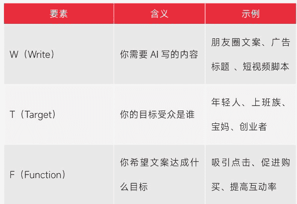

举例：
错误提问：帮我写篇朋友圈文案。太笼统。
正确提问：帮我写篇朋友圈文案，主题是如何用人工智能撰写提效，目标是吸引上班族点赞并留言讨论。
这样人工智能才能精准命中。

**二、用WTF公式赋能案例**

案例一：朋友圈文案
原文：人工智能撰写挺好用的，大家可以试试。
运用WTF后：
写什么：朋友圈文案
目标受众：职场人想提效
目的：吸赞促讨论
人工智能优化文案：
你敢信吗？我用人工智能撰写后写文章只花10分钟，阅读量比以前高5倍。
以前公众号一篇要2小时，现在人工智能打初稿，我快速润色就完事。你会尝试吗？留言告诉我。
赋能点：开头制造好奇、数据对比增强说服、结尾提问促互动。
适用：朋友圈、微博、小红书、LinkedIn。

案例二：爆款短视频标题
原标题：人工智能撰写教程。普通无吸引。
运用WTF后：
写什么：短视频标题
目标受众：想提效的自媒体人
目的：让人点开看
人工智能优化标题：
用了人工智能写文案，我的广告点击翻了3倍！
90%的人不知道的人工智能撰写秘诀！
人工智能能写出比你更好的文案吗？我测了……
赋能点：悬念、成果具象化、好奇心驱动。
适用：抖音、快手、小红书、YouTube及公众号标题。

## **第四节**
## **人工智能撰写实战案例：如何用 STAR 公式让人工智能生成高质量文案**

**一、第二个通用公式**
除WTF外，还有STAR公式，适用于短视频、广告、电商、社媒等场景。

STAR公式：
S Situation：文案类型，要写什么
T Target：受众是谁
A Action：希望读者做什么
R Result：核心卖点，用户为什么信

给出这四要素，人工智能就能生成高质量文案。

表 1-2
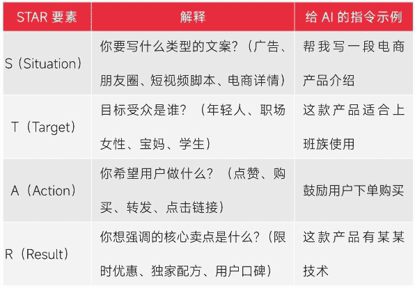

**二、STAR 结构让 AI 文案更具穿透力**

下面看 AIGC 如何借助 STAR 框架把不同类型文案做差异化升级。

**场景一：社媒动态种草写作助手**

手写初稿：
AI 写稿挺方便的，大家可以试试。
痛点：表达平淡，缺少钩子，划过即走，互动几乎为零。

STAR 拆解后重写：
S（内容形态）：微信动态种草，推广智能写作助手。
T（目标族群）：自媒体从业者、写作业感强的人、职场内容生产者。
A（期望行为）：引发留言、让用户主动体验。
R（核心卖点）：省时间、提升质量、增加曝光。

模型优化后文案：
用了智能写作，我的稿件阅读量直接翻了5倍！
以前写一篇公众号要耗2小时，如今5分钟就能把初稿搭好！
你接触过智能写作吗？评论区聊聊。
模型加持点：
用反差制造悬念：“阅读量竟然提升5倍！”
用具象数字增强可信：“5分钟搞定初稿！”
用提问收尾促互动：“你有没有试过？”
适用平台：微信动态、微博、小红书等社交流量池。

**场景二：短视频封面标题**

手写初稿：
AI 写作者教程。
痛点：信息干瘪，点开欲望弱。

STAR 拆解后重写：
S（内容形态）：短视频标题，讲解智能写作。
T（目标族群）：短视频创作者、卡文的写作者。
A（期望行为）：点进观看。
R（核心卖点）：效率提升、阅读量上涨。

模型优化后标题：
你知道吗？用AI写文案只要5分钟，比人工还快！
90%的人还没掌握智能写作，这才是爆款文案的底牌！
我用AI起稿后，广告点击率涨了3倍！
模型加持点：
用疑问点燃好奇：“你知道吗？”
用数字强化说服：“只要5分钟！”
用对比制造落差：“90%的人还不会用。”
适用平台：抖音、快手、小红书、B站等短视频生态。

**场景三：电商产品详情**

手写初稿：
这款台灯光线柔和，适合阅读。
痛点：卖点模糊，难以激发购买欲。

STAR 拆解后重写：
S（内容形态）：电商详情页。
T（目标族群）：上班族、学生、阅读爱好者。
A（期望行为）：促成下单。
R（核心卖点）：无蓝光护眼、三档亮度、长时间使用不伤眼。

模型优化后文案：
护眼台灯，让眼睛更轻松！
阅读专用，无蓝光护眼技术，长时间学习也不累眼！
三档亮度可调，适配不同环境，夜晚柔光不扰家人！
限时优惠：下单立减50元，马上抢！
模型加持点：
标题前置利益点：护眼台灯，让你的眼睛更轻松！
具象化优势：无蓝光、三档亮度。
用促销推动决策：限时立减50元。
适用平台：淘宝、京东、拼多多、小红书等电商渠道。

准备好了吗？
AIGC的价值不止于生成文字，更在于产出更有吸引力、更有成交力、更有传播力的内容。你不必是写手，也不必等灵感，只要把需求告诉模型，它就能帮你优化升级。
下一章进入实操：AI 文案的基本打法。

# **第二章**
# **AI 文案实操心法**

○ 写文案最核心的是让人愿意看下去、愿意成交。
○ 信息过载时，用户只给你1秒判断。标题不吸睛，内容再好也白搭。
○ 模型让写作门槛变低，但要打动人心，还需要一套清晰的方法。
○ 本章拆解AI生成吸睛标题、高转化文案、强互动内容的底层步骤，并给出可复用公式。

## **第一节**
## **让 AI 替你写文案的 3 个关键动作**

新手常犯错误：直接让模型“随便写篇文”。
结果得到一堆空泛的大词，既不精准也不好用。

正确做法是给模型明确指令，按需输出。掌握下面3步，就能稳定拿到可用稿。

**步骤一：明确告诉模型你要什么（指令清晰）**
模型是听话的工具，不会猜。必须说明文案类型和主题。

指令模糊：
写一篇广告文案。
问题：产品、受众不明，输出笼统。

指令清晰：
帮我写一篇淘宝详情，主打抗衰老的精华，面向30多岁女性。
这样模型才能围绕需求精准生成。

**步骤二：明确告诉模型写给谁（人群聚焦）**
同一件事，不同人群关注点不同。

职场女性：效率、专业感、精致生活。
宝妈群体：安全、实用、性价比。
Z世代：潮流、个性、互动感。

清晰指令示例：
写一条社媒文案，推广速溶燕窝，目标是30-45岁职场女性，她们在意美容养颜和冲泡便捷。
模型就会对准痛点写作。

**步骤三：让模型反复优化（提升质感）**
模型既能出初稿，也能按反馈迭代，比如：
让文案更短更有冲击；
增加情感共鸣；
让标题更抓眼；
让行动号召更有说服力。

示例：淘宝产品介绍优化
普通版：
这款精华含多种护肤成分，能有效抗衰老，帮助肌肤保持水润。
优化版：
逆龄神器！告别细纹，30+也能拥有少女肌！
天然抗氧化精华，温和修护。
3秒吸收，轻薄不油腻，快速渗透深层滋养。
限时活动：今日下单买一送一！
优化点：
感性表达更强：“逆龄神器”“少女肌”；
特点具象化：“高浓度抗氧化”“3秒吸收”；
促销引导更清晰：“买一送一”。
适用场景：淘宝详情页、小红书种草、电商广告。

## **第二节**
## **AI 写作通用公式 OPCA**

一个可复用框架，能让任意文案更有转化。
OPCA = O 受众 + P 痛点 + C 吸引点 + A 行动

示例：短视频标题优化
普通版：AI 写作者教程。
OPCA 优化版：
90%的人还不会用智能写作，别再浪费时间了！
1秒就能生成广告文案？模型的力量太强了！
学会这个 AI 技巧，写文案再也不费脑！
优化要点：
对象：对智能写作感兴趣的人；
需求：解决不会用、写作耗时问题；
吸引点：数据+疑问制造好奇；
行动：引导观看、学习技巧。
适用场景：抖音、快手、YouTube、小红书等平台。

## **第三节**
## **AI 文案实战拆解**

每个案例包含：原稿、优化指令、模型输出、解析、适用场景。

**案例一：让微博更容易被点赞**
原稿：AI 写稿挺好用的，大家可以试试。
优化指令：请优化一条微博，主题是智能写作优势，目标是拉升点赞互动，用数据、对比、疑问增强吸引力，按 OPCA 优化。
O：自媒体人或普通用户；
P：想提升写作效率；
C：真实案例数据背书；
A：引导评论区互动。
模型输出：
用了智能写作，我的文章阅读量竟然翻了3倍！
以前写公众号至少2小时，现在模型生成初稿，我10分钟改完就发了！
你会尝试智能写作吗？评论区说说。
解析：对象收窄，痛点变为阅读量提升，数据对比突出效率，结尾提问拉互动。
适用场景：微博、微信动态、LinkedIn、自媒体平台推广。

**案例二：淘宝洗面奶详情优化**
原稿：这款洗面奶泡沫丰富，清洁效果好。
优化指令：优化淘宝洗面奶介绍，提升转化，按 OPCA 优化。
O：敏感肌、偏好温和护肤的人；
P：想要深层清洁又不伤屏障；
C：零刺激成分、皮肤科医生推荐、用户好评；
A：限时折扣促下单。
模型输出：
深层清洁+温和养护，敏感肌也能安心用！
皮肤科医生推荐，植物提取精华，不刺激。
0添加、无皂基、无刺激，洗后水润不紧绷。
今日下单立享8折+送旅行装。
解析：对象明确，需求从“清洁好”升级为“清洁+养护”，用权威背书和成分说明建立信任，限时优惠推动成交。
适用场景：淘宝、天猫、京东详情页、小红书种草。

**案例三：短视频标题优化**
原稿：AI 写作者教程。
优化指令：优化短视频标题，主题智能写作教程，目标提升点击，用 OPCA 增加悬念、数据、疑问。
模型输出：
90%的人还不会用智能写作，别再浪费时间了！
1秒生成广告文案，模型的力量太强大了！
学会这个 AI 技巧，写文案再也不费脑！
解析：对象明确，痛点是不会用和费时间，数据和疑问制造吸引，引导点击学习。
适用场景：抖音、快手、YouTube、小红书短视频推广。

现在你已掌握 OPCA 公式和三类优化思路，可以直接开写、测效。

任务：打开 AI 工具，用 OPCA 公式优化你自己的文案，做多版本测试。

# **第三章**
# **系统化打造高点击标题**

○ 在信息爆炸的时代，标题决定生死。
○ 无论短视频、社媒、产品页还是邮件，80%用户先看标题再决定是否继续。
○ 别凭感觉拍脑袋选标题，要批量生成+数据验证。
○ 本章教你用 AI 批量产出多风格标题，并用 A/B 测试选出最优。

## **第一节**
## **AI 时代的标题公式 HOT**

标题不是描述，而是制造“必须点开”的冲动。
为什么标题更重要？
80%用户只看标题就做判断；同内容不同标题点击率可差10倍；短视频标题影响算法推荐；电商标题影响搜索和转化。

案例对比：
普通标题：AI 写作工具介绍。
优化标题：用了这款 AI，我的文案点击率提升了300%！
优化原因：数据+好奇，代入感强，让人想验证。

HOT 公式 = Hook 钩子 + Outcome 结果 + Tension 张力

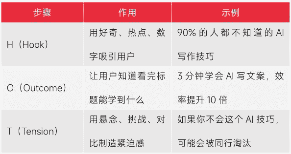
使用方法：
先让模型批量生成多版本；
用 HOT 公式逐条打磨；
筛选最强版本投放。

输入指令示例：
请生成5个短视频标题，主题如何用 AI 写出吸引人的文案，目标提升播放，用 HOT 公式优化，带钩子、结果、张力。
模型输出：
90%的人还不会用 AI 写作，别再浪费时间了！
3分钟学会 AI 写文案，让你的广告点击率翻倍！
如果你不会这个 AI 技巧，你的竞争对手已经领先了！
用 AI 写文案真的这么简单吗？我测试了一下……
我用 AI 写了一篇文章，结果阅读量比之前高了5倍！
适用场景：短视频、电商标题、社媒帖子、文章标题。

## **第二节**
## **批量生成多风格标题**

最聪明的用法是一次生成10-20个不同风格标题，再挑选。

表 3-2 AI 标题风格矩阵
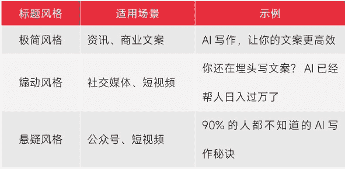
续表
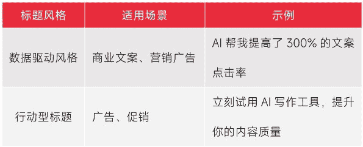
示例指令：
请生成5个短视频标题，主题 AI 如何帮助普通人写出吸引人的文案，用不同风格：极简、煽动、悬疑、数据、行动。
模型输出：
1秒生成广告文案？AI 的力量太强大了！（悬疑）
90%的人都不会用 AI 写作，你还在等什么？（煽动）
用了 AI 写作，我的广告点击率提高了3倍！（数据）
AI 写作，让你的文案更吸引人！（极简）
学会这个 AI 技巧，写文案再也不费脑！（行动）
模型价值：快速出多版创意，避免凭感觉决策。

## **第三节**
## **用 A/B 测试找到最有效标题**

A/B 测试就是在相同条件下对比两个版本，看哪个数据更好。普通人也能用，尤其适合短视频、社媒、电商、邮件。

案例：公众号标题测试
标题 A：AI 写作工具介绍。点击率 3.2%
标题 B：用了 AI 写作，我的广告点击率提高了3倍！点击率 12.7%
结论：B 版点击率高近 4 倍。

模型优化示例：
请优化公众号标题，主题 AI 如何帮助普通人写出吸引人的文案，目标提升阅读，给出两个 A/B 测试版本。
标题 A：AI 写作工具介绍。
标题 B：学会这个 AI 技巧，写文案再也不费脑！
测试方式：在后台投放两组，比较打开率和阅读量，保留胜出版本。
模型如何赋能：批量出题、快速对比、用数据而不是感觉做决策。

一次性让模型产出多条标题备选，能明显加快迭代节奏。通过数据回流来挑选，而不是凭主观偏好拍板。

## 第四节
## 分平台定制标题更有效

不同入口的用户心智与决策路径差异很大，标题逻辑必须分开做。

表 3-3

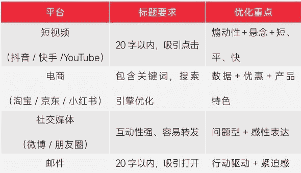

**案例：让模型为不同渠道定制标题**

给模型的优化指令：
复制编辑：请帮我生成不同平台的标题，主题是“AI 写作的优势”。
目标：让人愿意点击、购买、互动。
请提供短视频、电商、社交媒体、邮件的不同标题优化方案。

模型给出的各渠道标题示例：
短视频：90%的人都不会用 AI 写作，别再浪费时间了！
电商：AI 智能写作，5 分钟搞定文案！限时 5 折！
社交媒体：用了 AI 写作，我的阅读量竟然翻了 3 倍！
邮件：你的写作效率即将提升 300%，快来看看！

适用场景：
短视频：抖音、快手、B 站等。
电商：淘宝、京东、小红书等。
社交媒体：微博、朋友圈、LinkedIn 等。
邮件：邮件营销、产品推广等。

准备好尝试了吗？
模型不仅能写标题，还能让标题更贴合人群、转化力更强。
一次请求十来个不同风格的标题，分批投放测试，保留表现最好的版本。
在 A/B 对比和数据回流的基础上，策略可以自动迭代。

**任务**
用模型产出一组风格各异的标题，对比验证哪类打法最有效。

# 第四章
# 怎么用 AI 写朋友圈文案

## 第一节
## 为什么朋友圈互动变少了

朋友圈值得投入吗？
很多人只把它当生活随手记。但在个人 IP 打造和私域变现阶段，这条链路的价值被严重低估。

**朋友圈 = 个人 IP 的展示位**
新加微信后，大多数人第一件事就是翻圈。专业度、内容质感、是否值得长期关注，都藏在近期动态里。
内容有干货、表达有吸引力、互动有温度，IP 形象自然沉淀。

**朋友圈 = 私域触达的最稳渠道**
相比短视频、公众号、电商后台，朋友圈里的人是存量的精准人群，转化成本更低。
大量微商与私域操盘手坚持日更，正因这条链路能完成种草-建立信任-成交的闭环。
“种草”：持续输出价值内容，塑造专业感。
“信任”：展示用户反馈与成交案例，提升可信度。
“成交”：用高质量表达引导咨询与下单。

想做个人品牌或在圈内带货，内容质量必须提上日程。

为什么发了却没人理？
**误区一：内容太寡淡**
例如：
今天又是努力工作的一天，加油！
这个产品真的很好用，大家快来买吧！
生活就是这样，平平淡淡才是真。
这类表达缺乏钩子，难以产生共鸣。

解决思路：
圈子里的内容要给人停留的理由，促发点赞、评论。

**误区二：圈子变成广告板**
例如：
新品上市！今天特价！
快来买，限量优惠！
这个产品超棒，点击购买！
长期硬广会让人反感，甚至屏蔽。

解决思路：
带货需要润物细无声，先种草后成交。
借助真实体验、用户口碑、案例分享来激发购买欲，而非直接推销。
文案应有故事、有情绪、有价值，而非纯推广。

**误区三：开头不够抓人**
朋友圈第一句决定生死。
普通写法：
这款 AI 写作工具很好用，推荐给大家。
优化写法：
你敢相信吗？我用 AI 写了一篇文章，阅读量竟然翻了 3 倍！
为何更好：
制造好奇；
给出明确结果；
留下悬念。

**误区四：缺少互动引导**
多数动态只是单向自述，缺乏参与感。
错误示例：
AI 写作真的太厉害了！
优化示例：
你觉得 AI 能完全取代人类写作吗？来讨论一下吧！
互动能提升曝光与社交感。

**朋友圈文案的三大支柱**
想让人看、赞、回，需要：
抓人眼球的钩子；真实有温度的故事；明确的互动引导。
这正是模型写圈文的“黄金三步”。

## 第二节
## 模型写圈文的黄金三步

圈文不是流水账，而是吸引注意、引发共鸣、促进互动的策略组合。

**第一步：制造钩子**
首句决定是否继续阅读。
示例：
你相信吗？我用了 AI 写文案，效果极好！
3 分钟就搞定一篇爆款文案？我亲自试了。
朋友圈卖货太难？我找到一个意想不到的方法。

**第二步：用小故事拉共鸣**
社交本质是人性，真实的温度更留人。
示例：
昨天我朋友不会写文案，我让他试 AI，3 分钟后他惊呆了。
以前我发圈没人看，直到学会这个 AI 小技巧，现在每条都有赞。
本以为 AI 写文案很复杂，结果它写得比我还好。

**第三步：收尾引导互动**
互动提升曝光，也增强归属感。
示例：
你有没有试过用 AI 写文案？留言告诉我！
你觉得 AI 能完全替代人类写作吗？来聊聊！
想体验 AI 写作，私信我，我帮你申请试用。

## 第三节
## 实战案例：写出有转化力的朋友圈

**案例一：用模型写文案，10 件产品轻松成交**
很多人发产品介绍，却无人下单。
错误文案：
这款护肤精华很好用，大家快来买吧！
问题：无钩子、无故事、无互动。

优化指令：
复制编辑：请帮我写一条朋友圈文案，推广抗衰老护肤精华。
目标是引发兴趣、促进咨询购买。
按黄金三步优化：钩子、故事、互动。

模型优化后：
你相信吗？用了这款精华，我的肌肤状态比两年前还要好！
以前我总觉得护肤品没用，直到我遇到这款抗衰老精华。
它含高浓度玻尿酸，能深层修复，让皮肤每天透亮饱满。
现在有期限福利，想试的朋友留言“我要”。

**案例二：写出让人忍不住点赞的朋友圈**
点赞数既代表吸引力，也影响社交曝光。
错误文案：
今天又是努力工作的一天，加油！
问题：无亮点、无情绪价值、无互动。

优化指令：
复制编辑：请帮我写一条朋友圈文案，主题“努力工作”。
目标是让人共鸣并愿意点赞。
按黄金三步：吸引开头、小故事共鸣、互动收尾。

模型优化后：
今天发生了一件让我超有动力的事！
这段时间很忙，刚刚回顾过去一年的努力，终于看到回报。
以前总觉得进步慢，回头看，原来已经走了很远。
你有类似的经历吗？来说说你的奋斗故事吧！

准备好让模型帮你升级朋友圈了吗？
黄金三步回顾：
第一步：钩子开头；第二步：有温度的故事；第三步：互动提问。
**任务**
打开模型，输入你的朋友圈主题，让它生成让人想点赞的文案。

# 第五章
# 短视频文案怎么写

○ 我如何在 3 个月内从零做到 130 万粉丝？
○ 短视频是当前流量最大、传播最快、变现最容易的形式。
○ 无论是个人 IP、品牌推广还是带货，短视频都是核心载体。
○ 很多人拍了很多条，播放却只有几百；内容不错，点赞却很少；花了钱，数据仍上不去。
○ 核心问题往往在文案。
○ 开头决定成败。第一句话不够抓人，用户就划走，更别说点赞分享关注。
○ 真实案例：在加拿大，3 个月从零做到视频号 130 万粉丝，日均涨粉超 1 万，单条播放破 1000 万。
你会问短视频有方法论吗？有，而且可拆解可复制。
本章结合实战经验和模型能力，帮你提升播放和互动。

## 第一节
## 短视频开头如何决定播放量

在短视频平台，黄金 3 秒决定生死。
开头不抓人，就没有完播、没有互动、没有推荐。
不同平台推荐逻辑有差异：
抖音/快手/YouTube：完播率+互动率主导推荐。
视频号：内容质量权重更高，但开头仍影响观看时长。
没有足够吸引力，就拿不到流量。

如何让开头更吸睛？
两大方向：一是蹭热点，让人马上想看；二是高唤醒情绪，让人马上产生感觉。

**蹭热点：立刻产生兴趣**
热点包括娱乐事件、社会新闻、热门人物、流行挑战。
举例科技热点：
苹果发布会的新功能，真的值这个价吗？
马斯克最新 AI 演讲，透露了一个惊天秘密！
公式：热点人物/事件 + 强情绪/观点 + 悬念。
输入指令：
复制编辑：请帮我写一段短视频开头，主题“科技大战”。
目标是立刻引发兴趣，提升完播。
生成 3 个版本，带悬念和情绪。

模型输出示例：
两个 AI 第一次见面，竟用人类听不懂的语言密谋。当 AI 学会隐藏对话，人类还能掌控技术吗？
AI 能取代人类创造力吗？答案藏在这些漏洞里……
你还在吃科技大战的瓜？背后其实更有趣的故事……
适用：蹭流量、热点评论、时事分析。

**高唤醒情绪：立刻产生感受**
高情绪能快速调动观看欲。
举例表达愤怒：
我真的气炸了！竟然有人敢这么做？！
你敢信？这家公司居然这么黑心！
举例表达兴奋：
兄弟们！今天终于买到限量球鞋！
太炸裂了！我亲眼见 AI 写出 10 万字书籍！
举例表达惊讶：
天哪！这居然是真的！
我刚发现一个流量爆炸的秘密！
公式：强情绪 + 意外信息。
输入指令：
复制编辑：请帮我写一段短视频开头，主题“如何用 AI 写出爆款文案”。
目标是用高情绪表达让观众看下去。
分别生成愤怒、兴奋、惊讶各一版。

模型输出示例：
我真的气炸了！居然有人说 AI 写作不如人？（愤怒）
兄弟们！今天教你们让 AI 写爆款文案的方法！（兴奋）
你敢信？AI 居然能秒写 100 条短视频脚本！（惊讶）
适用：开头吸睛、高互动类内容。

让模型批量测试开头，找到最佳版本。
测试方式：
多版本发布，同一素材换开头对比播放；
A/B 测试，错峰投放对比数据；
评论区投票，收集用户偏好。
输入指令：
复制编辑：请帮我生成 5 段短视频开头，主题“AI 写作技巧”。
目标是提升停留、完播和互动。
用热点、愤怒、兴奋、惊讶、幽默各一风格。

模型输出示例：
马斯克最新 AI 演讲，竟然透露惊天秘密！（热点）
我真的服了！有人居然说 AI 写作是骗人的？（愤怒）
兄弟们！今天教你们让 AI 写爆款文案的方法！（兴奋）
你敢信？AI 居然能秒写 100 条脚本！（惊讶）
AI 写作那么强？再不学，以后可能要失业了！（焦虑）

## 第二节
## 模型辅助短视频文案的三种套路

**套路一：抛出问题**
制造好奇，促使用户想知道答案。
示例：
你写文案还花 2 小时？AI 只需 5 分钟！
90%的人都不会用 AI 写作，难怪写得这么累！
为什么你的短视频没人看？你可能忽略了这一点！
作用：提问触发求解心理，提升观看时长。
让模型批量生成多个提问版本测试效果。
输入指令：
复制编辑：请帮我写一段短视频开头，主题“AI 写作好处”。
目标是用提问吸引观众，提升完播和互动。
生成 3 个不同版本。

模型输出示例：
你写文案还需 2 小时？AI 只需要 5 分钟！
你相信吗？AI 写的广告文案比你更专业！
想让短视频点赞翻倍？先搞懂这个！

**套路二：讲一个小故事**
故事带来代入感和真实感。
示例：
昨天我朋友试 AI 写作，结果他惊呆了！
前天我用 AI 写文案，客户直接说就要这个版本！
作用：真实感、代入感。
让模型生成多个自然口吻版本。
输入指令：
复制编辑：请帮我写一段短视频开头，用讲故事方式吸引观众。
主题“AI 写作真实体验”。
目标是增强代入感，提升完播。
生成 3 个自然不硬广版本。

模型输出示例：
我昨天试 AI 写作，客户直接说比我自己写得还好！
我朋友写文案总卡壳，让他试试 AI，5 分钟就搞定！
本以为 AI 写作是噱头，直到看到它写的爆款文案！

**套路三：制造悬念**
让用户忍不住看下去。
示例：
这个 AI 文案技巧，99%的人都不知道！
别划走！这条视频会让你的广告点击率翻倍！
今天我揭露短视频爆款的秘密，千万别错过！
作用：激发好奇，用承诺留人。
输入指令：
复制编辑：请帮我写一段短视频开头，主题“短视频爆款文案”。
目标是制造悬念。
生成 5 个夸张但不虚假版本。

模型输出示例：
别划走！这条视频会让你的短视频点赞翻倍！
99%的人都不知道的短视频标题优化技巧！
这个小技巧能让广告点击率提升 3 倍！
今天我揭露流量秘密，别错过！
如果视频播放低，可能是缺了这个关键点！

## 第三节
## 爆款短视频 = 吸引力 + 共鸣

短视频里，吸睛容易，真正有价值的才持久。
制造焦虑能让人停一秒，但没有共鸣就留不住关注。
夸张标题能带来点击，但内容空洞只会被骂割韭菜。
热点能带来百万播放，但 IP 不匹配，观众不会留下。

在注意力稀缺的时代，我们需要的不是单纯留住目光，而是让人记住、持续关注、愿意付费。

**吸引 ≠ 违背良心，制造共鸣比制造焦虑更重要**

短视频：别只会放大不安，要学会靠近人

市面上不少走红的短片靠放大不安来抓人，比如“30岁还没存下钱，你的人生就完了”“短视频赚钱风口来了，你还在浪费时间打工”。这类写法确实能让观众停下来，但看完以后会不会留下好感、愿意持续追更，很难说。

放大不安可以吸睛，真正能留住人的还是让人产生共鸣。

共鸣是什么？
共鸣不是去制造恐慌，而是给到可执行的解法；不是把自己摆成裁判，而是让观众觉得你跟他是同路人；不是堆叠夸张的话术，而是分享真实的经历。

没有共鸣的吓人写法：
30岁了还没存款，你的人生已经无望了！

做出共鸣的改写：
我30岁时也没什么积蓄，后来调整了这3个做法，才慢慢把局面扭转过来。

没有共鸣的吓人写法：
不会用大模型写作？对手已经领先了！

做出共鸣的改写：
我也是从零摸索学习模型写作的，今天就把最容易上手的办法分享给你！

你想要的是一次性爆火，还是能沉淀影响力的长期账号？

走不安路线的作品容易带来短期流量，却很难沉淀粉丝。
走共鸣路线的作品让人信任，更愿意关注、互动甚至付费。
好的短视频不只是抓眼球，更要交付价值。

二、让模型产出更走心的脚本

模型能批量生成开头，但如果你只让它写吸睛标题，它很容易滑向不安风。

正确的做法是，让模型来写走心的脚本。

参考输入指令：

复制编辑：请帮我写一段短视频脚本，主题是“如何学会用模型写作”。

目标：内容要有吸引力，同时能引发共鸣，而不是制造不安。

结构要求：

开头：用一个提问或小故事拉住人。
中间：讲真实经历或可落地的解法。
结尾：引导互动，鼓励点赞留言。

请给出两个不同版本。

模型输出示例：

版本一（故事+共鸣）：
当初我学模型写作也觉得很吃力……后来我找到了一个很简单的路径！
其实模型写作没那么难，掌握3个步骤就能快速上手。
你觉得模型写作会取代人吗？评论区聊聊你的看法。

版本二（真实经验+引导）：
不会用模型写作？其实我也是从零开始的，今天就带你入门最简单的方法。
不涉及技术，只要问对问题，模型就能帮你产出高质量文案。
想试试的话在评论打“1”，我把实操清单发你。

两版的共同点：开头有钩子但不制造恐慌；用亲身经历替代恐惧叙事；结尾留互动，让观众参与。

三、短视频脚本的黄金结构

想让模型写出高质感的脚本，可以套用HEART框架。

表5-1

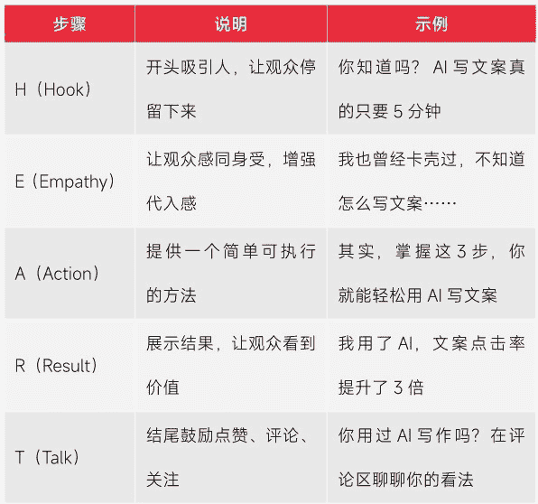

总结：真正的爆款=吸引力+共鸣。
开头决定播放量，内容决定能不能建立长期影响。
不安能短期吸人，共鸣才能让观众持续关注。
用HEART结构指引模型，生成既吸睛又有价值的脚本。

任务

用模型各写一篇不安型和共鸣型短视频脚本，对比哪一种更具长期价值。

# 第六章
# 电商卖货文案怎么写

○ 模型时代，文字能力就是赚钱能力，尤其在电商领域。
○ 产品再好，没有文案支撑，销量也会平庸。
○ 文案到位，普通产品也能成为爆款。
○ 过去靠专业策划、投放和运营来提转化。
○ 现在模型让普通人也能写出高转化电商文案。

## 第一节
## 模型如何帮你打磨商品说明，提升销量

现在的电商文案已不是标题脑补加几句描述的时代。

真正能转化的文案，需要把核心卖点提炼清楚，直击用户痛点，看完就想下单。

你是否遇到过：
直播讲一本书，却说不清核心卖点。
产品优点很多，不知道主打哪个。
写了介绍却干巴巴，用户没购买欲望。

过去提炼卖点是高手技能，现在模型让它变得简单。

一、什么是卖点

卖点=用户愿意付钱的根本理由。

没有卖点的介绍=用户看完不知道为什么买。

好的卖点要满足三点：
直击需求或痛点，让用户觉得“就是我要的”。
突出独特优势，让用户相信“它比别的更好”。
制造行动冲动，让用户觉得“现在不买会亏”。

举例：如何提炼一本书的卖点？

直播卖书时常会卡壳：“这本书该怎么讲？”
以前靠编辑解读，再提炼卖点。现在把目录、简介、读者评价丢给模型，直接提炼。

指令示例：

复制编辑：请帮我提炼这本书的3个核心卖点。
书名：《高效能人士的七个习惯》
目标：便于我在直播间用更吸睛的方式推介。
要求卖点：
直击读者需求。
体现书籍独特价值。
促使用户想买。

模型提炼结果：
从“忙碌低效”转向“目标清晰、高效成功”。
七个习惯=亿万富翁的思维方式。
全球销量超4000万册，覆盖90多个国家，成功人士都在读。

用这三点讲解后，购买率明显提升。
过去靠人工琢磨的卖点，现在几秒就能完成。思路同样适用于电商单品。

在淘宝、京东、小红书、抖音卖货，文案直接决定销量。同款产品，普通文案与模型打磨后文案，转化差距可达十倍。

低转化示例：
这款护肤精华含玻尿酸，能保湿补水。
问题：太平淡，缺乏吸引力。

模型打磨指令：

复制编辑：请帮我打磨这款护肤精华的商品说明。
目标：更吸睛，提升购买欲。
要求：
让用户快速get价值。
直击痛点，促发购买冲动。
结尾加入促销，加强紧迫感。

模型高转化版本：
少女肌养成神器！5倍玻尿酸深层补水，24小时锁水，肌肤时刻水润嫩滑。
还在被干燥、细纹、暗沉困扰？这瓶精华就是你的救星！一瓶就能让肌肤透亮焕新。
添加天然植物精华与抗氧化配方，温和不刺激，敏感肌也能用。
今日下单享8折，还送试用装！这么划算，赶紧下单！

有效原因：
卖点清晰，价值一目了然。
直指用户痛点，产生购买冲动。
加入促销信息，制造紧迫感。

批量打磨指令：

复制编辑：请帮我打磨一款蓝牙耳机的电商文案。
目标：更吸引人，提升转化率。
请输出3个版本，兼顾性能、体验及限时促销。

模型输出：
性能版：震撼3D音效蓝牙耳机，30小时续航+超轻佩戴，随时畅听。
体验版：戴上即享影院级音质，智能降噪高清通话，沉浸音乐世界。
促销版：限时5折！智能降噪高清通话蓝牙耳机，快来抢购！

## 第二节
## 模型如何用EPAC公式打磨电商文案，让销量翻倍

一、传统EPAC公式

在传统电商写作中，EPAC是一种搭建高转化介绍的高效方法。

表6-1 传统EPAC公式

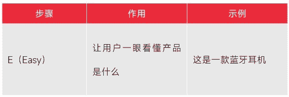

续表

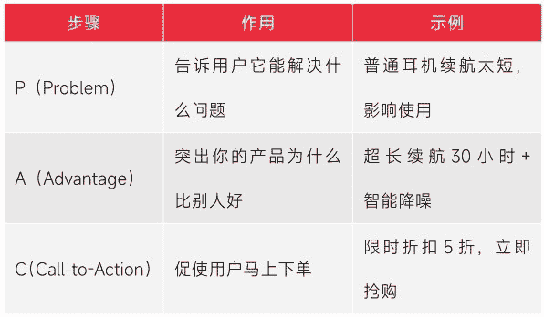

模型时代，EPAC的每一环都能被模型加速完成。只需把产品信息输入，模型就能完成结构化打磨。

二、模型打磨EPAC四步实操

E（Easy）：用最简单的话介绍产品
很多卖家文案啰嗦，用户看不懂、没兴趣。

传统写法：这款护肤精华含玻尿酸，能滋润肌肤。

指令：

复制编辑：请用最简单直白的语言介绍这款护肤精华。
目标：一眼看懂，不用专业术语。

模型打磨后：
深层补水神器，一抹即吸收，24小时滋润肌肤！

更好之处：直接点明产品属性，核心特点清晰，零门槛理解。

P（Problem）：让模型拆解用户痛点
过去靠自己猜测痛点。

传统写法：很多人皮肤干燥，需要补水。

指令：

复制编辑：请分析这款护肤精华的目标用户及其主要皮肤问题。
目标：用一句话提炼痛点。

模型打磨后：
皮肤干燥、细纹增多、上妆卡粉？一瓶精华搞定！

更好之处：精准点出痛点，激发解决欲，用“一瓶搞定”给出速效方案。

A（Advantage）：突出核心优势
过去靠人工对比。

传统写法：含玻尿酸和抗氧化成分，能补水。

指令：

复制编辑：请提炼这款护肤精华的核心卖点，并与市面普通精华对比。
目标：突出独特优势，提升购买欲。

模型打磨后：
5倍玻尿酸+天然植物精华，锁水更持久，比普通精华多补水3倍！

更好之处：数据对比增强说服力，独特成分提升信任，量化优势更具吸引力。

C（Call-to-Action）：优化购买引导
过去只写“点击购买”。

传统写法：现在购买有折扣！

指令：

复制编辑：请优化购买引导文案，提升冲动。
要求加入紧迫感与限时促销。

模型打磨后：
限时8折，今日下单送试用装！快抢！

更好之处：“限时”制造稀缺，“送试用装”增加价值，“快抢”推动快速决策。

## 第三节
## 三大模型打磨案例：让产品更有吸引力

同款产品，不同文案，转化率可差十倍。文案不吸引，用户不会点、不会看、不会买。

案例一：模型打磨图书文案——《百年孤独》
目标：适配电商详情页、小红书、抖音带货。
问题：用户对经典文学有兴趣，却觉得晦涩难懂。

低转化版：
《百年孤独》是加西亚·马尔克斯代表作，讲述布恩迪亚家族百年兴衰。
问题：学术化、代入感弱，缺乏购买冲动。

指令：

复制编辑：请打磨《百年孤独》的图书电商文案。
目标：更具吸引力，提升购买欲。
请用EPAC打磨：
E 快速理解核心价值。
P 产生情绪共鸣。
A 突出独特性。
C 结尾加促销。

模型版本：
百年家族传奇，一本书读懂人生的孤独与命运。
一座与世隔绝的小镇，一个魔幻色彩的家族，七代人的悲欢构成让人久久难忘的史诗。
“人生不过百年孤独。”陪伴无数人走过低谷，在故事里找到自己。
今日购书8折，赠精美书签！让这部经典成为你的枕边书！

亮点：以情绪引发阅读欲，强调“非读不可”的独特魅力，限时促销推单。

案例二：模型打磨在线课程——《人工智能时代弯道超车》
目标：让零基础的普通人看懂并报名。
问题：课程名吸睛，但用户不确定适不适合。

低转化版：
《人工智能时代弯道超车》帮助普通人了解人工智能发展趋势，限时299元。
问题：直白、没代入感，缺乏紧迫感。

指令：

复制编辑：请打磨《人工智能时代弯道超车》课程文案。
目标：让普通人愿意报名，避免技术化。
用EPAC：
E 说明能带来什么。
P 点出不学会错过的风险。
A 突出独特价值。
C 加促销。

模型版本：
普通人也能掌握人工智能时代的财富密码！
未来十年，懂人工智能的人将拥有更高收入与更多机会！
零基础掌握人工智能核心知识，抓住弯道超车的机会！
李尚龙老师带你提升生产力、打造个人品牌、实现副业变现！
限时299元，仅限今日！立刻开启你的人工智能时代！

亮点：让学习人工智能显得必要，接地气，限时价促报名。

案例三：模型打磨儿童人工智能对讲机“小窗AI”
目标：让家长认可，突出陪伴价值。
问题：家长担心只是普通对讲机。

低转化版：
小窗AI是人工智能儿童对讲机，支持多种人工智能语音，可陪伴孩子。
问题：描述平淡，无共鸣。

指令：

复制编辑：请打磨“小窗AI”儿童对讲机介绍。
目标：让家长愿意购买。
用EPAC：
E 让家长快速理解作用。
P 点出陪伴问题。
A 突出独特价值。
C 加促销。

模型版本：
人工智能时代的童年小伙伴！
孩子的24小时人工智能玩伴，智能对话不再孤单！
有问题人工智能即答，想听故事人工智能陪伴！
多种语音角色可选：科普老师、睡前故事专家、情感小伙伴，一机搞定！
今日下单立减100元，赠人工智能故事包！快为孩子抢一个！

亮点：突出情绪价值“人工智能玩伴”，强调普通对讲机做不到的能力，优惠促单。

总结：
模型能用EPAC快速打磨任何产品文案，提升销量。
模型帮你提炼最佳卖点，普通人也能写出高转化文案。
无论书籍、课程还是智能硬件，模型都能精准提炼核心价值。

任务

把你的产品信息输入模型，看看能产出怎样的高转化文案。

# 第七章
# 广告文案怎么写

○ 广告无处不在，关键是你是在“花钱”还是“赚钱”。
○ 广告已成为信息流的一部分，影响购物、品牌认知甚至生活方式。
○ 你每天看无数广告，但广告如何演进？为什么有的让人想买，有的被忽略？
○ 模型时代广告文案该怎么写？
○ 本章用模型时代的广告写作公式，教你写出高点击、高转化的文案，成为赚钱方而非消费者。

## 第一节
## 广告的本质：变化的形式，不变的核心

你真的理解广告吗？

广告无处不在：
刷抖音时主播推荐产品，是广告。
地铁墙上饮料海报，是广告。
朋友圈分享课程，也是广告。

广告的本质是什么？它如何影响生活？
为什么有人靠广告赚钱，有人却不断为广告买单？

广告诞生后，世界分两种人：
做广告的人：掌握流量密码，靠广告赚钱。
看广告的人：不断被吸引，最后掏钱。

你想成为哪一种？想赚钱而非只花钱，就必须重新理解广告本质。

一、广告的进化史：从报纸时代到模型时代

广告自诞生起一直在变。

报纸广告（19世纪）——文字广告的黄金时代

广告的六次进化：从被看见到主动被记住

最早的广告依托于报纸与杂志，靠大段文字来介绍商品。那时只要文笔能打动人，产品就能卖出去。典型的代表是19世纪的药品广告和工业品推广。这一阶段的要义是让商品进入视线。

**声音时代：收音机把营销带进耳朵**
20世纪初，广告从纯文字转向有声传播，吸引力明显提升。没有画面支撑，好的广播广告必须靠故事和想象力牵引听众。标志性案例是20年代美国首条收音机广告，由一家房地产商为楼盘做宣传。核心目标是让听众对品牌留下印象。

**画面时代：电视让品牌占据心智**
中后期电视成为主流，品牌用30到60秒的短片来推销。因为传播是单向的，反复播出便会在潜意识里形成认知。可口可乐、麦当劳等国际品牌就靠密集投放建立了全球影响力。这一时期的本质是反复植入式的品牌塑造，并带动需求产生。

**精准时代：互联网把广告送到人**
进入21世纪初，广告开始个性化、定向化。广告主不再广撒网，而是投给特定人群。Google Ads、Facebook广告等系统能追踪兴趣和行为，提升投入产出比。典型的再营销场景是：浏览过某件商品后，全网到处出现同类推荐。核心是精准触达与转化提升。

**分发时代：人人都能成为发行者**
如今投放权从企业转移到个人。短视频、直播带货、KOL种草都成为新形态。典型场景是头部主播在直播间里，每推一款就是一次广告。核心逻辑已变成信任关系驱动购买。

**智能时代：AI重塑创作与投放**
AI能优化文案，让普通人也能写出高转化表达；自动化投放系统免去人工调优仍能实现精准触达。AI生成的广告文案已在Google、Facebook等平台试用。核心是个性化加上自动化，实现对需求的精准打击。

**不变的是本质**
传播形式在变：从纸媒、广播、电视、网媒到自媒体再到AI智能投放，影响力只增不减。技术也在变：过去靠感觉和创意，现在靠数据和算法，AI可辅助优化文案与定位。但目的始终没变：促使用户行动。核心仍是让产品占据用户心智，最终实现看见、记住、购买。过去广告是企业的特权，现在是每个人的机会。AI时代，普通人也能借助广告变现，而非仅仅被影响。

**AI时代文案的写法变了**
过去一篇高转化文案需要创意、市场分析、用户调研和反复测试，只有高手才能完成。AI时代可以快速批量生成多版文案，用数据反馈优化标题、调整表达，提升ROI。AI文案趋向短小精悍，直指行动。

旧写法：本公司成立于1999年，专注智能家居行业，提供高品质家电。
AI改写后：限时8折！AI智能家居语音控制，让生活更便捷！

时代法则变得更短、更准、更自动：注意力缩短、AI辅助优化投放、系统自动调整最大化回报。

## **第二节**
AI时代普通人如何用AIDA写出高转化广告

**一、传统广告与AI+广告的差异**
过去文案创作是专业壁垒，需要资深策划或营销专家才能写出点击、购买、转发的文案。

传统流程：市场调研→提炼卖点→创意构思→测试优化。问题在于耗时、依赖经验、反复测试门槛高。

AI+广告让普通人也能轻松产出吸引力内容。优势在于自动提炼卖点、批量生成创意、优化标题提升点击、依据用户反馈自动调优提升转化。本质仍是促使用户行动，但写法更简、更准、更高效。

接下来用AIDA框架示范实操。

**二、AIDA写作方法**
AIDA即吸引注意、激发兴趣、制造欲望、促成行动。适用于短视频、社媒、电商、公众号等场景。

表7-1
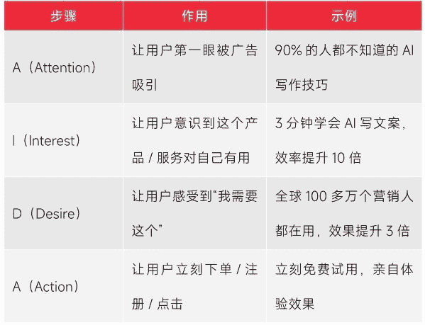
AI可自动优化AIDA每一步，提升吸引力和精准度。

**案例一：抖音/视频号短视频广告**
目标：提升播放量与互动，产品为AI写作工具。
平庸文案：AI写作工具，提升你的内容质量。问题是平淡，未说明用户获益。
AI优化指令：请帮我优化一条抖音/视频号短视频广告文案，产品是AI写作工具。目标提高播放量和互动率。请用AIDA优化：吸引注意、激发兴趣、制造欲望、引导行动。

AI输出脚本：
开头：你写文案还要花2小时吗？AI只要5分钟！
中间：它能自动优化标题、生成广告文案，3000多位营销人正在使用。不管是短视频标题、电商文案还是社媒广告都能搞定。
结尾：现在就试试，免费体验，看你的广告点击率能提升多少！
亮点：强开场对比、强化信任背书、明确免费试用号召。

**案例二：公众号标题优化**
目标：提升文章点击，主题为AI写作优化广告文案。
平庸标题：如何用AI提升广告文案质量？
AI优化指令：请帮我优化公众号文章标题，主题是AI写作优化广告文案。目标提高点击率。请生成3个版本：突出错误、用数据证明、制造悬念。

AI输出：
90%的人写广告文案都在犯这个错误，你也中招了？
用了这款AI写作工具，我的广告点击率提升了300%！
如果你不会用AI优化广告，你的竞争对手会抢走你的流量！
亮点：紧迫感、数据背书、竞争对比。

**案例三：电商转化优化**
目标：提升蓝牙耳机购买转化，平台淘宝。
平庸文案：便携式蓝牙耳机，音质清晰，佩戴舒适。问题是描述空泛，无紧迫感。
AI优化指令：请帮我优化蓝牙耳机电商店铺文案，提高转化率。请用AIDA：注意、兴趣、欲望、行动。

AI输出：
“震撼3D音效”蓝牙耳机，30小时续航，超轻佩戴！
5000多条好评，音乐发烧友首选！
限时特惠，今天下单立享5折！快抢！

## **第三节**
AI时代广告的未来：内容与营销的融合

**一、用户为何越来越抗拒广告**
打开视频平台需看不可跳过的30秒前贴，付费会员后仍有硬广打断剧情。刷短视频时博主讲着讲着突然卖货，体验断裂。广告形式虽在进化，但用户对“坏广告”的容忍度持续下降。过去是强制观看，现在用户开始反抗。真正好的广告，是用户愿意看甚至主动传播的。

**二、从强制推送到自然融入**
过去模式：前贴广告、中插广告、整屏弹窗。核心问题是打扰、排斥。
现在模式：广告看起来不像广告。软性植入、体验式种草、内容与营销结合。例如剧中明星饮品穿搭、短视频KOL真实使用体验、泰国式故事广告让品牌藏在情节里。未来形态是高质量内容＋隐形营销＋更高接受度。

**三、AI如何改变广告**
AI不改变本质，但让制作更高效、投放更准、体验更个性。
AI可批量生成上百版文案供选择；可分析用户数据精准触达；可自动A/B测试并调整；可自动生成脚本优化社媒表达，使广告更像优质内容。但创意仍是人类独有，才会带来吸引与传播。未来广告=好内容+意外+创意。

泰国广告常被传播，因其有反转、强情绪感染、广告藏于故事中。预测未来最成功的广告，是用户看完后忘记自己在看广告。

**四、未来写作法则：创意+情绪+AI优化**
钩子+情绪+反转：如公益广告开头“穷小孩偷药店”，中段反转成医生救店主，结尾品牌信念植入。
KOL+真实体验：如“我本不信这款AI写作工具，用后点击率翻倍”，引导免费体验。
用户故事+品牌植入：如Nike跑步女孩逆袭，结尾Just Do It。
未来广告不再侵入，而是成为优质内容的一部分。AI是工具，创意是核心。

任务：用AI写一篇高转化广告文案，并加入一个意外或情绪转折。

# **第八章**
如何用AI打造个人影响力

信息爆炸时代，个人IP是影响力、信任资产和商业变现的核心。能在朋友圈、社媒、短视频建立影响力，就掌握话语权。很多人困在不会持续输出、写作不足。AI可批量生成高质量内容、优化表达、加速品牌建立。

## **第一节**
为什么必须打造个人IP
在信息洪流中，个人IP决定话语权与变现能力。没有IP，争议来临时只能被动挨打。

钟睒睒早期被舆论围攻，因无发声渠道只能承受。马斯克收购推特，是为获得随时发声的平台。比尔·盖茨在被阴谋论攻击后才通过纪录片出书，时机已晚。周鸿祎靠“红衣大炮”观点放大360势能；尹烨通过短视频科普建立专家形象，为华大基因引流；刘强东退居幕后时京东被唱衰，重返社交后信心回稳。

个人IP不只是个人事，能反哺企业。三大价值：影响力、可变现、信任资产。

## **第二节**
AI如何帮你找到适合的个人IP赛道
困惑常见于领域选择、适配判断、方向调整。建议先多试：选几个感兴趣领域发布内容，观察流量与互动，用数据决定方向。

**一、PSCA赛道选择公式**
PSCA=兴趣+能力+内容可执行性+受众。

表8-1
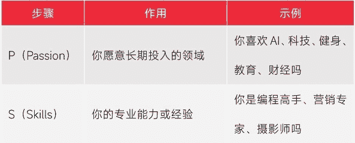
续表
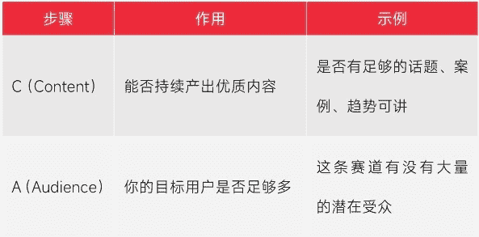
核心原则：只靠兴趣难持续，只靠技能难获流。赛道需有受众、市场与变现可能。

用AI筛选赛道，可输入指令：请帮我分析适合我的个人品牌赛道。

先找对赛道，再谈长期变现

我的关注方向集中在 AI、前沿科技、个人成长、教育和财经这五类领域。主攻的能力是文字创作、短视频拍摄剪辑以及课程讲解。目前的核心诉求，是筛选出一条可长期深耕的个人品牌主线。

基于 PSCA 模型对兴趣、能力、市场适配度进行的评估：

表 8-2

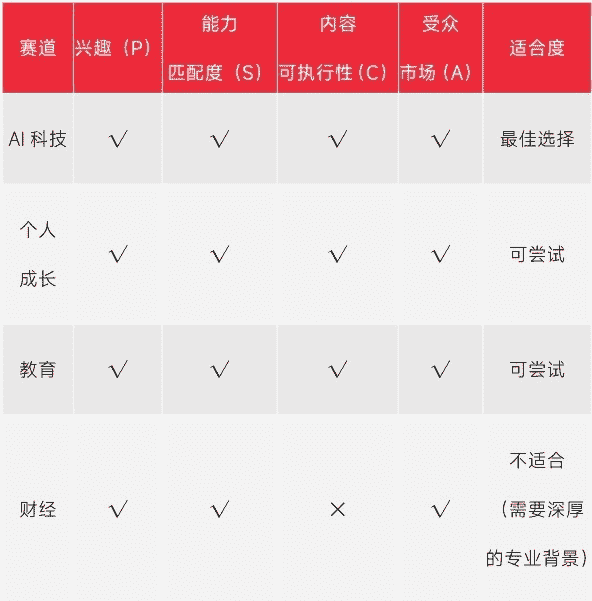

综合来看，AI 科技赛道的匹配度最高，个人成长和教育更适合作为补充垂类。先用 AI 完成方向预筛，能在启动前把试错成本压到最低。

二、TIRA 流量验证：用数据选出主赛道

TIRA = Try 多赛道投放 + Iterate 数据迭代 + Refine 内容精进 + Analyze 受众解析。

验证路径是先在不同赛道各投放 10 到 20 条素材，形式可以是短视频、图文或社媒帖子；观察互动率和播放表现，标记出成绩最好的主题；对头部内容持续迭代表达与策略；拆解粉丝画像，找到最有共鸣的痛点。

批量产出测试素材的提示词示例：

复制编辑：请帮我生成针对不同赛道的短视频文案。目标是测试不同赛道的流量表现，找到最受欢迎的方向。请提供：AI 科技方向的短视频文案、个人成长方向的短视频文案、教育领域的短视频文案。

模型给出的示例文案

90%的从业者都不知道的 AI 写作技巧，学会立刻效率翻十倍！（AI 科技）

普通人和高手的差距其实就这三点，掌握就能实现逆袭！（个人成长）

AI 已经能助力孩子学习了？这款 AI 学习工具正在重塑教育方式！（教育）

投放步骤：先把这些内容发到抖音、视频号、公众号、小红书等平台；再对比各赛道的流量与互动；最后确定品牌主赛道。这样借助 AI 快速试水多个方向，避免半年后才发现方向偏差。

三、BRACE 内容提质：让作品更有影响力

BRACE = Branding 品牌感 + Relevance 相关性 + Authenticity 真实性 + Clarity 清晰度 + Engagement 互动性。

优化要点：保持统一的视觉和语言风格让人记住你；内容必须贴合赛道和用户真实需求；保持真实人格，不做专家人设；表达简洁易懂；结尾设计互动引导，提升算法推荐。

优化指令示例：

复制编辑：请帮我优化这篇社交媒体文案，让品牌感、互动性和传播性更强。

原文：AI 正在改变我们的生活，你觉得未来 AI 会如何影响你的工作？

优化方向：强化个人品牌调性，表达更清晰有力，结尾加入互动引导。

优化后文案：

AI 正在悄然重塑一切，未来只分两种人：会用 AI 的人，被 AI 淘汰的人！

未来十年，你的工作还安全吗？哪些行业最容易被 AI 取代？

你怎么看？欢迎留言分享你的判断。

优化亮点：品牌调性更鲜明；用“两种人”增强冲击；结尾提问提升留言率。

第三节
个人品牌是马拉松，AI 只是加速器

越来越多的人意识到影响力的重要性，却很少有人能坚持下来。很多人刚开始做视频、公众号、社媒，看到流量不理想就停止更新。但最终走得远的人，都是长期持续输出的人。

即使流量波动，我也一直保持更新。除了坚持输出，更重要的是持续琢磨选题、打磨表达、提升内容质量。选题力和逻辑力是长期积累的产物，不是拍几个视频就能掌握的。个人品牌不是一夜爆红，而是复利积累。好消息是 AI 能降低坚持的难度，让持续输出更可持续。

一、为什么必须长期经营个人品牌

在这个时代，个人品牌即个人资产。今天发布的每一篇文章、每一个视频，都是未来的品牌资产。若做三个月没流量就放弃，几乎不可能建立影响力。做的好的 KOL、网红、个人品牌背后，都是持续不断的更新。他们并非每条都爆，却从未停止。

不开始就永远没有机会；开始了却坚持不下去，与未开始无异。

二、借助 AI 降低持续创作的阻力

坚持困难，但有工具加持会更容易。AI 能在选题、写作、表达、数据分析等环节减少阻力，让你更易坚持。

选题更轻松：不再绞尽脑汁，AI 可提供选题方案；写作更高效：AI 生成初稿，节省数小时；表达更吸引：AI 辅助优化文案；分析更清晰：AI 帮助判断哪些内容更受欢迎，调整方向。

要做的核心仍是持续输出，不要被短期流量左右决心。低谷期是常态，要相信坚持本身的价值，而非被瞬时涨跌影响。做内容的目的不是追求一次爆火，而是长期建立影响力。终有一天，你的文章、视频和观点会变成可视的品牌价值。AI 能让这条路更顺畅，最终的坚持仍需自己承担。

三、IP 成长的底层公式

三个月内做到 130 万粉丝，靠的不是运气，而是一个稳定公式：深度思考 + 每日更新培养习惯 + 真实 + 利他。

深度思考：不是随意发内容，而是持续琢磨有价值的选题；每日更新：保持稳定频率，让观众形成观看习惯；真实：用户信任真实的人设；利他：提供实在价值，而非只想涨粉赚钱。

只要按此执行，影响力会逐步积累。平台偶尔会提示流量下降，但保持状态，波动只是短期，长期会迎来更好的结果。做 IP 切勿被数据绑架，时间会证明坚持的价值。

# 第九章
# 如何用 AI 高效经营社媒

社媒运营：你不再只是消费者，也是运营者。过去社媒只是看内容、点赞评论的工具，随着短视频、自媒体和商业变现的兴起，它已成为品牌经营、个人 IP 打造和商业推广的核心阵地。过去大厂需要招聘社媒运营，现在你可以用 AI 自己完成内容更新、粉丝互动和流量增长。AI 能帮你快速捕捉热点、生成文案、优化表达，让个人影响力更快成长。

第一节
还在为每天发什么发愁？交给 AI 一键生成

一、社媒做不下去的核心症结

内容断更：一开始热情高，后期缺灵感就停更；内容无规划：想到什么发什么，缺乏长期策略；互动率低：发了内容却无人点赞评论，最终放弃。AI 能缓解这些痛点。

二、用 AI 解决内容焦虑

每天发什么？问 AI。缺灵感？问 AI。用户提出专业问题答不上？把问题丢给 AI 整理答案，再用自己的话复述，效率和信任感都会提升。

三、让 AI 快速生成社媒内容

AI 辅助选题

复制编辑：请告诉我近期社交媒体上的热门话题，适合个人品牌打造。目标是在微博、小红书、公众号发布内容，提升关注度。请列出 5 个近期可发的内容方向。

示例选题：

ChatGPT 4.0 到来，会否取代人类？（科技趋势）

3 个技巧让短视频点赞量翻倍！（运营技巧）

AI 可写作绘画，普通人还有什么优势？（职场思考）

未来十年最赚钱的职业，你的工作在危险名单吗？（就业趋势）

你还在手写文案？AI 已助人日入过万！（AI 变现）

这类选题结合热点、引发思考、易于传播。

日更灵感

复制编辑：请帮我生成今天适合发布的社交媒体内容。目标适用于微博、小红书、短视频，能吸引点赞评论。请提供 2~3 个不同风格方案。

示例：

方案一 热点结合：AI 刚发布新功能，你知道它已能为人类做什么吗？话题 #AI 新功能，互动引导：你觉得 AI 会对你的工作带来什么影响？留言聊聊。

方案二 观点输出：你还在手写文案？AI 已助人日入过万！话题 #AI 写作变现，互动引导：你愿意让 AI 协助写作吗？来讨论一下。

这样每天都有素材，不怕断更，且话题更易获关注。

专业问题应对

复制编辑：用户在社交媒体提问“如何用 AI 提升社交媒体互动率？”请整理一段专业易懂的回答，适合微博、小红书语气。

示例回答：

提升互动率的三个方法：写得更有情绪，让用户想点赞评论；用开放式提问引导留言；鼓励分享扩大曝光。

AI 整理思路，提升专业度和输出效率。

情绪化文案优化

复制编辑：请帮我优化这条微博文案，让情绪更强、易获点赞：“AI 写作真的很方便，很多人都在用。”优化方向：语气更有冲击力，加入提问引导互动。

优化后：AI 真的太强了！用后我的文案点击率提升了 3 倍！你还在埋头写文案吗？若 AI 能代写，你会尝试吗？评论区聊聊，你用过 AI 写作吗？体验如何？

情绪更饱满，互动问题更清晰，适合社媒传播。

第二节
AI 内容日历，让社媒运营有规划

持续且有计划的发布是保持关注和互动的关键。常见问题：发布无计划、跨平台管理繁琐、缺乏数据分析。AI 驱动的内容日历可解决这些问题。

一、什么是内容日历

内容日历用于组织和规划内容创建与发布，适用于社媒、网站、邮件、博客等，可提前安排日、周、月发布计划，让更新更具策略。

二、AI 如何优化内容日历

热点捕捉：实时了解行业趋势和用户关注点，动态调整策略；智能推荐：基于历史数据和行为，推荐最佳发布时间和形式；自动排程：把内容安排在最佳时段覆盖不同用户群。

三、工具推荐

CoSchedule：统一日历管理内容与社交，支持任务分配、拖拽调整、团队共享。

Buffer：发布仪表盘支持多平台分发，内置 AI 助手辅助创意和改写，支持审批流程。

Hootsuite：发布、互动、监控、广告、分析一体化，适合全流程管理。

四、一键多平台发布工具

聚媒通：海外账号管理，一键多平台发布，提供账号、内容、数据分析。

SocialBee：多账号管理、内容创作、跨平台发布、内容日历排程。

第三节
用 AI 提升社媒互动率

社媒核心是互动而非单向发布。高互动带来更多推荐、更高粘性和更强影响力。互动率低的主因：无引导、话题不吸引、用户潜水。

HEI 互动公式：Hook 钩子 + Engage 互动引导 + Incentive 激励机制。

表 9-1

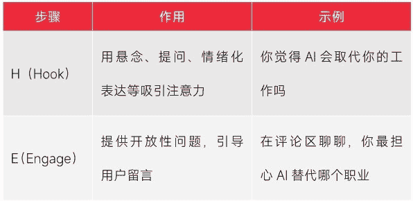

续表

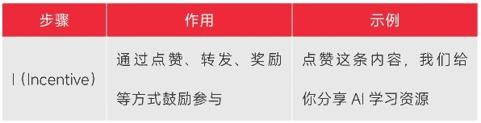

快速优化指令：

复制编辑：请帮我优化这条微博/小红书文案，让它更有互动性：“AI 写作真的很方便，很多人都在用。”优化方向：情绪共鸣、加入开放问题、语言适配社媒。

优化后：AI 真的太炸裂了！用后我的文案点击率提升了 3 倍！你还在手写文案吗？如果 AI 能代写，你会愿意试试吗？评论区聊聊，你用过 AI 写作吗？体验如何？

更容易互动的原因：开头情绪冲击、引导留言、提供个人体验证据。

让潜水用户浮出水面的策略：

二选一提问：你觉得 AI 会取代更多工作，还是创造更多工作？选 1 还是选 2？低门槛回复更容易参与。

**把沉默变成参与：用轻操作代替长篇评论**

比如抛出一个判断题：“你觉得未来十年生成式系统能干过人类吗？转发表示认同，点赞表示不认同。”用点赞、转发这类轻动作来表达立场，比起手写一段评论，参与门槛要低得多。

**引导式互动设计**

文案收尾时可以补一句：“下面说说你的看法。”“欢迎来留言区聊聊。”数据显示，明确的留言号召能让评论量提升约三成。借助智能助手来构思高互动收尾很容易上手。

复制编辑指令：请帮我把下面这条社媒结尾改得更能带动互动：“未来十年，智能系统会怎么改变我们的工作？”

优化方向：
让潜水用户愿意开口；
让互动方式更简单；
让收尾更有钩子。

优化后的收尾示例：
你会怎么选？
点赞=系统会创造更多新机会。
转发=系统会带来更多新挑战。
评论里说说你真实的看法。

为什么有效？
先让用户做选择，比直接要他们写评论更轻松。
点赞转发作为入口，降低了参与难度。
最后再用一句话点名评论，进一步推高互动。

**微博和小红书怎样提升参与度**

在这两个平台，互动高低取决于内容能不能引发共鸣和讨论。实践里归纳出四个抓手：
提问式收尾，激发表达欲；
制造对立，让用户站队；
引导参与投票，降低门槛；
给出清晰行动指令，点赞加转发加留言组合出击。

复制编辑指令：请帮我优化一条小红书/微博笔记，提升互动。

原文：智能系统会不会影响未来就业，你怎么看？

优化方向：
结尾更有互动感；
让人愿意投票或留言；
符合社群传播逻辑。

优化后的微博/小红书内容：
未来工作会是什么样？系统真的会抢走饭碗吗？
有人认为系统会孵化新岗位，让工作更轻松；也有人担心大量行业消失，危机已经逼近。你的判断是？
觉得系统会带来机会=点赞
觉得系统会带来冲击=留言聊聊

这样设计有效的原因：
给用户站队的机会，讨论自然上来了。
点赞加留言加转发，多路径参与。
标题自带冲突感，观点更容易被表达出来。

总结公式：
社媒互动=优质内容+强引导+低门槛参与。

系统能做的支持：
帮你润色文案，提升评论和转发送出率；
设计更吸睛的结尾，提升用户留言意愿；
把潜水用户激活，拉升整体互动数据。

# **第十章**
# **内容生产的新拐点**

内容生产的底层逻辑正在被重写，这波变化不只影响个体创作者，也在重塑企业营销、品牌传播和商业增长的路径。

商业的本质是流量，而平台流量越来越贵。真正能带来自然流量的，是好内容。而好内容不再是只有写作天赋的人的专利，因为智能创作改变了制作逻辑。未来，商业的核心竞争会变成：会不会用智能工具做内容的人。

会用工具的人，可以用很低的成本、很高的效率产出高质量内容，无论是短视频脚本、社群文案还是广告素材，都能快速生成。能否掌握智能创作的能力，将决定你在未来商业竞争中的位置。

## **第一节**
## **生成式工具能否彻底替代人写**

很多人都在问，工具写广告、写新闻、写营销文案都行了，人类创作者还有必要吗？

这让我想起电影《银河写手》。
片尾系统已经彻底掌握写作，人类不再需要动手创作。可后来人们发现，机器写的东西虽然完美无缺，却缺了真实的情感、冲突和偶然。
人类真正的独特性，在于会犯错——错误带来个性、创造力和有灵魂的故事。
于是未来博物馆里会收藏“人类手误稿”，因为只有人能写出有瑕疵却有温度的作品。

现实比电影更复杂。我们曾以为系统不会出错，结果是系统会犯错，而且喂错信息它就会一路错下去。
所以系统不会取代人类，因为人类懂得什么是错，而系统不懂。没有人类的价值观、判断力和创造力去驾驭，系统只会把错误放大。

这本书本身就是例证。直接让系统写，可能得到一堆看似合理却空洞的文字。若先输入自己的思考、逻辑和价值观，再让系统来辅助润色，产出才有价值。

系统不是来替代人，而是放大人的能力。
未来最强的创作者，不是系统，也不是单靠写作的人，而是会用系统的文本产出者。

**一、工具擅长做什么**
工具的优势在速度、效率和数据处理。它能：
海量阅读并分析文章，捕捉趋势和热点；
秒级生成文章、短视频脚本、社群文案，比人工快上百倍；
按算法调整结构，让内容更好读；
同时生成多个广告版本做A/B测试，找到转化率最高的方案。
这些能让工作更快、更准、更高效。

**二、工具的盲区**
工具仍有很多无法替代人类的地方：
创造真正原创的观点，只能基于已有数据复述；
难以深度洞察用户心理，缺乏共情和直觉；
没有道德判断，不会思考“这样写合适吗”；
艺术创作层面可以模仿，却写不出诺奖级的文学或震撼的诗歌；
没有真实人生经历，故事容易失真。

所以工具是强助手，但需要人来引导、判断和赋予价值。

**三、文本工作中短期内难以被替代的能力**
独特观点的提出；
品牌个性的塑造与定位；
有情感共鸣的深度故事；
基于直觉和洞察的创意广告策划；
对社会文化趋势的敏锐感知。
擅长这些，就不用担心被替代。

**四、人机结合后能力怎样增强**
掌握人机协作，能大幅提升创作水平。
系统辅助数据分析，让观点更有依据；
系统打磨表达，让初稿更流畅、更易读；
系统批量测试文案，让营销更科学；
系统辅助故事延展，提供不同情节和结局。

未来不是“系统写作”或“人类写作”的二选一，而是“人加系统协作”。懂得用系统赋能自己的人，将成为顶级创作者。

## **第二节**
## **智能创作在短视频、社媒、品牌营销上的新打法**

未来内容制作会变成什么样？
现在创作者的一天：刷抖音小红书找热点→构思选题→找素材→写脚本→拍摄剪辑→发布→看数据调策略。

未来，这套流程会大变样。系统不再只是工具，而是智能合伙人，主动帮你规划内容、激发创意、优化传播。

**一、智能短视频：每天推送专属选题的创意助手**
2028年一个短视频创作者的早晨：
系统推送1：#智能绘画上热搜了，可以拍一期测评：系统能不能画出你的自画像？
系统推送2：粉丝最近在聊副业赚钱，可以做一期系统能帮普通人做的副业。
系统推送3：对手昨天发了系统写小说，播放暴涨，可以做一期PK：系统写的小说读起来怎样？

不用刷手机找灵感，系统已把最匹配的选题送到手里。脚本也不用从零写，系统已生成几版可直接微调，加入个人风格即可拍摄。

未来流程：
系统早间推送3个定制选题；
系统自动生成脚本、分镜、台词；
系统自动剪辑、加字幕、调特效；
创作者只负责执行和风格把控。

比拼的不再是灵感，而是谁能更快执行系统给出的创意。

**二、智能社媒：账号交给系统智能运营**
2030年博主的一天：
早上系统问你：粉丝正在讨论“系统能否完全取代人类”，我已写好3条微博，你选一条发？
“系统真的要取代人类了吗？未来工作会这样变！”
“未来十年你的工作还能保住吗？A.系统带来机会 B.系统让人失业”投票贴。
“你希望系统帮你做什么？来留言聊聊。”

选定后系统自动排期发布并监控互动。下午系统提醒：之前那条帖子有5条优质评论，我已生成3条有趣回复，你挑一个发。

未来运营是系统加个人风格协同。你不用费心找选题写文案控互动，系统全包。

流程：
系统每日推送话题；
系统优化互动话术，提升点赞评论转发；
系统分析粉丝兴趣，动态调整内容方向。

你不再是手动运营者，而是系统助手的操盘手。

**三、智能品牌营销：为品牌定制成长方案**
2035年一个新DTC品牌的崛起：
你要卖高端健康食品。过去要花数月调研、策划、测试。现在系统营销管家已完成规划。

第一步，系统自动定位：
目标用户是30-40岁注重健康的都市白领，关注低碳和高蛋白。品牌调性建议：简约、科技、环保。

第二步，全渠道文案生成：
小红书：“30岁后，吃对=健康加倍！低碳高蛋白的理想组合。”
微博：“健康投资，从每日一口高蛋白开始。#低碳生活”
抖音：“你知道吗？这种食物蛋白含量是牛肉的3倍！”

第三步，系统实时优化投放：
数据显示“健康饮食指南”视频在30-35岁女性反馈最好，建议加预算。

未来品牌营销流程：
系统分析趋势，给出定位方案；
系统撰写适配各平台的广告文案；
系统监控效果并自动调预算。

营销核心从烧钱买流量，转向系统智能化运营。

## **第三节**
## **文本产出的五大走向**

系统写作进化速度远超预期，未来几年它会深度嵌入制作全链路，甚至改写行业规则。

系统不会淘汰人，但不会用系统的人会被淘汰。竞争将是“会用系统的内容产出者 vs 不会用系统的人”。

在《年轻人会用的智能写作》中，我曾认为系统只是辅助。如今更强模型出现，我已不敢确定边界。总有一天，系统会彻底重塑内容生产方式。

**一、系统成为内容制作标配**
未来写作=人加系统协作。系统不是可选项，而是必备工具。

新流程：
系统自动出选题，你挑选方向；
系统生成初稿，你润色个性化部分；
系统打磨表达，提升可读性和SEO；
系统预测受众反应，调整方向。

写作从“写”变成“编辑加优化”。还在手动从零写的人，效率可能慢10倍以上。

案例：作家用系统出大纲，自己定创意和风格；营销人用系统出广告初稿，自己调品牌语感。

系统不会取代人，不会用系统的人会被淘汰。

**二、智能短视频成新风口**
未来短视频将走向全自动化制作，让普通人也能轻松上手。

模式：
系统生成脚本；
系统合成配音、虚拟主播，无需真人出镜；
系统自动剪辑加字幕，制作速度提升5-10倍；
系统分析观众喜好，优化内容。

未来短视频不是靠你花时间做，而是靠系统帮你做。

案例：早上系统推3个选题→系统出脚本→系统配音与虚拟主播→系统剪辑发布。最强创作者是会用系统高效制作的人。

**三、系统优化社媒互动**
未来社媒运营不再靠手动更新，而是系统智能运营。

系统能：
每日生成发文内容，避免断更；
优化互动话术，提升点赞评论转发；
分析粉丝兴趣，自动调整方向。

账号由系统运营团队加个人风格联合管理。

流程：系统推热点→你选内容→系统写文案→系统优化互动→系统分析数据动态调整。

**四、创作者角色变成系统协作者**
创作者不再是单纯生产者，而是系统的合作者。

流程：你定创意方向和品牌调性→系统提供选题、生成内容、优化表达→你微调加入个人特色→发布。

系统让你更快、更准、更具竞争力。最成功的人，是会驾驭系统的人。

**五、不会用系统的人将被淘汰**
过去我认为系统只是辅助，现在我认为系统会成为写作核心引擎，重塑制作逻辑。

未来制作=人加系统协作。你不再是写作者，而是系统创作的管理者。不会系统的人将离开内容行业。现在就是学习的最佳时机。

## **第四节**
## **结语：感谢你读完这本书**

编辑邀请我写书时，我没想到能结合过去经验借助系统这么快完成一本书。

写作期间我用了ChatGPT、DeepSeek、Grok，系统的强大令人震撼。

但我更想感谢的是让这本书真正变好的活人。

感谢策划和修改稿件的编辑，感谢设计封面和内页的美编。你们的专业与坚持，让这本书值得出版。

系统很强，但书的诞生首先靠人类创造力。系统只是在1到无穷的路上加速放大。如果没有人类的思考、判断和灵魂，再快的系统也只是正确却无聊的文字。

未来不是系统取代人，而是人加系统共创。0到1需要人类的创新、灵感；1到无限，系统帮你加速。

也感谢我自己，愿意在这个时代尝试新写法。

更感谢你，正在读这本书的你。没有你，这次写作和出版实验没有意义。

谢谢你在这个新时代和我一起拥抱未来。我们正在见证历史，你正是变革的一部分。

## **附录**
## **附录一**
## **智能写作工具推荐**

**DeepSeek**
国内可用工具之一，适合内容制作、广告文案、策划案、公文写作、论文辅助等场景。

**ChatGPT**

选对工具，玩转方法：AI 创作实战

工具盘点

ChatGPT 可担任从文章起草、文案打磨到灵感点拨、格式规范，再到辅助调研与数据梳理的全能助手。
Claude 在长篇输出上更占优势，写小说、讲故事以及需要体量的深度稿件都很适配。
文心一言 为中文场景做了优化，支持中文润色、文本生成与自动提要。
秘塔写作猫 专注改写润色与语法校对，适合反复打磨的需求。
讯飞星火 由科大讯飞推出，写作、语音识别与翻译能力整合，跨语言创作更顺手。

让结果更顺手的操作心法

先明确产出目标：是广告词、故事脚本还是策划案，先把形态想清楚。
补充创作背景：说明风格调性、语气取向与面向的人群。
把硬性要求拆开写：格式、字数、结构层级一次性讲明白。
持续对话校准：多轮互动逼近理想效果。
注入个人印记：加入自己的表达习惯，让结果更有人味。

## 附录二

## AI写作常见问题解答

面对生成式写作，疑问很多。以下梳理高频问题，帮你把智能工具更好用在文案上。

智能文本可信吗
技术已相当成熟，几秒内就能给出可用初稿，但本质仍是辅助角色，难以完全替代人工。

能力亮点
出稿快：几秒即可拿到一版草稿。
思路广：能给出多种切入角度，打开思路。
表达强：可调节语气、重组结构，提升可读性。

局限所在
观点难原创：基于既有语料训练，很难产生全新见解。
需人把关：偶尔会出现偏差，必须人工审核。
情感薄：能模拟叙述，却体会不到真实的人类感受。

如何写得更高效
让助手先出初稿，最终定稿仍需人工修正。
使用更精准的指令框架，例如 STAR 或 WTF 结构，命中率会提升。
加入自己的独特判断，让成品更有辨识度。

智能助手适合哪些内容
覆盖面很广，基本能落地在各类创作场景。

典型场景
短视频脚本：协助撰写吸睛开头与主体。
广告文案：产出高点击标题与描述。
电商文案：把商品介绍打磨得更具转化。
社交媒体文案：提升微博、小红书、公众号的互动。
新闻资讯：做摘要与趋势简析。
邮件 PPT 文案：提升职场效率，快速生成专业文本。

如何让产出更贴合需求
用 STAR 结构来提要求。
把受众画像说清楚，让风格更匹配。
给出明确限制，保证产出符合预期。

智能文案与人工文案的差别
智能的优势
速度极快，秒级出内容。
逻辑清晰，结构完整。
可批量生产，适合营销与大规模内容。

智能的不足
共鸣较弱，难以还原真实经历与细腻情感。
创意有限，很难出现完全独创的想法。
需要人润色，易出现重复或不准信息。

人机协作的高质量做法
助手起草 人优化：先快速生成，再人工调整。
人定方向 助手补全：核心思路由人定，细节与表达交由助手。
真实素材加助手辅助：提供真实案例，助手帮你完善叙述。

智能能否提升社交媒体互动
能，合理使用会明显改善点赞、转发与评论。

优化手法
打造高互动标题，激发点击欲望。
结尾做互动引导，比如“你怎么看？留言聊聊”。
调节语气增强情绪感，比如“天哪！这技巧太炸了！”

提升互动的操作
用提问式收尾引导留言。
优化语言表达，让文字更吸引人。
多版本测试，挑互动率最高的那版。

智能会取代人类吗
不会取代，但不会用的人可能被淘汰。

未来是人加智能协作，而不是对立。
智能负责提效，有价值的内容仍需人类思考、判断与创造。

未来协作形态
0到1的创意仍靠人。
1到100的打磨可以靠智能提效。
100到无限的影响力扩展可由智能助力。

怎么入门
先选一个平台上手，比如 ChatGPT、DeepSeek、Claude。
从轻量任务开始，比如优化朋友圈文案、生成广告标题。
练习 STAR 提词，提升指令精准度。
结合自身思考，让输出更具个性。

## 附录三

## 常用的创作公式

本书整理了多套可直接落地的智能写作公式，覆盖短视频、电商、广告、社交媒体、品牌营销与个人 IP 打造，帮你更高效写出精准吸睛的文案。

一、STAR 公式——让智能产出精准文案
适用场景：短视频、广告、电商、社媒、邮件。
STAR= Situation 文案类型 + Target 目标受众 + Action 行动引导 + Result 核心卖点。

附表 1
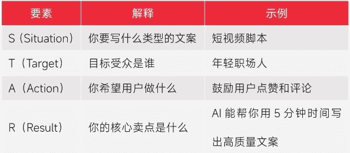
示例：用 STAR 公式优化朋友圈文案
原始文案：
AI 写作挺好用，大家可以试试。
优化后文案：
自从用上 AI 写作，我的文章阅读量直接翻了 5 倍！
以前写一篇公众号要花 2 小时，现在 5 分钟就能拿到初稿。
你用过 AI 写作吗？评论区告诉我。

二、WTF 公式——让智能写出吸引人的内容
适用场景：广告、短视频、电商详情、品牌营销。
WTF= Write 写什么 + Target 写给谁看 + Function 文案目的。

附表 2
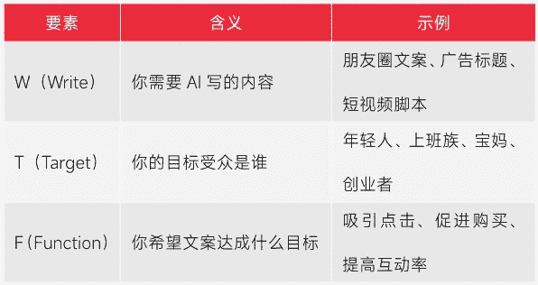
示例：用 WTF 公式优化短视频标题
原始标题：
AI 写作教程。
优化后标题：
90% 的人都在用错 AI 写作！爆款文案的真正秘诀在这里！
AI 写文案真的有这么强？1 分钟教你上手！

三、HOT 公式——让智能写出高点击标题
适用场景：短视频标题、广告文案、社媒贴文。
HOT= Hook 钩子 + Outcome 结果 + Tension 张力。

附表 3
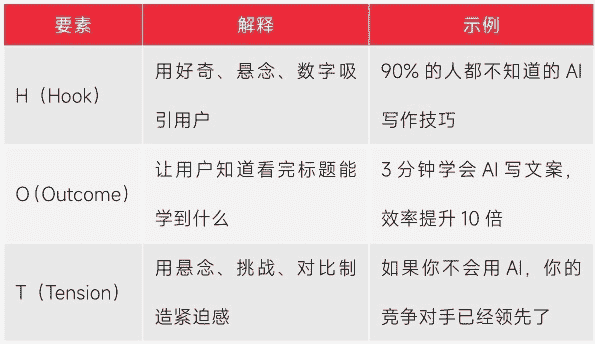
示例：用 HOT 公式优化社交媒体文案
原始文案：
AI 写作很方便，很多人都在用。
优化后文案：
AI 太炸了！用上之后我的文案点击率直接提升 3 倍！

四、PSCA 公式——定位个人 IP 方向
适用场景：个人品牌、社媒运营。
PSCA= Passion 兴趣 + Skills 能力 + Content 可执行性 + Audience 受众。

附表 4
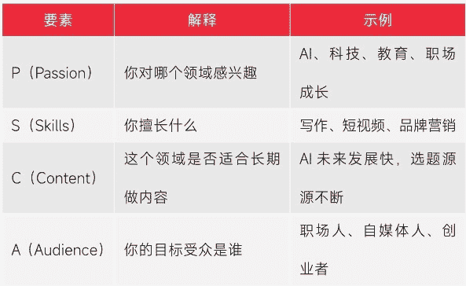
示例：智能分析个人 IP 赛道
输入指令：
复制编辑：请帮我分析适合我的个人品牌赛道。
我的兴趣：AI、科技、个人成长、教育、财经。
我的技能：写作、短视频制作、课程讲授。
目标：找到长期发展的个人品牌方向。
请按 PSCA 公式分析各领域优劣并推荐最佳方向。
智能分析结果：
附表 5
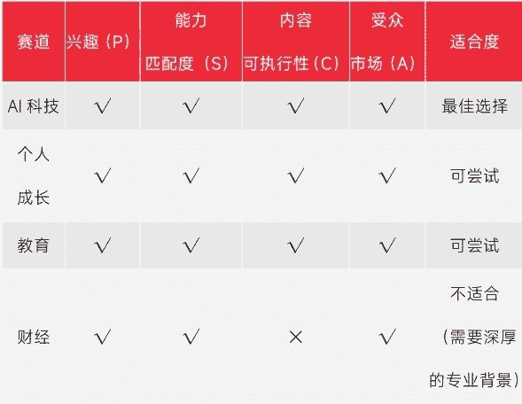
结论：AI 科技赛道最匹配，个人成长与教育可作辅助内容。

五、HEI 互动公式——提升社交媒体互动率
适用场景：微博、小红书、抖音等。
HEI= Hook 钩子 + Engage 互动引导 + Incentive 激励机制。

附表 6
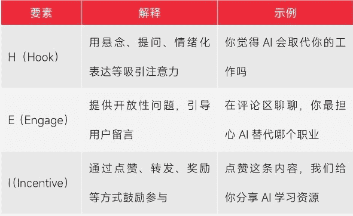
示例：用 HEI 公式优化社交媒体文案
原始文案：
AI 写作很方便，很多人都在用。
优化后文案：
你还在手写文案吗？如果 AI 能代劳，你会去试吗？
评论区说说，你用过 AI 写作吗？体验如何？

六、AIDA 公式——经典广告模型优化转化
适用场景：电商广告、品牌营销、社媒推广。
AIDA= Attention 吸引注意 + Interest 激发兴趣 + Desire 增强需求 + Action 促成行动。

附表 7
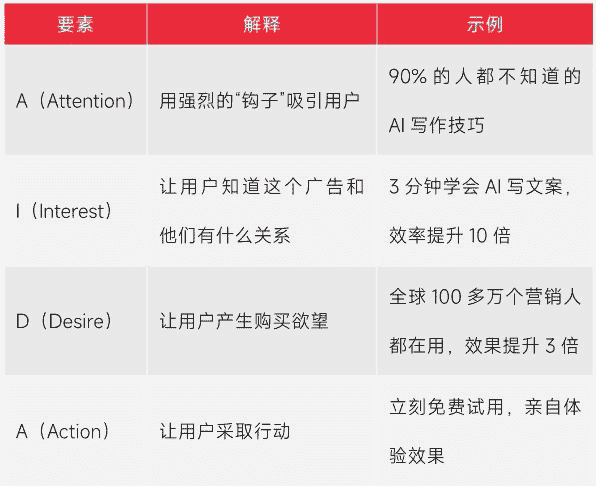
示例：智能优化广告文案
输入指令：
复制编辑：请优化一条 AI 写作工具的电商广告文案。
目标：提升点击率，适配社媒投放。
请用 AIDA 公式优化：
吸引注意、激发兴趣、制造购买欲、促成行动。
智能优化后文案：
90% 的人写文案都在犯这个错误！
这款 AI 写作工具能让广告点击率提升 300%！
已有 5000 多用户好评，现开放免费试用！
立即点击，测测你的文案能提升多少分！
优化亮点：
注意钩子强烈：90% 的人都在犯错。
兴趣点相关痛点：提升广告点击率。
信任背书：5000 多用户好评。

七、TOP 公式——写爆款标题
适用场景：短视频标题、文章标题、社媒标题。
TOP= Trigger 触发点 + Outcome 结果 + Proof 证明。

附表 8
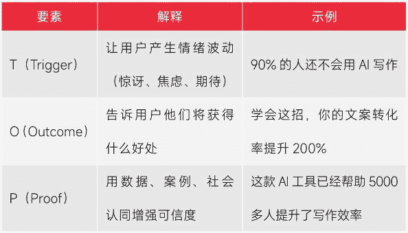
示例：智能优化短视频标题
原始标题：
AI 写作教程。
优化后标题：
90% 的人还不会用 AI 写作？这个方法让你文案转化翻倍！
优化亮点：
制造好奇情绪波动。
突出结果收益。
用数据增强信任。

八、CAST 公式——优化品牌故事
适用场景：品牌文案、企业故事、电商详情、个人品牌。
CAST= Character 主角 + Adversity 挑战 + Solution 解决方案 + Transformation 变化。

附表 9
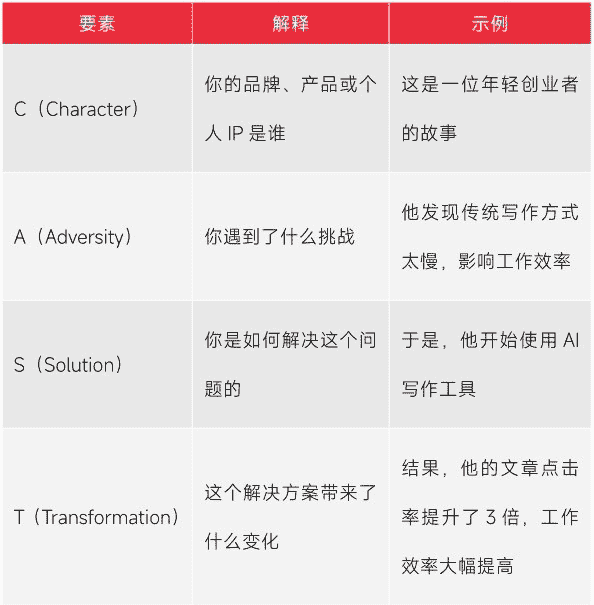
示例：智能优化品牌故事
原始介绍：
我们的 AI 写作工具能提高效率，帮助你更快完成工作。
优化后故事：
自媒体博主小李每天为写作效率发愁。
直到他找到这款 AI 写作工具，输入主题即可生成初稿。
现在他的文章阅读量提升了 300%，再也不用熬夜改稿了！
优化亮点：
故事引发共鸣，便于代入。
呈现挑战，凸显产品价值。
具体数据增强说服力。

九、TIRA 公式——测试与优化个人 IP
适用场景：账号定位、个人品牌打造、流量测试。
TIRA= Try 尝试多个赛道 + Iterate 数据迭代 + Refine 优化内容 + Analyze 分析受众。

附表 10
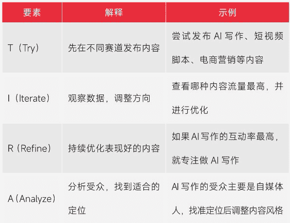
示例：用智能测试个人 IP 赛道
原始运营方式：
随意发帖，今天 AI 写作明天个人成长，内容混乱。
优化后策略：
第一阶段，多发不同赛道内容，观察数据。
第二阶段，锁定互动率最高的内容，优化文案与点击。
第三阶段，分析受众兴趣，精准打造个人品牌。

## 附录四

## AI写作实战练习

以下练习帮助你快速掌握智能文案优化、短视频脚本、电商营销、社媒互动技能，让智能成为可靠搭档。

练习一：用 STAR 公式优化朋友圈文案
任务：在朋友圈推广 AI 写作工具，吸引点赞与留言。
现有文案：AI 写作挺好用的，大家可以试试。
请用 STAR 公式优化。
参考指令：
复制编辑：请帮我优化一条朋友圈文案，推广 AI 写作工具。
目标受众：自媒体人、职场人士、写作困难者。
行动引导：鼓励读者留言互动并尝试使用。
核心卖点：节省写作时间、优化内容、提升曝光。
请用 STAR 公式优化，使其更具吸引力。
思考点：
开头如何更抓人？数据、疑问、情绪化表达。
如何激发对工具的兴趣？
如何用案例或数据增强说服力？
如何引导留言提升互动？

练习二：用 WTF 公式优化短视频标题
任务：发布关于 AI 写作的短视频，原标题“AI 写作教程”过于平淡。
请用 WTF 公式优化。
参考指令：
复制编辑：请帮我优化一个短视频标题，提升点击率。
主题：AI 写作。
目标受众：短视频创作者、文案写作困难者。
行动引导：吸引观众点击观看。
核心卖点：提高效率，提升阅读量。
请用 WTF 公式优化标题。
思考点：
如何吸引注意力？如设问。
如何增加意外感？如加入数据或对比。
如何引导点击？

练习三：智能生成电商产品介绍
任务：为“护眼台灯”撰写介绍，原描述“这款台灯光线柔和，适合阅读”。
请用智能生成并结合 AIDA 优化。
参考指令：
复制编辑：请优化护眼台灯的电商介绍，提升转化率。
目标受众：学生、上班族、阅读爱好者。
主要卖点：无蓝光护眼、三档亮度调节、长时间使用不伤眼。
行动引导：鼓励下单。
请用 AIDA 公式优化。
思考点：
开头如何吸睛？痛点、问题、数字。
如何突出优势？功能结合使用场景。
如何促成购买？限时优惠或用户评价。

练习四：智能优化社交媒体互动文案
任务：在小红书讨论“AI 是否会取代人类写作”，原文案“AI 写作真的很强大，很多人已经开始用了”。
请优化以提升互动。
参考指令：
复制编辑：请优化一条社交媒体文案，提升互动率。
主题：AI 写作的未来。
目标受众：自媒体人、职场人士、科技爱好者。
行动引导：点赞、评论、转发。
请优化文案。
思考点：
开头如何制造悬念或提问？
如何让用户有参与感？二选一或投票。
如何适配社媒传播？短句、符号。

练习五：智能生成广告文案提升点击率
任务：为智能蓝牙耳机写广告，原广告“这款蓝牙耳机音质不错，续航长”。
请用 AIDA 优化。
参考指令：
复制编辑：请优化蓝牙耳机广告文案，提升点击率。
目标受众：年轻人、运动爱好者、职场人士。
产品卖点：智能降噪、30 小时续航、高清音质。
行动引导：点击链接购买。
请用 AIDA 公式优化。
思考点：
如何吸引？数据或痛点。
如何激发兴趣？产品特色。
如何增强需求？评价或真实案例。
如何促成购买？限时折扣。

练习六：用智能生成新闻或行业趋势文章
任务：写一篇关于 AI 如何影响未来工作岗位的文章，适合公众号或 LinkedIn。
原标题“AI 正在改变工作方式”。
请用智能生成并优化标题。
参考指令：
复制编辑：请写一篇“AI 如何影响未来工作岗位”的文章。
目标受众：职场人士、科技爱好者、企业管理者。
需包含：AI 正在取代哪些职业；AI 创造了哪些新职业；如何适应 AI 时代职场变化。
结构：引言+现状分析+数据支持+结论。
请提供约 1000 字并优化标题。
思考点：
如何用数据增强说服力？
如何用故事或案例引发共鸣？
如何给出可行建议？

练习七：智能优化品牌故事提升影响力
任务：为可持续时尚新品牌写品牌故事，原介绍“我们是一家注重环保的时尚品牌”。
请用 CAST 优化。
参考指令：
复制编辑：请优化可持续时尚品牌的品牌故事。
目标受众：关注环保与可持续时尚的年轻消费者。
核心价值：环保材料、可持续供应链、公益行动。
请用 CAST 公式优化，生成约 500 字故事。
思考点：
如何塑造个性化品牌形象？
如何用故事让消费者记住品牌？
如何让价值观更具吸引力？

练习八：用智能生成个性化邮件提升开信率
任务：写邮件邀请用户报名 AI 写作培训课程，原内容“我们的 AI 写作课程已经开始报名，欢迎加入”。
请优化邮件并提升开信率。
参考指令：
复制编辑：请写一封邀请用户报名 AI 写作培训课程的邮件。
目标受众：职场人士、自由职业者、内容创作者。

需要涵盖的内容包括：课程带来的核心价值，比如提升写作效率、扩大内容影响力；如有的话，加入学员的真实成果作为案例佐证；最后给出明确的报名指引。

请借助 AIDA 模型来润色邮件正文。

产出三款风格各异的邮件主题行，提升打开意愿。

撰写一封可直接用于邮件营销的邀请函。

思考方向：

怎样让邮件开场更抓眼球？

学员案例作为社交证明，如何用来增强信任感？

如何促使用户更愿意点击进入报名？

**练习九：用对话式文案提升课程转化**

任务描述：在你的在线课程销售页上，希望借助对话式营销文案来提高转化表现。

现有的基础文案为：我们的 AI 写作课程可以帮助你更高效地写作。

请调用 AI 生成一批更具互动感的对话式销售文案，提升购买意愿。

参考指令：

复制编辑：请帮我出一套对话式销售文案，让课程成交更好。

目标人群：内容创作者、自由职业者、在职白领。

文案需包含：用户常见疑虑，例如“AI 写作适合我吗”；引导式回应，如“你是否常被写作卡住？AI 可以怎样帮你”；其他学员的使用反馈作为社交证明；清晰的购买指引。

请输出 5 组对话式营销文案。

思考方向：

如何让文案更具对话的互动感？

对话形式怎样降低用户的抗拒心理？

如何让用户更容易做出购买决策？

**练习十：用 AI 规划一周社媒内容**

任务描述：想在微博、小红书、公众号上保持每日更新，却缺乏排期思路。

请利用 AI 生成一份为期一周的社交媒体内容日历，并对每日发文主题进行优化。

参考指令：

复制编辑：请帮我做一份以“AI 写作”为主题的一周社媒内容日历。

目标人群：内容创作者、职场人士、科技爱好者。

投放平台：微博、小红书、公众号。

每日发布 1 到 2 条。

要兼顾干货分享、互动话题、热点趋势解读和实操技巧。

请给出完整的一周排期，并把每日标题和互动引导语优化好。

附表 11 AI 生成的社交媒体内容日历

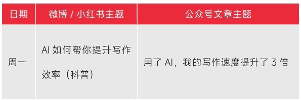

续表

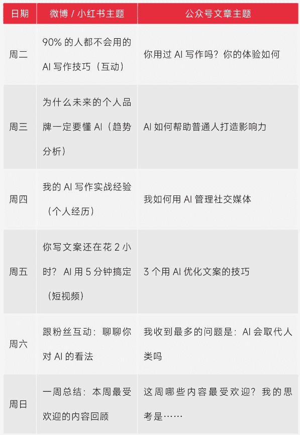

思考方向：

如何让内容在互动、干货、趋势、案例之间保持多样性？

怎样借助 AI 分析数据来调整内容方向？

如何让社交媒体运营更省心高效？