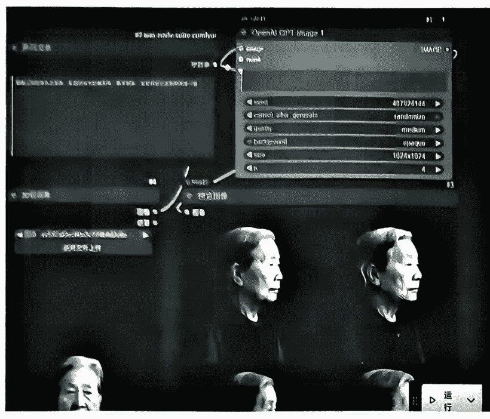
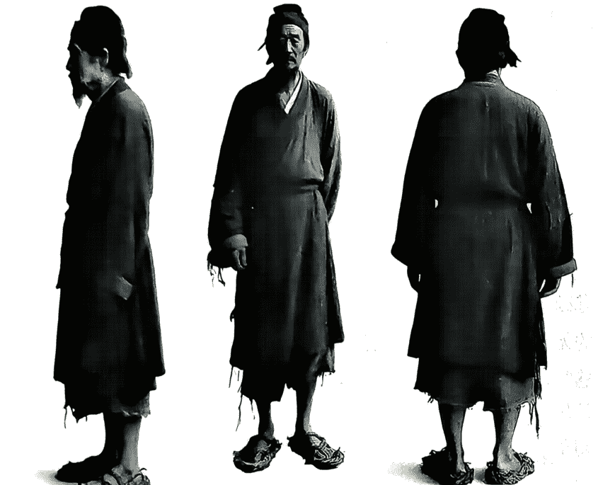
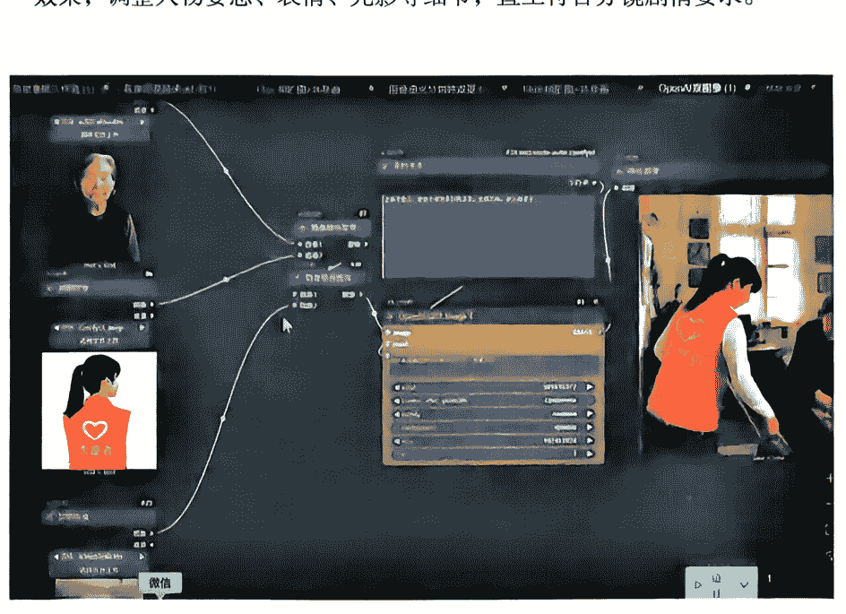
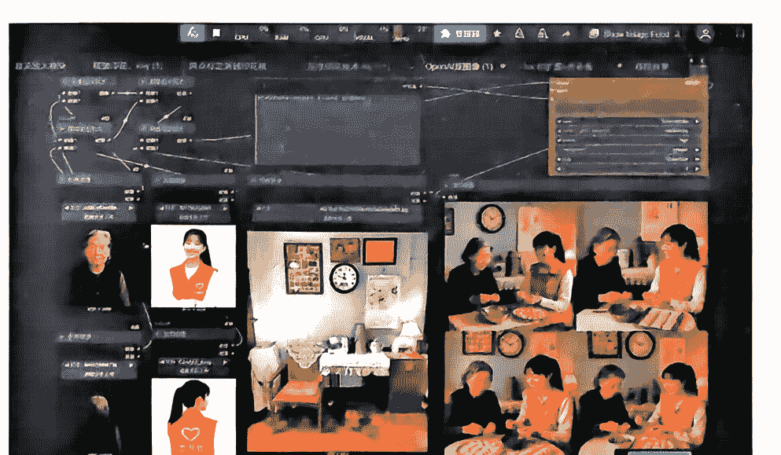
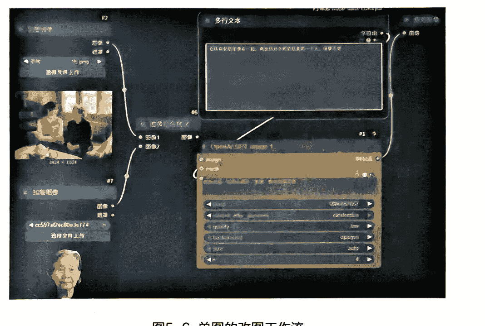
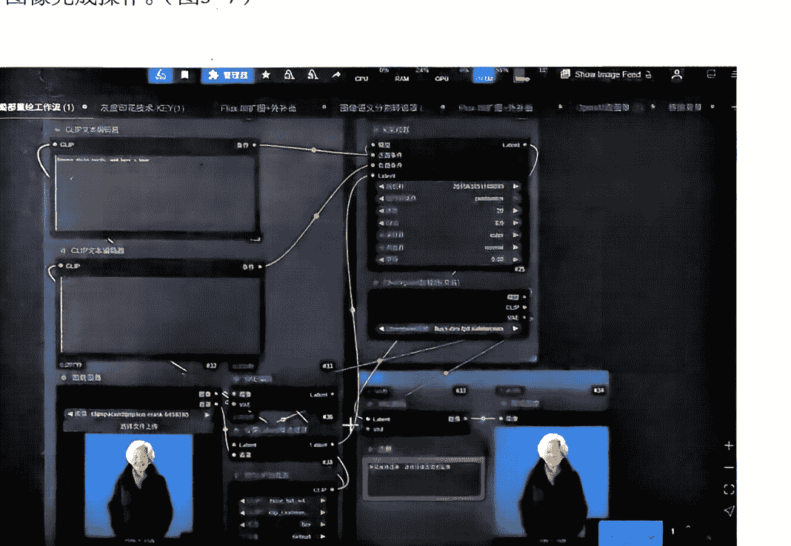
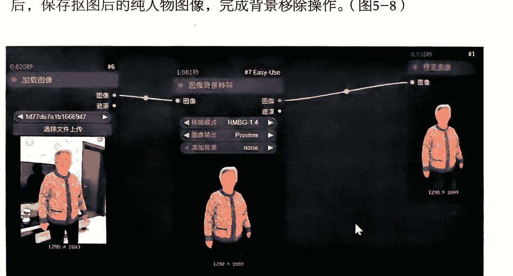
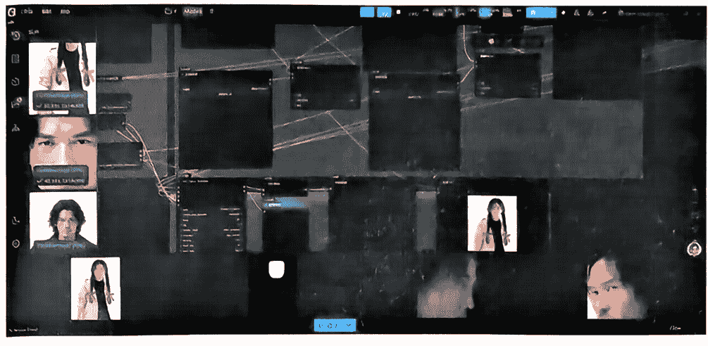
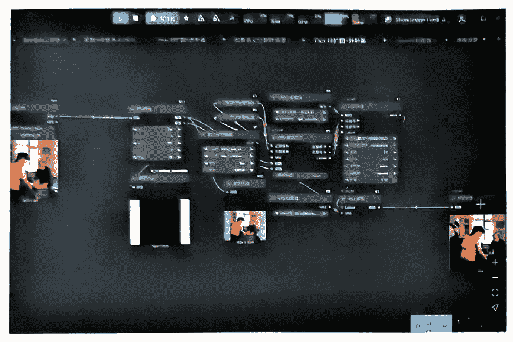

# AI爆款短剧创作变现，从入门到职业高手


## 前言

### 告别工具焦虑：如何用这本书在AI短剧浪潮中稳赚不赔

当你翻开这本书时，我想，我们可能正面临着相似的困惑。

在过去的一两年里，我见证了太多朋友和同行，怀着巨大的热情扎进AI短剧这个领域。他们熟练地背诵着各种模型的名称，比较着不同工具的优劣，能生成视觉惊艳的单张图片或几秒视频。但当他们想独立制作一部完整的、能打动人心的短剧，并以此获得稳定收入时，却常常陷入一种深深的无力感。

工具似乎永远在更新。我们昨天刚学会了流程，今天可能就出了更“智能”的版本。我们就像追逐浪花的人，在技术的潮汐中疲于奔命，却始终不能出海远航。

这恰恰是我想与你探讨的起点：为什么我们越学习使用AI工作，反而越找不到方向？

答案或许在于，我们过度聚焦于瞬息万变的“术”，而忽略了背后那些恒定不变的“道”。这本书，便是我对这一问题的解答。我不承诺让你“一夜暴富”，而是希望能为你提供一个坚实的基点，让你在技术的浪潮中，拥有“以不变应万变”的从容。

### 一、行业困惑与认知迷茫

我最初接触AI影视创作时，与大多数人一样，沉浸在学习新工具的兴奋中。但很快，我发现了一个悖论：工具越强大，我面临的抉择反而越多，失败的成本也越高。一个提示词的细微差别，就可能导致数小时的渲染前功尽弃。

这让我回想起早年做古村落研究与非遗景观基因挖掘的经历。面对散落在全国各地的、浩如烟海的村落资料，首要任务不是立刻动笔写论文，而是建立一个系统性的“基因数据库”。我要厘清不同地域、不同族群的建筑特征、民俗仪轨与文化符号，找到它们之间的关联与演变规律。

这个过程，与今天用AI创作短剧惊人地相似。AI模型就像那个庞大的“文化数据库”，而提示词就是我们与之沟通、从中精准调取所需“文化基因”的检索语言。如果你自己都不清楚想要一个什么样的“故事村落”，那么再强大的数据库，给你的也只能是一堆杂乱无章的“建筑材料”。

或许我们的困惑与迷茫正源于此。我们学了很多“怎么盖房子”的技巧，却忘了首先要做的，是想清楚“要盖一座什么样的房子”，以及“人们为什么愿意走进这座房子”。

### 二、本书主旨与核心价值

基于上述的痛点，我撰写这本书的核心目的，不仅在于教你具体的实操方法，更重要的是教你那些长期有效的规律——关于人性共鸣的故事结构、关于视觉表达的镜头语言、关于商业变现的底层逻辑。而本书的核心主旨，便是为你系统性地梳理这三大规律。

其一，内容创作规律：什么样的故事能瞬间抓住人心？爆款背后有何永恒的情感模型？

其二，视觉表达规律：如何用镜头讲故事？即便使用AI工具生成，好的影像的构图、节奏和情绪是如何作用的？

其三，商业变现规律：如何将你的创作稳健地嵌入现有的商业生态，实现价值闭环？

掌握了这三大规律，无论你面对的是如今的Midjourney、Sora，还是任何未知的新工具，你都能迅速理解其原理，并将其转化为实现你创作意图的有效手段。

### 三、如何使用本书

知识的价值在于运用。为了让你能真正“上手”，本书的整体编排遵循“认知破局—内容创作—实战流程—商业变现”的逻辑，全程模拟一个AI短剧项目从零开始到完整落地的全过程，兼顾理论性与实操性，确保你能够“学完即用”。

在此，我强烈建议你，不要将这本书当作一本被动阅读的“知识手册”，而是将其视为一份主动参与的“行动地图”。本书最好的学习方式，便是一边阅读章节内容，一边同步创作你的第一部AI短剧作品。

我期望，当你合上这本书时，你不仅能收获AI短剧创作的核心理念与实操方法，更能拥有一部属于自己的、完整的、可变现的AI短剧作品，真正实现“学以致用”。

### 四、开启你的AI短剧创富之旅

AI短剧这片新兴的海域，充满了未知，也蕴藏着无限的可能。它不再是一个需要重资本、大团队支撑才能进入的行业，它为每一个独特的创意和个体提供了前所未有的舞台。

在这段旅程中，我愿扮演一个“领航员”的角色，不是告诉你每一朵浪花的样子，而是为你指明潮汐的方向与星辰的位置。真正的航行，仍需由你亲自掌舵。

那么，就让我们从最关键的第一步启程：跳出对AI工具的盲目追逐，重新审视AI短剧行业的发展全貌，建立系统化的行业认知。我们将一同厘清：在这场AI技术变革中，哪些是转瞬即逝的行业泡沫，而哪些，才是支撑我们长远发展、恒定不变的核心逻辑。


## 第一章 AI短剧商业生态地图：找到你的赚钱位置

当前，部分AI短剧从业者存在认知误区，认为借助AI工具即可实现单人包揽全流程制作。然而，随着行业快速迭代与规模化发展，内部已形成清晰的分工体系，涌现出各具专业性的职业角色矩阵。如同传统影视产业通过编剧、导演、摄影、美术、剪辑等细分岗位进行协同配合，AI短剧行业也正逐步构建适配自身特性的职业体系，推动行业从“粗放式制作”向“精细化创作”转型。

深入洞悉行业分工生态与职业体系，可帮助从业者明确发展路径：是深耕全流程技能，成为可独立完成选题、剧本、分镜及制作的全能型创作者；还是聚焦细分领域，成为行业不可或缺的专精型人才。这一选择直接决定从业者的能力构建方向与市场竞争力，需结合自身资源与行业需求审慎考量。

### 第一节 核心创作层：内容的生产与制造

核心创作层是AI短剧生态的动力核心，承担着将创意转化为具象内容的关键职能，主要呈现三种典型创作者画像，对应不同的能力要求与盈利模式。

#### 一、剧本专家：卖故事、卖选题、卖模板

短剧行业中，“好剧本永远稀缺”已成共识。AI工具降低视觉作品制作门槛后，故事的核心价值被进一步放大，剧本专家成为不可或缺的“内容源头”。这类从业者未必精通AI工具的使用，但深谙受众心理与叙事逻辑，能构建3秒抓住观众注意力、激发观众情感共鸣的故事框架。

剧本专家的核心产出包括三类：一是完整剧本，为制作方提供可直接落地的脚本及分集大纲；二是爆款选题库，定期输出经市场验证的选题方向与创作思路；三是故事模板，将成功的叙事逻辑总结为可复用框架，提升创作效率。

某转型自网络小说作者的剧本专家，聚焦“逆袭+甜宠”混合型题材，摒弃传统小说日更万字模式，每周打磨2~3部精品剧本，月收入较此前提升三倍。其核心方法为：每日深耕各平台爆款短剧，分析受众评论与数据反馈，将经典叙事模型与当下热点结合，输出具有“爆款潜质”的故事蓝图。

成为剧本专家的关键，不在于文笔优美，而在于能精准把控受众情绪，并用直接的戏剧冲突引发其情感共鸣。

#### 二、视觉艺术家：AI转绘、分镜生成、成片制作

如果说剧本专家提供“创作蓝图”，视觉艺术家则是将蓝图转化为视觉作品的“执行者”。这类从业者兼具AI工具深度应用能力与视觉审美，能精准将文字描述转化为具有冲击力的视觉画面。

其核心工作涵盖三类：一是AI转绘，将真人短剧转化为特定动画风格，赋予内容新质感与传播亮点；二是分镜生成，依据剧本创作连贯、有张力的分镜，保障叙事节奏与视觉逻辑；三是成片制作，统筹画面生成、配音、配乐、剪辑全流程，实现内容落地。

一位转型自影视后期制作人的视觉艺术家表示，其核心竞争力并非掌握工具的数量，而是多年积累的“镜头感”。当别人还在纠结特写镜头时，他已能通过精准的提示词，生成具有电影质感的镜头序列。

成为视觉艺术家的关键，是将艺术审美与AI工具深度融合，构建独特、高效的视觉表达体系。

#### 三、全能制作人：一人操盘全流程

全能制作人是行业中极具挑战性与自主权的角色，需兼具编剧的故事创作能力、导演的视觉把控力与运营的流量思维，实现从选题到发布的全流程独立操盘。该模式优势在于自主可控、收益独享，但对综合能力要求极高，易陷入“全而不精”困境。

成功的全能制作人多有差异化打法：部分聚焦垂直题材（如“重生逆袭”男频），部分深耕视觉风格（如赛博古风混搭），部分响应热点快速产出贴合市场的内容。

优秀的全能制作人不追求“样样精通”，而是构建“核心环节极致化、次要环节高效化”的工作流。例如，将核心精力投入对剧本的打磨与前3秒画面的设计，标准化环节用预设提示词批量处理，实现效率与品质的平衡。

成为全能制作人的关键，在于建立个性化高效工作体系，明确精力投入优先级。

上述三类角色并非绝对割裂，从业者可根据职业阶段进行灵活切换。例如，从视觉艺术家起步，逐步积累剧本创作能力，最终成长为全能型制作人。核心是明确各路径的能力要求与盈利逻辑，选择适配自身发展的起点。

### 第二节 周边服务层：行业的“卖水者”与“送铲人”

任何新兴行业生态中，都有一批眼光敏锐的从业者。他们未必涉足核心产品研发制造，却凭借为生产者提供专业服务、工具及解决方案，在行业中站稳脚跟。美国淘金热便是例证：真正稳健盈利的不是淘金者，而是售卖水、铲子、牛仔裤的商人。

AI短剧行业亦如此。当市场聚焦内容创作核心时，周边服务生态正悄然成型。这些“卖水者”与“送铲人”，构成行业健康运转的基础设施，是连接创作与市场、保障行业规范发展的关键纽带。

#### 一、备案与版权服务商：搞定有资质的专业人士

AI短剧行业从野蛮生长向规范化转型，作品备案与版权保护已成为“必选项”，这催生了专业的备案与版权服务商。他们深耕影视行业政策法规，精通AI短剧备案与版权登记流程，为创作者和制作团队提供全流程合规解决方案。

此类服务商的核心价值，是将复杂的行政流程与政策解读转化为标准化服务模块，为创作者节省时间成本，同时降低行业试错成本。

一位曾任职影视公司，负责项目报备工作的从业者，凭借丰富的政策解读与实操经验，敏锐洞察到新人及中小团队的报备痛点，成立工作室专注AI短剧备案代理与版权登记服务，凭借专业与高效的服务，每月可处理近百个备案项目，业务量稳步增长。

备案与版权服务商的核心竞争力，在于对行业政策的动态追踪、精准解读及合规流程的标准化管控，而非内容创作能力。细心严谨、逻辑清晰、善于钻研政策流程的从业者，在这一领域可拥有广阔的发展空间。

#### 二、素材供应商：专攻高难度分镜与特效

AI短剧制作中，复杂打斗、魔法特效、风格化场景等高技术门槛、高成本的视觉镜头，成为制约制作效率的瓶颈，这类需求缺口催生了专注细分素材供给的素材供应商。

素材供应商不涉足完整剧情创作，专注高难度、高复用率视觉素材的研发与积累，业务高度细分：部分专攻剑气、光影等特效素材；部分聚焦古风、仙侠等场景模板。

一家转型自游戏行业的素材供应商，其商业模式是打磨高质量特效素材，通过规模化复用分摊成本、实现盈利，例如一款“火龙特效”模板，以低价授权多个团队，可实现数月持续盈利。

素材供应商的核心价值，是通过专业化分工实现优质视觉素材规模化供给与复用，分摊研发成本，既能提升行业视觉制作水平、优化成本结构，也为内容创新提供更多可能。

#### 三、宣发与投流手：掌控流量的关键环节

内容产能过剩、流量竞争激烈，宣发与投流手成为连接AI短剧与目标受众的关键，他们通过专业化运营，助力优质内容突破流量壁垒。

优秀的宣发与投流手多具备市场营销、数据运营背景，虽不参与内容创作，但对用户偏好与平台规则洞察深刻，其核心能力是对内容的预判能力和对流量的调控能力，通过优化投放策略，提高内容传播效率与商业价值。

一个三人专业投流团队，专注AI短剧宣发投放，形成标准化合作模式：创作者把控内容质量，团队承接全流程宣发投流，助力内容破圈，按流量或商业转化分成，其核心价值是搭建内容与用户的桥梁，实现内容商业与传播价值最大化。

宣发与投流手的核心竞争力是数据敏感度、市场洞察力与策略调整能力。擅长数据分析、关注数字变化、乐于研究用户与平台规则的从业者，能在这一领域占据主动地位。

#### 四、培训与顾问服务：知识与经验的传播者

随着短剧行业快速扩张，知识经验传承的价值逐渐凸显出来，一批行业先行者，将自身创作、运营等经验，通过培训咨询转化为系统化知识产品，指导新人、助力人才梯队建设。

AI短剧培训与顾问服务分为三类：技术派专注AI创作工具实操教学；方法派聚焦内容创作逻辑输出；实战派侧重商业运营经验分享。三者均以市场验证的知识体系为核心，实用性强。

一位全能制作人转型的培训师，将自身总结的高效工作方法与避坑指南转化为标准化课程，既能帮助新人突破瓶颈，也能深耕自身内容创作，实现个人与行业价值双赢。

培训师与顾问的核心价值，是将个人实战经验系统化、理论化、可传授化，搭建行业知识传承桥梁。善于总结分享、在细分领域有独到经验的从业者，发展潜力广阔。

纵观AI短剧行业的周边服务层，可发现一个显著特征：多数服务角色从核心创作层分化而来，服务提供者多为资深从业者，在解决自身痛点时捕捉行业共性需求，形成“实践—痛点—服务—迭代”的发展路径。

### 第三节 自我评估：你的起点在哪里

俯瞰AI短剧生态后，盲目尝试不如先做冷静的自我评估。这如同探险前清点行囊，明确自身优劣势，才能选择适配的发展路线，避免跟风踩坑。找到起点需要完成一次深刻的自我对话，可从以下三个维度绘制一幅“个人资源地图”。

#### 一、清点你的内在资产：能力与兴趣的十字路口

自我审视可明确你在内容产业链中的天然适配方向，为职业定位提供锚点，核心可从三个能力维度判断。

若你有“讲故事”的天赋与热情，观看影视剧、阅读小说时会拆解情节、分析人物，善于捕捉生活中的戏剧瞬间，那么剧本创作领域更适合你。AI短剧行业中，能精准把控情绪、设计钩子的创作大脑，比AI工具更稀缺，可从打磨大纲、拆解爆款、撰写分镜提示词起步。

若你对“视觉画面”敏感，具备构图、色彩、光影的把控能力，热爱摄影绘画，关注AI图像的细节与质感，那么视觉呈现环节是你的主场。可成为AI视觉艺术家，或专注分镜设计，用审美与细节把控力提升作品的视觉质感。

若你具备“连接市场”的思维，擅长预判爆款、捕捉热点，对平台算法、用户心理有研究欲，乐于推广作品，那么宣发投流、运营或培训服务更易凸显你的优势。你无需深耕内容细节，核心是成为优质内容与受众的连接桥梁。

每个行业都没有绝对全能的人才，找准自身核心优势与热情所在，以此为支点，便能撬动行业发展杠杆，而精准定位需先洞悉行业生态与分工。

#### 二、盘点你的外部资源：时间、精力与工具的平衡

职业选择需结合自身的资源禀赋，可从时间、精力和工具预算三个核心维度评估适配性。

一是时间资本：若每周可稳定投入20小时以上的整块时间，可尝试全能制作人、全流程成片制作；若时间碎片化，可选择剧本创作、垂直素材供应，利用零散时间攻坚拆解任务。

二是学习精力：评估自身对AI工具的学习耐心与试错承受力，工具驱动型岗位需拥抱变化、持续试错，心态直接决定成长上限。

三是工具预算：明确自身对AI工具的付费意愿，多数核心工具需付费，预算有限时可优先配置核心工具，备案、咨询等服务对工具依赖度较低。

#### 三、定位你的职业原型：选择你的初始角色

结合自身资源与行业需求，可归纳出AI短剧行业中三类常见的职业原型，为从业者提供快速自我定位的参考框架。

第一类“创意型”创作者：思维敏捷、共情力强，善于挖掘人性故事，推荐从剧本创作起步，打磨短篇剧本、分享爆款思路，验证创意的商业价值。

第二类“技术型”手艺人：有耐心、重细节，追求视觉质感，推荐

## 第一章 AI短剧商业生态地图：找到你的赚钱位置

聚焦AI视觉生成赛道，深耕垂直风格或技术环节，构建核心竞争力。

第三类“商业型”连接者：市场洞察力强，擅长沟通运营；推荐切入宣发运营或周边服务，成为产业链高效衔接的环节。

在此，建议从业者进行一次深度自我梳理：准备一张纸与一支笔，在纸面中央绘制三个相互交叠的圆圈，分别标注“我热爱的”“我擅长的”与“有市场价值的”。随后，将前文思考的自身资源、行业需求等内容，逐一对应填入三个圆圈中。三个圆圈的重叠核心区域，便是进入AI短剧行业最理想且能实现长效发展的起点。找准这一核心定位后，再逐步构建个人职业核心竞争力。

## 第二章 永不过时的爆款选题公式

无论技术如何迭代、平台算法如何变迁，能穿透屏幕、直抵人心的，永远是一个个好故事；而一个好故事的起点，永远是一个能引发热议的选题。

我见过太多创作者，在工具操作上早已是行家里手，却偏偏卡在了创作的第一步——“老师，我今天要拍什么？”他们迷失在繁杂的信息海洋中，盲目追逐着一个又一个看似火爆的“热点”，终究没能找到属于自己的创作节奏。

其实，爆款选题从不是灵光一现的偶然，更像是一场精密的定位与勘探。你需要一套可靠的“系统”，去定位、勘探那些深藏在人性深处的情绪富矿。

### 第一节 爆款选题的定位七步法

在按下“生成”键之前，请先回答以下七个核心问题。这将为你后续的所有创作奠定基调，避免在工具和素材的海洋中迷失方向。

#### 一、定类型：选择适合你的内容形态

目前AI短剧已分化出五种主流类型，各具特色，适配不同创作场景与市场需求。

第一种为AI动漫画短剧，细分为三种具体模式：AI转绘短剧，通过对已被验证的真人爆款短剧进行动漫画风格转化，实现内容高效复用、降低试错成本；AI+动态漫，以静态漫画为基底，叠加动效与配音丰富感官体验，适配漫画IP的可视化衍生传播；AI+动画短剧，主打独立原创剧情，虽受当前技术限制，制作成本偏高，但随着AI技术迭代，未来有望突破至番剧级制作水准，市场潜力可观。

第二种是AI搞笑短剧，以独特的“粗糙感”构建差异化美学。其制作成本极低，依托基础AI工具组合即可完成全流程创作，其核心竞争力在于直击痛点的剧情梗与高频反转的叙事节奏。这种表面的“轻量化制作”反而成为传播亮点，易激发用户二次创作与社群讨论热情，实现低成本流量裂变。

第三种为AI简笔画短剧，以简洁线条、基础图形为视觉核心，主打轻量化叙事，适合传递直白易懂、节奏明快的故事。该形态制作流程简便、产出效率高，无须复杂技术与工具支撑，是个人创作者在短视频平台试水、积累市场反馈的优选方向。

第四种是AI真人短剧，代表当前行业技术探索的前沿。主要分为“AI+真人”混合模式与全AI生成类真人模式：前者借助AI优化特效、剪辑、场景搭建等环节；后者通过AI技术构建虚拟角色与场景，二者均在视觉质感与情感传递上贴近传统影视体验，受众接受度较高。

第五种为AI互动短剧，是行业未来的核心发展方向。依托对话式AI与互动剧情分支技术，打破传统单向传播壁垒，让观众能够参与剧情决策、与虚拟角色实时互动，获得个性化沉浸式体验，目前已在部分平台开展场景化试点应用。

在各类形态中，AI真人短剧对内容与形式的平衡要求尤为突出，需牢牢把握“内容为核，视听为辅”的原则。短剧的核心始终是能打动人心的内容，视听呈现的终极目标是服务于内容表达，切不可本末倒置。

#### 二、定比例：你是要做横屏还是竖屏

横竖屏选择需结合内容属性与消费场景。竖屏适配移动端碎片化场景，最大化屏幕空间，聚焦人物情感细节，适合以对话为主、场景单一的情感剧、生活剧，可拉近与受众的距离；横屏延续传统影视习惯，适合展现广阔场景、复杂人物关系与连贯动作戏，能提升沉浸式体验，适配历史、玄幻、悬疑等题材。二者选择的核心主要看需求：重情感连接选竖屏，重视觉沉浸感选横屏。

#### 三、定风格：你想打造何种视觉美学

风格决定作品的“气质”，决定整体叙事基调、光影质感与美学取向。主要可从三个维度界定：核心美学维度，需明确视觉风格定位，如“赛博朋克”“国风玄幻”“复古港风”“日系清新”“现实主义”等，聚焦一种核心风格延伸细节，避免杂乱无章；叙事基调维度，需确定内容的情感走向，是“暗黑复仇”的爽感、“甜宠治愈”的温情，还是“悬疑紧张”的刺激、“搞笑有趣”的解压，基调统一才能强化受众代入感；光影法则维度，需适配风格与基调选择光影模式，是采用“戏剧光效”强化冲突张力，还是以“自然光感”营造真实氛围。

#### 四、定时长：你要做多长的短剧

时长决定作品的“体型”，时长选择需兼顾AI技术特性与受众习惯，短剧常规单集3~5分钟，微短剧以90秒/集为主。当前主流AI视频工具单次生成多为5~10秒，AI短剧创作需将内容拆分为多个短片段拼接，既能提升生成效率、降低修改成本，又能保证节奏紧凑，适配短视频受众的观看习惯。

#### 五、定平台：你要发布在哪个平台

平台决定作品的“战场”，平台选择需结合目标受众（年龄、喜好、行为习惯）、内容类型（形式、赛道、风格）与变现目标（流量分成、广告合作、IP衍生等），不同平台用户生态与算法差异显著。建议采用“主辅结合”策略：主攻一个核心平台，深耕其规则打造标杆内容；适配2~3个辅助平台，调整内容细节实现流量最大化覆盖，避免优质内容无人问津（表2-1）。

**表2-1 短剧发布平台差异对比**

| 平台 | 用户画像 | 内容风格 | 创作机制 | 平台调性 | 变现路径 |
| :--- | :--- | :--- | :--- | :--- | :--- |
| 抖音 | 覆盖全年龄段，偏年轻，偏好“爽感”内容 | 快节奏、强爽感、情绪至上 | 算法驱动，强推荐机制，适合爆款内容 | 娱乐至上，强调视觉冲击和记忆点，字幕大、音效强 | 广告分成、小程序付费、直播带货、品牌定制 |
| 快手 | 接地气的下沉市场为主，偏好家庭伦理、甜宠、现实题材 | 接地气、重人设、信任驱动 | 以人带剧，绑定演员人设，互动性强 | 强调真实、生活化，社区氛围浓厚 | 电商联动强，短剧带动直播GMV增长，付费会员逐步推进 |
| 小红书 | 一二线城市年轻女性为主，偏好情绪浓度高、价值导向内容 | 审美高、情绪浓、价值导向 | UGC+PUGC结合，强调“看议一体”，用户参与度高 | 精致、真实、有“人味”，强调内容审美与情绪共鸣 | 品牌合作、种草营销为主，短剧多为免费内容 |
| B站 | Z世代为主，偏好二次元、悬疑、科幻、剧情类内容 | IP化、剧情向、社区共鸣 | UP主主导，弹幕互动强，社区氛围浓厚 | 内容导向，强调原创性与文化认同 | 会员付费、广告分成、IP衍生品开发 |
| 视频号 | 年龄偏大，偏好家庭、职场、情感等现实主义题材 | 剧情贴近生活，强调情感共鸣 | 依托微信生态，社交传播强，适合私域运营 | 熟人社交驱动，强调信任与关系链 | 广告、直播带货、私域变现为主 |
| 电商平台 | 购物导向用户，偏好多元，注重实用性 | 剧情围绕商品展开，强调“种草”与转化 | 品牌主导，内容多为定制 | 商业化强，内容服务于交易 | 商品销售、品牌曝光、直播带货 |
| 小程序 | 广泛用户，爽文剧情偏好 | 爽感强、情绪释放 | 低成本快速制作，强付费引导 | 工具属性，内容服务于转化 | 用户付费、广告、分销 |

#### 六、定受众：你在为谁创作

受众是作品的“知己”，清晰的用户画像是内容引爆流量、实现情感共鸣的关键。脱离受众的创作难以形成传播力，需先明确核心问题：为谁创作？可从三个维度梳理，构建精准受众认知。

第一，明确基础属性。聚焦受众年龄区间、性别特征、城市层级三大核心，不同基础属性的受众，其媒介接触习惯与内容偏好差异显著，这是内容设计的基础。

第二，锁定兴趣圈层。精准定位受众圈层标签，无论是职场奋斗者、中年焦虑者，还是国风爱好者、悬疑迷，圈层标签直接决定内容的话题切入点与表达语境。

第三，挖掘情感痛点。剖析受众核心情感需求：恐惧35岁职场危机、情感背叛或现实无力感，渴望逆袭爽感、温情陪伴或理想生活。抓住这些痛点与渴望，才能让内容直抵人心。

建议为理想受众创建虚拟人物卡，标注姓名、职业、生活困扰、核心梦想等细节，将抽象画像具象化并留存。这张人物卡将成为创作指南，选题、剧情、语言表达均需追问：“他/她会看完视频吗？”“情节能触动他/她吗？”围绕受众需求创作，才能让作品脱颖而出。

#### 七、定蓝图：从文字到画面的路线图

清晰的创作蓝图能确保团队协作顺畅，具体体现在五个关键文本的衔接上（表2-2）。

网文小说作为灵感源头，提供故事雏形和世界观；剧本在此基础上构建完整的故事框架和人物弧光；拍摄脚本将文学描述转化为具体的拍摄指令，明确每个镜头的景别、机位和动作；分镜头脚本将情节进一步视觉化，用画面预演叙事节奏；剪辑脚本则根据实际素材进行后期创作的导航。

理解每个文本的独特作用和创作阶段，能让你在AI短剧制作中更好地驾驭从灵感到成片的完整流程。

**表2-2 AI短剧策划文本的阶段性指导**

| 项目 | 网文小说 | 剧本 | 拍摄脚本 | 分镜头画面脚本 | 剪辑脚本 |
| :--- | :--- | :--- | :--- | :--- | :--- |
| 内容 | 网络文学作品，以文字形式发布，内容题材多样，注重情节吸引力和可读性 | 短剧创作的文学基础，详细描述情节、场景、角色对话和情感表达 | 剧本的进一步细化，加入具体的拍摄技术细节，如镜头编号、拍摄角度等 | 视觉化的剧本形式，用图像展示每个镜头的构图、角度和运动 | 根据实际拍摄素材调整后的版本，标注镜头的保留、剪辑和过渡方式 |
| 特点 | 叙事性强，篇幅较长，语言风格多样，互动性强 | 格式规范，注重故事性，语言简洁明了 | 技术性强，分镜头，多版本（不同颜色纸张区分） | 视觉化，详细标注拍摄角度、镜头运动，直观性强 | 动态调整，注重节奏和叙事流畅性，技术性强 |
| 格式 | 无固定格式，以故事叙述为主 | 有固定格式，包括场景标题、角色对话、动作描述等 | 在剧本基础上增加镜头编号、拍摄角度等技术信息 | 以图像为主，每个镜头有简要文字说明，类似漫画形式 | 根据拍摄素材调整，标注剪辑点和转场效果 |
| 作用 | 娱乐读者，也可作为电影、电视剧改编的素材来源 | 提供故事框架和角色对话，是拍摄脚本的基础 | 为导演、摄影师和演员提供具体的拍摄指导，确保拍摄顺利进行 | 帮助导演和摄影师提前规划拍摄方案，减少拍摄过程中的不确定性 | 帮助剪辑师组织素材，确保电影的节奏和叙事流畅 |
| 创作主体 | 网络作家 | 文学编剧 | 现场编剧（编导）、导演、制片人等 | 导演、分镜师 | 剪辑师 |
| 创作阶段 | 创意构思阶段，通常在网络上发布 | 创意构思阶段，是电影制作的文学基础 | 拍摄准备阶段，为实际拍摄提供技术指导 | 拍摄准备阶段，帮助导演和摄影师规划镜头 | 拍摄完成后，用于剪辑阶段的参考 |
| 篇幅 | 通常较长，几万字到几百万字不等 | 通常为100～150页，具体长度视电影时长而定 | 通常比剧本更详细，篇幅可能稍长 | 以图像为主，篇幅较短，重点突出每个镜头的关键信息 | 根据实际拍摄素材调整，篇幅可能与拍摄脚本相近或更短 |
| 语言风格 | 多样化，可以是幽默、严肃、浪漫等，注重吸引读者 | 简洁明了，注重情节和角色的表达 | 技术性语言，详细描述拍摄细节 | 图像化表达，文字说明简洁明了 | 技术性语言，强调剪辑点和节奏 |
| 互动性 | 作者与读者互动性强，可根据读者反馈调整情节 | 通常不涉及互动，主要供电影制作团队内部使用 | 通常不涉及互动，主要供电影制作团队内部使用 | 通常不涉及互动，主要供导演和摄影师使用 | 通常不涉及互动，主要供剪辑师使用 |
| 视觉化程度 | 以文字叙述为主，视觉化程度低 | 以文字叙述为主，视觉化程度低 | 以文字叙述为主，但包含一些视觉化提示（如镜头类型、拍摄角度） | 高度视觉化，以图像为主 | 视觉化程度适中，主要通过文字描述剪辑效果 |
| AI短剧制作流程 | 灵感来源 | 剧本 | 分镜画面设计 | 参考分镜图 | 分镜剪辑 |

### 第二节 爆款选题的三维雷达

AI短剧的传播魅力，核心在于通过人物关系的矛盾构建与剧情转折，激发观众的情感代入、价值共鸣与传播意愿。若将选题创作比作寻宝，单一创作维度如同仅用一种频率探测，极易错失优质选题；而同时开启人物关系、社会情绪、经典叙事三个维度的“扫描”，便能构建立体创作坐标，精准锁定兼具共鸣力与传播力的核心选题。

#### 一、人物关系维度：从权力、情感、血缘中挖掘极致冲突

在AI短剧创作中，“人物关系”的构建绝非简单标注“父子”“夫妻”“上下级”等身份标签，其核心价值在于挖掘关系背后的深层张力——那些能让观众瞬间共情、感同身受的复杂情感纠葛与核心矛盾。优质的人物关系是故事的灵魂，能为剧情发展提供源源不断的驱动力。

理解人物关系的本质，是洞察人性在不同社会链接模式下的多元呈现。通过对海量爆款AI短剧的拆解分析可发现，人际戏剧张力的核心来源是权力、情感、血缘三个基础层面。这三者如同色彩中的三原色，通过不同比例的融合与碰撞，能够衍生出世间所有复杂的人际关系冲突，为选题创作提供丰富的灵感支撑。

1.  **权力关系的博弈**
    这是最外显，也最具戏剧张力的冲突源。它根植于社会角色与地位的不对等。
    *   职场场景：上司与下属、资深员工与新人、甲方与乙方。这种关系天然存在着指挥与服从、压制与反抗的张力。一个空降的年轻管理者，如何赢得资深团队的认可？一个能力出众的下属，如何应对上司的刻意打压？这些情境本身就充满了故事感。
    *   家庭场景：传统的家长与子女、婆婆与儿媳之间的关系。这种关系中的权力博弈往往包裹着“为你好”的外衣，显得更为复杂与无奈。
    *   社会场景：古代剧中的君王与臣子、豪强与平民。极大的地位差为“逆袭”与“抗争”提供了广阔的叙事空间。
    权力关系的核心，在于控制与反控制。它直接触碰观众对“公平”与“尊严”的渴望。

2.  **情感关系的错位**
    这是最细腻，也最能引发深度共情的冲突源。它存在于所有基于情感联结的关系中。
    *   恋人之间：“付出与辜负”“信任与背叛”“深爱与误会”的落差，是许多爱情故事的经典钩子。
    *   朋友之间：从“两肋插刀”到“反目成仇”，从“莫逆之交”到“因利生隙”。友情的背叛之所以痛彻心扉，是因为它击碎了人类对“无条件信任”的期待。
    *   兄弟姊妹之间：被忽略的孩子与受偏爱的孩子，这种源自童年的情感“错位”，常常成为一个人一生行为的隐秘驱动力。
    情感关系的核心，在于期待与现实的落差。它让我们看到，最深的伤害往往来自最亲近的人。

3.  **血缘关系的羁绊**
    这是最牢固，也最令人无奈的冲突源。基于血脉的连接是无法选择的，其中的爱恨情仇因此更为复杂和深刻。
    *   亲子矛盾：“重男轻女”家庭中女儿的挣扎，“望子成龙”压力下孩子的反抗，这些冲突混合了爱、责任与代际价值观的碰撞。
    *   长幼责任：“长兄如父”身份下的过度牺牲与心理失衡，照顾年迈父母时兄弟姐妹间的责任推诿与利益算计。
    *   家族恩怨：上一代的矛盾如何成为下一代爱情的阻碍，家族荣誉与个人幸福的抉择。
    血缘关系的核心，在于无法割舍的爱恨交织。它展现了人类在最原始的血缘纽带中，那种既想挣脱又无法逃离的深层困境。

当你在构思一个选题时，可通过一套系统化步骤打磨选题，提升其戏剧张力与落地可行性（表2-3）。第一步，锚定核心关系与维度：优先选取自身最熟悉、情感共鸣最强烈的基础关系作为创作锚点，无论是职场协作、情感羁绊还是家庭联结，都需明确其所属的核心维度，为后续矛盾的构建奠定基础。第二步，深挖核心矛盾内核：聚焦选定关系，精准定位其核心冲突类型——是权力博弈带来的利益对抗、情感纠葛引发的心理拉扯，还是血缘纽带中的责任与疏离？明确矛盾本质才能抓住故事的核心驱动力。第三步，植入典型情境放大张力：将核心矛盾置于更具代表性、冲突感的情境中，借助场景特质强化矛盾对立，如职场关系可融入晋升竞争情境，情感关系可置于抉择困境之中，通过情境赋能让矛盾更具冲击力与说服力。

**表2-3 关系类型、所属维度、核心矛盾、典型情境与案例示意对照表**

| 关系类型 | 所属维度 | 核心矛盾 | 典型情境 | 案例示意 |
| :--- | :--- | :--- | :--- | :--- |
| 亲子关系 | 权力、血缘 | 控制与独立：源于关爱与过度干预的一线之隔 | 代际价值观冲突、学业/职业选择分歧、沟通隔阂 | 强势母亲为修复与叛逆女儿的关系，学习电竞试图理解其世界 |
| 夫妻关系 | 情感、权力 | 自我与共同体：个人空间、事业发展与家庭责任之间的平衡 | “女强男弱”带来的心态失衡、事业与家庭的抉择、信任危机后的重建 | 为事业忽略家庭的丈夫，在面临婚变时如何重新寻回生活重心 |
| 恋人关系 | 情感 | 理想与现实：浪漫期待与生活琐事、物质基础的碰撞 | 地位悬殊的恋爱、前任问题的困扰、重大分歧下的感情考验 | 贫穷女孩与富家公子相爱，共同面对家族压力与自我价值的实现 |
| 朋友关系 | 情感 | 利他与利己：重大利益或原则问题对友谊的考验 | 合伙创业中的理念分歧、竞争同一机会时的抉择、危难时刻是否伸出援手 | 挚友因公司唯一晋升名额而关系破裂，最终在项目中学会合作与成全 |
| 上下级关系 | 权力 | 压制与成长：权威的滥用与挑战，能力的彰显与埋没 | 空降领导与老团队磨合、上司抢功与下属逆袭、严师出高徒 | 新人被上司打压，却在关键时刻凭借过硬能力挽救项目，赢得尊重 |
| 婆媳关系 | 权力、血缘 | 入侵与边界：外来者与原生家庭的融合难题，家庭主导权的隐性争夺 | 育儿观念冲突、生活习惯差异、儿子/丈夫的中间角色 | 传统婆婆与时尚儿媳制定“同居协议”，在摩擦中走向新型家庭关系 |
| 师生关系 | 权力、情感 | 塑造与反塑造：知识的传授与学生个性化成长的矛盾 | “差生”的潜能发掘、应试教育与兴趣培养的冲突、亦师亦友的深厚情谊 | 厌学少年在老师启发下发现历史的魅力，共同守护即将消失的古城墙 |

#### 二、社会情绪维度：精准捕捉时代的焦虑、渴望与不公

你的短剧是要拍给屏幕前千千万万的普通人看的。他们正在经历怎样的生活？他们在为什么而愤怒、为什么而焦虑、为什么而渴望？爆款内容，往往是一个时代的情绪切片。它精准地命中了当下社会大多数人的某种集体潜意识。

##### 1. 对普遍的焦虑形成共鸣
内卷的教育、高昂的房价、职场“35岁门槛”、复杂的人际关系……这些都是现代人共同的“痛点”。你的故事不需要提供现实的解决方案，但可以提供一种情绪的代偿和宣泄。比如，一个关于“反内卷”“整顿职场”的故事，能让无数“打工人”感到畅快。

##### 2. 对内心的渴望给予回应
在压力倍增的社会，人们渴望“逆天改命”的爽感，渴望“被无条件偏爱”的甜宠，渴望“回归田园”的治愈。理解这种渴望，不是鼓励空想，而是提供一种短暂的心理慰藉和情感寄托。一个“小人物获得金手指后逆袭”的故事，本质上是在慰藉每一个渴望被看见的普通人。

##### 3. 对感知的不公发出呐喊
人们对公平、正义有着天然的追求。当你将故事建立在“善恶有报”“沉冤得雪”“弱者发声”的框架内时，很容易引发观众的正义感和代入感。例如，一个讲述小人物不畏强权、最终讨回公道的故事，其反映的正是我们对一个更公平世界的期待。

保持对社会的敏锐观察。多看看新闻的热评、社交媒体上热议的话题，去感受大众情绪的涌动。你的选题，应该是对这种集体情绪的一次艺术化的回应与温和疏导，而不是煽动对立或渲染绝望。

#### 三、经典叙事维度：将“英雄之旅”“三幕剧”AI化

前两个维度为我们提供了“讲什么”的素材，而经典叙事维度，解决的是“怎么讲”的底层结构问题。人们听故事的口味，千百年来已被一些经典模型所“编码”。你不必畏惧这些理论名词，它们其实是隐藏在无数好故事背后的通用“算法”。

##### 1. “英雄之旅”模型
这是神话、童话乃至许多超级英雄电影的共同骨架。一个普通人（主角），受到召唤，踏入一个未知世界，经历磨难与考验，最终战胜挑战，带着“宝物”成长回归。将这个模型AI短剧化，可以简化为：平凡现状→意外获助（系统、穿越、贵人）→历练成长→战胜“BOSS”→荣耀归来。它为“逆袭”类故事提供了最坚实的故事弧光。

##### 2. “三幕剧”结构
这是最经典也最实用的戏剧结构。它将故事清晰地分为三部分。
第一幕（建制）：介绍人物、背景，并引爆一个“激励事件”，打破主角生活的平衡，让他必须做出行动。
第二幕（对抗）：主角不断努力克服困难，冲突升级，情节跌宕起伏，直到陷入“最黑暗的时刻”。
第三幕（结局）：主角发起最后一搏，解决核心冲突，故事达到高潮，并进入新的平衡。

对于一两分钟的短剧，不必如此复杂，但要抓住其精髓：打破平衡→升级冲突→解决矛盾。确保你的故事有明确的起因、经过和结果，而不是一堆碎片的堆砌。

在将图本转化为分镜脚本前，先用“三幕剧”的框架去审视它。问自己：开端部分，我打破主角的平衡了吗？中间部分，冲突是在不断升级，还是在原地踏步？最后，矛盾是否得以解决，观众的情绪是否得以释放？

### 第三节 四大爆款选题工具箱

当我们运用人物关系、社会情绪、经典叙事这一“三维雷达”，扫描并锁定潜在选题方向后，核心问题随之浮现：如何将这些方向性的洞察，转化为棱角分明、极具吸引力的具体故事核？

这一过程恰似工匠雕琢作品——即便手握上好木料，仍需一套趁手的工具方能塑形。基于多年AI短剧创作实践与爆款内容拆解，我梳理出四个常用且高效的“选题工具箱”。这些工具并非主观臆造，而是对海量爆款作品底层叙事逻辑的归纳提炼，具备极强的实操性与落地性。

#### 一、对比法：制造身份与命运的反差

对比法或许是所有叙事技巧中最古老，也最有效的一种，它的核心在于，通过设置巨大的反差，制造冲突、反转和情绪张力，在瞬间抓住观众的注意力，并激发出强烈的戏剧张力，暗示了一种命运的矛盾性，人们往往被自己的特性所束缚，甚至被它们反噬，这种表达方式很有象征意义，像是在揭示某种普遍的宿命感，比如：一个高傲的人，却卑微地求爱；一个善良的人，却被误会成凶手；一个穷人，突然变成富豪；一个坏人，最后为正义牺牲。这种反差会让观众产生强烈的情绪反应，从而引发点赞、评论、转发。

要用好对比法，一个简单的自检清单是：我的主角身上，是否存在一个足够鲜明，甚至有些极致的“反差点”？这个反差点，是否能在3秒内被观众清晰地感知？记住，对比的目的不是制造割裂，而是在反差中，更深刻地揭示人物的内在价值与命运的无常。

戏剧张力本质上是观众的情感体验，因此，我们需要从情感层面解释这些对比如何引发期待、失望或反转，例如，“高傲者，求而不得”会让人感到一种讽刺的满足，而“一见钟情，却身不由己”则会让人感到一种无力的哀伤。这种情感的波动正是戏剧张力的核心，接下来，我们来看对比法构建冲突、增强张力的九种方式（表2-4）。

### 表2-4 爆款选题对比法类型

| 对比类型 | 核心矛盾 | 戏剧张力与观众心理 | 案例与选题方向 | AI提示词方向 |
| :--- | :--- | :--- | :--- | :--- |
| 身份地位的反差 | 社会标签（贫富/贵贱/强弱）的极致错位 | 爽感与公平渴望：打破世俗偏见，满足观众对“逆袭”和“价值重估”的深层期待 | 上位者跌落尘埃：帝王沦为阶下囚；总裁破产成为下属员工。<br>普通人逆袭：保洁阿姨是公司幕后大股东；外卖员是神秘投资人 | “生成一个关于【身份A】的主角，实际隐藏着【身份B】的短剧选题，要求有强烈的身份反转和打脸情节。” |
| 性格弱点的悖反 | 人物内在性格与外在行为或结局的剧烈冲突 | 震撼与深度共情：颠覆对人性单一的认知，展现复杂性，引发对命运无常的思考 | 高傲者求而不得：高冷女神倒追被拒；精英为爱放弃一切却被抛弃。<br>自私者死于牺牲：守财奴为救孩子散尽家财；叛徒为守护秘密赴死 | “创造一个性格【极度自私/高傲】的角色，但在关键时刻却做出了【无私/卑微】的选择，构思其剧情。” |
| 行为动机的背离 | 人物一贯的行为模式与最终选择的根本性背离 | 意外与命运嘲弄：强烈的宿命感，让观众在错愕中感受到人生的荒谬与不可预测 | 浪荡子死于忠贞：花花公子为一生所爱殉情。阴谋家死于忠诚：权臣为报旧主之恩被新主处死 | “设计一个角色，其长期行为目标是【A】，但最终却因【与A相反的原因】而失败或死亡。” |
| 关系转变的冲突 | 亲密关系的建立与崩坏，或理想关系与现实的阻隔 | 虐心与情感拉扯：利用观众对美好关系的向往与珍惜，制造强烈的遗憾感和共鸣 | 青梅竹马反目成仇：因家族恩怨或重大误会，挚友/爱人变成死敌。一见钟情却身不由己：爱上仇人之女；特工爱上目标人物 | “写一段【青梅竹马/一见钟情】的关系，但因【外部阻力/内部误会】而走向对立或分离的剧情梗概。” |
| 情感命运的错位 | 情感共鸣与时机、现实之间的错配 | 遗憾与岁月感慨：触发观众自身关于“错过”与“遗憾”的记忆，产生深刻的情感投射 | 双向暗恋却永远错过：因误会、怯懦或阴差阳错，相爱却一生未能相守。久别重逢却物是人非：多年后重逢，一方已嫁作人妇，或双方都已不再是当初的模样 | “构思一个关于‘错过’的故事，双方内心相爱，但命运和现实导致他们无法在一起。” |
| 人物形象的反转 | 公众认知或自我定位与关键时刻真实表现的巨大反差 | 惊喜与认知刷新：打破刻板印象，带来“原来他是这样的人”的观剧快感，使人物立体 | 叛徒的冲锋：被全员误会的叛徒，在最后关头为集体冲锋陷阵。懦夫的血勇：胆小怕事者在危难时刻为保护他人爆发出惊人勇气 | “生成一个被众人视为【懦夫/叛徒】的角色，在【特定场景】下，展现其【勇敢/忠诚】一面的情节。” |
| 情感与理智的挣扎 | 内心情感与理性判断或既定事实之间的激烈斗争 | 纠结与释然：让观众代入角色的两难处境，共同经历煎熬，并在真相大白时获得释放 | 怨恨一生终是误会：恨了多年的人，发现竟是恩人或有不得已的苦衷；处心积虑却求而不得：精心布局多年，最终却发现目标虚无或早已失去意义 | “描述一个角色因【误会】而充满怨恨，最终却发现【真相】并陷入情感挣扎的故事框架。” |
| 成就与遗憾的相伴 | 世俗成功的巅峰与个人珍贵事物的永久失去并存 | 反思与价值拷问：引导观众思考成功的定义与人生的真正价值，带来唏嘘与警示 | 功成名就却天人永隔：成为首富时，爱人已病逝；梦想实现却失去健康：用生命拼搏换来财富，却无福享受 | “创造一个主角在获得【巨大成功】的同时，却永远失去了【对他来说最重要的人或物】的悲剧性结局。” |
| 性格与魅力的矛盾 | 人物外在表现与内在特质形成迷人的、反常识的统一 | 好奇与探究欲：打破扁平化角色设定，塑造出极具记忆点和故事感的“圆形人物”，吸引观众深入了解 | 外表文弱，内心刚强：看似柔弱的女子在危机中成为团队主心骨；玩世不恭，底色悲悯：表面吊儿郎当的浪子，实则默默守护着他在意的一切 | “设计一个具有‘反差魅力’的角色，其【外在表现】与【内在核心】截然不同，并简述一个展现这种反差的关键场景。” |

#### 二、极端转折法：打造极致的反差

如果说“对比法”侧重于状态的呈现，那么“极端转折法”则专注于过程的突变，它就像过山车在平稳爬升后即将猛然下坠的顶点，凭借剧情的急剧反转，给观众带来强烈的情绪冲击，这种转折分为剧情和人物塑造的转折路径，而通过人物层面的反转，往往能有效带动剧情的转折推进。

在故事推进过程中，可在关键时刻抛出此前不为人知的关键信息，彻底改写人物关系与情节走向。比如，一直欺压主角的上司，突然发现主角是自己失散多年的亲人；主角常年对抗的反派，其背后却隐藏着一段悲壮的过往。这类转折极其考验前期伏笔的埋设功力，优质的信息揭露能让观众恍然大悟，而非感到生硬突兀。除此之外，也可让人物在关键时刻做出完全违背其日常行为模式或观众普遍预期的决定：一个好人骤然沦为恶人，或是一个坏人受感化幡然向善。例如，一个一贯自私自利的角色，在最后关头毅然牺牲自己。这种转折之所以极具力量，正是因为它打破了角色的“脸谱化”局限，展现出人性的复杂与多面，往往能引发观众更深层次的情感共鸣。

要用好极端转折法，关键在于“意料之外，情理之中”，切不可为了转折而生硬编排，它必须建立在人物性格与故事逻辑的坚实基础之上。在设计转折时，不妨反问自己：这个转折能否让观众在感到惊讶之后，回味时生出“原来如此”的顿悟？一个成功的转折，是让观众的情感得到顺畅释放，而非让其智商受到冒犯。从传播学角度而言，越极端的表达，传播力往往越强，因此，在人物塑造上要让角色的性格更典型、信念不中庸，这样的角色更能让观众产生深刻印象与情感共鸣。

#### 三、痛点共鸣法：直击观众内心的柔软处

相较于前两种聚焦戏剧性结构的工具箱，“痛点共鸣法”更侧重深度情感连接，核心是精准地捕捉观众日常生活中的细微“痛处”，让观众在角色境遇中看见自我，建立强烈的情感羁绊。这类“痛点”并非宏大的社会议题，而是隐匿于日常的微妙情绪与境遇中，具体可归纳为三类核心场景。

其一，努力被忽视的委屈。这是职场与家庭中的高频痛点，如熬夜做的方案被上司窃取却无从辩驳，长期为家庭操劳却被家人视为理所当然。这类场景戳中个体价值未被看见的失落感，易引发广泛共情。

其二，被误解的孤独。源于人际互动中的信息偏差与标签化认知，如好心帮忙却被反咬一口，因身份、外貌等被预设立场而无法辩解。这种“不被理解”的处境，能快速唤起观众的记忆，形成情感共振。

其三，理想与现实的差距。聚焦个体成长与生活中的落差，如满怀热忱踏入社会，却被现实消磨斗志；渴望维系亲情、爱情，却因忙碌、缺乏沟通而渐行渐远。这类痛点直击人生常态困境，普适性极强。

将细微的“痛”融入创作，创作者便成为观众的情绪代言人与心灵知音。这种基于真实境遇的共情，建立的情感连接远比单纯的“爽感”更牢固深刻，更能提升内容传播力与记忆点。

运用“痛点共鸣法”的核心，是做生活的敏锐观察者：观察身边人的情绪，关注普通人的生活分享，捕捉共性痛点。需注意，创作目的并非放大负面情绪，而是通过呈现困境，给予观众“被理解、被看见”的慰藉，传递积极力量，实现情感与社会价值的统一。该方法与前文选题步骤相辅相成，可作为AI短剧选题打磨的重要补充，使内容兼具张力与温度。

#### 四、热点嫁接法：让选题自带流量

在这个信息爆炸的时代，公众注意力是稀缺资源，“热点嫁接法”的核心是借助已凝聚公众注意力的话题，为AI短剧创作借势导流。

蹭热点的核心是乘势与造势，原则是贴合自身账号、行业及观众价值，避免乱蹭热点导致内容标签混乱。乘势即借助现有热点事件、话题的流量，通过巧妙的关联快速提升曝光率，如借助热门电影热度设计相关剧情；造势则是创造新颖独特的新话题、事件，契合用户对新鲜内容的需求，引发传播效应，如网红策划的“冰桶挑战”。需注意，蹭热点绝非跟风，需结合自身创作巧妙融合，实现有效传播。

AI短剧可嫁接的热点主要有四类：一是社会新闻与政策热点，涵盖教育改革、民生保障、金融调控、国际动态等领域，受众广、话题性强，需把控政策导向、规避敏感内容；二是公益类热点，如聚焦关爱留守儿童、陪伴空巢老人、抗震抗洪救灾、反战维和、传承好人好事等，依托真善美引发共情，需坚守正向价值观，避免过度商业化；三是节日节气热点，包括春节、中秋节、母亲节、父亲节、妇女节、教师节等传统及现代节日，自带情感氛围，需注重情感真挚、打造差异化；四是文化娱乐热点，涵盖热播影视剧、爆款综艺、现象级文旅IP等，可借鉴热点逻辑仿创，需规避抄袭、实现差异化创新，平衡流量与原创价值。

### 第四节 “扮猪吃虎”结构：在共情中实现情绪代偿

在AI短剧的多元叙事结构中，“扮猪吃虎”无疑是兼具市场吸引力与情绪穿透力的经典模型。这一源自中国古代兵法的策略，在现代短剧创作中已演化成高效叙事范式——既微妙地映照现实社会关系的权力博弈与认知偏差，又为观众提供了精准的情绪代偿出口。其之所以能成为长盛不衰的创作套路，核心在于精准复刻了现实中广泛存在的情绪体验，可与人际关系中的“偏见”“轻视”“矛盾”等痛点无缝衔接。当观众看到主角在职场、家庭、校园等熟悉场景中，遭遇与自身相似的被低估、被误解、被轻视困境时，能快速建立情感连接；而主角后续凭借实力完成逆袭、赢得尊重的剧情，又为观众提供了酣畅淋漓的情绪释放。本节将深入拆解这一叙事结构，探讨如何将其与真实人物关系痛点深度融合，打造兼具爽感与情感深度的优质作品。

#### 一、“扮猪吃虎”的结构何以奏效

“扮猪吃虎”的本质，是一个关于“价值被低估”而后“价值被重估”的过程。它的戏剧张力建立在三个稳固的支点上。
其一，心理认同：从现实困境到戏剧代入。每个人在生活中都经历过被低估、被误解的时刻。“扮猪吃虎”首先承认了这种普遍存在的心理创伤——职场新人的才华被忽视、寒门子弟的努力被轻视、内向者的价值被低估。当观众在屏幕上看到主角与自己相似的处境时，那种“我懂这种感受”的瞬间认同感，为后续的情绪释放埋下了伏笔。

其二，情绪积累：从压抑到期待的艺术。优秀的“扮猪吃虎”叙事从来不是简单的强弱反转。它在前期精心构建压抑感，让观众与主角一同承受不公；中期通过若隐若现的线索制造期待，让观众成为“知情人”；直到最后的爆发时刻，前期积累的所有情绪得到彻底释放。这个过程的精妙之处在于，它让观众既体验了主角的艰辛，又享受了“先知先觉”的优越感。

其三，价值重构：从快感到共鸣的升华。表层来看，“扮猪吃虎”提供的是碾压对手的快感；深层而言，它满足的是人们对“公平正义”的本能渴望。当主角最终证明自己时，观众获得的不仅是情绪宣泄，更是对“是金子总会发光”这一朴素价值观的再次确认。

成功的“扮猪吃虎”短剧，绝非单纯追求反转爽感的套路化创作，其内核必然包裹着真实的社会痛点与人性诉求。爽感是吸引观众的表层手段，而与观众内心对“公平认可”“价值实现”的深层渴望形成共鸣，才是其破圈的核心。

#### 二、从关系痛点中汲取创作灵感

“扮猪吃虎”的舞台可以设置在任何人际关系场中。其创作核心在于，从一种基础关系里，找到那个最能引发广泛共情的“偏见”或“矛盾”。

观众所代入的角色在亲子、夫妻、婆媳、妯娌、岳婿、朋友、恋人、战友、师生、同学、敌人、君臣、邻里、职场新人与老员工等基础情感关系中遭遇偏见，陷入矛盾，通过“扮猪吃虎”的方式轻松打脸，从而还原观众所遭遇的痛点话题剧情，以达到引起共情的效果。同时，这种情感关系的矛盾事件和故事通常比较短小，很适合短剧的时长，还能以短剧形式对社会中一些不良现象进行讽刺，打破人们趋利避害的认知局限，把问题讲清楚。以下是一个精练的创意库，展示了不同关系中的核心痛点如何转化为剧情（表2-5）。

### 表2-5 扮猪吃虎型短剧叙事模型

| 关系场域 | 核心矛盾 | 痛点表现（偏见） | 情节发展（叙事模型） | 价值导向 |
| :--- | :--- | :--- | :--- | :--- |
| 职场关系 | 能力被低估 | 新人被视作无能，上司/同事抢功 | 主角是总部派来体验基层工作的继承人，或在关键项目中展现才华，获得应有地位 | 真才实学终将胜出 |
| 家庭关系 | 价值被轻视 | 女婿/儿媳被娘家/婆家嫌弃家境 | 主角家族实为低调的隐形富豪，或在危急时刻展现真实本领，赢得对方家族尊重 | 内在价值重于外在条件 |
| 婚恋关系 | 潜力被忽视 | 因暂时经济窘迫被伴侣或其家人看不起 | 主角正处于创业关键期，成功后证明自身价值，关系迎来重新审视 | 莫欺少年穷，时间会证明一切 |
| 校园关系 | 潜力被忽视 | “差生”被老师和同学认定没有前途 | 主角在特定领域（如编程、艺术）是天才，通过竞赛或项目一举夺冠，重新得到认可 | 多元成才，每个人都有闪光点 |
| 社区关系 | 地位被固化 | 被邻居视为无足轻重的“老实人” | 社区危机中，主角展现出非凡的组织能力或专业能力，成为凝聚众人的核心 | 平凡中蕴藏不凡，尊严来自贡献 |

此表提供了一条从“选题”到“立意”的完整创作路径。
第一步，确定场域（关系场域）：选择你的故事发生的主要背景。
第二步，定位矛盾（核心矛盾）：抓住该场域下最易引发共鸣的戏剧冲突本质。
第三步，具体化冲突（痛点表现）：将抽象矛盾转化为具体、可感知的故事情境。
第四步，设计情节（情节发展）：规划“扮猪吃虎”的核心反转路径，即主角如何证明自己。
第五步，升华主题（价值导向）：思考故事背后想传递的积极价值观，为爽感注入深度。

#### 三、从生活深处打捞未被言说的痛点

除表2-5所归纳的典型情感痛点外，现实生活中还潜藏着大量值得挖掘的复杂人际关系痛点。

以亲子关系为例，除“望子成龙”的教育焦虑这一普遍痛点外，父母为维系家庭生计远赴他乡务工，子女留居故土成为留守儿童的现实困境，更具时代性与情感张力。留守儿童长期缺乏父母的陪伴呵护、正向引导与情感滋养，易陷入心理疏离、性格孤僻、成长迷茫等困境；而外出务工的父母则深陷“赚钱养家”与“陪伴子女”的两难抉择，在生计压力与对孩子的愧疚感中反复拉扯，这种双向的情感缺失与现实无奈构成核心冲突。基于此，可创作聚焦留守儿童成长的短剧，通过具象化的生活场景传递情感内核，最终落脚于对家庭关爱、亲子陪伴的呼唤，延伸至对社会层面完善留守儿童帮扶体系的思考，让故事兼具情感温度与社会价值。

为帮助创作者系统梳理思路，精准捕捉不同人际关系中的核心矛盾，将各类关系中易激发戏剧冲突的常见事件归纳为以下几种类型（表2-6）。

## 表2-6 戏剧矛盾触发事件类型

| 人际关系 | 矛盾类型 | 痛点事件 | 反转设定 |
| :--- | :--- | :--- | :--- |
| 亲子关系 | 身份反转 | 被妈妈嫌没出息赶出家门 | 女儿成为高考状元/儿子已是成功创业者 |
| | 社会热点 | 面临教育焦虑，唯分数论 | 发现并支持孩子的独特天赋，打破成功偏见 |
| | 极端选择 | 为保护家人而触犯法律 | 获得家人的理解，共同承担责任，最终赢得救赎 |
| 夫妻/恋人关系 | 身份反转 | 女友/男友嫌贫爱富 | 对方其实是低调的富豪或潜力股 |
| | 误解与背叛 | 爱人出轨 | 主角活出精彩人生，背叛者追悔莫及 |
| | 情感错位 | 双向暗恋却因误会错过 | 多年后重逢，解开当年心结，再续前缘 |
| | | 一见钟情却因家族恩怨、疾病等身不由己 | 冲破层层阻碍，用真爱战胜考验 |
| 婆媳/岳婿关系 | 身份反转 | 婆婆/岳母逼离婚，嫌弃家境 | 媳妇/女婿拥有惊人背景或资源 |
| 朋友/同学关系 | 误解与背叛 | 朋友借钱不还或背后陷害 | 主角东山再起，对方陷入困境并悔不当初 |
| | 身份反转 | 同学会上被昔日同窗嘲笑 | 主角已是行业翘楚，地位远超他人 |
| | 社会热点 | 遭遇来自同学/朋友的网络暴力 | 用法律武器和事实证据捍卫清白，赢得舆论反转 |
| 职场关系 | 身份反转 | 下属被上司抢功、打压 | 下属是公司继承人、总部特派员或关键资源持有者 |
| | 误解与背叛 | 被同事陷害背黑锅 | 主角掌握关键证据（如录音、邮件），在关键时刻真相大白 |
| | 社会热点 | 陷入职场PUA，被精神打压 | 勇敢反抗并公开其行为，赢得同事支持与尊重 |
| 个人与社会关系 | 极端选择 | 为追求理想（如艺术、科研）而抛弃稳定的工作 | 历经磨难与低谷，最终实现梦想，证明价值 |
| | 社会热点 | 单亲家庭面临的成长困境与社会偏见 | 在爱与坚韧中茁壮成长，用优秀回击所有质疑 |

在运用这些痛点进行创作时，需谨记高明的“扮猪吃虎”，目的不应停留在肤浅的“打脸”快感上。在构思时，应避免为“打脸”而“打脸”。我们应思考，这个反转能否促成人物关系的良性转变（如从误解走向理解、相互尊重），或揭示出一个积极的价值观（如“真才实学终将被看见”“尊严来自内在价值”）。赋予故事一个温暖或富有深意的内核，作品才能真正拥有打动人心的分量。

### 第五节 爆款选题“自查清单”与“提示词模板”

走到这里，我们已经共同完成了从理论框架到方法工具箱的搭建。但我知道，对于许多刚入门的朋友来说，从一个模糊的灵感，到最终形成一个坚实、可执行的选题，中间仍有一道鸿沟。你可能会想：“这些工具都很实用，但我怎么确定自己构思的选题，真的具备爆款的潜质呢？”

这个问题非常关键。在我早期的创作过程中，同样经历过这个阶段——凭着感觉构思，投入大量时间制作，最终效果却不如预期。后来我发现，将选题过程“清单化”是跨越这道鸿沟最有效的方式。它如同一位经验丰富的副导演，在你开机前，帮你完成最后一次全面的剧本审阅。

这份“爆款选题自查清单”，是我经过多次试错后总结出的六个核心问题。每次构思出一个选题，我都会安静下来，逐一回答这些问题。

#### 一、爆款选题自查清单

- 1. 核心矛盾是否清晰？我能否用一句话说清楚，这个故事最主要的冲突是什么？（例如：是上司抢功与下属隐忍的反击，还是母女因价值观差异产生的激烈对抗？）
- 2. 情绪钩子是否强烈？这个选题瞄准了观众的哪一种核心情绪？（是“爽感”“共情”“好奇”还是“愤怒”？）视频前3秒，我准备用什么画面或台词来触发这种情绪？
- 3. 人物动机是否合理？主角的目标是什么？他/她为什么必须达成这个目标？反派或阻碍势力的行为，是否有其自洽的逻辑？
- 4. 反差点或转折点是否足够？故事中是否设计了至少一个能让观众感到“意外”或“反差”的节点？这个节点是否服务于人物塑造或主题表达？
- 5. 是否具有时代共鸣？这个故事是否触碰了当下社会某一群体的普遍困境或共同渴望？它是否只是闭门造车的幻想？
- 6. 视觉化难度如何？以我目前对AI工具的理解，这个选题中的核心场景和人物动作，是否能够被相对清晰地生成？是否存在技术上目前难以实现的“天马行空”的镜头？

当你能够对以上六个问题给出清晰、肯定的答案时，你的选题已经具备了坚实的地基。接下来，我们将进入最后一个环节：如何将我们深思熟虑后的人物、场景与矛盾，有效地“翻译”给AI，让它成为我们得力的创作伙伴。

#### 二、爆款选题提示词模板

许多初学者在与AI沟通时，习惯于下达“写一个关于逆袭的短剧剧本”这样笼统的指令。这就像让一个不明就里的助手去市场采购，只告诉他“买点好吃的”，结果往往不尽如人意。高效的协作，始于精准的指令。

下面这个模板，旨在将我们之前讨论的所有维度——人物关系、社会情绪、经典叙事——整合到一个结构化的框架中，引导AI进行高质量的创作。你可以像填写表格一样，将你的构思填充进去。

## 爆款选题提示词模板

- 1. 角色
  主角：清晰地描述主角的年龄、性别、职业、核心性格特征，以及他/她内心最深的渴望或困境。
  对手/阻碍：描述与主角构成主要冲突的角色或势力，及其动机。
  关键关系：简述主角与对手，或与其他重要配角（如盟友、亲人）的关系性质。
- 2. 核心冲突与情节
  故事背景：用一两句话设定故事发生的时间、地点与社会环境。
  激励事件：什么事件打破了主角生活的平衡，迫使他/她必须行动？
  核心转折/反差：故事中最重要的那个转折点或反差点是什么？请具体描述。
  结局导向：故事最终希望走向怎样的情绪或结果？（例如：逆袭成功的畅快、冰释前嫌的温暖、沉冤得雪的正义）
- 3. 风格与氛围
  视觉风格：希望呈现怎样的视觉基调？如：电影写实风格、明亮动漫风格、暗黑悬疑风格等。
  情绪氛围：希望贯穿全片的主要情绪是什么？如：紧张刺激、温馨治愈、幽默诙谐。

##### 示例填充

为了让大家更直观地掌握模板用法，我们以“职场逆袭”为核心主题，进行具体的示例填充，供大家参考借鉴。

###### 1. 角色

主角：28岁女性设计师林薇，才华横溢但性格内向，不善表达，长期被上司打压。

对手/阻碍：部门总监王曼，精明强势，善于抢功并打压有潜力的下属。

关键关系：表面上是上下级，实质是压制与被压制的关系。

###### 2. 核心冲突与情节

故事背景：现代都市，一家竞争激烈的设计公司。

激励事件：林薇通宵完成的重大方案，被王曼以自己的名义向总裁汇报。

核心转折/反差：总裁在会议上质疑方案的某个细节，王曼无法回答。林薇在众人惊讶的目光中挺身而出，不仅完美阐释了设计理念，还出示了原始设计文件。

结局导向：正义得以伸张，能力获得认可，带来扬眉吐气的爽感。

###### 3. 风格与氛围

视觉风格：现代职场风格，电影写实质感。

情绪氛围：前期压抑委屈，后期畅快淋漓。

当你将以上这些结构化的信息提交给AI时，它所能反馈给你的，将不再是一个随机、空洞的故事梗概，而是一个高度贴合你的创意的、丰满的剧本起点。这之后，你可能还需要进行多轮润色和调整，但工作的起点已然站在了一个更高的维度上。

至此，关于“爆款选题”的整个思维体系与实操流程，我们已经完整地走过了一遍。掌握这些，你就能从“不知道拍什么”升级为“持续产出爆款选题”的创作者。从建立认知的“三维雷达”，到雕琢想法的“四大工具箱”，再到最终落地的“自查清单与提示词模板”，我希望传达给你的，不仅仅是一套方法，更是一种系统化、可复用的工作习惯。

### 第六节 剧本为王：为你的选题撰写“值钱”的故事梗概

宁愿花费三天的时间打磨一个剧本，也不要一天仓促地做三个视频。在内容过剩的时代，短剧平台不缺内容，缺的是好内容。而好内容的根基，正是一个经过精心打磨的剧本所衍生出来的视听作品。视频质量的优劣，取决于剧本质量的高低。剧本作为整个AI短剧制作的基石，是名副其实的“一剧之本”，直接决定了最终作品的吸引力、传播力与市场价值。

#### 一、剧本的故事梗概及其主线

短剧故事梗概是对短剧核心内容的简洁概括，在短剧创作、推广及落地全过程中均发挥着至关重要的作用，既能为创作者明确创作方向，也能快速向观众、投资者传递作品的核心价值。

- 1. 故事背景
  时代与环境：交代故事发生的时间背景，如古代、近代、现代还是未来，以及具体的社会环境、自然环境等，让读者对故事的宏观场景有初步了解。
  起始状态：描述故事开始时主要人物所处的生活状态、社会地位、人际关系等，为后续的情节发展奠定基础。
- 2. 主要人物
  主角介绍：包括主角的姓名、年龄、性别、性格特点、身份背景等基本信息，重点突出主角反转的动机和目标，这是推动情节发展的关键因素。
  配角介绍：简要介绍与主角有密切关系或在情节中起重要作用的配角，包括他们的基本特征以及与主角的关系，如朋友、亲人、敌人等。其中，配角又分为反派、正派和普通群众。
- 3. 核心冲突
  矛盾起因：阐述引发故事主要矛盾的事件或原因，可能是人物之间的利益冲突、观念差异、外部环境的威胁等，这是故事发展的动力源泉。
  冲突类型：确定是人与人之间的冲突、人与自然的冲突还是人内心的冲突等，明确冲突的性质有助于读者更好地理解故事的发展方向。
- 4. 故事梗概
  故事模式：概述短剧的整体叙事模式和结构，如是线性叙事还是非线性叙事，是单一视角还是多视角叙述等，让读者了解故事的呈现方式。
  清晰勾勒出信息差，如上帝视角→打压→逆袭→打脸→惩罚等核心爽点剧情的发展脉络。
- 5. 获得价值
  投入与回报：对于创作者来说，可以提及创作过程中投入的资源（如时间、精力、资金等），以及预期的回报（如观众的喜爱、商业价值、艺术成就等）；对于观众来说，可以强调观看短剧所能获得的价值（如娱乐、教育、启发等）。
  如果适用，可以说明观众或其他创作者如何参与其中，如通过社交媒体互动、参与续写、提供创意等，增加观众的参与感和黏性。
- 6. 故事立意
  主题表达：简要提及短剧所要表达的主题思想，如爱情、友情、勇气、正义、成长、环保等，让读者了解故事的内涵和意义。
  现实意义：阐述短剧与现实生活的联系，说明故事对观众的启发、教育作用或对社会问题的反映和思考，突出短剧的价值和影响力。

这个框架涵盖了短剧故事梗概的主要要素，通过清晰、简洁地呈现故事的核心内容和价值，能够吸引读者、观众或投资者的注意力，使他们对短剧产生兴趣并愿意进一步了解或参与。

#### 二、剧本的分集剧情

分集剧情的写作要求是保障短剧叙事质量的核心准则，需围绕观众体验与内容完整性构建，既要规避创作误区，又要为单集与整体剧情的衔接筑牢基础。

##### 1. 写作要求

（1）连贯性与逻辑性：各集剧情之间必须保持连贯，时间线、人物行为动机、情节发展都要符合逻辑，不能出现前后矛盾或不合理的情况，否则会让观众感到困惑，影响观剧体验。

（2）吸引力与新鲜感：每一集都要有足够的吸引力，通过设置悬念、冲突、意外转折等元素，抓住观众的注意力。同时，避免剧情过于老套和平铺直叙，要不断给观众带来新鲜感，激发他们的兴趣。

（3）节奏把握：合理控制分集剧情的节奏，根据短剧的类型和风格，适当调整每个情节的展开速度和篇幅。悬疑类短剧可能需要加快节奏，增加情节密度；而情感类短剧则可以在某些情感渲染的段落放慢节奏，让观众有时间体会情绪。

（4）伏笔与呼应：在分集剧情中巧妙地埋设伏笔，为后续的情节发展作铺垫，然后在合适的时候进行呼应，使整个故事更加紧凑和完整。这种前后呼应的设计能增强观众对剧情的理解和满意度。

（5）篇幅控制：由于是短剧，每集的时长有限，因此分集剧情的篇幅要适中，抓住重点情节，避免冗长复杂的叙述，突出关键的矛盾冲突和人物情感变化，确保内容紧凑、充实。

##### 2. 写作方法

（1）确定主题和主线：在动笔前，明确短剧想要传达的核心主题，如爱情、友情、成长、悬疑等，以此构建贯穿全剧的主线情节，使各集剧情围绕主线展开，让观众能清晰地跟随故事发展。

（2）设计角色与人物关系：创造鲜明且具有独特性格的角色，并明确他们之间的关系，包括亲人、朋友、恋人、对手等。角色的成长和互动将推动剧情发展，所以要让角色在分集剧情中有合理的行动和变化。

（3）划分集数与情节节点：根据短剧的总时长和节奏需求，大致确定集数，然后将主线情节分解到每一集中，合理地安排起承转合。通常在每集的开头设置悬念或引入新的冲突，中间部分展开情节，结尾留下悬念或制造情感冲击，吸引观众继续观看。

（4）丰富细节与对话：在分集剧情中加入生动的细节描写，包括场景、动作、表情等，让观众能更直观地感受故事氛围。同时，编写符合角色性格的对话，通过对话推进剧情、展现人物关系和内心世界。

#### 三、剧本的生成与打磨

##### 1. 多AI平台的“专家式”打磨

多轮协同打磨核心原则：采用“多AI平台润色+人工精加工”模式，将剧本导入不同AI平台进行多轮润色，借助各平台算法优势排查人设偏差、节奏拖沓等问题，再人工整合亮点，实现“专家式”打磨，具体实操流程如下。

第一步，一体化智能生成；基于短剧主题与风格，优先选用支持“剧本+分镜+人设”一体化生成的AI工具，规避人设偏差。推荐方案：一是用白日梦AI“一句话生成剧本+分镜”功能，输入核心主题关键词（如“霸道总裁+失忆+复仇”），30秒生成完整剧本与分镜表；二是借助Seko“创编一体Agent”，输入主题后自动生成剧本、分镜、人设，部分功能可直接转化为视频初版，降低创作门槛。

第二步，主题化剧本改编；结合一体化工具完成基础输出，以第一人称完成改编，形成完整情节线脚本，明确标注“场景、分镜、旁白、独白、角色对白”五大要素，同步记录创作心理活动，确保脚本完整、逻辑可追溯。

第三步，剧本修改完善：针对AI生成的剧本可能存在的转场频繁、节奏突兀等问题进行优化。先将剧本导出并保存，建立“原始剧本—修改记录—终版剧本”分层管理；再逐段审阅，保留贴合主题、节奏流畅的内容，删除冗余情节与重复台词，替换生硬表述；最后用AI重写功能优化情感不足、逻辑断层的段落，使其贴合人设与情节需求。

第四步，多平台质量评估与优化：将修改后剧本导入豆包、通义千问等多个AI平台，发起质量评分、流量潜力、冲突强度、爽感升华点等针对性评估，同时要求平台专项润色对白与旁白的冲突性和爽感。

第五步，剧本整理与迭代：规范命名各AI平台的交互对话框，便于查找对比；提取各平台优化版本的优质内容，替换原有不足之处；结合人工打磨，删冗余、强冲突、优节奏，形成迭代后的版本。

##### 2. “爆点前置”式节奏设计

短剧节奏需适配抖音等短视频平台特性，核心原则是“弱化复杂逻辑，强化即时刺激”，通过爆点前置与诗格式排版提升创作调整效率，具体规范如下。

（1）剧本排版优化：采用“一句一行”诗格式，将台词、旁白、场景描述逐句分行，便于调整段落顺序、删减冗余，提升修改时的灵活性与效率，适配短剧快节奏创作。

（2）节奏与顺序调整：短视频用户的注意力具有即时性，需打破“铺垫—发展—高潮”传统顺序，将核心冲突（如主角被构陷、首次复仇、关系反转等）前置至前3集，以强烈的即时刺激抓住观众，降低流失率。

## 第三章 分镜脚本生成与影视化落地指南

“一镜到底”的实拍与AI视频一键生成均存在一定操作难度，这一问题在未接受过专业实拍与导演训练的创作者中尤为突出。例如，若要呈现“女生拉开门走进室内”的场景，非影视专业创作者可能倾向于一镜到底的实拍，使用AI时也仅简单输入“拉开门走进去”的提示词，最终导致生成效果不佳。解决这一问题可采用两种思路：一是提高提示词精准度，如调整为“女生缓慢地拉开门，再走进教室里，手部动作自然，脚步匀速，镜头跟随人物移动”，通过细化动作与场景描述提升生成准确性；二是采用多镜头的方式，拆分出“女生拉开门的手部与上半身特写”和“人物进入室内后向前行走的中景”两个镜头，中间搭配闪黑过渡，既能规避AI生成难题，又能使观众将注意力聚焦于人物行动本身，不会纠结于开门动作的完整性。

### 第一节 分镜脚本的AI生成

分镜脚本的核心价值，在于将剧本中的故事内容转化为具体可执行的拍摄计划与视觉呈现方案，其主要受众涵盖导演、摄影师、演员、剪辑师等一线创作与后期制作人员。通过明确每个镜头的细节要求，分镜脚本可统一创作团队的认知，规避执行偏差，确保拍摄与制作过程高效顺畅。

具体而言，分镜脚本侧重于将剧本内容转化为具象的视觉画面与镜头语言，需详细规划每一个镜头的拍摄方式，核心要素包括景别（特写、近景、中景、远景等）、拍摄角度（平拍、俯拍、仰拍、侧拍等）、镜头运动方式（推、拉、摇、移、跟拍等）。例如，某场景的分镜脚本可作如下规范描述：“镜头1，中景，俯拍，雨中的小巷，灯光闪烁，地面积水倒映光影；镜头2，特写，平拍，主人公侧脸，眼神迷茫，背景虚化；镜头3，推镜头，从窗户缓慢推向主人公，突出其孤独感。”这种具象化表述能为创作提供清晰的指导。

常规的分镜脚本表通常包含场景号、镜头号、时长、场景描述、镜头类型、景别、台词、动作、画面内容描述、原始旁白、天气氛围、环境、道具、内心活动、表情等核心模块，可全面覆盖视觉呈现与情感表达需求。而镜头作为导演传递情感与叙事的核心工具，不同类型承载着差异化功能：长镜头可强化场景真实感与沉浸感；特写镜头聚焦人物微表情以凸显内心情绪；中景适合展现人物动作与局部互动；远景则多用于铺陈环境、营造整体氛围。

对于分镜拆解能力不足的创作者，AI工具可提供高效辅助，大幅降低创作门槛。经实测，DeepSeek、Claude、豆包、Kimi等主流AI大模型，均能基于标准化提示词生成分工清晰的分镜脚本，涵盖画面分镜、配音台词、音效设计等全要素。其操作路径简洁易懂：打开豆包等AI工具，先输入预设的分镜脚本框架，再粘贴剧本内容或故事梗概，AI即可快速完成分镜拆解；若对生成结果不满意，可通过刷新功能重复生成，直至符合创作预期。

以下为标准化分镜脚本框架，可直接用于AI提示词输入。

## 分镜脚本框架核心要素

- 基础逻辑：风格+场景+主体+动作+景别+细节。
- 镜头编号：按叙事顺序为每个镜头依次编号，确保逻辑连贯。
- 画面内容：详细描述场景设定、人物形象、核心动作、构图比例、光影色彩、细节特征等。
- 镜头类型：明确标注远景、中景、近景、特写、长镜头、运动镜头等。
- 机位调度：说明镜头移动轨迹，如推进、拉远、环绕、俯拍、仰拍、固定机位等。
- 台词/旁白：记录角色对白、独白或画外音，标注说话语气与语速。
- 音效音乐：标注背景音乐风格、环境音（如雨声、脚步声）、特效音（如开门声、碰撞声）。
- 时长节奏：明确每个镜头的持续时间（秒），标注节奏的快慢（如慢节奏、快切、匀速）。

### 第二节 分镜影视化的AI绘画提示词脚本

当完成剧本生成分段分镜脚本后，接下来就需要依据分镜脚本细化AI绘画提示词脚本。这一创作流程与传统短剧制作逻辑高度契合：如同编剧完成剧本后，导演将其细化为分镜脚本，摄影师再基于分镜脚本拆解为拍摄执行脚本，AI绘画提示词脚本即对应实际剧组中的拍摄执行脚本，是连接分镜设计与AI生成落地的关键环节。

生成AI绘画提示词脚本的核心方法有三种，其中最简洁的方式是向Gemini、Kimi、豆包等AI大模型提出明确需求。此外，还可通过分镜脚本直接转化、参考图反推两种方法生成提示词，适配不同创作场景需求。

#### 一、明确需求写提示词

打开豆包，直接输入核心需求，明确指令，如“设计一组写实古装人物文生图提示词，需包含人物正面、侧面特写镜头，要求面部细节纹理清晰，背景设置为雪景；同时，设计该人物的5种微表情情绪变化，每种微表情需详细涵盖眼神、面部肌肉、嘴角的具体状态，并分别对应给出文生图提示词，以及适配该微表情动效的图生视频提示词。”

此外，可直接将生成的万能提示词模板复制至Kimi等其他AI工具中复用，该模板兼顾专业性与通用性，能够适配多场景的提示词设计需求。

## 万能提示词模板

景别+主体描述+环境+光影+色调+比例+风格

## 示例

中景镜头，一位28岁亚洲男子穿着破旧的白色衬衫，站在雨中的屋顶上，画面带有冷色边缘光，整体呈蓝色调，画面比例为16：9，风格为电影写实主义。

#### 二、根据分镜脚本转化成提示词

将分镜脚本中的画面内容、音效等要素，转化为贴合影视化表达的格式。转化时需遵循两大原则：一是语言生动具象，符合影视化表达习惯，强化画面感；二是完整保留分镜核心信息，不遗漏关键细节。最终一次性输出每个分镜对应的绘图提示词、视频生成提示词等。以下为“途中两狼，缀行甚远”转化后的提示词脚本示例。

画面内容：屠户继续前行，画面切换至他身后稍远的阴影处，两只狼的身影隐匿其中，唯有碧绿的眼睛在黑暗中闪烁幽光，紧紧锁定屠户的背影，身体微微伏低，悄然尾随。

绘图提示：中景，中焦，背景虚化，斜侧视角，16：9横屏构图。两只暗灰色皮毛的狼藏身于阴影中，绿眼闪烁幽光，耳朵竖起，身体紧绷，呈尾随姿态；屠户位于画面远处，仅见背影在月光下移动。电影写真风格，色调偏暗，突出狼的隐匿感与危险性，强化紧张氛围。

运镜提示：镜头先跟随屠户前行2秒，再快速切换至斜侧方，固定拍摄阴影中狼的画面3秒，表现狼的暗中窥视感。

音效：狼在阴影中的轻微挪动声，微风吹过草木的沙沙声，钢琴旋律节奏加快，搭配低沉鼓点，强化紧张感。

#### 三、找参考图反推提示词

该方法指利用AI工具或模型，对现有参考图进行分析，自动生成描述图片内容、风格、构图等要素的提示词，可用于AI绘图工具，生成风格一致或相似的新图像。当提示词创作陷入瓶颈时，可先在网络搜索同类风格图片作为参考，通过豆包等工具反推提示词，再逐步修改完善。具体反推方法如下。

##### （一）使用ComfyUI插件反推提示词

ComfyUI作为功能强大的AI绘图工具，支持多款插件，可实现精准反推。

- 1. JoyCaption：可生成自然语言风格的详细描述，支持批量打标，适合模型训练。
- 2. Florence2：可生成标签与自然语言混合提示词，还原度高，适合精细控制图像复现。
- 3. WD14 Tagger：可生成关键词标签，适合快速提取图像元素。

##### （二）使用大模型平台反推提示词

- 1. 智谱清言：上传图片后输入提示词“请帮我反推出此图片的提示词，用于AI绘图”，支持中英文输出，适合初学者。
- 2. 腾讯元宝、豆包、千问、奇域AI：上传图片后提问“这是什么风格的图片？请描述细节并生成提示词”，效果一般，建议仅作参考。

##### （三）手动反推提示词

无需依赖插件，手动分析图像内容，参考以下结构撰写提示词：主体+背景+灯光+风格+画质提升词+镜头参数。

> 示例：“森林中的女孩，柔和光线，奇幻风格，4K画质，浅景深”。

参考图反推是AI绘画中的实用技术，能帮助创作者快速理解并复现优秀图像的风格与核心要素。推荐初学者使用JoyCaption插件或智谱清言平台，操作便捷且效果稳定。

### 第三节 剧集连续的一致性保持

在AI短剧系列化创作中，保持剧集连续的一致性是从“单集优质”迈向“系列靠谱”的关键门槛，它直接决定作品的完整性与观众的沉浸感。当前AI技术尚无法独立实现全维度一致性，需通过人工规划与技术手段协同突破，其难点主要体现在多维度设定的统一与延续上。

#### 一、保持一致性的难点

AI短剧多集连续创作中的一致性，特指AI短剧在多集连续创作中，角色形象、皮肤状态、服装道具、环境背景、剧情脉络、音效风格等核心要素的统一与连贯，具体可拆解为六大维度。

- 1. 角色一致性是指将固定的人物形象描述及参考图提供给AI后，需确保角色在多集中的外貌（脸型、身材、发型、动作、表情）、穿戴装备、服装细节、性格特质、口头禅等保持不变。例如，将角色设定为18岁、身高170厘米、长发的女生，若后续AI生成10岁、身高150厘米、短发的小女孩形象，即违背角色一致性原则。
- 2. 剧情一致性的核心是时间线推进、事件因果关系、角色关系演变的逻辑自洽。例如，第3集已明确男主死亡，第5集若未给出合理复活解释便让其登场，会直接破坏剧情连贯性与可信度。
- 3. 世界观一致性要求故事背景规则（如魔法体系、科技水平、社会制度、自然法则等）前后统一，无逻辑矛盾。例如，若设定“故事世界无手机等通信设备”，后续剧情中便不可出现视频通话、发送手机短信情节。
- 4. 风格/基调一致性要求全剧的叙事风格（喜剧、悲剧、悬疑、治愈等）需贯穿始终，避免突兀的风格切换。例如，第1集为轻松搞笑基调，第2集突然转为暗黑惊悚风格，会割裂观众的观感，降低作品质感。
- 5. 故事环境一致性要求人物所处环境的背景变化需合理，时代背景、环境风格需与主题高度契合，细节元素保持连贯，不可出现场景无逻辑跳转（如从沙漠瞬间切换至绿洲，再到森林），或环境细节随意变更（如门上的门把手样式、颜色频繁变化）的情况。
- 6. 视觉/听觉一致性则要求视觉层面需保持场景美术风格、色彩基调、镜头语言的连贯性，听觉层面需统一背景音乐风格、环境音特质、音效逻辑。

AI容易出现一致性偏差的核心原因在于上下文“记忆”能力局限于数据处理的随机性。一方面，受上下文窗口限制，AI对早期设定（如角色名字、细节特征、呈现的世界观）易产生遗忘，导致后期生成的内容偏离初始设定；另一方面，AI生成时的采样温度过高会放大随机性，使场景细节、服装花纹、道具样式等每次生成均出现差异，尤其对于古代大殿、破旧寺庙等复杂场景，因包含佛像、柱子、壁画、陈设等大量细节元素，AI难以完全复现各元素的位置、形状、损坏程度等，易出现细节错乱。

#### 二、保持一致性的策略

针对AI短剧多集创作中的一致性难题，可通过“全局规划+技术约束+人工校验”的组合策略，确保人物、剧情与风格的整体统一，具体方法如下。

- 1. 分层生成，统筹全局：先通过AI撰写“系列剧整体大纲”，明确全剧设定、剧情脉络、风格基调等核心要素，再基于大纲细化每集剧情与分镜，从源头减少细节矛盾与设定偏差。
- 2. 动态校验，规避冲突：利用AI工具自动校验新剧本与过往设定的一致性。例如，通过提示词指令让AI“检测台词是否符合角色性格”“判断情节是否违背世界观规则”，提前排查冲突点并修正。
- 3. 微调模型，强化适配：基于特定IP（如《甄嬛传》）的剧本、画面数据微调AI模型，让模型学习目标风格的叙事逻辑、视觉特质与细节规范，从底层提升一致性表现。
- 4. 细化提示词，降低随机性：尽可能精准地描述场景、人物的全维度细节，包括服装的材质、花纹、颜色、配饰，场景中的道具位置、材质、光影效果等，压缩AI随机生成的空间。同时可借助Vidu多主体参考图，或采用“场景图参考+双主角植入+文生图”的工作流程，通过抽帧控制角色角度、动作、表情，但该方法操作较复杂，需专业技巧支撑。
- 5. 建立强制记忆机制：依托AI强制记忆逻辑，制作“角色卡”“场景卡”固定核心设定，每集生成前将其注入提示词，强化AI对关键要素的记忆。

### 一致性指令模板（防设定偏差）

人物锁定指令（加在每条提示词前）：相同角色，28岁亚洲男子，短黑发，眼神锐利，身着白色棉质衬衫，左袖口有深色刺绣，性格沉稳少言。

场景锁定指令：相同地点，现代写字楼大厅，浅灰色大理石地面，冷光LED吊顶灯，前台摆放白色马蹄莲，背景可见玻璃旋转门。

通过保持上一分镜头与后续分镜头在画面风格、主题基调、人物面部形象、服装细节、背景元素的连贯性，可实现分镜图片整体风格的统一。

- 6. 优化分镜头设计：在分镜脚本中明确每个镜头的核心重点与变化维度，合理设计镜头切换逻辑，通过快速切换焦距、调整拍摄角度等方式，转移观众对细节差异的注意力。因观众的关注点在剧情的推进，轻微细节偏差通常不易被察觉。
- 7. 后期处理补全：若生成画面仅存在轻微差异（如光影、色调、细节瑕疵），可通过后期软件微调，统一色彩基调、优化光影效果，让画面的呈现更连贯。
- 8. 多轮生成筛选：针对关键镜头生成多张图像，从中筛选最贴近初始设定、与前面剧情细节一致的画面，确保核心场景与角色表现符合预期。

目前AI技术在全维度一致性上仍存在局限，无法实现完美的统一，但通过上述策略的组合应用，可有效降低偏差，找到兼顾效率与效果的一致性解决方案，为AI短剧系列化创作提供支撑。

## 第四章 角色定妆照、场景照与道具照的制作

角色定妆照是AI短剧创作前期，用于统一角色视觉形象的标准参考图，明确角色面部特征、服装造型、发型妆容及神态气质，为全片角色形象一致性提供依据。场景照是规范短剧空间环境与视觉氛围的参考图像，包含场景布局、风格、光影、陈设等信息，确保全片空间逻辑统一、画面风格连贯。道具照是剧中与角色、场景、情节相关的各类物品参考图，明确道具外观、材质、色彩等细节，保障道具呈现统一，提升画面真实感与叙事严谨性。三者共同构成AI短剧的核心视觉参考体系，是实现全片视觉统一的基础素材。

### 第一节 角色定妆照制作

角色定妆照是短剧角色形象塑造的核心环节：一方面，它直接决定角色在观众心中的第一印象，影响短剧视觉的风格定位与叙事连贯性；另一方面，定妆照明确规定了角色服装、发型、妆容、配饰等所有视觉细节，为后续分镜生图、AI绘画提示词撰写、视频生成等环节提供精准参考，避免分镜创作中角色视觉形象不连贯、细节偏差等问题。此外，优质定妆照还可用于短剧前期宣传推广，精准传递角色特质，吸引目标观众，提升短剧的传播力与吸引力。

传统实拍短剧的定妆照制作，需经过演员试妆、试衣、专业摄影等环节，需化妆师、服装师、摄影师协同配合，才能确保效果契合导演的创作意图与剧本的核心基调。但这一过程耗时耗力、成本较高，且创意调整灵活性有限。随着AI技术在影视创作领域的普及，AI生成已成为制作定妆照的高效解决方案，既节省时间成本，又能拓宽创意边界。具体而言，可通过“文生图+图生图”组合生成高质量定妆照：首先，基于剧本对角色的详细描述（年龄、外貌、性格、服装风格等），使用文生图技术生成初步人物形象；随后，借助图生图技术进行优化，调整人物细节、视觉风格与画面质感，修正细节偏差，最终得到符合剧本设定、贴合短剧基调的定妆照。这种方式无须依赖专业演员与拍摄团队，创作者可快速调整创意，大幅提升制作效率与灵活性。

#### 一、定妆照的构成

在短剧制作中，人物定妆照是传递角色外在形象、凸显内在气质的核心载体，更是衔接剧本设定与视觉呈现的关键，直接影响观众对角色的初始认知与剧情代入感。完整的短剧人物定妆照，需围绕角色设定，统筹整体风格定位、场景与道具搭配、服装搭配等六大核心模块。

##### （一）整体风格定位

整体风格定位是定妆照创作的前提，须贴合短剧题材、时代背景与人物核心性格，确保视觉风格与剧情调性统一。古装短剧需遵循对应朝代的审美规范与文化特质，凸显古典韵味；现代都市短剧聚焦现代时尚审美，贴合当代生活场景，展现角色的现代气质；科幻、悬疑等特殊题材可突破传统，打造具有辨识度的视觉风格，强化角色的独特性。

##### （二）场景与道具搭配

场景与道具是衬托人物形象、强化角色特质的重要辅助，需根据角色身份、性格及剧情场景合理选择，做到“景随人走、道具衬人”。例如，职场精英定妆照可选取现代办公场景，搭配办公桌、电脑等道具凸显职业属性；古代侠客可选用古色古香的客栈、山林等场景，搭配长剑、折扇等彰显侠客气质；生活化角色可选用家居、街头等日常场景，搭配背包、餐具等增强真实感。

##### （三）服装搭配

服装是定妆照中最直观的视觉元素，核心是通过款式、颜色、材质的组合，精准体现角色身份、性格与剧情定位，同时兼顾视觉美感与拍摄适配性。具体可从三个维度展开。

- 1. 服装款式：款式需契合短剧时代背景与题材。古装短剧的服装需依托历史依据，如汉服（交领右衽、宽袍大袖），款式剪裁贴合对应朝代规范；现代短剧的服装款式更丰富，职场类可用西装套装凸显职业感，生活类可用宽松休闲装贴合场景。同时，款式需匹配角色性格：豪爽洒脱者可选宽松利落款，内敛温婉者可选修身简洁款；女性需凸显柔美感可选蕾丝、褶边装饰款，男性需凸显阳刚之气可选硬挺西装、工装款。
- 2. 服装颜色：服装颜色是传递角色性格、情绪的视觉语言，需与短剧整体色调协调。红色象征热情活力，适合开朗型角色；蓝色象征冷静沉稳，适合职场精英、理性派；白色象征纯洁简约，适合温柔婉约型角色；黑色象征神秘沉稳，适合反派、高冷型角色。色调搭配上，暖调短剧（温情、怀旧）可选用黄、橙、米色等暖色系；冷调短剧（悬疑、科幻）可选用蓝、绿、灰色等冷色系，强化题材调性。
- 3. 服装材质：材质直接影响服装质感，需结合角色身份、性格及拍摄场景选择。丝绸高贵华丽，适合贵族、时尚精英；棉麻质朴透气，适合乡村、文艺或生活化角色；皮质硬朗有质感，适合酷帅、叛逆或强势的职场角色；毛绒温暖柔和，适合秋冬场景或温柔可爱型角色。此外，需兼顾拍摄场景，如沙漠、高温场景选用透气棉麻材质，雨景、户外场景选用防水耐磨材质。

##### （四）配饰搭配

配饰是丰富人物形象、提升辨识度的细节，需遵循“简约适配、凸显特质”原则，避免过度堆砌，主要分为首饰与其他配饰两类。

- 1. 首饰：包括项链、耳环、玉佩等，款式、材质需匹配角色身份、性格。富贵阶层、精英可选用名贵华丽的首饰（黄金宝石项链、钻戒等），凸显财富、地位；简约生活化角色可选用小巧精致的银饰、简约耳钉，彰显低调优雅；古装角色可选用玉佩、金钗等古典首饰，贴合时代背景，部分可赋予文化寓意强化角色设定。
- 2. 其他配饰：眼镜、围巾、包包等可丰富人物形象：眼镜凸显书卷气（知识分子、白领）或时尚感（潮流达人）；围巾增添季节感与时尚感；包包体现生活方式与品位（职场公文包、帆布休闲包）；帽子强化风格（贝雷帽文艺、棒球帽休闲）。在特殊题材中，配饰可作为标志性元素（如侠客佩剑），强化角色记忆点。

##### （五）发型设计

发型是塑造人物的关键，需贴合角色年龄、身份、性格及整体风格，兼顾拍摄便利，主要涵盖三个维度。

- 1. 发型款式：古装发型需贴合朝代审美，如堕马髻、双环望仙髻；现代发型更多样，年轻活泼者可选短发、高马尾，职场角色可选低马尾、利落短发，成熟稳重者可选中长发、侧分短发。
- 2. 发色选择：发色需贴合题材与角色，兼顾真实感与辨识度。现实题材以黑、棕、栗等自然发色为主；奇幻、科幻题材可选用蓝、紫等夸张发色，凸显独特性。此外，挑染、渐变可增加时尚感，适配青春、潮流题材。
- 3. 发饰搭配：发饰是点睛之笔，需适配发型、身份及时代。古装发饰有发簪、步摇等，贵族用镶宝的华丽款，平民用木制的简约款；现代发饰更简约，潮流角色用个性发夹，文艺角色用贝雷帽，运动角色用运动发带，贴合角色风格。

##### （六）面部妆容设计

妆容需贴合角色年龄、身份与风格，遵循“自然真实、突出特质”原则，兼顾拍摄镜头效果，主要涵盖面部底妆、眉眼妆容、唇妆三部分。

- 1. 面部底妆：核心是贴合肤色，打造自然通透质感，结合角色调整质地：年轻少女用轻薄底妆凸显活力，年迈角色添加皱纹、斑点体现岁月感，职场精英用哑光控油底妆凸显干练，古装角色用自然柔和底妆贴合古典审美。底妆颜色需匹配肤色与短剧色调，古装、温情题材用暖色系，科幻、悬疑题材用冷色系。
- 2. 眉眼妆容：眉眼是传递情绪、气质的核心，需突出特点、贴合性格。眉毛：细长眉显温柔文雅，粗短眉显豪爽干练，弯眉显柔和善良，挑眉显灵动强势，颜色与发色相近。眼睛：眼线调整轮廓（上扬显灵动、平直显沉稳），眼影贴合风格（浪漫用暖色系、悬疑用深色系），睫毛修饰贴合角色（女性浓密、男性自然）。
- 3. 唇妆：唇妆结合年龄、身份设计，兼顾颜色与质地。年轻女性用粉、橘等浅色系显活力；职场、成熟女性用正红色、豆沙色显优雅；古装宫女、柔弱角色用裸色、浅粉色显淡雅；反派用暗红色、深紫显冷艳。质地方面，哑光显高级（成熟、正式），滋润显自然（生活、年轻），镜面显时尚（潮流、浪漫）。

#### 二、定妆照的呈现

短剧人物定妆照的五种核心呈现形式（正面照、面部特写、背面照、侧面照、人物三视图），需结合角色设定精准落地，确保视觉与角色气质、剧情背景统一。以下以《聊斋志异·聂小倩》中的清代江南老妇人“宁母”为例，详细说明各形式创作规范与细节。

##### （一）正面照

正面照以单人全身正面视角呈现，核心是完整展示角色整体形象、体态及服饰细节。宁母以站姿面向镜头，双眼平视，神情温和内敛：面目慈祥却孱弱，面容清瘦、布满岁月纹路，眼神温和，嘴唇因体弱略显苍白；身形清瘦、体态略带佝偻，尽显年迈；身着清代江南平民服饰，浅蓝色对襟上衣搭配深色拖地长裙，整洁无多余装饰，贴合身份；头发花白，于脑后梳成整齐发髻，以旧银簪固定，简约素雅；双手自然交叠于身前，尽显慈母气质。背景为纯白色，搭配中性摄影棚灯光凸显主体；整体采用写实风格，注重细节与质感，精准还原清代江南平民老妇人的服饰风貌与精神气质。

##### （二）面部特写

面部特写采用电影感近景肖像形式，以单人正面标准像呈现，核心是聚焦面部细节，凸显角色神情、妆容与气质。宁母面部为视觉核心，轮廓细节清晰：面容清瘦，岁月皱纹分布自然，眼神温和澄澈，嘴唇苍白，无多余妆容，贴合年迈平民妇人特质；头发花白，发髻边缘整齐，旧银簪顶端细节隐约可见；神情为慈母态，眉眼间藏有关爱，略带体弱的忧愁。背景为纯白色，中性柔和灯光避免强光反光，凸显皮肤质感；整体采用写实风格并融入CG（Computer Graphics，计算机图形）质感，兼顾细节与层次感，增强角色神情的感染力。

##### （三）背面照

背面照以单人全身背面视角呈现，核心是展示角色发型、服饰背面设计及整体体态轮廓。宁母背向镜头宁静站立，体态轻微佝偻，贴合体弱设定；头发花白，发髻整齐，旧银簪完整固定于中央，古朴质感清晰；身着浅蓝色对襟上衣与深色拖地长裙，领口、袖口背面剪裁简洁，裙摆垂坠自然、贴合地面，整洁素雅；整体体态沉静，尽显平民老妇人的质朴温婉。背景为纯白色，中性灯光均匀打光，清晰呈现服饰纹理与头发质感；整体采用写实风格、注重细节与材质，精准还原清代对襟上衣背面版型与江南平民服饰简约特质。

##### （四）侧面照

侧面照以单人全身侧面视角呈现，核心是展示角色的侧面轮廓、发髻细节及服饰侧面剪裁。宁母微微侧身站立，侧面轮廓清晰：面容清瘦，下颌线柔和、皱纹自然，眼神温和地望向一侧，嘴唇苍白，神情沉静；身形清瘦、体态佝偻，背部线条平缓，贴合年迈体弱的设定；头发花白、发髻侧面轮廓整齐，旧银簪长度与质感可辨；身着浅蓝色对襟上衣与深色拖地长裙，领口侧面、裙摆垂坠线条清晰，剪裁贴合身形，质朴无装饰。背景为纯白色，中性柔和的灯光凸显侧面轮廓与服饰纹理；整体采用写实风格，注重细节与质感，完整呈现角色的侧面核心特征。

##### （五）人物三视图

人物三视图整合正、背、侧三个视图于同一画面，核心是为造型、后期人员提供全方位标准化参考，确保角色形象准确、统一。三视图要均为宁母站立姿势，姿态一致：正面视图与全身正面图细节一致，背面视图与背面照细节一致，侧面视图与侧面照细节一致。角色核心细节统一：面容清瘦、皱纹明显，眼神温和，嘴唇苍白，体态佝偻；服饰整洁素雅，发型为花白发髻配旧银簪；神情温和，双手交叠于身前，尽显慈母气质。背景为纯白色，中性灯光均匀覆盖，三视图光线统一；整体采用写实风格，注重细节、高质感与标准化，确保比例、细节一致，为后续制作提供精准的参考。

#### 三、人物三视图工作流搭建

在短剧分镜生图过程中，若生成的人物形象与角色主体参考图偏差较大，核心原因往往是人物形象三视图参考数据不够全面、标准化。因此，在制作分镜画面图前，除完成人物形象正面照制作外，还需同步生成角色定妆照的三视图（正面、侧面、背面）及多维度表情图（如角色不同人生阶段的微笑、悲伤、愤怒等各类表情），为分镜生图提供精准参考，确保角色形象的统一性。以下是两种实操性极强的人物三视图生成工作流程，结合具体案例拆解操作细节，适配短剧制作全场景。

##### （一）ComfyUI生成人物三视图法

该方法适用于需精准匹配角色正面参考图、追求高效批量生成的场景，操作流程标准化，可快速输出符合要求的三视图素材，具体步骤如下。

第一步，打开ComfyUI工具，新建空白画布，添加“加载图像”节点，上传已完成的人物形象正面照。

第二步，添加“OpenAI GPT Image1”节点，将其与“加载图像”节点的“图像”输出端进行链接，确保参考图像可传递至生成节点。

第三步，添加“预览图像”节点，将该节点的“图像”输入端与“OpenAI GPT Image1”节点的“IMAGE”输出端链接，用于实时预览生成的图像效果，便于及时筛选和调整。

第四步，添加“多行文本”节点，将该节点的“字符串”输出端与“OpenAI GPT Image1”节点的“文本框”输入端链接，通过文本指令精准控制生成方向。

第五步，在“多行文本”节点的输入框中，填写精准提示词，示例：“根据上传的角色正面照，生成同角色的侧面照，要求脸型、五官特征与正面照高度一致”。

第六步，调整“OpenAI GPT Image1”节点的参数，将“n值”设置为4，实现一次性生成四张预览图，便于挑选与原正面照脸型、气质最贴合的素材。

第七步，点击画布底部“运行”按钮，等待生成完成后，在“预览图像”节点中查看生成结果，挑选出与原正面照脸型、五官特征相似度最高的侧面照，保存至人物形象三视图专属文件夹（图4-1）。

第八步，重复上述步骤，修改“多行文本”节点的提示词，生成角色背面照，完成三视图全套素材的制作与归档。



图4-1 人物三视图侧面生成工作流示例

##### （二）即梦/豆包工具生成三视图法

该方法操作便捷、门槛较低，无需复杂节点设置，适合新手或快速生成需求，可同步完成三视图、面部特写及多维度表情图制作。以下以豆包为例，结合《茅屋为秋风所破歌》短剧角色（杜甫、浣娘等），拆解具体操作流程。即梦可参照该逻辑，调整提示词适配工具特性即可。

### 1. 核心操作原则

以角色正面照为基础，精准优化提示词，依次生成侧面照、背面照、面部特写；结合角色背景信息与剧本设定，同步制作多维度表情图，确保所有素材贴合角色身份、性格及剧情场景；通过AI反推提示词功能，提炼服装、妆容、配饰等核心细节，形成标准化提示词文档，便于后续分镜生图复用。

### 2. 角色三视图及表情图制作（以杜甫为例）

（1）输入背景信息，生成基础形象。

第一步，打开豆包，新建对话窗口，输入背景信息：“请告知杜甫创作《茅屋为秋风所破歌》时的时代背景、年龄、生活处境，结合这些信息，协助生成符合该场景的杜甫人物形象提示词及参考图。”

第二步，基于背景信息，输入精准生成指令：“以电影写真风格，设计中年杜甫形象——安史之乱爆发后，流离失所，在成都依靠朋友资助建造简陋草堂栖身，遭遇大风破屋、屋漏雨湿的困苦处境。形象细节：面容消瘦，眼神坚毅，头发略显凌乱，身着朴素粗布衣裳，衣物带有几处补丁，脚蹬旧布鞋，身处破败茅屋中。生成一组该形象的正面照、侧面照、背面照”（图4-2）。若不满意可重复生成，直至筛选出符合设定的素材，下载原图并归档。

第三步，依次生成多维度面部特写及表情图，均以电影写真风格为基础，输入指令示例：“近景面部特写，表情正常，眼神中透露出对现实的无奈与对百姓的深切关怀，背景为破败茅屋局部，高细节度、写实质感”。将生成的表情图筛选后下载并归档。

（2）设计整体形象与服装提示词。

第一步，打开豆包，新建对话窗口。导入之前下载的杜甫基础形象正面照，输入指令：“根据上传的人物形象图，反推AI绘画提示词，重点详细描述服装、头饰、穿戴等细节，包括粗布长袍的样式、补丁的位置与形状、头巾的款式、旧布鞋的细节等，无须多余修饰，保留核心关键信息。”

第二步，将反推的提示词复制至Word文档，进行优化，剔除冗余修饰词，保留核心细节（如“中年男性，面容消瘦，眼神坚毅，头发凌乱、头戴粗布头巾，身着灰色粗布长袍，长袍袖口、衣摆有3处不规则补丁，脚蹬黑色旧布鞋，写实风格，电影写真质感”）。

第三步，结合剧本中杜甫的不同处境（街头流浪、破庙避雨等），从网络搜集唐代贫苦百姓服装、破庙僧侣破旧衣物等参考图，上传至豆包，依次反推对应场景的服装提示词，重点优化服装细节，补充场景适配的发型、表情、环境提示词，完善提示词文档，便于后续分镜生图按需调用。



图4-2 杜甫三视图示例

### 3. 工作流程收尾：素材归档与提示词管理

所有角色的三视图、表情图制作完成后，按“角色名称－素材类型（正面/侧面/背面/表情）”的格式统一命名，分类归档至短剧人物素材总文件夹；将所有角色的标准化提示词整理成统一文档，标注角色名称、适配场景，便于后续分镜生图、特效制作时快速调用，确保角色形象始终保持一致。

### 第二节 场景照制作

场景照是分镜制作的重要基础与视觉依托，具有承载角色互动、推动剧情演进、奠定短剧视觉基调的重要功能。以下围绕场景照生成的效率与质量，阐述以单一场景为核心的集中式生图策略，依托AI技术突破传统制作局限；同时讲解场景连续性构建、一致性保障技巧，并明确提示词撰写规范，为创作者提供实操指导。

#### 一、场景照高效集中分镜图的生图策略

在利用AI技术制作分镜图时，可采用从场景为核心的集中式生成策略，即围绕单一场景完成该场景内全部戏份的规划与分镜图生成，实现制作效率的显著提升。

短剧的场景叙事逻辑与舞台剧具有相似性，通常依托少量核心场景承载角色互动与剧情推进，场景切换频率较低。若场景频繁更替，易导致主线叙事模糊、观众理解成本升高。从视觉构成来看，场景是由环境设定、道具陈设、天气氛围及人物关系等元素共同构建的画面体系。AI技术在场景生成与特效制作中的应用，突破了传统制作的局限——既能依据剧本文本描述，快速生成未来都市、神秘遗迹等兼具逼真度与想象力的虚拟场景，也能制作能量爆炸、时空扭曲等高品质视觉特效，同步提升制作效率与画面呈现质量。

#### 二、场景图生成的连续性与一致性管控

##### 1. 场景连续性构建

场景连续性是保障剧情连贯性、叙事真实感与视觉一致性的核心前提，若忽视连续性，易出现画面场景无序跳转、观众沉浸感断裂等问题。为实现场景连续性，可采用以下实操方法：针对室内剧情场景，可通过网络检索获取客厅、卧室等完整室内场景图作为参考基底。需注意的是，网络公开的场景图多带有水印，可借助“文案提取神器”微信小程序的去水印功能，下载整套完整的室内场景图，确保场景参考的完整性与可用性。

##### 2. 场景一致性保障技巧

（1）复用同场景背景：优先生成场景空景图，再通过图生图技术叠加人物图像，确保同一场景下背景元素的统一性。

（2）统一光影设定：在生成提示词中明确光影参数，例如“冷色调，柔和轮廓光”“暖色调，侧逆光”等，实现画面光影风格的一致性。

#### 三、场景提示词参考维度

场景提示词要用连贯、准确的语言描述画面内容（主体+环境等），再加简短语言描述画面美学（风格、色彩、光影、构图等）。精准规范的提示词是保障场景生成质量、贴合剧情设定的关键，同时可与后续人物素材生成的提示词形成呼应，确保分镜画面整体风格统一。

### 表4-1 时间维度

| 时间 | | |
|---|---|---|
| 时间 | 早晨 | 黎明薄雾<br>东方鱼肚白<br>金色斜射光<br>花草上的露珠<br>晨雾中的乡村<br>晨雾中的城市<br>冷色调转暖<br>低角度阳光<br>炊烟<br>鸟鸣 |
| | 上午 | 晴朗蓝天<br>分明的影子<br>暖白色调<br>绿树浓荫<br>街道橱窗反光 |
| | 中午 | 正午强光<br>明黄阳光<br>树影光斑<br>地面反光<br>建筑物的冷灰阴影 |
| | 下午 | 斜射夕阳<br>琥珀色光线<br>拉长的影子<br>暖橙色调<br>淡粉晚霞初现<br>云朵金边 |
| | 夜晚 | 暮色深蓝<br>墨蓝夜空<br>霓虹招牌<br>夜市喧嚣<br>冷色调建筑<br>车灯光轨<br>人群剪影<br>银河清晰可见<br>银白星光点点<br>冷冽月光<br>稀疏街灯<br>深黑色夜空<br>静谧小镇<br>静谧旷野 |

### 表4-2 天气维度

| 天气 | | |
|---|---|---|
| 天气 | 晴朗 | 明亮阳光<br>无云蓝天<br>高对比度<br>影子清晰<br>波光粼粼<br>暖色调<br>通透感<br>棉质云朵 |
| | 阴天 | 灰白云层<br>灰云密布<br>低饱和度<br>柔和漫反射光<br>压抑感<br>潮湿路面<br>冷色调 |
| | 雷电 | 乌云密布<br>乌云翻涌<br>闪电强光<br>暴雨倾盆<br>暗色调<br>狂风大作<br>玻璃反光<br>戏剧性对比 |
| | 下雨 | 细密雨丝<br>积水倒影<br>雨伞/雨衣<br>街灯晕染<br>潮湿雾气<br>冷色调 |
| | 下雪 | 鹅毛大雪<br>积雪覆盖<br>柔和漫反射光<br>冷白色调<br>圣诞树/灯笼<br>脚印<br>车辙 |
| | 有雾 | 浓雾弥漫<br>低可见度<br>柔光散射<br>冷色调<br>轮廓模糊<br>神秘氛围 |

### 表4-3 空间维度

| 空间类型 | | |
|---|---|---|
| 空间类型 | 室内 | 客厅、卧室、厨房、书房、会议室、咖啡馆、美术馆、阁楼、地下室 |
| | 室外 | 花园、广场、街道、森林、海滩、山顶、废墟、城市天际线 |
| 空间尺度 | 宏观 | 广阔、无垠、浩瀚、磅礴、广袤 |
| | 中观 | 宽敞、开阔、通透、紧凑、狭长 |
| | 微观 | 狭小、逼仄、拥挤、局促、私密 |

### 表4-4 画面氛围维度

| 氛围 | | | |
|---|---|---|---|
| 氛围 | 正向 | 宁静祥和 | 晨光中的渔村（渔船静泊，炊烟袅袅） |
| | | 欢快活泼 | 游乐园（五彩气球飘浮，人群笑声熙攘） |
| | | 浪漫梦幻 | 薰衣草花田（紫色波浪涌动，蝴蝶穿梭） |
| | 负向 | 压抑沉重 | 工业区（黑烟笼罩，机械轰鸣震耳） |
| | | 阴森诡异 | 废弃医院（藤蔓缠满铁窗，乌鸦盘旋嘶鸣） |
| | | 孤独寂寥 | 荒漠公路（唯一的路标歪斜，风沙模糊地平线） |

### 第三节 道具照制作

在AI短剧中，道具是强化角色身份、推动剧情发展、丰富视觉层次与文化内涵的重要元素，常见核心道具包括龙王令牌、免死金牌、金箍棒、祖传玉佩、尚方宝剑、法杖、魔法水晶等。道具照虽非短剧制作的必备环节，但合理运用可显著提升画面质感与剧情代入感，以下从准备工作、详细步骤、实操示例及注意事项四个维度，拆解道具照标准化制作流程。

#### 一、准备工作

##### 1. 工具准备

AI图像生成工具：优先推荐MidJourney或Stable Diffusion。其中MidJourney生成的画面质感更优，但需付费使用；Stable Diffusion为开源工具，免费且功能强大，可满足各类道具生成需求。

图像编辑工具：推荐PS或在线编辑器（如 Canva），用于后期微调细节、优化质感。

设备：配备内存充足、处理能力较强的电脑，确保AI生成与编辑过程流畅无卡顿。

##### 2. 注册与安装

（1）MidJourney安装与注册

① 访问Discord官方网站完成账号注册，登录后搜索并加入MidJourney官方服务器；② 按照服务器引导，选择适配的图像生成频道即可使用。

（2）Stable Diffusion安装与注册

① 访问Stable Diffusion WebUI官方下载地址，下载并获取客户端安装包；② 按安装说明完成配置安装，启动客户端，确认可正常运行后，即可开展操作。

#### 二、详细操作步骤

##### 1. 编写精准的道具描述

道具描述是确保AI生成效果达标的核心，需明确标注道具的外观、材质、纹理、尺寸等关键特征，避免使用模糊表述。以“龙王令牌”为例：金色圆形令牌，直径约10厘米，表面刻有精细龙纹、龙鳞清晰可辨，采用黄金材质，边缘有轻微磨损痕迹，整体质感华丽且庄重。

##### 2. 转化为AI适配提示词

需将道具描述优化为简洁明了、关键信息无遗漏的AI适配提示词，便于AI精准捕捉道具的核心特征。对应示例：金色圆形令牌，直径10厘米，刻有精细龙形图案，龙鳞清晰，黄金材质，边缘轻微磨损，整体华丽庄重。

##### 3. MidJourney生成道具照

① 登录Discord账号，进入MidJourney指定的图像生成频道；② 输入优化后的提示词及对应生成指令，发送后等待生成；③ 通常耗时几分钟，生成完成后可获取4张道具照预览图。

##### 4. 道具照选择与调整

① 筛选出最贴合道具描述、细节最完整的预览图，点击图片后选择“U1”功能，放大生成高清版本的道具照；② 若生成的道具照片存在细节偏差，可优化提示词并补充关键信息（如添加“高分辨率、金属反光清晰”），重新生成直至符合需求。

##### 5. Stable Diffusion生成道具照

Stable Diffusion的提示词与MidJourney通用，具体操作步骤如下。

① 启动Stable Diffusion WebUI客户端，找到界面中的“Prompt”（提示词）输入框。② 将优化后的道具提示词完整输入至输入框，无需添加额外生成指令。③ 可选择性调整核心参数提升生成效果。推荐参数：采样方法选择“Euler”或“DPM++2M”，采样步数设置为30~50步，CFG Scale设置为7~12。④ 点击界面中的“Generate”按钮，生成完成后查看并保存道具照。

##### 6. Photoshop后期微调

① 打开Photoshop软件，将生成的高清道具照拖入操作界面完成导入；② 使用“色阶”（Levels）和“曲线”（Curves）工具，优化道具照的色彩饱和度与对比度，增强画面逼真度；③ 运用“修复画笔工具”（Healing Brush Tool），修复图像中的瑕疵与模糊细节，确保道具特征清晰可见；④ 可选择性添加光影效果，通过“图层样式”（Layer Styles）功能，增强道具的立体感与金属质感（适配金属类道具）。

##### 7. 道具照保存与整理

① 保存高清图像：在Photoshop中，点击“文件”→“存储为”，选择PNG或JPEG格式保存优化后的高清道具照，如需保留透明背景，建议优先选择PNG格式。② 分类归档：创建专门的道具照片文件夹（如“AI短剧道具照”），按道具类型（法器类、令牌类、饰品类等）分类保存，便于后续分镜制作时快速调用。

#### 三、实际操作示例

以制作“龙王令牌”道具照为例，其具体步骤如下。

（1）道具描述：金色圆形令牌，直径约10厘米，表面刻有精细龙纹、龙鳞清晰可辨，采用黄金材质，边缘有轻微磨损痕迹，整体质感华丽且庄重。

（2）AI提示词：金色圆形令牌，直径10厘米，刻有精细龙形图案，龙鳞清晰，黄金材质，边缘轻微磨损，整体华丽庄重。

（3）MidJourney生成：输入上述优化后的提示词及生成指令，发送后等待生成4张预览图，筛选出最佳图像并放大生成高清版本。

（4）Photoshop微调：优化图像的色彩与对比度，修复边缘模糊等细节问题，添加轻微金属光影，进一步增强道具立体感。

（5）保存整理：以PNG格式存入“法器类道具”文件夹，完成制作。

#### 四、注意事项

（1）提示词需详细明确，突出关键特征，避免模糊抽象的表述。

（2）首次生成效果不佳时，可优化提示词、补充细节，多次尝试直至达标。

（3）可参考官方文档、社区教程，提升提示词编写与参数优化能力。

（4）道具照规范要求：背景需为纯白或纯黑，保证边界清晰、背景干净，避免多余杂物干扰；道具需单独生成，不可与人物手持同框；同一短剧的所有道具照，需保持画风统一，避免质感、风格差异过大；道具照可拓展至特效元素图、技能元素图等，均需遵循“背景干净、细节清晰”的核心原则。

## 第五章 关键帧分镜图的生成

关键帧分镜图，是AI短剧视觉创作流程中的核心视觉载体，具体指在剧本解析与拆解的基础上，筛选出推动剧情发展、完成场景转换、塑造人物形象、呈现情绪爆发等具有决定性叙事意义的关键镜头，依托AI生图工具生成的核心视觉画面。其核心特征为不追求全量镜头覆盖，而是以少量高价值、高精准度的画面，完成文字剧本的视觉化定型，搭建起文字剧本与最终成片之间的关键视觉衔接桥梁。

### 第一节 国内外市场热门的AI生图工具

#### 一、国内热门AI生图工具

可灵：以极速出图与轻量化操作为核心优势，界面简洁、上手门槛低，拥有充足的免费生成额度，成本友好，支持批量生成分镜画面，能够快速完成分镜初稿产出与创意试错，是短剧创作者高效推进制作流程的常用工具。

即梦：在文生图领域表现突出，对中文提示词与复杂分镜描述理解精准，人物与场景连贯性较强，内置分镜模板与镜头语言预设，支持局部重绘、扩图、换脸、抠图等短剧常用功能，出图速度快、编辑链路完整，适合短剧分镜快速制作与迭代。

文心一格：依托强大的中文语义理解能力，在国风、工笔、水墨等传统视觉风格上表现突出，内容生成规范且可提供版权证书，商用安全性高，适合古风、历史题材短剧的分镜创作与视觉设计。

通义万相：支持超长文本提示词解析与高清图像输出，生成与编辑功能一体化，对复杂场景、文字元素的还原度较高，指令遵从度稳定，能够满足现代、都市类短剧对精细分镜与高质量画面的需求。

#### 二、国外热门AI生图工具

Midjourney：以超高画质与电影级艺术质感著称，图像细节丰富、风格表现力强，在角色一致性、氛围营造上优势明显，支持多图融合与精细风格控制，适合高品质影视分镜、精品短剧与概念设计。

Stable Diffusion：开源可定制的AI生图框架，支持本地部署、模型训练与插件扩展，自由度与可控性极高，搭配ControlNet、IP-Adapter等工具可实现高精准度的分镜控制，是专业团队与深度创作者的首选方案。

Runway Gen-4：主打图像与视频一体化生成，在画面连贯性、动态效果与帧间一致性上表现优异，可直接生成视频帧序列，便于短剧动态分镜预览与视觉预演，适合需要动静结合的分镜制作场景。

DALL·E 3：依托强大的自然语言理解能力，可通过简洁描述完成高质量图像的生成，对文字、排版、信息结构还原准确，支持局部编辑与批量生成，便于程序化、规范化的分镜产出。

Leonardo AI：专注于角色、道具与场景设计，内置丰富的动漫、游戏、写实风格模型，出图速度快、角色稳定性高，适合动漫、游戏转向短剧的角色塑造、场景搭建与分镜制作。

上述国内外生图工具各具特色，可根据创作需求、风格定位与专业程度灵活选用。国内AI生图工具优先推荐即梦与可灵。即梦对中文提示词理解精准，人物与场景连贯性强，编辑功能完善，适合短剧分镜的高质量制作与迭代；可灵操作简单、出图快速，成本友好且支持批量生成，便于分镜初稿与创意试错。国外工具首选Midjourney与Stable Diffusion，Midjourney画质出众、电影感与氛围感突出，适合高品质短剧与影视分镜；Stable Diffusion开源可定制、可控性强，能满足专业团队高度定制化的分镜创作需求。但无论选用哪款工具，核心前提都是写好精准的文生图提示词，提示词的细节完整度是决定生成效果的关键，也是保障AI短剧素材质量的核心。

### 第二节 生图法

#### 一、生图模式

生图模式分为文生图和图生图，两者均以“精准还原剧本视觉需求”为核心，侧重不同的生成逻辑与适配场景，其中文生图是最基础、最常用的模式，图生图是文生图的进阶补充。

##### （一）文生图

文生图主要适用于：以人物、场景的文字描述为提示词，快速生成单一镜头的视觉图像，将文字创意转化为具象视觉效果，尤其适配AI短剧前期策划、概念构思及分镜初步设计阶段，可快速为团队提供视觉参考，节省创意落地时间。

###### 1. 文生图的实操与优化

####### （1）即梦实操步骤。

第一步，打开即梦工具，找到并点击“图片生成”功能模块，进入提示词输入界面。

第二步，在对话提示词输入框中，先输入基础风格关键词（如“电影写真风格”），再复制分镜脚本中对应镜头所需的AI绘图提示词（优先使用中文，贴合即梦中文理解优势），同时补充道具、场景元素、天气氛围等核心信息，确保提示词完整。

第三步，在生图模型中，选择高质量图片生成模型（推荐3.0版本），比例设置为16：9（适配短剧分镜常规比例），点击“生成”按钮。

第四步，生成4张预览图后，筛选出最贴合需求的图片，在编辑栏中选择“超清”功能，对图片进行放大优化，提升画面清晰度。

第五步，若需呈现地面震撼视角，可在提示词开头添加“航拍角度”关键词，生成后可再次点击“高清”放大，确认效果后下载并保存。

####### （2）细节优化要点。

通过文生图生成的图像可能存在细节瑕疵，核心优化方向是提升提示词的精准度，例如明确人物与物品的比例关系，避免出现“小人国”等模糊表述，可补充具体尺寸、比例描述；对于复杂画面需求，需细化提示词细节，才能实现预期效果。

###### 2. 文生图的提示词参考维度

分镜素材图片的提示词，需覆盖“画面风格+人物+场景+道具+色彩+光影+镜头+构图”八大核心维度，确保画面质感细腻、光影过渡自然、结构合理，同时可精准地处理画面中的文字元素，贴合分镜视觉需求。各维度详细规范如下。

####### （1）画面风格。

明确画面整体风格，补充具体画风细节，避免风格模糊，常见风格及规范示例如下。

写实风格：追求现实世界高度还原，注重光影真实、质感细腻，细化人物皮肤纹理、衣物褶皱、道具细节，适配历史题材、现实题材短剧。

写意风格：侧重情感与意境表达，画风简洁，可通过夸张、变形手法传递主观感受，适配古风、文艺类短剧（如中国水墨画质感的古风场景）。

卡通风格：色彩鲜明、线条简洁，侧重形象可爱与夸张，人物多为大眼睛、小鼻子，场景明快，适配儿童、轻喜剧类短剧。

赛博朋克风格：以未来科技+黑暗社会为背景，融合高科技元素与低生活场景，搭配霓虹灯、电子屏幕等元素，色彩对比强烈、光影复杂，适配科幻类短剧。

画风细节补充：明确线条粗细、阴影处理等，示例：“线条简洁流畅，阴影柔和自然，无多余笔触”。

####### （2）人物。

围绕人物核心特征展开，确保人物形象贴合剧本设定，具体参考要点如下。

人物数量：明确场景中人物个数、各人物的位置分布及核心动作。

人物特征：细化性别、年龄、服装风格、面部表情，示例：“一个25岁的年轻女性，穿着复古碎花连衣裙，坐在书桌前，神情专注地翻阅书籍”。

人物造型：结合时代、地域、文化背景，明确服装、发型、妆容细节（如古代官员的朝服、现代职场人的西装、古风女性的发髻）。

人物性格：通过表情、动作暗示，示例：“乐观开朗的少年，嘴角微微上扬，双手张开，姿态舒展”。

人物关系：通过肢体互动、位置距离暗示，示例：“亲密的母女，母亲搂着女儿的肩膀，两人对视微笑，距离贴近”。

####### （3）场景。

贴合剧本情节与背景，明确场景类型、氛围及核心元素，具体参考要点如下。

场景设计：明确室内/室外，结合时代、地域、文化背景设计（如未来科幻城市、古代乡村、现代咖啡馆）。

场景氛围：通过色彩、光影、道具营造氛围，示例：“恐怖场景，以暗色调为主、光影昏暗，搭配蜘蛛网、破旧家具等诡异道具”。

场景关键元素：细化场景核心组成部分，示例：“古老书房，书架摆满古籍、中间是木质书桌，桌上有一盏铜制台灯、一本翻开的线装书”。

####### （4）道具。

结合短剧风格，补充道具细节，确保道具与整体画面、剧本设定契合，示例：“爽文短剧场景，墙角摆放复古电视机、一瓶汽水，营造怀旧氛围；桌上有编织钥匙扣，桌边有一把设计精巧的木椅，细节丰富，贴合整体风格”。

####### （5）色彩。

主色调：明确画面整体色彩倾向，示例：“整体以冷色调为主，突出赛博朋克的未来冷酷感”。

色彩对比：明确是否需要强调色彩反差，示例：“暖色调的人物服装与冷色调的背景形成鲜明对比，突出人物主体”。

####### （6）光影。

光源方向：明确自然光/人工光，标注光源角度，示例：“窗户透入的柔和自然光，从左侧照亮人物侧面”。

光影氛围：明确光影明暗、对比强度，示例：“昏暗灯光下，人物轮廓被柔和光晕包围，光影对比柔和，营造温馨氛围”。

####### （7）镜头。

平拍：镜头与被摄对象同高，自然真实，适配人物对话、日常生活场景。

仰拍：镜头低于被摄对象，突出人物的高大、威严或建筑的宏伟，适配英雄场景、建筑展示。

俯拍：镜头高于被摄对象，展现场景全貌，体现人物与环境关系，适配大场景拍摄。

侧拍：镜头与被摄对象呈一定角度，展现人物侧面轮廓、场景深度，适配人物动作、场景过渡。

####### （8）构图。

中心构图：主体位于画面中心，突出主体，适配人物肖像、重要道具拍摄。

三分法构图：画面分为九宫格，主体置于交叉点/线上，平衡美观，适配风景、建筑、人物场景。

对称构图：画面左右/上下对称，庄重整齐，适配建筑等对称场景。

框架式构图：以门框、窗户等为前景，将主体置于框架内，增加画面层次感，适配场景过渡、人物特写。

###### 3. 六个文生图提示词的通用技巧

提示词的精准度直接决定生图效果，掌握以下六个通用技巧，结合实操案例拆解，可避免AI误解，提升生图成功率。

####### （1）符合物理现实。

遵循现实物理规律，避免违背常识的描述，防止AI生成诡异画面。

正确提示词：“餐桌上平放着一个花瓶，花瓶里插着三朵玫瑰，花瓣纹理清晰可见”（符合物理视角规律）。错误提示词：“从高处俯拍，清晰看到餐桌上花瓶里的花朵细节”（俯拍视角难以看清花瓶内部）。

####### （2）保持静态描述。

文生图的核心是捕捉静态画面，重点描述构图而非连贯动作，避免多余动态描述。

正确提示词：“人物坐在咖啡馆角落，面前放着一杯拿铁和一本打开的书，眼神看向窗外”（聚焦静态构图，贴合生图逻辑）。错误提示词：“人物在咖啡馆翻动书页，偶尔抬头看向窗外”（动态描述无法通过静态画面呈现）。

####### （3）切换场景避免冲突。

分镜脚本中，相邻镜头组优先切换场景，避免空间布局混乱，降低AI生成图出错概率。示例：第一组镜头（阅览室，人物阅读）→第二组镜头（图书馆走廊、人物行走），避免连续在同一空间生成不同角度的镜头，导致画面空间混乱。

####### （4）适度模糊语义。

过于详细的细节描述易导致AI误解，适度模糊语义，让AI精准捕捉核心需求。

正确提示词：“人物的手伸向桌上的银色钥匙”（简化细节，聚焦核心动作，生图更自然）。错误提示词：“人物伸手去拿钥匙，钥匙是银色的，挂在黑色编织钥匙链上”（细节过多导致AI生成的动作僵硬）。

####### （5）持续优化提示词。

不追求一次生成达标，根据生图效果迭代优化提示词。示例：生成“人物海边漫步”画面，若人物姿势不自然，可将提示词从“人物在海边漫步”优化为“人物在沙滩上悠闲行走，双脚微抬，姿态舒展”，多次尝试直至满意。

####### （6）精确关键词命名。

核心动作、物品的关键词需精准，避免模糊表述，示例：生成石墓中机关门向上收起、人物从里走出的画面，错误提示词“石质墓门缓缓打开”（图5-1），正确提示词“石质机关门向上收起，人物从门内朝门外行走”（图5-2）。

图5-1 关键词不精确的“石门打开”效果

图5-2 关键词精确的“石门打开”效果

##### （二）图生图

图生图主要用于优化已有图像、延续风格，生成高质量新图，能更好地保留原有图像的风格与氛围，是保证AI短剧分镜人物形象一致性、提升素材质感的关键方法。其核心应用场景包括拍摄素材修复、图像质量增强、风格调整等，如将老旧低质参考图优化为高清图，或调整角色服装风格贴合剧本调性。

图生图的核心局限是需以合适的图像为基础，创意空间较文生图更小，但可通过训练专属风格模型、精准搭配参考图实现高效精准生成，尤其适合解决分镜人物形象一致性的核心痛点。以下为详细拆解4种核心应用模式及实操流程。

###### 1. 单图生图

单图生图是图生图的基础模式，以单张参考图为基础优化、转换风格或调整细节，适配分镜素材快速优化场景，实操要点如下。

- （1）核心优势：操作便捷、生成快速，能最大程度保留参考图核心风格与元素，适合分镜图细节优化、质量增强。
- （2）高效生成技巧：兼顾速度与精准度，可训练专属Lora小模型——准备100张左右同风格参考图作为训练数据，让模型精准掌握目标风格，无需复杂配置即可快速生成符合预期的分镜图；若无原始参考图，可通过精准编写提示词搭配单张参考图，弥补创意空间不足。
- （3）工具推荐：优先使用Edge浏览器“应用”扩展的deepsider插件，启用gptimage功能，生成效果更贴合分镜需求；该平台支持每日免费生成10次、每次4张，累计免费40张，可满足日常分镜制作；超出免费额度可部署Comfyui版本（Api接口性价比更高）。
- （4）素材管理规范：需在电脑中建立两个专属文件夹，提升制作效率。
  - ①参考分镜图文件夹：存放图生图参考素材，分为备用分镜图、网图参考素材（风格参考）、提示词反推网图（优化文生图提示词）三类；
  - ②采纳分镜图文件夹：存放符合需求、可直接使用的最终分镜图，按镜头顺序、场景分类归档。

###### 2. 剧本生图

剧本生图是贴合AI短剧分镜制作的专属模式，核心解决“人物形象一致性”问题，依托剧本设定与人物定妆照，生成符合剧情的人物分镜图，实操流程如下。

第一步，打开豆包工具，选择“图像生成”模块。

第二步，上传人物定妆照作为参考图，同时上传对应剧本片段，明确人物场景与剧情需求。

第三步，编写精准提示词，核心模板：“根据参考图，生成符合本剧本中该人物的分镜头，要求人物年龄、发型、面部表情、身材体型、服装（帽子、上衣、裤子、鞋子）、场景、光影等保持一致”。

第四步，生成后筛选贴合需求的分镜图，若人物细节与定妆照有偏差，补充、优化提示词，确保人物形象全程统一。

###### 3. 多图融合生图

多图融合生图是AI短剧分镜制作的核心进阶模式，将场景环境图、人物图、道具图等多类素材结合，配合分镜工作流生成完整分镜图；融合后图生视频，可大幅提升视频片段抽卡成功率。核心是明确融合思路，清晰描述各元素关系，补充姿态、景别等细节，以下拆解七种适配不同分镜场景的核心融合方式。

####### ① 人物+场景

概念原理：明确人物与场景的空间关系、人物动作表情及场景状态，让二者有机融合，为图生视频提供清晰的主体与背景，增强故事性和场景感。

实操要点：单个人物需描述其在场景中的位置、动作、情绪及场景状态（光线、时间）；两个人物需描述二者相对位置、互动动作，明确人物特征区分。

实操示例：上传角色正面照+三视图、古楼大厅场景图，提示词为“全景，顶视图，古楼大厅内，主角站在画面右上方光源处正面朝下方，人物占比极小”。

####### ② 人物+姿态+场景

概念原理：针对打斗等复杂动作场景，在人物+场景基础上细化人物姿态，搭配动作参考图（3D人形木偶、线稿等），精准呈现动作细节，提升图生视频人物动作的真实感与流畅性。

实操要点：上传白底/灰底动作参考图，搭配人物、场景图，明确动作细节与场景氛围。

####### ③ 人物+手势动作+场景+道具

概念原理：融合人物动作、道具、场景三大元素，明确人物使用道具的动作与道具位置，丰富画面细节，增强互动性，提升分镜情节性与趣味性。

实操示例：上传角色正面照+三视图、场景图、勾玉道具图，提示词为“45度半侧，低角度仰视，中景广角，人物略微后仰，不满不屑表情，皱眉眯眼望向斜上方，双手自然张开，一只手上飘浮两个渺小的绿色勾玉”。

####### ④ 人物+手势动作+场景+特效+构图

概念原理：在人物、场景、动作基础上加入特效，明确画面构图，特效提升视觉冲击力，合理构图突出主体，让分镜更具美感与专业性，适配奇幻、科幻类短剧。

实操示例：提示词为“夜晚星光点点，主角手在胸口比倒三角形，身后浮现无数魔法阵，身上散发绿色特效，笑着看向前方说：那试试这个。”构图：近景正面。

####### ⑤ 人物+手势动作+场景+道具+特效

概念原理：综合四大核心元素，构建复杂丰富的画面，清晰地呈现各元素互动关系，适配战斗、奇幻魔法等高强度视觉场景，提升分镜的情节性与视觉效果。

实操示例：上传角色图、场景图、宝剑道具图、剑气特效图，提示词为“全景俯视，主角半跪在封印结界前，全身环绕蓝色剑气，右手紧握垂直插地的宝剑，周身有球形防护罩，左手抹嘴角血迹，愤怒咳嗽，身体颤抖”。

####### ⑥ 视觉风格+主体+镜头位置+环境+景别+构图+视角

概念原理：全面覆盖分镜视觉核心维度，精准构建特定风格氛围的画面，为图生视频提供详细指导，保障分镜视觉效果的统一性与专业性。

实操要点：提示词需明确拍摄风格、主体状态、镜头位置与角度、环境特征、景别、构图与视角，确保无遗漏。

####### ⑦ 场景加字换字

适配各类分镜场景，可传递剧情信息、增强氛围、调整细节，操作规范如下。

- a. 场景加字：明确加字目的（古风加诗词、现代加广告牌等）；字体贴合场景调性（古风用篆书/隶书，现代用微软雅黑/黑体）；布局自然，不遮挡核心元素，重要文字放中心、背景文字放角落。
- b. 场景换字：新文字应符合剧情与人物性格，替换台词应贴合情境；字体大小、颜色与原文一致，避免突兀；审核错别字与适配性，专业、历史类文字需精准无误。

###### 4. 首尾帧循环迭代生图

首尾帧循环迭代生图是融合生图的二次优化模式，主要用于分镜首尾帧特效制作、画面效果叠加，提升图生视频的视觉冲击力，实操要点如下。

核心逻辑：以首帧为基础，在尾帧添加新元素、叠加特效，通过两图融合实现精彩过渡，大幅提升视频片段切换成功率。

实操示例：首帧为人物持剑站立，尾帧在首帧基础上叠加剑雨特效，融合迭代生成“人物挥剑触发剑雨”的首尾帧，适配战斗场景（图5-3）。

关键技巧：迭代时需保持首尾帧人物形象、场景风格一致，仅添加特效或细节元素，避免画面脱节。

#### 二、多人物与场景融合生分镜图的工作流

多人物与场景融合生分镜图，是AI短剧复杂分镜制作的核心技术，其核心是借助AI工具将多个角色与特定场景精准融合，生成贴合剧情的可视化分镜素材，适配多角色互动、复杂场景的分镜需求。目前最适配的工具是ComfyUI（基于节点的AI图像生成工具），搭配OpenAI图像生成模型（具备强大的图像组合与细节呈现能力），可通过节点链接构建完整工作流，实现人物与人物、人物与场景的精准组合、参数可调，最终生成贴合剧本的分镜图。

##### （一）工作流核心前提

- 工具部署：本地部署ComfyUI工具，确保电脑配置达标（满足模型运行、多图像加载需求）。
- 素材准备：收集整理清晰的人物形象照（正视图优先）、场景照，确保人物特征、场景细节清晰，避免因模糊素材影响融合效果。
- 模型准备：搭载OpenAI图像生成模型。

##### （二）基础工作流搭建步骤（以“女志愿者与老奶奶一起打扫房间”为例）

核心逻辑：从加载素材开始，逐步完成“人物与人物融合→人物组合与场景融合→提示词绑定→生成预览”，全程通过节点链接实现，具体步骤如下。

第一步，加载基础素材：打开ComfyUI空白画布，添加3个“加载图像”节点，分别上传老奶奶、女志愿者人物形象照及打扫场景照（房间内景），确认素材加载无误。

第二步，人物与人物融合：添加“图像组合批次”节点，链接老奶奶、志愿者女生的“加载图像”节点，生成人物组合A。

第三步，人物组合与场景融合：再添加“图像组合批次”节点，链接人物组合A与场景照B，生成组合AB（确定人物在场景中的大致位置）。

第四步，绑定提示词与生成节点：添加“OpenAI GPT Image1”节点，将其“Image”端口与组合AB节点链接；添加“多行文本”节点并链接至生成节点的“字符串”端口，输入提示词：“女孩与老人，在这个房间里打扫卫生，女孩扫地，老人擦桌子”（图5-4）。

第五步，添加预览与生成：添加“预览图像”节点，与“OpenAI GPT Image1”节点的“图像”端口链接，完成工作流节点搭建。

第六步，启动生成与优化：点击“运行”生成图像，通过预览查看效果，调整人物姿态、表情、光影等细节，直至符合分镜剧情要求。



##### （三）人物形象偏差解决方法

若出现“分镜人物面部与参考图不符”的情况，核心原因是AI对角色面部识别不全面，解决方案为“人物形象多维拆解+多视图输入”，补充多角度素材构建人物形象主体库，优化步骤如下。

第一步，补充人物多视图素材：收集老奶奶、女志愿者的正面、侧面、背面特写图，确保特征清晰。

第二步，搭建老奶奶形象主体库：添加三个“加载图像”节点，上传其特写、侧面、背面图；通过三次“图像组合批次”节点，依次链接正面与特写、侧面与背面、两组组合，生成老奶奶形象主体库ab。

第三步，搭建志愿者女生形象主体库：添加三个“加载图像”节点，上传其正面、侧面、背面特写图；通过三次“图像组合批次”节点，依次链接正面与特写、侧面与背面、两组组合，生成志愿者女生形象主体库cd。

第四步，多人物主体库融合：添加“图像组合批次”节点，链接ab与cd，生成多人物组合abcd。

第五步，重新融合与生成：链接多人物组合abcd与场景照，生成新的组合；重新绑定提示词，调整生成节点n值为4（一次性生成四张预览图），启动生成并筛选、优化、迭代直至满意（图5-5）。



图5-5 双人物+多视图+场景融合生成分镜画面的工作流

##### （四）实操注意事项

（1）素材要求：人物照、场景照需清晰，避免模糊、反光、遮挡，防止影响AI识别精准度。

（2）节点链接：确保端口链接正确（如“加载图像”链接至“图像组合批次”，“多行文本”链接至生成节点字符串端口），避免无法生成。

（3）提示词规范：明确人物动作、表情、场景关系，强调“人物形象与参考图一致”，避免AI自由发挥。

（4）模型限制：OpenAI模型需搭配VPN使用，可替换为Stable Diffusion类开源模型，同步调整节点参数。

（5）电脑配置：多图像、多节点运行对配置要求较高，卡顿或失败时可关闭多余软件、降低图像分辨率。

### 第三节 改图法

#### 一、单图改图的工作流

改图法是AI短剧分镜制作的重要补充技巧，核心适配“已有基础素材，需快速优化调整”的场景，分为单图改图生分镜（提升人物动作/互动一致性）、AI图片去水印局部重绘（解决素材水印干扰问题）两大模块，可有效降低AI生成的随机性，保障分镜画面质感与连贯性，下面详细拆解实操工作流。

核心逻辑：基于已有类似分镜画面（人物、场景一致），通过局部修改生成新画面，规避重新生成导致的人物形象、场景细节偏差，大幅提升分镜一致性，适配人物动作调整、互动场景优化等需求，下面结合具体案例拆解完整步骤。

##### （一）核心优势与适用场景

核心优势：无需重新搭建多人物+场景融合工作流，降低AI生成的随机性，确保人物形象、场景细节与原有素材高度一致，节省制作时间。

适用场景：已有类似人物+场景分镜图，需调整人物动作、互动关系，无须改变核心场景与人物形象（案例：已有“女志愿者与奶奶坐在沙发上”的分镜，需修改为“两人依偎在一起”）。

##### （二）实操步骤（以“女志愿者与奶奶依偎在沙发上”为例）

第一步，加载基础参考图：打开ComfyUI空白画布，在节点搜索框中搜索“加载图像”节点，添加一次该节点，上传之前制作的“女志愿者与奶奶坐在沙发上”的类似分镜图，确保素材加载成功。

第二步，补充人物参考：若参考图中奶奶的人物形象不清晰、与目标形象偏差较大，再添加1次“加载图像”节点，上传奶奶的清晰正面照，用于校准人物形象。

第三步，图像组合校准：添加“图像组合批次”节点，若执行了第二步，将“基础参考图”和“奶奶正面照”两个“加载图像”节点，分别链接至该“图像组合批次”节点，生成图像组合A（实现人物形象校准，确保奶奶形象与参考照一致）；若未执行第二步，直接将基础参考图的“加载图像”节点作为后续链接基础。

第四步，绑定生成节点与提示词：添加“OpenAI GPT Image1”节点，将该节点的“Image”端口，与第三步生成的图像组合A（或基础参考图的加载节点）链接。

第五步，添加“多行文本”节点，将其与“OpenAI GPT Image1”节点的“字符串”端口链接，输入提示词：“女志愿者和奶奶依偎在一起，两张照片中的奶奶是同一个人，场景不变”。

第六步，添加预览节点：添加“预览图像”节点，将该节点与“OpenAI GPT Image1”节点的“图像”端口链接，完成工作流搭建。

第七步，启动生成与筛选：调整“OpenAI GPT Image1”节点的n值为4，筛选出最贴合“依偎”场景、人物形象一致的画面，若有细节偏差，优化提示词后重复生成（图5-6）。



图5-6 单图的改图工作流

##### （三）实操注意事项

参考图选择：优先选用与目标场景高度相似（人物位置、场景布局一致）的参考图。相似度越高，改图后一致性越好，降低AI自由发挥的概率。

提示词重点：必须强调“人物形象一致性”，明确标注需校准的人物（如奶奶），避免改图后人物特征发生细微变化。

节点简化：若参考图人物形象清晰，可省略“补充人物参考”“图像组合校准”步骤，直接基于基础参考图改图，提升生成效率。

#### 二、AI图片去水印的局部重绘工作流

AI短剧制作中，AI生成的人物照、场景照及分镜图常带有平台水印（如豆包水印），会干扰后续图生图、图生视频操作，影响生成精准度，因此去水印是重要的前置步骤。去水印的核心原理是图像局部重绘——对水印覆盖区域精准重绘修复，使其与周围画面风格、色彩、纹理统一，实现无痕去除。目前主要有两种操作方法，具体如下。

##### （一）简易去水印方法

适配快速去水印需求，两种便捷方式可供选择。

WPS会员工具：将图像导入WPS，使用会员“智能消除”功能，用“消除笔”精准涂抹水印区域即可去除。

微信小程序工具：搜索“图片去水印”类小程序，上传图像后，用涂抹工具覆盖水印区域完成操作。

去水印后，可将图像上传至DeepSider扩展程序，生成角色多视角图及高清放大图，满足分镜多维度需求。

##### （二）ComfyUI高精度去水印工作流

ComfyUI是模块化Stable Diffusion的节点式GUI工具，可通过遮罩与Latent空间操作，实现水印区域高精度无痕重绘，具体步骤如下。

第一步，添加“加载图像”节点上传需去水印图像，右键打开遮罩编辑器，选择涂抹工具用纯色完整覆盖水印区域，完成遮罩绘制。

第二步，添加“设置Latent噪波遮罩”节点，链接加载图像节点的遮罩信号，实现遮罩与Latent空间关联。

第三步，添加“VAE编码”节点，分别链接遮罩节点的Latent信号与加载图像节点的图像信号，完成图像向Latent空间转换。

第四步，添加“双CLIP加载器”节点（选择flux模型），提供提示词编码支持。

第五步，添加两个“CLIP文本编码器”节点，分别链接双CLIP加载器对应输出端，用于输入正面、负面提示词。

第六步，添加“潜空间的K采样器”节点，分别链接两个编码器（正、负面条件）与VAE编码节点（VAE输入端）。

第七步，添加“Checkpoint加载器（简易）”节点，链接至K采样器“模型”输入端，提供模型支持。

第八步，添加“VAE解码”节点，分别链接K采样器的Latent信号与加载器的VAE信号，还原可视化图像。

第九步，添加“预览图像”节点，链接VAE解码节点的图像输出端，搭建预览窗口。

第十步，正面提示词输入“Remove white words”（按水印颜色调整），负面提示词输入“watermark, text, blurry”。

第十一步，点击“运行”，预览确认水印去除、画面自然后，保存图像完成操作。（图5-7）



图5-7 ComfyUI去水印工作流

### 第四节 抠图法

#### 一、抠图的主要方法

在网络上获取的人物形象素材，往往带有复杂的背景元素；即便通过AI生成新的人物定妆照，也可能伴随冗余背景信息。此时，需将生成的人物定妆照导入批量抠图工具，完成背景信息的彻底移除，仅保留纯粹的人物形象主体，为后续场景融合生图奠定基础。

人物抠图可采用多种工具实现，除专业的PS软件外，还可借助Comfy平台完成操作。该平台已通过二次开发，搭建了支持本地部署的人物抠图工作流，分为单张抠图与批量抠图两种模式，可根据实际需求灵活选择。

单张抠图工作流需逐张对图像进行抠图处理，适用于待处理图像数量较少的场景，其优势在于能保留人物形象的丰富细节，满足高精度抠图需求。

批量抠图工作流可一次性完成多张图像的抠图处理，适用于待处理图像数量较多的场景，能大幅提升抠图效率。其中，人物批量循环抠图工作流整合了循环功能、批量功能、人物精准抠图、判断开关控制四大核心功能，可灵活切换单张与批量模式，操作便捷高效。需注意的是，批量处理模式下，图像细节保留程度略低于单张单独处理模式，可根据细节需求选择对应模式。

#### 二、人物图像背景移除工作流

在Comfy平台搭建人物背景移除抠图工作流时，其具体操作步骤如下。

第一步，点击空白画布，在节点搜索栏中输入“加载图像”，找到对应节点后，将需要移除背景的人物图像拖拽至该节点，完成图像导入。

第二步，再次点击画布，在节点搜索栏中输入“图像背景移除”，添加该节点，并将“加载图像”节点输出的图像信号与“图像背景移除”节点的图像输入端口进行链接。

第三步，继续在节点搜索栏中输入“预览图像”，添加该节点，用于实时查看抠图效果。

第四步，点击平台“运行”按钮，启动抠图工作流，待运行完成后，保存抠图后的纯人物图像，完成背景移除操作。（图5-8）



图5-8 Comfy抠图工作流

### 第五节 换图法

#### 一、角色换装及其工作流

角色换装的核心是通过精准的提示词描述服装元素，实现同一角色服装的替换，提示词示例：“将图片中人物的服装换为粉色带帽卫衣+灰色运动裤+运动鞋”。该方法主要用于满足同一角色在不同场景、不同剧情中的换装需求，实操前提是准备一张角色基础图像，通过融合生图模型上传该角色图并搭配精准提示词，即可完成换装操作。

在AI短剧制作中，角色换装可通过多种工具及流程实现，其中ComfyUI工作流适配度最高、效果最精准，其核心逻辑是：借助训练成熟的AI模型组件，根据提示词生成指定服装图像，经提取处理、白底优化后，结合人物多视角设计图完成换装，通过手动遮罩确保换装精准度，最终经调整优化达到理想效果，具体操作步骤如下。

##### （一）导入和准备图像

1. 打开ComfyUI主界面，进入空白画布操作页面。
2. 双击空白处打开节点搜索栏，输入“load”，筛选并导入“Load Image”（加载图像）节点。
3. 点击该节点的“upload”（上传）按钮，上传需要进行换装操作的人物基础图像。
4. 重复上述导入“Load Image”节点的操作，上传提前准备好的目标服装图像，完成换装基础素材准备。

##### （二）创建服装遮罩

1. 双击空白处打开搜索栏，输入“grounding”，筛选并导入“GroundingDinoSAMSegment”（语义分割）节点。
2. 继续双击搜索栏，输入“sammodel”，筛选并导入“SAMModelLoader”（SAM模型加载）节点，将该节点与“GroundingDinoSAMSegment”节点进行链接。
3. 配置模型参数：点击“SAMModelLoader”节点中的模型名称，根据自身电脑配置选择适配的模型；在模型输入框中，输入目标服装对应的关键词（例如“裙子”“卫衣”），确保模型能精准分割服装区域。
4. 链接图像输入：将上传人物基础图像的“Load Image”节点输出端口，与“GroundingDinoSAMSegment”节点的图像输入端口进行链接，完成服装遮罩的基础配置。

##### （三）配置IP-Adapter

1. 双击搜索栏，输入“ipadapter”，筛选并导入“IPAdapter Advanced”（IP适配器高级版）节点。
2. 双击搜索栏，输入“clip”，筛选并导入“Load CLIP Vision”（CLIP视觉模型加载）节点。
3. 再次输入“ipadapter”，筛选并导入“IPAdapter Unified Loader”（IP适配器统一加载）节点。
4. 链接相关节点：将上传人物基础图像的“Load Image”节点输出端口，链接至“IPAdapter Advanced”节点的输入端口；将“Load CLIP Vision”节点与“IPAdapter Unified Loader”节点的输出端口，分别链接至“IPAdapter Advanced”节点的对应输入端口。
5. 设置IP-Adapter参数：在“IPAdapter Unified Loader”节点中，加载指定模型文件，分别为 “CLIP-ViT-H-14-laion2B-s32B-b79K.safetensors” 和 “ip-adapter-plus_sdxl_vit-h.safetensors”；在 “IPAdapter Advanced” 节点中，将 “weight_type”（权重类型）设置为 “style transfer”（风格迁移）、确保换装风格与人物适配。

##### （四）生成换装图像

1. 双击搜索栏，输入 “ksampler”，筛选并导入 “KSampler”（潜空间采样器）节点。
2. 链接采样器节点：将 “IPAdapter Advanced” 节点的输出端口，连接至 “KSampler” 节点的输入端口。
3. 配置采样参数：根据实际需求，调整 “KSampler” 节点的采样方法、采样步骤等参数（建议采样步骤设置为20~30步，确保生成效果清晰）。
4. 启动生成操作：点击ComfyUI界面中的 “运行” 按钮，系统将根据上述配置，生成换装后的人物图像。

##### （五）修复服装细节

1. 若换装后图像存在服装细节模糊、边缘不自然等问题，双击搜索栏，输入 “facedetailer”，筛选并导入 “FaceDetailer”（细节修复）节点。
2. 链接修复节点：将 “KSampler” 节点的输出端口，链接至 “FaceDetailer” 节点的输入端口。
3. 启动细节修复：点击 “运行” 按钮，“FaceDetailer” 节点将自动修复换装后图像中的服装细节、边缘过渡等问题，提升图像质感。

##### （六）保存和导出

当生成满意的换装图像后，可在ComfyUI中添加 “Save Image” 节点来保存图像。

除ComfyUI工作流外，还可通过其他工具实现角色换装，适配不同操作需求。

Stable Diffusion：选择适配的生图模型并配置相关参数，输入角色基础描述词及服装细节提示词，切换至图生图模式生成换装图像，最后通过PS等工具进行后期微调，修复图像瑕疵、调整人物表情，确保换装效果自然。

剪映：借助剪映的AI绘画模式或特效功能，直接替换人物服装，操作简易，适配快速换装需求。

ViViD视频虚拟试穿技术：可直接替换视频中人物的服装，生成真实自然的换装视频，适配短剧视频阶段的换装操作。

Animate Anyone：通过该工具合成角色换装后的动画效果，适配短剧动画角色的换装需求。

#### 二、角色换脸及其工作流

在AI短剧制作中，角色换脸技术的核心作用是保障角色形象的一致性、满足剧情适配或文化适配需求，具体应用场景包括：分镜图阶段调整角色外貌及动作、将现有角色替换为其他角色、短剧出海时将国内角色替换为海外面孔以适配当地文化等。目前，AI换脸技术在短剧制作中仍存在一定挑战，例如在复杂场景、多人物同框场景中，换脸后素材的后期处理难度较大，人工修正成本可能高于原始制作成本。

为应对上述挑战、发挥换脸技术的优势，可借助ComfyUI搭建系统化换脸工作流，实现高效、高质量的角色换脸操作，降低人工修正成本。该工作流通过多节点协同配置，可实现换脸过程的自动化优化，在复杂场景中也能保障换脸效果，具体搭建及操作步骤如下。

1. 加载基础图像：添加“Load Image”（加载图像）节点（命名为“加载图像1”），上传需要被换脸的模特1照片（目标换脸对象）。
2. 配置VAE编码与加载：添加“VAE Encode”（VAE编码）节点（命名为“VAE编码1”），将其与“加载图像1”节点进行链接；添加“VAE Loader”（VAE加载器）节点（命名为“VAE加载器1”），将其与“VAE编码1”节点进行链接。
3. 添加面部细节处理节点：添加“DZ_Face_Detailer”（面部细节修复）节点，将其与“VAE编码1”节点的Latent输出端口进行链接。
4. 配置VAE解码与预览：添加“VAE Decode”（VAE解码）节点（命名为“VAE解码1”），将其与“DZ_Face_Detailer”节点的Latent输出端口进行链接；添加“Preview Image”（预览图像）节点（命名为“预览图像1”），将其与“VAE解码1”节点的图像输出端口进行链接，勾选“保存输入图像至ComfyUI输出文件夹”选项，便于后续查看及修改。
5. 添加图像对比节点：添加“Image Compare”（图像对比）节点，将其“图像_B”输入端口与“VAE解码1”节点的图像输出端口进行链接，用于对比换脸前后的效果。
6. 配置Checkpoint模型：添加“Checkpoint Loader (Simple)”（Checkpoint加载器·简易版）节点，将其与“DZ_Face_Detailer”节点的VAE输入端口进行链接。
7. 配置CLIP文本编码：添加2个“CLIP Text Encode”（CLIP文本编码器）节点，分别将其“CLIP”输入端口与“Checkpoint Loader (Simple)”节点的CLIP输出端口进行链接，分别用于输入换脸的正面提示词（理想效果）与负面提示词（规避不良效果）。
8. 配置InstantID（高级）：添加“Apply InstantID (Advanced)”（应用InstantID高级版）节点，将其正面条件、负面条件输入端口，分别与上述2个“CLIP Text Encode”节点的输出端口进行链接；将“Checkpoint Loader (Simple)”节点与“VAE解码1”节点的VAE输入端口进行链接；将“加载图像1”节点与“Apply InstantID (Advanced)”节点进行链接。点的“图像_kps”（关键点）输入端口进行链接。

（9）配置IPAdapterFaceID：添加“Apply IPAdapterFaceID”（应用IPAdapterFaceID）节点，将其与“DZ_Face_Detailer”节点的模型输出端口进行链接。

（10）添加遮罩预览：添加“Mask Preview”（遮罩预览）节点，将其与“DZ_Face_Detailer”节点的MASK输出端口进行链接，用于查看面部遮罩效果，确保换脸区域精准。

（11）链接图像对比：将“图像对比”节点的“图像_A”输入端口与“加载图像1”节点的图像输出端口进行链接，完成换脸前后效果对比的配置。

（12）加载换脸参考图像：依次添加4个“Load Image”节点，分别命名为“加载图像2”“加载图像3”“加载图像4”“加载图像5”，分别上传用于替换模特1的模特2照片。

（13）配置面部BBox：分别为“加载图像2”“加载图像3”“加载图像4”“加载图像5”添加“Face BBox”（面部边界框）节点，分别命名为“面部BBox1”“面部BBox2”“面部BBox3”“面部BBox4”，并将对应图像节点与BBox节点进行链接。

（14）配置组合批次：添加“Image Batch”（组合批次）节点3个，分别命名为“组合批次1”“组合批次2”“组合批次3”；将“组合批次1”的图像1、图像2输入端口，分别与“面部BBox1”“面部BBox2”的图像输出端口进行链接；将“组合批次2”的图像1、图像2输入端口，分别与“面部BBox3”“面部BBox4”的图像输出端口进行链接；将“组合批次3”的输入端口，分别与“组合批次1”“组合批次2”的图像输出端口进行链接。

（15）链接组合批次与换脸节点：将“组合批次3”的图像输出端口，分别与“Apply InstantID (Advanced)”节点的图像输入端口、“Apply IPAdapterFaceID”节点的正面图像输入端口进行链接。

（16）添加参考图像预览：添加“Preview Image”节点（命名为“预览图像2”），将其与“组合批次3”的图像输出端口进行链接，用于预览换脸参考图像（模特2）。

（17）配置面部分析模型：添加“Face Analysis Model”（面部分析模型）节点，将“面部BBox1”“面部BBox2”“面部BBox3”“面部BBox4”节点的面部分析输出端口，均与该节点进行链接。

（18）配置InstantID相关加载节点：添加“InstantID Model Loader”（InstantID模型加载器）节点，将其与“Apply InstantID (Advanced)”节点的InstantID输入端口进行链接；添加“InstantID Face Analysis”（InstantID面部分析）节点，将其面部分析输出端口与“Apply InstantID (Advanced)”节点的InsightFace输入端口进行链接。

（19）配置ControlNet与IPAdapterFaceID加载：添加“ControlNet Loader”（ControlNet加载器）节点，将其ControlNet输出端口与“Apply InstantID (Advanced)”节点进行链接；添加“IPAdapterFaceID Loader”（IPAdapterFaceID加载器）节点，将其分别与“Apply InstantID (Advanced)”节点的模型输入端口、“Apply IPAdapterFaceID”节点的模型输入端口、IPAdapter输入端口进行链接。

（20）启动换脸操作：完成上述所有节点链接与配置后，点击ComfyUI界面中的“运行”按钮，启动换脸工作流，运行完成后，通过“预览图像1”查看换脸效果，通过“图像对比”节点对比换脸前后的差异，确认效果满意后保存换脸图像。（图5-9）



图5-9 ComfyUI换脸工作流

### 第六节 扩图法

#### 一、四种扩图方法及实操流程

像素数据扩图法与比例数据扩图法是最常用的扩图法，两种方法各有侧重、适配不同场景，创作者可根据实际需求选择：若需在扩图过程中添加特定元素、对画面内容进行精细调整，优先选择像素数据扩图法；若仅需快速生成符合特定宽高比的画面，无需额外添加元素，比例数据扩图法更为高效。结合AI短剧制作场景，以下详细介绍四种实用扩图方法及完整实操流程。

##### （一）网页应用扩展扩图法

该方法依托Microsoft Edge浏览器扩展程序DeepSider实现，操作简易、可多次生成备选图像，适配快速扩图、多比例调整需求，具体实操流程如下。

- （1）打开已安装DeepSider扩展程序的Microsoft Edge浏览器，启动该扩展并选择适配的AI模型（如GPT-4o-Image）。
- （2）上传需扩图的原始图像（如去背景后的人物图），在提示词输入框中明确扩图需求，包括比例要求（如“按16：9比例扩图”“按9：16比例扩图”）、背景要求（如“背景干净简洁，无冗余元素”）、画面内容（如“生成人物侧面图，保持人物形象与原图一致”）。
- （3）选择单图扩图模式（该模式可多次生成，无过多使用限制），设置单次生成数量为四张，点击生成按钮。
- （4）生成完成后，从四张备选图像中筛选符合需求的扩图作品，若效果不佳，可调整提示词重复生成，直至达到理想效果。

该方法核心优势是操作便捷、无需搭建复杂工作流，可快速适配多比例扩图需求，适合临时补图、快速出图场景；不足是无法进行精细化元素添加，扩图细节可控性较弱。

##### （二）像素数据扩图法工作流

像素数据扩图法通过精细化处理图像像素数据，将1：1正方形图像（如OpenAI GPT Image生成的图像）外扩为16：9或9：16的长方形图像，同时可在扩图区域添加特定元素，适配AI短剧分镜图精细化扩图需求。该方法依托ComfyUI搭建完整工作流，涵盖图像输入、提示词处理、采样、解码等全流程，可精准控制扩图内容与效果，具体实操流程如下。

- （1）启动ComfyUI，新建空白画布，在节点搜索栏中搜索“加载图像”节点并添加，上传需扩图的1：1正方形图像。
- （2）添加“WD14反推提示词”节点，将“加载图像”节点的图像输出端口与该节点的图像输入端口链接，实现原图提示词的自动反推。
- （3）添加“预览文本”节点，将“WD14反推提示词”节点的预览文本输出端口与该节点的文本输入端口链接，用于查看反推的提示词，便于后续优化。
- （4）添加“CLIP文本编码器（BNK）”节点，将其文本输入端口与“WD14反推提示词”节点的字符串输出端口链接，完成提示词编码。
- （5）添加“外补画板”节点，将其图像输入端口与“加载图像”节点的图像输出端口链接，设置参数：左侧、右侧分别增加200点像素（可根据扩图需求调整），羽化值设置为40点像素（用于实现扩图区域与原图的柔和过渡），该节点核心功能是扩展图像四周边缘，为后续添加元素预留空间。
- （6）添加“遮罩预览”节点，将“外补画板”节点的遮罩输出端口与该节点的遮罩输入端口链接，用于预览扩图区域的遮罩范围，确认遮罩边界清晰、覆盖准确（后续新增元素仅在遮罩范围内生成）。
- （7）添加“预览图像”节点，将其图像输入端口与“外补画板”节点的图像输出端口链接，用于查看图像扩展后的空白效果，确认扩图范围符合需求。
- （8）添加“双CLIP1加载器”节点，选择适配模型，同时添加两个“CLIP文本编码器”节点，将两个编码器的“CLIP”输入端口分别与“双CLIP1加载器”节点的对应输出端口链接；需注意，CLIP文本编码器仅支持英文提示词，若需使用中文提示词，需额外链接翻译器节点，可能增加操作复杂度与出错概率，建议直接使用英文提示词。
- （9）添加“内补模型条件”节点，将两个“CLIP文本编码器”的输出端口分别与该节点的“正面条件”“负面条件”输入端口链接；其中，正面条件输入画面必须包含的元素提示词（如“On the left wall, there should be a white wall-mounted air conditioner.”），负面条件输入画面禁止出现的元素提示词（如“no messy background, no redundant text”）；同时，将“CLIP文本编码器（BNK）”节点的输出端口与“内补模型条件”节点的“正面条件”输入端口链接，强化提示词引导。
- （10）添加“K采样器”节点，将“内补模型条件”节点的“正面条件”“负面条件”输出端口，分别与该节点的对应输入端口链接，K采样器是该工作流的核心节点，负责根据提示词与模型条件生成扩图内容。
- （11）添加“UNET加载器”节点，设置参数：UNET名称选择“Flux-fill”（该模型专为扩图填充设计，可参考大量图像样本，实现自然填充），剪枝类型选择“fp8_e4m3fn”，将该节点的模型输出端口与“K采样器”节点的模型输入端口链接。
- （12）添加“VAE解码”节点，将其Latent输入端口与“K采样器”节点的Latent输出端口链接，该节点的核心作用是将潜空间中的生成图像，还原为像素空间的可视化图像，同时优化图像质量与连贯性，避免内存溢出（高分辨率图像可自动实现分块解码）。
- （13）添加“预览图像”节点，将其图像输入端口与“VAE解码”节点的图像输出端口链接，用于实时查看最终扩图效果。
- （14）添加“VAE加载器”节点，将其VAE输出端口与“VAE解码”节点的VAE输入端口链接，为VAE解码提供模型支持。
- （15）优化提示词：在“内补模型条件”节点的正面条件、负面条件中，补充精准的提示词，明确扩图区域的元素要求、风格要求，确保生成内容符合预期。
- （16）点击ComfyUI界面“运行”按钮，启动扩图工作流，运行完成后，通过预览图像查看效果，若不符合需求，调整提示词或参数后重新运行，直至达到理想效果（图5-10）。

该方法的优势是可精准控制扩图内容与效果，适合需要添加特定元素、精细化扩图的场景；不足之处是操作流程较为复杂，需熟悉各节点功能与参数设置，对新手不够友好，若不熟悉像素数据原理，可优先选择比例数据扩图法。



图5-10 像素数据扩图法工作流

##### （三）比例数据扩图法工作流

比例数据扩图法的核心是通过调整图像比例参数，将1：1正方形图像快速扩展为符合需求的长方形图像（16：9横屏或9：16竖屏），无需添加额外元素，操作简易、效率高，适合批量快速扩图场景，具体实操流程如下。

- （1）启动ComfyUI，新建空白画布，添加“加载图像”节点，上传需扩图的1：1正方形图像，完成图像输入。
- （2）添加“加密运算区”节点，将其“image_4”输入端口与“加载图像”节点的图像输出端口链接，用于处理图像比例数据。
- （3）添加2个“整数元”节点，分别重命名为“宽”“高”，将“加密运算区”节点的“proportional_width_2”（比例宽度）输出端口与“宽”节点链接，“proportional_height_3”（比例高度）输出端口与“高”节点链接。
- （4）添加“预览图像”节点，将其图像输入端口与“加密运算区”节点的“IMAGE_8”输出端口链接，用于查看扩图后的效果。
- （5）添加“图像对比”节点，将其“图像A”输入端口与“加载图像”节点的图像输出端口链接（原图），“图像B”输入端口与“加密运算区”节点的“IMAGE_8”输出端口链接（扩图后图像），用于直观对比扩图前后的差异。
- （6）设置比例参数：根据AI短剧播放需求，若需生成横屏图像（16：9），在“宽”“高”节点中分别输入对应比例数值；若需生成竖屏图像（9：16），输入对应竖屏比例数值，完成参数设置。
- （7）点击“运行”按钮，启动工作流，运行完成后，通过图像对比节点查看扩图效果，确认比例符合需求后，保存扩图后的图像。

该方法的优势是操作简单、效率高，无需复杂参数设置，适合批量扩图、快速调整比例的场景；不足是无法添加特定元素，扩图内容可控性弱，仅能实现比例调整与空白填充。

##### （四）AI分镜图片扩图的高清放大法

该方法的核心是通过本地高清放大软件，对扩图后的分镜图片进行高清化处理，修复细节模糊问题，为后续图生视频奠定基础，具体实操流程如下。

- （1）准备工作：下载并安装本地高清放大软件，提前下载适配的高清放大模型，等待模型下载完成后，启动软件（模型下载速度取决于网络环境）。
- （2）导入图像：点击软件“载入图片”按钮，选择需要高清放大的分镜图片（重点处理细节模糊区域，如人物眼睛、牙齿等部位）。
- （3）细节修复与放大：点击软件中的“面部修复”按钮（人脸图标），对人物面部模糊区域进行修复；随后点击“放大”按钮，选择放大倍数（建议2倍放大，追求极致清晰可选择4倍放大）。
- （4）导出图像：确认画面细节修复完成、清晰度符合需求后，点击“导出”按钮，选择指定保存路径，完成图像导出。

注意事项：导出速度取决于计算机配置，配置越高，导出速度越快；配置越低，导出速度越慢，建议根据计算机配置选择合适的放大倍数，避免卡顿。

该方法的核心优势是可大幅提升分镜图片清晰度，修复细节模糊问题，为后续图生视频提供高质量素材；不足是需依赖本地软件与模型，对计算机配置有一定要求。

#### 二、扩图效果优化技巧

扩图过程中，若出现画面不自然、细节模糊、新增元素不符合预期等问题，可通过以下七种技巧优化效果，确保扩图后的图像符合AI短剧分镜制作需求，兼顾画质与连贯性。

- 1. 精准优化提示词，明确生成需求
若扩图效果不理想，优先优化提示词：正面条件需具体详细，明确新增元素的款式、位置、颜色等细节（如“左侧墙上添加一台白色挂式空调，空调尺寸适中，位于墙面中间位置”）；负面条件需清晰明确，即明确禁止出现的元素（如“避免背景杂乱、文字冗余、边缘模糊”），引导AI模型精准生成图像。

- 2. 调整采样参数，提升生成质感
在K采样器节点中，通过调整参数优化生成效果：一是增加采样步骤数，可从20步提升至50步，采样步骤越多，生成的图像细节越精细，但计算时间会相应延长；二是调整采样方法，可尝试将DDIM采样改为DDPM采样，对比不同采样方法的效果，选择最适配当前场景的参数组合。

- 3. 优化图像处理参数，实现自然融合
若扩图区域与原图边缘过渡生硬，可调整外补画板的羽化值，将40点像素调整至60点像素，增强过渡柔和度；同时，检查遮罩设置，确保遮罩边界清晰、覆盖范围准确，若遮罩预览出现偏差，可调整遮罩透明度或边界位置，确保扩图区域与原图自然融合。

- 4. 更换模型与工具，适配场景需求
若当前模型扩图效果不佳，可更换适配性更强的扩图模型（如Stable Diffusion系列的专用扩图模型）；若CLIP文本编码器输出效果不理想，可调整编码参数，或更换其他类型的文本编码器，提升提示词引导的精准度。

- 5. 多次迭代微调，逐步优化效果
根据每次扩图的生成结果，逐步调整提示词与参数，进行多次迭代优化：每次仅调整1~2个参数或1段提示词，观察生成效果的变化，针对性优化不足；若某一局部区域效果不佳（如新增空调位置偏差），可单独调整该区域的提示词，确保整体效果符合预期。

- 6. 后期手动补修，完善细节瑕疵
若AI自动扩图仍存在细节瑕疵，可借助PS等专业图像处理软件手动优化：如裁剪多余区域、修复模糊细节、调整画面色彩与亮度、拼接扩图区域与原图，手动处理过渡生硬的部位，确保画面整体自然连贯。

- 7. 收集反馈迭代，提升创作能力
若扩图作品用于团队创作或面向观众，可收集相关反馈意见，根据反馈进一步优化扩图方法；同时，关注AI扩图技术与工具的更新动态，持续学习新的实操技巧，结合自身创作经验，不断提升扩图效果与效率。

## 第六章 分镜视频的生成

短剧行业中的AI生成视频，是以人工智能模型为核心技术支撑，结合短剧创作的叙事需求与视觉特点，通过文本描述、分镜图、关键帧设定等多元输入方式，由算法自动完成连续动态画面的生成、编辑与合成的专项视频创作技术。其核心为适配短剧短时长、高节奏、强叙事的创作特性，无需传统拍摄环节与复杂后期剪辑流程，可快速实现短剧所需的角色、场景、动作及镜头运动的可视化呈现。

### 第一节 国内外热门的AI生成视频工具

AI生成视频技术的核心模式包括图生视频、首尾帧生视频等。结合当前行业应用现状，以下梳理国内外热门AI生成视频工具，明确各工具的核心优势与适用场景，为创作实践提供精准参考。

#### 一、国内主流AI生视频工具

- **可灵**：由快手科技自主研发，核心功能支持生成长达2分钟、分辨率1080P的高清视频。该工具深度融合3D人脸与人体重建技术，可精准模拟真实物理世界的光影与运动规律，生成内容的动态效果兼具夸张感与连贯性，适配短视频、剧情片段等多种创作需求。
- **Vidu**：由生数科技联合清华大学共同研发，是国内首个达到Sora级别的长时长、高一致性AI视频生成模型。其核心优势在于操作便捷性，支持一键生成长达16秒、1080P分辨率的高清视频，在画面连贯性与内容一致性上表现突出。
- **智谱清影**：国内知名大模型厂商智谱AI推出的专属视频生成模型，核心亮点在于对提示词的精准理解与高效呈现，操作门槛低，无需专业技术储备，适合新手快速上手。
- **海螺AI**：以动态效果生成见长，可精准呈现大幅度动作场景，同时对人物面部表情的细节捕捉极为细腻，能够还原喜怒哀乐等复杂情绪，适配需要突出人物神态的创作场景。
- **白日梦AI**：功能覆盖文生视频、动态画面生成、AI角色创建等多个维度，核心优势在于长时长视频生成能力，最长可支持生成6分钟的视频，适配剧情类、讲解类等长片段创作需求。
- **讯飞绘镜**：科大讯飞基于星火大模型打造的一站式AI视频创作平台，实现从文本描述到完整视频的全流程自动化生成，无需手动干预过多环节，大幅提升创作效率。
- **万彩AI**：一款综合性AI创作工具，集智能写作、短视频生成、数字人制作、AI换脸等多元功能于一体，适配电商、教育、传媒等不同行业的差异化创作需求，实用性极强。

#### 二、国外主流AI生成视频工具

- **Runway**：一款专业级文本转视频工具，除核心视频生成功能外，还集成图像处理、3D创作、音频编辑等附加功能，操作专业性强，适配影视制作、专业广告等高端创作场景。
- **Pika Labs**：以快速生成短视频为核心优势，支持动态特效添加与精准镜头控制，操作便捷、生成速度快，适合社交媒体短视频、短平快宣传片段等内容创作。
- **Stable Video Diffusion**：由Stability AI研发推出，支持图像或文本双输入模式，可自动合成高质量、多视角的动态视频，画面质感突出，适配需要多视角呈现的创作场景。
- **Synthesia**：专注于数字人视频生成的专用工具，可快速创建虚拟主播、培训讲师等数字人形象，适配企业培训视频、虚拟直播素材等场景的创作需求。
- **HeyGen**：主打多语言数字人视频生成，支持口型同步与情感表达精准还原、适配跨境宣传、多语言培训等场景。

Sora：由OpenAI研发的高端文生视频大模型，凭借强大的算法能力，可通过简单文本指令快速生成高清视频，在画面细节、动态连贯性上表现极佳，代表当前AI生成视频技术的顶尖水平。

上述国内外工具各具特色、各有侧重，创作者可结合自身创作需求、技术储备、场景定位，灵活选择适配的工具开展AI视频创作。结合我多年的实践经验，建议选用可灵作为主力创作工具，搭配即梦作为辅助工具，同时结合基于Comfy工作流二次开发的本地部署视频生成工作流，兼顾创作效率与内容质量。

### 第二节 图生视频实操全解析

图生视频是AI生成视频技术中应用极为广泛的一种模式，其核心逻辑是：以单张或多张分镜图为基础，搭配精准的情景描述提示词，由AI算法延伸生成连续、连贯的动态视频，实现“静态画面动起来”的创作效果，适配分镜落地、场景还原、剧情片段生成等多种创作需求。

#### 一、画面主体的镜头类型详解

图生视频提示词的核心是精准呈现“动态感”，而动态感的表达主要依托镜头语言的规范描述，其中涵盖运镜、视角、动态镜头、景别、构图、氛围、环境、风格、动态控制等多个维度，需熟练掌握各类镜头类型的定义、效果与应用场景，确保提示词描述精准、逻辑清晰。

（一）核心镜头类型分类及应用
（1）运镜：指镜头的运动方式，是营造动态感的核心要素，常用类型及效果如下。

基础运镜：固定镜头（镜头静止，突出主体细节与静态氛围）、推进镜头（镜头逐渐推近与被摄对象的距离，增强观众代入感，适合突出主体细节）、拉远镜头（镜头逐渐拉开与被摄对象的距离，展示更广阔的场景，适合场景铺垫）、摇镜头（镜头沿水平或垂直方向摇动，用于展示场景变化、人物移动方向，如追逐场景中，用摇镜头跟随追逐者动作，营造紧张感）、移镜头（镜头沿指定方向移动，含向上、向下、向左、向右、左上、左下、右上、右下八种核心方向，适配不同场景的视角转换）、跟镜头（镜头跟随被摄对象同步运动，保持主体在画面中的核心位置，适合展现人物动作流程）、升镜头（镜头向上提升，展示场景全貌或营造宏大氛围）、降镜头（镜头向下降低，突出主体与地面环境的关系，适合细节铺垫）。

特殊运镜：围绕主体顺时针环绕镜头、围绕主体逆时针环绕镜头（适合全方位展示主体形态）、旋转镜头（镜头自身旋转，营造眩晕、紧张等特殊氛围）。

运镜叠加：可将多种运镜方式结合使用，增强动态层次感，如“镜头推进+顺时针旋转”“镜头向上移动+拉远”等，需注意避免画面混乱。

（2）视角：指拍摄视角，直接影响画面的呈现效果与观众的视觉感受，常用类型包括：航拍视角（高空拍摄，展示宏大场景全貌）、全貌展现（完整呈现场景与主体的整体关系）、越肩视角（透过一个人物的肩膀拍摄另一个人物，适合对话场景，增强代入感）、俯瞰全景（从高处垂直向下拍摄，展示场景布局）、鸟瞰镜头（模拟鸟类视角拍摄，适配大范围场景展示）、仰视拍摄（从低处向上拍摄，突出主体的高大、威严）、俯视拍摄（从高处向下拍摄，弱化主体，突出环境）、平视拍摄（与被摄对象视线平齐，最贴近人眼视觉习惯，适配日常场景）、低角度拍摄（低于平视视角，突出主体气势）、高角度拍摄（高于平视视角，营造压抑、渺小的氛围）、第一人称视角（模拟人眼所见视角，增强观众沉浸感）。

（3）动态镜头：侧重镜头运动的动态效果，常用类型包括：水平摇摄（镜头沿水平方向摇动）、垂直摇摄（镜头沿垂直方向摇动）、前后移动拍摄（镜头沿前后方向移动）、环绕拍摄（镜头围绕主体环绕运动）、追踪拍摄（镜头追踪被摄对象运动轨迹）、焦距变换（通过调整焦距，实现虚实转换、细节突出）、快速摇摆镜头（镜头快速左右或上下摇摆，营造紧张、混乱的氛围）。

（4）特殊拍摄手法：适配特定场景的拍摄需求，常用类型包括：延时摄影（压缩时间，展示场景的动态变化，如日出、车流）、微距镜头（近距离拍摄，突出微小细节，如人物手部动作、道具纹理）、航拍镜头（高空拍摄，展示宏大场景，如城市全貌、自然景观）。

（5）构图：指画面元素的布局方式，影响画面的美观度与核心信息传递，常用类型包括：对角线构图（主体沿画面对角线布局，增强画面动感）、三分构图（将画面分为三等分，主体置于分线或交点处，画面均衡自然）、对称构图（主体置于画面中心，左右或上下对称，营造庄重、整齐的氛围）、越肩构图（结合越肩视角的构图方式，适配对话场景）、荷兰角镜头（镜头倾斜拍摄，营造紧张、诡异的特殊氛围）。

（6）氛围：通过色彩、光线营造画面情绪，常用类型如下。明亮色彩（营造轻松、欢快的氛围）、冷色调（营造冷静、严肃、压抑的氛围）、暖色调（营造温馨、亲切的氛围）、柔和色调（营造舒缓、温柔的氛围）、阴暗光线（营造神秘、紧张、恐怖的氛围）。

（7）环境：指画面背景的动态描述，须明确背景元素的形态、动态变化，如“背景为飘落的枫叶，缓缓落下”“背景为流动的河水，波光粼粼”，确保背景与主体动态协调，增强画面层次感。

（8）风格统一：明确画面的整体风格，如电影风格（画面质感强、光影细腻）、卡通风格（线条简洁、色彩鲜艳）、写实风格（贴近真实场景，细节逼真）等，确保整个视频画面风格一致，避免杂乱。

（9）动态控制：界定画面动态的幅度，分为以下三类。大动态（大动效、快速运动，适配紧张、激烈的场景）、中动态（中等动态、一般动效，适配日常对话、平缓场景）、小动态（小幅动态，适配细节展示、静态场景）。

##### （二）景别分类及应用场景

景别是指镜头中被摄对象的大小与画面范围，主要用于表现不同的场景规模、人物关系与细节重点，主要分为远景、全景、中景、近景、特写、大特写六大类，具体应用如下。

远景：画面范围最大，被摄对象极小，主要用于展示宏大的场景全貌、如山川、城市、战场等，营造恢弘的氛围，为整个视频奠定场景基调。

全景：展示场景的完整面貌与被摄对象的全身形态，让观众对环境与主体有整体了解，如古装短剧的古代街道全景、家庭场景的全屋全景等。

中景：主要展示人物的上半身（从头部到腰部），适合展现人物之间的对话、互动与动作，是最常用的景别。如两个角色对话时，可通过中景捕捉双方的表情与肢体动作。

近景：聚焦人物的头部与胸部，重点展示人物的面部表情与细微动作，增强观众与人物的情感联结，如人物表达情绪时的近景镜头。

特写：聚焦被摄对象的局部细节，如人物的面部表情、手部动作、道具细节等，用于突出核心信息，增强画面的冲击力，如角色收到重要信件时，展示信件上的文字或角色紧张的眼神。

大特写：比特写更聚焦，仅展示被摄对象的极小局部，如人物的眼睛、手指关节等，用于极致地突出细节，营造特殊的视觉效果。

#### 二、AI生成视频的动态提示词逻辑

图生视频与文生图的核心区别在于“动态与静态”的差异，这种差异直接决定了两者提示词的撰写逻辑，只有精准把握这种逻辑差异，才能写出符合AI理解、画面效果流畅的图生视频提示词，这也是图生视频创作的核心前提。

##### （一）静态与动态的核心差异

文生图提示词逻辑：聚焦“静止画面”的呈现，仅需描述单帧画面的构图、主体、氛围、风格等静态元素，AI仅会生成一帧符合描述的静态画面，无法呈现连续动态与镜头转换，重点在于“定格瞬间”。例如，提示词仅需描述为“人物站立，表情微笑，背景为温馨的客厅，暖色调”，即可生成一帧对应的静态画面。

图生视频提示词逻辑：聚焦“动态延伸”，以第一帧（分镜图）为基础，向后延伸生成连续的动作、镜头转换，兼顾静态元素与动态元素，重点在于“连续呈现”。例如，提示词可描述为“镜头推进，男主侧卧在沙发上，紧接着切到左侧墙壁的电视特写，最后转向茶几上摆放的手机”，该提示词包含三个连续的镜头，逻辑清晰、空间统一，AI可精准理解动态转换，呈现出自然连贯的视频效果，同时保证人物、场景、道具的高度一致性。

##### （二）提示词的动作链逻辑

图生视频提示词的另一核心要求是“动作链清晰”，这是保证视频逻辑连贯、降低AI生成失误率的关键。创作者需有意识地使用“然后”“立刻”“紧接着”等逻辑连接词，将多个动作、镜头自然串联，形成完整的行为链，且动作之间须具备明确的因果关系与动机，避免逻辑跳跃。

示例：“自拍视角，人物往前奔跑，然后突然惊讶地抬头看，立刻转身回望，发现身后空无一人之后，紧接着回转身继续前行”。该提示词中，“奔跑—抬头—转身回望—继续前行”形成完整的动作链，连接词清晰，动作之间因果明确（惊讶地抬头引发转身回望，发现无人后继续前行），逻辑连贯，AI可精准捕捉动作流程，生成流畅的动态视频，同时大幅降低生成画面混乱、动作断层的概率。

#### 三、融合生视频的提示词写法技法

融合生视频的提示词撰写，需兼顾镜头语言与画面内容的精准传递，结合实践经验，我总结出两种常用且高效的写法，每种写法均有明确的适用场景与核心逻辑，创作者可根据自身需求灵活选择。

##### （一）提示词的核心内容构成

镜头语言：涵盖拍摄角度、景别、视角、运镜、动态控制、风格等核心元素，明确视频的视觉呈现方式。

画面内容：涵盖主体形态、动作、表情、背景环境等元素，明确视频的核心内容与场景细节。

基础示例：“右侧面，中机位，平视，特写，镜头向左慢移；人物手部缓缓抬起，手中的两粒花生缓缓上移。”其中，分号前为镜头语言，分号后为画面内容，简洁明了，AI可快速捕捉核心要求。

##### （二）两种核心提示词写法

写法一：分离式。

核心逻辑：将镜头要求与画面内容分开撰写，通常前半部分描述镜头语言，后半部分描述画面主体内容，结构清晰、重点突出，撰写效率高。

提示词公式：镜头语言+画面主体内容

适用场景：对镜头语言要求相对简单、追求创作效率，或新手想要快速上手时使用。

示例：“45度左半侧，平视，特写，定镜头，场景昏暗，第一人称；人物双手横向平举不动，前倾低头，微微皱眉，脸上有伤，半眯眼缓缓抬头，疲惫虚弱地低语”。

写法二：强化补充式。

核心逻辑：在分离式写法的基础上，增加对镜头要求的强化补充环节，形成“详细镜头描述—画面内容描述—镜头要求强化”的完整结构，镜头细节更精准，画面呈现更贴合预期。

提示词公式：镜头要求+画面内容+再强化一遍镜头要求

适用场景：对镜头语言要求较高、需要精准把控画面细节，或专业级创作场景（如电影片段、高端宣传视频）。

示例：“45度右半侧，近景，平视，跟镜头；人物从画面下方起身，皱眉低语……最后1秒突然看着左上方一愣；景别：近景；视角：平视；特殊拍摄手法：第一人称；运镜：跟镜头；风格：电影风格”。

#### 四、AI图生视频实操步骤（以可灵为例）

结合可灵的操作界面与功能特点，梳理图生视频的标准实操步骤，步骤清晰、可直接落地，新手可按照以下流程逐步操作，快速完成图生视频。

1. 打开可灵客户端，进入首页后，找到并点击“视频生成”入口，进入视频生成专属页面。
2. 模型选择：进入视频生成页面后，首先选择适配的生成模型，结合我的实践经验，优先选用“视频1.6”版本（适配大部分常规创作场景），若创作内容有特殊需求（如长时长、大动态），可根据实际情况选择其他对应模型。
3. 素材上传：上传提前准备好的首尾帧图（首尾帧图需符合创作主题，确保画面主体、场景一致，为AI动态延伸提供清晰基础）。
4. 提示词输入：在“提示词输入框”中，按照前文讲解的提示词写法，输入精准的图生视频提示词，确保镜头语言、画面内容、动态逻辑描述清晰，避免模糊表述。
5. 音效设置：在“音效”一栏中，输入视频所需的配乐或音效提示词（如“舒缓的钢琴背景音乐”“轻微的环境噪声”），增强视频的听觉体验，若无须音效，可忽略此步骤。
6. 时长选择：根据镜头组的内容需求，选择合适的视频时长，可灵支持5秒、10秒两种基础时长，创作者可根据提示词中的镜头数量、动作复杂度，灵活选择适配时长。
7. 生成预览：确认所有设置无误后，点击“立即生成”按钮，AI将开始自动生成视频，生成过程中可实时查看生成进度。
8. 后期调整：视频生成完成后，预览生成效果，若存在动态不连贯、画面偏差等问题，可修改提示词、调整模型或首尾帧图，重新生成，直至达到预期效果。

### 第三节 首尾帧生视频实操全解析

首尾帧生视频是AI视频创作中一种高度可控的精准生成方法，其核心优势在于可精准打造导演级运镜效果，同时能呈现令人惊叹的过渡效果与长镜头效果，有效地解决复杂动态场景生成难度大、连贯性不足的问题。

#### 一、首尾帧融合生图的核心步骤

在AI生成复杂动态效果的过程中，常常会出现提示词语义理解偏差、动态连贯性不足等问题，导致生成效果与预期不符。为有效解决这一痛点，可采用首尾帧融合生图的方法，将复杂动态效果分解为若干个关键帧（主要为首帧与尾帧），通过“化繁为简”的思路降低AI生成难度。该方法充分结合了AI高效生成能力与人工精细干预的优势，既能确保每个关键帧的画面质量，又能避免AI在处理复杂动态过程中可能出现的画面失真、动作断层等误差。

首尾帧融合生图，又称首尾帧分步合成与关键帧插值法，其核心逻辑是将单一复杂动态效果（如棺材盖从闭合到打开、物体从静止到运动等）分解为两个关键状态——初始状态（首帧）与结束状态（尾帧）。这种分解方式的合理性在于，AI在处理静态图像时的精准度远高于处理复杂动态过程，通过聚焦关键帧的质量控制，可间接提升最终视频的动态呈现效果。

以“棺材盖沿着棺材本体滑动，从闭合到打开”的动态效果制作为例，采用首尾帧融合生图的方式可精准实现目标效果（图6-1），其具体操作步骤如下。

1. 制作首帧图

首先，借助豆包等AI生图工具，生成棺材盖与棺材本体处于完全闭合状态的静态图片（图6-2），将该图片作为视频的首帧，明确动态效果的初始状态。首帧制作需注重细节精准，确保棺材盖与棺材本体的比例协调、场景元素完整，为后续尾帧制作与动态生成奠定基础。

2. 制作尾帧图

尾帧需呈现动态效果的结束状态（棺材盖完全打开），由于该状态涉及两个独立元素（棺材盖、棺材本体）的位置分离与重组，直接通过AI生成往往难以达到理想效果，因此需采用图块拼接的方式手动合成尾帧。具体操作分为三步。

第一步，抠取独立元素：通过PS工具、WPS图片智能抠图功能或剪映抠图工具，单独抠取棺材盖元素，生成仅包含棺材盖、背景为透明的纯元素图片（图6-3）。

第二步，制作本体+背景图片：再次通过抠图软件，删除原始闭合状态图片中的棺材盖元素，保留棺材本体与场景背景，生成仅包含棺材本体和背景的静态图片（图6-4）。

第三步，拼接合成尾帧：借助PS的图层叠加功能或剪映的画中画功能，将第一步中生成的棺材盖纯元素图片（图6-3）与第二步中生成的棺材本体+背景图片（图6-4）进行精准拼接，调整棺材盖的位置，使其呈现完全打开并贴合棺材本体的状态，最终合成为尾帧效果图（图6-1）。拼接过程中需注重元素对齐，确保棺材盖与棺材本体的衔接自然，避免出现错位、比例失衡等问题。

3. 合成目标动画

完成首帧（图6-2）与尾帧（图6-1）的制作后，将两张图片导入即梦等专业图生视频工具，设置好生成时长、动态速度等参数，启动生成指令，即可得到“棺材盖沿着棺材本体滑动，从闭合到打开”的连贯合成动画效果。该过程需注重多工具的协同配合，通过人工手动拼接与调整，有效弥补AI在复杂动态生成中的不足，确保最终动画效果完全贴合创作预期。

图6-1 从闭合到打开的效果图

图6-2 首帧图

图6-3 尾帧图中棺材盖元素

图6-4 尾帧图中棺材本体元素

#### 二、首中尾关键帧分解与分步合成

若目标镜头的时长较长、包含转场效果，或对动态生成的精准度要求较高时，仅依靠首帧与尾帧往往难以满足需求。此时可采用首中尾关键帧分解与分步合成的方法，增加中间帧作为过渡，参考帧的数量越多，AI生成的视频动态连贯性越强、内容越精准。一个完整的分镜描述，通常需明确三个核心关键帧的具体要求。

首帧：明确镜头的第一个动作，即动态效果的初始状态，奠定镜头的核心基调。

中间帧：明确动态效果的过渡过程，衔接首帧与尾帧，确保动作的连贯性与合理性。

尾帧：明确镜头的结束动作，即动态效果的最终状态，完成镜头内容的闭环。

在设计首、中、尾关键帧时，需遵循以下画面要求：每个子镜头描述的动作与内容不宜过于复杂，需结合镜头时长合理规划，通常需确保单个子镜头的内容可在四秒内完整呈现，避免因动作过于烦琐导致AI生成时出现逻辑混乱、画面失真的问题。

示例：美女特工仓库动作镜头（首、中、尾关键帧设计）

首帧：美女特工从门外踢门而入，身体处于前倾状态，腿部抬起，门板呈现破碎飞溅状态。

中间帧：美女特工进入仓库后，身体直立，手持手枪，枪口朝向镜头方向，眼神锐利，处于戒备状态。

尾帧：美女特工朝着镜头开枪，枪口有明显火光，身体因后坐力轻微后仰，表情坚定。

场景要求：场景设定为仓库，画面整体偏暗，采用强烈的明暗对比与色彩对比，整体呈现电影风格，增强镜头的视觉冲击力。

### 第四节 AI视频的画质提升

在AI短剧创作中，精细的画面呈现是提升作品质感的核心前提，而AI生成的视频往往存在画质模糊、细节缺失等问题，因此，解决AI视频画质模糊、实现画质提升，成为AI短剧后期制作中不可或缺的关键环节。

#### 一、AI视频画质提升的核心原理

AI视频画质提升的核心技术支撑是深度学习领域的超分辨率技术，其核心逻辑是通过训练成熟的神经网络模型，让AI自主学习低分辨率图像（视频帧）与高分辨率图像之间的映射关系，从而在放大视频帧时，精准预测并生成缺失的细节信息。

与传统插值算法单纯拉伸画面导致的模糊、锯齿感不同，超分辨率技术可通过模型学习到的图像特征，补充画面细节、修复模糊区域、抑制噪点，实现“放大不失真”，既能提升视频分辨率，又能保留画面细腻度，从根本上解决AI生成视频的画质痛点。

结合AI短剧创作场景，实现AI视频画质提升主要有四大核心路径，分别为：使用专业AI视频增强工具、利用开源AI超分辨率模型、生成阶段优化算法、后期手动微调优化，创作者可根据自身技术储备、创作需求，灵活选择适配的方法。

（1）使用专业的AI视频增强工具：市面上各类专业AI视频增强工具，均内置优化后的超分辨率算法，无需复杂操作，即可快速实现视频画质提升。这类工具可自动识别视频中的模糊区域、噪点、色彩偏差等问题，通过算法批量修复与增强，支持将低分辨率视频升级为高清（1080P）、超高清（4K）规格，同时可同步优化色彩、对比度、锐度等参数，适配新手与快节奏创作需求。
（2）利用AI模型进行超分辨率处理：对于具备一定技术基础的创作者，可采用开源超分辨率模型进行手动处理，这类模型可灵活调整参数，适配不同画质的视频优化需求，能更精准地控制放大效果与细节呈现，适合对画质要求较高的专业级创作。
（3）在生成视频时优化算法：从源头优化画质，在AI视频生成阶段调整模型参数、优化训练逻辑，让生成的视频初始画质达到较高标准，减少后期放大优化的工作量，同时避免后期放大可能出现的细节失真问题。
（4）后期手动调整与优化：作为AI自动处理的补充，通过专业视频编辑软件进行手动微调，弥补AI工具的不足，进一步优化色彩、锐度、噪点等细节，实现画质的精准提升，让视频画面更贴合创作预期。

#### 二、AI视频画质提升的具体操作方法

##### （一）使用专业AI视频增强工具（新手首选）

专业AI视频增强工具的核心优势是“操作便捷、效果稳定”，用户无需专业技术储备，只需按照步骤上传视频、调整参数，即可完成画质提升。以下梳理主流工具，并以应用最广泛的Topaz Video Enhance AI为例，拆解具体流程。

###### 1. 主流工具推荐

Topaz Video Enhance AI：功能强大、画质提升效果突出，专门用于视频分辨率提升与画质修复，支持多种视频格式，可实现2倍、4倍画质提升，适配AI短剧、短视频等多种创作场景，操作相对简洁。

Let's Enhance：在线视频增强平台，无需下载安装软件，上传视频后平台自动完成超分辨率处理，快速返回高清版本，适合临时需求、无电脑安装权限的场景，操作门槛极低。

Dain：主打视频帧插值与画质提升，核心优势是在提升视频流畅度的同时，优化画面清晰度，适合AI生成视频（帧率较低、画质模糊）的双重优化，适配动作类短剧场景。

###### 2. 详细操作步骤（以Topaz Video Enhance AI为例）

第一步，下载与安装：登录Topaz Video Enhance AI官方网站，下载并安装软件。

第二步，导入视频：打开软件后，选择需要提升画质的AI生成视频文件，导入后可在预览窗口查看视频原始画质。

第三步，选择画质提升模式：软件内置多种优化模式，核心分为“标准模式”“高质量模式”“快速模式”，建议AI短剧创作选择“高质量模式”——虽处理时间稍长，但能最大程度保留细节，避免放大后出现模糊、锯齿感；若追求效率，可选择“快速模式”。

第四步，调整核心参数：在软件参数面板，根据视频的具体情况，调整一些参数，如分辨率提升倍数、锐化程度等。

第五步，开始处理：参数调整完成后，点击“开始”按钮，软件将自动对视频进行超分辨率处理、画质修复。

第六步，导出视频：处理完成后，点击“导出”按钮，选择合适的输出格式（优先选择MP4格式，兼顾画质与文件大小）、输出分辨率（确认是1080P或4K），保存文件。

##### （二）使用开源的AI超分辨率模型（专业进阶）

对于具备基础Python操作能力、追求精准画质控制的创作者，可采用开源AI超分辨率模型进行手动处理，这类模型可灵活调整参数，适配不同画质的视频优化需求，以下以主流的ESRGAN模型为例，拆解具体操作流程（须具备基础电脑操作与命令行使用能力）。

- 1. 前期环境准备
  安装Python：确保电脑上安装Python 3.7及以上版本，建议从Python官方网站下载，按照安装向导完成安装（勾选“添加到环境变量”，方便后续命令行操作）。
  安装依赖库：打开电脑命令行，依次运行以下命令，安装模型运行所需的Python依赖库。

- 2. 下载模型与代码：登录ESRGAN模型的GitHub仓库，下载两项核心文件——预训练模型文件（通常为.pth格式，推荐使用官方默认预训练模型，适配多数场景）、模型运行代码（压缩包格式），将代码压缩包解压至本地指定文件夹，将预训练模型文件放入解压后的代码文件夹中。

- 3. 具体操作步骤
  第一步，准备待处理视频：将需要画质提升的AI生成视频，放入ESRGAN代码文件夹中，并重命名为简单名称（如“input_video.mp4”，避免中文名称导致运行报错）。
  第二步，运行处理脚本：打开命令行，通过“cd”命令进入ESRGAN代码文件夹路径（如“cd C:\ESRGAN”），输入以下命令，启动模型处理视频：python inference_video.py --input your_video.mp4 --output output_video.mp4 --model_path your_model.pth命令参数说明：“your_video.mp4”替换为待处理视频的名称（如“input_video.mp4”），“output_video.mp4”为处理后的输出视频名称（可自定义），“your_model.pth”为预训练模型文件的名称（确保与放入文件夹的模型名称一致）。

  第三步，参数调整（可选）：若需调整分辨率放大倍数，可在运行命令中添加“--scale”参数，例如“--scale 2”（2倍放大）、“--scale 4”（4倍放大），修改后的命令如下。

  ```
  python inference_video.py --input your_video.mp4 --output output_video.mp4 --model_path your_model.pth --scale 2
  ```

  第四步，查看处理结果：模型运行完成后，输出视频将自动保存至ESRGAN代码文件夹中，打开视频即可查看画质提升效果，若效果不理想，可调整放大倍数或更换预训练模型，重新运行命令处理。

##### （三）在生成视频时优化算法（源头画质提升）

若创作者使用自定义AI模型生成视频，可在生成阶段优化算法与参数，从源头提升视频画质，减少后期画质提升的工作量，避免后期放大导致的细节失真，具体优化方向如下。

- 1. 优化模型训练（提升模型生成能力）
  增加训练数据量：收集高质量、高分辨率的视频帧（如1080P、4K画质）作为训练数据，数据量越多，模型越能学习到丰富的细节特征，生成的视频初始画质越清晰。
  调整训练参数：优化模型训练的核心参数，例如增加训练迭代次数（让模型充分学习细节特征）、调整学习率（避免学习过快导致过拟合，影响画质），以提升模型的细节生成能力。
  使用预训练模型微调：无需从头训练模型，可选用成熟的超分辨率预训练模型（如ESRGAN、Real-ESRGAN）作为基础，在自身的AI短剧视频数据上进行微调，快速提升模型的画质生成能力。

- 2. 调整生成过程参数（优化初始画质）
  直接设置高清分辨率：在视频生成阶段，直接将输出分辨率设置为高清规格（1080P或4K），而非先生成低分辨率视频再后期放大，从源头保证画质清晰，避免放大过程中的细节损失。

  添加细节增强模块：在模型生成流程中，嵌入细节增强模块，例如利用生成对抗网络（GAN）中的判别器，对生成的视频帧进行细节校验与优化，强制模型生成更细腻的画面细节（如人物发丝、场景纹理）。

##### （四）后期手动调整与优化（精准微调）

AI自动处理后，往往存在色彩偏差、锐化不足、噪点残留等小问题，通过专业视频编辑软件进行手动微调，可进一步提升视频画质，让画面更贴合AI短剧的视觉风格，具体操作如下（以Premiere Pro为例）。

- 1. 色彩校正（优化画面色调）
  （1）打开Premiere Pro，导入AI画质提升后的视频，将视频拖入时间轴。
  （2）在效果面板中，找到“色彩校正”选项，调整色彩平衡、色温、饱和度、对比度等参数，确保视频色彩自然、贴合剧情氛围（如奇幻题材偏冷色调，温馨题材偏暖色调）。
  （3）若视频存在局部色彩偏差，可使用“蒙版”工具，精准调整局部区域色彩，保证画面色调统一。

- 2. 锐化处理（增强画面清晰度）
  （1）在效果面板中，找到“锐化”效果（推荐使用“Unsharp Mask”锐化工具），将其应用到视频上。
  （2）调整锐化参数（数量、半径、阈值），适度增加锐化强度，增强画面细节清晰度（如人物面部、道具纹理），注意避免过度锐化——过度锐化会产生噪点，影响画面质感。

- 3. 降噪处理（去除残留噪点）
  （1）若视频放大后存在噪点（尤其是暗部场景），在效果面板中找到“降噪”效果（如“Median”“Denoise”）。
  （2）调整降噪强度，在去除噪点的同时，尽量保留画面细节，避免画面变得模糊、发虚。

- 4. 帧插值（提升流畅度与画质）
  若AI生成视频帧率较低（如15帧/秒），放大后会出现卡顿、不流畅的问题，可通过帧插值技术优化。
  （1）在Premiere Pro时间轴中，选中视频，右键选择“速度/持续时间”，勾选“帧插值”，选择“光学流”模式。
  （2）确认设置后，软件将自动生成中间帧，提升视频帧率（推荐调整为24帧/秒或30帧/秒），既提升视频流畅度，又能在一定程度上弥补放大后的细节缺失、优化画质呈现。

#### 三、AI视频画质提升的注意事项

在进行AI视频画质提升操作时，需注意以下三点，避免出现画质失真、操作失误等问题，确保优化效果贴合预期，同时提升创作效率。

（1）文件格式与编码选择：处理与保存视频时，优先选择适配AI短剧传播与后期编辑的格式与编码——推荐使用H.264编码的MP4格式，该格式在画质与文件大小之间达到最佳平衡，便于后期剪辑、上传与传播；若对画质要求极高（如专业级短剧），可选择H.265编码或无损编码格式，需注意此类格式文件体积较大，对电脑存储与处理性能要求较高。

（2）合理规划处理时间：AI视频超分辨率处理、画质提升的时间，受视频时长、分辨率、电脑配置（CPU、GPU）影响较大——例如，10分钟的720P视频，4倍放大处理可能需要1~2小时，建议创作者提前规划时间，避免耽误创作进度；若电脑配置较低，可分段处理视频，再后期拼接。

（3）做好效果评估与二次调整：视频处理完成后，务必完整预览一遍，仔细检查画质细节——重点查看是否存在模糊、锯齿、噪点过多、色彩偏差等问题；若效果未达预期，可调整参数（如放大倍数、锐化强度、降噪强度），或更换处理方法（如更换工具、模型），重新进行处理，确保最终视频画质符合AI短剧的呈现要求。

## 第七章 后期剪辑合成

后期剪辑合成是影视制作的核心环节，更是AI短剧完成从零散素材到完整作品的关键一步。剪辑师需严格遵循剧本逻辑与创作意图，对拍摄、生成的各类素材进行精准拼接、取舍，进而控制故事节奏、引导情感走向，让观众沉浸其中。当前AI工具受限于技术，仅支持最长10秒的单镜头视频生成，因此AI短剧的制作需通过逐个镜头拼接、剪辑，最终整合所有素材完成一集内容。后期剪辑合成的核心是将成百上千个分镜视频、音频、音效、台词、文本、图片、滤镜、特效等素材有机融合，经过精细剪辑与调整，呈现出符合创作预期的完整短剧作品。

### 第一节 剪辑素材的收集与整理

#### 一、剪辑素材的收集

##### （一）建立项目文件夹
（1）分类清晰：创建一个专门的项目文件夹，将其命名为短剧名称，在项目文件夹中，再创建几个子文件夹，分别命名为“视频素材”“音乐素材”“字幕文件”“特效素材”等。这样可以让你在剪辑过程中快速找到需要的素材，提高工作效率。
（2）备份素材：将所有素材进行备份，可以复制到一个移动硬盘或者云存储中。这样可以防止因为电脑故障或者误操作导致素材丢失。

##### （二）收集素材
1. 视频素材
生成分镜视频素材：这是全剧中最主要的分镜视频素材来源。在生成分镜视频前，要根据脚本准备好场景、道具和角色形象。生成视频时，注意光线、角度和镜头语言的运用。例如，如果生成一个室内场景，要确保室内光线充足，避免出现阴影。同时，要多生成一些备用镜头，以备剪辑时选择。
素材库下载：如果需要一些特定的场景或者特效镜头，可以从一些免费的素材库网站下载。例如，Pexels、Videvo等网站提供了大量的免费高清视频素材。在下载时，要注意查看素材的使用授权，确保合法使用。

2. 音乐素材
原创音乐：如果你有音乐创作能力，可以自己创作音乐。这样可以保证音乐与视频的风格完全契合。例如，为一个浪漫的爱情短剧创作一首温柔的旋律。
版权音乐：如果使用现成的音乐，一定要选择有版权授权的音乐。可以在一些音乐版权平台，如100Audio、音阙诗听等网站购买适合的音乐。这些平台提供了丰富的音乐类型，你可以根据短剧的风格选择适合的背景音乐。
免费音乐库：也有一些网站提供免费的音乐素材，比如Bensound、Incompetech等。这些网站的音乐可以免费使用，但可能需要在视频中注明音乐来源。

3. 字幕文件
手动输入：在剪辑过程中，你可以根据剧情手动输入字幕。这是最常用的方式，可以根据角色的台词或者场景的需要，随时调整字幕的内容和样式。
字幕生成器：如果视频中有很多台词，手动输入字幕可能会比较麻烦。你可以使用一些字幕生成器软件，如SubStation Alpha等。这些软件可以根据视频的音频自动生成字幕，然后你可以对生成的字幕进行修改和完善。

4. 特效素材
内置特效：剪映等剪辑软件自带了一些特效，如滤镜、转场特效等。这些特效可以满足基本的剪辑需求。例如，你可以使用“梦幻”滤镜为视频增添浪漫氛围，或者使用“淡入淡出”转场特效让视频片段之间的过渡更加自然。
外购特效素材：如果需要更高级的特效，比如科幻短剧中的激光特效、魔法效果等，可以从专业的特效素材网站购买。例如，VideoHive 是一个知名的特效素材网站，提供大量的高质量特效模板，这些模板通常可以通过 After Effects 等软件进行进一步的调整和优化。
自制特效：如果你有一定的视频编辑基础，也可以尝试自己制作特效。例如，使用PS制作简单的图形特效，或者在剪辑软件中利用关键帧动画制作动态效果。比如，你可以通过调整颜色和透明度，制作出简单的光晕效果。

5. 其他素材
图片素材：在一些场景中，可能需要使用图片素材作为背景或者辅助元素。例如，如果你拍摄的是一个古代场景，但没有合适的背景，可以使用一张古代宫殿的图片作为背景。图片素材可以从 Pexels、Pixabay 等网站免费获取，再用AI生成分镜视频。
文字素材：除了字幕，你可能还需要一些文字素材来制作片头、片尾或者场景说明。这些文字素材可以通过设计软件（如PS）制作，也可以直接在剪辑软件中添加并进行美化。

#### 二、剪辑素材的整理

##### （一）按脚本结构分类
（1）分镜头脚本：在拍摄之前，最好根据脚本制作一个分镜头脚本。分镜头脚本可以详细记录每个镜头的内容、拍摄角度、时长等信息。这样在收集素材时，你可以按照分镜头脚本的要求，将素材分类存放。
（2）素材标记：在素材文件夹中，为每个素材文件添加清晰的标记。将AI生成好的素材按照场景、镜头类型等在电脑文件夹中进行视频素材的分类整理。比如，将客厅场景的素材放在一个文件夹，将追逐场景的素材放在另一个文件夹。同时，给视频素材命名为“场景1-镜头1.mp4”“场景2-镜头3.mp4”等，这样在剪辑时可以快速找到需要的素材。
（3）创建子文件夹：在“视频素材”文件夹中，根据场景创建子文件夹。比如，将所有与“第一场戏”相关的视频素材放在一个名为“场景1”的文件夹中，将与“第二场戏”相关的素材放在“场景2”文件夹中。这样可以让素材更加有序，避免在剪辑时浪费时间寻找素材。

##### （二）素材预览与优质筛选
（1）预览素材：在正式剪辑之前，先对所有素材进行预览。检查视频的质量是否符合预期、音频是否清晰、画面是否符合拍摄要求等。如果发现有问题，及时进行补拍或者调整。
（2）人工初步筛选素材：根据脚本的要求，筛选出最合适的素材。比如，观看每个镜头，选择人物表情最自然、动作最流畅的镜头，同时注意镜头之间的衔接是否自然，确保画面切换流畅，没有明显的突兀感。对于一些重复的镜头或者质量不高的素材，可以进行删除或者标记为备用。这样可以减少剪辑过程中的干扰，提高剪辑效率。
（3）对比筛选：对于同一场景或情节的多个镜头，进行对比筛选。选择角度最佳、光线最合适的镜头。例如，对于一个对话场景，选择人物面部表情清晰、眼神交流自然的镜头。
（4）结合剧情筛选：根据剧本的要求，结合剧情的发展，筛选出最能推动剧情发展的镜头。例如，在一个紧张的情节中，选择能够突出紧张氛围的镜头。

通过以上详细的前期准备，创作者可以为短剧剪辑打下坚实的基础，确保剪辑过程更加顺利，最终制作出高质量的短剧作品。

### 第二节 AI短剧的六步剪辑流程

当前主流剪辑软件有剪映（新手友好）、Premiere Pro（专业进阶）、Final Cut Pro。虽然剪映等软件自带AI剪辑功能，可实现智能剪辑、自动调色，根据剧情节奏与情感自动匹配画面及色彩方案，但掌握基础剪辑步骤仍是精准把控剧情、呈现创作意图的关键。

#### 一、粗剪

粗剪的核心目标是依托分镜头脚本，将筛选后的优质素材按剧情逻辑搭建起故事框架，无须过度追求细节，重点保障剧情完整、素材衔接有序。具体步骤如下。

##### （一）导入素材
打开所选剪辑软件（如剪映），点击“导入素材”按钮，将前期整理筛选后的AI生成视频、素材库下载视频等所有视频素材，统一导入软件素材库。素材导入后，会在素材库中有序陈列，便于后续检索使用。
若素材数量较多，可在软件内同步完成简单分类，按照场景、角色、镜头类型等进行标记，或直接拖动素材至软件内对应文件夹（如“场景1素材”“备用镜头”），进一步提升后续查找效率。导入后可快速预览各素材，确认素材无损坏、画质达标。

##### （二）搭建时间线框架
严格对照分镜头脚本与短剧剧情逻辑，将素材库中的优质素材按剧情发展顺序，依次拖入软件时间线。例如，脚本中第一场戏为“男主角街头偶遇女主角”，则将该场景对应的所有相关视频素材，按镜头顺序拖入时间线的开头位置。
此阶段无需精细调整素材时长，仅需确保素材排列符合剧情逻辑，搭建起完整的故事框架，让整个短剧的叙事脉络清晰可见。

##### （三）关闭所有AI生成视频的原声
由于AI生成的视频普遍存在杂音、背景噪音等问题，无法直接用于短剧呈现，因此需先批量关闭所有AI生成视频的原声。可选中时间线上的所有AI生成的视频素材，通过软件的“静音”功能一键关闭，后续将根据剧情需求，重新添加背景音乐、音效、台词等音频内容。

##### （四）初步调整素材时长
针对时间线上的每个素材，进行大致的时长调整，确保整个短剧的节奏不会过于拖沓或紧凑。可通过拖动素材边缘，裁剪掉素材中冗余的部分（如镜头开头或结尾的空白、动作不连贯的片段）；也可使用软件的“分割”功能，将单个长镜头分割为多个短镜头，以适配剧情节奏需求。

##### （五）检查影片结构完整性
粗剪完成后，点击播放按钮，完整预览整个时间线视频，重点检查影片结构是否完整、剧情逻辑是否清晰、场景之间衔接得是否顺畅，确认无重要情节遗漏。若发现某一场景缺失、情节衔接突兀，或素材顺序与脚本不符，需及时补充对应素材、调整素材排列顺序，确保粗剪后的视频能够完整呈现短剧的核心剧情。

#### 二、精剪

精剪是在粗剪的基础上，对视频细节进行精细化优化，重点优化画面呈现、把控剧情节奏、强化情感表达，让短剧的视觉效果与叙事质感大幅提升。具体步骤如下。

##### （一）调整视频比例
推荐使用16：9比例，可确保视频在手机、电脑等不同设备上正常显示，且画面的视觉冲击力更佳。以剪映为例，点击软件顶部“设置”按钮，选择“视频比例”，将比例调整为16：9。
若前期收集的素材本身并非16：9比例，软件会自动进行裁剪或填充处理，此时需手动调整裁剪区域，确保画面核心元素（如角色、关键道具）完整，避免出现核心内容被裁剪的问题。

##### （二）优化画面
- （1）去除多余画面：逐镜头仔细检查，裁剪或遮挡画面中多余的元素（如无关路人、杂乱背景、AI生成的失误画面），确保每个镜头的画面简洁、聚焦核心内容，避免无关元素分散观众注意力。
- （2）保留精彩片段：筛选并保留每个镜头中最精彩的部分，如角色表情特写、关键动作、情绪爆发瞬间等。若某一镜头效果突出、极具视觉冲击力，可适当延长其时长，或将其放置在视频开头、结尾等关键位置，以吸引观众注意力、强化记忆点。
- （3）调整画面顺序：结合剧情节奏与情感表达需求，灵活调整镜头顺序。例如，将原本位于后期的精彩镜头前置，可快速抓住观众的注意力；若某一镜头衔接突兀，可调整其位置，确保剧情过渡得更自然。

##### （三）控制节奏
- （1）根据剧情调整节奏：结合短剧剧情发展，精准把控视频节奏。紧张刺激的场景（如打斗、追逐），可加快镜头切换速度、缩短单个镜头时长，营造紧迫感；舒缓抒情的场景（如对话、回忆），可适当延长镜头时长，放慢节奏，让观众沉浸于情感氛围中。

#### 三、画面视觉的过渡优化

与传统拍摄视频不同，AI生成的分镜视频通常不会出现画面晃动问题，但易出现画面过渡不自然、画质不稳定、生成内容不符合预期等痛点，需有针对性地进行优化，确保画面视觉呈现连贯、优质。

##### （一）画面过渡不自然

问题描述：AI生成的视频片段之间，尤其是场景切换、镜头切换时，易出现画面风格不统一、切换突兀、无自然过渡的情况，影响观众观看体验。

解决方法如下。

（1）添加适配转场：根据场景风格、剧情需求，在镜头/场景连接处添加合适的转场效果（如淡入淡出、滑动、渐变、模糊过渡等），缓解生硬感，实现画面平滑切换。

（2）调整镜头时长：适当延长或缩短衔接处的镜头时长，若切换过快导致突兀，可延长前一镜头的结尾时长；若切换过慢导致拖沓，可适当缩短时长，确保切换节奏自然。紧张氛围的场景（如追逐、打斗）中，可加快镜头切换速度、缩短镜头时长，以强化紧张氛围；情感细腻的场景（如对话、回忆）中，可放慢镜头切换速度、延长镜头时长，让观众更好地感受角色情感。

（3）根据音乐情绪调整节奏：若已添加背景音乐，需结合音乐的节奏、情绪调整视频节奏，实现音画同步。例如，音乐节奏急促时，加快镜头切换；音乐节奏舒缓时，放慢镜头切换，让音画协同强化情感表达。

（4）添加音效：适当添加贴合场景的音效，增强视频的氛围感与代入感。例如，打斗场景添加拳击声、碰撞声，雨景添加雨声，情绪爆发场景添加心跳声等。注意控制音效音量，避免盖过后续添加的台词、背景音乐等元素。

（5）手动修正，如裁剪不符合预期的区域、添加特效掩盖失误、调整镜头角度（如缩放、裁剪），以弥补AI生成的不足。

#### 四、添加元素

添加元素是提升短剧视觉效果、丰富内容层次、强化情感表达的关键，主要包括字幕、特效、转场、解说/旁白等，需结合短剧风格精准添加，避免过度堆砌。

##### （一）字幕与特效

1. 添加字幕
（1）点击剪辑软件中的“字幕”按钮，选择“添加字幕”功能，在视频对应位置输入文字，确保字幕内容与角色台词、场景说明完全一致，无错别字、漏字。
（2）优化字幕样式：根据短剧风格，调整字幕的字体、颜色、大小、位置，确保字幕在画面中清晰可见，且不遮挡角色、关键道具等核心元素；可添加淡入淡出、滑动等动画效果，让字幕出现、消失得更自然。

2. 添加特效
（1）点击软件“特效”按钮，筛选贴合短剧风格、场景需求的特效添加到视频中，如添加滤镜统一画面色调，添加光晕、闪烁等动态特效增强视觉冲击力（神秘场景可添加光晕，打斗场景可添加火花特效）。
（2）合理使用贴纸功能：喜剧、轻松风格的短剧，可添加搞笑表情、趣味贴纸等元素，增加视频趣味性；严肃、悬疑风格的短剧，需慎用贴纸，避免破坏氛围。

##### （二）转场效果

在视频片段之间添加适配的转场效果，进一步提升画面过渡的流畅度，需结合场景风格、剧情节奏选择，避免过度使用导致画面花哨。
例如，浪漫场景选用淡入淡出、叠化转场，增强柔和感；快节奏的打斗、追逐场景选用快速滑动、闪白转场，强化动感；场景跳转、时间流逝选用闪黑、模糊转场，明确叙事节点。一般情况下，单个片段衔接处仅添加一种转场效果，保持画面简洁、自然。

##### （三）解说或者旁白

若短剧需要通过解说、旁白补充背景信息、讲述剧情、传递角色内心活动，可按以下步骤操作。

（1）准备解说稿：提前撰写完整的解说、旁白文案，确保语言简洁、流畅，贴合剧情节奏与情感，避免冗长。
（2）录制音频：使用剪辑软件自带的“录音”功能，录制解说、旁白音频；录制时保持环境安静，确保音频清晰、无杂音，语气贴合剧情情感（严肃、温柔、激昂等）。
（3）导入与调整：将录制好的音频导入时间线，放置在对应剧情片段位置，调整音频音量，确保解说、旁白声音清晰，不被背景音乐、音效淹没；可添加淡入淡出效果，让音频出现、消失得更自然。

#### 五、去重处理

AI短剧创作中，若出现素材重复、画面单调等问题，可通过以下方法进行去重处理，在不改变核心剧情的前提下，丰富画面内容，提升观看体验。

##### （一）画面处理

（1）使用镜像功能：针对重复出现的镜头，可利用软件的“镜像”功能，将视频水平翻转，在不改变画面内容的前提下，呈现不同的视觉效果，增加画面多样性。
（2）添加画中画：在主视频的角落添加画中画效果，如插入相关补充画面、角色特写、场景远景等，丰富画面层次，同时避免重复镜头带来的单调感；画中画尺寸不宜过大，避免遮挡主画面核心内容。

##### （二）剧情调整

（1）调整台词顺序：在保证视频开头、结尾核心内容不变，剧情逻辑连贯的前提下，对角色台词进行适当删减、调换顺序，避免台词重复、剧情拖沓，同时丰富叙事方式。
（2）增加新台词/内心独白：若视频内容过于单薄，可适当添加新台词、角色内心独白，补充剧情细节、强化角色情感，让内容更丰富，同时避免画面重复带来的单调感。

#### 六、导出文件

剪辑完成后，需根据发布需求，选择合适的导出参数，将视频导出为成品文件，确保画质清晰、格式适配，具体步骤如下。

##### （一）选择导出格式

打开剪辑软件“导出”功能，选择合适的导出格式与画质。日常发布推荐选择“高清”或“原画”，确保视频画质清晰；格式优先选择MP4，该格式兼容性强，适配多数视频平台，且兼顾画质与文件大小。

若需在特定平台（如抖音、视频号）发布，需根据平台要求调整分辨率与码率：例如，在抖音上发布，推荐将分辨率设置为1080P，码率控制在5-10Mbps，确保视频清晰且加载流畅。

##### （二）检查导出设置

导出前，仔细检查所有导出参数，包括视频时长、比例、分辨率、码率等，确保符合创作预期与发布要求。

若需保护版权，可在导出设置中添加水印，设置水印位置、样式，避免视频被他人盗用；水印样式需简洁，不遮挡画面的核心内容。

##### （三）完成导出与校验

确认参数无误后，点击“开始导出”，等待导出完成（导出时间根据视频时长、电脑配置、导出参数有所差异）。导出完成后，在指定保存文件夹中找到成品视频，完整播放一遍，检查视频画质、音频、字幕、特效等是否符合预期，确保无卡顿、无错误。若发现问题，需返回剪辑软件调整相关内容，重新导出；若无问题，即可用于发布或后续二次修改。

### 第三节 背景音乐与音效

#### 一、背景音乐

AI短剧的剧情发展通常包含明线与暗线：明线为直观呈现的故事主线，是观众一眼可捕捉的核心剧情；暗线则隐藏于剧情细节中，背景音乐便是最关键的暗线载体。通过明线与暗线的交织，既能牢牢吸引观众注意力，又能深化剧情情感，大幅提升观看体验。背景音乐的核心作用，是精准表达剧中主题情感，同步带动观众跟随剧情感受情绪起伏。

下表为各类AI背景音乐生成软件的核心参数对比，可根据自身创作需求灵活选用。

表7-1 各类AI背景音乐生成软件的核心参数对比

| 软件名称 | 主要功能 | 支持音乐风格 | 适用场景 | 优势 | 局限性 |
| :--- | :--- | :--- | :--- | :--- | :--- |
| SkyReels | 自动推荐背景音乐和音效，一键添加 | 多种风格（根据剧本自动匹配） | AI短剧制作 | 专为短剧设计，自动化程度高 | 可能缺乏个性化调整选项 |
| 万兴喵影 | AI音乐生成器，智能配乐 | 流行、电子、爵士等 | 视频、短剧背景音乐 | 操作简单，支持无缝循环 | 音乐风格相对有限 |
| Aoper Music | AI音乐创作，自定义旋律和和弦 | 电子、摇滚、流行等 | 短剧、广告、视频 | 快速生成，无需音乐知识 | 免费版功能有限 |
| Soundraw | AI生成音乐片段，实时编辑 | 多种风格（可自定义） | 短剧、广告、短视频 | 免版税，可实时调整 | 免费版导出格式受限 |
| AIVA | 创作交响乐、电影配乐 | 古典、交响乐、电影音乐 | 影视剧、广告、游戏 | 高品质音乐，支持MIDI导出 | 学习曲线较陡 |
| Suno | 高级机器学习算法生成音乐 | 多种风格和类型 | 电影、电视节目、广告 | 专业级音乐生成 | 可能需要付费订阅 |
| 音步AI | 根据情感、风格生成音乐 | 多种风格（可自定义） | 电影配乐、游戏音乐 | 国内工具，操作便捷 | 音乐库相对较小 |
| 腾讯云AI音乐创作平台 | 作曲、编曲、混音 | 多种风格（可指定） | 短剧、广告、视频 | 功能全面，支持多种需求 | 可能需要付费使用 |
| 天谱乐 | 文本生曲、图片生曲、视频生曲 | 支持文本、图片、视频等多种输入方式 | 短视频背景音乐制作，提升内容质量与观众体验 | 多模态输入（文本/图片/视频）、生成质量高、免费使用 | 商业用途、长时长配乐、对音乐细节要求极高的专业项目要谨慎使用 |

#### 二、生成音效

在AI短剧创作中，音效是指台词与背景音乐之外的所有声音，涵盖日常类（咳嗽声、脚步声、起身声、水龙头流水声）、场景类（鸟叫声、狼叫声、雨声）、剧情类（打斗声、爆炸声、吼叫声）等，其核心作用是增强场景真实感，让观众身临其境，同时强化剧情氛围。

无需单独使用复杂AI工具生成音效，推荐使用剪映自带功能快速制作，操作简单、适配性强。若剪映音效无法满足需求，也可选用即梦、可灵等AI工具，两者均内置丰富的音效库，支持AI自动匹配画面生成音效，操作流程与剪映类似。

## 第八章 多角色的对口型与声线克隆配音

AI短剧配音有两种实操方法，可根据创作需求灵活选择。第一种方法是使用可灵、即梦等在线AI对口型工具进行配音，且可直接通过Final Cut Pro、剪映完成对口型调整，适配多数常规AI短剧的配音需求，操作简单、无需额外工具，适合新手快速上手。第二种方法适用于需要特色声音的场景，此时需借助专业化的声音克隆配音软件，如GPTsovis、Anyvoice等。其中，个人优先推荐Anyvoice，适配国内创作场景与使用习惯，其核心优势是涵盖汉语、英语、日语、韩语等多语言，同时提供粤语、四川话等地方方言。若仅需实现地方方言配音，无需使用复杂软件，可直接在手机微信中搜索“配音神器”小程序，可快速生成各种方言配音。

### 第一节 多角色的对口型配音

#### 一、在线对口型配音

多角色对话场景的精准对口型，核心目标是实现“指定角色嘴型动态匹配、其他角色嘴型静止”的效果，该需求可通过在线AI对口型工具高效实现。目前主流工具包括可灵、即梦，小云雀可作为辅助工具。从适配性来看，可灵支持指定人物精准对口型，生成效果自然流畅，是多角色对口型的核心选用工具；即梦可作为补充方案，提升操作灵活性。其具体操作流程规范如下。

（1）在即梦中生成一段配音，再将其导入剪辑软件里，但即梦生成出来的配音一般只有5秒，这时要将素材时长拉长至与对应台词音频时长完全一致。然后标记入点和出点，精准选定需对口型的视频区间，最后导出视频文件和音频文件，并分类命名保存。
（2）打开即梦，选择数字人和对口型模式，然后上传之前导出的视频，同时上传之前导出的音频，最后生成对口型视频。
（3）将下载的对口型视频导入剪辑软件，放置于原始视频素材轨道的上层轨道，删除原始素材轨道中的对应片段，同时关闭上层轨道视频的原生音频。

#### 二、本地部署对口型配音

本地部署对口型相较于在线对口型方案，具有显著的场景适配优势，核心差异与优势如下：其一，突破时长限制，在线工具通常要求单镜头对口型时长不超过10秒，而本地部署方案可支持单镜头最长30秒的对口型制作，适配长台词场景；其二，本地部署工具可免费无限次使用，无需依赖网络队列等待，操作灵活性与制作效率更高。

目前市面上比较好用的软件是HeyGem。这是一款主打本地离线部署、高精度口型同步的开源AI数字人视频工具，基于 Wav2Lip 等深度学习模型构建，全程在本地运行，无云端数据上传，兼具数据安全与隐私合规优势；其口型合成精度高、音画同步自然，支持人物形象与声音克隆、多语言适配及批量生成。其操作流程如下。

下载安装客户端，再通过快速定制功能创建专属角色，并基于自定义角色与音色生成视频。角色定制过程中，支持用户自行录制口播视频；若无法提供实拍视频，可使用即梦的对口型功能生成初始视频。

### 第二节 多角色的声线克隆配音

#### 一、克隆角色声线素材的采集与预处理

在AI短剧角色配音工作开展前，首要任务是完成目标角色声线素材的采集与标准化处理。声线素材可通过合法合规的渠道获取，例如授权影视片段、正版音频素材库等；若采用电视剧、电影等现有影视内容中的角色声线，需严格遵守版权相关法律法规。

素材采集后的预处理流程：第一步，使用剪辑工具（如剪映）导入素材，对包含目标角色声线的片段进行精准分割，剔除与目标角色无关的音频片段；第二步，选取清晰的角色声线片段，按单段声线素材为单位单独导出音频文件；第三步，针对角色不同情感维度的声线进行分类采集，需覆盖正常叙事、感叹、惊讶、紧急等核心情感场景，确保后续克隆声线的情感丰富度；第四步，在短剧项目工程文件夹内新建子文件夹，用于存储处理后的声线素材，对导出的音频文件按“角色名称+情感类型”的规则命名，便于后续检索与使用；第五步，通过专业音频处理工具（如UVR5）对原始素材可能包含的背景噪音、背景音乐等干扰元素进行降噪优化，以获取清晰纯净的角色声线。

#### 二、角色声线的克隆实现

角色声线克隆需以情感细分为基础，情感维度划分得越精细，克隆得到的声线与目标情感的匹配度越高。建议至少覆盖喜、怒、哀、乐、惊讶、紧张、急切等核心情感类型，为配音工作提供充足的情感声线储备。

目前短剧角色声线克隆主要有两种技术方案：云端克隆与本地部署克隆（如GPT-SoVITS）。其中，本地部署方案需依赖英伟达显卡支持，云端方案则无须额外硬件配置，用户可根据项目需求与硬件条件选择适配方案。从成本角度看，本地部署方案可免费无限使用；云端方案多采用阶梯式收费模式，部分平台（如Anyvoice）提供每月20分钟的免费使用时长，可满足小型短剧项目的配音需求，若需扩大创作规模，建议配置英伟达3060及以上型号显卡，进行本地部署。

##### （一）云端角色声线克隆方法

现以Anyvoice云端平台为例，详细说明角色声线克隆流程：第一步，登录平台后上传文件，选择预处理完成的纯净声线素材并上传；第二步，创建声音克隆，并将克隆声线按“角色名称-情感类型”重命名，例如“李白-感叹”，便于后续调用；第三步，播放试听克隆声线，确认声线纯净度与角色匹配度无误后使用声音，在台词输入框中录入角色台词并生成语音；第四步，试听生成的配音音频，确认符合需求后，将音频保存至本地，最终拷贝至短剧项目工程文件夹的“配音素材”子文件夹；第五步，重复上述流程，完成目标角色所有情感类型声线的克隆与存储，配音时根据台词情感需求调用对应声线模型，逐句完成台词配音。

##### （二）本地部署角色声线克隆方法

本地部署克隆需基于GPT-SoVITS软件实现，具体操作流程与注意事项如下。

（1）软件部署准备：从正规渠道下载GPT-SoVITS软件安装包，右键解压至电脑大容量硬盘分区；需特别注意，软件安装路径中不可包含中文，否则会导致程序无法正常运行（软件界面为中文，不影响操作）。
（2）软件启动：在解压文件夹中找到运行文件，双击启动程序，等待后台进程运行完成后，系统将自动弹出Web操作界面。该界面主要包含台词输入框、推理模式选择区（预训练音色、使用参考音频、自然语言控制等），角色声线克隆需选择“使用参考音频”模式。
（3）声线克隆操作：上传预处理后的纯净角色声线素材，软件将自动识别素材中的文案；打开剧本文件，复制目标角色的对应台词，粘贴至台词输入框，完成角色台词的声线克隆。
（4）音色模型保存：生成符合需求的音频后，输入音色名称（如“李白-正常对话”）并保存音色模型，后续配音可直接调用。
（5）音频优化：当试听音频不符合需求时，更换音频生成种子（类似图像生成的“抽卡”机制），重新生成音频并试听，直至获得满意的声音效果；若整段音频中仅局部片段不合格，可下载该段音频，删除合格部分后，针对不合格片段单独重新抽取种子生成，直至全段符合要求。
（6）素材管理与效率提升：AI生成的随机性导致种子抽取过程可能耗时较长，提升效率的核心策略是前期做好情感声线素材的精准分类——针对不同情感需求，单独训练对应情感的声线模型（如愤怒情绪单独训练“角色-愤怒”声线模型），可大幅提升对应情感音频的抽取成功率。建议前期至少完成正常对话、惊讶、紧张、愤怒四种核心情感的声线素材训练与模型保存。生成满意的音频后，及时下载并存入项目文件夹的“配音素材”子文件夹，确保素材管理规范。

## 第九章 多平台推广与变现策略

本章围绕AI短剧的推广与变现展开，系统讲解AI短剧推广的热点模板应用、五大主流变现路径，以及首部作品的变现计划书制定方法，为AI短剧从推广引流到商业闭环的全流程指引，助力创作者实现AI短剧变现。

### 第一节 AI短剧推广的热点模板

在当今短剧盛行的时代，AI短剧的推广显得尤为重要。既然我们是学AI短剧制作的，那么用制作爆款的AI小短片来推广AI短剧恰如其分。利用制作爆款的AI小短片来进行推广，不仅能展示专业能力，还能借助爆款短片的吸引力，快速抓住观众的眼球，为要推广的AI短剧积累人气和流量。

#### 一、热点模板的创意来源

热点话题是吸引观众的关键。无论是当下的流行文化、热门影视作品，还是网络热梗，都能成为你制作AI小短片的灵感来源。以下是一些具体的创意来源：

1. 热门影视作品
案例：如果你的短剧主题是爱情，可以参考《泰坦尼克号》的经典片段。例如，利用AI技术重现杰克和露丝的经典场景，但将角色替换为你的短剧主角，并配上你的短剧主题曲，制作成一个15秒的短视频。
数据：根据抖音平台的数据，带有经典影视片段的短视频平均点赞量比普通视频高出30%。

##### 2. 网络热梗

案例：最近流行的“凡尔赛文学”可以成为你的创意点。你可以制作一个短片，让短剧中的角色以“凡尔赛”的方式展示他们的生活，如“我只是随便拍了个短剧，没想到这么火”。

数据：B站上带有“凡尔赛文学”标签的视频，平均播放量超过50万次。

##### 3. 社会热点事件

案例：如果最近有一场大型体育赛事，如奥运会，则可以制作一个短片，让短剧中的角色以运动员的身份参与比赛，展示他们的拼搏精神。

数据：微博上与奥运会相关的短视频，平均转发量超过10万次。

#### 二、热点模板的制作要点

##### 1. 精准定位受众

受众分析：利用社交媒体分析工具（如微信公众号后台、抖音数据分析）了解目标受众的年龄、性别、兴趣爱好等。

热点选择：根据受众的喜好选择热点话题。例如，年轻人喜欢的热点可能是流行文化、网络热梗；中老年人可能更关注家庭、健康等话题。

案例：某部面向年轻人的AI短剧，通过分析抖音数据发现，年轻人对“鬼畜”视频兴趣浓厚。于是，制作团队制作了一系列“鬼畜”风格的短片，将短剧中的经典台词和场景进行重新剪辑，获得了大量点赞和分享。

##### 2. 巧妙融入短剧元素

元素提取：从短剧中提取核心元素，如主要角色、经典台词、剧情片段等。

创意结合：将这些元素与热点话题巧妙结合。例如，将短剧中的角色与热门影视作品中的角色进行对比，或者将短剧中的台词与网络热梗进行融合。

案例：某部以“职场”为主题的AI短剧，制作团队提取了短剧中的经典台词“努力不一定成功，但放弃一定失败”，并结合热门职场剧《平凡的荣耀》中的片段，制作了一个对比视频，获得了大量关注。

##### 3. 注重视频质量与创意

画面质量：确保视频的画面清晰、色彩鲜艳。可以使用AI技术进行画面优化，提升视觉效果。

剪辑技巧：运用创意剪辑手法，如快速切换、慢动作、倒叙等，增强视频的吸引力。

音乐搭配：选择与视频内容匹配的音乐，增强情感共鸣。

案例：某部AI短剧在推广时，制作了一个15秒的短片，画面是短剧中的经典场景，搭配了热门歌曲《演员》的片段，通过慢动作和倒叙的剪辑手法，让观众在短时间内感受到短剧的情感深度，获得了超过100万的播放量。

#### 三、热点模板的推广策略

##### 1. 选择合适的平台

平台分析：根据目标受众的活跃平台选择推广渠道。例如，年轻人多活跃在抖音、B站；中老年人多活跃在微信视频号。

平台特点：了解不同平台的特点和用户习惯，制作适合该平台的视频内容。例如，抖音适合快节奏的短视频；B站适合有深度、有创意的长视频。

案例：某部AI短剧在抖音上发布了多个15秒的短视频，内容是短剧中的搞笑片段，获得了大量点赞和评论；同时在B站上发布了几个5分钟的长视频，内容是短剧的幕后制作故事，也获得了较高的播放量。

##### 2. 利用热门话题标签

热门标签：在发布视频时，添加热门话题标签，如爱情短剧、搞笑短剧、职场故事等。

自创标签：自创与短剧相关的话题标签，如我的爱情短剧、职场那些事儿等，引导观众参与讨论。

案例：某部AI短剧在抖音上发布了多个短视频，并添加了“爱情短剧”和“我的爱情短剧”两个标签。其中，“我的爱情短剧”的话题阅读量在一周内突破了1000万次。

##### 3. 持续更新与互动

定期更新：每周至少发布1~2个短视频，保持观众的关注度。

互动反馈：积极回复观众的评论和私信，增强观众的参与感和忠诚度。

活动策划：定期举办线上与粉丝互动的活动，如投票、抽奖、送东西等，提升观众的参与热情。

案例：某部AI短剧在推广期间，每周发布两个短视频，并在评论区积极互动，回复观众的每条评论。同时，每月举办一次线上抽奖活动，吸引了大量观众参与，短剧的播放量和粉丝量显著增加。

### 第二节 五大主流变现路径详解

当我们完成了从0到1的创作，不仅要面对观众的评价，也需要在市场中找到自身的价值，实现商业上的闭环。这不仅是创作的回报，更是支撑我们持续创作的燃料。很多人误以为变现是一条急功近利的捷径，但我更愿意将它理解为一种“价值确认”。你的内容为观众提供了情绪价值，为平台留住了用户时间，为品牌传递了信息，那么你从中获得收益，便是一件水到渠成的事。

#### 一、平台分成：你的“数字门店”稳定现金流

这可以理解为最基础，也最稳健的“开店”模式。你将作品发布在各大内容平台，平台为你提供流量和曝光，你通过平台设定的规则获得收入分成。特别是微信视频号，有流量就会有收益。这是一种“背靠大树好乘凉”的模式，核心在于理解并顺应平台的规则。

你用优质内容帮平台留住用户，平台将商业收益与你共享。具体来说，主要有三种形式。

（1）中视频计划/平台补贴：这是许多创作者的“第一桶金”。当你的视频时长达到平台要求（如1分钟以上），并加入“中视频计划”后，视频播放量产生的广告收益便会按比例分成给你。这相当于平台为你的内容的每一次有效传播付费。它的优势在于“被动收入”，一旦作品发布，只要有人看，就可能持续产生收益，积少成多。

（2）付费短剧：这是当前短剧领域最炙手可热的模式。通常采用“前几集免费，后续剧情付费解锁”的形式。这直接检验了你故事的“钩子”是否足够强，能否让观众心甘情愿地为“然后呢？”买单。它的关键在于极致的前3秒和连续的剧情张力，让用户产生“不看完睡不着”的强烈冲动。

（3）广告收益（如YouTube/B站创作者激励）：在视频中植入平台自动匹配的贴片广告或展位广告，根据广告的展示和点击情况获得收益。这类模式要求内容具有较好的长尾效应，能够持续吸引观众。

平台分成的要诀在于“量变引起质变”。单一视频的收益或许有限，但当你形成一个高质量、更新稳定的内容矩阵时，它就能成为一条可靠的现金流，为你后续更复杂的商业尝试奠定基础。

#### 二、私域转化：构建你的“信任自留地”

如果说平台分成是开门迎客，那么私域转化就是邀请最认可你的客人进入你的“VIP会客厅”。所谓私域，通常指微信个人号、微信群或公众号这类你能够反复、免费触达用户的场域。

将公域平台的流量，沉淀为属于你自己的、具有高信任度的用户关系，并进行长期、深入的价值服务与变现。这个过程分为以下几步。

第一步：公域引流。在你的AI短剧内容中，或是在评论区，以不违反平台规则的方式（例如，在个人简介中注明“获取更多干货/加入粉丝群”等），巧妙地引导对你内容感兴趣的用户添加你的微信。这里的钩子不再是剧情，而是“价值延伸”——比如，提供AI工具使用技巧、分享未公开的花絮、组建同好交流社群等。

第二步：知识付费。利用在短剧制作和AI剪辑方面的经验，开设线上课程、教授他人如何制作短剧、使用AI剪辑技术等知识，通过知识付费平台销售课程，实现变现。

第三步：私域运营与变现。当用户进入你的微信生态后，切忌急于推销。你需要通过朋友圈、社群互动等方式，持续分享你的专业见解、创作日常与个人思考，建立一个真实、可信的“人设”。当信任建立后，变现便是自然而然的事：你可以开设付费课程、组建付费社群、售卖与你的内容调性相关的实体产品或数字产品（如提示词手册、分镜模板等）。

私域的本质是“信任经济”。它变现的不是单次流量，而是用户对你的长期信赖。

#### 三、品牌定制：当你的内容成为“广告艺术品”

当你的作品形成了稳定的风格，拥有一定规模的受众后，品牌方会注意到你。他们会希望借用你的创作能力和影响力，来讲述他们的品牌故事，这就是品牌定制。

将你的创作能力作为一种服务，为品牌方的营销目标提供定制化的内容解决方案。这并非简单的“打广告”，而是一次内容与商业的共创。想要接到品牌合作，你需要从以下事项做起。

（1）建立清晰的作品集：让品牌方能快速了解你的风格、叙事能力和技术水准。

主动出击或通过MCN机构：可以主动研究与你的内容调性相符的品牌，并提出内容创意方案；或与MCN机构合作，由他们来对接商业资源。

（2）理解品牌需求：在与品牌沟通时，要深入了解其“营销目标”是什么——是提升知名度，还是推广某个具体产品？你的创意需要在其目标与你的风格之间找到平衡点。

（3）广告植入与合作：随着短剧影响力的提升，会吸引品牌方主动寻求合作。品牌方可能会在短剧中植入广告，或在视频开头、结尾或中间插入广告片段，广告合作的收入通常较为可观。

（4）明确报价与权益：根据制作成本、预计曝光量、授权范围等因素，给出合理的报价。一份专业、清晰的报价单，能体现你的专业度。

成功的品牌定制，是让观众即使知道这是广告，也依然愿意看下去，甚至为之喝彩。它对你的综合能力提出了更高要求，但回报也更为丰厚。

#### 四、版权出售：一次性兑现的“内容资产”

这条路径非常直接：你将已经制作完成的AI短剧的完整版权，一次性出售给有需要的甲方。将你的内容视为一件完整的“数字资产”，通过所有权转让，一次性实现其市场价值。

购买版权的甲方可能是：

（1）需要内容填充的视频平台；

（2）将其作为素材进行二次剪辑和分发的营销公司；

（3）其他任何需要直接用你的成品来达成其商业目的的机构。

这种方式的好处是回款快，流程相对简单，能快速收回创作成本，投入下一个项目。但需要注意的是，一旦出售版权，这部作品后续产生的所有收益都将与你无关。因此，这更适合你对作品的长期传播价值预期不高，或急需资金周转时考虑。

关键在于为你的“资产”进行合理估值，需综合考虑制作投入、内容质量、市场稀缺度以及买方的使用场景等因素。

#### 五、IP与周边开发：从“一个故事”到“一个世界”

这是最具想象力，也是价值上限最高的一条路径。IP开发的思路，不再是仅仅经营单部作品，而是经营一个核心的“角色”“故事”或“世界观”，让它突破单一视频形式的限制，实现多元化的价值延伸。

让你的内容品牌化、符号化，从而跨越媒介边界，渗透到用户生活的更多场景中。这通常是一个“先做强，再做广”的过程。

首先，你需要一部或一系列拥有高人气角色、独特视觉符号或深入人心世界观的作品。然后就可以对其进行深入开发了。

（1）虚拟产品：将剧中的角色、场景或道具，制作成数字壁纸、表情包、NFT数字藏品等。

（2）实体产品：与制造商合作，开发手办、盲盒、服装、文具等衍生产品。这是IP价值最直接的实体化变现。

（3）内容衍生：将成功的故事改编成动态漫画、有声书，乃至未来开发成游戏或授权给影视公司进行真人化拍摄。

IP开发的本质是“情感连接的物化”。用户购买的不是一个玩具或一件T恤，而是对那个故事、那个人物所倾注的情感。这是一个漫长的过程，但一旦建成，你拥有的将不再是一个爆款，而是一个可以持续产出的品牌。

这5条路径并非彼此割裂，而是相辅相成的。一个成功的AI短剧，完全可以同时获得平台分成，吸引粉丝至私域，并因其影响力获得品牌定制，其IP还有长期开发的价值。

### 第三节 为你即将完成的第一部作品，制定一份简单的变现计划书

走到这里，你的第一部AI短剧作品应该已经初具雏形了，在将其推向市场前，我们需要为它规划一份清晰的“上市计划”。这份计划书无须复杂，其核心目的，是让你从“创作者”思维，短暂地切换到“经营者”视角，冷静地思考一个问题：我的作品，可以为谁提供价值，并因此获得回报？

请拿出一张纸，或者打开一个空白文档，我们围绕以下四个步骤，共同完成这份计划。

#### 一、作品价值定位：明确你的“货架”

在思考如何变现之前，请先为你的作品进行一次冷峻的“价值诊断”。

（1）核心内容摘要：用一句话说清楚你的作品是什么。

示例：一部3分钟的现代都市奇幻短剧，讲述一位普通设计师女孩，偶然发现自己佩戴的祖传项链能让她看透他人谎言，由此在职场和情感中引发一系列反转故事。

（2）目标受众画像：你的作品最可能吸引谁？

示例：主要面向20—30岁的都市年轻女性，尤其对职场生存、情感关系、轻度奇幻元素感兴趣的观众。

（3）核心情绪价值：观众看完后，最主要的情感体验是什么？

示例：提供“揭露虚伪，守护真诚”的爽感，以及对“真诚在复杂社会中是否重要”的轻微共情与思考。

（4）视觉风格与亮点：你的作品在视觉上最突出的记忆点是什么？

示例：采用明亮动漫感的现实风格，核心亮点是当“谎言”被看透时，角色周身会浮现出半透明的、破碎的数据流特效。

它能帮你后续选择变现路径时做出更精准的匹配。例如，一个主打“爽感”的剧更适合平台付费，而一部视觉风格独特的剧则可能吸引品牌方的目光。

#### 二、变现路径评估：选择你的“主航道”与“辅航道”

现在，回顾我们之前梳理的五大路径，再结合你的分析，进行可行性评估。我建议你采用“主次分明”的策略，即确定1~2条主攻路径，同时为其他路径预留可能性。

请根据你的作品特性，在符合的选项前打钩：

□ 路径一：平台分成（作为基础收益与流量测试）

我计划将首发平台定为：抖音/快手/B站/小红书/视频号（择一或二）。

我将重点关注：中视频计划收益 / 付费短剧模式（根据平台规则选择）。

我的目标是：通过平台数据，验证内容的市场接受度，并获得第一笔创作反馈金。

□ 路径二：私域转化（为长期价值铺路）

我的“引流钩子”是：在视频结尾或评论区，提供“剧中同款AI视觉风格壁纸”或“主角项链的AI设计图”，引导用户关注公众号或添加企业微信领取。

我的后续运营设想是：在私域中，逐步分享更多AI创作幕后花絮，未来可能组建“AI视觉创作”兴趣小组。

□ 路径三：品牌定制（作为潜力选项）

我的作品风格与以下品牌调性可能契合：时尚饰品、设计师品牌、职场社交APP等。

我将开始有意识地将这部作品放入我的作品集，并思考它可以如何为上述品牌进行“定制化改编”。

□ 路径四：版权出售（考虑一次性买断）

我认为这部作品的完整版权，对于需要内容填充的中小型视频平台／新媒体素材公司可能有吸引力。

我的心理预期价位在：请基于你的制作时间、硬件成本、内容质量进行初步估算。

□ 路径五：IP与周边开发（着眼于未来）

这部作品中，具有开发潜力的元素是：女主角的“真言之瞳”概念／祖传项链的独特设计。

我可以尝试的第一步是：将剧中核心视觉元素（如数据流特效、项链图案）制作成一套数字静态壁纸，在私域或小型创作者平台进行试水发售。

你不必勾选所有选项。对于你的第一部作品，我强烈建议将“平台分成”作为首要目标，因为它最直接，并能提供宝贵的市场数据。同时，可以尝试轻量级的“私域转化”，哪怕只为50个核心粉丝建立一个微信群，这也是你未来事业的重要种子。

#### 三、行动计划与时间线：将想法落入日历

将你的选择转化为具体的行动，为未来四周制订一个简单的计划。

| 时间 | 核心任务 | 具体行动 | 达成标志 |
| :--- | :--- | :--- | :--- |
| 第1周 | 作品精修与上线 | 1. 完成最终剪辑与配音；<br>2. 撰写各平台视频标题、描述与标签；<br>3. 在主平台（如抖音）首发 | 作品顺利发布，并通过审核 |
| 第2周 | 数据观察与引流启动 | 1. 每日记录播放量、完播率、互动数据；<br>2. 根据数据反馈，在评论区与用户互动；<br>3. 执行私域引流计划（如引导加微信） | 获得首批平台收益（哪怕很少）；成功吸引首批（如20~30位）用户至私域 |
| 第3—4周 | 复盘与尝试拓展 | 1. 根据两周数据，撰写简单的复盘报告：什么情节最受欢迎？标题是否有效？<br>2. 将作品分发至其他1~2个平台（如B站、小红书）；<br>3. 在私域与用户进行一次小互动，如发布创作心得 | 形成一份自己的《首部作品数据复盘笔记》；在多平台建立起作品档案 |

#### 四、预期管理与复盘：种下理性的种子

这是最重要的一步，即管理好你的预期。创作与商业之间，总是存在一道难以不断跨越的鸿沟。

（1）财务预期：第一部作品的核心目标不应是“赚大钱”，而是“跑通流程”和“验证模型”。将第一笔收入，无论多少，视为市场对你创作行为的第一次正式回馈，其象征意义大于金额本身。

（2）成长预期：这份计划书的真正价值，不在于计划本身，而在于执行后的复盘。你会清楚地知道，哪条路走得通，哪条路目前行不通。这些经验，是你为第二部、第三部作品支付的最有价值的“学费”。

现在，请将这份为你自己量身定制的计划书放在案头。它就是你从创作者迈向创富者的第一张蓝图。行动，是打破所有迷茫的关键方法。祝你开机顺利。

## 第九章 多平台推广与变现策略

## 后记

在当今这个充满创意与机遇的时代，AI技术为内容创作带来了前所未有的可能性。无论是上班族、宝妈，还是热爱创作的其他人，都可以借助AI的力量，轻松开启短剧的创作之旅。

当你学完AI短剧制作后，一定要避免“为量产而量产”。因为短剧制作不能仅仅追求数量，更应注重内容质量和情感深度。过度依赖AI制作可能导致内容同质化，失去艺术性和创新性。

如今，市场上短剧的内容同质化如同一片浓雾，笼罩着各大平台，创作者们在其中迷失方向；制作效率低的问题如同一座大山，横亘在创作者面前，让无数灵感在缓慢的生产流程中被消磨殆尽；成本高的问题如同一道深沟，将许多有才华却资金不足的创作者阻挡在外。这些问题是一把把沉重的枷锁，牢牢锁住那些渴望被看见的创意灵魂。

而这绝非某个人的困境。成千上万的影视创作者都在这泥沼中挣扎，他们怀揣着对短剧的热爱，对讲故事的执着，却被这些问题压得喘不过气来。

你辗转反侧，夜不能寐，内心不断地问自己：难道就要这样放弃吗？难道就要在这困境中沉沦吗？不，不仅是为自己，更是为那些同样怀揣梦想的创作者们，我们必须找到一条突围之路！

于是，我踏上了探索AI短剧制作的征程。我看到了AI技术的曙光，它如同一把利剑，有潜力斩断那些阻碍创作的荆棘；它如同一座桥梁，能连接创作者与无限的创意可能；它如同一股洪流，推动整个短剧行业向前变革。

但我也深知，这条道路荆棘丛生，充满不确定性。AI技术在短剧制作中的应用尚处于摸索阶段，没有完整的解决方案可供参考。可越是艰难，越能激发我内心深处那股不服输的劲儿。每一次实验失败后的沮丧，每一次技术瓶颈的碰壁，都在不断强化一个信念：一定要找到那条出路！

我一头扎进对AI写作工具和工作流生成工具的研究，日夜钻研它们的性能和特点。在这个过程中，我仿佛一位在黑暗中摸索宝藏的探险家，每一次微弱的光亮都让我兴奋不已。

从剧本的创意构思，到角色设计、场景搭建，再到后期剪辑与配音，我试图将AI技术融入短剧制作的每一个环节，构建起一套完整、流畅且高效的制作流程。这不仅是为了让自己的创作之路不再坎坷，更是为了给那些在困境中挣扎的创作者们开辟一条新的航道。

当我终于梳理出这套系统的方法时，内心的激动难以言表。这不仅仅是个人的突破，更像是一场对传统短剧制作模式的“宣战”，一场为无数创作者寻找出路的“起义”。

当然，AI技术发展迅速，新的工具和方法不断涌现。书中推荐的工具和方法虽然在当前阶段具有一定的实用性和先进性，但读者可能需要在后续学习中不断关注和更新，以跟上技术发展的步伐。我认为虽然书中推荐的工具和方法随着技术的进步可能会落后，但是本书提供的思路不会落后。

我将心血倾注于本书，希望它能成为一把火炬，照亮你前行的道路，让你在面对创作困境时不再迷茫；希望它能化作一把钥匙，为你打开AI短剧创作的大门，让你轻松跨越技术的障碍；更希望它能像一位同行的伙伴，陪伴你在AI短剧创作的道路上，走得更远、更稳。颗火种，在你心中燃起对创作的热情之火，让你在探索AI短剧创作的道路上，带着热血与骄傲，坚定地走下去，去创作出更多优秀的短剧作品，去见证和推动整个短剧行业的创新发展，抢占AI短剧流量的先机！

本书旨在帮助零基础读者快速掌握AI短剧创作与变现的全过程。作者结合自身创作30余部爆款短剧的丰富经验，系统梳理了从选题策划、剧本撰写到角色设计、分镜生成、视频制作、后期剪辑与推广变现的完整流程，并深入剖析了AI工具在短剧创作中的高效应用。

本书强调“内容为王”的创作理念，不仅提供多种公式与模板等实用工具，还揭示了爆款内容背后的人性逻辑与情绪共鸣机制，引导读者建立系统化创作思维，实现从创意到成片、从发布到变现的一站式闭环。

无论是剧本创作、视频生成，还是多平台分发推广，本书均提供了清晰路径与实操方法，助力创作者低门槛、高效率地打造具有市场竞争力的AI短剧作品，抓住内容创业新风口。

责任编辑：白 璨
监 制：村 上
策划编辑：苟 敏 冯 磊
封面设计：未未美书

## 短剧行业头部编剧重点打造


## 多平台覆盖

一书在手，全面精通

- 10+热门AI工具操作技巧详解，提供组合建议，不绕弯路，不踩坑
- 提炼题材选取、视觉设计与节奏控制的实战经验
- 实操告知为什么火、怎么做才火
- 附带变现全路径：遵循认知破局—内容创作—实战流程—商业变现原则，手把手教你构建创作—分发—收益的闭环

上架建议：畅销·AI
ISBN 978-7-5742-3748-3
定价：56.00元