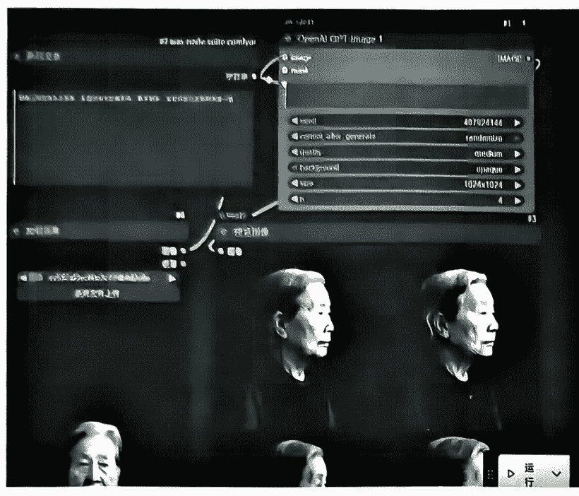
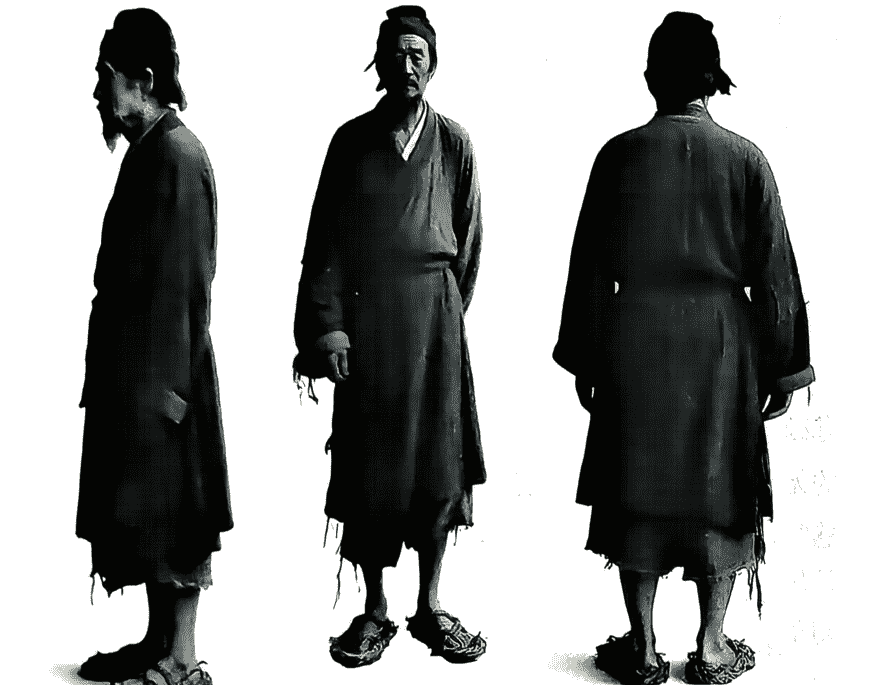
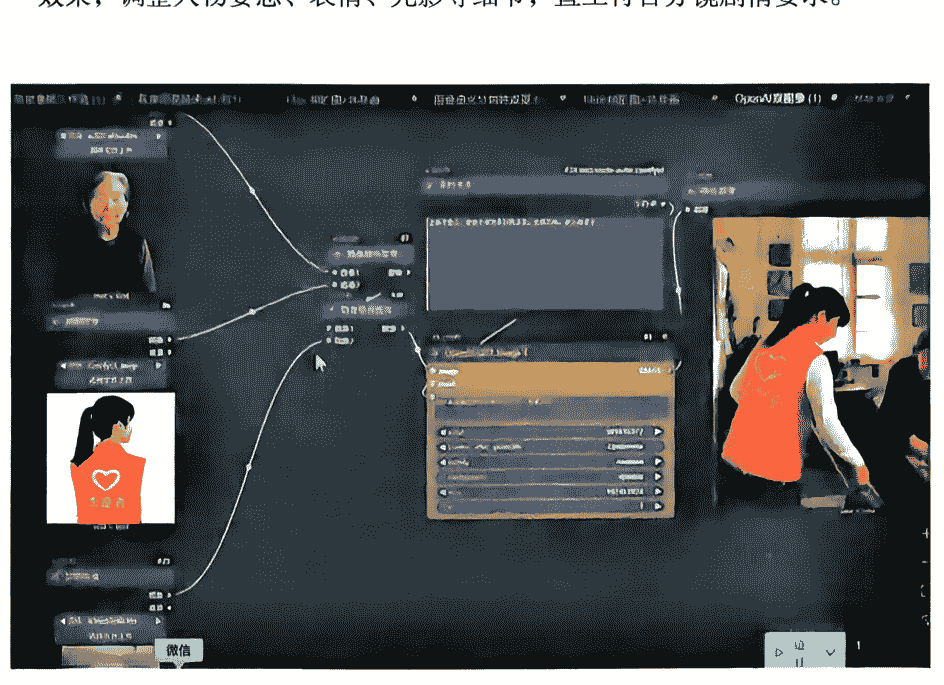
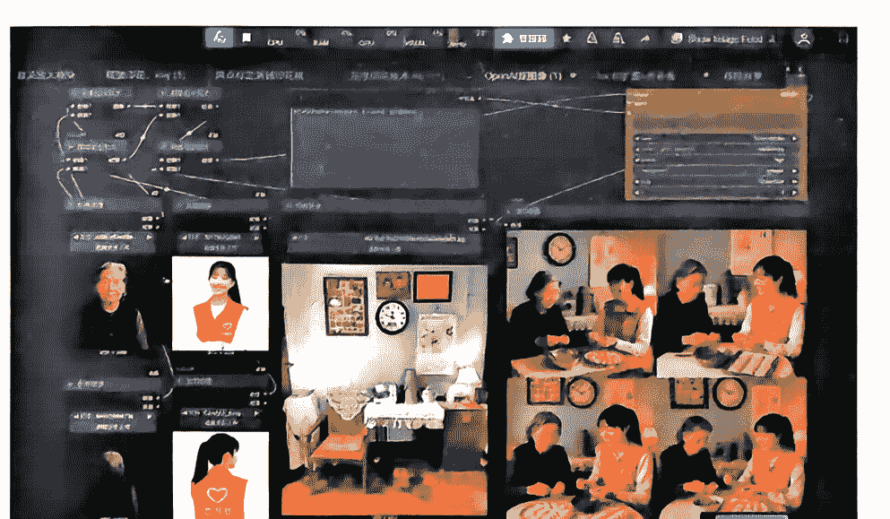
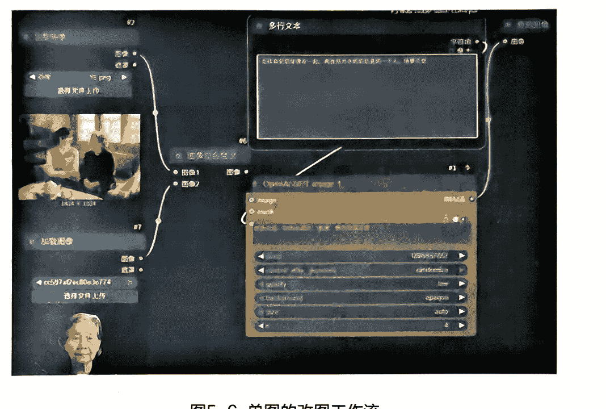
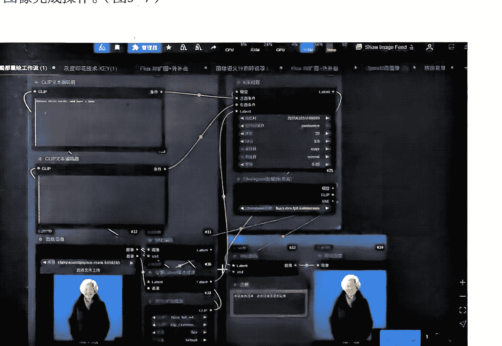
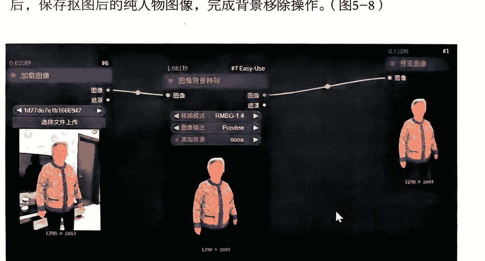
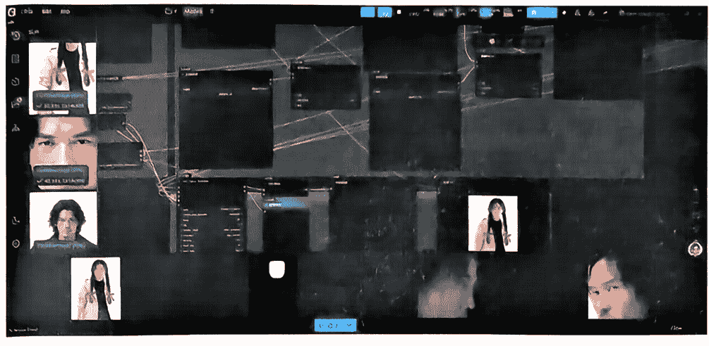
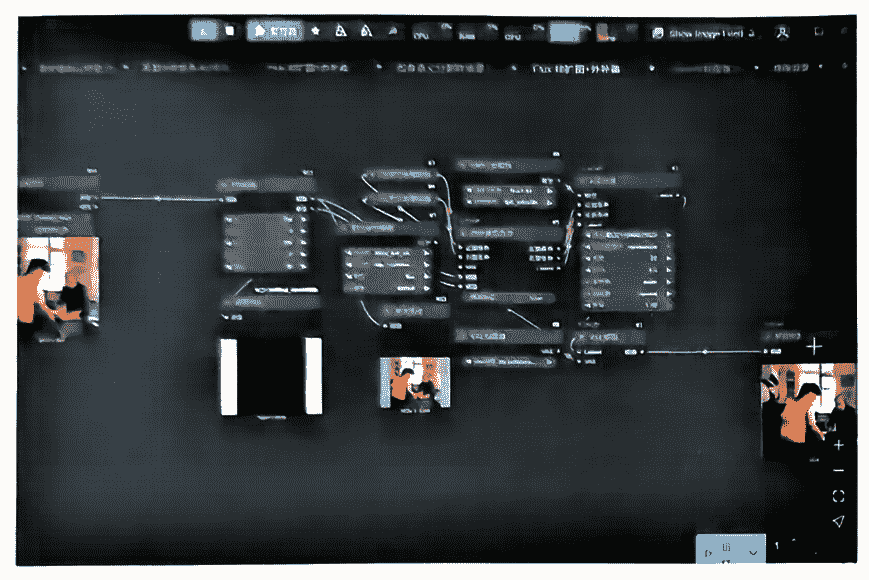

# AI短剧变现：小白到职业的实操路径

## 前言

### 先稳住焦虑，再谈浪潮里的稳定收益

翻开本书的时候，你我大概都在一个状态里徘徊。

最近一年多，朋友圈里 AIGC 短剧的热度很高。有人能背出各种模型的名字，会挑工具的优缺点，还能做出让人眼前一亮的单图或者几秒小样。可一旦要独立做一个有情绪、有张力、能回本的完整短剧，很多人就卡住了，手忙脚乱无从下手。

工具更新太快，今天刚熟的流程，明天就被新版本刷新。大家像在浪尖上追浪花，被技术潮水推着走，却始终不敢往深水里去。

我想聊的起点就是这个：为什么学得越多，反而越迷路？

根子在把重心全放在随时会变的“手艺”上，却忽略了那些相对稳定的“法则”。这本书不承诺快速致富，而是给你一个可以站住脚的坐标，让你在技术风浪里做到以不变应万变。

### 一、认知困局与行业迷茫

我当初入行时，也沉浸在不断尝新工具的兴奋感里。很快就碰到一个怪现象：工具越好，可选的路子越多，失败的代价也越大。提示词改一个词，几小时的渲染就可能作废。

这让我想起早年做古村落研究时的经历。面对全国各地堆积如山的村落资料，第一件事不是开写，而是先建一个系统的“基因库”。把不同区域、族群的建筑特征、礼仪习俗、符号意涵梳理清楚，找到规律和联系。

现在用生成式工具做短剧，逻辑非常像。模型好比一个庞大的文化素材库，提示词就是从库里精准调取“故事基因”的检索方式。如果你自己都没想清楚要搭一个什么样的“故事村”，再强的库也只能吐出一堆散落的材料。

很多人的焦虑就来自这里：学会了盖房子的技巧，却没想清楚要盖哪种房子，观众为什么要走进去。

### 二、这本书想给你的三条主线

从痛点出发，本书不只讲操作，更想传递能长期用的规律：人性共鸣的故事架构、镜头语言的视觉表达、把创作嵌入商业生态的底层逻辑。简单说就是三条线。

第一条，内容创作规律。怎样的故事能在三秒内抓住人？爆款背后有哪些恒定的情感模型？

第二条，视觉表达规律。镜头怎么讲故事？即便靠生成，好的构图、节奏和情绪是如何起作用的？

第三条，商业变现规律。怎么让作品稳定地接入现有的商业链路，形成闭环。

掌握这三条，不管是当下的 Midjourney、Sora，还是之后出现的新工具，都能快速摸清原理，转成实现创作意图的手段。

### 三、怎么用这本书

知识的用处在于用起来。整本书按“破认知—写内容—走流程—做变现”来排布，模拟一个 AIGC 短剧从零到上线的完整过程，理论和实操兼顾，学完就能动。

建议别当知识手册被动读，而是把它当行动地图。一边读章节，一边同步做你的第一部作品。

合上书时，我希望你带走的不只是理念和方法，而是一部可以拿去变现的完整作品，真正做到学以致用。

### 四、开启你的创富航段

AIGC 短剧这片水域既新又大，不再需要重资本和大团队就能入场，每个独特的创意和个体都有舞台。

在这个航程里，我更像一个领航员，不去描述每朵浪花的模样，而是告诉你潮汐的方向和星位。真正掌舵的，还是你自己。

第一步很关键：先跳出对工具的盲目追逐，重新看清行业全貌，建立系统认知。我们一起辨别：在这场技术变革里，哪些是会很快散去的泡沫，哪些是支撑长期发展的恒定逻辑。

## 第一章 AI短剧商业版图：锁定你的盈利坐标

现在不少新手以为靠工具就能一个人包下全流程。实际上随着行业规模化，分工已经清晰起来，和传统影视一样出现了专业化角色矩阵，推动制作从粗放到精细化。

搞清楚生态分工，能帮你更快定位：是走全流程的独立操盘，还是深耕某个细分环节做专家。选择会直接决定能力构建方向和市场竞争力，需要结合自身条件审慎判断。

### 第一节 核心生产端：从创意到成片

这是生态的发动机，负责把想法变成具体内容，主要分三种典型画像。

#### 一、故事供给者：卖选题、卖脚本、卖模板

共识是好剧本一直稀缺。生成式工具把视觉门槛降下来后，故事价值被放大，负责供应的创作者成了源头。他们不一定精通工具，但懂受众心理和叙事逻辑，能在开头三秒抓住注意力并引发共鸣。

产出大致三类：可直接落地的完整脚本及分集大纲；经过市场检验的选题库和创作思路；可复用的故事模板，提升效率。

有位从网络小说转行的供给者，聚焦逆袭+甜宠的混合题材，放弃日更模式后每周打磨两三部精品，月收入较之前翻了三倍。他的做法是每天拆解各平台爆款，读评论看数据，把经典叙事模型和当下热点结合，输出有爆款潜力的故事蓝图。

做好这一行的关键不在文笔华丽，而在精准把握情绪，用强冲突触发共鸣。

#### 二、视觉执行者：转绘、分镜、成片

如果前者提供蓝图，执行者就是把蓝图变成画面的人。他们既要懂生成式工具的用法，也要有视觉审美，能把文字描述转化成有冲击的画面。

工作范畴包括：AIGC 转绘，把真人片段转成特定动画风格，赋予新质感；分镜生成，按脚本做连贯有张力的分镜，保证叙事节奏；成片制作，统筹画面、配音、配乐、剪辑，把内容落地。

一位从后期转来的视觉执行者说，核心竞争力不是会多少工具，而是多年积累的镜头感。别人还在纠结特写，他已经能用精准提示词生成电影质感的镜头序列。

关键在于把审美和工具深度结合，形成独特高效的表达体系。

#### 三、一站式操盘手：全流程自理

这是挑战大自主权也大的角色，需要编剧的创作力、导演的视觉把控和运营的流量思维，从选题到发布全流程自理。好处是可控且收益归自己，风险是要求综合能力高，容易顾此失彼。

成功者多有差异化打法：有人扎垂直题材如重生逆袭男频，有人深耕视觉风格如赛博古风混搭，有人快速响应热点。

优秀的操盘手不求样样精通，而是核心环节做极致、次要环节做高效。比如把精力放在剧本打磨和前三秒画面设计上，标准化环节用预设提示词批量处理，平衡品质和效率。

关键是建立个性化工作流，明确精力优先级。

这三类并非泾渭分明，会随职业阶段切换。比如从视觉执行起步，慢慢补齐故事能力，最终成长为操盘手。核心是搞清单条路线的能力要求和盈利逻辑，选择适配的起点。

### 第二节 生态服务侧：卖水与送铲的人

每个新兴行业都有服务者。他们不做核心产品，却靠专业服务和解决方案站稳脚跟。淘金热里最稳的是卖水卖铲的商家，AIGC 短剧也一样。

当所有人盯着内容创作时，服务生态正在成型。这些卖水者和送铲人构成了基础设施，连接创作与市场，保障行业规范运行。

#### 一、合规与版权服务方

行业从野蛮走向规范，备案和版权保护变成必选项，催生了专业服务机构。他们熟悉影视政策法规，精通 AIGC 短剧备案和版权登记流程，为创作者提供全流程合规方案。

价值在于把复杂的行政流程和政策解读变成标准化服务，省时间、降试错成本。

一位曾在影视公司负责项目报备的人，洞察到新人和小团队的报备痛点，成立工作室专注备案代理和版权登记，每月可处理近百个项目，业务稳定增长。

核心竞争力是政策动态追踪、精准解读和流程标准化，而不是创作能力。细心严谨、逻辑清楚的人在此领域空间很大。

#### 二、素材供给方：攻高难度影像

打斗、特效、风格化场景等高门槛镜头是效率瓶颈，也催生了细分素材供应商。

他们不做完整剧情，专注研发和积累高难度、高复用率的视觉素材。有的专攻剑气光影特效，有的聚焦古风仙侠场景模板。

一家从游戏行业转来的供应商，打磨高质量特效素材，通过规模化复用摊薄成本，一款火龙特效模板低价授权多个团队，实现数月持续盈利。

核心价值是通过专业分工规模化供给优质视觉资产，分摊研发成本，提升行业水准和优化成本结构。

#### 三、宣发与投流团队：掌控流量入口

内容产能过剩，宣发投流成为作品与目标用户之间的桥梁。他们靠专业运营帮助优质内容破圈。

优秀投流人多有营销和数据运营背景，不参与创作但对用户偏好和平台规则洞察深刻，核心能力是内容潜力的预判和流量的调控，通过优化投放策略提升传播效率和商业价值。

一个三人专业团队专注 AIGC 短剧宣发，形成标准化合作：创作者负责内容质量，团队负责全流程投放，按流量或转化分成。核心价值是搭建内容与用户的桥梁，实现传播和商业价值最大化。

核心竞争力是数据敏感度、市场洞察力和策略调整力。擅长数据分析、关注用户和平台规则的人在此易占主动。

#### 四、培训与顾问：经验转化

行业扩张快，知识传承需求凸显，先行者把创作和运营经验做成系统化产品，指导新人、建设人才梯队。

大致分三类：技术派讲工具实操，方法派讲内容逻辑，实战派讲商业运营。都以市场验证的知识体系为核心，实用性强。

一位从全能操盘手转型的培训师，把高效工作法和避坑指南做成标准化课程，既帮新人突破瓶颈，也反哺自己的创作，实现个人和行业双赢。

核心价值是把实战经验系统化、理论化、可传授化。善于总结分享、在细分领域有独到经验的人发展潜力广。

总体看，服务侧多是从核心生产端分化而来，提供者多为资深从业者，在解决自身痛点时捕捉行业共性需求，形成实践—痛点—服务—迭代的路径。

### 第三节 自我盘点：从哪儿起步

看清生态后，别盲目跟风，先做冷静自评。如探险前清点行装，明确优劣势才能选对路线，避免踩坑。从三个维度画一张个人资源图。

#### 一、内在资产盘点：能力与兴趣的交集

审视自己在产业链里的天然适配方向，三条线索可参考。

如果有讲故事的天赋，爱拆解情节分析人物，善于捕捉生活中的戏剧瞬间，故事供给方向更适合。可以从大纲打磨、爆款拆解、分镜提示词撰写起步。

如果对画面敏感，有构图、色彩、光影的把控力，热爱摄影绘画，关注生成图像的细节质感，视觉呈现是主场。可以做视觉执行者或专注分镜设计，用审美提升质感。

如果擅长连接市场，爱预判爆款、捕捉热点，对平台算法和用户心理有研究欲，宣发投流、运营或培训服务更能发挥优势。核心是做优质内容和受众的桥梁。

没有人能全能，找准核心优势和热情，以此撬动发展。

#### 二、外在资源盘点：时间、精力与预算

职业选择要匹配资源。从时间、学习精力、工具预算三方面评估。

时间资本：每周能稳定投入二十小时以上整块时间，可尝试全流程操盘或成片制作；时间碎片化，可选故事供给、垂直素材供给，用零散时间拆解任务。

学习精力：评估对生成式工具的学习耐心和试错承受力，工具驱动岗位需要拥抱变化、持续试错，心态决定上限。

工具预算：多数核心工具需要付费，预算有限时优先配置核心工具，备案、咨询等服务对工具依赖度较低。

#### 三、职业原型定位：选一个起点

结合资源和需求，可归纳三类常见原型。

创意型创作者：思维敏捷、共情力强，善于挖掘人性故事，推荐从故事供给起步，打磨短篇剧本、分享爆款思路，验证创意商业价值。

技术型手艺人：有耐心、重细节、追求视觉质感，推荐深耕生成式视觉赛道，聚焦垂直风格或技术环节，构建核心竞争力。

商业型连接者：市场洞察力强，擅长沟通运营，推荐切入宣发运营或周边服务，成为产业链高效衔接的环节。

建议做一次深度梳理：准备纸笔，在中心画三个相交圆，分别标注“我喜欢的”“我擅长的”“有市场价值的”。把前文思考的资源和需求填进去，三圆重叠的核心区就是进入 AIGC 短剧行业最理想的起点。定位清晰后再逐步构建职业核心竞争力。

## 第二章 永不过时的爆款选题公式

技术会迭代，算法会变，但能穿透屏幕打动人的永远是好故事，而好故事的起点永远是能引发讨论的选题。

我见过不少创作者工具操作很熟，却卡在第一步：今天拍什么。他们迷失在信息海里，盲目追热点，找不到节奏。

爆款选题不是灵光一现，而是精密的定位与勘探。你需要一套可靠的系统，去挖掘藏在人性里的情绪富矿。

### 第一节 选题定位七步

生成前，先回答七个核心问题，为后续创作定调，避免在工具和素材里迷失。

#### 一、定形态：选适配的内容形式

目前 AIGC 短剧已分化出五种主流形态。

第一种是动漫画短剧，细分三种模式：转绘短剧，对已验证的真人爆款做动漫画风格转化，实现高效复用、降低试错成本；动态漫，以静态漫画为底叠加动效和配音，适配漫画 IP 的可视化衍生；动画短剧，主打独立原创剧情，受当下技术限制制作成本偏高，但随技术迭代有望突破到番剧级，市场潜力可观。

第二种是搞笑短剧，以“粗糙感”构建差异化美学。制作成本极低，靠基础工具组合即可完成，核心竞争力在直击痛点的剧情梗和高速反转节奏。这种轻量化反而成为传播亮点，易激发二次创作和社群讨论，实现低成本流量裂变。

第三种是简笔画短剧，以简洁线条和基础图形为核心，主打轻量化叙事，适合传递直白易懂、节奏明快的故事。流程简便、产出效率高，无需复杂技术，是个人创作者在短视频平台试水的优选。

第四种是真人短剧，代表技术探索前沿。分“生成式+真人”混合模式和全生成类真人模式，前者用生成式优化特效、剪辑、场景搭建，后者用生成式构建虚拟角色和场景，都在视觉质感和情感传递上贴近传统影视，受众接受度较高。

第五种是互动短剧，行业未来核心方向。依托对话式生成式和分支剧情技术，打破单向传播，让观众参与剧情决策、与虚拟角色实时互动，获得个性化沉浸体验，已在部分平台试点。

其中真人短剧对内容与形式的平衡要求尤为突出，需牢牢把握“内容为核、视听为辅”的原则。短剧核心始终是打动人的内容，视听呈现的目标是服务表达，切不可本末倒置。

#### 二、定比例：横屏还是竖屏

选择要结合内容属性和消费场景。竖屏适配移动端碎片化场景，最大化屏幕空间，聚焦人物情感细节，适合对话为主、场景单一的情感剧、生活剧，可拉近与受众距离；横屏延续传统影视习惯，适合展现广阔场景、复杂人物关系和连贯动作戏，提升沉浸感，适配历史、玄幻、悬疑等题材。核心看需求：重情感连接选竖屏，重视觉沉浸选横屏。

#### 三、定风格：视觉美学的走向

# 从定调到爆款：智能短剧创作全流程

作品的气质首先由调性来定，它决定了整体叙事走向、画面质感与美学取向。把握调性可以从三条线入手。

视觉定位要先锚定美术方向，比如赛博朋克、国风玄幻、复古港风、日系清新、现实主义等，围绕一个主轴延展细节，避免风格混杂。情绪走向要明确想给观众什么感受，是暗黑复仇的畅快、甜宠治愈的温情、悬疑紧绷的刺激，还是搞笑解压的轻松，情绪线保持统一才能强化代入。光影打法要配合调性与情绪，用戏剧化光效放大冲突张力，或用自然光营造真实氛围。

#### 四、定时长：短剧体量怎么拿捏
时长等于体型。选时长要兼顾工具特性与用户习惯。常规短剧单集在3到5分钟，微短剧多以90秒为单位。现阶段主流AI视频工具一次出片多在5到10秒，所以创作时必须把完整故事切成若干小段再拼接。这样既能提升生成效率、降低修改成本，也能让节奏更紧凑，贴合短视频用户的刷片习惯。

#### 五、定平台：内容的主战场在哪
平台决定投放环境。选平台要综合目标人群的年龄、偏好与行为、内容赛道与风格，以及变现目标如流量分成、广告合作、IP衍生等。不同平台的用户生态与推荐机制差别很大。建议采用主辅结合策略：主攻一个核心平台，深耕规则做出标杆内容；再适配2到3个辅助平台做适当微调，实现流量覆盖，避免好内容被埋没。

**表2-1 短剧发布平台差异对比**

| 平台 | 用户画像 | 内容风格 | 创作机制 | 平台调性 | 变现路径 |
| :--- | :--- | :--- | :--- | :--- | :--- |
| 抖音 | 全年龄覆盖偏年轻，偏好爽感内容 | 快节奏强爽感情绪优先 | 算法驱动强推荐，适合爆款 | 娱乐至上重视觉冲击记忆点字幕大音效强 | 广告分成、付费小程序、直播带货、品牌定制 |
| 快手 | 下沉市场为主，接地气偏家庭伦理甜宠现实题材 | 接地气重人设立信任驱动 | 人带剧绑定演员人设互动性强 | 强调真实生活化社区氛围浓 | 电商联动强带动直播GMV付费会员推进 |
| 小红书 | 一二线城市年轻女性为主，偏好情绪浓价值导向 | 审美高情绪浓价值导向 | UGC+PUGC结合看议一体用户参与度高 | 精致真实有温度重审美与情绪共鸣 | 品牌合作种草营销为主短剧多免费 |
| B站 | Z世代为主偏二次元悬疑科幻剧情向 | IP化剧情向社区共鸣 | UP主主导弹幕互动强社区氛围浓 | 内容导向重原创性与文化认同 | 会员付费广告分成IP衍生品开发 |
| 视频号 | 年龄偏大偏好家庭职场情感现实题材 | 剧情贴近生活重情感共鸣 | 依托微信生态社交传播强适合私域 | 熟人社交驱动重信任与关系链 | 广告直播带货私域变现为主 |
| 电商平台 | 购物导向用户偏好多样重实用 | 剧情围绕商品强调种草转化 | 品牌主导内容多定制 | 商业化强内容服务交易 | 商品销售品牌曝光直播带货 |
| 小程序 | 用户面广偏好爽文剧情 | 爽感强情绪释放 | 低成本快速制作强付费引导 | 工具属性内容服务转化 | 用户付费广告分销 |

#### 六、定受众：为谁而拍
受众是作品的知己。清晰的画像是获取流量与情感共鸣的前提。创作前先问自己为谁创作，可从三层来梳理。

第一，锁定基本属性。聚焦年龄段、性别、城市层级，不同基础属性决定媒介接触习惯与内容偏好，是设计起点。

第二，圈定兴趣圈层。给受众贴标签，比如职场打拼者、中年焦虑群体、国风爱好者、悬疑粉丝。圈层决定话题切入点与表达语境。

第三，挖掘情绪痛点。拆解核心需求，比如对35岁职场危机、情感背叛、现实无力感的恐惧；对逆袭爽感、温情陪伴、理想生活的渴望。抓住痛点才能直抵人心。

建议为目标用户建一张虚拟人物卡，记录姓名、职业、生活困扰、核心梦想等细节，把抽象画像具象化。选题、剧情、语言都要自检：他会追完吗？情节能打动他吗？围绕需求创作，作品才更有穿透力。

#### 七、搭蓝图：从文字到画面的路线图
清晰的创作蓝图能让团队协作更顺畅，具体体现在五个文本的衔接上。

网文小说是灵感源头，提供故事雏形与世界观；剧本在此基础上搭建完整框架与人物弧线；拍摄脚本把文学描述转为拍摄指令，明确每个镜头的景别、机位与动作；分镜头脚本把情节视觉化，用画面预演叙事节奏；剪辑脚本则按实际素材做后期导航。理解每个文本的作用与阶段，才能在AI短剧里驾驭从灵感到成片的全流程。

**表2-2 AI短剧策划文本的阶段性指导**

| 项目 | 网文小说 | 剧本 | 拍摄脚本 | 分镜头画面脚本 | 剪辑脚本 |
| :--- | :--- | :--- | :--- | :--- | :--- |
| 内容 | 网络文学，以文字发布，题材多样重情节吸引与可读性 | 短剧文学基础，详述情节场景角色对话情感 | 在剧本上细化，加入镜头编号拍摄角度等技术细节 | 视觉化剧本，用图像展示构图角度运动 | 基于实拍素材调整，标注镜头保留剪辑与过渡 |
| 特点 | 叙事强篇幅长语言风格多样互动强 | 格式规范重故事性语言简洁 | 技术强分镜头多版本不同颜色纸区分 | 视觉化标注角度镜头运动直观 | 动态调整重节奏叙事流畅技术强 |
| 格式 | 无固定格式以故事叙述为主 | 有固定格式含场景标题角色对话动作描述 | 增加镜头编号拍摄角度等技术信息 | 以图像为主配简短文字说明似漫画 | 标注剪辑点与转场效果 |
| 作用 | 娱乐读者可作为改编素材 | 提供框架与对话是拍摄脚本基础 | 为导演摄影演员提供具体拍摄指引确保顺利 | 帮助导演摄影提前规划减少不确定性 | 帮助剪辑组织素材保证节奏流畅 |
| 创作主体 | 网络作家 | 文学编剧 | 现场编剧编导导演制片人等 | 导演分镜师 | 剪辑师 |
| 创作阶段 | 创意构思阶段多在网上发布 | 创意构思阶段是制作文学基础 | 拍摄准备阶段提供技术指引 | 拍摄准备阶段规划镜头 | 拍摄完成后用于剪辑参考 |
| 篇幅 | 较长几万到几百万字 | 100到150页视时长而定 | 比剧本更详篇幅稍长 | 以图像为主篇幅短突出关键信息 | 篇幅与拍摄脚本相近或更短 |
| 语言风格 | 多样化幽默严肃浪漫等重吸引力 | 简洁明了重情节角色表达 | 技术性语言详述拍摄细节 | 图像表达文字简洁 | 技术性语言强调剪辑点节奏 |
| 互动性 | 作者读者互动强可按反馈调整 | 通常内部使用 | 通常内部使用 | 主要供导演摄影使用 | 主要供剪辑师使用 |
| 视觉化程度 | 以文字为主视觉化低 | 以文字为主视觉化低 | 文字为主含镜头类型角度等提示 | 高度视觉化以图像为主 | 适中以文字描述剪辑效果 |
| AI短剧制作流程 | 灵感来源 | 剧本 | 分镜画面设计 | 参考分镜图 | 分镜剪辑 |

### 第二节 爆款选题的三维雷达
智能短剧的传播力核心在于人际冲突的构建与剧情反转，能激发代入感、价值共鸣与分享欲。把选题创作比作寻宝，单维度探测易错过好题，同时开启角色关系、社会情绪、经典叙事三个扫描维度，才能建立立体坐标，锁定既有共鸣又有传播力的题材。

#### 一、人物关系维度：权力、情感、血缘里的极致冲突
关系不是简单标注父子、夫妻、上下级，价值在于挖掘关系背后的深层张力。优质关系是故事的引擎，为剧情提供持续驱动。爆款拆解显示张力源自权力、情感、血缘三层面，如同色彩三原色可组合出复杂冲突。

1. 权力角力的张力
这是最外显的冲突源，源于社会角色与地位不对等。
* 职场：上司与下属、资深员工与新人、甲方与乙方，存在指挥与服从、压制与反抗的张力。
* 家庭：家长与子女、婆婆与儿媳，权力博弈常裹着为你好的外衣更复杂。
* 社会：君王与臣子、豪强与平民，地位差为逆袭抗争提供空间。
核心是控制与反控制，直击公平与尊严的渴望。

2. 情感错位带来的共鸣
最细腻的共情源，存在于所有情感联结中。
* 恋人：付出与辜负、信任与背叛、深爱与误会。
* 朋友：两肋插刀到反目成仇，背叛击碎无条件信任的预期。
* 兄弟姐妹：被忽略与受偏爱源自童年的错位，成为一生行为的隐秘驱动。
核心是期待与现实的落差，最深伤害往往来自最亲近者。

3. 血缘羁绊的无奈
最牢固也最无奈的冲突源，血脉连接无法选择。
* 亲子矛盾：重男轻女女儿的挣扎、望子成龙压力下的反抗，混合爱、责任与代际价值观碰撞。
* 长幼责任：长兄如父的过度牺牲、照顾父母时责任推诿与利益算计。
* 家族恩怨：上一代矛盾阻碍下一代爱情，家族荣誉与个人幸福的抉择。
核心是无法割舍的爱恨交织，既想挣脱又难以逃离。

打磨选题可按三步走：先锚定核心关系与维度，选熟悉共鸣强的基础关系；再深挖冲突内核，判断是权力博弈、情感纠葛还是血缘责任；最后植入典型情境放大张力，如职场晋升竞争、情感抉择困境等。

**表2-3 关系类型、所属维度、核心矛盾、典型情境与案例示意对照表**

| 关系类型 | 所属维度 | 核心矛盾 | 典型情境 | 案例示意 |
| :--- | :--- | :--- | :--- | :--- |
| 亲子关系 | 权力、血缘 | 控制与独立关爱与过度干预一线之隔 | 代际价值观冲突学业职业选择分歧沟通隔阂 | 强势母亲为修复与叛逆女儿关系学电竞试图理解其世界 |
| 夫妻关系 | 情感、权力 | 自我与共同体个人空间事业与家庭责任平衡 | 女强男弱心态失衡事业家庭抉择信任危机重建 | 为事业忽略家庭的丈夫面临婚变时重寻生活重心 |
| 恋人关系 | 情感 | 理想与现实浪漫期待与生活琐事物质碰撞 | 地位悬殊恋爱前任困扰重大分歧考验 | 贫穷女孩与富家公子相爱面对家族压力与自我价值实现 |
| 朋友关系 | 情感 | 利他与利己重大利益或原则对友谊考验 | 合伙创业理念分歧竞争同一机会危难是否援手 | 挚友因公司唯一晋升名额破裂后在项目中学会合作成全 |
| 上下级关系 | 权力 | 压制与成长权威滥用与挑战能力彰显与埋没 | 空降领导与老团队磨合上司抢功下属逆袭严师出高徒 | 新人被上司打压关键时刻凭能力挽救项目赢得尊重 |
| 婆媳关系 | 权力、血缘 | 入侵与边界外来者与原生家庭融合主导权争夺 | 育儿观念冲突生活习惯差异儿子丈夫中间角色 | 传统婆婆与时尚儿媳定同居协议摩擦中走向新型家庭关系 |
| 师生关系 | 权力、情感 | 塑造与反塑造知识传授与个性化成长矛盾 | 差生潜能发掘应试与兴趣冲突亦师亦友情谊 | 厌学少年在老师启发下发现历史魅力共同守护古城墙 |

#### 二、社会情绪维度：捕捉时代焦虑渴望与不公
短剧是拍给屏幕前普通人看的。爆款往往是时代情绪切片，命中集体潜意识。

1. 对普遍焦虑共鸣
内卷教育、高昂房价、职场35岁门槛、复杂人际是共同痛点。故事不必给出现实解法，可提供情绪代偿与宣泄，如反内卷、整顿职场的爽感。

2. 对内心渴望回应
压力下人们渴望逆天改命的爽感、被无条件偏爱的甜宠、回归田园的治愈。理解渴望是对心理慰藉与情感寄托的供给。

3. 对感知不公呐喊
人们天然追求公平正义。故事建立在善恶有报、沉冤得雪、弱者发声的框架上，易引发正义感与代入。

保持社会敏锐，多看新闻热评与社交媒体热议，感受情绪涌动。选题应是对集体情绪的艺术化回应与温和疏导，而非煽动对立。

#### 三、经典叙事维度：将英雄之旅与三幕剧AI化
前两个维度解决讲什么，经典叙事解决怎么讲。人们口味千百年被经典模型编码。

1. 英雄之旅模型
普通人受召唤进入未知世界历经考验带宝物归来。AI短剧可简化为：平凡现状→意外获助系统穿越贵人→历练成长→战胜BOSS→荣耀归来，为逆袭故事提供弧光。

2. 三幕剧结构
第一幕建制介绍人物背景引爆激励事件打破平衡；第二幕对抗主角克服困难冲突升级至最黑暗时刻；第三幕结局发起最后一搏解决核心冲突进入新平衡。短剧一两分钟不必复杂，但要抓住精髓：打破平衡→升级冲突→解决矛盾，确保起因、经过、结果清晰。

用三幕框架审视分镜：开端是否打破平衡？中段冲突是否升级？结尾矛盾是否解决情绪是否释放？

### 第三节 四大爆款选题工具箱
锁定方向后，如何把洞察变成有棱角的故事核？基于爆款拆解提炼出四个实操工具。

#### 一、对比法：制造身份与命运的反差
对比是最古老有效的叙事技巧，通过巨大反差制造冲突、反转与情绪张力瞬间抓住注意力。

反差示例：高傲者卑微求爱、善良者被误作凶手、穷人骤富、恶人终为正义牺牲。反差会激发点赞、评论、转发。

自检清单：主角是否有足够鲜明甚至极致的反差点？能否在3秒内被观众感知？对比目的不是制造割裂，而是在反差中更深揭示人物的内在价值与命运无常。

张力即体感：让情绪先跑起来

短剧的张力并不是技巧堆砌，而是观众在看时的情绪心率。对比之所以好用，是因为它直接拨动情绪开关。盛气凌人却终究落空会带来近似报应的快意，初遇倾心却身不由己则逼出无力的哀恸。情绪的起伏幅度，决定了张力是否真实可感。下面这九组对比逻辑，是搭建冲突、放大张力的常用思路。

### 表2-4 爆款选题对比法类型

| 对比类型 | 核心矛盾 | 情绪张力与心理反应 | 案例与选题方向 | 创作提示方向 |
| :--- | :--- | :--- | :--- | :--- |
| 阶层错位 | 社会标签贫富贵贱强弱的极端反差 | 扬眉吐气与公平期待：冲破偏见，满足逆袭与价值重估 | 上位者坠落：帝王沦为阶下囚；总裁破产变下属。底层翻身：保洁是幕后大股东；外卖员实为隐形投资人 | 请给出表面为【身份A】实则暗藏【身份B】的短剧点子，要求反转强烈且有打脸段落 |
| 性格反冲 | 内在特质与外显行为或结局的剧烈冲突 | 震撼与共情：打破人性扁平印象，引发对命运无常的思考 | 高冷求不得：女神倒追被拒；精英为爱放弃一切却被抛弃。自私成全：守财奴为救子散尽家财；叛徒为守密赴死 | 请塑造一个【极度自私/高傲】的人物，在关键节点做出【无私/卑微】选择并展开情节 |
| 动机背离 | 日常行为模式与最终抉择的根本偏离 | 意外与宿命感：错愕中体会人生荒诞与不可预测 | 浪子殉情：花花公子为唯一所爱舍命。阴谋家忠死：权臣为报旧主之恩遭新主处死 | 请设计长期目标为【A】的角色，最终却因与【A】相反的原因失败或死亡 |
| 关系反转 | 亲密关系的建立与崩坏，或理想与现实的隔阂 | 虐心与情感拉扯：用对美好关系的向往制造遗憾 | 青梅反目：家族恩怨或重大误会令挚友成死敌。初恋身不由己：爱上仇人之女；特工爱上目标 | 请写一段【青梅竹马/初遇生情】的关系，因【外力阻隔/内在误会】走向对立或分离的梗概 |
| 情感错位 | 情感共鸣与时机现实的错配 | 遗憾与岁月感慨：触发观众对错过与遗憾的记忆投射 | 双向暗恋永远错过：误会怯懦阴差阳错而不能相守。久别重逢物是人非：多年后一方已嫁或彼此早已改变 | 请构思一个关于错过的故事，双方内心相爱，却因命运与现实无法在一起 |
| 人设反差 | 公众认知或自我定位与关键时刻真实表现的落差 | 惊喜与认知刷新：打破刻板印象，带来原来他是这样的观感 | 叛徒冲锋：被误解的叛徒最后关头为集体冲锋。懦夫爆血：胆小者危难时迸发惊人勇气 | 请给出被看作【懦夫/叛徒】的人物，在【特定场景】展现【勇敢/忠诚】一面的情节 |
| 心智拉扯 | 内心情感与理性判断或既定事实的激烈对抗 | 纠结后释然：代入两难处境，真相反转时获得释放 | 恨了一生终是误会：多年憎恨的人竟是恩人或有苦衷。处心积虑求而不得：布局多年发现目标已空 | 请描述因【误会】长期怨恨的角色，最终得知【真相】后陷入情感挣扎的框架 |
| 成就伴遗憾 | 世俗巅峰与珍贵事物永久失去并存 | 反思与价值拷问：引导思考成功定义与人生真正价值 | 功成名就天人永隔：成首富时爱人已逝。梦想实现却失健康：用生命拼搏换财富却无福享用 | 请创造主角获得【巨大成功】的同时，永远失去【最重要的人或物】的悲剧结局 |
| 魅力矛盾 | 外在表现与内在特质形成反常识统一 | 好奇与探究欲：塑造有记忆点的立体人物 | 外表文弱内心刚强：柔弱女子危机中成主心骨。玩世不恭底色悲悯：表面吊儿郎当的浪子暗中守护所爱 | 请设计外在表现与内在核心截然不同的反差魅力人物，并写一个展现此反差的关键场景 |

#### 二、极端转折法：制造过程突变

对比侧重状态呈现，转折侧重过程突变，像过山车爬坡后骤坠，用剧情急转带来强情绪冲击。转折可分剧情与人物两条路径，人物层面的反转常能带动剧情推进。

推进时可在关键节点抛出此前未知的核心信息，直接改写关系与走向。比如长期压制主角的上司，突然被揭是失散多年的亲人；主角对抗的反派背后藏着一段悲壮往事。此类强转折极度考验前期铺垫，信息揭露应让人恍然大悟而非生硬。

也可让人物在紧要关头做出完全违背日常行为模式或观众预期的决定：原本善良的人骤然黑化，或恶人受感化幡然向善。一个惯常自私的角色在最后慨然牺牲自己，打破脸谱化，更能体现人性复杂，引发深层共鸣。

用好极端转折的关键是意料之外情理之中，必须建立在性格与逻辑基础上。设计时自问，这个转折能否让观众惊讶后回味时生出原来如此的顿悟？好的转折让情绪顺畅释放，而非冒犯智商。从传播角度看，越极端的表达传播力越强，所以人物性格要更典型、信念更偏激，才有记忆点与共鸣。

#### 三、痛点共鸣法：直击柔软处

前两种工具偏结构，痛点共鸣偏情感连接，核心是精准捕捉观众日常里的细微痛处，让角色处境成为自我的映射。痛点不是宏大议题，而是藏在生活里的微妙情绪。

其一，努力被忽视的委屈。职场家庭高频场景，如熬夜方案被上司据为己有，长期操持家务却被视为理所当然。戳中价值不被看见的失落感。

其二，被误解的孤独。人际互动中因信息偏差被贴标签，好心被反咬，因身份外貌被预设立场无法辩解。这种不被理解的处境极易共振。

其三，理想与现实的落差。满怀热忱入社会却被现实消磨，渴望维系亲情爱情却因忙碌失联。此类痛点普适性极强。

把细微的痛写进故事，创作者便成为情绪代言人。基于真实境遇的共情比单纯爽感更牢固。创作时要做敏锐观察者，捕捉共性情绪。目的不是放大负面，而是呈现困境给予被看见的慰藉，传递积极力量，实现情感与价值的统一。

#### 四、热点嫁接法：借势引流

信息过载时代，注意力稀缺。热点嫁接的核心是借势引流。原则是贴合账号与观众价值，避免乱蹭导致标签混乱。乘势即借助已有热点流量巧妙关联，如蹭热门影视热度；造势即创造新颖话题引发传播，如冰桶挑战。蹭热点不是跟风，而是融合。

可嫁接的热点大致四类：一是社会新闻与政策，如教育改革、民生保障、金融调控、国际动态，受众广但需把握导向；二是公益类，如关爱留守儿童、陪伴空巢老人、抗灾救灾、反战维和，依托真善美需坚守正向；三是节日节气，如春节、中秋、母亲节、教师节，自带情感氛围；四是文化娱乐，如热播剧、爆款综艺、现象级文旅IP，可仿创逻辑但要规避抄袭，实现差异化。

### 第四节 “扮猪吃虎”结构：在共情中实现情绪代偿

在短剧里，“扮猪吃虎”是兼顾市场吸引力与情绪穿透力的经典范式。它源自兵法，演化为高效叙事，既映射现实的权力博弈与认知偏差，又给了观众精准的情绪代偿出口。当主人公在职场家庭校园里遭遇被低估被轻视，观众快速代入；当主人公靠实力逆袭赢得尊重，观众获得释放。

#### 一、“扮猪吃虎”的结构何以奏效

本质是价值被低估到价值被重估的过程，支点有三。

其一，心理认同。被低估是普遍心理创伤：新人才能被忽视、寒门努力被轻视、内向价值被低估。观众看到相似处境会产生我懂的瞬间认同，为释放埋伏笔。

其二，情绪积累。优秀叙事不是简单反转，前期构建压抑，中期用线索制造期待，让观众变身知情人，最后爆发式释放。观众既体验艰辛又享受先知优越感。

其三，价值重构。表层是碾压快感，深层是对公平正义的渴望。主人公证明自己后，观众获得的不仅是宣泄，更是对是金子会发光的确认。爽感是表层手段，与对公平认可的深层渴望共鸣才是破圈关键。

#### 二、从关系痛点中汲取创作灵感

扮猪吃虎可在任何人际场域展开，核心是找到最易引发共情的偏见或矛盾。观众在亲子夫妻婆媳妯娌岳婿朋友恋人师生同学邻里职场等关系中被偏见，经历打脸，最终还原痛点。故事短小适配短剧时长，还能讽刺社会不良现象。

### 表2-5 扮猪吃虎型短剧叙事模型

| 关系场域 | 核心矛盾 | 痛点表现（偏见） | 情节发展（叙事模型） | 价值导向 |
| :--- | :--- | :--- | :--- | :--- |
| 职场关系 | 能力被低估 | 新人被视无能，上司侵占成果 | 主人公是总部派来体验基层的继承人，关键项目展露才华 | 真才实学终将胜出 |
| 家庭关系 | 价值被轻视 | 女婿儿媳被嫌弃家境 | 主人公家族是低调隐形富豪，危难时刻展现本领 | 内在价值重于外在条件 |
| 婚恋关系 | 潜力被忽视 | 暂时贫困被伴侣家人看不起 | 主人公正处创业关键期，成功后价值重估 | 莫欺少年穷，时间证明一切 |
| 校园关系 | 潜力被忽视 | 差生被认定无前途 | 主人公在编程艺术等领域是天才，竞赛一举夺冠 | 多元成才，人人有闪光点 |
| 社区关系 | 地位被固化 | 被视作无足轻重的老实人 | 社区危机中展现组织或专业能力成为核心 | 平凡中藏不凡，尊严来自贡献 |

创作路径：定场域→定位矛盾→具体化冲突→设计反转→升华主题。

#### 三、从生活深处打捞未被言说的痛点

除典型痛点外，现实里还有大量可挖的关系冲突。以亲子为例，除了望子成龙焦虑，留守儿童困境更具张力。父母外出务工赚钱，子女留守缺乏陪伴，易成心理疏离、性格孤僻；父母则在赚钱与陪伴间拉扯。基于此可创作留守儿童成长故事，以生活场景传递内核，最终呼唤家庭关爱与亲子陪伴，并延伸至社会帮扶思考，让作品有温度有价值。

### 表2-6 戏剧矛盾触发事件类型

| 人际关系 | 矛盾类型 | 痛点事件 | 反转设定 |
| :--- | :--- | :--- | :--- |
| 亲子关系 | 身份反转 | 被嫌没出息赶出家门 | 女儿成高考状元/儿子已是创业者 |
|  | 社会热点 | 唯分数论教育焦虑 | 发现并支持孩子独特天赋，打破成功偏见 |
|  | 极端选择 | 为保护家人触犯法律 | 家人理解共担责任，最终救赎 |
| 夫妻/恋人关系 | 身份反转 | 嫌贫爱富 | 对方实为低调富豪或潜力股 |
|  | 误解与背叛 | 爱人出轨 | 主角活出精彩，对方追悔 |
|  | 情感错位 | 双向暗恋因误会错过 | 多年后重逢解开心结 |
|  |  | 初恋因恩怨疾病身不由己 | 冲破阻碍真爱胜出 |
| 婆媳/岳婿关系 | 身份反转 | 婆婆岳母逼离婚嫌家境 | 媳妇女婿拥有惊人背景资源 |
| 朋友/同学关系 | 误解与背叛 | 借钱不还或背后陷害 | 主角东山再起，对方困境悔不当初 |
|  | 身份反转 | 同学会上被嘲笑 | 主角已是行业翘楚 |
|  | 社会热点 | 遭遇网络暴力 | 用法律与证据赢得舆论反转 |
| 职场关系 | 身份反转 | 下属被侵夺功劳打压 | 下属是继承人或关键资源持有者 |
|  | 误解与背叛 | 被陷害背黑锅 | 主角掌握关键证据真相大白 |
|  | 社会热点 | 职场PUA精神打压 | 勇敢反抗赢得尊重 |
| 个人与社会关系 | 极端选择 | 为理想抛弃稳定工作 | 历经低谷实现梦想证明价值 |
|  | 社会热点 | 单亲家庭成长困境与偏见 | 在爱与坚韧中成长，用优秀回击质疑 |

使用痛点时要避免为打脸而打脸，要思考反转能否促成关系良性转变或传递积极价值观，如真才实学终被看见、尊严来自内在。赋予温暖内核，作品才有分量。

### 爆款选题自查清单

- 1. 主线冲突是否明确？我能否用一句话说清主要矛盾？例如上司侵占成果与下属反击，或母女因价值观对撞。
- 2. 情绪钩子是否强烈？选题瞄准的是爽感、共情、好奇还是愤怒？前3秒用什么画面或台词触发？
- 3. 人物动机是否合理？主角目标是什么？为何必须达成？反派行为是否有自洽逻辑？
- 4. 反差点或转折点是否足够？是否至少有一个让人意外又合理的节点，且服务于人物与主题？

从选题自检到AI落地，短剧爆款的完整打磨路径

真正能做出持续结果的选题，得先通过两道基础筛查。这个故事是否戳中了当下某个群体共同的痛点或渴望，而不是在自嗨的象牙塔里臆想？落到画面上时，核心场景和人物动作在现阶段的AI能力范围内能否被清晰还原，会不会出现技术上暂时实现不了的天马行空镜头。六个自检问题都能给出清晰肯定的回答时，才算有了扎实的地基。接下来关键是怎么把已经想清楚的人物、场景和矛盾，准确“翻译”成AI能理解的指令，让它成为创作伙伴。

#### 二、把想法变成AI能执行的指令框架
新手常犯的毛病是丢给AI一句“写个逆袭短剧”，这相当于只告诉采购员“买点好吃的”，结果必然失控。有效的协作从精准的指令开始。下面的框架把人物关系、社会情绪和经典叙事整合在一起，可以像填表一样把思路塞进去。

## 可复用的选题指令框架

- 1. 人物设定
  主角：年龄、性别、职业、核心性格，以及最深的渴望或困境。
  对手与阻碍：与主角构成主要冲突的角色或势力，和其行动动机。
  关键关系：主角和对手、盟友、亲人的关系性质，表面和实质的落差。

- 2. 核心冲突与情节走向
  故事背景：一两句话交代时间、地点和社会环境。
  触发事件：什么事打破了主角的平衡，迫使他必须行动。
  关键转折与反差：全剧最重要的反转点，具体怎么呈现。
  情绪收束：最终想给观众什么感受，逆袭的畅快、和解的温暖还是沉冤得雪的正义。

- 3. 风格与氛围
  视觉基调：电影写实、明亮动漫、暗黑悬疑等。
  情绪基调：贯穿全片的主情绪，紧张刺激、温馨治愈还是幽默诙谐。

##### 填表示范
以职场逆袭为例，供参考。

###### 1. 人物
主角：28岁女性设计师林薇，专业扎实却内向，不擅言辞，长期被压制。
对手：部门总监王曼，精明强势，习惯抢功打压新人。
关键关系：名义上下属，实质是压制与被压制。

###### 2. 冲突与情节
背景：现代大都市，一家竞争激烈的设计公司。
触发：林薇熬夜完成的方案被王曼署名上报给总裁。
转折：总裁会上质疑细节，王曼答不上来，林薇在众目睽睽下挺身而出，用原始文件和理念完美自证。
收束：正义伸张，能力被看见，带来扬眉吐气的爽感。

###### 3. 风格
视觉：现代职场调性，电影级写实质感。
氛围：前半段压抑委屈，后半段酣畅淋漓。

把这些结构化信息喂给AI，得到的不再是随机的梗概，而是一个贴合你创意、分量更足的剧本起点，后续再做多轮精修即可。掌握选题思维、工具箱和落地清单，就能从“我不知道拍什么”升级为持续产出选题的创作者。

### 第六节 用扎实剧本让选题真正变现
宁可花三天打磨一个剧本，也别一天赶三个视频。在内容过剩的时代，平台不缺视频，缺的是好剧本。作品的吸引力、传播力和商业价值，都由剧本决定。剧本是AI短剧制作的基石。

#### 一、故事梗概与主线
短剧梗概是作品核心的简洁概括，贯穿创作、推广和融资全流程，既能让创作者校准方向，也能快速传递价值。

- 1. 故事背景
  时代与环境：交代年代和具体社会、自然环境，建起宏观场景。
  起始状态：主角开局的生活状态、社会位置、人际关系，为后续发展铺底。

- 2. 主要人物
  主角画像：姓名、年龄、性别、性格、身份，突出反转动机和目标。
  配角画像：与主角关联紧密的角色，特征和关系，分为反派、正派和群众。

- 3. 核心冲突
  矛盾起因：引发主要矛盾的事件或原因，利益、观念或外部威胁。
  冲突类别：人与人、人与自然或内心冲突，明确性质便于把握走向。

- 4. 梗概呈现
  叙事模式：线性还是非线性，单视角还是多视角。
  爽点脉络：信息差的运用，比如上帝视角→压制→逆袭→打脸→清算等。

- 5. 价值回报
  创作者端：投入的时间精力资金与预期回报。
  观众端：获得的娱乐、启发或共鸣，以及参与互动的可能。

- 6. 立意高度
  主题表达：爱情、友情、勇气、正义、成长等。
  现实力度：与现实的连接，对观众的启发与对社会问题的映照。

#### 二、分集剧情写作
分集写作是保证叙事质量的关键，需兼顾单集体验和整体完整。

##### 1. 写作要点
连贯与逻辑：时间线、动机、发展前后一致，避免硬伤。
吸引与新鲜：每集设置悬念、冲突或意外，转折不老套。
节奏控制：根据类型调速，悬疑可加快、情感可放缓。
伏笔与呼应：提前埋线索，后期回收，增强完整感。
篇幅得当：短剧时长有限，抓重点、去冗余，保持紧凑。

##### 2. 写作方法
定主题主线：明确核心主题，围绕它展开主线。
建角色关系：塑造鲜明人物，理清亲友恋人对手关系。
划分集数节点：按总时长拆分，各集起承转合，结尾留钩子。
丰富细节对话：通过场景、动作、表情和符合性格的台词推进剧情。

#### 三、剧本生成与打磨
##### 1. 多平台专家式打磨
原则是“多模型润色+人工精选”。
第一步，一体化生成：选支持剧本+分镜+人设一体生成的工具，避开人设漂移。白日梦AI可一句话出剧本分镜；Seko创编一体Agent可自动生成剧本分镜人设。
第二步，主题化改编：用第一人称改写，明确标注场景、分镜、旁白、独白、对白五要素，记录创作心路。
第三步，修改完善：导出“原始—修改记录—终版”分层，删冗余台词，优化转场和节奏，补足情感断层。
第四步，多平台评估：把稿子导入豆包、通义千问等进行质量、流量潜力、冲突强度、爽感点评，并专项润色对白。
第五步，整合迭代：规范命名便于对比，提取各家优点，人工删冗强化冲突，最终定稿。

##### 2. 爆点前置节奏
短视频用户注意力即时，需弱化复杂铺垫，强化即时刺激。
排版优化：采用“一句一行”诗格式，便于拖拽删改。
顺序调整：把核心冲突如构陷、首次复仇、关系反转前置到前三集，用强刺激降低流失。

## 第三章 分镜到影视化的AI落地指南
“一镜到底”对实拍和AI生成都难。举例，女生拉开门进入室内，新手易写成一镜到底，AI也难实现。可把提示细化为“女生缓慢拉开门，步入教室，手部自然，脚步匀速，镜头跟随”，或拆成“手部上半身特写拉门”和“进门后中景行走”两个镜头，黑场转场衔接，效果更好。

### 第一节 用AI生成分镜脚本
分镜的核心价值是把文字剧本转为可执行的拍摄方案，供导演、摄影、演员、剪辑统一认知。主要要素有景别、角度、镜头运动等。如“镜头1中景俯拍雨巷，灯光闪烁；镜头2特写平拍主角侧脸迷茫；镜头3推镜头从窗户推向人物突出孤独”。

常规分镜表包含场景号、镜头号、时长、描述、镜头类型、景别、台词、动作、画面内容、旁白、天气氛围、环境道具、内心活动表情等。长镜头强化沉浸，特写抓微表情，中景表现互动，远景铺环境。

DeepSeek、Claude、豆包、Kimi等模型均能按标准化提示词生成含画面、配音、音效的分镜。打开工具，先输入框架，再粘贴梗概即可批量拆解，不满意就刷新。

分镜框架要点：风格+场景+主体+动作+景别+细节；镜头编号；画面内容；镜头类型；机位调度；台词旁白；音效音乐；时长节奏。

### 第二节 AI绘画提示词脚本
分镜完成后需细化为绘画提示词，对应剧组拍摄执行脚本。三种做法：直接向大模型明确需求；按分镜转化；参考图反推。

#### 一、明确需求写提示词
例如在豆包输入：设计一组写实古装人设图，需正面侧面特写，面部纹理清晰，雪景背景；再设计5种微表情并给出文生图与图生视频提示词。可把通用的万能模板复制到Kimi等工具复用。

## 万能提示词模板
景别+主体描述+环境+光影+色调+比例+风格

## 示例
中景，一位28岁亚洲男子穿破旧白衬衫站在雨中屋顶，冷色边缘光，整体蓝调，16:9，电影写实风格。

#### 二、按分镜转化提示词
遵循语言具象、保留核心信息两原则，一次性输出绘图与视频提示词。例：屠户前行，身后阴影两狼绿眼跟随。绘图提示：中景中焦背景虚化斜侧视角16:9，暗灰狼藏阴影绿眼闪烁耳竖身体紧绷尾随，屠户远处仅见背影月光下移动，电影写真暗调强化危险感。运镜：跟随2秒后切斜侧固定3秒。音效：狼轻挪、微风草声、钢琴加速配低鼓。

#### 三、参考图反推提示词
用AI分析现有图片生成描述，突破创作瓶颈。
（一）ComfyUI插件：JoyCaption生成自然语言描述批量打标；Florence2生成标签混合提示还原度高；WD14 Tagger快速提取关键词。
（二）大模型平台：智谱清言上传图后问“请反推出AI绘图提示词”；腾讯元宝、豆包、千问等可问“风格与细节描述并生成提示词”，仅作参考。
（三）手动反推：主体+背景+灯光+风格+画质+镜头参数。例如“森林女孩，柔光，奇幻，4K，浅景深”。

把成品倒着拆回参考图，是 AI 绘画里一套很实用的逆向拆解做法，能让创作者快速读懂优秀作品的风格要点和核心元素，再去复现。入门阶段可以用 JoyCaption 插件或智谱清言平台，操作简单、结果也比较稳定。

### 第三节 剧集连续的一致性保持

做 AI 系列短片，单集好看只是起步，多集连贯才是从“能看”到“能追”的分水岭，直接影响整体完整度与观众的沉浸感。现在的模型做不到全自动记忆，必须靠人工前置规划配合技术约束来补位，最核心的矛盾在于把多维度设定串起来并且持续延续下去。

#### 一、容易掉链子的地方
多集连播时，需要让人物、设定、风格等关键要素保持统一且连贯，大致可拆成六个层面。

- 1. 角色形象稳定。把固定的角色描述和参照图一起喂给模型，多集里外貌、身形、发式、动作神情、装备细节、性格特征、标志性口头禅都不能变。比如设定为18岁170cm长发女生，后续却出现10岁150cm短发的形象，就属于严重跑偏。
- 2. 剧情逻辑自洽。时间推进、因果关系、人物关系演变要合理。例如第3集已确认男主死亡，第5集没有合理解释又让他出现，会直接破坏连贯性与可信度。
- 3. 世界观统一。故事背景规则如魔法体系、科技水平、社会制度、自然法则前后要一致，不能自相矛盾。如设定世界没有通讯设备，后期就不能出现视频通话或手机短信。
- 4. 叙事基调统一。全剧的风格调性如喜剧、悲剧、悬疑、治愈等应始终贯穿，避免突兀切换。第一集轻松搞笑，第二集忽然变成暗黑惊悚，会割裂观感。
- 5. 环境设定连贯。人物所处空间的变化要有理，时代感、环境风格与主题契合，细节元素持续一致，不可出现沙漠瞬间变绿洲再变森林之类的无逻辑跳跃，也不该让门把手样式、颜色频繁乱变。
- 6. 视听风格统一。视觉上保持美术风格、色彩基调、镜头语言连贯；听觉上背景音乐风格、环境音特质、音效逻辑保持一致。

跑偏的根源是记忆与随机性受限。一方面上下文窗口有限，早期的人名、细节特征、世界观设定容易被遗忘，后期就开始自造；另一方面采样温度偏高会放大随机性，导致服装纹样、道具样式、场景细节每次都抖动。像古殿、破寺这类元素密集的场景，佛像、柱子、壁画、陈设繁多，位置、形体、破损程度很难每次复现，容易错位。

#### 二、维持连贯的做法
面对多集连贯难题，常用“全局规划+技术约束+人工校对”的组合做法，让人物、剧情、风格保持整体统一。

- 1. 分层生成把握全局。先让模型生成系列总大纲，确定世界观、主线走向、基调等核心要素，再据此拆分单集剧本与分镜，从源头减少设定冲突。
- 2. 动态校验提前排雷。用工具对新剧本和过往设定做自检，例如提示模型检查“这段台词是否符合人设”“情节是否违背世界观”，提前发现冲突并修正。
- 3. 模型微调提升适配。以特定 IP 的剧本和画面做 LoRA 微调，让模型学习目标风格的叙事逻辑与视觉规范，从底层提高一致性。
- 4. 提示词细化压制随机。把场景、人物全维度细节写具体：面料、花纹、配色、配饰，道具摆放、材质、光影等，压缩随机空间。也可以借助 Vidu 的多主体参考，或采用“场景参考图+双主角植入+文生图”流程，通过抽帧锁定角度、动作、表情，操作较专业。
- 5. 建立强制记忆机制。制作角色卡、场景卡固化核心设定，每次生成前把卡片内容注入提示词，强化模型对关键要素的记忆。

### 一致性指令模板（防设定偏差）
人物锁定指令（加在每条提示词前）：相同角色，28岁亚洲男子，短黑发，眼神锐利，身着白色棉质衬衫，左袖口有深色刺绣，性格沉稳少言。
场景锁定指令：相同地点，现代写字楼大厅，浅灰色大理石地面，冷光LED吊顶灯，前台摆放白色马蹄莲，背景可见玻璃旋转门。

保持前后分镜在画面风格、主题基调、人物面部、服装细节、背景元素上的连贯，就能让整组分镜视觉统一。

- 6. 分镜设计优化。脚本中明确每个镜头的核心重点与变化维度，合理安排切换逻辑，通过调焦、换角度转移观众注意力。观众主要跟随剧情推进，轻微细节偏差通常不易察觉。
- 7. 后期处理补齐。若画面仅有轻微差异，如光影、色调、细节瑕疵，可用后期软件统一色彩、优化光影，提升连贯性。
- 8. 多轮生成筛选。对关键镜头多生成几张，从中挑选最贴近初始设定且与前情细节吻合的画面，确保核心场景与角色表现达标。

当前技术在全维度统一上仍有天花板，难以做到百分百一致，但把上述方法组合使用，能有效压低偏差，在效率与效果间找到平衡，为系列化短剧创作提供支撑。

## 第四章 角色定妆照、场景照与道具照的制作

角色定妆照是前期锁定人物视觉的标准参考，明确面部特征、服装造型、发型妆容与气质，为全片角色统一提供依据。场景照负责规范空间环境与氛围，包含布局、风格、光影、陈设等，确保空间逻辑与画面风格连贯。道具照是剧中相关物品的参考图，明确外观、材质、色彩细节，保证道具呈现统一，提升真实感与叙事严谨性。三者构成核心视觉参考体系，是实现全片视觉统一的基础素材。

### 第一节 角色定妆照制作

定妆照是塑造人物形象的关键环节。一方面它决定观众的第一印象，影响整体视觉定位与叙事连贯性；另一方面它把服装、发型、妆容、配饰等视觉细节全部定下来，为后续分镜生成、提示词撰写、视频制作提供精准锚点，避免角色崩坏。优质定妆照还能用于前期宣传，传递人物特质，提升传播力。

传统实拍定妆照需要演员试妆试衣，并配合化妆、服装、摄影团队，成本高且调整灵活性差。AI 生成成为高效替代方案。基本流程是文生图加图生图：先依据剧本对年龄、外貌、性格、服装风格的描述生成初稿，再用图生图精修细节、风格与质感，修正偏差，最终得到符合设定且贴合基调的定妆照。无需演员与拍摄组，创意可快速迭代，效率与灵活性大幅提升。

#### 一、定妆照的构成

人物定妆照是把剧本设定连接到视觉的关键，直接影响观众认知与代入感。完整的人物定妆照需围绕设定统筹整体风格、场景道具、服装等六大模块。

##### （一）整体风格定位
风格定位是创作前提，要贴合题材、时代背景与人物核心性格。古装剧需遵循对应朝代审美与文化特质，突出古典韵味；现代都市剧侧重时尚感，贴合当代生活；科幻、悬疑等题材可突破常规，打造辨识度高的视觉。

##### （二）场景与道具搭配
场景和道具用来衬托形象、强化特质，要按身份、性格与剧情选择。职场精英可用现代办公室加办公桌、电脑突出职业感；古代侠客可选古色古香的客栈或山林，配长剑折扇显侠气；生活类角色用法式家居或街头场景，配背包、餐具增加真实感。

##### （三）服装搭配
- 1. 款式。要符合时代与题材。古装需依据史实，如汉服交领右衽、宽袍大袖；现代款式丰富，职场可用西装套装，生活可用宽松休闲装。款式还要匹配性格：豪爽洒脱选宽松利落，内敛温婉选修身简洁。
- 2. 颜色。是传递性格情绪的视觉语言，要与整体色调协调。红色代表热情活力，适合开朗角色；蓝色代表冷静沉稳，适合精英、理性派；白色代表纯洁简约；黑色代表神秘沉稳。暖调剧可用黄、橙、米色；冷调剧可用蓝、绿、灰。
- 3. 材质。直接影响质感，要结合身份、性格与场景。丝绸高贵华丽，适合贵族、时尚精英；棉麻质朴透气，适合乡村、文艺或生活类；皮质硬朗有气场，适合酷帅、叛逆或强势职场；毛绒温暖柔和，适合秋冬或可爱温柔角色。

##### （四）配饰搭配
配饰用于丰富形象、提升辨识度，要遵循简约适配、突出特质。
- 1. 首饰。项链、耳环、玉佩等款式材质要匹配身份性格。富贵精英可配黄金宝石饰品；简约生活类可用小巧银饰；古装可用玉佩金钗，部分可赋予文化寓意。
- 2. 其他配饰。眼镜、围巾、包包、帽子等都能丰富形象：眼镜显书卷气或时尚感；围巾增加季节感；包包体现生活方式；帽子强化风格。特殊题材里，配饰可成为标志性元素。

##### （五）发型设计
发型要贴合年龄、身份、性格与整体风格，同时考虑拍摄便利。
- 1. 款式。古装要符合朝代审美，如堕马髻、双环望仙髻；现代选择多，年轻活泼可短发高马尾，职场可低马尾或利落短发。
- 2. 发色。要贴合题材与角色。现实题材以黑棕栗等自然色为主；奇幻科幻可用蓝紫等夸张色。挑染渐变可增加时尚感。
- 3. 发饰。是点睛细节，要适配发型、身份与时代。古装有发簪、步摇；现代更简约，潮流可用个性发夹，文艺可用贝雷帽。

##### （六）面部妆容设计
妆容要贴合年龄、身份与风格，遵循自然真实、突出特质。
- 1. 底妆。核心是贴肤色，打造自然通透感。年轻少女用轻薄底妆，年长角色可体现皱纹斑点；职场精英用哑光控油；古装用自然柔和底妆。
- 2. 眉眼。眉眼传递情绪气质。眉毛：细长显温柔，粗短显豪爽，弯眉显柔和，挑眉显灵动。眼线调整轮廓，眼影配合风格。
- 3. 唇妆。结合年龄身份设计。年轻女性可用粉橘浅色，职场成熟女性可用正红豆沙，古装柔弱角色可用裸色浅粉，反派可用暗红深紫。

#### 二、定妆照的呈现

定妆照主要有五种呈现方式：正面照、面部特写、背面照、侧面照、人物三视图。以《聊斋志异·聂小倩》中的清代江南老妇人“宁母”为例说明。

##### （一）正面照
单人全身正面视角，完整展示整体形象、体态与服饰细节。宁母站姿面向镜头，双眼平视，神情温和内敛：面目慈祥却孱弱，面容清瘦布满纹路，眼神温和，嘴唇略苍白；身形清瘦体态微驼；身着清代江南平民服，浅蓝对襟上衣配深色拖地长裙；头发花白梳成发髻，以旧银簪固定；双手自然交叠于前。背景纯白，中性灯光凸显主体，写实风格还原服饰与气质。

##### （二）面部特写
电影感近景肖像，聚焦面部细节。面容清瘦，岁月纹路自然，眼神温和澄澈，嘴唇苍白，无多余妆容；头发花白，发髻边缘整齐，旧银簪顶端隐约可见；神情慈母态。背景纯白，柔和灯光凸显皮肤质感，写实带 CG 质感。

##### （三）背面照
单人全身背面视角，展示发型、服饰背面与整体轮廓。体态轻微佝偻，头发花白，发髻整齐，旧银簪固定中央；浅蓝对襟上衣与深色拖地长裙，领口袖口背面剪裁简洁，裙摆自然垂坠。背景纯白，均匀灯光呈现纹理与发质。

##### （四）侧面照
单人全身侧视角，展示侧面轮廓、发髻细节与服饰侧剪裁。面容清瘦，下颌线柔和，眼神温和看向一侧，嘴唇苍白；身形清瘦体态佝偻；头发花白，发髻侧面轮廓整齐，旧银簪质感可辨；服饰领口侧面、裙摆线条清晰。背景纯白，柔和灯光凸显轮廓。

##### （五）人物三视图
正、背、侧三视角整合在一画面，为造型与后期提供标准化参考。三视图均为宁母站立姿态，细节统一：面容清瘦皱纹明显，眼神温和，嘴唇苍白，体态佝偻；服饰整洁素雅，发型花白发髻配旧银簪；神情温和双手交叠于前。背景纯白，灯光统一，写实高质感。

#### 三、人物三视图工作流搭建

分镜生图时人物形象跑偏，往往因为三视图参考数据不全、不规范。因此在做分镜画面前，除了正面照，还要同步生成角色定妆照的三视图与多维度表情图，为分镜提供精准锚点。

##### （一）ComfyUI生成人物三视图法
适合需要精准对齐正面参考图、追求批量高效的场景。

第一步，打开ComfyUI，新建空白画布，添加“加载图像”节点，上传已完成的角色正面照。
第二步，添加“OpenAI GPT Image1”节点，与“加载图像”节点的图像输出端连接。
第三步，加“预览图像”节点，将其图像输入端连到“OpenAI GPT Image1”的 IMAGE 输出端。
第四步，添加“多行文本”节点，将其字符串输出端连到“OpenAI GPT Image1”的文本框输入端。
第五步，在“多行文本”输入框填写提示词，例如：“根据上传的角色正面照，生成同角色的侧面照，要求脸型五官与正面高度一致。”
第六步，调整“OpenAI GPT Image1”节点参数，把 n 值设为 4，一次生成四张预览图。
第七步，点击画布底部“运行”，生成完成后在“预览图像”节点查看结果，挑选与原正面脸型五官相似度最高的侧面照，保存到人物三视图专用文件夹。
第八步，重复上述流程，修改提示词生成背面照，完成全套制作并归档。

图4-1 人物三视图侧面生成工作流示例

##### （二）即梦/豆包工具生成三视图法

AI短剧素材快速批量打法

这套工作流上手门槛低、无需搭建复杂节点，适合新手快速开片，也能满足赶工期的批量需求，一次性就能拿到人物的三视图、面部特写以及多组情绪照。下面以豆包为例，用《茅屋为秋风所破歌》短剧里杜甫、浣娘等人物做演示。即梦等同类工具可以直接套用思路，按自身特性微调描述即可。

### 1. 核心操作原则
以角色正面照为锚点不断打磨文案，依次补齐侧面、背面及特写；结合人物背景与剧本设定同步制作多维度表情，确保每张图都贴合身份、性格与剧情场景；借助AI逆向提词功能提炼服饰、妆发、配饰等关键细节，形成标准化提词文档，便于后续分镜复用。

### 2. 角色三视图及表情图制作（以杜甫为例）
（1）输入背景信息，生成基础形象。
第一步，打开豆包新建会话，输入背景说明：“请梳理杜甫创作《茅屋为秋风所破歌》时的时代、年龄与生活处境，基于此给出符合该时期的杜甫人物形象描述与参考图。”
第二步，基于背景输出精准指令：“电影写真风格，中年杜甫，安史之乱后颠沛流离，在成都靠友人资助搭建简陋草堂，遭遇大风掀屋、漏雨受潮的困境。细节：面容清瘦，眼神坚毅，发丝凌乱，身着粗布朴素衣衫多处补丁，脚穿旧布鞋，背景为破败茅屋，生成正面、侧面、背面三张。”不满意可反复生成，筛选合格素材后下载归档。
第三步，在电影写真风格下依次产出多角度面部特写与情绪图，示例指令：“近景面部特写，表情平静，眼神流露出对现实的无奈与对百姓的关切，背景为破败茅屋局部，高细节写实质感。”筛选后下载归档。

（2）设计整体形象与服装提示词。
第一步，在豆包新对话中上传已下载的杜甫正面基础照，输入：“根据上传的人物图逆向推导出AI绘画提示词，重点细化服装、头饰、穿戴等细节，包括粗布长袍款式、补丁位置形状、头巾样式、旧布鞋细节，无需多余修饰，保留核心要素。”
第二步，将推导结果复制到Word，精简冗余表述，保留关键信息，例如“中年男性面容清瘦眼神坚毅发乱戴粗布头巾着灰色粗布长袍袖口衣摆有3处不规则补丁脚穿黑色旧布鞋写实风格电影写真质感”。
第三步，结合剧本中杜甫的不同处境如街头流浪、破庙避雨等，网上收集唐代贫苦百姓服饰、破庙僧侣破旧衣物的参考图，上传豆包逐一逆向推导对应场景的服装提示词，重点优化服装细节并补充适配的发型、表情、环境描述，完善词库方便后续按需调用。



图4-2 杜甫三视图示例

### 3. 工作流程收尾：素材归档与提示词管理
所有角色的三视图与表情图完成后，按“角色名-素材类型（正面/侧面/背面/表情）”命名规则统一归类，存放至短剧人物素材总文件夹；把各角色的标准化描述词汇总成一份文档，标注角色名与适用场景，便于分镜绘制、特效制作时快速调用，保证人物形象始终一致。

第二节 场景照制作
场景照是分镜工作的基础支撑，也是视觉呈现的关键载体，承担着承载角色互动、推动情节发展、确立短剧整体视觉基调的功能。下面围绕场景图的效率和质量，介绍以单一场景为核心的集中式出图策略，以及连续性与一致性控制技巧，并明确描述词撰写规范，供创作者实操参考。

#### 一、场景照高效集中分镜图的生图策略
AI分镜制作时可采用场景为核心的集中式生成思路，即围绕一个场景完成该场景内全部戏份的规划与分镜图产出，大幅提升制作效率。

短剧的叙事逻辑与舞台剧相似，通常用少量核心场景承载互动与情节推进，场景切换较少，频繁更换容易让主线模糊、增加观众理解成本。从画面构成看，场景由环境设定、道具摆设、天气氛围和人物关系共同组成。AI在场景生成与特效上的应用，打破了传统制作的局限，能够依据剧本描述快速生成逼真且富想象力的虚拟空间，也能制作能量爆炸、时空扭曲等高品质特效，同时提高效率与画质。

#### 二、场景图生成的连续性与一致性管控
##### 1. 场景连续性构建
场景连续性是保证剧情连贯、叙事真实与视觉统一的前提，忽视它容易导致画面跳跃、沉浸感断裂。落地做法是：对室内戏，可在网上检索完整的客厅、卧室等室内场景图作为参考底图。公开图常带水印，可用“文案提取神器”微信小程序的去水印功能下载完整图集，确保参考完整可用。

##### 2. 场景一致性保障技巧
（1）复用同场景背景：先生成场景空景，再用图生图技术叠加人物，保证同一场景背景元素统一。
（2）统一光影设定：在描述词中明确光影参数，如“冷色调，柔和轮廓光”“暖色调，侧逆光”等，实现画面光影风格统一。

#### 三、场景提示词参考维度
场景描述词需用连贯准确的语言描述画面内容（主体+环境），再用简短语句点明美学特征（风格、色彩、光影、构图）。规范的描述词是保证生成质量、贴合剧情的关键，也便于与人物素材描述词呼应，保持分镜整体风格统一。

### 表4-1 时间维度

| 时间 | | |

|---|---|---|

| 时间 | 早晨 | 黎明薄雾<br>东方鱼肚白<br>金色斜射光<br>花草上的露珠<br>晨雾中的乡村<br>晨雾中的城市<br>冷色调转暖<br>低角度阳光<br>炊烟<br>鸟鸣 |

| | 上午 | 晴朗蓝天<br>分明的影子<br>暖白色调<br>绿树浓荫<br>街道橱窗反光 |

| | 中午 | 正午强光<br>明黄阳光<br>树影光斑<br>地面反光<br>建筑物的冷灰阴影 |

| | 下午 | 斜射夕阳<br>琥珀色光线<br>拉长的影子<br>暖橙色调<br>淡粉晚霞初现<br>云朵金边 |

| | 夜晚 | 暮色深蓝<br>墨蓝夜空<br>霓虹招牌<br>夜市喧嚣<br>冷色调建筑<br>车灯光轨<br>人群剪影<br>银河清晰可见<br>银白星光点点<br>冷冽月光<br>稀疏街灯<br>深黑色夜空<br>静谧小镇<br>静谧旷野 |

### 表4-2 天气维度

| 天气 | | |

|---|---|---|

| 天气 | 晴朗 | 明亮阳光<br>无云蓝天<br>高对比度<br>影子清晰<br>波光粼粼<br>暖色调<br>通透感<br>棉质云朵 |

| | 阴天 | 灰白云层<br>灰云密布<br>低饱和度<br>柔和漫反射光<br>压抑感<br>潮湿路面<br>冷色调 |

| | 雷电 | 乌云密布<br>乌云翻涌<br>闪电强光<br>暴雨倾盆<br>暗色调<br>狂风大作<br>玻璃反光<br>戏剧性对比 |

| | 下雨 | 细密雨丝<br>积水倒影<br>雨伞/雨衣<br>街灯晕染<br>潮湿雾气<br>冷色调 |

| | 下雪 | 鹅毛大雪<br>积雪覆盖<br>柔和漫反射光<br>冷白色调<br>圣诞树/灯笼<br>脚印<br>车辙 |

| | 有雾 | 浓雾弥漫<br>低可见度<br>柔光散射<br>冷色调<br>轮廓模糊<br>神秘氛围 |

### 表4-3 空间维度

| 空间类型 | | |

|---|---|---|

| 空间类型 | 室内 | 客厅、卧室、厨房、书房、会议室、咖啡馆、美术馆、阁楼、地下室 |

| | 室外 | 花园、广场、街道、森林、海滩、山顶、废墟、城市天际线 |

| 空间尺度 | 宏观 | 广阔、无垠、浩瀚、磅礴、广袤 |

| | 中观 | 宽敞、开阔、通透、紧凑、狭长 |

| | 微观 | 狭小、逼仄、拥挤、局促、私密 |

### 表4-4 画面氛围维度

| 氛围 | | | |

|---|---|---|---|

| 氛围 | 正向 | 宁静祥和 | 晨光中的渔村（渔船静泊，炊烟袅袅） |

| | | 欢快活泼 | 游乐园（五彩气球飘浮，人群笑声熙攘） |

| | | 浪漫梦幻 | 薰衣草花田（紫色波浪涌动，蝴蝶穿梭） |

| | 负向 | 压抑沉重 | 工业区（黑烟笼罩，机械轰鸣震耳） |

| | | 阴森诡异 | 废弃医院（藤蔓缠满铁窗，乌鸦盘旋嘶鸣） |

| | | 孤独寂寥 | 荒漠公路（唯一的路标歪斜，风沙模糊地平线） |

第三节 道具照制作
在AI微短剧里，道具是强化身份、推动剧情、丰富视觉层次与文化内涵的重要元素，典型核心道具包括龙王令牌、免死金牌、金箍棒、祖传玉佩、尚方宝剑、法杖、魔法水晶等。道具照并非必选项，但合理使用能显著提升画质与代入感。下面从准备、步骤、示例与注意事项四个层面拆解标准化流程。

#### 一、准备工作
##### 1. 工具准备
AI图像生成工具：首推MidJourney或Stable Diffusion。MidJourney画面质感更佳但需付费；Stable Diffusion开源免费，功能强大，能满足各类道具生成需求。
图像编辑工具：推荐PS或在线编辑器如Canva，用于后期细节微调与质感优化。
设备：内存充足、性能较好的电脑，保证生成与编辑流畅。

##### 2. 注册与安装
（1）MidJourney安装与注册
① 访问Discord官网注册账号，登录后搜索并加入MidJourney官方服务器；② 按服务器指引进入适配的图像生成频道即可使用。
（2）Stable Diffusion安装与注册
① 访问Stable Diffusion WebUI官方下载页，下载客户端安装包；② 按说明完成配置安装，启动客户端确认正常后即可操作。

#### 二、详细操作步骤
##### 1. 编写精准的道具描述
道具描述是确保生成达标的核心，需明确外观、材质、纹理、尺寸等关键特征，避免模糊表述。以“龙王令牌”为例：金色圆形令牌，直径约10厘米，表面雕刻精细龙纹、龙鳞清晰可见，黄金材质，边缘有轻微磨损，整体华丽庄重。

##### 2. 转化为AI适配提示词
把描述优化为简洁明了、信息完整的AI提示词，便于AI精准捕捉核心特征。对应示例：金色圆形令牌，直径10厘米，刻有精细龙形图案，龙鳞清晰，黄金材质，边缘轻微磨损，整体华丽庄重。

##### 3. MidJourney生成道具照
① 登录Discord，进入MidJourney指定生成频道；② 输入优化提示词及生成指令发送，等待几分钟；③ 生成完成后获取4张预览图。

##### 4. 道具照选择与调整
① 筛选最贴合描述、细节最完整的预览图，点击后选择“U1”放大生成高清版本；② 若细节有偏差，可优化提示词并补充关键信息如“高分辨率、金属反光清晰”，重新生成直至符合需求。

##### 5. Stable Diffusion生成道具照
提示词与MidJourney通用，具体操作如下。
① 启动Stable Diffusion WebUI客户端，找到“Prompt”输入框。② 将优化后的道具提示词完整填入，无需额外指令。③ 可调整参数提升效果：采样方法选“Euler”或“DPM++2M”，采样步数30~50步，CFG Scale设为7~12。④ 点击“Generate”生成并保存。

##### 6. Photoshop后期微调
① 打开Photoshop导入高清道具照；② 用“色阶”和“曲线”工具优化色彩饱和度与对比度，提升逼真度；③ 用“修复画笔工具”修复瑕疵与模糊细节，保证特征清晰；④ 可添加光影效果，通过“图层样式”增强金属道具的立体感与质感。

##### 7. 道具照保存与整理
① 保存高清图：在Photoshop中“文件”→“存储为”，选PNG或JPEG格式保存，保留透明背景时优先PNG。② 分类归档：建“AI短剧道具照”文件夹，按法器类、令牌类、饰品类等分类保存，便于分镜时快速调用。

#### 三、实际操作示例
以制作“龙王令牌”为例：
（1）道具描述：金色圆形令牌，直径约10厘米，表面刻精细龙纹、龙鳞清晰，黄金材质，边缘轻微磨损，整体华丽庄重。
（2）AI提示词：金色圆形令牌，直径10厘米，刻有精细龙形图案，龙鳞清晰，黄金材质，边缘轻微磨损，整体华丽庄重。
（3）MidJourney生成：输入提示词及指令，生成4张预览，筛选最佳图并放大为高清版。
（4）Photoshop微调：优化色彩对比度，修复边缘模糊，添加轻微金属光影增强立体感。
（5）保存整理：以PNG格式存入“法器类道具”文件夹，完成制作。

#### 四、注意事项
（1）提示词需详细明确，突出关键特征，避免抽象模糊的表述。
（2）首次效果不佳时，可优化提示词、补充细节，多次尝试直至达标。
（3）可参考官方文档与社区教程，提升提示词编写与参数优化能力。
（4）道具照规范：背景纯白或纯黑，边界清晰干净，避免杂物干扰；道具单独生成，不与人物手持同框；同剧道具保持画风统一，避免质感风格差异过大；道具照可扩展为特效元素图、技能元素图，均需遵循“背景干净、细节清晰”原则。

第五章 关键帧分镜图的生成
关键帧分镜图是AI微短剧视觉流程的核心载体，指在剧本解析拆解后，挑选出推动剧情、完成场景转换、塑造人物、呈现情绪爆发的决定性镜头，用AI生图工具生成的核心视觉画面。其特征是不追求全量覆盖，而是以少量高价值高精准的画面完成剧本视觉化定型，成为文字剧本与成片之间的关键视觉桥梁。

第一节 国内外市场热门的AI生图工具
#### 一、国内热门AI生图工具
可灵：以极速出图与轻量化操作见长，界面简洁门槛低，免费额度充足，成本友好，支持批量生成分镜画面，适合快速产出初稿与创意试错。
即梦：在文生图上表现突出，对中文提示词与复杂分镜描述理解精准，人物与场景连贯性强，内置分镜模板与镜头语言预设，支持局部重绘、扩图、换脸、抠图等常用功能，出图快、编辑链路完整，适合快速制作与迭代。
文心一格：依托强中文语义理解，在国风、工笔、水墨等传统风格上表现突出，生成规范且可提供版权证书，商用安全，适合古风历史题材分镜创作。
通义万相：支持超长文本提示词解析与高清图像输出，生成与编辑一体化，对复杂场景、文字元素的还原度高，指令遵从度稳定，满足现代都市类短剧对精细分镜与高质量画面的需求。

#### 二、国外热门AI生图工具
Midjourney：画质极高，电影级艺术质感，细节丰富风格表现力强，角色一致性与氛围营造优势明显，支持多图融合与精细风格控制，适合高品质影视分镜与概念设计。
Stable Diffusion：开源可定制框架，支持本地部署、模型训练与插件扩展，可控性极高，配合ControlNet、IP-Adapter等工具可实现高精度分镜控制，是专业团队与深度创作者的首选。
Runway Gen-4：主打图像与视频一体化生成，画面连贯性、动态效果与帧间一致性优异，可直接生成视频帧序列，便于动态分镜预览与视觉预演，适合动静结合的分镜制作。
DALL·E 3：自然语言理解能力强，用简洁描述即可生成高质量图像，对文字、排版、信息结构还原准确，支持局部编辑与批量生成，便于程序化规范化分镜产出。
Leonardo AI：专注角色、道具与场景设计，内置丰富动漫、游戏、写实风格模型，出图快角色稳定，适合动漫游戏向短剧的角色塑造、场景搭建与分镜制作。

上述工具各有特色，可按创作需求、风格定位与专业程度灵活选用。国内工具优先推荐即梦与可灵，即梦中文理解精准、连贯性强、编辑完善，适合高质量制作与迭代；可灵操作简单出图快、成本低且支持批量，适合初稿与试错。国外工具首选Midjourney与Stable Diffusion，Midjourney画质出众电影感强，适合精品短剧；Stable Diffusion开源可定制、可控性强，满足专业团队高度定制需求。但无论选哪款，核心前提都是写好精准的文生图提示词，提示词完整度决定生成效果，也是保障素材质量的关键。

第二节 生图法
#### 一、生图模式
生图模式分为文生图和图生图，均以“精准还原剧本视觉需求”为核心，侧重不同生成逻辑与适用场景，其中文生图是最基础最常用的模式，图生图是其进阶补充。

##### （一）文生图
文生图适用于：以人物、场景的文字描述为提示词，快速生成单一镜头视觉图像，将文字创意转化为具象效果，尤其适配短剧前期策划、概念构思与分镜初步设计阶段，可快速提供视觉参考，节省落地时间。

###### 1. 文生图的实操与优化
####### （1）即梦实操步骤。
第一步，打开即梦工具，点击“图片生成”模块，进入提示词输入界面。
第二步，在对话提示词框中，先输入基础风格关键词如“电影写真风格”，再粘贴分镜脚本对应镜头的AI绘图提示词，优先使用中文以发挥即梦的中文理解优势，同时补充道具、场景元素、天气氛围等核心信息，确保提示词完整。

第三步，进入图像生成入口后，建议优先选用成像质量靠前的模型，实操中 3.0 版本稳定性较好，将画幅比例设为 16：9 以匹配短剧分镜常用宽屏规格，确认设置后触发生成。

第四步，模型会一次性返回四张草稿，从中挑选最贴合需求的进入编辑区，使用超清放大功能对细节进行强化，让画面更通透锐利。

第五步，如果要表现强烈的地面仰视冲击，可在提示词开头加入“航拍角度”等引导词，生成后再次执行高清放大核对细节，确定无误后导出保存。

####### （2）细节优化要点。

文生图的初版常带瑕疵，优化核心是提升提示词的精准度。比如角色与物件的比例要写清楚，避免“小人国”这类模糊说法，最好补充具体尺寸或比例；画面越复杂，提示词拆分就要越细，才能把预期完整落到实处。

###### 2. 文生图的提示词参考维度

做分镜素材的指令，最好同时覆盖画面风格、角色、布景、道具、色彩、光影、镜头、构图八大层面，才能保证质感细腻、光影自然、结构合理，并能准确处理画面文字。下面给出各维度的细化规范。

####### （1）画面风格。

先确定整体画风并补充细节，避免风格空泛。常见风格示例如下。

写实风格：追求贴近现实的光影与材质，注重皮肤纹理、衣褶、物件细节，适合历史与现实题材短剧。

写意风格：侧重情绪与意境，线条简约，可用夸张变形来传递主观感受，适合古风、文艺类短剧，如中国水墨质感古风场景。

卡通风格：色彩鲜亮、线条干净，形象偏可爱夸张，角色多为大眼小鼻，场景轻松明快，适合儿童或轻喜剧。

赛博朋克风格：未来科技加暗黑都市背景，融合高科技与底层生活，点缀霓虹灯、电子屏，色彩对比强烈、光影复杂，适合科幻短剧。

画风细节补充：需明确线条粗细、阴影处理，例如“线条流畅简洁，阴影柔和自然，无多余笔触”。

####### （2）人物。

围绕角色核心特征展开，确保形象与剧本一致，具体要点如下。

人物数量：写明场景内人数、各人的站位与核心动作。

人物特征：细化性别、年龄、着装风格、面部表情，例如“25 岁左右女性，穿复古碎花连衣裙，坐在书桌前专注读书”。

人物造型：结合时代、地域、文化背景明确服装、发型、妆容，如古代官员朝服、现代职场西装、古风女发髻。

人物性格：用表情动作暗示，例如“乐观开朗少年，嘴角微扬，双臂展开，姿态放松”。

人物关系：通过肢体互动与距离暗示，例如“亲密母女，母亲揽着女儿肩膀，两人对视微笑，距离贴近”。

####### （3）场景。

需贴合剧情与背景，明确场景类型、氛围与核心要素。

场景设计：区分室内室外，结合时代、地域、文化搭建，如未来科幻都市、古代乡村、现代咖啡馆。

场景氛围：用色彩、光影、道具营造情绪，例如“恐怖场景以暗调为主，光线昏暗，搭配蜘蛛网、破旧家具等诡异道具”。

场景关键元素：把核心构成写细，例如“古老书房，书架满是古籍，中央木质书桌上放着铜台灯与摊开的线装书”。

####### （4）道具。

按短剧风格补充道具细节，保证与画面和剧本统一，例如“爽文短剧场景，墙角放复古电视与一瓶汽水营造怀旧感，桌上有一枚编织钥匙扣，旁有设计精致木椅，细节丰富贴合整体”。

####### （5）色彩。

主色调：明确整体色彩倾向，例如“整体偏冷色调，突出赛博朋克的未来冷酷感”。

色彩对比：说明是否需要强调反差，例如“人物暖色服装与冷色背景形成鲜明对比，突出主体”。

####### （6）光影。

光源方向：标明自然光或人工光及角度，例如“窗户透入柔和自然光，从左侧照亮角色侧面”。

光影氛围：说明明暗与对比强度，例如“昏暗灯光下，角色轮廓被柔和光晕包围，光影对比柔和，营造温馨感”。

####### （7）镜头。

平拍：镜头高度与拍摄对象一致，画面自然真实，适合对话与日常。

仰拍：镜头在下方，突出角色高大威严或建筑宏伟，适合英雄与建筑展示。

俯拍：镜头在上方，展现场景全貌与角色与环境关系，适合大场景。

侧拍：镜头与拍摄对象呈角度，呈现侧面轮廓与空间深度，适合动作与场景过渡。

####### （8）构图。

中心构图：主体居中突出重点，适合人像与重要道具。

三分法构图：画面按九宫格划分，主体置于交叉点或线上，平衡美观，适合风景、建筑、人物。

对称构图：左右或上下对称，庄重整齐，适合对称建筑。

框架式构图：以门框、窗户作前景，将主体置于框架内，增加层次感，适合场景过渡与特写。

###### 3. 文生图提示词的六大通用技巧

指令的准确度直接决定成片质量，掌握下面六点，结合实操案例，能有效避免误读，提升成功率。

####### （1）遵循物理现实

要符合现实物理规律，避免常识冲突，防止生成怪异画面。

正确写法：“餐桌上平放花瓶，花瓶里插三朵玫瑰，花瓣纹理清晰可见”，符合视觉规律。错误写法：“从高处俯拍，清晰看到餐桌上花瓶里的花朵细节”，俯视难以看清瓶内。

####### （2）保持静态描述

文本生成图像捕捉的是静止画面，重点描述构图而非连贯动作，避免过多动态表述。

正确写法：“角色坐在咖啡馆角落，面前放一杯拿铁和打开的书，眼神看向窗外”，聚焦静态构图。错误写法：“角色在咖啡馆翻动书页，偶尔抬头看向窗外”，动态无法呈现。

####### （3）切换场景降低冲突

分镜中相邻镜头组最好换场景，避免同一空间不同角度堆叠导致空间混乱。示例：第一组镜头阅览室角色阅读，第二组镜头图书馆走廊角色行走，避免同一空间反复切换角度造成混乱。

####### （4）适度模糊语义

细节写得太满反而容易误导模型，适度模糊能让模型抓住核心。

正确写法：“角色的手伸向桌上的银色钥匙”，简化细节，动作更自然。错误写法：“角色伸手去拿钥匙，钥匙是银色的，挂在黑色编织钥匙链上”，细节过多导致动作僵硬。

####### （5）持续迭代优化

别指望一次到位，根据生成效果不断调整。示例：生成“角色海边漫步”姿势不自然，可把指令优化为“角色在沙滩上悠闲行走，双脚微抬，姿态舒展”，反复尝试直至满意。

####### （6）关键词要精确

核心动作和物件的词要准确，避免模糊。示例：生成石墓机关门开启、角色走出的画面，错误指令“石质墓门缓缓打开”，正确指令“石质机关门向上收起，角色从门内朝门外行走”。

图5-1 关键词不精确的“石门打开”效果

图5-2 关键词精确的“石门打开”效果

##### （二）图生图

图生图主要用于优化已有图像、延续风格、生成新图，能更好地保留原图风格和氛围，是保证AI短剧分镜角色形象统一、提升素材质感的关键。其核心场景包括拍摄素材修复、画质增强、风格调整等，比如把老旧低质参考图优化成高清，或调整角色服装风格以贴合剧本调性。

图生图的限制在于必须依赖合适的底图，创意空间比文生图小，但可以通过训练专属风格模型、精准搭配参考图来实现高效生成，尤其适合解决分镜角色一致性的痛点。下面拆解四种核心应用模式及实操流程。

###### 1. 单图生图

单图生图是图生图的基础模式，以一张参考图为基础优化、转换风格或调整细节，适合快速优化分镜素材。

- （1）核心优势：操作简单、生成快，能最大程度保留参考图的核心风格和元素，适合细节优化和画质增强。

- （2）高效生成技巧：可兼顾速度与精准度，训练专属Lora小模型——准备约100张同风格参考图训练，让模型精准掌握目标风格，生成即达预期；若没有原始参考图，也可以用精准指令搭配单张参考图来弥补创意不足。

- （3）工具推荐：优先使用Edge浏览器“应用”扩展的deepsider插件，开启gptimage功能，效果更贴合分镜需求；平台支持每日免费生成10次、每次4张，累计免费40张，可满足日常制作；超出免费额度可部署Comfyui版本，Api接口性价比更高。

- （4）素材管理规范：建议在电脑里建两个专属文件夹，提升效率。

  - ①参考分镜图文件夹：存放图生图参考素材，分为备用分镜图、网图参考素材、指令反推网图三类；
  - ②采纳分镜图文件夹：存放符合需求、可以直接使用的最终分镜图，按镜头顺序、场景分类归档。

###### 2. 剧本生图

剧本生图是为AI短剧分镜定制的模式，核心解决角色形象一致性问题，依托剧本设定和角色定妆照生成符合剧情的分镜图，实操流程如下。

第一步，打开豆包工具，选择“图像生成”模块。

第二步，上传角色定妆照作为参考图，同时上传对应剧本片段，明确角色场景和剧情需求。

第三步，写精准指令，核心模板：“根据参考图，生成符合本剧本中该角色的分镜头，要求角色年龄、发型、面部表情、身材体型、服装（帽子、上衣、裤子、鞋子）、场景、光影等保持一致”。

第四步，生成后筛选贴合需求的分镜，若角色细节与定妆照有偏差，补充优化指令，确保全程形象统一。

###### 3. 多图融合生图

多图融合生图是AI短剧分镜制作的进阶核心模式，把场景环境图、角色图、道具图等多类素材结合，配合分镜工作流生成完整分镜图；融合后图生视频可大幅提升抽卡成功率。关键是明确融合思路，清晰描述各元素关系，补充姿态、景别等细节，下面拆解七种适配不同场景的融合方式。

####### ① 角色+场景

概念原理：明确角色与场景的空间关系、动作表情及场景状态，让两者有机融合，为图生视频提供清晰主体与背景，增强故事性和场景感。

实操要点：单个人物需描述其在场景中的位置、动作、情绪及场景光线时间；两个人需描述相对位置、互动动作，区分角色特征。

实操示例：上传角色正面照+三视图、古楼大厅场景图，指令为“全景，顶视图，古楼大厅内，主角站在画面右上方光源处正面朝下方，角色占比极小”。

####### ② 角色+姿态+场景

概念原理：在角色加场景基础上细化角色姿态，搭配动作参考图（3D人形木偶、线稿等），精准呈现动作细节，提升图生视频动作真实感和流畅度。

实操要点：上传白底或灰底动作参考图，搭配角色、场景图，明确动作细节与场景氛围。

####### ③ 角色+手势动作+场景+道具

概念原理：融合角色动作、道具、场景三大元素，明确角色使用道具的动作与道具位置，丰富画面细节，增强互动性，提升分镜情节性和趣味性。

实操示例：上传角色正面照+三视图、场景图、勾玉道具图，指令为“45度半侧，低角度仰视，中景广角，角色略微后仰，不满不屑表情，皱眉眯眼望向斜上方，双手自然张开，一只手上飘浮两个渺小的绿色勾玉”。

####### ④ 角色+手势动作+场景+特效+构图

概念原理：在角色、场景、动作基础上加入特效，明确画面构图，特效提升视觉冲击力，合理构图突出主体，让分镜更具美感和专业性，适配奇幻、科幻类短剧。

实操示例：指令为“夜晚星光点点，主角手在胸口比倒三角形，身后浮现无数魔法阵，身上散发绿色特效，笑着看向前方说：那试试这个。”构图：近景正面。

####### ⑤ 角色+手势动作+场景+道具+特效

概念原理：综合四大核心元素，构建复杂丰富的画面，清晰呈现各元素互动关系，适配战斗、奇幻魔法等高强度视觉场景，提升分镜情节性与视觉效果。

实操示例：上传角色图、场景图、宝剑道具图、剑气特效图，指令为“全景俯视，主角半跪在封印结界前，全身环绕蓝色剑气，右手紧握垂直插地的宝剑，周身有球形防护罩，左手抹嘴角血迹，愤怒咳嗽，身体颤抖”。

####### ⑥ 视觉风格+主体+镜头位置+环境+景别+构图+视角

概念原理：全面覆盖分镜视觉核心维度，精准构建特定风格氛围的画面，为图生视频提供详细指导，保障分镜视觉效果的统一性和专业性。

实操要点：指令需明确拍摄风格、主体状态、镜头位置与角度、环境特征、景别、构图与视角，确保无遗漏。

####### ⑦ 场景加字换字

适配各类分镜场景，可传递剧情信息、增强氛围、调整细节，操作规范如下。

- a. 场景加字：明确加字目的（古风加诗词、现代加广告牌等）；字体贴合场景调性（古风用篆书、隶书，现代用微软雅黑、黑体）；布局自然，不遮挡核心元素，重要文字放中心、背景文字放角落。
- b. 场景换字：新文字应符合剧情与角色性格，替换台词要贴合情境；字体大小、颜色与原文一致，避免突兀；审核错别字与适配性，专业、历史类文字需精准无误。

###### 4. 首尾帧循环迭代生图

首尾帧循环迭代生图是融合生图的二次优化模式，主要用于分镜首尾帧特效制作、画面效果叠加，提升图生视频视觉冲击力，实操要点如下。

核心逻辑：以首帧为基础，在尾帧添加新元素、叠加特效，通过两图融合实现精彩过渡，大幅提升视频片段切换成功率。

实操示例：首帧为角色持剑站立，尾帧在首帧基础上叠加剑雨特效，融合迭代生成“角色挥剑触发剑雨”的首尾帧，适配战斗场景（图5-3）。

关键技巧：迭代时需保持首尾帧角色形象、场景风格一致，仅添加特效或细节元素，避免画面脱节。

#### 二、多角色与场景融合生分镜图的工作流

多角色与场景融合生分镜图是AI短剧复杂分镜制作的核心技术，其核心是借助AI工具将多个角色与特定场景精准融合，生成贴合剧情的可视化分镜素材，适配多角色互动、复杂场景的分镜需求。目前最适配的工具是ComfyUI（基于节点的AI图像生成工具），搭配OpenAI图像生成模型（具备强大的图像组合与细节呈现能力），可通过节点链接构建完整工作流，实现角色与角色、角色与场景的精准组合、参数可调，最终生成贴合剧本的分镜图。

##### （一）工作流核心前提

- 工具部署：本地部署ComfyUI工具，确保电脑配置达标（满足模型运行、多图像加载需求）。

- 素材准备：收集整理清晰的角色形象照（正视图优先）、场景照，确保角色特征、场景细节清晰，避免因模糊素材影响融合效果。

- 模型准备：搭载OpenAI图像生成模型。

##### （二）基础工作流搭建步骤（以“女志愿者与老奶奶一起打扫房间”为例）

核心逻辑：从加载素材开始，逐步完成“角色与角色融合→角色组合与场景融合→指令绑定→生成预览”，全程通过节点链接实现，具体步骤如下。

第一步，加载基础素材：打开ComfyUI空白画布，添加3个“加载图像”节点，分别上传老奶奶、女志愿者角色形象照及打扫场景照（房间内景），确认素材加载无误。

第二步，角色与角色融合：添加“图像组合批次”节点，链接老奶奶、志愿者女生的“加载图像”节点，生成角色组合A。

第三步，角色组合与场景融合：再添加“图像组合批次”节点，链接角色组合A与场景照B，生成组合AB（确定角色在场景中的大致位置）。

第四步，绑定指令与生成节点：添加“OpenAI GPT Image1”节点，将其“Image”端口与组合AB节点链接；添加“多行文本”节点并链接至生成节点的“字符串”端口，输入指令：“女孩与老人，在这个房间里打扫卫生，女孩扫地，老人擦桌子”（图5-4）。

第五步，添加预览与生成：添加“预览图像”节点，与“OpenAI GPT Image1”节点的“图像”端口链接，完成工作流节点搭建。

第六步，启动生成与优化：点击“运行”生成图像，通过预览查看效果，调整角色姿态、表情、光影等细节，直至符合分镜剧情要求。



##### （三）角色形象偏差解决方法

若出现“分镜角色面部与参考图不符”的情况，核心原因是AI对角色面部识别不全面，解决方案为“角色形象多维拆解+多视图输入”，补充多角度素材构建角色形象主体库，优化步骤如下。

第一步，补充角色多视图素材：收集老奶奶、女志愿者的正面、侧面、背面特写图，确保特征清晰。

第二步，搭建老奶奶形象主体库：添加三个“加载图像”节点，上传其特写、侧面、背面图；通过三次“图像组合批次”节点，依次链接正面与特写、侧面与背面、两组组合，生成老奶奶形象主体库ab。

第三步，搭建志愿者女生形象主体库：添加三个“加载图像”节点，上传其正面、侧面、背面特写图；通过三次“图像组合批次”节点，依次链接正面与特写、侧面与背面、两组组合，生成志愿者女生形象主体库cd。

第四步，多角色主体库融合：添加“图像组合批次”节点，链接ab与cd，生成多角色组合abcd。

第五步，重新融合与生成：链接多角色组合abcd与场景照，生成新的组合；重新绑定指令，调整生成节点n值为4（一次性生成四张预览图），启动生成并筛选、优化、迭代直至满意（图5-5）。



图5-5 双角色+多视图+场景融合生成分镜画面的工作流

##### （四）实操注意事项

（1）素材要求：角色照、场景照需清晰，避免模糊、反光、遮挡，防止影响AI识别精准度。
（2）节点链接：确保端口链接正确（如“加载图像”链接至“图像组合批次”，“多行文本”链接至生成节点字符串端口），避免无法生成。
（3）指令规范：明确角色动作、表情、场景关系，强调“角色形象与参考图一致”，避免AI自由发挥。
（4）模型限制：OpenAI模型需搭配VPN使用，可替换为Stable Diffusion类开源模型，同步调整节点参数。
（5）电脑配置：多图像、多节点运行对配置要求较高，卡顿或失败时可关闭多余软件、降低图像分辨率。

### 第三节 改图法

#### 一、单图改图的工作流

改图法是AI短剧分镜制作的重要补充技巧，核心适配“已有基础素材，需快速优化调整”的场景，分为单图改图生分镜（提升角色动作/互动一致性）、AI图片去水印局部重绘（解决素材水印干扰问题）两大模块，可有效降低AI生成的随机性，保障分镜画面质感与连贯性，下面详细拆解实操工作流。

核心逻辑：基于已有类似分镜画面（角色、场景一致），通过局部修改生成新画面，规避重新生成导致的人物形象、场景细节偏差，大幅提升分镜一致性，适配角色动作调整、互动场景优化等需求，下面结合具体案例拆解完整步骤。

##### （一）核心优势与适用场景

单图精调：锁定场景只改姿势

核心优势
不需要重新搭建多人物与场景融合的完整流程，能有效抑制AI的随机发散，让人物长相、环境细节与源素材保持高度一致，制作周期被明显压缩。

适用场景
手上已有人物加场景的分镜参考，只想微调动作或互动关系，并不想更换核心场景和主角形象。典型案例是已有“女志愿者与奶奶并排坐在沙发上”的分镜，现在想要变成“两人依偎坐在一起”的画面。

##### （二）实操步骤 以“女志愿者与奶奶依偎在沙发上”为例

第一步，载入基准分镜：在ComfyUI空画布里检索加载图像节点，新建一个实例，把之前做好的“女志愿者与奶奶坐在沙发上”的参考分镜导进去，确认能正常显示。

第二步，补充人像校准：如果参考里奶奶的面部不够清晰或与目标形象偏差较大，再新建一个加载图像节点，把奶奶的清晰正面照导入，用于形象对齐。

第三步，图像组合取准：新增图像组合批次节点。若执行了第二步，把“基础参考图”和“奶奶正面照”两个加载节点分别接到该组合节点，得到组合A，完成人物校准，让奶奶与参考照一致；若未执行第二步，则直接把基础参考图的加载节点作为后续输入。

第四步，绑定生成节点与指令：新建OpenAI GPT Image1节点，把它的Image接口与第三步得到的组合A或基础参考图的加载节点相连。

第五步，接入文本指令：新建多行文本节点，与OpenAI GPT Image1节点的字符串接口相连，填入指令：“女志愿者和奶奶依偎在一起，两张照片里的奶奶是同一个人，场景保持不变”。

第六步，增加预览：新建预览图像节点，与OpenAI GPT Image1节点的图像接口相连，完成流的搭建。

第七步，运行并挑选：把OpenAI GPT Image1节点的n值设为4，从结果里挑选最贴合“依偎”姿势且人物保持一致的画面。若有细节偏差，优化提示词后再生成。



图5-6 单图的改图工作流

##### （三）实操要点

参考图挑选：优先选用人物位置、场景布局与目标高度接近的图，相似度越高改图越稳定，AI自由发挥的概率越低。

提示词侧重：必须强调“人物形象必须保持一致”，并明确点出校准对象如奶奶，避免改图后特征产生细微漂移。

节点精简：若参考图里的人物已足够清晰，可跳过“补充人像校准”“图像组合校准”两步，直接基于基础参考图进行改图，效率更高。

#### 二、局部重绘去水印方案

短剧制作中，AI生成的角色照、场景照和分镜常自带平台水印，如豆包水印，会干扰后续图生图、图生视频，导致精度下降，去水印是必要的前置处理。去水印的本质是局部重绘，对水印覆盖区域进行精准修复，使色彩、纹理与风格与周边融合，实现无痕去除。常用做法有两种。

##### （一）快速去水印方案

满足快速需求，有两种便捷方式。

WPS会员工具：把图片导入WPS，使用会员版智能消除功能，用消除笔精准涂抹水印区域即可去除。

微信小程序工具：搜索图片去水印类小程序，上传图片后用涂抹工具覆盖水印区完成清除。

去水印后可把图片传到DeepSider扩展程序，生成角色多视角图和高清放大图，方便分镜多角度使用。

##### （二）ComfyUI高精度去水印流

ComfyUI是模块化的Stable Diffusion节点式界面，通过遮罩与Latent空间操作，能实现水印区域的高精度无痕重绘，具体流程如下。

第一步，新建加载图像节点导入待处理图，右键打开遮罩编辑器，用涂抹笔以纯色完整覆盖水印区，完成遮罩绘制。

第二步，新建设置Latent噪波遮罩节点，连接加载图像节点的遮罩信号，使遮罩与Latent空间关联。

第三步，新建VAE编码节点，同时接入遮罩节点的Latent信号和加载图像的图像信号，完成向Latent空间的转换。

第四步，新建双CLIP加载器节点，选择flux模型，提供提示词编码能力。

第五步，新建两个CLIP文本编码器节点，分别与双CLIP加载器的输出相连，用于输入正向和负向提示词。

第六步，新建K采样器节点，分别接入两个编码器的正负条件以及VAE编码节点的VAE输入端。

第七步，新建Checkpoint加载器简易版节点，接到K采样器的模型输入端，提供模型支持。

第八步，新建VAE解码节点，分别接入K采样器的Latent信号和加载器的VAE信号，还原为可视图像。

第九步，新建预览图像节点，连接VAE解码的图像输出，搭建预览窗口。

第十步，输入正向提示词Remove white words，根据水印颜色调整；负向提示词输入watermark, text, blurry。

第十一步，点击运行，确认水印被清除且画面自然后保存成图。



图5-7 ComfyUI去水印工作流

### 第四节 抠图法

#### 一、抠图的主要方式

网络获取的人物素材通常背景复杂，即使AI生成定妆照也常带冗余背景。这时需要把人物图导入批量抠图工具，彻底移除背景，只留下纯净的人物主体，为后续场景融合打基础。

人物抠图可借助PS等专业软件，也能用Comfy平台完成。该平台经二次开发后支持本地部署的人物抠图工作流，分为单张和批量两种模式，按需求切换。

单张抠图工作流逐张处理，适合数量少的情况，优势是保留更多人物细节，精度高。

批量抠图工作流可一次处理多张，适合数量多时提效。其中人物批量循环抠图工作流整合了循环、批量、精准抠图和开关判断四大功能，可灵活在单张和批量间切换，操作高效。需要注意，批量模式下细节保留会略低于单张单独处理，可根据需求选择。

#### 二、人物背景移除工作流

在Comfy平台搭建背景移除抠图流的操作如下。

第一步，点击空白画布，节点搜索栏输入加载图像，找到节点后把需要去背景的人物图拖入，完成导入。

第二步，再次在搜索栏输入图像背景移除，添加该节点，并把加载图像节点的图像信号接到图像背景移除节点的图像输入端口。

第三步，在搜索栏输入预览图像，添加该节点，用于实时查看抠图效果。

第四步，点击平台运行按钮，启动流程，完成后保存纯人物图，完成背景移除。



图5-8 Comfy抠图工作流

### 第五节 换图法

#### 一、角色换装及其工作流

角色换装的核心是通过精准的提示词描述服饰元素，实现同一角色的服装替换，示例提示词：“将图片中人物的服装换为粉色带帽卫衣+灰色运动裤+运动鞋”。该方法用于同一角色在不同场景、不同剧情中的换装，操作前提是准备好角色基础图，通过融合生图模型上传并配合精准提示词即可完成。

在AI短剧制作中，换装可通过多种工具实现，ComfyUI适配度最高、效果最准。其逻辑是借助成熟的AI模型组件，按提示词生成指定服装图，经提取处理、白底优化后结合人物多视角图完成换装，再用手动遮罩保证精准度，最后调整优化到理想效果，具体步骤如下。

##### （一）导入与素材准备

1. 打开ComfyUI主界面，进入空白画布。
2. 双击空白处打开节点搜索栏，输入load，筛选导入加载图像节点。
3. 点击该节点的上传按钮，上传需要换装的人物基础图。
4. 重复导入加载图像节点，上传提前准备好的目标服装图，完成素材准备。

##### （二）制作服装遮罩

1. 双击空白处搜索grounding，导入语义分割节点GroundingDinoSAMSegment。
2. 继续搜索sammodel，导入SAM模型加载节点SAMModelLoader，并与语义分割节点链接。
3. 配置模型参数：在SAMModelLoader中按电脑配置选择适配模型；在模型输入框里输入目标服装关键词如裙子、卫衣，确保能精准分割服装区。
4. 链接图像输入：将人物基础图的加载图像输出端口接到语义分割节点的图像输入端口，完成遮罩基础配置。

##### （三）配置IP适配器

1. 搜索ipadapter，导入IPAdapter Advanced节点。
2. 搜索clip，导入加载CLIP视觉模型节点。
3. 再次搜索ipadapter，导入IPAdapter统一加载节点。
4. 链接节点：人物基础图的加载图像输出接到IPAdapter Advanced输入；加载CLIP视觉与IPAdapter统一加载的输出分别接到IPAdapter Advanced的对应输入。
5. 设置参数：在IPAdapter统一加载中加载CLIP-ViT-H-14-laion2B-s32B-b79K.safetensors和ip-adapter-plus_sdxl_vit-h.safetensors；在IPAdapter Advanced中把weight_type设为style transfer，保证换装风格与人物匹配。

##### （四）生成换装图像

1. 搜索ksampler，导入潜空间采样器节点。
2. 链接采样器：将IPAdapter Advanced输出连接到采样器输入。
3. 配置采样参数：按需调整采样方法和步数，建议步数设20~30步，确保画面清晰。
4. 启动生成：点击ComfyUI的运行按钮，系统按配置生成换装后的人物图。

##### （五）修复服装细节

1. 若出现服装模糊或边缘不自然，双击搜索facedetailer，导入细节修复节点。
2. 链接修复节点：将采样器输出接到细节修复节点输入。
3. 启动修复：点击运行，自动优化服装细节与边缘过渡，提升质感。

##### （六）保存与导出

生成满意图像后，可添加保存图像节点保存。

除ComfyUI外，还可通过其他工具换装。

Stable Diffusion：选用适配生图模型并配置参数，输入角色基础描述和服装细节提示词，切换图生图模式生成，最后用PS微调瑕疵和表情。

剪映：利用AI绘画或特效功能直接替换服装，操作简单，适合快速需求。

ViViD视频虚拟试穿技术：可直接替换视频中人物服装，生成自然换装视频，适配短剧视频阶段。

Animate Anyone：合成角色换装后的动画效果，适配短剧动画角色换装。

#### 二、角色换脸及其工作流

在AI短剧制作中，角色换脸主要用于保证角色形象一致、满足剧情或文化适配，比如分镜阶段调整外貌和动作、替换现有角色、短剧出海时把国内角色换成海外面孔等。目前换脸在复杂场景、多人同框时后期处理难度大，人工修正成本可能高于原制作。

为降低成本可借助ComfyUI搭建系统化换脸工作流，实现自动化优化。具体搭建如下。

1. 载入基础图像：添加加载图像节点命名为加载图像1，上传需被换脸的模特1照片。
2. 配置VAE编码与加载：添加VAE编码节点命名为VAE编码1，与加载图像1链接；添加VAE加载器节点命名为VAE加载器1，与VAE编码1链接。
3. 添加面部细节处理节点：添加DZ_Face_Detailer节点，与VAE编码1的Latent输出链接。
4. 配置VAE解码与预览：添加VAE解码节点命名为VAE解码1，与DZ_Face_Detailer的Latent输出链接；添加预览图像节点命名为预览图像1，与VAE解码1的图像输出链接，并勾选保存输入图像至ComfyUI输出文件夹。
5. 添加图像对比节点：添加图像对比节点，将其图像_B输入与VAE解码1的图像输出链接，用于对比换脸前后。
6. 配置Checkpoint模型：添加Checkpoint加载器简易版节点，与DZ_Face_Detailer的VAE输入链接。
7. 配置CLIP文本编码：添加2个CLIP文本编码器节点，分别与Checkpoint节点的CLIP输出链接，用于输入正面提示词和负面提示词。
8. 配置InstantID高级：添加应用InstantID高级版节点，将其正负面条件分别与两个CLIP文本编码器输出链接；将Checkpoint节点与VAE解码1的VAE输入链接；将加载图像1与应用InstantID高级版节点链接。点的图像_kps输入端口进行链接。
9. 配置IPAdapterFaceID：添加应用IPAdapterFaceID节点，与DZ_Face_Detailer的模型输出链接。
10. 添加遮罩预览：添加遮罩预览节点，与DZ_Face_Detailer的MASK输出链接，用于查看面部遮罩是否精准。
11. 链接图像对比：将图像对比节点的图像_A输入与加载图像1的图像输出链接，完成对比配置。
12. 载入换脸参考图像：依次添加4个加载图像节点，命名为加载图像2加载图像3加载图像4加载图像5，分别上传用于替换模特1的模特2照片。
13. 配置面部BBox：为四个加载图像分别添加面部边界框节点，命名为面部BBox1~4，并与对应图像节点链接。
14. 配置组合批次：添加3个图像组合批次节点，命名为组合批次1~3；将组合批次1的图像1、2输入分别与面部BBox1面部BBox2输出链接；组合批次2的图像1、2输入分别与面部BBox3面部BBox4输出链接；组合批次3的输入分别与组合批次1组合批次2输出链接。
15. 链接组合批次与换脸节点：将组合批次3的图像输出分别与应用InstantID高级版的图像输入、应用IPAdapterFaceID的正面图像输入链接。
16. 添加参考图像预览：添加预览图像节点命名为预览图像2，与组合批次3的图像输出链接，用于预览换脸参考图。
17. 配置面部分析模型：添加面部分析模型节点，将面部BBox1~4节点的面部分析输出均与该节点链接。

（18）InstantID 组件的装配：新增一个 InstantID Model Loader 节点，把该节点的输出连到 Apply InstantID (Advanced) 节点的 InstantID 输入口；再新增一个 InstantID Face Analysis 节点，将其人脸分析输出接入 Apply InstantID (Advanced) 的 InsightFace 输入口。

（19）ControlNet 与 IPAdapterFaceID 的挂接：新增 ControlNet Loader 节点，使其 ControlNet 输出与 Apply InstantID (Advanced) 关联；新增 IPAdapterFaceID Loader 节点，把其输出分别接入 Apply InstantID (Advanced) 的模型输入、Apply IPAdapterFaceID 的模型输入以及 IPAdapter 输入端口。

（20）运行换脸：所有节点连线与参数设定完成后，在 ComfyUI 界面点击 运行 启动流程。执行完毕后在 预览图像1 检查换脸结果，通过 图像对比 节点直观看到前后差异，确认满意后再导出保存。（图5-9）



图5-9 ComfyUI换脸工作流

### 第六节 扩图法

#### 一、四种扩图方法及实操流程

像素数据扩图与比例数据扩图是目前使用最广泛的两种思路，各自侧重不同，适配不同场景。若在扩图时需要加入特定元素、对画面做精细化调整，建议选用像素数据扩图；若只是快速得到指定宽高比画面且不做增补，比例数据扩图更省时。下面结合 AI 短剧制作，对四种实用扩图方式及完整流程做说明。

##### （一）网页应用扩展扩图法

该方式依托 Microsoft Edge 浏览器扩展 DeepSider 实现，使用简便且可多次出图，适配快速扩图和多比例调整，具体操作如下。

- （1）打开已安装 DeepSider 扩展的 Microsoft Edge，启动扩展并选择兼容的 AI 模型，例如 GPT-4o-Image。
- （2）上传待扩图的原始素材，如去背景后的人物图，在提示词框里明确扩图要求：比例要求如“按16:9比例扩图”“按9:16比例扩图”；背景要求如“背景干净简洁，无冗余元素”；画面内容如“生成人物侧面，保持形象与原图一致”。
- （3）选择单图扩图模式，设置单次生成数量为四张，点击生成按钮。
- （4）生成结束后再四张候选中挑选符合需求的作品，若效果不理想则调整提示词重复生成，直至满意。

该方法的核心优势是操作便捷、无需搭建复杂流程，可快速适配多比例需求，适合临时补图、追求速度的场景；不足是无法做精细化元素添加，细节可控性偏弱。

##### （二）像素数据扩图法工作流

该方法通过精细处理图像像素，将 1:1 正方形图例如 OpenAI GPT Image 输出图，外扩为 16:9 或 9:16 矩形，并在扩图区域添加指定元素，适配短剧分镜精细化扩图。该流程在 ComfyUI 中搭建，涵盖图像输入、提示词处理、采样、解码等环节，可精确控制内容与效果，具体流程如下。

- （1）启动 ComfyUI，新建空白画布，搜索并添加 加载图像 节点，导入待扩的 1:1 正方形图像。
- （2）添加 WD14 反推提示词 节点，将 加载图像 的图像输出接入其图像输入，实现原图提示词自动反推。
- （3）添加 预览文本 节点，把 WD14 反推提示词 的预览文本输出接入文本输入，用于查看反推结果便于优化。
- （4）添加 CLIP 文本编码器 BNK 节点，将其文本输入与 WD14 反推提示词 的字符串输出相连，完成提示词编码。
- （5）添加 外补画板 节点，其图像输入接 加载图像 的图像输出，参数设为左右各增加 200 像素，羽化值设为 40 像素，用以在边缘扩展出柔和过渡区域，为后续填充预留空间。
- （6）添加 遮罩预览 节点，将 外补画板 的遮罩输出接入遮罩输入，预览扩图区域范围，确认边界清晰。
- （7）添加 预览图像 节点，其图像输入接 外补画板 的图像输出，查看扩展后的空白效果。
- （8）添加 双 CLIP1 加载器 节点并选用适配模型，同时添加两个 CLIP 文本编码器 节点，将两编码器的 CLIP 输入分别与加载器的对应输出相连。注意 CLIP 编码器仅支持英文提示词，如需中文需额外接入翻译节点，会增加复杂度，建议直接使用英文。
- （9）添加 内补模型条件 节点，将两个 CLIP 编码器的输出分别接入 正面条件 与 负面条件 输入；正面条件描述必须包含的元素，如“On the left wall, there should be a white wall-mounted air conditioner.”；负面条件描述禁止出现的内容，如“no messy background, no redundant text”。同时将 CLIP 文本编码器 BNK 的输出也接入 正面条件 以强化引导。
- （10）添加 K 采样器 节点，将 内补模型条件 的正面负面输出分别接入对应输入，负责依据提示词与模型条件生成扩图内容。
- （11）添加 UNET 加载器 节点，UNET 名称选 Flux-fill，剪枝类型选 fp8_e4m3fn，将模型输出接入 K 采样器 的模型输入。
- （12）添加 VAE 解码 节点，其 Latent 输入接 K 采样器 的 Latent 输出，负责把潜空间图像还原为像素图像并优化质量与连贯性，支持高分辨率分块解码。
- （13）添加 预览图像 节点，其图像输入接 VAE 解码 的图像输出，实时查看最终效果。
- （14）添加 VAE 加载器 节点，将 VAE 输出接入 VAE 解码 的 VAE 输入，提供解码模型。
- （15）优化提示词：在 内补模型条件 的正面、负面中补充更精准的描述，明确扩图区域元素与风格要求。
- （16）点击 ComfyUI 运行按钮启动工作流，完成后查看预览，不满意则调整提示词或参数后重试，直至理想。（图5-10）

该方案可精细控制内容与效果，适合需要添加特定元素的高质量扩图；缺点是流程复杂，对节点与参数理解要求较高，新手可先尝试比例数据扩图。



图5-10 像素数据扩图法工作流

##### （三）比例数据扩图法工作流

核心是通过调整比例参数把 1:1 正方形图快速扩展为 16:9 横屏或 9:16 竖屏，无需额外元素，操作简便高效，适合批量快速扩图，流程如下。

- （1）启动 ComfyUI 新建画布，添加 加载图像 节点，上传 1:1 源图。
- （2）添加 加密运算区 节点，将其 image_4 输入与 加载图像 的图像输出相连，用于处理比例数据。
- （3）添加 2 个 整数元 节点分别命名为 宽、高，把 加密运算区 的 proportional_width_2 输出接入 宽，proportional_height_3 输出接入 高。
- （4）添加 预览图像 节点，其图像输入接 加密运算区 的 IMAGE_8 输出，用于查看扩图效果。
- （5）添加 图像对比 节点，图像 A 输入接 加载图像 的图像输出，图像 B 输入接 加密运算区 的 IMAGE_8 输出，直观对比前后差异。
- （6）设置比例参数：按短剧播放需求，横屏 16:9 则在 宽高 节点输入对应数值，竖屏 9:16 则输入竖屏对应数值。
- （7）点击 运行，完成后通过 图像对比 查看效果，比例确认后保存图像。

优势是简单高效，无复杂参数，适合批量调整比例；劣势是无法添加元素，可控性弱，仅实现比例拉伸与空白填充。

##### （四）AI分镜图片扩图的高清放大法

核心是用本地高清放大软件对扩图后的分镜进行高清化，修复模糊细节，为图生视频准备高质量素材，流程如下。

- （1）准备工作：下载安装本地高清放大软件，并提前下载适配的放大模型，启动软件。
- （2）导入图像：点击 载入图片，选择需放大的分镜图，重点处理人物眼睛、牙齿等细节模糊区。
- （3）细节修复与放大：点击 面部修复 按钮修复人脸模糊，再点击 放大 按钮选择倍数，建议 2 倍，追求极致可选 4 倍。
- （4）导出图像：确认细节修复、清晰度达标后，点击 导出 选择保存路径。

注意：导出速度受电脑配置影响，配置越高越快，建议根据性能选择合适倍数避免卡顿。

该方法可显著提升清晰度并修复细节；缺点是对本地软件与模型依赖强，对硬件有一定要求。

#### 二、扩图效果优化技巧

扩图出现不自然、模糊或新增元素偏差时，可用以下七点优化。

- 1. 精准优化提示词，明确生成需求
效果不理想时优先调整提示词：正面条件要具体，明确新增元素的款式、位置、颜色等，如“左侧墙面加装一台白色挂式空调，尺寸适中，位于墙面中部”；负面条件要清晰，明确禁止出现的内容，如“避免背景杂乱、文字冗余、边缘模糊”，引导模型精准生成。
- 2. 调整采样参数，提升生成质感
在 K 采样器中增加采样步数，如从 20 步提升至 50 步，步数越多细节越细腻但耗时增加；尝试更换采样方法，如 DDIM 改为 DDPM，对比效果选择最适配组合。
- 3. 优化图像处理参数，实现自然融合
若边缘过渡生硬，可把 外补画板 的羽化值从 40 像素提升至 60 像素，增强柔和度；检查遮罩预览，确保边界清晰、覆盖准确，必要时调整透明度或边界位置。
- 4. 更换模型与工具，适配场景需求
当前模型效果不佳时可换用更适配的扩图模型，如 Stable Diffusion 专用扩图模型；CLIP 编码效果不理想时可调整编码参数或更换编码器，提升提示词引导精度。
- 5. 多次迭代微调，逐步优化效果
每次只改 1~2 个参数或一段提示词，观察变化后针对性优化；局部问题如空调位置偏差，可单独调整该区域提示词。
- 6. 后期手动补修，完善细节瑕疵
AI 仍有瑕疵时可用 PS 等专业软件手动优化：裁剪多余区域、修复模糊细节、调整色彩亮度、拼接过渡区，确保整体自然。
- 7. 收集反馈迭代，提升创作能力
作品用于团队或公开时收集反馈意见据此优化；同时关注 AI 扩图技术与工具更新，持续学习新技巧结合经验提升效率。

## 第六章 分镜视频的生成

短剧行业中的 AI 生成视频，以人工智能模型为核心，结合短剧叙事需求与视觉特点，通过文本描述、分镜图、关键帧设定等多源输入，由算法自动完成动态画面生成、编辑与合成。其核心适配短剧短时长、高节奏、强叙事特性，无需传统拍摄与复杂后期，可快速实现角色、场景、动作及镜头运动的可视化。

### 第一节 国内外热门的AI生成视频工具

AI 生成视频主要模式为图生视频与首尾帧生视频。以下梳理国内外主流工具及其优势与适用场景。

#### 一、国内主流AI生视频工具

- **可灵**：快手科技研发，支持生成最长 2 分钟、1080P 高清视频，深度融合 3D 人脸与人体重建，能精准模拟真实光影与运动规律，动态兼具夸张感与连贯性，适配短视频与剧情片段。
- **Vidu**：生数科技联合清华大学研发，国内首个达到 Sora 级别的长时长高一致性模型，一键生成 16 秒 1080P 视频，画面连贯性与内容一致性突出。
- **智谱清影**：智谱 AI 推出，提示词理解精准、呈现高效，操作门槛低，适合新手快速上手。
- **海螺 AI**：擅长动态效果，可呈现大幅度动作，并对人物面部表情细节捕捉细腻，能还原复杂情绪，适合突出神态的创作。
- **白日梦 AI**：覆盖文生视频、动态画面、AI 角色创建等，长时长生成最长可达 6 分钟，适配剧情类与讲解类长片段。
- **讯飞绘镜**：科大讯飞基于星火大模型打造的一站式平台，实现从文本到完整视频自动化生成，创作效率高。
- **万彩 AI**：综合创作工具，集成智能写作、短视频生成、数字人制作、AI 换脸等，适配电商、教育、传媒等多行业需求。

#### 二、国外主流AI生成视频工具

- **Runway**：专业级文本转视频工具，除视频生成外还集成图像处理、3D 创作、音频编辑，适配影视制作与专业广告。
- **Pika Labs**：聚焦快速生成短视频，支持动态特效添加与镜头精准控制，生成速度快，适合社交媒体短视频。
- **Stable Video Diffusion**：Stability AI 研发，支持图像或文本双输入，可合成高质量多视角动态视频，画面质感突出。
- **Synthesia**：专注数字人视频生成，可快速创建虚拟主播、培训讲师等形象，适配企业培训与虚拟直播。
- **HeyGen**：主打多语言数字人视频，支持口型同步与情感表达还原，适配跨境宣传与多语言培训。
- **Sora**：OpenAI 研发的高端文生视频大模型，简单文本指令即可生成高清视频，细节与动态连贯性表现顶尖。

综合实践建议以可灵为主力创作工具，搭配即梦作为辅助，同时结合基于 Comfy 工作流二次开发的本地部署视频生成方案，兼顾效率与质量。

### 第二节 图生视频实操全解析

图生视频以单张或多张分镜图为基础，配合精准情景描述提示词，由 AI 延伸生成连续动态视频，实现静态画面动起来的效果，适配分镜落地、场景还原与剧情片段生成。

#### 一、画面主体的镜头类型详解

图生视频提示词核心在于精准呈现动态感，主要依赖镜头语言的规范描述，涵盖运镜、视角、动态镜头、景别、构图、氛围、环境、风格、动态控制等维度。

（一）核心镜头类型分类及应用

（1）运镜：指镜头的运动方式，是营造动态感的核心要素，常用类型及效果如下。

AI影像镜头操控与指令写作全攻略

一、镜头运动与视角体系

镜头移动的基础形态
静止机位让画面保持不动，适合突出物件质感与静谧氛围；推近机位慢慢缩短和被摄对象的距离，营造临场参与感，多用于强调细节；拉远机位逐步后撤，视野随之扩大，多用于环境铺垫；摇镜沿水平或垂直方向摆动，用来呈现空间变化与人物移动方向，追逐时跟随动作可强化紧张感；移镜按预设轨迹平移，常见方向包含上下左右及斜向八种，方便视角切换；跟机保持和主体同步移动，让主角始终位于画面中心，适合表现动作连贯性；升镜向上抬升，展现全貌或营造宏大感；降镜向下探入，突出主体和地面关系，多用于细节衔接。

特殊运动方式
环绕主体顺时针或逆时针转圈，可全方位呈现形态；镜头自身自转能制造眩晕、焦虑等特殊情绪。

运动叠加运用
多种运动形式可以组合提升动态层次，例如推近搭配顺时针自转、向上平移搭配拉远等，使用时要注意避免画面信息过载导致混乱。

拍摄视角类型
视角决定观看感受。航拍由高空俯拍展现宏大场景；全景式呈现场景和主体整体关系；越肩视角透过人物肩膀拍摄另一人，适合对话，代入感强；垂直俯拍展示空间布局；鸟瞰模拟鸟类视线，适配大范围展示；仰拍从低处向上拍，凸显高大威严；俯拍从上向下拍，弱化主体突出环境；平视和被摄者视线平齐，最贴近人眼习惯，适合日常；低角度低于平视，强化气势；高角度高于平视，营造压抑渺小感；主观视角模拟人眼所见，提升沉浸。

动态镜头类型
聚焦镜头运动本身。水平摇摄、垂直摇摄、前后推拉拍摄、环绕拍摄、轨迹追踪拍摄、焦距调节实现虚实转换和细节强调、快速摇摆制造紧张混乱氛围。

特殊拍摄手法
延时摄影压缩时间，表现日出、车流等变化；微距近距离捕捉手部动作、道具纹理等微小细节；空中拍摄取景展现城市全貌、自然景观。

画面构图方式
画面元素布局方式。对角线构图让主体沿对角线分布，增强动感；三分构图将画面三分，主体放在分线或交点，画面均衡；对称构图把主体居中左右或上下对称，显庄重整齐；越肩构图配合越肩视角适配对话；荷兰角倾斜拍摄营造紧张诡异氛围。

氛围营造
靠色彩与光线营造情绪。明亮色调带来轻松欢快；冷色调带来冷静严肃压抑；暖色调带来温馨亲切；柔和色调带来舒缓温柔；阴暗光线带来神秘紧张恐怖。

背景环境描述
需要明确背景形态和动态，例如背景枫叶飘落缓缓下降、河水流动波光粼粼，保证背景和主体动态协调，增强层次。

风格统一要求
明确整体风格，例如电影风格质感强光影细腻、卡通风格线条简洁色彩鲜艳、写实风格贴近真实细节逼真，贯穿始终避免混杂。

运动幅度控制
界定画面运动幅度。大动态为大幅快速运动，适配紧张激烈场景；中动态为中等动效，适配日常对话平缓场景；小动态为小幅运动，适配细节展示静态场景。

（二）视距划分及使用场景
视距决定主体大小和画面范围，用于表现规模关系和细节重点，主要有远景、全景、中景、近景、特写、大特写。

远景画面范围最大主体极小，用于展示山川、城市、战场等宏大场景，奠定基调。
全景呈现场景完整面貌和主体全身，如古装短剧街道全景、家庭全屋全景。
中景展示人物上半身头到腰，适合表现对话互动和动作，是常用视距。
近景聚焦头部和胸部，突出面部表情和细微动作，增强情感连接。
特写聚焦局部细节如面部表情、手部动作、道具细节，突出核心信息增强冲击力。
大特写比特写更聚焦，仅展示眼睛、手指关节等极小局部，极致突出细节营造特殊视觉。

二、图转视频与文转图指令差异逻辑

静止和运动的核心区别
文转图指令聚焦单帧静止呈现，只需描述构图、主体、氛围、风格等静态要素，AI产出一帧定格画面。
图转视频指令聚焦动态延伸，以首帧为基础向后生成连续动作和镜头转换，需兼顾静态和动态，重点在连续呈现。

指令的动作序列逻辑
图转视频要求动作序列清晰，用随后、马上、紧接着等连接词串联动作，形成完整行为链且因果明确，避免跳跃。
示例：主观视角人物向前奔跑，随后惊讶抬头，马上转身回望，发现身后空无一人后紧接着回身继续前行。奔跑—抬头—回望—前行因果连贯，AI不易断层。

三、融合生成指令写作技巧

指令构成要素
镜头描述涵盖拍摄角度、视距、视角、运镜、动态控制、风格等视觉呈现方式。
画面元素涵盖主体形态、动作、表情、背景环境等核心信息。
基础示范：右侧面中景位平视特写镜头向左缓慢移动；人物手部缓缓抬起，手中两粒花生随之上移。分号前为镜头描述，后为画面元素。

两种核心写法
写法一：拆分写法。镜头要求和画面元素分开撰写，前半描述镜头语言后半描述主体，结构清晰效率高。
公式：镜头描述+画面主体内容
适用：镜头要求简单、追求效率或新手快速上手。
示例：45度左半侧平视特写定镜头场景昏暗主观视角；人物双手水平平举保持不动前倾低头微微皱眉脸上带伤半眯眼缓缓抬头疲惫虚弱低语。

写法二：增强补充写法。在拆分写法基础上增加镜头强化补充，形成详细镜头描述—画面元素描述—镜头要求再强化。
公式：镜头要求+画面内容+再强化一遍镜头要求
适用：镜头要求高、需精准把控细节或专业创作。
示例：45度右半侧近景平视跟随镜头；人物从画面下方起身皱眉低语……最后1秒突然看向左上方一愣；视距近景；视角平视；特殊拍摄手法主观视角；运镜跟随镜头；风格电影风格。

四、以主流平台为例的图转视频实操流程
打开客户端进入首页，点击视频生成进入专属页面。
模型选择：优先选用视频1.6版本适配常规创作，长时长或大动态需求可切换其他模型。
素材上传：上传准备好的首尾帧图，保证主体场景一致为AI提供清晰基础。
指令输入：按上述写法输入精准指令，镜头描述、画面内容、动态逻辑清晰。
音效设置：输入配乐或音效描述如舒缓钢琴背景音乐、轻微环境噪声，无需可忽略。
时长选择：根据镜头组需求选5秒或10秒基础时长。
生成预览：确认设置后点立即生成，实时查看进度。
后期调整：预览后若动态不连贯或画面偏差，修改指令、模型或首尾帧图后重生成。

第三节 首尾帧驱动视频制作详解
首尾帧驱动通过首帧和尾帧精准控制运镜和过渡，解决复杂动态生成连贯性不足问题。

首尾帧融合生图核心步骤
将复杂动态拆分为首帧和尾帧，降低AI生成难度。以棺材盖从闭合到打开为例：
制作首帧图用生图工具生成棺材盖和棺材本体完全闭合的静态图作为首帧，需注重比例和场景完整。
制作尾帧图尾帧需呈现盖子完全打开状态，采用图块拼接：
第一步抠取独立元素用PS或剪映抠图将棺材盖单独抠出背景透明。
第二步制作本体加背景图删除原图中的棺材盖保留本体和背景。
第三步拼接合成尾帧叠加棺盖元素并调整位置，使其呈现打开状态，注意对齐和比例。
合成目标动画将首帧和尾帧导入图像转视频工具，设置时长和动态速度后生成盖子滑动打开的连贯动画。

首中尾关键帧分解和分步合成
时长较长或需高精度转场时，增加中间帧。可明确首帧初始状态、中间帧过渡过程、尾帧最终状态。
设计要求每个子镜头动作不宜复杂，单段内容建议四秒内完成。
示例美女特工仓库动作
首帧特工踢门而入身体前倾腿部抬起门板破碎飞溅。
中间帧进入仓库后身体直立手持手枪枪口朝镜头眼神锐利戒备。
尾帧朝镜头开枪枪口有火光因后坐力轻微后仰表情坚定。
场景要求仓库偏暗，强明暗和色彩对比，电影风格。

第四节 AI影像画质增强
AI产出影像常出现模糊缺细节，需通过后期提升画质。

画质增强核心原理
核心技术为超分辨率，通过神经网络学习低分辨率和高质量图像的映射关系，放大时预测并生成缺失细节，比传统插值更清晰且抑制噪点。
四大路径：使用专业AI视频增强工具、利用开源超分辨率模型、生成阶段优化算法、后期手动微调。

画质增强具体操作方法
使用专业AI视频增强工具
主流工具推荐
Topaz Video Enhance AI功能强大支持多格式2倍4倍提升适配短剧。
Let's Enhance在线平台无需安装上传即自动超分，适合临时需求。
Dain主攻帧插值和画质双提升，适合动作类低帧率视频。
详细操作步骤以Topaz Video Enhance AI为例
第一步下载与安装官网下载安装软件。
第二步导入视频打开软件导入需提升的AI生成视频，预览窗口查看原始画质。

AI影像画质增强与剪辑实操指南

3、锁定增强档位
程序内置多套优化策略，常见可分为标准、精细、疾速三类。做微短剧建议优先选用精细档，耗时会略长，但能更好保留细节，放大后不易出现模糊或锯齿；若更看重效率，可切到疾速档。

4、手工微调关键参数
打开控制面板后，依据片源实际情况做手工调节，比如放大倍率、锐化强度等核心项，按需增减即可。

5、启动运算
参数确定后点击开始，程序会自动执行超分辨率运算与画面修复。

6、导出成片
处理完毕后点击导出，选择输出格式与分辨率。建议优先选 MP4，画质与体积比较均衡；分辨率确认输出为 1080P 或 4K 后保存文件。

（二）开源超分模型进阶路径

对有基础 Python 操作、想更精细掌控画质的创作者，可用开源超分辨率模型手动处理，可调性强，能适配不同需求。下面以 ESRGAN 为例拆解流程，需要一定的电脑操作与命令行基础。

- 1. 环境搭建准备
安装 Python：电脑需安装 Python 3.7 及以上，建议到官网下载，按向导安装并勾选添加到环境变量，方便后续命令行调用。
安装依赖库：打开命令行，按顺序执行指令，安装模型运行所需的 Python 依赖。

- 2. 模型与代码获取
进入 ESRGAN 模型的 GitHub 项目页，下载两份核心文件——预训练权重，通常为 .pth 格式，建议先用官方默认权重，适配面广；再下载模型运行代码压缩包。把代码包解压到本地指定文件夹，并将预训练权重文件放入解压后的代码目录。

- 3. 具体操作流程
第一步，准备待处理文件
把需要提升画质的生成视频放入 ESRGAN 代码文件夹，并改成简洁英文名，例如 input_video.mp4，避免使用中文名导致报错。

第二步，运行处理脚本
用命令行通过 cd 进入 ESRGAN 代码文件夹路径，例如 cd C:\ESRGAN，再输入以下命令启动处理：python inference_video.py --input your_video.mp4 --output output_video.mp4 --model_path your_model.pth
参数说明：your_video.mp4 换成待处理视频名，如 input_video.mp4；output_video.mp4 是输出视频名，可自定义；your_model.pth 要与文件夹里的预训练权重文件名一致。

第三步，参数调整（可选）
想改分辨率放大倍数，可在命令里加上 --scale 参数，例如 --scale 2 表示 2 倍放大、--scale 4 表示 4 倍放大，修改后命令如下。

```
  python inference_video.py --input your_video.mp4 --output output_video.mp4 --model_path your_model.pth --scale 2
  ```

第四步，检查处理结果
模型跑完后，输出视频会自动保存在 ESRGAN 代码文件夹里，打开即可查看提升效果。若不理想，可换个放大倍数或更换预训练权重后重新运行。

（三）源头生成阶段优化算法

若使用自研模型生成视频，可在生成环节就优化算法与参数，从源头提升画质，减少后期修复负担，避免放大带来的细节失真，主要方向如下。

- 1. 优化模型训练，提升生成能力
增加训练数据量：收集高质量高分辨率的视频帧作为训练素材，比如 1080P、4K 画面，数据越多模型学到的细节特征越丰富，初始生成画质越清晰。
调整训练参数：优化核心训练参数，例如拉长训练迭代次数让模型充分学习细节，合理调校学习率避免学习过快导致过拟合进而影响画质。
使用预训练模型微调：不必从零训练，可选用成熟的超分辨率预训练模型如 ESRGAN、Real-ESRGAN 作为底座，在自己的短剧视频数据上做微调，快速提升画质生成能力。

- 2. 调整生成过程参数，优化初始画质
直接设置高清分辨率：在生成时就把输出分辨率设为 1080P 或 4K 高清规格，而不是先出低分辨率再后期放大，从源头保证清晰度，避免放大损失细节。
添加细节增强模块：在生成流程中嵌入细节增强环节，例如借助生成对抗网络中的判别器对生成的视频帧进行细节校验与优化，倒逼模型生成更细腻的画面，如人物发丝、场景纹理等。

（四）后期手工精修优化

自动处理后常会出现色彩偏差、锐化不足、噪点残留等小问题，用专业剪辑软件手工微调，可进一步贴合短剧的视觉风格，下面以 Premiere Pro 为例。

- 1. 色彩校正，优化画面色调
（1）打开 Premiere Pro 导入画质提升后的视频，拖到时间轴。
（2）在效果面板找到色彩校正，调节色彩平衡、色温、饱和度、对比度等，让色彩自然且贴合剧情氛围，如奇幻题材偏冷调，温馨题材偏暖调。
（3）若局部色彩有偏差，可用蒙版工具精准修正局部区域，保证整体色调统一。

- 2. 锐化处理，增强清晰度
（1）在效果面板找到锐化效果，推荐使用 Unsharp Mask 锐化工具并应用到视频。
（2）调整数量、半径、阈值等参数，适度提升锐化强度，让人物面部、道具纹理等细节更清晰，注意避免过度锐化导致噪点增多、质感下降。

- 3. 降噪处理，去除残留噪点
（1）若放大后暗部出现噪点，在效果面板选用降噪效果，如 Median、Denoise。
（2）调节降噪强度，在压制噪点的同时尽量保留画面细节，避免画面变糊或发虚。

- 4. 帧插值，提升流畅度与画质
若生成视频帧率偏低，如 15 帧/秒，放大后会卡顿。可优化帧率。
（1）在 Premiere Pro 时间轴选中视频，右键选择速度/持续时间，勾选帧插值，模式选光学流。
（2）设置完成后软件会自动生成中间帧，建议把帧率调到 24 帧/秒或 30 帧/秒，既提升流畅度，也能在一定程度上弥补放大后的细节缺失。

三、AI视频画质提升操作要点

做视频画质提升时注意以下三点，能避免失真和操作失误，保证效果符合预期并提升效率。

（1）文件格式与编码选择
处理与保存时优先选用适配短剧传播和后期编辑的格式与编码，推荐 H.264 编码的 MP4 格式，画质与文件大小平衡，便于剪辑、上传与传播；若对画质要求极高如专业级短剧，可选 H.265 编码或无损编码，注意这类格式体积大，对存储与性能要求更高。

（2）合理规划处理时长
超分辨率与画质提升耗时受视频时长、分辨率、电脑配置影响较大，例如 10 分钟 720P 视频做 4 倍放大可能需要 1 到 2 小时，建议提前规划时间，避免耽误进度；电脑配置较低时可分段处理，再后期拼接。

（3）做好效果评估与二次调整
处理完成后务必完整预览，重点检查是否出现模糊、锯齿、噪点多、色彩偏差等问题；若未达预期，可调整放大倍数、锐化强度、降噪强度等参数，或更换工具、模型重新处理，确保最终画质符合短剧呈现要求。

第七章 后期剪辑合成

后期剪辑合成是影视制作的核心环节，也是短剧从零散素材到完整作品的关键步骤。剪辑师要严格遵循剧本逻辑与创作意图，对拍摄和生成的各类素材进行精准拼接与取舍，控制故事节奏、引导情感走向，让观众沉浸其中。目前智能工具受限，单镜头生成时长通常最多 10 秒，所以短剧制作需要逐镜拼接、剪辑，最终整合所有素材完成一集内容。核心就是把成百上千个分镜视频、音频、音效、台词、文本、图片、滤镜、特效等素材有机融合，经精细剪辑与调整，呈现符合预期的完整作品。

第一节 资料收集与整理全流程

一、资料收集要点

（一）建立项目文件夹
（1）分类清晰：新建一个项目文件夹，按短剧名称命名，内部再建子文件夹，分别命名为视频素材、音乐素材、字幕文件、特效素材等，方便剪辑时快速定位素材，提升效率。
（2）备份素材：把所有素材备份到移动硬盘或云存储，防止电脑故障或误操作导致丢失。

（二）收集资料
1. 视频素材
生成分镜视频素材：这是全剧主要来源，生成前要按脚本准备好场景、道具和角色形象；生成时注意光线、角度和镜头语言，例如室内场景要保证光线充足避免阴影；同时多生成一些备用镜头供剪辑挑选。
素材库下载：如需特定场景或特效镜头，可从免费素材库网站下载，如 Pexels、Videvo 等。下载时注意查看使用授权，确保合法合规。

2. 音乐素材
原创音乐：有音乐创作能力可自行创作，保证音乐与视频风格高度契合，例如为浪漫爱情短剧配温柔旋律。
版权音乐：使用现成音乐需选择有授权的资源，可在 100Audio、音阙诗听 等版权平台购买，按短剧风格挑选背景音乐。
免费音乐库：Bensound、Incompetech 等网站提供免费音乐，使用时通常需在视频中注明来源。

3. 字幕文件
手动输入：在剪辑过程中按剧情手动输入字幕，是最常用方式，可随时调整内容与样式。
字幕生成器：台词较多时可用 SubStation Alpha 等字幕生成软件，根据音频自动生成字幕后再手动修正完善。

4. 特效素材
内置特效：剪映等剪辑软件自带滤镜、转场特效等，可满足基础需求，例如用梦幻滤镜增加浪漫氛围，用淡入淡出转场让片段过渡更自然。
外购特效素材：如需更高级特效，如科幻激光、魔法效果等，可从 VideoHive 等专业网站购买，通常基于 After Effects 可进一步调整优化。
自制特效：有一定编辑基础可尝试自制，如用 PS 制作简易图形特效，或在剪辑软件里用关键帧动画制作动态效果，例如通过调色与透明度做出光晕。

5. 其他资料
图片素材：部分场景可用图片作背景或辅助元素，如古代场景缺少背景时可用古代宫殿图片填充。可从 Pexels、Pixabay 等免费获取，或用 AIGC 生成分镜视频。
文字素材：除字幕外，可能需要片头、片尾或场景说明文字，可用 PS 等设计软件制作，也可在剪辑软件中直接添加并美化。

二、资料整理方法

（一）按脚本结构分类
（1）分镜头脚本：拍摄前最好制作分镜头脚本，记录每个镜头内容、拍摄角度、时长等，收集素材时按脚本要求分类存放。
（2）素材标记：在素材文件夹为每个文件添加清晰标记。按场景、镜头类型分类整理生成素材，例如客厅场景单独存放，追逐场景单独存放；命名如场景1-镜头1.mp4、场景2-镜头3.mp4，剪辑时查找更快。
（3）创建子文件夹：在视频素材文件夹下按场景建子文件夹，如场景1、场景2，让素材更有序，避免剪辑时浪费时间寻找。

（二）素材预览与优选
（1）预览素材：正式剪辑前先预览全部素材，检查画质是否达标、音频是否清晰、画面是否符合要求，有问题及时补拍或调整。
（2）人工初步筛选：按脚本要求筛选最合适素材，挑选人物表情自然、动作流畅、镜头衔接自然的版本，删除重复或质量不高的素材，或标记为备用，减少剪辑干扰。
（3）对比筛选：对同场景多镜头进行对比，选角度最佳、光线最合适的，例如对话场景选面部清晰、眼神交流自然的镜头。
（4）结合剧情筛选：依据剧本发展，选出最能推动剧情的镜头，例如紧张情节选用突出紧张氛围的镜头。

通过以上准备，可为短剧剪辑打下坚实基础，让剪辑更顺利，最终产出高质量作品。

第二节 AI短剧六步剪辑流程

当前主流剪辑软件有剪映新手友好、Premiere Pro 专业进阶、Final Cut Pro 等。虽然剪映等软件自带智能剪辑功能，可实现自动剪辑、自动调色，按剧情节奏与情感自动匹配画面及色彩方案，但掌握基础剪辑步骤仍是精准把控剧情、呈现创作意图的关键。

一、粗剪
粗剪目标是依托分镜头脚本，用筛选后的优质素材搭建故事框架，不求细节，重点保证剧情完整、素材衔接有序。具体步骤如下。

（一）导入素材
打开剪辑软件如剪映，点击导入素材，把前期整理筛选好的生成视频、素材库视频等全部导入软件素材库，导入后有序陈列便于后续调用。若素材量大，可在软件内按场景、角色、镜头类型标记，或拖到对应文件夹如场景1素材、备用镜头，提升查找效率。导入后可快速预览，确认无损坏、画质达标。

（二）搭建时间线框架
严格对照分镜头脚本与剧情逻辑，把素材库中的优质素材按发展顺序依次拖入时间线。例如脚本第一场戏是男主街头偶遇女主，就把该场景相关视频按镜头顺序放到时间线开头。此阶段不需精细调时长，只需保证排列符合逻辑，搭建完整故事框架，让叙事脉络清晰。

（三）关闭所有生成视频的原声
生成视频原声普遍存在杂音、背景噪音，无法直接使用，需批量静音。选中时间线上的生成视频，通过软件静音功能一键关闭，后续再按需添加背景音乐、音效、台词等音频。

（四）初步调整素材时长
对时间线每个素材做大致时长调整，保证节奏不拖沓也不紧凑。可拖动素材边缘裁剪掉开头结尾空白或动作不连贯片段，也可用分割功能把长镜头切成多个短镜头适配节奏需求。

（五）检查影片结构完整性
粗剪完成后完整播放时间线，重点检查结构是否完整、剧情逻辑是否清晰、场景衔接是否顺畅，确认无重要情节遗漏。若发现场景缺失、衔接突兀或顺序与脚本不符，及时补充素材、调整顺序，确保粗剪视频能完整呈现核心剧情。

二、精剪
精剪在粗剪基础上做细节精细化优化，重点优化画面呈现、把控节奏、强化情感表达，提升视觉效果与叙事质感。具体步骤如下。

（一）调整视频比例
推荐使用 16：9 比例，可在手机、电脑等设备正常显示，视觉冲击力更好。以剪映为例，点顶部设置选择视频比例调为 16：9。若素材本身非 16：9，软件会自动裁剪或填充，需手动调整裁剪区域，确保角色、关键道具完整，避免核心内容被裁掉。

（二）优化画面
- （1）去除多余画面：逐镜头检查，裁剪或遮挡画面中多余元素，如无关路人、杂乱背景、生成失误画面，确保每个镜头简洁聚焦核心内容，避免分散注意力。
- （2）保留精彩片段：筛选并保留每个镜头最精彩的部分，如角色表情特写、关键动作、情绪爆发瞬间。若某镜头效果突出，可适当延长时长，或放在开头、结尾等关键位置吸引注意、强化记忆点。
- （3）调整画面顺序：结合剧情节奏与情感表达需求灵活调整镜头顺序。例如把本在后期的精彩镜头前置，可快速抓住观众；若某镜头衔接突兀，可调整位置让过渡更自然。

（三）控制节奏
- （1）根据剧情调整节奏：结合短剧发展精准把控节奏。紧张刺激场景如打斗、追逐，可加快镜头切换、缩短单镜头时长营造紧迫感；舒缓抒情场景如对话、回忆，可延长镜头时长放慢节奏，让观众沉浸情感氛围中。

三、画面视觉过渡优化
与传统拍摄不同，AIGC 生成的分镜视频通常无画面晃动问题，但易出现过渡不自然、画质不稳定、生成内容不符合预期等痛点，需针对性优化，保证画面连贯优质。

（一）画面过渡不自然

AI剪辑卡顿怎么救？衔接顺滑实操指南

用人工智能拼接的素材，经常在场景或镜头转换处出现画风不一致、接头生硬、缺少缓冲，直接拉低观感。

常用修复思路：

1. 补上适配的过渡。结合场景气质与叙事需求，在两段材料之间加入淡入淡出、推移、渐隐渐现、模糊溶解等手法，降低突兀感，让画面更柔和。
2. 调节镜头时长。衔接位置可适度拉长或压缩，切换过快就延长上一镜的收尾，拖沓就适当剪短，保障节奏自然。紧张的追逐打斗里可提升切换频率、缩短单镜，强化压迫感；细腻的对话回忆则放慢节奏、延长停留，帮助观众沉浸情绪。
3. 以音乐校准剪辑点。若已配乐，让剪辑点贴合音乐快慢与情绪。音乐急促时加快剪切，舒缓时放慢推进，形成音画共鸣。
4. 加入环境与动作声。适度混入贴合情境的声音提升代入感，如打斗配撞击声、雨景叠雨声、高潮点缀心跳声，注意音量控制，避免掩盖对白与配乐。
5. 手工修补瑕疵。对生成不理想的区域做裁切，用特效遮挡失误，或通过缩放、裁剪改变取景，弥补模型局限。

#### 四、画面元素强化
提升质感、丰富层次、强化情绪表达，关键在于精准植入字幕、特效、转场、解说旁白等元素，在风格统一前提下避免堆砌。

##### （一）字幕与特效
1. 添加字幕
（1）打开剪辑软件的字幕面板新建字幕，在对应时间轴输入文字，要求与台词、场景说明完全一致，无错漏。
（2）优化呈现效果：依据整体调性调整字体、色彩、字号与位置，确保清晰可读且不遮挡人物与关键道具，可加入淡入淡出、滑动等动画，让出现与消失更自然。
2. 添加特效
（1）进入特效库挑选与风格、场景契合的方案，如用滤镜统一色调，用光晕、闪烁等动态效果提升冲击力，神秘氛围可用光晕，打斗可用火花。
（2）贴纸使用要克制。喜剧轻松类可适度加入搞笑表情、趣味贴纸；严肃悬疑类则应少用，避免破坏氛围。

##### （二）转场效果
在片段间加入合适的转场可进一步提升连贯性，选择需结合场景气质与叙事节奏，避免过度使用显得花哨。
例如浪漫场景用淡入淡出、叠化增强柔和；快节奏打斗追逐用快速滑动、闪白强化动感；场景跳跃或时间推移用闪黑、模糊来标示叙事节点。通常单个衔接只用一种转场，保持简洁自然。

##### （三）解说或者旁白
若需要用解说补充背景、推进情节或传达人物内心，可按以下流程操作。
（1）准备解说稿：提前撰写完整文案，语言简练流畅，贴合节奏与情绪，避免冗长。
（2）录制音频：使用软件自带的录音功能录制，保持环境安静，声音清晰，语气与剧情匹配，可为严肃、温柔、激昂等。
（3）导入与微调：将音频对齐到时间线，调整音量确保清晰不被音乐音效盖过，可添加淡入淡出让起止更柔和。

#### 五、去重处理
人工智能微短剧易出现素材重复、画面单调的问题，可在不改动主线的前提下进行去重，提升观感。

##### （一）画面处理
（1）使用镜像功能：对重复镜头做水平翻转，内容不变但视觉呈现不同，增加多样性。
（2）添加画中画：在主画面角落叠加小窗，可插入补充画面、人物特写或远景，增加层次感，避免单调。画中画不宜过大，防止遮挡主体信息。

##### （二）剧情调整
（1）调整台词顺序：在开头结尾与逻辑不变的前提下，对中间台词做适度删减或顺序调换，避免重复拖沓，丰富叙事方式。
（2）增加新台词或内心独白：当内容偏单薄时，适量加入新台词、内心独白，补充细节、强化情感，稀释画面重复感。

#### 六、导出文件
剪辑完成后按发布需求选择参数导出成品，保证清晰度和格式适配。

##### （一）选择导出格式
打开导出面板，选择格式与画质。日常发布建议选高清或原画，格式优先MP4，兼容性强且兼顾画质与体积。
若面向特定平台发布，需按平台规范调参：如抖音推荐1080P，分辨率1080P，码率控制在5-10Mbps，保证清晰与流畅加载。

##### （二）检查导出设置
导出前复核时长、比例、分辨率、码率等参数，确保符合预期与平台要求。
如需防盗，可在导出设置中添加水印，位置样式简洁，不遮挡核心画面。

##### （三）完成导出与校验
参数确认后开始导出，耗时视时长、配置与参数而定。导出后在指定文件夹找到成品，完整播放检查画质、音频、字幕、特效是否有卡顿错误。发现问题则回软件调整后重导，无误即可发布或二次修改。

### 第三节 背景音乐与音效
#### 一、背景音乐
人工智能微剧的明线是观众可直接捕捉的主线剧情，暗线则藏于细节中，背景音乐是暗线的重要载体。明暗交织既能抓住注意力，又能深化情感，提升体验。音乐的核心作用是精准表达主题情绪，带动观众随剧情起伏。

表7-1 各类AI背景音乐生成软件的核心参数对比

| 软件名称 | 主要功能 | 支持音乐风格 | 适用场景 | 优势 | 局限性 |
| :--- | :--- | :--- | :--- | :--- | :--- |
| SkyReels | 自动推荐背景音乐和音效，一键添加 | 多种风格（根据剧本自动匹配） | AI短剧制作 | 专为短剧设计，自动化程度高 | 可能缺乏个性化调整选项 |
| 万兴喵影 | AI音乐生成器，智能配乐 | 流行、电子、爵士等 | 视频、短剧背景音乐 | 操作简单，支持无缝循环 | 音乐风格相对有限 |
| Aoper Music | AI音乐创作，自定义旋律和和弦 | 电子、摇滚、流行等 | 短剧、广告、视频 | 快速生成，无需音乐知识 | 免费版功能有限 |
| Soundraw | AI生成音乐片段，实时编辑 | 多种风格（可自定义） | 短剧、广告、短视频 | 免版税，可实时调整 | 免费版导出格式受限 |
| AIVA | 创作交响乐、电影配乐 | 古典、交响乐、电影音乐 | 影视剧、广告、游戏 | 高品质音乐，支持MIDI导出 | 学习曲线较陡 |
| Suno | 高级机器学习算法生成音乐 | 多种风格和类型 | 电影、电视节目、广告 | 专业级音乐生成 | 可能需要付费订阅 |
| 音步AI | 根据情感、风格生成音乐 | 多种风格（可自定义） | 电影配乐、游戏音乐 | 国内工具，操作便捷 | 音乐库相对较小 |
| 腾讯云AI音乐创作平台 | 作曲、编曲、混音 | 多种风格（可指定） | 短剧、广告、视频 | 功能全面，支持多种需求 | 可能需要付费使用 |
| 天谱乐 | 文本生曲、图片生曲、视频生曲 | 支持文本、图片、视频等多种输入方式 | 短视频背景音乐制作，提升内容质量与观众体验 | 多模态输入（文本/图片/视频）、生成质量高、免费使用 | 商业用途、长时长配乐、对音乐细节要求极高的专业项目要谨慎使用 |

#### 二、生成音效
音效指除对白与背景音乐外的所有声音，包括日常类、场景类、剧情类。核心是增强真实感与氛围。
无需复杂人工智能工具，剪映自带功能即可快速制作，适配性强。若需求更高，可选用即梦、可灵等工具，均有丰富音效库，并支持按画面自动匹配，操作逻辑与剪映相近。

## 第八章 多角色的对口型与声线克隆配音
人工智能微剧配音主要有两种做法。第一种是用可灵、即梦等在线对口型工具配音，并可在Final Cut Pro、剪映中微调，适合常规需求，操作简便。第二种面向特色声线需求，需借助专业声线克隆软件如GPTsovis、Anyvoice。其中Anyvoice更适配国内使用习惯，支持中英日韩及粤语、四川话等方言。若只需求方言配音，也可在微信搜索“配音神器”小程序快速生成。

### 第一节 多角色的对口型配音
#### 一、在线对口型配音
多角色对话的对口型目标是指定角色嘴型跟随音频、其他角色保持静止。主流工具为可灵、即梦，小云雀可作辅助。可灵支持精准指定人物对口型，效果自然，是多角色场景的主选；即梦可作补充提升灵活性。操作流程如下。
（1）在即梦生成一段配音后导入剪辑软件，因即梦默认约5秒，需把素材拉长至与目标台词音频时长一致。标记入点出点，精确选定对口区间，导出视频与音频并分类命名保存。
（2）打开即梦选择数字人和对口型模式，上传已导出的视频与音频，生成对口型视频。
（3）将生成的视频导入剪辑软件，置于原始素材轨道的上层，删除原始轨道对应片段，并关闭上层视频的原声。

#### 二、本地部署对口型配音
本地方案相较在线有明显优势：突破时长限制，在线通常单镜头不超过10秒，本地可达30秒，适配长台词；可本地免费无限使用，无需排队等待，效率更高。
推荐软件HeyGem，主打本地离线部署、高精度口型同步的开源数字人工具，基于Wav2Lip等模型构建，全程本地运行，数据不上传，兼顾安全与隐私。口型合成精度高，支持形象与声音克隆、多语言、批量生成。流程：下载安装客户端，通过快速定制创建专属角色，基于自定义角色与音色生成视频。定制时可自录口播视频，也可先用即梦的对口型功能生成初始视频。

### 第二节 多角色的声线克隆配音
#### 一、克隆角色声线素材的采集与预处理
配音前首要任务是采集并标准化声线素材。素材需合法合规获取，如授权片段、正版音频库等，使用影视角色声线需遵守版权法规。
预处理流程：第一步用剪辑工具导入素材，精准分割出目标角色片段，剔除无关音频；第二步挑出清晰片段，按单段导出；第三步按情感维度分类采集，覆盖正常叙事、感叹、惊讶、紧急等；第四步在工程文件夹新建子目录，按“角色名称+情感类型”命名；第五步用UVR5等工具降噪，去掉背景噪音与音乐，得到纯净声线。

#### 二、角色声线的克隆实现
克隆需以情感细分做基础，维度越细匹配度越高。建议至少覆盖喜怒哀乐、惊讶、紧张、急切等。
技术方案分云端克隆与本地部署克隆如GPT-SoVITS。本地需英伟达显卡，云端无需硬件。成本上本地可免费无限用，云端多为阶梯收费，Anyvoice提供每月20分钟免费时长，适合小项目，大规模创作建议配3060及以上显卡本地部署。

##### （一）云端角色声线克隆方法
以Anyvoice为例：
第一步登录平台上传预处理好的纯净声线素材；
第二步创建声音克隆并重命名如“李白-感叹”，便于调用；
第三步试听确认纯净度与匹配度后，在台词框输入角色台词生成语音；
第四步试听确认后保存至本地，拷贝到项目工程“配音素材”子文件夹；
第五步重复流程完成所有情感声线克隆，配音时按情感需求调用对应模型逐句生成。

##### （二）本地部署角色声线克隆方法
基于GPT-SoVITS操作要点如下。
（1）软件部署准备：从正规渠道下载安装包，解压到大容量磁盘分区，路径中不可含中文，否则无法运行。
（2）软件启动：双击运行文件，等待后台加载后自动弹出Web界面。界面含台词输入框、推理模式选择，克隆声线需选“使用参考音频”模式。
（3）声线克隆操作：上传预处理纯净音频，软件自动识别文案；打开剧本复制目标角色台词粘贴到输入框完成克隆。
（4）音色模型保存：生成满意音频后输入音色名如“李白-正常对话”保存，后续可直接调用。
（5）音频优化：不满意时更换生成种子重新抽取，直至满意；局部不合格可下载该段删除合格部分，仅对不合格片段重抽。
（6）素材管理与提效：因人工智能随机性，种子抽取耗时。策略是前期精细化情感分类，单独训练不同情感模型如“角色-愤怒”，可大幅提升成功率。建议至少完成正常对话、惊讶、紧张、愤怒四类模型。生成满意音频后及时存入项目“配音素材”文件夹。

## 第九章 多平台推广与变现策略
本章围绕人工智能微剧推广与变现，讲解热点模板应用、五大变现路径及首部作品变现计划书制定，覆盖从引流到商业闭环。

### 第一节 AI短剧推广的热点模板
人工智能微剧推广重要且迫切，用爆款人工智能小短片推广人工智能微剧非常契合。既能展示能力，也能借爆款吸引力快速聚人气与流量。

#### 一、热点模板的创意来源
热点话题是吸睛关键。流行文化、热门影视、网络热梗均可作为灵感。

1. 热门影视作品
案例：短剧主题为爱情，可借鉴《泰坦尼克号》经典片段，用人工智能重现杰克与露丝场景，角色换成自家主角并配上主题曲，做成15秒短视频。
数据：抖音上带经典影视片段的短视频平均点赞量比普通视频高30%。
2. 网络热梗
案例：近期流行的“凡尔赛文学”，可让剧中角色以凡尔赛口吻展示生活，如“我只是随便拍了个短剧，没想到这么火”。
数据：B站带“凡尔赛文学”标签的视频平均播放超50万次。
3. 社会热点事件
案例：大型体育赛事如奥运会，可让剧中角色以运动员身份参赛，体现拼搏精神。
数据：微博与奥运会相关的短视频平均转发超10万次。

#### 二、热点模板的制作要点
1. 精准定位受众
受众分析：借助微信公众号后台、抖音数据分析等工具了解目标人群年龄、性别、兴趣。
热点选择：按受众偏好选话题。年轻人偏爱流行文化、热梗；中老年更关注家庭、健康等。
案例：某面向年轻人的人工智能微剧通过抖音数据发现受众偏爱“鬼畜”风格，于是剪辑经典台词与场景做鬼畜系列，获大量点赞分享。
2. 巧妙融入短剧元素
元素提取：从短剧中提炼核心角色、经典台词、剧情片段。
创意结合：将元素与热点巧妙融合，如角色跨界对比热门影视人物，或将台词与网络热梗结合。

AI短剧：从爆款打法到变现闭环

案例：有一部以职场为核心的AI短剧，团队把剧中金句“努力不一定成功，但放弃一定失败”提炼出来，并截取了热播职场剧《平凡的荣耀》的片段做成对比剪辑，话题迅速发酵，关注度大幅提升。

##### 3. 精进质感与创意表达
画面质感：保证成片干净清晰、色彩突出，可以借助AI增强与修复技术进一步拉升画面的观感。
剪辑手法：多用创意剪辑来提升张力，比如快切、慢放、倒叙等，让节奏更有吸引力。
音乐配合：挑选与情绪相符的配乐，强化共鸣点。
案例：某AI短剧在投放期间剪了一支15秒预告，选用了剧中情绪高点场景，搭配热歌《演员》片段，用慢动作叠加倒叙的剪法，极短时间内把剧情张力释放出去，最终播放突破百万。

#### 三、热点模板的推广策略
##### 1. 精准匹配平台
平台拆解：依据目标人群的集中地来定投放阵地。年轻人集中在抖音、B站，中老年用户更活跃于微信视频号。
平台特性：不同平台使用习惯不同，内容形态要适配。抖音偏爱快节奏短内容，B站则更适合有深度、有新意的长视频。
案例：某AI短剧在抖音连发多条15秒搞笑切片，互动与点赞量很高；同期在B站上线几支5分钟幕后故事长片，播放表现也相当不错。

##### 2. 善用话题标签引流
热门标签：发布时挂上当下热词标签，如爱情短剧、搞笑短剧、职场故事等。
自创标签：围绕剧本身自建话题，比如我的爱情短剧、职场那些事儿，引导用户讨论和二创。
案例：该剧在抖音投放时同时使用了“爱情短剧”和“我的爱情短剧”两个话题，其中自创话题一周内阅读量就超过一千万。

##### 3. 保持更新与粉丝互动
固定更新：每周至少稳定输出1到2条短视频，维持热度。
互动反馈：及时回复评论私信，提升参与感和粘性。
活动运营：不定期做线上互动，比如投票、抽奖、送福利等，拉升活跃度。
案例：推广期该剧坚持每周两更，并在评论区逐条互动，每月办一次线上抽奖，用户参与热情高涨，播放和粉丝数明显上涨。

### 第二节 五大主流变现路径详解
做完从0到1的创作，除了要面对评价，更要找到可持续的商业闭环。变现不是投机，而是一种价值确认。你的内容提供了情绪价值，帮平台留住时长，给品牌带来信息触达，收益也就顺理成章。

#### 一、平台分成：打造可复制的数字现金流
这相当于在各大平台开了家线上店，用内容帮平台留人，平台按规则回馈分成。尤其是微信视频号，有曝光就有收入，是典型的借势模式。
主要形式有三种。
（1）中视频计划/平台补贴：视频时长达标并加入计划后，按播放产生的广告收益分成，属于被动长尾收入，越积越多。
（2）付费短剧：前几集免费吸睛，后续付费解锁，对“钩子”和剧情连贯性要求极高，能让用户产生追更冲动。
（3）广告收益如YouTube/B站创作者激励：平台自动匹配贴片或展示位广告，按曝光点击结算，更适合长尾内容。
要点在于矩阵化运营，单条收益有限，稳定更新的高质量内容池才能形成可靠现金流。

#### 二、私域沉淀：经营高信任的用户自留地
平台是公域引流入口，私域则是能反复触达的VIP空间，如微信号、群、公众号。
流程大致分三步。
第一步：公域引流。在内容或评论区合规引导感兴趣用户加微信，钩子可以是AI工具技巧、花絮资料、同好社群等价值延伸。
第二步：知识变现。输出短剧制作、AI剪辑等实操经验，开发线上课程或工作坊实现付费。
第三步：私域运营与转化。入群后不能急于推销，通过朋友圈、社群分享创作思考和日常，建立真实人设，信任建立后推出付费课、付费群、提示词手册、分镜模板等产品自然成交。
私域卖的是长期信任，而非一次性流量。

#### 三、品牌定制：把内容做成广告艺术品
当风格稳定、受众积累后，品牌方会来借势。品牌定制是内容能力与营销目标的共创，非硬广。
可从以下方面准备。
（1）作品集梳理：让品牌快速看懂你的叙事力与技术水平。可主动提案，也可通过MCN对接资源。
（2）需求理解：弄清品牌是想做认知提升还是产品推广，在目标与风格间找平衡。
（3）广告植入合作：随着影响力扩大，品牌可能在剧中植入或在片头片尾投放，收益可观。
（4）报价与权益：结合制作成本、预估曝光、授权范围给出清晰报价，体现专业度。
好的定制让观众知晓是广告仍愿意观看。

#### 四、版权出售：一次性兑现的内容资产
把已完成的AI短剧整体版权一次性卖给甲方，属于资产转让变现。
常见买家有：
（1）需要内容填充的视频平台；
（2）做二次剪辑分发的营销公司；
（3）其他有成品需求的机构。
优点是回款快、流程简，适合需要快速回本或对作品长期价值预期不高的情况。注意出售后后续收益不再归属创作者，需合理估值。

#### 五、IP与周边开发：从单一故事到完整世界
这是想象空间最大、价值上限最高的方向。经营的不是单部作品，而是角色、世界观等核心符号，实现跨媒介延伸。
前提是有高人气角色或独特视觉记忆点，再做延展。
（1）虚拟产品：数字壁纸、表情包、NFT藏品等。
（2）实体产品：手办、盲盒、服饰、文具等，与厂商合作落地。
（3）内容衍生：改编为动态漫画、有声书，未来可延展游戏或真人影视授权。
IP变现的本质是把情感连接物化。用户买的不是物件，而是对故事和人物的认同。周期较长，但一旦成型就是持续产出的品牌。

这五条路径可以并行。一个成熟的AI短剧既能拿平台分成，也能沉淀私域、接定制，IP还能长期开发。

### 第三节 为你即将完成的第一部作品，制定一份简单的变现计划书
作品雏形出来后，需要一份清晰的上市规划，帮助你从创作者视角切换到经营者视角，思考作品能为谁创造价值。

#### 一、作品价值定位：明确你的“货架”
（1）核心内容摘要：用一句话概括。
示例：一部3分钟都市轻奇幻短剧，主角是一位设计师，因祖传项链能看穿谎言，在职场与感情中引发连环反转。
（2）目标受众画像：最可能喜欢的人群。
示例：20到30岁的都市女性，对职场、情感、轻奇幻感兴趣。
（3）核心情绪价值：观看后的主要感受。
示例：揭穿虚伪的爽感，以及对真诚在复杂社会中意义的共鸣。
（4）视觉风格与亮点：记忆点。
示例：明亮的动漫写实风格，谎言被看穿时角色周身浮现破碎数据流特效。
清晰定位有助于匹配合适的变现方式。

#### 二、变现路径评估：选择主航道与辅航道
结合作品特性评估可行性，建议主次分明，主攻1到2条，保留其他可能。
□ 路径一：平台分成 作为基础收益与市场测试
首发平台：抖音/快手/B站/小红书/视频号其一或其二
关注点：中视频计划收益/付费短剧模式
目标：用数据验证接受度，拿到第一笔反馈金
□ 路径二：私域转化 布局长期价值
引流钩子：例如片尾提供剧中同款AI壁纸或项链AI设计图，引导关注公众号或添加企业微信
运营设想：在私域持续释放幕后花絮，未来组建AI视觉创作兴趣小组
□ 路径三：品牌定制 潜力选项
契合品牌：时尚饰品、设计师品牌、职场社交APP等
动作：把作品纳入作品集，思考如何为目标品牌定制改编
□ 路径四：版权出售 考虑一次性买断
潜在买家：中小型视频平台或新媒体素材公司
心理价位：结合制作工时、成本、质量预估
□ 路径五：IP与周边开发 着眼未来
可开发元素：女主“真言之瞳”设定/项链设计
第一步：把核心视觉元素做成数字壁纸小批量试售

建议首部作品以平台分成为主，同时轻量尝试私域，哪怕积累50个核心粉丝也是宝贵的种子。

#### 三、行动计划与时间线：将计划落到时间表
| 时间 | 核心任务 | 具体行动 | 达成标志 |
| :--- | :--- | :--- | :--- |
| 第1周 | 精修上线 | 完成最终剪辑配音；撰写各平台标题描述标签；在主平台首发 | 作品发布并通过审核 |
| 第2周 | 数据观察与引流启动 | 记录播放、完播、互动数据；评论区互动；执行私域引流 | 获得首笔平台收益；引流20到30名用户至私域 |
| 第3—4周 | 复盘与拓展 | 撰写数据复盘笔记，分析高点与标题效果；分发至1到2个新平台；在私域做一次小互动 | 形成《首部作品数据复盘笔记》；多平台建立作品档案 |

#### 四、预期管理与复盘：种下理性种子
（1）财务预期：第一部的目标是跑通流程、验证模型。首笔收入的意义在于市场反馈大于金额。
（2）成长预期：计划的价值在于执行后的复盘。明确哪些路可行、哪些暂不可行，这些经验是下一部的学费。

把这份计划放在手边，它是你从创作者走向经营者的第一张蓝图。行动才能打破迷茫。

## 第九章 多平台推广与变现策略

## 后记
当下AI技术为创作打开了新可能，无论是上班族、宝妈还是创作者都能借助工具开启短剧之路。
学习制作后要警惕“为量产而量产”。短剧需要质量与情感深度，过分依赖AI容易同质化，丧失艺术性与创新。
市场上同质化像浓雾，笼罩平台；制作效率低像大山，消耗灵感；成本高像深沟，阻挡资金不足的创作者。这是压在无数创作者身上的枷锁。
这不是个例，成千上万的影视人都在泥沼挣扎。
夜里反复自问是否要放弃时，我们必须为自己和同行找到突围路。
于是我走上AI短剧探索。AI像利剑斩荆棘，像桥梁连接创意，像洪流推动行业变革。
我也明白道路充满不确定，应用仍在摸索，但正是挑战激发了不服输的劲头。
我深钻AI写作与生成工具的工作流，从剧本构思、角色设计、场景搭建到后期剪辑配音，把AI融入全流程，搭建高效体系，既为自己减负，也为同行开辟航道。
梳理出方法时激动难抑，这不仅是个人突破，更是对传统制作模式的宣战，为无数创作者寻找出路的起义。
工具会迭代，本书推荐的方法会过时，但思路不会落后。
愿本书成为照亮前行的火炬，成为打开创作大门的钥匙，成为同行的伙伴，在你探索AI短剧的路上走得更远更稳。愿一颗火种点燃你的创作热情，带着热血与骄傲创作出更多优秀作品，推动行业创新，抢占流量先机。
本书帮助零基础读者掌握AI短剧创作与变现全流程。作者结合创作30余部爆款的经验，系统梳理选题策划、剧本撰写、角色设计、分镜生成、视频制作、后期剪辑与推广变现，并深入解析AI工具的高效应用。
强调内容为王，提供公式模板与爆款背后的情绪共鸣机制，帮助建立系统化思维，实现创意到成片、发布到变现的一站式闭环。
责任编辑：白 璨
监 制：村 上
策划编辑：苟 敏 冯 磊
封面设计：未未美书

## 短剧行业头部编剧重点打造

## 多平台覆盖
一书在手，全面精通

AI创作实操通关指南

这本书直接讲干货。十余款当下主流AI工具的使用方法全拆了，还给了可落地的组合搭配思路，让你上手就能用，少走弯路避开常见误区。

除了工具，还总结了选题判断、画面呈现和节奏把控的一线实战经验。结合真实案例讲透爆款逻辑：为什么会火，以及怎样把同样的套路复刻出来。

变现部分也配齐了。按认知重塑、内容产出、实战打磨、商业落地四步拆解，手把手带你搭建创作、分发到收益的完整闭环。

上架建议：畅销·AI

ISBN 978-7-5742-3748-3

定价：56.00元